# Visual C++ 2005 入门指南


## Credits

**Executive Editor**
Bob Elliott

**Senior Development Editor**
Kevin Kent

**Development Editor**
Howard Jones

**Technical Editor**
John Mueller

**Production Editor**
Pamela Hanley

**Copy Editor**
Susan Hobbs

**Editorial Manager**
Mary Beth Wakefield

**Production Manager**
Tim Tate

**Vice President and Executive Group Publisher**
Richard Swadley

**Vice President and Executive Publisher**
Joseph B. Wikert

**Project Coordinator**
Ryan Steffen

**Graphics and Production Specialists**
Brian Drumm
Lauren Goddard
Brooke Graczyk
Denny Hager
Joyce Haughey
Jennifer Heleine
Stephanie D. Jumper
Barry Offringa
Alicia South
Erin Zeltner

**Quality Control Technicians**
Laura Albert
John Greenough
Leeann Harney

**Proofreading**
TECHBOOKS Production Services

**Indexing**
Infodex Indexing Services Inc.

## About the Author

**Ivor Horton** graduated as a mathematician and was lured into information technology by promises of great rewards for very little work. In spite of the reality being usually a great deal of work for relatively modest rewards, he has continued to work with computers to the present day. He has been engaged at various times in programming, systems design, consultancy, and the management of the implementation of projects of considerable complexity.

Horton has many years of experience in the design and implementation of computer systems applied to engineering design and to manufacturing operations in a variety of industries. He also has considerable experience in developing occasionally useful applications in a wide variety of programming languages, and of teaching primarily scientists and engineers to do likewise. He has written books on programming for more than 10 years; his currently published works include tutorials on C, C++, and Java. At the present time, when he is not writing programming books or providing advice to others, he spends his time fishing, travelling, and trying to speak better French.

This book is dedicated to Alexander Gilbey. I look forward to his comments, but I'll probably have to wait a while.

## Acknowledgments

I’d like to acknowledge the efforts and support of the John Wiley & Sons, and Wrox Press editorial and production team in the production of this book, especially Senior Development Editor Kevin Kent who has been there from way back at the beginning and has stayed through to the end. I’d also like to thank Technical Editor John Mueller for going through the text to find hopefully most of my mistakes, for checking out all the examples in the book, and for his many constructive comments that helped make the book a better tutorial.

Finally, I would like to thank my wife, Eve, for her patience, cheerfulness, and support throughout the long gestation period of this book. As I have said on many previous occasions, I could not have done it without her.


## 简介

### 本书涵盖的内容

本书的目标是使用Visual C++ 2005支持的两种技术，向您传授C++编程的精髓。本书详细讲解了C++语言的两种形式：使用Microsoft基础类（MFC）进行本机ISO/ANSI C++ Windows应用程序开发，以及使用Windows窗体进行C++/CLI Windows应用程序开发。鉴于当今数据库技术的重要性和普及性，本书还介绍了可用于在MFC和Windows窗体应用程序中访问数据源的技术。与Windows窗体应用程序相比，MFC应用程序相对编码密集。这是因为后者是使用Visual C++ 2005中高度成熟的设计功能创建的，该功能使您能够以图形方式组装应用程序的整个图形用户界面（GUI），并自动生成所有代码。因此，本书中专门介绍MFC编程的篇幅比Windows窗体编程的篇幅多。

### 本书的编排结构

- 第1章介绍了在C++中进行本机应用程序和.NET Framework应用程序编程所需理解的基本概念，以及Visual C++ 2005开发环境中体现的主要思想。它描述了如何使用Visual C++ 2005的功能来创建您在本书其余部分学到的各种C++应用程序。

- 第2章到第10章专门教授C++语言的两种版本，以及调试所涉及的基本思想和技术。第2章到第10章各章的内容结构类似；每章前半部分讨论ISO/ANSI C++主题，后半部分讨论C++/CLI。

- 第11章讨论Microsoft Windows应用程序的结构方式，并描述和演示每个Windows应用程序中都存在的基本元素。本章使用ISO/ANSI C++和Windows API以及MFC解释了Windows应用程序的基础示例，以及一个用C++/CLI编写的基本Windows窗体应用程序示例。

- 第12章到第17章详细描述了MFC提供的用于构建GUI的功能。您将学习如何创建和使用公共控件来构建应用程序的图形用户界面，以及如何处理用户与程序交互产生的事件。在此过程中，您将创建一个功能完整的应用程序。除了学习构建GUI的技术之外，您开发的应用程序还向您展示了如何使用MFC打印文档并将其保存到磁盘。

- 第18章讲授了使用MFC创建自己的库所需了解的基本知识。您将了解可以创建的不同类型的库，并开发这些库的工作示例，这些示例与您在前六章中逐步开发的应用程序一起工作。

- 在第19章和第20章中，您将学习在MFC应用程序中访问数据源。您将获得以只读模式访问数据库的经验；然后学习使用MFC更新数据库的基本编程技术。这些示例使用可以从Web下载的Northwind数据库，但您也可以将所述技术应用于自己的数据源。


-   在第21章中，你将使用 Windows Forms 和 C++/CLI 构建一个示例，该示例教你如何在应用程序中创建、自定义和使用 Windows Forms 控件。通过在本章中循序渐进地构建一个应用程序，你将获得实践经验。

-   第22章以第21章所学知识为基础，展示用于访问数据源的控件如何工作，以及如何自定义它们。你还将学习如何创建一个访问数据库的应用程序，而且几乎不需要自己编写任何代码。

所有章节都包含大量可运行的示例，演示了所讨论的编程技术。每章末尾都对所涵盖的要点进行了总结，大多数章节末尾还包含一组练习，你可以尝试应用所学知识。练习答案以及本书中的所有代码都可以从出版社的网站下载（有关更多详细信息，请参阅本前言后面的“源代码”一节）。

C++语言教程中的示例都是带有简单命令行输入和输出的控制台程序。这种安排使你能学习 C++ 的各种能力，而不会陷入 Windows GUI 编程的复杂性中。只有在对编程语言有透彻理解之后，进行 Windows 编程才真正可行。

如果你希望尽可能保持简单，可以先只学习 ISO/ANSI C++ 编程。在涵盖 C++ 语言（第2章至第10章）的每一章中，首先讨论 ISO/ANSI C++ 某方面特定能力，然后在同一背景下介绍 C++/CLI 引入的新特性。之所以这样组织，是因为 C++/CLI 被定义为 ISO/ANSI 标准语言的扩展，所以理解 C++/CLI 的前提是掌握 ISO/ANSI C++。因此，你只需阅读第2章至第10章中每章的 ISO/ANSI 主题，忽略后面跟的 C++/CLI 部分。之后，你可以继续使用 ISO/ANSI C++ 进行 Windows 应用程序开发，而不必同时记住两种语言版本。当你对 ISO/ANSI C++ 感到熟悉时，可以再回头学习 C++/CLI。当然，你也可以从头到尾按顺序学习，逐步增加对 C++ 两个版本的知识。

## 使用本书需要什么

要使用本书，你需要以下任一版本：Visual Studio 2005 标准版、Visual Studio 2005 专业版或 Visual Studio 2005 团队系统。请注意，Visual C++ Express 2005 不够用，因为它不包含 MFC。Visual Studio 2005 需要 Windows XP Service Pack 2 或 Windows 2000 Service Pack 4。要安装上述三种 Visual Studio 2005 版本中的任何一种，你需要一个 1 GHz 的处理器、至少 256MB 的内存、系统驱动器上至少 1GB 的可用空间，以及安装驱动器上至少 2GB 的可用空间。要安装产品附带的完整 MSDN 文档，你还需要在安装驱动器上多出 1.8GB 的可用空间。

本书中的数据库示例使用的是 Northwind Traders 数据库。你可以通过 http://msdn.microsoft.com 上的搜索找到该数据库的下载位置。当然，你也可以对示例进行改编，使其适用于你选择的任意数据库。

最重要的是，为了从本书中获得最大收获，你需要有学习的意愿，并下定决心掌握当前可用的最强大的 Windows 应用程序编程工具。你需要有毅力去亲自输入并完成所有示例，并尝试书中的练习。这听起来比实际更难，而且我想你会惊讶于在相对较短的时间内你能取得多大的成就。

## 源代码

由于许多书名相似，你可能会发现按 ISBN 搜索最容易；本书的 ISBN 是 0-7645-7197-4（随着业界新的 13 位 ISBN 编号系统在 2007 年 1 月前逐步推行，将变更为 978-0-7645-7197-8）。

下载代码后，只需使用你喜欢的压缩工具将其解压即可。另外，你可以访问 Wrox 代码下载主页 `http://www.wrox.com/dynamic/books/download.aspx`，查看本书以及所有其他 Wrox 图书的可用代码。

## 勘误

我们竭尽全力确保文本和代码中没有任何错误。然而，人非圣贤，错误确实会发生。如果你在我们的某本书中发现错误，比如拼写错误或一段有问题的代码，我们将非常感谢你的反馈。通过提交勘误，你也许能让另一位读者免于数小时的困扰，同时你也在帮助我们提供更高质量的信息。

要找到本书的勘误页面，请访问 `http://www.wrox.com`，使用搜索框或标题列表之一定位到书名。然后在图书详情页面，单击“图书勘误”链接。在此页面上，你可以查看所有已提交并由 Wrox 编辑发布的本书勘误。包含每本书勘误链接的完整图书列表也可从 `www.wrox.com/misc-pages/booklist.shtml` 获取。

如果你在图书勘误页面上没有看到“自己的”错误，请前往 `www.wrox.com/contact/techsupport.shtml` 填写该页面上的表单，将你发现的错误发送给我们。我们将核实信息，如果适当，会在这本书的勘误页上发布消息，并在本书后续版本中修复该问题。

## p2p.wrox.com

如需进行作者和同行讨论，请加入 `p2p.wrox.com` 上的 P2P 论坛。这些论坛是一个基于 Web 的系统，你可以发布与 Wrox 图书和相关技术有关的消息，并与其他读者和技术用户互动。论坛提供订阅功能，当论坛发布新帖时，可以通过电子邮件将你所选感兴趣的主题发送给你。Wrox 的作者、编辑、其他行业专家以及其他读者都会出现在这些论坛中。

在 `http://p2p.wrox.com`，你会发现许多不同的论坛，它们不仅在阅读本书时对你有帮助，而且在开发自己的应用程序时也会有所帮助。加入论坛只需遵循以下步骤：

1. 访问 `p2p.wrox.com` 并单击“注册”链接。
2. 阅读使用条款并单击“同意”。
3. 填写加入所需的必填信息，以及你希望提供的任何可选信息，并单击“提交”。
4. 你将收到一封电子邮件，其中包含如何验证账户并完成加入流程的信息。

## 使用 Visual C++ 2005 编程

Windows 编程并不难。事实上，Microsoft Visual C++ 2005 让它变得异常简单，正如你将在本书中看到的那样。你的道路上只有一个障碍：在深入 Windows 编程的具体细节之前，你必须彻底熟悉 C++ 编程语言的能力，尤其是该语言的面向对象特性。面向对象技术对于 Visual C++ 2005 提供的所有 Windows 编程工具的有效性至关重要，因此深入理解它们非常必要。这正是本书要提供的。

本章概述了使用 C++ 编写应用程序所涉及的基本概念。你将快速浏览 Visual C++ 2005 附带的集成开发环境（IDE）。IDE 的操作直接且通常相当直观，因此你可以边学边掌握其中的大部分内容。熟悉它的最佳方法是完整地走一遍创建、编译和执行一个简单程序的过程。到本章结束时，你将掌握：

-   Visual C++ 2005 的主要组件是什么
-   .NET Framework 包含哪些内容以及它有哪些优点
-   什么是解决方案和项目，以及如何创建它们
-   关于控制台程序的知识
-   如何创建和编辑程序
-   如何编译、链接和执行 C++ 控制台程序
-   如何创建和执行基本的 Windows 程序

因此，请启动你的电脑，打开 Windows，加载强大的 Visual C++ 2005，开始你的旅程吧。


## 简介

你可以无需加入 P2P 就能阅读论坛中的消息，但若要发布自己的消息，则必须加入。

加入之后，你就可以发布新消息并回复其他用户发布的消息。你可以随时在 Web 上阅读消息。如果你希望将某个特定论坛的新消息通过电子邮件发送给你，请在论坛列表中点击该论坛名称旁的“订阅此论坛”图标。

有关如何使用 Wrox P2P 的更多信息，请务必阅读 P2P 常见问题解答，以了解论坛软件的工作方式以及特定于 P2P 和 Wrox 图书的许多常见问题。要阅读常见问题解答，请点击任意 P2P 页面上的 FAQ 链接。

## .NET Framework

**.NET Framework** 是 Visual C++ 2005 以及 Microsoft 所有其他 .NET 开发产品的核心概念。.NET Framework 由两个元素组成：应用程序在其中执行的**公共语言运行时 (CLR)**，以及一组称为 .NET Framework 类库的库。.NET Framework 类库为你的代码在使用 CLR 执行时提供所需的功能支持，而无论使用何种编程语言，因此使用 C++、C# 或任何其他支持 .NET Framework 的语言编写的 .NET 程序都使用相同的 .NET 库。

使用 Visual C++ 2005，你可以开发两种根本不同类型的 C++ 应用程序。你可以编写在本机计算机上执行的应用程序。这些应用程序将被称为**本机 C++ 程序**。你使用 ISO/ANSI 语言标准定义的 C++ 版本来编写本机 C++ 程序。你还可以在 C++ 的扩展版本（称为 **C++/CLI**）中编写在 CLR 控制下运行的应用程序。这些程序将被称为 **CLR 程序**或 **C++/CLI 程序**。

.NET Framework 并不严格属于 Visual C++ 2005 的组成部分，而是 Windows 操作系统的一个组件，它使得构建软件应用程序和 Web 服务更加容易。.NET Framework 在代码可靠性和安全性方面提供了显著优势，并且能够将你的 C++ 代码与用其他 20 多种面向 .NET Framework 的编程语言编写的代码集成。面向 .NET Framework 的一个小小缺点是存在轻微的性能损失，但在大多数情况下你不会注意到这一点。

## 公共语言运行时 (CLR)

CLR 是一个标准化环境，用于执行用各种高级语言（包括 Visual Basic、C#，当然还有 C++）编写的程序。CLR 的规范现已体现在欧洲计算机制造商协会 (ECMA) 的**公共语言基础结构 (CLI)** 标准 ECMA-335 中，也体现在等效的 ISO 标准 ISO/IEC 23271 中，因此 CLR 是该标准的一种实现。你可以理解为什么面向 CLR 的 C++ 被称为 C++/CLI——它是面向公共语言基础结构的 C++，因此你可能会在其他实现了 CLI 的操作系统上看到 C++/CLI 编译器。

> *请注意，所有 ECMA 标准的信息可从 http://www.ecma-international.org 获取，ECMA-335 目前可免费下载。*

CLI 本质上是一个**虚拟机**环境的规范，它使得用各种高级编程语言编写的应用程序可以在不同的系统环境中执行，而无需更改或重新编译原始源代码。CLI 规定了一种标准的**中间**语言，高级语言源代码会被编译为该语言，供虚拟机使用。在 .NET Framework 中，这种中间语言被称为 **Microsoft 中间语言 (MSIL)**。当你执行程序时，中间语言代码最终由实时 (JIT) 编译器映射为机器代码。当然，CLI 中间语言代码可以在任何其他具有 CLI 实现的环境中执行。

CLI 还定义了一组通用的数据类型，称为公共类型系统 (CTS)，面向 CLI 实现的任何编程语言编写的程序都应使用该类型系统。CTS 规定了数据类型在 CLR 中的使用方式，并包含一组预定义类型。你也可以定义自己的数据类型，但正如你将看到的，这些类型必须以特定方式定义才能与 CLR 保持一致。拥有标准化的类型系统来表示数据，使得用不同编程语言编写的组件能够以统一方式处理数据，并使不同语言编写的组件可以集成到单个应用程序中。

CLR 极大地增强了数据安全性和程序可靠性，部分原因在于数据的动态内存分配和释放是完全自动的，还因为程序的 MSIL 代码在程序执行前会经过全面检查和验证。CLR 只是 CLI 规范在 PC 上 Microsoft Windows 下执行的一种实现；毫无疑问，CLI 还会有针对其他操作系统环境和硬件平台的其他实现。你有时会发现 CLI 和 CLR 这两个术语被互换使用，尽管显然它们并非同一事物。CLI 是标准规范；CLR 是 Microsoft 对 CLI 的实现。

## 编写 C++ 应用程序

使用 Visual C++ 2005，你可以开发的应用程序和程序组件类型具有极大的灵活性。如本章前面所述，对于 Windows 应用程序，你有两个基本选项：可以编写在 CLR 中执行的代码，也可以编写直接编译为机器代码从而本机执行的代码。对于面向 CLR 的基于窗口的应用程序，你使用 Windows 窗体作为 .NET Framework 库提供的 GUI 的基础。使用 Windows 窗体可以快速开发 GUI，因为你可以从标准组件以图形方式组装 GUI，并且代码完全自动生成。然后，你只需自定义已生成的代码以提供所需的功能。

对于本机执行的代码，你有几种方式可供选择。一种可能是使用 Microsoft 基础类 (MFC) 来为你的 Windows 应用程序编程图形用户界面。MFC 封装了用于 GUI 创建和控制的 Windows 操作系统应用程序编程接口 (API)，极大地简化了程序开发过程。Windows API 起源于 C++ 语言出现之前，因此它不具备如果今天编写则必然具备的任何面向对象特征；但是，你并非必须使用 MFC。如果你追求极致性能，你可以编写直接访问 Windows API 的 C++ 代码。

在 CLR 中执行的 C++ 代码被称为托管 C++，因为数据和代码由 CLR 管理。在 CLR 程序中，你为存储数据而动态分配的内存的释放是自动处理的，从而消除了本机 C++ 应用程序中常见的错误来源。在 CLR 之外执行的 C++ 代码有时被 Microsoft 描述为非托管 C++，因为 CLR 不参与其执行。对于非托管 C++，你必须在程序执行期间自行处理分配和释放内存的所有方面，并且你还放弃了 CLR 提供的增强安全性。你还会看到非托管 C++ 被称为本机 C++，因为它直接编译为本机机器代码。

图 1-1 显示了开发 C++ 应用程序的基本选项。

因此，你将首先学习 C++——包括本机 C++ 和 C++/CLI 两种版本的语言——而不涉及 Windows 编程的考虑。在你熟悉 C++ 之后，你将学习如何使用本机 C++ 和 C++/CLI 开发功能完整的 Windows 应用程序。这意味着在学习 C++ 时，你将要处理的程序只涉及命令行输入和输出。通过坚持使用这种相当有限的输入和输出能力，你将能够专注于 C++ 语言的具体工作方式，并避免 GUI 构建和控制所涉及的不可避免的复杂性。在你熟悉 C++ 之后，你会发现将 C++ 应用于 Windows 应用程序开发是一个轻松而自然的进程。

## 学习 C++

Visual C++ 2005 完全支持由两个独立标准定义的两种 C++ 版本：

- ISO/ANSI C++ 标准用于实现本机应用程序——非托管 C++。此版本的 C++ 在大多数计算机平台上受支持。
- C++/CLI 标准专门用于编写面向 CLR 的程序，是 ISO/ANSI C++ 的扩展。

本书第 2 章至第 10 章教授你 C++ 语言。由于 C++/CLI 是 ISO/ANSI C++ 的扩展，每章的第一部分介绍 ISO/ANSI C++ 语言的元素；第二部分解释 C++/CLI 引入的附加功能。

使用 C++/CLI 编写程序可以让你充分利用 .NET Framework 的功能，这是使用 ISO/ANSI C++ 编写的程序无法做到的。尽管 C++/CLI 是 ANSI/ISO C++ 的扩展，但要能够完全在 CLR 下执行你的程序，意味着它必须符合 CLR 的要求。这意味着 ANSI/ISO C++ 的某些功能不能在 CLR 程序中使用。你可能从我之前所说的内容中推断出的一个例子是，ISO/ANSI C++ 提供的动态内存分配和释放功能与 CLR 不兼容；你必须使用 CLR 的内存管理机制，这意味着你必须使用 C++/CLI 类，而不是本机 C++ 类。

## C++ 标准

ISO/ANSI 标准由美国国家标准协会 (ANSI) 发布的文档 ISO/IEC 14882 定义。ISO/ANSI 标准 C++ 是自 1998 年以来一直存在的成熟 C++ 版本，并受到大多数计算机硬件平台和操作系统上的编译器的支持。你用 ISO/ANSI C++ 编写的程序可以相对容易地从一种系统环境移植到另一种系统环境，尽管程序使用的库函数——尤其是与构建图形用户界面相关的库函数——是决定移植难易程度的主要因素。ISO/ANSI 标准 C++ 一直是许多专业程序开发人员的首选，因为它得到广泛支持，并且是当今最强大的编程语言之一。

> ISO/ANSI C++ 标准可从 http://www.iso.org 购买。

C++/CLI 是 C++ 的一个版本，它扩展了 C++ 的 ISO/ANSI 标准，以更好地支持由标准 ECMA-335 定义的公共语言基础结构 (CLI)。该标准的初稿出现在 2003 年，由 Microsoft 为支持 .NET Framework 下 C++ 程序的执行而制定的初始技术规范发展而来。因此，CLI 和 C++/CLI 都由 Microsoft 首创，以支持 .NET Framework。当然，标准化


CLI 和 C++/CLI 大大提高了在 Windows 以外的环境中实现的可能性。需要认识到，尽管 C++/CLI 是 ISO/ANSI C++ 的扩展，但当你希望程序完全在 CLR 的控制下执行时，有些 ISO/ANSI C++ 特性是不能使用的。随着你逐步阅读本书，你会了解到这些特性是什么。

CLR 相对于本机环境具有显著优势。通过让你的 C++ 程序面向 CLR，程序将更安全，也不容易出现在使用 ISO/ANSI C++ 全部功能时可能犯的潜在错误。CLR 还通过将编译目标环境标准化，消除了各种高级语言带来的不兼容性，从而允许用 C++ 编写的模块与用其他语言（如 C# 或 Visual Basic）编写的模块进行组合。

## 控制台应用程序

除了开发 Windows 应用程序之外，Visual C++ 2005 还允许你编写、编译和测试不带有 Windows 程序所需任何额外负担的 C++ 程序——即本质上是基于字符的命令行程序。在 Visual C++ 2005 中，这些程序被称为控制台应用程序，因为你通过键盘和屏幕以字符模式与之通信。

编写控制台应用程序看起来似乎偏离了 Windows 编程的主要目标，但在学习 C++（在开始 Windows 特定编程之前，你确实需要先学习 C++）时，这是最好的推进方式。即使是一个简单的 Windows 程序也包含大量代码，而在学习 C++ 的来龙去脉时，千万不要被 Windows 的复杂性分散注意力。因此，在本书中关于 C++ 如何运作的早期章节里，你会先用几个轻量级的控制台应用程序“走一走”，然后才在 Windows 世界中扛起沉重的代码包袱“跑起来”。

在学习 C++ 的过程中，你将能够专注于语言特性，而不必担心操作环境。对于你将要编写的控制台应用程序，你只有文本界面，但这对于理解 C++ 的全部内容来说已经足够了，因为 C++ 语言的定义中不包含图形能力。当然，当你开始编写专门针对 Windows 的程序——在原生 C++ 应用程序中使用 Microsoft 基础类（MFC），以及使用基于 CLR 的 Windows 窗体时，我会对图形用户界面编程进行全面介绍。

有两种不同类型的控制台应用程序，你都会用到。Win32 控制台应用程序编译为本机代码，你将用它们来测试 ISO/ANSI C++ 的功能。CLR 控制台应用程序面向 CLR，因此在使用 C++/CLI 的特性时，你将使用它们。

## Windows 编程概念

我们进行 Windows 编程的方法是使用 Visual C++ 2005 提供的所有工具。Visual C++ 2005 附带的项目创建功能可以自动为各种应用程序生成骨架代码，包括基本的 Windows 程序。创建项目是你使用 Visual C++ 2005 开发所有应用程序和组件的起点，为了了解其工作方式，本章稍后你将看到一些示例的创建机制，包括一个 Windows 程序框架。

Windows 程序的结构与典型的通过命令行执行的控制台程序不同，而且更复杂。在控制台程序中，你可以从键盘获取输入，并直接将输出写回命令行；而 Windows 程序只能通过 Windows 操作系统提供的函数来访问计算机的输入和输出设施，不允许直接访问硬件资源。由于 Windows 下可以同时运行多个程序，Windows 必须确定某个原始输入（如鼠标点击或按下键盘按键）是发给哪个应用程序的，并相应地向该程序发出信号。因此，Windows 操作系统对与用户的所有通信具有主要控制权。

此外，用户与 Windows 应用程序之间界面的性质决定了在任何给定时间通常都可能有多种不同的输入。用户可以选择多个菜单选项之一、单击工具栏按钮，或者在应用程序窗口的某处单击鼠标。设计良好的 Windows 应用程序必须随时准备好处理任何可能的输入类型，因为无法预知会发生哪种输入。这些用户操作首先由操作系统接收，Windows 将所有这些操作都视为事件。源自应用程序用户界面的事件通常会导致程序中的某个特定代码段被执行。因此，程序执行的过程由用户操作的顺序决定。以这种方式运行的程序称为事件驱动程序，不同于具有单一执行顺序的传统过程式程序。过程式程序的输入由程序代码控制，并且只能在程序允许时发生；因此，Windows 程序主要由响应由用户操作或 Windows 自身引起的事件代码段组成。这种程序结构如图 1-2 所示。

图 1-2 中的每个方块代表一段专门为处理特定事件而编写的代码。由于大量互不关联的代码块，程序可能看起来有些支离破碎，但将程序焊接成一个整体的主要因素是 Windows 操作系统本身。你可以把程序看作是对 Windows 进行定制，以提供一组特定的功能。

当然，服务各种外部事件（如选择菜单或点击鼠标）的模块通常都能访问特定程序中一组公共的应用程序特定数据。这些应用程序数据包含与程序内容相关的信息——例如，编辑器中的文本块，或旨在跟踪你的棒球队表现的程序中的球员得分记录——以及关于程序执行过程中发生的某些事件的信息。这种共享的数据集合使程序中那些看似独立的部分能以协调和整合的方式进行通信和操作。在本书的后面，我会更详细地讨论这一点。

即使是一个最基本的 Windows 程序也涉及若干行代码，而对于由 Visual C++ 2005 附带的应用程序向导生成的 Windows 程序，“若干行”变成了“很多行”。为了简化理解 C++ 工作原理的过程，你需要一个尽可能简单的环境。幸运的是，Visual C++ 2005 自带一个为此目的现成准备好的环境。

## 系统的组件

Visual C++ 2005 的基本组成部分（作为 IDE 的一部分提供）是编辑器、编译器、链接器和库。这些是编写和执行 C++ 程序所必需的基本工具。它们的功能如下。

### 编辑器

编辑器为你创建和编辑 C++ 源代码提供了交互式环境。除了剪切和粘贴等常见功能（你肯定很熟悉）外，编辑器还提供颜色提示来区分各种语言元素。编辑器会自动识别 C++ 语言中的基本单词，并根据它们的类型分配颜色。这不仅有助于使代码更具可读性，还能在键入此类单词出错时提供清晰指示。

### 编译器

编译器将源代码转换为**目标代码**，并检测和报告编译过程中的错误。编译器可以检测由无效或无法识别的程序代码引起的多种错误，以及结构性错误，例如程序的某部分永远无法执行。编译器输出的目标代码存储在称为**目标文件**的文件中。编译器会产生两种目标代码。这些目标代码通常带有 `.obj` 扩展名。

### 链接器

链接器将编译器从源代码文件生成的各种模块组合在一起，添加 C++ 附带的程序库中所需的代码模块，并将所有内容整合成一个可执行的整体。链接器还可以检测和报告错误——例如，如果程序的某部分丢失，或引用了不存在的库组件。

### 库

库就是预编写例程的集合，通过提供标准的、专业制作的代码单元来支持和扩展 C++ 语言，你可以将这些代码单元合并到自己的程序中以执行常见操作。Visual C++ 2005 提供的各种库中的例程所实现的操作大大提高了生产力，为你节省了自己编写和测试这些操作代码的精力。我已经提到过 .NET Framework 库，还有另外一些库——数量太多，无法在此一一列举——但我会提及其中最重要的几个。

**标准 C++ 库**定义了所有 ISO/ANSI C++ 编译器通用的基本例程集。它包含各种各样的例程，包括数值函数（如计算平方根和求三角函数值）、字符和字符串处理例程（如字符分类和字符串比较）等。随着你对 ISO/ANSI C++ 知识的增长，你会认识其中相当多的例程。还有一些库支持 ISO/ANSI C++ 的 C++/CLI 扩展。

基于窗口的原生应用程序由一个名为 **Microsoft 基础类（MFC）** 的库支持。MFC 大大减少了构建应用程序图形用户界面所需的工作量。当你探索完 C++ 语言的细微差别后，你会看到更多关于 MFC 的内容。另一个库包含一组称为 **Windows 窗体** 的功能，它大致相当于 MFC 对于在 .NET Framework 上运行的基于窗口应用程序的作用。你还会看到如何利用 Windows 窗体来开发应用程序。


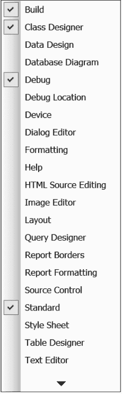

Figure 1-4

这里是你决定在任意时刻哪些工具栏可见的地方。你可以通过确保 Build、Class Designer、Debug、Standard 和 View Designer 菜单项被勾选，来使你的工具栏集合与图 1-3 中显示的相同。点击工具栏左侧灰色区域可将其勾选，若未勾选则会显示；点击复选标记则隐藏对应的工具栏。

你不需要把所有可能需要的工具栏都堆满应用程序窗口。某些工具栏会在需要时自动出现，因此你会发现默认的工具栏选择在大多数情况下完全足够。随着你开发应用程序，有时你可能会觉得更方便地访问未显示的工具栏。你可以通过在工具栏区域右键单击并从上下文菜单中选择，随时更改可见的工具栏集合。

按 F1 功能键浏览 MSDN 库。帮助菜单也提供了进入文档的各种途径。除了提供参考文档外，MSDN 库在处理代码中的错误时也是一个有用的工具，正如本章后面会看到的那样。

## Projects and Solutions

**project** 是一个容器，用于存放构成某种程序的所有内容——它可能是控制台程序、基于窗口的程序或其他类型的程序，通常由一个或多个包含你代码的源文件以及可能包含辅助数据的其他文件组成。项目的全部文件都存储在 **项目文件夹** 中，关于项目的详细信息则存储在项目文件夹中扩展名为 `.vcproj` 的 XML 文件里。项目文件夹还包含用于存放编译和链接项目输出结果的其他文件夹。

**solution** 的概念由其名称表达，即它是一种将代表特定数据处理问题解决方案的全部程序和其他资源集中起来的机制。例如，面向业务运营的分布式订单录入系统可能由多个不同的程序组成，这些程序可以作为单个解决方案中的项目分别开发；因此，**solution** 是一个文件夹，其中存放着一个或多个项目相关的所有信息，因此一个或多个项目文件夹是解决方案文件夹的子文件夹。关于解决方案中项目的详细信息存储在扩展名为 `.sln` 和 `.suo` 的两个文件里。当你创建项目时，除非你选择将其添加到现有解决方案，否则会自动创建一个新的解决方案。

当你创建项目并附带解决方案时，可以向同一解决方案添加更多项目。你可以将任何类型的项目添加到现有解决方案中，但通常只会添加与解决方案中现有项目在某种程度上相关联的项目。一般来说，除非有充分理由另行处理，否则每个项目都应拥有自己的解决方案。本书中创建的每个示例都将是其自身解决方案中的单个项目。

## Defining a Project

编写 Visual C++ 2005 程序的第一步是使用主菜单中的 File > New > Project 选项为其创建项目，或按 Ctrl+Shift+N。除了包含定义程序所有代码和任何其他数据的<|message|> 文件外，项目文件夹中的项目 XML 文件还记录了你正在使用的 Visual C++ 2005 选项。虽然你无需关心项目文件——它完全由 IDE 维护——但如果你想查看其内容，可以浏览它，但要小心不要意外修改它。

就目前而言，介绍性的内容已经足够了。是时候动手实践了。

## Try It Out Creating a Project for a Win32 Console Application

你现在将查看如何为控制台应用程序创建项目。首先选择 File > New > Project 以调出如图 1-6 所示的新建项目对话框。

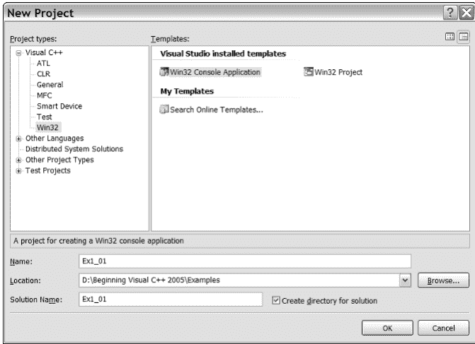

Figure 1-6

新建项目对话框的左侧窗格显示了你可以创建的项目类型；在这种情况下，点击 Win32。这也标识了一个应用程序向导，用于创建项目的初始内容。右侧窗格显示了针对你在左侧窗格中选择的项目类型可用的模板列表。你选择的模板将由应用程序向导在创建构成项目的文文件时使用。在下一个对话框中，在点击此对话框中的 OK 按钮时，你有机会自定义要创建的文件。对于大多数类型/模板选项，会自动创建一组基本的程序源模块。

你现在可以通过在 Name: 编辑框中输入来为项目输入合适的名称——例如，你可以将其命名为 Ex1_01，或选择你自己的项目名称。Visual C++ 2005 支持长文件名，因此你有很大的灵活性。解决方案文件夹的名称显示在底部的编辑框中，默认情况下解决方案文件夹与项目同名。你可以更改此名称。对话框还允许你修改包含项目的解决方案的位置——这显示在 Location: 编辑框中。如果你只为项目输入名称，解决方案文件夹将自动设置为与该名称同名的文件夹，其路径显示在 Location: 编辑框中。默认情况下，如果解决方案文件夹尚不存在，则会为你创建它。如果你想指定解决方案文件夹的不同路径，只需在 Location: 编辑框中输入即可。或者，你也可以使用 Browse 按钮选择另一个路径。点击 OK 按钮会显示如图 1-7 所示的 Win32 应用程序向导对话框。

该对话框解释了当前生效的设置。如果你点击 Finish 按钮，向导将基于此创建所有项目文件。在本例中，你可以点击左侧的 Applications Settings 以显示如图 1-8 所示的向导的 Application Settings 页面。

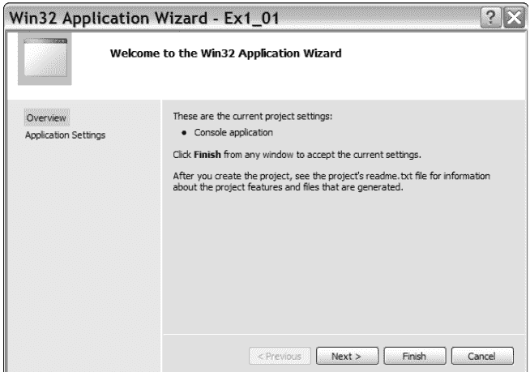

Figure 1-7

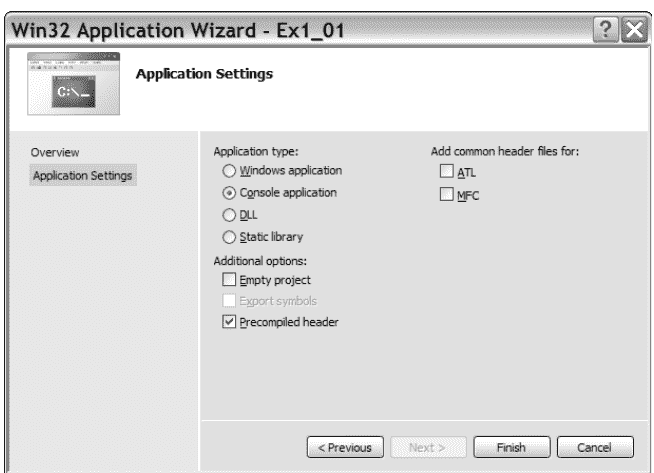

Figure 1-8

Application Settings 页面允许你选择要应用于项目的选项。对于你在学习 C++ 语言时创建的大多数项目，你会选择 Empty project 复选框，但在此时你可以保持原样并点击 Finish 按钮。应用程序向导随后将使用所有默认文件创建项目。

# Chapter 1

项目文件夹将具有你提供的项目名称，并存放构成项目定义的所有文件。如果你没有更改它，解决方案文件夹将与项目文件夹同名，并包含项目文件夹以及定义解决方案内容的文件。如果你使用 Windows Explorer 检查解决方案文件夹的内容，你会看到其中包含三个文件：

- 一个扩展名为 `.sln` 的文件，记录解决方案中项目的相关信息。
- 一个扩展名为 `.suo` 的文件，其中会记录适用于解决方案的用户选项。
- 一个扩展名为 `.ncb` 的文件，记录解决方案的 Intellisense 数据。Intellisense 是在编辑器窗口中输入代码时提供自动完成功能和提示的功能。

如果你使用 Windows Explorer 查看项目文件夹，请注意初始时有六个文件，其中包括一个名为 ReadMe.txt 的文件，其中包含已为项目创建的文件内容的摘要。ReadMe.txt 可能未提及的一个文件是名称形式为 Ex1_01.vcproj.ComputerName.UserName.user 的复合文件，用于存储你为项目设置的选项。

你创建的项目将自动在 Visual C++ 2005 中打开，左侧窗格如图 1-9 所示。我已增大此窗格的宽度，以便你可以看到标签上的完整名称。

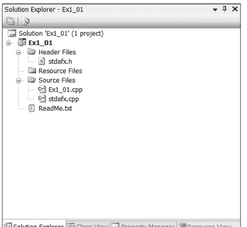

Figure 1-9

Solution Explorer 选项卡展示了当前解决方案中所有项目及其包含文件的视图——这里当然只有一个项目。你只需在 Solution Explorer 选项卡中双击文件名，即可将任何文件的内容作为编辑器窗格中的额外选项卡显示。在编辑窗格中，你只需点击相应的选项卡，即可瞬间在已显示的任何文件之间切换。


# 第 1 章

如果你的系统上未显示行号，请从主菜单中选择 Tools > Options 以显示选项对话框。如果你在右窗格中展开 C/C++ 选项并从展开的树中选择 General，你可以在对话框的右窗格中选择 Line Numbers。我将首先大致介绍一下图 1-10 中此代码的作用，你稍后会看到更多相关内容。

前两行只是注释。行中 “//” 之后的所有内容都会被编译器忽略。当你想在一行中添加描述性注释时，请在你的文本前加上 “//”。

第 4 行是一个 #include 指令，它将文件 stdafx.h 的内容添加到此文件，替换此 #include 指令。这是将 .h 源文件的内容添加到 C++ 程序中的 .cpp 源文件中的标准方法。

第 7 行是此文件中可执行代码的第一行，也是函数 _tmain() 的开始。函数只是在 C++ 程序中一个命名的可执行代码单元；每个 C++ 程序至少包含一个——通常还有更多——函数。

第 8 行和第 10 行分别包含左大括号和右大括号，它们括住了函数 _tmain() 中的所有可执行代码。因此，可执行代码只是第 10 行这一行，它所做的只是结束程序。

现在你可以在编辑器窗口中添加以下两行代码：

```
// Ex1_01.cpp : Defines the entry point for the console application.
//

#include "stdafx.h"
#include <iostream>

int _tmain(int argc, _TCHAR* argv[])
{
    std::cout << "Hello world!\n";
    return 0;
}
```

未着色的行是为你生成的行。你应添加的新行以阴影显示。要引入每一行新代码，请将光标置于前一行文本的末尾，然后按 Enter 创建一个空行，在其中键入新代码。确保它与前面的示例完全相同；否则，程序可能无法编译。

第一行新代码是一个 #include 指令，它将 ISO/ANSI C++ 的标准库之一的内容添加到源文件中。<iostream> 库定义了基本 I/O 操作的设施，而你在添加的第二行中使用的正是它，它将输出写入命令行。std::cout 是标准输出流的名称，你在第二个添加语句中将字符串 "Hello world!\n" 写入 std::cout。双引号字符对之间出现的任何内容都会被写入命令行。

### 构建解决方案

要构建解决方案，请按 F7 或选择 Build > Build Solution 菜单项。或者，你也可以单击对应于此菜单项的工具栏按钮。Build 菜单的工具栏按钮可能未显示，但你可以通过在工具栏区域右键单击并从列表中选择 Build 工具栏来轻松修复此问题。程序应然后成功编译。如果出现错误，请确保在输入新代码时没有出错，因此请非常仔细地检查这两行新代码。

### 构建控制台应用程序时创建的文件

在示例无错误构建后，使用 Windows 资源管理器查看项目文件夹，你会看到一个名为 Debug 的新子文件夹。此文件夹包含你刚刚对项目执行的构建的输出。请注意，此文件夹包含多个文件。

除了 .exe 文件，即你的程序的可执行形式外，你不需要知道这些文件中的太多内容。不过，如果你好奇的话，让我们快速浏览一下其中更有趣的文件。

| 文件扩展名 | 描述 |
|---|---|
| .exe | 这是程序的可执行文件。只有在编译和链接步骤都成功时才会得到此文件。 |
| .obj | 编译器生成这些包含来自程序源文件的机器代码的对象文件。这些文件连同库中的文件一起被链接器用来生成你的 .exe 文件。 |
| .ilk | 当你重建项目时，链接器会使用此文件。它使链接器能够将从修改后的源代码生成的对象文件增量链接到现有的 .exe 文件中。这避免了每次更改程序时都需要重新链接所有内容。 |
| .pch | 这是一个预编译头文件。使用预编译头，大量不需修改的代码段（特别是 C++ 库提供的代码）可以一次性处理并存储在 .pch 文件中。使用 .pch 文件可大幅减少重建程序所需的时间。 |
| .pdb | 此文件包含在调试模式下执行程序时使用的调试信息。在此模式下，你可以动态检查程序执行期间生成的信息。 |
| .idb | 包含重建解决方案时使用的信息。 |

### 程序的调试版和发布版

你可以通过 Project > Ex1_01 Properties 菜单项为项目设置一系列选项。这些选项决定了源代码在编译和链接阶段的处理方式。产生特定可执行程序版本的选项集合称为配置。当你创建新的项目工作区时，Visual C++ 2005 会自动创建用于生成应用程序两个版本的配置。一个版本称为 Debug 版本，它包含有助于调试程序的信息。使用程序的 Debug 版本，你可以在出现问题时逐步执行代码，检查程序中的数据值。另一个称为 Release 版本，它不包含调试信息，并且编译器的代码优化选项已打开，以为你提供最高效的可执行模块。这两个配置足以满足本书中的需求，但当你需要为应用程序添加其他配置时，可以通过 Build > Configuration Manager 菜单执行此操作。请注意，如果你没有加载项目，此菜单项将不会出现。这显然不是问题，但如果你只是浏览菜单查看其中有什么内容，可能会感到困惑。你可以通过在 Configuration Manager 对话框中从 Active solution configuration 下拉列表中选择配置来选择要使用的程序配置，如图 1-11 所示。

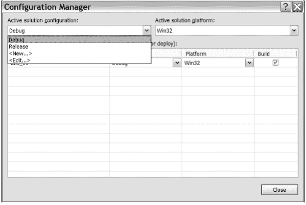

图 1-11

从列表中选择你想要使用的配置，然后单击 Close 按钮。在开发应用程序时，你将使用调试配置。在使用调试配置测试应用程序并确认其正常工作后，你通常会以发布版本重新构建程序；这会生成经过优化且没有调试和跟踪功能的代码，因此程序运行更快且占用更少内存。

### 执行程序

在成功编译解决方案后，你可以通过按 Ctrl+F5 执行程序。你应该会看到图 1-12 所示的窗口。

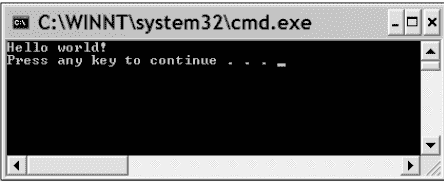

图 1-12

正如你所见，双引号之间的文本被写入命令行。文本字符串末尾出现的 "\n" 是一个特殊的序列，称为转义序列，用于表示你在文本字符串中无法直接从键盘输入的字符。

### 试一试   创建一个空的控制台项目

之前的项目包含了一些在处理简单的 C++ 语言示例时不需要的多余内容。默认选择的预编译头选项导致项目中创建了 stdafx.h 文件。这是一种在程序中有大量文件时使编译过程更高效的机制，但对于我们的许多示例来说这并非必要。在这些情况下，你从一个空项目开始，然后向其中添加自己的源文件。你可以通过为 Win32 控制台程序创建一个名为 Ex1_02 的新项目在新解决方案中来了解其工作原理。在输入项目名称并单击 OK 按钮后，单击随后出现的对话框右侧的 Application Settings。你可以从附加选项中选择 Empty project，如图 1-13 所示。

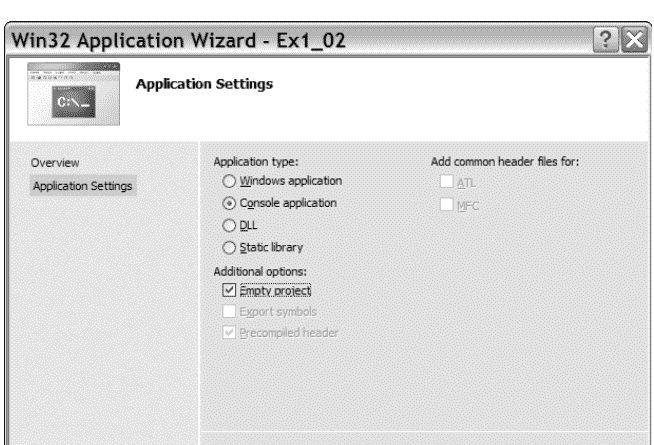

图 1-13

当你单击 Finish 按钮时，项目会像之前一样创建，但这次没有任何源文件。

接下来向项目添加一个新的源文件。右键单击 Solution Explorer 窗格，然后从上下文菜单中选择 Add > New Item。显示一个对话框；单击右窗格中的 Code，并在左窗格中选择 C++ File (.cpp)。将文件名输入为 Ex1_02，如图 1-14 所示。


# 第 1 章 使用 Visual C++ 2005 编程

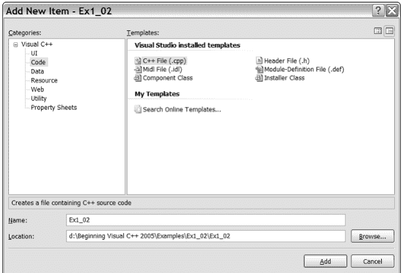

图 1-14

当你点击 Add 按钮时，新文件将被添加到项目中并在编辑器窗口中显示。当然，文件是空的，所以不会显示任何内容；在编辑器窗口中输入以下代码：

```
// Ex1_02.cpp A simple console program
#include <iostream>                // Basic input and output library

int main()
{
    std::cout << "This is a simple program that outputs some text." << std::endl;
    std::cout << "You can output more lines of text" << std::endl;
    std::cout << "just by repeating the output statement like this." << std::endl;
    return 0;                    // Return to the operating system
}
```

注意在输入代码时发生的自动缩进。C++ 使用缩进来使程序更易读，编辑器会根据上一行的内容自动缩进你输入的每一行代码。你也可以在输入时看到语法着色高亮的实际效果。随着输入，程序的某些元素会以不同颜色显示，因为编辑器会根据它们是什么自动为语言元素分配颜色。

前面的代码是完整的程序。你可能注意到与上一示例中应用程序向导生成的代码相比有几个不同之处。没有为 stdafx.h 文件的 #include 指令。这里的项目中没有此文件，因为你没有使用预编译头设施。这里函数的名称是 main；之前是 _tmain。事实上，所有 ISO/ANSI C++ 程序都在名为 main() 的函数中开始执行。Microsoft 还提供了此函数在 Unicode 字符使用时可以称为 wmain，并且名称 _tmain 被定义为 `main` 或 `wmain`，具体取决于程序是否将使用 Unicode 字符。对于前一个示例，名称 `_tmain` 在幕后被定义为 `main`。你在所有 ISO/ANSI C++ 示例中使用名称 `main`。

输出语句有点不同。`main()` 中的第一条语句是：

```
std::cout << "This is a simple program that outputs some text. " << std::endl;
```

你有两次 `<<` 运算符的出现，每一个都将随后内容发送到 `std::cout`，它是标准输出流。首先，双引号之间的字符串被发送到流，然后是 `std::endl`，其中 `std::endl` 在标准库中定义为换行字符。之前你使用转义序列 `\n` 在双引号之间的字符串中表示换行字符。你也可以将前面的语句写成：

```
std::cout << "This is a simple program that outputs some text.\n";
```

我应该解释为什么该行被着色，而前一行代码没有。当我为解释目的重复一行代码时，我会显示未着色的版本。前面的代码行是新的，并且在前面没有出现过，所以我将其显示为着色。

你现在可以像前一个示例一样构建此项目。请注意，如果编辑器窗格中打开的源文件尚未保存，则在构建时会自动保存。当你成功编译程序后，按 Ctrl+F5 执行它。图 1-15 所示的窗口会显示。

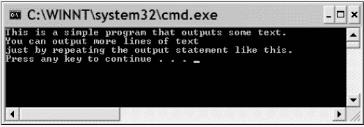

**图 1-15**

### 处理错误

当然，如果你没有正确输入程序，就会报告错误。为了说明其工作原理，你可以故意在程序中引入一个错误。如果你自己已经有错误，可以使用它们来执行此练习。返回编辑器窗格并删除大括号之间倒数第二行末尾的分号（第 8 行）；然后重新构建源文件。应用程序窗口底部的输出窗格包含错误消息：

```
C2143: syntax error : missing ';' before 'return'
```

编译期间的每个错误消息都有一个错误编号，你可以在文档中查找。这里问题很明显；然而，在更晦涩的情况下，文档可能有助于你弄清楚导致错误的原因。要获取错误的文档，请单击输出窗格中包含错误编号的行，然后按 F1。显示一个新窗口，其中包含有关错误的进一步信息。如果你愿意，可以用这个简单的错误来尝试。

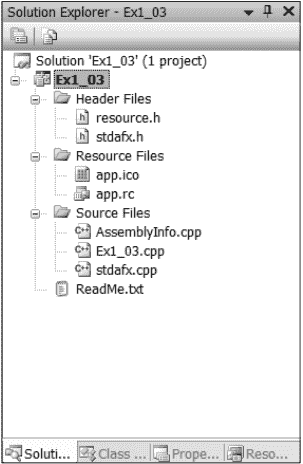

还有一个名为 AssemblyInfo.cpp 的文件。每个 CLR 程序都由一个或多个程序集组成，其中程序集是构成功能单元的代码和资源的集合。程序集还包含用于 CLR 的大量数据；有正在使用的数据类型的规范、代码的版本信息，以及确定程序集的内容是否可以从另一个程序集访问的信息。简而言之，程序集是所有 CLR 程序中的基本构建块。

如果 Ex1_03.cpp 文件的源代码未在编辑器窗口中显示，请在解决方案资源管理器窗格中双击文件名。它应该看起来像图 1-18。

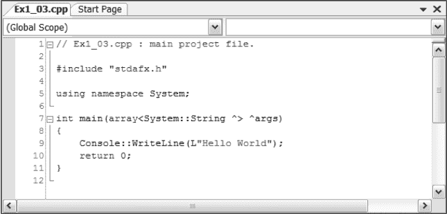

它具有与默认本机 C++ 控制台程序相同的 #include 指令，因为 CLR 程序出于效率原因使用预编译头。下一行是新的：

```
using namespace System;
```

.NET 库设施都在一个命名空间中定义，所有你可能使用的标准类型的东西都在名为 System 的命名空间中。此语句表示随后程序代码使用 System 命名空间，但命名空间到底是什么？

命名空间是一个非常简单的概念。在你的程序代码中以及构成 .NET 库的代码中，需要为许多事物命名——数据类型、变量和称为函数的代码块都需要有名称。问题是，如果你碰巧发明了一个名称，该名称已在库中使用，就有混淆的潜在风险。命名空间提供了一种解决此问题的方法。库代码中在 System 命名空间内定义的所有名称都隐式地以命名空间名称为前缀。因此，库中的 String 这样的名称实际上是 System::String。这意味着如果你不小心在代码中使用了 String 名称，你可以使用 System::String 来引用 .NET 库中的 String。

两个冒号 :: 是一个称为作用域解析运算符的运算符。这里作用域解析运算符将命名空间名称 System 与类型名称 String 分开。你已经在本章前面本机 C++ 示例中看到过这一点，使用 std::cout 和 std::endl。这就是同样的故事——std 是本机 C++ 库的命名空间名称，cout 和 endl 是在 std 命名空间内定义的名称，分别代表标准输出流和换行字符。

事实上，示例中的 using namespace 语句允许你使用 System 命名空间中的任何名称，而无需使用命名空间名称作为前缀。如果你最终在自己定义的名称和库中的名称之间发生名称冲突，你可以通过删除 using namespace 语句并显式限定库中的名称来解决此问题。你将在第 2 章中了解有关命名空间的更多信息。

你可以通过按 Ctrl+F5 编译和执行程序。输出如图所示 图 1-19。

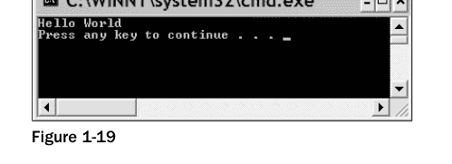

图 1-19

输出与第一个示例相同。此输出由以下行产生：

```
Console::WriteLine(L"Hello World");
```

这使用 .NET 库函数将双引号之间的信息写入命令行，因此这是本机 C++ 语句的 CLR 等价物，你已将其添加到 Ex1_01 中：

```
std::cout << "Hello world!\n";
```

CLR 语句的作用比本机 C++ 语句更直观。

### 在 Visual C++ 2005 中设置选项

你可以设置两组选项。你可以设置适用于 Visual C++ 2005 提供的工具的选项，这些选项适用于每个项目上下文。也可以设置特定于项目的选项，这些选项决定项目代码在编译和链接时如何处理。选项是通过选项对话框设置的，该对话框在从主菜单选择 Tools > Options 时显示。选项对话框如图 1-20 所示。

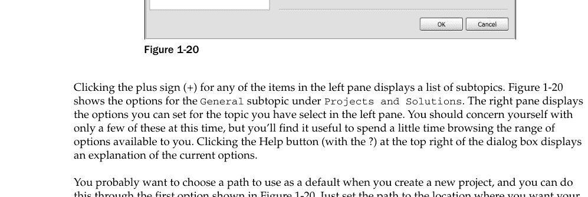

点击左侧窗格中任何项目的加号 (+) 会显示子主题列表。图 1-20 显示了项目和解决方案下通用子主题的选项。右侧窗格显示你为左侧窗格中选择的主题可以设置的选项。你现在只需关心其中少数几个，但花点时间浏览可用的选项范围会很有用。点击对话框右上角的帮助按钮（带 ?）会显示当前选项的说明。

你可能希望选择在创建新项目时使用的默认路径，你可以通过图 1-20 中显示的第一个选项来完成。只需将路径设置为你希望存储项目和解决方案的位置。

你可以通过在左侧窗格中选择项目和解决方案 > VC++ 项目设置主题来设置适用于每个 C++ 项目的选项。你也可以通过主菜单中的项目 > 属性菜单项为当前项目设置特定选项。此菜单项标签会根据当前项目名称进行调整。


图 1-22

MFC 应用程序向导 - Ex1_04

欢迎使用 MFC 应用程序向导

- 概述
- 应用程序类型
- 复合文档支持
- 文档模板字符串
- 数据库支持
- 用户界面功能
- 高级功能
- 生成的类

以下是当前项目设置：

- 多文档界面
- 无数据库支持
- 无复合文档支持

从任意窗口单击“完成”即可接受当前设置。

创建项目后，请参阅项目的 readme.txt 文件，了解有关生成的项目功能和文件的信息。

- < 上一步
- 下一步 >
- 完成
- 取消

图 1-23

解决方案资源管理器 - Ex1_04

- 解决方案“Ex1_04”（1 个项目）
  - Ex1_04
    - 头文件
      - ChildFrm.h
      - Ex1_04.h
      - Ex1_04Doc.h
      - Ex1_04View.h
      - MainFrm.h
      - Resource.h
      - stdafx.h
    - 资源文件
      - Ex1_04.ico
      - Ex1_04.rc
      - Ex1_04.rc2
      - Ex1_04Doc.ico
      - Toolbar.bmp
    - 源文件
      - ChildFrm.cpp
      - Ex1_04.cpp
      - Ex1_04Doc.cpp
      - Ex1_04View.cpp
      - MainFrm.cpp
      - stdafx.cpp
      - ReadMe.txt

- 解决方案资源管理器
- 类视图
- 资源视图

请注意，我通过右键单击“属性管理器”选项卡并选择“隐藏”将其隐藏，因此它没有出现在图 1-23 中。列表显示已创建的大量文件。编写 Windows 程序时，硬盘上需要大量空间！扩展名为 .cpp 的文件包含可执行 C++ 源代码，.h 文件包含由可执行代码使用的定义组成的 C++ 代码。.ico 文件包含图标。这些文件被分组到你可以看到的子文件夹中，以方便访问。但这些并不是真正的文件夹，它们不会出现在磁盘上的项目文件夹中。

如果你现在使用 Windows 资源管理器或任何其他方便的工具查看磁盘上的文件，来看一下 Ex1_04 解决方案文件夹，你会注意到总共生成了 24 个文件。其中 3 个在解决方案文件夹中，另外 17 个在项目文件夹中，还有 4 个在项目文件夹的子文件夹 res 中。res 子文件夹中的文件包含程序使用的资源——例如程序中使用的菜单和图标。你只需输入要分配给项目的名称，就能得到所有这些。你可以理解，既然有这么多文件和文件名会自动创建，为每个项目单独建一个目录就不仅仅是一个好主意了。

Ex1_04 项目目录中的文件之一是 ReadMe.txt，它解释了 MFC 应用程序向导生成的每个文件的用途。如果你愿意，可以使用记事本、写字板，甚至 Visual C++ 2005 编辑器查看它。若要在“编辑器”窗口中查看它，请在“解决方案资源管理器”窗格中双击它。

### 构建并执行 MFC 应用程序

在执行程序之前，你必须生成项目——这意味着编译源代码并链接程序模块。操作方式与控制台应用程序示例完全相同。为了节省时间，按 Ctrl+F5 即可一次性完成项目的生成和执行。

项目生成后，“输出”窗口会指示没有错误，然后可执行文件开始运行。生成的程序窗口如图 1-24 所示。

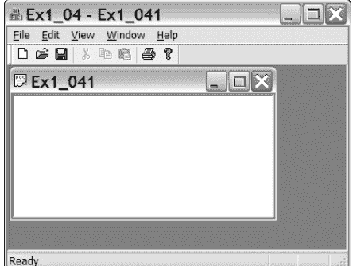

图 1-24

如你所见，该窗口配有菜单和工具栏，十分完整。虽然程序中还没有具体功能——这正是你需要添加以使其成为你自己的程序的部分——但所有菜单都能正常工作。你可以试试。你甚至可以通过在“文件”菜单中选择“新建”来创建更多窗口。

我想你会同意，用 MFC 应用程序向导创建 Windows 程序并没有耗费太多脑细胞。当你开始把这个基本程序开发成更有趣的程序时，还需要多动点脑筋，但这并不难。当然，对许多人来说，在没有 Visual C++ 2005 帮助的情况下，用老式方法编写一个严肃的 Windows 程序，至少需要吃几个月的鱼才能着手去做。这就是为什么这么多程序员过去常吃寿司。如今有了 Visual C++ 2005，这一切都一去不复返了。然而，你永远不知道编程技术下一步会发生什么。如果你喜欢寿司，稳妥起见最好继续吃。

### 创建 Windows 窗体应用程序

这要用另一个应用程序向导来完成。因此，再创建一个新项目，但这次在“新建项目”对话框的左侧窗格中选择类型为 CLR，模板选择“Windows 窗体应用程序”。然后可以输入项目名称 Ex1_05，如图 1-25 所示。

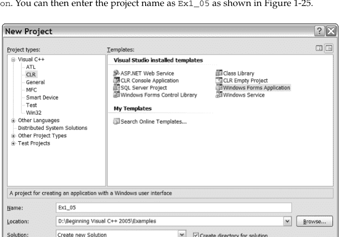

图 1-25

这种情况下没有可选项，所以单击“确定”按钮创建项目。

图 1-26 中的“解决方案资源管理器”窗格显示了为此项目生成的文件。

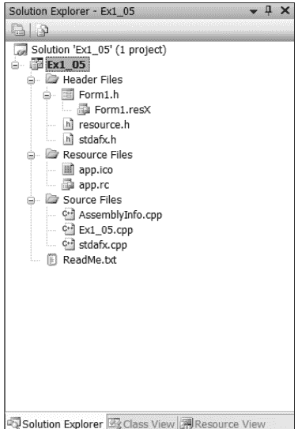

图 1-26

这个项目中的文件要少得多——如果查看目录，你会看到包括解决方案文件在内总共有 15 个文件。原因之一是初始 GUI 比使用 MFC 的本机 C++ 应用程序简单得多。Windows 窗体应用程序没有菜单或工具栏，只有一个窗口。当然，你可以很容易地添加所有这些功能，但 Windows 窗体应用程序的向导并不会默认你从一开始就需要这些东西。

“编辑器”窗口看起来很不相同，如图 1-27 所示。

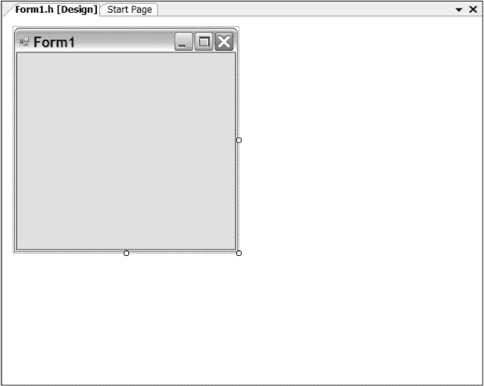

图 1-27

“编辑器”窗口显示的是应用程序窗口的图像，而不是代码。原因是 Windows 窗体的 GUI 开发面向的是图形化设计方法，而非编码方法。你可以通过拖放或以图形方式将 GUI 组件放置到应用程序窗口中，Visual C++ 2005 会自动生成显示这些组件的代码。如果按 Ctrl+Alt+X 或选择“视图”>“工具箱”，会看到一个额外的窗口，显示 GUI 组件列表，如图 1-28 所示。

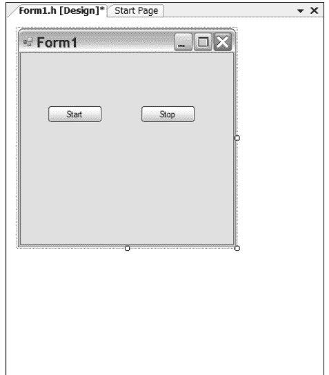

图 1-29

你可以随时以图形方式编辑任何 GUI 组件，代码会自动调整。尝试以同样的方式添加一些其他组件，然后按 Ctrl+F5 编译并执行该示例。应用程序窗口将华丽亮相。没有比这更简单的了，对吧？

## 小结

在本章中，你已经了解了使用 Visual C++ 2005 创建各种应用程序的基本机制。你创建并运行了本机和 CLR 控制台程序，并在应用程序向导的帮助下，创建了一个基于 MFC 的 Windows 程序和一个在 CLR 上运行的 Windows 窗体程序。

本章中你应记住的要点如下：

- 公共语言运行时（CLR）是公共语言基础结构（CLI）标准的 Microsoft 实现。
- .NET Framework 包含 CLR 以及支持面向 CLR 的应用程序的 .NET 库。
- 本机 C++ 应用程序使用 ISO/ANSI C++ 语言编写。
- 用 C++/CLI 语言编写的程序在 CLR 上执行。

## 数据、变量和计算

在本章中，你将深入了解 C++ 编程的要点。到本章结束时，你将能够编写一个传统形式的简单 C++ 程序：输入—处理—输出。正如我在前一章所述，我将首先讨论 ANSI/ISO C++ 语言特性，然后介绍 C++/CLI 语言中任何额外或不同的方面。

当你通过可运行的示例探索语言的各个方面时，你将有机会在 Visual C++ 开发环境中进行一些额外练习。在构建并执行每个示例之前，你应该为每个示例创建一个项目。请记住，在本章以及一直到第 10 章的后续章节中，你定义的项目全部是控制台应用程序。

- C++ 程序结构
- 命名空间
- C++ 中的变量
- 定义变量和常量
- 键盘基本输入和屏幕输出
- 执行算术计算
- 强制转换操作数
- 变量作用域


# C++ 程序的结构

在 Visual C++ 2005 下作为控制台应用程序运行的程序从命令行读取数据并将结果输出到命令行。为了避免在你还没有足够知识理解其工作原理之前就深入研究创建和管理应用程序窗口的复杂性，你为理解 C++ 语言而编写的所有示例都将是控制台程序，要么是 Win32 控制台程序，要么是 .NET 控制台程序。这使你能够首先完全专注于 C++ 语言；在掌握它之后，你就可以准备好处理创建和管理应用程序窗口了。你将首先查看控制台程序的结构。

C++ 程序由一个或多个函数组成。在第 1 章中，你看到一个示例，它是一个仅由函数 main() 组成的 Win32 控制台程序，其中 main 是函数名。每个 ANSI/ISO 标准 C++ 程序都包含 main() 函数，并且任何规模的 C++ 程序都由多个函数组成——程序执行开始的 main() 函数，加上若干其他函数。函数只是一个具有唯一名称的自包含代码块，你通过使用函数名来调用它执行。正如你在第 1 章中所见，由应用程序向导生成的 Win32 控制台程序具有名为 _tmain 的 main 函数。这是一种编程手段，允许名称根据程序是否使用 Unicode 字符而是 main 还是 wmain。名称 wmain 和 _tmain 是 Microsoft 特有的。符合 ISO/ANSI C++ 标准的主函数名称是 main。我将对所有 ISO/ANSI C++ 示例使用名称 main。

一个典型的命令行程序的结构可能如图所示 Figure 2-1

图 2-1 说明所示程序的执行从函数 main() 的开头开始。从 main() 开始，执行转移到函数 input_names()，该函数将执行返回到 main() 中调用点之后的立即位置。然后从 main() 调用 sort_names() 函数，在控制返回到 main() 之后，最后调用 output_names() 函数。最终，在输出完成后，执行再次返回到 main()，程序结束。

当然，不同的程序可能具有截然不同的功能结构，但它们都从 main() 的开头开始执行。将程序分解为函数的首要优点是你可以分别编写和测试每个部分。另一个优点是为执行特定任务而编写的函数可以在其他程序中重复使用。随 C++ 提供的库提供了许多标准函数供你在程序中使用。它们可以为你节省大量工作。

你将在第 5 章中了解更多关于创建和使用函数的内容。

# Try It Out  一个简单程序

一个简单的示例可以帮助你更好地理解程序的各个元素。首先创建一个新项目——你可以使用 Ctrl+Shift+N 键组合作为快捷方式。当如图 Figure 2-2 所示的新建项目对话框出现时，选择 Win32 作为项目类型，选择 Win32 Console Application 作为模板。将项目命名为 Ex2_01。

Figure 2-1

```
int main()
{
input_names();
sort_names();
output_names();
return 0;
}
```

```
void input_names()
{
// ...
return ;
}
```

```
void sort_names()
{
// ...
return ;
}
```

```
void output_names()
{
// ...
return ;
}
```

Execution starts with main()

When a function is called, it starts at the beginning

The return from main() goes back to the operating system

The return from a function goes back to a point following where it was called

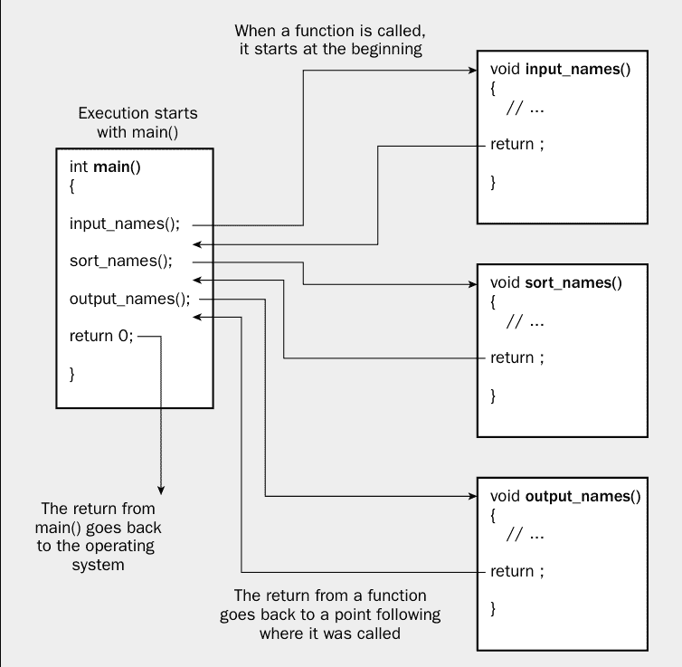

如果现在点击此对话框左侧的 Application Settings，你会看到如图 Figure 2-4 所示的 Win32 应用程序的进一步选项。

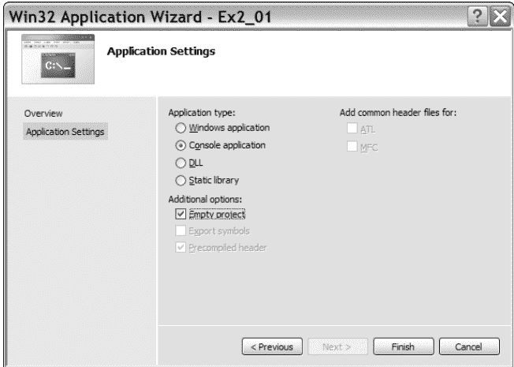

默认设置是一个包含默认版本 main() 的文件的控制台应用程序，但你将从最基本的项目结构开始，因此从附加选项集中选择 Empty project 并点击 Finish 按钮。现在你创建了一个项目，但它不包含任何文件。你可以从 Visual C++ 2005 主窗口左侧的 Solution Explorer 窗格看到项目包含的内容，如图 Figure 2-5 所示。

你将通过向项目添加新的源文件开始，因此右键单击 Solution Explorer 窗格中的 Source Files 并选择 Add > New Item 菜单选项。Add New Item 对话框显示，类似于图 Figure 2-6 所示。

确保通过点击它使 C++ File (.cpp) 模板处于突出显示状态，并输入文件名，如图 Figure 2-6 所示。文件将自动获得 .cpp 扩展名，因此你不必输入扩展名。文件名称与项目名称相同没有问题。项目文件将具有 .vcproj 扩展名，因此它与源文件有所区别。

点击 Add 按钮创建文件。然后你可以在 IDE 窗口的编辑器窗格中输入以下代码：

```cpp
// Ex2_01.cpp
// A Simple Example of a Program
#include <iostream>

using std::cout;
using std::endl;

int main()
{
    int apples, oranges;          // Declare two integer variables
    int fruit;                    // ...then another one
    apples = 5; oranges = 6;      // Set initial values
    fruit = apples + oranges;     // Get the total fruit
    cout << endl;                 // Start output on a new line
    cout << "Oranges are not the only fruit... " << endl
         << "- and we have " << fruit << " fruits in all.";
    cout << endl;                 // Output a new line character
    return 0;                     // Exit the program
}
```

> 前面的示例旨在说明你可以以多种方式编写 C++ 语句，并不是良好编程风格的范例。

由于文件通过其扩展名被识别为包含 C++ 代码的文件，编辑器识别的代码关键字将被着色以标识它们。如果你输入了 Int 而不是 int，你将能够看到，因为 Int 不会使用用于突出显示源代码中关键字的颜色。

如果查看新项目的 Solution Explorer 窗格，你会看到新创建的源文件。Solution Explorer 将始终显示项目中的所有文件。如果你点击 Solution Explorer 窗格底部的 Class View 选项卡，Class View 将被显示。它由两个窗格组成，上部窗格显示项目中的全局函数和宏（以及当你创建涉及类的项目时显示类），下部窗格如果在上部 Class View 窗格中选择 Global Functions and Variables；这如图 Figure 2-7 所示。我稍后会更详细地考虑这意味着什么，但本质上全局是可以在程序的任何地方访问的函数和/或变量。

# Chapter 2

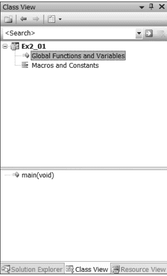

你有三种方法编译和链接程序；你可以从 Build 菜单中选择 Build Ex2_01 菜单项，你可以按 F7 功能键，或选择适当的工具栏按钮——你可以通过将鼠标光标悬停在其上识别工具栏按钮的功能。假设构建操作成功，你可以通过按 Ctrl+F5 键或从 Debug 菜单中选择 Start Without Debugging 来执行程序。你应该在命令行窗口中得到以下输出：

```
Oranges are not the only fruit...
- and we have 11 fruits in all.
Press any key to continue . . .
```

前两行由程序产生，最后一行指示你如何结束执行并关闭命令行窗口。

# 程序注释

程序中的前两行是注释。注释是任何程序的重要组成部分，但它们不是可执行代码——它们只是为了帮助人类阅读者。所有注释都被编译器忽略。在代码的任何一行中，两个连续的斜杠 // 不包含在文本字符串中（你稍后会看到什么是文本字符串）表示该行的其余部分是注释。


你可以看到程序的几行同时包含注释和程序语句。你也可以使用另一种由 `/*` 和 `*/` 限定的注释形式。例如，程序的第一行本可以写成：

```
/*  Ex2_01.cpp  */
```

使用 `//` 的注释仅涵盖该行中两个斜杠之后的部分，而 `/* ... */` 形式则将 `/*` 和 `*/` 之间的所有内容定义为注释，并且可以跨越多行。例如，你可以写成：

```
/*
    Ex2_01.cpp
    A Simple Program Example
*/
```

这四行都是注释。如果你想突出某些特定的注释行，你可以始终为其添加某种描述的边框：

```
/*********************************
*   Ex2_01.cpp                   *
*   A Simple Program Example     *
*********************************/
```

作为一条规则，你应该始终全面地注释你的程序。注释应足以让另一位程序员或日后你自己理解代码的任何特定部分的目的以及其工作原理。

## The #include Directive — Header Files

在注释之后，你有一个 `#include` 指令：

```
#include <iostream>
```

这被称为指令，因为它指示编译器执行某些操作——在本例中是将文件 `<iostream>` 的内容在编译前插入到程序中。文件 `<iostream>` 被称为头文件，因为它通常在程序文件开头引入。实际上 `<iostream>` 更准确地应称为头，因为在 ANSI 标准 C++ 中，头不一定必须包含在文件中。然而，我将在本书中使用头文件这一术语，因为在使用 Visual C++ 2005 时，所有头都存储在文件中。`<iostream>` 头文件包含使你能够使用 C++ 输入输出语句所必需的定义。如果你没有将 `<iostream>` 的内容包含到程序中，程序将无法编译，因为你使用了依赖于此文件中某些定义的输出语句。Visual C++ 提供了许多不同的头文件，涵盖了广泛的功能。随着你深入学习语言功能，你会看到更多这些头文件。

`#include` 语句是多个预处理器指令之一。Visual C++ 编辑器识别这些指令，并在编辑窗口中将它们高亮显示为蓝色。预处理器指令是由编译器的预处理阶段执行的命令，该阶段在代码编译为目标代码之前执行，并且预处理器指令通常在代码被编译之前以某种方式作用于源代码。它们都以 `#` 字符开头。我将在你需要时介绍其他预处理器指令。

## Namespaces and the Using Declaration

正如你在第 1 章中所看到的，标准库是一组广泛的例程，用于执行许多常见任务：例如处理输入输出、执行基本数学计算。由于这些例程的数量非常庞大，以及还有其他具有名称的事物，因此你可能会不小心为自己的目的使用与标准库中定义的名称相同的名称。命名空间是 C++ 中避免因程序中对不同事物使用重复名称而产生问题的机制，它通过将一组名称（如标准库中的名称）与一种类似的族名关联起来来实现，这就是命名空间名称。

在命名空间内出现的代码中定义的每个名称也都与其命名空间名称相关联。所有 ISO/ANSI C++ 标准库设施都在名为 `std` 的命名空间中定义，因此你可以从程序中访问的每个标准库项都有自己的名称，加上命名空间名称 `std` 作为限定符。名称 `cout` 和 `endl` 在标准库中定义，因此它们的完整名称是 `std::cout` 和 `std::endl`，你已在第 1 章中看到它们的实际应用。将命名空间名称与实体名称分隔开的两个冒号形成一个称为作用域解析运算符的操作符，我将在本书后面讨论该运算符的其他用途。在程序中使用完整名称往往会使代码看起来有点杂乱，因此最好能够使用其简单名称，不受命名空间名称 `std` 的限定。我们程序中跟随 `<iostream>` 的 `#include` 指令之后的两个行使这成为可能：

```
using std::cout;
using std::endl;
```

这些是 using 声明，告诉编译器你打算在不指定命名空间名称的情况下使用来自命名空间 `std` 的名称 `cout` 和 `endl`。编译器现在将假定在源文件中首次 using 声明之后你使用名称 `cout` 的任何地方，都指的是标准库中定义的 `cout`。名称 `cout` 表示标准输出流，默认情况下对应于命令行，而名称 `endl` 表示换行字符。

你将在本章稍后了解更多关于命名空间的内容，包括如何定义你自己的命名空间。

## The main() Function

示例中的函数 `main()` 由将其定义为 `main()` 的函数头加上从第一个左大括号 (`{`) 到对应的右大括号 (`}`) 的所有内容组成。大括号括住函数中的可执行语句，这些语句统称为函数体。

正如你将看到的，所有函数都由定义（其中包括）函数名称的头组成，后跟由一对大括号括起的若干程序语句组成的函数体。函数的体可能完全不包含语句，在这种情况下它什么也不做。

一个什么也不做的函数似乎有些多余，但在编写大型程序时，你最初可能会在函数中规划出完整的程序结构，但省略许多函数的代码，使其具有空或最小的体。这样做意味着你可以在任何时候编译和执行包含所有函数的整个程序，并逐步添加函数的详细编码。

## Program Statements

构成 `main()` 函数体的程序语句各自以分号结尾。是分号标记语句的结束，而不是行的结束。因此，当这使代码更易于遵循时，语句可以分布在多行上，并且多条语句可以出现在同一行。程序语句是定义程序做什么的基本单元。这有点像段落中的句子，其中每个句子本身就表达一个动作或一个想法，但与段落中的其他句子相关联并结合起来表达一个更一般的想法。语句是对计算机要执行的操作的自包含定义，但可以与其他语句结合起来定义更复杂的操作或计算。

函数的操作始终由若干条语句表达，每条语句以分号结束。快速浏览一下刚刚编写的示例中的每条语句，只是为了对它如何工作有一个大致的感觉。我将在本章后面更详细地讨论每种类型的语句。

`main()` 函数体中的第一条语句是：

```
int apples, oranges;      // Declare two integer variables
```

该语句声明了两个变量，`apples` 和 `oranges`。变量只是一个命名的计算机内存位，你可以用它来存储数据，而引入一个或多个变量名称的语句称为变量声明。前述语句中的关键字 `int` 表示名称为 `apples` 和 `oranges` 的变量将存储为整数或整数的数值。每当你在程序中引入变量的名称时，你总是指定它将存储的数据种类，这称为变量的类型。

下一条语句声明了另一个整数变量，`fruit`：

```
int fruit;                // ...then another one
```

虽然你可以在同一条语句中声明多个变量，就像你在前一条语句中对 `apples` 和 `oranges` 所做的那样，但通常最好将每个变量单独声明在一行上，这样可以单独对其进行注释以解释你打算如何使用它们。

示例中的下一行是：

```
apples = 5; oranges = 6;    // Set initial values
```

该行包含两条语句，每条以分号结尾。我把这个放在这里只是为了演示你可以在一行中放置多条语句。虽然不是强制性的，但通常良好的编程实践是每行只写一条语句，因为这样可以使代码更易于理解。良好的编程实践是关于采用使代码易于遵循并最大限度地减少错误可能性的编码方法。

前一行中的两条语句将值 5 和 6 分别存储在变量 `apples` 和 `oranges` 中。这些语句称为赋值语句，因为它们为变量分配新值，而 `=` 是赋值运算符。

下一条语句是：

```
fruit = apples + oranges;    // Get the total fruit
```


# 第 2 章

这也是一条赋值语句，但有点不同，因为赋值运算符右侧有一个算术表达式。该语句将变量 apples 和 oranges 中存储的值相加，并将结果存储在变量 fruit 中。

接下来的三条语句是：

```
cout << endl;                  // Start output on a new line
cout << "Oranges are not the only fruit... " << endl
    << "- and we have " << fruit << " fruits in all.";
cout << endl;                  // Start output on a new line
```

这些都是输出语句。第一条语句是这里的第一行，它将换行符，即用单词 endl 表示，发送到屏幕上的命令行。在 C++ 中，输入源或输出目标被称为流。名称 cout 指定“标准”输出流，而运算符 << 表示运算符右侧的内容将被发送到输出流 cout。<< 运算符“指向”数据流动的方向——从运算符右侧出现的变量或字符串流向左侧的输出目标。因此在第一条语句中，由名称 endl 表示的值——它代表一个换行符——被发送到由名称 cout 标识的流——并且传输到 cout 的数据被写入命令行。

名称 cout 和运算符 << 的含义在标准库头文件 <iostream> 中定义，你已通过程序代码开头的 #include 指令将其添加到程序中。cout 是标准库中的一个名称，因此位于命名空间 std 中。如果没有 using 指令，除非你使用其完全限定名称 std::cout，否则它将无法被识别，正如我之前提到的。由于 cout 已被定义为表示标准输出流，你不应将名称 cout 用于其他目的，例如在程序中将其用作变量名。显然，为不同的事物使用相同的名称很可能会导致混淆。

三条语句中的第二条输出语句跨了两行：

```
cout << "Oranges are not the only fruit... " << endl
    << "- and we have " << fruit << " fruits in all.";
```

正如我之前所说，如果有助于使代码更清晰，你可以将程序中的每条语句扩展到任意多行。语句的结束始终由分号表示，而不是行的结束。编译器会读取并合并连续的行，直到找到定义语句结束的分号为止。当然，这意味着如果你忘记在语句末尾加上分号，编译器会假设下一行是同一语句的一部分并将它们合并在一起。这通常会导致编译器无法理解的内容，因此你会收到错误消息。

该语句将文本字符串 "Oranges are not the only fruit... " 发送到命令行，然后是另一个换行符（endl），然后是另一个文本字符串 "- and we have "，然后是变量 fruit 中存储的值，最后是另一个文本字符串 " fruits in all."。以这种方式将一系列要输出的内容串联起来没有任何问题。语句从左到右执行，每个项目依次发送到 cout。请注意，每个要发送到 cout 的项目前面都有自己的 << 运算符。

第三条也是最后一条输出语句只是将另一个换行符发送到屏幕，这三条语句产生了你所看到的程序输出。

程序中的最后一条语句是：

```
return 0;                  // Exit the program
```

这终止了 main() 函数的执行，从而停止程序的执行。控制权返回给操作系统。我稍后会更详细地讨论所有这些语句。

程序中的语句按其编写的顺序执行，除非某条语句专门导致自然顺序被改变。在第 3 章中，你将研究改变执行顺序的语句。

## 空白字符

**空白字符** 是 C++ 中用于描述空格、制表符、换行符、换页符和注释的术语。空白字符用于分隔语句的各个部分，并使编译器能够识别语句中一个元素，例如 int 的结束和下一个元素的开始。否则，空白字符将被忽略且没有效果。

例如，看看这条语句：

```
int fruit;                  // ...then another one
```

编译器必须在 int 和 fruit 之间至少有一个空白字符（通常是一个空格）才能区分它们，但如果你添加更多空白字符，它们将被忽略。分号后面的行内容全部是空白字符，因此将被忽略。

另一方面，看看这条语句：

```
fruit = apples + oranges;      // Get the total fruit
```

fruit 和 = 之间，或 = 和 apples 之间不需要空白字符，尽管如果你愿意，可以包含一些。这是因为 = 不是字母或数字，所以编译器可以将其与其周围的内容分开。同样，+ 号两侧也不需要空白字符，但如果你想提高代码的可读性，可以包含一些。

正如我所说，除了用作可能否则会混淆的语句中元素之间的分隔符外，空白字符会被编译器忽略（当然，放在引号之间的字符字符串除外）。因此，你可以包含任意多的空白字符来使程序更具可读性，就像你在上一个示例中将输出语句扩展到多行一样。记住，在 C++ 中，语句的结束位置是分号出现的位置。

## 语句块

你可以在一对大括号之间包含多个语句，在这种情况下，它们就成为一个 **块**，或一个 **复合语句**。函数的体就是一个块的例子。这样的复合语句可以被视为单个语句（当你查看第 3 章中 C++ 中的决策可能性时，你会看到这一点）。事实上，在 C++ 中任何可以放置单个语句的地方，你同样可以放置用大括号括起来的语句块。因此，块可以放在其他块内部。事实上，块可以嵌套，一个在另一个内部，嵌套到任意深度。

> 语句块对变量也有重要影响，但我将推迟讨论这个问题，直到本章后面讨论变量作用域时再进行。

## 自动生成的控制台程序

在上一个示例中，你选择将项目作为没有源文件的空项目生成，然后随后添加源文件。如果你只是允许应用程序向导像你在第 1 章中所做的那样生成项目，项目将包含多个文件，你应该更深入地探索它们的内容。创建一个名为 Ex2_01A 的新的 Win32 控制台项目，这次只需允许应用程序向导完成，而无需在应用程序设置对话框中选择任何选项。项目将包含三个包含代码的文件：Ex2_01A.cpp 和 stdafx.cpp 源文件，以及 stdafx.h 头文件。这是为了提供你在控制台程序中可能需要的<|message|>


normally replaced by main but will be replaced by wmain if the symbol _UNICODE is defined. Thus to identify a program as using UNICODE you would add the following statement to the beginning of the stdafx.h header file:

```
#define _UNICODE
```

Now that we’ve explained all that, we’ll stick to plain old main() for our ISO/ANSI C++ examples.

## 定义变量

在所有计算机程序中的一个基本目标是操作某些数据并得到一些答案。这一过程中的一个基本要素是拥有一个你可以称之为自己的内存块，可以使用有意义的名称引用它，并且可以在其中存储一个数据项。每个这样指定的内存块称为变量。

正如你所知，每个变量将存储特定类型的数据，并且可以存储的数据类型在你在程序中定义变量时就已固定。一个变量可能存储整数，在这种情况下你就不能用它来存储具有小数值的数字。每个变量在任何时刻包含的值由程序中的语句决定，当然，随着程序计算的进行，其值通常会多次改变。

下一节首先介绍在将变量引入程序时命名变量的规则。

## 命名变量

你给变量起的名字称为标识符，或更方便地称为变量名。变量名可以包含字母 A-Z（大写或小写）、数字 0-9 和下划线字符。不允许使用其他字符，如果你碰巧使用了其他字符，在尝试编译程序时通常会收到错误消息。变量名还必须以字母或下划线开头。名称通常选择以表示要存储的信息类型。

由于在 Visual C++ 2005 中变量名可以长达 2048 个字符，因此你在为变量命名时有相当大的灵活性。事实上，除了变量之外，C++ 中还有很多其他事物也有名称，它们也可以有长达 2048 个字符的名称，其定义规则与变量名相同。使用允许的最大长度的名称会使你的程序变得有点难以阅读，而且除非你有惊人的键盘技能，否则它们打字起来非常困难。更严重的是，并非所有编译器都支持如此长的名称。如果你预计在其他环境中编译代码，最好将名称限制在最多 31 个字符；这通常足以设计有意义的名称，并且在大多数情况下可以避免编译器名称长度限制的问题。

虽然你可以使用以下划线开头的变量名，例如 _this 和 _that，但最好避免这样做，因为可能会与具有相同形式的标准系统变量发生冲突。出于同样的原因，你也应避免使用以双下划线开头的名称。

## 数据、变量和计算

单个声明可以指定多个变量的名称，但正如我所说，通常最好以单独的语句声明变量，每行一个。我会偏离这本书，但只是为了不把代码分散在太多页面上。

为了存储数据（例如整数的值），你不仅需要定义变量的名称；你还需要将计算机内存的一部分与变量名关联起来。这个过程称为变量定义。在 C++ 中，变量声明也是定义（除了少数特殊情况，我们将在书中遇到）。在一个语句中，我们引入变量名，并将其与适当大小的内存块绑定。

```
int value;
```

你使用术语声明来表示将名称引入你的程序，并提供名称将用于什么的信息。术语定义指的是将计算机内存分配给名称。对于变量的情况，你可以在单个语句中声明和定义，如前一行所示。之所以对声明和定义之间进行这种看似吹毛求疵的区分，是因为你会遇到声明但不是定义的语句。

你必须在程序开始和变量首次使用之间某个时间点声明变量。在 C++ 中，靠近首次使用点声明变量是良好的做法。

## 变量的初始值

当你声明一个变量时，你也可以为其分配初始值。分配初始值的变量声明称为初始化。要在声明时初始化变量，只需在变量名后写一个等号，后跟初始化值。你可以写以下语句为每个变量赋初始值：

```
int value = 0;
int count = 10;
int number = 5;
```

在这种情况下，value 的值为 0，count 的值为 10，number 的值为 5。

在 C++ 中还有另一种写法变量初始值的方法，称为函数式记法。代替等号和值，你可以简单地在变量名后写上值放在括号中。因此你可以将之前的声明重写为：

```
int value(0);
int count(10);
int number(5);
```

C++ 还提供了另一种整数类型 long，也可以写成 long int。以下是如何声明 long 类型的变量：

```
long bigNumber = 1000000L;
long largeValue = 0L;
```

这些语句声明变量 bigNumber 和 largeValue，初始值分别为 1000000 和 0。附加在字面量末尾的字母 L 指定它们是 long 类型的整数。你也可以使用小写字母 l 来实现相同的目的，但缺点是它很容易与数字 1 混淆。未附加 L 的整数字面量为 int 类型。

> 在程序中书写大数值时不得包含逗号。在文本中你可能会写数字 12,345，但在程序代码中你必须将其写为 12345。

在 Visual C++ 2005 中声明为 long 的整数变量占用 4 个字节，其值范围为 -2,147,483,648 到 2,147,483,647。这与声明为 int 的变量的范围相同。

> 在其他 C++ 编译器中，long 类型（即 long int 类型）可能与 int 类型不同，因此如果你希望程序在其他环境中编译，不要假设 long 和 int 是等价的。对于真正可移植的代码，你甚至不应假设 int 为 4 个字节（例如，在旧的 16 位 Visual C++ 版本中，int 类型的变量为 2 个字节）。

## 字符数据类型

char 数据类型具有双重用途。它指定一个一字节的变量，你可以用它来存储给定范围内的整数，或存储单个 ASCII 字符的代码，即美国信息交换标准代码。ASCII 字符集中的代码出现在附录 B。你可以用以下语句声明一个 char 变量：

```
char letter = 'A';
```

这声明了名为 letter 的变量并将其初始化为常量 'A'。请注意，你指定的是用单引号括起来的单个字符的值，而不是之前用于定义要显示的字符字符串的双引号。字符字符串是一系列 char 类型的值，它们被组合成一个称为数组的单一实体。我将在第 4 章讨论数组以及 C++ 中如何处理字符串。

由于字符 'A' 在 ASCII 中由十进制值 65 表示，你也可以将语句写为：

```
char letter = 65;    // Equivalent to A
```

这与前一条语句产生相同的结果。在 Visual C++ 中，char 类型变量可以存储的整数范围为 -128 到 127。

> 请注意，ISO/ANSI C++ 标准并不要求 char 类型表示有符号的一字节整数。这是编译器实现者的选择，char 类型是表示范围为 -128 到 +127 的有符号整数，还是表示范围为 0 到 255 的无符号整数。如果你将 C++ 代码移植到不同的环境中，需要牢记这一点。


# 第2章

类型 wchar_t 之所以这样命名，是因为它是一种宽字符类型，此类型变量存储的值范围为 0 到 65,535 的 2 字节字符代码。以下是定义 wchar_t 类型变量的示例：

```
wchar_t letter = L'Z';      // A variable storing a 16-bit character code
```

这定义了一个变量 letter，它被初始化为字母 Z 的 16 位代码。字符常量 'Z' 前面的 L 告诉编译器这是一个 16 位字符代码值。

你也可以使用十六进制常量来初始化 char 变量（以及其他整数类型），当字符代码以十六进制值给出时，使用这种记法显然会更容易。十六进制数使用标准表示法书写十六进制数字：0 到 9，以及 A 到 F（或 a 到 f）表示值从 10 到 15 的数字。它还以 0x（或 0X）开头以区别于十进制值。因此，为了得到完全相同的结果，你可以把上一条语句重写如下：

```
char letter = 0x41;         // Equivalent to A
```

> 不要用前导零书写十进制整数值。编译器会把这类值解释为八进制（基数 8），所以写成 065 的值在正常十进制记法中相当于 53。

还请注意，Windows XP 提供了一个字符映射表实用程序，可让你从 Windows 可用的任何字体中查找字符。它会以十六进制显示字符代码，并告诉你输入该字符的按键。你可以通过单击“开始”按钮并在“附件”文件夹内的“系统工具”文件夹中查找来找到字符映射表实用程序。

### 整数类型修饰符

积分类型 char、int、short 或 long 的变量默认存储有符号整数值，因此你可以使用这些类型存储正值或负值。这是因为这些类型被假定具有默认的类型修饰符 signed。所以，无论你写 int 或 long，你本可以分别写成 signed int 或 signed long。

你也可以单独使用 signed 关键字来指定变量的类型，在这种情况下它表示 signed int。例如：

```
signed value = -5;          // Equivalent to signed int
```

这种用法并不特别常见，我更喜欢使用 int，这样更明显地表明了含义。

类型 char 变量可存储的值范围是从 −128 到 +127，这与类型 signed char 变量可存储的值范围相同。尽管如此，类型 char 和类型 signed char 是不同的类型，所以你不应该犯把它们当作相同的错误。

如果你确定不需要在变量中存储负值（例如，如果你记录每周行驶的英里数），你可以将变量指定为 unsigned：

```
unsigned long mileage = 0UL;
```

这里，变量 mileage 可存储的最小值为零，最大值为 4,294,967,295（即 2³²−1）。将其与 signed long 的范围 −2,147,483,648 到 2,147,483,647 相比。在有符号变量中用于确定值符号的位，在无符号变量中则作为数值的一部分使用。因此，无符号变量具有更大的正值范围，但它不能表示负值。请注意无符号常量后附加了 U（或 u）。在前面的示例中，我还附加了 L 以表示常量为 long。你可以使用 U 和 L 的大写或小写，顺序无关紧要。然而，采用一致的方式指定此类值是个好主意。

你也可以单独使用 unsigned 作为变量的类型说明，在这种情况下你指定变量为 unsigned int 类型。

> 请记住，signed 和 unsigned 都是关键字，所以你不能把它们用作变量名。

### 布尔类型

布尔变量是只能有两个值的变量：true 和 false。逻辑变量的类型为 bool，名称源自乔治·布尔，他发展了布尔代数，类型 bool 被视为一种整数类型。布尔变量也称为逻辑变量。类型 bool 的变量用于存储测试结果，这些结果可以是真或假，例如一个值是否等于另一个值。

你可以用以下语句声明类型为 bool 的变量的名称：

```
bool testResult;
```

当然，你也可以在声明时初始化类型为 bool 的变量：

```
bool colorIsRed = true;
```

> 你会发现 TRUE 和 FALSE 的值在数值类型变量中被大量使用，特别是类型 int。这源于在 C++ 中实现类型 bool 变量之前的时间，当时类型 int 的变量通常用于表示逻辑值。在这种情况下，零值被视为假，非零值被视为真。符号 TRUE 和 FALSE 仍在使用 MFC 中，它们分别代表非零整数值和 0。请注意 TRUE 和 FALSE — 用大写字母书写 — 并不是 C++ 中的关键字；它们只是 MFC 中定义的符号。请还注意 TRUE 和 FALSE 不是合法的 bool 值，所以不要把 true 与 TRUE 混淆。

### 浮点类型

非整数值存储为浮点数。浮点数可以表示为十进制值，例如 112.5，或以指数形式表示，例如 1.125E2，其中小数部分乘以 E 后指定的 10 的幂次。我们的示例因此为 1.125×10²，即 112.5。

> 浮点常量必须包含小数点，或指数，或两者兼有。如果你写一个既没有小数点也没有指数的数值，你得到的就是一个整数。

# 第2章

你可以使用关键字 double 指定浮点变量，如以下语句所示：

```
double in_to_mm = 25.4;
```

类型为 double 的变量占用 8 字节内存，存储的值精确到约 15 位十进制数字。存储的值范围远大于 15 位精度所指示的范围，为正负 1.7×10⁻³⁰⁸ 到 1.7×10³⁰⁸。

如果你不需要 15 位精度，并且不需要 double 变量提供的巨大值范围，你可以选择使用关键字 float 声明占用 4 字节的浮点变量。例如：

```
float pi = 3.14159f;
```

该语句定义了一个变量 pi，初始值为 3.14159。常量末尾的 f 指定其为 float 类型。没有 f，常量将为 double 类型。你声明为 float 的变量具有约 7 位十进制精度，可以有正负 3.4×10⁻³⁸ 到 3.4×10³⁸ 的值。

ISO/ANSI C++ 标准还定义了 long double 浮点类型，在 Visual C++ 2005 中它以与类型 double 相同的范围和精度实现。在某些编译器中 long double 对应于 16 字节的浮点值，其范围和精度远大于类型 double。

### ISO/ANSI C++ 中的基本类型

下表总结了 ISO/ANSI C++ 中的所有基本类型以及 Visual C++ 2005 中支持的这些类型的取值范围：

| Type | Size in Bytes | Range of Values |
|---|---|---|
| bool | 1 | true or false |
| char | 1 | By default the same as type signed char: -128 to +127 Optionally you can make char the same range as type unsigned char. |
| signed char | 1 | -128 to +127 |
| unsigned char | 1 | 0 to 255 |
| wchar_t | 2 | 0 to 65,535 |
| short | 2 | -32,768 to +32,767 |
| unsigned short | 2 | 0 to 65,535 |
| int | 4 | -2,147,483,648 to 2,147,483,647 |
| unsigned int | 4 | 0 to 4,294,967,295 |
| long | 4 | -2,147,483,648 to 2,147,483,647 |
| unsigned long | 4 | 0 to 4,294,967,295 |

## 数据、变量和计算

| Type | Size in Bytes | Range of Values |
|---|---|---|
| float | 4 | ±3.4×10^±38 with approximately 7 digits accuracy |
| double | 8 | ±1.7×10^±308 with approximately 15 digits accuracy |
| long double | 8 | ±1.7×10^±308 with approximately 15 digits accuracy |

### 字面量

我已经使用大量显式值来初始化变量，在 C++ 中，任何类型的固定值都称为字面量。字面量是特定类型的值，因此 23、3.14159、9.5f 和 true 是类型为 int、类型为 double、类型为 float 和类型为 bool 的字面量的示例。字面量 "Samuel Beckett" 是字符串字面量的示例，但我将在第 4 章讨论它到底是什么类型之前暂缓讨论。以下是你如何书写各种类型字面量的总结：

| Type | Examples of Literals |
|---|---|
| char, signed char, or unsigned char | 'A', 'Z', '8', '*' |
| wchar_t | L'A', L'Z', L'8', L'*' |
| int | -77, 65, 12345, 0x9FE |
| unsigned int | 10U, 64000U |
| long | -77L, 65L, 12345L |
| unsigned long | 5UL, 99999999UL |
| float | 3.14f, 34.506f |
| double | 1.414, 2.71828 |
| long double | 1.414L, 2.71828L |
| bool | true, false |

你不能指定字面量为 short 或 unsigned short 类型，但编译器会接受类型为 int 的字面量作为这些类型变量的初始值，前提是字面量的值在变量类型的范围内。

你经常需要在程序中的计算中使用字面量，例如英尺到英寸的换算值 12 或英寸到毫米的换算值 25.4，或指定错误信息的字符串。然而，你应避免在程序中显式使用意义不明显的数值字面量。并非每个人都能明显看出当你使用值 2.54 时，它是英寸中的厘米数。最好声明一个对应于字面量的固定值变量——例如你可以将变量命名为 inchesToCentimeters。然后无论在代码中使用 inchesToCentimeters 的何处，其含义都非常明显。你将在本章稍后了解如何为变量固定值。


## 为数据类型定义同义词

typedef 关键字使你能够为现有类型定义自己的类型名。使用 typedef，你可以将类型名 BigOnes 定义为与标准 long int 类型等价，声明如下：

```
typedef long int BigOnes;      // Defining BigOnes as a type name
```

这将 BigOnes 定义为 long int 的替代类型说明符，因此你可以用以下声明将变量 mynum 声明为 long int：

```
BigOnes mynum = 0L;           // Define a long int variable
```

此声明与使用内置类型名的方式没有区别。你同样可以使用：

```
long int mynum = 0L;          // Define a long int variable
```

得到完全相同的结果。事实上，如果你定义了自己的类型名如 BigOnes，你可以在同一个程序中使用两种类型说明符来声明不同的变量，这些变量最终将具有相同的类型。

由于 typedef 仅为现有类型定义同义词，它看起来可能有点肤浅，但并非如此。你稍后会看到，它在使你能够通过定义一个代表 somewhat 复杂类型说明的名称来简化更复杂的声明方面发挥了非常有用的作用，这可以使你的代码更具可读性。

## 具有特定值集的变量

你有时会面临需要变量具有可通过标签有意义引用的有限可能值的需求——例如一周中的天数，或一年中的月份。C++ 中有一种专门用于处理这种情况的设施，称为枚举。举一个我刚刚提到的例子——一个可以假设对应于一周中天数的值的变量。你可以按如下方式定义它：

```
enum Week{Mon, Tues, Wed, Thurs, Fri, Sat, Sun} thisWeek;
```

这声明了一个名为 Week 的枚举类型和变量 thisWeek，它是枚举类型 Week 的实例，只能假设在大括号之间指定的常量值。如果你尝试将 thisWeek 分配除指定集合中的值之外的任何值，它将导致错误。大括号之间列出的符号名称为枚举数。事实上，每天的每个名称都将被自动定义为代表一个固定的整数值。列表中的第一个名称 Mon 的值为 0，Tues 为 1，以此类推。

你可以按如下方式将枚举常量之一分配为变量 thisWeek 的值：

```
thisWeek = Thurs;
```

## 数据、变量和计算

请注意，你不需要用枚举名限定枚举常量。thisWeek 的值将为 3，因为枚举定义符号常量默认按类型 int 从 0 开始按顺序分配值。

默认情况下，每个后续枚举数比前一个的值大一，但如果你希望隐式编号从不同的值开始，你只需写：

```
enum Week {Mon = 1, Tues, Wed, Thurs, Fri, Sat, Sun} thisWeek;
```

现在枚举常量将等价于 1 到 7。枚举数甚至不需要具有唯一的值。例如，你可以将 Mon 和 Tues 都定义为值为 1，使用语句：

```
enum Week {Mon = 1, Tues = 1, Wed, Thurs, Fri, Sat, Sun} thisWeek;
```

由于变量 thisWeek 的类型为 int，它将占用四个字节，所有枚举类型的变量也将如此。

在定义了枚举的形式后，你可以这样定义另一个变量：

```
enum Week nextWeek;
```

这定义了一个变量 nextWeek，它是一个枚举，可以假设先前指定的值。你也可以在声明变量时省略 enum 关键字，因此，代替前面的语句，你可以写：

```
Week next_week;
```

如果你愿意，可以为所有枚举数分配特定值。例如，你可以定义此枚举：

```
enum Punctuation {Comma = ',', Exclamation = '!', Question = '?'} things;
```

在这里，你已将变量 things 的可能值定义为相应符号的数值等价物。如果你查看附录 B 中的 ASCII 表，你会看到这些符号在十进制中分别为 44、33 和 63。正如你所见，分配的值不必按升序排列。如果你没有显式指定所有值，每个枚举数将从上一个指定的值递增 1 进行赋值，就像我们第二个 Week 示例一样。

如果你不需要稍后定义此类型的其他变量，可以省略枚举类型。例如：

```
enum {Mon, Tues, Wed, Thurs, Fri, Sat, Sun} thisWeek, nextWeek, lastWeek;
```

在这里你声明了三个变量，可以假设从 Mon 到 Sun 的值。由于未指定枚举类型，你无法引用它。请注意，你根本不能为此枚举定义其他变量，因为你不被允许重复定义。 doing so would imply that you were redefining values for Mon to Sun, and this isn’t allowed.

## 指定枚举常量的类型

枚举常量默认类型为 int，但你也可以通过在声明中在枚举类型名之后添加冒号和常量类型名来显式指定类型。你可以指定枚举常量的类型为任何有符号或无符号整数类型：short、int、long 和 char，或类型 bool。

因此，你可以将代表一周中天数的枚举定义为：

```
enum Week: char{ Monday, Tuesday, Wednesday, Thursday, Friday, Saturday, Sunday };
```

这里枚举常量将为类型 char，第一个常量为 0。然而，使用类型为 char 的常量时，你可能更喜欢显式初始化它们，像这样：

```
enum Week : char{ Monday='M', Tuesday='T', Wednesday='W',
    Thursday='T', Friday='F', Saturday='S', Sunday='S'};
```

现在常量的值更能反映它们所代表的内容，尽管它们无法区分星期四和星期二或星期六和星期日。常量具有重复值并没有问题，但当然，所有名称必须是唯一的。

这里有一个枚举常量为 bool 的例子：

```
enum State : bool { On = true, Off };
```

由于 On 的初始值为 true，Off 将为 false。如果有后续的枚举常量指定，它们将默认交替取值。

## 基本输入/输出操作

在这里，你只会查看足够的原生 C++ 输入输出，以便你学习 C++。这并不是说它很困难——事实上恰恰相反——但对于 Windows 编程，你根本不需要它。C++ 输入/输出围绕数据流的概念展开，你可以将数据插入到输出流中或从输入流中提取数据。你已经看到 ISO/ANSI C++ 标准输出流到命令行屏幕上被称为 cout。相应的来自键盘的输入流被称为 cin。

## 从键盘输入

你通过流 cin 使用提取运算符 >> 从键盘获取输入。要从键盘读取两个整数值到整数变量 num1 和 num2，你可以写此语句：

```
cin >> num1 >> num2;
```

提取运算符 >> “指向”数据流动的方向——在本例中，从 cin 到两个变量中的每一个。任何前导空白将被跳过，你键入的第一个整数值将被读入 num1。这是因为输入语句从左到右执行。任何空白

行。因为输出语句从左到右执行，第二个输出语句显示 num1 的值后跟 num2 的值。

当你编译并执行此操作时，你将得到输出：

```
12345678
```

输出是正确的，但并不十分有帮助。你确实需要两个输出值之间至少有一个空格分隔。流输出的默认值只是输出输出值中的数字，这不提供将连续输出值很好地分隔开以便区分的间距。如是，你无法判断第一个数字何时结束第二个数字何时开始。

## 格式化输出

你可以通过在两个值之间输出一个空格来很容易地解决数据项之间没有空格的问题。你可以通过替换原始程序中的以下行来做到这一点：

```
cout << num1 << num2;            // Output two values
```

只需替换语句：

```
cout << num1 << ' ' << num2;            // Output two values
```

当然，如果你有几行输出想要在列中对齐，你需要一些额外的能力，因为你不知道每个值会有多少位数字。你可以通过使用所谓的操纵符来处理这种情况。操纵符修改数据输出到（或输入自）流的方式。

操纵符在头文件 <iomanip> 中定义，因此你需要为其添加 #include 指令。你将使用的操纵符是 setw(n)，它将输出的值右对齐在宽度为 n 个空格的字段中，因此 setw(6) 导致下一个输出值以宽度为六个空格的字段呈现。让我们看看它是如何工作的。

## 试一试    使用操纵符

为了获得更接近你想要的输出，你可以将程序更改为以下内容：

```
// Ex2_03.cpp
// Exercising output
#include <iostream>
#include <iomanip>

using std::cout;
using std::endl;
using std::setw;

int main()
{
    int num1 = 1234, num2 = 5678;


```
cout << endl;                  // Start on a new line
cout << setw(6) << num1 << setw(6) << num2;  // Output two values
cout << endl;                  // Start on a new line
return 0;                       // Exit program
}
```

## How It Works

The changes from the last example are the addition of the #include directive for the <iomanip> header file, the addition of a using declaration for the setw name from the std namespace, and the insertion of the setw() manipulator in the output stream preceding each value so that the output values are presented in a field six characters wide. Now you get nice neat output where you can actually separate the two values:

```
1234  5678
```

Note that the setw() manipulator works only for the single output value immediately following its insertion into the stream. You have to insert the manipulator into the stream immediately preceding each value that you want to output within a given field width. If you put only one setw(), it would apply to the first value to be output after it was inserted. Any following value would be output in the default manner. You could try this out by deleting the second setw(6) and its insertion operator in the example.

## Escape Sequences

When you write a character string between double quotes, you can include special characters called escape sequences in the string They are called escape sequences because they allow characters to be included in a string that otherwise could not be represented by escaping from the default interpretation of the characters. An escape sequence starts with a backslash character, \, and the backslash character cues the compiler to interpret the character that follows in a special way. For example, a tab character is written as \t, so the t is understood by the compiler to represent a tab in the string, not the letter t. Look at these two output statements

```
cout << endl << "This is output.";
cout << endl << "\tThis is output after a tab.";
```

They will produce these lines:

```
This is output.

    This is output after a tab.
```

The \t in the second output statement causes the output text to be indented to the first tab position.

In fact, instead of using endl you could use the escape sequence for the newline character, \n, in each string, so you could rewrite the preceding statements as follows:

```
cout << "\nThis is output.";
cout << "\n\tThis is output after a tab.";
```

## Data, Variables, and Calculations

If you compile and execute this example, it produces the following output:

> "We'll make our escapes in sequence", he said.
> 
> The program's over, it's time take make a beep beep.

## How It Works

The first line in main() defines the variable newline and initializes it with a character defined by the escape sequence for a new line. You can then use newline instead of endl from the standard library.

### Calculating in C++

This is where you actually start doing something with the data that you enter. You know how to carry out simple input and output; now you are beginning the bit in the middle, the "processing" part of a C++ program. Almost all of the computational aspects of C++ are fairly intuitive, so you should slice through this like a hot knife through butter.

### The Assignment Statement

You have already seen examples of the assignment statement. A typical assignment statement looks like this:

```
whole = part1 + part2 + part3;
```

The assignment statement enables you to calculate the value of an expression which appears on the right hand side of the equals sign, in this case the sum of part1, part2, and part3, and store the result in the variable specified on the left hand side, in this case the variable with the name whole. In this statement, the whole is exactly the sum of its parts and no more.

Note how the statement, as always, ends with a semicolon.

You can also write repeated assignments such as,

```
a = b = 2;
```

This is equivalent to assigning the value 2 to b and then assigning the value of b to a, so both variables will end up storing the value 2.

# Chapter 2

## Understanding lvalues and rvalues

An **lvalue** is something that refers to an address in memory and is so called because any expression that results in an lvalue can appear on the left of the equals sign in an assignment statement. Most variables are lvalues, because they specify a place in memory. However, as you’ll see, there are variables that aren’t lvalues and can’t appear on the left of an assignment because their values have been defined as constant.

The variables a and b that appear in the preceding paragraph are lvalues, whereas the result of evaluating the expression a+b would not be, because its result doesn’t determine an address in memory where a value might be stored. The result of an expression that is not an lvalue is referred to as an **rvalue**.

> Lvalues will pop up at various times throughout the book, sometimes where you least expect them, so keep the idea in mind.

## Arithmetic Operations

The basic arithmetic operators you have at your disposal are addition, subtraction, multiplication, and division, represented by the symbols +, −, * and /, respectively. These operate generally as you would expect, with the exception of division which has a slight aberration when working with integer variables or constants, as you’ll see. You can write statements such as the following:

```
netPay = hours * rate - deductions;
```

Here, the product of hours and rate will be calculated and then deductions subtracted from the value produced. The multiply and divide operators are executed before addition and subtraction, as you would expect. I will discuss the order of execution of the various operators in expressions more fully later in this chapter. The overall result of evaluating the expression hours * rate − deductions will be stored in the variable netPay.

The minus sign used in the last statement has two operands — it subtracts the value of its right operand from the value of its left operand. This is called a **binary operation** because two values are involved. The minus sign can also be used with one operand to change the sign of the value to which it is applied, in which case it is called a **unary minus**. You could write this:

```
int a = 0;
int b = -5;
a = -b;                         // Changes the sign of the operand
```

Here, a will be assigned the value +5 because the unary minus changes the sign of the value of the operand b.

Note that an assignment is not the equivalent of the equations you saw in high school algebra. It specifies an action to be carried out rather than a statement of fact. The expression to the right of the assignment operator is evaluated and the result is stored in the lvalue — typically a variable — that appears on the left.

Look at this statement:

```
number = number + 1;
```

This means “add 1 to the current value stored in number and then store the result back in number.” As a normal algebraic statement it wouldn’t make sense.

## Try It Out Exercising Basic Arithmetic

You can exercise basic arithmetic in C++ by calculating how many standard rolls of wallpaper are needed to paper a room. The following example does this:

```
// Ex2_05.cpp
// Calculating how many rolls of wallpaper are required for a room
#include <iostream>

using std::cout;
using std::cin;
using std::endl;

int main()
{
    double height = 0.0, width = 0.0, length = 0.0; // Room dimensions
    double perimeter = 0.0;                         // Room perimeter

    const double rollwidth = 21.0;                  // Standard roll width
    const double rolllength = 12.0*33.0;            // Standard roll length(33ft.)

    int strips_per_roll = 0;                        // Number of strips in a roll
    int strips_reqd = 0;                            // Number of strips needed
    int nrolls = 0;                                 // Total number of rolls

    cout << endl                                 // Start a new line
         << "Enter the height of the room in inches: ";
    cin >> height;

    cout << endl                                 // Start a new line
         << "Now enter the length and width in inches: ";
    cin >> length >> width;

    strips_per_roll = rolllength / height;        // Get number of strips per roll
    perimeter = 2.0*(length + width);             // Calculate room perimeter
    strips_reqd = perimeter / rollwidth;          // Get total strips required
    nrolls = strips_reqd / strips_per_roll;       // Calculate number of rolls

    cout << endl
         << "For your room you need " << nrolls << " rolls of wallpaper."
         << endl;

    return 0;
}
```

Unless you are more adept than I am at typing, chances are there will be a few errors when you compile this for the first time. Once you have fixed the typos, it will compile and run just fine. You’ll get a couple of warning messages from the compiler. Don’t worry about them — the compiler is just making sure you understand what’s going on. I’ll explain the reason for the error messages in a moment.


# 第 2 章：工作原理

一开始需要明确一点：如果你因为使用这个程序而弄得墙纸不够用，我概不负责！正如你将要看到的，估算所需墙纸卷数时出现的所有错误，都源于 C++ 的工作方式，以及你自己贴墙纸时不可避免的浪费——通常是 50% 以上！

我将按顺序讲解这个示例中的语句，挑出那些有趣、新颖甚至令人兴奋的特性。到目前为止，直到 `main()` 函数体开始之前的语句都是熟悉的内容，因此我会假定你已经了解了。

关于程序布局，有几个总体要点值得注意。首先，`main()` 函数体中的语句都做了缩进，以便更容易看清函数体的范围；其次，不同的语句组之间用空行分隔，表明它们是功能组。缩进语句是 C++ 中安排程序代码的基本技巧。你会发现这一技巧被普遍应用，以提供视觉提示，帮助你识别程序中的特定逻辑块。

### const 修饰符

在 `main()` 函数体的开头，有一组用于程序中各变量的声明。这些语句也相当熟悉，但其中有两个包含一些新特性：

```
const double rollwidth = 21.0;                 // Standard roll width
const double rolllength = 12.0*33.0;             // Standard roll length (33ft.)
```

它们都以一个新关键字开头：`const`。这是一个**类型修饰符**，表示这些变量不仅仅是 `double` 类型，而且还是常量。因为你实际上告诉编译器这些是常量，编译器会检查是否有任何语句试图改变这些变量的值；如果发现，就会生成错误消息。声明为 `const` 的变量不是左值，因此不能合法地放在赋值运算的左侧。

你可以通过在 `rollwidth` 声明之后的任何位置添加如下语句来验证这一点：

```
rollwidth = 0;
```

你会发现程序不再编译，返回 'error C2166: l-value specifies const object'。

通过 `const` 变量类型来定义程序中使用的常量可能非常有用，尤其是当你在程序中多次使用同一常量时。一方面，这比在程序中到处散布可能含义不够一目了然的字面量要好得多；例如，程序中出现了值 42，你可能指的是生命、宇宙以及一切的意义，但如果你使用一个名为 `myAge`、值为 42 的 `const` 变量，那么显然你不是在说这个。另一方面，如果你需要修改正在使用的 `const` 变量的值，只需在源文件中修改其定义，即可确保该修改自动应用到整个程序。你会经常看到这种技巧。

### 常量表达式

`const` 变量 `rolllength` 也用一个算术表达式（`12.0*33.0`）进行初始化。能够使用常量表达式来初始化变量，省去了你自己算出数值的麻烦。这样做也可能更有意义，就像本例中，33 英尺乘以 12 英寸比仅仅写出 396 能更清楚地表达该值的含义。编译器通常能够准确地计算常量表达式，而如果你自己计算，根据表达式的复杂程度和你处理数值的能力，有一定的概率可能会算错。

你可以使用任何在编译时可以作为常量计算的表达式，包括你已经定义的 const 对象。因此，例如，如果在程序中有这样的需要，你可以将标准墙纸卷的面积声明为：

```
const double rollarea = rollwidth*rolllength;
```

这条语句需要放在用于初始化 `rollarea` 的那两个 const 变量的声明之后，因为在源文件中出现常量表达式的位置，编译器必须已经知道该表达式中出现的所有变量。

### 程序输入

在声明了一些整数变量之后，程序中的下四条语句处理键盘输入：

```
cout << endl                  // Start a new line
    << "Enter the height of the room in inches: ";
cin >> height;

cout << endl                  // Start a new line
    << "Now enter the length and width in inches: ";
cin >> length >> width;
```

这里，你向 `cout` 输出了提示文本，以提示所需的输入，然后使用标准输入流 `cin` 从键盘读取输入。你首先获取房间高度的值，然后依次读取长度和宽度。在实际程序中，你需要检查错误，并可能确保读入的值是合理的，但你现在还没有足够的知识来做这些！

### 计算结果

有四个语句参与了计算给定房间尺寸所需的墙纸标准卷数：

```
strips_per_roll = rolllength / height;          // Get number of strips in a roll
perimeter = 2.0*(length + width);                // Calculate room perimeter
strips_reqd = perimeter / rollwidth;             // Get total strips required
nrolls = strips_reqd / strips_per_roll;          // Calculate number of rolls
```

第一条语句通过将一个数除以另一个数，计算从标准卷中能得到多少条长度等于房间高度的纸条。因此，如果房间高 8 英尺，你用 396 除以 96，会得到浮点结果 4.125。但这里有一个微妙之处。存储结果的变量 strips_per_roll 被声明为 int，因此它只能存储整数值。因此，任何要存储为整数的浮点值都会向下取整到最接近的整数，在本例中为 4，然后存储该值。这实际上正是你想要的结果，因为尽管某些纸条可能适合放在窗下或门上方，但在估算时最好忽略纸条的零头。

### 显示结果

计算结果通过以下语句显示：

```
cout << endl
    << "For your room you need " << nrolls << " rolls of wallpaper."
    << endl;
```

这是一个跨三行的单条输出语句。它首先输出一个换行符，然后是文本字符串“For your room you need ”。接着是变量 `nrolls` 的值，最后是文本字符串“ rolls of wallpaper.”。正如你所看到的，C++ 中的输出语句非常容易。

最后，当执行以下语句时，程序结束：

```
return 0;
```

这里的值 0 是一个返回值，在本例中将被返回给操作系统。关于返回值的更多内容，你将在第 5 章中看到。

### 计算余数

你在上一个示例中看到，一个整数值除以另一个整数值会产生一个忽略余数的整数结果，因此 11 除以 4 的结果是 2。因为除法之后的余数可能非常重要，例如当你把饼干分给孩子们的时候，C++ 为此提供了一个特殊运算符 `%`。因此，你可以编写以下语句来处理分饼干的问题：

```
int residue = 0, cookies = 19, children = 5;
residue = cookies % children;
```

变量 residue 最终将得到值 4，也就是 19 除以 5 后剩下的数量。要计算每个孩子得到多少块饼干，你只需要使用除法，如下面的语句所示：

```
each = cookies / children;
```

### 修改变量

常常需要修改变量的现有值，例如将其递增或加倍。你可以使用下面的语句来递增名为 count 的变量：

```
count = count + 5;
```

这只是将 5 加到 count 中当前存储的值上，并将结果存回 count，因此如果 count 初始为 10，最终将为 15。

在 C++ 中，你还有一种可选的简写方式来表达同样的事情：

```
count += 5;
```


这句话的意思是：“取 `count` 中的值，给它加上 5，并将结果存回 `count`。” 我们也可以用这种记法使用其他运算符。例如，

```cpp
count *= 5;
```

其效果是将 `count` 的当前值乘以 5 并将结果存回 `count`。一般来说，你可以写成如下形式的语句，

```cpp
lhs op= rhs;
```

其中 `op` 是以下运算符中的任意一个：

| `+` | `-` | `*` | `/` | `%` |
| --- | --- | --- | --- | --- |
| `<<` | `>>` | `&` | `^` | `\|` |

你已经见过其中前五个运算符，而本章后面会看到其他运算符，它们是移位和逻辑运算符。`lhs` 代表语句左边的任何合法表达式，通常（但不一定）是一个变量名。`rhs` 代表语句右边任何合法表达式。

该语句的一般形式等价于：

```cpp
lhs = lhs op (rhs);
```

`rhs` 周围的括号表示该表达式先被求值，其结果成为 `op` 的右操作数。

这意味着你可以写出诸如

```cpp
a /= b + c;
```

这样的语句

其效果与以下语句相同：

```cpp
a = a/(b + c);
```

因此，`a` 的值将被 `b` 和 `c` 的和除掉，结果存回 `a`。

## 自增和自减运算符

我现在将介绍一些不寻常的算术运算符，称为自增和自减运算符，当你更深入地应用 C++ 时，你会发现它们非常有用。这些是用于对存储整数值的变量进行递增或递减的单目运算符。例如，假设变量 `count` 的类型为 `int`，以下三个语句的效果完全相同：

```cpp
count = count + 1;    count += 1;    ++count;
```

它们都将变量 `count` 递增 1。最后一种形式，使用自增运算符，显然是最简洁的。

自增运算符不仅会改变你对其应用的变量的值，还会产生一个值。因此，使用自增运算符将变量的值增加 1 也可以作为更复杂表达式的一部分出现。如果在另一个表达式中包含使用 `++` 运算符递增变量，如 `++count`，则该运算符的作用是先递增变量的值，然后在表达式中使用递增后的值。例如，假设 `count` 的值为 5，并且你定义了一个类型为 `int` 的变量 `total`。假设你写下以下语句：

```cpp
total = ++count + 6;
```

这会导致 `count` 被递增到 6，并将该结果加到 6 上，因此 `total` 被赋值为 12。

到目前为止，你一直将自增运算符 `++` 写在它所应用的变量前面。这称为自增运算符的前缀形式。自增运算符还有后缀形式，其中运算符写在它所应用的变量之后；其效果略有不同。运算符所应用的变量只有在其值在上下文中使用后才会被递增。例如，将 `count` 重置为值 5 并将前面的语句重写为：

```cpp
total = count++ + 6;
```

那么 `total` 被赋值为 11，因为 `count` 的初始值在递增 1 应用之前用于求值表达式。前面的语句等价于两个语句：

```cpp
total = count + 6;
++count;
```

在前面的后缀形式示例中，`+` 记号的聚集很可能导致混淆。一般来说，不建议像我在这里写的那样使用自增运算符。更清晰的写法是：

```cpp
total = 6 + count++;
```

当你有诸如 `a++ + b`，甚至 `a+++b` 这样的表达式时，就不太清楚其含义或编译器会做什么。它们实际上是相同的，但在第二种情况下，你可能真的想写 `a + ++b`，这与前者不同。它的求值结果比另外两种表达式多 1。

我关于自增运算符所讨论的完全相同的规则也适用于自减运算符 `--`。例如，如果 `count` 的初始值为 5，则语句

```cpp
total = --count + 6;
```

会导致 `total` 被赋值为 10，而

```cpp
total = 6 + count--;
```

将 `total` 的值设为 11。两个运算符通常应用于整数，尤其是在循环的上下文中，正如我们将在第 3 章中看到的那样。你将在后面的章节中看到它们也可以应用于 C++ 中的其他数据类型，尤其是存储地址的变量。

## 试一试 逗号运算符

逗号运算符允许你在通常只允许出现一个表达式的地方指定多个表达式。这最好通过一个演示其工作原理的示例来理解：

```cpp
// Ex2_06.cpp
// Exercising the comma operator
#include <iostream>

using std::cout;
using std::endl;

int main()
{
    long num1 = 0, num2 = 0, num3 = 0, num4 = 0;

    num4 = (num1 = 10, num2 = 20, num3 = 30);
    cout << endl
        << "The value of a series of expressions "
        << "is the value of the rightmost: "
        << num4;
    cout << endl;

    return 0;
}
```

## 工作原理

如果你编译并运行此程序，你将得到以下输出：

```
The value of a series of expressions is the value of the rightmost: 30
```

这很容易理解。变量 `num4` 接收到一系列三个赋值中的最后一个值，赋值的取值是赋给左边的取值。`num4` 赋值中的括号是必不可少的。你可以尝试在没有它们的情况下执行此操作以查看效果。没有括号的情况下，用逗号分隔的一系列中的第一个表达式将变为：

```cpp
num4 = num1 = 10
```

因此，`num4` 将具有值 10。

当然，用逗号运算符分隔的表达式不必是赋值。你也可以同样写下以下语句：

```cpp
long num1 = 1, num2 = 10, num3 = 100, num4 = 0;
num4 = (++num1, ++num2, ++num3);
```

## 运算符优先级

这里有很多你还没有见过的运算符，但到本书结束时你都会认识它们。与其分散开来，我已将所有 C++ 运算符放在优先级表中，以便你不确定一个运算符相对于另一个运算符的优先级时可以随时查阅。

优先级最高的运算符出现在表格顶部。表格中出现在同一单元格中的所有运算符具有相同的优先级。如果表达式中没有括号，则具有相同优先级的运算符按其结合性决定的顺序执行。因此，如果结合性为“左”，则表达式中最左边的运算符先执行，然后向右推进。这意味着诸如 `a + b + c + d` 这样的表达式被执行为好像写成 `((a + b) + c) + d`，因为二元 `+` 是左结合的。

请注意，当运算符同时具有一元（使用一个操作数）和二元（使用两个操作数）形式时，一元形式总是具有更高的优先级，因此先执行。

> 你始终可以通过使用括号来覆盖运算符的优先级。由于 C++ 中运算符众多，有时很难确定哪个优先于哪个。最好插入括号以确保这一点。另一个好处是括号通常使代码更易于阅读。

## 变量类型和类型转换

C++ 中的计算只能在相同类型的值之间进行。当你写出涉及不同类型变量或常量的表达式时，对于每次要执行的运算，编译器必须将一个操作数的类型转换为与另一个操作数匹配。这种转换过程称为类型转换。例如，如果你想将一个 `double` 值加到一个整数类型的值上，整数值首先被转换为 `double`，然后进行加法。当然，包含要转换的值的变量本身并没有改变。编译器会将转换后的值存储在临时内存位置中，计算完成后该位置将被丢弃。

有规则规定在任何运算中选择哪个操作数进行转换。任何要计算的表达式都分解为两个操作数之间的运算序列。例如，表达式 `2*3-4+5` 相当于序列 `2*3` 得到 6，`6-4` 得到 2，最后 `2+5` 得到 7。因此，必要时对操作数进行类型转换的规则只需以操作数对的决策为基础定义即可。因此，对于任何一对不同类型的操作数，以下规则按其书写的顺序检查。当其中一条适用时，就使用该规则。

### 操作数类型转换规则

1. 如果任一操作数为 `long double` 类型，另一个将被转换为 `long double`。
2. 如果任一操作数为 `double` 类型，另一个将被转换为 `double`。
3. 如果任一操作数为 `float` 类型，另一个将被转换为 `float`。
4. 任何 `char`、`signed char`、`unsigned char`、`short` 或 `unsigned short` 类型的操作数都将被转换为 `int` 类型。


+   5. 枚举类型被转换为能够容纳枚举值的 `int`、`unsigned int`、`long` 或 `unsigned long` 中的第一个类型。
+   6. 如果任一操作数为 `unsigned long` 类型，另一个操作数将被转换为 `unsigned long`。
+   7. 如果一个操作数为 `long` 类型而另一个操作数为 `unsigned int` 类型，则两个操作数都将被转换为 `unsigned long` 类型。
+   8. 如果任一操作数为 `long` 类型，另一个操作数将被转换为 `long` 类型。

这看起来读起来似乎非常复杂，但基本原则是始终将类型范围更受限的值转换为另一个值的类型。这最大化了能够容纳结果的可能性。你可以尝试对一个假设的表达式使用这些规则来看看它们是如何工作的。假设你有如下变量声明序列：

```
double value = 31.0;
int count = 16;
float many = 2.0f;
char num = 4;
```

再假设你有以下相当任意的算术语句：

```
value = (value - count) * (count - num) / many + num / many;
```

你现在可以算出编译器在执行该语句时将应用哪些强制转换。

第一个操作是计算 (value - count)。规则 1 不适用但规则 2 适用，因此 count 的值被转换为 double 并计算出 double 结果 15.0。

接下来必须计算 (count - num)，这里按顺序适用的第一个规则是规则 4，因此 num 从 char 转换为 int 并产生类型为 int 的结果 12。

下一个计算是前两个结果的乘积，一个 double 15.0 和一个 int 12。这里规则 2 适用，12 被转换为 12.0 作为 double，并产生 double 结果 180.0。

该结果现在必须除以 many，因此规则 2 再次适用，many 的值在生成 double 结果 90.0 之前被转换为 double。

接下来计算表达式 num/many，这里规则 3 适用，在将 num 的类型从 char 转换为 float 后产生 float 值 2.0f。

最后，double 值 90.0 被加到 float 值 2.0f 上，这里规则 2 适用，因此在将 2.0f 转换为 2.0 作为 double 之后，最终结果 92.0 被存储在 value 中。

尽管前面的序列读起来有点像《拍卖员之歌》，你应该能掌握大致的思路。

## Casts in Assignment Statements

正如你在本章前面看到的示例 Ex2_05.cpp 中那样，你可以通过在赋值语句的右侧写一个与左侧变量类型不同的表达式来引起隐式强制转换。

同样，正如我在 Ex2_05.cpp 中关于涉及不同类型的赋值的描述那样，你始终可以通过使其显式来明确你知道强制转换是必要的：

```
strips_per_roll = static_cast<int>(rolllength / height);    //Get number of strips
// in a roll
```

你可以为数值显式强制转换为任何数值类型，但你应该意识到可能丢失信息的可能性。例如，如果你将 float 或 double 类型的值强制转换为 long 类型，你将在转换时丢失值的小数部分，因此如果值最初小于 1.0，结果将为 0。如果你将 double 类型的值强制转换为 float 类型，你将丢失精度，因为 float 变量只有 7 位数字精度，而 double 变量保持 15 位。即使在整数类型之间进行强制转换，也可能因所涉及的值而导致数据丢失。例如，long 类型整数的值可能超过可以存储在 short 类型变量中的最大值，因此从 long 值强制转换为 short 可能会丢失信息。

总的来说，你应尽可能避免强制转换。如果你发现程序中需要大量强制转换，你的程序整体设计可能存在问题。你需要查看程序的结构以及你选择数据类型的方式，以确定是否可以消除或至少减少程序中的强制转换数量。

## Old-Style Casts

在引入 `static_cast<>()`（以及其他强制转换：`const_cast<>()`、`dynamic_cast<>()` 和 `reinterpret_cast<>()`，我们将在本书后面讨论）到 C++ 之前，对表达式结果的显式强制转换为另一种类型是写成：

```
(the_type_to_convert_to)expression
```

expression 的结果被强制转换为括号之间的类型。例如，前一个示例中计算 strips_per_roll 的语句可以写成：

```
strips_per_roll = (int)(rolllength / height);      //Get number of strips in a roll
```

本质上，有四种不同种类的强制转换，而旧式强制转换语法涵盖了它们全部。由于这一点，使用旧式强制转换的代码更容易出错——你意图不总是清晰，你可能得不到预期的结果。虽然你仍然会看到旧式强制转换被广泛使用（它仍然是语言的一部分，你会因为历史原因在 MFC 代码中看到它），但我强烈建议你在代码中只坚持使用新的强制转换。

## The Bitwise Operators

按位运算符将操作数视为一系列单独的位而不是数值。它们仅使用整数变量或整数常量作为操作数，因此只能使用数据类型 short、int、long、signed char 和 char，以及这些类型的无符号变体。按位运算符在编程硬件设备时很有用，其中设备的状态通常表示为一系列单独的标志（即字节的每个位可能表示设备不同方面的状态），或在任何你可能想要将一组开/关标志打包到单个变量中的情况下。当你详细查看输入/输出时，你会看到它们的作用，其中单个位用于控制数据处理方式的各种选项。

共有六个按位运算符：

| & bitwise AND | | bitwise OR | ^ bitwise exclusive OR |
| --- | --- | --- | --- |
| ~ bitwise NOT | >> shift right | << shift left |

下一节将介绍它们各自的工作原理。

## The Bitwise AND

按位 AND，&，是一个二元运算符，它以特定方式组合其操作数中的对应位。如果两个对应位都是 1，结果就是 1 位，如果任一或两个位为 0，结果就是 0 位。

特定二元运算符的效果通常使用所谓的真值表来显示。这显示了对于操作数的各种可能组合，结果是什么。& 的真值表如下：

| Bitwise AND | 0 | 1 |
| --- | --- | --- |
| 0 | 0 | 0 |
| 1 | 0 | 1 |

对于每一行和列的组合，& 组合两个的结果是行和列相交处的条目。你可以在示例中看到它是如何工作的：

```
char letter1 = 'A', letter2 = 'Z', result = 0;
result = letter1 & letter2;
```

你需要查看位模式才能看到发生了什么。字母 'A' 和 'Z' 分别对应十六进制值 0x41 和 0x5A（参见附录 B 中的 ASCII 码）。按位 AND 对这两个值操作的方式如图所示 2-8。

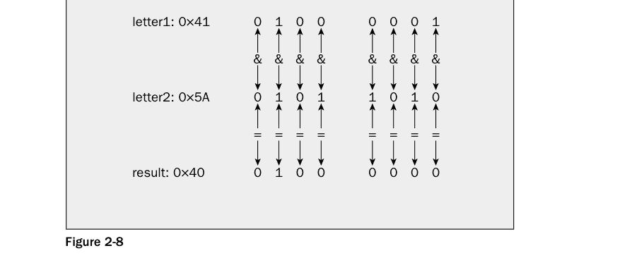

你可以通过查看真值表中对应位如何与 & 组合来确认这一点。赋值后，result 将具有值 0x40，对应字符 '@'。

因为 & 在任一位为零时产生零，你可以使用此运算符确保变量中不需要的位被设为 0。你通过创建所谓的“掩码”并使用 & 与原始变量组合来实现。你通过指定一个值来创建掩码，其中你想保留位的地方为 1，你想将位设为零的地方为 0。将掩码与另一个整数进行 AND 的结果将在掩码位为 0 的地方产生 0 位，而在掩码位为 1 的地方产生与变量中原始位相同的值。假设你有一个类型为 char 的变量 letter，出于说明目的，你想消除高 4 位，但保留低 4 位。这很容易通过设置掩码为 0x0F 并使用 & 将其与 letter 的值组合来实现，如下所示：

```
letter = letter & 0x0F;
```

或，更简洁地：

```
letter &= 0x0F;
```

如果 letter 最初为 0x41，它将因上述任一语句而最终变为 0x01。此操作如图所示 2-9。

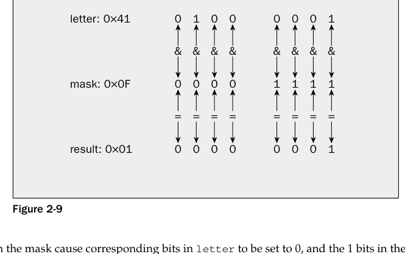

掩码中的 0 位导致 letter 中对应的位被设为 0，而掩码中的 1 位导致 letter 中对应的位保持不变。

同样，你可以使用掩码 0xF0 来保留 4 个高位，并将 4 个低位清零。因此，此语句，

```
letter &= 0xF0;
```

将导致 letter 的值从 0x41 变为 0x40。


## 按位或

按位或 |，有时称为包含或，将对应的位组合，使得当任一操作数位为 1 时结果为 1，而当两个操作数位都为 0 时结果为 0。按位或的真值表为：

| 按位或 | 0 | 1 |
| 0 | 0 | 1 |
| 1 | 1 | 1 |

你可以用一个将单个标志打包到类型为 int 的变量中的示例来练习这一点。假设你有一个名为 style 的类型为 short 的变量，它包含 16 个独立的 1 位标志。假设你还想在变量 style 中设置单个标志。一种方法是定义可与或运算符组合的值，以便打开特定的位。要用于设置最右边的位，可以定义：

```
short vredraw = 0x01;
```

要用于设置倒数第二个位，可以将变量 hredraw 定义为：

```
short hredraw = 0x02;
```

因此，你可以用语句设置变量 style 中最右边的两个位为 1：

```
style = hredraw | vredraw;
```

此语句的效果如图 2-10 所示。

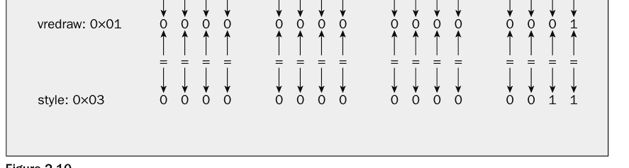

由于或操作在两个位中任一为 1 时结果为 1，因此将两个变量一起或运算会产生两个位都被打开的结果。

一个非常常见的需求是能够在变量中设置标志，而不改变可能在其他地方设置的任何其他标志。你可以用如下语句很容易地做到这一点：

```
style |= hredraw | vredraw;
```

此语句将把变量 style 的最右边两个位设置为 1，而其他位保持执行此语句之前的状态。

## 按位异或

异或 ^ 之所以如此命名，是因为它与包含或类似，但当两个操作数位都为 1 时产生 0。因此，其真值表如下：

| 按位异或 | 0 | 1 |
| 0 | 0 | 1 |
| 1 | 1 | 0 |

使用我们与 AND 一起使用过的相同变量值，你可以查看以下语句的结果：

```
result = letter1 ^ letter2;
```

此操作可以表示为：

```
letter1 0100 0001
```

```
letter2 0101 1010
```

异或在一起产生：

```
result 0001 1011
```

变量 result 被设置为 0x1B，或十进制表示的 27。

^ 运算符有一个相当惊人的特性。假设你有两个 char 变量，first 的值为 'A'，last 的值为 'Z'，对应于二进制值 0100 0001 和 0101 1010。如果写下语句

```
first ^= last;    // 结果 first 为 0001 1011
last ^= first;    // 结果 last 为 0100 0001
first ^= last;    // 结果 first 为 0101 1010
```

结果是 first 和 last 在不使用任何中间存储位置的情况下交换了值。这适用于任何整数值。

## 按位非

按位非 ~，对单个操作数进行位反转：1 变为 0，0 变为 1。因此，如果你执行语句

```
result = ~letter1;
```

如果 letter1 为 0100 0001，变量 result 将具有值 1011 1110，即 0xBE，或十进制值 190。

## 按位移位运算符

这些运算符将整数变量的值向左或向右移动指定的位数。运算符 >> 用于向右移位，而 << 是向左移位的运算符。变量两端“掉落”的位会丢失。图 2-11 显示了将 2 字节变量向左和向右移位的效果，初始值如图所示。

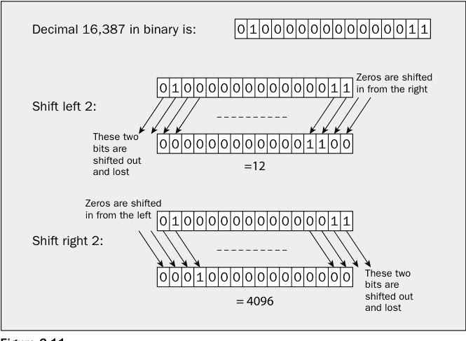

图 2-11

你用语句声明并初始化一个名为 number 的变量：

```
unsigned int number = 16387U;
```

正如你在本章前面看到的，你用字母 U 或 u 后缀于数字来书写无符号整数字面量。你可以用语句将此变量的内容向左移位：

```
number <<= 2;    // 向左移两位
```

## 数据、变量和计算

移位运算符的左操作数是要移位的值，而值要移位的位数由右操作数指定。插图显示了操作的效果。正如你所见，将值 16,387 向左移动两个位置会产生值 12。值的如此剧烈变化是由于最高位在移出时丢失所致。

你也可以将值向右移位。让我们将 number 的值重置为初始值 16,387。然后你可以写：

```
number >>= 2;    // 向右移两位
```

这会将值 16,387 向右移动两个位置，存储值 4,096。向右移两位相当于将值除以 4（无余数）。这也在插图中显示。

只要位没有丢失，向左移 n 位相当于将值乘以 2，n 次。换句话说，相当于乘以 2^n。类似地，向右移 n 位相当于除以 2^n。但要小心：正如你对变量 number 的左移所看到的，如果丢失了重要位，结果与你期望的完全不同。然而，这与乘法运算并无不同。如果你将 2 字节数乘以 4，你会得到相同的结果，因此左移和乘法仍然等价。准确性问题出现是因为乘法结果的值超出了 2 字节整数的范围。

你可能会想象，使用输入和输出的运算符与移位运算符之间会产生混淆。就编译器而言，含义始终从上下文中明确。如果不明确，编译器会生成一条消息，但你需要小心。例如，如果你想输出将变量 number 向左移 2 位的结果，你可以写下以下语句：

```
cout << (number << 2);
```

这里，括号是必不可少的。没有它们，移位运算符将被编译器解释为流运算符，因此你不会得到预期结果；输出将是 number 的值后跟值 2。

总的来说，右移操作与左移类似。例如，假设变量 number 的值为 24，并且你执行以下语句：

```
number >>= 2;
```

这将导致 number 的值为 6，相当于将原始值除以 4。然而，右移操作对负的有符号整数类型有特殊处理（即符号位，即最左边的位，为 1）。在这种情况下，符号位向右传播。例如，声明并初始化一个类型为 char 的变量 number，其十进制值为 -104：

```
char number = -104;    // 二进制表示为 1001 1000
```

现在你可以用操作将其向右移 2 位：

```
number >>= 2;    // 结果 1110 0110
```

结果的十进制值为 -26，因为符号位被重复。对无符号整数类型进行操作时，当然不会重复符号位，而是出现零。

## 理解存储持续时间和作用域

所有变量在程序执行时都有有限的生命周期。它们从声明点开始存在，然后在某个时间点消失——最晚在程序终止时。特定变量的持续时间由称为其存储持续时间的属性决定。变量可以有三种不同的存储持续时间：

- 自动存储持续时间
- 静态存储持续时间
- 动态存储持续时间

变量将具有哪一种取决于你如何创建它。我将把具有动态存储持续时间的变量的讨论推迟到第 4 章，但你将在本章中探索其他两种的特性。

变量的另一个属性是作用域。变量的作用域简单地是指在你的程序中变量名有效的一部分。在变量的作用域内，你可以合法地引用它，以设置其值或在表达式中使用它。在变量的作用域之外，你不能引用其名称——任何尝试都将导致编译器错误。请注意，变量即使在其作用域之外仍然可能存在，尽管你不能按名称引用它。你将在本讨论稍后看到这种情况的示例。

到目前为止你声明的所有变量都具有自动存储持续时间，因此称为自动变量。让我们先仔细看看这些。

## 自动变量

到目前为止你声明的变量都在一个块中声明——即在一对大括号的范围内。这些称为自动变量，据说具有局部作用域或块作用域。自动变量从声明点“在作用域内”直到包含其声明的块的末尾。自动变量占用的空间自动分配在称为栈的内存区域中，该区域专门为此目的而保留。栈的默认大小为 1MB，这对于大多数用途来说是足够的，但如果证明不足，你可以通过将项目的 /STACK 选项设置为你选择的值来增加栈的大小。

自动变量在定义时“诞生”，并在栈上为其分配空间，并在包含变量定义的块结束时自动停止存在。这将在与变量声明前第一个打开大括号匹配的关闭大括号处。每当执行包含自动变量声明的语句块时，变量都会重新创建，如果你为自动变量指定了初始值，它每次创建时都会被重新初始化。当自动变量死亡时，其在栈上的内存将被释放供其他自动变量使用

有一个关键字 auto，你可以用它来指定自动变量，但它很少使用，因为默认情况下是隐含的。以下是我到目前为止讨论的作用域的一个示例。


## 数据、变量和计算

我可以用下面的例子来演示作用域对自动变量的影响：

```cpp
// Ex2_07.cpp
// Demonstrating variable scope
#include <iostream>
using std::cout;
using std::endl;

int main()
{
    int count1 = 10;  // Function scope starts here
    int count3 = 50;
    cout << endl
         << "Value of outer count1 = " << count1
         << endl;
    {
        int count1 = 20;
        int count2 = 30;
        cout << "Value of inner count1 = " << count1
             << endl;
        count1 += 3;
        count3 += count2;
    }
    cout << "Value of outer count1 = " << count1
         << endl
         << "Value of outer count3 = " << count3
         << endl;
    // cout << count2 << endl;  // uncomment to get an error
    return 0;
}
// Function scope ends here
```

该示例的输出为：

```
Value of outer count1 = 10
Value of inner count1 = 20
Value of outer count1 = 10
Value of outer count3 = 80
```

前两条语句声明并定义了两个整数变量 `count1` 和 `count3`，初始值分别为 10 和 50。这两个变量从此处一直存在到程序末尾的闭合大括号。它们的作用域也延伸到 `main()` 末尾的闭合大括号。

请记住，变量的生命周期和作用域是两个不同的概念。不要把这两个概念混淆。生命周期是在执行期间从变量首次创建到被销毁并释放其占用的内存供其他用途使用的期间。变量的作用域是程序代码中可以访问该变量的区域。

在变量定义之后，`count1` 的值会被输出，以产生上面显示的第一行。随后有一个第二个大括号，开始一个新的块。在此块内定义了两个变量 `count1` 和 `count2`，值分别为 20 和 30。此处声明的 `count1` 与第一个 `count1` 不同。第一个 `count1` 仍然存在，但其名称被第二个 `count1` 遮蔽。在内部块声明之后对名称 `count1` 的任何使用都指的是在该块内声明的 `count1`。

我在这里使用变量名 `count1` 的重复只是为了说明会发生什么。虽然此代码是合法的，但通常并不是良好的编程方法。在实际程序中，这会令人困惑，如果你使用重复的名称，很容易意外地隐藏外部作用域中定义的变量。

第二行输出显示的值表明，在内部块中，你使用的是内部作用域中的 `count1` —— 即在最内层大括号内：

```cpp
cout << "Value of inner count1 = " << count1
     << endl;
```

如果你仍然在使用外部的 `count1`，这将显示值 10。然后变量 `count1` 通过以下语句递增：

```cpp
count1 += 3;        // This affects the inner count1
```

递增应用于内部作用域中的变量，因为外部的变量仍然被隐藏。然而，`count3` 在下一个语句中被递增而没有任何问题，该变量是在外部作用域中定义的：

```cpp
count3 += count2;
```

这表明在外部作用域开始处声明的变量可以从内部作用域访问。 （请注意，如果 `count3` 在内部一对大括号的第二个之后声明，那么它仍然在外部作用域内，但在这种情况下，在执行上述语句时 `count3` 不存在。）

在结束内部作用域的大括号之后，`count2` 和内部的 `count1` 不再存在。变量 `count1` 和 `count3` 仍然存在于外部作用域中，所显示的值表明 `count3` 确实在内部作用域中被递增。

如果你取消注释以下行：

```cpp
// cout << count2 << endl;        // uncomment to get an error
```

程序将无法正确编译，因为它尝试输出一个不存在的变量。你会得到类似以下的错误信息

```
c:\microsoft visual studio\myprojects\Ex2_07\Ex2_07.cpp(29) : error C2065: 'count2' : undeclared identifier
```

这是因为在此处 `count2` 已超出作用域。

### 变量声明的位置

你可以在放置变量声明的位置上有很大的灵活性。最重要的是要考虑变量需要的作用域。除此之外，你通常应将声明放在程序中变量首次使用附近。你应该以使其他程序员尽可能容易理解的方式编写程序，而在首次使用点声明变量有助于实现这一点。

可以在构成程序的所有函数之外放置变量声明。下一节将讨论这对相关变量的影响。

### 全局变量

在所有块和类之外声明的变量（我将在本书后面讨论类）称为 **全局变量**，具有 **全局作用域**（也称为 **全局命名空间作用域** 或 **文件作用域**）。这意味着它们在声明点之后可在文件中的所有函数中访问。如果你将它们声明在程序的顶部，它们将可在文件中的任何位置访问。

全局变量默认具有 **静态存储期**。具有静态存储期的全局变量将从程序执行开始一直存在到程序执行结束。如果你没有为全局变量指定初始值，它将默认初始化为 0。全局变量的初始化在 `main()` 的执行开始之前进行，因此它们始终准备好在变量作用域内的任何代码中使用。

图 2-12 显示了源文件 `Example.cpp` 的内容，箭头指示每个变量的作用域。

变量 `value1` 出现在文件开头处，以全局作用域声明，`value4` 出现在函数 `main()` 之后，也以全局作用域声明。每个全局变量的作用域从其定义点延伸到文件末尾。即使 `value4` 在执行开始时存在，也无法在 `main()` 中引用它，因为 `main()` 不在该变量的作用域内。要使 `main()` 使用 `value4`，你需要将其声明移动到文件开头。`value1` 和 `value4` 都将默认初始化为 0，这与自动变量的情况不同。请注意，`function()` 中的局部变量 `value1` 隐藏了同名的全局变量。

```cpp
int main()
{
    int count1 = 10; // Function scope starts here
    int count3 = 50;
    cout << endl;
    cout << "Value of outer count1 = " << count1;
    {
        // New scope starts here...
        int count1 = 20;
        int count2 = 30;
        cout << endl;
        cout << "Value of inner count1 = " << count1;
        count1 += 3; // This affects the inner count1
        count3 += count2;
    }
    cout << endl;
    cout << "Value of outer count1 = " << count1;
    cout << "Value of outer count3 = " << count3;
    // cout << endl << count2; // uncomment to get an error
    cout << endl;
    return 0;
}
```

图 2-12

由于全局变量只要程序在运行就会一直存在，这可能会引发疑问：“为什么不把所有变量都设为全局变量，从而避免处理这些会消失的局部变量的麻烦？”乍一看这似乎很有吸引力，但就像神话中的塞壬一样，存在严重的副作用，完全超过了可能获得的任何优势。

实际程序通常由大量语句、大量函数和大量变量组成。将所有变量声明为全局作用域会大大增加意外错误修改变量的可能性，同时也会使合理命名变得难以处理。它们还将在程序执行期间占用内存。通过将变量保持在函数或块的局部，你可以确保它们几乎完全免受外部影响，它们将仅从定义点到包含块末尾存在并占用内存，整个开发过程也变得更容易管理。

如果你查看 IDE 窗口右侧的类视图窗格中到目前为止创建的任何示例的项目，并通过单击 + 展开类树，你会看到一个名为 Global Functions and Variables 的条目。单击它后，你会看到程序中所有已声明内容列表。这将包括所有全局函数以及你声明的任何全局变量。


# 试一试   作用域解析运算符

正如你所见，一个全局变量可以被同名局部变量隐藏。然而，仍然可以通过使用作用域解析运算符（::）来访问全局变量，你在第 1 章讨论命名空间时见过它。我可以用上一个示例的修订版本来演示其工作原理：

// Ex2_08.cpp
// Demonstrating variable scope
#include <iostream>

using std::cout;
using std::endl;

int count1 = 100;                     // Global version of count1

int main()
{
    // Function scope starts here
    int count1 = 10;
    int count3 = 50;
    cout << endl
         << "Value of outer count1 = " << count1
         << endl;
    cout << "Value of global count1 = " << ::count1      // From outer block
         << endl;

    {
        // New scope starts here...
        //This hides the outer count1
        int count1 = 20;
        int count2 = 30;
        cout << "Value of inner count1 = " << count1
             << endl;
        cout << "Value of global count1 = " << ::count1      // From inner block
             << endl;

        count1 += 3;               // This affects the inner count1
        count3 += count2;          // ...and ends here.
    }

    cout << "Value of outer count1 = " << count1
         << endl
         << "Value of outer count3 = " << count3
         << endl;

    //cout << count2 << endl;      // uncomment to get an error

    return 0;
}                                   // Function scope ends here
```

如果你编译并运行这个示例，你会得到以下输出：

```
Value of outer count1 = 10
Value of global count1 = 100
Value of inner count1 = 20
```

```
Value of global count1 = 100
Value of outer count1 = 10
Value of outer count3 = 80
```

阴影代码行表示我对前一个示例所做的更改；我只需要讨论这些更改的影响。 在函数 main() 定义之前声明的 count1 是全局的，因此原则上它在函数 main() 中的任何地方都可用。 这个全局变量被初始化为 100：

```
int count1 = 100;                      // Global version of count1
```

然而，你在 main() 内定义了另外两个名为 count1 的变量，因此在整个程序中，全局 count1 被局部 count1 变量隐藏。 第一个新的输出语句是：

```
cout << "Value of global count1 = " << ::count1        // From outer block
    << endl;
```

这使用了作用域解析运算符（::）来明确告诉编译器你想要引用全局变量 count1，而不是局部变量。 你可以从输出中显示的值看出这一点。

在内部块中，全局 count1 被两个名为 count1 的变量隐藏：内部 count1 和外部 count1。 我们可以在内部块中看到全局作用域解析运算符发挥作用，正如我们在那里添加的语句生成的输出所示：

```
cout << "Value of global count1 = " << ::count1        // From inner block
    << endl;
```

这输出的值为 100，与之前一样 — 以这种方式使用的作用域解析运算符的长臂总是到达全局变量。

> 你之前看到过，你可以通过将名称与命名空间名称限定，例如 std::cout 或 std::endl，来引用 std 命名空间中的名称。 编译器会在作用域解析运算符左操作数指定的命名空间中搜索你作为右操作数指定的名称。 在前面的示例中，你正在使用作用域解析运算符在全局命名空间中搜索变量 count1。 通过不在运算符前面指定命名空间名称，你是在告诉编译器在全局命名空间中搜索其后的名称。

当你进入第 9 章探索面向对象编程时，你会看到更多这个运算符的使用，在那里它被广泛使用。

## 静态变量

可以想象，你可能想要一个在局部定义和可访问的变量，但它在退出声明它的块后仍然存在。 换句话说，你需要在块作用域内声明一个变量，但要赋予它静态存储期。 static 说明符为你提供了这样做的手段，并且当我们在第 5 章处理函数时，这种需求会变得更加明显。

事实上，静态变量将在程序的生命周期内继续存在，即使它是在块内声明的并且只能从该块（或其子块）内访问。 它仍然具有块作用域，但具有静态存储期。 要声明一个名为 count 的静态整数变量，你可以写：

```
static int count;
```

如果你在声明静态变量时没有提供初始值，它会为你初始化。 这里声明的变量 count 将被初始化为 0。 静态变量的默认初始值始终为 0，转换为适用于该变量的类型。 请记住，自动变量并非如此。

> 如果你没有初始化自动变量，它们将包含上一个使用它们所占内存的程序留下的垃圾值。

## 命名空间

我多次提到命名空间，所以是时候让你更好地了解它们了。 它们未在支持 MFC 的库中使用，但支持 CLR 和 Windows 窗体的库大量使用命名空间，当然 ANSI C++ 标准库也是如此。

你已经知道 ISO/ANSI C++ 标准库中使用的所有名称都在名为 std 的命名空间中定义。 这意味着标准库中使用的所有名称都有一个额外的限定名称 std，因此例如 cout 实际上是 std::cout。 你可以在一个简单的示例中看到完全限定的名称的使用：

// Ex2_09.cpp
// Demonstrating namespace names
#include <iostream>

    int value = 0;

int main()
{
    std::cout << "enter an integer: ";
    std::cin  >> value;
    std::cout << "\nYou entered " << value
              << std::endl;
    return 0;
}
```

变量 value 的声明在 main() 的定义之外。 该声明被称为在全局命名空间作用域，因为变量声明没有出现在命名空间内。 该变量可以从 main() 内的任何位置以及同一源文件中可能拥有的任何其他函数定义中访问。 我只是把 value 的声明放在 main() 之外，以便在下一节中演示它如何位于命名空间中。

注意 cout 和 endl 的 using 声明的缺失。 在这种情况下并非必要，因为你正在完全限定从命名空间 std 使用的名称。 这很愚蠢，但你可以在这里使用 cout 作为整数变量的名称，并且不会有混淆，因为 cout

你不能在函数内部声明命名空间。 它 intended 的使用方式是相反的；你使用命名空间来包含程序中的函数、全局变量和其他命名实体，如类。 你不能把 main() 的定义放在命名空间中。 执行开始的函数 main() 必须始终位于全局命名空间作用域，否则编译器不会识别它。

```cpp
// Ex2_10.cpp
// Declaring a namespace
#include <iostream>

namespace myStuff
{
	int value = 0;
}

int main()
{
	std::cout << "enter an integer: ";
	std::cin >> myStuff::value;
	std::cout << "\nYou entered " << myStuff::value
	<< std::endl;
	return 0;
}
```

myStuff 命名空间定义了一个作用域，命名空间作用域内的所有内容都用命名空间名称限定。 要从命名空间外部引用在命名空间内声明的名称，你必须用命名空间名称限定它。 在命名空间作用域内，可以在不加限定地引用其中声明的任何名称 — 它们都是同一个家族的一部分。 现在你必须用 myStuff，即我们的命名空间的名称，来限定名称 value。 如果不这样做，程序将无法编译。 函数 main() 现在引用了两个不同命名空间中的名称，通常你的程序中可以有任意多的命名空间。 你可以通过添加 using 指令来消除限定 value 的需要：

```cpp
// Ex2_11.cpp
// Using a using directive
#include <iostream>

namespace myStuff
{
	int value = 0;
}

using namespace myStuff; // Make all the names in MyStuff available

int main()
{
	std::cout << "enter an integer: ";
	std::cin >> value;
	std::cout << "\nYou entered " << value
	<< std::endl;
	return 0;
}
```


你也可以为 std 添加一个 using 指令，这样就不需要限定标准库名称了，但这违背了命名空间的初衷。一般来说，如果你在程序中使用命名空间，就不应该在程序各处添加 using 指令；否则，你一开始就没必要使用命名空间。话虽如此，为了让代码更简洁、更易于阅读，我们将在所有示例中为 std 添加一个 using 指令。当你开始学习一种新的编程语言时，你可以不需要这些冗余，无论它们在实践中多么有用。

## 多个命名空间

一个真实世界的程序很可能涉及多个命名空间。你可以对给定名称的命名空间进行多次声明，并且所有具有给定名称的命名空间块的内容都在同一个命名空间中。例如，你可能有一个包含两个命名空间的程序文件：

```
namespace sortStuff
{
    // Everything in here is within sortStuff namespace
}
```

```
namespace calculateStuff
{
    // Everything in here is within calculateStuff namespace
    // To refer to names from sortStuff they must be qualified
}
```

```
namespace sortStuff
{
    // This is a continuation of the namespace sortStuff
    // so from here you can refer to names in the first sortStuff namespace
    // without qualifying the names
}
```

对给定名称的命名空间的第二次声明只是对第一次的延续，因此你可以从第二个命名空间块中引用第一个命名空间块中的名称，而无需限定它们。它们都在同一个命名空间中。当然，你通常不会故意以这种方式组织源文件，但在使用包含到程序中的头文件时，它可能会自然地出现。例如，你可能有这样的情况：

```
#include <iostream>      // Contents are in namespace std
#include "myheader.h"      // Contents are in namespace myStuff
#include <string>           // Contents are in namespace std

// and so on...
```

这里，<iostream> 和 string 是 ISO/ANSI C++ 标准库头文件，而 myheader.h 代表包含我们程序代码的头文件。你对命名空间的情况与之前的插图完全平行。

这给了你一个关于命名空间如何工作的基本概念。命名空间比我在这里讨论的要多得多，但如果你掌握了这一部分，你应该能够在需要时毫无困难地了解更多。

请注意，前一段代码片段中的两种 #include 指令形式会导致编译器以不同的方式搜索文件。当你将要包含的文件指定在尖括号之间时，你是在指示编译器沿着 /I 编译器选项指定的路径搜索文件，如果失败则沿着 INCLUDE 环境变量指定的路径搜索。这些路径定位 C++ 库文件，这就是为什么这种形式保留给库头文件的原因。INCLUDE 环境变量指向存放库头的文件夹，而 /I 选项允许指定包含库头的额外目录。当文件名在双引号之间时，编译器将搜索包含 #include 指令的文件所在的文件夹。如果找不到文件，它将搜索包含当前文件的任何目录。如果仍然找不到文件，它将搜索库目录。

### C++/CLI 编程

C++/CLI 为我到目前为止在本章中讨论的内容提供了许多扩展和额外功能。我将首先在进入细节之前总结这些额外功能。额外的 C++/CLI 功能是：

- 所有 ISO/ANSI 基本数据类型都可以在 C++/CLI 程序中使用，正如我所描述的那样，但在某些上下文中它们具有一些额外的属性，我将对此进行说明。
- C++/CLI 为控制台程序中的命令行提供了自己的键盘输入和输出机制。
- C++/CLI 引入了 safe_cast 运算符，可确保类型转换操作生成可验证的代码。
- C++/CLI 提供了基于类的替代枚举功能，其灵活性比你见过的 ISO/ANSI C++ enum 声明更高。

你将在第 4 章开始学习 CLR 引用类类型，但由于我已经为原生 C++ 引入了全局变量，我现在要提到，CLR 引用类类型的变量不能是全局变量。

我将首先从 C++/CLI 中的基本数据类型开始。

## C++/CLI 特定：基本数据类型

你可以在 C++/CLI 程序中使用 ISO/ANSI C++ 基本数据类型名称，并且在算术运算中它们的工作方式与你在原生 C++ 中看到的完全相同。此外 C++/CLI 定义了两种额外的整数类型：

| Type | Bytes | Range of Values |
|---|---|---|
| long long | 8 | From 9,223,372,036,854,775,808 to 9,223,372,036,854,775,807 |
| unsigned long long | 8 | From 0 to 18,446,744,073,709,551,615 |

# 第 2 章

要指定 long long 类型的字面量，你在整数值后附加 LL 或小写 ll。例如：

```
long long big = 123456789LL;
```

unsigned long long 类型的字面量，你在整数值后附加 ULL 或 ull：

```
unsigned long long huge = 999999999999999ULL;
```

虽然所有基本类型的所有操作在 C++/CLI 中以相同的方式工作，但在 C++/CLI 程序中，基本类型名称具有不同的含义，并在某些情况下引入了额外的功能。C++/CLI 程序中的基本类型是值类类型，可以根据需要表现得像普通值或像对象。

在 C++/CLI 语言内部，每个 ISO/ANSI 基本类型名称都映射到 System 命名空间中定义的值类类型。因此，在 C++/CLI 程序中，ISO/ANSI 基本类型名称是其关联值类类型的简写。这使得基本类型的值可以简单地作为值处理，或在必要时自动转换为其关联值类类型的对象。基本类型、它们占用的内存以及相应的值类类型显示在下表中：

| Fundamental Type | Size(bytes) | CLI Value Class |
| --- | --- | --- |
| bool | 1 | System::Boolean |
| char | 1 | System::SByte |
| signed char | 1 | System::SByte |
| unsigned char | 1 | System::Byte |
| short | 2 | System::Int16 |
| unsigned short | 2 | System::UInt16 |
| int | 4 | System::Int32 |
| unsigned int | 4 | System::UInt32 |
| long | 4 | System::Int32 |
| unsigned long | 4 | System::UInt32 |
| long long | 8 | System::Int64 |
| unsigned long long | 8 | System::UInt64 |
| float | 4 | System::Single |
| double | 8 | System::Double |
| long double | 8 | System::Double |
| wchar_t | 2 | System::Char |

默认情况下，类型 char 等同于 signed char，因此关联的值类类型是 System::SByte。请注意，你可以通过设置编译器选项 /J 将 char 的默认值更改为 unsigned char，在这种情况下，关联的值类类型将为 System::Byte。System 是定义 C++/CLI 值类类型的根命名空间名称。System 命名空间中定义了许多其他类型，例如用于表示字符串的类型 String，你将在第 4 章中遇到。C++/CLI 还在 System 命名空间中定义了 System::Decimal 值类类型，Decimal 类型的变量存储具有 28 位十进制数字精度的精确十进制值。

正如我所说，每个基本类型名称关联的值类类型为此类变量在 C++/CLI 中添加了重要的额外功能。根据需要，编译器将安排从原始值到关联类类型的自动转换，反之亦然；这些过程分别称为装箱和拆箱。这允许任何这些类型的变量根据情况表现得像简单值或像对象。你将在第 6 章中了解何时以及如何发生这种情况。

由于 ISO/ANSI C++ 基本类型名称是 C++/CLI 程序中值类类型名称的别名，原则上你可以在 C++/CLI 代码中使用两者。例如，你已经知道可以这样编写创建整数和浮点变量的语句：

```
int count = 10;
double value = 2.5;
```

你可以使用与基本类型名称相对应的值类名称，程序也可以毫无问题地编译，像这样：

```
System::Int32 count = 10;
System::Double value = 2.5;
```

虽然这是完全合法的，但你应该在代码中使用 int 和 double 等基本类型名称，而不是 System::Int32 和 System::Double 等值类名称。原因是，我所描述的基本类型名称与值类类型的映射适用于 Visual C++ 2005 编译器；其他编译器不必实现相同的映射。基本类型名称由 C++/CLI 语言标准固定，但对于大多数类型，映射到值类类型是实现相关的。Visual C++ 2005 中的类型 long 映射到类型 Int32，但它完全可能在某些其他实现中映射到类型 Int64。

将基本类型的数据表示为值类类型的对象是 C++/CLI 的一个重要特性。在 ISO/ANSI C++ 中，基本类型和类类型是完全不同的，而在 C++/CLR 中，所有数据都存储为类类型的对象，要么是值类类型，要么是引用类类型。你将在第 7 章学习引用类类型。

接下来，你将尝试一个 CLR 控制台程序。

## 试一试  一个水果 CLR 控制台程序

创建一个新项目并选择项目类型为 CLR，模板为 CLR 控制台应用程序。然后你可以将项目名称输入为 Ex2_12，如图 2-13 所示。


# 第 2 章：数据、变量和计算

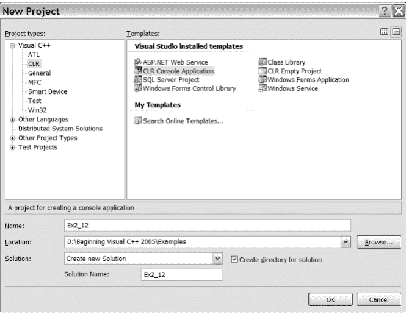

图 2-13

当你单击“确定”按钮时，应用程序向导将生成包含以下代码的项目：

```
// Ex2_12.cpp : main project file.

#include "stdafx.h"

using namespace System;

int main(array<System::String ^> ^args)
{
    Console::WriteLine(L"Hello World");
    return 0;
}
```

我相信你已经注意到 main 后面的括号之间有额外的内容。这与从命令行开始执行程序时向函数 main() 传递值有关，你将在后面详细介绍函数时学到更多相关内容。如果编译并执行默认项目，它会向命令行写入 “Hello World”。现在，你将把这个程序转换为 Ex2_02 的 CLR 版本，以便看到它们之间的相似之处。为此，你可以按如下方式修改 Ex2_12.cpp 中的代码：

```
// Ex2_12.cpp : main project file.
#include "stdafx.h"

using namespace System;

int main(array<System::String ^> ^args)
{
    int apples, oranges; // Declare two integer variables
    int fruit; // ...then another one
    apples = 5; oranges = 6; // Set initial values
    fruit = apples + oranges; // Get the total fruit
    Console::WriteLine(L"\nOranges are not the only fruit...");
    Console::Write(L"- and we have ");
    Console::Write(fruit);
    Console::Write(L" fruits in all.\n");
    return 0;
}
```

新增的行以阴影显示，下方代码块中的行替换了自动生成的 main() 版本中的两行。现在你可以编译并执行该项目。程序应产生以下输出：

```
Oranges are not the only fruit...
- and we have 11 fruits in all.
```

唯一显著的差异在于输出的生成方式。变量的定义和计算是相同的。尽管你使用的类型名称与示例的 ISO/ANSI C++ 版本相同，但效果并不相同。变量 apples、oranges 和 fruit 将采用 C++/CLI 的 int 类型（也就是由 int 类型指定的类型），与 ISO/ANSI 类型相比，它们具有一些额外的能力。这里的变量在某些情况下可以充当对象，也可以像这里一样用作简单值。如果你想确认 Int32 在这种情况下是否与 int 相同，可以将 int 类型名称替换为 Int32 并重新编译该示例。它的工作方式应该完全一样。

```
Console::WriteLine(L"\nOranges are not the only fruit...");
```

WriteLine() 函数是一个 C++/CLI 函数，定义在 System 命名空间的 Console 类中。你将在第 6 章详细了解类，但就目前而言，Console 类表示标准输入和输出流，分别对应于命令行窗口中的键盘和命令行。因此，WriteLine() 函数将函数名后面括号中的内容写入命令行，然后写入一个换行符，将光标移动到下一行，为下一次输出操作做好准备。因此，前面的语句会将双引号之间的文本 “Oranges are not the only fruit...” 写入命令行。字符串前面的 L 表示它是一个宽字符串，其中每个字符占用两个字节。

Console 类中的 Write() 函数与 WriteLine() 函数基本相同，唯一区别是它不会在你指定的输出之后自动写入换行符。因此，当你希望在多个独立的输出语句中将两项或更多数据写入同一行时，可以使用 Write() 函数。

```
referenced by:          0    1    2    etc.
Console::WriteLine("Format string", arg2, arg3, arg4,... );
```

因此，前一个代码片段中花括号之间的 0 表示 packageCount 参数的值应替换要写入命令行的字符串中的 {0}。

如果想同时输出重量和包的数量，可以这样写：

```
int packageCount = 25;
double packageWeight = 7.5;
Console::WriteLine(L"There are {0} packages weighing {1} pounds.",
                    packageCount,
                    packageWeight);
```

该输出语句现在有三个参数，第二个和第三个参数分别由花括号之间的 0 和 1 引用。因此，这将产生以下输出：

```
There are 25 packages weighing 7.5 pounds.
```

你也可以将最后两个参数按相反顺序编写该语句，如下所示：

```
Console::WriteLine(L"There are {1} packages weighing {0} pounds.",
                    packageWeight,
                    packageCount);
```

现在，在格式字符串中，packageWeight 变量由 0 引用，packageCount 由 1 引用，输出结果将与之前相同。

你还可以指定数据在命令行上的显示方式。假设你希望浮点值 packageWeight 输出时保留两位小数。可以使用以下语句实现：

```
Console::WriteLine(L"There are {0} packages weighing {1:F2} pounds.",
                    packageCount, packageWeight);
```

在子字符串 {1:F2} 中，冒号将索引值 1（用于标识要选择的参数）与后面的格式规范 F2 分隔开。格式规范中的 F 表示输出应采用 “ddd.dd...” 的形式（其中 d 代表一位数字），而 2 表示小数点后要有两位小数。该语句产生的输出将是：

```
There are 25 packages weighing 7.50 pounds.
```

通常，你可以以 {n,w:Axx} 的形式编写格式规范，其中 n 是选择格式字符串后面参数的索引值，w 是可选的字段宽度规范，A 是指定值格式的单个字母，xx 是可选的表示数值精度的一或两位数字。字段宽度规范是一个有符号整数。如果 w 为正，则值在字段中右对齐；如果 w 为负，则左对齐。如果值占用的位数少于 w 指定的位置数，输出将用空格填充；如果值所需的位置数多于 w 指定的位置数，则宽度规范将被忽略。下面是另一个示例：

```
Console::WriteLine(L"Packages:{0,3} Weight: {1,5:F2} pounds.",
                    packageCount, packageWeight);
```

包的数量以字段宽度 3 输出，重量以字段宽度 5 输出，因此输出将是：

```
Packages: 25 Weight:  7.50 pounds.
```

还有其他格式说明符，可以让你以不同方式呈现各种类型的数据。以下是一些最常用的格式规范：

| 格式说明符 | 说明 |
|---|---|
| C 或 c | 将值输出为货币金额。 |
| D 或 d | 将整数输出为十进制值。如果指定的精度大于数字的位数，则数字左侧将用零填充。 |
| E 或 e | 以科学计数法输出浮点值，即带指数。精度值表示小数点后要输出的数字位数。 |
| F 或 f | 以定点数形式输出浮点值，形式为 ±dddd.dd....。 |
| G 或 g | 根据值的类型以及是否指定精度，以最紧凑的形式输出值。如果未指定精度，将使用默认精度值。 |
| N 或 n | 以定点十进制值输出，必要时在每个三位数字组之间使用逗号分隔符。 |
| X 或 x | 将整数输出为十六进制值。根据指定的是 X 还是 x，将输出大写或小写的十六进制数字。 |

以上内容足以让你在输出方面有了初步的基础，从而继续学习更多的 C++/CLI 示例。现在，你将快速看一下其中一些内容在实际中的运用。

### 试一试：格式化输出

下面是一个计算地毯价格的示例，用于演示 CLR 控制台程序中的输出：

```
// Ex2_13.cpp : main project file.
// Calculating the price of a carpet
#include "stdafx.h"

using namespace System;

int main(array<System::String ^> ^args)
{
    double carpetPriceSqYd = 27.95;
    double roomWidth = 13.5;            // In feet
    double roomLength = 24.75;          // In feet
    const int feetPerYard = 3;
```


```
double roomWidthYds = roomWidth/feetPerYard;
double roomLengthYds = roomLength/feetPerYard;
double carpetPrice = roomWidthYds*roomLengthYds*carpetPriceSqYd;

Console::WriteLine(L"Room size is {0:F2} yards by {1:F2} yards", roomLengthYds, roomWidthYds);
Console::WriteLine(L"Room area is {0:F2} square yards", roomLengthYds*roomWidthYds);
Console::WriteLine(L"Carpet price is ${0:F2}", carpetPrice);
return 0;
}
```

The output should be:

```
Room size is 8.25 yards by 4.50 yards
Room area is 37.13 square yards
Carpet price is $1037.64
Press any key to continue . . .
```

## How It Works

房间尺寸以英尺为单位指定，而地毯的价格按每平方码计价，因此你定义了一个常量 feetPerYard，用于将英尺转换为码的转换。在将每个尺寸转换的表达式中，你是将类型为 double 的值除以类型为 int 的值。编译器会插入代码，在执行乘法之前先将类型为 int 的值转换为类型为 double。转换房间尺寸为码后，你通过将码为单位的尺寸相乘得到平方码的面积，再乘以每平方码的价格来计算地毯的价格。

输出语句使用 F2 格式规范将输出值限制为两位小数。如果没有它，输出中会有更多的小数位，这是不合适的，尤其是对于价格。你可以尝试移除格式规范来看看区别。

请注意，输出面积的语句将算术表达式作为 WriteLine() 函数的第二个参数。编译器会安排先计算表达式，然后将结果作为实际参数传递给函数。一般来说，只要计算表达式的结果类型与函数参数类型一致，你就可以始终使用表达式作为函数的参数。

## C++/CLI Input from the Keyboard

在 .NET Framework 控制台程序中，你的键盘输入功能是有限的。你可以使用 Console::ReadLine() 函数作为字符串读取整行输入，或使用 Console::Read() 函数读取单个字符。你也可以使用 Console::ReadKey() 函数读取按下了哪个键。

你会这样使用 Console::ReadLine() 函数：

```
String^ line = Console::ReadLine();
```

# Chapter 2

这会读取以按下 Enter 键为终止的整行输入文本。变量 line 的类型为 String^，并存储对执行 Console::ReadLine() 函数后得到字符串的引用；类型名称 String 后面的小帽字符 ^ 表示这是一个引用 String 类型对象的句柄。你将在第 4 章了解更多关于 String 类型和 String 对象的句柄。

读取键盘上单个字符的语句如下所示：

```
char ch = Console::Read();
```

使用 Read() 函数，你可以逐字符读取输入数据，然后分析读取的字符并将输入转换为相应的数值。

Console::ReadKey() 函数以类型为 ConsoleKeyInfo 的对象形式返回按下的键，ConsoleKeyInfo 是在 System 命名空间中定义的值类类型。以下是读取按键的语句：

```
ConsoleKeyInfo keyPress = Console::ReadKey(true);
```

ReadKey() 函数的参数 true 会导致按键不会在命令行上显示。参数值为 false 或省略参数会使按键对应的字符显示。执行函数的结果将存储在 keyPress 中。要识别按键对应的字符，你使用表达式 keyPress.KeyChar。因此，你可以用以下语句输出与按键相关的消息：

```
Console::WriteLine(L"The key press corresponds to the character: {0}",
    keyPress.KeyChar);
```

按下的键由表达式 keyPress.Key 标识。该表达式引用 C++/CLI 枚举的值，该枚举标识按下的键，你很快就会了解它。ConsoleKeyInfo 对象还有更多内容，我已描述过。你将在书中稍后再次遇到它。

虽然在 C++/CLI 控制台程序中没有格式化输入在学习时有点不便，但在实践中这是一个很小的限制。你很可能编写的几乎所有真实世界的程序都会通过窗口组件接收输入，因此你通常不需要从命令行读取数据。

## Using safe_cast

safe_cast 操作用于 CLR 环境中的显式转换。在大多数情况下，你可以在 C++/CLI 程序中使用 static_cast 在一种类型和另一种类型之间转换而不会出现问题，但由于存在会导致错误消息的例外情况，最好使用 safe_cast。你使用 safe_cast 的方式与使用 static_cast 完全相同。例如：

```
double value1 = 10.5;
double value2 = 15.5;
int whole_number = safe_cast<int>(value1) + safe_cast<int>(value2);
```

## Data, Variables, and Calculations

最后一条语句在将它们相加并将结果存储在 whole_number 之前，先将类型为 double 的每个值转换为类型为 int。

### C++/CLI Enumerations

C++/CLI 程序中的枚举与 ISO/ANSI C++ 程序中的枚举有很大不同。首先你在 C++/CLI 中定义枚举的方式略有不同：

```
```cpp
enum class Suit{ Clubs, Diamonds, Hearts, Spades };
```
```

这定义了枚举类型 Suit，类型为 Suit 的变量只能分配枚举中定义的值之一 — Hearts、Clubs、Diamonds 或 Spades。当你访问 C++/CLI 枚举中的常量时，必须始终用枚举类型名称限定你使用的常量。例如：

```
```cpp
Suit suit = Suit::Clubs;
```
```

该语句将来自 suit 枚举的值 Clubs 分配给名为 suit 的变量。: : 将类型名称 Suit 与枚举常量名称 Clubs 分开的是作用域解析操作，表示 Clubs 存在于 Suit 枚举的作用域内。

请注意枚举定义中 enum 关键字后使用的 class 关键字。这在 ISO/ANSI C++ 枚举的定义中不会出现，它标识该枚举为 C++/CLI。它还暗示了与 ISO/ANSI C++ 枚举的另一个区别；这里的常量 — Hearts、Clubs、Diamonds 等 — 是对象，而不是像 ISO/ANSI C++ 版本那样简单的基础类型值。事实上，默认情况下它们是类型为 Int32 的对象，因此每个对象都封装了一个类型为 int 的值；然而，在尝试将它们用作此类值之前，你必须将常量转换为类型 int。

由于 C++/CLI 枚举是类类型，你不能在函数内等局部位置定义它，因此如果你想在 main() 中使用此类枚举，例如，你需要在全局作用域定义它。

这可以通过一个例子很容易看出。

## Try It Out

### Defining a C++/CLI Enumeration

```
```cpp
// Ex2_14.cpp : main project file.
// Defining and using a C++/CLI enumeration.
#include "stdafx.h"
using namespace System;

// Define the enumeration at global scope
enum class Suit{ Clubs, Diamonds, Hearts, Spades };

int main(array<System::String ^> ^args)
```

## Specifying a Type for Enumeration Constants

C++/CLI 枚举中的常量可以是以下任何类型：

short int long long long signed char char unsigned unsigned unsigned unsigned unsigned bool short int long long long char

要为枚举中的常量指定类型，你在枚举类型名称之后写入类型，但用冒号与之分隔，就像原生 C++ enum 一样。例如，要将枚举常量类型指定为 char，你可以写：

```
enum class Face : char {Ace, Two, Three, Four, Five, Six, Seven, Eight, Nine, Ten, Jack, Queen, King};
```

该枚举中的常量将为 Char 类型，其底层基本类型为 char 类型。第一个常量默认对应代码值 0，后续值按顺序分配。要获取底层值，你必须显式将值转换为该类型。

## Specifying Values for Enumeration Constants

你不必接受底层值的默认值。你可以显式为枚举定义的所有或部分常量分配值。例如：

```
enum class Face : char {Ace = 1, Two, Three, Four, Five, Six, Seven, Eight, Nine, Ten, Jack, Queen, King};
```

这将导致 Ace 的值为 1，Two 的值为 2，依此类推，King 的值为 13。如果你希望值反映相对花牌值且 Ace 为大，你可以这样写枚举：

```
enum class Face : char {Ace = 14, Two = 2, Three, Four, Five, Six, Seven, Eight, Nine, Ten, Jack, Queen, King};
```

在这种情况下，Two 将为 2，后续常量将按顺序取值，因此 King 仍为 13。Ace 为 14，即你显式分配的值。

分配给枚举常量的值不必唯一。这提供了使用常量的值来传达一些附加属性的可能性。例如：

```
enum class WeekDays : bool { Mon =true, Tues = true, Wed = true, Thurs = true, Fri = true, Sat = false, Sun = false };
```

这定义了枚举 WeekDays，其中枚举常量为 bool 类型。底层值已被分配以标识哪些代表工作日，哪些代表休息日。


## 摘要

在本章中，我介绍了 C++ 计算的基础知识。你已经学习了该语言提供的所有基本数据类型，以及直接操作这些类型的所有运算符。到目前为止我所讨论的内容的要点如下：

- C++ 程序至少包含一个名为 `main()` 的函数。
- 函数的可执行部分由大括号包围的语句组成。
- C++ 中的语句以分号结尾。
- C++ 中的命名对象，例如变量或函数，可以由字母和数字的序列组成，其中第一个为字母，下划线被视为字母。大写和小写字母有区别。
- 你在程序中命名的所有对象，例如变量，必须没有与 C++ 中的任何保留字重名。C++ 中完整的保留字集合见附录 A。
- C++ 中的所有常量和变量都有给定类型。ISO/ANSI C++ 中的基本类型为 `char`、`int`、`long`、`float` 和 `double`。C++/CLI 还定义了类型 `Int16`、`Int32` 和 `Int64`。
- 变量的名称和类型在以分号结尾的声明语句中定义。变量在声明时也可以赋予初始值。
- 你可以使用 `const` 修饰符来保护基本类型变量的值。这将防止程序中直接修改该变量，并在常量值被更改的任何地方给出编译器错误。
- 默认情况下，变量是自动的，这意味着它仅从声明点存在到其定义的作用域结束，由声明之后对应的闭合大括号表示。
- 变量可以声明为 `static`，在这种情况下它会一直存在到程序结束。它只能在其定义的作用域内访问。
- 变量可以在程序的所有块之外声明，在这种情况下它们具有全局命名空间作用域。具有全局命名空间作用域的变量在整个程序中都可访问，除非存在同名的局部变量。即使如此，也仍可通过使用作用域解析运算符来访问它们。
- 命名空间定义了一个作用域，其中在其内部声明的每个名称都由命名空间名称限定。从命名空间外部引用名称时需要限定名称。
- ISO/ANSI C++ 标准库包含可在程序中使用的函数和运算符。它们包含在命名空间 `std` 中。C++/CLI 库的根命名空间名称为 `System`。命名空间中的单个对象可以通过使用作用域解析运算符用命名空间名称限定对象名称来访问，或者你可以为命名空间中的名称提供 `using` 声明。
- lvalue 是可以出现在赋值左手边的对象。非 `const` 变量是 lvalue 的示例。
- 你可以在表达式中混合不同类型的变量和常量，但在必要时它们会被自动转换为通用类型。赋值右手边的类型也会在必要时转换为左手边的类型。这可能导致信息丢失，当左手边类型无法包含右手边类型的信息时就会发生这种情况，例如 `double` 转换为 `int`，或 `long` 转换为 `short`。
- 你可以显式地将表达式的值转换为另一种类型。当转换可能丢失信息时，你应始终进行显式转换。也有一些情况需要指定显式转换才能得到你想要的结果。
- 关键字 `typedef` 允许你为其他类型定义同义词。

尽管我已经讨论了所有基本类型，但不要误以为这就是全部。随着你将看到的内容，基于基本集合还有更复杂的类型，最终你将创建自己的原始类型。

从本章可以看出，编写 C++/CLI 程序时你可以采用三种编码策略：

- 你应使用基本类型名称作为变量，但请记住在 C++/CLI 程序中它们实际上是值类类型名称的同义词。当你了解更多关于类的知识时，其重要性会更加明显。
- 你应在 C++/CLI 代码中使用 `safe_cast` 而不是 `static_cast`。区别在转换类对象时更为重要，但如果你养成使用 `safe_cast` 的习惯，通常可以确保避免问题。
- 你应在 C++/CLI 中使用 `enum class` 来声明枚举类型。

## 练习

你可以从 http://www.wrox.com 下载本书示例的源代码以及以下练习的解决方案。

1. 编写一个 ISO/ANSI C++ 程序，提示用户输入一个数字，然后使用整数作为局部变量将其打印出来。

2. 编写一个程序，从键盘读取一个整数值到类型为 `int` 的变量中，并使用其中一个按位运算符（即不是 `%` 运算符！）来确定除以 8 时的正余数。例如，29 = (3 × 8) + 5 且 -14 = (-2 × 8) + 2 的正余数分别为 5 和 2。

3. 完全加括号以下表达式，以显示优先级和结合性：

```
1 + 2 + 3 + 4
16 * 4 / 2 * 3
a > b ? a : c > d ? e : f
a & b && c & d
```

## 决策与循环

在本章中，你将了解如何为 C++ 程序添加决策能力。你还将学习如何使程序重复执行一组操作，直到满足特定条件。这将使你能够处理可变数量的输入，以及对读取的数据进行有效性检查。你还将能够编写根据输入数据调整其操作的程序，并处理逻辑对解决方案至关重要的问题。到本章结束时，你将学到：

- 如何比较数据值
- 如何根据结果改变程序执行的顺序
- 如何应用逻辑运算符和表达式
- 如何处理多选情况
- 如何在程序中编写和使用循环

我将从编程中最强大和最基本的工具之一开始：能够将变量和表达式与其它变量和表达式进行比较，并根据结果执行一组语句或另一组语句的能力。

### 比较值

除非你想凭空做决定，否则你需要一种比较事物的机制。这涉及一些新的运算符，称为关系运算符。因为计算机中的所有信息最终都由数值表示（在上一章你看到字符信息是如何由数字代码表示的），比较数值是几乎所有决策的本质。你有六个用于比较两个值的根本运算符可用：

| 运算符 | 含义 | 运算符 | 含义 |
| --- | --- | --- | --- |
| `<` | 小于 | `<=` | 小于或等于 |
| `>` | 大于 | `>=` | 大于或等于 |
| `==` | 等于 | `!=` | 不等于 |

> ‘等于’比较运算符有两个连续的 ‘=’ 符号。这与仅由单个 ‘=’ 符号组成的赋值运算符不同。使用赋值运算符代替比较运算符是一个常见错误，因此请注意这种潜在的混淆。

这些运算符中的每一个都比较两个操作数的值，并返回类型为 `bool` 的两种可能值之一：如果比较为真则返回 true，否则返回 false。你可以通过查看一些简单的比较示例来了解其工作原理。假设你创建了整数变量 i 和 j，其值分别为 10 和 -5。表达式，

```
i > j    i != j    j > -8    i <= j + 15
```

都返回值为 true。

进一步假设你定义了以下变量：

```
char first = 'A', last = 'Z';
```

以下是使用这些字符变量的一些比较示例：

```
first == 65   first < last    'E' <= first   first != last
```

这四个表达式都涉及比较 ASCII 代码值。第一个表达式返回 true，因为 first 用 'A' 初始化，这相当于十进制 65。第二个表达式检查 first 的值，即 'A'，是否小于 last 的值，即 'Z'。如果你在附录 B 中检查这些字符的 ASCII 代码，会注意到大写字母由从 65 到 90 的递增数值序列表示，65 代表 'A'，90 代表 'Z'，因此此比较也返回值为 true。第三个表达式返回值为 false，因为 'E' 大于 first 的值。最后一个表达式返回 true，因为 'A' 绝对不等于 'Z'。

考虑一些稍微复杂一点的数值比较。变量由语句定义

```
int i = -10, j = 20;
double x = 1.5, y = -0.25E-10;
```

来看以下内容：

```
-1 < y    j < (10 - i)    2.0 * x >= (3 + y)
```

正如你所见，你可以在比较中使用结果为数值值的表达式作为操作数。如果你对照第 2 章中看到的运算符优先级表检查，会发现括号在严格意义上并非必需，但它们有助于使表达式更清晰。第一个比较为真，因此返回 bool 值 true。变量 y 有一个非常小的负值，-0.000000000025，因此大于 -1。第二个比较返回值为 false。表达式 10 - i 的值为 20，与 j 相同。第三个表达式返回 true，因为表达式 3 + y 略小于 3。


## The if Statement

基本的 if 语句允许你的程序在给定的条件表达式求值为 true 时执行单个语句，或用大括号括起来的语句块；如果条件求值为 false，则跳过该语句或语句块。这在图 3-1 中有所说明。

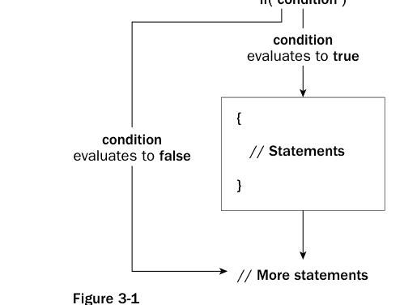

Figure 3-1

一个简单的 if 语句示例是：

```
if(letter == 'A')
    cout << "The first capital, alphabetically speaking.";
```

要测试的条件出现在关键字 if 之后紧跟的括号中，其后是条件为 true 时要执行的语句。请注意这里分号的位置。它放在 if 之后的条件与括号之间的语句之后；条件括号之后不应该有分号，因为这两行本质上构成一个单一的语句。你也可以看到 if 之后的语句是如何缩进的，以表明它仅在 if 条件返回 true 值时才执行。缩进对于程序执行不是必要的，但有助于你识别 if 条件与其所依赖的语句之间的关系。代码片段中的输出语句仅在变量 letter 的值为 'A' 时才执行。

你可以扩展此示例以在 letter 包含值 'A' 时更改其值：

```
if(letter == 'A')
{
    cout << "The first capital, alphabetically speaking.";
    letter = 'a';
}
```

由 if 语句控制的语句块由大括号分隔。这里仅当条件 (letter == 'A') 求值为 true 时才执行块中的语句。如果没有大括号，只有第一个语句才是 if 的对象，而将值 'a' 分配给
letter 的语句将始终执行。请注意，块中每个语句之后都有一个分号，而不是块末尾的闭合大括号之后。块中可以包含任意数量的语句。现在，由于 letter 的值为 'A'，你在输出相同消息后将其值更改为 'a'。如果条件返回 false，则这两个语句都不会执行。

## Nested if Statements

当 if 语句中的条件为 true 时要执行的语句也可以是一个 if。这种安排称为嵌套 if。仅当外部 if 的条件为 true 时，才会测试内部 if 的条件。一个嵌套在另一个内部的 if 也可包含嵌套的 if。你通常可以像这样一直嵌套 if，只要你知道自己在做什么。

## Try It Out   Using Nested Ifs

以下是带有工作示例的嵌套 if。

```
// Ex3_01.cpp
// A nested if demonstration
#include <iostream>

using std::cin;
using std::cout;
using std::endl;

int main()
{
    char letter = 0;                    // Store input in here

    cout << endl
         << "Enter a letter: ";        // Prompt for the input
    cin >> letter;                      // then read a character

    if(letter >= 'A')                   // Test for 'A' or larger
        if(letter <= 'Z')               // Test for 'Z' or smaller
        {
            cout << endl
                 << "You entered a capital letter."
                 << endl;
            return 0;
        }

    if(letter >= 'a')                   // Test for 'a' or larger
        if(letter <= 'z')               // Test for 'z' or smaller
        {
            cout << endl
                 << "You entered a small letter."
                 << endl;
            return 0;
        }

    cout << endl << "You did not enter a letter." << endl;
    return 0;
}
```

## How It Works

该程序以通常的注释行开始；然后是支持输入/输出的头文件的 `#include` 语句以及 `cin`、`cout` 和 `endl` 的 using 声明，它们是 `std` 命名空间。`main()` 体内的第一个动作是提示输入一个字母。这存储在名为 `letter` 的 `char` 变量中。

输入后的 `if` 语句检查输入的字符是否大于或等于 `'A'`。由于小写字母的 ASCII 码（97 到 122）大于大写字母的 ASCII 码（65 到 90），输入小写字母会导致程序执行第一个 `if` 块，因为 `(letter >= 'A')` 对所有字母都返回 true。在这种情况下，会执行嵌套的 `if`，它检查输入是否小于或等于 `'Z'`。如果它小于或等于 `'Z'`，你就知道你有一个大写字母，消息会被显示，然后你就完成了，因此你执行 `return` 语句以结束程序。两个语句都用大括号括起来，因此当嵌套 `if` 条件返回 true 时两者都会执行。

下一个 `if` 检查输入的字符是否为小写，使用与第一个 `if` 基本相同的机制，显示消息并返回。

如果输入的字符不是字母，则最后 `if` 块之后的输出语句会被执行。这会显示一条消息，表明输入的字符不是字母。然后执行 `return`。

你可以看到，由于对每个嵌套 if 和输出语句应用了缩进，它们之间的关系更容易跟踪。

此示例的典型输出是：

```
Enter a letter: T
You entered a capital letter.
```

你只需在检查大写的 `if` 中添加一个额外的语句，就很容易安排将大写更改为小写：

```
if(letter >= 'A')                 // Test for 'A' or larger
    if(letter <= 'Z')              // Test for 'Z' or smaller
    {
        cout << endl
             << "You entered a capital letter.";
             << endl;

        letter += 'a' - 'A';        // Convert to lowercase

        return 0;
    }
```

这涉及添加一个额外的语句。此用于将大写转换为小写的语句通过值 `'a' - 'A'` 增加 `letter` 变量。它之所以有效，是因为 `'A'` 到 `'Z'` 和 `'a'` 到 `'z'` 的 ASCII 码是两组连续的数值代码，因此表达式 `'a' - 'A'` 表示要添加到大写字母以获得等效小写字母的值。

此程序的典型输出是：

```
Enter an integer less than 2 billion: 123456
Your number is even,
```

## How It Works

读取输入值到 number 之后，值通过取除以二后的余数进行测试（使用你在上一章看到的余数运算符 %）并将其用作 if 的条件。在这种情况下，if 语句的条件返回一个整数，而不是布尔值。if 语句将条件返回的非零值解释为 true，并将零解释为 false。换句话说，if 语句的条件表达式：

```
(number % 2L)
```

等价于

```
(number % 2L != 0)
```

如果余数为 1，条件为 true，if 之后的语句立即执行。如果余数为 0，条件为 false，else 关键字之后的语句被执行。

> 在 if 语句中，条件可以是一个表达式，其结果为你在第 2 章看到的基本数据类型中的任何一种。当条件表达式求值为数值而不是 if 语句所需的 bool 值时，编译器会插入对表达式结果的自动强制转换为类型 bool。强制转换为类型 bool 的非零值会得到 true，而零值会得到 false。

由于整数除以二的余数只能为一或零，我已对代码进行了注释以表明这一事实。在任一结果之后，都会执行 return 语句以结束程序。

> else 关键字与语句的 if 部分类似，不带分号。同样，缩进被用作各种语句之间关系的可视指示。你可以清楚地看到哪个语句在 true 或非零结果时执行，哪个在 false 或零结果时执行。你应该始终缩进程序中的语句以显示其逻辑结构。

if-else 组合提供了在两个选项之间进行选择。if-else 的一般逻辑如图 3-2 所示。


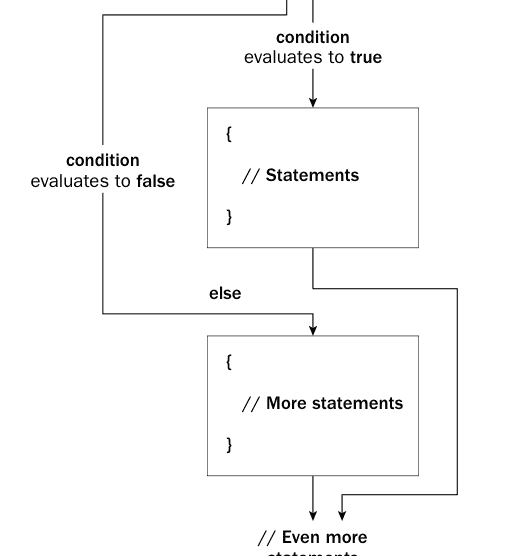

Figure 3-2

图中的箭头表示语句执行的顺序，具体取决于 if 条件返回 true 还是 false。

## Nested if-else Statements

嵌套的 if-else 语句

正如你所见，你可以在 if 语句内部嵌套 if 语句。你也可以在 if 中嵌套 if-else 语句，在 if-else 语句中嵌套 if 语句，以及在 if-else 语句中嵌套 if-else 语句。这提供了相当大的混淆空间，所以来看几个例子。以下是一个 if-else 嵌套在 if 中的例子。

```
if(coffee == 'y')
    if(donuts == 'y')
        cout << "We have coffee and donuts.";
    else
        cout << "We have coffee, but not donuts";
```

只有当咖啡测试的结果返回 true 时，才会执行甜甜圈的测试，因此消息在每种情况下都反映了正确的情况；然而，很容易将此弄混。如果用错误的缩进写出几乎相同的内容，你可能会得出错误的结论：

```
if(coffee == 'y')
if(donuts == 'y')
cout << "We have coffee and donuts.";
else
cout << "We have no coffee..."; // Wrong!
```

这里的错误很容易看出，但在更复杂的 if 结构中，你需要记住哪个 if 拥有哪个 else 的规则。

> 一个 else 总是属于最近的、尚未被另一个 else 认领的前置 if。

每当事情看起来有点复杂时，你就可以应用此规则来理清思路。当你编写自己的程序时，你始终可以使用大括号使情况更清晰。在如此简单的情况下其实并非必要，但你可以将最后一个例子写成如下形式：

```
if(coffee == 'y')
{
if(donuts == 'y')
cout << "We have coffee and donuts.";
else
cout << "We have coffee, but not donuts";
}
```

这样应该就绝对清楚了。现在你知道了规则，理解 if 嵌套在 if-else 中的情况就变得容易了。

```
if(coffee == 'y')
{
if(donuts == 'y')
cout << "We have coffee and donuts.";
else
if(tea == 'y')
cout << "We have tea, but not coffee";
}
```

这里大括号是必不可少的。如果你省略它们，else 将属于正在寻找甜甜圈的 if。在这种情况下，很容易忘记包含它们并创建可能难以找到的错误。具有这种错误的程序编译正常，有时甚至会产生正确的结果。

如果你在该示例中删除大括号，只有当 coffee 和 donuts 都等于 'y' 时才会得到正确的结果，这样 if(tea == 'y') 检查就不会被执行。

这里你将看到 if-else 语句嵌套在 if-else 语句中。即使只有一层嵌套，这也可能变得非常混乱。

```
if(coffee == 'y')
if(donuts == 'y')
cout << "We have coffee and donuts.";
```

## Logical AND

逻辑与

当你有两个条件必须同时为真才能得到真结果时，就会使用 AND 运算符 &&。你想要富有并且健康。例如，当你测试一个字符以确定它是否为大写字母时，可以使用 && 运算符；被测试的值必须同时大于或等于 'A' 且小于或等于 'Z'。两个条件都必须返回 true，该值才为大写字母。

> 如前所述，使用逻辑运算符组合的条件可能返回数值。在这种情况下，非零值转换为 true；零转换为 false。

以存储在 char 变量 letter 中的值为例，你可以用一个使用单个 if 和 && 运算符的测试替换使用两个 if 的测试：

```
if((letter >= 'A') && (letter <= 'Z'))
    cout << "This is a capital letter.";
```

表达式中 if 条件内部的括号确保比较操作首先执行，这使语句更清晰。这里，只有当 && 运算符组合的两个条件都为真时，输出语句才会被执行。

就像上一章中的二进制运算符一样，你可以使用真值表来表示特定逻辑运算符的效果。&& 的真值表如下：

| && | false | true |
|---|---|---|
| false | false | false |
| true | false | true |

左侧的行标题和顶部的列标题表示要由运算符 && 组合的逻辑表达式的值。因此，要确定将 true 条件与 false 条件组合的结果，选择左侧为 true 的行和顶部为 false 的列，并在行与列的交点查看结果（false）。实际上，你真的不需要真值表，因为它非常简单；&& 操作只有在两个操作数都为 true 时才产生 true 值。

## Logical OR

逻辑或

OR 运算符 || 在你有两个条件并且希望在其中任一或两者都为真时得到真结果时适用。例如，如果你的年收入至少为 100,000 美元，或者你有 1,000,000 美元现金，银行可能会认为你有贷款信用。这可以用以下 if 进行测试。

```
if((income >= 100000.00) || (capital >= 1000000.00))
    cout << "How much would you like to borrow, Sir (grovel, grovel)?";
```

当任一或两个条件都为真时，谄媚的回应就会出现。（更好的回应可能是，“你为什么要借钱？”银行只在你不需要钱时才借钱给你，这很奇怪。）

你也可以为 || 运算符构造一个真值表：

| || | false | true |
| false | false | true |
| true | true | true |

这里的结果也可以非常简单地表述：使用 || 运算符时，只有当两个操作数都为 false 时才会得到 false 结果。

## Logical NOT

逻辑非

第三个逻辑运算符 ! 接受一个 bool 类型的操作数并反转其值。因此，如果变量 test 的值为 true，则 !test 为 false；如果 test 为 false，则 !test 为 true。以一个简单表达式为例，如果 x 的值为 10，则表达式：

```
!(x > 5)
```

为 false，因为 x > 5 为 true。

你也可以在查尔斯·狄更斯最喜欢的表达式中应用 ! 运算符：

```
!(income > expenditure)
```

如果此表达式为真，结果就是 misery，至少在银行开始退回你的支票时就是如此。

最后，你可以将 ! 运算符应用于其他基本数据类型。假设你有一个名为 rate 的变量，其类型为 float 且值为 3.2。出于某种原因，你可能想要测试以验证 rate 的值是否非零，在这种情况下，你可以使用表达式：

```
!(rate)
```

值 3.2 为非零，因此转换为 bool 值 true，所以此表达式的结果为 false。

## Try It Out Combining Logical Operators

试一试 组合逻辑运算符

你可以将条件表达式和逻辑运算符组合到你感到舒适的任何程度。例如，你可以使用单个 if 构造一个测试变量是否包含字母的测试。让我们将其写成一个工作示例：

```
// Ex3_03.cpp
// Testing for a letter using logical operators
#include <iostream>

using std::cin;
using std::cout;

operand—in this case b—is selected as the value that results from the operation. Thus, the result of the conditional expression `a > b ? a : b` is a if a is greater than b, and b otherwise. This value is stored in c as a result of the assignment operation. The use of the conditional operator in this assignment statement is equivalent to the if statement:

```cpp
if(a > b)
    c = a;
else
    c = b;
```

The conditional operator can be written generally as:

```
`condition ? expression1 : expression2`
```

If the condition evaluates as true, the result is the value of *expression1*, and if it evaluates to false, the result is the value of *expression2*.

## Try It Out — Using the Conditional Operator with Output

试一试 — 使用条件运算符进行输出

条件运算符的常见用途是根据表达式的结果或变量的值控制输出。你可以通过根据指定的条件选择一个文本字符串或另一个文本字符串来改变消息。

```cpp
// Ex3_04.cpp
// The conditional operator selecting output
#include <iostream>

using std::cout;
using std::endl;

int main()
{
    int nCakes = 1;          // Count of number of cakes

    cout << endl
         << "We have " << nCakes << " cake" << ((nCakes > 1) ? "s." : ".")
         << endl;

    ++nCakes;

    cout << endl
         << "We have " << nCakes << " cake" << ((nCakes > 1) ? "s." : ".")
         << endl;
    return 0;
}
```

该程序的输出为：

```text
We have 1 cake.
We have 2 cakes.
```


## 工作原理

你首先将 nCakes 变量初始化为 1；然后有一条输出语句显示蛋糕的数量。使用条件运算符的部分只是测试该变量，以确定你有一个蛋糕还是多个蛋糕：

```
((nCakes>1) ? "s." : ".")
```

如果 nCakes 大于 1，该表达式求值为“s.”，否则求值为“.”。这使得你可以对任意数量的蛋糕使用同一条输出语句，并获得语法正确的输出。你在示例中通过递增 nCakes 变量并重复输出语句来展示这一点。

还有许多其他情况可以应用这种机制；例如，在“is”和“are”之间进行选择。

### switch 语句

switch 语句使你能够根据给定表达式的一组固定值，从多个选项中进行选择。它的操作类似于一个物理旋转开关，你可以从固定数量的选项中选择一个；某些品牌的洗衣机就提供了这种方式来选择洗衣操作。开关有给定数量的可能位置，例如棉、羊毛、合成纤维等，你可以通过将旋钮转到所需选项来选中其中任何一个。

在 switch 语句中，选择由你指定的表达式的值决定。你可以通过一个或多个 case 值来定义可能的开关位置，当开关表达式的值与某个 case 值相同时，就会选中该特定 case。switch 中每个可能的选项都有一个 case 值，并且所有 case 值必须互不相同。

如果开关表达式的值与任何 case 值都不匹配，switch 会自动选择 default 情况。如果需要，你可以像下面将要做的这样，为 default 情况指定代码；否则，默认情况下将不执行任何操作。

## 试一试

### switch 语句

你可以通过下面的示例来了解 switch 语句的工作原理。

```
// Ex3_05.cpp
// Using the switch statement
#include <iostream>

using std::cin;
using std::cout;
using std::endl;

int main()
{
    int choice = 0;            // Store selection value here

    cout << endl
<< "Your electronic recipe book is at your service." << endl
<< "You can choose from the following delicious dishes: "
<< endl
<< endl << "1 Boiled eggs"
<< endl << "2 Fried eggs"
<< endl << "3 Scrambled eggs"
<< endl << "4 Coddled eggs"
<< endl << endl << "Enter your selection number: ";
cin >> choice;

switch(choice)
{
    case 1: cout << endl << "Boil some eggs." << endl;
            break;
    case 2: cout << endl << "Fry some eggs." << endl;
            break;
    case 3: cout << endl << "Scramble some eggs." << endl;
            break;
    case 4: cout << endl << "Coddle some eggs." << endl;
            break;
    default: cout << endl <<"You entered a wrong number, try raw eggs."
                 << endl;
}
    return 0;
}
```

## 工作原理

在流输出语句中定义选项并将选择数字读入变量 choice 之后，执行 switch 语句，其条件是在关键字 switch 后面的括号中简单地指定为 choice。switch 中可能的选项包含在花括号中，每个选项由 case 标签标识。case 标签由关键字 case、与该选项对应的 choice 值以及末尾的冒号组成。

如你所见，针对特定 case 要执行的语句写在 case 标签末尾的冒号之后，并以 break 语句结尾。break 将执行转移到 switch 之后的语句。break 不是强制性的，但如果你不包含它，执行将继续到下一个 case 的语句，这通常不是你想要的。你可以通过从本示例中删除 break 语句看看会发生什么来演示这一点。

如果 choice 的值与任何指定的 case 值都不匹配，则执行前面带有 default 标签的语句。default 情况不是必需的。如果没有 default，当测试表达式的值与任何 case 都不匹配时，switch 被退出，程序继续执行 switch 之后的下一条语句。

## 试一试 共享 case

你为标识 case 而指定的每个表达式都必须是常量，以便在编译时确定其值，并且必须求值为唯一的整数值。不能有两个 case 常量相同的原因是，编译器无法知道对于该特定值应该执行哪个 case 语句；但是，不同的 case 不需要有唯一的操作。多个 case 可以共享同一个操作，如下所示。

## 决策与循环

```cpp
// Ex3_06.cpp
// Multiple case actions
#include <iostream>
using std::cin;
using std::cout;
using std::endl;

int main()
{
    char letter = 0;
    cout << endl << "Enter a small letter: ";
    cin >> letter;
    switch(letter*(letter >= 'a' && letter <= 'z'))
    {
    case 'a':
    case 'e':
    case 'i':
    case 'o':
    case 'u': cout << endl << "You entered a vowel.";
    break;
    case 0: cout << endl << "That is not a small letter.";
    break;
    default: cout << endl << "You entered a consonant.";
    }
    cout << endl;
    return 0;
}
```

## 工作原理

在本示例中，switch 中有一个更复杂的表达式。如果输入的字符不是小写字母，则表达式：

(letter >= 'a' && letter <= 'z')

的结果为 false；否则为 true。因为 letter 乘以这个表达式，所以逻辑表达式的值被转换为整数（如果逻辑表达式为 false，则为 0；如果为 true，则为 1）。因此，如果没有输入小写字母，switch 表达式求值为 0；如果输入了，则求值为 letter 的值。当 letter 中存储的字符代码不代表小写字母时，将执行 case 标签 case 0 后面的语句。

如果输入的是小写字母，switch 表达式求值为与 letter 相同的值，因此对于所有与元音对应的值，将执行 case 标签序列（其 case 值为元音）后面的输出语句。对于任何元音都会执行相同的语句，因为当选择这些 case 标签中的任何一个时，会依次执行后续语句，直到遇到 break 语句。你可以看到，通过在要执行的语句之前逐个写下每个 case 标签，可以为多个不同的 case 执行同一个操作。如果程序输入的小写字母是辅音，则执行 default 标签语句。

## 无条件分支

if 语句为你提供了根据指定条件选择执行一组语句或另一组语句的灵活性，因此语句执行序列会根据程序中数据的值而变化。相比之下，goto 语句是一种生硬的工具。它使你能够无条件地分支到指定的程序语句。要分支到的语句必须由语句标签标识，该标签是一个标识符，其定义规则与变量名相同。标签后跟冒号，并放在需要标记的语句之前。下面是一个带标签语句的示例。

```
myLabel: cout << "myLabel branch has been activated" << endl;
```

该语句带有标签 myLabel，无条件分支到该语句的写法如下：

```
goto myLabel;
```

只要有可能，你就应该避免在程序中使用 goto。它们往往会助长难以理解、极其混乱的代码。

> 因为 goto 在程序中原则是多余的——总有比使用 goto 更合适的替代方法——所以相当多的一批程序员说你永远不应该使用它。我不赞同这种极端的观点。毕竟它是合法的语句，而且有时会很方便。不过，我确实建议你只在能明显看出比其他可用选项更有优势时才使用它；否则，你最终可能会得到混乱的、容易出错的代码，这些代码难以理解，甚至更难以维护。

## 重复一个语句块

重复执行一组语句的能力是大多数应用程序的基础。如果没有这种能力，组织每多雇一名员工就需要修改工资程序，而你每次想玩另一局游戏时都需要重新加载 Halo 2。所以让我们先理解循环是如何工作的。

## 什么是循环？

循环会执行一系列语句，直到某个条件为真（或假）。你实际上可以用到目前为止所遇到的 C++ 语句来编写一个循环。你只需要一个 if 和令人畏惧的 goto。请看下面的示例。

```
// Ex3_07.cpp
// Creating a loop with an if and a goto
#include <iostream>

using std::cin;
using std::cout;
using std::endl;

int main()
```


```cpp
{
    int i = 0, sum = 0;
    const int max = 10;
    i = 1;
loop:
    sum += i;                         // Add current value of i to sum
    if (++i <= max)
        goto loop;                    // Go back to loop until i = 11
    cout << endl
         << "sum = " << sum << endl
         << "i = " << i << endl;
    return 0;
}
```

这个示例累加从 1 到 10 的整数的总和。第一次执行语句序列时，i 为 1 并被加到 sum 上，而 sum 最初为零。在 if 中，i 被递增到 2，只要它小于或等于 max，就执行到 loop 的无条件分支，并且此时的 i 值，即 2，被加到 sum 上。这会一直继续，每次 i 递增并加到 sum 上，直到最后在 if 中 i 被递增到 11 时，不再执行返回分支。如果你运行这个示例，会得到以下输出。

```text
sum = 55
i = 11
```

这清楚地展示了循环的工作方式；然而，它使用了 goto 并在程序中引入了标签，这两种做法如果可能的话都应避免。你可以用下一个语句实现同样的功能，甚至更多，该语句专门用于编写循环。

## 使用 for 循环试一试

你可以用被称为 for 循环的东西重写上一个示例。

```cpp
// Ex3_08.cpp
// Summing integers with a for loop
#include <iostream>

using std::cin;
using std::cout;
using std::endl;

int main()
{
    int i = 0, sum = 0;
    const int max = 10;

    for(i = 1; i <= max; i++)       // Loop specification
        sum += i;                   // Loop statement

    cout << endl
         << "sum = " << sum
         << endl
         << "i = " << i
         << endl;
    return 0;
}
```

## 它是如何工作的

如果你编译并运行它，你会得到与前一个示例完全相同的输出，但这里的代码要简单得多。决定循环操作的条件出现在 for 关键字之后的小括号内。有三个表达式在小括号内由分号分隔：

- 第一个表达式在开始时执行一次，并为循环设置初始条件。在本例中，它将 i 设置为 1。
- 第二个表达式是一个逻辑表达式，用于确定循环语句（或语句块）是否应继续执行。如果第二个表达式为真，循环继续执行；当它为假时，循环结束，执行继续进行循环之后的语句。在本例中，只要 i 小于或等于 max，就执行下一行的循环语句。
- 第三个表达式在循环语句（或语句块）执行后被求值，在本例中每次迭代递增 i。求值该表达式后，第二个表达式会再次求值以查看循环是否应继续。

实际上，这个循环与 Ex3_07.cpp 中的版本并不完全相同。你可以通过将两个程序中的 max 值都设置为 0 并再次运行它们来证明这一点；然后，你会发现 Ex3_07.cpp 中 sum 的值为 1，而 Ex3_08.cpp 中为 0，i 的值也不同。其原因是程序的 if 版本总是至少执行一次循环，因为你是在最后才检查条件。for 循环不这样做，因为条件实际上是在开始时检查的。

for 循环的一般形式为：

```cpp
for (initializing_expression ; test_expression ; increment_expression)
    loop_statement;
```

当然，`loop_statement` 可以是单个语句，也可以是大括号之间的语句块。执行 for 循环的事件序列如图 3-3 所示。

正如我所说，图 3-3 中显示的循环语句也可以是语句块。控制 for 循环的表达式非常灵活。你甚至可以在每个控制表达式中写两个或多个由逗号运算符分隔的表达式。这给了你很大的操作空间。

自然地，原来的 `i` 的声明需要在程序中省略。如果你对上一个示例做此更改，你会发现它现在无法编译，因为循环变量 `i` 在循环结束后就不再存在，所以你无法在输出语句中引用它。循环有一个作用域，从 `for` 表达式延伸到循环体的末尾，而循环体当然可以是大括号之间的代码块，也可以是单个语句。计数器 `i` 现在在循环作用域内声明，所以你无法在输出语句中引用它，因为这在循环作用域之外。默认情况下，C++ 编译器强制执行 ISO/ANSI C++ 标准，坚持在循环条件中定义的变量不能在循环外引用。如果你需要在循环执行后使用计数器的值，你必须在循环作用域之外声明计数器变量。

你可以完全省略循环中的初始化表达式。如果你已在 `i` 的声明语句中适当地初始化它，你可以这样写循环：

```cpp
int i = 1;
for(; i <= max; i++)                 // Loop specification
    sum += i;                         // Loop statement
```

你仍然需要分隔初始化表达式和循环测试条件的分号。事实上，无论是否省略任何或所有控制表达式，两个分号都必须始终存在。如果你省略第一个分号，编译器就无法判断省略了哪个表达式，甚至哪个分号丢失了。

循环语句可以为空。例如，你可以将前一个示例中 for 循环的循环语句放在增量表达式中；在这种情况下，循环变为

```cpp
for(i = 1; i <= max; sum += i++);       // The whole loop
```

你仍然需要在右括号后加上分号，以表示循环语句现在为空。如果你省略它，随后这一行的语句将被解释为循环语句。有时你会看到空的循环语句写在单独的一行，如下所示。

```cpp
for(i = 1; i <= max; sum += i++)         // The whole loop
    ;
```

## 使用多个计数器试一试

你可以使用逗号运算符在 for 循环中包含多个计数器。你可以在以下程序中看到它的运行情况。

```cpp
// Ex3_09.cpp
// Using multiple counters to show powers of 2
#include <iostream>
#include <iomanip>

using std::cin;
using std::cout;
using std::endl;
using std::setw;

int main()
{
    long i = 0, power = 0;
    const int max = 10;
    for(i = 0, power = 1; i <= max; i++, power += power)
        cout << endl
             << setw(10) << i << setw(10) << power; // Loop statement
    cout << endl;
    return 0;
}
```

你在 `for` 循环的初始化部分使用逗号运算符初始化两个变量，并在增量部分递增它们。显然，你可以在每个位置放置任意多的表达式。

你甚至可以在表示 `for` 循环测试部分的第二个表达式中指定多个由逗号分隔的条件；但只有最右边的条件会影响循环何时结束。

请注意，定义 `i` 和 `power` 初始值的赋值是表达式，而不是语句。语句总是以分号结束。

每次 `i` 递增时，变量 `power` 的值通过将其加到自身上来加倍。这产生了我们想要的 2 的幂，因此程序产生以下输出。

| i | power |
| --- | --- |
| 0 | 1 |
| 1 | 2 |
| 2 | 4 |
| 3 | 8 |
| 4 | 16 |
| 5 | 32 |
| 6 | 64 |
| 7 | 128 |
| 8 | 256 |
| 9 | 512 |
| 10 | 1024 |

`setw()` 操纵符在上一章中你已经见过，用于整齐地对齐输出。你包含了 `<iomanip>` 头文件，并在 `std` 命名空间中添加了 `setw` 的 using 声明，这样我们就可以在不限定名称的情况下使用 `setw()`。

如果你省略指定 `for` 循环测试条件的第二个控制表达式，则假定其值为真，因此循环会无限继续，除非你提供其他退出循环的手段。事实上，如果你愿意，你可以省略 `for` 后括号内的所有表达式。这可能看起来没什么用；事实上，恰恰相反。你经常会遇到想要执行循环多次但事先不知道需要多少次迭代的情况。看一下下面的例子。


Do you want to enter another value (enter n to end)? n

The average of the 3 values you entered is 20.

After declaring and initializing the variables that you’re going to use, you start a for loop with no expressions specified, so there is no provision for ending it here. The block immediately following is the subject of the loop that is to be repeated.

The loop block performs three basic actions:

- It reads a value
- It adds the value read from cin to sum
- It checks whether you want to continue to enter values

The first action within the block is to prompt you for input and then read a value into the variable value. The value that you enter is added to sum and the count of the number of values, i, is incremented. After accumulating the value in sum, you are asked if you want to enter another value and prompted to enter 'n' if you have finished. The character that you enter is stored in the variable indicator for testing against 'n' or 'N' in the if statement. If neither is found, the loop continues; otherwise, a break is executed. The effect of break in a loop is similar to its effect in the context of the switch statement. In this instance, it exits the loop immediately by transferring control to the statement following the closing brace of the loop block.

Finally, you output the count of the number of values entered and their average, which is calculated by dividing sum by i. Of course, i is promoted to type double before the calculation, as you remember from the casting discussion in Chapter 2.

## Using the continue Statement

There is another statement, besides break, used to affect the operation of a loop: the continue statement. This is written simply as:

```cpp
continue;
```

Executing continue within a loop starts the next loop iteration immediately, skipping over any statements remaining in the current iteration. I can demonstrate how this works with the following code.

```cpp
#include <iostream>

using std::cin;
using std::cout;
using std::endl;

int main()
{
    int i = 0, value = 0, product = 1;
    for(i = 1; i <= 10; i++)
    {
        cout << "Enter an integer: ";
        cin >> value;

        if(value == 0)                // If value is zero
            continue;                 // skip to next iteration

        product *= value;
    }
    cout << "Product (ignoring zeros): " << product
        << endl;

    return 0;                     // Exit from loop
}
```

This loop reads 10 values with the intention of producing the product of the values entered. The if checks each value entered, and if it is zero, the continue statement skips to the next iteration. This is so that you don’t end up with a zero product if one of the values is zero. Obviously, if a zero value occurred on the last iteration, the loop would end. There are clearly other ways of achieving the same result, but continue provides a very useful capability, particularly with complex loops where you may need to skip to the end of the current iteration from various points in the loop.

The effect of the break and continue statements on the logic of a for loop is illustrated in Figure 3-4.

Obviously, in a real situation, you would use the break and continue statements with some condition-testing logic to determine when the loop should be exited, or when an iteration of the loop should be skipped. You can also use the break and continue statements with the other kinds of loop, which I’ll discuss later on in this chapter, where they work in exactly the same way.

## Try It Out Using Other Types in Loops

So far, you have only used integers to count loop iterations. You are in no way restricted as to what type of variable you use to count iterations. Look at the following example.

```cpp
// Ex3_11.cpp
// Display ASCII codes for alphabetic characters
#include <iostream>
#include <iomanip>

using std::cout;
using std::endl;
using std::hex;
using std::dec;
using std::setw;

int main()
{
    for(char capital = 'A', small = 'a'; capital <= 'Z'; capital++, small++)
        cout << endl
            << "\t" << capital                // Output capital as a character
            << hex << setw(10) << static_cast<int>(capital)   // and as hexadecimal
            << dec << setw(10) << static_cast<int>(capital)   // and as decimal
            << "     " << small                           // Output small as a character
            << hex << setw(10) << static_cast<int>(small)     // and as hexadecimal
            << dec << setw(10) << static_cast<int>(small);    // and as decimal

    cout << endl;
    return 0;
}
```

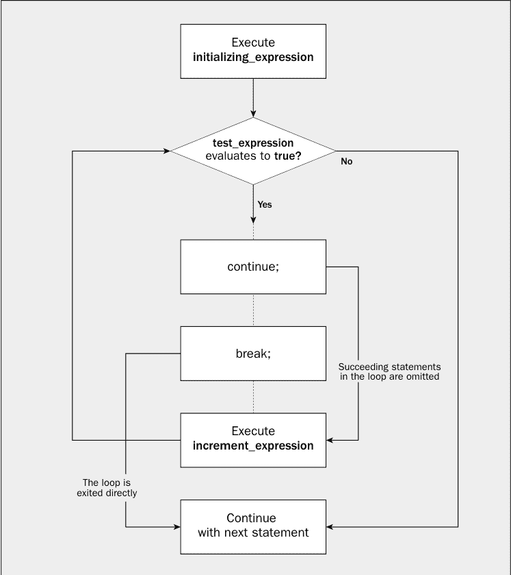

Figure 3-4

## How It Works

You have using declarations for the names of some new manipulators that are used in the program to affect how the output is presented.

The loop in this example is controlled by the char variable capital, which you declare along with the variable small in the initializing expression. You also increment both variables in the third control expression for the loop so that the value of capital varies from 'A' to 'Z', and the value of small correspondingly varies from 'a' to 'z'.

The loop contains just one output statement spread over seven lines. The first line is:

```cpp
cout << endl
```

This starts a new line on the screen.

The next three lines are:

```cpp
<< "\t" << capital                    // Output capital as a character
<< hex << setw(10) << static_cast<int>(capital)  // and as hexadecimal
<< dec << setw(10) << static_cast<int>(capital)  // and as decimal
```

On each iteration, after outputting a tab character, the value of capital is displayed three times: as a character, as a hexadecimal value, and as a decimal value.

When you insert the manipulator hex into the cout stream, this causes subsequent data values to be displayed as hexadecimal values rather than the default decimal representation for integer values so the second output of capital is as a hexadecimal representation of the character code.

You then insert the dec manipulator into the stream to cause succeeding values to be output as decimal once more. By default a variable of type char is interpreted by the stream as a character, not a numerical value. You get the char variable capital to output as a numerical value by casting its value to type int, using the static_cast<>() operator that you saw in the previous chapter.

The value of small is output in a similar way by the next three lines of the output statement:

```cpp
<< "  " << small                    // Output small as a character
<< hex << setw(10) << static_cast<int>(small)  // and as hexadecimal
<< dec << setw(10) << static_cast<int>(small);  // and as decimal
```

As a result, the program generates the following output:

| Uppercase | Hex | Decimal | Lowercase | Hex | Decimal |
|---|---|---|---|---|---|
| A | 41 | 65 | a | 61 | 97 |
| B | 42 | 66 | b | 62 | 98 |
| C | 43 | 67 | c | 63 | 99 |
| D | 44 | 68 | d | 64 | 100 |
| E | 45 | 69 | e | 65 | 101 |
| F | 46 | 70 | f | 66 | 102 |
| G | 47 | 71 | g | 67 | 103 |
| H | 48 | 72 | h | 68 | 104 |
| I | 49 | 73 | i | 69 | 105 |

Here *loop_statement* is executed repeatedly as long as the *condition* expression has the value `true`. After the condition becomes `false`, the program continues with the statement following the loop. As always, a block of statements between braces could replace the single *loop_statement*.

The logic of the `while` loop can be represented as shown in Figure 3-5.

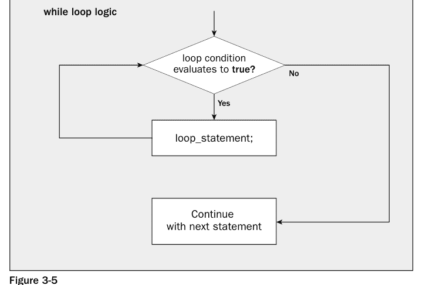

Figure 3-5

## Try It Out Using the while Loop

You could rewrite the earlier example that computes averages (Ex3_10.cpp) to use the `while` loop.

```cpp
// Ex3_12.cpp
// Using a while loop to compute an average
#include <iostream>

using std::cin;
using std::cout;
using std::endl;

int main()
{
    double value = 0.0;            // Value entered stored here
    double sum = 0.0;              // Total of values accumulated here
    int i = 0;                     // Count of number of values
    char indicator = 'y';          // Continue or not?
    while(indicator == 'y')        // Loop as long as y is entered
```


```
{
    cout << endl
        << "Enter a value: ";
    cin >> value;                 // Read a value
    ++i;                          // Increment count
    sum += value;                 // Add current input to total

    cout << endl
        << "Do you want to enter another value (enter n to end)? ";
    cin >> indicator;             // Read indicator
}

cout << endl
    << "The average of the " << i
    << " values you entered is " << sum/i << "."
    << endl;
return 0;
}
```

## 如何工作

对于相同的输入，该版本的程序产生的输出与之前相同。有一个语句已被更新，另一个语句已被添加——它们在之前的代码中以高亮显示。for 循环语句已被 while 语句替换，并且 if 中对 indicator 的测试已被删除，因为此功能由 while 条件执行。你必须用 'y' 初始化 indicator 来代替之前出现的 'n'——否则 while 循环会立即终止。只要 while 中的条件返回 true，循环就会继续。

while 循环条件可以使用任何产生 true 或 false 的表达式。示例程序如果将循环条件扩展为允许输入 'Y' 来继续循环以及 'y' 会更好。你可以修改 while 为以下形式来实现这一目的。

```
while((indicator == 'y') || (indicator == 'Y'))
```

你也可以创建一个可能无限执行的 while 循环，使用始终为真的条件。这可以写成如下形式。

```
while(true)
{
```

```
...
```

```
}
```

你也可以将循环控制表达式写成整数值 1，它将被转换为 bool 值 true。自然地，这里与无限 for 循环的情况一样适用相同的要求：即你必须在循环块内提供某种退出循环的方式。你将在第 4 章看到 while 循环的其他使用方式。

## do-while 循环

do-while 循环与 while 循环相似之处在于，只要指定的循环条件保持为真，循环就会继续。主要区别在于条件是在循环末尾检查的——这与 while 循环和 for 循环形成对比，后两者在循环开始时检查条件。因此，do-while 循环语句至少执行一次。do-while 循环的一般形式为：

```
do
{
    loop_statements;
}while(condition);
```

这种循环形式的逻辑如图所示 3-6。

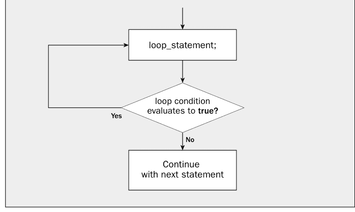

图 3-6

你可以用 do-while 循环替换计算平均值的程序最后版本中的 while 循环：

```
do
{
    cout << endl
        << "Enter a value: ";
    cin >> value;                // Read a value
    ++i;                         // Increment count
    sum += value;                // Add current input to total

    cout << "Do you want to enter another value (enter n to end)?";
    cin >> indicator;            // Read indicator
} while((indicator == 'y') || (indicator == 'Y'));
```

两种循环版本之间几乎没有区别，除了这个版本不依赖于 `indicator` 中设置的初始值即可正确运行。只要你想输入至少一个值，这对于所讨论的计算来说并不 unreasonable，这个版本的循环是更可取的。

## 嵌套循环

你可以将一个循环嵌套在另一个循环内部。在第 4 章中，这种应用通常会变得更加明显——它通常用于在不同分类级别上重复操作。一个例子可能是计算班级中每个学生的总成绩，然后对学校中的每个班级重复此过程。

### 试一试 嵌套循环

通过计算简单公式的值，你可以看到将一个循环嵌套在另一个循环中的效果。整数的阶乘是从 1 到该整数的所有整数的乘积；例如，3 的阶乘是 1 乘以 2 乘以 3，等于 6。以下程序计算你输入的整数的阶乘（直到你不想继续）：

// Ex3_13.cpp
// 演示使用嵌套循环计算阶乘
#include <iostream>

using std::cin;
using std::cout;
using std::endl;

int main()
{
    char indicator = 'n';
    long value = 0,
        factorial = 0;

    do
    {
        cout << endl
            << "Enter an integer value: ";
        cin >> value;

        factorial = 1;
        for(int i = 2; i <= value; i++)
            factorial *= i;

        cout << "Factorial " << value << " is " << factorial;
        cout << endl
            << "Do you want to enter another value (y or n)? ";
        cin >> indicator;
    } while((indicator == 'y') || (indicator == 'Y'));

    return 0;
}
```

# 第 3 章

如果你编译并执行此示例，典型的输出为：

```
Enter an integer value: 5
Factorial 5 is 120
Do you want to enter another value (y or n)? y

Enter an integer value: 10
Factorial 10 is 3628800
Do you want to enter another value (y or n)? y

Enter an integer value: 13
Factorial 13 is 1932053504
Do you want to enter another value (y or n)? y

Enter an integer value: 22
Factorial 22 is -522715136
Do you want to enter another value (y or n)? n
```

## 如何工作

阶乘值增长非常快。事实上，12 是此示例能产生正确结果的最大输入值。13 的阶乘实际上是 6,227,020,800，而不是程序告诉你的 1,932,053,504。如果你使用更大的输入值运行它，存储在变量 factorial 中的结果会丢失前导数字，你可能会得到负值，就像你请求 22 的阶乘时一样。

> 这种情况不会产生任何错误消息，因此至关重要的是你必须确保程序中处理的值能够容纳在你使用的变量类型的允许范围内。你还需要考虑错误输入值的影响。这种类型的错误是静默发生的，很难找到。

两个嵌套循环中外部的是 do-while 循环，它控制程序何时结束。只要你在提示符处继续输入 y 或 Y，程序就会继续计算阶乘值。输入整数的阶乘是在内部 for 循环中计算的。这会执行 value 次，将变量 factorial（初始值为 1）与从 2 到 value 的连续整数相乘。

### 试一试 另一个嵌套循环

嵌套循环可能有点令人困惑，所以让我们再试一个例子。此程序生成给定大小的乘法表。

```
// Ex3_14.cpp
// 使用嵌套循环生成乘法表
#include <iostream>
#include <iomanip>

using std::cout;
using std::endl;
using std::setw;

int main()
{
    const int size = 12;            // Size of table

int i = 0, j = 0;                     // Loop counters

cout << endl                          // Output table title
    << size << " by " << size
    << " Multiplication Table" << endl << endl;

cout << endl << " |";
for(i = 1; i <= size; i++)             // Loop to output column headings
    cout << setw(3) << i << "  ";

cout << endl;                          // Newline for underlines
for(i = 0; i <= size; i++)
    cout << "____";                    // Underline each heading

for(i = 1; i <= size; i++)             // Outer loop for rows
{
    cout << endl
        << setw(3) << i << " |";      // Output row label

    for(j = 1; j <= size; j++)         // Inner loop for the rest of the row
        cout << setw(3) << i*j << "  "; // End of inner loop
}
cout << endl;                          // End of outer loop
return 0;
}
```

此示例的输出为：

12 by 12 Multiplication Table

| 1  2  3  4  5  6  7  8  9  10 11 12
1 | 1  2  3  4  5  6  7  8  9  10 11 12
2 | 2  4  6  8  10 12 14 16 18 20 22 24
3 | 3  6  9  12 15 18 21 24 27 30 33 36
4 | 4  8  12 16 20 24 28 32 36 40 44 48
5 | 5  10 15 20 25 30 35 40 45 50 55 60
6 | 6  12 18 24 30 36 42 48 54 60 66 72
7 | 7  14 21 28 35 42 49 56 63 70 77 84
8 | 8  16 24 32 40 48 56 64 72 80 88 96
9 | 9  18 27 36 45 54 63 72 81 90 99 108
10 | 10 20 30 40 50 60 70 80 90 100 110 120
11 | 11 22 33 44 55 66 77 88 99 110 121 132
12 | 12 24 36 48 60 72 84 96 108 120 132 144

## 如何工作

表标题由程序中的第一个输出语句产生。下一个输出语句结合其后的循环生成列标题。每个列宽为五个字符，因此标题值在由 setw(3) 操纵符指定的宽度为三的字段中显示，后跟两个空格。在循环之前输出的语句在包含行标题的第一列上方输出四个空格和一个垂直条。然后在列标题下方显示一系列下划线字符。


# 第3章

嵌套循环生成主表内容。外层循环对每一行重复一次，因此 i 是行号。输出语句

```
cout << endl
    << setw(3) << i << " |";    // Output row label
```

会换到新行开始一行，然后以宽度为三的字段输出由 i 值给出的行标题，后跟一个空格和一个垂直条。

一行值由内层循环生成：

```
for(j = 1; j <= size; j++)        // Inner loop for the rest of the row
    cout << setw(3) << i*j << "  ";   // End of inner loop
```

此循环输出值 i*j，对应当前行值 i 与依次变化的每一列值的乘积，j 从 1 变到 size。因此对于外层循环的每次迭代，内层循环执行 size 次迭代。值的定位方式与列标题相同。

当外层循环完成后，执行 return 以结束程序。

### C++/CLI 编程

本章讨论的所有内容同样适用于 C++/CLI 程序。为了说明这一点，我们可以看一些 CLR 控制台程序的示例，演示到目前为止本章中学到的一些内容。以下是一个 CLR 程序，是对 Ex3_01 的轻微变体。

### 试一试    使用嵌套 if 语句的 CLR 程序

创建一个 CLR 控制台程序，使用默认代码并像这样修改 main() 函数：

// Ex3_15.cpp : main project file.

#include "stdafx.h"

using namespace System;

int main(array<System::String ^> ^args)
{
    wchar_t letter;                     // Corresponds to the C++/CLI Char type
    Console::Write(L"Enter a letter: ");
    letter = Console::Read();
    if(letter >= 'A')                   // Test for 'A' or larger
        if(letter <= 'Z')               // Test for 'Z' or smaller
        {
            Console::WriteLine(L"You entered a capital letter.");
            return 0;
        }

    if(letter >= 'a')                   // Test for 'a' or larger
        if(letter <= 'z')               // Test for 'z' or smaller
{
	Console::WriteLine(L"You entered a small letter.");
	return 0;
}

Console::WriteLine(L"You did not enter a letter.");
return 0;
}
```

通常情况下，阴影行是你应该添加的新代码。

## 工作原理

逻辑与 Ex3_01 示例完全相同（事实上所有语句都相同，只是产生输出的语句和 letter 的声明除外。我将类型改为 wchar_t，因为 Char 类型有一些我会提到的额外功能。Console::Read() 函数从键盘读取单个字符。因为你使用 Console::Write() 函数输出初始提示，所以不会发出换行符，因此你可以在提示的同一行输入字母。

.NET Framework 在 Char 类中提供了将字符代码转换为大写或小写的函数。这些是 Char::ToUpper() 和 Char::ToLower() 函数，你将要转换的字符放在函数作为参数的括号中。例如：

```
wchar_t uppercaseLetter = Char::ToUpper(letter);
```

当然，你也可以将转换结果存储回原始变量，类似于以下方式。

```
letter = Char::ToUpper(letter);
```

Char 类还提供了 IsUpper() 和 IsLower() 函数，用于测试字母是大写还是小写。你将要测试的字母作为参数传递给函数，函数返回一个 bool 值作为结果。你可以用这些函数以完全不同的方式编写 main() 函数。

```
wchar_t letter; // Corresponds to the C++/CLI Char type
Console::Write(L"Enter a letter : ");
letter = Console::Read();

wchar_t upper = Char::ToUpper(letter);
if(upper >= 'A' && upper <= 'Z') // Test for between 'A' and 'Z'
Console::WriteLine(L"You entered a {0} letter.", Char::IsUpper(letter) ? "capital" : "small");
else
Console::WriteLine(L"You did not enter a letter.");
return 0;
```

这大大简化了代码。在将字母转换为大写后，你测试大写值以检查它是否在 'A' 到 'Z' 之间。如果是，你输出一条取决于传递给 WriteLine() 函数的第二个参数的条件运算符表达式结果的消息。条件运算符表达式在 letter 为大写时求值为 "capital"，在 letter 不是大写时求值为 "small"，并且该结果根据格式字符串 {0} 的位置插入到输出中。

# 第3章

再试一个使用 Console::ReadKey() 函数在循环中并进一步探索 ConsoleKeyInfo 类的 CLR 示例。

### 试一试 读取按键

创建一个 CLR 控制台程序并向 main() 添加以下代码。

```
// Ex3_16.cpp : main project file.
// Testing key presses in a loop.

#include "stdafx.h"

using namespace System;

int main(array<System::String ^> ^args)
{
    Console::WriteLine(L"Press a key combination - press Escape to quit.");

    ConsoleKeyInfo keyPress;
    do
    {
        keyPress = Console::ReadKey(true);
        Console::Write(L"You pressed");
        if(safe_cast<int>(keyPress.Modifiers)>0)
            Console::Write(L" {0},", keyPress.Modifiers);
        Console::WriteLine(L" {0} which is the {1} character",
            keyPress.Key, keyPress.KeyChar);
    }while(keyPress.Key != ConsoleKey::Escape);
    return 0;
}
```

以下是此程序的一些示例输出。

```
Press a key combination - press Escape to quit.
You pressed Shift, B which is the B character
You pressed Shift, Control, N which is the _ character
You pressed Shift, Control, Oem1 which is the   character
You pressed Oem1 which is the ; character
You pressed Oem3 which is the ' character
You pressed Shift, Oem3 which is the @ character
You pressed Shift, Oem7 which is the ~ character
You pressed Shift, Oem6 which is the } character
You pressed D3 which is the 3 character
You pressed Shift, D3 which is the ? character
You pressed Shift, D5 which is the % character
You pressed Oem8 which is the ` character
You pressed Escape which is the _ character
```

当然，有些键组合不代表可显示字符，因此在这些情况下输出中没有字符。程序在按下 Ctrl+C 时也会结束，因为操作系统将此识别为结束程序的命令。

## 决策和循环

## 工作原理

按键在 do-while 循环中进行测试，此循环会一直继续直到按下 Escape 键。在循环内部调用 Console::ReadKey() 函数并将结果存储在 keyPress 变量中，该变量的类型为 ConsoleKeyInfo。ConsoleKeyInfo 类有三个属性可供访问以帮助识别按下的键或键——Key 属性标识按下的键，KeyChar 属性表示键的 Unicode 字符代码，Modifiers 属性是 ConsoleModifiers 常量的按位组合，表示 Shift、Alt 和 Ctrl 键。ConsoleModifiers 是在 System 库中定义的枚举，枚举中定义常量名称为 Alt、Shift 和 Control。

正如你在最后一个输出语句中对 WriteLine() 函数的参数所看到的，要访问对象的属性，你在对象名称后放置属性名称，两者用句点分隔；句点称为成员访问运算符。要访问对象 keyPress 的 KeyChar 属性，你写 keyPress.KeyChar。

程序的操作非常简单。在循环内你调用 ReadKey() 函数读取按键并将结果存储在 keyPress 变量中。接下来你使用 Write() 函数将输出的初始部分写入命令行；因为在这种情况下没有写入换行符，所以下一个输出语句写入同一行。然后你测试 Modifiers 属性是否大于零。如果是，则按下了修饰键，你输出它们；否则，跳过修饰键的输出。你可能还记得 C++/CLI 枚举常量是一个对象，在将其用作数值之前必须显式转换为整数类型——因此 if 表达式中的转换为 int 类型。

Modifiers 值的输出很有趣。正如你从输出中看到的，当按下多个修饰键时，你会从单个输出语句中得到所有修饰键。这是因为 Modifiers 枚举是用 FlagsAttribute 属性定义的，该属性表示此枚举类型是一组单比特标志。这允许枚举类型的变量由多个标志 AND 组合而成，并且 Write() 或 WriteLine() 函数会识别并输出各个标志。

只要条件 keyPress.Key != ConsoleKey::Escape 为真，循环就会继续。当 keyPress.Key 属性等于 ConsoleKey::Escape 时条件为假，即按下 Escape 键时。

### for each 循环

我讨论过的所有循环语句同样适用于 C++/CLI 程序，并且 C++/CLI 语言为你提供了另一种称为 for each 循环的循环的便利。此循环专门用于遍历特定对象集合中的所有对象，因为你还没有学习这些内容，我只会在这里简要介绍 for each 循环，并在书中稍后更详细地阐述。

你知道的一件事是 String 对象，它表示一组字符，因此你可以使用 for each 循环遍历字符串中的所有字符。让我们试一个例子。


## 使用 for each 循环访问字符串中的字符进行尝试

创建一个名为 Ex3_17 的新 CLR 控制台程序项目并将代码修改为如下所示：

// Ex3_17.cpp : main project file.
// Analyzing a string using a for each loop

#include "stdafx.h"

using namespace System;

int main(array<System::String ^> ^args)
{
    int vowels = 0;
    int consonants = 0;
    String^ proverb = L"A nod is as good as a wink to a blind horse.";
    for each(wchar_t ch in proverb)
    {
        if(Char::IsLetter(ch))
        {
            ch = Char::ToLower(ch);      // Convert to lowercase
            switch(ch)
            {
            case 'a': case 'e': case 'i':
            case 'o': case 'u':
                ++vowels;
                break;
            default:
                ++consonants;
                break;
            }
        }
    }
    Console::WriteLine(proverb);
    Console::WriteLine(L"The proverb contains {0} vowels and {1} consonants.", vowels, consonants);

    return 0;
}
```

该示例产生以下输出。

```
A nod is as good as a wink to a blind horse.
The proverb contains 14 vowels and 18 consonants.
```

## 工作原理

该程序统计 proverb 变量引用的字符串中元音和辅音的数量。程序通过使用 for each 循环遍历字符串中的每个字符来实现。首先定义两个变量，用于累积元音总数和辅音总数。

```
int vowels = 0;
int consonants = 0;
```

在底层，两者都是 C++/CLI Int32 类型，可存储 32 位整数。

接下来定义要分析的字符串。

```
String^ proverb = L"A nod is as good as a wink to a blind horse.";
```

proverb 变量的类型为 String^，描述为“指向 String 的句柄”；句柄用于存储由 CLR 管理的垃圾回收堆上对象的地址。你将在学习 C++/CLI 类类型时了解更多关于句柄和类型 String^ 的信息；目前，只需将其视为用于存储字符串的 C++/CLI 变量的类型即可。

遍历 proverb 引用的字符串中字符的 for each 循环形式如下。

```
for each(wchar_t ch in proverb)
{
    // Process the current character stored in ch...
}
```

proverb 字符串中的字符是 Unicode 字符，因此你使用 wchar_t 类型（等同于 Char 类型）的变量来存储它们。循环依次将 proverb 字符串中的字符存储到循环变量 ch 中，该变量为 C++/CLI 类型 Char。此变量是循环本地的（换句话说，它仅存在于循环块内）。第一次迭代时 ch 包含字符串中的第一个字符，第二次迭代时包含第二个字符，第三次迭代时包含第三个字符，依此类推，直到处理完所有字符并结束循环。

在循环内部，你在 if 表达式中确定字符是否为字母：

```
if(Char::IsLetter(ch))
```

Char::IsLetter() 函数如果参数（本例中为 ch）是字母则返回 true，否则返回 false。因此，if 之后的代码块仅在 ch 包含字母时执行。这是因为你不希望标点字符被当作字母处理。

确定 ch 确实是字母后，你使用以下语句将其转换为小写。

```
ch = Char::ToLower(ch);    // Convert to lowercase
```

这使用了 .NET Framework 库中的 Char::ToLower() 函数，它返回参数（本例中为 ch）的等效小写字符。如果参数已经是小写，函数只是返回相同的字符代码。通过将字符转换为小写，你避免了随后需要同时测试大写和小写元音。

你在 switch 语句中确定 ch 包含元音还是辅音。

```
switch(ch)
{
case 'a': case 'e': case 'i':
case 'o': case 'u':
    ++vowels;
    break;
default:
    ++consonants;
    break;
}
```

对于 ch 为元音的五种情况中的任何一种，你递增 vowels 中存储的值；否则，你递增 consonants 中存储的值。此 switch 对 proverb 中的每个字符执行一次，因此当循环结束时，vowels 包含字符串中的元音数，consonants 包含辅音数。然后你使用以下语句输出结果。

```
Console::WriteLine(proverb);
Console::WriteLine(L"The proverb contains {0} vowels and {1} consonants.",
vowels, consonants);
```

在最后一条语句中，vowels 的值替换字符串中的 "{0}"，consonants 的值替换 "{1}"。这是因为跟随第一个格式字符串参数的参数由从 0 开始的索引值引用。

## 摘要

- 基本的决策能力基于一组关系运算符，这些运算符允许测试和比较表达式，并产生 bool 值作为结果（true 或 false）。
- 你也可以基于返回非 bool 值的条件做出决策。任何非零值在条件测试时都被转换为 true；零转换为 false。
- C++ 中主要的决策能力由 if 语句提供。switch 语句和条件运算符提供了进一步的灵活性。
- ISO/ANSI C++ 中提供了三种基本方法来重复执行一组语句：for 循环、while 循环和 do-while 循环。for 循环允许循环重复指定次数。while 循环允许循环只要指定条件返回 true 就继续。最后，do-while 至少执行一次循环，并允许只要指定条件返回 true 就继续循环。
- C++/CLI 除了 ISO/ANSI C++ 中定义的三种循环语句外，还具有 for each 循环语句。
- 任何类型的循环都可以嵌套在任何其他类型的循环中。
- continue 关键字允许你跳过当前迭代中剩余的部分并直接进入下一次迭代。
- break 关键字提供从循环中立即退出。它还提供从 switch 中在 case 的语句结束时退出。

## 练习

你可以从 http://www.wrox.com 下载本书示例的源代码以及以下练习的解决方案。

- 1. 编写一个程序从 cin 读取数字然后求和，在输入 0 时停止。构造该程序的三个版本，使用 while、do-while 和 for 循环。
- 2. 编写一个 ISO/ANSI C++ 程序从键盘读取字符并统计元音。在遇到 Q（或 q）时停止计数。使用无限循环获取字符，并使用 switch 语句对它们进行计数。
- 3. 编写一个程序以列的形式打印出 2 到 12 的乘法表。
- 4. 假设在程序中你想根据两个属性设置“文件打开模式”变量：文件类型可以是文本或二进制，以及你想要以何种方式打开文件以便读取或写入它或向其中追加数据。使用按位运算符（& 和 |）和一组标志，设计一种方法允许单个整数变量设置为两个属性的任意组合。编写一个程序设置此类变量然后解码它，打印出其设置，针对属性的所有可能组合。
- 5. 以 C++/CLI 程序的形式重复 Ex3_2（你可以使用 Console::ReadKey() 从键盘读取字符）。
- 6. 编写一个 CLR 控制台程序，定义一个字符串（类型为 String^），然后分析字符串中的字符以发现大写字母的数量、小写字母的数量、非字母字符的数量以及字符串中的总字符数。

### 我有一个梦想

“我有一个梦想”是一篇公开演讲，由美国民权活动家马丁·路德·金于 1963 年 8 月 28 日在华盛顿争取就业和自由大游行期间发表，在演讲中他呼吁民权和经济权利，并在美国结束种族主义。

该演讲发表给在华盛顿特区林肯纪念堂台阶上聚集的超过 25 万名民权支持者，是民权运动的决定性时刻，也是美国历史上最具标志性的演讲之一。

“我有一个梦想，我的四个孩子将来有一天会生活在一个不是以肤色而是以品格来评判他们的国家。”这句著名的话，以有节奏的韵律发表，成为民权运动的基石，至今仍是美国演说中最常被引用的段落之一。


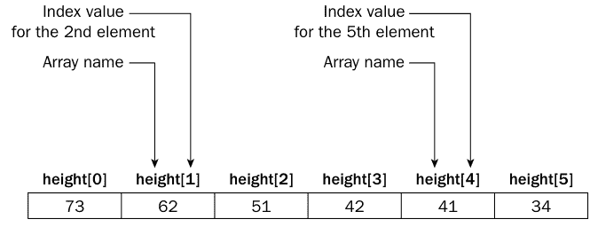

Figure 4-1

## 声明数组

你声明数组的方式与到目前为止所见的变量声明方式基本相同，唯一的区别是数组名后面紧跟的方括号内指定了数组中的元素个数。例如，你可以用下面的声明语句声明上一幅图所示的整数数组 height：

```
long height[6];
```

因为每个 long 值在内存中占用 4 字节，整个数组需要 24 字节。数组可以是任意大小，受限于运行程序的计算机所拥有的内存量。

你可以声明任意类型的数组。例如，要声明用于存储一系列发动机容量和功率输出的数组，可以写如下内容：

```
double cubic_inches[10];    // Engine size
double horsepower[10];     // Engine power output
```

如果你对汽车机械感兴趣，这将使你能够存储多达 10 台发动机的立方容量和功率输出，索引值从 0 到 9。就像之前对其他变量所做的那样，你可以在单个语句中声明给定类型的多个数组，但在实践中，最好将变量分别声明在不同的语句中。

## 试一试   使用数组

作为使用数组练习的基础，假设你记录了每次为汽车加油的汽油量以及每次的里程表读数。你可以编写一个程序来分析这些数据，以查看每次加油时的油耗情况：

```
// Ex4_01.cpp
// Calculating gas mileage
#include <iostream>
```
```
#include <iomanip>

using std::cin;
using std::cout;
using std::endl;
using std::setw;

int main()
{
    const int MAX = 20;                     // Maximum number of values
    double gas[ MAX ];                      // Gas quantity in gallons
    long miles[ MAX ];                      // Odometer readings
    int count = 0;                          // Loop counter
    char indicator = 'y';                   // Input indicator

    while( (indicator == 'y' || indicator == 'Y') && count < MAX )
    {
        cout << endl
             << "Enter gas quantity: ";
        cin >> gas[count];                  // Read gas quantity
        cout << "Enter odometer reading: ";
        cin >> miles[count];                // Read odometer value

        ++count;
        cout << "Do you want to enter another(y or n)? ";
        cin >> indicator;
    }

    if(count <= 1)                          // count = 1 after 1 entry completed
    {                                       // ... we need at least 2
        cout << endl
             << "Sorry - at least two readings are necessary.";
        return 0;
    }

    // Output results from 2nd entry to last entry
    for(int i = 1; i < count; i++)
        cout << endl
             << setw(2) << i << "."             // Output sequence number
             << "Gas purchased = " << gas[i] << " gallons" // Output gas
             << " resulted in "                 // Output miles per gallon
             << (miles[i] - miles[i - 1])/gas[i] << " miles per gallon.";

    cout << endl;
    return 0;
}
```

该程序假设每次都加满油箱，因此购买的汽油就是行驶记录距离所消耗的量。下面是此示例产生的输出示例：

```
Enter gas quantity: 12.8
Enter odometer reading: 25832
Do you want to enter another(y or n)? y

Enter gas quantity: 14.9
```
```
Enter odometer reading: 26337
Do you want to enter another(y or n)? y

Enter gas quantity: 11.8
Enter odometer reading: 26598
Do you want to enter another(y or n)? n
```

-   1. Gas purchased = 14.9 gallons resulted in 33.8926 miles per gallon.
-   2. Gas purchased = 11.8 gallons resulted in 22.1186 miles per gallon.

## 数组、字符串和指针

## 工作原理

因为你需要取两个里程表读数之差来计算所用汽油的行驶里程，所以你只使用第一组输入值的里程表读数——你忽略第一次购买的汽油，因为那是在更早行驶的里程中消耗的。

在输出中显示的第二阶段，交通状况一定非常糟糕——或者也许手刹一直都拉着。

用于存储输入数据的两个数组 gas 和 miles 的维度由名为 MAX 的常量值决定。通过更改 MAX 的值，你可以更改程序以适应不同的最大输入值数量。这种技术通常用于使程序在处理的信息量方面具有灵活性。当然，所有程序代码必须编写为考虑到数组维度，或由 const 变量指定的任何其他参数。但在实践中这并不困难，因此你没有理由不采用这种方法。你稍后还会看到如何在程序执行时为存储数据分配内存，这样你就不必提前固定为数据存储分配的内存量。

## 输入数据

数据值在 `while` 循环中读取。因为循环变量 `count` 可以从 0 运行到 `MAX - 1`，我们没有允许程序用户输入超过数组所能处理的值。你将变量 `count` 和 `indicator` 分别初始化为 0 和 'y'，以便 while 循环至少执行一次。每个所需输入值都有提示，并且值被读入适当的数组元素。用于存储特定值的元素由变量 `count` 决定，第一次输入时为 0。数组元素在 `cin` 语句中通过使用 `count` 作为索引来指定，然后 `count` 被递增以准备下一个值。

在输入每个值后，程序会提示确认是否输入另一个值。输入的字符被读入变量 `indicator`，然后在循环条件中进行测试。循环将终止，除非输入 'y' 或 'Y' 并且变量 `count` 小于指定的最大值 `MAX`。

输入循环结束后（无论以何种方式），`count` 的值包含每个数组中最后输入元素的索引值加一。（记住，你在输入每个新元素后递增它。）这将被检查以验证是否至少输入了两对值。如果不是这种情况，程序将以合适的消息结束，因为计算里程值需要两个里程表读数。

```
using std::endl;
using std::setw;

int main()
{
    int value[5] = { 1, 2, 3 };
    int junk [5];

    cout << endl;
    for(int i = 0; i < 5; i++)
        cout << setw(12) << value[i];

    cout << endl;
    for(int i = 0; i < 5; i++)
        cout << setw(12) << junk[i];

    cout << endl;
    return 0;
}
```

在此示例中，你声明了两个数组，其中第一个 value 部分初始化，第二个 junk 则完全未初始化。该程序生成两行输出，在我的计算机上看起来像这样：

```
          1           2           3           0           0
-858993460 -858993460 -858993460 -858993460 -858993460
```

第二行（对应 junk[0] 到 junk[4] 的值）在你的计算机上可能有所不同。

## 工作原理

数组 value 的前三个值是初始化值，最后两个的默认值是 0。在 junk 的情况下，所有值都是无意义的，因为你根本没有提供任何初始值。数组元素包含上次使用这些内存位置的程序遗留的任何值。

一种方便地将整个数组初始化为零的方法是简单地指定单个初始化值为 0。例如：

```
long data[100] = {0};      // Initialize all elements to zero
```

此语句声明数组 data，所有一百个元素都用 0 初始化。第一个元素由大括号之间的值初始化，其余元素初始化为零，因为你省略了这些值。

你也可以省略数值类型数组的维度，只要提供初始化值即可。数组中的元素数量由你指定的初始化值的数量决定。例如，数组声明

```
int value[] = { 2, 3, 4 };
```

定义了一个具有三个元素的数组，其初始值分别为 2、3 和 4。


## 字符数组和字符串处理

类型为 char 的数组称为字符数组，通常用于存储字符字符串。字符字符串是由一系列字符组成的序列，后面附加一个特殊字符以指示字符串的结束。字符串终止字符表示字符串的结束，该字符由转义序列 '\0' 定义，有时也称为空字符，即所有位均为零的字节。这种形式的字符串通常被称为 C 风格字符串，因为这种定义字符串的方式是在 C 语言中引入的，而 C++ 正是由 Bjarne Stroustrup 在此基础上发展而来。这并不是你可以使用字符串的唯一表示形式——本书后面还会介绍其他形式。特别是，C++/CLI 程序使用不同的字符串表示形式，而 MFC 定义了 CString 类来表示字符串。

C 风格字符串在内存中的表示如图 4-2 所示。

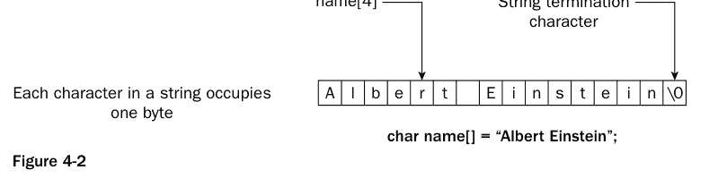

图 4-2

图 4-2 说明了字符串在内存中的外观，并展示了一种我稍后会提到的字符串声明形式。

> 字符串中的每个字符占用一个字节，因此加上终止的空字符，字符串所需的字节数比字符串中包含的字符数多一个。

你可以声明一个字符数组并用字符串字面量初始化它。例如：

```
char movie_star[15] = "Marilyn Monroe";
```

请注意，终止符 '\0' 会由编译器自动提供。如果你显式地在字符串字面量中包含它，就会得到两个。 然而，你必须在分配给数组的元素数量中为终止空字符留出空间。

你可以让编译器为你计算已初始化数组的长度，就像你在图 4-1 中看到的那样。这里是另一个例子：

```
char president[] = "Ulysses Grant";
```

由于维度未指定，编译器会为容纳初始化字符串的元素分配足够的空间，外加终止空字符。在这种情况下，它为数组 president 分配了 14 个元素。当然，如果你以后想用这个数组存储不同的字符串，其长度（包括终止空字符）不得超过 14 字节。一般来说，确保数组足够大以容纳你随后可能想要存储的任何字符串是你的责任。

## 字符串输入

`<iostream>` 头文件包含了一系列用于从键盘读取字符的函数定义。这里要介绍的是 `getline()` 函数，它读取通过键盘输入的字符序列并将其存储为以 \0 终止的字符串保存在字符数组中。你通常会像这样使用 `getline()` 函数语句：

```
const int MAX = 80;              // Maximum string length including \0
char name[MAX];                  // Array to store a string
cin.getline(name, MAX, '\n');   // Read input line as a string
```

这些语句首先声明一个包含 MAX 个元素的 char 数组 name，然后使用 `getline()` 函数从 cin 读取字符。数据源 cin 的写法如图所示，用句点将其与函数名分隔开。`getline()` 函数参数的意义如图 4-3 所示。

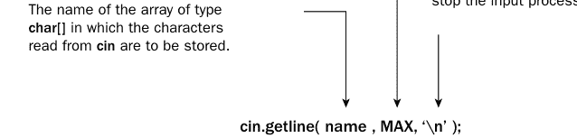

图 4-3

由于 `getline()` 函数的最后一个参数是 '\n'（换行或行尾字符），第二个参数是 MAX，因此字符会从 cin 中读取，直到读取到 '\n' 字符，或已读取 MAX - 1 个字符，以先发生者为准。读取的最大字符数为 MAX - 1 而非 MAX，是为了给存储在数组中的字符序列末尾附加的 '\0' 字符留出空间。'\n' 字符是在你按下键盘上的回车键时生成的，因此通常是最方便的结束输入的字符。你也可以通过更改最后一个参数来指定其他字符。'\n' 不会存储在输入数组 name 中，但正如我所说，输入字符串在数组末尾会加上一个 '\0'。

当我们稍后讨论类时，你将学到更多关于这种语法形式的内容。在此期间，我们就姑且接受它并在示例中使用它。

### Try It Out 编程实践 字符串

你现在已具备足够的知识来编写一个简单的程序来读取一个字符串然后计算其包含的字符数。

// Ex4_03.cpp
// Counting string characters
#include <iostream>
using std::cin;

```
using std::cout;
using std::endl;

int main()
{
    const int MAX = 80;                 // Maximum array dimension
    char buffer[MAX];                   // Input buffer
    int count = 0;                      // Character count

    cout << "Enter a string of less than 80 characters:\n";
    cin.getline(buffer, MAX, '\n');     // Read a string until \n

    while(buffer[count] != '\0')       // Increment count as long as
        count++;                        // the current character is not null

    cout << endl
         << "The string \"" << buffer
         << "\" has " << count << " characters.";

    cout << endl;
    return 0;
}
```

该程序的典型输出如下：

```
Enter a string of less than 80 characters:
Radiation fades your genes

The string "Radiation fades your genes" has 26 characters.
```

## How It Works

该程序声明了一个字符数组 buffer，并在显示输入提示后从键盘读取字符字符串到该数组中。从键盘读取在用户按下 *Return* 时结束，或在读取 MAX−1 个字符后结束。

使用了一个 while 循环来计算读取的字符数。只要使用 `buffer[count]` 引用的当前字符不是 '\0'，循环就会继续。在原生 C++ 中，在遍历数组时对当前字符进行这种检查是一种常见技术。循环中唯一的动作是为每个非空字符递增 count。

还有一个库函数 `strlen()`，可以帮你省去自己编码的麻烦。如果你使用它，需要在程序中包含 `<cstring>` 头文件，使用如下的 `#include` 指令：

```
#include <cstring>
```

头文件名中的 ‘c’ 表示该文件包含属于 C 语言库的定义，而该库是 C++ 标准库的一部分。该头文件还包含 `wcslen()` 函数，它会返回宽字符字符串的长度。

使用 `strlen()` 函数，你可以用以下语句替换 while 循环：

```
count = std::strlen(buffer);
```

参数是包含字符串的数组名，`strlen()` 函数返回字符串长度作为 `size_t` 类型的无符号整数。许多标准库函数返回 `size_t` 类型的值，而 `size_t` 类型是在标准库中使用 `typedef` 语句定义为等同于其中一种基本类型，通常是 unsigned int。 使用 `size_t` 而不是直接使用基本类型的原因是，它允许在不同的 C++ 实现中实际类型具有灵活性。C++ 标准允许基本类型所容纳的值范围有所变化以充分利用给定的硬件架构，而 `size_t` 可以定义为在当前机器环境中最合适的等效基本类型。

最后在示例中，使用单个输出语句显示字符串和字符计数。请注意使用转义字符 `\"` 来输出双引号。

## 多维数组

到目前为止你所定义的一维数组被称为 **一维** 数组。数组也可以有多个索引值，在这种情况下称为 **多维** 数组。假设你有一个田地，里面种植了豆类植物，每行 10 株，田地共有 12 行这样的行（总共 120 株植物）。你可以使用以下语句声明一个数组来记录每株植物生产的豆子重量：

```
double beans[12][10];
```

这声明了二维数组 `beans`，第一个索引为行号，第二个索引为行内的编号。要引用任何特定元素需要两个索引。例如，你可以用以下语句设置第三行第五株植物对应的元素值：

```
beans[2][4] = 10.7;
```

请记住索引值从零开始，因此行索引值为 2，行内第五株植物的索引为 4。

作为一名成功的豆农，你可能有多个种植豆子的相同模式的田地。假设你有八个田地，你可以使用三维数组来记录这些田地的数据，声明如下：

```
double beans[8][12][10];
```

这记录了每个田地中所有植物的生产情况，最左边的索引引用特定的田地。如果你将来在国际范围内从事豆类种植，你可以使用四维数组，额外的维度指定国家。假设你作为销售员和农民一样优秀，为了满足需求而种植如此数量的豆子可能会开始影响臭氧层。

数组在内存中以最右边的索引值变化最快的方式存储。因此数组 `data[3][4]` 是三个各含四个元素的一维数组。该数组的排列如图 4-4 所示。

数组的元素存储在连续的内存块中，如图 4-4 中的箭头所示。第一个索引选择数组中的特定行，第二个索引选择行内的元素。


# 第4章

to 六个字符串，每个字符串最长可达 80 个字符（包括编译器自动添加的终止空字符）。数组的初始化字符串用大括号括起来并用逗号分隔。

> 这种方式使用数组的一个缺点是几乎总是会留下未使用的内存。所有字符串都少于 80 个字符，数组每一行中多余的元素都被浪费了。

你也可以让编译器计算出你有多少个字符串，通过省略第一个数组维度并按如下方式声明它：

```
char stars[][80] = { "Robert Redford",
"Hopalong Cassidy",
"Lassie",
"Slim Pickens",
"Boris Karloff",
"Oliver Hardy"
};
```

这会使编译器定义第一个维度以容纳你指定的初始化字符串的数量。因为你有六个，所以结果与之前完全相同，但它避免了出错的可能性。在这里你不能同时省略两个数组维度。对于具有两个或更多维度的数组，最右边的维度必须始终定义。

> 注意声明末尾的分号。当数组有初始化值时，很容易忘记它。

当你需要在以下语句中引用一个字符串用于输出时，只需指定第一个索引值即可：

```
cout << endl                  // Output star name
    << "Your lucky star is " << stars[dice - 1];
```

单个索引值选择一个特定的 80 元素子数组，输出操作会显示直到终止空字符的内容。索引指定为 dice - 1，因为骰子的值是从 1 到 6，而索引值显然需要从 0 到 5。

### 间接数据访问

到目前为止你所处理的变量提供了为你命名一个内存位置的能力，在其中存储特定类型的数据。变量的内容要么从外部源（如键盘）输入，要么从输入的其他值计算得出。C++ 中还有另一种变量，它不存储你通常输入或计算的数据，但极大地扩展了程序的强大功能和灵活性。这种变量称为指针。

### 什么是指针？

你用来存储数据值的每个内存位置都有一个地址。地址为你的 PC 硬件提供了引用特定数据项的手段。指针是一个变量，它存储另一个特定类型变量的地址。指针与任何其他变量一样具有变量名，并且还具有一种类型，该类型指定其内容所引用的变量种类。请注意，指针变量的类型包括它是指针这一事实。一个可以包含存储类型为 `int` 的值的内存位置地址的指针变量，其类型为“指向 int 的指针”。

### 声明指针

指针的声明与普通变量的声明类似，只是指针名前面有一个星号 *，以表示它是一个指针变量。例如，要声明类型为 long 的指针 pnumber，你可以使用以下语句：

```
long* pnumber;
```

该声明将星号写在靠近类型名的位置。如果你愿意，也可以这样写：

```
long *pnumber;
```

编译器完全不会介意；然而，变量 pnumber 的类型是“指向 long 的指针”，通常通过将星号放在靠近类型名的位置来表示。无论你选择以何种方式编写指针类型，都要保持一致。

你可以在同一语句中混合声明普通变量和指针。例如：

```
long* pnumber, number = 99;
```

这声明了类型为“指向 long 的指针”的指针 pnumber，如前所述，同时还声明了类型为 long 的变量 number。总体而言，最好将指针与其它变量分开声明；否则，该语句在变量类型方面可能显得具有误导性，特别是如果你更喜欢将 * 放在靠近类型名的位置时。以下语句看起来肯定更清晰，并且将声明放在单独的行上使你能够为它们分别添加注释，从而使程序更易于阅读。

```
long  number = 99;      // Declaration and initialization of long variable
long* pnumber;         // Declaration of variable of type pointer to long
```

在 C++ 中，使用以 p 开头的变量名来表示指针是一种常见约定。这使得更容易看出程序中哪些变量是指针，这反过来又可以使程序更容易理解。

让我们举一个例子来看看这是如何工作的，先不用担心它的用途。我很快就会讲到你如何使用指针。假设你有 long 整数变量 number，因为你在上面声明了它，包含值 99。你还有类型为指向 long 的指针 pnumber，你可以用它来存储变量 number 的地址。但你如何获得一个变量的地址呢？

### 取地址运算符

你需要的是 **取地址运算符**，&。这是一个一元运算符，用于获取变量的地址。它也称为引用运算符，原因我将在本章后面讨论。要设置我刚刚讨论的指针，你可以编写以下赋值语句：

```
pnumber = &number;              // Store address of number in pnumber
```

此操作的結果如圖 4-5 所示。

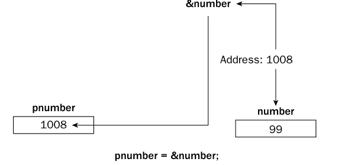

图 4-5

你可以使用运算符 & 来获取任何变量的地址，但你需要一个适当类型的指针来存储它。例如，如果你想存储一个 double 变量的地址，指针必须声明为类型 double*，即类型“指向 double 的指针”。

### 使用指针

取一个变量的地址并将其存储在指针中固然很好，但真正有趣的是你如何使用它。使用指针的基础是访问指针所指向的变量中的数据值。这是通过间接运算符 * 完成的。

### 间接运算符

你使用间接运算符 * 与指针一起访问它所指向的变量的内容。名称“间接运算符”源于数据是通过间接方式访问的。它也称为解引用运算符，而访问指针所指向的变量中的数据的过程称为解引用指针。

这个运算符的一个可能令人困惑的方面是，你现在对同一个符号 * 有几种不同的用途。它是乘法运算符，它也用作间接运算符，并且在指针的声明中使用。每次使用 * 时，编译器都能够通过上下文区分其含义。当你将两个变量相乘，例如 A*B 时，除了乘法运算之外，这个表达式没有其他有意义的解释。

### 为什么使用指针？

此时通常会冒出一个问题：“为什么要使用指针呢？”毕竟，取你已经知道的变量的地址并将其放入指针中以便解引用它似乎是一种可以避免的开销。使用指针有几个原因。

正如你很快就会看到的，你可以使用指针表示法对存储在数组中的数据进行操作，其执行速度通常比使用数组表示法更快。此外，当你稍后在书中定义自己的函数时，你会看到指针被广泛用于使函数能够访问在函数外部定义的大块数据，例如数组。最重要的是，你稍后还会看到，你可以动态地为变量分配空间，即在程序执行期间。这种能力允许你的程序根据程序的输入调整其内存使用。由于你事先不知道要动态创建多少个变量，因此实现此目的的主要方式是使用指针——因此请确保你掌握了这一点。

### 试一试   使用指针

你可以用一个例子来尝试指针操作的各个方面：

```
//Ex4_05.cpp
// Exercising pointers
#include <iostream>
using std::cout;
using std::endl;
using std::hex;
using std::dec;

int main()
{
    long* pnumber = NULL;            // Pointer declaration & initialization
    long number1 = 55, number2 = 99;

    pnumber = &number1;              // Store address in pointer
    *pnumber += 11;                  // Increment number1 by 11
    cout << endl
         << "number1 = " << number1
         << "   &number1 = " << hex << pnumber;

    pnumber = &number2;              // Change pointer to address of number2
    number1 = *pnumber*10;           // 10 times number2

    cout << endl
         << "number1 = " << dec << number1
         << "   pnumber = " << hex << pnumber
         << "   *pnumber = " << dec << *pnumber;

    cout << endl;
    return 0;
}
```

在我电脑上，这个例子生成以下输出：

```
number1 = 66     &number1 = 0012FEC8
number1 = 990    pnumber = 0012FEBC    *pnumber = 99
```

## 它是如何工作的

这个例子没有输入。所有操作都是使用变量的初始化值进行的。在将 number1 的地址存储到指针 pnumber 之后，number1 的值通过指针在以下语句中间接递增：

```
*pnumber += 11;            // Increment number1 by 11
```


这确保指针不包含会被接受为有效地址的地址，并为指针提供一个可以在 if 语句中检查的值，例如：

```
if(pnumber == NULL)
    cout << endl << "pnumber is null.";
```

当然，你也可以显式地用 0 初始化一个指针，这同样能确保它被赋予一个不指向任何东西的值。没有任何对象会被分配地址 0，因此实际上用 0 作为地址表示指针没有目标。尽管从可读性上来说可能稍差一些，如果你希望代码能在其他编译器上运行，使用 0 作为你希望为空的指针的初始化值是更可取的。

> 这也更符合 ISO/ANSI C++ 当前的“良好实践”，其论点是如果你在 C++ 中有一个具名的对象，它应该有一个类型；而 NULL 没有类型——它只是 0 的别名。正如你将在本章后面看到的，在 C++/CLI 中情况略有不同。

要使用 0 作为指针的初始化值，你只需写：

```
int* pnumber = 0;      // Pointer not pointing to anything
```

要检查指针是否包含有效地址，你可以使用语句：

```
if(pnumber == 0)
    cout << endl << "pnumber is null.";
```

同样地，你也可以使用语句：

```
if(!pnumber)
    cout << endl << "pnumber is null.";
```

该语句与前一个示例完全相同。

当然，你也可以使用形式：

```
if(pnumber != 0)
    // Pointer is valid, so do something useful
```

> NULL 指针所指向的地址包含垃圾值。你绝不能尝试解引用空指针，因为它会立即导致程序结束。

## 指向 char 的指针

类型为 char* 的指针具有一个有趣的特性：它可以用字符串字面量进行初始化。例如，我们可以用语句声明并初始化这样的指针：

```
char* proverb = "A miss is as good as a mile.";
```

这看起来与初始化 char 数组相似，但略有不同。这会创建一个字符串字面量（实际上是类型为 const char 的数组），其中包含引号之间的字符字符串并以 /0 终止，并将字面量的地址存储在指针 proverb 中。字面量的地址将是其第一个字符的地址。这在图 4-6 中显示。

1. 指针 proverb 被创建。

3. 字符串的地址被存储在指针中。

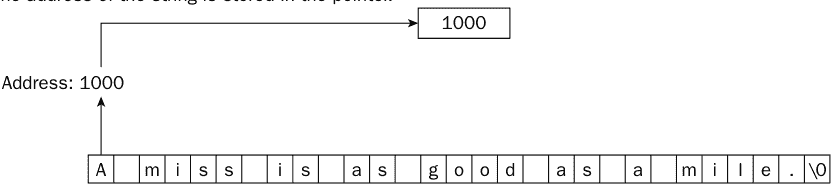

2. 常量字符串被创建，以 \0 终止。

图 4-6

## 试一试   使用指针的幸运星

你可以用指针而不是数组重写幸运星示例，看看效果如何：

```
// Ex4_06.cpp
// Initializing pointers with strings
#include <iostream>
using std::cin;
using std::cout;
using std::endl;

int main()
{
    char* pstr1 = "Robert Redford";
    char* pstr2 = "Hopalong Cassidy";
    char* pstr3 = "Lassie";
    char* pstr4 = "Slim Pickens";
    char* pstr5 = "Boris Karloff";
    char* pstr6 = "Oliver Hardy";
    char* pstr  = "Your lucky star is ";

    int dice = 0;

    cout << endl
        << " Pick a lucky star!"
        << " Enter a number between 1 and 6: ";
    cin >> dice;

    cout << endl;
    switch(dice)
    {
        case 1: cout << pstr << pstr1;
                break;

        case 2: cout << pstr << pstr2;
```

```
{
    char* pstr[] = { "Robert Redford",    // Initializing a pointer array
        "Hopalong Cassidy",
        "Lassie",
        "Slim Pickens",
        "Boris Karloff",
        "Oliver Hardy"
    };
    char* pstart = "Your lucky star is ";

    int dice = 0;

    cout << endl
        << " Pick a lucky star!"
        << " Enter a number between 1 and 6: ";
    cin >> dice;

    cout << endl;
    if(dice >= 1 && dice <= 6)            // Check input validity
        cout << pstart << pstr[dice - 1]; // Output star name
    else
        cout << "Sorry, you haven't got a lucky star."; // Invalid input

    cout << endl;
    return 0;
}
```

## 工作原理

在这种情况下，你几乎获得了所有可能世界中最好的东西。你有一个指向类型 char 的一维指针数组声明，使得编译器可以根据初始化字符串的数量确定维度。从而产生的内存使用情况如图 4-7 所示。

与使用“普通”数组相比，指针数组在空间开销方面更少。以数组为例，你需要使每一行的长度与最长字符串相同，六行每行十七字节共 102 字节，因此使用指针数组我们节省了整整 -1 字节！出了什么问题？简单事实是，对于这么少且相对较短的字符串，额外的指针数组的大小是显著的。如果你处理的是更多、更长且长度更可变的字符串，就会节省空间。

节省空间并不是使用指针的唯一优势。在很多情况下，你也能节省时间。想象一下，如果你想把“Oliver Hardy”移到第一个位置，把“Robert Redford”移到末尾。使用上面的指针数组，你只需交换指针——字符串本身保持原位。如果你只是将这些存储为字符串，如 Ex4_04.cpp 中所做的那样，就需要大量复制——你需要将整个字符串“Robert Redford”复制到临时位置，同时将“Oliver Hardy”复制到其位置，然后再将“Robert Redford”复制到末尾位置。这需要显著更多的计算机时间来执行。

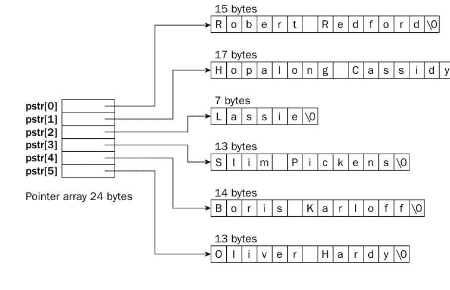

图 4-7

总内存为 103 字节

由于你使用 pstr 作为数组的名称，保存输出消息开头的变量需要不同；它被称为 pstart。你通过一个非常简单的 if 语句选择要输出的字符串，与示例的原始版本类似。你要么显示星星选择，要么在用户输入无效值时显示合适的消息。

程序编写方式的一个弱点是，代码假设有六个选项，即使编译器是从你提供的初始化字符串数量为指针数组分配空间。因此，如果你在列表中添加一个字符串，你必须更改程序的其他部分以考虑这一点。最好能够添加字符串并让程序自动适应字符串的数量。

## sizeof 运算符

一个新的运算符可以帮助我们做到这一点。sizeof 运算符产生一个类型为 size_t 的整数值，给出其操作数占用的字节数。你可以回忆起之前的讨论，size_t 是标准库定义的类型，通常与 unsigned int 相同。

看一下引用前一个示例中变量 dice 的语句：

```
cout << sizeof dice;
```

表达式 sizeof dice 的值是 4，因为 dice 被声明为类型 int，因此占用 4 字节。因此该语句输出值 4。

sizeof 运算符可以应用于数组中的元素，也可以应用于整个数组。当运算符单独应用于数组名时，它会产生整个数组占用的字节数，而当它应用于带适当索引值或值的单个元素时，结果是该元素占用的字节数。因此，在最后一个示例中，我们可以用表达式输出 pstr 数组中的元素数量：

```
cout << (sizeof pstr)/(sizeof pstr[0]);
```

表达式 (sizeof pstr)/(sizeof pstr[0]) 将整个指针数组占用的字节数除以数组第一个元素占用的字节数。因为数组中每个元素占用的内存量相同，结果就是数组中的元素数量。

> 请记住 pstr 是一个指针数组——对数组或单个元素使用 sizeof 运算符不会告诉我们文本字符串占用的内存。

你也可以将 sizeof 运算符应用于类型名而不是变量，在这种情况下，结果是该类型变量占用的字节数。在这种情况下，类型名应放在括号之间。例如，在执行语句后，

```
size_t_size = sizeof(long);
```

变量 long_size 将具有值 4。变量 size 被声明为类型 size_t，以匹配 sizeof 运算符产生的值的类型。使用不同的整数类型作为 size 可能会导致编译器发出警告消息。

## 试一试 使用 sizeof 运算符

你可以修改上一个示例以使用 sizeof 运算符，使代码自动适应任意数量的字符串值以供选择：

```
// Ex4_08.cpp
// Flexible array management using sizeof
#include <iostream>
using std::cin;
using std::cout;
using std::endl;

int main()
{
    char* pstr[] = { "Robert Redford",     // Initializing a pointer array
                     "Hopalong Cassidy",
                     "Lassie",
                     "Slim Pickens",
                     "Boris Karloff",
                     "Oliver Hardy"
                    };
    char* pstart = "Your lucky star is ";


# 第4章

如果你尝试用如下语句修改字符数组：

```
*pstr[0] = "Stan Laurel";
```

程序将无法编译。

如果你尝试用如下语句将数组中的一个元素重新设置为指向一个字符：

```
*pstr[0] = 'X';
```

程序可以编译，但在执行该语句时会崩溃。

你肯定不希望出现程序在运行时崩溃这类意外行为，而你可以避免这种情况。更好的声明方式如下：

```
const char* pstr[] = { "Robert Redford",  // Array of pointers
    "Hopalong Cassidy",  // to constants
    "Lassie",
    "Slim Pickens",
    "Boris Karloff",
    "Oliver Hardy"
};
```

在这种情况下，关于指针数组元素所指向字符串的常量性没有歧义。如果你现在试图修改这些字符串，编译器会在编译时将其标记为错误。

然而，你仍然可以合法地编写如下语句：

```
pstr[0] = pstr[1];
```

那些本应得到雷德福先生的幸运儿将改领卡西迪先生，因为两个指针现在指向同一个名字。请注意，这并没有改变指针数组元素所指向对象的值——而是改变了存储在 pstr[0] 中的指针值。因此，你也应该禁止这种修改，因为有些人可能认为老好人霍皮并没有罗伯特那样的性感魅力。你可以通过如下语句实现这一点：

```
// Array of constant pointers to constants
const char* const pstr[] = { "Robert Redford",
    "Hopalong Cassidy",
    "Lassie",
    "Slim Pickens",
    "Boris Karloff",
    "Oliver Hardy"
};
```

总而言之，你可以区分与 const、指针以及它们所指向对象相关的三种情况：

- 指向常量对象的指针
- 指向对象的常量指针
- 指向常量对象的常量指针

在第一种情况下，所指向的对象不能被修改，但我们可以将指针设置为指向其他对象：

```
const char* pstring = "Some text";
```

在第二种情况下，指针中存储的地址不能被改变，但所指向的对象可以被修改：

```
char* const pstring = "Some text";
```

最后，在第三种情况下，指针和所指向的对象都被定义为常量，因此两者都不能被修改：

```
const char* const pstring = "Some text";
```

*当然，所有这些都适用于指向任意类型的指针。这里使用指向 char 类型的指针纯粹是为了说明问题。*

### 指针与数组

在某些情况下，数组名的行为可以像指针一样。在大多数情况下，如果你单独使用一维数组的名称，它会自动转换为指向数组首元素的指针。请注意，当数组名用作 sizeof 运算符的操作数时，情况并非如此。

如果我们有以下声明：

```
double* pdata;
double data[5];
```

你可以编写如下赋值语句：

```
pdata = data;      // Initialize pointer with the array address
```

这是将数组 data 的第一个元素的地址赋给指针 pdata。单独使用数组名表示数组的地址。如果你将数组名 data 与索引值一起使用，则表示该索引值对应元素的内容。因此，如果你想将该元素的地址存储在指针中，必须使用取地址运算符：

```
pdata = &data[1];
```

这里，指针 pdata 包含数组第二个元素的地址。

### 指针算术

你可以对指针执行算术运算。在算术运算方面，你仅限于加法和减法，但你也可以比较指针值以产生逻辑结果。对指针进行算术运算隐式地假定指针指向一个数组，并且算术运算作用于指针中包含的地址。例如，对于指针 pdata，我们可以使用如下语句将数组 data 的第三个元素的地址赋给一个指针：

```
pdata = &data[2];
```

在这种情况下，表达式 pdata+1 将指向 data[3] 的地址，即 data 数组的第四个元素，因此你可以通过编写如下语句使指针指向该元素：

```
pdata += 1;      // Increment pdata to the next element
```

该语句将 pdata 中包含的地址增加数组 data 中一个元素所占的字节数。一般情况下，表达式 pdata+n（其中 n 可以是任何结果为整数的表达式）将 n*sizeof(double) 加到指针 pdata 所含的地址上，因为 pdata 被声明为指向 double 的指针类型。如图 4-8 所示。

double data[5];

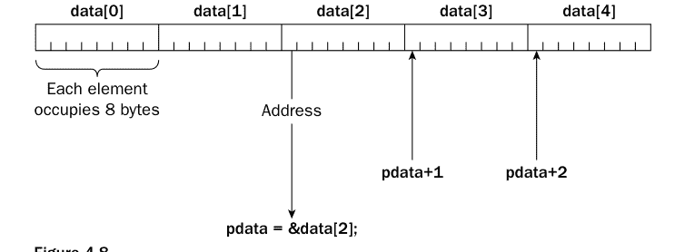

图 4-8

换句话说，指针的递增或递减是根据所指向对象的类型进行的。将指向 long 的指针加一，会将其内容改为下一个 long 地址，因此地址增加四。类似地，将指向 short 的指针加一，地址增加二。递增指针更常见的写法是使用递增运算符。例如：

```
pdata++;      // Increment pdata to the next element
```

这等同于 += 形式（而且比 += 形式更常用）。不过，我前面使用 += 形式是为了说明：虽然增量值实际指定为 1，但效果通常是大于 1 的增量，除非是指向 char 类型的指针。

> 对指针进行算术运算所得的地址，其取值范围可以是从数组首元素的地址到超出最后一个元素一个位置的地址。超出这些限制，指针的行为是未定义的。

当然，你可以解引用已经执行过算术运算的指针（否则，这样做就没有什么意义了）。例如，假设 pdata 仍然指向 data[2]，如下语句：

```
*(pdata + 1) = *(pdata + 2);
```

等同于：

```
data[3] = data[4];
```

当你希望在递增指针所含地址后对其进行解引用时，括号是必需的，因为间接寻址运算符（*）的优先级高于算术运算符 + 或 -。如果你写成表达式 *pdata + 1（而不是 *(pdata + 1)），这会将 pdata 所含地址处的值加 1，相当于 data[2] + 1。由于这不是左值，在之前的赋值语句中使用它会导致编译器生成错误消息。

你可以将数组名当作指针来寻址数组的元素。如果你有和之前相同的一维数组，声明如下：

```
long data[5];
```

使用指针表示法，你可以将元素 data[3] 表示为 *(data + 3)。这种表示法可以通用，因此对于元素 data[0]、data[1]、data[2]，你可以分别写成 *data、*(data + 1)、*(data+2) 等。

### 数组名作为指针

你可以用一个计算质数的程序来练习数组寻址的这一方面（质数只能被自身和 1 整除）。

```
// Ex4_09.cpp
// Calculating primes
#include <iostream>
#include <cmath>
using std::cout;
using std::endl;
using std::setw;

int main()
{
  const int MAX = 100; // Number of primes required
  long primes[MAX] = { 2,3,5 }; // First three primes defined
  long trial = 5; // Candidate prime
  int count = 3; // Count of primes found
  int found = 0; // Indicates when a prime is found

  do
  {
    trial += 2; // Next value for checking
    found = 0; // Set found indicator
    for(int i = 0; i < count; i++) // Try division by existing primes
    {
      found = (trial % *(primes + i)) == 0; // True for exact division
      if(found) // If division is exact
        break; // it's not a prime
    }
    if (found == 0) // We got one...
  }


*(primes + count++) = trial;  // ...so save it in primes array
}while(count < MAX);

// Output primes 5 to a line
for(int i = 0; i < MAX; i++)
{
    if(i % 5 == 0)                // New line on 1st, and every 5th line
        cout << endl;
    cout << setw(10) << *(primes + i);
}
cout << endl;
return 0;
}

如果编译并执行此示例，你应该会得到以下输出：

2       3       5       7       11
13      17      19      23      29
31      37      41      43      47
53      59      61      67      71
73      79      83      89      97
101     103     107     109     113
127     131     137     139     149
151     157     163     167     173
179     181     191     193     197
199     211     223     227     229
233     239     241     251     257
263     269     271     277     281
283     293     307     311     313
317     331     337     347     349
353     359     367     373     379
383     389     397     401     409
419     421     431     433     439
443     449     457     461     463
467     479     487     491     499
503     509     521     523     541

## 如何工作

你有通常的 #include 语句用于 <iostream> 头文件进行输入输出，以及 <iomanip> 因为你将使用流操纵符来设置输出的字段宽度。

你使用常量 MAX 来定义程序要产生的素数个数。存储结果的 primes 数组，其前三个素数已经预先定义以启动过程。所有工作都在两个循环中完成：外层的 do-while 循环，它挑选下一个要检查的值并在它是素数时将其添加到 primes 数组中，以及实际检查该值是否素数的内层 for 循环。

for 循环中的算法非常简单，并且基于这样一个事实：如果一个数不是素数，它必须能被迄今为止找到的素数之一整除——所有这些素数都小于所讨论的数，因为所有数要么是素数，要么是素数的乘积。事实上，只需要检查小于或等于该数平方根的素数的除法即可，所以这个示例并不像可能的那样高效。

```
found = (trial % *(primes + i)) == 0;   // True for exact division
```

此语句将变量 found 设置为 1，如果 trial 中的值除以当前素数 *(primes + i)（记住这等价于 primes[i]）没有余数，则为 1，否则为 0。if 语句会导致 for 循环在 found 的值为 1 时终止，因为在这种情况下 trial 中的候选值不能是素数。

在 for 循环结束（无论出于何种原因）后，需要决定 trial 中的值是否素数。这由指示变量 found 的值表示。

```
*(primes + count++) = trial;   // ...so save it in primes array
```

如果 trial 确实包含一个素数，此语句将该值存储在 primes[count] 中，然后通过后缀递增运算符递增 count。

在找到 MAX 个素数后，它们会以 10 个字符的字段宽度输出，每行 5 个，这是由于以下语句的结果：

```
if(i % 5 == 0)               // New line on 1st, and every 5th line
    cout << endl;
```

当 i 具有值 0、5、10 等时，这会开始新的一行。

## 试试看 重新审视字符计数

为了了解指针表示法中字符串的处理方式，你可以制作一个你之前看过的用于统计字符串中字符数的程序的版本：

// Ex4_10.cpp
// Counting string characters using a pointer
#include <iostream>
using std::cin;
using std::cout;
using std::endl;

int main()
{
    const int MAX = 80;                 // Maximum array dimension
    char buffer[MAX];                   // Input buffer
    char* pbuffer = buffer;             // Pointer to array buffer

    cout << endl                       // Prompt for input
         << "Enter a string of less than "
         << MAX << " characters:"
         
<< endl;

cin.getline(buffer, MAX, '\n');      // Read a string until \n

while(*pbuffer)                     // Continue until \0
    pbuffer++;

cout << endl
    << "The string \"" << buffer
    << "\" has " << pbuffer - buffer << " characters.";
cout << endl;
return 0;
}

以下是此示例的典型输出示例：

Enter a string of less than 80 characters:
The tigers of wrath are wiser than the horses of instruction.
The string "The tigers of wrath are wiser than the horses of instruction." has 61 characters.

## 如何工作

这里程序使用指针 pbuffer 而不是数组名 buffer 操作。你不需要 count 变量，因为指针在 while 循环中递增直到找到 '\0'。当找到 '\0' 字符时，pbuffer 将包含字符串中该位置的地址。因此，输入字符串中字符数的计数就是指针 pbuffer 中存储的地址与数组 buffer 开头的地址之间的差值。

你也可以在循环中递增指针，像这样写循环：

```
while(*pbuffer++);                  // Continue until \0
```

现在循环不包含语句，只有测试条件。这可以正常工作，除了指针会在遇到 \0 后递增，所以地址会比字符串的最后一个位置多一个。因此，你需要将字符串中字符数的计数表示为 pbuffer - buffer - 1。

请注意，这里你不能以使用指针的方式使用数组名。表达式 buffer++ 在严格意义上是非法的，因为你不能修改数组名所代表的地址值。即使你可以在表达式中使用数组名，就好像它是指针一样，它并不是指针，因为它所代表的地址值是固定的。

## 使用指针与多维数组

使用指针存储一维数组的地址相对直接，但对于多维数组，事情可能会变得有点复杂。如果你不打算这样做，可以跳过本节，因为它有点晦涩；然而，如果你有 C 语言的先前经验，本节值得一看。

如果你必须使用指针与多维数组，你需要清楚地知道发生了什么。作为说明，你可以使用如下声明的数组 beans：

```
double beans[3][4];
```

你可以按如下方式声明并为指针 pbeans 分配值：

```
double* pbeans;
pbeans = &beans[0][0];
```

这里你将指针设置为数组的第一个元素的地址，其类型为 double。你也可以用以下语句将指针设置为数组第一行的地址：

```
pbeans = beans[0];
```

这等价于使用一维数组的名称，其被替换为其地址。我们在之前的讨论中使用了它；然而，因为 beans 是一个二维数组，你不能用以下语句在指针中设置地址：

```
pbeans = beans;      // Will cause an error!!
```

问题是类型问题。你定义的指针类型是 double*，但数组的类型是 double[3][4]。存储此数组地址的指针必须为 double*[4] 类型。C++ 将数组的维度与其类型关联起来，上面的语句只有在指针已使用所需维度声明时才是合法的。这需要比你迄今为止见过的更复杂的记法：

```
double (*pbeans)[4];
```

这里的括号是必不可少的；否则，你将声明一个指针数组。现在之前的语句是合法的，但此指针只能用于存储具有所示维度的数组的地址。

## 多维数组的指针表示法

你可以使用数组名与指针表示法引用数组的元素。你可以用两种方式引用你之前声明的数组 beans 的每个元素，该数组有三行四列元素：

- 使用数组名与两个索引值。
- 使用数组名以指针表示法

因此，以下两个语句是等价的：

```
beans[i][j]
*(*(beans + i) + j)
```

让我们看看它们是如何工作的。第一行使用正常的数组索引引用数组第 i 行中偏移量为 j 的元素。


# 第4章

你可以由内向外地分析第二行的含义。beans 指数组首行的地址，所以 beans + i 指数组的第 i 行。表达式 *(beans + i) 是第 i 行第一个元素的地址，因此 *(beans + i) + j 是第 i 行中偏移量为 j 的元素的地址。因此，整个表达式指代该元素的值。

如果你真的想让代码晦涩难懂——但并不建议你这样做——下面两个语句混合了数组和指针表示法，也同样是对数组中同一个元素的合法引用：

```
* (beans[i] + j)
(* (beans + i))[j]
```

关于指针的使用，还有一个真正最为重要的方面：为变量动态分配内存的能力。你将在接下来学习这一点。

# 动态内存分配

在程序中使用一组固定的变量会带来很大的限制。应用程序中经常需要根据程序的输入数据，在执行时决定为不同类型的变量分配多少空间。对于一组输入数据，程序中使用一个大的整型数组可能很合适；而对于另一组输入数据，则可能需要一个大的浮点型数组。显然，因为任何动态分配的变量都不可能已经在编译时定义，所以它们无法在源程序中被命名。当它们被创建时，通过内存中的地址来标识，该地址保存在一个指针中。借助指针的功能和 Visual C++ 2005 中的动态内存管理工具，编写具有这种灵活性的程序既快捷又容易。

### 自由存储区，又称堆

在大多数情况下，当你的程序执行时，计算机中会存在未使用的内存。这种未使用的内存在 C++ 中被称为堆（heap），有时也称为自由存储区（free store）。你可以使用 C++ 中的一个特殊运算符在自由存储区内为给定类型的新变量分配空间，该运算符返回所分配空间的地址。这个运算符是 new，与之配套的是 delete 运算符，用于释放之前由 new 分配的内存。

你可以在程序的某一部分为一些变量在自由存储区中分配空间，然后在处理完相关变量后释放已分配的空间并将其归还给自由存储区。这使得该内存在同一程序稍后可以由其他动态分配的变量重新使用。

每当你需要为只能在运行时确定的项分配内存时，你都会希望使用自由存储区中的内存。一个例子可能是分配内存来保存应用程序用户输入的字符串。你无法提前知道这个字符串需要多大，因此需要在运行时使用 new 运算符为字符串分配内存。稍后，你将学习使用自由存储区为数组动态分配内存，其中数组的维度由用户在运行时确定。这可能是一种非常强大的技术；它能让你非常高效地使用内存，并且在许多情况下，它使程序能够处理更大得多的问题，涉及的数据量也远比原本可能的方式要多。

### new 和 delete 运算符

假设你需要为一个 double 变量分配空间。你可以定义一个指向 double 类型的指针，然后请求在执行时分配内存。你可以使用 new 运算符，通过以下语句来完成：

```
double* pvalue = NULL;    // Pointer initialized with null
pvalue = new double;       // Request memory for a double variable
```

这里正好回顾一下：所有指针都应被初始化。动态使用内存通常涉及许多指针的参与，因此确保它们不包含垃圾值非常重要。你应该设法做到：如果一个指针不包含合法的地址值，就将其设置为 0。

上面第二行代码中的 new 运算符应返回自由存储区中分配给 double 变量的内存地址，该地址存储在指针 pvalue 中。然后你可以使用这个指针，通过你已经见过的间接运算符来引用该变量。例如：

```
*pvalue = 9999.0;
```

当然，内存可能没有被分配，因为自由存储区已经用完，或者自由存储区因先前的使用而碎片化，这意味着没有足够数量的连续字节来容纳你希望为其获得空间的变量。不过，你不必为此过于担心。在 ANSI 标准 C++ 中，如果内存因任何原因无法分配，new 运算符将抛出异常，从而终止你的程序。异常是 C++ 中用于发出错误信号的一种机制，你将在第 6 章中学习这些内容。

你还可以初始化由 new 创建的变量。以由 new 分配且地址存储在 pvalue 中的 double 变量为例，你可以在创建它时将值设置为 999.0，使用如下语句：

```
pvalue = new double(999.0);    // Allocate a double and initialize it
```

当你不再需要一个已动态分配的变量时，可以使用 delete 运算符释放它在自由存储区中占用的内存：

```
delete pvalue;                 // Release memory pointed to by pvalue
```

这可以确保该内存随后可以被另一个变量使用。如果你不使用 delete，随后又在指针 pvalue 中存储了不同的地址值，那么将无法释放该内存或使用它所包含的变量，因为对该地址的访问已经丢失。在这种情况下，你就遇到了所谓的内存泄漏，尤其是当这种情况在你的程序中反复出现时。

### 为数组动态分配内存

为数组动态分配内存非常简单。如果你想分配一个 char 类型的数组，假设 `pstr` 是一个指向 char 的指针，你可以编写如下语句：

```
pstr = new char[20];       // Allocate a string of twenty characters
```

这将为一个包含 20 个字符的 char 数组分配空间，并将其地址存储在 `pstr` 中。

要删除你刚刚在自由存储区中创建的数组，你必须使用 delete 运算符。语句如下：

```
delete [] pstr;          // Delete array pointed to by pstr
```

注意这里使用方括号表示你正在删除的是一个数组。从自由存储区中删除数组时，你应该始终包含方括号，否则结果不可预测。还要注意，这里不指定任何维度，只使用 []。

当然，`pstr` 指针此时包含的是可能已经被分配给其他用途的内存的地址，因此绝对不应再使用它。当你使用 delete 运算符丢弃之前分配的某些内存时，你应该始终将指针重新设置为 0，如下所示：

```
pstr = 0;                // Set pointer to null
```

### 动手试一试：使用自由存储区

你可以通过重写一个计算任意数量素数的程序，实际了解动态内存分配是如何工作的，这次使用自由存储区中的内存来存储这些素数。

```
// Ex4_11.cpp
// Calculating primes using dynamic memory allocation
#include <iostream>
#include <iomanip>
using std::cin;
using std::cout;
using std::endl;
using std::setw;

int main()
{
    long* prime = 0;              // Pointer to prime array
    long trial = 5;               // Candidate prime
    int count = 3;                // Count of primes found
    int found = 0;                // Indicates when a prime is found
    int max = 0;                  // Number of primes required

    cout << endl
         << "Enter the number of primes you would like (at least 4): ";
    cin >> max;                   // Number of primes required

    if(max < 4)                   // Test the user input, if less than 4
```


```
max = 4;                          // ensure it is at least 4

pprime = new long[max];

*pprime = 2;                      // Insert three
*(pprime + 1) = 3;                // seed primes
*(pprime + 2) = 5;

do
{
    trial += 2;                   // Next value for checking
    found = 0;                    // Set found indicator
    for(int i = 0; i < count; i++)    // Division by existing primes
    {
        found = (trial % *(pprime + i)) == 0; // True for exact division
        if(found)                 // If division is exact
            break;                // it's not a prime
    }
    if (found == 0)               // We got one...
        *(pprime + count++) = trial;  // ...so save it in primes array
} while(count < max);

// Output primes 5 to a line
for(int i = 0; i < max; i++)
{
    if(i % 5 == 0)                // New line on 1st, and every 5th line
        cout << endl;
    cout << setw(10) << *(pprime + i);
}
delete [] pprime;                 // Free up memory
pprime = 0;                       // and reset the pointer
cout << endl;
return 0;
}
```

以下是此程序的输出示例：

```
Enter the number of primes you would like (at least 4): 20

    2       3       5       7      11
   13      17      19      23      29
   31      37      41      43      47
   53      59      61      67      71
```

## 如何工作

事实上，该程序与之前的版本类似。在 int 变量 max 中接收所需素数的数量后，你使用 new 运算符在自由存储区中分配该大小的数组。请注意，你已确保 max 不小于 4。这是因为程序需要在自由存储区中为至少三个种子素数加上一个新素数分配空间。你通过将变量 max 放在数组类型说明之后方括号之间来指定所需数组的大小：

```
pprime = new long[max];
```

你将 new 分配的内存区域的地址存储在指针 pprime 中。如果无法分配内存，程序会在此点终止。

在成功分配存储素数值的内存后，前三个数组元素被设置为前三个素数的值：

```
*pprime = 2;              // Insert three
*(pprime + 1) = 3;        // seed primes
*(pprime + 2) = 5;
```

你正在使用解引用运算符来访问数组的前三个元素。正如你之前看到的，第二和第三条语句中的括号是因为 * 运算符的优先级高于 + 运算符。

> 你不能为动态分配的数组元素指定初始值。如果你想为数组元素设置初始值，必须使用显式的赋值语句。

素数的计算与之前完全相同；唯一的变化是这里的指针名称 pprime 取代了你在上一版本中使用的数组名称 primes。同样，输出过程也相同。动态获取空间根本不是问题。分配后，它丝毫不影响计算的写法。

在使用完数组后，你使用 delete 运算符将其从自由存储区中移除，记得包含方括号以表明你正在删除的是一个数组。

```
delete [] pprime;          // Free up memory
```

虽然在这里不是必须的，但你也将指针设为 0：

```
pprime = 0;                // and reset the pointer
```

程序结束时，自由存储区中分配的所有内存都会被释放，但养成在指针不再指向有效内存区域时将其重置为 0 的习惯是好的。

# 第 4 章

### 多维数组的动态分配

为自由存储区中的多维数组分配内存涉及以比一维数组更复杂的形式使用 new 运算符。假设你已适当声明了指针 pbeans，要获得本章前面使用过的数组 beans [3] [4] 的空间，你可以这样写：

```
pbeans = new double [3][4];      // Allocate memory for a 3x4 array
```

你只需在数组元素类型名称之后方括号之间指定两个数组维度。

为三维数组分配空间只需在 new 中指定额外的维度，如此示例所示：

```
pBigArray = new double [5][10][10]; // Allocate memory for a 5x10x10 array
```

无论创建的数组有多少个维度，要销毁它并将内存释放回自由存储区，你写如下语句：

```
delete [] pBigArray;    // Release memory for array
```

无论你处理的是哪个维度的数组，在 delete 运算符之后始终只使用一对方括号。

你已经看到，可以使用变量作为 new 分配的一维数组维度的说明。这扩展到两个或更多维度，但限制是只有最左边的维度可以用变量指定。所有其他维度必须是常量或常量表达式。所以你可以这样写：

```
pBigArray = new double[max][10][10];
```

其中 max 是一个变量；然而，为除最左边维度之外的任何维度指定变量会使编译器生成错误消息。

### 使用引用

引用在许多方面看起来与指针相似，这就是我在这里引入它的原因，但它实际上完全不是同一回事。引用的真正重要性只有在你探索它们在函数中的使用时才会显现，特别是在面向对象编程的上下文中。不要被其简单性和看似微不足道的概念所误导。正如你稍后会看到的，引用提供了一些极其强大的功能，在某些上下文中使你能够实现如果不使用它们就不可能实现的结果。

### 什么是引用？

引用是另一个变量的别名。它有一个名称，可以用来代替原始变量名。因为它是别名而不是指针，为其提供别名的变量必须在引用声明时指定，并且与指针不同，引用不能更改为表示另一个变量。

### 声明和初始化引用

假设你已按如下方式声明了一个变量：

```
long number = 0;
```

你可以使用以下声明语句为此变量声明一个引用：

```
long& rnumber = number;    // Declare a reference to variable number
```

在类型名 long 之后、变量名 rnumber 之前出现的 & 表示正在声明一个引用，并且它所代表的变量名 number 指定为等号之后的初始化值；因此，变量 rnumber 的类型为“引用到 long”。你现在可以在原始变量名的位置使用引用。例如，此语句

```
rnumber += 10;
```

会使变量 number 增加 10。

让我们将引用 rnumber 与在此语句中声明的指针 pnumber 对比：

```
long* pnumber = &number;    // Initialize a pointer with an address
```

这声明了指针 pnumber，并用变量 number 的地址对其进行初始化。这随后允许使用如下语句通过指针递增变量 number：

```
*pnumber += 10;            // Increment number through a pointer
```

使用指针和使用引用之间存在显著区别。指针需要被解引用，并且它包含的地址被用来访问参与表达式的变量。对于引用，无需解引用。在某种程度上，引用就像一个已经被解引用的指针，尽管它不能更改为引用另一个变量。引用是其所引用变量的完全等价物。引用可能看起来只是给定变量的另一种记法，在这里它确实表现得像这样。然而，当我讨论 C++ 中的函数时，你会看到这并不完全正确，并且它可以提供一些非常令人印象深刻的额外功能。

### C++/CLI 编程

使用 CLR 时，动态内存分配的工作方式不同，并且 CLR 维护自己的内存堆，该堆独立于原生 C++ 堆。CLR 会在不再需要时自动删除你在 CLR 堆上分配的内存，因此在为 CLR 编写的程序中你不需要使用 delete 运算符。CLR 还会不时压缩堆内存以避免碎片化。因此，CLR 一举消除了内存泄漏和内存碎片的可能性。CLR 提供的堆管理和清理被称为垃圾回收（垃圾指的是你丢弃的变量和对象，而由 CLR 管理的堆称为垃圾回收堆。你使用 gcnew 运算符而不是 new 来在 C++/CLI 程序中分配内存，‘gc’ 前缀提示你正在垃圾回收堆上分配内存，而不是原生 C++ 堆，在那里所有维护工作都由你负责。

CLR 垃圾回收器能够在不再需要时删除对象并释放它们占用的内存。一个显而易见的问题出现了：垃圾回收器如何知道堆上的对象不再需要？答案很简单；CLR 跟踪引用堆中每个对象的每个变量，当没有变量包含给定对象的地址时，该对象在程序中就无法再被引用，因此可以被删除。

由于垃圾回收过程可能涉及压缩堆内存区域以移除碎片化的未使用内存块，你存储在堆中的数据项的地址可能会发生变化。因此你不能在垃圾回收堆上使用普通的原生 C++ 指针，因为如果指向的数据的位置发生变化，指针将不再有效。你需要一个


一种访问堆上对象的方式，使垃圾收集器在堆中重新定位数据项时能够更新地址。这种功能以两种方式提供：通过跟踪句柄（也常简称为句柄），它类似于原生 C++ 中的指针，以及通过跟踪引用，它在 CLR 程序中提供了与原生 C++ 引用等价的功能。

## Tracking Handles

跟踪句柄与原生 C++ 指针有相似之处，但也有显著差异。跟踪句柄确实存储一个地址，并且如果对象在堆压缩期间被移动，垃圾收集器会自动更新其包含的地址。然而，你不能像原生指针那样对跟踪指针执行地址运算，并且不允许对跟踪句柄进行强制类型转换

CLR 堆中创建的所有对象都必须由跟踪句柄引用。所有引用类类型的对象都存储在堆中，因此你创建的用于引用此类对象的变量必须是跟踪句柄。例如，String 类类型是引用类类型，因此引用 String 对象的变量必须是跟踪句柄。值类类型的内存默认分配在栈上，但你可以使用 gcnew 运算符选择将值存储在堆中。这也是一个提醒你我在第 2 章中提到过的要点，即分配在 CLR 堆上的变量，包括所有 CLR 引用类型，不能在全局作用域声明。

## Declaring Tracking Handles

你通过在类型名称后放置 ^ 符号（通常称为“帽子”）来指定一个类型的句柄。例如，这里是如何声明一个名为 proverb 的跟踪句柄，它可以存储 String 对象的地址：

```
String^ proverb;
```

这定义了变量 proverb 为类型 String^ 的跟踪句柄。当你声明一个句柄时，它会自动初始化为 null，因此它不会引用任何东西。要显式地将句柄设为 null，你使用关键字 nullptr，如下所示：

```
proverb = nullptr;    // Set handle to null
```

请注意，你不能在这里使用 0 来表示 null，就像你可以用原生指针那样。如果你用 0 初始化一个句柄，值 0 会被转换为句柄引用的对象类型，并将该新对象的地址存储在句柄中。

当然，你可以在声明时显式初始化一个句柄。这里是另一个定义指向 String 对象的句柄的语句

```
String^ saying = L"I used to think I was indecisive but now I'm not so sure";
```

此语句在堆上创建一个包含赋值号右侧字符串的 String 对象；新对象的地址存储在 saying 中。请注意，字符串文字的类型是 const wchar_t*，而不是类型 String。String 类的定义方式使得这样的文字可以用来创建类型为 String 的对象。

# Chapter 4

这里是如何为值类型创建一个句柄：

```
int^ value = 99;
```

此语句创建类型为 int^ 的句柄 value，并且它指向堆上的值被初始化为 99。请记住，你创建了一种指针，因此 value 不能在不解引用它的情况下参与算术运算。要解引用跟踪句柄，你使用 * 运算符，就像对原生指针一样。例如，这里是一个使用跟踪句柄指向的值进行算术运算的语句：

```
int result = 2*(*value)+15;
```

括号中的表达式 *value 访问跟踪句柄中保存的地址处的整数，因此变量 result 被设为 213。

请注意，当你在赋值的右侧使用句柄时，无需显式解引用它来存储结果；编译器会为你处理。例如：

```
int^ result = 0;
result = 2*(*value)+15;
```

这里你首先创建指向堆上值为 0 的句柄 result。请注意，这会导致编译器警告，因为它推断你可能打算将句柄初始化为 null，而这不是正确的做法。因为 result 出现在下一语句赋值的左侧并且右侧产生一个值，编译器能够确定 result 必须被解引用以存储该值。当然，你也可以显式地写成这样：

```
*result = 2*(*value)+15;
```

请注意，这仅在 result 实际已定义时才有效。如果 result 仅被声明，执行代码时你会得到运行时错误。例如：

```
int^ result;                 // Declaration but no definition
*result = 2*(*value)+15;     // Error message - unhandled exception
```

因为你在第二个语句中解引用了 result，这意味着你暗示指向的对象已存在。由于情况并非如此，你会得到运行时错误。第一个语句是句柄 result 的声明，并且它默认被设为 null，而你不能解引用一个 null 句柄。如果你不在第二个语句中显式解引用 result，一切都会按预期工作，因为赋值号右侧表达式的结果是值类类型，其地址会被存储在 result 中。

## CLR Arrays

CLR 数组与原生 C++ 数组不同。CLR 数组的内存分配在垃圾回收堆上，但不仅仅如此。CLR 数组具有内置功能，而原生 C++ 数组则没有，如你很快就会看到。你使用关键字 array 指定数组变量类型。你还必须在 array 关键字后跟随的尖括号之间指定数组元素的类型，因此一维数组变量的一般形式为

# Chapter 4

数组变量可以存储具有相同秩（秩为维数，在 data 数组的情况下为 1）和元素类型的任何数组的地址。例如：

```
data = gcnew array<int>(45);
```

此语句创建一个包含 45 个 int 类型元素的一维新数组，并将它的地址存储在 data 中。原始数组被丢弃。

你也可以从一组元素初始值创建数组：

```
array<double>^ samples = { 3.4, 2.3, 6.8, 1.2, 5.5, 4.9, 7.4, 1.6};
```

数组的大小由大括号之间的初始值数量决定，在本例中为 8，并且值按顺序分配给元素。

当然，数组中的元素可以是任何类型，因此你可以轻松地创建字符串数组：

```
array<String>^ names = { "Jack", "Jane", "Joe", "Jessica", "Jim", "Joanna"};
```

此数组的元素使用大括号之间出现的字符串进行初始化，并且字符串的数量决定了数组中元素的数量。String 对象在 CLR 堆上创建，因此元素类型是跟踪句柄类型 String^。

如果你在不初始化的情况下声明数组变量，如果你想使用初始值列表，就必须显式创建数组。例如：

```
array<String>^ names;                 // Declare the array variable
names = gcnew array<String>^ { "Jack", "Jane", "Joe", "Jessica", "Jim", "Joanna" };
```

第二个语句创建数组并用大括号之间的字符串初始化它。没有显式的 gcnew 定义，该语句将无法编译。

你可以使用 Array 类中定义的静态 Clear() 函数将数组中任意序列的数值元素设为零。你使用类名调用静态函数，当我们详细探讨类时你将更多地了解此类函数。以下是如何使用 Clear() 函数的示例：

```
Array::Clear(samples, 0, samples->Length);           // Set all elements to zero
```

Clear() 的第一个参数是要清除的数组，第二个参数是要清除的第一个元素的索引，第三个参数是要清除的元素数量。因此此示例将 samples 数组的所有元素都设为 0.0。如果你将 Clear() 函数应用于 String^ 这样的跟踪句柄数组，元素将被设为 null，如果你将其应用于 bool 元素数组，它们将被设为 false。

是时候让一个 CLR 数组在示例中大显身手了。


## 使用 CLR 数组试一试

在本例中，你生成一个包含随机值的数组，然后查找最大值。以下是代码：

// Ex4_12.cpp : main project file.
// Using a CLR array
#include "stdafx.h"

using namespace System;

int main(array<System::String ^> ^args)
{
    array<double>^ samples = gcnew array<double>(50);

    // Generate random element values
    Random^ generator = gcnew Random;
    for(int i = 0 ; i< samples->Length ; i++)
        samples[i] = 100.0*generator->NextDouble();

    // Output the samples
    Console::WriteLine(L"The array contains the following values:");
    for(int i = 0 ; i< samples->Length ; i++)
    {
        Console::Write(L"{0,10:F2}", samples[i]);
        if((i+1)%5 == 0)
            Console::WriteLine();
    }

    // Find the maximum value
    double max = 0;
    for each(double sample in samples)
        if(max < sample)
            max = sample;

    Console::WriteLine(L"The maximum value in the array is {0:F2}", max);
    return 0;
}
```

该示例的典型输出如下所示：

The array contains the following values:
    30.38      73.93      29.82      93.00      78.14
    89.53      75.87       5.98      45.29      89.83
     5.25      53.86      11.40       3.34      83.39
    69.94      82.43      43.05      32.87      59.50
    58.89      96.69      34.67      18.81      72.99
    89.60      25.53      34.00      97.35      55.26
    52.64      90.85      10.35      46.14      82.03
    55.46      93.26      92.96      85.11      10.55
    50.50       8.10      29.32      82.98      76.48
    83.94      56.95      15.04      21.94      24.81
The maximum value in the array is 97.35
Press any key to continue . . .

## 工作原理

你首先创建一个存储 50 个 double 类型值的数组：

```
array<double>^ samples = gcnew array<double>(50);
```

数组变量 samples 必须是一个跟踪句柄，因为 CLR 数组是在垃圾回收堆上创建的。

你使用以下语句用伪随机 double 类型值填充数组：

```
Random^ generator = gcnew Random;
for(int i = 0 ; i< samples->Length ; i++)
    samples[i] = 100.0*generator->NextDouble();
```

第一个语句在 CLR 堆上创建一个类型为 Random 的对象。Random 对象具有生成伪随机值的函数。在这里你在循环中使用 NextDouble() 函数，它返回一个介于 0.0 和 1.0 之间的 double 类型随机值。将它乘以 100.0 可得到介于 0.0 和 100.0 之间的值。for 循环将随机值存储在 samples 数组的每个元素中。

> Random 对象还具有一个 Next() 函数，它返回一个非负 int 类型随机值。如果你在调用 Next() 函数时提供一个整数参数，它将返回一个小于该参数值的非负随机整数。你也可以提供两个整数参数，表示要返回的随机整数的最小值和最大值。

下一个循环以每行五个元素的方式输出数组的内容：

```
Console::WriteLine(L"The array contains the following values:");
for(int i = 0 ; i< samples->Length ; i++)
{
    Console::Write(L"{0,10:F2}", samples[i]);
    if((i+1)%5 == 0)
        Console::WriteLine();
```

在循环中，你以宽度为 10 且小数点后 2 位的方式写入每个元素的值。指定字段宽度可确保值在列中对齐。你还会在表达式 (i+1)%5 为零时将换行符写入输出，这是在每第五个元素值之后，因此输出中每行有五个。

最后你计算出最大元素值是多少：

```
double max = 0;
for each(double sample in samples)
    if(max < sample)
        max = sample;
```

这使用了一个 for each 循环，只是为了说明你可以使用它。循环依次将 max 与数组中的每个元素值进行比较，每当元素大于 max 中的当前值时，max 就被设置为该值，因此你最终在 max 中得到最大元素值。

如果你还想记录最大元素的索引位置以及其值，可以在这里使用 for 循环（例如：

```
double max = 0;
int index = 0;
for (int i = 0 ; i < samples->Length ; i++)
    if(max < samples[i])
    {
        max = samples[i];
        index = i;
    }
```

## 排序一维数组

System 命名空间中的 Array 类定义了一个 Sort() 函数，它对一维数组的元素进行排序，使其按升序排列。要排序数组，只需将数组句柄传递给 Sort() 函数即可。以下是一个示例：

```
array<int>^ samples = { 27, 3, 54, 11, 18, 2, 16};
Array::Sort(samples);                         // Sort the array elements

for each(int value in samples)                 // Output the array elements
    Console::Write(L"{0, 8}", value);
Console::WriteLine();
```

对 Sort() 函数的调用重新排列 samples 数组中元素的数值，使其按升序排列。执行此代码片段的结果是：

2      3      11     16     18     27     54

你也可以通过向 Sort() 函数提供另外两个参数来对数组中的元素范围进行排序，指定要排序的元素的第一个元素的索引和要排序的元素数。例如：

```
array<int>^ samples = { 27, 3, 54, 11, 18, 2, 16};
Array::Sort(samples, 2, 3);                   // Sort elements 2 to 4
```

此语句对从索引位置 2 开始的 samples 数组中的三个元素进行排序。执行这些语句后，数组中的元素将具有以下值：

27     3      11     18     54     2      16

如果你查阅文档，你会发现 Sort() 函数还有其他几个版本，但我将介绍另一个特别有用的版本。此版本假定你有两个关联的数组，其中第一个数组中的元素代表第二个数组中相应元素的键。例如，你可能在一个数组中存储人员姓名，在第二个数组中存储个人的体重。Sort() 函数按升序对名称数组进行排序，并重新排列体重数组的元素，以便体重仍然与相应的人员匹配。让我们在示例中尝试一下。

## 试一试 排序两个关联数组

此示例创建一个名称数组，并在第二个数组的相应元素中存储每个人的体重。然后它在一个操作中对两个数组进行排序。以下是代码：

// Ex4_13.cpp : main project file.
// Sorting an array of keys(the names) and an array of objects(the weights)

#include "stdafx.h"

using namespace System;

int main(array<System::String ^> ^args)
{
    array<String^>^ names = { "Jill", "Ted", "Mary", "Eve", "Bill", "Al"};
    array<int>^ weights = { 103, 168, 128, 115, 180, 176};

    Array::Sort( names,weights);                 // Sort the arrays
    for each(String^ name in names)              // Output the names
        Console::Write(L"{0, 10}", name);
    Console::WriteLine();

    for each(int weight in weights)              // Output the weights
        Console::Write(L"{0, 10}", weight);
    Console::WriteLine();
    return 0;
}
```

该程序的输出为：

Al      Bill      Eve      Jill      Mary      Ted
176      180      115      103      128      168
Press any key to continue . . .

## 工作原理

weights 数组中的值对应于 names 数组中相同索引位置的人员的体重。你在此处调用的 Sort() 函数使用第一个数组参数（本例中为 names）来确定两个数组的顺序。可以从输出中看出，排序后每个人仍然在其 weights 数组的相应元素中记录了正确的体重。

## 搜索一维数组

Array 类还提供了搜索一维数组元素的函数。BinarySearch() 函数的版本使用二分搜索算法查找整个数组中给定元素的索引位置，或从给定元素范围中查找。二分搜索算法要求元素是有序的才能工作，因此在搜索数组之前需要先对元素进行排序。


# 第4章

```
array<String^>^ names = { "Jill", "Ted", "Mary", "Eve", "Bill", "Al", "Ned", "Zoe", "Dan", "Jean"};
array<int^> weights = { 103, 168, 128, 115, 180, 176, 209, 98, 190, 130 };
array<String^>^ toBeFound = {"Bill", "Eve", "Al", "Fred"};

Array::Sort( names, weights);                // Sort the arrays

int result = 0;                              // Stores search result
for each(String^ name in toBeFound)          // Search to find weights
{
    result = Array::BinarySearch(names, name);  // Search names array

    if(result<0)                               // Check the result
        Console::WriteLine(L"{0} was not found.", name);
    else
        Console::WriteLine(L"{0} weighs {1} lbs.", name, weights[result]);
}
return 0;
}
```

该程序产生如下输出：

```
Bill weighs 180 lbs.
Eve weighs 115 lbs.
Al weighs 176 lbs.
Fred was not found.
Press any key to continue . . .
```

## 工作原理

你创建了两个关联的数组：一个姓名数组，以及一个以磅为单位对应体重的数组。你还创建了 `toBeFound` 数组，其中包含你希望了解体重的那些人名。

使用 `names` 数组确定排序顺序，对 `names` 和 `weights` 数组进行排序。然后在 for each 循环中，在 `names` 数组中搜索 `toBeFound` 数组中的每个姓名。循环变量 `name` 会依次被赋予 `toBeFound` 数组中的每个姓名。在循环内，使用以下语句搜索当前姓名：

```
result = Array::BinarySearch(names, name);   // Search names array
```

该语句返回 `names` 中包含 `name` 的元素的索引；如果未找到该姓名，则返回一个负整数。然后在 if 语句中测试 `result` 并产生输出：

```
if(result<0)                               // Check the result
    Console::WriteLine(L"{0} was not found.", name);
else
    Console::WriteLine(L"{0} weighs {1} lbs.", name, weights[result]);
```

由于 `weights` 数组的顺序由 `names` 数组的顺序决定，因此可以用 `result` 作为 `weights` 数组的下标，而 `result` 是在 `names` 数组中找到 `name` 的索引位置。从输出中可以看到，在 `names` 数组中未找到 "Fred"。

当二分搜索操作失败时，返回的值不是任意一个负数。它实际上是大于所搜索对象的第一个元素的索引位置的按位补码；如果数组中没有元素大于所搜索的对象，则它是数组 `Length` 属性的按位补码。知道了这一点，就可以使用 `BinarySearch()` 函数来确定在数组中插入一个新对象的位置，并仍然保持元素顺序。假设你想把 "Fred" 插入 `names` 数组，可以用以下语句找到应插入的索引位置：

```
array<String>^ names = { "Jill", "Ted", "Mary", "Eve", "Bill",
    "Al", "Ned", "Zoe", "Dan", "Jean"};
Array::Sort(names);                // Sort the array
String^ name = L"Fred";
int position = Array::BinarySearch(names, name);
if(position<0)                     // If it is negative
    position = ~position;          // flip the bits to get the insert index
```

如果搜索结果为负数，将所有位取反，即可得到新姓名应插入的索引位置。如果结果为正数，则新姓名与该位置的姓名相同，因此可以直接将结果用作新位置。

现在可以将 `names` 数组复制到一个多一个元素的新数组中，并使用 `position` 值将 `name` 插入到适当位置：

```
array<String^>^ newNames = gcnew array<String^>(names->Length+1);

// Copy elements from names to newNames
for(int i = 0 ; i<position ; i++)
    newNames[i] = names[i];

newNames[position] = name;                     // Copy the new element

if(position<names->Length)                     // If any elements remain in names
    for(int i = position ; i<names->Length ; i++)
        newNames[i+1] = names[i];               // copy them to newNames
```

这会创建一个长度比旧数组大 1 的新数组。然后，将旧数组中直到索引位置 `position-1` 的所有元素复制到新数组。接着复制新 `name`，然后复制旧数组中剩余的元素。要丢弃旧数组，只需编写：

```
names = nullptr;
```

## 多维数组

可以创建具有两个或更多维度的数组；数组最多可以有 32 维，这应该足以满足大多数情况。在元素类型后面的尖括号内指定数组的维数，并用逗号将其与元素类型分隔。数组的维数默认为 1，因此到目前为止你无需指定。下面演示如何创建二维整数数组：

```
array<int, 2>^ values = gcnew array<int, 2>(4, 5);
```

## 数组、字符串和指针

```
```cpp
for(int i = 0 ; i <= SIZE ; i++)
    Console::Write(L"_____ ");
Console::WriteLine();                    // Write newline

// Write top line of table
Console::Write(L"    |");
for(int i = 1 ; i <= SIZE ; i++)
    Console::Write(L"{0,3} |", i);
Console::WriteLine();                    // Write newline

// Write horizontal divider line with verticals
for(int i = 0 ; i <= SIZE ; i++)
    Console::Write(L"-----|");
Console::WriteLine();                    // Write newline

// Write remaining lines
for(int i = 0 ; i<SIZE ; i++)
{
    Console::Write(L"{0,3} |", i+1);
    for(int j = 0 ; j<SIZE ; j++)
        Console::Write(L"{0,3} |", products[i,j]);

    Console::WriteLine();                // Write newline
}

// Write horizontal divider line
for(int i = 0 ; i <= SIZE ; i++)
    Console::Write(L"-----|");
Console::WriteLine();                    // Write newline

return 0;
}
```
```

此示例应产生以下输出：

```
```text
Here is the 12 times table:

     |  1 |  2 |  3 |  4 |  5 |  6 |  7 |  8 |  9 | 10 | 11 | 12 |
-----|----|----|----|----|----|----|----|----|----|----|----|----|
  1  |  1 |  2 |  3 |  4 |  5 |  6 |  7 |  8 |  9 | 10 | 11 | 12 |
  2  |  2 |  4 |  6 |  8 | 10 | 12 | 14 | 16 | 18 | 20 | 22 | 24 |
  3  |  3 |  6 |  9 | 12 | 15 | 18 | 21 | 24 | 27 | 30 | 33 | 36 |
  4  |  4 |  8 | 12 | 16 | 20 | 24 | 28 | 32 | 36 | 40 | 44 | 48 |
  5  |  5 | 10 | 15 | 20 | 25 | 30 | 35 | 40 | 45 | 50 | 55 | 60 |
  6  |  6 | 12 | 18 | 24 | 30 | 36 | 42 | 48 | 54 | 60 | 66 | 72 |
  7  |  7 | 14 | 21 | 28 | 35 | 42 | 49 | 56 | 63 | 70 | 77 | 84 |
  8  |  8 | 16 | 24 | 32 | 40 | 48 | 56 | 64 | 72 | 80 | 88 | 96 |
  9  |  9 | 18 | 27 | 36 | 45 | 54 | 63 | 72 | 81 | 90 | 99 |108 |
 10  | 10 | 20 | 30 | 40 | 50 | 60 | 70 | 80 | 90 |100 |110 |120 |
 11  | 11 | 22 | 33 | 44 | 55 | 66 | 77 | 88 | 99 |110 |121 |132 |
 12  | 12 | 24 | 36 | 48 | 60 | 72 | 84 | 96 |108 |120 |132 |144 |

Press any key to continue . . .
```
```

## 工作原理

这段代码看起来很多，但大部分内容都是为了让输出更美观。你使用以下语句创建二维数组：

```
const int SIZE = 12;
array<int, 2>^ products = gcnew array<int, 2>(SIZE,SIZE);
```

第一行定义了一个常量整数值，用于指定每个数组维度中的元素个数。第二行定义了一个秩为 2 的数组，它有 12 行，每行 12 个元素。该数组存储 12x12 表中的乘积。

在嵌套循环中设置 `products` 数组的元素值：

```
for (int i = 0 ; i < SIZE ; i++)
    for(int j = 0 ; j < SIZE ; j++)
        products[i,j] = (i+1)*(j+1);
```

外层循环遍历行，内层循环遍历列。每个元素的值是行索引和列索引分别加 1 后的乘积。`main()` 中的其余代码只负责生成输出。

在写出初始表格标题后，你创建一行横线来标记表格顶部，如下所示：

```
for(int i = 0 ; i <= SIZE ; i++)
    Console::Write(L"_____");
Console::WriteLine();                // Write newline
```

循环每次迭代写出 5 个水平横线字符。注意循环的上限是包含的，因此你写出 13 组横线，以容纳表中的行标签以及 12 列。

接下来，用另一个循环写出表格的列标签行：

```
// Write top line of table
Console::Write(L" |");
for(int i = 1 ; i <= SIZE ; i++)
    Console::Write(L"{0,3} |", i);
Console::WriteLine();                // Write newline
```

你必须单独在行标签位置写一个空格，因为这是一个没有输出值的特殊情况。每个列标签都在循环中写出。然后写出一个换行符，为接下来的行输出做好准备。

行输出在嵌套循环中写出：

```
for(int i = 0 ; i<SIZE ; i++)
{
    Console::Write(L"{0,3} |", i+1);
    for(int j = 0 ; j<SIZE ; j++)
        Console::Write(L"{0,3} |", products[i,j]);

    Console::WriteLine();                // Write newline
}
```


外层循环遍历每一行，外层循环内部的代码写出完整的一行，包括左侧的行标签。内层循环从 products 数组中写出与第 i 行对应的值，各值之间用竖线分隔。

余下的代码绘制更多的水平线，以完成表格底部的收尾。

## 数组的数组

数组元素可以是任何类型，因此你可以创建元素为跟踪句柄的数组，这些句柄引用其他数组。这让你能够创建所谓的**交错数组**，因为每个引用数组的句柄可以具有不同数量的元素。通过查看一个例子最容易理解这一点。假设你想存储一个班级中孩子们的名字，按他们获得的分数分组，其中对应 A、B、C、D、E 五个等级。你可以首先创建一个包含五个元素的数组，每个元素存储一个名字数组。以下是完成该操作的语句：

```
array< array< String^ >^ >^ grades = gcnew array< array< String^ >^ >(5);
```

不要让所有这些帽子符号（^）迷惑你（实际比看起来简单）。数组变量 `grades` 是 `array<type>^` 类型的一个句柄。数组中的每个元素也是指向数组的句柄，因此数组元素的类型具有相同的形式（`array<type>^`，所以它必须放在原始数组类型规范中的尖括号内），结果是 `array< array<type>^ >^`。数组中存储的元素也是指向 String 对象的句柄，因此你必须在最后一个表达式中将 `type` 替换为 `String^`；于是最终数组类型为 `array< array< String^ >^ >^`。

弄清楚了数组的数组之后，你现在可以创建名字数组了。下面是一个示例：

```
grades[0] = gcnew array<String^>{"Louise", "Jack"};                    // Grade A
grades[1] = gcnew array<String^>{"Bill", "Mary", "Ben", "Joan"};          // Grade B
grades[2] = gcnew array<String^>{"Jill", "Will", "Phil"};                // Grade C
grades[3] = gcnew array<String^>{"Ned", "Fred", "Ted", "Jed", "Ed"};  // Grade D
grades[4] = gcnew array<String^>{"Dan", "Ann"};                          // Grade E
```

表达式 `grades[n]` 访问 grades 数组中的第 n 个元素，当然在每种情况下它都是指向 `String^` 句柄数组的句柄。因此，这五个语句中的每一个都创建一个 String 对象句柄数组，并将地址存储在 grades 数组的一个元素中。如你所见，字符串数组的长度各不相同，因此显然你可以用这种方式管理一组任意长度的数组。

你也可以在一条语句中创建并初始化整个数组的数组：

```
array< array< String^ >^ >^ grades = gcnew array< array< String^ >^ >
{
    gcnew array<String^>{"Louise", "Jack",                         // Grade A
    gcnew array<String^>{"Bill", "Mary", "Ben", "Joan"},            // Grade B
    gcnew array<String^>{"Jill", "Will", "Phil"},                   // Grade C
    gcnew array<String^>{"Ned", "Fred", "Ted", "Jed", "Ed"},      // Grade D
    gcnew array<String^>{"Dan", "Ann"}                               // Grade E
};
```

各元素的初始值位于花括号之间。

让我们将其放到一个可运行的示例中，演示如何处理数组的数组。

## 试一试：使用数组的数组

创建一个 CLR 控制台程序项目并按如下方式修改它：

```
// Ex4_16.cpp : main project file.
// Using an array of arrays

#include "stdafx.h"

using namespace System;

int main(array<System::String ^> ^args)
{
array< array< String^ >^ > grades = gcnew array< array< String^ >^ >
{
    gcnew array<String^>{"Louise", "Jack"},                 // Grade A
    gcnew array<String^>{"Bill", "Mary", "Ben", "Joan"},   // Grade B
    gcnew array<String^>{"Jill", "Will", "Phil"},          // Grade C
    gcnew array<String^>{"Ned", "Fred", "Ted", "Jed", "Ed"}, // Grade D
    gcnew array<String^>{"Dan", "Ann"}                      // Grade E
};

wchar_t gradeLetter = 'A';

for each(array< String^ >^ grade in grades)
{
    Console::WriteLine("Students with Grade {0}:", gradeLetter++);

    for each( String^ student in grade)
        Console::Write("{0,12}",student);                  // Output the current name

    Console::WriteLine();                                   // Write a newline
}
return 0;
}
```

这个示例产生以下输出：

```
Students with Grade A:
    Louise          Jack
Students with Grade B:
    Bill            Mary            Ben             Joan
Students with Grade C:
    Jill            Will            Phil
Students with Grade D:
    Ned             Fred            Ted             Jed             Ed
Students with Grade E:
    Dan             Ann
Press any key to continue . . .
```

## 工作原理

数组定义与你在上一节中看到的完全相同。接下来，你定义 `gradeLetter` 变量为 `wchar_t` 类型，初始值为 `'A'`。这将用于在输出中显示成绩等级。

学生及其成绩通过嵌套循环列出。外层 `for each` 循环遍历 `grades` 数组中的元素：

```
for each(array< String^ >^ grade in grades)
{
    // Process students in the current grade...
}
```

循环变量 `grade` 的类型是 `array< String^ >^`，因为这就是 `grades` 数组中的元素类型。变量 `grade` 依次引用每个 `String^` 句柄数组，因此第一次循环时它引用 A 等级学生名字的数组，第二次循环时引用 B 等级学生名字的数组，依此类推，直到最后一次循环迭代时引用 E 等级学生名字的数组。

在外层循环的每次迭代中，你执行以下代码：

```
Console::WriteLine("Students with Grade {0}:", gradeLetter++);

for each( String^ student in grade)
    Console::Write("{0,12}", student);          // Output the current name

Console::WriteLine();                              // Write a newline
```

第一条语句写出一行，其中包含 `gradeLetter` 的当前值，初始为 `'A'`。该语句还对 `gradeLetter` 进行递增，这样在外层循环的后续迭代中它将依次为 `'B'`、`'C'`、`'D'` 和 `'E'`。

接下来是内层 `for each` 循环，它依次遍历当前等级数组中的每个名字。输出语句使用 `Console::Write()` 函数，因此所有名字都出现在同一行上。名字在输出中以 12 个字符的字段宽度右对齐，因此输出行中的名字是对齐的。循环结束后，`WriteLine()` 只是在输出中写入一个新行，因此下一个等级的输出会从新的一行开始。

你也可以使用 `for` 循环作为内层循环：

```
for (int i = 0 ; i < grade->Length ; i++)
    Console::Write("{0,12}", grade[i]);          // Output the current name
```

循环受 `grade` 变量所引用的当前名字数组的 `Length` 属性约束。

## 连接字符串

你可以使用 `+` 运算符连接字符串以形成新的 String 对象。下面是一个示例：

```
String^ name1 = L"Beth";
String^ name2 = L"Betty";
String^ name3 = name1 + L" and " + name2;
```

执行这些语句后，`name3` 包含字符串 "Beth and Betty"。注意，你可以使用 `+` 运算符将 String 对象与字符串字面量连接。你还可以将 String 对象与数值或布尔值连接，并在连接操作之前自动将这些值转换为字符串。以下语句说明了这一点：

```
String^ str = L"Value: ";
String^ str1 = str + 2.5;            // Result is new string "Value: 2.5"
String^ str2 = str + 25;            // Result is new string "Value: 25"
String^ str3 = str + true;          // Result is new string "Value: True"
```

你也可以连接 String 和字符，但结果取决于字符的类型：

```
char ch = 'Z';
wchar_t wch = 'Z'
String^ str4 = str + ch;            // Result is new string "Value: 90"
String^ str5 = str + wch;           // Result is new string "Value: Z"
```

注释显示了操作的结果。`char` 类型的字符被视为数值，因此你会得到字符代码值连接到字符串上。`wchar_t` 字符与 String 对象中的字符（类型为 Char）属于同一类型，因此该字符会被追加到字符串末尾。

不要忘记 String 对象是不可变的；一旦创建，它们就不能被更改。这意味着所有看似修改 String 对象的操作实际上都会创建新的 String 对象。

String 类还定义了一个 `Join()` 函数，当你想要将数组中存储的一系列字符串连接成一个字符串，并在原始字符串之间插入分隔符时，可以使用该函数。以下是你如何将名字以逗号分隔连接到一个字符串中的示例：

```
array<String^>^ names = { "Jill", "Ted", "Mary", "Eve", "Bill"};
String^ separator = ", ";
String^ joined = String::Join(separator, names);
```

执行这些语句后，`joined` 引用字符串 "Jill, Ted, Mary, Eve, Bill"。分隔符字符串已被插入 `names` 数组中每个原始字符串之间。当然，分隔符字符串可以是任何你喜欢的字符串（例如，它可以是 " and "，这会产生字符串 "Jill and Ted and Mary and Eve and Bill"）。

让我们尝试一个使用 String 对象的完整示例。


## 工作原理

本程序的目标是创建一个格式字符串，使 values 数组中的整数输出按列对齐，列宽足以容纳整数的最长字符串表示形式。你最初分两部分创建格式字符串：

```
String^ formatStr1 = "{0,";    // 1st half of format string
String^ formatStr2 = "}";    // 2nd half of format string
```

这两个字符串就是你最终需要的格式字符串的开头和结尾。你需要计算出最长的数字字符串的长度，并将该值插入 formatStr1 和 formatStr2 之间，以构成完整的格式字符串。

你通过以下代码找到所需的长度：

```
int maxLength = 0;    // Holds the maximum length found
for each(int value in values)
{
    number = "" + value;    // Create string from value
    if(maxLength<number->Length)
        maxLength = number->Length;
}
```

在循环中，你通过将每个数字与空字符串拼接，将其转换为 String 表示形式。你将每个字符串的 Length 属性与 maxLength 进行比较，如果它大于 maxLength 的当前值，则它成为新的最大长度。

创建格式字符串很简单：

```
String^ format = formatStr1 + (maxLength+1) + formatStr2;
```

你需要将 maxLength 加 1，以便在显示最大长度字符串时字段中多出一个空格。将表达式 maxLength+1 放在括号中，可确保在执行字符串拼接操作之前先将其作为算术运算进行求值。

最后，你在代码中使用该格式字符串输出数组中的值：

```
int numberPerLine = 3;
for(int i = 0 ; i< values->Length ; i++)
{
    Console::Write(format, values[i]);
    if((i+1)%numberPerLine == 0)
        Console::WriteLine();
}
```

循环中的输出语句使用 format 作为输出字符串。将 maxLength 插入格式字符串后，输出按列排列，列宽比最大长度输出值大 1。numberPerLine 变量决定一行显示多少个值，因此该循环相当通用，你可以通过更改 numberPerLine 的值来变化列数。

## 修改字符串

最常见的字符串修剪需求是去除字符串开头和结尾的空格。字符串对象的 trim() 函数可以实现这一点：

```
String^ str = "  Handsome is as handsome does...  ";
String^ newStr = str->Trim();
```

第二个语句中的 Trim() 函数会删除 str 开头和结尾的所有空格，并将结果作为新的 String 对象返回，存储在 newStr 中。当然，如果你不想保留原始字符串，也可以将结果存回 str。

Trim() 函数还有另一个版本，允许你指定要从字符串开头和结尾删除的字符。这个函数非常灵活，因为你有多种方式来指定要删除的字符。你可以在数组中指定字符，并将数组句柄作为参数传递给函数：

```
String^ toBeTrimmed = L"wool wool sheep sheep wool wool wool";
array<wchar_t>^ notWanted = {'L'w','L'o','L'l','L' '};
Console::WriteLine(toBeTrimmed->Trim(notWanted));
```

这里有一个字符串 toBeTrimmed，它由浑身覆盖着羊毛的羊组成。要从字符串中修剪的字符数组由 notWanted 数组定义，因此将该数组传递给字符串的 Trim() 函数会从字符串两端删除数组中的任何字符。请记住，String 对象是不可变的，因此原始字符串不会以任何方式改变（Trim() 操作会创建并返回一个新字符串）。执行这段代码片段将产生以下输出：

```
sheep sheep
```

如果你碰巧指定了不带 L 前缀的字符字面量，它们的类型为 char（对应于 SByte 值类类型）；但是，编译器会将它们转换为 wchar_t 类型。

你也可以将 Trim() 函数要删除的字符显式指定为参数，因此你可以将上一片段的最后一行写为：

```
Console::WriteLine(toBeTrimmed->Trim(L'w', L'o', L'l', L' '));
```

这产生与之前版本语句相同的输出。你可以根据需要提供任意数量的 wchar_t 类型参数，但如果要指定很多字符，数组是最佳方法。

如果你只想修剪字符串的一端，可以使用 TrimEnd() 或 TrimStart() 函数。它们的版本与 Trim() 函数相同：不带参数时修剪空格，带数组参数时修剪数组中的字符，带显式 wchar_t 参数时删除这些字符。

修剪字符串的反向操作是在字符串的任一端填充空格或其他字符。PadLeft() 和 PadRight() 函数分别用于在字符串的左端或右端进行填充。这些函数的主要用途是在格式化输出时，将字符串左对齐或右对齐

在固定宽度的字段中。

PadLeft() 和 PadRight() 函数的简单版本接受一个参数，用于指定操作结果字符串的长度。例如：

```
String^ value = L"3.142";
String^ leftPadded = value->PadLeft(10);     // Result is "     3.142"
String^ rightPadded = value->PadRight(10);    // Result is "3.142     "
```

如果你指定的参数长度小于或等于原始字符串的长度，这两个函数都会返回一个与原始字符串相同的新 String 对象。

要用空格以外的字符填充字符串，你可以将填充字符指定为 PadLeft() 或 PadRight() 函数的第二个参数。以下是一些示例：

```
String^ value = L"3.142";
String^ leftPadded = value->PadLeft(10, L'*');   // Result is "*****3.142"
String^ rightPadded = value->PadRight(10, L'#'); // Result is "3.142####"
```

当然，在所有这些示例中，你都可以将结果存回引用原始字符串的句柄中，这样会丢弃原始字符串。

String 类还有 ToUpper() 和 ToLower() 函数，用于将整个字符串转换为大写或小写。其工作方式如下：

```
String^ proverb = L"Many hands make light work.";
String^ upper = proverb->ToUpper();     // Result "MANY HANDS MAKE LIGHT WORK."
```

ToUpper() 函数返回一个新字符串，该字符串是将原始字符串转换为大写后的结果。

你可以使用 Insert() 函数在现有字符串的指定位置插入一个字符串。下面是一个示例：

```
String^ proverb = L"Many hands make light work.";
String^ newProverb = proverb->Insert(5, L"deck ");
```

该函数从第一个参数指定的旧字符串中的索引位置开始，插入第二个参数指定的字符串。此操作的结果是一个新字符串，内容为：

Many deck hands make light work.

你还可以将字符串中所有出现的某个字符替换为另一个字符，或将所有出现的某个子字符串替换为另一个子字符串。下面是一个展示这两种可能性的片段：

```
String^ proverb = L"Many hands make light work.";
Console::WriteLine(proverb->Replace(L' ', L'*'));
Console::WriteLine(proverb->Replace(L"Many hands", L"Pressing switch"));
```

执行这段代码片段会产生以下输出：

```
Many*hands*make*light*work.
Pressing switch make light work.
```

Replace() 函数的第一个参数指定要替换的字符或子字符串，第二个参数指定替换内容。

```
array<wchar_t^> indicators = gcnew array<wchar_t>(sentence->Length){L' '};

int index = 0;                     // Index of character found
int count = 0;                    // Count of punctuation characters
while((index = sentence->IndexOfAny(punctuation, index)) >= 0)
{
    indicators[index] = L'^';      // Set marker
    ++index;                      // Increment to next character
    ++count;                      // Increase the count
}
Console::WriteLine(L"There are {0} punctuation characters in the string:", count);
Console::WriteLine(L"\n{0}\n{1}", sentence, gcnew String(indicators));
return 0;
}
```

此示例应产生以下输出：

```
There are 6 punctuation characters in the string:

"It's chilly in here", the boy's mother said coldly.
^  ^      ^^     ^
Press any key to continue . . .
```

## 工作原理

首先创建一个数组，包含要查找的字符和要搜索的字符串：

```
array<wchar_t^> punctuation = {L'"', L'\'', L'.', L',', L':', L';', L'!', L'?' };
String^ sentence = L"\"It's chilly in here\", the boy's mother said coldly.";
```

请注意，必须使用转义序列指定单引号字符，因为单引号是字符字面量中的分隔符。你可以在字符字面量中显式使用双引号，因为在这种情况下它没有被视为分隔符的风险。

接下来，定义一个字符数组，其元素初始化为空格字符：

```
array<wchar_t^> indicators = gcnew array<wchar_t>(sentence->Length){L' '};
```

这个数组的元素数量与 sentence 字符串的字符数量相同。你将在输出中使用这个数组来标记标点字符在 sentence 字符串中出现的位置。只要找到标点字符，你只需将对应的数组元素改为 '^'。请注意，数组说明后花括号中的单个初始化器可用于初始化数组中的所有元素。

搜索在 while 循环中进行：

```
while((index = sentence->IndexOfAny(punctuation, index)) >= 0)
{
    indicators[index] = L'^';      // Set marker
    ++index;                      // Increment to next character
    ++count;                      // Increase the count
}
```


循环条件本质上与你在之前代码片段中看到的相同。在循环体内部，你将 indicators 数组中位置为 index 的元素更新为 '^' 字符，然后递增 index 为下一次迭代做好准备。当循环结束时，count 包含找到的标点字符的数量，而 indicators 将在 sentence 中这些字符所在的位置包含 '^' 字符。

输出由以下语句产生：

```
Console::WriteLine(L"There are {0} punctuation characters in the string:",
    count);
Console::WriteLine(L"\n{0}\n{1}" sentence, gcnew String(indicators));
```

第二个语句通过将数组传递给 String 类构造函数，从 indicators 数组在堆上创建一个新的 String 对象。类构造函数是在调用时将创建类对象的函数。当你开始定义自己的类时，你将了解更多关于构造函数的知识。

## 跟踪引用

跟踪引用提供的功能与原生 C++ 引用类似，因为它代表了 CLR 堆上某物的别名。你可以创建指向栈上值类型的跟踪引用以及指向垃圾回收堆中句柄的跟踪引用；跟踪引用本身始终在栈上创建。如果垃圾收集器移动了被引用的对象，跟踪引用会自动更新。

你使用 % 运算符定义跟踪引用。例如，这里是如何为值类型创建跟踪引用的：

```
int value = 10;
int% trackValue = value;
```

第二个语句定义 stackValue 为对变量 value 的跟踪引用，该变量已在栈上创建。现在你可以使用 stackValue 修改 value：

```
trackValue *= 5;
Console::WriteLine(value);
```

由于 trackValue 是 value 的别名，第二个语句输出 50。

## 内部指针

虽然你不能对跟踪句柄中的地址执行算术运算，但 C++/CLI 确实提供了一种可以应用算术运算的指针形式；它称为内部指针，使用 interior_ptr 关键字定义。存储在内部指针中的地址可以根据需要由 CLR 垃圾收集自动更新。内部点始终是局部于函数的自动变量。

# 第 4 章

下面是如何定义一个包含数组中第一个元素的地址的内部点的：

```
array<double>^ data = {1.5, 3.5, 6.7, 4.2, 2.1};
interior_ptr<double> pstart = &data[0];
```

你在 interior_ptr 关键字之后使用尖括号指定内部指针指向的对象类型。在这里的第二个语句中，你使用 & 运算符用第一个元素的地址初始化指针，就像使用原生 C++ 指针一样。如果你没有为内部指针提供初始值，它默认初始化为 nullptr。数组始终分配在 CLR 堆上，所以这是一个垃圾收集器可能调整内部指针中包含的地址的情况。

内部指针的类型规范有限制。内部指针可以包含栈上值类对象的地址或 CLR 堆上对象的句柄的地址；它不能包含 CLR 堆上整个对象的地址。内部指针也可以指向原生类对象或原生指针。

你也可以使用内部指针保存堆上对象的一部分的值类对象的地址，例如 CLR 数组的元素。你可以创建一个内部指针来存储指向 System::String 对象的跟踪句柄的地址，但你不能创建内部指针来存储 String 对象本身的地址。例如：

```
interior_ptr<String^> pstr1;      // OK - pointer to a handle
interior_ptr<String> pstr2;      // Will not compile - pointer to a String object
```

你可以对原生 C++ 指针应用的所有算术运算也可以应用于内部指针。你可以使用递增和递减内部指针来更改其包含的地址以引用下一个或前一个数据项。你也可以添加或减去整数值并比较内部点。让我们把一个做这些的例子放在一起。

### 试一试   创建和使用内部指针

此示例使用数值和字符串练习内部指针：

```
// Ex4_19.cpp : main project file.
// Creating and using interior pointers

#include "stdafx.h"

using namespace System;

int main(array<System::String ^> ^args)
{
    // Access array elements through a pointer
    array<double>^ data = {1.5, 3.5, 6.7, 4.2, 2.1};
    interior_ptr<double> pstart = &data[0];
    interior_ptr<double> pend = &data[data->Length - 1];
    double sum = 0.0;
    while(pstart <= pend)
```
```
sum += *pstart++;

Console::WriteLine(L"Total of data array elements = {0}\n", sum);

// Just to show we can - access strings through an interior pointer
array<String^>^ strings = { L"Land ahoy!",
                            L"Splice the mainbrace!",
                            L"Shiver me timbers!",
                            L"Never throw into the wind!"
                          };

for(interior_ptr<String^> pstrings = &strings[0] ;
        pstrings-&strings[0] < strings->Length ; ++pstrings)
    Console::WriteLine(*pstrings);

return 0;
}
```

此示例的输出为：

```
Total of data array elements = 18

Land ahoy!
Splice the mainbrace!
Shiver me timbers!
Never throw into the wind!
Press any key to continue . . .
```

## 工作原理

在创建了元素类型为 double 的 data 数组后，你定义了两个内部指针：

```
interior_ptr<double> pstart = &data[0];
interior_ptr<double> pend = &data[data->Length - 1];
```

第一个语句创建 pstart 作为指向类型 double 的指针，并用数组中第一个元素的地址 data[0] 初始化它。内部指针 pend 用数组中最后一个元素的地址 data[data->Length - 1] 初始化。因为 data->Length 是数组中的元素数，从该值减去 1 得到最后一个元素的索引。

while 循环累积数组中元素的总和：

```
while(pstart <= pend)
    sum += *pstart++;
```

只要内部指针 pstart 包含的地址不大于 pend 中的地址，循环就会继续。你也可以同样将循环条件表示为 !pstart > pend。

在循环内部，pstart 最初包含第一个数组元素的地址。通过表达式 *pstart 解引用指针得到第一个元素的值，并将其加到 sum 上。然后使用 ++ 运算符递增指针中的地址。在最后一次循环迭代中，pstart 包含最后一个元素的地址，这与 pend 包含的地址值相同，因此递增 pstart 使循环条件为假，因为 pstart 然后大于 pend。循环结束后，sum 的值被写出，以便你可以确认 while 循环按预期工作。

接下来你创建一个包含四个字符串的数组：

```
array<String^>^ strings = { L"Land ahoy!",
    L"Splice the mainbrace!",
    L"Shiver me timbers!",
    L"Never throw into the wind!"
};
```

然后 for 循环将每个字符串输出到命令行：

```
for(interior_ptr<String^> pstrings = &strings[0] ;
    pstrings-&strings[0] < strings->Length ; ++pstrings)
    Console::WriteLine(*pstrings);
```

for 循环条件中的第一个表达式声明内部指针 pstrings 并用 strings 数组中第一个元素的地址初始化它。确定 for 循环是否继续的第二个表达式是：

```
pstrings-&strings[0] < strings->Length
```

只要 pstrings 包含有效数组元素的地址，pstrings 中的地址与数组中第一个元素的地址之间的差值就小于数组中的元素数，由表达式 strings->Length 给出。因此当此差值等于数组长度时，循环结束。你可以从输出中看到一切按预期工作。

内部指针最频繁的使用是引用 CLR 堆对象的一部分对象，你将在本书后面看到更多关于此的内容。

### 总结

你现在熟悉 C++ 中所有基本值类型，如何创建和使用这些类型的数组，以及如何创建和使用指针。你也已介绍了引用的概念。然而，我们还没有穷尽所有这些主题。我将在本书后面再次回到数组、指针和引用的主题。本章关于原生 C++ 编程讨论的重要点是：

- 数组允许你使用单个名称管理多个相同类型的变量。数组的每个维度在数组声明中在数组名称后用方括号定义。
- 数组的每个维度从零开始索引。因此一维数组的第五个元素的索引值为 4。
- 数组可以通过在声明中用大括号括起初始化值来初始化。


## 数组、字符串和指针

- 指针是一种包含另一个变量地址的变量。指针被声明为“指向类型的指针”，并且只能被赋予给定类型的变量的地址。
- 指针可以指向常量对象。这样的指针可以重新赋值给另一个对象。指针也可以定义为 const，在这种情况下它不能被重新赋值。
- 引用是另一个变量的别名，可以在被引用变量出现的相同位置使用。引用必须在声明时初始化。
- 引用不能被重新赋值给另一个变量。
- sizeof 运算符返回其参数指定的对象所占用的字节数。其参数可以是一个变量，也可以是括号中的类型名。
- new 运算符在原生 C++ 应用程序的自由存储区中动态分配内存。当内存按要求分配后，它返回指向所提供内存区域起始位置的指针。如果由于任何原因无法分配内存，则会抛出异常，默认情况下该异常会导致程序终止。

指针机制有时会有点令人困惑，因为它可以在同一个程序中的不同层面上运作。有时它作为地址运作，有时它又作为存储在地址中的值运作。让你对指针的使用感到自如非常重要，所以如果你发现它们在任何方面不清楚，可以自己尝试几个例子，直到你有信心应用它们为止。

关于为 CLR 编程，你学到的关键要点如下：

- 在 CLR 程序中，你可以使用 gcnew 运算符从垃圾回收堆中分配内存。
- 引用类对象，尤其是 String 对象，总是分配在 CLR 堆上。
- 在 CLR 程序中使用字符串时，你会使用 String 对象。
- CLR 拥有自己的数组类型，它们比原生数组类型具有更多的功能。
- CLR 数组在 CLR 堆上创建。
- 跟踪句柄是一种指针形式，用于引用在 CLR 堆上定义的变量。如果它所引用的内容被垃圾回收器在堆中重新定位，跟踪句柄会自动更新。
- 引用堆上对象和数组的变量始终是跟踪句柄。
- 跟踪引用与原生引用类似，不同之处在于，如果被引用的对象被垃圾回收器移动，它所包含的地址会自动更新。
- 内部指针是一种 C++/CLI 指针类型，你可以对其应用与原生指针相同的操作。
- 内部指针中包含的地址可以通过算术运算进行修改，并且即使引用存储在 CLR 堆中的内容，也仍能正确维护地址。

## 练习

你可以从 http://www.wrox.com 下载本书示例的源代码以及以下练习的解答。

- 1. 编写一个原生 C++ 程序，允许输入无限数量的值，并将这些值存储在自由存储区分配的数组中。然后，程序应以每行五个值的形式输出这些值，并输出所输入值的平均值。数组的初始大小应为五个元素。必要时，程序应创建一个多五个元素的新数组，并将值从旧数组复制到新数组。

- 2. 重复上一个练习，但全程使用指针表示法而不是数组。

- 3. 声明一个字符数组，并将其初始化为一个合适的字符串。使用循环将每隔一个字符改为大写。

提示：在 ASCII 字符集中，大写字符的值比对应的小写字符小 32。

- 4. 编写一个 C++/CLI 程序，创建一个具有随机数量 int 类型元素的数组。数组应有 10 到 20 个元素。将数组元素设置为 100 到 1000 之间的随机值。在不排序数组的情况下，以每行五个元素的形式按升序输出元素；例如，先找出最小的元素并输出，然后是下一个最小的元素，依此类推。

- 5. 编写一个 C++/CLI 程序，生成一个大于 10,000 的随机整数。输出该整数，然后以单词形式输出该整数中的各个数字。例如，如果生成的整数是 345678，那么输出应为：

The value is 345678
three four five six seven eight

- 6. 编写一个 C++/CLI 程序，创建一个包含以下字符串的数组：
"Madam I'm Adam."
"Don't cry for me, Marge and Tina."
"Lid off a daffodil."
"Red lost soldier."
"Cigar? Toss it in a can. It is so tragic."

程序应依次检查每个字符串，输出该字符串，并指出它是否是回文（也就是说，忽略空格和标点符号后，正读或反读都相同的字母序列）。

# 第5章

## 为程序引入结构

到目前为止，你还不能真正以模块化的方式构造程序代码，因为你只能将程序构造为单个函数 main()；但你一直在使用各种库函数以及属于对象的函数。每当你编写 C++ 程序时，从一开始就应该牢记模块化结构，而且你将看到，对如何实现函数的良好理解对于 C++ 中的面向对象编程至关重要。在本章中，你将学习：

- 如何声明和编写自己的 C++ 函数
- 如何定义和使用函数参数
- 如何将数组传递给函数以及从函数返回数组
- 按值传递意味着什么
- 如何将指针传递给函数
- 如何使用引用作为函数参数，以及按引用传递意味着什么
- const 修饰符如何影响函数参数
- 如何从函数返回值
- 如何使用递归

为 C++ 程序引入结构涉及的内容相当多，所以为了避免消化不良，你不会试图一口吞下全部内容。等你仔细咀嚼并充分品味了这些小块内容后，再进入下一章，在那里你将进一步深入该主题的核心部分。

在这个示例中，函数返回传递给它的两个参数之和。一般来说，根据函数的定义方式，函数要么向程序中调用它的位置返回单个值，要么什么也不返回。你可能会认为从函数返回单个值是一种限制，但返回的单个值可以是一个指针，例如，该指针可能包含数组的地址。在本章稍后，你将看到更多关于如何从函数返回数据的内容。

### 函数的结构

正如你在编写 main() 函数时所看到的，函数由一个标识函数的函数头组成，后面跟着函数体，函数体位于花括号之间，包含函数的可执行代码。让我们看一个示例。你可以编写一个函数将一个值提高到给定的幂，也就是计算将值 x 自乘 n 次的结果，即 xⁿ：

```
// Function to calculate x to the power n, with n greater than or equal to 0
double power(double x, int n)        // Function header
{                                   // Function body starts here...
    double result = 1.0;            // Result stored here
    for(int i = 1; i <= n; i++)
        result *= x;

    return result;
}                                   // ...and ends here
```

### 函数头

让我们首先检查这个示例中的函数头。以下是函数的第一行。

```
double power(double x, int n)    // Function header
```

它由三个部分组成：

- 返回值的类型（此例中为 double）
- 函数的名称（此例中为 power）
- 用括号括起来的函数参数（此例中为 x 和 n，类型分别为 double 和 int）


当函数执行时，返回值被返回给调用函数，因此在调用函数时，它会在出现的表达式中产生一个 `double` 类型的值。

我们的函数有两个参数：`x` 是要被提升到指定幂的值，类型为 `double`；`n` 是幂的值，类型为 `int`。函数执行的计算使用这些参数变量以及函数体内声明的另一个变量 `result` 来编写。参数名称和函数体内定义的任何变量都是函数的局部变量。

*请注意，函数头末尾或函数体右花括号后不需要分号。*

## 函数头的一般形式

函数头的一般形式可以写成如下形式。

```
return_type function_name(parameter_list)
```

`return_type` 可以是任何合法的类型。如果函数不返回值，则返回类型由关键字 `void` 指定。关键字 `void` 也用于表示没有参数，因此一个没有参数且不返回值的函数将具有如下的函数头。

```
void my_function(void)
```

空的参数列表也表示函数不接受任何参数，因此你可以省略括号之间的关键字 `void`，如下所示：

```
void my_function()
```

*返回类型指定为 `void` 的函数不应在调用程序的表达式中使用。因为它不返回值，所以它不能合理地成为表达式的一部分，因此以这种方式使用它会导致编译器生成错误消息。*

## 函数体

函数中所需的计算由函数头之后的函数体中的语句执行。在我们的示例中，其中的第一条语句声明了一个变量 `result`，并将其初始化为 `1.0`。变量 `result` 是函数的局部变量，函数体内声明的所有自动变量也是如此。这意味着变量 `result` 在函数执行完毕后将不复存在。你可能会立刻想到：如果 `result` 在函数执行完毕后不复存在，那么它是如何返回的呢？答案是，被返回的值会自动生成一个副本，而这个副本可供程序中的返回点使用。

计算在 `for` 循环中执行。`for` 循环中声明了一个循环控制变量 `i`，它依次取从 `1` 到 `n` 的值。每次循环迭代时，变量 `result` 都会乘以 `x`，因此这发生 `n` 次以生成所需的值。如果 `n` 为 0，循环中的语句根本不会执行，因为循环继续条件立即失败，因此 `result` 保持为 `1.0`。

正如我所说，参数和函数体内声明的所有变量都是函数的局部变量。这并不妨碍你在其他函数中使用相同的变量名。

对于 `power()` 函数示例，你可以将原型编写为：

```
double power(double value, int index);
```

> 不要忘记函数原型末尾需要分号。如果没有分号，编译器会给出错误消息。

请注意，我在函数原型中指定的参数名称与定义函数时在函数头中使用的名称不同。这只是为了说明这是可能的。大多数情况下，函数原型和函数定义中的函数头使用相同的名称，但并非必须如此。你可以在函数原型中使用更长、更具表现力的参数名称，以帮助理解参数的意义，然后在函数定义中使用较短的参数名称，因为较长的名称会使函数体内的代码可读性降低。

如果你愿意，甚至可以在原型中完全省略这些名称，只写：

```
double power(double, int);
```

这为编译器完成其工作提供了足够的信息；然而，在原型中使用一些有意义的名称是更好的做法，因为它有助于提高可读性，并且在某些情况下，清晰代码和混乱代码之间的区别就在于此。如果你有一个函数具有两个相同类型的参数（例如，假设在函数 `power()` 中我们的 `index` 也是 `double` 类型），使用合适的名称可以表明哪个参数在前，哪个参数在后。

## 尝试使用函数

你可以通过一个使用 `power()` 函数的示例来了解所有这些是如何结合在一起的。

```
// Ex5_01.cpp
// Declaring, defining, and using a function
#include <iostream>
using std::cout;
using std::endl;

double power(double x, int n);  // Function prototype

int main(void)
{
    int index = 3;                  // Raise to this power
    double x = 3.0;                 // Different x from that in function power
    double y = 0.0;

    y = power(5.0, 3);              // Passing constants as arguments
    cout << endl
         << "5.0 cubed = " << y;

    cout << endl
         << "3.0 cubed = "
         << power(3.0, index);      // Outputting return value

    x = power(x, power(2.0, 2.0)); // Using a function as an argument
                                  // with auto conversion of 2nd parameter
    cout << endl
         << "x = " << x;

    cout << endl;
    return 0;
}

// Function to compute positive integral powers of a double value
// First argument is value, second argument is power index
double power(double x, int n)
{                               // Function body starts here...
    double result = 1.0;            // Result stored here
    for(int i = 1; i <= n; i++)
        result *= x;
    return result;
}                               // ...and ends here
```

这个程序展示了使用 `power()` 函数的一些方式，以多种方式指定函数的参数。如果运行此示例，你将得到以下输出：

```
5.0 cubed = 125
3.0 cubed = 27
x = 81
```

## 工作原理

在通常的用于输入/输出的 `#include` 语句和 `using` 声明之后，你有函数 `power()` 的原型。如果你删除它并尝试重新编译程序，编译器将无法处理 `main()` 中对函数的调用，反而会生成一系列错误消息：

```
error C3861: 'power': identifier not found
```

以及错误消息：

```
error C2365: 'power' : redefinition; previous definition was 'formerly unknown identifier'
```

与之前的示例不同，我在函数 `main()` 中使用了新的关键字 `void`，它出现在参数列表通常出现的位置，以表明不提供任何参数。之前，我让括住参数列表的括号保持为空，这在 C++ 中也解释为没有参数；但最好使用关键字 `void` 来明确这一点。如你所见，关键字 `void` 也可以用作函数的返回类型，以表明不返回任何值。如果你将函数的返回类型指定为 `void`，则不能在函数内的任何 `return` 语句中放置值；否则，编译器会给出错误消息。

你从前面的某些示例中可以了解到，使用函数非常简单。在我们的示例中，要使用函数 `power()` 计算 5.0³ 并将结果存储在变量 `y` 中，你有以下语句：

```
y = power(5.0, 3);
```

这里的值 `5.0` 和 `3` 是函数的参数。它们恰好是常量，但你可以使用任何表达式作为参数，只要最终产生正确类型的值即可。传递给 `power()` 函数的参数替代了函数定义中使用的参数 `x` 和 `n`。计算使用这些值执行，然后结果的副本 `125` 被返回给调用函数 `main()`，随后存储在 `y` 中。你可以将函数视为在其出现的语句或表达式中具有此值。然后你输出 `y` 的值：

```
cout << endl
    << "5.0 cubed = " << y;
```

函数的下一个调用在输出语句中使用：

```
cout << endl
    << "3.0 cubed = "
    << power(3.0, index);      // Outputting return value
```

在这里，函数返回的值被直接传送到输出流。因为你没有在别处存储返回的值，所以它对你来说是不可用的。这里函数调用中的第一个参数是常量；第二个参数是变量。

函数 `power()` 接下来在此语句中使用：

```
x = power(x, power(2.0, 2.0));      // Using a function as an argument
```

这里 `power()` 函数被调用了两次。对函数的第一次调用是表达式中最右边的调用，其结果最左边的调用提供第二个参数的值。尽管子表达式 `power(2.0, 2.0)` 中的参数都被指定为 `double` 字面量 `2.0`，但实际上函数被调用时第一个参数是 `2.0`，第二个参数是整数字面量 `2`。编译器将第二个参数指定的 `double` 值转换为 `int` 类型，因为它从函数原型（下面再次显示）知道第二个参数的类型已指定为 `int`。

```
double power(double x, int n);      // Function prototype
```

`double` 结果 `4.0` 由对 `power()` 函数的第一次调用返回，在转换为 `int` 类型后，值 `4` 作为函数下一次调用中的第二个参数传递，第一个参数是 `x`。因为 `x` 的值为 `3.0`，所以计算出 3.0⁴ 的值，并将结果 `81.0` 存储在 `x` 中。这一系列事件如图 5-2 所示。

此语句涉及由编译器插入的两个从 `double` 类型到 `int` 类型的隐式转换。当从 `double` 类型转换为 `int` 类型时可能会丢失数据，因此当发生这种情况时，编译器会发出警告消息，即使该转换是编译器自己插入的。一般来说，在存在数据丢失可能性的情况下依赖自动转换是一种危险的编程实践，而且从代码中完全看不出这种转换是有意为之。在必要时使用 `static_cast` 运算符在代码中显式表示要好得多。示例中的语句最好写成：

```
x = power(x, static_cast<int>(power(2.0, 2)));
```


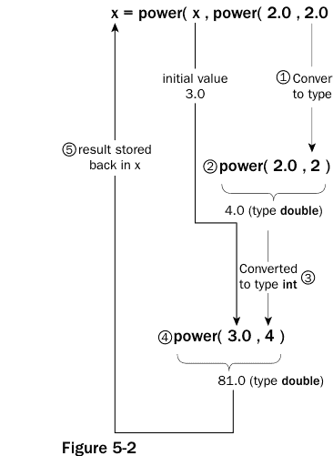

图 5-2

像这样编码语句可以避免原始版本引起的编译器警告信息。使用静态转换并不会消除在一种数据类型转换为另一种数据类型时可能丢失数据的可能性。但由于是你指定的，很清楚这是你所期望的，承认数据丢失可能会发生。

## 向函数传递参数

了解参数如何传递给函数非常重要，因为它会影响你编写函数的方式以及它们最终的运行方式。还有许多需要避免的陷阱，因此我们将对此机制进行仔细研究。

你在调用函数时指定的参数通常应在类型和顺序上与函数定义中出现的参数相对应。正如你在上一个示例中看到的，如果在函数调用中指定的参数的类型与函数定义中参数的类型不对应，（如果可能）它会转换为所需类型，遵守第 2 章中讨论的关于转换操作数的相同规则。如果这证明是不可能的，你会从编译器得到错误信息；然而，即使转换是可能的并且代码可以编译，它也可能导致数据丢失（例如从 long 类型到 short 类型），因此应避免这种情况。

在 C++ 中，一般使用两种机制向函数传递参数。第一种机制适用于你在函数定义中将参数指定为普通变量（不是引用）的情况。这称为按值传递数据到函数的方法，所以我们先来看看这一点。

## 按值传递机制

使用这种机制，你指定的变量或常量作为参数并不会真正传递给函数。相反，会创建参数的副本，这些副本被用作要传输的值。图 5-3 使用我们的 power() 函数的例子以图表形式展示了这一点。

```
int index = 2;
double value = 10.0;
double result = power(value, index);
```

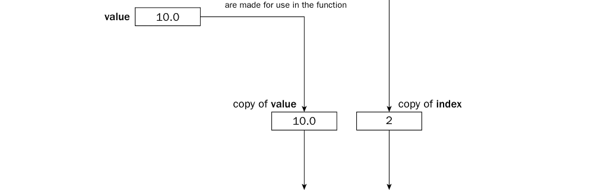

每次你调用函数 power() 时，编译器都会安排将你指定的参数的副本存储在内存中的临时位置。在函数执行期间，对函数参数的所有引用都映射到这些参数的临时副本。

按值传递机制的一个后果是，函数不能直接修改传递进来的参数。你可以通过故意尝试在示例中这样做来证明这一点：

```
// Ex5_02.cpp
// A futile attempt to modify caller arguments
#include <iostream>
using std::cout;
using std::endl;

int incr10(int num);      // Function prototype

int main(void)
{
    int num = 3;

    cout << endl
        << "incr10(num) = " << incr10(num)
        << endl
        << "num = " << num;

    cout << endl;
    return 0;
}

// Function to increment a variable by 10
int incr10(int num)          // Using the same name might help...
{
    num += 10;               // Increment the caller argument - hopefully

    return num;              // Return the incremented value
}
```

当然，这个程序注定要失败。如果你运行它，会得到以下输出：

```
incr10(num) = 13
num = 3
```

## 其工作原理

输出证实了 num 的原始值保持不变。递增操作是在为 num 生成的副本上进行的，并在退出函数时最终被丢弃。

显然，按值传递机制为你提供了很高的保护，防止调用者参数被 rogue 函数破坏，但可以设想你可能确实想安排修改调用者参数。当然，有办法做到这一点。你难道没有预料到指针会变得非常有用吗？

## 作为函数参数的指针

当你使用指针作为参数时，按值传递机制仍然像以前一样运行；然而，指针是另一个变量的地址，如果你复制这个地址，副本仍然指向同一个变量。这就是指定指针作为参数使你的函数能够访问调用者参数的方式。

## 试一试 按指针传递

你可以将上一个示例更改为使用指针来演示效果：

```
// Ex5_03.cpp
// A successful attempt to modify caller arguments
#include <iostream>
using std::cout;
using std::endl;

int incr10(int* num);            // Function prototype

int main(void)
{
    int num = 3;

    int* pnum = &num;            // Pointer to num

    cout << endl
         << "Address passed = " << pnum;

    cout << endl
         << "incr10(pnum) = " << incr10(pnum);

    cout << endl
         << "num = " << num;

    cout << endl;
    return 0;
}

// Function to increment a variable by 10
int incr10(int* num)            // Function with pointer argument
{
    cout << endl
         << "Address received = " << num;

    *num += 10;                  // Increment the caller argument
                               // - confidently
    return *num;                 // Return the incremented value
}
```

此示例的输出为：

```
Address passed = 0012FF6C
Address received = 0012FF6C
incr10(pnum) = 13
num = 13
```

你的计算机产生的地址值可能与上面显示的不同，但两个值彼此应该是相同的。

## 其工作原理

在此示例中，与上一个版本相比，主要的更改与传递指针 pnum 而不是原始变量 num 有关。函数的原型现在将参数类型指定为指向 int 的指针，而 main() 函数已声明并用 num 的地址初始化指针 pnum。函数 main() 和函数 incr10() 分别输出发送的地址和接收的地址，以验证在两个位置确实使用的是相同的地址。

输出显示这次变量 num 已被递增，其值现在与函数返回的值相同。

在重写的 incr10() 函数中，递增传递给函数的值的语句和 return 语句现在都取消引用指针以使用存储的值。

## 向函数传递数组

你也可以向函数传递数组，但在这种情况下，数组不会被复制，即使仍然适用按值传递参数的方法。数组名被转换为指针，并将指向数组开头的指针的副本按值传递给函数。这非常有利，因为复制大型数组非常耗时。正如你可能已经推断出的那样，数组的元素可以在函数内部被更改，因此数组是唯一一种不能按值传递的类型。

## 试一试 传递数组

你可以通过编写一个函数来计算传递给函数的数组中的多个值的平均值来说明其中的来龙去脉。

```
// Ex5_04.cpp
// Passing an array to a function
#include <iostream>
using std::cout;
using std::endl;

double average(double array[], int count);      //Function prototype

int main(void)
{
    double values[] = { 1.0, 2.0, 3.0, 4.0, 5.0, 6.0, 7.0, 8.0, 9.0, 10.0 };

    cout << endl
         << "Average = "
         << average(values, (sizeof values)/(sizeof values[0]));

    cout << endl;
    return 0;
}

// Function to compute an average
double average(double* array, int count)
{
    double sum = 0.0;                // Accumulate total in here
    for(int i = 0; i < count; i++)
        sum += *array++;             // Sum array elements

    return sum/count;                // Return average
}
```

输出与上一个示例完全相同。

## 其工作原理

正如你所见，该程序只需很少的更改即可使用数组作为指针工作。原型和函数头已被更改，尽管两者都不是绝对必要的。如果你将两者都改回原始版本，将第一个参数指定为 double 数组，并保留函数体以指针形式编写，它同样有效。此版本最有趣的方面是 for 循环语句的主体：

```
sum += *array++;                 // Sum array elements
```

在这里，你似乎违反了不能修改指定为数组名的地址的规则，因为你正在递增存储在 array 中的地址。事实上，你并没有违反规则。记住，按值传递机制会复制原始数组地址并传递该副本，所以你在这里只是修改副本（原始数组地址完全不受影响）。因此，每当你将一维数组传递给函数时，你就可以在任何意义上将传递的值视为指针，并以任何你想要的方式更改地址。

## 向函数传递多维数组

向函数传递多维数组相当直接。以下语句声明了一个二维数组 beans：

```
double beans[2][4];
```

然后你可以像这样编写一个假设的函数 yield() 的原型：

```
double yield(double beans[2][4]);
```


# 第5章

> 你可能会想知道编译器如何知道这是在按所示维度定义一个数组，而非单个数组元素。答案很简单——你不能在函数定义或原型中把单个数组元素写成参数，虽然在调用函数时可以把单个元素作为实参传递。对于接受数组单个元素作为实参的参数，该参数只会有一个变量名。数组上下文并不适用。

当你把多维数组作为参数定义时，也可以省略第一个维度的值。当然，函数需要某种方式来获知第一个维度的范围。例如，你可以这样写：

```
double yield(double beans[][4], int index);
```

这里，第二个参数将提供关于第一个维度的必要信息。函数可以用一个二维数组进行操作，其第一个维度的值由函数的第二个参数指定，而第二个维度固定为4。

### 试一试   传递多维数组

你在下面的示例中定义了这样的函数：

// Ex5_06.cpp
// Passing a two-dimensional array to a function
#include <iostream>
using std::cout;
using std::endl;

double yield(double array[][4], int n);

int main(void)
{
    double beans[3][4] = {  { 1.0, 2.0, 3.0, 4.0 },
                            { 5.0, 6.0, 7.0, 8.0 },
                            { 9.0, 10.0, 11.0, 12.0 }  };

    cout << endl
         << "Yield = " << yield(beans, sizeof beans/sizeof beans[0]);

    cout << endl;
    return 0;
}

// Function to compute total yield
double yield(double beans[][4], int count)
{
    double sum = 0.0;
    for(int i = 0; i < count; i++)      // Loop through number of rows
        for(int j = 0; j < 4; j++)      // Loop through elements in a row
            sum += beans[i][j];
    return sum;
}
```

该示例的输出为：

```
Yield = 78
```

## 工作原理

我在函数头中的参数使用了与原型中不同的名称，只是为了提醒你这是可能的（但在这种情况下，它并没有真正改善程序）。第一个参数被定义为具有任意行数的数组，每行有四个元素。你实际上使用具有三行的数组 beans 调用该函数。第二个参数是通过将数组的总字节大小除以第一行的大小来指定的。这会计算出数组中的行数。

函数中的计算只是嵌套的 for 循环，内层循环对单行元素求和，外层循环对每一行重复此操作。

在这种示例中，使用指针作为函数参数而不是多维数组作为参数并不特别适用。当数组被传递时，它传递的是指向包含四个元素（即一行）的数组的地址值。这不利于在函数内部进行简单的指针操作。你需要在嵌套 for 循环中的语句改为如下：

```
sum += *(*(beans + i) + j);
```

因此，使用数组表示法进行计算可能更清晰。

### 作为函数参数的引用

我们现在来到了传递函数参数的两种机制中的第二种。将函数的参数指定为引用会改变该参数的数据传递方式。所使用的方法不是按值传递，即在传递给函数之前复制实参，而是按引用传递，其中参数充当传递的实参的别名。这消除了任何复制，并允许函数直接访问调用者的实参。这也意味着在传递和使用指向值的指针时所需的解引用操作也不再必要。

### 试一试      按引用传递

让我们回到一个非常简单的示例 Ex5_03.cpp 的修订版本，看看使用引用参数时会如何工作：

// Ex5_07.cpp
// Using a reference to modify caller arguments
#include <iostream>
using std::cout;
using std::endl;

int incr10(int& num);            // Function prototype

int main(void)
{
    int num = 3;
    int value = 6;

    cout << endl
         << "incr10(num) = " << incr10(num);

    cout << endl
        << "num = " << num;

    cout << endl
        << "incr10(value) = " << incr10(value);

    cout << endl
        << "value = " << value;

    cout << endl;
    return 0;
}

// Function to increment a variable by 10
int incr10(int& num)                      // Function with reference argument
{
    cout << endl
         << "Value received = " << num;

    num += 10;                            // Increment the caller argument
                                        // - confidently
    return num;                           // Return the incremented value
}
```

该程序产生的输出为：

```
Value received = 3
incr10(num) = 13
num = 13
Value received = 6
incr10(value) = 16
value = 16
```

## 工作原理

你会发现这种工作方式相当 remarkable。这本质上与 Ex5_03.cpp 相同，只是函数使用引用作为参数。原型已更改以反映这一点。当函数被调用时，实参的指定方式就如同按值传递操作一样，因此使用方式与早期版本相同。实参值不会传递给函数。函数参数使用实参的地址进行初始化，因此在函数中使用参数 num 时，它会直接访问调用者的实参。

为了让你放心，main() 中以及函数中都使用标识符 num 并没有问题，函数第二次调用时使用变量 value 作为实参。乍一看，这可能会让你觉得这与我所说的引用的基本属性相矛盾——即在声明并初始化后不能重新分配给另一个变量。原因不矛盾的是，作为函数参数的引用在每次函数调用时都会创建并初始化，并在函数结束时销毁，因此每次使用函数时都会创建一个全新的引用。

在函数内部，从调用程序接收到的值会显示在屏幕上。虽然该语句本质上与输出指针中存储的地址的语句相同，但由于 num 现在是引用，你获得的是数据值而不是地址。

> 这清楚地展示了引用与指针之间的区别。引用是另一个变量的别名，因此可以用作引用它的替代方式。它等同于使用原始变量名。

输出显示函数 incr10() 直接修改了作为调用者实参传递的变量。

你会发现，如果你尝试使用数值，例如 20，作为 incr10() 的实参，编译器会输出错误消息。这是因为编译器认识到引用参数可以在函数内部被修改，而你绝对不希望你的常量值时不时地改变。这会给你的程序带来一种你可能不需要的兴奋感。

这种安全机制很好，但如果函数不修改值，你就不希望编译器在每次传递常量引用参数时都产生这些错误消息。难道没有办法来适应这种情况吗？正如奥利会说的那样，‘当然有，斯坦利！’

### const 修饰符的使用

你可以将 const 修饰符应用于函数的参数，以告诉编译器你不打算以任何方式修改它。这会导致编译器检查你的代码确实没有修改实参，并且在使用常量实参时不会出现错误消息。

### 试一试 传递 const

你可以修改之前的程序来展示 const 修饰符如何改变情况。

```
// Ex5_08.cpp
// Using a reference to modify caller arguments

#include <iostream>
using std::cout;
using std::endl;

int incr10(const int& num);    // Function prototype

int main(void)
{
    const int num = 3;    // Declared const to test for temporary creation
    int value = 6;

    cout << endl
         << "incr10(num) = " << incr10(num);

    cout << endl


```cpp
<< "num = " << num;

cout << endl
    << "incr10(value) = " << incr10(value);

cout << endl
    << "value = " << value;

cout << endl;
return 0;
}
```

```cpp
// Function to increment a variable by 10
int incr10(const int& num)    // Function with const reference argument
{
    cout << endl
        << "Value received = " << num;

//  num += 10;            // this statement would now be illegal
    return num+10;          // Return the incremented value
}
```

执行此代码时的输出如下：

```
Value received = 3
incr10(num) = 13
num = 3
Value received = 6
incr10(value) = 16
value = 6
```

## 工作原理

在 `main()` 中将变量 `num` 声明为 `const`，是为了表明当函数 `incr10()` 的参数声明为 `const` 时，传递 `const` 对象不会再产生编译器消息。

还必须注释掉函数 `incr10()` 中递增 `num` 的语句。如果取消这一行的注释，你会发现程序不再编译，因为编译器不允许 `num` 出现在赋值运算符左侧。当你在函数头和函数原型中将 `num` 指定为 `const` 时，你承诺不会修改它，因此编译器会检查你是否遵守了承诺。

一切和之前一样工作，只是 `main()` 中的变量不再在函数中被修改。

通过使用引用参数，你现在获得了两种机制的好处。一方面，你可以编写直接访问调用者参数的函数，并避免按值传递机制中隐含的复制。另一方面，在你不想修改参数的情况下，你可以通过将 `const` 修饰符与引用结合使用，获得防止意外修改所需的所有保护。

## 传递给 main() 的参数

你可以将 `main()` 定义为不带参数（或者更准确地说，参数列表为 `void`），也可以指定一个参数列表，使 `main()` 函数从程序的执行命令中获取命令行参数。从命令行作为参数传递给 `main()` 的值始终被解释为字符串。如果你希望从命令行向 `main()` 传入数据，必须像这样定义：

```cpp
int main(int argc, char* argv[])
{
    // Code for main()...
}
```

第一个参数是命令行上字符串的数量，包括程序名；第二个参数是一个数组，包含指向这些字符串的指针，另外还有一个附加的空指针元素。因此 `argc` 至少为 1，因为你至少需要输入程序名。收到的参数数量取决于你在命令行中输入的程序执行内容。例如，假设你使用如下命令执行 `DoThat` 程序：

```
DoThat.exe
```

这里只有程序的 `.exe` 文件名，因此 `argc` 为 1，`argv` 数组包含两个元素——`argv[0]` 指向字符串 `"DoThat.exe"`，`argv[1]` 为 `null`。

假设你在命令行中输入以下内容：

```
DoThat or else "my friend" 999.9
```

现在 `argc` 为 5，`argv` 包含六个元素，最后一个元素为 0，前 5 个元素分别指向以下字符串：

```
"DoThat"  "or"  "else" "my friend"  "999.9"
```

从中可以看出，如果你希望将包含空格的字符串作为一个整体接收，必须用双引号将其括起来。此外，数值也会被读取为字符串，因此如果要转换为数值，你需要自己处理。

让我们看看它的实际效果。

### 试一试：接收命令行参数

这个程序仅列出它从命令行接收到的参数。

```cpp
// Ex5_09.cpp
// Reading command line arguments
#include <iostream>
using std::cout;
using std::endl;

int main(int argc, char* argv[])
{
    cout << endl << "argc = " << argc << endl;
    cout << "Command line arguments received are:" << endl;
    for(int i = 0; i < argc; i++)
        cout << "argument " << (i+1) << ": " << argv[i] << endl;
    return 0;
}
```

输入命令行参数时你有两种选择。在 IDE 中构建示例后，可以在包含 `.exe` 文件的文件夹中打开命令窗口，然后输入程序名以及命令行参数。或者，你也可以在执行程序之前在 IDE 中指定命令行参数。只需从主菜单中选择“项目”>“属性”打开项目属性窗口，然后通过单击加号 (+) 展开左侧窗格中的“配置属性”树。单击“调试”文件夹，即可在右侧窗格中看到可以在哪里输入命令行值。

以下是在命令窗口中输入该示例后得到的典型输出：

```
C:\Visual C++ 2005\Examples\Ex5_09 trying multiple "argument values" 4.5 0.0
argc = 6
Command line arguments received are:
argument 1: Ex5_09
argument 2: trying
argument 3: multiple
argument 4: argument values
argument 5: 4.5
argument 6: 0.0
```

## 工作原理

程序首先输出 `argc` 的值，然后在 `for` 循环中输出 `argv` 数组中每个参数的值。你可以利用 `argv` 的最后一个元素为 `null` 的事实，像这样编写输出命令行参数值的代码：

```cpp
int i = 0;
while(argv[i] != 0)
    cout << "argument " << (i+1) << ": " << argv[i++] << endl;
```

当达到 `argv[argc]` 时 `while` 循环结束，因为该元素为 `null`。

## 接受可变数量的函数参数

你可以定义一个允许接收任意数量参数的函数。在函数定义的参数列表末尾放置一个省略号（即三个点，. . .），即表示调用该函数时可以传入数量可变的参数。例如：

```cpp
int sumValues(int first, ...)
{
    // Code for the function
}
```

必须至少有一个普通参数，但你可以有更多。省略号必须始终放在参数列表的末尾。

显然，可变参数列表中没有关于参数类型或数量的信息，因此你的代码必须自行判断调用函数时传入了什么。原生 C++ 库在 `stdarg.h` 头文件中定义了 `va_start`、`va_arg` 和 `va_end` 宏来帮助你完成这项工作。通过示例最容易说明它们的用法。

要开始处理可变参数列表，你需要声明一个 `va_list` 类型的指针：

```cpp
va_list arg_ptr;            // Declare argument list pointer
```

`va_list` 类型定义在 `stdarg.h` 头文件中，该指针用于依次指向每个参数。

`va_start` 宏用于初始化 `arg_ptr`，使其指向列表中的第一个参数：

```cpp
va_start(arg_ptr, count);        // Set arg_ptr to 1st optional argument
```

该宏的第二个参数是参数列表中省略号之前的固定参数名，宏会用它来确定第一个可变参数的位置。

在 `for` 循环中检索列表中各参数的值：

```cpp
int sum = 0;
for(int i = 0; i < count; i++)
    sum += va_arg(arg_ptr, int);        // Add int value from arg_ptr and increment
```

`va_arg` 宏返回 `arg_ptr` 指定位置处的参数值，并将 `arg_ptr` 递增以指向下一个参数值。`va_arg` 宏的第二个参数是参数类型，它决定了你获得的值以及 `arg_ptr` 的递增方式，因此如果不正确就会引起混乱；程序也许仍能执行，但你检索到的值会是垃圾数据，`arg_ptr` 也会被错误地递增，从而访问到更多垃圾数据。

检索完参数值后，你用下面的语句重置 `arg_ptr`：

```cpp
va_end(arg_ptr);                // Reset the pointer to null
```

`va_end` 宏将你作为参数传递给它的 `va_list` 类型指针重置为 `null`。始终这样做是个好主意，因为处理完参数后，`arg_ptr` 指向的位置不再包含有效数据。

## 从函数返回值

你迄今为止创建的所有示例函数都返回单个值。能否返回单个值之外的其他内容？嗯，不能直接返回，但正如我之前所说，返回的单个值不必是数值；它也可以是一个地址，而地址是返回任意数量数据的关键。你只需使用指针。不幸的是，这里也正是陷阱开始出现的地方，因此在接下来的探索中，你需要保持清醒的头脑。

### 返回指针

返回指针值很容易。指针值只是一个地址，所以如果你想返回某个变量值的地址，只需编写如下代码：

```cpp
return &value;                // Returning an address
```


只要函数头和函数原型恰当地指明了返回类型，你就不会遇到问题——至少表面上看不出问题。假设变量 value 的类型是 double，那么一个名为 treble 的函数（可能包含上述返回语句）的原型可以如下所示：

```
double* treble(double data);
```

这里我随意定义了参数列表。

下面我们来看一个返回指针的函数。事先提醒你一下是公平的——这个函数不能正常工作，但很有教学意义。假设你需要一个函数，它返回一个指向内存位置的指针，该位置存储的值是参数值的三倍。我们第一次尝试实现这样一个函数，代码可能如下所示：

```
// Function to treble a value - mark 1
double* treble(double data)
{
    double result = 0.0;

    result = 3.0*data;
    return &result;
}
```

## 试一试 返回错误的指针

你可以创建一个小测试程序来看看会发生什么（请记住，treble 函数不会按预期工作）：

```
//Ex5_11.cpp
#include <iostream>
using std::cout;
using std::endl;

double* treble(double);            // Function prototype

int main(void)
{
    double num = 5.0;               // Test value
    double* ptr = 0;                // Pointer to returned value

    ptr = treble(num);

    cout << endl
         << "Three times num = " << 3.0*num;

    cout << endl
         << "Result = " << *ptr;     // Display 3*num

    cout << endl;
    return 0;
}

// Function to treble a value - mark 1
double* treble(double data)
{
    double result = 0.0;

    result = 3.0*data;
    return &result;
}
```

有一个迹象表明一切并不正常，因为编译这个程序时编译器会给出警告：

```
warning C4172: returning address of local variable or temporary
```

我执行该程序得到的输出如下：

```
Three times num = 15
Result = 4.10416e-230
```

## 工作原理（或为何不工作）

main() 函数调用 treble() 函数，并将返回的地址存储在指针 ptr 中，该指针本应指向一个值，这个值是参数 num 的三倍。然后我们显示计算 num 三倍的结果，接着显示函数返回地址处的值。

显然，输出的第二行并没有反映正确的值 15，但错误在哪里呢？其实这并不算什么秘密，因为编译器已经给出了充分的警告。错误产生的原因是：treble() 函数中的变量 result 在函数开始执行时创建，在函数退出时被销毁（因此指针指向的内存不再包含原来的变量值。之前分配给 result 的内存可供其他用途使用，而在这里显然已被用于其他目的）。

## 返回地址的铁律

对于返回地址，有一条绝对规则：

> 绝不要从函数中返回局部自动变量的地址。

显然，你无法使用一个不能工作的函数，那么你能做些什么来纠正这个问题呢？你可以使用引用参数并修改原始变量，但这不是你最初的目标。你试图返回一个指向某些有用数据的指针，以便最终能够返回多个数据项。一个解决办法在于动态内存分配（你在上一章中已经看到了它的实际应用）。使用 new 运算符，你可以在自由存储区中创建一个新变量，该变量会一直存在，直到最终被 delete 销毁（或直到程序结束）。采用这种方法，函数如下所示：

```
// Function to treble a value - mark 2
double* treble(double data)
{
    double* result = new double(0.0);
```

## 将结构引入你的程序

```
*result = 3.0*data;
return result;
}
```

这里不再将 result 声明为 double 类型，而是将其声明为 double* 类型，并在其中存储 new 运算符返回的地址。由于 result 现在是一个指针，函数的其余部分也相应修改，最终将 result 中保存的地址返回给调用程序。你可以将上一个可工作示例中的函数替换为此版本，来测试这个版本。

你需要记住，在像这样的原生 C++ 函数内部使用动态内存分配时，每次调用函数都会分配更多内存。调用程序有责任在不再需要时删除内存。在实践中很容易忘记这样做，结果导致自由存储区被逐渐耗尽，到某个时候内存耗尽，程序失败。如前所述，这类问题被称为内存泄漏。

下面你可以看到如何使用这个函数。对原始代码唯一必要的更改是，在使用完 treble() 函数返回的指针后，立即用 delete 释放内存。

```
#include <iostream>

using std::cout;
using std::endl;

double* treble(double);              // Function prototype

int main(void)
{
    double num = 5.0;                // Test value
    double* ptr = 0;                 // Pointer to returned value

    ptr = treble(num);

    cout << endl
         << "Three times num = " << 3.0*num;

    cout << endl
         << "Result = " << *ptr;      // Display 3*num

    delete ptr;                      // Don't forget to free the memory

    cout << endl;
    return 0;
}

// Function to treble a value - mark 2
double* treble(double data)
{
    double* result = new double(0.0);
    *result = 3.0*data;
    return result;
}
```

## 返回引用

你也可以从函数返回引用。这同样充满潜在错误，与返回指针一样，所以你也需要小心。因为引用本身没有独立的存在（它总是其他对象的别名），你必须确保它所引用的对象在函数执行完毕后仍然存在。在函数中使用引用时很容易忘记这一点，因为它们看起来就像普通变量一样。

引用作为返回类型在面向对象编程的语境中具有首要意义。正如你在本书后面将看到的，它们使你能够完成没有它们就不可能完成的事情（这一点尤其适用于“运算符重载”，我将在第 9 章中讨论）。引用类型返回值的主要特性是它是一个左值（lvalue）。这意味着你可以将返回引用的函数的结果用在赋值语句的左侧。

## 试一试 返回引用

接下来看一个例子，它说明了引用返回类型的使用，并演示了当函数返回左值时，如何将其用在赋值操作的左侧。这个例子假设你有一个包含混合数值的数组。每当你想向数组中插入一个新值时，你希望替换具有最小值的元素。

```
// Ex5_12.cpp
// Returning a reference
#include <iostream>
#include <iomanip>
using std::cout;
using std::endl;
using std::setw;

double& lowest(double values[], int length); // Prototype of function
                                         // returning a reference

int main(void)
{
    double array[] = { 3.0, 10.0, 1.5, 15.0, 2.7, 23.0,
                       4.5, 12.0, 6.8, 13.5, 2.1, 14.0 };
    int len = sizeof array/sizeof array[0];  // Initialize to number
                                         // of elements

    cout << endl;
    for(int i = 0; i < len; i++)
        cout << setw(6) << array[i];

    lowest(array, len) = 6.9;               // Change lowest to 6.9
    lowest(array, len) = 7.9;               // Change lowest to 7.9

    cout << endl;
    for(int i = 0; i < len; i++)
        cout << setw(6) << array[i];

    cout << endl;
}


```
return 0;
}

double& lowest(double a[], int len)
{
    int j = 0;                         // Index of lowest element
    for(int i = 1; i < len; i++)
        if(a[j] > a[i])                // Test for a lower value...
            j = i;                     // ...if so update j
    return a[j];                       // Return reference to lowest
                                   // element
}
```

该示例的输出是：

```
3   10   1.5   15   2.7   23   4.5   12   6.8   13.5   2.1   14
3   10   6.9   15   2.7   23   4.5   12   6.8   13.5   7.9   14
```

## 工作原理

我们先来看看这个函数是如何实现的。函数 lowest() 的原型将返回类型指定为 double&，因此其类型是“对 double 的引用”。编写引用类型返回值的方式与你在前面看到的变量声明完全一样，即在数据类型后面附加 &。该函数指定了两个参数——一个 double 类型的一维数组和一个 int 类型的参数，后者指定数组的长度。

函数体包含一个简单的 for 循环，用于确定传入数组的哪个元素包含最小值。最低值数组元素的索引 j 在一开始被任意设置为 0，然后在循环中，如果当前元素 a[i] 小于 a[j]，就修改 j。因此，退出循环时，j 中包含的就是对应最低值数组元素的索引值。返回语句如下：

```
return a[j];                     // Return reference to lowest element
```

尽管这条语句看起来与返回值的语句完全相同，但由于返回类型被声明为引用，因此它返回的是对数组元素 a[j] 的引用，而不是该元素包含的值。a[j] 的地址被用来初始化要返回的引用。这个引用由编译器创建，因为返回类型被声明为引用。

不要把返回 &a[j] 与返回引用混淆。如果写成 &a[j] 作为返回值，你指定的是 a[j] 的地址，也就是一个指针。如果你在已将返回类型指定为引用之后这样做，编译器会给出错误消息。具体来说，你会得到这样的错误：

```
error C2440: 'return' : cannot convert from 'double * __w64 ' to 'double &'
```

调用 lowest() 函数的 main() 函数非常简单。声明了一个 double 类型的数组，并用 12 个任意值初始化，同时将一个 int 变量 len 初始化为数组的长度。数组中的初始值会输出，以便进行比较。

> 同样，该程序使用流操纵符 setw() 来让各值均匀间隔，为此需要包含 <iomanip> 的 #include 指令。

然后，main() 函数在赋值语句的左侧调用 lowest() 函数，以更改数组中的最低值。这个操作执行两次，以证明它确实有效，而不是偶然。随后，数组的内容再次以与之前相同的字段宽度输出到显示器，从而使相应的值对齐。

从第一次调用 lowest() 的输出可以看出，数组的第三个元素 array[2] 包含最小值，因此函数返回了对它的引用，并将其值改为 6.9。类似地，在第二次调用时，array[10] 被改为 7.9。这清楚地表明，返回引用允许在赋值语句的左侧使用函数。其效果就好像返回语句中指定的变量出现在赋值左侧一样。

当然，如果你愿意，你也可以在赋值语句的右侧或任何其他合适的表达式中使用它。如果有两个数组 x 和 y，它们的元素个数分别由 lenx 和 leny 指定，你可以用下面的语句将数组 x 中的最小元素设置为数组 y 中最小元素的两倍：

```
lowest(x, lenx) = 2.0*lowest(y, leny);
```

这条语句将调用你的 lowest() 函数两次——一次使用赋值右侧表达式中的参数 y 和 leny，一次使用参数 x 和 lenx 来获取右侧表达式结果要存储的地址。

## 特氟龙涂层规则：返回引用

与从函数返回指针相关的一条规则类似，这条规则同样适用于返回引用：

> 永远不要从函数返回指向局部变量的引用。

我现在先不继续讨论从函数返回引用这一主题，但还没有讲完。在讨论用户定义类型和面向对象编程时，我还会再回来，届时你会发现引用还能做一些更奇妙的事情。

## 函数中的静态变量

在函数内部，有些操作是无法通过自动变量完成的。例如，你无法统计一个函数被调用了多少次，因为你无法在一次调用和下一次调用之间累计数值。如果需要这样做，有不止一种解决方法。例如，你可以使用引用参数来更新调用程序中的计数器，但如果函数在程序中的很多不同位置被调用，这种方法就没有用了。你也可以使用一个在函数内部递增的全局变量，但使用全局变量是有风险的，因为它们可以从程序中的任何地方访问，这很容易导致意外修改。

在具有多个执行线程访问全局变量的应用程序中，全局变量同样存在风险，你必须特别小心地管理不同线程如何访问这些全局变量。当多个线程可以访问一个全局变量时，需要解决的基本问题是：一个线程可能会在另一个线程正在使用该全局变量时改变它的值。在这种情况下，最好的解决方案是完全避免使用全局变量。

## 为程序引入结构

要创建一个值从一次函数调用持续到下一次调用的变量，你可以在函数内将变量声明为 static。静态变量的声明形式与你在第 2 章中看到的完全相同。例如，要将变量 count 声明为静态变量，可以使用以下语句：

```
static int count = 0;
```

这条语句还会将变量初始化为 0。

> 函数内静态变量的初始化只在函数第一次被调用时发生。实际上，在函数第一次调用时，该静态变量被创建并初始化。随后，它在程序执行的整个期间一直存在，函数退出时它所包含的值在下次函数调用时仍然可用。

## 试一试：在函数中使用静态变量

你可以通过下面这个简单的示例来演示静态变量在函数中的行为：

```
// Ex5_13.cpp
// Using a static variable within a function
#include <iostream>
using std::cout;
using std::endl;

void record(void);    // Function prototype, no arguments or return value

int main(void)
{
    record();

    for(int i = 0; i <= 3; i++)
        record();

    cout << endl;
    return 0;
}

// A function that records how often it is called
void record(void)
{
    static int count = 0;
    cout << endl
    << "This is the " << ++count;
    if((count > 3) && (count < 21))    // All this....
        cout <<"th";
    else
        switch(count%10)            // is just to get...
        {
            case 1: cout << "st";
                break;
            case 2: cout << "nd";
                break;
            case 3: cout << "rd";
```
```
break;
default: cout << "th";          // the right ending for...
}                              // 1st, 2nd, 3rd, 4th, etc.
cout << " time I have been called";
return;
}
```

这里的函数仅用于记录自己被调用的事实。如果你编译并执行它，会得到以下输出：

```
This is the 1st time I have been called
This is the 2nd time I have been called
This is the 3rd time I have been called
This is the 4th time I have been called
This is the 5th time I have been called
```

## 工作原理

你用 0 初始化静态变量 count，并在函数中的第一个输出语句中将其递增。因为递增操作是前缀形式，所以输出语句显示的是递增后的值。第一次调用时它为 1，第二次为 2，依此类推。由于变量 count 是静态的，它会从函数的一次调用到下一次调用持续存在并保留其值。

函数的其余部分负责判断在显示的 count 值后面应该加上“st”、“nd”、“rd”还是“th”。这出奇地不规则。（我想 101 应该是 101st 而不是 101th，对吧？）

> 注意 *return 语句*。因为函数的返回类型是 void，如果包含返回值会导致编译器错误。在特定情况下，你实际上不需要写 return 语句，因为运行到函数体的右花括号结束等价于不带值的 return 语句。即使不包含 return，程序也可以编译并正常运行。

## 递归函数调用

当一个函数包含对自身的调用时，它被称为**递归函数**。递归函数调用也可以是间接的，即函数 fun1 调用函数 fun2，而 fun2 又调用 fun1。

递归可能看起来像是无限循环的配方，如果不小心，它确实可能变成无限循环。无限循环会使机器锁死，需要按 *Ctrl-Alt-Del* 来结束程序，这总是很麻烦。避免无限循环的一个前提是，函数包含某种停止该过程的机制。

除非你以前接触过这种技术，否则递归可以应用到的那些事情可能并不明显。在物理学和数学中，有许多事物可以被认为涉及递归。一个简单的例子是整数的阶乘，给定整数 N，其阶乘是 1x2x3...xN。这通常是展示递归运作的经典例子。递归也可以应用于编译过程中对程序的分析；不过，我们将看一个更简单的例子。


## 试一试：递归函数

在本章开头（参见 Ex5_01.cpp），我们编写了一个函数来计算一个值的整数次幂，也就是计算 xⁿ。这等价于 x 自乘 n 次。我们可以用递归函数来实现它，作为递归运作的一个基本示例。我们还可以改进该函数的实现，使其处理负指数值，其中 x⁻ⁿ 等价于 1/xⁿ。

```cpp
// Ex5_14.cpp (based on Ex5_01.cpp)
// A recursive version of x to the power n
#include <iostream>
using std::cout;
using std::endl;

double power(double x, int n);    // Function prototype

int main(void)
{
    double x = 2.0;                // Different x from that in function power
    double result = 0.0;

    // Calculate x raised to powers -3 to +3 inclusive
    for(int index = -3 ; index<=3 ; index++)
        cout << x << " to the power " << index << " is " << power(x, index) << endl;

    return 0;
}

// Recursive function to compute integral powers of a double value
// First argument is value, second argument is power index
double power(double x, int n)
{
    if(n < 0)
    {
        x = 1.0/x;
        n = -n;
    }
    if(n > 0)
        return x*power(x, n-1);
    else
        return 1.0;
}
```

该程序的输出如下：

```
2 to the power -3 is 0.125
2 to the power -2 is 0.25
2 to the power -1 is 0.5
2 to the power 0 is 1
2 to the power 1 is 2
2 to the power 2 is 4
2 to the power 3 is 8
```

## 工作原理

该函数现在支持 x 的正指数和负指数，因此第一个动作是检查 x 将要被提升的幂值 n 是否为负：

```cpp
if (n < 0)
{
    x = 1.0/x;
    n = -n;
}
```

支持负指数很容易；它只是利用了 x⁻ⁿ 可以计算为 (1/x)ⁿ 这一事实。因此，如果 n 为负，我们将 x 设置为 1.0/x，并改变 n 的符号使其为正。

下一个 if 语句决定 power() 函数是否应该再次调用自身：

```cpp
if (n > 0)
    return x*power(x, n-1);
else
    return 1.0;
```

这个 if 语句规定，如果 n 为零，则返回值 1.0；在所有其他情况下，它返回表达式 x*power(x, n-1) 的结果。这会导致以索引值减 1 的方式再次调用函数 power()。因此，if 语句中的 else 子句提供了避免无限递归调用序列所需的基本机制。

显然，在函数 power() 内部，如果 n 的值不为零，就会再次调用函数 power()。实际上，对于任何给定的非零 n 值，函数会调用自身 n 次（忽略 n 的符号）。图 5-4 演示了这一机制，其中假定索引参数为 3。

图 5-4

正如你看到的，为了生成 x³，power() 函数总共被调用了四次，其中三次是函数调用自身的递归调用。

## 使用递归

除非你遇到的问题特别适合使用递归函数，或者你没有明显的替代方案，否则通常最好使用其他方法，例如循环。这比使用递归函数调用要高效得多。想一想我们最后一个例子中计算简单乘积 x*x*...x 共 n 次的情况。每次调用时，编译器都会生成函数两个参数的副本，并且还必须在每次执行 return 时跟踪返回的位置。还需要安排保存计算机中各个寄存器的内容，以便在 power() 函数中使用，当然，在函数每次返回时，这些内容都需要恢复为原始状态。即使递归调用的深度相当浅，其开销也可能比使用循环大得多。

这并不是说永远不应该使用递归。当问题提示使用递归函数调用作为解决方案时，它是一种非常强大的技术，可以极大简化代码。你将在下一章看到一个这样的例子。

### C++/CLI 编程

在大多数情况下，C++/CLI 程序中的函数与本机程序中的函数工作方式完全相同。当然，在为 CLR 编程时，你处理的是句柄和跟踪引用，而不是本机指针和引用，这带来了一些差异。还有其他一些略有不同的地方，让我们逐一列举。

- CLR 程序中的函数参数和返回值可以是值类类型、跟踪句柄、跟踪引用和内部指针。
- 当参数是数组时，不需要单独的数组大小参数，因为 C++/CLI 数组的大小已内置在 Length 属性中。
- 在 C++/CLI 程序中，不能像在本机 C++ 程序中那样对数组参数进行地址运算，因此必须始终使用数组索引。
- 返回指向 CLR 堆上已分配内存的句柄不是问题，因为垃圾回收器会在内存不再使用时负责释放它。
- C++/CLI 中接受可变数量参数的机制与本机 C++ 机制不同。
- 在 C++/CLI 程序中访问 main() 中的命令行参数也不同于本机 C++ 机制。

让我们更详细地看看最后两个差异。

### 接受可变数量参数的函数

C++/CLI 语言允许将参数列表指定为数组，并在数组规范前加上省略号，从而提供对可变数量参数的支持。下面是一个具有这种参数列表的函数的示例：

```cpp
int sum(... array<int>^ args)
{
    // Code for sum
}
```

这里的 sum() 函数接受任意数量的 int 类型参数。要处理这些参数，只需访问数组 args 的元素。由于它是 CLR 数组，元素数量记录在其 Length 属性中，因此在函数体内确定参数数量毫无问题。这种机制也比你之前看到的机制有所改进，因为它是类型安全的。显然，参数必须是 int 类型才能被此函数接受。让我们尝试 Ex5_10 的一个变体，看看 CLR 机制是如何工作的。

### 试一试：可变数量的函数参数

以下是此 CLR 项目的代码。

```cpp
// Ex5_15.cpp : main project file.
// Passing a variable number of arguments to a function

#include "stdafx.h"

using namespace System;

double sum(... array<double>^ args)
{
    double sum = 0.0;
    for each(double arg in args)
        sum += arg;
    return sum;
}

int main(array<System::String ^> ^args)
{
    Console::WriteLine(sum(2.0, 4.0, 6.0, 8.0, 10.0, 12.0));
    Console::WriteLine(sum(1.1, 2.2, 3.3, 4.4, 5.5, 6.6, 7.7, 8.8, 9.9));
    return 0;
}
```

此示例产生以下输出：

```
42
49.5
Press any key to continue . . .
```

## 工作原理

这里的 sum() 函数已实现为接受 double 类型参数。数组参数前的省略号告诉编译器期望任意数量的参数，并且参数值应存储在 double 类型元素的数组中。当然，如果没有省略号，函数在被调用时将只期望一个参数，即数组的跟踪句柄。

与 Ex5_10 中的本机版本相比，sum() 函数的定义非常简单。与参数类型和数量相关的所有问题在 C++/CLI 版本中都已消失。求和是在一个简单的 for each 循环中累积的，该循环遍历数组中的所有元素。

### main() 的参数

从前面的示例可以看出，在 C++/CLI 程序中，main() 函数只有一个参数，它是 String^ 类型元素的数组。在 C++/CLI 程序中访问和处理命令行参数，归结为仅访问数组参数中的元素。你可以试一试。

### 试一试：访问命令行参数

这是 Ex5_09 的 C++/CLI 版本。

```cpp
// Ex5_16.cpp : main project file.
// Receiving multiple command line arguments.

#include "stdafx.h"

using namespace System;

int main(array<System::String ^> ^args)
{
    Console::WriteLine(L"There were {0} command line arguments.", args->Length);
    Console::WriteLine(L"Command line arguments received are:");
    int i = 1;
    for each(String^ str in args)
        Console::WriteLine(L"Argument {0}: {1}", i++, str);

    return 0;
}
```

你可以在命令窗口中或通过本章前面介绍的“项目属性”窗口输入命令行参数。此示例产生以下输出：

```
C:\Visual C++ 2005\Examples>Ex5_16 trying multiple "argument values" 4.5 0.0
There were 5 command line arguments.
Command line arguments received are:
```


```
Argument 1: trying
Argument 2: multiple
Argument 3: argument values
Argument 4: 4.5
Argument 5: 0.0
```

## 如何工作

从输出中可以看到，这与原生 C++ 版本的一个区别是，你不会将程序名传递给 main() —— 这并不是一个很大的劣势，在大多数情况下反而是一个积极的特性。访问命令行参数现在只是一个简单的练习，只需遍历 args 数组中的元素即可。

### 总结

在本章中，你学习了程序结构的基础知识。你应该对函数是如何定义的、如何将数据传递给函数以及如何将结果返回给调用程序有了良好的理解。函数是 C++ 编程的基础，因此从现在开始你所做的一切都将涉及在程序中使用多个函数。关于编写自己的函数，你应该牢记的关键点如下：

- 函数应该是具有明确目的的代码紧凑单元。典型的程序将由大量小型函数组成，而不是少量大型函数。
- 为程序中定义的每个函数始终提供函数原型，并将其置于调用该函数之前。
- 使用引用将值传递给函数可以避免调用时按值传递参数所隐含的复制。函数中未被修改的参数应指定为 const。
- 当从原生 C++ 函数返回引用或指针时，确保被返回对象的范围正确。切勿返回指向原生 C++ 函数本地对象的指针或引用。
- 在 C++/CLI 程序中，返回已动态分配的内存的句柄没有问题，因为垃圾回收器会在不再需要时负责删除它。
- 当你将 C++/CLI 数组传递给函数时，无需为数组长度再提供一个参数，因为元素数量在函数体中可作为数组的 Length 属性获得。

将引用用作参数是一个非常重要的概念，因此请确保你对使用它们充满信心。当我们研究面向对象编程时，你将看到更多关于将引用作为函数参数的内容。

## 练习

你可以从 http://www.wrox.com 下载本书示例的源代码以及以下练习的解答。

- 1. 4 的阶乘（写成 4!）是 4*3*2*1 = 24，3! 是 3*2*1 = 6，因此可得 4! = 4*3!，或更一般地：
  
  fact(n) = n*fact(n - 1)
  
  极限情况是当 n 为 1 时，此时 1! = 1。编写一个递归函数来计算阶乘，并对其进行测试。

- 2. 编写一个使用指针作为参数交换两个整数的函数。编写一个使用该函数的程序并测试其是否正确工作。

- 3. 标准数学库中的三角函数（sin()、cos() 和 tan()）以弧度为单位接收参数。编写三个等效函数，分别称为 sind()、cosd() 和 tand()，它们以度为单位接收参数。所有参数和返回值都应为 double 类型。

- 4. 编写一个原生 C++ 程序，从键盘读取一个数字（整数）和一个名称（少于 15 个字符）。设计程序使数据输入在一个函数中完成，输出在另一个函数中完成。数据保留在主程序中。当输入数字为零时程序应结束。思考一下你将如何通过值、指针或引用在函数之间传递数据？

- 5. （高级）编写一个函数，当传入由单个空格分隔的单词组成的字符串时，返回第一个单词；再次调用它时参数为 NULL 则返回第二个单词，以此类推，直到字符串完全处理完毕，返回 NULL。这是原生 C++ 运行时库例程 strtok() 工作方式的简化版本。因此，当传入字符串 ‘one two three’ 时，函数返回给你 ‘one’，然后是 ‘two’，最后是 ‘three’。传入新字符串会导致当前字符串在函数开始处理新字符串前被丢弃。

## 关于程序结构的更多内容

在上一章中，你学习了定义函数的基础知识以及数据可以以各种方式传递给函数。你还看到了如何将结果返回给调用程序。

在本章中，我们将探讨函数可以被很好利用的进一步方面，包括：

- 什么是函数指针
- 如何定义和使用函数指针
- 如何定义和使用函数指针数组
- 什么是异常以及如何编写处理它们的异常处理器。
- 如何编写多个同名函数以自动处理不同类型的数据
- 什么是函数模板以及如何定义和使用它们
- 如何使用多个函数编写一个实质性的原生 C++ 程序示例
- C++/CLI 中的泛型函数是什么
- 如何使用多个函数编写一个实质性的 C++/CLI 程序示例

### 函数指针

指针存储一个地址值，到目前为止一直是具有与指针相同基本类型的另一个变量的地址。这提供了相当大的灵活性，允许你通过单个指针在不同时间使用不同的变量。指针也可以指向最后分配给指针的地址处的函数地址。

显然，函数指针必须包含你想要调用的函数的内存地址。然而，为了正常工作，指针还必须维护它所指向的函数的参数列表信息以及返回类型。因此，当你声明一个函数指针时，你必须指定它可以指向的函数的参数类型和返回类型，以及指针的名称。很明显，这将限制你可以在特定函数指针中存储的内容。如果你声明了一个指向接受一个 int 类型参数并返回 double 类型值的函数的指针，你只能存储具有完全相同形式的函数的地址。如果你想存储接受两个 int 类型参数并返回 char 类型的函数的地址，你必须定义另一个具有这些特征的指针。

### 声明函数指针

你可以声明一个指针 pfun，使其可以指向接受两个参数，类型为 char* 和 int，并返回 double 类型值的函数。声明如下：

```
double (*pfun)(char*, int);    // Pointer to function declaration
```

起初你可能会发现括号使它看起来有点奇怪。此语句声明了一个名为 pfun 的指针，它可以指向接受两个参数的函数，一个是指向 char 的指针，另一个是 int 类型，并返回 double 类型的值。指针名称 pfun 和星号周围的括号是必要的；没有它们，该语句将是函数声明而不是指针声明。在这种情况下，它看起来像这样：

```
double *pfun(char*, int);    // Prototype for a function
// returning type double*
```

此语句是函数 pfun() 的原型，它有两个参数，并返回指向 double 值的指针。由于你打算声明一个指针，这显然不是你当前想要的。

函数指针声明的一般形式如下：

```
return_type (*pointer_name)(list_of_parameter_types);
```

指针只能指向具有声明中指定的相同 return_type 和 list_of_parameter_types 的函数。

这表明函数指针的声明由三个部分组成：

- 可以被指向的函数的返回类型
- 指针名称前面加上星号以表示它是指针
- 可以被指向的函数的参数类型

如果你尝试将一个不符合指针声明中类型的函数分配给指针，编译器会生成错误消息。


你可以在指针声明中使用函数名来初始化一个指向函数的指针。下面是一个例子：

```cpp
long sum(long num1, long num2);      // Function prototype
long (*pfun)(long, long) = sum;      // Pointer to function points to sum()
```

通常，你可以将这里声明的 `pfun` 指针设置为指向任意接受两个 `long` 类型参数并返回 `long` 类型值的函数。在第一种情况下，你用第一个语句所给原型的 `sum()` 函数的地址对其进行了初始化。

当然，你也可以通过赋值语句来初始化指向函数的指针。假设指针 `pfun` 已经像上面那样声明，你可以使用这些语句将指针的值设置为另一个函数：

```cpp
long product(long, long);           // Function prototype
...

pfun = product;                     // Set pointer to function product()
```

与指向变量的指针一样，你必须确保在调用函数之前初始化指向函数的指针。如果没有初始化，你的程序必将灾难性地失败。

## 试一试：指向函数的指针

为了真正感受这些新式指针以及它们在实际运行中的表现，请在程序中尝试一下。

```cpp
// Ex6_01.cpp
// Exercising pointers to functions
#include <iostream>
using std::cout;
using std::endl;

long sum(long a, long b);             // Function prototype
long product(long a, long b);         // Function prototype

int main(void)
{
    long (*pdo_it)(long, long);      // Pointer to function declaration

    pdo_it = product;
    cout << endl
         << "3*5 = " << pdo_it(3, 5);   // Call product thru a pointer

    pdo_it = sum;                    // Reassign pointer to sum()
    cout << endl
         << "3*(4 + 5) + 6 = "
         << pdo_it(product(3, pdo_it(4, 5)), 6);   // Call thru a pointer,
                                                   // twice

    cout << endl;
    return 0;
}

// Function to multiply two values
long product(long a, long b)
{
    return a*b;
}

// Function to add two values
long sum(long a, long b)
{
    return a + b;
}
```

该示例产生以下输出：

```
3*5 = 15
3*(4 + 5) + 6 = 33
```

## 工作原理

这算不上一个实用的程序，但它确实非常简单地展示了如何声明一个指向函数的指针、为其赋值，然后使用它来调用函数。

在通常的前置代码之后，你声明了一个指向函数的指针 `pdo_it`，它可以指向你定义的其他两个函数 `sum()` 或 `product()`。在这个赋值语句中，该指针被赋予了函数 `product()` 的地址：

```cpp
pdo_it = product;
```

你只需将函数名作为指针的初始值提供，不需要括号或其他修饰。函数名会自动转换为地址，并存储在该指针中。

在输出语句中，函数 `product()` 通过指针 `pdo_it` 被间接调用。

```cpp
cout << endl
    << "3*5 = " << pdo_it(3, 5);        // Call product thru a pointer
```

你使用指针的名称，就像它是一个函数名一样，其后跟括号中的参数，这些参数与你直接使用原函数名时出现的参数完全一致。

为了说明你可以这样做，你将指针改为指向函数 `sum()`。

```cpp
pdo_it = sum;                        // Reassign pointer to sum()
```

然后，你在一堆极其绕弯的表达式中再次使用它来进行一些简单的算术运算：

```cpp
cout << endl
    << "3*(4 + 5) + 6 = "
    << pdo_it(product(3, pdo_it(4, 5)), 6);  // Call thru a pointer,
                                        // twice
```

这表明，指向函数的指针可以与其指向的函数以完全相同的方式使用。表达式中的操作顺序如图 6-1 所示。

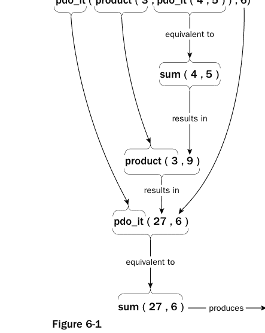

图 6-1

## 指向函数的指针作为参数

因为“指向函数的指针”是一种完全合理的类型，所以函数也可以有一个指向函数的指针作为参数。这样，该函数就可以调用由参数指向的函数。由于指针在不同情况下可以指向不同的函数，这允许在调用程序中确定从函数内部调用哪个特定函数。在这种情况下，你可以显式地传递一个函数作为参数。

### 试一试：传递函数指针

你可以通过一个例子来了解这一点。假设你需要一个处理数字数组的函数，有时需要计算每个数字的平方和，有时需要计算每个数字的立方和。实现这一目标的一种方法是使用指向函数的指针作为参数。

```cpp
// Ex6_02.cpp
// A pointer to a function as an argument
#include <iostream>
using std::cout;
using std::endl;

// Function prototypes
double squared(double);
double cubed(double);
double sumarray(double array[], int len, double (*pfun)(double));

int main(void)
{
    double array[] = { 1.5, 2.5, 3.5, 4.5, 5.5, 6.5, 7.5 };
    int len = sizeof array/sizeof array[0];

    cout << endl
         << "Sum of squares = "
         << sumarray(array, len, squared);

    cout << endl
         << "Sum of cubes = "
         << sumarray(array, len, cubed);

    cout << endl;
    return 0;
}

// Function for a square of a value
double squared(double x)
{
    return x*x;
}

// Function for a cube of a value
double cubed(double x)
{
    return x*x*x;
}

// Function to sum functions of array elements
double sumarray(double array[], int len, double (*pfun)(double))
{
    double total = 0.0;                 // Accumulate total in here

    for(int i = 0; i < len; i++)
        total += pfun(array[i]);

    return total;
}
```

如果你编译并运行这段代码，应该会看到以下输出：

```
Sum of squares = 169.75
Sum of cubes = 1015.88
```

## 工作原理

首先值得注意的是函数 `sumarray()` 的原型。它的第三个参数是一个指向函数的指针，该函数接受一个 `double` 类型的参数，并返回一个 `double` 类型的值。

```cpp
double sumarray(double array[], int len, double (*pfun)(double));
```

函数 `sumarray()` 使用其第三个参数指向的函数来处理作为第一个参数传入的数组中的每个元素，然后返回处理后的数组元素的总和。

你在 `main()` 中两次调用函数 `sumarray()`，第一次使用函数名 `squared` 作为第三个参数，第二次使用 `cubed`。在每种情况下，你用作参数的函数名所对应的地址都会替换函数 `sumarray()` 体内的函数指针，因此在 `for` 循环中会调用相应的函数。

显然，要完成此示例的功能，有更简单的方法，但使用指向函数的指针能为你提供很大的通用性。只要函数接受一个 `double` 参数并返回 `double` 类型的值，你就可以将任意你定义好的函数传递给 `sumarray()`。

## 函数指针数组

与常规指针一样，你可以声明指向函数的指针数组。你也可以在声明中对它们进行初始化。下面是一个声明指针数组的示例。

```cpp
double sum(double, double);                 // Function prototype
double product(double, double);             // Function prototype
double difference(double, double);          // Function prototype
double (*pfun[3])(double, double) =
    { sum, product, difference };   // Array of function pointers
```

数组中的每个元素都由花括号之间的初始化列表中出现相应函数地址进行初始化。要使用指针数组的第二个元素调用函数 `product()`，你可以这样写：

```cpp
pfun[1](2.5, 3.5);
```

选择函数指针数组元素的方括号紧跟在数组名之后，位于被调用函数的参数之前。当然，你可以在原函数可能合法出现的任何适当表达式中，通过函数指针数组的元素进行函数调用，而选择指针的索引值可以是任何能产生有效索引值的表达式。

## 初始化函数参数

对于到目前为止你使用过的所有函数，你都必须注意在函数调用中为每个参数提供一个对应的实参。如果你能在函数调用中省略一个或多个实参，并让省略的实参自动提供一些默认值，那会很方便。你可以通过在函数原型中初始化参数来实现这一点。

例如，假设你编写一个函数来显示消息，其中显示的消息作为参数传递。下面是这样函数的定义：


```
void showit(const char message[])
{
    cout << endl
        << message;
    return;
}
```

你可以通过在函数原型中指定初始化的字符串值来初始化该函数的参数，如下所示：

```
void showit(const char message[] = "Something is wrong.");
```

这里，参数 message 被赋予所示的字符串字面量进行初始化。如果你在一个函数的原型中初始化了一个参数，如果在调用该函数时省略了该参数，则在调用中使用初始化值。

## Try It Out  Omitting Function Arguments

在调用函数时省略函数参数会使其使用默认值执行。如果提供了参数，它会替换默认值。你可以使用 showit() 函数输出各种消息。

```
//Ex6_03.cpp
// Omitting function arguments
#include <iostream>
using std::cout;
using std::endl;

void showit(const char message[] = "Something is wrong.");

int main(void)
{
    const char mymess[] = "The end of the world is nigh.";

    showit();                // Display the basic message
    showit("Something is terribly wrong!");  // Display an alternative
    showit();                // Display the default again
    showit(mymess);          // Display a predefined message

    cout << endl;
    return 0;
}

void showit(const char message[])
{
    cout << endl
        << message;
    return;
}
```

如果执行此示例，它会产生以下世界末日般的输出：

```
Something is wrong.
Something is terribly wrong!
Something is wrong.
The end of the world is nigh.
```

## How It Works

正如你所见，每当省略参数时，你都会得到在函数原型中指定的默认消息；否则，函数按正常方式运行。

如果一个函数有多个参数，你可以为其中任意多个提供初始值。如果你想省略多个参数以利用默认值，则必须同时省略从最左侧被省略参数右侧的所有参数。例如，假设你有这个函数：

```
int do_it(long arg1 = 10, long arg2 = 20, long arg3 = 30, long arg4 = 40);
```

并且你想在调用它时省略一个参数。你只能省略最后一个参数 arg4。如果你想省略 arg3，你还必须省略 arg4。如果你省略 arg2，arg3 和 arg4 也必须一并省略，如果你想对 arg1 使用默认值，你必须在函数调用中省略所有参数。

由此可以得出结论，你需要在函数原型的参数列表末尾将具有默认值的参数按顺序放在一起，最有可能被省略的参数放在最后。

## Exceptions

如果你尝试过前几章末尾出现的练习，你很可能已经遇到过编译器错误和警告，以及程序运行时的错误。异常是标记 C++ 程序中发生的错误或意外情况的一种方式，你已经知道 new 运算符会在无法分配请求的内存时抛出异常。

到目前为止，你通常通过使用 if 语句测试某个表达式，然后执行特定代码来处理错误来处理程序中的错误条件。C++ 还提供了一种更通用的处理错误的机制，允许你将处理这些条件的代码与在不出现此类条件时执行的代码分离。重要的是要认识到，异常并非旨在作为程序中可能进行的正常数据检查和验证的替代方案。使用异常生成的代码会带来相当大的开销，因此异常实际上旨在应用于在正常事件过程中不期望发生的、异常的、接近灾难性的条件下。磁盘读取错误可能是你使用异常的情况。输入无效数据项并不是使用异常的好候选。

异常机制使用三个新关键字：

- try — 标识可能发生异常的代码块
- throw — 导致异常条件被引发
- catch — 标识处理异常的代码块

在下面的 Try It Out 中，你可以看到它们在实践中是如何工作的。

## Try It Out
Throwing and Catching Exceptions

你可以通过一个示例轻松了解异常处理是如何操作的。让我们为此使用一个非常简单的上下文。假设你需要编写一个程序来计算在机器上制造一个零件所需的时间，以分钟为单位。每个小时制造的零件数量被记录下来，但你必须记住机器会定期故障，可能不会制造任何零件。

你可以使用异常处理按如下方式编码：

```
// Ex6_04.cpp Using exception handling
#include <iostream>
using std::cout;
using std::endl;

int main(void)
{
    int counts[] = {34, 54, 0, 27, 0, 10, 0};
    int time = 60;                        // One hour in minutes

    for(int i = 0 ; i < sizeof counts/sizeof counts[0] ; i++)
        try
        {
            cout << endl
                << "Hour " << i+1;

            if(counts[i] == 0)
                throw "Zero count - calculation not possible.";

            cout << " minutes per item: "
                << static_cast<double>(time)/counts[i];
        }
        catch(const char aMessage[])
        {
            cout << endl
                << aMessage
                << endl;
        }
    return 0;
}
```

如果运行此示例，输出为：

```
Hour 1 minutes per item: 1.76471
Hour 2 minutes per item: 1.11111
Hour 3
Zero count - calculation not possible.

Hour 4 minutes per item: 2.22222
Hour 5
Zero count - calculation not possible.

Hour 6 minutes per item: 6
Hour 7
Zero count - calculation not possible.
```

## How It Works

try 块中的代码按正常顺序执行。try 块用于定义可能引发异常的位置。你可以从输出中看到，当抛出异常时，执行序列会继续到 catch 块，并在 catch 块中的代码执行后，执行会继续进行下一次循环迭代。当然，当没有抛出异常时，catch 块不会被执行。try 块和 catch 块都被编译器视为一个单元，因此它们都构成 for 循环块，循环在抛出异常后继续。

除法是在检查除数的 if 语句之后的输出语句中进行的。当执行 throw 语句时，控制立即传递到 catch 块中的第一条语句，因此当抛出异常时，执行除法的语句会被绕过。catch 块中的语句执行后，循环会继续进行下一次迭代（如果有的话）。

## Throwing Exceptions

异常可以在 try 块内的任何位置抛出，并且 throw 语句的操作数决定了异常的类型——示例中抛出的异常是一个字符串字面量，因此类型为 const char []。throw 关键字后面的操作数可以是任何表达式，表达式结果的类型决定了抛出的异常类型。

异常也可以在从 try 块中调用的函数中抛出，并由跟随 try 块的 catch 块捕获。你可以向前面的示例添加一个函数来演示这一点，其定义为：

```
void testThrow(void)
{
    throw " Zero count - calculation not possible.";
}
```

你将对该函数的调用放在前一个示例中 throw 语句的位置：

```
if(counts[i] == 0)
    testThrow();            // Call a function that throws an exception
```

每当数组元素为零时，异常就会由 testThrow() 函数抛出并被 catch 块捕获，因此输出与之前相同。不要忘记在源代码末尾添加 testThrow() 的定义时加上函数原型。


## 捕获异常

我们示例中紧跟在 try 块之后的 catch 块会捕获任何类型为 `const char []` 的异常。这是由跟在 `catch` 关键字之后的括号中出现的参数规范决定的。你必须为一个 try 块至少提供一个 catch 块，并且 catch 块必须紧跟在 try 块之后。catch 块会捕获在紧邻的前一个 try 块代码中的任何位置（包括在 try 块中直接或间接调用的任何函数中）抛出的所有（正确类型的）异常。

如果要指定 catch 块处理 try 块中抛出的任何异常，必须在包围异常声明的括号之间放置省略号（`...`）：

```cpp
catch (...)
{
    // code to handle any exception
}
```

如果为 try 块定义了其他 catch 块，则此 catch 块必须最后出现。

### 试一试：嵌套 try 块

你可以将 try 块嵌套在另一个 try 块内。在这种情况下，如果从内部 try 块中抛出异常，而该异常没有与之对应的捕获所抛出异常类型的 catch 块，则会搜索外部 try 块的 catch 处理程序。你可以用以下示例来演示这一点：

```cpp
// Ex6_05.cpp
// Nested try blocks
#include <iostream>
using std::cin;
using std::cout;
using std::endl;

int main(void)
{
    int height = 0;
    const double inchesToMeters = 0.0254;
    char ch = 'y';

    try                                    // Outer try block
    {
        while(ch == 'y' || ch == 'Y')
        {
            cout << "Enter a height in inches: ";
            cin >> height;                 // Read the height to be converted

            try                            // Defines try block in which
            {                              // exceptions may be thrown
                if(height > 100)
                    throw "Height exceeds maximum";   // Exception thrown
                if(height < 9)
                    throw height;                      // Exception thrown

                cout << static_cast<double>(height)*inchesToMeters
                     << " meters"
                     << endl;
            }
            catch(const char aMessage[])
                // start of catch block which
                // catches exceptions of type
                // const char[]
            {
                cout << aMessage << endl;
            }
            cout << "Do you want to continue(y or n)?";
            cin >> ch;
        }
    }
    catch(int badHeight)
    {
        cout << badHeight << " inches is below minimum" << endl;
    }
    return 0;
}
```

这里有一个 try 块包围 while 循环，以及一个内部 try 块，其中可能抛出两种不同类型的异常。类型为 `const char []` 的异常会被内部 try 块的 catch 块捕获，但类型为 `int` 的异常在内部 try 块中没有对应的 catch 处理程序；因此，外部 try 块中的 catch 处理程序会被执行。在这种情况下，程序会立即结束，因为 catch 块之后的语句是 `return`。

### MFC 中的异常处理

现在是提出 MFC 与异常相关问题的合适时机，因为它们在一定程度上被使用。如果你浏览 Visual C++ 2005 附带的文档，你可能会在索引中看到 `TRY`、`THROW` 和 `CATCH`。这些是在 C++ 语言中实现异常处理之前创建的 MFC 中定义的宏。它们模仿了 C++ 语言中 `try`、`throw` 和 `catch` 的操作，但语言本身的异常处理功能实际上使这些宏过时了，因此你不应该使用它们。它们仍然存在有两个原因。仍然有大量使用这些宏的程序存在，确保尽可能让旧代码仍然可以编译是很重要的。此外，大多数抛出异常的 MFC 都是基于这些宏实现的。无论如何，任何新程序都应使用 C++ 中的 `try`、`throw` 和 `catch` 关键字，因为它们与 MFC 配合使用。

当你使用抛出异常的 MFC 函数时，需要记住一个细微的异常。抛出异常的 MFC 函数通常抛出类类型的异常（你将在使用 MFC 之前了解类类型）。即使 MFC 函数抛出的异常是某个给定类类型（例如 `CDBException`），你也需要将其作为指针捕获，而不是作为异常的类型。因此，对于抛出类型为 `CDBException` 的异常，catch 块参数中出现的类型是 `CDBException*`。你将在本书后面的上下文中看到此类示例。

### 处理内存分配错误

当你使用 `new` 运算符为变量分配内存时（如你在第 4 章和第 5 章中看到的），你忽略了内存可能无法分配的可能性。如果内存未分配，会抛出导致程序终止的异常。在大多数情况下忽略此异常是可以接受的，因为内存耗尽通常是程序的终止条件，你通常无能为力。然而，在某些情况下，如果有机会，你可能能够做些什么，或者你可能想以自己的方式报告问题。在这种情况下，你可以捕获 `new` 运算符抛出的异常。让我们构造一个示例来展示这种情况的发生。

### 试一试：捕获 new 运算符抛出的异常

当内存无法分配时，`new` 运算符抛出的异常类型为 `bad_alloc`。`bad_alloc` 是在 `<new>` 标准头文件中定义的类类型，因此你需要一个 `#include` 指令。以下是代码：

```cpp
// Ex6_06.cpp
#include <new>                  // For bad_alloc type
#include <iostream>
using std::bad_alloc;
using std::cout;
using std::endl;

int main()
{
    char* pdata = 0;
    size_t count = ~static_cast<size_t>(0) / 2;
    try
    {
        pdata = new char[count];
        cout << "Memory allocated." << endl;
    }
    catch(bad_alloc &ex)
    {
        cout << "Memory allocation failed." << endl
             << "The information from the exception object is: "
             << ex.what() << endl;
    }
    delete[] pdata;
    return 0;
}
```

在我机器上，此示例产生以下输出：

```
Memory allocation failed.
The information from the exception object is: bad allocation
```

如果你幸运地拥有数 GB 内存的计算机，可能不会抛出异常。

## 什么是函数重载？

你选择函数名来反映手头的特定任务，这对于两个函数来说是可以的，但你可能还需要对几种其他类型的参数使用相同的函数。不断发明新名字似乎很可惜。理想情况下，无论参数类型如何，你都使用相同的函数名 `max()`，并执行适当的版本。你可能不会感到惊讶的是，你确实可以这样做，使其成为可能的 C++ 机制称为 **函数重载**。

函数重载允许你对多个函数使用相同的函数名，只要它们各自具有不同的参数列表。当函数被调用时，编译器会根据你提供的参数列表选择正确的版本。显然，编译器必须始终能够明确地决定在任何特定函数调用实例中应选择哪个函数，因此一组重载函数中每个函数的参数列表必须是唯一的。延续 `max()` 函数示例，你可以创建具有以下原型的重载函数：

```cpp
int max(int array[], int len);             // Prototypes for
long max(long array[], int len);            // a set of overloaded
double max(double array[], int len);        // functions
```

这些函数共享一个共同名称，但具有不同的参数列表。一般来说，重载函数可以通过具有对应参数的不同类型，或具有不同数量的参数来区分。

请注意，不同的返回类型并不能充分区分一个函数。你不能将以下函数添加到前一组中：

```cpp
double max(long array[], int len);       // Not valid overloading
```

原因在于此函数无法与具有以下原型的函数区分开来：

```cpp
long max(long array[], int len);
```

如果你像这样定义函数，编译器会抱怨以下错误：

```
error C2556: 'double max(long [],int)' : overloaded function differs only by return
type from 'long max(long [],int)'
```

程序无法编译。这可能看起来有点不合理，直到你记住你可以编写如下语句：

```cpp
long numbers[] = {1, 2, 3, 3, 6, 7, 11, 50, 40};
int len = sizeof numbers/sizeof numbers[0];
max(numbers, len);
```

调用 `max()` 函数在这里没有多大意义，因为你丢弃了结果，这并不使其非法。如果允许返回类型作为区分特征，编译器将无法决定在上述代码实例中是选择返回类型为 `long` 的版本还是返回类型为 `double` 的版本。出于这个原因，返回类型不被视为重载函数的区分特征。


事实上，每个函数（不仅仅是重载函数）都被认为有一个签名，其中函数的签名由其名称和参数列表决定。程序中的所有函数必须具有唯一的签名；否则程序无法编译。

## 使用重载函数试一试

你可以用已经定义的函数 max() 来练习重载功能。尝试一个包含 int、long 和 double 数组的三个版本的示例。

```
// Ex6_07.cpp
// Using overloaded functions
#include <iostream>
using std::cout;
using std::endl;

int max(int array[], int len);        // Prototypes for
long max(long array[], int len);     // a set of overloaded
double max(double array[], int len); // functions

int main(void)
{
    int small[] = {1, 24, 34, 22};
    long medium[] = {23, 245, 123, 1, 234, 2345};
    double large[] = {23.0, 1.4, 2.456, 345.5, 12.0, 21.0};

    int lensmall = sizeof small/sizeof small[0];
    int lenmedium = sizeof medium/sizeof medium[0];
    int lenlarge = sizeof large/sizeof large[0];

    cout << endl << max(small, lensmall);
    cout << endl << max(medium, lenmedium);
    cout << endl << max(large, lenlarge);

    cout << endl;
    return 0;
}

// Maximum of ints
int max(int x[], int len)
{
    int max = x[0];
    for(int i = 1; i < len; i++)
        if(max < x[i])
            max = x[i];
    return max;
}

// Maximum of longs
long max(long x[], int len)
{
    long max = x[0];
    for(int i = 1; i < len; i++)
        if(max < x[i])
            max = x[i];
    return max;
}

// Maximum of doubles
double max(double x[], int len)
{
    double max = x[0];
    for(int i = 1; i < len; i++)
        if(max < x[i])
            max = x[i];
    return max;
}
```

该示例按预期工作并产生以下输出：

```
34
2345
345.5
```

## 工作原理

你为函数 max() 的三个重载版本提供了三个原型。在每三个输出语句中，编译器根据参数列表类型选择适当的 max() 函数版本。这之所以可行，是因为 max() 函数的每个版本都有唯一的签名，因为其参数列表与其他 max() 函数不同。

## 何时重载函数

函数重载为你提供了一种确保函数名描述所执行的功能并且不会因诸如正在处理的数据类型等无关信息而混淆的手段。这与 C++ 中基本操作发生的情况类似。要将两个数字相加，你使用相同的运算符，而不管操作数的类型如何。我们的重载函数 max() 的名称相同，而不管正在处理的数据类型如何。这有助于使代码更具可读性，并使这些函数更易于使用。

> 函数重载的意图很明确：使同一操作能够使用不同的操作数通过单个函数名执行。因此，只要你有一系列本质上执行相同操作但参数类型不同的函数，你就应该重载它们并使用一个公共函数名。

## 函数模板

上一个示例有点乏味，因为你必须为每个函数重复本质上相同的代码，但使用不同的变量和参数类型，然而，有一种方法可以避免这种情况。你可以创建一种配方，使编译器能够自动生成具有各种参数类型的函数。定义用于生成特定函数组的配方的代码称为函数模板。

函数模板有一个或多个类型参数，你通过为模板的每个参数提供具体的类型参数来生成特定函数。因此，函数模板生成的函数都具有相同的基本代码，但由你提供的类型参数进行定制。你可以通过为上一个示例中的函数 max() 定义函数模板来实际了解其工作原理。

## 使用函数模板

你可以按如下方式为函数 max() 定义模板：

```
template<class T> T max(T x[], int len)
{
    T max = x[0];
    for(int i = 1; i < len; i++)
        if(max < x[i])
            max = x[i];
    return max;
}
```

template 关键字标识这是模板定义。template 关键字后面的尖括号括起用于创建特定函数实例的类型参数，以逗号分隔；在这种情况下，你只有一个类型参数 T。T 前面的 class 关键字表示 T 是此模板的类型参数，class 是类型的通用术语。书中后面你将看到，定义一个类本质上就是定义你自己的数据类型。因此，C++ 中有基本类型，例如类型 int 和类型 char，你也有自己定义的类型。请注意，你可以使用 typename 关键字代替 class 来标识函数模板中的参数，在这种情况下，模板定义看起来像这样：

```
template<typename T> T max(T x[], int len)
{
    T max = x[0];
    for(int i = 1; i < len; i++)
        if(max < x[i])
            max = x[i];
    return max;
}
```

一些程序员更喜欢使用 typename 关键字，因为 class 关键字往往暗示用户定义的类型，而 typename 更中性，因此更易于理解为暗示基本类型以及用户定义的类型。实际上你会看到两种关键字都被广泛使用。

在函数模板的定义中出现的任何地方，T 都被你创建模板实例时提供的特定类型参数，例如 long 所替换。如果你手动尝试通过将 T 替换为 long 来进行测试，你会看到这会生成一个完全令人满意的用于计算 long 类型数组的最大值的函数：

```
long max(long x[], int len)
{
    long max = x[0];
    for(int i = 1; i < len; i++)
        if(max < x[i])
            max = x[i];
    return max;
}
```

创建特定函数实例的过程称为**实例化**。

每次在程序中使用函数 max() 时，编译器都会检查是否已存在与你在函数调用中使用的参数类型相对应的函数。如果所需的函数不存在，编译器会通过将你在函数调用中使用的参数类型替换为模板定义中相应源代码中的参数 T 来创建它。你可以用上一个示例中使用的同一个 main() 函数来练习 max() 函数模板。

## 使用函数模板试一试

以下是修改后的上一个示例，使用模板为 max() 函数：

```
// Ex6_08.cpp
// Using function templates

#include <iostream>
using std::cout;
using std::endl;

// Template for function to compute the maximum element of an array
template<typename T> T max(T x[], int len)
{
    T max = x[0];
    for(int i = 1; i < len; i++)
        if(max < x[i])
            max = x[i];
    return max;
}

int main(void)
{
    int small[] = { 1, 24, 34, 22};
    long medium[] = { 23, 245, 123, 1, 234, 2345};
    double large[] = { 23.0, 1.4, 2.456, 345.5, 12.0, 21.0};

    int lensmall = sizeof small/sizeof small[0];
    int lenmedium = sizeof medium/sizeof medium[0];
    int lenlarge = sizeof large/sizeof large[0];

    cout << endl << max(small, lensmall);
    cout << endl << max(medium, lenmedium);
    cout << endl << max(large, lenlarge);

    cout << endl;
    return 0;
}
```

如果运行此程序，它会产生与上一个示例完全相同的输出。

## 工作原理

对于每个输出数组中最大值语句，都会使用模板实例化 max() 的新版本。当然，如果你添加另一条使用之前使用过的类型调用函数 max() 的语句，则不会生成新的代码版本。

请注意，使用模板不会以任何方式减少编译后程序的大小。编译器会为你需要的每个函数生成源代码版本。事实上，使用模板通常会增加程序的大小，因为即使通过强制转换参数也可以令人满意地使用现有版本，也会自动创建函数。你可以通过显式包含其声明来强制创建模板的特定实例。例如，如果你想确保为函数 max() 的模板创建对应于类型 float 的实例，你可以在模板定义之后放置以下声明：

```
float max(float, int);
```

这会强制创建此函数模板的版本。在我们的程序示例中它没有多大价值，但在你知道可能会生成模板函数的多个版本，但希望强制生成你计划在必要时将参数强制转换为适当类型后使用的子集时，它会很有用。

## 使用函数的示例

到目前为止，你已经在 C++ 中涵盖了很多内容，仅本章关于函数的内容就很多。在浏览了各种语言功能菜单后，不总是很容易看出它们如何相互关联。现在是时候看看这些东西如何结合起来产生比简单演示程序更有实质性的东西。

让我们通过一个更现实的示例来了解如何将问题分解为函数。该过程涉及定义要解决的问题，分析问题以了解如何用 C++ 实现它，最后编写代码。这里的方法旨在说明各种函数如何组合起来构成最终结果，而不是提供如何开发程序的教程。

## 实现计算器

假设你需要一个充当计算器的程序；不是那种带有大量按钮和装置、为容易满足的人设计的设备，而是为在算术上知道自己要去哪里的人设计的。你可以真正大干一场，将计算从键盘输入为单个算术表达式，并立即显示答案。你输入的内容示例是：

```
2*3.14159*12.6*12.6 / 2 + 25.2*25.2
```

为了暂时避免不必要的复杂性，你不会允许表达式中出现括号，并且整个计算必须在一行中输入；然而，为了让用户使输入看起来更具吸引力，你将允许在任何地方放置空格。输入的表达式可能包含


乘、除、加、减运算符分别由 *、/、+ 和 - 表示，输入的表达式将按照常规算术规则求值，因此乘除优先于加减。

程序应允许按要求执行任意多次连续计算，并在输入空行时终止。它还应该提供有用且友好的错误消息。

## 分析问题

一个好的起点是输入。程序在一行中读入任意长度的算术表达式，该表达式可以是给定规则范围内的任意结构。由于构成表达式的元素没有任何固定形式，你必须将其作为字符串读入，然后在程序中分析其构成。你可以自行决定处理不超过 80 个字符的字符串，因此可以将其存储在以下语句声明的数组中：

```
const int MAX = 80;      // Maximum expression length including '\0'
char buffer[MAX];        // Input area for expression to be evaluated
```

要更改程序处理的字符串的最大长度，只需修改 MAX 的初始值即可。

你需要理解输入字符串中信息的基本结构，所以我们一步步来分析。

在处理输入时，尽量确保输入尽可能简洁，因此在开始分析输入字符串之前，你应该先去掉其中的所有空格。你可以将完成此操作的函数命名为 eatspaces()。该函数可以遍历输入缓冲区（即 buffer[] 数组），并通过前移字符来覆盖空格。这个过程使用两个缓冲区数组索引 i 和 j，它们都从缓冲区开头开始；通常，你会将索引 j 处的元素存储到位置 i。随着你遍历数组元素，每当遇到空格时，j 递增而 i 不递增，因此位置 i 的空格会被你在索引位置 j 找到的下一个非空格字符覆盖。图 6-2 说明了这一逻辑。

将内容复制到自身之前的缓冲区数组


将内容复制到自身之后的缓冲区数组

图 6-2

这个过程实际上就是把 buffer[] 数组的内容复制到自身，但不包括任何空格。图 6-2 显示了复制过程前后的 buffer 数组，箭头指示了哪些字符被复制以及每个字符被复制到的位置。

从输入中移除空格后，就可以对表达式求值了。你定义函数 expr()，它返回对输入缓冲区中整个表达式求值所得的结果。为了确定 expr() 函数内部的处理过程，你需要更详细地研究输入的结构。加法和减法运算符的优先级最低，因此最后求值。你可以将输入字符串视为由一个或多个项通过运算符连接而成，这些运算符可以是 + 或 -。你可以将这两种运算符统称为 addop。按照这种术语，输入表达式的一般形式可以表示如下：

```
expression: term addop term ... addop term
```

表达式至少包含一个项，并且后面可以跟任意数量的 addop term 组合。事实上，假设你已经删除了所有空格，每个项后面跟随的字符只有三种合法情况：

- 下一个字符是 '\0'，表示已到达字符串末尾
- 下一个字符是 '-'，在这种情况下，你应该从表达式到目前为止已累计的值中减去下一项的值
- 下一个字符是 '+'，在这种情况下，你应该将下一项的值加到表达式到目前为止已累计的值上

如果某个项后面出现其他字符，则说明字符串不符合预期，因此你会显示一条错误消息并退出程序。图 6-3 展示了一个示例表达式的结构。

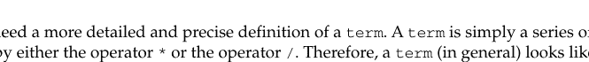

图 6-3

接下来，你需要对项给出更详细、更精确的定义。项就是由运算符 * 或 / 连接的一系列数字。因此，项的一般形式如下：

```
term: number multop number ... multop number
```

multop 表示乘法或除法运算符。你可以定义一个名为 term() 的函数来返回某个项的值。该函数需要扫描字符串，先找出一个数字，然后查找后跟另一个数字的 multop。如果发现某个字符不是 multop，term() 函数会假定它是 addop，并返回到目前为止已找到的值。

编写程序之前需要弄清的最后一件事是如何识别数字。为了最大限度地降低代码复杂度，你只识别无符号数；因此，数字由一系列数字组成，后面可以选择跟一个小数点和更多数字。为了确定数字的值，你遍历缓冲区查找数字。如果发现任何不是数字的字符，就检查它是否为小数点。如果不是小数点，它就和数字无关，因此返回已经获得的值。如果找到小数点，就继续查找更多数字。一旦发现任何不是数字的字符，就说明已经得到了完整的数字，返回该数字即可。发挥一点想象力，你可以将这个用于识别数字并返回其值的函数命名为 number()。图 6-4 展示了一个表达式如何分解为项和数字的示例。

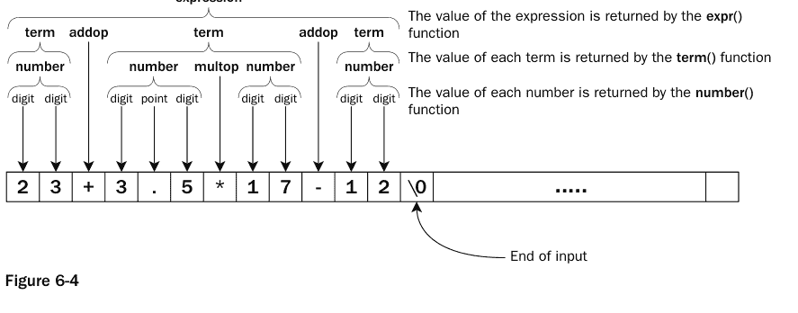

图 6-4

现在，你对问题已经有了足够理解，可以编写一些代码了。你可以逐个编写所需函数，然后编写一个 main() 函数将它们组合在一起。第一个要编写、也许也是最容易编写的函数是 eatspaces()，它将消除输入字符串中的空格。

## 消除字符串中的空格

你可以如下编写 eatspaces() 函数的原型：

```
void eatspaces(char* str);    // Function to eliminate blanks
```

该函数不需要返回任何值，因为可以在原字符串中就地消除空格，并通过作为参数传入的指针直接修改原始字符串。消除空格的过程非常简单。你将字符串复制到自身，覆盖任何空格，如本章前面所见。

你可以按如下方式定义该函数：

```
// Function to eliminate spaces from a string
void eatspaces(char* str)
{
    int i = 0;                         // 'Copy to' index to string
    int j = 0;                         // 'Copy from' index to string

    while((*(str + i) = *(str + j++)) != '\0')   // Loop while character is not \0
        if(*(str + i) != ' ')                 // Increment i as long as
            i++;                              // character is not a space
    return;
}
```

## 函数如何工作

所有操作都在 while 循环中。循环条件通过将位置 j 处的字符移动到位置 i 来复制字符串，然后将 j 递增到下一个字符。如果复制的字符是 '\0'，则说明已经到达字符串末尾，就完成了。

循环体中的唯一操作是：如果最后复制的字符不是空格，就将 i 递增到下一个字符。如果是空格，i 不会递增，因此该空格可以在下一次迭代时被复制的字符覆盖。

这并不难，对吧？接下来，你可以尝试编写返回表达式求值结果的函数。

## 计算表达式

expr() 函数返回以参数形式提供的字符串中所指定表达式的值，因此你可以如下编写其原型：

```
double expr(char* str);    // Function evaluating an expression
```

这里声明的函数接受一个字符串作为参数，并返回 double 类型的结果。根据你之前推导出的表达式结构，你可以绘制表达式求值过程的逻辑图，如图 6-5 所示。


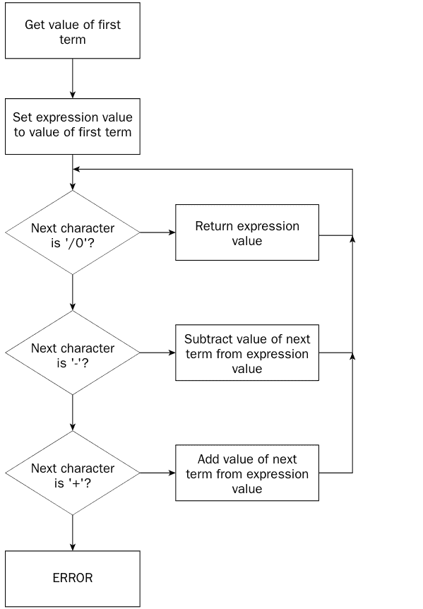

图 6-5

使用这个基本逻辑定义，你现在可以编写这个函数：

```
// Function to evaluate an arithmetic expression
double expr(char* str)
{
    double value = 0.0;                // Store result here
    int index = 0;                     // Keeps track of current character position

    value = term(str, index);          // Get first term
    for(;;)                            // Indefinite loop, all exits inside
{
    switch(*(str + index++))        // Choose action based on current character
    {
        case '\0':                  // We're at the end of the string
            return value;           // so return what we have got

        case '+':                   // + found so add in the
            value += term(str, index);  // next term
            break;

        case '-':                   // - found so subtract
            value -= term(str, index);  // the next term
            break;

        default:                    // If we reach here the string
            cout << endl            // is junk
                << "Arrgh!*#!! There's an error"
                << endl;
            exit(1);
    }
}
```

### 函数如何运作

考虑到这个函数是在分析你交给它的任何算术表达式（只要它使用我们的运算符子集），代码量并不多。你定义了一个 int 类型的变量 index，它跟踪你正在处理的字符串中的当前位置，并将其初始化为 0，对应于字符串中第一个字符的索引位置。你还定义了一个 double 类型的变量 value，用来累加传入函数（通过 char 数组 str）的表达式的值。

因为表达式必须至少有一个项，所以函数中的第一个动作是通过调用你尚未编写的 term() 函数来获取第一个项的值。这实际上对 term() 函数提出了三点要求：

- 1. 它应当接受一个 char* 指针和一个 int 变量作为参数，第二个参数是所提供字符串中该项第一个字符的索引。
- 2. 它应当更新传入的索引值，使其指向所找到项最后一个字符后面的那个字符。
- 3. 它应当以 double 类型返回该项的值。

程序的其余部分是一个无限 for 循环。在循环内，动作由 switch 语句决定，它受字符串中当前字符的控制。如果是 '+'，你调用 term() 函数获取表达式中下一项的值，并将其加到变量 value 中。如果是 '-'，你从变量 value 中减去 term() 返回的值。如果是 '\0'，说明你已到达字符串末尾，所以将变量 value 的当前内容返回给调用程序。如果是任何其他字符，它不应该出现在那里，所以在向用户表示不满后，你结束程序！

只要找到 '+' 或 '-'，循环就会继续。每次调用 term() 都会将 index 变量的值移动到被求值项后面的字符处，而该字符应该是另一个 '+' 或 '-'，或者是字符串结束符 '\0'。因此，函数要么在遇到 '\0' 时正常终止，要么通过调用 exit() 异常终止。当你把整个程序放在一起时，你需要记得为 <cstdlib> 头文件添加 #include 指令，该头文件提供了 exit() 函数的定义。

你也可以使用递归函数来分析算术表达式。如果你稍微换一种方式思考表达式的定义，你可以将其指定为：要么是一个项，要么是一个项后跟一个表达式。这里的定义是递归的（即定义涉及被定义的对象），这种方法在定义编程语言结构时非常常见。这个定义与第一个定义一样灵活，但以它作为基本概念，你可以得到 expr() 的递归版本，而不是像上面实现那样使用循环。你可能想在完成第一个版本后，尝试这种替代方法作为练习。

## 获取项的值

term() 函数返回一个 double 类型的项的值，并接收两个参数：正在分析的字符串和字符串中当前位置的索引。还有其他方法可以实现这一点，但这种安排非常直接。因此，你可以写下 term() 函数的原型如下：

```
double term(char* str, int& index);      // Function analyzing a term
```

你将第二个参数指定为引用。这是因为你希望函数能够修改调用程序中变量 index 的值，使其定位于输入字符串中所找到项最后一个字符后面的那个字符。你也可以将 index 作为值返回，但那样你就需要以其他方式返回项的值，所以这种安排似乎很自然。

分析项的逻辑在结构上将与表达式的类似。一个项是一个数字，可能后跟一个或多个由乘号或除号运算符与另一个数字组成的组合。你可以编写 term() 函数的定义如下：

```
// Function to get the value of a term
double term(char* str, int& index)
{
    double value = 0.0;                  // Somewhere to accumulate
                                       // the result

    value = number(str, index);          // Get the first number in the term

    // Loop as long as we have a good operator
    while((*(str + index) == '*') || (*(str + index) == '/'))
    {
        if(*(str + index) == '*')         // If it's multiply,
            value *= number(str, ++index); // multiply by next number

        if(*(str + index) == '/')         // If it's divide,
            value /= number(str, ++index); // divide by next number
    }
    return value;                        // We've finished, so return what
                                         // we've got
}
```

### 函数如何运作

你首先声明一个局部 double 变量 value，用来累加当前项的值。因为一个项必须至少包含一个数字，所以函数中的第一个动作是通过调用 number() 函数获取第一个数字的值，并将结果存储在 value 中。你隐式地假设 number() 函数接受字符串和字符串中某个位置的索引作为参数，并返回所找到数字的值。因为 number() 函数还必须更新索引到字符串中该数字之后的位置，所以当你定义该函数时，你将再次把第二个参数指定为引用。

term() 函数的其余部分是一个 while 循环，只要下一个字符是 '*' 或 '/'，循环就会继续。在循环内，如果当前位置找到的字符是 '*'，你递增变量 index 使其定位到下一个数字的开头，调用 number() 函数获取下一个数字的值，然后将 value 的内容乘以返回的值。类似地，如果当前字符是 '/'，你递增 index 变量，并将 value 的内容除以 number() 返回的值。因为 number() 函数会自动将变量 index 的值改为所找到数字后面的那个字符，所以 index 已经设置为在下一次迭代中选择字符串中下一个可用的字符。

当遇到一个不是乘号或除号运算符的字符时，循环终止，随后将变量 value 中累计的当前项的值返回给调用程序。

你需要的最后一个分析函数是 number()，它确定字符串中出现的任何数字的数值。

## 分析数字

根据你在 term() 函数中使用 number() 函数的方式，你需要用这个原型来声明它：

```
double number(char* str, int& index);  // Function to recognize a number
```

将第二个参数指定为引用，允许该函数直接更新调用程序中的参数，这正是你所需要的。

你可以在这里使用标准 C++ 库中提供的函数。<cctype> 头文件提供了一系列用于测试单个字符的函数定义。这些函数返回 int 类型的值，其中正值对应于 true，零对应于 false。其中四个函数如下表所示：

| 用于测试单个字符的 <cctype> 头文件中的函数 |  |
|---|---|
| int isalpha(int c) | 如果参数是字母，返回 true，否则返回 false。 |
| int isupper(int c) | 如果参数是大写字母，返回 true，否则返回 false。 |
| int islower(int c) | 如果参数是小写字母，返回 true，否则返回 false。 |
| int isdigit(int c) | 如果参数是数字，返回 true，否则返回 false。 |


这种构造方式值得仔细审视。数字字符的 ASCII 值介于 48（对应数字 0）和 57（对应数字 9）之间。因此，如果从某个数字字符的 ASCII 码中减去字符 `'0'` 的 ASCII 码，就能把它转换成 0 到 9 之间对应的数值。子表达式 `*(str + index++) - '0'` 两边加了括号；这些括号并非必需，但确实能让当前的操作更清晰一些。变量 `value` 的内容会先乘以 10，把数值向左移动一位，然后再加上当前数字的值；这是因为你从左到右处理数字，也就是先遇到最高位。这个过程如图 6-6 所示。

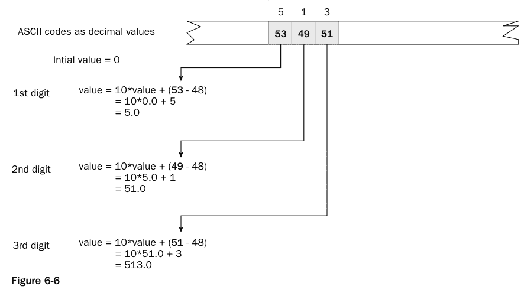

图 6-6

一旦遇到不是数字的字符，它要么是小数点，要么是其他字符。如果不是小数点，就说明处理完毕，于是将变量 `value` 的当前内容返回给调用程序。如果是小数点，就在第二个循环中累加对应于该数小数部分的各个数字。在这个循环中，你使用初始值为 1.0 的 `factor` 变量来设定当前数字的小数位，因此每找到一个数字，`factor` 就乘以 0.1。于是，小数点后的第一位乘以 0.1，第二位乘以 0.01，第三位乘以 0.001，依此类推。这个过程如图 6-7 所示。

## 整合程序

一旦遇到非数字字符，处理就结束了，因此在第二个循环之后，你返回变量 `value` 的值。现在你几乎已经完成了整个程序，只需要一个 `main()` 函数来读取输入并驱动整个过程。

图 6-7

你可以把 `#include` 语句集中在一起，并在程序开头为程序中用到的所有函数组织好函数原型：

```
// Ex6_09.cpp
// A program to implement a calculator

#include <iostream>                  // For stream input/output
#include <cstdlib>                   // For the exit() function
#include <cctype>                    // For the isdigit() function
using std::cin;
using std::cout;
using std::endl;

void eatspaces(char* str);            // Function to eliminate blanks
double expr(char* str);              // Function evaluating an expression
double term(char* str, int& index);  // Function analyzing a term
double number(char* str, int& index); // Function to recognize a number

const int MAX = 80;                  // Maximum expression length,
                                     // including '\0'
```

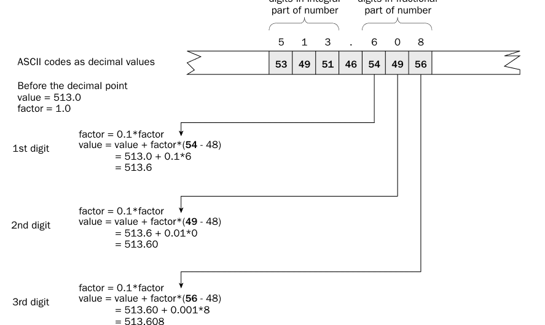

## 扩展程序

既然你已经有了一个可用的计算器，就可以开始考虑扩展它了。如果表达式能支持括号，岂不是很好？这应该不会太难，对吧？让我们试一试。

想一想表达式中可能出现的括号内容，与你目前所做的表达式分析之间存在什么关系。看一下你想要处理的那类表达式的一个例子：

```
2*(3 + 4) / 6 - (5 + 6) / (7 + 8)
```

注意，用你原来的术语来说，括号中的表达式总是构成项（term）的一部分。无论你设计怎样的计算过程，这一点始终成立。事实上，如果你能把括号内表达式的值替换回原始字符串，那么剩下的就是你已能处理的内容了。这提示了一种处理括号的可能方法：你可以把括号中的表达式当作另一个数字，并修改 `number()` 函数，让它计算出括号内任意内容的值。

这听起来是个好主意，但要“算出”括号中的表达式还需要稍加思考：成功的线索就在此处使用的术语中。出现在括号内的表达式完全就是一个完整的表达式，而你已经有了能返回表达式值的 `expr()` 函数。如果你能让 `number()` 函数弄清楚括号中的内容，并将其从字符串中提取出来，就可以把得到的子字符串传给 `expr()` 函数，这样递归就能真正简化问题。更重要的是，你无需担心嵌套括号。因为任何一组括号内包含的都是你已定义为表达式的内容，它们会被自动处理。递归再次胜出。

试着重写 `number()` 函数，让它能识别括号中的表达式。

```
// Function to recognize an expression in parentheses
// or a number in a string
double number(char* str, int& index)
{
    double value = 0.0;                    // Store the resulting value

    if(*(str + index) == '(')              // Start of parentheses
    {
        char* psubstr = 0;                 // Pointer for substring
        psubstr = extract(str, ++index);   // Extract substring in brackets
        value = expr(psubstr);             // Get the value of the substring
        delete[]psubstr;                   // Clean up the free store
        return value;                      // Return substring value
    }

    while(isdigit(*(str + index)))        // Loop accumulating leading digits
        value = 10*value + (*(str + index++) - 48);
                                        // Not a digit when we get to here
    if(*(str + index) != '.')             // so check for decimal point
        return value;                     // and if not, return value

    double factor = 1.0;                  // Factor for decimal places
    while(isdigit(*(str + (++index))))    // Loop as long as we have digits
```

```
factor *= 0.1;                     // Decrease factor by factor of 10
value = value + (*(str + index) - 48)*factor;  // Add decimal place
}

return value;                      // On loop exit we are done
}
```

这段代码还不完整，因为你仍然需要 `extract()` 函数，不过你马上就会补上它。

### 函数如何运作

看看为了支持括号，改动是多么少。我承认这有点取巧，因为你用到了一个尚未编写的函数 `extract()`，但只需多写这一个函数，就能获得任意层级的嵌套括号支持。这真是锦上添花，而且全都要归功于递归的神奇之处！

现在，`number()` 函数做的第一件事就是检查左括号。如果找到左括号，它就调用另一个函数 `extract()`，从原始字符串中提取括号之间的子字符串。这个新子字符串的地址存储在指针 `psubstr` 中，于是你把这个指针作为参数传给 `expr()` 函数，对子字符串求值。结果存储在 `value` 中；在释放 `extract()` 函数（按你最终实现的方式）在自由存储区分配的内存之后，你返回为子字符串求得的值，就像它是一个普通数字一样。当然，如果一开始没有左括号，`number()` 函数就完全像之前一样继续执行。

### 提取子字符串

现在你需要编写 `extract()` 函数。这并不难，但也不是那么简单。主要的复杂之处在于，括号内的表达式可能还包含其他括号，因此你不能只是去寻找遇到的第一个右括号。你还必须留意更多的左括号，并且每找到一个左括号，就要忽略与之对应的那个右括号。你可以通过维护一个左括号计数来做到这一点：每找到一个左括号，计数加一；如果左括号计数不为零，则每遇到一个右括号，计数减一。当然，如果左括号计数为零时又遇到了右括号，那就说明已经到了子字符串的末尾。提取带括号子字符串的机制如图 6-8 所示。

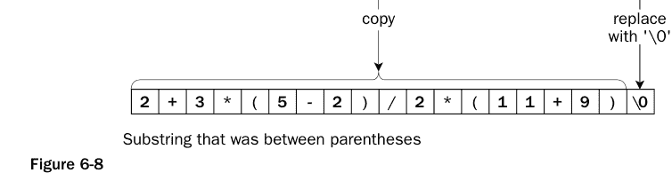

图 6-8


# 第6章

由于你在此处提取的字符串包含用括号括起的子表达式，最终会再次调用 extract() 来处理这些子表达式。

函数 extract() 还需要为子字符串分配内存并返回指向它的指针。当然，原始字符串中当前位置的索引最终需要选择子字符串之后的字符，因此该参数需要指定为引用。因此，extract() 的原型如下：

```
char* extract(char* str, int& index); //Function to extract a substring
```

你现在可以尝试该函数的定义。

```
// Function to extract a substring between parentheses
// (requires <cstring> header file)
char* extract(char* str, int& index)
{
    char buffer[MAX];                 // Temporary space for substring
    char* pstr = 0;                   // Pointer to new string for return
    int numL = 0;                     // Count of left parentheses found
    int bufindex = index;             // Save starting value for index

    do
    {
        buffer[index - bufindex] = *(str + index);
        switch(buffer[index - bufindex])
        {
            case ')':
                if(numL == 0)
                {
                    buffer[index - bufindex] = '\0';  // Replace ')' with '\0'
                    ++index;
                    pstr = new char[index - bufindex];
                    if(!pstr)
                    {
                        cout << "Memory allocation failed," << " program terminated.";
                        exit(1);
                    }
                    strcpy_s(pstr, index-bufindex, buffer); // Copy substring to new memory
                    return pstr;               // Return substring in new memory
                }
                else
                    numL--;                   // Reduce count of '(' to be matched
                break;

            case '(': 
                numL++;                   // Increase count of '(' to be
                                          // matched
                break;
        }
    } while(*(str + index++) != '\0');   // Loop - don't overrun end of string

    cout << "Ran off the end of the expression, must be bad input."
    << endl;
    exit(1);
    return pstr;
}

## 函数如何工作

你声明一个 char 数组来临时保存子字符串。你不知道子字符串有多长，但它不能超过 MAX 个字符。你不能将 buffer 的地址返回给调用函数，因为它是局部的，在函数退出时会销毁；因此，当你知道字符串长度时，需要在自由存储区上分配一些内存。你通过声明一个类型为‘指向 char 的指针’的变量 pstr 来实现这一点，当你将子字符串安全地保存在自由存储区内存中时，通过值返回它。

你声明一个计数器 numL 来跟踪子字符串中的左括号（正如我之前讨论的那样）。index 的初始值（函数开始执行时）存储在变量 bufindex 中。你将它与 index 的递增值结合起来对数组 buffer 进行索引。

函数的可执行部分基本上是一个大的 do-while 循环。子字符串从 str 复制到 buffer，每次循环迭代复制一个字符，同时在每个周期检查左括号或右括号。如果找到左括号，numL 会递增，如果找到右括号且 numL 非零，则会递减。当你找到右括号且 numL 为零时，你就找到了子字符串的末尾。然后用‘\0’替换 buffer 中子字符串中的‘)’，并在自由存储区上获取足够的内存来容纳子字符串。然后使用 <cstring> 头文件中声明的 strcpy_s() 函数将 buffer 中的子字符串复制到你通过 new 运算符获得的内存中；这是在同一头文件中声明的旧 strcpy() 函数的安全版本。此函数将第三个参数 buffer 指定的字符串复制到第一个参数 pstr 指定的地址。第二个参数是目标字符串 pstr 的长度。

如果你从循环底部掉出来，这意味着你在 str 中表达式末尾的‘\0’处命中，而没有找到对应的右括号，因此你显示一条消息并终止程序。

## 运行修改后的程序

在旧版本的程序中替换 number() 函数后，添加 <cstring> 的 #include 语句，并合并你刚刚编写的新 extract() 函数的原型和定义，你就可以使用一个全功能的全能计算器了。如果你在没有错误的情况下组装了所有这些，你可以得到类似这样的输出：

```
Welcome to your friendly calculator.
Enter an expression, or an empty line to quit.
1/(1+1/(1+1/(1+1)))
    = 0.6

(1/2-1/3)*(1/3-1/4)*(1/4-1/5)
    = 0.000694444

3.5*(1.25-3/(1.333-2.1*1.6))-1
    = 8.55507

2,4-3.4

Arrrgh!*#!! There's an error
```

最后输出行中友好而信息丰富的错误消息是由于在上面的表达式中使用了逗号而不是小数点，在本应为 2.4 的地方。正如你所见，你可以用相对简单的程序扩展来获得任意深度的嵌套括号，这全都归功于递归的惊人威力。

### C++/CLI 编程

到目前为止关于原生 C++ 函数所讨论的几乎所有内容同样适用于 C++/CLI 语言代码，前提是参数类型和返回类型将是基本类型，你知道它们等同于 CLR 程序中的值类类型，跟踪句柄类型或跟踪引用类型。因为你不能对存储在跟踪句柄中的地址执行算术运算，我为将参数作为指针进行算术运算的原生 C++ 数组所演示的编码技术不适用于 C++/CLI 数组。许多原生 C++ 函数参数可能出现的问题消失了，但在 C++/CLI 中对粗心的人来说仍有一些陷阱。计算器的 CLR 版本可以帮助你理解函数在 C++/CLI 中编写的样子。

throw 和 catch 异常机制在 CLR 程序中与原生 C++ 程序中工作方式相同，但有一些差异。在 C++/CLI 程序中抛出的异常必须始终使用跟踪句柄抛出。因此你应该始终抛出异常对象，尽可能避免抛出字面量，尤其是字符串字面量。例如，考虑这段 try-catch 代码：

```
try
{
    throw L"Catch me if you can.";
}
catch(String^ ex)                // The exception will not be caught by this
{
    Console::WriteLine(L"String^: {0}",ex);
}
```

catch 块无法捕获此处抛出的对象，因为 throw 语句抛出的是类型为 const wchar_t* 的异常，而不是类型为 String^ 的异常。要按抛出方式捕获异常，catch 块需要是：

```
try
{
    throw L"Catch me if you can.";
}
catch(const wchar_t* ex)          // OK. The exception thrown is of this type
{
    String^ exc = gcnew String(ex);
    Console::WriteLine(L"wchar_t*: {0}", exc);
}
```

这个 catch 块捕获了异常，因为它现在具有正确的类型。

要抛出异常以便能被原始的 catch 块捕获，你必须更改 try 块中的代码：

```
try
{
    throw gcnew String(L"Catch me if you can.");
}
catch(String^ ex)                // OK. Exception thrown is of this type
{
    Console::WriteLine(L"String^: {0}",ex);
}
```

现在异常是一个 String 对象，并作为类型 String^ 的句柄抛出，该句柄引用字符串。

你可以在 C++/CLI 程序中使用函数模板，但你还有一个称为泛型函数的额外功能，看起来非常相似；然而，两者存在显著差异。

## 理解泛型函数

尽管泛型函数看起来与函数模板做同样的事情，因此乍一看似乎是多余的，但泛型函数的工作方式与模板函数大不相同，而这些差异使它们成为 CLR 程序中宝贵的额外功能。当你使用函数模板时，编译器会从模板生成你需要的函数的源代码；然后生成的代码会与你的其余程序代码一起编译。在某些情况下，这可能会生成许多函数，并且可执行模块的大小可能会大幅增加。另一方面，泛型函数规范本身会被编译，并且当你调用匹配泛型函数规范的函数时，实际类型会在执行时替换类型参数。编译时不会生成额外代码，也不会出现模板函数可能出现的代码膨胀。

定义泛型函数的某些方面依赖于后面章节中才会出现的知识，但最终一切都会清楚。我将在此处对新事物提供最少的解释，你将在本书后面学习细节。

## 定义泛型函数

你使用在函数调用时被实际类型替换的类型参数来定义泛型函数。以下是泛型函数定义的示例：

```
generic<typename T> where T:IComparable
T MaxElement(array<T>^ x)
{
    T max = x[0];
    for(int i = 1; i < x->Length; i++)
        if(max->CompareTo(x[i]) < 0)
            max = x[i];
    return max;
}
```


这个通用函数的工作与本章前面看到的原生 C++ 函数模板相同。第一行的 generic 关键字标识其后内容为通用规范，第一行定义了函数的类型参数为 T；尖括号之间的 typename 关键字表示其后的 T 是通用函数中的类型参数名称，并且当使用通用函数时，该类型参数会被实际类型替换。对于具有多个类型参数的通用函数，参数名称位于尖括号之间，每个名称前都有 typename 关键字并用逗号分隔。

在闭合尖括号之后出现的 where 关键字对可替换为 T 的实际类型引入了约束。此特定约束说明，替换通用函数中 T 的任何类型都必须实现 IComparable 接口。你将在本书后面学习接口，但现在我可以说，这意味着该类型必须定义 CompareTo() 函数，以便比较该类型的两个对象。如果没有此约束，编译器对可替换 T 的类型的可能操作一无所知，因为在通用函数被使用之前，这完全未知。有了约束，你就可以使用 CompareTo() 函数来比较 max 与数组中的元素。CompareTo() 函数返回一个整数值，当调用它的对象（本例中为 max）小于参数时小于 0，等于参数时为零，大于参数时大于 0。

第二行指定了通用函数名 MaxElement、其返回类型 T 以及参数列表。这看起来很像普通函数的头，只是涉及通用类型参数 T。通用函数的返回类型和参数类型规范的一部分即数组元素类型都为类型 T，因此这两种类型在通用函数被使用时确定。

## 使用通用函数

调用通用函数最简单的方法就是像使用任何普通函数一样使用它。例如，你可以像这样使用上一节中的通用 MaxElement()：

```
array<double>^ data = {1.5, 3.5, 6.7, 4.2, 2.1};
double maxData = MaxElement(data);
```

编译器能够推断出此实例中通用函数的类型参数为 double，并据此生成调用函数的代码。函数执行时，函数中的 T 实例被 double 替换。如我前面所说，这不像模板函数；编译时不会创建函数实例。编译后的通用函数能够在调用时处理类型参数替换。

请注意，如果你将字符串字面量作为参数传递给通用函数，编译器会推断类型参数为 String^，无论字符串字面量是窄字符串常量如 "Hello!" 还是宽字符串常量如 L"Hello!"。

可能存在编译器无法从通用函数的调用中推断出类型参数的情况。在这些情况下，你可以在调用中在函数名之后用尖括号显式指定类型参数。例如，你可以将前一段中的调用写成：

```
double maxData = MaxElement<double>(data);
```

显式指定类型参数后就不会存在歧义的可能性。

作为通用函数的类型参数可以提供的类型存在限制。类型参数不能是原生 C++ 类类型，或原生指针或引用，或指向值类类型的句柄，如 int^。因此只允许值类类型如 int 或 double 以及跟踪句柄如 String^（但不允许指向值类类型的句柄）。

让我们尝试一个工作示例。

## 试用通用函数

下面是一个示例，定义并使用了三个通用函数：

```
// Ex6_10A.cpp : main project file.
// Defining and using generic functions

#include "stdafx.h"

using namespace System;
```

```
// Generic function to find the maximum element in an array
generic<typename T> where T:IComparable
T MaxElement(array<T>^ x)
{
    T max = x[0];
    for(int i = 1; i < x->Length; i++)
        if(max->CompareTo(x[i]) < 0)
            max = x[i];
    return max;
}
```

```
// Generic function to remove an element from an array
generic<typename T> where T:IComparable
array<T>^ RemoveElement(T element, array<T>^ data)
{
    array<T>^ newData = gcnew array<T>(data->Length - 1);
    int index = 0;                    // Index to elements in newData array
    bool found = false;               // Indicates that the element to remove was found
    for each(T item in data)
    {
        // Check for invalid index or element found
        if((!found) && item->CompareTo(element) == 0)
        {
            found = true;
            continue;
        }
        else
        {
            if(index == newData->Length)
            {
                Console::WriteLine(L"Element to remove not found");
                return data;
            }
            newData[index++] = item;
        }
    }
    return newData;
}
```

# 第 6 章

```
// Generic function to list an array
generic<typename T> where T:IComparable
void ListElements(array<T>^ data)
{
    for each(T item in data)
        Console::Write(L"{0,10}", item);
    Console::WriteLine();
}
```

```
int main(array<System::String ^> ^args)
{
    array<double>^ data = {1.5, 3.5, 6.7, 4.2, 2.1};
    Console::WriteLine(L"Array contains:");
    ListElements(data);
    Console::WriteLine(L"\nMaximum element = {0}\n", MaxElement(data));
    array<double>^ result = RemoveElement(MaxElement(data), data);
    Console::WriteLine(L" After removing maximum, array contains:");
    ListElements(result);

    array<int>^ numbers = {3, 12, 7, 0, 10,11};
    Console::WriteLine(L"\nArray contains:");
    ListElements(numbers);
    Console::WriteLine(L"\nMaximum element = {0}\n", MaxElement(numbers));
    Console::WriteLine(L"\nAfter removing maximum, array contains:");
    ListElements(RemoveElement(MaxElement(numbers), numbers));

    array<String>^ strings = {L"Many", L"hands", L"make", L"light", L"work"};
    Console::WriteLine(L"\nArray contains:");
    ListElements(strings);
    Console::WriteLine(L"\nMaximum element = {0}\n", MaxElement(strings));
    Console::WriteLine(L"\nAfter removing maximum, array contains:");
    ListElements(RemoveElement(MaxElement(strings), strings));

    return 0;
}
```

此示例的输出为：

Array contains:
    1.5      3.5      6.7      4.2      2.1

Maximum element = 6.7

After removing maximum, array contains:
    1.5      3.5      4.2      2.1

Array contains:
3 12 7 0 10 11
Maximum element = 12

After removing maximum, array contains:
3 7 0 10 11

Array contains:
Many hands make light work

Maximum element = work

After removing maximum, array contains:
Many hands make light
Press any key to continue . . .

## 工作原理

此示例定义的第一个通用函数是 MaxElement()，它与前面一节中用于查找数组中最大元素的函数相同，因此我不再讨论它。

下一个通用函数 RemoveElements() 将作为第一个参数传递的元素从第二个参数指定的数组中移除，并返回操作结果的新数组的句柄。你可以从函数定义的头两行看出，两个参数类型和返回类型都涉及类型参数 T。

```
generic<typename T> where T:IComparable
array<T>^ RemoveElement(T element, array<T>^ data)
```

T 上的约束与第一个通用函数相同，这意味着用作类型参数的任何类型都必须实现 CompareTo() 函数以允许比较该类型的对象。第二参数和返回类型都是类型为 T 的元素的数组的句柄。第一个参数只是类型 T。

函数首先创建用于保存结果的数组：

```
array<T>^ newData = gcnew array<T>(data->Length - 1);
```

newData 数组与第二个参数的类型相同（类型为 T 的元素的数组），但元素少一个，因为要从原数组中移除一个元素。

元素在 for each 循环中从 data 数组复制到 newData 数组：

```
int index = 0; // Index to elements in newData array
bool found = false; // Indicates that element to remove was found
for each(T item in data)
{
// Check for invalid index or element found
if((!found) && item->CompareTo(element) == 0)
```


```cpp
{
    found = true;
    continue;
}
else
{
    if(index == newData->Length)
    {
        Console::WriteLine(L"Element to remove not found");
        return data;
    }
    newData[index++] = item;
}
```

除了函数第一个参数标识的那个元素之外，所有元素都会被复制。你使用 index 变量来选择 newData 数组中下一个要接收来自 data 数组下一个元素的位置。除非元素等于 element，否则 data 中的每个元素都会被复制；在这种情况下，found 被设置为 true，continue 语句会跳到下一次迭代。数组完全有可能有多个元素等于第一个参数，found 变量可以防止循环中跳过后续与 element 相同的元素。

你还会检查 index 变量是否超出 newData 中元素索引的合法限制。如果 data 数组中没有与函数第一个参数相等的元素，就可能出现这种情况。在这种情况下，你只需返回原始数组的句柄即可。

第三个泛型函数只是列出 array<T> 类型数组中的元素：

```cpp
generic<typename T>
void ListElements(array<T>^ data)
{
    for each(T item in data)
        Console::Write(L"{0,10}", item);
    Console::WriteLine();
}
```

这是少数几个不需要对类型参数进行约束的情况之一。对于完全未知类型的对象，你能做的非常有限，因此泛型函数类型参数通常都会带有约束。该函数的操作非常简单——在 for each 循环中，数组中的每个元素都会被写入命令行中宽度为 10 的输出字段内。如果你愿意，还可以增加一点复杂度：为字段宽度添加一个参数，并创建要作为 Console 类中 Write() 函数第一个参数的格式字符串。你还可以在循环中添加逻辑，根据字段宽度每行写入特定数量的元素。

main() 函数使用 double、int 和 String^ 这些类型参数来调用这些泛型函数。因此你可以看到这三个泛型函数都适用于值类型和句柄。在第二个和第三个示例中，泛型函数在单个语句中组合使用。例如，请看函数第三次示例使用中的这条语句：

```cpp
ListElements(RemoveElement(MaxElement(strings), strings));
```

RemoveElement() 泛型函数的第一个参数是由 MaxElement() 泛型函数调用产生的，因此这些泛型函数可以像等效的普通函数一样使用。

编译器能够在所有使用泛型函数的实例中推断出类型参数，但如果你愿意，也可以显式指定它们。例如，你可以将前面的语句写成这样：

```cpp
ListElements(RemoveElement<String^>(MaxElement<String^>(strings), strings));
```

## 一个面向 CLR 的计算器程序

让我们用 C++/CLI 示例重新实现计算器。我们采用与本机 C++ 程序相同的程序结构和函数层次，但函数将声明并定义为 C++/CLI 函数。一个很好的起点是源文件开头的一组函数原型（我使用 Ex6_11 作为 CLR 项目名称）：

```cpp
// Ex6_11.cpp : main project file.
// A CLR calculator supporting parentheses

#include "stdafx.h"
#include <cstdlib>                              // For exit()

using namespace System;
String^ eatspaces(String^ str);                 // Function to eliminate blanks
double expr(String^ str);                      // Function evaluating an expression
double term(String^ str, int^ index);          // Function analyzing a term
double number(String^ str, int^ index);        // Function to recognize a number
String^ extract(String^ str, int^ index);       // Function to extract a substring
```

所有参数现在都是句柄；字符串参数是 String^ 类型，记录字符串中当前位置的 index 参数也是 int^ 类型的句柄。当然，字符串作为 String^ 类型的句柄返回。

main() 函数的实现如下所示：

```cpp
int main(array<System::String ^> ^args)
{
    String^ buffer;     // Input area for expression to be evaluated

    Console::WriteLine(L"Welcome to your friendly calculator.");
    Console::WriteLine(L"Enter an expression, or an empty line to quit.");

    for(;;)
    {
        buffer = eatspaces(Console::ReadLine());        // Read an input line

        if(String::IsNullOrEmpty(buffer))               // Empty line ends calculator
            return 0;

        Console::WriteLine(L"  = {0}\n\n", expr(buffer)); // Output value of expression
    }
    return 0;
}
```

这个函数更短，也更易读。在无限 for 循环中，你调用了 String 类的函数 IsNullOrEmpty()。如果传入的参数为 null 或长度为零，该函数返回 true，因此它正好满足你的需求。

### 从输入字符串中移除空格

移除空格的函数也更简单、更短：

```cpp
// Function to eliminate spaces from a string
String^ eatspaces(String^ str)
{
    // Array to hold string without spaces
    array<wchar_t>^ chars = gcnew array<wchar_t>(str->Length);
    int length = 0;                         // Number of chars in array

    // Copy non-space characters to chars array
    for each(wchar_t ch in str)
        if(ch != ' ')
            chars[length++] = ch;

    // Return chars array as string
    return gcnew String(chars, 0, length);
}
```

你首先创建一个数组，以便在移除空格后容纳字符串。这是一个元素类型为 wchar_t 的数组，因为 C++/CLI 中的字符串是 Unicode 字符。移除空格的过程非常简单——你把字符串 str 中所有不是空格的字符复制到数组 chars 中，并用 length 变量记录复制的字符数。最后，你使用 String 类的构造函数创建一个新的 String 对象，该构造函数从数组中的元素创建对象。构造函数的第一个参数是作为字符串字符来源的数组，第二个参数是数组中构成字符串的第一个字符的索引位置，第三个参数是要使用的数组中的字符总数。String 类定义了一系列构造函数，用于以各种方式创建字符串。

### 计算算术表达式

你可以像这样实现用于计算表达式的函数：

```cpp
// Function to evaluate an arithmetic expression
double expr(String^ str)
{
    int^ index = 0;                         // Keeps track of current character position

    double value = term(str, index);        // Get first term

    while(*index < str->Length)
    {
        switch(str[*index])                 // Choose action based on current character
        {
            case '+':                       // + found so
                ++(*index);                 // increment index and add
                value += term(str, index);  // the next term
                break;

            case '-':                // - found so
                ++(*index);          // increment index and subtract
                value -= term(str, index);  // the next term
                break;

            default:                 // If we reach here the string is junk
                Console::WriteLine(L"Arrgh!*#! There's an error.\n");
                exit(1);
        }
    }
    return value;
}
```

index 变量声明为句柄，因为你想将它传递给 term() 函数，并允许 term() 函数修改原始变量。如果你只是将 index 声明为 int 类型，term() 函数将接收到值的副本，并且无法引用原始变量来修改它。

index 的声明会导致编译器产生警告消息，因为该语句依赖值 0 的自动装箱来产生句柄引用的 Int32 值类对象；出现警告是因为人们经常这样写语句，但本意是将句柄初始化为 null。当然，要做到这一点，你必须使用 nullptr 作为初始值，而不是 0。如果你想消除警告，可以将语句重写为：

```cpp
int^ index = gcnew int(0);
```

这条语句显式使用构造函数来创建对象并用 0 初始化它，因此编译器不会发出警告。

在通过调用 term() 函数处理初始项之后，while 循环遍历字符串，查找后面跟随另一个项的 + 或 - 运算符。switch 语句识别并处理这些运算符。如果你已经使用本机 C++ 一段时间，可能会忍不住在 switch 中稍微不同地编写 case 语句（例如：

```cpp
// Incorrect code!! Does not work!!
case '+':                // + found so
    value += term(str, ++(*index));  // increment index & add the next term
    break;
```

当然，通常编写时不会带上第一条注释。这段代码是错误的，但为什么错误呢？term() 函数期望第二个参数是 int^ 类型的句柄，这里确实提供了，但可能不是你期望的那样。编译器会安排先计算表达式 ++(*index)，并将结果存储在一个临时位置。表达式确实更新了 index 所引用的值，但传递给 term() 函数的句柄，是指向保存表达式计算结果的那个临时位置的句柄，而不是 index 句柄。这个句柄是通过对临时位置中存储的值进行自动装箱而产生的。当 term() 函数更新传递给它的句柄所引用的值时，更新的是临时位置，而不是 index 所引用的位置；因此，term() 函数中对字符串 index 位置所做的所有更新都会丢失。如果你期望函数更新调用程序中的变量，就不能将表达式作为函数参数——你必须始终使用句柄变量名。


## 获取项的值

与原生的 C++ 版本一样，`term()` 函数会从作为第一个实参传入的字符串中、由第二个实参所引用的字符位置开始逐步遍历：

```
// Function to get the value of a term
double term(String^ str, int^ index)
{
    double value = number(str, index);        // Get the first number in the term

    // Loop as long as we have characters and a good operator
    while(*index < str->Length)
    {
        if(str[*index] == L'*')                // If it's multiply,
        {
            ++(*index);                        // increment index and
            value *= number(str, index);       // multiply by next number
        }
        else if( str[*index] == L'/' )         // If it's divide
        {
            ++(*index);                        // increment index and
            value /= number(str, index);       // divide by next number
        }
        else
            break;                             // Exit the loop
    }
    // We've finished, so return what we've got
    return value;
}
```

调用 `number()` 函数取得项中第一个数字或括号表达式的值之后，函数会在 `while` 循环中继续遍历字符串。只要输入字符串中还有字符，并且能找到后面跟着另一个数字或括号表达式的 `*` 或 `/` 运算符，循环就会继续。

## 计算数值

`number` 函数会先提取并计算括号表达式（如果有的话）；否则，它会计算输入中下一个数字的值：

```
// Function to recognize a number
double number(String^ str, int^ index)
{
    double value = 0.0;                        // Store for the resulting value

    // Check for expression between parentheses
    if(str[*index] == L'(' )                   // Start of parentheses
    {
        ++(*index);
        String^ substr = extract(str, index);  // Extract substring in brackets
        return expr(substr);                   // Return substring value
    }

    // Loop accumulating leading digits
    while((*index < str->Length) && Char::IsDigit(str, *index))
    {
        value = 10.0*value + Char::GetNumericValue(str[(*index)]);
        ++(*index);
    }

    // Not a digit when we get to here
    if((*index == str->Length) || str[*index] != '.')    // so check for decimal point
        return value;                                   // and if not, return value

    double factor = 1.0;                            // Factor for decimal places
    ++(*index);                                     // Move to digit

    // Loop as long as we have digits
    while((*index < str->Length) && Char::IsDigit(str, *index))
    {
        factor *= 0.1;                              // Decrease factor by factor of 10
        value = value + Char::GetNumericValue(str[*index])*factor; // Add decimal place
        ++(*index);
    }

    return value;                                   // On loop exit we are done
}
```

与原生 C++ 版本一样，使用 `extract()` 函数提取括号表达式，得到的子字符串会传递给 `expr()` 函数进行求值。如果没有左括号，即不存在括号表达式，则扫描输入以查找数字；数字由零个或多个数字组成，后面跟着可选的小数点以及若干小数位。`Char` 类中的 `IsDigit()` 函数在字符为数字时返回 `true`，否则返回 `false`。这里的字符位于作为第一个实参传入的字符串中、由第二个实参指定的索引位置。`IsDigit()` 函数还有另一个版本，它接受一个 `wchar_t` 类型的实参，因此你也可以使用 `str[*index]` 作为实参。`Char` 类中的 `GetNumericValue()` 函数会将你作为实参传入的 Unicode 数字字符以 `double` 类型的值返回。这个函数还有另一个版本，可以传入一个字符串句柄和一个索引位置来指定字符。

## 提取括号子字符串

可以像下面这样实现 `extract()` 函数，它从输入中返回一个括号内的子字符串：

```
// Function to extract a substring between parentheses
String^ extract(String^ str, int^ index)
{
    // Temporary space for substring
    array<wchar_t^> buffer = gcnew array<wchar_t>(str->Length);
    String^ substr;                         // Substring to return
    int numL = 0;                           // Count of left parentheses found
    int bufindex = *index;                  // Save starting value for index

    while(*index < str->Length)
    {
        buffer[*index - bufindex] = str[*index];
        switch(str[*index])
        {
            case ')':
                if(numL == 0)
                {
                    array<wchar_t*>^ substrChars = gcnew array<wchar_t>(*index - bufindex);
                    str->CopyTo(bufindex, substrChars, 0, substrChars->Length);
                    substr = gcnew String(substrChars);
                    ++(*index);

                    return substr;            // Return substring in new memory
                }
                else
                    numL--;
                            // Reduce count of '(' to be matched
                break;

            case '(':
                numL++;
                            // Increase count of '(' to be
                            // matched
                break;
        }
        ++(*index);
    }

    Console::WriteLine(L"Ran off the end of the expression, must be bad input.");
    exit(1);
    return substr;
}
```

同样，其策略与原生 C++ 版本相同，但差异体现在细节上。为了找到配对的右括号，函数使用变量 `numL` 跟踪发现了多少个新的左括号。当找到一个右括号且 `numL` 中的左括号计数为零时，就提取该子字符串。子字符串通过 `String` 对象 `str` 的 `CopyTo()` 函数复制到 `substrChars` 数组中。该函数从第一个实参指定的字符串索引位置开始，将字符复制到第二个实参指定的数组中；第三个实参定义数组中开始接收字符的起始元素，第四个实参是要复制的字符数。然后使用 `String` 类构造函数创建作为提取结果返回的字符串；该构造函数根据作为实参传入的数组 `substrChars` 中的所有元素创建一个对象。

如果将所有这些函数组合到一个 CLR 控制台项目中，你就会得到一个在 CLR 上运行的计算器的 C++/CLI 实现。其输出应与原生 C++ 版本基本相同。

## 小结

你现在已经掌握了编写和使用函数的相当全面的知识。你在实际环境中使用了函数指针来处理自由存储区中的内存不足情况，并使用重载实现了一组以不同类型实参提供相同操作的函数。在接下来的章节中，你会看到更多关于函数重载的内容。

本章你学到的重要内容包括：

-   函数指针存储函数的地址，以及关于函数参数数量、参数类型和返回类型的信息。
-   你可以使用函数指针存储任何具有相应返回类型、参数数量和参数类型的函数的地址。
-   你可以使用函数指针调用其包含的地址处的函数。你也可以将函数指针作为函数实参传递。
-   异常是在程序中发出错误信号的一种方式，这样错误处理代码可以独立于正常操作的代码。
-   你可以用关键字 `throw` 的语句抛出异常。
-   可能抛出异常的代码应放在 `try` 块中，而处理特定类型异常的代码放在紧随该 `try` 块之后的 `catch` 块中。一个 `try` 块后面可以有多个 `catch` 块，每个 `catch` 块捕获不同类型的异常。
-   重载函数是具有相同名称但参数列表不同的函数。
-   调用重载函数时，编译器根据你指定的实参数量和类型选择要调用的函数。
-   函数模板是一种自动生成重载函数的配方。
-   函数模板有一个或多个类型变量作为参数。对于每次函数调用，如果它对应模板的一组唯一类型实参，编译器就会创建一个函数模板实例——即一个函数定义。
-   你可以通过在原型声明中指定想要的函数，强制编译器从函数模板创建特定实例。

你还通过完成计算器示例，获得了在程序中使用多个函数的一些经验。但请记住，到目前为止，函数的所有使用都是在传统过程式编程方法的背景下。当我们进入面向对象编程时，你仍会广泛使用函数，但在程序结构和问题解决方案的设计上会采用非常不同的方法。

## 练习

你可以从 http://www.wrox.com 下载书中示例的源代码以及以下练习的解答。

1.  考虑以下函数：

```
int ascVal(size_t i, const char* p)
{
    // print the ASCII value of the char
    if (!p || i > strlen(p))
        return -1;
    else
        return p[i];
}
```


# 第 6 章

- 1. 编写一个程序，通过指针调用此函数，并验证它确实能够工作。你需要在程序中添加一个 #include 指令，包含 `<cstring>` 头文件，以便使用 `strlen()` 函数。

- 2. 编写一组名为 `equal()` 的重载函数，它们接受两个同类型的参数，如果参数相等则返回 1，否则返回 0。提供具有 `char`、`int`、`double` 和 `char*` 参数的版本。（使用运行时库中的 `strcmp()` 函数测试字符串是否相等。如果你不知道如何使用 `strcmp()`，可以在在线帮助中搜索它。你需要在程序中添加一个 #include 指令，包含 `<cstring>` 头文件。）编写测试代码来验证调用了正确的版本。

- 3. 目前，当计算器遇到无效的输入字符时，它会打印一条错误消息，但不会显示错误在该行中的位置。编写一个错误处理例程，打印输入字符串，并在出错字符下方放置一个插入符（^），如下所示：

  ```
  12 + 4,2*3
    ^
  ```

- 4. 向计算器添加一个幂运算符 ^，使其与 * 和 / 并列。以这种方式实现它有哪些限制？你如何克服这些限制？

- 5. （高级）扩展计算器，使其能够处理三角函数和其他数学函数，让你可以输入如下表达式：

  ```
  2 * sin(0.6)
  ```

  数学库函数都以弧度为单位；请提供三角函数的相应版本，让用户可以使用角度，例如：

  ```
  2 * sind(30)
  ```

## 定义你自己的数据类型

本章介绍如何创建适合你自己的特定问题的数据类型，也涉及创建对象——面向对象编程的构建块。对于不了解的人来说，对象可能看起来有点神秘，但正如你将在本章中看到的，对象可以只是你自己的某个数据类型的一个实例。

在本章中，你将了解：

- [ ] 结构体及其用法
- [ ] 类及其用法
- [ ] 类的基本组成部分以及如何定义类类型
- [ ] 创建和使用类的对象
- [ ] 控制对类成员的访问
- [ ] 构造函数及如何创建它们
- [ ] 默认构造函数
- [ ] 类上下文中的引用
- [ ] 复制构造函数及其实现方式
- [ ] C++/CLI 类与原生 C++ 类的差异
- [ ] C++/CLI 类中的属性及其定义和使用方法
- [ ] 字面量字段及其定义和使用方法
- [ ] `initonly` 字段及其定义和使用方法
- [ ] 什么是静态构造函数

### C++ 中的 struct

结构体（structure）是一种使用关键字 `struct` 定义的用户自定义类型，因此它通常被称为 struct。struct 起源于 C 语言，C++ 对 C 语言中的 struct 进行了整合和扩展。在 C++ 中，struct 在功能上可以被类（class）替代，凡是你能用 struct 完成的事情，都可以通过使用类来实现；然而，由于 Windows 是在 C++ 被广泛使用之前用 C 语言编写的，struct 在 Windows 编程中随处可见。时至今日，它仍被广泛使用，因此你确实需要了解一些关于 struct 的知识。在本章中，我们将首先了解（C 风格的）struct，然后再探讨类所提供的更强大的功能。

### struct 是什么？

到目前为止，你见过的几乎所有变量都只能存储单一类型的实体——某种数字、一个字符，或者相同类型元素的数组。现实世界比这要复杂一些，差不多你能想到的任何物理对象，哪怕只是最低限度地描述，也需要若干项数据。想想描述像书这样简单的东西需要哪些信息。你可能会先想到书名、作者、出版社、出版日期、页数、价格、主题或分类，以及 ISBN 号，而且你可能不用费太大劲就能再想出几个。你可以为描述一本书所需的每个参数分别指定变量，但理想情况下，你会希望有一个单一的数据类型，比如说 BOOK，能包含所有这些参数。我相信你听到这不会感到惊讶：这正是 struct 能为你做的事情。

### 定义 struct

我们还是以书为例，假设你只想在书的定义中包含书名、作者、出版社和出版年份。你可以声明一个结构体来容纳这些信息，如下所示：

```
struct BOOK
{
    char Title[80];
    char Author[80];
    char Publisher[80];
    int Year;
};
```

这并没有定义任何变量，但它实际上创建了一个新的变量类型，这个类型的名称是 BOOK。关键字 `struct` 将 BOOK 定义为这样的类型，而构成该类型对象的元素则在花括号内定义。请注意，struct 中定义每个元素的行都以分号结尾，而且右花括号之后也有一个分号。struct 的元素可以是任何类型，但不能是正在定义的 struct 本身的类型。例如，你不能在 BOOK 的结构定义中包含 BOOK 类型的元素。你可能会认为这是一种限制，但请注意，你可以包含一个指向 BOOK 类型变量的指针，稍后你就会看到。

上面定义中花括号内的元素 Title、Author、Publisher 和 Year 也可以称为 BOOK 结构体的成员或字段。每个 BOOK 类型的对象都包含成员 Title、Author、Publisher 和 Year。现在，你可以像创建任何其他类型的变量一样，以完全相同的方式创建 BOOK 类型的变量：

## 试一试

#### 使用 struct

现在再用一个控制台应用程序示例来进一步练习如何引用 struct 的成员。假设你要编写一个程序来处理院子里可能发现的一些物件，比如图 7-1 中经过专业景观美化设计的庭院里所展示的那些。

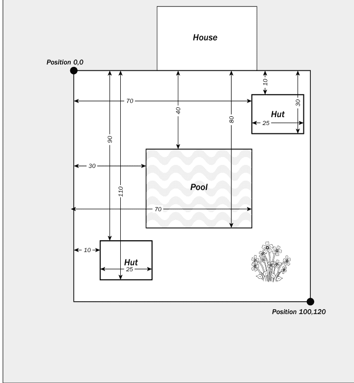

*图 7-1*

我任意地将坐标 0,0 指定给庭院的左上角。右下角的坐标为 100,120。因此，第一个坐标值是相对于左上角的水平位置度量，从左到右递增；第二个坐标值是从同一参考点测得的垂直位置度量，从上到下递增。

图 7-1 还显示了泳池和两个小屋相对于庭院左上角的位置。由于庭院、小屋和泳池都是矩形的，你可以定义一个 struct 类型来表示其中任何一个对象：

```
struct RECTANGLE
{
    int Left;                      // Top left point
    int Top;                       // coordinate pair

    int Right;                     // Bottom right point
    int Bottom;                    // coordinate pair
};
```

RECTANGLE 结构体类型的前两个成员对应于矩形左上角的坐标，后两个成员则对应于右下角的坐标。你可以在一个处理庭院中对象的简单示例中使用它，如下所示：

```
// Ex7_01.cpp
// Exercising structures in the yard
#include <iostream>
using std::cout;
using std::endl;

// Definition of a struct to represent rectangles
struct RECTANGLE
{
    int Left;                      // Top left point
    int Top;                       // coordinate pair

    int Right;                     // Bottom right point
    int Bottom;                    // coordinate pair
};

// Prototype of function to calculate the area of a rectangle
long Area(RECTANGLE& aRect);

// Prototype of a function to move a rectangle
void MoveRect(RECTANGLE& aRect, int x, int y);

int main(void)
{
    RECTANGLE Yard = { 0, 0, 100, 120 };
    RECTANGLE Pool = { 30, 40, 70, 80 };
    RECTANGLE Hut1, Hut2;

    Hut1.Left = 70;
    Hut1.Top = 10;
    Hut1.Right = Hut1.Left + 25;
    Hut1.Bottom = 30;

    Hut2 = Hut1;                   // Define Hut2 the same as Hut1
    MoveRect(Hut2, 10, 90);        // Now move it to the right position

    cout << endl
```


```
<< "Coordinates of Hut2 are "
<< Hut2.Left << "," << Hut2.Top << " and "
<< Hut2.Right << "," << Hut2.Bottom;

cout << endl
<< "The area of the yard is "
<< Area(Yard);

cout << endl
<< "The area of the pool is "
<< Area(Pool)
<< endl;

return 0;
}

// Function to calculate the area of a rectangle
long Area(RECTANGLE& aRect)
{
return (aRect.Right - aRect.Left)*(aRect.Bottom - aRect.Top);
}

// Function to Move a Rectangle
void MoveRect(RECTANGLE& aRect, int x, int y)
{
int length = aRect.Right - aRect.Left;    // Get length of rectangle
int width = aRect.Bottom - aRect.Top;    // Get width of rectangle

aRect.Left = x;                          // Set top left point
aRect.Top = y;                           // to new position
aRect.Right = x + length;                // Get bottom right point as
aRect.Bottom = y + width;                // increment from new position

return;
}
```

The output from this example is:

```
Coordinates of Hut2 are 10,90 and 35,110
The area of the yard is 12000
The area of the pool is 1600
```

## How It Works

Note that the struct definition appears at global scope in this example. You’ll be able to see it in the Class View tab for the project. Putting the definition of the struct at global scope allows you to declare a variable of type RECTANGLE anywhere in the .cpp file. In a program with a more significant amount of code, such definitions would normally be stored in a .h file and then added to each .cpp file where necessary by using a #include directive.

You have defined two functions to process RECTANGLE objects. The function Area() calculates the area of the RECTANGLE object that you pass as a reference argument as the product of the length and the width, where the length is the difference between the horizontal positions of the defining points, and the
width is the difference between the vertical positions of the defining points. By passing a reference, the code runs a little faster because the argument is not copied. The MoveRect() function modifies the defining points of a RECTANGLE object to position it at the coordinates x, y which are passed as arguments. The position of a RECTANGLE object is assumed to be the position of the Left, Top point. Because the RECTANGLE object is passed as a reference, the function is able to modify the members of the RECTANGLE object directly. After calculating the length and width of the RECTANGLE object passed, the Left and Top members are set to x and y respectively, and the new Right and Bottom members are calculated by incrementing x and y by the length and width of the original RECTANGLE object.

In the main() function, you initialize the Yard and Pool RECTANGLE variables with their coordinate positions as shown in Figure 7-1. The variable Hut1 represents the hut at the top-right in the illustration and its members are set to the appropriate values using assignment statements. The variable Hut2, corresponding to the hut at the bottom-left of the yard, is first set to be the same as Hut1 in the assignment statement

```
Hut2 = Hut1;    // Define Hut2 the same as Hut1
```

This statement results in the values of the members of Hut1 being copied to the corresponding members of Hut2. You can only assign a struct of a given type to another of the same type. You can’t increment a struct directly or use a struct in an arithmetic expression.

To alter the position of Hut2 to its place at the bottom-left of the yard, you call the MoveRect() function with the coordinates of the required position as arguments. This roundabout way of getting the coordinates of Hut2 is totally unnecessary and serves only to show how you can use a struct as an argument to a function.

## Intellisense Assistance with Structures

You’ve probably noticed that the editor in Visual C++ 2005 is quite intelligent — it knows the types of variables, for instance. If you hover the mouse cursor over a variable name in the editor window, it pops up a little box showing its definition. It also can help a lot with structures (and classes, as you will see) because not only does it know the types of ordinary variables, it also knows the members that belong to a variable of a particular structure type. If your computer is reasonably fast, as you type the member selection operator following a structure variable name, the editor pops a window showing the list of members. If you click one of the members, it shows the comment that appeared in the original definition of the structure, so you know what it is. This is shown in Figure 7-2 using a fragment of the previous example.

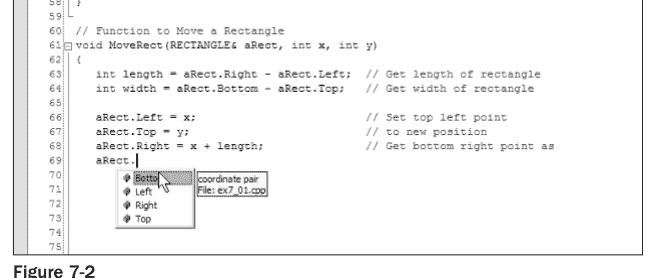

Now there’s a real incentive to add comments, and to keep them short and to point. If you double-click on a member in the list or press the Enter key when the item is highlighted, it is automatically inserted after the member selection operator, thus eliminating one source of typos in your code. Great, isn’t it?

You can turn any or all of the Intellisense features off if you want to via the Tools > Options menu item, but I guess the only reason you would want to is if your machine is too slow to make them useful. You can turn the statement-completion features on or off on the C/C++ editor page that you select in the right options pane. If you turn them off, you can still call them up when you want too, either through the Edit menu or through the keyboard. Pressing Ctrl+J, for example, pops up the members for an object under the cursor. The editor also shows the parameter list for a function when you are typing the code to call it — it pops up as soon as you enter the left parenthesis for the argument list. This is particularly helpful with library functions as its tough to remember the parameter list for all of them. Of course, the #include directive for the header file must already be there in the source code for this to work. Without it the editor has no idea what the library function is. You will see more things that the editor can help with as you learn more about classes.

After that interesting little diversion, let’s get back to structures.

## The struct RECT

Rectangles are used a great deal in Windows programs. For this reason, there is a RECT structure predefined in the header file windows.h. Its definition is essentially the same as the structure that you defined in the last example:

```
struct RECT
{
    int left;                // Top left point
    int top;                 // coordinate pair

    int right;               // Bottom right point
    int bottom;              // coordinate pair
};
```

This struct is usually used to define rectangular areas on your display for a variety of purposes. Because RECT is used so extensively, windows.h also contains prototypes for a number of functions to manipulate and modify rectangles. For example, windows.h provides the function InflateRect() to increase the size of a rectangle and the function EqualRect() to compare two rectangles.

MFC also defines a class called CRect, which is the equivalent of a RECT structure. After you understand classes, you will be using this in preference to the RECT structure. The CRect class provides a very extensive range of functions for manipulating rectangles, and you will be using a number of these when you are writing Windows programs using MFC.

## Using Pointers with a struct

As you might expect, you can create a pointer to a variable of a structure type. In fact, many of the functions declared in windows.h that work with RECT objects require pointers to a RECT as arguments
because this avoids the copying of the whole structure when a RECT argument is passed to a function. To define a pointer to a RECT object for example, the declaration is what you might expect:

```
```c
RECT* pRect = NULL;                 // Define a pointer to RECT
```
```

Assuming that you have defined a RECT object, aRect, you can set the pointer to the address of this variable in the normal way, using the address-of operator:

```
```c
pRect = &aRect;                     // Set pointer to the address of aRect
```
```

As you saw when the idea of a struct was introduced, a struct can’t contain a member of the same type as the struct being defined, but it can contain a pointer to a struct, including a pointer to a struct of the same type. For example, you could define a structure like this:

```
```c
struct ListElement
{
    RECT aRect;                       // RECT member of structure
    ListElement* pNext;               // Pointer to a list element
};
```
```

The first element of the ListElement structure is of type RECT, and the second element is a pointer to a structure of type ListElement—the same type as that being defined. (Remember that this element isn’t of type ListElement, it’s of type ‘pointer to ListElement.’) This allows object of type ListElement to be daisy-chained together, where each ListElement can contain the address of the next ListElement object in a chain, the last in the chain having the pointer as zero. This is illustrated in Figure 7-3.


Each box in the diagram represents an object of type ListElement and the pNext member of each object stores the address of the next object in the chain, except for the last object where pNext is 0. This kind of arrangement is usually referred to as a linked list. It has the advantage that as long as you know the first element in the list, you can find all the others. This is particularly important when variables are created dynamically, since a linked list can be used to keep track of them all. Every time a new one is created, it’s simply added to the end of the list by storing its address in the pNext member of the last object in the chain.


## 通过指针访问结构成员

考虑以下语句：

```
RECT aRect = { 0, 0, 100, 100 };
RECT* pRect = &aRect;
```

第一条语句声明并定义了 aRect 对象，其类型为 RECT，第一对成员初始化为 (0, 0)，第二对初始化为 (100, 100)。第二条语句声明 pRect 为指向类型 RECT 的指针，并用 aRect 的地址对其进行初始化。现在你可以通过指针使用如下语句访问 aRect 的成员：

```
(*pRect).Top += 10;            // Increment the Top member by 10
```

这里解引用指针的括号是必不可少的，因为成员访问运算符的优先级高于解引用运算符。如果没有括号，你就会试图将指针当作结构体来处理并解引用该成员，因此语句将无法编译。执行此语句后，Top 成员的值将为 10，当然，其余成员保持不变。

你在这里使用的方法通过指针访问结构体的成员看起来相当笨拙。由于这种操作在 C++ 中非常常见，语言中包含了一个特殊的运算符，使你能够以更易读、更直观的形式表达同样的内容，让我们接下来看看它。

## 间接成员选择运算符

间接成员选择运算符 -> 专门用于通过指针访问结构体的成员；该运算符也称为间接成员访问运算符。运算符看起来像一个小箭头 (->)，由减号 (-) 后跟大于号 (>) 组成。你可以用它重写访问 aRect 的 Top 成员通过指针 pRect 的语句，如下所示：

```
pRect->Top += 10;            // Increment the Top member by 10
```

这更能表达正在发生的事情，不是吗？间接成员选择运算符也与类一起使用，你将在本书的其余部分看到更多它的使用。

## 数据类型、对象、类和实例

在深入类语言、语法和编程技术之前，我将先考虑你现有的知识如何与类的概念相关。

到目前为止，你已经了解到原生 C++ 允许你创建可以是多种基本数据类型的变量：int、long、double 等等。你也看到了如何使用 struct 关键字定义一个结构，然后将其用作表示多个变量组合的变量的类型。

基本类型的变量并不能让你充分建模现实世界的对象（甚至想象中的对象）。例如，很难用 int 来建模一个盒子；然而，你可以使用结构体的成员为此类对象定义一组属性。你可以定义变量 length、width 和 height 来表示盒子的尺寸，并将它们绑定为 Box 结构体的成员，如下所示：

```
struct Box
{
    double length;
    double width;
    double height;
};
```

有了这个名为 Box 的新数据类型的定义，你可以像使用基本类型的变量一样定义该类型变量。然后，你可以在程序中创建、操作和销毁任意多个 Box 对象。这意味着你可以使用结构体建模对象并围绕它们编写程序。所以——这就是面向对象编程全部内容了？

嗯，还不完全是。你看，面向对象编程（OOP）基于若干基础（著名的是封装、多态性和继承），而你迄今为止看到的内容并不完全符合要求。暂时不用担心这些术语的含义——你将在本章剩余部分以及整本书中探索它们。

C++ 中 struct 的概念远远超出了 C 中 struct 的原始概念——它包含了面向对象的类概念。你可以从中创建自己的数据类型并像原生类型一样使用它们，这一类概念是 C++ 的核心，并且引入了新的关键字 class 来描述这一概念。C++ 中的 struct 和 class 关键字几乎完全相同，只是成员的访问控制不同，你将在本章后面了解更多。struct 关键字是为了与 C 保持向后兼容而保留的，但你可以用 struct 做的一切以及更多，都可以用 class 实现。

看看你如何定义一个表示盒子的类：

```
class CBox
{
    public:
        double m_Length;
        double m_Width;
        double m_Height;
};
```

当你将 CBox 定义为类时，你本质上是在定义一种新的数据类型，与定义 Box 结构时类似。这里的唯一区别是使用关键字 class 而不是 struct，以及使用关键字 public 后跟冒号，在其后定义类的成员。作为类的一部分定义的变量称为类的成员变量，因为它们是存储数据的变量。

你还将类命名为 CBox 而不是 Box。你本可以把类命名为 Box，但 MFC 采用了对所有类名使用前缀 C 的约定，所以你最好现在就习惯它。MFC 还对类的成员变量使用 m_ 前缀以将其与其他变量区分开来，所以我也会使用这种约定。记住，在你可能使用 C++ 的其他上下文中，尤其是在 C++/CLI 中，情况并非如此；在某些情况下，类及其成员的命名约定可能不同，在其他情况下可能根本没有采用特定的命名实体约定。

public 关键字暗示了结构与类之间的区别。它只是将类的成员定义为一般可访问的，与结构体的成员一样。struct 的成员默认是 public 的。虽然本章稍后你会看到，也可以对类成员的访问性施加限制。

你可以声明一个变量，比如 bigBox，表示 CBox 类类型的一个实例，如下所示：

```
CBox bigBox;
```

这与为结构体声明变量，或事实上为任何其他变量类型声明变量完全相同。在你定义了类 CBox 之后，该类型变量的声明就很标准了。

## 第一类

类的概念是由一位英国人发明的，用来让普通民众感到满意。它源于这样一种理论：知道自己在社会中的地位和职能的人，比不知道的人在生活中会更安全、更舒适。发明 C++ 的著名丹麦人 Bjarne Stroustrup 无疑在英国剑桥大学期间获得了对阶级概念的深刻了解，并非常成功地将这一思想借用到他的新语言中。

C++ 中的类与英语概念相似，因为每个类通常都有非常精确的角色和允许的一组操作。然而，它与英语概念不同，因为 C++ 中的类在很大程度上具有社会主义色彩，强调工作阶级的 importance。的确，在某些方面它是英语理想的反面，因为，正如你将看到的，C++ 中的工作类通常生活在什么都不做的类的支撑之上。

## 对类的操作

在 C++ 中，你可以创建新的数据类型作为类来表示你喜欢的任何类型的对象。正如你将看到的，类（和结构）不仅限于保存数据；你还可以定义成员函数，甚至使用标准 C++ 运算符定义在你的类对象之间起作用的操作。例如，你可以定义类 CBox，使以下语句有效并具有你想要的含义：

```
CBox box1;
CBox box2;

if(box1 > box2)      // Fill the larger box
    box1.fill();
else
    box2.fill();
```

你也可以在 CBox 类中实现用于添加、减去甚至乘以盒子的操作——事实上，几乎任何在盒子上下文中可以赋予合理含义的操作。


这里我要谈的是一剂极其强大的“良药”，它会使你编程的方式发生重大改变。你不再根据本质上与计算机相关的数据类型（整数、浮点数等）来分解问题，然后编写程序，而是根据与问题相关的数据类型来编程，也就是类。这些类可能命名为 CEmployee、CCowboy、CCheese 或 CChutney，每个类都针对你想要解决的那类问题专门定义，并且带有操作你新类型实例所需的函数和运算符。

如今，程序设计的第一步是确定需要哪些新的、与应用相关的数据类型来解决手头的问题，然后围绕问题所涉及的具体对象（无论是 CCoffins 还是 CCowpokes）上的操作来编写程序。

## 术语

我先总结一下在讨论 C++ 类时会用到的一些术语：

- **类**是一种用户自定义的数据类型。
- **面向对象编程**（OOP）是一种编程风格，其基本思想是将自己的数据类型定义为类。
- 声明类类型的对象有时称为**实例化**，因为你在创建类的一个**实例**。
- 类的实例称为**对象**。
- 对象包含其定义中隐含的数据，以及操作这些数据的函数，这种思想称为**封装**。

当我深入探讨面向对象编程的细节时，有些地方可能看起来有点复杂，但回到你所做事情的基本原理，往往有助于让事情更清晰，所以请始终牢记对象的真正意义。对象的意义在于：围绕你的问题领域所特有的对象来编写程序。C++ 中围绕类的各种设施，都是为了让这种编程方式尽可能全面而灵活。现在让我们开始理解类吧。

## 理解类

类是你定义的一种数据类型的规范。它可以包含数据元素，这些数据元素既可以是 C++ 基本类型的变量，也可以是其他用户自定义类型的变量。类的数据元素可以是单个数据元素、数组、指针、几乎任何类型的指针数组，或其他类的对象，因此你在数据类型中可以包含的内容非常灵活。类还可以包含函数，这些函数通过访问对象所包含的数据元素来操作该类的对象。因此，类既定义构成对象的基本数据，也定义操作属于该类的各个对象的数据的手段。

类中的数据和函数称为类的**成员**。有趣的是，类中作为数据项的成员称为**数据成员**，而作为函数的成员称为**函数成员**或**成员函数**。类的成员函数有时也称为**方法（methods）**；本书不使用这个术语，但请记住，你在其他地方可能会看到它。

数据成员也称为**字段（fields）**，这个术语用于 C++/CLI，因此我会不时使用这个术语。

当你定义一个类时，你是在为一种数据类型定义蓝图。这实际上并不定义任何数据，而是定义类名的含义，即类的对象将由什么构成，以及可以对这样的对象执行哪些操作。这很像你为基本类型`double`编写一份说明。那不会是一个实际的`double`类型变量，而是关于它如何构成、如何运作的定义。要创建基本数据类型的变量，需要使用声明语句。类也是如此，稍后你会看到。

## 定义类

再看一下前面提到的类示例——一个盒子的类。你使用关键字`class`定义了 CBox 数据类型，如下所示：

```
class CBox
{
    public:
        double m_Length;        // Length of a box in inches
        double m_Width;         // Width of a box in inches
        double m_Height;        // Height of a box in inches
};
```

类名出现在`class`关键字之后，三个数据成员定义在花括号之间。类中的数据成员是使用你已经熟悉并喜爱的声明语句定义的，整个类定义以分号结束。类的所有成员名称都局限于该类。因此，你可以在程序的其他地方使用相同的名称而不会引起任何问题。

## 类中的访问控制

`public`关键字看起来有点像标签，但实际上不止如此。它决定了其后类成员的访问属性。将数据成员指定为`public`，意味着类的对象的这些成员可以在它们所属的类对象作用域内的任何地方被访问。你也可以将类的成员指定为`private`或`protected`。事实上，如果完全省略访问说明，成员将具有默认属性`private`。（这是 C++ 中类与结构体的唯一区别——结构体的默认访问说明符是`public`。）稍后你将进一步了解这些关键字在类定义中的作用。

请记住，到目前为止你定义的一切只是一个类，即一种数据类型。你还没有声明任何类类型的对象。当我谈到访问类成员（比如 m_Height）时，我指的是访问某个特定对象的数据成员，而该对象需要在某处声明。

## 声明类的对象

声明类的对象所使用的声明语句，与你用来声明基本类型对象的声明完全相同。因此，你可以用下列语句声明 CBox 类类型的对象：

```
CBox box1;    // Declare box1 of type CBox
CBox box2;    // Declare box2 of type CBox
```

当然，box1 和 box2 这两个对象都拥有各自的数据成员。如图 7-4 所示。


对象名 box1 代表整个对象，包括它的三个数据成员。不过，它们没有被初始化为任何值——每个对象的数据成员只是包含垃圾值，因此我们需要研究如何访问它们，以便将它们设置为特定值。

## 访问类的数据成员

你可以使用访问结构体成员时所用的直接成员选择运算符来引用类对象的数据成员。因此，要把对象 box2 的数据成员 m_Height 设置为 18.0，可以编写如下赋值语句：

```
box2.m_Height = 18.0;    // Setting the value of a data member
```

你只能在类外部的函数中以这种方式访问该数据成员，因为 m_Height 成员被指定为具有 public 访问权限。如果它没有定义为 public，这条语句将无法编译。稍后你会对此有更多了解。

## 试一试　　首次使用类

验证你能否像使用结构体一样使用类。请在下面的控制台应用程序中试一试：

```
// Ex7_02.cpp
// Creating and using boxes
#include <iostream>
using std::cout;
using std::endl;

class CBox                        // Class definition at global scope
{
public:
    double m_Length;              // Length of a box in inches
    double m_Width;               // Width of a box in inches
    double m_Height;              // Height of a box in inches
};

int main()
{
    CBox box1;                    // Declare box1 of type CBox
```

```
CBox box2;                          // Declare box2 of type CBox

double boxVolume = 0.0;               // Stores the volume of a box

box1.m_Height = 18.0;                 // Define the values
box1.m_Length = 78.0;                 // of the members of
box1.m_Width = 24.0;                  // the object box1

box2.m_Height = box1.m_Height - 10;   // Define box2
box2.m_Length = box1.m_Length/2.0;    // members in
box2.m_Width = 0.25*box1.m_Length;    // terms of box1

// Calculate volume of box1
boxVolume = box1.m_Height*box1.m_Length*box1.m_Width;

cout << endl
    << "Volume of box1 = " << boxVolume;

cout << endl
    << "box2 has sides which total "
    << box2.m_Height+ box2.m_Length+ box2.m_Width
    << " inches.";

cout << endl                         // Display the size of a box in memory
    << "A CBox object occupies "
    << sizeof box1 << " bytes.";

cout <<endl;
return 0;
}
```

当你在 main() 中键入代码时，每当在类对象名后面输入成员选择运算符，编辑器都会提示一个成员名称列表。你可以双击从列表中选择所需的成员。将鼠标光标悬停在代码中的任何变量上片刻，就会显示其类型。

## 工作原理

这里我们暂时回到控制台应用程序示例，因此项目应相应定义。这里的一切都会像你从结构体的使用经验中预期的那样运作。类的定义出现在 main() 函数之外，因此具有全局作用域。这样，你就可以在程序中的任何函数里声明对象，并且程序编译后，该类会出现在“类视图（Class View）”选项卡中。

你在 main() 函数中声明了两个 CBox 类型的对象 box1 和 box2。当然，与基本类型的变量一样，box1 和 box2 是 main() 的局部对象。类类型的对象在作用域方面遵循与基本类型变量（例如本例中使用的 boxVolume 变量）相同的规则。

前三条赋值语句设置了 box1 的数据成员的值。接下来的三条赋值语句根据 box1 的数据成员定义了 box2 的数据成员的值。


你随后有一个语句计算 box1 的体积为其三个数据成员的乘积，并将该值输出到屏幕。接下来，你通过在输出语句中直接写入数据成员之和的表达式来输出 box2 数据成员的总和。程序中的最后一步操作是输出 box1 所占用的字节数，该值由 sizeof 运算符产生。

如果运行此程序，你应该得到以下输出：

```
Volume of box1 = 33696
box2 has sides which total 66.5 inches.
A CBox object occupies 24 bytes.
```

最后一行显示对象 box1 占用 24 字节的内存，这是由于它有 3 个每个占 8 字节的数据成员的结果。产生最后一行输出的语句同样可以这样写：

```
cout << endl                 // Display the size of a box in memory
    << "A CBox object occupies "
    << sizeof (CBox) << " bytes.";
```

这里，我使用了类型名放在括号内，而不是作为 sizeof 运算符操作数的特定对象名。你会记得这是 sizeof 运算符的标准语法，就像你在第 4 章中所看到的那样。

此示例演示了访问类的公共数据成员的机制。它还表明它们可以像普通变量一样使用。你现在准备好通过查看类的成员函数来开拓新领域。

## Member Functions of a Class

类的成员函数是在类定义内具有其定义或其原型的函数。它对它是成员的类的任何对象进行操作，并可访问该对象类的所有成员。

### Try It Out   Adding a Member Function to CBox

为了了解你如何从成员函数内部访问类的成员，创建一个扩展 CBox 类以包含一个计算 CBox 对象体积的成员函数的示例。

```
// Ex7_03.cpp
// Calculating the volume of a box with a member function
#include <iostream>
using std::cout;
using std::endl;

class CBox                         // Class definition at global scope
{
public:
    double m_Length;               // Length of a box in inches
    double m_Width;                // Width of a box in inches
    double m_Height;               // Height of a box in inches

// Function to calculate the volume of a box
double Volume()
{
    return m_Length*m_Width*m_Height;
}
```

```
};

int main()
{
    CBox box1;                    // Declare box1 of type CBox
    CBox box2;                    // Declare box2 of type CBox

    double boxVolume = 0.0;       // Stores the volume of a box

    box1.m_Height = 18.0;         // Define the values
    box1.m_Length = 78.0;         // of the members of
    box1.m_Width = 24.0;          // the object box1

    box2.m_Height = box1.m_Height - 10;  // Define box2
    box2.m_Length = box1.m_Length/2.0;   // members in
    box2.m_Width = 0.25*box1.m_Length;   // terms of box1
```

```
boxVolume = box1.Volume();        // Calculate volume of box1
cout << endl
    << "Volume of box1 = " << boxVolume;

cout << endl
    << "Volume of box2 = "
    << box2.Volume();
```

```
cout << endl
    << "A CBox object occupies "
    << sizeof box1 << " bytes.";

cout << endl;
return 0;
}
```

## How It Works

你添加到 CBox 类定义的新的代码被着色。它只是 Volume() 函数的定义，该函数是类的成员函数。它还具有与数据成员相同的访问属性：public。这是因为你在类定义中声明的每个类成员在指定另一个访问属性之前都将具有该访问属性。Volume() 函数以 double 类型的值返回 CBox 对象的体积。return 语句中的表达式只是类的三个数据成员的乘积。

> 在成员函数中访问类成员时，无需以任何方式限定类成员的名称。未限定的成员名称会自动引用成员函数执行时当前的对象成员。

成员函数 Volume() 在 main() 中初始化数据成员后在高亮语句中使用。在 main() 中使用相同的变量名不会引起冲突或问题。你可以通过编写要处理的对象的名称，后跟一个点，后跟成员函数名称来调用特定对象的成员函数。如前所述，函数会自动访问为其调用的对象的成员，因此 Volume() 的第一次使用计算 box1 的体积。仅使用成员的名称将始终引用为其调用成员函数的对象的成员。

成员函数第二次直接在输出语句中使用以产生 box2 的体积。如果你执行此示例，它会产生以下输出：

```
Volume of box1 = 33696
Volume of box2 = 6084
A CBox object occupies 24 bytes.
```

请注意，CBox 对象仍然是相同的字节数。将函数成员添加到类不会影响对象的大小。显然，成员函数必须存储在内存中的某个位置，但无论你创建多少个类对象，都只有一个副本，并且成员函数占用的内存不会在 sizeof 运算符产生对象占用的字节数时被计算在内。

成员函数中的类数据成员名称会自动引用用于调用函数的特定对象的成员，并且函数只能为类的特定对象调用。在本例中，这是通过使用直接成员访问运算符和对象名称完成的。

> 如果你尝试在不指定对象名称的情况下调用成员函数，你的程序将无法编译。

## Positioning a Member Function Definition

成员函数定义不必放在类定义内部。如果你想把它放在类定义之外，你需要在类内部放置函数的原型。如果我们重写之前的类并将函数定义放在外部，类定义看起来像这样：

```
class CBox                     // Class definition at global scope
{
    public:
        double m_Length;           // Length of a box in inches
        double m_Width;            // Width of a box in inches
        double m_Height;           // Height of a box in inches
        double Volume(void);       // Member function prototype
};
```

现在你需要编写函数定义，但由于它出现在类定义之外，必须有某种方法告诉编译器该函数属于类 CBox。这是通过在函数名前加上类名并用作用域解析运算符 :: 分隔两者来完成的，:: 由两个连续的冒号组成。函数定义现在看起来像这样：

```
// Function to calculate the volume of a box
double CBox::Volume()
{
    return m_Length*m_Width*m_Height;
}
```

它产生与上一个示例相同的输出；然而，它并不是完全相同的程序。在第二种情况下，对函数的调用以你已经熟悉的方式处理。然而，当你在类定义中定义函数时，如 Ex7_03.cpp 中那样，编译器隐式地将函数视为内联函数。

## Inline Functions

对于内联函数，编译器尝试将函数体中的代码扩展到函数调用的位置。这避免了调用函数的许多开销，因此加快了你的代码。这在图 7-5 中有所说明。


Figure 7-5

> 当然，编译器确保将函数内联扩展不会导致变量名或作用域出现任何问题。

编译器可能并不总是能够将函数的代码内联插入（例如递归函数或你已获取其地址的函数），但通常会起作用。它最好用于非常短、简单的函数，例如我们 CBox 类中的 Volume() 函数，因为此类函数执行速度更快，并且插入主体代码不会显著增加可执行模块的大小。

在类定义之外进行函数定义时，编译器将函数视为普通函数，函数的调用将按通常方式工作；然而，也有可能告诉编译器，如果可能，你希望函数被视为内联。这只需在函数头开始处放置关键字 inline 即可。因此，对于此函数，定义如下：

```
// Function to calculate the volume of a box
inline double CBox::Volume()
{
    return m_Length*m_Width*m_Height;
}
```


使用此函数定义，程序将与原始程序完全相同。这使你能够在需要时将成员函数定义放在类定义之外，同时仍保留内联带来的执行性能优势。

你也可以将关键字 `inline` 应用于与类无关的普通函数，并获得相同的效果。然而，最好将其用于简短、简单的函数。

你现在需要了解更多关于声明类对象时会发生什么的内容。

## 类构造函数

在之前的程序示例中，你声明了 CBox 对象 box1 和 box2，然后费力地遍历每个对象的每个数据成员以便为其分配初始值。从几个角度来看，这是不令人满意的。首先，很容易遗漏对数据成员的初始化，特别是对于数据成员比我们的 CBox 类更多的类。对复杂类的多个对象的数据成员进行初始化可能涉及数页的赋值语句。对这种方法施加的最终限制是，当你定义类的私有数据成员时——你无论如何都无法从类外部访问它们。必须有更好的方法，当然有——它被称为类构造函数。

## 什么是构造函数？

类构造函数是类中的一个特殊函数，在创建类的新对象时被调用。因此，它提供了在对象创建时初始化对象的机会，并确保数据成员只包含有效值。一个类可以有多个构造函数，使你能够以各种方式创建对象。

你在类中命名构造函数时没有余地——它们始终与定义它们的类同名。例如，函数 CBox() 是我们类 CBox 的构造函数。它也没有返回类型。为构造函数指定返回类型是错误的；你甚至不能将其写为 void。类构造函数的主要目的是为类的<|message|> 数据元素分配初始值，并且构造函数不需要也不允许有返回类型。

## 试一试 为 CBox 类添加构造函数

让我们扩展我们的 CBox 类以加入构造函数。

```
// Ex7_04.cpp
// Using a constructor
#include <iostream>
using std::cout;
using std::endl;

class CBox        // Class definition at global scope
{
    public:
        double m_Length;        // Length of a box in inches
        double m_Width;         // Width of a box in inches
        double m_Height;        // Height of a box in inches
```

# Chapter 7

```cpp
// Constructor definition
CBox(double lv, double bv, double hv)
{
    cout << endl << "Constructor called.";
    m_Length = lv;                  // Set values of
    m_Width = bv;                   // data members
    m_Height = hv;
}
```

```cpp
// Function to calculate the volume of a box
double Volume()
{
    return m_Length* m_Width* m_Height;
}
};

int main()
{
    CBox box1(78.0,24.0,18.0);             // Declare and initialize box1
    CBox cigarBox(8.0,5.0,1.0);             // Declare and initialize cigarBox

    double boxVolume = 0.0;                 // Stores the volume of a box

    boxVolume = box1.Volume();              // Calculate volume of box1
    cout << endl
         << "Volume of box1 = " << boxVolume;

    cout << endl
         << "Volume of cigarBox = "
         << cigarBox.Volume();

    cout << endl;
    return 0;
}
```

## 它是如何工作的

构造函数 `CBox()` 使用三个类型为 double 的参数编写，对应于 CBox 对象的 `m_Length`、`m_Width` 和 `m_Height` 成员的初始值。构造函数中的第一条语句输出一条消息，以便你知道何时被调用。你不会在生产程序中这样做，但因为它在显示何时调用构造函数时非常有帮助，所以在测试程序时经常使用。我会定期为说明目的使用它。构造函数体内的代码非常简单。它只是将你在调用时传递给构造函数的参数分配给相应的数据成员。如果需要，你也可以包含检查是否提供了有效且非负的参数的检查，并且在实际环境中，你可能希望这样做，但我们在这里主要关注的是了解机制的工作方式。

在 `main()` 中，你使用初始化值声明对象 `box1`，用于数据成员 `m_Length`、`m_Width` 和 `m_Height`，按顺序排列。这些值在对象名称后面用括号括起来。这使用了函数式初始化记法，如你在第 2 章所见，也可以应用于初始化基本类型的普通变量。你还声明了第二个类型为 CBox 的对象，名为 `cigarBox`，它也有初始化值。

box1 的体积使用成员函数 Volume() 按与前一个示例相同的方式计算，然后显示在屏幕上。你还显示了 cigarBox 的体积值。示例的输出为：

```
Constructor called.
Constructor called.
Volume of box1 = 33696
Volume of cigarBox = 40
```

前两行是两次调用构造函数 CBox() 的输出，每声明一个对象一次。你在类定义中提供的构造函数在声明 CBox 对象时会自动调用，因此两个 CBox 对象都使用声明中出现的初始化值进行初始化。这些值按在声明中书写的顺序作为参数传递给构造函数。如你所见，box1 的体积与之前相同，而 cigarBox 的体积看起来可疑地像是其尺寸的乘积，这令人相当欣慰。

## 默认构造函数

尝试通过添加我们之前声明的 box2 来修改最后一个示例：

```
CBox box2;    // Declare box2 of type CBox
```

在这里，我们没有为 box2 提供初始化值。当你重建此版本的程序时，你会收到错误消息：

```
error C2512: 'CBox': no appropriate default constructor available
```

这意味着编译器正在寻找 box2 的默认构造函数（也称为无参构造函数，因为调用时不需要参数），因为你没有为数据成员提供任何初始化值。默认构造函数是不需要提供任何参数的构造函数，可以是构造函数定义中未指定参数的构造函数，也可以是所有参数都是可选的构造函数。好吧，这个语句在 Ex7_02.cpp 中是完全可以接受的，为什么现在不起作用呢？

答案是之前的示例使用了编译器提供的默认无参数构造函数，并且编译器提供了此构造函数，因为你没有提供一个。因为在这个示例中你确实提供了一个构造函数，编译器假设你已经处理好了一切，因此没有提供默认构造函数。因此，如果你仍然想使用未初始化的 CBox 对象声明，你必须自己包含默认构造函数。默认构造函数到底是什么样的？在最简单的情况下，它只是一个不接受任何参数的构造函数；它甚至不需要做任何事情：

```
CBox()    // Default constructor
{}        // Totally devoid of statements
```

你可以看到这样的构造函数在运行。

## 试一试 提供默认构造函数

让我们将默认构造函数的版本添加到最后一个示例中，同时加上 box2 的声明，以及 box2 数据成员的原始赋值。你必须将默认构造函数扩展到足以显示它被调用的程度。以下是程序的下一个版本：

```
// Ex7_05.cpp
// Supplying and using a default constructor
#include <iostream>
using std::cout;
using std::endl;

class CBox                 // Class definition at global scope
{
public:
double m_Length;          // Length of a box in inches
double m_Width;           // Width of a box in inches
double m_Height;          // Height of a box in inches

// Constructor definition
CBox(double lv, double bv, double hv)
{
    cout << endl << "Constructor called.";
    m_Length = lv;        // Set values of
    m_Width = bv;         // data members
    m_Height = hv;
}

// Default constructor definition
CBox()
{
    cout << endl << "Default constructor called.";
}

// Function to calculate the volume of a box
double Volume()
{
    return m_Length*m_Width*m_Height;
};

int main()
{
    CBox box1(78.0,24.0,18.0);        // Declare and initialize box1
    CBox box2;                        // Declare box2 - no initial values
    CBox cigarBox(8.0, 5.0, 1.0);      // Declare and initialize cigarBox

    double boxVolume = 0.0;           // Stores the volume of a box

    boxVolume = box1.Volume();        // Calculate volume of box1
    cout << endl


```
<< "Volume of box1 = " << boxVolume;
```

```
box2.m_Height = box1.m_Height - 10;  // Define box2
box2.m_Length = box1.m_Length / 2.0;  // members in
box2.m_Width = 0.25*box1.m_Length;    // terms of box1

cout << endl
    << "Volume of box2 = "
    << box2.Volume();
```

```
cout << endl
    << "Volume of cigarBox = "
    << cigarBox.Volume();

cout << endl;
return 0;
}
```

## 工作原理

既然你已经加入了自己版本的默认构造函数，编译器就不会再产生错误消息了，一切都正常工作。程序产生如下输出：

```
Constructor called.
Default constructor called.
Constructor called.
Volume of box1 = 33696
Volume of box2 = 6084
Volume of cigarBox = 40
```

默认构造函数所做的只是显示一条消息。显然，当你声明对象 box2 时，它被调用了。同时，三个 CBox 对象体积的值也都是正确的，因此程序的其余部分工作正常。

你可能已经注意到这个示例的一个方面：现在我们知道，构造函数可以像第 6 章中重载函数一样进行重载。你刚刚运行了一个包含两个构造函数的示例，它们的区别仅在于参数列表。一个构造函数有三个 double 类型的参数，另一个则完全没有参数。

## 在类中为参数指定默认值

在讨论函数时，你已经了解了如何在函数原型中为函数的参数指定默认值。对于类成员函数（包括构造函数），你也可以这样做。如果将成员函数的定义放在类定义的内部，就可以在函数头中放置参数的默认值。如果在类定义中只包含函数的原型，那么默认参数值应放在原型中。

如果你认为 CBox 对象的默认尺寸是一个所有边长均为 1 的单位盒子，可以将上一示例中的类定义修改为如下形式：

```
class CBox                 // Class definition at global scope
{
    public:
```

```
double m_Length;                         // Length of a box in inches
 double m_Width;                          // Width of a box in inches
 double m_Height;                         // Height of a box in inches

 // Constructor definition
 CBox(double lv = 1.0, double bv = 1.0, double hv = 1.0)
 {
     cout << endl << "Constructor called.";
     m_Length = lv;                       // Set values of
     m_Width = bv;                        // data members
     m_Height = hv;
 }

 // Default constructor definition
 CBox()
 {
     cout << endl << "Default constructor called.";
 }

 // Function to calculate the volume of a box
 double Volume()
 {
     return m_Length*m_Width*m_Height;
 }
};
```

如果对上一示例做了这一修改，会发生什么情况？当然，你又会从编译器那里得到一条错误消息。除了大量其他内容之外，编译器还会给出这些有用的提示：

```
warning C4520: 'CBox': multiple default constructors specified
error C2668: 'CBox::CBox': ambiguous call to overloaded function
```

这意味着编译器无法确定要调用两个构造函数中的哪一个——是那个你为参数设置了默认值的构造函数，还是那个不接受任何参数的构造函数。这是因为声明 box2 时需要调用一个不带参数的构造函数，而现在两个构造函数都可以在无参数的情况下被调用。一个显而易见的解决方案是去掉那个不接受参数的构造函数。这实际上是有益的。没有这个构造函数后，任何未显式初始化而声明的 CBox 对象，其成员都将被自动初始化为 1。

## 试一试    为构造函数参数提供默认值

你可以用下面这个简化的示例来演示这一点：

```
// Ex7_06.cpp
// Supplying default values for constructor arguments
#include <iostream>
using std::cout;
using std::endl;

class CBox                              // Class definition at global scope
{
public:
    double m_Length;                     // Length of a box in inches
```

```
double m_Width;                  // Width of a box in inches
double m_Height;                 // Height of a box in inches

// Constructor definition
CBox(double lv = 1.0, double bv = 1.0, double hv = 1.0)
{
    cout << endl << "Constructor called.";
    m_Length = lv;                 // Set values of
    m_Width = bv;                  // data members
    m_Height = hv;
}

// Function to calculate the volume of a box
double Volume()
{
    return m_Length*m_Width*m_Height;
}
};

int main()
{
    CBox box2;                      // Declare box2 - no initial values

    cout << endl
         << "Volume of box2 = "
         << box2.Volume();

    cout << endl;
    return 0;
}
```

## 工作原理

你只声明了一个未初始化的 CBox 变量——box2——因为这是演示所需的全部内容。这个版本的程序产生如下输出：

```
Constructor called.
Volume of box2 = 1
```

这表明带默认参数值的构造函数正在履行其职责，即为那些没有指定初始值的对象设置成员值。

你不应该由此认为这是实现默认构造函数的唯一方式，甚至不是推荐的方式。在很多情况下，你不会希望以这种方式分配默认值，此时你就需要编写一个单独的默认构造函数。甚至会有一些时候，即使你已经定义了另一个构造函数，你也完全不希望有默认构造函数在起作用。这样可以确保类的所有已声明对象在声明时都必须显式指定初始值。

## 在构造函数中使用初始化列表

此前，你是在类的构造函数中使用显式赋值来初始化对象的成员。你还可以使用另一种不同的技术，即使用所谓的初始化列表。我可以用类 CBox 的构造函数的另一个版本来演示这一点：

```
// Constructor definition using an initialization list
CBox(double lv = 1.0, double bv = 1.0, double hv = 1.0):
    m_Length(lv), m_Width(bv), m_Height(hv)
{
    cout << endl << "Constructor called.";
}
```

这个构造函数定义假定它位于类定义的内部。现在，数据成员的值不是在构造函数体内的赋值语句中设置的。与声明中一样，它们使用函数表示法指定为初始值，并作为函数头的一部分出现在初始化列表中。例如，成员 m_Length 由 lv 的值初始化。这比你在上一版本中使用的赋值方式更高效。如果将这一版本的构造函数替换到上一示例中，你会看到它同样运行良好。

请注意，构造函数的初始化列表与参数列表之间用冒号分隔，每个初始化项之间用逗号分隔。在构造函数中初始化参数的技术很重要，因为正如你稍后将看到的，它是为对象的某些类型的数据成员设置值的唯一方式。MFC 也严重依赖初始化列表技术。

## 类的私有成员

如果一个构造函数能设置类对象的数据成员的值，但仍然允许程序的任何部分去摆弄那些本质上属于对象核心的内容，这几乎就是自相矛盾的。打个比方，在你安排了一位技艺精湛、经过多年训练磨练的外科医生（如基尔代尔医生）来处理你的内部问题之后，再让当地的水管工或泥瓦匠来试上一手，这显然不太合适。你需要为类的数据成员提供一些保护。

在定义类成员时使用关键字 private，就可以获得所需的安全性。一般来说，私有的类成员只能被类的成员函数访问。有一个例外情况，但我们留到以后再讨论。普通函数无法直接访问类的私有成员。如图 7-6 所示。

能够将类成员指定为私有，也使得你可以将类的接口与其内部实现分离开来。类的接口由公共成员构成，尤其是公共成员函数，因为它们可以提供对类所有成员（包括私有成员）的间接访问。通过保持类的内部成员为私有，你可以在之后对它们进行修改，例如为了提升性能，而无需修改那些通过公共接口使用该类的代码。为了让类的数据成员和函数成员免受不必要的干涉，一个好的实践是：将那些不需要暴露出来的成员声明为私有。只将那些对你的类的使用至关重要的成员设为公共。


# 图 7-6

## 试一试
私有数据成员

你可以重写 CBox 类，使其数据成员变为私有。

// Ex7_07.cpp
// A class with private members
#include <iostream>
using std::cout;
using std::endl;

class CBox                         // Class definition at global scope
{
public:

    // Constructor definition using an initialisation list
    CBox(double lv = 1.0, double bv = 1.0, double hv = 1.0):
                        m_Length(lv), m_Width(bv), m_Height(hv)
    {
        cout << endl << "Constructor called.";
    }

    // Function to calculate the volume of a box
    double Volume()


{
    return m_Length*m_Width*m_Height;
}

private:
    double m_Length;            // Length of a box in inches
    double m_Width;             // Width of a box in inches
    double m_Height;            // Height of a box in inches
};

int main()
{
    CBox match(2.2, 1.1, 0.5);    // Declare match box
    CBox box2;                   // Declare box2 - no initial values

    cout << endl
         << "Volume of match = "
         << match.Volume();

    // Uncomment the following line to get an error
    // box2.m_Length = 4.0;

    cout << endl
         << "Volume of box2 = "
         << box2.Volume();

    cout << endl;
    return 0;
}

## 工作原理

现在，CBox 类的定义分为两个部分。第一部分是 public 部分，包含构造函数和成员函数 Volume()。第二部分被指定为 private，包含数据成员。现在，数据成员只能由类的成员函数访问。你不必修改任何成员函数——它们本来就可以访问类的所有数据成员。但是，如果你取消函数 main() 中给对象 box2 的 m_Length 成员赋值的语句的注释，就会得到一条编译器错误消息，确认该数据成员不可访问。如果你还没有这样做，可以在“类视图”中查看 CBox 类的成员；你会看到每个成员旁边的图标指示其可访问性；图标中的小挂锁表示该成员是 private 的。

> 有一点需要记住：现在，使用构造函数或成员函数是将值传入对象私有数据成员的唯一途径。你必须确保所有可能想要设置或修改类私有数据成员的方式都通过成员函数来提供。

你也可以将函数放入类的 private 部分。在这种情况下，它们只能由同一个类的其他函数成员调用。如果你将函数 Volume() 放在 private 部分，那么 main() 函数中试图使用它的语句将产生编译器错误。如果你将构造函数放在 private 部分，则无法声明该类的任何对象。

前面的示例生成如下输出：

```
Constructor called.
Constructor called.
Volume of match = 1.21
Volume of box2 = 1
```

输出表明，在将数据成员定义为具有 `private` 访问属性的情况下，类仍然工作正常。主要区别在于，它们现在完全受到保护，不会被未经授权地访问和修改。

> 如果没有特别指明，类成员的默认访问属性是 private。因此，你可以将所有私有成员放在类定义的开头，省略关键字，让它们默认为 private。不过，最好还是费点心思在每种情况下都明确写出访问属性，这样就不会对你的意图产生任何疑问。

当然，你不必让所有数据成员都是 `private`。如果你的类应用需要，你可以将一些数据成员定义为 `private`，另一些定义为 `public`。这完全取决于你要做什么。如果没有理由将类的成员设为 `public`，那么最好将它们设为 `private`，因为这会让类更安全。普通函数将无法访问类的任何 `private` 成员。

## 访问私有类成员

仔细想来，将类的数据成员声明为 `private` 有些过于极端。保护它们免受未经授权的修改固然很好，但没有理由将它们的值保密。你需要的是针对 `private` 成员的“信息自由法案”。

你不必为此给州参议员写信——它已经唾手可得。你只需编写一个成员函数来返回数据成员的值。请看 CBox 类的这个成员函数：

```
inline double CBox::GetLength()
{
    return m_Length;
}
```

为了展示它的写法，这里将它写成类外部的成员函数定义。我将其指定为 `inline`，因为这样既能获得速度提升，又不会让代码体积增加太多。假设你在类的 `public` 部分声明了该函数，就可以通过编写如下语句来使用它：

```
int len = box2.GetLength();    // Obtain data member length
```

你只需为每个希望对外界可用的数据成员编写一个类似的函数，就可以在不妨碍类安全性的前提下访问它们的值。当然，如果你将这些函数的定义放在类定义内部，它们默认就是 `inline` 的。

## 类的友元函数

在某些情况下，出于这样或那样的原因，你可能希望某些并非类成员的选定函数仍然能够访问类的所有成员——就像一个享有特殊特权的精英群体。这类函数称为类的友元函数，使用关键字 friend 定义。你可以在类定义中包含友元函数的原型，也可以包含完整的函数定义。在类定义中定义的友元函数默认也是 inline 的。

> 友元函数不是类的成员，因此访问属性不适用于它们。它们只是拥有特殊特权的普通全局函数。

设想你想在 CBox 类中实现一个友元函数来计算 CBox 对象的表面积。

## 试一试：使用友元计算表面积

在下面的示例中，你可以看到友元函数是如何工作的：

```
// Ex7_08.cpp
// Creating a friend function of a class
#include <iostream>
using std::cout;
using std::endl;

class CBox                         // Class definition at global scope
{
public:

    // Constructor definition
    CBox(double lv = 1.0, double bv = 1.0, double hv = 1.0)
    {
        cout << endl << "Constructor called.";
        m_Length = lv;                 // Set values of
        m_Width = bv;                  // data members
        m_Height = hv;
    }

    // Function to calculate the volume of a box
    double Volume()
    {
        return m_Length*m_Width*m_Height;
    }

private:
    double m_Length;                 // Length of a box in inches
    double m_Width;                  // Width of a box in inches
    double m_Height;                 // Height of a box in inches

// Friend function
friend double BoxSurface(CBox aBox);
}

// friend function to calculate the surface area of a Box object
double BoxSurface(CBox aBox)
{
    return 2.0*(aBox.m_Length*aBox.m_Width +
                aBox.m_Length*aBox.m_Height +
                aBox.m_Height*aBox.m_Width);
}

int main()
{
    CBox match(2.2, 1.1, 0.5);        // Declare match box
    CBox box2;                        // Declare box2 - no initial values

    cout << endl
         << "Volume of match = "
         << match.Volume();

    cout << endl
         << "Surface area of match = "
         << BoxSurface(match);

    cout << endl
         << "Volume of box2 = "
         << box2.Volume();

    cout << endl
         << "Surface area of box2 = "
         << BoxSurface(box2);

    cout << endl;
    return 0;
}
```

## 工作原理

你通过在函数原型前面加上关键字 friend，将 BoxSurface() 函数声明为 CBox 类的友元。由于 BoxSurface() 函数本身是一个全局函数，因此 friend 声明放在类定义中的哪个位置并不重要，但最好在放置此类声明时保持一致性。你可以看到，我选择将它放在类的所有 public 和 private 成员之后。请记住，友元函数不是类的成员，因此访问属性不适用于它。

函数的定义位于类定义之后。注意，在 BoxSurface() 的定义中，需要使用传递给函数的 CBox 对象作为参数来访问对象的数据成员。由于友元函数不是类成员，数据成员不能仅通过名称引用。它们都必须像在普通函数中那样用对象名称限定，当然，普通函数无法访问类的私有成员。友元函数与普通函数相同，只是它可以不受限制地访问其作为友元的那个类（或那些类）的所有成员。


The example produces the following output:

```
Constructor called.
Constructor called.
Volume of match = 1.21
Surface area of match = 8.14
Volume of box2 = 1
Surface area of box2 = 6
```

This is exactly what you would expect. The friend function is computing the surface area of the CBox objects from the values of the private members.

## Placing friend Function Definitions Inside the Class

You could have combined the definition of the function with its declaration as a friend of the CBox class within the class definition and the code would run as before. The function definition in the class would be:

```
friend double BoxSurface(CBox aBox)
{
    return 2.0*(aBox.m_Length*aBox.m_Width +
        aBox.m_Length*aBox.m_Height +
        aBox.m_Height*aBox.m_Width);
}
```

However, this has a number of disadvantages relating to the readability of the code. Although the function would still have global scope, this might not be obvious to readers of the code, because the function would be hidden in the body of the class definition.

## The Default Copy Constructor

Suppose that you declare and initialize a CBox object box1 with this statement:

```
CBox box1(78.0, 24.0, 18.0);
```

You now want to create another CBox object, identical to the first. You would like to initialize the second CBox object with box1. Let’s try it.

### Try It Out   Copying Information Between Instances

The following example shows this in action:

```
// Ex7_09.cpp
// Initializing an object with an object of the same class
#include <iostream>
using std::cout;
using std::endl;

class CBox                 // Class definition at global scope
{
public:
    // Constructor definition
CBox(double lv = 1.0, double bv = 1.0, double hv = 1.0)
{
    cout << endl << "Constructor called.";
    m_Length = lv;                // Set values of
    m_Width = bv;                 // data members
    m_Height = hv;
}

// Function to calculate the volume of a box
double Volume()
{
    return m_Length*m_Width*m_Height;
}

private:
    double m_Length;              // Length of a box in inches
    double m_Width;               // Width of a box in inches
    double m_Height;              // Height of a box in inches
};

int main()
{
    CBox box1(78.0, 24.0, 18.0);
    CBox box2 = box1;             // Initialize box2 with box1

    cout << endl
         << "box1 volume = " << box1.Volume()
         << endl
         << "box2 volume = " << box2.Volume();

    cout << endl;
    return 0;
}
```

This example produces the following output:

```
Constructor called.
box1 volume = 33696
box2 volume = 33696
```

## How It Works

Clearly, the program is working as you would want, with both boxes having the same volume. However, as you can see from the output, our constructor was called only once for the creation of box1. The question is, how was box2 created? The mechanism is similar to the one that you experienced when you had no constructor defined and the compiler supplied a default constructor to allow an object to be created. In this case, the compiler generates a default version of what is referred to as a copy constructor.

A copy constructor does exactly what we’re doing here — it creates an object of a class by initializing it with an existing object of the same class. The default version of the copy constructor creates the new object by copying the existing object, member by member.

This is fine for simple classes such as CBox, but for many classes — classes that have pointers or arrays as members for example — it won’t work properly. Indeed, with such classes the default copy constructor can create serious errors in your program. In these cases, you must create your own class copy constructor. This requires a special approach that you’ll look into more fully towards the end of this chapter and again in the next chapter.

## The Pointer this

In the CBox class, you wrote the Volume() function in terms of the class member names in the definition of the class. Of course, every object of type CBox that you create contains these members so there has to be a mechanism for the function to refer to the members of the particular object for which the function is called.

When any member function executes, it automatically contains a hidden pointer with the name this, which points to the object used with the function call. Therefore, when the member m_Length is accessed in the Volume() function during execution, it’s actually referring to this->m_Length, which is the fully-specified reference to the object member that is being used. The compiler takes care of adding the necessary pointer name this to the member names in the function.

If you need to, you can use the pointer this explicitly within a member function. You might, for example, want to return a pointer to the current object.

### Try It Out   Explicit Use of this

You could add a public function to the CBox class that compares the volume of two CBox objects.

```
// Ex7_10.cpp
// Using the pointer this
#include <iostream>
using std::cout;
using std::endl;

class CBox            // Class definition at global scope
{
public:
    // Constructor definition
    CBox(double lv = 1.0, double bv = 1.0, double hv = 1.0)
    {
        cout << endl << "Constructor called.";
        m_Length = lv;                // Set values of
        m_Width = bv;                 // data members
        m_Height = hv;
    }

    // Function to calculate the volume of a box
    double Volume()
    {
        return m_Length*m_Width*m_Height;
    }

// Function to compare two boxes which returns true (1)
// if the first is greater than the second, and false (0) otherwise
int Compare(CBox xBox)
{
    return this->Volume() > xBox.Volume();
}
```

```
private:
    double m_Length;                // Length of a box in inches
    double m_Width;                 // Width of a box in inches
    double m_Height;                // Height of a box in inches
};
```

```
int main()
{
    CBox match(2.2, 1.1, 0.5);       // Declare match box
    CBox cigar(8.0, 5.0,1.0);        // Declare cigar box

    if(cigar.Compare(match))
        cout << endl
             << "match is smaller than cigar";
    else
        cout << endl
             << "match is equal to or larger than cigar";

    cout << endl;
    return 0;
}
```

## How It Works

The member function Compare() returns true if the prefixed CBox object in the function call has a greater volume than the CBox object specified as an argument, and false if it doesn’t. In the return statements, the prefixed object is referred to through the pointer this, used with the indirect member access operator, ->, that you saw earlier in this chapter.

> Remember that you use the direct member access operator when accessing members through objects and the indirect member access operator when accessing members through pointers to objects. this is a pointer so you use the -> operator.

The -> operator works the same for pointers to class objects as it did when you were dealing with a struct. Here, using the pointer this demonstrates that it exists and does work, but it’s quite unnecessary to use it explicitly in this case. If you change the return statement in the Compare() function to be

```
return Volume() > xBox.Volume();
```

you’ll find that the program works just as well. Any references to unadorned member names are automatically assumed to be the members of the object pointed to by this.

# Chapter 7

You use the Compare() function in main() to check the relationship between the volumes of the objects match and cigar. The output from the program is:

```
Constructor called.
Constructor called.
match is smaller than cigar
```

This confirms that the cigar object is larger than the match object.

It also wasn’t essential to define the Compare() function as a class member. You could just as well have written it as an ordinary function with the objects as arguments. Note that this isn’t true of the function Volume(), because it needs to access the private data members of the class. Of course, if you implemented the Compare() function as an ordinary function, it wouldn’t have access to the pointer this, but it would still be very simple:

```
// Comparing two CBox objects - ordinary function version
int Compare(CBox B1, CBox B2)
{
    return B1.Volume() > B2.Volume();
}
```

This has both objects as arguments and returns true if the volume of the first is greater than the last. You would use this function to perform the same function as in the last example with this statement:

```
if(Compare(cigar, match))
    cout << endl
        << "match is smaller than cigar";
else
    cout << endl
        << "match is equal to or larger than cigar";
```

If anything, this looks slightly better and easier to read than the original version; however, there’s a much better way to do this, which you will learn about in the next chapter.

## const Objects of a Class

The Volume() function that you defined for the CBox class does not alter the object for which it is called, neither does a function such as getHeight() that returns the value of the m_Height member. Likewise, the Compare() function in the previous example didn’t change the class objects at all. This may seem at first sight to be a mildly interesting but largely irrelevant observation, but it isn’t, it’s quite important. Let’s think about it.

You will undoubtedly want to create class objects that are fixed from time to time, just like values such as pi or inchesPerFoot that you might declare as const double. Suppose you wanted to define a CBox object as const(because it was a very important standard sized box, for instance. You might define it with the following statement:

```
const CBox standard(3.0, 5.0, 8.0);
```


现在你已经定义了尺寸为 3x5x8 的标准盒子，你不想让它被随意修改。特别是，你不想允许其数据成员中存储的值被更改。你怎么能确定它们不会被更改呢？

好吧，你已经可以确定了。如果你将一个类的对象声明为 const，编译器将不允许调用任何可能修改它的成员函数。你可以通过修改前一个示例中对象 cigar 的声明来很容易地证明这一点，改为：

```
const CBox cigar(8.0, 5.0,1.0);      // Declare cigar box
```

如果你尝试用此更改重新编译程序，它将无法编译。你会看到错误信息：

```
error C2662: 'compare' : cannot convert 'this' pointer from 'const class CBox' to 'class CBox &'      Conversion loses qualifiers
```

这是对调用 cigar 的 Compare() 成员的 if 语句产生的。你声明为 const 的对象将始终具有 const 的 this 指针，因此编译器不会允许调用任何不假设传递给它的 this 指针为 const 的成员函数。你需要找出如何使成员函数中的 this 指针为 const。

## 类的 const 成员函数

要使成员函数中的 this 指针为 const，你必须在类定义内将该函数声明为 const。看看你如何用 CBox 的 Compare() 成员来做到这一点。类定义需要修改为以下内容：

```
class CBox                                 // Class definition at global scope
{
public:
    // Constructor definition
    CBox(double lv = 1.0, double bv = 1.0, double hv = 1.0)
    {
        cout << endl << "Constructor called.";
        m_Length = lv;                      // Set values of
        m_Width = bv;                       // data members
        m_Height = hv;
    }

    // Function to calculate the volume of a box
    double Volume()
    {
        return m_Length*m_Width*m_Height;
    }

    // Function to compare two boxes which returns true (1)
    // if the first is greater than the second, and false (0) otherwise
    int Compare(CBox xBox) const
    {
        return this->Volume() > xBox.Volume();
    }

private:
```

```
double m_Length;              // Length of a box in inches
double m_Width;               // Width of a box in inches
double m_Height;              // Height of a box in inches
};
```

要指定一个成员函数为 const，你只需在函数头后附加 const 关键字。请注意，你只能对类成员函数这样做，而不能对普通的全局函数这样做。将函数声明为 const 只有在该函数是类的成员时才有意义。其效果是使函数中的 this 指针为 const，这反过来意味着你不能在函数定义内将类的一个数据成员写在赋值号的左侧；它将被编译器标记为错误。const 成员函数不能调用同一类的非 const 成员函数，因为这可能会修改对象。

当你将一个对象声明为 const 时，你为其调用的成员函数必须声明为 const；否则程序将无法编译。

## 类外部的成员函数定义

当 const 成员函数的定义出现在类外部时，定义的头必须添加 const 关键字，就像类内的声明一样。事实上，你应该始终将所有不修改其被调用的类对象的成员函数声明为 const。考虑到这一点，CBox 类可以定义为：

```
class CBox                     // Class definition at global scope
{
public:
    // Constructor
    CBox(double lv = 1.0, double bv = 1.0, double hv = 1.0);

    double Volume() const;       // Calculate the volume of a box
    int Compare(CBox xBox) const; // Compare two boxes

private:
    double m_Length;             // Length of a box in inches
    double m_Width;              // Width of a box in inches
    double m_Height;             // Height of a box in inches
};
```

这假设所有成员函数都是单独定义的，包括构造函数。Volume() 和 Compare() 成员都已声明为 const。Volume() 函数现在在类外定义为：

```
double CBox::Volume() const
{
    return m_Length*m_Width*m_Height;
}
```

Compare() 函数的定义是：

```
int CBox::Compare(CBox xBox) const
{
    return this->Volume() > xBox.Volume();
}
```

正如你所见，const 修饰符出现在两个定义中。如果你省略它，代码将无法编译。带有 const 修饰符的函数与不带 const 修饰符的函数是不同的，即使名称和参数完全相同。事实上，你可以在一个类中同时拥有 const 和非 const 版本的函数，有时这非常有用。

按所示声明类时，构造函数也需要单独定义，像这样：

```
CBox::CBox(double lv, double bv, double hv):
    m_Length(lv), m_Width(bv), m_Height(hv)
{
    cout << endl << "Constructor called.";
}
```

## 类对象的数组

你可以以声明普通数组的方式声明类对象的数组，其中元素是内置类型之一。类对象数组的每个元素都会导致调用默认构造函数。

### 试试看 类对象的数组

我们可以使用上一个示例中的 CBox 类定义，但修改为包含特定的默认构造函数：

```
// Ex7_11.cpp
// Using an array of class objects
#include <iostream>
using std::cout;
using std::endl;

class CBox                         // Class definition at global scope
{
public:
    // Constructor definition
    CBox(double lv, double bv = 1.0, double hv = 1.0)
    {
        cout << endl << "Constructor called.";
        m_Length = lv;                 // Set values of
        m_Width = bv;                  // data members
        m_Height = hv;
    }

    CBox()                           // Default constructor
    {
        cout << endl
             << "Default constructor called.";
        m_Length = m_Width = m_Height = 1.0;
    }

    // Function to calculate the volume of a box
    double Volume() const
    {
```

```
return m_Length*m_Width*m_Height;
}

private:
    double m_Length;                // Length of a box in inches
    double m_Width;                 // Width of a box in inches
    double m_Height;                // Height of a box in inches

};

int main()
{
```

```
CBox boxes[5];                    // Array of CBox objects declared
CBox cigar(8.0, 5.0, 1.0);         // Declare cigar box

cout << endl
    << "Volume of boxes[3] = " << boxes[3].Volume()
    << endl
    << "Volume of cigar = " << cigar.Volume();

cout << endl;
return 0;
```

该程序产生以下输出：

```
Default constructor called.
Default constructor called.
Default constructor called.
Default constructor called.
Default constructor called.
Constructor called.
Volume of boxes[3] = 1
Volume of cigar = 40
```

## 它是如何工作的

你已修改了接受参数的构造函数，使其只提供两个默认值，并添加了一个默认构造函数，在显示已调用的消息后将数据成员初始化为 1。你现在可以看到何时调用了哪个构造函数。构造函数现在具有相当不同的参数列表，因此编译器不可能混淆它们。

从输出可以看出，默认构造函数被调用了五次，每次对应 boxes 数组的一个元素。另一个构造函数被调用来创建 cigar 对象。从输出可以清楚地看出，默认构造函数初始化工作正常，因为数组元素的体积为 1。

## 类的静态成员

类的成员数据和成员函数都可以声明为 static。由于上下文是类定义，其效果比类外部的 static 关键字要复杂一些，所以让我们先看看静态数据成员。


## 类的静态数据成员

当你将类的一个数据成员声明为静态时，其效果是静态数据成员只定义一次，并在类的所有对象之间共享。每个对象都会得到类中每个普通数据成员的自己的副本，但无论定义了多少个类对象，每个静态数据成员只有一个实例存在。图 7-7 说明了这一点。


静态数据成员的一个用途是统计实际存在的对象数量。你可以通过向之前的类定义添加以下语句，将静态数据成员添加到 CBox 类的 public 部分：

```
static int objectCount;    // Count of objects in existence
```

现在你有一个问题。如何初始化静态数据成员？

你不能在类定义中初始化静态数据成员——那只是一个对象的蓝图，不允许初始化值。你也不想在构造函数中初始化它，因为你希望每次调用构造函数时都递增它，以便累积创建的对象数量。你也不能在另一个成员函数中初始化它，因为成员函数与对象相关联，而你希望在创建任何对象之前就对其进行初始化。答案是在类定义之外使用以下语句编写静态数据成员的初始化：

```
int CBox::objectCount = 0;    // Initialize static member of class CBox
```

> 请注意，这里没有包含 static 关键字；然而，你确实需要通过使用类名和作用域解析运算符来限定成员名，以便编译器理解你是指类的静态成员。否则，你只会创建一个与类无关的全局变量。

## 试一试 计数实例

让我们将静态数据成员和对象计数功能添加到上一个示例中。

```
// Ex7_12.cpp
// Using a static data member in a class
#include <iostream>
using std::cout;
using std::endl;

class CBox                 // Class definition at global scope
{
public:
    static int objectCount;           // Count of objects in existence

    // Constructor definition
    CBox(double lv, double bv = 1.0, double hv = 1.0)
    {
        cout << endl << "Constructor called.";
        m_Length = lv;                 // Set values of
        m_Width = bv;                  // data members
        m_Height = hv;
        objectCount++;
    }

    CBox()                         // Default constructor
    {
        cout << endl
             << "Default constructor called.";
        m_Length = m_Width = m_Height = 1.0;
        objectCount++;
    }

    // Function to calculate the volume of a box
    double Volume() const
    {
        return m_Length*m_Width*m_Height;
    }

private:
    double m_Length;                // Length of a box in inches
    double m_Width;                 // Width of a box in inches
    double m_Height;                // Height of a box in inches
```

```
int CBox::objectCount = 0;            // Initialize static member of CBox class
```

```
int main()
{
    CBox boxes[5];                        // Array of CBox objects declared
    CBox cigar(8.0, 5.0, 1.0);            // Declare cigar box

    cout << endl << endl
         << "Number of objects (through class) = "
         << CBox::objectCount;

    cout << endl
         << "Number of objects (through object) = "
         << boxes[2].objectCount;

    cout << endl;
    return 0;
}
```

此示例产生以下输出：

```
Default constructor called.
Default constructor called.
Default constructor called.
Default constructor called.
Default constructor called.
Constructor called.

Number of objects (through class) = 6
Number of objects (through object) = 6
```

## 工作原理

此代码表明，无论你如何引用静态成员 ObjectCount（是通过类本身还是该类的任何对象），值都是相同的，并且等于已创建的该类对象的数量。六个对象显然是 Boxes 数组的五个元素，加上 cigar 对象。有趣的是注意，类的静态成员即使可能不存在类的成员也存在。这显然是这种情况，因为你在声明任何类对象之前就初始化了静态成员 ObjectCount。

> 静态数据成员在程序开始时自动创建，并且如果不使用其他值初始化，它们将被初始化为 0。因此，你只需要初始化类的静态数据成员，如果你希望它们以非 0 的值开始。

## 类的静态函数成员

通过将函数成员声明为静态，你使其独立于类的任何特定对象。从静态函数内部引用类的成员必须使用限定名称进行（就像普通全局函数访问公共数据成员时所做的那样）。静态成员函数的优点是它存在，并且可以在不存在类的对象时被调用。

在这种情况下，只能使用静态数据成员，因为它们是唯一存在的。因此，即使你不确定是否存在类的对象，你也可以调用类的静态函数成员来检查静态数据成员。你因此可以使用静态成员函数来确定是否已创建了类的某些对象，或者确实创建了多少个对象。

当然，在定义了对象之后，静态成员函数可以访问类对象的 `private` 以及 `public` 成员。静态函数可能具有以下原型：

```
static void Afunction(int n);
```

静态函数可以通过以下这样的语句相对于特定对象调用：

```
aBox.Afunction(10);
```

其中 aBox 是类的对象。相同的函数也可以在不引用对象的情况下调用。在这种情况下，语句将采用以下形式，

```
CBox::Afunction(10);
```

其中 CBox 是类名。使用类名和作用域解析运算符可以告诉编译器函数 Afunction() 属于哪个类。

## 类对象的指针和引用

使用指针，特别是对类对象的引用，在面向对象编程中非常重要，尤其是在指定函数参数时。类对象可能涉及大量数据，因此通过指定函数参数的对象使用按值传递机制可能非常耗时且效率低下，因为每个参数对象都将被复制。还有一些涉及使用引用的技术对于类中的某些操作是必不可少的。正如你将看到的，你不能在不使用引用参数的情况下编写拷贝构造函数。

## 类对象的指针

你以声明其他指针相同的方式声明指向类对象的指针。例如，指向类 CBox 对象的指针在此语句中声明：

```
CBox* pBox = 0;                         // Declare a pointer to CBox
```

现在你可以使用地址运算符以通常的方式在赋值中使用它来存储 CBox 对象的地址：

```
pBox = &cigar;                          // Store address of CBox object cigar in pBox
```

正如你在 Compare() 成员函数的定义中使用 this 指针时所看到的，你可以使用指向对象的指针调用函数。你可以在以下语句中为指针 pBox 调用函数 Volume()：

```
cout << pBox->Volume();                  // Display volume of object pointed to by pBox
```

同样，这使用了间接成员选择运算符。这是大多数程序员对此类操作使用的典型记法，因此从现在开始我将普遍使用它。

## 试一试 指向类的指针

让我们尝试多练习一下间接成员访问运算符。我们将使用示例 Ex7_10.cpp 作为基础，但稍作修改。

```
// Ex7_13.cpp
// Exercising the indirect member access operator
#include <iostream>
using std::cout;
using std::endl;

class CBox                         // Class definition at global scope
{
public:
    // Constructor definition
    CBox(double lv = 1.0, double bv = 1.0, double hv = 1.0)
    {
        cout << endl << "Constructor called.";
        m_Length = lv;                 // Set values of
        m_Width = bv;                  // data members
        m_Height = hv;
    }

    // Function to calculate the volume of a box
    double Volume() const
    {
        return m_Length*m_Width*m_Height;
    }

    // Function to compare two boxes which returns true (1)
    // if the first is greater that the second, and false (0) otherwise
    int Compare(CBox* pBox) const
    {
        return this->Volume() > pBox->Volume();
    }

private:
    double m_Length;                 // Length of a box in inches
    double m_Width;                  // Width of a box in inches
    double m_Height;                 // Height of a box in inches
};

int main()
{
    CBox boxes[5];                   // Array of CBox objects declared
    CBox match(2.2, 1.1, 0.5);        // Declare match box
    CBox cigar(8.0, 5.0, 1.0);        // Declare cigar Box


## 定义你自己的数据类型

```cpp
CBox* pB1 = &cigar;                  // Initialize pointer to cigar object address
CBox* pB2 = 0;                       // Pointer to CBox initialized to null

cout << endl
    << "Address of cigar is " << pB1      // Display address
    << endl
    << "Volume of cigar is "
    << pB1->Volume();                    // Volume of object pointed to

pB2 = &match;
if(pB2->Compare(pB1))                // Compare via pointers
    cout << endl
         << "match is greater than cigar";
else
    cout << endl
         << "match is less than or equal to cigar";

pB1 = boxes;                         // Set to address of array
boxes[2] = match;                    // Set 3rd element to match
cout << endl                         // Now access thru pointer
     << "Volume of boxes[2] is " << (pB1 + 2)->Volume();

cout << endl;
return 0;
}
```

如果你运行这个示例，输出结果类似于下面所示：

```text
Constructor called.
Constructor called.
Constructor called.
Constructor called.
Constructor called.
Constructor called.
Constructor called.
Address of cigar is 0012FE20
Volume of cigar is 40
match is less than or equal to cigar
Volume of boxes[2] is 1.21
```

当然，在你的PC上，对象`cigar`的地址值可能会有所不同。

## 工作原理

对类定义的唯一修改并不是什么实质性改动。你只是将`Compare()`函数修改为接受一个指向`CBox`对象的指针作为参数，而且既然我们现在了解了 const 成员函数，我们将其声明为 const，因为它不会改变对象。`main()`函数只是以各种相当随意的方式练习使用指向`CBox`类型对象的指针。

在`main()`函数中，在声明数组`boxes`以及`CBox`对象`cigar`和`match`之后，你声明了两个指向`CBox`对象的指针。第一个`pB1`用对象`cigar`的地址初始化，第二个`pB2`被初始化为`NULL`。所有这些使用指针的方式与你将指针应用于基本类型时完全相同。你使用的是指向自己定义类型的指针这一事实并无影响。

你使用`pB1`配合间接成员访问运算符来生成所指向对象的体积，并显示结果。然后你将`match`的地址赋给`pB2`，并在调用比较函数时使用这两个指针。因为`Compare()`函数的参数是一个指向`CBox`对象的指针，所以该函数在调用对象的`Volume()`函数时使用间接成员选择运算符。

为了演示在使用`pB1`选择成员函数时可以对其进行地址运算，你将`pB1`设置为`CBox`类型数组`boxes`的第一个元素的地址。在这种情况下，你选择数组的第三个元素并计算其体积。这与`match`的体积相同。

从输出中可以看到，`CBox`对象的构造函数被调用了七次：五次是因为数组`boxes`，另外`cigar`和`match`对象各一次。

总的来说，使用指向类对象的指针与使用指向基本类型（如`double`）的指针之间几乎没有区别。

### 对类对象的引用

引用在与类一起使用时才真正展现其价值。与指针一样，声明和使用类对象引用的方式与我们已声明和使用基本类型变量引用的方式几乎没有区别。例如，要声明对对象`cigar`的引用，你可以这样写：

```cpp
CBox& rcigar = cigar;    // Define reference to object cigar
```

要使用引用来计算对象`cigar`的体积，你只需在原本出现对象名的地方使用引用名：

```cpp
cout << rcigar.Volume();    // Output volume of cigar thru a reference
```

你可能还记得，引用充当了它所引用对象的别名，因此用法与使用原始对象名完全相同。

### 实现复制构造函数

引用的重要性实际上体现在函数的参数和返回值中，尤其是类成员函数。让我们回到复制构造函数的问题，先作为一次试水。目前，我将绕开何时需要编写自己的复制构造函数的问题，专注于如何编写的问题。我将使用`CBox`类仅仅为了让讨论更具体。

复制构造函数是一种构造函数，它通过用一个同类现有对象初始化来创建对象。因此，它需要接受一个该类的对象作为参数。你可能会考虑这样编写原型：

```cpp
CBox(CBox initB);
```

现在考虑调用此构造函数时会发生什么。如果你编写如下声明：

```cpp
CBox myBox = cigar;
```

这将按如下方式生成对复制构造函数的调用：

```cpp
CBox::CBox(cigar);
```

这似乎没有问题，直到你意识到参数是按值传递的。因此，在传递对象`cigar`之前，编译器需要安排制作它的副本。于是，它调用复制构造函数来为复制构造函数的调用制作参数副本。不幸的是，由于参数是按值传递的，这次调用也需要复制其参数，所以复制构造函数又被调用，如此反复，最终导致复制构造函数被无限次调用。

解决方案（我相信你已经猜到了）是使用`const`引用参数。你可以这样编写复制构造函数的原型：

```cpp
CBox(const CBox& initB);
```

现在，复制构造函数的参数无需被复制。它被用来初始化引用参数，因此不会发生复制。正如你在关于引用的讨论中所记得的，如果函数参数是引用，则调用函数时不会复制实参。函数直接访问调用函数中的实参变量。`const`限定符确保参数不能在函数中被修改。

> 这是`const`限定符的另一个重要用途。除非函数会修改参数，否则你应该始终将函数的引用参数声明为`const`。

你可以如下实现复制构造函数：

```cpp
CBox::CBox(const CBox& initB)
{
    m_Length = initB.m_Length;
    m_Width = initB.m_Width;
    m_Height = initB.m_Height;
}
```

这个复制构造函数的定义假定它出现在类定义之外。因此，构造函数名使用作用域解析运算符以类名进行限定。正在创建的对象的每个数据成员都用作为参数传入的对象的相应成员初始化。当然，你也可以使用初始化列表来设置对象的值。

这个案例并不是你需要编写复制构造函数的例子。如你所见，默认复制构造函数对`CBox`对象工作得非常好。我将在下一章讨论为什么以及何时需要编写自己的复制构造函数。

### C++/CLI 编程

C++/CLI 编程语言有它自己的 struct 和 class 类型。实际上，C++/CLI 允许定义两种具有不同特性的 struct 和 class 类型：value struct 类型和 value class 类型，以及 ref struct 类型和 ref class 类型。这些由两个词组成的组合——`value struct`、`ref struct`、`value class` 和 `ref class`——各自都是一个关键字，并且不同于关键字 `struct` 和 `class`；`value` 和 `ref` 本身并不是关键字。与原生 C++ 一样，在 C++/CLI 中，struct 和 class 之间的唯一区别是 struct 的成员默认是 public，而 class 的成员默认是 private。value class（或 value struct）与 reference class（或 ref struct）之间的一个本质区别是，value class 类型的变量包含自己的数据，而访问 reference class 类型的变量必须是句柄，因此包含一个地址。

请注意，C++/CLI 类的成员函数不能声明为 `const`。与原生 C++ 的另一个区别是，在 value class 类型 `T` 的非静态函数成员中，`this` 指针是类型为 `interior_ptr<T>` 的内部指针；而在 ref class 类型 `T` 中，`this` 指针是类型为 `T^` 的句柄。当你从 C++/CLI 函数返回 `this` 指针或将其存储在局部变量中时，需要记住这一点。还有其他三个限制同时适用于 value class 和 reference class：

- value class 或 ref class 不能包含原生 C++ 数组或原生 C++ 类类型的字段。
- 不允许友元函数。
- value class 或 ref class 不能有位域成员。

你在第4章已经听说过，像 `int` 和 `double` 这样的基本类型名是 CLR 程序中 value class 类型的简写。当你声明一个 value class 类型的数据项时，会为它在栈上分配内存；但你也可以使用 `gcnew` 运算符在堆上创建 value class 对象，在这种情况下，用于访问 value class 对象的变量必须是句柄。例如：

```cpp
double pi = 3.142;      // pi is stored on the stack
int^ lucky = gcnew int(7);  // lucky is a handle and 7 is stored on the heap
double^ two = 2.0;      // two is a handle, and 2.0 is stored on the heap
```

你可以在算术表达式中使用这些变量中的任何一个，但必须使用 `*` 运算符来解引用句柄以访问值。例如：

```cpp
Console::WriteLine(L"2*pi = {0}", *two*pi);
```

注意，你可以将乘积写成 `pi**two` 并得到正确结果，但在这种情况下，最好使用括号，写成 `pi*(*two)`，因为这会使代码更清晰。

#### 定义值类类型

我不会将 value struct 类型与 value class 类型分开讨论，因为唯一的区别是 value struct 类型的成员默认是 public，而 value class 的成员默认是 private。value class 旨在成为一种相对简单的类类型，为你定义新的原始类型提供了可能性，这些类型可以像基本类型一样使用；但是，只有到下一章学习了名为运算符重载的主题后，你才能完全做到这一点。value class 类型的变量在栈上创建并直接存储值，但正如你已经看到的，你也可以使用跟踪句柄来引用存储在 CLR 堆上的 value class 类型。


# 第7章

以一个简单的 value class 定义为例：

// Class representing a height
value class Height
{
private:
    // Records the height in feet and inches
    int feet;
    int inches;

public:
    // Create a height from inches value
    Height(int ins)
    {
        feet = ins/12;
        inches = ins%12;
    }

    // Create a height from feet and inches
    Height(int ft, int ins) : feet(ft), inches(ins) {}
};
```

这定义了一个名为 Height 的 value class 类型。它有两个私有字段，都是 int 类型，用于记录英尺和英寸的高度。该类有两个构造函数——一个用于从作为参数提供的英寸数创建 Height 对象，另一个用于从英尺和英寸的指定值创建 Height 对象。后者最好检查作为参数提供的英寸数是否小于 12，但我把这个细节留给你补充。要创建 Height 类型的变量，你可以写：

```
Height tall = Height(7, 8);        // Height is 7 feet 8 inches
```

这创建了变量 tall，其中包含表示 7 英尺 8 英寸的 Height 对象；该对象是通过调用带两个参数的构造函数创建的。

```
Height baseHeight;
```

此语句创建了一个变量 baseHeight，它将被自动初始化为零高度。Height 类没有指定无参构造函数，并且由于它是一个 value class，你不允许在类定义中提供一个。value class 会自动包含一个无参构造函数，它会将所有值类型字段初始化为零的等价物，并将所有句柄字段初始化为 nullptr，并且你不能用自己的版本覆盖隐式构造函数。正是这个默认构造函数将被用来创建 baseHeight 的值。

value class 可以包含的内容还有一些其他限制：

- 你不得在 value class 定义中包含拷贝构造函数。
- 你不能在 value class 中重写赋值运算符（我将在第 8 章讨论如何在类中重写运算符）。

value class 对象始终通过仅复制字段来复制，一个 value class 对象对另一个 value class 对象的赋值也是以相同的方式进行。value class 旨在用于表示由有限数据定义简单对象，因此对于不符合此规范的对象或 value class 限制有问题的对象，你应该使用 ref class 类型来表示它们。

让我们对 Height 类进行测试。

## Try It Out Defining and Using a Value Class Type

以下是练习 Height value class 的代码：

// Ex7_14.cpp : main project file.
// Defining and using a value class type

#include "stdafx.h"

using namespace System;
```

```
// Class representing a height
value class Height
{
private:
    // Records the height in feet and inches
    int feet;
    int inches;

public:
    // Create a height from inches value
    Height(int ins)
    {
        feet = ins/12;
        inches = ins%12;
    }

    // Create a height from feet and inches
    Height(int ft, int ins) : feet(ft), inches(ins){}
};
```

```
int main(array<System::String ^> ^args)
{
    Height myHeight = Height(6,3);
    Height^ yourHeight = Height(70);
    Height hisHeight = *yourHeight;

    Console::WriteLine(L"My height is {0}", myHeight);
    Console::WriteLine(L"Your height is {0}", yourHeight);
    Console::WriteLine(L"His height is {0}", hisHeight);
    return 0;
}
```

执行此程序会产生以下输出：

```
My height is Height
Your height is Height
His height is Height
Press any key to continue . . .
```

## How It Works

嗯，输出有点单调，也许没有我们希望的那样，但我们稍后再回来讨论。在 main() 函数中，你使用以下语句创建了三个变量：

```
Height myHeight = Height(6,3);
Height^ yourHeight = Height(70);
Height hisHeight = *yourHeight;
```

第一个变量的类型为 Height，因此表示 6 英尺 3 英寸高度的对象被分配在栈上。第二个变量是类型为 Height^ 的句柄，因此表示 5 英尺 10 英寸高度的对象在 CLR 堆上创建。第三个变量是另一个栈变量，它是 yourHeight 引用的对象的副本。因为 yourHeight 是一个句柄，你必须对其进行解引用才能将其赋给 hisHeight 变量，其结果是 hisHeight 包含 yourHeight 引用的对象的副本。value class 类型的变量始终包含一个唯一的对象，因此两个此类变量不能引用同一个对象；将一个 value class 类型的变量赋给另一个变量始终涉及复制。当然，多个句柄可以引用单个对象，将一个句柄的值赋给另一个句柄只是将地址（或 nullptr）从一个复制到另一个，因此两个对象引用同一个对象。

输出由三个 Console::WriteLine() 函数调用产生。不幸的是，输出不是 value class 对象的值，而只是类名。那么这是怎么发生的呢？期望输出值有点乐观——毕竟，编译器怎么知道它们应该如何呈现呢？Height 对象包含两个值——应该呈现哪一个作为值？类必须有一种方法在这种情况下使值可用。

## The ToString() Function in a Class

你定义的每个 C++/CLI 类都有一个 ToString() 函数——我将在下一章讨论类继承时解释这是如何发生的——它返回一个表示类对象的字符串的句柄。编译器会在它识别到需要对象的字符串表示时安排调用对象的 ToString() 函数，你也可以在必要时显式调用它。例如，你可以写：

```
double pi = 3.142;
Console::WriteLine(pi.ToString());
```

这会输出 pi 的值作为字符串，并且提供该字符串的是 System::Double 类中定义的 ToString() 函数。当然，如果不显式调用 ToString() 函数，你也会得到相同的输出。

Height 类中默认的 ToString() 函数只是输出类名，因为事先没有办法知道应为你的类类型的对象返回什么值作为字符串。为了在前面的示例中让 Console::WriteLine() 函数输出适当的值，你必须向 Height 类添加一个 ToString() 函数，以你想要的形式呈现对象的值。

以下是带有 ToString() 函数的类：

// Class representing a height
value class Height
```

```
{
private:
    // Records the height in feet and inches
    int feet;
    int inches;

public:
    // Create a height from inches value
    Height(int ins)
    {
        feet = ins/12;
        inches = ins%12;
    }

    // Create a height from feet and inches
    Height(int ft, int ins) : feet(ft), inches(ins) {}

    // Create a string representation of the object
    virtual String^ ToString() override
    {
        return feet + L" feet " + inches + L" inches";
    }
};
```

在 ToString() 的返回类型前使用 virtual 关键字，并在函数参数列表后使用 override 关键字，表示此版本的 ToString() 函数覆盖了默认情况下存在于类中的函数版本。你将在第 8 章听到更多关于此的内容。我们新的 ToString() 函数现在输出一个以英尺和英寸表示高度的字符串。如果你在前面的示例中将此函数添加到类定义中，编译并执行程序时，你会得到以下输出：

```
My height is 6 feet 3 inches
Your height is 5 feet 10 inches
His height is 5 feet 10 inches
Press any key to continue . . .
```

这更像是你之前期望得到的。你可以从输出中看出，WriteLine() 函数非常乐意处理通过 yourHeight 句柄引用的 CLR 堆上的对象，以及在栈上创建的 myHeight 和 hisHeight 对象。

## Literal Fields

你用来在英尺和英寸之间转换的因子 12 有点令人困扰。它是所谓的“魔数”的一个例子，即阅读代码的人必须猜测或推断其意义和来源。在这种情况下，12 很明显是什么，但在许多情况下，计算中数值常量的来源并不那么明显。C++/CLI 具有字面量字段设施，可在类中引入命名常量，从而解决此问题。以下是如何从 Height 类的单参数构造函数中消除魔数：

```
value class Height
{
private:
```


## 定义引用类类型

```
// Records the height in feet and inches
int feet;
int inches;
literal int inchesPerFoot = 12;

public:
    // Create a height from inches value
    Height(int ins)
    {
        feet = ins / inchesPerFoot;
        inches = ins % inchesPerFoot;
    }

    // Create a height from feet and inches
    Height(int ft, int ins) : feet(ft), inches(ins) {}

    // Create a string representation of the object
    virtual String^ ToString() override
    {
        return feet + L" feet " + inches + L" inches";
    }
```

现在构造函数使用名称 inchesPerFoot 而不是 12，因此不会对正在发生的事情产生任何疑问。

只要用于指定值的字段的名称先于定义，就可以将文字字段的值定义为其他文字字段的函数。例如：

```
value class Height
{
    // Other code...
    literal int inchesPerFoot = 12;
    literal double millimetersPerInch = 25.4;
    literal double millimetersPerFoot = inchesPerFoot * millimetersPerInch;
    // Other code...
};
```

在这里，您将文字字段 millimetersPerFoot 的值定义为其他两个文字字段的乘积。如果将 millimetersPerFoot 字段的定义移动到其中一个或两个其他字段之前，代码将无法编译。

引用类在功能上与原生 C++ 类相当，并且没有值类所具有的限制。但是，与原生 C++ 类不同，引用类没有默认的复制构造函数或默认的赋值运算符。如果您的类需要支持其中任何一个运算符，您必须显式添加该功能的函数——您将在下一章中看到如何操作。

您使用 ref class 关键字定义引用类——这两个词一起用一个或多个空格分隔代表一个关键字。以下是 Ex7_07 示例中的 CBox 类重新定义为引用类。

```
ref class Box
{
public:
    // No-arg constructor supplying default field values
    Box() : Length(1.0), Width(1.0), Height(1.0)
    {
        Console::WriteLine(L"No-arg constructor called.");
    }

    // Constructor definition using an initialisation list
    Box(double lv, double bv, double hv) :
        Length(lv), Width(bv), Height(hv)
    {
        Console::WriteLine(L"Constructor called.");
    }

    // Function to calculate the volume of a box
    double Volume()
    {
        return Length * Width * Height;
    }

private:
    double Length;    // Length of a box in inches
    double Width;     // Width of a box in inches
    double Height;    // Height of a box in inches
};
```

首先请注意，我已删除类名的 C 前缀和成员名的 m_ 前缀，因为这种记法不推荐用于 C++/CLI 类。您不能在 C++/CLI 类中为函数和构造函数参数指定默认值，因此您必须向 Box 类添加无参构造函数以实现此功能。无参构造函数只是将三个私有字段初始化为 1.0。

## 试用引用类类型

下面是一个使用您在上一节中看到的 Box 类的示例。

```
// Ex7_15.cpp : main project file.
// Using the Box reference class type

#include "stdafx.h"

using namespace System;

ref class Box
{
public:
    // No-arg constructor supplying default field values
    Box() : Length(1.0), Width(1.0), Height(1.0)
    {
        Console::WriteLine(L"No-arg constructor called.");
    }

    // Constructor definition using an initialisation list
    Box(double lv, double bv, double hv) :
        Length(lv), Width(bv), Height(hv)
    {
        Console::WriteLine(L"Constructor called.");
    }

    // Function to calculate the volume of a box
    double Volume()
    {
        return Length * Width * Height;
    }

private:
    double Length;    // Length of a box in inches
    double Width;     // Width of a box in inches
    double Height;    // Height of a box in inches
};

int main(array<System::String ^> ^args)
{
    Box^ aBox;                 // Handle of type Box^
    Box^ newBox = gcnew Box(10, 15, 20);
    aBox = gcnew Box;          // Initialize with default Box
    Console::WriteLine(L"Default box volume is {0}", aBox->Volume());
    Console::WriteLine(L"New box volume is {0}", newBox->Volume());

    return 0;
}
```

此示例的输出为：

```
Constructor called.
No-arg constructor called.
Default box volume is 1
New box volume is 3000
Press any key to continue . . .
```

## 如何工作

main() 中的第一条语句创建一个指向 Box 对象的句柄。

```
Box^ aBox;                 // Handle of type Box^
```

此语句不会创建对象，只是跟踪句柄 aBox。aBox 变量默认初始化为 nullptr，因此它尚未指向任何内容。相比之下，值类类型的变量始终包含一个对象。

下一条语句创建一个指向新 Box 对象的句柄。

```
Box^ newBox = gcnew Box(10, 15, 20);
```

接受三个参数的构造函数被调用以在堆上创建 Box 对象，并将地址存储在句柄 newBox 中。正如您所知，ref 类类型的对象始终在 CLR 堆上创建，并且始终使用句柄引用。

您通过调用无参构造函数创建 Box 对象并将其地址存储在 aBox 中。

```
aBox = gcnew Box;    // Initialize with default Box
```

此对象的 Length、Width 和 Height 字段设置为 1.0。

最后，您输出创建的两个 Box 对象的体积。

```
Console::WriteLine(L"Default box volume is {0}", aBox->Volume());
Console::WriteLine(L"New box volume is {0}", newBox->Volume());
```

由于 aBox 和 newBox 是句柄，因此您使用 -> 运算符调用它们所引用对象的 Volume() 函数。

## 类属性

属性是值类或引用类的成员，您可以像访问字段一样访问它，但它实际上不是字段。属性与字段的主要区别在于，字段的名称引用一个存储位置，而属性的名称则不是——它调用一个函数。属性具有 get() 和 set() 访问器函数，分别用于检索和设置其值，因此当您使用属性名获取其值时，幕后您正在调用该属性的 get() 函数，而当您在赋值语句的右侧使用属性名时，您正在调用其 set() 函数。如果属性仅提供 get() 函数的定义，则称为只读属性，因为 set() 函数不可用于设置属性值。属性可能仅定义 set() 函数，在这种情况下，它被描述为只写属性。

一个类可以包含两种不同的属性：标量属性和索引属性。标量属性是使用属性名访问的单个值，而索引属性是一组值，您使用属性名后跟方括号中的索引来访问它们。String 类具有标量属性 Length，它提供字符串中的字符数，对于 String 对象 str，您使用表达式 str->Length 访问 Length 属性，因为 str 是一个句柄。当然，要访问存储在变量 val 中的值类对象的名为 MyProp 的属性，您将使用表达式 val.MyProp，就像访问字段一样。字符串的 Length 属性是只读属性的示例，因为没有为其定义 set() 函数——您无法设置字符串的长度，因为 String 对象是不可变的。String 类还允许您将字符串中的单个字符作为索引属性访问。对于字符串句柄 str，您可以使用表达式 str[2] 访问第三个索引属性，这对应于字符串中的第三个字符。

属性可以与特定对象关联并且特定于该对象，在这种情况下，属性被描述为实例属性。String 对象的 Length 属性是实例属性的示例。您还可以将属性指定为 static，在这种情况下，属性与类关联，并且属性值对该类类型的所有对象都相同。让我们更深入地探讨属性。


## 定义标量属性

标量属性具有单个值，你可以使用 `property` 关键字在类中定义标量属性。标量属性的 `get()` 函数必须具有与属性类型相同的返回类型，而 `set()` 函数必须具有与属性相同类型的参数。下面是你之前见过的 `Height` 值类中一个属性的示例。

```
value class Height
{
private:
    // Records the height in feet and inches
    int feet;
    int inches;
    literal int inchesPerFoot = 12;
    literal double inchesToMeters = 2.54/100;

```

```
public:
    // Create a height from inches value
    Height(int ins)
    {
        feet = ins / inchesPerFoot;
        inches = ins % inchesPerFoot;
    }

    // Create a height from feet and inches
    Height(int ft, int ins) : feet(ft), inches(ins) {}

```

```
// The height in meters as a property
property double meters
{
    // Returns the property value
    double get()
    {
        return inchesToMeters*(feet*inchesPerFoot+inches);
    }

    // You would define the set() function for the property here...
}
```

```
// Create a string representation of the object
virtual String^ ToString() override
{
    return feet + L" feet " + inches + L" inches";
}
};
```

`Height` 类现在包含一个名为 `meters` 的属性。属性定义中的 `get` 函数位于属性名称后面的花括号之间。如果有 `set()` 函数，你也应该将它放在这里。请注意，括住属性 `get()` 和 `set()` 函数定义的花括号后面没有分号。`meters` 属性的 `get()` 函数使用一个新的字面量类成员 `inchesToMeters` 将以英寸为单位的高度转换为米。访问 `Height` 类型对象的 `meters` 属性即可获得以米为单位的高度。你可以这样做：

```
Height ht = Height(6, 8);            // Height of 6 feet 8 inches
Console::WriteLine(L"The height is {0} meters", ht->meters);
```

第二条语句使用表达式 `ht->meters` 输出 `ht` 的以米为单位的值。

你不必在类中内联定义属性的 `get()` 和 `set()` 函数；你可以在类定义外的 `.cpp` 文件中定义它们。例如，你可以像这样在 `Height` 类中指定 `meters` 属性：

```
value class Height
{
    // Code as before...

public:
    // Code as before...

    // The height in meters
    property double meters
    {
        double get();                     // Returns the property value

        // You would define the set() function for the property here...
    }

    // Code as before...
};
```

`meters` 属性的 `get()` 函数现在在 `Height` 类中只声明而未定义，因此必须在类定义之外提供定义。在 `Height.cpp` 文件中的 `get()` 函数定义中，函数名必须由类名和属性名称限定，因此定义如下：

```
Height::meters::get()
{
    return inchesToMeters*(feet*inchesPerFoot+inches);
}
```

`Height` 限定符表示此函数定义属于 `Height` 类，`meters` 限定符表示该函数用于类中的 `meters` 属性。

当然，你可以在引用类中定义属性。下面是一个示例：

```
ref class Weight
{
private:
    int lbs;
    int oz;

public:
    property int pounds
    {
        int get() { return lbs; }
        void set(int value) { lbs = value; }
    }

```
```
property int ounces
{
    int get() { return oz; }
    void set(int value) { oz = value; }
};
```

这里 `pounds` 和 `ounces` 属性用于提供对私有字段 `lbs` 和 `oz` 值的访问。你可以设置 `Weight` 对象的属性值，并随后访问它们，如下所示：

```
Weight^ wt = gcnew Weight;
wt->pounds = 162;
wt->ounces = 12;
Console::WriteLine(L"Weight is {0} lbs {1} oz.", wt->pounds, wt->ounces);
```

访问引用类对象的变量始终是句柄，因此必须使用 `->` 运算符访问引用类类型对象的属性。

## 平凡标量属性

你可以为一个类定义标量属性，而无需提供 `get()` 和 `set()` 函数的定义，这种情况下它被称为平凡标量属性。要指定平凡标量属性，只需省略包含 `get()` 和 `set()` 函数定义的花括号，并以分号结束属性声明。下面是一个具有平凡标量属性的值类示例：

```
value class Point
{
public:
    property int x;                     // Trivial property
    property int y;                     // Trivial property

    virtual String^ ToString() override
    {
        return L"(" + x + L"," + y + L")";     // Returns "(x,y)"
    }
};
```

对于每个平凡标量属性，会自动提供默认的 `get()` 和 `set()` 函数定义，这些函数返回属性值，并将属性值设置为该属性指定类型的参数。后台会分配私有空间来容纳属性值。

让我们看看标量属性的实际应用。

## 试一试  使用标量属性

此示例使用了三个类，包括两个值类和一个引用类：

```
// Ex7_16.cpp : main project file.
// Using scalar properties
```

```
#include "stdafx.h"

using namespace System;

// Class defining a person's height
value class Height
{
private:
    // Records the height in feet and inches
    int feet;
    int inches;

    literal int inchesPerFoot = 12;
    literal double inchesToMeters = 2.54/100;

public:
    // Create a height from inches value
    Height(int ins)
    {
        feet = ins / inchesPerFoot;
        inches = ins % inchesPerFoot;
    }

    // Create a height from feet and inches
    Height(int ft, int ins) : feet(ft), inches(ins){}

    // The height in meters
    property double meters                     // Scalar property
    {
        // Returns the property value
        double get()
        {
            return inchesToMeters*(feet*inchesPerFoot+inches);
        }

        // You would define the set() function for the property here...
    }

    // Create a string representation of the object
    virtual String^ ToString() override
    {
        return feet + L" feet " + inches + L" inches";
    }
};
```

```
// Class defining a person's weight
value class Weight
{
private:
    int lbs;
    int oz;

    literal int ouncesPerPound = 16;

```

```
literal double lbsToKg = 1.0/2.2;

public:
    Weight(int pounds, int ounces)
    {
        lbs = pounds;
        oz = ounces;
    }

    property int pounds                         // Scalar property
    {
        int get() { return lbs; }
        void set(int value) { lbs = value; }
    }

    property int ounces                         // Scalar property
    {
        int get() { return oz; }
        void set(int value) { oz = value; }
    }

    property double kilograms                   // Scalar property
    {
        double get() { return lbsToKg*(lbs + oz/ouncesPerPound); }
    }

    virtual String^ ToString() override
    { return lbs + L" pounds " + oz + L" ounces"; }
};
```

```
// Class defining a person
ref class Person
{
private:
    Height ht;
    Weight wt;

public:
    property String^ Name;                      // Trivial scalar property

    Person(String^ name, Height h, Weight w) : ht(h), wt(w)
    {
        Name = name;
    }

    Height getHeight(){ return ht; }
    Weight getWeight(){ return wt; }
};
```

```
int main(array<System::String ^> ^args)
{
    Weight hisWeight = Weight(185, 7);
    Height hisHeight = Height(6, 3);

```

```
Person^ him = gcnew Person(L"Fred", hisHeight, hisWeight);

Weight herWeight = Weight(105, 3);
Height herHeight = Height(5, 2);
Person^ her = gcnew Person(L"Freda", herHeight, herWeight);

Console::WriteLine(L"She is {0}", her->Name);
Console::WriteLine(L"Her weight is {0:F2} kilograms.",
                    her->getWeight().kilograms);
Console::WriteLine(L"Her height is {0} which is {1:F2} meters.",
                    her->getHeight(),her->getHeight().meters);

Console::WriteLine(L"He is {0}", him->Name);
Console::WriteLine(L"His weight is {0}.", him->getWeight());
Console::WriteLine(L"His height is {0} which is {1:F2} meters.",
                    him->getHeight(),him->getHeight().meters);
    return 0;
}
```

此示例产生的输出如下：

```
She is Freda
Her weight is 47.73 kilograms.
Her height is 5 feet 2 inches which is 1.57 meters.
He is Fred
His weight is 185 pounds 7 ounces.
His height is 6 feet 3 inches which is 1.91 meters.
Press any key to continue . . .
```

## 工作原理

`Height` 和 `Weight` 这两个值类定义了人的身高和体重。`Person` 类具有 `Height` 和 `Weight` 类型的字段，用于存储人的身高和体重，而人的姓名存储在 `Name` 属性中，该属性是一个平凡属性，因为没有为其定义显式的 `get()` 和 `set()` 函数；因此它具有默认的 `get()` 和 `set()` 函数。

`main()` 中的前两个语句定义了 `Height` 和 `Weight` 对象，然后使用它们来定义 `him`：

```
Weight hisWeight = Weight(185, 7);
Height hisHeight = Height(6, 3);
Person^ him = gcnew Person(L"Fred", hisHeight, hisWeight);
```

`Height` 和 `Weight` 是值类，因此这些类型的变量直接存储值。`Person` 是引用类，因此 `him` 是一个句柄。`Person` 类构造函数的第一个参数是一个字符串字面量，因此编译器会安排从中创建一个 `String` 对象，并将该对象的句柄作为参数传递。第二个和第三个参数是在前两个语句中创建的值类对象。当然，由于函数参数的按值传递机制，传递的是这些对象的副本。在 `Person` 类构造函数中，赋值语句设置 `Name` 属性的值，而 `ht` 和 `wt` 两个字段的值在初始化列表中设置。设置属性的唯一方式是通过隐式调用其 `set()` 函数；属性不能在构造函数的初始化列表中初始化。


与他相关的三条语句类似，也有三条语句来定义她。使用在堆上创建的两个 Person 对象，你首先使用以下语句输出关于她的信息：

```
Console::WriteLine(L"She is {0}", her->Name);
Console::WriteLine(L"Her weight is {0:F2} kilograms.",
						her->getWeight().kilograms);
Console::WriteLine(L"Her height is {0} which is {1:F2} meters.",
						her->getHeight(),her->getHeight().meters);
```

在第一条语句中，你使用表达式 her->Name 访问由句柄 her 引用的对象的 Name 属性；执行此表达式的结果是属性 get() 值返回的字符串的句柄，因此其类型为 String^。

在第二条语句中，你使用表达式 her->getWeight().kilograms 访问由 her 引用的对象的 wt 字段的 kilograms 属性。表达式中 her->getWeight() 部分返回 wt 字段的副本，并用它来访问 kilograms 属性；因此 kilograms 属性的 get() 函数返回的值成为 WriteLine() 函数的第二个参数的值。

在第三条输出语句中，第二个参数是表达式 her->getHeight() 的结果，该表达式返回 ht 的副本。为了以适合输出的形式生成此值，编译器安排调用该对象的 ToString() 函数，因此该表达式等价于 her->getHeight().ToString()，实际上如果你愿意也可以这样写。WriteLine() 函数的第三个参数是 getHeight() 函数返回的 Height 对象 的 meters 属性，该函数属于 Person 对象 her。

最后三条输出语句以与 her 对象类似的方式输出关于 him 对象的信息。在这种情况下，weight 是通过对 him 对象中 wt 字段的 ToString() 函数的隐式调用产生的。

## 定义索引属性

索引属性是类中一组属性值，你使用方括号中的索引访问它们，就像访问数组元素一样。你已经对字符串使用了索引属性，因为 String 类将字符串中的字符作为索引属性提供。如你所见，如果 str 是 String 对象的句柄，则表达式 str[4] 访问第五个索引属性值，对应于字符串中的第五个字符。通过在引用对象的变量名后放置方括号中的索引来访问的属性，这是默认索引属性的示例。具有属性名的索引属性被描述为命名索引属性。

这里有一个包含默认索引属性的类：

```
ref class Name
{
private:
array<String^>^ Names;            // Stores names as array elements

public:
Name(...array<String^>^ names) Names(names) {}

// Indexed property to return any name
```

```
property String^ default[int]
{
    // Retrieve indexed property value
    String^ get(int index)
    {
        if(index >= Names->Length)
            throw gcnew Exception(L"Index out of range");
        return Names[index];
    }
};
```

Name 类的想法是将一个人的名字存储为单个名字的数组。构造函数接受任意数量的类型为 String^ 的参数，然后将它们存储在 Names 字段中，以便 Name 对象可以容纳任意数量的名字。

这里的索引属性是默认索引属性，因为名称由 default 关键字指定。如果你在此属性规范的位置提供常规名称，它将是命名索引属性。default 关键字后的方括号表示它确实是索引属性，并且它们所包含的类型 — 本例中为 int 类型 — 是在检索属性值时要使用的索引值类型。索引的类型不必是数值类型，并且你可以在访问索引属性值时拥有多个索引参数。

对于通过单个索引访问的索引属性，get() 函数必须具有指定索引的参数，其类型与属性名后方括号之间出现类型相同。对于此类索引属性的 set() 函数必须有两个参数：第一个参数是索引，第二个是要为与第一个参数对应的属性设置的新值。

让我们看看索引属性在实践中的行为。

## 使用默认索引属性试用

这里有一个使用 Name 类的稍微扩展版本的示例：

```
// Ex7_17.cpp : main project file.
// Defining and using default indexed properties
```

```
#include "stdafx.h"

using namespace System;
```

```
ref class Name
{
private:
    array<String^>^ Names;

public:
    Name(...array<String^>^ names) : Names(names) {}

    // Scalar property specifying number of names
    property int NameCount
```

```
{
    int get() {return Names->Length; }
}

// Indexed property to return names
property String^ default[int]
{
    String^ get(int index)
    {
        if(index >= Names->Length)
            throw gcnew Exception(L"Index out of range");
        return Names[index];
    }
};
```

```
int main(array<System::String ^> ^args)
{
    Name^ myName = gcnew Name(L"Ebenezer", L"Isaiah", L"Ezra", L"Inigo", L"Whelkwhistle");

    // List the names
    for(int i = 0 ; i < myName->NameCount ; i++)
        Console::WriteLine(L"Name {0} is {1}", i+1, myName[i]);
    return 0;
}
```

此示例产生以下输出：

```
Name 1 is  Ebenezer
Name 2 is  Isaiah
Name 3 is  Ezra
Name 4 is  Inigo
Name 5 is  Whelkwhistle
Press any key to continue . . .
```

## 工作原理

示例中的 Name 类基本上与上一节中的相同，但添加了一个名为 NameCount 的标量属性，该属性返回 Name 对象中的名字数量。在 main() 中，你首先使用五个名字创建一个 Name 对象：

```
Name^ myName = gcnew Name(L"Ebenezer", L"Isaiah", L"Ezra", L"Inigo", L"Whelkwhistle");
```

Name 类中构造函数的参数列表以省略号开头，因此它接受任意数量的参数。当调用它时提供的参数将被存储在 names 数组的元素中，因此用 names 初始化 Names 字段会使 Names 引用 names 数组。在前一条语句中，你向构造函数提供了五个参数，因此由 myName 引用的对象中的 Names 字段是一个包含五个元素的数组。

你在一个 for 循环中访问 myName 的属性以列出对象包含的名字：

```
for(int i = 0 ; i < myName->NameCount ; i++)
    Console::WriteLine(L"Name {0} is {1}", i+1, myName[i]);
```

你使用 NameCount 属性值来控制 for 循环。没有此属性，你就不知道要列出多少个名字。在循环内，WriteLine() 函数的最后一个参数访问第 i 个索引属性。如你所见，访问默认索引属性只需在 myName 变量名后放置方括号中的索引值。输出证明索引属性按预期工作。

索引属性是只读的，因为 Name 类仅为该属性包含 get() 函数。要允许更改属性，你可以为默认索引属性添加 set() 函数的定义，如下所示：

```
ref class Name
{
    // Code as before...

    // Indexed property to return names
    property String^ default[int]
    {
        String^ get(int index)
        {
            if(index >= Names->Length)
                throw gcnew Exception(L"Index out of range");
            return Names[index];
        }

        void set(int index, String^ name)
        {
            if(index >= Names->Length)
                throw gcnew Exception(L"Index out of range");
            Names[index] = name;
        }
    }
};
```

现在你可以通过在 main() 中添加一条语句来设置最后一个索引属性值，从而使用设置索引属性的能力：

```
Name^ myName = gcnew Name(L"Ebenezer", L"Isaiah", L"Ezra",
                            L"Inigo", L"Whelkwhistle");
myName[myName->NameCount - 1] = L"Oberwurst";  // Change last indexed property

// List the names
for(int i = 0 ; i < myName->NameCount ; i++)
    Console::WriteLine(L"Name {0} is {1}", i+1, myName[i]);
```

有了此添加，你会从新版本程序的输出中看到，最后一个名字确实已被将新值分配给索引位置 myName->NameCount-1 的属性的语句所更新。


你还可以尝试向类中添加一个命名索引属性：

```
ref class Name
{
    // 代码如前...

    // 用于返回首字母的索引属性
    property wchar_t Initials[int]
    {
        wchar_t get(int index)
        {
            if(index >= Names->Length)
                throw gcnew Exception(L"Index out of range");
            return Names[index][0];
        }
    }
};
```

这个索引属性名为 `Initials`，因为它的功能是返回由索引指定的名字的首字母。你定义命名索引属性的方式与定义默认索引属性基本相同，只是用属性名称代替了 `default` 关键字。

如果你重新编译程序并再次运行，你将看到以下输出。

```
Name 1 is Ebenezer
Name 2 is Isaiah
Name 3 is Ezra
Name 4 is Inigo
Name 5 is Oberwurst
The initials are: E.I.E.I.O.
Press any key to continue . . .
```

这些首字母是通过在 `for` 循环中访问命名索引属性产生的，输出表明它们按预期工作。

## 更复杂的索引属性

如前所述，索引属性可以定义为需要多个索引才能访问一个值，而且索引不必是数字。下面是一个具有此类索引属性的类的示例：

```
enum class Day { Monday, Tuesday, Wednesday, Thursday, Friday, Saturday, Sunday };

// 定义商店的类
ref class Shop
{
public:
    property String^ Opening[Day, String^]      // 营业时间
    {
        String^ get(Day day, String^ AmOrPm)
        {
            switch(day)
            {
                case Day::Saturday:             // 周六营业：
                    if(AmOrPm == L"am")
                        return L"9:00";         //     上午9点
                    else
                        return L"14:30";        //     下午2:30
                    break;

                case Day::Sunday:               // 周日营业：
                    return L"closed";           //     全天关闭
                    break;

                default:
                    if(AmOrPm == L"am")         // 周一至周五营业：
                        return L"9:30";         //     上午9:30
                    else
                        return L"14:00";        //     下午2点
                    break;
            }
        }
    }
};
```

表示商店的类有一个指定营业时间的索引属性。第一个索引是 `Day` 类型的枚举值，用于标识星期几；第二个索引是一个字符串句柄，用于确定是上午还是下午。你可以像这样输出某个 `Shop` 对象的 `Opening` 属性值：

```
Shop^ shop = gcnew Shop;
Console::WriteLine(shop->Opening[Day::Saturday, L"pm"]);
```

第一条语句创建了 `Shop` 对象，第二条语句显示该商店周六下午的营业时间。如你所见，你只需将属性的两个索引值放在方括号内并用逗号分隔即可。第二条语句的输出是字符串 `"14:30"`。如果你能想出需要它们的理由，你还可以在类中定义具有三个或更多索引的索引属性。

## 静态属性

静态属性与静态类成员类似，它们是为类定义的，并且对于该类的所有对象都是相同的。你可以在属性定义中添加 `static` 关键字来定义静态属性。下面是你可以在之前见过的 `Length` 类中定义静态属性的方式：

```
value class Length
{
    // 代码如前...
public:
    static property String^ Units
    {
        String^ get() { return L"feet and inches"; }
    }
};
```

这是一个简单的属性，它将类所采用的单位作为字符串提供。你访问静态属性的方式是用类名限定属性名称，就像访问类的任何其他静态成员一样：

```
Console::WriteLine(L"Class units are {0}.", Length::Units);
```

无论是否创建了类的任何对象，静态类属性都存在。这与实例属性不同，实例属性对于类的每个对象都是特定的。当然，如果你已经定义了一个类对象，你也可以使用变量名来访问静态属性。例如，如果你创建了一个名为 `len` 的 `Length` 对象，你可以使用以下语句输出静态 `Units` 属性的值：

```
Console::WriteLine(L"Class units are {0}.", len.Units);
```

要通过指向对象类型的句柄访问引用类中的静态属性，你需要使用 `->` 运算符。

## 保留的属性名称

尽管属性与字段不同，但属性的值仍然需要存储在某个地方，并且存储位置需要以某种方式标识。在内部，属性会为所需的存储位置创建名称，这样的名称在具有属性的类中是保留的，因此你不能将这些名称用于其他目的。

如果你在类中定义了一个名为 `NAME` 的标量或命名索引属性，则名称 `get_NAME` 和 `set_NAME` 在该类中被保留，因此你不能将它们用于其他目的。无论你是否为该属性定义 `get()` 和 `set()` 函数，这两个名称都是保留的。当你在类中定义默认索引属性时，名称 `get_Item` 和 `set_Item` 会被保留。存在使用下划线字符的保留名称，这是避免在 C++/CLI 程序中的自定义名称中使用下划线字符的一个很好的理由。

## initonly 字段

字面量字段是将常量引入类的便捷方式，但它们的局限性在于其值必须在编译程序时定义。C++/CLI 还在类中提供了 `initonly` 字段，这些是可以在构造函数中初始化的常量。以下是一个骨架版本的 `Length` 类中 `initonly` 字段的示例：

```
value class Length
{
private:
    int feet;
    int inches;

public:
    initonly int inchesPerFoot;              // initonly 字段

    // 构造函数
    Length(int ft, int ins) :
        feet(ft), inches(ins),              // 初始化字段
        inchesPerFoot(12)                   // 初始化 initonly 字段
    {}
};
```

这里的 `initonly` 字段名为 `inchesPerFoot`，并在构造函数的初始化列表中初始化。这是一个非静态 `initonly` 字段的示例，每个对象都有它自己的副本，就像普通字段 `feet` 和 `inches` 一样。当然，`initonly` 字段与普通字段的最大区别在于，之后你无法更改 `initonly` 字段的值——一旦它被初始化，它将永远固定。请注意，在声明非静态 `initonly` 字段时，你不能为其指定初始值；这意味着你*必须*在构造函数中初始化所有非静态 `initonly` 字段。

你不必在构造函数的初始化列表中初始化非静态 `initonly` 字段——你也可以在构造函数体内完成：

```
Length(int ft, int ins) :
    feet(ft), inches(ins)                // 初始化字段
{
    inchesPerFoot = 12;                  // 初始化 initonly 字段
}
```

现在该字段在构造函数体内被初始化。通常，你会将非静态 `initonly` 字段的值作为参数传递给构造函数，而不是像我们这里这样使用显式字面量，因为这类字段的意义在于它们的值是实例特定的。如果在编写代码时该值已知，你还不如使用字面量字段。

你还可以在类中将 `initonly` 字段定义为 `static`，在这种情况下，它由类的所有成员共享，并且如果它是公共 `initonly` 字段，则可以通过用类名限定字段名来访问它。`inchesPerFoot` 字段作为静态 `initonly` 字段更有意义——该值实际上不会从一个对象变化到另一个对象。以下是带有静态 `initonly` 字段的 `Length` 类的新版本：

```
value class Length
{
private:
    int feet;
    int inches;

public:
    initonly static int inchesPerFoot = 12;     // 静态 initonly 字段

    // 构造函数
    Length(int ft, int ins) :
        feet(ft), inches(ins)                   // 初始化字段
    {}
};
```

现在 `inchesPerFoot` 字段是静态的，并且其值在声明中指定，而不是在构造函数初始化列表中指定。事实上，你不允许在构造函数中设置任何类型的静态字段的值。如果你仔细想想，这是有道理的，因为静态字段是在类的所有对象之间共享的，因此在每次调用构造函数时为这些字段设置值会与此概念相冲突。

现在你似乎又回到了 `initonly` 字段只能在编译时初始化，而字面量字段无论如何都能胜任的情况；然而，你有另一种在运行时初始化静态 `initonly` 字段的方法——通过静态构造函数。


## 静态构造函数

静态构造函数是使用 `static` 关键字声明的构造函数，用于初始化静态字段和静态 `initonly` 字段。静态构造函数没有参数，也不能有初始化列表。无论是否将其放在类的 `public` 部分中，静态构造函数始终是私有的。你可以为值类和引用类定义静态构造函数。不能直接调用静态构造函数——它会在普通构造函数执行之前被自动调用。在静态构造函数执行之前，任何在声明中指定了初始值的静态字段都将被初始化。下面演示了如何使用静态构造函数来初始化 `Length` 类中的 `initonly` 字段：

```
value class Length
{
private:
    int feet;
    int inches;

    // 静态构造函数
    static Length() { inchesPerFoot = 12; }

public:
    initonly static int inchesPerFoot;        // 静态 initonly 字段

    // 构造函数
    Length(int ft, int ins) :
        feet(ft), inches(ins)                  // 初始化字段
    {}
};
```

## 小结

现在你已经理解了 C++ 中类的基本概念。在本书的其余部分中，你将会越来越多地看到如何使用类。本章需要记住的要点如下：

- 类提供了一种定义自己数据类型的方法。它们可以反映你的特定问题所需的任何类型的对象。
- 类可以包含数据成员和函数成员。类的函数成员总是可以自由访问同一类的数据成员。C++/CLI 类的数据成员被称为字段。
- 类的对象是使用称为构造函数的函数来创建和初始化的。当遇到对象声明时，这些函数会被自动调用。构造函数可以被重载，以提供不同的对象初始化方式。
- C++/CLI 程序中的类可以是值类或引用类。
- 值类类型的变量直接存储数据，而引用引用类对象的变量始终是句柄。
- C++/CLI 类可以定义一个静态构造函数来初始化类的静态成员。
- 类的成员可以指定为 `public`，在这种情况下，程序中的任何函数都可以自由访问它们。或者，它们也可以指定为 `private`，在这种情况下，只能由类的成员函数或 `friend` 函数访问。
- 类的成员可以定义为 `static`。无论创建了多少个类的对象，类的每个静态成员只有一个实例，该实例在类的所有实例之间共享。
- 类的每个非静态成员函数都包含指针 `this`，它指向调用该函数的当前对象。
- 在值类类型的非静态函数成员中，`this` 指针是内部指针，而在引用类类型中，它是句柄。
- 声明为 `const` 的成员函数具有 `const this` 指针，因此不能修改调用它的类对象的数据成员。它也不能调用另一个非 `const` 的成员函数。
- 对于声明为 `const` 的类对象，只能调用 `const` 成员函数。
- 值类和引用类的函数成员不能声明为 `const`。
- 在函数调用中使用类对象的引用作为参数，可以避免将复杂对象传递给函数时产生的巨大开销。
- 复制构造函数是用于初始化对象的构造函数，该对象使用同一类的现有对象进行初始化，其参数必须指定为 `const` 引用。
- 不能在值类中定义复制构造函数，因为复制值类对象始终是逐成员复制。

## 练习

你可以从 http://www.wrox.com 下载书中示例的源代码以及以下练习的解答。

1. 定义一个结构体 `Sample`，其中包含两个整型数据项。编写一个程序，声明两个 `Sample` 类型的对象，分别命名为 a 和 b。为 a 的数据项设置值，然后检查是否可以通过简单赋值将值复制到 b 中。
2. 将 `char*` 成员 `sPtr` 添加到上一个练习的结构体 `Sample` 中。当为 a 填充数据时，动态创建一个用 "Hello World!" 初始化的字符串缓冲区，并让 `a.sPtr` 指向它。将 a 复制到 b。当你更改 `a.sPtr` 所指向的字符缓冲区的内容，然后输出 `b.sPtr` 所指向的字符串内容时，会发生什么？请解释发生了什么。你该如何解决这个问题？
3. 创建一个函数，该函数以指向 `Sample` 类型对象的指针作为参数，并输出传递给它的任何 `Sample` 类型对象的成员值。通过扩展你在上一个练习中创建的程序来测试此函数。
4. 定义一个类 `CRecord`，其中包含两个私有数据成员，分别存储最多 14 个字符的名称和整型项目编号。定义 `CRecord` 类的 `getRecord()` 函数成员，该函数通过从键盘读取输入来设置数据成员的值，以及 `putRecord()` 函数成员，该函数输出数据成员的值。实现 `getRecord()` 函数，使调用程序能够检测到何时输入了项目编号为零的值。使用 `main()` 函数测试你的 `CRecord` 类，该函数读取并输出 `CRecord` 对象，直到输入项目编号为零为止。
5. 编写一个名为 `CTrace` 的类，你可以使用它在运行时显示何时进入和退出代码块，方法如下：

    ```
    function 'f1' entry
    'if' block entry
    'if' block exit
    function 'f1' exit
    ```

6. 你能想到一种在最后一个练习中自动控制缩进的方法，使输出看起来像这样吗？

    ```
    function 'f1' entry
        'if' block entry
        'if' block exit
    function 'f1' exit
    ```

7. 定义一个表示整数下推栈的类。栈是一个项目列表，只允许从一端添加（“压入”）或移除（“弹出”）项目，并且按照后进先出的原则工作。例如，如果栈包含 [10 4 16 20]，`pop()` 将返回 10，然后栈将包含 [4 16 20]；随后 `push(13)` 将使栈变为 [13 4 16 20]。如果不先弹出顶部的项目，就无法访问不是顶部的项目。你的类应该实现 `push()` 和 `pop()` 函数，以及一个 `print()` 函数，以便你可以检查栈的内容。目前，将列表内部存储为数组。编写一个测试程序来验证你的类的正确操作。
8. 如果你尝试 `pop()` 的项目数多于已压入的项目数，或者存储的项目数超过了空间容量，你上一个练习的解决方案会发生什么？你能想到一种可靠的方法来捕获这种情况吗？有时你可能希望查看栈顶部的数字而不将其移除；实现一个 `peek()` 函数来实现这一点。
9. 重复练习7-4，但使用引用类作为 CLR 控制台程序。

## 更多关于类的知识

在本章中，你将通过理解如何使你的类对象更类似于 C++ 中的基本类型来扩展你的类知识。你将了解到：

- 类的析构函数，以及它们何时以及为什么是必需的
- 如何实现类的析构函数
- 如何在自由存储区中分配原生 C++ 类的数据成员，以及如何在不再需要时删除它们
- 何时必须为类编写复制构造函数
- 联合以及如何使用它们
- 如何使你的类对象与 `+` 或 `*` 等 C++ 运算符一起工作
- 类模板以及如何定义和使用它们
- 如何在 C++/CLI 类中重载运算符

### 类的析构函数

虽然本节标题指的是析构函数，但它也涉及动态内存分配。当你为类成员在自由存储区中分配内存时，除了构造函数之外，你通常还必须使用析构函数，而且正如你将在本章后面看到的，使用动态分配的类成员还要求你编写自己的复制构造函数。

### 什么是析构函数？

析构函数是一个在对象不再需要或超出作用域时销毁对象的函数。当对象超出作用域时，类的析构函数会被自动调用。销毁对象涉及释放对象数据成员所占用的内存（静态成员除外，即使不存在任何类对象，静态成员仍然存在）。类的析构函数是一个成员函数，其名称与类名相同，并在前面加上波浪号（`~`）。


（~）。类析构函数不返回值，也没有参数。对于 CBox 类，类析构函数的原型是：

```
~CBox();    // Class destructor prototype
```

由于析构函数没有参数，一个类中只能有一个析构函数。

> 为析构函数指定返回值或参数是错误的。

## 默认析构函数

到目前为止你使用的所有对象，都是由类的默认析构函数自动销毁的。如果你没有定义自己的类析构函数，编译器总是会自动生成默认析构函数。默认析构函数不会删除由 `new` 运算符在自由存储区中分配的对象或对象成员。如果类成员的空间是在构造函数中动态分配的，你就必须定义自己的析构函数，并显式使用 `delete` 运算符来释放构造函数通过 `new` 运算符分配的内存，就像对普通变量所做的那样。你需要练习编写析构函数，那我们就来试一试。

## 试一试……一个简单的析构函数

为了了解类的析构函数何时被调用，你可以在 `CBox` 类中加入一个析构函数。下面是包含带析构函数的 `CBox` 类的示例定义：

```
// Ex8_01.cpp
// Class with an explicit destructor
#include <iostream>
using std::cout;
using std::endl;

class CBox                 // Class definition at global scope
{
public:
    // Destructor definition
    ~CBox()
    {
        cout << "Destructor called." << endl;
    }

    // Constructor definition
    CBox(double lv = 1.0, double wv = 1.0, double hv = 1.0);
        m_Length(lv), m_Width(wv), m_Height(hv)
    {
        cout << endl << "Constructor called.";
    }

    // Function to calculate the volume of a box
    double Volume() const
    {
        return m_Length*m_Width*m_Height;
    }

    // Function to compare two boxes which returns true
// if the first is greater that the second, and false otherwise
int compare(CBox* pBox) const
{
    return this->Volume() > pBox->Volume();
}

private:
    double m_Length;      // Length of a box in inches
    double m_Width;       // Width of a box in inches
    double m_Height;      // Height of a box in inches
};

// Function to demonstrate the CBox class destructor in action
int main()
{
    CBox boxes[5];        // Array of CBox objects declared
    CBox cigar(8.0, 5.0, 1.0);  // Declare cigar box
    CBox match(2.2, 1.1, 0.5);  // Declare match box
    CBox* pB1 = &cigar;         // Initialize pointer to cigar object address
    CBox* pB2 = 0;              // Pointer to CBox initialized to null

    cout << endl
         << "Volume of cigar is "
         << pB1->Volume();      // Volume of obj. pointed to

    pB2 = boxes;                // Set to address of array
    boxes[2] = match;           // Set 3rd element to match
    cout << endl
         << "Volume of boxes[2] is "
         << (pB2 + 2)->Volume();  // Now access thru pointer

    cout << endl;
    return 0;
}
```

## 工作原理

`CBox` 类的析构函数所做的唯一事情就是显示一条消息，表明它被调用了。

输出是：

```
Constructor called.
Constructor called.
Constructor called.
Constructor called.
Constructor called.
Constructor called.
Constructor called.
Volume of cigar is 40
Volume of boxes[2] is 1.21
Destructor called.
Destructor called.
Destructor called.
Destructor called.
Destructor called.
Destructor called.
Destructor called.
```

在程序结束时，每个存在的对象都会调用一次析构函数。每次发生的构造函数调用，都有一个匹配的析构函数调用。这里不需要显式调用析构函数。当类的对象超出作用域时，编译器会安排自动调用该类的析构函数。在我们的示例中，析构函数的调用发生在 `main()` 执行完之后，因此析构函数中的错误很可能导致程序在 `main()` 安全终止后崩溃。

## 析构函数与动态内存分配

你会发现，你经常需要为类数据成员动态分配内存。可以在构造函数中使用 `new` 运算符为对象成员分配空间。在这种情况下，你必须通过提供合适的析构函数，在对象不再需要时负责释放空间。我们先定义一个可以这样做的简单类。

假设你想定义一个类，其中每个对象都是某种消息，例如一个文本字符串。这个类应尽可能节省内存，因此，与其将数据成员定义为足以容纳你可能需要的最大长度字符串的 `char` 数组，不如在创建对象时在自由存储区中为消息分配内存。下面是这个类的定义：

```
//Listing 08_01
class CMessage
{
private:
    char* pmessage;                // Pointer to object text string

public:
    // Function to display a message
    void ShowIt() const
    {
        cout << endl << pmessage;
    }

    // Constructor definition
    CMessage(const char* text = "Default message")
    {
        pmessage = new char[strlen(text) + 1];   // Allocate space for text
        strcpy(pmessage, text);                  // Copy text to new memory
    }

    ~CMessage();                           // Destructor prototype
};
```

这个类只定义了一个数据成员 `pmessage`，它是一个指向文本字符串的指针。它定义在类的私有部分，因此无法从类外部访问。

在公有部分，有一个 `ShowIt()` 函数，用于将 `CMessage` 对象输出到屏幕。你还看到了一个构造函数的定义，以及类析构函数 `~CMessage()` 的原型，稍后我会介绍这个析构函数。

类的构造函数需要一个字符串作为参数，但如果没有传入参数，它就会使用为该参数指定的默认字符串。构造函数使用库函数 `strlen()` 获取作为参数传入的字符串长度，不包括结尾的 NULL 字符。为了让构造函数使用这个库函数，必须有包含 `<cstring>` 头文件的 `#include` 语句。构造函数通过给 `strlen()` 函数返回的值加 1，来确定在自由存储区中存储该字符串所需的内存字节数。

> 当然，如果内存分配失败，将抛出异常并终止程序。如果希望处理这类失败，使程序以更优雅的方式结束，可以在构造函数代码中捕获该异常。（有关处理内存不足情况的信息，请参阅第 6 章。）

使用 `new` 运算符取得字符串内存后，再使用同样在 `<cstring>` 头文件中声明的 `strcpy()` 库函数，将作为构造函数参数传入的字符串复制到为该字符串分配的内存中。`strcpy()` 函数会将第二个指针参数指定的字符串复制到第一个指针参数所含的地址中。

现在你需要编写一个类析构函数，用来释放为消息分配的内存。如果你不为该类提供析构函数，就没有办法删除为对象分配的内存。如果在程序中按现在这种形式使用这个类，并创建大量 `CMessage` 对象，自由存储区会被逐渐耗尽，直到程序失败。这种情况很容易发生在不太明显的情况下。例如，如果在一个函数中创建了临时的 `CMessage` 对象，而该函数在程序中被多次调用，你可能会认为这些对象在函数返回时已被销毁。你当然没有想错，但自由存储区中的内存并不会随之释放。因此，每调用一次函数，自由存储区中就会有更多内存被已丢弃的 `CMessage` 对象占用。

`CMessage` 类析构函数的代码如下：

```
// Listing 08_02
// Destructor to free memory allocated by new
CMessage::~CMessage()
{
    cout << "Destructor called."        // Just to track what happens
         << endl;
    delete[] pmessage;                // Free memory assigned to pointer
}
```

由于析构函数是在类定义之外定义的，你必须用类名 `CMessage` 来限定析构函数的名称。析构函数所做的只是显示一条消息，以便你了解正在发生的事情，然后使用 `delete` 运算符释放 `pmessage` 成员指向的内存。注意，必须将方括号与 `delete` 一起使用，因为你删除的是一个 `char` 类型的数组。

## 试一试：使用消息类

你可以通过一个小示例来使用 `CMessage` 类：

```
// Ex8_02.cpp
// Using a destructor to free memory
#include <iostream>        // For stream I/O
```


```
#include <cstring>            // For strlen() and strcpy()
using std::cout;
using std::endl;

// Put the CMessage class definition here (Listing 08_01)

// Put the destructor definition here (Listing 08_02)

int main()
{
    // Declare object
    CMessage motto("A miss is as good as a mile.");

    // Dynamic object
    CMessage* pM = new CMessage("A cat can look at a queen.");

    motto.ShowIt();            // Display 1st message
    pM->ShowIt();              // Display 2nd message
    cout << endl;

    // delete pM;                // Manually delete object created with new
    return 0;
}
```

不要忘记用上一节中的 CMessage 类和析构函数定义替换代码中的注释；否则它无法编译。

## How It Works

在 `main()` 开始时，你以通常的方式声明并定义了一个已初始化的 CMessage 对象 `motto`。在第二个声明中，你定义了一个指向 CMessage 对象的指针 `pM`，并使用 `new` 运算符为指针所指向的 CMessage 对象分配内存。对 `new` 的调用会调用 CMessage 类的构造函数，其效果是再次调用 `new` 为数据成员 `pmessage` 指向的消息文本分配空间。如果你构建并执行此示例，它会产生以下输出：

```
A miss is as good as a mile.
A cat can look at a queen.
Destructor called.
```

输出中只记录了一次析构函数调用，即使你创建了两个 CMessage 对象。我之前说过，编译器不对在自由存储区创建的对象负责。编译器安排为对象 `motto` 调用你的析构函数，因为这是一个正常的自动对象，即使数据成员的内存是由构造函数在自由存储区分配的。指针 `pM` 所指向的对象则不同。你在自由存储区为该对象分配了内存，因此你必须使用 `delete` 来删除它。你需要在 `main()` 中 `return` 语句之前的以下语句取消注释：

// delete pM;                // Manually delete object created with new

如果现在运行代码，它会产生以下输出：

```
A miss is as good as a mile.
A cat can look at a queen.
Destructor called.
Destructor called.
```

现在你会得到一次额外的析构函数调用。这在某种程度上令人惊讶。很明显，`delete` 只处理在 `main()` 函数中对 `new` 的调用所分配的内存。它只释放了 `pM` 所指向的内存。因为你的指针 `pM` 指向一个 CMessage 对象（为其定义了析构函数），所以 `delete` 还会调用你的析构函数，以便你可以释放对象的成员内存。因此，当你使用 `new` 动态创建对象时使用 `delete`，它总会在释放对象占用的内存之前调用该对象的析构函数。

## Implementing a Copy Constructor

当你为类成员动态分配空间时，自由存储区中潜伏着恶魔。对于 CMessage 类，默认的拷贝构造函数完全不够用。假设你写下以下语句：

```
CMessage motto1("Radiation fades your genes.");
CMessage motto2(motto1);      // Calls the default copy constructor
```

默认拷贝构造函数的效果是将指针成员中存储的地址从 `motto1` 复制到 `motto2`，因为默认拷贝构造函数实现的复制过程只是简单地将原始对象的数据成员中存储的值复制到新对象。因此，两个对象之间只有一个文本字符串被共享，如图 8-1 所示。

如果从其中一个对象更改字符串，它也会对另一个对象产生更改，因为两个对象共享同一个字符串。如果 `motto1` 被销毁，`motto2` 中的指针将指向已被释放的内存区域，而该区域现在可能被用于其他用途，因此肯定会产生混乱。当然，如果删除 `motto2` 也会出现同样的问题；`motto1` 然后将包含一个指向不存在字符串的成员。

解决方案是提供一个类拷贝构造函数来替换默认版本。你可以在类的 public 部分中按如下方式实现：

```
CMessage(const CMessage& initM)      // Copy Constructor definition
{
    // Allocate space for text
    pmessage = new char[ strlen(initM.pmessage) + 1 ];

    // Copy text to new memory
    strcpy(pmessage, initM.pmessage);
}
```

```
CMessage motto1 ( " Radiation fades your genes." );
```


```
CMessage motto2 (motto1);    // Calls
the default copy constructor
```


### Figure 8-1

请记住从上一章中得知，为了避免拷贝构造函数调用的无限螺旋，参数必须指定为 const 引用。此拷贝构造函数首先为对象 `initM` 中的字符串分配足够的内存，将地址存储在新对象的数据成员中，然后将文本字符串从初始化对象复制过来。现在，新对象与旧对象完全相同，但完全独立。

仅仅因为你没有用另一个 CMessage 类对象初始化一个 CMessage 类对象，也不要认为你安全而无需费心拷贝构造函数。自由存储区中还有另一个怪物潜伏着，它可能在你最意想不到的时候出现咬你。考虑以下语句：

```
CMessage thought("Eye awl weighs yews my spell checker.");
DisplayMessage(thought);      // Call a function to output a message
```

其中函数 `DisplayMessage()` 定义为：

```
void DisplayMessage(CMessage localMsg)
{
    cout << endl << "The message is: "
         << localMsg.ShowIt();
    return;
}
```

看起来简单 enough，对吧？有什么问题呢？一场灾难性的错误！`DisplayMessage()` 函数实际做什么并不重要。问题出在参数上。参数是一个 CMessage 对象，因此调用时按值传递参数。使用默认拷贝构造函数，事件序列如下：

+   1. 对象 `thought` 被创建，并为消息 "Eye awl weighs yews my spell checker" 在自由存储区分配空间。
+   2. 调用函数 `DisplayMessage()`，并且由于参数按值传递，使用默认拷贝构造函数制作了一个副本 `localMsg`。现在副本中的指针指向与原始对象相同的自由存储区中的字符串。
+   3. 在函数结束时，局部对象超出作用域，因此调用 CMessage 类的析构函数。这通过删除指针 `pmessage` 所指向的内存来删除局部对象（副本）。
+   4. 从函数 `DisplayMessage()` 返回后，原始对象 `thought` 中的指针仍然指向刚刚被删除的内存区域。下次你尝试使用原始对象时（甚至如果你不使用它，因为它迟早需要被删除），你的程序将以奇怪而神秘的方式表现。

任何调用按值传递对象的函数，如果该类的成员是动态定义的，都会导致问题。因此，从中得出一条绝对 100% 的、24K 纯金规则：

> 如果你为原生 C++ 类的成员动态分配空间，始终实现拷贝构造函数。

## Sharing Memory Between Variables

作为 64K 内存就相当多的时代的遗物，C++ 中有一个设施允许多个变量共享同一内存（但显然不是同时）。这称为 union，你可以使用它有四种基本方式：

- 你可以让变量 A 在程序的某一点占用一块内存，后来被另一个不同类型的变量 B 占用，因为 A 不再需要。我建议你不要这样做。这种安排中隐含的出错风险不值得。你可以通过动态分配内存来实现相同的效果。
- 程序中可能出现一种情况，需要一个大型数据数组，但在执行前无法预先知道数据类型——它将由输入数据决定。我也建议你不要在这种情况下使用 union，因为你可以使用不同类型的几个指针并再次动态分配内存来实现相同的结果。
- union 的第三种可能用途是你可能不时需要的——当你想以两种或更多不同的方式解释相同数据时。这可能发生在你有一个类型为 long 的变量，而你想将其视为两个类型为 short 的值时。Windows 有时会将两个 short 值打包到传递给函数的类型为 long 的单个参数中。另一个例子是当你想将包含数字数据的内存块视为字节串，只是为了移动它。


你可以使用联合作为在类型事先未知的情况下传递对象或数据值的一种手段。联合可以提供存储你可能拥有的各种可能类型范围中的任意一种类型。

## 定义联合

你使用关键字 union 来定义一个联合。最好通过一个定义示例来理解它：

```
union shareLD        // Sharing memory between long and double
{
    double dval;
    long lval;
};
```

这定义了一个联合类型 shareLD，它提供 long 和 double 类型的变量占用同一内存。联合类型名通常被称为标签名。这与类定义类似，因为你实际上还没有定义联合实例，所以此时你还没有任何变量。在联合类型定义之后，你可以在声明中定义联合的实例。例如：

```
shareLD myUnion;
```

这定义了之前定义的联合类型 shareLD 的一个实例。你也可以在联合定义语句中包含它来定义 myUnion：

```
union shareLD        // Sharing memory between long and double
{
    double dval;
    long lval;
} myUnion;
```

要引用联合的成员，你使用直接成员选择运算符（句点）与联合实例名，就像你访问类成员时所做的那样。因此，你可以用以下语句将联合实例 myUnion 中的 long 变量 lval 设置为 100：

```
myUnion.lval = 100;        // Using a member of a union
```

在程序后面的某个类似语句中初始化 double 变量 dval 会覆盖 lval。使用联合在同一内存中存储不同类型的值的基本问题是，由于联合的工作方式，你还需要某种手段来确定当前是哪一个成员值有效。这通常通过维护另一个充当存储值类型指示符的变量来实现。

联合不仅限于在两个变量之间共享。如果你愿意，可以在多个变量之间共享同一内存。联合占用的内存是其最大成员所需的内存。例如，假设你定义了这个联合：

```
union shareDLF
{
    double dval;
    long lval;
    float fval;
} uinst = {1.5};
```

shareDLF 的一个实例占用 8 个字节，如图 8-2 所示。


图 8-2

在示例中，你定义了联合的一个实例 uinst，以及联合的标签名。你还用值 1.5 初始化了该实例。

> 在声明实例时，你只能初始化联合的第一个成员。

## 匿名联合

你可以定义一个没有联合类型名的联合，在这种情况下联合的实例会自动声明。例如，假设你像这样定义一个联合：

```
union
{
    char* pval;
    double dval;
    long lval;
};
```

此语句定义了一个没有名称的联合以及一个没有名称的联合实例。因此，你可以通过联合定义中出现的名称 pval、dval 和 lval 直接引用它所包含的变量。这比使用类型名的普通联合更方便，但你需要小心不要将联合成员与普通变量混淆。联合的成员仍然共享同一内存。作为说明，上面匿名联合的工作方式，使用 double 成员，你可以写下这个语句：

```
dval = 99.5;    // Using a member of an anonymous union
```

正如你所见，没有任何东西能将变量 dval 与其作为联合成员区分开来。如果你需要使用匿名联合，你可以使用命名约定使成员更明显，从而使你的代码不易被误解。

## 类和结构中的联合

你可以在类或结构中包含联合实例。如果你打算在不同时间存储不同类型的值，这通常需要维护一个类数据成员来指示联合中存储的是何种值。使用联合作为类或结构体成员通常并不会带来太多好处。

## 运算符重载

**运算符重载** 是一个非常重要的功能，因为它使你能够让标准 C++ 运算符，如 +、-、* 等，与你自己的数据类型对象一起工作。它允许你编写一个函数重新定义特定运算符，以便在它与类对象一起使用时执行特定操作。例如，你可以重新定义运算符 >，使其在使用类 CBox 的对象时，如果第一个 CBox 参数的体积大于第二个，则返回 true。

运算符重载不允许你发明新运算符，也不能改变运算符的优先级，因此你重载的运算符在表达式求值序列中的优先级与原始基础运算符相同。运算符优先级表可以在本书第 2 章和 MSDN 库中找到。

虽然你不能重载所有运算符，但限制并不特别苛刻。以下是不允许重载的运算符：

- 作用域解析运算符 ::
- 条件运算符 ?:
- 直接成员选择运算符 .
- sizeof 运算符
- 解引用指向类成员的指针运算符 .*

其他一切都是可以的，这给了你很大的发挥空间。显然，确保你的标准运算符版本与它们的正常用法合理一致，或者至少在操作上合理直观，是一个好主意。用一个对类对象执行类乘法等效操作的类来生成重载的 + 运算符并不是一个明智的做法。理解运算符重载如何工作的最好方法是举例说明，所以让我们实现我刚才提到的，类 CBox 的大于运算符 >。

### 实现重载运算符

要为类实现重载运算符，你必须编写一个特殊函数。假设它是类 CBox 的成员，在类定义中重载 > 运算符的函数声明如下：

```
class CBox
{
    public:
        bool operator>(const CBox& aBox) const;  // Overloaded 'greater than'
    // Rest of the class definition...
};
```

这里的 operator 是关键字。结合运算符符号或名称，在本例中为 >，它定义了一个运算符函数。在本例中函数名为 operator>()。你可以在 operator 关键字和运算符本身之间有或没有空格来编写运算符函数，只要没有歧义即可。歧义出现在运算符具有名称而非符号的情况，如 new 或 delete。如果你写 operatornew 和 operatordelete 而不加空格，它们是普通函数的合法名称，因此对于这些运算符的运算符函数，你必须在 operator 关键字和运算符名称本身之间留一个空格。请注意，你将 operator>() 函数声明为 const，因为它不修改类的数据成员。

对于 operator>() 运算符函数，运算符的右操作数由函数参数定义。左操作数由指针 this 隐式定义。因此，如果你有以下 if 语句：

```
if(box1 > box2)
    cout << endl << "box1 is greater than box2";
```

if 中的表达式将调用我们的运算符函数，等价于以下函数调用：

```
box1.operator>(box2);
```

表达式中 CBox 对象与运算符函数参数之间的对应关系如图 8-3 所示。


图 8-3

让我们看看 operator>() 函数的代码如何工作：

```
// Operator function for 'greater than' which
// compares volumes of CBox objects.
bool CBox::operator>(const CBox& aBox) const
{
    return this->Volume() > aBox.Volume();
}
```

你使用对函数的引用参数来避免函数调用时不必要的复制。因为函数不改变调用它的对象，所以你可以将其声明为 const。如果你不这样做，就完全无法使用该运算符比较类型为 CBox 的 const 对象。

返回表达式使用成员函数 Volume() 计算指针 this 所指向的 CBox 对象的体积，并使用基础运算符 > 将结果与对象 aBox 的体积进行比较。基础 > 运算符返回类型为 int（而不是 bool）的值，因此如果指针 this 所指向的 CBox 对象的体积大于作为引用参数传递的对象 aBox，则返回 1，否则返回 0。比较结果将自动转换为运算符函数的返回类型 bool。

### 试一试 运算符重载

你可以用一个示例来练习 operator>() 函数：

```
// Ex8_03.cpp
// Exercising the overloaded 'greater than' operator
#include <iostream>                // For stream I/O
using std::cout;
using std::endl;

class CBox                         // Class definition at global scope
{
public:
    // Constructor definition
    CBox(double lv = 1.0, double wv = 1.0, double hv = 1.0):
        m_Length(lv), m_Width(wv), m_Height(hv)
    {
        cout << endl << "Constructor called.";
    }

    // Function to calculate the volume of a box
    double Volume() const
    {
        return m_Length*m_Width*m_Height;
    }

    bool operator>(const CBox& aBox) const;  // Overloaded 'greater than'

    // Destructor definition
    ~CBox()
    {
        cout << "Destructor called." << endl;
    }


```
private:
    double m_Length;                // Length of a box in inches
    double m_Width;                 // Width of a box in inches
    double m_Height;                // Height of a box in inches
};
```

```
// Operator function for 'greater than' that
// compares volumes of CBox objects.
bool CBox::operator>(const CBox& aBox) const
{
    return this->Volume() > aBox.Volume();
}

int main()
{
    CBox smallBox(4.0, 2.0, 1.0);
    CBox mediumBox(10.0, 4.0, 2.0);
    CBox bigBox(30.0, 20.0, 40.0);

    if(mediumBox > smallBox)
        cout << endl
            << "mediumBox is bigger than smallBox";

    if(mediumBox > bigBox)
        cout << endl
            << "mediumBox is bigger than bigBox";
    else
        cout << endl
            << "mediumBox is not bigger than bigBox";

    cout << endl;
    return 0;
}
```

## 如何工作

operator>() 运算符函数的原型出现在类的 public 部分。由于函数定义在类定义之外，因此它不会默认内联。这相当随意。你完全可以把定义放在类定义中的原型位置。在这种情况下，你就不需要用 CBox:: 来限定函数名。正如你所记得的，当一个成员函数在类定义之外定义时，需要这样做，以告诉编译器该函数是类 CBox 的成员。

函数 main() 有两个使用运算符 > 和类成员的 if 语句。这些会自动调用我们重载的运算符。如果你想确认这一点，可以在运算符函数中添加输出语句。此示例的输出为：

```
Constructor called.
Constructor called.
Constructor called.
mediumBox is bigger than smallBox
mediumBox is not bigger than bigBox
Destructor called.
Destructor called.
Destructor called.
```

输出表明 if 语句与我们的运算符函数配合良好，因此能够直接以 CBox 对象表示 CBox 问题的解决方案开始变得切实可行。

## 实现运算符的完整支持

使用我们的运算符函数 operator>(), 仍然有很多事情做不到。以 CBox 对象表示问题解决方案可能涉及如下语句：

```
if(aBox > 20.0)
    // Do something...
```

我们的函数无法处理这种情况。如果你尝试使用比较 CBox 对象与数值值的表达式，你会收到错误信息。为了支持这种能力，你需要以重载函数的形式编写 operator>() 函数的另一个版本。

你很容易就能支持刚刚看到的那种表达式。类内的成员函数声明为：

```
// Compare a CBox object with a constant
bool operator>(const double& value) const;
```

这将出现在类的定义中，而 > 运算符的右操作数对应于这里的函数参数。左操作数的 CBox 对象作为隐式指针 this 传递。

这个重载运算符的实现也很简单。函数体中只有一个语句：

```
// Function to compare a CBox object with a constant
bool CBox::operator>(const double& value) const
{
  return this->Volume() > value;
}
```

这不能更简单了，对吧？但你仍然在使用 > 运算符与 CBox 对象时遇到问题。你可能希望编写如下语句：

```
if(20.0 > aBox)
    // do something...
```

你可以争辩说这可以通过实现接受右参数为 double 类型的 operator<() 运算符函数并重写上面的语句来使用它，这完全正确。事实上，实现 < 运算符很可能也是比较 CBox 对象的需求，但对对象类型的支持不应人为限制你在表达式中使用对象的方式。对象的使用应尽可能自然。问题是如何做到这一点。

成员运算符函数始终将左参数作为指针 this 提供。由于这里的左参数类型为 double，你无法将其实现为成员函数。这就给你留下了两个选择：普通函数或友元函数。由于你不需要访问类的私有成员，因此它不必是友元函数，所以你可以用普通函数实现左操作数为 double 类型的重载 > 运算符。原型放在类定义之外，当然，因为它不是成员，是：

```
bool operator>(const double& value, const CBox& aBox);
```

实现为：

```
// Function comparing a constant with a CBox object
bool operator>(const double& value, const CBox& aBox)
{
    return value > aBox.Volume();
}
```

正如你已经看到的，普通函数（以及友元函数也是如此）通过使用直接成员选择运算符和对象名来访问对象的成员。当然，普通函数只能访问公共成员。成员函数 Volume() 是公共的，所以在这里使用它没有任何问题。

如果类没有公共函数 Volume()，你可以使用可以访问私有数据成员的友元函数，或者你可以提供一组返回私有数据成员值的成员函数，并在普通函数中使用它们来实现比较。

## 试试看 完全重载 > 运算符

我们可以把这一切放在一个示例中来展示其工作原理：

```
// Ex8_04.cpp
// Implementing a complete overloaded 'greater than' operator
#include <iostream>                    // For stream I/O
using std::cout;
using std::endl;

class CBox                            // Class definition at global scope
{
public:
    // Constructor definition
    CBox(double lv = 1.0, double wv = 1.0, double hv = 1.0):
        m_Length(lv), m_Width(wv), m_Height(hv)
    {
        cout << endl << "Constructor called.";
    }

    // Function to calculate the volume of a box
double Volume() const
{
    return m_Length*m_Width*m_Height;
}
```

```
// Operator function for 'greater than' that
// compares volumes of CBox objects.
bool operator>(const CBox& aBox) const
{
    return this->Volume() > aBox.Volume();
}

// Function to compare a CBox object with a constant
bool operator>(const double& value) const
{
    return this->Volume() > value;
}
```

```
// Destructor definition
~CBox()
{ cout << "Destructor called." << endl;}

private:
    double m_Length;            // Length of a box in inches
    double m_Width;             // Width of a box in inches
    double m_Height;            // Height of a box in inches
};
```

```
int operator>(const double& value, const CBox& aBox); // Function prototype
```

```
int main()
{
    CBox smallBox(4.0, 2.0, 1.0);
    CBox mediumBox(10.0, 4.0, 2.0);

    if(mediumBox > smallBox)
        cout << endl
             << "mediumBox is bigger than smallBox";

if(mediumBox > 50.0)
    cout << endl
         << "mediumBox capacity is more than 50";
else
    cout << endl
         << "mediumBox capacity is not more than 50";

if(10.0 > smallBox)
    cout << endl
         << "smallBox capacity is less than 10";
else
    cout << endl
         << "smallBox capacity is not less than 10";

cout << endl;

return 0;
}
```

```
// Function comparing a constant with a CBox object
int operator>(const double& value, const CBox& aBox)
{
    return value > aBox.Volume();
}
```

## 如何工作

注意 operator>() 的普通函数版本原型的放置位置。它需要在类定义之后，因为它在参数列表中引用了 CBox 对象。如果你把它放在类定义之前，示例将无法编译。

有一种方法可以把它放在程序文件开头 #include 语句之后：使用不完整的类声明。这将位于原型之前，看起来像这样：

```
class CBox;                     // Incomplete class declaration
int operator>(const double& value, CBox& aBox);  // Function prototype
```

不完整的类声明将 CBox 标识为类，足以让编译器正确处理函数的原型，因为编译器现在知道 CBox 是稍后指定的用户定义类型。

这种机制在诸如两个类各自将另一个类的对象指针作为成员的情况中也是必不可少的。它们各自需要对方先声明。通过使用不完整的类声明，可以解决这种僵局。

示例的输出为：

```
Constructor called.
Constructor called.
mediumBox is bigger than smallBox
mediumBox capacity is more than 50
smallBox capacity is less than 10
Destructor called.
Destructor called.
```

在由于 smallBox 和 mediumBox 对象的声明而产生的构造函数消息之后，你有来自三个 if 语句的输出行，每个都按预期工作。其中第一个调用的是类成员的运算符函数，处理两个 CBox 对象。第二个调用的是参数类型为 double 的成员函数。第三个 if 语句中的表达式调用的是你作为普通函数实现的运算符函数。

碰巧的是，你本可以将两个是类成员的运算符函数都做成普通函数，因为它们只需要访问公共的成员函数 Volume()。

> 任何比较运算符都可以以与你实现这些运算符相同的方式实现。它们只会在细节上有所不同，实现它们的总体方法完全相同。


## 重载赋值运算符

如果你没有为你的类提供重载的赋值运算符函数，编译器会提供一个默认版本。默认版本只是提供逐成员的复制过程，与默认拷贝构造函数类似；然而，不要把默认拷贝构造函数与默认赋值运算符混淆。默认拷贝构造函数会在用同一类的现有对象初始化类对象，或按值将对象传递给函数时被调用。另一方面，默认赋值运算符则在赋值语句的左侧和右侧都是同一类类型的对象时被调用。

对于 CBox 类，默认赋值运算符可以正常工作，但对于任何为成员动态分配空间的类，你都需要仔细查看该类的需求。如果在这种情况下省略赋值运算符，你的程序中可能会出现相当大的混乱潜力。

暂时回到你在我谈论拷贝构造函数时使用的 CMessage 类。记住它有一个成员 pmessage，它是指向字符串的指针。现在考虑默认赋值运算符可能产生的效果。假设你有两个类的实例，motto1 和 motto2。你可以尝试使用默认赋值运算符将 motto2 的成员设置为 motto1 的成员，如下所示：

```
motto2 = motto1;              // Use default assignment operator
```

对这个类使用默认赋值运算符的效果本质上与使用默认拷贝构造函数相同：会造成灾难！因为每个对象都有指向同一字符串的指针，如果为一个对象更改字符串，它对两个对象都发生了更改。还有一个问题是，当类的一个实例被销毁时，其析构函数会释放用于字符串的内存，而另一个对象就剩下指向可能现在被用于其他用途的内存的指针。

你需要赋值运算符做的是将文本复制到目标对象拥有的内存区域。

### 修复问题

你可以用自己的赋值运算符函数来修复这个问题，我们假设它是在类定义内定义的：

```
// Overloaded assignment operator for CMessage objects
CMessage& operator=(const CMessage& aMess)
{
    // Release memory for 1st operand
    delete[] pmessage;
    pmessage = new char[strlen(aMess.pmessage) + 1];

    // Copy 2nd operand string to 1st
    strcpy(this->pmessage, aMess.pmessage);

    // Return a reference to 1st operand
    return *this;
}
```

赋值看起来非常简单，但有几个细微之处需要进一步研究。请注意你从赋值运算符函数返回一个*引用*。为什么要这样做可能并不立即明显（毕竟，函数确实完全完成了赋值操作，并且右侧的对象被复制到左侧）。从表面上看，这似乎表明你不需要返回任何东西，但你需要更深入地考虑运算符可能如何被使用。

有可能你需要在表达式的右侧使用赋值操作的结果。考虑如下语句：

```
motto1 = motto2 = motto3;
```

因为赋值运算符是右结合的，所以先执行 motto3 赋给 motto2，这可以翻译成以下语句：

```
motto1 = (motto2.operator=(motto3));
```

这里运算符函数调用的结果在等号的右侧，所以语句最终变成这样：

```
motto1.operator=(motto2.operator=(motto3));
```

如果要使其工作，你当然必须返回一些东西。括号之间的 operator=() 函数调用必须返回一个可以作为另一个 operator=() 函数调用的参数使用的对象。在这种情况下，返回类型为 CMessage 或 CMessage& 都可以，所以引用在此情况下不是强制的，但你至少必须返回一个 CMessage 对象。

然而，考虑以下示例：

```
(motto1 = motto2) = motto3;
```

这是完全合法的代码（括号确保最左边的赋值先执行）。这可以翻译成以下语句：

```
(motto1.operator=(motto2)) = motto3;
```

当你将剩余的赋值操作表示为显式的重载函数调用时，这最终变成：

```
(motto1.operator=(motto2)).operator=(motto3);
```

现在你有一个情况，即从 operator=() 函数返回的对象被用来调用 operator=() 函数。如果返回类型只是 CMessage，这是不合法的，因为实际上返回的是原始对象的临时副本，而编译器不允许使用临时对象进行成员函数调用。换句话说，当返回类型为 CMessage 时，返回值不是左值。确保这种事情能够编译并正确工作的唯一方法是返回一个引用，它是左值，所以如果你想允许对类对象使用赋值运算符的完全灵活使用，唯一可能的返回类型是 CMessage&。

请注意，原生的 C++ 语言不对赋值运算符的接受参数或返回类型施加任何限制，但如果你希望你的赋值运算符函数支持正常的 C++ 赋值用法，有意义的是按我刚才描述的方式声明运算符。

你需要牢记的第二个细微之处是，每个对象已经为字符串分配了内存，所以运算符函数要做的第一件事是删除分配给第一个对象的内存，并重新分配足够的内存以容纳第二个对象所属的字符串。完成此操作后，第二个对象的字符串可以复制到现在由第一个对象拥有的新内存中。

这个运算符函数仍然存在缺陷。如果写下以下语句会怎样？

```
motto1 = motto1;
```

显然，你不会直接做这种愚蠢的事情，但它很容易隐藏在指针后面，例如在以下语句中。

```
motto1 = *pMess;
```

如果指针 pMess 指向 motto1，你本质上就有前面的赋值语句。在这种情况下，按原样存在的运算符函数会删除 motto1 的内存，基于已被删除的字符串长度分配更多内存，并尝试复制旧内存，而到那时，旧内存可能已经被破坏。你可以在函数开头添加对左右操作数是否相同的检查来修复它，因此 operator=() 函数的定义现在将变成这样：

```
// Overloaded assignment operator for CMessage objects
CMessage& operator=(const CMessage& aMess)
{
    if (this == &aMess)           // Check addresses, if equal
        return *this;             // return the 1st operand

    // Release memory for 1st operand
    delete[] pmessage;
    pmessage = new char[strlen(aMess.pmessage) + 1];

    // Copy 2nd operand string to 1st
    strcpy(this->pmessage, aMess.pmessage);

    // Return a reference to 1st operand
    return *this;
}
```

此代码假定函数定义出现在类定义内。

### 试试看 重载赋值运算符

让我们把它放在一个工作示例中。我们同时向类添加一个名为 Reset() 的函数。这只是将消息重置为星号字符串。

```
// Ex8_05.cpp
// Overloaded copy operator perfection
#include <iostream>
#include <cstring>
using std::cout;
using std::endl;

class CMessage

int main()
{
    CMessage motto1("The devil takes care of his own");
    CMessage motto2;

    cout << "motto2 contains - ";
    motto2.ShowIt();
    cout << endl;

    motto2 = motto1;                    // Use new assignment operator

    cout << "motto2 contains - ";
    motto2.ShowIt();
    cout << endl;

    motto1.Reset();                     // Setting motto1 to * doesn't
                                        // affect motto2

    cout << "motto1 now contains - ";
    motto1.ShowIt();
    cout << endl;

    cout << "motto2 still contains - ";
    motto2.ShowIt();
    cout << endl;

    return 0;
}
```

你可以看到从此程序的输出中，一切都按要求正常工作，两个对象的消息之间没有链接，除非你显式地将它们设为相等：

```
motto2 contains -
Default message
motto2 contains -
The devil takes care of his own
motto1 now contains -
********************************
motto2 still contains -
The devil takes care of his own
Destructor called.
Destructor called.
```

所以让我们从所有这些中再得到一条黄金法则：

> *如果为类的一个数据成员动态分配空间，始终实现赋值运算符。*

实现了赋值运算符后，像 `+=` 这样的操作会怎样？嗯，除非你实现它们，否则它们不起作用。对于你希望与类对象一起使用的每一种 `op=` 形式，你需要编写另一个运算符函数。


## 重载加法运算符

让我们研究一下为 CBox 类重载加法运算符。这很有趣，因为它涉及创建并返回一个新对象。新对象是其两个操作数 CBox 对象之和（无论你如何定义这个“和”的含义）。

那么我们希望两个盒子的和表示什么呢？嗯，有很多合理的可能性，但这里我们保持简单。我们将两个 CBox 对象的和定义为一个足够大的 CBox 对象，能够容纳另外两个盒子叠放在一起。可以采用这样的方式：新对象的 m_Length 成员取所相加的两个对象中较大的 m_Length 成员，m_Width 成员以类似方式得到。m_Height 成员是两个操作数对象的 m_Height 成员之和，这样生成的 CBox 对象可以容纳另外两个 CBox 对象。这不一定是较优的解决方案，但足以满足我们的目的。通过修改构造函数，我们还将使 CBox 对象的 m_Length 成员始终大于或等于 m_Width 成员。

我们为盒子定义的加法运算用图形解释起来更容易，因此如图 8-4 所示。


# 第 8 章

因为需要直接访问对象的成员，所以将 `operator+()` 设为成员函数。类定义中该函数成员的声明如下：

```
CBox operator+(const CBox& aBox) const;  // Function adding two CBox objects
```

将参数定义为引用是为了避免在调用函数时不必要的复制右参数，同时将其设为 const 引用，因为该函数不会修改参数。如果不将参数声明为 const 引用，编译器将不允许向函数传递 const 对象，这样 + 的右操作数就不可能是 const CBox 对象。还应将函数声明为 const，因为它不会改变调用它的对象。否则，+ 的左操作数就不能是 const CBox 对象。

现在，`operator+()` 函数的定义如下：

```
// Function to add two CBox objects
CBox CBox::operator+(const CBox& aBox) const
{
    // New object has larger length and width, and sum of heights
    return CBox(m_Length > aBox.m_Length ? m_Length:aBox.m_Length,
                m_Width > aBox.m_Width ? m_Width:aBox.m_Width,
                m_Height + aBox.m_Height);
}
```

你可以从当前对象（`*this`）和作为参数传入的对象 aBox 构造一个局部 CBox 对象。请记住，返回过程会生成该局部对象的临时副本，并将该副本传回调用函数，而不是在函数返回时丢弃的局部对象。

## 试一试 —— 练习我们的加法

在这个示例中，你将能够看到 CBox 类中重载的加法运算符是如何工作的：

```
// Ex8_06.cpp
// Adding CBox objects
#include <iostream>                    // For stream I/O
using std::cout;
using std::endl;

class CBox                              // Class definition at global scope
{
public:
    // Constructor definition
    CBox(double lv = 1.0, double wv = 1.0, double hv = 1.0): m_Height(hv)
    {
        m_Length = lv > wv? lv: wv;     // Ensure that
        m_Width = wv < lv? wv: lv;      // length >= width
    }

    // Function to calculate the volume of a box
    double Volume() const
    {
        return m_Length*m_Width*m_Height;
    }

    // Operator function for 'greater than' which
```

## 关于类的更多内容

```
// compares volumes of CBox objects.
int CBox::operator>(const CBox& aBox) const
{
    return this->Volume() > aBox.Volume();
}

// Function to compare a CBox object with a constant
int operator>(const double& value) const
{
    return Volume() > value;
}
```

```
// Function to add two CBox objects
CBox operator+(const CBox& aBox) const
{
    // New object has larger length & width, and sum of heights
    return CBox(m_Length > aBox.m_Length? m_Length:aBox.m_Length,
                m_Width > aBox.m_Width? m_Width:aBox.m_Width,
                m_Height + aBox.m_Height);
}

// Function to show the dimensions of a box
void ShowBox() const
{
    cout << m_Length << " "
         << m_Width << " "
         << m_Height << endl;
}
```

```
private:
    double m_Length;                    // Length of a box in inches
    double m_Width;                     // Width of a box in inches
    double m_Height;                    // Height of a box in inches
};

int operator>(const double& value, const CBox& aBox); // Function prototype

int main()
{
    CBox smallBox(4.0, 2.0, 1.0);
    CBox mediumBox(10.0, 4.0, 2.0);
    CBox aBox;
    CBox bBox;

    aBox = smallBox + mediumBox;
    cout << "aBox dimensions are ";
    aBox.ShowBox();

    bBox = aBox + smallBox + mediumBox;
    cout << "bBox dimensions are ";
    bBox.ShowBox();

    return 0;
}

// Function comparing a constant with a CBox object
```

## 关于类的更多内容

```
const Length operator++(int); // Postfix increment operator
Length& operator--(); // Prefix decrement operator
const Length operator--(int); // Postfix decrement operator
// rest of the class...
```

这个简单的类假定长度仅以 double 类型的值存储。在实际中，你可能会让 length 类比这里更复杂，但它足以说明如何重载自增和自减运算符。

重载运算符的前缀形式和后缀形式主要通过参数列表来区分；前缀形式没有参数，后缀形式有一个 int 类型的参数。后缀运算符函数中的参数仅用于与前缀形式区分，在函数实现中不再使用。

前缀自增和自减运算符会在操作数的值用于表达式之前递增该操作数，因此你只需在自增或自减后返回对当前对象的引用。对于后缀形式，操作数是在其当前值用于表达式之后才递增。实现方式是：在递增当前对象之前，创建一个当前对象的副本，然后在当前对象被修改后返回该副本。

## 类模板

在第 6 章中你已经看到，可以定义函数模板，它会自动生成在接受的参数类型或返回值类型上有所不同的函数。C++ 也有类似的机制用于类。类模板本身并不是一个类；它更像是类的“配方”，由编译器用来生成类的代码。正如你在图 8-5 中看到的，它类似于函数模板——通过指定模板中的尖括号之间出现的参数（这里为 T）的类型选择，你确定要生成的类。这样做会生成一个特定的类，称为类模板的实例。从模板创建类的过程称为实例化模板。

当为特定类型实例化模板类的对象时，会生成相应的类定义，这样你就可以从一个类模板生成任意数量的不同类。通过查看一个示例，你将很好地了解这在实践中是如何工作的。

## 定义类模板

我会选择一个简单的例子来说明如何定义和使用类模板，并且我不会因为担心误用可能引发的错误而把事情复杂化。假设你想定义一个可以存储某种数据样本的类，并且每个类都要提供一个 Max() 函数来确定所存储样本的最大值。这个函数类似于你在第 6 章函数模板讨论中看到的那个。你可以定义一个类模板，它会生成一个 CSamples 类，用于存储你想要的任何类型的样本。

图 8-5


```
template <class T>
class CSamples
{
    public:
        // Constructor definition to accept an array of samples
        CSamples(const T values[], int count)
        {
            m_Free = count < 100? count:100; // Don't exceed the array
            for(int i = 0; i < m_Free; i++)
                m_Values[i] = values[i];      // Store count number of samples
        }

        // Constructor to accept a single sample
        CSamples(const T& value)
        {
            m_Values[0] = value;            // Store the sample
```


```cpp
m_Free = 1;
}

// Default constructor
CSamples(){ m_Free = 0 }        // Nothing stored, so first is free

// Function to add a sample
bool Add(const T& value)
{
    bool OK = m_Free < 100;        // Indicates there is a free place
    if(OK)
        m_Values[m_Free++] = value;  // OK true, so store the value
    return OK;
}

// Function to obtain maximum sample
T Max() const
{
    // Set first sample or 0 as maximum
    T theMax = m_Free ? m_Values[0] : 0;

    for(int i = 1; i < m_Free; i++)  // Check all the samples
        if(m_Values[i] > theMax)
            theMax = m_Values[i];      // Store any larger sample
    return theMax;
}

private:
    T m_Values[100];               // Array to store samples
    int m_Free;                    // Index of free location in m_Values
};
```

要表明你正在定义一个模板而不是一个普通的类，你在关键字 class 和类名 CSamples 之前插入 template 关键字和类型参数 T，放在尖括号之间。这本质上与你在第 6 章中用来定义函数模板的语法相同。参数 T 是在你声明类对象时被特定类型替换的类型变量。只要在类定义中出现参数 T，就会被你在对象声明中指定的类型替换；这会创建一个对应于该类型的类定义。你可以指定任何类型（基本数据类型或类类型），但它必须在类模板的上下文中是有意义的，当然。用于实例化模板类的任何类类型都必须定义模板成员函数将使用该类对象的全部运算符。例如，如果你的类没有实现 operator>，那么它就不能与 CSamples 类模板一起使用。一般来说，如果需要的话，你可以在类模板中指定多个参数。我稍后会在本章中再回到这个可能性。

回到示例，存储样本的数组的类型指定为 T。因此，该数组将是一个数组，其类型是你为 T 声明 CSamples 对象时指定的类型。如你所见，你也在类的两个构造函数中以及 Add() 和 Max() 函数中使用了类型 T。每次出现时，在你使用模板实例化类对象时都会被替换。

# 第 8 章

构造函数支持创建空对象、带单个样本的对象以及用样本数组初始化的对象。add() 函数允许一次向对象添加一个样本。你也可以重载此函数以添加样本数组。类模板在 add() 函数中以及接受样本数组的构造函数中包含了防止 m_Values 数组容量被超出的一定的基本措施。

正如我之前所说，理论上你可以创建处理任何数据类型的 CSamples 类对象：类型 int、类型 double，或你定义过的任何类类型。实际上，这并不意味着它一定会编译并按预期工作。一切都取决于模板定义所做的事情，通常模板只适用于特定范围的类型。例如，Max() 函数隐式假设对于正在处理的任何类型都可以使用 > 运算符。如果不可用，你的程序就无法编译。显然，你通常会处于定义适用于某些类型但不适用于其他类型的模板的位置，但你无法限制应用于模板的类型。

你可能希望将类模板成员函数的定义放在模板定义之外。这种语法的并不特别明显，所以让我们看看如何操作。你以正常方式在类模板定义中放置函数声明。例如：

```
```cpp
template <class T>
class CSamples
{
// Rest of the template definition...
T Max() const; // Function to obtain maximum sample
// Rest of the template definition...
}
```
```

这声明了 Max() 函数为类模板的成员，但并未定义它。你现在需要为成员函数的定义创建一个单独的函数模板。你必须使用模板类名加上尖括号中的参数来标识函数模板所属的类模板：

```
```cpp
template<class T>
T CSamples<T>::Max() const
{
T theMax = m_Values[0]; // Set first sample as maximum

for(int i = 1; i < m_Free; i++)
if(m_Values[i] > theMax)
theMax = m_Values[i]; // Store any larger sample

return theMax;
}
```
```

你在第 6 章中看到了函数模板的语法。因为这个函数模板是类模板参数为 T 的成员，所以这里的函数模板定义应与类模板定义具有相同的参数。在本例中只有一个——T——但一般情况下可以有几个。如果类模板有两个或多个参数，那么定义成员函数的每个模板也都会有。

注意你只在作用域解析运算符之前在类名之前加上参数名 T。这是有必要的——参数对于识别函数所属的类是根本性的。类型是 CSamples<T>，其中 T 是你在创建类模板实例时分配给它的类型。你的类型被插入到类模板中以生成类定义，并插入到函数模板中以生成该类的 Max() 函数的定义。从类模板产生的每个类都需要有自己对函数 Max() 的定义。

在类模板定义之外定义构造函数或析构函数是类似的。你可以把接受样本数组的构造函数的定义写成：

```
template<class T>
CSamples<T>::CSamples(T values[], int count)
{
    m_Free = count < 100? count:100;      // Don't exceed the array

    for(int i = 0; i < m_Free; i++)
        m_Values[i] = values[i];          // Store count number of samples
}
```

构造函数所属的类在模板中指定方式与普通成员函数相同。注意构造函数名不需要参数说明（它只是 CSamples，但在类模板类型 CSamples<T> 的限定下）。你只在作用域解析运算符之前使用参数加上类模板名。

## 从类模板创建对象

当你使用函数模板定义的函数时，编译器能够根据使用的参数类型生成该函数。函数模板的类型参数由对特定函数的特定使用隐式定义。类模板则有点不同。要基于类模板创建对象，你必须始终在声明中在类名之后指定类型参数。

例如，要声明一个处理 double 类型样本的 CSamples<> 对象，你可以这样写声明：

```
CSamples<double> myData(10.0);
```

这定义了一个类型为 CSamples<double> 的对象，可以存储 double 类型的样本，并且该对象创建时存储一个值为 10.0 的样本。

## 试一试   类模板

你可以从 CSamples<> 模板创建一个存储 CBox 对象的对象。这可行是因为 CBox 类实现了 operator>() 函数来重载大于运算符。你可以用以下列表中的 main() 函数来测试类模板：

// Ex8_07.cpp
// Using a class template
#include <iostream>
```

```
using std::cout;
using std::endl;

// Put the CBox class definition from Ex8_06.cpp here...

// CSamples class template definition
template <class T> class CSamples
{
public:
    // Constructors
    CSamples(const T values[], int count);
    CSamples(const T& value);
    CSamples() { m_Free = 0; }

    bool Add(const T& value);             // Insert a value
    T Max() const;                        // Calculate maximum

private:
    T m_Values[100];                      // Array to store samples
    int m_Free;                           // Index of free location in m_Values
};

// Constructor template definition to accept an array of samples
template<class T> CSamples<T>::CSamples(const T values[], int count)
{
    m_Free = count < 100 ? count:100;     // Don't exceed the array
    for(int i = 0; i < m_Free; i++)
        m_Values[i] = values[i];          // Store count number of samples
}

// Constructor to accept a single sample
template<class T> CSamples<T>::CSamples(const T& value)
{
    m_Values[0] = value;                  // Store the sample
    m_Free = 1;                            // Next is free
}

// Function to add a sample
template<class T> bool CSamples<T>::Add(const T& value)
{
    bool OK = m_Free < 100;                // Indicates there is a free place
    if(OK)
        m_Values[m_Free++] = value;        // OK true, so store the value
    return OK;
}

// Function to obtain maximum sample
template<class T> T CSamples<T>::Max() const
{
    T theMax = m_Free ? m_Values[0] : 0;  // Set first sample or 0 as maximum
    for(int i = 1; i < m_Free; i++)       // Check all the samples
        if(m_Values[i] > theMax)
            theMax = m_Values[i];         // Store any larger sample
    return theMax;
}
```


# 更多关于类的内容

```
```
}

int main()
{
    CBox boxes[] = {                         // Create an array of boxes
                    CBox(8.0, 5.0, 2.0),     // Initialize the boxes...
                    CBox(5.0, 4.0, 6.0),
                    CBox(4.0, 3.0, 3.0)
                  };

    // Create the CSamples object to hold CBox objects
    CSamples<CBox> myBoxes(boxes, sizeof boxes / sizeof CBox);

    CBox maxBox = myBoxes.Max();              // Get the biggest box
    cout << endl                              // and output its volume
         << "The biggest box has a volume of "
         << maxBox.Volume()
         << endl;
    return 0;
}
```
```

你应该用本章前面的Ex8_06.cpp中的CBox类定义替换该注释。你不需要担心支持将CBox对象与double类型值进行比较的`operator>()`函数，因为这个示例不需要它。除了默认构造函数之外，模板的所有成员函数都由独立的函数模板定义，这只是为了向你展示一个完整的示例，说明如何实现。

在`main()`中，你创建了一个包含三个CBox对象的数组，然后用这个数组初始化一个可以存储CBox对象的CSamples对象。CSamples对象的声明与普通类的声明基本相同，只是在模板类名后面的尖括号中增加了类型参数。

程序生成以下输出：

```
```
The biggest box has a volume of 120
```
```

注意，当你创建类模板的实例时，并不意味着函数成员的函数模板实例也会被创建。编译器只会为你在程序中实际调用的成员函数创建模板实例。事实上，你的函数模板甚至可以包含编码错误，只要你不调用模板生成的成员函数，编译器就不会报错。你可以用这个示例来测试。试着在`Add()`成员的模板中引入一些错误。程序仍然可以编译和运行，因为它没有调用`Add()`函数。

你可以尝试修改这个示例，或者看看当你使用模板以各种其他类型实例化类时会发生什么。

> > *如果你在类构造函数中添加一些输出语句，你可能会对发生的事情感到惊讶。CBox的构造函数被调用了103次！看看main()函数中发生了什么。首先，你创建了一个包含3个CBox对象的数组，所以这是3次调用。然后你创建一个CSamples对象来容纳它们，但CSamples对象包含一个由100个CBox类型变量组成的数组，所以你又要调用默认构造函数100次，数组中的每个元素一次。当然，maxBox对象将由编译器提供的默认拷贝构造函数创建。*

# 具有多个参数的类模板

在类模板中使用多个类型参数是对你刚刚看到的单参数示例的直接扩展。你可以在模板定义中的任何地方使用每个类型参数。例如，你可以定义一个具有两个类型参数的类模板：

```
template<class T1, class T2>
class CExampleClass
{
    // Class data members
    private:
        T1 m_Value1;
        T2 m_Value2;

    // Rest of the template definition...
};
```

所示的两个类数据成员的类型取决于实例化对象时为参数提供的类型。

类模板中的参数并不局限于类型。你还可以使用需要常量或常量表达式在类定义中替换的参数。在我们的CSamples模板中，我们任意地将`m_Values`数组定义为具有100个元素。然而，你可以让模板的使用者在实例化对象时选择数组的大小，通过如下方式定义模板：

```
template <class T, int Size> class CSamples
{
    private:
        T m_Values[Size];              // Array to store samples
        int m_Free;                     // Index of free location in m_Values

    public:
        // Constructor definition to accept an array of samples
        CSamples(const T values[], int count)
        {
            m_Free = count < Size? count:Size; // Don't exceed the array

            for(int i = 0; i < m_Free; i++)
                m_Values[i] = values[i];        // Store count number of samples
        }

        // Constructor to accept a single sample
        CSamples(const T& value)
        {
            m_Values[0] = value;                // Store the sample
            m_Free = 1;                          // Next is free
        }

        // Default constructor
        CSamples()
        {
            m_Free = 0;                          // Nothing stored, so first is free
```

圆括号确保第二个模板参数的表达式不会与尖括号混淆。

# 使用类

我已经涉及了定义原生C++类的大部分基本方面，所以也许我们应该看看一个类如何被用来解决问题。我需要把问题保持简单，以使本书的篇幅控制在合理的页数内，因此我们将考虑可以使用CBox类的扩展版本来解决的问题。

# 类接口的概念

扩展CBox类的实现应该包含类接口的概念。我们将为任何想要处理CBox对象的人提供一个工具包，因此我们需要组装一组代表盒子世界接口的函数。由于接口是处理CBox对象的唯一途径，它需要被定义得足以充分涵盖人们可能想要对CBox对象进行的各种操作，并尽可能以防范误用或意外错误的方式来实现。

在设计类时，你需要考虑的第一个问题是你打算解决的问题的性质，并由此确定你需要在类接口中提供什么样的功能。

# 定义问题

盒子的主要功能是容纳某种物体，所以总而言之，问题在于包装。我们将尝试提供一个能一般性地简化包装问题的类，然后看看如何使用它。我们假设我们总是在处理将CBox对象包装到其他CBox对象中的问题，因为如果你想在盒子里包装糖果，你总是可以把每块糖果表示为一个理想化的CBox对象。

你可能希望在CBox类中提供的基本操作包括：

- 计算CBox的体积。这是CBox对象的基本特征，你已经有了实现。
- 比较两个CBox对象的体积，以确定哪一个更大。你可能应该为CBox对象支持一整套比较运算符。你已经有了`>`运算符的版本。
- 将CBox对象的体积与指定值进行比较，反之亦然。你也有`>`运算符的实现，但还需要实现支持其他比较运算符的函数。
- 将两个CBox对象相加，产生一个CBox对象，它将包含这两个原始对象。因此，结果至少是体积之和，但可能更大。你已经有了重载`+`运算符的版本。
- 将一个CBox对象乘以一个整数（反之亦然），得到一个CBox对象，它将包含指定数量的原始对象。这实际上是在设计一个纸箱。
- 确定多少个给定尺寸的CBox对象可以装进另一个给定尺寸的CBox对象中。这实际上是除法，所以你可以通过重载`/`运算符来实现。
- 确定在用最大数量的给定尺寸CBox对象打包后，CBox对象中剩余的空间体积。

我最好就此打住！毫无疑问还有其他非常有用的函数，但为了节约纸张，我们将认为这个集合已经完整，除了诸如访问尺寸之类的辅助功能。

# 实现CBox类

你真的需要考虑要在CBox类中构建的容错保护程度。你为说明类的各个方面而定义的基本类是一个起点，但你还应该更深入地考虑一些要点。构造函数有点薄弱，因为它不能确保CBox的尺寸有效，所以也许你应该做的第一件事是确保你总是拥有有效的对象。你可以如下重新定义基本类来实现这一点：

```
class CBox                                    // Class definition at global scope
{
    public:
        // Constructor definition
        CBox(double lv = 1.0, double wv = 1.0, double hv = 1.0)
        {
            lv = lv <= 0? 1.0: lv;                  // Ensure positive
            wv = wv <= 0? 1.0: wv;                  // dimensions for
            hv = hv <= 0? 1.0: hv;                  // the object

            m_Length = lv > wv? lv: wv;             // Ensure that
            m_Width  = wv < lv? wv: lv;             // length >= width
            m_Height = hv;
        }

        // Function to calculate the volume of a box
        double Volume() const
        {
            return m_Length*m_Width*m_Height;
        }

        // Function providing the length of a box
        double GetLength() const { return m_Length; }

        // Function providing the width of a box
        double GetWidth() const { return m_Width; }

        // Function providing the height of a box
        double GetHeight() const { return m_Height; }

    private:
        double m_Length;                           // Length of a box in inches
        double m_Width;                            // Width of a box in inches
        double m_Height;                           // Height of a box in inches
};
```


构造函数现在是安全的，因为类使用者尝试将任何维度设置为负数或零时，构造函数会将其设置为 1。你也可以考虑为负数或零维度显示一条消息，因为这种情况显然存在错误，而随意且静默地将维度设置为 1 可能不是最佳解决方案。

对于我们的类来说，默认的拷贝构造函数是令人满意的，因为你没有为数据成员进行动态内存分配，默认的赋值运算符也将按你期望的方式工作。默认析构函数在此情况下也完全适用，因此你无需定义它。也许现在你应该考虑支持比较我们类的对象所需的条件。

## 比较 CBox 对象

你应该为运算符 >、>=、==、< 和 <= 提供支持，使它们既能用于两个操作数均为 CBox 对象的情形，也能用于 CBox 对象与 double 类型值之间的比较。你可以将其实现为普通的全局函数，因为它们不需要是成员函数。你可以基于比较 CBox 对象体积与 double 值体积的函数来实现比较两个 CBox 对象体积的函数，因此让我们从后者开始。你可以先重复之前编写的 operator>() 函数：

```cpp
// Function for testing if a constant is > a CBox object
int operator>(const double& value, const CBox& aBox)
{
  return value > aBox.Volume();
}
```

你现在可以以类似的方式编写 operator<() 函数：

```cpp
// Function for testing if a constant is < CBox object
int operator<(const double& value, const CBox& aBox)
{
  return value < aBox.Volume();
}
```

你可以在这两个函数的基础上，通过反转参数顺序来实现相同运算符的实现：

```cpp
// Function for testing if CBox object is > a constant
int operator>(const CBox& aBox, const double& value)
{ return value < aBox; }
```

```cpp
// Function for testing if CBox object is < a constant
int operator<(const CBox& aBox, const double& value)
{ return value > aBox; }
```

你只需使用之前编写的适当的重载运算符函数，并将对新函数的调用中的参数顺序调换。

实现 >= 和 <= 运算符的函数与前两个函数相同，只是将每个 < 的使用替换为 <=，将 > 替换为 >=；在此阶段重复它们意义不大。operator==() 函数也非常相似：

```cpp
// Function for testing if constant is == the volume of a CBox object
int operator==(const double& value, const CBox& aBox)
{
    return value == aBox.Volume();
}
```

```cpp
// Function for testing if CBox object is == a constant
int operator==(const CBox& aBox, const double& value)
{
    return value == aBox;
}
```

你现在拥有了 CBox 对象的完整比较运算符集合。请记住，只要表达式的结果是所需类型的对象，这些运算符也适用于表达式，因此你能够将它们与其他重载运算符的用法结合起来。

## 组合 CBox 对象

现在你来到了重载运算符 +、*、/ 和 % 的问题。我将按顺序处理它们。你在 Ex8_06.cpp 中已有的加法操作原型如下：

```cpp
CBox operator+(const CBox& aBox);    // Function adding two CBox objects
```

尽管该操作的原始实现并不是理想的解决方案，但让我们仍然使用它以免使类过于复杂。更好的版本需要检查操作数是否有相同尺寸的面，如果有，则沿这些面连接，但编码可能会变得有点混乱。当然，如果这是一个实际应用，可以稍后开发更好的加法操作并替换现有版本，而使用原始版本的任何程序仍可正常运行。将类的接口与其实现分离对于良好的 C++ 编程至关重要。

请注意，我很方便地忘记了减法运算符。这是经过深思熟虑的疏忽，以避免实现中固有的复杂性。如果你真的对此充满热情，并且认为这是个合理的主意，你可以尝试一下——但你需要决定当结果具有负体积时该怎么办。如果你允许这种概念，你需要确定哪个盒子维度或哪些维度为负，以及此类盒子在后续操作中应如何处理。

乘法操作非常简单。它表示创建包含 n 个盒子的盒子的过程，其中 n 为乘数。最简单的解决方案是取待打包对象的 m_Length 和 m_Width，并将高度乘以 n 得到新的 CBox 对象。你可以使其更聪明一些，通过检查乘数是否为偶数，如果是，则将盒子并排堆叠，通过将 m_Width 值加倍并仅将 m_Height 值乘以 n 的一半。这种机制如图 8-6 所示。

CBox Multiply: n odd
: 3*aBox


CBox Multiply: n even
: 6*aBox


Figure 8-6

当然，你不需要检查新对象的长度和宽度哪个更大，因为构造函数会自动整理。你可以以成员函数的形式编写 operator*() 函数，左操作数为 CBox 对象：

```cpp
// CBox multiply operator this*n
CBox operator*(int n) const
{
    if(n % 2)
        return CBox(m_Length, m_Width, n*m_Height);        // n odd
    else
        return CBox(m_Length, 2.0*m_Width, (n/2)*m_Height);    // n even
}
```

这里，你使用 % 运算符来确定 n 是偶数还是奇数。如果 n 为奇数，n % 2 的值为 1，if 语句为真。如果为偶数，n % 2 为 0，语句为假。

你现在可以在左操作数为整数的版本实现中使用刚刚编写的函数。你可以将其写为普通的非成员函数：

```cpp
// CBox multiply operator n*aBox
CBox operator*(int n, const CBox& aBox)
{
    return aBox*n;
}
```

这个乘法操作的版本只是反转操作数的顺序，以便直接使用之前版本的函数。这就完成了你为 CBox 对象定义的算术运算符集合。我们最后可以查看两个分析运算符函数 operator/() 和 operator%()。

## 分析 CBox 对象

正如我所说，除法操作确定在左操作数指定的 CBox 对象中可以容纳多少个与右操作数指定的 CBox 对象相同的 CBox 对象。为了保持相对简单，假设所有 CBox 对象都是直立打包的，即高度维度垂直。也假设它们都是以相同的方式打包，使得它们的长度维度对齐。在没有这些假设的情况下，情况会变得相当复杂。

问题就在于确定有多少个右操作数对象可以放置在一层中，然后决定在左操作数 CBox 内可以放入多少层。

你可以像这样将其编码为成员函数：

```cpp
int operator/(const CBox& aBox)
{
    int tc1 = 0;        // Temporary for number in horizontal plane this way
    int tc2 = 0;        // Temporary for number in a plane that way

    tc1 = static_cast<int>((m_Length / aBox.m_Length))* static_cast<int>((m_Width / aBox.m_Width));    // to fit this way
    tc2 = static_cast<int>((m_Length / aBox.m_Width))* static_cast<int>((m_Width / aBox.m_Length));    // and that way

    // Return best fit
    return static_cast<int>((m_Height/aBox.m_Height)*(tc1>tc2 ? tc1 : tc2));
}
```

该函数首先确定有多少个右操作数 CBox 对象可以在其长度与左操作数 CBox 的长度维度对齐的情况下放入一层。这存储在 tc1 中。然后你计算有多少个对象可以在右操作数 CBoxes 的长度位于左操作数 CBox 的宽度方向的情况下放入一层。最后你将 tc1 和 tc2 中较大者乘以可以打包的层数，并返回该值。此过程如图 8-7 所示。


Figure 8-7

With this configuration
12 can be stored

Result is 16

We look at two possibilities: fitting bBox into aBox with the length aligned with that of aBox and then with the length of bBox aligned with the width of aBox. You can see from Figure 8-7 that the best packing results from rotating bBox so that the width divides into the length of aBox.

The other analytical operator function, operator%(), for obtaining the free volume in a packed aBox is easier because you can use the operator you have just written to implement it. You can write it as an ordinary global function because you don’t need access to the private members of the class.

```
// Operator to return the free volume in a packed box
double operator%(const CBox& aBox, const CBox& bBox)
{
    return aBox.Volume() - ((aBox/bBox)*bBox.Volume());
}
```

This computation falls out very easily using existing class functions. The result is the volume of the big box, aBox, minus the volume of the bBox boxes that can be stored in it. The number of bBox objects packed into aBox is given by the expression aBox/bBox, which uses the previous overloaded operator. You multiply this by the volume of bBox objects to get the volume to be subtracted from the volume of the large box, aBox.


That completes the class interface. Clearly, there are many more functions that might be required for a production problem solver, but, as an interesting working model demonstrating how you can produce a class for solving a particular kind of problem, it will suffice. Now you can go ahead and try it out on a real problem.

## Try It Out
A Multifile Project Using the CBox Class

Before you can actually start writing the code to use the CBox class and its overloaded operators, first you need to assemble the definition for the class into a coherent whole. You’re going to take a rather different approach from what you’ve seen previously, in that you’re going to write multiple files for the project. You’re also going to start using the facilities that Visual C++ 2005 provides for creating and maintaining code for our classes. This means that you do less of the work, but it will also mean that the code is slightly different in places.

Start by creating a new WIN32 project for a console application called Ex8_08 and check the Empty project application option. If you select the Class View tab, you’ll see the window shown in Figure 8-8.


Figure 8-8

This shows a view of all the classes in a project, but of course, there are none here for the moment. Although there are no classes defined — or anything else for that matter — Visual C++ 2005 has already made provision for including some. You can use Visual C++ 2005 to create a skeleton for our CBox class, and the files that relate to it too. Right-click Ex8_08 in Class View and select Add/Class from the pop-up menu that appears. You can then select C++ from the class categories in the left pane of the Add

Class dialog box that displays and the C++ Class template in the right pane and press Enter. You can then enter the name of the class that you want to create, CBox, in the Generic Class Wizard dialog box as shown in Figure 8-9.


Figure 8-9

The name of the file that’s indicated on the dialog, Box.cpp, is used to contain the class implementation, which consists of the definitions for the function members of the class. This is the executable code for the class. You can change the name of this file if you want, but Box.cpp looks like a good name for the file in this case. The class definition will be stored in a file called Box.h. This is the standard way of structuring a program. Code that consists of class definitions is stored in files with the extension .h, and code that defines functions is stored in files with the extension .cpp. Usually, each class definition goes in its own .h file, and each class implementation goes in its own .cpp file.

When you click on the Finish button in the dialog box, two things happen:

- 1. A file Box.h is created, containing a skeleton definition for the class CBox. This includes a no-argument constructor and a destructor.
- 2. A file Box.cpp is created containing a skeleton implementation for the functions in the class with definitions for the constructor and the destructor(both bodies are empty, of course.

The editor pane displaying the code should be as shown in Figure 8-10. If it is not presently displayed, just double-click CBox in Class View, and it should appear.


Figure 8-10

As you can see, there are two controls above the pane containing the code listing for the class. The left control displays the current class name, CBox, and clicking the button to the right of the class name displays the list of all the classes in the project. In general you can use this control to switch to another class by selecting it from the list, but here you have just one class defined. The control to the right relates to the members defined in the .cpp file for the current class, and clicking its button displays the members of the class. Selecting a member from the list causes its code to be visible in the pane below.

Let’s start developing the CBox class based on what Visual C++ has provided automatically for us.

## Defining the CBox Class

If you click on the + to the left of Ex8_08 in the Class View, the tree expands and you see that CBox is now defined for the project. All the classes in a project are displayed in this tree. You can view the source code supplied for the definition of a class by double-clicking the class name in the tree, or by using the controls above the pane displaying the code as I described in the previous section.

The CBox class definition that was generated starts with a preprocessor directive:

```
#pragma once
```

The effect of this is to prevent file from being opened and included into the source code more than once by the compiler in a build. Typically a class definition is included into several files in a project because each file that references the name of a particular class needs access to its definition. In some instances, a header file may itself have #include directives for other header files. This can result in the possibility of the contents of a header file appearing more than once in the source code. Having more than one definition of a class in a build is not allowed and will be flagged as an error. Having the #pragma once directive at the start of every header file ensures this cannot happen.

Note that #pragma once is a Microsoft-specific directive that may not be supported in other development environments. If you are developing code that you anticipate may need to be compiled in other environments, you can use the following form of directive in a header file to achieve the same effect:

```
// Box.h header file
#ifndef BOX_H
#define BOX_H
// Code that must not be included more than once
// such as the CBox class definition
#endif
```

The important lines are shaded and correspond to directives that supported by any ISO/ANSI C++ compiler. The lines following the #ifndef directive down to the #endif directive are included in a build as long as the symbol BOX_H is not defined. The line following #ifndef defines the symbol BOX_H thus ensuring that the code in this header file are be included a second time. Thus this has the same effect as placing the #pragma once directive at the beginning of a header file. Clearly the #pragma once directive is simpler and less cluttered so it’s better to use that when you only expect to be using your code in the Visual C++ 2005 development environment. You sometimes see the #ifndef/#endif combination written as:

```
#if !defined BOX_H
#define BOX_H
// Code that must not be included more than once
// such as the CBox class definition
#endif
```

The Box.cpp file that was generated by Class wizard contains the following code:

```
#include "Box.h"

CBox::CBox(void)
{
}

CBox::~CBox(void)
{
}
```

The first line is an #include preprocessor directive that has the effect of including the contents of the Box.h file(the class definition(into this file, Box.cpp. This is necessary because the code in Box.cpp refers to the CBox class name and the class definition needs to be available to assign meaning to the name CBox.

## Adding Data Members

You can add the private data members m_Length, m_Width, and m_Height. Right-click CBox in Class View and select Add/Add Variable from the context menu. You can then specify the name, type, and access for first data member that you want to add to the class in the Add Member Variable Wizard dialog box.

The way you specify a new data member in this dialog box is quite explanatory. If you specify a lower limit for a data member, you must also specify an upper limit. When you specify limits, the constructor definition in the .cpp file will be modified to add a default value for the data member corresponding to the lower limit. You can add a comment in the lower input field if you wish. When you click on the OK button, the variable is added to the class definition along with the comment if you have supplied one. You should repeat the process for the other two class data members, m_Width and m_Height. The class definition in Box.h is then modified to look like this:


```
#pragma once

class CBox
{
public:
    CBox(void);
public:
    ~CBox(void);
private:
    // Length of a box in inches
    double m_Length;
    // Width of a box in inches
    double m_Width;
    // Height of a box in inches
    double m_Height;
};
```

当然，如果你愿意，你完全可以手动输入这些成员的声明，直接写到代码中。你始终可以选择是否使用 IDE 提供的自动化功能。你也可以手动删除自动生成的任何内容，但不要忘记有时 .h 和 .cpp 文件都需要更改。

> 只要你进行手动更改，最好保存所有文件，这样 Class View 中的信息就会得到更新。

如果你查看 Box.cpp 文件，你会看到向导还为你添加的数据成员在构造函数定义中添加了一个初始化列表，每个变量都初始化为 0。你将在下一步修改构造函数以实现你想要的功能。

## 定义构造函数

你需要更改类定义中无参构造函数的声明，使其具有带默认值参数的参数，因此将其修改为：

```
CBox(double lv = 1.0, double wv = 1.0, double hv = 1.0);
```

现在你可以开始实现了。如果 Box.cpp 文件尚未打开，请打开它并将构造函数定义修改为：

```
CBox::CBox(double lv, double wv, double hv)
{
    lv = lv <= 0.0 ? 1.0 : lv;        // Ensure positive
    wv = wv <= 0.0 ? 1.0 : wv;        // dimensions for
    hv = hv <= 0.0 ? 1.0 : hv;        // the object

    m_Length = lv>wv ? lv : wv;      // Ensure that
    m_Width = wv<lv ? wv : lv;       // length >= width
    m_Height = hv;
}
```

请记住，成员函数参数的初始化器应仅出现在类定义中的成员声明中，而不是出现在函数定义中。如果你将它们放在函数定义中，你的代码将无法编译。你已经见过这段代码，所以我不会再讨论它。在此保存文件是个好主意，可以通过单击保存工具栏按钮来实现。养成在切换到其他内容之前保存正在编辑的文件的习惯。如果你需要再次编辑构造函数，你可以通过在 Class View 选项卡的下窗格中双击其条目，或通过从代码显示窗格上方右侧下拉菜单中选择它来轻松访问它。你也可以通过在 Class View 窗格中右键单击其名称并从出现的上下文菜单中选择相应项目，直接在 .cpp 文件中访问成员函数的定义，或在 .h 文件中访问其声明。

## 添加函数成员

你需要将之前看到的所有函数添加到 CBox 类中。之前，你在类定义内定义了几个函数成员，因此这些函数自动成为内联函数。你可以通过手动在类定义中输入这些函数的代码来实现相同的结果，也可以使用添加成员函数向导。

你可能会认为可以在 .cpp 文件中定义每个内联函数，并为函数定义添加 inline 关键字，但问题在于内联函数最终不会成为“真正的”函数。因为每个函数体中的代码必须直接插入到调用位置，因此在编译包含对函数调用的文件时，必须提供函数的定义。如果没有，你将得到链接错误，你的程序将无法运行。如果你希望成员函数为内联，则必须将函数定义包含在类的 .h 文件中。它们可以在类定义内定义，也可以在 .h 文件中紧随其后定义。你应该将需要的任何全局内联函数放入 .h 文件中，并在使用它们的任何 .cpp 文件中 #include 该文件。

要将 GetHeight() 函数作为内联添加，请在 Class View 选项卡上右键单击 CBox 并从上下文菜单中选择 Add > Add Function。你然后可以在显示的对话框中输入定义函数的數據，如图 8-11 所示。


图 8-11

你可以通过从下拉列表中选择来指定返回类型为 double，但同样也可以直接输入它。显然，对于列表中未出现的类型，你只需从键盘输入。选择内联复选框可确保 GetHeight() 将被创建为内联函数。请注意将函数声明为 static、virtual 或 pure 的其他选项。如你所知，静态成员函数独立于类的任何对象存在。我们将在第 9 章讨论虚函数和纯虚函数。GetHeight() 函数没有参数，因此无需添加其他内容。单击 OK 按钮将把函数定义添加到 Box.h 中的类定义中。如果你对 GetWidth()、GetLength() 和 Volume() 成员函数重复此过程，Box.h 中的 CBox 类定义将如下所示：

```
#pragma once

class CBox
{
public:
    CBox(double lv = 1.0, double wv = 1.0, double hv = 1.0);
    ~CBox(void);
private:
    // Length of a box in inches
    double m_Length;
    // Width of a box in inches
    double m_Width;
    // Height of a box in inches
    double m_Height;
public:
    double GetHeight(void)
    {
        return 0;
    }

    double GetWidth(void)
    {
        return 0;
    }
    double GetLength(void)
    {
        return 0;
    }

    // Calculate the volume of a box
    double Volume(void)
    {
        return 0;
    }
};
```

在类定义中添加了一个额外的 public 部分，其中包含内联函数定义。你需要修改每个定义的提供正确的返回值并将函数声明为 const。例如，GetHeight() 函数的代码应更改为：

```
double GetHeight(void) const
{
    return m_Height;
}
```

你可以以类似方式更改 GetWidth() 和 GetLength() 函数的定义。Volume() 函数定义应更改为：

```
double Volume(void) const
{
    return m_Length*m_Width*m_Height;
}
```

你可以直接在显示代码的编辑器窗格中输入其他非内联成员函数，当然你也可以使用添加成员函数向导来完成，练习会很有用。在 Class View 选项卡上右键单击 CBox 并从上下文菜单中选择 Add > Add Function 菜单项，如前所述。你然后可以在出现的对话框中输入要添加的第一个函数的详细信息，如图 8-12 所示。


图 8-12

这里我将 operator+() 函数定义为 public，返回类型为 CBox。参数类型和名称也已在相应字段中输入。你必须单击 Add 按钮以将参数注册为参数列表的一部分，然后再单击 Finish 按钮。这也会更新 Add Member Function Wizard 对话框底部显示的函数签名。你可以然后如果有多个参数，输入另一个参数的详细信息并再次单击 Add 以添加它。我还在对话框中输入了一条注释，向导将在 Box.h 和 Box.cpp 中插入此注释。当你单击 Finish 时，函数的声明将被添加到 Box.h 文件中的类定义中，并且 Box.cpp 文件中将添加函数的骨架定义。函数需要声明为 const，因此你必须将此关键字添加到类定义中 operator+() 函数的声明中，并添加到 Box.cpp 中函数的定义中。你还必须添加函数体中的代码，如下所示：

```
// Divide one box into another
int CBox::operator/(const CBox& aBox) const
{
    // Temporary for number in horizontal plane this way
    int tc1 = 0;
    // Temporary for number in a plane that way
    int tc2 = 0;

    tc1 = static_cast<int>((m_Length/aBox.m_Length)) *
        static_cast<int>((m_Width/aBox.m_Width));    // to fit this way

    tc2 = static_cast<int>((m_Length/aBox.m_Width)) *
        static_cast<int>((m_Width/aBox.m_Length));    // and that way

    // Return best fit
    return static_cast<int>((m_Height/aBox.m_Height))*(tc1>tc2 ? tc1 : tc2);
}
```

阴影线是你应该手动修改或添加的部分。

特别是那些只是返回数据成员值的非常短的函数，其定义在类定义内，以便它们成为内联函数。如果你点击 Class View 选项卡，然后点击 CBox 类名称旁边的 +，你会看到类的所有成员都显示在下窗格中。

这完成了 CBox 类，但你仍需要定义实现将 CBox 对象体积与数值进行比较的全局函数的定义。

## 添加全局函数

你需要创建一个 .cpp 文件，其中包含支持对 CBox 对象进行操作的全局函数的定义。该文件也需要成为项目的一部分。单击 Solution Explorer 选项卡以显示它（你当前将显示 Class View 选项卡）并右键单击 Source Files 文件夹。从上下文菜单中选择 Add > New Item 以显示对话框。选择类别为 Code，右窗格中的模板为 C++ File (.cpp)，并将文件名输入为 BoxOperators。

现在你可以在编辑器窗格中输入以下代码：

// BoxOperators.cpp
// CBox object operations that don't need to access private members
#include "Box.h"

// Function for testing if a constant is > a CBox object
bool operator>(const double& value, const CBox& aBox)
{ return value > aBox.Volume(); }

// Function for testing if a constant is < CBox object
bool operator<(const double& value, const CBox& aBox)
{ return value < aBox.Volume(); }

// Function for testing if CBox object is > a constant


```cpp
bool operator>(const CBox& aBox, const double& value)
{ return value < aBox; }

// Function for testing if CBox object is < a constant
bool operator<( const CBox& aBox, const double& value)
{ return value > aBox; }

// Function for testing if a constant is >= a CBox object
bool operator>=(const double& value, const CBox& aBox)
{ return value >= aBox.Volume(); }

// Function for testing if a constant is <= CBox object
bool operator<=(const double& value, const CBox& aBox)
{ return value <= aBox.Volume(); }

// Function for testing if CBox object is >= a constant
bool operator>=( const CBox& aBox, const double& value)
{ return value <= aBox; }

// Function for testing if CBox object is <= a constant
bool operator<=( const CBox& aBox, const double& value)
{ return value >= aBox; }

// Function for testing if a constant is == CBox object
bool operator==(const double& value, const CBox& aBox)
{ return value == aBox.Volume(); }

// Function for testing if CBox object is == a constant
bool operator==(const CBox& aBox, const double& value)
{ return value == aBox; }

// CBox multiply operator n*aBox
CBox operator*(int n, const CBox& aBox)
{ return aBox * n; }

// Operator to return the free volume in a packed CBox
double operator%( const CBox& aBox, const CBox& bBox)
{ return aBox.Volume() - (aBox / bBox) * bBox.Volume(); }
```

你有一个针对 `Box.h` 的 `#include` 指令，因为这些函数引用了 `CBox` 类。保存文件。完成之后，你可以选择“类视图”选项卡。“类视图”选项卡现在包含一个“全局函数和变量”文件夹，其中包含你刚刚添加的所有函数。

你在本章前面已经见过所有这些函数的定义，所以我就不再讨论它们的实现了。当你想在其他 `.cpp` 文件中使用这些函数中的任何一个时，你需要确保声明你所使用的所有函数，以便编译器能够识别它们。你可以通过在一组头文件中放置声明来实现这一点。再次切换回“解决方案资源管理器”窗格，右键单击“头文件”文件夹名。从上下文菜单中选择“添加”>“新建项”以显示对话框，但这次请选择类别为“代码”，模板为“头文件（.h）”，并将名称输入为 `BoxOperators`。单击“添加”按钮后，一个空头文件会被添加到项目中，然后你可以在编辑窗口中添加以下代码：

```cpp
// BoxOperators.h - Declarations for global box operators
#pragma once

bool operator>(const double& value, const CBox& aBox);
bool operator<(const double& value, const CBox& aBox);
bool operator>(const CBox& aBox, const double& value);
bool operator<(const CBox& aBox, const double& value);
bool operator>=(const double& value, const CBox& aBox);
bool operator<=(const double& value, const CBox& aBox);
bool operator>=(const CBox& aBox, const double& value);
bool operator<=(const CBox& aBox, const double& value);
bool operator==(const double& value, const CBox& aBox);
bool operator==(const CBox& aBox, const double& value);
CBox operator*(int n, const CBox& aBox);
double operator%(const CBox& aBox, const CBox& bBox);
```

`#pragma once` 指令确保文件的内容在构建中不会被包含多次。你只需要在使用了这些函数中的任何一个的源文件中添加一个针对 `BoxOperators.h` 的 `#include` 指令即可。

现在，你已经准备好开始将这些函数与 `CBox` 类一起应用于盒子世界中的一个具体问题了。

## 使用我们的 CBox 类

假设你在包装糖果。这些糖果偏大，是真正的硬糖，占据着一个长 1.5 英寸、宽 1 英寸、高 1 英寸的包装。你有一个标准的糖果盒，尺寸为 4.5 英寸 × 7 英寸 × 2 英寸，你想知道这个盒子里能装多少颗糖果，以便定价。你还有一个标准的纸箱，长 2 英尺 6 英寸、宽 18 英寸、深 18 英寸，你想知道它能装多少盒糖果，以及装满后浪费了多少空间。

万一标准糖果盒不是一个好方案，你还想知道什么样的定制糖果盒才合适。你知道，长度在 3 英寸到 7 英寸、宽度在 3 英寸到 5 英寸、高度在 1 英寸到 2.5 英寸之间的盒子，你可以获得一个不错的价格，每个维度可以以半英寸为步长变化。你还知道一盒至少需要装 30 颗糖果，因为这是你的大客户一次消费的最低数量。另外，糖果盒不应有空的内部空间，因为那些认为自己被欺骗的客户的投诉会增加。此外，理想情况下，你希望将标准纸箱完全装满，这样糖果就不会晃动。你不想对此过于严格，否则包装可能会变得困难，所以我们可以这样认为：如果装满后纸箱中的自由空间小于单个糖果盒的体积，则没有浪费空间。

使用 `CBox` 类，这个问题几乎变得微不足道；解决方案由以下 `main()` 函数表示。像之前一样，在解决方案资源管理器窗格中右键单击“源文件”，通过出现的上下文菜单向项目添加一个新的 C++ 源文件 `Ex8_08.cpp`。然后你可以输入如下代码：

```cpp
// Ex8_08.cpp
// A sample packaging problem
#include <iostream>
#include "Box.h"
#include "BoxOperators.h"
using std::cout;
using std::endl;

int main()
{
    CBox candy(1.5, 1.0, 1.0);  // Candy definition
    CBox candyBox(7.0, 4.5, 2.0);  // Candy box definition
    CBox carton(30.0, 18.0, 18.0);  // Carton definition

    // Calculate candies per candy box
    int numCandies = candyBox/candy;

    // Calculate candy boxes per carton
    int numCBoxes = carton/candyBox;

    // Calculate wasted carton space
    double space = carton%candyBox;

    cout << endl
         << "There are " << numCandies
         << " candies per candy box"
         << endl
         << "For the standard boxes there are " << numCBoxes
         << " candy boxes per carton " << endl
         << space << " cubic inches wasted.";

    cout << endl << endl << "CUSTOM CANDY BOX ANALYSIS (No Waste)";

    // Try the whole range of custom candy boxes
    for(double length = 3.0 ; length <= 7.5 ; length += 0.5)
        for(double width = 3.0 ; width <= 5.0 ; width += 0.5)
            for(double height = 1.0 ; height <= 2.5 ; height += 0.5)
            {
                // Create new box each cycle
                CBox tryBox(length, width, height);

                if(carton%tryBox < tryBox.Volume() &&
                   tryBox % candy == 0.0 && tryBox/candy >= 30)
                    cout << endl << endl << "Trial Box L = " << tryBox.GetLength()
                         << " W = " << tryBox.GetWidth()
                         << " H = " << tryBox.GetHeight()
                         << endl
                         << "Trial Box contains " << tryBox / candy << " candies"
                         << " and a carton contains " << carton / tryBox << " carton "
                         << " candy boxes.";
            }

    cout << endl;
    return 0;
}
```

问题的第二部分是通过三个嵌套的 `for` 循环解决的，这些循环迭代 `m_Length`、`m_Width` 和 `m_Height` 的可能范围，从而评估所有可能的组合。你也可以将它们全部输出，但由于这会涉及 200 种组合，而你可能只对其中的少数几个感兴趣，因此你使用了一个 `if` 语句来识别你真正感兴趣的选项。只有当纸箱中没有浪费空间且当前试验糖果盒没有浪费空间并且至少包含 30 颗糖果时，`if` 表达式才为真。

下面是此程序的输出：

```text
There are 42 candies per candy box
For the standard boxes there are 144 candy boxes per carton
with 648 cubic inches wasted.

CUSTOM CANDY BOX ANALYSIS (No Waste)

Trial Box L = 5 W = 4.5 H = 2
Trial Box contains 30 candies and a carton contains 216 candy boxes.

Trial Box L = 5 W = 4.5 H = 2
Trial Box contains 30 candies and a carton contains 216 candy boxes.

Trial Box L = 6 W = 4.5 H = 2
Trial Box contains 36 candies and a carton contains 180 candy boxes.

Trial Box L = 6 W = 5 H = 2
Trial Box contains 40 candies and a carton contains 162 candy boxes.

Trial Box L = 7.5 W = 3 H = 2
Trial Box contains 30 candies and a carton contains 216 candy boxes.
```

你有一个重复的解，因为在嵌套循环中，你既评估了长度为 5、宽度为 4.5 的盒子，也评估了长度为 4.5、宽度为 5 的盒子。由于 `CBox` 类的构造函数确保长度不小于宽度，所以这两个盒子是相同的。你可以添加一些额外的逻辑来避免显示重复项，但这似乎不值得费功夫。如果你愿意，可以把它当作一个小练习。

## 组织程序代码

在最后一个示例中，你第一次将代码分布到了多个文件中。这不仅在一般的 C++ 应用程序中是常见的做法，而且在 Windows 编程中也是必不可少的。即使是编写最简单的程序，所涉及的代码量也很大，必须将其划分为可管理的小块。

正如上一节所讨论的，C++ 程序中有两种基本的源代码文件：`.h` 文件和 `.cpp` 文件。如图 8-14 所示。

有对应于构成程序的函数定义的可执行代码。此外，还有各种定义，这些定义对于可执行代码能够正确编译是必需的。这些定义包括全局常量和变量、包含类、结构和联合体的数据类型，以及函数原型。可执行源代码存储在扩展名为 `.cpp` 的文件中，而定义存储在扩展名为 `.h` 的文件中。


在Windows程序中，还有其他类型的定义用于指定菜单和工具栏按钮等事物。这些定义存储在扩展名为`.rc`和`.ico`之类的文件中。与`.h`文件一样，它们不需要显式添加到项目中，因为当你需要它们时，Visual C++ 2005会自动创建并跟踪它们。

## 命名程序文件

正如我已经说过的，对于任何复杂程度的类，通常的做法是将类定义存储在基于类名命名的`.h`文件中，并将类定义之外定义的类成员函数的实现存储在具有相同名称的`.cpp`文件中。在此基础上，我们的`CBox`类的定义出现在名为`Box.h`的文件中。类似地，类实现存储在`Box.cpp`文件中。在本章前面的示例中，我们没有遵循这种约定，因为这些示例非常短，使用由章节号和示例在章节中的序号派生的名称来引用示例更为方便。然而，对于任何规模的程序，以这种方式组织代码变得至关重要，因此从现在开始养成创建`.h`和`.cpp`文件来存放程序代码的习惯是一个好主意。

将C++程序分段为`.h`和`.cpp`文件是一种非常方便的方法，因为它使你可以轻松找到任何类的定义或实现，特别是当你使用的开发环境没有Visual C++提供的所有工具时。只要你知道类名，就可以直接找到所需的文件。然而，这并不是一个死板的规则。有时，将一组密切相关的类的定义组合在单个文件中，并类似地组合它们的实现是有用的；无论你选择如何组织文件，类视图仍然会显示所有单独的类以及每个类的所有成员，如图8-15所示。


```cpp
virtual String^ ToString() override
{ return feet+L" feet "+ inches + L" inches"; }

// Addition operator
Length operator+(Length len)
{
    int inchTotal = inches+len.inches+inchesPerFoot*(feet+len.feet);
    return Length(inchTotal/inchesPerFoot, inchTotal%inchesPerFoot);
}
};
```

常量`inchesPerFoot`是静态的，因此它可以直接被类的静态和非静态函数成员使用。将`inchesPerFoot`声明为`initonly`意味着它不能被修改，因此它可以是类的公共成员。该类定义了一个`ToString()`函数重写，因此你可以使用`Console::WriteLine()`函数将Length对象写入命令行。`operator+()`函数的实现非常简单。该函数返回一个新的Length对象，该对象通过将当前对象和参数`len`的英尺和英寸分量组合而成。计算过程是先将两个长度组合为英寸，然后根据组合后的总英寸数计算新对象的Length类构造函数参数。

下面的代码片段将演练新的加法运算符函数。

```cpp
Length len1 = Length(6, 9);
Length len2 = Length(7, 8);
Console::WriteLine(L"{0} plus {1} is {2}", len1, len2, len1+len2);
```

`WriteLine()`函数的最后一个参数是两个Length对象的和，因此这会调用`operator+()`函数。结果是一个新的Length对象，编译器会安排调用该对象的`ToString()`函数，因此最后一条语句实际上是这样的：

```cpp
Console::WriteLine(L"{0} plus {1} is {2}", len1, len2,
                   len1.operator+(len2).ToString());
```

执行该代码片段会产生以下输出：

```text
6 feet 9 inches plus 7 feet 8 inches is 14 feet 5 inches
```

当然，你也可以将`operator+()`函数定义为Length类的静态成员，如下所示：

```cpp
static Length operator+(Length len1, Length len2)
{
    int inchTotal = len1.inches+len2.inches+inchesPerFoot*(len1.feet+len2.feet);
    return Length(inchTotal/inchesPerFoot, inchTotal%inchesPerFoot);
}
```

参数是要相加的两个Length对象，以生成一个新的Length对象。由于这是类的静态成员，`operator+()`函数完全有权访问作为参数传入的两个Length对象的私有成员`feet`和`inches`。C++/CLI类中不允许友元函数，而外部函数无法访问类的私有成员，因此实现加法运算符没有其他可能性。

## 关于类的更多内容

因为我们不涉及面积，Length对象的乘法实际上只有将长度乘以一个数值才有意义。你可以将其实现为类的静态成员，但让我们在类外部定义该函数。该类如下所示：

```cpp
value class Length
{
private:
	int feet;
	int inches;
public:
	static initonly int inchesPerFoot = 12;
	// Constructor
	Length(int ft, int ins) : feet(ft), inches(ins){ }
	// A length as a string
	virtual String^ ToString() override
	{
		return feet+L" feet " + inches + L" inches";
	}
	// Addition operator
	Length operator+(Length len)
	{
		int inchTotal = inches+len.inches+inchesPerFoot*(feet+len.feet);
		return Length(inchTotal/inchesPerFoot, inchTotal%inchesPerFoot);
	}
	static Length operator*(double x, Length len); // Pre-multiply by a double value
	static Length operator*(Length len, double x); // Post-multiply by a double value
};
```

类中的新函数声明提供了重载的`*`运算符函数，用于将一个Length对象与一个double类型的值进行前乘和后乘。类外部的`operator*()`函数的前乘版本定义为：

```cpp
Length Length::operator *(double x, Length len)
{
	int ins = safe_cast<int>(x*len.inches + x*len.feet*inchesPerFoot);
	return Length(ins/12, ins %12);
}
```

现在可以使用这个版本来实现后乘版本。

```cpp
Length Length::operator *(Length len, double x)
{
	return operator*(x, len);
}
```

这只是以交换参数的方式调用了前乘版本。你可以使用以下片段来演练这些函数：

```cpp
double factor = 2.5;
Console::WriteLine("{0} times {1} is {2}", factor, len2, factor*len2);
Console::WriteLine("{1} times {0} is {2}", factor, len2, len2*factor);
```

# 第8章

来自此代码片段的两行输出应反映相同的乘法结果（19英尺2英寸。参数表达式`factor*len2`等价于：

```
Length::operator*(factor, len2).ToString()
```

调用静态`operator*()`函数的结果是一个新的Length对象，并且会调用该对象的`ToString()`函数来生成`WriteLine()`函数的参数。表达式`len2*factor`类似，但调用的是参数顺序相反的`operator*()`函数。尽管`operator*()`函数是为处理double类型的乘数而编写的，但它们也适用于整数。当你在诸如`12*(len1+len2)`的表达式中使用整数时，编译器会自动将整数值提升为double类型。

我们可以通过一个可运行的示例进一步展开对Length类中重载运算符的讨论。

## 试一试：具有重载运算符的值类

此示例为Length类实现了加法、乘法和除法的运算符重载：

```
// Ex8_09.cpp : main project file.
// Overloading operators in the value class, Length
#include "stdafx.h"
using namespace System;

value class Length
{
private:
    int feet;
    int inches;

public:
    static initonly int inchesPerFoot = 12;

    // Constructor
    Length(int ft, int ins) : feet(ft), inches(ins) { }

    // A length as a string
    virtual String^ ToString() override
    { return feet+L" feet " + inches + L" inches"; }

    // Addition operator
    Length operator+(Length len)
    {
        int inchTotal = inches+len.inches+inchesPerFoot*(feet+len.feet);
        return Length(inchTotal/inchesPerFoot, inchTotal%inchesPerFoot);
    }

    // Division operator
    static Length operator/(Length len, double x)
    {
        int ins = safe_cast<int>((len.feet*inchesPerFoot + len.inches)/x);
        return Length(ins/inchesPerFoot, ins%inchesPerFoot);
```


# 第8章

它现在有一个参数，是 `/` 操作符的右操作数。左操作数是当前对象，由 `this` 指针引用（在此例中是隐式的）。

这些操作符在四个输出语句中得到了运用。只有最后一个对你来说是新内容，它将 Length 对象的重载 `+` 操作符与重载 `/` 操作符结合使用。第四个输出语句中 `Console::WriteLine()` 函数的最后一个参数是 `(len1+len2) / factor`，它等价于表达式：

```
Length::operator/(len1.operator+(len2), factor).ToString()
```

静态 `operator/()` 函数的第一个参数是由 `operator+()` 函数返回的 Length 对象，第二个参数是 `factor` 变量，即除数。调用 `operator/()` 返回的 Length 对象的 `ToString()` 函数，生成传递给 `Console::WriteLine()` 函数的参数字符串。

你可能希望具备将一个 Length 对象除以另一个 Length 对象并得到 `int` 类型结果的能力。例如，这可以让你计算出一根 12 英尺 6 英寸长的木料能切出多少个 17 英寸的长度。你可以很容易地实现这一点，如下所示：

```
static int operator/(Length len1, Length len2)
{
    return
    (len1.feet*inchesPerFoot + len1.inches) / ( len2.feet*inchesPerFoot + len2.inches);
}
```

这只是将第一个长度以英寸为单位除以第二个长度以英寸为单位的结果。

为了完整起见，你还可以添加一个重载 `%` 操作符的函数，来告诉你剩余多少。可以这样实现：

```
static Length operator%(Length len1, Length len2)
{
    int ins = (len1.feet*inchesPerFoot + len1.inches) %
                (len2.feet*inchesPerFoot + len2.inches);
    return Length(ins/inchesPerFoot, ins%inchesPerFoot);
}
```

你先计算 len1 除以 len2 后以英寸表示的余数，然后将其作为一个新的 Length 对象返回。

有了所有这些操作符，你确实可以在算术表达式中使用 Length 对象了。你可以编写如下语句：

```
Length len1 = Length(2,6);        // 2 feet 6 inches
Length len2 = Length(3,5);        // 3 feet 5 inches
Length len3 = Length(14,6);       // 14 feet 6 inches
Length total = 12*(len1 + len2 + len3) + (len3/Length(1,7))*len2;
```

total 的值将为 275 英尺 9 英寸。最后一条语句使用了每个值类自带的赋值操作符，以及 Length 类中的 `operator*()`、`operator+()` 和 `operator/()` 函数。这种操作符重载不仅功能强大，而且确实很容易，不是吗？

## 重载递增和递减操作符

在 C++/CLI 中重载递增和递减操作符比在本机 C++ 中更简单。只要将操作符函数实现为静态类成员，同一个函数就可以同时用作前缀和后缀操作符函数。下面是你可以在 Length 类中实现递增操作符的方法：

```
class Length
{
public:
    // Code as before...

    // Overloaded increment operator function - increment by 1 inch
    static Length operator++(Length len)
    {
        ++len.inches;
        len.feet += len.inches/len.inchesPerFoot;
        len.inches %= len.inchesPerFoot;
        return len;
    }
}
```

这个 `operator++()` 函数实现将长度增加 1 英寸。下面的代码演示了该函数：

```
Length len = Length(1, 11);        // 1 foot 11 inches
Console::WriteLine(len++);
Console::WriteLine(++len);
```

执行这段代码会产生以下输出：

```
1 feet 11 inches
2 feet 1 inches
```

因此，前缀和后缀递增操作使用 Length 类中的单个操作符函数即可正常工作。这是因为编译器能够确定在周围表达式中操作数的值是在递增之前还是之后使用，并据此编译代码。

## 在引用类中重载操作符

在引用类中重载操作符与在值类中重载操作符基本相同，主要区别在于参数和返回值通常是句柄。让我们看看 Length 类作为引用类实现时的样子，然后你可以比较这两个版本。

## 试一试  在引用类中重载操作符

本示例将 Length 定义为引用类，并具有与值类版本相同的重载操作符集合：

```
// Ex8_10.cpp : main project file.
// Defining and using overloaded operator

#include "stdafx.h"
using namespace System;

ref class Length
{
private:
    int feet;
    int inches;

public:
    static initonly int inchesPerFoot = 12;

    // Constructor
    Length(int ft, int ins) : feet(ft), inches(ins){ }

    // A length as a string
    virtual String^ ToString() override
    { return feet+L" feet " + inches + L" inches"; }

    // Overloaded addition operator
    Length^ operator+(Length^ len)
    {
        int inchTotal = inches+len->inches+inchesPerFoot*(feet+len->feet);
        return gcnew Length(inchTotal/inchesPerFoot, inchTotal%inchesPerFoot);
    }

    // Overloaded divide operator - right operand type double
    static Length^ operator/(Length^ len, double x)
    {
        int ins = safe_cast<int>((len->feet*inchesPerFoot + len->inches)/x);
        return gcnew Length(ins/inchesPerFoot, ins%inchesPerFoot);
    }

    // Overloaded divide operator - both operands type Length
    static int operator/(Length^ len1, Length^ len2)
    {
        return (len1->feet*inchesPerFoot + len1->inches)/
                       (len2->feet*inchesPerFoot + len2->inches);
    }

    // Overloaded remainder operator
    static Length^ operator%(Length^ len1, Length^ len2)
    {
        int ins = (len1->feet*inchesPerFoot + len1->inches)%
                          (len2->feet*inchesPerFoot + len2->inches);
        return gcnew Length(ins/inchesPerFoot, ins%inchesPerFoot);
    }

    static Length^ operator*(double x, Length^ len); // Multiply - R operand double
    static Length^ operator*(Length^ len, double x); // Multiply - L operand double

    // Pre- and postfix increment operator
```

```cpp
static Length^ operator++(Length^ len)
{
	++len->inches;
	len->feet += len->inches/len->inchesPerFoot;
	len->inches %= len->inchesPerFoot;
	return len;
}
```

```cpp
// Multiply operator implementation - right operand double
Length^ Length::operator*(Length^ len, double x)
{
	int ins = safe_cast<int>(x*len->inches + len->feet*inchesPerFoot);
	return gcnew Length(ins/inchesPerFoot, ins%inchesPerFoot);
}
```

```cpp
Length^ Length::operator*(Length^ len, double x)
{
	return operator*(x, len);
}
```

```cpp
int main(array<System::String^> ^args)
{
	Length^ len1 = gcnew Length(2,6); // 2 feet 6 inches
	Length^ len2 = gcnew Length(3,5); // 3 feet 5 inches
	Length^ len3 = gcnew Length(14,6); // 14 feet 6 inches
	// Use +, * and / operators
	Length^ total = 12*(len1+len2+len3) + (len3/gcnew Length(1,7))*len2;
	Console::WriteLine(total);
	// Use remainder operator
	Console::WriteLine(
		L"{0} can be cut into {1} pieces {2} long with {3} left over.",
		len3, len3/len1, len1, len3%len1);
	Length^ len4 = gcnew Length(1, 11); // 1 foot 11 inches
	// Use pre- and postfix increment operator
	Console::WriteLine(++len4); // Use postfix increment operator
	return 0;
}
```

该示例产生以下输出：

```text
275 feet 9 inches
14 feet 6 inches can be cut into 5 pieces 2 feet 6 inches long
with 2 feet 0 inches left over.
2 feet 0 inches
2 feet 1 inches
Press any key to continue . . .
```

## 工作原理

主要区别在于重载操作符函数的参数和返回类型，由此带来的 `->` 操作符的使用，以及 Length 类型的对象现在使用 `gcnew` 关键字在 CLR 堆上创建。除了这些变化之外，代码基本上是相同的，操作符函数的工作效果也与前面的示例一样好。

## 小结

在本章中，你学习了如何定义类的基础知识，以及如何创建和使用类对象。你还学习了如何在类中重载操作符，使这些操作符能够应用于类对象。

本章需要记住的要点如下：

- 对象由称为**构造函数**的函数创建。构造函数的主要作用是为类对象的数据成员（字段）设置值。
- C++/CLI 类还可以有一个**静态构造函数**，用于初始化类中的静态字段。
- 对象使用称为**析构函数**的函数销毁。在本机 C++ 类中，必须定义析构函数来销毁包含在堆上分配成员的对象，因为默认构造函数不会执行此操作。
- 如果你没有为本机 C++ 类定义默认复制构造函数，编译器将提供一个。默认复制构造函数无法正确处理具有在自由存储区上分配的数据成员的类对象。
- 当你在本机 C++ 类中定义自己的复制构造函数时，必须使用引用参数。
- 你不能在值类中定义复制构造函数；值类对象的副本总是通过复制字段来创建。
- 引用类不提供默认复制构造函数，但必要时你可以定义自己的复制构造函数。
- 如果你没有为本机 C++ 类定义赋值操作符，编译器将提供一个默认版本。与复制构造函数一样，默认赋值操作符无法正确处理具有在自由存储区上分配的数据成员的类。
- 你不能在值类中定义赋值操作符。值类对象的赋值总是通过复制字段来完成。
- 引用类不提供默认赋值操作符，但必要时你可以定义自己的赋值操作符函数。
- 对于具有由 `new` 分配的成员的本机 C++ 类，必须提供析构函数、复制构造函数和赋值操作符。
- 联合是一种允许两个或多个变量占用同一内存位置的机制。


- C++/CLI 类可以包含**字面量字段**，用于在类内定义常量。它们还可以包含**initonly 字段**，一旦初始化后便无法修改。
- 大多数基本运算符都可以重载，以便为类的对象提供特定操作。你只应为你的类实现与基本运算符通常含义一致的运算符函数。
- 类模板是一种模式，你可以用它创建结构相同但支持不同数据类型的类。
- 你可以定义具有多个参数的类模板，包括一些可以取常量值而非类型的参数。
- 你应该将程序的定义放在 `.h` 文件中，将可执行代码——函数定义——放在 `.cpp` 文件中。然后，你可以使用 `#include` 指令将 `.h` 文件包含到 `.cpp` 文件中。

## 练习

你可以从 http://www.wrox.com 下载书中示例的源代码以及以下练习的解答。

- 1. 定义一个原生 C++ 类来表示估计整数，例如“约 40”。这些整数的值可以被视为精确或估计的，因此该类需要有一个值和一个“估计”标志作为数据成员。估计标志的状态会影响算术运算，因此“2 * 约 40”的结果是“约 80”。变量的状态应可在“估计”和“精确”之间切换。

  为此类提供一个或多个构造函数。重载 + 运算符，使这些整数可以在算术表达式中使用。你希望 + 运算符是全局函数还是成员函数？你需要赋值运算符吗？提供一个 `Print()` 成员函数以便输出它们，并使用前导的“E”表示“估计”标志已设置。编写一个程序来测试你的类的运作，尤其要检查“估计”标志的运作是否正确。

- 2. 在原生 C++ 中实现一个简单的 string 类，以 `char*` 和一个整型长度作为 `private` 数据成员。提供一个接受 `const char*` 类型参数的构造函数，并实现复制构造函数、赋值运算符和析构函数。验证你的类能正常工作。你会发现使用 `<cstring>` 头文件中的字符串函数是最简单的。

- 3. 你还想为你的 string 类提供哪些其他构造函数？列出它们，并实现它们。

- 4. （高级）你的类能否正确处理如下情况？

```
string s1;
...
s1 = s1;
```

如果不能，应如何修改？


## 类的继承与虚函数

在本章中，你将深入探讨一个位于面向对象编程核心地位的主题——类的继承。简单来说，继承是一种根据已有类来定义新类的方式。这是 C++ 编程的基础，因此理解继承的工作原理非常重要。

在本章中，你将学习以下内容：

- 继承如何融入面向对象编程的思想
- 如何根据现有类定义新类
- 如何使用 protected 关键字为类成员定义新的访问规范
- 一个类如何成为另一个类的友元
- 虚函数以及如何使用它们
- 纯虚函数
- 抽象类
- 虚析构函数以及何时使用它们

## OOP 的基本思想

如你所见，类是一种为满足自身应用需求而定义的数据类型。在面向对象编程中，类还定义了程序所关联的对象。你针对问题特有的对象来编写解决方案，并使用直接作用于这些对象的操作。你可以定义一个类来表示抽象的事物，例如作为数学概念的复数，也可以表示具体的物理事物，例如卡车（尤其当你在高速公路上撞上它时）。因此，类除了是一种数据类型之外，还可以是对某一类现实世界对象的定义，至少达到解决给定问题所必需的程度。

# 第 9 章

你可以把类视为对某一特定事物群体特征的界定，这些事物由一组公共参数确定，并共享一组可对它们执行的公共操作。你可以应用于给定类类型对象的操作由类接口定义，类接口对应于类定义公有部分中包含的函数。上一章中使用的 CBox 类就是一个很好的例子——它用尺寸加一组公有函数来定义一个盒子，你可以将这些公有函数应用于 CBox 对象来解决问题。

当然，现实世界中有很多不同种类的箱子：纸箱、棺材、糖果盒、麦片盒，仅举几例，而且你肯定还能想出许多其他种类。你可以根据箱子盛放的东西、制作材料以及许多其他方式来区分箱子。但即使箱子有很多不同种类，它们仍有一些共同特征——也许这就是“箱子”的本质。因此，即使各种箱子有很多差异化特征，你仍然可以把它们视为彼此相关。你可以定义一种特殊的箱子，使它具有所有箱子的通用特征——也许只是长、宽、高。然后，你可以向基本的箱子类型添加一些额外特征，以将特定种类的箱子与其他箱子区分开。你还可能会发现，对于你特定的箱子种类，你可以做一些用其他箱子做不到的新事情。

有些对象也可能是某种箱子与其他类型对象组合的结果，例如一盒糖果或一箱啤酒。为了适应这种情况，你可以先将一种箱子定义为具有基本箱子特征的通用的箱子，然后再将另一种箱子指定为它的进一步特化。图 9-1 展示了一个示例，说明你可以在不同种类的箱子之间定义的关系类型。


随着图向下移动，箱子变得越来越特化，箭头从给定的箱子类型指向它所基于的类型。图 9-1 基于通用类型 CBox 定义了三种不同的箱子类型，并将啤酒板条箱定义为用于装瓶子的板条箱的进一步细化。

因此，在 C++ 中相对较好地模拟现实世界的一种好方法，就是具备定义相互关联的类的能力。糖果盒可以被视为具有基本箱子所有特征，再加上一些自身特征的箱子。这恰好说明了在 C++ 中当一个类基于另一个类定义时类之间的关系。更特化的类具有它所基于类的所有特征，并加上一些自身特征，这些特征说明了它的特殊之处。下面来看看这在实践中是如何运作的。

## 类中的继承

当你基于另一个类定义一个类时，前者称为**派生类**。派生类自动包含你用来定义它的那个类的所有数据成员，并且（在某些限制下）也包含其函数成员。这个类被称为**继承**了它所基于类的数据成员和函数成员。

派生类不会继承的基类成员只有析构函数、构造函数以及重载赋值运算符的成员函数。基类的所有其他函数成员以及所有数据成员都会被派生类继承。当然，某些基类成员不被继承的原因是，派生类总是有自己的构造函数和析构函数。如果基类有赋值运算符，派生类会提供自己的版本。当我说这些函数不被继承时，我的意思是它们不会作为派生类对象的成员存在。不过，正如你将看到的，它们仍然存在于对象的基类部分中。

## 什么是基类？

**基类**是你用来定义另一个类的基础的任何类。例如，如果你直接根据类 A 来定义类 B，那么 A 就是 B 的**直接基类**。在图 9-1 中，`CCrate` 类是 `CBeerCrate` 的直接基类。当像 `CBeerCrate` 这样的类根据另一个类 `CCrate` 定义时，就称 `CBeerCrate` 派生自 `CCrate`。由于 `CCrate` 本身是根据类 `CBox` 定义的，因此 `CBox` 被称为 `CBeerCrate` 的**间接基类**。稍后你将看到这一点在类定义中是如何表达的。图 9-2 说明了基类成员在派生类中的继承方式。


图 9-2

仅仅因为成员函数被继承并不意味着你不想在派生类中用新版本替换它们，当然，在必要时你可以这样做。

## 从基类派生类

让我们回到上一章开头看到的具有 public 数据成员的原始 CBox 类：

// Header file Box.h in project Ex9_01
#pragma once

class CBox
{
public:
    double m_Length;
    double m_Width;
    double m_Height;

    CBox(double lv = 1.0, double wv = 1.0, double hv = 1.0):
        m_Length(lv), m_Width(wv), m_Height(hv) {}
};
```

创建一个名为 Ex9_01 的新的空 WIN32 控制台项目，并将此代码保存到项目中的新头文件中，名称为 Box.h。#pragma once 指令确保 CBox 的定义在一次构建中只出现一次。类中有一个构造函数，因此你可以在声明对象时初始化对象。假设你现在还需要另一类对象 CCandyBox，它们与 CBox 对象相同，但还有另一个数据成员——指向文本字符串的指针——用于标识盒子的内容。

你可以将 CCandyBox 定义为派生类，以 CBox 类作为基类，如下所示：

// Header file CandyBox.h in project Ex9_01
#pragma once
#include "Box.h"
```
class CCandyBox: CBox
{
    public:
        char* m_Contents;

        CCandyBox(char* str = "Candy")            // Constructor
        {
            m_Contents = new char[ strlen(str) + 1 ];
            strcpy_s(m_Contents, strlen(str) + 1, str);
        }

        ~CCandyBox()                               // Destructor
        { delete[] m_Contents; };
};
```

将此头文件添加到项目 Ex9_01 中。因为你在代码中引用了 CBox 类，所以需要 Box.h 头文件的 #include 指令。如果省略此指令，编译器将不知道 CBox，因此代码无法编译。基类名 CBox 出现在派生类名 CCandyBox 之后，并用冒号与之分隔。在其他方面，它看起来像一个普通的类定义。你添加了新的成员 m_Contents，并且因为它是指向字符串的指针，所以你需要一个构造函数来初始化它，以及一个析构函数来释放字符串的内存。你还在构造函数的 CCandyBox 对象的内容描述中放置了一个默认值。CCandyBox 类类型的对象包含基类 CBox 的所有成员，外加附加的数据成员 m_Contents。

注意 strcpy_s() 函数的使用，你在第 6 章首次看到它。这里有三个参数——复制操作的<|message|>
```
if (condVar > someVal) {console.log("xxx")}
```

// 不会编译的类的版本
class CBox
{
public:
    CBox(double lv = 1.0, double wv = 1.0, double hv = 1.0):
        m_Length(lv), m_Width(wv), m_Height(hv) {}

private:
    double m_Length;
    double m_Width;
    double m_Height;
};

class CCandyBox: public CBox
{
public:
    char* m_Contents;

    // 计算 CCandyBox 对象的体积的函数
    double Volume() const        // 错误 - 成员不可访问
    { return m_Length*m_Width*m_Height; }

    CCandyBox(char* str = "Candy")    // 构造函数
    {
        m_Contents = new char[ strlen(str) + 1 ];
        strcpy_s(m_Contents, strlen(str) + 1, str);
    }

    ~CCandyBox()                // 析构函数
    { delete[] m_Contents; }
};

使用这些类的程序无法编译。类 CCandyBox 中的函数 Volume() 试图访问基类的私有成员，这是非法的。

## 试一试    访问基类的私有成员

然而，使用基类中的 Volume() 函数是合法的，因此如果将函数 Volume() 的定义移到基类 CBox 的 public 部分中，不仅程序可以编译，而且你可以使用该函数获得 CCandyBox 对象的体积。创建一个新的 WIN32 项目 Ex9_02，其 Box.h 内容如下：

// Box.h in Ex9_02
#pragma once

class CBox
{
public:
    CBox(double lv = 1.0, double wv = 1.0, double hv = 1.0):

## 类继承和虚函数

```
m_Length(lv), m_Width(wv), m_Height(hv) {

    //Function to calculate the volume of a CBox object
    double Volume() const
    { return m_Length*m_Width*m_Height; }

    private:
        double m_Length;
        double m_Width;
        double m_Height;
};
```

项目中的 CandyBox.h 头文件包含：

// Header file CandyBox.h in project Ex9_02
#pragma once
#include "Box.h"
class CCandyBox: public CBox
{
public:
    char* m_Contents;

    CCandyBox(char* str = "Candy")                 // Constructor
    {
        m_Contents = new char[ strlen(str) + 1 ];
        strcpy_s(m_Contents, strlen(str) + 1, str);
    }

    ~CCandyBox()                                    // Destructor
    { delete[] m_Contents; };
};
```

项目中的 Ex9_02.cpp 文件包含：

// Ex9_02.cpp
// Using a function inherited from a base class
#include <iostream>                         // For stream I/O
#include <cstring>                          // For strlen() and strcpy()
#include "CandyBox.h"                       // For CBox and CCandyBox
using std::cout;
using std::endl;

int main()
{
    CBox myBox(4.0,3.0,2.0);                     // Create CBox object
    CCandyBox myCandyBox;                       // Create CCandyBox object
    CCandyBox myMintBox("Wafer Thin Mints");   // Create CCandyBox object

    cout << endl
         << "myBox occupies " << sizeof myBox     // Show how much memory
         << " bytes" << endl                     // the objects require
         << "myCandyBox occupies " << sizeof myCandyBox

    << " bytes" << endl
    << "myMintBox occupies " << sizeof myMintBox
    << " bytes";
    cout << endl
        << "myMintBox volume is " << myMintBox.Volume(); // Get volume of a
        // CCandyBox object
    cout << endl;
    return 0;
}
```

此示例产生以下输出：

```
myBox occupies 24 bytes
myCandyBox occupies 32 bytes
myMintBox occupies 32 bytes
    myMintBox volume is 1
```

## 工作原理

有趣的额外输出是最后一行。它显示了函数 Volume() 的值，该函数现在位于基类的 public 部分中。在派生类内部，它对从基类继承的派生类成员进行操作。它是派生类的完整成员，因此可以用派生类的对象自由使用。

派生类对象的体积值为 1，因为在创建 CCandyBox 对象时，首先调用了 CBox() 默认构造函数来创建对象的基类部分，这将默认 CBox 尺寸设置为 1。

## 派生类中的构造函数操作

尽管我说了基类构造函数在派生类中没有继承，但它们仍然存在于基类中，并用于创建派生类对象的基类部分。这是因为创建派生类对象的基类部分实际上是基类构造函数的工作，而不是派生类构造函数的工作。毕竟，你已经看到基类的私有成员在派生类对象中是不可访问的，即使它们被继承了，所以这些成员的责任必须由基类构造函数承担。

在上一个示例中，默认基类构造函数被自动调用来创建派生类对象的基类部分，但情况不一定如此。你可以安排从派生类构造函数中调用特定的基类构造函数。这使你能够使用除默认构造函数之外的构造函数来初始化基类数据成员，或者根据提供给派生类构造函数的數據，选择调用特定的类构造函数。

## 试一试  调用构造函数

你可以通过前一个示例的修改版本看到这一点。为了使类可用，你确实需要为派生类提供一个构造函数，允许你指定对象的尺寸。你可以在派生类中添加一个额外的构造函数，并显式调用基类构造函数来设置从基类继承的数据成员的值。

在 Ex9_03 项目中，Box.h 包含：

// Box.h in Ex9_03
#pragma once
#include <iostream>
using std::cout;
using std::endl;

class CBox
{
public:
    // Base class constructor
    CBox(double lv = 1.0, double wv = 1.0, double hv = 1.0):
        m_Length(lv), m_Width(wv), m_Height(hv)
    { cout << endl << "CBox constructor called"; }

    //Function to calculate the volume of a CBox object
    double Volume() const
    { return m_Length*m_Width*m_Height; }

private:
    double m_Length;
    double m_Width;
    double m_Height;
};
```

CandyBox.h 头文件应包含：

// CandyBox.h in Ex9_03
#pragma once
#include <iostream>
#include "Box.h"
using std::cout;
using std::endl;

class CCandyBox: public CBox
{
public:
    char* m_Contents;

    // Constructor to set dimensions and contents
    // with explicit call of CBox constructor
    CCandyBox(double lv, double wv, double hv, char* str = "Candy")
        :CBox(lv, wv, hv)
    {
    cout << endl <<"CCandyBox constructor2 called";
    m_Contents = new char[ strlen(str) + 1 ];
    strcpy_s(m_Contents, strlen(str) + 1, str);
    }

    // Constructor to set contents
    // calls default CBox constructor automatically
    CCandyBox(char* str = "Candy")
    {

# 第 9 章

```
cout << endl << "CCandyBox constructor1 called";
    m_Contents = new char[ strlen(str) + 1 ];
    strcpy_s(m_Contents, strlen(str) + 1, str);
}
```

```
~CCandyBox()
    // Destructor
{ delete[] m_Contents; }
};
```

#include 指令用于 <iostream> 头文件和两个 using 声明在这里严格来说不是必需的，因为 Box.h 包含相同的代码，但将其放在这里也不会造成任何伤害。相反，将这些语句放在这里也意味着如果你因为不再需要而从 Box.h 中删除此代码，CandyBox.h 仍然可以编译。

Ex9_03.cpp 的内容是：

// Ex9_03.cpp
// Calling a base constructor from a derived class constructor
#include <iostream>                // For stream I/O
#include <cstring>                 // For strlen() and strcpy()
#include "CandyBox.h"              // For CBox and CCandyBox
using std::cout;
using std::endl;

int main()
{
    CBox myBox(4.0, 3.0, 2.0);
    CCandyBox myCandyBox;
    CCandyBox myMintBox(1.0, 2.0, 3.0, "Wafer Thin Mints");

    cout << endl
        << "myBox occupies " << sizeof myBox      // Show how much memory
        << " bytes" << endl                     // the objects require
        << "myCandyBox occupies " << sizeof myCandyBox
        << " bytes" << endl
        << "myMintBox occupies " << sizeof myMintBox
        << " bytes";
    cout << endl
        << "myMintBox volume is "               // Get volume of a
        << myMintBox.Volume();                 // CCandyBox object
    cout << endl;
    return 0;
}
```

## 工作原理

除了在派生类中添加额外的构造函数外，你还在每个构造函数中添加了输出语句，以便知道何时调用其中任何一个。派生类构造函数函数头中冒号之后的基类构造函数的显式调用。你也许已经注意到，该记法与你在构造函数中用于初始化成员时使用的记法完全相同：


## 类继承与虚函数

```cpp
// 调用基类构造函数
CCandyBox(double lv, double wv, double hv, char* str = "Candy"):
CBox(lv, wv, hv)
{
    ...
}
```

这与您在此处所做的事情完全一致，因为您本质上是在初始化派生类对象中的一个 CBox 子对象。在第一种情况下，您是在初始化列表中显式调用 double 型成员 m_Length、m_Width 和 m_Height 的默认构造函数。在第二种情况下，您是在调用 CBox 的构造函数。这将导致在 CCandyBox 构造函数执行之前，调用您所选择的那个特定的 CBox 构造函数。

如果您构建并运行此示例，它将产生如下所示的输出：

```
CBox constructor called
CBox constructor called
CBox constructor1 called
CBox constructor called
CBox constructor2 called
myBox occupies 24 bytes
myCandyBox occupies 32 bytes
myMintBox occupies 32 bytes
myMintBox volume is 6
```

| 屏幕输出 | 正在构造的对象 |
|---------------|-------------------------|
| CBox constructor called | MyBox |
| CBox constructor called | MyCandyBox |
| CBox constructor1 called | MyCandyBox |
| CBox constructor called | MyMintBox |
| CBox constructor2 called | MyMintBox |

输出的第一行源于 CBox 类构造函数的调用，该调用来自 CBox 对象 myBox 的声明。第二行输出来自于 CCandyBox 对象 myCandyBox 的声明所引发的基类构造函数的自动调用。

> *请注意，基类构造函数总是在派生类构造函数之前被调用。*

下面一行是由于您为 myCandyBox 对象调用了自定义的默认派生类构造函数。由于该对象未被初始化，所以调用了这个构造函数。第四行输出源于我们在新的 CCandyBox 对象构造函数中显式指定要调用的 CBox 类构造函数。为 CCandyBox 对象指定的尺寸参数值会被传递给基类构造函数。接下来是新的派生类构造函数自身的输出，因此同样是先调用基类构造函数，然后再调用派生类构造函数。

从您目前所看到的内容中应该能清楚地了解到：当派生类构造函数执行时，总是会调用基类构造函数来构造派生类对象中的基类部分。如果您未指定要使用的基类构造函数，编译器会安排调用默认的基类构造函数。

表格中的最后一行表明，myMintBox 对象基类部分的初始化工作正常，私有成员已由 CBox 类构造函数初始化完毕。

基类的私有成员只能由基类的函数成员访问，这有时并不方便。在很多情况下，您希望基类的某些私有成员能够从派生类内部进行访问。正如您可能已经预料到的，C++ 提供了一种实现方式。

## 声明类成员为 protected

除了类的 public 和 private 访问说明符之外，您还可以将类的成员声明为 protected。在类内部，protected 关键字与 private 关键字具有相同的效果：类的 protected 成员只能由该类的成员函数以及该类的友元函数访问（也可以由声明为该类友元的类的成员函数访问——您将在本章后面了解友元类）。使用 protected 关键字，您可以按如下方式重新定义 CBox 类：

```cpp
// Box.h in Ex9_04
#pragma once
#include <iostream>
using std::cout;
using std::endl;

class CBox
{
public:
    // 基类构造函数
    CBox(double lv = 1.0, double wv = 1.0, double hv = 1.0):
        m_Length(lv), m_Width(wv), m_Height(hv)
    { cout << endl << "CBox constructor called"; }
```

```cpp
// CBox 析构函数——仅用于跟踪调用
~CBox()
{ cout << "CBox destructor called" << endl; }
```

```cpp
protected:
    double m_Length;
    double m_Width;
    double m_Height;
};
```

现在，这些数据成员实际上仍然是私有的，因为普通全局函数无法访问它们，但它们仍然可以被派生类的成员函数访问。

## 试一试  使用 protected 成员

您可以通过使用这个版本的 CBox 类来演示 protected 数据成员的用法，派生一个新版本的 CCandyBox 类，该类通过自己的成员函数 Volume() 访问基类的成员：

```cpp
// CandyBox.h in Ex9_04
#pragma once
#include "Box.h"
#include <iostream>
using std::cout;
using std::endl;

class CCandyBox: public CBox
{
public:
    char* m_Contents;

    // 派生类函数，用于计算体积
    double Volume() const
    { return m_Length*m_Width*m_Height; }

    // 构造函数，设置尺寸和内容
    // 显式调用 CBox 构造函数
    CCandyBox(double lv, double wv, double hv, char* str = "Candy")
        :CBox(lv, wv, hv)  // 构造函数
    {
        cout << endl <<"CCandyBox constructor2 called";
        m_Contents = new char[ strlen(str) + 1 ];
        strcpy_s(m_Contents, strlen(str) + 1, str);
    }

    // 构造函数，设置内容
    // 自动调用默认的 CBox 构造函数
    CCandyBox(char* str = "Candy")                 // 构造函数
    {
        cout << endl << "CCandyBox constructor1 called";
        m_Contents = new char[ strlen(str) + 1 ];
        strcpy_s(m_Contents, strlen(str) + 1, str);
    }

    ~CCandyBox()                                 // 析构函数
    {
        cout << "CCandyBox destructor called" << endl;
        delete[] m_Contents;
    }
};
```

Ex9_04.cpp 中 main() 的代码如下：

```cpp
// Ex9_04.cpp
// 使用 protected 访问说明符
#include <iostream>                 // 用于流式 I/O
```

```cpp
error C2248: 'm_Length' : cannot access protected member declared in class 'CBox'
```

这非常清楚地表明成员 m_Length 是不可访问的。

## 继承类成员的访问级别

您已经知道，如果在派生类的定义中没有为基类指定访问说明符，则默认的说明符是 private。这会导致基类中被继承的 public 和 protected 成员在派生类中变成 private。基类的 private 成员仍然保持对基类私有，因此派生类的成员函数无法访问它们。实际上，无论基类在派生类定义中如何指定，它们都保持对基类私有。

您还曾经使用过 public 作为基类的说明符。这会使基类的成员在派生类中的访问级别与在基类中的访问级别相同，因此 public 成员保持 public，protected 成员保持 protected。

最后一种可能性是将基类声明为 protected。这会使基类中被继承的 public 成员在派生类中变为 protected。protected（以及 private）继承成员在派生类中保持其原有的访问级别。图 9-3 对此进行了总结。


图 9-3

这可能看起来有点复杂，但您可以将其归结为关于派生类继承成员的以下三点：

- 在基类中声明为 `private` 的成员在派生类中永远不可访问。
- 将基类定义为 `public` 不会改变其成员在派生类中的访问级别。
- 将基类定义为 `protected` 会使其 `public` 成员在派生类中变为 `protected`。

能够在派生类中更改继承成员的访问级别给您带来了一定程度的灵活性，但请不要忘记，您不能放宽在基类中指定的访问级别；您只能使访问级别更加严格。这提示我们，如果您希望在派生类中能够改变访问级别，您的基类需要包含 `public` 成员。这似乎与将数据封装在类中以保护其免受未授权访问的想法相悖，但正如您将看到的，我们通常会将基类定义成这样的方式：它们的唯一目的是作为其他类的基类，而不打算用它们自身来实例化对象。

## 派生类中的复制构造函数

请记住，当您声明一个用同类的另一个对象来初始化的对象时，复制构造函数会被自动调用。请看下面的语句：

```cpp
CBox myBox(2.0, 3.0, 4.0);          // 调用构造函数
CBox copyBox(myBox);                // 调用复制构造函数
```

第一条语句调用接受三个 `double` 类型参数的构造函数，第二条语句调用复制构造函数。如果您不提供自己的复制构造函数，编译器会提供一个，它将初始化对象的成员逐个复制到新对象的对应成员中。为了在程序执行期间能够看到发生了什么，您可以为 CBox 类添加一个自己的复制构造函数版本。然后，您可以将此类作为基类来定义 CCandyBox 类。

```cpp
// Box.h in Ex9_05
#pragma once
#include <iostream>
using std::cout;
using std::endl;

class CBox                         // 基类定义
{
public:
    // 基类构造函数
    CBox(double lv = 1.0, double wv = 1.0, double hv = 1.0):
        m_Length(lv), m_Width(wv), m_Height(hv)
    { cout << endl << "CBox constructor called"; }

    // 复制构造函数
    CBox(const CBox& initB)
    {
```


## 类继承与虚函数

```cpp
cout << endl << "CBox copy constructor called";
m_Length = initB.m_Length;
m_Width = initB.m_Width;
m_Height = initB.m_Height;
}
```

```cpp
// CBox destructor - just to track calls
~CBox()
{ cout << "CBox destructor called" << endl; }

protected:
    double m_Length;
    double m_Width;
    double m_Height;
};
```

还请记住，拷贝构造函数必须将其参数指定为引用，以避免自身被无限次调用，这本应由按值传递参数所需复制而导致。当我们的示例中的拷贝构造函数被调用时，它会向屏幕输出一条消息，因此你能从输出中看到何时发生了这种情况。

我们将使用来自 Ex9_04.cpp 的 CCandyBox 类版本，如下再次所示：

```cpp
// CandyBox.h in Ex9_05
#pragma once
#include "Box.h"
#include <iostream>
using std::cout;
using std::endl;

class CCandyBox: public CBox
{
public:
    char* m_Contents;

    // Derived class function to calculate volume
    double Volume() const
    { return m_Length*m_Width*m_Height; }

    // Constructor to set dimensions and contents
    // with explicit call of CBox constructor
    CCandyBox(double lv, double wv, double hv, char* str = "Candy")
        :CBox(lv, wv, hv)  // Constructor
    {
        cout << endl <<"CCandyBox constructor2 called";
        m_Contents = new char[ strlen(str) + 1 ];
        strcpy_s(m_Contents, strlen(str) + 1, str);
    }

    // Constructor to set contents
    // calls default CBox constructor automatically
    CCandyBox(char* str = "Candy")           // Constructor
    {
        cout << endl << "CCandyBox constructor1 called";
        m_Contents = new char[ strlen(str) + 1 ];
        strcpy_s(m_Contents, strlen(str) + 1, str);
    }

    ~CCandyBox()                         // Destructor
    {
        cout << "CCandyBox destructor called" << endl;
        delete[] m_Contents;
    };
};
```

它还没有添加拷贝构造函数，因此你将依赖编译器生成的版本。

### 试一试    派生类中的拷贝构造函数

你可以用以下示例来测试刚刚定义的拷贝构造函数：

```cpp
// Ex9_05.cpp
// Using a derived class copy constructor
#include <iostream>                // For stream I/O
#include <cstring>                 // For strlen() and strcpy()
#include "CCandyBox.h"             // For CBox and CCandyBox
using std::cout;
using std::endl;

int main()
{
    CCandyBox chocBox(2.0, 3.0, 4.0, "Chockies");  // Declare and initialize
    CCandyBox chocolateBox(chocBox);               // Use copy constructor

    cout << endl
         << "Volume of chocBox is " << chocBox.Volume()
         << endl
         << "Volume of chocolateBox is " << chocolateBox.Volume()
         << endl;

    return 0;
}
```

### 它是如何工作的（或为什么不起作用）

当你运行此示例的 Debug 版本时，除了预期的输出外，你还会看到图 9-4 所示的对话框。

点击 Abort 以清除对话框，你将在控制台窗口中看到你可能期望的输出。输出显示编译器生成的派生类拷贝构造函数自动调用了基类的拷贝构造函数。


图 9-4

然而，正如你可能已经意识到的那样，一切并非如预期。在这种特定情况下，编译器生成的拷贝构造函数导致了问题，因为第二个声明的对象中派生类的 m_Contents 成员指向的内存与第一个对象中的内存相同。当一个对象被销毁（在 main() 结束时超出作用域）时，它会释放文本占用的内存。当第二个对象被销毁时，析构函数尝试释放已被前一个对象的析构函数调用释放的内存——这就是对话框中错误消息的原因。

解决办法是为派生类提供一个拷贝构造函数，为新对象分配额外的内存。

### 试一试   修复拷贝构造函数问题

你可以通过向 Ex9_05 中派生 CCandyBox 类的 public 部分添加以下拷贝构造函数代码来实现：

```cpp
// Derived class copy constructor
CCandyBox(const CCandyBox& initCB)
{
    cout << endl << "CCandyBox copy constructor called";

    // Get new memory
    m_Contents = new char[ strlen(initCB.m_Contents) + 1 ];

    // Copy string
    strcpy_s(m_Contents, strlen(initCB.m_Contents) + 1, initCB.m_Contents);
}
```

现在你可以用相同的 function main() 运行这个新版本的最后一个示例，看看新的拷贝构造函数如何工作。

## 它是如何工作的

现在运行示例时，它表现更好并产生以下输出：

```text
CBox constructor called
CCandyBox constructor2 called
CBox constructor called
CCandyBox copy constructor called
Volume of chocBox is 24
Volume of chocolateBox is 1
CCandyBox destructor called
CBox destructor called
CCandyBox destructor called
CBox destructor called
```

然而，仍然存在问题。输出的第三行显示，chocolateBox 对象的 CBox 部分的默认构造函数被调用，而不是拷贝构造函数。因此，该对象具有默认尺寸而非初始化对象的尺寸，所以体积不正确。其原因是，当你为派生类对象编写构造函数时，你有责任确保派生类对象的成员得到正确初始化。这包括继承的成员。

修复方法是，在 CCandyBox 类的拷贝构造函数的初始化列表中调用基类部分的拷贝构造函数。拷贝构造函数于是变为：

```cpp
// Derived class copy constructor
CCandyBox(const CCandyBox& initCB): CBox(initCB)
{
    cout << endl << "CCandyBox copy constructor called";

    // Get new memory
    m_Contents = new char[ strlen(initCB.m_Contents) + 1 ];

    // Copy string
    strcpy_s(m_Contents, strlen(initCB.m_Contents) + 1, initCB.m_Contents);
}
```

现在 CBox 类的拷贝构造函数会使用 initCB 对象调用。只将其基类部分传递给它，因此一切正常。如果你在最后一个示例中添加基类拷贝构造函数调用，输出如下：

```text
CBox constructor called
CCandyBox constructor2 called
CBox copy constructor called
CCandyBox copy constructor called
Volume of chocBox is 24
Volume of chocolateBox is 24
CCandyBox destructor called
CBox destructor called
CCandyBox destructor called
CBox destructor called
```

输出显示所有构造函数和析构函数都按正确顺序调用，且 chocolateBox 的 CBox 部分的拷贝构造函数在 CCandyBox 拷贝构造函数之前被调用。派生类对象 chocolateBox 的体积现在与其初始化对象相同，这才是应有的结果。

因此，你需要记住另一条黄金法则：

> 如果你为派生类编写任何类型的构造函数，你就有责任初始化派生类对象的所有成员，包括其所有继承的成员。

## 类成员作为友元

你在第 7 章中看到如何将函数声明为类的友元。这赋予友元函数访问任何类成员的特权。当然，没有理由说友元函数不能是另一个类的成员。

假设你定义一个 CBottle 类来表示一个瓶子：

```cpp
class CBottle
{
public:
    CBottle(double height, double diameter)
    {
        m_Height = height;
        m_Diameter = diameter;
    }

private:
    double m_Height;            // Bottle height
    double m_Diameter;          // Bottle diameter
};
```

你现在需要一个类来表示一打瓶子的包装，其尺寸会自动定制以容纳特定种类的瓶子。你可以将其定义为：

```cpp
class CCarton
{
public:
    CCarton(const CBottle& aBottle)
    {
        m_Height = aBottle.m_Height;        // Bottle height
        m_Length = 4.0*aBottle.m_Diameter;  // Four rows of ...
        m_Width = 3.0*aBottle.m_Diameter;   // ...three bottles
    }

private:
    double m_Length;    // Carton length
    double m_Width;     // Carton width
    double m_Height;    // Carton height
};
```


# 第9章

构造函数在这里将高度设置为要容纳的瓶子的高度，并且长度和宽度是根据瓶子的直径设置的，以便十二个瓶子可以装进盒子。

正如你现在所知，这行不通。CBottle 类的数据成员是私有的，因此 CCarton 构造函数无法访问它们。正如你也知道的，CBottle 类中的 friend 声明可以解决这个问题：

```
class CBottle
{
public:
    CBottle(double height, double diameter)
    {
        m_Height = height;
        m_Diameter = diameter;
    }

private:
    double m_Height;            // Bottle height
    double m_Diameter;          // Bottle diameter

    // Let the carton constructor in
    friend CCarton::CCarton(const CBottle& aBottle);
};
```

这里的 friend 声明与你在第7章中看到的唯一区别是，你必须使用类名和作用域解析运算符与 friend 函数名一起使用以标识它。为了正确编译，编译器需要有关 CCarton 类构造函数的 information，因此你需要在 CBottle 类定义之前放置一个 #include 语句来包含包含 CCarton 类定义的头文件。

## 友元类

你也可以通过将其声明为友元类来允许一个类的所有函数成员访问另一个类的所有数据成员。你可以通过在 CBottle 类定义中添加 friend 声明来将 CCarton 类定义为 CBottle 类的友元：

```
friend CCarton;
```

有了 CBottle 类中的这个声明，CCarton 类的所有函数成员现在都可以自由访问 CBottle 类的所有数据成员。

## 类友元的限制

类友元关系是不可互换的。使 CCarton 类成为 CBottle 类的友元并不意味着 CBottle 类是 CCarton 类的友元。如果你希望如此，你必须在 CCarton 类中添加 CBottle 类的 friend 声明。

类友元关系也不是继承的。如果你定义另一个以 CBottle 为基的类，CCarton 类的成员将无法访问其数据成员，甚至包括从 CBottle 继承的那些。

## 虚函数

更仔细地查看继承的成员函数的行为及其与派生类成员函数的关系。你可以向 CBox 类添加一个函数来输出 CBox 对象的体积。简化后的类如下：

```
// Box.h in Ex9_06
#pragma once
#include <iostream>
using std::cout;
using std::endl;

class CBox  // Base class
{
public:
    // Function to show the volume of an object
    void ShowVolume() const
    {
        cout << endl << "CBox usable volume is " << Volume();
    }

    // Function to calculate the volume of a CBox object
    double Volume() const
    {
        return m_Length*m_Width*m_Height;
    }

    // Constructor
    CBox(double lv = 1.0, double wv = 1.0, double hv = 1.0)
    :m_Length(lv), m_Width(wv), m_Height(hv) {}

protected:
    double m_Length;
    double m_Width;
    double m_Height;
};
```

现在你只需为任何需要它的对象调用 ShowVolume() 函数即可输出 CBox 对象的可用体积。构造函数在初始化列表中设置数据成员值，因此函数体中不需要语句。数据成员与之前相同，并指定为 protected，因此它们可被任何派生类的成员函数访问。

假设你想为一种不同类型的盒子 CGlassBox 派生一个类，用于存放玻璃器皿。内容物很脆弱，并且由于添加了包装材料来保护它们，盒子的容量小于基本 CBox 对象的容量。因此你需要一个不同的 Volume() 函数来考虑这一点，所以你将其添加到派生类中：

```
// GlassBox.h in Ex9_06
#pragma once
#include "Box.h"

class CGlassBox: public CBox  // Derived class
{
public:
    // Constructor
    CGlassBox(double lv = 1.0, double wv = 1.0, double hv = 1.0)
    : CBox(lv, wv, hv) {}

    // Function to calculate the volume of a CGlassBox object
    double Volume() const
    {
        return 0.8 * CBox::Volume();
    }
};
```

# 第9章

```
// Function to calculate volume of a CGlassBox
// allowing 15% for packing
double Volume() const
{ return 0.85*m_Length*m_Width*m_Height; }

// Constructor
CGlassBox(double lv, double wv, double hv): CBox(lv, wv, hv){}
};
```

派生类可能还有其他额外的成员，但我们保持简单，暂时集中于继承的函数如何工作。派生类对象的构造函数只是在其初始化列表中调用基类构造函数来设置数据成员值。其体中不需要语句。你包含了 Volume() 函数的新版本以替换基类中的版本，其想法是你可以让继承的函数 ShowVolume() 在你为 CGlassBox 类的对象调用它时调用派生类版本的成员函数 Volume()。

## 试用继承的函数

现在看看你的派生类在实践中如何工作。你可以通过创建具有相同尺寸的基类对象和派生类对象，然后验证是否正确计算了体积来非常简单地尝试这一点。执行此操作的 main() 函数如下：

```
// Ex9_06.cpp
// Behavior of inherited functions in a derived class
#include <iostream>
#include "GlassBox.h"                // For CBox and CGlassBox
using std::cout;
using std::endl;

int main()
{
    CBox myBox(2.0, 3.0, 4.0);           // Declare a base box
    CGlassBox myGlassBox(2.0, 3.0, 4.0); // Declare derived box - same size

    myBox.ShowVolume();                 // Display volume of base box
    myGlassBox.ShowVolume();            // Display volume of derived box

    cout << endl;
    return 0;
}
```

## 它是如何工作的

如果你运行此示例，它会产生以下输出：

```
CBox usable volume is 24
CBox usable volume is 24
```

这不仅枯燥且重复，而且还是灾难性的。它根本不是按你想要的方式工作的，唯一有趣的事情是为什么。显然，第二次调用是针对派生类 CGlassBox 对象的事实没有被考虑在内。你可以从输出中体积的错误结果看出这一点。CGlassBox 对象的体积肯定应小于具有相同尺寸的基本 CBox。

错误输出的原因是 ShowVolume() 函数中 Volume() 函数的调用在编译时就被编译器一次性确定为基类中定义的版本。ShowVolume() 是一个基类函数，当 CBox 被编译时对 Volume() 的调用在那时就被解析为基类 Volume() 函数；编译器对任何其他 Volume() 函数一无所知。这称为函数调用的静态解析，因为函数调用在程序执行前就已固定。这有时也称为早期绑定，因为从 ShowVolume() 函数调用中选择的特定 Volume() 函数在程序编译期间就绑定了。

我们在这个示例中希望的是，在任何给定实例中使用哪个 Volume() 函数的问题在程序执行时得到解决。这种操作被称为动态链接，或晚期绑定。我们希望 ShowVolume() 调用的 Volume() 函数的实际版本由正在处理的对象的类型决定，而不是在程序执行前被编译器任意固定。

毫无疑问，你会不太惊讶地发现 C++ 实际上确实为你提供了这样做的方法，因为否则整个讨论将是徒劳的！你需要使用称为虚函数的东西。

## 什么是虚函数？

虚函数是基类中用关键字 virtual 声明的函数。如果你将基类中的一个函数指定为 virtual，并且在派生类中存在该函数的另一个定义，它就向编译器发出信号，表示你不希望此函数的静态链接。你想要的是在程序的任何给定点调用函数的选择基于为其调用的对象的类型。

## 试用 修复 CGlassBox

为了使此示例按最初希望的方式工作，你只需将关键字 virtual 添加到两个类中 Volume() 函数的定义中。你可以在新项目 Ex9_07 中尝试这一点。以下是 CBox 的定义应如下所示：

```
// Box.h in Ex9_07
#pragma once
#include <iostream>
using std::cout;
using std::endl;

class CBox
                        // Base class
{
public:
    // Function to show the volume of an object
    void ShowVolume() const
    {
        cout << endl
            << "CBox usable volume is " << Volume();
```


## 工作原理

如果你运行这个版本的程序，仅在 Volume() 的定义中添加 virtual 这个关键字，它会产生如下输出：

```
CBox usable volume is 24
CBox usable volume is 20.4
```

现在，这显然实现了你最初想要的效果。第一次调用函数 ShowVolume() 时，传入的是 CBox 对象 myBox，调用的是 CBox 类的 Volume() 版本。第二次调用时，传入的是 CGlassBox 对象 myGlassBox，调用的是派生类中定义的版本。

请注意，虽然你在派生类中对函数 Volume() 的定义中加入了 virtual 关键字，但这并不是必须的。将基类版本函数定义为 virtual 就足够了。不过，我建议你在派生类中也明确标明虚函数的 virtual 关键字，因为这样能让阅读派生类定义的人清楚地知道它们是虚函数，并且是动态选择的。

要使函数具有虚函数行为，它在任何派生类中必须与基类中的函数具有相同的名称、参数列表和返回类型；如果基类函数是 const，派生类函数也必须是 const。如果你尝试使用不同的参数或返回类型，或者一个声明为 const 而另一个不是，虚函数机制将无法工作。函数将以编译时建立并固定的静态链接方式运作。

虚函数的运作是一个极其强大的机制。你可能听说过面向对象编程中的术语“多态”，它指的就是虚函数的能力。多态的事物可以以不同的形式出现，比如狼人、杰基尔博士，或者选举前后的政客。调用虚函数会根据调用它的对象类型产生不同的效果。

> 请注意，派生类 CGlassBox 中的 Volume() 函数实际上隐藏了基类版本，使得派生类函数无法直接看到它。如果你想从派生类函数中调用基类的 Volume() 版本，需要使用作用域解析运算符，将该函数引用为 CBox::Volume()。

## 使用指向类对象的指针

在基类和派生类对象上使用指针是一项重要技术。指向基类对象的指针既可以赋值为基类对象的地址，也可以赋值为派生类对象的地址。因此，你可以使用“指向基类的指针”类型的指针，根据指针所指向的对象类型，通过虚函数获得不同的行为。通过一个示例，你可以更清楚地了解其工作原理。

## 试一试  指向基类和派生类的指针

你将使用与前一个示例相同的类，但对函数 main() 稍作修改，使其使用指向基类对象的指针。创建 Ex9_08 项目，其中的 Box.h 和 GlassBox.h 头文件与前一个示例相同。你可以将 Ex9_07 项目中的 Box.h 和 GlassBox.h 文件复制到此项目文件夹中。向项目添加现有文件非常简单；你在解决方案资源管理器标签中右键单击 Ex9_08，从弹出菜单中选择“添加”>“新建项”；然后选择一个头文件添加到项目中。添加完头文件后，将 Ex9_08.cpp 修改为以下内容：

```
// Ex9_08.cpp
// Using a base class pointer to call a virtual function
#include <iostream>
#include "GlassBox.h"                // For CBox and CGlassBox
using std::cout;
using std::endl;
```

```
int main()
{
    CBox myBox(2.0, 3.0, 4.0);                // Declare a base box
    CGlassBox myGlassBox(2.0, 3.0, 4.0);     // Declare derived box of same size

    CBox* pBox = 0;                        // Declare a pointer to base class objects

    pBox = &myBox;                          // Set pointer to address of base object
    pBox->ShowVolume();                     // Display volume of base box
    pBox = &myGlassBox;                     // Set pointer to derived class object
    pBox->ShowVolume();                     // Display volume of derived box

    cout << endl;
    return 0;
}
```

## 工作原理

这些类与 Ex9_07.cpp 示例中的类相同，但函数 main() 被修改为使用指针来调用函数 ShowVolume()。因为你使用的是指针，所以需要使用间接成员选择运算符 -> 来调用该函数。函数 ShowVolume() 被调用了两次，两次调用都使用同一个指向基类对象的指针 pBox。第一次调用时，指针包含基类对象 myBox 的地址；第二次调用时，指针包含派生类对象 myGlassBox 的地址。

产生的输出如下：

```
CBox usable volume is 24
CBox usable volume is 20.4
```

这与前一个示例中在函数调用中使用显式对象时得到的输出完全相同。

从这个示例可以得出结论：虚函数机制通过指向基类的指针同样能很好地工作，并根据所指向对象的类型选择具体的函数。如图 9-5 所示。

这意味着，即使在程序中你不知道基类指针所指向对象的具体类型（例如，当指针作为参数传递给函数时），虚函数机制也能确保调用正确的函数。这是一种极其强大的能力，所以请确保你理解它。多态是 C++ 中的一种基本机制，你会发现自己会反复使用它。

## 将引用与虚函数结合使用

如果你定义一个以基类引用作为参数的函数，就可以将派生类对象作为参数传递给它。当函数执行时，会自动为传入的对象选择相应的虚函数。我们可以通过修改上一个示例中的 main() 函数，使其调用一个以引用为参数的函数，来观察这一过程。

## 试一试   将引用与虚函数结合使用

让我们将对 ShowVolume() 的调用移到一个单独的函数中，并从 main() 中调用该单独函数：

```
// Ex9_09.cpp
// Using a reference to call a virtual function
#include <iostream>
#include "GlassBox.h"                // For CBox and CGlassBox
using std::cout;
using std::endl;
```

```
void Output(const CBox& aBox);    // Prototype of function
```

```
int main()
{
    CBox myBox(2.0, 3.0, 4.0);        // Declare a base box

    CGlassBox myGlassBox(2.0, 3.0, 4.0); // Declare derived box of same size

    Output(myBox);                         // Output volume of base class object
    Output(myGlassBox);                     // Output volume of derived class object

    cout << endl;
    return 0;
}
```

```
void Output(const CBox& aBox)
{
    aBox.ShowVolume();
}
```

本示例中的 Box.h 和 GlassBox.h 与上一个示例的内容相同。

## 工作原理

现在，函数 main() 基本上由对函数 Output() 的两次调用组成：第一次以基类对象作为参数，第二次以派生类对象作为参数。由于参数是基类的引用，Output() 可以接受任一类的对象作为参数，并且会根据初始化引用的对象，调用适当版本的虚函数 Volume()。

该程序产生的输出与前一个示例完全相同，这表明虚函数机制确实可以通过引用参数工作。

## 不完整的类定义

在前一个示例的开头，有对 Output() 函数的原型声明。为了处理该声明，编译器需要访问 CBox 类的定义，因为参数类型是 CBox&。在这种情况下，CBox 类的定义此时是可用的，因为你有一个针对 GlassBox.h 的 #include 指令，而 GlassBox.h 又包含针对 Box.h 的 #include 指令。

然而，在某些情况下，你可能会有这样的声明，但类定义无法以这种方式包含进来，此时你需要其他方法来至少表明名称 CBox 指的是一个类类型。在这种情况下，你可以在 Output() 函数的原型之前提供类 CBox 的不完整定义。提供 CBox 类不完整定义的语句很简单：

```
class CBox;
```

该语句只是表明名称 CBox 指的是一个目前尚未定义的类，但这就足够让编译器知道 CBox 是一个类的名称，从而允许它处理函数 Output() 的原型。如果没有某种指示表明 CBox 是一个类，原型将导致生成错误消息。


# 纯虚函数

你可能希望在一个基类中包含一个虚函数，以便它可以在派生类中重新定义以适应该类的对象，但你在基类中无法给出该函数的有意义的定义。

例如，你可以设想有一个 CContainer 类，它可以作为定义 CBox 类、CBottle 类，甚至 CTeapot 类的基类。CContainer 类不会有数据成员，但你可能希望为任何派生类提供一个虚成员函数 Volume()。由于 CContainer 类没有数据成员，因此也没有尺寸，你无法为 Volume() 函数编写合理的定义。然而，你仍然可以定义该类，包括 Volume() 成员函数，如下所示：

// Container.h for Ex9_10
#pragma once
#include <iostream>
using std::cout;
using std::endl;

class CContainer      // Generic base class for specific containers
{
public:
    // Function for calculating a volume - no content
    // This is defined as a 'pure' virtual function, signified by '= 0'
    virtual double Volume() const = 0;

    // Function to display a volume
    virtual void ShowVolume() const
    {
        cout << endl
             << "Volume is " << Volume();
    }
};
```

对于虚函数 Volume() 的声明，通过在函数头中放置等号和零来定义它没有内容。这称为纯虚函数。任何从该类派生的类必须定义 Volume() 函数或将其重新定义为纯虚函数。由于你已将 Volume() 声明为 const，任何派生类中的实现也必须为 const。记住，名称和参数列表相同但 const 和非 const 的函数是不同的函数。换句话说，你可以使用 const 重载函数。

该类还包含 ShowVolume() 函数，用于显示派生类对象的体积。由于它被声明为虚函数，可以在派生类中替换，但如果没有替换，则调用此处看到的基类版本。

## 抽象类

包含纯虚函数的类称为抽象类。它被称为抽象是因为你不能定义包含纯虚函数的类的对象。它仅用于定义从它派生的类。如果从抽象类派生的类仍然将基类的纯虚函数定义为纯，则它也是一个抽象类。

你不应从前面 CContainer 类的示例中得出结论，抽象类不能有数据成员。抽象类可以同时具有数据成员和函数成员。纯虚函数的存在是确定给定类是否为抽象的唯一条件。同样，抽象类可以有多个纯虚函数。在这种情况下，派生类必须为其基类中的每个纯虚函数提供定义；否则，它也将成为抽象类。如果你忘记将派生类版本的 Volume() 函数设为 const，派生类仍然是抽象的，因为它包含 const 的纯虚 Volume() 成员函数，以及你已定义的非 const Volume() 函数。

## 试一试
### 一个抽象类

你可以用 CCan 类表示啤酒或可乐罐，也许与原来的 CBox 类一起，并且两者都从你在上一节中定义的 CContainer 类派生。CBox 类作为 CContainer 的子类定义如下：

// Box.h for Ex9_10
#pragma once
#include "Container.h"      // For CContainer definition
#include <iostream>
using std::cout;
using std::endl;

class CBox: public CContainer      // Derived class
{
public:

    // Function to show the volume of an object
    virtual void ShowVolume() const
    {
        cout << endl
             << "CBox usable volume is " << Volume();
    }

    // Function to calculate the volume of a CBox object
    virtual double Volume() const
    { return m_Length*m_Width*m_Height; }

    // Constructor
    CBox(double lv = 1.0, double wv = 1.0, double hv = 1.0)
        :m_Length(lv), m_Width(wv), m_Height(hv) {}

protected:
    double m_Length;
    double m_Width;
    double m_Height;
};
```

未着色的行与 CBox 类的上一版本相同。CBox 类本质上与我们在前一个示例中一样，只是这次你指定它是从 CContainer 类派生的。Volume() 函数已在此类中完全定义（如果要使用此类定义对象，则必须如此）。唯一的其他选择是将其指定为纯虚函数，因为它在基类中是纯的，但那样我们就无法创建 CBox 对象。

## 类继承和虚函数

你可以在 Can.h 头文件中像这样定义 CCan 类：

// Can.h for Ex9_10
#pragma once
#include "Container.h"                // For CContainer definition
extern const double PI;                 // PI is defined elsewhere

class CCan: public CContainer
{
public:
    // Function to calculate the volume of a can
    virtual double Volume() const
    { return 0.25*PI*m_Diameter*m_Diameter*m_Height; }

    // Constructor
    CCan(double hv = 4.0, double dv = 2.0): m_Height(hv), m_Diameter(dv) {}

protected:
    double m_Height;
    double m_Diameter;
};
```

CCan 类还根据公式 hπr² 定义了 Volume() 函数，其中 h 是罐的高度，r 是罐横截面的半径。体积计算为高度乘以底面积。函数定义中的表达式假定已定义全局常量 PI，因此我们有 extern 语句指示 PI 是在其他地方定义的全局 const double 类型变量——在此程序中它在 Ex9_10.cpp 文件中定义。还请注意，我们在 CBox 类中重新定义了 ShowVolume() 函数，但在 CCan 类中没有。你可以看到这在我们获得一些程序输出时产生的效果。

你可以用包含 main() 函数的以下源文件来使用这些类：

// Ex9_10.cpp
// Using an abstract class
#include "Box.h"                      // For CBox and CContainer
#include "Can.h"                      // For CCan (and CContainer)
#include <iostream>                    // For stream I/O
using std::cout;
using std::endl;

const double PI= 3.14159265;           // Global definition for PI

int main(void)
{
    // Pointer to abstract base class
    // initialized with address of CBox object
    CContainer* pC1 = new CBox(2.0, 3.0, 4.0);

    // Pointer to abstract base class
    // initialized with address of CCan object
    CContainer* pC2 = new CCan(6.5, 3.0);

    pC1->ShowVolume();                 // Output the volumes of the two
    pC2->ShowVolume();                 // objects pointed to

cout << endl;

delete pC1;                  // Now clean up the free store
delete pC2;                  // ....

return 0;
}
```

## 它是如何工作的

在此程序中，你声明了两个指向基类 CContainer 的指针。虽然你不能定义 CContainer 对象（因为 CContainer 是抽象类），但你仍然可以定义指向 CContainer 的指针，然后用它来存储派生类对象的地址；事实上，你可以用它来存储任何类型为 CContainer 的直接或间接子类的对象的地址。指针 pC1 被赋予由 operator new 在自由存储区中创建的 CBox 对象的地址。第二个指针以类似的方式被赋予 CCan 对象的地址。

> 当然，由于派生类对象是动态创建的，你必须使用 delete 运算符在完成使用后清理自由存储区。

此示例产生的输出如下：

```
CBox usable volume is 24
Volume is 45.9458
```

由于你已在 CBox 类中定义了 ShowVolume()，因此对 CBox 对象调用派生类版本的函数。你没有在 CCan 类中定义此函数，因此对 CCan 对象调用 CCan 类继承的基类版本。由于 Volume() 是在两个派生类中实现的虚函数（因为它在基类中是纯虚函数），对其的调用在程序执行时通过选择指向对象的类的版本来解析。因此，对于指针 pC1，调用 CBox 类中的版本，对于指针 pC2，调用 CCan 类中的版本。在每种情况下，你都获得了正确的结果。

你同样可以使用一个指针，并在调用 CBox 对象的 Volume() 函数后将 CCan 对象的地址赋给它。基类指针可以包含任何派生类对象的地址，即使有多个不同的类派生自同一基类，因此你可以在整个派生类范围内自动选择适当的虚函数。令人印象深刻，不是吗？

## 间接基类

在本章开头，我说过一个子类的基类本身可以从另一个“更”基类派生。最后一个示例的一个小扩展为你提供了这一点的说明，以及在第二级继承中演示虚函数的使用。

## 试一试  多于一个继承层级

你需要做的就是将 CGlassBox 类添加到你从前一个示例中得到的类中。你现在拥有的类之间的关系如图 9-6 所示。


图9-6

CGlassBox 类与之前完全一样，派生自 CBox 类，但省略了派生类的 ShowVolume() 版本，以表明基类版本仍然会沿派生类层次传递。在上述类层次结构中，CContainer 类是 CGlassBox 类的间接基类，同时是 CBox 类和 CCan 类的直接基类。

本示例的 GlassBox.h 头文件包含以下内容：

```
// GlassBox.h for Ex9_11
#pragma once
#include "Box.h"                     // For CBox

class CGlassBox: public CBox            // Derived class
{
public:

    // Function to calculate volume of a CGlassBox
    // allowing 15% for packing
    virtual double Volume() const
    { return 0.85*m_Length*m_Width*m_Height; }

    // Constructor
    CGlassBox(double lv, double wv, double hv): CBox(lv, wv, hv){}
};
```

# 第9章

Container.h、Can.h 和 Box.h 头文件包含与前一示例 Ex9_10 相同的代码。

新示例的源文件如下，其中更新了 main() 函数以使用层次结构中新增的类：

```
// Ex9_11.cpp
// Using an abstract class with multiple levels of inheritance
#include "Box.h"                // For CBox and CContainer
#include "Can.h"                // For CCan (and CContainer)
#include "GlassBox.h"           // For CGlassBox (and CBox and CContainer)
#include <iostream>              // For stream I/O
using std::cout;
using std::endl;

const double PI = 3.14159265;       // Global definition for PI
```

```
int main()
{
    // Pointer to abstract base class initialized with CBox object address
    CContainer* pC1 = new CBox(2.0, 3.0, 4.0);

    CCan myCan(6.5, 3.0);            // Define CCan object
    CGlassBox myGlassBox(2.0, 3.0, 4.0); // Define CGlassBox object

    pC1->ShowVolume();              // Output the volume of CBox
    delete pC1;                     // Now clean up the free store

    // initialized with address of CCan object
    pC1 = &myCan;                   // Put myCan address in pointer
    pC1->ShowVolume();              // Output the volume of CCan

    pC1 = &myGlassBox;              // Put myGlassBox address in pointer
    pC1->ShowVolume();              // Output the volume of CGlassBox

    cout << endl;
    return 0;
}
```

## 工作原理

图9-6 展示了一个三级类层次结构，CContainer 是抽象基类，因为它包含纯虚函数 Volume()。main() 函数现在使用同一个指向基类的指针调用 ShowVolume() 函数三次，但每次指针中包含的是不同类对象的地址。由于 ShowVolume() 没有在你这里的任何派生类中定义，因此每次都会调用基类版本。从基类 CContainer 分出的另一个分支定义了派生类 CCan。

该示例产生如下输出：

```
CBox usable volume is 24
Volume is 45.9458
CBox usable volume is 20.4
```

输出显示，根据所涉及对象的类型，会从 Volume() 函数的三个不同版本中选择一个执行。

> *请注意，在将另一个地址值赋给指针之前，必须从自由存储区删除 CBox 对象。如果不这样做，你将无法清理自由存储区，因为你将没有原始对象地址的记录。在重新赋值指针和使用自由存储区时，这是一个容易犯的错误。*

## 虚析构函数

使用指向基类的指针处理派生类对象时，会出现一个问题：可能不会调用正确的析构函数。你可以通过修改上一个示例来观察这一效果。

## 试一试      调用错误的析构函数

你只需在示例中的每个类中添加一个析构函数，用于输出消息，以便跟踪对象销毁时调用了哪个析构函数。本示例的 Container.h 文件如下：

```
// Container.h for Ex9_12
#pragma once
#include <iostream>
using std::cout;
using std::endl;

class CContainer      // Generic base class for specific containers
{
public:
    // Destructor
    ~CContainer()
    { cout << "CContainer destructor called" << endl; }

    // Function for calculating a volume - no content
    // This is defined as a 'pure' virtual function, signified by '= 0'
    virtual double Volume() const = 0;

    // Function to display a volume
    virtual void ShowVolume() const
    {
        cout << endl
             << "Volume is " << Volume();
    }
};
```

示例中 Can.h 的内容如下：

```
// Can.h for Ex9_12
#pragma once
#include "Container.h"                  // For CContainer definition
extern const double PI;

class CCan: public CContainer
{
    public:
        // Destructor
        ~CCan()
        { cout << "CCan destructor called" << endl; }

        // Function to calculate the volume of a can
        virtual double Volume() const
        { return 0.25*PI*m_Diameter*m_Diameter*m_Height; }

        // Constructor
        CCan(double hv = 4.0, double dv = 2.0) : m_Height(hv), m_Diameter(dv) {}

    protected:
        double m_Height;
        double m_Diameter;
};
```

Box.h 的内容应为：

```
// Box.h for Ex9_12
#pragma once
#include "Container.h"        // For CContainer definition
#include <iostream>
using std::cout;
using std::endl;

class CBox: public CContainer    // Derived class
{
public:
    // Destructor
    ~CBox()
    { cout << "CBox destructor called" << endl; }

    // Function to show the volume of an object
    virtual void ShowVolume() const
    {
        cout << endl
             << "CBox usable volume is " << Volume();
    }

    // Function to calculate the volume of a CBox object
    virtual double Volume() const
    { return m_Length*m_Width*m_Height; }

    // Constructor
    CBox(double lv = 1.0, double wv = 1.0, double hv = 1.0)
            :m_Length(lv), m_Width(wv), m_Height(hv) {}

protected:
    double m_Length;
    double m_Width;
    double m_Height;
};
```

## 类继承与虚函数

GlassBox.h 头文件应包含以下内容：

```
// GlassBox.h for Ex9_12
#pragma once
#include "Box.h"                         // For CBox

class CGlassBox: public CBox                // Derived class
{
public:
    // Destructor
    ~CGlassBox()
    { cout << "CGlassBox destructor called" << endl; }

    // Function to calculate volume of a CGlassBox
    // allowing 15% for packing
    virtual double Volume() const
    { return 0.85*m_Length*m_Width*m_Height; }

    // Constructor
    CGlassBox(double lv, double wv, double hv): CBox(lv, wv, hv) {}
};
```

最后，程序源文件 Ex9_12.cpp 应如下所示：

```
// Ex9_12.cpp
// Destructor calls with derived classes
// using objects via a base class pointer
#include "Box.h"                         // For CBox and CContainer
#include "Can.h"                         // For CCan (and CContainer)
#include "GlassBox.h"                    // For CGlassBox (and CBox and CContainer)
#include <iostream>                      // For stream I/O
using std::cout;
using std::endl;

const double PI = 3.14159265;              // Global definition for PI

int main()
{
    // Pointer to abstract base class initialized with CBox object address
    CContainer* pC1 = new CBox(2.0, 3.0, 4.0);

    CCan myCan(6.5, 3.0);                   // Define CCan object
    CGlassBox myGlassBox(2.0, 3.0, 4.0);    // Define CGlassBox object

    pC1->ShowVolume();                     // Output the volume of CBox

    cout << endl << "Delete CBox" << endl;
    delete pC1;                            // Now clean up the free store

    pC1 = new CGlassBox(4.0, 5.0, 6.0);     // Create CGlassBox dynamically
    pC1->ShowVolume();                     // ...output its volume...
    cout << endl << "Delete CGlassBox" << endl;
    delete pC1;                            // ...and delete it

    pC1 = &myCan;                          // Get myCan address in pointer
```


pC1->ShowVolume();
    // Output the volume of CCan

pC1 = &myGlassBox;
    // Get myGlassBox address in pointer
pC1->ShowVolume();
    // Output the volume of CGlassBox

cout << endl;
return 0;
}

## 工作原理

除了向每个类添加一个析构函数，用于输出一条表明其被调用的消息之外，唯一的其他变化是对函数 `main()` 做了一些补充。新增了一些语句，用于动态创建一个 `CGlassBox` 对象，输出其体积，然后将其删除。同时还会显示一条消息，以指示动态创建的 `CBox` 对象在何时被删除。此示例生成的输出如下所示：

```
CBox usable volume is 24
Delete CBox
CContainer destructor called

CBox usable volume is 102
Delete CGlassBox
CContainer destructor called

Volume is 45.9458
CBox usable volume is 20.4
CGlassBox destructor called
CBox destructor called
CContainer destructor called
CCan destructor called
CContainer destructor called
```

从中可以看到，当您删除 `pC1` 指向的 `CBox` 对象时，基类 `CContainer` 的析构函数被调用，但没有记录到对 `CBox` 析构函数的调用。类似地，当您添加的 `CGlassBox` 对象被删除时，基类 `CContainer` 的析构函数再次被调用，但不会调用 `CGlassBox` 或 `CBox` 的析构函数。对于其他对象，会进行正确的析构函数调用，即先调用派生类的析构函数，然后是基类的析构函数。对于在声明中创建的第一个 `CGlassBox` 对象，调用了三个析构函数：首先调用派生类的析构函数，接着调用直接基类的析构函数，最后调用间接基类的析构函数。

所有问题都出在自由存储区中创建的对象上。在这两种情况下，都调用了错误的析构函数。其原因在于，对析构函数的链接是在编译时静态解析的。对于自动对象，不存在问题——编译器知道它们是什么，并安排调用正确的析构函数。对于动态创建并通过指针访问的对象，情况则不同。当执行 `delete` 操作时，编译器唯一掌握的信息是指针类型是指向基类的指针。指针实际指向的对象类型对编译器来说是未知的，因为这要等程序执行时才能确定。因此，编译器只是简单地确保 `delete` 操作被设置为调用基类析构函数。在实际应用程序中，这可能会导致许多问题，例如对象的碎片散落在自由存储区各处，还可能引发更严重的问题，具体取决于所涉及对象的性质。

## 类继承与虚函数

解决方法很简单。你需要让这些调用在程序执行时动态解析。你可以通过在类中使用虚析构函数来实现这一点。正如我第一次讨论虚函数时所说，将基类函数声明为 `virtual` 就足以确保任何派生类中具有相同名称、参数列表和返回类型的所有函数也都是 `virtual` 的。这同样适用于析构函数，与普通成员函数一样。你需要将关键字 `virtual` 添加到 `Container.h` 中 `CContainer` 类的析构函数定义中，使类定义如下：

```
class CContainer        // Generic base class for containers
{
    public:

        // Destructor
        virtual ~CContainer()
        { cout << "CContainer destructor called" << endl; }

        // Rest of the class as before
};
```

现在，所有派生类中的析构函数都会自动成为虚函数，即使你没有明确指定它们为虚函数。当然，如果你希望代码绝对清晰，也可以随意将它们指定为 `virtual`。

如果你使用此修改重新运行该示例，它将产生以下输出：

```
CBox usable volume is 24
Delete CBox
CBox destructor called
CContainer destructor called

CBox usable volume is 102
Delete CGlassBox
CGlassBox destructor called
CBox destructor called
CContainer destructor called

Volume is 45.9458
CBox usable volume is 20.4
CGlassBox destructor called
CBox destructor called
CContainer destructor called
CCan destructor called
CContainer destructor called
```

如你所见，现在所有对象都以正确的析构函数调用顺序被销毁。销毁动态对象所产生的析构函数调用顺序，与程序中同类型的自动对象相同。

此时你可能会想到一个问题：构造函数可以声明为虚函数吗？答案是不可以——只有析构函数和其他成员函数可以。

> 在使用继承时，理所当然地总是将基类析构函数声明为 `virtual` 是一个好习惯。类析构函数的执行会有少量开销，但在大多数情况下你不会注意到它。使用虚析构函数可以确保你的对象被正确销毁，并避免可能发生的潜在程序崩溃。

## 类类型之间的转换

你已经看到了如何将派生类对象的地址存储在基类类型的变量中，例如，`CContainer*` 类型的变量可以存储 `CBox` 对象的地址。那么，如果你有一个存储在 `CContainer*` 类型指针中的地址，能不能将其转换为 `CBox*` 类型？确实可以，`dynamic_cast` 运算符就是专门用于这类操作的。下面说明它的工作方式：

```
CContainer* pContainer = new CGlassBox(2.0, 3.0, 4.0);
CBox* pBox = dynamic_cast<CBox*>( pContainer );
CGlassBox* pGlassBox = dynamic_cast<CGlassBox*>( pContainer );
```

第一条语句将在堆上创建的 `CGlassBox` 对象的地址存储到 `CContainer*` 类型的基类指针中。第二条语句将 `pContainer` 沿类层次结构向上转换为 `CBox*` 类型。第三条语句将 `pContainer` 中的地址转换为其实际类型 `CGlassBox*`。

你可以将 `dynamic_cast` 运算符应用于引用和指针。`dynamic_cast` 和 `static_cast` 之间的区别在于，`dynamic_cast` 运算符在运行时检查转换的有效性，而 `static_cast` 运算符不检查。如果 `dynamic_cast` 操作无效，结果为 `null`。编译器依赖程序员来保证 `static_cast` 操作的有效性，因此，如果你希望避免因使用空指针而导致程序突然终止，则应始终使用 `dynamic_cast` 在类层次结构中进行向上和向下转换，并检查结果是否为 `null`。

## 嵌套类

你可以将一个类的定义放在另一个类的定义内部，这种情况下你就定义了一个嵌套类。嵌套类看起来像是其封闭类的静态成员，并且与类的任何其他成员一样，受成员访问说明符的约束。如果你将嵌套类的定义放在类的 `private` 部分，则该类只能在封闭类的作用域内被引用。如果你将嵌套类指定为 `public`，则该类可以从封闭类外部访问，但在这种情况下，嵌套类名称必须由外部类名称限定。

嵌套类可以自由访问封闭类的所有静态成员。所有实例成员都可以通过封闭类类型的对象，或者通过指向对象的指针或引用来访问。封闭类只能访问嵌套类的 `public` 成员，但在封闭类中为 `private` 的嵌套类中，成员通常被声明为 `public`，以便封闭类中的函数可以自由访问整个嵌套类。

当你想要定义一个仅在另一个类型内部使用的类型时，嵌套类特别有用，这时可以将嵌套类声明为 `private`。下面是一个示例：


// A push-down stack to store Box objects
class CStack
{
private:
    // Defines items to store in the stack
    struct CItem
    {
        CBox* pBox;                    // Pointer to the object in this node
        CItem* pNext;                  // Pointer to next item in the stack or null

        // Constructor
        CItem(CBox* pB, CItem* pN): pBox(pB), pNext(pN) {}
    };

    CItem* pTop;                    // Pointer to item that is at the top

public:
    // Push a Box object on to the stack
    void Push(CBox* pBox)
    {
        pTop = new CItem(pBox, pTop);   // Create new Item and make it the top
    }

    // Pop an object off the stack
    CBox* Pop()
    {
        if(pTop == 0)                   // If the stack is empty
            return 0;                   // return null

        CBox* pBox = pTop->pBox;        // Get box from item
        CItem* pTemp = pTop;            // Save address of the top Item
        pTop = pTop->pNext;             // Make next item the top
        delete pTemp;                   // Delete old top Item from the heap
        return pBox;
    }
};

CStack 类定义了一个用于存储 CBox 对象的后进先出栈。严格来说它存储的是指向 CBox 对象的指针，因此被指向的对象的责任仍由使用栈类的代码承担。嵌套的 struct CItem 定义了栈中保存的项。我选择将 Item 定义为嵌套 struct 而不是嵌套 class，是因为 struct 的成员默认是 public。你也可以将 CItem 定义为 class，然后将成员指定为 public，以便从 CStack 类中的函数访问它们。栈被实现为一组 CItem 对象，其中每个 CItem 对象存储一个指向 CBox 对象的指针以及栈中下一个 CItem 对象的地址。CStack 类中的 Push() 函数将 CBox 对象压入栈顶，而 Pop() 函数则从栈顶弹出对象。

将对象压入栈涉及创建一个新的 CItem 对象，该对象存储要存储的对象的地址以及之前位于栈顶的项的地址——第一次压入对象时此地址为 null。从栈中弹出对象会返回项 pTop 中的对象地址。栈顶项被删除，下一个项成为栈顶项。让我们看看它是否有效。

## Try It Out    Using a Nested Class

本示例使用了 Ex9_12 中的 CContainer、CBox 和 CGlassBox 类，因此创建一个空的 WIN32 控制台项目 Ex9_13，并将包含这些类定义的头文件添加到其中。然后将包含上一节中 CStack 类定义的 Stack.h 添加到项目中，并将 Ex9_13.cpp 添加到项目中，其内容如下：

// Ex9_13.cpp
// Using a nested class to define a stack
#include "Box.h"                  // For CBox and CContainer
#include "GlassBox.h"             // For CGlassBox (and CBox and CContainer)
#include "Stack.h"                // For the stack class with nested struct Item

#include <iostream>                // For stream I/O
using std::cout;
using std::endl;

int main()
{
    CBox* pBoxes[] = { new CBox(2.0, 3.0, 4.0),
                       new CGlassBox(2.0, 3.0, 4.0),
                       new CBox(4.0, 5.0, 6.0),
                       new CGlassBox(4.0, 5.0, 6.0)
                     };

    cout << "The array of boxes have the following volumes:";
    for (int i = 0; i<4 ; i++)
        pBoxes[i]->ShowVolume();        // Output the volume of a box

    cout << endl << endl
         << "Now pushing the boxes on the stack..."
         << endl;

    CStack* pStack = new CStack;        // Create the stack
    for (int i = 0; i<4 ; i++)
        pStack->Push(pBoxes[i]);

    cout << "Popping the boxes off the stack presents them in reverse order:";
    for (int i = 0; i<4 ; i++)
        pStack->Pop()->ShowVolume();

    cout << endl;
    return 0;
}
```

该示例的输出为：

```
The array of boxes have the following volumes:
CBox usable volume is 24
CBox usable volume is 20.4
CBox usable volume is 120
CBox usable volume is 102

Now pushing the boxes on the stack...
Popping the boxes off the stack presents them in reverse order:
CBox usable volume is 102
CBox usable volume is 120
CBox usable volume is 20.4
CBox usable volume is 24
Press any key to continue . . .
```

## How It Works

你创建一个指向 CBox 对象的指针数组，因此数组中的每个元素都可以存储 CBox 对象的地址或从 CBox 派生的任何类型的地址。数组使用在堆上创建的四个对象的地址进行初始化：

```
CBox* pBoxes[] = { new CBox(2.0, 3.0, 4.0),
                    new CGlassBox(2.0, 3.0, 4.0),
                    new CBox(4.0, 5.0, 6.0),
                    new CGlassBox(4.0, 5.0, 6.0)
};
```

这些对象是两个 CBox 对象和两个 CGlassBox 对象，其尺寸与 CBox 对象相同。

在列出四个对象的体积后，你创建一个 CStack 对象并在 for 循环中将对象压入栈：

```
CStack* pStack = new CStack;        // Create the stack
for (int i = 0 ; i<4 ; i++)
    pStack->Push(pBoxes[i]);
```

pBoxes 数组中的每个元素都通过将数组元素作为参数传递给 CStack 对象的 Push() 函数而被压入栈。这导致数组中的第一个元素位于栈底，最后一个元素位于栈顶。

你在另一个 for 循环中弹出对象：

```
for (int i = 0 ; i<4 ; i++)
    pStack->Pop()->ShowVolume();
```

Pop() 函数返回栈顶元素的地址，你使用它来调用对象的 ShowVolume() 函数。由于最后一个元素位于栈顶，循环以相反的顺序列出对象的体积。从输出中可以看到，CStack 类确实使用嵌套 struct 来定义栈中存储的项，从而实现了一个栈。

## C++/CLI Programming

所有 C++/CLI 类，包括你自己定义的类，默认都是派生类。这是因为值类和引用类都有一个标准类 System::Object 作为基类。这意味着值类和引用类都继承自 System::Object 类，因此具有 System::Object 类的共同能力。由于 ToString() 函数在 System::Object 中定义为虚函数，你可以在自己的类中重写它，并在需要时以多态方式调用它。这就是你在前几章中在类中定义 ToString() 函数时所做的事情。

所有值类类型的 System::Object 基类还负责启用基本类型值的装箱和拆箱。此过程意味着基本类型的值可以表现得像对象，但在参与数值运算时不会产生对象的开销。基本类型的值在正常操作中仅作为值存储，只有在需要表现得像对象时才会被转换为由类型 System::Object^ 的句柄引用的对象。因此，你可以在需要时将基本值视为对象，而不会产生它们通常作为对象的开销。

## Inheritance in C++/CLI Classes

尽管值类始终具有 System::Object 类作为基类，但你不能定义从现有类派生的值类。换句话说，当你定义一个值类时，不允许指定基类。这意味着值类中的多态性仅限于在 System::Object 类中定义为虚的函数。所有值类从 System::Object 继承的虚函数如下：

| Function | Description |
|---|---|
| String^ ToString() | 返回对象的 String 表示形式，而 System::Object 类中的实现则以字符串形式返回类名。你通常会在自己的类中重写此函数，以返回对象值的字符串表示形式。 |
| bool Equals(Object^ obj) | 将当前对象与 obj 进行比较，如果相等则返回 true，否则返回 false。此处的相等意味着引用相等——即对象是同一个。通常你会在自己的类中重写此函数，以在当前对象的值与参数相同时返回 true——即字段相等时。 |
| int GetHashCode() | 返回当前对象的哈希码整数。哈希码用作存储 (key,object) 对的集合中的键。随后可通过提供存储对象时使用的键从此类集合中检索对象。 |

当然，由于 System::Object 也是引用类的基类，你可能也想在引用类中重写这些函数。


你可以像在原生 C++ 中定义派生类一样，从现有的引用类派生出新的引用类。让我们将 Ex9_12 重新实现为 C++/CLI 程序，因为这也展示了 CLR 程序中的嵌套类。我们先从定义 Container 类开始：

```
// Container.h for Ex9_14
#pragma once
using namespace System;

// Abstract base class for specific containers
ref class Container abstract
{
public:
    // Function for calculating a volume - no content
    // This is defined as an 'abstract' virtual function,
    // indicated by the 'abstract' keyword
    virtual double Volume() abstract;

    // Function to display a volume
    virtual void ShowVolume()
    {
        Console::WriteLine(L"Volume is {0}", Volume());
    }
};
```

首先要注意的是类名后面的 abstract 关键字。如果 C++/CLI 类包含与原生 C++ 纯虚函数等价的内容，则必须将该类指定为 abstract。不过，你也可以将不包含任何抽象函数的类指定为 abstract，这样可以防止创建该类的对象。abstract 关键字也出现在 Volume() 函数成员声明的末尾，表示它是针对此类定义的。你也可以像对原生 C++ 成员那样，在 Volume() 成员声明的末尾添加 " = 0"，但不是必需的。

这里的 Volume() 和 ShowVolume() 函数都是 virtual，因此对于从 Container 派生的类类型的对象，可以通过多态方式调用它们。

你可以像这样定义 Box 类：

```
// Box.h for Ex9_14
#pragma once
#include "Container.h"                 // For Container definition

ref class Box : Container                // Derived class
{
public:
    // Function to show the volume of an object
    virtual void ShowVolume() override
    {
        Console::WriteLine(L"Box usable volume is {0}", Volume());
    }

    // Function to calculate the volume of a Box object
    virtual double Volume() override
{ return m_Length*m_Width*m_Height; }

// Constructor
Box() : m_Length(1.0), m_Width(1.0), m_Height(1.0) {}

// Constructor
Box(double lv, double wv, double hv)
    : m_Length(lv), m_Width(wv), m_Height(hv) {}

protected:
    double m_Length;
    double m_Width;
    double m_Height;
};
```

引用类的基类始终是 public，并且默认即采用 public 关键字。你可以显式将基类指定为 public，但并非必须。引用类的基类不能指定为除 public 之外的任何访问级别。由于不能像原生 C++ 版本的类那样为参数提供默认值，所以定义了无参构造函数，将三个字段都初始化为 1.0。Box 类将 Volume() 函数定义为对继承自基类版本的覆盖。每当要覆盖基类中的函数时，必须始终指定 override 关键字。如果 Box 类未实现 Volume() 函数，它将是抽象类，需要将其指定为抽象类才能成功编译。

下面是 GlassBox 类的定义：

```
// GlassBox.h for Ex9_14
#pragma once
#include "Box.h"                // For Box

ref class GlassBox : Box          // Derived class
{
public:
    // Function to calculate volume of a GlassBox
    // allowing 15% for packing
    virtual double Volume() override
    { return 0.85*m_Length*m_Width*m_Height; }

    // Constructor
    GlassBox(double lv, double wv, double hv): Box(lv, wv, hv) {}
};
```

基类是 Box，默认为 public。类的其余部分与原来的基本相同。

下面是 Stack 类的定义：

```
// Stack.h for Ex9_14
// A push-down stack to store objects of any ref class type
#pragma once

ref class Stack
{
private:
    // Defines items to store in the stack
    ref struct Item
    {
        Object^ Obj;                // Handle for the object in this item
        Item^ Next;                 // Handle for next item in the stack or nullptr

        // Constructor
        Item(Object^ obj, Item^ next): Obj(obj), Next(next){}
    };

    Item^ Top;                      // Handle for item that is at the top

public:
    // Push an object on to the stack
    void Push(Object^ obj)
    {
        Top = gcnew Item(obj, Top);     // Create new item and make it the top
    }

    // Pop an object off the stack
    Object^ Pop()
    {
        if(Top == nullptr)              // If the stack is empty
            return nullptr;             // return nullptr

        Object^ obj = Top->Obj;         // Get object from item
        Top = Top->Next;                // Make next item the top
        return obj;
    }
};
```

首先要注意到的区别是，函数参数和字段现在都是句柄，因为处理的是引用类对象。内部结构体 Item 现在存储 Object^ 类型的句柄，这使得可以在堆栈中存储任何 CLR 类类型的对象；这意味着无论是值类对象还是引用类对象都可以容纳，这相比于原生 C++ 的 CStack 类是一个显著改进。在调用 Pop() 函数时，无需担心删除 Item 对象，因为垃圾回收器会代为处理。

以下是这些类所展示的与原生 C++ 的差异总结：

- 只有引用类才能作为派生类类型。
- 派生引用类的基类始终是 public。
- 对于引用类，没有定义的函数是抽象函数，必须使用 abstract 关键字声明。
- 包含一个或多个抽象函数的类，必须通过将 abstract 关键字放在类名后来显式指定为 abstract。

# 第9章

- 不包含抽象函数的类可以被指定为 `abstract`，在这种情况下，无法定义该类的实例。
- 当指定一个覆盖从基类继承的函数的函数时，必须显式使用 `override` 关键字。

要试用这些类，只需一个定义了 main() 的 CLR 控制台项目，那么我们就开始吧。

### 试一试 使用派生引用类

创建一个名为 Ex9_14 的 CLR 控制台程序，并将上一节中的类添加到项目中；然后将以下内容添加到 Ex9_14.cpp 中：

```
// Ex9_14.cpp : main project file.
// Using a nested class to define a stack

#include "stdafx.h"
#include "Box.h"            // For Box and Container
#include "GlassBox.h"      // For GlassBox (and Box and Container)
#include "Stack.h"         // For the stack class with nested struct Item

using namespace System;

int main(array<System::String ^> ^args)
{
    array<Box^>^ boxes = { gcnew Box(2.0, 3.0, 4.0),
                          gcnew GlassBox(2.0, 3.0, 4.0),
                          gcnew Box(4.0, 5.0, 6.0),
                          gcnew GlassBox(4.0, 5.0, 6.0)
                        };

    Console::WriteLine(L"The array of boxes have the following volumes:");
    for each(Box^ box in boxes)
        box->ShowVolume();      // Output the volume of a box

    Console::WriteLine(L"\nNow pushing the boxes on the stack...");

    Stack^ stack = gcnew Stack;     // Create the stack
    for each(Box^ box in boxes)
        stack->Push(box);

    Console::WriteLine(
        L"Popping the boxes off the stack presents them in reverse order:");
    Object^ item;
    while((item = stack->Pop()) != nullptr)
        safe_cast<Container^>(item)->ShowVolume();

    Console::WriteLine(L"\nNow pushing integers on to the stack:");
    for(int i = 2 ; i<=12 ; i += 2)
    {
        Console::Write(L"{0,5}",i);
        stack->Push(i);
    }

Console::WriteLine(L"\n\nPopping integers off the stack produces:");
while((item = stack->Pop()) != nullptr)
    Console::Write(L"{0,5}",item);

Console::WriteLine();
return 0;
}
```

该示例的输出为：

```
The array of boxes have the following volumes:
Box usable volume is 24
Box usable volume is 20.4
Box usable volume is 120
Box usable volume is 102

Now pushing the boxes on the stack...
Popping the boxes off the stack presents them in reverse order:
Box usable volume is 102
Box usable volume is 120
Box usable volume is 20.4
Box usable volume is 24

Now pushing integers on to the stack:
    2     4     6     8    10    12

Popping integers off the stack produces:
   12    10     8     6     4     2
Press any key to continue . . .
```

## 工作原理

首先创建一个对象句柄数组：

```
array<Box^>^ boxes = { gcnew Box(2.0, 3.0, 4.0),
                       gcnew GlassBox(2.0, 3.0, 4.0),
                       gcnew Box(4.0, 5.0, 6.0),
                       gcnew GlassBox(4.0, 5.0, 6.0)
                     };
```

由于 Box 和 GlassBox 是引用类，因此使用 gcnew 在 CLR 堆上创建对象。对象的地址初始化 boxes 数组的元素。

然后创建一个 Stack 对象，并将这些对象压入堆栈：

```
Stack^ stack = gcnew Stack;        // Create the stack
for each(Box^ box in boxes)
    stack->Push(box);
```


Push() 函数的参数类型为 Object^，因此该函数接受任何类类型作为参数。for each 循环将 boxes 数组中的每个元素都推入栈中。

从栈中弹出元素的操作在 while 循环中进行：

```
Object^ item;
while((item = stack->Pop()) != nullptr)
    safe_cast<Container^>(item)->ShowVolume();
```

循环条件将栈对象的 Pop() 函数返回的值存储在 item 中，并与 nullptr 进行比较。只要 item 未被设置为 nullptr，while 循环的循环体语句就会被执行。在循环内部，你将 item 中存储的句柄强制转换为 Container^ 类型。item 变量的类型为 Object^，由于 Object 类未定义 ShowVolume() 函数，因此你不能使用此类型的句柄调用 ShowVolume() 函数；要多态地调用函数，必须使用声明该函数为虚成员的基础类类型的句柄。通过将句柄强制转换为 Container^ 类型，你能够多态地调用 ShowVolume() 函数，因此该函数会为句柄所引用的对象的最终类类型进行选择。在此情况下，你也可以通过将 item 强制转换为 Box^ 类型来实现相同的结果。你在这里使用 safe_cast 是因为你在向上进行类层次结构转换，在这种情况下最好使用检查的转换操作。safe_cast 操作符会检查转换的有效性，如果转换失败，操作符会抛出类型为 System::InvalidCastException 的异常。你可以使用 dynamic_cast，但最好在 CLR 程序中使用 safe_cast。

## 接口类

接口类的定义看起来与 ref 类的定义非常相似，但它是一个完全不同的概念。接口是一个类，它指定了一组函数，这些函数由其他类实现以提供一种标准化的方式来提供某种特定功能。值类和 ref 类都可以实现接口。接口不定义其任何函数成员——这些函数由实现接口的每个类来定义。

你已经在泛型函数的上下文中遇到了 System::Comparable 接口，在那里你将 IComparable 接口指定为约束。IComparable 接口指定了用于比较对象的 CompareTo() 函数，因此所有实现此接口的类都有相同的比较对象机制。你以指定基类的方式指定类实现的接口。例如，这里是如何让上一示例中的 Box 类实现 System::IComparable 接口：

```
ref class Box : Container, IComparable        // Derived class
{
public:
    // The function specified by IComparable interface
    virtual int CompareTo(Object^ obj)
    {
        if(Volume() < safe_cast<Box^>(obj)->Volume())
            return -1;
        else if(Volume() > safe_cast<Box^>(obj)->Volume())
            return 1;
        else
```

```
return 0;
}
```

```
// Rest of the class as before...
};
```

接口的名称跟在基类名 Container 之后。如果没有基类，这里只会出现接口名。ref 类只能有一个基类，但它可以实现任意多个接口。类必须定义每个接口指定的所有函数，这些接口声称要实现。IComparable 接口只指定一个函数，但接口中可以有任意多个函数。Box 类现在定义了 CompareTo() 函数，其签名与 IComparable 接口为该函数指定的签名相同。由于 CompareTo() 函数的参数类型为 Object^，因此在访问它所引用的 Box 对象的成员之前，你必须将其强制转换为 Box^ 类型。

## 定义接口类

你可以使用 interface class 或 interface struct 关键字中的任一个来定义接口类。无论你使用 interface class 还是 interface struct 关键字来定义接口，其所有成员始终默认为 public，并且你不能另行指定。接口的成员可以是函数，包括运算符函数、属性、静态字段和事件，这些你将在本章后面学习。接口还可以指定静态构造函数，并且可以包含任何类型的嵌套类定义。尽管接口成员具有如此多样化的潜在可能性，但大多数接口相对简单。注意，你可以以与派生一个 ref 类基本相同的方式从一个接口派生另一个接口。例如：

```
interface class IController : ITelevision, IRecorder
{
    // Members of IController...
};
```

IController 接口包含其自己的成员，并且还继承了 ITelevision 和 IRecorder 接口的成员。实现 IController 接口的类必须定义来自 IController、ITelevision 和 IRecorder 的成员函数。

你可以在 Ex9_14 中使用接口代替 Container 基类。以下是该接口定义的示例：

```
// IContainer.h for Ex9_15
#pragma once

interface class IContainer
{
    double Volume();                // Function for calculating a volume
    void ShowVolume();              // Function to display a volume
};
```

# 第 9 章

按照惯例，C++/CLI 中接口的名称以 I 开头，因此接口名称为 IContainer。它有两个成员：Volume() 函数和 ShowVolume() 函数，后者是 public 的，因为接口的成员始终是 public。两个函数在效果上都是抽象的，因为接口永远不包含函数定义——事实上，你可以在这里为两者添加 abstract 关键字，但不是必需的。接口定义中的实例函数可以指定为 virtual 和 abstract，但这样做并非必要，因为它们本来就是如此。

任何实现 IContainer 接口的类都必须实现这两个函数，否则该类将是抽象类并且需要声明为抽象类。让我们看看 Box 类的样子：

```
```cpp
// Box.h for Ex9_15
#pragma once

#include "IContainer.h"                 // For interface definition

using namespace System;

ref class Box : IContainer
{
public:
    // Function to show the volume of an object
    virtual void ShowVolume()
    {
        Console::WriteLine(L"Box usable volume is {0}", Volume());
    }

    // Function to calculate the volume of a Box object
    virtual double Volume()
    { return m_Length*m_Width*m_Height; }

    // Constructor
    Box() : m_Length(1.0), m_Width(1.0), m_Height(1.0){}

    // Constructor
    Box(double lv, double wv, double hv)
        : m_Length(lv), m_Width(wv), m_Height(hv){}

protected:
    double m_Length;
    double m_Width;
    double m_Height;
};
```
```

接口的名称在类定义的第一个行的冒号之后，就像它是一个基类一样。当然，也可能存在基类，在这种情况下接口名称会跟在基类名之后，用逗号分隔。一个类可以实现多个接口，在这种情况下接口名称用逗号分隔。

Box 类必须实现 IContainer 接口类的两个函数成员；否则，它将是一个抽象类并且需要如此声明。Box 类中这些函数的定义没有附加 override 关键字，因为你在这里不是重写现有函数定义，而是首次实现它们。

GlassBox 类派生自 Box 类，因此继承了 IContainer 的实现。引入 IContainer 接口类后，GlassBox 类的定义完全不需要更改。

IContainer 接口类在多态性中的作用与基类相同。你可以使用类型为 IContainer 的句柄来存储实现该接口的任何类类型的对象的地址。因此，类型为 IContainer 的句柄可用于引用类型为 Box 或类型为 GlassBox 的对象，并在调用接口类成员的函数时获得多态行为。让我们试试。

## 试一试 实现接口类

创建 CLR 控制台项目 Ex9_15 并添加 IContainer.h 和 Box.h 头文件，其内容来自上一节。你还应将 Ex9_14 中的 Stack.h 和 GlassBox.h 头文件的副本添加到项目中。最后，将 Ex9_15.cpp 的内容修改为如下：

```
// Ex9_15.cpp : main project file.

#include "stdafx.h"
#include "Box.h"                     // For Box and IContainer
#include "GlassBox.h"               // For GlassBox (and Box and IContainer)
#include "Stack.h"                  // For the stack class with nested struct Item

using namespace System;

int main(array<System::String ^> ^args)
{
    array<IContainer^>^ containers = { gcnew Box(2.0, 3.0, 4.0),
                                       gcnew GlassBox(2.0, 3.0, 4.0),
                                       gcnew Box(4.0, 5.0, 6.0),
                                       gcnew GlassBox(4.0, 5.0, 6.0)
                                     };

    Console::WriteLine(L"The array of containers have the following volumes:");
    for each(IContainer^ container in containers)
        container->ShowVolume();        // Output the volume of a box

    Console::WriteLine(L"\nNow pushing the containers on the stack...");

    Stack^ stack = gcnew Stack;         // Create the stack
    for each(IContainer^ container in containers)
        stack->Push(container);

    Console::WriteLine(
        L"Popping the containers off the stack presents them in reverse order:");
    Object^ item;
    while((item = stack->Pop()) != nullptr)
        safe_cast<IContainer^>(item)->ShowVolume();

    Console::WriteLine();
    return 0;
}
```


# 第9章

显然，类必须是公共的，这样成员访问说明符才能允许从父程序集中外部访问。当访问说明符涉及两个关键字例如 `private protected` 时，较宽松的关键字在程序集内部适用，而较严格的关键字在程序集外部适用。你可以颠倒关键字对的顺序，因此 `protected private` 与 `private protected` 含义相同。

要使用其中一些，你需要创建一个由多个程序集组成的应用程序，因此让我们将 Ex9_15 重新创建为一个类库程序集加上一个使用该类库的应用程序程序集。

### Try It Out — 创建类库

要创建类库，你可以首先使用 Class Library 模板创建名为 `Ex9_161lib` 的 CLR 项目。该项目包含一个头文件 `Ex9_161lib.h`，内容如下：

```
// Ex9_161lib.h

#pragma once

using namespace System;

namespace Ex9_161lib
{
    public ref class Class1
    {
        // TODO: Add your methods for this class here.
    };
}
```

类库有自己的命名空间，这里命名空间名称默认为 Ex9_161lib。你可以根据需要更改此名称。库中类的名称由命名空间名称限定，因此在访问库中任何类的任何外部源文件中，你需要为命名空间使用 using 指令。要放入库中的类的定义放在命名空间的大括号之间。命名空间内定义了一个默认的 ref 类，但你用自己的类替换它。请注意 Class1 类是 public 的；所有要在另一个程序集中可见的类都必须指定为 public。

将 Ex9_161lib.h 的内容修改为：

```
// Ex9_161lib.h

#pragma once

using namespace System;

namespace Ex9_161lib
{
// IContainer.h for Ex9_16
public interface class IContainer
{
    virtual double Volume();          // Function for calculating a volume
    virtual void ShowVolume();        // Function to display a volume
```

```
// Box.h for Ex9_16
public ref class Box : IContainer
{
public:
    // Function to show the volume of an object
    virtual void ShowVolume()
    {
        Console::WriteLine(L"CBox usable volume is {0}", Volume());
    }

    // Function to calculate the volume of a Box object
    virtual double Volume()
    { return m_Length*m_Width*m_Height; }

    // Constructor
    Box() : m_Length(1.0), m_Width(1.0), m_Height(1.0){}

    // Constructor
    Box(double lv, double wv, double hv)
        : m_Length(lv), m_Width(wv), m_Height(hv){}

public protected:
    double m_Length;
    double m_Width;
    double m_Height;
};

// Stack.h for Ex9_16
public ref class Stack
{
private:
    // Defines items to store in the stack
    ref struct Item
    {
        Object^ Obj;            // Handle for the object in this item
        Item^ Next;             // Handle for next item in the stack or nullptr

        // Constructor
        Item(Object^ obj, Item^ next) : Obj(obj), Next(next){}
    };

    Item^ Top;                  // Handle for item that is at the top

public:
    // Push an object on to the stack
    void Push(Object^ obj)
    {
        Top = gcnew Item(obj, Top);    // Create new item and make it the top
    }

    // Pop an object off the stack
    Object^ Pop()
```

```
{
    if(Top == nullptr)                // If the stack is empty
        return nullptr;                // return nullptr

    Object^ obj = Top->Obj;            // Get box from item
    Top = Top->Next;                   // Make next item the top
    return obj;
}
};
}
```

IContainer 接口类、Box 类和 Stack 类现在都在此库中。原始定义中这些类的更改已着色。每个类现在都是 public，这使得它们可以从外部程序集访问。Box 类中的字段是 public protected，这意味着它们在派生类中作为 protected 字段继承，但在父程序集内的类方面是 public 的。你实际上不会从父程序集内的其他类引用这些字段，因此在这种情况下，你本可以让 Box 类中的字段保持为 protected。

当你成功构建此项目后，包含类库的程序集位于文件 Ex9_16lib.dll 中，如果你构建的是项目的调试版本，则在项目目录的 debug 子目录中，如果你构建的是发布版本，则在 release 子目录中。.dll 扩展名表示这是一个动态链接库或 DLL。你现在需要另一个使用你的类库的项目。

### Try It Out    使用类库

添加一个名为 Ex9_16 的新 CLR 控制台项目，其在自己的解决方案中，如同往常一样。然后你可以按如下方式修改 Ex9_16.cpp：

```
// Ex9_16.cpp : main project file.
// Using a class library in a separate assembly

#include "stdafx.h"
#include "GlassBox.h"
#using <Ex9_16lib.dll>

using namespace System;
using namespace Ex9_16lib;

int main(array<System::String ^> ^args)
{
    array<IContainer^>^ containers = { gcnew Box(2.0, 3.0, 4.0),
                                       gcnew GlassBox(2.0, 3.0, 4.0),
                                       gcnew Box(4.0, 5.0, 6.0),
                                       gcnew GlassBox(4.0, 5.0, 6.0)
                                     };

    Console::WriteLine(L"The array of containers have the following volumes:");
    for each(IContainer^ container in containers)
        container->ShowVolume();        // Output the volume of a box

    Console::WriteLine(L"\nNow pushing the containers on the stack...");

    Stack^ stack = gcnew Stack;        // Create the stack
```

## 类继承和虚函数

```
for each(IContainer^ container in containers)
    stack->Push(container);

Console::WriteLine(
    L"Popping the containers off the stack presents them in reverse order:");
Object^ item;
while((item = stack->Pop()) != nullptr)
    safe_cast<IContainer^>(item)->ShowVolume();

Console::WriteLine();
return 0;
}
```

你还需要将 GlassBox.h 头文件添加到项目中，其代码与 Ex9_15 相同，因此你可以将文件复制到此项目目录，然后通过在 Solution Explorer 选项卡中右键单击 Header Files 并从上下文菜单中选择 Add > Existing Item 将其添加到项目中。当然，GlassBox 类派生自 Box 类，因此编译器需要知道在哪里找到 Box 类的定义。在这种情况下，它位于你在上一个项目中创建的库中，因此在 GlassBox.h 头文件中的 #pragma once 指令之后添加以下指令：

```
#using <Ex9_16lib.dll>
```

Box 类名称在 Ex9_16lib 命名空间内定义，因此你还需要在 #using 指令之后为其添加 using 语句：

```
using namespace Ex9_16lib;
```

为了使编译器能够找到库，将 Ex9_16lib.dll 文件从 Ex9_16lib 项目复制到包含 Ex9_16.exe 文件的 Ex9_16 解决方案目录的 debug 子目录。你可以在 #using 指令中指定程序集的完整路径，但通常的做法是将项目使用的任何类库放在包含应用程序可执行文件的目录中。这里很容易混淆目录。Ex9_16lib.dll 文件位于 Ex9_16lib 解决方案目录的 debug 子目录中，而不是 Ex9_16lib 项目目录的 debug 子目录中。你将库文件复制到 Ex9_16 解决方案目录的 debug 子目录。确保将 .dll 文件复制到正确的目录，否则找不到库。

由于外部程序集中的类在自己的命名空间中，你有一个针对 Ex9_16lib 命名空间名称的 using 指令。如果没有它，你将不得不使用命名空间名称限定 IContainer、Box 和 Stack 名称，例如你将写 Ex9_16lib::Box 而不是仅仅 Box。

其余代码与 Ex9_15 中 main() 函数中的代码完全相同；因为你现在使用的是来自外部程序集的类，所以不需要更改。如果你执行程序，你会看到输出与 Ex9_15 的输出相同。


## 使用 new 指定的函数

你已经看到了如何使用 override 关键字来重写基类中的函数。你也可以将派生类中的函数指定为 new，在这种情况下，它会隐藏基类中具有相同签名的函数，并且这个新函数不会参与多态行为。要在派生自 Box 的 NewBox 类中将 Volume() 函数定义为 new，你可以编写如下代码：

```
ref class NewBox : Box        // Derived class
{
public:
    // New function to calculate the volume of a NewBox object
    virtual double Volume() new
    { return 0.5*m_Length*m_Width*m_Height; }

    // Constructor
    NewBox(double lv, double wv, double hv): Box(lv, wv, hv){}
};
```

这个版本的函数隐藏了在 Box 中定义的 Volume() 函数，因此如果你使用 NewBox^ 类型的句柄调用 Volume() 函数，则会调用新版本。例如：

```
NewBox^ newBox = gcnew NewBox(2.0, 3.0,4.0);
Console::WriteLine(newBox->Volume());  // Output is 12
```

结果是 12，因为新的 Volume() 函数隐藏了 NewBox 类从 Box 继承的多态版本。

新的 Volume() 函数不是多态函数，因此对于使用基类类型句柄进行的多态调用，不会调用新版本。例如：

```
Box^ newBox = gcnew NewBox(2.0, 3.0,4.0);
Console::WriteLine(newBox->Volume());  // Output is 24
```

NewBox 类中唯一的多态 Volume() 函数是从 Box 类继承的那个，因此在这种情况下调用的是该函数。

## 委托与事件

事件是类的一个成员，它使对象能够在特定事件发生时发出信号，而事件的信号发送过程涉及委托。鼠标单击是事件的典型例子，产生鼠标单击事件的对象会通过调用一个或多个负责处理该事件的函数来发出事件已发生的信号。让我们先看看委托，在本章稍后再回到事件。

委托的概念非常简单——它是一个可以封装一个或多个指向具有给定参数列表和返回类型的函数的指针的对象。因此，委托在 C++/CLI 中提供了类似于本机 C++ 中函数指针的功能。虽然委托的概念很简单，但创建和使用委托的细节可能会有些令人困惑，所以是时候集中注意力了。

### 声明委托

委托的声明看起来像是前面带有 delegate 关键字的函数原型，但实际上它定义了两件事：委托对象的引用类型名称，以及可以与委托关联的函数的参数列表和返回类型。委托引用类型以 System::Delegate 类作为基类，因此委托类型总是继承该类的成员。委托的声明看起来像是前面带有 delegate 关键字的函数原型，但实际上它定义了委托的引用类型，以及可以与委托关联的函数的签名。下面是一个委托声明的例子：

```
public delegate void Handler(int value);    // Delegate declaration
```

这定义了一个委托引用类型 Handler，其中 Handler 类型派生自 System::Delegate。Handler 类型的对象可以包含一个或多个函数的指针，这些函数具有一个 int 类型的参数和 void 返回类型。委托指向的函数可以是实例函数或静态函数。

### 创建委托

定义了委托类型之后，你现在可以创建该类型的委托对象。委托有两个构造函数可供选择：一个接受单个参数，另一个接受两个参数。

接受一个参数的委托构造函数的参数必须是类的静态函数成员，或者是具有委托声明中指定的返回类型和参数列表的全局函数。假设你定义了一个名为 HandlerClass 的类，如下所示：

```
public ref class HandlerClass
{
public:
    static void Fun1(int m)
    { Console::WriteLine(L"Function1 called with value {}", m); }

    static void Fun2(int m)
    { Console::WriteLine(L"Function2 called with value {}", m); }

    void Fun3(int m)
    { Console::WriteLine(L"Function3 called with value {}", m+value); }

    void Fun4(int m)
    { Console::WriteLine(L"Function3 called with value {}", m+value); }

    HandlerClass():value(1){}

    HandlerClass(int m):value(m){}
protected:
    int value;
};
```

该类有四个函数，参数类型为 int，返回类型为 void。其中两个是静态函数，两个是实例函数。它还有两个构造函数，包括一个无参构造函数。这个类除了产生输出外没有做太多事情，通过输出你可以确定调用了哪个函数，对于实例函数，还可以确定是哪个对象。

你可以像这样创建一个 Handler 委托：

```
Handler^ handler = gcnew Handler(HandlerClass::Fun1);    // Delegate object
```

handler 对象包含 HandlerClass 类中静态函数 Fun1 的地址。如果你调用该委托，HandlerClass::Fun1() 函数会被调用，参数与你在委托调用中传递的参数相同。你可以像这样编写委托调用：

```
handler->Invoke(90);
```

这会调用 handler 委托的调用列表中的所有函数。在这种情况下，调用列表中只有一个函数 HandlerClass::Fun1()，因此输出是：

```
Function1 called with value 90
```

你也可以使用以下语句调用委托：

```
handler(90);
```

这是前一条语句的简写形式，前一条语句显式调用了 Invoke() 函数，这也是你通常看到的委托调用形式。

+ 运算符针对委托类型进行了重载，用于将两个委托的调用列表合并到一个新的委托对象中。例如，你显然可以使用以下语句修改 handler 委托的调用列表：

```
handler += gcnew Handler(HandlerClass::Fun2);
```

handler 变量现在引用了一个委托对象，其调用列表包含两个函数：Fun1 和 Fun2。但是，这是一个新的委托对象。委托的调用列表不能更改，因此 + 运算符的工作方式与它作用于 String 对象时类似（你总是会得到一个新创建的对象）。你可以使用以下语句再次调用委托：

```
handler(80);
```

现在你得到的输出是：

```
Function1 called with value 80
Function2 called with value 80
```

调用列表中的两个函数都会被调用，并且按照它们添加到委托对象中的顺序被调用。

你可以使用 -= 运算符有效地从委托的调用列表中移除一个条目：

```
handler -= gcnew Handler(HandlerClass::Fun1);
```

这会创建一个新的委托对象，其调用列表中只包含 HandlerClass::Fun2()，因为其效果是从 handler 的列表中移除右侧（HandlerClass::Fun1）调用列表中的函数，并创建一个指向剩余函数的新对象。

> 请注意，委托的调用列表必须至少包含一个函数指针。如果你使用减法运算符移除了所有函数指针，那么结果将是 nullptr。

当你使用具有两个参数的委托构造函数时，第一个参数是对 CLR 堆上对象的引用，第二个参数是该对象类型的实例函数的地址。因此，这个构造函数创建的委托包含一个指针，指向由第一个参数指定的对象的、由第二个参数指定的实例函数。下面是你如何创建这样一个委托：

```
HandlerClass^ obj = gcnew HandlerClass;
Handler^ handler2 = gcnew Handler (obj, &HandlerClass::Fun3);
```

第一条语句创建一个对象，第二条语句创建一个指向 HandlerClass 对象 obj 的 Fun3() 函数的委托。该委托期望一个 int 类型的参数，因此你可以使用以下语句调用它：

```
handler2(70);
```

这会导致 obj 的 Fun3() 被调用，参数值为 70，因此输出是：

```
Function3 called with value 71
```

obj 的 value 字段中存储的值是 1，因为你是使用默认构造函数创建对象的。Fun3() 函数体中的语句将 value 字段加到了函数参数上——因此输出中是 71。

因为它们都是相同类型，你可以将 handler 的调用列表与 handler2 委托的列表组合起来：

```
Handler^ handler = gcnew Handler(HandlerClass::Fun1);    // Delegate object
handler += gcnew Handler(HandlerClass::Fun2);

HandlerClass^ obj = gcnew HandlerClass;
Handler^ handler2 = gcnew Handler (obj, &HandlerClass::Fun3);
handler += handler2;
```

这里你重新创建了 handler，使其引用一个包含指向静态 Fun1() 和 Fun2() 函数的指针的委托。然后你又创建了一个由 handler 引用的新委托，其中包含静态函数以及 obj 的 Fun3() 实例函数。现在你可以使用以下语句调用该委托：

```
handler(50);
```

这会导致以下输出：

```
Function1 called with value 50
Function2 called with value 50
Function3 called with value 51
Press any key to continue . . .
```


正如你所见，调用委托会调用两个静态函数以及 `obj` 的 `Fun3()` 成员函数，因此你可以用单个调用列表将静态函数和非静态函数结合起来调用委托。

让我们把一些片段放在一个示例中，以确保它确实能正常工作。

## Try It Out: Creating and Calling Delegates

以下是迄今为止你所见的关于委托的综合内容：

```cpp
// Ex9_17.cpp : main project file.
// Creating and calling delegates

#include "stdafx.h"

using namespace System;

public ref class HandlerClass
{
public:
    static void Fun1(int m)
    { Console::WriteLine(L"Function1 called with value {0}", m); }

    static void Fun2(int m)
    { Console::WriteLine(L"Function2 called with value {0}", m); }

    void Fun3(int m)
    { Console::WriteLine(L"Function3 called with value {0}", m+value); }

    void Fun4(int m)
    { Console::WriteLine(L"Function4 called with value {0}", m+value); }

    HandlerClass() : value(1) {}

    HandlerClass(int m) : value(m) {}
protected:
    int value;
};

public delegate void Handler(int value);      // Delegate declaration

int main(array<System::String ^> ^args)
{
    Handler^ handler = gcnew Handler(HandlerClass::Fun1); // Delegate object
    Console::WriteLine(L"Delegate with one pointer to a static function:");
    handler->Invoke(90);

    handler += gcnew Handler(HandlerClass::Fun2);
    Console::WriteLine(L"\nDelegate with two pointers to static functions:");
    handler->Invoke(80);

    HandlerClass^ obj = gcnew HandlerClass;
    Handler^ handler2 = gcnew Handler(obj, &HandlerClass::Fun3);
    handler += handler2;

    Console::WriteLine(L"\nDelegate with three pointers to functions:");
    handler(70);

    Console::WriteLine(L"\nShortening the invocation list...");
    handler -= gcnew Handler(HandlerClass::Fun1);
    Console::WriteLine
        (L"\nDelegate with pointers to one static and one instance function:");
    handler(60);
}
```

此示例产生以下输出：

```
Delegate with one pointer to a static function:
Function1 called with value 90

Delegate with two pointers to static functions:
Function1 called with value 80
Function2 called with value 80

Delegate with three pointers to functions:
Function1 called with value 70
Function2 called with value 70
Function3 called with value 71

Shortening the invocation list...

Delegate with pointers to one static and one instance function:
Function2 called with value 60
Function3 called with value 61
Press any key to continue . . .
```

## How It Works

你在上一节中看到了 `main()` 中出现的所有操作。你可以使用 `Invoke()` 函数显式调用委托，也可以通过仅使用委托句柄后跟其参数列表来调用。你可以从输出中看出一切都按预期工作。

尽管示例显示了一个可以包含指向具有单个参数的函数的指针的委托，但委托可以指向具有任意多个参数的函数。例如，你可以像这样声明一个委托类型：

```
delegate void MyHandler(double x, String^ description);
```

此语句声明了 `MyHandler` 委托类型，它只能指向返回类型为 `void` 且有两个参数的函数，第一个参数类型为 `double`，第二个参数类型为 `String^`。

## Unbound Delegates

到目前为止你所见的委托都是绑定委托的示例。它们被称为绑定委托，因为它们各自在其调用列表中有一组固定的函数。你也可以创建非绑定委托；非绑定委托指向具有给定参数列表和返回类型的实例函数，用于给定类型的对象。因此，同一个委托可以为指定类型的任何对象调用实例函数。以下是声明非绑定委托的示例：

```
public delegate void UBHandler(ThisClass^, int value);
```

第一个参数指定了 `UBHandler` 类型的委托可以调用实例函数的 `this` 指针的类型；该函数必须有一个类型为 `int` 的单个参数和 `void` 的返回类型。因此，`UBHandler` 类型的委托只能为 `ThisClass` 类型的对象调用函数，但可以为该类型的任何对象调用。这听起来可能有点受限，但实际上非常有用；例如，你可以使用委托为 `ThisClass^` 类型的数组中的每个元素调用函数。

你可以像这样创建 `UBHandler` 类型的委托：

```
UBHandler^ ubh = gcnew UBHandler(&ThisClass::Sum);
```

传递给构造函数的参数是 `ThisClass` 类中具有所需参数列表和返回类型的函数的地址。

以下是 `ThisClass` 的定义：

```
public ref class ThisClass
{
public:
    void Sum(int n)
    { Console::WriteLine(L"Sum result = {0}", value + n); }

    void Product(int n)
    { Console::WriteLine(L"Product result = {0}", value*n); }

    ThisClass(double v) : value(v) {}

private:
    double value;
};
```

`Sum()` 函数是 `ThisClass` 类的公共实例成员，因此调用 `ubh` 委托将为该类类型的任何对象调用 `Sum()` 函数。

当你调用非绑定委托时，第一个参数是调用列表中函数要为其调用的对象，而后续参数是这些函数的参数。以下是你可能如何调用 `ubh` 委托：

```
ThisClass^ obj = gcnew ThisClass(99.0);
ubh(obj, 5);
```

第一个参数是你在向类构造函数传递值 99.0 后在 CLR 堆上创建的 `ThisClass` 对象的句柄。传递给 `ubh` 调用的第二个参数是 5，因此它会导致为 `obj` 引用的对象调用 `Sum()` 函数，并传入参数 5。

你可以使用 `+` 运算符组合非绑定委托，以创建调用多个函数的委托。当然，所有函数必须与委托兼容，因此对于 `ubh` 来说，它们必须是 `ThisClass` 类中的实例函数，具有一个类型为 `int` 的参数和 `void` 的返回类型。以下是一个示例：

```
ubh += gcnew UBHandler(&ThisClass::Product);
```

调用由 `ubh` 引用的新委托会为 `ThisClass` 类型的对象调用 `Sum()` 和 `Product()` 两个函数。让我们看看它在实际中的运行情况。

### Try It Out: Using an Unbound Delegate

此示例使用上一节中的代码片段来演示非绑定委托的操作：

```cpp
// Ex9_18.cpp : main project file.
// Using an unbound delegate
#include "stdafx.h"
using namespace System;

public ref class ThisClass
{
public:
    void Sum(int n)
    {
        Console::WriteLine(L"Sum result = {0} ", value+n);
    }
    void Product(int n)
    {
        Console::WriteLine(L"product result = {0} ", value*n);
    }
    ThisClass(double v) : value(v){}
private:
    double value;
};

public delegate void UBHandler(ThisClass^, int value);

int main(array<System::String ^> ^args)
{
    array<ThisClass^> ^ things = { gcnew ThisClass(5.0),gcnew ThisClass(10.0),
    gcnew ThisClass(15.0),gcnew ThisClass(20.0),
    gcnew ThisClass(25.0) };
    UBHandler^ ubh = gcnew UBHandler(&ThisClass::Sum); // Create a delegate object
    // Call the delegate for each things array element
    for each(ThisClass^ thing in things)
        ubh(thing, 3);
    ubh += gcnew UBHandler(&ThisClass::Product); // Add a function to the delegate
    // Call the new delegate for each things array element
    for each(ThisClass^ thing in things)
        ubh(thing, 2);
    return 0;
}
```

此示例产生以下输出：

```
Sum result = 8
Sum result = 13
Sum result = 18
Sum result = 23
Sum result = 28
Sum result = 7
product result = 10
Sum result = 12
product result = 20
Sum result = 17
product result = 30
Sum result = 22
product result = 40
Sum result = 27
product result = 50
Press any key to continue . . .
```

## How It Works

`UBHandler` 委托类型由以下语句声明。

```
public delegate void UBHandler(ThisClass^, int value);
```

`UBHandler` 委托对象是一个非绑定委托，只要它们具有单个类型为 `int` 的参数和 `void` 的返回类型，它就可以为 `ThisClass` 类型的对象调用实例函数。

示例中的 `ThisClass` 类定义与你在上一节中看到的相同。它有两个实例函数——`Sum()` 和 `Product()`——它们的参数类型为 `int`，返回类型为 `void`，因此 `UBHandler` 类型的委托可以调用其中一个或两个。

你在 `main()` 中使用以下语句创建指向 `ThisClass` 对象的句柄数组：

```
array<ThisClass^>^ things = { gcnew ThisClass(5.0),gcnew ThisClass(10.0),
gcnew ThisClass(15.0),gcnew ThisClass(20.0),
gcnew ThisClass(25.0) };
```

初始化列表中的五个对象各自封装了不同的 `double` 类型值，因此对于 `Sum()` 和 `Product()` 函数调用，所涉及的对象在输出中很容易识别。

你使用以下语句创建一个委托对象：

```
UBHandler^ ubh = gcnew UBHandler(&ThisClass::Sum); // Create a delegate object
```

调用由句柄 `ubh` 引用的委托对象会为 `ThisClass` 类型的任何对象调用 `Sum()` 函数，并且你对 `things` 数组中的每个对象都这样做：

```
for each(ThisClass^ thing in things)
    ubh(thing, 3);
```


## 类继承和虚函数

`for each` 循环遍历 `things` 数组中的每个元素，因此在循环体中，你以数组中的一个元素作为第一个参数调用委托。这会导致对 `thing` 对象以参数 3 调用 `Sum()` 函数。因此，这个循环产生了前五行输出。

```
ubh += gcnew UBHandler(&ThisClass::Product); // Add a function to the delegate
```

该语句创建一个指向 `Product()` 函数的新 `UBHandler` 委托，并将其与 `ubh` 所引用的现有委托组合。结果是在其调用列表中同时包含指向 `Sum()` 和 `Product()` 函数的指针的另一个委托。

最后一个循环以参数值 2 为 `things` 数组中的每个元素调用 `ubh` 委托。结果将是，对于每个 `ThisClass` 对象，都会以参数值 2 调用 `Sum()` 和 `Product()`，因此该循环会产生接下来的十行输出。

尽管你以非常简单的方式使用了未绑定委托，但它们为你的程序提供了极大的灵活性。例如，你可以将未绑定委托作为参数传递给函数，从而使同一个函数在不同时间调用不同的实例函数组合，这样委托就成为一种函数选择器。委托调用函数的顺序就是它们在调用列表中出现的顺序，因此委托为你提供了控制函数调用顺序的手段。

## 创建事件

正如我之前所说，事件的发出涉及一个委托，该委托包含指向事件发生时将要调用的函数的指针。你在程序中处理的大多数事件是与按钮或菜单项等控件关联的事件，这些事件源自用户与程序的交互，但你也可以在自己的程序代码中定义和触发事件。

事件是引用类的一个成员，使用 `event` 关键字和委托类名定义：

```
public delegate void DoorHandler(String^ str);

// Class with an event member
public ref class Door
{
public:
// An event that will call functions associated
// with an DoorHandler delegate object
event DoorHandler^ Knock;

// Function to trigger events
void TriggerEvents()
{
Knock("Fred");
Knock("Jane");
}
};
```

# 第9章

`Door` 类有一个名为 `Knock` 的事件成员，它对应于 `DoorHandler` 类型的委托。`Knock` 是该类的实例成员，但你可以使用 `static` 关键字将事件指定为静态类成员。你也可以将事件声明为虚事件。当 `Knock` 事件被触发时，它可以调用具有 `DoorHandler` 委托所指定的参数列表和返回类型的函数。

`Door` 类还有一个公共函数 `TriggerEvents()`，它触发两个 `Knock` 事件，每个事件带有不同的参数。这些参数被传递给已注册接收 `Knock` 事件通知的函数。正如你所看到的，触发事件本质上与调用委托相同。

你可以定义一个可能处理 `Knock` 事件的类，如下所示：

```
public ref class AnswerDoor
{
public:
    void ImIn(String^ name)
    {
        Console::WriteLine(L"Come in {0}, it's open.",name);
    }

    void ImOut(String^ name)
    {
        Console::WriteLine(L"Go away {0}, I'm out.",name);
    }
};
```

`AnswerDoor` 类有两个公共函数成员，它们有可能处理 `Knock` 事件，因为它们都具有 `DoorHandler` 委托声明中标识的参数列表和返回类型。

在注册要接收 `Knock` 事件通知的函数之前，你需要创建一个 `Door` 对象。你可以像这样创建 `Door` 对象：

```
Door^ door = gcnew Door;
```

现在你可以像这样在 `door` 对象中注册一个函数来接收 `Knock` 事件的通知：

```
AnswerDoor^ answer = gcnew AnswerDoor;
door->Knock += gcnew DoorHandler(answer, &AnswerDoor::ImIn);
```

第一条语句创建了一个 `AnswerDoor` 类型的对象——你需要它，因为 `ImIn()` 和 `ImOut()` 函数不是静态类成员。然后你向 `door` 的 `Knock` 成员添加一个 `DoorHandler` 委托类型的实例。这与向委托添加函数指针的过程完全类似，你可以用同样的方式添加更多在 `Knock` 事件触发时要调用的处理函数。我们可以在一个示例中看到它的运行。

## 类继承和虚函数

本示例使用上一节中的类来定义、触发和处理事件：

```
```cpp
// Ex9_19.cpp : main project file.
// Defining, triggering and handling events.
#include "stdafx.h"

using namespace System;

public delegate void DoorHandler(String^ str);
```
```

```
```cpp
public ref class Door
{
public:
	// An event that will call functions associated
	// with an DoorHandler delegate object
	event DoorHandler^ Knock;

	// Function to trigger events
	void TriggerEvents()
	{
		Knock(L"Fred");
		Knock(L"Jane");
	}
};
```
```

```
```cpp
public ref class AnswerDoor
{
public:
	void ImIn(String^ name)
	{
		Console::WriteLine(L"Come in {0}, it's open.",name);
	}

	void ImOut(String^ name)
	{
		Console::WriteLine(L"Go away {0}, I'm out.",name);
	}
};
```
```

```
```cpp
int main(array<System::String ^> ^args)
{
	Door^ door = gcnew Door;
	AnswerDoor^ answer = gcnew AnswerDoor;

	// Add handler for Knock event member of door
	door->Knock += gcnew DoorHandler(answer, &AnswerDoor::ImIn);
	door->TriggerEvents();  // Trigger Knock events

	// Change the way a knock is dealt with
}
```
```

```
door->Knock -= gcnew DoorHandler(answer, &AnswerDoor::ImIn);
door->Knock += gcnew DoorHandler(answer, &AnswerDoor::ImOut);
door->TriggerEvents();            // Trigger Knock events
return 0;
}
```

执行此示例将产生以下输出：

```
Come in Fred, it's open.
Come in Jane, it's open.
Go away Fred, I'm out.
Go away Jane, I'm out.
Press any key to continue . . .
```

## 工作原理

首先在 `main()` 中创建两个对象：

```
Door^ door = gcnew Door;
AnswerDoor^ answer = gcnew AnswerDoor;
```

`door` 对象有一个事件成员 `Knock`，`answer` 对象具有可以注册为在 `Knock` 事件发生时调用的成员函数。

下一条语句注册 `answer` 对象的 `ImIn()` 成员，以接收 `door` 对象的 `Knock` 事件通知：

```
door->Knock += gcnew DoorHandler(answer, &AnswerDoor::ImIn);
```

如果这样做合理，你可以注册其他函数在 `Knock` 事件触发时被调用。

下一条语句调用 `door` 对象的 `TriggerEvents()` 成员：

```
door->TriggerEvents();            // Trigger Knock events
```

这会产生两个 `Knock` 事件，一个参数为“Fred”，另一个参数为“Jane”。结果是每个事件调用一次 `ImIn()` 函数，产生输出的前两行。

当然，你可能希望在不同时间根据情况对事件做出不同的响应，这正是 `main()` 中接下来的三条语句所演示的：

```
door->Knock -= gcnew DoorHandler(answer, &AnswerDoor::ImIn);
door->Knock += gcnew DoorHandler(answer, &AnswerDoor::ImOut);
door->TriggerEvents();            // Trigger Knock events
```

第一条语句从事件中移除指向 `ImIn()` 函数的指针，第二条语句为 `answer` 对象注册 `ImOut()` 函数以接收事件通知。当第三条语句触发 `Knock` 事件时，会调用 `ImOut()` 函数，因此结果略有不同。

## 引用类中的析构函数和终结器

你可以像为本机 C++ 类定义构造函数一样，为引用类定义析构函数。当句柄超出作用域，或者对象是正在被销毁的另一个对象的一部分时，会调用引用类的析构函数。你也可以对引用类对象的句柄应用 `delete` 运算符，这也会导致调用析构函数。为本机 C++ 类实现析构函数的主要原因是处理分配在堆上的数据成员，但这显然不适用于引用类，因此在引用类中定义析构函数的必要性较小。当类的对象使用垃圾收集器不管理的其他资源时，例如需要在对象销毁时有序关闭的文件，你可能需要定义析构函数。你也可以在另一种称为终结器的类成员中清理此类资源。

终结器是引用类的一种特殊函数成员，当对象被销毁时，垃圾收集器会自动调用它。请注意，如果析构函数被显式调用，或者因为对对象应用 `delete` 运算符而调用，则不会为类对象调用终结器。在派生类中，终结器的调用顺序与析构函数的调用顺序相同，因此最先调用最基类的终结器，然后是层次结构中后续类的终结器，最后调用最派生类的终结器。

你可以像这样在类中定义终结器：

```
public ref class MyClass
{
    // Finalizer definition
    !MyClass()
    {
        // Code to clean-up when an object is destroyed...
    }

    // Rest of the class definition...
};
```

在类中定义终结器函数的方式与析构函数类似，但使用 `!` 而不是析构函数中类名前的 `~`。与析构函数类似，你不能为终结器提供返回类型，并且终结器的访问说明符将被忽略。你可以通过一个小示例了解析构函数和终结器是如何运作的。

## 试一试 终结器和析构函数

本示例展示了在应用程序中何时调用析构函数和终结器：

```
// Ex9_20.cpp : main project file.
// Finalizers and destructors

#include "stdafx.h"

using namespace System;

ref class MyClass
{
public:
```


// Constructor
MyClass(int n) : value(n) {}

// Destructor
~MyClass()
{
    Console::WriteLine("MyClass object({0}) destructor called.", value);
}

// Finalizer
!MyClass()
{
    Console::WriteLine("MyClass object({0}) finalizer called.", value);
}
private:
    int value;
};

int main(array<System::String ^> ^args)
{
    MyClass^ obj1 = gcnew MyClass(1);
    MyClass^ obj2 = gcnew MyClass(2);
    MyClass^ obj3 = gcnew MyClass(3);
    delete obj1;
    obj2->~MyClass();

    Console::WriteLine(L"End Program");
    return 0;
}

The output from this example is:

```
MyClass object(1) destructor called.
MyClass object(2) destructor called.
End Program
MyClass object(3) finalizer called.
Press any key to continue . . .
```

## How It Works

The MyClass class has a constructor, a destructor, and a finalizer. The destructor and finalizer just write output to the command line so you know when each is called. You are also able to tell for which object the finalizer or destructor was called because they output the value of the value field.

In the main() function, you create three objects of type MyClass encapsulating values 1, 2, and 3 to distinguish them. You then apply the delete operator to obj1 and then explicitly call the destructor for obj2. This results in the first two lines of output that is generated by the destructor calls for the objects that results from these explicit actions.

The next line of output is produced by the statement preceding the return statement in main(), so the last line of output generated by the finalizer for obj3 occurs after the end of main(). The output shows that constructors are called when you delete an object or call its destructor explicitly, the destructor for the object will be executed, and these operations also suppress the execution of the finalizers for the objects. The object referenced by obj3 is destroyed by the garbage collector when the program ends so the finalizer gets called to clean up any non-managed resources.

Thus, if a class has a finalizer and a destructor, only one of these is called when the object is destroyed, the destructor is called if you programmatically destroy the object, and the finalizer is called if it dies naturally by going out of scope. You can also deduce from this that if you rely on a finalizer to clean up after your objects have been destroyed, you should not explicitly delete the objects.

If you comment out the statements in main() that destroy obj1 and obj2, you will see that the finalizers for these objects are called by the garbage collector when the program ends. On the other hand, if you comment out the finalizer from MyClass, you will see that the destructor for obj3 does not get called by the garbage collector so no clean up occurs. You can conclude that if you want to be sure that unmanaged resources used by an object are taken care of regardless of how an object is terminated, you should implement both a destructor and a finalizer in the class.

## Generic Classes

C++/CLI provides you with the capability for defining generic classes where a specific class is instantiated from the generic class type at run-time. You can define generic value classes, generic reference classes, generic interface classes, and generic delegates. You define a generic class using one or more type parameters in a similar way to generic functions that you saw in Chapter 6.

For example, here’s how you could define a generic version of the Stack class you saw in Ex9_14:

```
// Stack.h for Ex9_21
// A generic pushdown stack

generic<typename T> ref class Stack
{
private:
    // Defines items to store in the stack
    ref struct Item
    {
        T Obj;                  // Handle for the object in this item
        Item^ Next;             // Handle for next item in the stack or nullptr

        // Constructor
        Item(T obj, Item^ next) : Obj(obj), Next(next) {}
    };

    Item^ Top;                  // Handle for item that is at the top

public:
    // Push an object on to the stack
    void Push(T obj)
    {
        Top = gcnew Item(obj, Top);  // Create new item and make it the top
    }

    // Pop an object off the stack
    T Pop()
    {
        if(Top == nullptr)        // If the stack is empty
            return T();           // return null equivalent

        T obj = Top->Obj;         // Get object from item
        Top = Top->Next;          // Make next item the top
        return obj;
    };
```

The generic version of the class now has a type parameter, T. Note that you could use the class keyword instead of the typename keyword when specifying the parameter — there is no difference between them in this context. A type argument replaces T when the generic class type is used; T is replaced by the type argument through the definition of the class so a major advantage over the original version is that the generic class type is much safer without losing any of its flexibility. The Push() member of the original class accepts any handle, so you could happily push a mix of objects of type MyClass^, String^, or indeed any handle type onto the same stack, whereas an instance of the generic type accepts only objects of the type specified as the type argument of objects of a type that have the type argument as a base.

Look at the implementation of the Pop() function. The original version returned nullptr if the top item in the stack was null, but you can’t return nullptr for a type parameter because the type argument could be a value type. The solution is to return T(), which is a no-arg constructor call for type T. This results in the equivalent of 0 for a value type and nullptr for a handle.

> Note that you can specify constraints on a generic class type parameter using the where keyword in the same way as you did for generic functions in Chapter 6.

You could create a stack from the Stack<> generic type that stores handles to Box objects like this:

```
Stack<Box>^ stack = gcnew Stack<Box^>;
```

The type argument Box^ goes between the angled brackets and the statement creates a Stack<Box^> object on the CLR heap. This object allows handles of type Box^ to be pushed onto the stack as well as handles of any type that has Box as a direct or indirect base class. You can try this out with a revised version of Ex9_14.

## Try It Out   Using a Generic Class Type

Create a new CLR console program with the name Ex9_21 and then copy the header files Container.h, Box.h, and GlassBox.h from Ex9_14 to the directory for this project. Add these headers to the project by right-clicking Header Files in the Solution Explorer tab and selecting Add > Existing Item from the context menu. You can then add a new header file, Stack.h, to the project and enter the generic Stack class definition that you saw in the previous section. Don’t forget the #pragma once directive at the beginning of the file.

```
// Ex9_21.cpp : main project file.
```

```
// Using a nested class to define a stack

#include "stdafx.h"
```

## Class Inheritance and Virtual Functions

```cpp
#include "Box.h" // For Box and Container
#include "GlassBox.h" // For GlassBox (and Box and Container)
#include "Stack.h" // For the generic stack class
using namespace System;

int main(array<System::String^> ^args)
{
    array<Box^>^ boxes = { gcnew Box(2.0, 3.0, 4.0),
    gcnew GlassBox(2.0, 3.0, 4.0),
    gcnew Box(4.0, 5.0, 6.0),
    gcnew GlassBox(4.0, 5.0, 6.0)
    };

    Console::WriteLine(L"The array of boxes have the following volumes:");
    for each(Box^ box in boxes)
        box->ShowVolume(); // Output the volume of a box

    Console::WriteLine(L"\nNow pushing the boxes on the stack...");
    Stack<Box^>^ stack = gcnew Stack<Box^>; // Create the stack
    for each(Box^ box in boxes)
        stack->Push(box);

    Console::WriteLine(
        L"Popping the boxes off the stack presents them in reverse order:");
    Box^ item;
    while((item = stack->Pop()) != nullptr)
        safe_cast<Container^>(item)->ShowVolume();

    // Try the generic Stack type storing integers
    Stack<int^>^ numbers = gcnew Stack<int^>; // Create the stack
    Console::WriteLine(L"\nNow pushing integers on to the stack:");
    for(int i = 2; i<=12 ; i += 2)
    {
        Console::Write(L"{0,5}",i);
        numbers->Push(i);
    }
    int number;
    Console::WriteLine(L"\n\nPopping integers off the stack produces:");
    while((number = numbers->Pop()) != 0)
        Console::Write(L"{0,5}",number);
    Console::WriteLine();
    return 0;
}
```

This example produces the following output:

```
The array of boxes have the following volumes:
CBox usable volume is 24
CBox usable volume is 20.4
```


CBox 可用体积为 120
CBox 可用体积为 102

现在将箱子压入堆栈...
将箱子弹出堆栈时，它们以相反的顺序呈现：
CBox 可用体积为 102
CBox 可用体积为 120
CBox 可用体积为 20.4
CBox 可用体积为 24

现在将整数压入堆栈：
    2    4    6    8    10    12

从堆栈弹出整数，结果如下：
    12    10    8    6    4    2
按任意键继续 . . .

## 工作原理

用于存储 Box 对象句柄的堆栈在以下语句中定义：

```
Stack<Box^>^ stack = gcnew Stack<Box^>;          // 创建堆栈
```

类型参数是 Box^，因此堆栈存储的是 Box 对象或 GlassBox 对象的句柄。将对象压入堆栈以及将其弹出的代码与 Ex9_14 中的完全相同，输出也相同。这里的区别在于：如果类型没有将 Box 作为直接或间接基类，则无法将对象压入堆栈，因此泛型类型保证了所有对象都是 Box 对象。

现在存储整数需要一个新的 Stack<> 对象：

```
Stack<int>^ numbers = gcnew Stack<int>;          // 创建堆栈
```

原始版本使用同一个非泛型 Stack 对象来存储 Box 对象引用和整数，从而说明了堆栈操作完全缺乏类型安全。这里你将泛型类的类型参数指定为值类型 int，因此只有该类型的对象才会被 Push() 函数接受。

从堆栈弹出对象的循环表明，Pop() 函数中的返回 T() 对于 int 类型确实返回 0，对于句柄类型 Box^ 则返回 nullptr。

## 泛型接口类

你可以像定义泛型引用类一样定义泛型接口，并且泛型引用类可以根据泛型接口来定义。为了说明其工作方式，你可以定义一个由泛型类 Stack<> 实现的泛型接口。下面是一个泛型接口的定义：

```
// 堆栈操作的接口
generic<typename T> public interface class IStack
{
    void Push(T obj);     // 将项压入堆栈
    T Pop();
};

| 类型 | 描述 |
|---|---|
| List<T> | 将类型 T 的项存储在一个简单列表中，必要时可自动增长大小。 |
| LinkedList<T> | 将类型 T 的项存储在双向链表中。 |
| Stack<T> | 将类型 T 的项存储在堆栈中，这是一种后进先出的存储机制。 |
| Queue<T> | 将类型 T 的项存储在队列中，这是一种先进先出的存储机制。 |
| Dictionary<K,V> | 存储键/值对，其中键的类型为 K，值的类型为 V。 |

我不会详细介绍所有这些集合类，但会简要提及你最可能在程序中使用的三个。为简单起见，我的示例将存储值类型，但当然这些集合类同样适用于引用类型。

## List<T> —— 泛型列表

List<T> 定义了一个泛型列表，该列表在必要时会自动增大容量。你可以使用 Add() 函数向列表中添加项，也可以像数组一样使用索引访问存储在 List<T> 中的项。下面是如何定义一个存储 int 类型值的列表：

```
List<int> numbers = gcnew List<int>;
```

这有一个默认容量，但你也可以指定所需的容量。下面是一个容量为 500 的列表定义：

```
List<int> numbers = gcnew List<int>;
```

你可以使用 Add() 函数向列表中添加对象：

```
for(int i = 0 ; i<1000 ; i++)
    numbers->Add( 2*i+1);
```

这将 1000 个整数添加到 numbers 列表中。如果列表的容量小于 1000，列表会自动增长。当你想在现有列表中插入项时，可以使用 Insert() 函数将第二个参数指定的项插入到第一个参数指定的索引位置。列表中的项像数组一样从零开始索引。

你可以像这样对列表的内容求和：

```
int sum = 0;
for(int i = 0 ; i<numbers->Count ; i++)
    sum += numbers[i];
```

Count 是一个属性，返回列表中当前的项数。可以通过默认索引属性访问列表中的项，并可以通过这种方式获取和设置值。请注意，你

## 类继承与虚函数

不能使用默认索引属性来增加列表的容量。如果在列表当前项范围之外使用索引，将会抛出异常。

你也可以像这样对列表中的项求和：

```
for each(int n in numbers)
    sum += n;
```

你还可以对列表应用许多其他函数，包括删除元素、排序和搜索列表内容的函数。

### LinkedList<T> —— 泛型双向链表

LinkedList<T> 定义了一个带有前向和后向指针的链表，因此你可以沿任一方向遍历链表。你可以像这样定义一个存储浮点数的链表：

```
LinkedList<double>^ values = gcnew LinkedList<double>;
```

你可以像这样向列表中添加值：

```
for(int i = 0 ; i<1000 ; i++)
    values->AddLast(2.5*i);
```

AddLast() 函数将一个项添加到列表末尾。你可以使用 AddFirst() 函数将项添加到列表开头。或者，你也可以使用 AddHead() 和 AddTail() 函数来完成同样的操作。

Find() 函数返回一个 LinkedListNode<T>^ 类型的句柄，指向列表中包含你作为参数传递给 Find() 的值的节点。你可以使用这个句柄在找到的节点之前或之后插入一个新值。例如：

```
LinkedListNode<double>^ node = values->Find(20.0); // 查找包含 20.0 的节点
if(node != nullptr)
    values->AddBefore(node, 19.9); // 在节点前插入 19.9
```

第一条语句找到包含值 20.0 的节点。如果该节点不存在，Find() 函数返回 nullptr。最后一条语句在 node 不为 null 时执行，在 node 之前添加一个新值 19.9。你可以使用 AddAfter() 函数在给定节点之后添加一个新值。搜索链表相对较慢，因为必须按顺序遍历元素。

你可以像这样对列表中的项求和：

```
double sumd = 0;
for each(double v in values)
    sumd += v;
```

for each 循环遍历列表中的所有项，并将总和累加到 sum 中。

Count 属性返回链表中的项数，Head 和 Tail 属性返回第一项和最后一项的值。First 和 Last 属性是 Head 和 Tail 的替代项。

### Dictionary<TKey, TValue> —— 存储键/值对的泛型字典

泛型 Dictionary<> 集合类需要两个类型参数，第一个是键的类型，第二个是与键关联的值的类型。当你有一对想要存储的对象，且其中一个对象是访问另一个对象的键时，字典尤其有用。姓名和电话号码是键值对的一个例子，你可能希望将其存储在字典中，因为你通常希望使用姓名作为键来检索电话号码。假设你已定义了 Name 和 PhoneNumber 类来分别封装姓名和电话号码。你可以像这样定义一个存储姓名/号码对的字典：

```
Dictionary<Name^, PhoneNumber^> phonebook = gcnew Dictionary<Name^, PhoneNumber^>;
```

两个类型参数是 Name^ 和 PhoneNumber^，因此键是姓名的句柄，值是电话号码的句柄。

```
Name^ name = gcnew Name("Jim", "Jones");
PhoneNumber^ number = gcnew PhoneNumber(914, 316, 2233);
phonebook->Add(name, number); // 将姓名/号码对添加到字典
```

要检索字典中的条目，你可以使用默认索引属性（例如：

```
try
{
	PhoneNumber^ theNumber = phonebook[name];
}
catch(KeyNotFoundException^ knfe)
{
	Console::WriteLine(knfe);
}
```

你将键作为默认索引属性的索引值提供，在本例中是 Name 对象的句柄。如果键存在，则返回值；如果集合中未找到该键，则抛出 KeyNotFoundException 类型的异常；因此，每当你访问一个可能不存在的键的值时，代码应置于 try 块中。

Dictionary<> 对象具有 Keys 属性，返回包含字典中键的集合；还具有 Values 属性，返回包含值的集合。Count 属性返回字典中键/值对的数量。

让我们在一个可运行的示例中试用其中的一些功能。

## 试一试

### 使用泛型集合类

此示例演示了你已见过的三个集合类：

```
// Ex9_22.cpp : 主项目文件。
// 使用泛型集合类
#include "stdafx.h"
using namespace System;
```


# 第9章

```
values->AddBefore(node, 19.9);
values->AddAfter(values->Find(30.0), 30.1);

// Sum the contents of the linked list again
sumd = 0.0;
for each(double v in values)
    sumd += v;

Console::WriteLine(L"Total after adding values = {0}", sumd);

// Using Dictionary<K,V>
Console::WriteLine(L"\nCreating a Dictionary<K,V> of name/number pairs:");
Dictionary<Name^, PhoneNumber^> phonebook = gcnew Dictionary<Name^, PhoneNumber^>;

// Add name/number pairs to dictionary
Name^ name = gcnew Name("Jim", "Jones");
PhoneNumber^ number = gcnew PhoneNumber(914, 316, 2233);
phonebook->Add(name, number);
phonebook->Add(gcnew Name("Fred","Fong"), gcnew PhoneNumber(123,234,3456));
phonebook->Add(gcnew Name("Janet","Smith"), gcnew PhoneNumber(515,224,6864));

// List all numbers
Console::WriteLine(L"List all the numbers:");
for each(PhoneNumber^ number in phonebook->Values)
    Console::WriteLine(number);

// List names and numbers
Console::WriteLine(L"Access the keys to list all name/number pairs:");
for each(Name^ name in phonebook->Keys)
    Console::WriteLine(L"{0} : {1}", name, phonebook[name]);

return 0;
}
```

The output from this example should be as follows:

```
Creating a List<T> of integers:
Total = 1000000

Creating a LinkedList<T> of double values:
Total = 1248750
Total after adding values = 1248800

Creating a Dictionary<K,V> of name/number pairs:
List all the numbers:
914 316 2233
123 234 3456
515 224 6864
Access the keys to list all name/number pairs:
Jim Jones : 914 316 2233
Fred Fong : 123 234 3456
Janet Smith : 515 224 6864
Press any key to continue . . .
```

## How It Works

Note the using namespace directive for the System::Collections::Generic namespace; this is essential when you want to use the generic collections classes with specifying fully qualified class names.

The first block of code in main() uses the List<> collection using the code from the previous section. It creates a class that stores integers in a list and then stores 1000 values in it. The loop that sums the contents of the list uses the default indexed property to retrieve the values. This could also be written as a for each loop. Don’t forget — the default indexed property only accesses item already in the list. You can change the value of an existing item using the default indexed property, but you cannot add new items this way. To add an item to the end of the list, you use the Add() function; you can also use the Insert() function to insert an item at a given index position.

The next block of code in main() demonstrates the use of the LinkedList<> collection to sort values of type double. Values of type double are added to the end of the linked list using the AddTail() function in a for loop. You could equally well use the AddLast() function to do the same thing. Values are retrieved and summed in a for each loop. Note that there is no default indexed property for accessing items in a linked list. The code also show the use of the Find() and AddBefore() and AddAfter() functions to add new elements at a specific position in the linked list.

The last block of code in main() shows a Dictionary<> collection being used to store phone numbers with names as keys. The Name and Phone number classes implement an override to the inherited ToString() function to enable the Console::WriteLine() function to output suitable representations of objects of these types. Three name/number pairs are added to the phonebook dictionary. The code then lists the numbers in the dictionary by using a for each loop to iterate over the values contained in the collection object that is returned by the Values property for phonebook. The last loop iterates over the names in the collection returned by the Keys property and uses the default indexed property for phonebook to access the values. No try block is necessary here because you are certain that all the keys in the Keys collection are present in the dictionary — if they are not, there’s a serious problem with the implementation of the Dictionary<> generic class!

## Summary

This chapter covered the principal ideas involved in using inheritance for native C++ classes and C++/CLI classes. The fundamentals that you should keep in mind are:

- A derived class inherits all the members of a base class except for constructors, the destructor, and the overloaded assignment operator.
- Members of a base class declared as private in the base class are not accessible in any derived class. To obtain the effect of the keyword private but allow access in a derived class, you should use the keyword protected in place of private.
- A base class can be specified for a derived class with the keyword public, private, or protected. If none is specified, the default is private. Depending on the keyword specified for a base, the access level of the inherited members may be modified.
- If you write a derived class constructor, you must arrange for data members of the base class to be initialized properly, as well as those of the derived class.

# Chapter 9

- A function in a base class may be declared as `virtual`. This allows other definitions of the function appearing in derived classes to be selected at execution time, depending on the type of object for which the function call is made.
- You should declare the destructor in a native C++ class base class that contains a virtual function as `virtual`. This ensures correct selection of a destructor for dynamically-created derived class objects.
- A native C++ class may be designated as a `friend` of another class. In this case, all the function members of the friend class may access all the members of the other class. If class A is a friend of B, class B is not a friend of A unless it has been declared as such.
- A virtual function in a native C++ base class can be specified as pure by placing `= 0` at the end of the function declaration. The class then is an abstract class for which no objects can be created. In any derived class, all the pure virtual functions must be defined; if not, it, too, becomes an abstract class.
- A C++/CLI reference class can be derived from another reference classes. Value classes cannot be derived classes.
- An interface class declares a set of public functions that represent a specific capability that can be implemented by a reference class. An interface class can contain public functions, events, and properties. An interface can also define static data members, functions, events and properties and these are inherited in a class that implements the interface.
- An interface class can be derived from another interface class and the derived interface contains the members of both interfaces.
- A delegate is an object that encapsulates one or more pointers to functions that have the same return type and parameter list. Invoking a delegate calls all the functions pointed to by the delegate.
- An event member of a class can signal when the event occurs by calling one or more handler functions that have been registered with the event.
- A generic class is a parameterized type that is instantiated at run-time. The arguments you supply for type parameters when you instantiate a generic type can be value class types or reference class types.
- The `System::Collections::Generic` namespace contains generic collection classes that define typesafe collections of objects of any C++/CLI type.
- You can create a C++/CLI class library in a separate assembly and the class library resides in a `.dll` file.

You have now gone through all of the important language features of ANSI/ISO C++ and C++/CLI. It’s important that you feel comfortable with the mechanisms for defining and deriving classes and the process of inheritance in both language versions. Windows programming with Visual C++ 2005 involves extensive use of all these concepts.

## Exercises

You can download the source code for the examples in the book and the solutions to the following exercises from http://www.wrox.com.


## 类继承与虚函数

1. 下面的代码有什么问题？

```
class CBadClass
{
private:
    int len;
    char* p;
public:
    CBadClass(const char* str): p(str), len(strlen(p)) {}
    CBadClass() {}
};
```

2. 假设你有一个如下的类 CBird，你想将其用作派生鸟类层次结构的基类：

```
class CBird
{
protected:
    int wingSpan;
    int eggSize;
    int airSpeed;
    int altitude;
public:
    virtual void fly() { altitude = 100; }
};
```

创建 CHawk 通过从 CBird 派生是否合理？COstrich 呢？论证你的答案。派生一个能够容纳这两种鸟的鸟类层次结构。

3. 给定以下类：

```
class CBase
{
protected:
    int m_anInt;
public:
    CBase(int n) : m_anInt(n) { cout << "Base constructor\n"; }
    virtual void Print() const = 0;
};
```

CBase 是什么类型的类，为什么？从 CBase 派生一个类，在构造时设置其继承的整数值 m_anInt，并在请求时打印它。编写一个测试程序来验证你的类是否正确。

4. 二叉树是由节点构成的结构，每个节点包含指向“左”节点和指向“右”节点的指针以及一个数据项，如图 9-7 所示。树以根节点开始，这是访问树中节点的起点。节点的指针可以有一个或两个为空。图 9-7 显示了一个有序二叉树，即树被组织成每个节点的值始终大于或等于左节点的值且小于或等于右节点的值。定义一个原生的 C++ 类来定义存储整数值的有序二叉树。你还需要定义一个 Node 类，但它可以是 BinaryTree 类的内部类。编写一个程序来测试你的 BinaryTree 类的操作，通过在其中存储任意整数序列并按升序检索和输出它们。提示：不要害怕使用递归。


## 一个有序二叉树

图 9-7

5. 将练习 4 实现为 CLR 程序。如果你未能完成练习 4，请查看下载中的解决方案并以此作为完成此练习的指南。

6. 定义一个通用的 BinaryTree 类，用于实现 IComparable 接口类的任何类型，并通过使用通用类的实例来存储和检索首先是一系列随机整数，然后是以下数组的元素来演示其操作：

```
array<String^>^ words = {L"Success", L"is", L"the", L"ability", L"to",
L"go" , L"from", L"one", L"failure", L"to",
L"another", L"with", L"no", L"loss", L"of",
L"enthusiasm"};
```

7. 将从二叉树检索到的值写入命令行。

## 调试技术

如果你一直在做前几章的练习，你很可能一直在与代码中的错误作斗争。在本章中，你将探讨 Visual C++ 2005 内置的基本调试功能如何帮助解决这个问题。你还将研究可以用来查找和消除程序错误的其他工具，并了解可以通过在程序中添加特定代码来检查错误的一些方法。

在本章中，你将学习关于：

- 如何在 Visual C++ 2005 调试器的控制下运行你的程序
- 如何逐语句地逐步执行你的程序
- 如何监视或更改程序中变量的值
- 如何监视程序中表达式的值
- 调用堆栈
- 断言及其如何用于检查你的代码
- 如何向程序添加调试专用代码
- 如何在原生 C++ 程序中检测内存泄漏
- 如何使用 C++/CLI 程序的执行跟踪功能并生成调试输出

错误是程序中的错误，调试是查找和消除它们的流程。你现在肯定已经意识到调试是编程过程不可分割的一部分——正如他们所说，这与领土有关。关于你程序中的错误事实相当令人沮丧：

# 第 10 章

- 你编写的任何超过平凡的程序都将包含你需要尝试暴露、查找并消除的错误，如果你的程序要可靠有效的话。这里有三个阶段——程序错误不一定明显；即使明显，你可能也不知道它在源代码中的位置；即使你大致知道位置，确定导致问题的确切原因并从而消除它也可能并不容易。
- 你编写的许多程序在你认为已经完全测试之后仍将包含错误。
- 程序错误可能隐藏在看似正常运行的程序中——有时长达数年。它们通常在最不方便的时刻变得明显。
- 超过一定规模和复杂度的程序总是包含错误，无论你花费多少时间和精力进行测试。（保证存在错误的规模和复杂度的衡量标准尚未精确定义，但 Visual C++ 2005 和你的操作系统肯定属于此类。）

如果你神经质，尤其是如果你经常飞行或经常在任何依赖计算机正常运行的过程附近，沉迷于最后一点是不明智的，因为在故障情况下，这可能会损害你的健康。

许多潜在错误在编译和链接阶段被消除，但在你设法为程序生成可执行模块后仍有相当多的错误残留。不幸的是，尽管程序错误不可避免，就像死亡和税收一样，调试并不是一门精确的科学；然而，你仍然可以采用结构化的方法来消除错误。你可以采用四种广泛的策略来使调试尽可能不痛苦：

- 不要重新发明轮子。理解并使用 Visual C++ 2005 提供的库设施（或你可用的其他商业软件组件），以便你的程序尽可能多地使用经过预测试的代码。
- 增量开发和测试你的代码。通过单独测试每个重要的类和函数，并逐步组装经过测试的单独代码组件，你可以使开发过程变得容易得多，减少途中出现的模糊错误。
- 防御性编码——这意味着编写代码以防止潜在错误。例如，将不修改对象的原生 C++ 类的成员函数声明为 const。在适当的地方使用 const 参数。不要在代码中使用“魔数”——定义具有所需值的 const 对象。
- 从一开始就包含检查和验证程序中数据和条件的调试代码。这是你将在本章后面详细了解的内容。

由于使程序尽可能无错误的重要性，Visual C++ 2005 为你提供了强大的工具箱来查找错误。在进入详细机制之前，先更仔细地看看错误是如何产生的。

## 程序错误

当然，你和你犯的错误是你程序中错误的首要来源。这些错误范围从简单的打字错误——只是按错了键——到完全搞错逻辑。我也很难相信我能如此频繁地犯如此愚蠢的错误，但没有人能提出一个可信的替代解释来说明错误是如何进入你的代码的——所以一定是真的！人类是习惯的产物，所以你可能会发现自己一次又一次地犯同样的错误。令人沮丧的是，许多错误对他人来说显而易见，但对你来说却不可见——这只是你的计算机教你一点谦逊的方式。总体而言，你在代码中犯的导致程序错误的错误有两种：

- 语法错误——这些是由于语句形式不正确而导致的错误；例如，如果你从语句末尾漏掉分号或使用冒号而不是逗号。你不必太担心语法错误。编译器会识别所有语法错误，并且你通常会得到关于错误是什么的相当好的指示，因此很容易修复。

- 语义错误——这些是代码在语法上正确，但未按你预期执行的情况。编译器无法知道你希望程序实现什么，因此无法检测语义错误；然而，你通常会得到一些指示，表明有些不对劲，因为程序会异常终止。Visual C++ 2005 中的调试功能旨在帮助你找到语义错误。语义错误可能非常微妙且难以找到，例如程序偶尔产生错误结果或不频繁崩溃。也许最困难的此类错误出现在多线程程序中，并发执行路径未得到正确管理。

当然，系统环境中存在错误（包括 Visual C++ 2005），但当你的程序无法工作时，这应该是你最后怀疑的地方。即使你最终得出结论必须是编译器或操作系统的错误，十次中有九次你会是错的。Visual C++ 2005 中确实存在错误，如果你想了解迄今已识别的错误以及任何可用的修复，你可以搜索与 Visual C++ 相关的 Microsoft 网站上的信息（http://msdn.microsoft.com/visualc/），或者更好的是，如果你能负担得起 Microsoft Developer Network 的订阅，你会收到有关最新错误和修复的季度更新。

为将来参考制作你代码中发现的错误的清单可能会有所帮助。通过检查你编写的新代码是否存在过去犯过的错误类型，你通常可以减少调试新项目所需的时间。

从编程的本质来看，错误在种类上几乎是无限的，但有些类型特别常见。你可能已经很熟悉其中的大多数，但还是快速浏览一下。

## 常见错误

将错误与它们引起的症状联系起来进行分类是一种有用的方法，因为这是你首先体验到它们的方式。以下五个常见症状的列表绝非详尽无遗，随着你获得编程经验，你肯定能够补充它：


# 第10章

| 症状 | 可能原因 |
|---|---|
| 数据损坏 | 变量未初始化<br>超出整数类型范围<br>无效指针<br>数组索引表达式错误<br>循环条件错误<br>动态分配数组的大小错误<br>未实现类的复制构造函数、赋值运算符或析构函数 |
| 未处理的异常 | 无效指针或引用<br>缺少 catch 处理程序 |
| 程序挂起或崩溃 | 变量未初始化<br>无限循环<br>无效指针<br>重复释放同一块自由存储区内存<br>未实现或错误实现类析构函数 |
| 流输入数据不正确 | 使用提取运算符和 getline() 函数读取 |
| 不正确的结果 | 输入错误：将==写成-=，或将i写成j等。<br>变量未初始化<br>超出整数类型范围<br>无效指针<br>在switch语句中省略break |

看看无效指针可能引发多少种不同类型的错误，以及坏指针可能产生的众多症状。这可能是那些难以发现的bug中最常见的根源，因此务必反复检查指针操作。如果你意识到坏指针产生的方式，就可以避免许多陷阱。坏指针产生的常见方式有：

-   声明指针时未初始化
-   删除分配的空间时，未将指向自由存储区的指针设置为 null
-   从函数返回局部变量的地址
-   对于分配自由存储区的类，未实现复制构造函数和赋值运算符

即使你做到了所有这些，代码中仍会有 bug，所以请查看 Visual C++ 2005 提供的用于辅助调试的工具。

### 基本调试操作

到目前为止，虽然你一直在创建程序示例的调试版本，但还没有使用调试器。调试器是一个控制程序执行过程的程序，你可以逐行单步执行源代码，或者运行到程序中的特定位置。在调试器停止的每个代码位置，你都可以在继续执行之前检查甚至更改变量的值。你还可以修改源代码，重新编译，然后从头重新启动程序。你甚至可以在单步执行程序的过程中修改源代码。修改代码后，当你移动到下一步时，调试器会在执行下一条语句之前自动重新编译。

为了理解 Visual C++ 2005 的基本调试功能，你将在确信基本能够正常工作的程序上使用调试器。然后你可以直接动手操作，看看它们是如何运作的。以下面第4章中一个使用指针的简单示例为例：

```cpp
// Ex4_05.cpp
// Exercising pointers
#include <iostream>
using namespace std;

int main()
{
    long* pnumber = NULL;                 // Pointer declaration & initialization
    long number1 = 55, number2 = 99;

    pnumber = &number1;                   // Store address in pointer
    *pnumber += 11;                       // Increment number1 by 11
    cout << endl
         << "number1 = " << number1
         << "    &number1 = " << hex << pnumber;

    pnumber = &number2;                   // Change pointer to address of number2
    number1 = *pnumber*10;                 // 10 times number2

    cout << endl
         << "number1 = " << dec << number1
         << "    pnumber = " << hex << pnumber
         << "    *pnumber = " << dec << *pnumber;

    cout << endl;
    return 0;
}
```

如果你的系统上还有这个示例，直接打开项目即可；否则，你需要重新输入它。

当你编写的程序行为不符合预期时，调试器使你能够一步一步地检查程序，找出出错的位置和方式，并在执行期间随时检查程序数据的状态。你可以安排一次一条语句地执行此示例，并监视你感兴趣的变量内容。在此例中，你要查看 pnumber、pnumber 指向位置的内容（即 `*pnumber`）、number1 和 number2。

首先，你需要确保示例的生成配置设置为 Win32 Debug 而不是 Win32 Release（除非你已更改，否则这是默认设置）。生成配置为你的程序的生成操作选择一组项目设置，你可以在选择“项目/设置”菜单选项时看到这些设置。当前生效的生成配置显示在“标准”工具栏上相邻的一对下拉列表中。要显示或移除特定工具栏，只需右键单击工具栏，然后在列表中选择或取消选择某个工具栏。确保勾选“Debug”旁边的复选框以显示调试工具栏。当调试器运行时，它会自动出现；但在启动调试器之前，你应该先查看一下它包含哪些内容。你可以展开下拉列表并选择替代项来更改生成配置。也可以使用“生成”>“配置管理器...”菜单选项。“标准”工具栏如图 10-1 所示。


你可以将鼠标光标悬停在工具栏按钮上，以了解这些按钮的用途。该按钮会显示一个标识其功能的工具提示。

项目中的 Debug 配置会在你编译程序时向可执行程序中包含附加信息，以便使用调试功能。这些附加信息存储在 .pdb 文件中，该文件位于项目的 Debug 文件夹中。对于 Visual C++ 2005 的专业版或企业版，编译器在编译程序的发布版本时也会优化代码。编译调试版本时会抑制优化，因为优化过程可能涉及重新排列代码以提高效率，甚至完全省略冗余代码。由于这会破坏源代码与相应机器代码块之间的对应关系，因此优化至少会使单步执行程序变得可能令人困惑。

调试工具栏如图 10-2 所示。


如果你查看此工具栏上按钮的工具提示，你就能初步了解它们的功能——你将很快使用其中一些。对于第 4 章的示例，你不会用到所有可用的调试功能，但会尝试一些比较重要的功能。在你熟悉了使用调试器单步执行程序之后，你会用一个有 bug 的程序来探索更多功能。

你可以单击调试工具栏上最左侧的按钮、选择“调试”>“开始调试”菜单项或按 F5 来启动调试器。我建议你在这个示例中使用工具栏。调试器有两种主要操作模式——通过单步执行（本质上是每次执行一条语句）来遍历代码，或者运行到源代码中的特定位置。调试器停止的源代码位置由你放置光标的位置决定，或者更有用的是，由称为断点的指定停止点决定。来看看如何定义断点。

### 设置断点

断点是你程序中调试器自动暂停执行的位置。你可以指定多个断点，这样在运行程序时，就可以在你定义的关注点处停止。

### 高级断点

一种更高级的指定断点的方式是通过一个窗口提供的，你可以按 Alt+F9 显示该窗口，或者在调试工具栏上选择“窗口”按钮（位于右端）时，从显示的列表中选择“断点”。此窗口如图 10-4 所示。


图 10-4

工具栏上的“列”按钮使你能够在此窗口中添加更多要显示的列。例如，你可以显示断点所在的源文件名或函数名，也可以显示到达该语句时发生的情况。

你可以通过右键单击“断点”窗口中的断点行并从弹出菜单中选择，来为断点设置更多选项。除了在语句开头以外的位置设置断点外，你还可以在特定布尔表达式的计算结果为 true 时设置断点。这是一个强大的工具，但确实会给程序带来非常大的开销，因为该表达式需要被连续重新评估。因此，即使在最快的机器上，执行也会很慢。你还可以安排仅当命中次数（即到达该点的次数）达到给定值时，执行才中断。这对于循环内的代码最为有用，因为你可能不想在每次迭代时都中断执行。如果你对断点设置了任何条件，字形会发生变化，使中心出现一个 +。

### 设置跟踪点

跟踪点是一种特殊类型的断点，它关联有一个自定义操作。要创建跟踪点，请右键单击要设置跟踪点的行，然后从弹出菜单中选择“断点”>“命中时”菜单项。你将看到如图 10-5 所示的对话框窗口。


如你所见，跟踪点操作可以打印一条消息和/或运行一个宏，而且你可以选择执行在跟踪点处是停止还是继续。在源代码行上若存在跟踪点但执行不停止，则用一个红色菱形字形来指示。对话框中的文字说明了如何指定要打印的消息。例如，你可以在文本框中指定以下内容来打印当前函数的名称和 pnumber 的值：

```
$FUNCTION, The value of pnumber is {pnumber}
```

当到达跟踪点时，上述设置产生的输出会显示在 Visual Studio 应用程序窗口的“输出”窗格中。

当你勾选“运行一个宏：”复选框后，就可以从一长串可用的标准宏中选择。

## 开始调试

在“调试”菜单的选项中，有五种方式可以在调试模式下启动应用程序，如图 10-6 所示。


图 10-6

1. “开始调试”选项（也可通过“调试”工具栏上的按钮使用）只是将程序一直执行到第一个断点（如果有的话）并在此处暂停。在断点处检查完所有需要查看的内容后，再次选择同一个菜单项或工具栏按钮将继续执行到下一个断点。这样，你就可以从一个断点移动到另一个断点，并在每次暂停时查看关键变量，如果需要还可以更改它们的值。如果没有断点，以这种方式启动调试器会执行整个程序而不会停止。当然，你以这种方式开始调试并不意味着必须一直用下去；在每次执行暂停时，你可以选择任何其他方式继续在代码中推进。

2. “使用应用程序验证程序启动”选项用于对本机 C++ 代码进行运行时验证。应用程序验证程序是一种高级工具，用于识别由于不正确的句柄和临界区使用以及堆损坏而导致的错误。本书不会对此进行详细讨论。

3. “调试”菜单上的“附加到进程”选项使你可以调试已经正在运行的程序。该选项会显示你的计算机上正在运行的进程列表，你可以选择要调试的进程。这实际上是为高级用户准备的；除非你非常确定自己在做什么，否则应避免尝试使用它。如果你干扰了关键的操作系统进程，很容易导致机器死锁或引发其他问题。

4. “逐语句”菜单项（也可通过“调试”工具栏上的按钮使用）一次执行程序的一条语句，并步入每个代码块——包括被调用的每个函数。如果你在整个调试过程中都使用它，会有些烦人，因为它也会执行所有用于流输出的库函数中的代码——你并不真正关心这些，因为这些例程不是你编写的。相当多的库函数是用汇编语言编写的——包括一些支持流输入/输出的函数。汇编语言函数一次执行一条机器指令，可想而知这可能相当耗时。

5. “逐过程”菜单项（也可通过“调试”工具栏上的按钮使用）只是逐条执行程序中的语句，并在不停止的情况下运行语句内可能调用的所有函数所用到的代码，例如流操作。

## 调试技巧

你还有第六种在调试模式下启动的方式，但它不在“调试”菜单上。你可以右键单击任何一行代码，并从上下文菜单中选择“运行到光标处”。这么做正是其字面意思——将程序运行到光标所在的那一行，然后中断执行，以便你可以检查或更改程序中的变量。无论你选择哪种方式启动调试过程，你都可以从任何一个中间断点开始，使用可用的五种选项之一继续执行。

现在来用示例试一下。使用“逐语句”选项启动程序，因此请单击相应的菜单项或工具栏按钮，或按 F11 开始。短暂停顿后（假设你已经生成了项目），Visual C++ 2005 会切换到调试模式。

调试器启动时，编辑器窗口下方会出现两个带选项卡的窗口。你可以随时通过选择其中一个选项卡来指定任一窗口中显示的内容。调试器启动时显示哪些窗口是可以自定义的。完整窗口列表显示在“调试”|“窗口”菜单的下拉列表中。左侧的“自动”窗口显示当前执行的函数上下文中的自动变量的当前值。右侧的“调用堆栈”窗口标识当前正在进行中的函数调用，但在本例中，同一窗口中的“输出”选项卡可能更有趣。在编辑器窗格中，你会看到 main() 函数的左花括号被一个箭头高亮显示，表示这是程序执行中的当前位置。如图 10-7 所示。


图 10-7

你还可以看到第 11 行的断点和第 17 行的跟踪点。在程序执行的这一点上，你无法选择任何要查看的变量，因为目前还不存在任何变量。在一个变量声明语句执行之前，你无法查看其值或修改它。

为了避免逐步执行处理输入/输出的流函数中的所有代码，你将使用“逐过程”功能继续执行到下一个断点。这只是逐条执行 main() 函数中的语句，并在不停止的情况下运行流操作（或语句内可能调用的任何其他函数）所用的所有代码。

## 检查变量值

定义你想要检查的变量称为为变量设置监视。在你能设置任何监视之前，必须先让程序中声明一些变量。你可以通过调用“逐过程”三次来执行声明语句。使用“逐过程”菜单项、工具栏图标，或按 F10 三次，使箭头现在出现在第 11 行的开头：

```
pnumber = &number1;    // Store address in pointer
```

如果你现在查看“自动”窗口，它应该如图 10-8 所示（不过在你的系统上，&number1 的值可能不同，因为它表示一个内存位置）。请注意，&number1 和 pnumber 的值并不相等，因为将 pnumber 设置为 number1 地址的那一行（箭头指向的行）还没有执行。你在函数的第一行将 pnumber 初始化为空指针，这就是它包含的地址为零的原因。如果没有初始化该指针，它将包含一个垃圾值——当然，偶尔也可能为零，因为它包含的是上一个使用这特定四个字节内存的程序留下的任何值。


图 10-8

“自动”窗口有五个选项卡，包括当前显示的“自动”选项卡，它们显示的信息如下：

- “自动”选项卡显示当前语句及其紧邻的前一条语句（换句话说，即编辑器窗格中箭头指向的语句及其前一条语句）中正在使用的自动变量。

- “局部变量”选项卡显示当前函数中局部变量的值。通常，随着你在程序中逐步跟踪，新变量进入作用域，然后当你退出定义它们的块时，它们又离开作用域。在本例中，这个窗口始终显示 number1、number2 和 pnumber 的值，因为你只有一个函数 main()，它只包含一个代码块。

- “线程”选项卡允许你在高级应用程序中检查和控制线程。

- “模块”选项卡列出当前正在执行的代码模块的详细信息。如果你的应用程序崩溃，你可以通过将崩溃发生时的地址与该选项卡“地址”列中的地址范围进行比较，来确定崩溃发生在哪个模块中。

- 你可以将要查看的变量添加到“监视 1”选项卡。单击窗口中的一行并输入变量名。你也可以用与输入变量相同的方式输入一个 C++ 表达式来监视其值。你可以通过“调试”>“窗口”>“监视”菜单项添加最多三个额外的监视窗口。


以十六进制表示法显示变量值时，你可以输入一个十六进制数，也可以输入一个以 0n 开头（零后跟 n）的十进制值，因此你可以输入 A9，也可以输入 0n169。如果你只输入 169，它会被解释为十六进制值。当然，你应该小心随意地向程序中抛入新值。除非你确定自己知道更改会产生什么效果，否则最终可能会导致程序行为异常，这不太可能让你更接近一个可运行的程序。

你可能会发现在调试模式下运行前面章节中的更多示例很有用。它能使你很好地了解调试器在不同条件下的工作方式。监视变量和表达式对于解决代码问题有很大帮助，但还有更多可用的帮助来寻找和消灭 Bug。看看如何向程序添加代码，以便在出问题时提供更多关于何时及为何出错的信息。

## 添加调试代码

对于涉及大量代码的程序，当然需要添加旨在尽可能突出 Bug 并提供跟踪输出以帮助定位 Bug 的代码。在你还不知道存在什么 Bug 或涉及哪部分代码之前，你不会想逐行单步执行代码。这类代码只在测试程序时才需要。当你确信程序完全正常后，就不再需要它，也不希望在最终产品中承担执行它的开销或看到所有输出的不便。因此，你为调试而添加的代码只会在程序的调试版本中运行，而不会在发布版本中运行（当然，前提是你以正确的方式实现它）。

调试代码产生的输出应提供关于问题原因的线索，如果你在程序中很好地构建了调试代码，它将让你清楚地知道程序的哪一部分出错。然后你可以使用调试器找到 Bug 的确切性质和位置，并修复它。

你要查看的第一种检查程序行为的方式是由一个 C++ 库函数提供的。

## 使用断言

标准库头文件 <cassert> 声明了 assert() 函数，当未定义特殊预处理器符号 NDEBUG 时，你可以使用它来检查程序中的逻辑条件。该函数声明为：

```
void assert(int expression);
```

该函数的参数指定要检查的条件，但如果定义了特殊预处理器符号 NDEBUG，assert() 函数的效果将被抑制。符号 NDEBUG 在程序的发布版本中会自动定义，但在调试版本中不会。因此，断言在程序的调试版本中检查其参数，在发布版本中不做任何事。如果你想在程序的调试版本中关闭断言，可以自己使用 #define 指令显式定义 NDEBUG。为了有效，你必须将 NDEBUG 的 #define 指令放在源文件中 <cassert> 头文件的 #include 指令之前：

```
#define NDEBUG                // Switch off assertions in the code
#include <cassert>              // Declares assert()
```

如果作为参数传递给 assert() 的表达式非零（即 true），该函数不做任何事。如果表达式为 0（换句话说即 false）且未定义 NDEBUG，则会输出一条诊断消息，显示失败的表达式、源文件名以及失败发生处的源文件行号。显示诊断消息后，assert() 函数调用 abort() 来结束程序。下面是一个在函数中使用断言的示例：

```
char* append(char* pStr, const char* pAddStr)
{
    // Verify non-null pointers
    assert(pStr != 0);
    assert(pAddStr != 0);

    // Code to append pAddStr to pStr...
}
```

在一个简单程序中以空指针参数调用 append() 函数，在我的机器上产生了如下诊断消息：

```
Assertion failed: pStr != 0, file c:\beginning visual c++.net\examples\testassert\
testassert \ testassert.cpp, line 11
```

断言还会显示一个消息框，提供如图 10-10 所示的三个选项。


图 10-10

单击“中止”按钮会立即结束程序。“重试”按钮会启动 Visual C++ 2005 调试器，以便你单步执行程序，进一步了解断言失败的原因。原则上，“忽略”按钮允许程序在出错的情况下继续运行，但通常这是不明智的选择，因为结果很可能是不可预测的。

# 第10章

你可以使用任何类型的逻辑表达式作为 `assert()` 的参数。你可以比较值、检查指针、验证对象类型，或者进行任何对检查代码正确操作有用的检查。当某个逻辑条件失败时得到消息有一点帮助，但一般来说，你需要比这更多的帮助来检测和修复 Bug。看看如何添加更通用的诊断代码。

## 添加你自己的调试代码

使用预处理器指令，你可以安排向程序添加任何你喜欢的代码，使其仅在调试版本中被编译和执行。你的调试代码会完全从发布版本中省略，因此它完全不影响被测试程序的效率。你可以使用 NDEBUG 符号的缺失作为包含调试代码的控制机制；如上一节所讨论的，这是用于控制标准库中 `assert()` 函数操作的符号。或者，为了更好、更积极的控制机制，你可以使用另一个预处理器符号 `_DEBUG`，它在 Visual C++ 中始终在程序的调试版本中自动定义，但在发布版本中不定义。你只需将仅希望在调试时编译和执行的代码放在一对预处理器 `#ifdef/#endif` 指令之间，对 `_DEBUG` 符号进行测试，如下所示：

```
```cpp
#ifdef _DEBUG

    // Code for debugging purposes...

#endif // _DEBUG
```
```

`#ifdef` 和 `#endif` 之间的代码仅在定义了符号 `_DEBUG` 时编译。这意味着一旦你的代码经过全面测试，你就可以生成完全没有任何调试代码开销的发布版本。调试代码可以做任何有助于调试过程的事情，从简单地输出消息以跟踪执行序列（例如，每个函数可能会记录它被调用过），到提供额外的计算来验证和确认数据，或者调用提供调试输出的函数。

当然，你可以根据需要在一个源文件中放置任意多的此类调试代码块。你还可以使用自己的预处理器符号来提供对包含哪些调试代码更强的选择性。这样做的一个原因是，如果你的一些调试代码产生了大量输出，那么你可能只想在确实必要时才生成这些输出。另一个原因是提供调试输出的粒度，这样你可以选择每次运行生成哪些输出。但即使在这些情况下，使用 `_DEBUG` 符号进行总体控制仍然是一个好主意，因为这能自动确保程序的发布版本完全摆脱调试代码的开销。

考虑一个简单的例子。假设你使用两个自己的符号来控制调试代码：MYDEBUG 管理“正常”的调试代码，VOLUMEDEBUG 用于控制产生更多输出且你只是有时才需要的代码。你可以安排这些符号仅在定义了 `_DEBUG` 时才被定义：

```
```cpp
#ifdef _DEBUG

#define MYDEBUG
#define VOLUMEDEBUG

#endif
```
```


## 调试技术

要防止输出大量的调试信息，你只需要注释掉 `VOLUMEDEBUG` 的定义，并且如果 `_DEBUG` 未定义，则两个符号都不会被定义。如果你的程序包含多个源文件，将调试控制符号集中放在一个头文件中，然后在每个包含调试代码的文件中 `#include` 该头文件，会非常方便。

通过一个简单的示例来了解在实际中向程序添加调试代码的工作方式。

## 试一试 — 添加调试代码

为了探索这些以及一些通用的调试方法，请以一个程序为例，该程序虽然简单，但仍包含相当多的错误，你可以找到并消除它们。因此，你必须将本章其余部分中的所有代码都视为可疑的，特别是因为它不一定反映良好的编程实践。

在进行调试操作实验时，首先定义一个表示个人姓名的类，然后继续在实际中使用它进行测试。这段代码有很多问题，所以要抵制在这里修复明显错误的诱惑；目的是练习调试操作来找到它们。然而，在实践中，许多错误在运行程序后立即变得非常明显。你不一定需要调试器或额外的代码来发现它们。

创建一个空的 Win32 控制台应用程序，Ex10_01。接下来，添加一个头文件 Name.h，你将在其中添加 Name 类的定义。该类通过两个指向字符串的指针数据成员来表示一个姓名，存储一个人的名字和姓氏。如果你想能够声明 Name 对象数组，你必须提供默认构造函数，此外还有其他构造函数。你希望能够比较 Name 对象，因此你应该在类中包含重载运算符来实现此功能。你还希望能够以单个字符串的形式检索完整姓名以方便使用。你可以将 Name 类的定义添加到 Name.h 文件中，如下所示：

```
// Name.h - Definition of the Name class
#pragma once

// Class defining a person's name
class Name
{
public:
    Name();                                      // Default constructor
    Name(const char* pFirst, const char* pSecond); // Constructor

    char* getName(char* pName) const;            // Get the complete name
    size_t getNameLength() const;                // Get the complete name length

    // Comparison operators for names
    bool operator<(const Name& name) const;
    bool operator==(const Name& name) const;
    bool operator>(const Name& name) const;

private:
    char* pFirstname;    char* pSurname;
};
```

# 第 10 章

现在你可以向项目中添加一个 Name.cpp 文件来存放 Name 的成员函数定义。构造函数的定义如下所示：

```
// Name.cpp - Implementation of the Name class
#include "Name.h"                         // Name class definitions
#include "DebugStuff.h"                   // Debugging code control
#include <cstring>                         // For C-style string functions
#include <cassert>                         // For assertions
#include <iostream>
using namespace std;

// Default constructor
Name::Name()
{
#ifdef CONSTRUCTOR_TRACE
    // Trace constructor calls
    cerr << "\nDefault Name constructor called.";
#endif
    pFirstname = pSurname = "\0";
}

// Constructor
Name::Name(const char* pFirst, const char* pSecond):
                    pFirstname(pFirst), pSurname(pSecond)
{
    // Verify that arguments are not null
    assert(pFirst != 0);
    assert(pSecond != 0);

#ifdef CONSTRUCTOR_TRACE
    // Trace constructor calls
    cout << "\nName constructor called.";
#endif
}
```

当然，你并不特别希望 Name 对象包含空指针作为成员，因此默认构造函数为姓名分配空字符串。你使用了自己的调试控制符号 CONSTRUCTOR_TRACE 来控制跟踪构造函数调用的输出。稍后将把此符号的定义添加到 DebugStuff.h 头文件中。你可以在这里放置任何调试代码，例如显示参数值，但通常最好将其保持在调试需求允许的尽可能简单的程度；否则，你的调试代码可能会引入进一步的错误。在这里你只是在调用时标识构造函数。

构造函数中有两个断言来检查作为参数传递的指针是否为空。你本可以将它们合并为一个，但通过为每个参数使用单独的断言，你可以识别哪个指针为空（除非两者都为空，当然）。

你可能还想检查字符串是否为空，例如通过计算终止 ‘\0’ 之前的字符数。然而，你不应使用断言来标记这种情况。这种情况可能源于用户输入，因此应添加普通的程序检查代码来处理在程序正常运行过程中可能出现的错误。重要的是要认识到错误（代码中的错误）和在程序正常操作期间预期会出现的错误条件之间的区别。构造函数永远不应传入空指针，但零长度的姓名在正常操作条件下很容易出现（例如来自键盘输入）。在这种情况下，如果在调用 Name 类构造函数之前，读取姓名的代码能够检查这一点会更好。你希望在程序的发布版本中处理在正常使用中出现的错误。

## 调试技术

`getName()` 函数要求调用者提供一个能够容纳姓名的数组的地址：

```
// Return a complete name as a string containing first name, space, surname
// The argument must be the address of a char array sufficient to hold the name
char* Name::getName(char* pName) const
{
    assert(pName != 0);                              // Verify non-null argument

#ifdef FUNCTION_TRACE
    // Trace function calls
    cout << "\nName::getName() called.";
#endif

    strcpy(pName, pFirstname);                       // Copy first name
    pName[strlen(pName)] = ' ';                       // Append a space

    // Append second name and return total
    return strcpy(pName+strlen(pName)+1, pSurname);
}
```

这里有一个断言来检查传递的指针参数是否不为空。请注意，你无法检查该指针是否指向有足够空间容纳整个姓名的数组。你必须依赖调用函数来完成此操作。你还拥有跟踪函数何时被调用的调试代码。记录灾难发生时之前的完整调用序列，有时可以提供有关问题为何以及如何产生的宝贵见解。

`getNameLength()` 成员是一个辅助函数，使 Name 对象的用户能够确定需要分配多少空间来容纳完整的姓名：

```
// Returns the total length of a name
size_t Name::getNameLength() const
{
#ifdef FUNCTION_TRACE
    // Trace function calls
    cout << "\nName::getNameLength() called.";
#endif
    return strlen(pFirstname)+strlen(pSurname);
}
```

打算调用 `getName()` 的函数可以使用 `getNameLength()` 返回的值来确定需要多少空间来容纳完整的姓名。你在此成员函数中也添加了跟踪代码。

为了逐步开发该类，你可以省略重载比较运算符的定义。仅当你在程序中实际使用成员函数时才需要定义，而在你的初始测试程序中，你保持非常简单。

# 第 10 章

你可以在 DebugStuff.h 头文件中定义预处理器符号来控制调试代码是否被执行：

```
// DebugStuff.h - Debugging control
#pragma once

#ifdef _DEBUG

#define CONSTRUCTOR_TRACE      // Output constructor call trace
#define FUNCTION_TRACE         // Trace function calls

#endif
```

你的控制符号仅在定义了 _DEBUG 时才会被定义，因此在程序的发布版本中不会包含任何调试代码。

现在你可以用以下 main() 函数尝试 Name 类：

```
// Ex10_01.cpp : Including debug code in a program

#include <iostream>
using namespace std;
#include "Name.h"

int main(int argc, char* argv[])
{
    Name myName("Ivor", "Horton");                 // Try a single object

    // Retrieve and store the name in a local char array
    char theName[10];
    cout << "\nThe name is " << myName.getName(theName);

    // Store the name in an array in the free store
    char* pName = new char[myName.getNameLength()+1];
    cout << "\nThe name is " << myName.getName(pName);

    cout << endl;
    return 0;
}
```

现在所有代码都已输入、仔细检查，并且完全正确，你所要做的就是运行它以确保。似乎几乎没有必要。

## 工作原理

好吧，它并没有——它甚至都编译不过，对吧？主要问题是 Name 构造函数。参数是 const，正如它们应该的那样，但数据成员不是。你可以将数据成员声明为 const，但无论如何，你应该复制名字字符串，而不是仅仅复制指针。修改构造函数定义为：

```
// Constructor
Name::Name(const char* pFirst, const char* pSecond)
```


```cpp
{
    // Verify that arguments are not null
    assert(pFirst != 0);
    assert(pSecond != 0);

    #ifdef CONSTRUCTOR_TRACE
        // Trace constructor calls
        cout << "\nName constructor called.";
    #endif

    pFirstname = new char[strlen(pFirst)+1];
    strcpy(pFirstname, pFirst);
    pFirstname = new char[strlen(pSecond)+1];
    strcpy(pSurname, pSecond);
}
```

现在你已经复制了字符串，所以现在应该没问题了吧？

重新编译程序后，关于 `strcpy()` 函数已弃用的警告会出现，因为最好使用 `strcpy_s()`，但 `strcpy()` 仍然可用，所以在本练习中忽略这些警告。然而，重新运行程序时它几乎立即失败。你可以从控制台窗口看到你收到了构造函数的消息，所以你知道执行大约进行到了哪里。在调试器的控制下重新启动程序，你可以看到发生了什么。

## 调试程序

调试器启动时，会弹出一个消息框，提示你有一个未处理的异常。在调试器中，你有一整套用于逐步执行代码并追踪事件序列的设施。点击指示存在未处理异常的对话框中的 Break 以暂停执行。程序停在异常发生的位置，当前执行的代码显示在编辑器窗口中。异常是由引用程序范围之外的内存位置引起的，因此我们程序中存在一个流氓指针是直接的嫌疑对象。

## 调用堆栈

调用堆栈存储有关已被调用且尚未返回仍在执行的函数的信息。如你之前所见，调用堆栈窗口显示了程序当前点上尚未完成的函数调用序列。请参考图 10-11。


图 10-11

未完成的函数调用序列从窗口顶部最近的调用，即库函数 strcat()，向下延伸到图 10-11 窗口底部的 Kernel32 调用。每个函数都是由其下方的函数直接或间接调用的，且显示的这些函数尚未执行返回。Kernel32 行都是在我们的 main() 函数之前开始执行的系统例程。你关心的是你的代码在其中的作用，从窗口倒数第二行可以看到 Name 类构造函数在异常抛出时仍在执行（尚未返回）。如果你双击该行，编辑器窗口会显示该函数的代码，并指示在问题出现时正在执行的源代码行，在本例中是：

```
strcpy(pSurname, pSecond);
```

此调用导致未处理的异常被抛出——但为什么呢？原始问题不一定在这里；它只是在这里显现出来。这对于涉及指针的错误来说是典型的。看看显示 Name 构造函数上下文中变量值的窗口。图 10-12 显示了它的样子。


图 10-12

由于上下文是一个 Name 类的成员函数，Autos 窗口显示了包含当前对象地址的 this 指针。pSurname 指针包含一个奇怪的地址 0xcccccccc，对应十进制的 3435973836！由于我的内存远少于 30 亿字节，这看起来不太可能，调试器也认识到 pSurname 肯定是一个流氓指针，并已将其标记为如此。如果你查看 pFirstname，它也是一团糟。在你代码中的这一点（复制姓氏）时，名字本应已经复制完成，但内容是垃圾。

罪魁祸首在前一行。仓促复制代码导致 pFirstname 被第二次分配内存，而不是为 pSurname 分配空间。复制到一个垃圾地址，这导致了异常的抛出。你难道不希望自己好好检查一下所做的事情吗？该行应为：

```
pSurname = new char[strlen(pSecond)+1];
```

通常情况下，导致坏指针地址的代码并不是错误显现的代码。在一般情况下，它可能相距甚远。仅仅检查导致错误的语句中涉及的指针或指针，往往可以直接找到问题，但有时也可能需要大量搜索。你总可以在真的卡住时添加更多调试代码。

将编辑器窗口中的语句改为应有的样子并重新编译项目以包含此更改。然后你可以通过在 Debug 工具栏上点击按钮在重新编译后在调试器内部重新启动程序，但令人惊讶的是——你又遇到了另一个未处理的异常。这无疑意味着又有指针问题，你可以从控制台窗口的输出看到最后一个函数调用是 getNameLength()：

```
Name constructor called.
Name::getName() called.
The name is Horton
Name::getNameLength() called.
```

名称的输出显然不正确；然而，你不知道问题究竟出在哪里。重新启动并再次逐步执行程序应该能提供一些线索。

## 逐步执行到错误

getNameLength() 函数当前显示在编辑器窗格中，调试器已指示以下行是问题出现的位置：

```
return strlen(pFirstname)+strlen(pSurname)+1;
```

在调用堆栈窗口中，你可以看到程序位于 getNameLength() 成员函数中，该函数仅调用 strlen() 库函数来获取名称的总体长度。strlen() 函数不太可能有问题，所以这必须意味着对象的一部分有问题。显示此函数上下文中变量的 Autos 窗口显示当前对象已被损坏，如图 10-13 所示。


当前对象由 this 指向，通过点击 this 旁边的加号符号，你可以看到数据成员。问题出在 pSurname 成员上。它包含的地址应指向字符串 “Horton”，但显然不是。此外，调试器已将其标记为坏指针。

在假设这种错误并不起源于你体验到效果的点的前提下，你可以返回，重新启动程序，并单步执行，查找 Name 对象被搞乱的位置。你可以选择 Step Over 或按 F10 重新启动应用程序，并通过反复按 F10 单步执行语句。在执行定义 myName 对象的语句之后，main() 函数的 Autos 窗口显示它已成功构造，如图 10-14 所示。

# 第 10 章


图 10-14

执行下一个输出名称的语句会破坏对象 myName。你可以从图 10-15 中 main() 的 Autos 窗口清楚地看到这一点。


图 10-15

在合理假设流输出操作工作正常的前提下，一定是你的 getName() 成员做了不该做的事。再次重新启动调试器，但这次在执行到达输出语句时使用 Step Into。当执行到达 getName() 函数的第一条语句时，你可以使用 Step Over 逐步执行 getName() 函数中的语句。随着你逐步执行函数，观察上下文窗口。你会看到一切正常，直到你执行以下语句：

```
strcpy(pName+strlen(pName)+1, pSurname);  // Append second name after the space
```

此语句导致当前对象由 this 指向的 pSurname 损坏。你可以在图 10-16 的 Autos 窗口中看到这一点。


图 10-16


# 第10章

以下代码显示了问题所在：

```
int main(int argc, char* argv[])
{
    Name myName("Ivor", "Horton");                 // Try a single object

    // Retrieve and store the name in a local char array
    char theName[10];
    cout << "\nThe name is " << myName.getName(theName);

    // Store the name in an array in the free store
    char* pName = new char[myName.getNameLength()];
    cout << "\nThe name is " << myName.getName(pName);

    cout << endl;
    return 0;
}
```

两条阴影线都有错误。第一条阴影线提供了 10 个字符的数组来存储姓名。实际上需要 12 个：10 个用于两个名字，一个用于空格，一个用于末尾的 '\0'。第二条阴影线应将 getNameLength() 函数返回的值加 1，以允许末尾的 '\0'。因此，main() 中的代码应为：

```
int main(int argc, char* argv[])
{
    Name myName("Ivor", "Horton");                 // Try a single object

    // Retrieve and store the name in a local char array
    char theName[12];
    cout << "\nThe name is " << myName.getName(theName);

    // Store the name in an array in the free store
    char* pName = new char[myName.getNameLength()+1];
    cout << "\nThe name is " << myName.getName(pName);

    cout << endl;
    return 0;
}
```

类中 getNameLength() 成员的定义存在更严重的问题。它省略了第一个名字和第二个名字之间空格的 1 个字符，因此返回的值总是少一个。定义应为：

```
int Name::getNameLength() const
{
#ifdef FUNCTION_TRACE
    // Trace function calls
    cout << "\nName::getNameLength() called.";
#endif
    return strlen(pFirstname)+strlen(pSurname)+1;
}
```

事情到此并没有结束。您可能已经发现您的类仍然存在严重错误，但继续进行测试，看看它们是否会在测试中暴露出来。

## 测试扩展的类

根据输出结果，一切正常运行，因此是时候将重载比较运算符的定义添加到 Name 类中了。我假设这是一个新的 Win32 控制台项目，Ex10_02。要为 Name 对象实现比较运算符，您可以使用 `<cstring>` 头文件中声明的比较函数。从“小于”运算符开始：

// Less than operator
bool Name::operator<(const Name& name) const
{
    int result = strcmp(pSurname, name.pSurname);
    if(result < 0)
        return true;
    if(result == 0 && strcmp(pFirstname, name.pFirstname) < 0)
        return true;
    else
        return false;
}
```

您现在可以非常轻松地用 < 运算符来定义 > 运算符：

// Greater than operator
bool Name::operator>(const Name& name) const
{
    return name > *this;
}
```

对于确定相等的姓名，您再次使用标准库中的 `strcmp()` 函数：

// Equal to operator
bool Name::operator==(const Name& name) const
{
    if(strcmp(pSurname, name.pSurname) == 0 &&
                         strcmp(pFirstname, name.pFirstname) == 0)
        return true;
    else
        return false;
}
```

现在扩展测试程序。您可以创建一个 Name 对象数组，以任意方式初始化它们，然后使用 Name 对象的比较运算符比较数组元素。以下是 `main()` 以及用于初始化 Name 数组的函数 `init()`：

// Ex10_02.cpp : Extending the test operation

#include <iostream>
using namespace std;
#include "Name.h"
```

```
// Function to initialize an array of random names
void init(Name* names, int count)
{
    char* firstnames[] = { "Charles", "Mary", "Arthur", "Emily", "John"};
```

```
<< names[j].getName(jName);
}
cout << endl;
return 0;
}
```

init() 函数从名字数组中依次选择名字和姓氏的组合来初始化 Name 对象数组。生成 25 个名字后会重复，但这里只需要 10 个。

## 寻找下一个错误

如果您使用调试工具栏上的“开始调试”按钮在调试器控制下启动程序，程序再次失败。图 10-18 所示的消息框被显示。


消息框表明您已超出可用栈内存的容量，如果您选择“中断”按钮，调用堆栈窗口会告诉您出了什么问题。您有 operator> () 函数的连续调用，因此它一定是在调用自身。如果查看代码，您可以看到原因：一个拼写错误。函数体中的单行应为：

```
return name < *this;
```

您可以修复它，重新编译，然后再试一次。这次它能正确工作，但不幸的是类仍然有缺陷。它存在内存泄漏，在这里没有症状，但在其他上下文中可能会造成混乱。内存泄漏通常很难检测，但您可以从 Visual C++ 2005 获得一些额外帮助。

## 调试动态内存

动态分配内存是错误的重要来源，也许在这种情况下最常见的错误是内存泄漏。只是提醒您，内存泄漏是指您使用 new 运算符分配内存，但在完成后从未使用 delete 运算符再次释放它。除了只是忘记删除已分配的内存外，您还应特别注意

类层次结构中的非虚析构函数也可能导致此问题——因为它可能导致在销毁对象时调用错误的析构函数，正如您所见。当然，当您的程序结束时，所有内存都会被释放；然而，在程序运行期间，它仍然分配给您的程序。内存泄漏在很多时候没有明显的症状，在某些情况下可能永远不会有，但内存泄漏会损害机器的性能，因为内存被占用而没有起到任何作用。有时，这可能导致程序在所有可用内存都被分配后发生灾难性故障。

对于检查程序对自由存储的使用，Visual C++ 2005 提供了多种诊断例程；这些例程使用自由存储的特殊调试版本。这些例程在头文件 crt dbg.h 中声明。对这些例程的所有调用都会自动从程序的发布版本中删除，因此您无需担心为它们添加预处理器控制。

## 检查自由存储的函数

以下是检查自由存储操作和如何检测内存泄漏所涉及内容的概述。crt dbg.h 中声明的函数使用存储在 _CrtMemState 类型结构中的记录来检查自由存储。此结构相对简单，定义如下：

```
typedef struct _CrtMemState
{
    struct _CrtMemBlockHeader* pBlockHeader; // Ptr to most recently allocated block
    unsigned long lCounts[_MAX_BLOCKS];       // Counter for each type of block
    unsigned long lSizes[_MAX_BLOCKS];// Total bytes allocated in each block type
    unsigned long lHighWaterCount;      // The most bytes allocated at a time up to now
    unsigned long lTotalCount;          // The total bytes allocated at present
} _CrtMemState;
```

您不会直接关心自由存储状态的细节，因为您使用的是以更易读形式呈现信息的函数。跟踪自由存储操作涉及相当多的函数，但您只会查看其中最有趣的五个。这些函数为您提供以下功能：

- 在任何一点记录自由存储的状态
- 确定自由存储的两个状态之间的差异
- 输出状态信息
- 输出自由存储中对象的相关信息
- 检测内存泄漏

以下是这些函数的声明以及它们所做的简要说明：

```
void _CrtMemCheckpoint(_CrtMemState* state);
```

这会将自由存储的当前状态存储在 _CrtMemState 结构中。您传递给函数的参数是指向要记录状态的 _CrtMemState 结构的指针。

```
int _CrtMemDifference(_CrtMemState* stateDiff,
    const _CrtMemState* oldState,
    const _CrtMemState* newState);
```

此函数将第三个参数指定的状态与你在第二个参数中指定的先前状态进行比较。差异存储在你于第一个参数中指定的 `_CrtMemState` 结构中。如果状态不同，函数返回非零值（true）；否则返回 0（false）。

```
void _CrtMemDumpStatistics(const _CrtMemState* state);
```

此函数将参数指定的自由存储区状态信息转储到输出流。参数指向的状态结构可以是使用 _CrtMemCheckpoint() 记录的状态，也可以是由 _CrtMemDifference() 产生的两个状态之间的差异。

```
void _CrtMemDumpAllObjectsSince(const _CrtMemState* state);
```

此函数转储自参数指定的自由存储区状态以来在自由存储区中分配的对象信息；该状态由程序中较早调用 _CrtMemCheckpoint() 记录。如果向函数传递 null，它将转储自程序开始执行以来分配的所有对象的信息。

```
int _CrtDumpMemoryLeaks();
```

这是示例中需要的函数，因为它检查内存泄漏并转储检测到的任何泄漏的信息。你可以随时调用此函数，但一种非常有用的机制可以在程序结束时自动调用该函数。如果启用此机制，则可以自动检测程序执行期间发生的任何内存泄漏，接下来看看如何实现。

## 控制自由存储区调试操作

通过设置类型为 int 的标志 `_crtDbgFlag`，可以控制自由存储区调试操作。此标志包含五个独立的控制位，其中一个用于启用自动内存泄漏检查。使用以下标识符来指定这些控制位：

| 标识符 | 描述 |
|---|---|
| `_CRTDBG_ALLOC_MEM_DF` | 当此位开启时，将启用调试分配，以便可以跟踪自由存储区状态。 |
| `_CRTDBG_DELAY_FREE_MEM_DF` | 当此位开启时，会阻止通过 **delete** 释放内存，以便你可以确定在内存不足情况下会发生什么。 |
| `_CRTDBG_CHECK_ALWAYS_DF` | 当此位开启时，会在每次 new 和 delete 操作时自动调用 _CrtCheckMemory() 函数。此函数验证自由存储区的完整性，例如检查块是否因在数组范围之外存储值而被覆盖。如果发现任何缺陷，则输出报告。这会减慢执行速度，但能快速捕获错误。 |
| `_CRTDBG_CHECK_CRT_DF` | 当此位开启时，运行时库内部使用的内存在调试操作中会被跟踪。 |
| `_CRTDBG_LEAK_CHECK_DF` | 通过自动调用 _CrtDumpMemoryLeaks() 在程序退出时执行泄漏检查。仅当程序未能释放其分配的所有内存时，此功能才会产生输出。 |

默认情况下，`_CRTDBG_ALLOC_MEM_DF` 位为开启状态，其他所有位均为关闭状态。必须使用按位运算符来设置和取消设置这些位的组合。要设置 `_crtDbgFlag` 标志，需要将类型为 `int` 的标志传递给 `_CrtSetDbgFlag()` 函数，该函数实现你所需的指示符组合。这会使你的标志生效，并返回 `_crtDbgFlag` 的先前状态。设置所需指示符的一种方法是先获取 `_crtDbgFlag` 标志的当前状态。为此，请按如下方式调用带参数 `_CRTDBG_REPORT_FLAG` 的 `_CrtSetDbgFlag()` 函数：

```
int flag = _CrtSetDbgFlag(_CRTDBG_REPORT_FLAG);        // Get current flag
```

然后，可以使用按位运算符将各个指示符的标识符与此标志组合，来设置或取消设置指示符。要开启某个指示符，请将指示符标识符与标志进行 OR 运算。例如，要在标志中开启自动泄漏检查指示符，可以编写：

```
flag |= _CRTDBG_LEAK_CHECK_DF;
```

要关闭某个指示符，必须将标识符的取反值与标志进行 AND 运算。例如，要关闭对库内部使用的内存的跟踪，可以编写：

```
flag &= ~_CRTDBG_CHECK_CRT_DF;
```

要使新标志生效，只需以你的标志作为参数调用 `_CrtSetDbgFlag()`：

```
_CrtSetDbgFlag(flag);
```

或者，可以将所需指示符的所有标识符 OR 在一起，并将结果作为参数传递给 `_CrtSetDbgFlag()`。如果你只想在程序退出时进行泄漏检查，可以编写：

```
_CrtSetDbgFlag(_CRTDBG_LEAK_CHECK_DF|_CRTDBG_ALLOC_MEM_DF);
```

如果你需要设置特定的指示符组合，而不是在程序的不同位置设置或取消设置位，这是最简单的方法。现在你几乎已经可以将动态内存调试工具应用到我们的示例中了。你只需要了解如何确定自由存储区调试输出的去向。

## 自由存储区调试输出

自由存储区调试函数输出的目的地不是标准输出流；默认情况下，它输出到调试消息窗口。如果希望在 `stdout` 上查看输出，则必须进行设置。这涉及两个函数：`_CrtSetReportMode()`，用于设置输出的一般目的地；`_CrtSetReportFile()`，用于专门指定流目的地。`_CrtSetReportMode()` 函数的声明如下：

```
int _CrtSetReportMode(int reportType, int reportMode);
```

自由存储区调试函数会产生三种类型的输出。每次调用 `_CrtSetReportMode()` 函数都会为第一个参数指定的输出类型设置第二个参数指定的目的地。你可以使用以下标识符之一来指定报告类型：

| 标识符 | 描述 |
|---|---|
| `_CRT_WARN` | 各种类型的警告消息。检测到内存泄漏时的输出是警告。 |
| `_CRT_ERROR` | 报告不可恢复问题的灾难性错误。 |
| `_CRT_ASSERT` | 来自断言的输出（不是前面讨论的 `assert()` 函数的输出）。 |

`crtdbg.h` 头文件定义了两个宏 `ASSERT` 和 `ASSERTE`，它们的工作方式与标准库中的 `assert()` 函数非常相似。这两个宏的区别在于，发生失败时 `ASSERTE` 会报告断言表达式，而 `ASSERT` 宏不会。

你可以通过以下标识符的组合来指定报告模式：

| 标识符 | 描述 |
|---|---|
| `_CRTDBG_MODE_DEBUG` | 这是默认模式，将输出发送到调试字符串，当在调试器控制下运行时，你会在调试窗口中看到该字符串。 |
| `_CRTDBG_MODE_FILE` | 输出将被定向到输出流。 |
| `_CRTDBG_MODE_WNDW` | 输出显示在消息框中。 |
| `_CRTDBG_REPORT_MODE` | 如果指定此项，`_CrtSetReportMode()` 函数将只返回当前报告模式。 |

要指定多个目的地，只需使用 `|` 运算符将标识符 OR 在一起。你需要通过单独调用 `_CrtSetReportMode()` 函数来为每种输出类型设置目的地。要将检测到泄漏时的输出定向到文件流，可以使用以下语句设置报告模式：

```
_CrtSetReportMode(_CRT_WARN, _CRTDBG_MODE_FILE);
```

这仅将目的地一般性地设置为文件流。你仍然需要调用 `_CrtSetReportFile()` 函数来专门指定目的地。

`_CrtSetReportFile()` 函数的声明如下：

```
_HFILE _CrtSetReportFile(int reportType, _HFILE reportFile);
```

这里的第二个参数可以是指向文件流的指针（类型为 `_HFILE`），这一点我不再深入介绍，也可以是以下标识符之一：

| 标识符 | 描述 |
|---|---|
| `_CRTDBG_FILE_STDERR` | 输出定向到标准错误流 `stderr`。 |
| `_CRTDBG_FILE_STDOUT` | 输出定向到标准输出流 `stdout`。 |
| `_CRTDBG_REPORT_FILE` | 如果指定此参数，`_CrtSetReportFile()` 函数将只返回当前目的地。 |


# 第10章

要将泄漏检测输出设置为标准输出流，可以编写：

```
_CrtSetReportFile(_CRT_WARN, _CRTDBG_FILE_STDOUT);
```

你现在已经具备足够的自由存储调试例程知识，可以在你的示例中尝试泄漏检测。

### 试一试 内存泄漏检测

即使你已将项目设置定向到将标准输出流定向到文件，仍然最好减少输出量，因此将 names 数组的大小减少到五个元素。以下是 Ex10_02 的 main() 的新版本，用于一般使用自由存储调试设施，特别是泄漏检测：

```
int main(int argc, char* argv[])
{
    // Turn on free store debugging and leak-checking bits
    _CrtSetDbgFlag( _CRTDBG_LEAK_CHECK_DF | _CRTDBG_ALLOC_MEM_DF );

    // Direct warnings to stdout
    _CrtSetReportMode(_CRT_WARN, _CRTDBG_MODE_FILE);
    _CrtSetReportFile(_CRT_WARN, _CRTDBG_FILE_STDOUT);

    Name myName("Ivor", "Horton");                 // Try a single object

    // Retrieve and store the name in a local char array
    char theName[12];
    cout << "\nThe name is " << myName.getName(theName);

    // Store the name in an array in the free store
    char* pName = new char[myName.getNameLength()+1];
    cout << "\nThe name is " << myName.getName(pName);

    const int arraysize = 5;
    Name names[arraysize];                          // Try an array

    // Initialize names
    init(names, arraysize);

    // Try out comparisons
    char* phrase = 0;                               // Stores a comparison phrase
    char* iName = 0;                                // Stores a complete name
    char* jName = 0;                                // Stores a complete name

    for(int i = 0; i < arraysize ; i++)             // Compare each element
    {
        iName = new char[names[i].getNameLength()+1]; // Array to hold first name
        for(int j = i+1 ; j<arraysize ; j++)          // with all the others
        {
            if(names[i] < names[j])
                phrase = " less than ";
            else if(names[i] > names[j])
                phrase = " greater than ";
```

```
else if(names[i] == names[j])    // Superfluous - but it calls operator==()
    phrase = " equal to ";
    jName = new char[names[j].getNameLength()+1]; // Array to hold second name
    cout << endl << names[i].getName(iName) << " is" << phrase
         << names[j].getName(jName);
}
cout << endl;
return 0;
}
```

要进一步减少输出，你可以通过注释掉 DebugStuff.h 头文件中的控制符号来关闭跟踪输出：

```
// DebugStuff.h - Debugging control
#pragma once

#ifdef _DEBUG

//#define CONSTRUCTOR_TRACE        // Output constructor call trace
//#define FUNCTION_TRACE           // Trace function calls
#endif
```

你可以重新编译示例并再次运行它。

## 工作原理

它正如预期那样工作。你会得到一份报告，说明你的程序确实存在内存泄漏，并且在程序结束时你会得到自由存储中对象的列表。自由存储调试设施生成的输出以以下内容开头：

```
Detected memory leaks!
Dumping objects ->
{143} normal block at 0x00355F08, 15 bytes long.
Data: <                > CD CD CD CD CD CD CD CD CD CD CD CD CD CD CD
{142} normal block at 0x00355EC8, 15 bytes long.
Data: <Emily Steinbeck> 45 6D 69 6C 79 20 53 74 65 69 62 65 63 6B
{141} normal block at 0x00355E90, 12 bytes long.
Data: <Emily Miller> 45 6D 69 6C 79 20 4D 69 6C 6C 65 72
...
```

并以以下内容结束：

```
...
{120} normal block at 0x003559D8, 8 bytes long.
Data: <Dickens > 44 69 63 6B 65 6E 73 00
{119} normal block at 0x003559A0, 8 bytes long.
Data: <Charles > 43 68 61 72 6C 73 00
{118} normal block at 0x00355968, 11 bytes long.
Data: <Ivor Horton> 49 76 6F 72 20 48 6F 72 74 6F 6E
{117} normal block at 0x00355930, 7 bytes long.
Data: <Horton > 48 6F 72 74 6F 6E 00
{116} normal block at 0x003558F8, 5 bytes long.
Data: <Ivor > 49 76 6F 72 00
Object dump complete.
```

# 第10章

报告为仍留在自由存储中的对象按最近分配的在前、最早的在后进行呈现。从输出可以明显看出，Name 类为其数据成员分配内存，但从未释放它。转储的最后三个对象对应于 main() 中分配的 pName 数组，以及对象 myName 的数据成员。完整名称的块在 main() 中分配，它们也遗留在那里。我们类的问题在于我们忘记了与动态分配内存的类相关的基本规则；它们应始终定义析构函数、拷贝构造函数和赋值运算符。类应声明为：

```
class Name
{
public:
    Name();                                          // Default constructor
    Name(const char* pFirst, const char* pSecond);   // Constructor
    Name(const Name& rName);                         // Copy constructor

    ~Name();                                         // Destructor

    char* getName(char* pName) const;                // Get the complete name
    int getNameLength() const;                       // Get the complete name length

    // Comparison operators for names
    bool operator<(const Name& name) const;
    bool operator==(const Name& name) const;
    bool operator>(const Name& name) const;

    Name& operator=(const Name& rName);              // Assignment operator

private:
    char* pFirstname;
    char* pSurname;
};
```

你可以将拷贝构造函数定义为：

```
Name:: Name(const Name& rName)
{
    pFirstname = new char[strlen(rName.pFirstname)+1];  // Allocate space for 1st name
    strcpy(pFirstname, rName.pFirstname);               // and copy it.
    pSurname = new char[strlen(rName.pSurname)+1];      // Same for the surname...
    strcpy(pSurname, rName.pSurname);
}
```

析构函数只需释放两个数据成员的内存：

```
Name::~Name()
{
    delete[] pFirstname;
    delete[] pSurname;
}
```

在赋值运算符中，你必须对左右两侧相同做出通常的预防措施：

```
Name& Name::operator=(const Name& rName)
{
    if(this == &rName)                // If lhs equals rhs
        return *this;                 // just return the object

    delete[] pFirstname;
    pFirstname = new char[strlen(rName.pFirstname)+1];  // Allocate space for 1st name
    strcpy(pFirstname, rName.pFirstname);               // and copy it.
    delete[] pSurname;
    pSurname = new char[strlen(rName.pSurname)+1];      // Same for the surname...
    strcpy(pSurname, rName.pSurname);
    return *this;
}
```

你还应使默认构造函数正常工作。如果默认构造函数不在自由存储中分配内存，则析构函数可能会错误地尝试删除未在自由存储中分配的内存。你需要将其修改为：

```
Name::Name()
{
#ifdef CONSTRUCTOR_TRACE
    // Trace constructor calls
    cout << "\nDefault Name constructor called.";
#endif

    // Allocate array of 1 for empty strings
    pFirstname = new char[1];
    pSurname = new char[1];

    pFirstname[0] = pSurname[0] = '\0';      // Store null character
}
```

如果你在 main() 中添加语句以删除在其中动态分配的内存，程序应在没有任何与内存泄漏相关的消息的情况下运行。在 main() 中，你需要在由 j 控制的内部循环末尾添加以下语句：

```
delete[] jName;
```

你还需要在由 i 控制的外部循环末尾添加以下语句：

```
delete[] iName;
```

最后，你仍需要在 main() 中循环后释放 pName 的内存：

```
delete[] pName;
```

## 调试 C++/CLI 程序

使用 C++/CLI 编程更简单。针对 CLR 编写的程序中不会出现损坏指针或内存泄漏等并发症，因此与原生 C++ 相比，这一下子大大减少了调试问题。你在 CLR 程序中设置断点和跟踪点的方式与原生 C++ 代码完全相同。你有一个专门适用于 C++/CLI 代码的选项，用于防止调试器逐步执行库代码。如果你选择 Tools > Options 菜单项，将显示一个对话框，如果你选择 Debugging/General 选项集，对话框看起来如 Figure 10-19 所示。


图 10-19

选中图 10-19 中突出显示的选项可确保调试器仅逐步执行你的源语句并正常执行库代码。

### 使用 Debug 和 Trace 类

System::Diagnostics 命名空间中的 Debug 和 Trace 类用于跟踪程序的执行以进行调试目的。Debug 和 Trace 类提供的功能是相同的；它们之间的区别在于 Trace 函数被编译到发布版本中，而 Debug 函数则不会。因此，你可以在调试代码时使用 Debug 类函数，而当你想在代码的发布版本中获得 Trace 信息以进行性能监控或诊断和维护目的时使用 Trace 类函数。你还控制程序中是否包含跟踪代码。

由于 Debug 和 Trace 类中的函数和其他成员是相同的，我将仅以 Debug 类为例描述该功能。


## 生成输出

你可以使用 `Debug::WriteLine()` 和 `Debug::Write()` 函数来产生输出，这两个函数将消息写入输出目标；这两个函数的区别在于 `WriteLine()` 函数在输出后写入换行符，而 `Write()` 函数则不写入。它们各有四种重载版本；我将以 `Write()` 函数为例，但 `WriteLine()` 版本具有相同的参数列表：

| Function | Description |
|---|---|
| Debug::Write(String^ message) | 将 message 写入输出目标。 |
| Debug::Write(String^ message, String^ category) | 将类别名称后跟 message 写入输出目标。类别名称用于组织输出。 |
| Debug::Write(Object^ value) | 将 value->ToString() 返回的字符串写入输出目标。 |
| Debug::Write(Object^ value, String^ category) | 将类别名称后跟 value->ToString() 返回的字符串写入输出目标。 |

`WriteIf()` 和 `WriteLineIf()` 是 `Debug` 类中 `Write()` 和 `WriteLine()` 函数的条件版本：

| Function | Description |
|---|---|
| Debug::WriteIf(bool condition, String^ message) | 如果 condition 为 true，则将 message 写入输出目标；否则不产生输出。 |
| Debug::WriteIf(bool condition, String^ message, String^ category) | 如果 condition 为 true，则将类别名称后跟 message 写入输出目标；否则不产生输出。 |
| Debug::WriteIf(bool condition, Object^ value) | 如果 condition 为 true，则将 value->ToString() 返回的字符串写入输出目标；否则不产生输出。 |
| Debug::WriteIf(bool condition, Object^ value, String^ category) | 如果 condition 为 true，则将类别名称后跟 value->ToString() 返回的字符串写入输出目标；否则不产生输出。 |

正如你所见，`WriteIf()` 和 `WriteLineIf()` 函数在对应 `Write()` 或 `WriteLine()` 函数的参数列表开头多了一个 `bool` 类型的参数，该参数决定是否产生输出。

你也可以使用 `Debug::Print()` 函数来写入输出，它有两种重载版本：

| Function | Description |
|---|---|
| Print(String^ message) | 这会将 message 写入输出目标后跟一个换行符。 |
| Print(String^ format, ...array<Object^>^ args) | 这与 `Console::WriteLine()` 函数的格式化输出工作方式相同。格式字符串决定其后参数在输出中的呈现方式。 |

## 设置输出目标

默认情况下，输出消息发送到 IDE 中的输出窗口，但你可以使用侦听器来更改此设置，而侦听器是一个将调试和跟踪输出定向到一个或多个目标的对象。以下是如何创建侦听器并将调试输出定向到标准输出流的方法：

```
TextWriterTraceListener^ listener = gcnew TextWriterTraceListener( Console::Out );
Debug::Listeners->Add(listener);
```

第一条语句创建一个 `TextWriterTraceListener` 对象，将输出定向到标准输出流，该流由 `Console` 类中的静态属性 `Out` 返回。(`Console` 类中的 `In` 和 `Error` 属性分别返回标准输入流和标准错误流。) `Debug` 类中的 `Listeners` 属性返回调试输出的侦听器集合，因此该语句将侦听器对象添加到集合中。你可以添加其他侦听器，使其 additionally 将输出定向到其他位置（例如文件）。

## 缩进输出

你可以控制调试和跟踪消息的缩进。这在函数在不同深度调用的情况下特别有用。通过在函数开始时增加缩进，并在离开函数前移除缩进，调试或跟踪输出很容易识别，你可以根据输出的缩进量看到函数调用的深度。

要将当前输出缩进级别增加一个（默认情况下一个缩进单元为四个空格），你可以像这样调用 `Debug` 类中的静态 `Indent()` 函数：

```
Debug::Indent(); // Increase indent level by 1
```

要将当前缩进级别减少一个，你可以调用静态 `Unindent()` 函数：

```
Debug::Unindent(); // Decrease indent level by 1
```

当前缩进级别记录在 `Debug` 类中的静态 `IndentLevel` 属性中，因此你可以通过此属性获取或设置当前缩进级别。例如：

```
Debug::IndentLevel = 2*Debug::IndentLevel;
```

此语句将后续调试输出的当前缩进级别加倍。

## 调试技术

一个缩进单元中的空格数记录在 `Debug` 类中的静态 `IndentSize` 属性中。你可以检索当前缩进大小并将其更改为不同的值。例如：

```
Console::WriteLine(L"Current indent unit = {0}", Debug::IndentSize);
Debug::IndentSize = 2;                         // Set indent unit to 2 spaces
```

第一条语句只是输出缩进大小，第二条语句将其设置为新值。后续对 `Indent()` 的调用将当前缩进按新的大小增加，即两个空格。

## 控制输出

**跟踪开关** 为你提供了一种打开或关闭任何调试或跟踪输出的方法。你可以使用两种类型的跟踪开关：

- `BooleanSwitch` 引用类对象为你提供了一种根据开关状态打开或关闭输出段的方法。
- `TraceSwitch` 引用类对象提供了更复杂的控制机制，因为每个 `TraceSwitch` 对象都有四个属性，对应于输出语句的四个控制级别。

你可以像这样创建一个 `BooleanSwitch` 对象来控制输出作为静态类成员：

```
public ref class MyClass
{
private:
    static BooleanSwitch^ errors =
        gcnew BooleanSwitch(L"Error Switch", L"Controls error output");

public:
    void DoIt()
    {
        // Code...

        if(errors->Enabled)
            Debug::WriteLine(L"Error in DoIt()");

        // More code...
    }
    // Rest of the class...
};
```

这显示了 `errors` 对象作为 `MyClass` 的静态成员。传递给 `BooleanSwitch` 构造函数的第一个参数是开关的显示名称，用于初始化 `DisplayName` 属性，第二个参数设置开关的 `Description` 属性的值。还有一个构造函数接受第三个参数 `String^`，用于设置开关的 `Value` 属性。

`Boolean` 开关的 `Enabled` 属性类型为 `bool`，默认为 `false`。要将其设置为 true，只需相应地设置属性值：

```
errors->Enabled = true;
```

`MyClass` 中的 `DoIt()` 函数仅在 `errors` 开关启用时输出调试错误消息。

`TraceSwitch` 引用类有两个构造函数，其参数与 `BooleanSwitch` 类构造函数相同。你可以像这样创建一个 `TraceSwitch` 对象：

```
TraceSwitch^ traceCtrl =
    gcnew TraceSwitch(L"Update", L"Traces update operations");
```

构造函数中的第一个参数设置 `DisplayName` 属性的值，第二个参数设置 `Description` 属性的值。

`TraceSwitch` 对象的 `Level` 属性是枚举类类型 `TraceLevel`，你可以将此属性设置为控制跟踪输出到以下任何值：

| Value | Description |
| --- | --- |
| TraceLevel::Off | 无跟踪输出。 |
| TraceLevel::Info | 输出信息、警告和错误消息。 |
| TraceLevel::Warning | 输出警告和错误消息。 |
| TraceLevel::Error | 输出错误消息。 |
| TraceLevel::Verbose | 输出所有消息。 |

你设置的值决定产生的输出。要获取所有消息，你将属性设置为如下：

```
traceCtrl->Level = TraceLevel::Verbose;
```

你通过测试 `TraceSwitch` 对象的四个 `bool` 类型属性之一的状态来确定是否应由你的跟踪和调试代码发出特定消息：

| Property | Description |
| --- | --- |
| TraceVerbose | 当所有消息都应输出时返回 true。 |
| TraceInfo | 当信息消息应输出时返回 true。 |
| TraceWarning | 当警告消息应输出时返回 true。 |
| TraceError | 当错误消息应输出时返回 true。 |


你可以看到这些属性值的意义，设置 Level 属性也会设置这些属性的状态。例如，如果你将 Level 属性设置为 TraceLevel::Warning，则 TraceWarning 和 TraceError 被设置为 true，而 TraceVerbose 和 TraceInfo 被设置为 false。

要决定是否输出特定消息，只需测试相应的属性：

```cpp
if(traceCtrl->TraceWarning)
    Debug::WriteLine(L"This is your last warning!");
```

只有当 traceCtrl 的 TraceWarning 属性为 true 时，消息才会被输出。

## 断言

Debug 和 Trace 类都有静态 Assert() 函数，其功能与原生 C++ assert() 函数类似。Debug::Assert() 函数的第一个参数是一个 bool 值或表达式，当参数为 false 时程序会触发断言。然后调用堆栈会显示在对话框中，如图 10-20 所示。


图 10-20 显示了下一个示例产生的断言。当程序触发断言时，对话框中呈现的调用堆栈会显示代码中的行号以及此时正在执行的函数名称。这里有四个正在执行的函数，包括 main()。

断言后你有三种处理方式。单击 Abort 按钮会立即结束程序；单击 Ignore 按钮允许程序继续；单击 Retry 按钮可选择以调试模式执行程序。

你有三种重载的 Assert() 函数可用：

| Function | Description |
|---|---|
| Debug::Assert(bool condition) | 当 condition 为 false 时，对话框会显示该点的调用堆栈。 |
| Debug::Assert(bool condition, String^ message) | 同上，但会在调用堆栈信息上方在对话框中显示 message。 |
| Debug::Assert(bool condition, String^ message, String^ details) | 与前一版本相同，但会在对话框中额外显示 details。 |

亲眼看到其运行是理解的最佳帮助，因此请制作一个示例来演示调试和跟踪代码的实际运行情况。

## 试用 Debug 和 Trace

此示例只是对我所描述的一些跟踪和调试函数的练习。创建一个 CLR 控制台项目并将其修改为如下所示：

```cpp
// Ex10_03.cpp : main project file.
// CLR trace and debug output

#include "stdafx.h"

using namespace System;
using namespace System::Diagnostics;

public ref class TraceTest
{
public:
    TraceTest(int n):value(n){}

    property TraceLevel Level
    {
        void set(TraceLevel level) {sw->Level = level; }
        TraceLevel get(){return sw->Level; }
    }

    void FunA()
    {
        ++value;
        Trace::Indent();
        Trace::WriteLine(L"Starting FunA");
        if(sw->TraceInfo)
            Debug::WriteLine(L"FunA working...");
        FunB();
        Trace::WriteLine(L"Ending FunA");
        Trace::Unindent();
    }
}

void FunB()
{
    Trace::Indent();
    Trace::WriteLine(L"Starting FunB");
    if(sw->TraceWarning)
        Debug::WriteLine(L"FunB warning...");
    FunC();
    Trace::WriteLine(L"Ending FunB");
    Trace::Unindent();
}

void FunC()
{
    Trace::Indent();
    Trace::WriteLine(L"Starting FunC");
    if(sw->TraceError)
        Debug::WriteLine(L"FunC error...");
    Debug::Assert(value < 4);
    Trace::WriteLine(L"Ending FunC");
    Trace::Unindent();
}
private:
    int value;
    static TraceSwitch^ sw =
        gcnew TraceSwitch(L"Trace Switch", L"Controls trace output");
};

int main(array<System::String ^> ^args)
{
    // Direct output to the command line
    TextWriterTraceListener^ listener = gcnew TextWriterTraceListener(Console::Out);
    Debug::Listeners->Add(listener);

    Debug::IndentSize = 2;                 // Set the indent size

    array<TraceLevel>^ levels = { TraceLevel::Off,
                                  TraceLevel::Error,
                                  TraceLevel::Warning, TraceLevel::Verbose };
    TraceTest^ obj = gcnew TraceTest(0);

    Console::WriteLine(L"Starting trace and debug test...");
    for each(TraceLevel level in levels)
    {
        obj->Level = level;                 // Set level for messages
        Console::WriteLine(L"\nTrace level is {0}", obj->Level);
        obj->FunA();
    }
    return 0;
}
```

此示例在执行期间会导致显示断言对话框。然后你可以选择继续、终止执行或通过在对话框中选择相应的按钮以调试模式重试程序。

根据你在程序断言时所做的操作，此示例会产生以下输出：

```
Starting trace and debug test...

Trace level is Off
    Starting FunA
        Starting FunB
            Starting FunC
            Ending FunC
        Ending FunB
    Ending FunA

Trace level is Error
    Starting FunA
        Starting FunB
            Starting FunC
            FunC error...
            Ending FunC
        Ending FunB
    Ending FunA

Trace level is Warning
    Starting FunA
        Starting FunB
        FunB warning...
            Starting FunC
            FunC error...
            Ending FunC
        Ending FunB
    Ending FunA

Trace level is Verbose
    Starting FunA
    FunA working...
        Starting FunB
        FunB warning...
            Starting FunC
            FunC error...
            Fail:
            Ending FunC
        Ending FunB
    Ending FunA
Press any key to continue . . .
```

## 工作原理

TraceTest 类定义了三个实例函数 FunA()、FunB() 和 FunC()。每个函数都包含对 Trace::Indent() 函数的调用以增加调试输出的缩进，以及 Debug::WriteLine() 函数调用以跟踪函数进入和退出时间。在退出每个函数之前立即调用 Trace::Unindent() 函数，以将缩进级别恢复为函数调用时的状态。

TraceTest 类定义了一个私有的 TraceSwitch 成员 sw，用于控制显示多少级别的调试输出。三个成员函数中的每一个也会根据类中 sw 成员设置的级别调用 Debug::WriteLine() 函数以发出调试消息。

FunA() 函数每次被调用时都会递增类的 value 成员，而 FunC() 函数如果 value 超过 3 则触发断言。

在 main() 中，你创建一个 TextWriterTraceListener 对象，将跟踪和调试输出定向到命令行：

```cpp
TextWriterTraceListener^ listener = gcnew TextWriterTraceListener( Console::Out);
```

然后你将侦听器对象添加到 Debug 类的侦听器集合中：

```cpp
Debug::Listeners->Add(listener);
```

这会导致调试和跟踪输出被定向到 Console::Out，即标准输出流。

你创建一个 TraceLevel 对象数组，表示调试和跟踪输出的各种控制级别：

```cpp
array<TraceLevel>^ levels = { TraceLevel::Off,    TraceLevel::Error,
                           TraceLevel::Warning, TraceLevel::Verbose};
```

创建 TraceLevel 对象后，你在 for each 循环中为其设置跟踪级别：

```cpp
for each(TraceLevel level in levels)
{
    obj->Level = level;                    // Set level for messages
    Console::WriteLine(L"\nTrace level is {0}", obj->Level);
    obj->FunA();
}
```

级别是通过 obj 的 Level 属性设置的。这会在实例函数中用于控制输出的 TraceSwitch 成员 sw 中设置 Level 属性。

从输出中可以看到，你设置的缩进会影响 Debug 和 Trace 类中静态 WriteLine() 函数的输出。你也可以看到你在 TraceSwitch 类成员中设置的级别如何影响输出。当 TraceTest 类对象 obj 的 value 成员达到 4 时，FunC() 函数会触发断言。你可以重新运行示例并尝试断言对话框上三个按钮的效果。

### 总结

调试是一个很大的主题，Visual C++ 2005 提供了超出本章讨论范围的许多调试功能。如果你对本章所涵盖的内容感到满意，应该很容易通过 Visual C++ 2005 文档扩展你对调试功能的了解。搜索“debugging”应该会生成丰富的进一步信息列表。


# 第10章

本章介绍的核心要点如下：

- 你可以使用在 `<cassert>` 头文件中声明的 `assert()` 库函数来检查原生 C++ 程序中应始终为 `true` 的逻辑条件。
- 预处理器符号 `_DEBUG` 会在原生 C++ 程序的调试版本中自动定义。在发布版本中则不会定义。
- 你可以通过在测试 `_DEBUG` 的 `#ifdef`/`#endif` 指令对之间包围自己的调试代码来添加调试代码。你的调试代码随后仅包含在程序的调试版本中。
- `crtDbg.h` 头文件提供了用于调试自由存储区操作的函数的声明。
- 通过适当设置 `_crtDbgFlag`，你可以启用程序的内存泄漏自动检查。
- 要将自由存储区调试函数的输出消息定向，你可以调用 `_CrtSetReportMode()` 和 `_CrtSetReportFile()` 函数。
- 使用断点和跟踪点在 C++/CLI 程序中的调试操作与原生 C++ 程序中的调试操作完全相同。
- 在 `System::Diagnostics` 命名空间中定义的 `Debug` 和 `Assert` 类提供了用于跟踪执行和在 CLR 程序中生成调试输出的函数。
- `Debug` 和 `Trace` 类中的静态 `Assert()` 函数在 CLR 程序中提供了断言功能。

在将调试的基础知识添加到你对 C++ 的了解之后，你已准备好迎接大事件：Windows 编程！

# 第11章


**图 11-1**

示例实际上生成了两个窗口。带有菜单和工具栏的较大窗口是主窗口，或 **父窗口**，而较小的窗口是父窗口的 **子窗口**。尽管可以通过双击子窗口左上角的标题栏图标来关闭子窗口而不关闭父窗口，但关闭父窗口会自动同时关闭子窗口。这是因为子窗口由父窗口拥有并依赖于父窗口。一般来说，父窗口可能有多个子窗口，如你将看到的那样。

典型窗口最基本的组成部分是其 **边框**、显示你为窗口命名的名称的 **标题栏**、出现在标题栏左端的 **标题栏图标**，以及 **客户区**，即窗口中央未被标题栏或边框使用的区域。你可以在 Windows 程序中免费获得所有这些。顾名思义，你所要做的只是为标题栏提供一些文本。

边框定义了窗口的边界，可以是固定的或可调整大小的。如果边框可调整大小，你可以拖动它来改变窗口的大小。窗口还可能具有大小抓手，你可以使用它在保持纵横比——宽度与高度的比率——的同时改变窗口的大小。当你定义窗口时，你可以根据需要修改边框的行为和外观。大多数窗口还将在窗口右上角具有最大化、最小化和关闭按钮。这些允许窗口增加到全屏大小、减小到图标或关闭。

当你用鼠标左键单击标题栏图标时，它会提供一个用于更改或关闭窗口的标准菜单，称为系统菜单或控制菜单。当你右键单击窗口的标题栏时，系统菜单也会出现。虽然是可选的，但最好始终在程序生成的任何主窗口中包含标题栏图标。包含标题栏图标为你在调试期间出现问题时提供了一种非常方便的关闭程序的方式。

客户区是窗口中你通常希望程序写入文本或图形的部分。你以与第 7 章图 7-1 中看到的区域完全相同的方式寻址客户区用于此目的。客户区的左上角坐标为 (0, 0)，x 从左到右增加，y 从上到下增加。

菜单栏在窗口中是可选的，但可能是控制应用程序最常见的方式。菜单栏中的每个菜单在你单击它时都会显示菜单项的下拉列表。菜单的内容以及在窗口中显示的许多对象的物理外观，例如上面出现的工具栏上的图标、光标等，均由资源文件定义。当我们编写更复杂的 Windows 程序时，你将看到更多资源文件。

工具栏提供了一组图标，这些图标通常充当你最常用的菜单选项的替代品。因为它们对所提供的功能提供了图示线索，所以它们通常可以使程序更容易、更快地使用。

在继续之前，我要提一下你需要意识到的术语方面的注意事项。用户倾向于将窗口视为屏幕上带有边框出现的物体，当然它就是，但它只是其中一种窗口；然而，在 Windows 中，窗口是一个通用术语，涵盖了各种实体。事实上，几乎任何显示的实体都是一个窗口——例如，对话框是一个窗口，每个按钮也是一个窗口。我通常会使用术语来指代描述它们是什么的对象，按钮、对话框等，但你需要在脑后记住它们也是窗口，因为你可以对它们做与对常规窗口相同的事情——例如，你可以在按钮上绘图。

### Windows 程序和操作系统

当你编写 Windows 程序时，你的程序从属于操作系统，Windows 处于控制地位。你的程序不得直接处理硬件，所有与外部的通信都必须通过 Windows 进行。当你使用 Windows 程序时，你主要与 Windows 交互，Windows 然后代表你与应用程序程序通信。你的 Windows 程序是尾巴，Windows 是狗，你的程序只在 Windows 告诉它时才摇动。

之所以如此，有很多原因。首先也是最重要的是，因为你的程序可能始终与其他可能同时执行的程序共享计算机，Windows 必须拥有主要控制权来管理机器资源的共享。如果在一个 Windows 环境中允许一个应用程序拥有主要控制权，这不可避免地会使编程变得更复杂，因为需要考虑到其他程序的可能性，并且可能丢失 intended for other applications 的信息。Windows 处于控制地位的第二个原因是 Windows 体现了标准用户界面，需要掌控以强制执行该标准。你只能使用 Windows 提供的工具在屏幕上显示信息，并且仅在获得授权时才可以。

### 事件驱动程序

你已经在第 1 章中看到，Windows 程序是事件驱动的，因此 Windows 程序本质上是在等待某事发生。Windows 应用程序所需代码的很大一部分致力于处理由用户外部操作引起的事件，但与你的应用程序没有直接关联的活动也可能需要执行你程序代码的某些部分。例如，如果用户拖动与你的程序并行活动的另一个应用程序的窗口，并且此操作揭露了专用于你的应用程序的窗口的客户区的一部分，你的应用程序需要重绘窗口的该部分。

### Windows 消息

Windows 应用程序中的事件是诸如用户单击鼠标或按下键，或计时器归零之类的发生。Windows 操作系统记录每个事件的消息，并将消息放入 intended for the program 的消息队列中。因此，Windows 消息只是与事件相关的数据的记录，而应用程序的消息队列只是等待被应用程序处理的此类消息的序列。通过发送消息，Windows 可以告诉你的程序需要做某事，或者某些信息已可用，或者发生了诸如鼠标单击之类的事件。如果你的程序组织得当，它将以适当的方式响应消息。有许多不同种类的消息，它们可能非常频繁地发生——例如，当鼠标被拖动时，每秒可能发生多次。

Windows 程序必须包含一个专门用于处理这些消息的函数。该函数通常称为 `WndProc()` 或 `WindowProc()`，尽管它不必具有特定名称，因为 Windows 通过你提供的函数指针访问该函数。因此，将消息发送到你的程序归结为 Windows 调用你提供的函数，通常称为 `WindowProc()`，并通过对该函数的参数将任何必要的数据传递给你的程序。在你的 `WindowProc()` 函数内部，由你根据提供的数据判断消息是什么以及该如何处理。

幸运的是，你不需要编写代码来处理每条消息。你可以过滤出程序中感兴趣的消息，按你想要的方式处理它们，并将剩余的消息传回 Windows。你通过调用 Windows 提供的标准函数 `DefWindowProc()` 将消息传回 Windows，该函数提供默认的消息处理。

### Windows API

任何 Windows 应用程序与 Windows 本身之间的一切通信都使用 Windows 应用程序编程接口，也称为 Windows API。它由数百个函数组成，这些函数作为 Windows 操作系统的标准提供，是应用程序与 Windows 通信以及反之的手段。Windows API 在 C 是主要使用语言的时代开发，早于 C++ 的出现，因此结构而不是类经常用于在 Windows 和你的应用程序程序之间传递某些类型的数据。

Windows API 涵盖了 Windows 与你的应用程序之间通信的所有方面。由于 API 中函数数量如此之多，直接使用它们可能非常困难——仅仅理解它们是什么本身就是一项任务。这就是 Visual C++ 2005 让


# 第 11 章 Windows 编程概念

应用程序开发人员的工作变得非常容易。Visual C++ 2005 封装了 Windows API，以面向对象的方式组织 API 函数，并在 C++ 中提供了一种更简单的接口使用方式，同时带有更多默认功能。这体现为 Microsoft 基础类库（MFC）。此外，对于面向 CLR 的应用程序，你还可以使用名为 Windows Forms 的功能，它会自动生成创建 GUI 所需的所有代码。你只需按照应用程序的要求提供处理事件所需的代码即可。本章稍后你将创建一个 Windows Forms 应用程序，并在第 22 章更详细地探讨 Windows Forms 的用法。

Visual C++ 还提供应用程序向导，可以创建各种类型的基础应用程序，包括基于 MFC 和 Windows Forms 的应用程序。应用程序向导可以生成一个完整可运行的应用程序，其中包含基本 Windows 应用程序所需的全部样板代码，你只需根据自己的特定用途对其进行定制即可。第 1 章中的示例说明了 Visual C++ 无需你做任何编码工作就能提供多少功能。等我们开始使用 MFC 应用程序向导编写一些更实际的示例时，我会更详细地讨论这一点。

Windows 定义了大量的数据类型，用于在 Windows API 中指定函数参数类型和返回类型。这些 Windows 特有的类型也会传递到 MFC 定义的函数中。这些 Windows 类型每一种都会映射到某种 C++ 类型，但 Windows 类型与 C++ 类型之间的映射关系可能会变化，具体取决于应用场合。例如，过去 Windows 的 WORD 类型在一个 Windows 版本中被定义为 unsigned short 类型，在另一个 Windows 版本中被定义为 unsigned int 类型。在 16 位机器上这两种类型是等价的，但在 32 位机器上它们截然不同，因此，如果使用 C++ 类型而不是 Windows 类型，就可能会遇到问题。

| Type | Description |
|------|-------------|
| BOOL 或 BOOLEAN | 一个布尔变量，可取值为 TRUE 或 FALSE。注意，这与 C++ 的 bool 类型不同，后者可取值为 true 或 false。 |
| BYTE | 一个 8 位字节。 |
| CHAR | 一个 8 位字符。 |
| DWORD | 一个 32 位无符号整数，对应于 C++ 中的 unsigned long 类型。 |
| HANDLE | 对象的句柄——句柄是一个 32 位整数值，记录对象在内存中的位置。 |
| HBRUSH | 画刷的句柄；画刷用于以颜色填充某个区域。 |
| HCURSOR | 光标的句柄。 |
| HDC | 设备上下文的句柄——设备上下文是一个可以让你在窗口上绘图的对象。 |
| HINSTANCE | 实例的句柄。 |
| LPARAM | 消息参数。 |
| LPCSTR | 指向以空字符结尾的 8 位字符常量字符串的指针。 |
| LPHANDLE | 指向句柄的指针。 |
| LRESULT | 处理消息后得到的有符号值。 |
| WORD | 一个 16 位无符号整数，因此对应于 C++ 中的 unsigned short 类型。 |

在需要时，我会介绍示例中使用的任何其他 Windows 类型。Windows 使用的所有类型以及 Windows API 函数的原型都包含在头文件 `windows.h` 中，所以在组装基本 Windows 程序时，你需要包含这个头文件。

## Windows 程序中的命名记法

在许多 Windows 程序中，变量名带有一个前缀，用于表示变量保存的值的类型以及它的使用方式。前缀有相当多，而且常常组合使用。例如，前缀 `lpfn` 表示指向函数的长指针。你可能遇到的一些前缀示例如下：

| Prefix | Meaning |
| b | BOOL 类型的逻辑变量，相当于 int |
| by | unsigned char 类型；一个字节 |
| c | char 类型 |
| dw | DWORD 类型，即 unsigned long |
| fn | 函数 |
| h | 句柄，用于引用某个对象 |
| i | int 类型 |
| l | long 类型 |
| lp | 长指针 |
| n | int 类型 |
| p | 指针 |
| s | 字符串 |
| sz | 以空字符结尾的字符串 |
| w | WORD 类型，即 unsigned short |

这些前缀的这种用法称为**匈牙利命名法**。引入它是为了尽可能减少误用变量的可能性——即按照不同于变量定义或预期用途的方式来解释变量。在 C++ 的前身 C 语言中，这种误读很容易发生。有了 C++ 及其更强的类型检查，你就不必在记法上花这么大的功夫来避免此类问题了。编译器总会标出程序中类型不一致的错误，而且许多困扰早期 C 程序的 bug 在 C++ 中不会出现。

另一方面，匈牙利命名法仍然有助于让程序更容易理解，尤其是当你处理大量不同类型变量作为 Windows API 函数参数时。由于 Windows 程序仍用 C 语言编写，而且 Windows API 函数的参数当然仍使用匈牙利命名法来定义，所以这种方法仍被广泛使用。你可以在 http://web.umr.edu/~cpp/common/hungarian.html 了解更多关于匈牙利命名法的信息。

你可以自行决定在多大程度上使用匈牙利命名法，它绝不是强制性的。你也可以完全不用它，但无论如何，只要了解它的工作原理，你就会更容易理解 Windows API 函数的参数是什么。不过有一点需要注意：随着 Windows 的发展，某些 API 函数参数的类型略有变化，但所使用的变量名保持不变。因此，前缀在说明变量类型时可能并不完全准确。

## Windows 程序的结构

对于一个仅使用 Windows API 的最小 Windows 程序，你需要编写两个函数。它们分别是 `WinMain()` 函数和 `WindowProc()` 函数：程序的执行从 `WinMain()` 开始，并在此完成基本程序初始化；`WindowProc()` 由 Windows 调用，用于处理应用程序的消息。Windows 程序中的 `WindowProc()` 部分通常占较大比重，因为这里集中了大部分应用程序专用代码，用于响应各种用户输入引起的消息。

虽然这两个函数组成了一个完整的程序，但它们并不直接相连。`WinMain()` 不会调用 `WindowProc()`，调用它的是 Windows。实际上，`WinMain()` 也是由 Windows 调用的。如图 11-2 所示。

`WinMain()` 函数通过调用一些 Windows API 函数与 Windows 通信，`WindowProc()` 也是如此。Windows 程序中起整合作用的是 Windows 本身，它同时与 `WinMain()` 和 `WindowProc()` 连接。接下来我们来看看 `WinMain()` 和 `WindowProc()` 分别由哪些部分组成，然后把这些部分组装成一个可运行的简单 Windows 程序示例。


图 11-2

## WinMain() 函数

WinMain() 函数相当于控制台程序中的 main() 函数。程序从这里开始执行，其余部分的基本初始化也在这里完成。为了让 Windows 能向它传递数据，`WinMain()` 有四个参数，返回值类型为 `int`。其原型如下：

```
int WINAPI WinMain(HINSTANCE hInstance,
    HINSTANCE hPrevInstance,
    LPSTR lpCmdLine,
    int nCmdShow
);
```

在返回类型说明符 `int` 之后，你会看到函数的说明符 `WINAPI`，这对你来说比较陌生。这是 Windows 定义的说明符，它使函数名和参数以特殊方式被处理，这种方式恰好与 Pascal 和 Fortran 语言中函数的处理方式一致。这不同于 C++ 中函数的常规处理方式。具体细节并不重要——这只是 Windows 的要求，因此你需要在 Windows 调用的函数名前加上 `WINAPI` 说明符。

传递给 `WinMain()` 函数的四个参数包含重要数据。第一个参数 `hInstance` 的类型是 `HINSTANCE`，它是实例的句柄——这里的实例就是正在运行的程序。句柄是标识某类对象的整数值——在这个例子中，它标识应用程序的实例。句柄的实际整数值并不重要。在 Windows 下，任意给定时刻都可能同时有多个程序在运行。这就产生了同一应用程序的多个副本同时处于活动状态的可能性，这一点必须被识别出来。因此，`hInstance` 句柄标识的是某个特定副本。如果你启动了多个程序副本，每个副本都有自己唯一的 `hInstance` 值。稍后你会看到，句柄还可以用来标识各种其他对象。当然，在特定上下文中，所有句柄——例如应用程序实例句柄——必须互不相同。

传递给 `WinMain()` 函数的下一个参数 `hPrevInstance` 是 16 位 Windows 操作系统版本留下的历史产物。在 Windows 3.x 下，如果程序存在前一个实例，该参数会提供前一个实例的句柄。如果 `hPrevInstance` 为 `NULL`，你就知道程序没有前一个实例，因此这一定是正在执行的唯一程序副本（至少当下如此）。在很多情况下，这一信息是必要的，因为在 Windows 3.x 下运行的程序共享同一个地址空间，同一程序的多个副本同时运行可能会引发复杂问题。因此，程序员通常会将应用程序限制为一次只能运行一个实例，而 `WinMain()` 接收 `hPrevInstance` 参数后，他们只需在 `if` 语句中测试该参数，就能非常容易地实现这一点。

在 32 位 Windows 版本下，`hPrevInstance` 参数完全没有意义，因为每个 32 位应用程序都在自己的地址空间中运行，一个应用程序无法直接感知另一个同时运行的应用程序是否存在。即使另一个应用程序实例正在运行，该参数也始终为 `NULL`。

下一个参数 `lpCmdLine` 是一个指向字符串的指针，该字符串包含启动程序的命令行。例如，如果你通过 Windows“开始”按钮菜单中的“运行”命令启动程序，该字符串将包含“打开”框中出现的所有内容。有了这个指针，你就可以获取命令行中可能出现的任何参数值。`LPSTR` 类型是另一种 Windows 类型，它表示一个指向字符串的 32 位（长）指针。

最后一个参数 `nCmdShow` 决定窗口创建后的显示方式。窗口可能以正常方式显示，也可能需要最小化；例如，程序快捷方式可能指定程序启动时最小化。该参数可以取一组固定值中的任意一个，这些值由 `SW_SHOWNORMAL` 和 `SW_SHOWMINNOACTIVE` 等符号常量定义。还有大量类似常量用于定义窗口的显示方式，它们都以 `SW_` 开头。其他示例有 `SW_HIDE` 和 `SW_SHOWMAXIMIZED`。你通常不需要检查 `nCmdShow` 的值，通常直接将它传给负责显示应用程序窗口的 Windows API 函数。

如果你想了解所有其他指定窗口显示方式的常量，可以在 MSDN Library 中搜索 `WinMain`，找到完整的可能值列表。你可以通过 http://msdn.microsoft.com 在线访问 MSDN Library。


# 第11章

你的Windows程序中的`WinMain()`函数需要做四件事：

- 告诉Windows程序需要哪种窗口
- 创建程序窗口
- 初始化程序窗口
- 检索发送给程序的Windows消息

下面依次介绍每一项，然后创建一个完整的`WinMain()`函数。

### 指定程序窗口

创建窗口的第一步是定义你想要的窗口是哪种类型。Windows定义了一种特殊的结构体类型`WNDCLASSEX`，用于保存指定窗口的数据。存储在结构体实例中的数据定义了一个窗口类，窗口类决定了窗口的类型。不要把这里的“类”与C++的类混淆——MFC定义了一个表示窗口的类，但这完全是两码事。你需要创建一个`WNDCLASSEX`类型的变量，并为其每个成员赋值（就像填写表格一样）。填好变量后，你可以将其传递给Windows（通过稍后你将看到的函数）来注册这个类。完成注册后，每当你想创建该类的窗口时，就可以告诉Windows查找你已经注册的类。

`WNDCLASSEX`结构体的定义如下：

```
struct WNDCLASSEX
{
    UINT cbSize;            // Size of this object in bytes
    UINT style;             // Window style
    WNDPROC lpfnWndProc;    // Pointer to message processing function
    int cbClsExtra;         // Extra bytes after the window class
    int cbWndExtra;         // Extra bytes after the window instance
    HINSTANCE hInstance;    // The application instance handle
    HICON hIcon;            // The application icon
    HCURSOR hCursor;        // The window cursor
    HBRUSH hbrBackground;   // The brush defining the background color
    LPCTSTR lpszMenuName;   // A pointer to the name of the menu resource
    LPCTSTR lpszClassName;  // A pointer to the class name
    HICON hIconSm;          // A small icon associated with the window
};
```

你可以按照我在讨论结构体时看到的方式构造一个`WNDCLASSEX`类型的对象，例如：

```
WNDCLASSEX WindowClass;        // Create a window class object
```

现在你只需要为`WindowClass`的成员赋值。

使用`sizeof`运算符来设置结构体的`cbSize`成员值很容易：

```
WindowClass.cbSize = sizeof(WNDCLASSEX);
```

结构体的`style`成员决定了窗口行为的各个方面，特别是窗口应在什么条件下重绘。你可以为该成员的值选择多个选项，每个选项由一个以`CS_`开头的符号常量定义。

> 如果你在MSDN Library中搜索`WNDCLASSEX`，你会在http://msdn.microsoft.com找到`style`的所有可能常量值。

当需要两个或更多选项时，可以使用按位或运算符`|`将这些常量组合成一个复合值。例如：

```
WindowClass.style = CS_HREDRAW | CS_VREDRAW;
```

`CS_HREDRAW`选项告诉Windows，如果窗口的水平宽度改变，则重绘窗口；`CS_VREDRAW`表示如果窗口的垂直高度改变，则重绘窗口。在前面的语句中，你选择了在任一情况下都重绘窗口。因此，只要用户改变了窗口的宽度或高度，Windows就会向你的程序发送一条消息，指示你应该重绘窗口。窗口样式的每个可能选项都由32位字中设置为1的唯一一位来定义。这就是为什么使用按位或来组合它们。表示特定样式的这些位通常称为标志（flags）。标志不仅在Windows中，而且在C++中也被频繁使用，因为它们是表示和处理“有或无”的特性或“真或假”的参数的有效方式。

成员`lpfnWndProc`存储指向程序中处理你创建的窗口消息的函数的指针。名称中的前缀表明这是一个指向函数的长指针。如果你随大流地将处理应用程序消息的函数命名为`WindowProc()`，你可以用以下语句初始化这个成员：

```
WindowClass.lpfnWndProc = WindowProc;
```

接下来的两个成员`cbClsExtra`和`cbWndExtra`允许你请求Windows在内部为你提供额外的空间。例如，当你想将额外的数据与每个窗口实例相关联，以帮助处理每个窗口实例的消息时，就可以这样做。通常你不需要分配额外的空间，在这种情况下，你必须将`cbClsExtra`和`cbWndExtra`成员设置为零。

`hInstance`成员保存当前应用程序实例的句柄，因此你应该将其设置为Windows传递给`WinMain()`的`hInstance`值。

成员`hIcon`、`hCursor`和`hbrBackground`是句柄，分别定义了应用程序最小化时表示的图标、窗口使用的光标以及窗口客户区的背景色。（正如你之前看到的，句柄只是一个32位整数，用作表示某物的ID。）这些成员使用Windows API函数来设置。例如：

```
WindowClass.hIcon = LoadIcon(0, IDI_APPLICATION);
WindowClass.hCursor = LoadCursor(0, IDC_ARROW);
WindowClass.hbrBackground =
                static_cast<HBRUSH>(GetStockObject(GRAY_BRUSH));
```

这三个成员都通过这些函数调用设置为标准的Windows值。图标是Windows提供的默认图标，光标是大多数Windows应用程序使用的标准箭头光标。画刷（brush）是一种用于填充区域的Windows对象，这里填充的是窗口的客户区。函数`GetStockObject()`为所有库存对象返回一个通用句柄，因此你需要将其转换为`HBRUSH`类型。在前面的示例中，它返回标准灰色画刷的句柄，因此我们窗口的背景色被设置为灰色。这个函数也可以用来获取窗口的其他标准对象，例如字体。你也可以将`hIcon`和`hCursor`成员设置为null，在这种情况下，Windows会提供默认的图标和光标。如果你将`hbrBackground`设置为null，你的程序需要自己绘制窗口背景，并且在需要时会向你的应用程序发送消息。

`lpszMenuName`成员设置为定义窗口菜单的资源的名称，如果窗口没有菜单，则设置为零。当你使用AppWizard时，你将学习创建和使用菜单资源。

结构体的`lpszClassName`成员存储你提供的用于标识这个特定窗口类的名称。通常你会使用应用程序的名称。你需要记住这个名称，因为在创建窗口时还会用到它。因此，这个成员通常用以下语句设置：

```
static char szAppName[] = "OFWin";      // Define window class name
WindowClass.lpszClassName = szAppName;    // Set class name
```

最后一个成员是`hIconSm`，它标识与窗口类关联的小图标。如果你将其指定为null，Windows会查找与`hIcon`成员相关的小图标并使用它。

实际上，`WNDCLASSEX`结构体取代了用于相同目的的另一个结构体`WNDCLASS`。旧的结构体不包含存储结构体字节大小的`cbSize`成员，也不包含`hIconSm`成员。

### 创建程序窗口

在`WNDCLASSEX`结构体的所有成员都设置为所需的值之后，下一步是告诉Windows这个结构体。你可以使用Windows API函数`RegisterClassEx()`来完成。假设你的结构体是`WindowClass`，执行此操作的语句为：

```
RegisterClassEx(&WindowClass);
```

很简单，不是吗？结构体的地址被传递给函数，Windows会提取并存取你在结构体成员中设置的所有值。这个过程称为注册窗口类。提醒一下，这里的“类”一词是“分类”的意思，与C++中的类概念不同，所以不要混淆两者。应用程序的每个实例都必须确保注册它所需要的窗口类。如果你使用的是我提到的过时的`WNDCLASS`结构体，你在这里必须使用另一个不同的函数`RegisterClass()`。

在Windows知道你想要的窗口的特征以及将要处理其消息的函数之后，你就可以继续创建窗口了。你可以使用函数`CreateWindow()`来创建。你已经创建的窗口类决定了窗口的大致特征，而`CreateWindow()`函数的进一步参数则添加额外的特征。因为应用程序通常可能有多个窗口，`CreateWindow()`函数会返回所创建窗口的句柄，你可以存储该句柄，以便以后引用该特定窗口。有许多API调用要求你指定窗口句柄作为参数才能使用。现在，我们来看一个`CreateWindow()`函数的典型用法。可能是这样：


# 第11章

```
HWND hWnd;                          // Window handle
```

...

```
hWnd = CreateWindow(
    szAppName,                         // the window class name
    "A Basic Window the Hard Way",    // The window title
    WS_OVERLAPPEDWINDOW,               // Window style as overlapped
    CW_USEDEFAULT,                     // Default screen position of upper left
    CW_USEDEFAULT,                     // corner of our window as x,y...
    CW_USEDEFAULT,                     // Default window size, width...
    CW_USEDEFAULT,                     // ...and height
    0,                                 // No parent window
    0,                                 // No menu
    hInstance,                         // Program Instance handle
    0                                  // No window creation data
);
```

变量 hWnd 的类型为 HWND，是指向窗口的 32 位整数句柄。你将使用此变量来记录 CreateWindow() 函数返回的值，该值标识窗口。你传递给该函数的第一个参数是类名。Windows 使用它来识别你在 RegisterClassEx() 函数调用中之前传递给它的 WNDCLASSEX 结构体，以便在窗口创建过程中使用该结构体中的信息。

CreateWindow() 的第二个参数定义了要在标题栏上显示的文本。第三个参数指定窗口创建后具有的样式。这里指定的选项 WS_OVERLAPPEDWINDOW 实际上结合了多个选项。它将窗口定义为具有 WS_OVERLAPPED、WS_CAPTION、WS_SYSMENU、WS_THICKFRAME、WS_MINIMIZEBOX 和 WS_MAXIMIZEBOX 样式。这会产生一个重叠窗口，即旨在作为主应用程序窗口的窗口，具有标题栏和粗边框，具有标题栏图标、系统菜单以及最大化和最小化按钮。指定为具有粗边框的窗口具有可调整大小的边框。

接下来的四个参数决定窗口在屏幕上的位置和大小。前两个是窗口左上角的屏幕坐标，后两个定义窗口的宽度和高度。值 CW_USEDEFAULT 表示你希望 Windows 为窗口分配默认位置和大小。这告诉 Windows 将连续窗口以瀑布式位置排列在屏幕上。CW_USEDEFAULT 仅适用于指定为 WS_OVERLAPPED 的窗口。

下一个参数值为零，表示正在创建的窗口不是子窗口（依赖于父窗口的窗口）。如果你希望它是子窗口，你将此参数设置为父窗口的句柄。下一个参数也为零，表示不需要菜单。然后你指定程序当前实例的句柄，该句柄由 Windows 传递给程序。窗口创建数据的最后一个参数为零，因为你在示例中只想要一个简单的窗口。如果你想创建一个多文档界面（MDI）客户端窗口，最后一个参数将指向与之相关的结构。你将在本书后面了解更多关于 MDI 窗口的内容。

> 请注意，Windows API 还包括 CreateWindowEx() 函数，你可以使用它来创建具有扩展样式信息的窗口。

存在非队列消息，这些消息会导致 Windows 直接调用 WindowProc() 函数。许多非队列消息都是处理队列消息的结果。你在 WinMain() 中的消息循环中所做的是检索 Windows 为你的应用程序排队的消息，然后要求 Windows 调用你的 WindowProc() 函数来处理它。为什么 Windows 不能在必要时直接调用 WindowProc() 呢？它可以，但它就是不这样工作。原因与 Windows 如何管理同时执行的多个应用程序有关。

## 消息循环

```
MSG msg; // Windows message structure
while(GetMessage(&msg, 0, 0, 0) == TRUE) // Get any messages
{
TranslateMessage(&msg); // Translate the message
DispatchMessage(&msg); // Dispatch the message
}
```

处理每条消息涉及三个步骤：

- GetMessage() — 从队列中检索消息。
- TranslateMessage() — 对检索到的消息执行必要的转换。
- DispatchMessage() — 导致 Windows 调用你的应用程序中的 WindowProc() 函数来处理该消息。

GetMessage() 的操作很重要，因为它对 Windows 如何处理多个应用程序有重大贡献。让我们更详细地看一下它。

GetMessage() 函数检索为应用程序窗口排队的消息，并将有关消息的信息存储在由第一个参数指向的变量 msg 中。变量 msg 是类型为 MSG 的结构体，包含许多你在此未访问的不同成员。尽管如此，为了完整性，结构体的定义如下所示：

```
struct MSG
{
HWND hwnd; // Handle for the relevant window
UINT message; // The message ID
WPARAM wParam; // Message parameter (32-bits)
LPARAM lParam; // Message parameter (32-bits)
DWORD time; // The time when the message was queued
POINT pt; // The mouse position
};
```

wParam 成员是我提到现在可能的匈牙利命名法前缀的一个略显误导的例子。你可能会假设它是 WORD 类型（即 int），这在早期 Windows 版本中是正确的，但现在它是 WPARAM 类型，即 32 位整数值。

wParam 和 lParam 成员的确切内容取决于消息的类型。message 成员中的消息 ID 是一个整数值，可以是头文件 windows.h 中预定义的符号常量集合中的一个值。它们都以 WM_ 开头，典型例子是 WM_PAINT 用于重绘屏幕和 WM_QUIT 用于结束程序。GetMessage() 函数始终返回 TRUE，除非消息是用于结束程序的 WM_QUIT，在这种情况下返回值为 FALSE，或者除非发生错误，在这种情况下返回值为 -1。因此，while 循环会一直继续，直到生成退出消息以关闭应用程序或直到出现错误条件。在任何一种情况下，你都需要通过 return 语句将 wParam 值传回 Windows 以结束程序。

对 GetMessage() 的调用中的第二个参数是你要获取消息的窗口的句柄。此参数可用于分别检索一个窗口与其他窗口的消息。如果此参数为 0，如此处所示，GetMessage() 会检索应用程序的所有消息。这是一种检索应用程序所有消息的简便方法，无论它有多少个窗口。这也是最安全的方式，因为你确信能获取到应用程序的所有消息。当你的 Windows 程序的用户关闭应用程序窗口时，例如，窗口在生成 WM_QUIT 消息之前就已关闭。因此，如果你只通过向 GetMessage() 函数指定窗口句柄来检索消息，你就无法检索到 WM_QUIT 消息，你的程序将无法正常终止。

GetMessage() 的最后两个参数是整数，保存你要从队列中检索的消息 ID 的最小值和最大值。这允许有选择地检索消息。通常使用符号常量指定范围。例如，使用 WM_MOUSEFIRST 和 WM_MOUSELAST 作为这两个参数仅选择鼠标消息。如果两个参数都为零，如你在此处所示，则检索所有消息。

## 多任务处理

如果没有排队的消息，GetMessage() 函数不会返回到你的程序。Windows 允许执行传递给另一个应用程序，只有当消息出现在队列中时你才会从调用 GetMessage() 得到返回值。此机制是使多个应用程序在旧版 Windows 下运行的基础，被称为协作式多任务处理，因为它依赖于并发应用程序不时放弃对处理器的控制。在你的程序调用 GetMessage() 之后，除非有消息供你的程序使用，否则会执行另一个应用程序，而你的程序只有在另一个应用程序释放处理器时才有机会做些什么，也许是通过在没有排队消息时调用 GetMessage()，但这并不是唯一可能的情况。

随着当前版本的 Windows，操作系统可以在一段时间后中断应用程序并将控制权转移到另一个应用程序。此机制称为抢占式多任务处理，因为应用程序可以在任何事件中被中断。然而，使用抢占式多任务处理时，你仍必须使用 GetMessage() 按前述方式在 WinMain() 中编程消息循环，并在长时间运行的计算中提供放弃处理器控制给 Windows 的措施（这通常使用 PeekMessage() API 函数完成）。如果你不这样做，你的应用程序可能无法响应重绘应用程序窗口的消息，即使这些消息的出现与你的应用程序完全无关——例如当另一个应用程序的重叠窗口被关闭时。


GetMessage() 函数的概念性操作如 图 11-3 所示。


图 11-3

在 while 循环中，对 TranslateMessage() 的第一次函数调用请求 Windows 为键盘相关消息执行一些转换工作。然后对 DispatchMessage() 函数的调用会导致 Windows 分发消息，或者换句话说，调用你程序中的 WindowProc() 函数来处理消息。DispatchMessage() 的返回不会在 WindowProc() 完成消息处理之前发生。WM_QUIT 消息表示程序应结束，因此这会导致返回 FALSE 给应用程序以停止消息循环。

## 一个完整的 WinMain() 函数

你已经查看了需要放入 WinMain() 函数的所有部分。现在你可以将它们组装成一个完整的函数：

```c
// Listing OFWIN_1
int WINAPI WinMain(HINSTANCE hInstance, HINSTANCE hPrevInstance,
                LPSTR lpCmdLine, int nCmdShow)
{
    WNDCLASSEX WindowClass;      // Structure to hold our window's attributes

    static LPCTSTR szAppName = L"OFWin";        // Define window class name
    HWND hWnd;                                   // Window handle
    MSG msg;                                     // Windows message structure

    WindowClass.cbSize = sizeof(WNDCLASSEX); // Set structure size

    // Redraw the window if the size changes
    WindowClass.style  = CS_HREDRAW | CS_VREDRAW;

    // Define the message handling function
    WindowClass.lpfnWndProc = WindowProc;

    WindowClass.cbClsExtra = 0;      // No extra bytes after the window class
    WindowClass.cbWndExtra = 0;      // structure or the window instance

    WindowClass.hInstance = hInstance;        // Application instance handle

    // Set default application icon
    WindowClass.hIcon = LoadIcon(0, IDI_APPLICATION);

    // Set window cursor to be the standard arrow
    WindowClass.hCursor = LoadCursor(0, IDC_ARROW);

    // Set gray brush for background color
    WindowClass.hbrBackground =
                    static_cast<HBRUSH>(GetStockObject(GRAY_BRUSH));

    WindowClass.lpszMenuName = 0;           // No menu
    WindowClass.lpszClassName = szAppName;  // Set class name
    WindowClass.hIconSm = 0;                // Default small icon

    // Now register our window class
    RegisterClassEx(&WindowClass);

    // Now we can create the window
    hWnd = CreateWindow(
        szAppName,                      // the window class name
        L"A Basic Window the Hard Way", // The window title
        WS_OVERLAPPEDWINDOW,            // Window style as overlapped
        CW_USEDEFAULT,                  // Default screen position of upper left
        CW_USEDEFAULT,                  // corner of our window as x,y...
        CW_USEDEFAULT,                  // Default window size
        CW_USEDEFAULT,                  // ...
        0,                              // No parent window
        0,                              // No menu
```

## WindowProc() 函数

我们 WindowProc() 函数的原型是：

```c
LRESULT CALLBACK WindowProc(HWND hWnd, UINT message,
                    WPARAM wParam, LPARAM lParam);
```

返回类型是 LRESULT，它是 Windows 定义的类型，通常等同于 long 类型。因为该函数是通过指针由 Windows 调用（你在 WinMain() 中在 WNDCLASSEX 结构中设置了该指针），你需要将函数限定为 CALLBACK。这是由 Windows 定义的另一个说明符，它决定函数参数的处理方式。传递的四个参数提供了有关导致函数被调用的特定消息的信息。以下表格描述了每个参数的含义：

| 参数 | 含义 |
|---|---|
| HWND hWnd | 发生导致消息的事件的窗口的句柄。 |
| UINT message | 消息 ID，是一个 32 位值，表示消息的类型。 |
| WPARAM wParam | 一个 32 位值，包含取决于消息类型的附加信息。 |
| LPARAM lParam | 一个 32 位值，包含取决于消息类型的附加信息。 |

与传入消息相关的窗口由传递给函数的第一个参数 hWnd 标识。在这种情况下，你只有一个窗口，因此可以忽略它。

消息由传递给 WindowProc() 的 message 值标识。你可以将此值与预定义的符号常量进行比较，每个常量都与特定消息相关。它们都以 WM_ 开头，典型示例是 WM_PAINT，对应于重绘窗口客户区的要求，以及 WM_LBUTTONDOWN，表示按下鼠标左键。你可以通过在 MSDN 库中搜索 WM_ 来找到全部集合。

## 解码 Windows 消息

解码 Windows 发送的消息的过程通常在 WindowProc() 函数中使用基于 message 值的 switch 语句来完成。选择要处理的消息类型只需在 switch 中为每种情况放置一个 case 语句即可。如下所示的 switch 语句的典型结构，其中包含任意 case：

```c
switch(message)
{
    case WM_PAINT:
        // Code to deal with drawing the client area
        break;

    case WM_LBUTTONDOWN:
        // Code to deal with the left mouse button being pressed
        break;

    case WM_LBUTTONUP:
        // Code to deal with the left mouse button being released
        break;

    case WM_DESTROY:
        // Code to deal with a window being destroyed
        break;

    default:
        // Code to handle any other messages
}
```

每个 *Windows* 程序在某处都有类似的东西，尽管它可能在你以后使用 MFC 编写的 Windows 程序中被隐藏起来。每个 case 对应于消息 ID 的特定值，并为该消息提供合适的处理。程序不希望单独处理的任何消息都由 default 语句处理，该语句应通过调用 `DefWindowProc()` 将消息交还给 Windows。这是提供默认消息处理的 Windows API 函数。

在专门处理各种可能的 Windows 消息的复杂程序中，这个 `switch` 语句可能会变得很大且相当笨重。当你使用应用程序向导生成 Windows 应用程序时，你不必担心这个问题，因为它都已为你处理好，你永远看不到 `WindowProc()` 函数。你所需要做的就是提供处理你感兴趣的特定消息的代码。

## 绘制窗口客户区

Windows 向程序发送 `WM_PAINT` 消息以发出应用程序的客户区应重绘的信号。因此在你的示例中，你需要在响应 `WM_PAINT` 消息时在窗口中绘制文本。

你不能随意在窗口中绘制。在写入应用程序窗口之前，你需要告诉 Windows 你想要这样做，并获得 Windows 的授权。你通过调用 Windows API 函数 `BeginPaint()` 来实现，这应该只在响应 `WM_PAINT` 消息时调用。用法如下：

```c
HDC hDC;                              // A display context handle
PAINTSTRUCT PaintSt;                  // Structure defining area to be redrawn

hDC = BeginPaint(hWnd, &PaintSt);     // Prepare to draw in the window
```

类型 HDC 定义了所谓的 **显示上下文**，或更一般地称为 **设备上下文**。设备上下文提供了在屏幕或打印机上输出信息的设备无关 Windows API 函数与支持向你的 PC 附加的特定设备写入的设备驱动程序之间的链接。你也可以将设备上下文视为一种授权令牌，它在你请求时由 Windows 授予你，并允许你输出一些信息。如果没有设备上下文，你根本无法生成任何输出。

`BeginPaint()` 函数以显示上下文作为返回值提供，并需要提供两个参数。窗口句柄标识你想要写入的窗口，


hWnd，你将其作为第一个参数传递。第二个参数是 PAINTSTRUCT 变量 PaintSt 的地址，Windows 在其中放置有关响应 WM_PAINT 消息而需要重绘的区域的信息。我将忽略其细节，因为你不会使用它。你只需重绘整个客户端区域。你可以用以下语句在 RECT 结构中获取客户端区域的坐标：

```
RECT aRect;                  // A working rectangle
GetClientRect(hWnd, &aRect);
```

GetClientRect() 函数为第一个参数指定的窗口提供客户端区域的左上角和右下角坐标。这些坐标存储在 RECT 结构 aRect 中，该结构通过第二个参数作为指针传递。然后你可以在使用 DrawText() 函数向窗口写入文本时使用此客户端区域的定义。因为你的窗口有灰色背景，所以你应该将文本的背景改为透明，以允许灰色显示出来；否则，文本会显示在白色背景上。你可以用此 API 函数调用来做到这一点：

```
SetBkMode(hDC, TRANSPARENT);      // Set text background mode
```

第一个参数标识设备上下文，第二个参数设置背景模式。默认选项是 OPAQUE。

现在你可以用以下语句写入文本：

```
DrawText(hDC,                         // Device context handle
        L"But, soft! What light through yonder window breaks?",
        -1,                                 // Indicate null terminated string
        &aRect,                             // Rectangle in which text is to be drawn
        DT_SINGLELINE|                      // Text format - single line
        DT_CENTER|                          //           - centered in the line
        DT_VCENTER                          //           - line centered in aRect
        );
```

DrawText() 函数的第一个参数是你在窗口上绘图的授权证书，即显示上下文 hDC。下一个参数是你想要输出的文本字符串。你同样可以将其定义在一个变量中，并将指向文本的指针作为函数调用中的第二个参数传递。下一个参数值为 -1，表示你的字符串以空字符结尾。如果不是这样，你将在此处放置字符串中字符的计数。第四个参数是指向 RECT 结构的指针，该结构定义了你想要写入文本的矩形。在本例中，它是窗口的整个客户端区域，在 aRect 中定义。最后一个参数定义了矩形中文本的格式。这里你用按位或（|）组合了三个规范。字符串作为单行写入，文本在行上居中，并且行在矩形内垂直居中。这使其很好地位于窗口中心。还有许多其他选项，包括将文本放置在矩形的顶部或底部，以及左对齐或右对齐。

在你写完所有想要显示的内容后，必须告诉 Windows 你已完成客户端区域的绘制。对于每个 BeginPaint() 函数调用，必须有一个对应的 EndPaint() 函数调用。因此，要结束处理 WM_PAINT 消息，你需要以下语句：

```
EndPaint(hWnd, &PaintSt);          // Terminate window redraw operation
```

# Chapter 11

hWnd 参数标识你的程序窗口，第二个参数是 BeginPaint() 函数填充的 PAINTSTRUCT 结构的地址。

你可能会认为关闭窗口就会关闭应用程序，但要获得此行为你实际上必须添加更多代码。应用程序在默认情况下在窗口关闭时不会关闭的原因是你可能需要做一些清理工作。应用程序也可能有多个窗口。当用户通过双击标题栏图标或单击关闭按钮关闭窗口时，这会生成 WM_DESTROY 消息。因此，要关闭应用程序，你需要在 WindowProc() 函数中处理 WM_DESTROY 消息。你通过以下语句生成 WM_QUIT 消息来做到这一点：

```
PostQuitMessage(0);
```

这里的参数是退出代码。此 Windows API 函数正如其名称所暗示的那样——它在你的应用程序的消息队列中发布 WM_QUIT 消息。这会导致 WinMain() 中的 GetMessage() 函数返回 FALSE 并结束消息循环，从而结束程序。

```
// Listing OFWIN_2
LRESULT WINAPI WindowProc(HWND hWnd, UINT message,
    WPARAM wParam, LPARAM lParam)
{
    HDC hDC;                  // Display context handle
    PAINTSTRUCT PaintSt;      // Structure defining area to be drawn
    RECT aRect;               // A working rectangle
    switch(message)           // Process selected messages
    {
    case WM_PAINT:            // Message is to redraw the window
        hDC = BeginPaint(hWnd, &PaintSt);// Prepare to draw the window
        // Get upper left and lower right of client area
        GetClientRect(hWnd, &aRect);
        SetBkMode(hDC, TRANSPARENT);  // Set text background mode
        // Now draw the text in the window client area
        DrawText(
            hDC,                     // Device context handle
            L"But, soft! What light through yonder window breaks?",
            -1,                      // Indicate null terminated string
            &aRect,                  // Rectangle in which text is to be drawn
            DT_SINGLELINE|           // Text format - single line
            DT_CENTER|               // - centered in the line
            DT_VCENTER);             // - line centered in aRect
        EndPaint(hWnd, &PaintSt); // Terminate window redraw operation
        return 0;

    case WM_DESTROY:              // Window is being destroyed
        PostQuitMessage(0);
        return 0;

    default:                      // Any other message - we don't
                                  // want to know, so call
                                  // default message processing
        return DefWindowProc(hWnd, message, wParam, lParam);
    }
}
```

## How It Works

整个函数体只是一个 switch 语句。根据通过 message 参数传递给函数的消息 ID 选择特定的 case。因为本示例很简单，你只需要处理两种不同的消息：WM_PAINT 和 WM_DESTROY。你将所有其他消息通过在 switch 的 default case 中调用 DefWindowProc() 函数交还给 Windows。传递给 DefWindowProc() 的参数是传递给该函数的参数，因此你只是原样传递它们。请注意在处理每种消息类型后返回语句。对于你处理的这些消息，返回零值。

### A Simple Windows Program

因为你已编写 WinMain() 和 WindowProc() 来处理消息，所以你已经足够创建仅使用 Windows API 的完整 Windows 程序源文件。完整的源文件只由 windows.h 头文件的 #include 指令、WindowProc 函数的原型以及你已经看到的 WinMain 和 WindowProc 函数组成：

```
// Ex11_01.cpp  Native windows program to display text in a window
#include <windows.h>

LRESULT WINAPI WindowProc(HWND hWnd, UINT message,
                          WPARAM wParam, LPARAM lParam);

// Insert code for WinMain() here (Listing OFWIN_1)

// Insert code for WindowProc() here (Listing OFWIN_2)
```

当然，你需要为此程序创建一个项目，但与其像到目前为止那样选择 Win32 控制台应用程序，不如使用 Win32 项目模板创建此项目。你应该选择将其创建为空项目，然后添加 Ex11_01.cpp 文件来保存代码。

### Try It Out  A Simple Windows API Program

如果你构建并执行示例，它会产生图 11-4 所示的窗口。


Figure 11-4

请注意，窗口具有操作系统提供的许多属性，您无需编写任何程序代码即可管理这些属性。窗口的边界可以拖动以调整其大小，整个窗口也可以在屏幕上移动。最大化和最小化按钮也有效。当然，所有这些操作都会影响程序。每次您修改窗口的位置或大小时，都会排队一个 WM_PAINT 消息，您的程序必须重绘客户区，但窗口本身的绘制和修改工作都由 Windows 完成。

系统菜单和关闭按钮也是您窗口的标准功能，这是因为您在 WindowClass 结构中指定的选项。同样，Windows 负责管理。由此对您的程序产生的唯一额外影响是，如果您关闭窗口，则会传递 WM_DESTROY 消息，如前所述。

## Windows 程序组织

在前面的示例中，您看到了一个使用 Windows API 并显示莎士比亚名言的初级 Windows 程序。它不太可能获奖，因为它完全没有有用的功能，但它确实说明了 Windows 程序的两个基本组成部分：提供初始化和设置的 WinMain() 函数，以及处理 Windows 消息的 WindowProc() 函数。它们之间的关系如图 11-5 所示。

在您将看到的代码中，这一点可能并不总是很明显，但这种结构是所有 Windows 程序的核心。了解 Windows 应用程序的组织方式，在您试图确定应用程序中某些功能为何无法按预期工作时往往会有所帮助。WinMain() 函数由 Windows 在程序执行开始时调用，而 WindowProc() 函数，有时您会看到它命名为 WndProc()，则由操作系统在需要将消息传递给应用程序窗口时调用。通常，应用程序中每个窗口都有一个单独的 WindowProc() 函数。


Figure 11-5

WinMain() 函数执行必要的任何初始化并设置窗口或窗口作为用户的主要接口。它还包含用于检索为应用程序排队的消息的消息循环。

WindowProc() 函数处理给定窗口的所有未排队消息，其中包括在 WinMain() 中的消息循环中发起的消息。因此，WindowProc() 最终会处理这两种类型的消息。这是因为消息循环中的代码会整理出从队列中检索到的消息的类型，然后将其分派给 WindowProc() 进行处理。WindowProc() 是您编写对每个 Windows 消息的应用程序特定响应的地方，它应通过处理由用户操作生成的 Windows 消息来处理与用户的所有通信，例如移动或单击鼠标或在键盘上输入信息。

排队的消息在很大程度上是由来自鼠标或键盘的用户输入引起的。Windows 直接调用您的 WindowProc() 函数的非排队消息，要么是您的程序创建的消息，通常是作为从队列中获取消息然后将其分派的结果，要么是与窗口管理有关的消息，例如处理菜单和滚动条，或调整窗口大小。

## Microsoft 基础类

Microsoft 基础类 Microsoft Foundation Classes，MFC 是一组预定义类，Visual C++ 的 Windows 编程建立于此之上。这些类代表了一种面向对象的 Windows 编程方法，它封装了 Windows API。MFC 并未严格遵循封装和数据隐藏等面向对象原则，主要是因为 MFC 的大部分代码是在这些原则尚未得到充分确立之前编写的。

编写 Windows 程序的过程涉及创建和使用 MFC 对象，或从 MFC 派生的类的对象。在很大程度上，您将从 MFC 派生自己的类，并得到 Visual C++ 2005 中专用工具的极大帮助，使此操作变得简单。这些 MFC 基于类类型的对象包含用于与 Windows 通信、处理 Windows 消息以及相互发送消息的成员函数。这些派生类当然继承了其基类的所有成员。这些继承的函数完成了使 Windows 应用程序正常工作所需的几乎所有通用繁重工作。您需要做的就是添加数据和函数成员来自定义类，以提供程序所需的应用程序特定功能。在此过程中，您将应用前几章中一直在努力掌握的大部分技术，特别是涉及类继承和虚函数的技术。

## MFC 记法

MFC 中的所有类名称都以 C 开头，例如 CDocument 或 CView。如果您在定义自己的类或从 MFC 库中的类派生时使用相同的约定，您的程序将更容易理解。MFC 类的数据成员以 m_ 为前缀。我在使用的示例中也会遵循此约定。

您会发现 MFC 对许多变量名称，特别是源自 Windows API 的变量名称，使用匈牙利命名法。正如您所回忆的那样，这涉及对指针使用 p 前缀，对 int 使用 n，对 long 使用 l，对句柄使用 h，等等。例如，名称 m_lpCmdLine 指的是类的一个数据成员 因为 m_ 前缀 是指向 long 的指针类型。这种在变量名称中明确显示变量类型的做法在 C 环境中很重要，因为缺乏类型检查；由于您可以从名称确定类型，因此您有相当大的机会不会错误地使用或解释其值。缺点是变量名称可能变得非常繁琐，使代码看起来比实际更复杂。由于 C++ 具有强大的类型检查，可以发现过去在 C 中经常发生的此类误用，因此这种类型的记法并非必不可少，因此我不会在本书示例中的变量中普遍使用它。我将保留指针的 p 前缀和一些其他简单类型表示，因为这有助于使代码更易于阅读。

## MFC 程序的结构

您从第 1 章了解到，您可以使用应用程序向导在不编写任何代码的情况下生成 Windows 程序。当然，这使用了 MFC 库，但完全有可能编写使用 MFC 而不使用应用程序向导的 Windows 程序。如果您先通过构建最小的基于 MFC 的程序来挖掘表面，您将更清楚地了解所涉及的基本元素。

您可以使用 MFC 生成的最简单的程序比本章前面使用原始 Windows API 编写的示例稍微不那么复杂一些。这里生成的示例有一个窗口，但其中没有显示任何文本。这足以展示基础知识，所以请试试。

## Try It Out    一个最小的 MFC 应用程序

使用 File > New > Project 菜单选项创建一个新项目，就像您以前多次做过的那样。这里您不会使用创建基本代码的应用程序向导，因此将项目模板选择为 Win32 Project，并在第二个对话框中选择 Empty project 选项。创建项目后，从主菜单中选择 `Project > Ex11_02 properties`，并在 Configuration Properties 的 General 子页面中，单击 `Use of MFC` 属性将其值设置为 Use MFC in a Shared DLL。

创建项目后，您可以在项目中创建一个新的源文件 Ex11_02.cpp。为了让您在一个地方看到程序的所有代码，请将所需的类定义与其实现放在此文件中。为此，只需在编辑窗口中手动添加代码即可——代码量并不多。

首先，添加包含头文件 afxwin.h 的语句，因为它包含许多 MFC 类的定义。这使您可以从 MFC 派生自己的类。

```
#include <afxwin.h>                         // For the class library
```

要生成完整的程序，您只需要从 MFC 派生两个类：一个 **应用程序类** 和一个 **窗口类**。您甚至不需要编写 `WinMain()` 函数，就像本章前面的示例中那样，因为它已由 MFC 库在幕后自动提供。看看您如何定义所需的两个类。

### 应用程序类

类 CWinApp 对于使用 MFC 编写的任何 Windows 程序都是基础。该类的一个对象包含启动、初始化、运行和关闭应用程序所需的一切。您需要生成应用程序从 CWinApp 派生自己的应用程序类。您将定义一个专门的类版本以满足您的应用程序需求。代码如下：

```
class COurApp: public CWinApp
{
    public:
        virtual BOOL InitInstance();
};
```

正如您所期望的那样，对于一个简单的示例，并不需要太多专门化。在类定义中，您只包含了一个成员：`InitInstance()` 函数。此函数在基类中定义为虚函数，因此它不是您派生类中的新函数；您只是为应用程序类重新定义基类函数。您需要的所有其他数据和函数成员都将从 CWinApp 不变地继承。


# 第11章

应用程序类继承自基类中定义了相当多的成员变量，其中许多对应于 Windows API 函数中用作参数的变量。例如，成员 `m_pszAppName` 存储一个指向字符串的指针，该字符串定义了应用程序的名称。成员 `m_nCmdShow` 指定应用程序启动时应用程序窗口应如何显示。你现在不需要了解所有继承的成员变量。在开发特定于应用程序的代码时需要用到时，你会看到它们是如何使用的。

在从 `CWinApp` 派生你自己的应用程序类时，你必须重写虚函数 `InitInstance()`。你的版本会被 MFC 为你提供的 `WinMain()` 版本调用，并且你将在该函数中包含代码来创建并显示你的应用程序窗口。然而，在编写 `InitInstance()` 之前，我应该向你介绍 MFC 库中的一个类，该类定义了一个窗口。

### 窗口类

你的 MFC 应用程序需要一个窗口作为与用户的接口，称为框架窗口。你从 MFC 类 `CFrameWnd` 派生应用程序的窗口类，该类专门为此目的而设计。因为 `CFrameWnd` 类提供了为你的应用程序创建和管理窗口所需的一切，所以你只需在派生的窗口类中添加一个构造函数即可。这使你能够为窗口指定一个标题栏以适应应用程序上下文：

```cpp
class COurWnd: public CFrameWnd
{
public:
    // Constructor
    COurWnd()
    {
        Create(0, L"Our Dumb MFC Application");
    }
};
```

你在构造函数中调用的 `Create()` 函数是从基类继承而来的。它创建窗口并将其附加到正在创建的 `COurWnd` 对象上。请注意，`COurWnd` 对象并不是 Windows 显示的窗口本身——类对象和物理窗口是两个不同的实体。

`Create()` 函数的第一个参数值 0 指定你想要使用基类的默认属性来创建窗口——你会记得，在本章前面使用 Windows API 直接的示例中，你需要定义窗口属性。第二个参数指定用于窗口标题栏的窗口名称。你不会感到惊讶的是，`Create()` 函数还有其他参数，但它们都有默认值，相当令人满意，所以你在这里可以忽略它们。

### 完成程序

在为应用程序定义了窗口类之后，你可以在我们的 `COurApp` 类中编写 `InitInstance()` 函数：

```cpp
BOOL COurApp::InitInstance(void)
{
    // Construct a window object in the free store
    m_pMainWnd = new COurWnd;
    m_pMainWnd->ShowWindow(m_nCmdShow);      // ...and display it
    return TRUE;
}
```

这重写了基类 `CWinApp` 中定义的虚函数，正如我之前所说，它是由 MFC 库自动提供的 `WinMain()` 函数调用的。`InitInstance()` 函数使用 `new` 运算符在自由存储区中构造应用程序的主窗口对象。你将返回的地址存储在变量 `m_pMainWnd` 中，该变量是你的类 `COurApp` 的继承成员。其效果是窗口对象由应用程序对象拥有。你甚至不需要担心释放已创建对象的内存——提供的 `WinMain()` 函数会处理必要的清理工作。

对于一个完整 albeit 相当有限的程序，你唯一需要的其他项目是定义一个应用程序对象。在 `WinMain()` 执行之前，必须存在我们应用程序类 `COurApp` 的一个实例，因此你必须在全局作用域用语句声明它：

```cpp
COurApp AnApplication;       // Define an application object
```

该对象需要在全局作用域存在的原因是它就是应用程序，而应用程序需要在开始执行之前存在。MFC 提供的 `WinMain()` 函数调用应用程序对象的 `InitInstance()` 成员函数来构造窗口对象，因此隐式假设应用程序对象已经存在。

### 最终成品

现在你已经看到了所有代码，你可以将它添加到项目中的 `Ex11_02.cpp` 源文件中。在 Windows 程序中，类通常在 `.h` 文件中定义，而未在类定义中定义的成员函数则在 `.cpp` 文件中定义。你的应用程序非常简短，所以你不妨全部放在一个 `.cpp` 文件中。这样做的优点是你可以看到全部内容。程序代码结构如下：

```cpp
// Ex11_02.cpp
// An elementary MFC program
#include <afxwin.h>                         // For the class library

// Application class definition
class COurApp:public CWinApp
{
public:
    virtual BOOL InitInstance();
};

// Window class definition
class COurWnd:public CFrameWnd
{
public:
    // Constructor
    COurWnd()
    {
        Create(0, L"Our Dumb MFC Application");
    }
};
```

### 使用 Windows 窗体

Windows 窗体是一个代表某种窗口的实体。所说的窗口是指其最广义的含义，即屏幕上可以是按钮、对话框、常规窗口或任何其他可见 GUI 组件的区域。Windows 窗体由 `System::Windows::Forms::Form` 类的子类封装，但你最初不必过多担心这一点，因为创建窗体的所有代码都是自动生成的。为了看看它有多么简单，请使用 Windows 窗体创建一个基本窗口，该窗口具有标准菜单。

### 试试看：一个 Windows 窗体应用程序

在新建项目对话框中选择 CLR 项目类型，并选择 Windows 窗体应用程序作为项目的模板。新项目对话框窗口如图 11-7 所示。


图 11-7

将项目名称输入为 Ex11_03。当你单击确定按钮时，应用程序向导会生成 Windows 窗体应用程序的代码，并显示设计窗口，其中包含应用程序显示的窗体。这如图 11-8 所示。


图 11-8

你现在可以在设计窗格中以图形方式更改窗体，并且更改会自动反映在创建窗体的代码中。首先，你可以用鼠标光标拖动窗体的底部角落来增加窗体窗口的大小。你还可以更改标题栏中的文本——在窗体的客户区右键单击并从上下文菜单中选择属性。这会显示属性窗口，允许你更改窗体的属性。从设计窗格右侧的属性列表中选择 Text，然后在显示属性值的相邻列中输入新的标题栏文本——我输入的是 A Simple Form Window。当你按下 Enter 键时，新文本会出现在窗体的标题栏中。

只是为了看看向窗体窗口添加内容有多么容易，通过在窗口右侧选择选项卡显示工具箱窗格，如果它不存在，则按 Ctrl+Alt+X，或从视图菜单中选择工具箱。在列表中找到 MenuStrip 选项并将其拖到设计选项卡窗格中的窗体窗口上。右键单击窗体窗口下方出现的 `MenuStrip1` 并从弹出菜单中选择插入标准项。然后你将在窗体窗口中拥有一个填充了标准 File、Edit、Tools、Help 菜单的菜单，每个菜单都附带其下拉菜单项列表。此操作的結果如图 11-9 所示。

如果你通过按 Ctrl+Shift+B 构建项目，然后通过按 Ctrl+F5 执行它，你将看到带有其菜单的窗体窗口显示出来。自然地，菜单项什么也不做，因为你尚未添加任何代码来处理单击它们时产生的事件，但标题栏右侧的图标可以工作，因此你可以关闭应用程序。你将在本书后面进一步了解如何开发 Windows 窗体应用程序，包括处理事件。


图 11-9

### 总结

在本章中，你看到了使用 Visual C++ 2005 创建基本 Windows 应用程序的三种不同方法，你现在应该对这三种方法之间的本质差异有了感觉。在本书的剩余章节中，你将更深入地探讨如何使用 MFC 和使用 Windows 窗体开发应用程序。


# 第 11 章

本章中出现的要点包括：

- Windows API 提供了一种标准编程接口，应用程序通过它与操作系统进行通信。
- 所有 Windows 应用程序都包含一个 `WinMain()` 函数，操作系统调用该函数来开始执行应用程序。`WinMain()` 函数还包含从操作系统检索消息的代码。
- Windows 操作系统调用应用程序中的特定函数来处理特定消息。应用程序通过调用 Windows API 函数来标识应用程序中每个窗口的消息处理函数。
- MFC 由一组封装 Windows API 的类组成，使用 Windows API 简化编程。
- Windows 窗体应用程序在 CLR 下执行。Windows 窗体应用程序中的窗口可以通过图形方式创建，所有必需的代码都会自动生成。

## 使用 Microsoft 基础类库进行 Windows 编程

在本章中，你开始使用 MFC 踏上真正的 Windows 应用程序开发之路。你将了解“应用程序向导”为 Microsoft 基础类（MFC）程序生成什么代码，以及你对于要在代码中包含的功能有哪些选项。

在本章中，你将学习：

- 基于 MFC 的程序的基本元素
- 单文档界面（SDI）应用程序与多文档界面（MDI）应用程序有何不同
- 如何使用 MFC 应用程序向导生成 SDI 和 MDI 程序
- MFC 应用程序向导会生成哪些文件，以及这些文件的内容是什么
- MFC 应用程序向导生成的程序是如何构建的
- MFC 应用程序向导生成的程序中的关键类，以及它们如何相互关联
- 自定义 MFC 应用程序向导生成的程序的一般方法

在后续章节中，你将逐步为本章生成的程序添加功能和代码，从而对其进行扩展。最终，你将得到一个功能完备、可运行的 Windows 程序，其中几乎包含你一路学到的所有基本用户界面编程技术。

# 第 12 章

## MFC 中的文档/视图概念

当你使用 MFC 编写应用程序时，这意味着你接受了程序的一种特定结构，应用程序数据以特定方式存储和处理。这听起来可能有限制性，但在大多数情况下并非如此，而且你在实现速度和便利性方面获得的益处远远超过任何可能的缺点。MFC 程序的结构包含两个面向应用程序的实体——文档和视图——因此让我们看看它们是什么以及如何使用它们。

### 什么是文档？

文档是应用程序中用户与之交互的数据集合的名称。尽管“文档”一词似乎暗示某种文本性质，但文档并不限于文本。它可以是游戏的数据、几何模型、文本文件、加利福尼亚橙树分布的数据集合，或者实际上可以是任何你想要的内容。“文档”一词只是程序中作为单元处理的应用程序数据的一个便捷标签。

你听到程序中的文档被定义为文档类的对象时不会感到惊讶。你的文档类派生自 MFC 库中的 `CDocument` 类，你需要添加自己的数据成员来存储应用程序所需的项目，并添加成员函数来支持对这些数据的处理。你的应用程序不限于单一文档类型；当应用程序涉及多种不同类型的文档时，你可以定义多个文档类。

以这种方式处理应用程序数据，使得 MFC 中能够提供标准机制，将应用程序数据集合作为一个单元进行管理，并支持将文档对象中包含的数据存储到磁盘以及从磁盘检索。这些机制由你的文档类从 MFC 库中定义的基类继承而来，因此你的应用程序会自动获得广泛的内置功能，无需编写任何代码。

### 文档界面

你可以选择程序一次只处理一个文档，还是处理多个文档。MFC 库支持单文档界面（简称 SDI），适用于一次只需打开一个文档的程序。使用这种界面的程序称为 SDI 应用程序。

对于需要一次打开多个文档的程序，你可以使用多文档界面，通常简称为 MDI。使用 MDI，除了能够打开同一类型的多个文档外，你的程序还可以组织为同时处理不同类型的文档，每个文档显示在自己的窗口中。当然，你需要提供代码来处理你打算支持的各种不同类型文档。对于 MDI 应用程序，每个文档显示在应用程序窗口的子窗口中。你还有一种附加的应用程序窗口，称为多顶级文档架构，其中每个文档窗口是桌面的子窗口。

### 链接文档及其视图

MFC 包含一种机制，用于将文档与其视图集成，并将每个框架窗口与当前活动视图集成。文档对象自动维护指向其关联视图的指针列表，视图对象有一个数据成员，保存指向与其相关的文档的指针。每个框架窗口存储指向当前活动视图对象的指针。文档、视图和框架窗口之间的协调由另一类 MFC 对象——文档模板——来建立。

### 文档模板

文档模板管理程序中的文档对象，以及与每个文档对象关联的窗口和视图。应用程序中的每种文档类型都有一个文档模板。如果你有两个或多个相同类型的文档，只需要一个文档模板来管理它们。更具体地说，文档模板对象创建文档对象和框架窗口对象，而文档视图由框架窗口对象创建。每个 MFC 应用程序的基础应用程序对象创建文档模板对象本身。图 12-2 以图形方式显示了这些相互关系。


图 12-3

# 第 12 章

图 12-4

图 12-5

### 创建 SDI 应用程序

从对话框窗口右侧的列表中选择“应用程序类型”选项。

默认选中的选项是“多文档”，该选项选择多文档界面（MDI），MDI 应用程序的外观显示在对话框窗口的左上角，以便你了解预期效果。选择“单文档”选项，左上角显示的应用程序表示会变为一个单独的窗口，如图 12-6 所示。


让我们考虑一下这里“应用程序类型”的其他一些选项：

| 选项 | 描述 |
| --- | --- |
| 基于对话框 | 应用程序窗口是对话框窗口，而不是框架窗口。 |
| 多顶级文档 | 文档显示在桌面的子窗口中，而不是像 MDI 应用程序那样显示在应用程序的子窗口中。 |
| 文档/视图架构支持 | 默认选中此选项，这样你会获得内置代码来支持文档/视图架构。如果取消选中此选项，则不会提供这种支持，你需要自行实现想要的功能。 |
| 资源语言 | 下拉列表框显示可用的语言选择，应用于应用程序中的菜单和文本字符串等资源。 |
| 使用 Unicode 库 | 通过 MFC 库的 Unicode 版本提供 Unicode 支持；如果你想使用它们，必须选中此选项。 |


# 第12章：使用Microsoft基础类进行Windows编程

| 选项 | 说明 |
|---|---|
| 标准停靠工具栏 | 此选项在应用程序窗口中添加一个工具栏，提供一组标准按钮，作为使用标准菜单项的替代方案。默认情况下会提供工具栏。停靠工具栏可以拖到应用程序窗口的侧面或底部，因此你可以将其放置在最方便的位置。你将在第13章了解如何向工具栏添加按钮。 |
| 浏览器样式工具栏 | 这会向应用程序窗口添加一个Internet Explorer风格的工具栏。 |

在“高级功能”选项组中，有两个功能你需要了解。一个是“打印和打印预览”，默认选中；另一个是“上下文相关帮助”，勾选该复选框即可获得。“打印和打印预览”会在“文件”菜单中添加标准的“页面设置”、“打印预览”和“打印”项，应用程序向导还提供了支持这些功能的代码。启用“上下文相关帮助”选项会生成一组支持上下文相关帮助的基本工具。显然，如果你想使用此功能，需要添加帮助文件的具体内容。

如果在“MFC应用程序向导”对话框中选择“生成的类”选项，你会看到应用程序向导在程序代码中生成的类列表，如图12-7所示。


图12-7

你可以通过单击列表中的任何类来突出显示它，下方的框会显示该类的名称、存储其定义的头文件名、所使用的基类，以及包含类中成员函数实现的文件名。类定义总是包含在.h文件中，成员函数源代码总是包含在.cpp文件中。

对于CTextEditorDoc类，除基类外，你可以修改所有内容；但是，如果选择CTextEditorApp，唯一可以修改的是类名。尝试单击列表中的其他类。对于CMainFrame，除基类外你可以修改所有内容；而对于图12-7中显示的CTextEditorView类，你也可以更改基类。单击向下箭头显示可以作为基类的其他类的列表；该列表显示在图12-7中。视图类内置的功能取决于你选择的基类：

| 基类 | 视图类功能 |
|------------|------------------------|
| CEditView | 提供简单的多行文本编辑功能，包括查找和替换以及打印。 |
| CFormView | 提供一种表单视图；表单是一种对话框，可以包含用于显示数据和用户输入的控件。这本质上与Windows Forms应用程序中用于CLR的表单所提供的功能相同，你将在第21章中探讨。 |
| CHtmlEditView | 此类扩展了CHtmlView类，并增加了编辑HTML页面的能力。 |
| CHtmlView | 提供一种可以显示网页和本地HTML文档的视图。 |
| CListView | 使你能够将文档-视图体系结构与列表控件一起使用。 |
| CRichEditView | 提供显示和编辑包含富文本格式文本的文档的能力。 |
| CScrollView | 提供一种视图，当显示的数据需要时，会自动添加滚动条。 |
| CTreeView | 使你能够将文档-视图体系结构与树控件一起使用。 |
| CView | 提供查看文档的基本功能。 |

因为我们已将应用程序命名为TextEditor，并考虑到它能够编辑文本，所以选择CEditView以自动获得基本的编辑功能。

现在，你可以单击“完成”，让MFC应用程序向导根据你选择的选项生成一个功能完整的基础程序的程序文件。

### MFC应用程序向导的输出

应用程序向导生成的所有程序文件都存储在TextEditor项目文件夹中，该文件夹是与解决方案文件夹同名的子文件夹。项目文件夹的res子文件夹中还有资源文件。IDE提供了几种查看与项目相关信息的途径：

| 选项卡/窗格 | 内容 |
|---|---|
| 解决方案资源管理器 | 显示项目中包含的文件。文件按虚拟文件夹分类，名称为`Header Files`、`Resource Files`和`Source Files`。 |
| 类视图 | 类视图显示项目中拥有的类及其成员。它还显示你定义的任何全局实体。类显示在上方窗格中，下方窗格显示上方窗格中所选类的成员。在类视图中右键单击实体，可以显示一个菜单，用于查看实体的定义或其被引用的位置。 |
| 资源视图 | 显示项目使用的资源，例如菜单项和工具栏按钮。右键单击资源会显示一个菜单，使你能够编辑资源或添加新资源。 |
| 属性页 | 显示可以为项目构建的版本。调试版本包含额外的功能，使调试代码更容易。发布版本生成的可执行文件更小，当代码经过充分测试用于生产时，应构建此版本。右键单击一个版本——无论是Debug还是Release——可以显示一个上下文菜单，在其中可以添加属性表或显示当前为该版本设置的属性。属性表使你能够为编译器和链接器设置选项。 |

如果在“解决方案资源管理器”窗格中右键单击`TextEditor`，并从弹出菜单中选择“属性”，将显示项目属性窗口，如图12-8所示。


图12-8

左侧窗格显示属性组，你可以选择在右侧窗格中显示这些属性组。当前显示“常规”属性组，你可以在右侧窗格中单击某个属性，然后从属性名称右侧的下拉列表框中选择一个新值，或在某些情况下输入一个新值来更改该属性的值。

在属性页窗口顶部，你可以看到当前项目配置和构建项目时的目标平台。你可以通过从每个下拉列表中选择来更改这些设置。

### 查看项目文件

如果选择“解决方案资源管理器”选项卡，单击TextEditor文件旁的+展开列表，然后依次单击“源文件”、“头文件”和“资源文件”文件夹旁的+，你将看到项目的完整文件列表，如图12-9所示。


图12-9

在图12-9中，该窗格显示为浮动窗口，以便一次看到完整的文件列表；你可以通过单击窗格顶部的向下箭头并从可能的位置列表中选择，来安排任何选项卡窗格浮动。如你所见，项目中共有17个文件。你只需双击文件名即可查看任何文件的内容。所选文件的内容会显示在编辑器窗口中。可以用ReadMe.txt文件试一下。你会看到它简要说明了构成项目的每个文件的内容。这里不再重复文件描述，因为ReadMe.txt已经非常清晰地总结了它们。

### 查看类

通过类视图选项卡访问项目通常比通过解决方案资源管理器方便得多，因为类是组织应用程序的基础。当你想查看代码时，通常需要查看类的定义或成员函数的实现，而通过类视图可以直接转到任何一个。但有时，解决方案资源管理器也很方便。如果你想检查.cpp文件中的#include指令，使用解决方案资源管理器可以直接打开你感兴趣的文件。

在“类视图”窗格中，可以展开TextEditor类项以显示为应用程序定义的类。单击任何类的名称会在下方窗格中显示该类的成员。在图12-10所示的“类视图”窗格中，已选择CTextEditorDoc类。


图12-10

图12-10显示停靠状态下的“类视图”窗格。图标对各种可以显示的内容进行了编码；如果查看类视图文档，你会找到每个图标含义的图例。

可以看到，我们有四个我之前讨论过的对MFC应用程序至关重要的类：用于应用程序的CTextEditorApp、用于应用程序框架窗口的CMainFrame、用于文档的CTextEditorDoc和用于视图的CTextEditorView。我们还有一个CAboutDlg类，它定义了一些对象，用于支持在应用程序中选择菜单项“帮助”>“关于”时出现的对话框。如果突出显示“全局函数和变量”，你会看到它包含两个定义：应用程序对象theApp和indicators，indicators是一个指示器数组，记录显示在状态栏中的大写锁定、数字锁定和滚动锁定状态。


# 第12章

要在编辑器窗格中查看类定义的代码，只需在类视图中的树中双击类名即可。同样，要查看成员函数的代码，双击函数名即可。请注意，您可以拖动 IDE 窗口中任何窗格的边缘，以便更轻松地查看其内容或代码。您可以通过单击窗格标题栏右端的自动隐藏按钮来隐藏或显示“解决方案资源管理器”窗格组。

## 类定义

我不会在这里详细讲解这些类——你只需对它们的外观有个大致印象，我会重点说明几个重要方面。如果你双击类视图中的类名，定义该类的代码就会显示出来。首先看一下应用程序类 CTextEditorApp。 该类的定义如下所示：

// TextEditor.h : main header file for the TextEditor application
//
#pragma once

#ifndef __AFXWIN_H__
#error "include 'stdafx.h' before including this file for PCH"
#endif

#include "resource.h"      // main symbols

// CTextEditorApp:
// See TextEditor.cpp for the implementation of this class
//
class CTextEditorApp : public CWinApp
{
public:
    CTextEditorApp();

    // Overrides
public:
    virtual BOOL InitInstance();

    // Implementation
    afx_msg void OnAppAbout();
    DECLARE_MESSAGE_MAP()
};

extern CTextEditorApp theApp;
```

CTextEditorApp 类派生自 CWinApp，并包含一个构造函数、一个虚函数 InitInstance()、一个函数 OnAppAbout()，以及一个宏 DECLARE_MESSAGE_MAP()。

> 宏不是 C++ 代码。它是由 #define 预处理器指令定义的一个名称，将被替换为通常是 C++ 代码的某些文本，但也可能是某种常量或符号。

DECLARE_MESSAGE_MAP() 宏负责定义哪些 Windows 消息由类的哪些成员函数处理。该宏出现在可能处理 Windows 消息的任何类的定义中。当然，我们的应用程序类从基类继承了大量函数和数据成员，随着你扩展程序示例，你将进一步研究这些内容。如果你查看类定义代码的开头，你会注意到 #pragma once 指令可防止文件被包含多次。随后是一组预处理器指令，确保 stdafx.h 文件在此文件之前被包含。

我们 SDI 程序的应用程序框架窗口由 CMainFrame 类的对象创建，其代码如下所示定义：

```cpp
class CMainFrame : public CFrameWnd
{
protected: // create from serialization only
CMainFrame();
DECLARE_DYNCREATE(CMainFrame)

// Attributes
public:

// Operations
public:

// Overrides
public:
virtual BOOL PreCreateWindow(CREATESTRUCT& cs);
public:
virtual ~CMainFrame();
#ifdef _DEBUG
virtual void AssertValid() const;
virtual void Dump(CDumpContext& dc) const;
#endif
protected: // control bar embedded members
CStatusBar m_wndStatusBar;
CToolBar m_wndToolBar;
// Generated message map functions
protected:
afx_msg int OnCreate(LPCREATESTRUCT lpCreateStruct);
DECLARE_MESSAGE_MAP()
};
```

该类派生自 CFrameWnd，后者为我们的应用程序框架窗口提供了大部分所需的功能。派生类包含两个受保护的数据成员 m_wndStatusBar 和 m_wndToolBar，它们分别是 MFC 类 CStatusBar 和 CToolBar 的实例。这些对象创建并管理出现在应用程序窗口底部的状态栏，以及提供访问标准菜单功能的工具栏。

MFC 应用程序向导提供的 CTextEditorDoc 类的定义是：

```cpp
class CTextEditorDoc : public CDocument
{
protected: // create from serialization only
```

```cpp
CTextEditorDoc();
DECLARE_DYNCREATE(CTextEditorDoc)

// Attributes
public:

// Operations
public:

// Overrides
public:
virtual BOOL OnNewDocument();
virtual void Serialize(CArchive& ar);

// Implementation
public:
virtual ~CTextEditorDoc();
#ifdef _DEBUG
virtual void AssertValid() const;
virtual void Dump(CDumpContext& dc) const;
#endif

protected:

// Generated message map functions
protected:
DECLARE_MESSAGE_MAP()
};
```

与之前的类一样，大部分实质内容来自基类，因此在这里并不明显。构造函数之后出现的宏 DECLARE_DYNCREATE()（也在 CMainFrame 类中使用过）使类的对象能够通过从文件中读取的数据合成来动态创建。当你保存 SDI 文档对象时，包含视图的框架窗口会连同你的数据一起保存。这使得在读取时可以恢复所有内容。向文件读写文档对象由一个称为序列化的过程支持。你将在我们开发的示例中看到如何使用序列化编写自己的文档到文件，然后从文件数据中重建它们。

文档类在其定义中还包含宏 DECLARE_MESSAGE_MAP()，以便在必要时由类成员函数处理 Windows 消息。

我们 SDI 应用程序中的视图类定义为：

```cpp
class CTextEditorView : public CEditView
{
protected: // create from serialization only
CTextEditorView();
DECLARE_DYNCREATE(CTextEditorView)

// Attributes
public:
```

```cpp
CTextEditorDoc* GetDocument() const;

// Operations
public:

// Overrides
public:
virtual BOOL PreCreateWindow(CREATESTRUCT& cs);
protected:
virtual BOOL OnPreparePrinting(CPrintInfo* pInfo);
virtual void OnBeginPrinting(CDC* pDC, CPrintInfo* pInfo);
virtual void OnEndPrinting(CDC* pDC, CPrintInfo* pInfo);

// Implementation
public:
virtual ~CTextEditorView();
#ifdef _DEBUG
virtual void AssertValid() const;
virtual void Dump(CDumpContext& dc) const;
#endif

protected:

// Generated message map functions
protected:
DECLARE_MESSAGE_MAP()
};

#ifdef _DEBUG  // debug version in TextEditorView.cpp
inline CTextEditorDoc* CTextEditorView::GetDocument() const
{ return reinterpret_cast<CTextEditorDoc*>(m_pDocument); }
#endif
```

正如你在应用程序向导对话框中指定的那样，视图类派生自类 CEditView，后者已包含基本文本处理功能。GetDocument() 函数返回与视图对应的文档对象的指针，当你为视图类添加自己的扩展时，你将使用它来访问文档对象中的数据。

## 创建可执行模块

要编译并链接程序，请单击 生成 > 生成解决方案，按 Ctrl+Shift+B，或单击工具栏中的生成图标。

应用程序向导生成的代码中包含 CTextEditorView 类成员函数 GetDocument() 的两个实现。CEditView 类的 .cpp 文件中的那个用于程序的调试版本。你通常会在程序开发期间使用它，因为它提供了对存储文档指针值的验证。（该值存储在视图类的继承数据成员 m_pDocument 中。）适用于你程序发布版本的版本可以在 TextEditorView.h 文件中类定义之后找到。该版本被声明为内联，并且不验证文档指针。GetDocument() 函数只是提供对文档对象的链接。你可以使用该函数返回的文档指针调用文档类接口中的任何函数。

# 第12章

默认情况下，你的程序中包含调试功能。除了 GetDocument() 的特殊版本外，MFC 代码中还包含大量检查。如果你想更改此设置，可以使用生成工具栏中的下拉列表框选择发布配置，后者不包含所有调试代码。

在打开调试的情况下编译程序时，编译器不会检测未初始化的变量，因此即使在仍在测试程序时，偶尔进行一次发布构建也很有帮助。

### 预编译头文件

第一次编译并链接程序时，需要花费一些时间。第二次及以后的编译应该快得多，这是由于 Visual C++ 2005 的一个特性——预编译头。在初始编译期间，编译器将编译头文件后的输出保存到扩展名为 .pch 的特殊文件中。在随后的构建中，如果头文件中的源代码未更改，则会重用此文件，从而节省头文件的编译时间。

你可以通过“属性”选项卡确定是否使用预编译头以及如何处理它们。右键单击 TextEditor 并从显示的菜单中选择“属性”。如果在显示的对话框中展开 C/C++ 节点，你可以选中“预编译头”来设置此属性。

### 运行程序

要执行程序，请按 Ctrl+F5。由于你选择了 CEditView 作为 CTextEditorView 类的基类，因此程序是一个功能齐全的简单文本编辑器。你可以在窗口中输入文本，如图 12-11 所示。


请注意，应用程序为查看窗口可见区域之外的文本提供了滚动条，当然你也可以通过拖动边界来调整窗口大小。所有菜单下的所有项目都完全可用，因此你可以保存和检索文件，可以剪切和粘贴文本，并且可以打印窗口中的文本——而且这一切都不需要编写一行代码！当你将光标移到工具栏按钮或菜单选项上时，状态栏中会出现提示，描述所调用的功能，如果你让光标在工具栏按钮上停留，会显示工具提示，显示其用途。（你将在第 13 章中更详细地了解工具提示。）


# 第12章

```
// TODO: You should modify this string to be something appropriate
// such as the name of your company or organization
SetRegistryKey(_T("Local AppWizard-Generated Applications"));
// LoadStdProfileSettings(4); // Load standard INI file options (including MRU)
// Register the application's document templates. Document templates
// serve as the connection between documents, frame windows and views
CSingleDocTemplate* pDocTemplate;
pDocTemplate = new CSingleDocTemplate(
IDR_MAINFRAME,
RUNTIME_CLASS(CTextEditorDoc),
RUNTIME_CLASS(CMainFrame), // main SDI frame window
RUNTIME_CLASS(CTextEditorView));

if (!pDocTemplate)
return FALSE;
AddDocTemplate(pDocTemplate);

// Parse command line for standard shell commands, DDE, file open
CCommandLineInfo cmdInfo;
ParseCommandLine(cmdInfo);

// Dispatch commands specified on the command line. Will return FALSE if
// app was launched with /RegServer, /Register, /Unregistrserver or /Unregister.
if (!ProcessShellCommand(cmdInfo))
return FALSE;

// The one and only window has been initialized, so show and update it
m_pMainWnd->ShowWindow(SW_SHOW);
m_pMainWnd->UpdateWindow();
// call DragAcceptFiles only if there's a suffix
// In an SDI app, this should occur after ProcessShellCommand
return TRUE;
}
```

我现在要提到的代码部分已着色。传递给 `SetRegistryKey()` 函数的字符串用于定义存储程序信息的注册表项。你可以将其更改为任意内容。如果我将参数更改为“Horton”，我们程序的信息将存储在注册表项下

```
HKEY_CURRENT_USER\Software\Horton\TextEditor\
```

所有应用程序设置都存储在此键下，包括程序最近使用的文件列表。`LoadStdProfileSettings()` 函数的调用会加载上次保存的应用程序设置。当然，第一次运行程序时还没有任何设置。

```
pDocTemplate = new CSingleDocTemplate(
IDR_MAINFRAME,
RUNTIME_CLASS(CTextEditorDoc),
RUNTIME_CLASS(CMainFrame), // main SDI frame window
RUNTIME_CLASS(CTextEditorView));
```

## 使用 Microsoft Foundation Classes 进行 Windows 编程

`CSingleDocTemplate` 构造函数的第一个参数是一个符号 `IDR_MAINFRAME`，它定义了与文档类型一起使用的菜单和工具栏。接下来的三个参数定义了要在文档模板中绑定的文档、主框架窗口和视图类对象。因为这里是一个 SDI 应用程序，程序中每个对象只有一个，通过一个文档模板对象进行管理。`RUNTIME_CLASS()` 是一个宏，可在运行时确定类对象的类型。

这里还有很多其他用于设置应用程序实例的内容，你不必担心。你可以将自己的任何初始化添加到 `InitInstance()` 函数中。

### Run() 函数

`CTextEditorApp` 类中的 `Run()` 函数继承自应用程序基类 `CWinApp`。由于该函数被声明为虚函数，你可以用自己的 `Run()` 替换基类版本，但这通常是不必要的，所以你不必担心它。

`Run()` 从 Windows 获取发往应用程序的所有消息，并确保每条消息都传递给程序中负责处理它的函数（如果存在）。因此，只要应用程序在运行，该函数就会一直执行。当你关闭应用程序时，它会终止。

因此，你可以将应用程序的操作简化为四个步骤：

- 1. 创建一个应用程序对象，theApp。
- 2. 执行由 MFC 提供的 `WinMain()`。
- 3. `WinMain()` 调用 `InitInstance()`，它创建文档模板、主框架窗口、文档和视图。
- 4. `WinMain()` 调用 `Run()`，它执行主消息循环以获取和分发 Windows 消息。

### 创建 MDI 应用程序

现在让我们使用 MFC 应用程序向导创建一个 MDI 应用程序。将其项目名称设为 Sketcher——并计划保留它，因为你将在后续章节中将其扩展为绘图程序。你应该能轻松完成此操作，因为与你刚刚完成的 SDI 应用程序相比，只有三处不同。你应保留默认选项 MDI，而不是更改为 SDI 选项。在应用程序向导对话框中的“文档模板字符串”选项集下，你应将文件扩展名指定为 ske。你还应将 `CSketcherView` 类的基类保留为 `CView`，在“生成的类”选项集下。

你可以在选择“生成的类”的对话框中看到，与 TextEditor 示例相比，你的应用程序多了一个类，如图 12-12 所示。

## 使用 Microsoft Foundation Classes 进行 Windows 编程

文档 Sketch1 的两个视图

这是作为 `CMainFrame` 实例创建的

文档 Sketch2 的两个视图

菜单和工具栏由 `CMainFrame` 对象创建但共享

这些是作为 `CChildFrame` 实例创建的

这是 `CChildFrame` 窗口客户端区域中的一个窗口。它由 `CSketchView` 对象创建，将显示文档数据。

## 使用 Microsoft Foundation Classes 进行 Windows 编程

不过，你可以从 http://www.wrox.com 下载本书示例的源代码以及其他练习的解决方案。

- 1. 文档与视图之间是什么关系？
- 2. MFC Windows 程序中文档模板的用途是什么？
- 3. 为什么在使用应用程序向导时需要谨慎，并提前规划程序结构？
- 4. 编写简单的文本编辑器程序。构建调试版和发布版，并检查每种情况下生成的文件类型和大小。
- 5. 多次生成文本编辑器应用程序，尝试从应用程序向导的高级选项中选择不同的窗口样式。

# 13

## 使用菜单和工具栏

在上一章中，你看到了由 MFC 应用程序向导生成的简单框架应用程序是如何构成的，以及各部分如何相互关联。在本章中，你将开始自定义一个名为 Sketcher 的 MDI 框架应用程序，目标是将其制作成一个有用的程序。此过程的第一步是了解菜单在 Visual C++ 2005 中是如何定义的，以及如何创建函数来处理添加到程序中的应用程序特定菜单项。你还将看到如何向应用程序添加工具栏按钮。到本章结束时，你将学到以下内容：

- MFC 基于的程序如何处理消息
- 菜单资源，以及如何创建和修改它们
- 菜单属性，以及如何创建和修改它们
- 如何创建函数来处理选择菜单项时生成的消息
- 如何添加处理程序来更新菜单属性
- 如何添加工具栏按钮并将其与现有菜单项关联

### 与 Windows 通信

正如你在第 11 章中所见，Windows 通过向你的程序发送消息与之通信。大多数消息处理的繁琐工作由 MFC 完成，因此你完全不必担心提供 `aWndProc()` 函数。MFC 使你能够提供用于处理感兴趣的各个消息的函数，并忽略其余消息。这些函数被称为消息处理程序或简称处理程序。由于你的应用程序基于 MFC，消息处理程序始终是你的应用程序类之一的成员函数。

特定消息与程序中用于处理它的函数之间的关联由消息映射建立——每个可以处理 Windows 消息的类都将有一个。类的消息映射只是一个处理


Windows 消息。消息映射中的每个条目都将一个函数与特定消息关联；当给定消息发生时，对应的函数将被调用。仅与类相关的消息才会出现在该类的消息映射中。

类的消息映射由 MFC 应用程序向导在创建项目时自动创建，或由 ClassWizard 在向项目添加处理消息的类时创建。对消息映射的添加和删除主要由 ClassWizard 管理，但在某些情况下你需要手动修改消息映射。代码中消息映射的开始由 BEGIN_MESSAGE_MAP() 宏表示，结束由 END_MESSAGE_MAP() 宏标记。让我们以 Sketcher 示例来了解消息映射的工作方式。

## 理解消息映射

MFC 应用程序向导为程序中的每个主要类建立消息映射。对于 Sketcher 这样的 MDI 程序，CSketcherApp、CSketcherDoc、CSketcherView、CMainFrame 和 CChildFrame 各自都有消息映射。你可以在包含类实现的 .cpp 文件中看到某个类的消息映射。当然，包含在消息映射中的函数也需要在类定义中声明，但它们在这里以特殊方式标识。看一下此处所示的 CSketcherApp 类的定义：

```
class CSketcherApp : public CWinApp
{
public:
    CSketcherApp();

    // Overrides
public:
    virtual BOOL InitInstance();

    // Implementation
    afx_msg void OnAppAbout();
    DECLARE_MESSAGE_MAP()
};
```

CSketcherApp 类中只声明了一个消息处理函数 OnAppAbout()。声明 OnAppAbout() 函数行开头的单词 afx_msg 只是为了将消息处理函数与类中的其他成员函数区分开来。它在预处理时被转换为空白，因此在程序编译时没有任何效果。

宏 DECLARE_MESSAGE_MAP() 表示该类可以包含作为消息处理函数的成员函数。事实上，任何派生自 MFC 类 CCmdTarget 的类都可能具有消息处理函数，因此此类将由 MFC 应用程序向导或你在为项目添加新类时使用的 Add Class 向导包含此宏作为类定义的一部分，具体取决于创建它的方式。图 13-1 显示了迄今为止我们在示例中使用的派生自 CCmdTarget 的 MFC 类。

直接使用或作为我们自己的应用程序类的直接基类使用的类以阴影显示。因此，CSketcherApp 类具有 CCmdTarget 作为间接基类，因此始终包含 DECLARE_MESSAGE_MAP() 宏。所有派生自 CWnd 的视图和其他类也都有它。


图 13-1

如果你要直接向类添加自己的成员，最好将 DECLARE_MESSAGE_MAP() 宏保留为类定义中的最后一行。如果你确实在 DECLARE_MESSAGE_MAP() 之后添加成员，还需要为它们包含访问说明符：public、protected 或 private。

## 消息处理程序定义

如果类定义包含宏 DECLARE_MESSAGE_MAP()，则类实现必须包含宏 BEGIN_MESSAGE_MAP() 和 END_MESSAGE_MAP()。如果你查看 Sketcher.cpp，你会看到 CSketcherApp 实现的一部分包含以下代码：

```
BEGIN_MESSAGE_MAP(CSketcherApp, CWinApp)
    ON_COMMAND(ID_APP_ABOUT, &CSketcherApp::OnAppAbout)
    // Standard file based document commands
    ON_COMMAND(ID_FILE_NEW, &CWinApp::OnFileNew)
    ON_COMMAND(ID_FILE_OPEN, &CWinApp::OnFileOpen)
    // Standard print setup command
    ON_COMMAND(ID_FILE_PRINT_SETUP, &CWinApp::OnFilePrintSetup)
END_MESSAGE_MAP()
```

这是一个消息映射。BEGIN_MESSAGE_MAP() 和 END_MESSAGE_MAP() 宏定义了消息映射的边界，类中的每个消息处理程序都出现在这两个宏之间。在

## 使用菜单和工具栏


图 13-2

## 消息类别

你的程序可能处理的三种消息类别，以及它所属的类别决定了消息的处理方式。消息类别为：

| 消息类别 | 描述 |
|---|---|
| Windows 消息 | 这些是标准 Windows 消息，以 WM_ 前缀开头，WM_COMMAND 消息除外，我们稍后会提到。Windows 消息的示例有 WM_PAINT，表示你需要重绘窗口的客户区，以及 WM_LBUTTONUP，表示鼠标左键已被释放。 |
| 控制通知消息 | 这些是从控件（如列表框）发送到创建该控件的窗口或从子窗口发送到父窗口的 WM_COMMAND 消息。与 WM_COMMAND 消息关联的参数使来自应用程序中控件的消息得以区分。 |
| 命令消息 | 这些也是源自用户界面元素（如菜单项和工具栏按钮）的 WM_COMMAND 消息。MFC 为标准菜单和工具栏命令消息定义了唯一的标识符。 |

*表继续在下一页*

第一类标准 Windows 消息由 Windows 定义的以 WM_ 为前缀的 ID 标识。你将在下一章编写其中一些消息的处理程序。第二类消息是一组特定的 WM_COMMAND 消息，你将在第 16 章处理对话框时遇到。我们将在本章处理最后一类消息，即源自菜单和工具栏的消息。除了 MFC 为标准菜单和工具栏定义的 message ID 外，你还可以为添加到程序中的菜单和工具栏按钮定义自己的 message ID。如果你不为这些项目提供 ID，MFC 会根据菜单文本自动为你生成 ID。

## 在程序中处理消息

你不能随意放置消息的处理程序。处理程序的允许位置取决于要处理的 message 的类型。你上面看到的前两类消息，即标准 Windows 消息和控制通知消息，始终由派生自 CWnd 的类的对象处理。例如，框架窗口类和视图类派生自 CWnd，因此它们可以具有成员函数来处理 Windows 消息和控制通知消息。应用程序类、文档类和文档模板类未派生自 CWnd，因此它们不能处理这些消息。

使用类的属性窗口添加处理程序解决了记住放置处理程序位置的头痛问题，因为它只为该类提供允许的 ID。例如，如果你选择 CSketcherDoc 作为类，类的属性窗口中不会提供任何 WM_ 消息。

对于标准 Windows 消息，CWnd 类提供了默认消息处理。因此，如果你的派生类不包含标准 Windows 消息的处理程序，它将由基类中定义的默认处理程序处理。如果你确实在类中提供了处理程序，有时仍需要调用基类处理程序，以便正确处理消息。当你在创建自己的处理程序时，选择类属性窗口中的处理程序时会提供其骨架实现，其中在必要时包含对基处理程序的调用。

处理命令消息要灵活得多。你可以将这些处理程序放在应用程序类、文档和文档模板类中，当然也可以放在程序中的窗口和视图类中。那么，当命令消息发送到你的应用程序时，会发生什么，考虑到它可以处理的位置有很多选择？

## 命令消息如何被处理

所有命令消息都发送到应用程序的主框架窗口。然后主框架窗口尝试通过按特定顺序将消息路由到程序中的类来使其得到处理。如果一个类无法处理该消息，它会将其传递给下一个。

对于 SDI 程序，提供处理命令消息机会的类顺序为：


- 为菜单消息在类中添加消息处理函数。
- 在类中添加函数以更新菜单的外观，以显示当前生效的选择。
- 为每个菜单项添加一个带有工具提示的工具栏按钮。

## 菜单的元素

你将使用 MFC 处理菜单的两个方面：菜单在应用程序中显示时的创建和修改，以及当特定菜单项被选中时所需的处理——为其定义消息处理程序。让我们先来看一下如何创建新的菜单项。

## 创建和编辑菜单资源

菜单在程序代码外部的资源文件中定义，菜单的规范被称为资源。你可以在应用程序中包含几种其他类型的资源；典型的例子是对话框、工具栏和工具栏按钮。随着你扩展 Sketcher 应用程序，你将看到更多关于这些的内容。

将菜单定义在资源中可以让你在不影响处理菜单事件的代码的情况下更改菜单的物理外观。例如，你可以将菜单项从英语更改为法语或挪威语或任何其他语言，而无需修改或重新编译程序代码。处理用户选择菜单项时创建的消息的代码不需要关心菜单的外观，只需要关心它是否被选中。当然，如果你向菜单添加项目，你将需要为每个项目添加一些代码以确保它们确实能做些什么！

Sketcher 程序已经有一个菜单，这意味着它已经有一个资源文件。我们可以通过选择 Resource View 窗格来访问 Sketcher 程序的资源文件内容，或者如果你显示了 Solution Explorer 窗格，你可以双击 Sketcher.rc。这会切换到 Resource View，其中显示了资源。如果你通过单击 + 符号展开菜单资源，你会看到定义了两个菜单，用标识符 IDR_MAINFRAME 和 IDR_SketcherTYPE 表示。当应用程序中没有打开文档时使用第一个，当你打开一个或多个文档时使用第二个。MFC 使用 IDR_ 前缀来标识为窗口定义完整菜单的资源。

你只需要修改标识符为 IDR_SketcherTYPE 的菜单。你不需要查看 IDR_MAINFRAME，因为你的新菜单项只有在文档打开时才相关。你可以通过在 Resource View 中双击其菜单 ID 来调用菜单的资源编辑器。如果你对 IDR_SketcherTYPE 执行此操作，编辑器窗格将显示为图 13-3 所示。

## 向菜单栏添加菜单项

要添加新的菜单项，你只需单击文本为“Type Here”的菜单框以选择它，然后输入你的菜单名称。如果你在菜单项中的字母前插入与号（&），该字母将被标识为快捷键，可从键盘调用菜单。输入第一个菜单项为 E&lement。这选择 l 作为快捷字母，因此你可以通过键入 Alt+l 来调用菜单项。你不能使用 E，因为它已被 Edit 使用。当你完成输入名称后，你可以双击新的菜单项以显示其属性，如图 13-4 所示。

## 使用菜单和工具栏

图 13-3

图 13-4

属性只是确定菜单项的外观和行为的参数。图 13-4 按类别分组显示菜单项的属性。如果你更愿意按字母顺序显示它们，只需单击左起第二个按钮即可。请注意，Popup 属性默认设置为 True；这是因为新菜单项位于菜单栏的顶层，因此在被选中时通常会显示弹出菜单。单击左列中的任何属性即可在右列中修改它。在这种情况下，你希望保持一切不变，因此可以关闭属性窗口。对于弹出菜单项不需要 ID，因为选择它只是显示下面的菜单，并且没有事件供你的代码处理。请注意，你在弹出菜单中的第一个项目以及主菜单栏上也会得到一个新的空白菜单框。

最好让 Element 菜单出现在 View 和 Window 菜单之间，因此将光标放在 Element 菜单项上并按住鼠标左键不放，将其拖动到 View 和 Window 菜单项之间的位置，然后释放鼠标左按钮。放置新的 Element 菜单项后，下一步是向其对应的弹出菜单添加项目。

## 向 Element 菜单添加项目

通过单击它，选择 Element 弹出菜单中的第一个项目（当前标记为“Type Here”）；然后输入 &Line 作为标题并按 Enter 键。你可以通过双击它来查看此菜单项的属性；图 13-5 显示了弹出菜单中第一个项目的属性。


图 13-5

属性修改菜单项的外观，并指定当菜单项被选中时传递给你的程序的消息的 ID。在这里，我们已经将 ID 指定为 ID_ELEMENT_LINE，但如果你愿意，可以将其更改为其他名称。有时自己指定 ID 很方便，例如生成的 ID 太长或其含义不明确时。如果你选择自己定义 ID，你应该使用 MFC 的约定，即以 ID_ 为前缀以表明它是一个菜单项的命令 ID。

由于此项目是弹出菜单的一部分，因此 Popup 属性默认值为 False。你可以通过将 Popup 属性设置为 True 来使其成为具有进一步项目列表的另一个弹出菜单。正如你在图 13-5 中看到的，你可以通过选择向下箭头来显示 Popup 属性的可能值。你不喜欢弹出菜单到处弹出吗？

你可以为 Prompt 属性的值输入一个文本字符串，当菜单项被高亮显示时，该字符串会出现在应用程序的状态栏中。如果你将其留空，则状态栏中不会显示任何内容。我建议你将 Line 输入为 Prompt 属性的值。请注意所选属性的用途在属性窗口底部会简要显示。你希望应用程序启动时默认选择的元素是线，因此你可以将 Checked 属性值设置为 True，以在菜单项旁显示一个复选标记以指示已选择 Line。请记住在做出不同选择时添加代码来更新菜单项的复选标记。Break 属性可以改变弹出菜单的外观，将项目移动到新列。你在这里不需要它，所以保持原样。关闭属性窗口以保存你设置的值。

## 修改现有菜单项

如果你认为可能犯了错误并想更改现有菜单项，或者即使你只是想验证是否正确设置了属性，返回某个项目也非常容易。只需双击你感兴趣的项目，相应项目的属性窗口就会显示出来。然后你可以按任何你想要的方式更改属性，并在完成后关闭窗口。如果要访问的项目位于未显示的弹出菜单中，只需单击菜单栏上的项目以显示弹出菜单即可。

## 完成菜单

现在你可以继续创建所需的剩余 Element 弹出菜单项：&Rectangle、&Circle 和 Cur&ve。当然，所有这些都应将 Checked 属性保持为 False。你不能将 C 用作最后一个项目的热键，因为热键必须唯一，而你已经将 C 分配给了圆的菜单项。你可以接受默认 ID ID_ELEMENT_RECTANGLE、ID_ELEMENT_CIRCLE 和 ID_ELEMENT_CURVE。你也可以将 Prompt 属性值分别设置为 Rectangle、Circle 和 Curve。

你还需要在菜单栏上有一个 Color 菜单，其弹出菜单项为 Black、Red、Green 和 Blue。你可以使用刚才进行过的相同过程，从菜单栏上的空菜单条目开始创建这些。设置 Black 为已选中，以便它是默认颜色。你可以使用默认 ID（ID_COLOR_BLACK 等）作为菜单项的 ID。你也可以将状态栏提示添加到每个项目的 Prompt 属性值中。完成后，如果将 Color 拖动到 Element 的正右侧，菜单应如下图 13-6 所示。

请注意，你需要小心不要在弹出菜单中，或就此而言，在主菜单中多次使用同一个字母作为快捷键。在创建新菜单项时不会进行检查，但如果你在编辑完成后在菜单栏上右键单击光标，你会得到一个包含 Check Mnemonics 项目的弹出菜单。选择它会检查你的菜单是否有重复的快捷键。每次编辑菜单时都这样做是个好主意，因为很容易意外创建重复项。


## 使用菜单和工具栏


图 13-7

| 消息类型 | 描述 |
|---|---|
| COMMAND | 当某个菜单项被选中时，会发出这种类型的消息。处理程序应提供与所选菜单项相对应的操作，例如，在文档对象中设置当前颜色或设置元素类型。 |
| UPDATE_COMMAND_UI | 当菜单需要更新时发出此消息——例如根据其状态进行选中或未选中。此消息在弹出菜单显示之前发生，以便在用户看到之前设置菜单项的外观。 |

这些的工作方式相当简单。当你在菜单栏中单击一个菜单项时，在菜单显示之前会为该菜单中的每个项发送一条 UPDATE_COMMAND_UI 消息。这提供了在用户看到之前对菜单项属性进行必要更新的机会。当这些消息被处理并且对项属性的更改完成后，菜单将被绘制。当你随后单击菜单中的其中一个项时，会为该菜单项发送一条 COMMAND 消息。我现在将处理 COMMAND 消息，并在本章稍后部分再回到 UPDATE_COMMAND_UI 消息。

由于菜单项的事件会产生命令消息，因此你可以选择在 Sketcher 应用程序中当前定义的任何类中处理它们。那么你如何决定应该在哪里处理菜单项的消息呢？

## 选择处理菜单消息的类

在决定哪个类应处理你添加的菜单项的消息之前，你需要决定想要对这些消息做什么。

你希望元素类型和元素颜色是模态的——也就是说，无论为元素类型和元素颜色设置了什么，都应保持有效直到其中一个被更改。这允许你创建任意多个蓝色圆圈，当你想要红色圆圈时，只需更改颜色即可。你在处理颜色设置和元素类型选择时有两个基本可能性：按视图设置或按文档设置。你可以按视图设置，在这种情况下，如果文档有多个视图，每个视图都有自己的颜色和元素设置。这意味着你可能在一个视图中绘制红色圆圈，切换到另一个视图，却发现自己正在绘制蓝色矩形。这会令人困惑，并且与你可能希望它们的工作方式相冲突。

因此，最好让当前颜色和元素选择应用于文档。这样你就可以从一个视图切换到另一个视图，继续以相同的颜色绘制相同的元素。视图之间可能还有其他差异，例如文档显示的比例，但绘制操作在多个视图中是一致的。

这表明你应该将当前颜色和元素存储在文档对象中。然后任何与文档对象关联的视图对象都可以访问它们。当然，如果你有多个活动文档，每个文档都会有自己的颜色和元素类型设置。因此，合理的做法是在 CSketcherDoc 类中处理新菜单项的消息，并将当前选择的信息存储在此类的对象中。我想你已经准备好深入并为 Black 菜单项创建一个处理程序了。

## 创建菜单消息函数

在事件处理程序向导对话框中，通过单击它来突出显示 CSketcherDoc 类名。你还需要单击 COMMAND 消息类型。然后可以单击 Add and Edit 按钮。这会关闭对话框，并在 CSketcherDoc 类中显示你创建的处理程序代码，编辑窗口中显示代码。函数如下所示：

```
void CSketcherDoc::OnColorBlack()
{
    // TODO: Add your command handler code here
}
```

高亮的行是你放置处理用户选择 Black 菜单项所导致事件的代码的位置。向导还更新了 CSketcherDoc 类定义：

```
class CSketcherDoc : public CDocument
{
protected: // create from serialization only
    CSketcherDoc();
    DECLARE_DYNCREATE(CSketcherDoc)

// Attributes
public:

// Operations
public:

// Overrides
public:
    virtual BOOL OnNewDocument();
    virtual void Serialize(CArchive& ar);

// Implementation
public:
    virtual ~CSketcherDoc();
#ifdef _DEBUG
    virtual void AssertValid() const;
    virtual void Dump(CDumpContext& dc) const;
#endif

protected:

// Generated message map functions
protected:
    DECLARE_MESSAGE_MAP()
public:
    afx_msg void OnColorBlack();
};
```

OnColorBlack() 方法已作为类的公共成员添加，并且 afx_msg 前缀将其标记为消息处理程序。

你现在可以以完全相同的方式为其他颜色菜单 ID 和所有 Element 菜单 ID 添加 COMMAND 消息处理程序。你可以用四次鼠标点击为菜单项创建每个处理程序函数。右键单击菜单项，单击 Add Event Handler 菜单项，在事件处理程序向导对话框中单击 CSketcherDoc 类名，然后单击对话框的 Add and Edit 按钮。

事件处理程序向导现在应该已将处理程序添加到 CSketcherDoc 类定义中，现在看起来像这样：

```
class CSketcherDoc: public CDocument
{
    ...
    protected:

// Generated message map functions
protected:
    DECLARE_MESSAGE_MAP()
public:
    afx_msg void OnColorBlack();
    afx_msg void OnColorRed();
    afx_msg void OnColorGreen();
    afx_msg void OnColorBlue();
    afx_msg void OnElementLine();
    afx_msg void OnElementRectangle();
    afx_msg void OnElementCircle();
    afx_msg void OnElementCurve();
};
```

为你在事件处理程序向导对话框中指定的每个处理程序添加了声明。每个函数声明前都加上了 afx_msg 前缀，以表示它是一个消息处理程序。

事件处理程序向导还自动更新了 CSketcherDoc 类实现中的消息映射。如果你查看文件 SketcherDoc.cpp，你会看到如下所示的消息映射：

```
BEGIN_MESSAGE_MAP(CSketcherDoc, CDocument)
    ON_COMMAND(ID_COLOR_BLACK, OnColorBlack)
    ON_COMMAND(ID_COLOR_RED, OnColorRed)
    ON_COMMAND(ID_COLOR_GREEN, OnColorGreen)
    ON_COMMAND(ID_COLOR_BLUE, OnColorBlue)
    ON_COMMAND(ID_ELEMENT_LINE, OnElementLine)
    ON_COMMAND(ID_ELEMENT_RECTANGLE, OnElementRectangle)
    ON_COMMAND(ID_ELEMENT_CIRCLE, OnElementCircle)
    ON_COMMAND(ID_ELEMENT_CURVE, OnElementCurve)
END_MESSAGE_MAP()
```

事件处理程序向导为你确定的每个处理程序添加了一个 ON_COMMAND() 宏。这将处理程序名称与消息 ID 相关联，因此例如，成员函数 OnColorBlack() 被调用以处理菜单项 ID 为 ID_COLOR_BLACK 的 COMMAND 消息。

事件处理程序向导生成的每个处理程序都只是一个骨架。例如，查看为 OnColorBlue() 提供的代码。它也定义在文件 SketcherDoc.cpp 中，因此你可以向下滚动找到它，或通过切换到类视图并在展开 CSketcherDoc 类的树后双击函数名直接转到它（确保文件已先保存）：

```
void CSketcherDoc::OnColorBlue()
{
    // TODO: Add your command handler code here
}
```

如你所见，处理程序不带参数也不返回任何内容。目前它也什么都不做，但这不足为奇，因为事件处理程序向导无法知道你想对这些消息做什么！

## 编码菜单消息函数

现在考虑你应该对我们新菜单项的 COMMAND 消息做什么。我之前说过你希望在文档中记录当前元素和颜色，因此你需要在 CSketcherDoc 类中为这两个添加数据成员。

### 添加成员以存储颜色和元素模式

你可以通过直接编辑类定义来向 CSketcherDoc 类定义添加所需的数据成员，但让我们使用 Add Member Variable 向导来完成。右键单击类视图中的 CSketcherDoc 类名，然后从出现的弹出菜单中选择 Add > Add Variable 来显示向导的对话框。你随后会看到如图 13-8 所示的向导对话框。


# 第13章

```
// Current element type
unsigned int m_Element;
COLORREF m_Color;    // Current drawing color
};
```

m_Color 成员也是受保护的，因为没有理由允许公开访问。你始终可以添加函数来访问或更改受保护或私有类成员的值，其优点是你完全可以控制可以设置哪些值。

## 初始化新类的成员数据

你需要决定如何表示元素类型。你可以简单地将 m_Element 设置为唯一的数值，但这会在程序中引入“魔术数字”，其意义对于查看代码的其他人来说会不太明显。更好的方法是定义一组常量，可用于为成员变量 m_Element 设置值。这样，你就可以使用标准的助记符来引用给定类型的元素。你可以用以下语句定义元素类型：

```
// Element type definitions
// Each type value must be unique
const unsigned int LINE = 101U;
const unsigned int RECTANGLE = 102U;
const unsigned int CIRCLE = 103U;
const unsigned int CURVE = 104U;
```

初始化元素类型的常量是任意的无符号整数。你可以根据喜好选择不同的值，只要它们都不同即可。如果将来想要添加更多类型，显然很容易在此处添加定义。

对于颜色值，如果我们使用用 Windows 用于定义该颜色的值初始化的常量变量会是个好主意。你可以用以下代码行来完成：

```
// Color values for drawing
const COLORREF BLACK = RGB(0,0,0);
const COLORREF RED = RGB(255,0,0);
const COLORREF GREEN = RGB(0,255,0);
const COLORREF BLUE = RGB(0,0,255);
```

每个常量都由 RGB() 初始化，RGB() 是在作为 Windows.h 组成部分包含的 Wingdi.h 头文件中定义的标准宏。宏的三个参数分别定义颜色值的红色、绿色和蓝色分量。每个参数必须是 0 到 255 之间的整数，其中这些限制对应于无颜色分量和最大颜色分量。RGB(0,0,0) 对应黑色，因为没有红色、绿色或蓝色的分量。RGB(255,0,0) 创建一个具有最大红色分量且没有绿色或蓝色贡献的颜色值。你可以通过组合红色、绿色和蓝色分量来创建其他颜色。

你需要一个地方来放置这些常量，所以让我们创建一个新的头文件并将其命名为 OurConstants.h。你可以通过在解决方案资源管理器选项卡中右键单击“头文件”文件夹并从弹出菜单中选择“添加 > 添加新项”菜单选项来创建新文件。在显示的对话框中输入头文件名 OurConstants，然后单击“打开”按钮。然后你就可以在编辑器窗口中输入常量定义，如下所示。

## 使用菜单和工具栏

```
//Definitions of constants
#pragma once

// Element type definitions
// Each type value must be unique
const unsigned int LINE = 101U;
const unsigned int RECTANGLE = 102U;
const unsigned int CIRCLE = 103U;
const unsigned int CURVE = 104U;

// Color values for drawing
const COLORREF BLACK = RGB(0,0,0);
const COLORREF RED = RGB(255,0,0);
const COLORREF GREEN = RGB(0,255,0);
const COLORREF BLUE = RGB(0,0,255);
```

正如你所回忆的，预处理器指令 #pragma once 用于确保定义不能在一个文件中被包含多次。头文件中的语句只有在尚未被包含之前，才会通过 #include 指令包含到源文件中。头文件一旦被包含到文件中，语句将不再再次包含。

保存头文件后，你可以在文件 Sketcher.h 的开头添加以下 #include 语句：

```
#include "OurConstants.h"
```

任何包含 Sketcher.h 的 #include 指令的 .cpp 文件都可以使用这些常量。

你可以通过在类视图中展开“全局函数和变量”来验证新常量现在已成为项目的一部分。你会看到已添加的颜色和元素类型的名称现在与全局变量 theApp 一起出现。

确保在创建文档时已适当初始化你添加到 CSketcherDoc 类的数据成员非常重要。你可以按如下所示将代码添加到类构造函数中：

```
CSketcherDoc::CSketcherDoc() : m_Element(LINE), m_Color(BLACK)
{
 // TODO: add one-time construction code here
}
```

向导已经安排 m_Element 成员将被初始化为 0，因此将初始值更改为 LINE。然后你需要添加 m_Color 成员的初始化器，将 BLACK 作为值，以便与菜单中指定的初始勾选标记保持一致。

现在你准备好添加为“元素”和“颜色”菜单项创建的处理程序函数的代码了。你可以从类视图中执行此操作。单击第一个处理程序函数 OnColorBlack() 的名称。你只需向函数添加一行代码，因此它的代码变为：

# 第13章

```
```cpp
void CSketchDoc::OnColorBlack()
{
    m_Color = BLACK; // Set the drawing color to black
}
```
```

处理程序唯一需要做的工作就是设置适当的颜色。出于简洁的考虑，新行替换了最初提供的注释。你可以继续为每个“颜色”菜单处理程序添加一行代码，设置适当的颜色值。

元素菜单处理程序也大同小异。元素 > 线菜单项的处理程序是：

```
```cpp
void CSketchDoc::OnElementLine()
{
    m_Element = LINE; // Set element type as a line
}
```
```

按照此模型，编写“元素”菜单的其他处理程序并不太困难。这就是八个消息处理程序已完成。你现在可以重建示例并查看其工作原理。

## 运行扩展示例

假设没有拼写错误，编译并链接后的程序应能无错误运行。运行程序时，你应该会看到图 13-9 所示的窗口。


菜单栏上已放置新的菜单，你可以看到已添加到菜单中的项目都在那里，并且当鼠标光标悬停在菜单项上时，你应该会在状态栏中看到你在属性框中提供的提示消息。你也可以验证 Alt+C 和 Alt+1 是否同样有效。不能正常工作的是当前所选颜色和元素的勾选标记，它们仍然牢牢地停留在初始默认值。让我们看看如何修复它。

## 使用菜单和工具栏

### 添加消息处理程序以更新用户界面

为了正确设置新菜单的勾选标记，你需要为每个新菜单项添加第二种消息处理程序，UPDATE_COMMAND_UI（表示更新命令用户界面）。这种类型的消息处理程序专门用于在项目显示之前更新菜单项属性。

返回在编辑器窗口中查看 Sketcher.rc 文件。右键单击“颜色”菜单中的“黑色”项并从弹出菜单中选择“添加事件处理程序”。然后你可以选择 UPDATE_COMMAND_UI 作为消息类型，CSketcherDoc 作为类，如图 13-10 所示。


已为更新函数生成名称 OnUpdateColorBlack()。由于这似乎是函数的合理名称，请单击“添加并编辑”按钮，让事件处理程序向导生成它。除了在 SketcherDoc.cpp 中生成骨架函数定义外，其声明还被添加到类定义中。消息映射中也为其添加了一个条目，看起来像这样：

```
ON_UPDATE_COMMAND_UI (ID_COLOR_BLACK, OnUpdateColorBlack)
```

这使用了 ON_UPDATE_COMMAND_UI() 宏，该宏标识你刚刚生成的函数为处理对应于所示 ID 的更新消息的处理程序。你现在可以输入新处理程序的代码，但我会让你先为“颜色”和“元素”菜单的每个菜单项添加命令更新处理程序。

### 编写命令更新处理程序

你可以通过在类视图中选择该函数来访问 CSketcherDoc 类中 OnUpdateColorBlack() 处理程序的代码。这是该函数的骨架代码：


# 第13章

```cpp
void CSketcherDoc::OnUpdateColorBlack(CCmdUI* pCmdUI)
{
    // TODO: Add your command update UI handler code here
}
```

传递给处理程序的参数是一个指向`CCmdUI`类类型对象的指针。这是一个MFC类，仅用于更新处理程序，但它既适用于工具栏按钮，也适用于菜单项。该指针指向一个标识产生更新消息的项目的对象，因此你可以使用它来操作该项目，在其显示之前更新其外观。`CCmdUI`类有五个成员函数，用于操作用户界面项。每个函数提供的操作如下：

| 方法 | 描述 |
|---|---|
| ContinueRouting() | 将消息传递给下一个优先级的处理程序。 |
| Enable() | 启用或禁用相关的界面项。 |
| SetCheck() | 为相关的界面项设置复选标记。 |
| SetRadio() | 设置单选组中的按钮为选中或未选中。 |
| SetText() | 为相关的界面项设置文本。 |

我们将使用第三个函数`SetCheck()`，因为它似乎正是我们需要的。该函数在`CCmdUI`类中的声明如下：

```cpp
virtual void SetCheck(int nCheck = 1);
```

如果你传入`1`作为参数，此函数会将菜单项设置为选中状态；如果传入`0`，则设置为未选中状态。该参数默认值为`1`，所以如果你只想无条件地为某个菜单项设置复选标记，可以不指定参数直接调用此函数。

在我们的例子中，我们希望当菜单项与当前颜色对应时将其设置为选中状态。因此，你可以将`OnUpdateColorBlack()`的更新处理程序编写为：

```cpp
void CSketcherDoc::OnUpdateColorBlack(CCmdUI* pCmdUI)
{
    // Set menu item Checked if the current color is black
    pCmdUI->SetCheck(m_Color==BLACK);
}
```

你添加的语句调用了“颜色 > 黑色”菜单项的`SetCheck()`函数，参数表达式`m_Color==BLACK`在`m_Color`为`BLACK`时结果为`1`，否则为`0`。因此，其效果是仅当存储在`m_Color`中的当前颜色为`BLACK`时才勾选该菜单项，这正是你想要的。

菜单中所有菜单项的更新处理程序都会在菜单显示之前被调用，因此你可以用相同的方式编写其他处理程序，以确保只有与当前颜色（或当前元素）对应的项被勾选：

```cpp
void CSketcherDoc::OnUpdateColorBlue(CCmdUI* pCmdUI)
{
    // Set menu item Checked if the current color is blue
    pCmdUI->SetCheck(m_Color==BLUE);
}
```

```cpp
void CSketcherDoc::OnUpdateColorGreen(CCmdUI* pCmdUI)
{
    // Set menu item Checked if the current color is green
    pCmdUI->SetCheck(m_Color==GREEN);
}
```

```cpp
void CSketcherDoc::OnUpdateColorRed(CCmdUI* pCmdUI)
{
    // Set menu item Checked if the current color is red
    pCmdUI->SetCheck(m_Color==RED);
}
```

一个典型的“元素”菜单项更新处理程序编码如下：

```cpp
void CSketcherDoc::OnUpdateElementLine(CCmdUI* pCmdUI)
{
    // Set Checked if the current element is a line
    pCmdUI->SetCheck(m_Element==LINE);
}
```

你现在可以类似地编写所有其他更新处理程序：

```cpp
void CSketcherDoc::OnUpdateElementCurve(CCmdUI* pCmdUI)
{
    // Set Checked if the current element is a curve
    pCmdUI->SetCheck(m_Element==CURVE);
}
```

```cpp
void CSketcherDoc::OnUpdateElementCircle(CCmdUI *pCmdUI)
{
    // Set Checked if the current element is a circle
    pCmdUI->SetCheck(m_Element==CIRCLE);
}
```

```cpp
void CSketcherDoc::OnUpdateElementRectangle(CCmdUI* pCmdUI)
{
    // Set Checked if the current element is a rectangle
    pCmdUI->SetCheck(m_Element==RECTANGLE);
}
```

一旦你明白了这个思路，是不是很容易？

### 测试更新处理程序

当你为所有更新处理程序添加完代码后，就可以再次构建并执行Sketcher应用程序。现在，当你更改颜色或元素类型选择时，菜单中会相应地反映出来，如图13-11所示。

### 添加工具栏按钮

你已经完成了菜单项所需的全部代码。在进入下一阶段之前，请确保已保存所有内容。如今，工具栏在任何重要的Windows程序中都是必不可少的，所以下一步是研究如何添加工具栏按钮来支持我们新的菜单。

选择资源视图并展开工具栏资源。你会看到它与主菜单具有相同的ID：`IDR_MAINFRAME`。如果你双击此ID，编辑器窗口将出现，如图13-12所示。

图13-11

图13-12


工具栏按钮是一个16x15的像素阵列，其中包含其操作功能的图形表示。在图13-12中可以看到，资源编辑器提供了工具栏按钮的放大视图，以便你能够查看和操作各个像素。如果你单击行右端的新按钮（如图所示），你就可以绘制这个按钮。在开始编辑之前，请将新按钮向右拖动大约半个按钮宽度。它将与左侧的相邻按钮分离，从而开始一个新的分组。

你应该让工具栏按钮分组与菜单栏上的项目保持相同的顺序，因此你将首先创建元素类型选择按钮。你将要使用资源编辑器提供的以下编辑按钮，它们出现在Visual C++ 2005应用程序窗口的工具栏中。

- 铅笔：用于绘制单个像素
- 橡皮擦：用于擦除单个像素
- 填充：用当前颜色填充一个区域
- 缩放：放大按钮的视图
- 绘制矩形
- 绘制椭圆
- 绘制曲线

如果颜色选择窗口尚不可见，你可以通过右键单击工具栏按钮并从弹出菜单中选择“显示颜色窗口”来显示它。确保选中黑色，并使用铅笔工具在新工具栏按钮的放大图像中绘制一条对角线。实际上，如果你希望它更大一些，可以使用“放大工具”编辑按钮将其放大至实际大小的八倍。如果出现错误，你可以切换到“擦除工具”编辑按钮，但需要确保所选颜色与你正在编辑的按钮的背景颜色一致。你也可以通过单击鼠标右键来擦除单个像素，但同样需要确保背景颜色已正确设置。要设置背景颜色，只需右键单击适当的颜色。当你对所绘制的内容感到满意后，下一步就是编辑工具栏按钮属性。

### 编辑工具栏按钮属性

在工具栏中双击你的新按钮，以弹出其属性窗口，如图13-13所示。


现在添加颜色按钮。你还应该将第一个用于选择颜色的按钮向右拖动，以使其开始一个新的按钮组。你可以将颜色按钮保持得非常简单，只需用其选择的颜色填充整个按钮即可。操作方法是：选择合适的背景色，然后选择“填充”编辑按钮，并在放大的按钮图像上单击。同样，你需要使用`ID_COLOR_BLACK`、`ID_COLOR_RED`等作为按钮的ID。工具栏编辑窗口应类似于图13-14所示。


目前所需的操作就这些了，所以保存资源文件，然后再次运行Sketcher吧。


## 使用工具栏按钮

再次生成应用程序并执行。你应该会看到如图 13-15 所示的应用程序窗口。


图 13-15

这里有一些令人惊奇的事情正在发生。你添加的工具栏按钮已经反映了你为新菜单项定义的默认设置。如果让光标停留在某个新按钮上，该按钮的提示信息会出现在状态栏中。新按钮完全可以替代菜单项，并且无论使用菜单还是工具栏做出的任何新选择，都会以工具栏按钮按下的状态以及菜单项旁的勾选标记来体现。

如果关闭文档视图窗口 Sketcher1，你会看到我们的工具栏按钮自动变为灰色并处于禁用状态。如果打开一个新的文档窗口，它们又会自动重新启用。你也可以尝试用光标拖动工具栏。你可以将它移动到应用程序窗口的任一侧，或者让它自由浮动。你还可以通过“视图 > 工具栏”菜单选项启用或禁用它。而这一切都不需要你编写任何额外的代码！

## 添加工具提示

你还可以为工具栏按钮添加一项非常简单的调整：添加工具提示。工具提示是一个小方框，当光标停留在按钮上时，它会出现在工具栏按钮旁边。工具提示包含一个文本字符串，是对工具栏按钮用途的额外提示。

若要添加工具提示，请选择“资源视图”选项卡，展开资源列表后，单击“字符串表”文件夹并双击该资源。其中包含与菜单项和工具栏按钮关联的 ID 和提示字符串。你应该会看到之前添加的菜单 ID，以及每个菜单在“标题”标题下的提示文本。要添加工具提示，只需在标题文本末尾添加`\n`（换行符），后跟工具提示文本即可。对于你已经输入的提示文本，可以双击文本以启用编辑，然后在标题中的提示文本末尾添加`\n`。

在下一章中，你将添加在视图中绘制元素所需的代码，并使用你在此创建的菜单和工具栏按钮来选择绘制内容和颜色。这正是 Sketcher 程序开始名副其实的地方。

## 练习

你可以从 http://www.wrox.com 下载书中示例的源代码以及以下练习的解决方案。

- 1. 在 Element 弹出菜单中添加一个 Ellipse 菜单项。
- 2. 在文档类中为它实现命令和命令更新处理程序。
- 3. 添加一个与 Ellipse 菜单项对应的工具栏按钮，并为该按钮添加工具提示。
- 4. 修改颜色菜单项的命令更新处理程序，使当前选中的项以大写显示，其他项以小写显示。

## 在窗口中绘图

在本章中，你将向 Sketcher 应用程序添加一些实质内容。你将重点关注如何理解在应用程序窗口中显示图形输出。到本章结束时，你将能够绘制你已添加菜单项的所有元素（除一个之外）。我将把如何将它们存储到文档中的问题留到下一章。在本章中，你将学习：

- [ ] Windows 为在窗口中绘图提供了哪些坐标系
- [ ] 设备上下文以及它为什么是必要的
- [ ] 你的程序如何以及何时在窗口中绘图
- [ ] 如何为鼠标消息定义处理程序
- [ ] 如何定义你自己的形状类
- [ ] 如何对鼠标进行编程以在窗口中绘制你的形状
- [ ] 如何让程序捕获鼠标

在我介绍如何使用 MFC 进行绘图之前，先更好地了解在 Windows 操作系统的底层下，当你在窗口中绘图时发生了什么，这将非常有用。与 Windows 下的任何其他操作类似，在显示屏幕上的窗口中写入内容是通过使用 Windows API 函数实现的。不过还有一点更复杂的地方；Windows 的工作方式使情况有些复杂化。

首先，你不能只向窗口写入内容然后就置之不理。有许多事件要求你的应用程序重绘窗口——例如，用户调整你正在绘图的窗口大小，或者你窗口中先前被隐藏的部分因用户移动另一个窗口而暴露出来。

幸运的是，你不需要担心这类事件的细节，因为 Windows 实际上会为你管理所有这些事件；但这确实意味着，只有当你的应用程序收到请求你写入的特定 Windows 消息时，你才能将永久数据写入窗口。这也意味着你需要能够随时重建你在窗口中绘制的所有内容。

当窗口的全部或部分需要重绘时，Windows 会向你的应用程序发送一条 `WM_PAINT` 消息。MFC 会拦截此消息，并将其传递给你某个类的成员函数。稍后在本章中，我将说明如何处理这一点。

窗口在屏幕上没有固定的位置，甚至没有固定的可见区域，因为窗口可以用鼠标拖动，也可以通过拖动其边框来调整大小。那么，你怎么知道在屏幕上的何处绘制呢？

幸运的是，你不需要知道。因为 Windows 提供了一种在窗口中绘制的一致方式，你无需担心它在屏幕上的位置；否则，在窗口中绘图会异常复杂。Windows 通过为窗口的客户区维护一个局部于该窗口的坐标系来实现这一点。它始终使用客户区的左上角作为参考点。客户区内的所有点都是相对于该点定义的，如图 14-1 所示。


无论窗口在屏幕上的什么位置或有多大，一个点距客户区左上角的水平和垂直距离始终是相同的。当然，Windows 需要跟踪窗口的位置，并且当你在客户区的某个点绘制内容时，它需要确定该点在屏幕上的实际位置。

### Windows 图形设备接口

Windows 施加的最后一项限制是，你不能以任何直接的方式实际向屏幕写入数据。所有输出到显示屏幕的内容都是图形化的，无论它是线条和圆形，还是文本。Windows 要求你使用**图形设备接口（GDI）**来定义这种输出。GDI 使你能够独立于显示输出的硬件来编程图形输出，这意味着你的程序可以在具有不同显示硬件的不同机器上工作。除了显示屏幕之外，Windows GDI 还支持打印机和绘图仪，因此向打印机或绘图仪输出数据涉及与在屏幕上显示信息基本相同的机制。

### 什么是设备上下文？

当你想要在诸如显示屏幕之类的图形输出设备上绘制内容时，必须使用**设备上下文**。设备上下文是由 Windows 定义的一个数据结构，其中包含允许 Windows 将你的输出请求（采用的是与设备无关的 GDI 函数调用形式）转换为对正在使用的特定物理输出设备所执行操作的信息。通过调用 Windows API 函数可以获取指向设备上下文的指针。

设备上下文提供了一系列称为**映射模式**的坐标系选择，这些坐标系会自动转换为客户区坐标。你也可以通过调用 GDI 函数来更改影响输出到设备上下文的许多参数；这些参数称为**属性**。你可以更改的属性示例包括绘制颜色、背景颜色、绘制时使用的线宽以及文本输出的字体。还有一些 GDI 函数可以提供有关你正在使用的物理设备的信息。例如，你可能需要确保执行程序的计算机上的显示器支持 256 色，或者打印机支持位图输出。

### 映射模式

设备上下文中的每种**映射模式**都由一个 ID 来标识，其方式类似于我们之前看到的 Windows 消息。每个符号都有前缀 **MM_**，表示它定义了一种**映射模式**。Windows 提供的映射模式如下：

| 映射模式 | 描述 |
|---|---|
| MM_TEXT | 一个逻辑单位是一个设备像素，正 *x* 方向从左到右，正 *y* 方向从窗口客户区的顶部到底部。 |
| MM_LOENGLISH | 一个逻辑单位是 0.01 英寸，正 *x* 方向从左到右，正 *y* 方向从客户区顶部向上。 |
| MM_HIENGLISH | 一个逻辑单位是 0.001 英寸，*x* 和 *y* 方向与 MM_LOENGLISH 相同。 |
| MM_LOMETRIC | 一个逻辑单位是 0.1 毫米，*x* 和 *y* 方向与 MM_LOENGLISH 相同。 |
| MM_HIMETRIC | 一个逻辑单位是 0.01 毫米，*x* 和 *y* 方向与 MM_LOENGLISH 相同。 |
| MM_ISOTROPIC | 一个逻辑单位具有任意长度，但沿 *x* 和 *y* 轴的长度相同。*x* 和 *y* 方向与 MM_LOENGLISH 相同。 |

*表格接下一页*


# 第 14 章

| 映射模式 | 描述 |
|---|---|
| `MM_ANISOTROPIC` | 此模式与 `MM_ISOTROPIC` 类似，但允许 *x* 轴上的逻辑单位长度与 *y* 轴上的逻辑单位长度不同。 |
| `MM_TWIPS` | 一个逻辑单位是一个 TWIP，其中 1 个 TWIP 等于 0.05 点，1 点等于 1/72 英寸。因此，1 个 TWIP 对应 1/1440 英寸，即 6.9×10⁻⁴ 英寸。（点是一种字体度量单位。）*x* 和 *y* 方向与 `MM_LOENGLISH` 相同。 |

在本书中你不会用到所有这些映射模式；然而，你将用到的那些模式是现有模式中很有代表性的一部分，因此日后需要时，使用其他模式也不会有任何问题。

`MM_TEXT` 是设备上下文的默认映射模式。如果你需要使用不同的映射模式，就必须采取措施更改它。请注意，在 `MM_TEXT` 模式下，*y* 轴正方向与你高中时学过的坐标几何中的方向相反，如图 14-2 所示。


默认情况下，在*每种*映射模式下，客户区左上角的点坐标都是 (0,0)，不过如果需要，也可以将原点从客户区左上角移开。例如，一些以图形形式呈现数据的应用程序会将原点移动到客户区中心，以方便绘制数据。在 `MM_TEXT` 模式下，原点位于左上角时，距左边界 50 像素、距客户区顶部向下 100 像素的点的坐标为 (50,100)。当然，由于单位是像素，如果显示器设置为 1280x1024 分辨率，该点会比在 1024x768 分辨率下更靠近客户区的左上角。在此映射模式下绘制的对象，在 1280x1024 分辨率下会比在 1024x768 分辨率下更小。请注意，显示器的 DPI 设置会影响所有映射模式下的呈现效果。默认设置假定为 96 DPI，因此如果你的显示器 DPI 设置为其他值，就会影响显示效果。坐标始终是 32 位有符号整数，除非你在为旧的 Windows 95/98 操作系统编程，在这种情况下坐标被限制为 16 位。整个绘图的最大物理尺寸随坐标单位的物理长度而变化，而坐标单位的物理长度由映射模式决定。

## 在窗口中绘图

在 MM_LOENGLISH 及所有其余映射模式中，*x* 和 *y* 坐标轴的方向彼此相同，但与 MM_TEXT 不同。MM_LOENGLISH 的坐标轴如图 14-3 所示。虽然正 *y* 方向与你高中学过的一致（*y* 值随你向屏幕上方移动而增大），但 MM_LOENGLISH 仍然有点奇怪，因为原点位于客户区左上角，因此在可见客户区内的点，其 *y* 值始终为负。


在 MM_LOENGLISH 映射模式下，坐标轴上的单位各为 0.01 英寸，因此位于 (50, -100) 的点距左边界半英寸，且距客户区顶部向下 1 英寸。无论显示器的分辨率如何，对象在客户区中的大小都相同。如果在 MM_LOENGLISH 模式下绘制任何具有负 *x* 或正 *y* 坐标的内容，该内容都会位于客户区之外，因而不可见，因为默认情况下参考点 (0,0) 位于左上角。不过，可以通过调用 Windows API 函数 SetViewportOrg()（或我稍后将讨论的 MFC 中 CDC 类的 SetViewportOrg() 成员）来移动参考点的位置。

### Visual C++ 中的绘图机制

MFC 封装了屏幕和打印机的 Windows 接口，让你无需担心图形输出编程中涉及的许多细节。正如你在上一章所见，应用程序向导生成的程序已经包含了一个从 MFC 类 CView 派生的类，专门用于在屏幕上显示文档数据。

### 应用程序中的视图类

MFC 应用程序向导生成了类 CSketcherView，用于在文档窗口的客户区中显示文档中的信息。该类定义包含多个虚函数的重写，但这里特别感兴趣的是 OnDraw() 函数。每当文档窗口的客户区需要重绘时，就会调用该函数。当程序收到 WM_PAINT 消息时，应用程序框架就会调用这个函数。

### OnDraw() 成员函数

由 MFC 应用程序向导创建的 OnDraw() 成员函数的实现如下：

```cpp
void CSketchView::OnDraw(CDC* /*pDC*/)
{
    CSketchDoc* pDoc = GetDocument();
    ASSERT_VALID(pDoc);
    if(!pDoc)
        return;

    // TODO: add draw code for native data here
}
```

指向 CDC 类类型对象的指针被传递给视图类的 OnDraw() 成员。该对象的成员函数会调用 Windows API 函数，使你能够在设备上下文中绘图。请注意，参数名已被注释掉，因此在使用指针之前，必须取消注释该名称，或将其替换为你自己的名称。

因为你将把绘制文档的所有代码都放在这个函数中，应用程序向导已经包含了指针 pDoc 的声明，并使用函数 GetDocument() 对其进行了初始化，该函数返回与当前视图相关的文档对象的地址：

```cpp
CSketchDoc* pDoc = GetDocument();
```

GetDocument() 函数实际上是从 m_pDocument（视图对象继承而来的数据成员）中检索指向文档的指针。该函数执行一项重要任务：将存储在此数据成员中的指针强制转换为与应用程序中文档类 CSketchDoc 对应的类型。这样编译器才能访问你自己定义的文档类成员；否则，编译器只能访问基类的成员。因此，pDoc 指向应用程序中与当前视图关联的文档对象，在需要绘制文档时，你将使用它来访问存储在文档对象中的数据。

下面这一行：

```cpp
ASSERT_VALID(pDoc);
```

只是确保指针 pDoc 包含一个有效地址，后面的 if 语句则确保 pDoc 不为空。

OnDraw() 函数的参数名 pDC 代表“指向设备上下文的指针”。传递给 OnDraw() 函数的 pDC 参数所指向的 CDC 类对象是在窗口中绘图的关键。它提供了设备上下文，以及向其中写入图形和文本所需的工具，因此你显然需要更详细地了解它。

### CDC 类

你应该使用 CDC 类的成员在程序中进行所有绘图。所有由它派生的对象和类都包含一个设备上下文以及向显示器和打印机发送图形和文本所需的成员函数。还有一些成员函数用于检索有关你所使用的物理输出设备的信息。

由于 CDC 类对象几乎可以提供你在图形输出方面可能需要的一切，因此该类有很多成员函数——事实上远超过一百个。因此，在本章中，你只会看到将在 Sketcher 程序中使用的那些函数，以后需要时再研究其他函数。

请注意，MFC 还包含一些从 CDC 派生的、更专门的图形输出类。例如，你将使用 CClientDC 对象，因为它派生自 CDC，并包含我们此时要讨论的所有成员。CClientDC 相对于 CDC 的优势在于，它总是包含一个仅表示窗口客户区的设备上下文，而这正是你在大多数情况下所需要的。

### 显示图形

在设备上下文中，你可以相对于当前位置绘制直线、圆和文本等实体。当前位置是客户区中的一个点，它要么由之前绘制的实体设置，要么通过调用函数来设置。例如，你可以扩展 OnDraw() 函数，将当前位置设置如下：

```cpp
void CSketcherView::OnDraw(CDC* pDC)
{
    CSketcherDoc* pDoc = GetDocument();
    ASSERT_VALID(pDoc);
    if (!pDoc)
        return;

    pDC->MoveTo(50, 50);    // Set the current position as 50,50
}
```

带阴影的行调用了 pDC 所指向的 CDC 对象的 MoveTo() 函数。这个成员函数只是将当前位置设置为你在参数中指定的 x 和 y 坐标。如你之前所见，默认映射模式是 MM_TEXT，因此坐标以像素为单位，当前位置将被设置为窗口中距左边界 50 像素、且距客户区顶部向下 50 像素的点。

CDC 类重载了 MoveTo() 函数，以便更灵活地指定要设为当前位置的点。该函数有两个版本，在 CDC 类中声明如下：

```cpp
CPoint MoveTo(int x, int y);    // Move to position x,y
CPoint MoveTo(POINT aPoint);    // Move to position defined by aPoint
```

第一个版本分别接受 x 和 y 坐标作为参数。第二个版本接受一个 POINT 类型的参数，该类型是一个结构体，定义如下：

```cpp
typedef struct tagPOINT
{
    LONG x;
    LONG y;
} POINT;
```

坐标是结构体的成员，类型为 LONG（这是 Windows API 中定义的一种类型，对应于 32 位有符号整数）。你可能更愿意使用类而不是结构体，在这种情况下，任何可以使用 POINT 对象的地方都可以使用 CPoint 类的对象。CPoint 类具有类型为 LONG 的数据成员 x 和 y，而且使用 CPoint 对象具有这样的优势：


# 第14章

class 还定义了操作 CPoint 和 POINT 对象的成员函数。这看起来可能很奇怪，因为 CPoint 看起来会使 POINT 对象过时，但请记住 Windows API 是在 MFC 出现之前构建的，而 POINT 对象在 Windows API 中使用，并且迟早必须处理。CPoint 对象在示例中使用，因此您有机会看到一些成员函数的实际运行情况。

MoveTo() 函数的返回值是一个 CPoint 对象，该对象指定移动前的当前位置。你可能会觉得这有点奇怪，但考虑一下你想要移动到新位置、绘制某些内容，然后再移回来的情况。在移动之前，你可能不知道当前位置，而在移动发生后，它就会丢失，因此返回移动前的当前位置可以确保在需要时它仍然可用。

### 绘制线条

你可以在 OnDraw() 函数中对 MoveTo() 的调用之后加上对 LineTo() 函数的调用，该函数在客户端区域内从当前位置绘制一条线到 LineTo() 函数参数指定的点，如图 14-4 所示。


CDC 类还定义了 LineTo() 函数的两个版本，其原型如下：

BOOL LineTo(int x, int y); // Draw a line to position x,y
BOOL LineTo(CPoint aPoint); // Draw a line to position defined by aPoint

这为你指定函数参数提供了与 MoveTo() 相同的灵活性。你可以使用 CPoint 对象作为第二个版本函数的参数。函数在绘制线条时返回 TRUE，否则返回 FALSE。

当执行 LineTo() 函数时，当前位置会更改为指定线条末端的点。这使你只需为每条线调用 LineTo() 函数即可绘制一系列连接的线条。看一下 OnDraw() 函数的以下版本：

## 在窗口中绘制

```cpp
void CSketchView::OnDraw(CDC* pDC)
{
	CSketchDoc* pDoc = GetDocument();
	ASSERT_VALID(pDoc);
	if(!pDoc)
		return;
	pDC->MoveTo(50,50); // Set the current position
	pDC->LineTo(50,200); // Draw a vertical line down 150 units
	pDC->LineTo(150,200); // Draw a horizontal line right 100 units
	pDC->LineTo(50,50); // Draw a vertical line up 150 units
	pDC->LineTo(50,50); // Draw a horizontal line left 100 units
}
```

如果你将此代码放入 Sketcher 程序并执行它，它会显示如图 14-5 所示的文档窗口。


对 LineTo() 函数的四次调用按逆时针方向绘制了所示的矩形，从左上角开始。第一次调用使用 MoveTo() 函数设置的当前位置；后续调用使用前一次 LineTo() 函数调用设置的当前位置。你可以用此方法绘制由一系列线段组成的任意图形，每条线都与前一条线连接。当然，你也可以随时使用 MoveTo() 来更改当前位置。

### 绘制圆圈

CDC 类中提供了多种用于绘制圆圈的函数成员，但它们都设计用于绘制椭圆。正如你从高中几何学中所知，圆是椭圆的一种特殊情况，

其长轴和短轴相等。因此，你可以使用成员函数 Ellipse() 来绘制圆。与 CDC 类支持的其他封闭形状一样，Ellipse() 函数会用你设置的颜色填充形状的内部。内部颜色由选入设备上下文的画刷决定。设备上下文中的当前画刷决定了任何封闭形状的填充方式。

MFC 提供了 CBrush 类，可用于定义画刷。你可以设置 CBrush 对象的颜色，还可以定义填充封闭形状时产生的图案。如果你想绘制一个不填充的封闭形状，可以使用空画刷，使形状内部保持为空。我将在本章稍后再次讨论画刷。

另一种绘制未填充圆圈的方法是使用 Arc() 函数，该函数不涉及画刷。这具有这样的优点：你可以绘制椭圆的任意弧段，而不仅仅是完整的曲线。CDC 类中提供了该函数的两个版本，声明如下：

```
BOOL Arc(int x1, int y1, int x2, int y2, int x3, int y3, int x4, int y4);
BOOL Arc(LPRECT lpRect, POINT StartPt, POINT EndPt);
```

在第一个版本中，(x1,y1) 和 (x2,y2) 定义了包含完整曲线的矩形的左上角和右下角。如果你将这些坐标设为正方形的角落，所绘制的曲线就是圆的一部分。点 (x3,y3) 和 (x4,y4) 定义了要绘制的线段的起点和终点。线段按逆时针方向绘制。如果你使 (x4,y4) 与 (x3,y3) 相同，你将生成一个完整的、看似封闭的曲线。

在 Arc() 的第二个版本中，包围矩形由 RECT 对象定义，并将指向该对象的指针作为第一个参数传递。该函数还接受指向 CRect 类对象的指针，该类有四个公共数据成员：left、top、right 和 bottom。它们分别对应矩形的左上角和右下角的 x 和 y 坐标。该类还提供了一系列操作 CRect 对象的函数成员，我们稍后会用到其中的一些。

第二个版本 Arc() 中的 POINT 对象 StartPt 和 EndPt 定义了要绘制的弧的起点和终点。

以下是同时使用 Arc() 函数两个版本的代码：

```
void CSketcherView::OnDraw(CDC* pDC)
{
    CSketcherDoc* pDoc = GetDocument();
    ASSERT_VALID(pDoc);
    if (!pDoc)
        return;

    pDC->Arc(50,50,150,150,100,50,150,100);  // Draw the 1st (large) circle

    // Define the bounding rectangle for the 2nd (smaller) circle
    CRect* pRect = new CRect(250,50,300,100);
    CPoint Start(275,100);                  // Arc start point
    CPoint End(250,75);                     // Arc end point
    pDC->Arc(pRect,Start, End);             // Draw the second circle
    delete pRect;
}
```

请注意，你使用了 CRect 类对象而不是 RECT 结构来定义包围矩形，并且使用了 CPoint 类对象而不是 POINT 结构。你稍后还会使用 CRect 对象，但它们有一些限制，如你将看到的那样。Arc() 函数不需要设置当前位置，因为弧的位置和大小完全由你提供的参数定义。绘制弧不会影响当前位置——它仍然完全保持在绘制弧之前的原位置。虽然坐标可以是 _32K，但包围形状的矩形的最大宽度或高度为 32,767，因为这是有符号 16 位整数可以表示的最大正值。

现在尝试使用此代码运行 Sketcher 中的 OnDraw() 函数。你应该得到如图 14-6 所示的结果。


图 14-6

尝试重新调整边框大小。随着你覆盖或显示图片中的弧线，客户端区域会自动重绘。请记住，屏幕分辨率会影响显示的比例。你使用的屏幕分辨率越低，弧线在客户端区域中就越大，并且离左上角越远。

### 彩色绘制

到目前为止，我们绘制的所有内容都以黑色出现在屏幕上。绘制意味着使用具有颜色和粗细的画笔对象，而你一直在使用设备上下文中提供的默认画笔对象。当然，你不必这样做——你可以创建具有给定粗细和颜色的自己的画笔。MFC 定义了 CPen 类来帮助你做到这一点。

你绘制的所有封闭曲线都用设备上下文中的当前画刷填充。如前所述，你可以将画刷定义为 CBrush 类的实例。看看 CPen 和 CBrush 对象的一些特性。


# 第14章

## 创建画笔

创建画笔对象最简单的方法是首先声明一个 CPen 类的对象：

```
CPen aPen;        // Declare a pen object
```

现在需要用你想要的属性来初始化这个对象。你可以通过使用类成员函数 CreatePen() 来完成，该函数在 CPen 类中声明为：

```
BOOL CreatePen (int aPenStyle, int aWidth, COLORREF aColor);
```

只要画笔成功初始化，函数就返回 TRUE，否则返回 FALSE。第一个参数定义了绘图时你想要使用的线条样式。你必须使用以下符号值之一来指定：

| 画笔样式 | 说明 |
|---|---|
| PS_SOLID | 画笔绘制实线。 |
| PS_DASH | 画笔绘制虚线。此线条样式仅在画笔宽度指定为 1 时有效。 |
| PS_DOT | 画笔绘制点线。此线条样式仅在画笔宽度指定为 1 时有效。 |
| PS_DASHDOT | 画笔绘制由虚线和点交替组成的线条。此线条样式仅在画笔宽度指定为 1 时有效。 |
| PS_DASHDOTDOT | 画笔绘制由虚线和双点交替组成的线条。此线条样式仅在画笔宽度指定为 1 时有效。 |
| PS_NULL | 画笔不绘制任何内容。 |
| PS_INSIDEFRAME | 画笔绘制实线，但与 PS_SOLID 不同，指定线条的点位于画笔边缘而不是中心，因此绘制的对象永远不会超出外接矩形。 |

CreatePen() 函数的第二个参数定义线条宽度。如果 aWidth 的值为 0，则绘制的线条为 1 像素宽，无论当前生效的映射模式如何。对于 1 或更大的值，画笔宽度使用由映射模式确定的单位。例如，在 MM_TEXT 模式下，aWidth 的值为 2 表示 2 像素；在 MM_LOENGLISH 模式下，画笔宽度为 0.02 英寸。

最后一个参数指定使用画笔绘图时要使用的颜色，因此你可以用以下语句初始化画笔：

```
aPen.CreatePen(PS_SOLID, 2, RGB(255,0,0));  // Create a red solid pen
```

假设映射模式为 MM_TEXT，此画笔将绘制一条 2 像素宽的红色实线。

## 使用画笔

要使用画笔，必须将其选入你正在绘图的设备上下文。为此，你可以使用 CDC 类的成员函数 SelectObject()。要选择你想使用的画笔，可以调用此函数并将指向画笔对象的指针作为参数传入。该函数返回指向先前使用的画笔对象的指针，这样你就可以保存它，并在完成绘图后恢复旧画笔。选择画笔的典型语句如下：

```cpp
CPen* pOldPen = pDC->SelectObject(&aPen); // Select aPen as the pen
```

完成后要恢复旧画笔，只需再次调用该函数，并传入原始调用返回的指针：

```cpp
pDC->SelectObject(pOldPen); // Restore the old pen
```

如果你将 CSketcherView 类中先前版本的 OnDraw() 函数修改为以下内容，就可以看到这一操作：

```cpp
void CSketcherView::OnDraw(CDC* pDC)
{
    CSketcherDoc* pDoc = GetDocument();
    ASSERT_VALID(pDoc);
    if(!pDoc)
      return;

    // Declare a pen object and initialize it as
    // a red solid pen drawing a line 2 pixels wide
    CPen aPen;
    aPen.CreatePen(PS_SOLID, 2, RGB(255, 0, 0));
    CPen* pOldPen = pDC->SelectObject(&aPen); // Select aPen as the pen
    pDC->Arc(50,50,150,150,100,50,150,100); // Draw the 1st circle

    // Define the bounding rectangle for the 2nd circle
    CRect* pRect = new CRect(250,50,300,100);
    CPoint Start(275,100); // Arc start point
    CPoint End(250,75); // Arc end point
    pDC->Arc(pRect,Start, End); // Draw the second circle
    delete pRect;
    pDC->SelectObject(pOldPen); // Restore the old pen
}
```

如果使用这个版本的 OnDraw() 函数来构建并执行 Sketcher 应用程序，你会得到与之前相同的弧线，但这次线条会更粗，并且是红色的。你通常可以尝试为 CreatePen() 函数使用不同的参数组合，并观察它们的效果，来试验这个示例。请注意，我们忽略了 CreatePen() 函数返回的值，因此存在函数失败而程序未检测到的风险。在这里这无关紧要，因为程序仍然很简单，但随着你开发程序，检查此类失败就变得很重要。

## 在窗口中绘图

## 创建画刷

CBrush 类的对象封装了一个 Windows 画刷。你可以将画刷定义为实心、阴影线或图案。画刷实际上是一个 8x8 的像素块，它会重复覆盖要填充的区域。

# 第14章

要定义具有实心颜色的画刷，可以在创建画刷对象时指定颜色。例如，

```
CBrush aBrush(RGB(255,0,0));        // Define a red brush
```

该语句定义了一个红色画刷。传递给构造函数的值的类型必须是 COLORREF，这是 RGB() 宏返回的类型，因此这是指定颜色的好方法。

另一个构造函数可用于定义阴影线画刷。它需要指定两个参数，第一个定义阴影线的类型，第二个指定颜色，如前所述。阴影线参数可以是以下任何符号常量：

| 阴影线样式 | 描述 |
|---|---|
| HS_HORIZONTAL | 水平阴影线 |
| HS_VERTICAL | 垂直阴影线 |
| HS_BDIAGONAL | 从左到右以 45 度向下倾斜的阴影线 |
| HS_FDIAGONAL | 从左到右以 45 度向上倾斜的阴影线 |
| HS_CROSS | 水平和垂直交叉阴影线 |
| HS_DIAGCROSS | 45 度交叉阴影线 |

因此，要获得红色 45 度交叉阴影线画刷，你可以用以下语句定义 CBrush 对象：

```
CBrush aBrush(HS_DIAGCROSS, RGB(255,0,0));
```

你也可以用与 CPen 对象类似的方式初始化 CBrush 对象，使用类的 CreateSolidBrush() 成员函数创建实心画刷，使用 CreateHatchBrush() 成员创建阴影线画刷。它们需要与等效构造函数相同的参数。例如，你可以用以下语句创建与之前相同的阴影线画刷：

```
CBrush aBrush;                  // Define a brush object
aBrush.CreateHatchBrush(HS_DIAGCROSS, RGB(255,0,0));
```

## 使用画刷

要使用画刷，你需要以与选择画笔类似的方式，调用 CDC 类的 SelectObject() 成员将画刷选入设备上下文。该成员函数被重载，以支持将画刷对象选入设备上下文。要选择之前定义的画刷，你只需编写：

```
pDC->SelectObject(aBrush);      // Select the brush into the device context
```

有许多标准画刷可用。每个标准画刷都由预定义的符号常量标识，有七个可供使用。它们如下：

GRAY_BRUSH  LTGRAY_BRUSH  DKGRAY_BRUSH

BLACK_BRUSH WHITE_BRUSH

HOLLOW_BRUSH          NULL_BRUSH

这些画刷的名称不言自明。要使用其中一个，你可以调用 CDC 类的 `SelectStockObject()` 成员，并将你想使用的画刷的符号名称作为参数传入。要选择空画刷（使闭合形状的内部不填充），你可以编写：

```
pDC->SelectStockObject(NULL_BRUSH);
```

这里，pDC 是指向 CDC 对象的指针，如前所述。你也可以通过此函数使用一系列标准画笔。标准画笔的符号是 BLACK_PEN、NULL_PEN（不绘制任何内容）和 WHITE_PEN。SelectStockObject() 函数返回指向设备上下文中被替换对象的指针。这使你可以保存它，以便在完成绘图后恢复。

由于该函数适用于多种对象——你在本章中已经看到了画笔和画刷，但它也适用于字体——返回的指针类型是 CGdiObject*。CGdiObject 类是所有图形设备接口对象类的基类，因此指向该类的指针可用于存储指向这些类型的任何对象的指针。但是，你需要将返回的指针值强制转换为适当的类型，以便可以将旧对象重新选回以恢复它。这是因为你用于此目的的 SelectObject() 函数针对每种可选择的对象类型都有重载。没有版本的 SelectObject() 接受指向 CGdiObject 的指针作为参数，但有接受 CBrush*、CPen* 类型参数以及指向其他 GDI 对象的指针的版本。

使用库存画刷并在完成后恢复旧画刷的典型编码模式如下：

```
CBrush* pOldBrush = (CBrush*)pDC->SelectStockObject(NULL_BRUSH);

// draw something...

pDC->SelectObject(pOldBrush);                 // Restore the old brush
```

本章后面的示例中将会用到这一点。

## 图形绘制实践

现在你已经知道如何绘制线条和弧线，是时候考虑用户将如何在 Sketcher 中定义他们想要绘制的内容了。换句话说，你需要决定用户界面将如何工作。

由于 Sketcher 程序旨在成为一个草图绘制工具，你不希望用户担心坐标。最简单的绘制机制是仅使用鼠标。例如，要绘制一条线，用户可以将光标定位到想要线条开始的位置，按下左鼠标按钮，然后在按住左按钮的同时移动光标来定义线条的末端。如果能够安排在按住左按钮移动光标时连续绘制线条（图形设计师称之为“橡皮筋效果”），那就太理想了。当释放左鼠标按钮时，线条将被固定。此过程如图 14-7 所示。


图14-7

你也可以用类似的方式绘制圆。第一次按下鼠标左键可定义圆心，在按住鼠标按钮移动光标时，程序会跟踪光标的移动。圆会不断重绘，当前光标位置定义圆周上的一个点。与绘制直线一样，当释放鼠标左键时，圆就固定下来了。图14-8演示了这一过程。

绘制矩形和绘制直线一样容易，如图14-9所示。

第一个点由按下鼠标左键时光标的位置定义。这是矩形的一个角。按住鼠标左键并移动鼠标时，光标的位置定义矩形的对角。实际存储的矩形是释放鼠标左键时最后定义的矩形。


图14-8

曲线则有些不同。任意数量的点都可以定义曲线。您将要使用的机制如图14-10所示。

与其他形状一样，第一个点由按下鼠标左键时的光标位置定义。移动鼠标时记录的连续位置通过直线段连接以形成曲线，因此鼠标轨迹定义了要绘制的曲线。

现在您已经知道用户如何定义元素，显然，要理解如何实现这一点，下一步就是掌握鼠标的编程方式。


图14-9


图14-10

为了能够按照前面讨论的方式编程绘制形状，您需要了解有关鼠标的以下几方面：

- 按下鼠标按钮表示绘图操作开始。
- 按下鼠标按钮时光标的位置为形状定义参考点。
- 在检测到鼠标按钮被按下后，移动鼠标是绘制形状的提示，光标位置为形状提供定义点。
- 释放鼠标按钮时光标的位置表示应绘制形状的最终版本。

正如您可能已经猜到的，所有这些信息都由Windows以消息的形式发送到您的程序。绘制直线和圆的实现过程几乎完全由编写消息处理程序组成。

当我们的程序用户绘制形状时，会与特定的文档视图交互。因此，视图显然是放置鼠标消息处理程序的地方。在“类视图”中右键单击CSketcherView类名，然后从上下文菜单中选择“属性”以显示其属性窗口。如果随后单击“消息”按钮（如果您不知道是哪个按钮，请等待按钮工具提示显示），您将看到发送到该类的标准Windows消息的消息ID列表，这些消息的ID以WM_为前缀。

| 消息 | 描述 |
| --- | --- |
| WM_LBUTTONDOWN | 按下鼠标左键时发生此消息。 |
| WM_LBUTTONUP | 释放鼠标左键时发生此消息。 |
| WM_MOUSEMOVE | 移动鼠标时发生此消息。 |

这些消息彼此完全独立，即使您没有为它们提供处理程序，它们也会被发送到程序中的文档视图。窗口完全有可能在先前未收到WM_LBUTTONDOWN消息的情况下收到WM_LBUTTONUP消息。如果按钮在光标位于另一个窗口上时被按下，然后在释放前移动到您的视图窗口，就可能发生这种情况。


图14-11

如果您查看属性窗口中的列表，将会看到还可以出现其他鼠标消息。您可以根据应用程序需求选择处理任何消息或全部消息。基于您前面看到的绘制形状的过程，通用地定义您想对当前关注的三个消息做什么：

### WM_LBUTTONDOWN

这开始了绘制元素的过程。因此您需要：

1. 记录元素绘制过程已开始。
2. 将当前光标位置记录为定义元素的第一个点。

### WM_MOUSEMOVE

这是一个中间阶段，我们希望创建并绘制当前元素的临时版本，但仅在鼠标左键按下时才这样做，因此：

1. 检查左键是否处于按下状态。
2. 如果是，删除已绘制的当前元素的任何先前版本。
3. 如果不是，则退出。
4. 将当前光标位置记录为当前元素的第二个定义点。
5. 使用这两个定义点绘制当前元素。

### WM_LBUTTONUP

这表示绘制元素的过程已完成，因此您需要做的就是：

1. 存储由记录的第一个点定义的元素的最终版本，以及释放按钮时用于第二个点的光标位置。
2. 记录绘制元素过程的结束。

现在为这三个鼠标消息生成处理程序。

### 鼠标消息处理程序

您可以通过单击ID选择消息，然后在相邻列位置选择下拉箭头来为其中一个鼠标消息创建处理程序；例如，尝试为WM_LBUTTONUP消息选择`<add> OnLButtonUp`。对WM_LBUTTONDOWN和WM_MOUSEMOVE消息重复此过程。在CSketcherView类中生成的函数是OnLButtonDown()、OnLButtonUp()和OnMouseMove()。您无法更改这些函数的名称，因为您为CSketcherView类的基类中已定义的版本添加重写。看看如何实现这些处理程序。

您可以先查看WM_LBUTTONDOWN消息处理程序。这是生成的骨架代码：

```cpp
void CSketcherView::OnLButtonDown(UINT nFlags, CPoint point)
{
    // TODO: Add your message handler code here and/or call default

    CView::OnLButtonDown(nFlags, point);
}
```

您可以看到骨架版本中调用了基类处理程序。这确保如果您不在此处添加任何代码，基类处理程序会被调用。在这种情况下，当您自己处理消息时，不需要调用基类处理程序，但如果您愿意，也可以调用。是否需要为消息调用基类处理程序取决于具体情况。

通常，指示您应该添加自己的代码的注释是一个很好的指南。如本例所示，如果注释建议调用基类处理程序是可选的，那么在您添加自己的消息处理代码时可以省略该调用。请注意，注释相对于基类处理程序调用的位置也很重要，因为有时您必须在自己的代码之前调用基类消息处理程序，而有时则要在之后调用。注释指示了您的代码应该出现在相对于基类消息处理程序调用的什么位置。

您的类中的处理程序接收两个参数：nFlags（类型为UINT，包含许多状态标志，用于指示各个按键是否按下）和CPoint对象point（定义按下鼠标左键时光标的位置）。UINT类型在Windows API中定义，对应于32位无符号整数。

传递给函数的nFlags值可以是以下符号值的任意组合：

| 标志 | 描述 |
|------|-------------|
| MK_CONTROL | 对应Ctrl键被按下。 |
| MK_LBUTTON | 对应鼠标左键处于按下状态。 |
| MK_MBUTTON | 对应鼠标中键处于按下状态。 |
| MK_RBUTTON | 对应鼠标右键处于按下状态。 |
| MK_SHIFT | 对应Shift键被按下。 |

在消息处理程序中能够检测按键是否按下，使您可以根据检测到的其他状态来支持对该消息的不同操作。nFlags的值可能包含多个这些指示符，每个指示符对应字中的一个特定位，因此您可以使用按位AND运算符来测试特定按键。例如，要测试Ctrl键是否被按下，您可以编写：

```cpp
if(nFlags & MK_CONTROL)
    // Do something...
```

只有当nFlags变量设置了MK_CONTROL定义的位时，表达式nFlags & MK_CONTROL才会为TRUE。通过这种方式，您可以在按下鼠标左键时根据是否同时按下Ctrl键而采取不同的操作。这里使用的是按位AND运算符，因此对应的位逐位进行AND运算。不要将其与逻辑AND（&&）混淆，后者在这里不会达到您想要的效果。

传递给其他两个消息处理程序的参数与OnLButtonDown()函数的参数相同；为它们生成的代码如下：

```cpp
void CSketcherView::OnLButtonUp(UINT nFlags, CPoint point)
{
    // TODO: Add your message handler code here and/or call default

    CView::OnLButtonUp(nFlags, point);
}
```

```cpp
void CSketcherView::OnMouseMove(UINT nFlags, CPoint point)
{
    // TODO: Add your message handler code here and/or call default

    CView::OnMouseMove(nFlags, point);
}
```

除了函数名称不同之外，每个骨架代码都是相同的。


## 在窗口中绘图

如果查看 CSketchView 类定义的末尾代码，你会看到添加了三个函数声明：

```
protected:
DECLARE_MESSAGE_MAP()
public:
afx_msg void OnLButtonDown(UINT nFlags, CPoint point);
afx_msg void OnLButtonUp(UINT nFlags, CPoint point);
afx_msg void OnMouseMove(UINT nFlags, CPoint point);
};
```

这些标识了你添加为消息处理程序的函数。

现在你已经了解了传递给所创建消息处理程序的信息，你可以开始添加自己的代码来使其按你想要的方式工作。

对于 WM_LBUTTONDOWN 消息，你希望记录光标位置作为定义元素的第一个点。我们还希望记录鼠标移动后的光标位置。最明显的地方是将其存储在 CSketchView 类中，因此你可以为此向类添加数据成员。右键单击类视图中的 CSketchView 类名并从弹出菜单中选择 Add > Add Variable。你将能够添加要添加到类的变量的详细信息，如图 14-12 所示。


图 14-12

类型下拉列表仅包含基本类型，因此要输入类型为 CPoint，只需双击高亮显示的类型，然后键入你想要的类型名称。新的数据成员应为 protected，以防止从类外部直接修改它。当你单击 Finish 按钮时，变量将被创建，并在构造函数初始化列表中将初始值任意设置为 0。你需要将初始值修改为 CPoint(0,0)，代码如下：

```
// CSketcherView construction/destruction

CSketcherView::CSketcherView():
    m_FirstPoint(CPoint(0,0))
{
    // TODO: add construction code here
}
```

这将成员初始化为位置为 (0,0) 的 CPoint 对象。你现在可以将 m_SecondPoint 作为 CSketcherView 类的 protected 成员添加到 CSketcherView 类中，其类型为 CPoint，用于存储元素的下一个点。你还应修改构造函数的初始化列表以将其初始化为 CPoint(0,0)。

你现在可以实现 WM_LBUTTONDOWN 消息的处理程序，如下：

```
void CSketcherView::OnLButtonDown(UINT nFlags, CPoint point)
{
    // TODO: Add your message handler code here and/or call default
    m_FirstPoint = point;            // Record the cursor position
}
```

它所做的只是记录第二个参数传递的坐标。在这种情况下，你可以完全忽略第一个参数。

你还不能完成 WM_MOUSEMOVE 消息处理程序，但你可以尝试概述其代码：

```
void CSketcherView::OnMouseMove(UINT nFlags, CPoint point)
{
    // TODO: Add your message handler code here and/or call default
    if(nFlags & MK_LBUTTON)            // Verify the left button is down
    {
        m_SecondPoint = point;            // Save the current cursor position

        // Test for a previous temporary element
        {
            // We get to here if there was a previous mouse move
            // so add code to delete the old element
        }

        // Add code to create new element
        // and cause it to be drawn
    }
}
```

检查鼠标左键是否按下非常重要，因为你只想在这种情况下处理鼠标移动。如果没有检查，你将在按下右键时或鼠标移动而没有按下按钮时处理事件。

在验证鼠标左键按下后，处理程序做的第一件事是保存当前光标位置。这用作元素的第二个定义点。其余逻辑在一般意义上是清楚的，但在完成函数之前你需要确定一些更多的事情。你没有定义元素的方法——你希望将元素定义为类的对象，因此必须定义一些类。你还需要设计一种方法来删除元素并在创建新元素时将其绘制出来。需要稍作 digression。

### 刷新客户端区域

绘制或擦除元素涉及重绘窗口的客户端区域的全部或部分。正如你已经发现的，客户端区域由 CSketcherView 类的 OnDraw() 成员函数绘制，并且当 Sketcher 应用程序收到 WM_PAINT 消息时调用此函数。除了重绘客户端区域的基本消息外，Windows 还提供有关需要重绘的客户端区域部分的信息。这在显示复杂图像时可以节省大量时间，因为实际上只需要重绘指定的区域，这可能只是总面积的很小一部分。

你可以通过调用 InvalidateRect() 函数来告诉 Windows 某个特定区域应被重绘，该函数是视图类的继承成员。该函数接受两个参数，其中第一个是指向 RECT 或 CRect 对象的指针，该对象定义要在客户端区域中重绘的矩形。向此参数传递 null 会导致整个客户端区域被重绘。第二个参数是 BOOL 值，如果要擦除矩形的背景则为 TRUE，否则为 FALSE。此参数的默认值是 TRUE，因为你通常希望在重绘矩形之前擦除背景，因此大多数时候可以忽略它。BOOL 是表示布尔值的 Windows API 类型，可以赋值为 TRUE 或 FALSE。

你希望导致某个区域被重绘的典型情况是某些内容发生了变化，需要重新创建该区域的内容——移动显示的实体可能就是一个例子。在这种情况下，你希望擦除背景以删除之前显示的内容，然后再绘制新版本。当你希望在现有背景上绘制时，只需将 FALSE 作为第二个参数传递给 InvalidateRect()。

调用 InvalidateRect() 函数并不会直接导致窗口的任何部分被重绘；它只是将你希望在某个时间重绘的矩形传达给 Windows。Windows 维护一个更新区域——实际上是一个矩形——它标识窗口中需要重绘的区域。你在调用 InvalidateRect() 中指定的区域会添加到当前更新区域，因此新的更新区域包含旧区域加上你指示为无效的新矩形。最终会向窗口发送 WM_PAINT 消息，并且更新区域会连同它一起传递给窗口。处理完 WM_PAINT 消息后，更新区域将重置为空状态。

因此，要使新创建的形状被绘制，你需要做的就是：
- 1. 确保视图中的 OnDraw() 函数在重绘窗口时包含新创建的项目。
- 2. 调用 InvalidateRect()，将包围要重绘形状的矩形的指针作为第一个参数传递。

同样，如果你希望从窗口的客户端区域中删除一个形状，你需要执行以下操作：
- 1. 从 `OnDraw()` 函数将要绘制的项目中删除该形状。
- 2. 调用 `InvalidateRect()`，第一个参数指向要删除的形状的包围矩形。

由于指定的矩形的背景会自动擦除，只要 `OnDraw()` 函数不再绘制该形状，该形状就会消失。当然，这意味着你需要能够获得你创建的任何形状的包围矩形，因此你将在定义 Sketcher 可绘制元素的类中包含一个函数作为成员来提供此功能。

### 为元素定义类

提前思考一下，你需要以某种方式在文档中存储元素。你还必须能够将文档存储在文件中，以便随后检索，如果草图要具有任何持久性的话。我稍后会处理文件操作的细节，但现在知道 MFC 类 `CObject` 包含我们执行此操作所需的工具就足够了，因此你将使用 `CObject` 作为元素类的基类。

你还有一个问题，即你事先不知道用户将创建的元素类型的顺序。Sketcher 程序必须能够处理任何元素序列。这表明使用基类指针来选择特定元素类函数可能会使事情变得简单一些。例如，你不需要知道一个元素是什么就可以绘制它。只要你通过基类指针访问元素，你就可以始终通过使用虚函数让元素自行绘制。这是我在讨论虚函数时谈到的多态性的另一个例子。要实现这一点，你需要确保定义特定元素的类共享一个公共基类，并且在此类中声明你希望在运行时自动选择的所有函数为 **virtual**。这表明元素类可以组织成如图 14-13 所示。


图中箭头指向每种情况下的基类。如果你需要添加另一种元素类型，只需从 `CElement` 派生另一个类即可。由于这些类密切相关，你将把所有这些类的定义放在一个名为 `Elements.h` 的单个新 `.h` 文件中。


你可以通过在“类视图”中右键单击 Sketcher，然后从弹出菜单中选择“添加”>“类”来创建新的 CElement 类。选择类类别为 MFC，模板为 MFC 类。在对话框中单击“添加”按钮后，会显示另一个对话框，你可以在其中指定类名，如图 14-14 所示。


图 14-14

我已经在类名中填写了 CElement，并从下拉列表中选择了基类 CObject。我还将源文件的名称调整为 Elements.h 和 Elements.cpp，因为最终这些文件将包含我需要的其他元素类的定义。单击“完成”按钮后，将生成类定义的代码：

```
#pragma once

// CElement command target

class CElement : public CObject
{
public:
    CElement();   virtual ~CElement();
};
```

为你声明的唯一成员是构造函数和虚析构函数，它们的骨架定义出现在 Elements.cpp 文件中。你可以看到类向导包含了一条 #pragma once 指令，以确保头文件的内容不会被多次包含进 .cpp 文件。保存所有文件以更新类视图选项卡。

# 第 14 章

你可以使用基本相同的过程添加其他元素类。由于其他元素类的基类是 CElement 而不是 MFC 类，因此你应选择类类别为 C++，模板为 C++ 类。对于 CLine 类，类向导窗口应如图 14-15 所示。


图 14-15

类向导默认将头文件和 .cpp 文件的名称提供为 Line.h 和 Line.cpp，但你可以更改这些名称以使用不同的文件名，或使用现有文件。要将 CLine 类代码插入到 CElement 类的文件中，只需单击文件名旁边的按钮，选择要使用的相应文件即可。我在图 14-14 中已经这样做了。你可能需要清除对话框中提供的默认文件名，然后重新选择 Sketcher 目录以显示文件列表。单击“完成”按钮时，会显示一个对话框，要求你确认是否将新类合并到现有头文件中。只需单击“是”按钮确认，并对出现的与 Elements.cpp 相关的对话框执行相同操作。创建 CLine 类定义后，对 CRectangle、CCircle 和 CCurve 执行相同操作。完成后，你应该会在 Elements.h 文件中看到 CElement 全部四个子类的定义，每个子类都声明了构造函数和虚析构函数。

## 在视图中存储临时元素

在我讨论如何绘制形状时，很明显在按下左键后拖动鼠标的过程中，会创建并绘制一系列临时元素对象。既然你知道所有形状的基类是 CElement，你可以向视图类添加一个指针，用来存储临时元素的地址。再次右键单击 CSketcherView 类，选择“添加”>“添加变量”选项。m_pTempElement 的类型应为 CElement*，并且像你之前添加的两个数据成员一样设置为 protected，如图 14-16 所示。

## 图 14-16

添加成员变量向导确保在构造视图对象时初始化新变量，并且默认设置为 NULL 就很合适。

```
CSketcherView::CSketcherView()
:m_FirstPoint(CPoint(0,0))
, m_SecondPoint(CPoint(0,0))
, m_pTempElement(NULL)
{
    // TODO: add construction code here
}
```

你将能够在 WM_MOUSEMOVE 消息处理程序中使用 m_pTempElement 指针来检测是否已有临时元素，因为当没有临时元素时，你会将其设置为 null。

如果你检查添加到 SketcherView.h 头文件中的内容，你会看到开头有一行：

```
#include "atltypes.h"
```

插入这一行是因为向导假定 CElement 类型是 ATL 类型。你可以删除这一行，因为它不是必需的。为了使 CSketcherView 类正确编译，你必须在 #pragma once 指令之后立即添加以下语句：

```
class CElement;    // Forward class declaration
```

# 第 14 章

这只是将 CElement 标识符标识为在别处定义的类的名称，因此编译器会将其作为类名处理。

由于你在视图类的成员函数中创建 CElement 类对象，并且在定义指向临时元素的数据成员时引用了 CElement 类，因此你应该确保无论 SketcherView.h 被包含到哪个 .cpp 文件中，CElement 类的定义都包含在 CSketcherView 类定义之前。你可以通过在 SketcherView.cpp 文件中为 Elements.h 添加 #include 指令，并将其放在 SketcherView.h 的 #include 指令之前，从而为 CSketcherView 实现这一点：

```
#include "Elements.h"
#include "SketcherView.h"
```

Sketcher.cpp 中也包含了对 SketcherView.h 的 #include 指令，因此你也应该向该文件添加对 Elements.h 的 #include。

## CElement 类

现在你可以开始填写元素类定义了。随着你为 Sketcher 应用程序添加越来越多的功能，你需要逐步进行这项工作——但你现在需要什么呢？有些数据项（如颜色）显然对所有类型的元素都是通用的，因此你可以将它们放在 CElement 类中，以便在每个派生类中继承；但是，定义特定元素属性的类中的其他数据成员将非常不同，因此你可以在它们所属的特定派生类中声明这些成员。

因此，CElement 类只包含在派生类中替换的虚函数，以及在所有派生类中相同的数据和函数成员。虚函数是通过指针为特定对象自动选择的函数。你可以使用以前使用过的“添加成员”向导来执行此操作，但为了改变一下，也可以手动修改类。现在你可以将 CElement 类修改为以下内容：

```
class CElement: public CObject
{
    protected:
        COLORREF m_Color;                 // Color of an element

    public:
        virtual ~CElement();
        virtual void Draw(CDC* pDC) {}    // Virtual draw operation

        CRect GetBoundRect();             // Get the bounding rectangle for an element

    protected:
        CElement();                       // Here to prevent it being called
};
```

我将构造函数的访问权限从 public 改为 protected，以防止在类外部调用它。目前，要由派生类继承的成员是存储颜色的数据成员 m_Color，以及计算元素边界矩形的成员函数 GetBoundRect()。该函数返回 CRect 类型的值，即形状的边界矩形。

## 在窗口中绘图

你还有一个虚函数 Draw()，它在派生类中实现，用于绘制特定对象。Draw() 函数需要一个指向 CDC 对象的指针传递给该函数，以访问你之前看到的允许在设备上下文中绘图的绘图函数。

你可能会想把 Draw() 成员声明为 CElement 类中的纯虚函数——毕竟，它在这个类中不可能有实际实现。这也会强制在派生类中定义它。通常你会这样做，但 CElement 类从 Object 继承了一种称为序列化的功能，你将在以后使用它来将对象存储在文件中，这要求能够创建 CElement 类的实例。具有纯虚函数成员的类是抽象类，而抽象类的实例无法创建。如果要用 MFC 的序列化功能来存储对象，你的类不能是抽象的。你还必须为可序列化的类提供无参数构造函数。

你可能还想将 GetBoundRect() 函数声明为返回指向 CRect 对象的指针——毕竟，你需要将指针传递给视图类中的 InvalidateRect() 成员函数；然而，这可能会导致问题。因为 CRect 对象会在函数内部作为局部对象创建，所以从 GetBoundRect() 函数返回时，指针将指向一个不存在的对象。你可以通过在堆上创建 CRect 对象来解决这个问题，但随后需要注意在使用后将其删除；否则，堆中会充满 CRect 对象——每次调用 GetBoundRect() 都会产生一个新对象。另一种可能是将元素的边界矩形存储为类成员，并在创建元素时生成它。这是一个合理的选择，但如果随后更改了元素，例如移动它，则需要确保重新计算边界矩形。

## CLine 类

你可以将 CLine 类的定义修改为：

```cpp
class CLine: public CElement
{
public:
~CLine(void);
virtual void Draw(CDC* pDC); // Function to display a line

// Constructor for a line object
CLine(CPoint Start, CPoint End, COLORREF aColor);
protected:
CPoint m_StartPoint; // Start point of line
CPoint m_EndPoint; // End point of line
CLine(void); // Default constructor (should not be used
};
```

定义一条线的数据成员是 m_StartPoint 和 m_EndPoint，它们都被声明为 protected。该类有一个公共构造函数，其参数用于定义一条线的值，无参数默认构造函数已移至类的 protected 部分，以防止在外部使用。

## 实现 CLine 类

你可以在 Elements.cpp 中添加成员函数的实现，该文件是你在创建 CElement 类时由类向导创建的。stdafx.h 文件已被包含在此文件中，以使


# 第14章

文件中可用的标准系统头文件的定义。如果你在代码中使用了任何由应用程序向导生成的类，可能需要为包含这些类定义的文件添加#include指令。

当然，由于类定义过程中没有使用类向导（ClassWizard），你必须手动将每个成员函数的定义添加到该文件中。现在可以准备将CLine类的构造函数添加到Elements.cpp文件中了。

```cpp
// CLine class constructor
CLine::CLine(CPoint Start, CPoint End, COLORREF aColor)
{
    m_StartPoint = Start;               // Set line start point
    m_EndPoint = End;                   // Set line end point
    m_Color = aColor;                   // Set line color
}
```

首先，将起点存储在从CElement类继承的m_StartPoint成员中。稍后，你将添加代码以允许移动元素，并使得只需改变起点即可移动直线，而终点必须相对于起点来定义。为此，你需要用End的x和y坐标值减去Start的x和y坐标值。x和y都是CPoint类的公共成员，因此可以直接引用它们。最后，将颜色存储在从CElement类继承的m_Color成员中。

CLine类的Draw()函数也不算太难，尽管你确实需要考虑绘制直线时使用的颜色：

```cpp
// Draw a CLine object
void CLine::Draw(CDC* pDC)
{
    // Create a pen for this object and
    // initialize it to the object color and line width of 1 pixel
    CPen aPen;
    if(!aPen.CreatePen(PS_SOLID, m_Pen, m_Color))
    {
        // Pen creation failed. Abort the program
        AfxMessageBox(_T("Pen creation failed drawing a line"), MB_OK);
        AfxAbort();
    }
    CPen* pOldPen = pDC->SelectObject(&aPen); // Select the pen
    // Now draw the line
    pDC->MoveTo(m_StartPoint);
    pDC->LineTo(m_EndPoint);
    // Restore the old pen
    pDC->SelectObject(pOldPen);
}
```

我将用于绘制形状的矩形称为“包围矩形”（enclosing rectangle），而将考虑画笔宽度的矩形称为“边界矩形”（bounding rectangle）以示区分。图14-17展示了带有包围矩形的形状，以及按线条粗细偏移后的边界矩形。这里显然进行了夸张处理，以便你能看清发生了什么。

在不同映射模式下计算边界矩形坐标的差异仅涉及y坐标；x坐标的计算在所有映射模式下都是相同的。要在MM_TEXT映射模式下获得边界矩形的角点，需要从定义矩形左上角的y坐标中减去线条粗细，并将其加到右下角的y坐标上。然而，在MM_LOENGLISH（以及所有其他映射模式）中，y轴沿相反方向增大，因此需要将线条粗细加到定义矩形左上角的y坐标上，并从右下角的y坐标中减去它。对于所有映射模式，都需要从定义矩形左上角的x坐标中减去线条粗细，并将其加到右下角的x坐标上。

为了在Sketcher中尽可能一致地实现元素类型，可以在基类的成员中为每个形状存储一个包围矩形。包围矩形需要在构造形状时计算。基类中GetBoundRect()函数的任务将是通过按画笔宽度偏移包围矩形来计算边界矩形。你可以通过添加两个数据成员来修改CElement类定义，如下所示：

```cpp
class CElement: public CObject
{
protected:
    COLORREF m_Color;                  // Color of an element
    CRect m_EnclosingRect;             // Rectangle enclosing an element
    int m_Pen;                         // Pen width

public:
    virtual ~CElement();               // Virtual destructor
    virtual void Draw(CDC* pDC) {}     // Virtual draw operation

    CRect GetBoundRect();              // Get the bounding rectangle for an element

protected:
    CElement();                        // Here to prevent it being called
};
```

你可以通过右键单击类名并从弹出菜单中选择“添加成员变量”来添加这些成员，也可以直接在编辑器窗口中连同注释一起添加语句。

你还必须更新CLine构造函数，使其具有正确的画笔宽度：

```cpp
// CLine class constructor
CLine::CLine(CPoint Start, CPoint End, COLORREF aColor)
{
    m_StartPoint = Start;              // Set line start point
    m_EndPoint = End;                  // Set line end point
    m_Color = aColor;                  // Set line color
    m_Pen = 1;                         // Set pen width
}
```

现在，假设使用`MM_TEXT`映射模式，你可以实现基类的`GetBoundRect()`成员：

```cpp
// Get the bounding rectangle for an element
CRect CElement::GetBoundRect()
{
    CRect BoundingRect;              // Object to store bounding rectangle
    BoundingRect = m_EnclosingRect;  // Store the enclosing rectangle

    // Increase the rectangle by the pen width
    BoundingRect.InflateRect(m_Pen, m_Pen);
    return BoundingRect;             // Return the bounding rectangle
}
```

这将返回任何派生类对象的边界矩形。你通过修改存储在基类数据成员中的包围矩形的坐标来定义边界矩形，使其四周按画笔宽度扩大，使用的是`CRect`类的`InflateRect()`方法。

`CRect`类为矩形提供了operator +运算符，你也可以使用它。例如，你可以在return之前将语句写成：

```cpp
BoundingRect = m_EnclosingRect + CRect(m_Pen, m_Pen, m_Pen, m_Pen);
```

同样，你也可以直接为构成矩形的每个x和y值加上（或减去）画笔宽度。你可以用以下语句替换赋值语句：

```cpp
BoundingRect = m_EnclosingRect;
BoundingRect.top -= m_Pen;
BoundingRect.left -= m_Pen;
BoundingRect.bottom += m_Pen;
BoundingRect.right += m_Pen;
```

> 提醒一下，CRect对象的各个数据成员是left和top（存储左上角的x和y坐标）以及right和bottom（存储右下角的坐标）。这些都是公共成员，因此你可以直接访问它们。一个常见的错误（尤其是我常犯的）是将坐标对写成(top,left)，而不是正确的顺序(left,top)。

这种方法与`InflateRect()`选项都存在一个隐患：它们内置了映射模式为`MM_TEXT`的假设，这意味着正y轴被假定为从上到下。如果更改映射模式，这两种方法都无法正常工作，尽管它们无法正常工作这一点并不明显。

### 规范化矩形

`InflateRect()`函数的工作方式是从矩形的top和left成员中减去你给定的值，并将这些值加到bottom和right上。这意味着，如果你不确保矩形是规范化的，你可能会发现矩形实际上在缩小。规范化矩形是指left值小于或等于right值，且top值小于或等于bottom值的矩形。你可以通过调用对象的`NormalizeRect()`成员来确保`CRect`对象是规范化的。大多数CRect成员函数都要求对象规范化后才能按预期工作，因此你需要确保在将包围矩形存储到`m_EnclosingRect`中时，它是规范化的。

### 计算直线的包围矩形

现在你只需要在直线的构造函数中添加代码来计算包围矩形：

```cpp
CLine::CLine(CPoint Start, CPoint End, COLORREF aColor)
{
    m_StartPoint = Start;                // Set line start point
    m_EndPoint = End;                    // Set line end point
    m_Color = aColor;                    // Set line color
    m_Pen = 1;                           // Set pen width

    // Define the enclosing rectangle
    m_EnclosingRect = CRect(Start, End);
    m_EnclosingRect.NormalizeRect();
}
```

你在这里使用的CRect构造函数的参数是直线的起点和终点。为了确保无论直线起点和终点的相对位置如何，边界矩形的top值都小于bottom值，你需要调用m_EnclosingRect对象的NormalizeRect()成员。

### CRectangle类

尽管你将使用与定义直线相同的数据（矩形对角线上的起点和终点）来定义矩形对象，但你不需要存储这些定义点。从基类继承的数据成员中的包围矩形完全定义了形状，因此你不需要任何数据成员。因此，你可以像这样定义该类：

```cpp
// Class defining a rectangle object
class CRectangle: public CElement
{
public:
    ~CRectangle(void);
    virtual void Draw(CDC* pDC);        // Function to display a rectangle

    // Constructor for a rectangle object
    CRectangle(CPoint Start, CPoint End, COLORREF aColor);

protected:
    CRectangle(void);                   // Default constructor - should not be used
};
```

无参构造函数现在被设为protected，以防止它被使用。矩形的定义变得非常简单——只需一个构造函数、虚Draw()函数，以及位于类protected部分的无参构造函数。

### CRectangle类构造函数

新的CRectangle类构造函数的代码与CLine构造函数的代码有些相似：

```cpp
// CRectangle class constructor
CRectangle::CRectangle(CPoint Start, CPoint End, COLORREF aColor)
{
```


```
m_Color = aColor;      // Set rectangle color
m_Pen = 1;             // Set pen width

// Define the enclosing rectangle
m_EnclosingRect = CRect(Start, End);
m_EnclosingRect.NormalizeRect();
}
```

如果你手动修改了 CRectangle 类的定义，则构造函数的骨架定义不存在，因此你只需直接将定义添加到 Elements.cpp 中。

这是一段廉价的代码。对 CLine 构造函数的子集做一些小的修改，修正注释，我们就得到了 CRectangle 的新构造函数。它只是存储颜色和笔宽，并根据作为参数传递的点计算包围矩形。

## 绘制矩形

CDC 类中有一个名为 Rectangle() 的成员，它可以绘制矩形。此函数绘制一个封闭图形并用当前画刷填充。你可能会认为这并不完全是你想要的，因为你只想绘制矩形的轮廓，但通过选择 NULL_BRUSH，这正是你将绘制的内容。顺便说一下，还有一个 PolyLine() 函数，它可以从点数组绘制由多个线段组成的形状，或者你也可以再次使用 LineTo()，但最简单的方法是使用 Rectangle() 函数：

```
// Draw a CRectangle object
void CRectangle::Draw(CDC* pDC)
{
    // Create a pen for this object and
    // initialize it to the object color and line width of 1 pixel
    CPen aPen;
    if(!aPen.CreatePen(PS_SOLID, m_Pen, m_Color))
    {
        // Pen creation failed
        AfxMessageBox(_T("Pen creation failed drawing a rectangle"), MB_OK);
        AfxAbort();
    }

    // Select the pen
    CPen* pOldPen = pDC->SelectObject(&aPen);
    // Select the brush
    CBrush* pOldBrush = (CBrush*)pDC->SelectStockObject(NULL_BRUSH);

    // Now draw the rectangle
    pDC->Rectangle(m_EnclosingRect);

    pDC->SelectObject(pOldBrush);      // Restore the old brush
    pDC->SelectObject(pOldPen);        // Restore the old pen
}
```

设置好画笔和画刷后，你只需将整个矩形直接传递给 Rectangle() 函数即可绘制它。剩下的工作就是之后清理并恢复设备上下文的旧画笔和画刷。

# 第 14 章

C Circle 类的接口与 C Rectangle 类没有区别。你完全可以用其包围矩形来定义一个圆，因此类的定义为：

```cpp
// Class defining a circle object
class CCircle: public CElement
{
public:
~CCircle(void);
virtual void Draw(CDC* pDC);  // Function to display a circle

// Constructor for a circle object
CCircle(CPoint Start, CPoint End, COLORREF aColor);
protected:
CCircle(void);  // Default constructor - should not be used
};
```

你定义了一个公共构造函数，可从两个点创建圆，并再次将无参构造函数设为 protected。你还向类定义中添加了绘制函数的声明。

正如我之前讨论的，当你创建圆时，按下左鼠标按钮的位置是圆心，在按住左键移动光标后，释放光标的位置是最终圆周上的一个点。构造函数的任务是将这些点转换为在类中用于定义圆的形式。

释放左鼠标按钮的位置可以在圆周上的任何位置，因此需要计算指定包围矩形的点的坐标，如图 14-18 所示。


从图 14-18 可以看出，你可以计算出包围矩形的左上角和右下角点相对于圆心 (x1, y1) 的坐标，圆心即为按下左鼠标按钮时记录的点。假设映射模式为 MM_TEXT，对于左上角点，你只需从圆心的每个坐标中减去半径。类似地，右下角点是通过将半径加到圆心的 x 和 y 坐标上得到的。因此，你可以按如下方式编写构造函数：

```
// Constructor for a circle object
CCircle::CCircle(CPoint Start, CPoint End, COLORREF aColor)
{
    // First calculate the radius
    // We use floating point because that is required by
    // the library function (in math.h) for calculating a square root.
    long Radius = static_cast<long>( sqrt(
        static_cast<double>((End.x-Start.x)*(End.x-Start.x)+
        (End.y-Start.y)*(End.y-Start.y))));

    // Now calculate the rectangle enclosing
    // the circle assuming the MM_TEXT mapping mode
    m_EnclosingRect = CRect(Start.x-Radius, Start.y-Radius,
        Start.x+Radius, Start.y+Radius);

    m_Color = aColor;            // Set the color for the circle
    m_Pen = 1;                   // Set pen width to 1
}
```

要使用 sqrt() 函数，你必须在 Elements.cpp 文件开头添加以下行：

```
#include <math.h>
```

你可以将其放在 #include 指令之后，用于 stdafx.h。

最大坐标值为 32 位，且 CPoint 成员 x 和 y 声明为 long，因此对 sqrt() 函数参数的求值可以安全地作为整数进行。平方根计算的结果为 double 类型，因此你将其强制转换为 long，因为你希望将其用作整数。

## 绘制圆

你已经见过如何使用 CDC 类中的 Arc() 函数绘制圆，现在在此使用 Ellipse() 函数。CCircle 类中 Draw() 函数的实现为：

```
// Draw a circle
void CCircle::Draw(CDC* pDC)
{
    // Create a pen for this object and
    // initialize it to the object color and line width of 1 pixel
    CPen aPen;
    if(!aPen.CreatePen(PS_SOLID, m_Pen, m_Color))
    {
        // Pen creation failed
        AfxMessageBox(_T("Pen creation failed drawing a circle"), MB_OK);
        AfxAbort();
    }

    CPen* pOldPen = pDC->SelectObject(&aPen);  // Select the pen

    // Select a null brush
CBrush* pOldBrush = (CBrush*)pDC->SelectStockObject(NULL_BRUSH);

// Now draw the circle
pDC->Ellipse(m_EnclosingRect);

pDC->SelectObject(pOldPen);            // Restore the old pen
pDC->SelectObject(pOldBrush);          // Restore the old brush
}
```

在选择了适当颜色的画笔和空画刷后，通过调用 Ellipse() 函数绘制圆。唯一的参数是包围所绘制圆的 CRect 对象。这又是几乎免费的代码的另一个例子，因为它与你之前编写的用于绘制矩形的代码相似。

## CCurve 类

CCurve 类与其他类不同，因为它需要能够处理可变数量的定义点。这需要维护某种列表，并且由于你将在下一章研究如何处理任意长度的列表，因此我将推迟该类的细节定义。到目前为止，你可以包含一个提供虚拟成员函数的类定义，以便编译和链接包含对其调用的代码。在 Elements.h 中，你应该有：

```
class CCurve: public CElement
{
public:
    ~CCurve(void);
    virtual void Draw(CDC* pDC); // Function to display a curve

    // Constructor for a curve object
    CCurve(COLORREF aColor);

protected:
    CCurve(void);                 // Default constructor - should not be used
};
```

而在 Elements.cpp 中：

```
// Constructor for a curve object
CCurve::CCurve(COLORREF aColor)
{
    m_Color = aColor;
    m_EnclosingRect = CRect(0,0,0,0);
    m_Pen = 1;
}
```

```
// Draw a curve
void CCurve::Draw(CDC* pDC)
{
}
```

构造函数和 Draw() 成员函数目前都还没有做任何有用的事情，而且你没有任何数据成员来定义曲线。构造函数只是设置颜色，将 m_EnclosingRect 设置为空矩形，并设置笔宽。你将在下一章将其扩展为可工作的版本。


## 完成鼠标消息处理程序

现在你可以回到 WM_MOUSEMOVE 消息处理程序，并补充细节。你可以在类视图中选择 CSketcherView，然后双击处理程序名称 OnMouseMove() 来进入该处理程序。

该处理程序只关心在移动光标时绘制一系列临时版本的元素，因为最终元素是在你释放鼠标左键时创建的。因此，你可以将提供橡皮筋效果的临时元素绘制完全视为该函数内部的局部操作，而将创建的最终版本元素留给视图的 OnDraw() 函数成员来绘制。这种方法使橡皮筋元素的绘制相当高效，因为它不会涉及最终负责绘制整个文档的 OnDraw() 函数。

要做到这一点，最好借助 CDC 类的一个在橡皮筋操作中特别有效的成员：SetROP2()。

## 设置绘图模式

SetROP2() 函数为与 **CDC** 对象关联的设备上下文中所有后续输出操作设置**绘图模式**。函数名中的“ROP”表示 Raster Operation（光栅操作），因为绘图模式的设置适用于光栅显示。如果你想知道“那 SetROP1() 呢？”——并没有这个函数。函数名的含义是“Set Raster Operation to”，而不是 2！

绘图模式决定你用于绘图的笔颜色如何与背景色组合，以生成所显示实体的颜色。你只需向该函数传递一个参数即可指定绘图模式，该参数可以是以下任意值：

| 绘图模式 | 效果 |
|---|---|
| `R2_BLACK` | 所有绘制均为黑色。 |
| `R2_WHITE` | 所有绘制均为白色。 |
| `R2_NOP` | 绘制操作不产生任何效果。 |
| `R2_NOT` | 以屏幕颜色的反色进行绘制。这确保输出始终可见，因为它避免以与背景相同的颜色进行绘制。 |
| `R2_COPYPEN` | 以笔的颜色进行绘制。这是默认绘图模式（如果你不设置的话）。 |
| `R2_NOTCOPYPEN` | 以笔颜色的反色进行绘制。 |
| `R2_MERGEPENNOT` | 以笔颜色与背景颜色的反色进行 OR（按位或）运算后产生的颜色进行绘制。 |
| `R2_MASKPENNOT` | 以笔颜色与背景颜色的反色进行 AND（按位与）运算后产生的颜色进行绘制。 |
| `R2_MERGENOTPEN` | 以背景颜色与笔颜色的反色进行 OR（按位或）运算后产生的颜色进行绘制。 |

## 在窗口中绘制

|  | R | G | B |
|---|---:|---:|---:|
| 背景——红色 | 1 | 0 | 0 |
| 笔——红色 | 1 | 0 | 0 |
| XOR（异或）后 | 0 | 0 | 0 |
| NOT XOR（异或非）——产生白色 | 1 | 1 | 1 |

如最后一行所示，线条以白色出现，又因为背景其余部分为白色，线条便消失了。

这里你需要注意使用正确的背景色。你应该能够看出，在红色背景上用白色笔画图并不会很理想，因为第一次绘制时图形是红色的，因此不可见；第二次才显示为白色。如果在黑色背景上绘制，图形会像在白色背景上一样出现和消失，但不会以你选择的笔颜色绘制。

## 编写 OnMouseMove() 处理程序

首先添加在鼠标移动消息后创建元素的代码。由于你要在处理程序函数中绘制元素，因此需要为设备上下文创建一个对象。最方便的类是 CClientDC，它派生自 CDC。如前所述，使用这个类而不是 CDC 的优点是，它会自动为你创建设备上下文，并在使用完毕后销毁它。它创建的设备上下文对应于窗口的客户区，这正是你所需要的。将以下代码添加到之前定义的框架处理程序中：

```
void CSketcherView::OnMouseMove(UINT nFlags, CPoint point)
{
    // Define a Device Context object for the view
    CClientDC aDC(this);                 // DC is for this view
    aDC.SetROP2(R2_NOTXORPEN);           // Set the drawing mode
    if(nFlags & MK_LBUTTON)
    {
        m_SecondPoint = point;           // Save the current cursor position
        // Test for a previous temporary element
        {
            // We get to here if there was a previous mouse move
            // so add code to delete the old element
        }

        // Create a temporary element of the type and color that
        // is recorded in the document object, and draw it
        m_pTempElement = CreateElement(); // Create a new element
        m_pTempElement->Draw(&aDC);       // Draw the element
    }
}
```

# 第 14 章

新增的第一行代码创建了一个局部 `CClientDC` 对象。你传递给构造函数的 `this` 指针标识当前视图对象，因此 `CClientDC` 对象具有与当前视图客户区对应的设备上下文。除了我提到的特性外，这个对象还拥有你需要的所有绘图函数，因为它们继承自 `CDC` 类。你使用的第一个成员函数是 `SetROP2()`，它将绘图模式设置为 `R2_NOTXORPEN`。

要创建新元素，你要将当前光标位置保存在数据成员 `m_SecondPoint` 中，然后调用视图成员函数 `CreateElement()`。（你将在完成此处理程序后立即定义 `CreateElement()` 函数。）该函数应使用当前视图对象中存储的两个点，配合文档对象中存储的颜色和类型说明来创建一个元素，并返回该元素的地址。将其保存在 `m_pTempElement` 中。

使用指向新元素的指针，你调用其 `Draw()` 成员，让对象绘制自身。将 `CClientDC` 对象的地址作为参数传递。由于你在基类 `CElement` 中将 `Draw()` 函数定义为虚函数，因此会自动选择 `m_pTempElement` 所指向的任何元素类型对应的函数。新元素使用 `R2_NOTXORPEN` 正常绘制，因为这是你第一次在白色背景上绘制它。

你可以使用指针 `m_pTempElement` 作为是否存在先前临时元素的指示器。该处理程序此部分的代码如下：

```
void CSketcherView::OnMouseMove(UINT nFlags, CPoint point)
{
    // Define a Device Context object for the view
    CClientDC aDC(this);                  // DC is for this view
    aDC.SetROP2(R2_NOTXORPEN);            // Set the drawing mode
    if(nFlags&MK_LBUTTON)
    {
        m_SecondPoint = point;            // Save the current cursor position

        if(m_pTempElement)
        {
            // Redraw the old element so it disappears from the view
            m_pTempElement->Draw(&aDC);
            delete m_pTempElement;        // Delete the old element
            m_pTempElement = 0;           // Reset the pointer to 0
        }

        // Create a temporary element of the type and color that
        // is recorded in the document object, and draw it
        m_pTempElement = CreateElement();// Create a new element
        m_pTempElement->Draw(&aDC);      // Draw the element
    }
}
```

如果指针 `m_pTempElement` 不为零，则存在之前的临时元素。你需要重绘它指向的元素，以将其从视图客户区中移除。然后删除该元素并将指针重置为零。随后，之前添加的代码会创建并绘制新元素。这种组合会自动对正在创建的图形进行橡皮筋式绘制，使其看起来随着光标移动而附着在光标位置上。在创建最终版本的元素后，你一定不要忘记在 WM_LBUTTONUP 消息处理程序中将指针 m_pTempElement 重置为 0。

## 创建元素

你应该将 `CreateElement()` 函数作为受保护成员添加到 `CSketcherView` 类的“操作”部分：

```
class CSketcherView: public CView
{
    // Rest of the class definition as before...
    // Operations
    public:
    protected:
        CElement* CreateElement(void);    // Create a new element on the heap
    // Rest of the class definition as before...
};
```

为此，你可以直接修改类定义，添加阴影行；也可以在类视图中右键单击类名 `CSketcherView`，然后从上下文菜单中选择“添加 > 添加函数”。这将打开如图 14-19 所示的对话框。


图 14-19


# 第 14 章

添加函数的规范，如图所示，然后单击 Finish 按钮。函数的声明将被添加到类定义中，并且你将被直接带到 `CSketcherView.cpp` 中的函数骨架。如果你在类定义中手动添加了声明，你需要将函数的完整定义添加到 `.cpp` 文件中。这就是：

```cpp
// Create an element of the current type
CElement* CSketcherView::CreateElement(void)
{
    // Get a pointer to the document for this view
    CSketcherDoc* pDoc = GetDocument();
    ASSERT_VALID(pDoc);                 // Verify the pointer is good

    // Now select the element using the type stored in the document
    switch(pDoc->GetElementType())
    {
        case RECTANGLE:
            return new CRectangle(m_FirstPoint, m_SecondPoint,
                                  pDoc->GetElementColor());

        case CIRCLE:
            return new CCircle(m_FirstPoint, m_SecondPoint,
                               pDoc->GetElementColor());

        case CURVE:
            return new CCurve(pDoc->GetElementColor());

        case LINE:
            return new CLine(m_FirstPoint, m_SecondPoint,
                             pDoc->GetElementColor());

        default:
            // Something's gone wrong
            AfxMessageBox(_T("Bad Element code"), MB_OK);
            AfxAbort();
            return NULL;
    }
}
```

未着色的行是如果使用 Add > Add Function 对话框将函数添加到类，则会自动提供的行。你在这里做的第一件事是通过调用 `GetDocument()` 获取文档指针，就像你以前见过的那样。为了安全起见，你使用 `ASSERT_VALID()` 宏来确保返回的是一个良好的指针。在应用程序的调试版本中使用的 MFC 调试版本中，此宏调用作为宏参数指定的对象的 `AssertValid()` 成员。这会检查当前对象的有效性，如果指针为 `NULL` 或对象以某种方式出现缺陷，则会显示错误消息。在 MFC 的发布版本中，`ASSERT_VALID()` 宏不执行任何操作。

switch 语句根据文档类中的函数返回的类型选择要创建的元素，`GetElementType()`。文档类中的另一个函数用于获取当前元素颜色。你可以直接将这两个函数的定义添加到 `CSketcherDoc` 类定义中，因为它们非常简单：

```cpp
class CSketcherDoc: public CDocument
{
    // Rest of the class definition as before...
    // Operations
public:
    unsigned int GetElementType()      // Get the element type
    { return m_Element; }
    COLORREF GetElementColor()         // Get the element color
    { return m_Color; }
    // Rest of the class definition as before...
};
```

每个函数都返回存储在相应数据成员中的值。记住，将成员函数定义放在类定义中相当于请求使函数内联，因此除了简单之外，这些函数还应该很快。

## 处理 WM_LBUTTONUP 消息

WM_LBUTTONUP 消息完成了创建元素的过程。此消息处理程序的工作是将创建的元素的最终版本传递给文档对象，然后清理视图对象数据成员。你可以以与之前相同的方式访问和编辑此处理程序的代码。向该函数添加以下行：

```cpp
void CSketcherView::OnLButtonUp(UINT nFlags, CPoint point)
{
    // Make sure there is an element
    if(m_pTempElement)
    {
        // Call a document class function to store the element
        // pointed to by m_pTempElement in the document object
        delete m_pTempElement;      // This code is temporary
        m_pTempElement = 0;         // Reset the element pointer
    }
}
```

if 语句在处理之前验证 m_pTempElement 不为零。用户完全有可能在不移动鼠标的情况下按下并释放鼠标左键，在这种情况下不会创建任何元素。只要有元素，元素指针就会传递给文档对象；你将在下一章中添加此代码的代码。在此期间，你只是在这里删除元素，以免污染堆。最后，m_pTempElement 指针被重置为 0，以便用户下次绘制元素时做好准备。

## 使用 Sketcher

在你可以使用鼠标消息处理程序运行示例之前，你必须更新 CSketcherView 类实现中的 OnDraw() 函数，以去掉之前添加的任何旧代码。

为了确保 OnDraw() 函数是干净的，请转到类视图并双击函数名称以转到 SketcherView.cpp 中的实现。删除你添加的任何旧代码，但保留向导提供的用于获取文档对象指针的前四行。你稍后需要它来访问存储在文档中的元素。函数的代码现在应该是：

```cpp
void CSketcherView::OnDraw(CDC* pDC)
{
    CSketcherDoc* pDoc = GetDocument();
    ASSERT_VALID(pDoc);
    if (!pDoc)
        return;
}
```

由于你目前文档中还没有元素，因此你现在不需要向此函数添加任何内容。当你在下一章开始在文档中存储数据时，你将添加代码以响应 WM_PAINT 消息绘制元素。如果没有它，元素在调整视图大小时就会消失，正如你将看到的那样。

### 运行示例

在确保已保存所有源文件后，构建程序。如果你在输入代码时没有犯任何错误，你将获得干净的编译和链接，因此你可以执行程序。你可以用程序支持的四种颜色中的任何一种绘制线条、圆圈和矩形。典型的窗口如图 14-20 所示。


图 14-20

尝试使用用户界面进行实验。请注意，你可以移动窗口，并且只要你不将其移动到超出应用程序窗口边界的位置，形状就会保留在窗口中。如果这样做，元素在移回后不会重新出现。这是因为现有元素从未被重绘。当客户端区域被覆盖和取消覆盖时，Windows 会向应用程序发送 WM_PAINT 消息，导致调用视图对象的 OnDraw() 成员。如你所知，视图的 OnDraw() 函数目前什么也不做。当你使用文档存储元素时，这将被修复。

当你调整视图窗口大小时，形状会立即消失，但当你移动整个视图时，它们会保留下来（只要它们不滑过应用程序窗口边界）。为什么？好吧，当你调整窗口大小时，Windows 会使整个客户端区域无效，并期望你的应用程序响应 WM_PAINT 消息重绘它。如果你移动视图，Windows 会负责重新定位客户端区域。你可以通过移动视图使形状部分被遮挡来演示这一点。当你将其滑回时，你仍然有一个部分形状，被遮挡的部分被擦除了。

如果你尝试在拖动光标超出客户端视图区域的同时绘制形状，你会注意到一些奇怪的效果。在视图窗口之外，你会丢失鼠标的跟踪，这往往会破坏橡皮筋机制。发生了什么？

## 捕获鼠标消息

问题是由 Windows 将鼠标消息发送到光标下的窗口引起的。一旦光标离开应用程序视图窗口的客户端区域，WM_MOUSEMOVE 消息就会被发送到其他地方。你可以通过使用 CSketcherView 类继承的某些成员来修复此问题。

视图类继承了一个函数 SetCapture()，你可以调用它来告诉 Windows 你希望你的视图窗口在你通过调用视图类中的另一个继承函数 ReleaseCapture() 另行说明之前获取所有鼠标消息。你可以在按下左按钮后立即捕获鼠标，通过修改 WM_LBUTTONDOWN 消息的处理程序：

```cpp
// Handler for left mouse button down message
void CSketcherView::OnLButtonDown(UINT nFlags, CPoint point)
{
    m_FirstPoint = point;        // Record the cursor position
    SetCapture();                // Capture subsequent mouse messages
}
```

现在你必须在 WM_LBUTTONUP 处理程序中调用 ReleaseCapture() 函数。如果你不这样做，只要你的程序继续运行，其他程序就无法接收任何鼠标消息。当然，你应该只在之前捕获了鼠标时才释放鼠标。视图类继承的 GetCapture() 函数返回捕获了鼠标的窗口的指针，这为你提供了一种判断是否已捕获鼠标消息的方法。你只需向 WM_LBUTTONUP 的处理程序添加以下内容：

```cpp
void CSketcherView::OnLButtonUp(UINT nFlags, CPoint point)
{
    if(this == GetCapture())
        ReleaseCapture();        // Stop capturing mouse messages

    // Make sure there is an element
```


# 第14章

```
if(m_pTempElement)
{
    // Call a document class function to store the element
    // pointed to by m_pTempElement in the document object
    delete m_pTempElement;    // This code is temporary
    m_pTempElement = 0;       // Reset the element pointer
}
```

如果 GetCapture() 函数返回的指针等于 this 指针，说明你的视图已捕获鼠标，因此你应该释放它。

你应做的最后一项修改是调整 WM_MOUSEMOVE 消息处理程序，使其只处理已被视图捕获的消息。你只需做一处小改动：

```
void CSketcherView::OnMouseMove(UINT nFlags, CPoint point)
{
    // Define a Device Context object for the view
    CClientDC aDC(this);                // DC is for this view
    aDC.SetROP2(R2_NOTXORPEN);          // Set the drawing mode
    if((nFlags & MK_LBUTTON) && (this == GetCapture()))
    {
        m_SecondPoint = point;          // Save the current cursor position
        if(m_pTempElement)
        {
            // Redraw the old element so it disappears from the view
            m_pTempElement->Draw(&aDC);
            delete m_pTempElement;      // Delete the old element
            m_pTempElement = 0;         // Reset the pointer to 0
        }
        // Create a temporary element of the type and color that
        // is recorded in the document object, and draw it
        m_pTempElement = CreateElement();// Create a new element
        m_pTempElement->Draw(&aDC);      // Draw the element
    }
}
```

现在，只有当左键按下且你的视图的左键按下处理程序已被调用（即鼠标已被你的视图窗口捕获）时，该处理程序才会处理消息。

如果你在 Sketcher 中加入这些改动后重新生成，会发现之前光标被拖出客户区时出现的问题不再发生。

## 小结

完成本章学习后，你应该已经很好地掌握了如何为鼠标编写消息处理程序，以及如何在 Windows 程序中组织绘图操作。本章涵盖的重点内容有：

包围矩形？请修改示例以这种方式工作。（提示——在“帮助”中查找 CPoint 类成员。）

- 4. 向 IDR(SketcherTYPE 菜单添加一个新的“笔样式”弹出菜单，以允许指定实线、虚线、点线、点划线和双点划线。
- 5. 需要修改程序的哪些部分来支持该菜单的操作，以及以这些线型绘制元素？
- 6. 实现对新弹出菜单的支持，并支持以任意线型绘制元素。

## 创建文档并改进视图

在本章中，你将了解 MFC 提供的用于管理数据项集合的功能。你将使用这些功能完成上一章中遗留的曲线元素类的定义和实现。你还将扩展 Sketcher 应用程序，使其在文档中存储数据，并让文档视图更加灵活，在此过程中介绍几种新技术。

在本章中，你将学习：

- - 集合以及你能用它们做什么
- - 如何使用集合存储曲线的点数据
- - 如何使用集合存储文档数据
- - 如何实现文档的绘制
- - 如何在视图中实现滚动
- - 如何在光标处创建上下文菜单
- - 如何高亮显示最接近光标的元素，以便为用户移动和删除元素提供反馈
- - 如何编程使用鼠标移动和删除元素

### 什么是集合类？

由于 Windows 编程的特性，你经常需要处理数据项集合，而事先不知道需要管理多少数据项，甚至不知道它们具体是哪种类型。Sketcher 应用程序就清楚地说明了这一点。用户可以绘制任意数量的元素，这些元素可以是直线、矩形、圆形和曲线，且顺序不限。MFC 提供了一组集合类，专门用于处理这类问题——集合就是按特定方式组织的任意数量数据项的聚合。

# 第15章

### 集合的类型

MFC 提供了大量用于管理数据的集合类。在实践中你只会用到其中几个，但了解一下可用的集合类型会很有帮助。MFC 支持三种集合，它们按数据项的组织方式加以区分。集合的组织方式被称为集合的“形状”。三种组织方式（或形状）如下：

| 形状 | 信息的组织方式 |
|------|----------------|
| 数组 | 这里的数组与你之前看到的 C++ 语言中的数组类似。它是一种有序的元素排列，通过使用整数索引值来检索任意元素。数组集合可以自动增长以容纳更多数据项；不过，通常更倾向于使用其他类型的集合，因为数组集合在操作时可能较慢。 |
| 列表 | 列表集合是一种有序的数据项排列，其中每个数据项关联两个指针，分别指向列表中的下一项和上一项。在第七章讨论结构时，你见过链表。这里的列表称为双向链表，因为它既有向前的链接，也有向后的链接。它可以沿任一方向搜索，而且与数组一样，列表集合在需要时会自动增长。列表集合易于使用，且在添加数据项时速度很快。不过，如果列表中有大量数据项，搜索数据项可能会很慢。 |
| 映射 | 映射是一种无序的数据项集合，其中每个数据项与一个键相关联，该键用于从映射中检索该项。键通常是字符串，但也可以是数值或任何类型的对象。映射在存储数据项和搜索方面速度很快，因为键能直接带你找到所需的数据项。这听起来似乎映射总是理想的选择，而且情况通常也的确如此，但对于顺序访问，数组更快。你还需要为对象选择一个键，该键在列表中对每个数据项都是唯一的。 |

MFC 集合类为实现每种类型的集合提供了两种方法。一种方法基于类模板的使用，为你在集合中提供类型安全的数据处理。类型安全处理意味着传递给集合类函数成员的数据会被检查，以确保其类型能被该函数处理。

另一种方法使用一系列集合类（而不是模板），但这些类不执行数据检查。如果你希望集合类是类型安全的，则必须自己编写代码来保证这一点。后面这些类在较早版本的 Windows 版 Visual C++ 中是可以使用的，但模板集合类当时并不可用。我将重点介绍基于模板的版本，因为这些版本最有可能避免应用程序中的错误。

### 类型安全的集合类

基于模板的类型安全集合类支持任意类型对象的集合，以及任意类型对象指针的集合。对象集合由模板类 CArray、CList 和 CMap 支持，对象指针集合由模板类 CTypedPtrArray、CTypedPtrList 和 CTypedPtrMap 支持。我不会详细讨论所有这些类，只讨论你在 Sketcher 程序中会用到的那两个。你将使用一个来存储对象，另一个来存储对象指针，这样你就能对两种集合都有所了解。

### 对象集合

用于定义对象集合的模板类都派生自 MFC 类 CObject。它们如此定义是为了继承 CObject 类的属性，这些属性对许多事情特别有用，包括通常称为“序列化”的对象文件输入输出操作，你将在第17章学习这部分内容。

这些模板类可以存储和管理任何类型的对象，包括所有 C++ 基本数据类型，以及你或其他人可能定义的任何类或结构。由于这些类存储对象，每当你向列表、数组或映射中添加元素时，类模板对象都需要复制你的对象。因此，你想存储在这些集合中的任何类类型都必须具有复制构造函数。你的类的复制构造函数用于创建你想要存储到集合中的对象的副本。

下面看一下提供类型安全对象管理的每个模板类的一般属性。这并不是对所有提供的成员函数的详尽讨论。相反，它旨在让你充分了解它们的工作方式，以便你决定是否要使用它们。你可以使用“帮助”转到模板类定义，以获取所有成员函数的信息。

### CArray 模板类

你可以使用该模板将任何类型的对象存储在数组中，并在必要时自动增长数组以容纳更多元素。数组集合如图 15-1 所示。

与你在原生 C++ 中看到的数组一样，数组集合中的元素从 0 开始索引。数组集合的声明需要两个参数。第一个参数是要存储的对象的类型，因此，例如，如果你的数组集合要存储 CPoint 类型的对象，你可以将 CPoint 指定为第一个参数。第二个参数是成员函数调用中使用的类型。为了避免按值传递对象时复制对象的开销，第二个参数通常是引用，因此，保存 CPoint 对象的数组集合声明示例如下：

```
CArray<CPoint, CPoint&> PointArray;
```

这定义了数组集合类对象 PointArray，它存储 CPoint 对象。当你调用此对象的函数成员时，参数是一个引用，因此要添加一个 CPoint 对象，你可以这样写：

```
PointArray.Add(aPoint);
```

并且参数 aPoint 以引用方式传递。


图 15-1

声明一个数组集合后，在使用它之前，务必调用 `SetSize()` 成员函数来设定你所需的初始元素个数。即使不这样做，程序仍然可以工作，但元素的初始分配以及后续增量都较小，这会导致操作效率低下，并频繁地为数组重新分配内存。你应指定的初始元素个数取决于你预期需要的数组的典型大小，以及该大小可能变化的程度。例如，如果你预计程序所需的最小元素数量大约为 400 到 500 个，但可能会扩展到 700 或 800 个，那么初始大小设为 600 是合适的。

要获取某个元素的内容，可以使用 `GetAt()` 函数，如图 15-1 所示。要将 `PointArray` 的第三个元素存储到变量 `aPoint` 中，可以这样写：

```
aPoint = PointArray.GetAt(2);
```

该类还重载了 `[]` 运算符，因此你可以使用 `PointArray[2]` 来获取 `PointArray` 的第三个元素。例如，如果 `aPoint` 是一个 `CPoint` 类型的变量，你可以这样写：

```
aPoint = PointArray[2];            // Store a copy of the third element
```

对于非 const 的数组集合，这种表示法也可以用来替代 `SetAt()` 函数，以设置已有元素的内容。因此，以下两条语句是等价的：

```
PointArray.SetAt(3,NewPoint);      // Store NewObject in the 4th element
PointArray[3] = NewPoint;           // Same as previous line of code
```

这里，`NewPoint` 是声明数组时所使用类型的一个对象。在这两种情况下，元素必须已经存在。你不能通过这种方式扩展数组。要扩展数组，可以使用图中所示的 `Add()` 函数，它向数组添加一个新元素。还有一个 `Append()` 函数，用于将一组元素添加到数组的末尾。

## 辅助函数

每当你调用数组集合的 `SetSize()` 成员函数时，都会调用一个全局函数 `ConstructElements()`，以为你最初想要存储在数组集合中的元素数量分配内存。它被称为辅助函数，因为它在设置数组集合大小的过程中提供帮助。该函数的默认版本会将所分配内存的内容置零，并且不会为你的对象类调用构造函数，因此如果这种操作不适用于你的对象，你将需要提供自己的辅助函数版本。如果你的类对象的数据成员空间需要动态分配，或者还需要进行其他初始化，就属于这种情况。成员函数 `InsertAt()` 也会调用 `ConstructElements()`，该函数在数组中的特定索引位置插入一个或多个元素。

`CArray` 集合类中移除元素的成员函数会调用辅助函数 `DestructElements()`。默认版本不做任何事，因此如果你的对象构造过程在堆上分配了任何内存，你必须重写此函数以正确释放内存。

`CList` 集合模板在列表中搜索特定对象时，会使用一个辅助函数。我将在下一节进一步讨论这一点。另一个辅助函数 `SerializeElements()` 被数组、列表和映射集合类使用，我将在解释如何将文档写入文件时讨论它。

## CList 模板类

请更详细地了解一下列表集合模板，因为你将在 Sketcher 程序中应用它。`CList` 集合类模板的参数与 `CArray` 模板的参数相同：

```
CList<ObjectType, ObjectType&> aList;
```

声明列表集合时，你需要向模板提供两个参数：要存储的对象类型，以及在函数参数中指定对象的方式。示例中的第二个参数是引用类型，因为这是最常用的方式。不过，它不一定非得是引用——你可以使用指针，甚至使用对象类型（这样对象将通过值传递），但这样会很慢。

在 Sketcher 程序中，你可以使用列表来管理曲线。你可以通过以下语句声明一个列表集合，用于存储指定曲线对象的点：

```
CList<CPoint, CPoint&> PointList;
```

该语句声明了一个名为 `PointList` 的列表，其中存储的 `CPoint` 对象通过引用传递给类中的函数。在本章后面补充 Sketcher 程序的更多细节时，你会再次遇到这一点。

## 向列表添加元素

你可以使用 `AddHead()` 或 `AddTail()` 成员函数在列表的开头或末尾添加对象，如图 15-2 所示。


图 15-2

图 15-2 显示了每个列表元素的向后和向前指针，这些指针将列表中的对象“粘合”在一起。这些是内部链接，你无法直接访问，但你可以通过类公共接口提供的函数完成几乎所有你想做的事情。

要将对象 `aPoint` 添加到列表 `PointList` 的末尾，可以这样写：

```
PointList.AddTail(aPoint);    // Add an element to the end
```

随着新元素的添加，列表的大小会自动增加。

`AddHead()` 和 `AddTail()` 函数都会返回一个 `POSITION` 类型的值，该值指定了插入对象在列表中的位置。`POSITION` 类型变量的使用方式如图 15-3 所示。


图 15-3

你可以使用 `POSITION` 类型的值，通过 `GetNext()` 函数获取列表中给定位置的对象。注意，你不能对 `POSITION` 类型的值执行算术运算——只能通过列表对象的成员函数来修改位置值。此外，你也不能将位置值设置为特定的数值。`POSITION` 变量只能通过列表对象的成员函数来设置。

除了返回对象之外，`GetNext()` 函数还会使传入的位置变量递增，使其指向列表中的下一个对象。因此，你可以重复调用 `GetNext()` 来逐个遍历列表中的元素。如果你使用 `GetNext()` 获取列表中的最后一个对象，位置变量会被设置为 `NULL`，因此你可以利用这一点来控制循环操作。在调用列表对象的成员函数时，你应始终确保拥有有效的位置值。

只要你有一个 `POSITION` 值，就可以在列表中的特定位置插入一个元素。要在列表 `PointList` 中、紧挨着位于 `aPosition` 位置的元素之前插入对象 `ThePoint`，可以使用以下语句：

```
PointList.InsertBefore(aPosition, ThePoint);
```

`InsertBefore()` 函数还会返回新对象的位置。要在给定位置的对象之后插入元素，则提供了 `InsertAfter()` 函数。这些函数通常与包含要显示的几何元素的列表一起使用。元素按照你遍历列表的顺序绘制在屏幕上。列表中较晚出现的元素会覆盖较早位置的元素，因此元素的顺序决定了哪个元素覆盖哪个元素。因此，你可以通过将新元素插入到列表中适当的位置，来确定它覆盖现有元素中的哪一个。

当你需要将列表中的现有对象设置为特定值时，可以使用 `SetAt()` 函数，前提是你知道该对象的位置值：

```
PointList.SetAt(aPosition, aPoint);
```

此函数没有返回值。你必须确保传给函数的 `POSITION` 值是有效的。无效值会导致错误。因此，你只能将其他成员函数返回的 `POSITION` 值传给此函数，并且必须确认它不是 `NULL`。

## 遍历列表

如果你想获取列表开头或末尾的 `POSITION` 值，该类提供了成员函数 `GetHeadPosition()` 和 `GetTailPosition()`。从列表头部的 `POSITION` 值开始，你可以反复调用 `GetNext()` 来遍历整个列表，直到位置值为 `NULL`。使用你之前声明的 `CPoint` 对象的列表，可以看到完成此操作的典型代码：

```
CPoint CurrentPoint(0,0);

// Get the position of the first list element
POSITION aPosition = PointList.GetHeadPosition();

while(aPosition)                // Loop while aPosition is not NULL
{
    CurrentPoint = PointList.GetNext(aPosition);
    // Process the current object...
}
```

通过使用另一个成员函数 `GetPrev()`，你可以从后向前遍历列表，该函数获取当前对象，然后使位置指示器递减。当然，在这种情况下，你应该从调用 `GetTailPosition()` 开始。

当你知道了列表中某个对象的位置值后，可以使用成员函数 `GetAt()` 获取该对象。你将位置值作为参数传入，就会返回该对象。无效的位置值会导致错误。

## 搜索列表

你可以使用成员函数 `Find()` 查找存储在列表中的元素的位置：

```
POSITION aPosition = PointList.Find(ThePoint);
```

该函数通过调用全局模板函数 `CompareElements()`，将列表中的对象与参数进行比较，从而搜索作为参数指定的对象。这就是我之前提到的辅助搜索过程的辅助函数。该函数的默认实现会将参数的地址与列表中每个对象的地址进行比较。这意味着，如果搜索要成功，参数必须实际上是列表中的一个元素，而不是副本。如果在列表中找到该对象


## 创建文档并改善视图

list, 元素的当前位置将被返回。如果未找到，则返回 NULL。你可以指定第二个参数来定义搜索应开始的位置值。

如果你想在列表中搜索与另一个对象相等 的对象，你必须实现自己的 CompareElements () 版本来执行适当的比较。函数模板的形式为：

```
template<class TYPE, class ARG_TYPE> BOOL CompareElements(
const TYPE* pElement1, const ARG_TYPE* pElement2);
```

其中 pElement1 和 pElement2 是指向要比较的对象的指针。对于 PointList 集合类对象，模板生成的函数的原型将为：

```
BOOL CompareElements(CPoint* pPoint1, CPoint* pPoint2);
```

要比较 CPoint 对象，你可以将其实现为：

```
BOOL CompareElements(CPoint* pPoint1, CPoint* pPoint2)
{
 return *pPoint1 == *pPoint2;
}
```

这使用了在 CPoint 类中实现的 operator== () 函数。一般来说，在这种情况下，你需要为自己的类实现 operator== () 函数。然后你就可以用它来实现辅助函数 CompareElements ()。

你也可以通过使用索引值来获得列表中元素的位置。索引的工作方式与数组相同，第一个元素位于索引 0，第二个位于索引 1，以此类推。函数 FindIndex () 接受类型为 int 的索引值作为参数，并返回列表中索引位置对象的类型为 POSITION 的值。如果你想使用索引值，你很可能需要知道列表中有多少个对象。GetCount () 函数会为你返回这个值：

```
int ObjectCount = PointList.GetCount();
```

这里，列表中元素的整数计数存储在变量 ObjectCount 中。

你可以使用成员函数 RemoveHead () 删除列表中的第一个元素。此函数将返回列表的新头对象。要删除最后一个对象，可以使用函数 RemoveTail ()。这两个函数都要求列表中至少有一个对象，因此你应该先使用函数 IsEmpty ()，以验证列表不为空。例如：

```
if(!PointList.IsEmpty())
PointList.RemoveHead();
```

函数 IsEmpty () 如果列表为空则返回 TRUE，否则返回 FALSE。

如果你知道要从列表中删除的对象的当前位置值，可以直接这样做：

```
PointList.RemoveAt(aPosition);
```

此函数没有返回值。你有责任确保作为参数传递的位置值是有效的。如果你想删除列表的全部内容，可以使用成员函数 RemoveAll()：

```
PointList.RemoveAll();
```

此函数还会释放为列表中的元素分配的内存。

## 列表的辅助函数

你已经看到 CompareElements() 辅助函数是如何被列表的 Find() 函数使用的。ConstructElements() 和 DestructElements() 全局辅助函数也由 CList 模板类的成员使用。这些是模板函数，使用你在 CList 类声明中指定的对象类型声明。这些函数的模板原型为：

```
template< class TYPE > void ConstructElements(TYPE* pElements, int nCount);
template< class TYPE > void DestructElements(TYPE* pElements, int nCount);
```

要获得特定于你的列表集合的函数，只需插入你存储的对象的类型。例如，PointList 类的这些原型为：

```
void ConstructElements(CPoint* pPoint, int PointCount);
void DestructElements(CPoint* pPoint, int PointCount);
```

请注意，这里参数是指针。我之前提到过 PointList 成员函数的参数将是引用，但这不适用于辅助函数。两个函数的参数都相同：第一个是指向 CPoint 对象数组的指针，第二个是数组中对象数量的计数。

ConstructElements() 函数在你将对象输入列表时调用，而 DestructElements() 函数在你删除对象时调用。与 CArray 模板类一样，如果默认操作不适合你的对象类，你需要实现这些函数的版本。

## CMap 模板类

由于它们的工作方式，映射特别适合于你的对象显然具有唯一键关联的应用，例如客户类，其中每个客户都有一个关联的客户编号，或姓名和地址类，其中姓名可能用作键。映射的组织如图 15-4 所示。

映射存储对象和键的组合。键用于确定在分配给映射的内存块中存储对象的位置。因此，只要键是唯一的，键就提供了一种直接访问存储对象的手段。将键转换为可用于计算映射中条目地址的整数的过程称为 **hashing**。

应用于键的哈希过程会产生一个称为 **hash value** 的整数。此哈希值通常用作基地址的偏移量，以确定在映射中存储键及其关联对象的位置。如果映射分配的内存位于地址 **Base**，并且每个条目需要 **Length** 字节，则产生哈希值 **HashValue** 的条目存储在 **Base+HashValue*Length** 处。


图 15-4

哈希过程可能不会从键产生唯一的哈希值，在这种情况下，一个元素——键连同关联的对象——被输入并链接到先前存储有相同哈希键值的任何元素或元素，通常作为列表。当然，生成的唯一哈希值越少，从映射中检索过程就越低效，因为需要搜索来检索具有相同哈希值的元素。

声明映射时需要四个参数：

```
CMap<LONG, LONG&, CPoint, CPoint&> PointMap;
```

前两个指定键类型以及它作为参数传递的方式。通常，它作为引用传递。第二对参数指定对象类型以及对象作为参数传递的方式，如你之前所见。

你可以使用 [] 运算符将对象存储在映射中，如图 15-4 所示。你也可以使用 SetAt() 成员函数存储对象，在其中提供键值和对象作为参数。请注意，你不能在赋值的右侧使用 [] 运算符来检索对象，因为该版本的运算符未在类中实现。

要检索对象，请使用图 15-4 中所示的 LookUp() 函数。这会检索对应于指定键的对象；如果找到对象，函数返回 TRUE，否则返回 FALSE。你也可以使用类型为 POSITION 的变量遍历映射中的所有对象，尽管检索对象的顺序与它们添加到映射中的顺序无关。这是因为对象是根据哈希值而不是它们输入的顺序存储在映射中的位置。

## CMap 使用的辅助函数

除了在数组和列表的上下文中讨论过的辅助函数外，映射集合类还使用一个全局函数 HashKey()，它由以下模板定义：

```
template<class ARG_KEY>
    UINT HashKey(ARG_KEY key);
```

此函数将你的键值转换为类型为 UINT 的哈希值，等同于 unsigned int。默认版本通过简单地将你的键值右移 4 个位位置来实现这一点。如果你默认操作不适合你的键类型，你需要实现自己的版本。

用于哈希的技术不同，具体取决于用作键的数据类型，以及你可能希望在映射中存储的元素数量。可能存储的元素数量指示你需要的唯一哈希值的数量。哈希数值键值的一种常见方法是计算键值对 N 取模的哈希值，其中 N 是你想要的不同值的数量。出于这里解释起来太长的原因，N 需要是质数，这样才能很好地工作。你难道不知道早在第 4 章中计算质数的程序最终会派上用场吗？

你可以通过一个简单的例子来了解这里使用的机制的原理。假设你期望使用键值 Key 在映射中存储多达 100 个不同的条目。你可以用以下语句对键进行哈希：

```
HashValue = Key%101;
```

这会产生 HashValue 在 0 到 100 之间的值，这正是计算条目地址所需的。假设你的映射存储在内存中的某个位置 Base，并且存储对象及其键所需的内存为 Length 字节，那么你可以将产生哈希值 HashValue 的条目存储在位置 Base+HashValue*Length 处。采用前面提到的哈希过程，你可以在映射中容纳多达 101 个条目在唯一位置。

当键是字符字符串时，哈希过程就复杂得多，特别是对于长或可变长度的字符串；然而，一种常用的方法涉及使用从字符串中字符派生的数值值。这通常涉及为每个字符分配一个数值值，因此如果你的字符串是小写字母加空格，你可以为每个字符分配 0 到 26 之间的值，其中空格为 0，a 为 1，b 为 2，依此类推。然后字符串可以被视为以某个基数表示的数字，例如 32。字符串 ‘fred’ 的数值例如为

6*3^23+18*3^22+5*3^21+4*3^20

并且，假设你期望存储 500 个字符串，你可以计算键的哈希值如下：

6*3^23+18*3^22+5*3^21+4*3^20 mod 503


## 创建文档并改进视图

N 的值为 503 是大于可能条目数的最小素数。用于对字符串计算哈希值的基数通常是 2 的幂，对应于大于或等于字符串中可能的不同字符数的最小值。对于长字符串，这会产生非常大的数字，因此使用特殊技术来计算模 N 的值。本书超出范围的详细讨论这些技术，但你可以通过搜索“hashing”找到大量 Web 参考。

## 类型化指针集合

类型化指针集合类模板存储指向对象的指针，而不是对象本身。这是这些类模板与刚刚讨论的模板类之间的主要区别。看看 CTypedPtrList 类模板是如何使用的，因为你将以此为基础管理文档类 CSketcherDoc 中的元素。

## CTypedPtrList 模板类

你可以用以下形式的语句声明一个类型化指针列表类：

```
CTypedPtrList<BaseClass, Type*> ListName;
```

第一个参数指定一个基类，该基类必须是 MFC 中定义的两个指针列表类之一，即 CObList 或 CPtrList。你的选择取决于对象类的定义方式。使用 CObList 类创建的列表支持指向派生自 CObject 的对象的指针，而 CPtrList 支持 void* 指针的列表。由于 Sketcher 示例中的元素具有 CObject 作为基类，我将集中讨论 CObList 的使用。

模板的第二个参数是要存储在列表中的指针的类型。在示例中，这将是 CElement*，因为你的所有形状都以 CElement 作为基类，而 CElement 派生自 CObject。因此，存储形状的类的声明为：

```
CTypedPtrList<CObList, CElement*> m_ElementList;
```

你本可以使用 CObList* 类型来存储指向元素的指针，但随后列表可以包含任何以 CObject 作为基类的类的对象。m_ElementList 的声明确保只能存储指向 CElement 类对象的指针。这为程序提供了大大提高的安全性。

## CTypedPtrList 操作

CTypedPtrList 基于的类中提供的函数与 CList 支持的函数相似，当然所有操作都是使用指向对象的指针而不是对象，因此你需要对它们进行列表。它们分为两组：那些在 CTypedPtrList 中定义，以及那些从基类继承的——本例中为 CObList。

# 第 15 章

CTypedPtrList 中定义的函数为：

| Function | Description |
|---|---|
| GetHead() | 返回列表头的指针。在调用此函数之前，你应该使用 IsEmpty() 验证列表不为空。 |
| GetTail() | 返回列表尾部的指针。在调用此函数之前，你应该使用 IsEmpty() 验证列表不为空。 |
| RemoveHead() | 删除列表中的第一个指针。在调用此函数之前，你应该使用 IsEmpty() 验证列表不为空。 |
| RemoveTail() | 删除列表中的最后一个指针。在调用此函数之前，你应该使用 IsEmpty() 验证列表不为空。 |
| GetNext() | 返回由作为引用参数传递的类型为 POSITION 的变量指示位置的指针。变量被更新以指示列表中的下一个元素。当到达列表末尾时，位置变量被设置为 NULL。此函数可用于向前迭代列表中的所有指针。 |
| GetPrev() | 返回由作为引用参数传递的类型为 POSITION 的变量指示位置的指针。变量被更新以指示列表中的上一个元素。当到达列表开头时，位置变量被设置为 NULL。此函数可用于向后迭代列表中的所有指针。 |
| GetAt() | 返回由作为参数传递的类型为 POSITION 的变量指示位置存储的指针，该变量不会被更改。由于该函数返回引用，只要列表未定义为 const，该函数就可以在赋值运算符的左侧使用以修改列表条目。 |

从 CObList 继承的 CTypedPtrList 中的函数为：

| Function | Description |
|---|---|
| AddHead() | 将作为参数传递的指针添加到列表头部并返回对应于新元素的值类型 POSITION。还有另一个版本的此函数可以将另一个列表添加到列表头部。 |
| AddTail() | 将作为参数传递的指针添加到列表尾部并返回对应于新元素的值类型 POSITION。还有另一个版本的此函数可以将另一个列表添加到列表尾部。 |
| RemoveAll() | 从列表中删除所有元素。请注意，这不会删除列表中元素指向的对象。你需要自己处理。 |

| Function | Description |
|---|---|
| GetHeadPosition() | 返回列表头部元素的当前位置。 |
| GetTailPosition() | 返回列表尾部元素的当前位置。 |
| SetAt() | 在列表中由第一个参数定义的位置存储第二个参数指定的指针。无效的位置值会导致错误。 |
| RemoveAt() | 从由 POSITION 类型参数指定的列表位置中删除指针。无效的位置值会导致错误。 |
| InsertBefore() | 在由第一个参数指定的位置之前插入第二个参数指定的新指针。返回新元素的位置。 |
| InsertAfter() | 在由第一个参数指定的位置之后插入第二个参数指定的新指针。返回新元素的位置。 |
| Find() | 在列表中搜索与作为参数指定的指针相同的指针。如果找到则返回其位置。否则返回 NULL。 |
| FindIndex() | 返回由基于零的整数索引参数指定的列表中指针的位置。 |
| GetCount() | 返回列表中的元素数。 |
| IsEmpty() | 如果列表中没有元素则返回 TRUE，否则返回 FALSE。 |

你将在本章稍后在 Sketcher 程序文档类的实现上下文中看到其中一些成员函数发挥作用。

## 使用 CList 模板类

你可以在 Sketcher 应用程序中曲线对象的定义中使用 CList 集合模板。曲线由两个或多个点定义，因此将这些点存储在列表中将是处理它们的好方法。你首先需要在 CCurve 类中定义一个 CList 集合类对象作为成员。你将使用此集合来存储点。你已经详细研究过 CList 模板类，所以这应该很容易。

CList 模板类有两个参数，因此声明此类集合类的一般形式为：

```
CList<YourObjectType, FunctionArgType> ClassName;
```

第一个参数 YourObjectType 指定要在列表中存储的对象类型。第二个参数指定在集合类的成员函数中引用对象时要使用的参数类型。这通常指定为对对象类型的引用，以最大限度地减少函数调用中参数的复制

根据需要声明一个集合类对象以适应 CCurve 类中：

```
class CCurve: public CElement
{
    // Rest of the class definition...

protected:
    CCurve(void);                    // Default constructor - should not be used
    CList<CPoint, CPoint&> m_PointList;  // Type safe point list
};
```

你可以手动将其添加到类定义中，也可以使用你在 Class View 中之前使用过的 Add > Add Variable 菜单项。我在这里省略了类的其余定义，因为你现在不关心它。集合声明为阴影。它声明集合 m_PointList，该集合在列表中存储 CPoint 对象，其函数使用对 CPoint 对象的引用参数。

CPoint 类不动态分配内存，因此你不需要实现 ConstructElements() 或 DestructElements()，并且由于你不需要使用 Find() 成员函数，你也可以忽略 CompareElements()。

## 绘制曲线

绘制曲线与绘制线或圆不同。对于线或圆，当你按住左按钮移动光标时，你正在创建一系列不同的线或圆元素，它们共享一个公共参考点——左鼠标按钮被按下的点。当你绘制曲线时，如图 15-5 所示，并非如此。


Figure 15-5


## 定义 CCurve 类

在绘制曲线时移动光标，并不是在创建一系列新的曲线，而是在扩展同一条曲线，因此每个后续点都会在曲线的定义中增加一个线段。所以，一旦从 `WM_LBUTTONDOWN` 消息和第一条 `WM_MOUSEMOVE` 消息中获得两个点，就需要创建曲线对象。之后通过鼠标移动消息定义的点，随后为已有的曲线对象定义额外的线段。你需要在 `CCurve` 类中添加一个函数 AddSegment()，以便在构造函数创建曲线后对曲线进行扩展。

另一个需要考虑的问题是如何计算外接矩形。该矩形是通过从所有定义点中取最小 x 值与最小 y 值这一坐标对，以确定矩形的左上角；再取最大 x 值与最大 y 值这一坐标对，以确定右下角来定义的。这需要遍历列表中的所有点。因此，你将在 AddSegment() 函数中随着点被添加到曲线而增量地计算外接矩形。

在添加了构造函数和 AddSegment() 函数之后，`CCurve` 类的完整定义如下：

```
class CCurve: public CElement
{
public:
    ~CCurve(void);
    virtual void Draw(CDC* pDC);        // Function to display a curve

    // Constructor for a curve object
    CCurve(CPoint FirstPoint, CPoint SecondPoint, COLORREF aColor);

    void AddSegment(CPoint& aPoint);    //Add a segment to the curve

protected:
    CCurve(void);                       // Default constructor - should not be used
    CList<CPoint, CPoint&> m_PointList; // Type safe point list
};
```

你应该修改 `Elements.h` 中类的定义，使其与前面的代码一致。构造函数以前两个定义点和颜色作为参数，因此它只定义了一条只有一个线段的曲线。当视图类中的 OnMouseMove() 函数第一次收到曲线的 `WM_MOUSEMOVE` 消息时，会在 CreateElement() 函数中调用该构造函数，所以不要忘记修改 `CSketcherView` 中 CreateElement() 函数的定义，以便使用正确的参数调用 `CCurve` 类构造函数。CreateElement() 函数中 `switch` 语句里使用 `CCurve` 构造函数的语句应改为：

```
case CURVE:
    return new CCurve(m_FirstPoint, m_SecondPoint, pDoc->GetElementColor());
```

在调用构造函数之后，所有后续的 `WM_MOUSEMOVE` 消息都会导致调用 AddSegment() 函数来为现有曲线添加一个线段，如图 15-6 所示：


该图显示了一条由九个线段组成的曲线所对应的完整消息处理函数调用序列。序列由带编号的箭头标示。`CSketcherView` 中 OnMouseMove() 函数的代码需要更新如下：

```cpp
void CSketcherView::OnMouseMove(UINT nFlags, CPoint point)
{
CClientDC adc(this);  // Device context for the current view
if ((nFlags & MK_LBUTTON) && (this==GetCapture()))
{
m_SecondPoint = point;  // Save the current cursor position
if(m_pTempElement)
{
if(CURVE == GetDocument()->GetElementType())  // Is it a curve?
{
// We are drawing a curve
// so add a segment to the existing curve
static_cast<CCurve*>(m_pTempElement)->AddSegment(m_SecondPoint);
m_pTempElement->Draw(&adc);  // Now draw it
return;
// We are done
}
}
adc.SetROP2(R2_NOTXORPEN);  // Set drawing mode
// Redraw the old element so it disappears from the view
m_pTempElement->Draw(&adc);
// Delete the old element
delete m_pTempElement;  // Delete the old element
m_pTempElement = 0;  // Reset the pointer to 0
// Create an element of the type and color 
// recorded in the document object
m_pTempElement = CreateElement();
m_pTempElement->Draw(&adc);
}
}
```

在元素创建之后，你必须将类型为 **CURVE** 的元素视为特殊情况，因为在 `OnMouseMove()` 处理程序的所有后续调用中，你都需要为现有元素调用 `AddSegment()` 函数，而不是在旧元素的位置构造一个新元素。在这种情况下，你不需要设置绘图模式，因为无需每次擦除前一条曲线。要做到这一点，需要将对 `SetROP2()` 的调用移动到处理曲线的代码之后的位置。

添加曲线线段并绘制扩展后的曲线的操作，在你添加的 `if` 语句中完成。请注意，你必须将 `m_pTempElement` 指针强制转换为 `CCurve*` 类型，才能为旧元素调用 `AddSegment()`，因为 `AddSegment()` 不是虚函数。如果不添加强制转换，编译器会尝试将该调用静态解析为 `CElement` 类的成员，从而产生错误。

## 实现 CCurve 类

编写构造函数的代码；应将其添加到 `Elements.cpp` 中，替换上一章中使用的临时构造函数。它需要将作为参数传入的两个点存储在 `CList` 数据成员 `m_PointList` 中：

```
CCurve::CCurve(CPoint FirstPoint,CPoint SecondPoint, COLORREF aColor)
{
    m_PointList.AddTail(FirstPoint);      // Add the 1st point to the list
    m_PointList.AddTail(SecondPoint);     // Add the 2nd point to the list
    m_Color = aColor;                     // Store the color
    m_Pen = 1;                            // Set the pen width

    // Construct the enclosing rectangle assuming MM_TEXT mode
    m_EnclosingRect = CRect(FirstPoint, SecondPoint);
    m_EnclosingRect.NormalizeRect();
}
```

通过调用 `CList` 模板类的 `AddTail()` 成员，可以将点添加到列表 `m_PointList` 中。该函数会将被传入的点的一个副本添加到列表末尾。外接矩形的定义方式与为直线定义外接矩形的方式完全相同。

接下来，你可以将 `AddSegment()` 函数添加到 `Elements.cpp` 中。在创建曲线对象的第一个版本之后，每当记录到额外的曲线点时，就会调用此函数。这个成员函数非常简单：

```
void CCurve::AddSegment(CPoint& aPoint)
{
    m_PointList.AddTail(aPoint);             // Add the point to the end

    // Modify the enclosing rectangle for the new point
    m_EnclosingRect = CRect(min(aPoint.x, m_EnclosingRect.left),
                            min(aPoint.y, m_EnclosingRect.top),
                            max(aPoint.x, m_EnclosingRect.right),
                            max(aPoint.y, m_EnclosingRect.bottom));
}
```

这里使用的 `min()` 和 `max()` 函数是标准宏，等效于使用条件运算符来选取两个值中的最小值或最大值。新点以与构造函数相同的方式添加到列表尾部。重要的是，每个新点添加到列表中的方式要与构造函数保持一致，因为你要按从列表开头到结尾的顺序使用这些点来绘制线段。每个线段都从前一条线段的终点绘制到新点。如果点的顺序不正确，线段就无法正确绘制。添加新点后，会重新定义曲线的外接矩形，以将新点考虑在内。

你需要为 `CCurve` 类接口定义的最后一个成员函数是 Draw()：

```
void CCurve::Draw(CDC* pDC)
{
    // Create a pen for this object and
    // initialize it to the object color and line width of 1 pixel
    CPen aPen;
    if(!aPen.CreatePen(PS_SOLID, m_Pen, m_Color))
    {
        // Pen creation failed. Close the program
        AfxMessageBox(_T("Pen creation failed drawing a curve"), MB_OK);
        AfxAbort();
    }

    CPen* pOldPen = pDC->SelectObject(&aPen);  // Select the pen

    // Now draw the curve
    // Get the position in the list of the first element
    POSITION aPosition = m_PointList.GetHeadPosition();

    // As long as it’s good, move to that point
    if(aPosition)
        pDC->MoveTo(m_PointList.GetNext(aPosition));

    // Draw a segment for each of the following points
    while(aPosition)
        pDC->LineTo(m_PointList.GetNext(aPosition));

    pDC->SelectObject(pOldPen);            // Restore the old pen
}
```

你通过从列表开头遍历所有点来绘制 `CCurve` 对象，并在遍历过程中绘制每个线段。使用 GetHeadPosition() 函数获取第一个元素的 POSITION 值，然后使用 MoveTo() 将第一个点设置为设备上下文中的当前位置。然后在 while 循环中绘制线段，只要 aPosition 不为 NULL。作为参数出现在 LineTo() 函数中的 GetNext() 函数调用会返回当前点，同时递增 aPosition 以指向列表中的下一个点。

## 测试 CCurve 类

在将刚才讨论的更改添加到 Sketcher 程序后，你就已经实现了菜单中所有元素形状所需的代码。现在可以再次构建 Sketcher 程序并运行它。你应该能够以全部四种颜色创建曲线。一个典型的应用程序窗口如图 15-7 所示。


图 15-7

当然，和其他可绘制的元素一样，曲线并不是持久的。一旦你通过例如调整视图大小等方式导致向应用程序发送 WM_PAINT 消息，它们就会消失。不过，一旦你将它们存储在应用程序的文档对象中，它们就会变得更加持久，所以接下来请看一下。

## 创建文档

Sketcher 应用程序中的文档需要能够以任意顺序存储任意集合的线条、矩形、圆形和曲线，而列表是处理此问题的一个很好的载体。因为你所定义的所有元素类都包含对象自行绘制的能力，所以通过遍历列表来绘制文档很容易实现。

## 使用 CTypedPtrList 模板

你可以声明一个 CTypedPtrList 来存储指向形状类实例的指针作为 CElement 指针。你只需要在 CSketcherDoc 类定义中添加列表声明作为新的成员即可：

```
// SketcherDoc.h : interface of the CSketcherDoc class
//

#pragma once

class CSketcherDoc: public CDocument
{
protected: // create from serialization only
    CSketcherDoc();
    DECLARE_DYNCREATE(CSketcherDoc)

// Rest of the class as before...

protected:
```

# 第 15 章

```
COLORREF m_Color;               // Current drawing color
unsigned int m_Element;          // Current element type
CTypedPtrList<CObList, CElement*> m_ElementList;  // Element list

// Rest of the class as before...
};
```

CSketcherDoc 类现在引用了 CElement 类，通常在 CSketcherDoc 类定义之前对 CElement 类进行前向声明就足以让 Sketcher 正确编译，但在这种情况下不行。编译器需要知道 CElement 类的基类才能正确编译 CTypedPtrList 模板实例。这只有在此时 CElement 类的定义可用时才可能实现。你有两种方法可以实现这一点。你可以确保 SketcherDoc.h 头文件的每个 #include 指令前都加上 CElement 的 #include 指令，或者你可以在 CSketcherDoc 类定义之前简单地添加 Elements.h 的 #include 指令。后一种方法最简单，可以免去你在源文件中查找 SketcherDoc.h 的 #include 指令的麻烦。

你还需要一个成员函数来向列表添加元素，AddElement() 是一个好名字，虽然不算原创。你在堆上创建形状对象，所以可以直接将指针传递给函数。因为它只是添加一个元素，你完全可以把实现放在类定义中：

```
class CSketcherDoc: public CDocument
{

// Rest of the class as before...

// Operations
public:
    unsigned int GetElementType()          // Get the element type
        { return m_Element; }
    COLORREF GetElementColor()             // Get the element color
        { return m_Color; }
    void AddElement(CElement* pElement)    // Add an element to the list
        { m_ElementList.AddTail(pElement); }

// Rest of the class as before...
};
```

向列表添加元素只需要一条调用 AddTail() 成员函数的语句。这就是创建文档所需的一切，但你仍需考虑文档关闭时会发生什么。你必须确保指针列表及其指向的所有元素都被正确销毁。为此，你需要在 CSketcherDoc 对象的析构函数中添加代码。

## 实现文档析构函数

在析构函数中，你首先遍历列表删除每个条目所指向的元素。完成后，必须从列表中删除指针。执行此操作的代码是：

# 第 15 章

最后一个选项看起来是最好的选择，所以就采用它。你可以扩展文档类定义为：

```
class CSketcherDoc: public CDocument
{

// Rest of the class as before...

// Operations
public:
    unsigned int GetElementType()        // Get the element type
    { return m_Element; }
    COLORREF GetElementColor()           // Get the element color
    { return m_Color; }
    void AddElement(CElement* pElement) // Add an element to the list
    { m_ElementList.AddTail(pElement); }
    POSITION GetListHeadPosition()       // return list head POSITION value
    { return m_ElementList.GetHeadPosition(); }
    CElement* GetNext(POSITION& aPos)    // Return current element pointer
    { return m_ElementList.GetNext(aPos); }

// Rest of the class as before...
};
```

通过使用你添加到文档类的两个函数，视图的 OnDraw() 函数将能够遍历列表，为每个元素调用 Draw() 函数。实现此功能的 OnDraw() 的实现是：

```
void CSketcherView::OnDraw(CDC* pDC)
{
    CSketcherDoc* pDoc = GetDocument();
    ASSERT_VALID(pDoc);
    if (!pDoc)
        return;

    POSITION aPos = pDoc->GetListHeadPosition();
    while(aPos)                         // Loop while aPos is not null
    {
        pDoc->GetNext(aPos)->Draw(pDC); // Draw the current element
    }
}
```

此 OnDraw() 函数的实现总是绘制文档包含的所有元素。while 循环中的语句首先使用表达式 pDoc->GetNext() 从文档中获取一个元素的指针。返回的指针用于调用该元素的 Draw() 函数。由于 -> 运算符的从左到右结合性，该语句无需括号即可工作。while 循环从头到尾遍历列表。你可以做得更好，并使程序更高效。

经常，当向你的程序发送 WM_PAINT 消息时，只需要重绘窗口的一部分。当 Windows 向窗口发送 WM_PAINT 消息时，它还会定义窗口客户区中的一个区域，只需要重绘此区域。CDC 类提供了一个成员函数，

## 创建文档和改进视图

RectVisible()，它检查你作为参数提供的矩形是否与 Windows 需要重绘的区域重叠。你可以利用它确保只绘制 Windows 想要重绘区域中的元素，从而提高应用程序的性能：

```
void CSketcherView::OnDraw(CDC* pDC)
{
    CSketcherDoc* pDoc = GetDocument();
    ASSERT_VALID(pDoc);
    if(!pDoc)
        return;

    POSITION aPos = pDoc->GetListHeadPosition();
    CElement* pElement = 0;             // Store for an element pointer
    while(aPos)                         // Loop while aPos is not null
    {
        pElement = pDoc->GetNext(aPos); // Get the current element pointer
        // If the element is visible...
        if(pDC->RectVisible(pElement->GetBoundRect()))
            pElement->Draw(pDC);        // ...draw it
    }
}
```

你获取列表中第一个条目的位置并将其存储在 aPos 中。你使用存储在 aPos 中的值来控制检索每个指针条目的 while 循环，因此循环会一直继续直到 aPos 为 NULL。你使用对象的 GetBoundRect() 成员为每个元素检索边界矩形并将其传递给 if 语句中的 RectVisible() 函数。结果是，只有与 Windows 已识别为无效的区域重叠的元素才会被绘制。在屏幕上绘图在时间上是相对昂贵的操作，因此检查仅需要重绘的元素，而不是每次都绘制所有内容，可以显著提高性能。

## 向文档添加元素

为了让我们的程序中有一个可工作的文档，你需要做的最后一件事是在 CSketcherView 类的 OnLButtonUp() 处理程序中添加代码以将临时元素添加到文档中：

```
void CSketcherView::OnLButtonUp(UINT nFlags, CPoint point)
{
    if(this == GetCapture())
        ReleaseCapture();        // Stop capturing mouse messages

    // If there is an element, add it to the document
    if(m_pTempElement)
    {
        GetDocument()->AddElement(m_pTempElement);
        InvalidateRect(0);        // Redraw the current window
        m_pTempElement = 0;       // Reset the element pointer
    }
}
```

当然，你必须检查确实存在元素后才将其添加到文档中。用户可能只是单击了鼠标左键而没有移动鼠标。将元素添加到文档中的列表后，你调用 InvalidateRect() 以使当前视图的客户区重绘。


# 第15章

0 的参数使视图中的整个客户端区域无效。由于橡皮筋处理过程的工作方式，如果不这样做，一些元素可能无法正确显示。例如，如果你画一条水平线，然后用相同颜色橡皮筋一个矩形，使其顶部或底部边缘与该线重叠，重叠的部分线就会消失。这是因为正在绘制的边缘与下面的线进行了异或运算，因此你会得到背景颜色。你还将指针 m_pTempElement 重置为 0，以避免在创建另一个元素时产生混淆。

## 练习文档

保存所有修改过的文件后，你可以构建 Sketcher 的最新版本并执行它。你现在将能够制作诸如图 15-8 所示的“快乐程序员”之类的艺术作品。


图 15-8

程序现在运行得更真实了。它在文档对象中存储指向每个元素的指针，因此它们会根据需要自动重绘。程序在文档数据被删除时也会进行适当的清理。

程序中仍有一些限制，你可以解决它们。例如：

- 你可以通过程序中使用 Window > New Window 菜单选项打开另一个视图窗口。此功能内置于 MDI 应用程序中，并打开对现有文档的新视图，而不是新文档。然而，如果你在其中一个窗口中绘制，元素不会在另一个窗口中绘制。元素永远不会出现在它们被绘制的窗口之外的窗口中，除非它们占用的区域因其他原因需要重绘。
- 你只能在可以看到的客户端区域内绘制。最好能够滚动视图并在更大的区域上绘制。
- 你也不能删除元素，因此如果你犯了错误，你要么接受它，要么用新文档重新开始。

这些都是相当严重的缺陷，加在一起使程序目前相当无用。你将在本章结束前克服所有这些问题。

## 改进视图

你可以尝试修复的第一项是当绘制元素时更新所有显示的文档窗口。问题出现的原因是只有绘制元素的视图才知道新元素。每个视图都独立于其他视图运行，它们之间没有通信。你需要安排任何向文档添加元素的视图通知所有其他视图，并且它们需要采取适当的行动。

### 更新多个视图

文档类方便地包含一个 UpdateAllViews() 函数来帮助解决这个特定问题。此函数本质上为文档向其所有视图发送消息提供了一种手段。你只需在 CSketcherView 类的 OnLButtonUp() 函数中调用它，每当你向文档添加新元素时：

```
void CSketcherView::OnLButtonUp(UINT nFlags, CPoint point)
{
    if(this == GetCapture())
        ReleaseCapture();                // Stop capturing mouse messages

    // If there is an element, add it to the document
    if(m_pTempElement)
    {
        GetDocument()->AddElement(m_pTempElement);
        GetDocument()->UpdateAllViews(0,0,m_pTempElement);  // Tell all the views
        m_pTempElement = 0;                // Reset the element pointer
    }
}
```

当 m_pTempElement 指针不为 NULL 时，函数的特定操作已扩展为调用文档类的 UpdateAllViews() 成员。此函数通过导致每个视图中的 OnUpdate() 成员函数被调用来与视图通信。UpdateAllViews() 的三个参数在图 15-9 中描述。

UpdateAllViews() 函数调用的第一个参数通常是当前视图的 this 指针。这会抑制当前视图的 OnUpdate() 函数调用。这是一个有用的功能，当当前视图已经是最新的时。在 Sketcher 的情况下，因为你正在进行橡皮筋操作，你希望当前视图也被重绘，因此通过将第一个参数指定为 0，你会使 OnUpdate() 函数对所有视图调用，包括当前视图。这消除了之前调用 InvalidateRect() 的需要。

你在这里不使用 UpdateAllViews() 的第二个参数，但你确实通过第三个参数传递指向新元素的指针。传递指向新元素的指针允许视图确定其客户端区域的哪一部分需要重绘。


# 图 15-9

为了捕获传递给 UpdateAllViews() 函数的信息，你将 OnUpdate() 成员函数添加到视图类。你可以从 Class 向导中执行此操作，并查看 CSketcherView 的属性。正如你所记得的，你可以通过右键单击类名并从弹出菜单中选择 Properties 来显示类的属性。如果你单击 Properties 窗口中的 Overrides 按钮，你将能够在可重写的函数列表中找到 OnUpdate。单击函数名，然后单击相邻列中下拉列表中显示的 <Add> OnUpdate 选项。如果你关闭 Properties 窗口，你将能够在 Editor 窗格中编辑你添加的 OnUpdate() 重写的代码。你只需在函数定义中添加下面高亮显示的代码：

```
void CSketcherView::OnUpdate(CView* pSender, LPARAM lHint, CObject* pHint)
{
    // Invalidate the area corresponding to the element pointed to
    // if there is one, otherwise invalidate the whole client area
    if(pHint)
        InvalidateRect(((CElement*)pHint)->GetBoundRect());
    else
        InvalidateRect(0);
}
```

请注意，你必须取消注释生成的函数版本中的参数名；否则，它将无法与这里的附加代码一起编译。传递给视图类中 OnUpdate() 函数的三个参数对应于你在 UpdateAllViews() 函数调用中传递的参数。因此，pHint 包含新元素的地址。然而，你不能假设总是如此。OnUpdate() 函数在视图首次创建时也会被调用，但第三个参数为 NULL 指针。因此，函数检查 pHint 指针是否不为 NULL，并且只有在这种情况下才获取作为第三个参数传递的元素边界矩形。它通过将矩形传递给 InvalidateRect() 函数来使视图客户端区域中的此区域无效。此区域将在下一次向视图发送 WM_PAINT 消息时由该视图中的 OnDraw() 函数重绘。如果 pHint 指针为 NULL，则整个客户端区域将被无效。

你可能会想在 OnUpdate() 函数中重绘新元素。这不是一个好主意。你应该只响应 Windows WM_PAINT 消息进行永久性绘制。这意味着视图中的 OnDraw() 函数应该是唯一启动文档数据绘制操作的地方。这确保了每当 Windows 认为必要时视图都会被正确绘制。

如果你使用新修改构建并执行 Sketcher，你应该会发现所有视图都已更新以反映文档的内容。

## 滚动视图

乍一看，向视图添加滚动似乎非常容易；实际上水更深更浑浊，但还是跳进去吧。第一步是将 CSketcherView 的基类从 CView 改为 CScrollView。这个新的基类内置了滚动功能，因此你可以将 CSketcherView 类的定义更改为：

```
class CSketcherView: public CScrollView
{
    // Class definition as before...
};
```

你还必须修改 SketcherView.cpp 文件开头引用的 CSketcherView 基类的两行代码。你需要用 CScrollView 作为基类替换 CView：

```
IMPLEMENT_DYNCREATE(CSketcherView, CScrollView)

BEGIN_MESSAGE_MAP(CSketcherView, CScrollView)
```

然而，这仍然不够。视图类的新版本需要在绘制之前知道一些关于你正在绘制的区域的信息，例如大小以及使用滚动条时视图应滚动多远。这些信息必须在视图首次绘制之前提供。你可以将执行此操作的代码放在视图类中的 OnInitialUpdate() 函数中。

你通过调用从 CScrollView 类继承的函数 SetScrollSizes() 来提供所需的信息。此函数的参数在图 15-10 中解释。

单击滚动条上的上或下箭头时，会发生滚动一个线的距离；单击滚动条本身时，会发生页面滚动。你有机会在这里更改映射模式。MM_LOENGLISH 将是 Sketcher 应用程序的一个不错选择，但首先使用 MM_TEXT 映射模式使滚动工作，因为仍有一些困难需要发现。


# 第15章


图15-10

要添加调用 `SetScrollSizes()` 的代码，你需要在视图中重写 `OnInitialUpdate()` 函数的默认版本。访问它的方式与重写 `OnUpdate()` 函数相同（通过 `CSketcherView` 类的属性窗口）。添加重写后，只需在函数中注释指示的位置添加代码：

```cpp
void CSketcherView::OnInitialUpdate()
{
    CScrollView::OnInitialUpdate();

    // Define document size
    CSize DocSize(20000,20000);

    // Set mapping mode and document size.
    SetScrollSizes(MM_TEXT,DocSize);
}
```

这会保持映射模式为 `MM_TEXT`，并定义你在每个方向上可以绘制的总范围为20000像素。

这足以让滚动机制在一定程度上工作。用这些添加内容构建程序并运行，你将能够绘制一些元素，然后滚动视图。然而，虽然窗口滚动正常，但如果在视图滚动后尝试绘制更多元素，事情就不会按预期工作。元素出现在与绘制位置不同的位置，并且没有正确显示。这是怎么回事？

### 逻辑坐标与客户坐标

问题在于你正在使用的坐标系——这里用复数是有意的。到目前为止的所有示例中，你实际上一直在使用两个坐标系，虽然你可能没有注意到。正如你在前一章所见，当你调用类似 `LineTo()` 的函数时，它假定传入的参数是逻辑坐标。该函数是定义设备上下文的 `CDC` 类的成员，设备上下文有它自己的逻辑坐标系。映射模式是设备上下文的一个属性，它决定你在绘制内容时坐标的度量单位。

另一方面，你随鼠标消息接收到的坐标数据与设备上下文或 `CDC` 对象无关——并且在设备上下文之外，逻辑坐标并不适用。传递给 `OnLButtonDown()` 和 `OnMouseMove()` 处理程序的点，其坐标始终是设备单位，即像素，并且相对于客户区的左上角测量。这些被称为客户坐标。类似地，当你调用 `InvalidateRect()` 时，矩形被假定是以客户坐标定义的。

在 `MM_TEXT` 模式下，客户坐标和设备上下文中的逻辑坐标都以像素为单位，所以它们是相同的（只要你不滚动窗口）。在之前所有示例中都没有滚动，所以一切都没问题。对于最新版本的 Sketcher，在滚动视图之前一切正常，滚动之后，逻辑坐标原点（0,0点）会被滚动机制移动，因此它不再与客户坐标原点在同一位置。这里的逻辑坐标和客户坐标单位相同，但两个坐标系的原点不同。这种情况如图15-11所示。

左侧显示你在客户区中绘制的位置，以及定义线条的鼠标位置点。这些是以客户坐标记录的。右侧显示线条实际绘制的位置。绘制是在逻辑坐标中进行的，但你一直使用的是客户坐标值。在滚动窗口的情况下，由于逻辑原点被重新定位，线条会出现位移。

这意味着你实际上在Sketcher程序中使用错误的值来定义元素，并且当你使客户区的某些区域失效以重新绘制时，传递给函数的矩形也是错误的——因此程序行为怪异。对于其他映射模式，情况会更糟，因为不仅两个坐标系中的度量单位不同，而且y轴的方向也可能相反！

### 处理客户坐标

考虑需要做些什么来修复问题。你可能需要处理两件事：

- 你需要在将鼠标消息获得的客户坐标用于创建元素之前，将它们转换为逻辑坐标。
- 如果要在 `InvalidateRect()` 调用中使用边界矩形，你需要将在逻辑坐标中创建的边界矩形转换回客户坐标。

这相当于确保你在使用设备上下文函数时始终使用逻辑坐标，并在与窗口有关的其他通信中始终使用客户坐标。进行转换需要使用的函数与设备上下文关联，因此每当你想要在逻辑坐标和客户坐标之间进行转换时，都需要获取一个设备上下文。你可以使用 `CClientDC` 从 `CDC` 类继承的坐标转换函数来完成这项工作。

图15-11

## 创建文档并改进视图

包含这一处理的新版 `OnLButtonDown()` 处理程序是：

```cpp
// Handler for left mouse button down message
void CSketcherView::OnLButtonDown(UINT nFlags, CPoint point)
{
	CClientDC aDC(this);
	// Create a device context
	OnPrepareDC(&aDC);
	// Get origin adjusted
	aDC.DPtoLP(&point);
	// convert point to Logical
	m_FirstPoint = point;
	// Record the cursor position
	SetCapture();
	// Capture subsequent mouse messages
}
```

你通过创建 `CClientDC` 对象并将指针 `this` 传递给构造函数，来获取当前视图的设备上下文。使用 `CClientDC` 对象的优点是，当对象超出作用域时，它会自动释放设备上下文。重要的是不要保留设备上下文，因为Windows提供的设备上下文数量有限，你可能会用完它们。如果使用 `CClientDC`，你总是安全的。

由于你使用 `CScrollView`，必须调用从该类继承的 `OnPrepareDC()` 成员函数，将设备上下文中的逻辑坐标系原点设置为与滚动位置对应。通过此调用设置原点后，你使用 `DPtoLP()` 函数，它将设备点转换为逻辑点，将传递给处理程序的点值转换为逻辑坐标。然后，你存储转换后的点，以便在 `OnMouseMove()` 处理程序中创建元素时使用。

新的 `OnMouseMove()` 处理程序代码如下：

```cpp
void CSketcherView::OnMouseMove(UINT nFlags, CPoint point)
{
	CClientDC aDC(this);
	// Device context for the current view
	OnPrepareDC(&aDC);
	// Get origin adjusted
	if ((nFlags&MK_LBUTTON) && (this==GetCapture()))
	{
		aDC.DPtoLP(&point);
		// convert point to Logical
		m_SecondPoint = point;
		// Save the current cursor position
		// Rest of the function as before...
	}
}
```

传递给处理程序的点值转换代码与之前的处理程序基本相同，目前你只需要这些。最后一个必须更改的函数很容易忽略：视图类中的 `OnUpdate()` 函数。需要将其修改为：

```cpp
void CSketcherView::OnUpdate(CView* pSender, LPARAM lHint, CObject* pHint)
{
	// Invalidate the area corresponding to the element pointed to
	// if there is one, otherwise invalidate the whole client area
	if(pHint)
	{
		CClientDC aDC(this);
		// Create a device context
		OnPrepareDC(&aDC);            // Get origin adjusted

		// Get the enclosing rectangle and convert to client coordinates
		CRect aRect=((CElement*)pHint)->GetBoundRect();
		aDC.LPtoDP(aRect);
		InvalidateRect(aRect);        // Get the area redrawn
	}
	else
		InvalidateRect(0);          // Invalidate the client area
}
```

### 使用MM_LOENGLISH映射模式

现在来看看使用 `MM_LOENGLISH` 映射模式需要做什么。这种模式以0.01英寸的逻辑单位进行绘图，并且还能确保在不同分辨率的显示器上绘图大小一致。从用户的角度来看，这使应用程序更加令人满意。

你可以在视图类的 `OnInitialUpdate()` 函数中调用 `SetScrollSizes()` 时设置映射模式。你还需要指定总绘图区域，因此如果你将其定义为3000乘3000，就会提供30英寸乘30英寸的绘图区域，这应该是足够的。一行和一页的默认滚动距离已经令人满意，所以不需要指定它们。你可以使用类视图定位到 `OnInitialUpdate()` 函数，然后将其改为以下内容：

```cpp
void CSketcherView::OnInitialUpdate(void)
{
    CScrollView::OnInitialUpdate();

    // Define document size as 30x30ins in MM_LOENGLISH
    CSize DocSize(3000,3000);

    // Set mapping mode and document size.
    SetScrollSizes(MM_LOENGLISH, DocSize);
}
```

你只需更改 `SetScrollSizes()` 调用中针对映射模式和所需文档大小的参数。这就是让视图在 `MM_LOENGLISH` 下工作所需的全部操作，但你仍然需要修复处理矩形的方式。

请注意，你并不局限于一次性设置映射模式。你可以随时更改设备上下文中的映射模式，并使用不同的映射模式绘制要显示图像的不同部分。函数 `SetMapMode()` 用于执行此操作，但这里我不再进一步展开。你可以只使用 `MM_LOENGLISH` 就让应用程序正常工作。每当你为视图创建 `CClientDC` 对象并调用 `OnPrepareDC()` 时，它拥有的设备上下文都会使用你在 `OnInitialUpdate()` 函数中设置的映射模式。


## 创建文档并改进视图

你在使用矩形时遇到的问题是，所有元素类都假定映射模式为 MM_TEXT，而在 MM_LOENGLISH 下，由于 y 轴方向的反转，矩形会上下颠倒。当你对矩形应用 LPtoDP() 时，它假定矩形相对于 MM_LOENGLISH 轴是正确定向的。由于你的矩形不是这样，该函数会在 x 轴上镜像矩形。这在调用 InvalidateRect() 来使视图的某个区域失效时会造成问题，因为在设备坐标中镜像后的矩形不会被 Windows 识别为位于可见客户端区域内。

你有两种方法来处理这个问题。你可以修改元素类，使包围矩形在 MM_LOENGLISH 下方向正确，或者你可以重新规范化打算传递给 InvalidateRect() 函数的矩形。后者是最简单的方法，因为你只需要修改视图类中的一个成员 OnUpdate()：

```
```cpp
void CSketcherView::OnUpdate(CView* pSender, LPARAM lHint, Object* pHint)
{
    // Invalidate the area corresponding to the element pointed to
    // if there is one, otherwise invalidate the whole client area
    if(pHint)
    {
        CClientDC aDC(this);  // Create a device context
        OnPrepareDC(&aDC);  // Get origin adjusted
        // Get the enclosing rectangle and convert to client coordinates
        CRect aRect = ((CEElement*)pHint)->GetBoundRect();
        aDC.LPtoDP(&aRect);
        aRect.NormalizeRect();
        InvalidateRect(aRect);  // Get the area redrawn
    }
    else
        InvalidateRect(0);
}
```
```

这样应该就能让程序按现状运行。如果重建 Sketcher，你应该能获得滚动功能，并支持多个视图。你需要记住，今后任何将矩形转换为设备坐标以供 InvalidateRect() 使用的情况，都要重新规范化。任何反向转换也会受到影响。

## 删除和移动形状

能够删除形状是绘图程序的基本需求。相关的一个问题是，你将如何选择要删除的元素。当然，在决定如何选择元素之后，这同样适用于移动元素，因此你可以把移动和删除元素视为相关的问题。但首先考虑如何将移动和删除操作引入程序。

提供移动和删除功能的一种简洁方法是，当你点击鼠标右键时，在光标位置出现一个弹出式上下文菜单。你可以在菜单上放置 Move 和 Delete 项。这种弹出菜单是一个非常方便的功能，可在许多不同情况下使用。

弹出菜单应如何使用？上下文菜单的标准工作方式是，用户将鼠标移到某个特定对象上并在上面右键单击。这会选择该对象并弹出一个包含可对该对象执行的操作列表的菜单。这意味着不同对象可以有不同的菜单。你可以在 Developer Studio 本身中看到这种效果。当你在 Class View 中右键单击类图标时，得到的菜单与右键单击成员函数图标时得到的菜单不同。出现的菜单对光标的上下文敏感，因此称为“上下文菜单”。在 Sketcher 中你需要考虑两种上下文。你可以在光标位于元素上方时右键单击，也可以在光标下没有元素时右键单击。

那么，如何在 Sketcher 应用程序中实现此功能？你可以简单地创建两个菜单：一个用于光标下有元素的情况，一个用于没有元素的情况。你可以在用户按下鼠标右键时检查光标下是否有元素。如果光标下有元素，你可以高亮该元素，以便用户确切知道上下文弹出菜单指的是哪个元素。

先看看如何在光标处创建弹出菜单，之后再回来实现移动和删除操作的细节。

## 实现上下文菜单

第一步是创建一个包含两个弹出菜单的菜单：一个包含 Move 和 Delete 作为项目，另一个是 Element 和 Color 菜单的组合项。因此，切换到 Resource View 并展开资源列表。右键单击 Menu 文件夹以调出上下文菜单——这也是你在 Sketcher 应用程序中现在试图创建的功能的另一个演示。选择 Insert Menu 以创建新菜单。它默认分配的 ID 为 IDR_MENU1，但你可以更改它。在 Resource View 中选择新菜单的名称并按 Alt+Enter 显示该资源的 Properties 窗口（这是 View > Other Windows > Properties Window 菜单项的快捷方式）。然后你可以在 Properties 窗口中编辑资源 ID，方法是单击 ID 的值。你可以将其更改为更合适的名称，例如 IDR_CURSOR_MENU，放在右侧列中。请注意，菜单资源的名称必须以 IDR 开头。按 Enter 键保存新名称。

你现在可以在编辑器窗格中的菜单栏上创建两个新项。这些项可以有任何旧的标题，因为用户实际上看不到它们。它们代表 Sketcher 提供的两个上下文菜单，因此你可以根据上下文菜单的使用情况将它们命名为 element 和 no element。现在你可以向 element 弹出菜单添加 Move 和 Delete 项。默认 ID ID_ELEMENT_MOVE 和 ID_ELEMENT_DELETE 就足够了，但如果你愿意，可以在每个项的 Properties 窗口中更改它们。图 15-12 显示了新的 element 菜单的外观。


# 第 15 章

通过在右侧列的相邻单元格中选择 <Add>OnContextMenu 来为 WM_CONTEXTMENU 消息添加处理。你可以向该处理程序添加以下代码：

```
void CSketcherView::OnContextMenu(CWnd* pWnd, CPoint point)
{
    CMenu menu;
    menu.LoadMenu(IDR_CURSOR_MENU);                // Load the context menu
    CMenu* pPopup = menu.GetSubMenu(0);            // Get the first menu
    ASSERT(pPopup != NULL);                        // Ensure it's there

    // Display the popup menu
    pPopup->TrackPopupMenu(TPM_LEFTALIGN | TPM_RIGHTBUTTON, point.x, point.y, this);
}
```

目前，此处理程序任意显示两个上下文菜单中的第一个。你仍需弄清楚如何确定光标是否位于元素上方以决定显示哪个菜单，但我们稍后再回来处理。调用菜单对象的 LoadMenu() 方法会加载与作为参数提供的 ID 对应的菜单资源并将其附加到 CMenu 对象 menu。GetSubMenu() 函数返回指向弹出菜单的指针，对应的整数参数指定弹出菜单的位置，0 为第一个弹出菜单，1 为第二个，以此类推。在确保 GetSubMenu() 返回的指针不为 NULL 之后，你通过调用 TrackPopupMenu() 显示弹出菜单。

TrackPopupMenu() 函数的第一个参数由两个通过 OR 组合的标志组成。一个标志指定弹出菜单的定位方式，可以是以下值之一：

| Flag | Description |
|---|---|
| TPM_CENTERALIGN | 相对于作为函数第二个参数提供的 x 坐标水平居中弹出菜单。 |
| TPM_LEFTALIGN | 将弹出菜单定位，使菜单的左侧与作为函数第二个参数提供的 x 坐标对齐。 |
| TPM_RIGHTALIGN | 将弹出菜单定位，使菜单的右侧与作为函数第二个参数提供的 x 坐标对齐。 |

第二个标志指定鼠标按钮，可以是以下两者之一：

| Flag | Description |
|---|---|
| TPM_LEFTMOUSEBUTTON | 指定弹出菜单跟踪鼠标左键。 |
| TPM_RIGHTMOUSEBUTTON | 指定弹出菜单跟踪鼠标右键。 |

TrackPopupMenu() 函数接下来的两个参数分别指定弹出菜单在屏幕上的 x 和 y 坐标。y 坐标决定菜单顶部的定位。第四个参数指定拥有菜单的窗口，该窗口应接收来自菜单的所有 WM_COMMAND 消息。


## 创建文档并改进视图

现在你可以为第一个弹出菜单中的项目添加处理程序。返回到资源视图并双击 IDR_CURSOR_MENU。右键单击 Move 菜单项，然后从弹出菜单中选择 Add Event Handler。你可以在事件处理程序向导的对话框中指定处理程序，如图 15-14 所示。


图 15-14

这是一个 COMMAND 处理程序，并且要在 CSketcherView 类中创建。单击 Add and Edit 按钮来创建处理程序函数。你可以按照相同的步骤为 Delete 菜单项创建处理程序。

对于第二个上下文菜单，你不需要做任何事情，因为你在文档类中已经为它们编写了处理程序。这些会自动处理来自弹出项的消息。

### 选择上下文菜单

目前，OnContextMenu() 处理程序只显示第一个上下文弹出菜单，无论在视图中何处右键单击。这并不是你真正想要的行为。第一个上下文菜单专门适用于某个元素，而第二个上下文菜单是通用的。你希望在光标下方有元素时显示第一个菜单，如果没有则显示第二个菜单。

要修复这个问题，你需要两件事：你需要一种机制来确定当前光标位置下是否存在（如果有）元素，并且你需要将该元素的地址保存在某个地方，以便在 OnContextMenu() 处理程序中使用。你可以先处理保存元素地址的问题，因为这是比较容易的部分。

当你查明光标下方是否有元素时，你会将其地址存储在视图类的成员变量 m_pSelected 中。这对右键按钮处理程序是可用的，因为它在同一个类中。你可以将此变量的声明添加到 CSketcherView 类的 protected 部分：

```
class CSketcherView: public CScrollView
{
    // Rest of the class as before...

protected:
    CPoint m_FirstPoint;        // First point recorded for an element
    CPoint m_SecondPoint;       // Second point recorded for an element
    CElement* m_pTempElement;   // Pointer to temporary element
    CElement* m_pSelected;      // Currently selected element

    // Rest of the class as before...
};
```

你可以手动添加，也可以通过右键单击类名并从弹出菜单中选择 Add > Add Variable 来打开添加数据成员的对话框。如果你手动添加 m_pSelected，你还需要在类构造函数中初始化此元素，因此添加以下代码：

```
CSketcherView::CSketcherView()
    : m_FirstPoint(CPoint(0,0))
    , m_SecondPoint(CPoint(0,0))
    , m_pTempElement(NULL)
    , m_pSelected(NULL)
{
    // TODO: add construction code here
}
```

你稍后会弄清楚如何判断光标下是否有元素，但在那之前你可以在 OnContextMenu() 处理程序的实现中使用视图的 m_pSelected 成员：

```
void CSketcherView::OnContextMenu(CWnd* pWnd, CPoint point)
{
    CMenu menu;
    menu.LoadMenu(IDR_CURSOR_MENU);
    CMenu* pPopup = menu.GetSubMenu(m_pSelected == 0 ? 1 : 0);
    ASSERT(pPopup != NULL);
    pPopup->TrackPopupMenu(TPM_LEFTALIGN | TPM_RIGHTBUTTON, point.x, point.y, this);
}
```

表达式 m_pSelected == 0 ? 1 : 0 在指针为空时结果为 1，否则为 0；因此当 m_pSelected 不为空时，你将选择包含 Move 和 Delete 的第一个弹出菜单，当它为空时选择第二个弹出菜单。

### 识别选定元素

为了跟踪光标下方的元素，你可以在 CSketcherView 类的 OnMouseMove() 处理程序中添加代码。此处理程序在鼠标光标移动时每次都会被调用，所以你只需添加代码来测试当前光标位置下是否有元素并相应地设置 m_pSelected。测试特定元素是否在光标下很简单；如果光标位置在元素的边界矩形内，则该元素就在光标下方。以下是如何修改 OnMouseMove() 处理程序以检查光标下是否有元素的示例：

```
void CSketcherView::OnMouseMove(UINT nFlags, CPoint point)
{
    // Define a Device Context object for the view
    CClientDC aDC(this);                // DC is for this view
    OnPrepareDC(&aDC);                  // Get origin adjusted

    CSketcherDoc* pDoc = GetDocument();    // Get a pointer to the document
    CElement* pElement = 0;                // Store an element pointer
    CRect aRect(0,0,0,0);                  // Store a rectangle
    POSITION aPos = pDoc->GetListHeadPosition();  // Get first element position
    m_pSelected = 0;
    while(aPos)                           // Iterate through the list
    {
        pElement = pDoc->GetNext(aPos);
        aRect = pElement->GetBoundRect();
        aDC.LPtoDP(&aRect);                // Convert to device coordinates
        aRect.NormalizeRect();             // Renormalize the rectangle

        if(aRect.PtInRect(point))          // Is the current element under the cursor?
        {
            m_pSelected = pElement;
            break;
        }
    }

    aDC.SetROP2(R2_NOTXORPEN);             // Set the drawing mode
    if((nFlags&MK_LBUTTON) && (this==GetCapture()))
    {
        aDC.DPtoLP(&point);                // convert point to Logical
        m_SecondPoint = point;             // Save the current cursor position

        if(m_pTempElement)
        {
            if(CURVE == GetDocument()->GetElementType())  // Is it a curve?
            {
                // We are drawing a curve
                // so add a segment to the existing curve
                static_cast<CCurve*>(m_pTempElement)->AddSegment(m_SecondPoint);
                m_pTempElement->Draw(&aDC);    // Now draw it
                return;                        // We are done
            }

            aDC.SetROP2(R2_NOTXORPEN);         // Set drawing mode
            // Redraw the old element so it disappears from the view
            m_pTempElement->Draw(&aDC);
            delete m_pTempElement;             // Delete the old element
            m_pTempElement = 0;                // Reset the pointer to 0
        }
    }

    // Create a temporary element of the type and color that
    // is recorded in the document object, and draw it
    m_pTempElement = CreateElement();// Create a new element
    m_pTempElement->Draw(&aDC);    // Draw the element
}
```

新代码看起来很多，但非常简单。它依次测试光标是否位于每个元素的边界矩形内，并将第一个满足条件的元素的地址存储在 m_pSelected 中。如果光标不在任何边界矩形内，m_pSelected 包含 0。注意你如何在测试前将每个边界矩形转换为设备坐标并重新归一化。没有这样做，矩形就会位于错误的位置，因为映射模式是 MM_LOENGLISH。

代码现在处于可以测试上下文菜单的状态。

### 使用弹出菜单

你已经添加了使弹出菜单正常运行所需的所有代码，因此可以构建并执行 Sketcher 来尝试。 如果光标下没有元素，则会出现第二个上下文弹出菜单，允许你更改元素类型和颜色。这些选项有效，因为它们生成的消息与主菜单选项完全相同，并且你已经为它们编写了处理程序。

如果光标下有元素，则会显示包含 Move 和 Delete 的第一个上下文菜单。目前它不会执行任何操作，因为你尚未实现它生成的消息的处理程序。尝试在视图窗口外右键单击。这些消息不会传递到你的应用程序中的文档视图窗口，因此不会显示弹出菜单。

请注意，选择元素和颜色的上下文菜单并不完全正确——它们在类中设置了正确的类型或颜色，但弹出菜单中的复选标记没有正确设置。文档类处理来自菜单的消息，但 UPDATE_COMMAND_UI 消息不适用于上下文菜单——它们仅适用于 IDR_SketcherTYPE 菜单。继续阅读，了解如何修复它。

### 检查上下文菜单项

检查无元素菜单中的项目必须在 CSketcherView 类的 OnContextMenu() 函数中，在显示上下文菜单之前完成。CMenu 类有一个函数正是为你想要的功能设计的。其原型为：

```
UINT CheckMenuItem(UINT nIDCheckItem, UINT nCheck);
```

此函数检查或取消检查上下文菜单中的任何项目。第一个参数选择要检查或取消检查的上下文弹出菜单中的条目；第二个参数是两个标志的组合，其中一个标志决定第一个参数指定要检查的项目的方式，另一个标志指定菜单项是要被选中还是取消选中。由于每个标志都是 UINT 值中的单个位，因此你使用按位或来组合两者。

用于确定项目标识方式的标志可以是以下两个值之一：

| 标志 | 描述 |
| --- | --- |
| MF_BYPOSITION | 第一个参数是索引，其中 0 指定第一个项目，1 指定第二个，依此类推。 |
| MF_BYCOMMAND | 第一个参数是菜单 ID。 |


## 创建文档并改进视图

使用`MF_BYCOMMAND`，您就不必担心菜单项在弹出菜单中出现的顺序，甚至不必担心它们出现在哪个子菜单中。

用于勾选或取消勾选菜单项的可用标志值分别是`MF_CHECKED`和`MF_UNCHECKED`。

对于第二个上下文弹出菜单中的所有菜单项，勾选或取消勾选菜单项的代码本质上是相同的。下面看看如何正确设置`Black`菜单项的勾选状态。`CheckMenuItem()`函数的第一个参数是菜单ID，即`ID_COLOR_BLACK`。第二个参数是`MF_BYCOMMAND`与`MF_CHECKED`或`MF_UNCHECKED`的组合，具体取决于当前选择的颜色。您可以使用`GetElementColor()`函数从文档中获取当前颜色，语句如下：

```
COLORREF Color = GetDocument()->GetElementColor();
```

您可以使用`Color`变量通过条件运算符选择适当的标志，然后将结果与`MF_BYCOMMAND`标志组合，得到`CheckMenuItem()`函数的第二个参数。因此，设置该菜单项勾选状态的语句如下：

```
menu.CheckMenuItem(ID_COLOR_BLACK,
    (BLACK==Color?MF_CHECKED:MF_UNCHECKED) | MF_BYCOMMAND);
```

这里无需指定子菜单，因为菜单项在菜单中由其ID唯一确定。您只需更改此语句中的ID和颜色值，即可得到为其他颜色菜单项设置标志的语句。

为元素菜单项设置勾选状态本质上也是一样的。要勾选`Line`菜单项，您可以编写：

```
unsigned int ElementType = GetDocument()->GetElementType();
menu.CheckMenuItem(ID_ELEMENT_LINE,
    (LINE==ElementType?MF_CHECKED:MF_UNCHECKED) | MF_BYCOMMAND);
```

`OnContextMenu()`处理程序的完整代码如下：

```
void CSketcherView::OnContextMenu(CWnd* pWnd, CPoint point)
{
    CMenu menu;
    menu.LoadMenu(IDR_CURSOR_MENU);

    // Set check marks if it's the no element menu
    if(m_pSelected == 0)
    {
        // Check color menu items
        COLORREF Color = GetDocument()->GetElementColor();
        menu.CheckMenuItem(ID_COLOR_BLACK,
            (BLACK==Color?MF_CHECKED:MF_UNCHECKED) | MF_BYCOMMAND);
        menu.CheckMenuItem(ID_COLOR_RED,
            (RED==Color?MF_CHECKED:MF_UNCHECKED) | MF_BYCOMMAND);
        menu.CheckMenuItem(ID_COLOR_GREEN,
            (GREEN==Color?MF_CHECKED:MF_UNCHECKED) | MF_BYCOMMAND);
        menu.CheckMenuItem(ID_COLOR_BLUE,
            (BLUE==Color?MF_CHECKED:MF_UNCHECKED) | MF_BYCOMMAND);
        // Check element menu items
        unsigned int ElementType = GetDocument()->GetElementType();
        menu.CheckMenuItem(ID_ELEMENT_LINE,
                           (LINE==ElementType?MF_CHECKED:MF_UNCHECKED)|MF_BYCOMMAND);
        menu.CheckMenuItem(ID_ELEMENT_RECTANGLE,
                           (RECTANGLE==ElementType?MF_CHECKED:MF_UNCHECKED)|MF_BYCOMMAND);
        menu.CheckMenuItem(ID_ELEMENT_CIRCLE,
                           (CIRCLE==ElementType?MF_CHECKED:MF_UNCHECKED)|MF_BYCOMMAND);
        menu.CheckMenuItem(ID_ELEMENT_CURVE,
                           (CURVE==ElementType?MF_CHECKED:MF_UNCHECKED)|MF_BYCOMMAND);
    }
    CMenu* pPopup = menu.GetSubMenu(m_pSelected == 0 ? 1 : 0);
    ASSERT(pPopup != NULL);
    pPopup->TrackPopupMenu(TPM_LEFTALIGN | TPM_RIGHTBUTTON, point.x, point.y, this);
}
```

完成此修改后，重新构建并运行Sketcher时，上下文菜单项应能正确显示勾选状态。

# 突出显示元素

理想情况下，用户希望在右键单击获取上下文菜单之前知道光标下是哪个元素。当您要删除一个元素时，您需要知道正在操作哪个元素。同样，当您想使用另一个上下文菜单（例如更改颜色）时，您需要确保光标下方没有元素。为了准确显示光标下是哪个元素，您需要在发生右键单击之前以某种方式对其进行突出显示。

您可以在元素的`Draw()`成员函数中实现这一点。您需要做的就是向`Draw()`函数传递一个参数来指示元素何时应该被突出显示。如果将视图的`m_pSelected`成员中保存的当前选中元素的地址传递给`Draw()`函数，就能将其与`this`指针进行比较，以判断它是否是当前元素。

所有元素的突出显示方式都是相同的，因此以`CLine`成员为例。您可以向其他元素类型的每个类添加类似的代码。在开始修改`CLine`之前，必须首先修改基类`CElement`的定义：

```
class CElement : public CObject
{
protected:
    COLORREF m_Color;                  // Color of an element
    CRect m_EnclosingRect;             // Rectangle enclosing an element
    int m_Pen;                         // Pen width

public:
    virtual ~CElement(void);
    // Virtual draw operation
    virtual void Draw(CDC* pDC,CElement* pElement=0) { }

    CRect GetBoundRect();              // Get the bounding rectangle for an element

protected:
    CElement(void);                    // Here to prevent it being called
};
```

## 创建文档并改进视图

这一改动是向虚函数`Draw()`添加第二个参数，它是指向元素的指针。将第二个参数初始化为零的原因是为了允许该函数仅使用一个参数调用；第二个参数将默认提供为0。

您需要以完全相同的方式修改从`CElement`派生的每个类中`Draw()`函数的声明。例如，您应将`CLine`类的定义改为：

```
class CLine :
    public CElement
{
    public:
        ~CLine(void);
        // Function to display a line
        virtual void Draw(CDC* pDC, CElement* pElement=0);

        // Constructor for a line object
        CLine(CPoint Start, CPoint End, COLORREF aColor);

    protected:
        CPoint m_StartPoint;              // Start point of line
        CPoint m_EndPoint;                // End point of line

        CLine(void);                      // Default constructor - should not be used
};
```

从`CElement`派生的各个类的`Draw()`函数实现都需要以相同方式进行扩展。`CLine`类的函数如下：

```
void CLine::Draw(CDC* pDC, CElement* pElement)
{
    // Create a pen for this object and
    // initialize it to the object color and line width of 1 pixel
    CPen aPen;
    COLORREF aColor = m_Color;             // Initialize with element color
    if(this == pElement)                    // This element selected?
        aColor = SELECT_COLOR;             // Set highlight color
    if(!aPen.CreatePen(PS_SOLID, m_Pen, aColor))
    {
        // Pen creation failed. Abort the program
        AfxMessageBox(_T("Pen creation failed drawing a line"), MB_OK);
        AfxAbort();
    }

    CPen* pOldPen = pDC->SelectObject(&aPen);  // Select the pen

    // Now draw the line
    pDC->MoveTo(m_StartPoint);
    pDC->LineTo(m_EndPoint);

    pDC->SelectObject(pOldPen);              // Restore the old pen
}
```

# 第15章

这是一个非常简单的改动。您将新的局部变量`aColor`设置为存储在`m_Color`中的当前颜色，当`pElement`等于`this`时（即当前元素与选中元素相同的情况），`if`语句会将`aColor`的值重置为`SELECT_COLOR`。您还需要将`SELECT_COLOR`的定义添加到`OurConstants.h`文件中：

```
//Definitions of constants
#pragma once

// Element type definitions
// Each type value must be unique
const unsigned int LINE = 101U;
const unsigned int RECTANGLE = 102U;
const unsigned int CIRCLE = 103U;
const unsigned int CURVE = 104U;

// Color values for drawing
const COLORREF BLACK = RGB(0,0,0);
const COLORREF RED = RGB(255,0,0);
const COLORREF GREEN = RGB(0,255,0);
const COLORREF BLUE = RGB(0,0,255);
const COLORREF SELECT_COLOR = RGB(255,0,180);
```

现在，您应该在`CElements.cpp`文件中添加一条针对`OurConstants.h`的`#include`指令，以使`SELECT_COLOR`的定义可用。至此，突出显示功能已基本实现。`CElement`类的派生类如今能够以选中状态绘制自身——您只需要一种机制来实现元素的选择。那么应该在何处实现呢？您是在`CSketcherView`类的`OnMouse()`处理程序中确定光标下是否有元素，因此这显然是着手实现突出显示的地方。

对`OnMouseMove()`处理程序的修改如下：

```
void CSketcherView::OnMouseMove(UINT nFlags, CPoint point)
{
// Define a Device Context object for the view
CCilentDC aDC(this); // DC is for this view
OnPrepareDC(&aDC); // Get origin adjusted
aDC.SetROP2(R2_NOTXORPEN); // Set the drawing mode
if((nFlags&MK_LBUTTON) && (this==GetCapture()))
{
aDC.DPtoLP(&point); // convert point to Logical
m_SecondPoint = point; // Save the current cursor position
if(m_pTempElement)
{
if(CURVE == GetDocument()->GetElementType()) // Is it a curve?
{
// We are drawing a curve
// so add a segment to the existing curve
static_cast<CCurve*>(m_pTempElement)->AddSegment(m_SecondPoint);
}
}
}
```


## 创建文档并改进视图

```cpp
m_pTempElement->Draw(&aDC);    // Now draw it
return;                         // We are done
}

aDC.SetROP2(R2_NOTXORPEN);      // Set drawing mode
// Redraw the old element so it disappears from the view
m_pTempElement->Draw(&aDC);
delete m_pTempElement;           // Delete the old element
m_pTempElement = 0;             // Reset the pointer to 0
}

// Create a temporary element of the type and color that
// is recorded in the document object, and draw it
m_pTempElement = CreateElement();  // Create a new element
m_pTempElement->Draw(&aDC);        // Draw the element
}
else
{ // We are not drawing an element so do highlighting...
    CSketcherDoc* pDoc = GetDocument();  // Get a pointer to the document
    CElement* pElement = 0;              // Store an element pointer
    CRect aRect(0,0,0,0);                // Store a rectangle
    POSITION aPos = pDoc->GetListHeadPosition();  // Get first element posn
    CElement* pOldSelection = m_pSelected;        // Save old selected element
    m_pSelected = 0;
    while(aPos)                        // Iterate through the list
    {
        pElement = pDoc->GetNext(aPos);
        aRect = pElement->GetBoundRect();
        aDC.LPtoDP(aRect);
        aRect.NormalizeRect();

        // Select the first element that appears under the cursor
        if(aRect.PtInRect(point))
        {
            m_pSelected = pElement;
            break;
        }
    }
    if(m_pSelected == pOldSelection)  // If new selection is same as old
        return;                        // we are done

    // Unhighlight old selection if there is one
    if(pOldSelection != 0)             // Verify there is one
    {
        aRect = pOldSelection->GetBoundRect();
        aDC.LPtoDP(aRect);             // Convert to device coords
        aRect.NormalizeRect();         // Normalize
        InvalidateRect(aRect, FALSE);  // Invalidate area
    }

    // Highlight new selection if there is one
    if(m_pSelected != 0)               // Verify there is one
    {
        aRect = m_pSelected->GetBoundRect();
        aDC.LPtoDP(aRect);             // Convert to device coords
        aRect.NormalizeRect();         // Normalize
        InvalidateRect(aRect, FALSE);  // Invalidate area
    }
}
```

你只需要在创建新元素的过程中不进行高亮元素处理。所有高亮代码都可以添加到主 if 语句的新 else 子句中。这涉及将你之前用来确定光标下元素的代码移动到新的 else 子句中并进行添加。

你必须跟踪任何先前被高亮的元素，因为如果有新的元素，就必须取消高亮旧元素。为此，你将 m_pSelected 的值保存在 pOldSelection 中。然后搜索光标下的元素，如果有，就将其地址存储在 m_pSelected 中。

如果 pOldSelection 和 m_pSelected 相等，则它们要么都包含同一元素的地址，要么都为零。如果它们相同且非零，则已高亮的元素应保持高亮，因此无需执行任何操作。如果它们都为零，则没有元素被高亮，也不需要高亮，在这种情况下也无需执行任何操作。无论哪种情况，你只需从函数返回即可。如果它们不同，则可能需要对两者进行操作。

如果 pOldSelection 不为空，则必须取消高亮旧元素。机制与之前相同（获取设备坐标中的边界矩形并将其传递给设备上下文的 InvalidateRect() 函数）。然后你检查 m_pSelected，如果它不为空，则需要高亮其地址所包含的元素。这同样涉及获取设备坐标中的边界矩形并将其传递给 InvalidateRect() 函数。

### 绘制高亮元素

你仍然需要安排高亮元素实际以高亮方式绘制。某个地方必须将 m_pSelected 指针传递给每个元素的绘制函数。唯一可以执行此操作的地方是在视图中的 OnDraw() 函数中：

```cpp
void CSketcherView::OnDraw(CDC* pDC)
{
    CSketcherDoc* pDoc = GetDocument();
    ASSERT_VALID(pDoc);
    if(!pDoc)
        return;

    POSITION aPos = pDoc->GetListHeadPosition();
    CElement* pElement = 0;          // Store for an element pointer
    while(aPos)                      // Loop while aPos is not null
    {
        pElement = pDoc->GetNext(aPos);  // Get the current element pointer
        // If the element is visible...
        if(pDC->RectVisible(pElement->GetBoundRect()))
            pElement->Draw(pDC, m_pSelected);// ...draw it
    }
}
```

你只需要更改一行。元素的 Draw() 函数添加了第二个参数来传达要高亮元素的地址。

### 测试高亮

这就是使高亮始终有效所需的所有内容。它并不简单，但也不算特别困难。你可以构建并执行 Sketcher 来尝试它。只要光标下有元素，该元素就会以洋红色绘制。这使得在右键单击鼠标之前很明显上下文菜单将作用于哪个元素，并且你事先就知道显示的是哪个上下文菜单。

### 处理菜单消息

下一步是在你之前添加的 Move 和 Delete 菜单项的处理程序体中提供代码。你可以先添加 Delete 的代码，因为那是两者中更简单的。

#### 删除元素

在 CSketcherView 类的 OnElementDelete() 处理程序中删除当前选定元素的代码很简单：

```cpp
void CSketcherView::OnElementDelete()
{
    if(m_pSelected)
    {
        CSketcherDoc* pDoc = GetDocument();// Get the document pointer
        pDoc->DeleteElement(m_pSelected);    // Delete the element
        pDoc->UpdateAllViews(0);             // Redraw all the views
        m_pSelected = 0;                     // Reset selected element ptr
    }
}
```

只有当 m_pSelected 包含有效地址时，才会执行删除元素的代码，表示有元素需要删除。你获取文档指针并调用文档对象的 DeleteElement() 函数；你将在稍后将此成员添加到 CSketcherDoc 类中。当元素已从文档中移除后，你调用 UpdateAllViews() 以在没有已删除元素的视图中重绘所有视图。最后，你将 m_pSelected 设置为零以表示没有元素被选中。

你可以将 DeleteElement() 声明为 CSketcherDoc 类的公共成员：

```cpp
class CSketcherDoc : public CDocument
{
protected: // create from serialization only
    CSketcherDoc();
    DECLARE_DYNCREATE(CSketcherDoc)

// Attributes
public:

// Operations

public:
    void DeleteElement(CElement* pElement); // Delete an element
    unsigned int GetElementType()
        { return m_Element; }    // Get the element type

// Rest of the class as before...
};
```

它接受要删除的元素的指针作为参数且不返回任何内容。你可以在 SketcherDoc.cpp 中实现它，如下所示：

```cpp
void CSketcherDoc::DeleteElement(CElement* pElement)
{
    if(pElement)
    {
        // If the element pointer is valid,
        // find the pointer in the list and delete it
        POSITION aPosition = m_ElementList.Find(pElement);
        m_ElementList.RemoveAt(aPosition);
        delete pElement;                // Delete the element from the heap
    }
}
```

你不应该对它的工作原理有任何疑问。在确保你有一个非空指针后，你使用列表对象的 Find() 成员查找列表中指针的 POSITION 值。你使用它与 RemoveAt() 成员一起从列表中删除指针，然后从堆中删除参数 pElement 指向的元素。

这就是你需要删除元素的所有内容。现在你应该有一个 Sketcher 程序，可以在多个滚动视图中绘制，并从任何视图中删除草图中的任何元素。

#### 移动元素

移动选定元素稍微复杂一些。由于元素必须随鼠标光标一起移动，因此你必须在 OnMouseMove() 方法中添加代码来处理此行为。由于此函数也用于绘制元素，因此你需要一种机制来指示何时处于“移动”模式。最简单的方法是在视图类中设置一个标志，可以称为 m_MoveMode。如果将其设为 BOOL 类型，则使用 TRUE 表示移动模式开启，使用 FALSE 表示关闭。当然，你也可以将其定义为基本类型 bool，值分别为 true 和 false。

你还必须在移动过程中跟踪光标，因此可以在视图中添加另一个数据类型成员。可以将其称为 m_CursorPos，其类型为 CPoint。另一个需要提供的是中止移动的可能性。为此，你必须记住移动操作开始时光标的第一个位置，以便在必要时将元素移回。这是一个类型为 CPoint 的另一个成员，称为 m_FirstPos。将这三个新成员添加到视图类的 protected 部分：

```cpp
class CSketcherView: public CScrollView
{
    // Rest of the class as before...

protected:
```


## 创建文档并改进视图

```
CPoint m_FirstPoint;      // First point recorded for an element
CPoint m_SecondPoint;     // Second point recorded for an element
CElement* m_pTempElement; // Pointer to temporary element
CElement* m_pSelected;    // Currently selected element
BOOL m_MoveMode;          // Move element flag
CPoint m_CursorPos;       // Cursor position
CPoint m_FirstPos;        // Original position in a move

// Rest of the class as before...
};
```

这些也必须在 CSketcherView 的构造函数中进行初始化，因此将其修改为：

```
CSketcherView::CSketcherView()
: m_FirstPoint(CPoint(0,0))
, m_SecondPoint(CPoint(0,0))
, m_pTempElement(NULL)
, m_pSelected(NULL)
, m_MoveMode(FALSE)
, m_CursorPos(CPoint(0,0))
, m_FirstPos(CPoint(0,0))
{
    // TODO: add construction code here
}
```

元素移动过程始于从上下文菜单中选择 Move 菜单项。现在可以向 Move 菜单项的消息处理程序添加代码，以设置操作所需的条件：

```
void CSketcherView::OnElementMove()
{
    CClientDC aDC(this);
    OnPrepareDC(&aDC);          // Set up the device context
    GetCursorPos(&m_CursorPos); // Get cursor position in screen coords
    ScreenToClient(&m_CursorPos); // Convert to client coords
    aDC.DPtoLP(&m_CursorPos);   // Convert to logical
    m_FirstPos = m_CursorPos;   // Remember first position
    m_MoveMode = TRUE;          // Start move mode
}
```

在此处理程序中你做了四件事：

+   1. 获取当前光标位置的坐标，因为移动操作从此参考点开始。
+   2. 将光标位置转换为逻辑坐标，因为你的元素是在逻辑坐标中定义的。
+   3. 记住初始光标位置，以防用户以后想中止移动。
+   4. 将移动模式设为开启，作为 OnMouseMove() 处理程序识别的标志。

GetCursorPos() 函数是 Windows API 函数，它将当前光标位置存储在 m_CursorPos 中。注意你向此函数传递一个指针。光标位置以屏幕坐标表示（即相对于屏幕左上角的坐标）。所有与光标的操作都使用屏幕坐标。你想要逻辑坐标中的位置，因此必须分两步进行转换。ScreenToClient() 函数（视图类的继承成员）将屏幕坐标转换为客户端坐标，然后你对结果应用 aDC 对象的 DPtoLP() 成员函数以转换为逻辑坐标。

在将初始光标位置保存到 m_FirstPos 之后，将 m_MoveMode 设置为 TRUE，以便 OnMouseMove() 处理程序可以处理元素的移动。

现在你已设置了移动模式标志，是时候更新鼠标移动消息处理程序以处理元素的移动了。

### 修改 WM_MOUSEMOVE 处理程序

元素移动仅在移动模式开启且光标正在移动时发生。因此，在 OnMouseMove() 中你只需添加在 m_MoveMode 为 TRUE 时才执行的代码块来处理元素的移动。执行此操作的新代码如下：

```
void CSketcherView::OnMouseMove(UINT nFlags, CPoint point)
{
    CClientDC aDC(this);                // DC is for this view
    OnPrepareDC(&aDC);                  // Get origin adjusted

    // If we are in move mode, move the selected element and return
    if(m_MoveMode)
    {
        aDC.DPtoLP(&point);             // Convert to logical coordinates
        MoveElement(aDC, point);        // Move the element
        return;
    }

    // Rest of the mouse move handler as before...
}
```

这项添加其实不需要太多解释，对吧？if 语句验证你是否处于移动模式，然后调用 MoveElement() 函数，该函数执行移动所需的操作。现在你只需实现此函数即可。

通过在类定义中的适当位置添加以下内容，将 MoveElement() 的声明作为 CSketcherView 类的 protected 成员添加：

```
void MoveElement(CClientDC& aDC, CPoint& point);  // Move an element
```

如往常一样，如果你愿意，也可以通过在 Class View 中右键单击类名来完成此操作。该函数需要访问封装视图设备上下文的对象 aDC 以及当前光标位置 point，因此两者都是引用参数。SketcherView.cpp 文件中函数的实现为：

## 创建文档并改进视图

```
void CSketcherView::MoveElement(CClientDC& aDC, CPoint& point)
{
    CSize Distance = point - m_CursorPos;    // Get move distance
    m_CursorPos = point;                    // Set current point as 1st for next time

    // If there is an element, selected, move it
    if(m_pSelected)
    {
        aDC.SetROP2(R2_NOTXORPEN);
        m_pSelected->Draw(&aDC,m_pSelected); // Draw the element to erase it
        m_pSelected->Move(Distance);         // Now move the element
        m_pSelected->Draw(&aDC,m_pSelected); // Draw the moved element
    }
}
```

要移动当前选中的元素的距离以 CSize 对象 Distance 的形式本地存储。CSize 类专门设计用于表示相对坐标位置，具有两个公共数据成员 cx 和 cy，对应于 x 和 y 增量。这些是通过当前光标位置 point 与上一次光标位置 m_CursorPos 保存的值之间的差值计算得出的。这使用了在 CPoint 类中重载的运算符 -。你在此处使用到的版本返回 CSize 对象，但也有返回 CPoint 对象的版本。你通常可以对 CSize 和 CPoint 对象组合操作。你将当前光标位置保存到 m_CursorPos 以便下次调用此函数时使用，这将在当前移动操作期间发生进一步的鼠标移动消息时发生。

你将使用 R2_NOTXORPEN 绘图模式在视图中实现元素的移动，因为它简单且快速。这与你在创建元素期间使用的一样。你以当前颜色（选中颜色）重绘选中的元素以将其重置为背景颜色，然后调用 Move() 函数将元素按 Distance 指定的距离重新定位。我们稍后会将此函数添加到元素类中。当元素自行移动后，你只需再次使用 Draw() 函数将其高亮显示在新位置。元素的颜色将在移动操作结束时恢复为正常，因为 OnLButtonUp() 处理程序将通过调用 UpdateAllViews() 正常重绘所有窗口。

### 让元素自行移动

将 Move() 函数作为基类 CElement 的虚成员添加。修改类定义为：

```
class CElement:public CObject
{
protected:
    COLORREF m_Color;          // Color of an element
    CRect m_EnclosingRect;     // Rectangle enclosing an element
    int m_Pen;                 // Pen width

public:
    virtual ~CElement(void);   // Virtual destructor

    // Virtual draw operation
    virtual void Draw(CDC* pDC, BOOL Select=FALSE){}
    virtual void Move(CSize& aSize){}  // Move an element
```

```
CRect GetBoundRect();        // Get the bounding rectangle for an element
protected:
    CElement(void);            // Here to prevent it being called
};
```

如前文关于 Draw() 成员所述，虽然此处 Move() 函数的实现没有任何意义，但由于序列化的要求，你不能将其设为纯虚函数。

现在你可以在从 CElement 派生的每个类的公共成员中添加 Move() 函数的声明。它们在每个类中都相同：

// Function to move an element
virtual void Move(CSize& aSize);
```

接下来你可以在 CLine 类中实现 Move() 函数：

```
void CLine::Move(CSize& aSize)
{
    m_StartPoint += aSize;        // Move the start point
    m_EndPoint += aSize;          // and the end point
    m_EnclosingRect += aSize;     // Move the enclosing rectangle
}
```

这很容易，因为 CPoint 和 CRect 类中重载了 += 运算符。它们都使用 CSize 对象，因此你只需将 aSize 指定的相对距离加到线的起点和终点以及包围矩形上。

移动 CRectangle 对象甚至更简单：

```
void CRectangle::Move(CSize& aSize)
{
    m_EnclosingRect+= aSize;      // Move the rectangle
}
```

因为矩形由 m_EnclosingRect 成员定义，所以移动它就足够了。

CCircle 类的 Move() 成员是相同的：

```
void CCircle::Move(CSize& aSize)
{
    m_EnclosingRect+= aSize;      // Move rectangle defining the circle
}
```

移动 CCurve 对象稍微复杂一些，因为它由任意数量的点定义。你可以按如下方式实现该函数：

```
void CCurve::Move(CSize& aSize)
{
    m_EnclosingRect += aSize;     // Move the rectangle

    // Get the 1st element position
```


## 创建文档并改进视图

```
POSITION aPosition = m_PointList.GetHeadPosition();

while(aPosition)
    m_PointList.GetNext(aPosition) += aSize; // Move each pt in the list
}
```

这里仍然没有太多内容。你首先使用为 `CRect` 对象重载的 `+=` 运算符移动存储在 `m_EnclosingRect` 中的外接矩形。然后遍历定义曲线的所有点，并使用 `CPoint` 中重载的 `+=` 运算符依次移动每个点。

### 放置元素

现在剩下的就是在用户完成移动后将元素放到适当位置，或者中止整个移动。要将元素放到新位置，用户点击鼠标左键，因此你可以在 `OnLButtonDown()` 处理器中管理此操作。要中止操作，用户点击鼠标右键——因此你可以为 `OnRButtonDown()` 添加一个处理器来处理此操作。

先处理鼠标左键。当移动模式开启时，你必须将其作为一种特殊动作来提供。改动在下面突出显示：

```
void CSketcherView::OnLButtonDown(UINT nFlags, CPoint point)
{
    CClientDC aDC(this);                // Create a device context
    OnPrepareDC(&aDC);                  // Get origin adjusted
    aDC.DPtoLP(&point);                 // convert point to Logical

    if(m_MoveMode)
    {
        // In moving mode, so drop the element
        m_MoveMode = FALSE;             // Kill move mode
        m_pSelected = 0;                // De-select the element
        GetDocument()->UpdateAllViews(0);  // Redraw all the views
    }
    else
    {
        m_FirstPoint = point;           // Record the cursor position
        SetCapture();                   // Capture subsequent mouse messages
    }
}
```

代码非常简单。你首先确保自己处于移动模式。如果是这种情况，你只需将移动模式标志设回 `FALSE`，然后取消选择该元素。这就是所需的全部操作，因为你一直在用鼠标跟踪该元素，所以它已经在正确的位置。最后，为了整理文档的所有视图，你调用文档的 `UpdateAllViews()` 函数，使所有视图重绘。

使用类的属性窗口为 `CSketcherView` 添加一个 `WM_RBUTTONDOWN` 消息的处理器。其实现必须做两件事：将元素移回原来的位置，然后关闭移动模式。实现此操作的代码如下：

```
void CSketcherView::OnRButtonDown(UINT nFlags, CPoint point)
{
    if(m_MoveMode)
    {
        // In moving mode, so drop element back in original position
        CClientDC aDC(this);
        OnPrepareDC(&aDC);                  // Get origin adjusted
        MoveElement(aDC, m_FirstPos);       // Move element to orig position
        m_MoveMode = FALSE;                 // Kill move mode
        m_pSelected = 0;                    // De-select element
        GetDocument()->UpdateAllViews(0);   // Redraw all the views
        return;                             // We are done
    }
}
```

你首先创建一个 `CClientDC` 对象供 `MoveElement()` 函数使用。然后调用 `MoveElement()` 函数，将当前选中的元素移动一段距离，这段距离是从当前光标位置到我们保存在 `m_FirstPos` 中的原始光标位置的距离。元素重新定位后，你只需关闭移动模式，取消选择该元素，然后让所有视图重绘。

### 运行应用程序

一切现已完成，上下文弹出菜单可以正常工作。如果你构建 Sketcher，你可以从一个上下文菜单中选择元素类型和颜色，或者如果你将鼠标悬停在某个元素上，你可以从另一个上下文菜单中移动或删除该元素。

### 处理被遮挡的元素

还有一个你可能想要克服的限制。如果你想要移动或删除的元素被另一个后绘制的元素的矩形所包围，你将无法高亮显示它，因为 Sketcher 总是先找到外部元素。外部元素完全遮住了它所包围的元素。这是列表中元素顺序的结果。你可以通过向上下文菜单添加一个“置底”菜单项来修复此问题，该菜单项会将元素移动到列表的开头。

在 `IDR_CURSOR_MENU` 资源的元素下拉菜单中添加一个分隔符和一个菜单项，如图 15-15 所示。


图 15-15

你可以通过 `CSketcherView` 类的属性窗口为该项向视图类添加一个处理器。最好在视图中处理它，因为那里记录了选中的元素。在类的属性窗口中选择“消息”工具栏按钮，然后双击消息 ID `ID_ELEMENT_SENDTOBACK`。然后你可以在下方选择“命令”，并在右侧列中单击“添加” `OnElementSendtoback`。你可以按如下方式实现处理器：

```
void CSketcherView::OnElementSendtoback()
{
    GetDocument()->SendToBack(m_pSelected);  // Move element in list
}
```

你将当前选中的元素指针传递给 `CSketcherDoc` 类中实现的公共函数 `SendToBack()`，从而让文档来完成这项工作。在类定义中添加该函数，返回类型为 `void`，参数类型为 `CElement*`。你可以按如下方式实现此函数：

```
void CSketcherDoc::SendToBack(CElement* pElement)
{
    if(pElement)
    {
        // If the element pointer is valid,
        // find the pointer in the list and remove the element
        POSITION aPosition = m_ElementList.Find(pElement);
        m_ElementList.RemoveAt(aPosition);

        m_ElementList.AddTail(pElement);  // Put it back to the end of the list
    }
}
```

获得与该元素对应的 `POSITION` 值后，你通过调用 `RemoveAt()` 从列表中移除该元素。当然，这不会从内存中删除该元素，而只是从列表中移除指向它的指针。然后使用 `AddTail()` 函数将元素指针重新添加到列表末尾。

将元素移到列表末尾后，它就无法遮住任何其他元素，因为你从列表开头开始搜索。如果适用的边界矩形包围了当前光标位置，你总会首先找到其他元素之一。“置底”菜单选项始终能够解决视图中的任何元素遮挡问题。

## 小结

在本章中，你了解了如何将 MFC 集合类应用于管理对象和管理对象指针的问题。集合在 Windows 编程中确实是宝贵资源，因为你存储在文档中的应用程序数据通常以非结构化和不可预测的方式产生，并且每当需要更新视图时，你都需要能够遍历这些数据。

你还了解了如何创建文档数据并在文档的指针列表中对其进行管理，以及在 Sketcher 应用程序上下文中，视图和文档如何相互通信。

你通过多种方式改进了 Sketcher 中的视图功能。你使用 MFC 类 `CScrollView` 为视图添加了滚动功能，并引入了光标处的弹出菜单来移动和删除元素。你还实现了元素高亮功能，以便在移动或删除元素时向用户提供反馈。

你在本章涉及了很多内容，需要记住的一些要点如下：

- 如果你需要集合类来管理对象或指针，最佳选择是模板化集合类之一，因为它们大多数情况下提供类型安全的操作。
- 当你在设备上下文中绘图时，坐标是逻辑单位，取决于设置的映射模式。窗口随 Windows 鼠标消息提供的点位于客户区坐标中。这两种坐标系通常并不相同。
- 定义光标位置的坐标是屏幕坐标，以相对于屏幕左上角的像素为单位。
- CDC 类提供了在客户区坐标和逻辑坐标之间进行转换的函数。
- Windows 通过向应用程序发送 WM_PAINT 消息来请求重绘视图。这会导致受影响视图的 OnDraw() 成员被调用。
- 你应该始终在视图类的 OnDraw() 成员中执行文档的任何永久性绘制。这可以确保在 Windows 需要时正确绘制窗口。
- 你可以通过调用 CDC 类的 RectVisible() 成员来检查是否需要绘制实体，从而使 OnDraw() 实现更加高效。
- 要在更改文档内容时更新多个视图，可以调用文档对象的 UpdateAllViews() 成员。这会导致每个视图的 OnUpdate() 成员被调用。
- 你可以向 UpdateAllViews() 函数传递信息，以指示视图中需要重绘的区域。这会使视图重绘更快。
- 你可以响应鼠标右键单击，在光标位置显示上下文菜单。此菜单作为普通弹出菜单创建。

## 练习

你可以从 http://www.wrox.com 下载书中示例的源代码以及以下练习的答案。

- 1. 实现 CCurve 类，使点添加到列表头部而不是尾部。
- 2. 在 Sketcher 程序中使用类型化指针列表实现 CCurve 类，而不是使用对象列表来表示曲线。
- 3. 在帮助中查找 CArray 模板集合类，并使用它在 Sketcher 程序的 CCurve 类中存储点。


# 第16章：使用对话框和控件

对话框和控件是 Windows 环境中用户通信的基本工具。在本章中，您将通过将它们应用于扩展 Sketcher 程序来学习如何实现对话框和控件。在此过程中，您将学习关于以下内容：

- 对话框以及如何创建对话框资源
- 控件是什么以及如何将它们添加到对话框中
- 可供您使用的控件的基本种类
- 如何创建对话框类来管理对话框
- 如何编程创建对话框框以及如何从其中的控件获取信息
- 模态和无模式对话框
- 如何实现和使用控件的直接数据交换和验证
- 如何实现视图缩放
- 如何向应用程序添加状态栏

### 理解对话框

当然，对话框对您来说并不新鲜。几乎所有重要的 Windows 程序都使用对话框来管理其部分数据输入。您单击一个菜单项，对话框就会弹出，其中包含各种控件供您输入信息。几乎对话框中出现的一切都是控件。对话框实际上是一个窗口，事实上，对话框中的每个控件也是一个专用窗口。仔细想想，Windows 下屏幕上看到的大多数东西都是窗口。

尽管控件与对话框有特定的关联，但如果您愿意，也可以在其他窗口中创建和使用它们。一个典型的对话框如图 16-1 所示。


**图 16-1**

这是 Visual C++ 2005 中的文件 > 打开 > 文件对话框。注释显示了所使用的各种控件的组合，它们共同提供了一个直观的界面，用于选择要打开的文件。这使得对话框易于使用，即使这里有一系列可能性。

要在 MFC 程序中创建和显示对话框，需要两件事：对话框的物理外观，由资源文件定义，以及用于管理对话框及其控件操作的对话框类对象。MFC 为您提供了一个名为 CDialog 的类，在您定义对话框资源后即可使用。

### 理解控件

Windows 为您提供了许多不同的控件，在大多数情况下它们的外观和操作方式具有灵活性。它们大多可分为以下六类：

| 控件类型 | 其作用 |
|---|---|
| 静态控件 | 这些用于提供标题或描述性信息。 |
| 按钮控件 | 按钮提供单次点击输入机制。基本上按钮控件有三种类型，简单的推按钮、单选按钮，其中一次只能有一个处于选中状态，以及复选框，其中一次可以有多个处于选中状态。 |
| 滚动条 | 滚动条通常用于在另一个控件内水平或垂直滚动文本或图像。 |
| 列表框 | 这些显示一个选项列表，一次可以有一种或多种选择生效。 |
| 编辑控件 | 编辑控件允许文本输入或对显示的文本进行编辑。 |
| 组合框 | 组合框显示一个选项列表，您可以从中选择，同时也可以自行输入文本。 |

图 16-2 显示了一些各种类型控件的示例。


**图 16-2**

静态控件提供静态信息，例如标题或说明，或以图标或填充矩形的形式为对话框提供装饰。

列表框显示一个预定义的项目列表供您选择。对于较短的列表，滚动条可能不需要。列表也可以有多列并可水平滚动。列表框的一个版本也可以同时显示图标和文本。

单选按钮通常分组，使得如果其中一个被选中，其他所有按钮都会被取消选中。

复选框单独选中，一次可以选中多个。

按钮可以像这里一样带有标签，它们也可以显示图标。

您已经看到滚动条附加在 Sketcher 窗口的客户区。滚动条也可以是独立的。

组合框结合了下拉列表的功能，您可以从中选择，同时也可以自行输入数据。另存为... 对话框使用组合框使您能够输入文件名。

这个文本框是编辑控件的最简单形式，允许您输入和/或编辑一行文本。更复杂的编辑控件可以显示多行文本并支持文本滚动。

控件可能与类对象相关联，也可能不相关联。静态控件本身不执行任何操作，因此关联的类对象似乎是多余的；然而，MFC 提供了一个 CStatic 类，提供函数以使您能够更改静态控件的外观。按钮控件在许多情况下也可以由对话框对象处理，但同样 MFC 也提供了 CButton 类，用于在您需要类对象来管理控件的情况下使用。MFC 还提供了完整的类集合来支持其他控件。因为控件是一个窗口，所以它们都派生自 CWnd。

### 常用控件

MFC 和资源编辑器支持的标准控件集称为常用控件。常用控件包括您刚刚看到的所有控件，以及其他更复杂的控件，例如动画控件，例如，它具有播放 AVI（音频视频交错）文件的功能，以及可以以树形显示项目层次结构的树控件。

常用控件集中的另一个有用控件是微调按钮。您可以使用它来增加或减少关联编辑控件中的值。要详细介绍您可能使用的所有控件已超出本书范围，因此我将只举几个说明性示例（包括一个使用微调按钮的示例）并在 Sketcher 程序中实现它们。

### 创建对话框资源

这里有一个具体例子。您可以为 Sketcher 添加一个对话框，以提供绘制元素的笔宽选择。这最终涉及修改文档中的当前笔宽，以及 CElement 类中的笔宽，并添加或修改处理笔宽的函数。不过，在您组装好对话框之后，您将处理所有这些问题。

显示资源视图，展开 Sketcher 的资源树，并在树中右键单击对话框文件夹；然后从弹出菜单中单击插入对话框，以向 Sketcher 添加新的对话框资源。这会导致对话框资源编辑器启动，并在编辑器窗格中显示对话框，同时工具箱显示您可以添加的控件列表。对话框中已预置了确定和取消按钮控件。向对话框添加更多控件非常简单；您可以将控件从调色板拖到对话框中想要放置的位置。或者，您可以从列表中单击一个控件进行选择，然后在对话框中单击想要放置控件的位置。出现后，您仍然可以移动它以设置其确切位置，并且您也可以通过拖动边界上的手柄来调整其大小。

对话框分配了默认 ID，即 IDD_DIALOG1，但最好有一个更有意义的 ID。您可以通过在资源视图窗格中右键单击对话框名称并从弹出菜单中选择属性来编辑 ID。您也可以通过在对话框编辑器窗格中右键单击并从弹出菜单中选择来显示对话框的属性。将 ID 更改为与对话框用途相关的名称，例如 IDD_PENWIDTH_DLG。同时，您也可以将标题属性值更改为设置笔宽。

### 向对话框添加控件

为了提供输入笔宽的机制，您可以将控件添加到初始显示的基本对话框中，直到它看起来像图 16-3 所示的那样。


## Figure 16-3


Figure 16-3 显示了你可以用来自定位控件的网格。如果网格未显示，你可以选中相应的工具栏按钮来显示它；该工具栏按钮可切换网格的显示与隐藏。或者，你也可以在对话框的侧边和顶部显示标尺，用来创建如图 16-4 所示的导向线。

## Figure 16-4


你可以通过点击相应的标尺来创建水平导向线。你可以通过沿标尺拖动其箭头来定位导向线，然后在定位控件时使用一个或多个导向线。

对话框有六个单选按钮提供笔宽选项。这些按钮被包含在一个标题为 Pen Widths 的组合框内。组合框的作用是将单选按钮包围起来并使它们作为一组运行，在任何给定时间只能选中组中的一个成员。每个单选按钮都有适当的标签来标识选中时设置的笔宽。还有默认的 OK 和 Cancel 按钮可关闭对话框。对话框中的每个控件都有自己的属性集，你可以像对对话框本身一样访问和修改它们。

下一步是添加组合框。如我所说，组合框在操作上将单选按钮关联为一组，并为按钮组提供标题和边界。当你需要不止一组单选按钮时，对它们进行分组的手段是必不可少的，否则它们无法正常工作。你可以从通用控件调色板中点击对应的按钮来选择组合框；然后在对话框中点击你想要放置组合框中心的大致位置。这会在对话框上放置一个默认大小的组合框。然后你可以拖动组合框的边框将其放大以容纳你添加的六个单选按钮。要设置组合框的标题，输入你想要的标题，在本例中输入 Pen Widths。

最后一步是添加单选按钮。点击单选按钮控件然后点击对话框中你想要在组合框内放置单选按钮的位置来选择它。对全部六个单选按钮重复同样操作。对于每个按钮，你可以通过点击它来选中它；然后输入标题以更改它。你也可以拖动按钮的边框来设置其大小，如有必要。要显示控件的属性窗口，通过点击选中它；然后从弹出菜单中选择 Properties。你可以在控件的属性窗口中更改每个单选按钮的 ID，使其更符合其用途：IDC_PENWIDTH0 用于 1 像素笔宽，IDC_PENWIDTH1 用于 0.01 英寸宽的笔，IDC_PENWIDTH2 用于 0.02 英寸的笔，以此类推。

你可以通过用鼠标拖动来定位单个控件。你也可以通过按住 Shift 键依次选择控件，或通过按住左键拖动光标创建包围它们的矩形来选择一组控件。要对一组控件进行对齐，请从图 16-5 所示的对话框编辑器工具栏中选择适当的按钮。


Figure 16-5

工具栏显示为未停靠状态——即从窗口顶部工具栏区域拖离。如果工具栏不可见，你可以通过在工具栏区域右键单击并在显示的工具栏列表中选中它来显示它。你也可以通过从 Format 菜单中选择来对齐对话框中的控件。

## Testing the Dialog

对话框资源现已完成。你可以通过选择图 16-5 中工具栏左端的工具栏按钮或按 Ctrl+T 来测试它。这会显示对话框窗口并提供控件的基本操作，因此你可以尝试点击单选按钮。当你有一组单选按钮时，只能选中其中一个。随着你选择一个，先前选中的其他按钮会被重置。点击 OK 或 Cancel 按钮中的任意一个，甚至点击标题栏中的关闭图标即可结束测试。在保存对话框资源后，你就可以添加一些代码来支持它了。

## Programming for a Dialog

为对话框编程有两个方面：使其显示，以及处理其控件的效果。在你显示刚刚创建的资源对应的对话框之前，必须先为其定义一个对话框类。Class wizard 可帮助完成此操作。

## Adding a Dialog Class

在资源编辑器窗格中右键单击你刚刚创建的对话框框，然后从弹出工具显示中选择 Add Class 以显示 Class Wizard 对话框。你将定义一个派生自 MFC 类 CDialog 的新对话框类，因此从 Base Class 下拉列表框中选择该类名。你可以在 Class name 编辑框中输入类名作为 CPenDialog。Class Wizard 对话框应如 Figure 16-6 所示。


Figure 16-6

点击 Finish 按钮创建新类。

CDialog 类是一个窗口类，派生自 MFC 类 CWnd，专门用于显示和管理对话框。你创建的对话框资源会自动与 CPenDialog 类型的对象关联，因为 IDD 类成员已用对话框资源的 ID 初始化：

```
class CPenDialog : public CDialog
{
    DECLARE_DYNAMIC(CPenDialog)

public:
    CPenDialog(CWnd* pParent = NULL);   // standard constructor
    virtual ~CPenDialog();

    // Dialog Data
    enum { IDD = IDD_PENWIDTH_DLG };
protected:
    virtual void DoDataExchange(CDataExchange* pDX);   // DDX/DDV support

    DECLARE_MESSAGE_MAP()
};
```

# Chapter 16

高亮的语句将 IDD 定义为枚举中对话框 ID 的符号名。顺便说一下，使用枚举是在类定义中获得已初始化数据成员的唯一方法。如果你尝试为任何常规数据成员声明设置初始值，它将无法编译。你会收到关于非法使用纯语法的错误消息。这里之所以可行，是因为 enum 定义了类型为 int 的值的符号名。不幸的是，你只能以这种方式定义类型为 int 的值。这里并非严格必要，因为 IDD 的初始化可以在构造函数中完成，但 Class wizard 选择这样做。这种技术更常用于定义数组维度的符号，在这种情况下，使用枚举是你的唯一选择。

拥有自己的派生自 CDialog 的对话框类意味着你获得了该类提供的所有功能。你也可以通过添加数据成员和函数来自定义对话框类以满足特定需求。你通常希望在对话框类中处理来自控件的消息，尽管如果你更方便，也可以选择在视图或文档类中处理它们。

## Modal and Modeless Dialogs

有两种不同类型的对话框，称为模态对话框和无模式对话框，它们的工作方式完全不同。虽然模态对话框保持有效，但应用程序中其他窗口中的所有操作都会在对话框关闭之前暂停，通常是通过点击 OK 或 Cancel 按钮关闭。对于无模式对话框，你只需点击即可在对话框和其他窗口之间来回移动焦点，并且可以在关闭之前随时继续使用对话框。Class wizard 是模态对话框的示例；Properties 窗口是无模式的。

无模式对话框是通过调用 CDialog 类中定义的 Create() 函数创建的，但由于你在 Sketcher 示例中只会使用模态对话框，你将调用对话框对象的 DoModal() 函数，如你稍后将看到的。

## Displaying a Dialog

在程序中放置显示对话框的代码取决于应用程序。在 Sketcher 程序中，添加一个菜单项很方便，当选中时会导致显示笔宽对话框。你将把它放在 IDR_SketcherTYPE 菜单栏中。由于宽度和颜色都与笔相关，你可以将 Color 菜单重命名为 Pen。你只需在资源编辑器窗格中双击 Color 菜单项以打开其属性窗口并将 Caption 属性的值更改为 &Pen。关闭窗口即可使更改生效。

当你向 Pen 菜单添加 Width 菜单项时，应将其与菜单中的颜色分隔开。你可以通过右键单击空菜单项并从弹出菜单中选择 Insert Separator 菜单项，在最后一个颜色菜单项之后添加分隔符。然后你可以将新的 Width 项输入为分隔符之后的下一个菜单项。菜单项以省略号结尾，以指示它显示对话框；这是标准的 Windows 惯例。双击菜单以显示菜单属性以进行修改，如图 16-7 所示。

将 ID_PENWIDTH 输入为菜单项的 ID，如图 16-7 所示。你也可以为其添加状态栏提示，并且由于你还将添加工具栏按钮，你也可以包含工具提示文本。记住，你只需将工具提示文本放在状态栏提示文本之后，用 "\n" 与其分隔。这里 Prompt 属性的值为 "Change pen width\nShow pen width options"。菜单将如 Figure 16-8 所示。


# 第16章：使用对话框和控件

Figure 16-7


Figure 16-8

要添加工具栏按钮，请通过在资源视图中展开工具栏文件夹并双击 IDR_MAINFRAME 来打开工具栏资源。您可以添加一个工具栏按钮来表示笔宽。图 16-9 中显示的按钮试图表示一支绘制线的笔。


Figure 16-9

要将新按钮与您刚刚添加的菜单项关联，请打开按钮的属性框，并将其 ID 指定为 ID_PENWIDTH，与菜单项的相同。

### 显示对话框的代码

显示对话框的代码放在 Pen > Width 菜单项的处理程序中，那么您应该在哪一个类中实现此处理程序？视图类是处理笔宽的候选者，但遵循前面关于颜色和元素的逻辑，将当前笔宽选择放在文档中是合理的，因此处理程序应放在 CSketcherDoc 类中。在资源视图窗格中右键单击 IDR_SketcherTYPE 菜单的 Width 菜单项，并从弹出菜单中选择 Add Event Handler。您就可以为 CSketcherDoc 类中对应于 ID_PENWIDTH 的 COMMAND 消息处理程序创建一个函数。现在编辑此处理程序并输入以下代码：

```
// Handler for the pen width menu item
void CSketcherDoc::OnPenwidth()
{
    CPenDialog aDlg;            // Create a local dialog object
    // Display the dialog as modal
    aDlg.DoModal();
}
```

目前处理程序中只有两个语句。第一个创建了一个对话框对象，该对象自动与您的对话框资源关联。然后您通过调用 aDlg 对象的 DoModal() 函数来显示对话框。

由于处理程序声明了 CPenDialog 对象，您必须在 SketcherDoc.cpp 文件开头为 PenDialog.h 添加一个 #include 语句（在 #include 指令 for stdafx.h 和 Sketcher.h 之后）；否则，在构建程序时您会收到编译错误。完成此操作后，您可以构建 Sketcher 并尝试对话框。当您单击工具栏按钮或 Pen > Width 菜单项时，它应该会出现。当然，如果对话框要执行任何操作，您仍需添加支持控件操作的代码；要关闭对话框，您可以使用任一按钮或标题栏中的关闭图标。

### 关闭对话框的代码

OK 和 Cancel 按钮（以及标题栏上的关闭图标）已经关闭对话框。用于处理 OK 和 Cancel 按钮控件的 BN_CLICKED 事件的处理程序已为您实现。然而，了解关闭对话框的操作是如何实现的很有用，以防您想在对话框最终关闭前做更多操作，或者您正在使用无模式对话框。

CDialog 类定义了在单击具有 ID 为 IDOK 的默认 OK 按钮时调用的 OnOK() 方法。此函数关闭对话框并导致 DoModal() 方法返回默认 OK 按钮的 ID，即 IDOK。OnCancel() 函数在单击对话框中的默认 Cancel 按钮时被调用，这会关闭对话框并且 DoModal() 返回按钮 ID，即 IDCANCEL。您可以在对话框类中重写其中一个或两个函数以执行您想要的操作。您只需确保在函数实现的末尾调用相应的基类函数即可。您可能现在已经记住了，可以通过在类属性窗口中为类选择 Overrides 按钮来添加对类的重写。

例如，您可以像这样实现 OnOK() 函数的重写：

```
void CPenDialog::OnOK()
{
    // Your code for data validation or other actions...

    CDialog::OnOK();            // Close the dialog
}
```

在复杂的对话框中，您可能希望验证所选选项或输入的数据是否有效。您可以在此处放置代码来检查对话框的状态并修复数据，甚至在出现问题时保持对话框打开。

调用基类中定义的 OnOK() 会关闭对话框并导致 DoModal() 函数返回 IDOK。因此，您可以使用从 DoModal() 返回的值来检测对话框是否通过单击 OK 按钮关闭。

正如我所说，如果您需要在对话框关闭前执行额外的清理操作，也可以以类似的方式重写 OnCancel() 函数。请确保在函数实现的末尾调用基类方法。

当您使用无模式对话框时，您必须实现 OnOK() 和 OnCancel() 函数重写，使其调用继承的 DestroyWindow() 以终止对话框。在这种情况下，您不得调用基类 OnOK() 或 OnCancel() 函数，因为它们不会销毁对话框窗口，而只是使其不可见。

### 支持对话框控件

对于 Pen 对话框，您将在 CPenDialog 类的数据成员 m_PenWidth 中存储所选的笔宽。您可以通过右键单击 CPenDialog 类名并从上下文菜单中选择来添加数据成员，或者您可以直接将其添加到类定义中，如下所示：

```
class CPenDialog : public CDialog
{
// Construction
public:
    CPenDialog(CWnd* pParent = NULL);    // standard constructor

// Dialog Data
enum { IDD = IDD_PENWIDTH_DLG };

// Data stored in the dialog
public:
    int m_PenWidth;                    // Record the pen width

// Plus the rest of the class definition....
};
```

如果您使用类的上下文菜单添加 m_PenWidth，请确保向类定义添加注释。即使成员名称看起来不言自明，这也是一个很好的习惯。

您将使用 m_PenWidth 数据成员来设置与文档中当前笔宽对应的单选按钮为已选中状态。您还将安排对话框中选择的笔宽存储在此成员中，以便在对话框关闭时检索它。此时您可以安排在类构造函数中将 m_PenWidth 初始化为 0。

### 初始化控件

您可以通过重写基类 CDialog 中定义的 OnInitDialog() 函数来初始化单选按钮。此函数是在执行 DoModal() 时在对话框框显示之前响应 WM_INITDIALOG 消息而调用的。您可以通过在 CPenDialog 类的属性窗口中选择 OnInitDialog，如图 16-10 所示，将该函数添加到 CPenDialog 类。


Figure 16-10

新版 OnInitDialog() 的实现为：

```
BOOL CPenDialog::OnInitDialog()
{
    CDialog::OnInitDialog();

    // Check the radio button corresponding to the pen width
    switch(m_PenWidth)
    {
        case 1:
            CheckDlgButton(IDC_PENWIDTH1,1);
            break;
        case 2:
            CheckDlgButton(IDC_PENWIDTH2,1);
            break;
        case 3:
            CheckDlgButton(IDC_PENWIDTH3,1);
            break;
        case 4:
            CheckDlgButton(IDC_PENWIDTH4,1);
            break;
        case 5:
            CheckDlgButton(IDC_PENWIDTH5,1);
            break;
        default:
            CheckDlgButton(IDC_PENWIDTH0,1);
    }
    return TRUE;  // return TRUE unless you set the focus to a control
                 // EXCEPTION: OCX Property Pages should return FALSE
}
```

您应该保留对基类函数的调用，因为它对对话框执行了一些必要的设置。switch 语句根据 m_PenWidth 数据成员中设置的值检查其中一个单选按钮。这意味着您必须在执行 DoModal() 之前安排将 m_PenWidth 设置为合适的值，因为 DoModal() 函数会导致发送 WM_INITDIALOG 消息，从而调用您版本的 OnInitDialog()。

CheckDlgButton() 函数通过 CDialog 间接从 CWnd 继承。如果第二个参数为 1，则选中与第一个参数中指定的 ID 对应的按钮。如果第二个参数为 0，则取消选中按钮。这适用于复选框和单选按钮。

### 处理单选按钮消息

对话框框显示后，每次单击其中一个单选按钮时都会生成一条消息并发送到应用程序。为处理这些消息，您可以向 CPenDialog 类添加处理程序。依次右键单击每个单选按钮并从弹出菜单中选择 Add Event Handler 以创建 BN_CLICKED 消息的处理程序。图 16-11 显示了 ID 为 IDC_PENWIDTH0 的按钮的事件处理程序对话框窗口。请注意，我已编辑处理程序的名称，因为默认名称有点累赘。


Figure 16-11


这些单选按钮的 BN_CLICKED 事件处理程序的实现是相似的，因为它们都只是设置对话框对象中的画笔宽度。举例来说，IDC_PENWIDTH0 的处理程序是：

```
void CPenDialog::OnPenwidth0()
{
    m_PenWidth = 0;
}
```

你需要将所有六个处理程序的代码添加到 CPenDialog 类的实现中，在 OnPenWidth1() 中将 m_PenWidth 设置为 1，在 OnPenWidth2() 中设置为 2，以此类推。

## 完成对话框操作

你现在必须修改 CSketcherDoc 中的 OnPenwidth() 处理程序以使对话框生效。将以下代码添加到该函数中：

```
// Handler for the pen width menu item
void CSketcherDoc::OnPenwidth()
{
    CPenDialog aDlg;      // Create a local dialog object

    // Set the pen width in the dialog to that stored in the document
    aDlg.m_PenWidth = m_PenWidth;

    // Display the dialog as modal
    // When closed with OK, get the pen width
    if(aDlg.DoModal() == IDOK)
        m_PenWidth = aDlg.m_PenWidth;
}
```

aDlg 对象的 m_PenWidth 成员被赋予存储在文档的 m_PenWidth 成员中的画笔宽度；你仍需将此成员添加到 CSketcherDoc。DoModal() 函数的调用现在出现在 if 语句的条件中，如果 DoModal() 函数返回 IDOK，则条件为 TRUE。在这种情况下，你检索存储在 aDlg 对象中的画笔宽度并将其存储在文档的 m_PenWidth 成员中。如果使用 Cancel 按钮或关闭图标关闭对话框，DoModal() 不会返回 IDOK，文档中 m_PenWidth 的值不会改变。

请注意，即使在 DoModal() 返回值时对话框已关闭，aDlg 对象仍然存在，因此你可以毫无问题地调用其成员函数。aDlg 对象在从 OnPenwidth() 返回时会自动销毁。

要支持应用程序中的可变画笔宽度，剩下的工作就是更新受影响的类：CSketcherDoc、CElement 以及从 CElement 派生的四个形状类。

```
return BoundingRect;
}
```

你使用局部变量 Offset 来确保在画笔宽度为零时向 InflateRect() 函数传递值为 1 的值（画笔宽度为 0 时始终绘制一条宽为一像素的线），在其他情况下传递实际的画笔宽度。

CLine、CRectangle、CCircle 和 CCurve 的每个构造函数都必须修改为接受画笔宽度作为参数，并将其存储在类的继承的 m_Pen 成员中。每个类定义中构造函数的声明需要修改以添加额外参数。例如，在 CLine 类中，构造函数声明变为：

```
CLine(CPoint Start, CPoint End, COLORREF aColor, int PenWidth);
```

构造函数实现应修改为：

```
CLine::CLine(CPoint Start, CPoint End, COLORREF aColor, int PenWidth)
:m_EndPoint(CPoint(0,0))
{
    m_StartPoint = Start;            // Set line start point
    m_EndPoint = End;                // Set line end point
    m_Color = aColor;                // Set line color
    m_Pen = PenWidth;                // Set pen width

    // Define the enclosing rectangle
    m_EnclosingRect = CRect(Start, End);
    m_EnclosingRect.NormalizeRect();
}
```

你应以相同的方式修改形状的每个类定义和构造函数，使它们都使用作为最后一个参数传递的值初始化 m_Pen。

## 在视图中创建元素

你需要做的最后一次更改是对 CSketcherView 的 CreateElement() 成员。因为你已将画笔宽度作为参数添加到每个形状的构造函数中，所以你必须更新对构造函数的调用以反映这一点。将 CSketcherView::CreateElement() 的定义更改为：

```
CElement* CSketcherView::CreateElement()
{
    // Get a pointer to the document for this view
    CSketcherDoc* pDoc = GetDocument();
    ASSERT_VALID(pDoc);                // Verify the pointer is good

    // Now select the element using the type stored in the document
    switch(pDoc->GetElementType())
    {
        case RECTANGLE:
            return new CRectangle(m_FirstPoint, m_SecondPoint,
                pDoc->GetElementColor(), pDoc->GetPenWidth());
```

# 第 16 章

```
case CIRCLE:
    return new CCircle(m_FirstPoint, m_SecondPoint,
        pDoc->GetElementColor(), pDoc->GetPenWidth());
case CURVE:
    return new CCurve(m_FirstPoint, m_SecondPoint,
        pDoc->GetElementColor(), pDoc->GetPenWidth());
case LINE:    // Always default to a line
    return new CLine(m_FirstPoint, m_SecondPoint,
        pDoc->GetElementColor(), pDoc->GetPenWidth());
default:      // Something's gone wrong
    AfxMessageBox("Bad Element code", MB_OK);
    AfxAbort();
}
```

每个构造函数调用现在都将画笔宽度作为参数传递。这是从你添加到文档类的 GetPenWidth() 函数中检索的。

## 使用对话框

你现在可以构建并运行 Sketcher 的最新版本，看看画笔对话框的效果。选择 Pen > Width 菜单选项或关联的工具栏按钮会显示对话框，以便你选择画笔宽度。图 16-12 所示的屏幕是 Sketcher 程序执行时可能看到的典型画面。


图 16-12

## 使用对话框和控件

请注意，对话框是一个完全独立的窗口。你可以拖动它将其放置在想要的位置。甚至可以将其拖出 Sketcher 应用程序窗口之外。

## 使用微调按钮控件

现在你可以继续了解微调按钮如何在 Sketcher 应用程序中提供帮助。微调按钮在你想要将输入限制在给定整数范围内时特别有用。它通常与另一个控件一起使用，称为 **伙伴控件**，该控件显示微调按钮修改的值。关联的控件通常是编辑控件，但不一定必须是。

如果能在 Sketcher 中以不同比例绘制就好了。如果有一种方法可以更改绘图比例，你就可以在想要填充杰作的精细细节时放大，在跨越整个视野工作时再次缩小。你可以将微调控件应用于管理文档视图中的缩放。绘图比例将是视图特定的属性，并且你希望元素绘图函数考虑视图的当前比例。修改现有代码以处理视图缩放需要比设置控件多得多的工作，因此首先看看如何创建微调按钮并使其工作。

## 添加比例菜单项和工具栏按钮

首先提供显示比例对话框的方法。转到资源视图并打开 IDR_SketcherTYPE 菜单。你将在 View 菜单末尾添加一个 Scale 菜单项。将未使用的菜单项的标题输入为 `Scale...`。此项会调出比例对话框，因此你在标题末尾加上省略号（三点）以表示它会显示对话框。接下来，你可以通过右键单击它并从弹出菜单中选择 Insert Separator 来在新菜单项前添加分隔符。然后你可以验证菜单项的属性是否如图所示，如图 16-13 所示。

你也可以为此菜单项添加工具栏按钮。你所需要做的就是确保按钮的 ID 也设置为 `ID_VIEW_SCALE`。

## 创建微调按钮

你有了菜单项；最好也有一个对应的对话框。在资源视图中，通过右键单击树上的 Dialog 文件夹并从弹出菜单中选择 Insert Dialog 来添加一个新对话框。将 ID 更改为 `IDD_SCALE_DLG`，标题栏中的标题更改为 Set Drawing Scale。

单击调色板中的微调控件，然后单击对话框中想要放置它的位置。接下来，右键单击微调控件以显示其属性。将其 ID 更改为比默认值更有意义的名称，例如 `IDC_SPIN_SCALE`。现在查看微调按钮的属性。它们如图所示，如图 16-15 所示。

菜单现在应如图所示，如图 16-14 所示。


# 第16章


图 16-13


图 16-14


### 图 16-15

Arrow Keys 属性已设置为 True，从而可以使用键盘上的方向键操作微调按钮。你还应将 Set buddy integer 属性的值设置为 True，该属性指定伙伴控件的值作为整数，以及 Auto buddy 属性设置为 True，该属性提供伙伴控件的自动选择。其效果是，被选为伙伴的控件自动为对话框中先前定义的控件。目前这是 Cancel 按钮，这并不完全理想，但你很快就会看到如何更改它。Alignment 属性决定微调按钮相对于其伙伴的显示方式。你应将其设置为 Right Align，以便微调按钮附着在其伙伴控件的右侧边缘。

接下来，通过从 Toolbox 窗格的列表中选择编辑控件并在对话框中点击想要放置的位置来在微调按钮旁边添加一个编辑控件。将编辑控件的 ID 更改为 IDC_SCALE。

为了使编辑控件的内容更加清晰，你可以在调色板中在编辑控件左侧添加一个静态控件，并输入 View Scale: 作为标题。你可以通过按住 Shift 键点击它们来同时选择这三个控件。按下 F9 功能键可以整齐地对齐控件，或者你也可以使用 Format 菜单。

## 控件的 Tab 顺序

对话框中的控件具有所谓的 tab 顺序。这是焦点从一个控件转移到下一个控件的顺序，最初由控件添加到对话框的顺序决定。你可以通过从主菜单中选择 Format > Tab Order，或按 Ctrl+D 来查看当前对话框的 tab 顺序；对话框会被注释，如图 16-16 所示。


图 16-16

图 16-16 中数字序列表示了 tab 顺序。由于 Cancel 按钮在序列中紧邻微调按钮之前，因此微调按钮的 Auto Buddy 属性会将其选为伙伴控件。你实际上希望编辑控件在 tab 顺序中位于微调按钮之前，因此你需要通过按以下顺序点击它们来选择控件：OK 按钮；Cancel 按钮；编辑控件；微调按钮；最后是静态控件。现在编辑控件被选为微调按钮的伙伴。

## 生成比例对话框类

保存资源文件后，你可以右键单击对话框并从光标处的弹出菜单中选择 Add Class。你将能够定义与你创建的对话框资源相关联的新类。你应将类命名为 CScaleDialog 并将基类选为 CDialog。点击 Finish 按钮会将该类添加到 Sketcher 项目中。

你需要在对话框类中添加一个变量来存储从编辑控件返回的值，因此在 Class View 中点击 CScaleDialog 类名并从弹出菜单中选择 Add > Add Variable。类的新数据成员是一种特殊类型，称为控件变量，因此首先在 Add Member Variable 向导的窗口中勾选 Control variable 复选框。从 Control ID: 下拉列表中选择 IDC_SCALE，并从 Category: 列表框中选择 Value。输入变量名为 m_scale。你将存储一个整数比例值，因此选择 int 作为变量类型。Add Member Variable 向导会显示可输入变量 m_scale 的最大值和最小值的编辑框。对于我们的应用程序，最小值为 1、最大值为 8 是合适的数值。请注意，此限制仅适用于编辑框；旋转控件与其无关。图 16-17 显示了完成时 Add Member 向导窗口应有的样子。


### 图 16-17

如果你点击 Finish 按钮，向导会负责输入支持新控件变量所需的代码。向导添加新成员后，你最终得到的类定义如下：

```
class CScaleDialog : public CDialog
{
    DECLARE_DYNAMIC(CScaleDialog)

public:
    CScaleDialog(CWnd* pParent = NULL);    // standard constructor
    virtual ~CScaleDialog();

    // Dialog Data
    enum { IDD = IDD_SCALE_DLG };

protected:
    virtual void DoDataExchange(CDataExchange* pDX);    // DDX/DDV support

    DECLARE_MESSAGE_MAP()
public:
    // Stores the current drawing scale
    int m_Scale;
};
```

类定义的重点部分已着色。该类通过 enum 语句将 IDD 初始化为资源 ID 与对话框资源关联。它包含变量 m_Scale，该变量被指定为类的公共成员，因此你可以直接在 CScaleDialog 对象中设置和检索其值。类实现中还有一些特殊代码来处理新的 m_Scale 成员。

## 对话框数据交换和验证

Class 向导已在类中包含了一个名为 `DoDataExchange()` 的虚函数。如果你查看 `ScaleDialog.cpp` 文件，会发现实现如下：

```
void CScaleDialog::DoDataExchange(CDataExchange* pDX)
{
    CDialog::DoDataExchange(pDX);
    DDX_Text(pDX, IDC_SCALE, m_Scale);
    DDV_MinMaxInt(pDX, m_Scale, 1, 8);
}
```

框架调用此函数以在对话框中的变量和对话框的控件之间进行数据交换。此机制称为 **Dialog Data Exchange**，通常缩写为 **DDX**。这是一种强大的机制，在大多数情况下可以提供对话框与其控件之间信息的自动传输，从而节省你自行编程获取数据的精力，就像你在笔宽对话框中对单选按钮所做的那样。

在比例对话框中，DDX 处理编辑控件与 CScaleDialog 类中变量 m_Scale 之间的数据传输。传递给 DoDataExchange() 函数的变量 pDX 控制数据传输的方向。在调用基类 DoDataExchange() 函数后，会调用 DDX_Text() 函数，该函数实际在变量 m_Scale 与编辑控件之间移动数据。

对 DDV_MinMaxInt() 函数的调用验证传输的值是否在指定限制内。此机制称为 **Dialog Data Validation**，或 **DDV**。DoDataExchange() 函数会在对话框显示前自动调用，以将 m_Scale 中存储的值传递给编辑控件。当使用 OK 按钮关闭对话框时，它会再次自动调用，以将控件中的值传回对话框对象中的变量 m_Scale。所有这些都已为你处理好。你只需确保在显示对话框框之前 m_Scale 中存储了正确的值，并在对话框框关闭时安排收集结果即可。

## 初始化对话框

你将使用 OnInitDialog() 函数来初始化对话框，就像你对笔宽对话框所做的那样。这次你将使用它来设置微调控件。你将在稍后在 Scale 菜单项的处理程序中创建对话框时初始化 m_Scale 成员，因为它应设置为视图中存储的比例值。现在，使用你为上一个对话框使用的相同机制为 CScaleDialog 类添加 OnInitDialog() 函数的重写，并添加以下代码来初始化微调控件：

```
BOOL CScaleDialog::OnInitDialog()
{
    CDialog::OnInitDialog();

    // First get a pointer to the spin control
    CSpinButtonCtrl* pSpin;

pSpin = (CSpinButtonCtrl*)GetDlgItem(IDC_SPIN_SCALE);

// If you have not checked the auto buddy option in
// the spin control's properties, set the buddy control here

// Set the spin control range
pSpin->SetRange(1, 8);

return TRUE;  // return TRUE unless you set the focus to a control
              // EXCEPTION: OCX Property Pages should return FALSE
}
```

只有三行代码需要添加，外加四行注释。第一行代码创建了一个指向 MFC 类 CSpinButtonCtrl 对象的指针。此类专门用于管理微调按钮，并在下一条语句中初始化为指向我们对话框中的控件。GetDlgItem() 函数继承自 CWnd 经由 CDialog，它检索你作为参数传递的 ID 的任何控件的地址。如你之前所见，控件只是专门化的窗口，因此返回的指针类型为 CWnd*；因此你必须将其强制转换为特定控件的适当类型，此处为 CSpinButtonCtrl*。你添加的第三条语句通过调用微调控件对象的 SetRange() 成员来设置微调按钮的上下限。虽然你已为编辑控件设置了范围限制，但这不会直接影响微调控件。如果你不在此处限制微调控件中的值，你将允许微调控件在编辑控件中插入超出限制的值，从而导致编辑控件出现错误消息。你可以通过注释掉此处调用 SetRange() 的语句并在没有它时尝试 Sketcher 来演示这一点。

如果你想使用代码而不是将微调按钮属性中的 Auto buddy 值设置为 True 来设置伙伴控件，CSpinButtonCtrl 类有一个成员函数可以执行此操作。你需要在注释指示的位置添加语句：

```
pSpin->SetBuddy(GetDlgItem(IDC_SCALE));
```

## 显示微调按钮

对话框将在选择 Scale 菜单选项（或其关联的工具栏按钮）时显示，因此你需要通过该类的 Properties 窗口为 CSketcherView 类添加对应于 ID_VIEW_SCALE 消息的 COMMAND 事件处理程序。然后你可以添加如下代码：

```
void CSketcherView::OnViewScale()
{
    CScaleDialog aDlg;                // Create a dialog object
    aDlg.m_Scale = m_Scale;           // Pass the view scale to the dialog
    if(aDlg.DoModal() == IDOK)
    {
        m_Scale = aDlg.m_Scale;       // Get the new scale
        InvalidateRect(0);            // Invalidate the whole window
    }
}
```


# 第16章

你创建对话框的方式与画笔宽度对话框相同，都是作为模态对话框创建。在 DoModal() 函数调用显示对话框框之前，你将 CSketcherView 的 m_Scale 成员提供的缩放值存储到具有相同名称的对话框成员中；这确保了当对话框显示时，控件会显示当前的缩放值。如果对话框通过确定按钮关闭，你将对话框对象的 m_Scale 成员中的新缩放值存储到视图的同名成员中。因为你更改了视图缩放，所以需要使用新的缩放值重新绘制视图。调用 InvalidateRect() 可以做到这一点。

当然，你一定不要忘记将 m_Scale 数据成员添加到 CSketcherView 的定义中，因此在类定义的其它数据成员末尾添加以下行：

```
int m_Scale;    // Current view scale
```

你还应该修改 CSketcherView 构造函数以将 m_Scale 初始化为 1。这样视图总是以 1:1 的比例开始。注意：如果忘记这样做，你的程序可能无法正常工作。

因为你在 CSketcherView 类实现中引用了 CScaleDialog 类，所以必须在 SketcherView.cpp 文件开头添加对 ScaleDialog.h 的 #include 指令。这就是使缩放对话框及其旋转控件正常运行所需的一切。你可以在添加用于在绘图过程中使用视图缩放因子的代码之前构建并运行 Sketcher 进行试用。

## 使用缩放因子

在 Windows 中缩放通常涉及使用可缩放的映射模式之一，MM_ISOTROPIC 或 MM_ANISOTROPIC。通过使用这两种映射模式之一，你可以让 Windows 完成大部分工作。不幸的是，这并不像只是更改映射模式那么简单，因为这两种映射模式都不受 CScrollView 支持。如果你能绕过这一点，那就万事大吉了。你将使用 MM_ANISOTROPIC，原因稍后会看到，所以让我们先了解使用此映射模式涉及的内容。

## 可缩放映射模式

正如我所说，有两种映射模式允许改变逻辑坐标与设备坐标之间的映射，它们是 MM_ISOTROPIC 和 MM_ANISOTROPIC 模式。MM_ISOTROPIC 模式的特性是 Windows 会强制 x 和 y 轴的缩放因子相同，这具有优势，即你的圆始终是圆。缺点是你无法将文档映射到形状不同的矩形中。另一方面，MM_ANISOTROPIC 模式允许独立缩放每个轴。由于它是两种模式中更灵活的一种，你将在 Sketcher 中使用 MM_ANISOTROPIC 进行缩放操作。

逻辑坐标如何转换到设备坐标取决于以下可设置的参数：

| 参数 | 描述 |
|---|---|
| 窗口原点 | 窗口左上角的逻辑坐标。这是通过调用函数 CDC::SetWindowOrg() 来设置的。 |
| 窗口范围 | 以逻辑坐标指定的窗口大小。这是通过调用函数 CDC::SetWindowExt() 来设置的。 |
| 视口原点 | 窗口在设备坐标（像素）中的左上角坐标。这是通过调用函数 CDC::SetViewportOrg() 来设置的。 |
| 视口范围 | 以设备坐标（像素）指定的窗口大小。这是通过调用函数 CDC::SetViewportExt() 来设置的。 |

此处提到的视口本身没有物理意义；它仅作为定义坐标如何从逻辑坐标转换到设备坐标的参数。

记住：

- 逻辑坐标（也称为页面坐标）由映射模式决定。例如，MM_LOENGLISH 映射模式的逻辑坐标单位为 0.01 英寸，原点位于客户端区域的左上角，正 y 轴方向从底部到顶部。这些由设备上下文绘图函数使用。
- 设备坐标（在窗口中也称为客户端坐标）以像素为单位测量，原点位于客户端区域的左上角，正 y 轴方向从上到下。这些在设备上下文之外使用，例如用于在鼠标消息处理程序中定义光标位置。
- 屏幕坐标以像素为单位测量，原点位于屏幕的左上角，正 y 轴方向从上到下。这些用于获取或设置光标位置。

Windows 用于将逻辑坐标转换为设备坐标的公式为：

```
xDevice = (xLogical - xWindowOrg) * xViewportExt / xWindowExt + xViewportOrg

yDevice = (yLogical - yWindowOrg) * yViewportExt / yWindowExt + yViewportOrg
```

对于除 MM_ISOTROPIC 和 MM_ANISOTROPIC 映射模式提供的坐标系统之外的坐标系统，窗口范围和视口范围由映射模式固定，你无法更改它们。在 CDC 对象中调用 SetWindowExt() 或 SetViewportExt() 函数更改它们没有任何效果，虽然你仍然可以通过调用 SetWindowOrg() 或 SetViewportOrg() 来移动逻辑参考系中 (0,0) 的位置。然而，对于以逻辑坐标单位表示的窗口范围的给定文档大小，你可以通过适当设置视口范围来调整元素的显示比例。通过使用和设置窗口范围和视口范围，你可以自动完成缩放。

## 设置文档大小

你需要在文档对象中维护文档以逻辑单位表示的大小。你可以向 CSketcherDoc 类定义添加一个受保护的数据成员 m_DocSize 来存储文档的大小：

```
CSize m_DocSize;        // Document size
```

你还希望从视图类访问此数据成员，因此按如下方式向 CSketcherDoc 类定义添加一个公共函数：

```
CSize GetDocSize()
{ return m_DocSize; }        // Retrieve the document size
```

你必须在文档的构造函数中初始化 m_DocSize 成员，因此按如下方式修改 CSketcherDoc() 的实现：

```
CSketcherDoc::CSketcherDoc()
: m_Element(LINE)
, m_Color(BLACK)
, m_PenWidth(0)
, m_DocSize(CSize(3000,3000))
{
    // TODO: add one-time construction code here
}
```

你将使用名义上的 MM_LOENGLISH 坐标，因此可以将逻辑单位视为 0.01 英寸，设置的值为你提供了 30 英寸见方的绘图区域。

## 设置映射模式

你可以在 CSketcherView 类中对继承的 OnPrepareDC() 进行重写来将映射模式设置为 MM_ANISOTROPIC。此函数在任何 WM_PAINT 消息时总是被调用，并且你已安排在鼠标消息处理程序中绘制临时对象时调用它；然而，你需要做的不只是设置映射模式。你需要在 CSketcherView 中创建函数重写后才能添加代码。只需打开 CSketcherView 类的属性窗口并单击 Overrides 工具栏按钮。然后你可以通过从列表中选择 OnPrepareDC 并在相邻列中单击 <Add> OnPrepareDC 来添加重写。然后你可以直接在编辑器窗格中输入代码。OnPrepareDC() 的实现为：

无论何时你想要设置新模式，后续的设备上下文函数调用都只使用新模式定义的转换算法。你使用 MM_ANISOTROPIC 来计算文档以像素为单位的大小，因为这是我们能将缩放纳入过程的唯一方式，然后切换到 MM_TEXT 来设置滚动条，因为你需要以像素为单位的单位才能使其正常工作。简单吧，当你知道方法时。

## 设置滚动条

你必须在 CSketcherView 的 OnInitialUpdate() 成员中最初为视图设置滚动条。将该函数的先前实现更改为：

```
void CSketcherView::OnInitialUpdate()
{
    ResetScrollSizes();        // Set up the scrollbars
    CScrollView::OnInitialUpdate();
}
```

你所做的只是调用你刚刚添加到视图的 ResetScrollSizes() 函数。这处理了所有事情——好吧，几乎所有。CScrollView 对象需要为 OnPrepareDC() 正常工作而设置初始范围，因此你需要在 CSketcherView 构造函数中添加一条语句：

```
CSketcherView::CSketcherView()
: m_FirstPoint(CPoint(0,0))          // Set 1st recorded point to 0,0
, m_SecondPoint(CPoint(0,0))        // Set 2nd recorded point to 0,0
, m_pTempElement(NULL)              // Set temporary element pointer to 0
, m_pSelected(NULL)                 // No element selected initially
, m_MoveMode(FALSE)                 // Set move mode off
, m_CursorPos(CPoint(0,0))          // Initialize as zero
, m_FirstPos(CPoint(0,0))           // Initialize as zero
, m_Scale(1)                        // Set scale to 1:1
{
    SetScrollSizes(MM_TEXT, CSize(0,0));    // Set arbitrary scrollers
}
```

额外的语句只是调用 SetScrollSizes() 使用任意范围来在视图绘制之前初始化滚动条。当视图第一次绘制时，OnInitialUpdate() 中的 ResetScrollSizes() 函数调用会正确设置滚动条。

当然，每次视图缩放更改时，你需要在视图重绘之前更新滚动条。你可以在 CSketcherView 类中的 OnViewScale() 处理程序中处理这个问题：

```
void CSketcherView::OnViewScale()
{
    CScaleDialog aDlg;                  // Create a dialog object
    aDlg.m_Scale = m_Scale;             // Pass the view scale to the dialog
    if(aDlg.DoModal() == IDOK)
    {
        m_Scale = aDlg.m_Scale;         // Get the new scale
        ResetScrollSizes();             // Adjust scrolling to the new scale
        InvalidateRect(0);              // Invalidate the whole window
    }
}
```


## 使用状态栏

由于每个视图现在都可以独立缩放，因此有必要对视图中的当前缩放比例给出某种指示。一种便捷的方式是在 Sketcher 应用程序默认创建的状态栏中显示缩放比例。默认情况下，状态栏出现在应用程序窗口的底部、水平滚动条的下方，不过你也可以把它安排在客户区域的顶部。状态栏被划分为多个称为窗格（pane）的段；Sketcher 中的状态栏有四个窗格。最左侧的窗格包含文本“就绪”（Ready），另外三个是右侧的凹陷区域，用于在 Caps Lock、Num Lock 和 Scroll Lock 生效时进行记录。

你可以向应用程序向导默认提供的状态栏写入内容，但需要访问应用程序的 CMainFrame 对象中的 m_wndStatusBar 成员，因为它代表该状态栏。由于它是类的受保护成员，你必须添加一个公共成员函数，才能从类外部修改状态栏。为此，你可以向 CMainFrame 类添加以下公共函数成员：

```
void CMainFrame::SetPaneText(int Pane, LPCTSTR Text)
{
    m_wndStatusBar.SetPaneText(Pane, Text);
}
```

实现代码放在 .cpp 文件中，并且必须在类定义中添加该函数的声明。SetPaneText() 函数将第二个参数 Text 指定的文本设置到由第一个参数 Pane 标识的状态栏窗格中，该状态栏对象由 m_wndStatusBar 表示。状态栏窗格从左侧开始编号，起始索引为 0。现在，你可以使用此函数从 CMainFrame 类外部的任何位置向状态栏写入内容。例如：

```
CMainFrame* pFrame = (CMainFrame*)AfxGetApp()->m_pMainWnd;
pFrame->SetPaneText(0, "Goodbye cruel world");
```

这段代码获取应用程序主窗口的指针，并将你看到的文本字符串输出到状态栏最左侧的窗格中。这没问题，但应用程序主窗口并不是显示视图缩放比例的地方。在 Sketcher 中很可能有多个视图，因此你确实希望将缩放比例的显示与每个视图关联起来。更好的方法是为每个子窗口提供自己的状态栏。CMainFrame 中的 m_wndStatusBar 是 CStatusBar 类的一个实例。你可以使用同一个类来实现自己的状态栏。

## 向框架添加状态栏

CStatusBar 类定义了一个包含多个窗格的控件栏，你可以在其中显示信息。CStatusBar 类型的对象还可以通过成员函数 GetStatusBarCtrl() 提供与 Windows 通用状态栏控件相同的功能。有一个 MFC 类专门封装每个 Windows 通用控件——对应通用状态栏控件的是 CStatusBarCtrl。然而，直接使用它需要相当多的工作才能与其他 MFC 类集成，因为原始 Windows 控件并不与 MFC 连接。在 Sketcher 程序中使用 CStatusBar 更简单、更安全。GetStatusBarCtrl() 函数返回一个 CStatusBarCtrl 对象的引用，该对象提供通用控件的全部功能，而 CStatusBar 对象负责与 MFC 其余部分的通信。

使用它的第一步是在 CChildFrame（视图的框架窗口）的定义中添加一个状态栏数据成员，因此请将以下声明添加到类的公共部分：

```
CStatusBar m_StatusBar;        // Status bar object
```

> 在这一点上可能需要稍作澄清。状态栏应该是框架的一部分，而不是视图的一部分。你不会希望状态栏能够被滚动或在上面绘制内容。它们应该只是固定在窗口底部。如果将状态栏添加到视图中，它会出现在滚动条内部，并且每当视图滚动时也会随之滚动。如果在包含状态栏的视图区域上进行任何绘制，都会导致状态栏被重绘，从而产生恼人的闪烁。将状态栏作为框架的一部分可以避免这些问题。

你应在可见视图窗口显示之前初始化 m_StatusBar 数据成员。因此，使用 CChildFrame 类的“属性”窗口，向该类添加一个函数，该函数在窗口即将创建时，响应发送给应用程序的 WM_CREATE 消息而被调用。将以下代码添加到 OnCreate() 处理程序中：

```
int CChildFrame::OnCreate(LPCREATESTRUCT lpCreateStruct)
{
    if(CMDIChildWnd::OnCreate(lpCreateStruct) == -1)
        return -1;

    // Create the status bar
    m_StatusBar.Create(this);

    // Work out the width of the text we want to display
    CRect textRect;
    CClientDC aDC(&m_StatusBar);
    aDC.SelectObject(m_StatusBar.GetFont());
    aDC.DrawText(_T("View Scale:99"), -1, textRect, DT_SINGLELINE|DT_CALCRECT);

    // Setup a part big enough to take the text
    int width = textRect.Width();
    m_StatusBar.GetStatusBarCtrl().SetParts(1, &width);

    // Initialize the text for the status bar
    m_StatusBar.GetStatusBarCtrl().SetText(_T("View Scale:1"), 0, 0);
    return 0;
}
```

生成的代码并不是灰显的。这里调用了基类版本的 OnCreate() 函数，它负责创建视图窗口的定义。切勿删除此函数调用，否则窗口将无法创建。

# 第 16 章

CStatusBar 对象中的 Create() 函数创建状态栏。当前 CChildFrame 对象的 this 指针被传递给 Create() 函数，从而在状态栏与其所属窗口之间建立连接。我们来看看你添加到 OnCreate() 函数中的代码发生了什么。

### 定义状态栏各部分

CStatusBar 对象有一个关联的 CStatusBarCtrl 对象，其中包含一个或多个部分（part）。在状态栏的上下文中，部分（part）和窗格（pane）是等价的术语——CStatusBar 称之为窗格（pane），CStatusBarCtrl 称之为部分（part）。你可以在每个部分中显示单独的信息项。

你可以通过调用 CStatusBarCtrl 对象的 SetParts() 成员来定义部分的数量及其宽度。此函数需要两个参数。第一个参数是状态栏中部分的数量，第二个参数是一个数组，指定每个部分在客户区坐标中的右边缘。如果省略对 SetParts() 的调用，状态栏默认将有一个横跨整个状态栏的部分；你可以使用这种默认设置，但看起来不整洁。更好的做法是调整部分的大小，使要显示的文本能够合适地容纳其中，这正是你将在 Sketcher 中做的。

在 OnCreate() 函数中，你要做的第一件事是创建一个临时的 CRect 对象，用于存储要显示文本的包围矩形。然后创建一个 CClientDC 对象，其中包含与状态栏大小相同的设备上下文。这是可行的，因为状态栏与所有其他控件一样，本质上只是一个窗口。

接下来，通过调用 SelectObject() 函数，将状态栏使用的字体（作为桌面属性的一部分进行设置）选入设备上下文。m_StatusBar 的 GetFont() 成员返回一个指向 CFont 对象的指针，该对象表示当前字体。显然，所使用的具体字体决定了要显示的文本占用的空间大小。

你调用 CClientDC 对象的 DrawText() 成员来计算要显示文本的包围矩形。此函数有四个参数：

-   需要绘制的文本字符串。你传入了一个包含你可能想要显示的最大字符数的字符串，即 "View Scale:99"。
-   字符串中的字符数。你将其指定为 -1，这表示你提供的是一个以空字符结尾的字符串。在这种情况下，函数会自行计算字符数。
-   你的矩形 textRect。文本的包围矩形以逻辑坐标存储在此。
-   一个或多个控制函数运行的标志。

你指定了两个标志的组合；DT_SINGLELINE 指定文本位于单行上，DT_CALCRECT 指定你希望函数计算显示该字符串所需的矩形大小，并将其存储到第三个参数指向的矩形中。DrawText() 函数通常用于输出文本，但在本例中，DT_CALCRECT 标志会阻止函数实际绘制该字符串。你还可以在此函数中使用许多其他标志；可通过“帮助”查找此函数来了解它们的详细信息。


接下来的语句为状态栏设置各个部分：

```
m_StatusBar.GetStatusBarCtrl().SetParts(1, &width);
```

表达式 m_StatusBar.GetStatusBarCtrl() 返回对属于 m_StatusBar 的 CStatusBarCtrl 对象的引用。返回的引用用于调用该对象的 SetParts() 函数。SetParts() 的第一个参数定义状态栏的部件数量——在本例中为 1。第二个参数通常是 int 类型数组的地址，该数组包含每个部件右边缘的 x 坐标（采用客户区坐标）。数组中为状态栏中的每个部件各包含一个元素。由于只有一个部件，因此传入单个变量 width 的地址，该变量包含你存储在 textRect 中的矩形宽度。这是以客户区坐标表示的，因为设备上下文默认使用 MM_TEXT。

最后，通过调用 CStatusBarCtrl 的 SetText() 成员来设置状态栏中的初始文本。第一个参数是要写入的文本字符串，第二个是包含该文本字符串的部件的索引位置，第三个参数指定该部件在屏幕上的外观。第三个参数可以是以下任意值：

| 样式代码 | 外观 |
|---|---|
| 0 | 文本带有边框，看起来像是凹入状态栏中。 |
| SBT_NOBORDERS | 文本绘制时没有边框。 |
| SBT_OWNERDRAW | 文本由父窗口绘制。 |
| SBT_POPOUT | 文本带有边框，看起来像是从状态栏上凸出。 |

在你的代码中，你为文本指定了边框，使其看起来凹入状态栏中。你可以尝试其他选项，看看它们的效果。

## 更新状态栏

如果现在生成并运行代码，状态栏会出现，但无论实际使用的缩放系数是多少，它们都只显示缩放系数 1——这不是很有用。你需要做的是在某个位置添加代码，使得每次选择不同的缩放比例时文本随之改变。这意味着修改 CSketcherView 中的 OnViewScale() 处理程序，以更改框架的状态栏。只需要额外添加四行代码：

```
void CSketcherView::OnViewScale()
{
    CScaleDialog aDlg;                    // Create a dialog object
    aDlg.m_Scale = m_Scale;               // Pass the view scale to the dialog
    if(aDlg.DoModal() == IDOK)
    {
        m_Scale = aDlg.m_Scale;           // Get the new scale

        // Get the frame window for this view
        CChildFrame* viewFrame = static_cast<CChildFrame*>(GetParentFrame());

        // Build the message string
```

```
CString StatusMsg("View Scale:");
StatusMsg += static_cast<char>('0' + m_Scale);

// Write the string to the status bar
viewFrame->m_StatusBar.GetStatusBarCtrl().SetText(StatusMsg, 0, 0);
```

```
ResetScrollSizes();        // Adjust scrolling to the new scale
InvalidateRect(0);         // Invalidate the whole window
}
```

因为这里引用了 CChildFrame 对象，所以你必须在 SketcherView.cpp 开头的现有 #include 指令之后，添加一条针对 ChildFrm.h 的 #include 指令。

第一行调用了 CSketcherView 中继承自 CScrollView 类的 GetParentFrame() 成员。该函数返回一个指向 CFrameWnd 对象的指针，用于对应框架窗口，因此必须将其强制转换为 CChildFrame*，这样它才能对你起作用。

接下来的两行构建在状态栏中显示的消息。使用 CString 类仅仅是因为它比使用 char 数组更灵活。稍后当你向 Sketcher 添加新元素类型时，我会更深入地讨论 CString 对象。将 m_Scale 的值（范围从 1 到 8）与字符 '0' 相加，即可得到缩放值对应的字符。这将生成一个从 '1' 到 '8' 的字符。

最后，使用指向子框架的指针来访问你之前添加的 m_StatusBar 成员。然后可以获取其状态栏控件，并使用该控件的 SetText() 成员来更改它显示的文本。OnViewScale() 函数的其余部分保持不变。

这就是状态栏所需的全部内容。如果再次生成 Sketcher，你应该会得到多个可滚动的窗口，每个窗口使用不同的缩放比例，并且在每个视图中，缩放比例会显示在状态栏中。

## 使用列表框

当然，你不必使用旋转按钮来设置缩放比例。例如，也可以使用列表框。处理缩放系数的逻辑完全相同，只有对话框以及从其中提取缩放系数值的代码会改变。如果你想在不搞乱 Sketcher 程序开发的前提下尝试这种方法，可以将完整的 Sketcher 项目复制到另一个文件夹，然后对副本进行修改。删除类向导所管理的程序的一部分可能会有点麻烦，所以当你真正需要这样做时，这是一次有用的经验。

## 删除缩放对话框

首先，你需要从新的 Sketcher 项目中删除 CScaleDialog 的定义和实现，以及缩放对话框的资源。为此，转到解决方案资源管理器窗格，选择 ScaleDialog.cpp 并按 Delete；然后选择 ScaleDialog.h 并按 Delete，将它们从项目中移除。在每种情况下，你都会看到一个对话框，让你选择是仅将文件从项目中移除，还是永久删除文件；除非你想保留代码，否则单击对话框中的“删除”按钮即可。然后转到资源视图，展开 Dialog 文件夹，单击 IDD_SCALE_DLG，按 Delete 键删除对话框资源。从 SketcherView.cpp 中删除针对 `ScaleDialog.h` 的 #include 指令。在此阶段，项目中所有对原始对话框类的引用都已被移除。你全都完成了吗？差不多。资源的 ID 应该已经一并删除了。要验证这一点，请在资源视图中右键单击 `Sketcher.rc`，然后从弹出菜单中选择 `Resource Symbols` 菜单项；你可以检查 `IDC_SCALE` 和 `IDC_SPIN_SCALE` 是否已不在列表中。当然，`SketcherView` 类中的 `OnViewScale()` 处理程序仍然引用 `ScaleDialog`，因此 Sketcher 项目还无法编译。添加完列表框控件后，你再来修复这个问题。

选择 `Build > Clean Solution` 菜单项，以从项目中移除可能包含对 CScaleDialog 引用的任何中间文件。完成该操作后，你可以先重新创建用于输入缩放值的对话框资源。

## 创建列表框控件

在资源视图中右键单击 Dialog，然后添加一个具有合适 ID 和标题的新对话框。你可以使用与之前相同的 ID：`IDD_SCALE_DLG`。

在控件列表中选择列表框按钮，然后在对话框中希望放置列表框的位置单击。你可以通过适当拖动来放大列表框并调整其在对话框中的位置。右键单击列表框，然后从弹出菜单中选择“属性”。你可以将 ID 设置为合适的值，例如 `IDC_SCALELIST`，如图 16-18 所示。


图 16-18

# 第 16 章

Sort 属性默认为 True，因此请确保将其设置为 False。这意味着你添加到列表框中的字符串不会被自动排序。相反，它们会被追加到框中列表的末尾，并按你输入的顺序显示。因为你要使用选中项在列表中的位置来表示缩放比例，所以保持顺序不变很重要。默认情况下，列表框为列表条目提供了垂直滚动条，其他属性可以接受默认值。如果你想了解其他属性的作用，可以依次单击每个属性，属性窗口底部会显示文本说明该属性的作用。

现在对话框已完成，你可以保存它，然后准备为对话框创建类。

### 创建对话框类

右键单击对话框，然后从弹出菜单中选择“添加类”。同样，你会进入用于创建新类的对话框。为类取一个合适的名称，例如你之前使用的 CScaleDialog，并选择 CDialog 作为基类。如果单击“完成”时，显示一个消息框，提示 ScaleDialog.cpp 已存在，说明你忘记显式删除 .h 和 .cpp 文件。请返回并立即删除它们。之后一切应该按预期工作。完成这些后，你只需向类中添加一个名为 m_Scale 的公共控件变量，对应列表框 ID IDC_SCALELIST。类型应为 int，范围应为 0 到 7。不要忘记将类别设置为“值”；否则，你将无法输入范围。因为你已将其创建为控件变量，所以已为 m_Scale 数据成员实现了 DDX，你可以使用该变量存储一个从零开始的索引，指向列表框中的八个条目之一。

你需要在 CScaleDialog 的 OnInitDialog() 处理程序中初始化列表框，因此请使用类的“属性”窗口为此函数添加一个重写。添加代码如下：

```
BOOL CScaleDialog::OnInitDialog()
{
    CDialog::OnInitDialog();
```

```
CListBox* pListBox = static_cast<CListBox*>(GetDlgItem(IDC_SCALELIST));
pListBox->AddString(_T("Scale 1"));
pListBox->AddString(_T("Scale 2"));
pListBox->AddString(_T("Scale 3"));
pListBox->AddString(_T("Scale 4"));
pListBox->AddString(_T("Scale 5"));
pListBox->AddString(_T("Scale 6"));
pListBox->AddString(_T("Scale 7"));
pListBox->AddString(_T("Scale 8"));
pListBox->SetCurSel(m_Scale-1);
```

```
return TRUE;  // return TRUE unless you set the focus to a control
                // EXCEPTION: OCX Property Pages should return FALSE
}
```

你添加的第一行通过调用对话框类的 GetDlgItem() 成员获取指向列表框控件的指针。该成员继承自 MFC 类 CWnd。它返回一个 CWnd* 类型的指针，因此你将其转换为 CListBox* 类型，该类型是指向定义列表框的 MFC 类的指针。


## 使用对话框和控件

使用指向对话框的 `CListBox` 对象的指针，然后重复使用 `AddString()` 成员来添加定义比例因子列表的行。它们会按你输入的顺序出现在列表框中，因此对话框显示如 Figure 16-19 所示。


**Figure 16-19**

列表中的每个条目都与一个从零开始的索引值相关联，该值会通过 DDX 机制自动存储在 `CScaleDialog` 的 `m_Scale` 成员中。因此，如果你从列表中选择第三个条目，`m_Scale` 将被设置为 2。

### 显示对话框

对话框由你在 Sketcher 的前一版本中添加到 `CSketcherView` 的 `OnViewScale()` 处理程序显示。你只需要对其进行修改以处理使用列表框的新对话框。其代码如下：

```
void CSketcherView::OnViewScale()
{
    CScaleDialog aDlg;                 // Create a dialog object
    aDlg.m_Scale = m_Scale;             // Pass the view scale to the dialog
    if(aDlg.DoModal() == IDOK)
    {
        m_Scale = 1 + aDlg.m_Scale;     // Get the new scale

        // Get the frame that wraps this view
        CChildFrame* childFrame = static_cast<CChildFrame*>(GetParentFrame());

        // Build the message string
        CString StatusMsg("View Scale:");
        StatusMsg += static_cast<char>('1' + m_Scale - 1);
        // Set the status bar
        childFrame->m_StatusBar.GetStatusBarCtrl().SetText(StatusMsg, 0, 0);

        ResetScrollSizes();             // Adjust scrolling to the new scale
        InvalidateRect(0);              // Invalidate the whole window
    }
}
```

由于从列表中选择的条目的索引值是从零开始的，你只需向其添加 1 即可得到要存储在视图中的实际比例值。显示此值在视图状态栏中的代码与之前完全相同。处理比例因子的其余代码已经完成，无需更改。在添加回 `ScaleDialog.h` 的 `#include` 指令后，你可以构建并执行此版本的 Sketcher 来查看列表框的运行情况。


Figure 16-20

当你完成编辑框属性的设置后，关闭其属性窗口。确保编辑框在选项卡顺序中排在首位，可以通过选择 Format > Tab Order 菜单项或按 Ctrl+D 来实现。然后你可以通过选择 Test Dialog 菜单项或按 Ctrl+T 来测试对话框。对话框显示在 Figure 16-21 中。


Figure 16-21

你甚至可以在测试模式下向对话框中输入文本以查看其工作原理。单击 OK 或 Cancel 按钮可关闭对话框。

# Chapter 16

### 创建对话框类

保存对话框资源后，你可以为资源创建一个合适的对话框类，可以将其命名为 CTextDialog。在资源视图中右键单击对话框并从弹出菜单中选择 Add Class 来执行此操作。基类应为 CDialog。接下来，你可以通过在类视图中右键单击类名并从弹出菜单中选择 Add > Add Variable 来添加一个控件变量。选择 IDC_EDITTEXT 作为控件 ID，类别为 Value。将新变量命名为 m_TextString，并将其类型保留为 CString —— 你将在完成对话框类后查看此类。你还可以在 Max chars: 编辑框中指定其最大长度，如 Figure 16-22 所示。


Figure 16-22

长度 100 对于你的需求来说已经足够了。你在此处添加的变量会通过 DDX 机制自动从控件中输入的数据进行更新。你可以单击 Finish 在 CTextDialog 类中创建变量并关闭 Add Member Variable 向导。

### CString 类

CString 类提供了一种非常方便且易于使用的机制来处理字符串，你可以在几乎任何需要字符串的地方使用它。更准确地说，你可以在类型为 const char* 的字符串或类型为 LPCTSTR 的字符串的位置使用 CString 对象，后者是原生 C++ 中字符字符串的常用类型，也是 Windows API 函数中经常出现的类型。

CString 类提供了多个重载运算符，使处理字符串变得容易：

| Operator | Usage |
|---|---|
| = | 将一个字符串复制到另一个字符串，如： **Str1 = Str2;** // 将 Str1 的内容复制到 Str2 **Str1 = "A normal string";** // 将右侧字符串复制到 Str1 |
| + | 连接两个或多个字符串，如： **Str1 = Str2 + Str3 + " more";** // 从 3 个字符串形成 Str1 |
| += | 将字符串追加到现有的 CString 对象。 |
| == | 比较两个字符串是否相等，如： **if(Str1 == Str2)** // 执行某事... |
| < | 测试一个字符串是否小于另一个字符串。 |
| <= | 测试一个字符串是否小于或等于另一个字符串。 |
| > | 测试一个字符串是否大于另一个字符串。 |
| >= | 测试一个字符串是否大于或等于另一个字符串。 |

上表中变量 Str1 和 Str2 是 CString 对象。CString 对象会根据需要自动增长，例如当你向现有对象的末尾添加额外字符串时。例如，在以下语句中，

```
CString Str = "A fool and your money ";
Str += "are soon partners.";
```

第一条语句声明并初始化对象 Str。第二条语句将额外字符串追加到 Str，因此 Str 的长度会自动增加。

> 通常，你应尽可能避免在堆上创建 CString 对象。它们增长所需的内存管理意味着操作会很慢。

### 添加文本菜单项

添加新菜单项现在应该很容易了。你只需在资源视图中双击它打开 ID 为 IDR_SketcherTYPE 的菜单资源，并在 Element 菜单中添加一个新菜单项 Text。项目属性窗口中出现的默认 ID ID_ELEMENT_TEXT 是可以的，因此你可以保持不变。你可以为菜单项添加要在状态栏上显示的提示，并且由于你还希望为此菜单项添加一个额外的工具栏按钮，因此你可以使用 \n 将提示和工具提示分开，在提示行的末尾添加工具提示。

不要忘记上下文菜单。你可以从 IDR_SketcherTYPE 复制菜单项。右键单击 Text 菜单项并从弹出菜单中选择 Copy。打开菜单 IDR_CURSOR_MENU，展开 no element 菜单，右键单击底部的空项目并选择 Paste。你所需要做的就是将项目拖动到适当的 __分隔符上方__ 的位置 —— 并保存资源文件。

# Chapter 16

将工具栏按钮添加到 IDR_MAINFRAME 工具栏并将其 ID 设置为与菜单项相同，即 ID_ELEMENT_TEXT。你可以将新按钮拖动到定义其他类型元素的块末尾的位置。当你保存资源后，可以为新菜单项添加事件处理程序。

在 Class View 窗格中，右键单击 CSketcherDoc 并显示其属性窗口。为 ID_ELEMENT_TEXT ID 添加一个 COMMAND 处理程序并按如下方式添加代码：

```
void CSketcherDoc::OnElementText()
{
    m_Element = TEXT;
}
```

只需一行代码即可将文档中的元素类型设置为 TEXT。

你还需要添加一个函数来在它是当前模式时检查菜单项，因此添加一个对应于 ID_ELEMENT_TEXT ID 的 UPDATE_COMMAND_UI 处理程序，并按如下方式实现其代码：

```
void CSketcherDoc::OnUpdateElementText(CCmdUI* pCmdUI)
{
    // Set checked if the current element is text
    pCmdUI->SetCheck(m_Element == TEXT);
}
```

这与其它 Element 弹出菜单项的操作方式相同。

你还必须在 OurConstants.h 头文件中添加一行：

```
const unsigned int TEXT = 105U;
```

你可以将此语句添加到头文件中其它元素类型定义末尾。下一步是为类型为 TEXT 的对象定义 CText 类。

### 定义文本元素

你可以按如下方式从 CElement 类派生 CText 类：

```
// Class defining a text object
class CText: public CElement
{
public:
    // Function to display a text element
    virtual void Draw(CDC* pDC, CElement* pElement=0);

    // Constructor for a text element
    CText(CPoint Start, CPoint End, CString aString, COLORREF aColor);
    virtual void Move(CSize& aSize);      // Move a text element

protected:


```
CPoint m_StartPoint;              // position of a text element
CString m_String;                  // Text to be displayed
CText() {}
};
```

我手动添加了这段代码，但具体如何做由你来决定。这个定义应该放在 Elements.h 文件末尾，紧跟在其他元素类型之后。与其他元素类一样，这个类声明声明了虚函数 Draw() 和 Move()。CString 类型的数据成员 m_String 存储要显示的文本，m_StartPoint 指定字符串在视图客户区中的位置。

再仔细看一下构造函数声明。CText 构造函数声明定义了四个参数，它们提供以下基本信息：

| 参数 | 定义 |
| --- | --- |
| CPoint Start | 文本在逻辑坐标中的位置。 |
| CPoint End | 与 Start 相对的对角点，用于定义包围文本的矩形。 |
| CString aString | 要显示为 CString 对象的文本字符串。 |
| COLORREF aColor | 文本的颜色。 |

画笔宽度不适用于文本项，因为文本的外观由字体决定。虽然你不需要将画笔宽度作为参数传递给构造函数，但构造函数需要初始化从基类继承的 m_PenWidth 成员，因为它用于计算文本的包围矩形。

## 实现 CText 类

你需要为 CText 类实现三个函数：

- CText 对象的构造函数。
- 用于显示它的虚函数 Draw()。
- 用于支持通过鼠标拖动文本对象的 Move() 函数。

我将这些函数添加到了 Elements.cpp 文件中。

### CText 构造函数

CText 对象的构造函数需要初始化类数据成员和基类数据成员：

```cpp
CText::CText(CPoint Start, CPoint End, CString aString, COLORREF aColor)
{
    m_PenWidth = 1;                    // Set the pen width
    m_Color = aColor;                  // Set the color for the text
    m_String = aString;                // Make a copy of the string
    m_StartPoint = Start;              // Start point for string

    m_EnclosingRect = CRect(Start, End);
    m_EnclosingRect.NormalizeRect();
}
```

这些都是标准的代码，就像你在其他元素中已经看到过的那样。

### 绘制 CText 对象

在设备上下文中绘制文本与绘制几何图形不同。CText 对象的 Draw() 函数实现如下：

```cpp
void CText::Draw(CDC* pDC, CElement* pElement)
{
    COLORREF Color(m_Color);              // Initialize with element color

    if(this == pElement)
        Color = SELECT_COLOR;             // Set selected color

    // Set the text color and output the text
    pDC->SetTextColor(Color);
    pDC->TextOut(m_StartPoint.x, m_StartPoint.y, m_String);
}
```

显示文本不需要画笔。你只需使用 CDC 对象的 SetTextColor() 函数成员指定文本颜色，然后使用 TextOut() 成员输出文本字符串。这会使用默认字体显示字符串。

由于 TextOut() 函数不使用画笔，因此它不受设备上下文绘图模式设置的影响。这意味着，用于移动元素的栅格操作（ROP）方法在应用于文本时会产生临时拖影。请记住，你之前使用 SetROP2() 函数指定画笔与背景逻辑组合的方式。通过选择 R2_NOTXORPEN 作为绘图模式，你可以通过重绘先前绘制的元素使其消失——它会恢复为背景色，从而变得不可见。字体不是用画笔绘制的，所以这种方法对文本元素无效。你将在下一章看到如何解决这个问题。

### 移动 CText 对象

CText 对象的 Move() 函数很简单：

```cpp
void CText::Move(CSize& aSize)
{
    m_StartPoint += aSize;              // Move the start point
    m_EnclosingRect += aSize;           // Move the rectangle
}
```

你所要做的，就是按 aSize 参数指定的距离，修改定义字符串位置的点以及定义包围矩形的数据成员。

## 创建文本元素

当元素类型被设置为 TEXT 后，每当你在光标位置单击鼠标左键并输入要显示的文本时，就应在该位置创建一个文本对象。因此，你需要在 OnLButtonDown() 处理程序中打开允许输入文本的对话框。请将以下代码添加到 CSketcherView 类的该处理程序中：

```cpp
void CSketcherView::OnLButtonDown(UINT nFlags, CPoint point)
{
    CClientDC aDC(this);                // Create a device context
    OnPrepareDC(&aDC);                  // Get origin adjusted
    aDC.DPtoLP(&point);                 // convert point to Logical
    // In moving mode, so drop the element
    if(m_MoveMode)
    {
        m_MoveMode = FALSE;             // Kill move mode
        m_pSelected = 0;                // De-select element
        GetDocument()->UpdateAllViews(0);   // Redraw all the views
    }
    else
    {
        CSketcherDoc* pDoc = GetDocument();// Get a document pointer
        if(pDoc->GetElementType() == TEXT)
        {
            CTextDialog aDlg;
            if(aDlg.DoModal() == IDOK)
            {
                // Exit OK so create a text element
                CSketcherDoc* pDoc = GetDocument();
                CSize TextExtent = aDC.GetTextExtent(aDlg.m_TextString);
                // Get bottom right of text rectangle - MM_LOENGLISH
                CPoint BottomRt(point.x + TextExtent.cx, point.y - TextExtent.cy);
                CText* pTextElement = new CText(point, BottomRt,
                                                aDlg.m_TextString, pDoc->GetElementColor());
                // Add the element to the document
                pDoc->AddElement(pTextElement);
                // Get all views updated
                pDoc->UpdateAllViews(0, 0, pTextElement);
            }
            return;
        }
    }
    m_FirstPoint = point;              // Record the cursor position
    SetCapture();                      // Capture subsequent mouse messages
}
```

需要添加的代码已用阴影标出。它创建一个 CTextDialog 对象，然后通过 DoModal() 函数调用打开对话框。aDlg 的 m_TextString 成员会自动设置为编辑框中输入的字符串，因此如果通过“确定”按钮关闭对话框，你可以使用该数据成员将输入的字符串传回 CText 构造函数。颜色和画笔宽度是通过你之前使用过的 GetElementColor() 和 GetPenWidth() 成员从文档中获取的。文本的位置是保存光标位置的点值，该点值被传递给处理程序。

你还需要计算包围文本的矩形的对角点。由于文本块的矩形大小取决于设备上下文中使用的字体，你使用 CClientDC 对象 aDC 中的 GetTextExtent() 函数，用文本字符串在逻辑坐标下的宽度和高度初始化 CSize 对象 TextExtent。

以这种方式计算文本的矩形有点取巧，这在你开始将文档保存到文件后可能会引发问题，因为可以想象，文档可能会在某个环境中被读回，而该环境设备上下文的默认字体比计算矩形时使用的默认字体更大。这种情况不应该经常出现，所以这里无需担心，但作为提示——如果你想进一步研究——你可以在 CText 定义中使用 CFont 类的对象来指定要使用的特定字体。然后你可以利用该字体的特征来计算文本字符串的包围矩形。

你还可以使用 CFont 来改变字体大小，使文本在比例因子增大时也被缩放；不过，你还需要设计一种方法来根据当前使用的字体大小（它会随视图比例变化）计算包围矩形。

CText 对象在堆上创建，因为文档中的列表只维护指向元素的指针。你通过调用 CSketcherDoc 的 AddElement() 成员将新元素添加到文档，并以指向新文本元素的指针作为参数。最后，调用 UpdateAllViews()，第一个参数为 0，表示所有视图都将被更新。

为使程序成功编译，你需要在 SketcherView.cpp 文件中添加一条针对 TextDialog.h 的 #include 指令。现在，你应该可以使用多个缩放和滚动视图来生成带注释的草图，例如图 16-23 中显示的草图。

## 小结

在本章中，你看到了几个使用各种控件的不同对话框。虽然你还没有创建一次包含多个不同控件的对话框，但处理它们的机制与你所看到的是相同的，因为每个控件都可以独立于其他控件工作。

本章中你学到的要点如下：

- 对话框涉及两个组成部分：一个定义对话框及其控件的资源，以及一个用于显示和管理该对话框的类。
- 使用 DDX 机制可以从对话框中的控件提取信息。数据可以使用 DDV 机制进行验证。要使用 DDX/DDV，你只需为“添加成员变量向导”选择“添加控件变量”选项，在对话框类中定义与控件关联的变量。


## Figure 16-23

模态对话框在对话框关闭之前会保留应用程序的焦点。只要模态对话框显示，应用程序中的所有其他窗口都处于非活动状态。

无模式对话框允许焦点在对话框和其他窗口之间切换并返回。无模式对话框如果需要，可以在应用程序执行期间一直显示。

通用控件是一组标准 Windows 控件，由 MFC 和 Developer Studio 的资源编辑功能支持。

尽管控件通常与对话框相关联，但你可以向任何窗口添加控件。

## Exercises

你可以从 http://www.wrox.com 下载本书中示例的源代码以及以下练习的解决方案。

- 1. 使用单选按钮实现比例对话框。
- 2. 使用列表框实现画笔宽度对话框。
- 3. 将画笔宽度对话框实现为组合框，并在属性框的 Styles 选项卡上选择下拉列表类型。 （下拉列表类型允许用户从下拉列表中选择，但不允许在列表中键入替代条目。）

你希望能够将文档保存到文件中，但将类对象写入文件代表着一个问题，因为它与写入整数或字符字符串等基本数据项不同。基本数据项由已知数量的字节组成，因此将其写入文件只需要写入适当数量的字节。相反，如果你知道文件写入了 int 类型的值，要取回它，只需读取适当数量的字节即可。

写入对象则不同。即使你写入了对象的所有数据成员，也不足以取回原始对象。类对象包含函数成员和数据成员，并且所有成员，无论是数据还是函数，都有访问说明符；因此，要将对象记录到外部文件中，写入文件的信息必须包含所涉及的所有类结构的完整规范。读取过程还必须足够智能，能够完全从文件中的数据合成原始对象。MFC 支持一种称为序列化的机制，帮助你以最少的时间和麻烦实现类对象的磁盘输入和输出。

序列化的基本思想是，任何可序列化的类都必须负责存储和检索自身。这意味着要使你的类可序列化——在 Sketcher 应用程序的情况下，这将包括 CElement 类以及从它派生的形状类——它们必须能够将自身写入文件。这意味着要使一个类可序列化，用于声明该类数据成员的所有类类型也必须可序列化。

## Serializing a Document

所有这些听起来相当棘手，但序列化文档的基本功能已在应用程序一开始就由 Application  wizard 构建到应用程序中。File > Save、File > Save As 和 File > Open 菜单项的处理程序都假定你希望为文档实现序列化，并且已经包含支持它的代码。查看 CSketcherDoc 的定义和实现中与使用序列化创建文档相关的部分。

## Serialization in the Document Class Definition

使文档对象可序列化的 CSketcherDoc 定义中的代码在以下片段中以阴影显示：

```
class CSketcherDoc : public CDocument
{
protected: // create from serialization only
    CSketcherDoc();
    DECLARE_DYNCREATE(CSketcherDoc)

// Rest of the class...

// Overrides
public:
    virtual BOOL OnNewDocument();
    virtual void Serialize(CArchive& ar);

// Rest of the class...
};
```

这里有三件事与序列化文档对象相关：

- 1. DECLARE_DYNCREATE() 宏。
- 2. Serialize() 成员函数。
- 3. 默认类构造函数。

DECLARE_DYNCREATE() 是一个宏，使 CSketcherDoc 类的对象能够在序列化输入过程中由应用程序框架动态创建。它与类实现中的一个互补宏 IMPLEMENT_DYNCREATE() 相对应。这些宏仅适用于派生自 CObject 的类，但正如你很快会看到的，它们并不是在此上下文中可用的唯一一对宏。对于任何你想要序列化的类，CObject 必须是直接或间接的基类，因为它添加了使序列化工作成为可能的功 能。这就是为什么 CElement 类派生自 CObject 的原因。几乎所有 MFC 类都派生自 CObject，因此是可序列化的。

> Visual C++ 2005 的 Microsoft Foundation Class Reference 中的层次结构图显示了未派生自 CObject 的类。请注意，CArchive 在此列表中。

类定义还包括对虚拟函数 Serialize() 的声明。每个可序列化的类都必须包含此函数。它用于对类的成员数据执行输入和输出序列化操作。传递给此函数的 CArchive 类型对象的参数决定了要执行的操作是输入还是输出。你将在考虑文档类的序列化实现时更详细地探讨这一点。

请注意，类显式定义了默认构造函数。这对于序列化工作也是必不可少的，因为默认构造函数由框架用于在从文件读取时合成对象，然后合成的对象用文件中的数据填充以设置对象数据成员的值。

## Serialization in the Document Class Implementation

CSketcherDoc 实现的文件中有两个部分与序列化相关。第一个是与 DECLARE_DYNCREATE() 宏互补的宏 IMPLEMENT_DYNCREATE()：

```
// SketcherDoc.cpp : implementation of the CSketcherDoc class
//

#include "stdafx.h"
#include "Sketcher.h"
#include "PenDialog.h"

#include "SketcherDoc.h"

#ifdef _DEBUG
#define new DEBUG_NEW
#endif

// CSketcherDoc

IMPLEMENT_DYNCREATE(CSketcherDoc, CDocument)

// Message maps and the rest of the file...
```

此宏所做的全部工作就是将 CSketcherDoc 的基类定义为 CDocument。这对于 CSketcherDoc 对象的正确动态创建是必需的，包括从基类继承的成员。

## The Serialize() Function

类实现还包括 Serialize() 函数的定义：

```
void CSketcherDoc::Serialize(CArchive& ar)
{
    if (ar.IsStoring())
    {
        // TODO: add storing code here
    }
    else
    {
        // TODO: add loading code here
    }
}
```

此函数序列化类的成员数据。传递给函数的参数是对 CArchive 类对象 ar 的引用。此类对象的 IsStoring() 成员如果操作是要将成员数据存储到文件中则返回 TRUE，如果操作是要从先前存储的文档中读取回成员数据则返回 FALSE。

由于 Application wizard 不知道你的文档包含什么数据，因此写入和读取此信息的过程由你决定，如注释所示。要了解这是如何完成的，请更仔细地查看 CArchive 类。

## The CArchive Class

CArchive 类是驱动序列化机制的引擎。它提供了 MFC 基于的 C++ 流操作的等价物，你在控制台程序示例中使用它从键盘读取和向屏幕写入。一个 MFC CArchive 对象提供了一种机制，将你的对象流式传输到文件，或再次作为输入流恢复，在此过程中自动重建你的类的对象。

CArchive 对象有一个与其关联的 CFile 对象，该对象为二进制文件提供磁盘输入/输出功能，并提供与物理文件的实际连接。在序列化过程中，CFile 对象负责所有文件输入和输出操作的细节，而 CArchive 对象处理要写入的对象数据的结构化逻辑或从读取的信息重建对象。你只需要担心关联的 CFile 对象的细节，如果你正在构建自己的 CArchive 对象。与 Sketcher 中的文档，框架已经处理了它并将它构造的 CArchive 对象 ar 传递给 CSketcherDoc 中的 Serialize() 函数。当你为形状类实现序列化时，你将能够在添加到形状类的每个 Serialize() 函数中使用相同的对象。

CArchive 类重载了提取和插入运算符（>> 和 <<），分别用于派生自 CObject 的类对象以及一系列基本数据类型上的输入和输出操作。这些重载运算符适用于以下对象类型和原始类型：


### 存储和打印文档

| Type | Definition |
|---|---|
| bool | Boolean value, true or false |
| float | Standard single precision floating point |
| double | Standard double precision floating point |
| BYTE | 8-bit unsigned integer |
| char | 8-bit character |
| wchar_t | 16-bit character |
| int and short | 16-bit signed integer |
| LONG and long | 32-bit signed integer |
| LONGLONG | 64-bit signed integer |
| ULONGLONG | 64-bit unsigned integer |
| WORD and unsigned int | 16-bit unsigned integer |
| DWORD and unsigned int | 32-bit unsigned integer |
| CObject* | Pointer to CObject |
| CString | A CString object defining a string |
| SIZE and CSize | An object defining a size as a cx, cy pair |
| POINT and CPoint | An object defining a point as an x, y pair |
| RECT and CRect | An object defining a rectangle by its upper-left and lower-right corners |
| CObject* | Pointer to CObject |

对于对象中的基本数据类型，您使用插入和提取运算符来序列化数据。要读取或写入您从 CObject 派生的可序列化类的对象，您可以调用该对象的 Serialize() 函数，或使用提取或插入运算符。您选择的任一种方式必须在输入和输出中保持一致，因此您不应使用插入运算符输出对象然后使用 Serialize() 函数将其读回，反之亦然。

当您在读取时不知道对象的类型时，例如在我们的文档中形状列表中的指针的情况，您必须只使用 Serialize() 函数。这会引入虚拟函数机制，因此指向对象的类型的适当 Serialize() 函数在运行时确定。

CArchive 对象要么用于存储对象，要么用于检索对象。CArchive 函数 IsStoring() 如果对象用于输出则返回 TRUE，如果对象用于输入则返回 FALSE。您已在 CSketcherDoc 类的 Serialize() 成员中的 if 语句中看到此用法。

CArchive 类还有许多其他成员函数涉及序列化过程的详细机制，但在您的程序中使用序列化时，通常不需要了解它们。

## 基于 CObject 的类的功能

当您的类派生自 MFC 类 CObject 时，您的类中可用的功能有三个级别。您在类中获得的级别由您在类定义中使用哪三个宏中的一个决定：

| Macro | Functionality |
| --- | --- |
| DECLARE_DYNAMIC() | Support for run-time class information |
| DECLARE_DYNCREATE() | Support for run-time class information and dynamic object creation |
| DECLARE_SERIAL() | Support for run-time class information, dynamic object creation and serialization of objects |

每个宏都需要一个互补的宏，其名称以 IMPLEMENT_ 为前缀而不是 DECLARE_，放置在包含类实现的<|message|> 中。正如表所示，宏提供逐步增加的功能，因此我将集中讨论第三个宏 DECLARE_SERIAL()，因为它提供了前一个宏的所有功能以及更多功能。这是您应该在自己的类中启用序列化时使用的宏。它要求在包含类实现的 fiy 中添加 IMPLEMENT_SERIAL() 宏。

您可能会想知道为什么文档类使用 DECLARE_DYNCREATE() 而不是 DECLARE_SERIAL()。DECLARE_DYNCREATE() 宏提供了在其中出现的类的对象的动态创建功能。DECLARE_SERIAL() 宏提供了类的序列化功能，加上该类的对象的动态创建，因此它包含了 DECLARE_DYNCREATE() 的效果。您的文档类不需要序列化，因为框架只需要合成文档对象然后恢复其数据成员的值；然而，文档的数据成员确实需要可序列化，因为这是存储和检索它们的所用过程。

### 为类添加序列化的宏

在您的基于 CObject 的类定义中使用 DECLARE_SERIAL() 宏后，您可以访问 CObject 提供的序列化支持。这包括在调试模式下包含内存泄漏检测的特殊 new 和 delete 运算符。您无需做任何事情即可使用它，因为它会自动工作。

该宏要求将类名指定为参数，因此对于 CElement 类的序列化，您将在类定义中添加以下行：

```
DECLARE_SERIAL(CElement)
```

这里不需要分号，因为这是一个宏，而不是 C++ 语句。

宏在类定义中的放置位置无关紧要，但如果您始终将其作为第一行放置，您将始终能够验证它是否存在，即使类定义涉及大量代码行。

您放置在类实现文件中的 IMPLEMENT_SERIAL() 宏需要指定三个参数。第一个参数是类的名称，第二个是直接基类的名称，第三个参数是一个无符号 32 位整数，用于标识程序的 **schema number**，或版本号。此模式编号允许序列化过程防止可能出现的问题，如果您使用一个版本的程序写入对象，然后使用另一个版本的程序读取它们，其中类可能不同。

例如，您可以向 **CElement** 类的实现添加以下行：

```
IMPLEMENT_SERIAL(CElement, CObject, 1)
```

如果您随后修改了类定义，您将把模式编号更改为不同的值，例如 2。如果程序尝试读取使用与当前活动程序中不同的模式编号写入的数据，则会抛出异常。此宏的最佳位置是在 .cpp 文件中 **#include** 指令和任何初始注释之后的 **第一行**。

当 **CObject** 是类的间接基时，例如 **CLine** 类的情况，每个层次结构中的类都必须添加序列化宏，以便在顶级类中序列化工作。对于 **CLine** 中的序列化工作，宏还必须添加到 **CElement**。

## 序列化如何工作

序列化文档的整体过程以简化形式在图 17-1 中说明。


文档对象中的 Serialize() 函数调用其每个数据成员的 Serialize() 函数（或使用重载的插入运算符）。其中成员是类对象，该对象的 Serialize() 函数依次序列化其每个数据成员，直到最终将基本数据类型写入文件。因为 MFC 中大多数类最终都派生自 CObject，所以它们包含序列化支持，因此您几乎总是可以序列化 MFC 类的对象。

您将在类和应用程序文档对象的 Serialize() 成员函数中处理的数据，在每种情况下都只是数据成员。所涉及的类的结构以及重新构成原始对象所需的任何其他数据都由 CArchive 对象自动处理。

当您从 CObject 派生多个级别的类时，类中的 Serialize() 函数必须调用其直接基类的 Serialize() 成员，以确保直接基类数据成员被序列化。请注意，序列化不支持多重继承，因此每个层次结构中定义的每个类只能有一个基类。

## 如何为类实现序列化

根据之前的讨论，我可以总结您需要采取的步骤来为类添加序列化：

- 1. 确保类直接或间接派生自 CObject。
- 2. 将 DECLARE_SERIAL() 宏添加到类定义中（如果直接基类不是 CObject，则添加到直接基类中）。
- 3. 将 Serialize() 函数声明为您的类的成员函数。
- 4. 将 IMPLEMENT_SERIAL() 宏添加到包含类实现的文件中。
- 5. 为您的类实现 Serialize() 函数。

现在看看您如何在 Sketcher 程序中为文档实现序列化。

## 应用序列化

要在 Sketcher 应用程序中实现序列化，您必须在 CSketcherDoc 中实现 Serialize() 函数，以便它处理该类的所有数据成员。您需要为指定可能包含在文档中的对象的每个类添加序列化。在开始向应用程序类添加序列化之前，您应该对程序进行一些小的更改，以记录用户何时更改草图文档。这不是绝对必要的，但非常 desirable，因为它使程序能够防止在未保存更改的情况下关闭文档。

## 记录文档更改

已经有一个机制来记录文档何时更改；它使用 CSketcherDoc 的继承成员 SetModifiedFlag()。通过在文档更改时一致地调用此函数，您记录文档类对象的数据成员中文档已被更改的事实。这会在您尝试在未保存的情况下退出应用程序时导致自动显示


### 存储和打印文档

已修改的文档。SetModifiedFlag() 函数的参数是 BOOL 类型的值，默认值为 TRUE。如果你需要指定文档未被修改，可以调用此函数并传入参数 FALSE，虽然这种情况很少见。

只有三种情况会更改文档对象：

-   调用 CSketcherDoc 的 AddElement() 成员来添加新元素时。
-   调用 CSketcherDoc 的 DeleteElement() 成员来删除元素时。
-   移动元素时。

这三种情况很容易处理。你只需要在这些操作涉及的每个函数中添加对 SetModifiedFlag() 的调用。AddElement() 的定义出现在 CSketcherDoc 类定义中。你可以将其扩展为：

```
void AddElement(CElement* pElement)      // Add an element to the list
{
    m_ElementList.AddTail(pElement);
    SetModifiedFlag();                  // Set the modified flag
}
```

你可以通过在类视图窗格中单击函数名称来转到 CSketcherDoc 中 DeleteElement() 的定义。你应该在其中添加一行，如下所示：

```
void CSketcherDoc::DeleteElement(CElement* pElement)
{
    if(pElement)
    {
        // If the element pointer is valid,
        // find the pointer in the list and delete it
        SetModifiedFlag();                 // Set the modified flag
        POSITION aPosition = m_ElementList.Find(pElement);
        m_ElementList.RemoveAt(aPosition);
        delete pElement;                   // Delete the element from the heap
    }
}
```

注意，只有在 pElement 不为空时才必须设置标志，所以你不能把函数调用随便放在任何地方。

在视图对象中，移动元素发生在 WM_MOUSEMOVE 消息的处理程序调用的 MoveElement() 成员中，但只有在按下鼠标左键时你才更改文档。如果单击了右键，元素会放回其原始位置，因此你只需要将对文档的 SetModifiedFlag() 函数的调用添加到 OnLButtonDown() 函数中，如下所示：

```
void CSketcherView::OnLButtonDown(UINT nFlags, CPoint point)
{
    CClientDC aDC(this);                 // Create a device context
    OnPrepareDC(&aDC);                   // Get origin adjusted
    aDC.DPtoLP(&point);                  // convert point to Logical

    if(m_MoveMode)
{
    // In moving mode, so drop the element
    m_MoveMode = FALSE;                  // Kill move mode
    m_pSelected = 0;                     // De-select element
    GetDocument()->UpdateAllViews(0);    // Redraw all the views
    GetDocument()->SetModifiedFlag();    // Set the modified flag
}
// Rest of the function as before...
}
```

你调用视图类继承的 GetDocument() 成员来获取指向文档对象的指针，然后使用该指针调用 SetModifiedFlag() 函数。现在，你更改文档的所有位置都已覆盖。

如果你构建并运行 Sketcher，修改文档或向其中添加元素，现在退出程序时会提示保存文档。当然，“文件 > 保存”菜单选项除了清除修改标志并将一个空文件保存到磁盘外，暂时不会执行任何操作。你必须实现序列化才能将文档正确写入磁盘，这是下一步。

## 序列化文档

第一步是实现 CSketcherDoc 类的 Serialize() 函数。在此函数中，你必须添加代码来序列化 CSketcherDoc 的数据成员。你在类中声明的数据成员如下：

```
class CSketcherDoc : public CDocument
{
protected: // create from serialization only
    CSketcherDoc();
    DECLARE_DYNCREATE(CSketcherDoc)

// Attributes
public:

protected:

    COLORREF m_Color;                                   // Current drawing color
    unsigned int m_Element;                             // Current element type
    CTypedPtrList<CObList, CElement*> m_ElementList;    // Element list
    int m_PenWidth;                                     // Current pen width
    CSize m_DocSize;                                    // Document size

    // Rest of the class...
};
```

注意，你目前不需要添加前面任何代码，因为这些代码已经存在了。只需要在类的 Serialize() 成员中插入用于存储和检索这五个数据成员的语句即可。你可以使用以下代码来完成：

```
void CSketcherDoc::Serialize(CArchive& ar)
{
    m_ElementList.Serialize(ar);        // Serialize the element list

    if (ar.IsStoring())
    {
        ar << m_Color                // Store the current color
           << m_Element             // the current element type,
           << m_PenWidth            // and the current pen width
           << m_DocSize;            // and the current document size
    }
    else
    {
        ar >> m_Color                // Retrieve the current color
           >> m_Element             // the current element type,
           >> m_PenWidth            // and the current pen width
           >> m_DocSize;            // and the current document size
    }
}
```

对于其中四个数据成员，你只需使用 CArchive 类中重载的提取和插入运算符。这对数据成员 m_Color 也适用，即使它的类型是 COLORREF，因为 COLORREF 类型与 long 类型相同。你不能对 m_ElementList 使用提取和插入运算符，因为该运算符不支持其类型，但只要 CTypedPtrList 类像你在 m_ElementList 的声明中那样，是使用 CObList 从集合类模板定义的，该类就会自动支持序列化。因此，你只需调用该对象的 Serialize() 函数即可。

你不需要将调用 m_ElementList 的 Serialize() 成员的语句放在 if-else 语句中，因为执行的操作类型由 CArchive 参数 ar 自动确定。调用 m_ElementList 的 Serialize() 成员的单个语句同时处理输入和输出。

这就是序列化文档类数据成员所需的全部内容，但序列化元素列表 m_ElementList 会导致调用元素类的 Serialize() 函数来存储和检索元素本身，因此你还需要为这些类实现序列化。

## 序列化元素类

所有形状类都是可序列化的，因为你从它们的基类 CElement 派生它们，而 CElement 又派生自 CObject。你选择 CObject 作为 CElement 的基类的唯一原因是为了获得序列化支持。现在，你可以通过向类定义和实现添加适当的宏，并在每个类的 Serialize() 函数成员中添加代码来序列化其数据成员，从而为每个形状类添加序列化支持。你可以从基类 CElement 开始，需要像下面这样修改其类定义：

```
class CElement: public CObject
{
    DECLARE_SERIAL(CElement)

protected:
```

```
COLORREF m_Color;              // Color of an element
CRect m_EnclosingRect;          // Rectangle enclosing an element
int m_Pen;                      // Pen width

public:
    virtual ~CElement(){}        // Virtual destructor

    // Virtual draw operation
    virtual void Draw(CDC* pDC, CElement* pElement=0){}
    virtual void Move(CSize& aSize){}    // Move an element
    CRect GetBoundRect();               // Get the bounding rectangle for an element

    virtual void Serialize(CArchive& ar);// Serialize function for the class

protected:
    CElement(void);                 // Here to prevent it being called
};
```

你添加了 DECLARE_SERIAL() 宏和虚函数 Serialize() 的声明。

你已经有了由应用程序向导创建的默认构造函数。你已将其在类中改为 protected，但它的访问说明符并不重要，只要它显式出现在类定义中即可。它可以是 public、protected 或 private，序列化仍然有效。但是，如果你忘记在类中包含默认构造函数，那么编译 IMPLEMENT_SERIAL() 宏时会出现错误消息。

你应该使用相关的类名作为参数，将 DECLARE_SERIAL() 宏添加到每个派生类 CLine、CRectangle、CCircle、CCurve 和 CText 中。你还应该为每个类添加 Serialize() 函数的声明作为其公共成员。

在文件 Elements.cpp 中，你必须在开头添加以下宏：

```
IMPLEMENT_SERIAL(CElement, CObject, VERSION_NUMBER)
```

你可以通过在 OurConstants.h 文件中添加以下行来定义常量 VERSION_NUMBER：

```
// Program version number for use in serialization
const UINT VERSION_NUMBER = 1;
```

然后，当你为其他形状类添加宏时，可以使用相同的常量。例如，对于 CLine 类，你应该添加该行：

```
IMPLEMENT_SERIAL(CLine, CElement, VERSION_NUMBER)
```

其他形状类也类似。当你修改任何与文档相关的类时，只需更改 OurConstants.h 文件中的 VERSION_NUMBER 定义，新的版本号就会应用到所有 Serialize() 函数中。如果你愿意，可以将所有 IMPLEMENT_SERIAL() 语句放在文件开头。完整集合是：

```
IMPLEMENT_SERIAL(CElement, CObject, VERSION_NUMBER)
IMPLEMENT_SERIAL(CLine, CElement, VERSION_NUMBER)
```


```cpp
IMPLEMENT_SERIAL(CRectangle, CElement, VERSION_NUMBER)
IMPLEMENT_SERIAL(CCircle, CElement, VERSION_NUMBER)
IMPLEMENT_SERIAL(CCurve, CElement, VERSION_NUMBER)
IMPLEMENT_SERIAL(CText, CElement, VERSION_NUMBER)
```

## The Serialize() Functions for the Shape Classes

你现在可以为每个形状类实现 Serialize() 成员函数了。从 CElement 类开始：

```cpp
void CElement::Serialize(CArchive& ar)
{
    CObject::Serialize(ar);                // Call the base class function

    if (ar.IsStoring())
    {
        ar << m_Color                    // Store the color,
           << m_EnclosingRect            // and the enclosing rectangle,
           << m_Pen;                     // and the pen width
    }
    else
    {
        ar >> m_Color                    // Retrieve the color,
           >> m_EnclosingRect            // and the enclosing rectangle,
           >> m_Pen;                     // and the pen width
    }
}
```

此函数的形式与为你在 CSketcherDoc 类中提供的函数相同。CElement 中定义的所有数据成员都由重载的提取和插入运算符支持，因此所有操作都使用这些运算符完成。请注意，你必须调用 CObject 类的 Serialize() 成员，以确保继承的数据成员被序列化。

对于 CLine 类，你可以这样编写函数：

```cpp
void CLine::Serialize(CArchive& ar)
{
    CElement::Serialize(ar);               // Call the base class function

    if (ar.IsStoring())
    {
        ar << m_StartPoint                // Store the line start point,
           << m_EndPoint;                 // and the end point
    }
    else
    {
        ar >> m_StartPoint                // Retrieve the line start point,
           >> m_EndPoint;                 // and the end point
    }
}
```

同样，数据成员都由 CArchive 对象 ar 的提取和插入运算符支持。你调用基类 CElement 的 Serialize() 成员来序列化其数据成员，而它又调用 CObject 的 Serialize() 成员。你可以看到序列化过程如何沿着类层次结构级联。

CRectangle 类的 Serialize() 函数成员很简单：

```cpp
void CRectangle::Serialize(CArchive& ar)
{
    CElement::Serialize(ar);            // Call the base class function
}
```

这会调用直接的基类函数，因为该类没有额外的成员数据。

CCircle 类也没有超出从 CElement 继承的数据成员，因此其 Serialize() 函数也只是调用基类函数：

```cpp
void CCircle::Serialize(CArchive& ar)
{
    CElement::Serialize(ar);            // Call the base class function
}
```

对于 CCurve 类，你的工作出奇地少。你可以按如下方式编写 Serialize() 函数：

```cpp
void CCurve::Serialize(CArchive& ar)
{
    CElement::Serialize(ar);            // Call the base class function
    m_PointList.Serialize(ar);          // Serialize the list of points
}
```

在调用基类 Serialize() 函数后，你只需调用 CList 对象 m_PointList 的 Serialize() 函数。CList、CArray 和 CMap 类的任何对象都可以以这种方式序列化，因为同样，这些类都派生自 CObject。

你在 Elements.cpp 中需要为其添加 Serialize() 实现的最后一个类是 CText：

```cpp
void CText::Serialize(CArchive& ar)
{
    CElement::Serialize(ar);            // Call the base class function

    if (ar.IsStoring())
    {
        ar << m_StartPoint              // Store the start point
           << m_String;                 // and the text string
    }
    else
    {
        ar >> m_StartPoint              // Retrieve the start point
           >> m_String;                 // and the text string
    }
}
```

在调用基类函数后，你使用 ar 的插入和提取运算符序列化两个数据成员。CString 类虽然没有派生自 CObject，但仍完全由 CArchive 通过这些重载运算符支持。

## Exercising Serialization

这就是你在 Sketcher 程序中实现文档存储和检索所需做的全部工作！文件菜单中的保存和恢复菜单选项现在已完全可用，无需添加更多代码。如果你在合并本章讨论的更改后构建并运行 Sketcher，你将能够保存和恢复文件，并在尝试关闭程序或退出时自动提示保存已修改的文档，如图 17-2 所示。


图 17-2

提示之所以有效，是因为你在每次更新文档时都添加了 SetModifiedFlag() 调用。如果你单击图 17-2 中屏幕上的“是”按钮，你会看到图 17-3 所示的文件 > 另存为对话框。

这是 Windows 下该菜单项的标准对话框。它完全可用，由框架提供的代码支持。文档的文件名已从首次打开文档时分配的名称生成，并且文件扩展名自动定义为 .ske。应用程序现在完全支持文档的文件操作。容易吧？


图 17-3

## Moving Text

现在是时候让我稍作离题，回到上一章中出现的一个问题。记住，每当你尝试移动文本元素时，它会在文本再次定位到文档上之前留下轨迹。这是由视图中 MoveElement() 成员对 ROP 绘图的依赖造成的：

```cpp
void CSketcherView::MoveElement(CClientDC& aDC, CPoint& point)
{
    CSize Distance = point - m_CursorPos;    // Get move distance
    m_CursorPos = point;                    // Set current point as 1st for next time

    // If there is an element selected, move it
    if(m_pSelected)
    {
        aDC.SetROP2(R2_NOTXORPEN);
        m_pSelected->Draw(&aDC,m_pSelected); // Draw the element to erase it
        m_pSelected->Move(Distance);         // Now move the element
        m_pSelected->Draw(&aDC,m_pSelected); // Draw the moved element
    }
}
```

如前所述，将设备上下文的绘图模式设置为 R2_NOTXORPEN 不会移除移动文本留下的轨迹。你可以通过使受移动元素影响的矩形失效的方法来解决这个问题，以便它们自行重绘。然而，这在元素快速移动时会引起一些恼人的闪烁。更好的解决方案是仅对文本元素使用失效方法，而对所有其他元素仍使用原始 ROP 方法，但你如何知道所选元素属于哪个类？这出奇地简单：你可以使用 if 语句，如下所示：

```cpp
if (m_pSelected->IsKindOf(RUNTIME_CLASS(CText)))
{
    // Code here will only be executed if the selected element is of class CText
}
```

这使用 RUNTIME_CLASS 宏获取指向 CRuntimeClass 类型对象的指针，然后将该指针传递给 m_pSelected 的 IsKindOf() 成员函数。如果 m_pSelected 是 CText 类，则返回非零结果；否则返回零。唯一的先决条件是你要检查的类必须使用 DECLARE_DYNCREATE 或 DECLARE_SERIAL 宏声明，这就是我现在才留下此修复的原因。

还有另一种使用内置于 ANSI/ISO C++ 的设施来确定类类型的方法。typeid() 运算符返回对 type_info 类型的对象的引用，该对象封装了你放在括号之间的对象或表达式的运行时类型的名称的指针。因为你可以使用 == 运算符（或 != 运算符）比较 type_info 对象，所以你可以这样测试 m_pSelected 是否为 CText 类型：

```cpp
if (typeid(*m_pSelected) == typeid(CText))
{
    // Code here will only be executed if the selected element is of class CText
}
```

如果你想使用 typeid() 运算符，必须为 `<typeinfo>` ISO/ANSI C++ 头文件添加 #include 指令。当然，对于前一种方法中提到的 MFC 宏，类型无需声明，但你必须确保指定启用运行时类型信息的 /GR 编译器选项。

使用 MFC RUNTIME_CLASS 宏的 MoveElement() 最终代码如下：

```cpp
void CSketcherView::MoveElement(CClientDC& aDC, CPoint& point)
{
    CSize Distance = point - m_CursorPos;    // Get move distance
    m_CursorPos = point;                    // Set current point as 1st for next time

    // If there is an element selected, move it
    if(m_pSelected)
    {
        // If the element is text use this method...
        if(m_pSelected->IsKindOf(RUNTIME_CLASS(CText)))
        {
            CRect OldRect = m_pSelected->GetBoundRect(); // Get old bound rect
            m_pSelected->Move(Distance);               // Move the element
            CRect NewRect = m_pSelected->GetBoundRect(); // Get new bound rect
            OldRect.UnionRect(&OldRect, &NewRect);      // Combine the bound rects
            aDC.LPtoDP(OldRect);                        // Convert to client coords
            OldRect.NormalizeRect();                    // Normalize combined area
            InvalidateRect(&OldRect);                   // Invalidate combined area
            UpdateWindow();                             // Redraw immediately
        }
    }
}
```


# 第17章：存储和打印文档

```cpp
m_pSelected->Draw(&aDC,m_pSelected);  // Draw highlighted

return;
}

// ...otherwise, use this method
aDC.SetROP2(R2_NOTXORPEN);
m_pSelected->Draw(&aDC,m_pSelected);    // Draw the element to erase it
m_pSelected->Move(Distance);            // Now move the element
m_pSelected->Draw(&aDC,m_pSelected);    // Draw the moved element
}
```

你可以看到，用于移动文本时必须使用的矩形无效化代码，比用于其他所有元素的那种 ROP 代码优雅得多。它确实有效，正如你如果做出此修改然后构建并运行应用程序后自己会看到的那样。如果你想尝试使用 typeid() 机制来测试类型，只需更改 if 语句中的条件并在 SketcherView.cpp 中添加对 `<typeinfo>` 的 #include 指令即可。

## 打印文档

现在来看一下打印文档。Sketcher 程序中已经通过应用程序向导和框架实现了基本的打印功能。File > Print、File > Print Setup 和 File > Print Preview 菜单项都可以使用。选择 File > Print Preview 菜单项会显示一个窗口，显示当前 Sketcher 文档在页面上的样子，如图 17-4 所示。


图 17-4

无论当前文档中有什么内容，都会以当前视图比例放置在一张纸上。如果文档的范围超出纸张边界，则超出纸张部分的文档将不会被打印。如果你选择 Print 按钮，此页面将被发送到你的打印机。

作为一种免费获得的基础功能，它相当令人印象深刻，但对于大多数用途来说是不够的。我们程序中的典型文档可能根本放不下一页，因此你可能希望将文档缩放以适应，或者更方便地，将整个文档打印到所需的多个页面上。你可以添加自己的打印处理代码来扩展框架提供的功能，但要实现这一点，你首先需要了解 MFC 中是如何实现打印的。

### 打印过程

打印文档由当前视图控制。由于打印本质上是一件混乱的事情，因此该过程不可避免地有点混乱，并且可能需要你在视图类中实现相当数量的继承函数的自己的版本。

图 17-5 显示了该过程的逻辑和所涉及的函数。


图 17-5 显示了事件序列如何由框架控制，以及打印文档如何涉及调用当前视图类的五个继承成员，你可能需要重写它们。图中左侧显示的 CDC 成员函数与打印机设备驱动程序通信，并由框架自动调用。

在打印操作期间，当前视图中每个函数的典型作用在旁边的注释中指定。它们被调用的顺序由箭头上的数字指示。实际上，你不必实现所有这些函数，只需实现那些满足你特定打印需求的函数即可。通常，你至少需要实现自己的 OnPreparePrinting()、OnPrepareDC() 和 OnPrint() 版本。你将在本章后面 Sketcher 程序的上下文中看到这些函数如何实现的示例。

向打印机输出数据的方式与向显示器输出数据的方式相同——通过设备上下文。你用来输出文本或图形的 GDI 调用是设备无关的，因此它们对打印机同样有效，就像对显示器一样。唯一的区别是 CDC 对象所应用的设备。

图 17-5 中的 CDC 函数与打印机的设备驱动程序通信。如果要打印的文档需要多于一页打印，则该过程会循环返回以对每个后续新页面调用 OnPrepareDC() 函数，如 EndPage() 函数所确定。

在打印过程中涉及的视图类中的所有函数都作为参数传递一个指向 CPrintInfo 类型对象的指针。此对象在管理打印过程的所有函数之间提供了一个链接，因此请更详细地查看 CPrintInfo 类。

### CPrintInfo 类

CPrintInfo 对象在打印过程中具有基本作用，因为它存储正在执行的打印作业的信息以及其在任何时间的状态的详细信息。它还提供访问和操作此数据的函数。此对象是在打印期间在视图函数之间以及框架与视图函数之间传递信息的手段。

每当你选择 File > Print 或 File > Print Preview 菜单选项时，都会创建一个 CPrintInfo 类的对象。在被当前视图中涉及打印过程的每个函数使用后，它会在打印操作结束时自动删除。

CPrintInfo 的所有数据成员都是公开的。它们是：

| 成员 | 用途 |
|---|---|
| m_pPD | 指向显示打印对话框的 CPrintDialog 对象的指针。 |
| m_bDirect | 如果框架设置打印操作为绕过打印对话框，则此值由框架设置为 TRUE；否则为 FALSE。 |
| m_bPreview | 一个类型为 BOOL 的成员，如果选择了 File > Print Preview，则其值为 TRUE；否则为 FALSE。 |
| m_bContinuePrinting | 一个类型为 BOOL 的成员。如果将其设置为 TRUE，框架将继续图中所示的打印循环。如果将其设置为 FALSE，打印循环将结束。你仅在不向 CPrintInfo 对象传递打印操作的页数（使用 SetMaxPage() 成员函数）的情况下才需要设置此变量。在这种情况下，你将负责通过将此变量设置为 FALSE 来发出已完成的信号。 |
| m_nCurPage | 一个类型为 UINT 的值，存储当前页面的页码。页面通常从 1 开始编号。 |
| m_nNumPreviewPages | 一个类型为 UINT 的值，指定打印预览窗口中显示的页数。这可以是 1 或 2。 |
| m_lpUserData | 这是类型为 LPVOID 的，存储指向你创建的对象的指针。这允许你创建一个对象来存储有关打印操作的附加信息并将其与 CPrintInfo 对象关联。 |
| m_rectDraw | 一个 CRect 对象，以逻辑坐标定义页面的可用区域。 |
| m_strPageDesc | 一个 CString 对象，包含框架在打印预览期间用于显示页码的格式字符串。 |

CPrintInfo 对象具有以下公共成员函数：

| 函数 | 描述 |
|---|---|
| SetMinPage(UINT nMinPage) | 参数指定文档的第一页的页码。没有返回值。 |
| SetMaxPage(UINT nMaxPage) | 参数指定文档的最后一页的页码。没有返回值。 |
| GetMinPage() const | 以类型 UINT 返回文档的第一页的页码。 |
| GetMaxPage() const | 以类型 UINT 返回文档的最后一页的页码。 |
| GetFromPage() const | 以类型 UINT 返回要打印的文档的第一页的页码。此值通过打印对话框设置。 |
| GetToPage() const | 以类型 UINT 返回要打印的文档的最后一页的页码。此值通过打印对话框设置。 |

当你打印由多个页面组成的文档时，你需要计算出文档占用多少打印页，并将此信息存储在 CPrintInfo 对象中以使其可供框架使用。你可以在当前视图的 OnPreparePrinting() 成员的版本中执行此操作。


## 实现多页打印

要设置文档中的第一页编号，需要在 CPrintInfo 对象中调用 SetMinPage() 函数，该函数接受类型为 UINT 的页码作为参数。没有返回值。要设置文档中的最后一页编号，需要调用 SetMaxPage() 函数，该函数同样接受类型为 UINT 的页码作为参数且不返回数值。如果以后想要检索这些值，可以为 CPrintInfo 对象调用 GetMinPage() 和 GetMaxPage() 函数。

你提供的页码存储在 CPrintInfo 的 m_pPD 成员指向的 CPrintDialog 对象中，并在从菜单中选择 File > Print... 时弹出的对话框中显示。然后用户能够指定要打印的第一页和最后一页的编号，你可以通过调用 CPrintInfo 对象的 GetFromPage() 和 GetToPage() 成员来检索这些编号。在每种情况下，返回的值的类型都是 UINT。对话框会自动验证要打印的第一页和最后一页的编号是否在你通过指定文档的最小页码和最大页码所提供的范围内。

你现在知道可以在视图类中实现哪些函数来为自己管理打印，框架完成大部分工作。你也知道通过传递给与打印相关的函数的 CPrintInfo 对象可以获得哪些信息。如果你为 Sketcher 文档实现一个基本的多页打印功能，你将对打印的详细机制有更清晰的理解。

Sketcher 程序中使用 MM_LOENGLISH 映射模式进行设置，然后切换到 MM_ANISOTROPIC。这意味着形状和视图范围以英寸的百分之一为单位进行测量。当然，由于尺寸单位是固定的物理度量，理想情况下你希望以实际尺寸打印对象。

文档大小指定为 3000 x 3000 单位，你可以创建最大为 30 英寸见方的文档，如果填满整个区域的话会跨越相当多的纸张。与典型的文本文档相比，计算打印草图所需的页数需要付出更多努力，因为在大多数情况下，你需要一个二维的页数组来打印完整的草图文档。

为了避免使问题过于复杂，假设你正在打印一张普通的纸张（A4 尺寸或 8 1/2 x 11 英寸），并且为纵向方向（这意味着长边为垂直）。对于任何一种纸张尺寸，你都将在测量为 6 英寸 x 9 英寸的纸张中央部分打印文档。在这些假设下，你无需担心实际的纸张尺寸；你只需要将文档切成 600 x 900 单位的块。对于超过一页的文档，你将按图 17-6 中的示例所示划分文档。

正如你所见，你将按行对页进行编号，因此在这种情况下，第 1 到 4 页在第一行，第 5 到 8 页在第二行。


图 17-6

## 获取整体文档大小

要确定特定文档占用多少页，你需要知道草图有多大，为此你需要包含文档中所有内容的矩形。你可以通过向文档类 CSketcherDoc 添加一个 GetDocExtent() 函数来轻松完成此操作。将以下声明添加到 CSketcherDoc 的公共接口中：

```
CRect GetDocExtent();      // Get the bounding rectangle for the whole document
```

实现并不复杂。其代码为：

```
// Get the rectangle enclosing the entire document
CRect CSketcherDoc::GetDocExtent()
{
    CRect DocExtent(0,0,1,1);          // Initial document extent
    CRect ElementBound(0,0,0,0);       // Space for element bounding rectangle

    POSITION aPosition = m_ElementList.GetHeadPosition();

    while(aPosition)                   // Loop through all the elements in the list
    {
        // Get the bounding rectangle for the element
        ElementBound=(m_ElementList.GetNext(aPosition))->GetBoundRect();

        // Make coordinates of document extent the outer limits
        DocExtent.UnionRect(DocExtent, ElementBound);
    }
    DocExtent.NormalizeRect();
    return DocExtent;
}
```

你可以将此函数定义添加到 SketcherDoc.cpp 文件中，或者如果你使用 Class View 中的弹出窗口的 Add > Add Function 功能，则只需添加代码。该过程遍历文档中的每个元素，使用 aPosition 变量逐步遍历列表并获取每个元素的边界矩形。CRect 类的 UnionRect() 成员计算包含作为参数传递的两个矩形的最小矩形，并将该值放入调用该函数的 CRect 对象中。因此，DocExtent 会不断增大，直到所有元素都被包含在其中为止。请注意，你将 DocExtent 初始化为 (0,0,1,1)，因为 UnionRect() 函数在高度或宽度为零的矩形上不能正常工作。

## 存储打印数据

视图类中的 OnPreparePrinting() 函数由应用程序框架调用，以便你可以初始化文档的打印过程。所需的基本初始化是为显示的打印对话框提供文档中页数的相关信息。你需要存储文档所需的页面的相关信息，以便稍后在打印过程中涉及的其他视图函数中使用。你将在视图类的 OnPreparePrinting() 成员中发起此操作，将其存储在为此目的而定义的你自己的类对象中，并将指向该对象的指针存储在框架提供的 CPrintInfo 对象中。这种方法主要是为了向你展示该机制的工作原理；在大多数情况下，你会发现将数据存储在视图对象中更容易，主要是因为引用数据的记法更简单。

你需要存储文档宽度的页数 m_nWidths，以及文档长度方向的页行数 m_nLengths。你还将文档内容包围矩形的左上角存储为 CPoint 对象 m_DocRefPoint，因为你将在根据页码计算要打印的页面的位置时使用它。你可以将文档的文件名存储在 CString 对象 m_DocTitle 中，以便将其作为标题添加到每一页。用于容纳这些内容的类的定义为：

```
#pragma once

class CPrintData
{
public:
    UINT m_nWidths;                // Page count for the width of the document
    UINT m_nLengths;               // Page count for the length of the document
    CPoint m_DocRefPoint;          // Top left corner of the document contents
    CString m_DocTitle;            // The name of the document
};
```

你可以通过在 Solution Explorer 窗格中右键单击 Header Files 文件夹，然后从弹出窗口中选择 Add > New Item 来向项目添加一个名为 PrintData.h 的新头文件。现在你可以在新文件中输入类定义。

此类的实现文件不是必需的。默认构造函数（自动生成）在这里已经足够。因为此类对象仅用于临时使用，所以你不需要使用 CObject 作为基类，也不需要考虑其他复杂性。

打印过程始于对视图类成员 OnPreparePrinting() 的调用，因此请查看你应如何实现它。

## 准备打印

Application 向导在开始时为 CSketcherView 添加了 OnPreparePrinting()、OnBeginPrinting() 和 OnEndPrinting() 的版本。OnPreparePrinting() 提供的基代码在 return 语句中调用 DoPreparePrinting()，正如你所见：

```
BOOL CSketcherView::OnPreparePrinting(CPrintInfo* pInfo)
{
    // default preparation
    return DoPreparePrinting(pInfo);
}
```

DoPreparePrinting() 函数使用 CPrintInfo 对象中定义的待打印页数的信息显示打印对话框。只要可能，你应该在调用此函数之前计算待打印的页数并将其存储在 CPrintInfo 对象中。当然，在许多情况下，你可能需要在调用 OnPreparePrinting() 之前需要打印机设备上下文的信息——例如，当打印的文档页数会受所用字体大小影响时——在这种情况下，在调用 OnPreparePrinting() 之前无法获取页数。在这种情况下，你可以在 OnBeginPrinting() 成员中计算页数，该成员接收指向设备上下文的指针。该函数由框架在 OnPreparePrinting() 之后调用，因此打印对话框中输入的信息是可用的。这意味着你也可以考虑用户在打印对话框中选择的纸张尺寸。

假设页面尺寸足够容纳 6 英寸 x 9 英寸的区域来绘制文档数据，因此你可以在 OnPreparePrinting() 中计算页数。其代码为：

```
BOOL CSketcherView::OnPreparePrinting(CPrintInfo* pInfo)
{
    pInfo->m_lpUserData = new CPrintData;      // Create a print data object
    CSketcherDoc* pDoc = GetDocument();       // Get a document pointer

    // Get the whole document area
    CRect DocExtent = pDoc->GetDocExtent();

    // Save the reference point for the whole document
    ((CPrintData*)(pInfo->m_lpUserData))->m_DocRefPoint =
        CPoint(DocExtent.left, DocExtent.bottom);

    // Get the name of the document file and save it
    ((CPrintData*)(pInfo->m_lpUserData))->m_DocTitle = pDoc->GetTitle();

    // Calculate how many printed page widths of 600 units are required
    // to accommodate the width of the document
    ((CPrintData*)(pInfo->m_lpUserData))->m_nWidths =
        static_cast<UINT>(ceil((static_cast<double>(DocExtent.Width()))/600.0));

    // Calculate how many printed page lengths of 900 units are required
    // to accommodate the document length
    ((CPrintData*)(pInfo->m_lpUserData))->m_nLengths =
        static_cast<UINT>(ceil((static_cast<double>(DocExtent.Height()))/900.0));

    // Set the first page number as 1 and
```


# 第17章

```
// set the last page number as the total number of pages
pInfo->SetMinPage(1);
pInfo->SetMaxPage((static_cast<CPrintData*>(pInfo->m_lpUserData))->m_nWidths * (static_cast<CPrintData*>(pInfo->m_lpUserData))->m_nLengths);
```

```
return DoPreparePrinting(pInfo);
}
```

你首先在堆上创建一个 CPrintData 对象，并将其地址存储在传递给函数的 CPrintInfo 对象中的指针 m_lpUserData 中。获取到文档指针后，你通过调用在本章前面添加到文档类中的 GetDocExtent() 函数来获取文档中所有元素所包围的矩形。然后你将该矩形的角存储在 CPrintData 对象的 m_DocRefPoint 成员中，并将包含文档的文件名放入 m_DocTitle 中。

通过 CPrintInfo 对象中的指针引用 CPrintData 对象相当繁琐。你使用表达式 pInfo->m_lpUserData 获取到指针，但由于该指针的类型为 void，因此必须将其强制转换为 CPrintData* 类型才能访问对象的 m_DocRefPoint 成员。访问文档参考点的完整表达式为：

```
(static_cast<CPrintData*>(pInfo->m_lpUserData))->m_DocRefPoint
```

你必须对 CPrintData 对象的每个成员引用都使用这种方法，因此使用它们的任何表达式都充斥着这种记法。如果你将数据放在视图类中，只需使用数据成员的名称即可。不要忘记在 SketcherView.cpp 文件中添加对 PrintData.h 的 #include 指令。

接下来的两行代码计算文档宽度方向的页数，以及覆盖长度所需的页数。覆盖宽度的页数是通过将文档宽度除以一页打印区域的宽度，即 600 个单位或 6 英寸，并使用 <cmath> 头文件中定义的 ceil() 库函数向上舍入到下一个最高整数来计算的。还需要在 SketcherView.cpp 中添加此头文件的 #include。例如，ceil(2.1) 返回 3.0，ceil(2.9) 也返回 3.0，而 ceil(-2.1) 返回 -2.0。与计算文档宽度方向页数类似的计算可得出覆盖长度的页数。这两个值的乘积即为要打印的总页数，这就是你将提供的最大页码值。

## 打印后清理

由于你在堆上创建了 CPrintData 对象，因此必须确保在完成使用后将其删除。你可以通过向 OnEndPrinting() 函数添加代码来实现：

```
void CSketcherView::OnEndPrinting(CDC* /*pDC*/, CPrintInfo* pInfo)
{
```

```
// Delete our print data object
delete static_cast<CPrintData*>(pInfo->m_lpUserData);
```

```
}
```

对于 Sketcher 程序来说，这就是该函数所需的所有内容，但在某些情况下你需要做更多的工作。你的一次性最终清理应在此处完成。确保从第二个参数名中删除注释定界符（/* */）；否则你的函数将无法编译。默认实现会注释掉参数名，因为你可能不需要在代码中引用它们。由于你使用了 pInfo 参数，因此必须取消注释它；否则编译器会报告它未定义。

你不需要在 Sketcher 程序的 OnBeginPrinting() 函数中添加任何内容，但如果在整个打印过程中需要分配任何 GDI 资源，例如画笔，则需要添加分配代码。然后你将在 OnEndPrinting() 中的清理过程中删除这些资源。

## 准备设备上下文

目前，Sketcher 程序调用 OnPrepareDC()，它将映射模式设置为 MM_ANISOTROPIC 以考虑缩放因子。你必须进行一些额外更改，以便在打印时正确准备设备上下文：

```
void CSketcherView::OnPrepareDC(CDC* pDC, CPrintInfo* pInfo)
{
    int Scale = m_Scale;                     // Store the scale locally
    if(pDC->IsPrinting())
        Scale = 1;                           // If we are printing, set scale to 1

    CScrollView::OnPrepareDC(pDC, pInfo);
    CSketcherDoc* pDoc = GetDocument();
    pDC->SetMapMode(MM_ANISOTROPIC);         // Set the map mode
    CSize DocSize = pDoc->GetDocSize();       // Get the document size

    // y extent must be negative because we want MM_LOENGLISH
    DocSize.cy = -DocSize.cy;                // Change sign of y
    pDC->SetWindowExt(DocSize);              // Now set the window extent

    // Get the number of pixels per inch in x and y
    int xLogPixels = pDC->GetDeviceCaps(LOGPIXELSX);
    int yLogPixels = pDC->GetDeviceCaps(LOGPIXELSY);

    // Calculate the viewport extent in x and y
    long xExtent = static_cast<long>(DocSize.cx)*Scale*xLogPixels/100L;
    long yExtent = static_cast<long>(DocSize.cy)*Scale*yLogPixels/100L;

    pDC->SetViewportExt(static_cast<int>(xExtent),
                        static_cast<int>(-yExtent)); // Set viewport extent
}
```

该函数由框架用于打印机输出以及屏幕输出。你应确保在打印时使用比例 1 来设置从逻辑坐标到设备坐标的映射。如果你保持原样，输出将以当前视图比例显示，但你需要在计算所需页数以及如何为每页设置原点时考虑比例。

你可以通过调用当前 CDC 对象的 IsPrinting() 成员来确定是否具有打印机设备上下文，如果正在打印则返回 TRUE。你在具有打印机设备上下文时需要做的全部工作就是将比例设置为 1。当然，你必须更改下面使用比例值的语句，使其使用局部变量 Scale 而不是视图的 m_Scale 成员。使用参数 LOGPIXELSX 和 LOGPIXELSY 对 GetDeviceCaps() 的调用返回的数值在打印时为打印机在 x 和 y 方向上的每英寸逻辑点数，在绘制到屏幕时为显示器的等效值，因此这会自动将视口范围调整为适合输出的设备。

## 打印文档

你可以在 OnPrint() 函数中将数据写入打印机设备上下文。该函数对要打印的每一页调用一次。你需要为 CSketcherView 添加此函数的重写，使用类的属性窗口。选择 OnPrint 覆盖列表，然后单击右侧列中的 <Add> OnPrint。

你可以通过 CPrintInfo 对象的 m_nCurPage 成员获取当前页的页码，并使用该值计算出与当前页左上角相对应的文档中的位置坐标。最好通过示例来理解这种方法，因此假设你正在打印一个八页文档的第七页，如图 17-7 所示。


图 17-7

你可以通过将页码减 1 后除以文档打印区域宽度所需的页数取余数来获取页面的水平位置索引。将结果乘以 600 可得到相对于包围文档中元素的矩形左上角的页面的左上角 x 坐标。类似地，你可以通过将当前页码减 1 后除以文档水平宽度所需的页数来确定文档的垂直位置索引。通过将余数乘以 900，你可以得到页面的左上角相对 y 坐标。你可以用以下两个语句表达这一点：

```
int xOrg = (static_cast<CPrintData*>(pInfo->m_lpUserData))->m_DocRefPoint.x +
    600*((pInfo->m_nCurPage - 1)%
    ((static_cast <CPrintData*>(pInfo->m_lpUserData))->m_nWidths));
int yOrg = (static_cast<CPrintData*>(pInfo->m_lpUserData))->m_DocRefPoint.y -
    900*((pInfo->m_nCurPage - 1) /
    ((static_cast <CPrintData*>(pInfo->m_lpUserData))->m_nWidths));
```

这些语句看起来很复杂，但主要是因为需要通过 CPrintInfo 对象中的指针访问存储在 CPrintData 对象中的信息。

最好在每页顶部打印文档的文件名，但你希望确保不会在文件名上打印文档数据。你还希望将打印区域居中于页面。你可以通过在打印文件名后移动打印机设备上下文中的坐标系原点来实现。这在图 17-8 中有所说明。


图 17-8


# 第17章

图17-8展示了设备上下文中的打印页面区域与文档数据参考坐标系中待打印页面之间的对应关系。请记住，这些是逻辑坐标——相当于 Sketcher 中的 MM_LOENGLISH——因此 y 值自上而下越来越负。该页面显示了我们要打印的 600×900 区域相对于页面原点的偏移表达式。您希望将文档中的信息打印到页面中显示的虚线区域内，因此需要将文档中的 xOrg、yOrg 点映射到打印页面中所示的位置，该位置相对于页面原点偏移了 xOffset 和 yOffset 值。

默认情况下，用于定义文档元素坐标系的原点会映射到设备上下文原点，但您可以更改这一点。CDC 对象为此提供了 SetWindowOrg() 函数。此函数使您能够在文档的逻辑坐标系中定义一个与设备上下文原点对应的点。务必把 SetWindowOrg() 函数返回的旧原点保存为 CPoint 对象。必须在绘制完当前页面后恢复旧原点；否则，在打印下一页时，CPrintInfo 对象的 m_rectDraw 成员将无法正确设置。

您希望映射到页面原点的文档点坐标为 xOrg-xOffset、yOrg+yOffset。这可能不太容易直观理解，但请记住，通过设置窗口原点，您实际上是在定义映射到视口原点的点。仔细想想，您就会明白，文档中的 xOrg、yOrg 点正好位于您希望它在页面上的位置。

打印文档某一页的完整代码如下：

```
// Print a page of the document
void CSketcherView::OnPrint(CDC* pDC, CPrintInfo* pInfo)
{
    // Output the document file name
    pDC->SetTextAlign(TA_CENTER);        // Center the following text
    pDC->TextOut(pInfo->m_rectDraw.right/2, -20,
        (static_cast<CPrintData*>(pInfo->m_lpUserData))->m_DocTitle);
    pDC->SetTextAlign(TA_LEFT);          // Left justify text

    // Calculate the origin point for the current page
    int xOrg = (static_cast<CPrintData*>(pInfo->m_lpUserData))->m_DocRefPoint.x +
        600*((pInfo->m_nCurPage - 1)%
        ((static_cast<CPrintData*>(pInfo->m_lpUserData))->m_nWidths));

    int yOrg = (static_cast<CPrintData*>(pInfo->m_lpUserData))->m_DocRefPoint.y -
        900*((pInfo->m_nCurPage - 1)/
        ((static_cast<CPrintData*>(pInfo->m_lpUserData))->m_nWidths));

    // Calculate offsets to center drawing area on page as positive values
    int xOffset = (pInfo->m_rectDraw.right - 600)/2;
    int yOffset = -(pInfo->m_rectDraw.bottom + 900)/2;

    // Change window origin to correspond to current page & save old origin
    CPoint OldOrg = pDC->SetWindowOrg(xOrg-xOffset, yOrg+yOffset);

    // Define a clip rectangle the size of the printed area
    pDC->IntersectClipRect(xOrg,yOrg,xOrg+600,yOrg-900);

    OnDraw(pDC);                        // Draw the whole document
    pDC->SelectClipRgn(NULL);           // Remove the clip rectangle
    pDC->SetWindowOrg(OldOrg);          // Restore old window origin
}
```

### 存储和打印文档

第一步是输出您保存在 `CPrintInfo` 对象中的文件名。CDC 对象的 `SetTextAlign()` 函数成员允许您根据在 `TextOut()` 函数中为文本字符串提供的参考点来定义后续文本输出的对齐方式。对齐方式由作为参数传递给该函数的常量决定。指定文本对齐方式时有三种可能：

| 常量 | 对齐方式 |
|---|---|
| `TA_LEFT` | 该点位于文本边界矩形的左侧，因此文本位于指定点的右侧。这是默认对齐方式。 |
| `TA_RIGHT` | 该点位于文本边界矩形的右侧，因此文本位于指定点的左侧。 |
| `TA_CENTER` | 该点位于文本边界矩形的中心。 |

您将文件名在页面上的 *x* 坐标定义为页面宽度的一半，将 *y* 坐标定义为距离页面顶部 20 个单位（即 0.2 英寸）。输出居中的文档文件名后，您将文档中的文本对齐方式重置为默认的 `TA_LEFT`。

`SetTextAlign()` 函数还允许您通过将第二个标志与对齐标志进行按位或（OR）运算来垂直更改文本的位置。第二个标志可以是以下任意一种：

| 常量 | 对齐方式 |
|---|---|
| `TA_TOP` | 将文本边界矩形的顶部与定义文本位置的点对齐。这是默认方式。 |
| `TA_BOTTOM` | 将文本边界矩形的底部与定义文本位置的点对齐。 |
| `TA_BASELINE` | 将用于文本的字体基线与定义文本位置的点对齐。 |

`OnPrint()` 中的下一个操作使用了我在前面讨论过的将文档区域映射到当前页面的方法。您通过调用用于在视图中显示文档的 `OnDraw()` 函数将文档绘制到页面上。这可能会绘制整个文档，但您可以通过定义**剪裁矩形**来限制页面上的显示内容。剪裁矩形包围设备上下文中的一个矩形区域，输出只出现在该区域内。剪裁矩形之外的输出将被抑制。也可以定义用于剪裁的不规则形状区域，称为**区域**。

打印设备上下文中定义好的初始默认剪裁区域是页面边界。您定义一个剪裁矩形，对应页面居中的 600×900 区域。这样可以确保您只在该区域中绘制，并且文件名不会被覆盖。

绘制完当前页面后，您调用 `SelectClipRgn()` 并传入 `NULL` 参数来移除剪裁矩形。如果不这样做，文档标题的输出将在第一页之后的所有页面上被抑制，因为该标题位于剪裁矩形之外，而该剪裁矩形在打印过程中会一直保持有效，直到下次调用 `IntersectClipRect()` 为止。

最后一个操作是再次调用 SetWindowOrg() 将窗口原点恢复到其原始位置，如本章前面所讨论的那样。

### 获取文档的打印输出

要获得您的第一份 Sketcher 文档打印稿，您只需构建项目并运行程序（前提是您已修正所有拼写错误）。如果您尝试使用“文件 > 打印预览”，您应该会看到类似于图17-9所示的窗口。


图17-9

您无需额外工作即可获得完整的打印预览功能。框架使用您为常规多页打印操作提供的代码来生成打印预览窗口中的页面图像。您在打印预览窗口中看到的内容应与打印页面上显示的内容完全一致。

### 本章小结

在本章中，您学习了如何使用 MFC 支持的序列化过程，将文档以某种形式存储到磁盘上，从而可以读回文档并重建其组成对象。要为定义文档数据的类实现序列化，您必须：

- 1. 直接或间接从 CObject 派生您的类。
- 2. 在您的类实现中指定 DECLARE_SERIAL() 宏。
- 3. 在您的类定义中指定 IMPLEMENT_SERIAL() 宏。
- 4. 在您的类中实现默认构造函数。
- 5. 在您的类中声明 `Serialize()` 函数。
- 6. 在您的类中实现 `Serialize()` 函数，以序列化所有数据成员。

序列化过程使用 `CArchive` 对象来执行输入和输出。您使用传递给 `Serialize()` 函数的 `CArchive` 对象来序列化类的数据成员。

您还了解了 MFC 如何支持打印输出。要实现打印文档所涉及的视图类函数，您可以实现自己的版本，从而增强默认提供的基本打印功能。这些函数各自的主要作用如下：

| 函数 | 作用 |
|---|---|
| `OnPreparePrinting()` | 确定文档中的页数，并调用视图的 DoPreparePrinting() 成员。 |
| `OnBeginPrinting()` | 分配整个打印过程中所需的打印机设备上下文资源，并确定文档中的页数，该页数取决于设备上下文中的信息。 |
| `OnPrepareDC()` | 根据需要设置打印机设备上下文中的属性。 |
| `OnPrint()` | 打印文档。 |
| `OnEndPrinting()` | 删除在 OnBeginPrinting() 中创建的任何 GDI 资源，并执行其他必要的清理工作。 |

与打印过程相关的信息存储在由框架创建的 `CPrintInfo` 类型对象中。您可以在视图中或您自己的另一个对象中存储额外信息。如果使用自定义类对象，您可以通过在 `CPrintInfo` 对象中存储指向该对象的指针来跟踪它。

## 练习

您可以从 http://www.wrox.com 下载书中示例的源代码以及以下练习的解答。

- 1. 向 `OnPrint()` 函数添加一些代码，使文档每一页的底部都以 “Page n” 的形式打印页码。如果使用 `CString` 类的功能，只需额外三行代码即可完成此操作！
- 2. 作为对 `CText` 类的进一步增强，请修改实现，使缩放能够正常工作。（提示——在联机帮助中查找 `CreatePointFont()` 函数。）


## 编写您自己的 DLL

第9章讨论了C++/CLI类库如何存储在`.dll`文件中。动态链接库也被广泛应用于本机C++应用程序。在本机C++应用程序中完全讨论DLL超出了入门书的范围，但它们的地位足够重要，因此有必要用一章来介绍它们。在本章中，你将学习：

- DLL及其工作原理
- 何时应考虑实现DLL
- DLL有哪些种类以及它们的用途
- 如何通过DLL扩展MFC
- 如何定义DLL中可访问的内容
- 如何在程序中访问DLL的内容

## 理解DLL

几乎所有的编程语言都支持常用功能的标准化代码模块库。在本机C++中，你一直在使用存储在标准库中的许多函数，例如你在上一章中使用的`ceil()`函数，它在`<cmath>`头文件中声明。这个函数的代码存储在一个扩展名为`.lib`的库文件中，当创建Sketcher程序的可执行模块时，链接器从库文件中检索该标准函数的代码，并将其一份副本集成到Sketcher程序的`.exe`文件中。如果你编写另一个程序并使用相同的函数，它也会有自己的一份`ceil()`函数副本。`ceil()`函数被静态链接到每个应用程序，并且是每个可执行模块的组成部分，如图18-1所示。


尽管这种方式非常方便，你只需花费极少的精力即可使用一个标准函数，但在Windows环境中，作为多个并发执行的程序使用同一函数的一种方式，它确实有其缺点。一个被多个程序同时使用的静态链接标准函数，会为使用它的每个程序在内存中重复一份。对于`ceil()`函数来说，这似乎无关紧要，但某些函数——例如输入和输出——通常是大多数程序所共有的，并且很可能占据相当大的内存块。将这些函数静态链接将是极其低效的。

另一个考虑是，静态库中的标准函数可能被链接到你系统中的数百个程序中，因此它们的相同代码副本将占据每个程序的`.exe`文件中的磁盘空间。出于这些原因，Windows为标准

函数提供了额外的库设施。它被称为动态链接库，通常缩写为DLL。这允许一个函数的副本在多个并发执行的程序之间共享，并避免了将库函数代码副本合并到使用它的程序的可执行模块中的需要。

## DLL如何工作

动态链接库是一个包含一组模块的文件，任何数量的不同程序都可以使用这些模块。该文件通常具有`.dll`扩展名，但这并不是必须的。在命名DLL时，你可以分配任何你喜欢的扩展名，但这会影响Windows如何处理它们。Windows会自动加载扩展名为`.dll`的动态链接库。如果它们有其他扩展名，你将需要通过在程序中添加代码来显式加载它们。Windows本身对某些DLL使用`.exe`扩展名。你可能见过`.vbx`和`.ocx`扩展名，它们应用于包含特定类型控件的DLL。

你可能以为你可以选择是否在程序中使用动态链接库，但事实并非如此。每个Windows程序都使用Win32 API，而API是在一组DLL中实现的。DLL是Windows编程的基础。

将DLL中的函数连接到程序的方式与使用静态链接库的过程不同。对于静态链接库，程序在链接以生成可执行模块时将代码永久地并入其中。而DLL中的函数只有在应用程序运行时才会连接到使用它的程序，并且每次程序执行时都会进行这种连接，如图18-2所示。

图18-2显示了三个使用DLL中某个函数的程序相继启动然后并发执行时的事件序列。DLL中的任何代码都不会被包含在任何一个程序的可执行模块中。当其中一个程序被运行时，该程序被加载到内存中，如果它使用的DLL尚未存在，则DLL也会被单独加载。然后建立程序与DLL之间的适当链接。如果在加载程序时DLL已经存在，那么所要做的就是将该程序与DLL中所需函数连接起来。

请特别注意，当你的程序调用DLL中的函数时，Windows会自动将DLL加载到内存中。任何随后加载到内存并使用同一DLL的程序，都可以使用同一DLL副本提供的任何功能，因为Windows识别到该库已在内存中，只需建立它与程序之间的链接即可。Windows会跟踪内存中驻留的每个DLL正被多少程序使用，以便只要至少有一个程序仍在使用它，该库就保留在内存中。当一个DLL不再被任何正在执行的程序使用时，Windows会自动将其从内存中删除。

MFC以多种DLL的形式提供，你的程序可以动态链接到这些DLL，也可以静态链接到一个库。默认情况下，应用程序向导生成的程序会动态链接到DLL形式的MFC。

将函数存储在DLL中，使得可以在不影响使用它的程序的情况下更改该函数。只要DLL中函数的接口保持不变，程序就可以愉快地使用新版本的函数，而无需重新编译或重新链接它们。不幸的是，这也有一个缺点：很容易最终在程序中使用错误版本的DLL。对于将DLL安装在Windows系统文件夹中的应用程序来说，这可能是一个特别的问题。一些商业应用程序随意将与程序关联的DLL写入该文件夹，而不考虑同名的DLL可能被覆盖。这可能干扰你已经安装的其他应用程序，最坏的情况下会使它们无法运行。

## 运行时动态链接

本章中你将创建的DLL，会在使用它的程序被加载到内存中以供执行时自动加载到内存中。这被称为**加载时动态链接**，或**早期绑定**，因为程序和DLL一被加载到内存，所用函数的链接就建立了。这种操作如图18-2所示；然而，这并不是唯一可用的选择。也可以在程序开始执行后将DLL加载到内存中。这被称为**运行时动态链接**或**后期绑定**。这种情况下的操作序列如图18-3所示。


图18-2


图18-3

运行时动态链接使程序能够推迟对DLL的链接，直到确定需要DLL中的函数时才进行链接。这使你可以编写一个程序，根据程序的输入选择加载若干DLL中的一个或多个，从而只将那些确实需要的函数加载到内存中。在某些情况下，这可以大幅减少运行程序所需的内存。

使用运行时动态链接的程序在需要时调用Windows API函数`LoadLibrary()`来加载DLL。然后可以使用`GetProcAddress()`函数获取DLL中某个函数的地址。当程序不再需要使用


DLL，它可以通过调用 FreeLibrary() 函数从 DLL 中分离。如果没有其他程序在使用 DLL，它将被从内存中删除。本书不会进一步详细介绍其工作原理。

## DLL 的内容

动态链接库不仅限于存储函数的代码。你还可以将资源放入 DLL 中，包括位图和字体等内容。随 Windows 提供的纸牌游戏 Solitaire 使用了一个名为 Cards.dll 的动态链接库，其中包含所有纸牌的位图图像以及操作它们的函数。如果你想编写自己的纸牌游戏，你可以设想使用此 DLL 作为基础，从而省去创建表示纸牌所需的所有位图的麻烦。当然，要使用它，你需要具体知道 DLL 中包含哪些函数和资源。

你还可以在 DLL 中定义静态全局变量，包括 C++ 类对象，以便使用它的程序可以访问它们。全局静态类对象的构造函数在创建此类对象时会自动调用。你应该注意，每个使用 DLL 的程序都会获得 DLL 中定义的任何静态全局对象的自己的副本，即使程序不一定使用它们。对于全局类对象，这涉及为每个对象调用构造函数的开销。因此，除非绝对必要，否则你应避免在 DLL 中引入此类对象。

## DLL 接口

你不能访问 DLL 中包含的任何内容。只有被明确标识为从 DLL 导出的项目才对外部世界可见。函数、类、全局静态变量和资源都可以从 DLL 中导出，而这些构成了其接口。任何未导出的内容都无法从外部访问。你将在本章后面看到如何从 DLL 中导出项目。

## DllMain() 函数

即使 DLL 不能作为独立程序执行，它也包含一种特殊的 main() 函数变体，称为 DllMain()。当 DLL 第一次被加载到内存中时，Windows 会调用它，以便 DLL 在其内容被使用之前进行必要的初始化。Windows 在将 DLL 从内存中移除之前也会调用 DllMain()，以便 DLL 在必要时自行清理。还有 DllMain() 被调用的其他情况，但这些情况超出了本书的范围。

## DLL 类型

使用 Visual C++ 2005 和 MFC，你可以构建三种不同类型的 DLL：MFC 扩展 DLL、MFC 静态链接的常规 DLL，以及 MFC 动态链接的常规 DLL。

## MFC 扩展 DLL

每当它包含派生自 MFC 的类时，你就会构建这种 DLL。你在 DLL 中的派生类有效地扩展了 MFC。MFC 必须在你的 DLL 使用的环境中可访问，因此所有 MFC 类连同你的派生类一起可用——因此得名“MFC 扩展 DLL”。然而，从 MFC 派生自己的类并不是使用 MFC 扩展 DLL 的唯一原因。如果你编写的 DLL 包含将 MFC 类对象的指针传递给使用它的程序中的函数的函数，或从程序中的函数接收此类指针，你必须将其创建为 MFC 扩展 DLL。

扩展 DLL 对 MFC 中类的访问始终通过链接到本身以 DLL 形式实现的共享版 MFC 来动态解析。扩展 DLL 是使用 MFC 的共享 DLL 版本创建的，因此当你使用扩展 DLL 时，必须提供共享版 MFC。MFC 扩展 DLL 可以被普通应用程序向导生成的应用程序使用。它要求在项目属性的常规组下选择使用 MFC 作为共享 DLL 选项，你可以通过项目 > 属性菜单选项访问该选项。这是应用程序向导生成的程序的默认选择。由于扩展 DLL 中共享版 MFC 的根本性质，MFC 扩展 DLL 不能被静态链接到 MFC 的程序使用。

## 常规 DLL — 静态链接到 MFC

这是一个使用静态链接的 MFC 类的 DLL。使用该 DLL 不需要在其使用的环境中提供 MFC，因为它使用的所有类的代码都已合并到 DLL 中。这会增加 DLL 的大小，但最大的优点是这种 DLL 可以被任何 Win32 程序使用，无论它是否使用 MFC。

## 常规 DLL — 动态链接到 MFC

这是一个使用 MFC 的动态链接类但不添加自己的类的 DLL。这种 DLL 可以被任何 Win32 程序使用，无论它本身是否使用 MFC，但使用该 DLL 确实需要在环境中提供 MFC。

你可以使用应用程序向导构建使用 MFC 的全部三种类型的 DLL。你也可以创建一个根本不涉及 MFC 的 DLL 项目，通过使用 Win32 项目模板创建 Win32 项目类型，并在项目的应用程序设置中选择 DLL。

## 决定将什么放入 DLL

你如何决定何时应使用 DLL？在大多数情况下，使用 DLL 为特定类型的编程问题提供了解决方案，因此如果你有这个问题，DLL 就可以成为答案。共同点通常是多个程序之间共享代码，但也有其他情况 DLL 提供了优势。将代码或资源放入 DLL 提供非常方便和高效的方法的情况包括以下几种：

- 你有一组想要标准化的函数或资源，并且你将在多个不同的程序中使用它们。DLL 是管理这些的特别好的解决方案，尤其是如果使用你的标准设施的一些程序可能并发执行。
- 你有一个复杂的应用程序，涉及多个程序和大量代码，但其中有可能会在应用程序的多个程序之间共享的函数集或资源集。对通用功能或通用资源使用 DLL 使你能够以很大程度上独立于使用它们的程序模块的方式管理和开发它们，并且可以简化程序维护。

# 第 18 章

- 你开发了一组派生自 MFC 的面向应用的标准类，你预计将在多个程序中使用。通过将这些类的实现打包到扩展 DLL 中，你可以使在多个程序中使用它们变得非常简单，并且在过程中提供改进类内部而不影响使用它们的应用程序的可能性。
- 你开发了一套出色的函数，它们为几乎每个人都想尝试的应用领域提供易于使用但功能异常强大的工具包。你可以很方便地将你的函数打包到常规 DLL 中并以此形式分发它们。

还有其他情况你可能会选择使用 DLL，例如当你想要能够动态加载和卸载库，或在运行时选择不同模块时。你甚至可以使用它们来简化应用程序的开发和更新。

了解如何使用 DLL 的最好方法是创建一个并尝试使用它。现在就让我们这样做。

## 编写 DLL

你将从两个方面了解编写 DLL：你如何实际编写 DLL，以及如何定义 DLL 中对使用它的程序可访问的内容。作为编写 DLL 的实际示例，你将创建一个扩展 DLL 来为 MFC 添加一组应用程序类。然后你将通过添加对使用它的程序可用的变量来扩展此 DLL。

## 编写和使用扩展 DLL

你可以创建一个 MFC 扩展 DLL 来包含 Sketcher 应用程序的形状类。虽然这不会给程序带来任何重大优势，但它演示了如何在不涉及大量新代码输入的情况下编写扩展 DLL。

起点是应用程序向导，因此通过按 Ctrl+Shift+N 创建新项目，并将项目类型选择为 MFC，模板选择为 MFC DLL，如图 18-4 所示。

此选择标识你正在为名为 ExtDLLExample 的基于 MFC 的 DLL 创建项目。单击确定按钮并在显示的下一个窗口中选择应用程序设置。窗口如下图 18-5 所示。

在这里，你可以看到对应于我前面讨论的三种基于 MFC 的 DLL 类型的三个单选按钮。你应该选择第三个选项，如图所示。

第一组三个单选按钮下方的两个复选框允许你包含支持自动化和 Windows Sockets 的代码。这些都是 Windows 程序中的高级功能，因此你在这里不需要它们。自动化提供了将由一个应用程序创建和管理的对象托管在另一个应用程序内部的潜力。Windows Sockets 提供了类和功能以使你的程序能够通过网络通信，但你不会涉及此内容，因为它超出了本书的范围。你可以单击完成按钮并完成项目的创建。


图 18-4

图 18-5

# 第 18 章

既然 MFC DLL 向导已经完成了它的工作，你可以查看为你生成的代码。如果在“解决方案资源管理器”窗格中查看项目内容，你会看到 MFC DLL 向导已经生成了几个文件，其中包含一个 .txt 文件，里面描述了其他文件的用途。你可以在 .txt 文件中阅读它们的用途，但在实现我们的 DLL 时，下面两个文件是目前最值得关注的：

| 文件名 | 内容 |
| --- | --- |
| ExtDLLExample.cpp | 该文件包含函数 DllMain()，是 DLL 的主要源文件。 |
| ExtDLLExample.def | 该文件中的信息在编译期间使用。它包含 DLL 的名称，你也可以在其中添加 DLL 中可供使用该 DLL 的程序访问的项的定义。在本例中，你将使用另一种更简单的方式来标识这些项。 |

当你的 DLL 被加载时，首先发生的事情是执行 DllMain()，因此或许你应该先看一下它。

### 理解 DllMain()

如果你查看 ExtDLLExample.cpp 的内容，你会看到 MFC DLL 向导已经为你生成了一个版本的 DllMain()，如下所示：

```
extern "C" int APIENTRY
DllMain(HINSTANCE hInstance, DWORD dwReason, LPVOID lpReserved)
{
    // Remove this if you use lpReserved
    UNREFERENCED_PARAMETER(lpReserved);

    if (dwReason == DLL_PROCESS_ATTACH)
    {
        TRACE0("EXTDLLEXAMPLE.DLL Initializing!\n");

        // Extension DLL one-time initialization
        if (!AfxInitExtensionModule(ExtDLLExampleDLL, hInstance))
            return 0;

        // Insert this DLL into the resource chain
        // NOTE: If this Extension DLL is being implicitly linked to by
        // an MFC Regular DLL (such as an ActiveX Control)
        // instead of an MFC application, then you will want to
        // remove this line from DllMain and put it in a separate
        // function exported from this Extension DLL. The Regular DLL
        // that uses this Extension DLL should then explicitly call that
        // function to initialize this Extension DLL. Otherwise,
        // the CDynLinkLibrary object will not be attached to the
        // Regular DLL's resource chain, and serious problems will
        // result.

        new CDynLinkLibrary(ExtDLLExampleDLL);
    }
    else if (dwReason == DLL_PROCESS_DETACH)
    {
        TRACE0("EXTDLLEXAMPLE.DLL Terminating!\n");
        // Terminate the library before destructors are called
        AfxTermExtensionModule(ExtDLLExampleDLL);
    }
    return 1;    // ok
}
```

调用 `DllMain()` 时会向它传递三个参数。第一个参数 `hInstance` 是一个由 Windows 创建的句柄，用于标识 DLL。Windows 下的每个任务都有一个唯一标识它的实例句柄。第二个参数 `dwReason` 指示调用 `DllMain()` 的原因。你可以看到该参数在 `DllMain()` 的 `if` 语句中被测试。第一个 `if` 测试 `DLL_PROCESS_ATTACH` 值，它表示某个程序即将使用该 DLL；第二个 `if` 测试 `DLL_PROCESS_DETACH` 值，它表示某个程序已经使用完该 DLL。第三个参数是一个保留给 Windows 使用的指针，因此你可以忽略它。

当程序第一次使用 DLL 时，它会被加载到内存中，并以 `dwReason` 参数设置为 `DLL_PROCESS_ATTACH` 来执行 `DllMain()` 函数。这会导致调用 Windows API 函数 `AfxInitExtensionModule()` 来初始化 DLL，并在堆上创建类 `CDynLinkLibrary` 的一个对象。Windows 使用此类的对象来管理扩展 DLL。如果你需要添加自己的初始化代码，可以将其添加到此块的末尾。你需要的任何 DLL 清理代码都可以添加到第二个 `if` 语句的块中。

### 向扩展 DLL 添加类

你将使用该 DLL 来包含 Sketcher 形状类的实现，因此请将文件 `Elements.h` 和 `Elements.cpp` 从包含 Sketcher 源代码的文件夹移动到包含 DLL 的文件夹。务必确保你是在移动而不是复制这些文件。因为 DLL 将为 Sketcher 提供形状类，所以你不想将它们留在 Sketcher 的源代码中。

你还需要从 Sketcher 项目中移除 `Elements.cpp`。为此，请打开 Sketcher 项目，在“解决方案资源管理器”窗格中单击 `Elements.cpp` 文件以将其突出显示，然后按 Delete 键。如果不这样做，当你尝试编译项目时，编译器会抱怨找不到该文件。按照同样的过程，从解决方案资源管理器窗格的“头文件”文件夹中移除 `Elements.h`。

形状类使用你在文件 `OurConstants.h` 中定义的常量，因此请将此文件从 Sketcher 项目文件夹复制到包含 DLL 的文件夹。注意，变量 `VERSION_NUMBER` 仅由形状类中的 `IMPLEMENT_SERIAL()` 宏使用，因此你可以将其从 Sketcher 程序中使用的 `OurConstants.h` 文件中删除。

现在你需要将包含形状类实现的 `Elements.cpp` 添加到扩展 DLL 项目中，因此请打开 ExtDLLExample 项目，选择菜单选项“项目 > 添加现有项”，然后在对话框的列表框中选择文件 `Elements.cpp`，如图 18-6 所示。


图 18-6

### 从扩展 DLL 导出类

项目还应该包含形状类的定义和你的常量的文件，因此请对 Elements.h 和 OurConstants.h 重复该过程，将这些文件添加到项目中。你可以通过在“添加现有项”对话框中选择文件时按住 Ctrl 键，在一步中添加多个文件。最终，你应该会在“解决方案资源管理器”窗格中看到所有文件，并在项目的“类视图”窗格中看到所有形状类。

在 DLL 中定义的、可供使用它的程序访问的类的名称必须以某种方式加以标识，以便在程序和 DLL 之间建立适当的链接。正如你之前看到的，一种方法是在 DLL 的 .def 文件中添加信息。这涉及到向 DLL 添加所谓的修饰名称（decorated name），并将修饰名称与称为序号（ordinal）的唯一标识数值相关联。对象的修饰名称是编译器生成的一个名称，它会在你赋予对象的名称上附加一个额外的字符串。这个额外的字符串提供有关对象类型的信息，或者，例如对于函数，提供有关函数参数类型的信息。此外，它还确保每个对象都有唯一的标识符，并使链接器能够区分重载函数。

获取修饰名并为要从 DLL 导出的项分配序号工作量很大，而且在 Windows 中不是最佳或最简单的方法。要标识要从 DLL 导出的类，一种更简单的方法是修改 Elements.h 中的类定义，在每个类名之前加上关键字 AFX_EXT_CLASS，如下面的 CLine 类所示：

```
// Class defining a line object
class AFX_EXT_CLASS CLine: public CElement
{
DECLARE_SERIAL(CLine)

public:
virtual void Draw(CDC* pDC, CElement* pElement=0); // Function to display a line
virtual void Move(CSize& aSize);                     // Function to move an element

// Constructor for a line object
CLine(CPoint Start, CPoint End, COLORREF aColor, int PenWidth);

virtual void Serialize(CArchive& ar);// Serialize function for CLine

protected:
    CPoint m_StartPoint;            // Start point of line
    CPoint m_EndPoint;              // End point of line

    CLine(void);                    // Default constructor - should not be used
};
```


图 18-6

AFX_EXT_CLASS 关键字指示该类将从 DLL 导出。其效果是使完整的类对任何使用该 DLL 的程序可用，并自动允许访问该类公共接口中的任何数据和函数。使用 DLL 的程序可以访问的 DLL 中的内容集合称为 DLL 的接口。将对象作为 DLL 接口一部分的过程称为导出该对象。

你需要将关键字 AFX_EXT_CLASS 添加到所有其他形状类，包括基类 CElement。为什么必须从 DLL 中导出 CElement？毕竟，程序只创建从 CElement 派生的类的对象，而不是 CElement 类本身的对象。原因是你在 CElement 中声明了公共成员，这些成员构成了派生形状类接口的一部分，并且使用 DLL 的程序几乎肯定需要这些成员。如果不导出 CElement 类，诸如 GetBoundRect() 之类的函数将不可用。

最后需要的修改是添加指令：

```
#include <afxtempl.h>
```

到 DLL 项目的 stdafx.h 中，以便 CList 的定义可用。

你已经完成了将形状类添加到 DLL 所需的一切工作。剩下的就是编译并链接项目以创建 DLL。

### 生成 DLL

你生成 DLL 的方式与生成任何其他项目完全相同——使用“生成 | 生成解决方案”菜单选项，或选择对应的工具栏按钮。不过，生成的输出有些不同。对于 Debug 生成，你可以在项目文件夹的 debug 子文件夹中看到生成的文件；对于 Release 生成，则可以在 release 子文件夹中看到。DLL 的可执行代码包含在文件 ExtDLLExample.dll 中。执行使用该 DLL 的程序时，此文件必须可用。文件 ExtDLLExample.lib 是一个导入库文件，其中包含从 DLL 导出的项的定义，在链接使用该 DLL 的程序时，链接器必须可以使用它。

> 如果你发现 DLL 生成失败，原因是 Elements.cpp 包含了一条针对 Sketcher.h 的 #include 指令，只需将其移除即可。在我的系统上，类向导在创建 CElement 类的代码时添加了这条 #include 指令，但并不是必需的。


## 在 Sketcher 中使用扩展 DLL

你现在在 Sketcher 程序中没有任何信息，因为你已将包含类定义和实现的文件移到了 DLL 项目中。然而，编译器仍然需要知道形状类来自何处才能编译程序代码。Sketcher 程序需要包含一个头文件，该头文件定义了要从 DLL 导入的类。它还必须使用 AFX_EXT_CLASS 宏将类标识为项目外部的类，正如从 DLL 导出类时所做的那样。因此，你可以直接将 Elements.h 文件从 DLL 项目复制到包含 Sketcher 源代码的文件夹中，因为它包含将类导入 Sketcher 所需的全部内容。将此文件标识为在 Sketcher 源代码中指定 DLL 导入的文件是个好主意。你可以通过将其重命名为 DLLImports.h 来实现，在这种情况下，你需要更改 Sketcher 程序中已有的 #include 指令，使其引用新的文件名（这些指令出现在 Sketcher.cpp、SketcherDoc.h 和 SketcherView.cpp 中）。你还应该通过在 Solution Explorer 窗格中右键单击 Header Files 文件夹并从上下文菜单中选择 Add > Existing Item 来将 DLLImports.h 文件添加到项目中。

当你重新构建 Sketcher 应用程序时，链接器需要将 ExtDLLExample.lib 文件识别为项目的依赖项，因为该文件包含有关 DLL 内容的信息。右键单击 Solution Explorer 窗格中的 Sketcher 并从弹出菜单中选择 Properties。然后你可以展开 Linker 文件夹，并在 Properties 窗口的左侧窗格中选择 Input。然后你可以按图 18-7 所示输入 .lib 文件名作为附加依赖项。


图 18-7 显示了 Sketcher 调试版本的条目。DLL 的 .lib 文件位于 DLL 项目文件夹内的 Debug 文件夹中。如果你创建 Sketcher 的发布版本，你还需要输入对应于 Sketcher 发布版本的 DLL 发布版本的 .lib 文件的完全限定名称。属性适用的文件在 Properties 窗口的 Configuration 下拉列表框中选择。你只有一个外部依赖项，但在必要时可以通过单击文本框右侧的按钮来输入多个依赖项。由于这里已输入 .lib 文件的完整路径，链接器不仅知道 ExtDLLExample.lib 是外部依赖项，还知道其位置。

> 请注意，如果 .lib 文件的完整路径包含空格（如示例中所示），你需要用引号将其括起来，以便链接器正确识别。

你现在可以再次构建 Sketcher 应用程序，一切都应该像往常一样编译和链接。然而，如果你尝试执行程序，你会看到图 18-8 所示的消息框。


图 18-8

这是一个不太晦涩的错误信息——出错原因相当清楚。为了使 Windows 为程序加载 DLL，通常会将 DLL 放在你的 \WINNT\System 文件夹中。如果不在此文件夹中，Windows 会搜索包含可执行文件 Sketcher.exe 的文件夹。如果不在那里，就会收到错误消息。由于你可能不希望不必要地 clutter 你的 \WINNT\System 文件夹，你可以将 ExtDllExample.dll 从 DLL 项目的 debug 文件夹复制到 Sketcher 的 debug 文件夹。Sketcher 应该像以前一样执行，只是现在它使用你在 DLL 中创建的形状类。

## 使用 DLL 所需的文件

从你在 Sketcher 程序中使用你在其中创建的 DLL 的上下文中看到的情况可以得出结论，使用 DLL 在程序中需要三个文件可用：

| 扩展名 | 内容 |
|-----------|----------|
| .h | 定义从 DLL 导出的项目，并使编译器能够正确处理使用 DLL 的程序源代码中对这些项目的引用。.h 文件需要添加到使用 DLL 的程序的源代码中。 |
| .lib | 以使链接器能够处理使用 DLL 的程序链接时对导出项目的引用为形式定义 DLL 导出的项目。 |
| .dll | 包含 DLL 的可执行代码，当使用 DLL 的程序执行时由 Windows 加载。 |

如果你计划以 DLL 的形式分发程序代码供其他程序员使用，你需要在包中分发全部三个文件。对于已经使用 DLL 的应用程序，只需要 .dll 文件以及 .exe 文件即可。

## 从 DLL 导出变量和函数

你已经看到如何使用 AFX_EXT_CLASS 关键字从扩展 DLL 导出类。你还可以导出在 DLL 中定义的类的对象，以及普通变量和函数。这些可以从任何类型的 DLL 中导出，通过使用属性 dllexport 来标识它们。通过使用 dllexport 标识要从 DLL 导出的类对象、变量或函数，你避免了修改 .def 文件的复杂性，从而使定义 DLL 接口变得简单直接。

不要被误导认为你采用的从 DLL 导出东西的方法使 .def 文件方法变得多余。.def 文件方法更复杂——这就是你选择简单方法的原因——但在许多情况下它比你采用的方法具有明显的优势。这在分发广泛且可能随时间发展的产品的上下文中尤其如此。一个主要优点是 .def 文件使你能够定义与导出函数对应的序号。这允许你稍后添加更多导出函数并为其分配新序号，因此原始函数集的序号保持不变。这意味着使用新版本 DLL 的程序与为旧版本构建的程序不需要重新链接其应用程序。

你必须结合关键字 __declspec 使用 dllexport 属性来标识要导出的项目。例如，语句

```
__declspec(dllexport) double aValue = 1.5;
```

定义类型为 double 且初始值为 1.5 的变量 aValue，并将其标识为可供使用 DLL 的程序使用的变量。要从 DLL 导出函数，你以类似的方式使用 dllexport 属性。例如：

```
__declspec(dllexport) CString FindWinner(CString* Teams);
```

此语句将函数 FindWinner() 从 DLL 导出。

为了避免指定 dllexport 属性的略显繁琐的记法，你可以通过使用预处理器指令来简化它：

```
#define DllExport __declspec(dllexport)
```

有了此定义，你可以将前两个示例重写为：

```
DllExport double aValue = 1.5;
DllExport CString FindWinner(CString* Teams);
```

这种记法更经济，也更易读，因此在编写 DLL 时你可能希望采用这种方法。

显然，只有代表具有全局作用域的对象的符号才能从 DLL 导出。DLL 中函数本地的变量和类对象在函数执行完成后就会停止存在，就像普通程序中的函数一样。尝试导出此类符号会导致编译时错误。

## 将符号导入程序

dllexport 属性标识 DLL 中构成接口的符号。如果你想在程序中使用它们，你必须确保它们相应地被标识为从 DLL 导入。这是通过在 .h 文件中用于要导入符号的声明中使用 dllimport 关键字来完成的。你可以通过使用与 dllexport 属性相同的技术来简化记法。定义 DllImport 的指令为：

```
#define DllImport __declspec(dllimport)
```

你现在可以用以下声明将 aValue 变量和 FindWinner() 函数导入程序中：

```
DllImport double aValue;
DllImport CString FindWinner(CString* Teams);
```

这些语句将出现在 .h 文件中，该文件将被包含到引用这些符号的程序中的 .cpp 文件中。

## 实现从 DLL 导出符号

你可以扩展 Sketcher 的扩展 DLL，使定义形状类型和颜色的符号在它的接口中可用。然后你可以删除 Sketcher 程序中的定义并从扩展 DLL 导入这些符号的定义。

你可以首先修改 DLL 的源代码以将形状元素类型和颜色的符号添加到其接口中。要导出元素类型和颜色，它们必须是全局变量。作为全局变量，它们最好出现在 .cpp 文件中，而不是 .h 文件中，因此将这些的定义从 OurConstants.h 文件移出到 DLL 源中的 Elements.cpp 文件开头。然后你可以按如下方式将 dllexport 属性应用于 Elements.cpp 文件中的定义：

```
// 常量定义和标识要导出的符号

#define DllExport __declspec(dllexport)

// 元素类型定义
// 每个类型值必须是唯一的
DllExport extern const unsigned int LINE = 101U;
DllExport extern const unsigned int RECTANGLE = 102U;
DllExport extern const unsigned int CIRCLE = 103U;
DllExport extern const unsigned int CURVE = 104U;
DllExport extern const unsigned int TEXT = 105U;
////////////////////////////////////////////

// 绘图颜色值
```


DllExport extern const COLORREF BLACK = RGB(0,0,0);
DllExport extern const COLORREF RED = RGB(255,0,0);
DllExport extern const COLORREF GREEN = RGB(0,255,0);
DllExport extern const COLORREF BLUE = RGB(0,0,255);
DllExport extern const COLORREF SELECT_COLOR = RGB(255,0,180);
/////////////////////////////////////

将这些添加到 Elements.cpp 的开头，位于 #include 指令之后。你首先定义符号 DllExport 以简化要导出的变量的指定，正如你之前看到的那样。然后你将属性 dllexport 分配给每种元素类型和颜色。

请注意，extern 说明符也已添加到这些变量的定义中。原因在于 const 修饰符的效果，它指示编译器这些值是常量并且不应在程序中被修改，这正是你想要的。然而，默认情况下 const 关键字还将变量指定为具有内部链接，因此它们是出现的文件的局部变量。你希望将这些变量导出到另一个程序，因此你必须添加 extern 修饰符以覆盖 const 修饰符导致的默认链接指定，并确保它们具有外部链接。分配外部链接的符号是全局的，因此可以被导出。当然，如果变量没有应用 const 修饰符，你就不需要添加 extern，因为只要它们出现在全局作用域，它们就会自动成为全局变量。

OurConstants.h 文件现在只包含一个定义：

// Definitions of constants
#pragma once

// Define the program version number for use in serialization
UINT VERSION_NUMBER = 1;
```

当然，这仍然是必需的，因为它在 Elements.cpp 中的 IMPLEMENT_SERIAL() 宏中使用。你现在可以再次构建 DLL，以便在 Sketcher 程序中使用。不要忘记将最新的 .dll 文件复制到 Sketcher 项目的 Debug 文件夹中。

## Using Exported Symbols

要使从 DLL 导出的符号在 Sketcher 程序中可用，你需要将它们指定为从 DLL 导入。你可以通过将导入符号的标识添加到文件 DllImports.h 来实现，该文件包含导入类的定义。这样，你将有一个文件指定从 DLL 导入的所有项目。此文件中出现的语句如下：

// Variables defined in the shape DLL ExtDLLExample.dll
#pragma once

#define DllImport __declspec( dllimport )

// Import element type declarations
// Each type value must be unique
DllImport extern const unsigned int LINE;
DllImport extern const unsigned int RECTANGLE;
DllImport extern const unsigned int CIRCLE;
DllImport extern const unsigned int CURVE;
DllImport extern const unsigned int TEXT;
///////////////////////////////////////

// Import color values for drawing
DllImport extern const COLORREF BLACK;
DllImport extern const COLORREF RED;
DllImport extern const COLORREF GREEN;
DllImport extern const COLORREF BLUE;
DllImport extern const COLORREF SELECT_COLOR;
///////////////////////////////////////
```

```
// Plus the definitions for the shape classes...
```

这定义并使用 DllImport 符号来简化这些声明，正如你之前看到的那样。这意味着 Sketcher 项目中的 OurConstants.h 文件现在是多余的，因此你可以删除它，以及 Sketcher.h 和 SketcherView.cpp 中的 #include。

看起来你已经完成了使用 DLL 的新版本与 Sketcher 所需的一切，但你还没有。如果尝试重新编译 Sketcher，你会在 CSketcherView 的 CreateElement() 成员中的 switch 语句处收到错误消息。

case 语句中的值必须是常量，但尽管你已为元素类型变量赋予了 const 属性，编译器无法访问这些值，因为它们是在 DLL 中定义的，而不是在 Sketcher 程序中。因此，编译器无法确定这些常量 case 值是什么，并标记错误。解决此问题的最简单方法是使用一系列 if 语句替换 CreateElement() 函数中的 switch 语句，如下所示：

// Create an element of the current type
CElement* CSketcherView::CreateElement()
{
    // Get a pointer to the document for this view
    CSketcherDoc* pDoc = GetDocument();
    ASSERT_VALID(pDoc);                    // Verify the pointer is good

    // Now select the element using the type stored in the document
    unsigned int ElementType = pDoc->GetElementType();
    COLORREF ElementColor = pDoc->GetElementColor();
    int PenWidth = pDoc->GetPenWidth();
    if(ElementType == RECTANGLE)
        return new CRectangle(m_FirstPoint, m_SecondPoint, ElementColor, PenWidth);

    if(ElementType == CIRCLE)
        return new CCircle(m_FirstPoint, m_SecondPoint, ElementColor, PenWidth);

    if(ElementType == CURVE)
        return new CCurve(m_FirstPoint, m_SecondPoint, ElementColor, PenWidth);
    else
        // Always default to a line
        return new CLine(m_FirstPoint, m_SecondPoint, ElementColor, PenWidth);
}
```

# Chapter 18

你已添加局部变量来存储从文档对象检索的当前元素类型和颜色以及笔宽。元素类型在从 DLL 导入的元素类型的 if 语句系列中进行测试。这与 switch 语句完成的工作完全相同，但不需要显式知道元素类型常量。如果你现在使用这些更改构建 Sketcher，它将使用 DLL 执行，使用导出的符号以及导出的形状类。

## Summary

在本章中，你学习了如何构建和使用动态链接库的基础知识。在此上下文中，你查看的最重要的几点是：

- 动态链接库提供了一种在程序执行时动态链接到标准函数的方法，而不是将它们合并到程序的可执行模块中。
- Application Wizard 生成的程序默认链接到存储在 DLL 中的 MFC 版本。
- 内存中单个 DLL 的副本可以被同时执行的多个程序使用。
- 扩展 DLL 之所以被称为扩展 DLL，是因为它扩展了 MFC 中的类集合。如果要从 DLL 导出基于 MFC 的类或 MFC 类的对象，则必须使用扩展 DLL。扩展 DLL 还可以导出普通函数和全局变量。
- 如果只想导出不是 MFC 类实例的普通函数或全局变量，则可以使用常规 DLL。
- 你可以通过在 DLL 中使用关键字 AFX_EXT_CLASS 在类名前导出扩展 DLL 中的类。
- 你可以通过使用 _declspec 关键字为它们分配 dllexport 属性，从 DLL 导出普通函数和全局变量。
- 你可以通过包含包含使用 AFX_EXT_CLASS 关键字的类定义的 DLL 的 .h 文件，从扩展 DLL 导入导出的类。
- 你可以通过使用 _declspec 关键字为程序中的声明分配 dllimport 属性，导入从 DLL 导出的普通函数和全局变量。

## Exercises

你可以从 http://www.wrox.com 下载本书示例的源代码以及以下练习的解决方案。

- 1. 这是你最后一次修改此版本的 Sketcher 程序，因此请尝试一下。使用我们刚刚创建的 DLL，实现一个 Sketcher 文档查看器——换句话说，一个程序，它只是打开由 Sketcher 创建的文档并将整个内容一次显示在一个窗口中。你不必担心编辑、滚动或打印，但你必须弄清楚缩放所需的比例，以便将大图放入小窗口中！

## Connecting to Data Sources

在本章中，我将向你展示如何使用 Visual C++ 和 MFC 以及访问其数据来接口到数据库。这绝不是对可能性的全面讨论，因为使用 Visual C++ 进行数据库应用程序开发的完整讨论本身就足以占据一本相当厚重的书籍。在本章中，你将了解如何从数据库中读取数据，而在下一章中，你将探索如何更新数据库的基础知识。当然，你可以在 CLR 应用程序中访问数据源，你将在第 22 章中了解这一点。

- 在本章中，你将学习：
- SQL 及其使用方法
- 如何使用 SQL SELECT 操作检索数据
- MFC 支持哪些数据库服务
- 记录集对象是什么，以及它如何链接到关系数据库表
- 记录集对象如何从数据库检索信息
- 记录视图如何从记录集显示信息
- 如何为数据库程序创建项目
- 如何向程序添加记录集
- 如何处理多个记录视图

### Database Basics

这不是对数据库技术进行详细论述的地方，但我需要确保我们对数据库术语有共同的理解。数据库有各种各样的类型，但如今大多数是关系数据库。我将在本章中讨论的正是关系数据库。


# 第19章

在关系数据库中，数据被组织成一个或多个表。你可以将数据库表视为电子表格，由行和列组成。每一行包含单个项目的信息，每一列则包含所有项目中相同特征的信息。

一条记录相当于电子表格中的一行。每条记录由构成该记录的数据元素组成。这些数据元素称为字段。字段是表中由列标题标识的单元格。术语“字段”也可以表示整列。

你可以通过图19-1所示的图表清晰地了解表的结构。


图19-1

这里可以看到，这个表用于存储一系列产品的信息。毫不意外地，这个表被称为“产品表”。表中的每条记录（在图表中由一行表示）包含一个产品的数据。产品的描述在表中被划分为多个字段，每个字段存储产品某一方面的信息：产品名称、单价等。

尽管此表中的字段仅存储相对简单的信息（字符串或数值），但你决定放入特定字段的数据类型几乎可以是任何类型。你可以在数据库中存储时间、日期、图片，甚至二进制对象。

一个表通常至少有一个字段可用于唯一标识每条记录，在上面的示例中，产品ID是一个可能的候选字段。表中用于标识每条记录的字段称为键；唯一标识表中每条记录的键称为主键。在某些情况下，表可能没有单个字段能唯一标识每条记录。在这种情况下，可以使用两个或更多键字段，此时这些字段的组合就代表了主键。

数据库的关系特性以及键的重要性，在你将相关信息存储到不同表中时发挥作用。你使用键来定义表之间的关系，并利用这些关系查找数据库中存储的关联信息。请注意，表本身并不知道这些关系，就像表不理解其中存储的数据位一样。无论是Access、SQL Server，还是你自己用C++编写的程序，都必须由访问数据的程序利用表中的信息来整合关联数据。这些程序统称为关系数据库管理系统，或RDBMS。

一个实际的、设计良好的关系数据库通常包含大量表。每个表通常只有几个字段和许多记录。每个表只保留少数几个字段的原因是为了提高查询性能。不必深入探讨数据库优化的细节，请相信，查询多个字段较少的表比查询一个字段众多的表要快得多。

我可以扩展前一个图表的示例，用Northwind数据库中的“产品”和“类别”两个表来展示关系数据库，如图19-2所示。


图19-2

从图中可以看出，“类别ID”字段用于关联两个表中存储的信息。类别ID在“类别”表中唯一标识一条类别记录，因此它是该表的主键。在产品表中，“类别ID”字段用于将产品记录与某个类别关联，因此该字段被称为该表的外键；外键不必是唯一的，而且通常不唯一。

关系数据库可以通过多种方式创建和操作。市场上有大量RDBMS提供各种功能来创建和操作数据库信息。显然，你可以添加和删除数据库表中的记录，以及更新记录中的字段，但通常RDBMS内部会根据用户的授权级别设置控制，以限制此类操作。除了从数据库中的单个表访问信息外，你还可以根据表之间的关系，将两个或多个表中的记录组合成一个新表，并从中检索信息。这种组合表的方式称为表连接。要为关系数据库编程所有这些操作，可以使用一种称为SQL的语言，大多数RDBMS和编程语言都支持它。

### SQL简介

SQL（通常发音为“sequel”）代表结构化查询语言。它是一种相对简单的语言，专为访问和修改关系数据库中的信息而设计。它最初在IBM的大型机环境中开发，但现在已应用于整个计算领域。SQL本身实际上并不作为独立的软件包存在——它通常由其他环境承载，无论是RDBMS还是为COBOL、C或C++等编程语言实现的库。承载SQL的环境处理常规事务，如常规输入/输出和与操作系统通信，而SQL则用于查询数据库。

MFC对数据库的支持使用SQL来指定对数据库表的查询和其他操作。这些操作由一组专门的类提供。你将在本章稍后编写的示例中看到如何使用其中的一些类。

SQL提供了从表中检索、排序和更新记录，添加和删除记录及字段，连接表，计算总计等语句，并具备大量其他创建和管理数据库表的功能。我不会深入探讨SQL中所有可能的编程选项，但会详细讨论足以让你理解所编写示例中发生的情况，即使你之前从未接触过SQL。

在基于MFC的程序中使用SQL时，大部分情况下你不需要编写完整的SQL语句，因为框架会负责组装完整的语句并将其提供给你正在使用的数据库引擎。尽管如此，我仍将讨论典型SQL语句的完整写法，以便你了解该语言语句的结构。

SQL语句通常（但并非总是）以分号结尾（就像C++语句一样），并且按照惯例，语言中的关键字使用大写字母书写。让我们看几个SQL语句示例，了解它们的工作原理。

### 使用SQL检索数据

要检索数据，可以使用SELECT语句。事实上，你会发现你想对数据库做的很多事情都可以通过SELECT语句完成，它作用于数据库中的一个或多个表。执行SELECT语句的结果总是一个记录集，即根据你在语句细节中提供的表的信息生成的数据集合。记录集中的数据以表的形式组织，包含来自SELECT语句中指定表的命名列，以及根据SELECT语句中指定的条件选择的行或记录。SELECT语句生成的记录集可能只有一条记录，甚至可能是空的。

或许数据库最简单的检索操作是访问单个表中的所有记录，因此，如果数据库包含一个名为“产品”的表，你可以通过以下SQL语句获取该表中的所有记录：

```sql
SELECT * FROM Products;
```

`*`表示你想要数据库中的所有字段。关键字FROM后面的参数定义了要从中选择字段的表。SELECT语句返回的记录不受任何限制，因此你将获得所有记录。稍后你将看到如何限制被选择的记录。

如果你需要所有记录，但只需要检索每条记录中的特定字段，可以用逗号分隔的字段名代替上例中的星号来指定这些字段。以下是一个示例语句：

```sql
SELECT ProductID,UnitPrice FROM Products;
```

此语句选择“产品”表中的所有记录，但仅选择每条记录的ProductID和UnitPrice字段。这将生成一个仅包含此处指定的两个字段的表。

我在这里使用的字段名没有包含空格，但字段名可以包含空格。如果名称包含空格，标准SQL规定必须用双引号括起来。如果字段名为Product ID和Unit Price，你应该将SELECT语句写为：

```sql
SELECT "Product ID","Unit Price" FROM Products;
```

在C++环境中，像我这里这样对名称使用双引号有点不便，因为你需要将SQL语句作为字符串传递。在C++中，双引号已经用作字符串定界符，因此如果你尝试将数据库对象（表或字段）的名称括在双引号中，会造成混淆。因此，在Visual C++环境中引用包含空格的数据库表名或字段名时，应用方括号而不是双引号将它们括起来。因此，你应该将示例中的字段名写为[Product ID]和[Unit Price]。在本章稍后编写的数据库程序中，你会看到这种符号的实际应用。

### 选择记录

与字段不同，表中的记录没有名称。选择特定记录的唯一方法是，对记录中的一个或多个字段内容应用某些条件或限制，以便只选择满足条件的记录。这可以通过在SELECT语句中添加WHERE子句来完成。关键字WHERE后面的参数定义了用于选择记录的条件。

你可以通过以下语句选择“产品”表中“类别ID”字段具有特定值的记录：


```
SELECT * FROM Products WHERE [Category ID] = 1;
```

这条语句只选择那些 Category ID 字段值为 1 的记录，因此在我前面演示的表中，你将得到咖啡、茶和牛奶的记录。注意，在 SQL 中指定相等检查时使用的是单个等号，而不是 C++ 中使用的 ==。

你可以使用其他比较运算符，如 <、>、<= 和 >=，在 WHERE 子句中指定条件。你还可以用 AND 和 OR 组合逻辑表达式。要对上一个示例中选择的记录施加进一步限制，可以编写：

```
SELECT * FROM Products WHERE [Category ID] = 1 AND [Unit Price] > 0.5;
```

在这种情况下，结果表只包含两条记录，因为牛奶太便宜了，会被排除在外。这条语句只选择 Category ID 为 1 且 Unit Price 值大于 0.5 的记录。

## 使用 SQL 联接表

你也可以使用 SELECT 语句将表联接在一起，不过这比你想象的稍微复杂一些。假设你有两个表：Products 表有三条记录和三个字段，Orders 表有三条记录和四个字段。如图 19-3 所示。


图 19-3

在这里，Products 表中的产品集非常有限，只有咖啡、面包和蛋糕，而 Orders 表中有三条订单记录——但你没有成功卖出任何咖啡。

你可以使用 SELECT 语句将这些表联接在一起：

```
SELECT * FROM Products, Orders;
```

该语句使用指定两个表中的记录创建一个记录集。该记录集有七个字段——三个来自 Products 表，四个来自 Orders 表——但它有多少条记录呢？答案如图 19-4 所示。

### Products 表

### Orders 表


### 联接操作的结果

### 图 19-4

SELECT 语句生成的记录集有九条记录，这些记录是通过将 Products 表中的每条记录与 Orders 表中的每条记录组合而生成的，因此包含了所有可能的组合。这可能不完全符合要求，也可能不是你预期的结果。任意地将一个表中的记录与另一个表中的记录进行所有组合，其价值有限。一条包含面包产品详细信息和蛋糕订单的记录，其含义难以理解。在实际情况中，你还可能得到一个极其庞大的表。如果将包含 100 种产品的表与包含 500 条订单的表组合，并且不限制联接操作，那么结果表将包含 50,000 条记录！

要获得有用的联接，通常需要向 SELECT 语句添加 WHERE 子句。对于我们一直在使用的表，一个合理的条件是只允许一个表中的 Product ID 与另一个表中的相同字段匹配的记录。这样会将 Products 表中的每条记录与 Orders 表中与该产品相关的记录组合起来。实现此操作的语句是：

```
SELECT * FROM Products,Orders
WHERE Products.[Product ID] = Orders.[Product ID];
```

注意这里如何标识特定表中的特定字段：将表名作为前缀，并用句点与字段名分隔。当两个表中使用相同的字段名时，这种字段名限定是必不可少的。没有表名，就无法知道你指的是两个字段中的哪一个。使用这条 SELECT 语句和之前相同的表内容，你将得到如图 19-5 所示的记录集。

当然，这可能仍然不令人满意，因为你会得到两个包含 Product ID 的字段，但你可以通过指定所需的字段名（而不是 SELECT 语句中的 *）轻松去除这一点。然而，当列名相同时，它们会在记录集中通过原始表名进行限定来区分。


满足条件 Products."Product ID" = Orders."Product ID" 的联接操作结果

图 19-5

## 记录排序

当使用 `SELECT` 语句从数据库中检索数据时，你通常希望记录按特定顺序排序。在前面的示例中，显示的表已经是有序的，但在实践中并不一定如此。你可能希望根据具体情况以不同方式查看上一个示例的输出。有时，按 Customer ID 对记录排序可能很方便，而在其他时候，也许希望在 Product ID 内按 Quantity 排序。在 SELECT 语句中添加 ORDER BY 子句可以为你完成此操作。例如，你可以通过添加 ORDER BY 子句来改进上一条 SELECT 语句：

```
SELECT * FROM Products,Orders
             WHERE Products.[Product ID] = Orders.[Product ID]
             ORDER BY [Customer ID];
```

这样得到的结果与上一个示例相同，但记录会按 Customer ID 字段升序排列。由于给定字段中存储的数据类型是已知的，因此记录会根据适用于该字段的数据类型进行排序。在本例中，排序是按字母顺序进行的。

如果你想按两个字段排序，比如 Customer ID 和 Product ID，并且希望记录按降序排列，你可以编写：

```
SELECT * FROM Products,Orders
             WHERE Products.[Product ID] = Orders.[Product ID]
             ORDER BY [Customer ID] DESC, Products.[Product ID] DESC;
```

你必须在 ORDER BY 子句中使用限定名称 Products.[Product ID] 以避免歧义，就像在 WHERE 子句中那样。ORDER BY 语句中每个字段末尾的 DESC 关键字指定排序操作的降序顺序。还有一个互补的关键字 ASC，用于指定升序，不过通常省略，因为它是默认条件。

这绝不是 SQL 的全部内容，甚至也不是 SELECT 语句的全部内容，但足以让你完成将要编写的数据库示例。

## MFC 中的数据库支持

使用 MFC 进行数据库应用程序开发时，你有两种选择，因为支持两种主要方法：

|  |  |
|---|---|
| **OLE DB** | 提供了使用 COM（也称为 ActiveX）访问本地和远程数据库的方法。OLE DB 由 ActiveX Data Objects (ADO) 使用，它提供了一种高效访问本地和远程数据库的方式，而无需 MFC 所固有的开销。 |
| **ODBC** | 开放式数据库连接（Open DataBase Connectivity，通常称为 ODBC）定义了一种标准的面向函数的接口，用于数据访问，得到多种数据库产品供应商的支持。在本章和下一章中，我将使用 ODBC 来说明数据库应用程序技术。 |

## 支持 ODBC 的 MFC 类

要使用 OLE DB 和 ADO，你需要对 COM（ActiveX）有深入、扎实的了解，因此我将重点介绍 ODBC，使用 ODBC 只需对 SQL 有一些了解即可。当你熟悉 COM 后，如果你打算深入研究数据库应用程序，ADO 非常值得研究，因为它比使用 ODBC 高效得多。

ODBC 是数据库环境的系统无关接口，要求为每个要操作数据的数据库系统提供 ODBC 驱动程序。ODBC 定义了一组与系统无关的数据库操作函数调用，因此使用 ODBC 本质上是以函数调用为导向的。只有当你有包含驱动程序、能够处理该数据库应用程序文件格式的 DLL 时，才能对数据库使用 ODBC。驱动程序的目的是将程序中使用的标准、系统无关的数据库操作调用集与特定数据库实现的细节对接起来。

MFC 对 ODBC 的支持是通过五个类实现的：

| CDatabase | 此类的对象表示与数据库的连接。在对数据库执行任何操作之前，此连接必须存在。 |
| CRecordset | 从此类派生的类的对象表示 SQL SELECT 操作的结果——即一组记录。该对象一次只从该组中提供一条记录，并提供函数供你在该组中向前或向后移动。 |
| CRecordView | 从此类派生的类的对象用于显示关联的记录集对象的当前信息。该视图本质上是一个对话框，CRecordset 对象使用对话框数据交换（DDX）来访问记录集中的数据。 |
| CFieldExchange | 此类提供数据库与记录集对象之间的数据交换。只有当你为自定义数据类型实现数据交换时，才需要直接使用此类。 |
| CDBException | 此类的对象表示 ODBC 数据库操作期间发生的异常。 |

通过创建一个示例，你就能最好地理解 MFC 数据库操作的工作原理。我将解释如何应用 ODBC 方法来访问名为 Northwind Traders 的示例数据库。Northwind Traders 数据库的优点是易于操作，同时还包含大量由真实数量记录填充的各种表。这为你的实验提供了广阔空间，也能让你感受到代码在实际中的表现。如果用一个表和记录数都微不足道的测试数据库来运行程序，很容易产生虚假的安全感。当发现事务在实际环境中可能需要多长时间时，你可能会相当惊讶。关于 Northwind 数据库有一点告诫——你不应将其视为数据库设计的优秀范例，尤其是在安全性方面。作为理解数据库访问机制的载体，它非常有用。


要在本章及下一章中开发并运行示例，你需要安装 Northwind Traders 数据库；因此，你的电脑上需要一个能够支持 Northwind 数据库的数据库环境。撰写本书时，已有适用于 SQL Server Express、SQL Server 2000 和 Microsoft Access 的版本。你可以访问 http://www.microsoft.com/downloads 并搜索“Northwind”来找到它们。在各自的下载页面上，你会找到如何安装各种版本的文档。示例中使用了 Microsoft Access 版本的 Northwind Traders 数据库，但无论你使用哪种数据库系统，代码基本相同。

## 创建数据库应用程序

在示例中，我将展示如何使用 Northwind 数据库中的三个相关表。

第一步，你将创建一个程序，显示数据库中 Products 表中的记录。然后，你将添加代码，以便通过另外两个表查看给定产品的所有订单。最后，你将访问 Customers 表，以便显示订单的客户详细信息。在开始编写代码之前，你需要向操作系统标识数据库。

## 注册 ODBC 数据库

在使用 ODBC 数据库之前，需要进行注册。你可以通过从 Windows XP 开始菜单访问的“控制面板”来完成此操作。在控制面板中，选择“数据源 (ODBC)”图标。你应该会看到如图 19-6 所示的对话框。


图 19-6

# 第 19 章

你可以将数据库注册为仅自己可访问的“用户 DSN”、计算机上所有用户都可访问的“系统 DSN”，或者通常可通过网络访问的“文件 DSN”。我将描述如何将数据库注册为用户 DSN。

当你单击“添加”按钮时，会看到如图 19-7 所示的“创建新数据源”对话框。


图 19-7

在这里，你必须从 ODBC 驱动程序列表中选择要使用的驱动程序——Microsoft Access Driver (*.mdb)（或者如果你使用 SQL Server，则选择相应的驱动程序）。在安装 Windows XP 时，该驱动程序通常已随典型安装自动安装。如果你没有看到所需的驱动程序，则需要返回 Windows 安装程序进行安装。选择驱动程序后，单击“完成”按钮。这将带你进入另一个对话框，如图 19-8 所示。


图 19-8

输入数据库文件名作为“数据源名称”，通常为 Northwind。当你使用应用程序向导生成应用程序时，将使用此名称来标识数据库。现在应单击“选择”按钮，进入最后一个对话框，即“选择数据库”对话框，在其中可以选择位于任意目录中的文件。这个用于选择数据库的最后一个对话框如图 19-9 所示。


图 19-9

最后，连续单击三个“确定”按钮，你就完成了数据库的注册。如果你的电脑上操作有所不同，你需要求助于操作系统的帮助，或者直接在控制面板中尝试 ODBC 选项。真相就在那里。

成功后，你现在就可以继续进行你的数据库应用程序了，而且一如既往，起点是 Visual C++ 2005 中的“新建 > 项目”菜单项，或者你也可以直接按 Ctrl+Shift+N。

## 生成 MFC ODBC 程序

按照通常的方式使用 MFC 应用程序模板创建一个新的 MFC 项目，并为其指定一个合适的名称，例如 DBSample。单击“确定”后，选择“应用程序类型”选项组，并选择 SDI 界面以支持文档，因为这足以满足你的需求。在数据库应用程序中，文档对于操作来说有些次要，因为大多数事情都由记录集和记录视图对象管理。你将看到，文档的主要用途是存储记录集对象，因此你不需要一个以上的文档。

选择“数据库支持”选项组。你可以选择“数据库视图”选项是否包含文件支持。文件支持指的是序列化文档，这通常不是必需的，因为你所需的任何数据库输入和输出都由应用程序中的记录集对象来处理。选择不带文件支持的选项，如图 19-10 所示。

当你选择任一数据库选项时，其他复选框、单选按钮以及“数据源”按钮都会被激活。选择 ODBC 单选按钮，然后点击“数据源”按钮，以指定你的应用程序将要使用的数据库。这会显示如图 19-11 所示的对话框。

# 第 19 章


图 19-10


图 19-11

如果 Northwind 数据库已注册为用户数据库，它会出现在“机器数据源”选项卡中，如图 19-11 所示。选择数据库并单击“确定”按钮后，会显示该数据库的“登录”对话框。然后你可以输入登录名和密码来打开数据库。单击“确定”按钮后，你会看到如图 19-12 所示的对话框，其中你必须选择需要访问的数据库对象。

## 连接到数据源


图 19-12

在对话框中展开`Tables`节点，并点击 Products 表。你可以按住 Ctrl 键点击每个表来选择任意多个表，但这里你只需要 Products 表。然后点击“确定”按钮关闭对话框。现在，你已经指定了应用程序向导生成的记录集类的操作，如下所示：

```
SELECT * FROM Products;
```

对所有字段使用 * 是由框架决定的。它只是使用你在此处选择的表名来构成应用于记录集的 SQL 操作。

MFC 应用程序向导对话框还让你在快照和动态集之间为项目使用的记录集类型做出选择。这两个选项之间存在显著差异，因此下一节将介绍它们的含义。

## 快照与动态集记录集

你的记录集对象将为你提供对数据库执行 SELECT 操作的结果。对于快照记录集，查询只执行一次，结果存储在内存中。然后，你的记录集对象可以为你提供查询结果表中的任何记录，因此快照本质上是静态的。数据库中其他用户更新数据所引起的任何更改，都不会反映在你通过快照记录集获取的数据中。如果你需要查看可能已发生的更改，则需要重新执行 SELECT 语句。

使用动态集选项时，你的记录集对象会在你于查询生成的记录集表中从一条记录移动到另一条记录时，自动刷新数据库中的当前记录。因此，记录集中可用的记录反映的是你访问记录时数据库的最新状态，而不是首次打开记录集时的状态。请注意，刷新仅在

# 第 19 章

你的记录集对象访问记录时发生。如果当前记录中的数据被其他用户修改，这在你的记录集对象中不会显现，除非你移动到另一条记录，然后再返回原记录。动态集记录集使用相关数据库表的索引来动态生成每条记录的内容。由于没有其他用户访问 Northwind 数据库，你可以为示例选择快照选项。

选择快照后，你可以点击“生成的类”选项来显示应用程序中的类。对话框如图 19-13 所示。


图 19-13

在这里，你可以根据需要，将向导分配的类名和相应文件名更改为更合适的名称。除了更改 CDBSampleView 和 CProductView 类及其对应的 .h 和 .cpp 文件名之外，你还可以将 CDBSampleSet 类名更改为 CProductSet，并将相关的 .h 和 .cpp 文件名改为与类名一致。完成后，单击“完成”并生成项目。

## 理解程序结构

程序的基本结构与之前所见相同，包含应用程序类 CDBSampleApp、框架窗口类 CMainFrame、文档类 CDBSampleDoc 和视图类 CProductView。文档模板对象负责创建并关联框架窗口、文档和视图对象。这在应用程序对象的 InitInstance() 成员中以标准方式完成。文档类是标准的，只是 MFC 应用程序向导添加了一个数据成员 m_DBSampleSet，它是 CProductSet 类类型的对象。因此，在应用程序对象的 InitInstance() 函数成员中创建文档对象时，会自动创建一个记录集对象。与非数据库程序的主要区别在于 CRecordset 类和 CRecordView 类的细节，因此下面来看看这些内容。


## 理解 Recordset

你可以查看 Application 向导分段生成的 CProductSet 类的定义，并了解每个部分的工作原理。我将在代码片段中用阴影标出正在讨论的部分。

## Recordset 创建

类定义中感兴趣的第一段是：

```
class CProductSet : public CRecordset
{
public:
    CProductSet(CDatabase* pDatabase = NULL);
    DECLARE_DYNAMIC(CProductSet)
```

```
// Plus more of the class definition...
```

```
// Overrides
// Wizard generated virtual function overrides
public:
virtual CString GetDefaultConnect();    // Default connection string
```

```
virtual CString GetDefaultSQL();    // default SQL for Recordset
virtual void DoFieldExchange(CFieldExchange* pFX);// RFX support
```

```
// Plus some more standard stuff
```

```
};
```

该类以 CRecordset 为基类，并提供了从数据库检索数据的功能。类的构造函数接受一个指向 CDatabase 对象的指针，其默认值为 NULL。构造函数中的参数允许为已存在的 CDatabase 对象创建 CProductSet 对象，从而允许重用对数据库的现有连接。打开数据库连接是一项耗时的操作，因此在可能的情况下重用数据库连接是有利的。

如果未向构造函数传递指针，如文档类 CDBSampleDoc 的 m_DBsampleSet 成员的情况，框架会自动为你创建一个 CDatabase 对象，并调用 CProductSet 的 GetDefaultConnect() 成员函数来定义连接。Application 向导为此函数提供的实现如下：

```
CString CProductSet::GetDefaultConnect()
{
    return _T(
"DSN=Northwind;
DBQ=D:\Beg Visual C++ 2005\Model Access DB\Northwind.mdb;
DriverId=25;
FIL=MS Access;
MaxBufferSize=2048;
PageTimeout=5;
UID=admin;");
}
```

# 第 19 章

GetDefaultConnect() 函数是基类 CRecordset 中的纯虚函数，因此必须始终在派生的 recordset 类中实现。从函数返回的值是一个用双引号括起来的单个字符串，但我将其分散在多行中以使字符串的内容更清晰。Application 向导提供的实现将所示文本字符串返回给框架。这通过其名称和路径标识数据库，并为你可以看到的其他参数提供值，从而使框架能够创建一个 CDatabase 对象以自动建立数据库连接。连接字符串中参数的含义如下：

| Argument | Description |
|---|---|
| DSN | 数据源名称。 |
| DBQ | 数据库限定符，在本例中为 Access 数据库文件的路径。 |
| DriverID | 数据库 ODBC 驱动程序的 ID。 |
| FIL | 数据库文件类型。 |
| MaxBufferSize | 用于数据传输的缓冲区的最大大小。 |
| PageTimeout | 等待数据库连接的时间长度（秒）。将此值设置为足够的值很重要，以避免在访问远程数据库时连接失败。 |
| UID | 访问数据库的用户 ID。 |

实际上，在允许访问数据库之前，通常需要提供密码以及用户 ID，而且不建议以明文形式在代码中暴露密码。因此，Application 向导在 GetDefaultConnect() 函数的定义之前插入了以下行：

```
#error Security Issue: The connection string may contain a password
```

代码中存在此指令时编译会失败，因此你必须将其注释掉或删除才能成功编译程序。

你可以通过将 GetDefaultConnect() 函数中的 return 语句写成如下形式，使框架弹出对话框供用户从已注册的数据源列表中选择数据库名称：

```
return _T("ODBC;");
```

当需要访问数据库时，你还将被提示输入用户 ID 和密码。

## 查询数据库

CProductSet 类为 Products 表中的每个字段包含一个数据成员。Application 向导从数据库获取字段名称，并用这些名称命名类的相应数据成员。它们出现在 CProductSet 类定义中 Field/Param Data 注释之后的 code 块中：

## 连接到数据源

```cpp
class CProductSet : public CRecordset
{
public:
	CProductSet(CDatabase* pDatabase = NULL);
	DECLARE_DYNAMIC(CProductSet)

	// Field/Param Data
	// The string types below (if present) reflect the actual data type of the
	// database field - CStringA for ANSI datatypes and CStringW for Unicode
	// datatypes. This is to prevent the ODBC driver from performing
	// potentially unnecessary conversions.
	// If you wish, you may change these members to
	// Cstring types and the ODBC driver will perform all necessary
	// conversions.
	// (Note: You must use an ODBC driver version that is version 3.5 or
	// greater to support both Unicode and these conversions).

	long m_ProductID; // Number automatically assigned to new product.
	CStringW m_ProductName;
	long m_SupplierID; // Same entry as in Suppliers table.
	long m_CategoryID; // Same entry as in Categories table.
	CStringW m_QuantityPerUnit; // (e.g., 24-count case, 1-liter bottle).
	double m_UnitPrice;
	int m_UnitsInStock;
	int m_UnitsOnOrder;
	int m_ReorderLevel; // Minimum units to maintain in stock.
	BOOL m_Discontinued; // Yes means item is no longer available.

	// Overrides
	// Wizard generated virtual function overrides
	public:
	virtual CString GetDefaultConnect(); // Default connection string

	virtual CString GetDefaultSQL(); // default SQL for Recordset
	virtual void DoFieldExchange(CFieldExchange* pFX); // RFX support

	// Implementation
	#ifdef _DEBUG
	virtual void AssertValid() const;
	virtual void Dump(CDumpContext& dc) const;
	#endif

};
```

每个数据成员的类型设置为与 Products 表中相应字段的字段类型相对应。实际上你可能并不需要所有这些字段，但不应在类定义中随意删除它们。正如你很快就会看到的，它们在其他地方被引用，因此你必须确保删除对该字段的所有引用。另一个需要注意的是，你不得删除主键。如果这样做，recordset 将无法工作，因此在删除不需要的内容之前，你需要确定哪些字段是主键。

请注意，其中两个字段的类型为 CstringW。你以前没有见过它，但 CstringW 类类型只是封装了一个 Unicode 字符串而不是 ASCII 字符串。当

# 第 19 章

访问字段时使用类型 CString 会更方便，因此将 m_ProductName 和 m_QuantityPerUnit 成员的类型更改为 CString。这允许在示例中将字符串作为 ASCII 字符串处理。显然，如果你正在编写国际化数据库应用程序，则需要保持 CStringW 字段不变，因为它们可能包含不在 ASCII 字符集内的字符。

应用于 recordset 以填充这些数据成员的 SQL 操作在 GetDefaultSQL() 函数中指定。Application 向导为此提供的实现是：

```
CString CProductSet::GetDefaultSQL()
{
	return _T("Products");
}
```

返回的字符串显然是基于你在创建项目期间选择的表创建的。已包含方括号以提供表名可能包含空格的可能性。如果你曾在项目创建过程中选择了多个表，它们都将被插入此处，以逗号分隔，每个表名都用方括号括起来。

当 MFC 框架构造要应用于 recordset 的 SQL 语句时，会调用 GetDefaultSQL() 函数。框架将此函数返回的字符串插入到形式为的骨架 SQL 语句中：

> SELECT * FROM < String returned by GetDefaultSQL() >;

这看起来很简单，实际上也是如此，但你可以添加 WHERE 和 ORDER BY 子句到操作中，如你稍后会看到的。

从数据库到 recordset 以及反向的数据传输由 CProductSet 类的 DoFieldExchange() 成员完成。此函数的实现是：

```
void CProductSet::DoFieldExchange(CFieldExchange* pFX)
{
	pFX->SetFieldType(CFieldExchange::outputColumn);
	// Macros such as RFX_Text() and RFX_Int() are dependent on the
	// type of the member variable, not the type of the field in the database.
	// ODBC will try to automatically convert the column value to the requested
	// type
	RFX_Long(pFX, _T("[ProductID]"), m_ProductID);
	RFX_Text(pFX, _T("[ProductName]"), m_ProductName);
	RFX_Long(pFX, _T("[SupplierID]"), m_SupplierID);
	RFX_Long(pFX, _T("[CategoryID]"), m_CategoryID);
	RFX_Text(pFX, _T("[QuantityPerUnit]"), m_QuantityPerUnit);
	RFX_Double(pFX, _T("[UnitPrice]"), m_UnitPrice);
	RFX_Int(pFX, _T("[UnitsInStock]"), m_UnitsInStock);
	RFX_Int(pFX, _T("[UnitsOnOrder]"), m_UnitsOnOrder);
	RFX_Int(pFX, _T("[ReorderLevel]"), m_ReorderLevel);
	RFX_Bool(pFX, _T("[Discontinued]"), m_Discontinued);
}
```


This function is called automatically by the MFC framework to store data in and retrieve data from the database. It works in a similar fashion to the DoDataExchange() function you have seen with dialog controls in that the pFX parameter determines whether the operation is a read or a write. Each time it’s called, it moves a single record to or from the recordset object.

The first function called is SetFieldType(), which sets a mode for the RFX_() function calls that follow. In this case, the mode is specified as outputColumn, which indicates that data is to be exchanged between the database field and the corresponding argument specified in each of the following RFX_() function calls.

There is a whole range of RFX_() functions for various types of database field. The function call for a particular field corresponds with the data type applicable to that field. The first argument to an RFX_() function call is the pFX object that determines the direction of data movement. The second argument is the table field name and the third is the data member that is to store that field for the current record.

## Understanding the Record View

The purpose of the view class is to display information from the recordset object in the application window, so you need to understand how this works. The bits of the CProductView class definition that are of primary interest are shown shaded:

```
class CProductView : public CRecordView
{
protected: // create from serialization only
    CProductView();
    DECLARE_DYNCREATE(CProductView)

public:
    enum{ IDD = IDD_DBSAMPLE_FORM };
    CProductSet* m_pSet;
```

```
// Attributes
public:
    CDBSampleDoc* GetDocument();

// Operations
public:

// Overrides
public:
    virtual CRecordset* OnGetRecordset();
    virtual BOOL PreCreateWindow(CREATESTRUCT& cs);
protected:
    virtual void DoDataExchange(CDataExchange* pDX);    // DDX/DDV support
    virtual void OnInitialUpdate(); // called first time after construct
    virtual BOOL OnPreparePrinting(CPrintInfo* pInfo);
    virtual void OnBeginPrinting(CDC* pDC, CPrintInfo* pInfo);
    virtual void OnEndPrinting(CDC* pDC, CPrintInfo* pInfo);

// Implementation
public:
```

```
virtual ~CProductView();
#ifdef DEBUG
    virtual void AssertValid() const;
    virtual void Dump(CDumpContext& dc) const;
#endif

protected:

// Generated message map functions
protected:
    DECLARE_MESSAGE_MAP()
};
```

The view class for a recordset always needs to be derived because the class has to be customized to display the particular fields from the recordset that you want. The base class, CRecordView, includes all the functionality required to manage communications with the recordset. All you need to do is to tailor the record view class to suit your application. I’ll get to that in a moment.

Note that the constructor is protected. This is because objects of this class are expected to be created from serialization, which is a default assumption for record view classes. When you add further record view classes to the application, you’ll need to change the default access for their constructors to public because you’ll be creating the views yourself.

In the first public block in the class, the enumeration adds the ID IDD_DBSAMPLE_FORM as a member of the class. This is the ID for a blank dialog that the Application Wizard has included in the program. You’ll add controls to this dialog to display the database fields from the Products table that you want displayed. The dialog ID is passed to the base class, CRecordView, in the initialization list of the constructor for the view class:

```
CProductView::CProductView() : CRecordView(CProductView::IDD)
{
    m_pSet = NULL;
    // TODO: add construction code here
}
```

This action links the view class to the dialog box, which is necessary to enable the mechanism that transfers data between the recordset object and the view object to work.

There is also a pointer to a CProductSet object, m_pSet, in the class definition, which is initialized to NULL in the constructor. A more useful value for this pointer is set in the OnInitialUpdate() member of the class, which has been implemented as:

```
void CProductView::OnInitialUpdate()
{
    m_pSet = &GetDocument()->m_DBSampleSet;
    CRecordView::OnInitialUpdate();
}
```

This function is called when the record view object is created and sets the value of m_pSet to be the address of the m_DBSampleSet member of the document, thus tying the view to the product set object.

Figure 19-14 shows how data from the database ultimately gets to be displayed by the view.


The transfer of data between the data members in the CProductSet object that correspond to fields in the Products table and the controls in the dialog box associated with the CProductView object is managed by the DoDataExchange() member of CProductView. The code in this function to do this is not in place yet because you first need to add the controls to the dialog that are going to be used to display the data and then link the controls to the recordset data members. You will do that next.

## Creating the View Dialog

The first step is to place the controls on the dialog box, so go to Resource View, expand the list of dialog resources, and double-click IDD_Dbsample_Form. You can delete the static text object with the TODO message from the dialog. If you right-click the dialog box, you can choose to view its properties, as shown in Figure 19-15.

If you scroll down through the properties you'll see that the Style property has been set to Child because the dialog box is going to be a child window and will fill the client area. The Border property has been set to None because if the dialog box is to fill the client area, it won't need a border.

You'll add a static text control to identify each field from the recordset that you want to display, plus an edit control to display it.

# Chapter 19


Figure 19-15

You can enlarge the dialog if necessary by dragging its borders. Then, place controls on the dialog as shown in Figure 19-16.


Figure 19-16

## Connecting to Data Sources

You can add the text to each static control by just typing it as soon as the control has been placed on the dialog. As you see, I have entered the text for each static control so that it corresponds to the field name in the database. It’s a good idea to make sure that all the edit controls have sensible and different IDs, so right-click each of them in turn to display and modify their properties. Figure 19-17 shows the properties for the control corresponding to Product ID.


It’s helpful to use the field name as part of the control ID as this indicates what the control display. Figure 19-17 shows the ID for the first edit control in the title bar of the properties window after I have modified it. You can change the IDs for the other edit controls similarly. Because you are not intending to update the database in this example, you should make sure that the data displayed by each edit box cannot be modified from the keyboard. You can do that by setting the Read Only property for each of the edit controls as True. The background to the edit boxes will then have a different color to signal that they cannot be altered, as shown in Figure 19-18.

You can add other fields to the dialog box, if you want. The one that is most important for the rest of our example is the Product ID, so you must include that. Save the dialog and then move on to the last step: linking the controls to the variables in the recordset class.

# Chapter 19


Figure 19-18

## Linking the Controls to the Recordset

As you saw earlier in Figure 19-14, getting the data from the recordset displayed by the appropriate control is the job of the DoDataExchange() function in the CProductView class. The m_pSet member provides a means of accessing the members of the CProductSet object that contains the fields retrieved from the database, so linking the controls to the data members of CProductSet is easy. MFC defines a range of DDX_Field functions at global scope that are specifically for exchanging data between a view and a recordset. In particular, the DDX_FieldText() function has overloaded versions that transfers a variety of types of data between a recordset field and an edit box in a CRecordView object. The types that can be exchanged by the DDX_FieldText() function are:

| short | int | UINT | long | DWORD |
| float | double | CString | COleDateTime | COleCurrency |

When you call the DDX_FieldText() function you must supply four arguments:
- A CDataExchange object that determines the direction of data transfer — whether the data is to be transferred to or from the recordset. You just supply the pointer that is passed as the argument to the DoDataExchange() function.
- The ID of the control that is the source or destination of the data.
- A reference to a field data member in the CRecordset object that is the source or destination of the data.
- A pointer to the CRecordset object with which data is to be exchanged.

So to implement the transfer of data between the recordset and the control for the Product ID field, insert the following call of the DDX_FieldText() function in the body of the DoDataExchange() function:

```
DDX_FieldText(pDX, IDC_PRODUCTID, m_pSet->m_ProductID, m_pSet);
```

The first argument is the pDX argument that is passed to the DoDataExchange() function. The second argument is the ID for the first edit control in the dialog box for the view, the third argument uses the m_pSet member of the CProductView class to access the m_ProductID member of the recordset object, and the last argument is the pointer to the recordset object.


因此，你可以在 CProductView 类中这样填充 DoDataExchange() 函数的代码：

```cpp
void CProductView::DoDataExchange(CDataExchange* pDX)
{
    CRecordView::DoDataExchange(pDX);
    DDX_FieldText(pDX, IDC_PRODUCTID, m_pSet->m_ProductID, m_pSet);
    DDX_FieldText(pDX, IDC_PRODUCTNAME, m_pSet->m_ProductName, m_pSet);
    DDX_FieldText(pDX, IDC_UNITPRICE, m_pSet->m_UnitPrice, m_pSet);
    DDX_FieldText(pDX, IDC_UNITSINSTOCK, m_pSet->m_UnitsInStock, m_pSet);
    DDX_FieldText(pDX, IDC_CATEGORYID, m_pSet->m_CategoryID, m_pSet);
    DDX_FieldText(pDX, IDC_UNITSORDER, m_pSet->m_UnitsOnOrder, m_pSet);
}
```

数据库与 CProductView 对象拥有的对话框之间的数据传输编程机制如图 19-19 所示。


图 19-19

# 第 19 章

记录集类和记录视图类协同工作，使数据能够在数据库与对话框中的控件之间传输。CProductSet 类处理数据库与其数据成员之间的数据传输，而 CProductView 则处理 CProductSet 的数据成员与对话框中的控件之间的数据传输。

### 运行示例

信不信由你，现在你可以运行示例了。只需以正常方式构建它，然后执行它。应用程序应显示一个与图 19-20 所示相似的窗口。


图 19-20

CRecordView 基类自动实现了工具栏按钮，可从记录集中一个记录步进到下一个记录或上一个记录。还有工具栏按钮可直接移动到记录集中的第一条或最后一条记录。当然，产品以默认顺序显示。最好按类别排序，并在每个类别内按产品 ID 顺序排列。接下来，你将看到如何做到这一点。

### 对记录集排序

如你之前所见，数据由记录集从数据库中检索，使用由框架使用 GetDefaultSQL() 成员生成的 SQL SELECT 语句。你可以通过在继承自 CRecordset 的 CProductSet 的 m_strSort 成员中设置一个值来向生成的语句添加 ORDER BY 子句。这会导致查询的输出表基于存储在 m_strSort 中的字符串进行排序。你只需将 m_strSort 成员设置为包含要排序的字段名或字段名的字符串即可；框架提供 ORDER BY 关键字。当有多个名称时，用逗号分隔它们。但应该在哪里添加执行此操作的代码？

## 连接到数据源

数据库与记录集之间的数据传输发生在调用记录集对象的 Open() 成员时。在你的程序中，记录集对象的 Open() 函数成员由视图类基类 CRecordView 的 OnInitialUpdate() 成员调用。因此，你可以在 CProductView 类的 OnInitialUpdate() 成员中放置设置排序规范的代码，如下所示：

```cpp
void CProductView::OnInitialUpdate()
{
    m_pSet = &GetDocument()->m_productSet;
    m_pSet->m_strSort = "[CategoryID], [ProductID]"; // Set the sort fields
    CRecordView::OnInitialUpdate();
}
```

你只需将记录集中的 m_strSort 设置为包含类别 ID 字段名后跟产品 ID 字段名的字符串。即使名称中没有空格，方括号也很方便，因为它们可以将包含这些名称的字符串与其它字符串区分开来，因此你可以立即挑出字段名。如果字段名中没有空格，它们当然是可选的。

### 修改窗口标题

此时你可以在此函数中添加的另一件事。窗口的标题如果显示正在显示的表的名称会更好。你可以通过添加代码来设置文档对象中的标题来实现这一点：

```cpp
void CProductView::OnInitialUpdate()
{
    m_pSet = &GetDocument()->m_productSet;
    m_pSet->m_strSort = "[CategoryID], [ProductID]"; // Set the sort fields
    CRecordView::OnInitialUpdate();
}

// Set the document title to the table name
if (m_pSet->IsOpen()) // Verify the recordset is open
{
    CString strTitle = _T("Table Name"); // Set basic title string
    CString strTable = m_pSet->GetTableName();
    // Verify we have a table name
    if (!strTable.IsEmpty())
    {
        strTitle += _T(": ") + strTable; // and add to basic title
        GetDocument()->SetTitle(strTitle); // Set the document title
    }
}
```

在确认记录集确实已打开后，你使用基本标题字符串初始化一个本地 CString 对象。然后你通过调用其 GetTableName() 成员从记录集对象获取表名。一般来说，你应该检查 GetTableName() 函数是否返回了字符串。各种情况可能导致表名未被设置——例如，记录集可能涉及多个表。在将检索到的表名后跟冒号附加到 strTitle 中的基本标题后，你通过调用文档的 SetTitle() 成员将结果设置为文档标题。

如果你重新构建应用程序并再次运行它，它的工作方式与以前相同，但窗口标题已更改，如图 19-21 所示。产品 ID 在每个类别 ID 内按升序排列，类别 ID 也是按顺序排列的。


### 使用第二个记录集对象

现在你可以看到数据库中的所有产品，程序的一个合理扩展是添加查看特定产品的全部订单的能力。为此，你将添加另一个记录集类来处理来自数据库的订单信息，以及一个互补的视图类来显示记录集中的一些字段。你还将向 Products 对话框添加一个按钮，以便在想要查看当前产品的订单时切换到 Orders 对话框。这使你能够使用图 19-22 所示的布局操作。

Products 对话框是起始位置，你可以在其中前后步进所有可用产品。单击 Show Orders 按钮会切换到可查看当前产品订单的对话框。你可以通过单击 Show Products 按钮返回到 Products 对话框。

### 添加记录集类

你可以先添加订单的记录集类；在类视图中右键单击 DBSample 并从弹出菜单中选择 Add > Class。选择 MFC 作为 Visual C++ 类别之一，并将 MFC ODBC Consumer 作为模板。当你在 Add Class 对话框中单击 Add 按钮时，你会看到如图 19-23 所示的 MFC ODBC Consumer Wizard 对话框。


图 19-22

选择消费者类型为 Snapshot，选中单选按钮，然后单击 Data Sources 按钮进入 Select Data Source 对话框，在那里你可以识别数据源；它应该在 Machine Data Source 选项卡上。当你以之前看到的方式选择 Northwind 作为数据源时，你会看到如图 19-24 所示的 Select Database Object 对话框。

你将选择两个表与要创建的新记录集类关联，因此按住 Ctrl 键并选择 Orders 和 Order Details 表名。然后你可以单击 OK 按钮完成选择过程。这会返回到 MFC ODBC Consumer 对话框，你会看到类名和文件名已被输入。你可以将类名更改为 COrderSet，并以相应方式更改文件名，如图 19-25 所示。

单击 Finish 按钮完成过程并导致生成 COrderSet 类。

MFC ODBC Consumer Wizard - DBSample

Welcome to the MFC ODBC Consumer Wizard

Data source:

Class:

Type:

Dynaset

Snapshot

Bind all columns

图 19-23

Select Database Object

- Tables
  - Categories
  - Customers
  - Employees
  - Order Details
  - Orders
  - Products
  - Shippers
  - Suppliers
- Views

图 19-24


## 连接到数据源


**图 19-25**

正如你在初始项目中创建的 `CProductSet` 类中所看到的，`COrderSet` 类的 `GetDefaultConnect()` 函数的实现前面有一个 `#error` 指令，会阻止编译成功，因此将其注释掉。

在 `COrderSet` 类中为每个表的每个字段都创建了一个数据成员。当你为某个记录集选择两个或更多表时，字段名称重复是完全可能发生的，事实上很可能发生；例如，`OrderID` 字段就同时出现在两个表中。为了确保与字段数据成员对应的名称始终有所区分，每个字段名称都以表名作为前缀。如果不想保留所有这些字段，可以删除或注释掉其中任意一个，但正如我之前所说，必须注意不要删除任何主键变量。当你删除一个表字段的数据成员时，还必须在类构造函数中删除其初始化代码，并在 `DoFieldExchange()` 成员函数中删除其 `RFX_()` 调用。你还必须更改 `COrderSet` 构造函数中 `m_nFields` 成员的初始值，使其反映类中剩余的字段数。你需要为此示例保留的数据成员如下：`m_OrdersOrderID`、`m_OrderDetailsOrderID`、`m_OrderDetailsProductID`、`m_OrderDetailsQuantity` 和 `m_OrdersCustomerID`。如果只保留这些，你应该将 `m_nFields` 分配的值更改为 5。将类型为 `CStringW` 的成员更改为 `CString` 类型。

要将新的记录集挂接到文档，需要向 `CDBSampleDoc` 类的定义中添加一个数据成员，因此在类视图中右键单击类名并从弹出菜单中选择 Add Member Variable。指定类型为 `COrderSet`，变量名为 `m_OrderSet`。你可以将其保留为类的公共成员。单击 OK 完成向文档添加数据成员。编译器必须在开始编译 `CDBSampleDoc` 类之前理解 `COrderSet` 是一个类。如果查看 `DBSampleDoc.h` 头文件的内容，你会看到已经为你添加了 `#include` 语句到 `DBSampleDoc.h` 的顶部：

```
#pragma once
#include "ProductSet.h"
#include "OrderSet.h"

class CDBSampleDoc : public CDocument
{
    // Rest of class definition
};
```

### 为记录集添加视图类

此时你可能会期望使用类视图上下文菜单中的 Add > Class 菜单项添加一个派生自 CRecordView 的类来显示 COrderSet 对象的数据。这在早期版本的 Visual C++ 中是可能的，但不幸的是，Visual C++ 2005 产品并不提供此功能。添加新类的对话框根本不允许选择 CRecordView 作为基类的可能性，因此你必须始终手动创建具有 CRecordView 作为基类的类。

在创建视图类之前，你需要创建另一个对话框资源，以便在视图类的定义中使用该资源的 ID。

### 创建对话框资源

切换到资源视图，右键单击 Dialog 文件夹，并从上下文菜单中选择 Insert Dialog。你可以删除对话框中的两个默认按钮。现在更改对话框的 ID 和样式，因此右键单击它并通过从弹出菜单中选择 Properties 显示其属性。将 ID 属性更改为 IDD_ORDERS_FORM。你还需要将 Style 属性更改为 Child，将 Border 属性更改为 None。

你现在准备好在对话框中填充用于显示来自 Orders 和 Order Details 表的字段的控件。如果切换到类视图并选择 COrderSet 类名，你将在处理对话框时能够看到相关变量的名称。按图 19-26 所示向对话框添加控件。


这里有四个编辑控件用于来自与 COrderSet 类关联的表的 OrderID、CustomerID、ProductID 和 Quantity 字段，以及用于标识它们的静态控件。你可以根据需要添加控件来显示更多字段，只要你没有删除类成员即可。不要忘记修改编辑控件的 ID，使其代表控件的用途。你可以使用表字段名称加上表名前缀来匹配数据成员名称。最后，你需要通过将每个控件的 Read Only 属性设置为 True 使编辑控件变为只读。或者，你可以按住 Ctrl 键同时选择它们，然后将 Read Only 属性设置为 True，一次性将它们全部设为只读。

`COrderView` 类定义中的内联版本只是假设强制转换为 `CDBSampleDoc*` 会没问题。我包含了仅在调试模式下编译的 `AssertValid()` 和 `Dump()` 的声明，因此定义必须包含在类的 .cpp 文件中。枚举定义了对话框的 ID，你将在构造函数定义中使用它。`m_pSet` 成员将保存为此视图提供显示数据的记录集对象的地址。

`COrderView` 类的实现在 OrderView.cpp 文件中，因此使用你为 .h 文件遵循的程序在项目中创建该文件。你可以添加初始 `#include` 指令以引用你将需要的类：

```
#include "stdafx.h"
#include "DBSample.h"
#include "OrderView.h"
#include "OrderSet.h"
#include "DBSampleDoc.h"
```

这不是完整的集合——在开发类实现时你会再添加一两个。

接下来你可以添加宏以允许动态创建 `COrderView` 对象：

```
IMPLEMENT_DYNCREATE(COrderView, CRecordView)
```

构造函数只需要将 `m_pSet` 成员初始化为 NULL：

```
COrderView::COrderView()
  : CRecordView(COrderView::IDD), m_pSet(NULL)
{
}
```

这里你使用在类中枚举中定义的对话框 ID 作为参数调用基类构造函数。这标识了与视图关联的对话框。

现在添加在调试模式下执行时可能使用的两个函数的定义：

```
// COrderView diagnostics

#ifdef _DEBUG
void COrderView::AssertValid() const
{
  CRecordView::AssertValid();
}

void COrderView::Dump(CDumpContext& dc) const
{
  CRecordView::Dump(dc);
}
#endif // _DEBUG
```

`DoDataExchange()` 函数将对话框中的控件链接到记录集中的字段。此函数的定义为：

```
void COrderView::DoDataExchange(CDataExchange* pDX)
{
    CRecordView::DoDataExchange(pDX);
    DDX_FieldText(pDX, IDC_ORDERDETAILS_ORDERID,
        m_pSet->m_OrderDetailsOrderID, m_pSet);
    DDX_FieldText(pDX, IDC_ORDERS_CUSTOMERID,
        m_pSet->m_OrdersCustomerID, m_pSet);
    DDX_FieldText(pDX, IDC_ORDERDETAILS_PRODUCTID,
        m_pSet->m_OrderDetailsProductID, m_pSet);
    DDX_FieldText(pDX, IDC_ORDERDETAILS_QUANTITY,
        m_pSet->m_OrderDetailsQuantity, m_pSet);
}
```

你使用 `m_pSet` 成员访问要在 `COrderSet` 对象中显示的字段。每个 `DDX_FieldText()` 方法调用的第二个参数标识由第三个参数标识的字段的控件。正如你在探索 `CProductView` 类时所看到的，第一个参数决定数据是传输到控件还是从控件传输。最后一个参数只是标识参与该过程的记录集。

有两个函数需要定义，它们参与检索记录集。你将调用 `GetRecordset()` 函数以获取封装记录集的 `COrderSet` 对象的指针。你可以按如下方式实现它：

```
COrderSet* COrderView::GetRecordset()
{
    ASSERT(m_pSet != NULL);
    return m_pSet;
}
```

`m_pSet` 成员包含指向记录集的指针。这里的 MFC `ASSERT` 宏如果括号之间的表达式求值为 0 就会以消息中止程序。因此，这只是验证指向 `COrderSet` 对象的指针不为 NULL。`ASSERT` 宏的优点是它仅在应用程序的调试版本中运行。在发布版本中，它什么也不做。

`OnGetRecordset()` 函数是基类中的纯虚函数，因此你必须在此定义它。你可以按如下方式实现它：

```
CRecordset* COrderView::OnGetRecordset()
{
    return m_pSet;
}
```

这只是返回 `m_pSet` 中的地址。在这种情况下很明显，如果你需要重新创建记录集，代码需要更复杂。

你还没有完成视图类。下一步是更精确地确定订单的记录集包含什么内容。

### 自定义记录集

目前，`COrderSet` 对象的 SQL SELECT 操作会生成一个表，其中包含来自所涉及的两个表的记录的所有组合。这可能有很多记录，因此你必须添加


等价于对查询添加一个 WHERE 子句，以将所选记录限制为有意义的记录。但还有另一个问题：当你从 Products 表显示切换过来时，你不想查看任何旧的订单。你想要看到的正是针对我们正在查看的产品 ID 的那些订单，这相当于只选择那些订单，其 product ID 与当前 CProductSet 记录中包含的 product ID 相同。这也是通过 WHERE 子句实现的。在 MFC 上下文中，记录集的 SQL SELECT 操作的 WHERE 子句称为 filter。

## Adding a Filter to the Recordset

你通过将字符串赋给记录集对象的 m_strFilter 成员来向查询添加 filter。此成员继承自基类 CRecordSet。与通过将值赋给记录集的 m_strSort 成员而添加的 ORDER BY 子句一样，实现的位置在记录视图类的 OnInitialUpdate() 成员中，就在调用基类函数之前。

你需要在 filter 中设置两个条件。一个是将记录集中生成的记录限制为 Orders 表中 OrderID 字段等于 Order Details 表中同名字段的那些记录。你可以这样写此条件：

```
[Orders].[OrderID] = [Order Details].[OrderID]
```

你想要应用的另一个条件是，对于满足第一个条件的记录，你只想要那些 ProductID 字段等于显示 Products 表的记录集对象中当前记录的 ProductID 字段的记录。这意味着你需要将 COrderSet 对象的 ProductID 字段与一个变量值进行比较。此操作中的变量称为参数，filter 中的条件以特殊方式编写：

```
ProductID = ?
```

问号代表 filter 的参数值，所选记录是 ProductID 字段等于参数值的那些记录。要替换问号的值在记录集的 DoFieldExchange() 成员中设置。你将在稍后实现这一点，但在完成 filter 的规范之前。

你可以用以下语句定义包含两个所需条件的 filter 变量的字符串：

// Set the filter as Product ID field with equal Order IDs
m_pSet->m_strFilter =
"[ProductID] = ? AND [Orders].[OrderID] = [Order Details].[OrderID]";
```

你将把它合并到 COrderView 类的 OnInitialUpdate() 成员中，但在那之前，你将完成 filter 参数的设置。

## Defining the Filter Parameter

向 COrderSet 类添加一个数据成员，以存储来自 CProductSet 对象的 ProductID 字段的当前值。此成员还充当要替换 COrderSet 对象 filter 中 ? 的参数。因此，在 Class View 中右键单击 COrderSet 类名并从弹出菜单中选择 Add > Add Variable。变量类型需要与 CProductSet 类的 m_ProductID 成员相同，其类型为 long，你可以指定名称为 m_ProductIDparam。

你也可以将其保留为 public 成员。你需要在构造函数中初始化此数据成员并设置参数计数。应用程序框架要求将记录集中参数的数量设置为反映你使用的参数数量；否则，它将无法正确工作。将下面显示的阴影代码添加到 COrderSet 构造函数定义中：

```
COrderSet::COrderSet(CDatabase* pdb) : CRecordset(pdb)
{
    m_OrderDetailsOrderID = 0;
    m_OrderDetailsProductID = 0;
    m_OrderDetailsQuantity = 0;
    m_OrdersOrderID = 0;
    m_OrdersCustomerID = L"";
    m_nFields = 5;
    m_ProductIDparam = 0L;      // Set initial parameter value
    m_nParams = 1;             // Set number of parameters
    m_nDefaultType = snapshot;
}
```

所有未阴影的代码都是由 Class wizard 提供的，用于初始化对应于记录集中字段的数据成员并将类型指定为 snapshot。你应该删除对记录集中其他字段的初始化。新的代码将参数初始化为零并将参数数量设置为 1。m_nParams 变量继承自基类 CRecordSet。由于存在参数计数，你可以推断记录集的 filter 可以有多个参数。

此时，你还可以删除或注释掉 COrderSet 类中存储你不需要的记录集字段的成员。删除或注释掉类定义中不需要的字段，只保留以下内容：

```
long m_OrderDetailsOrderID;      // Same as Order ID in Orders table.
long m_OrderDetailsProductID;    // Same as Product ID in Products table.
int m_OrderDetailsQuantity;
long m_OrdersOrderID;            // Unique order number.
CString m_OrdersCustomerID;      // Same entry as in Customers table.
long m_ProductIDparam;
```

为了将 m_ProductIDparam 变量标识为类中要在 COrderSet 对象的 filter 中替换的参数，你还必须向类的 DoFieldExchange() 成员添加一些代码：

```
void COrderSet::DoFieldExchange(CFieldExchange* pFX)
{
    pFX->SetFieldType(CFieldExchange::outputColumn);
    RFX_Long(pFX, _T("[Order Details].[OrderID]"), m_OrderDetailsOrderID);
    RFX_Long(pFX, _T("[Order Details].[ProductID]"), m_OrderDetailsProductID);
    RFX_Int(pFX, _T("[Order Details].[Quantity]"), m_OrderDetailsQuantity);
    RFX_Long(pFX, _T("[Orders].[OrderID]"), m_OrdersOrderID);
    RFX_Text(pFX, _T("[Orders].[CustomerID]"), m_OrdersCustomerID);

    // Set the field type as parameter
    pFX->SetFieldType(CFieldExchange::param);
    RFX_Long(pFX,_T("ProductIDParam"), m_ProductIDparam);
}
```

# Chapter 19

Class wizard 提供了将数据在数据库和它添加到类的字段变量之间传输的代码。记录集的每个数据成员将有一个 RFX_() 函数调用。你可以删除在此应用程序中不需要的那些，只保留前面代码中显示的那些。

第一行新代码调用 pFX 对象的 SetFieldType() 成员，将以下 RFX_() 调用的模式设置为 param。其效果是使任何后续 RFX_() 调用的第三个参数被解释为要替换记录集 filter 中 ? 的参数。如果有多个参数，参数将按从左到右的顺序替换 m_strFilter 字符串中的问号，因此当有多个参数时，确保 RFX_() 调用的顺序正确非常重要。模式设置为 param 后，RFX_() 调用中的第二个参数将被忽略，因此你可以在此处放置 NULL 或其他字符串。

## Initializing the Record View

现在你可以在 COrderView 类中实现 OnInitialUpdate() 函数的重写。此函数由 MFC 框架在视图首次显示之前调用，因此你可以在此函数中放置任何一次性初始化所需的代码。在本例中，你将指定记录集的 filter。以下是执行此操作的函数定义：

```cpp
void COrderView::OnInitialUpdate()
{
BeginWaitCursor();
CDBSampleDoc* pDoc = static_cast<CDBSampleDoc*>(GetDocument());
m_pSet = &pDoc->m_OrderSet; // Get a pointer to the recordset

// Use the DB that is open for products recordset
m_pSet->m_pDatabase = pDoc->m_DBSampleSet.m_pDatabase;

// Set the current product ID as parameter
m_pSet->m_ProductIDParam = pDoc->m_DBSampleSet.m_ProductID;

// Set the filter as product ID field
m_pSet->m_strFilter =
"[ProductID] = ? AND [Orders].[OrderID] = [Order Details].[OrderID]";

CRecordView::OnInitialUpdate();

EndWaitCursor();
}
```

将此函数定义添加到 OrderView.cpp。Class wizard 实现的 CRecordSet 类版本没有重写 GetDocument() 成员，因为它最初与文档类没有关联。因此，你必须将基类 GetDocument() 成员返回的指针强制转换为 CDBSampleDoc 对象的指针。或者，你也可以向 CRecordSet 添加 GetDocument() 的重写版本来执行此操作。显然，你需要指向文档对象的指针，因为你需要访问对象的成员。

OnInitialUpdate() 函数开始处的 BeginWaitCursor() 调用在该函数执行期间显示沙漏光标。原因是该函数执行可能需要相当长的时间，尤其是在涉及多个表时。查询的处理和数据传输到记录集都在这里进行。光标在函数末尾的 EndWaitCursor() 调用处恢复正常。


代码首先做的事是将 COrderSet 对象的 m_pDatabase 成员设置为与 CProductSet 对象相同。如果不这样做，框架会在打开订单记录集时重新打开数据库。由于数据库已经为产品记录集打开了，这会浪费大量时间。

接下来，你将 m_ProductIDparam 参数变量的值设置为存储在产品记录集的 m_ProductID 成员中的当前值。当打开订单记录集时，该值会替换过滤器中的问号，从而选择你想要的记录；然后将订单记录集的过滤器设置为之前看到的字符串。

## 访问多个表视图

由于你使用单文档界面实现了程序，应用程序只有一个文档和一个视图。只有一个视图的存在看起来可能有问题，但在实践中并非如此。你可以安排应用程序中的框架窗口对象创建一个 COrderView 类的实例，并在需要显示订单记录集时切换到该窗口。

你需要跟踪当前窗口是什么，可以通过为应用程序中的每个记录视图窗口分配一个唯一 ID 来实现。目前有两个视图：产品视图和订单视图。要为它们定义 ID，请创建一个名为 OurConstants.h 的新文件并添加以下代码：

```
// Definitions for our constants

#pragma once

// Arbitrary constants to identify record views
const unsigned int PRODUCT_VIEW = 1;
const unsigned int ORDER_VIEW = 2;
```

你现在可以使用其中一个常量来标识每个视图，并在框架窗口对象中记录当前视图的 ID。要记录当前视图 ID，请向 CMainFrame 类添加一个公共数据成员，类型为 unsigned int，并将其命名为 m_CurrentViewID。完成后，你可以在 CMainFrame 的构造函数中通过添加如下代码来初始化它：

```
CMainFrame::CMainFrame()
: m_CurrentViewID(PRODUCT_VIEW)
{
}
```

应用程序初始时以产品视图开始，因此你将 m_CurrentViewID 初始化为与之保持一致。现在向 MainFrm.cpp 的开头添加一个 #include 指令以包含 OurConstants.h，以便 PRODUCT_VIEW 的定义在源文件中可用。

## 切换视图

要启用视图切换机制，你向 CMainFrame 类添加一个公共函数成员，名为 SelectView()，参数指定视图 ID。此函数从当前视图切换到由作为参数传递的 ID 指定的任何视图。

object。如果存在参数中指定的 ID 的视图，则返回该视图的地址；否则返回 NULL，并且你需要创建新的视图。

创建视图对象后，你定义一个 CCreateContext 对象 context。只有在为要连接到文档的视图创建窗口时才需要 CCreateContext 对象。CCreateContext 对象包含可将文档、框架窗口和视图连接在一起的数据成员，对于 MDI 应用程序，还包括文档模板。当在视图之间切换时，你将为新视图的显示创建一个新窗口。每次创建新视图窗口时，都使用 CCreateContext 对象在视图和文档对象之间建立连接。你只需将文档对象的指针存储在 context 的 m_pCurrentDoc 成员中即可。一般来说，在创建视图之前，你可能需要在 CCreateContext 对象中存储额外的数据；这取决于具体情况和你要创建的窗口类型。

在对视图对象的 Create() 成员的调用中创建新视图的窗口时，你将 context 对象作为参数传递。这建立了与文档的正确关系并验证了文档指针。Create() 调用中的 this 参数指定当前框架作为父窗口，而 ViewID 参数指定窗口的 ID。此 ID 使能够通过对父窗口的 GetDlgItem() 成员的后续调用获得窗口的地址。

要使新视图成为活动视图，你调用 CMainFrame 的 SetActiveView() 成员。新视图随后替换当前活动视图。要删除旧视图窗口，你使用指向旧视图的指针调用视图的 ShowWindow() 成员，并使用 SW_HIDE 参数。要显示新视图窗口，你使用指向新视图的指针调用同一函数，并使用 SW_SHOW 参数。

```
SetActiveView(pNewActiveView);                 // Activate the new view
pOldActiveView->ShowWindow(SW_HIDE);            // Hide the old view
pNewActiveView->ShowWindow(SW_SHOW);            // Show the new view
pOldActiveView->SetDlgCtrlID(m_CurrentViewID);  // Set the old view ID
pNewActiveView->SetDlgCtrlID(AFX_IDW_PANE_FIRST); //
m_CurrentViewID = ViewID;                       // Save the new view ID
```

你将旧活动视图的 ID 恢复为你在 CMainFrame 类的 m_CurrentViewID 成员中为其定义的值，该成员你之前已添加。你还将新视图的 ID 设置为 AFX_IDW_PANE_FIRST，以将其标识为应用程序的第一个窗口。这是因为应用程序只有一个视图，所以第一个视图就是唯一视图。最后，你将新窗口的 ID 保存到 m_CurrentViewID 成员中，以便下次替换当前视图时可用。对 RecalculateLayout() 的调用会在选择新视图时导致视图重绘。

你必须向 MainFrm.cpp 文件的开头添加一个 #include 指令以包含 OrderView.h 文件，以便 COrderView 类定义在此可用。保存 MainFrm.cpp 后，你可以继续向产品对话框添加一个按钮控件以链接到订单对话框。然后你将能够为此按钮及其在订单对话框上的对应按钮添加处理程序，以调用 CMainFrame 的 SelectView() 成员。

## 启用切换操作

要实现视图切换机制，请返回到资源视图并打开 IDD_DBSAMPLE_FORM 对话框。你需要在对话框中添加一个按钮控件，如图 19-27 所示。


你可以将按钮的 ID 设置为 `IDC_ORDERS`，与对话框中其他控件的命名保持一致。

保存资源后，你可以通过右键单击它并从弹出菜单中选择 Add Event Handler 来为按钮创建处理程序。使用 Event Handler Wizard 对话框将函数 `OnOrders()` 添加到 `CProductView` 类以处理 `BN_CLICKED` 消息类型；当按钮被单击时调用此处理程序。你只需添加一行代码即可完成处理程序：

```
void CProductView::OnOrders()
{
    static_cast<CMainFrame*>(GetParentFrame())->SelectView(ORDER_VIEW);
}
```

视图对象的 `GetParentFrame()` 成员是从 `CWnd` 继承的，而 `CMainFrame` 是其间接基类。此函数返回指向父框架窗口的指针，你使用它来调用刚刚添加到 `CMainFrame` 类的 `SelectView()` 函数。`ORDER_VIEW` 参数值会导致框架窗口切换到订单对话框窗口。如果这是第一次发生，它将创建视图对象和窗口。在第二次及之后的订单视图切换中，将重用现有的订单视图。

你必须向 `ProductView.cpp` 文件的开头添加以下 `#include` 指令：

```
#include "OurConstants.h"
#include "MainFrm.h"
```

下一个任务是为你之前放置在 `IDD_ORDERS_FORM` 对话框上的按钮添加处理程序。从显示此对话框的编辑器窗口，使用相同流程将 `OnProducts()` 处理程序添加到 `COrderView` 类并向其实现添加一行代码：

```
void COrderView::OnProducts()
{
    static_cast<CMainFrame*>(GetParentFrame())->SelectView(PRODUCT_VIEW);
}
```

这与之前的按钮控件处理程序的工作方式相同。同样，你必须向 `OrderView.cpp` 文件的开头添加 `OurConstants.h` 和 `MainFrm.h` 文件的 `#include` 指令，然后保存它。


## 处理视图激活

当你切换到已存在的视图时，需要确保记录集被刷新并且对话框被重新初始化，以便显示正确的信息。当现有视图被激活或停用时，框架会调用该类的 OnActivateView() 成员，因此这是一个处理刷新记录集和对话框的好地方。你可以在每个视图类中重写此函数。你可以通过在视图类的属性窗口中选择 Overrides 按钮并从列表中选择 OnActivateView 来实现。确保将重写添加到两个视图类中。

你可以添加以下代码来完成 COrderView 类的 OnActivateView() 函数重写的实现：

```cpp
void COrderView::OnActivateView(BOOL bActivate,
    CView* pActivateView, CView* pDeactivateView)
{
    if(bActivate)
    {
        // Get a pointer to the document
        CDBSampleDoc* pDoc = GetDocument();

        // Get a pointer to the frame window
        CMainFrame* pMFrame = static_cast<CMainFrame*>(GetParentFrame());

        // If the last view was the product view, we must re-query
        // the recordset with the product ID from the product recordset
        if(pMFrame->m_CurrentViewID==PRODUCT_VIEW)
        {
            if(!m_pSet->IsOpen())      // Make sure the recordset is open
                return;
            // Set current product ID as parameter
            m_pSet->m_ProductIDParam = pDoc->m_DBSampleSet.m_ProductID;
            m_pSet->Requery();         // Get data from the DB

            // If we are past the EOF there are no records
            if(m_pSet->IsEOF())
                AfxMessageBox(L"No orders for the current product ID");
        }

        // Set the window caption
        CString strTitle = _T("Table Name: ");
        CString strTable = m_pSet->GetTableName();
        if(!strTable.IsEmpty())
            strTitle += strTable;
        else
            strTitle += _T("Orders - Multiple Tables");
        pDoc->SetTitle(strTitle);
        CRecordView::OnInitialUpdate();    // Update values in dialog
    }

    CRecordView::OnActivateView(bActivate, pActivateView, pDeactivateView);
}
```

你仅在视图被激活时执行代码，此时 bActivate 参数将为 TRUE。获取到文档和父框架的指针后，你验证前一个视图是否为 Product View，然后再重新查询订单集。此检查目前并非必要，因为前一个视图始终是 Product View，但当你向应用程序添加另一个视图时，这将不再总是成立，因此最好现在就把代码放进去。

要重新查询数据库，你将 COrderSet 的参数成员 m_ProductIDParam 设置为产品记录集的 m_ProductID 成员的当前值。这会导致为当前产品选择订单。你不需要在此处设置记录集的 m_strFilter 成员，因为该成员已在 OnInitialUpdate() 函数中设置，而该函数在 CRecordView 对象首次创建时被调用。COrderSet 对象的 IsEOF() 函数成员继承自 CRecordSet，并在重新查询时记录集为空时返回 TRUE。

按如下方式在 CProductView 类中添加 OnActivateView() 函数的代码：

```cpp
void CProductView::OnActivateView(BOOL bActivate,
CView* pActivateView, CView* pDeactivateView)
{
if(bActivate)
{
// Update the window caption
CString strTitle = _T("Table Name");
CString strTable = m_pSet->GetTableName();
strTitle += _T(": ") + strTable;
GetDocument()->SetTitle(strTitle);
}
CRecordView::OnActivateView(bActivate, pActivateView, pDeactivateView);
}
```

在这种情况下，如果视图已被激活，你需要做的就是更新窗口标题。因为 Product View 是整个应用程序的驱动视图，所以你始终希望将视图恢复到被停用前的状态。如果除了更新窗口标题之外什么都不做，视图将以之前的状态显示。

## 查看产品的订单

你现在可以尝试构建新版本示例的可执行模块。当你运行示例时，只需在产品对话框上单击 Orders 按钮，就应该能够看到任何产品的订单。订单的典型视图如图 19-28 所示。


单击 Show Products 按钮会返回到产品对话框，因此你可以继续浏览订单。在此对话框中，你可以使用工具栏按钮浏览当前产品的全部订单。Customer ID 有点晦涩。你可以再添加一个视图来显示客户姓名和地址的详细信息。不会太困难，因为你已经构建了在视图之间切换的机制。

## 查看客户详情

你将添加的基本机制将通过订单对话框上的另一个按钮控件实现，该控件切换到客户数据的新的对话框。除了用于显示客户数据的控件外，你还将在客户对话框中添加两个按钮：一个返回到 Order View，另一个返回到 Product View。你需要另一个对应于客户视图的视图 ID，可以通过在 OurConstants.h 文件中添加以下行来添加：

```cpp
const unsigned int CUSTOMER_VIEW = 3;
```

现在你将添加客户详情的记录集。

### 添加客户记录集

该过程与你为 COrderSet 类所遵循的过程完全相同。从 Class View 中的上下文菜单使用 Add > Class 菜单项，并使用 MFC ODBC Consumer 模板定义 CCustomerSet 类，以 CRecordset 指定为基类。选择数据库为 Northwind，如前所述，并为记录集选择 Customers 表。你可以选择快照作为访问表的方式。类应随后创建，数据成员如下所示：

```cpp
CStringW m_CustomerID;
CStringW m_CompanyName;
CStringW m_ContactName;
CStringW m_ContactTitle;
CStringW m_Address;
CStringW m_City;
CStringW m_Region;
CStringW m_PostalCode;
CStringW m_Country;
CStringW m_Phone;
CStringW m_Fax;
```

不要忘记在 CustomerSet.cpp 文件中注释掉 #error 指令。将这里的每个 CStringW 类型都更改为 CString，然后保存类文件。此时，你可以在文档中添加一个 CustomerSet 成员，以便在文档对象创建时创建它。在 Class View 中右键单击 CDBSampleDoc 类名，并添加一个类型为 CCustomerSet、名称为 m_CustomerSet 的变量。你可以保持访问说明符为 public。

你会发现 DBSampleDoc.h 中已经添加了 CustomerSet.h 的 #include 指令。保存你修改过的所有文件后，你可以创建客户对话框资源。

### 创建客户对话框资源

此过程也与你为订单对话框所经历的过程完全相同。切换到 Resource View 并创建一个新的对话框资源，其 ID 为 IDD_CUSTOMER_FORM，不要忘记在对话框的属性框中将样式设置为 Child，将边框设置为 None。删除默认按钮后，添加控件到对话框以对应 Customers 表的字段名，如图 19-29 所示：


**Figure 19-29**

这两个按钮使你能够切换到 Orders 对话框，即你到达此对话框的方式，或直接返回到 Products 对话框。应用程序窗口的大小由显示的第一个对话框的大小决定，因此由于 Customer 对话框稍大，请将 Products 对话框至少调整到与此对话框一样大。

使用字段名作为依据指定控件的 ID。你可以通过在 Class View 中展开 `CCustomerSet` 的成员列表并在处理对话框时保持其可见来获得帮助。你可以将按钮 ID 设置为 `IDC_ORDERS` 和 `IDC_PRODUCTS`。保存对话框资源后，你就可以为记录集创建视图类了。

### 创建客户视图类

你将手动为客户记录集创建视图类，就像为 COrderView 类所做的那样。将 CustomerView.h 和 CustomerView.cpp 文件添加到项目中，并在 CustomerView.h 文件中插入以下代码以定义类：

```cpp
// CCustomerView record view
#pragma once

class CCustomerSet;
class CDBSampleDoc;

class CCustomerView : public CRecordView
{
```


```
DECLARE_DYNCREATE(CCustomerView)

public:
    enum { IDD = IDD_CUSTOMER_FORM };
    CCustomerSet* m_pSet;

public:
    CCustomerView();
    CCustomerSet* GetRecordset();
    virtual CRecordset* OnGetRecordset();

protected:
    virtual void DoDataExchange(CDataExchange* pDX);      // DDX/DDV support
    virtual void OnInitialUpdate();
    virtual void OnActivateView(BOOL bActivate, CView* pActivateView,
        CView* pDeactiveView);

// Implementation
protected:
    virtual ~CCustomerView() {}

#ifdef _DEBUG
    virtual void AssertValid() const;
    virtual void Dump(CDumpContext& dc) const;
#endif
};
```

该类与 COrderView 类的成员基本相同。

你可以将以下初始代码添加到 CustomerView.cpp 中：

```
// CCustomerView implementation
#include "stdafx.h"
#include "resource.h"

IMPLEMENT_DYNCREATE(CCustomerView, CRecordView)

CCustomerView::CCustomerView() : CRecordView(CCustomerView::IDD), m_pSet(NULL)
{
}

CCustomerSet* CCustomerView::GetRecordset()
{
    ASSERT(m_pSet != NULL);
    return m_pSet;
}

CRecordset* CCustomerView::OnGetRecordset()
{
    return m_pSet;
}

// COrderView diagnostics

#ifdef _DEBUG
void CCustomerView::AssertValid() const
{
    CRecordView::AssertValid();
}

void CCustomerView::Dump(CDumpContext& dc) const
{
    CRecordView::Dump(dc);
}
#endif //_DEBUG
```

这是与 COrderView 类相同的样板代码，并且函数在此处定义的方式与之前的类相同。第一个 #include 指令用于预编译头文件，第二个提供了资源 ID 的定义。

你可以在 IDD_CUSTOMER_FORM 对话框中以与之前相同的方式处理按钮控件，将 OnOrders() 和 OnProducts() 函数添加到 CCustomerView 类中；右键单击每个按钮并从弹出菜单中选择 Add Event Handler。它们的代码与其它视图中对应函数类似。你需要在 CustomerView.cpp 文件中添加到 OnOrders() 的代码是：

```
void CCustomerView::OnOrders()
{
    static_cast<CMainFrame*>(GetParentFrame())->SelectView(ORDER_VIEW);
}
```

你可以向 OnProducts() 函数添加类似的一行代码：

```
void CCustomerView::OnProducts()
{
    static_cast<CMainFrame*>(GetParentFrame())->SelectView(PRODUCT_VIEW);
}
```

现在你需要添加代码为客户记录集指定一个过滤器，以便只显示与 COrderSet 对象中当前订单的客户 ID 字段相对应的客户详细信息。

## 添加过滤器

你可以在 CCustomerView 的 OnInitialUpdate() 成员中定义过滤器。因为你预计对于每个客户 ID 只返回一条记录，所以不需要担心排序。该函数的代码如下：

```
void CCustomerView::OnInitialUpdate()
{
    BeginWaitCursor();

    CDBSampleDoc* pDoc = static_cast<CDBSampleDoc*>(GetDocument());

    m_pSet = &pDoc->m_CustomerSet;       // 初始化记录集指针

    // 设置客户记录集的数据库
    m_pSet->m_pDatabase = pDoc->m_DBSampleSet.m_pDatabase;

    // 将当前客户 ID 设置为过滤器参数值
    m_pSet->m_CustomerIDparam = pDoc->m_OrderSet.m_OrdersCustomerID;
    m_pSet->m_strFilter = "CustomerID = ?";    // 在 CustomerID 字段上过滤

    CRecordView::OnInitialUpdate();
    if (m_pSet->IsOpen())
    {
        CString strTitle = m_pSet->m_pDatabase->GetDatabaseName();
        CString strTable = m_pSet->GetTableName();
        if(!strTable.IsEmpty())
            strTitle += _T(":") + strTable;
        GetDocument()->SetTitle(strTitle);
    }
    EndWaitCursor();
}
```

在获取到文档指针后，你将文档的 CCustomerSet 对象成员的地址存储在视图的 m_pSet 成员中。你知道数据库已经打开，因此可以将客户记录集中的数据库指针设置为 CProductSet 对象中存储的指针。

过滤器的参数将在 CCustomerSet 的 m_CustomerIDparam 成员中定义。你将在稍后向该类添加此成员。它被设置为文档拥有的 COrderSet 对象的 m_CustomerID 成员的当前值。你将以这样的方式定义过滤器，使得客户记录集只包含与当前订单中相同的客户 ID 的记录。

OnActivateView() 函数处理客户视图的激活，你可以在 CustomerView.cpp 中按如下方式实现它：

```
void CCustomerView::OnActivateView(BOOL bActivate,
                                   CView* pActivateView, CView* pDeactivateView)
{
    if(bActivate)
    {
        if(!m_pSet->IsOpen())
            return;
        CDBSampleDoc* pDoc = static_cast<CDBSampleDoc*>(GetDocument());

        // 设置当前客户 ID 作为参数
        m_pSet->m_CustomerIDparam = pDoc->m_OrderSet.m_OrdersCustomerID;
        m_pSet->Requery();        // 从数据库获取数据
        CRecordView::OnInitialUpdate();   // 重新绘制对话框

        // 检查记录集是否为空
        if(m_pSet->IsEOF())
            AfxMessageBox(_T("No customer details for the current customer ID"));

        CString strTitle = _T("Table Name:");
        CString strTable = m_pSet->GetTableName();

        if(!strTable.IsEmpty())
            strTitle += strTable;
        else
            strTitle += _T("Multiple Tables");
        pDoc->SetTitle(strTitle);
    }
    CRecordView::OnActivateView(bActivate, pActivateView, pDeactiveView);
}
```

如果此函数被调用是因为视图已被激活（而不是被停用），则 bActivate 的值为 TRUE。在这种情况下，你从订单记录集中设置过滤器参数并重新查询数据库。

与此视图对象关联的 CCustomerSet 记录集对象的 m_CustomerIDparam 成员被设置为存储在文档中的订单记录集对象的客户 ID。这将是当前订单的客户 ID。对 CCustomerSet 对象的 Requery() 函数的调用使用你设置的过滤器从数据库检索记录。其结果是，当前订单的客户详细信息存储在 CCustomerSet 对象中，然后传递给 CCustomerView 对象以在对话框中显示。

你需要在 CustomerView.cpp 文件开头添加以下 #include 语句：

```
#include "ProductSet.h"
#include "OrderSet.h"
#include "CustomerSet.h"
#include "DBSampleDoc.h"
#include "OurConstants.h"
#include "MainFrm.h"
```

前三个是由于文档类定义中使用了类。你需要 DBSampleDoc.h 是因为 OnInitialUpdate() 中对 CDBSampleDoc 类的引用，其余两个 .h 文件包含在 CCustomerView 类的按钮处理程序中引用的定义。

## 实现过滤器参数

向 CCustomerSet 类添加一个类型为 CString 的公共变量，以对应于记录集的 m_CustomerID 成员的类型，并将其命名为 m_CustomerIDparam。如果你在 Class View 中使用 Add > Add Variable 机制来执行此操作，则新成员已在构造函数中初始化；否则，按以下代码添加初始化。你可以在 CCustomerSet 构造函数中按如下方式设置参数计数：

```
CCustomerSet::CCustomerSet(CDatabase* pdb)
: CRecordset(pdb)
, m_CustomerIDparam(_T(""))
{
    m_CustomerID = _T("");
    m_CompanyName = _T("");
    m_ContactName = _T("");
    m_ContactTitle = _T("");
    m_Address = _T("");
    m_City = _T("");
    m_Region = _T("");
    m_PostalCode = _T("");
    m_Country = _T("");
    m_Phone = _T("");
    m_Fax = _T("");
    m_nFields = 11;
    m_nParams = 1;                  // 参数数量
    m_nDefaultType = snapshot;
}
```

m_CustomerIDparam 成员初始化为空字符串，并且 m_nParams 中的参数计数设置为 1。

为了设置 m_CustomerIDparam 参数，你在 DoFieldExchange() 成员中添加语句，如前所述：

```
void CCustomerSet::DoFieldExchange(CFieldExchange* pFX)
{
    pFX->SetFieldType(CFieldExchange::outputColumn);
    RFX_Text(pFX, _T("[CustomerID]"), m_CustomerID);
    RFX_Text(pFX, _T("[CompanyName]"), m_CompanyName);
    RFX_Text(pFX, _T("[ContactName]"), m_ContactName);
    RFX_Text(pFX, _T("[ContactTitle]"), m_ContactTitle);
    RFX_Text(pFX, _T("[Address]"), m_Address);
    RFX_Text(pFX, _T("[City]"), m_City);
    RFX_Text(pFX, _T("[Region]"), m_Region);
    RFX_Text(pFX, _T("[PostalCode]"), m_PostalCode);
    RFX_Text(pFX, _T("[Country]"), m_Country);
    RFX_Text(pFX, _T("[Phone]"), m_Phone);
    RFX_Text(pFX, _T("[Fax]"), m_Fax);
    pFX->SetFieldType(CFieldExchange::param);      // 设置参数模式
    RFX_Text(pFX, _T("CustomerIDParam"), m_CustomerIDparam);
}
```

我省略了此函数开头的注释行以节省空间。在通过调用 pFX 对象的 SetFieldType() 成员设置参数模式后，你调用 RFX_Text() 函数以传递在过滤器中进行替换的参数值。你使用 RFX_Text() 是因为参数变量的类型为 CString。存在各种 RFX_() 函数支持一系列参数类型。

完成此修改后，你可以保存 CustomerSet.cpp 文件。

## 链接订单对话框到客户对话框

为了允许切换到客户对话框，你需要在 IDD_ORDERS_FORM 对话框上有一个按钮控件，因此在资源视图中打开它并添加一个额外的按钮，如图 19-30 所示。


# 第19章


图19-30

我对原始控件稍作重新排列——你可以按自己的喜好安排它们。你可以将新按钮控件的ID定义为IDC_CUSTOMER。保存对话框后，你可以通过右键单击按钮并从弹出菜单中选择“添加事件处理程序”来为该按钮添加处理程序。该处理程序只需添加一行代码，如下所示：

```
void COrderView::OnCustomer()
{
    static_cast<CMainFrame*>(GetParentFrame())->SelectView(CUSTOMER_VIEW);
}
```

这行代码获取框架窗口的地址，并使用它调用CMainFrame的SelectView()成员函数来切换到客户视图。完成程序的倒数第二步是向SelectView()函数中添加处理传递给它的CUSTOMER_VIEW值的代码。这只需再添加三行代码，如下所示：

```
void CMainFrame::SelectView(UINT ViewID)
{
    CView* pOldActiveView = GetActiveView();        // 获取当前视图

    // 获取新视图的指针（如果存在）
    // 如果不存在，指针将为null
    CView* pNewActiveView = static_cast<CView*>(GetDlgItem(ViewID));

    // 如果是新视图第一次使用，
    // 新视图尚不存在，因此必须创建它
    if (pNewActiveView == NULL)
    {
        switch(ViewID)
        {
            case ORDER_VIEW:        // 创建订单视图
                pNewActiveView = new COrderView;
                break;
            case CUSTOMER_VIEW:     // 创建客户视图
                pNewActiveView = new CCustomerView;
                break;
            default:
                AfxMessageBox("无效的视图ID");
        }
    }
}
```

```
return;
}

// 切换视图
// 获取当前视图的上下文以应用于新视图
CCreateContext context;
context.m_pCurrentDoc = pOldActiveView->GetDocument();
pNewActiveView->Create(NULL, NULL, 0L, CFrameWnd::rectDefault,
					this, ViewID, &context);

pNewActiveView->OnInitialUpdate();
}
SetActiveView(pNewActiveView);                  // 激活新视图
pOldActiveView->ShowWindow(SW_HIDE);             // 隐藏旧视图
pNewActiveView->ShowWindow(SW_SHOW);             // 显示新视图
pOldActiveView->SetDlgCtrlID(m_CurrentViewID);   // 设置旧视图ID
pNewActiveView->SetDlgCtrlID(AFX_IDW_PANE_FIRST);
m_CurrentViewID = ViewID;                        // 保存新视图ID
RecalcLayout();
}
```

唯一需要的修改是在switch中添加一个case语句，以便在CCustomerView对象不存在时创建它。每个视图对象会在下次使用时被重用，因此它们只创建一次。切换视图的代码适用于任意数量的视图，因此如果你想让这个函数处理更多视图，只需为每个新视图在switch中添加一个case即可。虽然这里是在动态创建视图对象，但你无需担心删除它们。因为它们与文档对象关联，应用程序关闭时框架会负责删除它们。

由于你在SelectView()函数中引用了CCustomerView类，必须在MainFrm.cpp开头的代码块中添加一个#include指令，包含CustomerView.h文件。

为了完成应用程序，你可以在CustomerView.cpp中添加CCustomerView类的DoDataExchange()函数的实现：

```
void CCustomerView::DoDataExchange(CDataExchange* pDX)
{
    CRecordView::DoDataExchange(pDX);
    DDX_FieldText(pDX, IDC_ADDRESS,
                  m_pSet->m_Address, m_pSet);
    DDX_FieldText(pDX, IDC_CITY,
                  m_pSet->m_City, m_pSet);
    DDX_FieldText(pDX, IDC_COMPANYNAME,
                  m_pSet->m_CompanyName, m_pSet);
    DDX_FieldText(pDX, IDC_PHONE,
                  m_pSet->m_Phone, m_pSet);
    DDX_FieldText(pDX, IDC_CUSTOMERID,
                  m_pSet->m_CustomerID, m_pSet);
}
```

这里使用DDX_函数与之前一样，将数据从编辑控件传输到CCustomerView类的成员中。你必须添加一个#include指令来包含CustomerSet.h头文件，代码才能正确编译。

## 练习

你可以从http://www.wrox.com下载书中示例的源代码以及以下练习的解决方案。

+   1. 再次使用**Products**表，向应用程序添加一个“库存控制”对话框。该对话框应能通过产品对话框上的按钮访问，并且自身必须包含一个返回产品对话框的按钮。它应显示的字段包括产品ID、产品名称、再订货点、单价和库存量。目前不要考虑过滤或排序，只需让基本机制运转起来。
+   2. 完善上述项目，使得当点击按钮时，库存控制对话框自动显示产品对话框中当前显示的那个产品的信息。
+   3. 实现一个系统，使数据库用户在库存控制对话框中收到关于当前库存接近或低于再订货点的警告。你可能已经注意到有些产品的再订货点设置为零；在这些情况下不要显示警告。

# 更新数据源

在本章中，你将在上一章学到的通过ODBC访问数据库的基础上，尝试通过同样的机制更新Northwind Traders数据库。

到本章结束时，你将了解到：

- 数据库事务
- 如何使用记录集对象更新数据库
- 在更新操作中数据如何从记录集传输到数据库
- 如何更新表中的现有行
- 如何向表中添加新行

## 更新操作

当你只是编写代码查看数据库中的信息时，唯一的问题是你是否有权访问数据。只要数据库具有适当类型的访问保护，数据库中的数据就是安全的。一旦你开始编写代码更新数据库，那就完全是另一回事了。因为你在修改数据库的内容，这种修改可能会破坏数据库的完整性，使表的内容变得毫无意义，甚至使其无法使用。你总是需要非常小心地先使用测试数据库正确测试代码，然后再将其用于真实数据。

数据库更新通常涉及修改现有表中某一行中的一个或多个字段，例如修改订单数量，或添加一个新行——在Northwind数据库的上下文中可能是一笔新订单。你将开发这两种情况的示例，但首先考虑一下其影响。

数据库更新操作可能出现的大多数复杂情况在多用户数据库的上下文中变得明显。如果没有对更新过程的适当控制，多个用户的并发访问会产生两类潜在问题。第一个问题出现在允许某人在同一记录的更新操作正在进行时检索该记录的情况下。正在读取数据的人可能会得到更新前的旧数据，甚至可能得到一些字段包含旧数据而另一些包含新数据的混合数据。第二个问题出现在并发更新时，即一个人开始更新一条记录，而另一个人对同一条记录的更新已经在进行中。如果只涉及单个表中的单条记录，则存在更新丢失的可能；如果涉及多个表中的记录，数据库中的数据最终可能处于不一致状态。在探讨如何处理这种情况之前，先看看记录集上的基本更新操作是如何工作的。

## CRecordset更新操作

你在上一章中看到，记录集对象的DoFieldExchange()成员中的RFX_()函数调用如何从数据库的一个或多个表中选定的字段检索数据，并将其传输到记录集对象的数据成员中。这些相同的函数也用于更新数据库表中的字段，或添加一个全新的行。

CRecordset类中有五个支持更新操作的成员函数：

| Edit() | 调用此函数开始更新现有记录。如果表无法更新，则抛出CDBException；如果出现内存不足的情况，则抛出CMemoryException。 |
| AddNew() | 调用此函数开始添加一条全新记录。如果无法向表中追加新记录，则抛出CDBException。 |
| Update() | 调用此函数完成对现有记录的更新或新记录的添加。如果单条记录的更新未完成或发生错误，则抛出CDBException。 |
| Delete() | 通过创建并执行SQL DELETE语句删除当前记录。如果发生错误（例如数据库是只读的），则抛出CDBException。Delete()操作之后，记录集的所有数据成员都将设置为null值——相当于未设置任何值。在对记录集对象执行任何其他操作之前，必须移动到新的记录。 |
| CancelUpdate() | 取消任何进行中的修改现有记录或添加新记录的操作。 |

这些函数都没有参数。这里的前四个函数可能抛出异常，因此如果你不希望程序在发生错误时突然终止，应将调用放在try块中并添加catch块。

要删除记录集对象的当前记录，只需调用其Delete()成员。之后在使用上述任何函数之前，必须先滚动记录集到新位置，因为调用Delete()后记录集对象的数据成员值将无效。


## 记录锁定

记录锁定可以防止在表行更新期间其他用户访问被锁定的记录。更新期间记录被锁定的程度由记录集对象中设置的锁定模式决定。CRecordset 中定义了两种锁定模式，分别称为乐观模式和悲观模式。

| CRecordset::optimistic | 在乐观锁定模式下，记录仅在 `Update()` 成员函数执行期间被锁定。这最大限度地减少了数据库其他用户无法访问该记录的时间。如果编辑操作可能需要很长时间，悲观锁定通常不是实用的解决方案，因为其他用户可能需要访问数据库。标准解决方案是使用乐观锁定，并引入某种冲突解决机制。 |
| CRecordset::pessimistic | 在悲观锁定模式下，一旦调用 `Edit()`，记录就会被锁定，并且保持锁定状态，因此其他用户无法访问，直到调用 `Update()` 完成或更新操作被中止为止。显然，当交互式准备更新时，这会严重影响性能；然而，在许多情况下，该模式对于确保数据完整性至关重要。 |

记录集对象的默认模式是乐观模式，因此只有在需要悲观模式时才需要设置它。要设置此模式，请以 `CRecordset::pessimistic` 作为参数调用记录集对象的 `SetLockingMode()` 成员。当然，你也可以通过以 `CRecordset::optimistic` 作为参数调用该函数来重置它。

## 事务

在数据库上下文中，事务的概念是在必要时能够安全地撤销操作。事务将一组明确定义的对数据库的一个或多个修改打包成一个单一操作，以便在事务完成之前的任何时候，如果发生错误，一切都可以反转（或回滚）。显然，如果一次更新在部分完成时失败（例如由于硬件问题），可能会对数据库的完整性造成灾难性影响。事务不仅仅是对单个表的更新。它可能涉及对数据库非常复杂的操作，包括对多个表的一系列修改，并且可能需要相当长的时间才能完成。在这些情况下，若要确保数据库的完整性，对事务的支持几乎是必需的。

使用基于事务的操作，数据库系统管理事务的处理并记录恢复信息，以便事务对数据所做的任何操作在遇到问题时都可以中途撤销。通过使数据库操作基于事务，可以保护数据库免受处理过程中可能发生的错误的影响。通常，事务处理会沿途按需锁定记录，并确保访问事务已修改数据的任何其他数据库用户都能立即看到这些更改。

大多数大型主机上的商业数据库系统都支持事务，但并非所有在 PC 上运行的数据库系统都支持。尽管如此，MFC 中的 `CDatabase` 类确实支持事务，而且碰巧 Microsoft 对 Access 数据库的 ODBC 支持也支持事务，因此如果你愿意，可以使用 Sample Data 数据库来尝试事务处理。

## CDatabase 事务操作

事务通过 `CDatabase` 类对象的成员来管理，该对象提供与数据库的连接。要确定任何给定连接是否支持事务，可以调用 `CDatabase` 对象的 `CanTransact()` 成员。如果支持事务，则返回 TRUE。顺便提一下，`CDatabase` 还有一个 `CanUpdate()` 成员，如果数据源是只读的，则返回 FALSE。

事务处理涉及 `CDatabase` 的三个成员函数：

| BeginTrans() | 在数据库上启动一个事务。在调用 `CommitTrans()` 或 `Rollback()` 之前，所有后续记录集操作都是该事务的一部分。如果事务启动成功，该函数返回 TRUE。 |
| CommitTrans() | 提交事务，以便加快执行属于该事务的所有记录集操作。如果发生错误，该函数返回 FALSE，此时数据源的状态未定义。 |
| Rollback() | 回滚自调用 `BeginTrans()` 以来执行的所有记录集操作，并将数据源恢复到调用 `BeginTrans()` 时的状态。 |

事务中的事件序列非常简单：

- 调用 `BeginTrans()` 启动事务。
- 根据需要为记录集调用 `Edit()`、`Update()`、`AddNew()`。
- 调用 `CommitTrans()` 完成事务。

在事务之外，对记录集执行的 `Edit()` 或 `AddNew()` 操作在调用 `Update()` 时执行。在事务内，它们直到为 `CDatabase` 对象调用 `CommitTrans()` 时才执行。如果在调用 `BeginTrans()` 后的任何时候需要中止事务，只需调用 `Rollback()`。

`CommitTrans()` 和 `Rollback()` 的效果可能会带来复杂性（例如，你正在操作的记录集中的位置可能会丢失，因此你可能需要在程序中采取一些措施，以便在完成或中止事务后恢复记录指针。`CDatabase` 有两个成员可以帮助解决这个问题。在调用 `CommitTrans()` 之后，你需要调用 `CDatabase` 的 `GetCursorCommitBehavior()` 成员；在调用 `Rollback()` 之后，你需要调用 `GetCursorRollbackBehavior()`。这两个函数都返回 `int` 类型的三个值之一，指示你应该做什么：


图 20-2


图 20-3

## 自定义应用程序

Order Details 表包含五列——Order ID、Product ID、Unit Price、Quantity 和 Discount。如果你显示 Class View 并查看 `COrderDetailsSet` 的成员，就会看到与这些列对应的数据成员。对于记录集对应的对话框，你需要为其中每一项添加一个静态文本控件和一个编辑控件。我按照图 20-4 所示排列了它们，但你可以按照自己喜欢的方式排列。


像上一章那样，为编辑控件分配与字段名称匹配的 ID——例如，最后一个 IDC_DISCOUNT。编辑控件的默认样式允许键盘输入，但假设你想限制可以修改的记录集字段，则应将前三个编辑控件设置为只读，方法是使用“属性”窗口中的“样式”选项卡。只读控件中显示的值可以在程序中设置，但不能通过键盘在控件中输入值。你可以通过按住 Ctrl 键同时选中这三个控件，然后右键单击以显示弹出菜单并选择“属性”，一步将所有这三个控件设置为只读。然后你在“属性”窗口中设置的内容将应用于所有三个控件。对于所示的对话框排列，你将只能输入 Quantity 和 Discount 的数据。

你需要做的另一件事是将编辑控件与记录集对应的数据成员关联起来，正如你在上一章中看到的，只需为记录集中的每个数据字段向记录集视图类 `COrderDetailsView` 的 `DoDataExchange()` 函数添加一个 `DDX_` 函数调用即可。代码如下所示：

```cpp
void COrderDetailsView::DoDataExchange(CDataExchange* PDX)
{
	CRecordView::DoDataExchange(pDX);
	DDX_FieldText(pDX, IDC_ORDERID, m_pSet->m_OrderID, m_pSet);
	DDX_FieldText(pDX, IDC_PRODUCTID, m_pSet->m_ProductID, m_pSet);
	DDX_FieldText(pDX, IDC_UNITPRICE, m_pSet->m_UnitPrice, m_pSet);
	DDX_FieldText(pDX, IDC_QUANTITY, m_pSet->m_Quantity, m_pSet);
	DDX_FieldText(pDX, IDC_DISCOUNT, m_pSet->m_Discount, m_pSet);
}
```


完成这一步后，无论你信不信，你已经完成了更新 Order Details 表的程序。

## Try It Out    Updating a Database

如果你正确设置了控件并记得在 COrderDetailsSet 类中 GetDefaultConnect() 函数定义之前注释掉 #error 指令，程序应该可以直接编译。这个指令的存在是为了确保你在连接数据库时考虑安全影响。程序执行时，你可以使用工具栏按钮在表中移动行。如果你向订单的 Quantity 或 Discount 编辑控件中输入数据，在记录集中向前或向后移动时它会被更新。应用程序窗口如 Figure 20-5 所示。


Figure 20-5

你可以在这里看到，我已将订单 ID 为 10248 的产品 ID 为 72 的数量和折扣值更改为一些不太可能的值。

## How It Works

当你点击工具栏按钮移动到另一条记录时，由默认基类 CRecordView 提供的 OnMove() 处理程序会被调用。此函数在移动到记录集中的新记录之前，通过调用 COrderDetailsSet 中继承的 CRecordset 类的 Move() 成员，先将输入到记录集中的任何更改写出。记住这里有两级数据交换正在进行。COrderDetailsSet 类的 DoFieldExchange() 成员中调用的 RFX_() 函数在数据库中的记录集行与类的成员数据之间传输数据。COrderDetailsView 的 DoDataExchange() 成员中调用的 DDX_() 函数在编辑控件与

当点击 Edit Order 按钮时，Quantity 和 Discount 控件的只读状态应被移除，并且应有一个按钮可供点击以完成更新。为了适应所有这些，你希望在点击 Edit Order 按钮后，应用程序中的对话框看起来如 Figure 20-7 所示。


Figure 20-7

Quantity 和 Discount 的编辑控件现在允许输入数据，Edit Order 按钮的标签已更改为 — Update —，并且出现了一个新的按钮，其标签为 Cancel，允许用户在必要时中止操作。此外，当点击 Edit Order 按钮时，用于移动的工具栏按钮和当前记录应被禁用。记录菜单下拉菜单中的菜单项也应如此。程序现在处于“编辑”模式。

你可以将 Cancel 按钮添加到对话框中，但你不希望按钮初始时显示，因此应将按钮的 Visible 属性设置为 False。

你还需要一个 Cancel 按钮的处理程序，因此现在为 COrderDetailsView 类添加一个，名称为 OnCancel()，方式与 Edit Order 按钮相同——稍后你会填入代码。

更新操作的流程是用户在对话框上启用的字段中输入数据，然后点击 Update 按钮完成更新。随后对话框返回到原始的只读模式状态，所有编辑控件均为只读。如果用户不想继续更新操作，则点击 Cancel 按钮而不是 Update。

为了实现此机制并有效地管理更新过程，你需要在点击 Edit Order 按钮后做以下几件事：

## Chapter 20

- 将 Edit Order 按钮上的文本更改为“Update”，使其现在成为完成更新操作的按钮。
- 使 Cancel 按钮出现在对话框上——换句话说，使其可见。
- 在类中记录已进入‘编辑模式’。这是必要的，因为你将使用同一个按钮用于两个目的：在 Edit Order 和 Update 之间切换标签。
- 启用显示你希望允许更新的字段的编辑控件的键盘输入。

看看你如何将代码组合起来实现你想要的功能。

## Implementing Update Mode

让我们首先提供记录应用程序是否处于更新模式的功能。你可以通过向 COrderDetailsView 类添加一个枚举声明以及一个反映当前模式的枚举类型变量来实现。向类的 public 部分添加以下两行：

```
enum Mode {READ_ONLY, UPDATE};      // Application modes
Mode m_Mode;                         // Records the current mode
```

应用程序初始处于 READ_ONLY 模式，因此你可以在构造函数中相应地初始化 m_Mode：

```
COrderDetailsView::COrderDetailsView()
: CRecordView(COrderDetailsView::IDD)
, m_Mode(READ_ONLY)
{
    m_pSet = NULL;
    // TODO: add construction code here
}
```

你可以在添加到视图类的 OnEditorder() 处理程序中进行按钮标签和程序模式的切换。原则上，函数的起始版本需要实现类似以下的功能：

```
void COrderDetailsView::OnEditorder()
{
    if(m_Mode == UPDATE)
    { // When button was clicked we were in update
        // Disable input to edit controls
        // Change the Update button text to Edit Order
        // Make the Cancel button invisible
        // Enable Record menu items and toolbar buttons
        // Complete the update
        m_Mode = READ_ONLY;             // Change to read-only mode
    }
    else
    { // When button was clicked we were in read-only mode
        // Enable input to edit controls
        // Change the Edit Order button text to Update

```
// Make the Cancel button visible
// Disable Record menu items and toolbar buttons
// Start the update
m_Mode = UPDATE;  // Switch to update mode
}
```
```

模式切换代码已存在。目前该函数所做的只是将 m_Mode 成员在 READ_ONLY 和 UPDATE 之间切换以记录当前模式。你所需要的其余功能只是用注释简单描述。接下来，研究如何逐行实现每个注释。

### Enabling and Disabling Edit Controls

要修改控件的属性，你需要调用某种与控件相关的函数。这意味着你必须能够访问代表该控件的对象。向视图类添加控件变量非常容易；只需在资源视图中右键单击控件并从弹出菜单中选择 Add Variable。Figure 20-8 显示了显示折扣值的编辑控件的对话框。


我已将变量名输入为 m_DiscountCtrl。因为变量与编辑控件相关，所以变量的类型为 CEdit。点击 Finish 将此变量添加到视图类。重复此过程用于显示订单数量的编辑控件，并将变量命名为 m_QuantityCtrl。

在向视图类添加了两个控件变量后，你可以访问控件以更新其样式，因此按如下方式修改 OnEditorOrder () 函数：

```
void COrderDetailsView::OnEditorder()
{
    if(m_Mode == UPDATE)
    { // When button was clicked we were in update

        // Disable input to edit controls
        m_QuantityCtrl.SetReadOnly();
        m_DiscountCtrl.SetReadOnly();

        // Change the Update button text to Edit Order
        // Make the Cancel button invisible
        // Enable Record menu items and toolbar buttons
        // Complete the update
        m_Mode = READ_ONLY;            // Change to read-only mode
    }
    else
    { // When button was clicked we were in read-only mode

        // Enable input to edit controls
        m_QuantityCtrl.SetReadOnly(FALSE);
        m_DiscountCtrl.SetReadOnly(FALSE);

        // Change the Edit Order button text to Update
        // Make the Cancel button visible
        // Disable Record menu items and toolbar buttons
        // Start the update
        m_Mode = UPDATE;               // Switch to update mode
    }
}
```

CEdit 类的 SetReadOnly() 成员有一个类型为 BOOL 的参数，其默认值是 TRUE。因此不带参数调用该函数意味着参数值为默认值，控件的只读属性被设置为 true。向函数传递 FALSE 值调用时，将只读属性设置为 false。顺便说一下，你可以通过在 if-else 语句中删除对 SetReadOnly() 的调用并在 if 语句后添加两个语句来减少函数中的代码：

```
m_QuantityCtrl.SetReadOnly(m_Mode == UPDATE);
    m_DiscountCtrl.SetReadOnly(m_Mode == UPDATE);
```

参数表达式 m_Mode == UPDATE 在 m_Mode 具有值 UPDATE 时为 TRUE。否则为 FALSE，因此这两个对 SetReadOnly() 函数的调用完成了原始四个调用的工作。缺点是代码中发生的事情不会那么清晰。

只是提醒你（许多 MFC 函数具有类型为 BOOL 的参数，可以具有 TRUE 和 FALSE 值，因为它们是在 C++ 中出现 bool 类型之前编写的。你可以使用类型为 bool 的值作为 BOOL 参数的参数，如果你愿意的话，但我更喜欢坚持使用类型为 BOOL 的 TRUE 和 FALSE 参数值，并且只对类型为 bool 的变量使用 true 和 false。

## Changing the Button Label

你可以通过以与编辑控件相同的方式向视图类添加控件数据成员 m_EditOrderCtrl 来获取 Edit Order 按钮对应的对象。变量的类型为 CButton，即定义按钮的 MFC 类。你可以使用该变量来设置


通过在 CButton 类中从 CWnd 继承的 SetWindowText() 成员调用，在 OnEditOrder() 成员中更改按钮标签：

```cpp
void COrderDetailsView::OnEditOrder()
{
    if(m_Mode == UPDATE)
    { // When button was clicked we were in update
        // Disable input to edit controls
        m_QuantityCtrl.SetReadOnly();
        m_DiscountCtrl.SetReadOnly();

        // Change the Update button text to Edit Order
        m_EditOrderCtrl.SetWindowText(_T("Edit Order"));

        // Make the Cancel button invisible
        // Enable Record menu items and toolbar buttons
        // Complete the update
        m_Mode = READ_ONLY;            // Change to read-only mode
    }
    else
    { // When button was clicked we were in read-only mode

        // Enable input to edit controls
        m_QuantityCtrl.SetReadOnly(FALSE);
        m_DiscountCtrl.SetReadOnly(FALSE);

        // Change the Edit Order button text to Update
        m_EditOrderCtrl.SetWindowText(_T("Update"));

        // Make the Cancel button visible
        // Disable Record menu items and toolbar buttons
        // Start the update
        m_Mode = UPDATE;               // Switch to update mode
    }
}
```

每次调用 SetWindowText() 函数时，都会将按钮上显示的文本设置为作为函数参数提供的字符串。参数类型为 LPCTSTR，您可以使用 CString 参数或类型为 _T 的字符串常量。

## 控制 Cancel 按钮的可见性

要使 Cancel 按钮可见或不可见，您需要有一个对应于该按钮的控制变量，因此添加一个名为 m_CancelEditCtrl 的控制变量，就像您为 Edit Order 按钮所做的那样。因为 CButton 类派生自 CWnd，所以您可以调用 CButton 对象的继承自 CWnd 的 ShowWindow() 成员来设置按钮为可见或不可见，如下所示：

```cpp
void COrderDetailsView::OnEditOrder()
{
    if(m_Mode == UPDATE)
    { // When button was clicked we were in update
        // Disable input to edit controls
        m_QuantityCtrl.SetReadOnly();
        m_DiscountCtrl.SetReadOnly();

        // Change the Update button text to Edit Order
        m_EditOrderCtrl.SetWindowText(_T("Edit Order"));

        // Make the Cancel button invisible
        m_CancelEditCtrl.ShowWindow(SW_HIDE);

        // Enable Record menu items and toolbar buttons
        // Complete the update
        m_Mode = READ_ONLY;            // Change to read-only mode
    }
    else
    { // When button was clicked we were in read-only mode

        // Enable input to edit controls
        m_QuantityCtrl.SetReadOnly(FALSE);
        m_DiscountCtrl.SetReadOnly(FALSE);

        // Change the Edit Order button text to Update
        m_EditOrderCtrl.SetWindowText(_T("Update"));

        // Make the Cancel button visible
        m_CancelEditCtrl.ShowWindow(SW_SHOW);

        // Disable Record menu items and toolbar buttons
        // Start the update
        m_Mode = UPDATE;               // Switch to update mode
    }
}
```

CButton 类从 CWnd 继承的 ShowWindow() 函数需要一个类型为 int 的参数，必须是固定值范围中的一个值（请参阅文档以获取完整集合）。您使用参数值 SW_HIDE 使按钮在 m_Mode 的值为 UPDATE 时消失，并在应用程序进入编辑模式时使用 SW_SHOW 使按钮可见并激活它。

## 禁用 Record 菜单

当视图的 m_Mode 成员的值为 UPDATE 时，您希望禁用 Record 菜单中的菜单项。您不会在 OnEditOrder() 处理程序中执行此操作，因为有一种更容易且更好的方法，如您现在将看到的那样，因此您可以删除 OnEditOrder() 处理程序中 if 语句中的两个注释行，这些行与此相关。

您可以通过在视图类中为它们添加更新处理程序来管理菜单项和工具栏按钮的状态，这些处理程序专门用于此目的。在资源视图中显示应用程序的菜单资源。这是 DBSimpleUpdate.rc 文件中的菜单资源，其 ID 为 IDR_MAINFRAME。为 Record 菜单中的每个菜单项添加 UPDATE_COMMAND_UI 消息的处理程序——从 First Record 菜单项开始。通过单击它，然后在资源视图中右键单击 First Record 菜单项并从弹出菜单中选择 Add Event Handler 来扩展 Record 菜单。图 20-9 显示了由此显示的事件处理程序向导对话框。

```cpp
void COrderDetailsView::OnUpdateRecordFirst(CCmdUI* pCmdUI)
{
    // Disable item if m_Mode is UPDATE
    // Enable item if m_Mode is READ_ONLY and it's not the 1st record
    pCmdUI->Enable( (m_Mode == READ_ONLY) && !IsOnFirstRecord() );
}
```

IsOnFirstRecord() 函数如果视图位于记录集中的第一条记录，则返回 TRUE，否则返回 FALSE。这会在 m_Mode 的值为 UPDATE 或 COrderDetailsView 的 IsOnFirstRecord() 成员返回的值为 TRUE 时禁用该项（菜单项和相应的工具栏按钮）。如果 m_Mode 的值为 READ_ONLY 且 IsOnFirstRecord() 函数返回的值为 FALSE，则启用该项。此处理程序同时影响菜单项和工具栏按钮，因为它们具有相同的 ID，ID_RECORD_FIRST。

ID_RECORD_NEXT 和 ID_RECORD_LAST 对应的处理程序也需要相同的代码行：

```cpp
void COrderDetailsView::OnUpdateRecordLast(CCmdUI* pCmdUI)
{
    // Disable item if m_Mode is UPDATE
    // Enable item if m_Mode is READ_ONLY and it's not the last record
    pCmdUI->Enable( (m_Mode == READ_ONLY) && !IsOnLastRecord() );
}
```

这与之前的处理程序以相同的方式工作。

您需要的最后一部分是当单击 Update 按钮时实际执行更新。要更新记录，用户首先单击 Edit Order 按钮，因此此时您必须调用记录集对象的 Edit() 成员以开始修改记录集的过程。当单击 Update 按钮时，您需要调用记录集对象的 Update() 成员以将新数据写入数据库中的记录。您可以使用视图类的 m_pSet 成员像这样实现它：

```cpp
void COrderDetailsView::OnEditOrder()
{
    if(m_pSet->CanUpdate())
    {
        try
        {
            if(m_Mode == UPDATE)
            {
                // When button was clicked we were in update
                // Disable input to edit controls
                m_QuantityCtrl.SetReadOnly();
                m_DiscountCtrl.SetReadOnly();
                // Change the Update button text to Edit Order
                m_EditOrderCtrl.SetWindowText(_T("Edit Order"));
                // Make the Cancel button invisible
                m_CancelEditCtrl.ShowWindow(SW_HIDE);
                // Complete the update
                m_pSet->Update();
                m_Mode = READ_ONLY; // Change to read-only mode
            }
            else
            {
                // When button was clicked we were in read-only mode
                // Enable input to edit controls
                m_QuantityCtrl.SetReadOnly(FALSE);
                m_DiscountCtrl.SetReadOnly(FALSE);
                // Change the Edit Order button text to Update
                m_EditOrderCtrl.SetWindowText(_T("Update"));
                // Make the Cancel button visible
                m_CancelEditCtrl.ShowWindow(SW_SHOW);
                // Start the update
                m_pSet->Edit();
                m_Mode = UPDATE; // Switch to update mode
            }
        }
        catch(CException* pEx)
        {
            pEx->ReportError(); // Display the error message
        }
    }
    else
        AfxMessageBox(_T("Recordset is not updatable."));
}
```

正如我在本章开头讨论的那样，如果发生错误，Edit() 和 Update() 函数可能会抛出异常，因此您将调用放在 try 块中以及其余代码中。显然，如果您无法更新记录集，则 OnEditOrder() 函数中的任何处理都没有意义。如果抛出异常，您调用其 ReportError() 函数来显示错误消息。catch 块异常参数是指向 CException 的指针，因此 catch 块对类型为 CException 的异常对象或派生自 CException 的任何类执行。您需要这样做以适应 Edit() 可能抛出的 CMemoryException，以及 Edit() 和 Update() 都可能抛出的 CDBException。请注意 catch 块参数中使用指针。回想一下，这是因为这些是使用 THROW 宏抛出的 MFC 异常，而不是使用 throw 关键字抛出的 C++ 异常。如果是后者，您将使用引用作为 catch 块参数类型。

您还通过调用其 CanUpdate() 成员来验证记录集是否可更新。如果返回 FALSE，您将在消息框中显示错误消息。

### 实现 Cancel 操作

Cancel 按钮应中止更新操作。要做到这一点所必需的一切就是调用 COrderDetailsSet 对象的 CancelUpdate() 成员。当然，您需要做一些清理工作，但这与按下 Update 按钮时完全相同，只是您不调用 Edit()。以下是 OnCancel() 处理程序的代码：


# 第20章

```
void COrderDetailsView::OnCancel()
{
    m_pSet->CancelUpdate();                     // Cancel the update operation
    m_EditOrderCtrl.SetWindowText(_T("Edit")); // Switch button text
    m_CancelEditCtrl.ShowWindow(SW_HIDE);       // Hide the Cancel button
    m_QuantityCtrl.SetReadOnly(TRUE);           // Set state of quantity edit control
    m_DiscountCtrl.SetReadOnly(TRUE);           // Set state of discount edit control
    m_Mode = READ_ONLY;                         // Switch the mode
}
```

CancelUpdate()函数结束更新操作，并将记录集对象的字段恢复到调用Edit()之前的状态。由于Cancel按钮只能在编辑模式下点击，因此你可以像OnEditOrder()处理程序一样更新按钮和其他控件。这就是你所需要的全部内容。你可以进行试运行了。

### 试一试 受控更新

假设代码中没有拼写错误，编译并运行程序时，它应该能够按预期工作。只有在你点击了Edit按钮之后，才能在Quantity和Discount编辑控件中输入数据。图20-10显示了更新操作窗口的一个示例。


图20-10

用于移动到新记录的按钮现在被禁用，Record菜单的菜单项也是如此。输入新数据后，点击Update按钮即可完成更新。这会将新数据写入数据库，应用程序返回正常状态——所有编辑控件被禁用，按钮和菜单恢复到原始状态。

### 向表中添加行

扩展该示例以实现向Northwind数据库添加新订单的功能。这让你能够深入了解在此类操作中将会面临的一些实际问题和复杂性。

订单本身并不是Northwind数据库中某个表中的一条简单记录。定义一个新订单涉及两个表。基本订单数据存储在Orders表中，其中存储了客户的信息。对于每个订单，Order Details表中有一条或多条记录，订单中的每个产品对应一条记录，与Orders表中记录的链接是Order ID。这些表之间的关系如图20-11所示。


图20-11

但是，添加新订单的过程所涉及的表不止这两个。在创建新订单时，你必须提供一种方式让用户从Customers表中选择客户。Orders表包含一个标识员工的字段，该字段必须是Employees表中记录的员工之一。在确定Orders表新记录所需的信息后，显然需要从Products表中定义的产品中选择一个或多个产品。涉及所有这些表，这将是一件相当麻烦的事情。你可以通过将Employee ID字段默认设置为1来稍微简化它。这样就避免了在示例中处理Employees表的需要。你首先需要确定整体逻辑。

### 订单录入过程

除了已有的用于查看和编辑现有订单详细信息的对话框窗体之外，你还将使用两个对话框窗体。一个用于选择订单的客户并设置所需的交货日期，另一个负责输入订单的产品和数量详细信息。选择客户的对话框与数据库中的Customers表关联，选择产品的对话框与Products表关联。对话框上的按钮可以实现从一个对话框到另一个对话框的切换。基本逻辑如图20-12所示。


图20-12

你将等到输入第一条产品详细信息记录后，才在Orders表中创建新记录。这样你就不会得到一个没有订购任何商品的订单。将所需的对话框资源组合起来，然后实现支持这些操作的代码。

### 创建资源

你需要在当前对话框上添加一个额外的按钮来启动创建新订单的过程，因此添加一个标签为New Order、ID为IDC_NEWORDER的按钮。完成此操作后，如果需要，你可以将新按钮与Cancel按钮放置在相同位置，因为在任何给定时间只有一个按钮可见，默认情况下New Order按钮可见。另一方面，如果你希望避免处理一个资源可能遮挡另一个资源的情况，你可以将它们保持分开。

如果你希望New Order按钮在与Cancel按钮相同位置时显示在最上层，你需要确保它在Tab键顺序中位于Cancel按钮之后。图20-13显示了修改后的IDD_SIMPLEUPDATE_FORM对话框窗体，其中New Order按钮覆盖并因此遮住了Cancel按钮。


你可以通过右键单击New Order按钮并从弹出菜单中选择Add Event Handler，向COrderDetailsView添加该按钮的处理程序。如果愿意，你可以将默认处理程序名称缩短为OnNewOrder()。在点击按钮之前，你可能需要移动按钮，以便为正确的按钮添加处理程序。稍后你将为此处理程序添加代码。当然，你也可以在这里使用Cancel按钮，方法是在COrderDetailsView的m_Mode成员状态基础上更改其标签并改变其处理程序的效果，但通过这种方式，你将看到如何在这里使用两个按钮。

你可以通过右键单击Resource View中的Dialog文件夹并从弹出菜单中选择Insert Dialog来创建所需的新对话框窗体。分别将ID分配为IDD_CUSTOMER_FORM和IDD_PRODUCT_FORM。它们都需要在Style属性中选择Child，在Border属性中选择None。你还可以使所有三个对话框窗体的大小大致相同，并且比原来的窗体稍大一些。

### 创建记录集

需要两个与数据库中的Customers表和Products表对应的记录集类。你以相同方式添加每一个；在类视图中的DBSimpleUpdate上右键单击，从弹出菜单中选择Add > Class，然后选择MFC ODBC Consumer作为模板。你可以将类名分别设为CustomerSet和CProductSet，与Customers表和Products表对应，并在两个实例中将记录集类型选择为Snapshot。将类型为CStringW的字段更改为CString类型，并且不要忘记删除或注释掉每个类中GetDefaultConnect()函数定义之前的#error指令。

### 创建记录集视图

现在你可以创建连接到新对话框的记录视图类，因此向项目中添加包含将要定义的CCustomerView和CProductView类代码的.h文件和.cpp文件。CCustomerView类封装了CCustomerSet记录集的视图，并使用IDD_CUSTOMER窗体对话框资源。因此，初始类定义如下：

```cpp
// CustomerView.h : header file

#pragma once

class CCustomerSet;

class CCustomerView : public CRecordView
{
public:
    CCustomerView();
    virtual ~CCustomerView();

public:
    enum { IDD = IDD_CUSTOMER_FORM }; // Form Data
    CCustomerSet* m_pSet;

// Operations
public:
    CCustomerSet* GetRecordset();

#ifdef _DEBUG
    virtual void AssertValid() const;
    virtual void Dump(CDumpContext& dc) const;
#endif
};
```

你可以在CustomerView.cpp文件的构造函数中初始化存储指向记录集对象指针的m_pSet成员：

```cpp
#include "stdafx.h"
#include "DBSimpleUpdate.h"          // Main header file for the application
#include "CustomerView.h"

// Constructor
```


# 第20章

现在你可以使用此函数实现 GetRecordset() 函数：

```
CCustomerSet* CCustomerView::GetRecordset()
{
    return static_cast<CCustomerSet*>(OnGetRecordset());
}
```

这里需要显式转换，因为转换是从基类向类层次结构中的派生类进行的。你稍后可以完成另外两个重写的细节。

由于你在堆上创建 CCustomerSet 对象，因此需要在 CCustomerView 类析构函数中负责删除它：

```
CCustomerView::~CCustomerView()
{
    if (m_pSet)
        delete m_pSet;
}
```

CCustomerView 类中的 OnInitialUpdate() 函数重写应按你之前看到的方式实现：

```
void CCustomerView::OnInitialUpdate()
{
    BeginWaitCursor();
    GetRecordset();
    CRecordView::OnInitialUpdate();
    if (m_pSet->IsOpen())
    {
        CString strTitle = m_pSet->m_pDatabase->GetDatabaseName();
        CString strTable = m_pSet->GetTableName();
        if (!strTable.IsEmpty())
            strTitle += _T(":") + strTable;
        GetDocument()->SetTitle(strTitle);
    }
    EndWaitCursor();
}
```

CProductView 类的定义与 CCustomerView 类基本相同，主要区别在于与其关联的对话框表单：

// ProductView.h : header file
#pragma once

class CProductSet;

class CProductView : public CRecordView
{
public:
    CProductView();
    virtual ~CProductView();

public:

# 更新数据源

```
```cpp
enum { IDD = IDD_PRODUCT_FORM }; // Form Data
CProductSet* m_pSet;

// Operations
public:
CProductSet* GetRecordset();

// Implementation
protected:
#ifdef _DEBUG
virtual void AssertValid() const;
virtual void Dump(CDumpContext& dc) const;
#endif
};
```
```

现在你可以使用为上一个类使用的方法为 OnGetRecordset()、DoDataExchange() 和 OnInitialUpdate() 函数添加重写，并将以下指令添加到 ProductView.cpp 文件的开头：

```
```cpp
#include "stdafx.h"
#include "DBSimpleUpdate.h"
#include "ProductView.h"
#include "ProductSet.h"
```
```

构造函数应初始化 m_pSet 成员，析构函数应删除 m_pSet 对象指向的对象，因为你将在堆上创建它。构造函数和析构函数的定义如下：

```
```cpp
CProductView::CProductView()
: CRecordView(CProductView::IDD),
 m_pSet(NULL)
{
}
```
```

```
```cpp
CProductView::~CProductView()
{
 if (m_pSet)
 delete m_pSet;
}
```
```

OnGetRecordset() 函数的实现是：

```
```cpp
CRecordset* CProductView::OnGetRecordset()
{
 if(m_pSet == NULL) // If there is no recordset
 {
 m_pSet = new CProductSet(NULL); // create one
 m_pSet->Open(); // then open it
 }
 return m_pSet; // Return the address of the recordset
}
```
```

# 第20章

CProductView 类中 GetRecordset() 函数的实现与 CCustomerView 类基本相同：

```
CProductSet* CProductView::GetRecordset()
{
    return static_cast<CProductSet*>(OnGetRecordset());
}
```

你还可以添加用于在调试模式下使用的诊断函数的定义：

```
#ifdef _DEBUG
void CProductView::AssertValid() const
{
    CRecordView::AssertValid();
}
```

```
void CProductView::Dump(CDumpContext& dc) const
{
    CRecordView::Dump(dc);
}
#endif //_DEBUG
```

你将在本章稍后返回 CProductView 中仍需实现的函数（在此期间你现在可以开始为对话框填充所需的控件。

# 向对话框资源添加控件

虽然你只将 IDD_CUSTOMER_FORM 对话框框绑定到 Customers 表，但在该过程中你需要提供创建 Orders 表中的新记录所需的所有信息。用于新 Orders 记录的每个字段的数据源如 图 20-14 所示。


图 20-14

# 更新数据源

一半的字段取自用户选择的 Customers 表中的记录。由于你正在创建新订单，因此需要合成一个新的唯一订单 ID。为此，你可以找到 Orders 表中当前使用的最大 ID，然后只需将该值加 1 即可。

要选择客户，用户会滚动记录集直到显示所需的客户。然后你可以从记录集中检索构造新 Orders 记录所需的数据。你可以在对话框中显示当前日期作为订单日期，并提供一个用于选择所需发货日期的控件。其他字段你只需分配任意值，以便不使示例过于复杂。

当然，你不需要在对话框中显示 Customers 表中的所有信息——仅名称就足以用于选择目的进行客户识别。你仍然需要在记录集中保留数据。你可以在 IDD_CUSTOMER_FORM 对话框上放置控件，如 图 20-15 所示。


你可以看到从图中控件的使用方式以及需要分配给它们的 ID。日期时间选择器控件允许输入或选择日期或时间。是否选择日期或时间取决于你为 Format 属性选择的值。这里的控件使用简短日期格式。日期是通过单击向下箭头并从弹出的日历中选择日期来选择的。你可以试用一下看看它是如何工作的。请注意，显示订单日期的控件对用户不可访问，因为日期值只是今天的日期。你通过将 Disabled 属性值设置为 True 来设置控件的此状态。请注意，订单 ID 和

# 第20章

客户名称的编辑控件的只读属性均设置为 True 以防止修改显示的值。

你可以向 CCustomerView 类添加变量来存储来自日期时间选择器控件的值。右键单击订单日期编辑控件并从弹出菜单中选择添加变量。图 20-16 显示了对话框。


图 20-16

你需要选择类别为 Value，类型为 CTime，因为你想要一个存储控件值的变量，而不是提供对控件本身访问的变量。你可以将成员命名为 m_OrderDate。添加成员变量向导会自动将变量的初始化添加到类构造函数中，并在 DoDataExchange() 函数中添加 DDX_ 函数调用以在变量和控件之间进行数据交换。你可以以类似的方式为另一个日期/时间选择器控件添加名为 m_RequiredDate 的变量。

虽然此视图与对应于 Customers 表的记录集相关联，但实际上只有显示客户名称的编辑控件需要连接到 CCustomerSet 记录集，因为你只在对话框上显示此字段。你可以将此 DDX_ 函数调用添加到 CCustomerView 类中的 DoDataExchange() 函数：

```
void CCustomerView::DoDataExchange(CDataExchange* pDX)
{
    CRecordView::DoDataExchange(pDX);
    DDX_DateTimeCtrl(pDX, IDC_ORDERDATE, m_OrderDate);
    DDX_DateTimeCtrl(pDX, IDC_REQUIREDDATE, m_RequiredDate);
    DDX_FieldText(pDX, IDC_COMPANYNAME, m_pSet->m_CompanyName, m_pSet);
}
```

```
CRecordView::DoDataExchange(pDX);
DDX_FieldText(pDX, IDC_PRODUCTNAME, m_pSet->m_ProductName, m_pSet);
```

DDX_FieldText() 函数调用在 CProductSet 对象的 m_pSet 成员与 ID 为 IDD_PRODUCTNAME 的控件之间交换数据。

使用与上一个对话框资源相同的技术为 CProductView 添加 Select Product 和 Done 按钮的 BN_CLICKED 事件处理程序；你可以将它们命名为 OnSelectproduct() 和 OnDone() 以符合按钮标签。

显示订单 ID 和客户名称的编辑控件必须使用将在前一个对话框中起源的值进行初始化，因此你需要类变量来保存这些控件的值。右键单击 IDD_PRODUCT_FORM 对话框中的这两个控件并从弹出菜单中选择添加变量。你应为两个变量都选择 Value 类别，并且它们都可以是公共的。为 m_OrderID 变量选择类型 long，为 m_CustomerName 变量选择类型 CString。

用户在数量和折扣的编辑控件中输入值，因此你需要在 CProductView 类中为这些值也提供变量；这两个也属于 Value 类别。为存储数量添加类型为 int 且名称为 m_Quantity 的变量，为折扣值添加类型为 float 且名称为 m_Discount 的变量。你现在会发现变量在构造函数中被初始化，并且 DoDataExchange() 函数如下所示：

```
void CProductView::DoDataExchange(CDataExchange* pDX)
{
    CRecordView::DoDataExchange(pDX);
    DDX_FieldText(pDX, IDC_PRODUCTNAME, m_pSet->m_ProductName, m_pSet);
    DDX_Text(pDX, IDC_NEWORDER, m_OrderID);
    DDX_Text(pDX, IDC_COMPANYNAME, m_CustomerName);
    DDX_Text(pDX, IDC_ORDERQUANTITY, m_Quantity);
    DDX_Text(pDX, IDC_ORDERDISCOUNT, m_Discount);
}
```

对话框定义完成后，你可以实现在它们之间切换的机制。

# 实现对话框切换

你在图 20-12 中看到了此程序中在对话框之间切换的基本逻辑。按钮单击是切换到下一个对话框的机制，因此按钮处理程序将包含导致切换发生的代码。你可以先定义视图 ID 以标识三个对话框中的每一个，因此添加一个头文件 ViewConstants.h。这次你可以使用 enum 声明来标识视图，因此文件应包含以下代码：

// Definition of constants identifying the record views

#pragma once

enum ViewID{ ORDER_DETAILS, NEW_ORDER, SELECT_PRODUCT };


你需要在 `CMainFrame` 类中有一个 `ViewID` 类型的变量来记录当前视图的 ID，因此请在类视图中右键单击 `CMainFrame`，并从弹出菜单中选择“添加成员变量”，以添加 `m_CurrentViewID`。你需要对其进行初始化，因此请将 `CMainFrame` 构造函数修改为：

```
CMainFrame::CMainFrame() : m_CurrentViewID(ORDER_DETAILS)
{
    // TODO: add member initialization code here
}
```

这标识了应用程序始终启动时显示的视图。在 .cpp 文件中为 `ViewConstants.h` 添加一个 `#include` 指令，以便视图 ID 的定义在此处可用。

现在你可以向 `CMainFrame` 添加一个成员函数 `SelectView()`，用于在对话框之间切换。返回类型为 void，唯一参数的类型是 `ViewID`，因为实参将是枚举中定义的视图 ID 之一。`SelectView()` 的实现如下：

```
// Enables switching between views. The argument specifies the new view
void CMainFrame::SelectView(ViewID viewID)
{
    CView* pOldActiveView = GetActiveView();      // Get current view

    // Get pointer to new view if it exists
    // if it doesn't the pointer will be null
    CView* pNewActiveView = static_cast<CView*>(GetDlgItem(viewID));

    // If this is first time around for the new view, the new view
    // won't exist, so we must create it
    // The Order Details view is always created first so we don't need
    // to provide for creating that.
    if (pNewActiveView == NULL)
    {
        switch(viewID)
        {
            case NEW_ORDER:                 // Create view to add new order
                pNewActiveView = new CCustomerView;
                break;
            case SELECT_PRODUCT:            // Create view to add product to order
                pNewActiveView = new CProductView;
                break;
            default:
                AfxMessageBox(_T("Invalid View ID"));
                return;
        }

        // Switching the views
        // Obtain the current view context to apply to the new view
        CCreateContext context;
        context.m_pCurrentDoc = pOldActiveView->GetDocument();
        pNewActiveView->Create(NULL, NULL, 0L, CFrameWnd::rectDefault,
                               this, viewID, &context);
        pNewActiveView->OnInitialUpdate();
    }
    SetActiveView(pNewActiveView);              // Activate the new view
}
```

从允许你浏览订单详细信息的初始对话框切换到用于编辑详细信息的对话框时，现在必须控制“新建订单”按钮的可见性；否则，在编辑对话框中，“取消”按钮会被“新建订单”按钮遮挡。请在 `COrderDetailsView` 中添加一个与 `IDC_NEWORDER` ID 对应的控制变量 `m_NewOrderCtrl`。然后你可以将 `OnEditorder()` 处理程序修改为：

```
void COrderDetailsView::OnEditorder()
{
    if(m_pSet->CanUpdate())
    {
        try
        {
            if(m_UpdateMode == UPDATE)
            { // When button was clicked we were in update
                // Disable input to edit controls
                m_QuantityCtrl.SetReadOnly();
                m_DiscountCtrl.SetReadOnly();

                // Change the Update button text to Edit Order
                m_EditOrderCtrl.SetWindowText(_T("Edit Order"));

                // Make the Cancel button invisible
                m_CancelEditCtrl.ShowWindow(SW_HIDE);

                // Show the new order button
                m_NewOrderCtrl.ShowWindow(SW_SHOW);

                // Complete the update
                m_pSet->Update();
                m_UpdateMode = READ_ONLY;            // Change to read-only mode
            }
            else
            { // When button was clicked we were in read-only mode

                // Enable input to edit controls
                m_QuantityCtrl.SetReadOnly(FALSE);
                m_DiscountCtrl.SetReadOnly(FALSE);

                // Change the Edit Order button text to Update
                m_EditOrderCtrl.SetWindowText(_T("Update"));

                // Hide the new order button
                m_NewOrderCtrl.ShowWindow(SW_HIDE);

                // Make the Cancel button visible
                m_CancelEditCtrl.ShowWindow(SW_SHOW);

                // Start the update
                m_pSet->Edit();

                m_UpdateMode = UPDATE;               // Switch to update mode
            }
        }
        catch(CException* pEx)
        {
            pEx->ReportError();    // Display the error message
        }
    }
    else
        AfxMessageBox(_T("Recordset is not updatable."));
}
```

现在，你可以根据 `m_UpdateMode` 中存储的值是 READ_ONLY 还是 UPDATE 来隐藏或显示“新建订单”按钮。你还必须在 `OnCancel()` 处理程序中将该按钮设置为可见：

```
void COrderDetailsView::OnCancel()
{
    m_pSet->CancelUpdate();    // Cancel the update operation
    m_EditOrderCtrl.SetWindowText(_T("Edit"));    // Switch button text
    m_CancelEditCtrl.ShowWindow(SW_HIDE);    // Hide the Cancel button
    m_NewOrderCtrl.ShowWindow(SW_SHOW);    // Show the New Order button
    m_QuantityCtrl.SetReadOnly(TRUE);    // Set state of quantity edit control
    m_DiscountCtrl.SetReadOnly(TRUE);    // Set state of discount edit control
    m_UpdateMode = !m_UpdateMode;    // Switch the mode
}
```

到目前为止，你已完成的是实现基本的视图切换机制。你仍然需要稍后回来添加代码来处理数据库更新；不过，现在是一个很好的时机，可以尝试编译并运行你已有的代码，以清除你可能引入的任何拼写错误或其他错误。在程序正常运行后，你应该会发现可以浏览客户和产品。请务必检查所有切换路径。

## 创建订单 ID

要为新的订单创建 ID，你需要一个用于 Orders 表的记录集。在类视图中右键单击 DBSimpleUpdate，然后从弹出菜单中选择“添加 > 类”。选择“MFC ODBC 使用者”作为模板，单击“添加”按钮，然后选择 Northwind 作为数据库，Orders 作为记录集的表。选择“动态集”类型，因为在想要添加新订单时你会重用此记录集。输入类名 COrderSet，对应的文件名分别为 OrderSet.h 和 OrderSet.cpp。单击“完成”按钮创建类。你可以将新类的 CString 成员变量更改为 long 类型，并注释掉 OrderSet.cpp 文件中的 `#error` 指令。

## 存储新订单 ID

在本节中，我将更深入地探讨记录集的操作。每当你开始在 `CCustomerView` 类中创建新订单时，都需要创建一个唯一的订单 ID，因此你需要考虑在何处最好地完成此操作，以及该过程应该是什么样的。实际上，创建新 ID 应该是 `COrderSet` 对象的职责，尽管该 ID 是由 `CCustomerView` 对象所表示的视图中的一个编辑控件显示的，因为新 ID 本质上依赖于该记录集中的数据。一种好的做法是，在 `CCustomerView` 类中添加一个变量来设置编辑控件中的 ID 值，该值可以使用属于 `COrderSet` 对象的函数进行设置。

在资源视图中转到 `IDD_CUSTOMER_FORM` 对话框窗体，右键单击用于订单 ID 的编辑控件（该控件的 ID 为 `IDC_NEWORDERID`）。从弹出菜单中选择“添加变量”，然后输入名称。选择如图 20-18 所示的变量类型和类别。


图 20-18

类型默认为 CString，因此请确保将其设置为 long。用于在编辑控件和变量之间交换数据的 DDX_Text() 函数有多个版本，以适应对话框中下拉列表中显示的不同数据类型。

## 创建新订单 ID

`COrderSet` 对象属于文档对象，因此请向 `CDBSimpleUpdateDoc` 类添加一个名为 `m_OrderSet` 的公共数据成员，与应用程序向导创建的 `m_DBSimpleUpdateSet` 成员放在一起。你像往常一样在类视图中右键单击类名，然后从弹出菜单中选择“添加 > 添加变量”即可。当文档对象被创建时，`COrderSet` 对象会自动创建。由于订单集对象位于文档中，因此任何需要它的视图类都可以访问它。

你可以向 `COrderSet` 类添加一个新成员函数来生成唯一的新订单 ID。转到类视图并添加函数 `CreateNewOrderID()`，返回类型为 long，且没有参数。

`CreateNewOrderID()` 函数需要做的第一件事是检查记录集是否已打开：

```
long COrderSet::CreateNewOrderID()
{
    if (!IsOpen())
        Open(CRecordset::dynaset);

    // Rest of the function implementation...
}
```

在 if 语句中调用的 `IsOpen()` 函数会在记录集已打开时返回 TRUE，否则返回 FALSE。要打开记录集，你可以调用从 `CRecordset` 继承的 `Open()` 成员函数。这会以第一个参数指定的记录集类型对数据库运行 SQL 查询。你


# 第20章

将第一个参数指定为 CRecordset::dynaset，正如你所预期的那样，这会以 dynaset 的形式打开记录集。碰巧的是，这是不必要的，因为如果你省略了该参数，在创建类时指定的默认值——dynaset——将会适用。然而，这确实提供了一个提示，可以提及你对此参数的其他选项：

| CRecordset::snapshot | 记录集以快照形式打开——我在上一章中讨论过快照和 dynaset) |
| CRecordset::forwardonly | 记录集以只读形式打开，并且只能向前滚动。（当记录集打开时，它会自动定位到第一条记录。） |
| CRecordset::dynamic | 记录集以双向滚动打开，并且其他用户所做的更改会反映在记录集字段中。 |
| AFX_DB_USE_DEFAULT_TYPE | 记录集使用继承成员 m_nDefaultType 中存储的默认记录集类型打开，该成员在构造函数中初始化。 |

Open() 还有另外两个参数，你已接受了其默认值。第二个参数是指向字符串的指针，该字符串可以是表名、SQL SELECT 语句、预定义查询过程的调用，或 null，即默认值。如果为 null，则使用 GetDefaultSQL() 返回的字符串。第三个参数是一个位掩码，你可以使用它来指定连接的多种选项，包括使其只读，这意味着你完全无法写入它，或使其仅追加，这禁止编辑或删除记录。你可以在此函数的文档中找到更多详细信息。

在记录集打开后，我们希望扫描所有记录以找到 OrderID 字段中的最大值。你可以通过添加以下代码来实现：

```
long COrderSet::CreateNewOrderID()
{
    if(!IsOpen())
        Open(CRecordset::dynaset);

    // Check for no records in recordset
    long newOrderID = 0;
    if(!(IsBOF() && IsEOF()))
    {
        MoveFirst();                // We have records
                                    // so go to the first
        while(!IsEOF())             // Compare with all the others
        {
            // Save order ID if its larger
            if(newOrderID < m_OrderID)
                newOrderID = m_OrderID;

            MoveNext();             // Go to next record
        }
    }
    return ++newOrderID;
}
```

记录集类的 IsBOF() 和 IsEOF() 成员分别在你超出记录集中的记录开头或结尾时返回 true，在这种情况下没有当前活动的记录，因此你不应使用字段。当记录集为空时，两个函数都返回 TRUE。只要有记录，就可以通过调用 MoveFirst() 成员函数移动到第一条记录。还有一个 MoveLast() 成员，可移动到记录集中的最后一条记录。

你创建一个本地变量 newOrderID，初始值为 0，最终存储表中最大的订单 ID。while 循环使用 MoveNext() 成员函数遍历记录集中的每条记录，检查 m_OrderID 成员是否有更大的值。在调用记录集的任何移动成员之前，你必须先调用 IsEOF() 或 IsBOF()，具体取决于移动方向。如果你超出记录集的末尾或开头时调用移动函数，该函数会抛出类型为 CDBException 的异常。

除了你在此处使用的移动函数外，记录集对象还为你提供了另外三个函数：

| MoveLast() | 移动到记录集中的最后一条记录。你不得对仅向前记录集使用此函数（或 MoveFirst()），否则会抛出类型为 CDBException 的异常。 |
| MovePrev() | 移动到记录集中当前记录之前的记录。如果没有，则移动到第一个记录之后的一个位置。之后记录集字段无效且 IsBOF() 返回 true。 |
| Move() | 用于在记录集中移动一条或多条记录。第一个参数类型为 long，指定要移动的行数。第二个参数类型为 WORD，决定移动操作的性质。第二个参数的四个值可使该函数等同于我们已见过的其他移动函数。你可以在 Visual C++ 文档中找到更多详细信息。 |

循环结束时，newOrderID 中保存了最大订单 ID，因此你只需在返回前将其递增 1 即可。

最后一步是将该值传输到控件中，使其出现在 IDD_CUSTOMER_FORM 对话框中。对记录集视图对象的 UpdateData() 进行调用，并将参数设为 FALSE，即可实现这一点。此函数由 CWnd 从记录视图类继承而来。参数 FALSE 会导致数据从视图类的数据成员传输到对话框中的控件。值为 TRUE 会导致数据从控件中检索并存储到数据成员中。在这两种情况下，都是通过框架调用视图的 DoDataExchange() 成员来实现的。

## 启动 ID 创建

客户视图需要在首次显示时提供新的订单 ID。向 CCustomerView 类添加一个公共成员函数 SetNewOrderID()，并按如下方式实现它：

```
void CCustomerView::SetNewOrderID(void)
{
```

```
// Get a new order ID from the COrderSet object in the document
m_NewOrderID = static_cast<CDBSimpleUpdateDoc*>(
    (GetDocument())->m_OrderSet.CreateNewOrderID());
UpdateData(FALSE);                 // Transfer data to controls
}
```

由继承的 GetDocument() 函数返回的指针类型为 CDocument。你希望使用它来访问派生类的 m_OrderSet 成员，因此必须将指针强制转换为 CDBSimpleUpdateDoc* 类型。然后你调用文档类的 m_OrderSet 成员的成员函数以返回新的订单 ID，并将结果存储在 CCustomerView 类的 m_NewOrderID 成员中。调用视图的继承 UpdateData() 成员会将视图的数据成员中的数据传输到控件。你现在必须在源文件中添加对 DBSimpleUpdateDoc.h 的 #include 指令，因为你引用了 CDBSimpleUpdateDoc 类名。

由于你只创建单个 CCustomerView 对象并根据需要重复使用它，因此每次切换到该视图时都需要提供新的 ID。CMainFrame 对象的 SelectView() 成员负责在对话框之间切换，并且也是 CCustomerView 对象首次创建的地方。这是一个启动创建新订单 ID 过程的好地方。你需要做的只是添加一些代码，如果视图对应于 CCustomerView，则调用 SetNewOrderID() 成员。

```
void CMainFrame::SelectView(ViewID viewID)
{
    CView* pOldActiveView = GetActiveView();      // Get current view

    // Get pointer to new view if it exists
    // if it doesn't the pointer will be null
    CView* pNewActiveView = static_cast<CView*>(GetDlgItem(viewID));

    // If this is first time around for the new view, the new view
    // won't exist, so we must create it
    // The Order Details view is always created first so we don't need
    // to provide for creating that.
    if (pNewActiveView == NULL)
    {
        switch(viewID)
        {
            case NEW_ORDER:                 // Create view to add new order
                pNewActiveView = new CCustomerView;
                break;
            case SELECT_PRODUCT:            // Create view to add product to order
                pNewActiveView = new CProductView;
                break;
            default:
                AfxMessageBox(_T("Invalid View ID"));
                return;
        }
    }

    // Switching the views
    // Obtain the current view context to apply to the new view
    CCreateContext context;
    context.m_pCurrentDoc = pOldActiveView->GetDocument();
    pNewActiveView->Create(NULL, NULL, 0L, CFrameWnd::rectDefault,


# 更新数据源

```
pNewActiveView->OnInitialUpdate();                    this, viewID, &context);
}
SetActiveView(pNewActiveView);                    // Activate the new view
if (viewID==NEW_ORDER)
    static_cast<CCustomerView*>(pNewActiveView)->SetNewOrderID();

pOldActiveView->ShowWindow(SW_HIDE);              // Hide the old view
pNewActiveView->ShowWindow(SW_SHOW);              // Show the new view
pOldActiveView->SetDlgCtrlID(m_CurrentViewID);    // Set the old view ID
pNewActiveView->SetDlgCtrlID(AFX_IDW_PANE_FIRST);
m_CurrentViewID = viewID;                          // Save the new view ID
RecalcLayout();
}
```

你所做的只是检查 viewID 的值。如果它是 NEW_ORDER，你就调用新视图对象的 SetNewOrderID() 成员。因为 pNewActiveView 的类型是 CView，所以你必须将其强制转换为实际的视图类型才能调用成员函数。

# 存储订单数据

你不想在为订单创建第一个产品明细记录之前就在 Orders 表中创建新条目，因此你需要一种方法将 CCustomerView 对象中累积的数据传递给 CProductView 对象。一种简单的方法是定义一个新类来表示订单。它只需要为你想要保存的每个数据值提供一个数据成员。除了在新订单中没有合理值的发货日期字段外，数据成员与 COrderSet 类中对应字段的数据成员相同。在项目中创建一个新的头文件 Order.h，并将以下代码添加到其中：

// Stores the data for a new order
#pragma once

class COrder
{
public:
    // Data members same as fields in COrderSet
    long m_OrderID;
    CString m_CustomerID;
    long m_EmployeeID;
    CTime m_OrderDate;
    CTime m_RequiredDate;
    long m_ShipVia;
    double m_Freight;
    CString m_ShipName;
    CString m_ShipAddress;
    CString m_ShipCity;
    CString m_ShipRegion;
    CString m_ShipPostalCode;
    CString m_ShipCountry;

    // Default constructor
    COrder();
```

```
m_OrderID(0),                         // Will be set by CCustomerView object
m_EmployeeID(1),                      // Arbitrary employee ID assigned
m_ShipVia(3),                         // Arbitrary shipping company
m_CustomerID(_T("")),       m_Freight(0.0),       m_ShipName(_T("")),
m_ShipAddress(_T("")),      m_ShipCity(_T("")),      m_ShipRegion(_T("")),
m_ShipPostalCode(_T("")),   m_ShipCountry(_T(""))
{
    SYSTEMTIME Now;
    GetLocalTime(&Now);                         // Get current time
    m_OrderDate = m_RequiredDate = CTime(Now); // Set time as today
};
```

通常，将类的所有数据成员设为 public 这种做法并不好，但由于类向导生成的 recordset 类的所有成员都是 public 的，因此在我们的类中将它们设为 private 也得不到什么好处。

如果你在文档类中添加一个类型为 COrder 的数据成员 m_Order，你就可以用它将订单数据传递给 CProductView 对象。你所要做的就是让 CCustomerView 对象在按下“选择产品”按钮时加载数据成员，以便 CProductView 对象可以获取。你可以在 CCustomerView 中这样实现按钮处理程序：

```
void CCustomerView::OnSelectproducts()
{
    // Get a pointer to the document
    CDBSimpleUpdateDoc* pDoc = static_cast<CDBSimpleUpdateDoc*>(GetDocument());

    // Set up order field values from CCustomerSet object
    pDoc->m_Order.m_CustomerID = m_pSet->m_CustomerID;
    pDoc->m_Order.m_ShipAddress = m_pSet->m_Address;
    pDoc->m_Order.m_ShipCity = m_pSet->m_City;
    pDoc->m_Order.m_ShipCountry = m_pSet->m_Country;
    pDoc->m_Order.m_ShipName = m_pSet->m_CompanyName;
    pDoc->m_Order.m_ShipPostalCode = m_pSet->m_PostalCode;
    pDoc->m_Order.m_ShipRegion = m_pSet->m_Region;

    // Set up order field values from CCustomerView dialog input
    pDoc->m_Order.m_OrderID = m_NewOrderID;             // Generated new ID
    pDoc->m_Order.m_OrderDate = m_OrderDate;            // From order date control
    pDoc->m_Order.m_RequiredDate = m_RequiredDate;      // From required date control

    static_cast<CMainFrame*>(GetParentFrame())->SelectView(SELECT_PRODUCT);
}
```

这很简单。你只是将记录集和记录视图对象中的值复制到文档对象的成员 Order 对象中。

# 设置日期

CCustomerView 对话框上的日期选择控件存在一个小问题：对应的变量 m_OrderDate 和 m_RequiredDate 尚未初始化，因此控件开始时不会显示合理的值。你希望它们一开始就显示当前日期，

因此你应该在视图对象首次创建时调用的 OnInitialUpdate() 成员末尾添加一些代码来初始化它们：

```
void CCustomerView::OnInitialUpdate()
{
    BeginWaitCursor();
    GetRecordset();
    CRecordView::OnInitialUpdate();
    if (m_pSet->IsOpen())
    {
        CString strTitle = m_pSet->m_pDatabase->GetDatabaseName();
        CString strTable = m_pSet->GetTableName();
        if (!strTable.IsEmpty())
            strTitle += _T(":") + strTable;
        GetDocument()->SetTitle(strTitle);
    }
    EndWaitCursor();
```

```
// Initialize time values
SYSTEMTIME Now;
GetLocalTime(&Now);                     // Get current time
m_OrderDate = m_RequiredDate = CTime(Now);   // Set time as today
```

在这里你将两个 CTime 变量都设置为当前时间，就像你在 COrder 类的构造函数中所做的那样。

现在 CCustomerView 对象状态良好。它显示正确的日期，并且将 Orders 表中一行字段的所有值都保存起来，因此你准备好处理产品选择过程了。

# 为订单选择产品

当显示用于选择产品的视图时，你希望显示订单 ID 和客户名称的控件变量已经用适当的值设置好。你将从文档对象的 Order 成员获取这些值。你可以向 CProductView 类添加一个函数来执行此操作。你可以将其命名为 InitializeView()，返回类型为 void。你可以从应用程序的 CMainFrame 对象的 SelectView() 成员调用该函数。这样可以确保在对话框显示之前控件始终被初始化。

在实现 InitializeView() 之前，考虑一下其他问题。新的 Orders 表记录仅在第一次点击“选择产品”按钮添加产品到订单时才添加。后续按钮点击只会向订单添加另一个产品，因此你需要一种方法来确定在按钮被点击时 Orders 表是否已被附加。你可以通过向 CProductView 添加一个类型为 bool 的变量 m_OrderAdded 来做到这一点，它初始为 false，并在“选择产品”按钮处理程序中设为 true。因此将此变量添加到类中。你可以在 InitializeView() 成员中对其进行初始化，可以按如下方式实现：

```
void CProductView::InitializeView()
{
```

# 第 20 章

```
// Get a pointer to the document
CDBSimpleUpdateDoc* pDoc = static_cast<CDBSimpleUpdateDoc*>(GetDocument());

m_OrderID = pDoc->m_Order.m_OrderID;
m_CustomerName = pDoc->m_Order.m_ShipName;              // Must order at least 1
m_Quantity = 1;                                         // No default discount
m_Discount = 0;                                         // Order not added initially
m_OrderAdded = false;                                   // Transfer data to controls
UpdateData(FALSE);
}
```

这通过从文档的 Order 成员的适当成员复制值来初始化视图类成员以用于订单 ID 和客户名称控件。此函数也是确保订单数量和折扣控件从合适的初始值开始的好机会。任何产品的订单数量至少为 1，折扣默认为 0。调用继承的 UpdateData() 成员并将参数值设为 FALSE 会导致数据从类变量传输到控件，就像你之前看到的那样。你需要在源文件开头添加对 DBSimpleUpdateDoc.h 的 #include 指令以使文档类定义可用。

要将其投入运行，你只需在切换到产品选择对话框时调用 InitializeView()。最明显的地方是在 CMainFrame 类的 SelectView() 成员中：

```
void CMainFrame::SelectView(ViewID viewID)
{
    CView* pOldActiveView = GetActiveView();      // Get current view

    // Get pointer to new view if it exists
    // if it doesn't the pointer will be null
    CView* pNewActiveView = static_cast<CView*>(GetDlgItem(viewID));

    // If this is first time around for the new view, the new view
    // won't exist, so we must create it
    // The Order Details view is always created first so we don't need
    // to provide for creating that.
    if (pNewActiveView == NULL)
    {
        switch(viewID)
        {
            case NEW_ORDER:                     // Create view to add new order
                pNewActiveView = new CCustomerView;
                break;
            case SELECT_PRODUCT:                // Create view to add product to order
                pNewActiveView = new CProductView;
                break;
            default:
                AfxMessageBox(_T("Invalid View ID"));
                return;
        }
    }

    // Switching the views
    // Obtain the current view context to apply to the new view
```


m_OrderSet.m_OrderDate = m_Order.m_OrderDate;
 m_OrderSet.m_OrderID = m_Order.m_OrderID;
 m_OrderSet.m_RequiredDate = m_Order.m_RequiredDate;
 m_OrderSet.m_ShipAddress = m_Order.m_ShipAddress;
 m_OrderSet.m_ShipName = m_Order.m_ShipName;
 m_OrderSet.m_ShipPostalCode = m_Order.m_ShipPostalCode;
 m_OrderSet.m_ShipRegion = m_Order.m_ShipRegion;
 m_OrderSet.m_ShipVia = m_Order.m_ShipVia;

 // No value for the Shipped Date field
 m_OrderSet.SetFieldNull(&m_OrderSet.m_ShippedDate);

 m_OrderSet.Update();                 // Complete adding new record
 return true;                         // Return success
 }
 else
   AfxMessageBox(_T("Cannot append to Orders table"));
 }
 catch(CException* pEx)               // Catch any exceptions
 {
   pEx->ReportError();                // Display the error message
 }
 return false;                        // Here we have failed
 }

你之前在本章看到，为添加和编辑记录而在 recordset 对象中的函数可能会抛出异常，所以你把代码放在 try 块中并捕获任何异常，以避免在发生这种情况时中止应用程序。

在确保 COrderSet recordset 已打开后，你通过调用其 CanAppend() 成员来检查它是否允许添加记录。添加新记录涉及三个步骤：

+   1. 你首先调用 recordset 的 AddNew() 成员。这开始了该过程并保存了 recordset 中数据成员的当前值，因为你将对其进行更改并将数据成员的值设为 null。这与指针的 null 无关，也不是零——这里的 null 意味着尚未为变量设置值。
+   2. 你将 recordset 中字段值的全部数据成员设置为记录中所需的值。这相当直接。你只需将 m_Order 对象的成员中存储的值复制到 recordset 对象的成员中。m_ShippedDate 成员为 null，因为你在此处未为其设置值。
+   3. 你调用 Update() 以实际写入记录，这也恢复了 recordset 对象中的原始值。它在此不适用，但如果你正在显示你正在添加到的 recordset，则需要调用 recordset 对象的 Requery() 成员以使新记录值显示出来。

你现在可以为 CProductView 类的 OnSelectproduct() 处理程序放入基本逻辑。你需要为视图调用 UpdateData()，以便将编辑控件中输入的数据传输到视图对象的数据成员中。以下是处理程序函数的概要代码：

```
void CProductView::OnSelectproduct()
```

```
{
    UpdateData(TRUE);                                    // Transfer data from controls

    // Get a pointer to the document
    CDBSimpleUpdateDoc* pDoc = static_cast<CDBSimpleUpdateDoc*>(GetDocument());

    if(!m_OrderAdded)                                    // If order not added
        m_OrderAdded = pDoc->AddOrder();                 // then try to add it

    if(m_OrderAdded)
        // Code to add new Order Details record...
}
```

在为 CProductView 对象调用 UpdateData() 后，你获取到文档对象的指针。你需要它来调用文档的 AddOrder() 成员，该成员将执行工作。接下来你检查 m_OrderAdded 成员。你只希望在该值为 false 时向 Orders 添加记录。文档对象的 AddOrder() 成员返回一个 bool 值，如果订单成功添加则为 true，任何失败则为 false。你使用该值来设置 CProductView 的 m_OrderAdded 成员，并作为是否可以继续添加订单明细的指示器。在失败的情况下你不需要显示任何消息。AddOrder() 函数已经完成了该操作。

向 Order Details 表添加记录的代码最好也由文档对象处理，但执行此操作的文档类成员函数需要访问来自 CProductView 和 CProductSet 类的成员的四个值——产品 ID、订单数量、单价和适用折扣。订单 ID 在文档类中可从其 m_Order 成员获得，因此你无需担心这一点。你可以向 CDBSimpleUpdateDoc 添加一个函数 AddOrderDetails()，以向 Order Details 表添加记录。返回类型应为 void，函数有四个参数：ID 类型为 long，price 类型为 double，quantity 类型为 int，discount 类型为 float。

你可以按如下方式实现该函数：

```
void CDBSimpleUpdateDoc::AddOrderDetails(long ID, double price,
    int quantity, float discount)
{
try
{
    if(!m_DBSimpleUpdateSet.IsOpen())                    // If recordset is not open
        m_DBSimpleUpdateSet.Open();                      // open it

    m_DBSimpleUpdateSet.AddNew();                        // Start adding new record

    // Set Product Details recordset data member values
    m_DBSimpleUpdateSet.m_OrderID = m_Order.m_OrderID;
    m_DBSimpleUpdateSet.m_Quantity = quantity;
    m_DBSimpleUpdateSet.m_Discount = discount;
    m_DBSimpleUpdateSet.m_ProductID = ID;
    m_DBSimpleUpdateSet.m_UnitPrice = price;
    m_DBSimpleUpdateSet.Update();                        // Complete adding new record
}
```

## Chapter 20

```
```cpp
catch(CException* pEx)                         // Catch any exceptions
{
    pEx->ReportError();                        // Display the error message
}
```
```

这设置了 m_DBsimpleUpdateSet 成员中的值，然后以与 Orders 表基本相同的方式更新表。同样，你必须将更新代码放在 try 块中，以捕获 AddNew() 或 Update() 可能抛出的任何异常。

你希望每次在 CProductView 类中调用 Select Product 按钮处理程序时都调用此函数，因此你可以修改处理程序以执行此操作：

```
```cpp
void CProductView::OnSelectproduct()
{
    UpdateData(TRUE);                              // Transfer data from controls

    // Get a pointer to the document
    CDBSimpleUpdateDoc* pDoc = static_cast<CDBSimpleUpdateDoc*>(GetDocument());

    if(!m_OrderAdded)                              // If order not added
        m_OrderAdded = pDoc->AddOrder();           // then try to add it
    if(m_OrderAdded)
    {
        pDoc->AddOrderDetails(m_pSet->m_ProductID,
                              m_pSet->m_UnitPrice,
                              m_Quantity,
                              m_Discount);
        // Now reset the values in the quantity and discount controls
        m_Quantity = 1;
        m_Discount = 0;
        UpdateData(FALSE);                         // Transfer data to controls
    }
}
```
```

你使用 m_DBsimpleUpdateSet 对象来更新 Order Details 表。这是应用程序中原始视图所使用的对象，并且存储在文档对象中。你从视图对象中对应于提供这些值输入的编辑控件的数据成员中获取数量和折扣的值。订单 ID 值在对话框显示时已设置，以便仅用于信息显示。产品 ID 和单价值是从与此视图关联的 CProductSet 对象中检索的。在调用 Update() 写入记录后，将数量和折扣的值重置回默认值。

## Try It Out    Adding New Orders

在添加了若干其他订单后，如可从订单 ID 推断的那样，我添加了图 20-19 所示的订单。


然后我单击了 Select Product 按钮，并选择了图 20-20 所示的产品、数量和折扣。


## Updating Data Sources

- 要完成修改现有记录或添加新记录，必须调用 recordset 对象的 `Update()` 成员。
- 在初始化 recordset 的更新之前，应始终确保 recordset 已打开并且你打算执行的更新操作是合法的。
- 事务将一系列数据库更新操作打包，以便在发生错误时可以恢复数据库的原始状态。

## Exercises

你可以从 http://www.wrox.com 下载本书示例的源代码以及以下练习的解决方案。

- 1. 修改本章中的更新应用程序，使添加新订单的对话框始终按字母顺序显示客户，并且对话框每次显示时始终显示第一个客户。
- 2. 修改示例以在用于选择订单产品的视图上显示新订单的总价值，该视图对应于 `CProductView`。
- 3. 扩展本章中的示例以允许从 Employees 表的记录中选择员工。
- 4. 进一步扩展示例以允许从 Shippers 表的记录中选择订单中的 shipped via 字段。


## 使用 Windows 窗体的应用程序

在本章中，你将学习如何为 Windows 窗体应用程序组装 GUI。你还将学习如何支持用户与你所使用的控件进行交互。为此，你将在整章中逐步组装一个应用程序，到本章结束时，你将拥有一个规模适中的 Windows 窗体程序。

在本章中，你将学习：

- 如何使用窗体设计功能以交互方式构建应用程序 GUI
- 如何向窗体添加控件
- 如何为控件添加事件处理程序

## 了解 Windows 窗体

Windows 窗体是一种用于创建在 CLR 下执行的 Windows 应用程序的功能。窗体是一个窗口，它是应用程序窗口或对话框窗口的基础，你可以向其中添加用户可与之交互的其他控件。Visual C++ 2005 附带了一套标准的 60 多个控件，可用于窗体。由于控件数量众多，本书中你只需掌握其中具有代表性的一部分，但这应该足以让你了解它们的使用方法，从而自行探索其他控件。许多标准控件提供直接的交互功能，例如表示可点击按钮的 Button 控件或允许输入文本的 TextBox 控件。一些标准控件是容器，这意味着它们是可以包含其他控件的控件。例如，GroupBox 控件可以包含其他控件，如 Button 控件或 TextBox 控件，而 GroupBox 控件的功能只是将控件以某种目的组合在一起，并在 GUI 中为组合提供可选的标签。

窗体以及你与窗体一起使用的控件由 C++/CLI 类表示。每个类都有一组属性，这些属性决定了控件或窗体的行为和外观。例如，控件在应用程序窗口中是否可见，以及控件是否启用以允许用户交互，都由设置的属性值决定。在 IDE 中组装 GUI 时，你可以交互式地设置控件的属性。你也可以在运行时使用你添加到程序中的函数，或通过代码编辑器窗格中添加到你现有函数中的代码来设置属性值。这些类还定义了你可以调用来对控件执行操作的函数。

# 第 21 章

当你为 Windows 窗体应用程序创建项目时，会基于 Form 类创建一个应用程序窗口，并附带用于显示该应用程序窗口的所有代码。创建 Windows 窗体项目后，开发 Windows 窗体应用程序涉及四个不同的操作：

- 你可以在编辑器窗格中显示的窗体设计选项卡上，通过从工具箱窗口中选择控件并将其放置在窗体上，以交互方式创建 GUI。你还可以创建额外的窗体窗口。
- 你可以在属性窗口中修改控件和窗体的属性，以满足你的应用程序需求。
- 你可以通过双击窗体设计选项卡上的控件来为控件创建单击事件处理程序。你也可以在控件的属性窗口中，将现有函数设置为控件事件的处理器。
- 你可以修改和扩展通过你在窗体设计选项卡上的交互而自动创建的类，以满足应用程序的需求。

你将有机会在实践中看到它是如何工作的。

## 了解 Windows 窗体应用程序

你首先需要了解 Windows 窗体应用程序的默认代码是如何工作的。使用 Windows 窗体应用程序模板创建一个新的 CLR 项目，并将项目命名为 Ex21_01。编辑器窗格会显示应用程序窗口的图形表示，因为对于 Windows 窗体应用程序，你是通过图形方式构建 GUI 的。即使在解决方案资源管理器窗格中双击 Form1.h 也不会显示代码，但你可以通过在编辑器窗口中右键单击并从上下文菜单中选择“查看代码”来查看代码。

代码定义了表示应用程序窗口的 Form1 类，首先要注意的是代码定义在它自己的命名空间中：

```
namespace Ex21_01
{
    using namespace System;
    using namespace System::ComponentModel;
    using namespace System::Collections;
    using namespace System::Windows::Forms;
    using namespace System::Data;
    using namespace System::Drawing;

    // 其余代码
}
```

编译项目时，它会创建一个新的程序集，该程序集的代码位于命名空间 Ex21_01 内，这与项目名称相同。命名空间确保另一个程序集中与此程序集中的类型同名的类型能够被区分，因为每个类型名称都由其自己的命名空间名称限定。

还有六条针对 .NET 库命名空间的 using 指令，这些涵盖了你在应用程序中最可能需要的库功能。这些命名空间是：

| 命名空间 | 内容 |
|---|---|
| System | 此命名空间包含定义所有 CLR 应用程序中使用的数据类型的类。它还包含用于事件和事件处理、异常的类，以及支持常用函数的类。 |
| System::ComponentModel | 此命名空间包含支持 CLR 应用程序中 GUI 组件操作的类。 |
| System::Collections | 此命名空间包含用于以各种方式组织数据的集合类，并包括用于定义列表、队列、字典（映射）和堆栈的类。 |
| System::Windows::Forms | 此命名空间包含支持在应用程序中使用 Windows 窗体的类。 |
| System::Data | 此命名空间包含支持 ADO.NET 的类，ADO.NET 用于访问和更新数据源。你将在下一章中了解有关在 CLR 应用程序中访问数据源的更多信息。 |
| System::Drawing | 定义支持基本图形操作的类，例如在窗体或组件上绘图。 |

Form1 类派生自在 System::Windows::Forms 命名空间中定义的 Form 类。Form 类表示一个窗口，可以是应用程序窗口或对话框窗口，而为 Ex21_01 定义窗口的 Form1 类继承了 Form 类的所有成员。

Form1 类末尾的部分包含 InitializeComponent() 函数的定义。此函数由构造函数调用，用于设置应用程序窗口以及你添加到窗体的任何组件。注释表明你不应使用代码编辑器修改此代码部分，并且当你以交互方式更改应用程序窗口时，此代码会自动更新。当你使用窗体设计时，重要的是不要忽视这些注释并自己修改自动生成的代码；如果你这样做了，某些时候肯定会出问题。当然，你可以从头开始编写 Windows 窗体应用程序的所有代码，但使用窗体设计功能以交互方式为应用程序设置 GUI 要快得多，也更不容易出错。但这并不意味着你不应该了解它是如何工作的。

InitializeComponent() 函数的代码最初如下所示：

```
void InitializeComponent(void)
{
    this->components = gcnew System::ComponentModel::Container();
    this->Size = System::Drawing::Size(300,300);
    this->Text = L"Form1";
    this->Padding = System::Windows::Forms::Padding(0);
    this->AutoScaleMode = System::Windows::Forms::AutoScaleMode::Font;
}
```

Form1 类的 components 成员继承自基类，其作用是跟踪你随后添加到窗体的组件。第一个语句将 Container 对象的句柄存储在 components 中，该对象表示一个以列表形式存储 GUI 组件的集合。你使用窗体设计功能添加到窗体的每个新组件都会添加到此 Container 对象中。

## 修改窗体的属性

InitializeComponent() 函数中的其余语句为 Form1 设置属性。你不能直接在代码中修改其中任何一项，但你可以通过窗体的属性窗口为这些属性选择自己的值，因此请返回到编辑器窗口中的 Form1.h[设计] 选项卡，右键单击它，以显示如图 21-1 所示的属性窗口。


图 21-1


或许是不必要的，但好处是你可以在一个正在运行的应用程序中尝试各种可能性。我选择了两个我熟悉的彩票，并且程序会生成条目；如果这些与你偏好的彩票不匹配，你应该能够相当容易地调整示例。

> 让我对参与彩票提出一点反对意见——你可能不会选择 1 到 6 作为你的投注号码，因为这种投注中奖的可能性极低。当然，事实是它与你可能选择的任何其他更随机的数字组合一样可能中奖，但数字 1 到 6 从未在任何地方的任何彩票中作为中奖号码出现过。所以你可以得出结论，无论你选择什么——你都会输。

要显示可用的控件，首先在编辑器窗口中选择 Form1.h 的 [Design] 选项卡，然后按 Ctrl+Alt+X，或选择 View > Toolbox 菜单项。包含可用控件列表的窗口将显示，如图 21-2 所示。


**Figure 21-2**

工具箱窗口中的第一个块标为 All Windows Forms，并列出了可用于窗体的所有控件。你可以点击 All Windows Forms 选项卡的加号，如果它未展开。你可以通过点击块标题左侧的减号来折叠此块，你会看到控件也在列表中按类型分组，从 Common Controls 块开始。你最初可能发现使用列表开头的包含所有控件的组最方便，但在熟悉了可用的控件后，你可能会发现折叠组并一次只展开一个组更容易。

## Adding Controls to a Form

通过在工具箱窗口中点击 MenuStrip，然后点击你希望放置的位置——应用程序窗口中客户端区域的顶部——向窗体顶部添加一个 MenuStrip 控件。你会在控件左上角看到一个小箭头。如果你点击它，会出现一个弹出窗口，如图 21-3 所示。


**Figure 21-3**

MenuStrip Tasks 弹出窗口中的第一项将菜单条嵌入到 ToolStripContainer 控件中，该控件在窗体的四面提供面板，并在中央提供可放置另一个控件的区域。第二项生成四个标准菜单项：File、Edit、Tools 和 Help，并附带菜单项列表。你在这个示例中不需要这些，但在许多应用程序中这是一个有用的即时菜单生成功能；不过添加它的好处是你在 File 菜单上获得一个 Exit 项用于关闭应用程序。RenderMode 允许你选择菜单条的绘制样式，你可以保留默认选择。Dock 选项使你能够选择菜单条要停靠在窗体的哪一侧，或选择不将其停靠。GripStyle 选项决定拖动菜单的握柄是否可见。Visual C++ 2005 的菜单条具有可见的握柄，允许你移动它们。选择最后的 Edit Items 选项会显示一个对话框，你可以在其中编辑菜单条或其任何菜单项的属性。

## Adding Menus

要添加菜单，在菜单条上的框中输入菜单文本。向菜单条添加三个菜单项，文本分别为 &Play、&Limits 和 &Help。& 前面的字符是菜单项的加速键字符，因此 Alt+P 是 Play 菜单的加速键。包含带菜单条的窗体的编辑器窗口现在应如下图 21-4 所示。


**Figure 21-4**

你可以看到菜单条的名称 menuStrip1 显示在窗体窗口下方。这只是为了方便你选择它——例如更改属性。控件的 (Name) 属性是代码中引用控件对象的变量的名称，因此 MenuStrip 控件的 (Name) 属性值为 menuStrip1。对于 MenuStrip 控件等你不会在程序中使用的控件，可以接受分配的默认名称，但在代码中会使用名称的地方，默认名称有时相当笨拙，因此你需要更改它。

Play 菜单不会有子菜单，但在点击时会触发事件。因为你将处理该事件，给菜单项一个比默认名称更短的名称很方便。你可以通过右键点击窗体中的控件并从上下文菜单中选择 Properties 来访问属性，但这次尝试点击窗体下方的 menuStrip1 并从上下文菜单中选择 Edit Items。它会显示如图 21-5 所示的 Items Collection Editor 对话框。


**Figure 21-5**

如果你在对话框左窗格中选择对应于 Play 菜单的名称，其属性将在右窗格中显示。然后你可以编辑 (Name) 属性值。图 21-5 显示了更改后对话框。使用此对话框的优点是你可以通过所有菜单条上的项目并根据需要调整属性。你也可以向菜单条添加新项目或重新排列菜单顺序。

## Adding Submenus

你可以向 Limits 菜单添加三个菜单项 Upper、Lower 和 Reset，并向 Help 菜单添加一个 About 菜单项。你可以使用如图 21-5 所示的 Items Collection Editor 添加新菜单项。你只需选择要添加到的菜单（或菜单条），然后点击 Add 按钮。或者你可以通过编辑器窗格并直接与菜单条交互来操作。要为菜单添加菜单项，点击菜单条中的菜单；然后点击其下方的菜单项并输入文本。新菜单项的属性需要修改，因此首先通过右键点击它并从弹出菜单中选择 Properties 来显示 Upper 菜单的属性。你将处理此菜单项的事件，因此可以将默认名称属性更改为更短的名称，例如 upperMenuItem。你还可以通过点击 ShortcutKeys 属性值列中的向下箭头来为该项添加快捷键，以显示如图 21-6 所示的列表。


**Figure 21-6**

通过点击复选框选择修饰键或修饰键组合，并从下拉列表中选择键。我选择了 Ctrl+Alt+U 作为此菜单项的快捷键，如你所见。图 21-6 还显示我已将 ToolTipText 属性值设置为 "Set upper limit for values." 将鼠标光标悬停在菜单项上会在短暂延迟后显示工具提示。将列表开头附近的 AutoToolTip 属性设置为 True 会使工具提示与菜单项上的文本相同。保持属性值为 False 会导致使用 ToolTipText 属性值作为工具提示文本。你还可以通过设置 ShowShortcutKeys 属性值来控制是否在菜单项文本旁边显示快捷键组合。

点击 Lower 菜单项会在属性窗口中显示其属性。然后你可以将 (Name) 属性值更改为 lowerMenuItem，将 ShortcutKeys 属性值更改为 Ctrl+Alt+L，并将 ToolTipText 属性值更改为 "Set lower limit for values." 以同样的方式，你可以将 Reset 菜单项的 (Name) 属性更改为 resetMenuItem，将 ShortcutKeys 属性值设置为 Ctrl+Alt+R，并使工具提示文本为 "Reset limits to original values."


选项卡控件有两个选项卡，但你可以通过点击控件顶部边缘右侧的箭头添加另一个选项卡。只需从弹出菜单中点击 Add Tab（见图 21-8）。你需要将每个选项卡上的文本更改为更有意义的内容，并更改 (Name) 属性值。转到 TabControl 控件的属性窗口——如果窗口尚未可见，按 F4 选择控件后会显示窗口；然后选择 TabPages 属性的值字段并点击出现的省略号。会显示如图 21-9 所示的 TabPage Collection Editor 对话框。


# 第21章

标签页上的文本应反映该标签页上的控件所关联的彩票名称，因此我将 (Name) 属性值更改为 lottoTab，并将 Text 属性值更改为 Lotto，如图 21-9 所示。 (Name) 属性值是在 Form1 类中引用该标签页的变量的名称，而 Text 属性值是标签页上的文本。你可以选择自己的值。

标签为 tabPage2 的标签页用于第二种彩票的投注，在我的例子中称为 Euromillions。同样，你可以选择你喜欢的任何彩票。点击左侧窗格中的 tabPage2 以在右侧窗格中显示其属性；在选择新标签页后，你应该会看到左侧窗格中 tabPage1 的名称已更改为 lottoTab，并且表单上第一个标签页的文本已更新。我将 tabPage2 的 Text 属性值设置为 Euromillions，(Name) 属性值设置为 euroTab。你将使用第三个标签页来显示用于投注彩票的网页，因此将 tabPage3 的 Text 属性值更改为 Web Page，name 属性值更改为 webTab。完成后，你可以点击 OK 按钮关闭对话框。

## 使用 GroupBox 控件

你可以使用 GroupBox 控件将其他控件收集到一个组中。GroupBox 控件还用线边界划定该组，并在需要时允许你为组命名。Lotto 彩票投注由六个不同的数字组成，范围为 1 到 49。通过点击工具箱窗口中的控件，然后在 Lotto 标签页中点击，即可向 Lotto 标签页添加 GroupBox 控件。然后你可以将 GroupBox 的 Text、(Name) 和 Dock 属性值修改为图 21-10 所示的值。


图 21-10

窗格现在应由水平分隔条分隔，因此将其拖动，使下窗格的高度约为上窗格高度的一半。然后将控件的 IsSplitterFixed 属性设置为值 True，如图 21-11 所示。这会将分隔条固定在你设置的位置。如果你将 IsSplitterFixed 属性值保留为 False，则在应用程序运行时允许用户将分隔条拖动到任意位置。

你可以使用 GroupBox 控件对 SplitContainer 控件中每个窗格的内容进行分组，因此向每个窗格添加一个 GroupBox 控件。将上窗格中 GroupBox 控件的 Text、(Name) 和 Dock 属性分别设置为 "Values 1 to 50"、euroValues 和 Fill 的值，并将下窗格中 GroupBox 控件的 Text、(Name) 和 Dock 属性分别设置为 "Values 1 to 9"、euroStars 和 Fill 的值。编辑器窗口应如下图 21-12 所示。


你现在已经有相当多的控件层次结构。表单的客户端区域包含一个标签控件，而标签控件上的 Euromillions 标签包含一个 SplitContainer 控件，而 SplitContainer 控件中的每个窗格都包含一个 GroupBox 控件。下一步是在每个窗格中添加按钮。

### 使用 Button 控件

Common Controls 组中的 Button 控件是通常出现在对话框窗口中的常规按钮。你将使用按钮控件来容纳彩票投注中的每个值。对于 Euromillions 彩票，你需要七个按钮，上窗格中的组框中有五个，值从 1 到 50，下窗格中的组框中有两个，值从 1 到 9。

## 使用 Windows 窗体构建应用程序

在上窗格的组框中放置五个按钮，并在下窗格的组框中再添加两个按钮，以形成优雅的排列。你可以通过用鼠标拖动来重新定位任何按钮，此时应会显示垂直和/或水平对齐指南，帮助你将控件与其它控件对齐。你也可以使用 Format > Horizontal Spacing > Make Equal 菜单项，使控件水平序列中的间距均匀。格式菜单中的其他菜单项也值得探索；它们可用于设置垂直间距、对齐控件、在表单中居中选定的控件组以及调整控件的高度和宽度。你可以通过按住 Ctrl 键点击来选择任意数量的控件。

图 21-13 显示了我对 Euromillions 标签页上按钮的排列方式，并显示了在定位 button7 时出现的对齐指南。


图 21-13

你将生成值并将其显示为这些按钮上的文本，因此需要更改它们的属性。我建议你将上部五个按钮的 Text 属性值设为 1、2、3、4 和 5 的值，并将下部窗格中两个按钮的 Text 属性值设为 1 和 2。你也可以更改每个按钮的 (Name) 属性。上窗格中的按钮可以命名为 euroValue1、euroValue2，一直到 euroValue5，下窗格中的两个按钮命名为 euroStar1 和 euroStar2。顺便说一下，你可能还想更改每个按钮的 BackColor 属性，该属性决定背景颜色。我为顶部五个按钮选择了 Silver 颜色，为底部两个按钮选择了 Gold 颜色——两种颜色均来自 Web 调色板。完成后，选择 Euromillions 标签页的应用程序窗口应如下图 21-14 所示。

现在你可以通过在编辑器窗口中点击它返回到 Lotto 标签页。然后你可以向其中添加按钮。Lotto 彩票非常简单：你只需从 1 到 49 中选择六个不同的值即可进行投注。因此，你需要在 Lotto 标签页上已有的 GroupBox 中添加六个 Button 控件。在你满意地排列好按钮后，将按钮上的文本更改为显示默认值 1 到 6，并将按钮的 (Name) 属性更改为 lottoValue1、lottoValue2，一直到 lottoValue6。你还可以将按钮的 BackColor 属性值设置为你选择的颜色——我选择了来自 Web 颜色调色板的 SkyBlue。如果编译并执行应用程序，它应如下图 21-15 所示。


图 21-14


图 21-15

接下来你可以向 Web Page 标签页添加控件。

## 使用 WebBrowser 控件

在应用程序中显示网页比你想象的要容易得多，因为 Common Controls 组中的 WebBrowser 控件完成了所有工作。点击编辑器窗口中表单的 Web Page 标签；然后点击工具箱窗口中的 WebBrowser，并点击标签以将其放置在那里。你可以通过按 F4 显示其属性。控件的属性窗口如图 21-16 所示。


图 21-16

图 21-16 显示了我修改后的 (Name) 属性值为 webBrowser，并为 Url 属性设置了值，即控件应显示的网页的 URL；你可以在此处输入本地彩票组织的 URL。如果验证 Dock 属性值为 Fill，就足以让网页显示在标签页上。当然，只有在执行程序时计算机具有活动互联网连接时，页面才会显示。如果重新编译程序并再次执行，Web Page 标签页应大致如下图 21-17 所示。

如果网页未出现，可能是你的互联网连接未激活。请注意，WebBrowser 控件在需要时默认会显示滚动条。你也可以通过选择网页中的活动链接进行导航。


图 21-17

你几乎——但还不完全——完成了应用程序的 GUI。是时候详细回顾一下应用程序的工作方式了。

## 获胜应用程序的操作

点击 Play 菜单项会在应用程序窗口中当前可见的标签页上显示完整的投注；因此你可以将 Play 项应用于 Lotto 标签页或 Euromillions 标签页。彩票投注的值按升序显示。切换到 Web Page 标签页会显示可用于投注彩票的网页。

在创建投注后，你可能希望能够更改特定值——例如，因为你对某些数字有不理性的厌恶，或者因为你不相信超过 30 的数字适合你。点击按钮可能会导致生成新数字来替换你点击的按钮上的数字。当然，新数字必须与当前投注中的所有数字都不同。

另一种可能性是，你可能希望选择一个你认为幸运的特定数字——例如生日或出生月份，或今天午餐时盘子上剩下的豌豆数量。你可以通过添加在右键点击特定按钮时显示的上下文菜单来安排这种可能性。上下文菜单上的 Choose 菜单项可以满足此需求。处理点击上下文菜单项产生的事件需要做一些工作，因为你需要提供数据输入。输入的数字也需要验证；该值必须在允许范围内，并且不得与当前按钮组中的现有值重复。


The Limits > Upper and Limits > Lower 菜单项允许使用更受限制的值范围来生成条目。这里也需要进行检查；该范围必须在给定彩票允许的范围内，并且范围必须足够宽，以允许生成所需数量的不同值。

最后，Help > About 菜单项应显示一个消息框，其中显示有关应用程序的信息。

使应用程序按前面所述运行的第一步是为显示彩票条目值的按钮添加上下文菜单。这出乎意料地容易。

## Adding a Context Menu

CLR Forms 应用程序中的上下文菜单只是一个控件。它是工具箱窗口中“菜单和工具栏”组中的 ContextMenuStrip 控件。单击 ContextMenuStrip 控件，然后单击编辑器窗口底部灰色区域以将控件添加到应用程序。上下文菜单显示在现有菜单下方的窗体中。如果单击第一个菜单，您可以插入项目名称。您可以为菜单项的文本输入 &Choose，这使得 Alt+C 成为该项目的加速键。最好为上下文菜单提供更有意义的名称，因此打开 ContextMenuStrip 控件的属性窗口并将其 (Name) 属性值更改为 buttonContextMenu。您也可以将 Choose 菜单项的 (Name) 属性值更改为 chooseValue。

现在您可以将 buttonContextMenu 控件启用为两个彩票条目选项卡上的每个按钮的上下文菜单。为此，将每个按钮的 ContextMenuStrip 属性值设置为 ContextMenuStrip 控件的名称 buttonContextMenu。名称出现在属性值单元格的下拉列表中，因此您只需单击它即可设置值。

## Creating Event Handlers

使用 Form Design 功能以图形方式构建 GUI 的过程已自动为添加的控件生成代码。Form1 类现在为添加到窗体的每个控件都有一个成员，并且已将初始化这些控件的代码添加到 InitializeComponent() 函数中。如果查看该函数，您会看到它现在包含大量设置单个控件属性并将控件组装到其容器中的代码。以图形方式创建 GUI 轻而易举——您需要动用更多脑细胞才能在此基础上推进应用程序。

为了使程序按您想要的方式工作，您必须为应用程序要识别和处理的事件创建事件处理程序函数，并实现这些函数以使用户与 GUI 的交互按您想要的方式进行。虽然无法自动生成处理事件的代码，但 IDE 仍可以通过生成事件处理程序函数的骨架并将其注册到事件委托来提供帮助。

您可以通过单击控件的属性窗口中的事件按钮来查看控件的事件。这会显示控件的所有可能事件，您可以在事件名称右侧的单元格中设置要处理特定事件的函数的名称。当然，您只为想要识别的事件标识处理程序函数，而在大多数情况下，这只是控件可能事件的很小一部分。您需要为所有菜单项的菜单项和选项卡上的每个按钮的 Click 事件创建处理程序函数。创建处理程序函数以使控件响应 Click 事件有一个快捷方式；您只需在编辑器窗口中双击控件，代码就会被创建并显示，并且该函数会被注册为事件对象的处理程序。这为控件创建了唯一的事件处理程序，但有时您希望让单个函数处理多个控件的同类事件。在这种情况下，属性窗口的方式是可行的方法。

## Event Handlers for Menu Items

您可以先为 Play 菜单项创建一个事件处理程序函数。双击菜单项会创建以下处理程序函数代码：

```
private: System::Void playMenuItem_Click(System::Object^ sender,
    System::EventArgs^ e)
{
}
```

这是一个骨架处理程序，函数体中没有任何代码。第一个参数是引用事件源控件的句柄，第二个参数提供与事件相关的信息。当调用处理程序时，第一个参数的类型对应于产生事件的控件的类型，在本例中为 ToolStripMenuItem^，因为在单击 Play 菜单项时调用处理程序函数；菜单项句柄存储在 Form1 类的 playMenuItem 成员中，您可以在类定义中查看其类型。同样，Click 事件处理程序的第二个参数的实际类型取决于控件的类型。

默认生成的处理程序函数名为 playMenuItem_Click。您不得在代码中更改函数名。事实上，我建议您不要更改自动生成的代码中的任何名称；始终通过属性窗口进行更改。如果您不喜欢为事件处理程序函数创建的名称，可以通过控件的属性窗口中的 Click 事件属性值来更改它。

处理程序函数名已通过 InitializeComponent() 函数中的以下语句注册到事件对象：

```
this->playMenuItem->Click +=
    gcnew System::EventHandler(this, &Form1::playMenuItem_Click);
```

此语句将函数名添加到 Form1 类的成员 playMenuItem 对象的 Click 委托中。您已在第 9 章中了解了委托以及如何注册事件处理程序函数。

您可以通过双击每个菜单项来为 Limits > Upper、Limits > Lower 和 Help > About 菜单项添加处理程序。您也可以对上下文菜单中的 Choose 菜单项执行相同的操作。

## Adding Members to the Form1 Class

在开始实现菜单项的处理程序之前，您需要一些额外的字段来存储与彩票条目值约束相关的数据。您知道如何向 Form1 类添加新字段；这就是您已经大量使用的方式向类添加成员。切换到 Class View，右键单击 Form1 类，并从上下文菜单中选择 Add > Add Variable。或者，您也可以手动添加代码，但请确保您不会侵入为 Form Design 操作保留的类定义区域。您需要将以下变量作为私有成员添加：

```
private:
    int lottoValuesCount;              // Number of values in Lotto entry
    int euroValuesCount;               // Number of values in Euromillions entry
    int euroStarsCount;                // Number of stars in Euromillions entry
    int lottoLowerLimit;               // Minimum value allowed in Lotto
    int lottoUpperLimit;               // Maximum value allowed in Lotto
    int lottoUserMinimum;              // Lower lotto range limit from user
    int lottoUserMaximum;              // Upper lotto range limit from user

    int euroLowerLimit;                // Minimum value allowed in Euromillions
    int euroUpperLimit;                // Maximum value allowed in Euromillions
    int euroStarsLowerLimit;           // Minimum stars value allowed in Euromillions
    int euroStarsUpperLimit;           // Maximum stars value allowed in Euromillions
    int euroUserMinimum;               // Lower euro range limit from user
    int euroUserMaximum;               // Upper euro range limit from user
    int euroStarsUserMinimum;          // Lower euro stars range limit from user
    int euroStarsUserMaximum;          // Upper euro stars range limit from user
```

您还需要在 Form1 类中添加一个类型为 Random 的私有字段：

```
Random^ random;                     // Generates pseudo-random numbers
```

Random 类型的对象可以生成各种类型的伪随机值。您将使用它来生成彩票条目的值。

所有这些字段都必须在类构造函数中初始化。确保 Form1 构造函数定义看起来与此类似：

```
public ref class Form1 : public System::Windows::Forms::Form
{
public:
    Form1(void)
    : lottoValuesCount(6),
      euroValuesCount(5), euroStarsCount(2),
      lottoLowerLimit(1), lottoUpperLimit(49),
      lottoUserMinimum(lottoLowerLimit), lottoUserMaximum(lottoUpperLimit),
      euroLowerLimit(1), euroUpperLimit(50),
      euroStarsLowerLimit(1), euroStarsUpperLimit(9),
      euroUserMinimum(euroLowerLimit), euroUserMaximum(euroUpperLimit),
      euroStarsUserMinimum(euroStarsLowerLimit), euroStarsUserMaximum(euroStarsUpperLimit)
    {
        InitializeComponent();
        //
        random = gcnew Random;
        //
    }
```

就目前而言，您需要的就是这些新的类数据成员，回到事件处理。


# 第21章

### 处理 Play 菜单事件

`playMenuItem_Click()` 处理程序应为当前可见的选项卡上的按钮创建一个新的值集合。回想一下本章前面，你将 TabControl 控件中选项卡的 (Name) 属性值设置为 lottoTab 和 euroTab。如果你查看现在内容丰富的 Form1 类定义，你会找到两个类型为 TabPage^ 的变量，其名称与此相同。类型为 TabPage 的对象具有类型为 bool 的 Visible 属性，如果页面可见则值为 true，如果不可见则为 false。这正是实现 Play 菜单项处理程序所需的。

处理程序的大致逻辑可以使用选项卡页面的 Visible 属性值，如下所示：

```cpp
private: System::Void playMenuItem_Click(System::Object^ sender,
    System::EventArgs^ e)
{
    if(lottoTab->Visible)
    {
        // Generate and set values for Lotto entry
    }
    else if(euroTab->Visible)
    {
        // Generate and set values for Euromillions entry
    }
}
```

如果 lottoTab 页面的 Visible 属性为 true，你就创建一个新的 Lotto 彩票条目，如果 euroTab 页面的 Visible 属性为 true，你就创建一个 Euromillions 彩票条目。虽然两个选项卡不能同时可见，但最好对两个选项卡页面都进行正向测试，因为用户可能会在 Web Page 选项卡可见时单击 Play 菜单项。

为两种彩票生成一组值的过程有一些共同点。对于 lotto，你必须在给定范围内生成六个不同的随机整数。对于 Euromillions，你必须在给定范围内生成五个不同的整数，然后在另一个范围内生成两个不同的整数。一个用于在给定范围内生成任意数量整数的辅助函数会很有用。你可以像这样定义这样的函数：

```cpp
void GetValues(array<int>^ values, int min, int max)
{
    // Fill the array with different random integers from min to max...
}
```

values 数组的 Length 属性告诉你需要生成多少个值。调用函数只需创建一个适当大小的数组并将其作为第一个参数传递给 GetValues() 函数。第二和第三个参数指定要生成的值的限制。

将 GetValues() 函数作为 Form1 类的私有成员添加并完成定义如下：

```cpp
void GetValues(array<int>^ values, int min, int max)
{
    values[0] = random->Next(min, max);    // Generate first random value
    // Generate remaining random values
    for(int i = 1 ; i < values->Length ; i++)
```

```cpp
{
    // Generate and set values for Euromillions entry
    values = gcnew array<int>(euroValuesCount);
    GetValues(values, euroUserMinimum, euroUserMaximum);
    SetValues(values, euroValues);
    values = gcnew array<int>(euroStarsCount);
    GetValues(values, euroStarsUserMinimum, euroStarsUserMaximum);
    SetValues(values, euroStars);
}
```

Lotto 条目创建分为三个步骤：

- 创建保存值的数组。
- 通过调用 GetValues() 函数生成值。
- 通过调用 SetValues() 函数将值作为文本设置在按钮上。

对于 Euromillions 彩票条目，步骤序列重复两次：一次用于五个值的集合，再一次用于两个星号的集合。

在实现 SetValues() 函数时，你可以利用按钮包含在 GroupBox 控件中的事实。GroupBox 对象的 Controls 属性返回已添加到该对象的所有控件的集合。由 GroupBox 的 Controls 属性返回的集合本身具有默认的索引属性，可访问集合中的控件。该集合像栈一样是后进先出，因此属性访问的索引值以与你将它们添加到组框的顺序相反的顺序访问控件。你可以像这样将 SetValues() 函数实现为 Form1 类的私有成员：

```cpp
// Set values as text on buttons in a GroupBox control
void SetValues(array<int>^ values, GroupBox^ groupBox)
{
    Array::Sort(values); // Sort values in ascending sequence
    int count = values->Length - 1;
    for(int i = 0 ; i < groupBox->Controls->Count ; i++)
        safe_cast<Button^>(groupBox->Controls[i])->Text = values[count-i].ToString();
}
```

在对值数组排序后，你将 count 变量设置为数组中最后一个元素的索引值。然后循环以相反的顺序将值的字符串表示形式存储在每个 Button 控件的 Text 属性中。表达式 groupBox->Controls[i] 生成类型为 Control^ 的句柄，引用集合中索引 i 对应的控件，然后你将其强制转换为类型 Button^，在访问 Text 属性以设置其值之前。

你不必使用 GroupBox 对象来实现 SetValues() 函数提供的功能。所有按钮都是 Form1 类的显式成员，因此你也可以采用笨拙的方法，直接访问它们来设置 Text 属性的值。你至少需要两个单独的函数——一个用于 Lotto 条目，一个用于 Euromillions 条目，尽管后者可能更方便地拆分为两个函数，总共三个。以下是设置 Lotto 条目值的函数可能的样子：

```cpp
void SetNewValues(array<int>^ values)
{
    Array::Sort(values);
    lottoValue1->Text = values[0].ToString();
    lottoValue2->Text = values[1].ToString();
    lottoValue3->Text = values[2].ToString();
    lottoValue4->Text = values[3].ToString();
    lottoValue5->Text = values[4].ToString();
    lottoValue6->Text = values[5].ToString();
}
```

此函数使用每个按钮的句柄来设置其 Text 属性。用于设置 Euromillions 条目 Text 属性的函数可以以本质相同的方式实现。然后你需要修改 playMenuItem_Click() 处理程序函数以调用这些函数来设置值。

现在你可以重新编译 Ex21_01 来查看是否一切正常。如果你在输入代码时没有拼写错误，你应该能够生成如图 21-18 所示的 Lotto 条目。


图 21-18

按钮上的数字按升序排列，因此看起来整洁有序。如果它们没有按顺序出现，可能是因为你没有按有序的方式将按钮添加到 GroupBox 控件中。

该程序还生成了如图 21-19 所示的 Euromillions 彩票条目。


**图 21-19**

现在基本功能已经具备，是时候进一步开发应用程序了。

### 处理 Limits 菜单的事件

`Limits` 菜单上有三个菜单项，你需要为每个菜单项的 `Click` 事件提供一个处理程序。依次双击每个菜单项以生成处理程序函数并将它们各自注册为处理 `Click` 事件。

Reset 菜单项的 `Click` 事件处理程序将是最容易实现的，因为它所要做的只是将用户限制设置回与当前可见的彩票所施加的限制相同。其他两个菜单项的 `Click` 事件处理程序将涉及更多的工作。你必须为限制值提供某种输入方式，而最明显的方法是在单击菜单项时显示一个对话框。显然，开发应用程序的下一步需要了解如何创建对话框。

### 创建对话框

`Toolbox` 窗口提供了一些标准对话框；它们都相当花哨，但在这个例子中都不合适。因为你需要在这个程序中实现非常具体的内容，所以你必须自己创建对话框。对话框只是一个 `FormBorderStyle` 属性值设置为 `FixedDialog` 的窗体，因此在创建对话框时你会得到 Form Designer 的大量帮助。

在主菜单上选择 `Project > Add New Item`，或按 `Ctrl+Shift+A` 显示如图 21-20 所示的对话框。

从右窗格的 `Categories:` 列表中选择 UI，并将模板选择为 `Windows Form`，并按如图 21-20 所示输入名称。这是你在设置 Lotto 条目的上限或下限时显示的对话框窗口。你稍后会为 Euromillions 彩票条目创建另一个对话框窗体。当你单击 Add 按钮时，一个新窗体将被添加到项目中并在编辑器窗口中显示。新对话框的类类型是你提供的名称，`LottoLimitsDialog`。


图21-20

按F4显示新窗体的“属性”窗口。你可以将“Text”属性值更改为“Set Limits for Lotto Values”，该文本将显示在对话框窗口的标题栏中；你可以通过拖动右侧边缘来调整窗口宽度，直到标题栏文本可见。你还可以将“布局”属性组中的“StartPosition”属性值设置为“Center Parent”，使对话框窗口显示在承载它的父窗体（在示例中即应用程序窗口）的中心。由于这是一个对话框而非应用程序窗口，请将“FormBorderStyle”属性值设置为“FixedDialog”。对话框窗口在显示时不应被用户最小化或最大化，因此请将“窗口样式”组中的“MinimizeBox”和“MaximizeBox”属性设置为`False`以移除该功能。对话框应通过你将在对话框中提供的按钮来关闭，因此请将“ControlBox”属性值设置为`False`，以便从标题栏移除控件框和系统框。

下一步是在窗体底部添加两个按钮；它们将作为对话框的“确定”和“取消”按钮。将左侧按钮的“Text”属性值设置为“OK”，将“(Name)”属性设置为`lottoOK`。你还可以将“行为”组中的“DialogResult”属性值设置为“OK”。右侧按钮的相应属性值应分别为“Cancel”、“lottoCancel”和“Cancel”。设置按钮的“DialogResult”属性值的效果是：对话框的“DialogResult”属性值会被设置为与用于关闭对话框的按钮的“DialogResult”属性值相对应的值。这样你便可以通过编程方式测试是哪个按钮关闭了对话框，并根据单击的是“确定”按钮还是“取消”按钮来执行不同的代码。

现在你已将按钮添加到对话框中，可以返回对话框属性，并将“杂项”属性组中的“AcceptButton”和“CancelButton”属性值分别设置为`lottoOK`和`lottoCancel`。这样做的效果是：在显示对话框时按回车键等同于单击“确定”按钮，按Esc键等同于单击“取消”按钮。

## 控制ListBox对象的状态

“上限”和“下限”菜单项的Click事件响应都使用同一个对话框对象，但你不希望在这两种情况下都允许更改两个列表框。对于“上限”菜单项的事件，你需要禁止选择下限；对于“下限”菜单项的事件，你需要禁用上限列表框。你可以在`LottoLimitsDialog`类中添加几个公共函数成员来实现这一点。以下是为“上限”菜单项设置ListBox对象状态的函数：

```
void SetUpperEnabled()
{
    lottoUpperList->Enabled = true;    // Enable upper list box
    lottoLowerList->Enabled = false;   // Disable lower list box
}
```

你将`lottoUpperList`对象的`Enabled`属性设置为`true`，以允许用户与之交互。将`lottoLowerList`的`Enabled`属性设置为`false`使其变为只读。

对于“下限”菜单项，执行相反的操作：

```
void SetLowerEnabled()
{
    lottoUpperList->Enabled = false; // Disable upper list box
    lottoLowerList->Enabled = true;  // Enable lower list box
}
```

你已经做了大量工作，使对话框对象在应用程序中按照你希望的方式运行，但你还没有一个对话框对象。应用程序窗口对象处理了这部分工作。

## 创建对话框对象

`Form1`类构造函数可以创建对话框对象。它还可以初始化对话框中的`ListBox`对象。向`Form1`类添加一个私有成员，用于存储对话框的句柄：

```
private: LottoLimitsDialog^ lottoLimitsDialog;
```

将以下代码行添加到`Form1`构造函数体中：

```
lottoLimitsDialog = gcnew LottoLimitsDialog;
lottoLimitsDialog->SetLowerLimitsList(1, lottoUpperLimit-lottoValuesCount+1,
                                    lottoUserMinimum);
lottoLimitsDialog->SetUpperLimitsList(lottoValuesCount, lottoUpperLimit,
                                    lottoUserMaximum);
```

这段代码非常直接。第一条语句创建对话框对象。接下来的两条语句调用初始化`ListBox`对象中列表的函数。设置下限的`ListBox`对象中的最大值经过计算，以确保能创建所需数量的条目值。如果某个值的最大值为49，而一个条目中的数值个数为6，则下限的最大值必须为44——如果更高，你将无法创建六个不同的值。同样的原因也适用于上限的最小值；它不能小于条目中的数值个数。列表框中的选中项分别是`lottoUserMinimum`和`lottoUserMaximum`值。

## 使用对话框

由于你在`Form1`类构造函数中引用了`LottoLimitsDialog`类名，因此需要在`Form1.h`中为该类定义添加`#include`指令：

```
#include "LottoLimitsDialog.h"
```

你将在“Limits”菜单中“Upper”和“Lower”菜单项的Click事件处理程序代码中启用对话框。要将对话框作为模态对话框显示，请调用对话框对象的`ShowDialog()`函数。你也可以选择将父窗体的句柄作为参数传递给`ShowDialog()`函数。你可以像这样实现Click事件处理函数：

```
System::Void lowerMenuItem_Click(System::Object^ sender, System::EventArgs^ e)
{
    if(lottoTab->Visible)
    {
        lottoLimitsDialog->SetLowerEnabled();
        ::DialogResult result = lottoLimitsDialog->ShowDialog(this);

        if(result == ::DialogResult::OK)
        {
            // Update user limits from dialog properties
            lottoUserMaximum = lottoLimitsDialog->UpperLimit;
            lottoUserMinimum = lottoLimitsDialog->LowerLimit;
        }
    }
}
```

```
System::Void upperMenuItem_Click(System::Object^ sender, System::EventArgs^ e)
{
    if(lottoTab->Visible)
    {
        lottoLimitsDialog->SetUpperEnabled();
        ::DialogResult result = lottoLimitsDialog->ShowDialog(this);

        if(result == ::DialogResult::OK)
        {
            // Update user limits from dialog properties
            lottoUserMaximum = lottoLimitsDialog->UpperLimit;
            lottoUserMinimum = lottoLimitsDialog->LowerLimit;
        }
    }
}
```

这两个函数的工作方式相同；它们调用函数设置列表框状态，然后通过调用对话框对象的`ShowDialog()`函数将对话框显示为模态对话框。如果你希望将对话框显示为非模态对话框，则可以改为调用对话框对象的`Show()`函数。

当你调用`ShowDialog()`函数时，它会一直等到对话框关闭后才返回。这意味着更新限制的代码只有在`lottoOK`按钮的`Click`事件处理程序将新限制记录到对话框对象中之后才会执行。当你通过调用`Show()`函数将对话框显示为非模态时，该函数会立即返回。因此，如果你需要访问对话框中可能已更改的数据，则需要其他方式。为对话框窗体的`Closing`事件添加处理程序是一种可行方法；另一种方法是在关闭对话框的按钮处理程序中处理数据传递。

`ShowDialog()`函数返回一个`DialogResult`枚举类型的值，你将其存储在局部变量`result`中。`ShowDialog()`函数的返回值指示对话框中哪个按钮被单击；如果该值是枚举常量`::DialogResult::OK`，则表明“确定”按钮被单击。因此，每个处理函数中的代码仅在通过“确定”按钮关闭对话框时更新`lottoUserMaximum`和`LottoUserMinimum`字段。

注意在类型规范`::DialogResult`和表达式`::DialogResult::OK`中对`::`运算符的使用。在`DialogResult`名称之前使用作用域解析运算符是必要的，以便将全局作用域中的枚举名称与`Form1`类中同名的属性区分开来。

当然，你也可以直接访问`lottoLimitsDialog`对象的`DialogResult`属性，因此你可以将`if`语句写成：

```
if(lottoLimitsDialog->DialogResult == ::DialogResult::OK)
{
    // Update user limits from dialog properties
    lottoUserMaximum = lottoLimitsDialog->UpperLimit;
    lottoUserMinimum = lottoLimitsDialog->LowerLimit;
}
```

前一种版本更好，因为很明显你是在检查`ShowDialog()`函数返回的值。

`DialogResult`枚举定义的一组完整常量如下：

| Yes | No | OK | Cancel |
|---|---|---|---|
| Retry | Ignore | None | |

为对话框设置的`DialogResult`属性值决定该对话框是否关闭。如果该值设置为`None`，对话框不会关闭。当你出于某种原因（例如输入无效）希望阻止对话框关闭时，可以将该属性设置为这个值。

目前，OK按钮的`Click`事件处理程序并未验证输入值。现在完全可以将下限和上限设置为使得无法为彩票条目分配六个唯一值的值。你可以使用窗体的`DialogResult`属性来处理这个问题。

## 验证输入

如果彩票条目中需要有6个唯一值，则用户选择的上限与下限之差必须大于或等于5。你可以修改对话框类中OK按钮的`Click`事件处理程序来检查这一点：


# 第21章

```
System::Void lottoOK_Click(System::Object^ sender, System::EventArgs^ e)
{
    int upper = 0;
    int lower = 0;
    // If there's a currently selected upper limit item, save it
    if(lottoUpperList->SelectedItem != nullptr)
        upper = safe_cast<Int32>(lottoUpperList->SelectedItem);

    // If there's a currently selected lower limit item, save it
    if(lottoLowerList->SelectedItem != nullptr)
        lower = safe_cast<Int32>(lottoLowerList->SelectedItem);

    if(upper - lower < 5)
    {
        MessageBox::Show(L"Upper limit: " + upper + L"  Lower limit: " + lower +
            L"\nUpper limit must be at least 5 greater that the lower limit." +
            L"\nTry Again.",
            L"Limits Invalid",
            MessageBoxButtons::OK,
            MessageBoxIcon::Error);
        DialogResult = ::DialogResult::None;
    }
    else
    {
        upperLimit = upper;
        lowerLimit = lower;
    }
}
```

现在，该函数会将 ListBox 对象中选定的值保存到局部变量 `lower` 和 `upper` 中。如果两个值的差小于 5，则会显示一个消息框，并通过将 `DialogResult` 属性设置为 `None` 来阻止对话框关闭。`MessageBox` 类中的静态 `Show()` 函数会显示一个消息框，该消息框通过传递给函数的参数进行定制。此处使用的 `Show()` 函数版本接受四个参数，如下所示：

| 参数类型 | 说明 |
|---|---|
| String^ | 要显示在消息框中的文本。 |
| String^ | 要显示在消息框标题栏中的文本。 |
| MessageBoxButtons | 一个枚举常量，指定消息框中要显示的按钮。`MessageBoxButtons` 枚举定义以下值：OK、OKCancel、YesNo、YesNoCancel、RetryCancel、AbortRetryIgnore |
| MessageBoxIcon | 一个枚举常量，指定消息框中要显示的图标。`MessageBoxIcon` 枚举定义以下值：Asterisk、Exclamation、Error、Hand、Information、None、Question、Stop、Warning |

## 使用 Windows 窗体的应用程序

静态 `Show()` 函数有大量重载版本，从只有一个 `String^` 类型参数的极简单版本，到最多包含 10 个参数的相当复杂的版本。

如果编译并运行该示例，并以不恰当的方式设置上下限，你将看到一个类似于图 21-22 所示的窗口。


图 21-22

带有白色十字的圆形红色图标由 `Show()` 函数的第四个参数指定，而单个 OK 按钮则是第三个参数的结果。

你为显示消息框而调用的 `Show()` 函数会返回一个 `DialogResult` 类型的值，该值指示哪个按钮被用于关闭消息框。你可以利用这个返回值来决定消息框关闭后要做什么。在 limits 对话框中 OK 按钮的 `lottoOK_Click()` 处理器中，你可以根据 `Show()` 函数为消息框返回的值来决定是否关闭 limits 对话框：

```
System::Void lottoOK_Click(System::Object^ sender, System::EventArgs^ e)
{
    int upper = 0;
    int lower = 0;
    // If there's a currently selected upper limit item, save it
    if(lottoUpperList->SelectedItem != nullptr)
        upper = safe_cast<Int32>(lottoUpperList->SelectedItem);

    // If there's a currently selected lower limit item, save it
    if(lottoLowerList->SelectedItem != nullptr)
        lower = safe_cast<Int32>(lottoLowerList->SelectedItem);

    if(upper - lower < 5)
{
```

```
::DialogResult result =
MessageBox::Show(L"Upper limit: " + upper + L"  Lower limit: " + lower +
    L"\nUpper limit must be at least 5 greater that the lower limit." +
    L"\nTry Again.",
    L"Limits Invalid",
    MessageBoxButtons::OKCancel,
    MessageBoxIcon::Error);
if(result == ::DialogResult::OK)
    DialogResult = ::DialogResult::None;
else
    DialogResult = ::DialogResult::Cancel;
```

```
else
{
    upperLimit = upper;
    lowerLimit = lower;
}
```

因为 `Show()` 函数的第三个参数是 `MessageBoxButtons::OKCancel`，消息框现在有两个按钮，如图 21-23 所示。


图 21-23

在 limits 对话框中 OK 按钮的 Click 事件处理器中，你将 `Show()` 函数的返回值存储在 `result` 中。`result` 的类型必须使用作用域解析运算符来指定；否则，编译器会将其解释为 `lottoLimitsDialog` 对象的 `DialogResult` 属性，代码将无法编译。如果 `result` 包含值 `::DialogResult::OK`，则你将 `lottoLimitsDialog` 对象的 `DialogResult` 属性设置为 `::DialogResult::None`，这会阻止对话框关闭，并允许修改上下限。否则，你将对话框的 `DialogResult` 属性设置为 `::Dialog::Cancel`，其效果与单击对话框的 Cancel 按钮相同，因此对话框会关闭。

# 第21章

## 处理重置菜单项事件

你可以这样实现“重置”菜单项的事件处理器：

```
System::Void resetMenuItem_Click(System::Object^ sender, System::EventArgs^ e)
{
    if(lottoTab->Visible)
    {
        // Reset user limits for Lotto
        lottoUserMaximum = lottoUpperLimit;
        lottoUserMinimum = lottoLowerLimit;
        lottoLimitsDialog->UpperLimit = lottoUpperLimit;
        lottoLimitsDialog->LowerLimit = lottoLowerLimit;
    }
    else if(euroTab->Visible)
    {
        // Reset user limits for Euromillions
        euroUserMaximum = euroUpperLimit;
        euroUserMinimum = euroLowerLimit;
        euroStarsUserMaximum = euroStarsUpperLimit;
        euroStarsUserMinimum = euroStarsLowerLimit;

        // Code to update Euromillions limits dialog...
    }
}
```

这只是将 Form1 对象中的上下限重置为相应字段的值，然后相应地更新对话框对象中的属性。你仍然需要向该函数添加代码，以处理重置你尚未添加的、用于处理欧洲百万彩票上下限输入的对话框。

现在，你可以重新编译程序，并尝试更改 Lotto 条目的上下限。典型的应用程序窗口如图 21-24 所示。


图 21-24

## 添加第二个对话框

如你所见，系统会自动提供一个滚动条，用于滚动浏览列表框中的项目列表。请注意，滚动到某个项目并不会选中它。你必须先点击该项目将其选中，然后再点击 OK 按钮。选择“Limits > Reset”菜单项会将两个上下限都重置为其原始值。

用于设置欧洲百万彩票上下限的第二个对话框将很简单；其过程与第一个对话框相同。通过在项目中按 Ctrl+Shift+A 显示“添加新项”对话框，选择 UI 类别和 Windows 窗体模板，即可创建新窗体；名称应为 `EuroLimitsDialog`。你可以像设置上一个对话框一样设置此对话框的属性值。

| 窗体属性 | 要设置的值 |
|---|---|
| FormBorderStyle | FixedDialog |
| ControlBox | False |
| MinimizeBox | False |
| MaximizeBox | False |
| Text | Set Euromillions Limits |

接下来，你可以向对话框窗体添加 OK 和 Cancel 按钮。将按钮的 `Text` 属性值分别设置为“OK”和“Cancel”，并将 `(Name)` 属性值分别设置为 `euroOK` 和 `euroCancel`。你还应将 `DialogResult` 属性值设置为 `OK` 和 `Cancel`。定义好按钮后，你可以返回对话框窗体的属性，并将 `AcceptButton` 和 `CancelButton` 属性值分别设置为 `euroOK` 和 `euroCancel`。

为了获得更广泛的控件使用经验，你将放弃应用程序中的一致性，不再像第一个对话框那样使用 ListBox 控件来处理输入。在此对话框中，你需要为一组五个数值以及一组两个星星数字提供上下限的输入。这不会是一个非常优雅的实现，但为了最大程度地增加你使用的控件种类，你将使用 NumericUpDown 控件处理前一组，使用 ComboBox 控件处理后一组。你可以将这些控件连同相关的 Label 控件添加到对话框窗体中，并将每组控件放在一个 GroupBox 控件内，如图 21-25 所示。显然，你需要先添加 GroupBox 控件，然后再将其他控件放置到它们内部。

为了标识每个组框中控件的功能，上方组框的 `Text` 属性值已设置为“Set Values Limits”，下方组框的 `Text` 属性值已设置为“Set Stars Limits”。你不会在代码中访问 GroupBox 对象，因此它们的 `(Name)` 属性值不重要。你可以按照图 21-25 所示设置每个 Label 控件的 `Text` 属性值。

上方组框中 NumericUpDown 控件的 `(Name)` 属性值应设置为 `lowerValuesLimits` 和 `upperValuesLimits`。你可以通过设置 `Maximum` 和 `Minimum` 属性的值来设置这些控件显示的值。左侧 `lowerValuesLimits` 控件的 `Maximum` 和 `Minimum` 属性值应分别为 44 和 1，右侧控件的 `Maximum` 和 `Minimum` 属性值应分别为 49 和 6。你可以设置 `Value`


将 upperValuesLimit 控件的属性值设置为 49；这是控件中初始显示的值。如果还将每个 NumericUpDown 控件的 ReadOnly 属性值设置为 True，则可防止通过键盘输入值。你在这里非常简单地使用了 NumericUpDown 控件。你可以通过设置 Increment 属性值来更改上下增量。Increment 属性的类型为 Decimal，因此你也可以将其设置为非整数值。


图 21-25

你可以将下组 group box 中 ComboBox 控件的 (Name) 属性值设置为 lowerStarsLimits 和 upperStarsLimits。向 ComboBox 中输入要显示的值非常容易。单击最左侧 ComboBox 控件右上角的小箭头以显示图 21-26 所示的菜单。


图 21-26

# 第 21 章

选择菜单底部 Edit Items 菜单项以显示图 21-27 所示的 String Collection Editor 对话窗口。


图 21-27 显示了左侧 ComboBox 控件输入的值。对于右侧的 ComboBox 控件，可以输入从 2 到 9 的值。

ComboBox 对于此应用程序来说并不理想，因为它允许文本输入以及从列表中选择；你希望限制值仅从列表中选择。控件之所以名为 ComboBox，是因为它结合了 ListBox 控件的功能，允许从列表中选择，以及 TextBox 控件的功能，提供文本输入。

### 从对话框控件获取数据

你将以与 Lotto 限制对话框基本相同的方式从控件中获取限制值。你可以先向 EuroLimitsDialog 类添加一些新的数据成员来保存用户限制值：

```
private:
    int lowerValuesLimit;
    int upperValuesLimit;
    int lowerStarsLimit;
    int upperStarsLimit;
```

为了安全起见，最好在类构造函数中初始化这些成员：

```
EuroLimitsDialog(void)
    :lowerValuesLimit(1)
    ,upperValuesLimit(50)
    ,lowerStarsLimit(1)
    ,upperStarsLimit(9)
{
```

```
InitializeComponent();
//
//TODO: Add the constructor code here
//
}
```

你还需要在对话框类中定义一些公共属性，以便从应用程序窗口对象访问限制：

```
public:
    property int LowerValuesLimit
    {
        int get() { return lowerValuesLimit; }

        void set(int limit)
        {
            lowerValuesLimit = limit;
            lowerValuesLimits->Value = limit;        // Set as selected in NumericUpDown
        }
    }
    property int UpperValuesLimit
    {
        int get() { return upperValuesLimit; }

        void set(int limit)
        {
            upperValuesLimit = limit;
            upperValuesLimits->Value = limit;        // Set as selected in NumericUpDown
        }
    }
    property int LowerStarsLimit
    {
        int get() { return lowerStarsLimit; }

        void set(int limit)
        {
            lowerStarsLimit = limit;
            lowerStarsLimits->SelectedItem = limit;  // Set as selected in ComboBox
            lowerStarsLimits->SelectedIndex =        // Set index for selected item
                lowerStarsLimits->FindString(limit.ToString());
        }
    }

    property int UpperStarsLimit
    {
        int get() { return upperStarsLimit; }

        void set(int limit)
        {
            upperStarsLimit = limit;
            upperStarsLimits->SelectedItem = limit;  // Set as selected in ComboBox
            upperStarsLimits->SelectedIndex =        // Set index for selected item
                upperStarsLimits->FindString(limit.ToString());
        }
    }
```

# 第 21 章

每个属性的 get() 函数返回对话框类对应私有成员的值。set() 函数设置数据成员的值，并更新对话框中的控件，以便设置的值成为所选值。SelectedIndex 属性值是所选项目的索引。你使用 ComboBox 控件的 FindString() 函数设置它，该函数返回控件项目集合中首次出现参数的索引值。此位置的值在控件中初始显示。

通过在 Design 窗口中双击按钮，为 EuroLimitsDialog 类中的 OK 按钮添加 Click 事件处理程序。你不需要为 Cancel 按钮实现处理程序。你可以像这样实现 OK 按钮处理程序：

```
System::Void euroOK_Click(System::Object^ sender, System::EventArgs^ e)
{
    ::DialogResult result;

    // get the limits for values
    int valuesLower = Decimal::ToInt32(lowerValuesLimits->Value);
    int valuesUpper = Decimal::ToInt32(upperValuesLimits->Value);
    if(valuesUpper - valuesLower < 4)            // Check for an adequate range
    {
        result = MessageBox::Show(this,            // Range insufficient so
            "Upper values limit: "+valuesUpper +   // display message box
            " Lower values limit: "+ valuesLower+
            "\nUpper values limit must be at least 4 greater that the lower limit."+
            "\nTry Again.",
            "Limits Invalid",
            MessageBoxButtons::OKCancel,
            MessageBoxIcon::Error);

        if(result == ::DialogResult::OK)            // If message box OK clicked
            DialogResult = ::DialogResult::None;    // prevent dialog from closing
        else                                        // Messag box Cancel clicked
            DialogResult = ::DialogResult::Cancel;  // so close the dialog
        return;
    }

    // Get stars limits
    int starsLower = lowerStarsLimits->SelectedItem == nullptr ?
                        lowerStarsLimit :
                        Int32::Parse(lowerStarsLimits->SelectedItem->ToString());

    int starsUpper = upperStarsLimits->SelectedItem == nullptr ?
                        upperStarsLimit :
                        Int32::Parse(upperStarsLimits->SelectedItem->ToString());

    if(starsUpper - starsLower < 1)            // Check for an adequate range
    {
        result = MessageBox::Show(this,            // Range insufficient so
            "Upper stars limit: "+starsUpper +     // so display message box
            " Lower stars limit: "+ starsLower+
            "\nUpper stars limit must be at least 1 greater that the lower limit."+
            "\nTry Again.",
            "Limits Invalid",
```

```
MessageBoxButtons::OKCancel,
MessageBoxIcon::Error);
if(result == ::DialogResult::OK)                // If message box OK clicked
    DialogResult = ::DialogResult::None;          // prevent dialog from closing
else                                           // Message box Cancel clicked
    DialogResult = ::DialogResult::Cancel;       // so close the dialog
}
// Store the new limits
lowerValuesLimit = valuesLower;
upperValuesLimit = valuesUpper;
lowerStarsLimit = starsLower;
upperStarsLimit = starsUpper;
}
```

NumericUpDown 控件的 Value 属性返回类型为 Decimal 的值。要将其转换为 Int32 类型，可以将其作为参数传递给 Decimal 类中的静态 ToInt32() 函数。此函数返回的值会自动取消装箱，以便可以存储在类型为 int 的变量中。

ComboBox 控件的 SelectedItem 属性返回的值类型为 Object^，因此为了安全起见，你需要检查它是否为 null。如果为 null，则将局部变量设置为对话框对象中记录的当前值；如果不为 null，则存储 SelectedItem 属性表示的值。你不能直接存储该值，但调用对象的 ToString() 函数会生成对象的字符串表示形式，然后你可以使用 Int32 类中的静态 Parse() 函数将其转换为 int 类型。

你需要在 Form1 类中添加一个私有成员来存储新对话框的句柄：

```
private:
    EuroLimitsDialog^ euroLimitsDialog;    // Dialog to set Euromillions limits
```

你可以将以下语句添加到 Form1 类构造函数的代码末尾，以创建对话框对象并更新星号限制值的属性：

```
euroLimitsDialog = gcnew EuroLimitsDialog;
euroLimitsDialog->LowerStarsLimit = euroStarsLowerLimit;
euroLimitsDialog->UpperStarsLimit = euroStarsUpperLimit;
```

通过设置对话框对象的 LowerStarsLimit 和 UpperStarsLimit 属性，你可以确保在对话框初始显示时 ComboBox 控件显示这些值。如果未为 ComboBox 控件设置所选项目，则初始时不显示任何内容。

不要忘记在 Form1.h 中添加 EuroLimitsDialog 类定义的 #include 指令：

```
#include "EuroLimitsDialog.h"
```

### 禁用输入控件

当单击 Limits > Upper 菜单项时，你希望防止输入下限，当选择 Limits > Lower 菜单项时，你希望防止输入上限值。你可以向 EuroLimitsDialog 类添加几个成员函数来实现这一点：


```
public;
    // Disables controls for selecting upper limits
    void SetLowerEnabled(void)
    {
        upperValuesLimits->Enabled = false;
        upperStarsLimits->Enabled = false;
        lowerValuesLimits->Enabled = true;
        lowerStarsLimits->Enabled = true;
    }
```

```
// Disables controls for selecting lower limits
void SetUpperEnabled(void)
{
    upperValuesLimits->Enabled = true;
    upperStarsLimits->Enabled = true;
    lowerValuesLimits->Enabled = false;
    lowerStarsLimits->Enabled = false;
}
```

Enabled 属性的值决定控件是否启用。true 值启用控件，而 false 值禁用它，使用户无法与其交互。SetLowerEnabled() 函数禁用用于输入上限的控件并启用用于输入下限的控件。SetUpperEnabled() 函数执行相反操作。

## 更新 Limits 菜单项处理程序

完成对 Euromillions 彩票输入限制的支持的最后一步是更新 Form1 类中 Limits 菜单项的 Click 事件处理程序。Upper 菜单项的处理程序应修改如下：

```
System::Void upperMenuItem_Click(System::Object^ sender, System::EventArgs^ e)
{
    ::DialogResult result;
    if(lottoTab->Visible)
    {
        lottoLimitsDialog->SetUpperEnabled();
        result = lottoLimitsDialog->ShowDialog(this);
        if(result == ::DialogResult::OK)
        {
            lottoUserMaximum = lottoLimitsDialog->UpperLimit;
            lottoUserMinimum = lottoLimitsDialog->LowerLimit;
        }
    }
    else if(euroTab->Visible)
    {
        euroLimitsDialog->SetUpperEnabled();
        result = euroLimitsDialog->ShowDialog(this);
        if(result == ::DialogResult::OK)
        {
            euroUserMaximum = euroLimitsDialog->UpperValuesLimit;
            euroUserMinimum = euroLimitsDialog->LowerValuesLimit;
            euroStarsUserMaximum = euroLimitsDialog->UpperStarsLimit;
```
```
euroStarsUserMinimum = euroLimitsDialog->LowerStarsLimit;
}
}
```

局部变量 result 在两个 if 语句中都使用，因此现在在函数开头声明。调用对话框对象的 SetUpperEnabled() 函数适当启用对话框中的控件后，您以模态方式显示对话框。如果用户通过单击 OK 按钮关闭对话框，您将通过对话框对象的属性可用的结果存储起来。

Lower 菜单项的 Click 事件处理程序的更改非常相似：

```
System::Void lowerMenuItem_Click(System::Object^ sender, System::EventArgs^ e)
{
::DialogResult result;
if(lottoTab->Visible)
{
lottoLimitsDialog->SetLowerEnabled();
result = lottoLimitsDialog->ShowDialog(this);
if(result == ::DialogResult::OK)
{
lottoUserMaximum = lottoLimitsDialog->UpperLimit;
lottoUserMinimum = lottoLimitsDialog->LowerLimit;
}
}
else if(euroTab->Visible)
{
euroLimitsDialog->SetLowerEnabled();
result = euroLimitsDialog->ShowDialog(this);
if(result == ::DialogResult::OK)
{
euroUserMaximum = euroLimitsDialog->UpperValuesLimit;
euroUserMinimum = euroLimitsDialog->LowerValuesLimit;
euroStarsUserMaximum = euroLimitsDialog->UpperStarsLimit;
euroStarsUserMinimum = euroLimitsDialog->LowerStarsLimit;
}
}
```

这里的逻辑与之前的处理程序函数相同。

## 实现 Help | About 菜单项

现在您了解了 MessageBox 类，这很容易。您只需在单击 Help > About 菜单项时显示一个消息框即可：

```
System::Void aboutToolStripMenuItem_Click(System::Object^ sender, System::EventArgs^ e)
{
MessageBox::Show(L"(c) Copyright Ivor Horton", L"About A Winning Application", MessageBoxButtons::OK, MessageBoxIcon::Exclamation);
}
```

# 第 21 章

当菜单项被单击时，处理程序函数会显示图 21-28 所示的消息框。


图 21-28

## 处理按钮单击

单击按钮应将按钮上的值更改为新的随机值。当然，该值必须与其它按钮上的值不同，也必须与被单击按钮的值不同。最好将整个集合按排序顺序呈现；这可能会导致新值出现在不同的按钮上，但这很可能比值不按顺序更好。

处理按钮单击的过程对所有按钮都相同，因此您可以通过创建通用函数来完成工作，从而节省代码。您可以定义 Form1 类的私有函数成员，该函数为按钮数组中的给定 Button 对象生成新值：

```
// Generates a new value for button different from current button values
void SetNewValue(Button^ button, array<Button^>^ buttons,
                    int lowerLimit, int upperLimit)
{
    int index = 0;                          // Index of button in buttons

    // Array to store button values
    array<int>^ values = gcnew array<int>(buttons->Length);

    // Get values from buttons and find index for button
    for(int i = 0 ; i < values->Length ; i++)
    {
        values[i] = Int32::Parse(buttons[i]->Text);  // Get current button value

        // If current handle is same as button, save the index value
```
```
if(button == buttons[i])
    index = i;
}

int newValue = 0;                    // Store the new button value
// Check if it is different from the other button values
for(;;)                              // Loop until we get a good one
{
    newValue = random->Next(lowerLimit, upperLimit);  // Generate a value
    if(IsValid(newValue, values, values->Length))      // If it's OK...
        break;                                          // ...end the loop
    }
    values[index] = newValue;           // Store the new value at index

Array::Sort(values);                // Sort the value
for(int i = 0 ; i < values->Length ; i++)   // and set the values
    buttons[i]->Text = values[i].ToString();    // as text on the buttons
}
```

前两个函数参数是要赋新数字的按钮以及第一个按钮所属组的按钮数组。接下来的两个参数指定值的下限和上限。values 数组中存储按钮数组中按钮的当前值，第一个循环也找到按钮数组中 Button^ 句柄的索引值，该句柄是第一个参数。您需要此信息来知道 values 数组的哪个元素应被新值替换。

新值是在无限 for 循环中创建的。这是您在最初为按钮创建值时使用的相同机制。获得有效的新的值后，您将其存储在 values 数组中。然后您对 values 数组中的元素进行排序，然后将它们存储为按钮数组中按钮的 Text 属性的值。您将能够使用此函数处理所有按钮的 Click 事件。

如果尚未这样做，请双击 Lotto 选项卡上的第一个按钮以生成其 Click 事件处理程序函数。您可以通过打开按钮的 Properties 选项卡，选择 Events 按钮并更改 Click 事件的值来编辑处理程序函数的名称。按 Enter 后，代码会使用新名称进行更新。我将值更改为 lottoValue_Click。

您可以修改 Click 事件处理程序以调用刚刚添加到 Form1 类的 SetNewValue() 函数：

```
System::Void lottoValue_Click(System::Object^ sender, System::EventArgs^ e)
{
    Button^ button = safe_cast<Button^>(sender);

    // Create the array of button handles
    array<Button^>^ buttons = {lottoValue1, lottoValue2, lottoValue3,
                              lottoValue4, lottoValue5, lottoValue6};

    // Replace the value on button
    SetNewValue(button, buttons, lottoUserMinimum, lottoUserMaximum);
}
```


# 第21章

`SetNewValue()` 函数的可用性使得这个处理函数非常简单。第一条语句存储了被点击的按钮的句柄。事件处理程序的第一个参数是引发事件的对象的句柄，因此只需将其强制转换为适当的类型即可。然后你只需将按钮的句柄组装成一个数组并调用新函数——任务完成！

你仍然需要处理 Lotto 选项卡上其他按钮的 `Click` 事件，但这不需要任何更多代码。打开第二个按钮的属性窗口，然后点击事件按钮。如果点击 `Click` 事件值，你会看到如图 21-29 所示的现有事件处理程序列表；如果从列表中选择 `lottoValue_Click`，第一个按钮的事件处理程序也将被注册为第二个按钮的事件处理程序。


图 21-29

你可以对 Lotto 选项卡上剩余的四个按钮重复此过程，以便在 Lotto 选项卡上任意按钮的 `Click` 事件发生时调用同一个事件处理程序。

Euromillions 选项卡上按钮的 `Click` 事件处理程序将会非常简单。双击 Values 组中的五个按钮之一以创建事件处理程序。打开该按钮的属性窗口并将 `Click` 事件的值更改为 `euroValue_Click`。然后你可以像这样修改处理程序的代码：

```
// The button is in the Values group...
}
else if(euroStars->Controls->Contains(theButton))
{
    // The button is in the Stars group...
}
```

这至少在原则上解决了涉及哪个按钮组的问题。但仍然存在一个小问题——如何找出右键单击以打开上下文菜单的按钮？

`chooseValue_Click()` 处理程序在点击 Choose 菜单项时被调用，因此处理程序的 sender 参数标识的是菜单项，而不是按钮。你需要一个对按钮原始点击做出响应的处理程序，你可以通过在 Form1 的设计窗格中双击 buttonContextMenu 来创建它。你可以像这样完成创建的处理程序函数的代码：

```
System::Void buttonContextMenu_Opening(System::Object^ sender,
    System::ComponentModel::CancelEventArgs^ e)
{
    contextButton = safe_cast<Button^>(buttonContextMenu->SourceControl);
}
```

这将 sender 句柄强制转换为类型 Button^ 并将其存储在 Form1 类的 contextButton 成员中。因为在这种情况下事件是针对上下文菜单的，sender 参数标识的是用于显示它的组件。当然，你尚未将 contextButton 变量添加为 Form1 类的私有成员：

```
private:
    Button^ contextButton;        // Button that was right-clicked for context menu
```

现在你所需要做的就是弄清楚下一步该做什么。

## 处理 Choose 菜单项的逻辑

无论涉及哪个按钮组，对 Choose 项被点击做出响应的过程都可以相同，其工作原理可能如下：

- 1. 显示一个对话框以允许输入值。
- 2. 检查该值是否有效——即在范围内且与其它按钮不同。
- 3. 如果值无效，则显示消息框并允许重试输入或取消对话框操作。
- 4. 如果值有效，则用新值更新被右键单击的按钮。

实现此过程的第一步是创建一个新的对话框窗体。

## 创建对话框窗体

按 Ctrl+Shift+A 显示“添加新项”对话框；然后选择 UI 作为类别，Windows Form 作为模板。将名称输入为 UserValueDialog 并点击“添加”按钮。你可以

现在通过按 F4 打开窗体的属性窗口并设置属性值使其成为对话框。将 ControlBox、MinimizeBox 和 MaximizeBox 属性值设为 False，并将 Text 属性设为 "User Value Input."

向对话框窗体添加 OK 和 Cancel 按钮以及一个 Label 控件和一个 TextBox 控件，如图 21-30 所示。


图 21-30

将 OK 按钮的 Text 和 (Name) 属性值设为 OK，并且 DialogResult 属性的值应设为 OK。Cancel 按钮的 Text、(Name) 和 DialogResult 属性的值应为 Cancel。将 TextBox 控件的 (Name) 属性值设为 textBox，TextAlign 属性值设为 Center。Label 控件的 (Name) 属性可以为 label，Text 属性可以是你喜欢的任何内容，因为你会在代码中根据情况更改它。

你现在可以再次显示对话框窗体的属性并将 AcceptButton 和 CancelButton 属性的值分别设为 OK 和 Cancel。

## 开发对话框类

TextBox 控件中输入的值必须对 Form1 对象可用，因此向 UserValueDialog 类添加一个属性来存储它：

```
public:
    property int Value;
```

这是一个简单的标量属性示例，因此 get() 和 set() 函数默认提供。

对话框对象需要知道值的限制，因为对话框类中 OK 按钮的处理程序会验证值是否合法。出于同样的原因，对话框对象需要知道按钮上的当前值以确保不重复。你可以在 UserValueDialog 类中添加另外三个属性成员来存储数据：

```
public:
    property int LowerLimit;
    property int UpperLimit;
    property array<int>^ Values;                // Current button values
```

Form1 对象需要能够根据显示对话框时按钮值的限制来更改 label 控件的 Text 属性值；你可以向 UserValueDialog 类添加一个公共成员函数来实现此功能：

```
public:
    void SetLabelText(int lower, int upper)
    {
        label->Text = L"Enter your value between " + lower +L" and " + upper;
    }
```

你可以设想从对话框对象的属性中获取限制，但这要求属性必须先设置。通过为限制使用参数，你消除了这种依赖。

你可以在 Form1 类构造函数中创建对话框对象，但你需要添加一个私有 Form1 类成员来存储句柄：

```
private: UserValueDialog^ userValueDialog;
```

你还需要在 Form1.h 头文件中添加一个 #include 指令用于 UserValueDialog.h。

在构造函数中添加以下行即可创建对话框对象：

```
userValueDialog = gcnew UserValueDialog;
```

如果你双击 UserValueDialog 窗体中的 OK 按钮，你将创建该按钮的 Click 事件处理程序。此函数检索 TextBox 控件中输入的值，并检查该值是否在限制范围内且与当前值集合不同。如果出于任何原因值无效，该函数会显示消息框。以下是实现方法：

```
System::Void OK_Click(System::Object^ sender, System::EventArgs^ e)
{
    ::DialogResult result;                // Stores return value from Show()
    if(String::IsNullOrEmpty(textBox->Text))  // Check for null or empty string
    {
        result = MessageBox::Show(this,
            L"No input - enter a value.",
            L"Input Error",
            MessageBoxButtons::RetryCancel,
            MessageBoxIcon::Error);
        if(result == ::DialogResult::Retry)    // If Retry button clicked
            DialogResult = ::DialogResult::None;  // ...prevent dialog from closing...
        else
            // ...otherwise...
            DialogResult = ::DialogResult::Cancel;// ...close the dialog.
        return;
    }
    int value = Int32::Parse(textBox->Text);  // Get text box value
```


# 使用 Windows Forms 的应用程序

```cpp
bool valid = true;                         // Indicator for valid entry

for each(int n in Values)                  // Check input against current values
    if(value == n)                         // If it's the same...
    {
        valid = false;                     // ...it is invalid.
        break;                             // Exit the loop
    }

// Check limits and result of previous validity check
if(!valid || value < LowerLimit || value > UpperLimit)
{
    result = MessageBox::Show(this,
                              L"Input not valid. " +
                              L"Value must be from " + LowerLimit +
                              L" to " + UpperLimit +
                              L"\nand must be different from existing values.",
                              L"Input Error",
                              MessageBoxButtons::RetryCancel,
                              MessageBoxIcon::Error);
    if(result == ::DialogResult::Retry)
        DialogResult = ::DialogResult::None;
    else
        DialogResult = ::DialogResult::Cancel;
}
else
    Value = value;                          // Store the input in the property
}
```

如果文本框的 Text 属性为 null 或空字符串，则会显示一个消息框。消息框显示错误信息，并且为更改提供了重试和取消按钮，而不是确定和取消按钮。如果单击重试，则用户希望再次尝试输入，因此您通过将对话框的 DialogResult 属性设置为 ::DialogResult::None 来防止对话框关闭。唯一的其他可能性是用户在消息框中单击了取消，在这种情况下，您将对话框对象的 DialogResult 属性设置为 ::DialogResult::Cancel，这与单击对话框的取消按钮具有相同的效果。

TextBox 控件的 Text 属性返回类型为 String^ 的句柄。您通过将句柄传递给 Int32 类中的静态 Parse() 函数将其转换为整数。您将文本框中的值与表示当前按钮值集合的值数组中的元素进行比较。新的值应与所有这些值不同，因此如果找到相同的值，则将 valid 设置为 false 并退出循环。

在 for each 循环之后 if 语句的条件检查值是否在限制范围内以及 valid 的当前值，通过将条件进行或运算组合。如果三个表达式中的任何一个为假，则条件为假，您将显示消息框。这与之前的消息框以相同的方式工作，并显示错误消息和重试和取消按钮。如果值确实有效，则将其存储在对话框对象的 Value 属性中，以便由启动整个过程的 Form1 对象中的事件处理程序检索。

## 处理 ChooseMenu 的单击事件

您现在将使用已添加到 UserValueDialog 类的功能完成 chooseValue Click() 处理程序函数的骨架。被右键单击的按钮的句柄已存储在 contextButton 成员中，因为您之前添加的 buttonContextMenu_Opening() 处理程序先执行。

```
System::Void chooseValue_Click(System::Object^ sender, System::EventArgs^ e)
{
    array<int>^ values;                    // Array to store current button values
    array<Button^>^ theButtons;            // Handle to array of buttons

    // Check if the button is in the lottoValues group box
    if(lottoValues->Controls->Contains(contextButton))
    {
        // the button is from the lotto group...
        array<Button^>^ buttons = {lottoValue1, lottoValue2, lottoValue3,
                                   lottoValue4, lottoValue5, lottoValue6};
        theButtons = buttons;               // Store array handle at outer scope
        values = GetButtonValues(buttons);  // Get array of button values

        // Set up the dialog ready to be shown
        userValueDialog->Values = values = GetButtonValues(buttons);
        userValueDialog->LowerLimit = lottoUserMinimum;
        userValueDialog->UpperLimit = lottoUserMaximum;
        userValueDialog->SetLabelText(lottoUserMinimum, lottoUserMaximum);
    }
    // Check if the button is in the euroValues group box
    else if(euroValues->Controls->Contains(contextButton))
    {
        // The button is in the Values group...
        array<Button^>^ buttons = {euroValue1, euroValue2, euroValue3,
                                   euroValue4, euroValue5};
        theButtons = buttons;               // Store array handle at outer scope
        values = GetButtonValues(buttons);  // Get array of button values

        // Set up the dialog ready to be shown
        userValueDialog->Values = values;
        userValueDialog->LowerLimit = euroUserMinimum;
        userValueDialog->UpperLimit = euroUserMaximum;
        userValueDialog->SetLabelText(euroUserMinimum, euroUserMaximum);
    }
    // Check if the button is in the euroStars group box
    else if(euroStars->Controls->Contains(contextButton))
    {
        // The button is in the Stars group...
        array<Button^>^ buttons = { euroStar1, euroStar2 };
        theButtons = buttons;               // Store array handle at outer scope
        values = GetButtonValues(buttons);  // Get array of button values

        // Set up the dialog ready to be shown
        userValueDialog->Values = values;
        userValueDialog->LowerLimit = euroStarsUserMinimum;
        userValueDialog->UpperLimit = euroStarsUserMaximum;
        userValueDialog->SetLabelText(euroStarsUserMinimum, euroStarsUserMaximum);
    }
}
```

```
// Display the dialog
if(userValueDialog->ShowDialog(this) == ::DialogResult::OK)
{
    // Determine which button value should be replaced
    for(int i = 0 ; i<theButtons->Length ; i++)
        if(contextButton == theButtons[i])
        {
            values[i] = userValueDialog->Value;
            break;
        }
    Array::Sort(values);            // Sort the values

    // Set all the button values
    for(int i = 0 ; i<theButtons->Length ; i++)
        theButtons[i]->Text = values[i].ToString();
}
```

您首先定义两个数组变量，一个用于保存按钮，另一个用于保存按钮值。您需要在此处声明它们，因为这些数组是在 if 语句块之一内部创建的，并且您希望在 if 块之外访问它们。

前三个 if 语句确定哪个组框包含用于打开上下文菜单而被右键单击的按钮。三个 if 块内的处理本质上是相同的，但创建的数组会有所不同。按钮数组是从 contextButton 所属的按钮集的句柄变量创建的。然后数组句柄存储在 theButtons 中以使其在外部作用域中可访问。然后您调用尚未添加的函数 GetButtonValues()，它返回包含按钮的整数值的数组。最后，在 if 块中，您为对话框框对象设置三个属性并调用其 SetLabelText() 函数以根据适用限制设置标签文本。contextButton 必须属于三个组框之一，因为这些是唯一具有上下文菜单的按钮。

当其中一个 if 块执行后，您通过在第四个 if 语句的条件中调用其 ShowDialog() 函数来显示对话框。如果 ShowDialog() 函数返回 ::DialogResult::OK，则执行 if 块中的代码。这首先通过将 contextButton 句柄与 theButtons 数组中的句柄进行比较来确定应替换哪个按钮的值。一旦找到匹配项，您就用新值替换 values 数组中的相应元素并退出循环。在对值进行排序后，您更新 theButtons 数组中每个按钮的 Text 属性，然后完成。

Form1 类中 GetButtonValues() 函数的实现如下所示：

```
// Creates an array of button values from an array of buttons
array<int>^ GetButtonValues(array<Button^>^ buttons)
{
    array<int>^ values = gcnew array<int>(buttons->Length);
    for(int i = 0 ; i<values->Length ; i++)
        values[i] = Int32::Parse(buttons[i]->Text);
    return values;
}
```


在这里，你创建一个整数值的数组，其长度与作为参数传递的按钮句柄数组相同。然后你使用按钮的 Text 属性返回的字符串的 int 等价值填充 values 数组，并返回指向 values 数组的句柄。

再次编译项目后，你应该拥有一个完全可用的应用程序。你可以为各种彩票生成彩票条目，值的范围可以受限也可以不受限。你还可以选择为条目生成新的随机单个值或自行选择。它一直都能正常工作，但从未让我中奖；当然，正常工作是成功的一种衡量标准。

## Summary

在本章中，你组装了一个 Windows Form 应用程序，该应用程序使用了你在大多数程序中很可能需要的控件。可以明显看出，Windows Forms 程序完全以使用设计功能为导向。类的所有代码都进入类定义，因此对于一个非常复杂的表单，类就是数百行代码。对于生产应用程序，代码由许多大型类组成，这些类结构松散，在代码层面难以修改和维护。因此，你应该始终使用设计功能和属性窗口来加快更改速度，每当你需要访问代码时，使用类视图来找到你的位置。

本章需要牢记的关键点包括：

- 一个应用程序窗口是一个窗体，而窗体由派生自 System::Form 类的类定义。
- 对话框窗口是一个其 FormBorderStyle 属性值设置为 FixedDialog 的窗体。
- 可以通过调用其 ShowDialog() 函数将对话框框创建为模态对话框，或通过调用其 Show() 函数创建为无模式对话框。
- 你可以通过为对话框对象设置 DialogResult 属性值来控制对话框是否关闭。
- ComboBox 控件结合了 ListBox 和 TextBox 的功能，允许从列表中选择项目或从键盘输入新项目。
- NumericUpDown 控件允许通过在给定范围内以给定步长递增的方式逐步输入数值数据。
- 你可以通过在 Form Design 选项卡中双击控件来添加控件的 Click 事件处理程序的定义。
- 你可以通过属性窗口指定现有函数作为控件的给定事件的处理程序。单击属性窗口中的事件按钮会显示控件的事件列表。
- 你应该只通过属性窗口更改自动生成的类成员的名称——而不是直接使用代码编辑器。

## Exercises

你可以从 http://www.wrox.com 下载本书示例的源代码以及以下练习的解决方案。

- 1. 修改 Ex21_01，使其在单击 Help | About 菜单项时显示你作为对话框窗体创建的对话框框。
- 2. 修改 Ex21_01，使为 Choose 上下文菜单项显示的对话框框改用 ListBox 控件而不是文本框，并显示可以选择的完整合法值集。
- 3. 调查 WebBrowser 控件可用的属性和函数，并修改 Ex21_01 以允许通过 TextBox 输入 URL，以便 WebBrowser 控件显示所输入 URL 处的页面。

## Accessing Data Sources in a Windows Forms Application

在本章中，你将研究如何开发基于窗体的应用程序以显示来自各种来源的数据，以及如何创建基于窗体的程序来访问现有数据库。在本章中，你将学习关于：

- 封装数据源涉及哪些类型的类
- 如何使用 DataGridView 控件显示你自己的数据
- 如何自定义 DataGridView 控件的外观
- BindingSource 组件的功能是什么以及如何将其与 DataGridView 控件一起使用
- 如何使用 BindingNavigator 控件导航由 BindingSource 控件管理的数据源中的数据
- 如何使用 BindingNavigator 控件和 BindingSource 组件加快数据库的更新

Visual C++ 2005 为创建访问数据源的基于窗体的应用程序提供了高度自动化，但你将首先忽略自动化并感受如何以编程方式使用组件。这种方法不仅能让你很好地了解事物的工作原理；你还会欣赏自动化为你做了多少工作。

## Working with Data Sources

数据源是应用程序的任何数据源；关系数据库、访问数据的 Web 服务和对象都可以是数据源。当你开发将与现有数据源一起工作的应用程序时，你通常需要识别项目中的数据源。你可以通过从主菜单中选择 Data > Show Data Sources 项或按 Shift+Alt+D 来显示的数据源窗口来完成此操作。

数据源由类对象表示，因此不可避免地向项目添加数据源会添加许多类的定义。简要查看一下它们是什么。

| Data Source | 数据源由派生自 System::Data 命名空间中定义的 DataSet 类的类定义。该类封装了项目中可访问的数据库中所有数据的内存缓存。 |
| Database Tables | 数据库中的每个表都由表示数据库的 DataSet 类中的嵌套类定义，并且定义表的类派生自 System::Data::DataTable 类。表示表的类还定义了信号表数据更改的事件和属性，使每个当前数据库记录的值可用。数据源中的每个表都由 DataSet 类中的成员标识，该成员是指向相应 DataTable 对象的句柄。 |
| Table Columns | 给定数据库表中的每个列都由定义该表的 DataTable 类的成员标识。表示列的成员的类型为 System::Data::DataColumn，并定义列的特征，例如列名和列中数据的类型。这些特征统称为列的模式。 |
| Table Rows | 表中的一行由类型为 System::Data::DataRow 的对象表示。DataRow 对象包含行中的数据，并且具有与 DataTable 对象中列数一样多的数据项。 |

显然，对于涉及多个表且每个表都有多个列的数据库，你将看到大量生成的代码来表示数据源；当然，在实际环境中，数万行代码并不少见。

我在上表中标识的类仅用于封装来自数据源的数据；它们不提供连接到数据源（如数据库）并访问其中数据的机制。这种功能由一个称为表适配器的组件类提供，该类将自动生成。表适配器建立到数据库的连接并执行操作数据库的命令或 SQL 语句。每个 DataSet 对象中的 DataTable 成员都有一个表适配器类，因此如果你的应用程序将使用数据库中的三个表，则定义了三个表适配器类。表适配器对象使用数据填充 DataSet 对象的 DataTable 成员，并在需要时可以更新数据库中的表。

## Accessing and Displaying Data

在 System::Windows::Forms 命名空间中定义了三个组件，它们旨在一起用于在 Windows Forms 应用程序中访问和显示数据：


# 第 22 章 在 Windows Forms 应用程序中访问数据源

| 组件 | 描述 |
|---|---|
| DataGridView | 此控件可以以矩形网格的形式显示几乎任何类型的数据。你可以相当独立于其他两个组件使用此控件。 |
| BindingSource | 此组件用于封装来自数据源的数据。该组件可以管理对数据源的访问和更新，并可作为在 DataGridView 控件中显示数据的媒介。 |
| BindingNavigator | 此控件提供一个工具栏，其中包含用于导航和操作来自数据源的数据的控件，通常是封装在 BindingSource 控件中的数据源。 |

BindingSource 组件不是一个控件，因为它没有用户可以交互的图形表示，但它被设计为补充并与数据库应用程序中的 DataGridView 控件和 BindingNavigator 协同工作。BindingSource 组件提供与数据源的通信以执行查询和更新命令，DataGridView 控件提供查看和输入数据的用户界面，而 BindingNavigator 控件提供一个简化数据导航的工具栏。使用 BindingNavigator 控件是可选的。如果你愿意，可以自行以编程方式更改记录。

尽管这三个组件被设计为作为一个团队工作，但 DataGridView 控件本身就是一个特别有用的工具，因为你可以在很大程度上独立于其他两个组件使用它。它提供了惊人的范围的能力来改变显示数据的网格的视觉外观。在深入了解如何将它与 BindingSource 和 BindingNavigator 组件结合使用之前，你将探索一些自定义 DataGridView 控件的方式。

> 请注意，你也可以使用 SqlConnection、SqlDataAdapter 和 DataSet 控件来访问数据源。如果你想使用这些控件，则可能需要自己将它们添加到 ToolBox。你可以通过从主菜单中选择 Tools > Choose ToolBox Items 并在列表中勾选你想要添加到 ToolBox 的控件来完成此操作。

### 使用 DataGridView 控件

DataGridView 控件使你能够显示和修改来自各种数据源的矩形数据数组。你也可以使用 DataGridView 控件来显示几乎任何直接源自程序的数据。在内部它是一个复杂的控件，提供了大量的灵活性，你可以通过其众多的属性、函数和事件利用其许多功能。与此同时，DataGridView 控件可以非常容易使用。你可以忽略内部的复杂性，并通过 Form Design 能力使用它，该能力会为你处理所有基本细节。你将在本章后面看到如何通过 Form Design 能力以及为项目中使用的组件设置属性，完全不编写任何程序代码就能生成一个完整的工作程序示例来访问 Northwind 数据库。

DataGridView 控件中的数据以单元格的矩形数组显示，你可以将其视为行集合或列集合。每列单元格在顶部都有一个标题单元格，通常包含标识它的文本，而每一行在开头都有一个行标题单元格，如图 22-1 所示。

```
DataGridView^ gridCtrl = gcnew DataGridView; // Creates the control
```


你通过 DataGridView 控件对象的属性引用单元格的行和列。Rows 属性返回类型为 DataGridViewRowCollection 的值，它是所有行的集合，你使用索引引用特定行，如图 22-1 所示。类似地，控件的 Columns 属性返回类型为 DataGridViewColumnCollection 的值，你也可以对其进行索引以引用特定列。行和列的索引从零开始。DataGridViewRowCollection 对象的 Cells 属性表示包含该行中单元格的集合，你可以对 Cells 属性进行索引以访问行中的特定单元格。图 22-1 显示了如何引用第三行的第四个单元格的示例。

行数可用作控件的 RowCount 属性的值，ColumnCount 属性返回列数。最初，当控件未绑定到数据源时，它将没有列或行。你可以通过为控件设置属性值来设置列数和/或行数，但当你使用控件显示来自数据源的数据时，这会自动处理。

你可以在三种不同的模式下使用 DataGridView 控件：

| 模式 | 描述 |
|---|---|
| unbound mode | 在非绑定模式下，你自己将数据传输到控件，通常使用控件 Rows 属性的 Add() 函数。你会使用此模式来显示相对较少量的数据。 |
| bound mode | 在此模式下，你通过设置控件的 DataSource 属性的值来标识要显示的数据的来源。 |
| virtual mode | 在虚拟模式下，你将控件连接到内存中的数据缓存，你用来自单独数据源的数据填充该缓存。你会使用此模式来显示来自你希望管理数据访问以优化性能的源的数据。 |

在非绑定模式下，你可以使用 DataGridView 控件来显示应用程序中可在网格中显示的任何数据。这使其成为在许多不同类型的应用程序中显示数据的非常方便的工具。下一节将更深入地介绍在非绑定模式下使用控件。

### 在非绑定模式下使用 DataGridView 控件

DataGridView 控件中的数据存储在由控件的 Rows 和 Columns 属性标识的矩形排列中。在非绑定模式下，你将使用 Rows 属性的 Add() 函数将数据添加到控件，但在此之前，必须先定义列，至少要确定一行中有多少项。通过以编程方式设置控件的 ColumnCount 属性来设置列数并确定控件将以非绑定模式工作。以下语句创建一个你使用句柄 dataGridView 引用的控件，然后将列数设置为 3：

```
DataGridView^ dataGridView = gcnew DataGridView;
dataGridView->ColumnCount = 3;        // Set number of columns
```

你可以通过为每列指定标题来可选地标记控件中的列，以标识每列中的数据，通过设置每列的 Name 属性。以下是这样做的方法：

```
dataGridView->Columns[0]->Name = L"Name";
dataGridView->Columns[1]->Name = L"Phone Number";
dataGridView->Columns[2]->Name = L"Address";
```

控件的 Columns 属性是一个索引属性，因此你使用从 0 开始的索引值访问单个列。因此这些语句标记了 dataGridView 控件中的三列。你也可以通过控件的 Properties 窗口设置列标题，如下一个工作示例中所示。

Rows 属性返回的值是类型为 DataGridViewRowCollection 的集合，此类型在 System::Windows::Forms 命名空间中定义。集合的 Count 属性返回行数，还有一个默认的索引属性可返回给定索引位置的行。行集合具有大量函数；我不会在这里全部介绍，但以下是添加和删除行的最有用的几个函数：

| 函数 | 描述 |
|---|---|
| Add() | 向集合添加一个或多个行。 |
| Insert() | 在集合中插入一个或多个行。 |
| Clear() | 删除集合中的所有行。 |
| AddCopy() | 添加由参数指定的行的副本。 |
| InsertCopy() | 在第二个参数指定的位置插入由第一个参数指定的行的副本。 |
| Remove() | 删除由参数指定的行，参数类型为 DataGridViewRow^。 |
| RemoveAt() | 删除由你作为参数提供的索引值指定的行。 |

Rows 属性返回的值的 Add() 函数有四个重载版本，使你能够以多种方式向控件添加一行数据。

| 重载 | 描述 |
|---|---|
| Add() | 向集合添加一个新行。 |
| Add(int rowCount) | 向集合添加 rowCount 个新行。如果 rowCount 为零或负数，则抛出类型为 System::ArgumentOutOfRangeException 的异常。 |
| Add(DataGridViewRow^ row) | 添加由参数指定的行。DataGridViewRow 对象包含行中单元格的集合以及确定行中单元格外观的参数。 |
| Add(... Object^ object) | 添加一个新行并用参数指定的对象填充行中的单元格。 |

所有版本的 Add() 函数都返回类型为 int 的值，即添加到集合的最后一行的索引。如果 DataGridView 控件的 DataSource 属性不为 null，或控件没有列，则所有版本的 Add() 函数都会抛出类型为 System::InvalidOperationException 的异常。

你可以用以下语句向具有三列的 dataGridView 控件添加行：

```
dataGridView->Rows->Add(L"Fred Able", L"914 696 1200", L"1235 First Street, AnyTown");
dataGridView->Rows->Add(L"May East", L"914 696 1399", L"1246 First Street, AnyTown");
```

每个语句都向集合添加一个新行，Add() 函数的三个参数对应于控件中的三列。控件必须有足够的列来容纳你在行中添加的项目数。如果你尝试向行中添加的数据项多于控件中的列数，多余的项目将被忽略。

你将首先在工作示例中尝试非绑定模式，在该示例中你通过从 Form Design 选项卡设置其属性来设置 DataGridView 控件。


## Try It Out   The DataGridView Control in Unbound Mode

此示例显示一本书籍列表，其中每本书由 ISBN、标题、作者和出版商指定。创建一个名为 Ex22_01 的新 Windows 窗体项目。将 DataGridView 控件添加到窗体并单击控件右上角的箭头以显示如图 22-2 所示的弹出菜单。


Figure 22-2

如果您单击底部菜单项 Dock in parent container，控件将填充窗体的客户端区域。顶部菜单项用于选择数据源，但这次您不会指定数据源。如果单击 AddColumn 菜单项，将显示如图 22-3 所示用于向控件输入列的对话框。

Unbound column 单选按钮被选中，因为控件没有标识数据源，这正是本示例应有的方式。Name: 输入是列的 Name 属性的值，而 Header Text: 输入是 HeaderText 属性的值，该值对应于控件中显示为列标题的文本。如果您扩展用于选择 Type: 值的列表框，您会看到您有多种列类型的选择范围。在这里，您应将其保留为默认选择——TextBox 列——因为您将添加字符串作为要显示的数据。列表中的其他列类型用于在表示数据的单元格中提供各种控件：

| DataGridViewButtonColumn | 此类型用于在列的每个单元格中显示一个按钮。 |
| DataGridViewCheckBoxColumn | 当您想在列的单元格中以复选框形式存储 bool 值（System::Boolean 对象）或 System::Windows::Forms::CheckState 对象时使用此类型。 |

Table continued on following page

| Type | Description |
|---|---|
| `DataGridViewComboBoxColumn` | 此类型用于在列的每个单元格中显示下拉列表。 |
| `DataGridViewImageColumn` | 当列的每个单元格要在每个单元格中显示图像时选择此类型。 |
| `DataGridViewLinkColumn` | 当列的每个单元格要显示一个链接时使用此类型。 |

要向控件添加列，您需要为 Name: 和 Header Text: 输入值；如果您想要除默认类型之外的其他类型，请从列表中选择 Type:，然后单击 Add 按钮。在本示例中，您可以添加名称为 ISBN、Title、Author 和 Publisher 的列。Header Text: 输入在每种情况下都可以与名称相同。当您输入列后，单击 Close 按钮关闭对话框（在您至少添加一列后 Close 按钮可见）。

您可以通过单击弹出菜单中的 Edit Columns 项随时编辑列；它会显示如图 22-4 所示的对话框。


**Figure 22-3**

Edit Columns 对话框使您可以重新排序现有列、添加新列或删除列；您还可以编辑列的任何属性。

## Accessing Data Sources in a Windows Forms Application


Figure 22-4

返回 Design 选项卡并将窗体的 Text 属性更改为 My Book List。如果您显示窗体的代码，您可以修改构造函数以使用 Rows 属性的 Add() 函数向 DataGridView 控件添加数据，如下所示：

```
Form1(void)
{
    InitializeComponent();
    //
    //TODO: Add the constructor code here
    // Create book data, one book per array
    array<String^>^ book1 = {L"0-09-174271-4", L"Wonderful Life",
                            L"Stephen Jay Gould", L"Hutchinson Radius"};
    array<String^>^ book2 = {L"0-09-977170-5", L"The Emperor's New Mind",
                            L"Roger Penrose", L"Vintage"};
    array<String^>^ book3 = {L"0-14-017996-8",L"Metamagical Themas",
                            L"Douglas R. Hofstadter", L"Penguin"};
    array<String^>^ book4 = {L"0-201-36080-2", L"The Meaning Of It All",
                            L"Richard P. Feynman", L"Addison-Wesley"};
    array<String^>^ book5 = {L"0-593-03449-X", L"The Walpole Orange",
                            L"Frank Muir", L"Bantam Press"};
    array<String^>^ book6 = {L"0-439-99358-X", L"The Amber Spyglass",
                            L"Philip Pullman", L"Scholastic Children's Books"};
    array<String^>^ book7 = {L"0-552-13461-9", L"Pyramids",
                            L"Terry Pratchett", L"Corgi Books"};
    array<String^>^ book8 = {L"0-7493-9739-X", L"Made In America",
                            L"Bill Bryson", L"Minerva"};

    // Create Array of books
    array<array<String^>^>^ books = {book1, book2, book3, book4,
                                    book5, book6, book7, book8};
```

# Chapter 22

```
// Add all the books to the control
for each(array<String^>^ book in books )
    dataGridView1->Rows->Add(book);
//
}
```

为每本书创建了一个类型为 array<String^> 的数组，并且每个数组的句柄存储在类型为 array<array<String^>^>^ 的变量中。字符串数组的每个数组都有四个元素，其中包含对应于 DataGridView 控件中列的数据项，因此每个数组定义一本书。

为了方便，您将字符串数组的句柄汇集到 books 数组中。books 的类型看起来有点混乱，因为 ^ 重复，但它只是对元素数组的句柄，其中每个元素都是 array<String^>^ 类型。books 数组使您能够在单个 for each 循环中设置控件中的所有数据。DataGridView 对象的 Rows 属性返回类型为 DataGridViewRowCollection^ 的句柄，该句柄引用控件中的行集合。对 Rows 属性返回的对象调用 Add() 函数会向集合添加完整的一行。传递为参数的数组中的每个元素对应于控件中的一列，并且数据类型必须与您为列选择的类型相对应。这里所有列都具有相同的类型，因此一行中的所有单元格都可以传递在一个数组中。如果列的类型不同，您可以通过向 Add() 函数传递单独的参数来指定每列的项，或者您可以使用类型为 Object^ 的元素数组。

如果您通过按 Ctrl+F5 编译并执行示例，您应该会看到如图 22-5 所示的应用程序窗口。


Figure 22-5

您会自动获得滚动条，因为 DataGridView 控件超出了窗体客户端区域的边界。如果您调整窗口大小，最终滚动条会消失。

如果列足够宽以容纳它们包含的文本的最大长度就好了。更改布局组中的 AutoSizeColumnsMode 属性值可以解决这个问题。从编辑器窗格中的 Form1[Design] 选项卡打开 DataGridView 控件的 Properties 窗口并将 AutoSizeColumnsMode 属性值更改为 AllCells。如果您重新编译程序并再次运行它，您会看到应用程序窗口现在如 Figure 22-6 所示。


Figure 22-6

每列的宽度都设置为使其能够容纳该列包含的最长字符串。总体而言，结果应用程序窗口还不错，但您可以通过编程做更多工作来个性化其外观。

## Customizing a DataGridView Control

正如我在本章前面所说，DataGridView 控件的外观高度可定制。您将使用控件在非绑定模式下探索其方面的内容，但您在此上下文中学习到的所有内容同样适用于在绑定模式下使用控件。DataGridView 控件中每个单元格的外观由类型为 DataGridViewCellStyle 的对象决定，该对象具有以下属性：

| Property | Description |
|---|---|
| BackColor | 该值是 System::Drawing::Color 对象，决定单元格的背景颜色。Color 类将一系列标准颜色定义为静态成员。默认值是 Color::Empty。 |
| ForeColor | 该值是 Color 对象，决定单元格的前景颜色。默认值是 Color::Empty。 |
| SelectionBackColor | 该值是 Color 对象，决定单元格被选中时的背景颜色。默认值是 Color::Empty。 |
| SelectionForeColor | 该值是 Color 对象，决定单元格被选中时前景颜色。默认值是 Color::Empty。 |
| Font | 该值是 System::Drawing::Font 对象，决定用于在单元格中显示文本的字体。默认值是 null。 |

Table continued on following page


| 属性 | 描述 |
|---|---|
| Alignment | 该值决定单元格内容的对齐方式。值由 DataGridViewAlignment 枚举定义，因此值可以是以下常量中的任意一个：
BottomCenter, BottomLeft, BottomRight,
MiddleCenter, MiddleLeft, MiddleRight,
TopCenter, TopLeft, TopRight, NotSet
默认值是 NotSet。 |
| WrapMode | 该值决定当文本过长无法容纳在单元格中时是否换行。值是 DataGridViewTriState 枚举定义的一组常量中的一个，可以是：
True, False, NotSet
默认值是 NotSet。 |
| Padding | 该值是类型为 System::Windows::Forms::Padding 的对象，决定单元格内容与单元格边缘之间的空间。Padding 类构造函数需要一个类型为 int 的参数，表示以像素为单位的填充量。默认值对应单元格中无填充。 |
| Format | 该值是一个格式字符串，决定字符串内容的格式化方式。这与你在 Console::WriteLine() 函数中使用的格式化方式相同。默认值是一个空字符串。 |

这不是 DataGridViewCellStyle 对象的属性的详尽列表，只是与单元格外观相关的那些属性。

特定单元格外观的确定方式相当复杂，因为你可以在 DataGridView 控件中设置多个不同的属性，所有这些属性都决定给定单元格或一组单元格的显示方式，并且其中几个可能在任何给定时间同时生效。例如，你可以设置属性值来指定一行单元格的外观，或一列单元格的外观，或控件中所有单元格的外观，并且这些都可以同时生效。显然，由于行和列总会相交，这三种可能性都适用于任何给定单元格，因此存在明显的冲突。

DataGridView 控件中的每个单元格都由一个 System::Windows::Forms::DataGridViewCell 对象表示，任何给定单元格的外观，包括标题单元格，由其 InheritedStyle 属性的值决定。单元格的 InheritedStyle 属性的值是通过查看所有返回适用于该单元格的 DataGridViewCellStyle 对象的可能属性，然后按优先级顺序考虑这些属性得出的；序列中第一个被发现已设置的属性即为生效的属性。行和列的标题单元格的 InheritedStyle 属性值的确定方式与其他单元格的 InheritedStyle 属性不同，因此我将分别讨论它们，先从标题单元格开始。

## 自定义标题单元格

控件中每个标题单元格的 `InheritedStyle` 属性值是通过按顺序考虑以下属性的值来确定的：

- 表示该单元格的 `DataGridViewCell` 对象的 `Style` 属性。
- 控件对象的 `ColumnHeadersDefaultCellStyle` 属性或 `RowHeadersDefaultCellStyle` 属性。
- 控件对象的 `DefaultCellStyle` 属性。

因此，如果单元格对象的 `Style` 属性值已被设置，则单元格的 `InheritedStyle` 属性采用该值并决定单元格的外观。如果没有，则在该值已被设置的情况下，下一个候选属性生效。如果第二个选择未被设置，则应用控件的 `DefaultCellStyle` 属性。

不要忘记 `InheritedStyle` 属性的值是类型为 `DataGridViewCellStyle` 的对象，而它本身具有决定单元格外观各个方面的属性。遍历优先级序列的过程适用于 `DataGridViewCellStyle` 对象的每个属性，因此总体上可能来自优先级序列中的多个属性的贡献。

## 自定义非标题单元格

控件中每个非标题单元格的 `InheritedStyle` 属性值（非标题单元格即包含数据的单元格）是从 `DataGridView` 对象中的以下属性按顺序确定的：

- 表示该单元格的 `DataGridViewCell` 对象的 `Style` 属性。
- 表示包含该单元格的行对象的 `DataGridViewRow` 对象的 `DefaultCellStyle` 属性。你通常通过索引控件对象的 `Rows` 属性来引用 `DataGridViewRow` 对象。
- 控件对象的 `AlternatingRowsDefaultCellStyle` 属性；这仅适用于行索引为奇数的单元格。
- 控件对象的 `RowsDefaultCellStyle` 属性。
- 包含该单元格的 `DataGridViewColumn` 对象的 `DefaultCellStyle` 属性。你通常通过索引控件对象的 `Columns` 属性来访问 `DataGridViewColumn` 对象。
- 控件对象的 `DefaultCellStyle` 属性。

理论上你可以为每个单元格拥有不同的 `DataGridViewCellStyle` 对象，但为了效率，你需要将此类对象的数量保持在最小。

下一个 Try It Out 在一个示例中探讨了这些可能性中的一些，在该示例中你自行设置 `DataGridView` 对象。

# 第 22 章

## Try It Out — 设置控件的外观

使用 Windows Forms 模板创建一个新的 CLR 项目，名称为 Ex22_02。将一个 `DataGridView` 控件添加到表单的设计选项卡中，并将其 (Name) 属性更改为 dataGridView。这是类中引用控件对象的句柄的名称。你也可以将表单的 Text 属性更改为 "My Other Book List。" 对于其余示例，你将使用构造函数中的代码。

你显示的数据与前一个示例类似，但为了稍微扩展可能性，你将在每一行的开头添加一个日期条目，指定一本书，因此第一列的单元格将包含类型为 `System::DateTime` 的对象的引用，其余列将为字符串。DateTime 类定义了一个时间点，你通常将其指定为日期加上一天中的时间。在示例中，仅日期是感兴趣的，因此你将使用一个仅接受三个参数的构造函数：年、月和日。

## 设置数据

第一步是创建要显示的数据。在 `Form1` 构造函数中，在调用 `InitializeComponent();` 之后添加以下代码：

// Create book data, one book per array
array<Object^>^ book1 = {gcnew DateTime(1999,11,5), L"0-09-174271-4",
                         L"Wonderful Life", L"Stephen Jay Gould", L"Hutchinson Radius"};
array<Object^>^ book2 = {gcnew DateTime(2001,10,25), L"0-09-977170-5",
                         L"The Emperor's New Mind", L"Roger Penrose", L"Vintage"};
array<Object^>^ book3 = {gcnew DateTime(1993,1,15), L"0-14-017996-8",
                         L"Metamagical Themes", L"Douglas R. Hofstadter", L"Penguin"};
array<Object^>^ book4 = {gcnew DateTime(1994,2,7), L"0-201-36080-2",
                         L"The Meaning Of It All", L"Richard P. Feynman", L"Addison-Wesley"};
array<Object^>^ book5 = {gcnew DateTime(1995,11,6), L"0-593-03449-X",
                         L"The Walpole Orange", L"Frank Muir", L"Bantam Press"};
array<Object^>^ book6 = {gcnew DateTime(2004,7,16), L"0-439-99358-X",
                         L"The Amber Spyglass", L"Philip Pullman", L"Scholastic Children's Books"};
array<Object^>^ book7 = {gcnew DateTime(2002,9,18), L"0-552-13461-9",
                         L"Pyramids", L"Terry Pratchett", L"Corgi Books"};
array<Object^>^ book8 = {gcnew DateTime(1998,2,27), L"0-7493-9739-X",
                         L"Made In America", L"Bill Bryson", L"Minerva"};

// Create array of books
array<array<Object^>^>^ books = {book1, book2, book3, book4,
                                 book5, book6, book7, book8};

其基本机制与前一个示例相同。这里的差异是由于每本书的规范中多了一个类型为 `DateTime` 的项目，因此数组元素是类型为 `Object^`。你会回忆起 Object 类是每个 C++/CLI 类的基类，因此你可以在类型为 `Object^` 的元素中存储对任何类类型对象的句柄。

你可以在构造函数中添加以下语句：

```
array<String^>^ headers = {L"Date", L"ISBN", L"Title", L"Author", L"Publisher"};
```


## 在 Windows Forms 应用程序中访问数据源

这会创建一个包含要在控件中显示为列标题的文本的数组。您可以通过将以下代码添加到构造函数来将这些标题添加到控件中：

```
dataGridView->ColumnCount = headers->Length;        // Set number of columns
for(int i = 0; i < headers->Length; i++)
    dataGridView->Columns[i]->Name = headers[i];
```

第一个语句通过设置 ColumnCount 属性的值来指定控件中的列数；这也将控件建立在非绑定模式下。for 循环将每个列对象的 Name 属性设置为 headers 数组中对应的字符串。控件的 Columns 属性返回对列集合的引用，您只需对其进行索引即可引用特定列。

您可以在另一个循环中将行添加到控件中：

```
for each(array<Object^>^ book in books)
    dataGridView->Rows->Add(book);
```

for each 循环依次从 books 数组中选择每个元素并将其传递给控件的 Rows 属性返回的引用的 Add() 方法。books 数组中的每个元素都是一个字符串数组，并且数组中的字符串数量与控件中的列数相同。

控件现在已加载数据，因此行数和列数已确定，并且列标题的内容已指定。您现在可以开始自定义控件的外观。

### 设置控件

您希望控件停靠在窗体的客户端区域中，您可以通过设置 Dock 属性的值来实现这一点：

```
dataGridView->Dock = DockStyle::Fill;
```

Dock 属性必须设置为 DockStyle 枚举定义的常量之一；其他可能的值为 Top、Bottom、Left、Right 或 None，它们指定控件停靠的控件的边。

您还可以通过设置控件的 Anchor 属性将控件的位置与窗体的客户端区域相关联。Anchor 属性的值指定要附加到窗体客户端区域的控件的边缘。该值是 AnchorStyles 枚举定义的常量的按位组合，可以是 Top、Bottom、Left 和 Right 的任意或全部。例如，要锚定控件的顶部和左侧，您将指定值作为 `AnchorStyles::Top | AnchorStyles::Left`。设置 Anchor 属性会将控件及其滚动条在容器中的位置固定为给定大小，因此当您调整应用程序窗口大小时，控件及其滚动条保持固定大小。如果您像前面的语句那样设置 Dock 属性，则调整应用程序窗口大小会显示更多或更少的控件，并且滚动条会相应调整，因此在这种情况下效果要好得多。

您希望列的宽度调整以适应单元格中的数据，您可以通过调用 AutoResizeColumns() 函数来实现这一点：

```
dataGridView->AutoResizeColumns();
```

此语句调整所有列的宽度以适应当前内容，其中包括标题单元格。请注意，这在调用函数时生效，因此在调用它时内容必须存在。如果随后更改内容，则不会调整列宽。如果您希望在单元格内容更改时始终调整列宽，则还应为控件设置 AutoSizeColumnsMode 属性，如下所示：

```
dataGridView->AutoSizeColumnsMode = DataGridViewAutoSizeColumnsMode::AllCells;
```

该值必须是 DataGridViewAutoSizeColumnsMode 枚举定义的常量之一，其他可能的值为 ColumnHeader、AllCellsExceptHeader、DisplayedCells、DisplayedCellsExceptHeader、Fill 和 None。当然，这些也是在 DataGridView 控件的“属性”页上显示的此属性的“属性”列表中的属性值。

可能您只希望允许特定列的列宽在内容更改时自动调整；在这种情况下，您为列对象的 AutoSizeMode 属性设置一个值。

AutoResizeColumns() 函数还有另外两个重载版本。其中一个接受 DataGridViewAutoSizeColumnsMode 类型的参数，受影响的单元格由参数的值决定。另一个重载受保护，因此供派生类中的函数使用；它接受一个额外的 bool 类型的参数，指示在计算新宽度时是否考虑单元格高度。

您可以像这样设置控件中所有单元格的默认背景颜色：

```
dataGridView->DefaultCellStyle->BackColor = Color::Pink;
```

这将背景颜色设置为 Color 类中定义为静态成员的标准颜色 Pink。控件对象的 DefaultCellStyle 属性的属性仅在没有更高优先级的单元格样式生效时才确定适用于单元格的内容。

您也可以设置所有单元格的默认前景色：

```
dataGridView->DefaultCellStyle->ForeColor = Color::DarkBlue;
```

为了识别何时选择了单元格，您可以指定前景和背景的选择颜色。以下是您可以定义单元格被选中时的背景颜色的方法：

```
dataGridView->DefaultCellStyle->SelectionBackColor = Color::Green;
```

当然，设置属性值以编程方式的意义在于它在运行时发生，因此您可以根据在应用程序运行时找到的条件和数据值设置值。通过 IDE 中的“属性”窗格设置的属性值是一次性设置的——除非您有代码随后更改它们。

就控件而言，这已经足够了。您将下一步个性化列标题。

### 设置列标题

如果您想自行确定列标题的外观，则需要将控件的 EnableHeadersVisualStyles 属性值设置为 false：

```
dataGridView->EnableHeadersVisualStyles = false;
```

Windows Forms 应用程序中的控件通常根据生效的视觉样式主题绘制，并且该主题决定控件的外观。如果您在 Windows XP 下运行应用程序，则控件将根据 Windows XP 主题绘制。当 EnableHeadersVisualStyles 属性值为 true 时，列标题的视觉样式将根据应用程序生效的视觉样式主题设置，并且您设置的样式将被忽略。

您将为标题的外观设置多个属性，一个简单的方法是创建一个 DataGridViewCellStyle 对象，为其设置您想要的属性，然后使该对象成为确定标题样式的对象。您可以像这样创建 DataGridViewCellStyle 对象：

```
DataGridViewCellStyle^ headerStyle = gcnew DataGridViewCellStyle;
```

最好将标题文本设为更大字体，您可以通过设置 Font 属性的值来设置字体：

```
headerStyle->Font = gcnew System::Drawing::Font("Times New Roman", 12, FontStyle::Bold);
```

标题文本现在以 Times New Roman 字体中的 12 点粗体字符显示。

您还可以为标题单元格设置背景和前景色：

```
headerStyle->BackColor = Color::AliceBlue;
headerStyle->ForeColor = Color::BurlyWood;
```

文本现在以 BurlyWood 颜色绘制在 AliceBlue 背景上。如果您更喜欢其他颜色，Color 类为您提供了很多选择，并且在您完成输入作用域解析运算符时，IntelliSense 应该会显示列表。

要使标题单元格的外观与您为 headerStyle 对象设置的属性相对应，您需要添加以下语句：

```
dataGridView->ColumnHeadersDefaultCellStyle = headerStyle;
```

这将控件的 ColumnHeadersDefaultCellStyle 属性的值设置为 headerStyle 句柄。这将替换对标题生效的现有 DataGridViewCellStyle 对象。

关于列标题，您还应该做一件事。更大的字体需要调整单元格的高度以容纳它。调用控件的 AutoResizeColumnHeadersHeight() 函数会调整标题单元格的高度以容纳其当前内容：

```
dataGridView->AutoResizeColumnHeadersHeight();
```


# 第22章

所有标题单元格的高度都会调整以适应最大单元格内容。如果您只想调整特定列标题的高度，可以使用接受指定要调整列索引的参数的重载版本函数。

如果您不想让行或列标题可见，可以通过将控件的 RowHeadersVisible 属性和/或 ColumnHeadersVisible 属性的值设置为 false 来使其消失。

## 格式化列

第一列包含对 DateTime 对象的句柄。应用程序目前只是调用对象的 ToString() 函数来获取要显示的内容，但您可以做得更好。您可以为列的 DefaultCellStyle 属性设置 Format 属性，然后此格式规范将用于显示单元格的内容：

```
dataGridView->Columns[0]->DefaultCellStyle->Format = L"y";
```

这将 Format 属性设置为包含 DateTime 对象的 y 格式规范的字符串，该规范以月加年形式呈现对象的简短日期形式。您可以使用几种其他 DateTime 对象的格式说明符。例如，D 显示日期、月份和年份，而 F 和 F 显示时间以及日期。

如果您已将所有这些代码添加到 Form1 类构造函数中，现在是戴上墨镜并试用示例的时候了。如果编译并运行它，您应该会看到类似图 22-7 所示的应用程序窗口。


图 22-7

我在图 22-7 中调整了窗口的宽度以显示更多列。不幸的是，在书中应用程序窗口以灰色调出现，但您应该在屏幕上看到它以绚丽的彩色显示。

如果您单击控件左侧的其中一个行标题，您应该会看到行被高亮显示，如图 22-8 所示。

## 在 Windows Forms 应用程序中访问数据源


行中单元格的背景颜色是您为控件的 DefaultCellStyle 属性的 `SelectionBackColor` 属性设置的颜色。您也可以通过单击来选择单个单元格，单元格的背景颜色会变为绿色。

基于任何给定列对行进行排序的能力已内置于 `DataGridView` 控件中。您可以尝试单击列标题，查看按您选择的列对行进行排序。如果再次单击列标题，行将按相反顺序排列。您可以为列中的每一列添加工具提示以解释排序的可能性。将此循环添加到 `Form1` 类构造函数即可实现：

```
for each(DataGridViewColumn^ column in dataGridView->Columns)
    column->ToolTipText = L"Click to\nsort rows";
```

`Columns` 属性值是一个列集合，其中每个列都是 `DataGridViewColumn` 类型的对象。循环遍历每一列并设置 `ToolTipText` 属性的值。图 22-9 显示了其中一个列标题的工具提示。


这些工具提示仅在鼠标光标位于列标题单元格上方时显示。您可以通过为单元格对象设置 ToolTipText 属性为任何显示数据的单元格设置工具提示。

## 自定义交替行

当您显示许多外观相似的行时，很难看出您正在查看哪一行。您可以通过为控件对象的 AlternatingRowsDefaultCellStyle 属性的 BackColor 属性设置不同的颜色来为交替行着色以帮助克服此问题：

```
dataGridView->AlternatingRowsDefaultCellStyle->BackColor = Color::Blue;
```

您可能希望更改 AlternatingRowsDefaultCellStyle 属性的 ForeColor 属性以获得文本与背景之间合理的对比度：

```
dataGridView->AlternatingRowsDefaultCellStyle->ForeColor = Color::White;
```

现在行以粉色和蓝色交替显示，如图 22-10 所示（当然在灰色调中，因为书中没有颜色）。


图 22-10

现在很容易区分行，并且白色文本在蓝色背景上清晰可见。您仍然可以通过单击行标题来选择一行，并看到所选行呈绿色。单击列标题左侧末端的单元格将选择所有行。

## 动态设置单元格样式

通过处理 DataGridView 控件的事件，您有几种可能性来更改单元格的外观。DataGridView 控件的 CellFormatting 事件在单元格内容需要格式化以便显示时触发，因此通过为此事件添加处理程序，您可以根据内容调整任何单元格的外观。我现在想探讨您如何扩展 Ex22_02 来实现这一点。

## 在 Windows Forms 应用程序中访问数据源

例如，假设在 Ex22_02 中您希望将 Date 列中单元格的背景颜色设置为红色，如果日期早于 2000 年。请记住，从第 9 章事件的讨论中，要注册事件处理程序，您将委托的实例添加到事件。CellFormatting 事件的委托类型为 DataGridViewCellFormattingEventHandler，它期望两个参数：第一个参数的类型为 Object^，标识事件的来源，第二个参数是对 DataGridViewCellFormattingEventArgs 类型对象的句柄。

传递给 CellFormatting 事件处理程序的第二个参数通过以下属性提供有关事件的附加信息：

| 属性 | 描述 |
|----------|-------------|
| Value | 值是对正在格式化的单元格内容的句柄。 |
| DesiredType | 值是对 Type 类型对象的句柄，标识正在格式化的单元格内容的<|message|>。 |
| CellStyle | 获取或设置与格式化事件关联的单元格样式，因此值是对 DataGridViewCellStyle 类型对象的句柄。 |
| ColumnIndex | 值是正在格式化的单元格的列索引。 |
| RowIndex | 值是正在格式化的单元格的行索引。 |
| FormattingApplied | 值 true 或 false 表示是否已应用单元格内容的格式化。 |

这些属性使您能够了解有关正在格式化的单元格所需的所有信息——单元格的行和列、当前生效的样式以及单元格的内容。

处理 CellFormatting 事件的第一步是为其定义一个处理程序函数。处理程序代码需要尽可能简短高效，因为该函数在控件的每个单元格需要格式化时都会被调用。您可以将以下函数添加到 Form1 类中作为 CellFormatting 事件的处理程序函数：

```
private:
void OnCellFormatting(Object^ sender, DataGridViewCellFormattingEventArgs^ e)
{
// Check if it's the date column
if(dataGridView->Columns[e->ColumnIndex]->Name == L"Date")
{
// If the cell content is not null and the year is less than 2000
// Set the background to red
if(e->Value != nullptr && safe_cast<DateTime^>(e->Value)->Year < 2000)
{
e->CellStyle->BackColor = Color::Red;
e->FormattingApplied = false; // We did not format the data
}
}
}
```

您首先检查当前列是否为 Date 列，因为您只对修改该列中的单元格感兴趣。对于 Date 列中的单元格，您检查单元格内容是否确实存在，并且如果存在 DateTime 对象，则年份是否小于 2000。在这种情况下，您将 CellStyle 属性返回的对象 的 BackColor 属性设置为 Color::Red。您将 FormattingApplied 属性设置为 false 以指示您未格式化内容。这不是严格必要的，因为该值最初为 false。如果您在处理程序中负责格式化内容，则会将其设置为 true，这将防止使用 Format 属性的值进行后续格式化。

要将此函数注册为 CellFormatting 事件的处理程序，请将以下语句添加到 Form1 类构造函数的末尾：

```
dataGridView->CellFormatting +=
    gcnew DataGridViewCellFormattingEventHandler(this, &Form1::OnCellFormatting);
```

委托的第一个参数是对包含处理程序函数的对象的句柄，即当前的 Form1 对象。第二个参数是事件新处理程序的函数的地址。如果重新编译示例并再次执行它，您应该会看到 Date 列中所有包含 2000 年之前日期的单元格的背景颜色为红色。

DataGridView 控件定义了 CellMouseEnter 和 CellMouseLeave 事件，当鼠标光标进入或离开单元格时触发。您可以为这些事件实现处理程序，通过更改其背景颜色来突出显示鼠标光标所在的单元格。您可以在 CellMouseEnter 事件的处理程序中设置新的背景和前景颜色，并在 CellMouseLeave 事件的处理程序中恢复原始颜色。这其中有一些棘手的地方，因此值得具体研究。

### 试一试 高亮鼠标光标下的单元格

这将是对 Ex22_02 的扩展，包括最新的 CellFormatting 事件处理程序的添加，而不是从头开始的新示例。您需要将旧的背景和前景颜色存储在某个地方，因此将以下私有数据成员添加到 Form1 类：

```
// Stores for old cell colors in mouse enter event handler
// for restoring later in mouse leave event handler
private: Color oldCellBackColor;
private: Color oldCellForeColor;
```

您应该在 Form1 类构造函数中将两者都初始化为 Color::Empty。

CellMouseEnter 或 CellMouseLeave 事件的委托的第一个参数是对引发事件的对象的句柄，即 DataGridView 控件。两个委托的第二个参数都是对 DataGridViewCellEventsArg 类型对象的句柄，提供有关事件的附加信息。此对象具有 RowIndex 和 ColumnIndex 属性，这些属性的值使您能够找到鼠标进入或离开的单元格；您可以使用前者索引 Rows 属性以选择包含单元格的行，并使用后者索引 Cells 属性以在行内选择单元格本身。需要注意一件事——当鼠标光标位于列标题行时，RowIndex 属性的值为 -1，而当鼠标光标位于行标题上方时，ColumnIndex 属性的值为 -1。您需要检查这些可能性，因为使用负索引对 Rows 属性值进行操作会引发异常，使用负值对行的 Cells 属性进行索引也会引发异常。


## 在 Windows Forms 应用程序中访问数据源

你现在可以在 Form1 类中为 CellMouseEnter 事件定义一个私有处理函数，如下所示：

```
```cpp
private:
void OnCellMouseEnter(Object^ sender, DataGridViewCellEventArgs^ e)
{
  if(e->ColumnIndex >= 0 && e->RowIndex >= 0)   // Verify indexes non-negative
  {
    // Identify the cell we have entered
    DataGridViewCell^ cell =
              dataGridView->Rows[e->RowIndex]->Cells[e->ColumnIndex];

    // Save any old colors that are set
    oldCellBackColor = cell->Style->BackColor;
    oldCellForeColor = cell->Style->ForeColor;

    // Set highlight colors
    cell->Style->BackColor = Color::White;
    cell->Style->ForeColor = Color::Black;
  }
}
```
```

在确定两个索引值都为非负后，你获取鼠标光标进入的单元格的句柄。你通过先使用参数 e 的 RowIndex 属性值索引控件的 Rows 属性来选择行；然后使用 e 的 ColumnIndex 属性索引该行的 Cells 属性来在行内选择单元格。

获得单元格句柄后，很容易保存单元格的 Style 属性中 BackColor 和 ForeColor 属性的值，并设置新颜色以将单元格显示为白底黑字。Style 属性可能未被设置，在这种情况下访问该属性值会创建一个新的 DataGridViewCellStyle 对象作为值，其 BackColor 和 ForeColor 属性值为 Color::Empty。如果单元格的 Style 属性已被设置，你将获得包含为其设置的所有属性的对象。

CellMouseEnter 事件的处理函数必须将颜色恢复到原来的状态。你可以像这样实现此处理函数：

```
```cpp
private:
void OnCellMouseLeave(Object^ sender, DataGridViewCellEventArgs^ e)
{
  if(e->ColumnIndex >=0 && e->RowIndex >=0)
  {
    // Identify the cell we are leaving
    DataGridViewCell^ cell =
              dataGridView->Rows[e->RowIndex]->Cells[e->ColumnIndex];

    // Restore the saved color values
    cell->Style->BackColor = oldCellBackColor;
    cell->Style->ForeColor = oldCellForeColor;

    // Reset save stores to no color
    oldCellForeColor = oldCellBackColor = Color::Empty;
  }
}
```
```

# 第 22 章

再次在执行任何操作之前检查索引值是否为非负。与之前的处理函数中一样，在识别出单元格后，你将保存的颜色恢复到单元格的 Style 属性中。单元格的前景色和背景色的确定方式是通过你之前看到的优先级列表。如果单元格的 Style 属性未被设置，你恢复的值为 Color::Empty，在确定单元格颜色时会被忽略。因此，原来的颜色适用。如果 Style 属性已定义并设置了 ForeColor 和 BackColor 属性，则这些是你恢复的值，它们决定了单元格的格式颜色。

要注册函数处理程序，将以下语句添加到 Form1 类构造函数的末尾：

```
dataGridView->CellMouseEnter +=
    gcnew DataGridViewCellEventHandler(this, &Form1::OnCellMouseEnter);
dataGridView->CellMouseLeave +=
    gcnew DataGridViewCellEventHandler(this, &Form1::OnCellMouseLeave);
```

相同的委托适用于所有单元格事件，因此你使用 DataGridViewCellEventHandler 委托注册两个处理程序。

如果重新编译程序并再次运行，你应该可以看到单元格高亮的效果，如图 22-11 所示。


图 22-11

嗯，它确实有效——至少大部分时间是这样。然而，Date 列中的红色单元格并未被高亮，那么发生了什么？

事件序列是问题的根源。CellFormatting 事件在 CellMouseEnter 事件之后触发，因此设置背景色为红色的处理函数具有最后决定权，并覆盖了 CellMouseEnter 事件处理函数的效果。你希望发生的是 CellFormatting 事件处理函数能够识别单元格已被高亮，并在这种情况下不执行任何操作。你可以通过在 Form1 类中添加另一个成员来存储当前被高亮的单元格的句柄来实现这一点：

```
private: DataGridViewCell^ highlightedCell;    // The currently highlighted cell
```

你还应该在 Form1 类构造函数中将此新成员初始化为 nullptr。

## 在 Windows Forms 应用程序中访问数据源

你现在需要修改 CellMouseEnter 事件的处理程序，以将高亮单元格的句柄存储在新成员中：

```
void OnCellMouseEnter(Object^ sender, DataGridViewCellEventArgs^ e)
{
    if(e->ColumnIndex >= 0 && e->RowIndex >= 0)    // Verify indexes non-negative
    {
        // Identify the cell we have entered
        highlightedCell = dataGridView->Rows[e->RowIndex]->Cells[e->ColumnIndex];

        // Save any old colors that are set
        oldCellBackColor = highlightedCell->Style->BackColor;
        oldCellForeColor = highlightedCell->Style->ForeColor;

        // Set highlight colors
        highlightedCell->Style->BackColor = Color::White;
        highlightedCell->Style->ForeColor = Color::Black;
    }
}
```

你可以将 CellMouseLeave 事件处理程序的实现更改为如下：

```
void OnCellMouseLeave(Object^ sender, DataGridViewCellEventArgs^ e)
{
    if(e->ColumnIndex >=0 && e->RowIndex >=0)
    {
        // Restore the saved color values
        highlightedCell->Style->BackColor = oldCellBackColor;
        highlightedCell->Style->ForeColor = oldCellForeColor;

        // Reset save stores to no color
        oldCellForeColor = oldCellBackColor = Color::Empty;

        highlightedCell = nullptr;    // Reset highlighted cell handle
    }
}
```

你不再需要确定单元格句柄，因为它可在 Form1 类的 highlightedCell 成员中使用。你甚至不必检查它，因为 CellMouseLeave 事件必须始终由 CellMouseEnter 事件先行。你将高亮单元格的句柄重置为 null，因为这是良好的编程实践。

你现在可以修改 CellFormatting 事件的处理程序：

```
void OnCellFormatting(Object^ sender, DataGridViewCellFormattingEventArgs^ e)
{
    // Check whether the cell is highlighted
    if(dataGridView->Rows[e->RowIndex]->Cells[e->ColumnIndex] == highlightedCell)
        return;

    // Check if it's the date column
    if(dataGridView->Columns[e->ColumnIndex]->Name == L"Date")
    {
```

```
// If the cell content is not null and the year is less than 2000
// Set the background to red
if(e->Value != nullptr && safe_cast<DateTime^>(e->Value)->Year < 2000)
{
    e->CellStyle->BackColor = Color::Red;
    e->FormattingApplied = false;      // We did not format the data
}
}
```

如果重新构建示例，你现在应该可以看到所有单元格都被高亮。

你现在应该对如何为 DataGridView 控件实现事件处理程序有了一个很好的概念。有大量其他事件，因此你有很大的空间可以动态地做更多事情，以根据应用程序需求自定义控件。

## 使用绑定模式

在绑定模式下，DataGridView 控件显示的数据源由其 DataSource 属性的值指定，通常你可以将其设置为实现以下任何接口的 ref 类对象的类型：

| 接口 | 描述 |
|---|---|
| System::Collections::IList | 实现此接口的类表示可通过单个索引访问的对象集合。所有 C++/CLI 一维数组都实现此接口，因此 DataGridView 对象可以使用任何一维数组作为显示数据的来源。IList 接口继承了在 System::Collections 命名空间中定义的 ICollection 和 IEnumerable 接口类的成员。 |
| System::ComponentModel::IListSource | 实现此接口的类将数据作为 IList 对象的列表提供。该列表可以包含也实现 IList 接口的对象。 |
| System::ComponentModel::IBindingList | 此接口类扩展了 IList 接口类，以允许处理更复杂的数据绑定情况。 |
| System::ComponentModel::IBindingListView | 为 IBindingList 接口添加排序和筛选功能。你将在本章稍后遇到的 BindingSource 类定义了一个实现此接口的控件。 |


图 22-12


图 22-13

你在下拉列表中看到已设置的数据连接，可以选择其中一个。你也可以点击 New Connection 按钮来设置到数据源的新连接。这会显示图 22-14 所示的 Add Connection 对话框。


图 22-14

在这里你可以以名称形式输入数据源规范，或者点击第二个单选按钮输入数据源的连接字符串。在输入必要的登录信息后，你可以通过点击 Test Connection 按钮来测试连接是否真的有效。在我的系统上，ODBC 源是预先选择的，但如果你不想使用显示的默认值，可以点击 Change 按钮来显示图 22-15 所示的 Change Data Source 对话框。


图 22-15

该对话框显示你可用的数据源类型，你选择想要使用的类型并点击 OK 按钮。然后你会返回到图 22-14 所示的对话框，在其中完成数据源的识别和验证，然后点击 OK 按钮返回到图 22-13 所示的对话框。点击 Next 按钮后，你可能会看到一个消息框询问是否要将数据源添加到项目中；点击 Yes 按钮后会显示图 22-16 所示的对话框，在其中你可以选择想要使用的数据库对象。


在这里你可以选择要添加到项目的哪些数据库对象。你可以通过展开树来选择想要使用的单个表，甚至表内的单个字段。对于本示例，你可以保持简单，只选择 Customers 表。你还可以更改数据集的名称——我将其更改为 Customers。点击 Finish 按钮后，助手会创建访问数据库所需的代码。

数据库被封装在一个派生自 DataSet 类的类中。你选择的每个数据库表都会导致派生自 DataTable 类的类被定义为 DataSet 类的内部类。DataSet 类中每个 DataTable 还有一个表适配器类，其任务是建立与数据库的连接并将数据从数据库表加载到 DataSet 对象的相应 DataTable 成员中。这会生成相当多的代码；仅选择 Northwind 数据库中的 Customers 表就会产生近 2000 行代码。它还向项目添加了一个 BindingSource 组件，该组件提供了 Northwind 数据库中 Customers 表与 DataGridView 控件之间的接口。编辑窗口中的 Design 选项卡应如下图 22-17 所示。


图 22-17

可以看到，由于添加了数据源，项目中添加了三个对象：封装数据库的 NorthwindDataSet 对象、访问数据库中 Customers 表数据的 CustomersTableAdapter 对象，以及管理数据库与 DataGridView 控件之间通信的 CustomersBindingSource 对象。

应用程序现已完成，迄今为止你还没有编写一行代码。考虑到程序中拥有的功能，这相当了不起；然而，当我运行程序时，列标题看起来有点拥挤。我更喜欢列宽能够适应行中的文本，所以我忍不住在 Form1 类构造函数中添加了以下两行代码：

```
dataGridView->AutoSizeColumnsMode = DataGridViewAutoSizeColumnsMode::AllCells;
dataGridView->AutoResizeColumnHeaders();
```

应用程序窗口现在如下图 22-18 所示。


图 22-19

| 工具栏控件 | 操作 |
|---|---|
| Move First | 调用 BindingSource 控件对象的 MoveFirst() 函数，将底层数据源的当前记录更改为第一条记录。 |
| Move Previous | 调用 BindingSource 控件对象的 MovePrevious() 函数，将底层数据源的当前记录更改为上一条记录（如果有）。 |
| Current Position | 对应于 BindingSource 对象的 Current 属性的值，即底层数据源中的当前记录。 |
| Total Number of Items | 对应于 BindingSource 对象的 Count 属性的值，对应于底层数据源中的记录数。 |
| Move Next | 调用 BindingSource 控件对象的 MoveNext() 函数，将底层数据源的当前记录更改为下一条记录（如果有）。 |
| Move Last | 调用 BindingSource 控件对象的 MoveLast() 函数，将底层数据源的当前记录更改为最后一条记录。 |
| Add New | 调用 BindingSource 对象的 AddNew() 函数。这会调用 EndEdit() 来执行底层数据源的任何待处理编辑操作，并在 BindingSource 对象维护的列表中创建一个新记录。这不会更新底层数据源。 |
| Delete | 调用 BindingSource 对象的 RemoveCurrent() 函数以从列表中删除当前记录。这不会修改底层数据源。 |

因此，点击导航工具栏上的按钮会在管理数据源的 BindingSource 对象中启动一个操作，但默认操作都不会更改 BindingSource 组件所管理的数据库。要执行此操作，你必须编写一些代码。

### Try It Out Updating a Database

当用户点击 BindingNavigator 控件中的按钮添加新记录或删除记录时，你必须做一些额外的工作。方法是实现一个处理按钮 Click 事件的处理函数。

正如你所知，你可以通过在 Design 选项卡中双击按钮来为按钮添加 Click 事件处理程序，因此为工具栏上的 Add New 和 Delete 按钮添加处理函数。当前点击任一按钮时，BindingSource 组件中已为更新数据库做好了所有准备。你所要做的就是调用要更新的表的表适配器对象的 Update() 函数。此函数在出现问题时会抛出异常，因此你必须将调用放在 try 块中并捕获可能抛出的任何异常。以下是你可以为 Add New 按钮 Click 事件实现的处理函数的方式：

```
System::Void bindingNavigatorAddNewItem_Click(System::Object^ sender,
    System::EventArgs^ e)
{
    try
    {
        CustomersTableAdapter->Update(Customers->_Customers);
    }
    catch (Exception^ ex)
    {
        MessageBox::Show(L"Update Failed!\n"+ex,
            L"Database Record Update Error",
            MessageBoxButtons::OK,
            MessageBoxIcon::Error);
    }
}
```

Update() 函数的参数必须是包含要写入数据库的值的数据表的名称，在本例中是 Form1 类中 Customers 对象的 _Customers 成员。如果事情不如预期，你会显示一个消息框来解释问题。消息框显示抛出的 Exception 对象的文本，这解释了问题的起因。

Delete 按钮 Click 事件处理程序的实现几乎相同：

```
private: System::Void bindingNavigatorDeleteItem_Click(System::Object^ sender,
    System::EventArgs^ e)
{
    try
    {
        CustomersTableAdapter->Update(Customers->_Customers);
    }
    catch (Exception^ ex)
    {
```


## 在 Windows Forms 应用程序中访问数据源

```
MessageBox::Show(L"Delete Failed!\n"+ex,
    L"Database Record Delete Error",
    MessageBoxButtons::OK,
    MessageBoxIcon::Error);
}
```

唯一的区别在于消息框中的文本。有了这两个处理函数，你应该能够添加新的客户记录并删除现有记录。

## 绑定到单个控件

你还可以创建一个 Windows Forms 应用程序，将数据库表上的每一列绑定到单独的控件；而且你会发现这比前一个示例更容易、更快。首先使用 Windows Forms Application 模板创建一个名为 Ex22_04 的新 CLR 项目。下一步是向项目添加数据源，并且你仍然将使用单个表。按 Shift+Alt+D 显示 Data Sources 窗口并单击 Add New Data Source。你可以使用 Northwind 数据库或你选择的数据库，但请记住，你在表单上为所选表中的每一列都有一个单独的控件。为了使控件数量保持可控，对于 Northwind 数据库，我建议你选择 Order Details 表，如图 22-20 所示，因为它只有五列。


图 22-20

当你单击 Finish 按钮时，Data Sources 窗口显示 Northwind 数据库作为数据源，仅提供 Order Details 表。单击 Order Details 表名以选择它，然后单击右侧的向下箭头以显示如图 22-21 所示的菜单。


# 图 22-21

顶部三个菜单项使你能够在将数据源添加到表单时选择与表一起使用的控件。如果你从菜单中单击 DataGridView 项，你就是选择该控件作为显示表的控件，而单击 Details 项则表示你希望每个表列一个控件。如果你单击 [None] 项，你就是表示在将数据源添加到表单时不创建任何控件。最后一个菜单项打开一个对话框，用于将表的默认控件从当前默认的 DataGridView 更改，并自定义控件选择。在这种情况下，你只需单击 Details，因为你希望为每个表列提供一个控件。

你现在必须决定为每个表列使用哪个控件。你可以通过单击表名左侧的 + 符号来扩展显示 Order Details 表中列名的树。如果你然后单击第一个列名以选择它，你会发现你也可以通过单击向下箭头为其显示菜单。菜单如图 22-22 所示。

你可以选择菜单中显示的任何控件，但我建议 TextBox 控件最适合 OrderID 列。你需要对每个表列重复此过程；你可以为 Quantity 列选择 NumericUpDown 控件，并为其他列选择 TextBox 控件。

请注意，在图 22-22 所示的 Data Sources 窗格中选择 Customize 菜单选项会显示 Options 对话框，在其中你可以更改用于显示不同类型数据的可用控件选择。你还可以更改在从 Data Sources 窗格拖动项目到表单时默认选择的控件。图 22-23 显示了 Options 对话框。

## 在 Windows Forms 应用程序中访问数据源


图 22-22


图 22-23

图 22-23 显示了与显示列表关联的控件，并且对于你可以选择的每种数据类型都有一个单独的关联控件列表。我已选中 ComboBox 和 ListBox 控件，此外还有 DataGridView 默认值，因此这三个控件都是显示数据项列表的选项。你可以在对话框顶部的下拉列表框中选择其他数据类型，以修改可用控件的选择。

# 第 22 章

创建程序的最后一步是将 `Order Details` 表从 `Data Sources` 窗口拖到表单窗口的客户端区域。编辑器窗格中的 `Design` 选项卡将看起来与图 22-24 所示相似。


**图 22-24**

我已更改表单的 Text 属性，使标题栏中的文本更相关一些，并且我稍微重新定位了控件，使其在客户端区域内位置更好。我还重新排列了设计窗格中底部灰色区域中的项目，使其全部可见。你可以看到，五个对应于五个表列的控件以及指示其各自用途的标签控件已自动添加到表单中。客户端区域顶部有一个 BindingNavigator 控件用于导航表数据。在表单下方，你可以看到应用程序有一个将数据库链接到控件的 BindingSource 组件，并且 DataSet 和表适配器类也已标识。

如果你按 `Ctrl+F5` 构建并执行程序，你将拥有一个完整的可用程序，用于查看和编辑 Northwind 数据库中的 `Order Details` 表。BindingNavigator 工具栏上添加了一个 Save 按钮，你可以单击它将所做的任何更改存储回数据库表中。图 22-25 显示了应用程序窗口。

你可以使用 `DataGridView` 控件以基本相同的方式创建显示表的程序。如果你想尝试，只需创建一个新项目并像前一个示例中那样添加数据源。如果你然后立即将表从 `Data Sources` 窗口拖到表单上，应用程序就完成了。你只需为标题栏文本设置表单的 Text 属性，并在编译和运行程序之前为 DataGridView 控件设置 Dock 属性的值即可。


图 22-25

## 使用多个表

创建使用多个表工作的应用程序与前一个示例几乎一样容易。在此示例中，你将使用选项卡控件允许访问 Northwind 中的三个不同表。创建一个名为 Ex22_05 的新 Forms 项目，并按 Shift+Alt+D 打开 Data Sources 窗口。将 Northwind 数据库添加到项目中，并选中 Customers、Products 和 Employees 表。

从 Toolbox 窗口的 Containers 组中向表单添加一个 TabControl 控件，并将选项卡控件的 Dock 属性值设置为 Fill。如果你单击控件右上角的箭头，你将能够向控件添加第三个选项卡页。你可以使用 Tab 键在 TabControl 控件上的选项卡之间移动，或通过双击选项卡页标签；请注意不要双击控件，否则你会为其生成处理函数。移动到第一个选项卡页并将其 Text 属性值设置为 Employees。然后你可以将另外两个选项卡的 Text 属性值分别设置为 Customers 和 Products。

你还应该向每个选项卡页添加一个 Panel 控件，并将其 Dock 属性值设置为 Fill。这对于在选项卡页上正确定位 BindingNavigator 和 DataGridView 控件是必要的。如果你直接将它们添加到选项卡，将 DataGridView Dock 属性设置为 Fill 并将 BindingNavigator 控件停靠在选项卡页顶部，DataGridView 控件的列标题将被 BindingNavigator 控件隐藏。这在 Panel 容器内不会发生。你可能还想更改表单的 Text 属性值使其更相关——我将其设为“Accessing Multiple Tables。”

现在你可以将 Customer 表从 Data Sources 窗口拖到标记为 Customers 的选项卡页上的面板上。DataGridView 控件将被添加到面板中，并且 BindingNavigator 控件出现在表单顶部。你希望每个选项卡页都有自己的 BindingNavigator 控件，因此将其放置在表单上并不方便。你需要将其移动到选项卡页上的面板。你可以通过首先将 BindingNavigator 控件的 Dock 属性值设置为 None，然后将控件拖到 Customers 选项卡页上的面板上来完成此操作。


# 第22章

在向 Customers 选项卡页面添加表格后，在从“数据源”窗口将下一个表格拖到其面板之前，先切换到下一个选项卡。当你在另外两个选项卡页面的面板上添加了适当的表格后，它们各自都包含一个 DataGridView 控件，但没有 BindingNavigator 控件——这没有被添加，因为你在添加 Customers 表格时已经有一个了。你可以从“工具箱”窗口向这些选项卡页面添加 BindingNavigator 控件，但有一个快捷方式可以使用。单击 Customers 选项卡页面上的 BindingNavigator 控件并按 Ctrl+C 将其复制到剪贴板。切换到其中一个其他选项卡页面，选择其面板，然后按 Ctrl+V 将控件从剪贴板复制到选项卡页面的面板上。切换到第三个选项卡页面，选择其面板，然后再次按 Ctrl+V 在该选项卡页面的面板上添加一个 BindingNavigator 控件。然后你可以将三个 BindingNavigator 控件的 Dock 属性值都设置为 Fill。

这两个被复制的 BindingNavigator 控件的 BindingSource 属性设置不正确，因此选择每个控件的该属性的值字段并从下拉列表中选择正确的 BindingSource 组件。你应该为 Employees 选项卡页面上的控件选择 EmployeesBindingSource，为 Products 选项卡页面上的控件选择 ProductsBindingSource。

如果你按 Ctrl+F5 构建并执行示例，你应该会看到图 22-26 所示的应用程序窗口。


所有这些都无需任何编码即可实现。我认为你会同意，这对于生成访问数据源的应用程序来说是一个惊人的能力。

## 摘要

这是在 Windows Forms 应用程序中访问数据源的能力的简要介绍。你还可以做更多的事情，但你应该会发现你现在已经对如何使用设计功能在窗体上组装控件以及数据访问所涉及的控件如何协同工作有了一个很好的概念。你在独自进入其他领域时不会遇到太多问题。

本章中你学习到的关键点包括：

- 数据源可以是关系数据库、Web 服务或对象。
- 派生自 System::Data::DataSet 类的类用于封装数据源，而派生自 System::Data::DataTable 类的类封装数据源中的表。
- DataTable 对象中的数据行由 System::Data::DataRow 类型的对象表示，而列的架构由 System::Data::DataColumn 类型的对象描述。
- 对数据源的连接和访问数据的命令被封装在一个称为表适配器的组件中。
- 你在窗体上使用 DataGridView 控件以矩形网格的形式显示数据。
- 你可以将 DataGridView 控件绑定到数据源以显示表的內容。你也可以以非绑定模式使用 DataGridView 控件来显示源自你程序的数据。
- 你可以自定义 DataGridView 控件以修改行、列、标题和单个单元格的显示方式。
- BindingSource 组件在数据源和窗体上的控件之间提供接口。BindingSource 组件可以将表中的列链接到窗体上的单个控件，或将表的内容链接到 DataGridView 控件。
- BindingNavigator 控件提供用于导航通过 BindingSource 组件访问的数据的工具栏。

## 练习

你可以从 http://www.wrox.com 下载本书示例的源代码以及以下练习的解决方案。

- 1. 修改 Ex22_04 使列标题以 12 点斜体字体显示。
- 2. 修改 Ex22_05 使列宽足以容纳每个单元格中的文本。
- 3. 修改 Ex22_05 使每个选项卡页面上的交替数据行显示为阴影。
- 4. 创建一个 Windows Forms 应用程序，显示 Northwind 数据库中的 Suppliers 表。


## C++ 关键字

关键字在 C++ 语言中具有特殊意义，因此你不得在程序中使用它们作为名称。Visual C++ 2005 编译器编译用 ISO/ANSI C++ 编写的程序以及符合 C++/CLI 规范的为 CLR 编写的程序，因此编译器识别 ISO/ANSI C++ 定义的关键字集以及 C++/CLI 定义的额外关键字集。虽然在原生 C++ 中编程，你只需关心 ISO/ANSI C++ 关键字。当为 CLR 编写程序时，你需要同时了解这两组关键字。

### ISO/ANSI C++ 关键字

ISO/ANSI C++ 语言规范定义了以下关键字：

| asm | false | sizeof |
| auto | float | static |
| bool | for | static_cast |
| break | friend | struct |
| case | goto | switch |
| catch | if | template |
| char | inline | this |
| class | int | throw |
| const | long | true |
| const_cast | mutable | try |
| continue | namespace | typedef |

表续于下一页

### 附录 A

| default | new | typedef |
| --- | --- | --- |
| delete | operator | typename |
| do | private | union |
| double | protected | unsigned |
| dynamic_cast | public | using |
| else | register | virtual |
| enum | reinterpret_cast | void |
| explicit | return | volatile |
| export | short | wchar_t |
| extern | signed | while |

## C++/CLI 关键字

C++/CLI 语言规范除了为 ISO/ANSI C++ 定义的关键字外，还定义了以下关键字：

| enum class | enum struct | for each | gcnew |
| --- | --- | --- | --- |
| interface class | interface struct | nullptr | ref class |
| ref struct | value class | value struct |

请注意，词对是关键字，而不一定是单个单词；例如，for each 是一个关键字，但 each 不是。

C++/CLI 语言还定义了一些在某些情况下具有上下文相关含义的标识符，但它们不是关键字。这些是：

| abstract | delegate | event | finally |
| generic | in | inotify | internal |
| literal | override | property | sealed |
| where |  |  |  |

## ASCII 代码

前 32 个 ASCII（美国信息交换标准代码）字符提供控制功能。在下面的表中，仅包含了前 128 个 ASCII 字符。其余 128 个字符包括更多特殊符号和国家字符集的字母，因此有许多变体可满足广泛的语言环境。

| Decimal | Hexadecimal | Character | Control |
|---|---|---|---|
| 000 | 00 | null | NUL |
| 001 | 01 | ☺ | SOH |
| 002 | 02 | ● | STX |
| 003 | 03 | ♥ | ETX |
| 004 | 04 | ♦ | EOT |
| 005 | 05 | ♣ | ENQ |
| 006 | 06 | ♠ | ACK |
| 007 | 07 | • | BEL (Audible bell) |
| 008 | 08 |  | Backspace |
| 009 | 09 |  | HT |
| 010 | 0A |  | LF (Line feed) |
| 011 | 0B |  | VT (Vertical tab) |
| 012 | 0C |  | FF (Form feed) |
| 013 | 0D |  | CR (Carriage return) |
| 014 | 0E |  | SO |
| 015 | 0F | ░ | SI |

表续于下一页

## 附录 B

| Decimal | Hexadecimal | Character | Control |
|---|---|---|---|
| 016 | 10 |  | DLE |
| 017 | 11 |  | DC1 |
| 018 | 12 |  | DC2 |
| 019 | 13 |  | DC3 |
| 020 | 14 |  | DC4 |
| 021 | 15 |  | NAK |
| 022 | 16 |  | SYN |
| 023 | 17 |  | ETB |
| 024 | 18 |  | CAN |
| 025 | 19 |  | EM |
| 026 | 1A | → | SUB |
| 027 | 1B | ← | ESC (Escape) |
| 028 | 1C | L | FS |
| 029 | 1D |  | GS |
| 030 | 1E |  | RS |
| 031 | 1F |  | US |
| 032 | 20 |  | space |
| 033 | 21 | ! |  |
| 034 | 22 | " |  |
| 035 | 23 | # |  |
| 036 | 24 | $ |  |
| 037 | 25 | % |  |
| 038 | 26 | & |  |
| 039 | 27 | ' |  |
| 040 | 28 | ( |  |
| 041 | 29 | ) |  |
| 042 | 2A | * |  |
| 043 | 2B | + |  |
| 044 | 2C | , |  |
| 045 | 2D | - |  |
| 046 | 2E | . |  |


| 十进制 | 十六进制 | 字符 | 控制 |
|---|---|---|---|
| 109 | 6D | m |  |
| 110 | 6E | n |  |
| 111 | 6F | o |  |
| 112 | 70 | p |  |
| 113 | 71 | q |  |
| 114 | 72 | r |  |
| 115 | 73 | s |  |
| 116 | 74 | t |  |
| 117 | 75 | u |  |
| 118 | 76 | v |  |
| 119 | 77 | w |  |
| 120 | 78 | x |  |
| 121 | 79 | y |  |
| 122 | 7A | z |  |
| 123 | 7B | { |  |
| 124 | 7C | | |  |
| 125 | 7D | } |  |
| 126 | 7E | ~ |  |
| 127 | 7F | 删除 |  |

表中与 ASCII 码具有相同数值的 Unicode 码表示相同的字符。你可以在 http://www.unicode.org 找到关于 Unicode 字符编码系统的全面信息。

## 索引

## 索引

## 符号

::（冒号），作用域解析运算符
  类，341–342
  定义，26
  示例，93–94
,（逗号），表达式分隔符，76–77
.（句点）
  成员访问运算符，325
  成员选择运算符，325
;（分号），语句结束指示符，47
&（与号）
  与，82–83
  取地址运算符，173–174
&&（双与号），逻辑与，125
>>（尖括号），提取运算符，62–63
->（箭头）
  间接成员访问运算符，332
  间接成员选择运算符，332
*（星号），解引用运算符，174
^（脱字符），异或，85
"..."（双引号），特殊字符指示符，65
=（等号），赋值运算符，重载，418–422
==（双等号），关系运算符，115–116
!（感叹号），逻辑非，126
!=（感叹号，等号），关系运算符，115–116
>（大于号）
  运算符重载，415–417
  或，84–85
  关系运算符，115–116
>=（大于号，等号），关系运算符，115–116
<<（左尖括号），左移，86–87
<（小于号），关系运算符，115–116
<=（小于号，等号），关系运算符，115–116
->（减号，大于号）
  间接成员访问运算符，332
  间接成员选择运算符，332
--（双减号），递减运算符
  描述，74–76
  重载，426–427, 467
+（加号）
  加法运算符，重载，423–426
  连接运算符，217
++（双加号），递增运算符
  描述，74–76
  重载，426–427, 467
>（右尖括号），或，84–85
>>（右尖括号），右移，86–87
//（斜杠），注释指示符，44
||（双竖线），逻辑或，125–126
{ }（花括号），函数语法，46
~（波浪号），非，86

## A

抽象类，继承，505–508
访问控制
  类，336
  继承，479–482, 489–490
访问说明符，531–532
Add() 函数，1094
AddCopy() 函数，1094
AddHead() 函数，764–766, 772
AddNew() 函数，980–982, 1121
地址，从地址返回值，256–257
AddTail() 函数，764–766, 772
AFX_EXT_CLASS 关键字，912–913, 916
别名。参见引用；跟踪引用。
对齐，单元格，1100
Alignment 属性，1100
分配内存。参见动态内存分配。
AlternatingRowsDefaultCellStyle 属性，1101
与号（&）
  与，82–83
  取地址运算符，173–174
双与号（&&），逻辑与，125
尖括号（>>），提取运算符，62–63
匿名联合体，409–410
API（应用程序编程接口），617–618
应用程序类，653
应用程序编程接口（API），617–618
应用程序向导。参见 MFC 应用程序向导。
Arc() 函数，716–717
参数，函数
  数组作为参数，243–247
  函数指针数组作为参数，277
  定义，232
  函数指针作为参数，275–277
  传递给 main()，250–252, 267–268
  按指针传递，241–243
  按引用传递，247–249
  按值传递，240–241
  指针表示法，244–245
  可变数量，252–254, 266–267
算术运算
  ,（逗号），表达式分隔符，76–77
  --（双减号），递减运算符，74–76
  ++（双加号），递增运算符，74–76
  赋值语句，67–68
  基本运算符，68
  位运算符
    &（与号），与，82–83
    ^（脱字符），异或，85
    <<（左尖括号），左移，86–87
    >（右尖括号），或，84–85
    >>（右尖括号），右移，86–87
    ~（波浪号），非，86
  描述，81
  按位或，84–85
  类型转换
    在赋值语句中，79–80
    C++/CLI，108–109
    定义，78
    显式转换，80–81
    旧式转换，81
    规则，78–79
    safe_cast 操作，108–109
  const 修饰符，70–71
  示例，69–73
  表达式，分隔，76–77
  左值，68
  内存地址，68
  修改变量，73–74
  运算符优先级，77–78
  与指针，185–187
  计算余数，69–73
  右值，68
数组
  数组的数组，213–216
  字符数组，166–169
  CLR，200–205
  集合类
    CArray 模板类，761–763
    对象集合，761–763
  定义，760
  对象集合，761–763
  元素，160
  输入数据，163
  作为函数参数，243–247
  索引，160–161
  多维
    基本结构，169–170
    初始化，170–172
    传递给函数，245–247
    指针表示法，191–192
    字符串处理，171–172
  名称，作为指针，187–189
  空字符，166
  对象数组，363–364
  一维
    基本结构，160–161
    声明，161–164
    初始化，164–165
    字符串处理，166–169
    字符串终止字符，166
  和指针，185–192
  指针数组，179–181
  确定大小，181–183
  sizeof 运算符，181–183

## B

箭头（->）
  间接成员访问运算符，332
  间接成员选择运算符，332
ASCII 码表，1133–1137
程序集，25
Assert() 函数，578–580, 607–608
断言，578–580, 607–608
赋值语句，47, 67–68, 79–80
星号（*），解引用运算符，174
自动变量，88–91
b 前缀，619–620
BackColor 属性，1099–1100
背景色，单元格，1099–1100
基类
  访问私有成员，480–482
  定义，475–476
  从中派生类，476–479
  直接基类，475–476
  间接基类，475–476, 508–511
  指向基类的指针，501–503
BeginTrans() 函数，983–984
绑定控件到
  列，1123–1127
  数据源，1115–1120
BindingNavigator 控件，1120–1123
BindingSource 组件，1115–1120
位运算符
  &（与号），与，82–83
  ^（脱字符），异或，85
  <<（左尖括号），左移，86–87
  >（右尖括号），或，84–85
  >>（右尖括号），右移，86–87
  ~（波浪号），非，86
  描述，81
  按位或，84–85
黑白绘图，747
块作用域，88
函数体，234–235
bool 数据类型，57
BOOLEAN 数据类型，618
布尔变量，57
边框，窗口，615
绑定模式，1093, 1114–1115
边界矩形，739–741
装箱数据类型，101
分支，无条件，132
断点，570–572
浏览器样式工具栏选项，659
画刷，719–721
缺陷。另请参见调试。
  常见示例，567–568
  定义，565
  语义错误，567
  语法错误，567
Button 控件，1044–1046
按钮
  单元格，1095
  在单元格中，1095
  单击事件处理，1076–1079, 1083–1086
  定义，819
  图示，819
  更改标签，992–993
  检测移动，725
by 前缀，619–620
BYTE 数据类型，618

## C

c 前缀，619–620
C++ 程序。另请参见 C++/CLI 程序；程序结构。
  基本开发选项，3–4
  托管 C++，3
  本机 C++，2, 3
  简单示例，39–44
  标准，5–6
  非托管 C++，3
C++/CLI 程序。另请参见特定主题。
  定义，5–6
  概述，150–156
计算。参见算术运算。
计算器示例
  分析数字，299–302, 318–319
  C++/CLI，315–320
  表达式计算，295–298, 316–317
  扩展程序，304–305
  项目描述，291–294
  从项返回值，298–299, 318
  运行程序，307–308
  源代码，302–303
  字符串
    提取子字符串，305–307, 319–320
    删除空白，294–295, 316

## 调用栈，调试

调用栈，调试，585–587
调用函数
  统计调用次数，260
  过程描述，235–239
  递归调用，262–265
取消按钮，可见性，993–994
取消数据库更新，980–982, 982–984, 997–998
CancelUpdate() 函数，980–982
CArchive 类，序列化，870–871
脱字符（^），异或，85
CArray 模板类，761–763
case 标签，130
类型转换
  在赋值语句中，79–80
  C++/CLI，108–109
  定义，78
  显式转换，80–81
  旧式转换，81
  规则，78–79
  safe_cast 操作，108–109
变量转换
  在赋值语句中，79–80
  定义，78
  显式转换，80–81
  旧式转换，81
  规则，78–79
catch 块，281–282
捕获异常
  C++/CLI，308–309
  示例，280–281
CBox 类
  分析对象，441–445
  类实现，444
  组合对象，439–441
  比较对象，438–439
  定义
    构造函数，447–448
  数据成员，446–447
  函数成员，448–453
  全局函数，453–455
  源代码，437–438
  使用，455–458
CCircle 类，744–746
CCurve 类
  定义，775–777
  绘制曲线，746
  使用，778–779
  实现，777–778
CDatabase 类，930–931, 983–984
CDbException 类，930–931
CDC 类，712–720
CEditView 类，660
CElement 类，736–737
单元格，数据库表
  对齐，1100
  背景色，1099–1100
  按钮，1095
  CellStyle 属性，1109
  ColumnIndex 属性，1109
  默认样式，1101–1108
  DesiredType 属性，1109
  动态样式，1108–1114
  字体，1099–1100
  前景色，1099–1100
  格式设置，1100
  FormattingApplied 属性，1109
  页眉，自定义，1101
  鼠标悬停时高亮，1110–1114
  图像，1096
  非页眉，自定义，1101–1108
  内边距，1100
  属性，1109
  RowIndex 属性，1109
  选择颜色，1099–1100
  Value 属性，1109
  文本换行，1100
CellStyle 属性，1109
CFieldExchange 类，930–931
CFormView 类，660
CFrameWnd 类，642
CHAR 数据类型，618
字符数组，166–169
字符数据类型，55–56
复选框，在单元格中，1095
子窗口，615
CHtmlEditView 类，660
CHtmlView 类，660
圆，绘制
  Arc() 函数，715–717
  CCircle 类，744–746
  Ellipse() 函数，715–717
  使用鼠标，722–723, 744–746
类构造函数
  添加到类，343–345
  复制，356–358
  复制构造函数，356–358, 405–407, 490–495
  默认，345–347
  分配默认参数值，347–349


定义, 示例, 447–448
定义, 343
派生类, 482–486
初始化列表, 350
无参, 345–347
引用类, 549–551
类析构函数
调用错误的一个, 511–516
默认, 400
定义, 399–400
动态内存分配, 402–405
示例, 400–402
虚, 511–516
类接口, 436
类库, 创建, 532–535
类对象。另见类构造函数；类析构函数。
数组, 363–364
声明, 336–337
定义, 335
指针, 368–371
保护, 360–361
引用, 371–372
类模板
从中创建对象, 431–433
定义, 428–431
定义, 427
实例化, 427–428
具有多个参数, 434–436
模板成员函数, 430–431
类视图, 10, 17
类。另见 CBox 类；类构造函数；类析构函数；集合类；继承。
::（冒号）, 作用域解析运算符, 341–342
抽象, 505–508
访问控制, 336, 479–482, 489–490
应用程序, 653
基
访问私有成员, 480–482
定义, 475–476
从中派生类, 476–479
直接, 475–476
间接, 475–476, 508–511
指针, 501–503
CArray 模板, 761–763
CBox
分析对象, 441–445
类实现, 444
组合对象, 439–441
比较对象, 438–439
定义
构造函数, 447–448
数据成员, 446–447
函数成员, 448–453
全局函数, 453–455
源代码, 437–438
使用, 455–458
CCircle, 744–746
CCurve
定义, 775–777
绘制曲线, 746
练习, 778–779
实现, 777–778
CDatabase, 930–931, 983–984
CDBException, 930–931
CDC, 712–720
CEditView, 660
CElement, 736–737
CFieldExchange, 930–931
CFormView, 660
CFrameWnd, 642
CHtmlEditView, 660
CHtmlView, 660
CLine, 737–741
CList 模板, 774–775。另见 曲线, 绘制。
参数, 773–774
CCurve 类, 775–779
描述, 763–768
CListView, 660
CMap 模板, 768–771
CMyApp, 653–654
CMyDoc, 653–654
CMyView, 653–654
CMyWnd, 653–654
复制, 356–358
CPrintInfo, 886
CRecordset, 930–931
CRecordView, 930–931
CRectangle, 742–743
CRichEditView, 660
CScrollView, 660
CString, 858–859
CText, 861–862
CTreeView, 660
CTypedPtrList, 771
CView, 660

类（续）

类（续）
CWinApp, 641–642
数据成员
访问, 337–339
定义, 335–336
私有, 350–353
静态, 365–367
调试, 602–611
定义, 336
定义, 335
派生。另见 继承。
从基类, 476–479
构造函数, 482–486
拷贝构造函数, 490–495
创建, 476–479
定义, 475
指针, 501–503
引用类, C++/CLI, 524–526
值类, C++/CLI, 520–526
文档, 653
封装, 335
字段, 336
框架窗口, 653
友元, 495–496
友元函数, 354–356
泛型
集合类, 555–561
定义, 551–552
Dictionary<TKey, TValue>, 泛型字典, 558
接口类, 554–555
LinkedList<T>, 泛型双向链表, 557
List<T>, 泛型列表, 556–557
使用, 552–561
历史, 334
不完整定义, 504
内联函数, 342–343
实例
计数, 366–367
定义, 335
实例化, 335
接口, 526–531
成员函数
添加到类, 339–341
在类外定义, 362–363
定义, 335–336
定位, 341–342
保护, 361–362
静态, 367–368
成员, 335–336
嵌套, 516–519
OOP（面向对象编程）, 335
操作, 334–335
概述, 332–334
私有成员, 350–353
属性
默认索引, 388
定义, 381
索引, 381, 388–393
命名索引, 388
只读, 381
保留名称, 394
标量, 381, 382–388
静态, 393–394
平凡标量, 384–388
只写, 381
受保护类成员, 486–489
序列化, 874
System::Data::DataColumn, 1090
System::Data::DataRow, 1090
System::Data::DataSet, 1090
System::Data::DataTable, 1090
this 指针, 358–360
跟踪, 602–611
联合, 410
视图, 653, 711–712, 954–957
虚析构函数, 511–516
虚函数
定义, 499
描述, 497–501
纯, 505
引用, 503–504
类, C++/CLI
类属性
默认索引, 388
定义, 381
索引, 381, 388–393
命名索引, 388
只读, 381
保留名称, 394
标量, 381, 382–388
静态, 393–394
平凡标量, 384–388
只写, 381
initonly 字段, 394–395
文字字段, 377–378。另见 initonly 字段。
运算符重载
--（减号）, 解增运算符, 467
++（加号）, 自增运算符, 467
在引用类中, 467–470
在值类中, 461–466
引用类类型, 定义, 378–381
静态构造函数, 396
ToString() 函数, 376–377
值类
定义, 373–378
派生, 520–526
重载, 461–466
Clear() 函数, 1094
CLI（通用语言基础结构）, 2
客户端区域
定义, 615
绘制, 634–636
重绘, 731–732
客户端坐标, 789–792
CLine 类, 737–741
CList 模板类, 763–768。另见 曲线, 绘制。
参数, 773–774
CCurve 类
定义, 775–777
练习, 778–779
实现, 777–778
绘制曲线, 774–775
CListView 类, 660
CLR（通用语言运行时）。另见 C++/CLI 程序。
控制台应用程序
描述, 6
示例项目, 24–27
描述, 2–3
CMap 模板类, 768–771
CMyApp 类, 653–654
CMyDoc 类, 653–654
CMyView 类, 653–654
CMyWnd 类, 653–654
基于 CObject 的类, 序列化, 872
集合类。另见 类。
数组
CArray 模板类, 761–763
对象集合, 761–763
定义, 760
对象集合
数组, 761–763
CArray 模板类, 761–763
CList 模板类, 763–768
CMap 模板类, 768–771
辅助函数, 761–763
列表, 763–768
定义, 759–760
泛型, 555–561
列表
AddHead() 函数, 764–766
添加元素, 764–766
AddTail() 函数, 764–766
CList 模板类, 763–768
CompareElements() 函数, 767
ConstructElements() 函数, 768
计数元素, 773
定义, 760
删除元素, 767–768
DestructElements() 函数, 768
空, 验证, 773
Find() 函数, 766–767
GetHeadPosition() 函数, 766
GetTailPosition() 函数, 766
辅助函数, 768
InsertAfter() 函数, 765–766
InsertBefore() 函数, 765–766
遍历, 766
元素指针, 772–773
RemoveHead() 函数, 767–768
RemoveTail() 函数, 767–768
移除元素, 772–773
搜索, 766–767
搜索指针, 773
映射
CMap 模板类, 768–771
定义, 760
哈希地址, 768–769
HashKey() 函数, 770–771
辅助函数, 770
LookUp() 函数, 769
从中检索对象, 769
存储对象, 769
形状, 760
类型化指针
AddHead() 函数, 772
AddTail() 函数, 772
CTypedPtrList 类, 771
CTypedPtrList 运算符, 771–773
Find() 函数, 773
FindIndex() 函数, 773
GetAt() 函数, 772
GetCount() 函数, 773
GetHead() 函数, 772
GetHeadPos() 函数, 773
GetNext() 函数, 772
GetPrev() 函数, 772

控制台应用程序
自动生成, 50–51
CLR
描述, 6
示例项目, 24–27, 101–104
描述, 6
示例项目, 21–23
Win32
描述, 6
示例项目, 13–21
const 修饰符
描述, 70–71
函数参数, 249–250
成员函数, 361–362
在类外定义的成员函数, 362–363
对象, 360–361
常量指针, 183–185
常量。另见 initonly 字段；文字字段。
常量, 指针, 183–185
ConstructElements() 函数, 768
构造函数。另见 类构造函数。
上下文菜单
与类关联, 795–796
检查项, 800–802
选择, 797–802
创建, 794–795
删除元素, 807–808
绘制高亮元素, 806–807
高亮元素, 802–806
识别选定元素, 798–800
掩码元素, 814–815
移动元素, 808–814
定位元素, 813–814
服务菜单消息, 807–814
Windows Forms
创建, 1049
响应, 1079–1086
WM_MOUSEMOVE 处理程序, 810–811
ContextMenuStrip 控件, 1049
上下文相关帮助选项, 659
continue 语句, 139–140
ContinueRouting() 方法, 698
控制菜单, 616
控制通知消息, 681
ControlBox 属性, 1068
控件。另见 对话框。
添加到对话框, 820–822
外观, 1102–1103
按钮
在单元格中, 1095
点击, 处理, 1076–1079, 1083–1086
定义, 819
插图, 819
标签, 更改, 992–993
移动, 检测, 725
类别, 819
列格式, 1106–1108
列标题, 1105–1106
组合框, 819
通用, 819
数据库
外观, 1102–1103
绑定到列, 1123–1127
绑定到数据源, 1115–1120
列格式, 1106–1108
列标题, 1105–1106
设置, 1103–1104
数据库更新
按钮标签, 更改, 992–993
取消按钮, 可见性, 993–994
取消更新, 997–998
描述, 990–991
编辑控件, 启用/禁用, 991–992
加快更新, 996–997
记录菜单, 禁用, 994–996
编辑框
创建, 856–857
创建文本元素, 863–865
创建对话框类, 858–859
CString 类, 858–859
CText 类, 861–862
定义, 819
插图, 819
绘制 CText 对象, 862
移动 CText 对象, 862
文本元素, 定义, 860–862
Text 菜单项, 859–860
组框, 821–822
水平导向线, 821
插图, 819
链接到记录集, 946–948
列表框
创建, 853–855
创建对话框类, 854–855
定义, 819
显示, 855
插图, 819
缩放, 852–853


- **控件（续）**
  - 定位，822
  - 滚动条，819
  - 设置，1103–1104
  - 旋转按钮
    - 创建，835–837
    - 对话框数据交换，840
    - 显示，841–842
    - 初始化对话框，840–841
    - 缩放对话框类，838–841
    - 缩放菜单项，835
    - 缩放工具栏按钮，835
    - 缩放，835
    - 验证，840
  - 静态，819
  - Tab 顺序，838
  - 测试，822
- **协作式多任务处理，629–630**
- **坐标系统**
  - 客户端坐标，789–792, 843
  - 设备坐标，843
  - 绘图，708
  - 逻辑坐标，789–790
  - 页面坐标，843
  - 屏幕坐标，843
- **复制类构造函数，356–358**
- **拷贝构造函数，405–407, 490–495**
- **复制**
  - 类，356–358
  - 行，1094
- `CPrintInfo class, 886`
- `CreateElement() function, 751–753`
- `CRecordset class, 930–931`
- `CRecordset operations, 980–982`
- `CRecordView class, 930–931`
- `CRectangle class, 742–743`
- `CRichEditView class, 660`
- `_CRTDBG... control bits, 595–596`
- `_crtDbgFlag flag, 595`
- `crtdbg.h header, 594–595`
- `CrtSetReportFile() function, 596–597`
- `CrtSetReportMode() function, 596–597`
- `CScrollView class, 660`
- `CString class, 858–859`
- `CText class, 861–862`
- `CTreeView class, 660`
- **Ctrl 键检测，728**
- **CTS（通用类型系统），3**
- `CTypedPtrList class, 771`
- `CTypedPtrList operators, 771–773`
- **大括号（{ }），函数语法，46**
- **当前位置，713**
- `CurrentPosition() function, 1121`
- **光标位置，记录，729–731**
- **曲线，绘制**
  - `CCurve class`
    - 定义，775–777
    - 绘制曲线，746
    - 练习，778–779
    - 实现，777–778
  - `CList template class, 774–775`
  - 示例，723–724
- `CView class, 660`
- `CWinApp class, 641–642`

### D

- **破折号点线，718**
- **虚线，718**
- **数据，显示。参见 DataGridView 控件。**
- **数据成员**
  - 访问，337–339
  - 定义，示例，446–447
  - 定义，335–336
  - 私有，350–353
  - 静态，365–367
- **数据源。参见数据库。**
- **数据类型。另见变量。**
  - 基本。另见布尔变量。
    - `bool, 57`
    - 布尔变量，57
    - 装箱，101
    - C++/CLI，99–104, 109–111
    - `char, 55–56`
    - 字符，55–56
    - `const 修饰符，70–71`
    - `double, 58`
    - 枚举常量，62, 109–111
    - `float, 58`
    - 浮点型，57–58
    - `int, 54`
    - 整数类型修饰符，56–57
    - 整数变量，54–55
    - 字面量，59
    - `long, 55`
    - long double，58
    - 最小/最大值，56–57
    - short，54
    - signed 修饰符，56–57
    - 汇总，58–59
    - 同义词，60
    - true/false，57
    - typedef 关键字，60
    - 拆箱，101
    - wchar_t，56
    - 宽字符，56
  - Windows 程序
    - BOOLEAN，618
    - BYTE，618
    - CHAR，618
    - CTS（通用类型系统），3
    - DWORD，618
    - HANDLE，618
    - HBRUSH，618
    - HCURSOR，618
    - HDC，618
    - HINSTANCE，618
    - LPARAM，619
    - LPCSTR，619
    - LPHANDLE，619
    - LRESULT，619
    - 概述，332–334
    - WORD，619
- 数据库应用程序，创建
  - 动态集记录集，935–936
  - 生成 MFC ODBC 程序，933–936
  - 程序结构
    - 数据库/记录集数据传输，940–941
    - DDX_FieldText() 函数，946–948
    - DoFieldExchange() 函数，940–941
    - 将控件链接到记录集，946–948
    - 查询数据库，938–940
    - 记录视图，941–943
    - 记录集，937–941
    - RFX_() 函数，941
    - 视图对话框，创建，943–946
  - 注册 ODBC 数据库，931–933
  - 快照记录集，935–936
- 数据库应用程序，Windows Forms
  - 访问数据，1090–1091
  - AddNew() 函数，1121
  - BindingNavigator 控件，1120–1123
  - BindingSource 组件，1115–1120
  - 绑定模式，1114–1115
  - 单元格
    - 对齐，1100
    - 背景色，1099–1100
    - 按钮，1095
    - CellStyle 属性，1109
    - ColumnIndex 属性，1109
    - 默认样式，1101–1108
    - DesiredType 属性，1109
    - 动态样式，1108–1114
    - 字体，1099–1100
    - 前景色，1099–1100
    - 格式化，1100
    - FormattingApplied 属性，1109
    - 标题，自定义，1101
    - 鼠标悬停时高亮，1110–1114
    - 图像，1096
    - 非标题，自定义，1101–1108
    - 内边距，1100
    - 属性，1109
    - RowIndex 属性，1109
    - 选择颜色，1099–1100
    - Value 属性，1109
    - 文本换行，1100
  - 列
    - 添加，1096
    - 绑定到控件，1123–1127
    - 单元格中的按钮，1095
    - 复选框，1095
    - 定义，1093–1099
    - 下拉列表，1096
    - 编辑，1096–1098
    - 单元格中的图像，1096
    - 链接，显示，1096
    - 宽度，设置，1098–1099
  - 控件
    - 外观，1102–1103
    - 绑定到列，1123–1127
    - 绑定到数据源，1115–1120
    - 列格式，1106–1108
    - 列标题，1105–1106
    - 设置，1103–1104
  - CurrentPosition() 函数，1121
  - 数据源类，1090
  - DataGridView 控件
    - Add() 函数，1094
    - AddCopy() 函数，1094
    - 绑定模式，1093
    - Clear() 函数，1094
    - 列类型，1095–1099
    - DataGridViewButtonColumn 列，1095
    - DataGridViewCheckBoxColumn 列，1095
    - DataGridViewComboBoxColumn 列，1096
    - DataGridViewImageColumn 列，1096
    - DataGridViewLinkColumn 列，1096
    - 定义，1090
    - 显示数据，1091–1093
    - Insert() 函数，1094
    - InsertCopy() 函数，1094
    - 模式，1092–1099
    - Remove() 函数，1094
    - RemoveAt() 函数，1094
    - 非绑定模式，1093–1099
    - 虚拟模式，1093
  - DataGridView 控件，自定义
    - Alignment 属性，1100
- 数据库。另见 DataGridView 控件。
  - 客户详情
    - 对话框资源，968
    - 过滤参数，972–973
    - 过滤器，970–972
    - 链接对话框，973–975
    - 记录集，967
    - 视图类，968–970
  - 字段，922
  - 键，923
  - MFC 对的支持
    - CDatabase 类，930–931
    - CDBException 类，930–931
    - CFieldExchange 类，930–931
    - 类，930–931
    - CRecordset 类，930–931
    - CRecordView 类，930–931
    - ODBC 方法，929–930
    - OLE DB 方法，929–930
  - m_strSort() 函数，948
  - 概述，922–924
  - 主键，923
  - RDBMS（关系数据库管理系统），923
  - 记录，922
  - 记录集
    - 描述，937–941
    - 动态集，935–936
    - 快照，935–936
  - 排序，948–950
  - 记录集，第二对象
    - 自定义，957–961
    - 对话框资源，创建，954–955
    - 过滤参数，定义，958–960
    - 过滤器，添加，958
    - 初始化记录视图，960–961
    - m_strFilter() 函数，958
    - 多表视图，961–966
    - OnActiveView() 函数，965–966
    - 记录集类，添加，950–954
    - 切换视图，961–965
    - 视图激活，965–966
    - 视图类，添加，954–957
    - 查看产品订单，966–967
  - 关系型，921
  - SQL
    - 选择记录，925–926
    - 连接表，926–928
    - 检索数据，924–926
    - 排序记录，929
  - 表，922
  - 窗口标题，修改，949–950
- 数据库，更新
  - 添加记录，980–982
  - 向表添加行
    - 添加订单，1023–1028
    - 对话框切换，1010–1014
    - 存储订单数据，1019–1021
    - 订单录入流程，1000–1001
    - 创建订单 ID，1014–1019
    - 概述，999–1000
    - 创建记录集，1002
    - 创建记录集视图，1002–1006
    - 资源，添加控件，1006–1010
    - 资源，创建，1001
    - 选择产品，1021–1023
    - 设置日期，1020–1021
  - AddNew() 函数，980–982
  - BeginTrans() 函数，983–984
  - 取消更新，980–982, 997–998
  - CancelUpdate() 函数，980–982
  - CDatabase 类，983–984
  - CommitTrans() 函数，983–984
  - 完成更新，980–982
  - 控件
    - 按钮标签，修改，992–993
    - 取消按钮，可见性，993–994
    - 取消更新，997–998
    - 描述，990–991
    - 编辑控件，启用/禁用，991–992
    - 加速更新，996–997
    - 记录菜单，禁用，994–996
  - CRecordset 操作，980–982
  - Delete() 函数，980–982
  - 删除记录，980–982
  - Edit() 函数，980–982
  - 编辑记录，980–982
  - 示例，984–988
  - 抑制更新，988–990
  - 乐观记录锁定，982
  - 悲观记录锁定，982
  - 记录锁定，982
  - Rollback() 函数，983–984
  - 回滚更新，982–984
  - 开始更新，988–990
  - 表，添加行
    - 添加订单，1023–1028
    - 对话框切换，1010–1014
    - 存储订单数据，1019–1021
    - 订单录入流程，1000–1001
    - 创建订单 ID，1014–1019
    - 概述，999–1000
    - 创建记录集，1002
    - 创建记录集视图，1002–1006
    - 资源，添加控件，1006–1010
    - 资源，创建，1001
    - 选择产品，1021–1023
    - 设置日期，1020–1021
  - 事务，982–984
  - Update() 函数，980–982
  - 更新模式
    - 按钮标签，修改，992–993
    - 取消按钮，可见性，993–994
    - 取消更新，997–998
    - 描述，990–991
    - 编辑控件，启用/禁用，991–992
    - 加速更新，996–997
    - 记录菜单，禁用，994–996
  - 验证操作，981
- DataGridView 控件
  - Add() 函数，1094
  - AddCopy() 函数，1094
  - 绑定模式，1093
  - Clear() 函数，1094
  - 列类型，1095–1099
  - 自定义
    - Alignment 属性，1100
    - AlternatingRowsDefaultCellStyle 属性，1101
    - BackColor 属性，1099–1100
    - DataGridViewCellStyle 对象，1099–1100
    - DefaultCellStyle 属性，1101
    - Font 属性，1099–1100
    - ForeColor 属性，1099–1100
    - Format 属性，1100
    - InheritedStyle 属性，1100–1101
    - Padding 属性，1100
    - RowsDefaultCellStyle 属性，1101
    - SelectionBackColor 属性，1099–1100
    - SelectionForeColor 属性，1099–1100
    - Style 属性，1101
    - System::Collections::IList 接口，1114
    - System::ComponentModel::BindingList 接口，1114
    - System::ComponentModel::BindingListView 接口，1114
    - System::ComponentModel::IListSource 接口，1114
    - WrapMode 属性，1100
  - DataGridViewButtonColumn 列，1095
  - DataGridViewCheckBoxColumn 列，1095
  - DataGridViewComboBoxColumn 列，1096
  - DataGridViewImageColumn 列，1096
  - DataGridViewLinkColumn 列，1096
  - 定义，1091
  - 显示数据，1091–1093
  - Insert() 函数，1094
  - InsertCopy() 函数，1094
  - 模式，1092–1099
  - Remove() 函数，1094
  - RemoveAt() 函数，1094
  - 非绑定模式，1093–1099
  - 虚拟模式，1093
- `DDX_FieldText() function, 946–948`
- `Debug class, 602–611`
- `Debug configuration, 570`


# 调试器

**调试器**

  定义，568
  启动，570, 573–576
  窗口，575

**调试。另请参阅 bugs。**
  添加代码，578–585
  `assert()` 函数，578–580
  断言，578–580
  基本操作，568–570
  断点，570–572
  调用堆栈，585–587

  C++/CLI
    `Assert()` 函数，607–608
    断言，607–608
    控制输出，605–607
    Debug 类，602–611
    生成输出，603–604
    `Indent()` 函数，604–605
    缩进输出，604–605
    侦听器，604
    输出目标，604
    Trace 类，602–611
    跟踪开关，605–607
    `Unindent()` 函数，604–605
    `Write()` 函数，603–604
    `WriteIf()` 函数，603–604
    `WriteLine()` 函数，603–604
    `WriteLineIf()` 函数，603–604

  更改变量，577–578
    `_CRTDBG_` 控制位，595–596
    `_crtDbgFlag` 标志，595
    `crtdbg.h` 头文件，594–595
    `CrtSetReportFile()` 函数，596–597
    `CrtSetReportMode()` 函数，596–597
    定义，565
    说明，565–566
    动态内存，593–601
    查找下一个 bug，593
    自由存储区操作，594–601
    在 IDE 中，19–23
    `#ifdef/#endif` 指令，580–581
    检查变量，576–577
    内存泄漏，594–601
    `NDEBUG` 符号，578–579
    空指针，576
    设置监视，576
    单步执行代码，587–590
    测试扩展类，591–593
    跟踪点，572–573

`DECLARE_DYNAMIC()` 宏，872

`DECLARE_DYNCREATE()` 宏，869, 872
`DECLARE_SERIAL()` 宏，872

**声明**
  指针，173–174
  变量，52–53, 91
  `__declspec` 关键字，916–917

**解码窗口消息，633–636**
**修饰名称，912**
**递减变量，74–76**
**默认索引属性，388**
`DefaultCellStyle` 属性，1101
**定义，759–760**

**委托**
  调用，540–541
  创建，537–541
  声明，537
  定义，536
  未绑定，541–545

`Delete()` 函数，980–982
**delete 运算符，193**

**删除**
  上下文菜单元素，807–808
  数据库记录，980–982
  列表元素，767–768
  行，1094
  文档中的形状，793–794

**解引用指针，174**

**派生类**
  来自基类，476–479
  类构造函数，482–486
  构造函数，482–486
  复制构造函数，490–495
  创建，476–479
  定义，475
  指向派生类的指针，501–503
  引用类，C++/CLI，524–526
  值类，C++/CLI，520–526

`DesiredType` 属性，1109
`DestructElements()` 函数，768
**设备上下文，634–636, 709, 893**
基于 `Dialog` 的选项，657–658

**对话框**
  添加，820–822
  添加类，823–824
  关闭，827
  控件
    添加，820–822
    启用，831
    初始化，828–830

单选按钮消息，830–831
创建元素，833–834
说明，817–818
显示，824–827
启用，831
图示，818
初始化，828–830
链接，973–975
模态，824
非模态，824
画笔宽度，832–833
单选按钮消息，830–831
缩放因子
  文档大小，844
  映射模式，844–846
  可缩放映射模式，842–844
  滚动，846–848
滚动条，847–848
状态栏
  添加到框架，848–850
  概述，848
  组成部分，850–851
  更新，851–852
测试，822, 834–835
Windows Forms
  添加，1068–1075
  按钮单击，处理，1076–1079, 1083–1086
  ComboBox 控件，1068–1070, 1072
  上下文菜单，响应，1079–1086
  ControlBox 属性，1068
  创建，1056–1062
  DialogResult 属性，1057, 1063–1066
  事件处理程序，Reset 菜单，1067–1068
  FormBorderStyle 属性，1068
  获取数据，1070–1073
  帮助 > 关于菜单，1075–1076
  输入控件，禁用，1073–1074
  Limits 菜单，1074–1075
  MaximizeBox 属性，1068
  MinimizeBox 属性，1068
  NumericUpDown 控件，1068–1070, 1073
  Show() 函数，1062–1066
  ShowDialog() 函数，1062–1063
  Text 属性，1068
  使用，1062–1068
  验证输入，1063–1066

对话框按钮事件，1058–1060
对话框对象，创建，1061–1062

DialogResult 属性，1057, 1063–1066
Dictionary<TKey, TValue>，泛型字典，558
直接基类，475–476
显示内容，634–636
显示数据。请参阅 DataGridView 控件。
显示图形，713–717
dllexport 属性，916–917
DllMain() 函数，906, 910–911
DLL（动态链接库）
  AFX_EXT_CLASS 关键字，912–913, 916
  内容
    选择，907–908
    说明，906
  _declspec 关键字，916–917
  修饰名称，912
  dllexport 属性，916–917
  DllMain() 函数，906
  早期绑定，904–906
  导出
    符号，917–920
    变量和函数，916–917
  功能说明，903–906
  导入符号，917
  接口，906, 913
  后期绑定，904–906
  加载时动态链接，904–906
  MFC 扩展，906–907
  序号，912
  概述，901–903
  常规，动态链接，907
  常规，静态链接，907
  运行时动态链接，904–906
  种类，906–907
  编写扩展 DLL
    添加类，911–912
    生成 DLL，914
    DllMain() 函数，910–911
    示例，914–915
    导出类，912–913
    概述，908–910
    必需文件，915–916
停靠工具栏，12
文档类，653
文档接口，MFC，650
IDE 文档，12–13
文档。另请参阅打印文档；序列化；视图。
  上下文菜单

# 文档

与类关联，795–796
检查项目，800–802
选择，797–802
创建，794–795
删除元素，807–808
绘制高亮元素，806–807
高亮元素，802–806
标识所选元素，798–800
掩码元素，814–815
移动元素，808–814
定位元素，813–814
处理菜单消息，807–814
WM_MOUSEMOVE 处理程序，810–811
创建
  添加元素，783–784
  CTypedPtrList 模板，779–784
  文档析构函数，780–781
  绘制文档，781–783
  OnDraw() 函数，781–783
  指向形状类的指针，779–784
  RectVisible() 函数，783
定义，650
删除形状，793–794
链接到视图，652–653
移动形状，793–794
移动文本，882–883
画笔宽度，832–833
记录更改，874–876
获取大小，889–890
大小，缩放因子，844
模板类，653
模板，652–653
文档/视图架构支持选项，657–658
DoFieldExchange() 函数，940–941
点线，718
double 数据类型，58
双引号（"..."），特殊字符指示符，65
do-while 循环，146–147
Draw() 函数，738–739
在窗口中绘图
  交替点划线，718
  Arc() 函数，716–717
  画刷，719–721
  CDC 类，712–720
  圆
    Arc() 函数，715–717
    CCircle 类，744–746
    Ellipse() 函数，715–717
    用鼠标绘制，722–723, 744–746
  彩色，717–721
  坐标系，708
  当前位置，713
  曲线
    CCurve 类，746, 775–778, 778–779
    CList 模板类，774–775
    示例，723–724
  虚线，718
  设备上下文，709
  显示图形，713–717
  点线，718
  GDI（图形设备接口），709–711
  阴影线，719–720
  HS_BDIAGONAL 阴影线，720
  HS_CROSS 阴影线，720
  HS_DIAGCROSS 阴影线，720
  HS_FDIAGONAL 阴影线，720
  HS_HORIZONTAL 阴影线，720
  HS_VERTICAL 阴影线，720
  在框架内，718
  直线
    交替点划线，718
    CLine 类，737–741
    虚线，718
    点线，718
    LineTo() 函数，714–715
    用鼠标绘制，737–741
    实线，718
    直线，714–715
  LineTo() 函数，714–715
  映射模式，709–711
  MM_ANISOTROPIC 映射模式，710–711
  MM_HIENGLISH 映射模式，709–711
  MM_HIMETRIC 映射模式，709–711
  MM_ISOTROPIC 映射模式，709–711
  MM_LOENGLISH 映射模式，709–711
  MM_LOMETRIC 映射模式，709–711
  MM_TEXT 映射模式，709–711
  MM_TWIPS 映射模式，710–711
  鼠标
    黑白，747
    边界矩形，739–741
    按钮移动，检测，725

# 动态内存分配

CCircle 类，744–746
CCurve 类，746
CElement 类，736–737
圆，744–746
CLine 类，737–741
CreateElement() 函数，751–753
创建元素，751–753
CRectangle 类，742–743
Ctrl 键检测，728
光标位置，记录，729–731
曲线，746
Draw() 函数，738–739
绘图模式，747–749
元素类，732–736
Ellipse() 函数，745–746
InvalidateRect() 函数，731–732
左键检测，725, 728
直线，737–741
消息处理程序，727–729, 747–753
捕获消息，755–756
消息类型，725–727
中键检测，728
MK_CONTROL 标志，728–729
MK_LBUTTON 标志，728–729
MK_MBUTTON 标志，728–729
MK_RBUTTON 标志，728–729
MK_SHIFT 标志，728–729
处理移动，749–751
规范化矩形，741
OnMouseMove() 处理程序，749–751
画笔颜色，747–748
R2_BLACK 模式，747–748
R2_COPYPEN 模式，747–748
R2_MASKNOTPEN 模式，748
R2_MASKPEN 模式，748
R2_MASKPENNOT 模式，747–748
R2_MERGENOTPEN 模式，747–748
R2_MERGEPEN 模式，748
R2_MERGEPENNOT 模式，747–748
R2_NOP 模式，747–748
R2_NOT 模式，747–748
R2_NOTCOPYPEN 模式，747–748
R2_NOTMASKPEN 模式，748
R2_NOTMERGEPEN 模式，748
R2_NOTXORPEN 模式，748
R2_WHITE 模式，747–748
R2_XORPEN 模式，748
Rectangle() 函数，743

矩形，739–741, 742–743
重绘客户区，731–732
ReleaseCapture() 函数，755–756
右键检测，728
橡皮筋效果，747, 750
SetCapture() 函数，755–756
SetROP2() 函数，747–750
Shift 键检测，728
临时元素存储，734–736
更新区域，731
WM_LBUTTONDOWN 消息，725–726
WM_LBUTTONUP 消息，725, 727, 753
WM_MOUSEMOVE 消息，725, 726–727
OnDraw() 函数，711–712
画笔对象，717–719
定位绘图，708
PS_DASH 画笔样式，718
PS_DASHDOT 画笔样式，718
PS_DASHDOTDOT 画笔样式，718
PS_DOT 画笔样式，718
PS_INSIDEFRAME 画笔样式，718
PS_NULL 画笔样式，718
PS_SOLID 画笔样式，718
矩形，722, 724
矩形，用鼠标绘制
  边界矩形，739–741
  CRectangle 类，742–743
  规范化矩形，741
  Rectangle() 函数，743
矩形，722, 724, 739–741, 742–743
实线，718
视图类，711–712
窗口客户区，708
WM_PAINT 消息，708, 711, 731, 754–755
**绘图模式，747–749**
**单元格中的下拉列表，1096**
**d w 前缀，619–620**
**DWORD 数据类型，618**
**动态链接库（DLL）。请参阅 DLL。**
**动态内存调试，593–601**
**动态内存分配。另请参阅自由存储区。**
  分配，193
  C++/CLI
    数组的数组，213–216
    CLR 数组，200–205
    释放内存，198–199
    垃圾回收，198–199
    句柄，199–200


## dynamic memory allocation (continued)

**动态内存分配（续）**

C++/CLI
  jagged arrays, 213–216
  multidimensional arrays, 209–213
  searching one-dimensional arrays, 206–209
  sorting one-dimensional arrays, 205–206
  string handling, 216–225
  tracking handles, 199–200
class destructors, 402–405
delete operator, 193
free store
  definition, 192–193
  example, 194–196
freeing, 193
handling allocation errors, 284–285
multidimensional arrays, 196–197
new operator, 193, 284–285
one-dimensional arrays, 194–196
references. *See also* pointers; tracking references.
  declaring, 197–198
  definition, 197
  initializing, 197–198
dynamic_cast operator, **516**
dynaset recordsets, **935–936**

## E

**early binding, 904–906**
**edit boxes**
  creating, 856–857
  CString class, 858–859
  CText class, 861–862
  definition, 819
  dialog classes, creating, 858–859
  drawing CText objects, 862
  illustration, 819
  moving CText objects, 862
  text elements, creating, 863–865
  text elements, defining, 860–862
  Text menu item, 859–860
Edit() **function, 980–982**
**editing**
  columns, 1096–1098
  database records, 980–982
**editor, IDE, 9**
**Editor tab, 10**
**element classes, 732–736, 877–879**

**elements, of arrays, 160**
Ellipse() **function, 745–746**
Enable() **method, 698**
**encapsulation, 335**
EndSwitch() **function, 222–225**
**enumeration, 60–62**
**enumeration constants, 62, 109–111**
**equal sign (=), assignment operator, overloading, 418–422**
**equal signs (==), relational operator, 115–116**
**error handling, 23–24. *See also* exceptions.**
**escape sequences, 65–67**
**event handlers**
  dialog button, 1058–1060
  menu items, 1049–1056
  Reset menu, 1067–1068
**event-driven**
  applications, 7
  Windows programs, 617
**events**
  creating, 545–546
  definition, 536
  handling, 547–548
  Windows applications, 7
**exceptions. *See also* error handling.**
  catch blocks, 281–282
  catching
    C++/CLI, 308–309
    example, 280–281
    C++/CLI, 308–309
    definition, 279–280
    in the MFC, 283
  throwing
    C++/CLI, 308–309
    description, 281
    example, 280–281
    try blocks, 281–283
**exclamation mark, equal sign (!=), relational operator, 115–116**
**exclamation mark (!), logical NOT, 126**
**.exe file extension, 19**
**executing programs, IDE, 20–21**
**explicit casts, 80–81**
**exporting**
  classes from extension DLLs, 912–913
  symbols from DLLs, 917–920
  variables and functions from DLLs, 916–917

## expressions

- casting
  - in assignment statements, 79–80
  - definition, 78
  - explicit casts, 80–81
  - old-style casts, 81
  - rules for, 78–79
  - evaluating, 295–298, 316–317
  - mixed type, casting, 80–81
  - separating, 76–77

## extension DLLs

- adding classes, 911–912
- building DLLs, 914
- DllMain() function, 910–911
- example, 914–915
- exporting classes, 912–913
- overview, 908–910
- required files, 915–916

## F

## fields

- classes, 336
- databases, 922

file scope. See global scope.

filter parameters, databases, 958–960, 972–973

filters, databases, 958, 970–972

finalizers, 549–551

Find() function, 766–767, 773

FindIndex() function, 773

FixedDialog property, 1056–1062

float data type, 58

floating-point data types, 57–58

floating-point loop counters, 143

fn prefix, 619–620

Font property, 1099–1100

fonts, cells, 1099–1100

for each loops, 153–156

for loops, 133–139

ForeColor property, 1099–1100

foreground color, cells, 1099–1100

Format property, 1100

formatting cells, 1100

formatting output, 64–65, 104–107

FormattingApplied property, 1109

FormBorderStyle property, 1056–1062, 1068

forms. See Windows Forms.

## frame window class, 653

frame windows, 642

## free store

- debugging, 594–601
- definition, 192–193
- example, 194–196

freeing memory, 193, 198–199. See also garbage collection.

friend classes, 495–496

friend functions, in classes, 354–356

function members. See member functions.

## function pointers

- as arguments, 275–277
- arrays of as arguments, 277
- declaring, 272–273
- definition, 271–272
- example, 273–275

## functions

- {} (curly braces), function syntax, 46
- Add(), 1094
- AddCopy(), 1094
- AddHead(), 764–766, 772
- AddNew(), 980–982, 1121
- AddTail(), 764–766, 772
- Arc(), 716–717

## arguments

- arrays as, 243–247
- arrays of function pointers as, 277
- definition, 232
- function pointers as, 275–277
- passing to main(), 250–252, 267–268
- passing-by-pointer, 241–243
- passing-by-reference, 247–249
- passing-by-value, 240–241
- pointer notation, 244–245
- variable number of, 252–254, 266–267

- Assert(), 578–580, 607–608
- BeginTrans(), 983–984
- body, 46, 234–235
- calling, 235–239
- calling, recursively, 262–265
- calls, counting, 260
- CancelUpdate(), 980–982
- C++/CLI, 265–268, 309–315
- Clear(), 1094
- CommitTrans(), 983–984
- CompareElements(), 767
- ConstructElements(), 768

## functions (continued)

- functions (continued)
- CreateElement(), 751–753
- CrtSetReportFile(), 596–597
- CrtSetReportMode(), 596–597
- CurrentPosition(), 1121
- DDX_FieldText(), 946–948
- Delete(), 980–982
- description, 38
- DestructElements(), 768
- DllMain(), 906, 910–911
- DoFieldExchange(), 940–941
- Draw(), 738–739
- Edit(), 980–982
- Ellipse(), 745–746
- EndsWith(), 222–225
- executable statements, 46
- Find(), 766–767, 773
- FindIndex(), 773
- generic, 309–315
- GetAt(), 772
- GetCount(), 773
- GetFromPage(), 887
- GetHead(), 772
- GetHeadPos(), 773
- GetHeadPosition(), 766
- GetMaxPage(), 887
- GetMinPage(), 887
- GetNext(), 772
- GetPrev(), 772
- GetTail(), 772
- GetTailPos(), 773
- GetTailPosition(), 766
- GetToPage(), 887
- global variables, 260
- HashKey(), 770–771
- header, 233–234
- Indent(), 604–605
- inline, in classes, 342–343
- Insert(), 1094
- InsertAfter(), 765–766, 773
- InsertBefore(), 765–766, 773
- InsertCopy(), 1094
- InvalidateRect(), 731–732
- IsEmpty(), 773
- LineTo(), 714–715
- LookUp(), 769
- main(), 46, 250–252, 267–268
- MoveFirst(), 1121
- MoveLast(), 1121
- MoveNext(), 1121
- MovePrevious(), 1121
- m_strFilter(), 958
- new, 536
- OnActiveView(), 965–966
- OnDraw(), 711–712
- OnUpdate(), 785–787
- overloading, 285–288
- parameters
  description, 232
  initializing, 277–279
  protecting, 249–250
- prototypes, 235–239
- Rectangle(), 743
- recursive, 262–265
- RegisterClassEx(), 625–627
- ReleaseCapture(), 755–756
- Remove(), 1094
- RemoveAll(), 772
- RemoveAt(), 773, 1094
- RemoveCurrent(), 1121
- RemoveHead(), 767–768, 772
- RemoveTail(), 767–768, 772
- return statement, 235
- returning values from
  addresses, 256–257
  bad pointers, 255–256
  pointers, 254–257
  references, 258–260
  terms, 298–299, 318
- RFX_(), 941
- Rollback(), 983–984
- Serialize()
  definition, 870
  serializing documents, 876–877
  shape classes, 879–881
- SetAt(), 773
- SetCapture(), 755–756
- SetMaxPage(), 887
- SetMinPage(), 887
- SetROP2(), 747–750
- Show(), 1062–1066
- ShowDialog(), 1062–1063
- StartsWith(), 222–225
- static variables, 261–262
- structure of, 233–235
- templates, 288–291
- ToString(), 376–377
- TotalNumberofItems(), 1121

## Graphical Device Interface (GDI)

Graphical Device Interface (GDI), 709–711
Graphical User Interface (GUI). See GUI (Graphical User Interface).
graphics, displaying, 713–717
greater than, equal sign (>=), relational operator, 115–116
greater than (>)
operator overloading, 415–417
OR, 84–85
relational operator, 115–116
group boxes, 821–822, 1042–1044
GroupBox control, 1042–1044
grouping controls, 821–822, 1042–1044
GUI (Graphical User Interface), Windows Forms
Button control, 1044–1046
context menus, 1049
ContextMenuStrip control, 1049
dialog boxes
adding, 1068–1075
button clicks, handling, 1076–1079, 1083–1086
ComboBox control, 1068–1070, 1072
context menu, responding to, 1079–1086
ControlBox property, 1068
creating, 1056–1062
DialogResult property, 1057, 1063–1066
event handler, Reset menu, 1067–1068
FormBorderStyle property, 1068
getting data from, 1070–1073
Help > About menu, 1075–1076
input controls, disabling, 1073–1074
Limits menu, 1074–1075
MaximizeBox property, 1068
MinimizeBox property, 1068
NumericUpDown control, 1068–1070, 1073
Show() function, 1062–1066
ShowDialog() function, 1062–1063
Text property, 1068
using, 1062–1068
validating input, 1063–1066
dialog button events, 1058–1060
dialog objects, creating, 1061–1062
event handler, dialog button, 1058–1060
event handlers, menu items, 1049–1056
FixedDialog property, 1056–1062
FormBorderStyle property, 1056–1062
GroupBox control, 1042–1044
grouping controls, 1042–1044
list boxes, 1058–1061
menu items, event handlers, 1049–1056
menus, 1037–1038
overview, 1035–1036
submenus, 1038–1040
tab controls, 1040–1042
TabControl control, 1040–1042
testing, 1048–1049
Web browser controls, 1047–1048
WebBrowser control, 1047–1048
H
h prefix, 619–620
HANDLE data type, 618
handles, 199–200, 622
hashing addresses, 768–769
HashKey() function, 770–771
hatching, 719–720
HBRUSH data type, 618
HCURSOR data type, 618
HDC data type, 618
headers
cell, customizing, 1101
functions, 233–234
programs, 45
Help > About menu, 1075–1076
helper functions
collections of objects, 761–763
lists, 768
maps, 770
highlighting cells on mouseover, 1110–1114
hInstance argument, 622
HINSTANCE data type, 618
horizontal guides, in controls, 821
hPrevInstance argument, 622
HS_BDIAGONAL hatching, 720
HS_CROSS hatching, 720
HS_DIAGCROSS hatching, 720
HS_FDIAGONAL hatching, 720
HS_HORIZONTAL hatching, 720
HS_VERTICAL hatching, 720
Hungarian notation
MFC (Microsoft Foundation Classes), 640
Windows programs, 620


## I

- L 前缀，619–620
- .idb 文件扩展名，19
- IDE（集成开发环境）
- ::（冒号），作用域解析运算符，26
- 程序集，25
- 类视图，10，17
- 编译器，9
- 组件，9
- 配置，19
- 调试，19–23
- 文档，12–13
- 编辑器，10
- 编辑器，9
- 错误处理，23–24
- 执行程序，20–21
- 文件扩展名，19
- 库，9
- 链接器，9
- 命名空间，26
- 选项，设置，26
- 输出窗口，10
- 项目文件夹，13
- 项目
- 当前设置，显示，14
- 定义，13–19，21–23
- 定义，13
- 命名，14
- 类型，显示，14
- 查看，16–17
- 项目，示例
- CLR 控制台应用程序，24–27
- 空控制台应用程序，21–23
- Win32 控制台应用程序，13–21
- 属性管理器，10，16
- 发布版本，19–23
- 资源视图，10，16
- 解决方案资源管理器，10，16
- 解决方案
- 创建，18–19
- 定义，13
- 源代码，修改，17–18
- 标准 C++ 库，9
- 工具栏选项，10–12
- 工具栏，停靠，12
- 用户界面，10

- Windows 应用程序，创建和执行
- MFC，28–31
- Windows Forms，31–35
- 标识符，变量，51–52
- if 语句
- 描述，117–118
- 扩展，120–122
- 嵌套，118–120
- #ifdef/#endif 指令，580–581
- if-else 语句，嵌套，122–124
- .ilk 文件扩展名，19
- 图像，在单元格中，1096
- IMPLEMENT_SERIAL() 宏，872–873
- 导入符号到 DLL，917
- #include 指令，45
- 包含或，84–85
- 不完整类定义，504
- 递增变量，74–76
- Indent() 函数，604–605
- 索引属性，381，388–393
- 索引数组，160–161
- 间接基类，475–476，508–511
- 无限循环，137–139
- 继承。另见 classes。
- 抽象类，505–508
- 访问控制，479–482，489–490
- 基类
- 访问私有成员，480–482
- 定义，475–476
- 从基类派生类，476–479
- 直接，475–476
- 间接，475–476，508–511
- 指针到，501–503
- 定义，475
- 派生类
- 构造函数，482–486
- 拷贝构造函数，490–495
- 创建，476–479
- 定义，475
- 指针到，501–503
- 友元类，495–496
- 不完整类定义，504
- 多级，508–511
- 指向类对象的指针，501–503
- 多态性，501
- 受保护的类成员，486–489

## L

- L 前缀，619–620
- 左尖括号（<>），左移，86–87
- 左键检测，725，728
- 小于等于号（<=），关系运算符，115–116
- 小于号（<），关系运算符，115–116
- 库
  - 定义，9
  - IDE，9
  - MFC（Microsoft Foundation Classes），9
  - MSDN（Microsoft Development Network），12–13
  - 标准 C++ 库，9
  - Windows Forms，9
- 变量的生命周期。另见存储期。
- Limits 菜单，1074–1075
- 线条，绘制
  - 交替的破折号点线，718
  - CLine 类，737–741
  - 虚线，718
  - 点线，718
  - LineTo() 函数，714–715
  - 用鼠标，737–741
  - 实线，718
  - 直线，714–715
- LineTo() 函数，714–715
- 链表，在结构体中，331
- LinkedList<T>，通用双向链表，557
- 链接器，IDE，9
- 链接，在单元格中显示，1096
- 列表框
  - 创建，853–855
  - 创建对话框类，854–855
  - 定义，819
  - 显示，855
  - 插图，819
  - 缩放，852–853
  - Windows Forms，1058–1061
- 监听器，604
- 列表
  - 添加元素，764–766
  - 集合类
  - AddHead() 函数，764–766
  - 添加元素，764–766
  - AddTail() 函数，764–766
  - CompareElements() 函数，767
  - ConstructElements() 函数，768
  - 计数元素，773
- 定义，760
- 删除元素，767–768
- DestructElements() 函数，768
- 空，验证，773
- Find() 函数，766–767
- GetHeadPosition() 函数，766
- GetTailPosition() 函数，766
- 辅助函数，768
- InsertAfter() 函数，765–766
- InsertBefore() 函数，765–766
- 遍历，766
- 元素指针，772–773
- RemoveHead() 函数，767–768
- RemoveTail() 函数，767–768
- 删除元素，772–773
- 搜索，766–767
- 搜索指针，773
- 计数元素，773
- 定义，760
- 删除元素，767–768
- 空，验证，773
- 辅助函数，768
- 遍历，766
- 元素指针，772–773
- 删除元素，772–773
- 搜索，766–767
- 搜索指针，773
- List<T>，通用列表，556–557
- 字面字段，在类中，377–378。另见 initonly 字段。
- 字面量，59
- 加载时动态链接，904–906
- 局部作用域，88
- 逻辑坐标，789–790
- 逻辑运算符，124–127
- long 数据类型，55
- long double 数据类型，58
- LookUp() 函数，769
- 循环
  - for，133–139
  - continue 语句，139–140
  - 定义，132–133
  - do-while，146–147
  - for each，153–156
  - 浮点计数器，143
  - 无限，137–139
  - 多个计数器，136–137
  - 嵌套，147–150
  - 非整数计数器，140–143
  - while，143–145

- L 前缀
- L 前缀，619–620
- LPARAM 数据类型，619
- LPCSTR 数据类型，619
- LPHANDLE 数据类型，619
- LPRESULT 数据类型，619
- 左值，68

## M

- main() 函数
  - 描述，46
  - 传递参数到，250–252，267–268
- 受管 C++，3
- 操纵符，64–65
- 映射模式
  - 描述，709–711
  - 缩放因子，844–846
  - 可缩放，842–844
- 映射，集合类
  - CMap 模板类，768–771
  - 定义，760
  - 哈希地址，768–769
  - HashKey() 函数，770–771
  - 辅助函数，770
  - LookUp() 函数，769
  - 从中检索对象，769
  - 在中存储对象，769
- 掩码元素，814–815
- Maximize 框选项，658
- MaximizeBox 属性，1068
- Maximized 选项，658
- m_bContinuePrinting 数据成员，887
- m_bDirect 数据成员，886
- m_bPreview 数据成员，886
- MDI（多文档界面）。另见 MFC（Microsoft Foundation Classes）。
  - 创建应用程序，671–674
  - 定义，650
- 成员访问运算符，153
- 成员函数
  - 添加到类，339–341
  - 在类外定义，362–363
  - 定义示例，448–453
  - 定义，335–336
  - 定位，341–342
  - 保护，361–362
  - 静态，367–368
- 类的成员，335–336
- 内存。另见动态内存分配。
  - 地址，68
  - 泄漏，257，594–601
- 菜单项
  - 添加到元素菜单，686–687
  - 添加到菜单栏，684–686
  - 事件处理程序，1049–1056
  - 消息处理程序
    - COMMAND 消息，689
    - 命令更新处理程序，697–699
    - ContinueRouting() 方法，698
    - 创建，688
    - Enable() 方法，698
    - 初始化类数据成员，694–696
    - 菜单消息函数，编码，692–696
    - 菜单消息函数，创建，690–692
    - 菜单消息，690
    - 消息类型，688–689
    - 修改类构造函数，695–696
    - SetCheck() 方法，698
    - SetRadio() 方法，698
    - SetText() 方法，698
    - 更新处理程序，699–700
    - UPDATE_COMMAND_UI 消息，689
    - 用户界面更新，697–700
  - 修改，687
- 菜单消息函数
  - 编码，692–696
  - 创建，690–692
- 菜单消息，690
- 菜单
  - 上下文
    - 与类关联，795–796
    - 检查项，800–802
    - 选择，797–802
    - 创建，794–795
    - 删除元素，807–808
    - 绘制高亮元素，806–807
    - 高亮元素，802–806
    - 识别所选元素，798–800
    - 掩码元素，814–815
    - 移动元素，808–814
    - 定位元素，813–814
    - 服务菜单消息，807–814
    - Windows Forms，1049，1079–1086
    - WM_MOUSEMOVE 处理程序，810–811
  - 创建，684–688，1037–1038
  - 资源文件，684
- 消息处理程序定义，679–681
- 消息处理程序
  - COMMAND 消息，689
  - 命令更新处理程序，697–699
  - ContinueRouting() 方法，698
  - 创建，688
  - Enable() 方法，698
  - 初始化类数据成员，694–696
  - 菜单消息函数，编码，692–696
  - 菜单消息函数，创建，690–692
  - 菜单消息，690
  - 消息类型，688–689
  - 修改类构造函数，695–696
  - 鼠标，727–729，747–753
  - SetCheck() 方法，698
  - SetRadio() 方法，698
  - SetText() 方法，698
  - 更新处理程序，699–700
  - UPDATE_COMMAND_UI 消息，689
  - 用户界面更新，697–700
- 消息循环，628–629
- 消息映射，678–681
- 消息处理函数，632–637
- 消息泵，628–629
- 消息队列，617
- 消息
  - 捕获，755–756
  - 类别，681–682
  - 命令，682–683
  - 上下文菜单，服务，807–814
  - 控制通知，681
  - 类型，688–689，725–727
- 窗口
  - 客户端区域，绘制，634–636
  - 协作式多任务，629–630
  - 解码，633–636
  - 定义，681
  - 设备内容，634–636
  - 显示内容，634–636
  - 消息循环，628–629
  - 消息处理函数，632–637
  - 消息泵，628–629
  - 多任务，629–630
  - 非队列，627–628
  - 抢占式多任务，629–630
  - 队列，627–628
- 方法。另见成员函数。

- MFC（Microsoft Foundation Classes）。另见 MDI（多文档界面）；SDI（单文档界面）。
  - 应用程序类，641–642
  - 应用程序，创建。另见 MDI（多文档界面）；SDI（单文档界面）。
  - 应用程序类，653
  - 基础类，653–654
  - CDocTemplate 类，653
  - CMyApp 类，653–654
  - CMyDoc 类，653–654
  - CMyView 类，653–654
  - CMyWnd 类，653–654
  - CSingleDocTemplate 类，653
  - 开发工具，655–656
  - 文档类，653
  - 示例，28–31
  - 框架窗口类，653
  - 视图类，653
  - CFrameWnd 类，642
  - CWinApp 类，641–642
  - 文档接口，650
  - 文档
    - 定义，650
    - 链接到视图，652–653
    - 模板类，653
    - 模板，652–653
  - 异常，283
  - 框架窗口，642
  - 匈牙利命名法，640
  - 库，9
  - 最小应用程序，示例，641
  - 多顶层文档架构，650
  - 记法，640
  - 资源编辑器，655–656
  - 结构，640–644
  - 视图
    - 定义，651
    - 链接到文档，652–653
  - 窗口类，642
- MFC 应用程序向导
  - 类定义，664–667
  - Class View 选项卡，661
  - 类，查看，663–664
  - 创建 MDI 应用程序，671–674
  - 创建 SDI 应用程序
    - 基础类，660
    - Browser 样式工具栏选项，659


## MFC 应用程序向导（续）

**MFC 应用程序向导（续）**
创建 SDI 应用程序

	CEditView 类，660
	CFormView 类，660
	CHtmlEditView 类，660
	CHtmlView 类，660
	CListView 类，660
	上下文相关帮助选项，659
	CRichEditView 类，660
	CScrollView 类，660
	CTreeView 类，660
	CView 类，660
	基于对话框的选项，657–658
	文档/视图架构支持选项，657–658
	初始状态栏选项，658
	最大化按钮选项，658
	最大化选项，658
	最小化按钮选项，658
	最小化选项，658
	多个顶级文档选项，657–658
	选项，657–660
	打印和打印预览选项，659
	资源语言选项，657–658
	SDI（单文档界面），657–660
	拆分窗口选项，658
	标准停靠工具栏选项，659
	粗边框选项，658
	使用 Unicode 库选项，657–658
	定义，655
	创建可执行模块，667–668
	InitInstance() 函数，669–671
	预编译头文件，668
	查看项目文件，662
	属性页选项卡，661
	资源视图选项卡，661
	Run() 函数，671
	运行程序，668
	解决方案资源管理器选项卡，661

**MFC 扩展，906–907**
**Microsoft Development Network（MSDN）库，12–13**
**Microsoft Foundation Classes（MFC）。参见 MFC（Microsoft Foundation Classes）。**
**Microsoft Intermediate Language（MSIL），2**
**中间按钮检测，728**
Minimize box **选项，658**
MinimizeBox **属性，1068**

Minimized **选项，658**
**减号，大于（→）**
	间接成员访问运算符，332
	间接成员选择运算符，332
**减号（--），递减运算符**
	描述，74–76
	重载，426–427，467
MK_CONTROL **标志，728–729**
MK_LBUTTON **标志，728–729**
MK_MBUTTON **标志，728–729**
MK_RBUTTON **标志，728–729**
MK_SHIFT **标志，728–729**
m_lPUserData **数据成员，887**
MM_ANISOTROPIC **映射模式，710–711，842–844**
MM_HIENGLISH **映射模式，709–711**
MM_HIMETRIC **映射模式，709–711**
MM_ISOTROPIC **映射模式，709–711，842–844**
MM_LOENGLISH **映射模式，709–711，792–793**
MM_LOMETRIC **映射模式，709–711**
MM_TEXT **映射模式，709–711**
MM_TWIPS **映射模式，710–711**
m_nCurPage **数据成员，887**
m_nNumPreviewPages **数据成员，887**
**模态对话框，824**
**无模式对话框，824**
**模式，DataGridView 控件，1092–1099**
**鼠标绘图**
	黑白，747
	边界矩形，739–741
	按钮移动，检测，725
	CCircle 类，744–746
	CCurve 类，746
	CElement 类，736–737
	圆，744–746
	CLine 类，737–741
	CreateElement() 函数，751–753
	创建元素，751–753
	CRectangle 类，742–743
	Ctrl 键检测，728
	记录光标位置，729–731
	曲线，746
	Draw() 函数，738–739
	绘图模式，747–749
	元素类，732–736
	Ellipse() 函数，745–746
	InvalidateRect() 函数，731–732
	左键检测，725，728
	线，737–741

消息处理程序，727–729，747–753
捕获消息，755–756
消息类型，725–727
中间按钮检测，728
MK_CONTROL 标志，728–729
MK_LBUTTON 标志，728–729
MK_MBUTTON 标志，728–729
MK_RBUTTON 标志，728–729
MK_SHIFT 标志，728–729
移动，处理，749–751
归一化矩形，741
OnMouseMove() 处理程序，749–751
笔颜色，747–748
R2_BLACK 模式，747–748
R2_COPYPEN 模式，747–748
R2_MASKNOTOPEN 模式，748
R2_MASKPEN 模式，748
R2_MASKPENNOT 模式，747–748
R2_MERGENOTOPEN 模式，747–748
R2_MERGEPEN 模式，748
R2_MERGEPENNOT 模式，747–748
R2_NOP 模式，747–748
R2_NOT 模式，747–748
R2_NOTCOPYPEN 模式，747–748
R2_NOTMASKPEN 模式，748
R2_NOTMERGEPEN 模式，748
R2_NOTXORPEN 模式，748
R2_WHITE 模式，747–748
R2_XORPEN 模式，748
Rectangle() 函数，743
矩形，739–741，742–743
重绘客户端区域，731–732
ReleaseCapture() 函数，755–756
右键检测，728
橡皮筋，747，750
SetCapture() 函数，755–756
SetROP2() 函数，747–750
Shift 键检测，728
临时元素存储，734–736
更新区域，731
WM_LBUTTONDOWN 消息，725–726
WM_LBUTTONUP 消息，725，727，753
WM_MOUSEMOVE 消息，725，726–727
MoveFirst() 函数，1121
MoveLast() 函数，1121
MoveNext() 函数，1121
MovePrevious() 函数，1121
m_pPD 数据成员，886
m_rectDraw 数据成员，887

MSDN（Microsoft Development Network）库，12–13
MSIL（Microsoft Intermediate Language），2
m_strFilter() 函数，958
m_strPageDesc 数据成员，887
多任务处理，629–630
多维数组。另见数组。
  动态内存分配，196–197，209–213
  传递给函数，245–247
  指针，190–192
Multiple Document Interface（MDI）。参见 MDI（Multiple Document Interface）。
多个顶级文档选项，657–658

N
n 前缀，619–620
命名索引属性，388
namespace 关键字，96–98
命名空间。另见 using 指令。
  声明，96–98
  定义，26
  描述，95–96
  多个，98–99
  using 指令，46，96
原生 C++，2，3
导航数据源，1120–1123
nCmdShow 参数，622
NDEBUG 符号，578–579
嵌套
  类，516–519
  if 语句，118–120
  if-else 语句，122–124
  循环，147–150
  try 块，282–283
.NET 框架，2
new 函数，536
new 运算符，193，284–285
无参类构造函数，345–347
非标题单元格，自定义，1101–1108
非队列消息，627–628
归一化矩形，741
记号
  匈牙利，620，640
  MFC，640
  Windows 程序，620
空字符，数组，166
空指针，576
NumericUpDown 控件，1068–1070，1073

Q
查询数据库，938–940。另见 SQL。

R
R2_BLACK 模式，747–748
R2_COPYPEN 模式，747–748
R2_MASKNOTOPEN 模式，748
R2_MASKPEN 模式，748
R2_MASKPENNOT 模式，747–748
R2_MERGENOTOPEN 模式，747–748
R2_MERGEPEN 模式，748
R2_MERGEPENNOT 模式，747–748
R2_NOP 模式，747–748
R2_NOT 模式，747–748
R2_NOTCOPYPEN 模式，747–748
R2_NOTMASKPEN 模式，748
R2_NOTMERGEPEN 模式，748
R2_NOTXORPEN 模式，748
R2_WHITE 模式，747–748
R2_XORPEN 模式，748
单选按钮消息，830–831
只读属性，381
记录锁定，982
禁用 Record 菜单，994–996
记录视图，数据库，941–943
记录集
客户详情，967
描述，937–941
dynaset，935–936
第二个对象
自定义，957–961
创建对话框资源，954–955
定义筛选参数，958–960
添加筛选器，958
初始化记录视图，960–961
m_strFilter() 函数，958
多表视图，961–966
OnActiveView() 函数，965–966
添加记录集类，950–954
切换视图，961–965
视图激活，965–966
添加视图类，954–957
查看产品订单，966–967
快照，935–936
排序，948–950

RECT 结构体，330
Rectangle() 函数，743
矩形绘制
使用鼠标
边界矩形，739–741
CRectangle 类，742–743
归一化矩形，741
Rectangle() 函数，743
矩形，722，724，739–741，742–743
RECT 结构体，330
递归函数，262–265
引用类析构函数，549–551
引用类类型，定义，378–381
引用类
类构造函数，549–551
派生类，C++/CLI，524–526
运算符重载，467–470
引用。另见指针；跟踪引用。
声明，197–198
定义，197
初始化，197–198
对对象，371–372
从中返回值，258–260
与虚函数一起使用，503–504
RegisterClassEx() 函数，625–627
注册 ODBC 数据库，931–933
常规 DLL，907
关系运算符，115–116
发行版本，19–23
ReleaseCapture() 函数，755–756
余数计算，69–73
Remove() 函数，1094
RemoveAll() 函数，772
RemoveAt() 函数，773，1094
RemoveCurrent() 函数，1121
RemoveHead() 函数，767–768，772
RemoveTail() 函数，767–768，772
保留关键字，52
保留名称，属性，394
资源文件，616
Resource language 选项，657–658
Resource View，10，16
return 语句，235
RFX_() 函数，941
右尖括号（>），或，84–85
右尖括号（>>），右移，86–87
右键检测，728
Rollback() 函数，983–984


## S

- serialization
  - applying
    - to documents, 876–877
    - to element classes, 877–879
    - recording document changes, 874–876
    - to shape classes, 879–881
- CArchive class, 870–871
- for a class, 874
- CObject-based classes, 872
- DECLARE_DYNAMIC() macro, 872
- DECLARE_DYNCREATE() macro, 869, 872
- DECLARE_SERIAL() macro, 872
- default constructor, 869
- disk input/output capability, 870–871
- in document class definition, 868–869
- to documents, 876–877
- IMPLEMENT_SERIAL() macro, 872–873
- moving text, 882–883
- object types, 871
- primitive types, 871
- process description, 873–874
- Serialize() function
  - definition, 870
  - serializing documents, 876–877
  - shape classes, 879–881
- Serialize() function
  - definition, 870
  - serializing documents, 876–877
  - shape classes, 879–881
- SetAt() function, 773
- SetCapture() function, 755–756
- SetCheck() method, 698
- SetMaxPage() function, 887
- SetMinPage() function, 887
- SetRadio() method, 698
- SetROP2() function, 747–750
- SetText() method, 698
- shape classes, serialization, 879–881
- shapes, drawing
  - circles
    - Arc() function, 715–717
    - CCircle class, 744–746
    - Ellipse() function, 715–717
    - with the mouse, 722–723, 744–746
  - curves
    - CCurve class, 746, 775–779
    - CList template class, 774–775
    - example, 723–724
- lines
  - alternating dash-dot, 718
  - CLine class, 737–741
  - dashed, 718
  - dotted, 718
  - LineTo() function, 714–715
  - with the mouse, 737–741
  - solid, 718
  - straight, 714–715
- rectangles
  - with the mouse, 722, 724, 739–743
  - RECT struct, 330
- Shift key detection, 728
- short data type, 54
- Show() function, 1062–1066
- ShowDialog() function, 1062–1063
- signed modifier data type, 56–57
- Single Document Interface (SDI). See SDI (Single Document Interface).
- sizeof operator, 181–183
- slashes (//), comment indicator, 44
- snapshot recordsets, 935–936
- solid lines, 718
- Solution Explorer, 10, 16
- solutions
  - creating, 18–19
  - definition, 13
- sorting
  - database records, 929
  - one-dimensional arrays, 205–206
  - recordsets, 948–950
- source code
  - automatic indenting, 22
  - compiler, 9
  - linker, 9
  - modifying, 17–18
  - naming program files, 460–461
  - organizing, 458–461
- sources of data. See databases.
- special characters, input/output, 65–67
- spin buttons
  - creating, 835–837
  - dialog data exchange, 840
  - displaying, 841–842
  - initializing the dialog, 840–841
  - scale dialog class, 838–841
  - scale menu item, 835
  - scale toolbar button, 835
  - scaling, 835
  - validation, 840

## T

- tab controls, Windows Forms, 1040–1042
- TabControl control, 1040–1042, 1127–1128
- table adapters, 1090
- tables, databases
  - adding rows to
    - adding orders, 1023–1028
    - dialog switching, 1010–1014
    - order data, storing, 1019–1021
    - order entry process, 1000–1001
    - order IDs, creating, 1014–1019
    - overview, 999–1000
    - recordsets, creating, 1002
    - recordsets views, creating, 1002–1006
    - resources, adding controls, 1006–1010
    - resources, creating, 1001
    - selecting products, 1021–1023
    - setting dates, 1020–1021
  - multiple, 1127–1128
- tag names, 408–409
- template classes, 653
- template member functions, 430–431
- templates, MFC documents, 652–653
- temporary element storage, 734–736
- ternary operator. See conditional operator.
- Text menu item, 859–860
- Text property, 1068
- Thick Frame option, 658
- this pointer, 358–360
- throwing exceptions
  - C++/CLI, 308–309
  - description, 281
  - example, 280–281
- tilde (~), NOT, 86
- title bar, 615
- toolbar, navigation, 1120–1123
- toolbars
  - adding buttons to
    - editing button properties, 701–702
    - overview, 700–701
    - testing the buttons, 703
    - tool tips, 703–704
  - IDE, 10–12
- tooltips, 703–704
- ToString() function, 376–377
- TotalNumberofItems() function, 1121
- Trace class, 602–611
- trace switches, 605–607
- tracepoints, 572–573
- tracking handles, 199–200
- tracking references, 225. See also references.
- transactions, database update, 982–984
- trim() function, 220–221
- trimming strings, 220–221
- trivial scalar properties, 384–388
- true/false data types, 57
- try blocks, 281–283
- typed pointers, collection classes
  - AddHead() function, 772
  - AddTail() function, 772
  - CTypedPtrList class, 771
  - CTypedPtrList operators, 771–773
  - Find() function, 773
  - FindIndex() function, 773
  - GetAt() function, 772
  - GetCount() function, 773
  - GetHead() function, 772
  - GetHeadPos() function, 773
  - GetNext() function, 772
  - GetPrev() function, 772
  - GetTail() function, 772
  - GetTailPos() function, 773
  - InsertAfter() function, 773
  - InsertBefore() function, 773
  - IsEmpty() function, 773
  - RemoveAll() function, 772
  - RemoveAt() function, 773
  - RemoveHead() function, 772
  - RemoveTail() function, 772
  - SetAt() function, 773
- typedef keyword, 60
- type-safe collections, 760–761

## U

- unbound delegates, 541–545
- unbound mode, 1093–1099
- unboxing data types, 101
- unconditional branching, 132
- Unindent() function, 604–605
- unions
  - anonymous, 409–410
  - in classes and structures, 410
  - defining, 408–409
  - definition, 407
  - tag names, 408–409

## V

- validating
  - database update operations, 981
  - input, dialog boxes, 1063–1066
- value classes
  - defining, 373–378
  - derived classes, C++/CLI, 520–526
  - deriving, 520–526
  - overloading, 461–466
- Value property, 1109
- variables
  - See also const modifier
  - See also literals
  - See also pointers
  - See also storage duration
  - See also unions
  - assigning values to, 47
  - automatic variables, 88–91
  - casting
    - in assignment statements, 79–80
    - definition, 78
    - explicit casts, 80–81
    - old-style casts, 81
    - rules for, 78–79
  - debugging, 576–578
  - declaring, 47, 52–53, 91
  - decrementing, 74–76
  - default type, 88–91
  - definition (declaring), 53
  - definition (meaning of), 51
  - enumeration, 60–62
  - identifiers, 51–52
  - incrementing, 74–76
  - initialization, 53–54
  - limiting values of, 60–61
  - modifying, 73–74
  - naming, 51–52, 619–620
  - positioning declaration, 91
  - prefixes, 619–620
  - reserved keywords, 52
  - scope
    - block, 88
    - global, 91–94
    - local, 88
  - stack space, 88
  - static storage duration, 91, 94–95
  - storage duration, 88–91, 94–95
- vertical bars (||), logical OR, 125–126
- view class, 653, 711–712, 954–957
- viewing data. See DataGridView control.
- views. See also documents.
  - client coordinates, 789–792
  - creating elements, 833–834
  - logical coordinates, 789–790
  - MM_LOENGLISH MAPPING MODE, 792–793
  - OnUpdate() function, 785–787
  - scrolling, 787–792
  - UpdateAllViews() function, 785–787
  - updating multiple, 785–787
- virtual class destructors, 511–516
- virtual destructors, 511–516
- virtual functions
  - definition, 499
  - description, 497–501
  - inheritance, 497–501
  - pure, 505
  - references with, 503–504
  - virtual keyword, 499–501
- virtual mode, 1093
- visibility specifiers, 531

## W

- w prefix, 619–620
- watch, setting, 576
- wchar_t data type, 56
- Web browser controls, 1047–1048
- WebBrowser control, 1047–1048
- while loops, 143–145
- whitespace, 49
- wide character data type, 56
- Win32 console applications, 6, 13–21
- WINAPI() function, 622
- window class, registering, 625–627
- WindowProc() function, 632–637
- windows
  - client area, 708
  - creating, 625–627
  - elements
    - borders, 615
    - child windows, 615
    - client area, 615
    - control menu, 616
    - illustration, 615
    - parent windows, 615
    - resource files, 616
    - system menu, 616
    - title bar, 615
  - ending the program, 636
  - example program, 637–638
  - initializing, 627
  - look and feel, 622
  - messages
    - client area, drawing, 634–636
    - cooperative multitasking, 629–630
    - decoding, 633–636
    - definition, 681


## Windows 窗体应用程序数据库

- 设备内容，634–636
- 显示内容，634–636
- 消息循环，628–629
- 消息处理函数，632–637
- 消息泵，628–629
- 多任务，629–630
- 非排队，627–628
- 抢占式多任务，629–630
- 排队，627–628
- 指定，623–625

## Windows 窗体

- 容器，1031
- 定义，1031
- 对话框
  - 添加，1068–1075
  - 处理按钮单击，1076–1079、1083–1086
  - `ComboBox` 控件，1068–1070、1072
  - 响应上下文菜单，1079–1086
  - `ControlBox` 属性，1068
  - 创建，1056–1062
  - `DialogResult` 属性，1057、1063–1066
  - 事件处理程序，“重置”菜单，1067–1068
  - `FormBorderStyle` 属性，1068
  - 获取数据，1070–1073
  - “帮助 > 关于”菜单，1075–1076
  - 禁用输入控件，1073–1074
  - “限制”菜单，1074–1075
  - `MaximizeBox` 属性，1068
  - `MinimizeBox` 属性，1068
  - `NumericUpDown` 控件，1068–1070、1073
  - `Show()` 函数，1062–1066
  - `ShowDialog()` 函数，1062–1063
  - `Text` 属性，1068
  - 使用，1062–1068
  - 验证输入，1063–1066
- 库，9
- 概述，1031–1032

## Windows 窗体应用程序数据库

- 访问数据，1090–1091
- `AddNew()` 函数，1121
- `BindingNavigator` 控件，1120–1123
- `BindingSource` 组件，1115–1120
- 绑定模式，1114–1115
- 单元格
  - 对齐，1100
  - 背景色，1099–1100
  - 按钮，1095
  - `CellStyle` 属性，1109
- `ColumnIndex` 属性，1109
- 默认样式，1101–1108
- `DesiredType` 属性，1109
- 动态样式，1108–1114
- 字体，1099–1100
- 前景色，1099–1100
- 格式设置，1100
- `FormattingApplied` 属性，1109
- 自定义标头，1101
- 鼠标悬停时高亮，1110–1114
- 图像，1096
- 自定义非标头，1101–1108
- 内边距，1100
- 属性，1109
- `RowIndex` 属性，1109
- 选中颜色，1099–1100
- `Value` 属性，1109
- 文本换行，1100

## 列

- 添加，1096
- 绑定到控件，1123–1127
- 单元格中的按钮，1095
- 复选框，1095
- 定义，1093–1099
- 下拉列表，1096
- 编辑，1096–1098
- 单元格中的图像，1096
- 显示链接，1096
- 设置宽度，1098–1099

## 控件

- 外观，1102–1103
- 绑定到列，1123–1127
- 绑定到数据源，1115–1120
- 列格式，1106–1108
- 列标题，1105–1106
- 设置，1103–1104
- `CurrentPosition()` 函数，1121
- 数据源类，1090
- `DataGridView` 控件
  - `Add()` 函数，1094
  - `AddCopy()` 函数，1094
  - 绑定模式，1093
  - `Clear()` 函数，1094
  - 列类型，1095–1099
  - `DataGridViewButtonColumn` 列，1095
  - `DataGridViewCheckBoxColumn` 列，1095
  - `DataGridViewComboBoxColumn` 列，1096
  - `DataGridViewImageColumn` 列，1096

## Windows 窗体应用程序数据库（续）

Windows 窗体应用程序数据库（续）
DataGridView 控件
  DataGridViewLinkColumn 列，1096
  定义，1090
显示数据，1091–1093
Insert() 函数，1094
InsertCopy() 函数，1094
模式，1092–1099
Remove() 函数，1094
RemoveAt() 函数，1094
未绑定模式，1093–1099
虚拟模式，1093
DataGridView 控件的自定义
  对齐属性，1100
  AlternatingRowsDefaultCellStyle 属性，1101
BackColor 属性，1099–1100
DataGridViewCellStyle 对象，1099–1100
DefaultCellStyle 属性，1101
Font 属性，1099–1100
ForeColor 属性，1099–1100
Format 属性，1100
InheritedStyle 属性，1100–1101
Padding 属性，1100
RowsDefaultCellStyle 属性，1101
SelectionBackColor 属性，1099–1100
SelectionForeColor 属性，1099–1100
Style 属性，1101
System::Collections::IList 接口，1114
System::ComponentModel::BindingList 接口，1114
System::ComponentModel::BindingListView 接口，1114
System::ComponentModel::IListSource 接口，1114
System::ComponentModel::BindingList 接口，1114
WrapMode 属性，1100
显示数据，1090–1091
MoveFirst() 函数，1121
MoveLast() 函数，1121
MoveNext() 函数，1121
MovePrevious() 函数，1121
导航数据源，1120–1123
RemoveCurrent() 函数，1121
行
  添加，1094
  自定义交替行，1108
  复制，1094
  删除，1094
System::Data::DataColumn 类，1090
System::Data::DataRow 类，1090
System::Data::DataSet 类，1090
System::Data::DataTable 类，1090
TabControl 控件，1127–1128
表适配器，1090
多个表，1127–1128
工具栏，导航，1120–1123
TotalNumberOfItems() 函数，1121
更新数据库，1122–1123
Windows 窗体应用程序 GUI
Button 控件，1044–1046
上下文菜单，1049
ContextMenuStrip 控件，1049
对话框
  添加，1068–1075
  处理按钮单击，1076–1079、1083–1086
ComboBox 控件，1068–1070、1072
响应上下文菜单，1079–1086
ControlBox 属性，1068
创建，1056–1062
DialogResult 属性，1057、1063–1066
事件处理程序，“重置”菜单，1067–1068
FormBorderStyle 属性，1068
获取数据，1070–1073
“帮助 > 关于”菜单，1075–1076
禁用输入控件，1073–1074
“限制”菜单，1074–1075
MaximizeBox 属性，1068
MinimizeBox 属性，1068
NumericUpDown 控件，1068–1070、1073
Show() 函数，1062–1066
ShowDialog() 函数，1062–1063
Text 属性，1068
使用，1062–1068
验证输入，1063–1066
对话框按钮事件，1058–1060
创建对话框对象，1061–1062
事件处理程序，对话框按钮，1058–1060
事件处理程序，菜单项，1049–1056
FixedDialog 属性，1056–1062
FormBorderStyle 属性，1056–1062
GroupBox 控件，1042–1044
分组控件，1042–1044
列表框，1058–1061
菜单项，事件处理程序，1049–1056
菜单，1037–1038
概述，1035–1036

## Windows 程序

子菜单，1038–1040
选项卡控件，1040–1042
TabControl 控件，1040–1042
测试，1048–1049
Web 浏览器控件，1047–1048
WebBrowser 控件，1047–1048

**Windows 窗体应用程序**
  创建，31–35
  示例，645–647
  概述，1032–1034
  修改属性，1034–1035
  启动，1035
  `System` using 指令，1033–1034
  `System::Collections` using 指令，1033–1034
  `System::ComponentModel` using 指令，1033–1034
  `System::Data` using 指令，1033–1034
  `System::Drawing` using 指令，1033–1034
  `System::Windows::Forms` using 指令，1033–1034
  using 指令，1033–1034

**Windows 程序。另请参阅 MFC（Microsoft 基础类）。**
  API（应用程序编程接口），617–618
  b 前缀，619–620
  BOOLEAN 数据类型，618
  by 前缀，619–620
  BYTE 数据类型，618
  c 前缀，619–620
  C++ 标准，5–6
  C++ 版本，5
  CHAR 数据类型，618
  CLR 控制台应用程序，6
  命令行指针，622
  控制台应用程序，6
  数据类型，618–619
  dw 前缀，619–620
  DWORD 数据类型，618
  事件驱动，7、617
  事件，7
  fn 前缀，619–620
  h 前缀，619–620
  HANDLE 数据类型，618
  句柄，622
  HBRUSH 数据类型，618
  HCURSOR 数据类型，618
  HDC 数据类型，618
  HINSTANCE 数据类型，618

匈牙利表示法，620
  i 前缀，619–620
实例句柄，622
  l 前缀，619–620
  lp 前缀，619–620
LPARAM 数据类型，619
LPCSTR 数据类型，619
LPHANDLE 数据类型，619
LPRESULT 数据类型，619
消息队列，617
  n 前缀，619–620
操作系统，616
组织，638–640
  p 前缀，619–620
编程概念，6–8
  s 前缀，619–620
结构。另请参阅 `WindowProc()` 函数；`WinMain()` 函数。
  必需函数，620–621
  sz 前缀，619–620
变量命名表示法，619–620
变量前缀，619–620
  w 前缀，619–620
Win32 控制台应用程序，6
注册窗口类，625–627
窗口元素
  边框，615
  子窗口，615
  客户区，615
  控制菜单，616
  图示，615
  父窗口，615
  资源文件，616
  系统菜单，616
  标题栏，615
`WindowProc()` 函数，632–637
窗口
  创建，625–627
  结束程序，636
  示例程序，637–638
  初始化，627
  外观，622
  指定，623–625
窗口消息
  绘制客户区，634–636
  协作式多任务，629–630
  解码，633–636
  设备内容，634–636


## Windows 程序（续）

windows 消息
显示内容，634–636
消息循环，628–629
消息处理函数，632–637
消息泵，628–629
多任务处理，629–630
非队列，627–628
抢占式多任务处理，629–630
队列，627–628
WORD 数据类型，619
WinMain() 函数
参数，622
示例，631–632
hInstance 参数，622
hPrevInstance 参数，622
lpCmdLine 参数，622
nCmdShow 参数，622
原型，621

RegisterClassEx() 函数，625–627
WINAPI() 函数，622
WNDCLASSEX 结构体，623–625
向导。参见 MFC Application 向导。
WM_LBUTTONDOWN 消息，725–726
WM_LBUTTONUP 消息，725, 727, 753
WM_MOUSEMOVE 处理程序，810–811
WM_MOUSEMOVE 消息，725, 726–727
WM_PAINT 消息，708, 711, 731, 754–755
WNDCLASSEX 结构体，623–625
WORD 数据类型，619
WrapMode 属性，1100
文本换行，1100
Write() 函数，103–104, 603–604
WriteIf() 函数，603–604
WriteLine() 函数，103–104, 603–604
WriteLineIf() 函数，603–604
只写属性，381

## 将你的图书馆随身携带。

现在你可以在任何地方在线访问超过 70 本完整的 Wrox 书籍！订阅 Wrox Reference Library 后，你可以随时随地获取每一张图表、说明、屏幕截图和代码示例。如需在需要时获得答案，请访问 wrox.books24x7.com 并立即订阅！

在以下主题查找书籍
- ASP.NET
- C#/C++
- Database
- General
- Java
- Mac
- Microsoft Office
- .NET
- Open Source
- PHP/MySQL
- SQL Server
- Visual Basic
- Web
- XML

