# Big C++：后期对象，增强电子版

## 前言

本书是一本C++和计算机编程入门教材，聚焦于核心内容——以及有效学习。本书旨在满足不同兴趣和能力水平的学生需求，适合计算机科学家、工程师及其他专业学生的第一门编程课程。无需任何编程经验，只需要具备少量高中数学代数知识。

以下是本书的主要特色：

### 首先呈现基础知识。

本书以C++编程语言为载体介绍计算机科学概念。涵盖了C++语言的相当一部分内容，重点放在标准C++中能够提高学生效率的现代特性上。本书遵循传统路径，首先强调控制结构、过程分解和数组算法。在早期章节中，适当时会使用对象。学生将从第9章开始设计和实现自己的类。

### 指导和示例帮助学生学习成功。

初级程序员经常问：“我该如何开始？接下来该怎么做？”当然，像编程这样复杂的活动不能简化为菜谱式的指令。然而，逐步指导对于建立信心和为当前任务提供大纲非常有帮助。“问题解决”部分强调设计和规划的重要性。“如何做”指南帮助学生完成常见的编程任务。更多示例可在电子文本或网上获取。

提示：书中所有程序示例（包括示例）的源文件都随本书源代码提供。将文件下载到您的计算机上，以便在学习各章节时方便访问。

### 熟能生巧。

当然，编程学生需要能够实现有意义的程序，但他们首先需要有能够成功的信心。增强型电子文本让学生沉浸在旨在促进深度学习的活动中。学生不只是观看动画和代码追踪，而是亲手进行生成。这些活动提供即时反馈，让学生看到自己做对了什么以及哪些地方需要进一步学习。每节末尾都有大量练习机会，包括代码补全问题和技能导向的单项选择题，每章末尾则有精心设计的复习练习和编程项目。

### 明确呈现问题解决策略。

实用的逐步技术演示帮助学生设计和评估编程问题的解决方案。这些策略在最相关的场景中引入，解决了许多学生成功路上的障碍。所包含的策略有：

- 算法设计（使用伪代码）
- 先用纸笔计算（手工进行示例计算）
- 流程图
- 选择测试用例
- 手工跟踪
- 故事板
- 先解决更简单的问题
- 可复用函数
- 逐步求精
- 改造算法
- 通过操作物理对象发现算法
- 画图（指针图）
- 追踪对象（识别状态和行为）
- 发现类
- 递归思考
- 估计算法运行时间

### 可视化方法吸引读者并便于导航。

照片通过视觉类比解释计算机概念的性质和行为。分步图形说明了复杂的程序操作。语法框和示例表以紧凑格式呈现各种典型和特殊情况。在专注于文本材料之前，通过浏览视觉元素很容易“了解全貌”。


© Terrasplorer/iStockphoto.

*视觉特色帮助读者导航*

### 聚焦核心内容，同时保持技术准确。

百科全书式的覆盖范围对初学者没有帮助，但反方向同样不可取——将材料简化为一系列简单化的要点。在本书中，核心内容以易于理解的小块呈现，并配有单独的注释，当读者准备好接受额外信息时，这些注释会更深入地介绍良好实践或语言特性。你不会找到那些造成知识假象的人为过度简化。

### 强化良好的工程实践。

大量关于软件质量和常见错误的有用提示鼓励培养良好的编程习惯。重点在于测试驱动开发，鼓励学生系统地测试他们的程序。

### 加入可选的工程与商业练习。

章末习题加入了来自科学和商业领域的问题。这些练习旨在吸引学生参与，展示编程在应用领域的价值。


## 本版新增内容

### 针对C++现代版本的更新

C++ 2011和C++ 2014标准的许多功能被描述为推荐的“最佳实践”或作为专题讨论。

### 新增与重组主题

本书现在支持两条通往面向对象编程和继承的路径。可以在引入类之前讲解指针和结构体。或者，也可以将指针推迟到类实现之后再讲。

本版进一步支持计算机科学第二门课程，增加了常见数据结构和算法实现的内容。

一系列工作示例和练习引入了“媒体计算”，例如生成和修改图像、声音和动画。

### 低成本、交互式格式

本书第三版以低成本的增强型电子文本出版，通过丰富的交互式活动支持主动学习。这些活动吸引学生，并为他们独立编程以及每章电子文本末尾的复习练习、实践练习和编程项目做好准备。增强型电子文本还可以与精简纸质配套书捆绑在一起，这是一本装订本，包含完整的参考文本，但没有练习或实践材料。

交互式学习解决方案每天都在扩展，因此，要了解这些选项或探索其他适合您需求的选项，请联系您的Wiley客户经理（www.wiley.com/go/whosmyrep）或访问wiley.com上本书的产品信息页面（http://wiley.com/college/sc/horstmann）。

增强型电子文本旨在让学生无需教师布置交互活动或记录分数即可进行练习。如果您有兴趣布置这些活动并为其评分，请向您的Wiley客户经理咨询Engage学习管理系统中实现的在线课程选项。Engage课程支持交互活动的布置和自动评分。Engage访问权限包括对增强型电子文本的访问。

### 增强型电子文本的功能

交互式增强型电子文本引导学生从基础知识到编写复杂程序。他们阅读一点后，就可以尝试该部分的所有交互式练习。主动阅读是一种吸引人的方式，可以确保学生在课前做好准备。

共有六种交互活动：

- **代码演练。** 代码演练活动要求学生跟踪一段代码，选择接下来将执行哪一行，并输入代码执行所更改的变量的新值。此活动模拟了第3章和第4章中教授的手动跟踪问题解决技术，但提供即时反馈。

- **示例表格。** 示例表格活动让学生积极参与构建类似于书中的代码示例表格。表格有多种不同形式。有些表格要求学生确定一行代码的输出、表达式的值，或为某些任务提供代码。此活动帮助学生评估他们对阅读内容的理解，同时方便回头复习。

- **算法动画。** 算法动画展示算法的基本步骤。但是，学生不是被动观看，而是预测每一步。完成后，学生可以用一组不同的输入重新开始。这是一种学习并记忆算法的惊人有效方式。

- **代码重排。** 代码重排活动要求学生通过将代码行从右侧列表拖到左侧区域来排列它们，从而使生成的代码完成问题中描述的任务。此活动培养学生对编码结构和实现常见算法的熟练度。

- **对象图。** 对象图活动要求学生创建内存图，以说明变量和对象如何随示例代码执行而初始化和更新。该活动以与书中图形相同的方式描述变量、对象和引用。活动完成后，按“播放”重播动画。此活动超越了手动跟踪，揭示了代码执行时内存中发生的事情。

- **代码补全。** 代码补全活动要求学生完成一个部分完成的程序，然后将解决方案粘贴到CodeCheck（一个基于Wiley的在线代码评估器）中，以了解它是否产生预期结果。CodeCheck站点上的测试器类运行并报告代码是否通过测试。此活动作为一个技能培养实验室，帮助学生更好地为从头编写程序做好准备。

## 本书导览

本书旨在作为两学期的编程入门教材，也可能包括算法和数据结构。章节组织与前版同样灵活；章节间的依赖关系也如图1所示。

### 第一部分：基础（第1-8章）

前六章采用传统方法讲解基本编程概念。学生学习控制结构、逐步细化和数组。对象仅用于输入/输出和字符串处理。输入/输出首先在第2章中介绍，随后可以在第8.1节中介绍读写文本文件。

在为需要系统和嵌入式编程的工程师开设的课程中，您可能需要涵盖关于指针的第7章。第7.1节和7.4节足以在第10章中使用指针和多态。

文件处理是第8章的主题。第8.1节可以提前讲解，以介绍读写文本文件。本章其余部分为实际应用提供了额外材料。

### 第二部分：面向对象设计（第9-10章）

学生获得扎实基础后，就可以开始实现类了。第9章和第10章介绍C++的面向对象特性。第9章介绍类设计和实现。第10章涵盖继承和多态。学完这些章节后，学生将能够实现具有多个交互类的程序。

### 第三部分：数据结构与算法（第11-17章）

第11-17章以适合初学者的水平介绍算法和数据结构。第11章的递归从简单示例开始，逐步发展到难以用迭代实现的实用应用。第12章涵盖二次排序算法以及归并排序，并非正式地介绍大O表示法。第13章介绍实现数据结构所需的高级C++特性，包括模板和内存管理。第14-17章涵盖线性和基于树的数据结构。学生学习如何使用标准C++库版本，然后研究这些数据结构的实现并分析其效率。

- 基础
- 面向对象设计
- 数据结构与算法

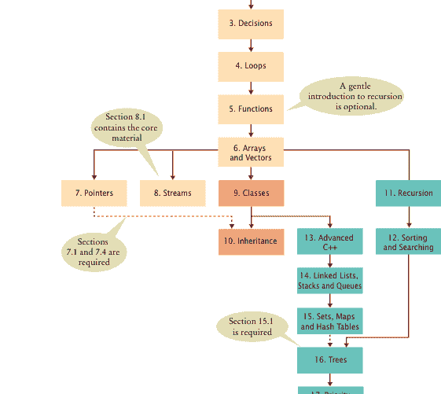

**图1** 章节依赖关系

这些章节的任何子集都可以合并到本教材的定制印刷版中；详情请咨询您的Wiley销售代表，或访问customselect.wiley.com创建您的定制订单。

### 附录

附录A和B总结了C++保留字和运算符。附录C列出了字符转义序列和ASCII字符代码值。附录D记录了本书中使用的所有库函数和类。

附录E包含编程风格指南。在编程作业中使用风格指南有益于学生，引导他们养成良好习惯并减少无谓的选择。风格指南以电子形式提供在本书的配套网站上，教师可以修改以反映他们偏好的风格。

附录F介绍计算中常用的数字系统。

### 网络资源

本书配有完整的在线资源套件。访问www.wiley.com/go/bcl03可查看在线配套网站，其中包括：

- 本书及其工作示例中所有示例程序的源代码，外加其他示例程序。
- 将本书中的问题解决步骤应用于其他现实示例的工作示例。
- 讲座演示幻灯片（仅限教师）。
- 所有复习和编程练习的解答（仅限教师）。
- 专注于技能而非仅术语的测试题库（仅限教师）。这套丰富的多项选择题可以使用文字处理器处理，或导入到课程管理系统中。

“CodeCheck”作业让学生能够在创新的在线服务中解决编程问题，并获得即时反馈。教师可以布置已准备好的练习，或轻松添加自己的练习。访问http://codec...了解更多。

纸质配套书中的提示说明了学生将在其电子文本或在线内容中找到什么。

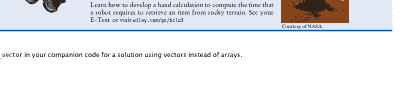


## 学习辅助工具导览

本书中的教学元素相互配合，聚焦并强化编程的关键概念和基本原理，同时通过组织额外的提示和细节来支撑并深化这些基础知识。除了章节目标和大量练习等传统内容外，每一章还包含面向当今视觉型学习者的元素。

在每一章中，页边注会标出引入新概念的位置，并提供关键思想的提要。

带注释的语法框以可视化方式快速概览新的语言结构。

注释解释了必需的组成部分，并指出与语法相关的常见错误或最佳实践的更多信息。

使用日常物品类比来解释变量、数据类型、循环等概念的性质和行为。

就像计算机程序中的变量一样，停车位也有标识符和内容。

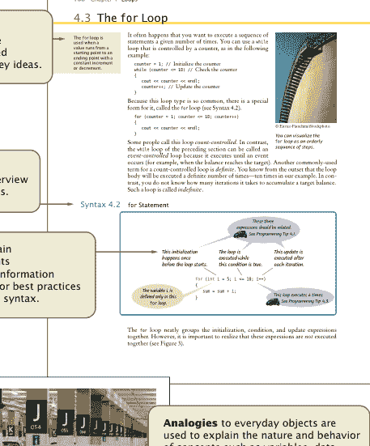


**令人难忘的照片**强化类比效果，帮助学生记住这些概念。

**问题解决部分**教授产生想法和评估备选方案的技术，通常使用纸笔或其他工具。这些部分强调，让学生取得成功的绝大部分规划与问题求解工作，都发生在远离计算机的地方。

## 6.5 问题解决：通过操作实物发现算法 277

## 操作指南 1.1 用伪代码描述算法

**操作指南**为常见编程任务提供一步步的指导，强调规划与测试。它们回答了初学者的疑问：“现在该做什么？”并将关键概念整合进一个解决问题的流程中。

## 实例解析 1.1 编写铺设地板的算法

**实例解析**将操作指南中的步骤应用于另一个示例，展示如何利用这些步骤来规划、实现和测试另一个编程问题的解决方案。

## 表3 C++中的变量名

**示例表格**通过多个具体的示例为初学者提供支持。这些表格指出常见错误，并为该节主题提供另一种快速参考。

渐进式图形追踪代码片段，帮助学生直观地看到程序流程。颜色使用保持一致，使变量和其他元素易于识别。

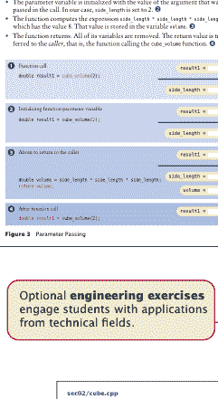

考虑图3所示的函数调用：
double result = cube_volume();

- 创建 cube_volume 函数的参数变量 side_length。
- 参数变量使用调用中传入的实参值进行初始化。在我们的示例中，side_length 被设置为 2。
- 函数计算表达式 side_length * side_length * side_length，其值为 8。该值被存储在变量 volume 中。
- 函数返回。其所有变量被移除。返回值被传回调用者，即调用 cube_volume 函数的那个函数。

## 图3 参数传递

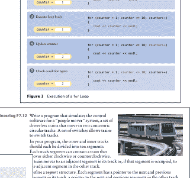

可选的工程练习让学生接触到技术领域的应用。

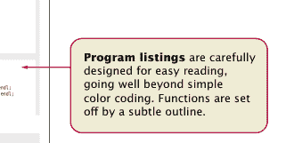

```
sec02/cube.cpp
1 #include <iostream>
2 using namespace std;
3
4 // Computes the volume of a cube
5 // post: returns the volume
6 double cube_volume(double side_length)
7 {
8   double volume = side_length * side_length * side_length;
9   return volume;
10 }
11
12 int main()
13 {
14   double result = cube_volume(2);
15   cout << "A cube with side length 2 has volume " << result << endl;
16   result = cube_volume(10);
17   cout << "A cube with side length 10 has volume " << result << endl;
18   return 0;
19 }
```

程序运行
A cube with side length 2 has volume 8
A cube with side length 10 has volume 1000

程序清单经过精心设计，便于阅读，远不止简单的颜色编码。函数用淡淡的轮廓线加以标示。

配套代码中还提供了其他示例程序，供学生阅读、运行和修改。

示例代码
请参阅配套代码中地震程序的另一个实现，该程序可用于练习1。请注意多个返回语句之间脆弱的描述。

E-Text 中的交互式活动让学生在主动阅读时...

## 逐行跟踪代码段

## 构建示例表

## 探索常见算法

## 排列代码以完成任务

## 完成程序并立即获得反馈

## 创建内存图

## 致谢

非常感谢 John Wiley & Sons 的 Don Fowley、Craig Donini、Dan Sayre、Ryann Dannelly、David Dietz、Laura Abrams 和 Billy Ray 对本项目的帮助。尤其要向 Cindy Johnson 致以深深的谢意，感谢她的辛勤工作、明智判断和令人惊叹的细致入微。

感谢 Mark Atkins（*艾维技术学院*）、Katie Livsie（*加斯顿学院*）、Larry Morell（*阿肯色理工大学*）和 Rama Olson（*加斯顿学院*）对补充材料的贡献。特别感谢 Stephen Gilbert（*奥兰治海岸社区学院*）在交互式练习方面提供的帮助。

每一个新版本都建立在新的和以往的审阅者、贡献者和用户的建议与经验之上。我们非常感谢这些提供反馈、审阅手稿、提出宝贵建议和贡献，并指出错误和遗漏的人。他们包括：

- Charles D. Allison, *犹他谷州立学院*
- Fred Annexstein, *辛辛那提大学*
- Mark Atkins, *艾维技术学院*
- Stefano Basagni, *东北大学*
- Noah D. Barnette, *弗吉尼亚理工大学*
- Susan Bickford, *塔拉哈西社区学院*
- Ronald D. Bowman, *阿拉巴马大学亨茨维尔分校*
- Robert Burton, *杨百翰大学*
- Peter Breznay, *威斯康星大学绿湾分校*
- Richard Cacace, *彭萨科拉初级学院（彭萨科拉）*
- Kuang-Nan Chang, *东肯塔基大学*
- Joseph DeLibero, *亚利桑那州立大学*
- Subramaniam Dharmarajan, *亚利桑那州立大学*
- Mary Dorf, *密歇根大学*
- Marty Dulberg, *北卡罗来纳州立大学*
- William E. Duncan, *路易斯安那州立大学*
- John Estell, *俄亥俄北方大学*
- Waleed Farag, *宾夕法尼亚印第安纳大学*
- Evan Gallagher, *纽约大学理工学院*
- Stephen Gilbert, *奥兰治海岸社区学院*
- Kenneth Gitlitz, *新罕布什尔技术学院*
- Daniel Grigoletti, *德锐理工学院（廷利帕克）*
- Barbara Guillott, *路易斯安那州立大学*
- Charles Halsey, *里奇兰学院*
- Jon Hanrath, *伊利诺伊理工学院*
- Neil Harrison, *犹他谷大学*
- Jurgen Hecht, *安大略大学*
- Steve Hodges, *卡布里略学院*
- Jackie Jarboe, 博伊西州立大学
- Debbie Kaneko, 欧道明大学
- Mir Behrad Khamesee, 滑铁卢大学
- Sung-Sik Kwon, 北卡罗来纳中央大学
- Lorrie Lehman, 北卡罗来纳大学夏洛特分校
- Cynthia Lester, 塔斯基吉大学
- Yanjun Li, 福特汉姆大学
- W. James MacLean, 多伦多大学
- Linda Lee Massoud, 莫特社区学院
- Adelaida Medlock, 德雷塞尔大学
- Charles W. Mellard, 德锐理工学院（欧文）
- Larry Morell, 阿肯色理工大学
- Ethan V. Munson, 威斯康星大学密尔沃基分校
- Arun Ravindran, 北卡罗来纳大学夏洛特分校
- Philip Regalbuto, 三叉戟技术学院
- Don Retzlaff, 北德克萨斯大学
- Jeff Ringenberg, 密歇根大学安娜堡分校
- John P. Russo, 温特沃斯理工学院
- Kurt Schmidt, 德雷塞尔大学
- Brent Seales, 肯塔基大学
- William Shay, 威斯康星大学绿湾分校
- Michele A. Starkey, 圣玛丽山学院
- William Stockwell, 中俄克拉荷马大学
- Jonathan Tolstedt, 北达科他州立大学
- Boyd Trolinger, 比尤特学院
- Muharrem Uyar, 纽约城市学院
- Mahendra Velauthapillai, 乔治城大学
- Kerstin Voigt, 加州州立大学圣贝纳迪诺分校
- David P. Voorhees, 勒莫因学院
- Salih Yurttas, 德克萨斯A&M大学

特别感谢我们所有的课堂测试者：

- Pani Chakrapani 以及雷德兰兹大学的学生们
- Jim Mackowiak 以及长滩城市学院（LAC）的学生们
- Suresh Muknahallipatna 以及怀俄明大学的学生们
- Murlidharan Nair 以及印第安纳大学南本德分校的学生们
- Harriette Roadman 以及新河社区学院的学生们
- David Topham 以及奥洛尼学院的学生们
- Dennie Van 'Tassel 以及加维兰学院的学生们


- 使用 auto 类型表示迭代器 503


## 专题讨论

- 大 O、大 Ω 与大 Θ 399
- 插入排序 400
- 快速排序算法 407
- 为排序对象定义排序规则 413
- 重载自增和自减运算符 427
- 隐式类型转换 428
- 返回引用 429
- 虚析构函数 443
- 禁止自动生成内存管理函数 443
- 移动操作 444
- 共享指针 445
- 非类型模板参数 450
- 逆波兰表示法 492
- 多重集合与多重映射 503
- 实现哈希函数 514
- 开放寻址 516


## 计算与社会

- 计算的极限 390
- 第一位程序员 418

## 第 1 章 引言

### 本章目标

- 了解计算机的体系结构
- 了解机器语言和高级编程语言
- 熟悉你的编译器
- 编译并运行你的第一个 C++ 程序
- 识别编译时错误和运行时错误
- 用伪代码描述算法
- 理解编程活动


© JanPietruszka/Stockphoto.

### 章节目录

- 1.1 什么是编程？2
- 1.2 计算机的解剖 3
  - C&S 计算机无处不在 5
- 1.3 机器代码与编程语言 5
  - C&S 标准组织 7
- 1.4 熟悉你的编程环境 7
  - PT1 备份副本 10
- 1.5 分析你的第一个程序 11
  - SYN C++ 程序 12
  - SYN 输出语句 13
  - CE1 遗漏分号 13
  - ST1 转义序列 13
- 1.6 错误 14
  - CE2 拼写错误 15
- 1.7 问题解决：算法设计 16
  - HT1 用伪代码描述算法 19
  - WE1 编写铺设地板的算法 21


正如你收集工具、研究项目并制定计划来应对它一样，在本章中，你将收集开始学习编程所需的基础知识。在简要介绍计算机硬件、软件和编程的一般概念之后，你将学习如何编写并运行你的第一个 C++ 程序。你还将学习如何诊断和修复编程错误，以及如何在规划程序时使用伪代码描述一种算法——即对如何解决问题进行分步描述。

### 1.1 什么是编程？

计算机以极快的速度连续执行非常基本的指令。

你可能已经使用计算机进行工作或娱乐。许多人使用计算机处理日常任务，例如电子银行或撰写学期论文。计算机擅长这类任务。它们可以处理重复性的工作，如累加数字或在页面上排列文字，而不会感到厌烦或疲惫。

计算机程序是一系列指令和决策的序列。

计算机的灵活性是一个相当惊人的现象。同一台机器可以结算你的支票簿、打印你的学期论文并玩游戏。相比之下，其他机器执行的任务范围要窄得多；汽车用来驾驶，烤面包机用来烤面包。计算机能够执行范围广泛的任务，因为它们执行不同的程序，每个程序都指导计算机处理特定任务。

计算机本身是一种存储数据（数字、文字、图片）、与设备（显示器、音响系统、打印机）交互并执行程序的机器。计算机程序以极其细致的程度告诉计算机完成任务所需的一系列步骤。物理计算机和外围设备统称为硬件。计算机执行的程序称为软件。

如今的计算机程序非常复杂，很难相信它们是由极其原始的操作组成的。一个典型操作可能是以下之一：

- 在此屏幕位置放置一个红点。
- 将这两个数字相加。
- 如果此值为负，则在某条指令处继续执行程序。

计算机用户会感觉到流畅的交互，因为程序包含大量此类操作，而且计算机能够以极快的速度执行它们。

设计和实现计算机程序的行为称为编程。在本书中，你将学习如何为计算机编程——即如何指导计算机执行任务。

编程是设计和实现计算机程序的行为。

编写一个具有运动和声音效果的计算机游戏，或一个支持花式字体和图片的文字处理器，是一项复杂的任务，需要由许多高技能程序员组成的团队来完成。你最初的编程工作将更为平凡。你在本书中学到的概念和技能构成了重要的基础，如果你最初的程序无法与你熟悉的复杂软件相媲美，你也不应感到失望。实际上，你会发现即使是简单的编程任务也能带来巨大的兴奋感。看到计算机精确而快速地完成一项需要你花数小时辛苦劳作的任务，对程序进行微小修改就能立即带来改进，并看到计算机成为你思维能力的延伸，这是一种奇妙的体验。

### 1.2 计算机的解剖

要理解编程过程，你需要对组成计算机的基本构件有一个初步的了解。我们将以个人计算机为例。大型计算机拥有更快、更大或更强大的组件，但它们的设计从根本上讲是相同的。

计算机的核心是中央处理器（CPU）（见图 1）。它由一个芯片或少量芯片组成。计算机芯片（集成电路）是一种带有塑料或金属外壳、金属连接器以及主要由硅制成的内部连线的组件。对于 CPU 芯片而言，其内部连线极其复杂。例如，奔腾芯片（撰写本文时个人计算机中流行的 CPU）由数百万个称为晶体管的结构元件组成。

中央处理器（CPU）执行程序控制和数据处理。

CPU 执行程序控制和数据处理。也就是说，CPU 定位并执行程序指令；它执行诸如加法、减法、乘法和除法等算术运算；它从外部存储器或设备获取数据并将数据存储回去。

存储设备包括内存和辅助存储器。

有两种存储方式。主存储器（或内存）由电子电路组成，只要供电就能存储数据。辅助存储器通常是硬盘（见图 2）或固态驱动器，提供较慢且较便宜的存储，并且在没有电力的情况下也能持久保存。硬盘由涂有磁性材料的旋转盘片组成。固态驱动器使用无需电力且没有移动部件即可保留信息的电子组件。

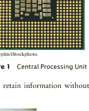


程序和数据通常存储在硬盘上，并在程序启动时加载到内存中。然后程序更新内存中的数据，并将修改后的数据写回硬盘。

为了与人类用户交互，计算机需要外围设备。计算机通过显示屏、扬声器和打印机向用户传输信息（称为输出）。用户可以通过键盘或鼠标等指点设备输入信息（称为输入）。

有些计算机是独立的单元，而另一些则通过网络相互连接。通过网络布线，计算机可以从中央存储位置读取数据和程序，或将数据发送给其他计算机。对于联网计算机的用户来说，哪些数据驻留在计算机本身，哪些通过网络传输，甚至可能并不明显。

图 3 给出了个人计算机体系结构的示意性概述。程序指令和数据（如文本、数字、音频或视频）驻留在辅助存储器或网络上的其他位置。当程序启动时，其指令被调入内存，CPU 可以读取它们。CPU 一次读取并执行一条指令。在这些指令的指导下，CPU 读取数据、修改数据并将其写回内存或辅助存储器。某些程序指令会使 CPU 在显示屏或打印机上放置点，或使扬声器振动。由于这些操作大量且高速地发生，人类用户会感知到图像和声音。某些程序指令会读取来自键盘、鼠标、触摸传感器或麦克风的用户输入。程序分析这些输入的性质，然后执行下一条适当的指令。

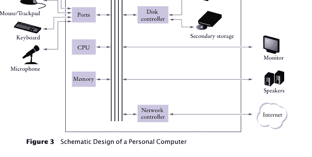


### 计算与社会 1.1
### 计算机无处不在

当计算机在 1940 年代首次被发明时，一台计算机占据了整个房间。图 4 显示了 ENIAC（电子数值积分计算机），于 1946 年在宾夕法尼亚大学完成。ENIAC 被军方用于计算弹丸的轨迹。如今，搜索引擎、互联网商店和社交网络的计算设施占据了被称为数据中心的大型建筑。在光谱的另一端，计算机无处不在。你的手机内部有一台计算机，许多信用卡和公共交通的乘车卡也是如此。现代汽车有几台计算机——用于控制发动机、刹车、灯光和收音机。

普适计算的出现改变了我们生活的许多方面。工厂过去雇佣人们做重复的装配任务，而这些任务今天由计算机控制的机器人完成，由少数懂得如何操作这些计算机的人操作。如今，书籍、音乐和电影通常在计算机上消费，而计算机几乎总是参与它们的制作。你现在正在阅读的这本书如果没有计算机就不可能写成。

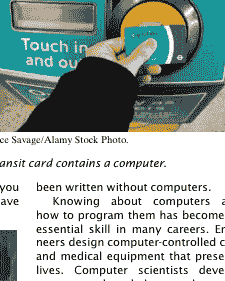

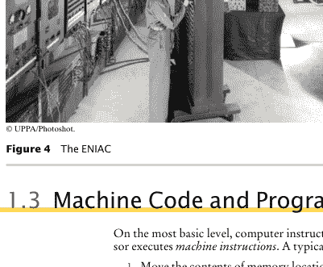

了解计算机及其编程已成为许多职业中的必备技能。工程师设计计算机控制的汽车和挽救生命的医疗设备。计算机科学家开发程序，帮助人们聚集在一起支持社会事业。例如，活动人士利用社交网络分享展示压迫政权虐待的视频，这些信息在改变公众舆论方面发挥了重要作用。

随着大大小小的计算机越来越多地嵌入到我们的日常生活中，让每个人都了解它们的工作原理以及如何与之合作变得越来越重要。当你使用这本书学习如何编程计算机时，你将培养出对计算基础的良好理解，这将使你成为更有见识的公民，也许是一名计算专业人士。

### 1.3 机器码和编程语言

在最基本层面上，计算机指令极其原始。处理器执行机器指令。典型的机器指令序列是

- 1. 将内存位置 40000 的内容移入 CPU。
- 2. 如果该值大于 100，则继续执行存储在内存位置 11280 的指令。

计算机程序以机器指令的形式存储，其代码取决于处理器类型。

实际上，机器指令被编码为数字，以便存储在内存中。在 Pentium 处理器上，此指令序列被编码为数字序列

161 40000 45 100 127 11280

在不同制造商的处理器上，编码会不同。当这种处理器获取这一数字序列时，它会对其进行解码并执行相关的一系列命令。

我们如何向计算机传达命令序列？最简单的方法是将实际数字放入计算机内存。事实上，这正是最初的计算机的工作方式。然而，一个长程序由数千条单独命令组成，查找所有命令的数字代码并手动将其放入内存是一项繁琐且容易出错的工作。如前所述，计算机非常擅长自动化繁琐且容易出错的活动。计算机科学家很快意识到计算机本身可以被利用来帮助编程过程。

计算机科学家设计了高级编程语言，允许程序员使用更接近要解决问题的语法来描述任务。在本书中，我们将使用 C++ 编程语言，该语言由 Bjarne Stroustrup 在 1980 年代开发。

C++ 是一种通用语言，被广泛用于系统和嵌入式编程。

多年来，C++ 通过添加许多功能而不断发展。标准化过程最终在 1998 年出版了国际 C++ 标准。2003 年发布了标准的小幅更新。2011 年进行了重大修订，随后在 2014 年和 2017 年进行了更新。此时，C++ 是开发数据库和操作系统等系统软件最常用的语言。同样重要的是，C++ 常用于编程“嵌入式系统”，即控制汽车发动机或机器人等设备的计算机。

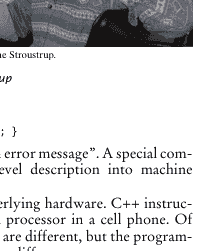

这里有一个典型的 C++ 语句：

```
if (int_rate > 100) { cout << "Interest rate error"; }
```

这意味着，“如果利率超过 100，则显示错误消息”。一种特殊的计算机程序，即编译器，将这种高级描述翻译成特定处理器的机器指令。

高级编程语言与处理器无关。

高级语言独立于底层硬件。C++ 指令在 Intel Pentium 和手机中的处理器上同样适用。当然，编译器生成的机器指令是不同的，但使用编译器的程序员无需担心这些差异。

### 计算与社会 1.2 标准组织

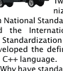

两个标准组织，美国国家标准学会（ANSI）和国际标准化组织（ISO），共同制定了 C++ 语言的权威标准。

为什么要有标准？你每天都会遇到标准化的好处。当你购买灯泡时，你可以确信它无需在家测量插座、在商店测量灯泡即可适配插座。事实上，如果你曾经购买过使用非标准灯泡的手电筒，你可能已经体会到缺乏标准会有多痛苦。这种手电筒的替换灯泡可能难以获得且昂贵。

ANSI 和 ISO 标准组织是行业专业人士的协会，他们制定从汽车轮胎和信用卡形状到编程语言等一切的标准。对 C++ 等编程语言拥有标准意味着你可以将在一个系统上使用某制造商编译器开发的程序带到另一个系统，并确信它仍能继续工作。


© Denis Vorob'yev/Stockphoto.

### 1.4 熟悉你的编程环境

抽出一些时间来熟悉你将在课堂作业中使用的编程环境。

许多学生发现，作为程序员所需的工具与他们熟悉的软件非常不同。你应该花一些时间熟悉你的编程环境。由于计算机系统差异很大，本书只能给出你需要遵循的步骤的大纲。参加动手实验室或请一位有知识的朋友带你参观是个好主意。

### 第 1 步 启动 C++ 开发环境。

在这方面计算机系统差异很大。在许多计算机上，有一个集成开发环境，你可以在其中编写和测试程序。在其他计算机上，你首先启动一个编辑器，一个像文字处理器一样工作的程序，在其中输入 C++ 指令；然后打开控制台窗口并输入命令来执行程序。其他编程环境是在线的。在这种环境中，你在网页浏览器中编写程序。然后程序在远程机器上执行，结果显示在网页浏览器窗口中。你需要了解如何开始使用你的环境。

### 第 2 步 编写一个简单程序。

在新编程语言中的第一个程序的传统选择是显示简单问候的程序：Hello, World!。让我们遵循这一传统。以下是 C++ 中的 Hello, World! 程序：

```
#include <iostream>

using namespace std;

int main()
{
```


```
cout << "Hello, World!" << endl;
}
return 0;
```

我们将在下一节中检查这个程序。

无论你使用哪种编程环境，你都是从在编辑器窗口中输入程序语句开始你的工作的。

创建并命名为 `hello.cpp` 的新文件，按照适合你的环境的步骤操作。（如果你的环境要求除文件名外还要提供项目名称，请将项目命名为 `hello`。）严格按照上面给出的程序指令输入。或者，在本书的源文件中找到该程序的电子副本，然后粘贴到你的编辑器中。（你可以从本书的配套网站 wiley.com/go/bc10.3 下载全部文件。）

编辑器是一种用于输入和修改文本（例如 C++ 程序）的程序。

在编写此程序时，请仔细注意各种符号，并记住 C++ 是区分大小写的。你必须严格按照程序清单中出现的字母大小写来输入。你不能输入 `MAIN` 或 `Endl`。如果不小心，你会遇到问题——请参阅常见错误 1.2。

C++ 区分大小写。你必须小心区分大写字母和小写字母。

#### 步骤3 编译并运行程序。

编译器将 C++ 程序翻译成机器代码。

构建和运行 C++ 程序的过程在很大程度上取决于你的编程环境。在某些集成开发环境中，你只需按一个按钮。在其他环境中，你可能需要输入命令。当你运行测试程序时，屏幕上会出现消息
Hello, World!
（见图5和图6）。

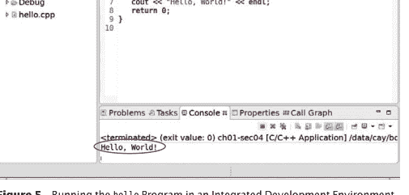

图5 在集成开发环境中运行 hello 程序

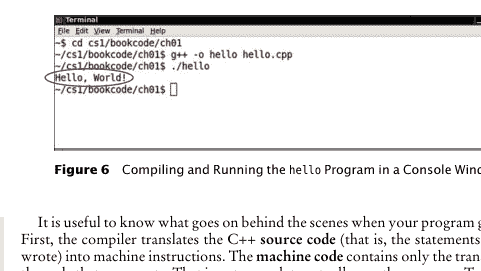

### 图6 在控制台窗口中编译并运行 hello 程序

```
~$ cd cs1/bookcode/ch01
~/cs1/bookcode/ch01$ g++ -o hello hello.cpp
~/cs1/bookcode/ch01$ ./hello
Hello, World!
~/cs1/bookcode/ch01$
```

> 链接器将机器代码与库代码组合成可执行程序。

了解程序构建时后台发生的情况是很有用的。首先，编译器将 C++ 源代码（即你编写的语句）翻译成机器指令。机器代码只包含你所编写代码的翻译。这还不足以真正运行程序。要在窗口中显示一个字符串，需要相当多的底层活动。你的 C++ 开发环境的实现者提供了一个库，其中包含 `cout` 的定义及其功能。库是别人已经编写并翻译好的代码集合，准备供你在程序中使用。（更复杂的程序由多个机器代码文件和多个库构建而成。）一个称为链接器的程序获取你的机器代码以及 C++ 库中的必要部分，并构建一个可执行文件。（图7概述了这些步骤。）可执行文件通常称为 `hello.exe` 或 `hello`，具体取决于你的计算机系统。即使你退出 C++ 开发环境后，也可以运行该可执行程序。

#### 步骤4 组织你的工作。

作为一名程序员，你编写程序、试用它们并改进它们。你将程序存储在文件中。文件有名称，合法名称的规则因系统而异。有些系统允许文件名中有空格；有些则不允许。有些系统区分大小写字母；有些则不区分。大多数 C++ 编译器要求 C++ 文件以扩展名 `.cpp`、`.cxx`、`.cc` 或 `.C` 结尾；例如 `demo.cpp`。


### 图7 从源代码到可执行程序

文件存储在文件夹或目录中。一个文件夹可以包含文件以及其他文件夹，而这些文件夹本身又可以包含更多的文件和文件夹（见图8）。这种层次结构可能相当庞大，你无需关心它的所有分支。

但是，你应该创建文件夹来组织你的工作。为你的编程课程创建一个单独的文件夹是一个好主意。在该文件夹中，为每项作业创建一个单独的文件夹。

如果你不自己指定文件夹，某些编程环境会将你的程序放在默认位置。在这种情况下，你需要找出这些文件所在的位置。

在灾难发生之前，制定一个保留工作备份副本的策略。

请确保你了解你的文件在文件夹层次结构中的位置。当你提交文件以供评分以及制作备份副本时，这些信息至关重要。

你将花费许多个小时来创建和改进 C++ 程序。很容易意外删除文件，有时文件也会因计算机故障而丢失。为了避免重新创建丢失文件的烦恼，请养成将工作备份副本保存在 U 盘或另一台计算机上的习惯。

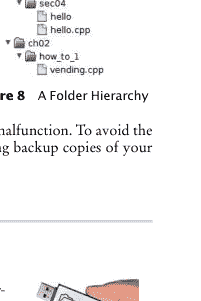

### 图8 文件夹层次结构

#### 编程技巧 1.1

### 备份副本


对于许多人来说，将文件备份到 U 盘是一种简单便捷的存储方法。另一种日益流行的备份形式是网络文件存储。以下是一些需要记住的要点。

© Tatiana Popova/iStockphoto.

- **经常备份。** 备份文件只需要几秒钟，如果你不得不花费几个小时来重新创建本来可以轻松保存的工作，你会恨自己。我建议你每三十分钟备份一次工作。
- **轮换备份。** 使用多个目录进行备份，并轮换使用它们。也就是说，首先备份到第一个目录。然后备份到第二个目录。然后使用第三个，然后再回到第一个。这样你总是有三个最近的备份。如果你最近的更改使情况变得更糟，那么你可以回到较旧的版本。
- **注意备份方向。** 备份涉及将文件从一个地方复制到另一个地方。正确处理这一点很重要——也就是说，从你的工作位置复制到备份位置。如果你搞反了，你会用旧版本覆盖较新的文件。
- **偶尔检查你的备份。** 再次确认你的备份是否在你认为的位置。没有什么比在你需要备份的时候发现备份不在那里更令人沮丧的了。
- **放松，然后恢复。** 当你丢失文件并需要从备份中恢复时，你可能处于不愉快、紧张的状态。先深吸一口气，并在开始之前思考整个恢复过程。情绪激动的计算机用户在试图恢复损坏文件时把最后一个备份也抹掉的情况并不少见。

### 1.5 分析你的第一个程序


在本节中，我们将详细分析第一个 C++ 程序。下面是源代码：

```
sec05/hello.cpp
```cpp
1 #include <iostream>
2
3 using namespace std;
4
5 int main()
6 {
7     cout << "Hello, World!" << endl;
8     return 0;
9 }
```

第一行，

`#include <iostream>`

告诉编译器包含一个用于“流输入/输出”的服务。你将在第 8 章了解什么是流。目前，你只需记住将这一行添加到所有执行输入或输出的程序中。

下一行，

`using namespace std;`

告诉编译器使用“标准命名空间”。命名空间是一种在大型程序中避免命名冲突的机制。你无需关心命名空间。对于你在本书中将要编写的程序，你将始终使用标准命名空间。只需在你编写的每个程序的顶部、在 `#include` 指令下面添加 `using namespace std;` 即可。

这个结构

```
int main()
{
    return 0;
}
```

定义了一个名为 `main` 的函数，它“返回”一个“整数”（即一个没有小数部分的整数，在 C++ 中称为 `int`），其值为 0。这个值表示程序成功完成。函数是执行特定任务的编程指令集合。每个 C++ 程序都必须有一个 `main` 函数。大多数 C++ 程序除了 `main` 之外还包含其他函数，但我们要到第 5 章才能讨论函数和返回值。

现在，最好将这些部分视为编写简单程序所必需的“管道设施”。只需将你想要执行的代码放在 `main` 函数的花括号内。（C++ 程序的基本结构如语法 1.1 所示。）

每个 C++ 程序都包含一个名为 `main` 的函数。


## 语法 1.2 输出语句

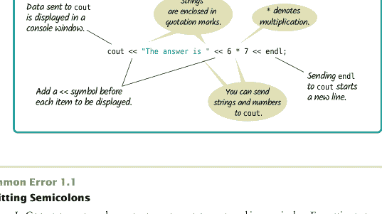

### 常见错误 1.1：省略分号


在 C++ 中，输出语句、返回语句等语句以分号结尾。忘记输入分号是一个常见错误。这会使编译器感到困惑，因为编译器依靠分号来定位一条语句在哪里结束、下一条语句从哪里开始。编译器不会使用行尾或右花括号来识别语句的结束。例如，编译器会把

```
cout << "Hello, World!" << endl
return 0;
```

视为一条语句，就像你写了

```
cout << "Hello, World!" << endl return 0;
```

然后它无法理解这条语句，因为它不希望在输出命令中间出现 return 这个词。解决方法很简单：只需检查每条语句是否以分号结束，就像你会检查每个英文句子是否以句号结束一样。

有时，标记缺少分号的错误信息会显示在下一行。当你看到这样的信息时，请务必也检查前一行。

### 专题 1.1：转义序列


如何显示一个包含引号的字符串，例如

Hello, "World"

你不能使用

```
cout << "Hello, "World"";
```

编译器一读到 "Hello, " 就认为字符串结束了，然后它对 World 感到完全困惑。编译器不会变通，如果对输入的简单分析无法让它们理解，它们就会拒绝继续执行并报告错误。相比之下，人类很可能会意识到第二个和第三个引号本应是字符串的一部分。

当余额小于 20,000 美元时

    Add 1 to the year.
    Set the interest to balance × 0.05 (i.e., 5 percent interest).
    Add the interest to the balance.

| 年份 | 利息 | 余额 |
|------|----------|---------|
| 0 |  | 10000 |
| 1 | 500.00 | 10500.00 |
| 14 | 942.82 | 19799.32 |
| 15 | 989.96 | 20789.28 |

将年份作为答案输出。

这些步骤还不是计算机能够理解的语言，但你很快就会学会如何用 C++ 来表达它们。这种非正式的描述称为伪代码。我们将在下一节讨论编写伪代码的规则。

## 1.7.3 伪代码

伪代码是解决问题的步骤序列的非正式描述。

伪代码没有严格的要求，因为它是供人类读者阅读的，而不是供计算机程序阅读的。以下是我们在本书中会使用的几种伪代码语句及其用法：

- 使用如下语句描述一个值如何被设置或改变：
  - `total cost = purchase price + operating cost`
  - `Multiply the balance value by 1.05.`
  - `Remove the first and last character from the word.`
- 如下描述决策和重复操作：
  - `If total cost1 < total cost2`
  - `While the balance is less than $20,000`
  - `For each picture in the sequence`
  - 使用缩进表示哪些语句应被选择或重复：
    - 对于每辆车
      - `operating cost = 10 × annual fuel cost`
      - `total cost = purchase price + operating cost`
    - 这里，缩进表示这两个语句都应针对每辆车执行。
- 使用如下语句表示结果：
  - `Choose car2.`
  - `Report year as the answer.`

## 1.7.4 从算法到程序

在 1.7.2 节中，我们为找出投资翻倍所需的时间编写了伪代码。让我们仔细检查该伪代码是否是一个算法；也就是说，它是否无歧义、可执行并且能终止。

我们的伪代码是无歧义的。它只是说明在每个步骤中如何更新值。伪代码是可执行的，因为我们使用了固定的利率。如果我们说的是使用未来几年实际收取的利率，而不是每年 5% 的固定利率，那么这些指令就不具有可执行性。因为没有人能够知道未来的利率是多少。要看出这些步骤能终止，需要稍微思考一下：每一步余额至少增加 500 美元，所以最终必定会达到 20,000 美元。

因此，我们找到了一个解决投资问题的算法，并且我们知道可以通过给计算机编程来找到解决方案。算法的存在是为任务编程的必要前提。在开始编程之前，你需要先发现并描述该任务的算法（见图 9）。在接下来的章节中，你将学习如何用 C++ 语言表达算法。

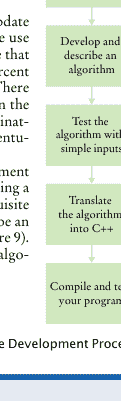

图 9 软件开发过程


## 如何做 1.1 用伪代码描述算法

这是本书众多“如何做”部分中的第一个，这些部分为你提供了在开发计算机程序过程中完成重要任务的分步流程。

在你准备用 C++ 编写程序之前，你需要开发一个算法——一种针对特定问题得出解决方案的方法。用伪代码描述算法——用英语表述的一系列精确步骤。为了说明这一点，我们将为以下问题设计一个算法：

### 问题陈述

你可以在两辆车中选择购买其中一辆。一辆比另一辆更省油，但也更贵。你知道两辆车的价格和燃油效率（以英里/加仑，即 mpg 为单位）。你计划将这辆车保留十年。假设汽油价格为每加仑 4 美元，每年行驶 15,000 英里。你将现金购车，不考虑融资成本。哪辆车更划算？

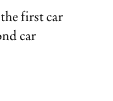

© dlewis33/Getty Images.

**步骤 1 确定输入和输出。**

在我们的示例问题中，有以下输入：

- *购车价格1* 和 *燃油效率1*，即第一辆车的价格和燃油效率（以 mpg 为单位）
- *购车价格2* 和 *燃油效率2*，即第二辆车的价格和燃油效率

我们只想知道哪辆车更值得购买。这就是期望的输出。

**步骤 2 将问题分解为更小的任务。**

对于每辆车，我们需要知道驾驶它的总成本。我们分别对每辆车进行这项计算。一旦我们有了每辆车的总成本，就可以决定哪辆车更划算。

每辆车的总成本是购车价格 + 运营成本。

我们假设十年内的使用量和汽油价格保持不变，因此运营成本取决于驾驶这辆车一年的成本。

运营成本是 10 × 年度燃油成本。

年度燃油成本是每加仑价格 × 年度燃油消耗量。

年度燃油消耗量是年度行驶英里数 / 燃油效率。例如，如果你驾驶这辆车行驶 15,000 英里，燃油效率为 15 英里/加仑，那么这辆车消耗 1,000 加仑。

**步骤 3 用伪代码描述每个子任务。**

在描述中，安排步骤的顺序，使任何中间值都在其他计算需要它们之前被计算出来。例如，在计算出运营成本之后，再列出步骤 `total cost = purchase price + operating cost`。

以下是决定购买哪辆车的算法：

```
For each car, compute the total cost as follows:
    annual fuel consumed = annual miles driven / fuel efficiency
    annual fuel cost = price per gallon × annual fuel consumed
    operating cost = 10 × annual fuel cost
    total cost = purchase price + operating cost
If total cost of car1 < total cost of car2
    Choose car1.
Else
    Choose car2.
```

**步骤 4 通过实际计算来测试你的伪代码。**

我们将使用以下示例值：

- 汽车 1：25,000 美元，50 英里/加仑
- 汽车 2：20,000 美元，30 英里/加仑

以下是第一辆车成本的计算：

```
annual fuel consumed = annual miles driven / fuel efficiency = 15000 / 50 = 300
annual fuel cost = price per gallon × annual fuel consumed = 4 × 300 = 1200
operating cost = 10 × annual fuel cost = 10 × 1200 = 12000
total cost = purchase price + operating cost = 25000 + 12000 = 37000
```

类似地，第二辆车的总成本为 40,000 美元。因此，该算法的输出是选择汽车 1。

下面的工作示例演示了如何使用本章的概念以及“如何做”中的步骤来解决另一个问题。在这个示例中，你将看到如何为按颜色交替铺瓷砖设计一个算法。你应该阅读该工作示例来复习所学内容，并帮助解决另一个问题。

在后续章节中，工作示例会通过简要描述示例中解决的问题，并提醒你在电子教材中查看或下载该示例来标示。


你可以从本书的配套网站 wiley.com/go/bclo3 获取这些代码。与“实际示例”相关的所有代码都包含在该章的配套代码中。当你看到“实际示例”的描述时，请转到该示例并查看代码，以了解问题是如何解决的。

## 实际示例 1.1

### 编写用于铺设地板的算法

### 问题陈述

你的任务是用4×4英寸的黑白交替瓷砖铺设一个矩形浴室地板。以英寸为单位测量的地板尺寸是4的倍数。

### 第1步 确定输入和输出。

输入是以英寸为单位的地板尺寸（长×宽）。输出是铺设好的地板。

### 第2步 将问题分解为更小的任务。

一个自然的子任务是铺设一行瓷砖。如果你能解决这个任务，那么你就可以通过从一面墙开始，一行接一行地铺设，直到到达对面的墙来解决问题。

如何铺设一行？从靠近一面墙的瓷砖开始。如果是白色，就在旁边放一块黑色瓷砖。如果是黑色，就在旁边放一块白色瓷砖。继续这样做，直到到达对面的墙。这一行将包含 width / 4 块瓷砖。


### 第3步 用伪代码描述每个子任务。

在伪代码中，你需要更精确地描述瓷砖的确切放置位置。

```
Place a black tile in the northwest corner.
While the floor is not yet filled, repeat the following steps:
Repeat this step width / 4 - 1 times:
If the previously placed tile was white
Pick a black tile.
Else
Pick a white tile.
Place the picked tile east of the previously placed tile.
Locate the tile at the beginning of the row that you just placed. If there is space to the south, place a tile of the opposite color below it.
```

### 第4步 通过处理一个问题来测试你的伪代码。

假设你想铺设一个20×12英寸的区域。第一步是在西北角放置一块黑色瓷砖。

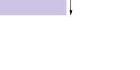


接下来，交替放置四块瓷砖，直到到达东墙。（width / 4 - 1 = 20 / 4 - 1 = 4）

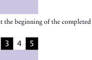

南边还有空间。找到刚完成行的起始瓷砖。它是黑色的。在它南边放置一块白色瓷砖。

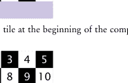

完成这一行。

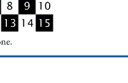

南边仍然有空间。找到刚完成行的起始瓷砖。它是白色的。在它南边放置一块黑色瓷砖。


完成这一行。


现在整个地板已经铺满，你就完成了。

## 章节总结

### 定义“计算机程序”和编程。

- 计算机以极快的速度连续执行非常基本的指令。
- 计算机程序是一系列指令和决策。
- 编程是设计和实现计算机程序的行为。

### 描述计算机的组件。

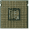

- 中央处理器（CPU）执行程序控制和数据处理。
- 存储设备包括内存和辅助存储。

### 描述将高级语言翻译为机器代码的过程。


- 计算机程序以机器指令的形式存储在依赖于处理器类型的代码中。
- C++是一种通用语言，广泛用于系统和嵌入式编程。
- 高级编程语言与处理器无关。

### 熟悉你的C++编程环境。

- 留出一些时间来熟悉你将在课堂作业中使用的编程环境。
- 编辑器是用于输入和修改文本（如C++程序）的程序。
- C++区分大小写。你必须注意区分大写字母和小写字母。
- 编译器将C++程序翻译成机器代码。
- 链接器将机器代码与库代码组合成可执行程序。
- 在灾难发生之前，制定一个保留工作备份副本的策略。


### 描述简单程序的构建块。


- 每个C++程序都包含一个名为 main 的函数。
- 使用 cout 和 << 运算符在屏幕上显示值。
- 将文本字符串用引号括起来。
- 使用 + 将两个数字相加，使用 * 将两个数字相乘。
- 将 endl 发送到 cout 以结束一行显示输出。
- 每条语句以分号结束。

### 将程序错误分类为编译时错误和运行时错误。

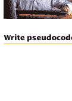

- 编译时错误是编译器检测到的违反编程语言规则的行为。
- 运行时错误导致程序执行程序员不打算执行的操作。
- 程序员有责任检查和测试程序，以防止运行时错误。

### 为简单算法编写伪代码。

- 解决问题的算法是一系列明确、可执行且会终止的步骤。
- 伪代码是对解决问题的一系列步骤的非正式描述。


## 复习练习

**R1.1** 解释使用计算机程序和为计算机编程之间的区别。

**R1.2** 计算机的哪些部分可以存储程序代码？哪些可以存储用户数据？

**R1.3** 计算机的哪些部分用于向用户提供信息？哪些部分接收用户输入？

**R1.4** 烤面包机是单功能设备，但计算机可以通过编程执行不同的任务。你的手机是单功能设备，还是可编程计算机？

**R1.5** 解释使用C++而不是机器代码的两个好处。

**R1.6** 在你自己的计算机或实验室计算机上，找到以下文件的确切位置（文件夹或目录名）：

a. 示例文件 hello.cpp（在你将其保存到开发环境之后）。

b. 标准头文件 `<iostream>`。

**R1.7** 这个程序打印什么？

```cpp
#include <iostream>
using namespace std;
int main()
{
    cout << "6 * 7 = " << 6 * 7 << endl;
    return 0;
}
```

**R1.8** 这个程序打印什么？请密切注意空格。

```cpp
#include <iostream>
using namespace std;
int main()
{
    cout << "Hello" << "World" << endl;
    return 0;
}
```

**R1.9** 这个程序打印什么？

```cpp
#include <iostream>
using namespace std;
int main()
{
    cout << "Hello" << endl << "World" << endl;
    return 0;
}
```

**R1.10** 编写三个具有不同编译时错误的 hello.cpp 程序版本。再编写一个具有运行时错误的版本。

**R1.11** 你如何发现编译时错误？你如何发现运行时错误？

**R1.12** 编写一个算法来解决以下问题：一个银行账户初始有10,000美元。利息按月复利计算，年利率为6%（每月0.5%）。每月提取500美元用于支付大学费用。多少年后账户耗尽？

**R1.13** 考虑练习R1.12中的问题。假设数字（10,000美元、6%、500美元）是用户可选择的。是否存在一些值会使你开发的算法不终止？如果存在，请修改算法以确保它总是终止。

**R1.14** 为了估算粉刷房屋的成本，油漆工需要知道外墙的表面积。开发一个计算该值的算法。你的输入是房屋的宽度、长度和高度，门窗的数量及其尺寸。（假设门窗具有统一的尺寸。）

**R1.15** 你想决定是开车上班还是乘火车上班。你知道从家到工作地点的单程距离，以及汽车的燃油效率（以英里/加仑为单位）。你还知道火车票的单程价格。你假设汽油价格为每加仑4美元，汽车维护费用为每英里5美分。编写一个算法来决定哪种通勤方式更便宜。

**R1.16** 假设你让你的弟弟负责备份你的工作。编写一套详细的 instructions 来执行他的任务。解释他应该多久备份一次，以及他需要将哪些文件从哪个文件夹复制到哪个位置。解释他应该如何验证备份是否正确完成。

**R1.17** 自助餐厅出售一种折扣卡，在特定时期内，只要你按正常价格购买了给定数量的餐食，就可以免费获得一餐。该优惠的具体细节不时变化。描述一个算法，让你确定某个特定优惠是否划算。你还需要哪些其他输入？

**R1.18** 为描述如何在你的家里准备周日早餐的算法编写伪代码。

**R1.19** 古代巴比伦人有一种确定数字a的平方根的算法。从a / 2的初始猜测开始。然后求出你的猜测g和a / g的平均值。这就是你的下一个猜测。重复，直到两个连续的猜测足够接近。为这个算法编写伪代码。

**R1.20** 编写一个算法来创建由黑白瓷砖组成的瓷砖图案，周围有一圈黑色瓷砖，中心有两三块黑色瓷砖，与边界等距。算法的输入是图案的总行数和列数。


**R1.21** 编写一个算法来创建由交替黑白方块组成的瓷砖图案，如下所示：

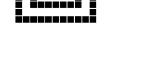


你被给出行数和列数。对于任意行号或列号，你可以查询颜色，该颜色将是红色、黑色或其他。如果发现黑色像素的中心与红色像素的中心重合，你就找到了一个红眼，你的输出应为 "yes"。否则，你的输出为 "no"。

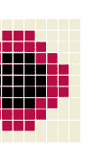

## 工程 R1.28

旧金山出租车委员会为 2017 年设定了以下费率：

- 首 1/5 英里：$3.50
- 每增加 1/5 英里或其零头：$0.55
- 每分钟等待或交通延误：$0.55

“等待或交通延误”的费用在速度低于盈亏平衡点时每分钟代替里程费用适用。盈亏平衡点是 1/5 英里在一分钟内行驶的速度。开发一个算法，根据行驶的给定距离和给定时间计算车费，假设出租车以恒定速度行驶。


## 工程 R1.29

假设你知道汽车从 0 加速到每小时 60 英里所需的时间。

开发一个算法来计算行驶给定距离（例如 5 英里）所需的时间，假设汽车初始静止，加速到给定速度（例如每小时 25 英里），然后以该速度行驶直到距离被覆盖。提示：一个从静止开始并以恒定速率 a 加速 t 秒的物体行驶的距离为 s = 1/2 a t²。

## 工程 R1.30

出租车计价器通过计算车轴的转数来测量行驶距离。

计价器通过行驶已知距离来初始化。一个不诚实的出租车司机通过在计价器初始化后稍微放气他的出租车轮胎，使其半径变小，从而欺骗顾客多付钱。这样，轮胎在每次行程中的转数会增加，使每次行程看起来像是行驶了更多的英里。开发一个算法来计算轮胎的放气半径必须是多少，如果出租车司机希望一段短的 x 英里出租车行程看起来像一段更长的 y 英里行程。输入为正确的轮胎半径 R 和距离 x 和 y。

## 练习题

- **E1.1** 编写一个程序打印你选择的问候语，也许使用英语以外的语言。
- **E1.2** 编写一个程序打印前十个正整数的和，1 + 2 + ⋯ + 10。
- **E1.3** 编写一个程序打印前十个正整数的乘积，1 × 2 × ⋯ × 10。（在 C++ 中使用 * 表示乘法。）
- **E1.4** 编写一个程序打印账户在第一年、第二年和第三年后的余额。该账户初始余额为 $1,000，每年赚取 5% 的利息。
- **E1.5** 编写一个程序在屏幕上在框中显示你的名字，如下所示：Dave

  尽力使用 | - + 等字符来近似线条。
- **E1.6** 编写一个程序以摩尔斯电码打印你的名字，如下所示：

  .... . .-.. .--.  -.-. . .-. . .-. . . .--. .

  对每个字母使用单独的输出语句。
- **E1.7** 编写一个程序打印三项，例如你三个最好的朋友或最喜欢的电影的名字，在三行上分别打印。
- **E1.8** 编写一个程序打印你选择的诗歌。如果你没有喜欢的诗歌，搜索互联网上的 "Emily Dickinson" 或 "e e cummings"。
- **Business E1.9** 编写一个程序打印你朋友生日的两列列表。在第一列中，打印你最好的朋友的名字；在第二列中，打印他们的生日。
- **Business E1.10** 在美国没有联邦销售税，因此每个州可以征收自己的销售税。在互联网上查找五个美国州征收的销售税，然后编写一个程序打印你选择的五个州的税率。

  ```text
  Sales Tax Rates
  ----------------
  Alaska: 0%
  Hawaii: 4%
  ...
  ```
- **Business E1.11** 今天在劳动力市场会说多种语言是一项宝贵的技能。其中一项基本技能是学习如何问候他人。编写一个程序打印包含表中所示问候语短语的两列列表。在第一列中，打印英语中的短语，在第二列中，打印你选择的语言中的短语。如果你不会说英语以外的语言，使用在线翻译器或请朋友帮忙。

  | 待翻译的短语列表 |
  | --- |
  | 早上好。 |
  | 很高兴见到你。 |
  | 请明天给我打电话。 |
  | 祝你有美好的一天！ |

- **Engineering E1.12** 编写一个程序打印以下英制/公制换算：

  1 千克 = 2.21 磅
  1 磅 = 0.454 千克
  1 英尺 = 0.305 米
  1 米 = 3.28 英尺
  1 英里 = 1.61 千米
  1 千米 = 0.621 英里

## 编程项目

- **P1.1** 编写一个程序打印消息，“Hello, my name is Hal!” 然后，在新的一行上，程序应打印消息 “What would you like me to do?” 然后轮到用户输入。你还没有学会如何做到这一点——只需使用以下代码行：

  ```cpp
  string user_input;
  getline(cin, user_input);
  ```

  最后，程序应忽略用户输入并打印消息 “I am sorry, I cannot do that.”

  此程序使用字符串数据类型。要访问此功能，你必须在 main 函数之前放置以下行

  ```cpp
  #include <string>
  ```

  这是一个典型的程序运行。用户输入以颜色打印。

  ```
  Hello, my name is Hal!
  What would you like me to do?
  Clean up my room
  I am sorry, I cannot do that.
  ```

  运行程序时，记得在输入行的最后一个词后按 Enter 键。

- **P1.2** 编写一个程序打印消息 “Hello, my name is Hal!” 然后，在新的一行上，程序应打印消息 “What is your name?” 如练习 P1.1 中所述，只需使用以下代码行：

  ```cpp
  string user_name;
  getline(cin, user_name);
  ```

  最后，程序应打印消息 “Hello, user name. I am glad to meet you!” 要打印用户名，只需使用

  ```cpp
  cout << user_name;
  ```

  如练习 P1.1 中所述，你必须在 main 函数之前放置以下行

  ```cpp
  #include <string>
  ```

  这是一个典型的程序运行。用户输入以颜色打印。

  ```
  Hello, my name is Hal!
  What is your name?
  Dave
  Hello, Dave. I am glad to meet you!
  ```

- **P1.3** 编写一个程序以大写字母打印你的名字，例如

  ```
  *   *   **   ****   ****   *   *
  *   *  *  *  *     *     *   *
  *****  *  *  ****  ****  *   *
  *   *  *  *  *     *     *   *
  *   *  *  *  ****  ****  *   *
  ```

- **P1.4** 编写一个程序打印一个类似于（但不同于）以下内容的脸：

  ```
  /////
  +-----+
  (| o o |)
  | , . |
  |-----|
  ```

- **P1.5** 编写一个程序打印一个看起来完全像以下内容的房子：

  ```
     /\
    /  \
   +----+
   | . .|
   | || |
   +----+
  ```

- **P1.6** 编写一个程序打印一只动物说问候语，类似于（但不同于）以下内容：

  ```
     /\   /\
    ( ' ) / Hello \
    ( . ) < Junior |
      | | \ Coder!/
      (___)  -----
  ```

- **P1.7** 编写一个程序打印皮耶特·蒙德里安绘画的仿制品。（如果你不熟悉他的绘画，搜索互联网。）使用 @@@ 或 ::: 等字符序列表示不同的颜色，并使用 - 和 | 形成线条。

- **P1.8** 编写一个程序使用 * 和 = 字符打印美国国旗。

- **Engineering P1.9** 气态巨行星（木星、土星、天王星和海王星）的大气主要由氢（H₂）组成，其次是氦（He）。类地行星的大气主要由二氧化碳（CO₂）组成，其次是金星和火星的氮气（N₂），对于地球，主要是氮气（N₂）其次是氧气（O₂）。编写一个程序以图表形式输出此信息，图表包含四列：行星类型、行星名称、主要大气气体和次要大气气体。

  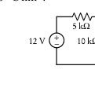

  © Courtesy NASA/JPL-Caltech.

- **Engineering P1.10** 编写一个程序使用 / \ | + 等字符显示以下图像。把 Ω 写成 "Ohm"。

  


## 第 2 章
## 基本数据类型
## 本章目标
- 能够定义和初始化变量及常量
- 理解整数和浮点数的属性及局限性
- 能够在 C++ 中编写算术表达式和赋值语句
- 认识到注释和良好代码布局的重要性
- 创建能够读取和处理输入并显示结果的程序
- 使用标准 C++ 字符串类型处理字符串

## 本章内容
2.1 变量 26  
SYN 变量定义 27  
SYN 赋值 30  
CE1 使用未定义的变量 33  
CE2 使用未初始化的变量 33  
PT1 选择具有描述性的变量名 33  
PT2 不要使用魔法数字 34  
ST1 C++ 中的数值类型 34  
ST2 数值范围和精度 35  
ST3 使用 auto 定义变量 35  

2.2 算术运算 36  
CE3 意外的整数除法 39  
CE4 括号不匹配 40  
CE5 忘记包含头文件 40  
CE6 舍入误差 41  
PT3 表达式中的空格 42  
PT4 类型转换 42  
ST5 结合赋值和算术运算 42  
C&S Pentium 浮点错误 43  

2.3 输入和输出 44  
SYN 输入语句 44  

2.4 问题求解：先手动完成 47  
WE1 计算旅行时间 48  
HT1 执行计算 48  
WE2 计算邮票费用 51  

2.5 字符串 51  
C&S 国际字母表和 Unicode 55  

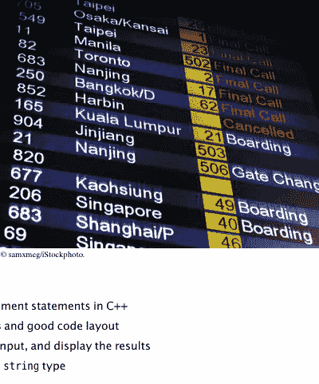

© sammeg/Stockphoto。

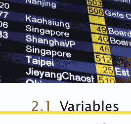

数字和字符串（例如显示板上的这些内容）是任何 C++ 程序中的重要数据类型。在本章中，你将学习如何处理数字和文本，以及如何编写使用它们执行有用任务的简单程序。

### 2.1 变量

当程序执行计算时，你会希望存储一些值，以便稍后使用。在 C++ 程序中，可以使用变量来存储值。在本节中，你将学习如何定义和使用变量。

为了说明变量的使用，我们将编写一个解决以下问题的程序。软饮料以罐装和瓶装形式出售。一家商店以一瓶两升装饮料的价格出售一组六罐 12 盎司装饮料。你应该购买哪一种？（12 液量盎司约等于 0.355 升。）

在程序中，我们将定义表示每组罐装饮料中罐数的变量，以及表示每罐容量的变量。然后，我们将计算一组六罐饮料的总体积（单位为升），并输出答案。

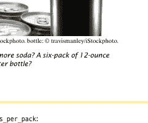

罐：© blackred/Stockphoto。瓶：© travismanley/iStockphoto。

哪种饮料的容量更大？一组六罐 12 盎司装饮料，还是一瓶两升装饮料？

### 2.1.1 变量定义

下面的语句定义了一个名为 cans_per_pack 的变量：

```
int cans_per_pack = 6;
```

变量是计算机程序中的一个存储位置。每个变量都有一个名称，并存储一个值。

变量类似于停车场中的停车位。停车位有一个标识符（例如“J053”），并且可以停放一辆汽车。变量有一个名称（例如 cans_per_pack），并且可以存储一个值（例如 6）。

> 变量是一个具有名称的存储位置。


与计算机程序中的变量类似，停车位也有标识符和内容。

Javier Larrea/Age Fotostock。

定义变量时，通常需要指定一个初始值。

定义变量时，还需要指定其值的类型。

定义变量时，通常希望对其进行**初始化**。也就是说，你要指定应存储在变量中的值。再次考虑下面的变量定义：

```
int cans_per_pack = 6;
```

变量 cans_per_pack 被初始化为值 6。

正如停车位可能限制停放某种特定类型的车辆（例如紧凑型轿车、摩托车或电动车），C++ 中的变量也只能存储特定**类型**的数据。C++ 支持相当多的数据类型：数字、文本字符串、文件、日期以及许多其他类型。每次定义变量时，都必须指定其类型（参见语法 2.1）。

### 语法 2.1 变量定义

本章介绍的类型包括数值类型 int 和 double（参见表 2），以及字符串类型（参见第 2.5 节）。

```
int cans_per_pack = 6;
```

有效名称的规则和示例请参见表 3。

变量定义以分号结尾。

使用具有描述性的变量名。参见编程提示 2.1。

提供初始值是可选的，但通常这是一个好习惯。参见常见错误 2.2。

变量 cans_per_pack 是一个**整数**，即没有小数部分的整数。在 C++ 中，这种类型称为 int。（有关 C++ 中数值类型的更多信息，请参见下一节。）

注意，类型位于变量名的*前面*：

```
int cans_per_pack = 6;
```


每个停车位都适合某种特定类型的车辆，就像每个变量存储特定类型的值一样。

表 1 展示了变量定义的不同形式。

### 表 1 C++ 中的变量定义

| 变量名 | 注释 |
|---|---|
| int cans = 6; | 定义一个整数变量，并将其初始化为 6。 |
| int total = cans + bottles; | 初始值不必是常量。（当然，cans 和 bottles 必须已经预先定义。） |
| int bottles = "10"; | 错误：不能使用字符串初始化数字。 |
| int bottles; | 定义一个未初始化的整数变量。这可能导致错误——参见常见错误 2.2。 |
| int cans, bottles; | 在一条语句中定义两个整数变量。在本书中，我们将在不同的语句中分别定义每个变量。 |
| bottles = 1; | 注意：缺少类型。这条语句不是定义，而是为现有变量赋予新值的赋值语句——参见第 2.1.4 节。 |

### 2.1.2 数值类型

对于不能包含小数部分的数字，应使用 int 类型。

对于浮点数，应使用 double 类型。

在 C++ 中，有几种不同的数值类型。整数类型在 C++ 中称为 int，用于表示没有小数部分的整数。例如，任何一组罐装饮料中的罐数都必须是整数——不可能有半罐饮料。

当需要小数部分时（例如数字 0.355），我们使用浮点数。C++ 中最常用的浮点数类型称为 double。（如果你想了解其中的原因，请阅读专题 2.1。）下面是浮点变量的定义：

```
double can_volume = 0.355;
```

当 6 或 0.355 这样的值出现在 C++ 程序中时，它被称为数字字面量。表 2 展示了如何在 C++ 中书写整数和浮点数字面量。

### 表 2 C++ 中的数字字面量

| 数字 | 类型 | 注释 |
|---|---|---|
| 6 | int | 整数没有小数部分。 |
| -6 | int | 整数可以是负数。 |
| 0 | int | 0 是整数。 |
| 0.5 | double | 带有小数部分的数字类型为 double。 |
| 1.0 | double | 带有小数部分 .0 的整数类型为 double。 |
| 1E6 或 1e6 | double | 使用指数表示法表示的数字：1 x 10^6 或 1000000。使用指数表示法的数字始终为 double 类型。 |

### 2.1.3 变量名

### 表 3 C++ 中的变量名
| 数字 | 类型 | 注释 |
|---|---|---|
| 2.96E-2 | double | 负指数：2.96 x 10⁻² = 2.96 / 100 = 0.0296 |
| 🚫 100,800 |  | 错误：不要使用逗号作为小数分隔符。 |
| 🚫 3 1/2 |  | 错误：不要使用分数；应使用十进制表示法：3.5。 |

按照惯例，变量名应以小写字母开头。

定义变量时，应选择一个能够说明其用途的名称。例如，使用 can_volume 这样的描述性名称，比使用 cv 这样的简短名称更好。

在 C++ 中，变量名有一些简单的规则：

- 1. 变量名必须以字母或下划线（_）字符开头，其余字符必须是字母、数字或下划线。
- 2. 不能使用 $ 或 % 等其他符号。名称中也不允许包含空格。可以使用下划线代替空格，例如 can_volume。
- 3. 变量名区分大小写，也就是说，can_volume 和 Can_volume 是不同的名称。因此，变量名最好只使用小写字母。在许多 C++ 程序员中，变量名应以小写字母开头也是一种惯例。
- 4. 不能使用 double 或 return 等保留字作为名称；这些单词专门保留用于表示其特殊的 C++ 含义。（参见附录 A。）

表 3 展示了 C++ 中合法和非法变量名的示例。

### 表 3 C++ 中的变量名
| 变量名 | 注释 |
|---|---|
| can_volume1 | 变量名由字母、数字和下划线字符组成。 |
| x | 在数学中，你会使用 x 或 y 这样的短变量名。在 C++ 中这样做是合法的，但并不常见，因为这会使程序更难理解（参见编程提示 2.1）。 |
| ⚠ can_volume | 注意：变量名区分大小写。此变量名与 can_volume 不同。 |
| 🚫 6pack | 错误：变量名不能以数字开头。 |
| 🚫 can volume | 错误：变量名不能包含空格。 |
| 🚫 double | 错误：不能使用保留字作为变量名。 |
| 🚫 ltr/fl.oz | 错误：不能使用 . 或 / 等符号。 |


## 2.1.4 赋值语句

> 赋值语句将一个新值存储到变量中，替换之前存储的值。

使用赋值语句将一个新值放入变量。下面是一个示例：

```
cans_per_pack = 8;
```

赋值语句的左侧是一个变量。右侧是一个有值的表达式。该值被存储在变量中，覆盖其之前的内容。

变量定义和赋值语句之间有一个重要区别：

```
int cans_per_pack = 6; // Variable definition
cans_per_pack = 8; // Assignment statement
```

第一条语句是 cans_per_pack 的定义。它是一条创建 int 类型新变量、将其命名为 cans_per_pack 并用 6 初始化的指令。第二条语句是赋值语句：用另一个值替换现有变量 cans_per_pack 的内容的指令。

### 语法 2.2 赋值

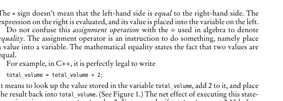

> 赋值运算符 = 并不表示数学上的相等。

= 号并不意味着左侧等于右侧。右侧的表达式被求值，其值被放入左侧的变量中。

不要将此赋值操作与代数中表示相等关系的 = 混淆。赋值运算符是一个执行操作的指令，即将一个值放入变量。数学上的相等表示两个值相等的事实。

例如，在 C++ 中，以下写法完全合法：

```
total_volume = total_volume + 2;
```

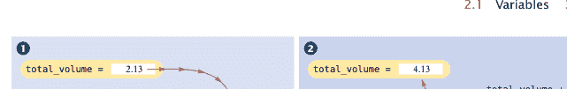

图 1 执行赋值 total_volume = total_volume + 2

## 2.1.5 常量

你不能更改定义为 const 的变量的值。

当变量使用保留字 const 定义时，其值将永远无法更改。常量通常用大写字母书写，以便在视觉上与常规变量区分开来：

```
const double BOTTLE_VOLUME = 2;
```

在程序中使用命名常量来解释数值的含义是一种良好的编程风格。例如，比较以下语句：

```
double total_volume = bottles * 2;
```

```
double total_volume = bottles * BOTTLE_VOLUME;
```

阅读第一条语句的程序员可能无法理解数字 2 的含义。第二条语句使用了命名常量，使计算更加清晰。

## 2.1.6 注释

使用注释为阅读你代码的人添加解释。编译器会忽略注释。

随着你的程序越来越复杂，你应该添加注释，为代码的人类读者提供解释。下面是一个示例：

```
const double CAN_VOLUME = 0.355; // Liters in a 12-ounce can
```

这条注释向人类读者解释了值 0.355 的含义。编译器完全不处理注释。它会忽略从 // 分隔符到行尾的所有内容。


正如电视评论员解释新闻一样，你在程序中使用注释来解释其行为。

© jgroup/iStockphoto.

对于单行注释，使用 // 语法。如果注释跨越多行，请将其放在 /* 和 */ 分隔符之间。编译器会忽略这些分隔符及其之间的所有内容。

下面是一个典型示例：程序开头的长注释，用于解释程序的目的：

```
/*
This program computes the volume (in liters) of a six-pack of soda cans
and the total volume of a six-pack and a two-liter bottle.
*/
```

现在我们准备完成程序。下面的程序展示了变量、常量和赋值语句的用法。程序显示一箱六罐装饮料的体积，以及六罐装和一瓶两升装饮料的总体积。我们使用常量表示罐和瓶的体积。total_volume 变量用罐的体积初始化。通过赋值语句，我们加上瓶的体积。

**sec01/volume1.cpp**

```
#include <iostream>

using namespace std;

/*
This program computes the volume (in liters) of a six-pack of soda cans
and the total volume of a six-pack and a two-liter bottle.
*/

int main()
{
    int cans_per_pack = 6;
    const double CAN_VOLUME = 0.355; // Liters in a 12-ounce can
    double total_volume = cans_per_pack * CAN_VOLUME;

    cout << "A six-pack of 12-ounce cans contains "
         << total_volume << " liters." << endl;

    const double BOTTLE_VOLUME = 2; // Two-liter bottle

    total_volume = total_volume + BOTTLE_VOLUME;

    cout << "A six-pack and a two-liter bottle contain "
         << total_volume << " liters." << endl;

    return 0;
}
```

**程序运行**

一个六罐装 12 盎司罐装饮料含有 2.13 升。
一个六罐装和一个两升瓶含有 4.13 升。


### 常见错误 2.1 使用未定义的变量

在首次使用变量之前，必须先定义它。例如，下面的语句序列是不合法的：

```
double can_volume = 12 * liter_per_ounce;
double liter_per_ounce = 0.0296;
```

在程序中，语句按顺序编译。当编译器到达第一条语句时，它并不知道 liter_per_ounce 将会在下一行定义，因此会报告错误。


### 常见错误 2.2 使用未初始化的变量

如果你定义一个变量但未初始化，那么程序可能会表现出不可预测的行为。要理解原因，请考虑定义变量时会发生什么。内存中会留出刚好足够的空间来存放你指定类型的值。例如，对于定义

```
int bottles;
```

会保留一块足以存放整数的内存块。该内存中已经存在某个值。毕竟，你不会得到新制造的晶体管——只是一个之前使用过的内存区域，里面充满了先前计算留下的残留数据。（在这方面，变量不同于停车位。停车位可以是空的，没有车辆。但变量总是保存着某个值。）

如果你在未初始化的情况下使用该变量，那么将使用先前的值，从而产生不可预测的结果。例如，考虑以下程序片段：

```
int bottles; // Forgot to initialize
int bottle_volume = bottles * 2; // Result is unpredictable
```

无法知道会计算出什么值。如果运气不好，你在家运行程序时可能会出现一个看似合理的值，而在程序被评分时却得到完全不同的结果。


### 编程提示 2.1 选择描述性的变量名

使用更短的变量名可以省去大量输入，例如：

```
double cv = 0.355;
```

不过，请将这个定义与我们实际使用的定义进行比较。哪一个更易读？毫无可比性。读取 can_volume 比读取 cv 再推断出它一定表示“罐容积”要省事得多。

在实际编程中，当程序由多人编写时，这一点尤其重要。对你来说，cv 显然代表 can volume（罐容积）而不是 current velocity（当前速度），但对于几年后需要更新你代码的人来说，这仍然显而易见吗？同样，三个月后你再看这段代码时，你自己还记得 cv 指的是什么吗？

### 编程提示 2.2 不要使用魔法数字


魔法数字是出现在代码中却没有解释的数字常量。例如：

```
total_volume = bottles * 2;
```

为什么？2？瓶子的容积是罐子的两倍吗？不，原因是每瓶含有 2 升。使用命名常量使代码自文档化：

```
const double BOTTLE_VOLUME = 2;
 total_volume = bottles * BOTTLE_VOLUME;
```

使用命名常量还有另一个原因。假设情况发生变化，瓶子体积变为 1.5 升。如果你使用了命名常量，只需修改一处即可完成。否则，你必须检查程序中的每一个 2，并思考它表示瓶子体积还是其他含义。在超过几页长的程序中，这将极其繁琐且容易出错。

即使是最合理的宇宙常量，有一天也会改变。你以为每年有 365 天？你在火星上的客户会对你愚蠢的偏见相当不满。请定义一个常量：

```
const int DAYS_PER_YEAR = 365;
```


### 专题 2.1 C++ 中的数值类型


除了 int 和 double 类型之外，C++ 还有几种其他数值类型。

C++ 有两种浮点类型。float 类型使用的存储空间是本书中使用的 double 类型的一半，但它只能存储 6-7 位数字。许多年前，当计算机的内存远没有今天这么大时，float 是浮点计算的标准类型，程序员只有在需要额外位数时才会奢侈地使用“双精度”。如今，float 类型已很少使用。

顺便提一下，这些数字之所以被称为“浮点”，是因为它们在计算机中的内部表示。考虑数字 29600、2.96 和 0.0296。它们可以以非常相似的方式表示：即，作为有效数字序列——296——以及小数点位置的指示。当这些值乘以或除以 10 时，只有小数点的位置发生变化；它“浮动”。计算机使用基数 2，而不是基数 10，但原理是相同的。

除了 int 类型之外，C++ 还有整数类型 short、long 和 long long。每种整数类型都有对应的无符号版本。例如，short 类型的典型范围是 −32,768 到 32,767，而 unsigned short 的范围是 0 到 65,535。这些看起来奇怪的限制是计算机使用二进制数的结果。short 值使用 16 个二进制位，可以编码 2^16 = 65,536 个值。请记住，整数类型的范围并未标准化，不同编译器之间会有所不同。表 4 列出了一些典型值。

**表 4 数值类型**

| 类型 | 典型范围 | 典型大小 |
|---|---|---|
| int | −2,147,483,648 ... 2,147,483,647（约 20 亿） | 4 字节 |
| unsigned | 0 ... 4,294,967,295 | 4 字节 |


## 2.2 算术

在以下各节中，你将学习如何在 C++ 中进行算术和数学计算。

### 2.2.1 算术运算符

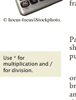

C++ 支持与计算器相同的四种基本算术运算——加法、减法、乘法和除法，但它对乘法和除法使用不同的符号。

你必须写成 a * b 来表示乘法。与数学不同，你不能写 a b、a · b 或 a × b。同样，除法始终用 / 表示，从不使用 ÷ 或分数线。

例如，a + b / 2 变成 (a + b) / 2。

括号的使用与代数中一样：用于指示子表达式的计算顺序。例如，在表达式 (a + b) / 2 中，先计算和 a + b，然后将该和除以 2。相比之下，在表达式 a + b / 2 中，只有 b 被除以 2，然后形成 a 和 b / 2 的和。就像常规代数记号一样，乘法和除法的优先级高于加法和减法。例如，在表达式 a + b / 2 中，/ 先执行，即使 + 操作出现在更左边。如果算术运算的两个参数都是整数，结果就是整数。如果一个或两个参数是浮点数，结果就是浮点数。例如，4 * 0.5 是 2.0。

使用 * 进行乘法，使用 / 进行除法。

### 2.2.2 自增和自减

++ 运算符将 1 加到变量上；-- 运算符减去 1。

改变变量（加 1 或减 1）非常常见，因此有一种特殊的简写形式，即

```
counter++;
counter--;
```

++ 自增运算符赋予了 C++ 编程语言其名称。C++ 是 C 语言的增量改进。

### 2.2.3 整数除法和余数

如果 / 的两个参数都是整数，则余数会被丢弃。

除法的工作方式如你所预期，只要涉及的数字中至少有一个是浮点数即可。即 7.0 / 4.0、7 / 4.0 和 7.0 / 4 都产生 1.75。然而，如果两个数字都是整数，则除法的结果始终是整数，余数会被丢弃。即 7 / 4 评估为 1，因为 7 除以 4 是 1 余 3（余数被丢弃）。这可能是微妙编程错误的来源——参见常见错误 2.3。

% 运算符计算整数除法的余数。

如果你只对余数感兴趣，使用 % 运算符：

7 % 4

是 3，即 7 除以 4 的整数除法的余数。% 符号在代数中没有类似物。它被选择是因为它看起来类似于 /，而余数运算与除法相关。该运算符称为取模。（有些人称之为 modulo 或 mod。）它与你在某些计算器上找到的百分比运算没有任何关系。

这是整数 / 和 % 运算的典型用法。

假设你的储钱罐里有一笔硬币数额：

```
int pennies = 1729;
```

你想确定美元和分的价值。通过除以 100 的整数除法获得美元。

```
int dollars = pennies / 100; // Sets dollars to 17
```

整数除法丢弃余数。要获得余数，使用 % 运算符：

```
int cents = pennies % 100; // Sets cents to 29
```

% 运算符的另一个常见用途是检查数字是偶数还是奇数。如果数字 n 是偶数，则 n % 2 为零。

% 运算符的常见用途是检查数字是偶数还是奇数。

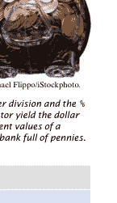

© Michael Filippov/Stockphoto.

*整数除法和 % 运算符给出装满硬币的储钱罐的美元和分值。*

表 5 整数除法和余数

| 表达式（其中 n = 1729） | 值 | 注释 |
|---|---|---|
| n % 10 | 9 | n % 10 始终是 n 的最后一位数字。 |
| n / 10 | 172 | 这始终是去掉 n 最后一位数字后的值。 |
| n % 100 | 29 | n 的最后两位数字。 |
| n / 10.0 | 172.9 | 因为 10.0 是浮点数，小数部分不会被丢弃。 |
| -n % 10 | -9 | 因为第一个参数为负数，余数也为负数。 |
| n % 2 | 1 | n % 2 在 n 为偶数时为 0，在 n 为奇数时为 1 或 -1。 |

### 2.2.4 将浮点数转换为整数

当浮点值赋给整数变量时，小数部分会被丢弃：

```
double price = 2.55;
int dollars = price; // Sets dollars to 2
```

## 表 6 算术表达式

| 数学表达式 | C++ 表达式 | 注释 |
|---|---|---|
| (x + y)/2 | (x + y) / 2 | 需要括号；x + y / 2 计算的是 x + y/2。 |
| xy/2 | x * y / 2 | 不需要括号；相同优先级的运算符按从左到右求值。 |
| (1 + r/100)^n | pow(1 + r / 100, n) | 记得在程序顶部添加 #include <cmath>。 |
| sqrt(a^2 + b^2) | sqrt(a * a + b * b) | a * a 比 pow(a, 2) 更简单。 |
| (i + j + k)/3 | (i + j + k) / 3.0 | 如果 i、j 和 k 是整数，使用分母 3.0 会强制进行浮点除法。 |

表 7 显示了在 <cmath> 头文件中声明的额外函数。输入和输出都是浮点数。

## 表 7 其他数学函数

| 函数 | 描述 |
|---|---|
| sin(x) | x 的正弦（x 以弧度为单位） |
| cos(x) | x 的余弦 |
| tan(x) | x 的正切 |
| log(x) | （自然对数）ln(x)，x > 0 |
| log10(x) | （常用对数）log10(x)，x > 0 |
| abs(x) | 绝对值 \|x\| |

## 示例代码

请参阅配套代码的 sec02，其中包含一个关于在 C++ 中处理数字的程序示例。


## 常见错误 2.3

### 非预期的整数除法

很不幸，C++ 对整数除法和浮点除法使用相同的符号，即 /。这其实是两种截然不同的运算。意外使用整数除法是一个常见错误。考虑以下计算三个整数平均值的代码段：

```
cout << "Please enter your last three test scores: ";
int s1;
int s2;
int s3;
cin >> s1 >> s2 >> s3;
```

```cpp
double average = (s1 + s2 + s3) / 3; // Error
cout << "Your average score is " << average << endl;
```

那有什么问题呢？当然，s1、s2 和 s3 的平均值是

$$\frac{s1+s2+s3}{3}$$

然而，这里 / 并不是数学意义上的除法。它表示整数除法，因为 s1 + s2 + s3 和 3 都是整数。例如，如果分数之和为 14，则平均值计算为 4，即 14 除以 3 的整数除法结果。然后这个整数 4 被移动到浮点变量 average 中。补救措施是使分子或分母成为浮点数：

```cpp
double total = s1 + s2 + s3;
double average = total / 3;
```

```cpp
double average = (s1 + s2 + s3) / 3.0;
```

## 常见错误 2.4

### 不平衡的括号


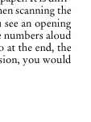

考虑表达式

```
(-b * b - 4 * a * c) / (2 * a)
```

它有什么问题？数一下括号。有三个 ( 和两个 )。括号不平衡。这种类型的输入错误在复杂表达式中非常常见。现在考虑这个表达式。

```
-(b * b - (4 * a * c)) / (2 * a)
```

这个表达式有三个 ( 和三个 )，但仍然不正确。在表达式中间，只有两个 ( 但有三个 )，这是错误。在表达式中间，( 的计数必须大于或等于 ) 的计数，而在表达式末尾，两个计数必须相同。

## 常见错误 2.5

### 忘记头文件


每个执行输入或输出的程序都需要 <iostream> 头文件。如果你使用 sqrt 等数学函数，需要包含 <cmath>。如果忘记包含

如果没有包含适当的头文件，编译器将不知道诸如 cout 或 sqrt 之类的符号。如果编译器抱怨未定义的函数或符号，请检查你的头文件。有时你可能不知道要包含哪个头文件。假设你想使用 abs 函数计算整数的绝对值。碰巧的是，这个版本的 abs 并未定义在 <cmath> 头文件中，而是在 <cstdlib> 中。你如何找到正确的头文件？你需要查找 abs 函数的文档，最好使用开发环境的在线帮助或互联网上的参考网站，例如 http://cplusplus.com（见图 3）。文档包含函数的简短描述以及你必须包含的头文件名称。

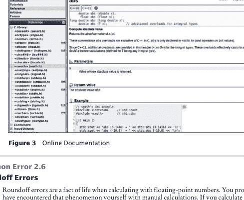

图 3 在线文档


## 常见错误 2.6
### 舍入误差

舍入误差在使用浮点数计算时是不可避免的。你可能在手工计算中自己也遇到过这种现象。如果你将 1/3 计算到两位小数，你会得到 0.33。再次乘以 3，你得到 0.99，而不是 1.00。在处理器硬件中，数字以二进制数系统表示，而不是十进制。当二进制位丢失时，你仍然会得到舍入误差。它们可能只是在你意想不到的地方出现。下面是一个例子。

```cpp
#include <iostream>

using namespace std;

int main()
{
    double price = 4.35;
    int cents = 100 * price;  // Should be 100 * 4.35 = 435
    cout << cents << endl;    // Prints 434!
    return 0;
}
```

当然，100 倍的 4.35 是 435，但程序打印的是 434。

大多数计算机在二进制系统中表示数字。在二进制系统中，4.35 没有精确的表示，就像 1/3 在十进制系统中没有精确的表示一样。计算机使用的表示值只是略小于 4.35，因此该值的 100 倍也只是略小于 435。当浮点值转换为整数时，几乎为 1 的整个小数部分被丢弃，整数 434 被存储在 cents 中。

解决方法是加上 0.5 以便四舍五入到最接近的整数：

```cpp
int cents = 100 * price + 0.5;
```


## 编程技巧 2.3
### 表达式中的空格

阅读起来更容易

```cpp
x1 = (-b + sqrt(b * b - 4 * a * c)) / (2 * a);
```

而不是

```cpp
x1=(-b+sqrt(b*b-4*a*c))/(2*a);
```

只需在所有运算符 + - * / % = - 周围加上空格即可。然而，不要在单目负号后加空格：a = -b 用于否定单个量，例如 -b。这样就可以很容易地将其与二元减号区分开，例如 a - b。

通常不要在函数名后加空格。也就是说，写 sqrt(x) 而不是 sqrt (x)。


## 专题 2.4
### 类型转换

有时你需要将一个值存储到不同类型的变量中。每当存在信息丢失的风险时，编译器就会发出警告。例如，如果你将 double 值存储到 int 变量中，可能会以两种方式丢失信息：

- 小数部分会丢失。
- 数值可能过大。

例如，

```cpp
int n = 1.0E100; // NO
```

不太可能工作，因为 10^100 大于最大可表示整数。

尽管如此，有时你确实想将浮点值转换为整数值。如果你准备好丢失小数部分，并且你知道这个特定的浮点数不大于最大可能的整数，那么你可以使用类型转换来关闭警告。类型转换是从一种类型（如 double）到另一种类型（如 int）的转换，通常不安全，但在特定情况下你知道它是安全的。你在 C++ 中这样表达类型转换：

```cpp
int cents = static_cast<int>(100 * price + 0.5);
```


## 专题 2.5
### 结合赋值与算术运算

在 C++ 中，你可以结合算术运算和赋值。例如，指令

```cpp
total += cans * CAN_VOLUME;
```

## 2.3 输入与输出

在下面的各节中，你将看到如何读取用户输入以及如何控制程序输出的外观。

### 2.3.1 输入

在本节中，你将看到如何将用户输入放入变量中。例如，考虑第 2.1.6 节中的 volume1.cpp 程序。与其假设两升瓶和六罐装的价格相同，我们可以询问程序用户价格。

当程序请求用户输入时，它应首先打印一条消息，告诉用户期望什么输入。这种消息称为提示。

```cpp
cout << "Please enter the number of bottles: "; // Display prompt
```

不要在提示后添加 endl。你希望输入出现在冒号之后，而不是下一行。

使用 >> 运算符读取值并将其放入变量中。

接下来，程序发出读取输入的命令。cin 对象从控制台窗口读取输入。你使用 >> 运算符（有时称为提取运算符）将输入值放入变量中，如下所示：

```cpp
int bottles;
cin >> bottles;
```

当程序执行输入语句时，它会等待用户提供输入。用户还需要按 Enter 键以便程序接受输入。用户提供输入后，数字会被放入 bottles 变量中，程序继续执行。

请注意，在这段代码中，没有必要初始化 bottles 变量，因为它会在下一条语句中被填充。作为经验法则，除非变量在紧随其后的输入语句中被填充，否则在声明时应初始化变量。

你可以在单个输入语句中读取多个值：

```cpp
cout << "Please enter the number of bottles and cans: ";
cin >> bottles >> cans;
```

用户可以在同一行提供两个输入：

```
Please enter the number of bottles and cans: 2 6
```

或者，用户可以在每次输入后按 Enter 键：

```
Please enter the number of bottles and cans: 2
```
```
6
```

### 语法 2.3 输入语句

在控制台窗口显示提示。cout << "Enter the number of bottles: "; 定义一个变量来保存输入值。int bottles; cin >> bottles; 程序等待用户输入，然后将输入放入变量中。这里不要使用 endl。

### 2.3.2 格式化输出

当你打印计算结果时，通常希望对其外观进行一些控制。例如，当你打印美元和美分的金额时，通常希望将其四舍五入到两位有效数字。也就是说，你希望输出看起来像

```
Price per ounce: 0.04
```

而不是

```
Price per ounce: 0.0409722
```

以下命令指示 cout 对所有浮点数使用小数点后两位：

```cpp
cout << fixed << setprecision(2);
```

该命令不会产生任何输出；它只是操作 cout 以便更改输出格式。fixed 和 setprecision 的值称为操纵符。我们将在第 8 章详细讨论操纵符。现在，只要记住每当你想整洁地显示货币值时，都要包含上面的语句。

要使用操纵符，你必须在程序中包含 <iomanip> 头文件：

```cpp
#include <iomanip>
```

你可以将操纵符和要显示的值组合成单个语句：

```cpp
cout << fixed << setprecision(2)
<< "Price per ounce: "
<< price_per_ounce << endl;
```

还有另一个有时很有用的操纵符。当你显示多行数据时，通常希望列对齐。

你使用 setw 操纵符来设置下一个输出字段的宽度。宽度是显示该值所使用的总字符数，包括数字，

你使用操纵符来指定值的格式化方式。

你使用操纵符使输出在整齐的列中对齐。


© Koelle/Stockphoto.


小数点以及空格。控制宽度在希望数字列对齐时非常重要。

例如，如果希望一个数字打印在宽度为 8 个字符的列中，可以使用

```cpp
cout << setw(8) << price_per_ounce;
```

该命令将 `price_per_ounce` 的值打印在宽度为 8 的字段中，例如

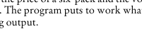

（其中每个 □ 表示一个空格）。

`setprecision` 和 `setw` 操纵符之间有一个显著区别。一旦设置了精度，该值将适用于该语句中的所有浮点数。但宽度只影响下一个值。后续值在格式化时不会添加额外的空格。

下一个示例程序将提示输入六罐装的价格和每罐的容量，然后打印出每盎司的价格。该程序运用了你刚刚学到的读取输入和格式化输出的知识。

### sec03/volume2.cpp

```cpp
#include <iostream>
#include <iomanip>

using namespace std;

int main()
{
    // Read price per pack

    cout << "Please enter the price for a six-pack: ";
    double pack_price;
    cin >> pack_price;

    // Read can volume

    cout << "Please enter the volume for each can (in ounces): ";
    double can_volume;
    cin >> can_volume;

    // Compute pack volume

    const double CANS_PER_PACK = 6;
    double pack_volume = can_volume * CANS_PER_PACK;

    // Compute and print price per ounce

    double price_per_ounce = pack_price / pack_volume;

    cout << fixed << setprecision(2);
    cout << "Price per ounce: " << price_per_ounce << endl;

    return 0;
}
```

### 程序运行

```text
Please enter the price for a six-pack: 2.95
Please enter the volume for each can (in ounces): 12
Price per ounce: 0.04
```

### 表 8 格式化输出

| 输出语句 | 输出 | 注释 |
|---|---|---|
| cout << 12.345678; | 12.3457 | 默认情况下，数字以 6 位有效数字打印。 |
| cout << fixed << setprecision(2) << 12.3; | 12.30 | 使用 `fixed` 和 `setprecision` 操纵符来控制小数点后的位数。 |
| cout << ":" << setw(6) << 12; | : 12 | 数字前打印了四个空格，总宽度为 6 个字符。 |
| cout << ":" << setw(2) << 123; | :123 | 如果宽度不够，该设置会被忽略。 |
| cout << setw(6) << ":" << 12; | :12 | 宽度仅指下一个条目。这里，冒号前有五个空格。 |

### 2.4 问题求解：先手工计算

开发算法的一个非常重要的步骤是首先手工进行计算。如果你自己都无法计算出一个解决方案，那么你很可能无法编写一个能自动完成该计算的程序。

为了说明手工计算的作用，请考虑以下问题。

需要沿着墙面铺设一排黑白瓷砖。出于美观考虑，建筑师规定第一块和最后一块瓷砖必须是黑色的。你的任务是：给定可用空间和每块瓷砖的宽度，计算所需的瓷砖数量以及两端的间隙。

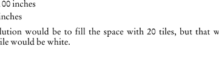

为一个典型情况选取具体的数值，用于手工计算。

为了使问题更具体，我们假设以下尺寸：

- 总宽度：100 英寸
- 瓷砖宽度：5 英寸

显而易见的解决方案是用 20 块瓷砖铺满整个空间，但这样行不通——最后一块瓷砖会是白色的。

相反，我们从另一个角度来看待这个问题：第一块瓷砖必须是黑色的，然后我们添加若干白/黑瓷砖对：

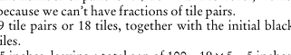

第一块瓷砖占据 5 英寸，剩下 95 英寸需要由瓷砖对来覆盖。每对瓷砖宽 10 英寸。因此，瓷砖对的数量是 95 / 10 = 9.5。但是，我们需要去掉小数部分，因为我们不能拥有分数对瓷砖。

因此，我们将使用 9 对瓷砖，即 18 块瓷砖，再加上最初的那块黑色瓷砖。总共需要 19 块瓷砖。

这些瓷砖覆盖了 19 × 5 = 95 英寸，留下的总间隙为 100 – 19 × 5 = 5 英寸。间隙应均匀分布在两端。每一端的间隙为 (100 – 19 × 5) / 2 = 2.5 英寸。

这一计算为我们提供了足够的信息，可以为任意的总宽度和瓷砖宽度设计算法。

瓷砖对数 = (总宽度 - 瓷砖宽度) / (2 × 瓷砖宽度) 的整数部分
瓷砖数量 = 1 + 2 × 瓷砖对数
每端间隙 = (总宽度 - 瓷砖数量 × 瓷砖宽度) / 2

正如你所看到的，进行手工计算能让你对问题有足够的洞察，从而很容易地开发出算法。

### 示例代码

参见随附代码中的 sec04，其中包含实现该算法的程序。


### 动手练习 2.1：计算旅行时间

了解如何通过手工计算来计算机器人从多岩石地形中取回物品所需的时间。请参阅你的电子书或访问 wiley.com/go/bc103。

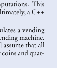

图片来源：NASA。


### 操作指南 2.1：进行计算

许多编程问题都要求你进行算术计算。本指南将向你展示如何将问题陈述转化为伪代码，并最终转化为 C++ 程序。

### 问题陈述

假设要求你编写一个模拟自动售货机的程序。顾客选择要购买的商品并将纸币插入自动售货机。自动售货机吐出所购商品并找零。我们将假设所有商品的价格都是 25 美分的倍数，并且机器只使用 1 美元硬币和 25 美分硬币来找零。你的任务是计算每种硬币应返回多少枚。

### 第 1 步

理解问题：输入是什么？期望的输出是什么？

在这个问题中，有两个输入：

- 顾客插入的纸币面额
- 所购商品的价格

有两个期望的输出：

- 机器返回的 1 美元硬币数量
- 机器返回的 25 美分硬币数量

### 第 2 步 手工计算示例。

假设一位顾客购买了一件价格为 2.25 美元的商品，并插入了一张 5 美元的纸币。顾客应得到 2.75 美元的找零，即两枚 1 美元硬币和三枚 25 美分硬币。

这对你来说很容易看出来，但 C++ 程序如何得出同样的结论呢？如果以美分而不是美元来计算，计算会更简单。应找给顾客的零钱是 275 美分。除以 100 得到 2，即美元硬币的数量。将余数（75）除以 25 得到 3，即 25 美分硬币的数量。

### 第 3 步 编写伪代码来计算答案。

在上一步中，你解决了一个具体的实例。现在你需要提出一种通用的方法。

给定任意的商品价格和付款金额，如何计算应找回的硬币？

首先，以美分计算应找的零钱：

*应找零钱 = 100 × 纸币面额 - 以美分计的商品价格*

要求美元硬币数量，除以 100 并丢弃余数：

*美元硬币数 = 应找零钱 / 100（不含余数）*

剩余应找金额可以通过两种方式计算。如果你熟悉取模运算符，可以直接计算：

*应找零钱 = 应找零钱 % 100*

或者，从应找零钱中减去美元硬币的美分值：

*应找零钱 = 应找零钱 - 100 × 美元硬币数*

要得到 25 美分硬币的数量，除以 25：

*25美分硬币数 = 应找零钱 / 25*

### 第 4 步 定义所需变量和常量，并指定它们的类型。

这里，我们有五个变量：

- bill_value
- item_price
- change_due
- dollar_coins
- quarters


```cpp
20 change_due = change_due % PENNIES_PER_DOLLAR;
21 int quarters = change_due / PENNIES_PER_QUARTER;
22
23 cout << "Dollar coins: " << setw(6) << dollar_coins << endl
24 << "Quarters: " << setw(6) << quarters << endl;
25
26 return 0;
27 }
```

### 程序运行

```text
Enter bill value (1 = $1 bill, 5 = $5 bill, etc.): 5
Enter item price in pennies: 225
Dollar coins: 2
Quarters: 3
```

### 动手练习 2.2：计算邮票成本

了解如何使用算术函数来模拟邮票售卖机。请参阅你的电子书或访问 wiley.com/go/bc103。

### 2.5 字符串

字符串是字符序列。

许多程序处理的是文本，而不是数字。文本由字符组成：字母、数字、标点、空格等。字符串是字符的序列。例如，字符串 "Harry" 是一个包含五个字符的序列。

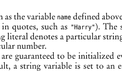

© cssxboy/iStockphoto。

### 2.5.1 string 类型

你可以定义保存字符串的变量。

```cpp
string name = "Harry";
```

`string` 类型是 C++ 标准的一部分。要使用它，只需包含头文件 `<string>`：

```cpp
#include <string>
```


空字符串是不包含任何字符的字符串。空字符串字面量写作 `""`。定义

```cpp
string response;
```

与

```cpp
string response = "";
```

的效果相同。

## 2.5.2 字符串拼接

使用 `+` 运算符拼接字符串；也就是说，将它们放在一起以生成一个更长的字符串。

给定两个字符串，例如 `"Harry"` 和 `"Morgan"`，你可以将它们拼接成一个长字符串。结果由第一个字符串中的所有字符后跟第二个字符串中的所有字符组成。在 C++ 中，你使用 `+` 运算符来拼接两个字符串。例如，

```cpp
string fname = "Harry";
string lname = "Morgan";
string name = fname + lname;
```

得到字符串

`"HarryMorgan"`

如果你希望名字和姓氏之间用空格分隔呢？没问题：

```cpp
string name = fname + " " + lname;
```

这条语句拼接了三个字符串：`fname`、字符串字面量 `" "` 和 `lname`。结果是

`"Harry Morgan"`

## 2.5.3 字符串输入

你可以从控制台读取一个字符串：

```cpp
cout << "Please enter your name: ";
string name;
cin >> name;
```

当使用 `>>` 运算符读取字符串时，只有一个单词会被放入字符串变量中。例如，假设用户输入

Harry Morgan

## 2.5.4 字符串函数

`length` 成员函数返回字符串中的字符数。

字符串中字符的数量称为字符串的长度。例如，`"Harry"` 的长度是 5。你可以使用 `length` 函数计算字符串的长度。与 `sqrt` 或 `pow` 函数不同，`length` 函数使用点表示法调用。

## 大语言模型简介

大语言模型（LLM）是一类在海量文本语料库上训练的深度学习模型。它们能够理解和生成类似人类的文本，执行翻译、摘要和问答等任务。

- **规模**：LLM 通常拥有数十亿甚至数万亿个参数。
- **预训练**：模型在多样化的互联网规模数据上进行训练。
- **微调**：模型可以通过监督学习或强化学习来适配特定任务。
- **上下文学习**：LLM 可以在不更新权重的情况下执行新任务。

2017 年推出的 Transformer 架构是大多数现代 LLM 的基础。著名的例子包括 GPT、BERT、T5 和 LLaMA。

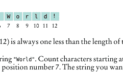

> “语言是思想的服装。” —— 塞缪尔·约翰逊

```python
from transformers import AutoModelForCausalLM, AutoTokenizer

model = AutoModelForCausalLM.from_pretrained("gpt2")
tokenizer = AutoTokenizer.from_pretrained("gpt2")
```

| 模型 | 参数 | 年份 |
|-------|--------|------|
| GPT-2 | 1.5B   | 2019 |
| T5    | 11B    | 2020 |
| GPT-3 | 175B   | 2020 |
| PaLM  | 540B   | 2022 |

下面是一个简单的程序，将上述概念付诸实践。程序会询问你的名字和你另一半的名字，然后打印出你们的首字母。

操作 `first.substr(0, 1)` 会生成一个由单个字符组成的字符串，该字符取自 `first` 的开头。程序对 `second` 也执行相同操作。然后将得到的单字符字符串与字符串字面量 `"&"` 拼接，得到一个长度为 3 的字符串，即首字母缩写字符串。（参见图 4。）

```text
first = R o d o l f o
0 1 2 3 4 5 6

second = S a l l y
0 1 2 3 4

initials = R & S
0 1 2
```


© Rich Legg/iStockphoto.

*缩写由每个名字的首字母构成。*

### 图4 构建首字母缩写字符串

### sec05/initials.cpp

```cpp
#include <iostream>
#include <string>

using namespace std;

int main()
{
    cout << "Enter your first name: ";
    string first;
    cin >> first;
    cout << "Enter your significant other's first name: ";
    string second;
    cin >> second;
    string initials = first.substr(0, 1)
        + "&" + second.substr(0, 1);
    cout << initials << endl;
    return 0;
}
```

### 程序运行

```text
Enter your first name: Rodolfo
Enter your significant other's first name: Sally
R&S
```

它们并不在其中。一些德国数据处理系统用德语字母替换很少使用的 ASCII 字符：`[\]{}|~` 被替换为 Ä Ö Ü ä ö ü。虽然大多数人没有这些字符也能凑合，但 C++ 程序员显然不能。其他编码方案利用了一个事实：一个字节可以编码 256 个不同的字符，其中只有 128 个由 ASCII 标准化。不幸的是，这类编码存在多种不兼容的标准，导致欧洲计算机用户相当恼火。

许多国家根本不使用罗马文字。俄语、希腊语、希伯来语、阿拉伯语和泰语字母（仅举几例）拥有完全不同的形状。更复杂的是，希伯来语和阿拉伯语是从右向左输入的。这些字母表每种都有 30 到 100 个字母，使用这些字母的国家已经为它们制定了编码标准。

在使用汉字脚本的语言中，情况更加剧烈：中文方言、日语和韩语。汉字不是字母文字，而是表意文字。一个字符代表一个想法或事物。大多数单词由一、二或三个这样的表意文字组成。（已知超过 50,000 个表意文字，其中约 20,000 个在使用中。）因此，需要用两个字节来编码它们。中国、台湾、日本和韩国对它们有不兼容的编码标准。（日语和韩语书写混合使用本土音节文字和汉字表意文字。）

字符编码之间的不一致一直是国际电子通信以及争夺全球市场的软件制造商的主要麻烦。从 1988 年开始，一个由硬件和软件制造商组成的联盟开发了一种统一的 21 位编码方案，称为 Unicode，它能够对世界上几乎所有书面语言的文本进行编码。大约 100,000 个字符已被赋予编码，其中包括超过 70,000 个中文、日文和韩文表意文字。甚至已经消亡的语言，如埃及象形文字，也被纳入 Unicode。

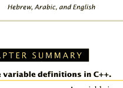

希伯来语、阿拉伯语和英语

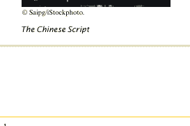

汉字

## 章节总结

### 在 C++ 中编写变量定义。

- 变量是带有名称的存储位置。
- 定义变量时，通常需要指定初始值。
- 定义变量时，还需要指定其值的类型。
- 对于不能有小数部分的数字，使用 `int` 类型。
- 对于浮点数，使用 `double` 类型。
- 按照惯例，变量名应以小写字母开头。
- 赋值语句将新值存储到变量中，替换先前存储的值。
- 赋值运算符 `=` 并不表示数学上的相等。


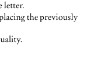

- c. `s.substr(s.length() / 2, 1)`
- d. `s + t`
- e. `t + s`

### R2.8 找出以下程序中的至少五个编译时错误。

```cpp
#include iostream

int main();
{
cout << "Please enter two numbers:"
cin >> x, y;
cout << "The sum of << x << "and" << y
<< "is:" x + y << endl;
return;
}
```

### R2.9 找出以下程序中的至少四个运行时错误。

```cpp
#include <iostream>

using namespace std;

int main()
{
int total;
int x1;
cout << "Please enter a number: ";
cin >> x1;
total = total + x1;
cout << "Please enter another number: ";
int x2;
cin >> x2;
total = total + x1;
double average = total / 2;
cout << "The average of the two numbers is "
<< average << endl;
return 0;
}
```

### R2.10 解释 `2`、`2.0`、`"2"` 和 `"2.0"` 之间的区别。

### R2.11 解释以下每个程序片段计算什么。

- a.
  `int x = 2;`
  `int y = x + x;`
- b.
  `string s = "2";`
  `string t = s + s + s;`

### R2.12 为以下程序编写伪代码：读取一个单词，然后打印第一个字符、最后一个字符以及中间字符。例如，如果输入是 Harry，程序打印 H y arr。

### R2.13 为以下程序编写伪代码：读取一个姓名（例如 Harold James Morgan），然后打印由名字、中间名和姓氏的首字母组成的缩写（例如 HJM）。

### R2.14 为以下程序编写伪代码：计算一个数字的第一个和最后一个数字。例如，如果输入是 23456，程序应打印出 2 和 6。提示：`%`、`log10`。


### R2.15
修改 How To 2.1 中程序的伪代码，使程序能用 25 美分、10 美分和 5 美分硬币找零。你可以假设价格是 5 美分的倍数。为了编写伪代码，先用几个具体的值进行尝试。

### R2.16
鸡尾酒调酒器由三个圆锥台组成。一个高为 h、顶部和底部半径分别为 r1 和 r2 的圆锥台的体积为 V = π (r1² + r1 r2 + r2²) h / 3。手工计算一组实际半径和高度的总体积。然后开发一个适用于任意尺寸的算法。


### R2.17
你正在切下这样一块派，其中 c 是直线部分的长度（称为弦长），h 是这块派的高度。

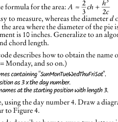

有一个面积近似公式：A ≈ 2/3 c h + h³ / 2c。然而，h 不容易测量，而派的直径 d 通常是众所周知的。计算当派的直径为 12 英寸、弓形弦长为 10 英寸时的面积。推广为一个算法，使其能计算任意直径和弦长的面积。

### R2.18
下面的伪代码描述了如何在给定日期编号（0 = 星期日，1 = 星期一，依此类推）的情况下获取日期名称。定义一个名为 names 的字符串，内容为 "SunMonTueWedThuFriSat"。计算起始位置为 3 乘以日期编号。从 names 的起始位置提取长度为 3 的子字符串。使用日期编号 4 检查这个伪代码。画出所计算的字符串的示意图，类似于图 4。

### R2.19
下面的伪代码描述了如何交换一个单词中的两个字母。给定一个字符串 str 和两个位置 i 和 j（i 在 j 之前）。将 first 设置为从字符串开头到 i 之前最后一个位置的子字符串。将 middle 设置为从位置 i + 1 到 j - 1 的子字符串。将 last 设置为从位置 j + 1 到字符串末尾的子字符串。连接以下五个字符串：first、仅包含位置 j 处字符的字符串、middle、仅包含位置 i 处字符的字符串以及 last。使用字符串 "Gateway" 以及位置 2 和 4 检查这个伪代码。画出所计算的字符串的示意图，类似于图 4。

### R2.20
运行以下程序，并解释你得到的输出。

```cpp
#include <iostream>
using namespace std;

int main()
{
    int total;
    cout << "Please enter a number: ";
    double x1;
    cin >> x1;
    total = total + x1;
    cout << "total: " << total << endl;
    cout << "Please enter a number: ";
    double x2;
    cin >> x2;
    total = total + x2;
    cout << "total: " << total << endl;
    total = total / 2;
    cout << "total: " << total << endl;
    cout << "The average is " << total << endl;
    return 0;
}
```

注意插入的跟踪消息（蓝色），用于显示 total 变量的当前内容。你如何修复这个程序？（该程序有两个不同的错误。）

### R2.21
如何获取字符串的第一个字符？最后一个字符？如何删除第一个字符？最后一个字符？

### R2.22
对于 C++ 中的以下每个计算，确定结果是精确的、溢出还是舍入误差。

- a. 2.0 * 1.1
- b. 1.0E6 * 1.0E6
- c. 65536 * 65536
- d. 1000000 * 1000000

### R2.23
编写一个程序，打印以下值

```
3 * 1000 * 1000 * 1000
3.0 * 1000 * 1000 * 1000
```

解释结果。

### R2.24
本章包含许多关于变量和常量的建议，这些建议使程序更易于阅读和维护。简要总结这些建议。

## 练习

### E2.1
编写一个程序，以毫米为单位显示一张信纸尺寸（8.5 × 11 英寸）纸的尺寸。每英寸有 25.4 毫米。在程序中使用常量和注释。

### E2.2
编写一个程序，计算并显示一张信纸尺寸（8.5 × 11 英寸）纸的周长和其对角线长度。

### E2.3
编写一个程序，读取一个数字并显示其平方、立方和四次幂。仅对四次幂使用 `pow` 函数。

### E2.4
编写一个程序，提示用户输入两个整数，然后打印

- 和
- 差
- 积
- 平均值

### E2.5
编写一个程序，提示用户输入两个整数，然后打印

- 距离（差的绝对值）
- 最大值（两者中较大的一个）
- 最小值（两者中较小的一个）

提示：max 和 min 函数定义在 <algorithm> 头文件中。

### E2.6
编写一个程序，提示用户输入以米为单位的测量值，然后将其转换为英里、英尺和英寸。

### E2.7
编写一个程序，提示用户输入一个半径，然后打印

- 以该半径为圆的面积和周长
- 以该半径为球的体积和表面积

### E2.8
编写一个程序，要求用户输入一个矩形的边长，然后打印

- 矩形的面积和周长
- 对角线的长度（使用勾股定理）

### E2.9
改进 How To 2.1 中讨论的程序，使其除纸币外还允许输入 25 美分硬币。

### E2.10
编写一个程序，要求用户输入

- 油箱中的汽油加仑数
- 以英里/加仑为单位的燃油效率
- 每加仑汽油的价格

然后打印每 100 英里的成本以及汽车用油箱里的汽油能行驶多远。

### E2.11
文件名和扩展名。编写一个程序，提示用户输入驱动器盘符（C:）、路径（\Windows\System）、文件名（Readme）和扩展名（txt）。然后打印完整的文件名 C:\Windows\System\Readme.txt。（如果你使用 UNIX 或 Macintosh，请跳过驱动器名，并使用 / 而不是 \ 来分隔目录。）

### E2.12
编写一个程序，从用户处读取一个介于 1,000 和 999,999 之间的数字，并打印一个用逗号分隔千位的数字。以下是示例对话框；用户输入以彩色显示：

```
Please enter an integer between 1000 and 999999: 23456
23,456
```

（\n 字符在专题 1.1 中解释。）对字母 E、L 和 O 也做同样的操作。然后用大号字母写出消息

```
H
E
E
L
L
O
```

### E2.18
编写一个程序，将数字 1，2，3，...，12 转换为相应的月份名称 January, February, March, ..., December。提示：创建一个很长的字符串 "January February March ..."，在其中添加空格，使每个月份名称的长度相同。然后使用 substr 提取你想要的月份。


© José Luis Gutiérrez/Stockphoto.

## 编程项目

### P2.1
复活节是春季第一个满月后的第一个星期日。要计算日期，你可以使用这个算法，它由数学家卡尔·弗里德里希·高斯于 1800 年发明：

- 1. 设 y 为年份（如 1800 或 2001）。
- 2. 将 y 除以 19，余数记为 a。忽略商。
- 3. 将 y 除以 100，得到商 b 和余数 c。
- 4. 将 b 除以 4，得到商 d 和余数 e。
- 5. 将 8 * b + 13 除以 25，得到商 g。忽略余数。
- 6. 将 19 * a + b - d - g + 15 除以 30，得到余数 h。忽略商。
- 7. 将 c 除以 4，得到商 j 和余数 k。
- 8. 将 a + 11 * h 除以 319，得到商 m。忽略余数。
- 9. 将 2 * e + 2 * j - k - h + m + 32 除以 7，得到余数 r。忽略商。
- 10. 将 h - m + r + 90 除以 25，得到商 n。忽略余数。
- 11. 将 h - m + r + n + 19 除以 32，得到余数 p。忽略商。

然后复活节落在第 n 月的第 p 天。例如，如果 y 是 2001：

```
a = 6      g = 6      m = 0      n = 4
b = 20, c = 1    h = 18    r = 6    p = 15
d = 5, e = 0    j = 0, k = 1
```

因此，在 2001 年，复活节是 4 月 15 日。编写一个程序，提示用户输入一个年份，并打印出复活节的月份和日期。

### P2.2
在这个项目中，你将执行三角形的计算。一个三角形由其三个角的 x 坐标和 y 坐标定义。你的任务是计算给定三角形的以下属性：

- 所有边的长度
- 所有角的角度
- 周长
- 面积


提供一个程序，提示用户输入角点坐标，并生成一个格式良好的三角形属性表格。

## 商业 P2.3
一家视频俱乐部希望根据会员的电影租赁数量和会员推荐的新会员数量，给予其最佳会员相应的折扣。折扣以百分比表示，等于租赁数量与推荐数量之和，但不能超过 75%。（提示：使用 `<algorithm>` 头文件中的 `min` 函数。）编写一个程序来计算折扣值。

以下是一个示例运行：
```
Enter the number of movie rentals: 56
Enter the number of members referred to the video club: 3
The discount is equal to: 59.00 percent.
```

## P2.4
编写一个程序，帮助人们决定是否购买混合动力汽车。程序的输入应为：
- 新车的成本
- 估计每年行驶里程
- 估计油价
- 5 年后的估计转售价值

计算拥有该汽车 5 年的总成本。（为简化起见，我们不考虑融资成本。）从网上获取新车和二手混合动力汽车以及可比车型的真实价格。使用当前的油价和每年 15,000 英里的数据，运行程序两次。将伪代码和程序运行结果一并提交。

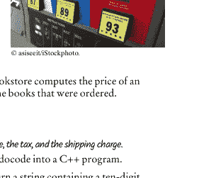

© asset/iStockphoto.

## 商业 P2.5
以下伪代码描述了书店如何根据总书价和订购图书数量计算订单价格。

> > 读取图书总价和图书数量。
> > 计算税额（图书总价的 7.5%）。
> > 计算运费（每本书 2 美元）。
> > 订单价格是图书总价、税额和运费的总和。

打印订单价格。将此伪代码翻译成 C++ 程序。

## 商业 P2.6
以下伪代码描述了如何将一个包含十位电话号码的字符串（如 "4155551212"）转换为更具可读性的带括号和连字符的字符串，如下所示： "(415) 555-1212"。

## 商业 P2.7
*将价格赋值给整数变量 `dollars`。*
*将 `price - dollars` 的差值乘以 100 并加上 0.5。*
*将结果赋值给整数变量 `cents`。*

将此伪代码翻译成 C++ 程序。读取一个价格并打印美元和美分。使用输入 2.95 和 4.35 测试你的程序。

## 商业 P2.8 找零。
实现一个程序，指导收银员如何找零。程序有两个输入：应付金额和顾客支付的金额。显示应返还给顾客的美元、25 美分硬币、10 美分硬币、5 美分硬币和 1 美分硬币的数量。


## 工程 P2.9 考虑以下电路。
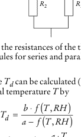

编写一个程序，读取三个电阻的阻值，并根据欧姆定律推导出的串联和并联电阻规则计算总电阻。

## 工程 P2.10
露点温度 $T_d$ 可以根据相对湿度 $RH$ 和实际温度 $T$ 近似计算：

$T_d = \frac{b \cdot f(T,RH)}{a - f(T,RH)}$

$f(T,RH) = \frac{a \cdot T}{b + T} + \ln(RH)$

其中 $a = 17.27$，$b = 237.7°\text{C}$。

编写一个程序，读取相对湿度（0 到 1 之间）和温度（以摄氏度为单位），并打印露点值。使用 C++ 的 `log` 函数计算自然对数。

## 工程 P2.11
这里所示的管夹温度传感器是坚固的传感器，可以直接夹在铜管上，以测量管道中液体的温度。


每个传感器包含一个称为热敏电阻的器件。热敏电阻是半导体器件，其电阻随温度变化，由下式描述：

R = R₀ e^{β(1/T - 1/T₀)}

其中 R 是在温度 T（单位 °K）下的电阻（单位 Ω），R₀ 是在温度 T₀（单位 °K）下的电阻（单位 Ω）。β 是一个取决于热敏电阻制造材料的常数。通过提供 R₀、T₀ 和 β 的值来指定热敏电阻的特性。

用于制造管夹温度传感器的热敏电阻具有 R₀ = 1075 Ω（在 T₀ = 85 °C 时）和 β = 3969 °K。（请注意，β 的单位为 °K。回想一下，以 °K 表示的温度是通过将 °C 温度加上 273 得到的。）液体温度（单位 °C）由电阻 R（单位 Ω）确定，公式如下：

T = (β T₀) / (T₀ ln(R/R₀) + β) - 273

编写一个 C++ 程序，提示用户输入热敏电阻的阻值 R，并打印一条消息，给出以 °C 为单位的液体温度。

## 工程 P2.12
下图所示的电路说明了电力公司与其客户之间连接的一些重要方面。客户由三个参数表示：Vₜ、P 和 pf。Vₜ 是通过插入墙上插座获得的电压。客户的电器要正常工作，依赖于 Vₜ 的可靠值。因此，电力公司会仔细调节 Vₜ 的值。P 描述客户使用的电量，是决定客户电费的主要因素。功率因数 pf 则不太为人所知。（功率因数是按一个角的余弦计算的，因此其值总是在 0 到 1 之间。）在这个问题中，你将被要求编写一个 C++ 程序，研究功率因数的重要性。

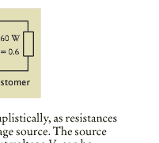

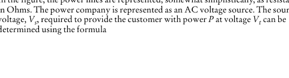

在图中，电力线路被（有些简化地）表示为以欧姆为单位的电阻。电力公司被表示为一个交流电压源。为在电压 Vₜ 下向客户提供功率 P 所需的电源电压 Vₛ 可以使用以下公式确定：

$V_s = \sqrt{\left(V_i + \frac{2RP}{V_i}\right)^2 + \left(\frac{2RP}{pf V_i}\right)^2 \left(1 - pf^2\right)}$

（V_s 的单位为 Vrms。）该公式表明，V_s 的值取决于 pf 的值。编写一个 C++ 程序，提示用户输入功率因数，然后打印一条消息，给出相应的 V_s 值，并使用上图所示的 P、R 和 V_i 值。

## 工程 P2.13 考虑以下连接到天线的调谐电路，其中 C 是一个可变电容器，其电容范围从 C_min 到 C_max：


调谐电路选择频率 $f = \frac{1}{2\pi\sqrt{LC}}$。

要为给定频率设计此电路，取 $C = \sqrt{C_{\min}C_{\max}}$，并根据 f 和 C 计算所需的电感 L。现在，该电路可以调谐到从 $f_{\min} = \frac{1}{2\pi\sqrt{LC_{\max}}}$ 到 $f_{\max} = \frac{1}{2\pi\sqrt{LC_{\min}}}$ 范围内的任何频率。

编写一个 C++ 程序，使用给定 C_min 和 C_max 值的可变电容器，为给定频率设计调谐电路。（典型输入为 f = 16.7 MHz，C_min = 14 pF，C_max = 365 pF。）程序应读取 f（单位 Hz）、C_min 和 C_max（单位 F），并打印所需的电感值以及通过改变电容可以调谐到的频率范围。

## 工程 P2.14 根据库仑力定律，两个电荷量分别为 Q1 和 Q2 库仑、距离为 r 米的带电粒子之间的电动力为

## 工程 P2.16
以度为单位和以弧度为单位的角度之间的关系是 π 弧度 = 180°。编写一个程序，将以度为单位的角度转换为以弧度为单位的角度。输入是一个正整数。

注意：确保数值输出不大于 2π 弧度或 360°。例如，370° = 0.174533 弧度。

## 工程 P2.17
自由落体物体下落的距离方程为 y = 1/2 g t²，其中 t 是以秒为单位的时间，g 是地球表面附近的重力加速度，g = 9.8 m/s²。请注意，该方程与物体的质量无关。

创建一个程序，输出一句话，表达在给定时间内下落的距离。例如，输入 10 秒应输出句子 "After the first 10 seconds, the object has fallen 490 meters."


## 实例 2.1
### 计算行程时间

在本例中，我们进行手算，计算机器人从岩石地形中取回一件物品所需的时间。

### 问题描述

机器人需要取回一件位于道路附近岩石地形中的物品。机器人在道路上比在岩石地形上行驶得更快，因此它会在道路上先行驶一段距离，然后沿直线前往物品所在地。

给定以下输入，你的任务是计算机器人到达目标所需的总时间：

- 机器人与物品在 x 和 y 方向上的距离（dx 和 dy）
- 机器人在道路上和岩石地形上的速度（s₁ 和 s₂）
- 第一段（在道路上）的长度 l₁


图片由 NASA 提供。


为了使问题更具体，我们假设以下尺寸：


总时间是两段路程所需时间之和。穿越第一段的时间就是该段长度除以速度：6 km 除以 5 km/h，即 1.2 小时。

要计算第二段的时间，我们首先需要知道它的长度。它是一个直角三角形的斜边，两条直角边分别为 3 和 4。


因此，它的长度为 √3² + 4² = 5。以 2 km/h 的速度，穿越它需要 2.5 小时。所以总行程时间为 3.7 小时。

这一计算足以让我们设计出一个适用于任意参数的总行程时间算法。

- 第 1 段的时间 = l₁ / s₁
- 第 2 段的长度 = dx² + (dy - l₁)² 的平方根
- 第 2 段的时间 = l₂ / s₂
- 总时间 = 第 1 段的时间 + 第 2 段的时间

将其翻译成 C++ 代码，计算过程如下：

```cpp
double segment1_time = segment1_length / segment1_speed;
double segment2_length = sqrt(pow(x_distance, 2)
+ pow(y_distance - distance_on_road, 2));
double segment2_time = segment2_length / segment2_speed;
double total_time = segment1_time + segment2_time;
```

请注意，我们使用的变量名比 dx 或 s₁ 更长、更具描述性。在手算时，使用较短的名称很方便，但在程序中应将其改为描述性名称。


## 实例 2.2
### 计算邮票费用
### 问题描述

你需要模拟一台邮票自动售货机。顾客将纸币投入售货机，然后按下“购买”按钮。机器按顾客支付的金额吐出相应数量的一等邮票，并以 1 分面值的邮票找回零钱。在本书写作时，一张一等邮票的价格是 47 美分。

### 第 1 步 理解问题：输入是什么？期望的输出是什么？

在这个问题中，有一个输入：

- 顾客投入的金额

有两个期望的输出：

- 机器返回的一等邮票数量
- 机器返回的 1 分邮票数量

### 第 2 步 手动推算示例。

假设一张一等邮票售价 47 美分，顾客投入 1.00 美元。这足以购买两张邮票（94 美分），但不足以购买三张邮票（1.41 美元）。因此，机器会返回两张一等邮票和 6 张 1 分邮票。

### 第 3 步 编写计算答案的伪代码。

给定金额和一张一等邮票的价格，如何计算用这笔钱能购买多少张一等邮票？显然，答案与“金额 / 一张一等邮票的价格”的商有关。

例如，假设顾客支付 1.00 美元。用袖珍计算器计算商：1.00 美元 / 0.47 美元 = 2.13

如何从 2.13 得到“2 张邮票”？它是去掉余数后的商。在 C++ 中，如果两个参数都是整数，这就很容易计算。因此，让我们把计算单位改为美分。于是我们有：

一等邮票数量 = 100 / 47（整数除法，不含余数）

如果用户输入的是 2 美元呢？那么分子就变成 200。如果邮票价格上涨呢？更通用的等式是：

一等邮票数量 = 100 x 美元金额 / 一等邮票价格（以美分为单位）

那么作为零钱找回的 1 分邮票呢？可以这样看：零钱是顾客的付款减去所购买一等邮票的价值。在我们的示例中，顾客应获得价值 6 美分的 1 分邮票，即 100 与 2 x 47 的差值。通用公式如下：

1 分邮票数量 = 100 x 美元金额 - 一等邮票数量 x 一等邮票价格

### 第 4 步 声明所需的变量和常量，并指定它们的类型。

这里，我们有三个变量：

- dollars
- first_class_stamps
- penny_stamps

有一个常量 FIRST_CLASS_STAMP_PRICE。

变量 dollars 和常量 FIRST_CLASS_STAMP_PRICE 必须是 int 类型，因为 first_class_stamps 的计算使用整数除法。其余变量也是整数，用于统计一等邮票和 1 分邮票的数量。因此，我们有：

```cpp
const int FIRST_CLASS_STAMP_PRICE = 47; // Price in pennies
int dollars; // Filled through input statement

int first_class_stamps = 100 * dollars / FIRST_CLASS_STAMP_PRICE;
int penny_stamps = 100 * dollars - first_class_stamps * FIRST_CLASS_STAMP_PRICE;
```

### 第 5 步

将伪代码转换成 C++ 语句。

我们的计算取决于用户提供的美元金额。将上面的数学公式转换成 C++，得到以下语句：

```cpp
first_class_stamps = 100 * dollars / FIRST_CLASS_STAMP_PRICE;
penny_stamps = 100 * dollars - first_class_stamps * FIRST_CLASS_STAMP_PRICE;
```

### 第 6 步

提供输入和输出。

```cpp
cout << "Enter number of dollars: ";
cin >> dollars;
```

计算完成后，我们显示结果。

```cpp
cout << "First class stamps: " << setw(6) << first_class_stamps << endl
<< "Penny stamps: " << setw(6) << penny_stamps << endl;
```

### 第 7 步

包含所需的头文件并提供 main 函数。

我们需要 <iostream> 头文件来完成所有输入和输出。由于使用了 setw 操纵符，我们还需要 <iomanip> 头文件。

下面是完整的程序：

### worked_example_2/stamps.cpp

```cpp
#include <iostream>
#include <iomanip>

using namespace std;

int main()
{
    const int FIRST_CLASS_STAMP_PRICE = 47; // Price in pennies

    cout << "Enter number of dollars: ";
    int dollars;
    cin >> dollars;

    int first_class_stamps = 100 * dollars / FIRST_CLASS_STAMP_PRICE;
    int penny_stamps = 100 * dollars - first_class_stamps * FIRST_CLASS_STAMP_PRICE;
    cout << "First class stamps: " << setw(6) << first_class_stamps << endl
         << "Penny stamps: " << setw(6) << penny_stamps << endl;

    return 0;
}
```

### 程序运行

```
Enter number of dollars: 2
First class stamps:      4
Penny stamps:           12
```

在我们的示例中，if 语句的每个分支都包含一条语句。你也可以在每个分支中根据需要包含任意多条语句。有时，if 语句的 else 分支中没有任何需要执行的操作。在这种情况下，你可以完全省略 else 分支，如下例所示：

```cpp
int actual_floor = floor;
if (floor > 13)
{
    actual_floor--;
} // No else needed
```

流程图见图 2。


### 图 2 不带 else 分支的 if 语句流程图

下面的程序让 if 语句发挥作用。该程序询问所需的楼层，然后输出实际楼层。

### sec01/elevator1.cpp

```cpp
#include <iostream>

using namespace std;

int main()
{
    int floor;
    cout << "Floor: ";
    cin >> floor;
    int actual_floor;
    if (floor > 13)
    {
        actual_floor = floor - 1;
    }
    else
    {
        actual_floor = floor;
    }
    cout << "The elevator will travel to the actual floor "
    << actual_floor << endl;
```


```
22
23 return 0;
24 }
```

## 程序运行

楼层：20
电梯将前往实际楼层 19


## 常见错误 3.1
### 在 if 条件后加分号

下面的代码片段有一个不幸的错误：

```
if (floor > 13) ; // ERROR
{
    floor--;
}
```

if 条件后不应有分号。编译器将此语句解释如下：如果 floor 大于 13，则执行由单个分号表示的语句，即不执行任何操作的语句。用大括号括起来的语句不再是 if 语句的一部分。它总是被执行。即使 floor 的值不大于 13，它也会被递减。在 else 保留字后放置分号也是错误的：

```
if (floor > 13)
{
    actual_floor = floor - 1;
}
else ;
{
    actual_floor = floor;
}
```

在这种情况下，如果 floor > 13 的条件不满足，则执行不执行任何操作的语句。这就是 if 语句的结束。接下来用大括号括起来的语句在两种情况下都会被执行；也就是说，actual_floor 总是被设为 floor。


## 编程提示 3.1
### 大括号布局

程序员在代码中对齐大括号的方式各不相同。在本书中，我们遵循让 { 和 } 对齐的简单规则。

```
if (floor > 13)
{
    floor--;
}
```

这种风格使得很容易找到匹配的大括号。

有些程序员将开始大括号放在与 if 相同的行上：

```
if (floor > 13) {
    floor--;
}
```

这种风格使得匹配大括号更困难，但它节省了一行代码，使你可以在不滚动的情况下在屏幕上查看更多代码。两种风格都有热情的倡导者。


© Timothy Large/iStockphoto.
正确地对齐你的代码会使你的程序更易于阅读。


## 编程提示 3.4
### 避免分支中的重复

查看是否在每个分支中重复了代码。如果是，则将其移出 if 语句。以下是此类重复的示例：

```
if (floor > 13)
{
    actual_floor = floor - 1;
    cout << "Actual floor: " << actual_floor << endl;
}
else
{
    actual_floor = floor;
    cout << "Actual floor: " << actual_floor << endl;
}
```

输出语句在两个分支中完全相同。这不是一个错误——程序将正确运行。然而，你可以通过移动重复的语句来简化程序，如下所示：

```
if (floor > 13)
{
    actual_floor = floor - 1;
}
else
{
    actual_floor = floor;
}
cout << "Actual floor: " << actual_floor << endl;
```

在长期维护程序时，消除重复尤其重要。当存在具有相同效果的两组语句时，很容易出现程序员修改其中一组但未修改另一组的情况。


## 专题 3.1
### 条件运算符

C++ 有一种形式为 的条件运算符

```
condition ? value1 : value2
```

该表达式的值如果测试通过则为 value1，如果测试失败则为 value2。例如，我们可以按如下方式计算实际楼层号：

```
actual_floor = floor > 13 ? floor - 1 : floor;
```

其等价于

```
if (floor > 13)
{
    actual_floor = floor - 1;
}
else
{
    actual_floor = floor;
}
```

你可以在期望一个值的地方使用条件运算符，例如：

```
cout << "Actual floor: " << (floor > 13 ? floor - 1 : floor);
```

我们在本书中不使用条件运算符，但它是一个方便的构造，你会在许多 C++ 程序中找到它。

## 3.2 比较数字和字符串

关系运算符（< <= > >= == !=）用于比较数字和字符串。

每个 if 语句都包含一个条件。在许多情况下，条件涉及比较两个值。例如，在之前的示例中我们测试了 floor > 13。比较 > 称为关系运算符。C++ 有六个关系运算符（见表 1）。


© arturbo iStockphoto.

*在 C++ 中，你使用关系运算符来检查一个值是否大于另一个值。*

正如你所见，只有两个 C++ 关系运算符（< 和 >）看起来符合数学符号的预期。计算机键盘上没有 ≥、≤ 或 ≠ 的键，但 >=、<= 和 != 运算符很容易记住，因为它们看起来相似。== 运算符对大多数 C++ 新手来说最初是令人困惑的。在 C++ 中，= 已经有意义，即赋值。== 运算符表示相等性测试：

```
floor = 13; // Assign 13 to floor
if (floor == 13) // Test whether floor equals 13
```

你必须记住在测试中使用 ==，在测试之外使用 =。（有关更多信息，请参阅常见错误 3.2。）

表 1 关系运算符

| C++ | 数学符号 | 描述 |
|---|---|---|
| > | > | 大于 |
| >= | ≥ | 大于或等于 |
| < | < | 小于 |
| <= | ≤ | 小于或等于 |
| == | = | 相等 |
| != | ≠ | 不相等 |

你也可以比较字符串：

```
if (input == "quit") . . .
```

使用 != 来检查两个字符串是否不同。在 C++ 中，字母大小写很重要。例如，'Quit' 和 'quit' 不是同一个字符串。

## 语法 3.2 比较


示例代码 请参阅你配套代码中的 sec02，以获取比较数字和字符串的程序。

表 2 总结了如何在 C++ 中使用关系运算符。

| 表达式 | 值 | 注释 |
|---|---|---|
| 3 <= 4 | true | 3 小于 4；<= 测试“小于或等于”。 |
| 3 =< 4 | Error | “小于或等于”运算符是 <=，而不是 =<。“小于”符号在前。 |
| 3 > 4 | false | > 是 <= 的相反。 |
| 4 < 4 | false | 左侧必须严格小于右侧。 |
| 4 <= 4 | true | 两侧相等；<= 测试“小于或等于”。 |
| 3 == 5 - 2 | true | == 测试相等性。 |
| 3 != 5 - 1 | true | != 测试不等性。3 不等于 5 - 1 为真。 |
| 3 = 6 / 2 | Error | 使用 == 来测试相等性。 |
| 1.0 / 3.0 == 0.333333333 | false | 虽然这些值非常接近，但它们并不完全相等。见常见错误 3.3。 |
| "10" > 5 | Error | 你不能将字符串与数字进行比较。 |


## 常见错误 3.2
### 混淆 = 和 ==

= 和 == 的正确使用规则非常简单：在测试中，始终使用 == 而永远不要使用 =。如果这么简单，为什么编译器不能提供帮助并标记任何错误呢？实际上，C++ 语言允许在测试中使用 =。要理解这一点，我们必须回到过去。C 的创建者，C++ 的前身，非常节俭。他们不想有特殊的 true 和 false 值。相反，他们允许在条件中使用任何数值，其中 0 表示 false，任何非 0 值表示 true。此外，在 C 和 C++ 中，赋值有值。例如，赋值表达式 floor = 13 的值为 13。

这两个特性——即数字可以用作真值以及赋值是具有值的表达式——共同造成了一个可怕的陷阱。测试

```
if (floor = 13) // ERROR
```

是合法的 C++，但它并不测试 floor 和 13 是否相等。相反，代码将 floor 设为 13，并且由于该值不为零，if 语句的条件总是满足。

幸运的是，大多数编译器在遇到此类语句时会发出警告。你应该认真对待这些警告。（有关编译器警告的更多建议，请参阅编程提示 3.5。）

一些受惊的程序员对使用 = 如此紧张，以至于即使他们想进行赋值时也会使用 ==：

```
floor == floor - 1; // ERROR
```

此语句测试 floor 是否等于 floor - 1。它不对测试结果做任何事情，但这不是错误。一些编译器会警告“代码没有效果”，但其他编译器会默默接受代码。


## 常见错误 3.3
### 浮点数的精确比较

浮点数只有有限的精度，计算可能会引入舍入误差。在比较浮点数时，你必须考虑这些不可避免的舍入。例如，下面的代码将 2 的平方根乘以自身。理想情况下，我们期望得到答案 2：


© caracterdesign/iStockphoto.

比较浮点数时请考虑有限精度。

```
double r = sqrt(2.0);
if (r * r == 2)
{
    cout << "sqrt(2) squared is 2" << endl;
}
else
{
    cout << "sqrt(2) squared is not 2 but " << setprecision(18) << r * r << endl;
}
```

此程序显示
sqrt(2) 的平方不是 2 而是 2.0000000000000044

在大多数情况下，精确比较浮点数是没有意义的。相反，我们应该测试它们是否足够接近。也就是说，它们的量级


差值应小于某个阈值。从数学角度看，若 |x − y| < ε，我们就说 x 和 y 足够接近。

ε 是希腊字母 epsilon，通常用来表示一个非常小的量。在比较 double 类型的数字时，通常将 ε 设为 10⁻¹⁴：

```
const double EPSILON = 1E-14;
double r = sqrt(2.0);
if (abs(r * r - 2) < EPSILON)
{
  cout << "sqrt(2) squared is approximately 2";
}
```

使用 abs 函数时需要包含 <cmath> 头文件。


## 编程提示 3.5
### 以零警告编译

编译器会给你两种信息：错误和警告。错误信息是致命的；只要程序有一个或多个错误，编译器就不会翻译该程序。警告信息是建议性的；编译器会照常翻译程序，但程序很有很可能不会按你预期的方式运行。

学会如何启用编译器中的警告功能，并编写不产生任何警告的代码，是一个好习惯。例如，考虑下面这个测试：

```
if (floor = 13)
```

某个 C++ 编译器会发出一条例行警告：“请对用作真值的赋值语句加上括号”。遗憾的是，这条信息容易让人误解，因为它并不是为学生编写的。不过，这样的警告给了你再一次检查问题语句并修复它的机会——在本例中，就是把 `=` 改成 `==`。

为了让警告更醒目，许多编译器要求你采取一些特殊措施。这可能包括在集成环境中勾选一个复选框，或者在命令行中指定一个特殊选项。请向你的指导教师或实验室助理询问如何为编译器打开警告。


## 专题 3.2
### 字符串的字典序比较

如果用 < 或 >= 比较字符串，那么它们会按照“字典序”进行比较。这种排序方式与字典中单词的排列方式非常相似。

例如，考虑下面这段代码片段。

```
string name = "Tom";
if (name < "Dick") . . .
```

该条件不成立，因为在字典中 Dick 排在 Tom 之前。字典中的排序与 C++ 中的排序有一些差异。在 C++ 中：

- 所有大写字母都排在小写字母之前。例如，“Z”排在“a”之前。
- 空格字符排在所有可打印字符之前。


Corbis Digital Stock.

要判断两个词中哪个在字典中排在前面，就看它们第一个不同的字母。

字典序用于比较字符串。

- 数字排在字母之前。
- 关于标点符号的排序，请参见附录 C。

比较两个字符串时，先比较两个词的第一个字母，再比较第二个字母，以此类推，直到其中一个字符串结束或某一对字母不匹配。

如果其中一个字符串先结束，那么较长的字符串被视为“较大”的那个。例如，比较"car"和"cart"。前三个字母相同，然后我们到达了第一个字符串的末尾。因此，在字典序中"car"排在"cart"之前。

当遇到不匹配时，包含“较大”字符的字符串被视为“较大”。例如，比较"cat"和"cart"。前两个字母相同。由于 t 排在 r 之后，所以在字典序中"cat"排在"cart"之后。


## 如何做 3.1
### 实现 if 语句

本“如何做”将带你逐步完成实现 if 语句的过程。我们将用下面的示例问题来说明这些步骤：

### 问题陈述

大学书店每年 10 月 24 日举办“千字节日”促销活动：如果价格低于 128 美元，所有电脑配件购买享受 8% 折扣；如果价格至少为 128 美元，则享受 16% 折扣。编写一个程序，让收银员输入原价，然后打印折后价。

### 第 1 步

确定分支条件。

在我们的示例问题中，明显的条件选择是：

*原价 < 128？*

这完全没问题，我们将在解决方案中使用这个条件。

但如果你选择相反的条件，也同样可以得出正确的解决方案：原价是否至少（≥）128 美元？如果你站在购物者的角度，想知道何时适用更大折扣，你可能会选择这个条件。


© MikePanic/Stockphoto.

昂贵商品的销售折扣往往更高。使用 if 语句来实现这样的决策。

### 第 2 步

为条件为真时需要完成的工作给出伪代码。

在这一步中，你列出“正”分支中要执行的一个或多个操作。具体细节取决于你的问题。你可能希望打印一条消息、计算某些值，甚至退出程序。

### 第 3 步

为条件不为真时需要完成的工作给出伪代码。

在我们的示例中，条件测试的是价格是否低于 128 美元。如果该条件不成立，则价格至少为 128 美元，因此较高的 16% 折扣适用于该销售：

*折后价 = 0.84 × 原价*

### 第 4 步 仔细检查关系运算符。

首先，确保测试的方向正确。混淆 > 和 < 是一个常见错误。

接下来，考虑应该使用 < 运算符还是它的近亲 <= 运算符。

如果原价恰好是 128 美元，应该发生什么？仔细阅读问题，我们发现：如果原价低于 128 美元，适用较低的折扣；如果原价至少为 128 美元，适用较高的折扣。因此，128 美元的价格不应满足我们的条件，我们必须使用 <，而不是 <=。

### 第 5 步 消除重复。

检查两个分支中有哪些公共操作，并将它们移出。（参见编程提示 3.4。）

在我们的示例中，有两个如下形式的语句：

*折后价 = ___ × 原价*

它们只是折扣率不同。最好的做法是只在分支中设置折扣率，然后统一进行计算：

```
如果 原价 < 128
    折扣率 = 0.92
否则
    折扣率 = 0.84
折后价 = 折扣率 × 原价
```

### 第 6 步 测试两个分支。

设计两个测试用例，一个满足 if 语句的条件，一个不满足。问自己在每种情况下应该发生什么。然后按照伪代码，逐一模拟执行。

在我们的示例中，让我们考虑两个原价场景：100 美元和 200 美元。我们期望第一个价格折扣 8 美元，第二个价格折扣 32 美元。

### 第 7 步 在 C++ 中组装 if 语句。

输入框架：

```
if ()
{
}
else
{
}
```

在我们的示例中，完整的语句是：

```text
if (original_price < 128)
{
    discount_rate = 0.92;
}
else
{
    discount_rate = 0.84;
}
discounted_price = discount_rate * original_price;
```

## 示例代码

请参阅配套代码中的 how_to_1，这是一个计算折后价的程序。


## 工作示例 3.1
### 提取中间字符

学习如何从字符串中提取中间字符，如果字符串长度为偶数，则提取中间的两个字符。请参阅你的电子文本或访问 wiley.com/go/bcl3。

| c | r | a | t | e |
|---|---|---|---|---|
| 0 | 1 | 2 | 3 | 4 |


## 计算机与社会 3.1 失灵的计算机化系统

做出决策是任何计算机程序的重要组成部分。这一点在机场辅助分拣行李的计算机系统中表现得最为明显。系统扫描行李识别码后，对物品进行分类，并将它们分配到不同的传送带上。然后由人工操作员将物品装上卡车。当丹佛市建造一座大型机场来取代老旧拥挤的设施时，行李系统承包商更进一步。新系统设计用机器人小车取代人工操作员。不幸的是，该系统根本无法正常工作。它饱受机械问题的困扰，例如行李掉到轨道上卡住小车。同样令人沮丧的是软件故障。小车会在某些地点无用地积压，而其他地方却正需要它们。

该机场原计划于 1993 年启用，但由于行李系统无法正常运行，启用被推迟了一年多，承包商在此期间试图修复问题。承包商始终未能成功，最终安装了一套人工系统。这一延误使该市和航空公司损失了近十亿美元，而这家曾是美国领先行李系统供应商的承包商也破产了。

显然，在一种从未在小规模范围内试验过的技术基础上构建大型系统是非常危险的。2013 年，美国全民医保的推出因一个功能失常的保险方案选择网站而陷入危机。该系统承诺提供类似于预订航班的保险购物体验。但 HealthCare.gov 网站不仅仅是展示可用的保险计划。它还必须核查每位申请人的收入水平，并用这些信息来确定补贴额度。这一任务比检查信用卡是否有足够额度购买机票要困难得多。奥巴马政府本应明智地设计一个不依赖未经测试的计算机程序的注册流程。


Lyn Alweis/Contributor/Getty Images.

> *丹佛机场原本配备了一套全自动行李运输系统，用机器人小车取代人工操作员。不幸的是，该系统从未正常工作，并在机场启用前被拆除。*


默认消息将被打印。图3展示了这一多分支语句的流程图。


图3 多分支选择

在这里，你必须对条件进行排序，并首先测试最大的临界值。假设我们颠倒测试的顺序：

```
if (richter >= 4.5) // Tests in wrong order
{
    cout << "Damage to poorly constructed buildings";
}
else if (richter >= 6.0)
{
    cout << "Many buildings considerably damaged, some collapse";
}
else if (richter >= 7.0)
{
    cout << "Many buildings destroyed";
}
else if (richter >= 8.0)
{
    cout << "Most structures fall";
}
```

> 使用多个 if 语句时，要注意条件的顺序。

这样是行不通的。假设 richter 的值为 7.1。该值至少为 4.5，与第一个分支匹配。其他测试将永远不会执行。

在这个例子中，重要的是我们使用了 else if 子句序列，而不仅仅是多个独立的 if 语句。考虑一下这一系列独立的测试：

```
if (richter >= 8.0) // Didn't use else
{
    cout << "Most structures fall";
}
if (richter >= 7.0)
{
    cout << "Many buildings destroyed";
}
if (richter >= 6.0)
{
    cout << "Many buildings considerably damaged, some collapse";
}
if (richter >= 4.5)
{
    cout << "Damage to poorly constructed buildings";
}
```

现在这些分支不再互斥。如果 richter 为 7.1，那么后三个测试都会匹配，并打印三条消息。

示例代码
请参见随书代码中的 sec03，查看打印地震描述的完整程序。

## 专题 3.3

## switch 语句


一段针对单个整数值与多个常量分支进行比较的 if 语句序列，可以用 switch 语句来实现。例如：

```
int digit;
...
switch (digit)
{
    case 1: digitName = "one"; break;
    case 2: digitName = "two"; break;
    case 3: digitName = "three"; break;
    case 4: digitName = "four"; break;
    case 5: digitName = "five"; break;
    case 6: digitName = "six"; break;
    case 7: digitName = "seven"; break;
    case 8: digitName = "eight"; break;
    case 9: digitName = "nine"; break;
    default: digitName = "-"; break;
}
```


© travelpixpro/iStockphoto

switch 语句让你可以从一组固定的分支中进行选择。

## sec04/tax.cpp

```
#include <iostream>
#include <string>

using namespace std;

int main()
{
    const double RATE1 = 0.10;
    const double RATE2 = 0.25;
    const double RATE1_SINGLE_LIMIT = 32000;
    const double RATE1_MARRIED_LIMIT = 64000;

    double tax1 = 0;
    double tax2 = 0;

    double income;
    cout << "Please enter your income: ";
    cin >> income;

    cout << "Please enter s for single, m for married: ";
    string marital_status;
    cin >> marital_status;

    if (marital_status == "s")
    {
        if (income <= RATE1_SINGLE_LIMIT)
        {
            tax1 = RATE1 * income;
        }
        else
        {
            tax1 = RATE1 * RATE1_SINGLE_LIMIT;
            tax2 = RATE2 * (income - RATE1_SINGLE_LIMIT);
        }
    }
    else
    {
        if (income <= RATE1_MARRIED_LIMIT)
        {
            tax1 = RATE1 * income;
        }
        else
        {
            tax1 = RATE1 * RATE1_MARRIED_LIMIT;
            tax2 = RATE2 * (income - RATE1_MARRIED_LIMIT);
        }
    }

    double total_tax = tax1 + tax2;

    cout << "The tax is $" << total_tax << endl;
    return 0;
}
```

### 程序运行

Please enter your income: 80000
Please enter s for single, m for married: m
The tax is $10400


## 常见错误 3.4

### 悬空 else 问题

当一个 if 语句嵌套在另一个 if 语句内部时，可能会出现以下错误。

```
double shipping_charge = 5.00; // $5 inside continental U.S.
if (country == "USA")
    if (state == "HI")
        shipping_charge = 10.00; // Hawaii is more expensive
    else // Pitfall!
        shipping_charge = 20.00; // As are foreign shipments
```

缩进级别似乎表明 else 与测试条件 country == "USA" 组合在一起。不幸的是，事实并非如此。编译器忽略所有缩进，将 else 与前面的 if 匹配。也就是说，代码实际上是：

```
double shipping_charge = 5.00; // $5 inside continental U.S.
if (country == "USA")
    if (state == "HI")
        shipping_charge = 10.00; // Hawaii is more expensive
    else // Pitfall!
        shipping_charge = 20.00; // As are foreign shipments
```

这不是你想要的。你想要的是将 else 与第一个 if 组合在一起。这种有歧义的 else 称为悬空 else。如果你始终使用花括号，就可以避免这个陷阱，如编程技巧 3.2 所建议的：

```
double shipping_charge = 5.00; // $5 inside continental U.S.
if (country == "USA")
{
    if (state == "HI")
    {
        shipping_charge = 10.00; // Hawaii is more expensive
    }
}
else
{
    shipping_charge = 20.00; // As are foreign shipments
}
```


## 编程技巧 3.6

### 手工跟踪

一种用于了解程序是否能正确运行的非常有用的技术称为手工跟踪。你会在一张纸上模拟程序的活动。这种方法既可以用于伪代码，也可以用于 C++ 代码。

拿一张索引卡、一张鸡尾酒餐巾纸，或者任何手边能找到的纸。为每个变量单独列一列。准备好程序代码。用一个标记物（例如回形针）来标记当前语句。在脑海中一条一条地执行语句。每当某个变量的值改变时，划掉旧值，并在旧值下方写上新的值。

例如，让我们使用 3.4 节程序运行中的数据来跟踪税收程序。


手工跟踪有助于你理解程序是否能正确运行。

在第 13 行和第 14 行，tax1 和 tax2 被初始化为 0。

```
```c
6 int main()
7
8 const double RATE1 = 0.10;
9 const double RATE2 = 0.25;
10 const double SINGLE_LIMIT = 32000;
11 const double MARRIED_LIMIT = 64000;
12
13 double tax1 = 0;
14 double tax2 = 0;
15
```
```

| tax1 | tax2 | income | 婚姻状况 |
|------|------|--------|----------------|
| 0 | 0 |  |  |
|  |  |  |  |
|  |  |  |  |

在第 18 行和第 22 行，income 和 marital_status 通过输入语句进行初始化。

```
```c
16 double income;
17 cout << "Please enter your income: ";
18 cin >> income;
19
20 cout << "Please enter s for single, m for married: ";
21 string marital_status;
22 cin >> marital_status;
23
```
```

| tax1 | tax2 | income | 婚姻状况 |
|------|------|--------|----------------|
| 0 | 0 | 80000 | m |
|  |  |  |  |
|  |  |  |  |

因为 marital_status 不等于 "s"，我们进入外层 if 语句的 else 分支（第 36 行）。

```
```c
24 if (marital_status == "s")
25 {
26   if (income <= SINGLE_LIMIT)
27     tax1 = RATE1 * income;
28   else
29   {
30     tax1 = RATE1 * SINGLE_LIMIT;
31     tax2 = RATE2 * (income - SINGLE_LIMIT);
32   }
33 }
34 else
35
36
37
```
```

因为 income 不满足 <= 64000，我们进入内层 if 语句的 else 分支（第 42 行）。

```
```c
38 if (income <= MARRIED_LIMIT)
39 {
40   tax1 = RATE1 * income;
41 }
42 else
43 {
44   tax1 = RATE1 * MARRIED_LIMIT;
45   tax2 = RATE2 * (income - MARRIED_LIMIT);
46 }
```
```

tax1 和 tax2 的值被更新。

```
```c
43 {
44   tax1 = RATE1 * MARRIED_LIMIT;
45   tax2 = RATE2 * (income - MARRIED_LIMIT);
46 }
47 }
```
```

| tax1 | tax2 | income | 婚姻状况 |
|------|------|--------|----------------|
| β | β | 80000 | m |
| 6400 | 4000 |  |  |

它们的和 total_tax 被计算并打印出来。然后程序结束。

```
```c
48
49 double total_tax = tax1 + tax2;
50
51 cout << "The tax is $" << total_tax << endl;
52
53 }
```
```

| tax1 | tax2 | income | 婚姻状况 | 总税额 |
|------|------|--------|----------------|-----------|
| β | β | 80000 | m |  |
| 6400 | 4000 |  |  | 10400 |

由于程序跟踪显示了预期的输出（$10,400），它成功地证明了该测试用例可以正常工作。


在绘制流程图时，有一个问题你需要注意。无限制的分支和合并可能导致“意大利面条代码”，即程序中可能路径的混乱网络。

避免意大利面条代码有一个简单的规则：永远不要让箭头指向另一个分支内部，

为了理解这条规则，请考虑以下示例：美国境内的运费为 5 美元，除夏威夷和阿拉斯加外运费为 10 美元。国际运费也为 10 美元。你可能会先画出如下流程图：

永远不要让箭头指向另一个分支内部。


© Ekspansio/iStockphoto.

*意大利面条代码的路径如此之多，以至于变得无法理解。*


现在你可能会想重用“运费 = 10 美元”这一任务：


不要这样做！红色箭头指向了不同的分支。相反，添加另一个将运费设为 10 美元的任务，如下所示：


不仅可以避免意大利面条代码，而且设计也更好。将来国际运输的费用可能与运往阿拉斯加和夏威夷的费用不同。

流程图对于直观理解算法流程非常有用。然而，随着细节的增加，它们会迅速变得庞大。此时，转而使用伪代码是合理的。

EXAMPLE CODE

请参阅配套代码的 sec05，其中包含计算运费的程序。

## 3.6 问题求解：测试用例

你的程序的每个分支都应由一个测试用例覆盖。

考虑如何测试第 3.4 节中的税务计算程序。当然，你不可能尝试所有可能的申报状态和收入水平的输入。即使可以，也没有必要全部尝试。如果程序能正确计算给定税级中的一两个税额，那么我们就有充分理由相信所有税额都是正确的。

你应以覆盖所有决策点为目标。以下是获取全面测试用例集的计划：

- 申报状态有两种可能性，每个状态有两个税级，共产生四个测试用例。
- 测试一些边界条件，例如处于两个税级边界之间的收入，以及零收入。
- 如果你负责错误检查（将在第 3.8 节讨论），还应测试无效输入，例如负收入。

列出测试用例和预期输出：

| Test Case | Expected Output | Comment |
|---:|---:|---|
| 30,000 s | 3,000 | 10% 税级 |
| 72,000 s | 13,200 | 3,200 + 40,000 的 25% |
| 50,000 m | 5,000 | 10% 税级 |
| 104,000 m | 16,400 | 6,400 + 40,000 的 25% |
| 32,000 s | 3,200 | 边界情况 |
| 0 | 0 | 边界情况 |

在制定测试用例集时，有程序的流程图（参见第 3.5 节）会很有帮助。勾选每个有测试用例的分支。为每个决策包含边界测试用例。例如，如果某个决策检查输入是否小于 100，请用 100 进行测试。

在开始编码之前设计测试用例总是一个好主意。[content]
在绘制流程图时，有一个问题你需要注意。无限制的分支和合并可能导致“意大利面条代码”，即程序中可能路径的混乱网络。

避免意大利面条代码有一个简单的规则：永远不要让箭头指向另一个分支内部，

为了理解这条规则，请考虑以下示例：美国境内的运费为 5 美元，除夏威夷和阿拉斯加外运费为 10 美元。国际运费也为 10 美元。你可能会先画出如下流程图：

永远不要让箭头指向另一个分支内部。


© Ekspansio/iStockphoto.

*意大利面条代码的路径如此之多，以至于变得无法理解。*


现在你可能会想重用“运费 = 10 美元”这一任务：


不要这样做！红色箭头指向了不同的分支。相反，添加另一个将运费设为 10 美元的任务，如下所示：


不仅可以避免意大利面条代码，而且设计也更好。将来国际运输的费用可能与运往阿拉斯加和夏威夷的费用不同。

流程图对于直观理解算法流程非常有用。然而，随着细节的增加，它们会迅速变得庞大。此时，转而使用伪代码是合理的。

EXAMPLE CODE

请参阅配套代码的 sec05，其中包含计算运费的程序。

## 3.6 问题求解：测试用例

你的程序的每个分支都应由一个测试用例覆盖。

考虑如何测试第 3.4 节中的税务计算程序。当然，你不可能尝试所有可能的申报状态和收入水平的输入。即使可以，也没有必要全部尝试。如果程序能正确计算给定税级中的一两个税额，那么我们就有充分理由相信所有税额都是正确的。

你应以覆盖所有决策点为目标。以下是获取全面测试用例集的计划：

- 申报状态有两种可能性，每个状态有两个税级，共产生四个测试用例。
- 测试一些边界条件，例如处于两个税级边界之间的收入，以及零收入。
- 如果你负责错误检查（将在第 3.8 节讨论），还应测试无效输入，例如负收入。

列出测试用例和预期输出：

| Test Case | Expected Output | Comment |
|---:|---:|---|
| 30,000 s | 3,000 | 10% 税级 |
| 72,000 s | 13,200 | 3,200 + 40,000 的 25% |
| 50,000 m | 5,000 | 10% 税级 |
| 104,000 m | 16,400 | 6,400 + 40,000 的 25% |
| 32,000 s | 3,200 | 边界情况 |
| 0 | 0 | 边界情况 |

在制定测试用例集时，有程序的流程图（参见第 3.5 节）会很有帮助。勾选每个有测试用例的分支。为每个决策包含边界测试用例。例如，如果某个决策检查输入是否小于 100，请用 100 进行测试。

在开始编码之前设计测试用例总是一个好主意。Working through the test cases gives you a better understanding of the algorithm that you are about to implement.

> 在实现程序之前设计测试用例是一个好主意。


### 编程提示 3.7
**Make a Schedule and Make Time for Unexpected Problems**

商业软件以交付时间晚于承诺而臭名昭著。例如，微软最初承诺其 Windows Vista 操作系统将在 2003 年底推出，然后是 2005 年，然后是 2006 年 3 月；它最终于 2007 年 1 月发布。一些早期的承诺可能并不现实。微软有兴趣让潜在客户期望产品即将上市。如果客户知道实际交付日期，他们在等待期间可能会转而使用不同的产品。毫无疑问，微软并没有预见到其设定的任务的全部复杂性。

微软可以推迟产品的交付，但你可能不能。作为学生或程序员，你被期望明智地管理时间并按时完成作业。你可能可以在截止日期前一晚完成简单的编程练习，但看起来困难两倍的作业可能需要四倍的时间，因为可能会出现更多问题。因此，每当你开始一个编程项目时，都应制定一个计划。

首先，现实地估计完成以下工作需要多长时间：

- 设计程序逻辑。
- 开发测试用例。
- 输入程序并修复语法错误。
- 测试和调试程序。

例如，对于所得税程序，我可能会估计设计需要一小时；开发测试用例需要 30 分钟；数据输入和修复语法错误需要一小时；测试和调试需要一小时。总共是 3.5 小时。如果我每天在这个项目上工作两小时，它将花费我近两天。


*为你的编程工作制定计划并为问题预留时间。*

然后思考可能出现的问题。你的电脑可能会出现故障。你可能会被计算机系统的问题难住。

## 3.7 布尔变量与运算符

（这对于初学者来说是一个特别重要的关注点。非常常见的是因为花时间找到知道克服它所需魔术命令的人而在琐碎问题上浪费一天。）作为经验法则，将你的估计时间加倍。也就是说，你应该在截止日期前四天，而不是两天开始。如果什么都没出错，很好；你提前两天完成了程序。当不可避免的问题出现时，你有时间缓冲来保护你免受尴尬和失败。

有时，你需要在程序的一个部分评估逻辑条件并在其他地方使用它。为了存储可以为真或假的条件，你使用布尔变量。布尔变量以数学家乔治·布尔（1815–1864）命名，他是逻辑研究领域的先驱。

布尔类型 bool 有两个值，false 和 true。


Jon Patton/E+/iStockphoto.

_A Boolean variable is also called a flag because it can be either up (true) or down (false)._

在 C++ 中，bool 数据类型表示布尔类型。类型为 bool 的变量可以保存恰好两个值，表示为 false 和 true。这些值不是字符串或整数；它们是专门为布尔变量的特殊值。

这里有一个布尔变量的定义：

```
bool failed = true;
```

你可以在程序中稍后使用该值来做出决策：

```
if (failed) // Only executed if failed has been set to true
{
  ...
}
```

当你做出复杂决策时，通常需要组合布尔值。组合布尔条件的运算符称为布尔运算符。在 C++ 中，&& 运算符（称为 and）只有在两个条件都为真时才产生 true。|| 运算符（称为 or）如果至少一个条件为真，则产生结果 true。

假设你编写一个处理温度值的程序，并想测试给定的温度是否对应液态水。（在海平面，水在 0 摄氏度时结冰，在 100 度时沸腾。）如果温度大于零且小于 100，则水为液态：

```
if (temp > 0 && temp < 100) { cout << "Liquid"; }
```


_在冰岛的这个间歇泉，你可以看到冰、液态水和蒸汽。_

© toosi/iStockphoto.

C++ 有两个组合条件的布尔运算符：`&&`（and）和 `||`（or）。

测试条件的两部分由 `&&` 运算符连接。（如表 5 和附录 B 所示，`>` 和 `<` 运算符的优先级高于 `&&` 运算符。）

| Operator | Description |
|---|---|
| `++` `--` `+` (unary) `-` (unary) `!` | Increment, decrement, positive, negative, Boolean *not* |
| `*` `/` `%` | Multiplication, division, remainder |
| `+` `-` | Addition, subtraction |
| `<` `<=` `>` `>=` | Comparisons |
| `==` `!=` | Equal, not equal |
| `&&` | Boolean *and* |
| `||` | Boolean *or* |

每个部分都是一个可以为真或假的布尔值。如果两个单独的表达式都为真，则组合表达式为真。如果其中一个表达式为假，则结果也为假（参见图 8）。

**A && B**

| A | B | A && B |
|---|---|---|
| true | true | true |
| true | false | false |
| false | true | false |
| false | false | false |

**A || B**

| A | B | A \|\| B |
|---|---|---|
| true | true | true |
| true | false | true |
| false | true | true |
| false | false | false |

**!A**

| A | !A |
|---|---|
| true | false |
| false | true |

### 图8 布尔真值表

相反，让我们测试在给定温度下水是否*不是*液态。那是在温度最多为 0 或至少为 100 时的情况。使用 `||`（or）运算符组合表达式：

```
```cpp
if (temp <= 0 || temp >= 100) { cout << "Not liquid"; }
```
```

图 9 显示了这些示例的流程图。

EXAMPLE CODE

请参阅配套代码的 sec07，其中包含使用布尔表达式比较数字的程序。

要反转条件，请使用 `!`（not）运算符。

有时你需要使用 `!` 逻辑运算符*反转*条件。`!` 运算符接受单个条件，如果该条件为假则求值为真，如果条件为真则求值为假。在此示例中，如果布尔变量 frozen 的值为假，则会输出：

```
```cpp
if (!frozen)
{
    cout << "Not frozen";
}
```
```


**图 9** *与*和*或*组合的流程图

表 6 展示了计算布尔运算符的其他示例。

**表 6 布尔运算符**

| 表达式 | 值 | 注释 |
|---|---|---|
| `0 < 200 && 200 < 100` | `false` | 只有第一个条件为真。注意 `<` 运算符的优先级高于 `&&` 运算符。 |
| `0 < 200 \|\| 200 < 100` | `true` | 第一个条件为真。 |
| `0 < 200 \|\| 100 < 200` | `true` | `\|\|` 并不是“二选一”的测试。如果两个条件都为真，结果为真。 |
| `0 < 200 < 100` | `true` | **错误：** 表达式 `0 < 200` 为真，会被转换为 1。表达式 `1 < 100` 为真。你绝不应编写这样的表达式；参见常见错误 3.5。 |
| `-10 && 10 > 0` | `true` | **错误：** −10 不是 0，它会被转换为 true。你绝不应编写这样的表达式；参见常见错误 3.5。 |
| `0 < x && x < 100 \|\| x == -1` | `(0 < x && x < 100) \|\| x == -1` | `&&` 运算符的优先级高于 `\|\|` 运算符。 |
| `!(0 < 200)` | `false` | `0 < 200` 为真，因此它的否定为假。 |
| `frozen == true` | `frozen` | 没有必要将布尔变量与 true 进行比较。 |
| `frozen == false` | `!frozen` | 使用 `!` 比与 false 比较更清晰。 |


## 常见错误 3.5

### 组合多个关系运算符

考虑表达式

```cpp
if (0 <= temp <= 100) // 错误
```

这看起来像数学测试 0 ≤ temp ≤ 100。遗憾的是，它不是。

让我们剖析表达式 `0 <= temp <= 100`。前半部分 `0 <= temp` 是一个测试，其结果取决于 temp 的值，为 true 或 false。然后将该测试的结果（true 或 false）与 100 比较。能将真值和浮点数进行比较吗？true 是否大于 100？不幸的是，为了与 C 语言兼容，C++ 将 false 转换为 0，将 true 转换为 1。因此，该表达式始终求值为 true。

你必须小心，不要在程序中混用逻辑表达式和算术表达式。

```cpp
if (0 <= temp && temp <= 100) ...
```

另一个类似的常见错误是写成

```cpp
if (x && y > 0) ... // 错误
```

而不是

```cpp
if (x > 0 && y > 0) ...
```

遗憾的是，编译器不会发出错误消息。相反，它会将 x 转换为 true 或 false。零被转换为 false，任何非零值被转换为 true。如果 x 不为零，则测试 y 是否大于 0，最后计算这两个真值的与。显然，这种计算没有意义。


## 常见错误 3.6

### 混淆 && 和 || 条件

混淆 `&&` 和 `||` 条件是一个非常常见的错误。如果一个值至少为 0 且最多为 100，那么它位于 0 和 100 之间。如果它小于 0 或大于 100，则位于该范围之外。这里没有金科玉律；你只能仔细思考。

通常 `&&` 或 `||` 会被明确说明，那么实现起来并不难。但有时措辞并不那么明确。很常见的情况是，各个条件在项目符号列表中清晰地分开，但几乎没有说明它们应如何组合。考虑这些报税说明。如果以下任意一项为真，你可以申请单身申报身份：

- 你从未结婚。
- 在纳税年度的最后一天，你已合法分居或离婚。
- 你已丧偶，且未再婚。

因为只要任一条件为真，测试就通过，所以你必须使用或来组合这些条件。在另一处，同样的说明指出，如果以下所有五项条件都为真，你可以使用更有利的已婚联合申报身份：

- 你的配偶去世不到两年，且你未再婚。
- 你有一个孩子，并且可以将其申报为被抚养人。
- 该孩子在整个纳税年度都住在你的家中。
- 你为这个孩子支付了超过一半的安家费用。
- 你在配偶去世的当年与其共同提交了联合申报表。

因为所有条件都必须为真，测试才能通过，所以你必须使用与来组合它们。

## 专题 3.4

### 布尔运算符的短路求值


当计算 && 和 || 运算符时，一旦确定了真值，求值就会停止。当计算 && 时，如果第一个条件为假，就不会再计算第二个条件，因为第二个测试的结果已经无关紧要了。

例如，考虑表达式

```cpp
quantity > 0 && price / quantity < 10
```

假设 quantity 的值为零。那么测试 `quantity > 0` 失败，第二个测试不会被执行。这正合适，因为除以零是非法的。

类似地，当 || 表达式的第一个条件为真时，剩余部分不会被执行，因为结果必定为真。

这个过程称为短路求值。

&& 和 || 运算符使用短路求值进行计算：一旦确定了真值，就不再计算其他条件。


在短路中，电流沿电阻最小的路径流动。类似地，短路求值也采用最快的路径来计算布尔表达式的结果。

## 专题 3.5

### 德摩根定律


人类通常很难理解对与/或表达式施加非运算符的逻辑条件。德摩根定律以逻辑学家奥古斯都·德摩根（1806-1871）的名字命名，可用于简化这些布尔表达式。

假设如果我们不向美国本土发货，就要收取更高的运费。

```cpp
if (!(country == "USA"
    && state != "AK"
    && state != "HI"))
    shipping_charge = 20.00;
```

这个测试有点复杂，你必须仔细思考其中的逻辑。当“国家是美国，并且州不是阿拉斯加，并且州不是夏威夷”不为真时，就收取 20 美元。嗯？说某些人不会被这段代码弄糊涂，这可不是真的。

德摩根定律有两种形式：一种用于或表达式的否定，另一种用于与表达式的否定。

```text
!(A && B) 与 !A || !B 相同
!(A || B) 与 !A && !B 相同
```

要特别注意的是，将非运算符向内移动时，`&&` 和 `||` 运算符会互换。例如，“该州是阿拉斯加或夏威夷”的否定：

```cpp
!(state == "AK" || state == "HI")
```

德摩根定律告诉你如何否定 && 和 || 条件。

读取值时，检查它是否在所需范围内。

使用 fail 函数来测试输入流是否已失败。

要防止输入 13，很简单：

```cpp
if (floor == 13)
{
    cout << "Error: There is no thirteenth floor." << endl;
    return 1;
}
```

语句 `return 1;` 会立即退出 main 函数，从而终止程序。惯例是：如果程序正常完成，则返回 0；如果遇到错误，则返回非零值。

下面是如何确保用户不会输入超出有效范围的数字：

```cpp
if (floor <= 0 || floor > 20)
{
    cout << "Error: The floor must be between 1 and 20." << endl;
    return 1;
}
```

然而，处理不是有效整数的输入是一个更严重的问题。

当执行语句 `cin >> floor;` 时，如果用户输入的不是整数（例如 five），那么整数变量 floor 不会被赋值。相反，输入流 cin 会进入失败状态。你可以调用 fail 成员函数来测试这种失败状态。

```cpp
if (cin.fail())
{
    cout << "Error: Not an integer." << endl;
    return 1;
}
```

这些 if 语句的顺序很重要。你必须首先测试 `cin.fail()`。毕竟，如果输入失败，就没有值赋给 floor，那么将其与其他值进行比较就没有意义。

在 C++ 中，输入失败相当严重。一旦输入失败，后续所有输入尝试也会失败。专题 4.1 展示了如何编写对错误输入更具容忍性的程序。目前，我们的目标只是检测错误输入，并在其发生时退出程序。

以下是带有输入验证的完整电梯程序。

**sec08/elevator2.cpp**

```cpp
#include <iostream>

using namespace std;

int main()
{
    int floor;
    cout << "Floor: ";
    cin >> floor;

    // 以下语句检查各种输入错误
```


```
if (cin.fail())
{
    cout << "Error: Not an integer." << endl;
    return 1;
}
if (floor == 13)
{
    cout << "Error: There is no thirteenth floor." << endl;
    return 1;
}
if (floor <= 0 || floor > 20)
{
    cout << "Error: The floor must be between 1 and 20." << endl;
    return 1;
}

// Now we know that the input is valid
int actual_floor;
if (floor > 13)
{
    actual_floor = floor - 1;
}
else
{
    actual_floor = floor;
}

cout << "The elevator will travel to the actual floor "
    << actual_floor << endl;

return 0;
}
```

## 程序运行

Floor: 13
Error: There is no thirteenth floor.


## 计算与社会 3.2 人工智能

当人们使用像税务申报软件这样的复杂计算机程序时，难免会觉得计算机具备某种智能。计算机能提出有意义的问题，并完成我们在脑力上感到困难的运算。毕竟，如果报税很容易，我们也就不需要计算机来代劳了。

然而，作为程序员，我们知道所有这些表面上的智能都是假象。人类程序员已经在所有可能场景下对软件进行了精心“训练”，而软件只是重演事先编程好的动作和决策。

有没有可能编写出在某种意义上真正具有智能的计算机程序呢？从计算技术诞生之初，人们就认为人脑或许不过是一台巨大的计算机，而且很可能会实现用程序模拟人类思维的某些过程。人工智能的严肃研究始于20世纪50年代中期，最初二十年取得了一些令人瞩目的成果。下棋程序——这显然看起来需要非凡智力的活动——已经变得非常强大，如今除了顶尖人类棋手外，它们通常能击败所有对手。早在1975年，一个名为Mycin的专家系统就因在诊断脑膜炎方面比普通医生更出色而闻名。

从一开始，人工智能界宣称的目标之一就是开发能够将文本从一种语言翻译成另一种语言的软件，例如从英语翻译成俄语。这项工作被证明极其复杂。人类语言似乎比最初想象的更加微妙，并且与人类经验紧密交织。像苹果的Siri这样的系统可以回答关于天气、日程安排和交通的常见问题。然而，超出有限范围后，它们更多是娱乐性而非实用性。

在某些领域，人工智能技术已经取得了重大进展。最惊人的例子之一是自动驾驶汽车技术的快速发展。从2004年开始，美国国防高级研究计划局（DARPA）组织了一系列竞赛，由计算机控制的车辆必须在没有人类驾驶员或遥控的情况下完成障碍赛道。第一届赛事令人失望，没有一辆参赛车跑完全程。2005年，五辆车完成了莫哈韦沙漠中一段艰苦卓绝的212公里赛道。斯坦福大学的Stanley以平均30公里/小时的速度获得第一名。2007年，DARPA将比赛转移到一个“城市”环境——一座废弃的空军基地。参赛车辆必须能够在遵循加州交通法规的前提下相互交互。如今，自动驾驶汽车已在多个州的公共道路上进行测试，预计十年内将实现商业化。当具有人工智能的系统在提供医疗建议或驾驶车辆等活动中取代人类时，一个重要的问题出现了：谁为错误负责？我们接受人类医生和驾驶员偶尔会犯下致命错误。

对于医疗专家系统和自动驾驶汽车，我们也会同样接受吗？


Vaughn Youtz/Zuma Press.

2007年DARPA城市挑战赛冠军

## 本章小结

### 使用 if 语句实现决策。
- if 语句允许程序根据待处理数据的性质执行不同的操作。


### 实现数字和对象的比较。
- 关系运算符（< <= > >= == !=）用于比较数字和字符串。
- 字符串比较采用字典序。


### 实现需要多个 if 语句的复杂决策。
- 当决策有多于两种情况时，需要多个备选分支。
- 使用多个 if 语句时，要注意条件的顺序。


### 实现分支中还需要进一步决策的决策。
- 当一个决策语句位于另一个决策语句的分支内部时，这两个语句就是嵌套的。
- 具有两层决策的问题需要嵌套决策。


### 绘制流程图以可视化程序的控制流。
- 流程图由任务、输入/输出和决策元素组成。
- 决策的每个分支可以包含任务和进一步的决策。
- 切勿将箭头指向另一个分支内部。


### 为程序设计测试用例。
- 程序的每个分支都应至少有一个测试用例覆盖。
- 在实现程序之前设计测试用例是个好主意。

### 使用布尔数据类型来存储和组合可为真或假的条件。

- 布尔类型 bool 有两个值：false 和 true。
- C++ 有两个组合条件的布尔运算符：&&（与）和 ||（或）。
- 要对条件取反，请使用 !（非）运算符。
- && 和 || 运算符使用短路求值：一旦真值确定，就不再计算后续条件。
- 德摩根定律告诉您如何对 && 和 || 条件取反。

### 应用 if 语句检测用户输入是否有效。

- 读取值时，请检查它是否在所需范围内。
- 使用 fail 函数测试输入流是否失败。

## 复习题

### R3.1 在执行 if 语句后，每个变量的值是多少？
```
a. int n = 1; int k = 2; int r = n;
if (k < n) { r = k; }
```
```
b. int n = 1; int k = 2; int r;
if (n < k) { r = k; }
else { r = k + n; }
```
```
c. int n = 1; int k = 2; int r = k;
if (r < k) { n = r * 2; }
else { k = n; }
```
```
d. int n = 1; int k = 2; int r = 3;
if (r < n + k) { r = 2 * n; }
else { k = 2 * r; }
```

### R3.2 解释以下两者之间的区别：
```
s = 0;
if (x > 0) { s++; }
if (y > 0) { s++; }
```
```
s = 0;
if (x > 0) { s++; }
else if (y > 0) { s++; }
```

### R3.3 找出以下 if 语句中的错误。
```
a. if x > 0 then cout << x;
```
```
b. if (x > 0) { y = 1; } else { y = -1; }
```
```
c. if (1 + x > pow(x, sqrt(2))) { y = y + x; }
```
```
d. if (x == 1) { y++; }
```
```
e. cin >> x; if (cin.fail()) { y = y + x; }
```

### R3.4 这些代码片段会输出什么？

### R3.5 假设 x 和 y 是 double 类型的变量。编写一段代码片段，如果 x 为正，则将 y 设为 x，否则将 y 设为 0。

### R3.6 假设 x 和 y 是 double 类型的变量。编写一段代码片段，在不调用 abs 函数的情况下将 y 设为 x 的绝对值。使用 if 语句。

### R3.7 解释为什么比较浮点数比比较整数更困难。编写 C++ 代码来测试整数 n 是否等于 10，以及浮点数 x 是否等于 10。

### R3.8
常见错误 3.2 解释了当您使用赋值运算符代替相等性测试时，C++ 编译器不会报告错误，但可能会发出警告。编写一个包含如下语句的测试程序：
```
if (floor = 13)
```
编译该程序时，您的编译器会做什么？

### R3.9
给定计算机屏幕上两个坐标为整数 (x1,y1) 和 (x2,y2) 的像素，请编写条件来测试它们是否：
- a. 是同一个像素。
- b. 非常接近（距离 < 5）。

### R3.10
= 和 == 运算符很容易混淆。编写一个包含如下语句的测试程序：
```
if (floor = 13)
```
您会得到什么错误消息？再编写另一个包含如下语句的测试程序：
```
count == 0;
```
编译该程序时，您的编译器会做什么？

### R3.11
棋盘上的每个方格都可以用一个字母和一个数字来描述，例如本示例中的 g5：


下面的伪代码描述了一种算法，用于判断给定字母和数字的方格是深色（黑色）还是浅色（白色）。
```
If the letter is an a, c, e, or g
  if the number is odd
    color = "black"
  Else
    color = "white"
Else
  if the number is even
    color = "black"
  Else
    color = "white"
```
使用编程提示 3.6 中的过程，用输入 g5 跟踪这段伪代码。

### R3.12
为练习 R3.11 的算法给出四个测试用例，以覆盖所有分支。


### R3.13
在一个日程安排程序中，我们需要检查两个约会是否重叠。为简化起见，约会从整点开始，并使用24小时制（小时为0-23）。以下伪代码描述了一个算法，用于确定开始时间为start1、结束时间为end1的约会是否与开始时间为start2、结束时间为end2的约会重叠。

```
If start1 > start2
    s = start1
Else
    s = start2
If end1 < end2
    e = end1
Else
    e = end2
If s < e
    The appointments overlap.
Else
    The appointments don't overlap.
```

用一段10-12的约会和一段11-13的约会追踪该算法，然后再用一段10-11的约会和一段12-13的约会追踪。

### R3.14
为练习R3.13中的算法绘制流程图。

### R3.15
为练习E3.13中的算法绘制流程图。

### R3.16
为练习E3.14中的算法绘制流程图。

### R3.17
为练习R3.13中的算法开发一组测试用例。

### R3.18
为练习E3.14中的算法开发一组测试用例。

### R3.19
为一个程序编写伪代码，该程序提示用户输入月份和日期，并输出是否为以下四个节日之一：
- 元旦（1月1日）
- 独立日（7月4日）
- 退伍军人节（11月11日）
- 圣诞节（12月25日）

### R3.20
为一个程序编写伪代码，根据下表为测验分配字母等级：

| 分数 | 等级 |
|-------|-------|
| 90-100 | A |
| 80-89 | B |
| 70-79 | C |
| 60-69 | D |
| < 60 | F |

### R3.21
解释C++中字符串的字典序与字典或电话簿中单词的排序有何不同。提示：考虑诸如IBM、Wiley.com、Century 21和While-U-Wait等字符串。

### R3.22
在以下字符串对中，按字典序哪个排在前面？
a. “Tom”, “Dick”
b. “Tom”, “Tomato”
c. “church”, “Churchill”
d. “car manufacturer”, “carburetor”
e. “Harry”, “hairy”
f. “C++”, “Car”
g. “Tom”, “Tom”
h. “Car”, “Carl”
i. “car”, “bar”

### R3.23
解释一系列else if子句与嵌套if语句之间的区别。各举一个例子。

### R3.24
给出一个测试顺序无关紧要的else if子句序列示例。再给出一个测试顺序很重要的示例。

### R3.25
将3.3节中的条件重写为使用<运算符而不是>=运算符。这对比较顺序有何影响？

### R3.26
为练习P3.8中的税收程序给出一组测试用例。手动计算预期结果。

### R3.27
再编一个C++代码示例，展示悬空else问题，使用以下陈述。GPA至少1.5但低于2的学生处于留校察看状态。低于1.5则不及格。

### R3.28
通过找出布尔表达式在所有布尔输入p、q、r组合下的真值，完成以下真值表。

| p | q | r | (p && q) || !r | !(p && (q || !r)) |
|---|---|---|---------------|-------------------|
| false | false | false |  |  |
| false | false | true |  |  |
| false | true | false |  |  |
| ... |  |  |  |  |
| 还有5种组合 |  |  |  |  |
| ... |  |  |  |  |

### R3.29
“对还是错？对于任意布尔条件A和B，A && B与B && A相同。”

### R3.30
许多搜索引擎的“高级搜索”功能允许你使用布尔运算符进行复杂查询，例如“(cats OR dogs) AND NOT pets”。将这些搜索运算符与C++中的布尔运算符进行对比。

### R3.31
假设b的值为false，x的值为0。以下每个表达式的值是多少？
- a. b && x == 0
- b. b || x == 0
- c. !b && x == 0

## 练习
- **E3.1** 编写一个程序，读取一个整数并输出它是负数、零还是正数。
- **E3.2** 编写一个程序，读取一个浮点数，如果该数为零则输出“zero”。否则，输出“positive”或“negative”。如果该数的绝对值小于1，则加上“small”；如果超过1,000,000，则加上“large”。
- **E3.3** 编写一个程序，读取一个整数，通过检查该数是否≥10、≥100等，输出该数有多少位。（假设所有整数都小于一百亿。）如果该数为负数，先将其乘以−1。
- **E3.4** 编写一个程序，读取三个数，如果它们全部相同则输出“all the same”，如果它们全部不同则输出“all different”，否则输出“neither”。
- **E3.5** 编写一个程序，读取三个数，如果它们按递增顺序排列则输出“increasing”，如果按递减顺序排列则输出“decreasing”，否则输出“neither”。这里，“increasing”意味着“严格递增”，每个值都大于前一个值。序列3 4 4不算递增。
- **E3.6** 重复练习E3.5，但在读取数字之前，询问用户递增/递减应该是“严格”还是“宽松”。在宽松模式下，序列3 4 4是递增的，序列4 4 4既是递增又是递减。
- **E3.7** 编写一个程序，读取三个整数，如果它们按升序或降序排列则输出“in order”，否则输出“not in order”。例如，
```
1 2 5 in order
1 5 2 not in order
5 2 1 in order
1 2 2 in order
```
- **E3.8** 编写一个程序，读取四个整数，如果输入由两个匹配的对组成（顺序不限）则输出“two pairs”，否则输出“not two pairs”。例如，
```
1 2 2 1 two pairs
1 2 2 3 not two pairs
2 2 2 2 two pairs
```
- **E3.9** 罗盘指针指向偏离北方的给定角度，按顺时针方向测量。编写一个程序，读取该角度并输出最近的罗盘方向；从N、NE、E、SE、S、SW、W、NW中选择一个。如果出现相等的情况，优先选择最近的基本方向（N、E、S或W）。
- **E3.10** 编写一个程序，读取温度值和字母C（摄氏）或F（华氏）。输出在给定温度下，水在海平面是液态、固态还是气态。
- **E3.11** 水的沸点大约每升高300米（或1,000英尺）下降1摄氏度。改进练习E3.10中的程序，允许用户以米或英尺为单位提供海拔高度。
- **E3.12** 为练习E3.11添加错误处理。如果用户未在需要时输入数字，或提供无效的海拔单位，则输出错误信息并结束程序。

### E3.13
当比较两个时间点，每个时间点以小时（24小时制，范围从0到23）和分钟给出时，以下伪代码确定哪个时间在前。

```
If hour1 < hour2
  time1 comes first.
Else if hour1 and hour2 are the same
  If minute1 < minute2
    time1 comes first.
  Else if minute1 and minute2 are the same
    time1 and time2 are the same.
  Else
    time2 comes first.
Else
  time2 comes first.
```

编写一个程序，提示用户输入两个时间点，并先输出较早的时间，然后输出另一个时间。

### E3.14
以下算法为给定的月份和日期得出季节（春季、夏季、秋季或冬季）。

```
If month is 1, 2, or 3, season = "Winter"
Else if month is 4, 5, or 6, season = "Spring"
Else if month is 7, 8, or 9, season = "Summer"
Else if month is 10, 11, or 12, season = "Fall"
If month is divisible by 3 and day >= 21
  If season is "Winter", season = "Spring"
  Else if season is "Spring", season = "Summer"
  Else if season is "Summer", season = "Fall"
  Else season = "Winter"
```

编写一个程序，提示用户输入月份和日期，然后输出该算法确定的季节。


© rotofrank/iStockphoto.

### E3.15
编写一个程序，读取两个浮点数，并测试它们在小数点后两位内是否相同。以下是两个示例运行。

```
Enter two floating-point numbers: 2.0 1.9998
They are the same up to two decimal places.
Enter two floating-point numbers: 2.0 1.98999
They are different.
```

### E3.16
单位转换。编写一个单位转换程序，询问用户要从哪个单位转换（fl. oz, gal, oz, lb, in, ft, mi）以及要转换到哪个单位（ml, l, g, kg, mm, cm, m, km）。拒绝不兼容的转换（例如gal → km）。询问要转换的值，然后显示结果：

```
Convert from? gal
Convert to? ml
Value? 2.5
2.5 gal = 9462.5 ml
```

### E3.17
编写一个程序，提示用户输入字母表中的一个字符。根据用户输入输出Vowel或Consonant。如果用户输入的不是字母（a到z或A到Z），或是长度大于1的字符串，则输出错误信息。


## E3.18

编写一个程序，要求用户输入月份（1 表示一月，2 表示二月，以此类推），然后打印该月的天数。对于二月，打印“28 or 29 days”。

```
Enter a month: 5
30 days
```

不要为每个月使用单独的 if/else 分支。请使用布尔运算符。

## 编程项目

### P3.1

编写一个程序，将字母等级转换为数字等级。字母等级为 A、B、C、D 和 F，可能后跟 + 或 -。其数值分别为 4、3、2、1 和 0。没有 F+ 或 F-。+ 使数值增加 0.3，- 使数值减少 0.3。不过，A+ 的值为 4.0。

```
Enter a letter grade: B-
The numeric value is 2.7.
```

### P3.2

编写一个程序，将 0 到 4 之间的数字转换为最接近的字母等级。例如，数字 2.8（可能是几个等级的平均值）将转换为 B-。遇到平局时选择更好的等级；例如，2.85 应为 B。

### P3.3

编写一个程序，接受用户输入的扑克牌简写符号，格式如下：

A Ace
2 ... 10 Card values
J Jack
Q Queen
K King
D Diamonds
H Hearts
S Spades
C Clubs

程序应打印该牌的完整描述。例如：

```
Enter the card notation: QS
Queen of Spades
```

### P3.4

编写一个程序，读取三个浮点数，并打印这三个输入中最大的数。例如：

### P3.5

编写一个程序，读取三个字符串，并按字典序排序。

### P3.6

编写一个程序，提示用户输入生日的日期和月份，然后打印一份星座运势。为程序员编造一些运势，例如：

```
Please enter your birthday (month and day): 6 16
Gemini are experts at figuring out the behavior of complicated programs.
You feel where bugs are coming from and then stay one step ahead.
Tonight, your style wins approval from a tough critic.
```

每份运势都应包含星座的名称。（你会在互联网上数量惊人的网站上找到这些星座的名称和日期范围。）


© lillisphotography/iStockphoto.

### P3.7

1913 年美国最初的所得税非常简单。税率如下：

- 前 50,000 美元：1%。
- 超过 50,000 美元至 75,000 美元的部分：2%。
- 超过 75,000 美元至 100,000 美元的部分：3%。
- 超过 100,000 美元至 250,000 美元的部分：4%。
- 超过 250,000 美元至 500,000 美元的部分：5%。
- 超过 500,000 美元的部分：6%。

单身或已婚纳税人没有单独的税率表。编写一个程序，根据此税率表计算所得税。

### P3.8

编写一个程序，按以下税率表计算税额：

| 如果你的身份是单身，且应税收入超过 | 但不超过 | 税额为 | 超过部分的金额 |
|---|---|---|---|
| $0 | $8,000 | 10% | $0 |
| $8,000 | $32,000 | $800 + 15% | $8,000 |
| $32,000 |  | $4,400 + 25% | $32,000 |
| 如果你的身份是已婚，且应税收入超过 | 但不超过 | 税额为 | 超过部分的金额 |
| $0 | $16,000 | 10% | $0 |
| $16,000 | $64,000 | $1,600 + 15% | $16,000 |
| $64,000 |  | $8,800 + 25% | $64,000 |

### P3.9

tax.cpp 程序使用了 2008 年美国所得税表的简化版本。查找当前年度的税率等级和税率（分别针对单身和已婚申报者），并实现一个计算实际所得税的程序。

### P3.10

编写一个程序，读取矩形两个角点的 x 和 y 坐标，然后打印该矩形是正方形，还是“纵向”或“横向”方向。

### P3.11

编写一个程序，读取三角形三个角点的 x 和 y 坐标，并打印它是否有钝角、直角，还是仅含有锐角。

### P3.12

编写一个程序，读取四边形四个角点的 x 和 y 坐标，并打印它是正方形、矩形、梯形、菱形，还是这些形状都不是。

### P3.13 罗马数字。

编写一个程序，将正整数转换为罗马数字系统。罗马数字系统有以下数字：

|  |  |
|---|---|
| I | 1 |
| V | 5 |
| X | 10 |
| L | 50 |
| C | 100 |
| D | 500 |
| M | 1,000 |


© Straits shooter/iStockphoto.

数字的构成遵循以下规则：

- a. 仅表示不超过 3,999 的数字。
- b. 与十进制系统一样，千位、百位、十位和个位分别表示。

c. 数字 1 到 9 表示为：

|  |  |
|---|---|
| I | 1 |
| II | 2 |
| III | 3 |
| IV | 4 |
| V | 5 |
| VI | 6 |
| VII | 7 |
| VIII | 8 |
| IX | 9 |

如你所见，V 或 X 前面的 I 会从数值中减去，并且同一行中不能有超过三个 I。

d. 十位和百位以相同方式处理，只是分别使用字母 X、L、C 和 C、D、M 代替 I、V、X。你的程序应接受一个输入（如 1978），并将其转换为罗马数字 MCMLXXVIII。

### ■■■ P3.14

一年有 366 天的年份称为闰年。闰年对于保持日历与太阳同步是必要的，因为地球每 365.25 天绕太阳公转一圈。实际上，这个数字并不完全精确，对于 1582 年之后的所有日期，适用格里高利修正。通常，能被 4 整除的年份是闰年，例如 1996 年。但是，能被 100 整除的年份（例如 1900 年）不是闰年，而能被 400 整除的年份是闰年（例如 2000 年）。编写一个程序，要求用户输入一个年份，并计算该年份是否为闰年。使用一个 if 语句和布尔运算符。

### ■■■ P3.15

法语国家名称以字母 e 结尾时为阴性，否则为阳性，但以下国家即使以 e 结尾也是阳性：

- le Belize
- le Cambodge
- le Mexique
- le Mozambique
- le Zaïre
- le Zimbabwe

编写一个程序，读取一个法语国家名称，并添加冠词：阳性用 le，阴性用 la，例如 le Canada 或 la Belgique。但是，如果国家名称以元音开头，则使用 l'；例如 l'Afghanistan。对于以下复数国家名称，使用 les：

- les Etats-Unis
- les Pays-Bas

### ■■■ 商业 P3.16

编写一个程序来模拟银行交易。有两个银行账户：支票账户和储蓄账户。首先，询问银行账户的初始余额；拒绝负余额。然后询问交易；选项为存款、取款和转账。然后询问账户；选项为支票账户和储蓄账户。然后询问金额；拒绝会使账户透支的交易。最后，打印两个账户的余额。

### ■■ 商业 P3.17

编写一个程序，读取员工的姓名和薪水。这里的薪水表示时薪，例如 $9.25。然后询问该员工上周工作了几个小时。务必接受小数小时数。计算工资。任何加班（每周超过 40 小时）按正常工资的 150% 支付。为该员工打印一张工资支票。

### ■■ 商业 P3.18

当你使用银行卡使用自动柜员机（ATM）时，需要使用个人识别码（PIN）来访问你的账户。如果用户在输入 PIN 时失败超过三次，机器将锁定该卡。假设用户的 PIN 是“1234”，编写一个程序，最多向用户询问 PIN 三次，并执行以下操作：

- 如果用户输入正确的数字，打印一条消息“Your PIN is correct”，并结束程序。
- 如果用户输入错误的数字，打印一条消息“Your PIN is incorrect”，并且如果询问 PIN 的次数少于三次，则再次询问。
- 如果用户输入错误数字三次，打印一条消息“Your bank card is blocked”，并结束程序。


## 商务 P3.19

去餐厅计算小费并不困难，但你的餐厅希望根据顾客收到的服务来建议小费。编写一个程序，根据顾客的满意度按如下方式计算小费：

-   使用以下评级询问顾客的满意度等级：1 = 完全满意，2 = 满意，3 = 不满意
-   如果顾客完全满意，则计算 20% 的小费。
-   如果顾客满意，则计算 15% 的小费。
-   如果顾客不满意，则计算 10% 的小费。
-   报告满意度等级和小费金额，精确到美元和美分。

## 商务 P3.20

超市根据顾客购买食品杂货的金额发放优惠券。例如，如果你花费 $50，你将获得相当于该金额八%的优惠券。下表显示了用于计算不同花费金额所获优惠券的百分比。编写一个程序，计算并打印一个人根据购买的食品杂货可以获得的优惠券价值。

以下是示例运行：

```
Please enter the cost of your groceries: 14
You win a discount coupon of $1.12. (8% of your purchase)
```

| 花费金额 | 优惠券百分比 |
| --- | --- |
| 少于 $10 | 无优惠券 |
| $10 至 $60 | 8% |
| 超过 $60 至 $150 | 10% |
| 超过 $150 至 $210 | 12% |
| 超过 $210 | 14% |

## 工程 P3.21

编写一个程序，提示用户输入波长值并打印与之对应的电磁波谱部分，如表 7 所示。


表 7 电磁波谱

| 类型 | 波长 (m) | 频率 (Hz) |
| --- | --- | --- |
| 无线电波 | > 10^-1 | < 3 × 10^9 |
| 微波 | 10^-3 to 10^-1 | 3 × 10^9 to 3 × 10^11 |
| 红外线 | 7 × 10^-7 to 10^-3 | 3 × 10^11 to 4 × 10^14 |
| 可见光 | 4 × 10^-7 to 7 × 10^-7 | 4 × 10^14 to 7.5 × 10^14 |
| 紫外线 | 10^-8 to 4 × 10^-7 | 7.5 × 10^14 to 3 × 10^16 |
| X 射线 | 10^-11 to 10^-8 | 3 × 10^16 to 3 × 10^19 |
| γ 射线 | < 10^-11 | > 3 × 10^19 |

## 工程 P3.22

重复练习 P3.21，修改程序使其提示输入频率而不是波长。

## 工程 P3.23

重复练习 P3.21，修改程序使其首先询问用户输入将是波长还是频率。

## 工程 P3.24

一辆厢式旅行车有两个滑动门。每个门都可以通过仪表板开关、其内部把手或外部把手打开。然而，如果儿童锁开关被激活，内部把手将无法工作。为了使滑动门打开，变速杆必须处于停车挡，并且主解锁开关必须被激活。 （本书的作者就是这样一辆车的长期受苦车主。）


© nanoi/Stockphoto.

你的任务是模拟车辆控制软件的一部分。输入是开关和变速杆值的序列，按以下顺序给出：

-   左侧和右侧滑动门的仪表板开关、儿童锁和主解锁（0 表示关闭或 1 表示激活）
-   左侧和右侧滑动门的内部和外部把手（0 或 1）
-   变速杆设置（P N D 1 2 3 R 之一）。

典型的输入为 0 0 0 1 0 1 0 0 P。

按适当情况打印 “left door opens” 和/或 “right door opens”。如果两个门都无法打开，则打印 “both doors stay closed”。

## 工程 P3.25

声压级 L 的单位为分贝（dB），由下式确定

L = 20 log10(p/p0)

其中 p 是声音的声压（单位为帕斯卡，缩写为 Pa），p0 是参考声压，等于 20 × 10^-6 Pa（此时 L 为 0 dB）。下表给出了某些声压级的描述。

| 描述 | 级别 |
| --- | --- |
| 疼痛阈值 | 130 dB |
| 可能导致听力损伤 | 120 dB |
| 距离 1 m 的破碎锤 | 100 dB |
| 距离 10 m 的繁忙道路交通 | 90 dB |
| 正常交谈 | 60 dB |
| 安静的图书馆 | 30 dB |
| 轻微的树叶沙沙声 | 0 dB |


© Photobuff/iStockphoto.

编写一个程序，读取一个值和一个单位，即 dB 或 Pa，然后打印上述列表中最接近的描述。

## 工程 P3.26

下图所示的电路设计用于测量腔室内气体的温度。


电阻 R 表示腔室内温度传感器。电阻 R，以 Ω 为单位，与温度 T，以 °C 为单位，之间的关系由方程给出

R = R₀ + k T

在此设备中，假设 R₀ = 100 Ω 且 k = 0.5。伏特表显示传感器两端的电压值 Vₘ。该电压 Vₘ 根据方程指示气体温度 T

T = R/k - R₀/k = (Rₛ/k) · Vₘ/(Vₛ - Vₘ) - R₀/k

假设伏特表电压受限于范围 Vₘᵢₙ = 12 伏 ≤ Vₘ ≤ Vₘₐₓ = 18 伏。编写一个程序，接受 Vₘ 的值并检查其是否在 12 到 18 之间。程序应在 Vₘ 在 12 到 18 之间时返回气体温度，单位为摄氏度，并在不在该范围内时返回错误信息。

## 工程 P3.27

霜冻对农作物造成的损害是农民面临的众多风险之一。下图显示了一个简单的报警电路，用于在温度降至冰点以下时发出警报。报警电路使用一种称为热敏电阻的器件，当温度降至冰点以下时发出蜂鸣器声。热敏电阻是半导体器件，其电阻随温度变化，描述方程为


R = R₀ e^(β(1/T - 1/T₀))

其中 R 是温度 T 时的电阻，单位为 Ω，T 以 °K 为单位，R₀ 是温度 T₀ 时的电阻，单位为 Ω，T₀ 以 °K 为单位。β 是取决于热敏电阻材料制成的常数。


电路设计为当

R₂/(R + R₂) < R₄/(R₃ + R₄)

时报警器会响起。报警电路中使用的热敏电阻在 T₀ = 40 °C 时 R₀ = 33,192 Ω，β = 3,310 K。 （注意 β 的单位为 °K。回想一下，°K 中的温度是通过将 °C 中的温度加上 273° 得到的。）电阻 R₂、R₃ 和 R₄ 的电阻为 156.3 kΩ = 156,300 Ω。

编写一个 C++ 程序，提示用户输入以 °F 为单位的温度，并打印一条消息，指示在该温度下报警器是否会响起。

## 工程 P3.28

质量 m = 2 千克的物体系在长度 r = 3 米的绳子末端。该质量以高速旋转。绳子能承受的最大张力为 T = 60 牛顿。编写一个程序，接受旋转速度 v 并判断该速度是否会导致绳子断裂。提示：T = m v^2 / r。

## 工程 P3.29

质量 m 系在长度 r = 3 米的绳子末端。绳子只能以 1、10、20 或 40 米每秒的速度旋转。绳子能承受的最大张力为 T = 60 牛顿。编写一个程序，用户输入质量 m 的值，程序确定在不使绳子断裂的情况下可以旋转的最大速度。提示：T = m v^2 / r。

## 工程 P3.30

普通人可以以 7 英里每小时的速度从地面跳起，而不用担心离开地球。然而，如果宇航员以此速度站在哈雷彗星表面跳跃，宇航员是否会再次落回地面？创建一个程序，允许用户输入从哈雷彗星表面发射的速度（以英里每小时为单位），并判断跳跃者是否会返回表面。如果不会，程序应计算彗星必须更重多少才能使跳跃者返回表面。


Courtesy NASA/JPL-Caltech.

提示：逃逸速度为 v_escape = sqrt(2 G M / R)，其中 G = 6.67 × 10^-11 N m^2/kg^2 为万有引力常数，M = 1.3 × 10^22 kg 为哈雷彗星的质量，R = 1.153 × 10^6 m 为其半径。


## 工作示例 3.1

### 提取中间字符

### 问题陈述

你的任务是从给定字符串 str 中提取包含中间字符的字符串。例如，如果字符串是 "crate"，结果是字符串 "a"。但是，如果字符串有偶数个字母，则提取中间两个字符。如果字符串是 "crates"，结果是 "at"。

### 第 1 步 决定分支条件。

我们需要对奇数长度和偶数长度的字符串采取不同的操作。因此，条件是 *字符串的长度是否为奇数？* 在 C++ 中，使用除以 2 的余数来判断一个值是偶数还是奇数。于是测试变为

```
if (str.length() % 2 == 1)
```

### 第 2 步 给出当条件为真时需要完成的工作的伪代码。

我们需要找到中间字符的位置。如果长度为 5，则位置是 2。

| c | r | a | t | e |
| 0 | 1 | 2 | 3 | 4 |

一般情况下，

```
position = str.length() / 2  (with the remainder discarded)
result = str.substr(position, 1)
```

### 第 3 步 给出当条件不为真时需要完成的工作（如果有）的伪代码。

同样，我们需要找到中间字符的位置。如果长度为 6，起始位置是 2，结束位置是 3，子字符串长度为 2。

| c | r | a | t | e | s |
| 0 | 1 | 2 | 3 | 4 | 5 |

一般情况下，

```
position = str.length() / 2 - 1
result = str.substr(position, 2)
```

### 第 4 步 仔细检查关系运算符。

我们真的需要 str.length() % 2 == 1 吗？例如，当长度为 5 时，5 % 2 是 5 / 2 的余数，即 1。一般来说，奇数除以 2 余 1。（实际上，负奇数除以 2 余 -1，但字符串长度永远不会为负。）因此，我们的条件是正确的。

### 第 5 步 去除重复。

这是我们开发出的语句：

```
If the length of str is odd
  position = str.length() / 2  (with remainder discarded)
  result = str.substr(position, 1)
Else
  position = str.length() / 2 - 1
  result = str.substr(position, 2)
```

每个分支中的第二条语句几乎相同，只是子字符串的长度不同。让我们在每个分支中设置长度：

```
If the length of str is odd
    position = str.length() / 2 (with remainder discarded)
    length = 1
Else
    position = str.length() / 2 - 1
    length = 2
result = str.substr(position, length)
```

### 第 6 步

测试两个分支。

我们将使用一组不同的字符串进行测试。对于奇数长度的字符串，考虑 "monitor"。我们得到

```
position = str.length() / 2 = 7 / 2 = 3 (with remainder discarded)
length = 1
result = str.substr(3, 1) = "i"
```

对于偶数长度的字符串 "monitors"，我们得到

```
position = str.length() / 2 - 1 = 8 / 2 - 1 = 3 (with remainder discarded)
length = 2
result = str.substr(3, 2) = "it"
```

### 第 7 步

在 C++ 中组装 if 语句。

这是完整的代码段（完整程序参见 worked_example_1/middle.cpp）：

```
if (str.length() % 2 == 1)
{
    position = str.length() / 2;
    length = 1;
}
else
{
    position = str.length() / 2 - 1;
    length = 2;
}
result = str.substr(position, length);
```

## 第 4 章

### 循环


© photo75/Stockphoto.

### 本章目标

- 实现 while、for 和 do 循环
- 避免无限循环和差一错误
- 理解嵌套循环
- 实现读取和处理数据集的程序
- 使用计算机进行模拟

### 本章内容

4.1 while 循环 96  
SYN while 语句 97  
CE1 无限循环 100  
CE2 不要想“我们到了吗？” 101  
CE3 差一错误 101  
C&S 第一个 Bug 102  

4.2 问题求解：手工跟踪 103  

4.3 for 循环 106  
SYN for 语句 106  
PT1 仅将 for 循环用于其预期目的 109  
PT2 选择与任务匹配的循环边界 110  
PT3 计算迭代次数 110  

4.4 do 循环 111  
PT4 循环流程图 111  

4.5 处理输入 112  
ST1 清除失败状态 115  
ST2 循环半途问题和 break 语句 116  
ST3 输入和输出的重定向 116  

4.6 问题求解：故事板 117  

4.7 常见循环算法 119  
HT1 编写循环 123  
WE1 信用卡处理 126  

4.8 嵌套循环 126  
WE2 操作图像中的像素 129  

4.9 问题求解：先解决更简单的问题 130  

4.10 随机数与模拟 134  
C&S 数字盗版 138  

在循环中，程序的一部分会被一遍又一遍地重复执行，直到达到特定目标。循环对于需要重复步骤的计算以及处理包含许多数据项输入的程序非常重要。在本章中，你将学习 C++ 中的循环语句，以及编写处理输入和模拟现实世界活动的程序的技术。


## 4.1 while 循环

在本节中，你将学习如何重复执行语句直到达到目标。

回想第 1 章中的投资问题。你将 10,000 美元存入一个年利率为 5% 的银行账户。账户余额需要多少年才能翻倍？

在第 1 章中，我们为这个问题开发了以下算法：

从年份值 0、利率列和余额 $10,000 开始。

| 年 | 利息 | 余额 |
|------|----------|---------|
| 0    |          | $10,000 |

- 当余额小于 $20,000 时，重复以下步骤
- 将年份值加 1。
- 计算利息为 balance x 0.05（即 5% 的利息）。
- 将利息加到余额上。
- 将最终年份值作为答案报告。

现在你已经知道如何在 C++ 中定义和更新变量。你还不知道的是如何执行“当余额小于 $20,000 时重复步骤”。


因为所赚取的利息也会产生利息，所以银行余额呈指数增长。


在粒子加速器中，亚原子粒子多次穿过环形隧道，获得物理实验所需的速度。类似地，在计算机科学中，循环中的语句在条件为真时执行。

### 语法 4.1 while 语句


> 只要条件保持为真，循环就会重复执行代码块。

在 C++ 中，while 语句实现了这种重复（参见语法 4.1）。代码

```
while (condition)
{
    statements
}
```

在条件为真时持续执行这些语句。在我们的例子中，我们希望当余额小于 $20,000 的目标余额时递增年份计数器并添加利息：

```
while (balance < TARGET)
{
    year++;
    double interest = balance * RATE / 100;
    balance = balance + interest;
}
```

while 语句是循环的一个示例。如果绘制流程图，执行流会再次循环到条件测试的位置（见图 1）。


### 图 1 while 循环流程图

当你在循环体内定义变量时，该变量会在循环的每次迭代中创建，并在每次迭代结束后移除。例如，考虑这个循环中的 interest 变量：

```
while (balance < TARGET)
{
    year++;
    double interest = balance * RATE / 100;
    balance = balance + interest;
} // interest no longer defined here
```

> 每次迭代都会创建一个新的 interest 变量。

相反，balance 和 year 变量是在循环体外定义的。这样，循环的所有迭代都使用相同的变量。

下面是解决投资问题的程序。图 2 展示了程序的执行过程。

### sec01/doublinv.cpp

```
#include <iostream>
using namespace std;

int main()
{
    const double RATE = 5;
    const double INITIAL_BALANCE = 1000;
    const double TARGET = 2 * INITIAL_BALANCE;

    double balance = INITIAL_BALANCE;
    int year = 0;

    while (balance < TARGET)
    {
        year++;
        double interest = balance * RATE / 100;
        balance = balance + interest;
    }

    cout << "The investment doubled after "
         << year << " years." << endl;

    return 0;
}
```

### 程序运行

```
The investment doubled after 15 years.
```


图 2 doublinv 循环的执行过程


## 表 1 while 循环示例

| 循环 | 输出 | 说明 |
|---|---|---|
| i = 5;
while (i > 5)
{
  cout << i << " ";
  i--;
} | （无输出） | 条件 i > 5 为假，循环永远不会执行。 |
| i = 5;
while (i < 0)
{
  cout << i << " ";
  i--;
} | （无输出） | 程序员可能以为“当 i 小于 0 时停止”。然而，循环条件控制的是循环何时执行，而不是何时结束（参见常见错误 4.2）。 |
| i = 5;
while (i > 0) ;
{
  cout << i << " ";
  i--;
} | （无输出，程序不会终止） | 注意 { 前面的分号。这个循环体为空。它会永远运行下去，不停地检查 i > 0，但循环体内什么都不做。 |

## 常见错误 4.1
### 无限循环


一种非常令人恼火的循环错误是无限循环：一种永远运行的循环，只能通过终止程序或重启计算机来停止。如果程序中有输出语句，那么屏幕上会飞快地闪出一行又一行的输出。否则，程序就只是停在那里挂起，好像什么都没做。在某些系统上，你可以按 Ctrl + C 来终止挂起的程序。在其他系统上，你可以关闭程序运行所在的窗口。

无限循环的一个常见原因是忘记更新控制循环的变量：

```
year = 1;
while (year <= 20)
{
    balance = balance * (1 + RATE / 100);
}
```

这里，程序员忘记在循环中添加 year++ 命令。结果，year 始终保持在 1，循环永远不会结束。

无限循环的另一个常见原因是错误地递增了一个本应递减的计数器（反之亦然）。考虑下面的示例：

```
year = 20;
while (year > 0)
{
```


*就像这只在跑步机上停不下来的仓鼠一样，无限循环永远不会结束。*

$225，即超过 $200。所以投资在 2 年后翻倍了。循环执行了两次，每次 year 都会递增。因此 year 必须从 0 开始，而不是从 1 开始。

| year | balance |
|---|---|
| 0 | $100 |
| 1 | $150 |
| 2 | $225 |

换句话说，balance 变量表示一年结束后的余额。在开始时，balance 变量包含的是第 0 年之后的余额，而不是第 1 年之后的余额。

接下来，在测试条件中应该使用 < 还是 <=？如果你想用一个例子来解决这个问题，你需要找到一种最终余额恰好是初始余额两倍的情况。当利率为 100% 时就会出现这种情况。循环只执行一次。此时 year 为 1，balance 恰好等于 2 * INITIAL_BALANCE。投资在一年后翻倍了吗？是的。因此，循环不应再次执行。如果测试条件是 balance < TARGET，循环就会按预期停止。如果测试条件是 balance <= TARGET，循环就会再多执行一次。

*换句话说，只要余额尚未翻倍，你就要继续加上利息。*

## 计算与社会 4.1 第一个 Bug


根据传说，第一个 bug 是在 Mark II 中发现的，这是哈佛大学一台巨大的机电式计算机。它确实是由一个“虫子”（bug）引起的——一只飞蛾被困在了一个继电器开关中。

实际上，从操作员在日志中飞蛾旁边留下的记录（见照片）来看，“bug”这个术语在当时似乎已经被广泛使用了。

先驱计算机科学家莫里斯·威尔克斯（Maurice Wilkes）写道：“不知何故，在摩尔学院（Moore School）及其之后，人们一直认为让程序正确不会有什么特别的困难。”

我依然记得那个确切的瞬间，那一刻我突然意识到，我未来生命中的很大一部分将花费在寻找自己程序中的错误上。


图片由弗吉尼亚州达尔格伦的海军水面作战中心提供，1988 年，NHHC 收藏。

### 第一个 Bug

## 4.2 问题解决：手动跟踪

手动跟踪是对代码执行的一种模拟，你逐步执行指令并跟踪变量的值。

在编程提示 3.6 中，你已经了解了手动跟踪的方法。当你手动跟踪代码或伪代码时，你把变量的名字写在一张纸上，在脑中执行代码的每一步并更新变量。

最好把代码写或打印在一张纸上。用一个标记（例如回形针）来标记当前行。每当变量发生变化时，划掉旧值并在下方写上新值。当程序产生输出时，也在另一列写下输出。

考虑下面的示例。显示的值是多少？

```
int n = 1729;
int sum = 0;
while (n > 0)
{
    int digit = n % 10;
    sum = sum + digit;
    n = n / 10;
}
cout << sum << endl;
```

这里有三个变量：n、sum 和 digit。


在进入循环之前，前两个变量被初始化为 1729 和 0。

```
int n = 1729;
int sum = 0;
while (n > 0)
{
    int digit = n % 10;
    sum = sum + digit;
    n = n / 10;
}
cout << sum << endl;
```


因为 n 大于零，进入循环。变量 digit 被设置为 9（1729 除以 10 的余数）。变量 sum 被设置为 0 + 9 = 9。

最后，n 变为 172。（回忆一下，1729/10 的余数被丢弃，因为两个操作数都是整数。）

```
int n = 1729;
int sum = 0;
while (n > 0)
{
    int digit = n % 10;
    sum = sum + digit;
    n = n / 10;
}
cout << sum << endl;
```

因为 n 等于零，这个条件不成立。

现在条件 n > 0 为假。继续执行循环之后的语句。

```
int n = 1729;
int sum = 0;
while (n > 0)
{
    int digit = n % 10;
    sum = sum + digit;
    n = n / 10;
}
cout << sum << endl;
```

| n | sum | digit | 输出 |
|---|---|---|---|
| 1729 | 0 |  |  |
| 172 | 9 | 9 |  |
| 17 | 11 | 2 |  |
| 1 | 18 | 7 |  |
| 0 | 19 | 1 | 19 |

这条语句是一个输出语句。输出的值是 sum 的值，也就是 19。

当然，你可以通过直接运行代码得到同样的答案。然而，手动跟踪能给你带来仅仅运行代码所无法获得的洞察。再次考虑每次迭代中发生的事情：

- 我们提取 n 的最后一位数字。
- 我们将该数字加到 sum 上。
- 我们将 n 的这个数字剥离掉。

换句话说，这个循环计算 n 中各位数字之和。现在你知道了这个循环对任何 n 值会做什么，而不仅仅是示例中的那个。（为什么有人会想要计算各位数字之和？这类操作对于检查信用卡号码和其他形式的标识号的有效性很有用——参见练习 P4.21。）

手动跟踪不仅帮助你理解能够正确运行的代码。它也是查找代码中错误的强大技术。当程序的行为出乎你的意料时，拿一张纸，在脑中逐步执行代码的同时跟踪变量的值。

进行手动跟踪并不需要一个可运行的程序。你可以手动跟踪伪代码。事实上，在你费心将伪代码转换成实际代码之前，先手动跟踪伪代码以确认它能正确工作，这是一个极好的主意。

手动跟踪可以帮助你理解不熟悉的算法是如何工作的。

手动跟踪可以显示代码或伪代码中的错误。

## 4.3 for 循环

for 循环用于某个值以恒定的增量或减量从起点运行到终点的情况。

你经常会遇到需要将一段语句执行给定次数的情况。你可以使用由计数器控制的 while 循环，如下例所示：

```
counter = 1; // Initialize the counter
while (counter <= 10) // Check the counter
{
    cout << counter << endl;
    counter++; // Update the counter
}
```

由于这种循环类型非常常见，所以有一种特殊形式，称为 for 循环（参见语法 4.2）。

```
for (counter = 1; counter <= 10; counter++)
{
    cout << counter << endl;
}
```

有些人把这种循环称为计数控制循环。相比之下，前面一节中的 while 循环可以称为事件控制循环，因为它一直执行到某个事件发生（例如，当余额达到目标时）。计数控制循环的另一个常用术语是“确定性循环”。你从一开始就知道循环体将被执行确定的次数——在我们的例子中是十次。相比之下，你不知道累积到目标余额需要多少次迭代。这种循环被称为“不确定性循环”。


### 语法 4.2 for 语句


for 循环将初始化、条件和更新表达式整齐地组合在一起。然而，重要的是要认识到这些表达式并不是一起执行的（参见图 3）。


## 图 3 for 循环的执行

- 初始化在进入循环之前执行一次。①
- 每次迭代之前检查条件。② ⑤
- 每次迭代之后执行更新。④

for 循环可以递减而不是递增：

```
for (counter = 10; counter >= 0; counter--) . . .
```

递增或递减不必以 1 为步长：

```
for (counter = 0; counter <= 10; counter = counter + 2) . . .
```

到目前为止，我们假设计数器变量已经在 for 循环之前定义。或者，你可以在循环初始化中定义一个变量。这样的变量只在循环内定义：

```
for (int counter = 1; counter <= 10; counter++)
{
}
// counter no longer defined here
```

参见表 2 了解其他变体。

## 编程提示 4.2
### 选择与任务匹配的循环边界

假设你想打印从 1 到 10 的行号。当然，你会想使用一个循环

```
for (int i = 1; i <= 10; i++)
```

i 的值受关系 1 ≤ i ≤ 10 的约束。因为两个边界上都有 ≤，所以这些边界称为对称边界。

当遍历字符串中的字符时，使用下面的边界更自然

```
for (int i = 0; i < str.length(); i++)
```

在这个循环中，i 遍历字符串中的所有有效位置。你可以通过 str.substr(i, 1) 访问第 i 个字符。i 的值受 0 ≤ i < str.length() 的约束，左边是 ≤，右边是 <。这是恰当的，因为 str.length() 不是有效位置。这样的边界称为非对称边界。

在这种情况下，使用对称边界并不是一个好主意：

```
for (int i = 0; i <= str.length() - 1; i++) // Use < instead
```

非对称形式更容易理解。

## 编程提示 4.3
### 计算迭代次数

为一个迭代找到正确的下界和上界可能会令人困惑。你应从 0 开始还是从 1 开始？在终止条件中应使用 == 还是 <？

计算迭代次数是更好地理解循环的非常有用的方法。

对于具有非对称边界的循环，计数更容易。循环

```
for (int i = a; i < b; i++)
```

执行 b - a 次。例如，循环

```
for (int i = 0; i < 10; i++)
```

运行 10 次，值分别为 0、1、2、3、4、5、6、7、8 和 9。

```
for (int i = a; i <= b; i++)
```

执行 b - a + 1 次。这个 "+1" 是许多编程错误的根源。

```
for (int i = 0; i <= 10; i++)
```

运行 11 次。也许这正是你想要的；如果不是，从 1 开始或使用 < 10。

使这个 "+1" 错误可视化的一种方法是看栅栏。每个栅栏段左边有一个栅栏柱，最后一个段的右边还有最后一个柱子。忘记计算最后一个值通常称为 "栅栏柱错误"。

> 一个有四个区段的栅栏需要多少根柱子？像这样的问题很容易出现差一错误。

## 4.4 do 循环

> 当循环体必须至少执行一次时，do 循环是合适的。

有时你希望循环体至少执行一次，并在循环体执行之后进行循环测试。do 循环就用于此目的：

```
do
{
    statements
}
while (condition);
```

do 循环体首先执行，然后测试条件。

有些人将这种循环称为*后测试*循环，因为条件是在循环体执行完之后才测试的。相比之下，while 和 for 循环是*前测试*循环。在这类循环中，条件是在进入循环体之前测试的。

这种循环的一个典型例子是输入验证。假设你要求用户输入一个值 < 100。如果用户没有注意并输入了更大的值，你会再次询问，直到值正确为止。当然，在用户输入值之前，你无法测试该值。这非常适合 do 循环（见图 5）：

```
int value;
do
{
    cout << "Enter a value < 100: ";
    cin >> value;
}
while (value >= 100);
```

这里，我们假设用户将输入一个整数。你在 3.8 节中看到了如果用户未能输入整数时如何退出程序。专题 4.1 展示了如何从这样的错误中恢复。


**图 5** do 循环的流程图

## 示例代码

请参阅随附代码中的 sec04，查看一个演示 do 循环用于输入验证的程序。


## 编程提示 4.4
### 循环的流程图

在 3.5 节中，你学习了如何使用流程图来可视化程序中的控制流。流程图中可以包含两种类型的循环；它们对应于 C++ 中的 while 循环和 do 循环。它们的区别在于条件的位置——在循环体之前还是之后。


如 3.5 节所述，你希望避免流程图中的“意大利面条式代码”。对于循环，这意味着你永远不希望有箭头指向循环体内部。

## 4.5 处理输入

在以下各节中，你将学习如何读取和处理一系列输入值。

### 4.5.1 哨兵值

哨兵值表示数据集的结束，但它不是数据的一部分。

每当你读取输入序列时，你需要某种方法来指示序列的结束。有时你很幸运，没有输入值可以为零。那么你可以提示用户继续输入数字，或输入 0 结束序列。如果允许零但不允许负数，你可以使用 −1 表示结束。作为终止信号的值称为哨兵。

让我们在计算一组薪水值平均值的程序中运用这一技术。在我们的示例程序中，我们将使用 −1 作为哨兵。雇员当然不会为负薪水工作，但可能有志愿者免费工作。

在循环内部，我们读取一个输入。如果输入不是 −1，我们就处理它。为了计算平均值，我们需要所有薪水的总和以及输入数量。

```
while ( . . .)
{
    cin >> salary;
```


© Rho... Stockphoto.
在军队中，哨兵守卫边界或通道。在计算机科学中，哨兵值表示输入序列的结束或输入序列之间的边界。

```
if (salary != -1)
{
    sum = sum + salary;
    count++;
}
```

当未检测到哨兵值时，我们继续留在循环中。

```
while (salary != -1)
{
    . . .
}
```

只有一个问题：当第一次进入循环时，还没有读取任何数据值。请确保将 salary 初始化为非哨兵的其他值：

```
double salary = 0; // Any value other than -1 will do
```

或者，使用 do 循环

```
do
{
    . . .
}
while (salary != -1)
```

下面的程序读取输入，直到用户输入哨兵值，然后计算并打印平均值。

#### sec05/sentinel.cpp

```
#include <iostream>
using namespace std;

int main()
{
    double sum = 0;
    int count = 0;
    double salary = 0;
    cout << "Enter salaries, -1 to finish: ";
    while (salary != -1)
    {
        cin >> salary;
        if (salary != -1)
        {
            sum = sum + salary;
            count++;
        }
    }
    if (count > 0)
    {
        double average = sum / count;
        cout << "Average salary: " << average << endl;
    }
    else
    {
        cout << "No data" << endl;
    }
    return 0;
}
```

## 专题 4.1
### 清除失败状态


当输入操作失败时，所有后续输入操作也会失败。考虑 4.4 节中的 doLoop.cpp 程序，其中提示用户输入一个非负值。假设用户输入了一个不是整数的值，比如字符串 zero。

```
cin >> value;
```

会使 cin 进入失败状态。如果你想给用户另一次输入机会，你需要通过调用 clear 成员函数来清除失败状态。你还需要读取并丢弃引起问题的项：

```
cin.clear();
string item;
cin >> item;
```

现在用户可以重试。以下是 do 循环的改进版本：

```
do {
  cout << "Enter a number >= 0: ";
  cin >> value;
  if (cin.fail()) {
    // Clear the failed state
    cin.clear();
    // Read and discard the item
    string item;
    cin >> item;
    // Set to an invalid input
    value = -1;
  }
} while (value < 0);
```

注意，如果输入不是数字，我们将 value 设置为无效输入，以便再次进入循环。

下面是需要清除失败状态的另一种情况。假设你读取两个数字序列，每个序列以一个字母作为哨兵。你读取第一个序列：


## 专题 4.2

### 一半循环问题与 break 语句

一些程序员不喜欢由布尔变量控制的循环，例如：

```cpp
bool done = false;
while (!done)
{
    cin >> value;
    if (cin.fail())
    {
        done = true;
    }
    else
    {
        Process value.
    }
}
```

循环终止的实际测试在循环中间，而不是顶部。这被称为“一半循环”，因为必须进入循环一半后才知道是否需要终止。

作为替代方案，你可以使用 `break` 保留字：

```cpp
while (true)
{
    cin >> value;
    if (cin.fail()) { break; }
    Process value.
}
```

`break` 语句会跳出包含它的循环，与循环条件无关。在“一半循环”的情况下，`break` 语句可能有益。但很难制定明确的规则来判断何时使用是安全的、何时应避免。我们不使用 `break` 语句 in this book.


## 专题 4.3

### 输入和输出的重定向

考虑计算输入序列平均值的 `sentinel.cpp` 程序。如果你使用这样的程序，那么很可能你已经将数值保存在文件中，重新全部输入似乎很可惜。你的操作系统的命令行界面提供了一种将文件链接到程序输入的方法，就好像文件中的所有字符都是由用户实际输入的一样。如果你输入 `sentinel < numbers.txt`，程序将被执行。它的输入指令不再期望从键盘获取输入。所有输入命令都从文件 `numbers.txt` 获取输入。这一过程称为输入重定向。

输入重定向是测试程序的优秀工具。当你开发程序并修复其错误时，每次运行程序都重复输入相同的输入是很无聊的。花几分钟时间将输入放入文件中，然后使用重定向。

你也可以重定向输出。在这个程序中，这并不是特别有用。如果你运行 `sentinel < numbers.txt > output.txt`，文件 `output.txt` 包含输入提示和输出，例如：

```text
Enter salaries, -1 to finish:
Average salary: 15
```

使用输入重定向从文件读取输入。使用输出重定向将程序输出捕获到文件中。

然而，对于产生大量输出的程序，重定向输出显然是有用的。你可以打印包含输出的文件，或在提交评分前编辑它。

## 4.6 问题求解：分镜

当你设计一个与用户交互的程序时，你需要为该交互制定计划。用户提供什么信息，按什么顺序？你的程序将显示什么信息，以什么格式？出现错误时应该发生什么？程序何时退出？

> 一个分镜由对动作序列中每个步骤的注释草图组成。

这种规划类似于电影或计算机游戏的开发，其中使用分镜来规划动作序列。分镜由展示每个步骤草图的面板组成。注释解释正在发生的事情并指出任何特殊情况。分镜也用于软件开发——见图 6。

> 制作分镜有助于你理解程序所需的输入和输出。

在开始设计程序时制作分镜非常有帮助。你需要问自己需要哪些信息来计算程序用户想要的答案。你需要决定如何呈现这些答案。这些是在设计计算答案的算法之前你想要解决的重要考虑因素。

让我们看一个简单的例子。我们想编写一个程序，帮助用户回答诸如“1品脱有多少汤匙？”或“30厘米是多少英寸？”这样的问题。


Courtesy of Martin Harde.

图 6：Web 应用设计的分镜

用户提供什么信息？

- 要转换的量和单位
- 要转换到的单位

如果有多个数量怎么办？用户可能有一整张厘米值的表格需要转换为英寸。

如果用户输入程序无法处理的单位怎么办，例如埃？

如果用户要求不可能的转换怎么办，例如英寸到加仑？

让我们从一个分镜面板开始。用不同颜色书写用户输入是个好主意。（如果手边没有彩色笔，就用下划线。）

```text
Converting a Sequence of Values
What unit do you want to convert from? cm
What unit do you want to convert to? in
Enter values, terminated by zero  Allows conversion of multiple values
30
30 cm = 11.81 in  Format makes clear what got converted
100
100 cm = 39.37 in
0
What unit do you want to convert from?
```

分镜展示了我们如何处理潜在的混淆。一个想知道30厘米是多少英寸的用户可能没有仔细阅读第一个提示而指定了英寸。但输出结果是“30 in = 76.2 cm”，从而提醒用户问题所在。

分镜还提出了一个问题。用户怎么知道“cm”和“in”是有效单位？“centimeter”和“inches”也有效吗？当用户输入错误单位时会发生什么？让我们再做一个分镜来演示错误处理。

```text
Handling Unknown Units (needs improvement)
What unit do you want to convert from? cm
What unit do you want to convert to? inches
Sorry, unknown unit.
What unit do you want to convert to? inch
Sorry, unknown unit.
What unit do you want to convert to? gmr
```

为了消除挫败感，最好列出用户可以提供的单位。

```text
From unit (in, ft, mi, mm, cm, m, km, oz, lb, g, kg, tsp, tbsp, pint, gal): cm
To unit: in  No need to list the units again
```

### 4.7.2 计数匹配

要计数满足条件的数值，检查所有数值并对每个匹配项递增计数器。

你经常想知道有多少数值满足特定条件。例如，你可能想统计字符串中有多少个空格。保留一个计数器，即一个变量，用0初始化，并在每次匹配时递增。

```cpp
int spaces = 0;
for (int i = 0; i < str.length(); i++)
{
    string ch = str.substr(i, 1);
    if (ch == " ")
    {
        spaces++;
    }
}
```

例如，如果 `str` 是字符串 `"My Fair Lady"`，`spaces` 会递增两次（当 `i` 为 2 和 7 时）。

请注意，`spaces` 变量在循环外部声明。我们希望循环更新单个变量。`ch` 变量在循环内部声明。每次迭代都会创建一个单独的变量，并在每次循环迭代结束时移除。

这个循环也可以用于扫描输入。下面的循环逐词读取文本，并统计字母数最多为三个的单词数量：

```cpp
int short_words = 0;
string input;
while (cin >> input)
{
    if (input.length() <= 3)
    {
        short_words++;
    }
}
```

*在计数匹配的循环中，每当找到匹配项时计数器就会递增。*


### 4.7.3 查找第一个匹配

如果你的目标是找到匹配项，在找到匹配项时退出循环。

当你计数满足条件的数值时，你需要查看所有数值。然而，如果你的任务是找到匹配项，那么一旦条件满足就可以立即停止。

这里有一个循环用于查找字符串中的第一个空格。因为我们不会访问字符串中的所有元素，所以 while 循环比 for 循环更合适：

```cpp
bool found = false;
int position = 0;
while (!found && position < str.length())
{
    string ch = str.substr(position, 1);
    if (ch == " ") { found = true; }
```


```
else { position++; }
```

如果找到了匹配项，则 found 为 true 且 position 是第一个匹配项的索引。如果循环未找到匹配项，则 found 在循环结束后仍保持 false。

注意变量 position 在 while 循环外部声明，因为您可能希望在循环结束后使用它。

## 4.7.4 直到找到匹配项才提示

在前面的示例中，我们搜索字符串中匹配条件的字符。您可以将相同的过程应用于用户输入。假设您要求用户输入一个小于 100 的正值。持续询问，直到用户提供正确的输入：

```
bool valid = false;
double input;
while (!valid)
{
  cout << "Please enter a positive value < 100: ";
  cin >> input;
  if (0 < input && input < 100) { valid = true; }
  else { cout << "Invalid input." << endl; }
}
```

注意变量 input 在 while 循环外部声明，因为您希望在循环结束后使用该输入。如果它在循环体内部声明，您将无法在循环外部使用它。

## 4.7.5 最大值和最小值

要找到最大值，每当看到更大的值时就更新迄今为止看到的最大值。

要计算序列中的最大值，请保留一个存储已遇到最大元素的变量，并在找到更大的值时更新它：

```
double largest;
cin >> largest;
double input;
while (cin >> input)
{
  if (input > largest)
  {
    largest = input;
  }
}
```


© CEFletcher/Stockphoto.

要找到最高公交乘客的身高，记住迄今为止的最大值，并在看到更高的人时更新它。

此算法要求至少有一个输入。

要计算最小值，只需反转比较即可：

```
double smallest;
cin >> smallest;
double input;
while (cin >> input)
{
    if (input < smallest)
    {
        smallest = input;
    }
}
```

## 4.7.6 比较相邻值

在循环中处理值序列时，有时需要将一个值与其前一个值进行比较。例如，假设您想检查输入序列是否包含相邻的重复项，如 1 7 2 9 9 4 9。

现在您面临一个挑战。考虑读取值的典型循环：

```
double input;
while (cin >> input)
{
    // Now input contains the current input
    ...
}
```

要比较相邻的输入，请将前一个输入存储在变量中。

如何将当前输入与前一个输入进行比较？在任何时候，input 都包含当前输入，覆盖之前的值。

答案是存储之前的输入，像这样：

```
double input;
double previous;
while (cin >> input)
{
    if (input == previous) { cout << "Duplicate input" << endl; }
    previous = input;
}
```

仍有一个问题。当第一次进入循环时，previous 尚未设置。您可以使用循环外部的初始输入操作来解决此问题：

```
double input;
double previous;
cin >> previous;
while (cin >> input)
{
    if (input == previous) { cout << "Duplicate input" << endl; }
    previous = input;
}
```


当比较相邻值时，将前一个值存储在变量中。

© tingberg/iStockphoto.

## HOW TO 4.1 编写循环

本指南将引导您完成实现循环语句的过程。我们将以下示例问题来说明步骤：

### 问题陈述

读取十二个温度值（每个月一个），并显示最高温度所在月份的编号。例如，根据 http://worldclimate.com，死亡谷的平均最高温度（按月份顺序）为：

18.2 22.6 26.4 31.1 36.6 42.2
45.7 44.5 40.2 33.1 24.2 17.6

在这种情况下，最高温度（45.7 摄氏度）所在的月份是七月，程序应显示 7。


### 第 1 步

决定循环内部必须完成的工作。

每个循环都需要做某种重复工作，例如

- 读取另一项。
- 更新一个值（如银行余额或总计）。
- 递增计数器。

如果您无法确定循环内部需要什么，先写下如果手工解决该问题会采取的步骤。例如，对于温度读取问题，您可能会写

Read the first value.
Read the second value.
If the second value is higher than the first value
Set highest temperature to the second value.
Set highest month to 2.
Read the next value.
If the value is higher than the first and second values
Set highest temperature to the value.
Set highest month to 3.
Read the next value.
If the value is higher than the highest temperature seen so far
Set highest temperature to the value.
Set highest month to 4.
...

现在查看这些步骤并将它们简化为可放入循环体的统一操作集。第一个操作很容易：读取下一个值。

下一个操作比较棘手。在我们的描述中，我们使用了测试“高于第一个”、“高于第一个和第二个”、“高于迄今为止看到的最高温度”。我们需要确定一个适用于所有迭代的测试。最后的表述是最通用的。

同样，我们必须找到一种通用的方法来设置最高月份。我们需要一个存储当前月份的变量，从 1 运行到 12。然后我们可以表述第二个循环操作：

*如果该值高于最高温度*
*将最高温度设置为该值。*
*将最高月份设置为当前月份。*

总的来说我们的循环是

*While...*
*读取下一个值。*
*如果该值高于最高温度*
*将最高温度设置为该值。*
*将最高月份设置为当前月份。*
*递增当前月份。*

### 第 2 步 指定循环条件。

您希望在循环中达到什么目标？典型示例有：

- 计数器是否已达到最终值？
- 是否已读取最后一个输入值？
- 值是否已达到给定阈值？

在我们的示例中，我们只是希望当前月份达到 12。

### 第 3 步 确定循环类型。

我们区分两种主要的循环类型。计数控制循环执行确定的次数。在事件控制循环中，迭代次数事先未知——循环在某些事件发生前执行。

计数控制循环可以用 for 语句实现。对于其他循环，请考虑循环条件。您是否需要在终止循环之前完成一次循环体迭代？如果是这种情况，选择 do 循环。否则，使用 while 循环。

有时，终止循环的条件会在循环体中间发生变化。在这种情况下，您可以使用布尔变量来指定何时准备好离开循环。这种变量称为标志。遵循此模式：

```
bool done = false;
while (!done)
{
    Do some work.
    If all work has been completed
    {
        done = true;
    }
    else
    {
        Do more work.
    }
}
```

总之，

- 如果您事先知道循环重复的次数，请使用 for 循环。
- 如果循环体必须至少执行一次，请使用 do 循环。
- 否则，使用 while 循环。

在我们的示例中，我们读取 12 个温度值。因此，我们选择 for 循环。

### 第 4 步

为首次进入循环设置变量。

列出循环中使用和更新的所有变量，并确定如何初始化它们。通常，计数器初始化为 0 或 1，总计初始化为 0。

在我们的示例中，变量是

*当前月份*
*最高值*
*最高月份*

我们需要小心设置最高温度值。我们不能简单地将其设置为 0。毕竟，我们的程序需要适用于南极洲的温度值，所有这些值都可能是负数。

一个好的选择是将最高温度值设置为第一个输入值。当然，那么我们需要记住只再读取另外 11 个值，当前月份从 2 开始。

我们还需要将最高月份初始化为 1。毕竟，在澳大利亚的城市中，我们可能永远找不到比一月更暖的月份。

### 第 5 步

循环结束后处理结果。

在许多情况下，所期望的结果只是循环体中更新的变量。例如，在我们的温度程序中，结果是最高月份。有时，循环计算的值有助于最终结果。例如，假设您被要求求平均温度。然后循环应计算总和，而不是平均值。循环完成后，您就可以计算平均值：将总和除以输入数量。

以下是我们的完整循环：

```
Read value.
highest temperature = value
highest month = 1
For current month from 2 to 12
  Read next value.
  If the value is higher than the highest temperature
    Set highest temperature to the value.
    Set highest month to current month.
```

### 第 6 步

使用典型示例跟踪循环。

手工跟踪您的循环代码，如第 4.2 节所述。选择不太复杂的示例值——执行循环 3-5 次足以检查最常见的错误。请特别注意进入循环的第一次和最后一次。

有时，您希望进行轻微修改以使跟踪可行。例如，在手工跟踪投资翻倍问题时，使用 20% 的利率而不是 5%。在手工跟踪温度循环时，使用 4 个数据值，而不是 12。

假设数据为 22.6 36.6 44.5 24.2。以下是逐步演示：

| current month | current value | highest month | highest value |
|---|---|---|---|
|  |  | X | 22.6 |
| 2 | 36.6 | 2 | 36.6 |
| 3 | 44.5 | 3 | 44.5 |
| 4 | 24.2 |  | 44.5 |

该跟踪演示了最高月份和最高值被正确设置。


## 第 7 步 在 C++ 中实现循环。

这是我们的示例循环。练习 E4.4 要求你完成该程序。

```cpp
double highest_value;
cin >> highest_value;
int highest_month = 1;
for (int current_month = 2; current_month <= 12; current_month++)
{
    double next_value;
    cin >> next_value;
    if (next_value > highest_value)
    {
        highest_value = next_value;
        highest_month = current_month;
    }
}
cout << highest_month << endl;
```

## 练习示例 4.1

### 信用卡处理

学习如何使用循环从信用卡号中删除空格。请参阅你的电子教材或访问 wiley.com/go/bc103。


## 4.8 嵌套循环

当一个循环的主体包含另一个循环时，这些循环就是嵌套的。嵌套循环的典型用途是打印带有行和列的表格。

在第 3.4 节中，你看到了如何嵌套两个 if 语句。类似地，复杂的迭代有时需要嵌套循环：一个循环嵌套在另一个循环语句内部。在处理表格时，嵌套循环自然会出现。外层循环遍历表格的所有行。内层循环处理当前行的列。

在本节中，你将看到如何打印表格。为了简单起见，我们将只打印幂 x^n，如下表所示。

以下是打印表格的伪代码：

- 打印表头。
- 对于 x 从 1 到 10
  - 打印表格行。
- 打印 endl。

| x^1 | x^2 | x^3 | x^4 |
|---|---|---|---|
| 1 | 1 | 1 | 1 |
| 2 | 4 | 8 | 16 |
| 3 | 9 | 27 | 81 |
| ... | ... | ... | ... |
| 10 | 100 | 1000 | 10000 |

数字时钟中的小时和分钟显示就是嵌套循环的一个例子。小时循环 12 次，对于每个小时，分钟循环 60 次。


我们说内层循环是 *嵌套* 在外层循环内部（见图 7）。


**图 7** 嵌套循环的流程图

外层循环有 10 行。对于每个 x，程序在内层循环中打印四列。因此，总共打印 10 × 4 = 40 个值。以下是完整程序。注意，我们也使用循环来打印表头。但是，这些循环不是嵌套的。

## 4.9 问题解决：先解决一个更简单的问题

在开发复杂问题的解决方案时，首先解决一个更简单的任务。

随着你对编程了解的深入，你被要求解决的任务的复杂性会增加。当你面对一个复杂任务时，你应该运用一个重要的技能：简化问题，并先解决更简单的问题。

这是一个很好的策略，原因有几个。通常，从解决更简单的任务中，你能学到一些有用的东西。此外，复杂问题可能看起来无法克服，你可能很难知道从哪里开始。当你先成功解决一个更简单的问题时，你会更有动力去尝试更难的问题。

将问题分解为一系列更简单的问题需要练习和一定的勇气。学习这种策略的最好方法是实践它。当你进行下一个作业时，问问自己任务中对最终结果有帮助的绝对最简单部分是什么，并从那里开始。随着经验的积累，你将能够设计一个计划，将完整解决方案构建为可管理的中间步骤序列。

让我们看一个例子。你被要求排列图片，使其沿顶部边缘对齐，用小间隙分隔，并在当前行空间用完时开始新的一行。


国家艺术馆（详见鸣谢页）

我们使用练习示例 4.2 中的 Picture 类型。add 成员函数可用于将一张图片添加到另一张图片：

```cpp
pic.add(pic2, x, y);
```

第二张图片被添加，使其左上角位于给定的 x 和 y 位置。原始图片会扩展以容纳添加图片的所有像素。我们将反复使用此成员函数来构建结果。

而不是一次性解决整个作业，这里有一个计划来解决一系列更简单的问题。

- 1. 绘制一张图片。


制定一个计划，由一系列任务组成，每个任务都是前一个任务的简单扩展，最终以原始问题结束。

- 2. 并排绘制两张图片。


- 3. 在两张图片之间留出间隙绘制。


- 4. 将所有图片绘制成一长排。


- 5. 绘制一排图片直到空间用完，然后将另一张图片放在下一行。


让我们开始执行这个计划。

- 1. 第一步的目的是熟悉 Picture 类型。事实证明，图片在文件 a.png ... t.png 中。让我们加载第一张：

```cpp
Picture pic("a.png");
pic.save("gallery.png");
```

这足以生成图片。


- 2. 现在让我们把下一张图片放在第一张之后。我们需要将其定位在前一张图片的最右 x 坐标处。


```cpp
Picture pic("a.png");
Picture pic2("b.png");
pic.add(pic2, pic.width(), 0);
```

- 3. 下一步是在添加第二张图片时用一个小间隙将它们分开：


```cpp
const int GAP = 10;

Picture pic("a.png");
Picture pic2("b.png");
pic.add(pic2, pic.width() + GAP, 0);
```

- 4. 现在让我们把所有图片放在一行中。用循环读取图片，然后将每张图片放在前一张图片的右侧。在循环中，你需要跟踪下一个图像应插入的 x 坐标。


```cpp
const int GAP = 10;
const string names = "abcdefghijklmnopqrst";
const int PICTURES = names.length();

Picture pic("a.png");
int x = pic.width() + GAP;
for (int i = 1; i < PICTURES; i++)
{
    Picture pic2(names.substr(i, 1) + ".png");
    pic.add(pic2, x, 0);
    x = x + pic2.width() + GAP;
}
```

- 5. 当然，我们不想把所有图片都放在一行中。图片的右边界不应超出 MAX_WIDTH。

```cpp
if (x + pic.width() < MAX_WIDTH)
{
    Place pic on current row.
}
else
{
    Place pic on next row.
}
```

如果图像不再适合，那么我们需要将其放在下一行，位于当前行所有图片下方。我们将设置一个变量 max_y 为已放置图片的最大 y 坐标，并在放置新图片时更新它：

```cpp
if (pic2.height() >= max_y)
{
    max_y = pic2.height();
}
```


以下语句将图片放在下一行：

```cpp
pic.add(pic2, 0, max_y + GAP);
```

现在我们已经为所有初步阶段编写了完整程序。我们知道如何排列图片，如何用间隙分隔它们，如何确定何时开始新行，以及从哪里开始。

### 示例代码

请参阅配套代码的 sec09 以获取画廊程序的初步阶段。

### sec09/gallery6.cpp

```cpp
1 #include "picture.h"
2 #include <string>
3
4 using namespace std;
5
6 int main()
7 {
8     const int MAX_WIDTH = 720;
9     const int GAP = 10;
10    const string names = "abcdefghijklmnopqrst";
11    const int PICTURES = names.length();
12
13    // Read the first picture
14    Picture pic("a.png");
15
16    // x and y are the top-left corner of the next picture
17    int x = pic.width() + GAP;
18    int y = 0;
19
20    // max_y is the largest y encountered so far
21    int max_y = pic.height();
22    for (int i = 1; i < PICTURES; i++)
23    {
24        // Read the next picture
25        Picture pic2(names.substr(i, 1) + ".png");
26        if (x + pic2.width() >= MAX_WIDTH) // The picture doesn't fit on the row
27        {
28            // Place the picture on the next row
29            x = 0;
30            y = max_y + GAP;
31        }
```


```cpp
pic.add(pic2, x, y);
// Update x and max y
x = x + pic2.width() + GAP;
if (y + pic2.height() > max_y)
{
    max_y = y + pic2.height();
}
pic.save("gallery.png");
return 0;
}
```

## 4.10 随机数与模拟

在模拟中，你用计算机来模拟某个活动。你可以通过调用随机数生成器来引入随机性。

模拟程序使用计算机来模拟现实世界（或想象世界）中的活动。模拟常用于预测气候变化、分析交通、选股，以及科学和商业中的许多其他应用。在接下来的小节中，你将学习如何实现具有随机性的现象建模模拟。

### 4.10.1 生成随机数

现实世界中的许多事件很难绝对精确地预测，但有时我们可以相当准确地了解其平均行为。例如，一家商店根据经验可能知道每五分钟来一位顾客。当然，这是平均值——顾客并不是每隔五分钟来一位。为了精确地对顾客流量建模，你需要考虑这种随机波动。那么，如何在计算机中运行这样的模拟呢？

C++ 库中有一个随机数生成器，它产生的数字看起来是完全随机的。调用 `rand()` 会生成一个介于 0 和 `RAND_MAX` 之间的随机整数（`RAND_MAX` 是一个依赖于实现的常量，通常（但并非总是）是最大的有效 `int` 值）。再次调用 `rand()`，你会得到另一个不同的数字。`rand` 函数在 `<cstdlib>` 头文件中声明。

下面的程序调用 `rand` 函数十次。

sec10_01/random.cpp

```cpp
#include <iostream>
#include <cstdlib>

using namespace std;

int main()
{
    for (int i = 1; i <= 10; i++)
    {
        int r = rand();
        cout << r << endl;
    }
    return 0;
}
```

**程序运行**

```text
1804289383
846930886
1681692777
1714636915
1957747793
424238335
719885386
1649760492
596516649
118964142
```

实际上，这些数字并不是完全随机的。它们来自一系列长时间不重复的数字。这些序列实际上是由相当简单的公式计算出来的；它们只是表现得像随机数。因此，它们通常被称为伪随机数。

尝试再次运行该程序。你会得到完全相同的输出！这证实了随机数是由公式生成的。然而，在运行模拟时，你并不总是希望得到相同的结果。为了克服这个问题，可以为随机数序列指定一个种子。每次使用新的种子，随机数生成器就会开始生成新的序列。种子通过 `srand` 函数设置。一个简单的方法是使用当前时间作为种子：

```cpp
srand(time(0));
```

只需在程序中生成任何随机数之前调用一次即可。这样每次程序运行生成的随机数都会不同。同时还要包含声明了 `time` 函数的 `<ctime>` 头文件。

如果调用 `srand` 时出现编译器警告，请使用

```cpp
srand(static_cast<int>(time(nullptr)));
```

并确保你的编译器使用 C++ 11。

### 4.10.2 模拟掷骰子

在实际应用中，你需要将随机数生成器的输出转换到不同的范围。例如，要模拟掷一个骰子，你需要 1 到 6 之间的随机数。


下面是计算介于两个边界 `a` 和 `b` 之间的随机整数的通用方法。正如我们从编程提示 4.3 中所知，在 `a` 和 `b` 之间有 `b - a + 1` 个值，包括边界本身。首先计算 `rand() % (b - a + 1)`，得到介于 `0` 和 `b - a` 之间的随机值，然后加上 `a`，得到介于 `a` 和 `b` 之间的随机值：

```cpp
int r = rand() % (b - a + 1) + a;
```

下面是一个模拟掷一对骰子的程序。

sec10_02/dice.cpp

```cpp
#include <iostream>
#include <string>
#include <cstdlib>
#include <ctime>

using namespace std;

int main()
{
    srand(time(0));
    for (int i = 1; i <= 10; i++)
    {
        int d1 = rand() % 6 + 1;
        int d2 = rand() % 6 + 1;
        cout << d1 << " " << d2 << endl;
    }
    cout << endl;
    return 0;
}
```

**程序运行**

```text
5 1
2 1
1 2
5 1
1 2
6 4
4 4
6 1
6 3
5 2
```

### 4.10.3 蒙特卡洛方法

蒙特卡洛方法是一种巧妙的方法，用于为无法精确求解的问题寻找近似解。（该方法以蒙特卡洛著名的赌场命名。）这里有一个典型的例子：计算 π 的值很困难，但你可以通过下面的模拟相当好地近似它。


模拟将飞镖射向一个半径为 1 的圆周围的正方形。这很容易：生成 -1 到 1 之间的随机 `x` 和 `y` 坐标。

如果生成的点位于圆内，我们就将其计为命中。当 `x² + y² ≤ 1` 时即为命中。因为我们的投掷完全是随机的，我们预期命中/尝试的比率近似等于圆与正方形面积的比率，即 π/4。因此，我们对 π 的估计是 4 × 命中/尝试。这个方法仅使用简单的算术就得到了 π 的估计值。

要运行蒙特卡洛模拟，你需要在随机数生成方面多花一点力气。掷骰子时，它必须出现六个面之一。然而，投掷飞镖时，有许多可能的结果。你必须生成一个随机的浮点数。

首先，生成以下值：

```cpp
double r = rand() * 1.0 / RAND_MAX; // Between 0 and 1
```

值 `r` 是介于 0 和 1 之间的随机浮点值。（你必须乘以 1.0，以确保 `/` 运算符的一个操作数是浮点数。`rand() / RAND_MAX` 将是整数除法——参见常见错误 2.3。）要生成介于 −1 和 1 之间的随机值，你可以计算：

```cpp
double x = -1 + 2 * r; // Between −1 and 1
```

当 `r` 从 0 到 1 变化时，`x` 从 −1 + 2 × 0 = −1 到 −1 + 2 × 1 = 1。下面是执行该模拟的程序。

sec10_03/montecarlo.cpp

```cpp
#include <iostream>
#include <cstdlib>
#include <cmath>
#include <ctime>

using namespace std;

int main()
{
    const int TRIES = 10000;

    srand(time(0));

    int hits = 0;
    for (int i = 1; i <= TRIES; i++)
    {
        double r = rand() * 1.0 / RAND_MAX; // Between 0 and 1
        double x = -1 + 2 * r; // Between -1 and 1
        r = rand() * 1.0 / RAND_MAX;
        double y = -1 + 2 * r;
        if (x * x + y * y <= 1) { hits++; }
    }
    double pi_estimate = 4.0 * hits / TRIES;
    cout << "Estimate for pi: " << pi_estimate << endl;
    return 0;
}
```


**程序运行**

```text
Estimate for pi: 3.1504
```

## 计算与社会 4.2 数字盗版


当你读到这段文字时，你应该已经编写过几个计算机程序，并亲身经历了即使是最简单的程序也需要付出多少努力。编写一个真正的软件产品，比如金融应用或计算机游戏，需要大量的时间和金钱。如果人们没有合理的机会从他们的努力中赚到更多的钱，很少有人，更少有公司，愿意花费这样的时间和金钱。（实际上，有些公司免费提供他们的软件，希望用户点击广告或升级到更高级的付费版本。另一些公司免费提供允许用户读取和使用文件的软件，但出售创建这些文件所需的软件。最后，还有一些个人出于热情贡献他们的时间，编写你可以自由复制的程序。）

在销售软件时，公司必须依赖客户的诚信。一个不道德的人很容易在不付费的情况下复制计算机程序。在大多数国家，这是非法的。大多数政府提供法律保护，如版权法和专利，以鼓励新产品的开发。容忍大规模盗版的国家发现，它们有大量廉价的外国软件，但没有本地制造商愿意为本国公民设计好的软件，比如用当地文字编写的文字处理器或适应本地税法的财务程序。

当软件大众市场首次出现时，供应商对因盗版而损失的钱财感到愤怒。他们试图反击，通过使用各种方案来确保只有合法所有者才能使用该软件，例如加密狗——一种必须连接到打印机端口才能运行软件的设备。合法用户讨厌这些措施。他们为软件付了钱，却不得不忍受不便，比如电脑上插着多个加密狗。

由于盗版软件如此容易且廉价，而且被发现的可能性极小，你必须为自己做出道德选择。如果你非常想要的软件包超出你的预算，你是去偷它，还是保持诚实，选择一款更实惠的产品？

当然，盗版并不仅限于软件。其他数字产品也出现了同样的问题。你可能有机会在不付费的情况下获得歌曲或电影的副本。或者你可能被音乐播放器上的复制保护装置所困扰，它使你难以收听你付费购买的歌曲。诚然，对于一个音乐团体，人们可能很难产生很多同情，因为其出版商收取了大量费用，而他们似乎付出甚少，至少与设计和实现一个软件包所需的努力相比是这样。尽管如此，艺术家和作者为他们的努力获得一些报酬似乎是公平的。

如何公平地支付艺术家、作者和程序员的报酬，同时又不给诚实客户带来负担，在撰写本文时仍是一个未解决的问题，许多计算机科学家正在从事这一领域的研究。


© RapidEye/iStockphoto.

## 本章小结

-   循环在条件持续为真时重复执行一个代码块。
-   差一错误是循环编程中常见的错误。仔细思考简单的测试用例，以避免这类错误。


## 使用手工跟踪技术分析程序的行为。


- 手工跟踪是对代码执行的一种模拟，你逐步执行指令并跟踪变量的值。
- 手工跟踪可以帮助你理解不熟悉算法的运作方式。
- 手工跟踪可以显示代码或伪代码中的错误。

## 使用 for 循环实现计数循环。

- 当一个值以恒定的增量或减量从起点运行到终点时，使用 for 循环。


## 在 while 循环和 do 循环之间进行选择。

- 当循环体必须至少执行一次时，do 循环是合适的。

## 实现读取输入数据序列的循环。

- 哨兵值表示数据集的结束，但它不属于数据的一部分。
- 你可以使用布尔变量来控制循环。在进入循环前设置该变量，然后将其设置为相反值以退出循环。
- 使用输入重定向从文件读取输入。使用输出重定向将程序输出捕获到文件中。


## 使用故事板技术规划用户交互。

- 故事板由动作序列中每个步骤的注释草图组成。
- 开发故事板有助于你理解程序所需的输入和输出。

## 了解最常见的循环算法。

- 要计算平均值，需要保留所有值的总和与计数。
- 要统计满足条件的值，请检查所有值，并为每个匹配项递增计数器。
- 如果你的目标是找到匹配项，则在找到匹配项时退出循环。
- 要查找最大值，每当看到更大的值时，更新迄今为止看到的最大值。
- 要比较相邻输入，请将前一个输入存储在变量中。

## 使用嵌套循环实现多级迭代。


- 当循环的循环体包含另一个循环时，这些循环就是嵌套的。嵌套循环的一个典型用途是打印带有行和列的表格。

## 设计执行复杂任务的程序。

- 在开发复杂问题的解决方案时，首先解决一个更简单的任务。
- 制定一个由一系列任务组成的计划，每个任务都是前一个任务的简单扩展，并以原始问题结束。

## 将循环应用于模拟的实现。

- 在模拟中，你使用计算机来模拟一项活动。你可以通过调用随机数生成器来引入随机性。


## 复习练习

### R4.1 给定变量

```
string stars = "*****";
string stripes = "=====";
```

这些循环打印什么？

```
a. int i = 0;
while (i < 5)
{
  cout << stars.substr(0, i) << endl;
  i++;
}
```

```
b. int i = 0;
while (i < 5)
{
  cout << stars.substr(0, i);
  cout << stripes.substr(i, 5 - i) << endl;
  i++;
}
```

```
c. int i = 0;
while (i < 10)
{
  if (i % 2 == 0) { cout << stars << endl; }
  else { cout << stripes << endl; }
}
```

### R4.2 这些循环打印什么？

```
a. int i = 0; int j = 10;
while (i < j) { cout << i + " " + j << endl; i++; j--; }
```

```
b. int i = 0; int j = 10;
while (i < j) { cout << i + j << endl; i++; j++; }
```

### R4.3 这些代码片段打印什么？

```
a. int result = 0;
for (int i = 1; i <= 10; i++) { result = result + i; }
cout << result << endl;
```

```
b. int result = 1;
for (int i = 1; i <= 10; i++) { result = i * result; }
cout << result << endl;
```

```
c. int result = 1;
for (int i = 5; i > 0; i--) { result = result * i; }
cout << result << endl;
```

```
d. int result = 1;
for (int i = 1; i <= 10; i = i * 2) { result = result * i; }
cout << result << endl;
```

### R4.4 编写一个 while 循环，打印

a. 所有小于 n 的平方数。例如，如果 n 是 100，打印 0 1 4 9 16 25 36 49 64 81。

b. 所有能被 10 整除且小于 n 的正数。例如，如果 n 是 100，打印 10 20 30 40 50 60 70 80 90。

c. 所有小于 n 的 2 的幂。例如，如果 n 是 100，打印 1 2 4 8 16 32 64。

### R4.5 编写一个循环，计算

- a. 2 到 100（含）之间所有偶数的和。
- b. 1 到 100（含）之间所有平方数的和。
- c. a 和 b（含）之间所有奇数的和。
- d. n 的所有奇数数字之和。（例如，如果 n 是 32677，则和为 3 + 7 + 7 = 17。）

### R4.6 为这些循环提供跟踪表。

- a. `int i = 0; int j = 10; int n = 0; while (i < j) { i++; j--; n++; }`
- b. `int i = 0; int j = 10; int n = 0; while (i < 10) { i++; n = n + i + j; j++; }`
- c. `int i = 10; int j = 0; int n = 0; while (i > 0) { i--; j++; n = n + i - j; }`
- d. `int j = 0; int i = 10; int n = 0; while (i != j) { i = i + 2; j = j - 2; n++; }`

### R4.7 这些循环打印什么？

- a. `for (int i = 1; i < 10; i++) { cout << i << " "; }`
- b. `for (int i = 1; i < 10; i += 2) { cout << i << " "; }`
- c. `for (int i = 10; i > 1; i--) { cout << i << " "; }`
- d. `for (int i = 0; i < 10; i++) { cout << i << " "; }`
- e. `for (int i = 1; i < 10; i = i + 2) { cout << i << " "; }`
- f. `for (int i = 1; i < 10; i++) { if (i % 2 == 0) { cout << i << " "; } }`

### R4.8 什么是无限循环？在你的计算机上，如何终止一个执行无限循环的程序？

### R4.9 什么是“差一错误”？举一个你自己编程经历中的例子。

### R4.10 为练习 E4.6 中的伪代码编写程序跟踪，假设输入值为 4 7 -2 -5 0。

### R4.11 下面的代码合法吗？

```
for (int i = 0; i < 10; i++)
{
    for (int i = 0; i < 10; i++)
    {
        cout << i << " ";
    }
    cout << endl;
}
```

它打印什么？这是良好的编码风格吗？如果不是，你会如何改进？

### R4.12 以下循环执行多少次迭代？假设 i 在循环体内不被修改。

- a. `for (int i = 1; i <= 10; i++) ...`
- b. `for (int i = 0; i < 10; i++) ...`
- c. `for (int i = 10; i > 0; i--) ...`
- d. `for (int i = -10; i <= 10; i++) ...`
- e. `for (int i = 10; i >= 0; i++) ...`

### R4.19 为以下循环提供跟踪表。

```
a.
```c
int s = 1;
int n = 1;
while (s < 10) { s = s + n; }
n++;
```
```

```
b.
```c
int s = 1;
for (int n = 1; n < 5; n++) { s = s + n; }
```
```

```
c.
```c
int s = 1;
int n = 1;
do
{
    s = s + n;
    n++;
}
while (s < 10 * n);
```
```

### R4.20 以下循环打印什么？通过跟踪代码来得出答案，而不是使用计算机。

```
a.
```c
int s = 1;
for (int n = 1; n <= 5; n++)
{
    s = s + n;
    cout << s << " ";
}
```
```

```
b.
```c
int s = 1;
for (int n = 1; s <= 10; cout << s << " ")
{
    n = n + 2;
    s = s + n;
}
```
```

```
c.
```c
int s = 1;
int n;
for (n = 1; n <= 5; n++)
{
    s = s + n;
    n++;
}
cout << s << " " << n;
```
```

### R4.21 以下程序段打印什么？通过跟踪代码找出答案，而不是使用计算机。

```
a.
```c
int n = 1;
for (int i = 2; i < 5; i++) { n = n + i; }
cout << n;
```
```

```
b.
```c
int i;
double n = 1 / 2;
for (i = 2; i <= 5; i++) { n = n + 1.0 / i; }
cout << i;
```
```

```
c.
```c
double x = 1;
double y = 1;
int i = 0;
do
{
    y = y / 2;
    x = x + y;
    i++;
}
while (x < 1.8);
cout << i;
```
```

```
d.
```c
double x = 1;
double y = 1;
int i = 0;
while (y >= 1.5)
{
  x = x / 2;
  y = x + y;
  i++;
}
cout << i;
```
```

### R4.22 给出一个对称边界更自然的 for 循环示例。给出一个非对称边界更自然的 for 循环示例。

### R4.23 为第 4.6 节中的转换程序添加一个故事板面板，显示用户输入不兼容单位的情景。

### R4.24 在第 4.6 节中，我们决定在提示符中向用户显示所有有效单位的列表。如果程序支持更多单位，这种方法就不可行了。给出一个故事板面板，说明另一种方法：如果用户输入未知单位，则显示所有已知单位的列表。

### R4.25 修改第 4.6 节中的故事板，以支持一个菜单，询问用户是想要转换单位、查看程序帮助还是退出程序。该菜单应在程序开始时、转换完一组值后以及显示错误时显示。

### R4.26 为执行第 4.6 节所述单位转换的程序绘制流程图。

### R4.27 在第 4.7.5 节中，用于查找最大和最小输入的代码使用一个输入值来初始化最大和最小变量。为什么不能用零来初始化它们？

### R4.28 什么是嵌套循环？给出一个典型使用嵌套循环的示例。

### R4.29 嵌套循环

```
for (int i = 1; i <= height; i++)
{
  for (int j = 1; j <= width; j++) { cout << "*"; }
  cout << endl;
}
```

显示一个具有给定宽度和高度的矩形，例如

```
****
****
****
```

编写一个单一的 for 循环来显示相同的矩形。

### R4.30 假设你设计一个教育游戏来教孩子们如何读时钟。你如何生成小时和分钟的随机值？

### R4.31 在旅行模拟中，Harry 将拜访他位于三个州的朋友。他在加利福尼亚有十个朋友，在内华达有三个，在犹他有两个。你如何模拟州的选择以及朋友的选择？


你在一个 1 到 3 之间生成一个随机数，表示目标状态，其概率与各状态中的朋友数量成正比？

## 练习题

### E4.1

编写使用循环的程序来计算

- a. 2 到 100（包含）之间所有偶数的和。
- b. 1 到 100（包含）之间所有平方数的和。
- c. 从 2^0 到 2^20 的所有 2 的幂。
- d. a 和 b（包含）之间所有奇数的和，其中 a 和 b 为输入。
- e. 输入的所有奇数位数字的和。（例如，如果输入是 32677，则和为 3 + 7 + 7 = 17。）

### E4.2

编写读取一系列整数输入并打印的程序

- a. 输入中的最小值和最大值。
- b. 偶数输入和奇数输入的数量。
- c. 累计总和。例如，如果输入是 1 7 2 9，程序应打印 1 8 10 19。
- d. 所有相邻重复项。例如，如果输入是 1 3 3 4 5 5 6 6 2，程序应打印 3 5 6。

### E4.3

编写读取一行输入作为字符串并打印的程序

- a. 字符串中仅有的大写字母。
- b. 字符串的每第二个字母。
- c. 字符串，将所有元音替换为下划线。
- d. 字符串中元音的数量。
- e. 字符串中所有元音的位置。

### E4.4

完成《How To 4.1》中的程序。你的程序应读取十二个温度值并打印温度最高的月份。

### E4.5

编写一个读取一组浮点值的程序。提示用户输入值，然后打印

- 这些值的平均值。
- 这些值中的最小值。
- 这些值中的最大值。
- 范围，即最小值和最大值之间的差。

当然，你只能提示一次输入值。

### E4.6

将以下用于从一组输入中查找最小值的伪代码翻译成 C++ 程序。

```
Set a Boolean variable "first" to true.
While another value has been read successfully
  if first is true
    Set the minimum to the value.
    Set first to false.
  Else if the value is less than the minimum
    Set the minimum to the value.
Print the minimum.
```

### E4.7

将以下用于随机排列字符串中字符的伪代码翻译成 C++ 程序。

- 读取一个单词。
- 重复 word.length() 次
- 在单词中选择一个随机位置 i，但不是最后一个位置。
- 在单词中选择一个随机位置 j > i。
- 交换位置 j 和 i 处的字母。
- 打印单词。


© Anthony Rosenberg/iStockphoto.

交换字母时，按如下方式构造子字符串：


然后用以下内容替换字符串

```
first + word.substr(j, 1) + middle + word.substr(i, 1) + last
```

### E4.8

编写一个程序，读取一个单词并将单词的每个字符打印在单独的行上。例如，如果用户提供输入 "Harry"，程序打印

```
H
a
r
r
y
```

### E4.9

编写一个程序，读取一个单词并反向打印该单词。例如，如果用户提供输入 "Harry"，程序打印

```
yrraH
```

### E4.10

编写一个程序，读取一个单词并打印该单词中元音的数量。对于此练习，假设 a e i o u y 是元音。例如，如果用户提供输入 "Harry"，程序打印 2 个元音。

### E4.11

编写一个程序，读取一个单词并打印该单词中音节的数量。对于此练习，假设音节按如下方式确定：每个元音 a e i o u y 的序列，除单词中最后一个 e 外，都算作一个音节。然而，如果该算法得到计数为 0，则将其改为 1。例如，

| 单词 | 音节数 |
|------|--------|
| Harry | 2 |
| hairy | 2 |
| hare | 1 |
| the | 1 |

### E4.12

编写一个程序，读取一个单词并按长度排序打印所有子字符串。例如，如果用户提供输入 "rum"，程序打印

```
r
u
m
ru
um
rum
```

### P4.6

句子在单词以句号结尾时结束。从小开始，先只打印第一个单词。然后打印前两个单词。然后打印第一句中的所有单词。然后打印第一句中单词的数量。然后打印前两句中单词的数量。然后打印前两句中单词的平均数。此时，你应该已经积累了足够的经验来完成程序。

### P4.7

按照第 4.9 节，开发一个程序，读取一个字符串并删除所有重复项。例如，如果输入是 Mississippi，打印 Misp。从小开始，先只打印第一个字母。然后如果该字母在其他地方没有重复，则打印第一个字母和 true，否则打印 false。（在剩余字符串中查找。）接下来，对前两个字母做同样的操作，并打印出每个字母是否出现在该字母之前和之后的子字符串中。用像 oops 这样的字符串试试。扩展到字符串中的所有字符。查看输入为 Mississippi 时的输出。哪些字符不应该报告？此时，你应该已经积累了足够的经验来完成程序。

### P4.8 Nim 游戏。

这是一个众所周知的游戏，有多种变体。以下变体有一个有趣的获胜策略。两位玩家轮流从一堆弹珠中取走弹珠。每次移动时，玩家选择取走多少颗弹珠。玩家必须至少取一颗，但最多取一半的弹珠。然后另一位玩家轮到。取走最后一颗弹珠的玩家输掉。你将编写一个程序，让计算机与人类对手对战。生成一个 10 到 100 之间的随机整数，表示堆的初始大小。生成一个 0 到 1 之间的随机整数，决定计算机或人类先走。生成一个 0 到 1 之间的随机整数，决定计算机采用智能或愚蠢模式。在愚蠢模式下，计算机在轮到时简单地从堆中取一个随机的合法值（介于 1 和 n/2 之间）。在智能模式下，计算机取走足够的弹珠，使堆的大小变为 2 的幂减 1——即 3、7、15、31 或 63。这始终是一个合法的移动，除非堆的大小当前正好是 2 的幂减 1。在这种情况下，计算机进行一次随机的合法移动。你会注意到，当计算机先走时，在智能模式下是不可战胜的，除非堆的大小恰好为 15、31 或 63。当然，一个先走并了解获胜策略的人类玩家可以击败计算机。

### P4.9 醉汉漫步。

一个醉汉在街道网格中随机选择四个方向之一并踉跄到下一个路口，然后再次随机选择四个方向之一，依此类推。你可能会认为平均而言醉汉不会走得很远，因为选择会相互抵消，但实际上并非如此。将位置表示为整数对 (x, y)。实现 100 个路口的醉汉漫步并打印开始和结束位置。

### P4.10 蒙提霍尔悖论。

Marilyn vos Savant 在一本流行杂志中描述了以下问题（loosely 基于 Monty Hall 主持的游戏节目）：“Suppose you're on a game show, and you're given the choice of three doors: Behind one door is a car; behind the others, goats. You pick a door, say No. 1, and the host, who knows what's behind the doors, opens another door, say No. 3, which has a goat. He then says to you, "Do you want to pick door No. 2?" Is it to your advantage to switch your choice?”

### Business P4.20

你需要控制同时可以在牡蛎吧内的人数。人们团体可以随时离开吧台，但如果一个团体进入会使吧内人数超过最多 100 名顾客的限制，则该团体不能进入。编写一个程序，读取到达或离开的团体规模。使用负数表示离开。每次输入后，显示当前顾客人数。一旦吧台达到最大人数，报告吧台已满并退出程序。

### Business P4.21 信用卡号码检查。

信用卡号码的最后一位是校验位，可防止转录错误，例如单个数字错误或交换两个数字。以下方法用于验证实际信用卡号码，但为简单起见，我们将为 8 位数字而不是 16 位数字描述它：

- 从最右边的数字开始，形成每隔一个数字的和。例如，如果信用卡号码是 43589795，则你形成和 5 + 7 + 8 + 3 = 23。
- 对前一步未包含的每个数字进行加倍。例如，对于上面的数字，从倒数第二位开始加倍数字得到 18 18 10 8。将这些值中的所有数字相加得到 1 + 8 + 1 + 8 + 1 + 0 + 8 = 27。
- 将前两步的和相加。如果结果的最后一位是 0，则号码有效。在我们的例子中，23 + 27 = 50，所以号码有效。

编写一个实现此算法的程序。用户应提供一个 8 位数字，你应打印出该数字是否有效。如果无效，你应打印出会使数字有效的校验位的值。

### Engineering P4.22

在捕食者-猎物模拟中，你使用以下方程计算捕食者和猎物的种群数量：

preyₙ₊₁ = preyₙ × (1 + A − B × predₙ)

predₙ₊₁ = predₙ × (1 − C + D × preyₙ)

这里，A 是猎物出生超过自然死亡的速率，B 是捕食速率，C 是捕食者在没有食物的情况下死亡超过出生的速率，D 表示有食物时捕食者的增长。

编写一个程序，提示用户输入这些速率、初始种群规模和周期数。然后打印给定周期数的种群数量。作为输入，尝试 A = 0.1，B = C = 0.01，D = 0.00002，初始猎物和捕食者种群分别为 1,000 和 20。


© Charles Gibson/Stockphoto.

### Engineering P4.23 弹道飞行。

假设一颗炮弹以起始速度 v₀ 直射入空中。任何微积分书都会说明 t 秒后球的位置为 s(t) = −1/2 g t² + v₀ t，其中 g = 9.81 m/s² 是地球的引力。没有任何微积分书提到为什么有人会想进行这样明显危险的实验，所以我们将在计算机的安全环境下进行。

事实上，我们将通过模拟来验证微积分中的定理。在我们的模拟中，我们将考虑球在非常短的时间间隔 Δt 内如何移动。在短时间间隔内速度 v 几乎恒定，我们可以计算球移动的距离为 Δs = v Δt。在我们的程序中，我们将简单地设置


```
const double DELTA_T = 0.01;
```

并通过以下方式更新位置：

```
s = s + v * DELTA_T;
```

速度在不断变化——实际上，它被地球的重力所减小。在很短的时间间隔内，Δv = −gΔt，我们必须保持速度更新如下：

```
v = v - g * DELTA_T;
```

在下一次迭代中，新的速度被用来更新距离。现在运行模拟，直到炮弹落回地面。以初始速度作为输入（100 m/sec 是一个很好的值）。每秒更新位置和速度 100 次，但只每秒打印一次位置。同时打印精确公式 s(t) = −1/2 g t² + v₀ t 的计算值以作比较。

注意：你可能会想，既然已经有了精确公式，这种模拟还有什么意义。实际上，微积分教科书中的公式并不精确。事实上，炮弹离地球表面越远，引力就越小。这使得代数运算变得非常复杂，以至于无法给出实际运动的精确公式，但计算机模拟可以简单地扩展为施加可变引力。对于炮弹来说，微积分教科书中的公式实际上已经足够好了，但计算导弹等高飞物体的精确弹道则必须使用计算机。


© MOFiStockphoto.

## 工程学 P4.24 船舶船体的一种简单模型由下式给出

|y| = B/2 [1 − (2x/L)²] [1 − (z/T)²]

其中 B 是船宽，L 是船长，T 是吃水深度。


承蒙 James P. Holloway 和 John Wiley & Sons, Inc. 提供。

（注意：对于每个 x 和 z，都有两个 y 值，因为船体从右舷到左舷是对称的。）

在航海术语中，某点 x 处的横截面积被称为“截面”。要计算它，让 z 从 0 到 −T 以 n 个增量变化，每个增量为 T/n。对于每个 z 值，计算对应的 y 值。然后将梯形条带的面积相加。右图是 n = 4 时的条带。

编写一个程序，读入 B、L、T、x 和 n 的值，然后输出 x 处的横截面积。


## 工程学 P4.25

放射性物质的衰变可以用方程 A = A₀·2^(-t/(log₂ b)) 建模，其中 A 是 t 时刻物质的数量，A₀ 是 0 时刻的数量，b 是半衰期。

锝-99 是一种用于脑部成像的放射性同位素。它的半衰期为 6 小时。

你的程序应显示患者在接受剂量后 24 小时内，体内每小时 A/A₀ 的相对含量。


## 工程学 P4.26


左侧照片展示了一种称为“变压器”的电气设备。变压器通常通过将线圈缠绕在铁氧体磁芯上制成。下图展示了在手机和音乐播放器等各类音频设备中出现的场景。在该电路中，变压器用于将扬声器连接到音频放大器的输出端。


用来表示变压器的符号旨在体现两圈导线。变压器的参数 n 被称为变压器的“匝数比”。（导线绕磁芯形成线圈的次数称为线圈匝数。匝数比实际上就是两个线圈匝数之比。）

设计电路时，我们主要关心传递给扬声器的功率值——正是该功率使扬声器发出我们想听到的声音。假设我们不使用变压器直接将扬声器连接到放大器。放大器可用功率中只有一部分会到达扬声器，其余可用功率将损耗在放大器本身。在电路中加入变压器是为了提高传输到扬声器的放大器功率比例。

传递给扬声器的功率 Pₛ 使用以下公式计算：

Pₛ = Rₛ ( n Vₛ / (n² R₀ + Rₛ) )²

编写一个 C++ 程序，对所示电路建模，使匝数比从 0.01 到 2 以 0.01 的增量变化，然后确定使传递给扬声器功率最大的匝数比值。

## 媒体 P4.27 使用工作示例 4.2 中的 Picture 类型，可以轻松绘制数学曲线。只需制作一张白色图片，并将像素 (x_i, f(x_i)) 涂成黑色。绘制曲线 f(x) = 0.00005x³ − 0.03x² + 4x + 200，其中 x 的范围为 0 到 400。

## 媒体 P4.28 绘制“四叶玫瑰线”的图形，其极坐标方程为 r = cos(2θ)。让 θ 从 0 到 2π 分 1,000 步变化。每次计算 r，然后通过以下公式由极坐标计算 (x, y) 坐标：

x = 200r · cos(θ) + 200, y = 200r · sin(θ) + 200

## 媒体 P4.29 编写一个程序，绘制如下的螺旋线图片：


## 媒体 P4.30 编写一个程序，为给定的 .png 图片添加边框，如下所示：


Cay Horstmann.

将图片和一张稍大的白色图片添加到一张黑色图片上。

## 工作示例 4.1

## 信用卡处理


在线购物的小烦恼之一，是许多网站要求你输入没有空格或破折号的信用卡号，这让仔细核对号码变得相当繁琐。从字符串中删除破折号或空格有多难？一点也不难，正如本例所示。

## 问题陈述

你的任务是从字符串 credit_card_number 中删除所有空格或破折号。例如，如果 credit_card_number 是 "4123-5678-9012-3450"，则应将其设置为 "4123567890123450"。

## 第 1 步

## 决定循环内必须完成的工作。

在循环中，我们依次访问每个字符。你可以这样获取第 i 个字符：

```
string ch = credit_card_number.substr(i, 1);
```

如果它不是破折号或空格，我们就继续处理下一个字符；如果是破折号或空格，我们就移除该字符。

```
i = 0
While...
Set ch to the ith character of credit_card_number.
If ch is a space or dash
Remove the character from credit_card_number.
Else
Increment i.
```

你可能想知道如何在 C++ 中从字符串中删除一个字符。以下是删除位置 i 处字符的过程：取出在 i 之前结束和从 i 之后开始的子字符串，并将它们连接起来。


```
string before = credit_card_number.substr(0, i);
string after = credit_card_number.substr(i + 1);
credit_card_number = before + after;
```

注意，在移除一个字符后，我们不会递增 i。例如，在上图中，i 为 4，我们移除了位置 4 上的破折号。下一次进入循环时，我们希望重新检查位置 4，该位置现在包含字符 5。

## 第 2 步

## 指定循环条件。

当索引 i 是有效位置时，我们保持循环。也就是说：

```
i < credit_card_number.length()
```

```
i++;
}
}

cout << credit_card_number << endl;
return 0;
}
```

## 工作示例 4.2

## 操作图像中的像素


数字图像由像素组成。每个像素是一个具有给定颜色的小方块。在本工作示例中，我们将使用一个 Picture 类型，它提供了用于加载图像和访问其像素的成员函数。


Cay Horstmann.

## 问题陈述

你的任务是将图像转换为它的负片，将白色变为黑色，青色变为红色，等等。结果就是老式胶片相机所产生的那种负像。

## 第 1 步

我们为你提供了一种用于处理 .png 格式图像的 Picture 类型。要使用该类型，你需要将文件 picture.cpp、picture.h、lodepng.cpp 和 lodepng.h 复制到源文件所在的文件夹中，并在编译时包含它们。你可以在随书代码的 ch04/worked_example_2 文件夹中找到这些文件。

你还需要使用以下语句将 picture.h 文件包含到源文件中：

```
#include "picture.h"
```

注意，头文件名 picture.h 用引号而不是尖括号括起来，表示你包含的是本地文件而非系统文件。

要从 .png 文件获取图片，可以这样提供文件名：

```
Picture pic("queen-mary.png");
```

该语句定义了一个 Picture 类型的变量 pic，它保存来自所提供文件的像素。

图片中的每个像素都有一个 x 坐标和 y 坐标，其中 0 ≤ x < width 且 0 ≤ y < height。坐标为 (0, 0) 的像素位于左上角，y 轴指向下方。


每个像素都有一个 RGB 颜色值，由三种原色组成：红色、绿色和蓝色。每种原色的量用 0（该原色不存在）到 255（该原色达到最大量）之间的整数表示。例如，红色值 255、绿色值 0、蓝色值 255 的颜色是一种明亮的紫色，称为品红色。

## 第 2 步

获得图片后，你可以调用成员函数来了解图片信息，或修改它。

你可以做以下操作：

- 你可以通过调用 pic.width() 和 pic.height() 获取图片的宽度和高度。
- 你可以通过调用 pic.red(x, y)、pic.green(x, y) 和 pic.blue(x, y) 获取特定位置像素的红色、绿色和蓝色值。
- 你可以通过调用 pic.set(x, y, red, green, blue) 将像素设置为任何 RGB 颜色值。
- 你可以将更改保存到文件：pic.save("result.png")。
- 你可以将另一张图片添加到这张图片上——参见第 4.9 节。


除了从图像文件加载图片，你也可以从一张单色图片开始：

```cpp
Picture all_magenta(300, 200, 255, 0, 255); // 指定宽度、高度和RGB颜色
```

## 步骤 3

现在考虑将图像转换为它的负片的任务。


Cay Horstmann.

像素按如下方式转换为负片：

```cpp
int red = pic.red(x, y);
int green = pic.green(x, y);
int blue = pic.blue(x, y);
pic.set(x, y, 255 - red, 255 - green, 255 - blue);
```

我们希望将此操作应用于图像中的每个像素。为了处理所有像素，我们可以使用以下两种策略之一：

- 对于每一行
  - 对于行中的每个像素
    - 处理该像素

或者

- 对于每一列
  - 对于列中的每个像素
    - 处理该像素

由于我们的像素类使用 x/y 坐标来访问像素，因此使用第二种策略更为自然。（在第 6 章中，你将遇到使用行/列坐标访问的二维数组。在这种情况下，使用第一种形式。）

要遍历每一列，x 坐标从 0 开始。因为有 `pic.width()` 列，我们使用循环：

```cpp
for (int x = 0; x < pic.width(); x++)
```

一旦固定了一列，我们需要遍历该列中从 0 开始的所有 y 坐标。有 `pic.height()` 行，因此我们的嵌套循环是：

```cpp
for (int x = 0; x < pic.width(); x++)
{
    for (int y = 0; y < pic.height(); y++)
    {
        . . .
    }
}
```

以下程序解决了我们的图像处理问题：

## worked_example_2/negative.cpp

```cpp
#include "picture.h"

int main()
{
    Picture pic("queen-mary.png");

    for (int x = 0; x < pic.width(); x++)
    {
        for (int y = 0; y < pic.height(); y++)
        {
            int red = pic.red(x, y);
            int green = pic.green(x, y);
            int blue = pic.blue(x, y);
            pic.set(x, y, 255 - red, 255 - green, 255 - blue);
        }
    }
    pic.save("out.png");
    return 0;
}
```

## 第 5 章

## 函数


© attatori/Stockphoto.

## 本章目标

- 能够实现函数
- 熟悉参数传递的概念
- 理解函数注释的重要性
- 制定将复杂任务分解为更简单任务的策略
- 能够确定变量的作用域
- 识别何时使用值参数和引用参数

## 本章内容

- 5.1 作为黑盒的函数 142
- 5.2 实现函数 143
  - SYN 函数定义 145
  - PT1 函数注释 146
- 5.3 参数传递 146
  - PT2 不要修改参数变量 148
- 5.4 返回值 148
  - CE1 缺少返回值 149
  - ST1 函数声明 150
  - HT1 实现函数 151
  - WE1 生成随机密码 152
  - WE2 使用调试器 152
- 5.5 无返回值的函数 153
- 5.6 问题解决：可复用函数 154
- 5.7 问题解决：逐步求精 156
- PT3 保持函数简短 161
- PT4 跟踪函数 161
- PT5 桩模块 162
- WEB 计算课程成绩 163
- 5.8 变量作用域与全局变量 163
- PT6 避免全局变量 165
- 5.9 引用参数 165
- PT7 优先使用返回值而非引用参数 169
- ST2 常量引用 170
- 5.10 递归函数（可选） 170
- HT2 递归思考 173
- C&5 个人计算机的爆炸式增长 174


函数是 C++ 程序的基本构建块。函数将计算封装成一种易于理解和复用的形式。（照片中的人正在执行“制作两杯浓缩咖啡”这个函数。）在本章中，你将学习如何设计和实现自己的函数。通过逐步求精的过程，你将能够将复杂的任务分解为相互协作的函数集合。

## 5.1 作为黑盒的函数

函数是带有名称的指令序列。

函数是带有名称的指令序列。你已经遇到过几个函数。例如，第 2 章中介绍的名为 `pow` 的函数包含计算幂 x^y 的指令。此外，每个 C++ 程序都有一个名为 `main` 的函数。

调用函数以执行其指令。例如，考虑以下程序：

```cpp
int main()
{
    double z = pow(2, 3);
    ...
}
```

调用函数时提供参数。返回值是函数计算的结果。

通过使用表达式 `pow(2, 3)`，`main` 调用 `pow` 函数，请求它计算 2^3。`main` 函数被暂时挂起。`pow` 函数的指令执行并计算结果。`pow` 函数将其结果（即值 8）返回给 `main`，然后 `main` 函数继续执行（见图 1）。

当另一个函数调用 `pow` 函数时，它提供“输入”，例如调用 `pow(2, 3)` 中的表达式 2 和 3。这些表达式称为参数（arguments）。


图 1 函数调用期间的执行流程

该术语避免了与其他输入（例如人类用户提供的输入）混淆。类似地，`pow` 函数计算的“输出”称为返回值。

函数可以有多个参数，但只有一个返回值。

请注意，函数的返回值是返回给调用函数的，而不是显示在屏幕上。例如，假设你的程序包含一条语句：

```cpp
double z = pow(2, 3);
```

当 `pow` 函数返回其结果时，返回值存储在变量 `z` 中。如果你希望显示该值，则需要添加类似 `cout << z` 的语句。

此时，你可能会想 `pow` 函数是如何完成其工作的。例如，`pow(2, 3)` 如何计算 2³ 等于 8？通过 2 × 2 × 2 相乘？还是使用对数？幸运的是，作为函数的使用者，你不需要知道函数是如何实现的。你只需要知道函数的规格：如果你提供参数 x 和 y，函数返回 x^y。工程师使用“黑盒”一词来描述具有给定规格但实现未知的设备。你可以将 `pow` 视为一个黑盒，如图 2 所示。

当你设计自己的函数时，你希望它们对其他程序员而言表现为黑盒。那些程序员希望使用你的函数而不需要知道内部发生了什么。即使你是唯一一个编写程序的人，将每个函数变成黑盒也是值得的：你需要记住的细节更少。


虽然恒温器通常是白色的，但你可以将其视为一个黑盒。输入是期望温度，输出是发送给加热器或空调的信号。


## 5.2 实现函数

在本节中，你将学习如何根据给定的规格实现函数。我们将使用一个非常简单的示例：一个计算给定边长的立方体体积的函数。

编写此函数时，你需要：

- 为函数选择一个名称（`cube_volume`）。
- 为每个参数声明一个变量（`double side_length`）。这些变量称为参数变量。
- 指定返回值的类型（`double`）。


`cube_volume` 函数使用给定的边长计算立方体的体积。

定义函数时，你需要提供函数名称、每个参数对应的变量以及结果的类型。

将所有这些信息组合在一起，形成函数定义的第一行：

```cpp
double cube_volume(double side_length)
```

接下来，指定函数体：即调用函数时执行的语句。

边长为 s 的立方体体积为 s × s × s。然而，为了更清晰，我们的参数变量被命名为 `side_length`，而不是 s，因此我们需要计算 `side_length * side_length * side_length`。

我们将此值存储在一个名为 `volume` 的变量中：

```cpp
double volume = side_length * side_length * side_length;
```

为了返回函数的结果，使用 `return` 语句：

```cpp
return volume;
```

函数体包含在花括号中。以下是完整的函数：

```cpp
double cube_volume(double side_length)
{
    double volume = side_length * side_length * side_length;
    return volume;
}
```

让我们使用这个函数。我们将提供一个调用 `cube_volume` 函数两次的 `main` 函数。

```cpp
int main()
{
    double result1 = cube_volume(2);
    double result2 = cube_volume(10);
    cout << "A cube with side length 2 has volume " << result1 << endl;
    cout << "A cube with side length 10 has volume " << result2 << endl;

    return 0;
}
```

当函数使用不同参数调用时，函数返回不同的结果。考虑调用 `cube_volume(2)`。参数 2 对应于 `side_length` 参数变量。因此，在此调用中，`side_length` 为 2。函数计算 `side_length * side_length * side_length`，即 2 * 2 * 2。当函数使用不同的参数（例如 10）调用时，函数计算 10 * 10 * 10。

现在我们将两个函数组合成一个测试程序。因为 `main` 调用 `cube_volume`，所以在定义 `main` 函数之前必须知道 `cube_volume` 函数。这很容易实现：在源文件中将 `cube_volume` 放在前面，将 `main` 放在最后。（替代方案见专题 5.1。）


return 语句将函数的结果返回给调用者。

© princessdafri/Stockphoto.


## 语法 5.1 函数定义


这里是完整的程序。注意描述函数行为的注释。（编程提示 5.1 描述了注释的格式。）

**sec02/cube.cpp**

```cpp
#include <iostream>

using namespace std;

/**
 * Computes the volume of a cube.
 * @param side_length the side length of the cube
 * @return the volume
 */
double cube_volume(double side_length)
{
    double volume = side_length * side_length * side_length;
    return volume;
}

int main()
{
    double result1 = cube_volume(2);
    double result2 = cube_volume(10);
    cout << "A cube with side length 2 has volume " << result1 << endl;
    cout << "A cube with side length 10 has volume " << result2 << endl;

    return 0;
}
```

### 程序运行

```
A cube with side length 2 has volume 8
A cube with side length 10 has volume 1000
```


### 编程提示 5.1 — 函数注释

每当你编写一个函数时，都应该注释其行为。注释是为人类读者准备的，而不是编译器，并且函数注释的布局没有通用标准。在本书中，我们将使用以下布局：

```cpp
/**
Computes the volume of a cube.
@param side_length the side length of the cube
@return the volume
*/
double cube_volume(double side_length)
{
    double volume = side_length * side_length * side_length;
    return volume;
}
```

这种特定的文档风格借鉴自 Java 编程语言。它也得到了 C++ 工具的广泛支持，例如 Doxygen 工具（www.doxygen.org）。

注释以 /** 分隔符开始。注释的第一行描述了函数的目的。每个 @param 子句描述一个参数变量，而 @return 子句描述返回值。

请注意，函数注释并不记录实现（函数如何做它所做的事情），而是记录设计（函数做什么、其输入和结果）。该注释允许其他程序员将函数用作“黑盒”。

函数注释解释了函数的目的、参数变量和返回值的含义，以及任何特殊要求。

## 5.3 参数传递

参数变量保存函数调用中提供的参数值。

在本节中，我们将研究将参数传递给函数的机制。当函数被调用时，其参数变量会被创建（参数变量的另一个常用术语是形式参数。）在函数调用中，为每个参数变量提供一个表达式，称为参数。（该表达式的另一个常用术语是实际参数。）每个参数变量都用对应参数的值进行初始化。


水果派的食谱可能会说使用任何种类的水果。这里，“水果”就是参数变量的一个例子。苹果和樱桃是参数的例子。

© DNY59/iStockphoto（樱桃派）；© inhauscreative/iStockphoto（苹果派）；© RedHelga/iStockphoto（樱桃）；© ZoneCreative/iStockphoto（苹果）。

考虑图 3 中所示的函数调用：

```
double result1 = cube_volume(2);
```

- cube_volume 函数的参数变量 side_length 被创建。①
- 参数变量用调用中传递的参数值进行初始化。在我们的例子中，side_length 被设为 2。②
- 函数计算表达式 side_length * side_length * side_length，其值为 8。该值存储在变量 volume 中。③
- 函数返回。它的所有变量都被移除。返回值被转移给调用者，即调用 cube_volume 函数的函数。④


*图 3 参数传递*

现在考虑在随后的调用 cube_volume(10) 中会发生什么。创建一个新的参数变量。（请记住，当第一次调用 cube_volume 返回时，先前的参数变量已被移除。）它用参数 10 进行初始化，并且过程重复。第二次函数调用完成后，其变量再次被移除。

与其他变量一样，参数变量只能设置为兼容类型的值。例如，cube_volume 函数的 side_length 参数变量的类型为 double。调用 cube_volume(2.0) 或 cube_volume(2) 是合法的。在后一种调用中，整数 2 会自动转换为 double 值 2.0。然而，调用 cube_volume("two") 是非法的。

### 编程提示 5.2 — 不要修改参数变量

在 C++ 中，参数变量就像任何其他变量一样。你可以在函数的函数体中修改参数变量的值。例如，

```cpp
int total_cents(int dollars, int cents)
{
    cents = dollars * 100 + cents; // Modifies parameter variable
    return cents;
}
```

然而，许多程序员发现这种做法令人困惑。它混淆了参数（函数的输入）和变量（值的存储）这两个概念。为了避免混淆，只需引入一个单独的变量：

```cpp
int total_cents(int dollars, int cents)
{
    int result = dollars * 100 + cents;
    return result;
}
```

## 5.4 返回值

return 语句终止函数调用并产生函数结果。

你使用 return 语句来指定函数的结果。当 return 语句被处理时，函数立即退出。这种行为对于处理开头处的异常情况非常方便：

```cpp
double cube_volume(double side_length)
{
    if (side_length < 0) { return 0; }
    double volume = side_length * side_length * side_length;
    return volume;
}
```

如果函数使用 side_length 的负值被调用，则函数返回 0，并且函数其余部分不会被执行。（参见图 4。）


© Tashka/iStockphoto.

*图 4 return 语句立即退出函数*

在这种情况下警告，但如果你忽略警告并且函数曾经用参数 0 被调用，将返回一个随机量。


### 专题 5.1 — 函数声明

调用编译器不知道的函数是编译时错误，就像使用未定义变量是错误一样。如果你第一次使用之前定义所有函数，就可以避免此错误。首先定义低级辅助函数，然后是中级工作函数，最后在程序中定义 main。

一些程序员更喜欢在程序中先列出 main 函数。如果你也有这种偏好，你需要学习如何在程序顶部声明其他函数。函数的声明列出返回类型、函数名和参数变量，但不包含函数体：

```cpp
double cube_volume(double side_length);
```

这是一种广告，承诺函数在其他地方实现。区分声明和定义很容易：声明以分号结束，而定义后面跟着一个 { ... } 块。声明也称为原型。

在函数原型中，参数的名称是可选的。你也可以写

```cpp
double cube_volume(double);
```

然而，为了记录每个参数的目的，包含参数名称是一个好主意。

诸如 pow 之类的常用函数的声明包含在头文件中。如果你查看 <cmath> 的内部，你会找到 pow 的声明和其他数学函数。以下是 cube.cpp 文件的另一种组织方式：

```cpp
#include <iostream>

using namespace std;

// Declaration of cube_volume
double cube_volume(double side_length);

int main()
{
    double result1 = cube_volume(2); // Use of cube_volume
    double result2 = cube_volume(10);
    cout << "A cube with side length 2 has volume " << result1 << endl;
    cout << "A cube with side length 10 has volume " << result2 << endl;
    return 0;
}

// Definition of cube_volume
double cube_volume(double side_length)
{
    return side_length * side_length * side_length;
}
```

如果你更喜欢这种方法，就在你的程序中使用它吧。你只需要意识到一个缺点。每当你更改函数名或其中一个参数类型时，你需要在两个地方修复它：在声明中和在定义中。


## 第 5 步 实现函数体。

在我们的示例中，函数体相当简单。注意使用 return 语句返回结果。

```
{
    double base_area = base_length * base_length;
    return height * base_area / 3;
}
```

## 第 6 步 测试你的函数。

实现函数后，你应该在隔离状态下对其进行测试。这种测试称为单元测试。手工设计测试用例，并确保函数产生正确的结果。例如，对于高度为 9、底边长度为 10 的金字塔，我们期望面积为 1/3 × 9 × 100 = 300。如果高度为 0，我们期望面积为 0。

```
int main()
{
    cout << "Volume: " << pyramid_volume(9, 10) << endl;
    cout << "Expected: 300";
    cout << "Volume: " << pyramid_volume(0, 10) << endl;
    cout << "Expected: 0";
    return 0;
}
```

输出证实函数按预期工作：

Volume: 300
Expected: 300
Volume: 0
Expected: 0

### 示例代码

请参阅您配套代码中的 how_to_1，以获取计算金字塔体积的程序。


## 工作示例 5.1
### 生成随机密码

本工作示例创建一个函数，该函数生成给定长度的密码，且至少包含一个数字和一个特殊字符。请参阅您的电子文本或访问 wiley.com/go/bcl03。


## 工作示例 5.2
### 使用调试器

学习如何使用调试器查找程序中的错误。请参阅您的电子文本或访问 wiley.com/go/bcl03。

## 5.5 无返回值函数

使用 void 返回类型表示函数不返回值。


© jgroup/Stockphoto.

*A void function returns no value, but it can produce output.*

有时，你需要执行一系列不产生值的指令。如果该指令序列出现多次，你会希望将其打包成一个函数。在 C++ 中，你使用返回类型 void 表示没有返回值。以下是一个典型示例。你的任务是像这样打印一个字符串：

```
------
!Hello!
------
```

不过，可以用不同的字符串替换 Hello。用于此任务的函数可以声明如下：

```
void box_string(string str)
```

现在你以通常的方式开发函数的函数体，通过制定解决任务的通用方法。

- n = 字符串的长度
- 打印一行，其中包含 - 字符 n + 2 次。
- 打印一行包含字符串，并在左右两侧用 ! 包围。
- 打印另一行，其中包含 - 字符 n + 2 次。

以下是函数实现：

```
/**
Prints a string in a box.
@param str the string to print
*/
void box_string(string str)
{
  int n = str.length();
  for (int i = 0; i < n + 2; i++) { cout << "-"; }
  cout << endl;
  cout << "!" << str << "!" << endl;
  for (int i = 0; i < n + 2; i++) { cout << "-"; }
  cout << endl;
}
```

设计你的函数使其可重用。为函数重用时可能变化的值提供参数变量。

```
return input;
}
```

然后两次使用此函数：

```
int hours = read_int_up_to(23);
int minutes = read_int_up_to(59);
```

我们现在移除了循环的重复——它只在函数内部出现一次。

请注意，该函数可以在需要读取整数值的其他程序中重用。然而，我们应该考虑最小值不总是为零的可能性。

这里有一个更好的替代方案：

```
/**
Prompts a user to enter a value within a given range until the user
provides a valid input.
@param low the smallest allowable input
@param high the largest allowable input
@return the value provided by the user (between low and high, inclusive)
*/
int read_int_between(int low, int high)
{
    int input;
    do
    {
        cout << "Enter a value between " << low << " and " << high << ": ";
        cin >> input;
    }
    while (input < low || input > high);
    return input;
}
```

在我们的程序中，我们调用

```
int hours = read_int_between(0, 23);
```

另一个程序可以调用

```
int month = read_int_between(1, 12);
```

通常，你希望为函数重用时变化的值提供参数变量。

### 示例代码

请参阅您配套代码中的 sec06，以获取演示 read_int_between 函数的程序。


在多次执行相同任务时，使用函数。

© Lawrence Sawyer/Stockphoto.

## 5.7 问题求解：逐步细化

使用逐步细化过程将复杂任务分解为更简单的任务。

问题求解最强大的策略之一是逐步细化过程。要解决困难的任务，将其分解为更简单的任务。然后继续将更简单的任务分解为更简单的任务，直到剩下你知道如何解决的任务。


© AdShooter/iStockphoto.

生产过程被分解为一系列装配步骤。

以下是将此过程应用于日常生活问题的应用。你早上起床，简单必须喝咖啡。你如何得到咖啡？你看看是否能让别人，比如你的母亲或伴侣，给你带一些。如果失败，你必须自己做咖啡。你如何做咖啡？如果有速溶咖啡可用，你可以做速溶咖啡。你如何做速溶咖啡？只需烧水并将沸水与速溶咖啡混合。你如何烧水？如果有微波炉，你就用杯子装水，将其放入微波炉加热三分钟。否则，你用壶装水并在炉子上加热，直到水沸腾。另一方面，如果你没有速溶咖啡，你必须煮咖啡。你如何煮咖啡？你向咖啡机中加水，放一个滤纸，研磨咖啡，将咖啡放入滤纸中，然后打开咖啡机。你如何研磨咖啡？你将咖啡豆加入咖啡研磨机并按按钮 60 秒。

图 5 显示了制作咖啡解决方案的流程图视图。细化显示为扩展框。在 C++ 中，你将细化实现为函数。例如，函数 brew_coffee 将调用 grind_coffee，并且它将被函数 make_coffee 调用。

让我们将逐步细化过程应用于编程问题。

在填写支票时，通常会将支票金额同时写成数字（“$274.15”）和文字字符串（“two hundred seventy four dollars and 15 cents”）。这样做减少了收件人 temptation 在金额前添加几位数字。

对于人类来说，这并不特别困难，但计算机如何做到这一点？没有内置函数可以将 274 转换为 “two hundred seventy four”。我们需要编程此函数。以下是我们想要编写的函数的描述：


© YinYang/iStockphoto.

```
/**
 * Turns a number into its English name.
 * @param number a positive integer < 1,000
 * @return the name of number (e.g., "two hundred seventy four")
 */
string int_name(int number)
```

10 到 19 之间的数字是特殊情况。让我们有一个单独的函数 `teen_name` 将它们转换为字符串 "eleven"、"twelve"、"thirteen"、"fourteen"、"..."、"nineteen" 等等：

```
/**
 * Turns a number between 10 and 19 into its English name.
 * @param number an integer between 10 and 19
 * @return the name of the number (“ten” ... “nineteen”)
 */
string teen_name(int number)
```

接下来，假设数字在 20 到 99 之间。然后我们将十位显示为 "twenty"、"thirty"、...、"ninety"。为简单和一致性，将该计算放入单独的函数中：

```
/**
 * Gives the name of the tens part of a number between 20 and 99.
 * @param number an integer between 20 and 99
 * @return the name of the tens part of the number (“twenty” ... “ninety”)
 */
string tens_name(int number)
```

现在假设数字至少为 20 且最多为 99。如果数字能被 10 整除，我们使用 `tens_name`，就完成了。否则，我们用 `tens_name` 打印十位，用 `digit_name` 打印个位。如果数字在 100 到 999 之间，则显示一位数字、单词 "hundred"，以及如前所述的余数。

以下是算法的伪代码：

```
int_name(number)
part = number // The part that still needs to be converted
name = ""

If part >= 100
    name = name of hundreds in part + " hundred"
    Remove hundreds from part.

If part >= 20
    Append tens_name(part) to name.
    Remove tens from part.
Else if part >= 10
    Append teen_name(part) to name.
    part = 0

If (part > 0)
    Append digit_name(part) to name.
```

与文字描述相比，此伪代码有许多重要改进。它显示了如何安排测试，从对较大数字的比较开始，并显示较小的数字随后如何在进一步的 if 语句中被处理。

另一方面，此伪代码对各部分的实际转换含糊不清，只是提到“百位的名称”等。此外，我们对空格含糊不清。按现状，代码会产生没有空格的字符串，例如 two-hundredseventyfour。与主要问题的复杂性相比，人们希望空格是次要问题。最好不要用次要细节混淆伪代码。


现在把伪代码转换成真正的代码。最后三种情况很简单，因为辅助函数已经为它们开发好了：

```
if (part >= 20)
{
    name = name + " " + tens_name(part);
    part = part % 10;
}
else if (part >= 10)
{
    name = name + " " + teen_name(part);
    part = 0;
}

if (part > 0)
{
    name = name + " " + digit_name(part);
}
```

最后，让我们处理 100 到 999 之间的数字。因为 part < 1000，part / 100 是一个一位数，我们通过调用 digit_name 来获取它的名称。然后我们添加 "hundred" 后缀：

```
if (part >= 100)
{
    name = digit_name(part / 100) + " hundred";
    part = part % 100;
}
```

现在你已经看到了 int_name 函数所有重要的构建模块。下面是完整的程序：

## sec07/intname.cpp

```
#include <iostream>
#include <string>

using namespace std;

/**
 *Turns a digit into its English name.
 *@param digit an integer between 1 and 9
 *@return the name of digit ("one" ... "nine")
 */
string digit_name(int digit)
{
    if (digit == 1) return "one";
    if (digit == 2) return "two";
    if (digit == 3) return "three";
    if (digit == 4) return "four";
    if (digit == 5) return "five";
    if (digit == 6) return "six";
    if (digit == 7) return "seven";
    if (digit == 8) return "eight";
    if (digit == 9) return "nine";
    return "";
}

/**
 *Turns a number between 10 and 19 into its English name.
 * @param number an integer between 10 and 19
 * @return the name of the given number ("ten" ... "nineteen")
 */
string teen_name(int number)
{
    if (number == 10) return "ten";
    if (number == 11) return "eleven";
    if (number == 12) return "twelve";
    if (number == 13) return "thirteen";
    if (number == 14) return "fourteen";
    if (number == 15) return "fifteen";
    if (number == 16) return "sixteen";
    if (number == 17) return "seventeen";
    if (number == 18) return "eighteen";
    if (number == 19) return "nineteen";
    return "";
}

/**
 * Gives the name of the tens part of a number between 20 and 99.
 * @param number an integer between 20 and 99
 * @return the name of the tens part of the number ("twenty" ... "ninety")
 */
string tens_name(int number)
{
    if (number >= 90) return "ninety";
    if (number >= 80) return "eighty";
    if (number >= 70) return "seventy";
    if (number >= 60) return "sixty";
    if (number >= 50) return "fifty";
    if (number >= 40) return "forty";
    if (number >= 30) return "thirty";
    if (number >= 20) return "twenty";
    return "";
}

/**
 * Turns a number into its English name.
 * @param number a positive integer < 1,000
 * @return the name of the number (e.g. "two hundred seventy four")
 */
string int_name(int number)
{
    int part = number; // The part that still needs to be converted
    string name; // The return value

    if (part >= 100)
    {
        name = digit_name(part / 100) + " hundred";
        part = part % 100;
    }

    if (part >= 20)
    {
        name = name + " " + tens_name(part);
        part = part % 10;
    }
    else if (part >= 10)
    {
        name = name + " " + teen_name(part);
        part = 0;
    }

    if (part > 0)
    {
        name = name + " " + digit_name(part);
    }

    return name;
}

int main()
{
    cout << "Please enter a positive integer: ";
    int input;
    cin >> input;
    cout << int_name(input) << endl;
    return 0;
}
```

## 程序运行

```
Please enter a positive integer: 729
seven hundred twenty nine
```


## 编程技巧 5.3
### 保持函数简短

编写函数是有一定代价的。你需要设计、编码并测试这个函数。函数需要编写文档。你需要花费一些精力让函数可复用，而不是与特定上下文绑定。为了避免这种代价，人们总是想在一个地方塞进越来越多的代码，而不是费心将代码拆分成独立的函数。我们经常看到经验不足的程序员写出长达数百行的函数。

根据经验法则，如果一个函数太长，其代码在开发环境中一屏显示不下，那么就应该把它拆开。


## 编程技巧 5.4
### 跟踪函数

当你设计一组复杂的函数时，在把程序交给计算机之前，最好先进行一次手动走查。

拿一张索引卡或其他纸片，写下你想要研究的函数调用。写下函数名以及参数变量的名称和值，就像这样：


```
*/
string digit_name(int digit)
{
    return "mumble";
}

/**
 Gives the name of the tens part of a number between 20 and 99.
 @param number an integer between 20 and 99
 Return the tens name of the number ("twenty" ... "ninety")
 */
string tens_name(int number)
{
    return "mumblety";
}
```

如果你将这些桩函数与 `int_name` 函数组合，并用参数 274 进行测试，你会得到“mumble hundred mumblety mumble”这样的结果，这表明 `int_name` 函数的基本逻辑工作正常。


*桩（stub）是不完整的函数，可用于测试。*

© lilliphotography/iStockphoto.


## 实例演练 5.3
### 计算课程成绩

学习如何使用逐步求精来解决将一组字母等级转换为课程平均成绩的问题。请参阅你的电子教材，或访问 wiley.com/go/bcl03。


© paul kline/iStockphoto.

## 5.8 变量作用域与全局变量

变量的作用域（scope）是程序中该变量可见的部分。

在程序中，同一个变量名可以被定义多次。当使用某个变量名时，你需要知道它属于哪一个定义。在本节中，我们讨论处理同名多重定义的规则。

在函数内定义的变量，从其定义点开始到其所在块的末尾都是可见的。这个区域称为变量的作用域。

考虑下面例子中的 volume 变量：

```
double cube_volume(double side_length)
{
    double volume = side_length * side_length * side_length;
    return volume;
}
```

```
int main()
{
    double volume = cube_volume(2);
    cout << volume << endl;

    return 0;
}
```

每个 volume 变量都定义在各自独立的函数中，它们的作用域互不重叠。

在同一个作用域中定义两个同名变量是不合法的。例如，下面的代码是不合法的：

```
int main()
{
    double volume = cube_volume(2);
    double volume = cube_volume(10);
    // ERROR: cannot define another volume variable in this scope
}
```

然而，你可以在嵌套块中定义另一个同名变量。这里，我们定义了两个名为 amount 的变量。

```
double withdraw(double balance, double amount)
{
    if (...) {
        double amount = 10; // Another variable named amount
    }
    ...
}
```


© jehamp/iStockphoto (Railway and Main); © StevenCarrieJohnson/iStockphoto (Main and N. Putnam); © jsmith/iStockphoto (Main and South St.)

就像不同城市里都可以有一条名为 “Main Street” 的街道一样，C++ 程序也可以有多个同名变量。

嵌套块中的变量会遮蔽外层块中的同名变量。

局部变量定义在函数内部。全局变量定义在函数外部。

参数变量 amount 的作用域是整个函数，但嵌套块内部除外。在嵌套块内部，amount 指的是在该块中定义的变量。我们说内部变量遮蔽了外部块中定义的变量。在编写函数时，你应该避免这种可能引起混淆的情况，只需重命名其中一个变量即可。

在函数内部定义的变量称为局部变量。C++ 还支持全局变量：定义在函数外部的变量。全局变量对其之后定义的所有函数可见。例如，<iostream> 头文件定义了全局变量 cin 和 cout。

下面是一个全局变量的例子：

```
int balance = 10000; // A global variable

void withdraw(double amount)
{
    if (balance >= amount)
    {
        balance = balance - amount;
    }
}

int main()
{
    withdraw(1000);
    cout << balance << endl;
    return 0;
}
```

变量 balance 的作用域覆盖 withdraw 和 main 两个函数。

一般来说，全局变量并不是一个好主意。当多个函数更新全局变量时，结果可能难以预测。尤其是在由多个程序员开发的大型程序中，每个函数的效果清晰且易于理解非常重要。你应该在程序中避免使用全局变量。

在程序中避免使用全局变量。


## 编程技巧 5.6
### 避免使用全局变量

有少数情况需要使用全局变量（例如 cin 和 cout），但这种情况相当罕见。使用全局变量的程序难以维护和扩展，因为你无法再把每个函数看作一个仅接收参数并返回结果的“黑盒”。当函数修改全局变量时，理解函数调用的效果就变得更加困难。随着程序规模变大，这种困难会迅速增加。不要使用全局变量，而应使用函数参数在程序的不同部分之间传递信息。

## 5.9 引用参数

如果你想编写一个改变实参值的函数，就必须使用引用参数才能允许这种改变。我们首先解释为什么需要一种不同的参数类型，然后展示引用参数的语法。


考虑一个模拟从银行账户中提取指定金额的函数，前提是账户中有足够的资金。如果金额不足，则改为扣除10美元的罚款。该函数的使用方式如下：

```cpp
double harrys_account = 1000;
withdraw(harrys_account, 100); // Now harrys_account is 900
withdraw(harrys_account, 1000); // Insufficient funds. Now harrys_account is 890
```

下面是一个初步尝试：

```cpp
void withdraw(double balance, double amount) // Does not work
{
    const double PENALTY = 10;
    if (balance >= amount)
    {
        balance = balance - amount;
    }
    else
    {
        balance = balance - PENALTY;
    }
}
```

但这行不通。

让我们逐步分析函数调用 `withdraw(harrys_account, 100)` — 参见图6。当函数开始时，参数变量 `balance` 被创建①，并设置为与 `harrys_account` 相同的值，`amount` 被设置为100②。然后 `balance` 被修改③。当然，这种修改对 `harrys_account` 没有任何影响，因为 `balance` 是一个独立的变量。当函数返回时，`balance` 被遗忘，没有钱从 `harrys_account` 中被取出④。

> 修改值参数对调用者没有影响。

参数变量 `balance` 被称为**值参数**，因为它用传入参数的值进行初始化。我们目前编写的所有函数都使用值参数。然而，在这种情况下，我们不只希望 `balance` 与 `harrys_account` 具有相同的值。我们希望 `balance` 指向实际的变量 `harrys_account`（或 `joes_account`，或调用中提供的任何变量）。该变量的内容应该被更新。

> 引用参数指向函数调用中提供的变量。

当你想更新函数调用中提供的变量时，可以使用引用参数。当我们把 `balance` 变成引用参数时，`balance` 就不是一个新变量，而是对现有变量的引用。对 `balance` 的任何更改实际上都是对该特定调用中 `balance` 所引用的变量的更改。


*银行余额的引用参数就像一张ATM卡——它允许你改变余额。相比之下，值参数只能告诉你余额是多少。*

© Winston Davidian/iStockphoto.


### 图6：当balance和account是值参数时

图7显示了值参数和引用参数之间的区别。

要表示引用参数，请在类型名后放置一个&。

```cpp
void withdraw(double& balance, double amount)
```

类型 `double&` 读作“对double的引用”，或更简洁地读作“double引用”。

withdraw函数现在有两个参数变量：一个是“double引用”类型，另一个是double类型的值参数。函数体保持不变。

改变的是对balance变量赋值的含义。


### 图7：引用参数和值参数

赋值语句

```cpp
balance = balance - amount;
```

现在会改变传递给函数的变量（参见图8）。

例如，调用

```cpp
withdraw(harrys_account, 100);
```

会修改变量 `harrys_account`，而调用

```cpp
withdraw(sallys_account, 150);
```

会修改变量 `sallys_account`。

修改引用参数会更新调用中提供的变量。

引用参数的实参必须始终是一个变量。如果提供一个数字，那将是错误的：

```cpp
withdraw(1000, 500); // Error: argument for reference parameter must be a variable
```

原因很清楚——函数会修改引用参数，但不可能改变一个数字的值。出于同样的原因，你不能提供一个表达式：

```cpp
withdraw(harrys_account + 150, 500);
// Error: argument for reference parameter must be a variable
```

带引用参数的函数也可以有返回值。例如，你可以修改withdraw函数，使其返回一个bool值，表示提款是否成功：

```cpp
bool withdraw(double& balance, double amount)
```


### 图8：当balance是引用参数时

或者，你也可以为此目的提供第二个引用参数：

```cpp
void withdraw(double& balance, double amount, double& success)
```

### sec09/account.cpp

```cpp
#include <iostream>
using namespace std;
/**
 * Withdraws the amount from the given balance, or withdraws
 * a penalty if the balance is insufficient.
 * @param balance the balance from which to make the withdrawal
 * @param amount the amount to withdraw
 */
void withdraw(double& balance, double amount)
{
    const double PENALTY = 10;
    if (balance >= amount)
    {
        balance = balance - amount;
    }
    else
    {
        balance = balance - PENALTY;
    }
}
int main()
{
    double harrys_account = 1000;
    double sallys_account = 500;
    withdraw(harrys_account, 100);
    // Now harrys_account is 900
    withdraw(harrys_account, 1000); // Insufficient funds
    // Now harrys_account is 890
    withdraw(sallys_account, 150);
    cout << "Harry's account: " << harrys_account << endl;
    cout << "Sally's account: " << sallys_account << endl;
    return 0;
}
```

### 程序运行

```text
Harry's account: 890
Sally's account: 350
```


### 编程技巧5.7：优先使用返回值而不是引用参数

有些程序员使用引用参数作为设置函数结果的机制。例如，

```cpp
void cube_volume(double side_length, double& volume)
{
    volume = side_length * side_length * side_length;
}
```

然而，这个函数不如我们之前使用的 `cube_volume` 函数方便。它不能在诸如 `cout << cube_volume(2)` 的表达式里使用。只有在函数需要更新某个变量时，才使用引用参数。


### 专题5.2：常量引用

值参数如果是一个大型对象（比如字符串值），其效率并不高。将对象复制到参数变量中，不如使用引用参数高效。使用引用参数时，只需要向函数传递变量的位置，而不是它的值。

你可以通过使用如下所示的常量引用，让编译器在获得引用参数的高效性的同时，又具有值参数的含义。函数

```cpp
void shout(const string& str)
{
    cout << str << "!!!" << endl;
}
```

与下面的函数完全相同：

```cpp
void shout(string str)
{
    cout << str << "!!!" << endl;
}
```

只有一个区别：调用第一个函数的执行速度会稍快一些。

## 5.10 递归函数（可选）

递归函数是调用自身的函数。这并不像乍听起来那么不寻常。假设你面临着清理整栋房子的艰巨任务。你很可能会对自己说：“我挑一个房间打扫一下，然后再打扫其他房间。”换句话说，清理任务调用了自身，但输入更简单。最终，所有房间都会被清理干净。

在C++中，递归函数使用相同的原理。这里有一个典型的例子。我们想打印如下所示的三角形图案：

```text
[]
[ ][ ]
[ ][ ][ ]
[ ][ ][ ][ ]
```


*打扫房子可以递归解决：先清理一个房间，然后清理其余部分。*
© Janice Richard/iStockphoto.

```cpp
return 0;
}
```

### 程序运行

```text
Enter the side length: 10
[]
[[]]
[[[]]]
[[[[]]]]
[[[[[]]]]]
[[[[[[]]]]]]
[[[[[[[]]]]]]]
[[[[[[[[]]]]]]]]
[[[[[[[[[]]]]]]]]]
[[[[[[[[[[]]]]]]]]]]
[[[[[[[[[[[]]]]]]]]]]]
```

打印三角形图案实际上并不需要递归。你可以使用嵌套循环，像这样：

```cpp
for (int i = 0; i < side_length; i++)
{
    for (int j = 0; j < i; j++)
    {
        cout << "[ ]";
    }
    cout << endl;
}
```

然而，这对循环有点棘手。许多人觉得递归解决方案更容易理解。


### 操作方法5.2：递归思考

用递归解决问题，需要与用循环编程不同的思维方式。事实上，如果你有点懒，或者假装有点懒，让别人为你完成大部分工作，这会很有帮助。如果你需要解决一个复杂的问题，假装“别人”会完成大部分繁重的工作，并为所有更简单的输入解决这个问题。然后你只需要弄清楚如何将较简单输入的解决方案转化为整个问题的解决方案。

### 问题陈述

为了说明递归思维过程，考虑第4.2节中的问题：计算一个数字各位数字之和。我们想设计一个函数 `digit_sum`，它计算整数 `n` 的各位数字之和。例如，`digit_sum(1729) = 1 + 7 + 2 + 9 = 19`。

### 第1步

将输入分解为可以成为问题本身的输入的部分。

在脑海中，为你要解决的任务固定一个特定的输入或一组输入，并思考如何简化这些输入。寻找可以由同一任务解决的简化形式，并且这些简化形式的解与原始任务相关。

在数字和问题中，考虑如何简化像 `n = 1729` 这样的输入。减去1会有所帮助吗？毕竟，`digit_sum(1729) = digit_sum(1728) + 1`。但考虑 `n = 1000`。`digit_sum(1000)` 和 `digit_sum(999)` 之间似乎没有明显的关系。

一个更有前景的想法是去掉最后一位数字，即计算 `n / 10 = 172`。172的各位数字之和与1729的各位数字之和直接相关。

找到递归解决方案的关键是，将输入简化为同一问题的一个更简单的输入。


## VisiCalc™ 屏幕：


由国际商业机器公司提供，© 国际商业机器公司。

在 Apple II 上运行的 VisiCalc 电子表格

甚至连小写字母都不支持，这使得它无法用于文字处理。突破出现在 1979 年，当时出现了一个新的电子表格程序——VisiCalc。在电子表格中，你将财务数据及其相互关系输入到一个由行和列组成的网格中（见图）。然后你修改其中一些数据，并实时观察其他数据如何变化。例如，你可以看到改变制造工厂中产品组合会如何影响预估成本和利润。企业管理人员迅速抢购 VisiCalc 以及运行它所必需的计算机。对他们来说，计算机就是一台电子表格机器。

更重要的是，它是一种个人设备。管理人员可以自由地进行他们想要的计算，而不仅仅是数据中心里的“高级祭司”所提供的那些计算。

从那时起，个人计算机就一直伴随着我们，无数用户对其硬件和软件进行过改造，有时还创建了非常成功的公司，或者为数百万用户创建了免费软件。这种“改造自由”是个人计算的重要组成部分。在个人设备上，你应该能够安装你想安装的软件，以使自己更有生产力或创造力，即使那不是大多数人使用的软件。你应该能够添加你选择的外围设备。在个人计算的第一个三十年里，这种自由在很大程度上被视为理所当然。

我们现在正在进入这样一个时代：智能手机、平板电脑和智能电视正在取代传统上由个人计算机完成的功能。虽然在你的手机中携带的算力比 20 世纪 90 年代最好的个人计算机还要强大，这令人惊叹，但我们失去了一定程度的个人控制，这令人不安。对于某些手机或平板电脑品牌，你只能安装制造商在“应用商店”上发布的应用程序。例如，苹果公司拒绝了一款用于教育性语言 Scratch 的 MIT iPad 应用，因为它包含一个虚拟机。你可能会认为，鼓励下一代对编程充满热情符合苹果公司的利益，但他们有一条普遍政策，即拒绝在“他们的”设备上提供可编程性，以阻碍 Flash 或 Java 等竞争性环境。

当你选择用于打电话或看电影的设备时，值得问一问谁在控制。你购买的是一台可以任你使用的个人设备，还是你被束缚在一个由其他人控制的数据流中？

## 章节总结

### 理解函数、参数和返回值的概念。

- 函数是一段命名的指令序列。
- 调用函数时提供参数。返回值是函数计算出的结果。


### 能够实现函数。


- 定义函数时，你需要为函数提供一个名称、为每个参数提供一个变量，并为结果提供一个类型。
- 函数注释解释了函数的目的、参数变量和返回值的含义，以及任何特殊要求。

### 描述参数传递的过程。

- 参数变量保存函数调用中提供的参数值。


### 描述从函数返回值的过程。


- return 语句终止函数调用并产生函数结果。

### 设计并实现没有返回值的函数。

- 使用 void 返回类型来表示函数不返回任何值。


### 开发可复用于多个问题的函数。

- 通过定义函数来消除重复的代码或伪代码。
- 设计你的函数使其可复用。为函数复用时可能变化的值提供参数变量。

### 应用逐步求精的设计原则。


- 使用逐步求精的过程将复杂任务分解为更简单的任务。
- 当你发现需要某个函数时，写出参数变量和返回值的描述。
- 一个函数可能需要更简单的函数来完成其工作。

### 确定程序中变量的作用域。


- 变量的作用域是程序中该变量可见的部分。
- 嵌套块中的变量会遮蔽外层块中同名的变量。
- 局部变量在函数内部定义。全局变量在函数外部定义。
- 在程序中避免使用全局变量。

### 描述引用参数如何工作。

- 修改值参数对调用者没有影响。
- 引用参数引用函数调用中提供的变量。
- 修改引用参数会更新调用中提供的变量。

### 理解递归函数调用并实现简单的递归函数。

- 递归计算通过使用相同问题在更简单输入上的解来解决问题。
- 为了使递归终止，必须存在针对最简单输入的特殊情况。
- 找到递归解的关键是将输入简化为同一问题的更简单输入。
- 设计递归解时，不要担心多个嵌套调用。只需专注于将问题简化为稍微简单一点的问题。


## AI 研究资源

- **ArXiv** - AI 论文预印本服务器：[arxiv.org](https://arxiv.org)
- **Google Scholar** - 学术搜索引擎：[scholar.google.com](https://scholar.google.com)
- **Papers with Code** - 附带相应代码的论文：[paperswithcode.com](https://paperswithcode.com)
- **AI 会议** - NeurIPS、ICML、ACL、CVPR 等：[neurips.cc](https://neurips.cc)

> “预测未来的最好方式就是创造它。”——艾伦·凯

通过关注领先的期刊、会议和在线社区，随时了解 AI 研究的最新突破。


## R5.7

设计一个函数，将浮点数打印为货币值（带 $ 符号和两位小数）。

- a. 指出程序 ch02/sec03/volume2.cpp 和 ch04/sec03/invtable.cpp 应如何修改以使用你的函数。
- b. 如果程序应显示不同的货币（例如欧元），则需要做哪些更改？

## R5.8

对于以下程序中的每个变量，指明其作用域。然后在不实际运行程序的情况下，确定程序打印什么。

```
1  int a = 0;
2  int b = 0;
3  int f(int c)
4  {
5      int n = 0;
6      a = c;
7      if (n < c)
8      {
9          n = a + b;
10     }
11     return n;
12 }
13 int g(int c)
14 {
15     int n = 0;
16     int a = c;
17     if (n < f(c))
18     {
19         n = a + b;
20     }
21     return n;
22 }
23 int main()
24 {
25     int i = 1;
26     int b = 0;
27     int b = g(i);
28     cout << a + b + 1 << endl;
29     return 0;
30 }
```

## R5.9

我们在 C++ 中已经看到了三种变量：全局变量、参数变量和局部变量。请根据这些类别对练习 R5.8 中的变量进行分类。

## R5.10

使用逐步求精的过程来描述制作炒鸡蛋的过程。如果你在冰箱里没有找到鸡蛋，讨论你会怎么做。

## R5.11

以下函数有多少个参数？它有多少个返回值？提示：C++ 中“参数”和“返回值”的概念与直观的“输入”和“输出”概念不同。

```
void average(double& avg)
{
    cout << "Please enter two numbers: ";
    double x;
    double y;
```


## E5.9 编写一个函数

```
int count_words(string str)
```

该函数返回字符串 str 中所有单词的数量。单词之间用空格分隔。例如，count_words("Mary had a little lamb") 应返回 5。如果单词之间存在多个空格，函数也应能正确工作。使用辅助函数来查找给定位置之后下一个空格的位置，以及查找给定位置之后下一个非空格字符的位置。

## E5.10 编写一个函数，返回字符串 str 中所有单词的平均长度。使用与练习 E5.9 相同的辅助函数。

## E5.11 编写函数

```
double sphere_volume(double r)
double sphere_surface(double r)
double cylinder_volume(double r, double h)
double cylinder_surface(double r, double h)
double cone_volume(double r, double h)
double cone_surface(double r, double h)
```

这些函数分别计算半径为 r 的球体的体积和表面积、底面半径为 r 且高度为 h 的圆柱体的体积和表面积，以及底面半径为 r 且高度为 h 的圆锥体的体积和表面积。然后编写一个程序，提示用户输入 r 和 h 的值，调用这六个函数，并打印结果。

## E5.12 编写函数

```
double distance(double x1, double x2, double y1, double y2)
void midpoint(double x1, double x2, double y1, double y2, double& xmid, double& ymid)
void slope(double x1, double x2, double y1, double y2, bool& vertical, double& s)
```

这些函数计算连接点 (x1, y1) 和 (x2, y2) 的线段的距离、中点和斜率。slope 函数应要么将 vertical 设置为 true 且不设置 s，要么将 vertical 设置为 false 并将 s 设置为斜率。

## E5.13 编写一个函数

```
double read_double(string prompt)
```

该函数显示提示字符串，后跟一个空格，读取一个浮点数，并返回它。以下是典型用法：salary = read_double("Please enter your salary:"); perc_raise = read_double("What percentage raise would you like?");

## E5.14 编写一个函数 void sort2(int& a, int& b)，如果 a 大于 b，则交换 a 和 b 的值，否则保持 a 和 b 不变。例如，

```
int u = 2;
int v = 3;
int w = 4;
int x = 1;
sort2(u, v); // u 仍为 2，v 仍为 3
sort2(w, x); // w 现在为 1，x 现在为 4
```

## E5.15 编写一个函数 sort3(int& a, int& b, int& c)，交换其三个参数以将它们按排序顺序排列。例如，

```
int v = 3;
int w = 4;
int x = 1;
sort3(v, w, x); // v 现在为 1，w 现在为 3，x 现在为 4
```

提示：多次调用练习 E5.14 中的 sort2 函数。

## E5.16 编写一个函数，使用称为泽勒一致性（Zeller's congruence）的公式计算给定日期的星期。设

d = 月中的日
mm = 修正后的月（3 = 三月，...，12 = 十二月，13 = 一月，14 = 二月）
w = 星期（0 = 星期一，1 = 星期二，...，6 = 星期日）
则

w = ( d + 5 + (26 × (mm + 1))/10 + 5 × (year % 100)/4 + 21 × (year / 100)/4 ) % 7

这里，所有 / 表示整数除法，% 表示取余运算。

## E5.17 编写一个程序，打印煮咖啡的说明，每当需要做出决定时询问用户输入。将每个任务分解为一个函数，例如：

```
void brew_coffee()
{
  cout << "向咖啡机中加水。" << endl;
  cout << "在咖啡机中放入滤纸。" << endl;
  grind_coffee();
  cout << "将咖啡放入滤纸中。" << endl;
  ...
}
```

## E5.18 编写一个函数，计算一个单词的 Scrabble 得分。在互联网上查找字母分值。例如，使用英文字母分值，单词 CODE 的得分为 3 + 0 + 2 + 1 = 6 分。

## E5.19 编写一个函数，测试一个文件名应该排在另一个文件名之前还是之后。文件名首先按扩展名（最后一个句点之后的字符串）排序，然后按名称部分（去掉扩展名后剩余的字符串）排序。例如，before("report.doc", "notes.txt") 应返回 true，before("report.txt", "notes.txt") 应返回 false。提供返回文件名的扩展名和名称部分的辅助函数。

## E5.20 比较字符串时，比较结果并不总是令人满意。例如，"file10" < "file2"，尽管我们更希望它排在后面。编写一个 num_less 函数，当比较两个除了末尾的正整数之外完全相同的字符串时，比较这些整数。例如，num_less("file12", "file2") 应返回 true，但 num_less("file12", "file11") 和 num_less("file2", "doc12") 应返回 false。使用一个辅助函数返回数字的起始位置，如果没有则返回 -1。

## 编程项目

### E5.21 编写一个递归函数

```
string reverse(string str)
```

该函数计算字符串的反转。例如，reverse("flow") 应返回 "wolf"。*提示：* 反转从第二个字符开始的子字符串，然后在末尾添加第一个字符。例如，要反转 "flow"，先反转 "low" 为 "wol"，然后在末尾添加 "f"。

### E5.22 编写一个递归函数

```
bool is_palindrome(string str)
```

如果 str 是回文，则返回 true，即反转后相同的单词。回文的例子有 "deed"、"rotor" 或 "aibohphobia"。*提示：* 如果第一个和最后一个字母匹配，并且其余部分也是回文，则该单词是回文。

### E5.23 使用递归实现一个函数 bool find(string str, string match)，测试 match 是否包含在 str 中：

```
bool b = find("Mississippi", "sip"); // 将 b 设置为 true
```

*提示：* 如果 str 以 match 开头，则完成。如果不是，考虑去掉第一个字符后得到的字符串。

### E5.24 使用递归确定数字 n 的位数。*提示：* 如果 n < 10，则它有一位数字。否则，它的位数比 n / 10 多一位。

### P5.1 众所周知，大多数人能够轻松阅读单词中有两个字符被翻转的文本，前提是每个单词的第一个和最后一个字母不变。例如：
I dno't gvie a dman for a man taht can olny speli a wrod one way. (Mrak Taiwn)
编写一个函数 string scramble(string word)，构造给定单词的乱序版本，随机翻转除第一个和最后一个字符之外的两个字符。然后编写一个程序，从 cin 读取单词并打印乱序后的单词。

### P5.2 增强 int_name 函数，使其能正确适用于 < 1,000,000,000 的值。

### P5.3 增强 int_name 函数，使其能正确适用于负值和零。*注意：* 确保改进后的函数不会将 20 打印为 "twenty zero"。

### P5.4 对于某些值（例如 20），int_name 函数返回带有前导空格的字符串（" twenty"）。修复该缺陷，并确保仅在必要时插入空格。*提示：* 有两种方法可以实现。要么确保永远不会插入前导空格，要么在返回结果之前删除结果中的前导空格。

### P5.5 实现示例 5.3 中的 number_to_grade 函数，使用两组分支：一组确定成绩应为 A、B、C、D 还是 F，另一组确定是否应附加 + 或 -。

### P5.6 编写一个程序，读取两个包含章节号的字符串，如 "1.13.2" 和 "1.2.4.1"，并确定哪一个排在前面。提供适当的辅助函数。

### P5.7 编写一个程序，提示用户输入一个规则的英语动词（如 play）、第一/第二/第三人称、单数或复数，以及现在时、过去时或将来时。将这些值提供给一个函数，该函数生成变位后的动词并打印它。例如，输入 play 3 单数 现在时 应输出 "he/she plays"。

### P5.8 编写一个程序，读取单词并将它们排列成段落，使除最后一行以外的所有行恰好为四十个字符长。在单词之间添加空格，使最后一个单词延伸到边距。均匀分布空格。为此使用辅助函数。典型输出如下：

```
Four score and seven years ago our
fathers brought forth on this continent
a new nation, conceived in liberty, and
dedicated to the proposition that all
men are created equal.
```

### P5.9 编写一个程序，给定月份和年份，打印日历，例如：

```
June 2016
Su Mo Tu We Th Fr Sa
  1  2  3  4
  5  6  7  8  9 10 11
12 13 14 15 16 17 18
19 20 21 22 23 24 25
26 27 28 29 30
```

要查找该月第一天的星期，调用此函数：

/**
计算给定日期的星期。
@param year 年份
@param month 月份（1 = 一月 ... 12 = 十二月）
@param day 日
@return 星期（0 = 星期日 ... 6 = 星期六）
*/
int day_of_week(int year, int month, int day)
{
    int y = year;
    int m = month - 1;
    if (month < 3) { y--; m = m + 12; }
    return (y + y/4 - y/100 + y/400
        + 3*m + 4 - (m - m/8) / 2 + day) % 7;
}

编写一个辅助函数来打印表头，以及一个辅助函数来打印每一行。

### P5.10 编写一个程序，读取两个分数，将它们相加，并打印结果，使得分子和分母没有公因数。例如，将 3/4 和 5/6 相加时，结果为 19/12。使用辅助函数获取诸如 "3/4" 等字符串的分子和分母，以及计算两个整数的最大公约数。

### P5.11 编写一个程序，读取两个正整数并打印"长除法"。例如：

```
3640 : 15 = 242 余数 10
30
--
64
60
```


```
--
40
30
--
10
```

按照你在小学学到的方式格式化计算过程。使用辅助函数来组织你的程序。

## P5.12

编写一个程序，打印一个分数的十进制展开，并用 R 标记循环部分。例如，5/2 是 2.5R0，1/12 是 0.08R3，1/7 是 0.R142857。使用辅助函数来组织你的程序。提示：使用长除法算法。

## P5.13

编写一个程序，读取带有循环部分的十进制展开（如练习 P5.12 中所述），并显示它所表示的分数。使用辅助函数来组织你的程序。

## 商务 P5.14

编写一个打印工资支票的程序。向程序用户询问员工姓名、小时工资率和工作小时数。如果工作小时数超过 40，超过 40 小时的部分按“一倍半”支付，即小时工资率的 150%。你的支票应该类似下图所示。付款方和银行使用虚构名称。务必使用逐步求精，并将你的解决方案分解为多个函数。使用 `int_name` 函数打印支票的美元金额。


## P5.15 闰年。

```
bool leap_year(int year)
```

该函数测试某年是否为闰年：即一年有 366 天的年份。闰年是必要的，以使日历与太阳保持同步，因为地球每 365.25 天绕太阳公转一圈。实际上，这个数字并不完全精确，对于 1582 年之后的所有日期，适用格里高利修正。通常，能被 4 整除的年份是闰年，例如 1996 年。然而，能被 100 整除的年份（例如 1900 年）不是闰年，但能被 400 整除的年份是闰年（例如 2000 年）。


## 商务 P5.16

编写一个程序，将一个罗马数字（如 MCMLXXVIII）转换为其十进制数字表示。**提示：** 首先编写一个函数，返回每个字母的数值。然后使用以下算法：

```
total = 0
str = roman number string
While str is not empty
    If str has length 1, or value(first character of str) is at least value(second character of str)
        Add value(first character of str) to total.
        Remove first character from str.
    Else
        difference = value(second character of str) − value(first character of str)
        Add difference to total.
        Remove first character and second character from str.
```

## 商务 P5.17

在练习 P3.13 中，你被要求编写一个程序，将数字转换为其罗马数字表示。当时，你还不知道如何消除重复代码，因此最终的程序相当冗长。通过实现并使用以下函数来重写该程序：

```
string roman_digit(int n, string one, string five, string ten)
```

该函数使用为 one、five 和 ten 值指定的字符串来翻译一个数字位。你可以按如下方式调用该函数：

```
roman_ones = roman_digit(n % 10, "I", "V", "X");
n = n / 10;
roman_tens = roman_digit(n % 10, "X", "L", "C");
. . .
```


© Straitshooter/iStockphoto。

## 商务 P5.18 邮政条形码。

为了更快地分拣信件，美国邮政服务鼓励发送大量邮件的公司使用表示邮政编码的条形码（见图 9）。

五位邮政编码的编码方案如图 10 所示。两侧有全高的框架条。五个编码数字后面跟着一个校验数字，其计算方式如下：将所有数字相加，然后选择一个校验数字，使总和成为 10 的倍数。例如，邮政编码 95014 的数字之和为 19，因此校验数字为 1，使总和等于 20。

邮政编码的每一位数字以及校验数字都按照下表进行编码，其中 0 表示半条，1 表示全条。


| 数字 | 条 1（权重 7） | 条 2（权重 4） | 条 3（权重 2） | 条 4（权重 1） | 条 5（权重 0） |
|---|---|---|---|---|---|
| 1 | 0 | 0 | 0 | 1 | 1 |
| 2 | 0 | 0 | 1 | 0 | 1 |
| 3 | 0 | 0 | 1 | 1 | 0 |
| 4 | 0 | 1 | 0 | 0 | 1 |
| 5 | 0 | 1 | 0 | 1 | 0 |
| 6 | 0 | 1 | 1 | 0 | 0 |
| 7 | 1 | 0 | 0 | 0 | 1 |
| 8 | 1 | 0 | 0 | 1 | 0 |
| 9 | 1 | 0 | 1 | 0 | 0 |
| 0 | 1 | 1 | 0 | 0 | 0 |

使用列权重 7、4、2、1、0 可以很容易地从条形码计算出数字。例如，01100 是 0 × 7 + 1 × 4 + 1 × 2 + 0 × 1 + 0 × 0 = 6。唯一的例外是 0，它按权重公式计算会得到 11。

编写一个程序，询问用户一个邮政编码并打印条形码。使用 `:` 表示半条，`|` 表示全条。例如，95014 变为


## 商务 P5.19

编写一个程序，读取条形码（用 `:` 表示半条，`|` 表示全条），并打印它所代表的邮政编码。如果条形码不正确，则打印错误信息。

## P5.20

使用递归计算 a^n，其中 n 是一个正整数。*提示：* 如果 n 是 1，则 a^n = a。否则，a^n = a × a^(n-1)。

## 媒体 P5.21

编写一个程序，读取矩形的宽度和高度以及圆的直径。然后使用“方形圆填充”在矩形内尽可能多地填充圆：使用示例 4.2 中的 Picture 类和一个带有透明背景圆的 `.png` 文件（在配套代码中提供）。提供一个辅助函数来绘制每一行。


## 媒体 P5.22

使用“六边形圆填充”重复练习 P5.21。


## 工程 P5.23

一个厚度为 d、表面曲率半径分别为 R1 和 R2 的透镜的有效焦距 f 由下式给出：

1/f = (n - 1)[1/R1 - 1/R2 + (n - 1)d / (n R1 R2)]

其中 n 是透镜介质的折射率。

编写一个函数，根据其他参数计算 f。编写一个 C++ 程序来测试该函数。


## 工程 P5.24

一个实验室容器形状为圆台：


使用以下公式编写函数来计算体积和表面积：

V = 1/3 pi h (R1^2 + R2^2 + R1 R2)

S = pi (R1 + R2) sqrt((R2 - R1)^2 + h^2) + pi R1^2

编写一个 C++ 程序来测试这些函数。

## 工程 P5.25

在电影院里，观众看到屏幕上画面的角度 theta 取决于观众与屏幕的距离 x。对于一个具有

## 示例 5.1

### 生成随机密码

### 问题陈述

许多网站和软件包要求你创建至少包含一个数字和一个特殊字符的密码。你的任务是编写一个程序，生成给定长度的密码。字符应该随机选择。


### 第 1 步 描述函数应该做什么。

问题描述要求你编写一个程序，而不是一个函数。我们将编写一个密码生成函数，并从程序的 main 函数中调用它。

让我们更精确地描述这个函数。它将生成一个具有给定字符数的密码。我们可以包含多个数字和特殊字符，但为了简单起见，我们决定每种只包含一个。我们需要决定哪些特殊字符是有效的。对于我们的解决方案，我们将使用以下集合：

`+ - * / ? ! @ $ # % &`

密码的其余字符是字母。为了简单起见，我们只使用英文字母表中的小写字母。

### 第 2 步 确定函数的“输入”。

只有一个参数：密码的长度。

此时，我们有足够的信息来记录该函数：

```
/**
Generates a random password.
@param length the length of the password
@return a password of the given length with one digit and one special symbol
*/
```

### 第 3 步 确定参数变量和返回值的类型。

参数是一个整数。函数返回密码，即一个字符串。该函数将声明为

```
string make_password(int length)
```


**步骤6** 测试你的函数。

提供一个仅测试此函数的程序：

```cpp
int main()
{
    srand(time(0));
    for (int i = 1; i <= 10; i++)
    {
        cout << random_character("abcdef");
    }
    cout << endl;
    return 0;
}
```

运行此程序时，你可能会得到类似以下的输出：

```text
acfdfeefac
```

这确认了函数工作正常。

## 重复第二个辅助函数的过程

最后，我们实现第二个辅助函数，它将在字符串的随机位置插入一个包含单个字符的字符串。

**步骤1** 描述函数应该做什么。

假设我们有一个字符串 "arxcsw" 和一个字符串 "8"。那么第二个字符串应该被插入到字符串中的随机位置，例如 "ar8xcsw" 或 "arxcsw8"。实际上，第二个字符串长度为 1 并不重要，因此我们只需规定我们的函数应将任意字符串插入到给定字符串中。

**步骤2** 确定函数的“输入”。

第一个输入是另一个字符串将被插入进去的字符串。第二个输入是要插入的字符串。

**步骤3** 确定参数变量和返回值的类型。

两个输入的类型都是 `string`。返回值也是一个字符串。我们现在可以完整地描述我们的函数：

```cpp
/**
    Inserts one string into another at a random position.
    @param str the string into which another string is inserted
    @param to_insert the string to be inserted
    @return the result of inserting to_insert into str
*/
string insert_at_random(string str, string to_insert)
```

**步骤4** 编写获取所需结果的伪代码。

没有预定义的函数可以将一个字符串插入另一个字符串。相反，我们需要找到插入位置，然后通过提取两个子字符串来“拆分”第一个字符串：插入位置之前的字符，以及其后的字符。

插入位置有多少种选择？如果 `str` 的长度为 6，则有七种选择：

1. `|arxcsw`
2. `a|rxcsw`
3. `ar|xcsw`
4. `arx|csw`
5. `arxc|sw`
6. `arxcs|w`
7. `arxcsw|`

```cpp
using namespace std;

/**
Returns a string containing one character randomly chosen from a given string.
@param characters the string from which to randomly choose a character
@return a substring of length 1, taken at a random index
*/
string random_character(string characters)
{
    int n = characters.length();
    int r = rand() % n;
    return characters.substr(r, 1);
}

/**
Inserts one string into another at a random position.
@param str the string into which another string is inserted
@param to_insert the string to be inserted
@return the result of inserting to_insert into str
*/
string insert_at_random(string str, string to_insert)
{
    int n = str.length();
    int r = rand() % (n + 1);
    return str.substr(0, r) + to_insert + str.substr(r);
}

/**
Generates a random password.
@param length the length of the password
@return a password of the given length with one digit and one
special symbol
*/
string make_password(int length)
{
    string password = "";

    // Pick random letters
    for (int i = 0; i < length - 2; i++)
    {
        password = password + random_character("abcdefghijklmnopqrstuvwxyz");
    }

    // Insert two random digits
    string random_digit = random_character("0123456789");
    password = insert_at_random(password, random_digit);
    string random_symbol = random_character("+-*?!@#$%");
    password = insert_at_random(password, random_symbol);
    return password;
}

int main()
{
    srand(time(0));
    string result = make_password(8);
    cout << result << endl;
    return 0;
}
```

## 完整示例 5.2

### 使用调试器


毫无疑问，到目前为止你已经意识到，计算机程序很少能在第一次运行时完美无缺。有时，找出错误（程序员所称的 bug）可能会令人非常沮丧。当然，你可以在代码中插入打印语句，以显示程序流程和关键变量的值。然后运行程序并尝试分析输出。但如果输出没有明确指向问题所在，你就需要添加和删除打印语句，然后再次运行程序。这可能是一个耗时的过程。

现代开发环境都包含一个调试器，即一个帮助你定位错误的程序，让你能够跟踪程序的执行。你可以在程序临时停止时停止、重启程序，并查看变量的内容。在每次停止时，你都可以决定运行多少步程序直到下一次停止。

### 步骤1

与编译器一样，调试器也因系统而异。大多数集成开发环境的调试器具有相似的布局——参见下面的示例。你需要弄清楚如何准备一个待调试的程序，以及如何在你的系统上启动调试器。对于许多开发环境，你可以简单地选择一条菜单命令来构建调试版本的程序并启动调试器。


Visual Studio 调试器

```cpp
int main()
{
    cout << "Please enter the upper limit: ";
    int n;
    cin >> n;
    for (int i = 1; i <= n; i = i + 2)
    {
        if (isprime(i))
        {
            cout << i << endl;
        }
    }
}
```

现在我们想知道为什么程序将 1 视为素数。单步进入 isprime 函数。注意调用堆栈的显示。它表明 isprime 函数当前处于活动状态，并且它是由 main 函数调用的。


检查变量 n，确认它当前为 1。


执行“逐过程”（step over）命令几次。你会注意到程序跳过了两个 if 语句。这并不奇怪——1 是奇数。然后程序跳过 while 语句，准备返回 true，表示 1 是素数。

检查 k 的值。它是 3，这解释了为什么 while 循环从未进入。看起来 isprime 函数需要重写，将 1 作为特例处理。

接下来，我们想知道为什么即使 isprime 函数认为 2 是素数，程序也不打印 2 为素数。继续调试。它将在第 51 行的断点处停止。

注意 i 是 3。现在原因变得清楚了。main 函数中的 for 循环只测试奇数。要么 main 应该同时测试奇数和偶数，或者更好的是，它应该将 2 作为特例处理。

最后，我们想弄清楚为什么程序认为 9 是素数。继续调试，直到在 i = 9 时遇到断点。单步进入 isprime 函数。现在反复使用“逐过程”命令。两个 if 语句被跳过，这是正确的，因为 9 是奇数。程序再次跳过 while 循环。检查 k 以找出原因。k 是 3。查看 while 循环中的条件。它测试 k * k < n。现在 k * k 是 9，n 也是 9，因此测试失败。

在检查 n 是否为素数时，只测试不超过 √n 的因数是合理的。如果 n 可以分解为 p × q，那么这两个因数不可能都大于 √n。但实际上这并不完全正确。如果 n 是某个素数的完全平方数，那么它唯一的非平凡因数等于 √n。9 = 3 × 3 正是这种情况。我们应该测试 k * k <= n。

通过运行调试器，我们发现了程序中的三个错误：

- isprime 错误地将 1 视为素数。
- main 函数没有测试 2。
- isprime 中有一个差一错误。while 语句的条件应为 k * k <= n。

以下是改进后的程序：

```cpp
#include <iostream>

using namespace std;

/**
 * Tests if an integer is a prime.
 * @param n any positive integer
 * @return true if n is a prime, false otherwise
 */
bool isprime(int n)
{
    if (n == 1)
    {
        // 1 is not a prime
        return false;
    }
    if (n == 2)
    {
        // 2 is a prime
        return true;
    }
    if (n % 2 == 0)
    {
        // No other even number is a prime
        return false;
    }

    // Try finding a number that divides n

    int k = 3; // No need to divide by 2 since n is odd
    // Only need to try divisors up to sqrt(n)
    while (k * k <= n)
    {
        if (n % k == 0)
        {
            // n is not a prime since it is divisible by k
            return false;
        }
        // Try next odd number
        k = k + 2;
    }

    return true;
}
```


## 实战示例 5.3

## 计算课程成绩


本课程的学生需要参加四次考试，每次考试都会获得一个字母成绩（A+、A、A-、B+、B、B-、C+、C、C-、D+、D、D- 或 F）。课程成绩的评定方式是去掉最低分，然后计算剩余三个成绩的平均值。计算平均值时，首先需要将字母成绩转换为数字成绩，通常采用的转换方案是：A+ = 4.3, A = 4.0, A- = 3.7, B+ = 3.3, ..., D- = 0.7, F = 0。然后计算这些数字的平均值，再将其转换回最接近的字母成绩。例如，平均值为 3.51 时，对应的字母成绩为 A-。


## 问题描述

你的任务是读取以下格式的输入：
字母成绩1 字母成绩2 字母成绩3 字母成绩4

例如：

A- B+ C A

对于每一行输入，输出应该是：
字母成绩
其中，字母成绩是如上所述的课程成绩。例如：
A-
输入的结束将通过字母成绩1 的值为 0 来表示。

## 步骤 1 进行逐步细化。

我们将使用逐步细化的过程来处理输入。可以逐行处理输入，因此定义一个“处理一行”的任务。

处理一行时，先读取第一个成绩，如果它是 0 则退出。否则，读取四个成绩。由于需要它们的数字形式，我们定义一个“将字母成绩转换为数字”的任务。接着我们有四个数字，需要找到最小的那个。这又是一个任务，即“找出四个数中最小的数”。为了对剩余的成绩求平均值，我们计算所有数值的总和，减去最小值，再除以三。这一步我们认为不需要单独设为一个子任务。

接下来，我们需要将结果转换回字母成绩。这又是一个子任务：“将数字成绩转换为字母成绩”。最后，打印字母成绩。这一步非常简单，也不需要子任务。

## 步骤 2 将字母成绩转换为数字。

如何将字母成绩转换为数字？遵循以下算法：

```
grade_to_number(grade)
ch = 成绩的第一个字符
如果 ch 是 A/B/C/D/F
将 result 设置为 4/3/2/1/0。
如果成绩的第二个字符是 +
给 result 加 0.3。
如果成绩的第二个字符是 -
从 result 中减 0.3。
返回 result。
```

下面是实现该任务的函数。

```
/**
将字母成绩转换为数字。
@param grade 字母成绩（A+, A, A-,..., D-, F）
@return 等价的数字成绩
*/
double grade_to_number(string grade)
{
    double result = 0;
    string first = grade.substr(0, 1);
    if (first == "A") { result = 4; }
    else if (first == "B") { result = 3; }
    else if (first == "C") { result = 2; }
    else if (first == "D") { result = 1; }
    if (grade.length() > 1)
    {
        if (grade.substr(1, 1) == "+")
        {
            result = result + 0.3;
        }
        else
        {
            result = result - 0.3;
        }
    }
    return result;
}
```

## 步骤 3 将数字成绩转换为字母成绩

如何进行反向转换？这里的挑战是，我们需要转换成最接近的字母成绩。例如，假设 x 是 2.9。这个值更接近 B（2.3），而不是 B-（2.7）。当一个值恰好位于两个字母成绩值中间时，我们给予较高的成绩。例如，2.85 向上取整为 B，3.15 向上取整为 B+（3.3）。也就是说，任何大于等于 2.85 但小于 3.15 的成绩都是 B。我们可以创建一个包含 13 个分支的函数，每个分支对应一个有效的字母成绩。

```
/**
将数字转换为最接近的字母成绩。
@param x 一个介于 0 和 4.3 之间的数字
@return 最接近的字母成绩
*/
string number_to_grade(double x)
{
    if (x >= 4.15) { return "A+"; }
    if (x >= 3.85) { return "A"; }
    if (x >= 3.5) { return "A-"; }
    if (x >= 3.15) { return "B+"; }
    if (x >= 2.85) { return "B"; }
    if (x >= 2.5) { return "B-"; }
    if (x >= 2.15) { return "C+"; }
    if (x >= 1.85) { return "C"; }
    if (x >= 1.5) { return "C-"; }
    if (x >= 1.15) { return "D+"; }
    if (x >= 0.85) { return "D"; }
    if (x >= 0.5) { return "D-"; }
    return "F";
}
```

练习 P5.5 提出了另一种方法。

## 步骤 4 找出四个数中的最小值。

最后，如何找到四个数中最小的数？假设我们可以使用一个函数 min(x, y) 来找出两个数中的较小值。那么四个数中的最小值就是 min(min(x1, x2), min(x3, x4))。找出两个数中的最小值很容易：

```
/**
 * 返回两个数中较小的一个。
 * @param x 一个数字
 * @param y 一个数字
 * @return x 和 y 中较小的一个
 */
double min(double x, double y)
{
    if (x < y)
    {
        return x;
    }
    else
    {
        return y;
    }
}
```

## 步骤 5 处理一行。

如前所述，处理一行时，我们读取四个输入字符串，将成绩转换为数字，并在去掉最低分后计算平均值。然后打印与该平均值对应的成绩。

但是，如果我们读取第一个输入字符串并发现是 Q，则需要向调用者发出信号，表明已到达输入集的末尾，不应再进行调用。

我们的函数将返回一个布尔值：如果成功则返回 true，如果遇到哨兵则返回 false。

```
/**
 * 处理一行输入。
 * @return 如果未遇到哨兵则返回 true
 */
bool process_line()
{
    cout << "请输入四个成绩或输入 Q 退出: ";
    cin >> g1;
    if (g1 == "Q") { return false; }
    string g2;
    string g3;
    string g4;
    cin >> g2 >> g3 >> g4;
    double x1 = grade_to_number(g1);
    double x2 = grade_to_number(g2);
    double x3 = grade_to_number(g3);
    double x4 = grade_to_number(g4);
    double xlow = min(min(x1, x2), min(x3, x4));
    double avg = (x1 + x2 + x3 + x4 - xlow) / 3;
    cout << number_to_grade(avg) << endl;
    return true;
}
```

## 步骤 6 编写主函数。

主函数现在非常简单。只要 process_line 返回 true，我们就持续调用它。

```
```cpp
if (x >= 1.15) { return "D+"; }
if (x >= 0.85) { return "D"; }
if (x >= 0.5) { return "D-"; }
return "F";

/**
 * 返回两个数中较小的一个。
 * @param x 一个数字
 * @param y 一个数字
 * @return x 和 y 中较小的一个
 */
double min(double x, double y)
{
    if (x < y)
    {
        return x;
    }
    else
    {
        return y;
    }
}

/**
 * 处理一行输入。
 * @return 如果未遇到哨兵则返回 true
 */
bool process_line()
{
    cout << "请输入四个成绩或输入 Q 退出: ";
    string g1;
    cin >> g1;
    if (g1 == "Q") { return false; }
    string g2;
    string g3;
    string g4;
    cin >> g2 >> g3 >> g4;
    double x1 = grade_to_number(g1);
    double x2 = grade_to_number(g2);
    double x3 = grade_to_number(g3);
    double x4 = grade_to_number(g4);
    double xlow = min(min(x1, x2), min(x3, x4));
    double avg = (x1 + x2 + x3 + x4 - xlow) / 3;
    cout << number_to_grade(avg) << endl;
    return true;
}

int main()
{
    while (process_line())
    {
    }
    return 0;
}
```
```

## 第 6 章
数组和向量


© traveler116/Stockphoto.

## 章节目标

- 熟悉使用数组和向量来收集数值
- 学习处理数组和向量的常见算法
- 编写处理数组和向量的函数
- 能够使用二维数组

## 章节内容

6.1 数组 180
SYN 定义数组 181
CE1 边界错误 184
PT1 使用数组存储相关值的序列 184
C&S 计算机病毒 185

6.2 常见数组算法 185
ST1 使用 C++ 库进行排序 192
ST2 一种排序算法 192
ST3 二分查找 193

6.3 数组与函数 194
ST4 常量数组参数 198

6.4 问题解决：改编算法 198
HT1 使用数组工作 200
WE1 掷骰子 203

6.5 问题解决：通过操作实体对象来发现算法 203

6.6 二维数组 206
SYN 二维数组定义 207
CE2 省略二维数组参数中的列数 212
WE2 世界人口表 213

6.7 向量 213
SYN 定义向量 213
PT2 相比数组，优先使用向量 219
ST5 基于范围的 for 循环 219


### 6.1.2 访问数组元素

数组 `values` 中的各个元素通过整数索引 i 来访问，使用记号 `values[i]`。

数组中存储的值称为元素。每个元素都有一个位置编号，称为索引。要访问 `values` 数组中的某个值，必须指定要使用的索引。这通过 `[]` 运算符完成：

```
values[4] = 34.5;
```

现在，索引为 4 的元素被填充为 34.5。（见图 2）。


图 2 填充数组元素

你可以使用以下命令显示索引为 4 的元素的内容：

```
cout << values[4] << endl;
```

如你所见，元素 `values[4]` 可以像任何 `double` 类型的变量一样使用。

数组元素可以像任何变量一样使用。

在 C++ 中，数组位置的计数方式可能会让你感到惊讶。如果仔细查看图 2，你会发现当我们修改 `values[4]` 时，实际上填充的是第五个元素。在 C++ 中，数组的元素从 0 开始编号。即：

- `values[0]`，第一个元素
- `values[1]`，第二个元素
- `values[2]`，第三个元素
- `values[3]`，第四个元素
- `values[4]`，第五个元素
- ...
- `values[9]`，第十个元素

你将在第 7 章中了解为什么 C++ 选择这种编号方案。

你必须小心索引值。试图访问数组中不存在的元素是一个严重错误。例如，如果 `values` 有二十个元素，则不允许访问 `values[20]`。

数组索引必须至少为 0 且小于数组的大小。


就像通过邮箱号码来标识邮箱一样，数组元素通过索引来标识。

## 计算与社会 6.1 计算机病毒


1988 年 11 月，康奈尔大学的学生罗伯特·莫里斯启动了一个所谓的病毒程序，感染了相当大比例的连接到互联网的计算机（当时互联网的规模比现在小得多）。莫里斯被判处三年缓刑、400 小时社区服务和 10000 美元罚款。

为了攻击计算机，病毒必须找到一种让其指令被执行的方法。这个特定程序实施了一次“缓冲区溢出”攻击，向另一台机器上的程序提供了意外超长的输入。该程序分配了一个包含 512 个字符的数组，并假设没有人会提供如此长的输入。不幸的是，该程序是用 C 编程语言编写的。C 与 C++ 一样，不会检查数组索引是否小于数组长度。如果你使用过大的索引向数组写入数据，就会直接覆盖属于其他对象的内存位置。C 程序员本应提供安全检查，但遭受攻击的程序却没有这样做。病毒程序故意用 536 字节填充了 512 字符的数组。多出的 24 字节覆盖了返回地址，攻击者知道该地址存储在数组之后。当读取输入的函数结束时，它没有返回到调用者，而是返回到病毒提供的代码（见图）。这样，病毒就能够在远程机器上执行其代码并感染它。

近年来，计算机攻击愈演愈烈，动机也变得更加险恶。病毒往往不会让计算机瘫痪，而是长期驻留在受攻击的计算机中。犯罪企业出租数百万台被劫持计算机的处理能力来发送垃圾邮件。其他病毒则监视每一次击键，将看似信用卡号或银行密码的内容发送给其主人，或者加密所有磁盘文件，向不幸的用户索取赎金以解锁文件。

通常，机器被感染是因为用户执行了从互联网下载的代码，点击了声称能引导到有趣内容（如游戏或视频片段）的图标或链接。杀毒程序会根据不断增长的已知病毒列表检查所有下载的程序。

当你使用计算机管理财务时，需要意识到感染病毒的风险。如果病毒读取了你的银行密码并清空了你的账户，你将很难让你的金融机构相信这不是你的操作，而且你很可能会损失钱财。最好使用要求对大额交易进行“双因素认证”的银行，例如通过手机回拨验证。

病毒甚至被用于军事目的。2010 年，一种名为 Stuxnet 的病毒通过 Microsoft Windows 传播并感染了 U 盘。该病毒寻找西门子工业计算机，并以隐蔽的方式对它们重新编程。该病毒似乎旨在破坏伊朗核浓缩作业中的离心机。控制离心机的计算机并未连接到互联网，但它们是使用 U 盘进行配置的，其中一些 U 盘已被感染。安全研究人员认为，该病毒是由美国和以色列情报机构开发的，并且成功延缓了伊朗的核计划。两国均未官方承认或否认其在攻击中扮演的角色。


## 6.2 常见数组算法

在以下小节中，我们将讨论处理值序列的一些最常见算法。我们介绍这些算法时，使它们可以用于完全填充和部分填充的数组以及向量（我们将在 6.7 节介绍向量）。当我们使用表达式 size of values 时，你应该用一个常量或变量来替换它，该常量或变量应产生数组中的元素个数（如果 values 是向量，则使用表达式 `values.size()`）。

### 6.2.1 填充

这个循环用零填充数组：

```
for (int i = 0; i < size of values; i++)
{
    values[i] = 0;
}
```

接下来，让我们用数字 0、1、4、9、16 等填充数组 squares。注意，索引为 0 的元素包含 0²，索引为 1 的元素包含 1²，依此类推。

```
for (int i = 0; i < size of squares; i++)
{
    squares[i] = i * i;
}
```

### 6.2.2 复制

考虑两个数组：

```
int squares[5] = { 0, 1, 4, 9, 16 };
int lucky_numbers[5];
```

现在假设你想把第一个数组中的所有值复制到第二个数组。下面的赋值是错误的：

```
lucky_numbers = squares; // Error
```

在 C++ 中，你不能将一个数组赋值给另一个数组。相反，你必须使用循环来复制所有元素：

```
for (int i = 0; i < 5; i++)
{
    lucky_numbers[i] = squares[i];
}
```

要复制数组，请使用循环将其元素复制到新数组。


图 4 复制元素以复制数组

### 6.2.3 总和与平均值

你在 4.7.1 节中已经遇到过这个算法。下面是计算数组中所有元素之和的代码：

```
double total = 0;
for (int i = 0; i < size of values; i++)
{
    total = total + values[i];
}
```

### 6.2.7 线性查找

你经常需要查找某个元素的位置，以便替换或删除它。遍历所有元素，直到找到匹配项或到达数组末尾。这里我们查找第一个等于 100 的元素的位置。

> 线性查找按顺序检查元素，直到找到匹配项。


© yekorah/Getty Images.

> 要查找特定元素，请遍历元素并在遇到匹配项时停止。

```
int pos = 0;
bool found = false;
while (pos < size of values && !found)
{
    if (values[pos] == 100)
    {
        found = true;
    }
    else
    {
        pos++;
    }
}
```

如果 found 为 true，则 pos 就是第一个匹配项的位置。

### 6.2.8 删除元素

考虑一个部分填充的数组 values，其当前大小存储在变量 current_size 中。假设你想从 values 中删除索引为 pos 的元素。如果元素没有特定顺序，这个任务就很容易完成。只需用最后一个元素覆盖要删除的元素，然后将跟踪大小的变量减 1。（见图 5。）

```
values[pos] = values[current_size - 1];
current_size--;
```

如果元素的顺序很重要，情况就更加复杂。这时，你必须将待删除元素之后的所有元素移到更低的索引，然后将保存数组大小的变量减 1。（见图 6。）

```
for (int i = pos + 1; i < current_size; i++)
{
    values[i - 1] = values[i];
}
current_size--;
```


```
if (values[i] > largest)
{
    largest = values[i];
}
}
for (int i = 0; i < current_size; i++)
{
    cout << values[i];
    if (values[i] == largest)
    {
        cout << " <= largest value";
    }
    cout << endl;
}
return 0;
}
```

## 程序运行

```
Please enter values, Q to quit:
34.5 80 115 44.5 0
34.5
80
115 <= largest value
44.5
```


## 专题 6.1

### 使用 C++ 库进行排序

你经常需要对数组或向量的元素进行排序。专题 6.2 展示了一种相对简单但效率不高的排序算法。高效的排序算法要复杂得多。幸运的是，C++ 库提供了一个高效的排序函数。

要对包含 `size` 个元素的数组 `a` 进行排序，调用

```
sort(a, a + size);
```

要对向量 `values` 进行排序，使用如下调用：

```
sort(values.begin(), values.end());
```


## 专题 6.2

### 一种排序算法

排序算法会重新排列序列中的元素，使它们按排序顺序存储。这里介绍一种简单的排序算法，称为选择排序。考虑对以下数组 `values` 进行排序：

[0] [1] [2] [3] [4]
11 9 17 5 12

一个元素存储在 `values[0]` 中，即 11。因此，你不能简单地将 `values[3]` 移到 `values[0]` 而不把 11 移到别处。你还不知道 11 最终应该放在哪里，但你确定它不应该在 `values[0]`。只需将其与 `values[3]` 交换即可：


现在第一个元素位于正确的位置。在上图中，较深的颜色表示数组中已经排序的部分。

接下来取剩余条目 `values[1]...values[4]` 中的最小值。该最小值 9 已经在正确位置。这种情况下你不需要做任何事，只需将已排序区域向右扩展一位：


重复该过程。未排序区域的最小值是 11，需要与未排序区域的第一个值 17 交换：


现在未排序区域只剩下两个元素；继续采用同样有效的策略。最小元素是 12。将其与第一个值 17 交换：


这样剩下一个长度为 1 的未处理区域，但当然长度为 1 的区域总是有序的。排序完成。

以下是 C++ 代码：

```
for (int unsorted = 0; unsorted < size - 1; unsorted++)
{
    // 找到最小值的位置
    int min_pos = unsorted;
    for (int i = unsorted + 1; i < size; i++)
    {
        if (values[i] < values[min_pos]) { min_pos = i; }
    }
    // 将最小值交换到已排序区域
    if (min_pos != unsorted)
    {
        double temp = values[min_pos];
        values[min_pos] = values[unsorted];
        values[unsorted] = temp;
    }
}
```

这个算法易于理解，但效率不高。计算机科学家对排序算法进行了广泛研究，发现了明显更好的算法。C++ 库中的 `sort` 函数就提供了这样一种算法——参见专题 6.1。


## 专题 6.3

### 二分查找

当数组已排序时，存在一种比 6.2.7 节中的线性查找快得多的查找算法。

考虑以下已排序的数组 `values`：


我们想查看值 15 是否在数组中。让我们缩小搜索范围，先确定该值位于数组的前半部分还是后半部分。数据集前半部分的最后一个点 `values[3]` 是 9，小于我们要查找的值。因此，我们应该在数组的后半部分查找匹配项，即序列：


现在该序列前半部分的最后一个值是 17；因此，该值必定位于以下序列中：


这个短序列前半部分的最后一个值是 12，小于我们要搜索的值，所以必须查看后半部分：


我们仍然没有匹配项，因为 15 ≠ 17，而且无法进一步划分子序列。如果我们想将 15 插入该序列，则需要将其插入到 `values[5]` 之前。这种搜索过程称为二分查找，因为在每一步中我们都将搜索范围减半。这种减半之所以有效，是因为我们知道值序列是已排序的。以下是 C++ 实现：

```cpp
bool found = false;
int low = 0;
int high = size - 1;
int pos = 0;
while (low <= high && !found)
{
    pos = (low + high) / 2; // 子序列的中点
    if (values[pos] == searched_value) { found = true; }
    else if (values[pos] < searched_value) { low = pos + 1; } // 在后半部分查找
    else { high = pos - 1; } // 在前半部分查找
}
if (found) { cout << "Found at position " << pos; }
else { cout << "Not found. Insert before position " << pos; }
```

## 6.3 数组与函数

> 将数组传递给函数时，同时传递数组的大小。

在本节中，我们将探讨如何编写处理数组的函数。

处理数组中数值的函数需要知道数组中有效元素的数量。例如，下面是一个 `sum` 函数，用于计算数组中所有元素的总和：

```cpp
double sum(double values[], int size)
{
    double total = 0;
    for (int i = 0; i < size; i++)
    {
        total = total + values[i];
    }
    return total;
}
```

请注意数组参数变量的特殊语法。编写数组参数变量时，需要在参数名后面放置一个空的 `[]`。不要在方括号内指定数组的大小。

调用函数时，同时提供数组名称和大小。例如，

```
const int NUMBER_OF_SCORES = 10;
double scores[NUMBER_OF_SCORES]
    = { 32, 54, 67.5, 29, 34.5, 80, 115, 44.5, 100, 65 };
double total_score = sum(scores, NUMBER_OF_SCORES);
```

你也可以向函数传递一个更小的大小：

```
double partial_score = sum(scores, 5);
```

此调用计算 `scores` 数组前五个元素的总和。请记住，函数无法知道数组有多少个元素。它只能依赖调用者提供的大小。

数组参数始终是引用参数。

数组参数始终是引用参数。（你将在第 7 章看到原因。）函数可以修改数组实参，这些修改会影响传入函数的数组。例如，下面的 `multiply` 函数会更新数组中的所有元素：

```
void multiply(double values[], int size, double factor)
{
    for (int i = 0; i < size; i++)
    {
        values[i] = values[i] * factor;
    }
}
```

在这种情况下，你不需要使用 `&` 符号来表示引用参数。

函数的返回类型不能是数组。

虽然数组可以作为函数参数，但它们不能作为函数返回类型。如果函数计算多个值，函数的调用者必须提供一个数组参数变量来保存结果。

```
void squares(int n, int result[])
{
    for (int i = 0; i < n; i++)
    {
        result[i] = i * i;
    }
}
```

当函数修改数组的大小时，它需要告知其调用者。

当函数改变数组的大小时，它应向调用者指示调用后数组有多少个元素。最简单的方法是返回新的大小。下面是一个示例——一个向数组添加输入值的函数：


```cpp
inputs[current_size] = input;
current_size++;
}
}
return current_size;
}
```

一个向数组中添加元素的函数需要知道该数组的容量。注意，这个函数还需要知道数组的容量。一般来说，向数组中添加元素的函数需要知道其容量。你可以这样调用这个函数：

```cpp
const int MAXIMUM_NUMBER_OF_VALUES = 1000;
double values[MAXIMUM_NUMBER_OF_VALUES];
int current_size = read_inputs(values, MAXIMUM_NUMBER_OF_VALUES);
// values 是一个部分填充的数组；current_size 变量指定了它的大小
```

或者，你可以将大小作为引用参数传递。这对于修改现有数组的函数更为合适：

```cpp
void append_inputs(double inputs[], int capacity, int& current_size)
{
    double input;
    while (cin >> input)
    {
        if (current_size < capacity)
        {
            inputs[current_size] = input;
            current_size++;
        }
    }
}
```

这个函数可以这样调用：

```cpp
append_inputs(values, MAXIMUM_NUMBER_OF_VALUES, current_size);
```

调用之后，`current_size` 变量包含了新的数组大小。

下面的示例程序从标准输入读取数值，将它们翻倍，并打印结果。该程序使用了三个函数：

- `read_inputs` 函数用输入值填充数组。它返回读取的元素个数。
- `multiply` 函数修改它接收到的数组的内容，演示了数组是通过引用传递的。
- `print` 函数不修改它接收到的数组的内容。

### sec03/functions.cpp

```cpp
#include <iostream>

using namespace std;

/**
 * 读取一系列浮点数。
 * @param inputs 包含这些数字的数组
 * @param capacity 该数组的容量
 * @return 存储在数组中的输入数量
 */
int read_inputs(double inputs[], int capacity)
{
```

### 程序运行

```text
Please enter values, 0 to quit:
12 25 20 0
24, 50, 40
```

## 专题 6.4：常量数组参数

当函数不修改数组参数时，添加 `const` 保留字被认为是一种良好的编程风格，如下所示：

```cpp
double sum(const double values[], int size)
```

`const` 保留字有助于代码阅读者清楚地了解函数保持数组元素不变。如果函数的实现试图修改数组，编译器会发出警告。

## 6.4 问题求解：调整算法

通过组合基本算法，你可以解决复杂的编程任务。

在 6.2 节中，你了解到了一些基本的数组算法。这些算法构成了许多处理数组的程序的构建块。一般来说，拥有一个可以组合和调整的基本算法库是一个很好的问题求解策略。

考虑这个示例问题：已知一名学生的测验成绩，需要计算最终的测验分数，即去掉最低分后所有成绩的总和。例如，如果成绩为

8 7 8.5 9.5 7 4 10

那么最终分数是 50。

对于这种情况，我们没有现成的算法。相反，考虑哪些算法可能与此相关。包括：

- 计算总和（6.2.3 节）
- 查找最小值（6.2.4 节）
- 移除元素（6.2.8 节）


最小值是 4。我们如何移除它？现在我们遇到了问题。6.2.8 节中的移除算法通过元素的位置而不是值来定位要移除的元素。但我们还有另一个算法可以做到这一点：

- 线性查找（6.2.7 节）

我们需要修正我们的解题计划：

- *找到最小值。*
- *找到最小值的位置。*
- *从数组中移除该位置的元素。*
- *计算总和。*

这样可行吗？让我们继续这个示例。

我们找到最小值为 4。线性查找告诉我们值 4 出现在位置 5。


我们将其移除：


最后，我们计算总和：8 + 7 + 8.5 + 9.5 + 7 + 10 = 50。

这个逐步演示表明我们的策略是有效的。

我们能做得更好吗？先找到最小值，然后再遍历一次数组以获取其位置，这似乎有些低效。

我们可以调整查找最小值的算法，使其返回最小值的位置。以下是原始算法：

```cpp
double smallest = values[0];
for (int i = 1; i < size; i++)
{
    if (values[i] < smallest)
    {
        smallest = values[i];
    }
}
```

当我们找到最小值时，我们还希望更新位置：

```cpp
if (values[i] < smallest)
{
    smallest = values[i];
    smallest_position = i;
}
```

你应该熟悉基本算法的实现，以便能够调整它们。

### 示例代码

请参阅配套代码中的 `sec04`，其中包含实现此策略的程序。操作方法 6.1 展示了另一种不修改数组的方法。

通过这种调整，我们的问题通过以下策略得以解决：

- *找到最小值的位置。*
- *从数组中移除该位置的元素。*
- *计算总和。*

下一节将向您展示一种技术，用于在没有任何基本算法可以适用于某项任务时发现新算法。

## 操作方法 6.1：使用数组

在许多数据处理场景中，你需要处理一系列值。本操作方法将引导您完成将输入值存储到数组中并使用数组元素执行计算的步骤。

### 问题陈述

再次考虑 6.4 节中的问题：最终测验分数是通过将所有分数相加（除最低分外）计算得出的。例如，如果分数为

8 7 8.5 9.5 7 5 10

那么最终分数是 50。


Thierry Dosogne/The Image Bank/Getty Images, Inc.

### 步骤 1：将任务分解为若干步骤

通常需要将任务分解为多个步骤，例如：

- 将数据读入数组。
- 在一个或多个步骤中处理数据。
- 显示结果。

在决定如何处理数据时,你应该熟悉 6.2 节中的数组算法。大多数处理任务都可以通过使用其中一个或多个算法来解决。

在我们的示例问题中，我们需要读取数据。然后移除最小值并计算总和。例如，如果输入是 8 7 8.5 9.5 7 5 10，我们将移除最小值 5，得到 8 7 8.5 9.5 7 10。这些值的总和就是最终分数 50。

因此，我们确定了三个步骤：

- 读取输入。
- 移除最小值。
- 计算总和。

### 步骤 2：确定你需要的算法

有时，一个步骤恰好对应于 6.2 节中的一种基本数组算法。计算总和（6.2.3 节）和读取输入（6.2.11 节）就属于这种情况。在其他情况下，你需要组合多个算法。要移除最小值，你可以先找到最小值（6.2.4 节），找到其位置（6.2.7 节），然后移除该位置的元素（6.2.8 节）。

我们现在已优化了计划，如下所示：

- 读取输入。
- 找到最小值。
- 找到最小值的位置。
- 移除该位置的元素。
- 计算总和。

这个计划是可行的——参见 6.4 节。但还有另一种方法。计算总和然后减去最小值是很容易的。这样我们就不需要找到最小值的位置。修改后的计划是：

- 读取输入。
- 找到最小值。
- 计算总和。
- 从总和中减去最小值。

### 步骤 3：使用函数来组织程序

尽管可以将所有步骤都放在 `main` 函数中，但这通常不是一个好主意。最好将每个处理步骤做成一个独立的函数。在我们的示例中，我们将实现三个函数：

- `read_inputs`
- `sum`
- `minimum`

`main` 函数只需调用这些函数：

```cpp
const int CAPACITY = 1000;
double scores[CAPACITY];
int scores_size = read_inputs(scores, CAPACITY);
double total = sum(scores, scores_size) - minimum(scores, scores_size);
```

对于每个处理数组的函数，你需要传递数组本身和数组大小。例如：

```cpp
double sum(double values[], int size)
```

如果函数修改了大小，它需要告诉调用者新的大小是多少。读取输入的函数返回新的大小：

```cpp
int read_inputs(double inputs[], int capacity) // 返回大小
```

### 步骤 4：组装并测试程序

将你的函数组合成一个程序。审查你的代码并检查是否处理了正常和异常情况。空数组会发生什么？只包含一个元素呢？当没有找到匹配项时？当有多个匹配项时？考虑这些边界情况并确保你的程序能够正确运行。

在我们的示例中，如果数组为空，就无法计算最小值。在这种情况下，我们应该在尝试调用 `minimum` 函数之前终止程序并显示错误消息。

如果最小值出现多次怎么办？这意味着学生有多次测试成绩相同且都是最低分。我们只减去该最低分的一次出现，这正是所期望的行为。

下表显示了测试用例及其预期输出：

| 测试用例 | 预期输出 | 注释 |
| --- | --- | --- |
| 8 7 8.5 9.5 7 5 10 | 50 | 参见步骤 1。 |
| 8 7 7 9 | 24 | 只移除一次最低分。 |
| 8 | 0 | 移除最低分后，没有分数剩余。 |
| （无输入） | 错误 | 这不是合法的输入。 |


## how_to_1/scores.cpp

```cpp
#include <iostream>

using namespace std;

/**
 * Reads a sequence of floating-point numbers.
 * @param inputs an array containing the numbers
 * @param capacity the capacity of that array
 * @return the number of inputs stored in the array
 */
int read_inputs(double inputs[], int capacity)
{
    int current_size = 0;
    cout << "Please enter values, Q to quit:" << endl;
    bool done = false;
    while (!done)
    {
        double input;
        cin >> input;
        if (cin.fail())
        {
            done = true;
        }
        else if (current_size < capacity)
        {
            inputs[current_size] = input;
            current_size++;
        }
    }
    return current_size;
}

/**
 * Gets the minimum value from an array.
 * @param values a partially filled array of size >= 1
 * @param size the number of elements in values
 * @return the smallest element in values
 */
double minimum(double values[], int size)
{
    double smallest = values[0];
    for (int i = 1; i < size; i++)
    {
        if (values[i] < smallest)
        {
            smallest = values[i];
        }
    }
    return smallest;
}

/**
 * Computes the sum of the elements in an array.
 * @param values a partially filled array
 * @param size the number of elements in values
 * @return the sum of the elements in values
 */
double sum(double values[], int size)
{
    double total = 0;
    for (int i = 0; i < size; i++)
    {
        total = total + values[i];
    }
    return total;
}

int main()
{
    const int CAPACITY = 1000;
    double scores[CAPACITY];
    int size = read_inputs(scores, CAPACITY);
    if (size == 0)
    {
        cout << "At least one score is required." << endl;
    }
    else
    {
        double final_score = sum(scores, size) - minimum(scores, size);
        cout << "Final score: " << final_score << endl;
    }
    return 0;
}
```

## 示例 6.1
### 掷骰子

学习如何分析一组掷骰子结果，以判断这枚骰子是否“公平”。请查阅你的电子教材，或访问 wiley.com/go/bcl03。


## 6.5 问题解决：通过操作实物来发现算法

在 6.4 节中，你了解了如何通过组合和改编已知算法来解决问题。但是，当标准算法都不足以胜任你的任务时，你该怎么办？在本节中，你将学习一种通过操作实物来发现算法的技巧。

考虑以下任务。给定一个大小为偶数的数组，你需要交换前半部分和后半部分。例如，如果数组包含八个数字 9 13 21 4 11 7 1 3，那么你应该将其改为 11 7 1 3 9 13 21 4。

那么我们需要迭代多少次呢？我们需要交换前半部分中的所有“硬币”。也就是说，我们需要交换 size / 2 个硬币。伪代码如下：

```
i = 0
j = size / 2
While i < size / 2
Swap elements at positions i and j
i++
j++
```

你可以使用回形针作为位置标记或计数器。

对伪代码进行一次走查是个好主意（参见 4.2 节）。你可以用回形针来表示变量 i 和 j 的位置。如果走查成功，我们就知道伪代码中没有“差一错误”。练习 E6.6 要求你将这段伪代码翻译成 C++。练习 R6.19 提出了另一种交换数组两半的算法，即通过反复取出和插入硬币来实现。

许多人发现，操作实物不像画图或在脑中想象算法那样令人生畏。当你需要设计新算法时，不妨试一试！

## 6.6 二维数组

你常常需要存储具有二维布局的值集合。这类数据集常见于金融和科学应用中。由若干行和列的值组成的排列称为二维数组，或矩阵。


让我们来探讨如何存储图 10 中显示的示例数据：2014 年冬季奥运会花样滑冰比赛的奖牌统计。


| 国家/地区 | 金牌 | 银牌 | 铜牌 |
|---|---|---|---|
| 加拿大 | 0 | 3 | 0 |
| 意大利 | 0 | 0 | 1 |
| 德国 | 0 | 0 | 1 |
| 日本 | 1 | 0 | 0 |
| 哈萨克斯坦 | 0 | 0 | 1 |
| 俄罗斯 | 3 | 1 | 1 |
| 韩国 | 0 | 1 | 0 |
| 美国 | 1 | 0 | 1 |

图 10 花样滑冰奖牌统计

要访问二维数组中的所有值，你需要使用两个嵌套循环。例如，下面的循环输出 counts 的所有元素。

```
for (int i = 0; i < COUNTRIES; i++)
{
    // Process the ith row
    for (int j = 0; j < MEDALS; j++)
    {
        // Process the jth column in the ith row
        cout << setw(8) << counts[i][j];
    }
    cout << endl; // Start a new line at the end of the row
}
```

### 6.6.3 定位相邻元素

某些处理二维数组的程序需要定位与某个元素相邻的元素。这项任务在游戏中尤其常见。图 12 展示了如何计算一个元素的相邻元素的索引值。

例如，counts[3][1] 左侧和右侧的相邻元素分别是 counts[3][0] 和 counts[3][2]，上方和下方的相邻元素分别是 counts[2][1] 和 counts[4][1]。

在计算数组边界处的相邻元素时，你需要格外小心。例如，counts[0][1] 的上方没有相邻元素。考虑计算元素 counts[i][j] 上方和下方相邻元素之和的任务。你需要检查该元素是位于数组的顶部还是底部：

```
int total = 0;
if (i > 0) { total = total + counts[i - 1][j]; }
if (i < ROWS - 1) { total = total + counts[i + 1][j]; }
```


### 6.6.4 计算行与列的总和

一项常见任务是计算行或列的总和。在我们的示例中，行总计给出了某个特定国家赢得的奖牌总数。

### 6.6.5 二维数组参数

二维数组参数必须具有固定的列数。

在定义带有二维数组参数的函数时，你必须将列数作为常量与参数类型一起指定。例如，下面的函数计算指定行的总和：

```c
const int COLUMNS = 3;

int row_total(int table[][COLUMNS], int row)
{
    int total = 0;
    for (int j = 0; j < COLUMNS; j++)
    {
        total = total + table[row][j];
    }
    return total;
}
```

这个函数可以计算任意行数的二维数组的行总计，但该数组必须恰好有 3 列。如果你想计算 4 列二维数组的行总计，就必须编写一个不同的函数。

要理解这一限制，你需要了解数组元素在内存中是如何存储的。虽然数组看起来是二维的，但元素仍然以线性序列存储。图 13 展示了 counts 数组逐行存储的方式。


**图 13**  二维数组按行序列存储

例如，若要访问

`counts[3][1]`

程序必须先跳过第 0、1、2 行，然后在第 3 行中定位偏移量 1。该元素相对于数组起始位置的偏移量为

$$3 \times \text{列数} + 1$$

现在来看 row_total 函数。编译器生成代码来查找元素

`table[i][j]`

通过计算偏移量

`i * COLUMNS + j`

编译器使用你在声明参数时在第二对方括号中提供的值：

```c
int row_total(int table[][COLUMNS], int row)
```

请注意，第一对方括号应为空，这与一维数组的情况相同。


`row_total` 函数不需要知道数组的行数。如果需要行数，将其作为变量传递，如本例所示：

```c
int column_total(int table[][COLUMNS], int rows, int column)
{
    int total = 0;
    for (int i = 0; i < rows; i++)
    {
        total = total + table[i][column];
    }
    return total;
}
```

使用二维数组的工作在以下程序中进行了说明。该程序打印出奖牌数量和行合计。

**sec06/medals.cpp**

```cpp
#include <iostream>
#include <iomanip>
#include <string>

using namespace std;

const int COLUMNS = 3;

/**
 * Computes the total of a row in a table.
 * @param table a table with 3 columns
 * @param row the row that needs to be totaled
 * @return the sum of all elements in the given row
 */
double row_total(int table[][COLUMNS], int row)
{
    int total = 0;
    for (int j = 0; j < COLUMNS; j++)
    {
        total = total + table[row][j];
    }
    return total;
}

int main()
{
    const int COUNTRIES = 8;
    const int MEDALS = 3;

    string countries[] =
    {
        "Canada",
        "Italy",
        "Germany",
        "Japan",
        "Kazakhstan",
        "Russia",
        "South Korea",
        "United States"
    };

    int counts[COUNTRIES][MEDALS] =
    {
        { 0, 3, 0 },
        { 0, 0, 1 },
        { 0, 0, 1 },
        { 1, 0, 0 },
        { 0, 0, 1 },
        { 3, 1, 1 },
        { 0, 1, 0 },
        { 1, 0, 1 }
    };

    cout << "    Country   Gold  Silver  Bronze  Total" << endl;

    // Print countries, counts, and row totals
    for (int i = 0; i < COUNTRIES; i++)
    {
        cout << setw(15) << countries[i];
        // Process the ith row
        for (int j = 0; j < MEDALS; j++)
        {
            cout << setw(8) << counts[i][j];
        }
        int total = row_total(counts, i);
        cout << setw(8) << total << endl;
    }

    return 0;
}
```

### 程序运行

| 国家 | 金牌 | 银牌 | 铜牌 | 总计 |
|---|---|---|---|---|
| 加拿大 | 0 | 3 | 0 | 3 |
| 意大利 | 0 | 0 | 1 | 1 |
| 德国 | 0 | 0 | 1 | 1 |
| 日本 | 1 | 0 | 0 | 1 |
| 哈萨克斯坦 | 0 | 0 | 1 | 1 |
| 俄罗斯 | 3 | 1 | 1 | 5 |
| 韩国 | 0 | 1 | 0 | 1 |
| 美国 | 1 | 0 | 1 | 2 |


### 常见错误 6.2

省略二维数组参数的列大小

当将一维数组传递给函数时，你将数组的大小作为单独的参数变量指定：

```cpp
void print(double values[], int size)
```

该函数可以打印任意大小的数组。然而，对于二维数组，你不能简单地将行数和列数作为参数变量传递：

```cpp
void print(double table[][], int rows, int cols) // NO!
```

函数必须在编译时知道二维数组有多少列。你必须使用数组参数变量指定列数。该数字必须是常量。

```cpp
const int COLUMNS = 3;
void print(const double table[][COLUMNS], int rows) // OK
```

该函数可以打印任意行数的表格，但列大小是固定的。


### 练习示例 6.2

**世界人口表**

学习如何在一个带有行列标题的表格中打印世界人口数据，并为每个数据列提供合计。参阅你的电子教材或访问 wiley.com/go/bcl63。

## 6.7 向量

向量存储一个大小可以改变的值序列。

当你编写从用户输入收集值的程序时，你并不总是知道会有多少个值。不幸的是，数组的大小必须在程序编译时已知。

在第 6.1.3 节中，你看到了如何使用部分填充的数组来解决这个问题。我们在以下各节中讨论的向量构造提供了一种更方便的解决方案。向量收集一系列值，就像数组一样，但其大小可以改变。


向量会扩展以容纳所需的任意多个元素。

### 语法 6.3 定义向量

```cpp
vector<double> values(10); // Element type   Name   Initial size

vector<double> values = { 32, 54, 67.5, 29, 34.5 };

values[1] = 0; // Use brackets to access an element.
```

如果省略大小和括号，向量的初始大小为 0。

如果指定初始值，则不提供大小。

索引必须 >= 0 且 < values.size()。

### 6.7.1 定义向量

当你定义一个向量时，你在尖括号中指定元素的类型，如下所示：

```cpp
vector<double> values;
```

你可以 optionally 指定初始大小。例如，这里是一个初始大小为 10 的向量的定义：

```cpp
vector<double> values(10);
```

如果你在不指定初始大小的情况下定义向量，它的大小为 0。虽然定义大小为零的数组毫无意义，但通常有用的是具有初始大小为零的向量，然后根据需要增长它们。

在 C++ 11 及以上版本中，你可以使用与数组相同的记法为向量指定初始值：

```cpp
vector<double> values = { 32, 54, 67.5, 29, 34.5 };
```

为了在程序中使用向量，你需要包含 `<vector>` 头文件。

你可以通过 `values[i]` 访问向量元素，就像使用数组一样。

`size` 成员函数返回向量的当前大小。在遍历所有向量元素的循环中，如下使用 `size` 成员函数：

```cpp
for (int i = 0; i < values.size(); i++)
{
    cout << values[i] << endl;
}
```

使用 `size` 成员函数获取向量的当前大小。

### 表 2 定义向量

| Code | 描述 |
|------|-------------|
| `vector<int> numbers(10);` | 十个整数的向量。 |
| `vector<string> names(3);` | 三个字符串的向量。 |
| `vector<double> values;` | 大小为 0 的向量。 |
| `vector<double> values();` | 错误：未定义向量；它声明了一个返回向量的函数。 |
| `vector<int> numbers; for (int i = 1; i <= 10; i++) { numbers.push_back(i); }` | 一个包含 1, 2, 3, ..., 10 的十个整数的向量。 |
| `vector<int> numbers(10); for (int i = 0; i < numbers.size(); i++) { numbers[i] = i + 1; }` | 定义十个整数的向量并将其填充为 1, 2, 3, ..., 10 的另一种方法。 |
| `vector<int> numbers = { 1, 2, 3, 4, 5, 6, 7, 8, 9, 10 };` | 该语法在 C++ 11 及以上版本中受支持。 |

### 6.7.2 增长和缩小向量

使用 `push_back` 成员函数向向量添加更多元素。使用 `pop_back` 来减小大小。

如果你需要额外的元素，你可以使用 `push_back` 函数将元素添加到向量的末尾，从而使其大小增加 1。`push_back` 函数是一个成员函数，你必须使用点记法调用它，如下所示：

```cpp
values.push_back(37.5);
```

假设在调用 `push_back` 之前，向量 `values` 的大小为 2，元素为 32 和 54（见图 14）。调用后，向量的大小为 3，且 `values[2]` 包含值 37.5。


图 14 使用 push_back 添加元素

`push_back` 成员函数的常见用途是用输入值填充向量。

```cpp
vector<double> values; // Initially empty

double input;
while (cin >> input)
{
    values.push_back(input);
}
```

注意这个输入循环比第 6.2.11 节中的循环简单得多。

另一个成员函数 `pop_back` 删除向量的最后一个元素，使其大小缩小一（见图 15）：

```cpp
values.pop_back();
```


图 15 使用 pop_back 删除元素

### 6.7.3 向量与函数

向量可以作为函数参数和返回值出现。

你可以使用向量作为函数参数，就像使用任何其他值一样。例如，以下函数计算浮点数向量的总和：

```cpp
double sum(vector<double> values)
{
    double total = 0;
    for (int i = 0; i < values.size(); i++)
    {
        total = total + values[i];
    }
    return total;
}
```

使用引用参数来修改向量的内容。

该函数访问向量元素，但不修改它们。如果你的函数修改元素，请使用引用参数。以下函数将向量的所有值乘以给定因子。

```cpp
void multiply(vector<double>& values, double factor) // Note the &
{
    for (int i = 0; i < values.size(); i++)
    {
        values[i] = values[i] * factor;
    }
}
```

对于未被修改的向量参数，使用常量引用是个好主意（见专题 5.2），例如：

```cpp
double sum(const vector<double>& values) // const & added for efficiency
```

函数可以返回一个向量。

在这方面，向量与其他值没有区别。只需在函数中构建结果并返回即可。在此示例中，`squares` 函数返回从 0² 到 (n−1)² 的平方向量：

```cpp
vector<int> squares(int n)
{
    vector<int> result;
    for (int i = 0; i < n; i++)
    {
        result.push_back(i * i);
    }
    return result;
}
```

如你所见，使用向量与函数非常容易——没有需要记住的特殊规则。

**示例代码** 请参阅你配套代码中的 sec07_03，以了解演示向量与函数的程序。

### 6.7.4 向量算法

第 6.2 节中的大多数算法可以直接应用于向量——只需将 `size of values` 替换为 `values.size()` 即可。在本节中，我们讨论哪些算法对向量有所不同。


## 复制

如第6.2.2节所述，复制数组需要显式循环。而复制向量则简单得多，只需将其赋值给另一个向量即可。请看以下示例：

```
vector<int> squares;
for (int i = 0; i < 5; i++) { squares.push_back(i * i); }
vector<int> lucky_numbers; // 初始为空
lucky_numbers = squares; // 现在 lucky_numbers 包含与 squares 相同的元素
```

## 查找匹配项

第6.2.7节展示了如何查找第一个匹配项，但有时你需要获得所有匹配项。使用数组会很繁琐，而使用向量收集匹配项则很简单。下面我们收集所有大于100的元素：

```
vector<double> matches;
for (int i = 0; i < values.size(); i++)
{
    if (values[i] > 100)
    {
        matches.push_back(values[i]);
    }
}
```

## 删除元素

当你从向量中删除一个元素时，需要调用 `pop_back` 成员函数来调整向量的大小。以下是在顺序无关时删除 `[pos]` 处元素的代码。

```
int last_pos = values.size() - 1;
values[pos] = values[last_pos]; // 将最后一个元素替换到 pos 处
values.pop_back(); // 删除最后一个元素
```

从有序向量中删除元素时，先移动元素，再减小大小：

```
for (int i = pos + 1; i < values.size(); i++)
{
    values[i - 1] = values[i];
}
values.pop_back();
```

## 插入元素

在向量末尾插入元素不需要特殊代码，直接使用 `push_back` 成员函数即可。

要在中间插入元素时，仍需要调用 `push_back` 来增加向量的大小。使用以下代码：

```
int last_pos = values.size() - 1;
values.push_back(values[last_pos]);
for (int i = last_pos; i > pos; i--)
{
    values[i] = values[i - 1];
}
values[pos] = new_element;
```

## 6.7.5 二维向量

不存在真正的二维向量，但如果你想存储行和列，可以使用向量的向量。例如，第6.6节中的奖牌数可以存储在这个变量中：

```
vector<vector<int>> counts;
```

将 `counts` 视为一个由行组成的向量。每一行是一个 `vector<int>`。

你需要初始化这样一个向量的向量，以确保所有元素都有对应的行和列。

```
for (int i = 0; i < COUNTRIES; i++)
{
    vector<int> row(MEDALS);
    counts.push_back(row);
}
```

现在，你可以像使用二维数组一样直接访问 `counts[i][j]`。表达式 `counts[i]` 表示第 i 行，`counts[i][j]` 是该行第 j 列的值。

向量的向量相比二维数组有一个优势：行和列的大小不必在编译时固定。假设你一开始不知道国家数量和奖牌类型，你仍然可以构建计数表：

```
int countries = . . .;
int medals = . . .;
vector<vector<int>> counts;
for (int i = 0; i < countries; i++)
{
    vector<int> row(medals);
    counts.push_back(row);
}
```

相比之下，你无法声明数组 `int[countries][medals]`，因为边界不是常量。

处理向量的向量时，你可以这样获取行数和列数：

```
vector<vector<int>> values = . . .;
int rows = values.size();
int columns = values[0].size();
```

记住，`values` 的每个元素都是一行。因此，`values.size()` 是行数。任意一行的大小即为列数。

也可以声明行大小可变的向量的向量。例如，要实现三角形形状，如

```
t[0][0]
t[1][0] t[1][1]
t[2][0] t[2][1] t[2][2]
t[3][0] t[3][1] t[3][2] t[3][3]
```

你可以按如下方式添加适当大小的行：

```
vector<vector<int>> t;
for (int i = 0; i < 4; i++)
{
    vector<int> row(i + 1);
    t.push_back(row);
}
```

你仍然可以像 `t[i][j]` 一样访问每个数组元素。表达式 `t[i]` 选择第 i 行，`[j]` 运算符选择该行的第 j 个元素。


### 编程提示 6.2：优先使用向量而非数组

对于大多数编程任务，向量比数组更容易使用。向量可以增长和缩小。即使向量大小始终不变，向量能够记住自身大小这一特性也很方便。对于初学者来说，数组唯一的优势在于初始化语法。高级程序员有时更喜欢数组，因为它们效率稍高一些。此外，如果你需要处理较老的程序，就必须了解如何使用数组。


### 专题 6.5：基于范围的 for 循环

C++11 引入了一种方便的语法来访问“范围”或元素序列中的所有元素。以下循环显示向量中的所有元素：

```cpp
vector<int> values = {1, 4, 9, 16, 25, 36};
for (int v : values)
{
    cout << v << " ";
}
```

在循环的每次迭代中，`v` 被设置为向量的一个元素。注意，你不需要使用索引变量。`v` 的值是元素本身，而不是元素的索引。

如果你想修改元素，请将循环变量声明为引用：

```cpp
for (int& v : values)
{
    v++;
}
```

此循环会将向量的所有元素递增。

### 示例代码

请参阅随附代码中的 `special_topic_5`，其中包含演示基于范围的 for 循环的程序。

## 章节总结

## 使用数组收集值。


- 使用数组收集同一类型的值的序列。
- 数组 `values` 中的单个元素通过整数索引 `i` 以 `values[i]` 的形式访问。
- 数组元素可以像任何变量一样使用。
- 数组索引必须至少为 0 且小于数组大小。
- 边界错误（提供无效数组索引时发生）可能破坏数据或导致程序终止。
- 对于部分填充的数组，需要维护一个表示当前大小的伴随变量。


## 能够使用常见的数组算法。


- 复制数组时，使用循环将其元素复制到新数组。
- 分隔元素时，不要在第一个元素前放置分隔符。
- 线性搜索按顺序检查元素，直到找到匹配项。
- 插入元素前，从最后一个元素开始向数组末尾移动元素。
- 交换两个元素时使用临时变量。


## 实现处理数组的函数。

- 将数组传递给函数时，同时传递数组的大小。
- 数组参数始终是引用参数。
- 函数的返回类型不能是数组。
- 当函数修改数组的大小时，需要告知调用者。
- 向数组添加元素的函数需要知道其容量。

## 能够组合和调整算法以解决编程问题。

- 通过组合基本算法，你可以解决复杂的编程任务。
- 你应该熟悉基本算法的实现，以便能够调整它们。

## 通过操作实物来发现算法。


- 使用一串硬币、扑克牌或玩具来可视化数组的值。
- 你可以使用回形针作为位置标记或计数器。

## 对于按行和列排列的数据，使用二维数组。

- 使用二维数组存储表格数据。
- 二维数组中的单个元素通过两个索引值 `array[i][j]` 访问。
- 二维数组参数必须具有固定的列数。


## 使用向量管理大小可变的集合。


- 向量存储大小可变的值的序列。
- 使用 `size` 成员函数获取向量的当前大小。
- 使用 `push_back` 成员函数向向量添加更多元素。使用 `pop_back` 减小大小。
- 向量可以作为函数参数和返回值。
- 使用引用参数修改向量的内容。
- 函数可以返回向量。


## 复习练习

### R6.1

执行以下与数组相关的任务：

- a. 分配一个包含十个整数的数组 a。
- b. 将数字 17 作为数组的初始元素。
- c. 将数字 29 作为数组的最后一个元素。
- d. 用 -1 填充剩余元素。
- e. 对数组的每个元素加 1。
- f. 逐行打印数组的所有元素。
- g. 在单行中打印数组的所有元素，以逗号分隔。

### R6.2

编写代码，用下面每组值填充数组 double values[10]。

- a. 1 2 3 4 5 6 7 8 9 10
- b. 0 2 4 6 8 10 12 14 16 18 20
- c. 1 4 9 16 25 36 49 64 81 100
- d. 0 0 0 0 0 0 0 0 0 0
- e. 1 4 9 16 9 7 4 9 11
- f. 0 1 0 1 0 1 0 1 0 1
- g. 0 1 2 3 4 0 1 2 3 4

### R6.3

考虑以下数组：

```cpp
int a[] = { 1, 2, 3, 4, 5, 4, 3, 2, 1, 0 };
```

以下循环完成后 total 的值是多少？

- a. int total = 0;
  for (int i = 0; i < 10; i++) { total = total + a[i]; }
- b. int total = 0;
  for (int i = 0; i < 10; i = i + 2) { total = total + a[i]; }
- c. int total = 0;
  for (int i = 1; i < 10; i = i + 2) { total = total + a[i]; }
- d. int total = 0;
  for (int i = 2; i <= 10; i++) { total = total + a[i]; }
- e. int total = 0;
  for (int i = 1; i < 10; i = 2 * i) { total = total + a[i]; }
- f. int total = 0;
  for (int i = 9; i >= 0; i--) { total = total + a[i]; }
- g. int total = 0;
  for (int i = 9; i >= 0; i = i - 2) { total = total + a[i]; }
- h. int total = 0;
  for (int i = 0; i < 10; i++) { total = a[i] - total; }

### R6.4

考虑以下数组：

```cpp
int a[] = { 1, 2, 3, 4, 5, 4, 3, 2, 1, 0 };
```

以下循环完成后数组 a 的内容是什么？

- d. for (int i = 8; i >= 0; i--) { a[i] = a[i + 1]; }
- e. for (int i = 1; i < 10; i++) { a[i] = a[i] + a[i - 1]; }
- f. for (int i = 1; i < 10; i = i + 2) { a[i] = 0; }
- g. for (int i = 0; i < 5; i++) { a[i + 5] = a[i]; }
- h. for (int i = 1; i < 5; i++) { a[i] = a[9 - i]; }

### R6.5

编写一个循环，用 1 到 100 之间的十个随机数填充数组 int values[10]。编写两个嵌套循环的代码，用 1 到 100 之间的十个不同随机数填充 values。

### R6.6

编写 C++ 代码，实现一个同时计算数组最大值和最小值的循环。

### R6.7

以下循环有什么问题？

```cpp
int values[10];
for (int i = 1; i <= 10; i++)
{
    values[i] = i * i;
}
```

说明两种修复错误的方法。

### R6.8

数组的索引是什么？合法的索引值是什么？什么是越界错误？

### R6.9

编写一个包含越界错误的程序。运行该程序。你的电脑上发生了什么？

### R6.10

编写一个循环读取十个数，并编写第二个循环以与输入相反的顺序显示它们。

### R6.11

跟踪第 6.2.5 节中元素分隔符循环的流程，使用给定示例。显示两列，一列为 i 的值，一列为输出。

### R6.12

跟踪第 6.7.4 节中查找匹配循环的流程，其中 values 包含元素 110 90 100 120 80。显示两列，分别为 i 和 matches。

### R6.13

跟踪第 6.2.7 节中线性搜索循环的流程，其中 values 包含元素 80 90 100 120 110。显示两列，分别为 pos 和 found。当 values 包含 80 90 100 70 时重复跟踪。

### R6.14

跟踪第 6.2.8 节中描述的两种删除元素机制。使用包含元素 110 90 100 120 80 的数组 values，并删除索引 2 处的元素。

### R6.15

考虑以下用于收集所有匹配条件的元素的循环；在本例中，元素大于 100。

```cpp
vector<double> matches;
for (int i = 0; i < values.size(); i++)
{
    if (values[i] > 100)
    {
        matches.add(values[i]);
    }
}
```

跟踪循环的流程，其中 values 包含元素 110 90 100 120 80。显示两列，分别为 element 和 matches。

### R6.16

对于下面部分填充数组的操作，提供函数的头。

- a. 按降序排序元素。
- b. 打印所有元素，以给定字符串分隔。
- c. 统计小于给定值的元素个数。
- d. 删除所有小于给定值的元素。
- e. 将所有小于给定值的元素放入另一个数组。

不要实现函数。

### R6.17

给定两个数组，表示平面上一组点的 x 坐标和 y 坐标。为了绘制点集，我们需要知道包含这些点的最小矩形的 x 坐标和 y 坐标。


如何从第 6.2 节中的基本算法获得这些值？

### R6.18

通过先排序数组来解决第 6.4 节中描述的问题。计算总和的算法需要如何修改？

### R6.19

使用删除和插入元素而不是交换它们的算法解决第 6.5 节中描述的任务。编写算法的伪代码，假设删除和插入函数存在。用一串硬币演示算法并解释为什么它比第 6.5 节中开发的交换算法效率更低。

### R6.20

开发一个查找数字数组中最频繁出现值的算法。使用一串硬币。在每枚硬币下方放置回形针，统计序列中相同值的其他硬币数量。给出产生正确答案的算法的伪代码，并描述使用硬币和回形针如何帮助你找到该算法。

### R6.21

使用声明为 int values[ROWS][COLUMNS] 的数组执行以下任务，编写 C++ 语句；

- 用 0 填充所有条目。
- 以棋盘模式交替用 0 和 1 填充元素。
- 仅用零填充顶部和底部行的元素。
- 计算所有元素的总和。
- 以表格形式打印数组。

### R6.22

给出一个函数的伪代码，该函数将数组元素旋转一个位置，将初始元素移动到数组末尾，如下所示：


### R6.23

给出一个函数的伪代码，该函数从部分填充的数组中删除所有负值，同时保持剩余元素的顺序。

### R6.24

假设 values 是一个已排序的部分填充整数数组。给出描述如何将新值插入其正确位置以使 resulting 数组保持排序的伪代码。

### R6.25

连续重复的值序列称为一个 run。给出计算数组中最长 run 长度的伪代码。例如，以下元素的数组中最长的 run 长度为 4

1 2 5 5 3 1 2 4 3 2 2 2 2 3 6 5 5 6 3 1

### R6.26

编写一个算法的伪代码，该算法用 -1 填充二维整数数组的第一列和最后一列以及第一行和最后一行。

### R6.27

真或假？

- a. 数组的所有元素都是同一类型。
- b. 数组不能包含字符串作为元素。
- c. 二维数组的行数和列数总是相同。
- d. 二维数组中不同列的元素可以具有不同类型。
- e. 函数不能返回二维数组。
- f. 所有数组参数都是引用参数。
- g. 函数不能更改作为参数传递的二维数组的维度。

### R6.28

如何在 C++ 中使用向量执行以下任务？

- a. 测试两个向量是否包含相同顺序的相同元素。
- b. 将一个向量复制到另一个向量。
- c. 用零填充向量，覆盖其中的所有元素。
- d. 从向量中删除所有元素。

### R6.29

真或假？

- a. 向量的所有元素都是同一类型。
- b. 向量索引可以为负数。
- c. 向量不能包含字符串作为元素。
- d. 向量不能使用字符串作为索引值。
- e. 所有向量参数都是引用参数。
- f. 函数不能返回向量。
- g. 函数不能更改作为引用参数的向量的长度。

## 练习

### E6.1

编写一个程序，用十个随机整数初始化一个数组，然后打印四行输出，包含

- 每个偶数索引处的元素。
- 每个偶数元素。


- 所有元素按逆序排列。
- 仅第一个和最后一个元素。

## E6.2 编写数组函数，完成以下针对整数数组的任务。对于每个函数，提供一个测试程序。

- a. 交换数组中的第一个和最后一个元素。
- b. 将所有元素向右移动一位，并将最后一个元素移到第一个位置。例如，1 4 9 16 25 应转换为 25 1 4 9 16。
- c. 将所有偶数元素替换为 0。
- d. 除第一个和最后一个元素外，将每个元素替换为其两个相邻元素中较大的一个。
- e. 如果数组长度为奇数，则删除中间元素；如果长度为偶数，则删除中间两个元素。
- f. 将所有偶数元素移到前面，同时保持其余元素的顺序不变。
- g. 如果数组中的所有元素都相同，则返回 true。
- h. 返回数组中的第二大元素。
- i. 如果数组当前按递增顺序排序，则返回 true。
- j. 如果数组包含两个相邻的重复值，则返回 true。
- k. 如果数组包含重复值（不必相邻），则返回 true。

## E6.3 修改 largest.cpp 程序，使其同时标记最小元素和最大元素。

## E6.4 编写一个函数 void remove_min，在不调用其他函数的情况下，从部分填充的数组中删除最小值。

## E6.5 编写一个函数，计算数组中所有元素的交替和。例如，如果 alternating_sum 被调用时传入的数组包含 1 4 9 16 9 7 4 9 11，则它计算 1 − 4 + 9 − 16 + 9 − 7 + 4 − 9 + 11 = −2。

## E6.6 编写一个函数，实现第 6.5 节中开发的算法。

## E6.7 编写一个函数 reverse，反转数组中元素的顺序。例如，如果 reverse 被调用时传入的数组包含 1 4 9 16 9 7 4 9 11，则数组变为 11 9 4 7 9 16 9 4 1。

## E6.8 编写一个函数

```
bool equals(int a[], int a_size, int b[], int b_size)
```

该函数检查两个数组是否以相同顺序包含相同的元素。

## E6.9 编写一个函数

```
bool same_set(int a[], int a_size, int b[], int b_size)
```

该函数检查两个向量是否以某种顺序包含相同的元素，忽略重复项。例如，以下两个数组

1 4 9 16 9 7 4 9 11

和

11 11 7 9 16 4 1

将被视为相同。您可能需要一个或多个辅助函数。

## E6.10 编写一个函数

```
bool same_elements(int a[], int b[], int size)
```

该函数检查两个数组是否以某种顺序包含相同的元素，并且相同元素的出现次数相同。例如，

1 4 9 16 9 7 4 9 11

和

11 1 4 9 16 9 7 4 9

将被视为相同，但

1 4 9 16 9 7 4 9 11

和

11 11 7 9 16 4 1 4 9

则不同。您可能需要一个或多个辅助函数。

## E6.11 编写一个函数，从数组中删除重复项。例如，如果 remove_duplicates 被调用时传入的数组包含

1 4 9 16 9 7 4 9 11

则数组变为

1 4 9 16 7 11

您的函数应该有一个引用参数用于表示数组大小，该参数在删除重复项时会被更新。

## E6.12 编写一个程序，生成 20 个 0 到 99 之间的随机值序列，打印该序列，将其排序，然后打印排序后的序列。使用标准 C++ 库中的 sort 函数。

## E6.13 编写一个函数，计算二维数组元素在如图 12 所示的八个方向上的相邻元素的平均值。

```
double neighbor_average(int values[][], int row, int column)
```

但是，如果元素位于数组边界，则只包含数组内的相邻元素。例如，如果 row 和 column 都为 0，则只有三个相邻元素。

## E6.14

你可以假设 values 中的所有值均为正数。首先找出 values 中的最大值。该值的条形图应使用 40 个星号绘制。较短的条形应按比例使用较少的星号。

## E6.15 重复练习 E6.14，但将条形图改为垂直方向，最高的条形为二十个星号高。

```
*
*
*
*
*
*
*
*
*
*
*
*
*
*
*
*
*
*
*
*
```

## E6.16 改进练习 E6.14 中的 bar_chart 函数，使其在 values 包含负值时也能正确工作。

## E6.17 改进练习 E6.14 中的 bar_chart 函数，为每个条形添加一个说明文字数组。输出应如下所示：

```
Egypt ****************************
France *****************************
Japan ***************************
Uruguay **************************
Switzerland ******************
```

## E6.18 编写一个函数

```
vector<int> append(vector<int> a, vector<int> b)
```

将一个向量追加到另一个向量之后。例如，如果 a 是

1 4 9 16

而 b 是

9 7 4 9 11

则 append 返回向量

1 4 9 16 9 7 4 9 11

## E6.19 编写一个函数

```
vector<int> merge(vector<int> a, vector<int> b)
```

合并两个向量，交替从两个向量中取元素。如果一个向量比另一个短，则尽可能交替，然后将较长向量中剩余的元素追加到末尾。例如，如果 a 是

1 4 9 16

而 b 是

9 7 4 9 11

则 merge 返回向量

1 9 4 7 9 4 16 9 11

## E6.20 编写一个函数

```
vector<int> merge_sorted(vector<int> a, vector<int> b)
```

合并两个已排序的向量，生成一个新的已排序向量。保留一个指向每个向量的索引，指示已经处理了多少元素。每次从未处理元素较小的那个向量中追加一个元素，然后推进索引。例如，如果 a 是

1 4 9 16

而 b 是

4 7 9 9 11

则 merge_sorted 返回向量

1 4 4 7 9 9 9 11 16

## E6.21 编写一个函数，修改一个 vector<string>，将所有以大写字母开头的字符串移到前面，同时保持元素的其他顺序不变。

## E6.22 编写一个函数，统计 vector<string> 中不同元素的个数。不要修改该向量。

## E6.23 编写一个函数，在二维数组中查找某个值的第一次出现位置。返回一个长度为 2 的 int 数组，包含行和列；如果未找到该值，则返回 null。

## E6.24 编写一个函数，检查二维数组中的所有元素是否都相同。

## E6.25 编写一个函数，检查二维数组中的所有元素是否都互不相同。

## E6.26 编写一个函数，检查两个二维数组是否相等；也就是说，它们是否有相同的行数和列数，并且对应元素相等。

## E6.27 编写一个函数，交换二维数组的两行。

## E6.28 编写一个函数，交换二维数组的两列。

## 编程项目

### P6.1 一个 run（连续段）是一段相邻且重复的值序列。编写一个程序，生成 20 次随机掷骰子的序列，并打印骰子值，用括号标记连续段，如下所示：

1 2 (5 5) 3 1 2 4 3 (2 2 2) 3 6 (5 5) 6 3 1

使用以下伪代码：

```
in_run = false
For each valid index i in the array
  if in_run
    if values[i] is different from the preceding value
      Print )
      in_run = false
```

```
If not in_run
    If values[i] is the same as the following value
        Print (
        in_run = true
    Print values[i].
    If in_run, print ).
```

### ■■ P6.2

编写一个程序，生成 20 次随机掷骰子的序列，并打印骰子值，只标记最长的连续段，如下所示：

1 2 5 5 3 1 2 4 3 (2 2 2) 3 6 5 5 6 3 1

如果最长连续段不止一个，则标记第一个。

### ■■■ P6.3

编写一个程序，生成数字 1 到 10 的十个随机排列。要生成随机排列，你需要用数字 1 到 10 填充一个数组，使任意两个元素都不相同。你可以用蛮力法做到这一点，即不断生成随机值，直到得到一个还不在数组中的值。但这样做效率很低。相反，请采用以下算法：

- 创建第二个数组，并用数字 1 到 10 填充它。
- 重复 10 次
  - 在第二个数组中随机选择一个位置。
  - 从第二个数组中移除该位置的元素。
  - 将移除的元素追加到排列数组中。

### ■■ P6.4

已有研究表明，在休息室里，男性通常倾向于最大化自己与已占用隔间的距离，也就是占据最长的未占用位置序列的中间位置。

例如，考虑所有十个隔间都为空的情况。

```
_ _ _ _ _ _ _ _ _ _
第一位来访者将占据一个中间位置：
_ _ _ _ X _ _ _ _ _
下一位来访者将占据右侧空区域的中间位置。
_ _ _ X _ _ X _ _
```

```
next_visitor(bool occupied[], int stalls)
```

### ■■■ P6.5

在本作业中，你将模拟保加利亚单人纸牌（Bulgarian Solitaire）游戏。游戏从 45 张牌开始。（它们不一定是扑克牌。未标记的索引卡也可以。）随机将它们分成若干堆，每堆大小随机。例如，你可能从大小为 20、5、1、9 和 10 的堆开始。在每一轮中，你从每堆中取出一张牌，用这些牌组成一个新堆。例如，示例起始配置将转换为大小为 19、4、8、9 和 5 的堆。当堆的大小按某种顺序分别为 1、2、3、4、5、6、7、8、9 时，游戏结束。（可以证明，你最终总会得到这样的配置。）

在你的程序中，生成一个随机起始配置并打印它。然后不断应用接龙的步骤并打印结果。当达到接龙的最终配置时停止。


## P6.6 幻方。

一个 n × n 矩阵，填充数字 1, 2, 3, ..., n²，如果每一行、每一列以及两条对角线上的元素之和都相同，则称为幻方。

编写一个程序，从键盘读入 16 个值，并测试将它们放入 4 × 4 数组后是否构成幻方。需要测试两个特征：

- 1. 数字 1, 2, ..., 16 是否都出现在用户输入中？
- 2. 将这些数字放入方阵后，各行、各列、各对角线的和是否彼此相等？

| 16 | 3 | 2 | 13 |
| 5 | 10 | 11 | 8 |
| 9 | 6 | 7 | 12 |
| 4 | 15 | 14 | 1 |

## P6.7 实现以下算法来构造 n × n 幻方；仅当 n 为奇数时有效

实现以下算法来构造 n × n 幻方；仅当 n 为奇数时有效

```
Set row = n - 1, column = n / 2.
For k = 1 ... n * n
  Place k at [row][column].
  Increment row and column.
  If the row or column is n, replace it with 0.
  If the element at [row][column] has already been filled
    Set row and column to their previous value.
    Decrement row.
```

下面是按照此方法得到的 5 × 5 幻方：

| 11 | 18 | 25 | 2 | 9 |
| 10 | 12 | 19 | 21 | 3 |
| 4 | 6 | 13 | 20 | 22 |
| 23 | 5 | 7 | 14 | 16 |
| 17 | 24 | 1 | 8 | 15 |

编写一个程序，输入为数字 n，如果 n 为奇数，则输出 n 阶幻方。

## P6.8 剧院座位图以二维票价数组实现，如下所示：

剧院座位图以二维票价数组实现，如下所示：

```
10 10 10 10 10 10 10 10 10 10
10 10 10 10 10 10 10 10 10 10
10 10 10 10 10 10 10 10 10 10
10 10 20 20 20 20 20 20 10 10
10 10 20 20 20 20 20 20 10 10
10 10 20 20 20 20 20 20 10 10
20 20 30 30 40 40 30 30 20 20
20 30 30 40 50 50 40 30 20 20
30 40 50 50 50 50 50 40 30
```


编写一个程序，提示用户选择座位或价格。将已售座位标记为价格 0。当用户指定座位时，确保该座位可用。当用户指定价格时，查找任意该价格的座位。

## P6.9 编写一个玩井字棋的程序。

编写一个玩井字棋的程序。井字棋游戏在 3 × 3 的网格上进行，如右图所示。游戏由两名玩家轮流进行。第一名玩家用圆圈标记落子，第二名玩家用叉号标记落子。先形成水平、垂直或对角线三个标记序列的玩家获胜。你的程序应打印游戏棋盘，询问用户下一个标记的坐标，在每次成功落子后切换玩家，并宣布获胜者。


## P6.10 生命游戏是一种著名的数学游戏，虽然它可以用几条简单规则来定义，却会产生令人惊叹的复杂行为。（从传统意义上说，它实际上不是一种玩家竞争取胜的游戏。）规则如下。游戏在一个矩形棋盘上进行。每个方格可以是空的或被占据的。开始时，你可以以某种方式指定空的和被占据的单元格；然后游戏自动运行。在每一代中，计算下一代。如果一个空格恰好被三个被占据的邻居细胞包围，则一个新细胞在该空格中诞生。如果一个细胞被四个或更多邻居包围，它会因过度拥挤而死亡；如果它被零个或一个邻居包围，它会因孤独而死亡。邻居是指左、右、上、下或对角线方向上相邻方格中的一个占据者。图 16 显示了一个细胞及其邻居细胞。


图 16
细胞的邻域

许多构型在这些规则下表现出有趣的行为。图 17 显示了一个滑翔机，观察了五代。经过四代后，它转变为相同的形状，但位置向右下方移动一格。


图 17 滑翔机

最令人惊叹的构型之一是滑翔机枪：一个复杂的细胞集合，经过 30 步后，变回自身和一个滑翔机（见图 18）。对游戏进行编程，以消除手工计算连续各代的繁琐工作。使用二维数组存储矩形构型。编写一个程序显示游戏的连续各代。要求用户通过输入由空格和 o 字符组成的构型来指定初始构型。


图 18 滑翔机枪

## 商业 P6.11

一家宠物店希望，如果客户购买一只或多只宠物以及至少五件其他商品，则给予折扣。折扣等于其他商品成本的 20%，但不包括宠物。实现一个函数

```
void discount(double prices[], bool is_pet[], int n_items)
```

该函数接收有关某次销售的信息。对于第 i 件商品，prices[i] 是折扣前的价格，如果该商品是宠物，则 is_pet[i] 为 true。

编写一个程序，提示收银员输入每件商品的价格，然后输入 Y（表示宠物）或 N（表示其他商品）。使用价格 -1 作为结束标志。将输入保存在一个数组中。调用你实现的函数，并显示折扣。


© joshblaker/iStockphoto.

## 商业 P6.12

一家超市想要奖励每天的最佳客户，在超市的屏幕上显示该客户的姓名。为此，客户的购买金额存储在一个 vector<double> 中，客户的姓名存储在相应的 vector<string> 中。实现一个函数

```
string name_of_best_customer(vector<double> sales, vector<string> customers)
```

该函数返回销售额最大的客户姓名。

编写一个程序，提示收银员输入所有价格和姓名，将它们添加到两个向量中，调用你实现的函数，并显示结果。使用价格 0 作为结束标志。

## 商业 P6.13

改进练习 P6.12 的程序，使其显示顶级客户，即销售额最大的 top_n 个客户，其中 top_n 是程序用户提供的值。实现一个函数

```
vector<string> name_of_best_customers(vector<double> sales, vector<string> customers, int top_n)
```

如果客户少于 top_n 个，则包括所有客户。

## 工程 P6.14

实验中的样本值通常需要平滑处理。一种简单的方法是将数组中的每个值替换为该值与其两个相邻值的平均值（如果位于数组两端，则为一个相邻值）。实现一个函数

```
void smooth(double values[], int size)
```

执行此操作。在解决方案中，你不应创建另一个数组。

## 工程 P6.15

给定一个二维数组，其中的值是正方形中不同点的地形高度。编写一个函数

```
void flood_map(double heights[10][10], double water_level)
```

打印一张洪水地图，显示如果水位达到给定值，地形中哪些点会被淹没。在洪水地图中，对每个被淹没的点打印一个 *，对每个未被淹没的点打印一个空格。

以下是示例地图：

* * * *   * * *
  * * * * * * *
* * * *   * * *
* * * * * * * *
* * * * * * * *
* *   * * * * *
* * * * * * *
  * * * * *
* * *


© nicolamargaret/Stockphoto.

然后编写一个程序，读取一百个地形高度值，并显示当地水位从地形最低点到最高点按十步增加时，地形如何被淹没。

## 工程 P6.16

编写一个程序，模拟质量为 m 的物体附着在振荡弹簧上的运动。当弹簧偏离其平衡位置的距离为 x 时，胡克定律表明恢复力为

F = -kx

其中 k 是一个取决于弹簧的常数（此模拟使用 10 N/m）。从给定的位移 x（例如 0.5 米）开始。将初始速度 v 设为 0。使用牛顿定律（F = ma）和胡克定律，在质量为 1 kg 的情况下计算加速度 a。使用较小的时间间隔 Δt = 0.01 秒。更新速度——它变化 aΔt。更新位移——它变化 vΔt。

每十次迭代，将弹簧位移绘制为条形，其中 1 像素代表 1 厘米。使用配套代码中 media/picture 目录中的 Picture 类来创建图像。


## 媒体 P6.17

声音可以用一组“样本值”数组来表示，这些值描述声音在某个时间点的强度。配套代码中 media/sound 目录中的代码允许你修改声音文件。你的任务是引入回声。对于每个声音值，加上 0.2 秒前的值。对结果进行缩放，使得没有值大于 32767。


© GordonHeeley/Stockphoto.

## 媒体 P6.18 使用配套代码中 media/sound 目录中的声音处理代码，编写一个程序，反转声音文件中的样本值。

## 媒体 P6.19 使用配套代码中 media/sound 目录中的声音处理代码，编写一个程序，计算声音文件的平均值和最大样本值。


媒体 P6.25 使用配套代码中 `media/picture` 目录下的 `Picture` 类，编写一个程序，读取图像文件，获取灰度值的二维向量，检测边缘，并写出结果。使用以下算法：对于每个像素，计算其东侧、南侧和东南侧邻居的平均灰度值。如果该像素与平均值相差超过 10，则将其设为黑色；否则，将其设为白色。将最后一行和最后一列设为白色。


媒体 P6.26 使用配套代码中 `media/picture` 目录下的 `Picture` 类，编写一个程序，读取图像文件，获取灰度值的二维向量，检测边缘，并写出结果。使用以下算法：对于每个像素，计算其在八个罗盘方向上的邻居的平均灰度值。如果该像素与平均值相差超过 10，则将其设为黑色；否则，将其设为白色。你需要为结果使用一个单独的二维向量。


媒体 P6.27 使用配套代码中 `media/picture` 目录下的 `Picture` 类，编写一个程序，读取两个图像文件，获取它们的灰度值二维向量，并将它们叠加。对两个图像中都存在的像素取平均值；对于两个图像都没有提供像素的位置，使用灰色（127）。


- 媒体 P6.28 使用配套代码中 `media/picture` 目录下的 `Picture` 类，编写一个程序，读取图像文件，获取灰度值的二维向量，并从左上角开始，将每第七个像素设为黑色。


- 媒体 P6.29 使用配套代码中 `media/picture` 目录下的 `Picture` 类生成棋盘图像。


- 媒体 P6.30 使用配套代码中 `media/animation` 目录下的代码，显示一个从图像左侧移动到右侧、然后再返回左侧的矩形。

- 媒体 P6.31 使用配套代码中 `media/animation` 目录下的代码，显示练习 P6.16 中所描述的振荡弹簧的动画。只需绘制一条直线和一个方形重物，但要准确更新位移。

- 媒体 P6.32 使用配套代码中 `media/animation` 目录下的代码，显示一个弹跳小球的动画。小球从初始高度落下，其速度在重力作用下加速，如练习 P4.23 中所述。当小球撞击地面时，速度方向反转，但会受到小幅度的阻尼。

- 媒体 P6.33 使用配套代码中 `media/picture` 目录下的 `Picture` 类生成正弦波图像。每隔五度绘制一行像素。


- 媒体 P6.34 使用配套代码中 `media/animation` 目录下的代码，显示正弦波动画。在第 i 帧中，将正弦波平移 5 × i 度。

## 完整示例 6.1

### 掷骰子


### 问题描述

你的任务是通过统计数值 1、2、……、6 出现的频率，分析一个骰子是否公平。输入是一个骰子投掷结果序列，你应当输出一张表，显示每个骰子点数出现的频率。

### 步骤 1

将任务分解为若干步骤。

我们第一次尝试进行分解时，只是简单地复述了问题描述：

- 将骰子点数读入数组。
- 统计数值 1、2、……、6 在数组中出现的次数。
- 输出统计结果。

但让我们再仔细思考一下这个任务。这个分解方案表明，我们首先要读取并存储所有骰子点数。我们真的需要存储它们吗？毕竟，我们只想知道每个面值出现了多少次。如果保留一个计数器数组，就可以在每次输入后递增相应计数器，然后丢弃该输入。

经过改进后，可以得到以下概要：

- 对于每个输入值 i
- 递增与 i 对应的计数器。
- 输出计数器。

### 步骤 2

确定需要哪些算法。

我们没有现成的算法来读取输入并递增计数器，但开发一个这样的算法很简单。假设我们将输入读入 `value`。它是一个介于 1 和 6 之间的整数。如果我们有一个长度为 6 的数组 `counters`，那么只需调用

```
counters[value - 1]++;
```

另外，我们也可以使用一个包含七个整数的数组，“浪费”元素 `counters[0]`。这个技巧可以让我们更容易地更新计数器。读取输入值时，只需执行

```
counters[value]++; // value is between 1 and 6
```

也就是说，我们将数组声明为

```
const int FACES = 6;
int counters[FACES + 1];
```

为什么要引入 `FACES` 变量？假设稍后你改变了想法，想要研究十二面骰子：


© Ryan Ruffatti/iStockphoto。

那么，只需将 `FACES` 设置为 12，就可以修改程序。

© kisimage/iStockphoto。

剩下的唯一任务就是输出计数。典型的输出可能如下所示：

```
1: 3
2: 3
3: 2
4: 2
5: 2
6: 0
```

我们还没有见过专门用于这种输出格式的算法。它与打印所有元素的基本循环类似：

```
for (int i = 0; i <= FACES; i++)
{
    cout << counters[i] << endl;
}
```

然而，该循环会显示未使用的第 0 个元素，而且不会显示相应的面值。我们将算法调整如下：

```
for (int j = 1; j <= FACES; j++)
{
    cout << j << ": " << counters[j] << endl;
}
```

### 步骤 3 使用函数组织程序。

我们将为每个步骤提供一个函数：

- `generate_test_values`
- `count_values`
- `print_counters`

`generate_test_values` 函数会填充一个测试值数组。

```
/**
Generates a sequence of die toss values for testing.
@param values the array to be filled with die toss values
@param size the size of the values array
*/
void generate_test_values(int values[], int size)
```

`count_values` 函数接收骰子投掷值，同时还必须接收计数器数组，以便更新计数器：

```
/**
Counts the number of times each value occurs in a sequence of die tosses.
@param values an array of die toss values.
@param size the size of the values array
@param faces the number of faces on the die
@param counters an array of counters of length faces + 1
is filled with the count of elements of values that equal j. counters[0] is not used.
*/
void count_values(int values[], int size, int faces, int counters[])
```

该函数会修改 `counters` 数组。这没有问题，因为数组参数始终是引用参数。

最后，`print_counters` 函数输出计数器的值。同样，我们希望支持任意数量的骰子面数，因此会将该数量作为参数传入。

```
/**
Prints a table of die value counters.
@param faces the number of faces on the die
@param counters an array of counters of length faces + 1
*/
void print_counters(int faces, int counters[])
```

### 步骤 4 组装并测试程序。

本节末尾的代码清单展示了完整程序。
下表展示了测试用例及其预期输出。为节省空间，输出中只显示计数器。

| 测试用例 | 预期输出 | 说明 |
|---|---|---|
| 1 2 3 4 5 6 | 1 1 1 1 1 1 | 每个数字都出现一次。 |
| 1 2 3 | 1 1 1 0 0 0 | 没有出现的数字，其计数应为零。 |
| 1 2 3 1 2 3 4 | 2 2 2 1 0 0 | 计数器应反映每个输入出现的次数。 |
| （无输入） | 0 0 0 0 0 0 | 这是合法输入；所有计数器均为零。 |
| 0 1 2 3 4 5 6 7 | 错误 | 每个输入都应介于 1 和 6 之间。 |

下面是完整程序：

### worked_example_1/dice.cpp

```
```cpp
#include <iostream>

using namespace std;

/**
Generates a sequence of die toss values for testing.
@param values the array to be filled with die toss values
@param size the size of the values array
*/

void generate_test_values(int values[], int size)
{
    int next = 1;
    for (int i = 0; i < size; i++)
    {
        values[i] = next;
        next++;
        if (next == 6) { next = 1; }
    }
}

/**
Counts the number of times each value occurs in a sequence of die tosses.
@param values an array of die toss values. Each element is >= 1 and <= faces.
@param size the size of the values array
@param faces the number of faces of the die
@param counters an array of counters of length faces + 1. counters[j] is filled with the count of elements of values that equal j. counters[0] is not used.
*/

void count_values(int values[], int size, int faces, int counters[])
{
    for (int i = 1; i <= faces; i++) { counters[i] = 0; }
```


```c
for (int j = 0; j < size; j++)
{
    int value = values[j];
    counters[value]++;
}

/**
 * Prints a table of die value counters.
 * @param faces the number of faces of the die
 * @param counters an array of counters of length faces + 1.
 * counters[0] is not printed.
 */
void print_counters(int faces, int counters[])
{
    for (int i = 1; i <= faces; i++)
    {
        cout << i << ": " << counters[i] << endl;
    }
}

int main()
{
    const int FACES = 6;
    int counters[FACES + 1];
    const int NUMBER_OF_TOSSES = 12;
    int tosses[NUMBER_OF_TOSSES];

    generate_test_values(tosses, NUMBER_OF_TOSSES, FACES, counters);
    count_values(tosses, NUMBER_OF_TOSSES, FACES, counters);
    print_counters(FACES, counters);
    return 0;
}
```


## 工作示例 6.2

## 世界人口表

**问题描述** 你需要将以下人口数据以表格格式打印出来，并添加列总计，显示给定年份的世界总人口。

**各大洲人口（单位：百万）**

| 年份 | 1750 | 1800 | 1850 | 1900 | 1950 | 2000 | 2050 |
|---|---|---|---|---|---|---|---|
| 非洲 | 106 | 107 | 111 | 133 | 221 | 767 | 1766 |
| 亚洲 | 502 | 635 | 809 | 947 | 1402 | 3634 | 5268 |
| 大洋洲 | 2 | 2 | 2 | 6 | 13 | 30 | 46 |
| 欧洲 | 163 | 203 | 276 | 408 | 547 | 729 | 628 |
| 北美洲 | 2 | 7 | 26 | 82 | 172 | 307 | 392 |
| 南美洲 | 16 | 24 | 38 | 74 | 167 | 511 | 809 |

## 步骤1

首先，我们将任务分解为以下步骤：

- 初始化表格数据。
- 打印表格。
- 计算并打印列总计。

## 步骤2

```
Initialize the table as a sequence of rows:

```c
int data[ROWS][COLUMNS] =
{
  { 106, 107, 111, 133, 221, 767, 1766 },
  { 502, 635, 809, 947, 1402, 3634, 5268 },
  { 2, 2, 2, 6, 13, 30, 46 },
  { 163, 203, 276, 408, 547, 729, 628 },
  { 2, 7, 26, 82, 172, 307, 392 },
  { 16, 24, 38, 74, 167, 511, 809 }
};
```
```

## 步骤3

为了打印行标题，我们还需要一个包含各洲名称的一维数组。请注意，它的行数与我们的表格相同。

```
```c
string continents[ROWS] =
{
  "Africa",
  "Asia",
  "Australia",
  "Europe",
  "North America",
  "South America"
};
```
```

要打印一行，我们先打印洲名，然后打印所有列。这可以通过两个嵌套循环来实现。外层循环打印每一行：

```
// Print data
for (int i = 0; i < ROWS; i++)
{
    // Print the ith row
    ...
    cout << endl; // Start a new line at the end of the row
}
```

要打印一行，我们先打印行标题，然后打印所有列：

```
cout << setw(20) << continents[i];
for (int j = 0; j < COLUMNS; j++)
{
    cout << setw(5) << data[i][j];
}
```

## 步骤4

为了打印列总计，我们使用一个辅助函数，如6.6.5节所述。我们对每一列执行一次该计算。

```
for (int j = 0; j < COLUMNS; j++)
{
    cout << setw(5) << column_total(data, ROWS, j);
}
```

以下是完整的程序：

## worked_example_2/worldpop.cpp

```
1 #include <iostream>
2 #include <iomanip>
3 #include <string>
4 
5 using namespace std;
6 
7 const int ROWS = 6;
8 const int COLUMNS = 7;
9 
10 /**
11  * Computes the total of a column in a table.
12  * @param table a table with 7 columns
13  * @param rows the number of rows of the table
14  * @param column the column that needs to be totaled
15  * @return the sum of all elements in the given column
16  */
17 int column_total(int table[][COLUMNS], int rows, int column)
18 {
19     int total = 0;
20     for (int i = 0; i < rows; i++)
21     {
22         total = total + table[i][column];
23     }
24     return total;
25 }
26 
27 int main()
28 {
29     int data[ROWS][COLUMNS] =
30     {
31         { 106, 107, 111, 133, 221, 767, 1766 },
32         { 502, 635, 809, 947, 1402, 3634, 5268 },
{ 2, 2, 2, 6, 13, 30, 46 },
{ 163, 203, 276, 408, 547, 729, 628 },
{ 2, 7, 26, 82, 172, 307, 392 },
{ 16, 24, 38, 74, 167, 511, 809 }
};

string continents[ROWS] =
{
"Africa",
"Asia",
"Australia",
"Europe",
"North America",
"South America"
};

cout << " Year 1750 1800 1850 1900 1950 2000 2050"
<< endl;

// Print data
for (int i = 0; i < ROWS; i++)
{
// Print the ith row
cout << setw(20) << continents[i];
for (int j = 0; j < COLUMNS; j++)
{
cout << setw(5) << data[i][j];
}
cout << endl; // Start a new line at the end of the row
}

// Print column totals
cout << setw(20) << "World";
for (int j = 0; j < COLUMNS; j++)
{
cout << setw(5) << column_total(data, ROWS, j);
}
cout << endl;

return 0;
}
```

## 程序运行

|  | 1750 | 1800 | 1850 | 1900 | 1950 | 2000 | 2050 |
|---|---|---|---|---|---|---|---|
| 非洲 | 106 | 107 | 111 | 133 | 221 | 767 | 1766 |
| 亚洲 | 502 | 635 | 809 | 947 | 1402 | 3634 | 5268 |
| 大洋洲 | 2 | 2 | 2 | 6 | 13 | 30 | 46 |
| 欧洲 | 163 | 203 | 276 | 408 | 547 | 729 | 628 |
| 北美洲 | 2 | 7 | 26 | 82 | 172 | 307 | 392 |
| 南美洲 | 16 | 24 | 38 | 74 | 167 | 511 | 809 |
| 世界 | 791 | 978 | 1262 | 1650 | 2522 | 5978 | 8909 |

## 第7章
指针与结构体

## 本章目标

- 能够声明、初始化和使用指针
- 理解数组与指针之间的关系
- 能够在字符串对象与字符指针之间进行转换
- 熟悉动态内存分配与释放
- 使用结构体来聚合数据项


© Suzanne Tucker/Shutterstock.

## 本章内容

- 7.1 定义和使用指针 224
- SYN 指针语法 226
- CE1 将指针与其指向的数据混淆 228
- PT1 为每个指针变量使用单独的定义 229
- ST1 指针与引用 229
- 7.2 数组与指针 230
- ST2 使用指针遍历数组 233
- CE2 返回指向局部变量的指针 234
- PT2 编程要清晰，不要耍小聪明 234
- ST3 常量指针 235
- 7.3 C和C++字符串 235
- ST4 使用C字符串 238
- 7.4 动态内存分配 240
- SYN 动态内存分配 240
- CE3 悬空指针 242
- CE4 内存泄漏 243
- 7.5 指针的数组和向量 243
- 7.6 问题求解：画图 246
- HT1 使用指针 248
- WE1 生成批量邮件 249
- C&S 嵌入式系统 250
- 7.7 结构体 250
- SYN 定义结构体 251
- 7.8 指针与结构体 254
- ST5 智能指针 256


## 图1 内存中的指针和值

指针表示变量在内存中的位置。

类型T*表示指向类型T变量的指针。

&运算符给出变量的位置。

下面是一个指针变量的定义。该指针变量被初始化为变量`harrys_account`的位置（也称为地址）（见图1）：

```
double* account_pointer = &harrys_account;
```

类型double*，或“指向double的指针”，表示double变量的位置。&运算符，也称为地址运算符，给出变量的位置。取得一个double变量的地址会产生一个double*类型的值。

思考指针可能相当抽象，但你可以用一个简单的技巧让它更具体。计算机程序中的每个变量都位于一个特定的内存位置。你不知道每个变量存储在哪里，但你可以假装你知道。让我们假装`harrys_account`存储在位置20300。（这只是一个虚构的值。）如图1所示，`harrys_account`的值是0，但`&harrys_account`的值是20300。`account_pointer`的值也是20300。在我们的图中，我们会从指针画一个箭头指向该位置，但当然计算机存储的不是箭头，只是数字。

通过使用指针，你可以随时切换到一个不同的账户。要访问另一个账户，只需更改指针值：

```
account_pointer = &joint_account;
```

## 7.1.2 通过指针访问变量

*运算符访问指针所指向的变量。

当你有一个指针时，你会想要访问它所指向的变量。*运算符用于读取或更新指针所指向的变量。当与指针一起使用时，*运算符与乘法没有任何关系。在C++标准中，这个运算符被称为间接运算符，但也通常被称为解引用运算符。

下面的语句向`account_pointer`所指向的账户存入一笔初始存款（见图2）：

```
*account_pointer = 1000;
```


## 图2 指针变量可以位于赋值的两侧

换句话说，你可以像使用 `harrys_account` 或 `joint_account` 一样使用 `*account_pointer`。到底使用哪个账户取决于指针的值。当程序执行这条语句时，它会取出存储在 `account_pointer` 中的地址，然后使用该地址处的变量，如图2所示。

像 `*account_pointer` 这样的表达式可以出现在赋值的左侧或右侧。当它出现在左侧时，右侧的值被存储到指针所引用的位置；当它出现在右侧时，则从该位置取出值并赋给左侧的变量。例如，下面的语句读取 `account_pointer` 当前指向的变量，并将其内容放入 `balance` 变量：

```
balance = *account_pointer;
```

你也可以让 `*account_pointer` 同时出现在赋值两侧。下面的语句取出100美元：

```
*account_pointer = *account_pointer - 100;
```

## 语法 7.1 指针语法


`nullptr` 指针不指向任何对象。

有一个特殊值 `nullptr`，你应该用它来表示不指向任何位置的指针。如果你定义了一个指针变量但还不想立即初始化它，就把它设为 `nullptr`。

```
double* account_pointer = nullptr; // Will set later
```

你可以随后测试该指针是否仍为 `nullptr`。如果是，就不要使用它。

```
if (account_pointer != nullptr) { cout << *account_pointer; } // OK
```

试图通过 `nullptr` 指针访问数据是非法的，会导致程序终止。

保留字 `nullptr` 是 C++11 中引入的。如果你使用更早版本的 C++，请改用 `NULL` 常量。

下面的程序演示了指针的行为。我们两次执行相同的取款语句，但 `account_pointer` 的值不同。每次都会修改不同的账户。

### sec01/accounts.cpp

```cpp
#include <iostream>
using namespace std;
int main()
{
    double harrys_account = 0;
    double joint_account = 2000;
    double* account_pointer = &harrys_account;
    *account_pointer = 1000; // Initial deposit
    *account_pointer = *account_pointer - 100; // Withdraw $100
    cout << "Balance: " << *account_pointer << endl; // Print balance
    // Change the pointer value
    account_pointer = &joint_account;
    // The same statements affect a different account
    *account_pointer = *account_pointer - 100; // Withdraw $100
    cout << "Balance: " << *account_pointer << endl; // Print balance
    return 0;
}
```

### 程序运行

```
Balance: 900
Balance: 1900
```


## 常见错误 7.1

### 混淆指针与它们所指向的数据

指针是一个内存地址——一个指明值在内存中存放位置的数字。常见的错误是将指针与它所指向的变量混淆：

```
double* account_pointer = &joint_account;
account_pointer = 1000; // Error
```

然而，这时你需要用账户的地址来调用函数：

```
withdraw(&harry's_checking, 1000);
```

这些解决方案是等价的。在底层，编译器会将引用参数转换为指针。

## 7.2 数组与指针

指针对于理解数组的特殊之处特别有用。在接下来的小节中，我们描述 C++ 中数组与指针的关系。

### 7.2.1 数组作为指针

考虑如下数组声明：

```
double a[10];
```

如你所知，a[3] 表示一个数组元素。不带方括号的数组名表示指向起始元素的指针（见图3）。

你可以将该指针保存到一个变量中：

```
double* p = a; // Now p points to a[0]
```

你也可以在表达式中把数组名当作指针使用。语句

```
cout << *a;
```

与语句

```
cout << a[0];
```

效果相同。

数组变量的名字是指向数组起始元素的指针。


### 7.2.2 指针运算

指向数组元素的指针支持指针运算。你可以向指针加上一个整数偏移量，使其指向数组中的另一个位置。例如，假设 p 指向数组的起始位置：

```
double a[10];
```

```
double* p = a;
```

指针运算意味着向数组指针加上一个整数偏移量，得到一个跳过给定数量元素的指针。

数组/指针对偶律指出：a[n] 与 *(a + n) 完全相同，其中 a 是指向数组的指针，n 是整数偏移量。

因此，表达式

p + 3

是指向索引为3的数组元素的指针，而

*(p + 3)

是该数组元素。

正如你在上一节所见，我们可以把数组名当作指针使用。也就是说，a + 3 是指向索引为3的数组元素的指针，而 *(a + 3) 与 a[3] 的含义完全相同。

事实上，对于任意整数 n，都有

a[n] 与 *(a + n) 相同

这种关系被称为数组/指针对偶律。

该定律解释了为什么所有 C++ 数组的索引都从 0 开始。指针 a（或 a + 0）指向数组的起始元素，因此该元素必须是 a[0]。

为了更好地理解指针运算，让我们再次假设我们知道实际的内存地址。假设数组 a 从地址 20300 开始。该数组包含十个 double 类型的值。一个 double 值占用 8 字节内存。因此，该数组占用 80 字节，从 20300 到 20379。起始值位于地址 20300，下一个位于地址 20308，依此类推（见图3）。例如，a + 3 的值是 20300 + 3 × 8 = 20324。（一般而言，如果 p 是指向类型 T 的指针，那么地址 p + n 是通过将 n × T 类型值的大小加到地址 p 上得到的。）表2 用这个例子展示了指针运算和数组/指针对偶律。

## 表2 数组与指针

| 表达式 | 值 | 注释 |
|---|---|---|
| a | 20300 | 数组的起始地址，这里假定为 20300。 |
| *a | 0 | 存储在该地址的值。（数组包含值 0, 1, 4, 9, ...） |
| a + 1 | 20308 | 数组中下一个 double 值的地址。double 占用 8 字节。 |
| a + 3 | 20324 | 索引为3的元素的地址，通过跳过 3 × 8 字节得到。 |
| *(a + 3) | 9 | 存储在地址 20324 的值。 |
| a[3] | 9 | 根据数组/指针对偶律，与 *(a + 3) 相同。 |
| *a + 3 | 3 | *a 与 3 的和。由于没有括号，* 只作用于 a。 |
| &a[3] | 20324 | 索引为3的元素的地址，与 a + 3 相同。 |

这给读者一种整个数组被传递给函数的错觉，但实际上函数只接收数组的起始地址。

现在考虑函数体中的这条语句：

```
total = total + values[i];
```

C++ 编译器将 values 视为指针而非数组。表达式 values[i] 是 *(values + i) 的语法糖。该表达式表示从变量 values 中存储的地址起，相隔 i 个元素的位置。图4 展示了当 i 为 3 时如何访问 values[i]。

现在你就能理解为什么总是需要传递数组的大小了。函数接收一个内存地址，告诉它数组从哪里开始。该内存地址使函数能够定位数组中的值，但函数还需要知道在哪里停止。

示例代码
参见随书代码中的 sec02，其中有一个演示指针值的程序。

## 专题 7.2

### 使用指针遍历数组

再次考虑 7.2.3 节中的 sum 函数。既然你知道 sum 函数的第一个参数变量是一个指针，就可以用稍微不同的方式实现该函数。与其递增整数索引，不如递增指针变量来依次访问所有数组元素：

```c
double sum(double* values, int size)
{
    double total = 0;
    double* p = values; // p starts at the beginning of the array
    for (int i = 0; i < size; i++)
    {
        total = total + *p; // Add the value to which p points
        p++; // Advance p to the next array element
    }
    return total;
}
```

初始时，指针 p 指向元素 values[0]。递增 p++; 使其指向下一个元素（见图5）。


将指针递增到下一个元素，并返回递增前所指向的元素。

请不要使用这种编程风格。作为程序员，你的工作不是用你的聪明才智让其他程序员眼花缭乱，而是编写易于理解和维护的代码。

## 专题 7.3


### 常量指针

以下定义指定了一个常量指针：

```
const double* p = &balance;
```

你不能修改 p 所指向的值。也就是说，以下语句是非法的：

```
*p = 0; // Error
```

当然，你可以读取该值：

```
cout << *p; // OK
```

常量数组参数变量等价于常量指针。例如，考虑函数

```
double sum(const double values[], int size)
```

回顾第7.2.3节，values 是一个指针。该函数也可以定义为

```
double sum(const double* values, int size)
```

该函数可以使用指针 values 读取数组元素，但不能修改它们。

## 7.3 C 和 C++ 字符串

C++ 有两种处理字符串的机制。string 类支持任意长度的字符序列，并提供诸如拼接和字符串比较等便捷操作。然而，C++ 还从 C 语言继承了一种更原始的字符串处理方式，其中字符串表示为 char 值的数组。在本节中，我们将讨论这些类型之间的关系。

### 7.3.1 char 类型


`char` 类型的值表示单个字符。字符字面量由单引号分隔；例如：

```
char input = 'y';
```

**表3 字符字面量**

| 字面量 | 描述 |
|---|---|
| `'y'` | 字符 y |
| `'0'` | 数字0的字符。在ASCII码中，`'0'`的值是48。 |
| `' '` | 空格字符 |
| `'\n'` | 换行字符 |
| `'\t'` | 制表符字符 |
| `'\0'` | 字符串的空终止符 |
| 🚫 `"y"` | 错误：不是 char 值 |

来自外语字母表的字母和特殊符号可能需要多个 char 值。更多信息请参见第8章。

### 7.3.2 C 字符串

字面量字符串（用双引号括起来）是一个带有零终止符的 char 值数组。

在C编程语言中，字符串总是表示为字符数组。C++ 程序员通常将 char 值数组称为“C字符串”。特别是，像 "Harry" 这样的字面量字符串不是 `string` 类型的对象，而是 char 值数组。与所有数组一样，字符串字面量可以赋给一个指向数组中首字符的指针变量：

```
const char* char_pointer = "Harry"; // Points to 'H'
```

字符串被声明为 const，因为你不应该修改字面量字符串。（更多信息请参见专题7.3。）

C 字符串以一个称为空终止符的特殊字符结尾，用 `'\0'` 表示。例如，C 字符串 "Harry" 包含六个字符，即 'H'、'a'、'r'、'r'、'y' 和 `'\0'`。（见图6。）终止符是一个编码为数字零的字符——这与字符 '0'（表示数字0的字符）不同。（在ASCII编码方案中，表示数字0的字符编码为数字48。）操作 C 字符串的函数依赖这个终止符。这里有一个典型示例：在 `<cstring>` 头文件中声明的 `strlen` 函数，用于计算字符数组的长度。该函数统计字符数量，直到遇到终止符。


```
int strlen(const char s[])
{
    int i = 0;
    while (s[i] != '\0') { i++; } // Count characters before the null terminator
    return i;
}
```

调用 `strlen("Harry")` 返回 5。

### 7.3.3 字符数组

诸如 "Harry" 这样的字面量字符串是常量。你不允许修改它的字符。如果希望修改字符串中的字符，可以改而定义一个字符数组。例如：

```
char char_array[] = "Harry"; // An array of 6 characters
```

char_array 变量是一个包含6个字符的数组，用 'H'、'a'、'r'、'r'、'y' 和一个空终止符初始化。编译器会统计用于初始化数组的字符串中的字符数，包括空终止符。你可以修改数组中的字符：

```
char_array[0] = 'L';
```

### 7.3.4 C 和 C++ 字符串之间的转换

许多库函数使用 `char*` 类型的指针。

`c_str` 成员函数从 string 对象生成一个 `char*` 指针。

你可以使用 C 字符串初始化 C++ 字符串变量。

在 C++ string 类广泛可用之前，直接操作字符数组很常见，但也相当具有挑战性（见专题7.4）。如果使用的函数接收或返回 C 字符串，你需要知道如何在 C 字符串和 string 对象之间进行转换。

例如，`<cstdlib>` 头文件声明了一个有用的函数

```
int atoi(const char s[])
```

`atoi` 函数将包含数字的字符数组转换为其整数值：

```
char year[] = "2020";
int y = atoi(year); // Now y is the integer 2020
```

在较旧版本的 C++ 中，string 类缺少此功能。string 类的 `c_str` 成员函数提供了一个“逃生舱”。如果 `s` 是一个 string，那么 `s.c_str()` 会生成一个指向字符串中字符的 `char*` 指针。下面是如何使用该成员函数调用 `atoi` 函数：

```
string year = "2020";
int y = atoi(year.c_str());
```

相反，从 C 字符串转换为 C++ 字符串非常容易。只需用任何 `char*` 类型的值（例如字符串字面量或字符数组）初始化 string 变量即可。例如，定义

```
string name = "Harry";
```

使用 C 字符串 "Harry" 初始化 C++ 字符串对象 name。

### 7.3.5 C++ 字符串与 [] 运算符

到目前为止，我们一直使用 `substr` 成员函数来访问 C++ 字符串中的单个字符。例如，如果字符串变量定义为

```
string name = "Harry";
```

表达式

```
name.substr(3, 1)
```

生成一个长度为1的字符串，包含索引3处的字符。

你可以使用 `[]` 运算符访问单个字符：

```
name[0] = 'L';
```

现在字符串是 "Larry"。如果要逐个字符访问字符串，`[]` 运算符比 `substr` 函数更方便。

这里有一个有用的示例。下面的函数复制一个字符串并将所有字符转换为大写：

```
/**
 Makes an uppercase version of a string.
 @param str a string
 @return a string with the characters in str converted to uppercase
 */
string uppercase(string str)
{
 string result = str; // Make a copy of str
 for (int i = 0; i < result.length(); i++)
 {
 result[i] = toupper(result[i]); // Convert each character to uppercase
 }
 return result;
}
```

例如，`uppercase("Harry")` 返回一个包含字符 "HARRY" 的字符串。

`toupper` 函数在 `<cctype>` 头文件中定义。它将小写字符转换为大写。（`tolower` 函数则相反。）

**示例代码** 请参阅随书代码中的 sec03，了解演示字符串处理的程序。

你可以使用 `[]` 运算符访问 C++ 字符串对象中的字符。


## 专题 7.4

### 使用 C 字符串

在 string 类广泛可用之前，直接处理字符数组是很常见的。

表4显示了一些常用的操作 C 字符串的函数。所有这些函数都在 `<cstring>` 头文件中声明。

考虑将名字和姓氏拼接成一个字符串的任务。string 类使这变得非常简单：

```
string first = "Harry";
string last = "Smith";
string name = first + " " + last;
```


让我们使用 C 字符串实现此任务。为结果分配一个字符数组：

```cpp
const int NAME_SIZE = 40;
char name[NAME_SIZE];
```


该数组最多可容纳长度为 39 的字符串，因为需要一个字符作为空终止符。

现在使用 strncpy 复制名字：

```cpp
strncpy(name, first, NAME_SIZE - 1);
```

必须小心不要溢出目标数组。名字长于 39 个字符的情况不太可能，但黑客可能会提供更长的输入以覆盖内存。

现在，如果仍有空间，则添加一个空格和姓氏，同样要小心不要超出数组边界。

```cpp
int length = strlen(name);
if (length < NAME_SIZE - 1)
{
    strcat(name, " ");
    int n = NAME_SIZE - 2 - length; // Leave room for space, null terminator
    if (n > 0)
    {
        strncat(name, last, n);
    }
}
```

正如你所见，使用 C 字符串的代码比使用 C++ 字符串的代码长三倍以上，而且功能也不如——如果目标数组不够长以容纳结果，则会被截断。

### 表 4 C 字符串函数

在此表中，s 和 t 为字符数组；n 为整数。

| 函数 | 描述 |
|---|---|
| `strlen(s)` | 返回 `s` 的长度。 |
| `strcpy(t, s)` | 将 `s` 中的字符复制到 `t` 中。 |
| `strncpy(t, s, n)` | 最多从 `s` 复制 `n` 个字符到 `t` 中。 |
| `strcat(t, s)` | 在 `t` 中的字符末尾追加 `s` 中的字符。 |
| `strncat(t, s, n)` | 在 `t` 中的字符末尾最多追加 `n` 个字符来自 `s`。 |
| `strcmp(s, t)` | 如果 `s` 和 `t` 内容相同则返回 0，如果 `s` 在字典顺序中位于 `t` 之前则返回负整数，否则返回正整数。 |

此运算符提醒自由存储区指针指向一个数组，而不是单个值。

删除内存块后，你就不能再使用它。存储空间可能已被其他地方使用。

```cpp
delete[] account_array;
account_array[0] = 1000; // NO! You no longer own the memory of account_array
```

在自由存储区上分配的数组与数组变量相比有一个显著优势。如果声明数组变量，你必须在编译程序时指定固定的数组大小。但在自由存储区上分配数组时，你可以在运行时选择大小。

此外，如果以后需要更多元素，你也不会受困。你可以在自由存储区上分配一个更大的数组，将较小数组中的元素复制到较大数组中，然后删除较小的数组（见图 7）：

```cpp
double* bigger_array = new double[2 * n];
for (int i = 0; i < n; i++)
{
    bigger_array[i] = account_array[i];
}
delete[] account_array;
account_array = bigger_array;
n = 2 * n;
```

这正是 vector 在幕后所做的事情。


### 图 7 增长动态数组

动态分配是一个强大的功能，但你必须非常小心地精确遵循所有规则：

- 每次对 `new` 的调用都必须有且仅有一[content]
让我们使用 C 字符串实现此任务。为结果分配一个字符数组：

```cpp
const int NAME_SIZE = 40;
char name[NAME_SIZE];
```


该数组最多可容纳长度为 39 的字符串，因为需要一个字符作为空终止符。

现在使用 strncpy 复制名字：

```cpp
strncpy(name, first, NAME_SIZE - 1);
```

必须小心不要溢出目标数组。名字长于 39 个字符的情况不太可能，但黑客可能会提供更长的输入以覆盖内存。

现在，如果仍有空间，则添加一个空格和姓氏，同样要小心不要超出数组边界。

```cpp
int length = strlen(name);
if (length < NAME_SIZE - 1)
{
    strcat(name, " ");
    int n = NAME_SIZE - 2 - length; // Leave room for space, null terminator
    if (n > 0)
    {
        strncat(name, last, n);
    }
}
```

正如你所见，使用 C 字符串的代码比使用 C++ 字符串的代码长三倍以上，而且功能也不如——如果目标数组不够长以容纳结果，则会被截断。

### 表 4 C 字符串函数

在此表中，s 和 t 为字符数组；n 为整数。

| 函数 | 描述 |
|---|---|
| `strlen(s)` | 返回 `s` 的长度。 |
| `strcpy(t, s)` | 将 `s` 中的字符复制到 `t` 中。 |
| `strncpy(t, s, n)` | 最多从 `s` 复制 `n` 个字符到 `t` 中。 |
| `strcat(t, s)` | 在 `t` 中的字符末尾追加 `s` 中的字符。 |
| `strncat(t, s, n)` | 在 `t` 中的字符末尾最多追加 `n` 个字符来自 `s`。 |
| `strcmp(s, t)` | 如果 `s` 和 `t` 内容相同则返回 0，如果 `s` 在字典顺序中位于 `t` 之前则返回负整数，否则返回正整数。 |

此运算符提醒自由存储区指针指向一个数组，而不是单个值。

删除内存块后，你就不能再使用它。存储空间可能已被其他地方使用。

```cpp
delete[] account_array;
account_array[0] = 1000; // NO! You no longer own the memory of account_array
```

在自由存储区上分配的数组与数组变量相比有一个显著优势。如果声明数组变量，你必须在编译程序时指定固定的数组大小。但在自由存储区上分配数组时，你可以在运行时选择大小。

此外，如果以后需要更多元素，你也不会受困。你可以在自由存储区上分配一个更大的数组，将较小数组中的元素复制到较大数组中，然后删除较小的数组（见图 7）：

```cpp
double* bigger_array = new double[2 * n];
for (int i = 0; i < n; i++)
{
    bigger_array[i] = account_array[i];
}
delete[] account_array;
account_array = bigger_array;
n = 2 * n;
```

这正是 vector 在幕后所做的事情。


### 图 7 增长动态数组

动态分配是一个强大的功能，但你必须非常小心地精确遵循所有规则：

- 每次对 `new` 的调用都必须有且仅有一[content]
让我们使用 C 字符串实现此任务。为结果分配一个字符数组：

```cpp
const int NAME_SIZE = 40;
char name[NAME_SIZE];
```


该数组最多可容纳长度为 39 的字符串，因为需要一个字符作为空终止符。

现在使用 strncpy 复制名字：

```cpp
strncpy(name, first, NAME_SIZE - 1);
```

必须小心不要溢出目标数组。名字长于 39 个字符的情况不太可能，但黑客可能会提供更长的输入以覆盖内存。

现在，如果仍有空间，则添加一个空格和姓氏，同样要小心不要超出数组边界。

```cpp
int length = strlen(name);
if (length < NAME_SIZE - 1)
{
    strcat(name, " ");
    int n = NAME_SIZE - 2 - length; // Leave room for space, null terminator
    if (n > 0)
    {
        strncat(name, last, n);
    }
}
```

正如你所见，使用 C 字符串的代码比使用 C++ 字符串的代码长三倍以上，而且功能也不如——如果目标数组不够长以容纳结果，则会被截断。

### 表 4 C 字符串函数

在此表中，s 和 t 为字符数组；n 为整数。

| 函数 | 描述 |
|---|---|
| `strlen(s)` | 返回 `s` 的长度。 |
| `strcpy(t, s)` | 将 `s` 中的字符复制到 `t` 中。 |
| `strncpy(t, s, n)` | 最多从 `s` 复制 `n` 个字符到 `t` 中。 |
| `strcat(t, s)` | 在 `t` 中的字符末尾追加 `s` 中的字符。 |
| `strncat(t, s, n)` | 在 `t` 中的字符末尾最多追加 `n` 个字符来自 `s`。 |
| `strcmp(s, t)` | 如果 `s` 和 `t` 内容相同则返回 0，如果 `s` 在字典顺序中位于 `t` 之前则返回负整数，否则返回正整数。 |

此运算符提醒自由存储区指针指向一个数组，而不是单个值。

删除内存块后，你就不能再使用它。存储空间可能已被其他地方使用。

```cpp
delete[] account_array;
account_array[0] = 1000; // NO! You no longer own the memory of account_array
```

在自由存储区上分配的数组与数组变量相比有一个显著优势。如果声明数组变量，你必须在编译程序时指定固定的数组大小。但在自由存储区上分配数组时，你可以在运行时选择大小。

此外，如果以后需要更多元素，你也不会受困。你可以在自由存储区上分配一个更大的数组，将较小数组中的元素复制到较大数组中，然后删除较小的数组（见图 7）：

```cpp
double* bigger_array = new double[2 * n];
for (int i = 0; i < n; i++)
{
    bigger_array[i] = account_array[i];
}
delete[] account_array;
account_array = bigger_array;
n = 2 * n;
```

这正是 vector 在幕后所做的事情。


### 图 7 增长动态数组

动态分配是一个强大的功能，但你必须非常小心地精确遵循所有规则：

- 每次对 `new` 的调用都必须有且仅有一[content]
让我们使用 C 字符串实现此任务。为结果分配一个字符数组：

```cpp
const int NAME_SIZE = 40;
char name[NAME_SIZE];
```


该数组最多可容纳长度为 39 的字符串，因为需要一个字符作为空终止符。

现在使用 strncpy 复制名字：

```cpp
strncpy(name, first, NAME_SIZE - 1);
```

必须小心不要溢出目标数组。名字长于 39 个字符的情况不太可能，但黑客可能会提供更长的输入以覆盖内存。

现在，如果仍有空间，则添加一个空格和姓氏，同样要小心不要超出数组边界。

```cpp
int length = strlen(name);
if (length < NAME_SIZE - 1)
{
    strcat(name, " ");
    int n = NAME_SIZE - 2 - length; // Leave room for space, null terminator
    if (n > 0)
    {
        strncat(name, last, n);
    }
}
```

正如你所见，使用 C 字符串的代码比使用 C++ 字符串的代码长三倍以上，而且功能也不如——如果目标数组不够长以容纳结果，则会被截断。

### 表 4 C 字符串函数

在此表中，s 和 t 为字符数组；n 为整数。

| 函数 | 描述 |
|---|---|
| `strlen(s)` | 返回 `s` 的长度。 |
| `strcpy(t, s)` | 将 `s` 中的字符复制到 `t` 中。 |
| `strncpy(t, s, n)` | 最多从 `s` 复制 `n` 个字符到 `t` 中。 |
| `strcat(t, s)` | 在 `t` 中的字符末尾追加 `s` 中的字符。 |
| `strncat(t, s, n)` | 在 `t` 中的字符末尾最多追加 `n` 个字符来自 `s`。 |
| `strcmp(s, t)` | 如果 `s` 和 `t` 内容相同则返回 0，如果 `s` 在字典顺序中位于 `t` 之前则返回负整数，否则返回正整数。 |

此运算符提醒自由存储区指针指向一个数组，而不是单个值。

删除内存块后，你就不能再使用它。存储空间可能已被其他地方使用。

```cpp
delete[] account_array;
account_array[0] = 1000; // NO! You no longer own the memory of account_array
```

在自由存储区上分配的数组与数组变量相比有一个显著优势。如果声明数组变量，你必须在编译程序时指定固定的数组大小。但在自由存储区上分配数组时，你可以在运行时选择大小。

此外，如果以后需要更多元素，你也不会受困。你可以在自由存储区上分配一个更大的数组，将较小数组中的元素复制到较大数组中，然后删除较小的数组（见图 7）：

```cpp
double* bigger_array = new double[2 * n];
for (int i = 0; i < n; i++)
{
    bigger_array[i] = account_array[i];
}
delete[] account_array;
account_array = bigger_array;
n = 2 * n;
```

这正是 vector 在幕后所做的事情。


### 图 7 增长动态数组

动态分配是一个强大的功能，但你必须非常小心地精确遵循所有规则：

- 每次对 `new` 的调用都必须有且仅有一[content]
让我们使用 C 字符串实现此任务。为结果分配一个字符数组：

```cpp
const int NAME_SIZE = 40;
char name[NAME_SIZE];
```


该数组最多可容纳长度为 39 的字符串，因为需要一个字符作为空终止符。

现在使用 strncpy 复制名字：

```cpp
strncpy(name, first, NAME_SIZE - 1);
```

必须小心不要溢出目标数组。名字长于 39 个字符的情况不太可能，但黑客可能会提供更长的输入以覆盖内存。

现在，如果仍有空间，则添加一个空格和姓氏，同样要小心不要超出数组边界。

```cpp
int length = strlen(name);
if (length < NAME_SIZE - 1)
{
    strcat(name, " ");
    int n = NAME_SIZE - 2 - length; // Leave room for space, null terminator
    if (n > 0)
    {
        strncat(name, last, n);
    }
}
```

正如你所见，使用 C 字符串的代码比使用 C++ 字符串的代码长三倍以上，而且功能也不如——如果目标数组不够长以容纳结果，则会被截断。

### 表 4 C 字符串函数

在此表中，s 和 t 为字符数组；n 为整数。

| 函数 | 描述 |
|---|---|
| `strlen(s)` | 返回 `s` 的长度。 |
| `strcpy(t, s)` | 将 `s` 中的字符复制到 `t` 中。 |
| `strncpy(t, s, n)` | 最多从 `s` 复制 `n` 个字符到 `t` 中。 |
| `strcat(t, s)` | 在 `t` 中的字符末尾追加 `s` 中的字符。 |
| `strncat(t, s, n)` | 在 `t` 中的字符末尾最多追加 `n` 个字符来自 `s`。 |
| `strcmp(s, t)` | 如果 `s` 和 `t` 内容相同则返回 0，如果 `s` 在字典顺序中位于 `t` 之前则返回负整数，否则返回正整数。 |

此运算符提醒自由存储区指针指向一个数组，而不是单个值。

删除内存块后，你就不能再使用它。存储空间可能已被其他地方使用。

```cpp
delete[] account_array;
account_array[0] = 1000; // NO! You no longer own the memory of account_array
```

在自由存储区上分配的数组与数组变量相比有一个显著优势。如果声明数组变量，你必须在编译程序时指定固定的数组大小。但在自由存储区上分配数组时，你可以在运行时选择大小。

此外，如果以后需要更多元素，你也不会受困。你可以在自由存储区上分配一个更大的数组，将较小数组中的元素复制到较大数组中，然后删除较小的数组（见图 7）：

```cpp
double* bigger_array = new double[2 * n];
for (int i = 0; i < n; i++)
{
    bigger_array[i] = account_array[i];
}
delete[] account_array;
account_array = bigger_array;
n = 2 * n;
```

这正是 vector 在幕后所做的事情。


### 图 7 增长动态数组

动态分配是一个强大的功能，但你必须非常小心地精确遵循所有规则：

- 每次对 `new` 的调用都必须有且仅有一[content]
让我们使用 C 字符串实现此任务。为结果分配一个字符数组：

```cpp
const int NAME_SIZE = 40;
char name[NAME_SIZE];
```


该数组最多可容纳长度为 39 的字符串，因为需要一个字符作为空终止符。

现在使用 strncpy 复制名字：

```cpp
strncpy(name, first, NAME_SIZE - 1);
```

必须小心不要溢出目标数组。名字长于 39 个字符的情况不太可能，但黑客可能会提供更长的输入以覆盖内存。

现在，如果仍有空间，则添加一个空格和姓氏，同样要小心不要超出数组边界。

```cpp
int length = strlen(name);
if (length < NAME_SIZE - 1)
{
    strcat(name, " ");
    int n = NAME_SIZE - 2 - length; // Leave room for space, null terminator
    if (n > 0)
    {
        strncat(name, last, n);
    }
}
```

正如你所见，使用 C 字符串的代码比使用 C++ 字符串的代码长三倍以上，而且功能也不如——如果目标数组不够长以容纳结果，则会被截断。

### 表 4 C 字符串函数

在此表中，s 和 t 为字符数组；n 为整数。

| 函数 | 描述 |
|---|---|
| `strlen(s)` | 返回 `s` 的长度。 |
| `strcpy(t, s)` | 将 `s` 中的字符复制到 `t` 中。 |
| `strncpy(t, s, n)` | 最多从 `s` 复制 `n` 个字符到 `t` 中。 |
| `strcat(t, s)` | 在 `t` 中的字符末尾追加 `s` 中的字符。 |
| `strncat(t, s, n)` | 在 `t` 中的字符末尾最多追加 `n` 个字符来自 `s`。 |
| `strcmp(s, t)` | 如果 `s` 和 `t` 内容相同则返回 0，如果 `s` 在字典顺序中位于 `t` 之前则返回负整数，否则返回正整数。 |

此运算符提醒自由存储区指针指向一个数组，而不是单个值。

删除内存块后，你就不能再使用它。存储空间可能已被其他地方使用。

```cpp
delete[] account_array;
account_array[0] = 1000; // NO! You no longer own the memory of account_array
```

在自由存储区上分配的数组与数组变量相比有一个显著优势。如果声明数组变量，你必须在编译程序时指定固定的数组大小。但在自由存储区上分配数组时，你可以在运行时选择大小。

此外，如果以后需要更多元素，你也不会受困。你可以在自由存储区上分配一个更大的数组，将较小数组中的元素复制到较大数组中，然后删除较小的数组（见图 7）：

```cpp
double* bigger_array = new double[2 * n];
for (int i = 0; i < n; i++)
{
    bigger_array[i] = account_array[i];
}
delete[] account_array;
account_array = bigger_array;
n = 2 * n;
```

这正是 vector 在幕后所做的事情。


### 图 7 增长动态数组

动态分配是一个强大的功能，但你必须非常小心地精确遵循所有规则：

- 每次对 `new` 的调用都必须有且仅有一[content]
让我们使用 C 字符串实现此任务。为结果分配一个字符数组：

```cpp
const int NAME_SIZE = 40;
char name[NAME_SIZE];
```


该数组最多可容纳长度为 39 的字符串，因为需要一个字符作为空终止符。

现在使用 strncpy 复制名字：

```cpp
strncpy(name, first, NAME_SIZE - 1);
```

必须小心不要溢出目标数组。名字长于 39 个字符不太可能，但黑客可能提供更长输入以覆盖内存。

现在，如果仍有空间，则添加一个空格和姓氏，同样要小心不要超出数组边界。

```cpp
int length = strlen(name);
if (length < NAME_SIZE - 1)
{
    strcat(name, " ");
    int n = NAME_SIZE - 2 - length; // Leave room for space, null terminator
    if (n > 0)
    {
        strncat(name, last, n);
    }
}
```

正如你所见，C 字符串代码比 C++ 字符串代码长三倍以上，且功能较差——如果目标数组不够长，结果会被截断。

### 表 4 C 字符串函数

在此表中，s 和 t 为字符数组；n 为整数。

| 函数 | 描述 |
|---|---|
| `strlen(s)` | 返回 `s` 的长度。 |
| `strcpy(t, s)` | 将 `s` 中的字符复制到 `t` 中。 |
| `strncpy(t, s, n)` | 最多从 `s` 复制 `n` 个字符到 `t` 中。 |
| `strcat(t, s)` | 在 `t` 字符末尾追加 `s` 中的字符。 |
| `strncat(t, s, n)` | 在 `t` 字符末尾最多追加 `n` 个字符来自 `s`。 |
| `strcmp(s, t)` | 若 `s` 与 `t` 内容相同返回 0，若 `s` 在字典序中在 `t` 之前返回负整数，否则返回正整数。 |

此运算符提醒自由存储区指针指向数组，而非单个值。

删除内存块后不能再使用。存储空间可能已被其他地方使用。

```cpp
delete[] account_array;
account_array[0] = 1000; // NO! You no longer own the memory of account_array
```

自由存储区分配的数组比数组变量有显著优势。声明数组变量时需在编译时指定固定大小，而自由存储区分配可在运行时选择大小。

此外，若以后需要更多元素，可在自由存储区分配更大数组，将小数组元素复制到大数组，然后删除小数组（见图 7）：

```cpp
double* bigger_array = new double[2 * n];
for (int i = 0; i < n; i++)
{
    bigger_array[i] = account_array[i];
}
delete[] account_array;
account_array = bigger_array;
n = 2 * n;
```

这正是 vector 在幕后所做的事情。


### 图 7 增长动态数组

动态分配功能强大，但必须严格遵循所有规则：

- 每次 `new` 调用必须有且仅有一[content]
让我们用 C 字符串实现此任务。为结果分配字符数组：

```cpp
const int NAME_SIZE = 40;
char name[NAME_SIZE];
```


该数组最多容纳长度 39 的字符串，因需一个字符作空终止符。

现在用 strncpy 复制名字：

```cpp
strncpy(name, first, NAME_SIZE - 1);
```

必须小心不溢出目标数组。名字长于 39 个字符不太可能，但黑客可能提供更长输入以覆盖内存。

现在若仍有空间，添加空格和姓氏，同样要小心不超出数组边界。

```cpp
int length = strlen(name);
if (length < NAME_SIZE - 1)
{
    strcat(name, " ");
    int n = NAME_SIZE - 2 - length; // Leave room for space, null terminator
    if (n > 0)
    {
        strncat(name, last, n);
    }
}
```

可见 C 字符串代码比 C++ 字符串代码长三倍以上，且功能较差——若目标数组不够长，结果会被截断。

### 表 4 C 字符串函数

表中 s 和 t 为字符数组；n 为整数。

| 函数 | 描述 |
|---|---|
| `strlen(s)` | 返回 `s` 的长度。 |
| `strcpy(t, s)` | 将 `s` 字符复制到 `t`。 |
| `strncpy(t, s, n)` | 最多从 `s` 复制 n 个字符到 `t`。 |
| `strcat(t, s)` | 在 `t` 末尾追加 `s` 字符。 |
| `strncat(t, s, n)` | 在 `t` 末尾最多追加 n 个字符来自 `s`。 |
| `strcmp(s, t)` | `s` 与 `t` 内容相同返回 0，`s` 在字典序前返回负数，否则返回正数。 |

此运算符提醒自由存储区指针指向数组而非单个值。

删除内存块后不能再使用。存储空间可能已被他处使用。

```cpp
delete[] account_array;
account_array[0] = 1000; // NO! You no longer own the memory of account_array
```

自由存储区分配的数组比数组变量有显著优势。声明数组变量需在编译时指定固定大小，而自由存储区分配可在运行时选择大小。

此外，若以后需更多元素，可在自由存储区分配更大数组，将小数组元素复制到大数组，再删除小数组（见图 7）：

```cpp
double* bigger_array = new double[2 * n];
for (int i = 0; i < n; i++)
{
    bigger_array[i] = account_array[i];
}
delete[] account_array;
account_array = bigger_array;
n = 2 * n;
```

这正是 vector 在幕后所做之事。


### 图 7 增长动态数组

动态分配功能强大，但必须严格遵循规则：

- 每个 `new` 调用必须对应一个 `delete` 调用。
- 用 `delete[]` 删除数组。
- 删除后不要访问内存块。

不遵守规则程序会崩溃或行为不可预测。表 5 显示常见错误。

### 表 5 常见内存分配错误

| 语句 | 错误 |
|---|---|
| `int* p;`<br>`*p = 5;`<br>`delete p;` | 没有 `new int` 调用。 |
| `int* p = new int;`<br>`*p = 5;`<br>`p = new int;` | 第一个分配的内存块从未被删除。 |
| `int* p = new int[10];`<br>`*p = 5;`<br>`delete p;` | 应使用 `delete[]` 运算符。 |
| `int* p = new int[10];`<br>`int* q = p;`<br>`q[0] = 5;`<br>`delete p;`<br>`delete q;` | 同一内存块被删除两次。 |
| `int n = 4;`<br>`int* p = &n;`<br>`*p = 5;`<br>`delete p;` | 只能删除由 `new` 获得的内存块。 |

**示例代码** 见配套代码的 sec04，其中演示了动态内存分配。


### 常见错误 7.3 悬空指针

常见指针错误是使用指向已删除内存的指针。此类指针称为悬空指针。因释放内存会被复用，使用悬空指针会造成实际损害。看此例：

```cpp
int* values = new int[n];
// Process values
delete[] values;
// Some other work
values[8] = 42;
```

代码可编译，因编译器不跟踪指针是否指向有效内存。但程序可能以不可预测结果运行。若在删除 `values` 后程序调用 `new`，该调用可能再次分配同一内存。现在程序其他部分访问 `values` 指向的内存，覆盖内存时会出错。即使看不到 `new` 调用，库函数中也可能发生。

使用悬空指针（指向已删除内存的指针）是严重编程错误。

不要使用已删除的指针。有些程序员会将已删除指针设为 `nullptr`：

```cpp
delete[] values;
values = nullptr;
```

这并非完美保护——你可能已将 `values` 保存到另一指针变量，但仍是合理预防。

### 常见错误 7.4 内存泄漏

另一常见指针错误是在自由存储区分配内存却从不释放。未释放的内存块称为 **内存泄漏**。

若分配少量小块内存并忘记释放，影响不大。程序退出时所有分配内存都会归还操作系统。

但若程序长时间运行，或在循环中分配大量内存，则可能耗尽内存。内存耗尽会导致程序崩溃。极端情况下，计算机可能因耗尽所有可用内存而冻结。避免内存泄漏对需长期运行且不重启的程序，以及运行在资源受限设备如手机上的程序尤为重要。

即使编写短命程序，也应养成避免内存泄漏的习惯。确保每个 `new` 调用都有对应的 `delete` 调用。

每个 `new` 调用都应有匹配的 `delete` 调用。


务必回收程序不再需要的自由存储区内存。

## 7.5 指针的数组和向量

当你有一组指针时，可将其放入数组或向量。十个 `int*` 指针的数组和向量定义为

```cpp
int* pointer_array[10];
vector<int*> pointer_vector(10);
```

表达式 `pointer_array[i]` 或 `pointer_vector[i]` 表示序列中索引为 i 的指针。

此类指针序列的一个应用是每行长度不同的二维数组，如图 8 所示的三角形数组。


### 图 8 三角形数组

在此情况下，使用二维数组效率不高，因几乎一半元素会被浪费。我们将开发一个程序，使用此类数组模拟加尔顿板（图 9）。加尔顿板由锥形钉排列和底部的一排箱子组成。球从顶部钉子落下向箱子移动。在每个钉子处，有 50% 概率向左或向右移动。箱子中的球近似钟形分布。


### 图 9 加尔顿板

加尔顿板只能显示箱子中的球，但我们可通过为每个钉子保留计数器并在球经过时递增来做得更好。我们将模拟一个有十行钉子的板。每行需要一个计数器数组。

以下语句初始化三角形数组：

```cpp
int* counts[10];
for (int i = 0; i < 10; i++)
{
    counts[i] = new int[i + 1];
}
```

注意第一个元素 `counts[0]` 指向长度为 1 的数组，最后一个元素 `counts[9]` 指向长度为 10 的数组。

在模拟前，先考虑如何打印值。元素 `counts[i]` 指向一个数组。该数组中索引为 `j` 的元素是 `counts[i][j]`。

```cpp
for (int j = 0; j <= i; j++)
{
    cout << setw(4) << counts[i][j];
}
cout << endl;
```

现在模拟一个下落的球。图 9 中的左右移动对应图 10 中向下一行直下或向右的移动。更精确地说，若球当前在第 `i` 行第 `j` 列，则它会到第 `i + 1` 行，并以 50% 概率保持在列 `j` 或移动到列 `j + 1`。


## 图 10 高尔顿板阵列中小球的运动

下面的程序给出了详细实现。在示例程序运行中，请注意 1,000 个小球如何击中顶部钉子，以及最底部一排钉子如何近似呈现钟形曲线分布。

### sec05/galton.cpp

```cpp
#include <iostream>
#include <iomanip>
#include <cstdlib>
#include <ctime>

using namespace std;

int main()
{
    srand(time(0));
    const int SIZE = 10;

    int* counts[SIZE];

    // Allocate the rows
    for (int i = 0; i < SIZE; i++)
    {
        counts[i] = new int[i + 1];
        for (int j = 0; j <= i; j++)
        {
            counts[i][j] = 0;
        }
    }

    const int RUNS = 1000;

    // Simulate 1,000 balls
    for (int run = 0; run < RUNS; run++)
    {
        // Add a ball to the top
        counts[0][0]++;
        // Have the ball run to the bottom
        int j = 0;
        for (int i = 1; i < 10; i++)
        {
            int r = rand() % 2;
            // If r is even, move down, otherwise to the right
            if (r == 1)
            {
                j++;
            }
            counts[i][j]++;
        }
    }

    // Print all counts
    for (int i = 0; i < SIZE; i++)
    {
        for (int j = 0; j <= i; j++)
        {
            cout << setw(4) << counts[i][j];
        }
        cout << endl;
    }

    // Deallocate the rows
    for (int i = 0; i < SIZE; i++)
    {
        delete[] counts[i];
    }

    return 0;
}
```

### 程序运行

1000
480 520
241 500 259
124 345 411 120
68 232 365 271 64
32 164 283 329 161 31
16 88 229 303 254 88 22
9 47 147 277 273 190 44 13
5 24 103 203 288 228 113 33 3
1 18 64 149 239 265 186 61 15 2

## 7.6 问题解决：绘制示意图

在设计使用指针的程序时，你需要可视化指针如何连接正在处理的数据。在大多数情况下，绘制一张显示这些连接的示意图是至关重要的。

首先从将通过指针访问或修改的数据开始。这些数据可能是账户余额、计数器、字符串或其他项目。重点关注指针所指向的内容。

然后绘制包含指针的变量。这些将成为你系统的前端。处理通常从指针开始，然后定位到实际数据。

最后，将指针绘制为箭头。如果指针在程序执行过程中会发生变化，请绘制一种典型的排列方式。绘制多张显示指针如何变化的示意图也很有用。

先绘制正在处理的数据，再绘制指针变量。绘制指针箭头时，展示一个典型的情形。

考虑以下问题：一所大学的媒体中心向教师和学生出借设备，如麦克风、线缆等。我们希望追踪每件物品的名称，以及借出该物品的用户姓名。

在本例中，被访问的数据是物品名称和用户名。我们将所有名称存储在一个较长的字符数组中，并在需要时将新名称添加到末尾。如果某个名称已经存在，我们不会重复存储。这是一种高效的字符串存储方式，前提是很少需要删除字符串。以下是该字符数组的一部分：

```
Microphone TX-10\0 Smith, Diane\0 Lee, Tim\0 Tape recorder\0 Mini DVI cable\0 ...
```

接下来，让我们绘制指向物品名称的指针。它们存储在一个名为 `items` 的指针数组中。有些物品可能具有相同的名称。在下面的示例中，我们有两个同名的麦克风。


最后，还有一个并行的指针数组 `checked_out_to`，指向用户名。有时，物品可能被同一个用户借出。其他物品则根本没有被借出——用户名为空指针 `nullptr`。绘制示意图时，尽量包含所有情况的示例。

```
Microphone TX-10\0 Smith, Diane\0 Lee, Tim\0 Tape recorder\0 Mini DVI cable\0 ...
```


现在你有了指针示意图，就可以用它来可视化对数据的操作。假设我们要打印一份当前所有已借出物品的报告。这可以通过访问两个数组中的所有指针来实现。指针 `items[i]` 给出物品名称，而 `checked_out_to[i]` 要么是 `nullptr`（这种情况下我们不希望包含该物品），要么是用户姓名。

由于使用指针进行编程较为复杂，每当使用指针时，都应绘制示意图。


## 操作方法 7.1

### 使用指针

你使用指针是因为希望程序具有灵活性：即能够改变数据之间关系的能力。本操作方法将引导你完成使用指针时的决策过程。

### 问题陈述

我们将以一个模拟部门复印机部分控制逻辑的任务来说明这些步骤。复印的人输入一个用户编号。共有 100 个不同的用户，编号为 0 到 99。每个用户都链接到一个复印账户，要么是主账户，要么是十个项目账户之一。该链接由管理员维护，并且可能随着用户从事不同项目而发生变化。复印时，相应的账户应增加计数。


© Bartosz Liszowski/iStockphoto.

用户在复印机控制面板上识别自己的身份。使用指针，用户与复印账户之间的关系可以很灵活。

### 第 1 步 绘制示意图。

如第 7.6 节所述，绘制一张显示程序中指针的示意图是一个好主意。

在我们的示例中，需要跟踪复印账户：一个主账户和十个项目账户。对于每个用户，我们需要一个指向复印账户的指针：


### 第 2 步 声明指针变量。

这一步通常很简单。对于数值型数据，你会使用 `int*` 或 `double*` 类型的指针。如果操作字符数组，则使用 `char*` 指针。在第 10 章中，你将使用指向对象的指针。

```
double* account_pointer;
```

```
vector<char*> lines;
```

```
int* users[100];
```

### 第 3 步 使用变量地址或自由存储内存初始化指针。

你是要分配变量然后用 `&` 运算符获取它们的地址吗？如果你有固定数量的数据需要通过指针访问，这是可以的。否则，使用 `new` 运算符动态分配内存。完成后，务必使用 `delete` 或 `delete[]` 运算符释放内存。

在我们的示例中，不需要动态分配，因此我们只需获取变量的地址。

```
int master_account;
int project_accounts[10];
for (int i = 0; i < 100; i++)
{
    users[i] = &master_account;
}
// Here we reassign several users to project accounts.
// The following code is a simulation of the actions that would
// occur in an administration interface, which we do not implement.
users[2] = project_accounts + 1
users[3] = project_accounts + 2
users[99] = project_accounts + 2
```

### 第 4 步 使用 `*` 或 `[]` 运算符访问数据。

当通过指针访问单个变量时，使用 `*` 运算符读取或写入该变量。例如：

```
*account_pointer = *account_pointer + 20;
```

当你有指向数组的指针时，使用 `[]` 表示法。只需将指针视为数组即可：

```
account_array[i] = account_array[i] + 20;
```

如果你有一个指针数组或指针向量，则需要使用方括号获取单个指针，然后再使用另一个 `*` 或 `[]` 获取值。你在高尔顿板模拟器中见过一个示例，其中通过

```
counts[i][j]
```

访问了一个计数。

在实现算法时，请牢记这些访问规则。

在我们的示例中，我们读取用户 ID 和复印数量，然后增加相应的复印账户：

```
cin >> id >> copies;
*users[id] = *users[id] + copies;
```

练习 P7.2 要求你完成此模拟。


## 工作示例 7.1

### 生成群发邮件

了解如何使用指针为群发邮件创建模板。请参阅你的电子文本或访问 wiley.com/go/bclo3。


## 语法 7.3 定义结构体


该定义产生了一个新类型 `StreetAddress`，你可以用它来声明变量：

```
StreetAddress white_house;
```

变量 `white_house` 有两个命名部分，称为成员：`house_number` 和 `street_name`。你可以使用“点表示法”访问每个成员，如下所示：

```
white_house.house_number = 1600;
white_house.street_name = "Pennsylvania Avenue";
```

> 使用点表示法访问结构体的成员。


图 11 一个结构体值

### 7.7.2 结构体赋值与比较

> 将一个结构体值赋值给另一个结构体值时，所有成员都会被赋值。

你可以使用 `=` 运算符将一个结构体值赋值给另一个结构体值。所有成员会同时被赋值。例如，如果我们声明一个结构体值：

```
StreetAddress destination;
```

那么赋值语句：

```
destination = white_house;
```

等价于：

```
destination.house_number = white_house.house_number;
destination.street_name = white_house.street_name;
```

要访问结构体的成员，你首先用方括号运算符访问数组中的元素，然后使用点运算符：

```
delivery_route[0].house_number = 123;
delivery_route[0].street_name = "Main Street";
```

你也可以整体访问一个结构体值，如下所示：

```
StreetAddress start = delivery_route[0];
```

当然，你也可以形成结构体向量：

```
vector<StreetAddress> tour_destinations;
tour_destinations.push_back(white_house);
```

### 7.7.5 带有数组成员的结构体

结构体成员可以包含数组。例如，下面是一个描述某位置每月温度的结构体。温度值存储在一个数组中。

```
struct MonthlyTemperatures
{
    string location;
    double values[12];
};
```

要访问数组元素，你首先用点表示法选择数组成员，然后使用方括号：

```
MonthlyTemperatures death_valley_noon;
death_valley_noon.values[2] = 82;
```


图 13 包含数组的结构体

### 7.7.6 嵌套结构体

一个结构体可以有一个成员是另一个结构体。例如，一个人有姓名和街道地址。因为我们已经有描述街道地址的结构体，我们可以在 `Person` 结构体中使用它。

```
struct Person
{
    string name;
    StreetAddress work_address;
};
```

你可以整体访问嵌套成员，如下所示：

```
Person theodore;
theodore.work_address = white_house;
```

或者，如果你想选择一个成员的成员，可以两次使用点运算符：

```
theodore.work_address.street_name = "Pennsylvania Avenue";
```

一个结构体可以有多个成员是结构体。例如，`Person` 也可以有一个同样是 `StreetAddress` 类型的家庭地址：

```
struct Person
{
    string name;
    StreetAddress home_address;
    StreetAddress work_address;
};
```


图 14 包含另一个结构体的结构体

示例代码 参见配套代码中的 `sec07`，其中有一个演示结构体使用的程序。

## 7.8 指针与结构体

### 7.8.1 指向结构体的指针

动态分配结构体值是很常见的。与所有动态分配一样，你需要使用 `new` 运算符：

```
StreetAddress* address_pointer = new StreetAddress;
```

现在假设你想设置 `address_pointer` 所指向的结构体的门牌号。像往常一样，当你有一个指针时，你可以使用 `*` 运算符进行


图 16 指向共享结构体的两个指针

这种信息共享有一个重要的好处。假设会计办公室搬到了街对面：

```
accounting.house_number = 1728;
```

现在 Harry 和 Sally 的办公室地址都会自动更新。

示例代码 参见配套代码中的 `sec08`，其中有一个演示动态分配结构体的程序。

## 专题 7.5

### 智能指针

正如你在第 7.4 节中看到的，程序员分配和释放内存可能是一个沉重的负担。C++ 11 引入了一种 `shared_ptr` 类型，它可以自动回收不再使用的内存。例如，考虑第 7.8.2 节中的 `Employee` 结构体。我们可以将 `StreetAddress*` 指针更改为共享指针：

```
shared_ptr<StreetAddress> accounting(new StreetAddress());
accounting->house_number = 1729;
accounting->street_name = "Park Avenue";
Employee sally;
sally.name = "Lee, Sally";
sally.office = accounting;
```

现在，描述会计办公室的 `StreetAddress` 结构体有两个指向它的共享指针：`accounting` 和 `sally.office`。当这两个变量都不再存在时，结构体内存将自动被删除。

我们将在第 13 章讨论 C++ 中内存管理的其他策略。

示例代码 参见配套代码中的 `special_topic_5`，其中有一个使用共享指针的程序。

## 章节总结

### 定义和使用指针变量。

- 指针表示变量在内存中的位置。
- 类型 `T*` 表示指向类型 `T` 的变量的指针。
- `&` 运算符产生变量的地址。
- `*` 运算符访问指针所指向的变量。
- 使用未初始化的指针是错误的。
- `nullptr` 指针不指向任何对象。


### 理解 C++ 中数组和指针之间的关系。

- 数组变量的名称是指向数组首元素的指针。
- 指针算术是指向数组指针加上一个整数偏移量，产生一个跳过给定数量元素的指针。
- 数组/指针对偶律指出 `a[n]` 与 `*(a + n)` 相同，其中 `a` 是指向数组的指针，`n` 是整数偏移量。
- 将数组传递给函数时，只传递起始地址。

### 将 C++ 字符串对象与处理字符数组的函数一起使用。

- 类型 `char` 的值表示单个字符。字符字面量用单引号括起来。
- 字符串字面量（用双引号括起来）是一个以零结尾的 `char` 数组。
- 许多库函数使用类型 `char*` 的指针。
- `c_str` 成员函数从字符串对象产生一个 `char*` 指针。
- 你可以用 C 字符串初始化 C++ 字符串变量。
- 你可以使用 `[]` 运算符访问 C++ 字符串对象中的字符。


### 在运行前不知道内存需求时，在程序中分配和释放内存。

- 如果你事先不知道需要多少个值，请使用动态内存分配。
- `new` 运算符从自由存储区分配内存。
- 你必须使用 `delete` 或 `delete[]` 运算符回收动态分配的对象。
- 使用悬空指针（指向已删除内存的指针）是一个严重的编程错误。
- 每次调用 `new` 都应有对应的 `delete` 调用。


### 使用指针的数组和向量。

### 绘制图示来可视化指针及其指向的数据。

- 先绘制正在处理的数据，然后绘制指针变量。
- 在绘制指针箭头时，说明一种典型情况。


### 使用结构体聚合数据项。


- 结构体将成员值组合成单个值。
- 使用点表示法访问结构体的成员。
- 将一个结构体值赋给另一个结构体值时，所有成员都会被赋值。

### 使用指向结构体的指针。

- 使用 `->` 运算符通过指针访问结构体成员。


## 复习练习

### R7.1

跟踪以下代码。假设 a 和 b 分别存储在 20300 和 20308。你的跟踪表应包含 a、b 和 p 的条目。

```
double a = 1000;
double b = 2000;
double* p = &a;
*p = 3000;
p = &b;
a = *p * 2;
```

### R7.2

跟踪以下代码。假设 a 和 b 分别存储在 20300 和 20308。你的跟踪表应包含 a、b、p 和 q 的条目。

```
double a = 1000;
double b = 2000;
double* p = &a;
double* q = &b;
*p = *q;
p = q;
*p = 3000;
```

### R7.3

以下代码打印什么？

```
double a = 1000;
double b = 2000;
double* p = &a;
double* q = &p;
b = *q;
p = &b;
a = *p * *q;
cout << a << " " << b << endl;
```

### R7.4

解释以下代码中的错误。并非所有行都包含错误。每行都依赖于前面的行。

```
1 double a = 1000;
2 double* p = &a;
3 int* p = &a;
4 double* q;
5 *q = 2000;
6 int* r = nullptr;
7 *r = 3000;
```

### R7.5

假设系统允许使用任何字符串作为密码，甚至空字符串。然而，当用户首次连接到系统时，还没有分配密码。描述如何使用 string* 变量和 nullptr 指针来区分未分配的密码和空密码。

```
7 int* a = new int[10];
8 *a = 5;
9 a[10] = 5;
10 delete a;
11 int* q;
12 *q = 5;
13 q = p;
14 delete q;
15 delete p;
```

### R7.22

如何仅使用向量，而非数组或指针，定义一个三角二维数组？

### R7.23

重写第 7.8.2 节中的语句，使街道地址和员工结构在自由存储区上分配。

### R7.24

结构和数组之间有什么关键区别？

### R7.25

对于以下每一种情况，你应该使用结构数组、包含一个或多个数组的结构，还是包含另一个结构的结构？

-   a. 一个有多名学生的课程
-   b. 一个有截止日期的作业
-   c. 一个为每个作业都有成绩的学生
-   d. 一个有多门课程的讲师

### R7.26

如何将第 7.7.4 节中的配送路线实现为包含数组的结构？哪种实现更好？为什么？

### R7.27

设计一个结构类型 Person，包含一个人的姓名以及指向其父亲和母亲的指针。编写语句为你自己和你的父母定义结构值，并正确建立指针链接。（为你的父母的父母使用 nullptr。）

### R7.28

假设以下声明，编写 C++ 表达式将 b 的所有成员的整数值设为 42。

```
struct A { int m1[2]; };
struct B { A a1; A a2; int m2; };
B b;
```

### E7.20

定义一个 Employee 结构，包含姓名和指向员工经理的 Employee* 指针。对于 CEO，该指针将为 nullptr。编写一个程序定义多个员工及其经理。对于每个员工，打印其上级链。

## 编程项目

### P7.1

通过打印最底部的计数器的条形图来增强 Galton 板模拟。将条形垂直绘制在数字最后一行下方。

```
1 18 64 149 239 265 186 61 15 2
  *   *   *   *   *   *   *   *
  *   *   *   *   *   *   *   *
  *   *   *   *   *   *   *
  *   *   *   *   *   *
  *   *   *   *   *
  *   *   *   *
  *   *   *
  *   *
  *

```

### P7.2

完成 How To 7.1 的复印机模拟。你的程序应首先显示主菜单：

User Administrator Quit

对于用户，提示输入 ID 和复印数量，增加相应的账户，然后返回主菜单。
对于管理员，显示此菜单：

Balance Master Project

在余额选项中，显示主账户和十个项目账户的余额。在主账户选项中，提示输入用户 ID 并将其链接到主账户。在项目选项中，提示输入用户和项目 ID。之后返回主菜单。

### P7.3

编写一个程序读取文本行并将它们追加到 char buffer[1000]。通过调用 cin.get(ch) 一次读取一个字符，其中 ch 是类型为 char 的变量。使用输入重定向（专题 4.3）。读取 1,000 个字符后停止。在读取文本时，将所有换行字符 '\n' 替换为 '\0' 终止符。建立一个数组 char* lines[100]，使该数组中的指针指向文本中行的开头。如果输入有更多行，则只考虑 100 行输入。然后按相反顺序显示行，从最后一行输入开始。

### P7.4

练习 P7.3 中的程序受限于只能处理 1,000 个字符或 100 行输入。按如下方式移除此限制。将输入连接成一个长字符串对象。使用 c_str 成员函数获取指向字符串字符缓冲区的 char*。将行的开头存储为 vector<char*>。

当缓冲区填满时，分配一个两倍大小的缓冲区，复制缓冲区内容并删除旧缓冲区。对 char* 指针数组做同样的操作——从新的 char* [10] 开始并不断加倍大小。

### P7.6

修改练习 P7.3，使你首先按输入顺序打印行，然后按排序顺序打印它们。当你对行进行排序时，只重新排列 Lines 数组中的指针。

### P7.7

当你阅读长文档时，有很大可能许多单词出现多次。存储每个单词可能不是最优的，只存储唯一单词并将文档表示为指向唯一单词的向量指针可能更有益。编写一个程序实现此策略。从 cin 一次读取一个单词。保留一个 vector<char*> 的单词。如果新单词不包含在此向量中，则分配内存，将单词复制到其中，并追加指向新内存的指针。如果单词已存在，则追加指向现有单词的指针。

### P7.8

定义一个结构 Student，包含名字、姓氏和课程成绩（A、B、C、D 或 F）。编写一个程序读取输入，其中每一行都有名字、姓氏和课程成绩，以空格分隔。读取输入后，你的程序应打印所有成绩为 A 的学生，然后打印所有成绩为 B 的学生，依此类推。

### P7.9

增强练习 P7.8 中的程序，使每个学生都有十个测验分数。输入包含学生姓名和测验分数，但没有课程成绩。程序应计算课程成绩。如果测验分数之和至少为 90，则成绩为 A。如果总和至少为 80，则成绩为 B，依此类推。然后打印所有成绩为 A 的学生以及他们的个人测验分数，然后打印所有成绩为 B 的学生，依此类推。

### P7.10

定义一个结构 Student，包含姓名和 vector<Course*> 的课程。定义一个结构 Course，包含姓名和 vector<Student*> 的注册学生。然后定义以下函数：

-   `void print_student(Student* s)` 打印学生的姓名以及该学生所修课程的名称。
-   `void print_course(Course* c)` 打印课程的名称以及该课程中所有学生的姓名。
-   `void enroll(Student* s, Course* c)` 注册给定的学生在给定的课程中，更新两个向量。

在你的 main 函数中，定义多个学生和课程，并将学生注册到课程中。然后对所有学生调用 print_student，对所有课程调用 print_course。

### Engineering P7.11

编写一个程序模拟一个收集测量值并处理它们的设备。

gather 函数收集数据值（你应使用 0 到 100 之间的随机整数模拟）并将它们放在数组中。当数组填满时，gather 函数调用函数 new_array 请求一个新的数组来填充。

### Engineering P7.12

在真实设备中，数据收集和处理是并行进行的。通过从 main 随机调用 gather 和 process 函数来模拟这一点。

编写一个程序模拟“people mover”系统的控制软件，这是一个在两个同心圆形轨道上移动的无人驾驶列车集合。一组开关允许列车在轨道之间切换。

在你的程序中，外轨道和内轨道各分为十个段。每个轨道段可以包含一列火车，该火车顺时针或逆时针移动。一列火车移动到其轨道中的相邻段，或者如果该段被占用，则移动到另一轨道中的相邻段。

定义一个 Segment 结构。每个段都有指向其轨道中下一个和上一个段的指针，指向另一轨道中下一个和上一个段的指针，以及一个列车指示符，为 0（空）、+1（顺时针移动的列车）或 −1（逆时针移动的列车）。在随机段中填充系统，共四列火车，每方向两列。以如下方式显示轨道和列车：


© TexPhoto/iStockphoto.

```
+------------->-+
| x x x x x |
| ...........<... |
| | |
| >- <-... |
| x x x x x |
+-----------------+
```

两个矩形表示轨道。每个允许列车在外轨道和内轨道之间切换的开关由 x 表示。每列火车绘制为 > 或 <，表示其当前方向。你的程序应显示五十轮。每一轮中，所有列车移动一次。


## 练习示例 7.1
### 生产批量邮件
### 问题陈述

我们希望自动化批量邮件的生产过程。

一封典型的信件可能如下所示：

```
To: Ms. Sally Smith
123 Main Street
Anytown, NY 12345

Dear Ms. Smith:

The Smith family may be the lucky winner in the C++ sweepstakes.
Wouldn't it be exciting if you were the first Anytown residents
to use ACME's new C++ development environment? etc. etc.
```

另一封使用相同模板但变量部分的值不同的信件如下所示：

```
To: Mr. Harry Morgan
456 Park Ave
Everyville, KS 67890

Dear Mr. Morgan:

The Morgan family may be the lucky winner in the C++ sweepstakes.
Wouldn't it be exciting if you were the first Everyville residents
to use ACME's new C++ development environment? etc. etc.
```

要设置此类邮件，我们从一个模板字符串开始，其中每个变量部分都用数字 0 ... 9 表示。 （我们假设数字在模板文本中没有其他用途。）

```
To: 0 1 2
3
4, 5 6

Dear 0 2:

The 2 family may be the lucky winner in the C++ sweepstakes.
Wouldn't it be exciting if you were the first 4 residents
to use ACME's new C++ development environment? etc. etc.
```

此模板设置在一个字符串中，如下所示：

```
char letter_template[] = "To: 0 1 2\n3\n4, 5 6\n\nDear 0 2: \n\n"
"The 2 family may be the lucky winner in the C++ sweepstakes.\n"
"Wouldn't it be exciting if you were the first 4 residents\n"
"to use ACME's new C++ development environment? etc. etc.\n\n";
```

（要在 C++ 中声明不适合单行的字面量字符串，您可以编写一系列字面量字符串。编译器将它们合并为一个字符串。）

当然，我们可以通过用特定收件人的值替换数字来为每次邮寄生成单独的字符串。但有一种更有效的方法。您的任务是设置一个字符指针向量，该向量指向信件的连续片段，这些片段来自模板字符串或变量部分。例如，上文信件的正文由指向以下字符串的指针表示：

- ": \n\nThe "
- Variable 2
- " family may be . . . were the first "

### 第 2 步 声明指针变量。

我们收集长度未知的 char* 指针序列。因此，我们使用指针向量：

```
vector<char*> fragments;
```

### 第 3 步 使用变量地址或自由存储内存初始化指针。

这是 prepare_mailing 函数的任务。该函数需要扫描信件模板中的变量指示符，用空终止符替换它们，并在 fragments 向量中存储指针。以下是伪代码：

- 将片段起始位置设为信件模板的开头。
- 对信件模板中的每个字符
  - 如果该字符是数字
    - 将片段起始位置添加到 fragments 向量中。
    - 将数字所表示的变量的行添加到 fragments 向量中。
    - 用空终止符替换该数字。
  - 将片段起始位置设为下一个字符。

您将在下面的代码列表中找到 C++ 代码。

### 第 4 步 使用 * 或 [] 运算符访问您的数据。

此步骤已在问题陈述中完成。要求 fragments 可以通过以下循环打印：

```
for (int i = 0; i < fragments.size(); i++)
{
    cout << fragments[i];
}
```

剩下的就是完成一个主程序，该程序打印两封信，如代码列表所示。请注意，prepare_mailing 函数只调用一次。此后，变量数组会为每次邮寄进行更新，但 fragments 向量永远不会改变。

以下是完整程序：

### worked_example_1/mail.cpp

```
#include <cctype>
#include <iostream>
#include <string>
#include <vector>

using namespace std;

const int VAR_LENGTH = 20;

/**
 * Prepares a letter template for a mass mailing.
 * @param letter a string with placeholders 0 ... 9 (which will be replaced
 * with null terminators)
 * @param vars a two-dimensional array for holding the variable parts of the letter
 * @return a vector of fragments, pointing alternately to strings in the letter
 * template and in the variable array
 */
vector<char*> prepare_mailing(char* letter, char vars[][VAR_LENGTH])
{
    vector<char*> fragments;
    char* fragment_start = letter;
    for (char* p = letter; *p != '\0'; p++)
    {
        if (isdigit(*p))
        {
            fragments.push_back(fragment_start);
            fragment_start = p + 1;
            int var_index = *p - '0';
            fragments.push_back(vars[var_index]);
            *p = '\0';
        }
    }
    fragments.push_back(fragment_start);
    return fragments;
}

int main()
{
    char variable_parts[10][VAR_LENGTH];

    strcpy(variable_parts[0], "Ms.");
    strcpy(variable_parts[1], "Sally");
    strcpy(variable_parts[2], "Smith");
    strcpy(variable_parts[3], "123 Main Street");
    strcpy(variable_parts[4], "Anytown");
    strcpy(variable_parts[5], "NY");
    strcpy(variable_parts[6], "12345");

    char letter_template[] = "To: 0 1 2\n3\n4, 5 6\n\nDear 0 2: \n\n"
    "The 2 family may be the lucky winner in the C++ sweepstakes.\n"
    "Wouldn't it be exciting if you were the first 4 residents\n"
    "to use ACME's new C++ development environment? etc. etc. \n\n\n";

    vector<char*> fragments = prepare_mailing(letter_template, variable_parts);

    for (int i = 0; i < fragments.size(); i++)
    {
        cout << fragments[i];
    }

    strcpy(variable_parts[0], "Mr.");
    strcpy(variable_parts[1], "Harry");
    strcpy(variable_parts[2], "Morgan");
    strcpy(variable_parts[3], "456 Park Ave");
    strcpy(variable_parts[4], "Everyville");
    strcpy(variable_parts[5], "KS");
    strcpy(variable_parts[6], "67890");

    for (int i = 0; i < fragments.size(); i++)
    {
        cout << fragments[i];
    }

    return 0;
}
```

## 第 8 章
### 流


### 章节目标

- 能够读写文件
- 使用字符串流在字符串和数字之间转换
- 处理命令行参数
- 理解顺序访问和随机访问的概念

### 章节内容

- **8.1 读取和写入文本文件** 260
  - SYN 使用文件流 262
- **8.2 读取文本输入** 265
  - C&I 混合 >> 和 getline 输入 268
  - ST1 流失败检查 269
- **8.3 写入文本输出** 270
  - ST2 Unicode、UTF-8 和 C++ 字符串 272
- **8.4 解析和格式化字符串** 273

- **8.5 命令行参数** 274
  - C&S 加密算法 277
  - HT1 处理文本文件 278
  - WE1 查找重复项 281
- **8.6 随机访问和二进制文件** 283
  - C&S 数据库和隐私 286


本章中，您将学习如何使用 C++ 流库读写文件——这对于处理现实世界数据非常有用。作为一个应用，您将学习如何加密数据。 （照片中显示的 Enigma 机器是德国在第二次世界大战中使用的加密设备。开创性的英国计算机科学家破解了密码并能够截获编码消息，这在赢得战争中起到了重要帮助。）本章后面，您将学习如何处理二进制文件，例如存储图像数据的文件。

### 8.1 读取和写入文本文件

C++ 输入/输出库基于流的概念。输入流是数据的来源，输出流是数据的目的地。数据的最常见来源和目的地是硬盘上的文件。

要读写文件，您使用类型为 fstream、ifstream 或 ofstream 的变量。

要访问文件，您使用文件流。有三种类型的文件流：ifstream（用于输入）、ofstream（用于输出）和 fstream（用于输入和输出）。使用这些文件流中的任何一个时，请包含 <fstream> 头文件。

在以下各节中，您将学习如何处理文件中的数据。文件处理在许多学科中都是一项非常有用的技能，因为分析存储在文件中的大型数据集的情况非常普遍。


© nullplus/iStockphoto.

数据进入输入流的方式就像传送带上的物品一样，一次一个。

### 8.1.1 打开流

打开文件流时，您提供存储在磁盘上的文件名称。

要从文件流读取任何内容，您需要打开它。打开流时，您给出存储在磁盘上的文件名称。假设您想从与程序位于同一目录中的名为 input.dat 的文件读取数据。那么您可以使用以下函数调用打开文件：

```
in_file.open("input.dat");
```

此语句将变量 in_file 与名为 input.dat 的文件关联起来。请注意，所有流都是对象，您使用点表示法调用操作它们的函数。要打开文件进行写入，您使用 ofstream 变量。要同时打开同一文件进行读写，您使用 fstream 变量。文件名可以包含目录路径信息，例如 ~/homework/input.dat（UNIX）c:\homework\input.dat（Windows）


当您将文件名指定为字符串字面量，并且名称中包含反斜杠字符（例如 Windows 文件名）时，必须将每个反斜杠提供两次：

```
in_file.open("c:\\homework\\input.dat");
```

回想一下，字符串字面量中的单个反斜杠是一个转义字符，它与另一个字符组合形成特殊含义，例如 \n 表示换行符。\\ 组合表示单个反斜杠。

在旧版本的 C++ 中，打开存储在字符串变量中的文件时，您必须小心。使用 c_str 函数将 C++ 字符串转换为 C 字符串：

```
cout << "Please enter the file name:";
string filename;
cin >> filename;
ifstream in_file;
in_file.open(filename.c_str()); // Before C++ 11
```

如果无法打开流，则流变量会被设置为失败状态。您可以测试该条件：

```
in_file.open("input.dat");
if (in_file.fail())
{
    cout << "Cannot read from input.dat" << endl;
}
else
{
    Read input.
}
```

程序结束时，您打开的所有流都会自动关闭。您也可以使用 close 成员函数手动关闭流：

```
in_file.close();
```

仅当您想再次使用流变量处理另一个文件时，才需要手动关闭。

### 8.1.2 从文件读取

使用与 cin 相同的操作从文件流中读取。

从文件流中读取数据非常简单：只需使用您一直用于从 cin 读取的相同函数：

```
string name;
double value;
in_file >> name >> value;
```

fail 函数告诉您输入是否失败。您已经在 cin 中使用过这个函数来检查控制台输入中的错误。文件流的行为方式相同。当您尝试从文件中读取数字，而下一个数据项不是格式正确的数字时，流就会失败。读取数据后，您应该在处理之前测试是否成功：

```
if (!in_file.fail())
{
    Process input.
}
```

当您从文件中读取输入时，数字格式错误并不是失败的唯一原因。假设您已经消耗完文件中的全部数据，并尝试读取更多项目。文件流会进入失败状态，而 cin 只会等待更多用户输入。此外，如果您打开一个文件但名称无效，或者没有该名称的文件，则文件流也处于失败状态。最好在调用 open 后立即测试失败。

### 语法 8.1 使用文件流

```
#include <fstream>
```

使用文件流时，请包含此头文件。

```
ifstream in_file;
in_file.open(filename);
in_file >> name >> value;
```

使用 ifstream 进行输入，ofstream 进行输出，fstream 同时用于输入和输出。

使用与 cin 相同的操作。

```
ofstream out_file;
out_file.open("c:\\output.txt");
out_file << name << " " << value << endl;
```

使用与 cout 相同的操作。

在字符串字面量中，每个反斜杠使用 \\。

### 8.1.3 向文件写入

使用与 cout 相同的操作向文件流写入。

为了向文件写入，您需要定义一个 ofstream 或 fstream 变量并打开它。然后使用与 cout 相同的操作将信息发送到输出文件：

```
ofstream out_file;
out_file.open("output.txt");
out_file << name << " " << value << endl;
```

### 8.1.4 文件处理示例

以下是一个典型的文件数据处理示例。社会保障局在其网站 http://www.ssa.gov/OACT/babynames/ 上发布最受欢迎婴儿姓名的列表。如果您查询某一十年间最受欢迎的 1,000 个姓名，浏览器会在屏幕上显示结果（见图 1）。

要保存数据为文本，只需选择数据并将结果粘贴到文件中。本书的配套代码包含一个名为 babynames.txt 的文件，其中包含 1990 年代的数据。

文件中的每一行包含七个条目：
- 排名（从 1 到 1,000）
- 该排名的男孩姓名的姓名、频率和百分比
- 该排名的女孩姓名的姓名、频率和百分比


### 图 1 查询婴儿姓名

例如，下面这一行

```
10 Joseph 260365 1.2681 Megan 160312 0.8168
```

表明第 10 位最常见的男孩姓名是 Joseph，有 260,365 名新生儿，占同期所有出生人数的 1.2681%。第 10 位最常见的女孩姓名是 Megan。为什么叫 Joseph 的人比叫 Megan 的人多得多？父母似乎使用了更广泛的女孩姓名，使每个姓名出现的频率都较低。

让我们通过确定列表中前 50% 的男孩和女孩所使用的姓名来验证这一猜想。

为了处理每一行，我们首先读取排名：

```
int rank;
in_file >> rank;
```

然后读取男孩姓名的一组三个值：

```
string name;
int count;
double percent;
in_file >> name >> count >> percent;
```

然后对女孩重复该步骤。由于操作相同，我们为此提供一个辅助函数 process_name。要在达到 50% 后停止处理，我们可以累加频率，并在达到 50% 时停止。但事实证明，将总数初始化为 50 然后减去频率会稍微简单一些。我们需要为男孩和女孩分别设置总数。当一个总数低于 0 时，我们停止打印。当两个总数都低于 0 时，我们停止读取。


个性化商品销售商可以通过处理社会保障局的数据文件来发现热门姓名的趋势。

始终对流使用引用参数。

注意，下面代码中 process_name 函数的 in_file 参数变量是引用参数。读取或写入会修改流变量。流变量会监控到目前为止已读取或写入的字符数。任何读取或写入操作都会更改该数据。因此，您必须始终使流参数变量成为引用参数。

完整的程序如下所示。如您所见，从文件读取与从键盘输入读取一样简单。

看一下程序输出。值得注意的是，只有 69 个男孩姓名和 153 个女孩姓名就占了所有出生人数的一半。这对那些生产个性化小玩意儿的商家来说是个好消息。练习 P8.3 要求您研究这种分布多年来是如何变化的。

### sec01/babynames.cpp

```cpp
1 #include <iostream>
2 #include <fstream>
3 #include <string>
4 
5 using namespace std;
6 
7 /**
8 Reads name information, prints the name if total >= 0, and adjusts the total.
9 @param in_file the input stream
10 @param total the total percentage that should still be processed
11 */
12 void process_name(ifstream& in_file, double& total)
13 {
14     string name;
15     int count;
16     double percent;
17     in_file >> name >> count >> percent;
18
19     if (in_file.fail()) { return; } // Check for failure after each input
20     if (total > 0) { cout << name << " "; }
21     total = total - percent;
22 }
23
24 int main()
25 {
26     ifstream in_file;
27     in_file.open("babynames.txt");
28     if (in_file.fail()) { return 0; } // Check for failure after opening
29
30     double boy_total = 50;
31     double girl_total = 50;
32
33     while (boy_total > 0 || girl_total > 0)
34     {
35         int rank;
36         in_file >> rank;
37         if (in_file.fail()) { return 0; }
38
39         cout << rank << " ";
40
41     process_name(in_file, boy_total);
42     process_name(in_file, girl_total);
43
44     cout << endl;
45 }
46
47     return 0;
48 }
```

### 程序运行

```
1 Michael Jessica
2 Christopher Ashley
3 Matthew Emily
4 Joshua Sarah
5 Jacob Samantha
6 Nicholas Amanda
7 Andrew Brittany
8 Daniel Elizabeth
9 Tyler Taylor
10 Joseph Megan
...
68 Dustin Gabrielle
69 Noah Katie
70 Caitlin
71 Lindsey
...
150 Hayley
151 Rebekah
152 Jocelyn
153 Cassidy
```

## 8.2 读取文本输入

在以下各节中，您将学习如何处理内容复杂的文本，例如现实生活场景中经常出现的文本。

### 8.2.1 读取单词

您已经知道如何使用 >> 运算符从流中读取下一个单词。

```
string word;
in_file >> word;
```

> 使用 >> 运算符读取字符串时，单词之间的空白字符会被消耗掉。

以下就是执行该操作时发生的具体情况。首先，输入中任何空白字符都会从流中移除，但不会添加到该单词中。空白字符包括空格、制表符以及分隔各行的换行符。第一个非空白字符成为字符串 word 的第一个字符。继续添加更多字符，直到遇到另一个空白字符或到达文件末尾。单词之后的空白字符不会从流中移除。


## 8.2.2 读取字符

除了读取整个单词外，你还可以通过调用 get 函数一次读取一个字符：

```
char ch;
in_file.get(ch);
```

get 函数返回“未失败”条件。下面的循环处理文件中的所有字符：

```
while (in_file.get(ch))
{
    Process the character ch.
}
```

get 函数会读取空白字符。如果你需要处理空格、制表符或换行符等字符，这会很有用。另一方面，如果你对空白不感兴趣，可以使用 >> 运算符。

```
in_file >> ch; // ch is set to the next non-white space character
```

如果你读取了一个字符后又反悔了，可以将其放回（unget），这样下一次输入操作就能再次读取它。但是，你只能放回最后一个字符。这被称为单字符前瞻。你得以查看输入流中的下一个字符，然后决定是消费它还是放回去。

你可以从流中逐个获取字符，并可以将最后一个字符放回。

前瞻的一个典型应用场景是查找数字：

```
char ch;
in_file.get(ch);
if (isdigit(ch))
{
    in_file.unget(); // Put the digit back so that it is part of the number
    int n;
    in_file >> n; // Read integer starting with ch
}
```

isdigit 函数是多个有用的字符分类函数之一，参见表 1。这些函数都根据实参是否通过测试返回 true 或 false。使用这些函数需要包含 `<cctype>` 头文件。

表 1 `<cctype>` 中的字符函数

| 函数 | 接受的字符 |
|---|---|
| isdigit | 0...9 |
| isalpha | a...z, A...Z |
| islower | a...z |
| isupper | A...Z |
| isalnum | a...z, A...Z, 0...9 |
| isspace | 空白字符（空格、制表符、换行符，以及很少使用的回车符、换页符和垂直制表符） |

*如果你从流中读取了一个字符却不满意，你可以将它放回。*


## 8.2.3 读取行

你可以使用 getline 函数读取一行输入，然后进一步处理它。

当文件中的每一行都是一个数据记录时，通常最好使用 getline 函数读取整行：

```
string line;
getline(in_file, line);
```

下一行输入（不含换行符）被放入字符串 line 中。getline 函数返回“未失败”条件。你可以使用以下循环处理文件中的每一行：

```
while (getline(in_file, line))
{
    Process line.
}
```

注意，getline 不是成员函数，而是一个普通函数，不能用点号表示法调用。

下面是一个处理文件中各行的典型示例。一个包含来自 CIA《世界概况》网站（https://www.cia.gov/library/publications/the-world-factbook/index.html）人口数据的文件包含如下行：

```
China 1330044605
India 114799598
United States 303824646
...
```

因为每一行都是一个数据记录，所以自然可以使用 getline 函数将各行读入字符串变量。要从该字符串中提取数据，你需要找出名称在哪里结束、数字从哪里开始。

定位第一个数字：

```
int i = 0;
while (!isdigit(line[i])) { i++; }
```

然后向后跳过空白字符：

```
int j = i - 1;
while (isspace(line[j])) { j--; }
```


最后，提取国家名称和人口数量：

```cpp
string country_name = line.substr(0, j + 1);
string population = line.substr(i);
```

这里有一个问题。人口数量存储在字符串中，而不是数字。你将在 8.4 节看到如何将人口数字作为数值提取出来。

### 常见错误 8.1


### 混合使用 >> 和 getline 输入

混合使用 >> 和 getline 输入需要小心处理。假设我们将国家名称和人口数量放在不同的行：

```
China
1330044605
India
1147995898
United States
303824646
```

现在我们可以使用 getline 读取每个国家名称，而无需担心空格：

```cpp
getline(in, country_name);
in >> population;
```

getline 函数读取一整行输入，包括行尾的换行符。除换行符之外的所有字符都被放入字符串 country_name 中。>> 运算符读取所有空白字符（即空格、制表符和换行符），直到遇到数字，然后只读取该数字中的字符。它不会消费数字后面的字符，通常是一个换行符。当 getline 调用紧跟在 >> 调用之后时，这就会成为问题。此时 getline 只会读取那个换行符，并将其视为空行的结束。

或许一个例子能让这一点更清楚。考虑产品说明的前几行输入。调用 getline 会消费深色字符。

```
in = C h i n a \n 1 3 3 0 0 4 4 6 0 5 \n I n d i a \n
```

调用 getline 之后，第一行已被完整读取，包括末尾的换行符。接下来，调用 in >> population 读取数字。

```
in = 1 3 3 0 0 4 4 6 0 5 \n I n d i a \n
```

```cpp
string remainder; // Read remainder of line
getline(in, remainder);
// Now you are ready to call getline again
```

## 8.3 写入文本输出

使用 << 运算符可以向流发送字符串和数字。若要向流写入单个字符，请使用

```
out_file.put(ch);
```

要控制输出格式，可以使用流操纵符（stream manipulator）。操纵符是一种影响流行为的值，通过 << 运算符发送到流中。你已经使用过的 setw 操纵符就是一个典型例子。语句

```
out_file << setw(10);
```

不会立即产生任何输出，但当下一个条目被写入时，它会用足够的空格填充，使输出占据十个字符的宽度。（如果值无法放入给定宽度，也不会被截断。）

使用 setw 操纵符设置下一个输出的宽度。

有时，你需要用前导零填充数字，例如将小时和分钟打印为 09:01。这可以通过 setfill 操纵符实现：

```
out_file << setfill('0') << setw(2) << hours
    << ':' << setw(2) << minutes << setfill(' ');
```

现在，字段使用零来填充。之后，又将空格恢复为填充字符。

默认情况下，填充字符出现在条目之前：

```
out_file << setw(10) << 123 << endl << setw(10) << 4567;
```

产生

```
123
4567
```

数字靠右对齐。这种对齐方式对数字很合适，但对字符串却不合适。通常，你希望字符串靠左对齐。可以使用 left 和 right 操纵符设置对齐方式。下面的示例先对字符串使用左对齐，然后切换回数字的右对齐：

```
out_file << left << setw(10) << word << right << setw(10) << number;
```

默认的浮点格式会显示精度所指定的位数（默认为 6），对于很大和很小的数字会切换为科学计数法。例如，

```
out_file << 12.3456789 << ' ' << 123456789.0 << ' ' << 0.0000123456789;
```

输出

```
12.3457 1.23457e+08 1.23457e-05
```


操纵符就像混音器上的控制按钮。它本身不产生输出，但会影响输出的外观。


## 专题 8.2

### Unicode、UTF-8 与 C++ 字符串

正如“计算与社会 2.2”中所述，Unicode 标准对多种语言的文字进行了编码。每个 Unicode 字符都有一个唯一的 21 位码，使用十六进制数制表示。例如，é（带尖音符的拉丁小写字母 e）的码为 U+00E9，🚄（高速列车）的码为 U+1F684。然而，当字符保存在文件中或通过互联网传输时，直接使用这些码效率不高。因此，实际使用的是字符编码，将每个 Unicode 字符表示为一个或多个字节的序列。

如果你处理的是英文文本，就不需要担心字符编码，因为英文字符使用单字节编码。如果要处理包含 é 或 🚄 等字符的文本，情况就更为复杂。如今，互联网上的大多数数据使用 UTF-8 编码。具体来说，字符串 é 的 UTF-8 编码占用两个字节，而 🚄 的 UTF-8 编码占用四个字节（参见附录 C）。因此，文本

```
San José
```

包含两个空格、六个英文字符以及这两个字符，在用 UTF-8 编码时共占 14 个字节。

当你将此文本读入 C++ 字符串值时，会得到一个长度为 14 的字符串对象，尽管它只包含十个 Unicode 字符。单独查看各个 char 值是徒劳的。相反，应该处理由一个或多个 Unicode 字符组成的子字符串。

例如，假设你想找到 é 的位置。构造一个包含单个 Unicode 字符的字符串。

如果你的 C++ 编译器使用 UTF-8 编码，可以这样构造字符串：

```
string e_acute = u8"é";
string high_speed_train = u8"🚄";
```

u8 前缀表示你要使用 UTF-8 编码。然而，为了确保源文件可移植到任何系统，最好提供该字母的 Unicode 值。可以使用 \u 前缀后跟八个十六进制数字：

```
string e_acute = u8"\U000000e9";
string high_speed_train = u8"\U0001F684";
```

示例代码 有关使用 UTF-8 编码的示例程序，请参见随附代码中的 special_topic_2。


## 8.4 解析和格式化字符串

在之前的章节中，你已经看到文件流如何从文件读取字符以及如何将字符写入文件。istream 类从字符串读取字符，ostringstream 类将字符写入字符串。这听起来并不令人兴奋——我们已经知道如何访问和修改字符串中的字符。然而，字符串流类与其他流类具有相同的公共接口。特别是，你可以使用熟悉的 >> 和 << 运算符来读写包含在字符串中的数字。因此，istringstream 和 ostringstream 类被称为适配器——它们使字符串适配流接口。使用字符串流时，请包含 <sstream> 头文件。


© iStockphoto.
就像将电源插头转换为国际插座的适配器一样，字符串流适配器让你能够以流的方式访问字符串。

使用 istringstream 将字符串内的数字转换为整数或浮点数。

这里有一个典型示例。假设字符串 date 中包含一个日期，例如 "January 24, 1973"，我们想把它拆分为月份、日和年份。首先，构造一个 istringstream 对象。然后使用 str 函数将流设置为你想要读取的字符串：

```
istringstream strm;
strm.str("January 24, 1973");
```

接下来，只需使用 >> 运算符读取月份名称、日、逗号分隔符和年份：

```
string month;
int day;
string comma;
int year;
strm >> month >> day >> comma >> year;
```

现在 month 是 "January"，day 是 24，year 是 1973。注意，这条输入语句将 day 和 year 作为整数读取。如果我们用 substr 拆分字符串，只能得到字符串，而不是数字。

如果你只需要将单个字符串转换为 int 或 double 值，可以改用 stoi 和 stod 函数：

```
string year = "1973";
int y = stoi(year); // Sets y to the integer 1973
```

这些函数自 C++ 11 起可用。如果你使用的是较旧版本的 C++，可以为此使用一个辅助函数：

```
int string_to_int(string s)
{
    istringstream strm;
    strm.str(s);
    int n = 0;
    strm >> n;
    return n;
}
```

使用 ostringstream 将数值转换为字符串。

通过向字符串流写入，你可以将整数或浮点数转换为字符串。首先构造一个 ostringstream 对象：

```
ostringstream strm;
```

接下来，使用 << 运算符向流中添加一个数字。该数字会被转换为字符序列：

```
strm << fixed << setprecision(5) << 10.0 / 3;
```

现在流中包含字符串 "3.33333"。要从流中获取该字符串，请调用 str 成员函数：

```
string output = strm.str();
```

你可以用同样的方式构建更复杂的字符串。这里我们构建一个包含月份、日和年份的日期字符串：

```
string month = "January";
int day = 4;
int year = 1973;
ostringstream strm;
strm << month << " " << setw(2) << setfill('0') << day << ", " << year;
string output = strm.str();
```

现在 output 是字符串 "January 04, 1973"。注意，我们将整数 day 和 year 转换成了字符串。

如果不需要格式化，你可以使用 to_string 函数将数字转换为字符串。例如，to_string(1973) 是字符串 "1973"。

你可以生成一个格式化日期，对于小于十的天数不加前导零，如下所示：

```
string output = month + " " + to_string(day) + ", " + to_string(year);
```

此函数自 C++ 11 起可用。下面是一个可用于旧版本的实现：

```
string int_to_string(int n)
{
    ostringstream strm;
    strm << n;
    return strm.str();
}
```

## 8.5 命令行参数

根据所使用的操作系统和 C++ 开发环境，启动程序有不同的方法——例如，在编译环境中选择“运行”，单击图标，或在命令 shell 窗口的提示符下键入程序名。后一种方法称为“从命令行调用程序”。使用此方法时，你当然必须键入程序名，但也可以键入程序可以使用的附加信息。这些附加字符串称为命令行参数。

例如，如果你使用命令行启动程序：

```
prog -v input.dat
```

那么程序会收到两个命令行参数：字符串 "-v" 和 "input.dat"。如何处理这些字符串完全取决于程序。习惯上，将以连字符（-）开头的字符串解释为选项，其他字符串解释为文件名。

从命令行启动的程序可以在 main 函数中接收程序名和命令行参数。

要接收命令行参数，你需要以不同的方式定义 main 函数。你需要定义两个参数变量：一个整数和一个 char* 类型的字符串字面量数组。

```
int main(int argc, char* argv[])
{
...
}
```

这里 argc 是参数的数量，argv 包含参数的值。在我们的示例中，argc 为 3，argv 包含三个字符串：

```
argv[0]: "prog"
argv[1]: "-v"
argv[2]: "input.dat"
```

注意，argv[0] 始终是程序名，argc 始终至少为 1。

让我们编写一个加密文件的程序——即，将文件打乱，使得除了知道解密方法的人之外，任何人都无法阅读。忽略加密领域 2000 年的进展，我们将使用一种朱利叶斯·凯撒熟悉的方法，将 A 替换为 D，B 替换为 E，依此类推。也就是说，每个字符 c 被替换为 c + 3（见图 2）。


© xyno/iStockphoto.

朱利叶斯·凯撒大帝使用了一种简单的方案来加密消息。

该程序接受以下命令行参数：

- 一个可选的 -d 标志，用于指示解密而非加密
- 输入文件名
- 输出文件名

例如，

caesar input.txt encrypt.txt
将文件 input.txt 加密，并将结果放入 encrypt.txt。

caesar -d encrypt.txt output.txt
将文件 encrypt.txt 解密，并将结果放入 output.txt。

### 图 2 凯撒密码


### sec05/caesar.cpp

```
1 #include <iostream>
2 #include <fstream>
3 #include <string>
4 #include <sstream>
5 
6 using namespace std;
7 
8 /**
9 Encrypts a stream using the Caesar cipher.
```

```cpp
double x = 0;
stream >> x;
return x;
}

/**
 * Extracts the country and associated value from an input line.
 * @param line a line containing a country name, followed by a number
 * @param country the string for holding the country name
 * @param value the variable for holding the associated value
 * @return true if a line has been read, false at the end of the stream
 */
void read_line(string line, string& country, double& value)
{
    int i = 0; // Locate the start of the first digit
    while (!isdigit(line[i])) { i++; }
    int j = i - 1; // Locate the end of the preceding word
    while (isspace(line[j])) { j--; }

    country = line.substr(0, j + 1); // Extract the country name
    value = string_to_double(line.substr(i)); // Extract the number value
}

int main()
{
    ifstream in1;
    ifstream in2;
    in1.open("worldpop.txt"); // Open input files
    in2.open("worldarea.txt");

    ofstream out;
    out.open("world_pop_density.txt"); // Open output file
    out << fixed << setprecision(2);

    string line1;
    string line2;

    // Read lines from each file
    while (getline(in1, line1) && getline(in2, line2))
    {
        string country;
        double population;
        double area;

        // Split the lines into country and associated value
        read_line(line1, country, population);
        read_line(line2, country, area);

        // Compute and print the population density
        double density = 0;
        if (area != 0) // Protect against division by zero
        {
            density = population * 1.0 / area;
        }
        out << setw(40) << left << country
            << setw(15) << right << density << endl;
    }

    return 0;
}
```


以下函数调用将读取位置和写入位置移动到给定值，该值从流的开头开始计数。

```
strm.seekg(position);
strm.seekp(position);
```

要确定读取和写入位置的当前值（从文件开头计数），请使用

```
position = strm.tellg();
position = strm.tellp();
```

每当您向流中写入数据时，读取位置将变为未定义。当您切换回读取时，调用 seekg。当您从读取切换为写入时，调用 seekp。

## 8.6.2 二进制文件

许多文件，尤其是包含图像和声音的文件，不是将信息存储为文本，而是存储为二进制数字。这些数字表示为字节序列，就像它们在计算机内存中一样。（每个字节是0到255之间的值。）在二进制格式中，浮点数总是占用8个字节。我们将学习如何使用二进制文件格式对图像进行随机访问。

我们必须探讨一些关于二进制文件的技术问题。要打开一个二进制文件进行读取和写入，请使用以下命令：

```
fstream strm;
strm.open(filename, ios::in | ios::out | ios::binary);
```

通过调用以下函数读取一个字节：

```
int input = strm.get();
```

该调用返回0到255之间的值。要读取整数，请读取四个字节 b0、b1、b2、b3，并将它们组合为 b0 + b1 · 256 + b2 · 256² + b3 · 256³。我们将为此任务提供一个辅助函数。

## 8.6.3 处理图像文件

在本节中，您将学习如何编写编辑BMP格式图像文件的程序。与更常见的GIF、PNG和JPEG格式不同，BMP格式非常简单，因为它不使用数据压缩。因此，BMP文件很大，您很少会在实际中见到它们。但是，图像编辑器可以将任何图像转换为BMP格式。

BMP格式有不同的版本；我们只介绍最简单和最常用的一种，有时称为24位真彩色格式。在这种格式中，每个像素表示为三个字节的序列，分别对应蓝色、绿色和红色值。例如，青色（蓝色和绿色的混合）是255 255 0，红色是0 0 255，中灰色是128 128 128。

BMP文件以包含各种信息的文件头开始。我们只需要以下项目：

| 位置 | 项目 |
|---|---|
| 2 | 此文件的大小（以字节为单位） |
| 10 | 图像数据开始处的偏移量 |
| 18 | 图像的宽度（以像素为单位） |
| 22 | 图像的高度（以像素为单位） |

图像存储为一系列像素行，从图像最底部一行的像素开始。每个像素行包含一系列蓝/绿/红三元组。行的末尾填充了额外的字节，使行中的字节数能被4整除。（参见图5。）例如，如果一行仅包含三个像素，一个青色、一个红色和一个中灰色像素，则该行将编码为

```
255 255 0 0 255 128 128 128 x y z
```

其中x y z是填充字节，用于将行长度增加到12，即4的倍数。正是这些小曲折，使得处理实际文件格式成为一种愉快的体验。


图5 24位真彩色图像的BMP文件格式

本节末尾的示例程序读取BMP文件的每个像素，并将其替换为其反色，将白色变为黑色，青色变为红色，等等。结果是老式胶片相机过去产生的那种负像（参见图6）。


图6 图像及其负像
© Cay Horstmann.

要试用此程序，请选取您最喜欢的一张图像，使用图像编辑器将其转换为BMP格式（或使用本书代码文件中的 queen-mary.bmp），然后运行程序，并在图像编辑器中查看转换后的文件。练习P8.16和P8.17要求您产生更有趣的效果。

### sec06/imagemod.cpp

```cpp
#include <iostream>
#include <fstream>
#include <string>
#include <cstdlib>

using namespace std;

/**
 * Processes a pixel by forming the negative.
 @param blue the blue value of the pixel
 @param green the green value of the pixel
 @param red the red value of the pixel
 */
void process(int& blue, int& green, int& red)
{
    blue = 255 - blue;
    green = 255 - green;
    red = 255 - red;
}

/**
 * Gets an integer from a binary stream.
 @param stream the stream
 @param offset the offset at which to read the integer
 @return the integer starting at the given offset
 */
int get_int(fstream& stream, int offset)
{
    stream.seekg(offset);
    int result = 0;
    int base = 1;
    for (int i = 0; i < 4; i++)
    {
        result = result + stream.get() * base;
        base = base * 256;
    }
    return result;
}

int main()
{
    cout << "Please enter the file name: ";
    string filename;
    cin >> filename;

    fstream stream;
    // Open as a binary file
    stream.open(filename, ios::in | ios::out | ios::binary);

    int file_size = get_int(stream, 2); // Get the file size
    int start = get_int(stream, 10);
    int width = get_int(stream, 18);
    int height = get_int(stream, 22);

    // Scan lines must occupy multiples of four bytes
    int scanline_size = width * 3;
    int padding = 0;
    if (scanline_size % 4 != 0)
    {
        padding = 4 - scanline_size % 4;
    }

    if (file_size != start + (scanline_size + padding) * height)
    {
        cout << "Not a 24-bit true color image file." << endl;
        return 1;
    }

    int pos = start;

    for (int i = 0; i < height; i++) // For each scan line
    {
        for (int j = 0; j < width; j++) // For each pixel
        {
            stream.seekg(pos); // Go to the next pixel
            int blue = stream.get(); // Read the pixel
            int green = stream.get();
            int red = stream.get();

            process(blue, green, red); // Process the pixel

            stream.seekp(pos); // Go back to the start of the pixel

            stream.put(blue); // Write the pixel
            stream.put(green);
            stream.put(red);
            pos = pos + 3;
        }

        stream.seekg(padding, ios::cur); // Skip the padding
        pos = pos + padding;
    }

    return 0;
}
```

## 计算机与社会 8.2 数据库与隐私


大多数公司使用计算机保存客户记录和其他业务信息的海量数据文件。数据库不仅降低了商业成本，还提高了公司能够提供的服务质量。如今，几乎无法想象过去从银行分行取款或预订旅行是多么耗时。

如今大多数数据库按照关系模型组织。假设一家公司存储了您的订单和付款。他们可能不会在每个订单上重复您的姓名和地址；那会占用不必要的空间。相反，他们会保留一个包含所有客户姓名的文件，并通过唯一的客户编号来标识每个客户。订单记录中只保留该客户编号，而不是整个客户信息。

要打印发票，数据库程序必须对客户文件和订单文件发出查询，并从两个文件中提取必要的信息（姓名、地址、订购的商品）。通常，查询涉及两个以上的文件。例如，公司可能有一份汽车车主的地址文件和一份有良好付款记录的人员文件，并且可能希望找到所有在上个月下了订单、驾驶昂贵汽车且付清账单的客户，以便向他们发送另一份目录。

当然，如果所有客户文件使用相同的键，这种查询会快得多，这就是为什么美国如此多的组织试图收集客户的社保号码。


关系数据库文件

有些人非常担心这样一个事实，即几乎每个组织都想要存储他们的社保号码和其他个人信息。公司和政府有可能合并多个数据库，并获取我们希望他们不拥有或可能根本不真实的信息。如果保险公司发现您有太多亲属患有某种疾病，它可能会拒绝承保或收取更高的保费。您可能会因为一份不准确的信用或医疗报告而被拒绝一份工作，甚至可能不知道原因。这些是非常令人不安的发展，对一小部分但日益增多的人产生了非常负面的影响。

在许多工业化国家（但目前美国除外），公民有权控制关于自己的哪些信息应在什么情况下传达给他人。

1935年的《社会保障法》规定，每个缴款人都分配一个社保号码，以跟踪向社会保障基金的缴款。这些号码具有独特的格式，例如078-05-1120。（这个特定号码078-05-1120印在插入钱包的样卡上。它实际上是钱包制造商一位副总裁秘书的社保号码。当成千上万的人将其用作自己的号码时，该号码被作废，这位秘书收到了一个新号码。）虽然社保号码最初并未打算用作通用识别号，但它们已成为通用识别号。


社保卡

## 章节总结

### 编写读取和写入文件的程序。


- 要读取或写入文件，您使用类型为 fstream、ifstream 或 ofstream 的变量。
- 打开文件流时，您提供存储在磁盘上的文件名。
- 使用与 cin 相同的操作从文件流中读取。
- 使用与 cout 相同的操作向文件流中写入。
- 始终对流使用引用参数。


### 能够处理文件中的文本。

- 使用 `>>` 运算符读取字符串时，单词之间的空白会被消耗掉。
- 你可以从流中获取单个字符，并能撤销读取最后一个字符。
- 你可以使用 `getline` 函数读取一行输入，然后进一步处理。


### 编写能整齐格式化输出的程序。

- 使用 `setw` 操纵符设置下一个输出的宽度。
- 使用 `fixed` 和 `setprecision` 操纵符来格式化浮点数，使其保留固定的小数位数。


### 在字符串和数字之间转换。

- 使用 `istringstream` 将字符串中的数字转换为整数或浮点数。
- 使用 `ostringstream` 将数值转换为字符串。


### 处理 C++ 程序的命令行参数。

- 从命令行启动的程序可以在 `main` 函数中接收程序名称和命令行参数。


### 开发读写二进制文件的程序。

- 在随机访问文件中，你可以在读取或写入操作之前移动文件指针，从而访问文件中的任意位置。


## 复习题

**R8.1** 什么时候你应该以 `ifstream`、`ofstream` 或 `fstream` 的方式打开文件？你是否可以简单地将所有文件都作为 `fstream` 打开？

**R8.2** 如果你向一个仅以读取方式打开的文件写入，会发生什么？如果你不知道，请尝试一下。

**R8.3** 如果你尝试打开一个不存在的文件进行读取，会发生什么？如果你尝试打开一个不存在的文件进行写入，会发生什么？

**R8.4** 如果你尝试打开一个文件进行写入，但该文件或设备受到写保护（有时称为只读），会发生什么？用一个简短的测试程序试一下。

**R8.5** 如何打开文件名中包含反斜杠的文件，例如 `c:\temp\output.dat`？

**R8.6** 为什么第 8.5 节中 `encrypt_file` 函数的 `in` 和 `out` 参数变量是引用参数而不是值参数？

**R8.7** 给出一个输出语句，以 ISO 8601 格式写入日期和时间，例如

`2011-03-01 09:35`

假设日期和时间由五个整数变量 year、month、day、hour、minute 给出。

**R8.8** 给出一个输出语句，写出表格的一行，包含产品描述、数量、单价和以美元和美分计的总价。你希望各列对齐，如下所示：

| Item | Qty | Price | Total |
|---|---|---|---|
| Toaster | 3 | $29.92 | $89.85 |
| Hair Dryer | 1 | $24.95 | $24.95 |
| Car Vacuum | 2 | $19.99 | $39.98 |

**R8.9** 如何将字符串 `"3.14"` 转换为浮点数 3.14？如何将浮点数 3.14 转换为字符串 `"3.14"`？给出两种方法。

**R8.10** 什么是命令行？程序如何读取它的命令行？

**R8.11** 如果一个程序 `woozle` 通过以下命令启动：

`woozle -DNAME=Piglet -I\eyyore v heff.cpp a.cpp lump.cpp`

那么 `argc` 的值是什么，`argv[0]`、`argv[1]` 等的值又是什么？

**R8.12** 顺序访问和随机访问之间的区别是什么？

**R8.13** 文本文件和二进制文件之间的区别是什么？

**R8.14** 文件中的 get 和 put 位置是什么？如何移动它们？如何获知它们当前的位置？

**R8.15** 如果你试图将 get 或 put 位置移动到文件末尾之后，会发生什么？如果你试图移动 `cin` 或 `cout` 的 get 或 put 位置，会发生什么？尝试一下并报告结果。

## 练习题

**E8.1** 编写一个程序，完成以下任务：
- 打开名为 hello.txt 的文件。
- 将消息 "Hello, World!" 存储到该文件中。
- 关闭该文件。
- 再次打开同一个文件。
- 将消息读入一个字符串变量并打印它。

**E8.2** 编写一个程序，读取包含浮点数的文本文件。打印文件中数字的平均值。提示用户输入文件名。

**E8.3** 重复练习 E8.2，但允许用户在命令行上指定文件名。如果用户没有指定文件名，则提示用户输入名称。

**E8.4** 编写一个程序，读取包含两列浮点数的文件。提示用户输入文件名。打印每一列的平均值。

**E8.5** 编写一个程序，读取文件中的每一行，反转其字符，并将结果行写入另一个文件。假设用户在被提示输入文件名时指定了 input.txt 和 output.txt，并且 input.txt 包含以下行：
Mary had a little lamb
Its fleece was white as snow
And everywhere that Mary went
The lamb was sure to go.
程序完成后，output.txt 应包含：
bmal ettli a dah yraM
wons sa etihw saw eceelf stI
tnew yraM taht erehwyere dnA
.og ot erus saw bmal ehT

**E8.6** 编写一个程序，读取文件中的每一行，反转其字符，并将结果行写回同一个文件。使用以下伪代码：
While the end of the file has not been reached
pos1 = current get position
Read a line.
If the line was successfully read
pos2 = current get position
Set put position to pos1.
Write the reversed line.
Set get position to pos2.

**E8.7** 编写一个程序，读取文件中的每一行，反转各行的顺序，并将它们写入另一个文件。假设用户在被提示输入文件名时指定了 input.txt 和 output.txt，并且 input.txt 包含以下行：
Mary had a little lamb
Its fleece was white as snow
And everywhere that Mary went
The lamb was sure to go.
程序完成后，output.txt 应包含：
The lamb was sure to go.
And everywhere that Mary went
Its fleece was white as snow
Mary had a little lamb

**E8.8** 编写一个程序，要求用户输入文件名，并显示该文件中的字符数、单词数和行数。然后让程序询问下一个文件的名称。当用户输入一个不存在的文件（例如空字符串）时，程序应退出。

**E8.9** 编写一个名为 copyfile 的程序，将一个文件复制到另一个文件。文件名在命令行上指定。例如：
`copyfile report.txt report.sav`

**E8.10** 编写一个程序，将多个文件的内容连接到一个文件中。例如：
`catfiles chapter1.txt chapter2.txt chapter3.txt book.txt`
会生成一个长文件 book.txt，其中包含 chapter1.txt、chapter2.txt 和 chapter3.txt 的内容。目标文件始终是命令行上指定的最后一个文件。

**E8.11** 编写一个程序，读取文件，删除所有空行，并将非空行写回同一个文件。

**E8.12** 编写一个程序，读取文件，删除文件开头或结尾的任何空行，并将剩余行写回同一个文件。

## 编程项目

**P8.1** 编写一个名为 find 的程序，搜索命令行上指定的所有文件，并打印出包含关键字的每一行。例如，如果你调用
`find Tim report.txt address.txt homework.cpp`
那么程序可能会打印
`report.txt: discussed the results of my meeting with Tim T`
`address.txt: Torrey, Tim|11801 Trenton Court|Dallas|TX`
`address.txt: Walters, Winnie|59 Timothy Circle|Detroit|MI`
`homework.cpp: Time now;`
关键字始终是第一个命令行参数。

**P8.2** 编写一个程序，检查文件中所有单词的拼写。它应该读取文件中的每个单词，并检查它是否包含在单词列表中。在大多数 UNIX 系统（包括 Linux 和 Mac OS X）中，可以在文件 /usr/share/dict/words 中找到单词列表。（如果你无法访问 UNIX 系统，可以通过在 Internet 上搜索 /usr/share/dict/words 找到该文件的副本。）程序应打印出它在单词列表中找不到的所有单词。请遵循以下伪代码：
`Open the dictionary file.`
`Define a vector of strings called words.`
`For each word in the dictionary file`
`Append the word to the words vector.`
`Open the file to be checked.`
`For each word in that file`
`If the word is not contained in the words vector`
`Print the word.`

**P8.3** 从社会保障局获取过去几十年中名字的数据。将表格数据粘贴到命名为 babynames80s.txt 等文件中。修改 sec01/babynames.cpp

请修改程序，使其提示用户输入文件名。文件中的数字以逗号分隔，因此请修改程序以处理这些逗号。你能从频率中发现某种趋势吗？

### P8.4
编写一个程序，读取 sec01/babynames.txt 并生成两个文件：boynames.txt 和 girlnames.txt，将男孩和女孩的数据分开。

### P8.5
编写一个程序，读取与 sec01/babynames.txt 格式相同的文件，并打印所有既是男孩名又是女孩名的名字（例如 Alexis 或 Morgan）。

### P8.6
编写一个程序，读取文件 howto1/worldpop.txt（包含在书籍的源代码中）中的国家数据。不要编辑该文件。使用以下算法处理每一行。将非空白字符添加到国家名称中。遇到空白字符时，定位下一个非空白字符。如果它不是数字，则将一个空格和该字符添加到国家名称中，并继续添加字符，直到遇到下一个空白字符。如果空白字符后跟数字，则将其退回（unget）并读取数字。打印所有国家人口的总和（“欧盟”条目除外）。

### P8.7
随机单字母替换密码。凯撒密码将所有字母按固定数量移位，破解起来太容易了。这里有一个更好的思路。作为密钥，不使用数字而使用单词。假设关键字是 FEATHER。首先移除重复字母，得到 FEATHR，然后按逆序追加字母表中的其他字母：


现在按照如下方式加密字母：


编写一个程序，使用此密码对文件进行加密或解密。例如，

```
crypt -d -kFEATHER encrypt.txt output.txt
```

使用关键字 FEATHER 解密文件。不提供关键字是错误的。

### P8.8
字母频率。如果你使用练习 P8.7 的密码加密文件，文件中的所有字母都会被搅乱，看起来在不知道关键字的情况下似乎没有希望解密。猜测关键字似乎也无望，因为可能的关键字实在太多了。然而，受过解密训练的人能够立刻破解这种密码。英文字母的平均频率是众所周知的。最常见的字母是 E，大约占 13% 的出现频率。以下是字母的平均频率。

| 字母 | 频率 | 字母 | 频率 | 字母 | 频率 | 字母 | 频率 |
|---|---|---|---|---|---|---|---|
| A | 8% | H | 4% | O | 7% | U | 3% |
| B | <1% | I | 7% | P | 3% | V | <1% |
| C | 3% | J | <1% | Q | <1% | W | 2% |
| D | 4% | K | <1% | R | 8% | X | <1% |
| E | 13% | L | 4% | S | 6% | Y | 2% |
| F | 3% | M | 3% | T | 9% | Z | <1% |
| G | 2% | N | 8% |   |   |   |   |

编写一个程序，读取输入文件并显示该文件中的字母频率。这样的工具将有助于密码破解者。如果加密文件中出现频率最高的字母是 H 和 K，那么它们极有可能是 E 和 T 的加密结果。以类似上表的表格形式显示结果，并确保各列对齐。

### P8.9 维吉尼亚密码。
为了抵御简单的字母频率分析，维吉尼亚密码根据字母在输入文档中的位置，将其编码为若干密文字母之一。选择一个关键字，例如 TIGER。然后如下编码输入文本的第一个字母：


编码字母表就是将常规字母表平移，以 T（关键字 TIGER 的第一个字母）开头。第二个字母按照下图进行加密。


输入文本中的第三个、第四个和第五个字母分别使用以 G、E 和 R 开头的字母表序列进行加密，依此类推。由于密钥只有五个字母长，输入文本的第六个字母以与第一个字母相同的方式加密。

编写一个程序，根据此密码对输入文本进行加密或解密。

### P8.10 Playfair 密码。
另一种阻止对加密文本进行简单字母频率分析的方法是将字母成对加密。一个简单的方案是 Playfair 密码。你选择一个关键字并从中移除重复字母。然后将关键字和字母表中剩余的字母填入一个 5 × 5 的方格中。（由于只有 25 个方格，I 和 J 被视为同一个字母。）以下是一个使用关键字 PLAYFAIR 的排列。


要加密一对字母，例如 AM，查看以 A 和 M 为角的矩形：


该对的编码由矩形另外两个角的字母组成，在此例中为 FH。如果两个字母恰好位于同一行或同一列（例如 GO），则只需交换两个字母。解密以相同方式进行。

编写一个程序，根据此密码对输入文本进行加密或解密。

### P8.11
专题 8.2 解释了 Unicode 字符串通常如何使用 UTF-8 编码进行编码。本练习将更详细地探讨该编码。在 UTF-8 中，一个 Unicode 字符要么是小于 128 的单个字节（传统的英文字母、标点符号等，即 ASCII），要么是多个字节的序列，其中第一个字节 ≥ 192，后续字节在 128 到 191 之间。遗憾的是，在特定的 C++ 实现中，char 类型可能是有符号的或无符号的，这意味着你无法可靠地将 char 值与大于 127 的整数进行比较。相反，请使用以下测试：

```
if ((c & 0x80) == 0) // c 是 ASCII 字符
else if ((c & 0xC0) == 0xC0) // c 是多字节序列的第一个字节
else if ((c & 0xC0) == 0x80) // c 是多字节序列的后续字节
```

编写一个程序，读取一个 UTF-8 编码的文件，并打印文件中每个 Unicode 字符的字节数。例如，如果文件包含

```
San José
```

后跟一个换行符，你的程序应打印

```
1 1 1 1 1 1 2 1 4 1
```

### P8.12
编写一个程序，读取一个 UTF-8 编码的文本文件（参见专题 8.2），并打印所有用弯引号“ ”（U+201C 和 U+201D）括起来的字符串。

### P8.13
编写一个程序，读取一个文本文件，并将所有直引号 "..." 替换为弯引号“ ”（U+201C 和 U+201D）。还要将双破折号 -- 替换为 Unicode 破折号（U+2014）。

### P8.14
CSV（逗号分隔值）格式通常用于表格数据。每个表行是一行，列之间用逗号分隔。条目可以用引号括起来，如果包含逗号或引号，则必须括起来。引号内的引号要双写。以下是一行包含四个字段的数据：

```
1729, San Francisco, "Hello, World", "He asked: ""Quo vadis?"""
```

提供函数

```
int number_of_fields(string row)
string field(string row, int column)
```

并编写一个程序，使用给定的 CSV 文件测试你的函数。

### P8.15
找到一个有趣的 CSV 格式数据集（或电子表格格式，然后使用电子表格将数据另存为 CSV）。使用练习 P8.14 中的辅助函数读取数据并计算摘要统计，例如某一列的最大值、最小值或平均值。

### P8.16
编写一个程序，编辑图像文件并将蓝色和绿色值减少 30%，使其呈现“日落”效果。


### P8.17
编写一个程序，编辑图像文件，将其转换为灰度。


© Cay Horstmann.

将每个像素替换为蓝、绿、红分量具有相同灰度级别的像素。灰度级别通过将红色级别的 30%、绿色级别的 59% 和蓝色级别的 11% 相加来计算。（人眼中负责颜色感知的视锥细胞对红光、绿光和蓝光的敏感度不同。）

### P8.18 垃圾邮件。
编写一个程序，读取两个文件：一个模板文件和一个数据库文件。模板文件包含文本和标签。标签的形式为 [1] [2] [3]...，需要替换为当前数据库记录中的第一个、第二个、第三个……字段。你的程序应打印模板的副本，其中标签字段被替换为数据库条目。

一个典型的数据库如下所示：

```
Mr. [Harry|Morgan]1105 Torre Ave. [Cupertino|CA]95014
Dr. [John|Lee]702 Ninth Street Apt. 4[San Jose|CA]95109
Miss [Evelyn|Garcia]1101 S. University Place[Ann Arbor|MI]48105
```

以下是一个典型的模板：

```
To:
[1] [2] [3]
[4]
[5], [6] [7]

Dear [1] [3]:

You and the [3] family may be the lucky winners of $10,000,000 in the C++ compiler clearinghouse sweepstakes! . . .
```

### P8.19
编写一个程序，处理三个数据库文件。第一个文件包含一组人的姓名和电话号码。第二个文件包含一组人的姓名和社会安全号码。第三个文件包含一组人的社会安全号码和年收入。这些组的人应有重叠，但不一定完全相同。你的程序应询问用户一个电话号码，然后打印姓名、社会安全号码和年收入（如果能够确定这些信息）。

### P8.20
编写一个程序，打印学生成绩报告。有一个文件 classes.txt，包含一所学院教授的所有课程名称，例如

```
classes.txt
CSC1
CSC2
CSC46
CSC151
MTH121
...
```


对于每个班级，都有一个包含学号和成绩的文件：

```
csc2.txt
11234 A-
12547 B
16753 B+
21886 C
...
```

编写一个程序，要求输入学号，并通过搜索所有班级文件，打印出该学生的成绩报告。下面是一个示例报告：

```
Student ID 16753
CSC2 B+
MTH121 C+
CHM1 A
PHYS 50 A-
```

## 工程学 P8.21

下图中开关闭合后，电容器两端的电压（单位：伏特）由以下方程表示：

v(t) = B(1 - e^{-t/(RC)})


假设电路参数为 B = 12 伏，R = 500 Ω，C = 0.25 µF。因此：

v(t) = 12(1 - e^{-0.008t})

其中 t 的单位为 µs。读取文件 params.txt（随附代码提供），其中包含 B、R、C 的值以及 t 的起始值和结束值。将时间 t 及对应的电容电压 v(t) 的值写入文件 rc.txt，其中 t 从给定的起始值到给定的结束值共取 100 步。在我们的示例中，如果 t 从 0 到 1,000 µs，输出文件中的第十二个条目将是：
110 7.02261

## 工程学 P8.22

下图显示了练习 P8.21 中电路的电容电压曲线图。电容电压从 0 伏增加到 B 伏。“上升时间”定义为电容电压从 v1 = 0.05 × B 变化到 v2 = 0.95 × B 所需的时间。


文件 rc.txt 包含时间 t 和对应电容电压 v(t) 的值列表。每一行打印一个以 µs 为单位的时间和对应的以伏特为单位的电压。例如，行

110 7.02261

表示当时间为 110 µs 时，电容电压为 7.02261 伏。数据文件中的时间是递增的。

编写一个程序，读取文件 rc.txt 并使用其中的数据计算上升时间。用文件最后一行的电压近似 B，并找出最接近 0.05 × B 和 0.95 × B 的数据点。

## 工程学 P8.23 假设一个文件包含共价键的键能和键长，格式如下：


© Chris Dascher/Stockphoto.

| 单键、双键或三键 | 键能 (kJ/mol) | 键长 (nm) |
|---|---|---|
| C|C | 370 | 0.154 |
| C||C | 680 | 0.13 |
| C|||C | 890 | 0.12 |
| C|H | 435 | 0.11 |
| C|N | 305 | 0.15 |
| C|O | 360 | 0.14 |
| C|F | 450 | 0.14 |
| C|Cl | 340 | 0.18 |
| O|H | 500 | 0.10 |
| O|O | 220 | 0.15 |
| O|Si | 375 | 0.16 |
| N|H | 430 | 0.10 |
| N|O | 250 | 0.12 |
| F|F | 160 | 0.14 |
| H|H | 435 | 0.074 |

编写一个程序，提示用户以任一列的格式输入数据项，并打印存储文件中其他列对应的数据。当用户输入表中不存在的项时，程序应输出 "No matching entries" 并退出。如果输入的数据匹配不同的行，则返回所有匹配的行数据。例如，输入键长 0.12 应返回三键 C|||C 和键能 890 kJ/mol，以及单键 N|O 和键能 250 kJ/mol。

## 第 7 步

如果需要，使用操纵符来格式化输出。

这里只有一个格式化任务：打印行号，使各行对齐。由于整数最多不超过 7 位，我们使用

```
cout << setw(7) << line_number << ":" << line << endl;
```

以下是完整程序：

### worked_example_1/repeated.cpp

```cpp
#include <fstream>
#include <iostream>
#include <iomanip>
#include <sstream>
#include <string>

using namespace std;

/**
Checks whether a given line has repeated words (such as "the the")
@param line a line of text
@return true if the line contains repeated words
*/
bool has_repeated_words(string line)
{
    istringstream strm;
    strm.str(line); // This string stream reads the contents of the line
    string previous_word = "";
    string word;
    while (strm >> word) // For each word in the line
    {
        if (word == previous_word) // Found a duplicate
        {
            return true;
        }
        else // Remember this word for the next iteration
        {
            previous_word = word;
        }
    }
    return false;
}

int main()
{
    string filename;
    cout << "Enter filename: ";
    cin >> filename;
    ifstream in_file;
    in_file.open(filename);

    int line_number = 0;
    string line;
    while (getline(in_file, line)) // For each line in the file
    {
        line_number++;
        // Print line if it has repeated words
        if (has_repeated_words(line))
        {
            cout << setw(7) << line_number << ":" << line << endl;
        }
    }
}
```

## 第 9 章

## 类

## 本章目标

- 理解封装的概念
- 掌握接口与实现的分离
- 能够实现自己的类
- 理解构造函数和成员函数如何作用于对象
- 为解决编程问题发现合适的类
- 将程序分布到多个源文件中


© Cameron Strathdee/Stockphoto.

## 本章内容

9.1 面向对象编程 290
9.2 实现一个简单类 292
9.3 指定类的公共接口 294
SYN 类定义 295
CE1 忘记分号 296
9.4 设计数据表示 297
9.5 成员函数 299
SYN 成员函数定义 301
PT1 所有数据成员应为私有；大多数成员函数应为公有 303
PT2 const 正确性 303
9.6 构造函数 304
CE2 试图调用构造函数 306
ST1 重载 306
ST2 初始化列表 307
ST3 通用且统一的初始化语法 308
9.7 问题解决：跟踪对象 308
HT1 实现一个类 310
WE1 实现一个银行账户类 314
C&S 电子投票机 314
9.8 问题解决：发现类 315
PT3 将平行向量转换为对象向量 317
9.9 分离编译 318
9.10 指向对象的指针 322
9.11 问题解决：对象数据模式 324
C&S 开源和自由软件 329


本章将向你介绍面向对象编程，这是编写复杂程序的一项重要技术。在面向对象程序中，你不只是操作数字和字符串，而是使用对你的应用有意义的对象。具有相同行为的对象（如照片中的风车）被归入类中。程序员通过指定和实现这些类的函数来提供所需的行为。在本章中，你将学习如何发现、指定和实现自己的类，以及如何在程序中使用它们。

### 9.1 面向对象编程

你已经学会了如何通过将任务分解为函数来组织程序。这是一个很好的实践，但经验表明这还不够。随着程序越来越大，维护大量函数变得越来越困难。

为了克服这个问题，计算机科学家发明了面向对象编程，这是一种通过协作对象来解决问题的编程风格。每个对象都有自己的数据集，以及一组可以作用于这些数据的函数。（这些函数称为成员函数。）

当你使用 string 对象或诸如 cin 和 cout 之类的流时，你已经体验过面向对象的编程风格。例如，你使用 length 和 substr 成员函数来处理 string 对象。用于流的 >> 和 << 运算符也是作为成员函数实现的——参见专题 9.1。

在 C++ 中，程序员不是实现单个对象，而是提供一个类。类描述一组具有相同行为的对象。例如，string 类描述所有字符串的行为。该类指定了字符串如何存储其字符、哪些成员函数可用于字符串，以及成员函数是如何实现的。

类描述一组具有相同行为的对象。

类描述一组具有相同行为的对象。例如，Car 类描述所有具有一定容量和形状的乘用车。


© Media Bakery.


> > 你可以通过操作方向盘和踏板来驾驶汽车，而无需了解发动机的工作原理。同样地，你通过对象的成员函数来使用它。实现细节被隐藏了。


当你开发面向对象的程序时，你会创建自己的类，用来描述应用程序中重要的内容。例如，在学生数据库中，你可能会使用 Student 和 Course 类。当然，这时你必须为这些类提供成员函数。

当你使用一个对象时，你并不知道它是如何实现的。你不需要知道字符串如何组织字符序列，也不需要知道 `cin` 对象如何从控制台读取输入。你只需要知道公共接口：即可调用的成员函数的规格说明。提供公共接口而隐藏实现细节的过程被称为封装。

你会希望为自己的类使用封装。当你定义一个类时，需要指定公共成员函数的行为，但隐藏实现细节。封装使使用你的类的程序员受益。他们无需了解你的类的实现即可使用它们，就像你能够使用 `string` 和流类而不必知道其内部细节一样。

封装对类的实现者也有好处。在开发一个长期维护的程序时，实现细节常常会发生变化，通常是为了让对象更高效或更强大。封装对于支持这些变更至关重要。当实现被隐藏时，实现者可以自由地做出改进。因为实现被隐藏，这些改进不会影响使用对象的程序员。

每个类都有一个公共接口：一组成员函数，通过它们可以操作该类的对象。

封装就是提供公共接口并隐藏实现细节的行为。

封装允许在不影响类的使用者的情况下更改实现。


> > 即使电动汽车的发动机大不相同，驾驶者也不必学习新的控制方式。使用改进实现的对象的程序员也是如此——只要使用相同的成员函数即可。

```
class Counter
{
public:
...
private:
int value;
...
};
```

类定义包含公共部分和私有部分。正如你将在下一节中看到的，我们总是将数据成员放在私有部分。

> 类的每个对象都有自己的一组数据成员。

类的每个对象都有自己的一组数据成员。例如，如果 `concert_counter` 和 `boarding_counter` 是 `Counter` 类的两个对象，那么每个对象都有自己的 `value` 变量（参见图 2）。

成员函数在类的公共部分声明。

```
class Counter
{
public:
void reset();
void count();
int get_value() const;
private:
int value;
};
```

保留字 `const` 表示调用 `get_value` 成员函数（与其他成员函数不同）不会改变对象。我们将在下一节更详细地讨论这一区别。

接下来，让我们快速看一下 `Counter` 类成员函数的实现。`count` 成员函数将计数器值加 1。

```
void Counter::count()
{
value = value + 1;
}
```

该函数定义可以放在 `Counter` 类定义下方的任何位置。`Counter::` 前缀表示我们正在定义 `Counter` 类的 `count` 函数。

现在再看一下 `Counter::count` 成员函数的实现。注意函数体如何递增数据成员 `value`。哪个


## 图 2 数据成员


定义的类以大写字母开头，名称中的每个单词也以大写字母开头。这种命名约定称为驼峰式命名法，因为名称中间的大写字母看起来像骆驼的驼峰。）

以下是 `CashRegister` 类定义的 C++ 语法：

```
class CashRegister
{
public:
    void clear();
    void add_item(double price);
    
    double get_total() const;
    int get_count() const;
    
private:
    data members—see Section 9.4
};
```

你可以使用成员函数声明和函数注释来指定类的公共接口。

成员函数在类的公共部分声明。程序的任何部分都可以调用这些成员函数。数据成员在类的私有部分定义。只有类的成员函数可以访问这些数据成员；它们对程序的其余部分隐藏。

将私有成员放在公共部分之前是合法的，但在本书中，我们将公共部分放在前面。毕竟，阅读类的大多数程序员是类的使用者，而非实现者，他们对公共接口的兴趣大于对私有实现的兴趣。

成员函数声明看起来与普通函数的声明类似。这些声明不提供任何实现。你将在第 9.5 节看到如何实现成员函数。

## 语法 9.1 类定义


修改器（mutator）成员函数会改变它所操作的对象。

访问器（accessor）成员函数不会改变它所操作的对象。
对访问器使用 `const`。

成员函数有两种，称为修改器和访问器。修改器是修改对象数据成员的函数。`CashRegister` 类有两个修改器：`clear` 和 `add_item`。调用这两个函数中的任何一个后，总金额和商品计数都会改变。

访问器只是查询对象的某些信息而不改变它。`CashRegister` 类有两个访问器：`get_total` 和 `get_count`。将这两个函数中的任何一个应用于 `CashRegister` 对象只会返回一个值，而不会修改该对象。在 C++ 中，你应该使用保留字 `const` 来标记访问器函数（参见编程技巧 9.2），如下所示：

```
double get_total() const;
```

成员函数使用你已经见过的点号表示法来调用，和字符串及流函数一样：

```
CashRegister register1; // 定义一个 CashRegister 对象
register1.clear(); // 调用一个成员函数
```

现在我们知道 `CashRegister` 对象能做什么，但不知道它是如何做到的。当然，要在程序中使用 `CashRegister` 对象，我们不需要知道。我们只需使用公共接口。图 3 显示了 `CashRegister` 类的接口。修改器函数用指向私有数据的箭头表示，表明它们会修改数据。访问器函数用指向相反方向的箭头表示，表明它们只是读取数据。


## 图 3 CashRegister 类的接口

## 示例代码

参见随附代码中的 `sec03` 目录，了解 `CashRegister` 类的公共接口。

## 常见错误 9.1

### 忘记分号

花括号 `{ }` 在 C++ 代码中很常见，通常你不需要在结束花括号后加冒号。但是，类定义总是以 }; 结束。一个常见错误就是忘记那个分号：

```
class CashRegister
{
public:
...
private:
...
} // 忘了分号

int main()
{
```

```
// 许多编译器在这一行报告错误
...
}
```

这个错误可能会让许多编译器感到非常困惑。有一种语法（现在已过时，但为了与旧代码兼容仍受支持）可以同时定义类类型和该类型的变量。因为编译器不知道你不使用那种过时的构造，它会尝试错误地分析代码，最终报告一个错误。不幸的是，它可能会在距离你忘记分号的那一行几行之外报告错误。

如果编译器在你确信是正确的行上报出奇怪的错误，请检查前面的每个类定义是否都以分号结尾。

## 9.4 设计数据表示

对象持有由成员函数访问的数据成员。

对象将数据存储在数据成员中。这些是在类内部声明的变量。


实现一个类时，你必须确定每个对象需要存储哪些数据。对象必须拥有执行任何成员函数调用所需的全部信息。

逐一检查所有成员函数并考虑它们的数据需求。从访问器函数开始是一个好主意。例如，一个 `CashRegister` 对象必须能够为 `get_total` 函数返回正确的值。这意味着，它必须要么存储所有输入的价格并在函数调用中计算总和，要么存储总和。

现在将同样的推理应用于 `get_count` 函数。如果收银机存储了所有输入的价格，它可以在 `get_count` 函数中计算它们。否则，你需要一个变量来存储计数。

数据成员在类定义的私有部分定义：

```
class CashRegister
{
```


```
public:
    // See Section 9.3
private:
    int item_count;
    double total_price;
};
```

每个 `CashRegister` 对象都有这些数据成员的独立副本（见图 4）。

每个对象都有自己的一组数据成员。


## 图 4 CashRegister 对象的数据成员

由于数据成员被定义为私有，只有类的成员函数才能访问它们。使用 `CashRegister` 类的程序员不能直接访问数据成员：

```
int main()
{
    ...
    cout << register1.item_count; // Error—use get_count() instead
    ...
}
```


© Mark Evans/iStockphoto.

这些时钟具有共同的行为，但每个时钟都有不同的状态。类似地，一个类的对象可以将它们的数据成员设置为不同的值。

私有数据成员只能被同一个类的成员函数访问。

所有的数据访问都必须通过公共接口进行。因此，对象的数据成员实际上对使用该类的程序员是隐藏的。虽然在 C++ 中，理论上可以将数据成员不封装（通过将它们放入公有部分），但在实践中这非常罕见。在本书中，我们总是将所有数据成员设为私有。

示例代码

参见配套代码中的 sec04，其中定义了带有数据成员的 CashRegister 类。

## 9.5 成员函数

类的定义声明了它的成员函数。每个成员函数在类定义之后单独定义。以下小节展示了如何定义成员函数。

### 9.5.1 实现成员函数

以下是 CashRegister 类的 add_item 函数的实现。

```
void CashRegister::add_item(double price)
{
    item_count++;
    total_price = total_price + price;
}
```

在定义成员函数时使用 `ClassName::` 前缀。

`CashRegister::` 前缀清楚地表明我们正在定义 `CashRegister` 类的 `add_item` 函数。在 C++ 中，其他类中也可以有 `add_item` 函数，这完全合法，而且指定我们正在定义的是哪个 `add_item` 函数非常重要。（参见语法 9.2。）`ClassName::add_item` 语法仅在定义函数时使用，而不是在调用函数时使用。当您调用 `add_item` 成员函数时，调用的形式是 `object.add_item(...)`。

在定义访问器成员函数时，在参数列表的右括号后面加上保留字 `const`。以下是 `get_count` 成员函数：

```
int CashRegister::get_count() const
{
    return item_count;
}
```

您将在本节末尾的示例程序中找到其他成员函数。

### 9.5.2 隐式参数和显式参数

每当您在成员函数中引用数据成员（如 `item_count` 或 `total_price`）时，它表示被调用成员函数的那个对象的数据成员。例如，考虑调用

```
register1.add_item(1.95);
```

`CashRegister::add_item` 函数中的第一条语句是

```
item_count++;
```

## 某工程质量检测鉴定中心办公楼结构设计

摘要：随着我国经济的快速发展，高层建筑在城市建设中越来越普遍，其结构安全性成为社会关注的焦点。本文以某工程质量检测鉴定中心办公楼为工程背景，根据相关国家规范和行业标准，采用框架结构体系，进行结构设计。设计内容包括结构选型与布置、荷载统计、内力计算、内力组合、构件配筋、楼梯设计和基础设计等。采用弹性方法计算分析，选取一榀典型框架运用迭代法进行内力计算，实现结构设计全过程。

**关键词：** 结构设计；框架结构；内力计算；配筋

## 某工程质量检测鉴定中心办公楼结构设计

摘要：随着中国经济的快速发展，高层建筑在城市建设中越来越普遍，其结构安全性已成为社会关注的焦点。本文以某工程质量检测鉴定中心办公楼为工程背景，依据相关国家规范和行业标准，采用框架结构体系进行结构设计。设计内容包括结构选型与布置、荷载统计、内力计算、内力组合、构件配筋、楼梯设计和基础设计等。采用弹性方法进行计算分析，选取一榀典型框架运用迭代法进行内力计算，实现结构设计的全过程。

**关键词：** 结构设计；框架结构；内力计算；配筋

## 1 工程概况

成员函数的显式参数在函数定义中列出。

相比之下，函数定义中显式提到的参数变量，如价格参数变量，称为**显式参数**。每个成员函数恰好有一个隐式参数和零个或多个显式参数。

### 9.5.3 从成员函数中调用成员函数

在同一个对象上调用另一个成员函数时，不要使用点表示法。

当某个成员函数在*同一对象*上调用另一个成员函数时，不使用点表示法。相反，只需使用另一个函数的名称。这里有一个例子。假设我们想要实现一个成员函数来添加同一物品的多个实例。实现此函数的一种简单方法是重复调用 `add_item` 函数：

```cpp
void CashRegister::add_items(int quantity, double price)
{
    for (int i = 1; i <= quantity; i++)
    {
        add_item(price);
    }
}
```

这里，`add_item` 成员函数在隐式参数上被调用。

```cpp
for (int i = 1; i <= quantity; i++)
{
    implicit parameter.add_item(price);
}
```

这就是调用 `add_items` 函数的那个对象。例如，在调用 `register1.add_items(6, 0.95);` 时，`add_item` 函数在 `register1` 上被调用了六次。

## 语法 9.2 成员函数定义

```cpp
void CashRegister::add_item(double price)
{
    item_count++;
    total_price = total_price + price;
}

int CashRegister::get_count() const
{
    return item_count;
}
```

在成员函数的名称前使用 `ClassName::`。

显式参数

隐式参数的数据成员

访问器函数使用 `const`。参见编程提示 9.2。

隐式参数的数据成员

## sec05/cashregister.cpp

```cpp
#include <iostream>
#include <iomanip>

using namespace std;

/**
 A simulated cash register that tracks the item count and
 the total amount due.
 */
class CashRegister
{
    public:
    /**
     */
    /* Clears this cash register.
     */
    void clear();
    /**
     */
    /* Adds an item to this cash register.
     @param price the price of the added item
     */
    void add_item(double price);
    /**
     */
    /* Gets the price of all items in the current sale.
     @return the total amount
     */
    double get_total() const;
    /**
     */
    /* Gets the number of items in the current sale.
     @return the item count
     */
    int get_count() const;
    private:
    int item_count;
    double total_price;
};

void CashRegister::clear()
{
    item_count = 0;
    total_price = 0;
}

void CashRegister::add_item(double price)
{
    item_count++;
    total_price = total_price + price;
}

double CashRegister::get_total() const
{
    return total_price;
}

int CashRegister::get_count() const
{
    return item_count;
}
```

```
59 /**
60  * Displays the item count and total price of a cash register.
61  * @param reg the cash register to display
62  */
63 void display(CashRegister reg)
64 {
65   cout << "Item " << reg.get_count() << ": $"
66   << fixed << setprecision(2) << reg.get_total() << endl;
67 }
68 
69 int main()
70 {
71   CashRegister register1;
72   register1.clear();
73   register1.add_item(1.95);
74   display(register1);
75   register1.add_item(0.95);
76   display(register1);
77   register1.add_item(2.50);
78   display(register1);
79   return 0;
80 }
```

## 程序运行

Item 1: $1.95
Item 2: $2.90
Item 3: $5.40


## 编程提示 9.1

### 所有数据成员应为私有；大多数成员函数应为公有

在类的公有部分定义数据成员是可能的，但在您自己的代码中不应这样做。始终使用封装，即通过成员函数操作私有数据成员。

通常，成员函数应该是公有的。但是，有时某个成员函数仅用作其他成员函数的辅助函数。在这种情况下，您可以将该辅助函数设为私有。只需在类的私有部分中声明它即可。


## 编程提示 9.2

### const 正确性

您应该使用 `const` 保留字声明 C++ 中的所有访问器函数。（回想一下，访问器函数是不修改其隐式参数的成员函数。）

例如，假设您设计了以下类：

```
class CashRegister
{
  void display(); // Bad style—no const
  ...
};
```


```
void display_all(const CashRegister registers[])
{
  for (int i = 0; i < NREGISTERS; i++) { registers[i].display(); }
}
```

那位程序员很细心，将registers参数变量声明为const。但随后调用`registers[i].display()`将无法编译。因为`CashRegister::display`没有被标记为const，编译器怀疑调用`registers[i].display()`可能会修改`registers[i]`。但该函数承诺不修改registers数组。

如果你与那些对const一丝不苟的团队成员一起编写程序，你也必须做好自己那份工作。因此，你应该养成在所有访问器成员函数中使用const的习惯。

## 9.6 构造函数

每当创建对象时，构造函数会自动被调用。

构造函数是一个初始化对象数据成员的成员函数。每当创建对象时，构造函数会自动被调用。通过提供构造函数，你可以确保在任意成员函数作用于对象之前，所有数据成员都已正确设置。

为了理解构造函数的重要性，请考虑以下语句：

```
CashRegister register1;
register1.add_item(1.95);
int count = register1.get_count(); // May not be 1
```

这里，程序员在添加商品前忘记调用clear。因此，register1对象的数据成员被随机值初始化。构造函数保证对象在定义时总是被完整初始化。

构造函数的名字与类名相同。你在类定义中声明构造函数，例如：

```
class CashRegister
{
public:
  CashRegister(); // A constructor
  ...
};
```

构造函数的名字与类名相同。


构造函数就像一组针对对象的装配指令。
© Ann Marie Kurtz/Stockphoto.

构造函数从不返回值，但声明它们时不需要使用void保留字。

这是该构造函数的定义：

```
CashRegister::CashRegister()
{
    item_count = 0;
    total_price = 0;
}
```

在构造函数定义中，第一个CashRegister（在`::`之前）表示我们将要定义CashRegister类的一个成员函数。第二个CashRegister是该成员函数的名字。

默认构造函数没有参数。

你刚才看到的构造函数没有参数。这样的构造函数称为默认构造函数。每当你定义一个对象且未指定任何构造参数时，都会使用它。例如，如果你定义

```
CashRegister register1;
```

那么默认构造函数就会被调用。它将`register1.item_count`和`register1.total_price`设置为零。

一个类可以有多个构造函数。

许多类拥有不止一个构造函数。这允许你以不同的方式定义对象。例如，考虑一个具有两个构造函数的BankAccount类：

```
class BankAccount
{
public:
    BankAccount(); // Sets balance to 0
    BankAccount(double initial_balance); // Sets balance to initial_balance
    // Member functions omitted
private:
    double balance;
};
```

编译器会选择与构造参数匹配的构造函数。

两个构造函数都与类同名，即BankAccount。但默认构造函数没有参数变量，而第二个构造函数有一个double参数变量。（这是重载的一个例子——参见专题9.1。）

当你构造一个对象时，编译器会选择与你提供的参数匹配的构造函数。例如，

```
BankAccount joes_account;
// Uses default constructor
BankAccount lisas_account(499.95);
// Uses BankAccount(double) constructor
```

请务必在构造函数中初始化所有数值和指针数据成员。

在实现构造函数时，你需要特别关注所有类型为数值或指针的数据成员。这些类型不是类，因此没有构造函数。如果你有一个数据成员是某个类的对象（例如string对象），那么该类有构造函数，该对象会被初始化。例如，所有string对象都会自动初始化为空字符串。

考虑这个类：

```
class Item
{
public:
    Item();
    // Additional member functions omitted
private:
    string description;
    double price;
};
```

在Item构造函数中，你需要将price设置为0，但无需初始化description数据成员。它会自动初始化为空字符串。

从C++11开始，你可以为数据成员指定默认值：

```
class Item
{
public:
    // No constructor
    // Member functions
private:
    string description;
    double price = 0;
};
```

如果你在构造函数中没有初始化price，它会被设置为零。

如果你没有为类提供任何构造函数，编译器会自动生成一个默认构造函数。自动生成的默认构造函数会初始化那些具有默认构造函数或默认值的数据成员，而保持其他数据成员未初始化。

## 示例代码

请参阅配套代码中的sec06，其中包含带单个构造函数的完整CashRegister类、带两个构造函数的BankAccount类，以及带三个构造函数的Item类。


## 常见错误 9.2

### 试图调用构造函数

构造函数只在对象首次创建时被调用。你不能再次调用它。例如，你不能调用构造函数来清空一个对象：

```
CashRegister register1;
...
register1.CashRegister(); // Error
```

默认构造函数确实会将一个新的CashRegister对象设置为清空状态，但你不能在现有对象上调用构造函数。

在这种情况下，你可以直接调用clear成员函数：

```
register1.clear();
```


## 专题 9.1

### 重载

当同一个函数名被用于多个函数时，这个名字就被重载了。在C++中，只要参数变量的类型不同，你就可以重载函数名。例如，你可以定义两个都叫做print的函数：

```
void print(CashRegister r)
void print(Item i)
```

当print函数被调用时，
`print(x);`
编译器会查看x的类型。如果x是一个CashRegister对象，则调用第一个函数。如果x是一个Item对象，则调用第二个函数。如果x两者都不是，编译器会生成一个错误。

通过给每个函数起一个唯一的名字，例如`print_register`或`print_item`，总是可以避免重载。但在构造函数上我们没有选择。C++要求构造函数的名字必须与类名相同。如果一个类有多个构造函数，那么这个名字就必须被重载。

除了名字重载，C++还支持运算符重载。可以为熟悉的C++运算符（如+、==和<<）赋予新的含义。这是一项高级技术，我们将在第13章中讨论。


## 专题 9.2

### 初始化列表

当你构造一个其数据成员本身也是对象的对象时，这些对象会由它们类的默认构造函数来构造。然而，如果某个数据成员属于没有默认构造函数的类，你就需要显式调用该数据成员的构造函数。下面是一个例子。

这个Item类没有默认构造函数：

```cpp
class Item
{
public:
    Item(string item_description, double item_price);
    // No other constructors
    ...
};
```

这个Order类有一个Item类型的数据成员：

```cpp
class Order
{
public:
    Order(string customer_name, string item_description, double item_price);
    ...
private:
    Item article;
    string customer;
};
```

Order构造函数必须调用Item构造函数。这可以通过初始化列表来实现。初始化列表放在构造函数左花括号之前。列表以冒号开头，包含数据成员的名字及其构造参数。

```cpp
Order::Order(string customer_name, string item_description, double item_price)
    : article(item_description, item_price)
{
    customer = customer_name;
}
```

初始化项之间用逗号分隔。它们也可以用一个同类型的值来初始化数据成员。这是编写Order构造函数的另一种方式：

```cpp
Order::Order(string customer_name, string item_description, double item_price)
    : article(item_description, item_price), customer(customer_name)
{
}
```


## 专题 9.3
### 通用且统一的初始化语法
在 C++ 中，初始化变量有几种不同的语法形式，例如：

```
double price = 19.25;
int squares[] = { 1, 4, 9, 16 };
BankAccount lisas_account(499.95);
```

C++11 引入了一种统一语法，使用花括号且不使用等号，如下所示：

```
double price { 19.25 };
int squares[] { 1, 4, 9, 16 };
BankAccount lisas_account { 499.95 };
```

使用空花括号进行默认初始化。

```
double balance {}; // Initialized with zero
BankAccount joes_account (); // Uses default constructor
```

这种语法具有通用性：它可以用于所有可初始化变量的场景。例如：

```
double* price_pointer = new double { 19.15 };
int result = sum({ 1, 4, 9, 16 });
// where sum has a parameter variable of type vector<int>
```

你还可以使用统一语法在构造函数中初始化数据成员。例如，专题 9.2 中的 Order 构造函数可以写成：

```
Order::Order(string customer_name, string item_description, double item_price)
: article(item_description, item_price), customer(customer_name)
{}
```

这种通用而统一的语法有很多优点。不过，由于它与传统语法差异较大，可能需要过一段时间才能被普遍使用。


## 9.7 问题解决：跟踪对象
你已经了解手工跟踪技术如何帮助理解程序的运行方式。当程序包含对象时，调整这一技术会很有用，可以帮助你更好地理解对象数据和封装。

为每个对象准备一张索引卡或便利贴。正面写下该对象可以执行的成员函数。背面为数据成员的值制作一个表格。

以下是一张 CashRegister 对象的卡片：

在卡片正面写下成员函数，在背面写下数据成员的值。


这能在一定程度上让你感受封装。对象通过其公共接口（卡片正面）进行操作，而数据成员则隐藏在背面。

对象被构造时，填入数据成员的初始值。


当修改器成员函数被调用时，更新数据成员的值。

每当执行修改器成员函数时，划掉旧值，并在下面写出新值。以下是在调用 add_item 成员函数之后发生的情况：


如果程序中有多个对象，你就需要多张卡片，每个对象对应一张：


这些示意图在设计类时也很有用。假设要求你增强 CashRegister 类以计算销售税。先在卡片正面添加一个 get_sales_tax 函数。然后把卡片翻到背面，查看数据成员，并问自己对象是否拥有足够的信息来计算答案。请记住，每个对象都是一个自主单元。任何可用于计算的数值都必须满足以下条件之一：

- 是一个数据成员。
- 是一个函数参数。
- 是一个全局常量或变量。

要计算销售税，我们需要知道税率和应税商品的总金额。（食品类商品通常不征收销售税。）我们目前没有这些信息。让我们为税率和应税总额添加额外的数据成员。税率可以在构造函数中设置（假设它在对象的整个生命周期内保持不变）。添加商品时，我们需要获知该商品是否应税。如果是，就将它的价格加入应税总额。

例如，考虑以下语句。

```
CashRegister reg2(7.5); // 7.5 percent sales tax
reg2.add_item(3.95, false); // not taxable
reg2.add_item(19.95, true); // taxable
```

当你在卡片上记录影响时，结果如下：

| item_count | total_price | taxable_total | tax_rate |
|---|---|---|---|
| 0 | 0 | 0 | 7.5 |
| + | -3.95 |  |  |
| 2 | 23.90 | 19.95 |  |

有了这些信息，计算税额就很容易了。税额等于 taxable_total x tax_rate /100。跟踪对象帮助我们用和理解了额外数据成员的必要性。


## 操作方法 9.1
### 实现一个类
一项非常常见的任务是实现一个类，使该类的对象能够执行一组指定的操作。本操作方法将带你了解必要的步骤。

### 问题陈述
以 Menu 类为例。该类的对象可以显示一个菜单，例如：

- 1) 开设新账户
- 2) 登录已有账户
- 3) 帮助
- 4) 退出


### 第 1 步
获取对象职责的非正式清单。

注意，必须把自己限制在问题中实际需要的功能范围内。对于现实世界中的物品，例如收银机或银行账户，可能有许多值得实现的功能。但你的任务不是忠实地模拟现实世界，只需要确定解决特定问题所需的那部分职责。

- 就菜单而言，你需要
- 显示菜单。
- 获取用户输入。

现在寻找问题描述中没有包含的隐藏职责。对象是如何创建的？哪些日常活动需要发生，例如在每笔销售开始时清空收银机？

在菜单示例中，考虑菜单是如何生成的。程序员创建一个空菜单对象，然后添加“开设新账户”“帮助”等选项。这里有一个隐藏的职责：

添加选项。

### 第 2 步
指定公共接口。

把第 1 步中的清单转换为一组成员函数，并为参数变量和返回值指定具体类型。记得将访问器标记为 const。许多程序员发现，如果把成员函数调用写出来并应用于示例对象，这一步会更简单，例如：

```
Menu main_menu;
main_menu.add_option("Open new account");
// Add more options
int input = main_menu.get_input();
```

现在我们得到一份具体的成员函数清单。

- void add_option(string option)
- int get_input() const

那么显示菜单呢？如果不同时询问用户输入，显示菜单就没有意义。不过，如果用户输入无效，get_input 可能需要多次显示菜单。因此，display 是作为私有成员函数的合适候选。

要完成公共接口，你需要指定构造函数。问自己：构造一个类的对象需要哪些信息？有时你会需要两个构造函数：一个将所有数据成员设置为默认值，另一个将它们设置为用户提供的值。

就菜单示例而言，我们可以只使用一个构造函数来创建一个空菜单。

以下是公共接口：

```
class Menu
{
public:
  Menu();
  void add_option(string option);
  int get_input() const
private:
  ...
};
```

### 第 3 步
为公共接口编写文档。

先为类提供文档注释，然后为每个成员函数添加注释。

```
/**
A menu that is displayed on a console.
*/
class Menu
{
public:
  /**
  Constructs a menu with no options.
  */
  Menu();
```

```
/**
Adds an option to the end of this menu.
@param option the option to add
*/
void add_option(string option);

/**
Displays the menu, with options numbered starting with 1,
and prompts the user for input. Repeats until a valid input
is supplied.
@return the number that the user supplied
*/
int get_input() const;
private:
...;
};
```

### 第 4 步 确定数据成员。
问自己：一个对象要完成其工作需要存储哪些信息？请记住，成员函数可能以任意顺序被调用！对象必须有足够的内部存储空间，仅凭数据成员和成员函数参数就能处理每个成员函数。逐一检查每个成员函数，可以从简单的或有趣的那个开始，并问自己执行该成员函数的任务需要什么。用数据成员来存储这些信息。

在菜单示例中，我们显然需要存储菜单选项，以便显示菜单。应该怎么存储呢？作为字符串向量？还是作为一个长字符串？两种方法都可以实现。这里我们将使用向量。练习 E9.6 要求你实现另一种方法。

```
class Menu
{
...
private:
...
vector<string> options;
};
```

检查用户输入时，我们需要知道菜单项的数量。因为我们将它们存储在向量中，所以菜单项数量可以直接通过向量的大小获得。如果你将菜单项存储在一个长字符串中，可能需要保留另一个数据成员来存储菜单项数量。

### 第 5 步 实现构造函数和成员函数。
在类中逐个实现构造函数和成员函数，从最简单的开始。例如，下面是 add_option 成员函数的实现：

```
void Menu::add_option(string option)
{
    options.push_back(option);
}
```

下面是 get_input 成员函数。这个成员函数稍微复杂一些。它会循环执行，直到获得有效输入，并调用私有成员函数 display 来显示菜单。

```
int Menu::get_input() const
{
    int input = 0;
    do
    {
        display();
        cin >> input;
```


## 工作示例 9.1

## 实现一个银行账户类

学习如何开发一个模拟银行账户的类。请参阅你的电子课本或访问 wiley.com/go/bc103。


## 计算与社会 9.1

## 电子投票机

在2000年的美国总统选举中，选票由各种机器进行统计。有些机器处理选民打孔表示选择的纸质选票（见下图）。当选民不够小心时，纸屑——即如今臭名昭著的“孔屑”——会部分卡在穿孔卡中，导致选票被误计。当时有必要进行人工重新计票，但由于时间限制和程序上的争执，并非所有地方都实施了重新计票。那次选举结果非常接近，至今许多人心中仍存疑虑：如果投票机能准确统计选民的意图，选举结果是否会有所不同。


© Peter Nguyen/iStockphoto。

## 穿孔卡选票

此后，投票机制造商辩称，电子投票机将避免穿孔卡或光学扫描表格造成的问题。在电子投票机中，选民通过按键或触摸电脑屏幕上的图标来表达自己的偏好。通常，每位选民在投票前会看到一个摘要屏幕以供核对。这个过程与使用自动银行柜员机非常相似。这些机器似乎更有可能让选票按照选民的意图被统计。然而，围绕某些类型的电子投票机一直存在重大争议。如果一台机器只是记录选票并在选举结束后打印出总数，那么你如何知道机器工作正常？机器内部是一个程序，而且正如你可能从自身经验中了解到的那样，程序可能会有缺陷。事实上，一些电子投票机确实存在缺陷。曾有个别案例报告了不可能的计票结果。当一台机器报告的票数远远多于或少于选民人数时，很明显它发生了故障。不幸的是，那时已经无法查明实际的投票情况。随着时间的推移，人们会期望这些缺陷在软件中得到修复。更隐蔽的是，如果结果看起来合理，可能永远不会有人去调查。许多计算机科学家已经就这个问题公开发表意见，并确认在当今的技术条件下，不可能证明软件没有错误且未被篡改。他们中的许多人建议电子投票机应采用选民可验证的审计追踪。（一个很好的信息来源是 http://verifiedvoting.org。）通常，选民可验证的机器会打印出一张选票。每位选民都有机会核对打印件，然后将其投入老式的票箱。如果电子设备出现问题，这些打印件可以通过扫描或手工方式清点。


© Lisa F. Young/iStockphoto。

## 触摸屏投票机

在撰写本书之际，这一概念遭到了电子投票机制造商及其客户（即负责选举的市县）的强烈抵制。制造商不愿增加机器成本，因为他们可能无法将成本增加转嫁给预算往往紧张的客户。选举官员担心打印机故障问题，其中一些人公开表示，他们实际上更倾向于能够消除麻烦的重新计票的设备。你怎么看？你可能使用自动银行柜员机从银行账户取现金。你会核对机器出具的纸质记录吗？你会核对银行对账单吗？即使你不核对，你是否信任那些会反复核对余额的其他人，从而

另一个常见错误，尤其是那些习惯于编写由函数组成的程序的学生常犯的错误，是把一个动作变成一个类。例如，如果你的作业是计算薪水，你可能会考虑编写一个 `ComputePaycheck` 类。但你能想象一个“ComputePaycheck”对象吗？事实上，“ComputePaycheck”不是名词这一点就在提示你走错了方向。另一方面，`Paycheck` 类在直觉上是合理的。“paycheck”这个词是名词。你可以想象一个 paycheck 对象。然后你可以考虑 `Paycheck` 类的有用成员函数，例如 `compute_taxes`，这些函数能帮助你完成作业。

当你分析一个问题描述时，你常常会发现需要多个类。这时考虑这些类之间的关系会很有帮助。类之间最基本的关系之一是“聚合”关系（非正式地称为“has-a”关系）。


*汽车拥有发动机和轮胎。在面向对象设计中，这种“has-a”关系称为聚合。*

如果一个类的对象包含另一个类的对象，那么这个类就聚合了另一个类。

**聚合**关系表明一个类的对象包含另一个类的对象。考虑一个由问题组成的测验。由于每个测验有一个或多个问题，我们说 `Quiz` 类聚合了 `Question` 类。有一种称为 UML（统一建模语言）类图的标准记号用来描述类之间的关系。在 UML 记号中，聚合用带菱形符号的线表示（见图6）。


图6 类图

发现聚合关系对于决定如何实现类非常有帮助。例如，当你实现 `Quiz` 类时，你会希望将测验的问题存储为数据成员。由于测验可以有任意数量的问题，你会选择向量：

```cpp
class Quiz
{
    ...
private:
    vector<Question> questions;
};
```

总之，当你分析一个问题描述时，你会希望执行以下任务：

- 找出你需要实现为类的概念。这些通常是问题描述中的名词。
- 找出类的职责。这些通常是问题描述中的动词。
- 找出你已发现的类之间的关系。在本节中，我们描述了聚合关系。在下一章中，你将学习类之间另一种重要的关系，称为继承。


## 编程技巧 9.3

## 将平行向量改为对象向量

有时，你会发现自己使用长度相同的多个向量，每个向量存储概念上应该属于一个对象的一部分。在这种情况下，最好重新组织程序，使用一个元素为对象的单一向量。

例如，假设一张发票包含一系列项目描述和价格。一种解决方案是保留两个向量：

```
vector<string> descriptions;
vector<double> prices;
```

每个向量长度相同，第 i 个切片由 descriptions[i] 和 prices[i] 组成，包含需要一起处理的数据。这些向量称为平行向量（见图7）。


图7 平行向量

在较大的程序中，平行向量会令人头疼。程序员必须确保向量始终保持相同的长度，并且每个切片都填入真正属于一起的值。此外，任何操作切片的函数都必须将所有向量作为参数传入，这编程起来很繁琐。

> 避免使用平行向量，将它们改为对象向量。

解决方法很简单。查看切片并找出它所代表的概念，然后将该概念变成一个类。在这个例子中，每个切片包含一个项目的描述和价格；将其变成一个类。

```
class Item
{
public:
private:
    string description;
    double price;
};
```


现在可以消除并行向量，并用单个向量替换它们：

```
vector<Item> items;
```

结果向量中的每个槽位对应于一组并行向量中的一个切片（见图8）。


并行向量

对象向量

## 图8 消除并行向量

## 9.9 独立编译

复杂程序的代码分布在多个文件中。

当你编写和编译小程序时，可以将所有代码放在一个源文件中。当程序变得更大或你在团队中工作时，情况就会改变。你会希望将代码拆分为多个源文件。这种拆分之所以必要，有两个原因。首先，编译一个文件需要时间，等待编译器不断编译没有变化的代码似乎很愚蠢。如果你的代码分布在几个源文件中，那么只有你修改过的文件才需要重新编译。第二个原因在团队中与其他程序员合作时变得明显。多个程序员同时编辑一个源文件是非常困难的。因此，程序代码被拆分，使每个程序员只负责一组单独的文件。

如果你的程序由多个文件组成，其中一些文件将定义其他文件所需的数据类型或函数。文件之间必须有通信路径。在C++中，这种通信通过包含头文件来实现。

头文件包含

- 类的定义。
- 常量的定义。
- 非成员函数的声明。

> 头文件包含类的实现和非成员函数的声明。

源文件包含

- 成员函数的定义。
- 非成员函数的定义。

对于CashRegister类，你可以创建一对文件：cashregister.h和cashregister.cpp，它们分别包含接口和实现。

头文件包含类定义：

### sec09/cashregister.h

```cpp
#ifndef CASHREGISTER_H
#define CASHREGISTER_H

/**
    A simulated cash register that tracks the item count and
    the total amount due.
*/
class CashRegister
{
public:
    /**
        Constructs a cash register with cleared item count and total.
    */
    CashRegister();

    /**
        Clears the item count and the total.
    */
    void clear();

    /**
        Adds an item to this cash register.
        @param price the price of this item
    */
    void add_item(double price);

    /**
        @return the total amount of the current sale
    */
    double get_total() const;

    /**
        @return the item count of the current sale
    */
    int get_count() const;

private:
    int item_count;
    double total_price;
};

#endif
```

每当需要CashRegister类的定义时，你就要包含这个头文件。由于该文件不是标准头文件，包含时必须用引号将其文件名括起来，而不是<...>，如下所示：

```cpp
#include "cashregister.h"
```

注意括住头文件的指令集：

```
#ifndef CASHREGISTER_H
#define CASHREGISTER_H
...
#endif
```

假设一个文件包含两个头文件：cashregister.h和另一个本身包含cashregister.h的头文件。这些指令的作用是在第二次遇到该文件时跳过它。如果没有这个检查，编译器看到CashRegister类的定义两次时会报错。（遗憾的是，它并不检查这些定义是否相同。）

CashRegister类的源文件仅包含成员函数（包括构造函数）的定义。

请注意，源文件cashregister.cpp包含了它自己的头文件cashregister.h。

编译器需要知道CashRegister类的定义方式，以便编译成员函数。

源文件包含函数实现。

### sec09/cashregister.cpp

```cpp
#include "cashregister.h"

CashRegister::CashRegister()
{
    clear();
}

void CashRegister::clear()
{
    item_count = 0;
    total_price = 0;
}

void CashRegister::add_item(double price)
{
    item_count++;
    total_price = total_price + price;
}

double CashRegister::get_total() const
{
    return total_price;
}

int CashRegister::get_count() const
{
    return item_count;
}
```

请注意，函数注释位于头文件中，因为注释是接口的一部分，而不是实现的一部分。

cashregister.cpp文件不包含main函数。可能有许多程序会使用CashRegister类。这些程序中的每一个都需要提供自己的main函数，以及其他函数和类。

下面是一个使用CashRegister类的简单测试程序。它的源文件包含cashregister.h头文件。

### sec09/registerdemo2.cpp

```cpp
#include <iostream>
#include <iomanip>
#include "cashregister.h"

using namespace std;

/**
   Displays the item count and total price of a cash register.
   @param reg the cash register to display
*/
void display(CashRegister reg)
{
   cout << reg.get_count() << " $ " << fixed << setprecision(2)
        << reg.get_total() << endl;
}

int main()
{
   CashRegister register1;
   register1.clear();
   register1.add_item(1.95);
   display(register1);
   register1.add_item(0.95);
   display(register1);
   register1.add_item(2.50);
   display(register1);
   return 0;
}
```

要构建完整程序，你需要同时编译registerdemo2.cpp和cashregister.cpp两个源文件（见图9）。具体细节取决于你的编译器。例如，使用GNU编译器时，你可以执行以下命令：

```
g++ -o registerdemo registerdemo2.cpp cashregister.cpp
```


**图9**  从多个源文件编译程序

你刚刚看到了设计头文件和源文件的最简单、最常见的情况。还有一些你应该知道的其他技术细节。

- 头文件应包含定义类所需的全部头文件。例如，如果类使用string类，也要包含<string>头文件。任何时候从标准库包含头文件时，也要包含指令using namespace std;
- 将共享常量放入头文件。例如，
- 要共享非成员函数，将函数声明放入头文件，将函数定义放入相应的源文件。

item.h
```cpp
#include <string>
using namespace std;

class Item
{
...
private:
    string description;
};
```

volumes.h
```cpp
const double CAN_VOLUME = 0.355;
```

cube.h
```cpp
double cube_volume(double side_length);
```

cube.cpp
```cpp
#include "cube.h"

double cube_volume(double side_length)
{
    double volume = side_length * side_length * side_length;
    return volume;
}
```

## 9.10 指向对象的指针

通常希望提供对对象的共享访问。这通过指针实现。指针提供对象的位置。当你知道对象在哪里时，你可以在不接收和返回它的情况下更新它。在以下各节中，你将看到如何使用指针进行对象共享。在第10章中，你将看到指针的另一种用途：引用相关类的对象。

### 9.10.1 动态分配对象

假设我们要模拟两个共享收银机的商店员工，或者两个共享银行账户的朋友。首先，我们在自由存储区上分配共享对象

- 收银机有一笔总额，当向销售中添加商品时总额增加，销售结束后清除。
- 汽车油箱中有汽油，当加注燃油时增加，当汽车行驶时减少。

总额的数据成员在增加或减少总额的成员函数中更新。

在所有这些情况下，实现策略是相似的。保留一个表示当前总额的数据成员。例如，对于收银机：

```
double total_price;
```

找到影响总额的成员函数。通常有一个成员函数按给定金额增加总额。

```
void add_item(double price)
{
    total_price = total_price + price;
}
```

根据类的性质，可能有一个减少或清除总额的成员函数。对于收银机，有一个clear成员函数：

```
void clear()
{
    total_price = 0;
}
```

通常有一个返回当前总额的成员函数。实现起来很容易：

```
double get_total()
{
    return total_price;
}
```

所有管理总额的类都遵循相同的基本模式。找到影响总额的成员函数，并提供增加或减少总额的适当代码。找到报告或使用总额的成员函数，并让这些成员函数读取当前总额。

## 9.11.2 计数事件

计数事件的计数器在与事件对应的成员函数中递增。

你经常需要计算对象生命周期中某些事件发生的频率。例如：

- 在收银机中，你想知道一次销售中添加了多少件商品。
- 银行账户对每笔交易收取费用；你需要计算它们的数量。

保留一个计数器，例如

```
int item_count;
```

在那些与要计数的事件对应的成员函数中递增计数器。

```
void add_item(double price)
{
    total_price = total_price + price;
    item_count++;
}
```


你可能需要清空计数器，例如在销售结束或结算周期结束时。

```cpp
void clear()
{
    total_price = 0;
    item_count = 0;
}
```

可能会有也可能不会有一个成员函数来向类的使用者报告数量。该数量可能仅用于计算费用或平均值。找出你的类中哪些成员函数使用了该数量，并在这些成员函数中读取当前值。

## 9.11.3 收集数值

有些对象会收集数字、字符串或其他对象。例如，每道多项选择题都有若干选项。收银机可能需要存储当前销售中的所有价格。


对象可以将其他对象收集在数组或向量中。

使用向量或数组来存储这些值。（向量通常更简单，因为你不必跟踪数值的个数。）例如，

```cpp
class Question
{
...
private:
    vector<string> choices;
...
};
```

在构造函数中，我们希望将数据成员初始化为一个空集合。`vector` 类的默认构造函数会自动完成这一点。因此，构造函数没有显式的操作：

```cpp
Question::Question()
{
}
```

你需要提供某种添加值的机制。通常提供一个成员函数用于将值追加到集合中：

```cpp
void Question::add(string choice)
{
    choices.push_back(choice);
}
```

`Question` 对象的使用者可以多次调用此成员函数来添加各个选项。

## 9.11.4 管理对象的属性

属性是对象使用者可以设置和获取的对象值。例如，`Student` 对象可以有姓名和 ID。

对象的属性可以通过 getter 成员函数访问，并通过 setter 成员函数更改。

提供一个数据成员来存储属性的值，并提供成员函数来获取和设置它：

```cpp
class Student
{
public:
    string get_name() const;
    void set_name(string new_name);
private:
    string name;
    ...
};
```

通常会在 setter 成员函数中添加错误检查。例如，我们可能想要拒绝空白的姓名：

```cpp
void Student::set_name(string new_name)
{
    if (new_name.length() > 0) { name = new_name; }
}
```

有些属性在构造函数中设置后不应更改。例如，学生的 ID 可能是固定的（不像学生的姓名，可以更改）。在这种情况下，不要提供 setter 成员函数。

```cpp
class Student
{
public:
    Student(int an_id);
    string get_id() const;
    // 没有 set_id 成员函数
    ...
private:
    int id;
    ...
};
```

### 示例代码
请参阅随附代码中的 sec11_04，了解一个带有 getter 和 setter 成员函数的类。

## 9.11.5 建模具有不同状态的对象

如果你的对象可以具有若干影响行为的状态之一，请为当前状态提供一个数据成员。

有些对象的行为会随过去发生的情况而变化。例如，`Fish` 对象在饥饿时会寻找食物，吃饱后会忽略食物。这样的对象需要记住它最近是否吃过东西。

提供一个建模状态的数据成员，以及一些用于状态值的常量：


© John Alexander/iStockphoto.

如果鱼处于饥饿状态，它的行为就会改变。

```cpp
class Fish
{
public:
    const int NOT_HUNGRY = 0;
    const int SOMEWHAT_HUNGRY = 1;
    const int VERY_HUNGRY = 2;
private:
    int hungry;
    ...
};
```

确定哪些成员函数改变状态。在本例中，刚吃过食物的鱼不会饿。但随着鱼移动，它会变得更饿。

```cpp
void Fish::eat()
{
    hungry = NOT_HUNGRY;
    ...
}
```

```cpp
void Fish::move()
{
    ...
    if (hungry < VERY_HUNGRY) { hungry++; }
}
```

最后，确定状态在何处影响行为。非常饿的鱼会想先寻找食物。

```cpp
void Fish::move()
{
    if (hungry == VERY_HUNGRY)
    {
        寻找食物。
    }
    ...
}
```

### 示例代码
请参阅随附代码中的 sec11_05 了解 Fish 类。

## 9.11.6 描述对象的位置

要建模一个移动的对象，你需要存储并更新它的位置。

有些对象在其生命周期内会移动，并且它们会记住自己当前的位置。例如，
- 一列火车沿轨道行驶，并记录与终点站的距离。
- 一只模拟的虫子生活在一个网格中，从一个网格位置爬行到下一个位置，或者向左或向右转 90 度。
- 一个炮弹被射向空中，然后在重力作用下下降。

这类对象需要存储它们的位置。根据其运动性质，它们可能还需要存储方向或速度。

如果对象沿直线移动，你可以将位置表示为与固定点的距离。

```cpp
double distance_from_terminus;
```


网格中的虫子需要存储它的行、列和方向。

如果对象在网格中移动，请记住它在网格中的当前位置和方向：

```cpp
int row;
int column;
int direction; // 0 = 北，1 = 东，2 = 南，3 = 西
```

当你建模炮弹这样的物理对象时，你需要跟踪位置和速度，可能是在二维或三维空间中。这里我们建模一个向上射入空中的炮弹：

```cpp
double z_position;
double z_velocity;
```

会有一些成员函数来更新位置。在最简单的情况下，你可能会被告知对象移动了多少距离：

```cpp
void move(double distance_moved)
{
    distance_from_terminus = distance_from_terminus + distance_moved;
}
```

如果移动发生在网格中，你需要根据当前方向更新行或列。

```cpp
void move_one_unit()
{
    if (direction == NORTH) { row--; }
    else if (direction == EAST) { column++; }
    ...
}
```

练习 P9.21 展示了如何更新具有已知速度的物理对象的位置。

每当你有一个移动对象时，请记住，你的程序将以某种方式模拟实际运动。找出该模拟的规则，例如沿直线移动或在使用整数坐标的网格中移动。这些规则决定了如何表示当前位置。然后找到移动该对象的成员函数，并根据模拟规则更新位置。

## 示例代码

请参阅随附代码中的 sec1_06，了解两个更新位置数据的类。

## 计算与社会 9.2 开源与自由软件


大多数生产软件的公司都将源代码视为商业机密。毕竟，如果客户或竞争对手能够访问源代码，他们就可以研究它并创建类似的程序，而无需向原始供应商付费。出于同样的原因，客户也不喜欢秘密的源代码。如果一家公司倒闭或决定停止支持某个计算机程序，其用户就会陷入困境。他们无法修复错误，也无法使程序适应新的操作系统。幸运的是，许多软件包以“开源软件”的形式分发，赋予用户查看、修改和重新分发程序源代码的权利。能够访问源代码并不足以确保软件满足用户的需求。一些公司创建了监视用户或限制访问先前购买的书籍、音乐或视频的软件。如果该软件在服务器或嵌入式设备上运行，用户就无法更改其行为。在文章 http://www.gnu.org/philosophy/free-software-even-more-important.en.html 中，著名的计算机科学家、麦克阿瑟“天才”奖获得者理查德·斯托曼描述了“自由软件运动”，该运动倡导用户控制其软件行为的权利。这是一种超越为了便利或节省成本而使用开源的道德立场。斯托曼是 GNU 项目（http://gnu.org/gnu/the-gnu-project.html）的发起人，该项目已经产生了


一个完全免费的兼容UNIX的操作系统：GNU操作系统。GNU项目的所有程序都采用GNU通用公共许可证（GNU GPL）授权。该许可证允许你随意复制任意数量的副本，对源代码进行任何修改，并重新分发原始及修改后的程序，可以完全免费或按市场承受能力定价。作为回报，你必须同意你的修改同样遵循该许可证。你必须为你分发的任何更改提供源代码，并且任何人都可以在相同条件下分发它们。GNU GPL构成了一种社会契约。软件的用户享有使用和修改软件的自由，作为回报，他们有义务分享他们所提供的任何改进。

一些商业软件供应商攻击GPL“具有病毒性”并且“破坏了商业软件部门”。其他公司则有更微妙的策略，生产免费或开源软件，但对支持或专有扩展收费。例如，Java开发工具包在GPL下可用，但需要旧版本安全更新或其他支持的公司必须向Oracle付费。

开源软件有时缺乏商业软件的精致性，因为许多程序员是志愿者，他们感兴趣的是解决自己的问题，而不是制作一个易于所有人使用的产品。开源软件在程序员感兴趣的领域特别成功，例如Linux内核、Web服务器和编程工具。

开源软件社区可能非常有竞争力和创造力。经常可以看到几个相互竞争的项目互相借鉴想法，都在迅速变得更加强大。许多程序员参与，所有人都阅读源代码，通常意味着错误往往会很快被消除。埃里克·雷蒙德在他著名的文章《大教堂与集市》（http://www.catb.org/~esr/writings/cathedral-bazaar/index.html）中描述了开源开发。他写道：“只要有足够多的眼球，所有错误都是浅显的。”


理查德·斯托曼，自由软件运动的先驱。

## 章节总结

### 理解对象和类的概念。
- 类描述了一组具有相同行为的对象。
- 每个类都有一个公共接口：一组成员函数，通过它们可以操作该类的对象。
- 封装是提供公共接口并隐藏实现细节的行为。
- 封装使得更改实现而不会影响类的用户成为可能。


### 理解简单类的数据成员和成员函数。
- 类的成员函数定义了其对象的行为。
- 对象的数据成员表示对象的状态。
- 类的每个对象都有自己的一组数据成员。
- 成员函数可以访问其作用对象的数据成员。
- 私有数据成员只能由自己类的成员函数访问。


### 在C++中制定类的公共接口。

- 你可以使用成员函数声明和函数注释来指定类的公共接口。
- 更改成员函数会改变其操作的对象。
- 访问器成员函数不会改变其操作的对象。对访问器使用const。

### 选择数据成员来表示对象的状态。


- 对象持有由成员函数访问的数据成员。
- 每个对象都有自己的一组数据成员。
- 私有数据成员只能由同一类的成员函数访问。

### 实现类的成员函数。

- 定义成员函数时使用ClassName::前缀。
- 隐式参数是对应用成员函数的对象的引用。
- 成员函数的显式参数在函数定义中列出。
- 在同一对象上调用另一个成员函数时，不要使用点表示法。

### 设计和实现构造函数。

- 构造函数在每次创建对象时自动调用。
- 构造函数的名称与类名相同。
- 默认构造函数没有参数。
- 一个类可以有多个构造函数。
- 编译器选择与构造参数匹配的构造函数。
- 确保在构造函数中初始化所有数字和指针数据成员。

### 使用对象跟踪技术来可视化对象行为。
- 在卡片正面编写成员函数，背面编写数据成员值。
- 当调用更改成员函数时，更新数据成员的值。

### 发现解决编程问题所需的类。


- 要发现类，请在问题描述中查找名词。
- 问题领域中的概念是类的良好候选者。
- 如果类的对象包含另一个类的对象，则该类聚合另一个类。
- 通过将平行向量改为对象向量来避免平行向量。

### 在头文件和源文件中分离类的接口和实现。

- 复杂程序的代码分布在多个文件中。
- 头文件包含类的定义和非成员函数的声明。
- 源文件包含函数实现。

### 使用对象指针和管理动态分配的对象。
- 使用new运算符获取位于自由存储区上的对象。
- new运算符返回指向所分配对象的指针。
- 当不再需要自由存储区上分配的对象时，使用delete运算符回收其内存。
- 使用->运算符通过指针调用成员函数。
- 在成员函数中，this指针指向隐式参数。

### 使用模式设计类的数据表示。


- 总数的数据成员在增加或减少总数的成员函数中更新。
- 计数事件的计数器在对应事件的成员函数中递增。
- 对象可以在数组或向量中收集其他对象。
- 对象属性可以通过getter成员函数访问，并通过setter成员函数更改。
- 如果你的对象可以有多种影响行为的状态之一，请为当前状态提供数据成员。
- 要模拟移动对象，你需要存储并更新其位置。

## CSS中隐藏元素的几种方法

在前端开发中，我们经常需要隐藏页面上的某些元素。隐藏元素有多种方法，它们各有不同的特点和适用场景。本文将总结几种常见的CSS隐藏元素的方法，并分析它们的区别。

### 1. display: none

`display: none` 是最常用的隐藏元素方法。它会让元素完全从文档流中消失，不占据任何空间，同时元素的后代元素也会被隐藏。屏幕阅读器也不会读出该元素的内容。

```css
.hidden {
  display: none;
}
```

### 2. visibility: hidden

与 `display: none` 不同，`visibility: hidden` 隐藏元素时仍会保留元素在文档流中占据的空间，元素只是不可见。后代元素可以通过设置 `visibility: visible` 来重新显示。

```css
.hidden {
  visibility: hidden;
}
```

### 3. opacity: 0

`opacity: 0` 通过将元素的透明度设置为0来实现隐藏。元素仍然占据空间，并且仍然可以响应鼠标事件。与 `visibility` 不同，后代元素无法通过设置自身透明度来恢复显示。


- **E9.7** 实现一个 `StreetAddress` 类。一个地址包含门牌号、街道、可选公寓号、城市、州和邮政编码。提供两个构造函数：一个带公寓号，一个不带。提供一个 print 成员函数，打印地址时第一行是街道（以及可选公寓号），第二行是城市、州和邮政编码。提供一个 `comes_before` 成员函数，按邮政编码比较地址时，测试一个地址是否排在另一个地址之前。

- **E9.8** 实现一个 `Student` 类。就此练习而言，学生具有姓名和测验总成绩。提供适当的构造函数以及函数 `get_name()`、`add_quiz(int score)`、`get_total_score()` 和 `get_average_score()`。为了计算平均成绩，你还需要存储该学生参加的测验次数。

- **E9.9** 修改练习 E9.8 中的 `Student` 类，使其能够计算平均绩点。需要提供添加成绩和获取当前 GPA 的成员函数。将成绩指定为 `Grade` 类的元素。提供一个构造函数，从字符串（如 `"B+"`）构造成绩。你还需要一个函数，将成绩转换为其数值（例如 `"B+"` 变为 3.3）。

- **E9.10** 编写一个 `Bug` 类，模拟沿水平线移动的小虫。小虫要么向右移动，要么向左移动。初始时小虫向右移动，但可以转向来改变方向。每次移动时，其位置沿当前方向变化一个单位。提供构造函数

    ```cpp
    Bug(int initial_position)
    ```

    以及成员函数

    ```cpp
    void turn()
    void move()
    int get_position()
    ```

    示例用法：

    ```cpp
    Bug bugsy(10);
    bugsy.move(); // Now the position is 11
    bugsy.turn();
    bugsy.move(); // Now the position is 10
    ```

    你的 main 函数应构造一个小虫，让它移动和转向数次，并打印实际位置与预期位置。

- **E9.11** 实现一个 `Moth` 类，模拟沿 x 轴飞行的飞蛾。飞蛾有一个位置，即到固定原点的距离。当飞蛾向光点移动时，它的新位置位于旧位置和光源位置的正中间。提供构造函数

    ```cpp
    Moth(double initial_position)
    ```

    以及成员函数

    ```cpp
    void move_to_light(double light_position)
    double get_position()
    ```

    你的 main 函数应构造一只飞蛾，使它朝向几个光源移动，并检查飞蛾的位置是否符合预期。

- **E9.12** 实现 `Person` 和 `StreetAddress` 类。每个人都有一个街道地址。在每个类中提供用于显示其内容的显示函数。将代码分布到三个源文件中：每个类一个文件，还有一个包含 main 函数的文件。构造两个 `Person` 对象并显示它们。


`open` 函数尝试打开锁。如果用户先将锁向右转到组合中的第一个数字，再向左转到第二个数字，最后向右转到第三个数字，锁就会打开。

```
class ComboLock
{
public:
    ComboLock(int secret1, int secret2, int secret3);
    void reset();
    void turn_left(int ticks);
    void turn_right(int ticks);
    bool open() const;
private:
    ...
};
```

## 工程 P9.19

实现一个 `Car` 类，具有以下属性。汽车有一定的燃油效率（以英里/加仑为单位）和油箱中一定量的燃油。效率在构造函数中指定，初始燃油量为 0。提供成员函数 `drive` 来模拟汽车行驶一定距离，从而降低油箱中的燃油量；提供成员函数 `get_gas_level` 返回当前燃油量，以及 `add_gas` 来加油。示例用法：

```
Car my_hybrid(50);  // 50 miles per gallon
my_hybrid.add_gas(20);  // Tank 20 gallons
my_hybrid.drive(100);  // Drive 100 miles
cout << my_hybrid.get_gas_level() << endl;  // Print fuel remaining
```

## 工程 P9.20

编写一个程序，打印二次方程 $ax^2 + bx + c = 0$ 的所有实数解。读入 $a$、$b$、$c$，并使用求根公式。你可以假设 $a \ne 0$。如果判别式 $b^2 - 4ac$ 为负，则显示一条消息，说明没有实数解。

实现一个 `QuadraticEquation` 类，其构造函数接收二次方程的系数 $a$、$b$、$c$。提供成员函数 `get_solution1` 和 `get_solution2`，它们使用求根公式获取解；如果无解则返回 0。`get_solution1` 函数应返回两个解中较小的一个。

提供函数

```
bool has_solutions() const
```

如果判别式为负，则返回 false。

## 工程 P9.21

设计一个 `Cannonball` 类，模拟射向空中的炮弹。炮弹具有

- 一个 $x$ 位置和一个 $y$ 位置。
- 一个 $x$ 速度和一个 $y$ 速度。

提供以下成员函数：

- 一个带有 $x$ 位置的构造函数（$y$ 位置初始为 0）
- 成员函数 `move(double sec)`，将炮弹移动到下一个位置（首先使用当前速度计算在 `sec` 秒内行进的距离，然后更新 $x$ 和 $y$ 位置；然后考虑 $-9.81\ \mathrm{m/sec^2}$ 的重力加速度来更新 $y$ 速度；$x$ 速度不变）。（更多细节参见练习 P4.23。）
- 成员函数 `shoot`，其参数为角度 $\alpha$ 和初速度 $v$（将 $x$ 速度计算为 $v\cos\alpha$，$y$ 速度计算为 $v\sin\alpha$；然后每隔 0.1 秒持续调用 `move`，直到 $y$ 位置 ≤ 0；每次移动后显示（$x$，$y$）位置）。

在程序中使用该类，提示用户输入起始角度和初速度，然后调用 `shoot`。

## 工程 P9.22

下方照片中最上面电阻器的色环表示电阻为 6.2 kΩ ±5%。±5% 的电阻容差表示电阻的可接受变化范围。一个 6.2 kΩ ±5% 的电阻器的电阻可能小至 5.89 kΩ，也可能大至 6.51 kΩ。我们说 6.2 kΩ 是电阻的*标称值*，而电阻的实际值可以是 5.89 kΩ 到 6.51 kΩ 之间的任意值。


编写一个 C++ 程序，将电阻器表示为一个类。提供一个构造函数，接受标称电阻和容差的值，然后随机确定实际值。该类应提供公共成员函数来获取标称电阻、容差和实际电阻。

为这个 C++ 程序编写一个 main 函数，通过显示十个 330 Ω ±10% 电阻器的实际阻值来演示该类正常工作。

## 工程 P9.23

在练习 P9.22 的 `Resistor` 类中，提供一个成员函数，返回由电阻和容差的“色环”的四种颜色组成的字符串。电阻器有四个色环：

- 第一环是电阻值的第一位有效数字。
- 第二环是电阻值的第二位有效数字。
- 第三环是十进制倍率。
- 第四环表示容差。


| 颜色 | 数字 | 倍率 | 容差 |
|---|---:|---:|---:|
| 黑色 | 0 | ×10⁰ | — |
| 棕色 | 1 | ×10¹ | ±1% |
| 红色 | 2 | ×10² | ±2% |
| 橙色 | 3 | ×10³ | — |
| 黄色 | 4 | ×10⁴ | — |
| 绿色 | 5 | ×10⁵ | ±0.5% |


| 颜色 | 数字 | 倍率 | 容差 |
|---|---:|---:|---:|
| 蓝色 | 6 | ×10⁶ | ±0.25% |
| 紫色 | 7 | ×10⁷ | ±0.1% |
| 灰色 | 8 | ×10⁸ | ±0.05% |
| 白色 | 9 | ×10⁹ | — |
| 金色 | — | ×10⁻¹ | ±5% |
| 银色 | — | ×10⁻² | ±10% |
| 无色 | — | — | ±20% |

例如（使用表中的数值作为对照），一个带有红色、紫色、绿色和金色色环（从左到右）的电阻器，其第一位数字为 2，第二位数字为 7，倍率为 10⁵，容差为 ±5%，因此电阻值为 2,700 kΩ，误差为 ±5%。

## 工程问题 P9.24

下图展示了一种常用的电路，称为“分压器”。该电路的输入电压为 *vᵢ*，输出电压为 *vₒ*。分压器的输出与输入成正比，比例常数称为电路的“增益”。分压器可用以下方程表示：

$$G = \frac{v_o}{v_i} = \frac{R_2}{R_1 + R_2}$$

其中，G 为增益，R₁ 和 R₂ 是组成分压器的两个电阻器的电阻值。


制造差异会导致实际电阻值与标称值之间存在偏差，如习题 P9.22 所述。反过来，电阻值的变化又会导致分压器增益值的变化。我们使用标称电阻值计算*增益的标称值*，使用实际电阻值计算*增益的实际值*。

编写一个 C++ 程序，其中包含两个类：VoltageDivider 和 Resistor。Resistor 类在习题 P9.22 中有描述。VoltageDivider 类应有两个数据成员，它们是 Resistor 类的对象。提供一个接受两个 Resistor 对象、它们的电阻标称值以及电阻容差的单一构造函数。该类应提供公有成员函数，用于获取分压器增益的标称值和实际值。

为程序编写一个 main 函数，通过显示十个分压器的标称增益和实际增益来演示该类能正常工作。每个分压器由标称值分别为 R₁ = 250 Ω 和 R₂ = 750 Ω 的 5% 容差电阻组成。

```cpp
harry_account.add_interest(1); // Balance is now $1490 + 14.90
cout << fixed << setprecision(2)
     << harry_account.get_balance() << endl;
}
return 0;
}
```

## 程序运行

```text
1504.90
```

## 发现概览

> “健康是最宝贵的财富。没有它，其他一切都将崩塌。”

在 COVID-19 疫情之后，健康已成为全球人民最关注的首要问题。全球近**十分之七**的受访者将健康列为最关心的问题，其关注度超过财务健康和工作保障。在全球各地，由于成本上升和医疗服务可及性问题，这种关切普遍存在。


在此宏观背景下，本报告探讨了来自 10 个国家的人们如今如何看待健康问题。具体而言，报告着眼于：

- 1. 对医疗体系的信心
- 2. 健康信息和数据来源
- 3. 健康差距：当今与未来的挑战

受访者来自 10 个国家，年龄均在 18 岁以上，包括：澳大利亚、巴西、法国、德国、日本、沙特阿拉伯、南非、阿联酋、英国和美国。配额设置为反映每个国家在年龄、性别和族裔方面的代表性。在数据加权的情况下，基础人群为普通公众（18 岁以上）。

请继续阅读，了解关键发现、行业领袖的独家见解，以及对健康未来走向的深入分析。

本报告由 [Company] 独立撰写，并不一定代表合作机构的观点。

## 语法 10.1 派生类定义


为了说明这一点，让我们实现 add_choice 成员函数。该函数有两个参数：要添加的选项（追加到选项向量中），以及一个布尔值，用于指示该选项是否正确。如果为 true，则将答案设置为当前选项编号。（我们使用 to_string 函数将数字转换为字符串——详见第 8.4 节。）

```cpp
void ChoiceQuestion::add_choice(string choice, bool correct)
{
    choices.push_back(choice);
    if (correct)
    {
        // Convert choices.size() to string
        string num_str = to_string(choices.size());
        // Set num_str as the answer
        ...
    }
}
```

你不能直接访问基类中的 answer 成员。幸运的是，Question 类有一个 set_answer 成员函数。你可以调用该成员函数。在哪个对象上调用？在你当前正在修改的那个问题上——也就是 ChoiceQuestion::add_choice 函数的隐式参数。正如我们在第 9 章中所见，如果在隐式参数上调用成员函数，不需要指定参数，只需写出成员函数名：

```cpp
set_answer(num_str);
```

编译器将此调用解释为

*隐式参数.set_answer(num_str);*

## 项目进展报告

本项目自启动以来，已完成初始规划、需求分析和原型设计三个阶段，整体进展顺利。

- 完成需求调研
- 确定技术方案
- 搭建开发环境

| 阶段 | 状态 | 完成日期 |
|------|------|----------|
| 规划 | ✅ | 2025-01-10 |
| 分析 | ✅ | 2025-02-05 |
| 设计 | 🔄 | 进行中 |


> 一切顺利，按计划推进。

## 章节摘要

### 解释继承、基类和派生类的概念。

- 派生类从基类继承数据和行为。
- 你始终可以使用派生类对象代替基类对象。


### 在 C++ 中实现派生类。

- 派生类可以通过提供新的实现来重写基类函数。
- 派生类继承所有数据成员以及所有未被重写的函数。
- 除非另有指定，否则基类数据成员使用默认构造函数初始化。
- 派生类的构造函数可以向基类构造函数提供参数。


### 描述派生类如何重写基类的函数。

- 派生类可以从基类继承函数，也可以通过提供另一种实现来重写它。
- 使用 `BaseClass::function` 语法显式调用基类函数。

### 描述虚函数和多态性。

- 将派生类对象转换为基类时，派生类的数据会被切掉。
- 派生类指针可以转换为基类指针。
- 调用虚函数时，会调用隐式参数的实际类型所对应的版本。
- 多态性（字面意思是“具有多种形态”）描述的是共享一组任务但以不同方式执行这些任务的对象。


## R10.5

考虑一个用于管理小家电商店库存的程序。为什么使用基类 SmallAppliance 和派生类 Toaster、CarVacuum、TravelIron 等没有意义？

## R10.6

How To 10.1 中的 CheckingAccount 类从它的基类继承了哪些数据成员？它又添加了哪些数据成员？

## R10.7

How To 10.1 中的 SavingsAccount 类从它的基类继承了哪些函数？它重写了哪些函数？它又添加了哪些函数？

## R10.8

为几何图形设计一个继承层次结构：矩形、正方形和圆形。绘制 UML 图。提供一个用于计算图形面积的虚函数。为每个类提供合适的构造函数。写出类定义，但不要提供成员函数的实现。

## R10.9

继续习题 R10.8，编写一个 main 函数，执行以下步骤：

- 用一个矩形、一个正方形和一个圆形填充一个形状指针向量。
- 打印每个形状的面积。
- 释放所有在自由存储区分配的对象。

## R10.10

你能将基类对象转换为派生类对象吗？派生类对象转换为基类对象呢？基类指针转换为派生类指针呢？派生类指针转换为基类指针呢？如果可以，请给出示例。如果不行，请解释原因。

## R10.11

考虑一个函数 process_file(ostream& str)。图 2 中的哪些类对象可以作为参数传递给此函数？

## R10.12

以下程序会打印出什么？

```cpp
class B
{
public:
    void print(int n) const;
};

void B::print(int n) const
{
    cout << n << endl;
}

class D : public B
{
public:
    void print(int n) const;
};

void D::print(int n) const
{
    if (n <= 1) { B::print(n); }
    else if (n % 2 == 0) { print(n / 2); }
    else { print(3 * n + 1); }
}

int main()
{
```


## 2.4 大模型智能涌现的根源

> 大模型智能涌现的根源是什么？目前学术界对此未有定论，主要有三种解释：

- ① 大模型的规模效应使其从量变到质变，产生了非线性跃迁的智能涌现能力。
- ② 大模型的智能主要来源于海量数据中蕴含的知识，模型通过记忆和泛化产生了智能。
- ③ 大模型与人类交互过程中产生的智能，是人与机器协同进化的结果。

这些解释从不同角度揭示了超大模型智能涌现的成因。在大模型引领的智能革命中，人类的价值观和伦理准则被以一种可供机器学习的表达形式嵌入超大模型的算法架构中，使之与人类智能的价值观对齐（alignment），因此大模型不仅是人类知识学习的结果，也是人类价值观的映射。

| 表2-1 人类智能与AI智能的区别 | |
| --- | --- |
| **人类智能** | **AI智能** |
| 主动性：人类具有主动性和创造性 | 被动性：不具有主动性和创造性 |
| 社会性：人类社会性的产物 | 技术性：人类技术发展的产物 |
| 灵活性：处理的事物不确定、多变 | 机械性：按设定程序进行数据处理 |
| 价值观：受情感、伦理、道德影响 | 无价值观：不受情感、伦理、道德影响 |
| 适应性：能适应环境变化 | 局限性：只能在特定领域发挥作用 |

需要指出的是，表2-1所列差异并非绝对，随着通用人工智能和超级人工智能的发展，AI智能与人类智能之间的边界可能发生变化。

## 燃气灶

家用燃气灶

| 型号 | JZT-BCD1 | 类别 | 台式燃气灶 |
|---|---|---|---|
| 燃气种类 | 天然气（12T） | 额定压力 | 2000Pa |

## 使用安全注意事项

- 1. 请在使用前仔细阅读本说明书，并妥善保管。
- 2. 燃气具安装、改装应由专业人员进行。
- 3. 使用前请确认燃气种类与产品铭牌一致。
- 4. 保持厨房通风良好，防止一氧化碳中毒。

## 主要技术参数

| 项目 | 参数 |
|---|---|
| 额定热负荷 | 4.2kW |
| 热效率 | ≥63% |
| 点火方式 | 脉冲电子点火 |
| 安全装置 | 热电偶熄火保护 |

## 安装说明

- 1. 本产品为嵌入式灶具，安装前请确认橱柜台面开孔尺寸。
- 2. 安装时请注意灶具底部与柜体之间留有适当空间。
- 3. 连接软管前，请在接头处安装管卡，并检查连接是否牢固。

```
开孔尺寸（mm）：650×350 R≥20
台面厚度（mm）：≥15
```

## 使用方法

- 1. 点火：按下旋钮并逆时针转动至90°位置，听到“啪”声后松手。
- 2. 火焰调节：转动旋钮可调节火力大小。
- 3. 使用完毕后，请确认火已完全熄灭并关闭气源阀门。

## 清洁保养

- 1. 请勿使用钢丝球或硬质刷子清洗灶具表面。
- 2. 火盖可拆下清洗，晾干后装回原位。
- 3. 保持点火针与热电偶清洁干燥。

## 非故障现象

| 现象 | 可能原因 | 处理方法 |
|---|---|---|
| 黄焰 | 风门调整不当 | 调整风门至火焰呈蓝色 |
| 点不着火 | 燃气软管折弯或气量不足 | 检查软管或更换燃气罐 |
| 熄火保护启动 | 热电偶位置偏移 | 请专业人员调整 |

本公司产品经严格检验合格后出厂。如有任何疑问，请致电售后服务热线。

## 第11章
递归


## 本章目标

- 学会“递归思考”
- 能够使用递归辅助函数
- 理解递归与迭代之间的关系
- 理解何时使用递归会影响算法的效率
- 分析那些用递归比用迭代容易得多的问题
- 使用互递归处理具有递归结构的数据

## 本章内容

- 11.1 三角数 364
- CE1 追踪递归函数 367
- CE2 无限递归 368
- HT1 递归思考 369
- WE1 查找文件 372
- 11.2 递归辅助函数 372
- 11.3 递归的效率 373
- 11.4 排列 377
- 11.5 互递归 380
- 11.6 回溯 383
- WE2 汉诺塔 389
- C&S 计算的极限 390

© Nicolae Popovici/Stockphoto.

```cpp
int term_value()
{
   int result = factor_value();
   bool done = false;
   while (!done)
   {
      char op = cin.get();
      if (op == '*' || op == '/')
      {
         int value = factor_value();
         if (op == '*') { result *= value; }
         else { result /= value; }
      }
      else { cin.unget(); done = true; }
   }
   return result;
}
```

```cpp
/**
   Evaluates the next factor found in cin.
   @return the value of the factor
*/
int factor_value()
{
   int result = 0;
   char c = cin.get();
   if (c == '(')
   {
      result = expression_value();
      cin.get(); // Read ')'
   }
   else
   {
      cin.unget();
      cin >> result;
   }
   return result;
}
```

```cpp
int main()
{
   cout << "Enter an expression: ";
   cout << expression_value() << endl;
   return 0;
}
```

## 程序运行

```
Enter an expression: 1+2*12*12
1729
```

## 11.6 回溯

回溯是一种问题求解技术，它逐步构建越来越接近目标的局部解。如果某个局部解无法完成，就放弃它，转而考察其他候选方案。

- **E11.18** 递归生成一个向量可以拆分为非空子向量序列的所有方式。例如，给定向量 `{1, 7, 2, 9}`，返回以下向量组成的向量：
  
  `{{1}, {7}, {2}, {9}}, {{1, 7}, {2}, {9}}, {{1}, {7, 2}, {9}}, {{1}, {7}, {2, 9}}, {{1, 7, 2}, {9}}, {{1, 7}, {2, 9}}, {{1}, {7, 2, 9}}, {{1, 7, 2, 9}}`
  
  *提示：* 首先生成去掉最后一个元素后的向量的所有子向量。最后一个元素可以单独成为一个长度为 1 的子序列，也可以被添加到最后一个子序列中。

- **E11.19** 给定一个整数向量，递归找出向量 `a` 中所有元素和等于给定整数 `n` 的子向量。

- **E11.20** 假设你想爬一个有 `n` 级台阶的楼梯，每次可以迈一级或两级台阶。递归地枚举所有路径。例如，若 `n` 为 5，可能的路径为：
  
  `{1, 2, 3, 4, 5}, {1, 3, 4, 5}, {1, 2, 4, 5}, {1, 2, 3, 5}, {1, 4, 5}`

- **E11.21** 重复练习 E11.20，这次爬楼者每次最多可以迈 `k` 级台阶。

- **E11.22** 给定一个整数价格，使用递归列出用 $100、$20、$5 和 $1 纸币支付的所有可能方式。不要列出重复项。

- **E11.23** 扩展 11.5 节中的表达式求值器，使其能够处理 `%` 运算符以及“幂”运算符 `^`。例如，`2 ^ 3` 应求值为 8。与数学中一样，幂运算的优先级应高于乘法：
  
  `5 * 2 ^ 3` 的结果是 40。

- **E11.24** 回溯算法适用于任何局部解可以被检查和扩展的问题。请提供一个类

```cpp
class PartialSolution
{
public:
    virtual int examine() const;
    virtual vector<PartialSolution*> extend() const;
    virtual void print() const;
    PartialSolution* solve() const;
};
```

以及一个派生类 EightQueensPartialSolution。

- **E11.25** 改进解决八皇后问题的程序，使得之前显示过的解的旋转和镜像不再显示。你的程序应显示十二个唯一解。

- **E11.26** 改进解决八皇后问题的程序，使解写入一个 HTML 文件，棋盘使用黑白背景的表格，白皇后使用 Unicode 字符 `♛` (`\u2655`)。

- **E11.27** 将解决八皇后问题的程序推广到 n 皇后问题。你的程序应提示输入 `n` 的值并显示所有解。

- **E11.28** 使用回溯编写一个程序，解决求和谜题，其中每个字母应替换为一个数字，例如：
  
  `send + more = money`

你的程序应找到解 9567 + 1085 = 10652。其他例子还有 base + ball = games 和 kyoto + osaka = tokyo。

**提示：** 在局部解中，部分字母已被数字替换。在第三个例子中，你可以考虑所有将 `k` 替换为 0, 1, ..., 9 的局部解：0yoto + osa0a = to0yo，1yoto + osala = to1yo，依此类推。要扩展一个局部解，找到第一个尚未被数字替换的字母，并用一个在局部解中未出现的数字替换它。如果局部解中没有更多字母了，检查总和是否正确。

- **EX11.29** 通过记录已经计算过的值，可以显著加速斐波那契数的递归计算。提供一个使用此策略的 `fib` 函数实现。每当你返回一个新值时，也将其存储在一个辅助数组中。然而，在开始计算之前，先查看该数组，确认结果是否已经计算过。将改进实现的运行时间与原始递归实现及循环实现进行比较。

## 编程项目

- **P11.1** 当你在标准电话键盘上找到能拼出数字的单词时，电话号码和 PIN 码会更容易记住。例如，与其记住组合 2633，你只需记住 CODE。编写一个递归函数，给定一个数字，输出所有可能的拼写（这些拼写可能是真实单词，也可能不是）。

- **P11.2** 继续练习 P11.1，将单词与计算机上的 `/usr/share/dict/words` 文件或本书随附代码中的 `words.txt` 文件进行比对。对于给定的数字，只返回真实的单词。

- **P11.3** 对于更长的数字，你可能需要在电话键盘上用一个以上的单词来记住它。例如，846-386-2633 就是 TIME TO CODE。利用你在练习 P11.2 中的成果，编写一个程序，给定任意数字，列出在电话键盘上拼出该数字的所有单词序列。

- **P11.4** 将 11.4 节的 permutations 函数（一次性计算所有排列）改为 `PermutationIterator`（一次计算一个排列）。

```cpp
class PermutationIterator
{
public:
    PermutationIterator(string s) { ... }
    string next_permutation() { ... }
    bool has_more_permutations() { ... }
};
```

下面是你打印字符串 "eat" 的所有排列的方法：

```cpp
PermutationIterator iter("eat");
while (iter.has_more_permutations())
{
    cout << iter.next_permutation() << endl;
}
```

现在我们需要一种递归遍历排列的方法。考虑字符串 "eat"。和前面一样，我们将生成所有以字母 'e' 开头的排列，


```
}
int main()
{
 const int n = 4;
 vector<int> a(n);
 for (int i = 0; i < a.size(); i++) { a[i] = i; }
 print(a);
 while (next_permutation(a)) { print(a); }
 return 0;
}
```

该算法利用了待排列集合由不同数字组成这一事实。因此，你不能使用同样的算法来计算字符串中字符的排列。不过，你可以使用这种技术获得所有字符位置的排列，然后计算出一个第 i 个字符为 s[a[i]] 的字符串。使用这种方法，在不使用递归的情况下重新实现 generate_permutations 函数。

## P11.6 改进 is_palindrome 函数，使其能够处理任意字符串，忽略非字母字符以及大小写区别。

例如，如果输入字符串是

"Madam, I'm Adam!"

那么你首先应该去掉最后一个字符，因为它不是字母，然后递归检查较短的字符串

"Madam, I'm Adam"

是否为回文。

## P11.7 逃离迷宫。

你当前位于一个迷宫内。迷宫的墙壁用星号（*）表示。


使用以下递归方法检查你是否能逃离迷宫：如果你位于出口，返回 true。递归检查你是否能从某个空的相邻位置逃离，而不访问当前位置。

你需要排除当前位置，以便简化问题。创建一个 Maze 类和一个 Location 类，并提供成员函数

```
bool Maze::can_escape(Location from, vector<Location> excluded) const
```

该函数检查是否可以从给定位置逃离迷宫，且不访问被排除的位置。该成员函数仅测试是否存在通向迷宫外的路径。如果你能打印出通向出口的路径，将获得额外加分。

## P11.8 实现一个迭代器，生成工作示例 11.2 中描述的汉诺塔谜题的移动步骤。

提供函数 has_more_moves 和 next_move。next_move 函数应返回一个描述下一步移动的字符串。例如，以下代码打印将五个圆盘从柱 1 移动到柱 3 所需的所有移动：

在我们的例子中，简化步骤只是查看文件和子目录：

```
For each child in children
    If the child is a directory
        Recursively find files in the child.
    Else
        If the name of child ends in extension
            Print the name.
```

下面是一个执行此计划的递归函数：

```
void find(DirectoryEntry directory, string extension)
{
    vector<DirectoryEntry> entries = directory.children();
    for (int i = 0; i < entries.size(); i++)
    {
        DirectoryEntry entry = entries[i];
        if (entry.is_directory())
        {
            find(entry, extension);
        }
        else if (entry.extension() == extension)
        {
            cout << entry.name() << endl;
        }
    }
}
```

完整的解决方案位于配套代码的 worked_example_1 文件夹中。

## worked_example_1/filefinder.cpp

```
#include <cstdlib>
#include <iostream>
#include <fstream>
#include <vector>
#include "directory.h"

using namespace std;

void find(DirectoryEntry directory, string extension)
{
    vector<DirectoryEntry> entries = directory.children();
    for (int i = 0; i < entries.size(); i++)
    {
        DirectoryEntry entry = entries[i];
        if (entry.is_directory())
        {
            find(entry, extension);
        }
        else if (entry.extension() == extension)
        {
            cout << entry.name() << endl;
        }
    }
}

int main()
{
    find(DirectoryEntry("."), ".cpp");
}
```

```
public:
Puzzle(int disks);
void move_single_disk(int from, int to);
void move(int ndisk, int from, int to);
void print() const;
private:
vector<int> towers[3];
};
```

构造函数使用给定数量的圆盘填充最左边的柱，最大的圆盘在底部：

```
Puzzle::Puzzle(int ndisk)
{
    for (int d = ndisk; d >= 1; d--)
    {
        towers[0].push_back(d);
    }
}
```

move_single_disk 成员函数将单个圆盘从一根柱移动到另一根柱：

```
void Puzzle::move_single_disk(int from, int to)
{
    int last = towers[from].size() - 1;
    int disk = towers[from][last];
    towers[from].pop_back();
    towers[to].push_back(disk);
}
```

与前面的解决方案一样，move 函数递归地移动较小的圆盘堆，然后移动单个圆盘，然后再次移动较小的圆盘堆：

```
void Puzzle::move(int disks, int from, int to)
{
    if (disks > 0)
    {
        int other = 3 - from - to;
        move(disks - 1, from, other);
        move_single_disk(from, to);
        print();
        move(disks - 1, other, to);
    }
}
```

我们还打印各柱。程序输出为：

```
5 4 3 2 1 | | 
5 4 3 2 | 1 | 
5 4 3 | 2 | 1 
5 4 3 | 2 1 | 
5 4 | 2 1 | 3 
5 4 1 | 2 | 3 
5 4 1 | | 3 2 
5 | 4 | 3 2 1 
5 | 4 1 | 3 2 
5 2 | 4 1 | 3 
5 2 1 | 4 | 3 
5 2 1 | 4 3 | 
5 2 | 4 3 | 1


数据处理中最常见的任务之一是排序。例如，员工数组通常需要按字母顺序显示或按薪资排序。在本章中，你将学习几种排序方法以及比较它们性能的技术。这些技术不仅对排序算法有用，也用于分析其他算法。

一旦元素数组被排序，就可以快速定位单个元素。你将学习执行这种快速查找的*二分查找*算法。

## 2.1 选择排序

选择排序算法通过反复找出未排序尾部区域中的最小元素并将其移到前面来对数组进行排序。

*排序算法*重新排列数组中的元素，使它们按排序顺序存储。在本节中，我们向你展示几种排序算法中的第一种，称为选择排序。考虑下面的数组：


显然的第一步是找到最小元素。在本例中，最小元素是 5，存储在 a[3] 中。你应该将 5 移到数组的开头。当然，a[0] 中已经存储了一个元素，即 11。因此，你不能简单地将 a[3] 移到 a[0] 中而不把 11 移到其他地方。你还不知道 11 最终应该放在哪里，但你确定它不应该在 a[0] 中。只需通过与 a[3] *交换*来把它移开：


现在第一个元素位于正确的位置。在上图中，较暗的颜色表示数组中已经排序的部分。

*在选择排序中，选择最小的元素并与第一个元素交换。选择剩余元素中最小的一个，与下一个元素交换，依此类推。*


```
43 return 0;
44 }
```

## 程序运行

46 99 45 57 64 95 81 69 11 97 6 85 61 88 29 65 83 88 45 88
Enter number to search for: 12
Found in position -1

## 12.6.2 二分查找

现在考虑在一个先前已排序的序列中搜索一个项。当然，你仍然可以进行线性查找，但事实证明你可以做得更好。

考虑下面的已排序数组 a。数据集是：


并且你想知道值 123 是否在数据集中。数据集前半部分的最后一个点 a[3] 是 100。它小于你要查找的值；因此，你应该在数据集的第二部分中寻找匹配，即数组：


现在该数组前半部分的最后一个值是 290；因此，该值必须位于数组中：

> 二分查找通过在有序数组中确定值出现在前半部分还是后半部分，然后在其中一半中重复搜索来定位值。

很容易看出你没有匹配，因为 123 ≠ 290。如果你想将 123 插入数组，你需要将它插入到 a[5] 之前。

这个搜索过程被称为二分查找，因为每一步搜索的大小都会减半。这种减半之所以可行，是因为你知道数组中的值是已排序的。

以下函数在整数已排序数组中实现二分查找。如果搜索成功，它返回匹配的位置；如果在数组中没有找到该值，则返回 -1。这里我们展示二分查找算法的递归版本。

```
sec06/bsearch.cpp
1 #include <cstdlib>
2 #include <ctime>
3 #include <iostream>
4 
5 using namespace std;
6 
7 /**
```


如果数组 `a` 包含该值则返回 true。 （与第 12.6.2 节中的二分查找函数不同，库函数不会返回找到值的位置。）

要搜索一个向量，请调用

```
binary_search(v.begin(), v.end(), value)
```

使用 sort 或 binary_search 函数时，必须包含 `<algorithm>` 头文件。


## 专题 12.4

### 为排序对象定义排序顺序

当你使用 sort 库函数时，必须确保它能够比较元素。假设你想对 Employee 对象的数组进行排序。编译器会抱怨它不知道如何比较两个员工。

有几种方法可以克服这个问题。最简单的方法是为 Employee 对象定义 `<` 运算符：

```
bool operator<(const Employee& a, const Employee& b)
{
    return a.get_salary() < b.get_salary();
}
```

有趣的名称 `operator<` 表示该函数定义了一个比较运算符。有关定义自己的运算符的更多信息，请参阅第 13 章。

`<` 运算符按薪水比较员工。如果调用 `sort` 对员工数组进行排序，它们将按薪水升序排序。

**示例代码** 请参阅配套代码中的 special_topic_4，以获取使用 Employee 对象比较运算符的示例程序。

## 12.7 问题求解：估算算法的运行时间

在本章中，你已经学习了如何估算排序算法的运行时间。正如你所见，能够区分 O(n log(n)) 和 O(n²) 运行时间具有很大的实际意义。能够估算其他算法的运行时间是一项重要的技能。在本节中，我们将练习估算向量算法的运行时间。

### 12.7.1 线性时间

让我们从一个简单的例子开始，一个计算具有特定值的元素数量的算法：

```
int count = 0;
for (int i = 0; i < a.size(); i++)
{
    if (a[i] == value) { count++; }
}
```

就 *n* 而言，运行时间是多少，*n* 为向量的长度？

通过查看值可以明显看出 7 是出现频率最高的一个。但现在想象一个包含几千个值的向量。

8 7 5 7 7 5 4 1 1 2 3 3 4 9 12 3 2 5 … 11 9 2 3 7 8

我们可以统计值 8 出现的次数，然后继续统计值 7 出现的次数，以此类推。例如，在第一个向量中，8 出现一次，7 出现三次。我们把计数放在哪里？让我们把它们放入一个长度相同的第二个向量中。

| a | 8 | 7 | 5 | 7 | 7 | 5 | 4 |
|---|---|---|---|---|---|---|---|
| 计数 | 1 | 3 | 2 | 3 | 3 | 2 | 1 |

然后我们取计数的最大值。它是 3。我们查找计数中 3 的位置，并找到对应的值。因此，最常见的值是 7。让我们先估算计算计数需要多长时间。

```
for (int i = 0; i < a.size(); i++)
{
    counts[i] = Count how often a[i] occurs in a
}
```

我们仍然访问每个向量元素一次，但每次访问的工作量大得多。正如你在上一节中所见，每个计数操作都是 O(n)。当我们在每一步做 O(n) 的工作时，总运行时间是 O(n²)。

该算法有三个阶段：

1. 计算所有计数。
2. 计算最大值。
3. 在计数中找到最大值。

我们刚刚看到第一阶段是 O(n²)。计算最大值是 O(n) —— 查看第 6.2.4 节中的算法，注意每一步涉及固定量的工作。最后，我们刚刚看到查找值是 O(n)。

如何根据每个阶段的估计来估算总运行时间？当然，总时间是各个时间的总和，但对于大 O 估计，我们取估计值的最大值。为了说明原因，想象一下我们对每个时间都有实际的方程：

T₁(n) = an² + bn + c
T₂(n) = dn + e
T₃(n) = fn + g

然后总和为
T(n) = T₁(n) + T₂(n) + T₃(n) = an² + (b + d + f)n + c + e + g
但只有最大的项才重要，所以 T(n) 是 O(n²)。

因此，我们发现查找最频繁元素的算法是 O(n²)。

> 具有 n 次迭代的循环如果每一步花费 O(n) 时间，则运行时间为 O(n²)。

> 连续执行多个步骤的大 O 运行时间是每个步骤的大 O 时间中的最大值。

### 12.7.3 三角形模式

让我们看看是否可以加快上一节中的算法。如果我们已经计数过元素，再次计数似乎是浪费的。

## 复习练习

- **R12.1** 检查差一错误。在编写第 12.1 节的选择排序算法时，程序员必须在 `<` 与 `<=`、`size` 与 `size - 1` 以及 `next` 与 `next + 1` 之间做出通常的选择。这是差一错误滋生的肥沃土壤。用长度为 0、1、2 和 3 的数组对算法进行代码走查，并仔细检查所有索引值是否正确。
- **R12.2** 搜索和排序有什么区别？
- **R12.3** 对于以下表达式，每个的增长顺序是什么？
  - a. $n^2 + 2n + 1$
  - b. $n^{10} + 9n^9 + 20n^8 + 145n^7$
  - c. $(n + 1)^4$
  - d. $(n^2 + n)^2$
  - e. $n + 0.001n^3$
  - f. $n^3 - 1000n^2 + 10^9$
  - g. $n + \log(n)$
  - h. $n^2 + n \log(n)$
  - i. $2^n + n^2$
  - j. $\frac{n^3 + 2n}{n^2 + 0.75}$
- **R12.4** 我们确定选择排序算法中实际访问次数为 $T(n) = \frac{1}{2}n^2 + \frac{5}{2}n - 3$。我们随后将该函数表征为具有 $O(n^2)$ 增长。计算实际比率 $T(2,000)/T(1,000)$、$T(5,000)/T(1,000)$、$T(10,000)/T(1,000)$ 并将其与 $f(2,000)/f(1,000)$、$f(5,000)/f(1,000)$、$f(10,000)/f(1,000)$ 进行比较，其中 $f(n) = n^2$。
- **R12.5** 假设算法 A 处理 1,000 条记录的数据集需要五秒钟。如果算法 A 是 $O(n)$ 算法，处理 2,000 条记录的数据集需要多长时间？10,000 条记录呢？
- **R12.6** 假设一个算法处理 1,000 条记录的数据集需要五秒钟。填写下表，该表显示了根据算法复杂度的执行时间的近似增长。

- **E12.6** 实现一个程序来测量专题 12.2 中描述的插入排序算法的性能。
- **E12.7** 实现练习 R12.21 中描述的冒泡排序算法。
- **E12.8** 实现第 12.7.4 节中描述的算法，但只记住迄今为止频率最高的值：

  ```
  int most_frequent = 0;
  int highest_frequency = -1;
  for (int i = 0; i < a.size(); i++)
    Count how often a[i] occurs in a[i + 1] . . . a[a.size() - 1]
    If it occurs more often than highest_frequency
      highest_frequency = that count
      most_frequent = a[i]
  ```

- **E12.9** 考虑第 12.6.2 节中的二分查找函数。如果未找到匹配项，函数返回 -1。修改函数使其返回一个 bool 值，表示是否找到匹配项。添加一个引用参数 pos，如果搜索成功，则将其设置为匹配项的位置。如果未找到匹配项，则将 pos 设置为下一个较大值的索引，或者如果目标值大于数组中的所有元素，则设置为数组大小。
- **E12.10** 使用练习 E12.9 中的二分查找函数的修改来排序数组。创建一个与要排序的数组大小相同的第二个数组。对于第一个数组中的每个元素，在第二个数组上调用二分查找以确定新元素应插入的位置。然后将插入点上方的所有元素向上移动一个位置并插入新元素。因此，第二个数组始终保持排序。实现此算法并测量其性能。
- **E12.11** 在不使用递归的情况下实现第 12.6.2 节的 binary_search 函数。提示：当 `from < to` 时，根据应搜索的范围更新 `from` 或 `to`。
- **E12.12** 在数组大小为 2 的幂的情况下，不使用递归实现 merge_sort 函数。首先合并大小为 1 的相邻区域，然后合并大小为 2 的相邻区域，然后合并大小为 4 的相邻区域，以此类推。
- **E12.13** 编写一个程序，按员工姓名对 Employee 对象的向量进行排序并打印结果。使用 C++ 库中的 sort 函数。
- **E12.14** 编写一个程序来保存预约簿。创建一个 Appointment 类，存储预约的描述、预约日期、开始时间和结束时间。你的程序应将预约保存在一个排序的向量中。用户可以添加预约并打印出给定日期的所有预约。当添加新预约时，使用二分查找找到它应在向量中插入的位置。如果与另一个预约冲突，则不要添加它。

## 编程项目

- **P12.1** 序列中 n 个元素的中间值 m 是序列排序后位于中间的元素。也就是说，对于一半的元素 e ≤ m，对于其他元素 m ≤ e。显然，可以通过对序列进行排序来获得中位数，但以下找到第 k 个元素的算法可以做得更好


```cpp
cout << noon << "\n";
```

实际含义是

```cpp
(cout << noon) << "\n";
```

也就是说

```cpp
operator<<(cout, noon) << "\n"
```

对 operator<<(cout, noon) 的调用会打印出时间 noon，然后返回 cout。接着 cout << "\n" 会打印一个换行符。专题 13.3 解释了为什么该函数的返回类型是引用 ostream&。

你还可以定义一个 operator>> 来从输入流中读取一个 Time 对象。

```cpp
istream& operator>>(istream& in, Time& a)
{
    int hours;
    char separator;
    int minutes;
    in >> hours;
    in.get(separator);  // 读取 : 字符
    in >> minutes;
    a = Time(hours, minutes);
    return in;
}
```

请注意，>> 运算符返回输入流，这与 << 运算符类似。然而，与 << 运算符不同的是，>> 运算符必须有一个类型为 Time& 的参数。当该参数被填入输入内容时，它会被修改。

基本运算符重载相对容易，而且许多人觉得它很有趣。但是，如前所述，最好不要过度使用。使用不恰当的运算符可能会使程序更难阅读。

## 示例代码

参见随附代码中的 sec01，其中有一个示例程序，为 Time 类定义了多个重载运算符。

### 13.1.4 运算符成员函数

> 运算符既可以定义为成员函数，也可以定义为非成员函数。

当定义一个第一个参数类型为类的运算符函数时，你可以选择将其变为该类的成员函数。如果你想访问该类的私有实现，这是一个优点。例如，不用函数

```cpp
Time operator+(Time a, int min)
```

你可以定义一个成员函数

```cpp
Time Time::operator+(int min) const
{
    int result_minutes = hours * 60 + minutes + min;
    return Time((result_minutes / 60) % 24, result_minutes % 60);
}
```

注意，这个成员函数被定义为 const，因为隐式参数（也就是该运算符的第一个参数）没有被修改。

当你将运算符定义为成员函数时，它仍然以运算符表达式的方式被调用。编译器会将运算符表达式转换为成员函数调用。例如，表达式

```cpp
t + 60
```

返回一个指向局部变量的引用是无效的，因为该局部变量会在函数退出时被销毁。

返回引用的另一个原因是提供对对象内部数据的写访问。例如，string 类提供了 operator[]，你可以用它来修改字符串的内容：

```cpp
string greeting = "hello";
greeting[0] = 'H';
```

表达式 greeting[0] 不能是一个 char 值，因为它出现在 = 运算符的左侧。相反，它是一个引用。下面是一个实现，假设 string 类将字符存储在一个名为 buffer 的 char[] 数组中：

```cpp
char& string::operator[](int index)
{
    return buffer[index];
}
```

operator[] 函数实际上返回的是 buffer[index] 的地址。语句 greeting[0] = 'H'; 的含义是：*(返回的指针) = 'H';

这个 operator[] 函数有一个缺点。它不能用于 const 对象。因此，string 类还有第二个版本的运算符：

```cpp
char string::operator[](int index) const
{
    return buffer[index];
}
```


## 工作示例 13.1

## 分数类

学习如何实现一个表示分数（两个整数值的比值）的新数据类型。请参阅你的电子文本或访问 wiley.com/go/bc10。

## 13.2 自动内存管理

在第 7 章中，你了解了使用 new 运算符进行内存分配的概念，以及使用 delete 运算符释放已分配内存的必要性。在 C++ 中，自由存储区上的内存管理明确由程序员来掌控。然而，当你编写的类需要分配内存时，你不能指望类的用户显式地释放内存。在以下各节中，你将学习如何实现能够正确管理内存的类。

### 13.2.1 分配内存的构造函数

从本书开头你就一直在使用 string 对象。你可能没有意识到的是，字符串的内容实际上并不存储在 string 对象本身中。相反，一个 string 类型的对象持有一个指向字符数组的指针。

### 13.2.2 析构函数

```
len = 0;
buffer = nullptr;
}
```

析构函数的作用是在对象不再使用时负责资源管理。

当对象变量超出作用域时，或者当自由存储区上的对象被删除时，析构函数会被调用。

当一个 String 对象超出作用域时，该对象所占用的内存会被复用。然而，这带来了一个问题。只有对象的实际内存（由 buffer 和 len 变量组成）被回收。但是，buffer 所指向的数组并不会被删除。当 String 对象不再可用时，就无法再定位到指向该数组的指针，于是就会发生内存泄漏（见图 2）。

C++ 语言有一种特殊机制来克服这个潜在问题。你可以定义一个析构函数，它是一个在对象变量即将超出作用域时，或者对象所占用的内存被删除时总会调用的函数。

```
void fun()
{
    String str;
} // 这里自动调用 str.~String()
```

String 类的析构函数应当通过 buffer 指针删除数组。

下面是析构函数的代码（参见语法 13.2）。注意，析构函数的名称是类名，前面加上 ~ 符号。

```
String::~String()
{
    delete[] buffer;
}
```

如果 buffer 是一个空指针，会发生什么？对 nullptr 调用 delete 是安全的——它什么也不做。因此，你不需要针对这种情况进行特殊处理。


## 文档示例标题

这是一段示例文本，用于演示文档结构提取的结果。文字内容应当保持原始段落顺序，并转换为Markdown格式。

### 二级标题

- 列表项一
- 列表项二
- 列表项三

引用示例：

> > 这是一段引用文本，展示了文档中的引用样式。

### 表格标题

| 列A | 列B | 列C |
| --- | --- | --- |
| 值1 | 值2 | 值3 |
| 值4 | 值5 | 值6 |


```python
print("Hello, world!")
```

## 复习题

■ R13.1 对于某个特定操作，你什么时候会选择重载运算符，什么时候会选择使用函数？

■ R13.2 你是否可以重载一元取反运算符，使得 -T 将 Time 值 T 减少 60 秒？这是一个好主意吗？

■ R13.3 vector 类重载了哪些运算符？

■ R13.4 假设你定义了一个 Fraction 类，并想定义一个运算符来将一个分数提升到整数次幂。你能定义一个 ** 运算符，使得例如 f ** 2 表示 f 的平方吗？

■ R13.5 假设你定义了一个 Fraction 类，并想定义一个运算符来将一个分数提升到整数次幂。那么定义运算符 ^ 使得例如 f ^ 2 表示 f 的平方，有什么缺点？（提示：f ^ 2 ? 1 是什么？）

■ R13.6 假设你定义了一个 Fraction 类，其中包含一个相乘两个分数的 operator*、一个构造函数 Fraction(int) 以及一个类型转换 Fraction::operator double（参见专题 13.2）。那么 3 * f 的含义是什么？3 会转换为 Fraction 还是 f 会转换为 double？试一试。

■ R13.7 假设你想重载 * 运算符，使得 n * s 或 s * n 得到字符串变量 s 重复 n 次的结果。例如，如果 s 是 "hi"，那么 3 * s 就是 "hihihi"。你需要定义哪些函数？其中可以是成员函数吗？

■ R13.8 下面的类的赋值运算符犯了什么错误？

```
class String
{
public:
String(const char s[]);
String& operator=(const String& other);
private:
char* buffer;
int len;
};

String::String(const char s[])
{
len = strlen(s);
buffer = new char[len];
for (int i = 0; i < len; i++)
{
buffer[i] = s[i];
}
}

String& String::operator=(const String& other)
{
if (this != &other)
{
len = other.len;
buffer = new char[len];
for (int i = 0; i < len; i++)
{
buffer[i] = other.buffer[i];
```


```cpp
}
}
return *this;
}
```

## R13.9 该类的赋值运算符中存在什么错误？

```cpp
class String
{
public:
    String(const char s[]);
    String& operator=(const String& other);
private:
    char* buffer;
    int len;
};
```

```cpp
String::String(const char s[])
{
    len = strlen(s);
    buffer = new char[len];
    for (int i = 0; i < len; i++)
    {
        buffer[i] = s[i];
    }
}
```

```cpp
String& String::operator=(const String& other)
{
    if (this != &other)
    {
        delete[] buffer;
        len = other.len;
        char* buffer = new char[len];
        for (int i = 0; i < len; i++)
        {
            buffer[i] = other[i];
        }
    }
    return *this;
}
```

## R13.10 以下程序将打印什么输出？

```cpp
class Base
{
public:
    Base();
    ~Base();
};

Base::Base()
{
    cout << "Constructing Base" << endl;
}

Base::~Base()
{
    cout << "Destroying Base" << endl;
}
```

```cpp
void set(Employee* t)
```

用于设置它，以及

```cpp
Employee* get() const
```

用于获取它。作为内部表示，使用一个布尔数据成员和一个 `Employee*` 类型的数据成员。提供必要的内存管理函数，以确保当包含对象（例如 `Department` 的实例）被删除时，该数据成员能被回收。

- **E13.16** 在练习E13.16中，实现一个 `Optional` 类模板，使秘书可以被定义为 `Optional<Employee>`。

- **E13.17** 在练习E13.16中，实现一个 `Optional` 类模板，使秘书可以被定义为 `Optional<Employee>`。

- **E13.18** 向13.3.2节的 `Pair` 类添加一个 swap 成员函数，用于交换第一个和第二个元素。

- **E13.19** 向13.3.2节的 `Pair` 类添加一个 sort 成员函数，用于对两个元素进行排序。

- **E13.20** 将13.3.2节中的 minmax 函数转换为模板。

- **E13.21** 将12.1节描述的选择排序算法重写为模板函数，使用小于运算符来比较两个元素。

- **E13.22** 将12.4节描述的归并排序算法重写为模板函数。

- **E13.23** 将12.6.2节描述的二分查找算法重写为模板函数。

## 编程项目

- **P13.1** 定义一个名为 Money 的类，包含两个整型数据成员：dollars 和 cents。为你的类重载算术运算符、比较运算符以及输入输出运算符。你是否应该重载 `*` 和 `/` 运算符？它们应该接受什么参数类型？重载 `%` 运算符，使得如果 `n` 是浮点值，那么 `n % m` 返回货币金额 `m` 的 `n` 百分比。

- **P13.2** 定义一个用于复数的 Complex 类。为加法、减法、乘法以及流输入输出运算符提供实现。为每个支持的二元算术运算实现复合赋值运算符，例如 `+=`。

- **P13.3** 定义一个 BigInteger 类，通过将数字存储在 `vector<int>` 中来存储任意大的整数。提供一个构造函数 `BigInteger(string)`，用于从字符串中读取数字序列。重载 `+`、`-` 和 `*` 运算符以对数字序列进行加法、减法和乘法运算。重载 `<<` 运算符以将大整数发送到流。例如，

    ```cpp
    BigInteger a("123456789");
    BigInteger b("987654321");
    cout << a * b;
    ```

    打印 121932631112635269。

- **P13.4** 实现一个多项式类。将系数存储在浮点值向量中。然后提供加法、减法、乘法和输出运算符。

### 3.1 贝叶斯决策论

贝叶斯决策论是概率框架下实施决策的基本方法。对分类任务来说，在所有相关概率都已知的理想情形下，贝叶斯决策论考虑如何基于这些概率和误判损失来选择最优的类别标记。下面我们以多分类任务为例来解释其基本原理。

假设有 $N$ 种可能的类别标记，即 $\mathcal{Y}=\{c_1, c_2, \ldots, c_N\}$，$\lambda_{ij}$ 是将一个真实标记为 $c_j$ 的样本误分类为 $c_i$ 所产生的损失。基于后验概率 $P(c_i \mid \boldsymbol{x})$ 可获得将样本 $\boldsymbol{x}$ 分类为 $c_i$ 所产生的期望损失，即在样本 $\boldsymbol{x}$ 上的“条件风险”

$$R(c_i \mid \boldsymbol{x}) = \sum_{j=1}^{N} \lambda_{ij} P(c_j \mid \boldsymbol{x})$$

我们的任务是寻找一个判定准则 $h: \mathcal{X} \rightarrow \mathcal{Y}$ 以最小化总体风险

$$R(h) = \mathbb{E}_{\boldsymbol{x}}[R(h(\boldsymbol{x}) \mid \boldsymbol{x})]$$

显然，对每个样本 $\boldsymbol{x}$，若 $h$ 能最小化条件风险 $R(c \mid \boldsymbol{x})$，则总体风险 $R(h)$ 也将被最小化。这就产生了贝叶斯判定准则

$$h^{*}(\boldsymbol{x}) = \arg\min_{c \in \mathcal{Y}} R(c \mid \boldsymbol{x})$$

此时，$h^{*}$ 称为贝叶斯最优分类器，与之对应的总体风险 $R(h^{*})$ 称为贝叶斯风险。$R(h^{*})$ 反映了分类器所能达到的最好性能，即通过机器学习所能产生的模型精度的理论上限。

```cpp
}

Fraction::Fraction(int n)
{
    numerator = n;
    denominator = 1;
}

Fraction::Fraction(int n, int d)
{
    int g = gcd(n, d); // The greatest common divisor
    if (g == 0)
    {
        numerator = 0;
        denominator = 1;
    }
    else if (d > 0)
    {
        numerator = n / g;
        denominator = d / g;
    }
    else
    {
        numerator = -n / g;
        denominator = -d / g;
    }
}

Fraction Fraction::operator+(Fraction other) const
{
    return Fraction(numerator * other.denominator
        + denominator * other.numerator,
        denominator * other.denominator);
}

Fraction Fraction::operator*(Fraction other) const
{
    return Fraction(numerator * other.numerator,
        denominator * other.denominator);
}

Fraction operator*(int n, Fraction f)
{
    return f * n;
}

Fraction operator-(Fraction f)
{
    return f * -1;
}

Fraction operator-(Fraction f, Fraction g)
{
    return f + g * -1;
}

Fraction Fraction::inverse() const
{
    return Fraction(denominator, numerator);
}
```

```cpp
}
else
{
    buffer = nullptr;
}
}

String& String::operator=(const String& other)
{
    cout << "Assigning \"" << other << "\" to \""
    << *this << "\"" << endl;
    if (this != &other)
    {
        delete[] buffer;
        len = other.len;
        if (len > 0)
        {
            buffer = new char[len];
            for (int i = 0; i < len; i++)
            {
                buffer[i] = other.buffer[i];
            }
        }
        else
        {
            buffer = nullptr;
        }
    }
    return *this;
}

String::~String()
{
    cout << "Destroying \"" << *this << "\"" << endl;
    delete[] buffer;
}

int String::length() const
{
    return len;
}

String String::substr(int start, int length) const
{
    String result;
    if (length > 0)
    {
        result.len = length;
        result.buffer = new char[length];
        for (int i = 0; i < length; i++)
        {
            result.buffer[i] = buffer[start + i];
        }
    }
    return result;
}

String String::operator+(const String& other) const
{
```

## 第14章
## 链表、栈和队列


© andrea laurita/iStockphoto.

## 本章目标

- 熟悉列表、栈和队列数据类型
- 理解链表的实现
- 理解 vector 和 list 操作的效率
- 学习栈和队列的应用

## 本章内容

- **14.1 使用链表** 454
- **14.2 实现链表** 459
  - WE1 实现链表模板 472
- **14.3 列表、数组和 vector 操作的效率** 472
- **14.4 栈和队列** 476
- **14.5 实现栈和队列** 479
- **14.6 栈和队列的应用** 484
  - ST1 逆波兰表示法 492


一些程序员觉得像 `list<string>::iterator` 和 `list<string>::const_iterator` 这样的类型名过于繁琐，更喜欢使用 `auto` 保留字（参见专题 2.3）：

```
auto pos = names.begin();
```

移动迭代器到下一个位置，使用 `++` 运算符：

```
pos++;
```

你也可以使用 `--` 运算符将迭代器向后移动：

```
pos--;
```

你使用 `*` 运算符来查找迭代器标记的位置中存储的值：

```
string value = *pos;
```

你必须小心区分迭代器 `pos`，它表示列表中的一个位置，和值 `*pos`，它表示存储在列表中的值。例如，如果你更改 `*pos`，那么你会更新列表中的内容：

```
*pos = "Romeo"; // The list value at the position is changed
```

如果更改 `pos`，则只是更改当前位置。

```
pos = names.begin(); // The position is again at the beginning of the list
```

要在迭代器位置之前插入另一个字符串，使用 `insert` 函数：

```
names.insert(pos, "Romeo");
```

`insert` 函数在迭代器位置之前插入新元素，而不是之后。这种约定使得在列表的第一个值之前插入新元素变得容易：

```
pos = names.begin();
names.insert(pos, "Romeo");
```

这就引出了如何在列表末尾之后插入值的问题。每个列表都有一个末尾位置，它不对应列表中的任何值，但指向列表末尾之外。`end` 函数返回该位置：

```
pos = names.end(); // Points past the end of the list
names.insert(pos, "Juliet"); // Insert past the end of the list
```

```
for (pos = names.begin(); pos != names.end(); pos++)
{
    cout << *pos << endl;
}
```

当然，这看起来与遍历数组的典型 for 循环非常相似：

```
for (i = 0; i < size; i++)
{
    cout << a[i] << endl;
}
```

对于这个循环有一个方便的快捷方式，称为基于范围的 for 循环，已在专题 6.5 中讨论过：

```
for (const string& element : names)
{
    cout << element << " ";
}
```

要从列表中删除一个元素，你将迭代器移动到要删除的位置，然后调用 `erase` 函数。以下代码删除列表的第二个元素：

```
pos = names.begin();
pos++;
pos = names.erase(pos);
```

传递给 `erase` 的迭代器现在指向已被删除的存储位置，不能再使用。因此，`erase` 函数返回一个指向已被删除元素之后的元素 的迭代器。最好立即用 `erase` 函数返回的迭代器替换原始迭代器。

在前面的代码示例结束时，`pos` 指向之前是第三个元素、现在是第二个元素的元素。

除了 `push_back` 成员函数外，还有一个 `push_front` 成员函数可在前面添加元素。`pop_front` 和 `pop_back` 成员函数删除第一个和最后一个元素。

**表 1 使用链表**

| 代码 | 描述 |
|---|---|
| `list<string> names;` | 一个空列表。 |
| `names.push_back("Harry");` | 在列表末尾添加一个元素。 |
| `names.push_front("Sally");` | 在列表前面添加一个元素。 |
| `int n = names.size();` | 列表的当前大小。 |
| `list<string>::iterator iter = names.begin();` | 获取指向列表第一个元素的迭代器。 |
| `iter++;` | 将迭代器移动到下一个元素。 |
| `string name = *iter;` | 返回迭代器指向的元素。 |
| `if (pos != names.end())` | 测试迭代器是否仍指向一个元素。 |
| `names.insert(iter, "Fred");` | 在迭代器之前插入一个元素。 |
| `iter = names.erase(iter);` | 删除迭代器指向的元素。`iter` 现在指向被删除元素之后的元素。 |
| `names.pop_front(); names.pop_back();` | 删除列表的第一个和最后一个元素。 |

上一个函数（相当于 `--` 运算符）稍微复杂一些。在普通情况下，你使用指令 `position = position->previous;` 将位置向后移动

然而，如果迭代器当前位于末尾之后，则必须使其指向列表中的最后一个元素。

```
void Iterator::previous()
{
    if (position == nullptr)
    {
        position = container->last;
    }
    else
    {
        position = position->previous;
    }
}
```

`get` 函数（相当于 `*` 运算符）只是返回 `position` 指向的节点的 data 值——即 `position->data`。如果迭代器指向列表末尾之外，调用 `get` 是非法的：

```
string Iterator::get() const
{
    return position->data;
}
```

最后，`equals` 函数（相当于 `==` 运算符）比较两个位置指针：

```
bool Iterator::equals(Iterator other) const
{
    return position == other.position;
}
```

## 14.2.3 实现插入和删除

在上一节中你看到了如何实现遍历现有列表的迭代器。现在你将看到如何通过逐步添加和删除元素来构建列表。

首先，我们将实现 `push_back` 函数。它将元素追加到列表末尾（见图 5）。创建一个新节点：

```
Node* new_node = new Node(element);
```

这个新节点必须集成到列表中 `last` 指针指向的节点之后。也就是说，最后一个节点（当前为 `nullptr`）的 data 成员 `next` 必须更新为 `new_node`。此外，新节点的 data 成员 `previous` 必须指向原来是最后一个节点的节点：

```
new_node->previous = last;
last->next = new_node;
```

> 列表节点使用 `new` 运算符在自由存储上分配。

```
Node* after = iter.position;
Node* before = after->previous;
Node* new_node = new Node(element);
new_node->previous = before;
new_node->next = after;
after->previous = new_node;
if (before == nullptr) // Insert at beginning
{
    first = new_node;
}
else
{
    before->next = new_node;
}
```

最后，查看 `erase` 函数的实现：

```
Iterator List::erase(Iterator iter)
```

你想要删除 `iter.position` 指向的节点。如前所述，给待删除的节点、其前面的节点和后面的节点命名：

```
Node* remove = iter.position;
Node* before = remove->previous;
Node* after = remove->next;
```

你需要更新 `before` 和 `after` 节点的 `next` 和 `previous` 指针，以绕过待删除的节点（见图 7）。

```
before->next = after; // If before != nullptr ①
after->previous = before; // If after != nullptr ②
```

然而，如前所述，你需要应对 `before`、`after` 或两者都是 `nullptr` 的可能性。如果 `before` 为 `nullptr`，你正在删除列表中的第一个元素。它没有前驱可更新，但你必须更改列表的 `first` 指针。相反，


图 7 从链表中删除节点

实现修改链表的操作具有挑战性——你需要确保正确更新所有节点指针。

直到你反向遍历列表才会注意到它。如果一个节点已被删除，那么同一个存储区域稍后可能会被重新分配用于不同的目的，如果你保留了指向它的指针，跟随该无效节点指针将导致灾难。你在实现任何直接操作节点指针的操作时必须格外小心。

下面是一个程序，它使用我们的链表并演示 `insert` 和 `erase` 操作：

### sec02/list.h

```cpp
#ifndef LIST_H
#define LIST_H

#include <string>

using namespace std;

class List;
class Iterator;

class Node
{
public:
/**
Constructs a node with a given data value.
@param element the data to store in this node
*/
Node(string element);
private:
string data;
Node* previous;
Node* next;
friend class List;
friend class Iterator;
};

class List
{
public:
/**
Constructs an empty list.
*/
List();
/**
Appends an element to the list.
@param element the value to append
*/
void push_back(string element);
/**
Inserts an element into the list.
@param iter the position before which to insert
@param element the value to insert
*/
void insert(Iterator iter, string element);
/**
Removes an element from the list.
@param iter the position to remove
*/
```

```cpp
48  @return an iterator pointing to the element after the
49  erased element
50  */
51  Iterator erase(Iterator iter);
52  /**
53      Gets the beginning position of the list.
54      @return an iterator pointing to the beginning of the list
55  */
56  Iterator begin();
57  /**
58      Gets the past-the-end position of the list.
59      @return an iterator pointing past the end of the list
60  */
61  Iterator end();
62  private:
63      Node* first;
64      Node* last;
65      friend class Iterator;
66  };

68  class Iterator
69  {
70  public:
71      /**
72          Constructs an iterator that does not point into any list.
73      */
74      Iterator();
75      /**
76          Looks up the value at a position.
77          @return the value of the node to which the iterator points
78      */
79      string get() const;
80      /**
81          Advances the iterator to the next node.
82      */
83      void next();
84      /**
85          Moves the iterator to the previous node.
86      */
87      void previous();
88      /**
89          Compares two iterators
90          @param other the iterator to compare with this iterator
91          @return true if this iterator and other are equal
92      */
93      bool equals(Iterator other) const;
94  private:
95      Node* position;
96      List* container;
97      friend class List;
98  };

100 #endif
```

## sec02/list.cpp

```cpp
1  #include <string>
2  #include "list.h"
3
```

```cpp
using namespace std;

Node::Node(string element)
{
    data = element;
    previous = nullptr;
    next = nullptr;
}

List::List()
{
    first = nullptr;
    last = nullptr;
}

void List::push_back(string element)
{
    Node* new_node = new Node(element);
    if (last == nullptr) // List is empty
    {
        first = new_node;
        last = new_node;
    }
    else
    {
        new_node->previous = last;
        last->next = new_node;
        last = new_node;
    }
}

void List::insert(Iterator iter, string element)
{
    if (iter.position == nullptr)
    {
        push_back(element);
        return;
    }

    Node* after = iter.position;
    Node* before = after->previous;
    Node* new_node = new Node(element);
    new_node->previous = before;
    new_node->next = after;
    after->previous = new_node;
    if (before == nullptr) // Insert at beginning
    {
        first = new_node;
    }
    else
    {
        before->next = new_node;
    }
}

Iterator List::erase(Iterator iter)
{
    Node* remove = iter.position;
    Node* before = remove->previous;
    Node* after = remove->next;
```

一个元素可以在均摊 O(1) 时间内添加到向量的末尾。

如果仔细分析一系列 push_back 操作的总成本，就会发现这些重新分配并不像乍看起来那么昂贵。关键的观察结果是，重新分配并不经常发生。假设我们从一个容量为 5 的向量开始，并在每次重新分配时将容量加倍。当缓冲区容量达到 5、10、20、40、80、160、320、640、1280 等时，我们就必须重新分配。

假设一次不涉及重新分配的插入所需时间为 T₁，重新分配 k 个元素所需时间为 k T₂。那么 1,280 次 push_back 操作的成本是多少？当然，我们要为这些插入支付 1280 · T₁。重新分配成本为

5T₂ + 10T₂ + 20T₂ + 40T₂ + … + 1280T₂ = (1 + 2 + 4 + … + 256) · 5 · T₂
= 511 · 5 · T₂
< 512 · 5 · T₂
= 1280 · 2 · T₂

因此，总成本略小于

1280 · (T₁ + 2T₂)

一般地，n 次 push_back 操作的总成本小于 n · (T₁ + 2T₂)。由于第二个因子是常数，我们可以得出结论：n 次 push_back 操作需要 O(n) 时间。

我们知道，说单次 push_back 操作需要 O(1) 时间并不完全正确。毕竟，偶尔会有一个 push_back 不走运，必须重新分配缓冲区。但如果将那次重新分配的成本分摊到前面的 push_back 操作上，那么每次操作分摊到的额外成本仍然是常数。

我们说 push_back 需要均摊 O(1) 时间，记作 O(1)+。（会计师会这样说：当一项成本分摊到多个期间时，它就是被摊销了。）

在我们的实现中，当元素被移除时，我们不会收缩数组。然而，事实证明，你可以（偶尔）收缩数组，并且仍然保持删除最后一个元素的 O(1)+ 性能（参见练习 R14.24）。

最后，我们注意到，只要链表实现维护一个指向列表中最后一个元素的指针，链表的 push_back 操作就需要 O(1) 时间。表 2 总结了我们在本节中讨论的执行时间。

表 2 容器操作的执行时间

| 操作 | 数组/向量 | 链表 |
|---|---|---|
| 在末尾添加/移除元素 | O(1)+ | O(1) |
| 在中间（给定索引/迭代器位置）添加/移除元素 | O(n) | O(1) |
| 获取第 k 个元素 | O(1) | O(k) |

## 程序运行

```
Harry
Diana
Tom
```

## 14.5.2 栈的数组实现

> 在将栈实现为数组时，在后端添加和移除元素。

在上一节中，你看到了如何用一系列节点来实现栈。在本节中，我们将使用数组来存储值，从而省去存储节点引用所需的空间。

同样，把新元素放在数组的哪一端由我们自己决定。这一次，最好在数组的后端添加和移除元素（见图 14）。

当然，随着越来越多元素被压入栈中，数组最终可能会填满。与 14.3 节的 Vector 实现一样，当数组变满时，它必须扩容。

push 操作以均摊常数时间运行，其原因与向向量追加元素是 O(1)+ 操作相同。pop 操作也是如此。


图 14 用数组实现的栈

示例代码 参见随附代码中的 sec05_02，其中包含一个用数组实现的栈。

## 14.5.3 队列的链表实现

> 队列可以用链表实现，在后端添加元素，在前端移除元素。

现在我们来看队列的实现。当用一系列节点实现队列时，我们在某一端添加节点，在另一端移除节点。在单向链接的节点序列中，即使有一个指向最后一个节点的指针，也无法在 O(1) 时间内移除最后一个节点。还必须将前一个节点的 next 指针改为 nullptr。而定位前一个节点将是 O(n) 操作。因此，最好的做法是在前端移除元素，在后端添加元素（见图 15）。

队列的 push 和 pop 操作都是 O(1) 操作。每个操作都涉及固定的步骤数，与队列的大小无关。请注意，我们需要一个指向最后一个节点的引用，以便高效地添加元素。

示例代码 参见随附代码中的 sec05_03，其中包含一个用节点序列实现的队列。

```cpp
results.push(arg1 + arg2);
}
else if (input == "-")
{
    results.push(arg1 - arg2);
}
else if (input == "*")
{
    results.push(arg1 * arg2);
}
else if (input == "/")
{
    results.push(arg1 / arg2);
}
else if (input == "Q" || input == "c"
|| input == "P" || input == "p")
{
    if (results.size() > 0)
    {
        cout << results.top() << endl;
    }
    if (input == "Q" || input == "c")
    {
        done = true;
    }
}
else
{
    // Not an operator--push the input value
    results.push(stoi(input));
}
return 0;
}
```

## 14.6.3 计算代数表达式

> 使用两个栈，你可以计算标准代数记法中的表达式。

在上一节中，你看到了如何使用单个栈来计算逆波兰记法中的表达式。如果你并不觉得那种记法有吸引力，那么你会很高兴地知道：可以使用两个栈——一个用于数字，一个用于运算符——来计算标准代数记法中的表达式。


使用两个栈来计算代数表达式。

© Jorge Delgado/iStockphoto.


### E14.22
向 14.5.3 节中队列的实现添加一个成员函数 `first_to_last`。该成员函数将队列头部的元素移动到队列尾部。原来排在第二位的元素现在将位于头部。

### E14.23
向 14.5.3 节中队列的实现添加一个成员函数 `last_to_first`。该成员函数将队列尾部的元素移动到队列头部。

### E14.24
如练习 E14.22 所述，向 14.5.4 节中队列的循环数组实现添加一个成员函数 `first_to_last`。

### E14.25
如练习 E14.23 所述，向 14.5.4 节中队列的循环数组实现添加一个成员函数 `last_to_first`。

### E14.26
编写一个函数，从链表中移除所有指定长度的字符串，并将它们返回到另一个链表中。

### E14.27
实现下面的运算符函数，该函数打印字符串列表的内容，内容以逗号分隔并用花括号括起来。

```cpp
ostream& operator<<(ostream& out, const list<string>& lst)
```

### E14.28
实现一个 `operator>>` 函数，该函数能够读取由练习 E14.27 的输出运算符生成的 `list<string>`。

### E14.29
实现练习 E14.27 和练习 E14.28 中的运算符，使它们能够应用于 `list<T>`。

### E14.30
修改工作示例 14.1 中迭代器的递增和递减运算符，使它们返回适当的值（即移动前的迭代器，或移动后的迭代器的引用）。

### E14.31
工作示例 14.1 中迭代器的 `*` 运算符不如标准 list 类中的那么有用。你不能通过调用以下代码来修改列表：

```cpp
*iter = . . . ;
```

通过提供两个迭代器来纠正这一点：一个 `ConstIterator`，其 `*` 运算符返回 `const T&`；以及一个 `Iterator`，其 `*` 运算符返回 `T&`。现在你需要两个 `begin` 成员函数：

```cpp
List<T>::Iterator List<T>::begin()
List<T>::ConstIterator List<T>::begin() const
```

当对 `const List<T>`（或者更可能是 `const List<T>&`）调用 `begin()` 时，会调用第二个成员函数。提供一个程序来演示这一事实。同时为 `end` 成员函数提供两个版本。

## 编程项目

### P14.1
将链表实现转换为循环链表：让第一个节点的 `previous` 指针指向最后一个节点，最后一个节点的 `next` 指针指向第一个节点。然后移除 `List` 类中的 `last` 指针，因为现在可以通过 `first->previous` 获得该值。重新实现成员函数，使它们具有与之前相同的效果。

### P14.2
将链表实现转换为单向链表：去掉节点的 `previous` 指针和迭代器的 `previous` 成员函数。重新实现其他成员函数，使它们具有与之前相同的效果。提示：为了在常数时间内移除元素，迭代器应存储当前节点的前驱节点。

### ■■ P14.3
修改链表实现，使用一个数据成员未使用的哑节点作为末尾之后的位置。末尾之后的迭代器应指向该哑节点。移除迭代器类中的容器指针。重新实现成员函数，使它们具有与之前相同的效果。

### ■■ P14.4
改进 14.2 节中的链表实现，当 `List` 或 `Iterator` 类的任何成员函数被以无效参数调用时，或者当列表或迭代器处于给定操作的无效状态时，打印一条错误消息。例如，当迭代器位于列表末尾时，应检测对 `get` 或 `next` 的调用；或者当迭代器指向不同的列表时，应检测对 `erase` 的调用。

### ■■ P14.5
编写一个 `Polynomial` 类，将诸如
$p(x)=5x^{10}+9x^{7}-x-10$
的多项式存储为项的链表。一个项包含系数和 x 的幂。例如，你可以将 $p(x)$ 存储为
$(5,10),(9,7),(-1,1),(-10,0)$
提供用于多项式相加、相乘和打印的成员函数。提供一个从单个项构造多项式的构造函数。例如，多项式 p 可以这样构造：

```
Polynomial p(Term(-10, 0));
p.add(Polynomial(Term(-1, 1)));
p.add(Polynomial(Term(9, 7)));
p.add(Polynomial(Term(5, 10)));
```

然后计算 $p(x) \times p(x)$。

```
Polynomial q = p.multiply(p);
q.print();
```

### ■■ P14.6
使用向量队列，按如下方式实现归并排序算法的非递归变体。首先，为每个元素将长度为 1 的向量插入队列。不断从队列中移除向量对，将它们合并成单个向量，并将结果添加回队列。当队列大小为 1 时停止。


### ■■■ P14.7
在画图程序中，“泛洪填充”会用给定颜色填充绘图中的所有空像素，并在遇到已占用像素时停止。在本练习中，你将实现此算法的一个简单变体，对初始为 0 的 10 × 10 整数数组进行泛洪填充。
提示输入起始行和列。
将（行，列）对压入栈中。
你需要提供一个简单的 Pair 类。
重复以下操作，直到栈为空：
从栈顶弹出（行，列）对。
如果该位置尚未填充，则用数字 1、2、3 等填充对应的数组位置（以显示该方块被填充的顺序）。
将北、东、南或西方向上任何未填充邻居的坐标压入栈中。
完成后，打印整个数组。

自由存储区中的节点需要有人负责释放。程序员期望这在析构函数中完成。正如你在 13.2 节中所见，一旦拥有析构函数，还需要提供复制构造函数和 `operator=`。

在大多数情况下，`operator=` 会销毁左侧对象，然后将右侧对象复制到左侧对象中。然而，我们不能显式调用析构函数，也不能在现有对象上调用构造函数。相反，让我们将销毁和复制构造的操作放入两个辅助函数 `free` 和 `copy` 中。然后在“三巨头”内存管理函数中调用它们，如下所示：

```
List::List(const List& other)
{
    copy(other);
}
```

```
List::~List()
{
    free();
}
```

```
List& List::operator=(const List& other)
{
    if (this != &other)
    {
        free();
        copy(other);
    }
}
```

现在我们只需要实现两个函数。

`free` 函数释放所有节点。遍历所有节点并删除它们是很直接的。但需要注意一个问题：一旦节点被传递给 `delete`，就不能再使用其数据成员了。（某些自由存储实现会用内部数据覆盖已删除内存的一部分。）因此，在删除节点之前，需要保存指向下一个节点的指针：

```
void List::free()
{
    Node* to_delete = first;
    while (to_delete != nullptr)
    {
        Node* next_to_delete = to_delete->next;
        delete to_delete;
        to_delete = next_to_delete;
    }
}
```

`copy` 成员函数遍历要复制的列表，复制每个节点，并将这些节点链接在一起。该成员函数还必须更新 `first` 和 `last` 指针。

```
void List::copy(const List& other)
{
    Node* just_copied = nullptr;
    Node* next_to_copy = other.first;
    first = nullptr;
    last = nullptr;
    while (next_to_copy != nullptr)
    {
        Node* copy = new Node(next_to_copy->data);
        copy->previous = just_copied;
        if (just_copied == nullptr)
        {
```


```cpp
first = copy;
}
else
{
    just_copied->next = copy;
}
if (next_to_copy == other.last)
{
    last = copy;
}
next_to_copy = next_to_copy->next;
just_copied = copy;
}
}
```

我们将这两个辅助函数设为私有，因为类的用户绝不应该调用它们。`free` 函数假定被释放的对象永远不会再被使用，而 `copy` 函数假定它是在未初始化的对象上被调用的。

### 引用

既然我们在考虑内存管理，现在是时候对 `List` 类进行一个简单但有用的改进了。为了避免复制 `string` 对象，我们应该对所有对象参数使用常量引用。只需更改如下参数

```cpp
void push_back(string element);
Iterator erase(Iterator iter);
```

改为

```cpp
void push_back(const string& element);
Iterator erase(const Iterator& iter);
```

请记得同时更新成员函数定义。

返回值呢？你不能返回对局部变量的引用。例如，将 `begin` 成员函数的返回类型从 `Iterator` 改为 `Iterator&` 将是一个错误：

```cpp
Iterator& List::begin()
{
    Iterator iter;
    iter.position = first;
    iter.container = this;
    return iter; // Error—cannot return a reference to a local variable
}
```

引用是一个伪装成指针的东西。在这里，我们将返回一个指向 `iter` 的指针，而 `iter` 是一个在 `begin` 函数退出时就会被回收的对象。

然而，有一个地方我们可以返回引用。`Iterator::get` 成员函数返回节点中的数据。该节点在自由存储区中分配，并且在 `get` 成员函数退出后仍然存在：

```cpp
const string& Iterator::operator*() const
{
    return position->data;
}
```

### 嵌套类

在第 14.2 节中，`List` 类使用了两个辅助类：`Node` 和 `Iterator`。其他数据结构也使用节点和迭代器。为了避免冲突，我们可以将这些特定的类重命名为 `ListNode` 和 `ListIterator`。然而，有一种更优雅的方法。我们可以将 `Node` 和 `Iterator` 类嵌套在 `List` 类内部。我们将把 `Node` 类设为私有，因为列表的用户

```cpp
return iter;
}
```

然而，一旦你越过成员函数的名字，你就不需要再使用那个前缀了。例如，注意 `begin` 成员函数中 `iter` 的声明。你现在位于 `List` 的作用域内，不再需要 `List::`。下面是另一个例子：

```cpp
void List::insert(const Iterator& iter, const string& element)
{
  . . .
}
```

参数列表中的 `Iterator` 出现在成员函数名的后面（或者，从技术上说，在 `List::` 之后），因此它处于 `List` 的作用域内。最后，考虑 `List` 类的 `erase` 成员函数：

```cpp
List::Iterator List::erase(const Iterator& iter)
{
  . . .
}
```

返回类型需要 `List::` 前缀，但参数类型不需要。

### 模板

既然我们已经将辅助类放在 `List` 类内部，我们只需要定义一个类模板：

```cpp
template<typename T>
class List
{
  . . .
};
```

每当我们以前使用 `string` 作为参数类型、返回类型或数据成员类型时，现在都用 `T`：

```cpp
template<typename T>
class List
{
private:
  class Node
  {
    . . .
    T data;
  };
public:
  class Iterator
  {
    . . .
    const T& operator*() const;
    . . .
  };
  void push_back(const T& element);
  . . .
};
```

为每个成员函数提供一个模板：

```cpp
template <typename T>
void List<T>::push_back(const T& element)
{
  . . .
}
```

## 第 15 章：集合、映射和哈希表


© nicholas belton/Stockphoto.

### 本章目标

- 熟悉集合和映射数据类型
- 能够使用 C++ 标准库中的集合和映射类
- 实现哈希表并理解其操作的效率

### 本章目录

- 15.1 集合 496
- 15.2 映射 499
- PT1 为迭代器使用 auto 类型 503
- ST1 多重集合和多重映射 503
- WE1 词频统计 504
- 15.3 实现哈希表 504
- ST2 实现哈希函数 514
- ST3 开放寻址 516

无序集合通常比有序集合更高效。

`unordered_set` 的迭代器以看似随机的顺序访问元素。

有序集合的迭代器按递增顺序访问元素。

对于数字和字符串。对于其他类型，你可以定义一个 `operator<`，如第 13.1.2 节所述。

根据经验法则，如果你希望按排序顺序访问集合中的元素，应该选择有序集合；否则选择无序集合——只要哈希函数选择得当，它的效率会稍高一些。

在 C++ 中，你使用 `unordered_set` 和 `set` 类模板来构造无序集合和有序集合。例如，一个字符串的无序集合声明如下：

```cpp
unordered_set<string> names;
```

你使用 `insert` 和 `erase` 成员函数来添加和删除元素：

```cpp
names.insert("Romeo");
names.insert("Juliet");
names.insert("Romeo"); // Has no effect: "Romeo" is already in the set
names.erase("Juliet");
names.erase("Juliet"); // Has no effect: "Juliet" is no longer in the set
```

要确定一个值是否在集合中，请使用 `count` 成员函数。如果该值在集合中，它返回 1；否则返回 0。

```cpp
int c = names.count("Romeo"); // count returns 1
```

最后，你可以使用迭代器访问集合中的元素。迭代器以看似随机的顺序访问元素。如果集合是有序的，元素将按递增顺序访问。例如，考虑当我们继续我们的集合示例时会发生什么：

```cpp
names.insert("Tom");
names.insert("Diana");
names.insert("Harry");
unordered_set<string>::iterator pos;
for (pos = names.begin(); pos != names.end(); pos++)
{
    cout << *pos << " ";
}
```

该代码以某种顺序打印集合元素 Diana Harry Romeo Tom。

集合使用的一个很好的示例是检查拼写错误的程序。假设你有一个包含正确拼写单词的文件（即字典），以及一个你想要检查的第二个文件。该程序将包含正确拼写单词的字典文件读入一个集合，然后从第二个文件读取单词，并测试每个单词是否在集合中，如果未找到则打印该单词。

```cpp
int main()
{
    unordered_set<string> dictionary = read_words("../../../words.txt");
    unordered_set<string> book = read_words("../../../alice.txt");

    // Iterate over all words in the book
    for (auto iter = book.begin(); iter != book.end(); iter++)
    {
        string word = *iter;

        // Print the word if it is not in the dictionary
        if (dictionary.count(word) == 0)
        {
            cout << word << endl;
        }
    }
}
```

**示例代码** 完整的拼写检查程序请参阅配套代码中的 sec01。

**表 1 使用集合**

| 表达式 | 描述 |
| --- | --- |
| `unordered_set<string> names;` | 构造一个字符串的无序集合。如果你需要按排序顺序遍历元素，请使用 `set<string>`。 |
| `names.insert("Romeo");` | 现在 `names.size()` 为 1。 |
| `names.insert("Juliet");` | 现在 `names.size()` 为 2。 |
| `names.insert("Romeo");` | 现在 `names.size()` 仍然为 2。你不能添加重复项。 |
| `if (names.count("Fred") > 0)` | 如果集合中不存在该元素，`count` 函数返回 0；如果存在，则返回 1。 |
| `for (set<string>::iterator p = names.begin(); p != names.end(); p++) { cout << *p << endl; }` | 这就是你遍历集合中所有元素的方式。对于无序集合，你不知道元素将被访问的顺序。 |
| `names.erase("Romeo");` | 现在 `names.size()` 为 1。 |
| `names.erase("Romeo");` | 删除不存在的元素并不是错误。该调用没有任何效果。 |

### 15.2 映射

映射是一种数据类型，它保存键和值之间的关联。映射中的每个键都有唯一的值，但一个值可能关联多个键。图 1 给出了一个典型示例：一个将名字与颜色关联起来的映射。这个映射可以描述不同人最喜欢的颜色。


图 1 映射

映射是作为键/值对的集合来实现的。例如，图 1 所示的映射被实现为集合 {(Romeo, ■), (Adam, ■), (Eve, ■), (Juliet, ■)}。因此，C++ 标准库拥有两种映射实现：`unordered_map` 和 `map`，其底层集合分别是无序或有序的。

使用标准库中的 `unordered_map` 和 `map` 类模板时，你使用 `[]` 运算符来关联键和值。下面是一个示例：

```cpp
unordered_map<string, double> scores;
scores["Tom"] = 90;
scores["Diana"] = 86;
scores["Harry"] = 100;
```


你可以使用相同的表示法读回分数：

```cpp
cout << "Tom's score: " << scores["Tom"];
```

如果键不在映射中，`[]` 运算符会自动插入该键和一个默认值。如果你不希望这样（例如，因为你有对映射的常量引用），请改用 `at` 成员函数：

```cpp
int toms_score = scores.at("Tom");
```

要判断映射中是否存在某个键，请使用 `find` 成员函数。它返回一个迭代器，指向具有给定键的条目；如果键不存在，则指向容器末尾之后。

键类型为 `K`、值类型为 `V` 的 `map<K, V>` 的迭代器会生成类型为 `pair<K, V>` 的元素。`pair` 类是在 `<utility>` 头文件中定义的简单类，用于存储一对值。它有两个公共（！）数据成员 `first` 和 `second`。因此，你需要经过以下过程来检查键是否存在：

映射迭代器生成键/值对。如果映射是有序的，则会按键的递增顺序访问它们。

```cpp
unordered_map<string, double>::iterator pos = scores.find("Harry"); // Call find
if (pos == scores.end()) // Check if there was a match
{
    cout << "No match for Harry";
}
else
{
    cout << "Harry's score: " << (*pos).second;
    // pos points to a pair<string, double>
}
```

与指针一样，你可以编写 `pos->second` 而不是 `(*pos).second`。

以下循环演示了如何遍历映射的内容：

```cpp
unordered_map<string, double>::iterator pos;
for (pos = scores.begin(); pos != scores.end(); pos++)
{
    cout << "The score of " << pos->first << " is " << pos->second << endl;
}
```

要从映射中移除键/值对，请调用 `erase` 成员函数：

```cpp
scores.erase("Tom");
```

如果键存在，它将与其关联值一起被移除。如果你已经有一个指向要移除的键/值对的迭代器，可以将其传递给 `erase` 成员函数：

```cpp
scores.erase(pos);
```

一个用来演示映射使用的简单示例是电话数据库。该数据库将姓名与电话号码关联起来。其中一个成员函数向数据库插入元素。还有成员函数用于查找与给定姓名关联的号码。成员函数 `print_all` 生成所有条目的列表。由于我们使用的是 `unordered_map`，程序不会按字母顺序列出电话记录。如果有序遍历很重要，请使用 `map` 而不是 `unordered_map`。

```cpp
sec02/tele.cpp
1 #include <iostream>
2 #include <unordered_map>
3 #include <utility>
4 #include <string>
5 #include <vector>

TelephoneDirectory data;
data.add_entry("Fred", 7235591);
data.add_entry("Mary", 3841212);
data.add_entry("Sarah", 3841212);
cout << "Number for Fred: " << data.find_entry("Fred") << endl;
cout << "All names and numbers:" << endl;
data.print_all();
return 0;
}
```

## 程序运行

```text
Number for Fred: 7235591
All names and numbers:
Fred: 7235591
Mary: 3841212
Sarah: 3841212
```

## 表 2. 使用映射

| 代码 | 描述 |
|---|---|
| `unordered_map<string, int> scores;` | 构造一个无序映射，其键类型为 `string`，值为整数。如果需要按键的排序顺序遍历，请改用 `map<string, int>`。 |
| `scores["Harry"] = 90;`<br>`scores["Sally"] = 95;` | 向映射添加键和值。 |
| `scores["Sally"] = 100;` | 修改已有键的值。 |
| `int n = scores["Sally"];`<br>`int n2 = scores["Diana"];` | 获取与键关联的值；如果键不存在，则返回默认值（对于整数为 0）。n 为 100，n2 为 0。注意：映射现在包含值为 0 的键 "Diana"。 |
| `int n = scores.at("Sally");`<br>`int n2 = scores.at("Diana");` | 获取与键关联的值；如果键不存在，则返回默认值（对于整数为 0），且不会将键添加到映射中。当你对映射有常量引用时，请使用 `at` 成员函数。 |
| `auto pos = scores.find("Harry");` | 获取一个迭代器，指向键为 "Harry" 的键/值对，如果不存在则指向映射末尾之后。`auto` 保留字让你避免编写繁琐的迭代器类型 `map<string, int>::iterator`。 |
| `if (pos != scores.end())`<br>`{`<br>&nbsp;&nbsp;`harrys_score = pos->second;`<br>`}` | 对于映射迭代器，`pos->first` 是键，`pos->second` 是 `pos` 所指向对的值。 |
| `for (auto p = scores.begin(); p != scores.end(); p++)`<br>`{`<br>&nbsp;&nbsp;`cout << p->first << " " << p->second << endl;`<br>`}` | 这就是遍历映射所有键/值对的方法。 |
| `scores.erase("Harry");`<br>`scores.erase(pos);` | 要删除键/值对，请将键或迭代器传递给 `erase` 成员函数。 |

然后你可以遍历该范围内的所有对：

```cpp
cout << "Tom's friends: ";
for (auto pos = tom_range.first; pos != tom_range.second; pos++)
{
  cout << pos->second << ", ";
}
```

要删除条目，请调用带指向该条目的迭代器的 `erase` 成员函数：

```cpp
friends.erase(tom_range.first); // Erases Tom's first friend
```

## 示例代码

有关演示 `multiset` 和 `multimap` 的程序，请参阅随附代码中的 `special_topic_1`。


## 实际示例 15.1

### 词频统计

了解如何创建一个程序，该程序读取文本文件并按字母顺序打印文件中所有单词的列表，同时附上每个单词在文件中出现次数的计数。请参阅你的电子文本或访问 wiley.com/go/bc103。


© Ermin Gutenberger/iStockphoto.

## 15.3 实现哈希表

在第 15.1 节中，你了解了 `set` 数据结构及其在 C++ 标准库中的两种实现：哈希表和二叉搜索树。在以下各节中，你将看到哈希表是如何实现的，以及它们的操作效率如何。

### 15.3.1 哈希码

哈希背后的基本思想是将值放入数组中的某个位置，该位置可以根据值本身确定。每个值都有一个哈希码，这是一个根据值计算出的整数值，其计算方式使得不同的值很可能产生不同的哈希码。

让我们来看一种为字符串计算哈希码的方法。我们想将字符串的 `char` 值组合成一个整数。我们可以简单地将所有 `char` 值相加，但这样 "eat" 和 "tea" 等排列就会产生相同的哈希码。更好的方法是对这些码进行一些打乱：

```cpp
int hash_code(const string& str)
{
  int h = 0;
  for (int i = 0; i < str.length(); i++)
  {
    h = 31 * h + str[i];
  }
  return h;
}
```

在下面的内容中，我们将使用第一种技术。哈希表的每个条目都指向一个节点序列，其中包含具有相同（压缩后）哈希码的元素。


© Neil Kurtzman/Stockphoto.

具有相同哈希码的元素被放置在同一个桶中。

### 15.3.3 查找元素

假设我们的哈希表已经填充了许多元素。现在我们要判断某个给定元素是否已经存在。

以下是在哈希表中查找元素 x 的算法：

- 1. 计算哈希码并将其压缩。这将得到哈希表中的一个索引 h。
- 2. 遍历位置 h 处桶中的元素。对于桶中的每个元素，检查它是否等于 x。
- 3. 如果在桶的元素中找到匹配项，则 x 在集合中。否则，不在。

如果没有或只有少量冲突，那么添加、查找和移除哈希表元素只需常量时间或 O(1) 时间。

这个操作效率如何？这取决于哈希码的计算。在最佳情况下，即没有冲突时，所有桶要么为空，要么只有一个元素。但在实践中，会发生一些冲突。我们需要做一些假设。首先，我们假设哈希码能很好地将元素分散到不同的桶中。在实践中，专题 15.2 中描述的哈希函数效果很好。其次，我们假设表足够大。这通过负载因子 F = n/L 来衡量，其中 n 是元素个数，L 是表的长度。例如，如果表是一个长度为 1,000 的数组，并且有 700 个元素，则负载因子为 0.7。如果负载因子过大，应将元素移动到更大的表中。负载因子的一个合理选择是 0.75，这意味着当表的使用量超过 3/4 时，应重新分配表。在这些假设下，每个桶平均可以有 F 个元素。最后，我们假设哈希码、其压缩以及相等性测试都可以在有界时间内计算，与集合的大小无关。现在让我们计算查找元素的成本。由于最后一个假设，计算数组索引需要常量时间。然后我们遍历桶链，其平均长度有界为 F。最后，我们对每个桶元素进行


相等性，我们也假设其为 O(1)。整个操作花费常数或 O(1) 时间。

## 15.3.4 添加和删除元素

添加元素是查找对象的算法的扩展。首先计算哈希码以定位应插入元素的桶：

- 1. 计算压缩哈希码 h。
- 2. 遍历位置 h 处的桶中的元素。对于桶中的每个元素，检查它是否等于 x（使用元素类型的相等运算符）。
- 3. 如果在该桶的元素中找到了匹配项，则退出。
- 4. 否则，将包含 x 的节点添加到节点序列的开头。
- 5. 如果负载因子超过固定阈值，则重新分配表。

如前一节所述，前三个步骤为 O(1)。与向量类似，我们可以选择新表为旧表的两倍大小，并将重新分配的成本分摊到之前的插入上。也就是说，向哈希表添加元素是 O(1)+。

删除元素同样简单。首先计算哈希码以定位应插入元素的桶。尝试在该桶中找到元素。如果存在，则删除它。否则，不执行任何操作。同样，这是一个常数时间操作。如果我们缩小变得过于稀疏的表，则成本为 O(1)+。

## 15.3.5 遍历哈希表

链表的迭代器指向列表中的当前节点。哈希表具有多个节点链。当我们在一条链的末尾时，我们需要移动到下一条链的开头。因此，迭代器还需要存储桶号（见图 4）。


图 4
哈希表的迭代器

当迭代器指向节点链的中间时，推进到下一个元素很容易。然而，当迭代器指向链中的最后一个节点时，或者如果我们尚未找到第一个桶，则必须跳过所有空桶。当我们找到一个非空桶时，我们将迭代器推进到其第一个节点：

```
if (bucket_index >= 0 && current->next != nullptr)
{
    // Advance in the same bucket
    current = current->next;
}
else
{
    // Move to the next bucket
    do
    {
        bucket_index++;
    } while (bucket_index < container->buckets.size()
             && container->buckets[bucket_index] == nullptr);
    if (bucket_index < container->buckets.size())
    {
        // Start of next bucket
        current = container->buckets[bucket_index];
    }
    else
    {
        // No more buckets
        current = nullptr;
    }
}
```

如你所见，遍历哈希表中所有元素的成本与表长度成正比。请注意，如果表填充稀疏，表长度可能超过 O(n)。如果我们在负载因子过小时缩小表，则可以避免这种情况。在这种情况下，遍历整个表为 O(n)，并且每个迭代步骤为 O(1)。表 4 总结了哈希表操作的效率。

表 4 哈希表效率

| 操作 | 哈希表 |
|---|---|
| 查找一个元素。 | O(1) |
| 添加/删除一个元素。 | O(1)+ |
| 遍历所有元素。 | O(n) |

下面是哈希表的实现。为简单起见，我们在表增长或缩小 时不重新分配表。练习 E15.16 要求你提供此增强功能。

## sec03/hashtable.h

```
1 #ifndef HASHTABLE_H
2 #define HASHTABLE_H
3 
4 #include <string>
5 #include <vector>
```

```
}
else
{
    previous->next = current->next;
}
delete current;
current_size--;
return;
}
previous = current;
current = current->next;
}
}

int HashTable::size() const
{
    return current_size;
}

Iterator HashTable::begin() const
{
    Iterator iter;
    iter.current = nullptr;
    iter.bucket_index = -1;
    iter.container = this;
    iter.next();
    return iter;
}

Iterator HashTable::end() const
{
    Iterator iter;
    iter.current = nullptr;
    iter.bucket_index = buckets.size();
    iter.container = this;
    return iter;
}

string Iterator::get() const
{
    return current->data;
}

bool Iterator::equals(const Iterator& other) const
{
    return current == other.current;
}

void Iterator::next()
{
    if (bucket_index >= 0 && current->next != nullptr)
    {
        // Advance in the same bucket
        current = current->next;
    }
    else
    {
        // Move to the next bucket
        do
        {
```

我们想要形成一个 unordered_set<Task>。默认情况下，此声明不会编译，因为编译器不知道如何计算 Task 对象的哈希码。

你需要定义一个 hash<Task> 类，其中包含重载的函数调用运算符。此外，此定义必须在 std 命名空间中。此任务需要许多超出本书范围的高级 C++ 概念。然而，如果你愿意相信语法，你可以轻松地生成所需的代码：

```cpp
namespace std
{
 template<> struct hash<Task>
 {
 public:
 int operator()(const Task &t) const;
 };
};
```

如果你在 task.h 头文件中声明 Task 类，则 hash<Task> 的定义应放在同一个头文件中。接下来，你需要实现重载的函数调用运算符，以便它计算 Task 对象的哈希码：

```cpp
namespace std
{
 int hash<Task>::operator()(const Task &t) const
 {
 hash<string> string_hash_code;
 int h = string_hash_code(t.get_description())
 + t.get_priority();
 return h;
 }
}
```

此定义放在源文件 task.cpp 中。

如你所见，Task 对象的哈希码是通过组合所有数据成员的哈希码获得的。整数成员应简单地哈希为自身。对于其他类型的成员，使用 hash 模板获取哈希函数，然后调用该函数。在前面的代码示例中，我们对 description 数据成员做了同样的处理。它的类型是 string，因此我们定义并调用了类型为 hash<string> 的哈希函数。

当你为一种类型提供自己的哈希类时，你还必须提供一个兼容的 operator== 函数。该运算符用于区分恰好具有相同哈希码的两个对象。

相等运算符和哈希函数必须彼此兼容。两个相等的值必须产生相同的哈希码。

对于 Task 类，我们可以添加一个函数来比较用于计算哈希码的数据成员：

```cpp
bool operator==(const Task& a, const Task& b)
{
 return a.get_description() == b.get_description()
 && a.get_priority() == b.get_priority();
}
```

将此定义放入 task.cpp 源文件中。相应的声明属于头文件。

```cpp
bool operator==(const Task& a, const Task& b);
```

以这种方式，你可以为任何类型定义哈希函数，然后可以将该类型的值收集到无序集合和映射中。

通过组合数据成员的哈希码来重载 hash<Task>::operator()。

类的哈希函数必须与其相等运算符兼容。

## 示例代码

请参阅你配套代码的 special_topic_2，以查看演示 Task 类哈希函数的程序。


## 专题 15.3

### 开放寻址

在前面的章节中，你研究了使用分离链接进行冲突处理的哈希表实现，将所有具有相同哈希码的元素放在一个桶中。此实现快速且易于理解，但需要存储指向节点的链接。如果将元素直接放置在哈希表中，则不需要存储任何链接。

这种替代技术称为开放寻址。如果必须最小化哈希表的内存使用，则可能有益。

当然，开放寻址使冲突处理变得更加复杂。如果有两个元素具有（压缩）哈希码 h，并且第一个元素放置在索引 h 处，则第二个必须放置在另一个位置。

放置冲突元素有不同的技术。最简单的是线性探测。如果可能，将冲突元素放置在索引 h + 1 处。如果该槽被占用，尝试 h + 2、h + 3，依此类推，如果必要，环绕到 0、1、2，依此类推。此索引值序列称为探测序列。（你可以在练习 P15.15 和 P15.16 中看到其他探测序列。）如果探测序列不包含空槽，则必须重新分配到更大的表。

我们在这样的哈希表中如何查找元素？我们计算哈希码并遍历探测序列，直到找到匹配项或空槽为止。只要哈希表不太满，这仍然是 O(1) 操作，但可能需要比分离链接更多的比较。使用分离链接，我们只比较具有相同哈希码的元素。使用开放寻址，可能有一些具有不同哈希码的元素恰好位于探测序列上。


添加元素类似。首先尝试查找元素。如果不存在，则将其添加到探测序列中的第一个空槽。

删除元素更棘手。你不能简单地清空找到元素的槽。相反，你必须遍历探测序列，查找具有相同哈希码的最后一个元素，并将该元素移动到被删除元素的槽中。然后重新哈希所有后续元素，直到到达空槽（练习 P15.14）。


或者，你可以用特殊的“非活动”标记替换被删除的元素，与空槽不同，该标记不表示探测序列的结束。当添加另一个元素时，你可以覆盖非活动槽（练习 P15.17）。


## 这是一个示例标题

这是一个包含一些文本的示例段落。

```
}
else
{
    pos->second++;
}
}

// Print all words and counts

for (auto p = frequencies.begin(); p != frequencies.end(); p++)
{
    cout << setw(20) << left << p->first << setw(10) << right
    << p->second << endl;
}
return 0;
}
```

## 第16章

## 树结构

## 本章目标

- 学习树和二叉树
- 理解二叉搜索树如何实现集合
- 学习红黑树如何为集合操作提供性能保证
- 选择合适的函数进行树的遍历


© DNY59/iStockphoto.

## 本章内容

- 16.1 基本树概念 520
- 16.2 二叉树 524
- WE1 构建霍夫曼树 528
- 16.3 二叉搜索树 528
- 16.4 树的遍历 538
- 16.5 红黑树 544
- WE2 实现红黑树 551


在本章中，我们将研究按层级组织元素的数据结构，其排列方式类似于树。这些数据结构在添加、删除和查找元素方面，比你目前见过的线性结构具有更好的性能。你将学习常用的树形结构，并研究它们的实现与性能。

## 16.1 基本树概念

树由节点组成，每个节点可以有子节点。

根是没有父节点的节点。叶是没有子节点的节点。

在计算机科学中，树是由节点组成的层次数据结构。每个节点都有一个子节点序列，其中一个节点是根节点。

与链表类似，树也是由节点组成的，但有一个关键区别。在链表中，一个节点只能有一个子节点，因此数据结构是节点的线性链。在树中，一个节点可以有多个子节点。最终形状类似于有分支的真实树木。然而，在计算机科学中，习惯上将树倒置绘制，根在顶部（见图1）。


Austrian Archives/Imagno/Getty Images, Inc.

家谱展示了一位共同祖先的后代。


## 图1
家谱

树常用于表示层次关系。当我们谈论树中的节点时，习惯会使用诸如根、叶这样直观的词，还有父、子、兄弟等——常用术语见表1。

表1 树的术语

| 术语 | 定义 | 示例（使用图1） |
|---|---|---|
| 节点 | 树的基本构建块：树由相互链接的节点组成。 | 这棵树有26个节点：乔治五世、爱德华八世、……、萨凡纳。 |
| 子节点 | 根据定义，每个节点都有一系列指向其他节点的链接，这些节点被称为其子节点。 | 伊丽莎白二世的子女是查尔斯、安妮、安德鲁和爱德华。 |
| 叶节点 | 没有子节点的节点。 | 这棵树有16个叶节点，包括威廉、哈里和萨凡纳。 |
| 内部节点 | 不是叶节点的节点。 | 乔治五世或乔治六世，但不能是玛丽。 |
| 父节点 | 如果节点c是节点p的子节点，则p是c的父节点。 | 伊丽莎白二世是查尔斯的父节点。 |
| 兄弟节点 | 如果节点p有子节点c和d，则这些节点就是兄弟节点。 | 查尔斯和安妮是兄弟节点。 |
| 根节点 | 没有父节点的节点。根据定义，每棵树只有一个根节点。 | 乔治五世。 |
| 路径 | 节点序列c1, c2, ..., ck，其中c i+1是c i的子节点。 | 伊丽莎白二世、安妮、彼得、萨凡纳是一条长度为4的路径。 |
| 后代 | 如果存在从c到d的路径，则d是c的后代。 | 彼得是伊丽莎白二世的后代，但不是亨利（Henry）的后代。 |
| 祖先 | 如果d是c的后代，则c是d的祖先。 | 伊丽莎白二世是彼得的祖先，但亨利不是。 |
| 子树 | 以节点n为根的子树，是以n为根节点并包含其所有后代所形成的树。 | 根为Anne的子树是
Anne
  /   \
Peter   Zara
  |
Savannah |
| 高度 | 从根节点到叶节点的最长路径上的节点数。（有些作者将高度定义为最长路径上的边数，这比本书使用的高度少1。） | 图1中的树高度为6。最长路径是乔治五世、乔治六世、伊丽莎白二世、安妮、彼得、萨凡纳。 |

树在计算机科学中有许多应用；例如，见图2和图3。


## 图2 目录树


## 图3 继承树

> 树类使用节点类来表示节点，并有一个存储根节点的数据成员。

实现树的方式有多种。这里我们给出一个简单实现的大纲，在练习P16.1中会进一步探讨。节点持有一个数据项和一个指向子节点的指针向量。树持有一个指向根节点的指针。

```
class Node
{
private:
    int size() const;
    string data;
    vector<Node*> children;
    friend class Tree;
};

class Tree
{
public:
    Tree();
    Tree(string root_data);
    void add_subtree(const Tree& subtree);
    int size() const;
    ...
private:
    Node* root;
};
```

```
Tree::Tree(string root_data)
{
  root = new Node;
  root->data = root_data;
}
```

```
void Tree::add_subtree(const Tree& subtree)
{
  root->children.push_back(subtree.root);
}
```

请注意，与链表一样，Node类被视为实现细节。类的使用者只操作Tree对象。

在计算树的属性时，使用递归通常很方便。例如，考虑计算树的大小，即树中节点的数量。计算其各个子树的大小，将它们相加，然后再加上一个根节点。

例如，在表1中，以伊丽莎白二世为根节点的树有4棵子树，节点数分别为3、4、3和3，因此该树的节点数为1 + 3 + 4 + 3 + 3 = 14。

正式地，如果r是一棵树的根节点，那么
size(r) = 1 + size(c1) + ... + size(ck)，其中c1 ... ck是r的子节点


要实现这个size函数，首先提供一个递归辅助函数：

```
int Node::size() const
{
  int sum = 0;
  for (Node* child : children) { sum = sum + child->size(); }
  return 1 + sum;
}
```

然后在Tree类的函数中调用这个辅助函数：

```
int Tree::size() const { return root->size(); }
```

允许空树是有用的；空树是根节点为空指针的树。这类似于空链表——即没有元素的链表。因为我们不能在空指针上调用辅助函数，所以需要改进Tree类的size函数：

```
int Tree::size() const
{
  if (root == nullptr) { return 0; }
  else { return root->size(); }
}
```


在计算树的属性时，通常递归地访问越来越小的子树。

许多树的属性都是通过递归函数计算的。

在霍夫曼树中，通往叶节点的路径上的左转和右转描述了二进制编码。

二叉树的另一个例子是霍夫曼树。在霍夫曼树中，叶节点包含我们想要编码的符号。要对特定符号进行编码，沿着从根节点到包含该符号的叶节点的路径行走，每左转一次产生一个0，每右转一次产生一个1。例如，在图5的霍夫曼树中，H被编码为0001，A被编码为10。示例16.1展示了如何构建一棵霍夫曼树，为最频繁出现的符号提供最短的编码。


## 图5 用于编码夏威夷文本十三个字符的霍夫曼树

表达式树展示了算术表达式中的求值顺序。

二叉树也用于展示算术表达式中的求值顺序。例如，图6展示了以下表达式的树：
(3 + 4) * 5
3 + 4 * 5

表达式树的叶节点包含数字，内部节点包含运算符。只要每个运算符都有两个操作数，该树就是二叉树。


## 图6 表达式树


## 16.2.2 平衡树

在平衡树中，从根到叶子的所有路径长度大致相同。

当我们使用二叉树存储数据时（第 16.3 节将这样使用），我们希望树是平衡的。在平衡树中，从根到任一叶节点的所有路径长度大致相同。图 7 展示了平衡树和非平衡树的示例。

回顾一下，树的高度是指从根到叶的最长路径上的节点数。图 7 中的树高度为 5。正如你所见，对于给定的高度，平衡树能容纳比非平衡树更多的节点。

我们关心树的高度，是因为许多树操作沿着从根到叶的路径进行，其效率用树的高度来表示比用树中元素个数来表示更合适。

高度为 h 的二叉树最多可以有 n = 2^h − 1 个节点。例如，一棵完全填满的高度为 4 的二叉树有 1 + 2 + 4 + 8 = 15 = 2^4 − 1 个节点（见图 8）。

换言之，对于完全填满的二叉树，h = log₂(n + 1)。对于平衡树，我们仍然有 h ≈ log₂ n。例如，包含 1,000 个节点的平衡二叉树的高度约为 10（因为 1,000 ≈ 1024 = 2¹⁰）。包含 1,000,000 个节点的平衡二叉树的高度约为 20（因为 10⁶ ≈ 2²⁰）。正如你将在第 16.3 节中看到的，在这样的树中查找任何元素大约需要 20 步。这比遍历包含 1,000,000 个元素的链表要快得多。


© Emrah Turudu/iStockphoto.

在平衡二叉树中，每个子树都有大致相同数量的节点。


图 7 平衡树与非平衡树

让我们跟踪在图 11 的树中插入 Romeo 时对 add_node 的调用。第一次调用 add_node 为

```
add_node(root, new_node)
```

由于 root 指向 Juliet，你将 Juliet 与 Romeo 比较，发现必须调用

```
add_node(parent->right, new_node)
```

节点 parent->right 是 Tom。再次比较数据值（Tom 与 Romeo），发现现在必须向左移动。由于 parent->right->left 为 nullptr，将 parent->right->left 设为 new_node，插入完成（见图 12）。

与链表或数组不同，和哈希表一样，二叉搜索树没有插入位置。你不能选择将元素插入二叉搜索树的哪个位置。这种数据结构是自组织的；也就是说，每个元素都会找到自己的位置。

## 16.3.3 删除

现在讨论删除算法。我们的任务是从树中移除一个节点。当然，我们必须首先找到要删除的节点。由于二叉搜索树的特性，这是一件简单的事情。将要删除的数据值与存储在根节点中的数据值进行比较。如果更小，继续在左子树中查找。否则，继续在右子树中查找。

现在假设我们已经找到了需要删除的节点。首先考虑最简单的情况。如果要删除的节点根本没有子节点，那么直接将父链接设置为 nullptr（图 13）。

当要删除的节点只有一个子节点时，情况仍然很简单（见图 14）。

要删除该节点，只需修改指向该节点的父链接，使其转而指向子节点。

要删除的节点有两个子节点的情况更具挑战性。与其移除该节点，不如用树中下一个更大的值替换其数据值。这种替换保持了二叉搜索树的特性。（或者，你也可以使用左子树中的最大元素——参见练习 P16.4）。

> 从二叉搜索树中删除只有一个子节点的节点时，该子节点会替换被删除的节点。


图 13 删除没有子节点的节点


图 14 删除只有一个子节点的节点

从二叉搜索树中删除有两个子节点的节点时，用右子树中最小的节点替换它。

为了找到下一个更大的值，进入右子树并找到其中最小的数据值。持续沿着左子节点链接向下查找。一旦到达没有左子节点的节点，就找到了包含该子树最小数据值的节点。现在删除该节点——它很容易删除，因为它至多有一个右子节点。然后将其数据值存储到原本计划删除的节点中。图 15 展示了细节。


图 15 删除有两个子节点的节点

在本节末尾，你将看到 BinarySearchTree 类的源代码。它包含我们刚才描述的 insert 和 erase 函数、一个测试值是否存在于二叉搜索树中的 count 函数，以及一个我们将在第 16.4 节分析的 print 函数。

## 16.3.4 操作的效率

在平衡树中，从根到叶的所有路径长度大致相同。

既然你已经了解了这种数据结构的实现，那么很可能会想知道它到底好不好。与链表中的节点一样，这里的节点也是逐个分配的。插入或删除新元素时，不需要移动已有元素；这是一个优点。然而，插入和删除的速度取决于树的形状。如果树是平衡的，这些操作就很快。由于查找、添加和删除元素的操作会处理从根到叶的路径上的节点，其执行时间与树的高度成正比，而不是与树中的节点总数成正比。对于平衡树，我们有 h ≈ O(log(n))。因此，插入、查找或删除一个元素是 O(log(n)) 操作。另一方面，如果树恰好不平衡，那么二叉树操作可能会很慢——在最坏的情况下，与链表插入一样慢。表 2 总结了这些观察。

```cpp
/*
void insert(string element);

/**
 * Tries to find an element in the tree.
 * @param element the element to find
 * @return 1 if the element is contained in the tree
 */
int count(string element) const;

/**
 * Tries to remove an element from the tree. Does nothing
 * if the element is not contained in the tree.
 * @param element the element to remove
 */
void erase(string element);

/**
 * Prints the contents of the tree in sorted order.
 */
void print() const;

private:
/**
 * Prints a node and all of its descendants in sorted order.
 * @param parent the root of the subtree to print
 */
void print(Node* parent) const;

/**
 * Inserts a new node as a descendant of a given node.
 * @param parent the root node
 * @param new_node the node to insert
 */
void add_node(Node* parent, Node* new_node) const;

Node* root;
};

#endif
```

#### sec03/binary_search_tree.cpp

```cpp
#include <iostream>
#include "binary_search_tree.h"

using namespace std;

BinarySearchTree::BinarySearchTree()
{
    root = nullptr;
}

void BinarySearchTree::insert(string element)
{
    Node* new_node = new Node;
    new_node->data = element;
    new_node->left = nullptr;
    new_node->right = nullptr;
    if (root == nullptr) { root = new_node; }
```

```cpp
}
else
{
    new_child = to_be_removed->left;
}
if (parent == nullptr) // Found in root
{
    root = new_child;
}
else if (parent->left == to_be_removed)
{
    parent->left = new_child;
}
else
{
    parent->right = new_child;
}
return;
}
// Neither subtree is empty
// Find smallest element of the right subtree
Node* smallest_parent = to_be_removed;
Node* smallest = to_be_removed->right;
while (smallest->left != nullptr)
{
    smallest_parent = smallest;
    smallest = smallest->left;
}
// smallest contains smallest child in right subtree
// Move contents, unlink child
to_be_removed->data = smallest->data;
if (smallest_parent == to_be_removed)
{
    smallest_parent->right = smallest->right;
}
else
{
    smallest_parent->left = smallest->right;
}
void BinarySearchTree::print() const
{
    print(root);
    cout << endl;
}
void BinarySearchTree::print(Node* parent) const
{
    if (parent == nullptr) { return; }
    print(parent->left);
    cout << parent->data << " ";
    print(parent->right);
```


相反，如果你想复制目录树，你应从复制根目录开始，因为你需要一个目标目录来放置子目录。这就需要前序遍历。


注意，前序和后序遍历可以定义在任何树上，而不仅仅是二叉树上（参见本节示例代码）。然而，中序遍历只对二叉树有意义。

## 16.4.3 访问者模式

在前几节中，我们只是打印所访问的每个树节点。通常，我们希望以其他方式处理节点。有一种称为“访问者模式”的“设计模式”（即针对常见问题的标准解决方案），它提供了一种解决方案。定义一个类

```
class Visitor
{
public:
    virtual void visit(string data);
};
```

前序函数接收一个此类型的对象，并调用其 visit 函数：

```
void Tree::preorder(Visitor &v) const { preorder(root, v); }

void Tree::preorder(Node* n, Visitor& v) const
{
    if (n == nullptr) { return; }
    v.visit(n->data);
    for (Node* c : n->children) { preorder(c, v); }
}
```

后序遍历以及（对于二叉树）中序遍历的函数可以用相同的方式实现。

```
private:
    int counter = 0;
};

void ShortNameCounter::visit(string data)
{
    if (data.length() <= 5) { counter++; }
}

int ShortNameCounter::get() const
{
    return counter;
}

ShortNameCounter v2;
t1.preorder(v2);
cout << "Short names: " << v2.get() << endl;
```

这里，访问者对象累加计数。访问完成后，我们可以获取结果。

## 16.4.4 深度优先搜索和广度优先搜索

前面几节中的遍历是使用递归实现的。如果你想处理树的节点，需要提供一个访问者，它会应用于所有节点。有时候，使用迭代方法更为有用。这样，当目标达成时，你可以停止处理节点。

为了迭代地访问树的节点，我们用栈替代递归调用，用栈来跟踪需要访问的子节点。算法如下：

- 将根节点压入栈。
- 当栈不为空时
- 弹出栈；设 n 为弹出的节点。
- 处理 n。
- 将 n 的子节点压入栈，从最后一个子节点开始。


© David Jones/iStockphoto.

*在深度优先搜索中，我们会尽可能快地移动到树的最深节点。*

深度优先搜索使用栈来跟踪它仍需要访问的节点。

该算法之所以称为深度优先搜索，是因为它会深入树中，并在到达叶子时回溯（见图16）。注意，这棵树可以是任意树——不一定是二叉树。


图16 深度优先搜索

广度优先搜索在访问子节点之前，先访问同一层级的所有节点。

我们按从右到左的顺序将子节点压入栈，以便访问从最左侧路径开始。这样，节点按前序被访问。如果最左侧的子节点先被压入，我们仍然会得到深度优先搜索，只是顺序不太直观。

如果我们用队列替代栈，访问顺序就会改变。我们不会深入树中，而是先访问同一层级的所有节点，然后再进入下一层级。这被称为*广度优先搜索*（图17）。


图17 广度优先搜索

下面是广度优先算法的实现：

```
void Tree::breadth_first(Visitor& v) const
{
    if (root == nullptr) { return; }
    queue<Node*> q;
    q.push(root);
    while (q.size() > 0)
    {
        Node* n = q.front();
        q.pop();
        v.visit(n->data);
        for (Node* c : n->children) { q.push(c); }
    }
}
```

对于深度优先搜索，将队列替换为栈（练习E16.10）。练习E16.12展示了如何在所有元素被访问之前停止搜索。

## 16.4.5 树迭代器

C++ 标准库使用树来实现集合，并使用迭代器处理元素，如下所示：

```
set<string> t = . . .
set<string>::iterator iter = t.begin();
string first = *iter;
iter++;
. . .
```

使用深度优先或广度优先搜索来实现这样的迭代器很容易。将栈或队列作为迭代器对象的数据成员。next 函数执行你上一节所见的循环的一次迭代。

```
class BreadthFirstIterator
{
```

```
public:
  BreadthFirstIterator(Node* root);
  ...
  void next();
  ...
private:
  queue<Node*> q;
};

BreadthFirstIterator::BreadthFirstIterator(Node* root)
{
  if (root != nullptr) { q.push(root); }
}

void BreadthFirstIterator::next()
{
  Node* n = q.front();
  q.pop();
  for (Node* c : n->children) { q.push(c); }
}
```

注意，这里没有访问函数。迭代器的使用者接收节点数据，处理它，并决定是否再次调用 next。

该迭代器按广度优先顺序生成节点。对于二叉搜索树，人们可能希望节点按排序顺序生成。练习P16.9展示了如何实现这样的迭代器。

示例代码 请参阅随附代码的 sec04 部分，其中演示了树中的前序、后序和广度优先遍历。

## 16.5 红黑树

正如你在16.3节中所见，在二叉搜索树中，插入和删除是 O(log(n)) 操作，前提是树保持平衡。在本节中，你将学习红黑树，这是一种特殊的二叉搜索树，它在每次插入或删除后都会重新平衡自身。使用红黑树，我们可以保证这些操作的效率。事实上，标准 C++ 的 set 和 map 类也使用红黑树。

### 16.5.1 红黑树的基本性质

在红黑树中，节点着色规则确保树是平衡的。

红黑树是一种二叉搜索树，具有以下附加性质：

- 每个节点被着色为红色或黑色。
- 根节点是黑色的。
- 红色节点不能有红色子节点（“不允许双红”规则）。
- 从根到空指针的所有路径具有相同数量的黑色节点（“相等出口代价”规则）。

当然，节点实际上并没有被着色。每个节点只是有一个标志来表示它被视为红色还是黑色。（选择这些颜色是传统习惯；我们同样可以使用其他属性。也许在另一个平行宇宙中，学生们学习的是巧克力-香草树。）

图18展示了一个红黑树的示例。


## 图18 一棵红黑树

与其考虑颜色，不如把每个节点想象成一个收费站。当你从根节点旅行到一个空指针（出口）时，你必须在每个黑色收费站支付 $1，但红色收费站是免费的。沿着路径旅行的代价是收费的总和；也就是路径上黑色节点的数量。“相等出口代价”规则规定，任何从根开始并在出口结束的行程的代价都是相同的，无论你选择哪个出口。


© Virginia Ni/Stockphoto.

把红黑树的每个节点想象成收费站。到每个出口的总通行费是相同的。

图19和图20展示了违反“相等出口代价”和“不允许双红”规则的树示例。


## 图19 一棵违反“相等出口代价”规则的树

注意，“相等出口代价”规则不仅适用于以叶子结束的路径，还适用于从根到具有一个或两个空子节点的节点的任何路径。例如，在图19中，路径 F–B 违反了相等出口代价，但 B 不是叶子。

“相等出口代价”规则消除了高度不平衡的树。你不能在树的高处有空指针。换句话说，不靠近叶子的节点需要有两个子节点。


## 图20 一棵违反“不允许双红”规则的树

“不允许双红”规则提供了一定的灵活性，可以在不必总是重构树的情况下添加节点。从根到空指针的一些路径可能比其他路径长一点——通过交替红色和黑色节点——但没有一条路径能超过出口代价的两倍。

从给定节点到空指针的路径上的行驶代价（即路径上黑色节点的数量）称为该节点的黑色高度。从根到空指针的行驶代价称为树的黑色高度。

具有给定黑色高度 bh 的树不能太稀疏——它至少必须有 2^{bh} − 1 个节点（见练习R16.18）。或者，如果我们将这个关系反过来，

2^{bh} − 1 ≤ n

2^{bh} ≤ n + 1

bh ≤ log₂(n + 1)

“不允许双红”规则规定，树的总高度 h 至多是黑色高度的两倍：

h ≤ 2 · bh ≤ 2 · log₂(n + 1)

因此，从根到空指针的遍历是 O(log(n))。

### 16.5.2 插入

要将新节点插入红黑树，首先像在普通二叉搜索树中那样插入它（参见16.3.2节）。注意，新节点是一个叶子节点。


> 在插入元素后重新平衡红黑树时，修复所有双红违规。

如果它是树中的第一个节点，则必须为黑色。否则，将其着色为红色。如果其父节点为黑色，则我们仍然得到一棵红黑树，操作完成。然而，如果父节点也是红色，我们就遇到了“双红”情况，需要通过改变一个或多个节点的颜色来修复。由于树的其余部分是一棵正确的红黑树，我们知道祖父节点是黑色。“双红”有四种可能配置，如图21所示。


图21 “双红”的四种可能配置

当然，我们的树是一棵二叉搜索树，现在我们将利用这一事实。在图21的每棵树中，我们将三个节点中最小、中间和最大的节点标记为n1、n2和n3。我们还按排序顺序标记了它们的子节点，从t1开始。为了修复“双红”，按照图22所示重新排列这三个节点，保持它们的数据值不变，但更新它们的左指针和右指针。


图22 修复“双红”违规

由于该修复保持了排序顺序，结果仍是一棵二叉搜索树。该修复不会改变路径上黑色节点的数量，因此它保持了“相等出口代价”规则。如果n2的父节点是黑色，我们得到一棵红黑树，操作完成。如果该父节点是红色，则出现另一个“双红”，但它更靠近根节点一层。在这种情况下，修复n2与其父节点的双红违规。你可能需要继续修复双红违规，每次都向根节点靠近一层。如果红色父节点是根节点，只需将其变为黑色。这会增加所有路径的代价，但保持了“相等出口代价”规则。实践示例16.2给出了该算法的实现。

我们可以比在16.5.1节中更精确地确定效率。找到插入位置最多需要h步，其中h是树的高度。修复“双红”违规最多需要h/2步。（仔细看图21和图22，可以看到每次修复都会将违规向上推两个节点。如果图21中每棵子树的顶部节点的高度为t，那么双红违规节点的高度为t+1和t+2。在图22中，顶部节点的高度也为t。如果存在双红违规，则发生在该节点与其高度为t−1的父节点之间。）从16.5.1节我们知道h = O(log(n))。因此，在红黑树中插入元素保证为O(log(n))。

## 16.5.3 删除

要从红黑树中删除一个节点，首先使用二叉搜索树的删除算法（16.3.3节）。注意，在该算法中，被删除的节点至多有一个子节点。我们从不删除有两个子节点的节点；相反，我们用另一个至多有一个子节点的节点的值来填充它，然后删除那个节点。

有两种情况比较简单。首先，如果要删除的节点是红色，那么删除没有问题——结果树仍然是红黑树。

接下来，假设要删除的节点有一个子节点。根据“相等出口代价”规则，该子节点必须是红色。只需删除父节点并将子节点着色为黑色。


麻烦的情况是删除黑色叶子节点。我们不能直接删除它，因为替换它的nullptr的出口代价会太低。相反，我们首先将其变为红色节点。

要将黑色节点变为红色节点，我们暂时“冒泡”这些“通行费”，将父节点的费用增加1，将子节点的费用减少1。（回想一下，黑色节点的费用为1，红色节点的费用为0。）


这个过程使所有路径代价保持不变，并将黑色叶子节点变为红色节点，这样我们就可以安全地删除它。

现在考虑一个将要被删除的黑色叶子节点。根据相等出口规则，它必须有一个兄弟节点。兄弟节点和父节点可以是黑色或红色，但它们不能同时是红色。要被删除的叶子节点可以在左侧或右侧。下图显示了所有可能的情况。


在第一列中，冒泡操作效果很好——它简单地将红色节点变为黑色节点，将黑色节点变为红色节点。其中一个红色节点被删除。另一个红色节点可能会与其某个子节点造成双红违规，如有必要我们会进行修复。

> 在红黑树中删除节点之前，先将其变为红色，并修复任何双黑和双红违规。

但在其他情况下，会出现一个新问题。将1加到黑色父节点上会产生费用2，我们称之为双黑。从红色子节点减去1会产生费用为-1的负红节点。这些在红黑树中不是有效节点，我们需要消除它们。

负红节点总是位于双黑节点之下，可以通过图23所示的变换消除这对节点。


图23 消除具有双黑父节点的负红节点


## 图24
修复双红违规同时也会修复双黑祖父节点

有时，双黑节点的产生也会导致其下方出现双红违规。我们可以像上一节那样修复双红违规，但现在我们将中间节点着色为黑色而不是红色——见图24。

要理解这种变换的有效性，想象从图24中的顶部节点到下方某棵树之一的节点序列进行一次遍历。在变换前后，该部分遍历对每棵树的代价都是2。

有时，这两种变换都不适用，此时我们需要再次“冒泡”，这将双黑节点推向更靠近根的位置。图25显示了可能的情况。


## 图25
冒泡双黑节点

## 解释二叉搜索树的实现及其性能特征。


- 二叉搜索树中的所有节点都满足这样的性质：左侧后代的数据值小于节点数据值，右侧后代的数据值大于节点数据值。
- 要向二叉搜索树插入一个值，持续将该值与节点数据进行比较，并沿着节点向左或向右移动，直到到达一个null ptr节点。
- 当从二叉搜索树中删除只有一个子节点的节点时，该子节点替换被删除的节点。
- 当从二叉搜索树中删除有两个子节点的节点时，用右子树中最小的节点替换它。
- 在平衡树中，从根到叶子的所有路径长度大致相同。
- 如果二叉搜索树是平衡的，那么添加、查找或删除一个元素需要O(log(n))时间。

## 描述前序、中序和后序树遍历。


- 要访问树中的所有元素，先访问根节点，然后递归访问各子树。
- 我们区分前序、中序和后序遍历。
- 对表达式树进行后序遍历，会得到在基于栈的计算器上计算该表达式的指令。
- 深度优先搜索使用栈来跟踪它仍需要访问的节点。
- 广度优先搜索先访问同一层级的所有节点，然后再访问子节点。

## 描述红黑树如何提供有保证的O(log(n))操作。


- 在红黑树中，节点着色规则确保树是平衡的。
- 在插入元素后重新平衡红黑树时，修复所有双红违规。
- 在红黑树中删除节点之前，先将其变为红色，并修复任何双黑和双红违规。
- 在红黑树中添加或删除元素是一种O(log(n))操作。


## 复习习题

R16.1 高度为h且只有一个叶子的树可能有哪些形状？高度为2且有k个叶子的树呢？

R16.2 描述一个递归算法，用于查找树中最大的兄弟节点数。

R16.3 描述一个递归算法，用于求树的路径总长度。路径总长度是从根到所有叶子的路径长度之和。（路径长度是路径上的节点数。）你的算法的效率是多少？

R16.4 证明一棵具有l个叶子的二叉树至少有l − 1个内部节点，并且如果所有内部节点都有两个孩子，则恰好有l − 1个内部节点。

R16.5 二叉树和二叉搜索树之间的区别是什么？各给出一个例子。

R16.6 平衡树和非平衡树之间的区别是什么？各给出一个例子。

R16.7 以下元素被插入到一棵二叉搜索树中。画出每次插入后得到的树。

- Adam
- Eve
- Romeo
- Juliet
- Tom
- Diana
- Harry

R16.8 按相反顺序插入练习R16.7中的元素。然后确定来自16.4.1节的BinarySearchTree.print函数如何打印来自练习R16.7的树和这棵树。解释打印结果之间的关系。

R16.9 考虑下面的树。来自16.4.1节的BinarySearchTree.print函数按什么顺序打印节点？数字标识节点。节点中存储的数据未显示。


R16.10 设计一个算法，用于在二叉搜索树中查找（按排序顺序的）第k个元素。你的算法的效率如何？

R16.11 设计一个O(log n)算法，用于在二叉搜索树中查找第k个元素，前提是每个节点都有一个包含子树大小的数据成员。并描述在插入和删除操作中如何维护这些数据成员，而不影响它们的大O效率。

■ E16.3 向BinaryTree类添加成员函数swap_children（用于交换所有左、右子节点）。

■ E16.4 实现16.2.1节中描述的动物猜测游戏。从图4中的树开始，但将叶子显示为“它是X吗？”如果不是，询问用户该动物是什么，并询问一个对该动物为真但对X为假的问题。然后为该动物插入一个新节点。例如，

它是哺乳动物吗？Y
它有条纹吗？N
它是猪吗？N
我放弃了。它是什么？一只仓鼠
请给我一个问题，这个问题对仓鼠为真但对猪为假。
它又小又可爱吗？

现在插入一个节点，以便在未来的对话中使用这个问题：

它是哺乳动物吗？Y
它有条纹吗？N
它又小又可爱吗？

这样，程序就学会了额外的事实。

■ E16.5 修改16.3节中二叉搜索树的实现，使私有的add_node成员函数改为Node类的成员函数。

■ E16.6 修改16.3节中二叉搜索树的实现，使私有的print成员函数改为Node类的成员函数。

■ E16.7 编写BinarySearchTree类的一个成员函数

string smallest()

它返回树中最小的元素。

■ E16.8 向16.2节的BinaryTree类添加成员函数

void preorder(Visitor& v)
void inorder(Visitor& v)
void postorder(Visitor& v)

■ E16.9 使用访问者，计算填充了字符串的二叉树中元素的平均长度。

■ E16.10 向16.4节的Tree类添加成员函数void depth_first(Visitor& v)。

■ E16.11 为16.2节的BinaryTree类实现成员函数void inorder(Visitor& v)。

■ E16.12 修改Visitor类的visit成员函数，使其返回bool值：若访问应继续则返回true，若停止访问后续节点则返回false。修改16.4节中Tree类的breadth_first成员函数，使其接受这样的访问者，并在指示时停止访问。提供一个示例，当元素以“M”开头时停止访问树。

■ E16.13 修改16.4节中Tree类的preorder和postorder成员函数，使得一旦visit函数返回false就停止访问，如练习E16.12所述。提示：当visit返回false时，让这些函数返回false。

■ E16.14 使用适当的访问者，打印给定树的叶子节点中存储的所有元素。

我们现在需要几个定义。给定任意概率值p在0和1之间，其不确定性为

U(p) = -p log₂(p) - (1 - p) log₂(1 - p)

如果p为0或1，结果是确定的，不确定性U(p)为0。如果p = 1/2，那么结果完全不确定，U(p) = 1。


设n为事实的数量，n(c = Y)是准则c取值为Y的事实数量。那么c对结果o贡献的不确定性U(c, o)是两个不确定性的加权平均：

U(c,o) = n(c = Y)/n · U( n(c = Y, o = Y)/ n(c = Y) ) + n(c = N)/n · U( n(c = N, o = Y)/ n(c = N) )

你的程序应读取一个文件，该文件包含准则和目标，每行一个，后面跟一个空行以及一系列行，每行包含一个事实（即对准则和目标的一串Y和N）。然后构建一棵决策树，其叶子指示目标是否满足。允许用户为每个准则提供输入，并在确定时打印目标。

找到使不确定性U(c, o)最小的准则c。该问题成为树的根。递归地，对c为Y（在左子树中）和N（在右子树中）的事实子集重复该过程。如果不确定性恰好是常数，那么你就有了一个带答案的叶子，递归停止。

在我们的例子中，我们有

- 它是哺乳动物吗？  2/5 · U(1/2) + 3/5 · U(2/3) = 0.95  *五个中有两个是哺乳动物。这两个中有一个会游泳。五个中有三个不是哺乳动物。这三个中有两个会游泳。*
- 它有毛吗？  1/5 · U(0/1) + 4/5 · U(3/4) = 0.65
- 它有尾巴吗？  4/5 · U(2/4) + 1/5 · U(1/1) = 0.8
- 它下蛋吗？  3/5 · U(2/3) + 2/5 · U(1/2) = 0.95

因此，我们选择“它有毛吗？”作为我们的第一个准则。

在左子树中，查看有毛的动物。只有一个，不会游泳，所以你可以声明“它不会游泳。”对于右子树，你现在有四个事实（没有毛的动物）和三个准则。重复这个过程。

P16.8 修改11.5节中的表达式求值器，生成表达式树。（注意，所得树是二叉树，但不是二叉搜索树。）然后使用后序遍历来求值表达式，用一个栈保存中间结果。

P16.9 为BinarySearchTree类实现一个迭代器，按排序顺序访问节点。提示：在构造函数中，持续将左节点压入栈，直到到达一个空指针。在每次调用next时，将栈顶作为已访问节点递出，但首先将其右子树中的左节点压入栈。


P16.10 为示例16.2中的RedBlackTree类实现一个迭代器，按排序顺序访问节点。提示：利用父链接。

P16.11 向16.1节的树实现添加复制构造函数、赋值运算符和析构函数。你需要重新思考目前复制节点指针的add_subtree成员函数。

P16.12 向16.3节的二叉搜索树实现添加复制构造函数、赋值运算符和析构函数。

P16.13 将16.3节的二叉搜索树实现转换为一个模板，使其适用于任何具有<运算符的类型。你需要将任何使用>的比较反转，并将任何等式x == y改为!(x < y || y < x)。


下图显示了该算法应用于我们的示例数据。


在树构建完成后，就不再需要频率了。

 resulting code is

- 白色 0
- 粉色 100
- 黄色 1010
- 蓝色 10110
- 绿色 10111
- 橙色 11

注意，这不是用于加密信息的代码。该代码人人皆知；其目的是通过为最常见的符号使用最短的代码来压缩数据。还要注意，代码具有这样的特性：没有任何一个码字是另一个码字的前缀。例如，由于白色编码为 0，因此没有其他码字以 0 开头，而由于橙色是 11，因此没有其他码字以 11 开头。

实现非常直接。Node 类需要数据成员来保存要编码的符号（我们假设为字符）及其频率。

```
class Node
{
private:
    char character;
    int frequency;
    Node* left;
    Node* right;
    friend class HuffmanTree;
};
```

构造树时，我们需要所有字符的频率。树构造函数以 unordered_map<char, int> 的形式接收它们。频率不必是百分比。它们可以是来自示例文本的计数。

首先，我们为每个要编码的字符创建一个节点，并将每个节点添加到一个向量中：

```
vector<Node*> nodes;
for (auto iter = frequencies.begin(); iter != frequencies.end(); iter++)
{
    Node* new_node = new Node;
    new_node->character = iter->first;
    new_node->frequency = iter->second;
    new_node->left = nullptr;
    new_node->right = nullptr;
    nodes.push_back(new_node);
}
```

然后，按照算法，我们不断合并频率最低的两个节点：

```
while (nodes.size() > 1)
{
    Node* smallest = remove_min(nodes);
    Node* next_smallest = remove_min(nodes);
    Node* new_node = new Node;
    new_node->frequency = smallest->frequency + next_smallest->frequency;
    new_node->left = smallest;
    new_node->right = next_smallest;
    nodes.push_back(new_node);
}
```

```
root = nodes[0];
```

通过使用优先队列而不是向量，可以使移除频率最低的节点变得更加高效——参见第 17 章。

解码由零和一组成的序列非常简单：只需沿着链接向左或向右跟随，直到到达叶子节点。请注意，每个节点要么有两个子节点，要么没有子节点，因此我们只需要检查其中一个子节点是否为 nullptr 即可检测到叶子节点。这里我们使用由 0 或 1 字符组成的字符串，而不是实际的位，以保持演示简单。

```
string HuffmanTree::decode(string input) const
{
    string result = "";
    Node* n = root;
    for (int i = 0; i < input.length(); i++)
    {
        char ch = input[i];
        if (ch == '0')
        {
            n = n->left;
```

```
```cpp
class Node
{
private:
    char character;
    int frequency;
    Node* left;
    Node* right;
    friend class HuffmanTree;
};
/*
 * A tree for decoding Huffman codes.
 */
class HuffmanTree
{
public:
    /**
     * Constructs a Huffman tree from given character frequencies.
     * @param frequencies a map whose keys are the characters to be encoded
     * and whose values are the frequencies of the characters
     */
    HuffmanTree(const unordered_map<char, int>& frequencies);
    /**
     * Decodes an encoded string.
     * @param input a string made up of 0 and 1
     */
    string decode(string input) const;
    unordered_map<char, string> encoding_map() const;
private:
    Node* remove_min(vector<Node*>& nodes) const;
    void fill_encoding_map(unordered_map<char, string>& map,
        string prefix, Node* n) const;
    Node* root;
};
#endif
```
```

## worked_example_1/huffman_tree.cpp

```
```cpp
#include "huffman_tree.h"
HuffmanTree::HuffmanTree(const unordered_map<char, int>& frequencies)
{
    vector<Node*> nodes;
    for (auto iter = frequencies.begin(); iter != frequencies.end(); iter++)
    {
        Node* new_node = new Node;
        new_node->character = iter->first;
        new_node->frequency = iter->second;
        new_node->left = nullptr;
        new_node->right = nullptr;
        nodes.push_back(new_node);
    }
    while (nodes.size() > 1)
    {
```

```
Node* smallest = remove_min(nodes);
Node* next_smallest = remove_min(nodes);
Node* new_node = new Node;
new_node->frequency
    = smallest->frequency + next_smallest->frequency;
new_node->left = smallest;
new_node->right = next_smallest;
nodes.push_back(new_node);
}

root = nodes[0];
}
```

```
string HuffmanTree::decode(string input) const
{
    string result = "";
    Node* n = root;
    for (int i = 0; i < input.length(); i++)
    {
        char ch = input[i];
        if (ch == '0')
        {
            n = n->left;
        }
        else
        {
            n = n->right;
        }
        if (n->left == nullptr) // n is a leaf
        {
            result = result + n->character;
            n = root;
        }
    }
    return result;
}
```

```
unordered_map<char, string> HuffmanTree::encoding_map() const
{
    unordered_map<char, string> map;
    fill_encoding_map(map, "", root);
    return map;
}
```

```
void HuffmanTree::fill_encoding_map(unordered_map<char, string>& map,
    string prefix, Node* n) const
{
    if (n == nullptr) return;
    if (n->left == nullptr) // It's a leaf
    {
        map[n->character] = prefix;
    }
    else
    {
        fill_encoding_map(map, prefix + "0", n->left);
        fill_encoding_map(map, prefix + "1", n->right);
    }
}
```

```
cout << encoded << endl;
string decoded = tree.decode(encoded);
cout << decoded << endl;
return 0;
}
```

```
replacement->parent = nullptr;
root = replacement;
}
else if (to_be_replaced == to_be_replaced->parent->left)
{
    to_be_replaced->parent->set_left_child(replacement);
}
else
{
    to_be_replaced->parent->set_right_child(replacement);
}
}
```

## 插入

插入的处理方式与二叉搜索树相同。我们插入一个红色节点。之后，我们调用一个函数来修复树，使其再次成为红黑树：

```
void RedBlackTree::insert(string element)
{
    Node* new_node = new Node;
    new_node->data = element;
    new_node->left = nullptr;
    new_node->right = nullptr;
    if (root == nullptr) { root = new_node; }
    else { root->add_node(new_node); }
    fix_after_add(new_node);
}
```

如果插入的节点是根节点，则将其变为黑色。否则，我们修复任何双红违规：

/**
Restores the tree to a red-black tree after a node has been added.
@param new_node the node that has been added
*/
void RedBlackTree::fix_after_add(Node* new_node)
{
    if (new_node->parent == nullptr)
    {
        new_node->color = BLACK;
    }
    else
    {
        new_node->color = RED;
        if (new_node->parent->color == RED) { fix_double_red(new_node); }
    }
}
```

修复双红违规的代码相当长。回想一下，双红节点有四种可能的排列：


在每种情况下，我们必须对节点及其子节点进行排序。一旦我们有了七个引用 n1、n2、n3、t1、t2、t3 和 t4，其余的步骤就很直接。我们构建替换树，将红色改为黑色，并将祖父节点的颜色减一（当此函数在节点删除期间被调用时，祖父节点可能是一个双黑节点）。如果我们发现引入了另一个双红违规，我们将继续修复它。最终，违规将被移除，或者我们到达根节点，在这种情况下根节点只需着色为黑色：

/**
Fixes a "double red" violation.
@param child the child with a red parent
*/
void RedBlackTree::fix_double_red(Node* child)
{


```
Node* parent = child->parent;
Node* grandparent = parent->parent;
if (grandparent == nullptr) { parent->color = BLACK; return; }
Node* n1;
Node* n2;
Node* n3;
Node* t1;
Node* t2;
Node* t3;
Node* t4;
if (parent == grandparent->left)
{
    n3 = grandparent; t4 = grandparent->right;
    if (child == parent->left)
    {
        n1 = child; n2 = parent;
        t1 = child->left; t2 = child->right; t3 = parent->right;
    }
    else
    {
        n1 = parent; n2 = child;
        t1 = parent->left; t2 = child->left; t3 = child->right;
    }
}
else
{
    n1 = grandparent; t1 = grandparent->left;
    if (child == parent->left)
    {
        n2 = child; n3 = parent;
        t2 = child->left; t3 = child->right; t4 = parent->right;
    }
    else
    {
        n2 = parent; n3 = child;
        t2 = parent->left; t3 = child->left; t4 = child->right;
    }
}

replace_with(grandparent, n2);
n1->set_left_child(t1);
n1->set_right_child(t2);
n2->set_left_child(n1);
n2->set_right_child(n3);
n3->set_left_child(t3);
n3->set_right_child(t4);
n2->color = grandparent->color - 1;
n1->color = BLACK;
n3->color = BLACK;

if (n2 == root)
{
    root->color = BLACK;
}
else if (n2->color == RED && n2->parent->color == RED)
{
    fix_double_red(n2);
}
```

```
// Move contents, unlink child
to_be_removed->data = smallest->data;
fix_before_remove(smallest);
replace_with(smallest, smallest->right);
}
```

前面介绍的 `replace_with` 辅助函数负责更新父节点、子节点以及根节点的链接。`fix_before_remove` 函数包含三种情况。移除红色叶节点是安全的。如果一个黑色节点只有一个子节点，那么该子节点必定为红色，我们可以安全地交换两者的颜色。（实际上，我们并不会特意将要移除的节点着色。）黑色叶节点的情况最为棘手。我们需要启动“向上冒泡”过程：

```
/**
Fixes the tree so that it is a red-black tree after a node has been removed.
@param to_be_removed the node that is to be removed
*/
void RedBlackTree::fix_before_remove(Node* to_be_removed)
{
    if (to_be_removed->color == RED) { return; }

    if (to_be_removed->left != nullptr || to_be_removed->right != nullptr) // It is not a leaf
    {
        // Color the child black
        if (to_be_removed->left != nullptr) { to_be_removed->left->color = BLACK; }
        else { to_be_removed->right->color = BLACK; }
    }
    else { bubble_up(to_be_removed->parent); }
}
```

为了向上冒泡，我们将一个“额外负担”从子节点转移到父节点。这可能会产生负红色或双红色子节点，我们需要对其进行修复。如果这两种修复都未成功，并且父节点仍然是双黑色，我们就继续向上冒泡，直到到达根节点。根节点的颜色可以安全地改为黑色。

```
/**
Move a charge from two children of a parent.
@param parent a node with two children, or nullptr (in which case nothing is done)
*/
void RedBlackTree::bubble_up(Node* parent)
{
    if (parent == nullptr) { return; }
    parent->color++;
    parent->left->color--;
    parent->right->color--;

    if (bubble_up_fix(parent->left)) { return; }
    if (bubble_up_fix(parent->right)) { return; }

    if (parent->color == DOUBLE_BLACK)
    {
        if (parent->parent == nullptr) { parent->color = BLACK; }
        else { bubble_up(parent->parent); }
    }
}
```

```
/**
Fixes a negative-red or double-red violation introduced by bubbling up.
@param child the child to check for negative-red or double-red violations
@return true if the tree was fixed
*/
bool RedBlackTree::bubble_up_fix(Node* child)
{
    if (child->color == NEGATIVE_RED)
    {
        fix_negative_red(child);
        return true;
    }
    else if (child->color == RED)
    {
        if (child->left != nullptr && child->left->color == RED)
        {
            fix_double_red(child->left); return true;
        }
        if (child->right != nullptr && child->right->color == RED)
        {
            fix_double_red(child->right); return true;
        }
    }
    return false;
}
```

现在只剩下负红色节点的移除。在书中的图示中，我们只展示了两种可能情况中的一种。在代码中，我们还需要处理其镜像情况。


实现并不困难，只是代码比较长。

```
/**
Fixes a "negative red" violation.
@param neg_red the negative red node
*/
void RedBlackTree::fix_negative_red(Node* neg_red)
{
    Node* parent = neg_red->parent;
    Node* child;
    if (parent->left == neg_red)
    {
        Node* n1 = neg_red->left;
        Node* n2 = neg_red;
        Node* n3 = neg_red->right;
        Node* n4 = parent;
        Node* t1 = n3->left;
        Node* t2 = n3->right;
        Node* t3 = n4->right;
        n1->color = RED;
        n2->color = BLACK;
        n4->color = BLACK;
        replace_with(n4, n3);
        n3->set_left_child(n2);
        n3->set_right_child(n4);
        n2->set_left_child(n1);
        n2->set_right_child(t1);
        n4->set_left_child(t2);
        n4->set_right_child(t3);
        child = n1;
    }
    else // Mirror image
    {
        Node* n4 = neg_red->right;
        Node* n3 = neg_red;
        Node* n2 = neg_red->left;
        Node* n1 = parent;
        Node* t3 = n2->right;
        Node* t2 = n2->left;
        Node* t1 = n1->left;
        n4->color = RED;
        n3->color = BLACK;
        n1->color = BLACK;
        replace_with(n1, n2);
        n2->set_right_child(n3);
        n2->set_left_child(n1);
        n3->set_right_child(n4);
        n3->set_left_child(t3);
        n1->set_right_child(t2);
        n1->set_left_child(t1);
        child = n4;
    }
    if (child->left != nullptr && child->left->color == RED)
    {
        fix_double_red(child->left);
    }
    else if (child->right != nullptr && child->right->color == RED)
    {
        fix_double_red(child->right);
    }
}
```

## 简单测试

对于如此复杂的实现，某些地方很可能会存在错误，因此进行全面测试非常重要。

我们可以从书中用于二叉搜索树的测试用例开始：

```
void test_from_book()
{
    RedBlackTree t;
    t.insert("D");
    t.insert("B");
    t.insert("A");
    t.insert("C");
    t.insert("F");
    t.insert("E");
    t.insert("I");
    t.insert("H");
    t.insert("M");
    t.insert("J");
    t.erase("A"); // Removing leaf
    t.erase("B"); // Removing element with one child
    t.erase("F"); // Removing element with two children
    t.erase("D"); // Removing root
    t.print();
    cout << "Expected: C E G H I J" << endl;
}
```

如果该测试失败（作者第一次尝试时确实失败了），调试起来相当容易。如果测试通过，我们就能获得一定的信心。但可能存在的配置实在太多，因此还需要进行更全面的测试。

为了进行更穷举的测试，我们可以插入十个字母 A–J 的所有排列，并检查生成的树是否包含所需内容。这里，我们使用 C++ 标准库中的 `next_permutation` 函数来遍历字符串的所有排列：

```
/**
Inserts all permutations of a string into a red-black tree and checks that
it contains the strings afterwards.
@param letters a sorted string of letters without repetition
@return the number of passing tests
*/

int insertion_test(string letters)
{
    int count = 0;
    string s = letters;
    do
    {
        RedBlackTree t;
        for (int i = 0; i < s.length(); i++)
        {
            t.insert(s.substr(i, 1));
        }
        bool pass = true;
        for (int i = 0; i < s.length(); i++)
        {

```
```
string e = s.substr(i, 1);
if (t.count(e) == 0)
{
    cout << e << " not inserted" << endl;
    pass = false;
}
}
if (pass)
{
    count++;
}
else
{
    cout << "Failing for letters " << letters << endl;
}
while(next_permutation(s.begin(), s.end()));
return count;
}
```

该测试会遍历 10! = 3,628,800 个排列，看起来已经相当穷举了。但我们怎么才能真正知道所有可能的红黑节点配置都已经覆盖？例如，图 21 中的四种可能配置似乎都可能出现在这些测试用例中的某处，但我们如何确定这一点？我们将在下一节讨论这个问题。

## 高级测试

在上一节中，我们已经达到了“黑盒”测试所能实现的极限。为了获得更全面的覆盖，我们需要构造出包含红色和黑色节点所有可能模式的红黑树。乍一看，这似乎毫无希望。根据练习 R16.19，黑高为 3 的红黑树有 25,728,160,000 棵，数量太多，根本无法全部生成和测试。

幸运的是，我们不必测试它们全部。插入和移除算法会修复那些构成通往根节点的直接路径上的节点。只要让这条路径及其相邻元素包含所有可能的颜色组合就足够了。让我们测试最复杂的情况：移除一个黑色叶节点。我们允许叶节点与根节点之间存在两个节点。


沿着通向根的路径，我们添加可以为红色或黑色的兄弟节点。我们还添加了几个节点以允许双红违规。七个白色节点中的每一个都将填充红色或黑色，从而产生128个测试用例。我们还测试所有镜像图像，总共256个测试用例。

当然，如果我们填充任意的红黑组合，结果可能不是红黑树。首先，我们添加完全黑色的子树


到每个叶子，使得黑色高度恒定（并且等于要删除节点的黑色高度）。然后我们剔除具有双红违规的树。对于剩余的树，我们填充数据值1、2、3，以便我们有一棵二叉搜索树。然后我们移除目标节点并检查该树是否仍然是合法的红黑树，并且包含所需的值。

这看起来是一项雄心勃勃的工作，但比另一种选择更好——费力地手工构建一组测试用例。它也为处理树提供了良好的练习。

为了便于这种风格的测试，`Node` 和 `RedBlackTree` 类的数据成员是公共的。

以下函数生成测试模板：

/**
Makes a template for testing removal.
@return a partially complete red black tree for the test.
The node to be removed is black.
*/
RedBlackTree removal_test_template()
{
    RedBlackTree result;

    /*
                n7
               / \
              n1  n8
             / \
            n0  n3
               /
              n2* n5
                /\
               n4  n6
    */

    Node* n[9];
    for (int i = 0; i < 9; i++) { n[i] = new Node; }
    result.root = n[7];
    n[7]->set_left_child(n[1]);
    n[7]->set_right_child(n[8]);
    n[1]->set_left_child(n[0]);
    n[1]->set_right_child(n[3]);
    n[3]->set_left_child(n[2]);
    n[3]->set_right_child(n[5]);
    n[5]->set_left_child(n[4]);
    n[5]->set_right_child(n[6]);
}

```
}
else if (n->color == BLACK)
{
    to_delete = n;
}
else
{
    n->color = bits % 2;
    bits = bits / 2;
}
// Now run a test with this tree
. . .
}
```

我们需要一个辅助函数来获取树的所有节点并放入向量中。如下所示：

/**
Gets all nodes of a subtree and fills them into a vector.
@param n the root of the subtree
@param nodes the vector into which to place the nodes
*/
void get_nodes(Node* n, vector<Node*> &nodes)
{
    if (n == nullptr) { return; }
    get_nodes(n->left, nodes);
    nodes.push_back(n);
    get_nodes(n->right, nodes);
}

一旦树被着色，我们需要给它一个恒定的黑色高度。对于每个叶子，我们计算到根的花费：

/**
Computes the cost from a node to a root.
@param n a node of a red-black tree
@return the number of black nodes between n and the root
*/
int cost_to_root(Node* n)
{
    int c = 0;
    while (n != nullptr) { c = c + n->color; n = n->parent; }
    return c;
}

如果该花费小于要删除节点的黑色高度，我们就添加一棵完整的黑色节点树来弥补差异。这个函数生成这些树：

/**
Makes a full tree of black nodes of a given depth.
@param depth the desired depth
@return the root node of a full black tree
*/
Node* full_tree(int depth)
{
    if (depth <= 0) { return nullptr; }
    Node* r = new Node;
    r->color = BLACK;
    r->set_left_child(full_tree(depth - 1));
    r->set_right_child(full_tree(depth - 1));
    return r;
}

```
@param t the tree to test
@param report_errors whether error messages should be printed
@return true if the tree passes, false if not
*/
bool check_red_black(RedBlackTree t, bool report_errors)
{
    int result = check_red_black(t.root, true, report_errors);
    if (result == -1) { return false; }

    // Check that it's a BST
    vector<Node*> nodes;
    get_nodes(t.root, nodes);
    for (int i = 0; i < nodes.size() - 1; i++)
    {
        if (nodes[i]->data > nodes[i + 1]->data)
        {
            if (report_errors)
            {
                cout << nodes[i]->data << " is larger than " <<
                nodes[i + 1]->data << endl;
            }
            return false;
        }
    }
    return true;
}
```

```
/**
Checks that the tree with the given node is a red-black tree
and prints an error message if a structural error is found.
@param n the root of the subtree to check
@param is_root true if this is the root of the tree
@param report_errors whether error messages should be printed
@return the black depth of this subtree, or -1 if this is not a
valid red-black tree
*/
int check_red_black(Node* n, bool is_root, bool report_errors)
{
    if (n == nullptr) { return 0; }
    int nleft = check_red_black(n->left, false, report_errors);
    int nright = check_red_black(n->right, false, report_errors);
    if (nleft == -1 || nright == -1) return -1;
    if (nleft != nright)
    {
        if (report_errors)
        {
            cout << "Left and right children of " << n->data
            << " have different black depths" << endl;
        }
        return -1;
    }
    if (n->parent == nullptr)
    {
        if (!is_root)
        {
            if (report_errors)
            {
                cout << n->data << " is not root and has no parent" << endl;
            }
            return -1;
        }
    }
```

```cpp
}
if (n->color != BLACK)
{
    if (report_errors)
    {
        cout << "Root " << n->data << " is not black";
    }
    return -1;
}
else
{
    if (is_root)
    {
        if (report_errors)
        {
            cout << n->data << " is root and has a parent" << endl;
        }
        return -1;
    }
    if (n->color == RED && n->parent->color == RED)
    {
        if (report_errors)
        {
            cout << "Parent of red " << n->data << " is red" << endl;
        }
        return -1;
    }
    if (n->left != nullptr && n->left->parent != n)
    {
        if (report_errors)
        {
            cout << "Left child of " << n->data
                 << " has bad parent link" << endl;
        }
        return -1;
    }
    if (n->right != nullptr && n->right->parent != n)
    {
        if (report_errors)
        {
            cout << "Right child of " << n->data
                 << " has bad parent link" << endl;
        }
        return -1;
    }
    if (n->color != RED && n->color != BLACK)
    {
        if (report_errors)
        {
            cout << n->data << " has color " << n->color;
        }
        return -1;
    }
    return n->color + nleft;
}
```

```
int filled_size = populate(rb);

if (check_red_black(rb, false)) // Found a valid tree
{
    string d = to_delete->data;
    rb.erase(d);
    bool pass = check_red_black(rb, true);
    for (int j = 0; j < filled_size; j++)
    {
        string s = "A";
        s[0] = s[0] + j;
        if (rb.count(s) == 0 && d != s)
        {
            cout << s << " deleted" << endl;
            pass = false;
        }
        if (rb.count(d) > 0)
        {
            cout << d << " not deleted" << endl;
            pass = false;
        }
        if (pass)
        {
            count++;
        }
        else
        {
            cout << "Failing tree: " << endl;
            print_detailed(rb.root, 0);
        }
    }
}
return count;
}
```

在我们的主函数中，我们运行所有三个测试。有3,628,800个插入测试和32个删除测试。（在生成的256棵树中，224棵不是合法的红黑树。）因为没有显示错误消息，我们得出结论：所有测试通过。

```
int main()
{
    test_from_book();
    int passing = insertion_test("ABCDEFGHJI");
    cout << passing << " insertion tests passed." << endl;
    passing = removal_test(removal_test_template());
    cout << passing << " removal tests passed." << endl;
    return 0;
}
```

## worked_example_2/red_black_tree.h

```
1 #ifndef RED_BLACK_TREE_H
2 #define RED_BLACK_TREE_H
3
4 #include <string>
5
6 using namespace std;
7
```


8 const int BLACK = 1;
9 const int RED = 0;
10 const int NEGATIVE_RED = -1;
11 const int DOUBLE_BLACK = 2;

/**
    红黑树的一个节点存储一个数据项以及
    左右子节点的引用。颜色
    是通过该节点的“代价”；黑色为 1，红色为 0。
    暂时可以将其设置为 2 或 -1。
*/
class Node
{
public:
    /**
    构造一个没有数据的红色节点。
    */
    Node();

private:
    /**
    将一个节点作为此节点的子节点添加。
    @param new_node 要添加的节点
    */
    void add_node(Node* new_node);
public: // 这些成员为测试而公开
    /**
    设置左子节点并更新其父引用。
    @param child 新的左子节点
    */
    void set_left_child(Node* child);

    /**
    设置右子节点并更新其父引用。
    @param child 新的右子节点
    */
    void set_right_child(Node* child);

    string data;
    Node* left;
    Node* right;
    Node* parent;
    int color;

    friend class RedBlackTree;
};

/*
    这个类实现了一个红黑树。
*/
class RedBlackTree
{
public:
    /**
    构造一个空树。
    */
    RedBlackTree();

    /**
    将新元素插入树中。
    @param element 要插入的元素
    */
    void insert(string element);

    /**
    尝试在树中查找一个元素。
    @param element 要查找的元素
    @return 如果元素包含在树中则返回 1，否则返回 0
    */
    int count(string element) const;

    /**
    尝试从树中移除一个元素。如果元素不包含在树中则不执行任何操作。
    @param element 要移除的元素
    */
    void erase(string element);

    /**
    按排序顺序打印树的内容。
    */
    void print() const;

private:
    /**
    按排序顺序打印一个节点及其所有后代。
    @param parent 要打印的子树的根
    */
    void print(Node* parent) const;

    /**
    当此节点被替换时更新父节点和替换节点的
    链接。
    如果被替换，则还更新根引用。
    @param to_be_replaced 要被替换的节点
    @param replacement 替换该节点的节点
    */
    void replace_with(Node* to_be_replaced, Node* replacement);

    /**
    在节点添加后将树恢复为红黑树。
    @param new_node 已添加的节点
    */
    void fix_after_add(Node* new_node);

    /**
    在节点移除后修复树使其成为红黑树。
    @param to_be_removed 要被移除的节点
    */
    void fix_before_remove(Node* to_be_removed);

    /**
    从父节点的两个子节点移动电荷。
    @param parent 具有两个子节点的节点，或
    nullptr（这种情况下不执行任何操作）
    */
    void bubble_up(Node* parent);

    /**
    修复由冒泡引入的负红色或双红色违规。
    @param child 要检查负红色
    或双红色违规的子节点
    @return 如果树已修复则返回 true
    */
    bool bubble_up_fix(Node* child);

    /**
    修复“双红”违规。
    @param child 具有红色父节点的子节点
    */
    void fix_double_red(Node* child);

    /**
    修复“负红”违规。
    @param neg_red 负红色节点
    */
    void fix_negative_red(Node* neg_red);

public: // 用于测试
    Node* root;
};
#endif

## worked_example_2/red_black_tree.cpp

#include "red_black_tree.h"

#include <iostream>

using namespace std;

RedBlackTree::RedBlackTree()
{
    root = nullptr;
}

void RedBlackTree::insert(string element)
{
    Node* new_node = new Node;
    new_node->data = element;
    new_node->left = nullptr;
    new_node->right = nullptr;
    if (root == nullptr) { root = new_node; }
    else { root->add(new_node); }
    fix_after_add(new_node);
}

int RedBlackTree::count(string element) const
{
    Node* current = root;
    while (current != nullptr)
    {
        if (element < current->data)
        {
            current = current->left;
        }
        else if (element > current->data)
        {
            current = current->right;
        }
    }

// 移动内容，取消子节点的链接
to_be_removed->data = smallest->data;
fix_before_remove(smallest);
replace_with(smallest, smallest->right);
}

void RedBlackTree::print() const
{
    print(root);
    cout << endl;
}

void RedBlackTree::print(Node* parent) const
{
    if (parent == nullptr) { return; }
    print(parent->left);
    cout << parent->data << " ";
    print(parent->right);
}

Node::Node()
{
    left = nullptr;
    right = nullptr;
    parent = nullptr;
    color = RED;
}

void Node::set_left_child(Node* child)
{
    left = child;
    if (child != nullptr) { child->parent = this; }
}

void Node::set_right_child(Node* child)
{
    right = child;
    if (child != nullptr) { child->parent = this; }
}

void Node::add_node(Node* new_node)
{
    if (new_node->data < data)
    {
        if (left == nullptr)
        {
            left = new_node;
            left->parent = this;
        }
        else { left->add_node(new_node); }
    }
    else if (new_node->data > data)
    {
        if (right == nullptr)
        {
            right = new_node;
            right->parent = this;
        }
        else { right->add_node(new_node); }
    }
}

void RedBlackTree::replace_with(Node* to_be_replaced, Node* replacement)
{
    if (to_be_replaced->parent == nullptr)
    {
        replacement->parent = nullptr;
        root = replacement;
    }
    else if (to_be_replaced == to_be_replaced->parent->left)
    {
        to_be_replaced->parent->set_left_child(replacement);
    }
    else
    {
        to_be_replaced->parent->set_right_child(replacement);
    }
}

void RedBlackTree::fix_after_add(Node* new_node)
{
    if (new_node->parent == nullptr)
    {
        new_node->color = BLACK;
    }
    else
    {
        new_node->color = RED;
        if (new_node->parent->color == RED) { fix_double_red(new_node); }
    }
}

void RedBlackTree::fix_before_remove(Node* to_be_removed)
{
    if (to_be_removed->color == RED) { return; }
    if (to_be_removed->left != nullptr
        || to_be_removed->right != nullptr) // 它不是叶子节点
    {
        // 将子节点设为黑色
        if (to_be_removed->left == nullptr)
        {
            to_be_removed->right->color = BLACK;
        }
        else { to_be_removed->left->color = BLACK; }
    }
    else { bubble_up(to_be_removed->parent); }
}

void RedBlackTree::bubble_up(Node* parent)
{
    if (parent == nullptr) { return; }
    parent->color++;
    parent->left->color--;
    parent->right->color--;
    if (bubble_up_fix(parent->left)) { return; }
    if (bubble_up_fix(parent->right)) { return; }
}

t.insert("J");
t.erase("A"); // 移除叶子节点
t.erase("B"); // 移除有一个子节点的元素
t.erase("F"); // 移除有两个子节点的元素
t.erase("D"); // 移除根节点
t.print();
cout << "Expected: C E G H I J" << endl;

/**
将字符串的所有排列插入红黑树并检查之后是否包含这些字符串。
@param letters 一个不重复的已排序字母字符串
@return 通过测试的数量
*/
int insertion_test(string letters)
{
    int count = 0;
    string s = letters;
    do
    {
        RedBlackTree t;
        for (int i = 0; i < s.length(); i++)
        {
            t.insert(s.substr(i, 1));
        }
        bool pass = true;
        for (int i = 0; i < s.length(); i++)
        {
            string e = s.substr(i, 1);
            if (t.count(e) == 0)
            {
                cout << e << " not inserted" << endl;
                pass = false;
            }
        }
        if (pass)
        {
            count++;
        }
        else
        {
            cout << "Failing for letters " << letters << endl;
        }
    } while(next_permutation(s.begin(), s.end()));
    return count;
}

/**
计算二叉树中的节点数。
@param n 二叉树的根
@return 树中的节点数
*/
int size(Node* n)
{
    if (n == nullptr) { return 0; }
    else { return 1 + size(n->left) + size(n->right); }
}


```cpp
/**
Gets all nodes of a subtree and fills them into a vector.
@param n the root of the subtree
@param nodes the vector into which to place the nodes
*/
void get_nodes(Node* n, vector<Node*> & nodes)
{
    if (n == nullptr) { return; }
    get_nodes(n->left, nodes);
    nodes.push_back(n);
    get_nodes(n->right, nodes);
}
```

```cpp
/**
Prints a detailed view of a binary tree.
@param n the root of the tree to print
@param level the indentation level for the root
*/
void print_detailed(Node* n, int level)
{
    if (n == nullptr) { return; }
    print_detailed(n->left, level + 1);
    for (int i = 0; i < level; i++) { cout << "  "; }
    cout << n->data << " " << n->color << endl;
    print_detailed(n->right, level + 1);
}
```

```cpp
/**
Populates a tree with the values A, B, C, ... .
@param t a red-black tree
@return the number of nodes in t
*/
int populate(RedBlackTree t)
{
    vector<Node*> nodes;
    get_nodes(t.root, nodes);
    for (int i = 0; i < nodes.size(); i++)
    {
        string d = "A";
        d[0] = d[0] + i;
        nodes[i]->data = d;
    }
    return nodes.size();
}
```

```cpp
/**
Checks that the tree with the given node is a red-black tree
and prints an error message if a structural error is found.
@param n the root of the subtree to check
@param is_root true if this is the root of the tree
@param report_errors whether error messages should be printed
@return the black depth of this subtree, or -1 if this is not a
valid red-black tree
*/
int check_red_black(Node* n, bool is_root, bool report_errors)
{
    if (n == nullptr) { return 0; }
    int nleft = check_red_black(n->left, false, report_errors);
    int nright = check_red_black(n->right, false, report_errors);
    if (nleft == -1 || nright == -1) return -1;
    if (nleft != nright)
    {
        if (report_errors)
        {
            cout << "Left and right children of " << n->data
                 << " have different black depths" << endl;
        }
        return -1;
    }
    if (n->parent == nullptr)
    {
        if (!is_root)
        {
            if (report_errors)
            {
                cout << n->data << " is not root and has no parent" << endl;
            }
            return -1;
        }
        if (n->color != BLACK)
        {
            if (report_errors)
            {
                cout << "Root " << n->data << " is not black";
            }
            return -1;
        }
    }
    else
    {
        if (is_root)
        {
            if (report_errors)
            {
                cout << n->data << " is root and has a parent" << endl;
            }
            return -1;
        }
        if (n->color == RED && n->parent->color == RED)
        {
            if (report_errors)
            {
                cout << "Parent of red " << n->data << " is red" << endl;
            }
            return -1;
        }
    }
    if (n->left != nullptr && n->left->parent != n)
    {
        if (report_errors)
        {
            cout << "Left child of " << n->data
                 << " has bad parent link" << endl;
        }
        return -1;
    }
    if (n->right != nullptr && n->right->parent != n)
    {
        if (report_errors)
        {

```

```cpp
{
    RedBlackTree rb;
    if (n == 0) { rb.root = copy(t.root); }
    else { rb.root = mirror(t.root); }
    vector<Node*> nodes;
    get_nodes(rb.root, nodes);
    Node* to_delete = nullptr;

    // Color with the bit pattern of k
    int bits = k;
    for (Node* n : nodes)
    {
        if (n == rb.root)
        {
            n->color = BLACK;
        }
        else if (n->color == BLACK)
        {
            to_delete = n;
        }
        else
        {
            n->color = bits % 2;
            bits = bits / 2;
        }
    }

    // Add children to make equal costs to nullptr
    int target_cost = cost_to_root(to_delete);
    for (Node* n : nodes)
    {
        int cost = target_cost - cost_to_root(n);
        if (n->left == nullptr)
        {
            n->set_left_child(full_tree(cost));
        }
        if (n->right == nullptr)
        {
            n->set_right_child(full_tree(cost));
        }
    }

    int filled_size = populate(rb);

    if (check_red_black(rb, false)) // Found a valid tree
    {
        string d = to_delete->data;
        rb.erase(d);
        bool pass = check_red_black(rb, true);
        for (int j = 0; j < filled_size; j++)
        {
            string s = "A";
            s[0] = s[0] + j;
            if (rb.count(s) == 0 && d != s)
            {
                cout << s << " deleted" << endl;
                pass = false;
            }
        }
        if (rb.count(d) > 0)
        {

```

## 第17章 优先队列与堆


© tomazl/Stockphoto。

### 本章目标

- 熟悉优先队列数据类型
- 理解堆数据结构的实现与效率
- 使用堆实现优先队列和堆排序算法

### 本章内容

- 17.1 优先队列 554
- WE1 模拟等待中的顾客队列 557
- 17.2 堆 557
- 17.3 堆排序算法 567

### 表1 使用优先队列

| 代码 | 描述 |
| --- | --- |
| `priority_queue<int> q;` | 该优先队列存放整数对象。实际应用中，你会使用描述任务的对象。 |
| `q.push(3);`<br>`q.push(1);`<br>`q.push(2);` | 向优先队列中添加值。 |
| `int first = q.top();` | 返回优先队列中最大的元素。 |
| `q.pop();` | 移除最大的元素。 |
| `while (q.size() > 0)`<br>`{`<br>`  cout << q.top() << endl;`<br>`  q.pop();`<br>`}` | 按降序打印并移除所有元素。 |

下面是一个演示优先队列的简单程序。我们没有存储字符串，而是使用了 `Task` 类。如第13.1.2节所述，我们提供了一个用于比较任务的 `operator<` 函数，这样优先队列就能找到最重要的任务。

### sec01/task.h

```cpp
#ifndef TASK_H
#define TASK_H

#include <string>

using namespace std;

class Task
{
public:
    Task(string description, int priority);
    string get_description() const;
    int get_priority() const;
private:
    string description;
    int priority;
};
bool operator<(const Task& a, const Task& b);
#endif
```

### sec01/task.cpp

```cpp
#include "task.h"

Task::Task(string description, int priority)
{
    this->description = description;
    this->priority = priority;
}

string Task::get_description() const
{
    return description;
}

int Task::get_priority() const
{
    return priority;
}

bool operator<(const Task& a, const Task& b)
{
    return a.get_priority() < b.get_priority();
}
```

### sec01/pqueue.cpp

```cpp
#include <iostream>
#include <queue>
#include "task.h"

using namespace std;

int main()
{
    priority_queue<Task> tasks;
    tasks.push(Task("Shampoo carpets", 2));
    tasks.push(Task("Empty trash", 3));
    tasks.push(Task("Water plants", 2));
    tasks.push(Task("Remove pencil sharpener shavings", 1));
    tasks.push(Task("Replace light bulb", 4));
    tasks.push(Task("Fix overflowing sink", 9));
    tasks.push(Task("Clean coffee maker", 1));
    tasks.push(Task("Order cleaning supplies", 5));

    while (tasks.size() > 0)
    {
        Task most_important = tasks.top();
        tasks.pop();
        cout << most_important.get_priority() << " - "
             << most_important.get_description() << endl;
    }
    return 0;
}
```

### 程序运行

```text
9 - Fix overflowing sink
5 - Order cleaning supplies
4 - Replace light bulb
3 - Empty trash
2 - Water plants
2 - Shampoo carpets
1 - Remove pencil sharpener shavings
1 - Clean coffee maker
```

很容易看出，堆性质保证了树中最大的元素存储在根节点。

堆表面上看与二叉搜索树相似，但有两个重要区别：

1. 堆的形状非常规则。二叉搜索树的形状可以是任意的。
2. 在堆中，左子树和右子树存储的元素都小于根元素。相比之下，在二叉搜索树中，较小的元素存储在左子树，较大的元素存储在右子树。


在近完全树中，除一层外所有层都被完全填满。© Lisa Marzano/iStockphoto。

假设我们有一个堆，想要插入一个新元素。插入之后，堆性质应该再次得到满足。下面的算法实现了插入操作（见图3）。

1. 首先，在树的末尾添加一个空位。
2. 接下来，如果空位的父节点小于要插入的元素，则将其降级。也就是说，将父节点的值移入空位，并将空位向上移动。只要空位的父节点仍然小于要插入的元素，就重复此降级操作。
3. 此时，空位要么位于根节点，要么空位的父节点大于要插入的元素。将元素插入空位。


图3 向堆中插入元素


我们不会考虑从堆中删除任意节点的算法。我们要删除的唯一节点是根节点，它包含堆中所有值的最大值。

图4展示了该算法的执行过程。

- 1. 取出根节点的值。
- 2. 将堆中最后一个节点的值移到根节点，并删除最后一个节点。此时根节点可能违反堆的性质，因为它的一个或两个子节点可能更大。
- 3. 提升根节点中较大的子节点。（参见图4（续）。）现在根节点再次满足堆的性质。对被降级的子节点重复此过程，即提升其较大的子节点。继续直到被降级的子节点没有更大的子节点为止。此时堆的性质再次得以满足。这个过程称为“修复堆”。


图4 从堆中删除最大元素

## 3 修复堆


图4（续） 从堆中删除最大元素

插入和删除堆元素非常高效。其原因在于堆的平衡形状。插入和删除操作最多访问 h 个节点，其中 h 是树的高度。高度为 h 的堆至少包含 $2^{h-1}$ 个元素，但少于 $2^{h}$ 个元素。换句话说，如果 n 是元素数量，那么 $2^{h-1} \le n < 2^{h}$ 或 $h - 1 \le \log_2(n) < h$。

这一论证表明，对包含 n 个元素的堆进行插入和删除操作需要 $O(\log(n))$ 步。

将这一发现与二叉搜索树的情况进行对比。当二叉搜索树不平衡时，它可能退化为链表，因此在最坏情况下插入和删除是 $O(n)$ 操作。

> 插入或删除堆元素是 $O(\log(n))$ 操作。

> 堆的规则布局使得堆节点可以高效地存储在数组中。

堆还有另一个主要优势。由于堆节点的规则布局，很容易将节点值存储在数组中。首先存储第一层，然后存储第二层，依此类推（见图5）。为了方便，我们将数组的第0个元素保留为空。这样，索引为 i 的节点的子节点索引为 2·i 和 2·i + 1，索引为 i 的节点的父节点索引为 i/2。例如，如图5所示，节点4的子节点是节点8和9，父节点是节点2。


图5 将堆存储在数组中

将堆值存储在数组中可能不太直观，但非常高效。不需要分配单独的节点，也不需要存储指向子节点的链接。相反，可以通过非常简单的计算确定子节点和父节点的位置。下面是模板类 MaxHeap<T> 的实现，你可以将其用于任何定义了 < 运算符的类型。

## sec02/maxheap.h

```
```
#ifndef MAXHEAP_H
#define MAXHEAP_H

#include <vector>

using namespace std;

/**
 * This class implements a heap.
 */
template<typename T>
class MaxHeap
{
public:
```
/**
    Constructs an empty heap.
*/
MaxHeap();

/**
    Adds a new element to this heap.
    @param element the element to add
*/
void push(T element);

/**
    Gets the maximum element stored in this heap.
    @return the maximum element
*/
T top() const;

/**
    Removes the maximum element from this heap.
*/
void pop();

/**
    Gets the size of this heap.
    @return the size
*/
int size() const;
private:
/**
    Turns the tree back into a heap, provided only the root
    node violates the heap condition.
*/
void fix_heap();

/**
    Returns the index of the left child.
    @param index the index of a node in this heap
    @return the index of the left child of the given node
*/
int get_left_child_index(int index) const;

/**
    Returns the index of the right child.
    @param index the index of a node in this heap
    @return the index of the right child of the given node
*/
int get_right_child_index(int index) const;

/**
    Returns the index of the parent.
    @param index the index of a node in this heap
    @return the index of the parent of the given node
*/
int get_parent_index(int index) const;

/**
    Returns the value of the left child.
    @param index the index of a node in this heap
    @return the value of the left child of the given node
*/

图6 将树转换为堆


这种重复操作可以轻松地编程实现。从次低层的最后一个节点开始，向左处理。然后进入上一层。节点索引值只需从最后一个节点的索引向根节点的索引反向推进。

```
int n = size - 1;
for (int i = (n - 1) / 2; i >= 0; i--)
{
    fix_heap(a, i, n);
}
```

可以证明，这个过程能在 O(n) 步内将任意数组转换为堆。

注意，循环以索引 0 结束。在处理给定数组时，我们无法跳过第 0 个条目。我们将第 0 个条目视为根节点，并调整计算子节点和父节点索引的公式。索引为 i 的节点（从 1 开始）的子节点索引为 2·i + 1 和 2·i + 2。

将数组转换为堆后，我们重复删除根元素。回顾前一节，删除根元素是通过将树的最后一个元素放到根节点并调用 fix_heap 函数实现的。因为我们调用 O(log(n)) 的 fix_heap 函数 n 次，所以这一过程需要 O(n log(n)) 步。

我们不必将根元素移入单独的数组，而是可以将根元素与树的最后一个元素交换，然后减小树的大小。这样，被移除的根元素最终位于数组的最后一个位置，而该位置不再被堆需要。通过这种方式，我们可以用同一个数组同时保存堆（每步变短）和已排序序列（每步变长）。

```
while (n > 0)
{
    // Swap root with the last element
    int temp = a[0];
    a[0] = a[n];
    a[n] = temp;
    n--;
    fix_heap(a, 0, n);
}
```

第一步之后，最大值被放到数组末尾。下一步之后，次大值从堆根交换到倒数第二个位置，依此类推（见图7）。


图7 使用堆排序对数组进行排序

## 编程项目

### E17.8

在示例17.1中，我们必须特化 std::less<Event*>，这不太直观。在本练习中，你将使用另一种方法。提供一个函数：

```
bool event_less(Event* a, Event* b)
```

并通过将该函数名传递给构造函数来构造优先队列。现在你需要指定额外的模板参数，即容器和比较器的类型：

```
priority_queue<Event*, vector<Event*>, bool (*)(Event*, Event*)> event_queue(event_less);
```

### P17.1

在第16.2节的 BinaryTree 类中编写一个成员函数，用于判断给定的二叉树是否为堆。

### P17.2

在示例17.1中，我们必须特化 std::less<Event*>。练习 E17.8 提供了一种变通方法，但也比较复杂。在本练习中，重新定义 Event 类，使其包含一个时间戳和一个指向 Action 对象的指针。让 Event::process 函数调用 Action 类的 process 函数。提供派生类 ArrivalAction 和 DepartureAction。然后使用 priority_queue<Event>，并为 Event 对象定义 operator<。

### P17.3

使用共享指针实现示例17.1中的事件模拟，用于事件和顾客（参见专题13.7）。

### P17.4

本题说明如何使用离散事件模拟，如示例17.1所述。假设你计划开一个热狗小摊，需要确定摊位应设多少个座位。座位太少会流失顾客；太多则大多数时间摊位显得空荡。

该模拟中有两类事件。到达事件表示顾客到达。如果顾客入座，他会停留一段随机生成的时间后离开。离开事件释放顾客所占用的座位。

模拟一个有三个座位的热狗摊。为了初始化模拟，在一小时的时间段内安排随机数量的到达事件。输出显示每位顾客的到达时间以及他们是留下还是离开。以下是一次典型运行的开始部分：

```
time 0.13 Customer is seated
time 0.14 Customer is seated
time 0.24 Customer is seated
time 0.29 Customer finishes eating, leaves
time 0.31 Customer is seated
time 0.38 Customer finishes eating, leaves
time 0.41 Customer is seated
time 0.42 Customer is unable to find a seat, leaves
time 0.48 Customer is unable to find a seat, leaves
time 0.63 Customer is unable to find a seat, leaves
time 0.64 Customer is unable to find a seat, leaves
time 0.68 Customer finishes eating, leaves
time 0.71 Customer is seated
```

### P17.5

在大多数银行，顾客进入单一的等待队列，但大多数超市为每位收银员设置单独的队列。修改示例17.1，使每位柜员拥有


## 工作示例 17.1

### 模拟顾客等待队列


### 问题陈述

面向对象编程的一个很好应用是模拟。事实上，第一种面向对象语言 Simula 在设计时就考虑到了这种应用。你可以模拟机翼周围空气分子的活动、超市中的顾客，或道路系统中的车辆。模拟的目标是观察设计上的变化如何影响系统的行为。改变机翼的形状、收银台的位置和人员配置，或交通灯的同步方式，都会对气流湍流、顾客满意度或交通吞吐量产生影响。在计算机中对这些系统建模，远比进行实际实验要便宜。


Jack Hollingsworth/Photodisc/Getty Images.

### 模拟的种类

模拟分为两大类。连续模拟会不断更新系统中的所有对象。模拟时钟以秒或其他合适的恒定时间间隔前进。在每个时钟滴答时刻，每个对象都会以某种方式移动或更新。考虑对道路沿线交通的模拟。每辆车都有一定的位置、速度和加速度。其位置需要在每个时钟滴答时更新。如果汽车离障碍物太近，它必须减速。新的位置可以显示在屏幕上。

相比之下，在离散事件模拟中，时间是分块前进的。所有有趣的事件都保存在一个优先级队列中，按照它们将要发生的时间排序。一旦一个事件完成，时钟就跳到下一个待执行事件的时间点。

为了看清这两种模拟风格之间的区别，考虑一下交通灯的更新。假设交通灯刚刚变红，并且将在30秒后再次变绿。在连续模型中，交通灯每秒钟被访问一次，并且一个计数器变量被递减。一旦计数器到达0，颜色就改变。在离散模型中，交通灯安排一个事件在从现在起30秒后被通知。在29秒内，交通灯根本不被打扰，然后在那个时刻它收到一条消息来改变其状态。离散事件模拟避免了“忙等待”。

在本工作示例中，你将看到如何在银行顾客的离散事件模拟中使用队列和优先级队列。该模拟使用了两个基类 `Event` 和 `Simulation`，它们对任何离散事件模拟都很有用。我们使用继承来扩展这些类，以创建模拟银行的类。

### 事件

离散事件模拟生成、存储和处理事件。每个事件都有一个时间戳，指示它何时被执行。每个事件都关联着某个必须在该时间执行的动作。除了这些属性之外，调度器对事件代表什么没有任何概念。当然，实际的事件必须携带一些信息。例如，通知交通灯状态变化的事件必须知道要通知哪个交通灯。

为此，我们将让所有事件扩展一个共同的基类 `Event`。一个 `Event` 对象有一个数据成员，用于指示它应该在什么时候被处理。当该时间到达时，事件的 `process` 成员函数被调用。这个函数可以移动对象、更新信息并安排额外的事件。

```cpp
class Event
{
public:
    Event(double event_time);
    virtual void process(Simulation& sim) const;
    double get_time() const;
    virtual ~Event() {}
private:
    double time;
};

Event::Event(double event_time)
{
    time = event_time;
}

void Event::process(Simulation& sim) const {}

double Event::get_time() const { return time; }
```

### 比较事件

我们将事件存储在 `priority_queue<Event*>` 中。这带来了一个技术问题。优先级队列使用 `<` 运算符来比较其元素。然而，对于指针，`<` 运算符被定义为比较内存地址，而且你不能通过定义 `operator<(Event*, Event*)` 来改变这个定义。幸运的是，`priority_queue` 模板并不直接调用 `<` 运算符，而是使用一个你可以重新定义的 `less<T>` 模板。这个过程类似于在专题 15.2 中重新定义 `hash<T>` 模板。

你定义 `less<Event*>` 应该如何比较两个 `Event*` 指针。在我们的例子中，我们希望先取出较早的事件，因此我们反转了时间比较：

```cpp
namespace std
{
template<>
class less<Event*>
{
public:
    bool operator()(Event* a, Event* b)
    {
        return a->get_time() > b->get_time();
    }
};
}
```

### Simulation 类

在任何离散事件模拟中，事件都保存在一个优先级队列中。初始化之后，模拟进入一个事件循环，按照时间戳指定的顺序从优先级队列中取出事件。模拟时间被推进到事件的时间戳，然后根据其 `process` 成员函数处理事件。为了模拟特定的活动，例如银行中的顾客活动，需要扩展 `Simulation` 基类，并提供成员函数用于在每个事件之后打印当前状态，以及在模拟完成后打印摘要。

```cpp
class Simulation
{
public:
...
```


`BankSimulation` 类维护一个出纳员数组以及一个用于持有等待顾客的队列。该队列不是优先级队列，而是一个普通的先进先出（FIFO）队列：

```cpp
class BankSimulation : public Simulation
{
...
private:
    vector<Customer*> tellers;
    queue<Customer*> customer_queue;
    int total_customers;
    double total_time;

    const double INTERARRIVAL = 1;
    // 平均每1分钟有一位顾客到达
    const double PROCESSING = 5;
    // 平均每位顾客处理时间为5分钟
};
```

它还跟踪已经服务过的顾客总数，以及他们在银行花费的总时间（既包括在等待队列中的时间，也包括在出纳员前的时间）。

如果 `tellers[i]` 持有一个指向 `Customer` 对象的指针，则出纳员 i 正忙；如果为 `nullptr`，则空闲。当一位顾客被添加到银行时，程序首先检查是否有出纳员可以处理该顾客。如果没有，该顾客将被添加到等待队列中：

```cpp
void BankSimulation::add(Customer* c)
{
    bool added_to_teller = false;
    for (int i = 0; !added_to_teller && i < tellers.size(); i++)
    {
        if (tellers[i] == nullptr)
        {
            add_to_teller(i, c);
            added_to_teller = true;
        }
    }
    if (!added_to_teller) { customer_queue.push(c); }

    add_event(new Arrival(get_current_time() + expdist(INTERARRIVAL)));
}
```

此外，模拟必须确保顾客持续到来。我们知道下一位顾客将在大约一分钟内到达，但可能会早一点，或者偶尔会晚很多。为了获得一个随机时间，我们调用 `expdist(INTERARRIVAL)`。当然，我们不能干等着这件事发生，因为在此期间还会有其他事件发生。因此，当一位顾客被添加时，会在该随机时间过去之后安排在另一个到达事件。

类似地，当一位顾客走向出纳员时，平均交易时间将是五分钟。

```cpp
void BankSimulation::add_to_teller(int i, Customer* c)
{
    tellers[i] = c;
    add_event(new Departure(get_current_time() + expdist(PROCESSING), i));
}
```

当离开事件被处理时，它会通知银行移除该顾客。银行模拟移除该顾客，并跟踪该顾客在等待队列中和在出纳员处花费的总时间。这使得出纳员可以空闲下来为等待队列中的下一位顾客服务。如果队列非空，我们将第一位顾客添加到该出纳员：

```cpp
void BankSimulation::remove(int i)
{
    Customer* c = tellers[i];
    tellers[i] = nullptr;

    // 更新统计信息
    total_customers++;
    total_time = total_time + get_current_time() - c->get_arrival_time();
    delete c;

    if (customer_queue.size() > 0)
    {
        add_to_teller(i, customer_queue.front());
        customer_queue.pop();
    }
}
```

### 事件类

`Arrival` 和 `Departure` 类是 `Event` 的派生类。

当一位新顾客即将到达银行时，一个到达事件被处理。该事件的处理动作负责创建一位顾客并将其添加到银行。

```cpp
class Arrival : public Event
{
public:
    Arrival(double time);
    virtual void process(Simulation& sim) const;
};

Arrival::Arrival(double time) : Event(time) {}

void Arrival::process(Simulation& sim) const
{
    double now = sim.get_current_time();
    BankSimulation& bank = dynamic_cast<BankSimulation&>(sim);
    Customer* c = new Customer(now);
    bank.add(c);
}
```


离开事件不仅要记住离开时间，还要记住顾客要从哪位柜员那里离开。要处理一个离开事件，我们就把该顾客从对应的柜员处移除。

```cpp
class Departure : public Event
{
public:
    Departure(double time, int teller);
    virtual void process(Simulation& sim) const;
private:
    int teller;
};
```

```cpp
Departure::Departure(double time, int teller) : Event(time)
{
    this->teller = teller;
}
```

```cpp
void Departure::process(Simulation& sim) const
{
    BankSimulation& bank = dynamic_cast<BankSimulation&>(sim);
    bank.remove(teller);
}
```

## 运行模拟

要运行模拟，我们首先要构造一个包含五名柜员的 `BankSimulation` 对象。设置模拟时最重要的任务是让事件流运转起来。初始时，事件队列为空。我们要在开始时间（上午 9 点）安排一名顾客到达。由于到达事件的处理过程会安排下一个到达事件，因此为第一位顾客插入到达事件，就能顺带生成后续所有到达事件。顾客到达银行后，会被分配到柜员处，并产生离开事件。

下面是 `main` 函数：

```cpp
int main()
{
    const double START_TIME = 9 * 60; // 9 a.m.
    const double END_TIME = 17 * 60; // 5 p.m.

    const int NTELLERS = 5;

    BankSimulation sim(NTELLERS);
    sim.add_event(new Arrival(START_TIME));
    sim.run(START_TIME, END_TIME);
}
```

下面是一次典型的程序运行结果。开始时所有柜员均为空，顾客陆续到达：

```text
....<
C....<
CC...<
CCC..<
CCCC.<
C.CC<
CCCC.<
CCCCCC<
CCCCC<C
CCCCCC<
C.CCC<
```

由于顾客到达时间和业务处理时间的随机波动，队伍有时会排得很长：

```text
cccccc<cccccccc
ccccc<cccccccccc
ccccc<cccccccccccc
ccccc<ccccccccccc

cccccc<cccccccccc
ccccc<ccccccccccc
ccccc<cccccccccccccc
ccccc<cccccccccccccc
ccccc<cccccccccccc
```

另外一些时候，银行又会重新空下来：

```text
ccc..c<
ccc...<
cc...c<
c....<
c....<
c....<
```

这次特定的模拟运行最终得到如下统计结果：

457 位顾客。平均时间 15.28 分钟。

如果你就是银行经理，这个结果会令人相当沮丧。你雇的柜员数量本应足以照顾到所有顾客。（平均每小时需要服务 60 位顾客。每位顾客的交易平均耗时 5 分钟，也就是总共 300 柜员分钟，即 5 个柜员工时。因此，雇用五名柜员本该刚刚好。）然而，顾客平均要在队伍中等待超过 10 分钟，是他们办理业务时间的两倍。这只是一个平均值，所以有些顾客等待的时间还要更长。如果不满的顾客会损害你的业务，你可能就必须雇用更多柜员，并为他们在部分时间里的空闲付钱。

以下是完整的银行模拟程序：

## worked_example_1/banksim.cpp

```cpp
#include <cmath>
#include <cstdlib>
#include <iostream>
#include <queue>
#include <string>

using namespace std;

class Simulation;

class Event
{
public:
    Event(double event_time);
    virtual void process(Simulation& sim) const;
    double get_time() const;
    virtual ~Event() {}
private:
    double time;
};
// Redefine < for Event* pointers
namespace std
{
template<>
class less<Event*>
{
public:
    bool operator()(Event* a, Event* b)
    {
        return a->get_time() > b->get_time();
    }
};
}

class Simulation
{
public:
    /**
     Constructs a discrete event simulation.
     */
    Simulation();

    double get_current_time() const;

    /**
     Compute exponentially distributed random numbers.
     @param mean the mean of the number sequence
     @return a random number
     */
    double expdist(double mean) const;

    /**
     Adds an event to the event queue.
     @param evt the event to add
     */
    void add_event(Event* evt);

    /**
     Displays intermediate results after each event.
     */
    virtual void print() const;

    /**
     Displays summary results after the end of the simulation.
     */
    virtual void print_summary() const;

    /**
     Runs this simulation for a given time interval.
     @param start_time the start time
     @param end_time the end time
     */
    void run(double start_time, double end_time);
    virtual ~Simulation() {}
private:
    priority_queue<Event*> event_queue;
    double current_time;
};

class Arrival : public Event
{
public:
    /**
     @param time the arrival time
     */
    Arrival(double time);
    virtual void process(Simulation& sim) const;
};

class Departure : public Event
{
public:
    /**
     @param time the departure time
     @param teller the teller holding the customer
     */
    Departure(double time, int teller);
    virtual void process(Simulation& sim) const;
private:
    int teller;
};

class Customer
{
public:
    /**
     Constructs a customer.
     @param the time at which the customer entered the bank
     */
    Customer(double time);
    /**
     Gets the time at which the customer entered the bank.
     @return the arrival time
     */
    double get_arrival_time() const;
private:
    double arrival_time;
};


class BankSimulation : public Simulation
{
public:
    /**
     Constructs a bank simulation.
     @param number_of_tellers the number of tellers
     */
    BankSimulation(int number_of_tellers);
    /**
     Adds a customer to the simulation.
     @param c the customer
     */
    void add(Customer* c);
    /**
     Removes a customer from a teller.
     @param i teller position
     */
    void remove(int i);
    virtual void print() const;
    virtual void print_summary() const;
private:
    /**
     Adds a customer to a teller and schedules the departure event.
     @param i the teller number
     @param c the customer
     */
    void add_to_teller(int i, Customer* c);
    vector<Customer*> tellers;
    queue<Customer*> customer_queue;
    int total_customers;
    double total_time;

    const double INTERARRIVAL = 1;
    // average of 1 minute between customer arrivals
    const double PROCESSING = 5;
    // average of 5 minutes processing time per customer
};

Simulation::Simulation() {}

double Simulation::get_current_time() const { return current_time; }

double Simulation::expdist(double mean) const
{
    return -mean * log(1 - rand() * 1.0 / RAND_MAX);
}

void Simulation::add_event(Event* evt)
{
    event_queue.push(evt);
}

void Simulation::print() const {}

void Simulation::print_summary() const {}

void Simulation::run(double start_time, double end_time)
{
    current_time = start_time;

    while (event_queue.size() > 0 && current_time <= end_time)
    {
        Event* event = event_queue.top();
        event_queue.pop();
        current_time = event->get_time();
        event->process(*this);
        delete event;
        print();
    }
    print_summary();
}

Event::Event(double event_time)
{
    time = event_time;
}

void Event::process(Simulation& sim) const {}

double Event::get_time() const { return time; }

Arrival::Arrival(double time) : Event(time) {}

void Arrival::process(Simulation& sim) const
{
    double now = sim.get_current_time();
    BankSimulation& bank = dynamic_cast<BankSimulation&>(sim);
    Customer* c = new Customer(now);
    bank.add(c);
}

Departure::Departure(double time, int teller) : Event(time)
{
    this->teller = teller;
}

void Departure::process(Simulation& sim) const
{
    BankSimulation& bank = dynamic_cast<BankSimulation&>(sim);
    bank.remove(teller);
}

Customer::Customer(double time) { arrival_time = time; }

double Customer::get_arrival_time() const { return arrival_time; }

BankSimulation::BankSimulation(int number_of_tellers)
{
    for (int i = 0; i < number_of_tellers; i++)
    {
        tellers.push_back(nullptr);
    }
    total_customers = 0;
    total_time = 0;
}

void BankSimulation::add(Customer* c)
{
    bool added_to_teller = false;
    for (int i = 0; !added_to_teller && i < tellers.size(); i++)
    {
        if (tellers[i] == nullptr)
        {
            add_to_teller(i, c);
            added_to_teller = true;
        }
    }
    if (!added_to_teller) { customer_queue.push(c); }
    add_event(new Arrival(get_current_time() + expdist(INTERARRIVAL)));
}

void BankSimulation::add_to_teller(int i, Customer* c)
{
    tellers[i] = c;
    add_event(new Departure(get_current_time() + expdist(PROCESSING), i));
}

void BankSimulation::remove(int i)
{
```


```
262 Customer* c = tellers[i];
263 tellers[i] = nullptr;

// Update statistics
265 total_customers++;
266 total_time = total_time + get_current_time() - c->get_arrival_time();
267 delete c;

269 if (customer_queue.size() > 0)
270 {
271     add_to_teller(i, customer_queue.front());
272     customer_queue.pop();
273 }

275 void BankSimulation::print() const
276 {
277     for (int i = 0; i < tellers.size(); i++)
278     {
279         if (tellers[i] == nullptr)
280         {
281             cout << ".";
282         }
283         else
284         {
285             cout << "C";
286         }
287     }
288     cout << "-";
289     int q = customer_queue.size();
290     for (int j = 1; j <= q; j++) { cout << "C"; }
291     cout << endl;
292 }

294 void BankSimulation::print_summary() const
295 {
296     double average_time = 0;
297     if (total_customers > 0)
298     {
299         average_time = total_time / total_customers;
300     }
301     cout << total_customers << " customers. Average time "
302     << average_time << " minutes." << endl;
303 }

305 int main()
306 {
307     const double START_TIME = 9 * 60; // 9 a.m.
308     const double END_TIME = 17 * 60; // 5 p.m.
309     const int NTELLERS = 5;
310     BankSimulation sim(NTELLERS);
311     sim.add_event(new Arrival(START_TIME));
312     sim.run(START_TIME, END_TIME);
313 }
```

| 保留字 | 描述 | 参考位置 |
|---|---|---|
| operator | 重载的运算符 | 第 13.1 节 |
| override | 声明某个成员函数旨在重写虚函数 | 常见错误 10.5（C++ 11） |
| private | 类的特性，只能由该类及其友元访问 | 第 9.3 节 |
| public | 类的特性，可被所有函数访问 | 第 9.3 节 |
| return | 从函数返回一个值 | 第 5.4 节 |
| short | int 类型的修饰符，表示该类型可能占用更少的字节 | 专题 2.1 |
| static_cast | 从一种类型转换为另一种类型 | 专题 2.4 |
| struct | 将任意类型的项聚合为单个值的构造 | 第 7.7 节 |
| switch | 根据表达式的值在多个分支中进行选择的语句 | 专题 3.3 |
| template | 定义参数化类型或函数 | 第 13.3 节 |
| this | 指向成员函数隐式参数的指针 | 第 9.10.3 节 |
| true | 布尔类型的真值 | 第 3.7 节 |
| typename | 模板中的类型参数，或表示后续名称是类型名的记号 | 第 13.3 节、工作示例 14.2 |
| unsigned | int 和 char 类型的修饰符，表示该类型的值不能为负 | 专题 2.1 |
| using | 导入命名空间 | 第 1.5 节 |
| virtual | 具有动态分派的成员函数 | 第 10.4 节 |
| void | 函数或指针的空类型 | 第 5.5 节 |
| while | 由条件控制的循环语句 | 第 4.1 节 |

以下保留字未在本书中涉及：

- alignas
- alignof
- asm
- catch
- char16_t
- char32_t
- constexpr
- const_cast
- continue
- decltype
- dynamic_cast
- explicit
- enum
- goto
- inline
- mutable
- noexcept
- protected
- register
- reinterpret_cast
- short
- signed
- sizeof
- static
- static_assert
- static_cast
- thread_local
- throw
- try
- typedef
- typeid
- union
- volatile
- wchar_t

| 运算符 | 描述 | 参考位置 |
|---|---|---|
| ->* | 解引用并访问指向成员的指针 | 未涉及 |
| * | 乘法 | 第 2.2.1 节 |
| / | 除法或整数除法 | 第 2.2.1 节、第 2.2.3 节 |
| % | 整数取余 | 第 2.2.3 节 |
| + | 加法 | 第 2.2.1 节 |
| - | 减法 | 第 2.2.1 节 |
| << | 输出 | 第 1.5 节、第 2.3.2 节、附录 F |
| >> | 输入 | 第 2.3.1 节、附录 F |
| < | 小于 | 第 3.2 节 |
| <= | 小于或等于 | 第 3.2 节 |
| > | 大于 | 第 3.2 节 |
| >= | 大于或等于 | 第 3.2 节 |
| == | 等于 | 第 3.2 节 |
| != | 不等于 | 第 3.2 节 |
| & | 按位与 | 附录 F |
| ^ | 按位异或 | 附录 F |
| \| | 按位或 | 附录 F |
| && | 布尔与 | 第 3.7 节 |
| || | 布尔或 | 第 3.7 节 |
| ? : | 条件运算符 | 专题 3.1 |
| = | 赋值 | 第 2.1.4 节 |
| += -= *= /= %= &= |= ^= >>= <<= | 组合运算符与赋值 | 专题 2.5 |
| , | 表达式顺序执行 | 未涉及 |

## 字符代码

这些转义序列可以出现在字符串（例如，"\n"）和字符（例如，'\''）中。但是，\u 转义序列应仅用于带有编码前缀的字符串中，例如

```
string message = u8"San Jos\U000000e9 \U0001f684";
```

字符串是字节序列。在 UTF-8 编码中，0 到 127 之间的字节对应于 ASCII 字符范围（参见表 2）。其他 Unicode 字符被编码为多个字节，其中第一个字节 ≥ 192，后续字节介于 128 和 191 之间。表 3 显示了该编码。

表 1 转义序列

| 转义序列 | 描述 |
|---|---|
| \n | 换行 |
| \r | 回车 |
| \t | 制表符 |
| \v | 垂直制表符 |
| \b | 退格 |
| \f | 换页 |
| \a | 警报 |
| \\ | 反斜杠 |
| \" | 双引号 |
| \' | 单引号 |
| \? | 问号 |
| \Uh1h2h3h4 | 一个 Unicode 字符，将被编码为由字符编码确定的字节序列 |

## 表 3 UTF-8 编码

| UTF-8 | Unicode |
|---|---|
| 0 ███████ | 0 0000 0000000 0 ███████ |
| 110 ████ 10 ██████ | 0 0000 0000██ ██ ██████ |
| 1110 ███ 10 ██████ 10 ██████ | 0 0000 ██ ██ ██████ ██████ |
| 11110 ██ 10 ██████ 10 ██████ 10 ██████ | ██ ██ ██████ ██████ ██████ |

## 类 ostringstream

string ostringstream::str() const

成员函数：返回由字符串流收集的字符串。

说明：调用 s = string(out.str()) 可获取一个包含由 ostringstream out 收集的字符的字符串对象。

## 类 list<T>

- `list<T>::iterator list<T>::erase(list<T>::iterator p)`
  成员函数：删除 p 指向的元素。返回指向下一个元素的迭代器。
- `list<T>::iterator list<T>::insert(list<T>::iterator p, const T& x)`
  成员函数：在 p 之前插入 x。返回指向所插入值的迭代器。
- `void list<T>::pop_back()`
  成员函数：移除（但不返回）最后一个元素。
- `void list<T>::pop_front()`
  成员函数：移除（但不返回）第一个元素。
- `void list<T>::push_back(const T& x)`
  成员函数：在最后一个元素之后插入 x。
- `void list<T>::push_front(const T& x)`
  成员函数：在第一个元素之前插入 x。
- `list<T>::iterator list<T>::begin()`
  成员函数：获取指向容器中第一个元素的迭代器。
- `list<T>::iterator list<T>::end()`
  成员函数：获取指向容器中最后一个元素之后位置的迭代器。
- `int list<T>::size() const`
  成员函数：容器中元素的数量。

## 类 set<T>

- `int set<T>::count(const T& x) const`
  成员函数：如果 x 出现在集合中则返回 1；否则返回 0。
- `int set<T>::erase(const T& x)`
  成员函数：移除 x；如果 x 出现在集合中则返回 1，否则返回 0。
- `void set<T>::erase(set<T>::iterator p)`
  成员函数：删除给定位置的元素。
- `pair< set<T>::iterator, bool > set<T>::insert(const T& x)`
  成员函数：如果 x 不在集合中，则插入它并返回指向新插入元素的迭代器以及布尔值 true。如果 x 已存在，则返回指向现有集合元素的迭代器以及布尔值 false。
- `set<T>::iterator set<T>::begin()`
  成员函数：获取指向容器中第一个元素的迭代器。
- `set<T>::iterator set<T>::end()`
  成员函数：获取指向容器中最后一个元素之后位置的迭代器。
- `int set<T>::size() const`
  成员函数：容器中元素的数量。

## 类 unordered_set<T>

与 set<T> 具有相同的接口，可用于具有哈希函数的任意类型 T。

## 类 map<K, V>

- `const V& map<K, V>::at(const K& k) const`
  获取与 k 关联的值；如果键不存在，则获取类型 V 的默认值，并且不会将键添加到映射中。当你拥有映射的常量引用时，请使用 at 成员函数。
- `int map<K, V>::count(const K& k) const`
  成员函数：统计具有键 k 的元素个数。
- `int map<K, V>::erase(const K& k)`
  成员函数：移除所有具有键 k 的元素。返回被移除元素的个数。
- `void map<K, V>::erase(map<K, V>::iterator p)`
  成员函数：删除给定位置的元素。
- `map<K, V>::iterator map<K, V>::find(const K& k)`
  成员函数：返回指向键为 k 的元素的迭代器；如果不存在该元素，则返回 end()。
  说明：键类型 K 必须可由 < 比较运算符进行全序比较。映射迭代器指向 pair<K, V> 条目。
- `V& map<K, V>::operator[](const K& k)`
  成员函数：访问键为 k 的值。


## 源文件

每个程序由一个或多个文件或模块组成。可执行程序通过编译并链接这些文件获得。请按以下顺序组织每个文件中的内容：

- 头部注释
- `#include 语句`
- 常量
- 类
- 函数

通常每个文件以注释块开头。以下是一个典型格式：

```
/**
@file invoice.cpp
@author Jenny Koo
@date 2022-01-24
@version 3.14
*/
```

你可能还想加入版权声明，例如：

```
/* Copyright 2022 Jenny Koo */
```

有效的版权声明由以下部分组成：

- 版权符号 © 或单词“Copyright”或缩写“Copr.”
- 作品首次出版的年份
- 版权所有者的姓名

（注：为节省篇幅，本书中的程序以及磁盘上的程序均省略了此头部注释，以便实际行号与书中印刷的行号一致。）

接下来，列出所有包含的头文件。

```
#include <iostream>
#include "question.h"
```

不要嵌入绝对路径名称，例如：

```
#include "c:\me\my_homework\widgets.h"  // Don't!!!
```

在头文件之后，列出整个程序文件所需的常量。

```
const int GRID_SIZE = 20;
const double CLOCK_RADIUS = 5;
```

然后提供所有类的定义。

```
class Product
{
  ...
};
```

排列类定义的顺序，使一个类在另一个类中使用它之前已经被定义。

最后，列出所有函数，包括类的成员函数和非成员函数。排列非成员函数的顺序，使一个函数在调用之前被定义。因此，`main` 函数将是文件中最后一个函数。

## 局部变量

不要在一个代码块的开头定义所有局部变量。每个变量应在首次使用之前定义。

每个变量必须在定义时显式初始化，或在紧随其后的语句中赋值（例如通过 `>>` 指令）。

```
int pennies = 0;
```

或

```
int pennies;
 cin >> pennies;
```

将变量移到最内层的、需要它们的代码块中：

```
while ( . . . )
{
    double xnew = (xold + a / xold) / 2;
    . . .
}
```

不要在一个语句中定义两个变量：

```
int dimes = 0, nickels = 0; // Don't
```

定义指针变量时，将 `*` 与类型放在一起，而不是与变量放在一起：

```
Link* p; // OK
```

而不是

```
Link *p; // Don't
```

仅在类型复杂且信息量不大时使用 `auto`，例如迭代器。

例如，优先使用

```
unordered_map<string, int> scores = . . ;
 auto pos = scores.find("Harry");
```

而不是

```
unordered_map<string, double>::iterator pos = scores.find("Harry");
```

## 常量

在 C++ 中，不要使用 `#define` 来定义常量：

```
#define CLOCK_RADIUS 5 // Don't
```

请改用 `const`：

```
const double CLOCK_RADIUS = 5; // The radius of the clock face
```

即使是最合理的宇宙常量，总有一天也会改变。你以为一年有 365 天？你在火星上的客户将会对你这种愚蠢的偏见感到非常不满。

定义一个常量

```
const int DAYS_PER_YEAR = 365;
```

这样你就可以轻松地生成火星版本，而不必在代码中寻找所有的 365、364、366、367 等数字。

## 类

按如下方式布置类的各项：

```
class ClassName
{
public:
constructors
mutators
accessors
private:
data
};
```

类的所有数据成员必须为私有。

## 控制流

### for 语句

只有在变量以某个固定增量/减量从一个位置运行到另一个位置时，才使用 for 循环。

```
for (i = 0; i < a.size(); i++)
{
    cout << a[i] << endl;
}
```

不要将 for 循环用于奇怪的构造，例如：

```
for (xnew = a / 2; count < ITERATIONS; cout << xnew) // Don't
{
    xold = xnew;
    xnew = xold + a / xold;
    count++;
}
```

在遍历容器（如 vector 或 list）时，可以考虑使用基于范围的 for 循环：

```
vector<int> values = . . .;
for (int v : values)
{
    cout << v << " ";
}
```

### 非线性控制流

不要使用 switch 语句。请改用 if/else。

不要使用 break、continue 或 goto 语句。请使用 bool 变量来控制执行流。

## 词法问题

### 命名约定

以下规则规定了标识符名称中何时使用大写字母和小写字母。

- 1. 所有变量名、函数名和类的数据成员均使用小写字母，有时中间用下划线。例如，`first_player`。
- 2. 所有常量使用大写字母，偶尔使用下划线。例如，`CLOCK_RADIUS`。
- 3. 所有类名以大写字母开头，后接小写字母，中间偶尔使用大写字母。例如，`BankTeller`。

名称必须足够长且有描述性。使用 `first_player` 而不是 `fp`。不要省略元音。相当常规的局部变量可以简短（如 `ch`、`i`），只要它们确实只是输入字符、循环计数器等的无聊容器。另外，不要在函数中为五个计数器变量使用 `ctr`、`c`、`cntr`、`cnt`、`c2`。这些变量中的每一个肯定都有特定用途，并且可以在命名时提醒读者（例如 `ccurrent`、`cnext`、`cprevious`、`cnew`、`cresult`）。

## 缩进和空白

每三列设置一个制表位。保存文件时，使其完全不包含制表符。这意味着你需要在编辑器中更改制表位设置！在编辑器中，确保选择“每制表位 3 个空格”和“将所有制表符保存为空格”。每个编程编辑器都有这些设置。如果你的编辑器没有，那么根本不要使用制表符，而是输入正确数量的空格来实现缩进。

每行必须适合 80 列。如果必须换行，请为续行增加一个缩进级别：

```
a[n] = ...................................................
      + .................;
```

## 花括号

左花括号和右花括号必须对齐，无论是水平对齐还是垂直对齐。

```
while (i < n) { cout << a[i] << endl; i++; } // OK
while (i < n)
{
  cout << a[i] << endl;
  i++;
} // OK
```

有些程序员不对齐垂直花括号，而是将 `{` 放在 `while` 后面：

```
while (i < n) { // Don't
  cout << a[i] << endl;
  i++;
}
```

这种风格节省了一行，但难以匹配花括号。

对于 `if`、`while`、`do` 和 `for` 语句，始终使用花括号，即使函数体只有一条语句。

```
if (floor > 13)
{ // OK
  floor--;
}
if (floor > 13)
  floor--; // Don't
```

## 不稳定的布局

有些程序员为自己代码中某些列的整齐对齐感到非常自豪：

```
class Employee
{
private:
  string name;
  int    age;
  double hourly_wage;
};
```

这无疑是整洁的，如果你的编辑器能自动完成，我们推荐这样做，但不要手动去对齐。这种布局在修改时不稳定。如果某个数据类型比预分配的列数更长，就要求你移动所有条目。

有些程序员喜欢在多行注释的每一行开头使用 `**`：

```
/* This is a comment
** that extends over
** three source lines
*/
```

同样，如果你的编辑器有添加和删除星号的命令，并且你知道所有维护代码的程序员也有这样的编辑器，那么这是整洁的。否则，这可能是一种有效的方法来阻止程序员编辑注释。如果你必须在漂亮的注释和反映程序当前事实的注释之间做出选择，事实胜过美观。

## 表 1 2 的幂

| 幂 | 十进制值 |
|-------|---------------|
| 2⁰ | 1 |
| 2¹ | 2 |
| 2² | 4 |
| 2³ | 8 |
| 2⁴ | 16 |
| 2⁵ | 32 |
| 2⁶ | 64 |
| 2⁷ | 128 |
| 2⁸ | 256 |
| 2⁹ | 512 |
| 2¹⁰ | 1,024 |
| 2¹¹ | 2,048 |
| 2¹² | 4,096 |
| 2¹³ | 8,192 |
| 2¹⁴ | 16,384 |
| 2¹⁵ | 32,768 |
| 2¹⁶ | 65,536 |

反之，要将小于 1 的小数转换为二进制格式，不断乘以 2。如果结果大于 1，则减去 1。当数字为 0 时停止。然后使用小数点前的数字作为小数部分的二进制位，从第一个开始。例如，

0.35 · 2 = 0.7
0.7 · 2 = 1.4
0.4 · 2 = 0.8
0.8 · 2 = 1.6
0.6 · 2 = 1.2
0.2 · 2 = 0.4

这里模式重复。也就是说，0.35 的二进制表示是 0.01 0110 0110…
要将任何浮点数转换为二进制，请分别转换整数部分和小数部分。


## 长整型、短整型、有符号整数与无符号整数

在计算机中，有两个重要属性决定了整数值的特征。它们分别是表示整数所用的位数，以及这些整数被视为有符号还是无符号。

你可能遇到的大多数计算机都使用 32 位整数。然而，C++ 语言并不强制要求这一点，历史上也曾出现过使用 16 位、20 位、36 位甚至 64 位整数的机器。有时，使用不同大小的整数会很方便。C++ 语言提供了两个修饰符用于声明这类整数。short int（或简称为 short）是一种整数，在大多数实现中，它比 int 使用的位数更少。（这里必须说“在大多数实现中”，因为语言定义只要求短整型的位数不超过标准整型。）在大多数使用 32 位整数的平台上，short 为 16 位。另一个极端是长整型。正如你所料，long int（或简称为 long）的位数不少于标准整型。目前，大多数个人计算机仍然使用 32 位 long，但提供 64 位 long 的处理器已经开始出现，并且未来可能会更加普遍。字符（char）有时被用作一种非常短的（8 位）整数。因此，C++ 程序员拥有以下整数大小层次结构：

| 类型 | 典型大小 |
|---|---|
| char | 8 位 |
| short | 16 位 |
| int | 32 位 |
| long | 32 位或 64 位 |

sizeof 运算符可用于查看你的编译器为每种类型分配了多少位。该运算符以类型为参数，返回每种类型所需的字节数。将字节数乘以 8 即可得到位数：

```
cout << "Number of bytes for char " << sizeof(char)
<< " number of bits " << 8 * sizeof(char) << "\n";
cout << "Number of bytes for short " << sizeof(short)
<< " number of bits " << 8 * sizeof(short) << "\n";
cout << "Number of bytes for int " << sizeof(int)
<< " number of bits " << 8 * sizeof(int) << "\n";
cout << "Number of bytes for long " << sizeof(long)
<< " number of bits " << 8 * sizeof(long) << "\n";
```

如果你只需要使用正数，那么前面的讨论已经涵盖了所有需要了解的内容。然而，在大多数应用中，允许同时出现正数和负数会更有用，因此需要一种更复杂的编码方式。整数的这一特性通过 signed 和 unsigned 修饰符来声明。

无符号整数只能保存正值。使用 16 位表示的无符号 short int 可以保存 0 到 65,535 之间的值（即 0 到 2¹⁶−1）。32 位无符号 int 可以表示 0 到 4,294,967,295 之间的值。如果未提供修饰符，则默认整数为有符号类型。

允许同时存在正负值需要改变整数值的表示方式。这种表示方式的细节将在下一节描述。然而，一个重要的特点是，允许正负值需要预留一个位（即所谓的符号位）来指示该数是正数还是负数。这会减小可以表示的最大值。下表显示了使用 8 位、16 位、32 位和 64 位有符号与无符号整数所能表示的值范围。

| 整数类型 | 取值范围 |
|---|---|
| 8 位有符号 | −128 到 127 |
| 8 位无符号 | 0 到 255 |
| 16 位有符号 | −32,768 到 32,767 |
| 16 位无符号 | 0 到 65,535 |
| 32 位有符号 | −2,147,483,648 到 2,147,483,647 |
| 32 位无符号 | 0 到 4,294,967,295 |
| 64 位有符号 | −9,223,372,036,854,775,808 到 9,223,372,036,854,775,807 |
| 64 位无符号 | 0 到 18,446,744,073,709,551,615 |

## 二进制补码整数

为了表示负整数，有两种常见的表示方法，分别称为“原码（signed magnitude）”和“二进制补码（two's complement）”。原码表示很简单：用最左边的位表示符号（0 = 正，1 = 负）。例如，在使用 8 位数字时，

−13 = 10001101（原码）

然而，在需要考虑符号位的情况下，构建加法电路会变得稍微复杂。二进制补码表示解决了这个问题。要得到一个数的二进制补码，需要：
- 翻转所有位。
- 然后加 1。

例如，要计算 8 位的 −13，首先将 00001101 的所有位翻转得到 11110010。然后加 1：

−13 = 11110011（二进制补码）

## 位运算与移位运算

C++ 中有四种位运算：一元取反（-）、二元与（&）、或（|）以及异或（^），通常称为异或（xor）。

下面的表格展示了 C++ 中位运算的真值表。当位运算作用于整数值时，运算是在相应的位上进行的。

### 表 3 一元取反运算

| a | ~a |
|---|---|
| 0 | 1 |
| 1 | 0 |

### 表 4 二元与、或、异或运算

| a | b | a & b | a \| b | a ^ b |
|---|---|---|---|---|
| 0 | 0 | 0 | 0 | 0 |
| 0 | 1 | 0 | 1 | 1 |
| 1 | 0 | 0 | 1 | 1 |
| 1 | 1 | 1 | 1 | 0 |

例如，假设你想计算 46 & 13。首先将两个值转换为二进制。46（十进制）= 101110（二进制）（实际上，作为 32 位整数是 00000000000000000000000101110），13（十进制）= 1101（二进制）。现在将对应的位组合起来：

```
0.....010110
& 0.....0001101
0.....0001100
```

答案是 1100（二进制）= 12（十进制）。

有时你会看到使用 | 运算符来组合两个位模式。例如，符号常量 BOLD 的值为 1，符号常量 ITALIC 的值为 2。按位或组合 BOLD | ITALIC 会同时设置粗体和斜体对应的位：

```
0.....000001
| 0.....000010
0.....000011
```

不要将 & 和 | 位运算符与 && 和 || 运算符混淆。后者应被视为仅作用于 bool 值，而不是数字的位。然而，由于历史原因（C++ 最初没有布尔类型），这些运算符也适用于整数值。如果你想知道其中的区别，可以尝试将 1 & 2 的值赋给一个整型变量并打印结果，然后再用 1 && 2 做同样的操作。无论是处理整数还是布尔值，另一个重要区别是 && 和 || 运算符采用短路求值（lazy evaluation）。这意味着如果仅通过左操作数就能确定结果，那么右操作数将不会被计算。

除了处理单个位的运算符之外，还有移位运算符，它们将一个数的位模式向左或向右移动指定的位数。

左移（<<）将所有位向左移动，并在最低有效位填入 0（见图 2）。向左移动 n 位的结果与乘以 2^n 相同。表达式

生成的位模式中第 n 位被置为 1（其中第 0 位是最低有效位）。

要设置一个数的第 n 位，请执行以下操作

要检查第 n 位是否被置位，请执行以下测试

请注意，& 运算符周围的括号是必需的——& 运算符的优先级低于关系运算符。

右移（>>）将所有位向右移动。右移的一个重要问题是，当位被移动时，高位位置被赋予什么值。对于无符号整数，使用 0 位。因此，结果与除以 2^n 的整数除法相同。对于有符号整数，语言规范没有规定应使用哪些位值。许多平台会复制符号位，但这一行为并不能得到保证，因此除了无符号整数之外，不应使用右移。图 2 展示了右移运算符的两种变体。

```
1 << n
```

```
x = x | 1 << n
```

```
if ((x & 1 << n) != 0) . . .
```


左移（<<）


逻辑右移（>>）


算术右移（>>）

图 2 移位运算


- **delete 运算符** 将内存回收至自由存储区的运算符。
- **双端队列** 一种顺序容器，允许在两端高效地插入和删除元素。
- **解引用** 在给定指向对象的指针时定位该对象。
- **派生类** 通过添加数据成员、添加成员函数或重定义成员函数来修改基类的类。
- **析构函数** 每当对象超出作用域时执行的函数。
- **目录** 磁盘上可以保存文件或其他目录的结构；也称为文件夹。
- **文档注释** 源文件中的一种注释，可以通过 javadoc 等程序自动提取到程序文档中。
- **点表示法** 用于在对象上调用成员函数的记号 object.function(parameters)。
- **双向链表** 一种链表，其中每个链接都有指向其前驱和后继链接的引用。
- **动态内存分配** 在程序运行期间根据需要分配内存。
- **编辑器** 用于编写和修改文本文件的程序。
- **元素** 数组中的存储位置。
- **嵌入式系统** 包含在计算机以外的设备中的处理器、软件和支持电路。
- **封装** 隐藏实现细节。
- **转义字符** 文本中不按字面意义解释，而是与后面一个或多个字符组合时具有特殊含义的字符。在 C++ 字符串中，`\` 字符是转义字符。
- **转义序列** 以转义字符开头的字符序列，例如 `\n` 或 `\"`。
- **异常** 表示阻止程序正常继续运行的条件的类。当此类条件发生时，将抛出异常类的对象。
- **可执行文件** 包含程序机器指令的文件。
- **显式参数** 成员函数的参数，即除调用该函数的对象以外的参数。
- **表达式** 由常量、变量、函数调用以及将它们组合起来的运算符构成的语法结构。
- **扩展名** 文件名中指定文件类型的最后一部分。例如，扩展名 .cpp 表示 C++ 文件。
- **流失败状态** 尝试无效操作后流的状态，例如当下一个流位置产生非数字字符时读取数字，或在到达文件末尾后继续读取。
- **斐波那契数列** 数列 1, 1, 2, 3, 5, 8, 13, ...，其中每一项都是前两项之和。
- **文件** 存储在磁盘上的字节序列。
- **文件指针** 随机访问文件中下一个要读取或写入的字节的位置。可以移动它以访问文件中的任何字节。
- **标志** 一种只有两个可能值的类型：true 和 false。
- **浮点数** 可以带有小数部分的数。
- **文件夹** 磁盘上可以保存文件或其他文件夹的结构；也称为目录。
- **自由存储区** 程序运行时可以从中分配内存的存储池。
- **函数** 可以多次调用、并为参数变量提供不同值的语句序列。
- **函数调用运算符** 使用与函数调用相同的语法来调用的运算符。在类中定义此运算符可生成函数对象。
- **函数签名** 函数的名称及其参数的类型。
- **垃圾回收** 自动回收不再被引用的对象所占用的内存。C++ 没有垃圾回收机制。
- **全局变量** 作用域不限于单个函数的变量。
- **grep** “global regular expression print”（全局正则表达式打印）搜索程序，用于在一组文件中查找所有匹配某个模式的字符串。
- **硬盘** 在带有磁涂层的旋转盘片上存储信息的设备。
- **硬件** 计算机或其他设备的物理设备。
- **哈希码** 由哈希函数计算出的值。
- **哈希冲突** 哈希函数为两个不同对象计算出相同值的情况。
- **成员函数** 由类定义并作用于该类对象的函数。
- **内存** 计算机中存储代码和数据的电路。
- **内存泄漏** 动态分配但从未返回给自由存储区管理器的内存。连续的内存泄漏可能导致自由存储区管理器耗尽内存。
- **内存位置** 指定数据在计算机内存中位置的值。
- **归并排序** 一种排序算法，先将数据结构的两半分别排序，然后将排序后的子数组合并在一起。
- **取模** 计算整数除法余数的 `%` 运算符。
- **修改器函数** 改变对象状态的成员函数。
- **相互递归** 相互调用的协作函数。
- **嵌套块** 包含在另一个块内部的块。
- **嵌套循环** 包含在另一个循环内部的循环。
- **new 运算符** 从自由存储区分配新内存的运算符。
- **换行符** 表示一行结束的 `'\n'` 字符。
- **空指针** 表示指针不指向任何对象的 `nullptr` 值。
- **数字字面量** 程序中显式写成数字的常量值，例如 -2 或 6.0221415E23。
- **对象** 类类型的值。
- **面向对象编程** 通过发现对象、对象的属性及其相互关系来设计程序。
- **差一错误** 一种常见的编程错误，即某个值比应有值大 1 或小 1。
- **操作系统** 启动应用程序并为这些程序提供服务（如文件系统）的软件。
- **运算符** 表示数学或逻辑运算的符号，例如 `+` 或 `&&`。
- **运算符结合性** 决定相同优先级的运算符按何种顺序执行的规则。例如，在 C++ 中，`-` 运算符是左结合的，因为 `a - b - c` 被解释为 `(a - b) - c`；而 `=` 是右结合的，因为 `a = b = c` 被解释为 `a = (b = c)`。
- **运算符优先级** 决定先计算哪个运算符的规则。例如，在 C++ 中，`&&` 运算符的优先级高于 `||` 运算符，因此 `a || b && c` 被解释为 `a || (b && c)`。
- **输出流** 表示可以写入数据的字节序列的抽象。
- **重载** 赋予函数名或运算符多个含义。
- **重写** 在派生类中重新定义基类中的函数。
- **并行数组** 长度相同且对应元素在逻辑上相关的数组。
- **并行向量** 长度相同且对应元素在逻辑上相关的向量。
- **参数** 调用函数时向函数指定的信息项。
- **参数传递** 调用函数时指定要用作函数参数的表达式。
- **参数变量** 函数的一个变量，在函数调用时用某个值初始化。
- **部分填充数组** 未满容量存储的数组，以及一个指示实际存储元素数量的伴随变量。
- **路径（到文件或目录）** 描述从给定起点如何到达该文件或目录的目录名序列，对于文件，末尾还有文件名。
- **排列** 对一组值的重新排列。
- **指针** 表示对象内存位置的值。
- **多态** 根据隐式参数的实际类型，在多个同名函数中选择一个函数。
- **后置运算符** 写在操作数之后的一元运算符。
- **前置运算符** 写在操作数之前的一元运算符。
- **优先队列** 一种抽象数据类型，支持高效插入元素以及高效移除优先级最高的元素。
- **编程** 设计和实现计算机程序的行为。
- **提示符** 告诉用户提供输入的字符串。


**原型** 函数的声明，包括其参数类型和返回类型。

**伪代码** 对程序或算法操作的高度描述，使用英语和非正式编程语言语法的混合。

**伪随机数** 看起来是随机的但由数学公式生成的数字。

**公共接口** 类中可供所有客户端访问的特性（函数、变量和嵌套类型）。

**队列** 具有“先进先出”检索的项目集合。

**快速排序** 一种通常快速的排序算法，它选择一个元素，称为枢轴，将序列划分为小于枢轴的元素和大于枢轴的元素，然后递归地对子序列进行排序。

**RAM（随机存取存储器）** 计算机中可存储正在运行程序的代码和数据的电子电路。

**随机访问** 直接访问任何值而不必读取其前值的能力。

**递归** 通过将输入分解为更简单的数值并对它们应用相同函数来计算结果的技术。

**递归函数** 可以用更简单的数值调用自身的函数。它必须在不调用自身的情况下处理最简单的数值。

**红黑树** 每次插入和删除后都会自行重新平衡的一种二叉搜索树。

**重定向** 将程序的输入或输出链接到文件而不是键盘或显示器。

**引用** 表示内存中对象位置的值。

**引用参数** 在调用中绑定到所提供变量的参数。在函数内部对参数所做的更改会影响函数外部的变量。

**正则表达式** 根据其内容定义一组匹配字符串的字符串。正则表达式的每个部分可以是特定的必需字符；一组允许字符中的一个，如 [abc]，可以是范围，如 [a-z]；不在一组禁止字符中的任何字符，如 [^0-9]；一次或多次匹配的重复，如 [0-9]+，或零次或多次，如 [A-GT]；一组备选中的一个，如 and | et und；或各种其他可能性。例如，[A-Za-z][0-9]+ 匹配 Cloud9 或 007 但不匹配 Jack。

**关系运算符** 比较两个值并产生布尔结果的运算符。

**保留字** 在编程语言中具有特殊含义的词，因此程序员不能将其用作名称。

**返回值** 函数通过 return 语句返回的值。

**逆波兰表示法** 书写表达式的一种风格，其中运算符写在操作数之后，例如 2 3 4 * + 表示 2 + 3 * 4。

**舍入误差** 由于计算机只能存储浮点数的有限位数而引入的误差。

**运行时错误** 语法正确的程序中的错误，导致其行为与规范不同。

**运行时栈** 程序运行时存储所有被调用函数的局部变量的数据结构。

**作用域** 变量在其中被定义程序的一部分。

**二级存储** 无需电力即可持久保存的存储，例如硬盘。

**选择排序** 一种排序算法，其中反复找到并移除最小元素，直到没有元素剩余。

**哨兵** 输入中的一个值，不用作实际输入值，而是用于表示输入结束。

**顺序访问** 按顺序访问值而不跳过任何一个。

**顺序搜索** 通过依次检查每个元素来在容器（如数组或列表）中搜索对象。

**集合** 允许高效添加、定位和删除元素的无序集合。

**遮蔽** 通过定义同名另一个变量来隐藏一个变量。

**Shell 窗口** 通过文本命令与操作系统交互的窗口。

**短路求值** 如果其余部分不能改变结果，则仅评估表达式的一部分。

**符号位** 表示二进制数是正数还是负数的位。

## 索引

注意：页码后跟 f 表示插图；后跟 t 表示表格。C++ 库中的函数和类按名称列出。有关示例程序中的函数和类，请参阅“applications: programs and simulations.”

### 符号

&（与号）
地址运算符，225，A-3
引用参数指示符，165，195
&&（与号） 与布尔运算符，85，86，88，89–90，A-4
< >（尖括号）
向量，214
模板，446，449，455
->（箭头运算符），255，323
*（星号）
间接（解引用）运算符，225，A-3
乘法运算符，12，36，A-4
指针，249，254–255，323
\（反斜杠）
在屏幕上显示，261
显示引号，14
在转义序列中，14，261
\"（反斜杠和双引号），双引号转义序列，A-5
\'（反斜杠和单引号），单引号转义序列，A-5
\0（反斜杠和零），空终止符，236–237
\\（反斜杠），反斜杠转义序列，A-5
{ }（大括号）
对齐，63–64
函数体，63–64
if 语句，61，61f，63–64
语言编码指南，A-17
分号后，296
括号
尖括号 < >
向量，214
模板，446，449，455
方括号 [ ] 数组
访问数组，230，232–233
访问指针变量，249
访问字符串字符，238
索引运算符，A-3
键/值对，500
修改字符串，430
返回引用，430
:（冒号），继承指示符，338
::（冒号），作用域解析运算符，A-3
.（句点）
访问成员运算符，A-3
点表示法，52–53，251，255，323
=（等号），赋值运算符，30，31f，66，68，251–252，434–437，A-4
==（等号）
比较运算符，425
相等关系运算符，66–70，66t，67f，67t，86t，251–252，A-4
!（感叹号）
比较运算符，425
非布尔运算符，86，A-3
!=（感叹号和等号），不等于运算符，66，66t，67t，86t，425
>> 提取运算符，44，52，265–269，279，282，A-4
二进制文件，282
链式，425–426，429
作为成员函数，290
重载，425–426
读取字符，266
从控制台读取字符串，52
读取单词，265，268
与 getline 函数对比，268
/（正斜杠）
注释定界符，31–32
除法运算符，36，39–40，A-3
/*（正斜杠和星号），多行注释定界符，32
//（正斜杠），单行注释定界符，31–32
>（大于），关系运算符，66，66t，67f，67t，A-4
>=（大于或等于），关系运算符，66，66t，67f，67t，A-4
-（连字符），在选项名称中，274
--（连字符），递减运算符，36，A-3
<< 插入运算符，12–14，13f，270–271，274，A-4
链式，425–426，429
操纵符，270–271
作为成员函数，270–271
重载，425–426
<（小于），关系运算符，66，66t，67f，67t，413，425，A-4
<=（小于或等于），关系运算符，66，66t，67f，67t，A-4
-（减号）
负号指示，A-3
减法运算符，36，A-4
--（减号），递减运算符，36，427-428，A-3
||（平行线），或布尔运算符，85，86，88，89，A-4
()（括号）
函数调用运算符，11，40，514-515，A-3
算术运算顺序，36
不平衡，40
%（百分号）
整数余数运算符，37
取模运算符，37
.（句点），访问成员运算符，A-3
+（加号）
加法运算符，12，52，A-4
连接运算符，52，423
正号指示，A-3
++（加号），递增运算符，36，427-428，A-3
?:（问号和冒号），条件运算符，65-66，A-4
('...'/ "...")（引号）
在屏幕上显示，13-14，13f
头文件，319
字面量，14，236
字符串指示，12，13f，236
;（分号），12，13
在大括号 ({ }) 之后，296
类定义，295，296
if 语句，296
[ ] 运算符（方括号）
访问数组，230，232-233
访问指针变量，249
访问字符串字符，238
键/值对，500
修改字符串，430
返回引用，430
向量或数组索引运算符，A-3
_（下划线），在变量名中，29

### A

abs 函数，39t
抽象数据类型，479
访问成员运算符 (.)，A-3
访问器，296，296f
数据表示，297-299
account.cpp，169，288
实际参数，146-147
适配器，字符串流，273-274
加法，12，36
加法运算符 (+) ，12，52，A-4
add_node 函数，531-533
地址运算符 (&)，225，A-3
相邻值比较，122，122f
Adleman, Leonard，277
聚合，316-317
代数表达式，使用栈求值，487-490
算法(s)，16-22
适配，198-203
用于数组，185-206。另见 array(s)，algorithms for
定义，17
设计，17-22
通过操作物理对象发现，203-206
加密，277
可执行，17，19
填充，86
停机问题，390-391
用于投资问题，17-18
循环，119-122
O(1)
数组，472
哈希表，507-508，516
队列，482，484
栈，482
向量，472，473
O(f(n))，399，400，412，417
O(log(n))，399，400，412，417，533-534，544，546，551
O(n)，399，400，401，409，412，413-414，528-529，561
数组，473
队列，482，483
向量，473
O(n²)，399，400，401，406，408，414-415
O(n³)，400
O(n log(n))，399，400，406，408
O(n!)，399，400
O(n³)，399
O(k)，链表，472
专利，277
处理时间。见运行时间
伪代码和，18-22，49
搜索，188，193-194，408-413。另见 searching algorithms
排序，192-194，394-408。另见 sorting algorithms
终止，17，19
无歧义，16-17，19
向量，216-217，400，412-417。另见 vector algorithms
<algorithm> 库，A-8


- 字母表. 参见 字符
  - 国际化, 55–56
- 美国国家标准学会(ANSI), 7
- 与号 (&)
  - 地址运算符, 225, A–3
  - 引用参数指示符, 165, 195
- 双与号 (&&), 与运算符, 85, 86, 88, 89–90, A–4
- 分析机, 418
- 祖先, 521. 参见 树节点
- 与 (&&) 运算符, 85, 86, 88, 89–90, A–4. 参见 布尔运算符
- 安德森, 马克, 360
- 尖括号 (< >)
  - 向量, 214
  - 模板, 446, 449, 455
- 苹果电脑. 参见 计算机
  - 的发展, 174–175
- 应用程序：程序与模拟
- 平均工资, 112–113, 116–117
- 回溯, 386–389
- 银行账户
  - 存款, 224–230
  - 多个, 355–359
  - 开户, 310–313
  - 取款, 166–169
- 二分查找, 410–411
- 二叉搜索树, 534–538
- 收银机, 294–310, 319–324
- 硬币序列, 204–206
- 掷骰子, 135–136
- 八皇后问题, 386–389
- 电梯楼层, 60–68, 90–92
- 加密, 275–277
- 斐波那契数列, 373–377
- 高尔顿板, 244–246, 244f, 245f
- 哈希表, 509–514
- 堆, 562–567, 570–572
- "Hello, World!", 7–8, 11–14, 53
- 所得税, 76–78, 80
- 投资, 17–19, 96–102
- 线性查找, 409–410
- 链表, 458, 467–471
- 归并排序, 403–404
- 蒙特卡洛方法, 136–137
- 互递归, 382–383
- 奥运会奖牌数, 206–212, 218–219
- 运算符重载, 423–424
- 回文测试, 369–373, 376–377
- 排列, 379–380
- 复印机用户账户, 248–249
- 打印支票, 156–161
- 打印表格, 126–129
- 打印三角形, 171–173
- 优先队列, 555–556
- 测验
  - 计分, 198–203
  - 作答, 335–354
- 随机数生成器, 134–137
- 逆波兰计算器, 486–487
- 里氏震级, 73–75
- 选择排序, 395–396
- 图片系列, 130–134
- 运费, 82–83, 89–90
- 社会保障婴儿姓名列表, 262–265
- 栈, 480–482
- 街道地址, 250–256
- 计数器, 292–294
- 电话数据库, 500–502, 503
- 理论研究, 390–391
- 铺设地板, 21–22, 47–48
- 汉诺塔, 389
- 三角形面积, 366–367
- 三角形图案, 170–173
- 自动售货机, 48–51
- 体积
  - 瓶子和罐子, 26–47
  - 立方体, 147–150
  - 棱锥, 151–152, 364–367
- 面积计算，三角形, 364–367
- 参数, 142–143
  - 命令行, 274–281
  - 加密, 275–277
  - 主函数, 275
  - 处理文本文件, 259
  - 参数传递, 146–148
  - 向量作为参数, 216
- argv 函数, 275
- 算术, 36–43. 参见 数值类型
  - 加法, 36
  - 分析表达式, 38–39, 39t, 380–382
    - 使用赋值, 42–43
  - 常见错误, 39–43
  - 将浮点数转换为整数, 37–38, 428
  - 除法, 36–37
  - 分数, 430
  - 函数, 38–39
  - 手工计算, 48–51
  - 隐式转换, 428–429
  - 递增和递减, 36
  - 乘法, 12, 36, A–4
  - 运算符, 36–37, A–4. 参见 运算符
  - 运算顺序, 36
  - 指针, 230–231
  - 幂和根, 38–39
  - 减法, 36
  - 符号, 36

算术，续
语法图, 380–382
对照逻辑表达式, 88
算术表达式树, 525, 540
ARPANET, 360
数组, 179–213
  添加和删除元素, 473–475
  算法, 185–194, 198–206
    适配, 198–203
    二分查找, 193–194
    组合, 198–203
  复制, 186
  计数匹配, 187
  通过操作物理对象发现, 203–206
  元素分隔符, 187
  填充, 186
  与函数, 194–198
  插入元素, 189
  线性查找, 188, 198–199
  最大值和最小值, 187, 198–199
  读取输入, 191–192
  删除元素, 188, 198–199
  排序, 192–193
  总和与平均值, 186–187, 198–199
  交换元素, 190
  数组/指针对偶性, 231, 240
  边界错误, 183, 184
  容量, 183, 196
  字符, 236–237, 236t. 参见 字符串
  动态内存分配, 240–243
  返回引用, 430
  环形队列, 483–484
  收集对象, 326
  常见错误, 184, 212–213
  伴随变量, 183–184
  复制, 186, 186f
  计数匹配, 187
  定义, 180–181, 181t
  动态内存分配, 240–243
  操作效率, 472–475
  元素, 182–183, 183f
    访问, 182–183, 207–208
    计算总和, 186–187, 194–195
    复制, 186, 186f
    插入, 189, 189f
    定位相邻元素, 208, 208f
    位置, 188, 193–194
    删除, 188, 188f, 198–199
    分隔符, 187
    排序, 192–194
    交换, 190, 190f, 193
    在二维数组中, 207–208, 207f, 208f
  填充, 186
  索引, 182–183, 182f
  数组/指针对偶律, 231, 231t
  行和列, 207, 208–209. 参见 二维数组（矩阵）
  索引运算符, A–3
  定位元素, 472–475
  最大值/最小值, 187
  O(1) 操作, 474
  O(n) 操作, 473
  部分填充, 183–184, 183f
  对比向量, 213
  传递给函数, 194–195, 232–235
  指针作为, 230–235, 243–246
    数组/指针对偶性, 231, 240
    参数变量, 232–233
    数组中的序列, 243–246
    二维, 243–246
  多态, 349
  使用函数处理, 194–198. 参见 函数，数组和
  基于范围的 for 循环, 219
  读取输入, 191–192
  查找
    二分查找, 193–194, 410–413. 参见 树：
      二叉搜索树
    库函数, 412–413
    线性查找, 188, 198–199, 408–410
    用于相关值的序列, 184
  大小, 181, 183–184
    修改, 195–196
  运行时间, 397, 399
  排序时间, 398–399
  排序, 参见排序算法
  栈作为, 482
  使用指针遍历, 233–234, 233f
  存储堆, 562
  结构, 252–253, 252f, 253f
  总和与平均值, 186–187
  语法, 181
  三角形的, 243–244, 243f, 364
  二维, 206–213, 243–246. 参见 二维数组（矩阵）
  值, 180–181, 182
  对比指针, 233
  对比向量, 213, 219
  何时使用, 180–181
数组参数, 195
  常量, 198, 210
  作为指针, 232–235. 参见 指针
  引用参数作为, 195
  二维, 210–213
数组/指针对偶律, 231, 240
箭头运算符 (->), 255, 323, A–3
人工智能, 92–93
布尔运算符, 85–90, 86f, 86t, 87t
  && (与), 85, 86, 88, 89–90
  常见错误, 88
  德摩根定律, 89–90
  定义, 85
  求值, 86–87, 86f, 86t, 87t
  短路, 89
  ! (非), 86, A–3
  否定条件, 89–90
  || (或), 85, 86, 88, 89
  优先级, 86
布尔真值表, 86t
布尔值，真和假, 86, 87t, 87t, 88
布尔变量, 85–90, 86f, 86t, 87t
  循环控制, 114, 116
瓶子，体积计算, 26–47
边界条件，测试用例, 83, 84
边界错误, 183, 184
花括号 ({ })
  对齐, 63–64
  函数体, 144
  双分支 if 语句, 61, 61f, 63–64
  语言编码指南, A–17
  后的分号, 296
括号
  尖括号 (< >)
    向量, 214
    模板, 446, 449, 455
  方括号 ([ ])
    访问数组, 230, 232–233
    访问指针变量, 249
    访问字符串字符, 238
    键/值对, 500
    向量或数组索引运算符, A–3
分支, 61, 61f, 81–83
  避免意大利面条式代码, 82–83
  默认, 76
  else, 61, 61f, 62, 75
  嵌套, 76–83
  将箭头指向另一个分支, 82–83, 82f, 83f
  测试用例, 83–85
广度优先搜索, 543
break（保留字）, A–1
break 语句, 76, 116
bsearch.cpp, 410–411
上浮, 548–551
桶, 508
bucket_index, 508
缓冲区指针, 431–432, 437–438, 472–474
  容量, 472, 474
  重新分配, 474–475
错误
  术语来源, 102
  奔腾浮点, 43
C
C++ 语言编码指南, A–12–A–18
  花括号, A–18
  类, A–16
  常量, A–15–A–16
  控制流, A–16–A–17
  函数, A–14
  缩进, A–17–A–18
  词法问题, A–17–A–18
  局部变量, A–15
  命名约定, A–17
  概述, A–12
  源文件, A–13
  for 语句, A–16–A–17
  不稳定的布局, A–18
  空白, A–17–A–18
C++ 库, 9, 260, A–8–A–11
  二分查找函数, 412–413
  排序函数, 412–413
  流和, 260. 参见 文件流；字符串流
C++ 程序. 参见 应用程序：程序与模拟；编程
  基本结构, 11, 12f
  区分大小写, 8, 15–16, 29, 31, 66
  开发, 6
  标准化, 6
  风格指南. 参见 C++ 语言编码指南
  语法, 12
  编写第一个程序, 7–10
C 字符串, 236–239. 参见 字符串
  与 C++ 之间的转换, 236–239, 261
  函数, 239t
  空终止符, 236–237
凯撒密码, 275–276, 275f
caesar.cpp, 275
手工计算, 47–51
计算器
  逆波兰, 486–487, 493
  基于栈的, 485–487, 540
calculator.cpp, 486–487
调用函数, 142–143, 142f, 146–148, 195–196, A–3
调用栈, 368
  递归, 364–368
驼峰式命名, 295
罐子，体积计算, 26–47
容量，向量, 472, 473–474
大小写错误, 15–16
汽车，自动驾驶, 93


- 拷贝构造函数，437–442。另见 构造函数
  - Big 3 内存管理函数，440–441
  - 默认，438
  - 函数参数，440
  - 返回值，440
  - 与引用参数对比，440，441–442
  - 何时使用，438
- 复制算法
  - 用于数组，186
  - 用于向量，217
- cos 函数，39t
- count 函数，498，499
- 计数控制循环，106，124
- counter++，36
- counter--，36
- 计数器，在成员函数中，325–326
- 计数匹配
  - 用于数组，187
  - 用于循环，120
- cout <<，12，13，13f。另见 输出
  - 随机访问，281
  - 流文件，262
- CPU（中央处理器），3，3t，4，4f
  - 与微处理器，174–175
- <cstdlib> 库，A–8
- c_str 函数，237，261
- <ctime> 库，A–8
- 立方体，体积计算，147–150
- cube.cpp，145，322
- cube.h，322
- 立方时间，400。另见 运行时间

### D
- 悬挂 else，79
- 悬空指针，242
- 数据成员，类对象的，292–294，293f
- 数据，私有
  - 通过公共接口访问，293–299，303，339，341
  - 继承，339，341
- 数据库
  - 隐私问题，286
  - 关系模型，286
- 德摩根定律，89–90
- 调试，84，101
  - 递归函数，367–368
  - 练习示例，152
- 决策树，524。另见 树：二叉
- 决策，59–94
  - 比较数字和字符串，66–72
  - if 语句，60–94。另见 if 语句
  - 多种替代方案，73–76，73t
  - 嵌套，76–82。另见 嵌套分支
  - 测试用例，83–85
- 声明，150
  - 成员函数，295–296
- 递减运算符（--），36，A–3
  - 重载，427–428。另见 运算符重载
  - 前缀形式，427
- default（保留字），A–1，76
- 默认构造函数，305，306，431–432
  - 与拷贝构造函数，438
- 默认浮点格式，270
- 默认 float 操纵符，271t
- 国防高级研究计划局（DARPA），93
- 确定循环，106
- delete 运算符，240，323，432–433，437，440–441，442，443，A–3
  - 保留字，A–1
- delete[] 运算符，240
- 删除列表节点，466
- 分隔符，31–32
- demo.cpp，336，344，351
- 深度优先搜索，542–543
- 解引用并访问成员，A–3
- 解引用（间接）运算符（*），225，A–3
- 派生类。另见 继承，派生类
- 后代，521。另见 树节点
- 设计模式，541
- 析构函数，432–433，437。另见 内存分配
  - 替代方案，442
  - 三大内存管理函数，440–441
  - 定义，442
  - 虚拟，443
  - 与引用参数对比，440，441–442
  - 何时使用，442
- Deutsch，L. Peter，377
- 图表。另见 绘图；手工追踪
  - 类，316
  - 指针，246–249
  - 语法，380–381
- dice.cpp，135
- 掷骰子模拟，135–136
- 差分机，418
- 数字盗版，138
- 目录，10
- 目录树，522。另见 树
- 显示
  - 转义序列和，13–14
  - 字面量的，13–14
  - 值的，12，13f
- 除法，36–37
  - 常见错误，39–40
- 除法运算符（/），36，39–40，A–3
- do（保留字），A–1
- do 循环，111–112，124。另见 循环
- 加密狗，138
- 点记法，52–53
  - 成员函数，53，296，301，323
  - 流，260
  - 结构体，251，253，255
- 点运算符（.），52–53，251，255，323，A–3
- double（保留字），A–1
- double 数字类型，28–29，28t，34，35，35t
  - 比较，69
- 双引号（"）。另见 引号（'...'/"..."）
- 双黑节点，549–551
- doubleInv.cpp，98
- 双向链表，455，459
- Doxygen 工具，146
- 绘图。另见 图表；手工追踪
  - 流程图，81–83
  - 图片，246–249
- if 语句中的重复，65
- 动态内存分配。另见 内存分配，动态
- 功能失调的计算机系统，72

### E
- 编辑器，7
- eightqueens.cpp，386–389
- 电子投票机，314–315
- 元素。另见 数组，元素；向量，元素
- 电梯楼层模拟，60–68，90–92
- elevator1.cpp，62
- elevator2.cpp，91
- else（保留字），A–1
- else 分支，61，61f，62，75
  - 悬挂，79
- 嵌入式系统，250
- 空列表，523
- 空字符串字面量，51
- 空树，523
- 封装，291，294，309
- 加密，275–277
  - 算法，277
  - 凯撒密码，275–276，275f
  - 命令行参数，275–277
  - PGP，277
  - 公钥，277
  - RSA，277
- end 函数，456–457，460
- endl（行尾标记），12，13f，44
- ENIAC，5，5f
- Enigma 机，260
- epsilon（ε），在比较中，69
- “相等退出成本”规则，545–546，547，548–549，551
- 等号（=），赋值运算符，50，31f，66，68，251–252，434–437，A–4
- 等号（==）
  - 比较运算符，425
- 等价关系运算符，66–70，66t，67f，67t，251–252，515，A–4
- 等价测试，66–70
  - 哈希表，507
- equals 函数，460，462
- erase 函数
  - 键/值对，500，504
  - 链表，457，465–466
- 错误，14–16。另见 特定错误
  - 算术，39–43
  - 大小写，15–16
  - 检查，83，84
  - 编译时，14–15
  - 手动追踪揭示，105
  - 逻辑，15
  - 拼写错误，15–16
  - 差一错误，101
  - 舍入，35，41–42
  - 浮点数，68–69
  - 运行时，15
  - 语法，14–15
  - 与警告对比，69
- 转义字符，13–14，261
- 转义序列，13–14，261，A–5
- eval.cpp，382–383
- 偶数，使用 % 测试，37
- 事件控制循环，106，124
- 感叹号（!），非布尔运算符，86，A–3
- 感叹号和等号（!=）
  - 比较运算符，425
  - 不等运算符，86t
- 可执行文件，9，9f
- 执行时间。另见 运行时间
- 专家系统程序，92
- explicit（与构造函数一起），429
- 显式参数，成员函数，299–301，300f
- 指数时间，400
- 表达式树，525，540。另见 树：二叉
- 表达式。另见 算术
  - 在语法图中，380–382
- 表达式值函数，381–382
- 扩展，9
- 提取运算符（>>），44，52，265–269，279，282，A–4
  - 二进制文件，282
  - 链式，425–426，429
  - 作为成员函数，290
  - 重载，426
  - 读取字符，266
  - 从控制台读取字符串，52
  - 读取单词，265，268
  - 与 getline 函数对比

### F
- 阶乘时间，400。另见 运行时间
- 因子，在语法图中，380–382
- 因子值函数，381–382
- fail 函数
  - if 语句的输入验证，91–92
  - 从文件读取输入，261–262，269
- false（布尔值），86，87f，87t，88，A–1
- fib 函数，374–377
- fibdemo.cpp，373–374
- fibloop.cpp，376
- 斐波那契数列，373–377
- fibtrace.cpp，374–375
- FIFO 顺序，用于队列，476，478–479，554
- fifoLife.cpp，478–479
- 文件，9–10。另见 特定类型
  - 备份，10
  - 二进制，282
  - 可执行，9，9f
  - 使用递归查找，372
  - 头文件，38，39，40–41，41f，45，318–322
  - 多个，从中编译，318–322
  - 源文件，9，318–322，A–12
  - 分割，318
- 文件扩展名，9
- 文件夹和目录，10，10f
- 文件名，8，9，260–261。另见 名称/命名
- 文件指针，281–282。另见 指针
- 文件流。另见 字符串流
  - C++ 库和，9，260，A–8–A–11
  - 关闭，261
  - 失败状态，261–262，269
  - 文件名，260
  - 获取位置，281–282，281f
  - 继承层次结构，335
  - 输入，260
  - fail 函数，91–92，261–262，269
  - fstream 变量，260
  - ifstream 变量，260
  - 读取，261–262，265–269，278–281。另见 读取输入
  - 操纵符，45–46，47t，270–271，271t。另见 操纵符
  - 打开，260–261
  - 输出，260
  - 格式化，45–47，47t，270–273，279
  - fstream 变量，260
  - ofstream 变量，260
  - 写入，270–273，278–281。另见 写入输出
  - 处理示例，262–265，263f
  - 公共接口，273
  - 设置位置，281–282，281f
  - 随机访问，281–282
  - 引用参数，264
  - 语法，262
  - 类型，260
- 填充算法，用于数组，186
- find 函数，用于映射，500
- first（数据成员），键/值对，500
- 先进先出（FIFO）顺序，用于队列，476，478–479，554
- fixed 操纵符，45，47t，271，271t
- fix_heap 函数，567，569
- 标志，12。另见 布尔变量
- float（保留字），34，35t，A–1
- 浮点数，28–29，28t，34，34t–35t
  - 比较，68–69
  - 转换为整数，37–38，42，428–429
  - 转换为字符串，273–274
  - 除法，36，39–40
  - 小数部分，28，37–38
  - Pentium 错误，43
  - 随机，137
  - 舍入，38
  - 舍入误差，35，41–42，68–69
  - 与整数对比，28–29，28t
  - 与真值对比，88
- 地板铺砖模拟，21–22，47–48
- 流程图，81–83
  - 避免意大利面条代码，82–83
  - 布尔运算符，87f
  - 构造，81–83


if 语句，续
常见错误，63, 70, 79
比较，66–72。另见 比较
条件，66, 70
顺序，74–75
选择，70
默认分支，76
定义，60
重复，65, 71
else 分支，61, 61f, 62, 75
悬空，79
流程图，61–62, 61f, 62f, 74f
实现，70–72
输入验证，90–93
具有多于两种情况，73–76, 73t, 74f, 81, 81f
嵌套分支，76–83
关系运算符，66–68, 66t, 67f, 68t, 71
分号，61f, 63
switch 语句，75–76
语法，61
制表符，64
具有两种情况，60–66, 61f, 62f, 81, 81f
警告，70
ifstream 类，继承层次结构，335, 335f, A–9
ifstream 变量，260
图像文件，282–285
imagmod.cpp，284
隐式转换，428–429
隐式参数
成员函数，299–301, 300f
this 指针，324
#include，11
所得税模拟，76–78, 80
增量运算符 (++), 36, A–3
重载，427–428
前缀形式，427
不定循环，106
缩进
语言编码指南，A–16
制表符，64
索引运算符，vector 或 array，A–3
索引值，数组，182–183, 182f
数组/指针对偶律，231, 231t
行和列，207–209。另见 二维数组（矩阵）
间接（解引用）运算符 (*)，225, A–3
无限循环，100–101
无限递归，368
信息丢失警告，42
继承，333–361
基类，334, 338
调用构造函数，342
从派生类转换，346–347, 347f
派生类重写其函数，339, 343–346, 353
忘记名称，345
从...形成派生类，338
初始化数据成员，342
指向的指针，347–348, 348f
复制成员，341
常见错误，341, 345–346, 352–353
构造函数，342
数据成员可访问性，339–340
定义，334
派生类，334, 338–342
构造函数，342
转换为基类，346–347, 347f
定义，338, 340
由基类形成，338
实现，338–342
初始化数据成员，342
对象，布局，339, 339f
重写基类函数，339, 343–346, 353
指向的指针，347–348, 348f
切片数据，346–347, 347f, 352–353
语法，338, 340
初始化器，342
“is-a” 与 “has-a” 关系，334
记法，338, 353
重写成员函数，339, 343–346, 353
多态，349–352
public（保留字），31, 338
public 与 private，339, 341。另见 public 接口
目的，342
切片问题，346–347, 347f, 352–353
语法，338, 340
用于行为变化，342
虚函数，348–349, 352–354
继承层次结构，334–338, 334f–336f
开发，354–359
实现，359
流类，335–336, 335f, 336f
类型标签，352
虚函数，348–349
继承指示符 (:)，338
继承树，522。另见 tree(s)
初始化列表，307
初始化，27, 30, 44, 308
构造函数，305–306
指针，227–230, 249, 305–306
字符串，237
语法，308
变量，27, 30, 33, 44, 51–52, 308
数字，305–306

叶节点，521, 527。另见 tree nodes
红黑树，546, 548
访问，538–544。另见 tree(s)，遍历
左操纵符，270, 271t
ten（vector 数据成员），472
length 函数，52–53, 290
length，字符串的，52–53
小于运算符 (<)，66, 66t, 67t, A-4
小于等于运算符 (<=)，66, 66t, 67t, A-4
字典序，在字符串比较中，69–70
库，9, 260, A-8–A-11
二分搜索函数，412–413
定义，9
排序函数，412–413
流和，260。另见 file streams；string streams
Licklider, J. C. R.，360
LIFO 顺序，用于栈，476, 478–479
线性探测，516
线性（顺序）搜索，188, 198–199, 408–410
线性时间，400, 409, 412, 413–414。另见 running time
行，读取，267–268, 279
链表，454–475
二叉搜索树退化为，561
列表、节点和迭代器的类，455–456
常见错误，466–467
定义，454
双向链表，455, 459
操作效率，455, 472–473
空，523
末尾位置，456–457
执行时间，475
friend 声明，459
函数，457
实现，459–471
插入和删除元素，454–458, 462–471, 473, 475
迭代器，455–457, 459–462
定义，460
实现，460–462
list 对象，459–460
定位元素，472, 475
for 循环，456–457
节点。另见 list nodes
O(1) 操作，473
O(k) 操作，472
指针，454, 459–460, 463–466
更新，463–467
程序，467–471
public 接口，459–460, 527
随机访问，455
单向链表，455, 459
作为栈，479–482
标准，455
模板，455, 459, 472
遍历，456–457, 458
按顺序访问元素，455
与树对比，526
何时使用，454–458
链接器，9, 9f
list<string> 类，455–457
List 类，定义，459
list 迭代器，455–457, 459–462
list 节点，454。另见 linked lists
在自由存储上分配，462–465
桶，506–507
子节点，520, 521
定义，459
删除，465–466
命名，463–464, 465
new，462–466
指向的指针，454, 459–460, 463–467
队列，482
回收，465–466
栈，479–482
与树节点对比，520
list 对象，455, 459–460
<list> 库，A-10
list.cpp，468–471
listdemo.cpp，458–459, 471
list.h，467–468
字面量，28–29, 28t
字符，235–236, 236t
在屏幕上显示，13–14
数字，28–29, 28t, 51–52
字符串，51–52, 236, 237, 261。另见 string(s)
负载因子，507
局部变量，165
语言编码指南，A-15
log 函数，39t
log10 函数，39t
对数时间，400, 417。另见 running time
逻辑错误，15
逻辑表达式。另见 Boolean operators
与算术表达式对比，88
long（保留字），A-1
long long 数字类型，34, 35t
long 数字类型，34, 35t
预读，单字符，266
循环，95–140
for，456–457
算法，119–122
计数匹配，120
- 容器，460
- 复制，323
- 悬空，242
- 决策过程，248–249
- 定义，224–225
- 多个指针，229
- 删除，443。另见 constructors
- 派生类，347–348, 348f
- 图示，246–249
- 动态内存分配，240–243, 254–256
- 间接（解引用）运算符 (*)，224–225, 225f
- 初始化，227–230, 249, 305–306
- 指向 list 节点，454, 459–460, 463–467。另见 iterators；linked lists
- 作为内存地址，228–229
- 下一个，464–466
- nullptr，228
- 在链表中，460–461, 462, 463–466
- 指向对象，290, 322–324
- 位置，460–466
- 上一个，464–466
- 随机访问，281–282
- 随机地址，227
- 引用参数，229–230
- 返回引用，429–430
- 返回局部变量，234
- 序列，243–246, 243f–245f
- 共享，445–446
- 切片问题，346–348, 352–353
- 智能，256
- 结构，254–256, 254f, 255f
- 语法，226, 227t
- this，324, 324f
- 指向树节点，522–523, 527, 530
- 用法，224–225
- 变量
- 访问，225–227, 226f
- 声明，248
- 位置，224–225, 225f
- 向量，243–246
- 与指向的变量对比，228–229
- 指针算术，230–231
- 指针解引用运算符，A–3
- 多态，349–353
- 切片问题，352–353
- pop 函数
- 优先队列，554, 555
- 队列，476–477, 480–481
- 栈，476, 479–481
- pop_back 函数，215, 217, 457
- popdensity.cpp，279
- pop_front 函数，457
- 位置号，子字符串，53–54
- 位置指针，460–466
- 正一元运算符 (+) ，A–3
- 后缀形式，自增和自减运算符，427
- 后序树遍历，540–541
- pow 函数，38, 142–143, 142f
- 幂，计算，38–39
- powtable.cpp，128
- queue.cpp，556
- 精度
- 文件流输出，270, 271t
- int 数字类型，35
- 前缀形式，自增和自减运算符，427
- preorder 函数，541
- 前序树遍历，540–541
- previous 函数，460, 462, 465
- previous 指针，464–466
- 打印队列，478
- 优先队列，554–557
- 定义，554
- 堆，554, 557–572。另见 heap(s)
- 示例代码，555–556
- 隐私，数据库，286
- private（保留字），294, A–2
- private 数据
- 通过 public 接口访问，293–299, 303, 339, 341
- 继承，339, 341
- 探测序列，516
- 问题求解
- 适配算法，198–203
- 算法，16–22。另见 algorithm(s)
- 手工计算，47–51
- 通过操作物理对象发现算法，203–206
- 发现类，315–318
- 画图，246–249
- 流程图，81–83
- 对象数据的模式，324–329
- 伪代码和，18–22
- 可复用函数，154–155
- 先解决更简单的问题，130–134
- 逐步细化，156–163
- 故事板，117–119
- 测试用例，83–85
- 追踪对象，308–310
- 问题陈述，在手工计算中，48–49
- 程序。另见 C++ 程序
- 应用。另见 applications: programs and simulations
- 定义，2


- 随机访问，281–282
- 顺序访问，281, 281f
- 步骤，278–281
- 从字符串读取，52, 273–274
- 空白字符，265, 266, 266t
- 单词，265
- read_int 中间函数，155
- 重新分配，vector，474–475。另请参阅：vector
- 递归，170–174, 363–392
  - 回溯，383–389
  - 二分查找，410–412
  - 常见错误，367–368
  - 作为循环计算，366
  - 退化输入，370
  - 效率，373–377
  - 斐波那契数列，373–377
  - 查找文件，372
  - 函数，170–174, 364–368
  - 无限递归，368
  - 循环，366, 376–377, 378, 379
  - 相互递归，380–383
  - 回文测试，369–373, 376–377
  - 部分解，383–389
  - 排列，377–380
  - 示例程序，366–367, 371
  - 速度，373–377
  - 栈，478
  - 步骤，173–174, 369–371
  - 子字符串，372–373
  - 语法图，380–381
  - 终止，365–366, 367, 368, 382
  - 汉诺塔，389
  - 树，523, 527–528, 539–540, 542
  - 三角形数，364–371
  - 与迭代的比较，375–377, 379
- 递归函数
  - 调用，364–368
  - 调用栈，368
  - 栈错误，368
  - 常见错误，367–368
  - 调试，367–368
  - 辅助函数，372–373, 523, 528
  - 大小，523
  - 跟踪，367
- 红黑树，544–551
  - 上浮，548–551
  - 效率，546, 548, 551
  - “等退出代价”规则，545–546, 547, 548–549, 551
  - 高度，546, 548
  - 实现，547, 551
  - “无双重黑节点”规则，549
  - “无双重红节点”规则，544–548, 550
  - 节点，544–546
    - 黑色高度，546
    - 计费，548, 549
    - 双重黑节点，549–551
    - 查找，551
    - 插入，546–548, 551
    - 叶节点，546, 548
    - 负红节点，549
    - 删除，548–551
  - O(log n) 操作，544, 546, 551
  - 性质，544
  - 重新平衡，544, 546, 547
  - 不平衡，546
- 引用参数，165–170, 440
  - 数组参数作为引用参数，195
  - 数组大小修改，196
  - 定义，165
  - 文件流，264
  - 指针，229–230
  - vector 作为引用参数，216
  - 与复制构造函数和析构函数的比较，440, 441–442
  - 与返回值的比较，169–170
  - 与值参数的比较，166–167, 167f
  - 使用时机，166, 169–170
- 引用参数指示符（&），165, 195
- 引用变量，与参数变量的比较，440
- 返回引用，429–430
- registerdemo2.cpp，321
- 关系模型，数据库，286
- 关系运算符，66–68, 66t, 67f, 67t
  - 组合多个，88
  - 常见错误，88
- 余数，36–37
- 余数运算，用于压缩哈希码，506
- repeat 函数，438, 440
- 保留字，A–1–A–2.
  - 作为变量名，29
- return（保留字），A–2
- return 语句，144, 148–149
  - 在屏幕上显示，12, 13
  - 函数，144, 153
  - return 0，11
- 返回值，142–143, 148–154
  - 不存在，153–154
  - 数组，195
  - 复制，440。另请参阅：复制构造函数
  - 缺失，149–150, 153–154
  - return 0，11
  - 结构体，252
  - vector 作为返回值，216
  - 与引用参数的比较，169–170
- 可复用函数，155
- setprecision 操纵符，45, 46, 47c, 271, 271t
- setw 操纵符，45–46, 47t, 270, 271t
- 阿迪·沙米尔，277
- 共享指针，445–446
  - shared_ptr 类型，256
- 希尔排序算法，418
- 运费模拟，82–83, 89–90
- short，34, 35t, A-2
- 短路求值，89
- 兄弟节点，521。另请参阅：树节点
- 模拟。另请参阅：应用：程序与模拟
- sin 函数，39t
- 单引号（'）。另请参阅：引号（'...'，'...'）
- 单向链表，455, 459
- size 函数
  - 树，523
  - vector，214
- 斜杠。另请参阅：反斜杠（\）；正斜杠（/）
- 切片问题，346–347, 347f, 352–353
- 最小值，计算，121–122
- 智能指针，256
- 社会保障婴儿姓名程序，262–265
- 社会保障号码，数据库隐私，286
- 软件，2
  - 开源，329–330
  - 未经授权使用，138
- solve 函数，386
- sort 函数，192, 193, 412–413, 425
- 排序算法，192–194, 394–408
  - 二分查找，528–529。另请参阅：树：二叉树、搜索树
  - 比较元素，413
  - 比较运算符，413
  - 估计运行时间，397–408。另请参阅：运行时间估计/测量
  - 堆排序，567–572
  - 插入排序，400–401, 418
  - 库函数，412–413
  - 归并排序，402–407。另请参阅：归并排序算法
  - 记号
    - 大 O，399–400, 401, 405–407, 408。另请参阅：大 O 记法
    - 大 Ω，400
    - 大 Θ，400
  - 针对部分有序数据，401
  - 划分区间，407–408
  - 快速排序，407–408
  - 选择排序，394–401
  - 希尔排序，418
- 源代码，9, 9f
- 源文件，318–322
  - 内容，319–320
  - 语言编码规范，A-13
  - 多个，编译自，318–322
  - 单个与多个，318
- 空格，运算符周围，42
- 意大利面条式代码，82–83, 112
- 拼写检查，使用集合，498
- 电子表格，VisiCalc，175, 175f
- 方括号（[ ]）
  - 访问数组，230, 232–233
  - 访问指针变量，249
  - 访问字符串字符，238
  - delete 运算符，240
  - vector 或数组索引运算符，A-3
- 平方根，计算，38–39
- 栈，476–482
  - 作为抽象数据类型，479
  - 应用
    - 回溯，490–492
    - 检测不匹配的括号，484–485
    - 计算代数表达式，487–490, 540
    - 计算逆波兰表示，540, 484–485
    - 作为二叉树的后序遍历，540
  - 作为数组，482
  - 定义，476
  - 深度优先搜索，542–543
  - 效率，484
  - 实现，479–482
  - 后进先出顺序，476, 478–479
  - 作为链表，479–482
  - 操作，476
    - pop 函数，476, 480–481
    - push 函数，476–477, 480–481
  - 示例程序，478–479, 480–482, 486–487
  - 模板，476
  - 用途，477–478
  - 与队列的比较，477
- 栈错误，368
- `<string>` 库，A-11
- 基于栈的计算器，485–487, 540
- stack.cpp，481
- stackdemo.cpp，481–482
- stack.h，480–481
- 理查德·斯托曼，329–330
- 标准代码库，9, 260, A-8–A-11
- 标准组织，7
- 状态，类对象，292
- static cast（保留字），42, A-2
- 逐步求精，156–163
- stod 函数，273
- stoi 函数，273
- 存储，辅助，3, 4, 4f
- 故事板，117–119
- str 函数，273
- strcat 函数，239, 239t
- strcmp 函数，239t
- strcpy 函数，239, 239t
- 流，259–287
  - 文件，260–272。另请参阅：文件流
  - 字符串流，273–274
  - 流类，继承层次，335–336, 335f, 336f, 352
  - 流输入/输出，11
- 街道地址程序，250–256
- 字符串，12, 51–56, 52–54, 55t, 235–239
  - 构建，54, 55t
  - C 字符串，236–239
  - 与 C++ 之间的转换，236–239, 261
  - 函数，239t
  - 空字符终止符，236–237
  - 使用，238–239
  - char 类型，235–237
  - 命令行参数，274–281
  - 比较，66–70
  - 连接，52, 54, 54f
  - 运算符重载，422–430。另请参阅：运算符重载
  - 将浮点数转换为字符串，273–274
  - 将整数转换为字符串，273–274
  - 定义，51
  - 初始化，237
  - 长度，52–53
  - 字典序，69–70
  - 修改字符，237
  - 面向对象编程，290
  - 运算符，55t
  - 作为选项与文件名的比较，274
  - 解析和格式化，273–274
  - 位置编号，53–54
  - 优先队列，554–556
  - 从控制台读取，52
  - 递归，372–373
  - 字符串流，273–274
  - 子字符串，53–54
    - 提取，53–54, 265–269, 279
    - 递归，372–373
  - Unicode，56, 272, 505, A-5, A-7
  - string 类，235, 238–239, 290
    - 构造函数，305, 430–432, 433。另请参阅：构造函数
    - 析构函数，432–433, 437
  - 字符串函数，52–54, 55t
  - 字符串输入，52
  - `<string>` 库，51, A-8–A-9
  - 字符串字面量，51–52, 236, 237
    - 内部的反斜杠，261
    - 作为文件名，261
  - 字符串流，273–274。另请参阅：文件流
  - string 类型，51
  - String&& 类型，444
  - string 变量，51–52
    - 复制构造函数，437–440
    - 内部名称，261
- strlen 函数，236–237, 239t
- 比雅尼·斯特劳斯特鲁普，6, 6f
- `<strstream>` 库，A-9–A-10
- struct（保留字），250, A-2
- 结构体，250–256
  - 数组，252–253, 252f, 253f
  - 赋值，251–252
  - 比较，252
  - 定义，250–251
  - 点表示法，251, 253, 255
  - 动态内存分配，254–255, 256
  - 函数与结构体，252
  - 嵌套，253–254
  - 指针，254–256, 254f, 255f
  - 返回值，252
  - 共享信息，255–256
  - 语法，251
  - 用途，250
- 桩，162–163
- 样式指南。另请参阅：C++ 语言编码规范
- 替换原则，335
- substr 函数，53–54, 238, 273, 290
- 子字符串，53–54
  - 提取，53–54, 265–269, 279
  - 递归，372–373
- 减法，36
- 减法运算符（−），36, A-4
- 子树，521, 523
  - 堆，558, 567–569
  - 遍历，538–544。另请参阅：树，遍历
- 求和
  - 数组元素，186–187, 194–195
  - 输入，119
- 求和与平均值算法
  - 用于数组，186–187
  - 使用循环，119
- switch（保留字），A-2
- switch 语句，75–76
- 对称边界，110


常量，31，33
语言编码指南，A-15–A-16
魔数，34
数据类型和，27
在函数内定义，163–165
定义，26–28，28t，33，35
在函数内，163–165
浮点，28–29，28t。另见浮点数
函数和，143，146–148，155，163–165
全局，165
初始化，27，30，33，44，51–52
语法，308
局部，165，A-15
语言编码指南，A-14
循环和，97，98，100–102
名称/命名，26，29，33
同名多重定义，163–165
保留字，29，31，35
下划线（_），29
在嵌套块中，164–165
参数。参见参数变量
将输入放入，44–45
指针，25。另见指针
作用域，163–165
存储相邻值，122
字符串，51–52
内部名称，261
语法，27
值，26
赋值语句，30，30f
初始化，27，30
替换，30，30f
向量，213–219，316–318，317f，318f
  优点，219
  算法，216–217
  作为参数，216
  缓冲区，472–474
  容量，472，473–474
  类，316–318，317f，318f
  收集对象，326
  复制，217
  定义，213–214，213t，214t
  动态内存分配，241
  操作效率，472–475
  元素
    插入，217，473–475
    移除，217，473–475
    排序，192–194
  增长，474–475
  下标运算符，A-3
  内部数据成员，472
  迭代器，412–413
  定位元素，472–475
  对象向量，317–318
  O(?) 操作，473，474
  并行，317–318
  指针向量，243–246
  pop_back 函数，215，217
  push_back 函数，215，217
  基于范围的 for 循环，219
  重新分配，474–475
  作为引用参数，216
  作为返回值，216
  由函数返回，216
  大小
    增加或减少，215
    指定，214
  语法，213
  模板，446
  二维，218–219
  与数组对比，213，219
  使用时机，219
向量算法，216–217
  复制，217
  估计运行时间，413–417
    线性时间，400，413–414
    对数时间，400，417
    二次时间，400，414–415
    三角形模式，416–417
  查找匹配，217
  插入元素，217
  移除元素，217
  搜索，413。另见搜索算法
  排序，412–413。另见排序算法
实现向量类，472–473
转换，429
\<vector\> 库，A-11
车辆，自动驾驶，93
自动售货机模拟，48–51
vending.cpp，50
virtual（保留字），348–349，A-2
虚析构函数，443
虚函数，348–349
  未能覆盖，353
  自调用，354
  与类型标签对比，352
病毒，185
VisiCalc 电子表格，175，175f
visit 函数，541
访问者模式，541–542
void（保留字），153–154，305，A-2
体积计算
  瓶子和罐子，26–47
  立方体，147–150
  金字塔，151–152，364–367

## W
volume1.cpp，32
volume2.cpp，46
volumes.h，322
选民可验证审计跟踪，314
投票机，314–315

警告，68，69
while（保留字），A-2
while 循环，96–103。另见循环
  常见错误，97，100–102
  事件控制，106
  示例，99–100
  执行，98–99
  流程图，97
  for 循环和，106–110，124
  语法，97
  用途，97，106–110，124
  变量和，98，100–101
while 语句，96–97
空白
  语言编码指南，A-16
  读取，265，266，266t

威尔克斯，莫里斯，102
词频程序，504
单词，读取，265
万维网，360。另见互联网
写入输出，125，260，262，270–273，278–281。另见
  文件流，输出
  格式化，45–47，47t，270–273，279
  随机访问，281–282
  屏幕显示，12，13，13f
  顺序访问，281，281f
  语法，13

## Z
前导零，270
零（0），空终止符，236–237
数字零，236，236t
齐默尔曼，菲尔，277

## 插图致谢
### 图标
- 常见错误图标：© Scott Harms/iStockphoto。
- 如何操作图标：© Steve Simzer/iStockphoto。
- 回形针：© Yvan Dubois/iStockphoto。
- 编程技巧图标：© Macaddy/Dreamstime.com。
- 计算与社会图标：© Mishsella/Dreamstime.com。
- 自测图标：© Nicholas Homrich/iStockphoto。
- 特别主题图标：©Nathan Winter/iStockphoto。
- 工作示例图标：© Tom Horyn/iStockphoto。

### 第4章
第130–133页（从左到右，从上到下）：
- Gogh, Vincent van 橄榄园：切斯特·戴尔收藏 1963.10.152/国家美术馆。
- Degas, Edgar 舞蹈课：保罗·梅隆夫妇收藏 1995.47.6/国家美术馆。
- Fragonard, Jean-Honoré 阅读的少女：梅隆·布鲁斯夫人赠品，纪念其父安德鲁·W·梅隆 1961.16.1/国家美术馆。
- Gauguin, Paul 自画像：切斯特·戴尔收藏 1963.10.150/国家美术馆。
- Gauguin, Paul 布列塔尼女孩跳舞，阿旺桥：保罗·梅隆夫妇收藏 1983.1.19/国家美术馆。
- Guigou, Paul 杜朗斯河岸的洗衣妇：切斯特·戴尔基金 2007.73.1/国家美术馆。
- Guillaumin, Jean-Baptiste-Armand 路易·菲利普桥：切斯特·戴尔收藏 1963.10.155/国家美术馆。
- Manet, Édouard 铁路：霍勒斯·哈弗迈耶赠品，纪念其母亲路易丝·W·哈弗迈耶 1956.10.1/国家美术馆。
- Manet, Édouard 歌剧院的化装舞会：霍勒斯·哈弗迈耶夫人赠品，纪念其婆婆路易丝·W·哈弗迈耶 1982.75.1/国家美术馆。
- Manet, Édouard 老音乐家：切斯特·戴尔收藏 1963.10.162/国家美术馆。
- Monet, Claude 日本桥：维多利亚·内贝克·科伯利赠品，纪念其子约翰·W·马德，以及沃尔特·H和莱昂诺尔·安嫩伯格 1992.9.1/国家美术馆。
- Monet, Claude 撑阳伞的女人——莫奈夫人和她的儿子：保罗·梅隆夫妇收藏 1983.1.29/国家美术馆。
- Monet, Claude 阿让特伊桥：保罗·梅隆夫妇收藏 1983.1.24/国家美术馆。
- Monet, Claude 阿让特伊的艺术家花园（花园一角的大丽花）：珍妮丝·H·莱文赠品，纪念国家美术馆五十周年 1991.27.1/国家美术馆。

## 向量
```
#include <vector>
vector<int> values = { 0, 1, 4, 9, 16 };
vector<string> names;
names.push_back("Ann");
names.push_back("Cindy"); // names.size() is now 2
names.pop_back(); // Removes last element
names[0] = "Beth"; // Use [] for element access
```

## 基于范围的 for 循环
```
for (int v : values)
{
  cout << v << endl;
}
```

## 输出操纵符
- #include <iomanip>
- endl  输出换行
- fixed  浮点数的固定格式
- setprecision(n)  固定格式下小数点后的数字位数
- setw(n)  下一项的字段宽度
- left  左对齐（用于字符串）
- right  右对齐（默认）
- setfill(ch)  填充字符（默认：空格）

## 指针
```
int n = 10;
int* p = &n; // p set to address of n
*p = 11; // n is now 11
```


```
int a[5] = { 0, 1, 4, 9, 16 };
p = a; // p points to start of a
*p = 11; // a[0] is now 11
p++; // p points to a[1]
p[2] = 11; // a[3] is now 11
```


## 类定义
```
class BankAccount
{
public:
  BankAccount(double amount); // Constructor declaration
  void deposit(double amount); // Member function declaration
  double get_balance() const; // Accessor member function
  ...
private:
  double balance; // Data member
};
void BankAccount::deposit(double amount)
{
  balance = balance + amount;
}
```

## 输入和输出
```
#include <iostream>
cin >> x; // x can be int, double, string
cout << x;
while (cin >> x) { Process x }
if (cin.fail()) // Previous input failed

#include <fstream>
string filename = ...;
ifstream in(filename);
ofstream out("output.txt");
string line; getline(in, line);
char ch; in.get(ch);
```

## 继承
```
class CheckingAccount : public BankAccount
{
public:
  void deposit(double amount); // Member function overrides base class
private:
  int transactions; // Added data member in derived class
};
void CheckingAccount::deposit(double amount)
{
  BankAccount::deposit(amount); // Calls base class member function
  transactions++;
}
```


## 威利最终用户许可协议

访问 www.wiley.com/go/eula 以查阅威利电子书最终用户许可协议。

