# 大数据：算法、分析与应用 (Chapman & Hall／CRC 大数据系列)

*架构以及其他潜在方向（例如生物计算机和量子计算机）仍处于初期阶段，因此算法和软件调整仍然是大数据的主要考量。*

Li、Jiang、Yang 和 Cuzzocrea 编写的这本及时之作探讨了大数据问题。这些编者都是活跃的研究人员，并且在大数据领域开展了大量工作。他们组织了一批杰出的作者。本书内容主要聚焦于算法、分析和应用，分为五个部分：大数据管理、大数据处理、大数据流技术与算法、大数据隐私以及大数据应用。每个部分都包含若干案例研究，用于说明如何解决相关问题。

书中介绍了索引和聚类等多种大数据管理策略，以说明如何组织数据集。书中还介绍了一些处理与调度方案，以及 MapReduce 和 Hadoop 等具有代表性的框架，用于展示如何加快大数据应用。尤其是，鉴于流技术在大数据处理中的重要性，书中对其进行了详细解释。隐私仍然是大数据中的一个重要问题，因此必须给予适当关注。最后，本书还收录了金融、媒体、生物特征、地球科学和社会部门中的多个实际大数据应用。这些应用有助于展示如何在不同领域解决大数据问题。

我希望本书的出版能够帮助大学生、研究人员和专业人士理解大数据应用中的主要问题，以及应对这些问题的相应策略。本书也可能推动大数据各个方面的研究活动。随着数据规模仍在每天急剧增长，大数据问题可能会变得明显比人们预期的更加复杂。然而，这也可能为这一令人兴奋的领域带来新的发现机会。我高度推荐这本及时且有价值的著作。我相信它将使众多读者受益，并促进大数据研究的进一步发展。

**Yi Pan 博士**  
*计算机科学杰出大学教授*  
*艺术与科学学院代理副院长*  
*乔治亚州立大学，亚特兰大*

## D. Frank Hsu 撰写的前言

由于过去几十年间仪器技术和互联技术的发展，互联网和万维网已将我们的社会转变为复杂的网络—物理—社会生态系统。在这个系统中，每个人都与一切事物相连接（万物互联 [IOE]），每个人既是信息使用者，也是信息提供者。近年来，具有海量性和广泛多样性的*大数据*以极高的速度不断生成。所有人都认同，*大数据*具有巨大潜力，能够改变人类的工作、生活和行为方式。然而，大数据对于个人、组织、社会、地球乃至星际宇宙的真正价值，取决于我们能否理解并解决有关*大数据*的基础性和现实性问题。这些问题包括用于处理数据的高效算法、用于消化和分析数据的智能信息学、面向文理学科的广泛应用，以及公共部门和私营部门中的运营实践。本书《*大数据：算法、分析与应用*》（BDA³）的出版正逢其时，也具有明确而恰当的目标。

在向美国国家研究委员会信息与电信委员会所作的报告中（http://www.TheFourthParadigm.com），Jim Gray 描述了科学探究过程和知识发现方法的漫长历史，指出其经历了三种范式：从经验范式（数千年前），到理论范式（过去几百年，自 17 世纪以来），再到建模范式（过去几十年）。近年来，*大数据*的复杂性——结构化与非结构化、空间与时间、逻辑与认知、数据驱动与假设驱动等——不仅给应用领域带来了巨大挑战，也给分析方法带来了巨大挑战。这些领域应用包括气候变化、环境问题、健康、法律事务，以及银行、教育、金融、能源、医疗保健、信息与通信技术、制造业和交通运输等其他关键基础设施。在科学发现过程中，各个学科都需要高效且有效的数据分析方法，这些学科包括 STEM 领域（天文学、生物医学、化学、生态学、工程学、计算机科学、信息技术和数学）以及其他专业研究领域（建筑学、商业、设计、教育、新闻学、法律、医学等）。本书 BDA³ 涵盖了其中许多应用领域和学术学科。

*大数据*现象改变了我们利用统计学和计算技术分析数据的方式。传统统计问题通常具有大量观测值、少量参数以及较少的假设。近年来，诸如 fMRI 数据集和社交网络分析等问题，使我们的注意力转向了这样一种情况：观测值数量较少，变量数量较多（例如线索或特征），而假设数量相对较多（另见 D.J. Spiegelhalter，《Science》，345: 264–265，2014）。在大


数据环境中，使用统计显著性（P值）可能并不总是恰当的。从分析学的角度看，相关性并不等同于因果性，正态分布也未必那么“正态”。人们常常使用多模型集成来改进预测、预报或决策。传统计算问题使用静态数据库，从逻辑化、结构化的数据中获取输入，并运行确定性算法。在大数据时代，由于可扩展性问题，关系数据库必须辅以其他结构。此外，输入数据往往是非结构化和非逻辑性的（因为数据是通过认知、语音或感知获取的）。由于输入数据的快速流动，有必要将计算带到数据采集点。智能信息学将利用数据挖掘和半监督机器学习技术来应对复杂大数据环境中的不确定性因素。本书《BDA³》收录了许多这类以数据为中心的方法和分析技术。

编辑们编纂了一本令人印象深刻的书，共22章，由来自美洲、欧洲和亚洲12个国家的57位作者撰写。各章节被合理地划分为五个部分，涵盖大数据的管理、处理、流技术与算法、隐私和应用。尽管作者们来自不同的学科和子领域，但他们的旅程是一致的：发现和分析大数据，为自身、为所在组织和社会、为整个世界创造价值。这些章节由活跃在研究一线或具备实践经验的相关领域专家撰写，质量上乘。《BDA³》将对科学发现过程的新兴范式（第四范式）做出巨大贡献，并有助于催生许多新的研究领域和学科，例如计算x和x信息学（x可以是生物学、神经科学、社会科学或历史），正如吉姆·格雷所预见的那样。另一方面，它将激发技术创新，并可能启迪创业精神。此外，它还将对公共和私营部门的网络安全、云计算和移动性管理产生重大影响。

我要感谢并祝贺《BDA³》的四位编辑——李冠庆、蒋海、杨雷和阿尔弗雷多·库佐克雷亚——感谢他们为汇集这一重要著作所付出的精力和奉献。在大数据时代，许多机构和公司已经启动了各自的大数据战略和平台。本书《BDA³》不同于这些战略和平台，它聚焦于大数据的关键问题，如管理、处理、流技术、隐私和应用。这本书具有巨大潜力，能够为个人提供基本见解和隐私保护，为组织提供持久价值，并为地球上的信息-物理-社会生态系统提供安全与可持续性。

D. Frank Hsu  
福特汉姆大学，纽约

## 前言

随着全球数据以指数级速度生成，*大数据*已成为一个不可或缺的问题。如今，各组织捕获的数据量比以往任何时候都呈指数级增长，它们必须重新思考并设法消化这些数据。数据隐含的意义可以通过新颖且不断演进的算法、分析技术以及对硬件和软件平台的创新性有效利用，在现实中得到解读，从而使组织能够驾驭数据、发现隐藏模式，并利用新获得的知识采取有意义的行动，以获得竞争优势。

这一富有挑战性的愿景引起了研究界的广泛关注，研究界提出了许多聚焦于*基本问题*的方案，例如*大数据管理*、*大数据查询与挖掘*、*大数据隐私保护*、设计并运行*面向大数据的高级分析*，以及*关键应用*，这些应用涵盖了大量案例，从*生物医学（大）数据*到*图（大）数据*，从*社交网络*到*传感器和时空流网络*等等。

一个在概念上启发我们研究的相关成果是认识到：经典的管理、查询和挖掘算法，即使是为超大数据集而开发的，也不适合应对大数据，这既是方法论问题，也是性能问题。因此，迫切需要设计创新的模型、算法和技术，以便在管理、挖掘大数据的同时处理其固有属性，如*体量*、*多样性*和*速度*。

受这一富有挑战性的范式启发，本书涵盖了*关于大数据的现实基本问题*，包括高效的数据处理算法方法、更好的数据分析策略，以及医学、科学和工程等不同领域的代表性应用，力求弥合海量数据与适用于科学和社会发现的计算方法之间的鸿沟，并将媒体/数据通信、弹性媒体/数据存储、跨网络媒体/数据融合、软件即服务（SaaS）等技术融合在一起。本书还致力于展示涉及大数据的有趣应用。

根据这一方法论视角，本书分为五个主要部分：

- “大数据管理”，聚焦于大数据有效且高效管理相关的研究问题，包括*索引*和*可扩展性*方面。
- “大数据处理”，将注意力转向在广泛的资源密集型计算环境中处理大数据的问题，例如由*MapReduce*环境、*商用集群*和*数据优势网络*所决定的环境。
- “大数据流技术与算法”，探讨在*流式环境*中管理和挖掘大数据的研究问题——这是大数据展现出最棘手缺陷的典型场景——这里的重点是如何*实时*管理大数据，同时资源有限且计算具有近似性。
- “大数据隐私”，聚焦于旨在使大数据具有*隐私保护性*的模型、技术和算法，即保护数据免受*隐私泄露*的影响，防止大数据在传统环境（如*云环境*）中失去匿名性。
- “大数据应用”，最后涵盖了大数据在多个领域中的丰富实际应用，范围从*金融应用*到*多媒体工具*，从*生物识别应用*到卫星（大）数据处理等等。

下面，我们将按照上述五个部分对书中的章节进行介绍。

第一部分（即“大数据管理”）由以下章节组成。

第1章“面向大数据处理的可扩展索引”，作者为Hisham Mohamed和Stéphane Marchand-Maillet，聚焦于*K近邻（K-NN）*搜索问题，即寻找并预测与给定查询最接近、最相似对象的方法。该问题在信息检索与可视化、机器学习和数据挖掘中有许多应用。大数据的背景要求寻找近似解。基于置换的索引是大规模领域中进行近似相似性搜索的最新技术之一。数据对象由一组引用（枢轴）列表表示，这些引用按与对象的距离排序。在此背景下，作者展示了基于置换索引的高效分布式索引与搜索算法，并在大型高维数据集上进行了评估。

第2章“使用Amazon的Hadoop服务进行增量数据处理的可扩展性与成本评估”，作者为Xing Wu、Yan Liu和Ian Gorton，考察了*Hadoop*的情况。Hadoop基于*MapReduce*模型和*Hadoop分布式文件系统（HDFS）*，能够在集群间以可扩展性和容错性实现对大数据集的分布式处理。许多数据密集型应用涉及数据的持续和增量更新。理解Hadoop平台处理小型独立数据集更新的可扩展性和成本，有助于设计可扩展且成本效益高的数据密集型应用。基于这些想法，作者介绍了一个在MapReduce模型中实现并部署在*Amazon Elastic MapReduce（EMR）*（亚马逊提供的Hadoop服务）上的电影推荐应用实例。具体而言，作者展示了Hadoop应用的部署架构及实现细节。利用*Amazon CloudWatch*收集的指标，他们对*Amazon Hadoop*服务在数据处理方面的可扩展性和成本进行了实证评估


持续且增量的数据流。评估结果凸显了自动扩缩容在降低 Hadoop 服务成本方面的潜力。

### 第3章
第3章，“面向高维空间大数据相似性搜索的奇异值分解、聚类与索引”，由 Alexander Thomasian 撰写，讨论了一种流行范式，即用图像等对象的特征向量表示它们，并通过*K近邻*（K-NNs）到目标图像，依据高维空间中表示这些对象的点的距离来搜索相似性。作者们讨论了*奇异值分解*（SVD）、聚类和索引的结合，以降低处理高维大数据集 K-NN 查询的成本。他们首先回顾降维方法，重点介绍 SVD 及相关方法，随后综述面向高维数值数据的聚类与索引方法。作者们描述了将 SVD 与聚类结合作为一个框架，以及用于加速 K-NN 查询的主要*内存驻留的有序分区（OP）树*索引。最后，他们讨论了将 OP 树保存到磁盘上的技术，并说明了适用于降维数据上 K-NN 查询的*逐步维度增加*（SDI）索引。

### 第4章
第4章，“基于点矩阵、熵和遗传算法的多序列比对与聚类”，由 John Tsiligariidis 撰写，提出了一组用于*多序列比对*（MSA）和*聚类问题*的算法及其效率，还包括在 Hadoop 分布式环境中的解决方案。文中指出了*遗传算法*（GAs）在这两个问题上的强度、适应性和有效性。MSA 是计算生物学中最重要的任务之一。在生物序列比较中，重点在于多个序列的同时比对。遗传算法是用于高效且稳健搜索的随机方法，可在 MSA 和聚类中发挥重要作用。*分治法*原则确保垂直序列分割过程中的一致性不受干扰。实际上，*分治方法*（DCGA）可以利用适当的切分点为 MSA 提供解决方案。就聚类而言，目标是将对象划分为簇，使簇内有效性最小化。作为簇有效性的内部度量，使用了*误差平方和*（SSE）。文中提出了一种*基于SSE准则的聚类遗传算法*（CGA_SSE），这是一种使用最流行算法*K均值*的混合方法。CGA_SSE 结合了局部搜索和全局搜索过程。文中从不同大小和密度簇的解的准确性和质量方面，对 K均值 和 CGA_SSE 进行了比较。对所有提出算法的复杂度进行了考察。面向分布式环境的 Hadoop 遵循 MapReduce 范式，为 CGA_SSE 提供了另一种解决方案。给出了仿真结果。

第二部分（即“大数据处理”）组织为以下章节。

## 大数据处理

### 第5章
第5章，“高性能大数据处理的方法：应用与挑战”，由 Ouidah Achahbar、Mohamed Riduan Abid、Mohamed Bakhuya、Chaker El Amrani、Jaafar Gaber、Mohamed Essaaidi 和 Tarek A. El Ghazawi 撰写，重点讨论了*Facebook*、*Twitter* 和 *YouTube* 等社交媒体网站，以及 *LinkedIn* 和 *CareerBuilder* 等招聘网站，这些网站涉及海量数据，对经济评估和社会发展非常有用。这些网站提供了与网络社区相连的人们的情绪和兴趣以及大量其他信息。从网络收集的大数据被认为是推动数据处理和商业智能的前所未有的来源。然而，尽可能快速地收集、存储、分析和处理这些大数据，给科学家和分析师都带来了新的挑战。例如，分析社交媒体中的大数据如今已被许多公司广泛接受，作为基于客户意见测试其产品和服务接受度的一种方式。最近已提出*意见挖掘或情感分析方法*，用于从大数据中提取正面/负面词语。然而，要以高准确度和及时性处理和分析海量数据以提取其含义，需要新的处理技术。更准确地说，需要一种技术来处理大量非结构化和半结构化信息，以理解隐藏的用户行为。鉴于数据量和复杂性的增加，现有解决方案耗时较长。可以通过将 MapReduce 移植到云计算，使用高性能计算技术来加速数据处理。这将使公司能够在动态且不断变化的商业环境中，为终端客户交付更多商业价值。本章讨论文献中提出的方法及其在云中用于大数据分析和处理的应用。

### 第6章
第6章，“大数据科学中的调度艺术”，由 Florin Pop 和 Valentin Cristea 撰写，将注意力转向产生大数据的应用，如社交网络和社交影响力程序、云应用、公共网站、科学实验与仿真、数据仓库、监控平台和电子政务服务。数据增长迅速，因为应用持续产生不断增加的非结构化和结构化数据量。对数据处理、传输和存储的影响是，需要重新评估方法 and 解决方案，以更好地满足用户需求。在此背景下，调度模型和算法具有重要作用。针对特定应用和平台存在大量解决方案，因此，对大数据处理和存储环境中使用的*调度模型、方法和算法*现有解决方案进行彻底而系统的分析具有重要意义。本章介绍现有解决方案中的最佳方案，并概述当前及近期趋势。它从研究视角强调现有解决方案的性能与局限，并概述与大数据处理相关的调度和资源管理领域的现状。

### 第7章
第7章，“MapReduce 框架中的时空调度”，由 Zhuo Tang、Ling Qi、Lingang Jiang、Kenli Li 和 Keqin Li 撰写，重点关注*大数据的重要性*，即分析日益增长且流行的社交网络中人们的行为、意图和偏好，除此之外，还处理具有非传统结构的数据并探索其含义。大数据常被用来描述公司的大量非结构化和半结构化数据。若要分析这些数据并将其存入关系数据库以供下载，将耗费过多时间和金钱。大数据分析和云计算常常联系在一起，因为大数据的实时分析需要类似 MapReduce 的框架，将工作分配给数百甚至数千台计算机。经过数年的批评、质疑、讨论和猜测，大数据终于迎来了属于它的时代。Hadoop 将 MapReduce 作为分析引擎呈现，而在底层使用称为 Hadoop 分布式文件系统（HDFS）的分布式存储层。作为 MapReduce 的开源实现，Hadoop 迄今是大规模数据密集型云计算平台最成功的实现之一。人们已经认识到，何时以及何处启动 reduce 任务是提升 MapReduce 性能的关键问题。在这一明确背景下，本章提出了一个在 MapReduce 中支持*时空调度*的框架。对于*时间调度*，提出了一种面向 Hadoop 平台中 reduce 任务启动时间的自适应 reduce 任务调度策略。它可以根据每个作业上下文动态决定每个 reduce 任务的启动时间点，包括任务完成时间和 map 输出大小。对于*空间调度*，提出了合适的算法，这些算法在调度决策中综合 reducer 分区的网络位置和大小，以减轻网络流量并提升 MapReduce 性能，从而通过多种方式避免调度延迟、调度倾斜、系统利用率低和并行度低。

### 第8章
第8章，“GEMS：面向多线程系统的图数据库引擎”，由 Alessandro Morari、Vito Giovanni Castellana、Oreste Villa、Jesse Weaver、Greg Williams、David Haglin、Antonino Tumeo 和 John Feo 撰写，讨论了在多个场景中组织、管理和分析海量数据的具体案例，如社交网络分析、金融风险管理、复杂网络系统中的威胁检测以及医学和生物医学数据库。对于这些领域，问题不仅在于规模，还在于性能，因为处理必须足够快才有用。*图数据库*似乎是管理这些数据的一个良好候选：它们为异构数据或本身并非严格结构化的数据提供了高效的数据结构。然而，在现代高性能机器上探索大规模图具有挑战性。这些系统包括针对规则、浮点密集型计算以及大批量数据传输优化的处理器和网络。相反，探索图会产生细粒度、不可预测的内存和网络访问，主要是内存受限的，并且同步密集。此外，图通常难以划分，使其处理容易出现负载不均衡。基于这一证据，本章描述了*面向多线程系统的图引擎*（GEMS），这是一个完整软件栈，在商用集群上实现图数据库，并在增加更多集群节点时能够随数据集规模扩展，同时保持恒定的查询吞吐量。GEMS 软件栈包括一个 SPARQL 到数据并行 C++ 编译器、一个分布式数据结构库以及一个定制的多线程运行时系统。此外，还提出了在典型 SPARQL 基准和资源描述格式（RDF）数据集上对 GEMS 的评估。

### 第9章
第9章，“KSC-net：大数据网络中的社区检测”，由 Raghvendra Mall 和 Johan A.K. Suykens 撰写，展示了*核谱聚类*（KSC）方法在大数据网络社区检测中的适用性，还在包含多达 10^6 个节点和 10^7 条边的大规模合成网络和真实网络上对 KSC 方法进行了实际阐述。KSC 方法使用原始-对偶框架在大数据网络的一个较小子集上构建模型。原始大规模核矩阵无法装入内存。因此，使用*快速且唯一的代表性*的较小子图

*子集（FURS）*选择技术被选用。这些子集分别用于训练和验证，以构建模型并获得模型参数。这种方法具有很强的样本外扩展特性，能够推断未见节点的社区归属。KSC 模型需要一个*核函数*，核函数可能带有核参数，并且需要确定网络中的簇数 *k*。文献中提出了一种基于特征空间中角度相似性的*内存高效且计算高效的模型选择技术，称为平衡角度拟合（BAF）*。此外，还提出了另一种*无参数* KSC 模型。这里的模型选择技术利用特征空间中投影的结构来自动识别簇数，并表明对于拥有数百万个节点的网络，归一化线性核已经足够。该模型选择技术使用熵和平衡簇的概念来确定簇数 *k*。在此文献背景下，本章描述了软件 *KSC-net*，该软件通过 FURS 获取代表性子集，构建 KSC 模型，执行两种模型选择技术（BAF 和无参数）之一，并利用样本外扩展来处理大数据网络的社区归属。

## 第10章，“让大数据对软件开发者社区透明”，作者：Yu Wu、Jessica Kropczynski 和 John M. Carroll，探讨了*开源软件（OSS）*开发者社区。该社区通过共享知识、经验和协作，使得全球技术以惊人的速度发展。广泛的开放源代码运动建立在*相同方式共享*原则之上，该原则允许任何人使用或修改软件，并且在项目完成后，其源代码会公开发布。作为该社区成员的程序员通过协作开发过程自愿编写和交换代码，为生产高质量软件做出贡献。这种方法催生了包括*Mozilla Firefox、Linux 和 Android*在内的流行软件产品。大多数 OSS 开发活动都是通过正式平台（如*GitHub*）在线进行的，这同时在一个平台生态系统中产生了大量的交互数据，这些数据不仅可以更广泛地描述开源开发工作活动，还可以创建*面向 OSS 开发者的大数据感知资源*。这些感知资源的目的是提高在这种不适合所有权或利润的独特环境中寻找生产高质量软件所必需的信息的能力。目前，相互关联的资源被存储在独立的网站上，这是一个问题。沿着这些研究思路，本章通过*三个相互关联的部分*描述了如何利用大数据使这些资源变得更加*显著*，这些部分涉及在线空间协作过程的背景和问题，第四部分则介绍了如何*获取和利用大数据*。

第三部分（即“*大数据流技术与算法*”）由以下章节组成。

## 第11章，“*大数据流计算的关键技术*”，作者：Dawei Sun、Guangyan Zhang、Weimin Zheng 和 Keqin Li，重点介绍了*大数据计算，即大数据流计算（BDSC）和大数据批处理计算*两种主要机制。BDSC 是一种直通计算模型，如 Twitter Storm 和 Yahoo! S4，它对流计算的作用类似于 Hadoop 对批处理计算的作用；而大数据批处理计算是一种先存储后计算的模型，例如由 Hadoop 实现所开源的 MapReduce 框架。从本质上讲，大数据批处理计算无法满足许多实时应用场景的需求，在这些场景中，数据流随时间频繁变化，最新数据最重要、也最有价值。例如，在分析实时交易（如金融交易、电子邮件、用户搜索请求、传感器数据跟踪）的数据时，随着交易越来越多，数据流随时间单调增长。理想情况下，实时应用环境可以由 BDSC 提供支持。在这种特定的应用场景中，本章介绍了数据流图、BDSC 的系统架构以及 BDSC 系统的关键技术。在其他贡献中，作者介绍了四个流行的示例 BDSC 系统（即 *Twitter Storm*、*Yahoo! S4*、*Microsoft TimeStream* 和 *Microsoft Naiad*）的系统架构和关键技术。

## 第12章，“多核架构上用于大数据处理的流算法”，作者：Marat Zhanikeev，研究了 Hadoop 和 MapReduce，这两者如今在大数据处理领域被公认为*事实标准*。尽管它们是两项独立的技术，但就*大数据处理*（不仅仅是存储）而言，它们构成了一个整体。根据所描述的观点，本章将它们视为一个整体。如今，Hadoop 和/或 MapReduce 缺乏流行的替代方案。Hadoop 通过将存储分布在*多个节点*上，解决了无法在单台机器上存储大数据这一实际问题。MapReduce 是一个框架，人们可以在其上运行*处理存储内容的作业*——同样以分布式方式进行——并生成统计摘要。本章表明，性能改进主要针对 MapReduce。MapReduce 存在几个根本性问题。首先，*Map 和 Reduce 操作符*仅限于键值对（数据类型，而非哈希函数），这限制了可用性。例如，虽然*数据流*是大数据处理的一个良好替代方案，但 MapReduce 无法容纳所需的数据类型。其次，MapReduce 作业会创建异构环境，作业竞争同一资源时无法保证公平性。最后，MapReduce 作业缺乏*时间感知*能力，而某些算法可能需要按时间顺序或使用时间窗口来处理数据。本章的核心前提是使用*时间感知的存储和处理逻辑*取代 MapReduce。大数据沿着时间线重放，所有作业都会获得按时间排序的数据项序列。这里的主要区别在于，新方法将所有作业集中在一个地方——重放数据的节点——而 MapReduce 则将作业发送到远程节点，以便在本地处理数据。选择这种架构的唯一目的是容纳各种数据流算法及其生成的数据类型。

## 第13章，“有机流：面向社交共享和个性化可持续使用的个人大数据集成与组织的统一框架”，作者：Xiaokang Zhou 和 Qun Jin，将注意力转向新兴*计算范式*的快速发展。在高度发达的信息社会中，这些计算范式通常应用于我们动态变化的工作、生活、娱乐和学习中，是真实物理世界与网络数字空间的无缝融合。由于社交媒体的高度可访问性以及无线移动计算设备的日益普及，越来越多的人已经习惯于在社交网络上分享他们的个人内容。用户生成的信息传播得更广泛、更快速，为人们提供了比以往任何时候都更多的获取知识和信息的机会，这导致数据规模呈爆炸式增长，对个人、企业、家庭和国民经济发展都具有巨大的潜在价值。因此，可持续地管理和利用*个人大数据*以挖掘有用的见解和真实价值，从而更好地支持信息检索和知识发现，已成为一个日益重要的问题。为了应对大数据时代的这一情况，一种*根据个人需求对来自生活日志的个人大数据进行聚合与整合的统一方法*被认为是必要且有效的，它有利于社交网络环境中可持续的信息共享和利用过程。基于这一主要考虑，本章引入并定义了一个新概念——*有机流*，它被设计为一种灵活可扩展的数据载体，为表述、组织和表示个人大数据提供了一种简单而有效的方式。作为一种抽象数据类型，有机流可以被视为一种*逻辑隐喻*，旨在将原始流数据有意义地处理成一种具有关联性和系统性的组织形式，但没有定义物理数据结构和存储的具体实现。在有机流的概念模型下，提出并应用了一种启发式方法，从通过社交媒体获得的巨量社交流数据中提取多样化的个人需求。同时开发了一种集成机制，根据个人需求以有意义的方式将相关数据聚合和整合在一起，从而使个人数据能够物理地存储在私有个人云中并分发，并通过一组新引入的隐喻——*启发式石子*、*关联水滴*和*关联涟漪*——进行逻辑表示和处理。文中描述了系统架构及基础模块，并展示了原型实现和实验结果，以证明该框架和系统的可用性和有效性。

## 第14章，“管理大规模轨迹数据：位置流的在线处理”，作者：Kostas Patroumpas 和 Timos Sellis，探讨了*基于位置的服务*。随着智能手机和支持 GPS 的设备的普及，这类服务在社交网络、移动应用、广告、交通监控以及许多其他领域变得愈加重要。管理大量人员、车辆、船只、商品等的位置和轨迹必须高效且稳健，因为这些信息必须在线处理，并应实时响应用户的请求。在这种*地理流*背景下，必须根据移动对象中继的最新位置反复评估此类长期运行的连续查询，例如，报告哪些人现在正在特定区域移动，或查找离移动用户当前位置最近的朋友。从本质上讲，现代处理引擎必须应对大量的流式、瞬时、不确定且异构的时空数据，这些数据可以被称为*大规模轨迹数据*。受这一方法论趋势的启发，本章研究了针对*频繁更新的移动对象位置和轨迹*的大数据处理技术。事实上，有关*体量*、*速度*、*多样性*和*真实性*的大数据问题在这种情况下也会出现。因此，作者促进了成熟的流处理范式与运动固有的时空属性之间的*紧密协同*。

features. 利用表征每个轨迹的空间局部性和时间及时性，作者提出了解决此类问题的各种方法和启发式方法。

第四部分（即“大数据隐私”）按以下章节组织。

第15章，“大数据个人数据保护方面”，作者 Paolo Balboni，重点关注 *管理与处理大数据的具体法律方面*，同时对欧洲隐私和数据保护法律提供相关视野。特别是，该分析考虑了适用的欧盟数据保护条款及其对企业和消费者/数据主体双方的影响，并引入并概念性评估了一种方法，以确定（1）数据保护法是否适用以及（2）个人大数据是否可以（进一步）处理（例如通过分析软件程序）。更详细地说，本章涉及数据保护的各个方面，利用 *经济合作与发展组织* 的个人数据沿价值链的四步生命周期，从个人数据保护的角度理解大数据，特别关注兼容使用的概念。此外，作者阐明了 *个人数据* 概念的发展及其在数据处理方面的相关性。进一步的重点放在诸如 *伪匿名化、匿名数据，* 和 *重新识别* 等方面。最后，说明了侧重于大数据处理隐私影响以及战略数据保护合规管理重要性的结论和建议。

第16章，“隐私保护大数据管理：OLAP 案例”，作者 Alfredo Cuzzocrea，强调大数据存储库的安全性和隐私性是大数据研究中最具挑战性的主题之一。作为一个相关实例，作者考虑了 *云系统* 的案例，目前非常流行。在这里，云节点很可能会经常交换数据。因此，*隐私泄露风险* 出现，因为分布式数据存储库可以从一个节点访问到另一个节点，因此可以推断出 *敏感信息*。大数据研究的另一个相关数据管理背景是有效高效地支持 *大数据上的数据仓库和在线分析处理（OLAP）* 的问题，因为多维数据分析范式很可能成为 *大数据分析* 的“使能技术”，*大数据分析* 是一组模型、算法和技术，旨在从基于云的大数据存储库中提取有用的知识，用于决策和分析目的。在所介绍的三个公理的交汇处（即大数据的安全性和隐私性、大数据上的数据仓库和 OLAP、大数据分析），一个关键的研究挑战是有效高效地计算 *大数据上的隐私保护 OLAP 数据立方体* 的问题。可以预见，这个问题在未来几年将变得越来越重要，因为它不仅涉及相关理论和方法论方面，并非所有方面都已被现有文献所探索，而且还涉及重要的现代科学应用。受这些清晰而明显的趋势启发，本章将注意力转向大数据上的隐私保护 OLAP 数据立方体，并提供两种贡献：（1）对文献中可用的隐私保护 OLAP 方法的完整调查，涉及 *集中式和分布式环境*，以及（2）一种创新的框架，该框架依赖于 *灵活的基于采样的立方体压缩技术* 来计算 *数据立方体上的隐私保护 OLAP 聚合*。

of digital content capture devices, as well as the flooding of social media like *Facebook* and *YouTube*. 自2012年以来，每天产生的新数据已达到2.5千万亿字节。特别是，每分钟有超过10小时的视频上传到 *YouTube*，每周有数百万张照片在线可用。社交媒体中多媒体数据的爆炸引发了开发有效高效的 *计算工具* 以促进大规模多媒体内容生产、分析和检索的巨大需求。*概率主题模型* 证明是组织大量文本文档的有效方法，而针对其他类型的非结构化数据（如多媒体内容）提出的类似模型要少得多，部分原因是计算成本高。随着云计算的出现，*主题模型* 预计将越来越多地适用于多媒体数据。此外，对网络上多媒体数据的深入理解的不断增长的需求推动了复杂机器学习方法的发展。因此，开发针对多媒体应用的主题建模方法，使其始终有效、高效且易于扩展，是非常 desirable 的。遵循这一方法论方案，本章回顾了大规模多媒体分析的主题模型，并通过呈现解决这些挑战的相关工作的全面概述，从各个角度展示了当前挑战。最后，本章讨论了该领域的几个研究方向。

第20章，“大数据生物识别处理：Intel Xeon Phi 上虹膜匹配算法的案例研究”，作者 Xueyan Li 和 Chen Liu，研究了 *大数据生物识别存储库* 的应用环境。事实上，作者认识到，随着实现更高计算能力的驱动，最先进的计算系统已采用来自传统 *通用处理器*（GPP）的替代方案作为其主要组件，以更好地为大数据处理做好准备。NVIDIA 的 *图形处理单元*（GPU）自2008年以来一直为许多排名靠前的超级计算机系统提供动力。在 *Top500.org* 最新发布的名单中，配备 *Intel Xeon Phi* 协处理器的两台系统占据了第1和第7的位置。虽然很明显，为大数据处理提高效率的需求将持续推动硬件变化，但重要的是要理解这些新系统也有其自身的优势和局限性。研究人员将其代码移植到新平台所需的努力也非常重要。与其他协处理器和加速器不同，*Intel Xeon Phi* 协处理器不需要学习新的编程语言或新的并行化技术。它为研究人员提供了与 GPP 共享并行编程的机会。该平台遵循标准的并行编程模型，熟悉已经使用 *基于 x86 的* 并行系统开发的开发人员。从另一个角度来看，随着用于识别和验证目的的各种来源收集的生物识别数据迅速扩展，如何管理和处理此类大数据引起了极大关注。一方面，生物识别应用通常涉及比较大量样本和模板，这对底层硬件平台的计算能力有严格要求。另一方面，硬件支持的核心数量和相关线程数大大增加；例如新发布的 *Intel Xeon Phi* 协处理器。因此，大数据生物识别处理要求以更高的并行级别执行应用程序。以 *虹膜匹配算法* 为案例

## Editors

**Kuan-Ching Li** 是台湾普罗维登斯大学计算机科学与信息工程系教授。Li 博士获得了 NVIDIA、教育部（MOE）/台湾和科技部（MOST）/台湾的奖项。他还在中国多所大学担任客座教授，包括厦门大学（XMU）、华中科技大学（HUST）、兰州大学（LZU）、上海大学（SHU）、安徽理工大学（AUST）和兰州交通大学（LZJTU）。他积极参与会议和研讨会担任项目/总/指导委员会主席，并在众多会议和研讨会担任项目委员会成员，并组织了许多与高性能计算和计算科学与工程相关的会议。

Li 博士是技术出版物 *International Journal of Computational Science and Engineering (IJCSE)*、*International Journal of Embedded Systems (IJES)* 和 *International Journal of High Performance Computing and Networking (IJHPCN)* 的主编，均由 Inderscience 出版。他还担任多本期刊的编委会和客座编辑。此外，他还担任 CRC Press 和 IGI Global 出版的几本技术专业书籍的编辑/合编。他的兴趣领域包括网络计算、GPU 计算、并行软件设计以及性能评估和基准测试。Li 博士是台湾云计算协会（TACC）的成员、IEEE 高级会员和 IET Fellow。

**Hai Jiang** 是美国阿肯色州立大学计算机科学系副教授。他在北京邮电大学获得学士学位，并在韦恩州立大学获得硕士和博士学位。他的研究兴趣包括并行和分布式系统、计算机和网络安全、高性能计算和通信、大数据以及建模和仿真。他已出版一本书，并在主要国际期刊和会议论文集中发表了多篇研究论文。他多次担任美国国家科学基金会提案评审小组委员和美国能源部（DoE）智能电网投资补助（SGIG）评审员。他担任 *International Journal of High Performance Computing and Networking (IJHPCN)* 的编辑；*International Journal of Computational Science and Engineering (IJCSE)* 的地区编辑以及

他担任*《国际嵌入式系统杂志》*（*IJES*）的编辑；是*《国际大数据智能杂志》*（*IJBDI*）、*《科学世界杂志》*（*TSWJ*）、*《物联网开放杂志》*（*OJIOT*）和*《GSTF社会计算杂志》*（*JSC*）的编委会成员；并担任*《IEEE系统杂志》*、*《国际自组织与泛在计算杂志》*、*《集群计算》*和*《科学世界杂志》*多个特刊的特邀编辑。他还曾担任一些重要会议/研讨会的大会主席或程序委员会主席，并作为分会场主席或程序委员会成员参与了90场会议和研讨会。他还为摩根·考夫曼、爱思唯尔和威利等出版社审阅了六本云计算相关书籍（*《分布式与云计算》*、*《虚拟机》*、*《云计算：理论与实践》*、*《虚拟化基础设施与云服务管理》*、*《云计算：技术与应用编程》*、*《云计算基础》*）。他在众多国际期刊担任评审委员会成员。他是ACM和IEEE计算机学会的专业会员。在本地，他担任美国NSF XSEDE（极端科学与工程发现环境）项目在阿肯色州立大学的校园代表。

**杨天若教授**任职于加拿大圣弗朗西斯泽维尔大学计算机科学系。他的研究领域包括并行与分布式计算、嵌入式与普适/泛在计算、信息物理社会系统以及大数据。

他在上述领域发表了200余篇经同行评议的国际期刊论文；其中约40%发表于IEEE/ACM的汇刊/期刊，其余大部分发表于爱思唯尔、施普林格和威利的期刊。他以程序委员会主席、大会主席、指导委员会主席以及程序委员会成员的身份参与过多场会议和研讨会。他曾担任IEEE超级计算应用技术委员会副主席（2001–2004年）、IEEE可扩展计算技术委员会主席（2008–2011年）以及IEEE泛在计算与智能工作组主席（2009–2013年）。他曾任IEEE/ACM超级计算会议系列指导委员会成员（2008–2011年），以及加拿大计算国家资源分配委员会（NRAC）成员（2009–2013年）。

此外，他还是多家国际期刊的主编和编辑。他是超过25本书的作者/合著者或编者/合编者。*《移动智能》*（威利出版社，2010年）获得美国专业与学术卓越出版奖（PROSE奖）荣誉奖。他曾多次获得最佳论文奖（包括IEEE最佳和杰出会议奖，如IEEE第20届国际高级信息网络与应用会议[IEEE AINA-06]）、一次最佳论文提名、杰出成就奖（2005年、2011年）以及加拿大创新基金会奖（2003年）。他已在众多国际会议和研讨会上发表30次主题演讲。

**阿尔弗雷多·库佐克雷亚**是意大利国家研究委员会高性能计算与网络研究所的高级研究员，同时是意大利卡拉布里亚大学的兼职教授。他通过了意大利部委的国家科学资格认证，具备计算机科学工程副教授资格。

## 贡献者

- **穆罕默德·里杜安·阿比德**
  阿卡韦恩大学
  摩洛哥伊夫兰

- **乌伊达德·阿查巴**
  阿卡韦恩大学
  摩洛哥伊夫兰

- **穆罕默德·巴胡亚**
  拉巴特国际大学
  摩洛哥萨拉贾迪达

- **保罗·巴尔博尼**
  ICT法律咨询公司
  意大利米兰
  以及
  欧洲隐私协会
  比利时布鲁塞尔

- **约翰·M·卡罗尔**
  信息科学与技术学院
  宾夕法尼亚州立大学
  宾夕法尼亚州斯泰特科利奇

- **维托·乔瓦尼·卡斯特拉纳**
  太平洋西北国家实验室
  华盛顿州里奇兰

- **维平·乔杜里**
  计算机科学与工程系
  纽约州立大学布法罗分校
  纽约州布法罗

- **瓦伦丁·克里斯蒂亚**
  计算机科学系
  自动控制与计算机学院
  布加勒斯特理工大学
  罗马尼亚布加勒斯特

- **阿尔弗雷多·库佐克雷亚**
  ICAR-CNR
  以及
  卡拉布里亚大学
  意大利伦代

- **沙克尔·埃尔·阿姆拉尼**
  阿卜杜勒马利克·埃萨迪大学，丹吉尔
  摩洛哥丹吉尔

- **塔里克·A·埃尔·加扎维**
  乔治·华盛顿大学
  华盛顿特区

- **穆罕默德·埃塞迪**
  国立信息与系统分析高等学院
  摩洛哥拉巴特阿格达尔

- 方毅
  计算机工程系
  圣克拉拉大学
  加利福尼亚州圣克拉拉

- 约翰·费奥
  太平洋西北国家实验室
  华盛顿州里奇兰

- 贾法尔·加贝尔
  贝尔福-蒙贝利亚尔技术大学
  法国贝尔福

- 伊恩·戈顿
  软件工程研究所
  卡内基梅隆大学
  宾夕法尼亚州匹兹堡

- 郭科华
  信息科学与工程学院
  中南大学
  中国长沙

- 大卫·哈格林
  太平洋西北国家实验室
  华盛顿州里奇兰

- 胡娟
  计算机工程系
  圣克拉拉大学
  加利福尼亚州圣克拉拉

- 蒋林刚
  信息科学与工程学院
  湖南大学
  中国长沙

- 金群
  人文科学学院
  早稻田大学
  日本所泽市

- 杰西卡·克罗普钦斯基
  信息科学与技术学院
  宾夕法尼亚州立大学
  宾夕法尼亚州斯泰特科利奇

- 李肯立
  信息科学与工程学院
  湖南大学
  中国长沙

- 李科勤
  信息科学与工程学院
  湖南大学
  中国长沙
  以及
  计算机科学系
  纽约州立大学
  纽约州新帕尔茨

- 李雪燕
  电气与计算机工程系
  克拉克森大学
  纽约州波茨坦

- 林南
  计算机工程系
  圣克拉拉大学
  加利福尼亚州圣克拉拉

- 刘晨
  电气与计算机工程系
  克拉克森大学
  纽约州波茨坦

- **刘燕**
  计算机科学与工程学院
  康考迪亚大学
  加拿大蒙特利尔

- **马建华**
  计算机与信息科学学院
  法政大学
  日本东京

- **拉格文德拉·马尔**
  鲁汶大学–ESAT/STADIUS
  比利时鲁汶

- **斯特凡·马尔尚-马耶**
  计算机科学系Viper小组
  日内瓦大学
  瑞士日内瓦

- **希沙姆·穆罕默德**
  计算机科学系Viper小组
  日内瓦大学
  瑞士日内瓦

- **亚历山德罗·莫拉里**
  太平洋西北国家实验室
  华盛顿州里奇兰

- **科斯塔斯·帕特伦帕斯**
  雅典国立技术大学
  希腊雅典

- **弗洛林·波普**
  计算机科学系
  自动控制与计算机学院
  布加勒斯特理工大学
  罗马尼亚布加勒斯特

- **齐玲**
  信息科学与工程学院
  湖南大学
  中国长沙

- **蒂莫斯·塞利斯**
  皇家墨尔本理工大学
  澳大利亚墨尔本

- **塔鲁纳·塞斯**
  计算机科学与工程系
  纽约州立大学布法罗分校
  纽约州布法罗

- **李松**
  图像通信与信息处理研究所
  上海交通大学
  中国上海

- **埃琳娜·斯特兰奇**
  孟菲斯大学
  田纳西州孟菲斯

- **孙大为**
  计算机科学与技术系
  清华大学
  中国北京

- **约翰·A·K·塞肯斯**
  鲁汶大学–ESAT/STADIUS
  比利时鲁汶

- **唐卓**
  信息科学与工程学院
  湖南大学
  中国长沙

- **亚历山大·托马斯安**
  托马斯安联合公司
  纽约州普莱森特维尔

- **约翰·西利加里迪斯**
  数学与计算机科学系
  赫里蒂奇大学
  华盛顿州托佩尼什

- **安东尼诺·图梅奥**
  太平洋西北国家实验室
  华盛顿州里奇兰

- **奥雷斯特·维拉**
  NVIDIA研究院
  加利福尼亚州圣克拉拉

- **杰西·韦弗**
  太平洋西北国家实验室
  华盛顿州里奇兰

- **格雷格·威廉姆斯**
  伦斯勒理工学院
  纽约州特洛伊

- **吴兴**
  电气与计算机工程系
  康考迪亚大学
  加拿大蒙特利尔

- **吴宇**
  信息科学与技术学院
  宾夕法尼亚州立大学
  宾夕法尼亚州斯泰特科利奇

- **张广艳**
  计算机科学与技术系
  清华大学
  中国北京

- **马拉特·扎尼科耶夫**
  人工智能系
  计算机科学与系统工程
  九州工业大学
  日本福冈

- **郑纬民**
  计算机科学与技术系
  清华大学
  中国北京

- **周晓康**
  人文科学学院
  早稻田大学
  日本所泽市

- **宗子亮**
  得克萨斯州立大学
  得克萨斯州圣马科斯


## 摘要

K近邻（K-NN）搜索问题是一种找出并预测与给定查询最接近、最相似对象的方法。它在信息检索与可视化、机器学习和数据挖掘中有许多应用。大数据背景要求寻找近似解。基于排列的索引是用于大规模领域近似相似性搜索的最新技术之一。数据对象由参考对象（枢轴）列表表示，这些参考对象按照它们到该对象的距离排序。在本章中，我们展示了基于排列式索引的高效索引和搜索的不同分布式算法，并在大型高维数据集上对它们进行了评估。

## 1.1 引言

相似性搜索[1]旨在提取与给定查询最相似的对象。它是许多应用中的基本操作，例如基因组比较中查找一个或多个基因之间的所有相似性，以及多媒体检索中查找与给定示例最相似的图片或视频。

已知相似性搜索至少可以通过三种方式实现。第一种技术称为*穷举搜索*。对于给定查询，计算查询与数据库对象之间的距离，同时跟踪哪些对象与查询相似（接近）。该技术的主要问题是它不能随大型集合扩展。第二种技术是*精确搜索*。使用空间分解技术，减少了与查询进行比较的对象数量。由于维数灾难[2]，该技术对高维数据集并不高效。随着维数增加，需要扫描数据库的很大一部分。因此，其性能变得与穷举搜索相似。第三种技术是*近似搜索*。它通过使用某种*空间划分*（通常使用枢轴完成）[3–5]或*空间变换*技术[6–10]来减少需要访问的数据量。它在接受结果中存在一定不精确性的同时，提供快速且可扩展的响应时间。最常见的此类技术是局部敏感哈希（LSH）[7]、FastMap [6]和M树[8]。综述可见参考文献11。最近，提出了一种基于排列的新技术，称为*基于排列的索引*（PBI）[12]。

PBI的思想首次在参考文献12中提出。它依赖于选择一组参考对象（枢轴），并按照它们到每个数据库对象的距离进行排序。顺序排列被用作编码，以估计所提交查询与数据库对象之间距离值的真实排序（更多细节见1.2节）。该技术是高效的；然而，随着数据的指数级增长，需要并行和分布式计算。

在本章中，我们回顾PBI的基础知识，并展示其在分布式环境中的效率。1.2节介绍PBI模型及其基本实现。1.3节回顾基于PBI的相关数据结构。1.4节介绍分布式架构上PBI的索引和搜索算法。最后，我们在1.5节展示在大型数据集上的评估，并在1.6节进行总结。

## 1.2 基于排列的索引

### 1.2.1 索引模型

**定义1**

给定一组 \(N\) 个对象 \(o_i\)，\(D = \{o_1,\ldots,o_N\}\)，位于 \(m\) 维空间中；一组参考对象 \(R = \{r_1,\ldots,r_n\} \subset D\)；以及一个遵循度量空间公理的距离函数，我们定义 \(R\) 相对于 \(o \in D\) 的有序列表 \(L(o,R)\)，即 \(R\) 中元素按照它们到 \(o\) 的距离递增的排序：

\[
L(o,R) = \{r_{\pi_1},\ldots,r_{\pi_n}\}
\]

使得

\[
d(o,r_{\pi_j}) \le d(o,r_{\pi_{j+1}}) \quad \forall j = 1,\ldots,n-1.
\]

然后，对于任意 \(r \in R\)，\(L(o,R)_r\) 表示 \(r\) 在 \(L(o,R)\) 中的位置。换句话说，\(L(o,R)_r = j\)，使得 \(r_{\pi_j} = r\)。此外，给定 \(\hat{n} > 0\)，\(\hat{L}(o,R)\) 是 \(L(o,R)\) 前 \(\hat{n}\) 个元素的剪枝有序列表。

图1.1b和c给出了图1.1a中所示 \(D\) 和 \(R\) 的有序列表 \(L(o_i,R)\)（\(\hat{n} = 4\)）和剪枝有序列表 \(\hat{L}(o_i,R)\)（\(\hat{n} = 2\)）。

在K近邻（K-NN）相似性查询中，我们关注的是对对象进行排序（以提取前 \(K\) 个元素），而不是对象间的实际距离值。PBI通过假设在比较对象的有序列表时，距离将按其排序进行近似，从而放宽了距离计算。采用Spearman footrule距离（\(d_{\mathrm{SFD}}\)）来定义有序列表之间的相似性。形式化地，

\[
d(q,o_i) \approx d_{\mathrm{SFD}}(q,o_i) = \sum_{r=1}^{n} \left| \hat{L}(q,R)_r - \hat{L}(o_i,R)_r \right|. \tag{1.1}
\]

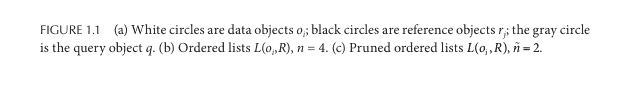

图1.1 (a) 白色圆圈是数据对象 \(o_i\)；黑色圆圈是参考对象 \(r_i\)；灰色圆圈是查询对象 \(q\)。(b) 有序列表 \(L(o_i,R)\)，\(\hat{n} = 4\)。(c) 剪枝有序列表 \(\hat{L}(o_i,R)\)，\(\hat{n} = 2\)。

为了高效地回答用户查询，参考文献13至17的作者提出了几种降低 \(d_{\mathrm{SFD}}\) 复杂度的策略，我们将在1.3节详细讨论。

### 1.2.2 技术实现

算法1详细说明了PBI的基本索引过程。对于 \(D\) 中的每个对象，计算其与参考集 \(R\) 中所有参考对象的距离 \(d(o_i,r)\)（第1–4行）。在使用合适的排序算法（采用快速排序）按递增顺序对距离排序后，创建完整的有序列表 \(L(o_i,R)\)（第5行）。在第6行中，通过从 \(L(o_i,R)\) 中选择前 \(\hat{n}\) 个参考对象来生成部分列表 \(\hat{L}(o_i,R)\)。在第7行中，将 \(\hat{L}(o_i,R)\) 存储在适当的数据结构中[13–17]。理论上，排序复杂度为 \(O(n \log n)\)，这导致索引复杂度为 \(O(N(n + n \log n))\)。

**算法1：基于排列的索引**

```
IN: D of size N, R of n and \hat{n} ≤ n
OUT: \hat{L}(o_i,R) ∀ i = 1,...,N-1
1. For o_i ∈ D
2. For r_j ∈ R
3. b[j].dis = d(o_i,r_j)
4. b[j].indx = j
5. L(o_i,R) = quicksort(b,n)
6. \hat{L}(o_i,R) = partiallist(L(o_i,R),\hat{n})
7. Store the ID i of o_i and its \hat{L}(o_i,R) for other processing.
```

## 1.3 相关数据结构

### 1.3.1 度量倒排文件

Amato和Savino [14]以及Amato等[17]引入了度量倒排文件（MIF），作为一种基于磁盘的数据结构，用于将排列存储在倒排文件[18]中。倒排文件是当前所有文本搜索引擎的骨干。它们由两个主要部分组成，即词表和倒排列表。词表包含文本语料库中的所有唯一词。对于每个词表中的词，都有一个倒排列表。倒排列表包含该词表词在语料库中出现过的所有位置。将其映射到PBI时，参考对象充当词表，并且每个参考对象的倒排列表存储对象ID以及该参考对象相对于数据库中所有对象的排名 \(\{o_i, \hat{L}(o_i,R)\}_i\)。图1.2a展示了图1.1c中部分有序列表的MIF。SFD（式1.1）用于估计查询与数据库对象之间的相似性。对于给定查询 \(q\)，为每个对象 \(o_i\) 分配一个累加器并初始化为零。访问每个参考点的倒排列表，并通过加上当前参考点在查询有序列表中的位置与该参考点在对象有序列表中的位置（保存在倒排列表中）之间的差值来更新累加器。检查完所有参考点的倒排列表后，根据累加器值对对象进行排序。累加器值小的对象与查询更相似。后来，参考文献19的作者提出了MIF的分布式实现。

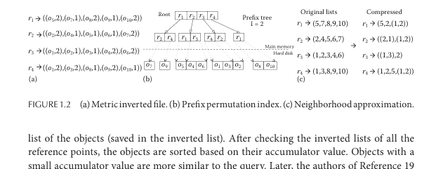

图1.2 (a) 度量倒排文件。(b) 前缀排列索引。(c) 邻域近似。

### 1.3.2 简短排列索引

为了降低内存使用，参考文献20的作者提出了简短排列索引。该算法提出了一种更小的有序列表表示，以节省内存。在生成有序列表 \(L(o_i,R)\) 后，每个列表使用固定大小的位串进行编码。一旦接收到查询，其有序列表也以相同方式编码，并使用二进制汉明距离[21]与向量进行比较。在参考文献22中，作者提出了一种结合LSH的变体，但当速度提高时召回率会下降。

### 1.3.3 前缀排列索引

在参考文献23中，作者提出了一种称为前缀排列索引（PP-index）的新技术。该算法旨在通过减少参考对象数量，并对数据库中的一部分执行一些直接距离计算（DDC），来降低内存使用。PP-index仅在主存的trie树中存储长度为 \(l\)（其中 \(l < n\)）的排列前缀，数据对象以块的形式保存在硬盘上。共享相同前缀的对象保存在彼此靠近的位置。图1.2b展示了图1.1c中部分有序列表的PP-index。一旦提交查询，共享相同前缀的块中的所有对象将根据其到查询的距离进行排序。PP-index比之前的数据结构需要更少的内存，并以类似哈希的方式使用排列前缀来快速检索相关对象。所提出的技术最初给出的召回率较低。通过多次查询进行改进。当接收到查询时，计算该查询的排列列表。然后，将查询排列列表的不同组合作为新查询提交给树。

### 1.3.4 邻域近似

在参考文献16中，作者提出了邻域近似（NAPP）。NAPP的主要思想是获取位于查询与数据库对象之间共享参考对象交集区域中的对象。因此，如果存在一个查询 \(q\)，

与查询相似的对象是满足 \tilde{L}(o_i,R) \cap \tilde{L}(q,R) \neq \phi 的对象。为了降低复杂度，他们提出了另一个术语，阈值值 t。它定义了两个有序列表之间可以共享的参考对象数量以定义它们的相似性。与该算法相关的数据结构与 MIF 相似，只是存在两点不同。第一个区别是 t 值在索引中定义，并且会影响性能。第二个区别是对倒排列表进行数据压缩以节省存储。该技术的索引时间很高，尤其由于压缩时间。搜索时间和效率基于索引技术和阈值。图 1.2c 显示了图 1.1c 中部分有序列表的 NAPP。

### 1.3.5 Metric Suffix Array

In References 24 and 25, the authors further proposed the metric suffix array (MSA) as a memory-based fast and effective data structure for storing the permutations. An MSA \Psi acts like a suffix array [26–28] over S. More specifically, \Psi is a set of M integers corresponding to the permutation induced by the lexical ordering of all M suffixes in S{ (r_{i1},...,r_{iM}) \forall k \le M }. The MSA is sorted into buckets. A bucket b_j contains the positions of all the suffixes of S of the form {r_j,...,r_{iM}} that is, where reference point r_j appears first. Figure 1.3a shows the MSA for the partial ordered lists in Figure 1.1c. At query time, \tilde{L}(q,R) is computed, and buckets b_j are scanned for all r_j \in \tilde{L}(q,R). From each suffix value \Psi_k in a bucket b_j, the object ID i = \Psi_k / \bar{n} + 1 and the location of the reference point in the ordered list of the object are identified, \tilde{L}(o_i,r_j) = (\Psi_k \mod \bar{n})+1. Similar to the MIF, the objects are ranked based on their accumulator value using Equation 1.1.

### 1.3.6 Metric Permutation Table

In Reference 13, the authors proposed the metric permutation table (MPT). The main idea is to simplify the distance approximation by quantizing the ranks within the ordered lists into B \ll \bar{n} intervals (buckets). A bucket B is defined as a regular quantization scheme:

b_{ij} = \frac{B}{\bar{n}} \tilde{L}(o_i,R)_{r_j} \quad and \quad b_{qj} = \frac{B}{\bar{n}} \tilde{L}(q,R)_{r_j} \quad (1.2)

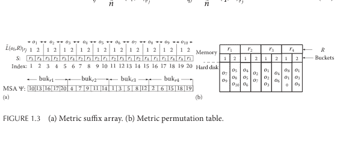

FIGURE 1.3 (a) Metric suffix array. (b) Metric permutation table.

Equation 1.1 now transforms into

d(q, o_i) \simeq \sum_{r_j \in L(q,R) \cap r_j \in L(o_i,R)} |b_{qj} - b_{ij}| . (1.3)

For each reference, B buckets are allocated. Each bucket contains a list of objects z, which contains the IDs of the objects that are located in the same bucket. Figure 1.3b shows the MPT for the partial ordered lists in Figure 1.1c. Then, these lists are compressed using delta encoding [29].

For searching, Equation 1.3 counts the discrepancy in quantized ranking from common reference objects between each object and the query. That is, each object o_i scores

s_i = |{ r_j \in L(q,R) such that (r_j \in L(o_i,R) and |b_{qj} - b_{ij}| \le 1) }| . (1.4)

Objects o_i are then sorted according to their decreasing s_i scores. This approximate ranking can be improved by DDC. For a K-NN query, we use a DDC on the K_c = \Delta K first objects in our sorted candidate list and call \Delta > 1 the DDC factor.

## 1.4 分布式索引

In this section, we show three different strategies to handle the PBI on a distributed environment. The first strategy is based on data division (Section 1.4.1), the second strategy is based on reference division (Section 1.4.2), and the third strategy is based on data and reference division (Section 1.4.3).

### 1.4.1 基于数据

#### 1.4.1.1 索引

Given a data domain D of N objects, a reference set R of n points, and P processes, the reference set R is shared between all the processes. On the other hand, the data domain D is randomly divided into subdomains D_1...D_P of equal sizes N/P among the processes. Each process p builds the partial ordered lists \tilde{L}(o_i,R) for all o_i \in D_p.

The ordered lists for these objects are saved locally in the appropriate data structure DP_p for each process. Accordingly, the workload of indexing is divided equally between the processes. Using this procedure, the complexity of indexing is reduced from O(N(n + n \log n)) to O(N(n + n \log n)/P).

#### 1.4.1.2 搜索

The data are equally divided among all the processes. Accordingly, when a query q is submitted, all the processes have to respond to this query. Algorithm 2 shows the

of references R_p as the closest references. Formally, a set of objects o_i belonging to process p is characterized as {o_i such that r_j \in \tilde{L}(o_i,R) and r_j \in R_p}.

That means that the data are divided between the processes based on the references, not randomly as in the previous technique. The complexity of indexing is O(N(n + n \log n)/P + t_p) where t_p is the time needed to transfer the object information from the indexing process to the coordinating process.

**Algorithm 3: Reference-Based Approach: Indexing**

```
IN: D_p of size N/P, R of n, R_p of n/P, \tilde{n}
OUT: Data structure DS_p
1. if(indexer)
2. For o_i \in D_p
3. For r_j \in R
4. b[j].dis = d(o_i,r_j)
5. b[j].idx = j
6. L(o_i,R) = quicksort(b,n)
7. \tilde{L}(o_i,R) = partialist(L(o_i,R),\tilde{n})
8. For r_j \in \tilde{L}(o_i,R)
9. Send the global object ID, the \tilde{L}(o_i,R)_{r_j}, and the reference ID r_j to coordinating process.
10. if(coordinator)
11. Recv. data from any indexer.
12. Store the received data in DS_p.
```

#### 1.4.2.2 搜索

Unlike the previous search scenario, the processes that participate to answer the query are the processes that have the references, which are located in \tilde{L}(q,R). Algorithm 4 shows the searching process. Once a broker process receives a query, the partial ordered list is created \tilde{L}(q,R) (line 2). An active process is a process whose references are located in \tilde{L}(q,R). More formally, a process p is defined as active if there exists r_j \in R_p, such that r_j \in \tilde{L}(q,R). The broker notifies the active processes and sends the position of the related references \tilde{L}(q,R)_{r_j} to them (lines 3–4). Each active process searches in its local partial data structure and send the results back to the broker (lines 5–9). The broker organizes the received results and sends them to the user (lines 10–13). The organization of the results is not simple. In this approach, each process defines the similarity between the query and the related objects based on a partial reference list R_p. That means that the same object can be seen by different processes, so the object can be found in each output list by each process with a partial similarity score. Hence, the broker has to add these partial similarity scores that are related to each object and then sort the objects based on the summed similarity score.

**Algorithm 4: Reference-Based Approach: Searching**

```
IN: Data structure DS, references R and query: q
OUT: Output list OL
1. if(broker):
2. Create the query partial ordered list \tilde{L}(q,R).
3. Notify the active processes: r_j \in \tilde{L}(q,R) and r_j \in R_p
4. Send \tilde{L}(q,R)_p to the active processes p
5. if(active):
6. Recv. \tilde{L}(q,R)
7. For r_j \in \tilde{L}(q,R) and r_j \in R_p
8.     OL_p = search in DS_p
9. Send OL_p to the broker
10. if(broker):
11. For p \in P
12.     Recv(OL_p).
13. Create OL and send the results to the user.
```

### 1.4.3 基于索引

#### 1.4.3.1 索引

Similar to the previous techniques, the data domain is divided into P subdomains D_1...D_P. It can be divided randomly or based on a clustering algorithm. The references are selected independently from each subdomain and not shared with the other processes R_p. Once the references are defined for each portion, the processes create the partial ordered lists \tilde{L}(o_j,R_p) for their own local objects D_p based on their local reference sets R_p. Hence, with this approach, the processes do not need to communicate to each other while indexing. The indexing complexity is reduced to O(N(n + n \log(n/P)) / P^2). The main reason for this reduction is the division of the references between all the processes.

#### 1.4.3.2 搜索

Algorithm 5 shows the searching process. The broker process has information about all the references R = {R_1 \cup R_2 \cup ... \cup R_p}. Hence, once a query q is submitted, the partial ordered list \tilde{L}(q,R) is created using the full reference list. If the query is located within a certain data domain D_p, the reference points that were selected from that data domain R_p are located as the closest references to the query. Hence, the searching is only done through the process that is responsible for the corresponding data domain (lines 1-4). If the query is located between two or more data domains, the closest references are shared among these

不同域。形式上，进程 p 是活动进程，如果存在 r_i ∈ R_p，使得 r_i ∈ L̂(q,R)。搜索后，每个进程的结果不能直接发送给 broker。每个进程的查询与每个对象的相似度由不同的参考点集合 R_p 定义，这些集合彼此无关。为了合并和排序，每个进程计算提交的查询与候选列表中每个进程的前 K_p = Δ × k 个对象之间的距离。我们称 Δ ≥ 1 为 DDC 因子。然后，带有相关对象 ID 的距离信息被发送到 broker 进程（第 5–10 行）。最后，broker 根据距离对这些对象进行排序并将结果返回给用户。例如，如果 Δ = 2，对于 K-NN 查询(q,30)，每个进程返回与查询最相似的 k = 30 个对象。每个进程在其本地数据结构中搜索并获得顶部候选列表 K_p = 2×30 = 60。然后，每个进程对查询与此顶部 K_p = 60 执行 DDC。如果查询有序列表的参考位于 3 个进程的集合内，broker 接收到 3 × 60 = 180 个距离。对这 180 个距离进行排序，并将前 30 个对象发送回用户。

## 算法5：基于索引的方法：搜索

```
IN: Data structure DS, references R, and query q
OUT: Output list OL
1. if (broker):
2.   Create the query partial ordered list L̂(q,R).
3.   Notify the active processes.
4.   Send q to the active processes.
5. if (active):
6.   Recv q and create L̂(q,R_p).
7.   For r_i ∈ L̂(q,R_p),
8.     OL_p = search in DS_p,
9.     d_p = calculate_distance(q, 2k, OL_p).
10.  Send the distances d_p to the broker.
```

## 1.5 评估

进行了大规模实验以评估三种方法在召回率（RE）、位置误差（PE）、索引时间和搜索时间方面的效率和可扩展性。三种方法均使用消息传递接口（MPI）[30]实现。结果部分分为三个小节。

在第 1.5.1 节中，我们测量了三种分布式方法的平均 RE 和 PE。实验使用包含 500 万个对象的数据集进行。该数据集由视觉形状特征（21 维）组成，并从 1200 万个 ImageNet 语料库 [31] 中提取。三个参考集合的大小分别为 1000、2000 和 3000，均从数据集中随机选择。平均 RE 和 PE 基于 250 个不同的查询，这些查询也是从数据集中随机选择的。

在第 1.5.2 节中，我们使用相同的数据集测量了三种方法在搜索和索引时间方面的可扩展性。我们比较了三种方法使用 MPI 实现的索引和搜索时间。平均搜索时间基于 250 个不同的查询，这些查询是从数据集中随机选择的。对于之前的实验，使用了 MSA 数据结构。所有评估包括索引和搜索时间均使用完整的排列列表进行，因为我们将使用完整的有序列表视为最坏情况。这意味着无论使用哪种方法，搜索都是由所有进程完成的。

在第 1.5.3 节中，我们使用完整的内容基于照片图像检索（CoPhIR）数据集 [32] 和最佳的分布式方法进行大规模实验。CoPhIR [32] 数据集包含 1.06 亿个 MPEG-7 特征。每个 MPEG-7 特征包含五个描述符（可缩放颜色、颜色结构、颜色布局、边缘直方图和均匀纹理）。这五个特征组合构建了一个 280 维向量。数据库大小约为 75 GB。评估使用大小为 2000 的参考集合进行。最近点的数量 n̂ 为 10。

MPICH2 1.4.1p1 安装在由一台主八核计算机领导的 Linux 集群上，该主计算机拥有 32 GB 内存和 1 TB 存储容量，集群由 20 台双核计算机（总共 40 个核心）组成，每台计算机拥有 8 GB 内存和 512 GB 本地磁盘存储。

### 1.5.1 召回率和位置误差

给定查询 q，RE 和 PE 定义为 [11]

RE = |S ∩ S_A| / |S|  (1.5)

PE = Σ_{o∈S_A} |P(X,o) − P(S_A,o)| / (|S_A|·N)  (1.6)

其中 S 和 S_A 分别是针对精确相似性搜索和近似相似性搜索的查询 q 的 top-K 排序对象的排序。X 是数据集 D 中相对于其与 q 的距离的项目排序。P(X,o) 表示 o 在 X 中的位置，P(S_A,o) 表示 o 在 S_A 中的位置。RE = 0.5 表示搜索算法的输出结果包含精确搜索检索到的 k 个最佳对象的 50%。PE = 0.001 表示搜索算法按其排名的最佳 K 个对象相对于精确搜索获得的排名的平均偏移量为数据集的 0.1%。

图 1.4 显示了使用 10 和 20 个进程的 10 个 K-NN 的平均 RE 和 PE。该图表示四种不同的策略，分别是：第一种策略是顺序（Seq）。第二种策略是基于数据（DB）的方法。第三种策略是基于参考（RB）的方法。最后一种策略是基于索引（IB）的方法。IB 方法的 DDC 因子等于 1 以实现公平比较。图 1.4a 和 b 显示 Seq、DB 和 RB 方法给出相同的 RE 和 PE。此外，进程数量不影响性能。这可以预期，因为所有

随着 DDC 的增加而增加，并且 PE 在 DDC 增加时减小。此外，由于数据分布，使用较低的 DDC 值可以实现更好的召回。例如，当 DDC 等于 4 时，召回率为 0.9。另一方面，当 DDC 增加时，每个进程与查询比较的对象更多，这会影响搜索时间。

### 1.5.2 索引和搜索性能

图 1.6、1.7 和 1.8 显示了三种分布式方法使用 5、10 和 20 个进程的索引和搜索时间。

索引。x 轴显示参考点的数量，y 轴显示完整有序列表 L(o,R) 的索引时间（秒）。对于三种算法，随着核心数量的增加，索引时间减少。此外，随着参考点数量的增加，索引时间增加。RB 给出更长的索引时间，这是由于进程之间交换数据所需的通信。使用五个进程时，RB 方法比顺序方法慢，因为大部分时间消耗在进程之间交换数据。逐个对象向相应进程交换是一个昂贵的过程。因此，通信以 1 MB 的块大小进行。对于 IB 方法，与顺序时间相比，索引时间有大幅下降。其原因有两个。第一个原因是

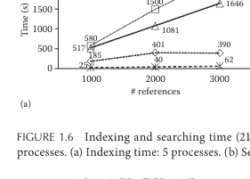

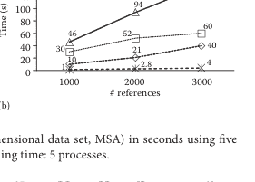

图 1.6 使用五个进程的索引和搜索时间（21 维数据集，MSA）以秒为单位。（a）索引时间：5 个进程。（b）搜索时间：5 个进程。

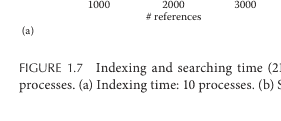

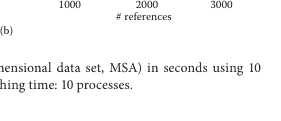

图 1.7 使用 10 个进程的索引和搜索时间（21 维数据集，MSA）以秒为单位。（a）索引时间：10 个进程。（b）搜索时间：10 个进程。

实验使用 MPT 数据结构进行（第 1.3.6 节）。该表显示了基于 IB 方法使用 34 个进程的顺序和分布式实现的結果。最近参考的数量为 n̄ = 50，来自从每个数据库部分随机选择的 2000 个参考点。顺序和分布式实现的 DDC 因子为 Δ = 40。对于分布式实现，每个处理器的参考点数量为 60。

该表显示，与顺序实现相比，分布式实现在前 10 和 100 个 K-NN 方面给出了更好的 RE 和 PE，这是由于局部性和分布式环境中每个对象的更好表示。在索引方面，分布式实现比顺序实现快得多，这是由于数据和参考的划分。对于搜索，分布式实现没有像索引那样获得很高的速度，这是由于每个进程需要执行的 DDC 数量。

## 1.6 结论

PBI 是大规模域中近似 K-NN 相似性查询的最新的技术之一。它旨在根据数据对象如何使用一些参考对象看到周围环境来预测数据对象之间的相似性。随着数据的指数级增长，需要并行和分布式计算。在本章中，我们展示了三种使用 PBI 进行高效索引和搜索的不同分布式算法。这三种算法是根据数据或参考或两者的分布划分的。我们在大型高维数据集上对它们进行了评估，并表明基于数据和参考分布的技术由于局部参考对对象的更好表示以及每个进程的对象数量较少而提供了最佳性能。

## 致谢

本工作由瑞士国家科学基金会（SNSF）通过瑞士国家竞争力研究中心（NCCR）交互式多模态信息管理（IM2）和欧洲科学技术合作（COST）关于多语言和多方面交互式信息访问（MUMIA）的行动通过瑞士教育研究国务秘书处（SER）联合支持。

## 参考文献

- 1. H. V. Jagadish, A. O. Mendelzon and T. Milo. 基于相似性的查询. In Proceedings of the Fourteenth ACM SIGACT-SIGMOD-SIGART Symposium on Principles of Database Systems, PODS '95, pages 36–45, New York, 1995. ACM.
- 2. H. Samet. 多维和度量数据结构的基礎. The Morgan Kaufmann Series in Computer Graphics and Geometric Modeling, Morgan Kaufmann, San Francisco, CA, 2006.
- 3. B. Bustos, O. Pedreira and N. Brisaboa. 相似性搜索的动态枢轴选择技术. In Proceedings of the First International Workshop on Similarity Search and Applications, pages 105–112, Washington, DC, 2008. IEEE Computer Society.
- 4. L. G. Ares, N. R. Brisaboa, M. F. Esteller, O. Pedreira and A. S. Places. 用于最小化度量访问方法索引大小的最优枢轴. In Proceedings of the 2009 Second International Workshop on Similarity Search and Applications, pages 74–80, Washington, DC, 2009. IEEE Computer Society.


- 24. H. Mohamed 和 S. Marchand-Maillet。在 ACM WSDM 2013 大规模与分布式信息检索系统研讨会上发表的《用于大规模相似性搜索的度量后缀数组》，意大利罗马，2013 年 2 月。
- 25. H. Mohamed 和 S. Marchand-Maillet。《基于排列的近似 K-NN 搜索剪枝》。载于 DEXA 会议论文集，第 I 部分，捷克共和国布拉格，2013 年 8 月 26–29 日，第 40–47 页，2013 年。
- 26. U. Manber 和 E. W. Myers。《后缀数组：一种在线字符串搜索的新方法》。*SIAM Journal on Computing*，22(5):935–948，1993 年。
- 27. K.-B. Schumann 和 J. Stoye。《一种用于快速构造后缀数组的不完整算法》。*Software: Practice and Experience*，37(3):309–329，2007 年。
- 28. H. Mohamed 和 M. Abouelhoda。《基于桶指针细化的并行后缀排序》。载于 2010 年第五届开罗国际生物医学工程会议（CBEC），埃及开罗，第 98–102 页，2010 年 12 月。
- 29. S. W. Smith。《科学家与工程师的数字信号处理指南》。California Technical Publishing，加利福尼亚州圣迭戈，1997 年。
- 30. MPI 论坛。《MPI：消息传递接口》。1993 年。网址：http://www.mpi-forum.org。
- 31. J. Deng、W. Dong、R. Socher、L.-J. Li、K. Li 和 L. Fei-Fei。《ImageNet：一个大规模分层图像数据库》。载于 IEEE 计算机视觉与模式识别会议（CVPR），2009 年。
- 32. P. Bolettieri、A. Esuli、F. Falchi、C. Lucchese、R. Perego、T. Piccioli 和 F. Rabitti。《CoPhIR：一个基于内容的图像检索测试集合》。*CoRR*，abs/0905.4627v2，2009 年。

## 全球能源正处于十字路口

### 《世界能源展望 2024》

- 能源系统
  - 《世界能源展望 2024》（WEO-2024）
- 安全
  - 地缘政治与能源

世界正面临多重能源相关危机。这使能源安全成为首要议题，也使快速、有序且公平的转型面临巨大挑战。这也使充分了解情况且着眼未来的分析比以往任何时候都更加重要。《世界能源展望 2024》将通过分析……来应对这些问题。

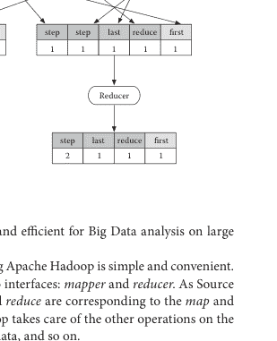

**既定政策情景下按燃料划分的一次能源需求，2010–2030 年**

- 能源安全需要谨慎管理风险……
- 需要制定新政策以释放……

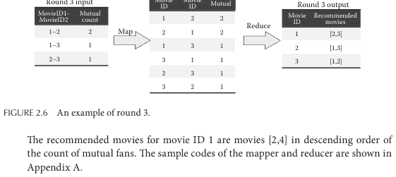

**图 2.6** 第 3 轮示例。

针对电影 ID 1 推荐的电影是[2,3]，其排序依据是共同粉丝数量，从高到低排列。映射器和归约器的示例代码见附录 A。

**第 3 轮输入**

| 电影 ID1-电影 ID2 | 共同数量 |
|---|---|
| 1-2 | 2 |
| 1-3 | 1 |
| 2-3 | 1 |

| 电影 ID | 电影 ID | 共同数量 |
|---|---|---|
| 1 | 2 | 2 |
| 2 | 1 | 2 |
| 1 | 3 | 1 |
| 3 | 1 | 1 |
| 2 | 3 | 1 |
| 3 | 2 | 1 |

| 电影 ID | 推荐电影 |
|---|---|
| 1 | [2,3] |
| 2 | [1,3] |
| 3 | [1,2] |

## 2.5 部署架构

我们的评估在 AWS 上进行。AWS 提供了搭建 Hadoop 平台所需的基础设施组件。这些基础设施组件列于表 2.1 中。AWS 支持灵活选择虚拟机映像、虚拟机实例的容量以及相关服务（例如存储、监控和费用计费）。

Hadoop 架构的部署使用 AWS Elastic MapReduce（EMR）。EMR 是一个运行在可调整规模的 Amazon Elastic Compute Cloud（EC2）实例集群上的 Hadoop 平台。部署架构如图 2.7 所示。在 EMR 配置中，我们设置了 1 个主实例和 10 个核心实例，用于运行电影推荐应用程序的 Hadoop 实现。主实例负责管理 Hadoop 集群，将任务分配给核心实例和任务实例，并向其分发数据。核心实例运行映射/归约任务，并使用 HDFS 存储数据。所有实例均为 m1.small 类型，具有 1.7 GB 内存、一个 EC2 计算单元的虚拟核心，以及 160 GB 的本地实例存储空间。

我们将 Netflix 数据的评分文件上传到 Amazon Simple Storage Service（S3）。S3 是一种存储服务，提供用于存储和检索任意数量数据的接口。EMR 将 S3 上的数据文件读取为 Hadoop 作业的输入文件。

我们在 Amazon EMR 中配置 Hadoop 集群和作业。完整的配置页面包括集群配置、标签、软件配置、硬件配置、安全与访问、引导操作以及步骤。对于我们的实验，我们在此设置了三个步骤。每个步骤都是一个 MapReduce 作业。每个步骤中映射器、归约器、输入文件和输出文件夹的 S3 位置规格如图 2.11 所示。

**表 2.1** 电影推荐应用程序的基础设施组件

| 应用程序 | 电影推荐 |
|---|---|
| 平台 | Apache Hadoop |
| Amazon Web Services | Simple Storage Service（S3） |
| | Elastic MapReduce（EMR） |
| 监控工具 | Amazon CloudWatch |

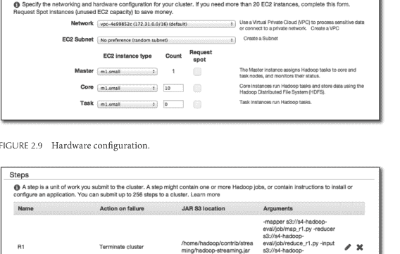

**图 2.9** 硬件配置。

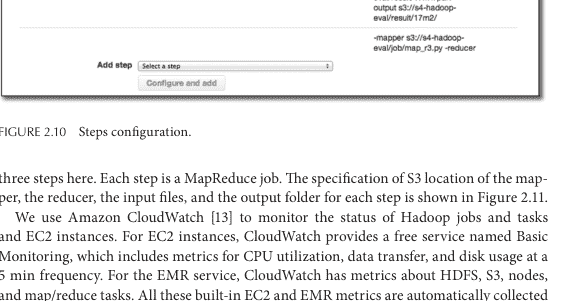

**图 2.10** 步骤配置。

我们使用 Amazon CloudWatch [13] 监控 Hadoop 作业和任务以及 EC2 实例的状态。对于 EC2 实例，CloudWatch 提供了一项名为“基本监控”的免费服务，其中包括 CPU 利用率、数据传输和磁盘使用情况等指标，采集频率为每 5 min 一次。对于 EMR 服务，CloudWatch 提供有关 HDFS、S3、节点以及映射/归约任务的指标。所有这些内置的 EC2 和 EMR 指标都会被自动收集和报告。AWS 用户可以通过 CloudWatch 网站或 CloudWatch 应用程序编程接口（API）实时访问这些指标。

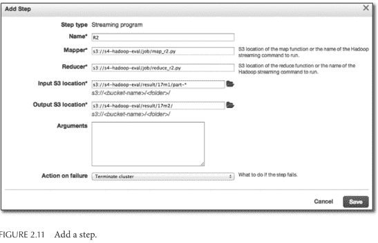

**图 2.11** 添加步骤。

## 2.6 可扩展性与成本评估

评估包括用于模拟数据集增量更新的场景，模拟依据是数据规模。我们将可扩展性定义为：在平台扩展到更多计算资源之前，平台能够利用计算资源处理不断增长的数据规模或数据速率的程度。我们还观察数据规模和更新速率增长所产生的成本。为此，我们收集以下指标，以观察 Hadoop 平台的性能（表 2.2）。

**表 2.2** 收集的指标

| 平台 | Apache Hadoop |
| --- | --- |
| 系统状态 | CPU 利用率<br>HDFS I/O、S3 I/O<br>网络 I/O |
| 平台状态 | MapReduce 任务状态 |

注：I/O，即输入/输出。

系统状态指标有助于识别限制性能的瓶颈。我们分析平台状态指标，以观察应用程序层面与瓶颈相关且对性能影响最大的因素。CloudWatch 提供的 MapReduce 任务状态包括*剩余映射任务、每个槽位的剩余映射任务、剩余归约任务、正在运行的映射任务以及正在运行的归约任务*。

在电影推荐应用程序的 Hadoop 实现中，随着用户持续在网站上为电影评分，评分数据会不断增加。因此，随着数据规模随时间增长，Hadoop 需要处理全部可用的评分数据集。为了评估 Hadoop 处理增量数据的可扩展性和成本，我们创建了处理不同大小评分文件的实验。首先，我们按照时间顺序排列 Netflix 数据集。假设用户每秒产生 200 条评分，则第 N 天的数据集规模为每秒 200 条评分 \* 24（小时）\* 3600（秒）\* N 条记录。我们在 N = 1、3、6 天的时间范围内运行电影推荐作业（图 2.12），并比较结果。

了解数据处理的最小时间间隔或频率如何随数据更新规模变化，有助于根据最优资源配置设置做出扩展决策。表 2.3 显示了不同输入数据规模下 Hadoop 作业的耗时。耗时表示，在给定数据规模的情况下，运行用于更新电影推荐列表的 Hadoop 应用程序所需的最短时间。例如，表 2.3 中的第一项表示，在当前容量下，对于处理更新了 1 天的评分数据，Hadoop 电影推荐应用程序最多只能以每小时运行一次的频率重新执行。对于任何更短的频率或更大的数据集，都需要配置更多 EMR 实例。图 2.13 中的进一步分析显示，该 Hadoop 应用程序的耗时随着数据规模呈线性增长趋势。

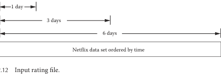

**表 2.3** 电影推荐作业的耗时

| 场景 | 数据文件大小 | 记录数 | 耗时 |
|---|---:|---:|---:|
| 1 天 | 428 MB | 17,280,000 | 56 min |
| 3 天 | 1.2 GB | 51,840,000 | 177 min |
| 6 天 | 2.4 GB | 103,680,000 | 407 min |

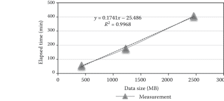


从平台状态来看，图 2.14 显示了 1 天输入和 3 天输入下的运行任务数对比结果。评估环境有 10 个核心实例。每个实例有两个 mapper 和一个 reducer。大多数时候，运行的 map 和 reduce 任务都处于最大值。此外，所有 mapper 和 reducer 几乎同时完成任务，这意味着这里不存在数据倾斜问题。在 2.4 节“Hadoop 中的实现”中，我们展示了这个电影推荐应用的三轮 MapReduce 作业。每轮运行的时间列于图 2.14 中。

图 2.15 显示了 1 天数据输入与 3 天数据输入的系统状态对比。如图 2.15c 所示，两个实验中都没有数据写入 HDFS，且从 HDFS 读取的数据总量始终低于 5 KB/s。这主要是因为 EMR 使用 S3 而非 HDFS 作为输入和输出。在 EMR 服务中，mapper 从 S3 读取数据，并将中间结果保存在 EC2 实例的本地磁盘上。然后在 shuffle 阶段，这些中间结果通过网络发送到可能位于其他实例上的相应 reducer。最后，reducer 将最终结果写入 S3。

在图 2.15a 中，3 天输入的实验在大部分时间 CPU 使用率都保持在 100%，但在第 100、125 和 155 分钟处有三个低点，这些时间点正是 reduce 任务进行 shuffle 或写入结果的时刻。图 2.15b 中的平均网络 I/O 测量值在相同的时间点（分别为第 100、125 和 155 分钟）附近出现峰值，而在其他时间，平均网络 I/O 保持在较低水平。据我们所知，最高的网络 I/O 速率仍低于 Amazon 同区域网络的带宽（1 Gbps）。1 天输入的实验具有相同的模式，只是时间范围不同。从这些观察可以推断，处理更高频率数据时，CPU 使用率将成为瓶颈。

表 2.4 显示了在不同数据规模和更新频率下 EMR 服务的成本。例如，对于每 3 小时更新一次的频率和 1.2 GB 的输入文件，我们需要每天运行 Hadoop 推荐作业 8 次。每次需要 2 小时 57 分钟。AWS 上 EMR 的价格为每个实例每小时 0.08 美元。对于不足一小时的使用，计费系统会向上取整至一小时。由于我们总共使用了 11 个实例，因此每天的费用为 $0.08*11*3*8 = $21.12。表中的 NA（不适用）表示该数据规模的处理时间长于更新间隔，因此需要配置更多实例。

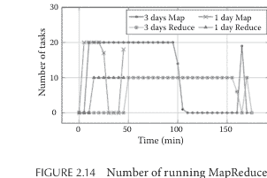

| MapReduce 轮次 | 1 天 | 3 天 |
|---|---|---|
| 第 1 轮 | 4 分钟 | 5 分钟 |
| 第 2 轮 | 41 分钟 | 155 分钟 |
| 第 3 轮 | 4 分钟 | 10 分钟 |

图 2.14 运行的 MapReduce 任务数量与耗时。

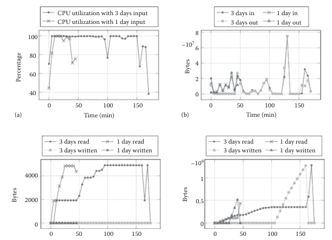

图 2.15 Hadoop 集群的系统状态。(a) 核心实例平均 CPU 使用率。(b) 核心实例平均网络输入/输出。(c) HDFS 读取/写入的字节数。(d) S3 读取/写入的字节数。

表 2.4 Hadoop 方案的每日成本表

| 更新频率 | 每天一次 | 每天一次 | 每天一次 | 每 3 小时一次 | 每 3 小时一次 | 每 3 小时一次 | 每小时一次 | 每小时一次 | 每小时一次 |
| --- | --- | --- | --- | --- | --- | --- | --- | --- | --- |
| 输入数据大小 | 428 MB | 1.2 GB | 2.4 GB | 428 MB | 1.2 GB | 2.4 GB | 428 MB | 1.2 GB | 2.4 GB |
| 每日成本 | $0.88 | $2.64 | $6.16 | $7.04 | $21.12 | NA | $21.12 | NA | NA |

## 2.7 讨论

通过使用 AWS EMR、S3、CloudWatch 和计费服务，我们能够同时观察性能和成本指标。基于我们的经验，我们讨论与增量数据集处理相关的 Hadoop 平台的其他特性。

### 可编程性

Hadoop 是一个开源项目，为开发者提供了简单的编程接口。Hadoop 通过 Hadoop Streaming 接口支持多种编程语言。图 2.4 是一个用 Python 编写 mapper 的示例。

### 部署复杂性

Hadoop 的部署较为复杂，涉及 MapReduce 模块、HDFS 和其他复杂的配置文件。然而，Hadoop 是一个广泛使用的平台，拥有成熟的社区，因此很容易找到文档，或选择 Amazon EMR 这样的集成 Hadoop 服务。借助 Amazon EMR，开发者无需再自行搭建 Hadoop 环境，只需简单配置即可运行 Hadoop 作业，如 2.5 节“部署架构”所述。

### 与其他工具的集成

Hadoop 可以将指标输出到数据文件或实时监控工具。通过编辑配置文件，即可实现与其他监控工具的集成。例如，Ganglia 是一个可扩展的分布式监控系统，适用于集群和网格等高性能计算系统 [14]。Hadoop 可以通过编辑 hadoop-metrics.properties 将指标输出到 Ganglia，如下所示：

```
hadoop-metrics.properties (@GANGLIA@ is the hostname or IP of the Ganglia endpoint):

dfs.class = org.apache.hadoop.metrics.ganglia.GangliaContext
dfs.period = 10
dfs.servers = @GANGLIA@:8649

mapred.class = org.apache.hadoop.metrics.ganglia.GangliaContext
mapred.period = 10
mapred.servers = @GANGLIA@:8649
```

### 自动扩缩容选项

Amazon EMR 允许用户增加或减少任务实例的数量。对于包含 HDFS 的核心实例，用户可以增加但无法减少。所有这些扩缩容操作都可以在 Hadoop 集群运行时进行；如果基于 Hadoop 指标设置了自动扩缩容规则，EMR 就能拥有自动扩缩容能力。

## 2.8 相关工作

近期的研究致力于增量数据处理系统，以便在数据的一小部分发生变化时，能够维护一个非常庞大的数据仓库并高效地更新它。广义上讲，有两种方法。一种方法是增强 Hadoop 架构和文件系统，以检测输入的变化并采用细粒度的结果复用 [15]。相关研究提出了在编程语言和存储系统层面基于内容分块的新技术。其整体编程模型仍然遵循 MapReduce。另一种方法是提出不同于 MapReduce 的新编程模型和 API，例如 Google 的 Percolator [4] 和 Yahoo! 的连续批量处理（CBP）[16]。这两种方法都具备识别更新发生位置、存储中间结果并复用这些结果的机制。

其他针对 Hadoop 的性能评估包括：Hadoop 在虚拟机容量方面的表现 [17]、Hadoop 在高性能集群上运行以处理科学数据 [18]，以及 Hadoop 与 NoSQL（不仅仅是结构化查询语言）数据库（如 MongoDB）的集成 [19]。我们重点关注 Hadoop 在处理增量数据时，在不同数据规模和更新频率下的可扩展性与成本。Zaharia 等人 [20] 发现，Hadoop 的性能与其任务调度器密切相关。任务调度器隐含地假设集群节点是同质的，任务呈线性推进，并据此决定何时对疑似拖后腿的任务进行推测性重新执行。参考文献 [20] 表明，Hadoop 的调度器在异构环境中可能导致严重的性能下降。

## 2.9 结论

在本章中，我们通过一个需要对连续输入数据流进行频繁更新的电影推荐场景，评估了 Amazon Hadoop 服务的可扩展性和成本。我们使用 MapReduce 编程模型实现了该示例应用，并将其部署在 Amazon EMR 服务上。我们介绍了收集系统级和平台级指标的监控技术，以观察性能和可扩展性状态。我们的评估实验有助于确定数据处理的最小时间间隔或最高频率，这为最优资源配置的自动扩缩容设置提供了参考指标。

## 致谢

版权所有 2014 卡内基梅隆大学

本材料基于美国国防部根据合同号 FA8721-05-C-0003 与卡内基梅隆大学签订的工作合同所资助和支持的工作，用于运营软件工程研究所（一个由联邦资助的研究与开发中心）。

无担保。本卡内基梅隆大学与软件工程研究所材料按“原样”提供。卡内基梅隆大学不对任何事项作任何明示或暗示的担保，包括但不限于对特定用途的适用性或适销性、排他性或使用本材料所得结果的担保。卡内基梅隆大学不对不侵犯专利、商标或版权作出任何形式的担保。

本材料已获准公开发布并无限制分发。

DM-0001345

## 参考文献

+   1. Paul Zikopoulos 和 Chris Eaton。《理解大数据：面向企业级 Hadoop 与流数据的分析》（第 1 版）。McGraw-Hill Osborne Media，哥伦布，俄亥俄州（2011 年）。
+   2. Jeffrey Dean 和 Sanjay Ghemawat。MapReduce：大规模集群上的简化数据处理。《ACM 通讯》51, 1（2008）：107–113。
+   3. 什么是 Apache Hadoop？（2014 年）。可访问 http://hadoop.apache.org/。
+   4. Daniel Peng 和 Frank Dabek。使用分布式事务和通知进行大规模增量处理。*第 9 届 USENIX 操作系统设计与实现研讨会论文集*。USENIX（2010 年）。
+   5. Netflix Prize（2009 年）。可访问 http://www.netflixprize.com/。
+   6. Gediminas Adomavicius 等。使用多维方法在推荐系统中融入上下文信息。《ACM 信息系统汇刊（TOIS）》23, 1（2005）：103–145。
+   7. John S. Breese、David Heckerman 和 Carl Kadie。协同过滤预测算法的实证分析。*第十四届人工智能不确定性会议论文集*。Morgan Kaufmann Publishers Inc.（1998 年）。
+   8. Jonathan L. Herlocker 等。用于执行协同过滤的算法框架。*第 22 届 ACM SIGIR 国际信息检索研究与发展年会论文集*。ACM（1999 年）。


- 9. Paul Resnick 等人。GroupLens：一种用于网络新闻协同过滤的开放架构。见1994年ACM计算机支持协同工作会议论文集。ACM出版社（1994）。
- 10. Mukund Deshpande 和 George Karypis。基于物品的Top-N推荐算法。ACM信息系统汇刊（TOIS）22, 1（2004）：143–177。
- 11. Greg Linden、Brent Smith 和 Jeremy York。Amazon.com推荐：物品到物品的协同过滤。IEEE互联网计算 7, 1（2003）：76–80。
- 12. Badrul Sarwar 等人。基于物品的协同过滤推荐算法。见第十届万维网国际会议论文集。ACM出版社（2001）。
- 13. Amazon CloudWatch（2014）。可在 http://aws.amazon.com/cloudwatch/ 获取。
- 14. Ganglia（2014）。可在 http://ganglia.sourceforge.net/ 获取。
- 15. Pramod Bhatotia 等人。Incoop：用于增量计算的MapReduce。见第二届ACM云计算研讨会论文集（SOCC '11）。ACM，纽约，文章7，14页（2011）。
- 16. Dionysios Logothetis 等人。用于增量分析的有状态批量处理。见第一届ACM云计算研讨会论文集（SoCC '10）。ACM，纽约，51–62（2010）。
- 17. Shadi Ibrahim 等人。在虚拟机上评估MapReduce：Hadoop案例。云计算，计算机科学讲义 5931（2009）：519–528。
- 18. Zacharia Fadika 等人。评估Hadoop在数据密集型科学操作中的表现。见云计算（CLOUD），2012年IEEE第五届国际会议，67–74（2012年6月24–29日）。
- 19. Elif Dede 等人。用于科学数据分析的MongoDB和Hadoop平台的性能评估。见第四届ACM科学云计算研讨会论文集（Science Cloud '13）。ACM，纽约，13–20（2013）。
- 20. Matei Zaharia 等人。在异构环境中提升MapReduce性能。见第八届USENIX操作系统设计与实现会议论文集（OSDI '08）。USENIX协会，伯克利，加利福尼亚州，29–42（2008）。

## 附录2.A：Mapper和Reducer的源代码

### 源代码2：第2轮Mapper的示例代码

```python
#!/usr/bin/env python

import sys

movie_ids = list()
user_id = 0

# output movies pairs that have mutual fan;
# key: movie pair, value: 1
def print_id_pairs(id_list):
    for i in range(0, len(id_list)-1):
        for j in range(i+1, len(id_list)):
            print '%s-%s\t1' % (id_list[i], id_list[j])

# input comes from standard input
for line in sys.stdin:
    # remove leading and trailing whitespace
    line = line.strip()
    # split the line into key/value pairs
    words = line.split('\t')

    # output for each movie in the movie pairs to standard output;
    if len(words) < 2:
        continue
    ids = words[0].split('-')
    if len(ids) == 2:
        print '%s\t%s\t%s' % (ids[0], ids[1], words[1])
        print '%s\t%s\t%s' % (ids[1], ids[0], words[1])
```

### 源代码5：第3轮Reducer的示例代码

```python
#!/usr/bin/env python

import sys

top_lists = []
movie_id = 0

# output recommendation list
def print_top_lists(m_id, top_list):
    out_str = '%s\t' % m_id
    for i, data in enumerate(sorted(top_list, key=lambda m: m[1], reverse=True)[:10]):
        if i != 0:
            out_str += ','
        out_str += '%s-%d' % (data[0], data[1])
    print out_str

# input comes from standard input
for line in sys.stdin:
    # remove leading and trailing whitespace
    line = line.strip()
    # split the line into key/value pairs
    words = line.split('\t')
    # write the recommendation lists to standard output;
    if len(words) < 3:
        continue
    if movie_id != words[0] and movie_id != 0:
        print_top_lists(movie_id, top_lists)
        del top_lists[:]
        movie_id = words[0]
    top_lists.append([words[1], int(words[2])])

print_top_lists(movie_id, top_lists)
```

用于高维空间中大数据集相似性搜索的奇异值分解、聚类和索引

Alexander Thomasian

### 目录

- 3.1 引言 40
- 3.2 数据归约方法与SVD 42
- 3.3 聚类方法 44
  - 3.3.1 划分方法 45
  - 3.3.2 层次聚类 46
  - 3.3.3 基于密度的方法 48
  - 3.3.4 基于网格的方法 49
  - 3.3.5 子空间聚类方法 49
- 3.4 为k-NN查询构建索引的步骤 52
- 3.5 高维空间中的最近邻查询 54
- 3.6 结合SVD和聚类的替代方法 56
- 3.7 高维索引综述 57
- 3.8 结论 62
- 致谢 62
- 参考文献 62
- 附录3.A：使用降维数据计算近似距离 68

### 摘要

通过特征向量表示图像等对象，并根据高维空间中表示这些对象的点之间的距离，通过k最近邻（k-NN）方法搜索与目标图像相似的图像，是一种流行的范式。我们讨论了奇异值分解（SVD）、聚类和索引的组合，以降低对高维大数据集处理k-NN查询的成本。我们首先回顾了降维方法，重点介绍SVD及相关方法，然后综述了高维数值数据的聚类和索引方法。我们描述了将SVD和聚类结合作为一个框架，以及驻留内存的有序划分（OP）树索引，以加速k-NN查询。我们讨论了将OP树保存到磁盘的技术，并指定了适用于降维数据上k-NN查询的逐步增加维度（SDI）索引。

## 3.1 引言

IBM在20世纪90年代的“基于图像内容查询”（QBIC）项目[1]采用了基于内容的图像检索（CBIR）或基于图像提取特征的相似性搜索。我们关注CBIR的存储空间和处理需求，这些需求很重要，因为数据量大且相关处理需求高，特别是当相似性搜索通过对整个数据集进行简单的顺序扫描来执行时。基于奇异值分解的聚类（CSVD）方法和有序划分（OP）树索引[2]在参考文献3中被用于将CBIR应用于卫星图像索引[4]。

CBIR分为两步[5]：（1）用特征描述图像并定义相似性度量。（2）提取颜色、纹理和形状等特征[6]。纹理特征包括分形维数、粗糙度、熵、圆形Moran自相关函数和空间灰度差（SGLD）统计[7]。除照片、医学和卫星图像外，基于内容的检索还与音频和视频片段等结合使用。

给定一个由高维空间中的点表示的目标图像，可以通过范围查询来确定与它相似的图像，范围查询确定某个半径内的所有点。由于小半径的范围查询可能无法产生任何查询点，因此使用k最近邻（k-NN）查询代替[8]。距离可以基于欧几里得距离或更复杂的距离函数，例如马氏距离[8]。k-NN查询可以通过顺序扫描包含所有图像特征向量的数据集来实现，同时跟踪最近的k个点。这种朴素算法的运行时间为O(MN)，其中M是数据集的大小（图像数量），N是维度（特征数量）。令人惊讶的是，在更高维的数据空间中，朴素搜索可能优于多维索引方法[9]。

聚类是一种从CPU和磁盘处理的角度降低k-NN搜索成本的方法。假设有H个聚类，每个聚类的点数相等，则只需搜索一个聚类中的数据点，k-NN查询的成本将降低H倍。一项关于聚类方法的综述，重点关注磁盘驻留的高维

本章提供数据。随着存储级内存（SCM）的出现[10]，越来越多的数据有望从磁盘[11]迁移到此类内存中。

聚类通常被设想为由质心和半径（质心到最远点的距离）表示的超球体。根据索引结构的不同，查询点可能位于两个或多个超球体或超立方体共享的体积中，因此需要搜索多个聚类才能定位 k 近邻（k-NNs）。必须尽可能精简 k-NN 搜索以降低查询处理成本[3]。索引是聚类的一种形式；然而，大多数索引结构（如 R 树家族中的结构）在较高维度的数据空间中表现不佳[8]。关于此主题的更多细节见第 3.7 节。

主成分分析（PCA）[12]、奇异值分解（SVD）和 Karhunen–Loève 变换（KLT）是相关的方法，用于在旋转坐标后降低高维数据的维数，从而在期望的数据压缩水平下实现信息损失最小化[8,13]。在应用聚类之前，可以选择性地对原始数据集进行降维。对聚类进行降维利用了局部相关性，与对整个数据集应用 SVD 相比，在相同的数据量缩减下，归一化均方误差（NMSE）更小。因此，尽管 SVD 是在参考文献 3 和 14 中对聚类应用的，该方法仍被称为递归聚类 SVD（RCSVD）。

作为将聚类与 SVD 结合比不聚类直接应用 SVD 能获得更高降维效果的示例，考虑三维空间中围绕多条不相交直线的点，这些点可以通过其单一主导维度来指定，即空间需求减少三倍，同时 k-NN 查询的计算成本也减少三倍。对几个真实数据集的实验表明，当聚类与 SVD 结合时，在相同压缩比下信息损失更低，反之亦然。

局部降维（LDR）方法[15]查找局部相关性并对这些数据进行降维。然而，参考文献 3 表明，使用现成聚类方法（如 k-means）的 RCSVD 优于 LDR。

通过为每个聚类中的数据建立索引以减少需要考虑的点的数量，可以进一步降低成本。事实证明，流行的索引（如 R 树）在高维 k-NN 查询处理中效率低下。参考文献 16 和 17 调查了索引方法，但本章针对高维数据提供了更聚焦且更新的综述。

本章组织如下。第 3.2 节讨论降维问题。第 3.3 节介绍聚类方法，重点针对大规模、高维、磁盘驻留数据集。第 3.4 节描述了参考文献 3 中为 k-NN 查询构建数据结构的方法。第 3.5 节指定了确定相似性的方法。第 3.6 节讨论参考文献 15 中的 LDR 方法。第 3.7 节综述了索引结构。第 3.8 节总结了本章的讨论。附录中给出了一种使用 SVD 对降维数据计算欧几里得距离的更高效方法[18]。

## 3.2 数据缩减方法与 SVD

数据缩减方法在多个领域都备受关注，例如关系数据库中的查询成本估计[19]、数据挖掘、决策支持、联机分析处理（OLAP）[20]、数据压缩、信息检索和数据可视化。我们将参考文献 21 中综述的数据缩减方法列举如下：

1.  SVD、PCA 和 KLT 是相关的降维方法，本节将对此进行讨论。
2.  离散小波变换（DWT）有多种变体[13]，例如 Daubechies 变换[22]。参考文献 23 已将其用于关系数据库中的数据压缩。
3.  回归的最简单形式是单变量模型的线性回归，即变量 Y 作为变量 X 的线性函数，Y = α + βX，但回归可以扩展到多个变量[13]。
4.  对数线性模型是一种逼近离散多维概率分布的方法；例如，联合概率的多维表由低阶表的乘积来近似[24]。
5.  直方图通过频率来近似关系中一个或多个属性的数据[25]。
6.  聚类技术在第 3.3 节讨论。
7.  索引结构在第 3.7 节讨论。
8.  采样是试图用数据元素的小随机样本表示大数据集。数据库中的采样在参考文献 26 中有综述，参考文献 27 是一篇代表性出版物。

在参考文献 3 和 14 的讨论背景下，我们仅考虑 SVD 及相关方法。考虑矩阵 X，其 M 行是图像的特征向量。每幅图像有 N 个特征，即矩阵的列数。从每列的元素中减去均值，得到零均值的列。还可以通过除以标准差对列进行学生化处理。X 的 SVD 如下所示[8,28]：

X = U Σ V^T，（3.1）

其中 U 是 M × N 列正交矩阵，V 是 N × N 特征向量酉矩阵，Σ 是奇异值对角矩阵，且不失一般性（σ₁ ≥ σ₂ ≥ … ≥ σ_N）。当非零或接近零的奇异值个数为 n 时，X 的秩为 n [8]。使用 SVD 计算特征值的成本为 O(MN)²。以下示例展示了 X 的分解，且由于其中两个特征值为零，其秩为三。

保留 Y 的前 n 维可以最大化保留方差的分数，并最小化 NMSE：

$$\text{NMSE} = \frac{\sum_{i=1}^{M}\sum_{j=n+1}^{N} y_{i,j}^2}{\sum_{i=1}^{M}\sum_{j=1}^{N} y_{i,j}^2} = \frac{\sum_{j=n+1}^{N} \lambda_j}{\sum_{j=1}^{N} \lambda_j}.\tag{3.5}$$

参考文献 3 和 14 分别使用了参考文献 13 和 29 中的计算方法。参考文献 3 和 14 使用了比参考文献 18 更高效的方法，用于按照附录所述使用 SVD 计算降维数据的欧几里得距离。

召回率和精确率是用于量化使用降维数据进行近似 k-NN 搜索的检索准确性和效率的两个指标[8]。由于 SVD 是一种有损数据压缩方法，为了获得 k 个点，我们检索 k* ≥ k 个点。假设检索到的点中有 k' 个是所需的 k 个最近邻中的点，则 k' ≤ k ≤ k*。精确率（效率）定义为 P = k / k*，召回率（准确性）定义为 R = k' / k。因此，精确率是检索到的图像中相关图像的百分比，即检索到的相关图像数与检索到的图像数之比。召回率是检索到的相关图像占图像集合中相关图像总数的百分比，因此召回率是检索到的相关图像数与相关图像总数之比。因此，高精确率意味着误报很少；高召回率意味着漏报很少。由于对降维数据进行 k-NN 搜索本质上是近似的，因此 R < 1，需要对降维数据进行后处理才能实现精确的 k-NN 查询处理[30]。

## 3.3 聚类方法

聚类分析是将由多维点指定的对象集合划分为聚类的过程，使得同一聚类中的对象彼此相似，而与不同聚类中的对象不相似。对于一对点的函数要成为距离度量，需要满足以下条件：(1) 距离非负，且点到自身的距离为零。(2) 距离是对称的。(3) 距离度量满足三角不等式，即从 A 到 B 的距离加上从 B 到 C 的距离大于从 A 直接到 C 的距离。相似性由欧几里得距离或其他形式的距离定义，这种情况下三个条件均满足，但在某些情况下，距离是直接给定的。

如第 3.1 节所述，使用朴素方法处理 k-NN 查询的成本可以通过应用聚类来降低。如果有 H 个聚类，且只需搜索一个聚类且所有聚类具有相同数量的点，则成本降低 H 倍。当点属于小聚类时，成本降低更多。

多年来，已经开发了大量适用于不同领域的聚类算法，并在许多专门讨论此主题的教科书[31–34]以及数据挖掘[20]和大数据[28,35]方面的文献中进行了讨论。我们讨论中关注的是针对数值数据的聚类算法。对于高维数据的聚类，需要克服四个问题[36]。


- 1. 距离定义为 \((D_{\max} - D_{\min})/D_{\min}\)，其中 \(D_{\max}\) 和 \(D_{\min}\) 分别是距目标点最远和最近的点，该距离随维度的增加而减小。文献[37]和[38]提出设定 \(0 \le p \le 1\)，以提供更有意义的距离度量。
- 2. 聚类旨在根据属性值对对象进行分组，但对于给定的聚类，大量属性中的某些属性可能没有意义。这就是所谓的局部特征相关性问题：不同的聚类可能存在于不同的子空间中。
- 3. 属性的子集可能相互关联；因此，聚类可能存在于任意方向的仿射子空间中（在仿射几何中，坐标不一定是标准正交的）。
- 4. 问题4与问题3类似，属性子集之间可能存在某些相关性。

\[
D(u, v) = \left( \sum_{i=1}^{n} |u_i - v_i|^p \right)^{1/p}. \tag{3.6}
\]

\(p = 1\) 时得到曼哈顿距离，\(p = 2\) 时得到欧几里得距离。

给定 \(n\) 个点和 \(k\) 个聚类，可能的聚类数量是第二类斯特林数，定义如下：

\[
S(n, k) = {n \brace k} = \frac{1}{k!} \sum_{t=0}^{k} (-1)^t \binom{k}{t} (k - t)^n.
\]

\(S(n, 1) = S(n, n) = 1\)，\(S(4, 2) = 7\)，因为将四个对象 \(a, b, c, d\) 分成两组有七种方式：\((a)(bcd)\)、\((b)(acd)\)、\((c)(abd)\)、\((d)(abc)\)、\((ab)(cd)\)、\((ac)(bd)\)、\((ad)(bc)\)。

递归可用于计算 \(S(n, k) = k S(n - 1, k) + S(n - 1, k - 1)\)（\(1 \le k < n\)），并表明 \(S(n, k)\) 增长迅速，例如 \(S(10, 5) = 42525\)。聚类分析可分为以下几种方法。

### 3.3.1 划分方法

根据 \(n\) 个数据点彼此之间的距离，将它们划分到 \(k\) 个聚类中。每个聚类至少包含一个点，每个点属于一个聚类，除非考虑模糊聚类算法，在这种情况下，数据点到聚类的分配并非全有或全无[39]。事实上，*期望最大化（EM）*方法提供了点到聚类的软分配，使得每个点以一定的概率属于每个聚类。

\(k\)-均值算法是划分式聚类方法的一个很好的例子，可以简要描述如下[40]：

- 1. 从数据集中随机选择 \(H\) 个点作为聚类的初步质心。使用文献[41]中的方法改进质心间距。
- 2. 基于欧几里得距离将点分配到最近的质心，形成 \(H\) 个聚类。
- 3. 重新计算每个聚类的质心。
- 4. 如果没有新的重新分配，则回到步骤2。

聚类的质量在每次运行之间差异很大，因此需要重复聚类实验，并选择所有聚类的点到质心的*平方和（SSQ）*距离最小的那次：

\[
SSQ = \sum_{h=1}^{H} \sum_{i \in C^{(h)}} \sum_{j=1}^{N} \left(x_{i,j} - c_j^{(h)}\right)^2. \tag{3.7}
\]

\(C^{(h)}\) 表示第 \(h\) 个聚类，其质心为 \(C_h\)，质心坐标由 \(c^{(h)}\) 给出，半径为 \(R^h\)，即聚类中距 \(C_h\) 最远的点的距离。SSQ 随 \(H\) 的增大而减小，但很快就会达到收益递减点。\(k\)-均值聚类方法不能很好地扩展到大型高维数据集[42]。

基于随机搜索的大型应用聚类（CLARANS）[43]扩展了文献[33]中描述的大型应用聚类（CLARA）。聚类是围绕称为中心点（medoid）的代表性点进行的。该方法也称为 \(k\)-中心点算法，计算成本很高，因为（1）每次迭代都需要通过交换过程尝试新的划分代表点，（2）可能需要对数据集进行大量扫描。CLARANS 通过在较小的样本上执行迭代爬山法来提高效率。

### 3.3.2 层次聚类

这也称为基于连通性的聚类，因为它根据对象之间的距离连接对象以形成聚类。层次聚类方法分为两类：

- 1. 凝聚的或自底向上，最初每个点自成一个聚类，随着层次的上升，成对的聚类被合并。
- 2. 分裂的或自顶向下，所有观测值最初都在一个聚类中，随着层次的下降，递归地执行分裂。

凝聚聚类的时间复杂度为 \(O(N^3)\)（尽管已知有更快的实现），而分裂聚类的时间复杂度为 \(O(2^N)\)。

利用层次结构的平衡迭代归约和聚类（BIRCH）可以在主内存有限的情况下通过单次数据扫描找到良好的聚类[44]。它通过少量额外的扫描进一步提高聚类质量。一种称为 CF-树的分层数据结构（一种高度平衡的树）被用来存储聚类特征（CF）。它是一种顺序敏感的聚类算法，对同一数据的不同输入顺序可能会检测出不同的聚类。BIRCH 只能生成球形聚类。

考虑一个包含 \(n\) 个 \(d\) 维数据对象或点的聚类。CF 为 \((CF) = (m, LS, SS)\)，其中 \(LS\) 和 \(SS\) 分别是 \(m\) 个点在 \(N\) 个维度上的线性求和与平方求和的向量，如下所示：

\[
LS\text{ vector} = \sum_{i=1}^{m} x_{i,j}, \qquad SS\text{ vector} = \sum_{i=1}^{m} x_{i,j}^2.
\]

在第一阶段，BIRCH 扫描数据库以构建初始的内存中 CF-树，可以将其视为数据的多级压缩，该方法试图保留数据固有的聚类结构。在第二阶段，BIRCH 应用聚类算法对 CF-树的叶节点进行聚类，该算法将稀疏聚类作为离群点移除，并将稠密聚类分组为更大的聚类。利用 CF，我们可以很容易地推导出聚类的许多有用统计量：聚类的质心、半径和直径。要合并两个聚类 \(C1\) 和 \(C2\)，只需使用以下公式：

\[
CF = (CF1 + CF2) = (m1 + m2, LS1 + LS2, SS1 + SS2).
\]

对于二维 \(X\) 和 \(Y\)，我们有以下公式：

\[
LS\text{ vector} = (LS_X, LS_Y) = \left(\sum_{i=1}^{m} x_i, \sum_{i=1}^{m} y_i\right), \qquad SS\text{ vector} = (SS_X, SS_Y) = \left(\sum_{i=1}^{m} x_i^2, \sum_{i=1}^{m} y_i^2\right).
\]

质心为 \((x_0, y_0) = (LS_X/m, LS_Y/m)\)，半径如下：

\[
R = \frac{1}{m}\sqrt{SS_X + SS_Y + \left(\frac{1}{m} - 2\right)(LS_X^2 + LS_Y^2)}.
\]

推广到带下标 \(1 \le n \le N\) 的 \(N\) 维情况：

\[
R = \frac{1}{m}\sqrt{\sum_{n=1}^{N} SS_n + \left(\frac{1}{m} - 2\right)\sum_{n=1}^{N} LS_n^2}.
\]

文献[45]描述了一种与 BIRCH 类似的算法。

Chameleon 是一种使用动态建模来确定聚类对之间相似性的层次聚类算法[46]。聚类相似性基于（1）聚类内对象的连通程度和（2）聚类之间的邻近程度进行评估。如果两个聚类的互连性高且彼此接近，则它们会被合并。\(k\)-NN 图方法构造一个稀疏图，图中的每个顶点代表一个数据对象，如果一个对象是另一个对象的 \(k\) 个最相似对象之一，则两个顶点之间存在一条边。这些边被赋予权重以反映对象之间的相似性。图划分算法将 \(k\)-NN 图划分为大量相对较小的子聚类，从而最小化切割边的成本[47]。与 BIRCH 和基于密度的带噪声应用空间聚类（DBSCAN）等几种知名算法相比，Chameleon 更擅长发现任意形状的高质量聚类（另见文献[8]中的 FastMap [FM]）。

使用代表点的聚类（CURE）使用多个代表点来表示每个聚类，从而可以发现非球形的聚类，并且对离群点的敏感度较低[48]。代表点的生成方式是：在聚类中选择分散良好的点，然后按指定比例将其向聚类中心收缩。在每次迭代中，该过程合并两个聚类，直到聚类数量达到指定值。CURE 使用一个最小堆来跟踪一个聚类与其最近的聚类之间的距离，并使用一棵 \(k\)-d-树[49]来跟踪所有聚类中的代表点。堆通过搜索聚类中所有代表点的最近邻来提取距离最小的聚类。在处理大型高维数据集时，CURE 由于依赖 \(k\)-d-树而往往速度较慢。

BUBBLE-FM 是 BIRCH 向距离空间的扩展。对数据对象唯一可行的操作是计算它们之间的距离，而文献中的所有可扩展算法都假设存在一个 \(k\) 维向量空间，该空间允许对对象进行向量运算[50]。与距离空间关联的距离函数可能计算成本很高。例如，两个字符串之间的距离是编辑距离，对于长度为 \(N\) 的字符串，需要进行 \(O(N^2)\) 次比较。BUBBLE-FM 通过减少对距离函数（其计算成本往往很高）的调用次数来改进 BUBBLE。

### 3.3.3 基于密度的方法

大多数基于对象间距离对聚类对象进行划分的方法只能发现球形聚类，并且在发现任意形状的聚类方面存在困难。基于密度的聚类方法的基本思想是：只要邻域密度超过某个阈值，就继续增长给定的聚类，从而使聚类被定义为比数据集其余部分密度更高的区域。稀疏区域中的对象通常被视为噪声和边界点。基于密度的方法可以将一组对象划分为多个互斥的聚类或聚类的层次结构。

DBSCAN 之所以如此命名，是因为它从相应节点的估计密度分布出发找到若干聚类[51]。DBSCAN 对聚类的定义基于密度可达性的概念，即：如果点 \(q\) 距点 \(p\) 的距离不超过给定距离 \(\varepsilon\)，则点 \(q\) 从点 \(p\) 出发是直接密度可达的。


用于识别聚类结构的点排序（OPTICS）[52]可被视为DBSCAN向多个范围的推广，它有效地用最大搜索半径替代了ε参数。为了检测不同密度的有意义数据簇，数据库中的点被（线性）排序，而空间上最近的点在排序中成为邻居。

### 3.3.4 基于网格的方法

这些方法基于将对象空间量化为形成网格结构的有限数量单元。所有聚类操作都在量化空间中的网格结构上执行。这种方法的主要优点是处理时间快，且与数据对象的数量成线性正比。基于网格的方法可以与其他聚类方法集成。

统计信息网格（STING）是一种基于网格的多分辨率聚类技术，其中输入对象的嵌入空间区域被划分为矩形单元，这些单元可以以分层和递归的方式划分[53]。较高层单元被划分，以在下一较低层形成若干单元。每个网格单元中有关属性的统计信息（如均值、最大值和最小值）是预先计算的。

Quest中的聚类（CLIQUE）是一种简单的基于网格的方法，也是一种子空间聚类方法[54]，将在3.3.5节进一步讨论。

WaveCluster是一种多分辨率聚类算法，它首先通过施加多维网格结构来汇总数据[55]。然后对原始特征空间应用小波变换，在变换后的空间中寻找密集区域。在这种方法中，每个网格单元汇总映射到该单元的一组点的信息。这种汇总信息通常能放入主存，供多分辨率小波变换和后续聚类分析使用。

最优网格划分（OptiGrid）通过为每个维度计算最佳划分超平面，在数据上构造最优网格[56]。OptiGrid的优点如下：（1）它具有坚实的数学基础。（2）对于高维数据，它远比现有聚类算法更有效。（3）即使对于高维大型数据集，它也非常高效。

### 3.3.5 子空间聚类方法

子空间聚类方法在数据集不同的低维子空间中发现簇，利用高维数据集中许多维度是冗余的、并会在噪声数据中隐藏簇这一事实。维度灾难还使距离度量在某种程度上失去意义，以至于数据点彼此等距。

最近一篇关于子空间聚类的综述阐明了以下问题[36]：（1）与子空间聚类相关的不同问题定义；（2）该研究领域遇到的具体困难；（3）构成不同方法基础的各种假设、启发式和直觉；以及（4）解决不同问题的突出方案。

自底向上搜索方法利用密度的向下闭包性质来减少搜索空间，在数据挖掘中使用一种先验式方法[20]，这意味着如果$k$维中存在密集单元，那么在所有$(k-1)$维投影中都存在密集单元。算法首先为每个维度创建直方图，并选择密度高于给定阈值的那些箱。然后可以仅使用包含密集单元的那些维度来形成二维候选子空间，从而显著减少搜索空间。算法继续进行，直到不再发现密集单元。然后相邻的密集单元被合并以形成簇。

CLIQUE是第一个结合密度和基于网格聚类的子空间聚类算法[54]，它是与IBM的Quest数据挖掘项目[57]一起开发的。为*关联规则挖掘（ARM）*开发了一种先验式搜索方法，以寻找密集子空间[54]。一旦找到密集子空间，就按覆盖度对它们排序；只保留覆盖度最大的子空间，其余的被剪枝。然后算法使用深度优先搜索，在每个选定的子空间中寻找相邻的密集网格单元。通过使用贪心增长方案组合这些单元来形成簇。算法从任意密集单元开始，并在每个维度上贪心地增长一个最大区域，直到所有区域的并集覆盖整个簇。该方法的弱点是子空间与原始维度对齐。

*基于熵的聚类方法（ENCLUS）*在很大程度上基于CLIQUE算法，但它不测量密度或覆盖度，而是测量熵，其依据的观察是：有簇的子空间通常比无簇的子空间具有更低的熵，也就是说，熵随单元密度增加而降低[58]。ENCLUS使用与CLIQUE相同的先验式、自底向上方法来挖掘重要子空间。熵可用于衡量所有三个可聚类性标准：覆盖度、密度和相关性。该搜索利用熵的向下闭包性质和相关性的向上闭包性质来完成，以寻找最小相关子空间。如果一个子空间高度相关，那么它的所有超空间必定不是最小相关的。由于非最小相关子空间可能令人感兴趣，ENCLUS通过计算兴趣增益并寻找熵超过某一阈值的子空间来搜索感兴趣子空间。一旦找到感兴趣子空间，就可以使用与CLIQUE或任何其他现有聚类算法相同的方法来识别簇。

*自适应有限区间的合并（以及不止CLIQUE）（MAFIA）*通过使用基于数据分布的自适应网格来扩展CLIQUE，以提高效率和簇质量[59]。MAFIA最初创建直方图，以确定一个维度的最小箱数。然后算法合并相似密度的相邻单元以形成更大的单元。以这种方式，维度根据数据分布进行划分，所得单元边界比固定大小的网格单元更准确地捕获簇的周边。一旦定义了箱，MAFIA的进行方式与CLIQUE非常相似，使用先验式算法从一维开始构建可聚类子空间列表。

*基于单元的聚类（CBF）*解决了与许多自底向上算法相关的可扩展性问题[60]。其他自底向上算法的一个问题是，随着维度数量的增加，创建的箱数量急剧增加。CBF使用一种单元创建算法，该算法基于给定维度上的最小值和最大值创建最优划分，从而生成更少的箱。CBF还基于所发现的子空间进行处理。FINDIT像其他自顶向下算法一样采用采样技术，以提高在超大型数据集上的性能。

δ簇算法使用距离度量来捕获一部分实例在一部分属性上表现出的连贯性[66]。连贯实例可能并不接近，而是都遵循相似趋势，彼此偏移。一个连贯实例可以通过按偏移量移动从另一个实例导出。算法从初始种子开始，并通过随机交换属性和数据点来改进各个簇，从而迭代提高聚类的整体质量。残差衡量特定条目（属性或实例）给簇带来的连贯性下降。当每个簇中的个体改进趋于平稳时，迭代过程终止。

属性子集聚类（COSA）为每个实例（而不是每个簇）的每个维度分配权重[67]。从等权维度开始，算法检查每个实例的k近邻。这些邻域用于计算每个实例各自的维度权重，其中对在k-NN组内离散度较小的维度赋予更高的权重。这些权重用于计算实例对的维度权重，而这些权重又用于更新k-NN计算中使用的距离。使用新距离重复该过程，直到权重稳定。每个实例的邻域越来越富含属于其自身簇的实例。随着与簇相关的维度获得更大的权重，维度权重得到细化。输出是基于加权逆指数距离的距离矩阵，适合作为任何基于距离的聚类方法的输入。聚类后，比较簇成员各维度的权重，并为每个簇计算每个维度的总体重要性值。

还有许多其他方法，在参考文献61中进行了综述。基于多级马氏距离的降维（MMDR）[68]使用基于马氏距离而非欧氏距离的低维子空间对高维数据集进行聚类，因为有人认为局部相关簇呈椭圆形。马氏距离根据维度使用不同的系数[8]。

## 3.4 为k-NN查询构建索引的步骤

在参考文献3和14中，结合SVD和聚类，为执行k-NN查询构建数据结构时遵循了以下步骤。

- 1. 在步骤1中选择目标函数
- 2. 在步骤2中选择簇的数量
- 3. 在步骤3中划分点数据集
- 4. 在步骤4中将每个划分旋转到不相关的参考系
- 5. 在步骤5中降低划分的维度
- 6. 在步骤6中构建簇内索引


以下是构建 k-NN 查询索引步骤的详细说明。

- 1. CSVD支持三种可选的目标函数：（1）索引空间压缩，（2）NMSE（定义见式(3.5)），以及（3）期望召回率。

索引空间的压缩率定义为数据库的原始大小（等于 \(N \cdot M\)）与其CSVD描述大小之比，具体如下：

\[
V = N \cdot H + \sum_{h=1}^{H} \left( N \cdot p_h + m_h \cdot p_h \right) \tag{3.8}
\]

其中 \(m_h\) 是点数，\(p_h\) 是第 \(h\) 个聚类中保留的维数，\(H\) 是聚类数量。项 \(N \cdot H\) 表示质心所需的空间，而 \(N \cdot p_h\) 是投影矩阵占用的空间，\(m_h \cdot p_h\) 是投影点所需的空间。

- 2. 系统根据数据库大小和目标函数选择聚类数量 \(H\)。或者，用户也可以指定所需的聚类数量。某些聚类算法可以自动确定所需的聚类数量。

- 3. 划分步骤将数据库表 \(X\) 的行划分为 \(H\) 个聚类：\(X^{(h)}\)（\(h = 1, \ldots, H\)），每个聚类包含彼此接近的向量，分别有 \(m_1, \ldots, m_H\) 个点。CSVD支持多种经典聚类方法，如Linde-Buzo-Gray（LBG）算法[69]（参考文献[3]中的默认选项）和k-means方法[34]。对于每个聚类，该步骤还会产生质心 \(\mu^{(h)}\) 和聚类半径 \(R^{(h)}\)，后者定义为质心到该聚类最远点之间的距离。

- 4. 旋转步骤分别对每个聚类 \(X^{(h)}\)（\(h = 1, \ldots, H\)）执行。从每组向量 \(X^{(h)}\) 中减去相应的质心 \(\mu^{(h)}\)，并按照第3.2节所述计算特征向量矩阵 \(V^{(h)}\) 和特征值 \(\lambda_1^{(h)} \ge \cdots \ge \lambda_N^{(h)}\)。特征值按幅值递减顺序排列。将 \(X^{(h)}\) 的向量在以特征向量为坐标轴的非相关参考系中进行旋转，以生成 \(\hat{X}^{(h)}\)。

- 5. 降维步骤是一个全局过程，取决于所选的目标函数。计算特征值 \(\lambda_i^{(h)}\) 与对应聚类的点数 \(m_h\) 的乘积，并按升序排序，生成一个包含 \(H \cdot N\) 个元素的有序列表 \(\mathcal{L}\)；列表中的每个元素 \(j\) 包含特征值-聚类大小乘积、对应聚类的标签 \(\kappa_j\) 以及与该特征值关联的维度 \(\delta_j\)。从列表 \(\mathcal{L}\) 的头部开始遍历。在第 \(j\) 步，丢弃第 \(\kappa_j\) 个聚类的第 \(\delta_j\) 个维度。当达到目标函数的目标值时，该过程结束。

聚类数据集的NMSE如下所示：

\[
NMSE = \frac{\sum_{h=1}^H \sum_{i=1}^{m_h} \sum_{j=p_h+1}^N \left(y_{j}^{(h)}\right)^2}{\sum_{h=1}^H \sum_{i=1}^{m_h} \sum_{j=1}^N \left(y_{j}^{(h)}\right)^2}
= \frac{\sum_{h=1}^H m_h \sum_{j=p_h+1}^N \lambda_{j}^{(h)}}{\sum_{h=1}^H m_h \sum_{j=1}^N \lambda_{j}^{(h)}} \quad (3.9)
\]

*索引空间压缩*：随着转置空间中连续维度的移除，计算索引体积。

*TNMSE*：随着连续维度的省略，重新计算目标NMSE（TNMSE）。

*召回率*：当维度被省略时，使用足够多的样本查询进行实验来确定召回率[3]。

- 6. *簇内索引构建步骤*分别作用于每个聚类 \(\mathbf{Y}^{(h)}\)。经过数据缩减后，每个聚类比整个数据表更容易进行高效索引。参考文献[2]中提出并在参考文献[3]中使用的OP-tree对于中等甚至高维空间中的k-NN搜索非常高效。

## 3.5 高维空间中的最近邻查询

对高维数据的查询可分为以下几类[70]：（1）*点查询*，判断数据库中是否存在具有指定特征向量的对象；（2）*范围查询*，判断数据库中是否存在距离在某一范围内的对象；（3）*k-NN查询*；（4）所有最近点对的*空间连接*。

两个对象 \(U\) 和 \(V\)（\(\mathbf{u} = [u_1, \dots, u_n]^T\) 和 \(\mathbf{v} = [v_1, \dots, v_n]^T\)）之间的相似度可以通过它们的*欧氏距离*来度量：

\[
D(\mathbf{u},\mathbf{v}) = \left[(\mathbf{u}-\mathbf{v})^T(\mathbf{u}-\mathbf{v})\right]^{1/2}
= \left[ \|\mathbf{u}\|^2 + \|\mathbf{v}\|^2 - 2\mathbf{u}^T\mathbf{v} \right]^{1/2}
= \left[ \sum_{i=1}^n (u_i-v_i)^2 \right]^{1/2} \quad (3.10)
\]

如果预先计算了向量范数，则只需计算两个向量的内积。

基于*k*-NN查询（确定与目标图像最接近的*k*幅图像）的相似性搜索，在每幅图像的维度（\(N\)）达到数百、图像数量（\(M\)）达到数百万时，代价非常高昂。可以通过顺序扫描 \(M \times N\) 矩阵 \(\mathbf{X}\) 来确定*k*-近邻。检索到的点只要不比迄今已提取的*k*个最近点更远，就会被插入到堆中。由于*“维度灾难”*[71]，在高维空间中确定*k*-NN查询并非易事。

随着维度的增加，所有点开始显得彼此几乎等距。无论查询（点）位于何处，它们实际上都排列在以查询为中心的 \(d\) 维球体周围。球体的半径增大，而球体的宽度保持不变，靠近查询点的空间也保持不变[71]。

高维空间相关的三个奇异现象如下：

- 1. 对于较小的 \(d\)，单位超立方体的 \(2^d\) 划分只有有限数量的区域，但当 \(d = 100\) 时，有 \(2^{100} \approx 10^{30}\) 个区域，因此即使有数十亿个点，几乎所有区域也是空的。

- 2. 一个 \(0.95 \times 0.95\) 的正方形内嵌于 \(1 \times 1\) 的正方形中，占其面积的 \(90.25\%\)，而在100维时，\(0.95^{100} \approx 0.00592\)。

- 3. 一个半径为0.5的圆内嵌于单位正方形中，占其面积的 \(3.14159/4 = 78.54\%\)。对于 \(d = 40\)，超球体的体积为 \(3.278 \times 10^{-21}\)。所有空间都位于角落，大约需要 \(3 \times 10^{20}\) 个点才能期望球体内出现一个点。

最近邻查询遵循分支定界算法。搜索开始时，搜索问题的可行域是整个空间，划分由聚类给出。目标函数（第 \(k\) 个邻居的距离）以到各聚类的距离为下界；在搜索过程中，目标函数以当前第 \(k\) 个邻居的距离为上界，并通过隐式丢弃距离大于当前上界的聚类来对可行域进行剪枝。

执行*k*-NN查询时使用以下步骤：

- 1. 预处理和主聚类识别。

- 2. 计算到各聚类的距离：预处理后的查询点 \(q\) 与聚类 \(i\) 之间的距离定义为

  \[
  \max\left[\left|D(q,\mu^{(i)})-R^{(i)}\right|,0\right]
  \]

  各聚类按距离递增顺序排序，主聚类排在第一位。

- 3. 搜索主聚类：此步骤产生一个包含 \(k\) 个结果的列表，按距离递增顺序排列；设 \(d_{\max}\) 为列表中距离最远点的距离。

- 4. 搜索其他聚类：如果到下一个聚类的距离不超过 \(d_{\max}\)，则搜索该聚类；否则，终止搜索。在搜索某个聚类时，若发现比 \(d_{\max}\) 更接近查询的点，则将这些点添加到当前最优的 \(k\) 个结果列表中，并更新 \(d_{\max}\)。

后处理利用了下界性质（LBP）[8]（参考文献[72]中的引理1）：

- 5. 由于降维子空间中点的距离小于原始距离，范围查询保证不会发生误拒。


通过参考原始数据集来丢弃误报。注意到范围查询与 k-NN 查询之间的关系，后者可按如下方式处理[72]：

- (1) 在子空间中找到查询点 Q 的 k 个最近邻。
- (2) 确定这 k 个点中到 Q 的最远实际距离（d_max）。
- (3) 在子空间上以 Q 为中心、半径 ε = d_max 发出范围查询。
- (4) 对于以此方式获得的所有点，通过参考原始数据集并排序这些点，找到它们到 Q 的原始距离，即选择 k 个最近邻。

精确 k-NN 处理方法在参考文献 30 中被扩展到多个簇；其中使用两个数据集改变 NMSE，比较两种方法的 CPU 成本。使用离线实验来确定 k*，其召回率 R ≈ 1。即使 R = 0.8，精确方法进行顺序扫描所需的 CPU 时间也低于近似方法。这是因为精确方法只发出一次 k-NN 查询，随后是成本较低的范围查询。在精确查询处理的背景下研究了最优数据约简[73]。

参考文献 14 在顺序数据集扫描的背景下探讨了 RCSVD。参考文献 3 使用了 OP 树索引[2]；它是一种适合 k-NN 查询的主内存索引。参考文献 74 和 75 描述了使该索引持久化的两种方法。我们还提出了一种新索引——逐步维度增加（SDI）索引，并表明它优于其他索引[74]。

## 3.6 结合 SVD 与聚类的替代方法

参考文献 15 描述的 LDR 方法生成对 SVD 友好的簇，从而在相同 NMSE 下获得更高的降维幅度。下文对 LDR 方法的描述基于参考文献 3 的附录。

- 1. 初始质心选择。选择 H 个点，这些点的两两距离至少为 threshold。
- 2. 聚类。每个点关联到最近的质心，若距离小于 ε 则关联，否则忽略。质心的坐标是所关联点的平均值。
- 3. 对每个簇应用 SVD。现在每个簇都有一个参考坐标系。
- 4. 将点分配到簇。在数据集中，每个点都在每个簇的参考坐标系中进行分析。对于每个簇，确定最小保留维度数，使得表示点的平方误差不超过 MaxReconDist²。确定需要最小维度数 N_min 的簇。如果 N_min ≤ MaxDim，则该点关联到该簇，并记录所需维度数；否则，该点成为离群点。
- 5. 计算每个簇的子空间维数。找到最小维度数，确保在步骤 4 中分配给该簇的点中，不满足 MaxReconDist² 约束的点至多占 FracOutliers 比例。现在每个簇都有一个子空间。
- 6. 重新聚类点。每个点关联到第一个簇，该簇的子空间到该点的距离小于 MaxReconDist。
- 7. 移除小簇。大小小于 MinSize 的簇被移除，相应点在步骤 6 中重新聚类。
- 8. 对离群点集递归应用步骤 1-7。确保步骤 1 中选择的质心与当前有效簇的距离至少为 threshold。当没有识别出新簇时，过程终止。
- 9. 创建离群点列表。如参考文献 18 那样，使用线性扫描搜索该列表。改变 NMSE 可能产生不同的压缩比。NMSE 越小，无法被准确近似的点数越多。

H、threshold、ε、MaxReconDist、MaxDim、FracOutliers 和 MinSize 的值需要由用户提供。这是应用 LDR 方法的主要困难。不变参数为 MaxReconDist、MaxDim 和 MinSize。该方法可能产生与输入显著不同的 H、threshold 和总体 FracOutliers 值。LDR 方法能够确定簇数，这是其相对于 k 均值方法的一个优点。

LDR 方法还利用 LBP [8,72] 来实现精确查询处理。它通过将重构距离（所有已消除维度的平方距离）作为每个点的附加维度，产生更少的误报。参考文献 3 的实验表明，在超过 90% 的情况下 RCSVD 优于 LDR。

## 3.7 高维索引综述

在过去二十年中，多维索引一直是一个活跃的研究领域[8,16,17,70,76]。鉴于点访问方法（PAMs）与空间访问方法（SAMs）之间的区别[16]，这里我们关注用于高维数据的 PAMs。多维索引结构可分为数据划分（DP）和空间划分（SP）；数据划分如 R 树、相似搜索（SS）树和球-矩形（SR）树，空间划分如 k-d-B 树和孔砖（hB）树[70]。在 DP 中，空间划分方式使各区域具有大致相等的点数。SP 将空间划分为互不重叠的区域，因此空间中的任意点都可被确定恰好位于其中一个区域。另一种分类是磁盘驻留索引与主内存驻留索引。在前者（分别后者）情况下，访问的磁盘页数和 CPU 时间是主要性能度量。

四叉树[77]和 k-d 树[49]是两种早期的主内存驻留索引结构。k-d-B 树结合了 k-d 树和 B 树[78]。R 树[79]被设计用于处理二级存储上的空间数据。R\*树[80]和 R+树[81]是 R 树的两种改进版本。SS 树[5]使用超球划分空间，而 SR 树[82]使用超球与超矩形的交集表示区域。SR 树优于 R\*树和 SS 树。

*金字塔树* [88]不受维数灾难的影响。*iMinMax(0)* [89] 方法将点从高维空间映射到一维空间，在范围查询实验中优于金字塔树。

*iDistance* 是一种在高维空间中进行 *k*-NN 搜索的高效方法[90,91]。数据被划分为若干簇，每个分区有一个参考点，例如使用 *k*均值聚类方法[40]获得的每个簇的质心。每个簇中的数据根据相对于参考点的相似性转换到一维空间。不同簇的一维值不相交。一维空间由 B+ 索引建立索引，*k*-NN 搜索通过范围搜索实现。搜索从较小半径开始，但逐步增大以形成更大的查询球。*iDistance* 是有损的，因为高维空间中的多个数据点可能被映射到一维空间中的同一值。SDI 方法在参考文献 74 中与 *iDistance* 方法进行了比较。

*矢量近似文件*（*VA-file*）使用每个数据对象所落入的单元来表示该对象[9]。单元由多维网格定义，其中维度 *i* 被划分为 2^b 份。由于高维空间的稀疏性，多个点共享同一单元的可能性非常小。最近邻搜索顺序扫描 VA-file，以确定查询到每个单元的上界距离和下界距离。随后进行细化或过滤步骤；如果近似下界大于当前上界，则不再进一步考虑该单元。否则，它成为候选。在细化步骤中，所有候选按其下界距离排序。

*度量树*将特征向量空间转换为度量空间，然后对度量空间建立索引[92]。度量空间是一个二元组 ℳ = (ℱ, d)，其中 ℱ 是特征值域，d 是距离函数，具有以下性质：

- 1. 对称性 *d(Fₓ, Fᵧ) = d(Fᵧ, Fₓ)*
- 2. 非负性 *d(Fₓ, Fᵧ) > 0, Fₓ ≠ Fᵧ*
- 3. 三角不等式 *d(Fₓ, Fᵧ) ≤ d(Fₓ, F_z) + d(F_z, Fᵧ)*

搜索空间基于对象之间的相对距离来组织，而不是基于对象在多维空间中的绝对位置。

*优势点（VP）树*[93]根据对象与参考点或优势点之间的距离划分数据集。选择角点作为优势点，并选择距离的中值作为分离半径，将数据集划分为两个平衡子集。对每个子集递归应用相同过程。*多优势点（mvp）树*[94]使用叶节点中预先计算的距离，在搜索操作期间提供进一步过滤。两种树均以自顶向下方式构建；在插入和删除期间无法保证平衡。需要代价高昂的重组以防止性能下降。

*M树*是一种分页度量树索引[95]。它是平衡的，并且能够处理动态数据。M树的叶节点存储被索引对象 O_j 的特征向量以及距离

到其父节点，而内部节点存储路由对象 O_r、到其父节点的距离 O_p、覆盖半径 r(O_r) 以及相应的覆盖树指针。M-tree 通过存储距离来减少距离计算次数。

OMNI 系列是一组基于相同底层理论的索引方法，该理论认为所有位于 ℓ 与上界 u 半径之间的点 S_i 都是针对特定焦点 F_j 的半径为 r 且给定点 Q 的球形查询的候选点，其中 ℓ = d(Q, F_j) − r，u = d(Q, F_j) + r [96]。对于多个焦点，候选点是 S_j 的交集。给定一个数据集，需要找到一组焦点。对于数据集中的每个点，计算其到所有焦点的距离并存储。搜索过程可应用于顺序扫描、B+-树和 R-树。对于 B+-树，对每个焦点 F_j 的距离进行索引，对每个索引执行范围查询，最后得到交集。对于 R-树，对所有焦点形成的低维数据的距离进行索引，并执行一次范围查询。

Δ-tree 是一种主内存驻留的索引结构，表示每个层级使用不同数量的维度 [97]。索引的每个层级表示数据空间，从少数几个维度开始并扩展到完整维度，同时保持扇出固定。维度数量向叶层级增加，叶层级包含数据的完整维度。这旨在随着特征向量维度的增加而最小化缓存未命中率。在层级 ℓ ≥ 1 时，维度数量被选为满足以下条件的最小 n_ℓ

∑_{k=1}^{n_ℓ} λ_k / ∑_{k=1}^{N} λ_k ≥ min(f_p,1).

索引的节点从最高层级到最低层级增大，树可能不是高度平衡的，但这不是问题，因为索引驻留在主内存中。具有较短特征向量长度的索引可获得较低的缓存未命中率、降低的每条指令周期数 (CPI) 和降低的 CPU 时间 [98]。

伸缩向量 (TV)-tree 是一种磁盘驻留索引，其节点对应于磁盘页 [99]。TV-tree 使用伸缩最小边界区域 (TMBRs) 对数据空间进行划分，其中心为伸缩向量。这些向量可通过参考 99 中定义的伸缩函数动态收缩和扩展，前提是它们具有相同数量的活动维度 (α)。特征使用应用于整个数据集的 KLT 进行排序，以便前几个维度提供最多的区分度。索引的判别能力受参数 α 值的影响很大，而该参数难以确定。如果层级数量很大，树仍会遭受维度灾难。TV-tree 的顶层具有更高的扇出，从而降低磁盘访问的输入/输出 (I/O) 成本。参考 99 中报告了关于由字典单词组成的数据集的实验结果。

参考 2 中描述的 OP-tree 索引用于高效处理 k-NN 查询，以轮转方式递归地按一个维度一次对数据点进行等分区，直到数据点可放入叶节点。OP-tree 的两个属性是排序和分区。排序划分搜索空间，分区在不进行实际距离计算的情况下拒绝不需要的空间。描述了一种基于结构减少距离的快速 k-NN 搜索算法。考虑以下示例数据集：

- 1: (1, 2, 5)
- 2: (3, 8, 7)
- 3: (9, 10, 8)
- 4: (12, 9, 2)
- 5: (8, 7, 20)
- 6: (6, 6, 23)
- 7: (0, 3, 27)
- 8: (2, 13, 9)
- 9: (11, 11, 15)
- 10: (14, 17, 13)
- 11: (7, 14, 12)
- 12: (10, 12, 3)

就第一次分区而言，我们将点划分为三个区域，R1(-∞, 3)、R2(3, 6)、R3(6, +∞)。

R1 被划分为子区域 R1,1(-∞, 2)、R1,2(2, 8)、R1,3(8, ∞)；R2 被划分为子区域 R2,1(-∞, 4)、R2,2(4, 7)、R2,3(7, +∞)；R3 被划分为子区域 R3,1(-∞, 9)、R3,2(9, 12)、R3,3(12, +∞)。

我们接下来指定各分区所包含的点

R1,2(1); R2,1(2, 7); R3,1(8); R2,1(11); R2,2(5, 6); R2,3(3); R3,1(4); R3,2(12), (9); and R3,3(10).

持久半动态 OP-tree 索引的构建在参考文献 74 和 75 中提出。我们使用序列化将主内存中 OP-tree 的动态分配节点，这些节点形成链表，压缩到连续区域中。然后索引可以作为单个文件保存到磁盘，并通过一次数据传输加载到主内存中。这是因为逐页加载索引的磁盘定位时间很高且改进速度非常缓慢，而磁盘传输速率的改进是显著的 [11]。现代操作系统的预取效应导致在具有小型索引的实验研究中整个索引被加载到主内存中。原始 OP-tree 是静态的，在这种情况下，随着新点的添加，OP-tree 必须在主内存中重建。我们提出并比较了几种支持动态插入点的方法的性能和空间效率。

SDI 索引在树的较高层级使用较少的维度以增加扇出，从而降低树高 [100]。维度数量逐层增加，直到在较低层级达到完整维度。SDI 索引与 Δ-tree 的不同之处在于它是具有固定节点大小的磁盘驻留索引结构，而 Δ-tree 是具有可变节点大小和固定扇出的主内存驻留索引。SDI-tree 与 TV-tree 的不同之处在于它使用单个参数指定每个层级要添加的方差比例，而不会出现大量活动维度的风险。

SDI 树在参考文献 100 中与方差近似中位数 (VAM) SR-tree 和 VA-file 索引进行了比较。VAMSR-tree 使用与 VAMSplit R-tree [101] 相同的分割算法，但它基于 SR-tree 结构，该结构以自底向上方式静态构建。数据集使用具有最大方差的维度递归自顶向下分割，并选择近似中位数的枢轴。

## 3.8 结论

相似性搜索通过应用于与图像相关联的特征向量的 k-NN 查询，是 CBIR 中众所周知的范式。将 k-NN 查询应用于大型数据集，其中图像数量达到数百万，特征数量达到数百，成本相当高，因此我们提出通过 SVD 及相关方法进行降维、聚类和索引的组合，以实现 k-NN 查询的更高效率。

SVD 消除了方差很小的维度，这对 k-NN 查询的结果影响很小，尽管这导致了近似搜索，因此需要精度和召回率来量化这种影响。降维使得聚类和构建索引结构更加高效。聚类和索引都通过减少需要考虑的点数来降低 k-NN 处理的成本。在索引之前应用聚类允许更高效的降维，但事实上，我们添加了一个额外的索引层级。

我们之前研究中使用的主内存驻留 OP-tree 索引被制作为磁盘驻留。与 R-tree 类似索引的页可以一次加载一页不同，OP-tree 索引可以通过一次顺序访问从磁盘访问。SDI 索引也被证明优于众所周知的索引方法。

有几个有趣的问题未在此讨论中涉及。在无需重复应用 SVD 的情况下向数据集添加点的 issue 在参考文献 75 和 102 中得到解决。PCA 可以通过在一次数据遍历后计算 N × N 协方差矩阵应用于非常大的 M × N 数据集。通过将 PCA 应用于 N × N 矩阵计算得到的特征向量可用于计算具有减少维度数的旋转矩阵。还有将 SVD 应用于可能稀疏的非常大数据集的问题 [103,104]。

为简洁起见，未报告图形和实验结果。读者可参考所引用的论文以获取图形、图表和表格。

## 致谢

本文所述工作主要基于作者与 IBM T. J. Watson 研究中心约克镇高地纽约的同事 Dr. Vittorio Castelli 和 Dr. Chung-Sheng Li 以及新泽西理工学院 (NJIT) 纽瓦克新泽西的博士生 Dr. Lijuan (Catherine) Zhang 和 Dr. Yue Li 的合作。

## 参考文献

- 1. W. Niblack, R. Barber, W. Equitz, M. Flickner, E. H. Glasman, D. Petkovic, P. Yanker, C. Faloutsos, and G. Taubin. "QBIC 项目：通过颜色、纹理和形状按内容查询图像。" In Proc. SPIE Vol. 1908: Storage and Retrieval for Image and Video Databases, San Jose, CA, January 1993, pp. 173–187.
- 2. B. Kim, and S. Park. "基于有序分区的快速 k-最近邻查找算法." IEEE Transactions on Pattern Analysis and Machine Intelligence (PAMI) 8(6): 761–766 (1986).


- 3. V. Castelli, A. Thomasian, and C. S. Li. “CSVD：用于高维空间近似相似性搜索的聚类与奇异值分解。” IEEE Transactions on Knowledge and Data Engineering (TKDE) 14(3): 671–685 (2003).
- 4. C.-S. Li, and V. Castelli. “为卫星图像数据库的基于内容检索推导纹理特征集。” In Proc. 1st Int'l. Conf. on Image Processing (ICIP '97), Santa Barbara, CA, October 1997, pp. 576–579.
- 5. D. A. White, and R. Jain. “使用SS-tree的相似性索引。” In Proc. 12th IEEE Int'l. Conf. on Data Engineering (ICDE), New Orleans, LA, March 1996, pp. 516–523.
- 6. V. Castelli, and L. D. Bergman (编). 图像数据库：数字图像的搜索与检索。John Wiley and Sons, New York, 2002.
- 7. B. S. Manjunath, and W.-Y. Ma. “用于图像检索的纹理特征。” 见《图像数据库：数字图像的搜索与检索》，V. Castelli, and L. D. Bergman (编). Wiley-Interscience, 2002, pp. 313–344.
- 8. C. Faloutsos. 基于内容的多媒体数据库搜索（数据库系统进展）。Kluwer Academic Publishers (KAP)/Elsevier, Burlington, MA, 1996.
- 9. R. Weber, H.-J. Schek, and S. Blott. “高维空间中相似性搜索方法的定量分析与性能研究。” In Proc. 24th Int'l. Conf. on Very Large Data Bases (VLDB), New York, August 1998, pp. 194–205.
- 10. R. F. Freitas, and W. W. Wilcke. “存储级内存：下一代存储系统技术。” IBM Journal of Research and Development 52(4–5): 439–448 (2008).
- 11. B. Jacob, S. W. Ng, and D. T. Wang. 内存系统：缓存、DRAM、磁盘。Morgan Kaufmann Publishers (MKP)/Elsevier, Burlington, MA, 2008.
- 12. I. T. Jolliffe. 主成分分析。Springer, New York, 2002.
- 13. W. H. Press, S. A. Teukolsky, W. T. Vetterling, and B. P. Flannery. 数值方法，第3版：科学计算的艺术。Cambridge University Press (CUP), Cambridge, UK, 2007.
- 14. A. Thomasian, V. Castelli, and C. S. Li. “RSVD：用于近似高维索引的递归聚类与奇异值分解。” In Proc. 7th ACM Int'l. Conf. on Information and Knowledge Management (CIKM), Baltimore, MD, November 1998, pp. 201–207.
- 15. K. Chakrabarti, and S. Mehrotra. “局部降维：一种索引高维空间的新方法。” In Proc. Int'l. Conf. on Very Large Data Bases (VLDB), Cairo, Egypt, August 2000, pp. 89–100.
- 16. V. Gaede, and O. Günther. “多维访问方法。” ACM Computing Surveys 30(2): 170–231 (1998).
- 17. V. Castelli. “用于基于内容检索的多维索引结构。” 见《图像数据库：数字图像的搜索与检索》，V. Castelli, and L. D. Bergman (编). Wiley-Interscience, Hoboken, NJ, pp. 373–434.
- 18. F. Korn, H. V. Jagadish, and C. Faloutsos. “高效支持时间序列大型数据集中的即席查询。” In Proc. ACM SIGMOD Int'l. Conf. on Management of Data, Tucson, AZ, May 1997, pp. 289–300.
- 19. R. Ramakrishnan, and J. Gehrke. 数据库管理系统，第3版。McGraw-Hill, New York, 2003.
- 20. J. Han, M. Kamber, and J. Pei. 数据挖掘：概念与技术，第3版。Morgan Kaufmann Publishers (MKP)/Elsevier, Burlington, MA, 2011.
- 21. D. Barbara, W. DuMouchel, C. Faloutsos, P. J. Haas, J. M. Hellerstein, Y. Ioannidis, H. V. Jagadish, T. Johnson, R. Ng, V. Poosala, K. A. Ross, and K. C. Sevčík. “新泽西数据缩减报告。” Data Engineering Bulletin 20(4): 3–42 (1997).
- 22. S. Mallat. 信号处理的小波导引：稀疏方法。MKP, 2008.
- 23. K. Chakrabarti, M. N. Garofalakis, R. Rastogi, and K. Shim. “使用小波的近似查询处理。” In Proc. Int'l. Conf. on Very Large Data Bases (VLDB), Cairo, Egypt, August 2000, pp. 111–122.
- 24. Y. Bishop, S. Fienberg, and P. Holland. 离散多元分析：理论与实践。MIT Press, Cambridge, MA, 1975.
- 25. V. Poosala. “数据库中基于直方图的估计技术。” 博士论文, Univ. of Wisconsin–Madison, Madison, WI, 1997.
- 26. F. Olken. “从数据库中进行随机抽样。” 博士论文, University of California, Berkeley, CA, 1993.
- 27. J. M. Hellerstein, P. J. Haas, and H. J. Wang. “在线聚合。” In Proc. ACM SIGMOD Int'l. Conf. on Management of Data, Tucson, AZ, May 1997, pp. 171–182.
- 28. A. Rajaraman, J. Leskovec, and J. Ullman. 大规模数据集挖掘，1.3版。Cambridge University Press (CUP), Cambridge, UK, 2013. 可访问：http://infolab.stanford.edu/~ullman/mmds.html
- 29. IBM Corp. 用于 AIX V5.1 的工程与科学子程序库（ESSL）指南与参考。IBM Redbooks, Armonk, NY. SA23-2268-02, 07/2012.
- 30. A. Thomasian, Y. Li, and L. Zhang. “对聚类SVD数据集的精确k-NN查询。” Information Processing Letters (IPL) 94(6): 247–252 (2005).
- 31. J. A. Hartigan. 聚类算法。John Wiley and Sons, New York, 1975.
- 32. A. K. Jain, and R. C. Dubes. 聚类数据算法。Prentice Hall, Upper Saddle River, NJ, 1988.
- 33. L. Kaufman, and P. J. Rousseeuw. 在数据中寻找分组：聚类分析导论。John Wiley and Sons, New York, 1990.
- 34. B. S. Everitt, S. Landau, M. Leese, and D. Stahl. 聚类分析，第5版。John Wiley and Sons, New York, 2011.
- 35. M. J. Zaki, and W. Meira Jr. 数据挖掘与分析：基本概念与算法。Cambridge University Press (CUP), Cambridge, UK, 2013.
- 36. H. P. Kriegel, P. Kröger, and A. Zimek. “高维数据聚类：子空间聚类、基于模式的聚类与相关聚类综述。” ACM Transactions on Knowledge Discovery from Data (TKDD) 3(1): 158 (2009).
- 37. C. Aggarwal, A. Hinneburg, and D. A. Keim. “论高维空间中距离度量的令人惊讶表现。” In Proc. Int'l. Conf. on Database Theory (ICDT), London, January 2001, pp. 420–434.
- 38. C. C. Aggarwal. “为高维数据重新设计距离函数与基于距离的应用。” ACM SIGMOD Record 30(1): 13–18 (2001).
- 39. J. C. Bezdek. 基于模糊目标函数算法的模式识别。Plenum Press, New York, 1981. 可访问：http://home.deib.polimi.it/matteucc/Clustering/tutorial_html/cmeans.html
- 40. F. Farnstrom, J. Lewis, and C. Elkan. “再论聚类算法的可扩展性。” ACM SIGKDD Explorations Newsletter 2(1): 51–57 (2000).
- 41. T. F. Gonzalez. “最小化最大簇间距离的聚类。” Theoretical Computer Science 38: 293–306 (1985).
- 42. A. McCallum, K. Nigam, and L. H. Ungar. “高维数据集的高效聚类及其在参考文献匹配中的应用。” In Proc. 6th ACM Int'l. Conf. on Knowledge Discovery and Data Mining (KDD), Boston, August 2000, pp. 169–178.
- 43. R. T. Ng, and J. Han. “CLARANS：一种用于空间数据挖掘的对象聚类方法。” IEEE Transactions on Knowledge and Data Engineering (TKDE) 14(5): 1003–1016 (2002).
- 44. T. Zhang, R. Ramakrishnan, and M. Livny. “BIRCH：一种用于超大型数据库的高效数据聚类方法。” In Proc. 25th ACM SIGMOD Int'l. Conf. on Management of Data, Montreal, Quebec, Canada, June 1996, pp. 103–114.
- 45. P. S. Bradley, U. M. Fayyad, and C. Reina. “将聚类算法扩展至大型数据库。” In Proc. Int'l. Conf. on Knowledge Discovery and Data Mining, New York, August 1998, pp. 9–15.
- 64. C. C. Aggarwal, and P. S. Yu. “在高维空间中寻找广义投影聚类。” In Proc. ACM SIGMOD Int'l. Conf. on Management of Data, Dallas, May 2000, pp. 70–81.
- 65. K. G. Woo, J. H. Lee, M. H. Kim, and Y. J. Lee. “FINDIT：一种使用维度投票的快速智能子空间聚类算法。” Information and Software Technology 46(4): 255–271 (2004).
- 66. J. Yang, W. Wang, H. Wang, and P. S. Yu. “δ-聚类：捕获大型数据集中的子空间相关性。” In Proc. 18th Int'l. Conf. on Data Engineering (ICDE), San Jose, CA, February–March 2002, pp. 517–528.
- 67. J. H. Friedman, and J. Meulman. “在属性子集上对对象进行聚类。” 2002. 可访问：http://statweb.stanford.edu/~jhf/.
- 68. H. Jin, B. C. Ooi, H. T. Shen, C. Yu, and A. Y. Zhou. “一种面向高维索引的自适应高效降维算法。” In Proc. 19th IEEE Int'l. Conf. on Data Engineering (ICDE), Bangalore, India, March 2003, pp. 87–98.
- 69. Y. Linde, A. Buzo, and R. Gray. “一种矢量量化器设计算法。” IEEE Transactions on Communications 28(1): 84–95 (1980).
- 70. H. Samet. 多维与度量数据结构基础。Elsevier, 2007.
- 71. V. S. Cherkassky, J. H. Friedman, and H. Wechsler. 从统计学到神经网络：理论与模式识别应用。Springer-Verlag, New York, 1994.
- 72. F. Korn, N. Sidiropoulos, C. Faloutsos, E. Siegel, and Z. Protopapas. “医学肿瘤形状的快速有效检索：医学图像数据库中的最近邻搜索。” IEEE Transactions on Knowledge and Data Engineering (TKDE) 10(6): 889–904 (1998).
- 73. A. Thomasian, Y. Li, and L. Zhang. “使用SVD的聚类与降维数据集上k最近邻查询的最优子空间维数。” Multimedia Tools and Applications (MTAP) 40(2): 241–259 (2008).
- 74. A. Thomasian, and L. Zhang. “持久半动态有序分区索引。” The Computer Journal 49(6): 670–684 (2006).
- 75. A. Thomasian, and L. Zhang. “用于加速高维数据集上k-NN查询的持久聚类主内存索引。” Multimedia Tools and Applications (MTAP) 38(2): 253–270 (2008).
- 76. C. Yu. 高维索引：面向高维范围查询与相似性搜索的变换方法。Lecture Notes in Computer Science (LNCS), Volume 2431. Springer-Verlag, New York, 2002.
- 77. R. A. Finkel, and J. L. Bentley. “四叉树：一种复合键检索的数据结构。” Acta Informatica 4(1): 1–9 (1974).
- 78. J. T. Robinson. “k-d-b树：一种用于大型多维动态索引的搜索结构。” In Proc. ACM SIGMOD Int'l. Conf. on Management of Data, Ann Arbor, MI, April 1981, pp. 10–18.
- 79. A. Guttman. “R树：一种用于空间搜索的动态索引结构。” In Proc. ACM SIGMOD Int'l. Conf. on Management of Data, Boston, June 1984, pp. 47–57.
- 80. T. Sellis, N. Roussopoulos, and C. Faloutsos. “R+-树：一种用于多维对象的动态索引。” In Proc. 13th Int'l. Conf. on Very Large Data Bases (VLDB), Brighton, England, September 1987, pp. 507–518.
- 81. N. Beckmann, H.-P. Kriegel, R. Schneider, and B. Seeger. “R*-树：一种用于点和矩形的高效稳健访问方法。” In Proc. ACM SIGMOD Int'l. Conf. on Management of Data, Atlantic City, NJ, May 1990, pp. 322–331.
- 82. N. Katayama, and S. Satoh. “SR树：一种用于高维最近邻查询的索引结构。” In Proc. ACM SIGMOD Int'l. Conf. on Management of Data, Tucson, AZ, May 1997, pp. 369–380.
- 83. G. R. Hjaltason, and H. Samet. “空间数据库中的距离浏览。” ACM Transactions on Database Systems (TODS) 24(2): 265–318 (1999).


- 84. N. Roussopoulos, S. Kelley, and F. Vincent. "最近邻查询。" 载于 Proc. ACM SIGMOD 国际会议 数据管理, San Jose, CA, 1995年6月, 页 71–79.
- 85. L. Zhang, "利用聚类和降维的高维索引方法," 博士论文, 计算机科学系, 新泽西理工学院 (NJIT), Newark, NJ, 2005年5月.
- 86. K. Chakrabarti, and S. Mehrotra. "混合树：高维特征空间的索引结构。" 载于 Proc. IEEE 国际会议 数据工程 (ICDE), 1999, 页 440–447.
- 87. S. Berchtold, D. A. Keim, and H. P. Kriegel. "X-tree：高维数据的索引结构。" 载于 Proc. 第22届 国际会议 非常大的数据库 (VLDB), San Jose, CA, 1996年8月, 页 28–39.
- 88. S. Berchtold, C. Böhm, and H.-P Kriegel. "金字塔技术：迈向打破维度诅咒。" 载于 Proc. ACM SIGMOD 国际会议 数据管理, Seattle, WA, 1998年6月, 页 142–153.
- 89. B. C. Ooi, K.-L. Tan, C. Yu, and S. Bressan. "索引边缘——一种简单而高效的高维索引方法。" 载于 Proc. 第19届 ACM 国际研讨会 数据库系统原理 (PODS), Dallas, 2000年5月, 页 166–174.
- 90. C. Yu, B. C. Ooi, K.-L. Tan, and H. Jagadish. "索引距离：一种高效的 knn 处理方法。" 载于 Proc. 第27届 国际会议 非常大的数据库 (VLDB), Rome, Italy, 2001年9月, 页 421–430.
- 91. H. V. Jagadish, B. C. Ooi, K. L. Tan, C. Yu, and R. Zhang. "iDistance：一种基于自适应 B+-树的最近邻搜索索引方法。" ACM 数据库系统学报 (TODS) 30(2): 364–397 (2000).
- 92. J. K. Uhlmann. "用度量树满足一般邻近/相似查询。" 信息处理快报 (IPL) 40(4): 175–179 (1991).
- 93. P. N. Yianilos. "一般度量空间中最近邻搜索的数据结构和算法。" 载于 Proc. 第4届 年度 ACM-SIAM 研讨会 离散算法 (SODA), Austin, TX, 1993年1月, 页 311–321.
- 94. T. Bozkaya, and M. Ozsoyoglu. "高维度量空间的基于距离的索引。" 载于 Proc. ACM SIGMOD 国际会议 数据管理, Tucson, AZ, 1997年5月, 页 357–368.
- 95. P. Ciaccia, M. Patella, and P. Zezula. "M-tree：度量空间相似性搜索的一种高效访问方法。" 载于 Proc. 第23届 国际会议 非常大的数据库 (VLDB), Athens, Greece, 1997年8月, 页 426–435.
- 96. R. F. S. Filho, A. Traina, C. Traina Jr., and C. Faloutsos. "无需泪水的相似性搜索：全能访问方法 OMNI 家族。" 载于 Proc. 第17届 IEEE 国际会议 数据工程 (ICDE), Heidelberg, Germany, 2001年4月, 页 623–630.
- 97. B. Cui, B. C. Ooi, J. Su, and K.-L. Tan. "高维数据的索引以实现高效内存相似性搜索。" IEEE 知识与数据工程学报 (TKDE) 17(3): 339–353 (2005).
- 98. J. L. Hennessey, and D. A. Patterson. 《计算机体系结构：定量方法》, 第5版. Elsevier, Burlington, MA, 2011.
- 99. K. I. Lin, H. V. Jagadish, and C. Faloutsos. "TV-tree：高维数据的索引结构。" VLDB Journal 3(4): 517–542 (1994).
- 100. A. Thomasian, and L. Zhang. "高维数据的逐步增加维度 (SDI) 索引。" 计算机期刊 49(5): 609–618 (2006).
- 101. D. A. White, and R. Jain. "相似性索引、算法与性能。" 载于 图像与视频数据库的存储与检索 (SPIE), 第 2670 卷, San Jose, CA, 1996, 页 62–73.
- 102. K. V. Ravikanth, D. Agrawal, and A. Singh. "动态数据库中相似性搜索的降维。" 载于 Proc. ACM SIGMOD 国际会议 数据管理, Seattle, WA, 1998年6月, 页 166–176.
- 103. S. Rajamanickam. "稀疏奇异值分解的高效算法。" 博士论文, 计算机科学系, 佛罗里达大学, Gainesville, FL, 2009. 可在 http://www.cise.ufl.edu/~srajaman/Rajamanickam_S.pdf 获取.
- 104. A. A. Amini. "高维主成分分析。" 博士论文, 报告编号 UCB/EECS-2011-104, EECS 系, 加州大学伯克利分校, CA, 2011. 可在 http://www.eecs.berkeley.edu/Pubs/TechRpts/2011/EECS-2011-104.html 获取.

## 附录 3.A：使用降维数据计算近似距离

参考文献 3 和 14 中的降维方法保留了 $Y$ 矩阵的 $n < N$ 列，这些列对应于最大的特征值，而参考文献 8 和 18 中描述的方法保留了对应于最大特征值的 $U$ 矩阵的 $n$ 列。在这两种情况下，特征值或奇异值按非递增顺序排列，因此需要保留索引最小的列。我们首先证明保留 $Y$ 矩阵的 $n$ 列产生的距离误差与保留 $U$ 矩阵的相同维度产生的距离误差相同。我们还证明了我们的方法在计算上比其他方法更高效。保留变换矩阵 $Y = XV$ 的前 $n$ 个维度（列），我们有

$$y_{i,j} = \sum_{k=1}^{N} x_{i,k} v_{k,j}, \; 1 \le j \le n, 1 \le i \le M.$$

矩阵的其余列被设为列均值，在我们的情况下为零。（某些数据集通过将零均值列除以标准差进行标准化 [3]。）表示点 $P_i$，$1 \le i \le M$ 的平方误差为

$$e_i = \sum_{j=n+1}^{N} y_{i,j}^2 = \sum_{j=n+1}^{N} \left( \sum_{k=1}^{N} x_{i,k} v_{k,j} \right)^2, \; 1 \le i \le M.$$

利用 $U$ 的前 $n$ 个维度 [8,18]，$X$ 的元素近似为 $X' \approx USV^T$：

$$x_{i,j} = \sum_{k=1}^{n} s_k u_{i,k} v_{k,j}, \; 1 \le j \le N, 1 \le i \le M.$$

注意到 $Y = XV = US$，表示 $P_i$ 的平方误差为

$$e_i = \sum_{j=1}^{N} \left( \sum_{k=n+1}^{N} s_k u_{i,k} v_{k,j} \right)^2 = \sum_{j=1}^{N} \left( \sum_{k=n+1}^{N} y_{i,k} v_{k,j} \right)^2.$$

为证明 $e_i = e_i'$, $1 \le i \le M$，我们使用定义 $\delta_{k,k'} = 1$ 当 $k = k'$ 且 $\delta_{k,k'} = 0$ 当 $k \ne k'$。

$$e_i' = \sum_{j=1}^{N} \left( \sum_{k=n+1}^{N} y_{i,k} v_{k,j} \right) \left( \sum_{k'=n+1}^{N} y_{i,k'} v_{k',j} \right) = \sum_{k=n+1}^{N} \sum_{k'=n+1}^{N} y_{i,k} y_{i,k'} \sum_{j=1}^{N} v_{k,j} v_{k',j}$$

$$= \sum_{k=n+1}^{N} \sum_{k'=n+1}^{N} y_{i,k} y_{i,k'} \delta_{k,k'} = \sum_{j=n+1}^{N} y_{i,j}^2 = e_i.$$

从最近邻、范围和窗口查询的计算成本角度来看，我们的方法更高效。在最近邻查询的情况下，一旦输入或查询向量被转换并且选择了适当的 $n$ 个维度，我们只需关注这些维度。这比应用逆变换的成本更低。

## 使用点矩阵、熵和遗传算法的多序列比对与聚类

John Tsiligiridis

### 目录

- 4.1 引言 — 72
- 4.2 CDM — 74
- 4.3 PEA — 76
- 4.4 分治 — 79
- 4.5 GAs — 79
- 4.6 DCGA — 80
- 4.7 K-Means — 81
- 4.8 具有 SSE 准则的聚类遗传算法 — 81
- 4.9 MapReduce 部分 — 83
- 4.10 仿真 — 83
- 4.11 结论 — 87
- 参考文献 — 87

### 摘要

本项目的目的是介绍用于多序列比对 (MSA) 和聚类问题的算法集及其效率，包括在 Hadoop 分布式环境中的解决方案。指出了遗传算法 (GAs) 在这两个问题上的优势、适应性和有效性。MSA 是计算生物学中最重要的任务之一。在生物序列比较中，重点在于多个序列的同时比对。GAs 是用于高效且稳健搜索的随机方法，可以发挥... GAs 的并行特性使其成为并行化的最佳基础。除了用于 GA 和混合 GA 实现的传统解决方案消息传递接口 (MPI) 外，Hadoop 可以改善 GAs 的并行行为，成为更好的解决方案。此外，对于 MPI 编程，需要对并行编程（即同步等）有深入的了解。MPI 在可能出现故障的集群上扩展性不佳（即长时间处理程序）。MapReduce [5,6] 提供了轻松开发大规模分布式应用程序的机会。已经开发了几种不同的 MapReduce 实现 [7,8]。参考文献 7 基于另一种架构，如 Phoenix，而参考文献 8 涉及减少迭代次数以找到正确的初始质心集的问题。

本章的贡献是为 MSA 和 GA 开发了一套算法，并发现了 CDM 和混合 GA 的分布式解决方案。

本章组织如下：CDM 和 PEA 分别在第 4.2 节和第 4.3 节中开发。第 4.4 节介绍了分治原则。第 4.5 节至第 4.7 节包括 GAs、K-means 和遵循分治方法的 GA (DCGA)，代表了基于 GA 的工作部分。第 4.8 节涉及 DCGA。第 4.9 节包括使用 Hadoop 的 DCGA 分布式解决方案。最后，第 4.10 节包括仿真。

## 4.2 CDM

CDM 有三个阶段：（1）点矩阵的准备，（2）扫描阶段，（3）链接阶段。第一阶段检查点矩阵，第二阶段检查对角线相似性，第三阶段检查垂直连续性。点矩阵的运行时间与序列大小的乘积成正比。使用一组点矩阵会带来如何定义一致性的问题。扫描 1 的序列的图形揭示了相似性或相同字符的字符串。算法的步骤如下：（1）准备点图矩阵 [9] 并检查水平连续性（准备阶段）。（2）查找间隙（水平）并检查对角线位置（准备阶段）。（3）扫描阶段。（4）检查垂直连续性（链接阶段）。步骤 1 和 2 属于准备阶段。创建保存 1 位置的向量（如示例中开发）。在链接阶段，位置被合并。CDM 的优点是仅使用链接阶段就需要 (n − 1) 次比较（而不是 n 次），其中 n 为序列数。

```
CDM //input: the strings into 2 dim array in[][]
//output: MSA using pointers method, out[][]
//variable: ma[][], hold 1's in similar positions
//fin[][]: hold the similar locations of all the pairs (there are
//k-1 pairs for k sequences
//hor[][]: for horizontal/vertical gaps '-' in locations
//V arrays for similar items (k-1) arrays for k sequences
//scan phase
for each pair of strings (# pairs<= k-1)
find the similar items, seed (m : location)    extend it
        (m+1,...)
```

//用相似项更新 fin[][] 的位置
fin (i,j) =1;
//寻找间隙
if (a(j) = b(j) && (i==j)) { 没有间隙 }
if (a(j) = b(j) && (i>j))
{ //有 i-j+1 个水平间隙
hor(i,j)=" ";
}
if (a(j) = b(j) && (i<j))
{ //有 j-i+1 个垂直间隙
ver(i,j)=" ";
}
//链接阶段
使用 V 数组检查垂直连续性
if (两个向量是连续的)
{链接两个向量
在最终向量中追加位置}

向量具有相似项的位置，并且向量的索引是每对中第一个序列的项的位置。

## 示例

让我们考虑以下序列。

A: a b c d e, B: b c x, C: a b c

### A. 准备阶段

A-B 的点图：
a b c d e
b - 1
c 1
x

在匹配 b-b 之前存在一个（水平）间隙。将水平间隙保存到数组 hor[i,j] 中。i 是字符串的编号；j 是间隙的位置。

B-C 的点图：
b c x
a -
b 1
c 1

*阅读 B-C 图：发现位置 1(B) 和 2(C) 具有相似项：b。存在垂直间隙。发现位置 2(B) 和 3(C) 具有相似项：c。还存在连续性（水平），因为数字彼此相邻，[1(B), 2(B)] 和 [2(C), 3(C)]。*

创建具有垂直位置的向量（a）相同项 b：V_i：1，2 和（b）相同项 c：V_i：2，3。向量 V_i：2，1 和 V_i：1，2 是连续的，因为 V_i 的 y 坐标（= 1）等于 V_i 的 x 坐标，并且存在垂直连续性。B（= bcx）被视为中间字符串。

### C. 链接阶段

由于向量具有共同项，因此可以追加：对于 V_2–V_1，1（最后一个），对于 V_3 – V_2，2（最后一个）。

因此，最终向量为 b 的 FV_i：2，1，2 和 c 的 FV_i：3，2，3。之后，使用 MSA 的 hor[]，发现 b 和 c 的垂直连续性如下：

```
A: a b c d e
B: - b c x
C: a b c
```

也可以使用关联数组获得另一种解决方案。

复杂度为 O(n²) * (k - 1)，其中 n 是序列的大小，k 是序列的数量。MapReduce 是 Hadoop 的核心 [5,10,11]。Google 提出了 MapReduce [6] 抽象，使用户能够轻松开发大规模分布式应用程序。

Hadoop 和 MapReduce 编程范式在下一代测序分析中已有相当大的基础 [12,13]。CDM 的三阶段设计为 MapReduce 实现提供了一个很好的示例。mapper 包括准备和扫描阶段。在 map 阶段，文件名是键，所有文件内容是值。点图将创建具有相似项分数和位置的向量。reducer 将包含链接阶段，合并所有（键/值）对。

## 4.3 PEA

PEA 提出了一种根据熵值进行行或列移动并插入间隙的方法。先导是行（将被左移）或列（将被右移）。PEA 是寻找 k 列（k < n = 列数）对齐的动态解决方案。它从第 1 列的熵开始，如果熵值（entr）小于预定义限制（lm），则具有较小贡献值（不同项）的行会从左到右搜索，直到找到对检查列熵贡献更高的项。

PEA 提前 m 步查看。它搜索列表（每个序列一个），以便查找 k 列中是否存在相似项，并尝试判断新对齐是否会具有更好的（更低的）列分数。

```
if (LML_F='N')
{read next items of lines except line k,
recompute entropy }
if ((the new entropy of col i < previous
entropy of col i, or
{n_entr}i+1 < {p_entr}i) && RMC test is valid))
{//accept the new alignment, RLM visible
//right shift of the items in lines (\k line), put
//"right gaps" for the items ≠ k line
d=n; } }//end while
if (entr_i =0) go to the next col (i+1) }
```

### 示例

给出了一组三个序列。

| 序列 | 1 | 2 | 3 | 4 |
|-----|---|---|---|---|
| 1 | A | B | C |   |
| 2 | C | A | K | B |
| 3 | A | B | K |   |

第 2 行的第 1 列需要测试。第 2 行是参与度较低的行，因为它有“C”。检查 LML。从列表 2 中，项 A 出现在第二个位置，且 entr₂ = 0。情况 2 可见（n_entr）i+1 < （p_entr）i。除了第 2 行外，所有行的新左评分间隙都被放置。

| 序列 | 1 | 2 | 3 | 4 |
|-----|---|---|---|---|
| 1 | - | A | B | C |
| 2 | C | A | K | B |
| 3 | - | A | B | K |

在测试第 3 列时，我们看到第 2 行中有项 K。如果我们尝试使用 LML 将第 2 行左移，则无效，因为它会破坏之前的对齐。因此 LML 测试无效，并检查 RMC。先导是列（B，K，B），第 2 行提供较低的参与度。

情况 2 可见由于（n_entr）i+1 < （p_entr）i，且在第 4 列中 entr_i = 0。

| 序列 | 1 | 2 | 3 | 4 | 5 |
|-----|---|---|---|---|---|
| 1 | - | A | - | B | C |
| 2 | C | A | K | B |   |
| 3 | - | A | - | B | K |

PEA 的复杂度为 k * h^k * n^s，其中 k 是序列的数量，h 是为对齐需要检查的“预查看”项的大小，n 是序列的大小。

## 4.4 分而治之

MSA 属于具有指数时间复杂度的优化问题类。它表现出 O(L^N) 时间复杂度，其中 L 是待对齐序列的平均长度，N 是序列的数量。

如果序列的大小大于界限 1（预定义大小），最好使用带 GA 的分而治之方法。分而治之的原理如下：给定的每个 k 个序列都在其中心附近的适当选定位置被切开。这可以将原始对齐问题简化为分别对齐两个 resulting 前缀和后缀子序列组的两个子问题。主要问题是找到一个切片位点元组（c1，c2，c3，...，ck），使得前缀 s1（≤c1）、s2（≤c2）、...、sk（≤ck）和后缀 s1（>c1）、s2（>c2）、...、sk（>ck）的两个最优对齐的简单连接形成原始序列的最优对齐。中点解决方案并不总是对齐的最佳方法，因为它不考虑保守区域。这导致在子字符串的组合阶段浪费额外时间。另一方面，如果分而治之的原理基于 CDM 或 PEA 的结果，则可以保证保守区域的维护，从而提供更好的性能。

## 4.5 GAs

通过模仿复杂自然环境中生物的进化过程，进化系统包含选择、交叉和变异算子。在 GAs 中，染色体形成种群，一组基因形成染色体 [14-16]。

Selection: 系统根据染色体的适应度值选择染色体进行交叉和变异操作。染色体的适应度值越大，被选中的几率越高。轮盘赌被用作选择方法。下一代幸存者的选择通过适应度函数实现。每个对齐的适应度分数通过对序列每列的单个分数求和计算。列通过查看序列中的匹配（+1）、不匹配（0）和间隙（-1）进行评分。

Crossover: 系统从种群中随机选择一对染色体，并随机生成交叉点。使用单点交叉方法。

Mutation: 选定的染色体可能会变异或不变异。

```
GA; Generate the initial population P;
    for i = 1 to genSize do
        for j = 1 to (popSize/2) do
            Select two chromosomes X and Y
                from P by Selection operation;
            Crossover(X,Y) and let X' and Y'  be the offspring;
            Mutate(X');            Mutate(Y');
            Put X'and Y' into the mating pool    M
        end
    Let M be the new population P
```

应用于左侧片段。它会被扩展，直到发现类似的子序列。在DCGA中，GA仅应用于右侧的子序列集合，该集合所需的搜索空间小于整个序列空间。相反，GA解决方案需要整个序列空间。对于GA，使用成对动态规划（DP）来查找子序列的比对。最后，通过合并两个子集可以得到总比对。

## 4.7 K均值

基于质心的K均值算法最初从数据集中生成一组随机的K个模式，称为质心。它们代表问题的初始解。然后，每个点被分配到最近的质心，分配给一个质心的点集合就是一个簇。簇C_i的质量可以通过簇内变差来度量，即C_i中所有对象与质心c_i之间的SSE，定义为

SSE = Σ_{i=1}^{K} Σ_{p∈C_i} dist(p,c_i)^2，其中SSE是数据集中所有对象的误差平方和；p是表示给定对象的空间点；c_i是簇C_i的质心（p和c_i都是多维的）[4]。SSE可以通过计算每个数据点的误差来度量聚类质量。对于由两次不同运行的K均值产生的两组不同簇，具有最小平方误差的簇更受青睐。这意味着优先簇的质心更好地代表了该簇中的点。

该算法的一个主要问题是对初始划分的选择敏感，如果初始划分选择不当，可能会收敛到变差的局部最小值。K均值无法识别某些簇。时间复杂度为O(n * k * d * i)，其中n = 数据点数，k = 簇数，d = 数据维度，i = 迭代次数。

## 4.8 基于SSE准则的聚类遗传算法

基于SSE准则的聚类遗传算法（CGA_SSE）用于聚类。对于编码，使用一种直接的方案[15,17]。个体是长度为N的向量；每个位置对应训练集中的一个对象，并包含该对象所属簇的标识。初始群体是随机选择的。群体中的每个等位基因可以初始化为从集合1,2,...,k上的均匀分布中随机选取的簇号，其中k是簇数。因此，给定一个由a1, a2, a3,...,aN编码的解，我们同时将a_n替换为a_n'（n = 1,...,N），其中a_n'是质心在欧氏距离上离x_n最近的簇的编号。另一种编码技术基于这样的思想：解可以由簇中心来表示[18]。应用了基本的单点交叉和随机变异。为了提供更好的结果，使用了K均值。这是通过将K均值应用于每个群体并执行局部搜索来实现的。使用轮盘赌方法选择父代。在选择、交叉和变异之后，K均值计算簇中心并将每个数据点（或个体）重新分配到最近的簇中心，从而提供最佳解。评估当前群体，每个个体都有一个使用SSE准则更新的新适应度值。适应度函数定义为SSE度量的倒数。选择一个新的群体并替换前一个群体。

CGA_SSE的伪代码如下：

```
CGA_SSE Input: X, set of N patterns with d dimensions;
K: number of centroids; Tp: population size;
Pc: crossover rate; Pm: mutation rate;
Ng: maximum number of generations;

Output: Best solution found S*
//the initialization
t=0, Set the initial population P(t) with size Tp, Evaluate P(t)
S = select_best_individual(P(t)), S* = S
SSE = SSE computed with the solution S*
Pp = ∅
//the main part
while (t < Ng ) {
t= t +1 //for next population
select Pp(t) from P(t-1) with crossover rate Pc
P(t) = crossover Pp(t)
apply mutation P(t) with mutation rate Pm
//Local Search
for all Ii ∈P(t)
{ apply K-Means, - LocalSearch(Ii),
calculate cluster centers.
reassign each data point to the nearest cluster center}
//GA steps
evaluate P(t)
S' = select_best_individual (P(t))
S'_SSE = SSE computed with the solution S', -fitness function
find the minimum S'_SSE (S*)
from minimum S'_SSE define the set of clusters (the best
solution, S*).
}//end while
return S*
```

该过程重复进行，直到k个簇中心不再变化。这可以通过最小化SSE目标函数来实现。因此，最小SSE定义了一组最优簇。CGA_SSE的时间复杂度为O(t_m * p * n * k * d)，其中t_m = 最大迭代次数，p = 群体大小，n = 点数，k = 簇数，d = 数据维度。由于初始分配是任意的，带有选择和变异操作的GA可能需要时间才能收敛。为了改进，使用了K均值算法。K均值计算簇中心，并根据SSE值将每个数据点重新分配到簇中心最近的簇。

## 4.9 MapReduce部分

分布式CGA_SSE的map阶段涉及对key/value形式的数据执行一个函数，并生成一个中间数据集。reduce函数使用特定的键来编译所有不同键值的数据集。

在这项工作中，我们主要关注CGA_SSE算法的MapReduce解决方案。对于分布式实现，使用了两个MapReduce模型：MR_GA（与世代相关的模型）和GA（与K均值相关的模型，即MR_Kmeans）。

对于MR_GA，有一组key/value对，并创建key/value格式的输出。

MR_GA的mapper专注于初始群体的生成和每个个体适应度值的评估。它还发现最佳个体，并将其作为文件传输到文件系统中。现在不再是基本的key/value格式，而是基因ID/基因值。对于局部搜索，mapper计算给定数据值与每个簇中心之间的距离，然后将给定数据分配到计算出的最近的簇。初始中心集作为map例程的输入存储，它们构成key/value对中的“键”字段。

从mapper发送到reducer的个体分配可以通过分区器实现，分区器使用基于取模函数的哈希函数 [h(i)%r]，其中i是个体的ID，r是reducer的数量。

通常，reducer为每个中间键找到值集。reducer将专注于选择和交叉操作。它还计算S'_SSE，并测试预定义世代数的退出条件。它还继续重新计算任何特定簇的质心。

在创建新群体之后，新一代有一个新的MapReduce作业。

## 4.10 仿真

- 1. 针对MSA问题开发了三种场景。
  - a. PEA与GA对比：PEA和GA使用了5条大小为10的序列进行开发。根据分治方法，定义了两个切点：(a) 3和(b) 7。对于测试1，PEA应用于三列，GA应用于其余（七列）。对于测试2，类似地，PEA应用于七列，GA应用于其余（三列）。事实上，序列的垂直分割起了一定作用。在图4.1中，在测试1中，PEA比GA更快，因为它只使用小尺寸的序列。GA更耗时，因为它使用DP进行比对。在测试2中，由于序列比对的规模小，GA比PEA更快。之后，从测试1来看，对于1-3区域，考虑到切点，MSA更快

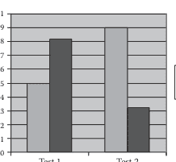

图 4.1 不同切点下 PEA 与 GA 的对比。

切点为3。同样，对于测试2，考虑切点为7时，8–10区域具有更快的MSA。

- b. *不同序列长度下的CDM与GA*：使用CDM和GA比较不同长度序列的运行时间。在图4.2中，给出了两组序列（5、8）的情形，其中较小长度的序列性能更好。

- c. *DCGA与GA对比*：已考察一组长度为10、20和30的序列。CDM从左到右寻找“保守区域”。下一步，DCGA仅对右侧片段应用GA。DCGA优于GA，因为GA必须对所有长度的序列使用（选择、交叉和变异）操作。序列长度越大，DCGA的性能越好（图4.3）。

- 2. 针对聚类开发了两种场景。

- a. *2-D、3-D数据*：以运行时间为度量，针对300个点的2-D和3-D数据对CGA_SSE进行了考察。3-D数据的运行时间更长（图4.4）。

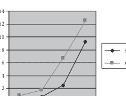

图 4.2 两组序列（5、8）的MSA。

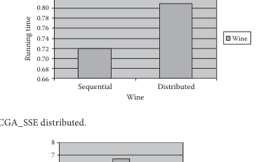

图 4.6 分布式 CGA_SSE。

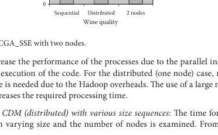

图 4.7 双节点 CGA_SSE。

由于代码采用并行执行而非顺序执行，因此提高了各进程的性能。对于分布式（单节点）情形，由于Hadoop开销，需要更多处理时间。使用大量节点会减少所需的处理时间。

c. 不同长度序列下的CDM（分布式）：考察了四条序列在不同长度和不同节点数下的时间。从图4.8可以看出，序列长度越大，比对时间越长。当涉及更多节点时，时间显著减少。


图 4.8 不同序列长度下的CDM。

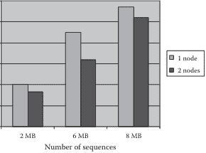

图 4.9 不同序列数量下的CDM。

- d. *不同序列数量下的CDM（分布式）*：对于所有长度的序列，使用两个节点的Hadoop比仅使用一个节点具有更好的时间性能（图4.9）。

## 4.11 结论

已开发出一组算法，利用点阵和结合GA的分治方法来寻找MSA。CDM发现一致性，而PEA提供MSA。在DCGA中，根据切点值或正在处理的子序列长度，会得到偏向PEA或GA的不同结果。这为部分MSA提供了机会。此外，采用分治技术的DCGA能够有效降低MSA的空间复杂度，从而不会破坏由CDM获得的一致性。对于左侧具有“保守区域”的长序列，DCGA优于GA。这是因为GA使用序列的整体长度。最后，与K-means相比，CGA_SSE能够利用SSE准则发现最优聚类。

采用MapReduce框架的Hadoop通过将应用划分为许多可并行执行的小工作块，能够提供简便的解决方案。结合Hadoop的CGA_SSE和CDM是MapReduce能够解决大规模处理问题的示例。通常，对于具有海量种群的问题，Hadoop为使用多节点MapReduce解决难题提供了新方向。未来工作将涉及MSA、神经网络和Hadoop。

## 参考文献

1. J. Stoye, A. Dress, S. Perrey，“改进成对求和多序列比对的分治方法”，*Applied Mathematical Literature* 10(2):67–73, 1997. Mathematical Reviews, 1980.

- 2. S.-M. Chen, C.-H. Lin，“基于遗传算法和分治技术的多DNA序列比对”，Information and Management Science Journal 18(2):76–111, 2007.
- 3. H. Garrido, D. Lipman，《生物学中的多序列比对问题》，Addison-Wesley，Boston，1989。
- 4. J. Han, M. Kamber, J. Pei，《数据挖掘：概念与技术》，第3版，MK，2012。
- 5. C. Lam，《Hadoop实战》，Manning，Stamford，CT，2011。
- 6. J. Dean, S. Ghemawat，“MapReduce：大规模集群上的简化数据处理”，*Communications of the ACM* 51(1):107–113, 2008。
- 7. R. Raghuraman, A. Penmetsa, G. Bradski, C. Kozyrakis，“评估面向多核与多处理器系统的MapReduce”，Proceedings 2007 IEEE, 13th Intern. Symposium on High Performance Computer Architecture，2007年1月。
- 8. J. Ekanayake, H. Li, B. Zhang, T. Gunarathne, S. Bae, J. Qiu, G. Fox，“Twister：迭代MapReduce的运行时”，Proc. 19th ACM Inter. Symposium on High Performance Distributed Computing，2010，第810–818页。
- 9. D. Mount，《生物信息学：序列与基因组分析》，第2版，CSHL Press，2004。
- 10. Apache Hadoop。可从 http://hadoop.apache.org 获取。
- 11. T. White，《Hadoop权威指南》，O'Reilly Media，Yahoo Press，Cambridge，MA，2009年6月5日。
- 12. R. Taylor，“Hadoop/MapReduce/HBase框架及其当前在生物信息学中的应用概述”，BMC Bioinformatics 11(Suppl 12):S1, 2010。可从 http://www.biomedcentral.com/1471-2105/11/12/S1 获取。
- 13. A. Hughes, Y. Ruan, S. Ekanayake, S. Bae, Q. Dong, M. Rho, J. Qiu, G. Fox，“用于在超大型序列集中识别簇的插值多维标度技术”，BMC Bioinformatics 12(Suppl 2):S9, 2012。可从 http://www.biomedcentral.com/1471-2105/13/52/59 获取。
- 14. C. Zhang, A. Wong，“面向高效的多分子序列比对：一种遗传算法与动态规划系统”，IEEE Transaction System Man and Cybernetics B 27(6):918–932, 1997。
- 15. D. Colberg，《搜索、优化与机器学习中的遗传算法》，Addison-Wesley，Boston，1989。
- 16. K. Jong，“利用遗传算法学习：概述”，Machine Learning 3:121–138, 1988。
- 17. E. Hruschka, R. Campello, L. Castro，“提高聚类遗传算法的效率”，《人工智能进展》，IBERAMIA 2004，LNCS第3315卷，2004，第861–870页。
- 18. K. Maulik, S. Bandyopadhyay，“基于遗传算法的聚类技术”，Pattern Recognition 33:1455–1465, 2000。

## II 大数据处理

大数据要尽可能快地处理，这对科学家和分析人员都构成了新的挑战。然而，高性能计算（HPC）技术仍然缺乏适应当前数据增长的工具集。在这种情况下，新的范式与存储工具被集成到HPC中，以应对当前与数据管理相关的挑战。其中一些技术包括将计算作为一种实用工具提供（云计算），以及引入新的并行与分布式范式。近来，云计算发挥了重要作用，因为它使组织能够经济高效地分析和存储数据。例如，随着数据开始迁移到云中并在云中进行管理，云中执行HPC被引入。例如，Digital Communications Inc.（DCI）表示，到2020年，数字数据的很大一部分将在云中管理；即使数字宇宙中的某个字节未存储在云中，它也会在某个时刻经过云[6]。

在云中执行HPC被称为高性能计算即服务（HPCaaS）。因此，需要一个能够处理与大数据相关的复杂性和挑战的可扩展HPC环境[7]。人们已经提出并开发了许多解决方案来提高大数据的计算性能。其中一些倾向于提高算法效率、提供新的分布式范式或开发强大的聚类环境，尽管这些解决方案中很少涉及在存储和处理方面将HPC与当前新兴技术集成起来的整体图景。

本章介绍大数据概念及其在现代世界中的重要性，以及一些现有项目；这些项目在将科学概念转变为大科学乃至社会方面有效且重要。在本工作中，我们将重点关注大数据高性能挖掘的高效方法，尤其是文献中提出的现有解决方案及其在大数据分析和处理中HPC的效率。本章其余部分安排如下。5.2节介绍大数据的定义及相关概念。5.3节介绍数据处理和分析的现有解决方案。5.4节介绍一些遗留问题和进一步研究方向。5.5节给出结论与展望。

## 5.2 大数据定义与概念

社交媒体网站涉及大量数据，这些数据对经济评估和社会发展非常有用。因此，大数据被定义为由不同来源生成的大型复杂数据集，这些来源包括社交媒体、在线交易、传感器、智能电表和管理服务[8]。凭借所有这些来源，大数据的规模超出了典型数据存储、分析和处理工具的能力。关于大数据的文献综述将该概念分为四个维度：数据量、速度、多样性和价值[8]。换言之，（1）生成的数据规模非常大，从TB级到PB级；（2）数据以指数速率持续增长；（3）数据以不同形式生成：结构化、半结构化和非结构化数据，这需要能够处理数据异构性的新技术；以及（4）大数据中的挑战在于识别什么是有价值的，从而能够捕获、转换并

通过允许用户设计、建模、开发和测试已部署的应用，从而对这些应用进行控制。PaaS 的示例包括 Google App Engine、Microsoft Azure、Salesforce 等。

IaaS 由一组虚拟化计算资源组成，例如网络带宽、存储容量、内存和处理能力。这些资源可用于部署和运行任意软件，包括操作系统和应用程序。IaaS 提供商的示例包括 Dropbox、Amazon Web Services (AWS) 等。

如表 5.1 所示，还有许多其他提供商提供不同功能和定价的云服务 [20]。例如，Amazon (AWS) [21] 为各种规模的企业提供众多云服务。AWS 的一些服务包括 Elastic Compute Cloud、Simple Storage Service、SimpleDB（一种关系型数据存储服务，可在云端存储、处理和查询数据集）等。Google [22] 在其云服务中提供高可访问性和易用性。Google 的一些服务包括 Google App Engine、Gmail、Google Docs、Google Analytics、Picasa（一种用于展示产品并在云端上传产品图像的工具）等。

近年来，HPC 被用来提供高计算能力、高带宽和低延迟网络，以应对大数据的复杂性。HPC 通过实现大型物理集群来满足这些要求。然而，传统 HPC 在获取和运营物理环境方面面临一系列挑战，包括峰值需求、高额资本和高水平专业知识 [23]。为了解决这些问题，HPC 专家利用了包括云技术和大规模存储基础设施在内的新技术趋势的优势。将 HPC 与这些新技术融合，催生了一种新的 HPC 模型——HPCaaS。HPCaaS 是一种新兴的计算模型，最终用户可按需访问预先存在的所需技术，这些技术提供高性能和可扩展的 HPC 计算环境 [24]。由于云技术提供了更好的服务质量，以及 Hadoop 分布式文件系统 (HDFS) 和 MapReduce 范式等提供了更好的并行处理和存储，HPCaaS 带来了无限的好处。参考文献 23 中列举了 HPCaaS 的一些好处，如下所示：

- (1) 高可扩展性：资源按需扩展，以确保在处理大规模复杂数据集时满足用户需求所需的基本资源。
- (2) 低成本：最终用户可以消除采购 HPC 的初始资本支出、时间和复杂性。
- (3) 低延迟：通过实施放置组概念，确保数据在同一服务器上执行和处理。

**表 5.1** 云计算环境中提供的服务示例

| 部署模型 | 类型 | 示例 |
|---|---|---|
| 软件即服务 | Gmail、Google Docs、财务、协作、通信、业务、CRM | Zoho、Salesforce、Google Apps |
| 平台即服务 | Web 2.0 应用程序运行时、开发人员工具、中间件 | Windows Azure、Aptana、Google App Engine |
| 基础设施即服务 | 服务器、存储、处理能力、网络资源 | Amazon Web Services、Dropbox、Akamai |

编程模型和 Hadoop 系统，让对并行和分布式系统知之甚少的用户能够轻松实现并行算法，并在多处理器环境或多线程机器上运行它们。它还提供预编程的并行算法，如支持向量机分类器、线性回归和变换回归、最近邻、K-means 和主成分分析 (PCA)。*NIMBLE* 是另一个用于在 MapReduce 上实现并行数据挖掘和机器学习算法的工具包 [32]。其主要目的是让用户开发并行机器学习算法，并在分布式和共享内存机器上运行它们。

另一类机器学习系统已被开发出来，并将 Hadoop 用作数据分析的处理环境。例如，*Kitenga Analytics* (http://software.dell.com/products/kitenga-analytics-suite/) 平台提供了具有易用界面的分析工具，用于大数据的复杂处理和分析。它将 Hadoop、Mahout 机器学习和高级自然语言处理集成在一个完全集成的平台中，用于快速内容挖掘和大数据分析。此外，它可以被认为是第一个集成并处理多样化非结构化、半结构化和结构化信息的大数据搜索与分析平台。*Pentaho Business Analytics* (http://www.pentaho.fr/explore/pentaho-business-analytics/) 是另一个用于数据集成和分析的平台。它提供全面的工具，支持数据预处理、数据探索和数据提取，以及用于可视化和在 Hadoop 平台上分布式执行的工具。其他系统，如 *BigML* (https://bigml.com/)、*Google Prediction API* (https://cloud.google.com/products/prediction-api/) 和 Eigendog，最近开发了用于数据处理和分析的服务。例如，Google Prediction API 是 Google 基于云的机器学习工具，用于分析数据。然而，这些解决方案不能用于从社交媒体和社交网络（例如 Twitter、Facebook）中提取的文本。

近年来，人们对文本挖掘和自然语言处理方法越来越感兴趣。这些解决方案以基于云的服务形式提供给用户。值得注意的是，文本挖掘方法的主要目的是提取特征，例如概念提取和情感或观点提取。然而，需要处理的文档的大小和数量要求开发新的解决方案。有几种解决方案通过网络服务提供。例如，*AlchemyAPI* (http://www.alchemyapi.com/) 提供自然语言处理网络服务，用于处理和分析大量非结构化数据。它可用于对大量文档和推文执行关键词/实体提取和情感分析。换句话说，它使用语言解析、自然语言处理和机器学习来分析和提取网页内容中的语义信息（即有价值的信息）。

### 5.3.2 计算即 IaaS

提供高性能数据分析使用户无需安装和管理自己的集群。这可以通过使用公共提供商提供的计算集群来实现。事实上，高性能平台易于创建且维护轻松。这些解决方案使用户能够在其定制云集群上试验复杂算法。

值得注意的是，随着数据开始迁移到云端并在云端管理，在云中执行 HPC 的概念被引入。如第 5.2 节所述，在云中执行 HPC 被称为 HPCaaS。

简而言之，HPCaaS 提供高性能、按需、可扩展的 HPC 环境，可以处理与大数据相关的复杂性和挑战 [7]。最著名且采用最广泛的并行分布式系统之一是 MapReduce 模型，它是由 Google 开发的，以满足其网页搜索索引过程的增长 [33]。MapReduce 计算在称为 Google 文件系统 (GFS) 的数据存储系统的支持下执行。GFS 和 MapReduce 的成功启发了 Hadoop 的开发，Hadoop 是一个实现了 MapReduce 和 HDFS 的分布式并行系统 [34]。如今，Hadoop 因其可扩展性、可靠性和低成本实现而被市场上的大型企业广泛采用。Hadoop 也被提议与 HPC 集成，作为在 HPC 集群中分配工作的底层技术 [35,36]。借助这些解决方案，用户不再需要掌握 HPC 相关领域的高技能即可访问计算资源。

最近，一些基于云的 HPC 集群与用于数据分析的软件包（例如 Octave、R 系统）一起提供给用户 [31]。其主要目的是为用户提供合适的环境，这些环境配备了可扩展的高性能资源和统计软件，用于日常数据分析和处理。例如，Cloudnumbers.com (http://www.scientific-computing.com/products/product_details.php?product_id=1086) 是一个基于云的 HPC 平台，可用于处理来自金融和社会科学等不同领域的大数据的耗时任务。此外，用户可以通过 Web 界面创建、监控和轻松维护其工作环境。另一个类似于 Cloudnumbers.com 的环境是 Opani (http://opani.com)，它提供了额外的功能，允许用户根据数据大小调整资源。虽然这些解决方案是可扩展的，但需要高水平的统计专业知识，因此此类解决方案的提供商数量有限。为了克服这一缺点，提出了一些解决方案，允许用户构建他们的云 Hadoop 集群并运行他们的应用程序。例如，RHIPE (http://www.datadr.org/) 提供了一个框架，允许用户访问 Hadoop 集群并启动复杂大数据的 Map/Reduce 分析。它是一个由 R（一种用于数据分析的交互式语言）、HDFS 和 MapReduce 组成的环境。其他环境，如 Anaconda (https://store.continuum.io/cshop/anaconda/) 和 Segue (http://code.google.com/p/segue/)，是为在集群之上执行 Map/Reduce 作业以进行大数据分析而开发的。

## 5.4 挑战与当前研究方向

大数据在社交媒体、在线交易、传感器、智能电表和管理服务等许多领域无处不在。在过去几年中，人们提出并开发了许多解决方案来提高大数据的计算性能。其中一些方案旨在提高算法效率、提供新的分布式范式或开发强大的集群环境。例如，机器学习提供了广泛的

技术，例如关联规则挖掘、决策树、回归、支持向量机以及其他数据挖掘技术[37]。

然而，这些解决方案中很少有从大数据的存储和处理角度，完整解决将HPC与当前新兴技术相集成的问题，尤其是那些从社交媒体中提取的数据。目前用于托管和处理大数据的一些最流行技术是云计算、HDFS和Hadoop MapReduce[38]。目前，HPC在云计算中的使用仍然有限。美国能源部国家实验室（DOE）迈出了这项研究的第一步，开始探索将云服务用于科学计算[24]。此外，2009年，Yahoo Inc.与美国主要顶尖大学建立合作关系，以开展更多关于云计算、分布式系统和高性能计算应用的研究。

最近，已有若干研究评估了云中高性能计算的性能。这些研究大多使用亚马逊弹性计算云（Amazon EC2）作为云环境[26,39–42]。此外，只有少数研究评估了将新兴分布式范式与云环境相结合时高性能计算的性能[43]。例如，在文献39中，作者在三个不同的云提供商上评估了HPC：Amazon EC2、GoGrid云和IBM云。对于每个云平台，他们在Linux虚拟机（VM）上运行HPC，并得出结论：所测试的公共云似乎并未针对运行HPC应用进行优化。其原因在于公共云平台中VM之间的网络连接较慢。此外，文献26的作者评估了HPC应用在当前云环境（Amazon EC2）中的性能，以理解迁移到云时的权衡。总体结果表明，在EC2云平台上运行HPC会限制性能并导致显著波动。除Amazon EC2外，研究[44]还评估了在三个不同平台上运行HPC应用的性能-成本权衡。第一个和第二个平台由两个物理集群（Taub和Open Cirrus集群）组成，第三个平台由采用基于内核的虚拟机（KVM）虚拟化的Eucalyptus组成。在这些平台上运行HPC使作者得出结论：对于低通信密集型应用，云更具成本效益。

也有研究使用不同虚拟化技术对HPC进行评估，而未将其与新的云技术相关联[45–48]。例如，在文献45中，作者分析了包括VMware、Xen和OpenVZ在内的虚拟化技术。他们的发现表明，没有一种技术能完全匹配基础系统的性能；然而，OpenVZ在文件系统性能和行业标准基准方面均表现出高性能。在文献46中，作者比较了KVM和VMware的性能。总体发现表明，VMware的性能优于KVM。不过，在少数情况下，KVM给出的结果优于VMware。在文献47中，作者对两个领先的开源虚拟机管理程序Xen和KVM进行了定量分析。他们的研究评估了每种虚拟化技术下VM的性能隔离、整体性能和可扩展性。简而言之，他们的发现表明，KVM在客户机崩溃方面存在重大问题（当增加客户机数量时）；然而，KVM的性能隔离仍优于Xen。最后，在文献48中，作者广泛比较了四种虚拟机管理程序：Hyper-V、KVM、VMware和Xen。他们的结果表明，没有完美的虚拟机管理程序。然而，尽管评估了不同技术，HPCaaS仍需更多研究，以确定适合大数据分析的环境。

在我们最近的工作中，已在三个不同集群上进行了不同实验：Hadoop物理集群（HPhC）、使用KVM的Hadoop虚拟化集群（HVC-KVM）和使用VMware Elastic Sky X Integrated的Hadoop虚拟化集群（HVC-VMware ESXi），如图5.1所示[49]。

使用两个主要基准——TeraSort和HDFS I/O饱和（TestDFSIO）基准[50]——来研究机器虚拟化对HPCaaS的影响。TeraSort会执行大量计算、网络和存储输入/输出（I/O），通常被认为能代表真实的Hadoop工作负载。TestDFSIO基准用于通过写和读操作检查Hadoop集群的I/O速率。此类基准有助于通过检查网络性能以及测试硬件、操作系统和Hadoop设置来测试HDFS。例如，图5.2显示了在HPHC上运行TeraSort基准和TestDFSIO-Write时获得的一些实验结果。

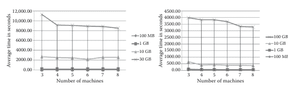

图5.2 在Hadoop物理集群上的性能：(a) TeraSort和(b) TestDFSIO-Write。（引自 Achahbar, O.，《虚拟化对云中高性能计算集群的影响》，硕士学位论文报告，摩洛哥伊夫兰Al Akhawayn大学，2014年。）

图5.2a表明，对10 GB和30 GB等大型数据集进行排序需要大量时间。然而，将集群扩展到更多节点显著减少了数据集排序所需的时间。图5.2b表明，随着VM数量增加，写入不同大小数据集时的平均时间减少。事实上，Hadoop VMware ESXi集群在对大数据集排序（计算更多）方面表现更好，而Hadoop KVM集群在I/O操作方面表现更好。

此外，尽管已经开发出若干并行机器学习算法，并使用传统HPC架构将其集成到云环境中，但其他技术在新兴技术（如图形处理单元（GPU）[51]）中仍未得到充分利用。值得注意的是，基于GPU的计算是并行计算中的巨大范式转变，有望带来性能的显著提升。GPU是为计算密集型应用而设计的；它们允许在更多处理单元上执行线程。拥有大量线程使得超越当前多核CPU的性能成为可能。

如今，GPU编程环境比几年前丰富得多。在两种主要编程语言——统一计算设备架构（CUDA）[52]和开放计算语言（OpenCL）——之上，已经开发出一些库，使人们无需详细了解或编程GPU硬件即可快速访问GPU的计算能力。GPU[53]可用作大数据分析的加速器，例如用于社交媒体、传感器数据流中的统计分析、预测模型等。GPU还可集成到云计算中，为大数据提供GPU加速的云服务。例如，由于GPU并不昂贵且性能优于多核机器，它们可以作为云环境的实用基础设施。此外，大部分工作一直致力于机器学习

- 15. MongoDB。可从 http://www.mongodb.org/ 获取。
- 16. Apache CouchDB™。可从 http://couchdb.apache.org/ 获取。
- 17. D. Boulter，《简化你的云之旅》，Capgemini and SOGETI，2010，第1–8页。
- 18. P. Mell 和 T. Grance，《NIST云计算定义》，美国国家标准与技术研究院，2011，第1–3页。
- 19. A. E. Youssef，《探索云计算服务与应用》，《新兴计算与信息科学趋势杂志》，第3卷，第6期，第838–847页，2012年。
- 20. A. T. Velte、T. J. Velte 和 R. Elsenpeter，《云计算：实用方法》，第1版，McGraw-Hill Osborne Media，纽约，352页，2009年。
- 21. Amazon Web Services。可从 http://aws.amazon.com/ 获取。
- 22. Google Cloud Platform。可从 https://cloud.google.com/ 获取。
- 23. J. Bernstein 和 K. McMahon，《按需计算——HPC即服务》，第1–12页，Penguin On Demand。可从 http://www.penguincomputing.com/files/whitepapers/PODWhitePaper.pdf 获取。
- 24. Y. Xiaotao、L. Aili 和 Z. Lin，《云环境中的高性能计算研究》，载于第三届计算机科学与计算技术国际研讨会（ISCSCT），2010，第289–293页。
- 25. 自助POD门户。可从 http://www.penguincomputing.com/services/hpc-cloud/pod 获取。
- 26. K. R. Jackson，《Amazon Web Services云上高性能计算应用的性能分析》，载于《云计算技术与科学（CloudCom）》，2010年IEEE第二届国际会议，2010，第159–168页。
- 27. Amazon Cloud Storage。可从 http://aws.amazon.com/ec2/reserved-instances/ 获取。
- 28. Amazon Cloud Drive。可从 http://aws.amazon.com/ec2/spot-instances/ 获取。
- 29. 面向开发人员的Microsoft高性能计算。可从 http://msdn.microsoft.com/en-us/library/f976568.aspx 获取。
- 30. Google Cloud Storage。可从 https://cloud.google.com/products/compute-engine 获取。
- 31. D. Pop，《机器学习与云计算：分布式和SaaS解决方案综述》，蒂米什瓦拉e-Austria研究所技术报告，2012年。
- 32. A. Ghoting、P. Kambadur、E. Pednault 和 R. Kannan，《NIMBLE：在MapReduce上实现并行数据挖掘和机器学习算法的工具包》，载于KDD，2011年。
- 33. J. Dean 和 S. Ghemawat，《MapReduce：大型集群上的简单数据处理》，载于OSDI，2004，第1–12页。
- 34. Hadoop。可从 http://hadoop.apache.org/ 获取。
- 35. S. Krishnan、M. Tatineni 和 C. Baru，《MyHadoop——传统HPC资源上的按需Hadoop》，载于美国国家科学基金会集群探索计划，2011，第1–7页。
- 36. E. Molina-Estolano、M. Gokhale、C. Maltzahn、J. May、J. Bent 和 S. Brandt，《在并行文件系统上混合Hadoop和HPC工作负载》，载于第四届千万亿级数据存储年度研讨会，2009，第1–5页。
- 37. S. R. Upadhyaya，《机器学习的并行方法——全面综述》，《并行与分布式计算杂志》，第73卷，第284–292页，2013年。
- 38. C. Cranor、M. Polte 和 G. Gibson，《使用PLFS在Hadoop存储上进行HPC计算》，卡内基梅隆大学并行数据实验室，2012，第1–9页。
- 39. S. Zhou、B. Kobler、D. Duffy 和 T. McGlynn，《在公共云中运行HPC应用的案例研究》，载于Science Cloud ’10，2012年。
- 40. E. Walker，《面向高性能科学计算的Amazon EC2基准测试》，德克萨斯大学德克萨斯高级计算中心，2008，第18–23页。
- 41. J. Ekanayake 和 G. Fox，《利用云和云技术的高性能并行计算》，印第安纳大学信息学与计算学院，2009，第1–20页。


- 42. Y. Gu 和 R. L. Grossman，“Sector 与 Sphere：高性能数据云的设计与实现”，美国国家科学基金会，2008年，第1–11页。
- 43. C. Evangelinos 和 C. N. Hill，“面向并行科学 HPC 应用的云计算：在 Amazon EC2 上运行海气耦合气候模型的可行性研究”，麻省理工学院地球、大气与行星科学系，2009年，第1–6页。
- 44. A. Gupta 和 D. Milojicic，“云上 HPC 应用评估”，惠普开发公司，2011年，第1–6页。
- 45. C. Fragni、M. Moreira、D. Mattos、L. Costa 和 O. Duarte，“评估 Xen、VMware 和 OpenVZ 虚拟化平台用于网络虚拟化”，里约热内卢联邦大学，2010年，共1页。可于 http://www.gta.ufrj.br/ftp/gta/TechReports/FMM10b.pdf 获取。
- 46. N. Yaqub，“虚拟化性能比较：VMWare 与 KVM”，硕士论文，DUO 数字出版物，挪威奥斯陆大学，2012年，第30–44页。可于 http://urn.nb.no/URN:NBN:no-33642 获取。
- 47. T. Deshane、M. Ben-Yehuda、A. Shah 和 B. Rao，“Xen 与 KVM 的定量比较”，载于 Xen 峰会，2008年，第1–3页。
- 48. J. Hwang、S. Wu 和 T. Wood，“四种 Hypervisor 的基于组件的性能比较”，乔治华盛顿大学与 IBM T.J. Watson 研究中心，2012年，第1–8页。
- 49. O. Achahbar，“虚拟化对云中高性能计算集群的影响”，硕士论文报告，摩洛哥伊夫兰阿卡韦恩大学，2014年。
- 50. M. G. Noll，“使用 TeraSort、Test DFSIO 等对 Hadoop 集群进行基准测试和压力测试”，2011年。
- 51. E. Wu 和 Y. Liu，“关于 GPGPU 的新兴技术”，APCCAS，IEEE 亚太电路与系统会议，2008年。
- 52. NVIDIA，“NVIDIA CUDA 统一计算设备架构：编程指南”，2.3版，2009年7月。可于 http://www.cs.ucla.edu/~palsberg/course/cs239/papers/CudaReferenceManual_2.0.pdf 获取。
- 53. W. Fang，“图形处理器上的并行数据挖掘”，技术报告 HKUST-CS08-07，2008年10月。

## 大数据科学中的调度艺术

Florin Pop 和 Valentin Cristea

## 目录

- 6.1 引言 106
- 6.2 大数据平台中的调度需求 107
- 6.3 调度模型与算法 109
- 6.4 数据传输调度 113
- 6.5 调度策略 114
- 6.6 调度的优化技术 115
- 6.7 Hadoop 与大数据应用案例研究 116
- 6.8 结论 118
- 参考文献 118

## 摘要

许多应用都会产生大数据，例如社交网络和社交影响程序、云应用、公共网站、科学实验和模拟、数据仓库、监控平台以及电子政务服务。由于应用持续产生不断增长的非结构化和结构化数据，数据量迅速增长。这对数据处理、传输和存储的影响是，需要重新评估方法和解决方案，以更好地满足用户需求。在这种背景下，调度模型和算法发挥着重要作用。由于针对特定应用和平台存在大量解决方案，因此对大数据处理和存储环境中使用的调度模型、方法和算法的现有解决方案进行透彻而系统的分析具有重要意义。本章介绍了现有解决方案中的最佳实践，并概述了当前和近期未来的趋势。它将从研究角度突出现有解决方案的性能和局限性，并为学术界科学家和工业界设计人员提供大数据处理相关调度和资源管理领域的现状概览。

## 6.1 引言

数据量的快速增长要求每天处理 PB 级数据。思科估计，仅移动数据流量在 2017 年每月就将达到 11.16 EB。产生的数据要经过不同类型的处理，从对情境感知应用具有影响的实时处理，到用于提取有价值信息的数据挖掘分析。多 V（体量、速度、多样性、真实性和价值）模型常被用于描述大数据处理需求。体量定义数据量大小，速度指数据产生和处理的速率，多样性指数据类型，真实性描述数据在其来源上可被信任的程度，价值指数据相对于特定上下文的重要性[1]。

调度在大数据优化中扮演重要角色，尤其是在缩短处理时间方面。大数据平台中调度的主要目标是以最少的数据迁移次数，通过高效地处理和变更数据，规划尽可能多任务的处理和完成。云、高性能计算（HPC）、网格和对等系统中采用各种机制进行资源分配，这些系统具有不同的架构特征。例如，在 HPC 中，用于数据处理的集群是同质的，可以通过应用预定义规则并行处理许多任务。另一方面，云系统是异构且广泛分布的；任务管理和执行感知通信规则，并有可能为调度机制创建特定规则。大数据处理框架中实际使用的调度方法如下：先来先服务、公平调度、容量调度、最长近似结束时间（LATE）调度、截止时间约束调度和自适应调度[2,3]。针对特定处理请求找到最佳方法仍然是一项重大挑战。我们可以将大数据处理视为在 HPC 集群上运行的大型“批处理”过程，将一个作业拆分为更小的任务并将工作分发给集群节点。社交网络、图分析和复杂业务流程等新型应用需要数据传输和数据存储。在决定将数据移动到计算节点或是在数据位置附近创建新计算节点时，处理模型必须考虑数据局部性。工作负载优化策略是通过最大程度利用资源来保证资源提供者获利的关键。对于计算密集型和数据密集型应用，处理模型结合了内存、CPU 和/或图形处理器（GPU）大数据处理等不同技术。

此外，由于集群、网格、云和对等等多种分布式系统类型实际上为高级处理提供了支持，大数据平台面临环境异构性的问题。在大数据与广泛分布式平台交汇之处，调度解决方案既考虑高效问题求解和并行数据传输（隐藏传输延迟）的解决方案，也考虑高度异构计算系统中的故障管理技术。此外，处理异构数据集成为各软件系统间互操作性的挑战。

本章重点介绍了大数据平台中调度的具体需求、调度模型与算法、数据传输调度程序、不同计算模型中使用的策略以及优化技术。本章最后给出了关于 Hadoop 和大数据的案例研究，并描述了将新结构化查询语言（NewSQL）数据库与分布式文件系统和计算环境集成的新方式。

## 6.2 大数据平台中的调度需求

传统调度模型的需求源自应用、数据库和存储资源，这些需求多年来呈指数增长。因此，将传统调度模型适配到大数据平台的成本和复杂性不断增加，促使数据存储、分析和访问方式发生变化。传统模型正在扩展，以纳入新的构建模块。这些模块通过构建满足大数据需求的新信息处理框架来应对大数据的挑战。

大数据平台中应用和服务的集成需要集群资源管理层作为中间件组件，也需要针对不同模型（批处理任务、数据流、NewSQL 任务等）的特定调度和执行引擎（图 6.1）。因此，在集群层和执行引擎层都有调度方法和算法。

大数据平台中调度的一般性需求定义了调度服务的功能性和非功能性规格说明。一般需求如下：

- **可扩展性和弹性：** 调度算法必须考虑可能参与处理任务的 PB 级数据量和数十万个处理器。调度器必须感知执行环境的变化，并能够通过提供或释放资源来适应工作负载变化。
- **通用性：** 调度方法应对可执行的各类应用做出合理假设并尽可能少地限制。交互式作业、

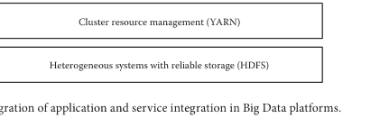

图 6.1 大数据平台中应用与服务的集成。


分布式和并行应用，以及非交互式批处理作业都应以高性能得到支持。例如，需要高吞吐量的非交互式批处理作业可能更倾向于时间共享调度；同样，需要短时响应的实时作业更倾向于空间共享调度。

- **动态性：** 调度算法应充分利用可用资源的全部范围，并可根据需要改变其行为，例如应对大量计算任务。调度器需要持续适应资源可用性的变化，特别关注云系统和 HPC 集群（数据中心）作为大数据 [4] 的可靠解决方案。
- **透明性：** 执行所在的宿主机不应影响任务的行为和结果。从用户角度来看，本地执行和远程执行之间不应有差异，用户不应察觉大数据处理中的系统变化或数据移动。
- **公平性：** 在用户之间共享资源是保证每个用户按需获得资源的一种公平方式。在云中的按需付费模式下，资源集群可以动态分配，也可以提前预留。
- **时间效率：** 调度器应尽可能利用不同的启发式方法和适用于特定任务模型的状态估计来提高已调度作业的性能。多任务系统可以通过以优化其使用的方式将任务映射到资源，从而同时为多个用户处理多个数据集。
- **成本（预算）效率：** 调度器应通过最小化使用的资源总数来降低执行总成本，并遵守总资金预算。这一方面需要高效的资源使用。这可以通过使用高性能队列系统优化混合任务的执行并减少计算和通信开销来实现。
- **负载均衡：** 这用作一种调度方法，将负载在所有可用资源之间共享。当某些资源与任务属性不匹配时，这是一个具有挑战性的要求。存在经典方法如轮询调度，但也提出了能够应对大规模和异构系统的新方法：最少连接、慢启动时间或基于代理的自适应均衡。
- **支持数据多样性和不同的处理模型：** 这通过处理多个并发输入流、结构化和非结构化内容、多媒体内容以及高级分析来实现。将任务分类为小或大、高或低优先级、周期性或偶发性将针对特定的调度技术。
- **与共享分布式中间件的集成：** 调度器必须考虑各种系统和中间件框架，如遵循物联网范式的任何地方的传感器集成，甚至使用卸载技术以节省能量的移动云解决方案。集成考虑数据访问和消耗，并支持由服务和应用程序产生的各种工作负载。

- *数据本地性感知调度*——最小化数据移动。
- *预配感知调度*——从更大的物理集群中预配 VM；该模型中考虑了虚拟资源迁移。
- *按需调度*——使用批处理调度器作为资源管理器，根据虚拟集群的需求进行节点分配。

这些模型的使用考虑了不同的具体情况：例如，当任务数量小于集群规模时推荐使用 FIFO，而当集群规模小于任务数量时公平性是最好的。容量调度用于多个任务和以响应时间为指定优先级的任务。文献 8 中提出了一种 *任务调度包* 的解决方案。用户会收到关于合理响应时间的指导，并能够选择应用程序的执行方式：花费更多钱更快，或花费更少钱但更慢。该方法中的一个重要组成部分是对实际包中任务进行分析的阶段。基本调度通过有界背包算法实现。文献 9 提出了基于在云系统中按需扩展和缩减机器数量的调度思想。该解决方案允许用户在调度每个实例的启动和关闭以满足截止日期并确保降低成本的同时，在几种类型的 VM 实例中进行选择。

基于 *遗传算法* 的调度解决方案在文献 10 中进行了描述。调度在网格系统上进行。网格与云系统不同，但作者在分配任务到资源时使用的原理是相同的。调度解决方案适用于可以建模为有向无环图的应用程序。其思想是在遵守预算的同时最小化应用程序执行的持续时间。该方法考虑了系统的异构性。

文献 11 提出了云中实例密集型工作流的调度模型，该模型同时考虑了 *预算* 和 *截止日期约束*。用户交互水平非常高，用户能够在工作流执行期间动态更改成本和截止日期要求并向调度器提供输入。干预可以在每个调度轮次进行。这是一个有趣的模型，因为用户可以根据情况选择支付更多或更少。主要特征是用户对工作流执行有更大的决策权。此外，云在工作流执行期间估计时间和成本，以向用户提供提示并动态重新调度工作负载。

*Apache Hadoop 框架* 是一个软件库，允许使用简单的编程模型 [3] 在计算机集群上处理分布在集群中的大型数据集。该框架促进了 MapReduce 应用程序的执行。通常，安装 Hadoop 系统的集群有两个主节点和多个从节点组件（图 6.2）[12]。其中一个主节点是 *JobTracker*，它处理来自用户的项目并将其发送到当前使用的调度器。另一个主节点是 *NameNode*，它管理文件系统命名空间和用户访问控制。其他机器充当从节点。*TaskTracker* 代表 Hadoop 中的一台机器，而 *DataNode* 处理与 Hadoop 分布式文件系统（HDFS）的操作，该系统

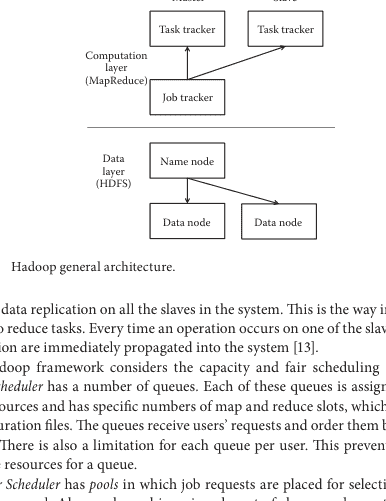

## 图 6.2 Hadoop 总体架构。

处理系统内所有从节点上的数据复制。这就是输入数据到达 map 和 reduce 任务的方式。每当在其中一个从节点上发生操作时，操作的结果会立即传播到系统中 [13]。

Hadoop 框架考虑了容量和公平调度算法。容量调度器有多个队列。这些队列中的每一个都被分配了系统资源的一部分，并具有特定的 map 和 reduce 槽数，这些槽数通过配置文件设置。队列接收用户的请求并按相关优先级对其进行排序。每个队列每个用户也有一个限制。这可以防止用户占用队列的资源。

公平调度器具有用于选择作业请求的池。每个用户都被分配到一个池。此外，每个池都被分配了一组份额，并使用它们来管理分配给作业的资源，以便每个用户无论提交多少作业都能获得相等份额。无论如何，如果系统未加载，剩余份额将分配给现有作业。公平调度器在文献 14 中提出。作者证明了其在降低响应时间和提高吞吐量方面的特殊品质。

Hadoop 的调度模型有几个扩展。文献 15 中提出了一种新的调度算法 LATE，该算法对异构性具有高度鲁棒性，而无需使用有关节点的特定信息。该解决方案解决了虚拟化数据中心中异构性带来的问题，并确保了推测任务的良好性能和灵活性。文献 16 中提出了一种满足截止日期的调度器。该调度器有一个初步阶段，用于估计实现用户声称的截止日期的可能性，作为多个参数的函数：map 和 reduce 任务的运行时间、输入数据大小、数据分布等等。仅当截止日期可以满足时才调度作业。与本节中提到的调度器相比，文献 7 中提出的遗传调度器接近截止日期约束，但也考虑了环境异构性。此外，它使用推测技术以增加

调度器的能力。遗传调度器有一个估计阶段，在该阶段会测量每个应用的处理数据速度。调度器确保，一旦某个应用开始执行，在正常条件下该应用将成功结束。Hadoop按需（HOD）[3]虚拟集群使用Torque资源管理器进行节点分配，并自动准备配置文件。然后，它基于虚拟集群内的节点初始化系统。HOD可以以相对独立的方式使用。

为支持多用户场景[14,17]，Hadoop框架集成了若干适合大数据处理的组件（图6.3），因为这些组件通过海量数据提供高可扩展性，并支持访问广泛分布的数据。以下是对这些组件的简要描述：Hadoop Common由支持任何Hadoop模块和任何新扩展的通用工具组成。HDFS提供对应用数据的高吞吐量访问。Hadoop YARN（Apache Hadoop NextGen MapReduce）是一个用于作业调度和集群资源管理的框架，可跨多个平台扩展。Hadoop MapReduce是一个基于YARN的系统，用于大数据集的并行处理。

Facebook的解决方案Corona [18]扩展并改进了Hadoop模型，提供更好的可扩展性和集群利用率、更小作业的更低延迟、无中断升级能力，以及基于实际任务资源需求而非map和reduce任务数量的调度。Corona旨在应对Facebook最重要的挑战：独特的可扩展性（最大集群拥有超过100 PB数据）和处理需求（每天处理超过6万条Hive查询）。Facebook内部数据仓库在2008年至2012年间增长了2500倍，预计到2016年还将以相同倍数增长。

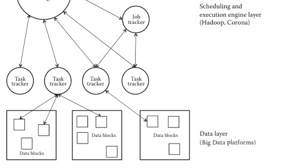

图6.3 Hadoop处理与大数据平台。

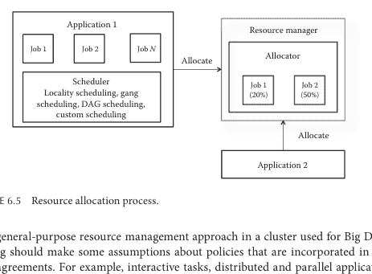

图6.5 资源分配过程。

用于大数据处理的集群中的通用资源管理方法，应对纳入服务级别协议中的策略作出一些假设。例如，交互式任务、分布式与并行应用以及非交互式批处理任务都应得到高性能支持。这一特性很直接，但在某种程度上难以实现。因为任务具有不同属性，在共享环境中它们对调度器的需求可能相互矛盾。例如，需要短时间响应的实时任务偏好空间共享调度；需要高吞吐量的非交互式批处理任务可能偏好时间共享调度[6,29]。为了具备通用性，可能必须作出权衡。该调度方法聚焦于并行任务，同时为其他类型任务提供可接受的性能。

YARN有一个用于动态策略加载的可插拔解决方案，考虑资源分配过程的两个步骤（图6.5）。资源分配由YARN完成，任务调度由应用完成，这使YARN平台成为通用平台，同时仍允许调度策略具有灵活性。YARN中的具体策略面向根据应用提供的调度进行资源拆分。这样，YARN的调度器根据资源可用性和配置的共享策略，决定分配多少资源以及在哪个集群中分配资源。

## 6.6 调度优化技术

大数据平台中的调度是使数据中心更易被应用和用户群体使用的主要构建模块。优化的一个示例是Hadoop中许多任务的多目标多约束调度[30]，或用Hadoop优化短作业[31]。调度优化策略因每种模型和每种应用类型而异。最常用的调度优化技术如下：

- 线性规划使调度器能够基于已定义的约束找到合适资源或资源集群。
- *动态分区*将复杂应用拆分为任务簇，并用特定调度算法调度每个任务簇。
- *组合优化*旨在为有限资源集合找到最优分配方案。这是一种耗时技术，不推荐用于实时处理。
- *演化优化*旨在在特定约束内为特定系统找到最优配置，由特定仿生技术组成，如遗传与免疫算法、蚁群与蜂群计算、粒子群优化等。这些方法通常能为调度问题找到近优解。
- *随机优化*使用出现在优化问题本身公式中的随机变量，尤其用于具有确定性行为的应用，即正态分布（针对周期任务）或泊松分布（针对偶发任务）等。
- *面向任务的优化*考虑任务属性、到达时间（松弛优化）和频率（针对周期任务）。
- *面向资源的优化*在作出最大化资源利用率的决策时考虑完成时间约束。

## 6.7 Hadoop与大数据应用案例研究

我们可以认为，在Apache Hadoop或某个Hadoop发行版之上，可以使用生成大数据的大数据套件和调度应用。Hadoop框架适合特定的高价值、高容量工作负载[32]。通过将合适的大数据工作负载放入合适的系统来优化资源和数据管理，YARN与特定调度器（G-Hadoop [33]、MPI Scheduler、Torque等）的集成提供了一种解决方案。IBM、Oracle和Hortonworks Data Platform（HDP）开发了Hadoop的成本效益、可扩展性和精简架构，主要目标是构建一个Hadoop操作系统。Hadoop可通过集成到Hadoop框架中的相关项目用于公共/私有云，试图为以下问题提供最佳答案：为了实现成本感知云调度器[34]，应将何种类型的数据/任务迁移到公共云？

在应用开发和实现中使用并集成Hadoop的不同平台会考虑不同方面。建模是第一个方面。即使在为Hadoop集群提供基础设施的Apache Hadoop中，通过编写复杂代码来构建特定MapReduce应用仍然非常复杂。生成MapReduce代码的Pig Latin和Hive查询语言（HQL）是面向应用开发的优化语言。还支持不同调度算法和策略的集成。应用可以以图形方式建模，并生成所有所需代码。然后，在专用开发环境（Eclipse）中，大数据服务的工具链使用各种专用插件。所有代码的代码生成会自动

## 6.8 结论

过去几年，调度模型和工具经历了根本性的重新架构，以尽可能适应大规模多任务计算环境。现有解决方案的重新设计方式包括将工具拆分为多个组件，并根据每个组件的新角色和位置进行调整。工作负载和工作流序列在应用侧进行调度，然后资源管理器为执行阶段分配资源池。因此，调度对用户和提供者同时变得重要，是任何大数据科学中最优处理的最重要关键。

## 参考文献

- 1. M. D. Assuncao, R. N. Calheiros, S. Bianchi, M. A. Netto, and R. Buyya. 大数据计算与云：挑战、解决方案与未来方向. arXiv preprint arXiv:1312.4722, 2013. 可访问：http://arxiv.org/pdf/1312.4722v2.pdf.
- 2. A. Rasooli, and D. G. Down. COSHH：一种面向异构Hadoop系统的基于分类与优化的调度器. Future Generation Computer Systems, vol. 36, pp. 1–15, 2014.
- 3. M. Tim Jones. Hadoop中的调度. 可插拔调度框架介绍. IBM developerWorks, 技术报告, 2011年12月. 可访问：https://www.ibm.com/developerworks/opensource/library/os-hadoop-scheduling.
- 4. L. Zhang, C. Wu, Z. Li, C. Guo, M. Chen, and F. C. M. Lau. 将大数据迁移到云：一种在线成本最小化方法. Selected Areas in Communications, IEEE Journal on, vol. 31, no. 12, pp. 2710–2721, 2013.
- 5. Cisco Report. Cisco UCS通用平台架构（CPA）上的大数据解决方案. 可访问：http://www.cisco.com/c/en/us/solutions/data-center-virtualization/big-data/index.html, 2014年5月.
- 6. V. Cristea, C. Dobre, C. Stratan, F. Pop, and A. Costan. 大规模分布式计算与应用：模型与趋势. IGI Global, Hershey, PA, pp. 1–276, 2010. doi:10.4018/978-1-61520-703-9.
- 7. D. Pletea, F. Pop, and V. Cristea. 面向Hadoop环境的推测式遗传调度方法. In 2012 14th International Symposium on Symbolic and Numeric Algorithms for Scientific Computing, SYNASC, pp. 281–286, 2012.
- 8. A.-M. Oprescu, T. Kielmann, and H. Leahu. 云中任务包调度的预算估计与控制. Parallel Processing Letters, vol. 21, no. 2, pp. 219–243, 2011.
- 9. M. Mao, J. Li, and M. Humphrey. 带截止时间和预算约束的云自动伸缩. In The 11th ACM/IEEE International Conference on Grid Computing (Grid 2010). Brussels, Belgium, 2010.
- 10. J. Yu, and R. Buyya. 使用遗传算法在截止时间和预算约束下调度科学工作流应用. Scientific Programming Journal, vol. 14, nos. 3–4, pp. 217–230, 2006.
- 11. K. Liu, H. Jin, J. Chen, X. Liu, D. Yuan, and Y. Yang. swindew-c中面向云计算平台上实例密集型成本约束工作流的时间-成本折中调度算法. International Journal of High Performance Computing Applications, vol. 24, no. 4, pp. 445–456, 2010.
- 12. T. White. Hadoop：权威指南. O’Reilly Media, Inc., Yahoo Press, Sebastopol, CA, 2012.
- 13. X. Hua, H. Wu, Z. Li, and S. Ren. 提升面向交互密集型任务的Hadoop分布式文件系统吞吐量. Journal of Parallel and Distributed Computing, vol. 74, no. 8, pp. 2770–2779, 2014. ISSN 0743-7315.


- 14. M. Zaharia, D. Borthakur, J. S. Sarma, K. Elmeleegy, S. Shenker, and I. Stoica. 多用户 MapReduce 集群的作业调度。技术报告，EECS 系，加利福尼亚大学伯克利分校，CA，2009 年 4 月。可在 http://www.eecs.berkeley.edu/Pubs/TechRpts/2009/EECS-2009-55.html 获取。
- 15. M. Zaharia, A. Konwinski, A. D. Joseph, R. Katz, and I. Stoica. 异构环境中提高 MapReduce 性能。载于 OSDI '08 会议录：第 8 届 USENIX 操作系统设计与实现会议论文集。USENIX Association, Berkeley, CA, pp. 29–42, 2008。
- 16. K. Kc, and K. Anyanwu. 为满足截止时间而调度 Hadoop 作业。载于 CLOUDCOM '10 会议录：2010 年 IEEE 第二届云计算技术与科学国际会议论文集。IEEE Computer Society, Washington, DC, pp. 388–392, 2010。
- 17. Y. Tao, Q. Zhang, L. Shi, and P. Chen. 多用户 MapReduce 集群的作业调度优化。载于 Parallel Architectures, Algorithms and Programming (PAAP), 2011 第四届国际研讨会，天津，中国，pp. 213–217, 2011 年 12 月 9–11 日。
- 18. Corona. 深入剖析：借助 Corona 更高效地调度 MapReduce 作业，2012 年。可在 https://www.facebook.com/notes/facebook-engineering/under-the-hood-scheduling-mapreduce-jobs-more-efficiently-with-corona/10151142560538920 获取。
- 19. B. Hindman, A. Konwinski, M. Zaharia, A. Ghodsi, A. D. Joseph, R. Katz, S. Shenker, and I. Stoica. Mesos：数据中心细粒度资源共享平台。载于第 8 届 USENIX 网络系统设计与实现会议论文集（NSDI '11）。USENIX Association, Berkeley, CA, 22 p., 2011。
- 20. Hortonworks. Hadoop YARN：下一代 Hadoop 数据处理框架，2013 年。可在 http://hortonworks.com/hadoop/yarn/ 获取。
- 21. J. Celaya, and U. Arronategui. 大规模调度的任务路由方法。*未来一代计算机系统*, vol. 29, no. 5, pp. 1097–1111, 2013。
- 22. Y. Xu, A. Suarez, and M. Zhao. IBIS：介入式大数据 I/O 调度器。载于第 22 届高性能并行与分布式计算国际研讨会论文集（HPDC '13），ACM, New York, pp. 109–110, 2013。
- 23. J. Hall, J. Hartline, A. R. Karlin, J. Saia, and J. Wilkes. 高效数据迁移算法。载于第十二届 ACM-SIAM 离散算法研讨会论文集（SODA '01）。Society for Industrial and Applied Mathematics, Philadelphia, PA, pp. 620–629, 2001。
- 24. A. Stage, and T. Setzer. 差异化虚拟机工作负载的网络感知迁移控制与调度。载于 2009 ICSE 云计算软件工程挑战研讨会论文集（CLOUD '09）。IEEE Computer Society, Washington, DC, pp. 9–14, 2009。
- 25. G. Jung, N. Gnanasambandam, and T. Mukherjee. 联邦云中优化性能的大数据分析服务同步并行处理。载于 2012 年 IEEE 第五届云计算国际会议论文集（CLOUD '12）。IEEE Computer Society, Washington, DC, pp. 811–818, 2012。
- 26. K. Ye, X. Jiang, D. Huang, J. Chen, and B. Wang. 云计算环境中带资源预留的多虚拟机实时迁移。载于 2011 年 IEEE 第 4 届云计算国际会议论文集（CLOUD '11）。IEEE Computer Society, Washington, DC, pp. 267–274, 2011。
- 27. M.-C. Nita, C. Chilipirea, C. Dobre, and F. Pop. 一种面向 IaaS 的多准则优化约束下基于 SLA 的大数据传输方法。载于 RoEduNet 国际会议（RoEduNet），2013 年第 11 届，罗马尼亚 Sinaia，pp. 1–6, 2013 年 1 月 17–19 日。
- 28. R. Van den Bossche, K. Vanmechelen, and J. Broeckhove. 混合云上截止时间约束工作负载的在线成本高效调度。*未来一代计算机系统*, vol. 29, no. 4, pp. 973–985, 2013。
- 29. H. Karatza. 分布式系统中的调度。载于 *网络系统性能工具与应用*，M. C. Calzarossa 和 E. Gelenbe 编著，Springer Berlin, Heidelberg, pp. 336–356, 2004。ISBN: 978-3-540-21945-3。
- 30. F. Zhang, J. Cao, K. Li, S. U. Khan, and K. Hwang. 云平台中多任务的多目标调度。*未来一代计算机系统*, vol. 37, pp. 309–320。
- 31. K. Elmeleegy. Piranha：优化 Hadoop 中的短作业。*VLDB 终身会刊论文集*, vol. 6, no. 11, pp. 985–996, 2013。
- 32. R. Ramakrishnan, and Team Members CISL. 超越 MapReduce 的扩展。载于 *第 19 届 ACM SIGKDD 国际知识发现与数据挖掘会议论文集（KDD '13）*，I. S. Dhillon, Y. Koren, R. Ghani, T. E. Senator, P. Bradley, R. Parekh, J. He, R. L. Grossman, 和 R. Uthurusamy 编著。ACM, New York, 1 p., 2013。
- 33. L. Wang, J. Tao, R. Ranjan, H. Marten, A. Streit, J. Chen, and D. Chen. G-Hadoop：面向数据密集型计算的跨分布式数据中心 MapReduce。*未来一代计算机系统*, vol. 29, no. 3, pp. 739–750, 2013。
- 34. B. C. Tak, B. Urgaonkar, and A. Sivasubramaniam. 迁移与否：云计算的经济学。载于 *第 3 届 USENIX 云计算热点主题会议论文集（HotCloud '11）*。USENIX Association, Berkeley, CA, 5 p., 2011。
- 35. D. Loshin. 第 7 章—大数据工具与技术。载于 *大数据分析*，D. Loshin 和 M. Kaufmann 编著。Boston, pp. 61–72, 2013。

## MapReduce 框架中的时空调度

Zhuo Tang, Ling Qi, Lingang Jiang, Kenli Li, and Keqin Li

### 目录

- 7.1 引言 122
- 7.2 大数据处理架构概述 123
- 7.3 自适应 Reduce 任务调度 125
  - 7.3.1 问题分析 125
  - 7.3.2 MapReduce 作业的运行时间分析 126
  - 7.3.3 Reduce 任务启动时间调度方法 127
- 7.4 Reduce 放置 129
  - 7.4.1 跨机架通信优化的最优算法 129
  - 7.4.2 感知本地性的 Reduce 任务调度 130
  - 7.4.3 MapReduce 网络流量削减 130
  - 7.4.4 MapReduce 倾斜的来源 131
  - 7.4.5 Hadoop 中的 Reduce 放置 131
- 7.5 生物医学大数据挖掘中的 NER：案例研究 132
  - 7.5.1 生物医学大数据 132
  - 7.5.2 生物医学文本挖掘与 NER 133
  - 7.5.3 用于 CRF 的 MapReduce 133
- 7.6 结论 136
- 参考文献 136

### 摘要

数据是信息系统的基础，利用 Hadoop 快速从企业海量数据中提取有用信息已成为应用开发过程中程序员的一种高效方法。本章介绍 MapReduce 框架，一种优秀的分布式并行计算模型。面对日益增长的数据和集群规模，为避免调度延迟、调度倾斜、系统利用率低下和并行度低等问题，本章提出了若干聚焦于 MapReduce 中 Reduce 任务时空调度的改进方法。通过分析 MapReduce 调度机制，本章首先阐明了导致系统槽资源浪费、Reduce 任务空转的原因，并提出根据每个作业上下文动态确定 Reduce 任务启动时间的方法。然后，为了缓解网络流量并提高 Hadoop 性能，本章提出了若干优化算法以解决 Reduce 放置问题。使 Hadoop Reduce 任务调度器感知分区网络位置和大小。最后，作为实现，提出了一个使用 MapReduce 框架的并行生物医学数据处理模型，作为所提方法的应用。

## 7.1 引言

数据是信息的表示，数据的信息内容通常被认为是有价值的，数据构成了信息系统的基础。利用计算机处理数据、提取信息是信息系统的一项基本功能。在当今高度信息化的社会中，网络可以说目前是最大的信息系统，其数据是海量、多样、异构且动态变化的。利用 Hadoop 快速从企业海量数据中提取有用信息已成为应用开发过程中程序员的一种高效方法。

大数据的重要性在于分析人们在日益增长且流行的社交网络中的行为、意图和偏好。它也是处理非传统结构数据并探索其含义。大数据常被用来描述公司的大量非结构化和半结构化数据。使用分析将这些数据创建到关系数据库中进行下载将需要太多时间和金钱。大数据分析和云计算通常联系在一起，因为实时分析大量数据需要类似 MapReduce 的框架将工作分配给数百甚至数千台计算机。经过数年的批评、质疑、讨论和推测，大数据终于迎来了属于它的时代。

Hadoop 将 MapReduce 呈现为分析引擎，在其内部使用一种称为 Hadoop 分布式文件系统（HDFS）的分布式存储层。作为 MapReduce 的开源实现，Hadoop 目前是大型数据密集型云计算平台最成功的实现之一。人们已认识到何时何地启动 Reduce 任务是增强 MapReduce 性能的关键问题。

对于 MapReduce 中的时间调度，现有工作可能导致 Reduce 任务阻塞。尤其当 Map 任务输出较大时，MapReduce 任务调度算法的性能会受到严重影响。通过对当前 MapReduce 调度机制的分析，第 7.3 节阐明了导致系统槽资源浪费、Reduce 任务空转的原因。然后，该节提出了一种用于 Hadoop 平台的自适应 Reduce 任务调度策略，用于 Reduce 任务的启动时间。它可以根据每个作业上下文，包括任务完成时间和 Map 输出大小，动态决定每个 Reduce 任务的启动时间点。


与此同时，另一个主要性能瓶颈来自映射器与归约器之间的全对全通信，这可能使机架顶端交换机达到饱和，并延长作业执行时间。两个节点之间的带宽取决于它们在网络拓扑中的相对位置。因此，反复将数据移至远程节点会成为瓶颈。针对这一瓶颈，减少跨机架通信将有助于提升作业性能。现有研究表明，移动任务比移动数据更高效[1]，尤其是在数据倾斜普遍存在的 Hadoop 分布式环境中。

数据倾斜是 MapReduce 中亟待解决的实际问题。现有的 Hadoop 归约任务调度器不仅不感知数据局部性，也不感知分区倾斜。并行和分布式计算的特性可能会带来一些意料之外的问题。数据倾斜就是这类典型问题之一；较高的运行时复杂度会放大倾斜，导致各归约器的执行时间差异很大。分区倾斜会导致洗牌倾斜，即某些归约任务接收的数据比其他任务更多。洗牌倾斜会降低性能，因为归约任务获取大量输入数据可能会延迟整个作业。在存在数据倾斜的情况下，我们可以使用归约器放置方法，尽量减少映射器与归约器之间的全对全通信。其基本思路是将相关的映射任务和归约任务放置在同一节点、集群或机架上。

第 7.4 节讨论 MapReduce 中的空间调度。我们分析了数据倾斜的来源，并得出结论：某些 Hadoop 应用中存在分区倾斜。归约任务的调度节点可以有效缓解洗牌倾斜问题。在这些情况下，归约器放置可以减少映射器与归约器之间的流量，并提升系统性能。已有一些算法在调度决策中综合考虑网络位置和归约器分区大小，以缓解网络流量并提升 MapReduce 性能。总体而言，第 7.4 节介绍了几种避免调度延迟、调度倾斜、系统利用率低和并行度不足的方法。

本章讨论了一些典型应用。目前，生物医学文献数量庞大，并且仍在快速增长。人们迫切需要一些自动化工具来处理和分析生物医学文献。在当前方法中，处理大规模训练样本时，模型训练时间会急剧增加。如何提高生物医学大数据中命名实体识别（NER）的效率，已成为生物医学文本挖掘的关键问题之一。为提升识别性能并缩短训练时间，第 7.5 节提出了一种优化方法：基于 MapReduce 实现模型训练过程，并使用条件随机场（CRF）与若干新特征集进行两阶段识别。

## 7.2 大数据处理架构概述

MapReduce 是一种优秀的分布式计算模型，由 Google 于 2004 年提出[2]。由于其易用性、通用性和可扩展性，它已成为一种重要且广泛应用的分布式与并行计算编程模型。在各种开源实现版本中，Hadoop 已在全球各行业得到广泛应用[3]，并被用于 Google、Yahoo、Amazon、Facebook 等公司的生产环境。由于开发时间较短，Hadoop 在许多方面仍有改进空间，例如中间数据管理和归约任务调度问题[4]。

如图 7.1 所示，映射和归约是 MapReduce 调度算法的两个阶段。在 Hadoop 中，每个任务包含三个功能阶段，即复制、排序和归约[5]。复制阶段的目标是读取映射任务的输出。排序阶段用于对中间数据进行排序；这些中间数据由映射任务输出，并将作为归约阶段的输入。最后，通过归约阶段生成最终结果，其中复制和排序阶段负责对归约阶段的输入数据进行预处理。在实际应用中，复制和排序可能耗费大量时间，尤其是复制阶段。在理论模型中，只有所有映射任务都完成后，归约函数才会启动[6]。然而，在 Hadoop 的实现中，只要第一个映射操作完成，所有归约任务的复制操作就会启动[7]。但在时隙持续期间，如果仍有映射任务在运行，复制操作就会一直等待。这会造成归约时隙资源浪费。

在传统的 MapReduce 调度中，所有映射任务完成后，归约任务才应启动。这样一来，映射任务的输出需要在复制过程中读取并写入归约任务[8]。然而，通过分析归约过程中的时隙资源使用情况，本章重点关注时隙空闲和延迟问题。特别是当映射任务的输出数据量较大时，MapReduce 调度算法的性能会受到严重影响[9]。多个任务同时运行时，如果归约任务调度不当，系统中的其他作业就无法及时得到调度。这些都是 Hadoop 普及过程中的阻碍因素。

在 Hadoop 框架中，用户需要使用映射器和归约器这两种功能来处理数据。映射器会生成一组文件，并将其发送给所有归约器。归约器会接收来自所有映射器的文件，这构成了一种全对全通信模型。Hadoop 运行在数据中心环境中，机器按机架组织。如果映射器和归约器位于不同机架，就会发生跨机架通信。每次跨机架通信都必须经过根交换机，因此全对全通信模型会成为瓶颈。

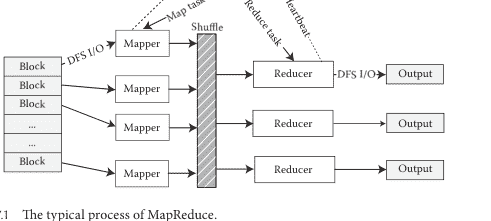

图 7.1 MapReduce 的典型流程。

本章指出了 MapReduce 框架中影响系统性能的主要因素。针对这些问题提出的解决方案构成了本文时间—空间调度算法的内容。在第 7.3 节中，我们提出一种自适应归约任务调度算法，以解决时隙空闲和资源浪费问题。在第 7.4 节中，我们分析 MapReduce 中数据倾斜的来源，并介绍一些减少跨机架通信和 MapReduce 流量的方法。为展示这一先进 MapReduce 框架的应用，第 7.5 节介绍了一种在生物医学大数据挖掘中实现 NER 模型训练并行化的方法。

## 7.3 自适应归约任务调度

### 7.3.1 问题分析

通过研究 Hadoop 平台中的归约任务调度，本章提出了一种名为*自适应归约调度（SARS）*的优化策略[10]。该方法可以减少复制操作的等待时间，并提升整个系统的性能。通过分析 MapReduce 任务运行时映射和归约两个阶段调度过程的细节[8]，SARS 可以根据各作业的上下文动态确定每个归约任务的启动时间，例如任务完成时间、映射输出的大小[11]等。本节主要贡献如下：

- 分析当前的 MapReduce 调度机制，并说明导致系统时隙资源浪费、进而使归约任务等待的原因；
- 开发一种方法，根据各作业的上下文动态确定归约任务的启动时间，其中包括任务完成时间和映射输出的大小；
- 介绍一种优化的归约调度算法，该算法能够缩短 Hadoop 平台上的归约完成时间和系统平均响应时间。

Hadoop 允许用户配置作业、提交作业、控制作业执行并查询作业状态。每个作业都由相互独立的任务组成，每个任务都需要一个系统时隙才能运行。图 7.2 展示了归约任务调度中的时间延迟和时隙资源浪费问题。根据图 7.2a 可知，Job<sub>1</sub> 和 Job<sub>2</sub> 是当前正在运行的作业；在初始时刻，系统分别为每个作业分配两个映射时隙来运行相应任务。由于每个任务的执行时间并不相同，如图 7.2a 所示，Job<sub>1</sub> 在时间 t2 完成其映射任务。由于只要有任何映射任务完成，归约任务就会开始，因此在 t1 到 t2 期间，Job<sub>1</sub> 和 Job<sub>2</sub> 各有两个归约任务在运行。如图 7.2b 所示，在时间 t3，Job<sub>2</sub> 的所有归约任务完成后，Job<sub>1</sub> 的两个新归约任务随即启动。此时，所有归约时隙资源都被 Job<sub>1</sub> 占用。如图 7.2c 所示，在时刻 t4，Job<sub>3</sub> 启动时，可以为其分配两个空闲映射时隙，随后该作业的归约任务也会启动。然而，我们可以发现，所有归约时隙都已被 Job<sub>1</sub> 占用，因此 Job<sub>3</sub> 的归约任务必须等待时隙释放。


图 7.2 不同图规模下各策略的性能。（a）Job1，已完成的 map 任务。（b）Job2，已完成的 reduce 任务。（c）Job3，已提交任务。

该问题的根本原因在于，Job1 的 reduce 任务必须等待 Job1 的所有 map 任务完成，因为 Job1 占用了全部 reduce 槽位，而 Hadoop 系统本身并不支持抢占操作。在早期的算法设计中，只要任意 map 任务完成，就可以调度 reduce 任务 [12]。这样做的好处之一是，reduce 任务可以尽快复制 map 任务的输出。但是，reduce 任务必须等到所有 map 任务完成后才能继续执行，而处于等待状态的任务始终会占用槽位资源，因此其他已经完成 map 任务的作业无法启动 reduce 任务。总之，这会导致 reduce 任务长时间等待，并大幅增加 Hadoop 作业的延迟。

在实际应用中，共享集群环境中通常会同时运行来自多个用户的不同作业。如果不同用户之间同时出现图 7.2 所描述的情况，并且 reduce 槽位资源长时间被占用，那么其他用户提交的作业在这些槽位被释放之前都无法优先执行。这种低效率会延长 Hadoop 系统的平均响应时间，降低资源利用率，并影响 Hadoop 集群的吞吐量。

### 7.3.2 MapReduce 作业的运行时分析

通过第 7.3.1 节的分析可知，优化 MapReduce 任务的一种方法是选择自适应的时间来调度 reduce 任务。采用这种方式，可以避免 reduce 任务长时间等待，并提高资源利用率。本节提出一种自适应的 reduce 任务调度策略，用于估计任务的启动时间，而不是采用传统机制，即在任意 map 任务完成后立即启动 reduce 任务。

数据通过归并进行排序，并分布在不同的存储位置。其中一类是内存中的数据。当同时从不同的 map 任务读取数据时，应将数据集按照相同的键进行合并。另一类是循环缓冲区中的数据。由于属于 reduce 任务的内存容量有限，缓冲区中的数据需要定期预先写入磁盘。

这样，后续写入磁盘的数据就需要进行合并，这一过程称为外部排序。在实际作业中，如果 map 任务数量较多，外部排序需要执行多次。复制和排序过程通常统称为 shuffle 阶段。最后，在复制和排序过程完成后，后续功能开始执行，reduce 任务便可以调度到计算节点上。

### 7.3.3 一种 reduce 任务启动时间调度方法

由于 Hadoop 采用贪心策略调度 reduce 任务，为了尽快调度 reduce 任务，如第 7.3.1 节所述，一些 reduce 任务会长时间占用系统资源，却并未实际执行操作。reduce 任务的启动时间由先进算法 SARS 决定。在该方法中，reduce 任务的启动时间会延迟一段时间，以减少系统资源的占用。SARS 算法会在某个特殊时刻调度 reduce 任务，此时部分 map 任务已经完成，但并非全部完成。因此，如何选择启动 reduce 调度的最优时间点，是该算法的关键问题。显然，最优时间点能够使系统延迟最小化，并使资源利用率最大化。

如图 7.3 所示，假设 Job₁ 有 16 个 map 任务和 1 个 reduce 任务，并且该集群系统中有 4 个 map 槽位和仅 1 个 reduce 槽位。图 7.3 和图 7.4 描述了某个作业生命周期的时间构成：

$$(\mathrm{FT}_{\mathrm{lm}}-\mathrm{ST}_{\mathrm{fm}})+(\mathrm{FT}_{\mathrm{cp}}-\mathrm{FT}_{\mathrm{lm}})+(\mathrm{FT}_{\mathrm{lr}}+\mathrm{ST}_{\mathrm{sr}}). \tag{7.1}$$

公式 7.1 中的符号定义如下。FTₗₘ 表示最后一个 map 任务的完成时间；ST_fm 表示第一个 map 任务的开始时间；FT_cp 表示复制阶段的结束时间；FT_lr 表示 reduce 阶段的结束时间；ST_sr 表示 reduce 排序的开始时间。

在图 7.3 中，t1 是 Map1、Map2 和 reduce 任务的开始时间。从 t1 到 t3 期间，reduce 任务的主要工作是复制 Map1 到 Map14 的输出。输出


图 7.3 reduce 任务的默认调度。

如图 7.4 中的时间点 t2′ 所示，reduce 任务最合适的启动时间，是与同一键相关的所有 map 任务都完成的时刻，该时刻位于第一个 map 任务启动与最后一个 map 任务完成之间。公式 7.3 中的第二项表示 map 任务所需的时间，第三项表示数据传输时间。由于 reduce 任务会在复制过程之前启动，因此应从 map 任务的完成时间中扣除这部分时间开销。reduce 任务的等待可能导致作业结束，而槽位资源却无法正常工作。通过调整 reduce 调度时间，该方法可以减少数据复制过程中的时间浪费，并有效提高 reduce 槽位资源的利用率。这些策略对于 CPU 类型作业尤其重要。对于这类需要更多 CPU 计算的作业，任务的数据输入/输出（I/O）较少，因此在默认调度算法下会浪费更多槽位资源。

## 7.4 REDUCE 放置

由于 mapper 和 reducer 函数采用全到全通信模型，本节将在第 7.4.1–7.4.3 节介绍一些令人关注且广泛使用的解决方案，并介绍若干用于优化通信流量的算法，从而提高数据处理性能。在第 7.4.4–7.4.5 节中，我们将说明数据倾斜现象的存在，并提出一些基于空间调度的方法，即 reduce 放置方法，以解决数据倾斜问题。

### 7.4.1 跨机架通信优化的最优算法

在 Hadoop 框架中，用户需要提供两个函数，即 mapper 和 reducer，用于处理数据。mapper 生成一组文件并将其发送给所有 reducer，而每个 reducer 都会接收来自所有 mapper 的文件，这是一种全到全通信模型。如果 mapper 和 reducer 位于不同的机架中，就会发生跨机架通信 [13]；在如今的数据中心环境中，这种情况非常常见。通常，Hadoop 在数据中心环境中运行，机器按照机架进行组织。每个机架都有一个机架顶部交换机，每个机架顶部交换机都连接到一个根交换机。每次跨机架通信都需要经过根交换机，因此根交换机会成为瓶颈 [14]。MapReduce 在 mapper 和 reducer 之间采用全到全通信模型。这会导致 shuffle 阶段机架顶部交换机的网络带宽饱和，使部分 reducer 成为拖尾任务，并延长作业执行时间。

有两种最优算法可以解决 reducer 放置问题（RPP），还有一种分析方法可以求出 RPP 的最小解（该解可能不可行）；这些方法都考虑了 reducer 的放置，以最小化跨机架流量。其中一种算法是*贪心算法* [15]，该算法每次将一个 reduce 任务分配到一个机架上。在将 reduce 任务分配给某个机架时，如果将该任务分配到该机架，算法会选择产生总流量（上行和下行）最小的机架。第二种算法称为*二分查找* [16]，它使用二分查找确定每个机架的流量函数下界，然后利用该最小下界确定每个机架上的 reducer 数量。


我们实现了 Hadoop-0.20.2 中的 CoGRS，并在私有云以及 Amazon Elastic Compute Cloud (EC2) 上进行了测试。与原生 Hadoop 相比，我们的结果显示 CoGRS 将跨机架网络流量平均减少了 9.6% 和 38.6%，分别在我们的私有云和 Amazon EC2 集群上。这反映在作业执行时间上，并提供了高达 23.8% 的改进。

分区倾斜是指中间键频率及其在不同数据节点间分布的显著差异。本质上，减少任务调度器可以决定网络中通信流量的模式，影响 shuffle 数据的数量，并影响 MapReduce 作业的运行时间。

### 7.4.4 MapReduce 倾斜的来源

过去几年，MapReduce 已成为处理海量数据集的流行方法。该领域的大多数研究考虑的是日志文件分析、词频统计和排序等简单应用场景，而当前系统采用简单的哈希方法将负载分配给 reducer。然而，处理大量数据表现出当前 MapReduce 系统未针对的缺陷。科学数据的分布通常是倾斜的 [20]。高运行时间复杂度放大了倾斜，导致 reducer 执行时间差异很大。

MapReduce 中有三种典型的倾斜。
- 键频率倾斜——如果某些键在中间数据元组中出现频率更高，则其拥有的每个簇的元组数量会不同。即使每个 reducer 接收到的簇数量相同，每个 reducer 接收到的总元组数量也会不同。
- 元组大小倾斜——在元组中包含复杂对象的应用中，元组大小倾斜可能导致簇大小不平衡。
- 执行时间倾斜——如果 reducer 的执行时间呈非线性，处理单个大簇可能比处理更多的小簇花费更长时间。即使每个 reducer 的总元组数量相同，reducer 的执行时间也可能不同。

根据这些倾斜类型，我们提出了几种改进 MapReduce 性能的方法。

### 7.4.5 Hadoop 中的 Reduce 放置

在 Hadoop 中，map 和 reduce 任务通常消耗大量数据，总中间输出（或总 reduce 输入）大小有时等于所有 map 任务的总输入大小（例如 sort）甚至更大（例如 K-means 为 44.2%）。因此，优化 reduce 任务的放置以节省网络流量对于优化 map 任务的放置变得非常重要，而后者已在 Hadoop 系统中得到充分理解和实现。

本节探讨调度以确保 reduce 任务处理最多的数据保持本地化，从而节省流量成本并减轻数据倾斜 [21]。

采样——输入数据被加载到分布式文件系统（DFS）中的一个或多个文件中，其中每个文件被划分为较小的块，称为输入分片。每个分片分配给一个 map 任务。Map 任务处理分片 [22] 并产生中间输出，这些输出通常被分区或哈希到一个或多个 reduce 任务。在一次 MapReduce 计算之前

数据包含丰富的生物信息，包括重要的基因表达情况和蛋白质–蛋白质相互作用。更重要的是，基于这些生物医学数据中的疾病关系挖掘构建的疾病网络包含与疾病相关的隐藏信息，为生物医学科学家提供假设生成的依据。

然而，生物医学大数据处理的最基本要求很难高效满足。例如，在生物医学大数据或互联网中进行关键词搜索只能找到大量相关文件列表，准确性不高，因此文本中包含的大量有价值信息无法直接展示给人们。

### 7.5.2 生物医学文本挖掘与 NER

为了探索生物医学大数据中的信息和知识，人们整合了数学、计算机科学和生物学工具，促进了大规模生物医学文本挖掘的快速发展。这指的是从海量生物医学数据中推导出隐含的、此前未知的且可能有用的高质量信息的生物医学大数据分析过程。

当前大规模生物医学文本挖掘的研究重点主要由两个方面组成，即信息抽取和数据挖掘。具体包括生物医学命名实体识别（Bio-NER）、关系抽取、文本分类以及上述工作的集成框架。

Bio-NER 是生物医学大数据挖掘的第一步，也是重要且关键的一步。其旨在帮助分子生物学家识别和分类专业实例和术语，如 protein、DNA、RNA、cell_line 和 cell_type。它旨在将生物医学文本中具有特殊意义的原子元素定位并分类到预定义类别中。Bio-NER 系统的过程结构为接收一段未标注的文本，然后生成一段标注的文本，突出显示生物医学命名实体所在的位置 [25]。

然而，由于生物医学领域存在许多独特属性，如数量不稳定、命名规则不统一、形式复杂、存在歧义等，Bio-NER 尚未成熟，尤其耗时较长。当前大多数 Bio-NER 系统基于机器学习，需要从语料数据进行多次迭代计算。因此计算密集，严重增加识别时间，包括模型训练和推理。例如，使用仅约 14 MB 的 Genia4ER 训练语料进行 CRF 模型训练过程几乎需要 5 小时 [26]。我们如何处理海量的生物医学文本数据？我们如何应对长时间无法忍受的识别等待？自然寻求分布式计算和并行计算来解决问题。

### 7.5.3 用于 CRF 的 MapReduce

CRF 是机器学习领域的重要里程碑，由 John Lafferty 等人于 2001 年提出 [27]。CRF 是一种判别模型，同时也是无向图模型，基于给定的特定观测序列为整个标签序列的联合概率定义单一对数线性分布。该
模型广泛应用于自然语言处理（NLP），包括 NER、词性标注等。

图 7.6 显示了 CRF 模型，该模型计算在给定输入序列 $\vec{x}=(x_1,x_2,\ldots,x_n)$ 条件下的输出序列 $\vec{y}=(y_1,y_2,\ldots,y_n)$ 的条件概率 $p(\vec{y}|\vec{x})$。

用于 Bio-NER 的线性 CRF 如下：

$$P(\vec{y}|\vec{x}) = \frac{1}{Z(\vec{x})} \exp \sum_{i=1}^{n} \sum_{k=1}^{K} \lambda_k f_k(\vec{x}, i, y_{i-1}, y_i), \qquad (7.4)$$

其中

$$Z(\vec{x}) = \sum_{\vec{y}} \exp \sum_{i=1}^{n} \sum_{k=1}^{K} \lambda_k f_k(\vec{x}, i, y_{i-1}, y_i), \qquad (7.5)$$

$i$ 是输入序列 $\vec{x}=(x_1,x_2,\ldots,x_n)$ 中的位置，$\lambda_k$ 是不依赖于位置 $i$ 的特征权重，且 $\{f_k(\vec{x},i,y_{i-1},y_i)\}_{k=1}^{K}$ 为特征函数。

对于 CRF 模型的训练过程，主要目的是寻找与训练数据 $T=\{(\vec{x}_i,\vec{y}_i)\}_{i=1}^{N}$ 最吻合的参数 $\lambda=(\lambda_1,\lambda_2,\ldots,\lambda_K)$。假设每个 $(\vec{x},\vec{y})$ 都是独立同分布的。参数通常通过以下方式获得：

$$L(\lambda)=\sum_i \log P(y^i|x^i). \qquad (7.6)$$

当对数似然函数 $L(\lambda)$ 达到最大值时，参数几乎是最优的。然而，要找到使训练数据似然最大化的参数，没有闭式解。因此，我们采用参数估计，即有限内存 Broyden–Fletcher–Goldfarb–Shanno（L-BFGS）算法 [28]，来寻找最优解。


图 7.6 线性 CRF。


为了找到使凸函数 $L(\lambda)$ 达到最大值的参数 $\lambda = (\lambda_1,\lambda_2,\ldots,\lambda_K)$，L-BFGS 算法首先以初始值 $\lambda_0 = 0$ 通过迭代计算使其梯度向量 $\nabla L = (\frac{\partial L}{\partial \lambda_1}, \frac{\partial L}{\partial \lambda_2}, \ldots, \frac{\partial L}{\partial \lambda_K}) \to 0$。研究表明，第一步，即计算 $\nabla L_0$，代表迭代 $i$ 中的梯度向量，耗时较多。因此，我们着重于对其进行优化改进。

$\nabla L$ 中的每个分量计算如下：

$$\frac{\partial L(\lambda)}{\partial \lambda_k} = \sum_{\tilde{x}} \sum_{i=1}^{n} f_k(\tilde{x}, i, y_{i-1}, y_i) - \sum_{y} P(y|\tilde{x}) \sum_{i=1}^{n} f_k(\tilde{x}, i, y_{i-1}, y_i) - \frac{\lambda_k}{\sigma^2}. \tag{7.7}$$

它可以与 $\mathcal{T}$ 中相互独立的每个有序对 $(\tilde{x}, \tilde{y})$ 关联。因此，我们可以在训练集 $T$ 中的每个输入序列上计算 $\sum_{i=1}^{n} f_k(\tilde{x}, i, y_{i-1}, y_i)$ 与 $\sum_{y} P(y|\tilde{x}) \sum_{i=1}^{n} f_k(\tilde{x}, i, y_{i-1}, y_i)$ 之间的差值，然后将所有序列的结果汇总起来。结果，它们可以并行计算，如图 7.7 所示。

我们将 $\sum$ 中的计算过程拆分为多个 map 任务，并通过一个 reduce 任务汇总结果。而惩罚项 $\frac{\lambda_k}{\sigma^2}$ 带来的差异被设计为后处理。

在实际情况中，由于大规模训练样本中有序对的数量巨大，无法有效估计，因此不可能为每个有序对 $(\tilde{x}, \tilde{y})$ 安排一个 map 任务。我们必须将训练数据 $T$ 分区为若干小部分，然后在本节上述两段所示的方式启动 MapReduce 计划。

对于 MapReduce Bio-NER 应用，数据倾斜导致整个系统负载不均。任何特定语料库都有其自身实体的不均匀分布（如表 7.1 所示），导致严重的数据倾斜问题。而且蛋白质，人为定义的特征集在训练和推理过程中加剧了该问题。

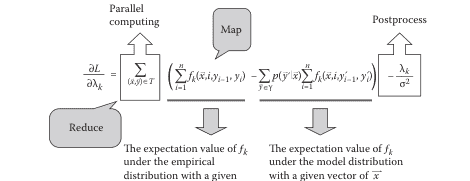

**图 7.7** 计算分量的 MapReduce 计划。

**表 7.1** 语料库中各类实体的比例 联合生物医学自然语言处理及其应用研讨会（JNLPBA2004）

| | 蛋白质 | DNA | RNA | 细胞系 | 细胞类型 |
|---|---|---|---|---|---|
| 训练集 | 59.00% | 18.58% | 1.85% | 7.47% | 13.10% |
| 测试集 | 58.50% | 12.19% | 1.36% | 5.77% | 22.18% |

结合本章给出的方案，基于改进的 Hadoop MapReduce 可以解决负载不均问题。实现将进一步提高 MapReduce 在时空调度下的系统性能。

## 7.6 结论性评述

数据是信息系统的基础，如何处理数据和提取信息已成为当今信息社会最热门的话题之一。本章介绍了 MapReduce 框架，这是一种优秀的分布式并行计算模型。作为其实现，Hadoop 在大量分布式应用系统的大规模数据处理中发挥着越来越重要的作用。

随着数据和集群规模的增加，为避免调度延迟、调度倾斜、系统利用率低下和并行度低，本章提出了一些改进方法，重点关注 MapReduce 中 reduce 任务的时空调度。

通过分析 MapReduce 调度机制，本章说明了导致系统槽资源浪费、reduce 任务处于等待状态的原因，并提出了根据每个作业上下文动态确定 reduce 任务开始时间的方法，包括任务完成时间和 map 输出大小。毫无疑问，使用该方法将减少 Hadoop 平台中的 reduce 完成时间和系统平均响应时间。

当前 Hadoop 调度器往往缺乏数据局部性考虑。因此，不必要的数据可能会在网络中进行洗牌，导致性能下降。本章提出了几种优化算法来解决 reduce 放置问题。我们使 Hadoop reduce 任务调度器感知分区网络位置和大小，以减轻网络流量并提高 Hadoop 的性能。

最后，作为所提方法的应用，提出了一种使用 MapReduce 框架的并行生物医学数据处理模型。随着美国提出的 HGP，生物医学大数据在学术界显示出其独特地位。广泛使用的 CRF 模型和高效的基于 Hadoop 的方法 Bio-NER 已被引入以探索生物医学大数据下的信息和知识。

## REFERENCES

- 1. J. Tan, S. Meng, X. Meng, L. Zhang. 改进顺序 MapReduce 作业的 reduce 任务数据局部性。 *International Conference on Computer Communications (INFOCOM), 2013 Proceedings IEEE*, April 14–19, 2013, pp. 1627–1635.
- 2. J. Dean, S. Ghemawat. MapReduce：大规模集群上的简化数据处理, *Communications of the ACM—50th Anniversary Issue: 1958–2008*, 2008, Volume 51, Issue 1, pp. 137–150.
- 21. P. Dhawalia, S. Kailasam, D. Janakiram. Chisel：处理 MapReduce 应用中倾斜的资源节约型方法。 *Cloud Computing (CLOUD), IEEE Sixth International Conference on*, June 28–July 3, 2013, pp. 652–660.
- 22. R. Grover, M. J. Carey. 扩展 Map-Reduce 以实现基于谓词的采样。 *Data Engineering (ICDE), 2012 IEEE 28th International Conference on*, April 1–5, 2012, pp. 486–497.
- 23. S. Ibrahim, H. Jin, L. Lu, L. Qi, S. Wu, X. Shi. 评估虚拟机上的 MapReduce：Hadoop 案例云计算。 *Lecture Notes in Computer Science*, 2009, Volume 5931, pp. 519–528.
- 24. Wikipedia, MEDLINE [EB/OL]. Available at http://en.wikipedia.org/wiki/MEDLINE, September 14, 2013.
- 25. J. Kim, T. Ohta, Y. Tsuruoka, Y. Tateisi, N. Collier. 介绍 JNLPBA 中的生物实体识别任务。 *Proceedings of the International Joint Workshop on Natural Language Processing in Biomedicine and Its Applications (JNLPBA)*, August 2004, pp. 70–75.
- 26. L. Li, R. Zhou, D. Huang. 使用 CRFs 的两阶段生物医学命名实体识别。 *Computational Biology and Chemistry*, 2009, Volume 33, Issue 4, pp. 334–338.
- 27. J. Lafferty, A. McCallum, F. Pereira. 条件随机场：分割和标记序列数据的概率模型。 *Proceedings of the 18th International Conference on Machine Learning (ICML)*, June 28–July 1, 2001, pp. 282–289.
- 28. D. Liu, J. Nocedal. 大规模优化的有限内存 BFGS 方法。 *Mathematical Programming*, 1989, Volume 45, Issue 1–3, pp. 503–528.

## GEMS: Graph Database Engine for Multithreaded Systems

Alessandro Morari, Vito Giovanni Castellana, Oreste Villa, Jesse Weaver, Greg Williams, David Haglin, Antonino Tumeo, and John Feo

## CONTENTS

- 8.1 Introduction 140
- 8.2 Related Infrastructures 141
- 8.3 GEMS Overview 142
- 8.4 GMT Architecture 146
- 8.4.1 GMT: Aggregation 148
- 8.4.2 GMT: Fine-Grained Multithreading 149
- 8.5 Experimental Results 150
- 8.5.1 Synthetic Benchmarks 151
- 8.5.2 BSBM 152
- 8.5.3 RDESC 153
- 8.6 Conclusions 155
- References 155

## ABSTRACT

许多领域需要组织、管理和分析海量数据。其中，我们可以找到社交网络分析、金融风险管理、复杂网络系统中的威胁检测以及医学和生物医学数据库。对于这些领域，不仅存在规模问题，而且存在性能问题，因为处理必须足够快才有用。图数据库似乎是管理这些数据的一个不错的候选者：它们提供一个

一种用于异构数据或本身并非严格结构化数据的高效数据结构。然而，在现代高性能机器上探索大规模图具有挑战性。这些系统包括针对规则、浮点密集型计算以及大批量数据传输优化的处理器和网络。相比之下，图探索会产生细粒度、不可预测的内存和网络访问，主要受内存限制，并且同步密集。此外，图通常难以划分，使其处理容易发生负载不均衡。

在本章中，我们描述多线程系统图引擎（GEMS），这是一个完整软件栈，在商用集群上实现图数据库，并能在增加更多集群节点时扩展数据集规模，同时保持查询吞吐量恒定。GEMS采用SPARQL（SPARQL协议与RDF查询语言）来查询图数据库。GEMS软件栈包括一个SPARQL到数据并行C++编译器；一个分布式数据结构库；以及一个定制的多线程运行时系统。

我们提供该软件栈的概览，描述其与其他解决方案相比的优势，并重点说明我们如何解决不规则行为带来的挑战。

最后，我们给出在典型SPARQL基准以及太平洋西北国家实验室目前整理的一个资源描述格式（RDF）数据集上对GEMS的评估。

## 8.1 引言

许多非常不同的应用领域正在经历可供处理数据的爆炸式增长。这些领域包括金融；天文学、生物学、基因组学、气候与天气以及材料科学等科学领域；Web；地理系统；交通运输；电话；社交网络；以及安全。这些应用的数据集规模已迅速超过PB级，并持续呈指数增长。使计算系统在不牺牲性能的情况下处理这些海量数据正变得至关重要。图数据库似乎是组织、表示和存储这些应用数据的最自然、最便捷的方式，因为这些数据通常在其元素之间包含大量关系，相对于关系数据库具有显著优势。

图数据库按照资源描述框架（RDF）数据模型（Klyne et al. 2004），以主语-谓语-宾语三元组的形式组织数据。一组三元组自然表示一个带标签的有向多重图。分析人员可以通过SPARQL（W3C SPARQL Working Group 2013）等语言查询语义图数据库，其中基本查询操作是图匹配。这不同于传统关系数据库：后者采用特定模式的表存储数据，并在执行查询时执行选择和常规连接操作。采用关系方法时，由于执行常规连接会产生规模庞大的中间结果，大型数据集上的面向图查询可能很快在空间和时间上变得难以管理。

其可获得多节点集群支持。GEMS采用内存处理：它将所有数据结构存储在RAM中。通过增加更多集群节点，内存处理有可能在保持查询吞吐量恒定的同时增大数据集规模。

一些方法利用MapReduce基础设施处理RDF编码的数据库。SHARD（Rohloff and Schantz 2010）是构建在Hadoop之上的三元组存储，而YARS2（Harth et al. 2007）是一种批量同步的分布式查询回答系统。两者都利用哈希分区将三元组分布到各节点。这些方法对于简单索引查找效果良好，但在更复杂的查询下通过网络移动数据时会带来高通信开销，并且在存在数据倾斜时会引入负载均衡问题。

更通用的图库，如Pregel（Malewicz et al. 2010）、Giraph（Apache Giraph, n.d.）和GraphLab（GraphLab, n.d.），在源数据转换为图之后，也可以用于探索语义数据库。然而，要在数据库环境中工作，它们需要大量补充，并且仍然依赖批量同步的并行模型，而这些模型对于大型复杂查询表现不佳。我们的系统依赖一个定制运行时，它提供特定功能来支持通过基于图的方法探索语义数据库。

Urika是YarcData（YarcData, Inc., n.d.）推出的面向大数据分析的商用共享内存系统。Urika利用源自Cray XMT的定制节点，这些节点配备专用多线程处理器（最多128个线程且缓存非常简单的桶式处理器）。除了允许多线程容忍访问远程节点数据的延迟之外，该系统还对置乱全局地址空间和细粒度同步提供硬件支持。这些特性使不规则应用（如图探索）能够更高效地执行。在此硬件之上，YarcData与Jena框架对接，以提供前端应用编程接口（API）。相反，GEMS利用由商用硬件构建的集群，这些集群的采购和维护成本更低，并且能够比定制硬件更快地演进。

## 8.3 GEMS概述

图8.1给出GEMS架构的高层概览。该图展示了GEMS的主要组件：SPARQL到C++编译器、语义图库（SGLib）和GMT运行时。分析人员可以加载一个或多个图数据库、编写SPARQL查询，并通过连接到集群上服务器的客户端Web界面执行这些查询。

GEMS的顶层由编译阶段组成：编译器将输入的SPARQL查询转换为中间表示，并对其进行分析以寻找优化机会。潜在的优化机会会在多个层次上被发现。根据数据集的统计信息，某些查询子句可以被移动，从而实现搜索的提前剪枝。然后，优化后的中间表示被转换为包含对SGLib API调用的C++代码。SGLib API完全隐藏GMT的低层API，向编译器暴露一种精简、简单、伪顺序的共享内存编程模型。SGLib管理图数据库和查询执行。

具有高度偏斜的关联三元组比例的宾语-谓语对会在节点间进行特殊分布，以避免因数据倾斜导致负载不均衡。

GMT层提供关键特性，使数据结构管理和集群节点间的负载均衡成为可能。GMT与图数据库引擎的上层协同设计，以更好地支持图模式匹配操作的不规则性。GMT提供分区全局地址空间（PGAS）数据模型，隐藏分布式内存系统的复杂性。GMT向SGLib暴露一个API，允许在全局地址空间中分配、访问和释放数据。与其他PGAS库不同，GMT采用共享内存系统典型的控制模型：生成数千个轻量级任务的fork-join并行构造。这些轻量级任务可以隐藏访问远程集群节点数据的延迟；在通信进行时，它们在处理器核心上换入换出。最后，GMT在与其他节点通信之前聚合操作，从而提高网络带宽利用率。

图8.2至图8.6依次给出一个图数据库、一个SPARQL查询以及GEMS的SPARQL到C++编译器所执行转换的简单示例。

图8.2展示了N-Triples格式（RDF的一种常见序列化格式）的数据集（Carothers and Seaborne 2014）。图8.3展示了对应的图表示

```
PERSON1 has_name JOHN .
PERSON1 has_address ADDR1 .
PERSON1 owns CAR1 .
CAR1 of_type SEDAN .
CAR1 year 1997 .
PERSON2 has_name BOB .
PERSON2 has_address ADDR2 .
PERSON2 owns CAR2 .
CAR2 of_type SEDAN .
CAR2 year 2012 .
PERSON3 owns CAR3 .
CAR3 of_type SUV .
CAR3 year 2001 .
PERSON3 has_name MARY .
PERSON3 has_address ADDR2 .
PERSON3 owns CAR3 .
```

图8.2 简化N-Triples格式的数据集。


图8.3 RDF图。


walk 可以被概念化为嵌套循环。在图遍历的末端（或“底部”），结果会被缓冲到与表对象关联的加载器对象中。当所有并行边遍历完成后，加载器通过将结果实际插入其关联的表中来完成最终化。此时，使用该表执行诸如去重（DISTINCT）或分组（GROUP BY）之类的操作。结果本质上是包含结果中不同变量的结构体。许多变量将被绑定到 UID，但有些可能包含原始值。

GEMS 对系统级库的要求极少：除了 Pthreads 外，它仅需要用于 GMT 通信层的消息传递接口（MPI）以及用于某些编译阶段和胶水脚本的 Python。GEMS 的当前实现还要求 x86 兼容处理器，因为 GMT 采用了优化的上下文切换例程。然而，由于在库方面的要求有限，移植到其他架构的工作主要应局限于替换这些上下文切换例程。

## 8.4 GMT 架构

GMT 运行时系统是使 GEMS 能够在更大数据集上运行同时在向集群添加节点时保持恒定吞吐量的关键组件。

GMT 依赖于三个主要元素来实现其可扩展性：一个 *全局地址空间*、通过细粒度软件 *多线程* 实现的延迟容忍，以及 *消息聚合*（也称为 *合并*）。

GMT 通过实现自定义 PGAS 数据底层，在各个集群节点之间提供全局地址空间。PGAS 模型使 GEMS 的其他层（以及开发者）免于对数据结构进行分区和协调通信。PGAS 并未完全忽视局部性概念，而是承认访问存储在其他集群节点上的数据存在开销。事实上，PGAS 库通常通过 *put* 和 *get* 操作启用数据访问，这些操作将数据从/向全局共享数组移动到/从节点本地内存位置。

消息聚合最大化了网络带宽利用率，尽管图方法通常具有小数据访问。聚合对开发者完全透明。

细粒度多线程通过利用图算法的固有并行性，隐藏了远程数据传输的延迟以及聚合带来的额外延迟。

图 8.7 显示了 GMT 的高层设计。集群中的每个节点都执行一个 GMT 实例。不同的实例通过 *命令* 进行通信，这些命令描述了数据、同步和线程管理操作。GMT 是一个 *并行* 运行时，意义在于它也利用线程执行其操作，共分为三种专用线程。主要思想是利用现代处理器的核心来支持运行时的功能。专用线程如下：

- 1. *工作者*：以轻量级用户任务的形式执行应用程序代码，并生成指向其他节点的命令
- 2. *助手*：管理全局地址空间和同步，并处理来自其他节点的传入命令

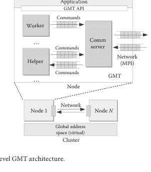

图 8.7 GMT 高层架构。

- 3. Communication server：网络的端点，以网络消息的形式管理节点级别的所有传入/传出通信，其中包含命令

专用线程实现为 POSIX 线程，每个线程都绑定到一个核心。通信服务器使用 MPI 向其他节点发送和接收消息。每个节点有多个 worker 和 helper。通常，我们使用相同数量的 worker 和 helper，但这是一个可以根据目标机器的经验测试进行调整的参数。相反，只有一个通信服务器，因为在构建运行时时，我们验证了单个通信服务器已经能够在合理大小的数据包下提供网络的峰值 MPI 带宽，从而无需管理多个网络端点（这反过来可能带来挑战和进一步的同步开销）。

SGLib 数据结构使用 GMT 全局地址空间中的共享数组实现。其中包括图数据结构和术语字典。SPARQL 到 C++ 编译器假设在共享内存系统上运行，无需考虑数据库的物理分区。然而，与 PGAS 库中常见的做法一样，GMT 还公开局部性信息，允许在可能的情况下减少数据移动。由于图探索算法大多具有遍历边或顶点列表的循环（如图 8.6 中的伪代码所示），GMT 提供了将循环迭代映射到轻量级任务的并行循环构造。GMT 支持从嵌套循环生成任务，并允许指定映射到任务的循环迭代次数。GMT 还允许控制代码局部性，使任务能够在预选节点上生成（或移动），而不是移动数据。SGLib 例程利用这些特性更好地管理其内部数据结构。SGLib 例程通过 put 和 get 通信原语访问数据，将其移动到本地空间进行操作并写回全局空间。通信原语同时提供阻塞和非阻塞语义。GMT 还在全局地址空间中分配的数据上提供原子操作，例如原子加法和测试并设置。SGLib 利用它们来保护图数据集上的并行操作，并实现用于数据库管理和查询的全局同步构造。

### 8.4.1 GMT：聚合

图探索算法通常呈现细粒度数据访问。它们主要通过遍历边和/或顶点的 for 循环操作。边通常是指针，连接一个顶点到另一个顶点。根据图结构，每个指针可能指向完全不相关的内存区域中的位置。在分布式内存系统中，数据结构被划分到每个节点的不同内存中。这对于仅提供分布式内存抽象的 PGAS 底层也是如此。因此，专家程序员通常必须手工实现优化以聚合请求并减少小网络事务带来的开销。GMT 通过实现自动消息聚合，将这些复杂性隐藏在 GEMS 的其他层之外。

GMT 将指向同一目标节点的命令收集到聚合队列中。GMT 将命令及其相关数据（例如，通过 get 从全局地址空间请求的值）复制到聚合缓冲区中并批量发送。然后在目标节点上解包并执行命令。在节点级别，GMT 使用高吞吐量、非阻塞聚合队列，支持多个 worker 和 helper 的并发访问。对每个生成的命令访问这些队列的成本会非常高。因此，GMT 采用两级聚合机制：Worker（或 helper）最初在本地命令块中收集命令，然后将命令块插入聚合队列。图 8.8 显示了聚合机制的工作方式。当聚合开始时，worker（或 helper）从命令块池请求一个预分配的命令块（1）。命令块是预分配并重复使用的。出于性能原因，命令块是预分配并重复使用的。程序执行期间生成的命令被收集到本地命令块中（2）。当命令块（a）已满或（b）等待时间超过预定时间间隔时，它会被推入聚合队列。条件（a）在所有可用条目都被命令占用时为真，或当命令（包括任何附加数据）的字节等效大小达到聚合缓冲区的大小时为真。条件（b）允许为聚合增加的延迟设置可配置的上限。在推送命令块后，当 worker 或 helper 发现聚合队列有足够数据填充聚合缓冲区时，它开始从聚合队列弹出命令块并将其与相关数据一起复制到聚合缓冲区中（4、5 和 6）。聚合缓冲区也是预分配并回收的，以节省内存空间并消除分配开销。复制后，命令块被返回到命令块池（7）。当聚合缓冲区满时，worker（或 helper）将其推入通道队列（8）。通道队列是高吞吐量的单生产者单消费者队列，worker 和 helper 用它与通信服务器交换数据。如果通信服务器在其中一个通道队列中找到新的聚合缓冲区，它会弹出该缓冲区（9）并执行非阻塞 MPI 发送（10）。然后聚合缓冲区被返回到空闲聚合缓冲区池中。

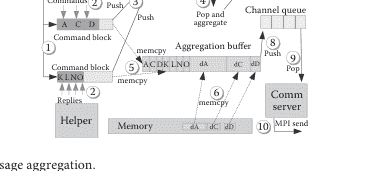

图 8.8 消息聚合。

聚合缓冲区的大小和推送聚合数据的间隔是可配置参数，取决于 GEMS 运行的集群互连情况。设置这些参数的经验法则是如下：缓冲区应足够大以最大化网络吞吐量，而时间间隔不应使延迟超过可通过多线程掩盖的值。正确的值可以通过在目标集群上使用玩具示例进行经验测试来得出。

### 8.4.2 GMT：细粒度多线程

通过细粒度软件多线程的并发，允许容忍访问远程节点数据的延迟以及聚合通信操作带来的额外延迟。每个 worker 执行一组 GMT 任务。worker 在每次生成需要远程内存操作的阻塞命令时在任务上下文之间切换。生成命令的任务仅在命令本身完成时（即它从远程节点收到回复）再次执行。对于非阻塞命令，任务继续执行直到遇到等待原语。

GMT 实现自定义上下文切换原语，避免了标准 libc 上下文切换例程执行的一些冗长操作（例如保存和恢复信号掩码）。

图 8.9 示意性地显示了 GMT 如何执行任务。节点接收到包含 spawn 命令的消息（1），该消息由远程节点上的 worker 在遇到并行构造时生成。通信服务器将包含命令的缓冲区传递给解析缓冲区并执行命令的 helper（2）。然后 helper 创建一个迭代块（itb）。itb 是一个数据结构，包含要执行的函数、函数本身的参数以及将执行该函数的任务数量。这种表示任务集合的方式避免了创建大量函数参数并通过网络发送它们的成本。在下一步中，helper 将 itb 推入 itb 队列（3）。然后，空闲 worker 从 itb 中弹出一个 itb

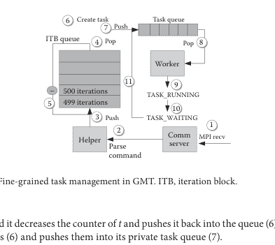

图 8.9 GMT 中的细粒度任务管理。ITB，迭代块。

队列 (5)，并减少 t 的计数器并将其推回队列 (6)。工作线程创建 t 个任务 (6) 并将它们推入其私有任务队列 (7)。

此时，空闲工作线程可以从其任务队列中弹出一个任务 (8)。如果任务可执行（即所有远程操作已完成），工作线程将恢复任务的上下文并执行它 (9)。否则，它将任务推回任务队列。如果任务包含阻塞的远程请求，任务进入等待状态 (10) 并重新插入任务队列以供将来执行 (11)。

该机制在节点级别提供负载均衡，因为每个工作线程在其任务队列为空时立即从 ITB 队列获取新任务。在集群级别，当 GMT 遇到并行 for 循环结构时，会在节点之间均匀分配任务。

## 8.5 实验结果

我们在 Pacific Northwest National Laboratory 的机构计算中心评估了 GEMS 在 Olympus 超级计算机上的性能，该中心列在 Top500.org (Top500.org, n.d.) 上。Olympus 是一个由 604 个节点组成的集群，通过具有 648 个端口的四倍数据速率 (QDR) InfiniBand 开关互连（理论带宽峰值 4 GB/s）。Olympus 的每个节点都配备了两个 2.1 GHz 的 AMD Opteron 6272 处理器和 64 GB 时钟频率为 1600 MHz 的双倍数据速率 3 (DDR3) 内存。每个插槽托管八个处理器模块（每个模块两个整数核心，一个浮点核心），位于两个不同的芯片上，总计每个节点 32 个整数核心。芯片和插槽通过 HyperTransport 互连。

我们配置了每个节点 15 个工作线程、15 个助手和 1 个通信服务器的 GEMS 堆栈。每个工作线程托管多达 1024 个轻量级任务。我们使用 OSU Micro-Benchmarks 3.9 (Ohio State University, n.d.) 测量了 Olympus 的 MPI 带宽，在消息至少为 64 KB 时达到峰值 2.8 GB/s。因此，我们将聚合缓冲区大小设置为 64 KB。每个通信通道托管多达四个缓冲区。每个助手有两个通道队列，每个工作线程有一个通道队列。

我们首先介绍运行时的一些合成基准测试，突出多线程和聚合的综合效果以最大化网络带宽利用率。然后我们在一个成熟的基准测试 Berlin SPARQL Benchmark (BSBM) (Bizer and Schultz 2009) 上展示整个 GEMS 系统的实验结果，以及在 Pacific Northwest National Laboratory (PNNL) 为 Resource Discovery for Extreme Scale Collaboration (RDESC) 项目当前整理的数据集上。

### 8.5.1 合成基准测试

图 8.10 和图 8.11 显示了 GMT 在增加任务数量时使用小消息（从 8 到 128 字节）达到的传输速率。每个任务执行 4096 次阻塞 put 操作。图 8.10 显示了两个节点之间的带宽，图 8.11 显示了

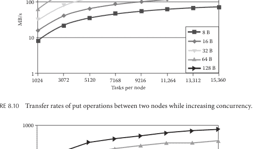

图 8.10 随着并发度增加，两个节点之间 put 操作的传输速率。

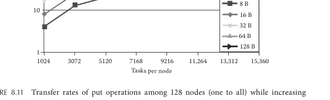

图 8.11 随着并发度增加，128 个节点之间（一对多）put 操作的传输速率。

Southern Great Plains 站点)。这些查询无论节点数量如何花费的时间大致相同的原因是执行查询时的并行量有限，因此八个节点足以充分利用查询的并行性（按我们执行查询的方式）。由于需要图和字典的内存，我们无法在四个或更少的节点上运行查询。这强调了我们的观点，即对更多内存的需求超过了对更多并行计算的需求。我们需要八个节点并非一定是为了使查询更快，而是为了将数据和查询保留在内存中以使查询可行。

## 8.6 结论

在本章中，我们介绍了 GEMS，这是一个用于商品集群上语义图数据库的完整软件堆栈。与其他解决方案不同，GEMS 提出了一种集成方法，主要在堆栈的所有层中使用基于图的方法。GEMS 包括一个 SPARQL 到 C++ 编译器、算法和数据结构库以及自定义运行时。自定义运行时系统 (GMT) 为所有其他层提供了多个功能，简化了探索方法的实现并使其在商品集群上的执行更高效。GMT 提供全局地址空间、细粒度多线程（以容忍访问远程节点数据的延迟）、远程消息聚合（以最大化网络和带宽利用率）以及负载均衡。我们已展示了这种集成方法如何在两个示例数据集（BSBM 和 RDESC 数据集）上随着向集群添加更多节点而提供规模和性能扩展。

## 参考文献

- Apache Giraph. (n.d.). 检索自 2014 年 5 月 1 日，网址 http://incubator.apache.org/giraph/。
- Apache Jena—Home. (n.d.). 检索自 2014 年 3 月 19 日，网址 https://jena.apache.org/。
- ARQ—A SPARQL Processor for Jena. (n.d.). 检索自 2014 年 5 月 1 日，网址 http://jena.sourceforge.net/ARQ/。
- Bizer, C., and Schultz, A. (2009). The Berlin SPARQL benchmark. Int. J. Semantic Web Inf. Syst., 5 (2), 1–24.
- Carothers, G., and Seaborne, A. (2014). RDF 1.1 N-Triples. 检索自 2014 年 3 月 19 日，网址 http://www.w3.org/TR/2014/REC-n-triples-20140225/。
- GraphLab. (n.d.). 检索自 2014 年 5 月 1 日，网址 http://graphlab.org。
- Harth, A., Umbricht, J., Hogan, A., and Decker, S. (2007). YARS2: A federated repository for querying graph structured data from the web. ISWC '07/ASWC '07: 6th International Semantic Web and 2nd Asian Semantic Web Conference (pp. 211–224).
- International Soil Moisture Network. (n.d.). 检索自 2014 年 2 月 17 日，网址 http://ismn.geo.tuwien.ac.at。
- Klyne, G., Carroll, J. J., and McBride, B. (2004). Resource Description Framework (RDF): Concepts and Abstract Syntax. 检索自 2013 年 12 月 2 日，网址 http://www.w3.org/TR/2004/REC-rdf-concepts-20040210/。
- Malewicz, G., Austern, M. H., Bik, A. J., Dehnert, J. C., Horn, I., Leiser, N. et al. (2010). Pregel: A system for large-scale graph processing. SIGMOD '10: ACM International Conference on Management of Data (pp. 135–146).
- National Aeronautics and Space Administration. (2013). Global Change Master Directory, Online, Version 9.9. 检索自 2014 年 5 月 1 日，网址 http://gcmd.nasa.gov。

## KSC-net

*大数据网络的社区检测*

Raghvendra Mall and Johan A.K. Suykens

### 目录

- 9.1 引言 158
- 9.2 KSC for Big Data Networks 160
- 9.2.1 Notations 160
- 9.2.2 FURS Selection 161
- 9.2.3 KSC Framework 162
- 9.2.3.1 Training Model 162
- 9.2.3.2 Model Selection 163
- 9.2.3.3 Out-of-Sample Extension 163
- 9.2.4 Practical Issues 165
- 9.3 KSC-net Software 165
- 9.3.1 KSC Demo on Synthetic Network 165
- 9.3.2 KSC Subfunctions 167
- 9.3.3 KSC Demo on Real-Life Network 169
- 9.4 Conclusion 171
- Acknowledgments 171
- References 172

### 摘要

在本章中，我们展示了核谱聚类 (KSC) 方法在大数据网络社区检测中的适用性。我们在包含多达 10^6 个节点和 10^7 条边的<|message|> 合成和真实网络上对 KSC 方法 [1] 进行了实践阐述。KSC 方法使用原-对偶框架在大数据网络的较小子集上构建模型。原始的大规模核矩阵无法放入内存。因此，我们使用文献 2 中提出的快速唯一代表子集 (FURS) 选择技术选择较小的子图。这些子集分别用于训练和验证，以构建模型并获得模型参数。这产生了强大的样本外扩展特性，可用于推断未见节点的社区归属。KSC 模型需要一个核函数，该核函数可以具有核参数，并且需要识别网络中聚类数 k。文献 1 中提出了基于特征空间中角度相似性的内存高效且计算高效的模型选择技术平衡角度拟合 (BAF)。文献 3 中提出了另一种无参数 KSC 模型。在文献 3 中，模型选择技术利用特征空间中投影的结构自动识别聚类数，并提出归一化线性核足以用于包含数百万节点的网络。该模型选择技术使用熵和平衡聚类的概念来识别聚类数 k。

我们随后描述了我们的软件 KSC-net，它通过 FURS 获得代表性子集，构建 KSC 模型，执行两种模型选择技术之一（BAF 和无参数），并使用样本外扩展为大数据网络进行社区归属。

## 9.1 引言

在现代时代，随着数据的激增以及技术进步带来的易于获取的概念，大数据概念应运而生。大数据是指大量信息，可以通过廉价传感器和互联网的广泛使用收集。在本章中，我们关注当前生活中无处不在的大数据网络。它们的无处不在得到了现代大规模在线社交网络、通信网络、协作网络、金融网络等的证实。

图 9.1 表示一个包含 5000 个节点的合成网络和一个包含超过一百万节点的真实世界 YouTube 网络。网络使用 Gephi 软件 (https://gephi.org/) 可视化。

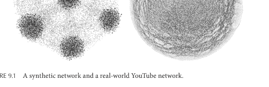

图 9.1 一个合成网络和一个真实世界的 YouTube 网络。


现实世界中的复杂网络被表示为图 G(V, E)，其中顶点 V 代表实体，边 E 代表这些实体之间的关系。例如，在科研合作网络中，实体是研究人员，两个研究人员之间是否存在边，则表示在给定网络中他们是否合作过。现实生活中的网络表现出类似社区的结构。这意味着属于同一社区的节点彼此之间连接紧密，而与属于其他社区的节点连接稀疏。这种社区检测问题也可以被表述为图分割和图聚类 [4]，并且近来受到了广泛关注 [5–16]。在这些技术中，用于社区检测的一类方法被称为谱聚类 [13–16]。

在谱聚类中，需要对图拉普拉斯矩阵（L）进行特征分解。L 由网络中节点的相似度矩阵或亲和矩阵推导而来。一旦获得特征向量，就可以使用 k-means 聚类技术检测社区。谱聚类技术的主要缺点是，我们需要为整个网络创建一个大型的 N × N 核矩阵，以执行无监督社区检测。此处，N 表示大规模网络中的节点数。然而，随着网络规模的增大，计算和存储 N × N 矩阵在计算上变得不可行。

参考文献 17 提出了一种基于加权核主成分分析（PCA）并采用原始–对偶框架的谱聚类方法。该公式构建了一个基于数据代表性子集的模型，并具有强大的样本外扩展性质。这个代表性子集捕获了数据集中固有的簇结构。该性质允许对数据集中先前未见的数据点进行社区归属判定。核谱聚类（KSC）方法在参考文献 11 中被扩展到中等规模图的社区检测，并在参考文献 1 中被扩展到大规模图。

我们使用参考文献 2 中介绍的快速且唯一代表性子集（FURS）选择技术，来选择用于构建训练和验证模型的子图（图 9.2）。KSC 方法中的一个重要步骤是估计模型参数，即核参数（如果有的话）以及大规模网络中的社区数量 k。对于大规模网络，归一化线性核是一种有效的核，如参考文献 18 所示。因此，我们在实验中使用无需参数的归一化线性核。这使我们免于调整额外的核参数。为了估计社区数量 k，我们利用特征空间中的特征投影，提出了平衡角度拟合（BAF）准则 [1] 以及另一种自调节方法 [3]，其中我们使用熵和平衡的概念来自动获取 k。

在本章中，我们给出 KSC 方法的实践说明，首先简要解释所涉及的步骤，然后通过 KSC-net 软件展示其用法。我们通过两个演示来展示使用 KSC-net 时可用的选项，并根据 KSC 方法论解释其内部结构和功能。

## 9.2 面向大数据网络的 KSC

我们首先简要描述 KSC 方法论以及 FURS 选择技术。我们还解释了 BAF 和自调节模型选择技术。本章使用的符号在 9.2.1 节中说明。

### 9.2.1 符号

- 1. 图表示为 G = (V, E)，其中 V 代表节点集合，E ⊆ V × V 代表网络中的边集合。节点代表网络中的实体，边代表它们之间的关系。
- 2. 集合 V 的基数为 N。
- 3. 集合 E 的基数为 E_total。
- 4. 邻接矩阵 A 是一个 N × N 的稀疏矩阵。
- 5. 节点的亲和/核矩阵表示为 Ω，投影的亲和矩阵用 S 表示。
- 6. 对于无权图，如果 (v_i, v_j) ∈ E，则 A_ij = 1，否则 A_ij = 0。
- 7. 由节点子集 B 生成的子图表示为 G(B)。数学上，G(B) = (B, Q)，其中 B ⊂ V，Q = (B × B) ∩ E 代表子图中的边集合。
- 8. 度分布函数为 f(V)。对于图 G，可写为 f(V)，而对于子图 B，可表示为 f(B)。每个顶点 v_i ∈ V 都有一个度，表示为 f(v_i)。
- 9. 度矩阵表示为 D。它是一个对角矩阵，对角元素为 d_{i,i} = ∑_j A_{ij}。
- 10. 与每个顶点 v_i ∈ V 对应的邻接列表为 x_i = A(:, i)。
- 11. 给定节点 v_i 的邻居节点集合表示为 Nbr(v_i)。
- 12. 图的中位数度表示为 M。

KSC 方法论包含三个主要步骤：

- 1. 在训练数据上构建模型
- 2. 使用验证数据识别模型参数
- 3. 样本外扩展以确定未见测试节点集的社区归属

### 9.2.2 FURS 选择

具有较高度中心性或有更多连接的节点代表具有更大的影响力，并且往往位于网络的中心。FURS 选择技术的目标是从图的不同密集区域选择若干个这样的高度中心性节点，以捕获网络中固有的社区结构。然而，这种选择这样一个子集（B）的问题需要非确定性多项式时间（NP-难），并被公式化为

$$\max_{B} J(B)=\sum_{j=1}^{s} D(v_j)$$ 约束条件 $v_j \in c_i$，$c_i \in \{c_1,\dots,c_k\}$ (9.1)

其中 $D(v_j)$ 代表节点 $v_j$ 的度中心性，$s$ 是子集的大小，$c_i$ 代表第 $i$ 个社区，$k$ 代表网络中的社区数量，该数量无法预先明确确定。

FURS 选择技术是上述问题的一种贪心解法。它被公式化为一个优化问题，在该问题中，我们最大化所选子集 $B$ 中节点的度中心性之和，同时所选节点的邻居在该迭代中被停用或不能被选择。通过停用其邻域，我们从图中的一个密集区域移动到另一个密集区域，从而近似覆盖网络中的所有社区。如果在一次迭代中所有节点都被停用，而我们尚未达到所需的子集大小 $s$，则重新激活这些已停用的节点，并重复该过程，直到达到所需大小 $s$。该优化问题如公式 9.2 所示：

$J(B)=0$ 当 $|B| < s$ 时 (9.2)

$\max_{B} J(B):=J(B)+\sum_{j=1}^{s'} D(v_j)$
约束条件 $Nbr(v_j) \rightarrow$ 在迭代 $t$ 中停用，$Nbr(v_j) \rightarrow$ 在迭代 $t+1$ 中激活

其中 $s'$ 是在迭代 $t$ 期间由 FURS 选择的节点集合的大小。

已有多种图采样方法被提出，包括参考文献 2、19 到 21。FURS 选择方法在参考文献 2 中提出，并在参考文献 1 中使用。参考文献 2 中详细比较了各种采样技术。我们在 KSC-net 软件中使用 FURS 选择技术进行训练集和验证集的选择。

### 9.2.3 KSC 框架

对于大规模网络，训练数据包括所有节点 $v_i$（$i = 1, \dots, N_{tr}$）的邻接列表。设训练节点集表示为 $V_{tr}$，训练集基数为 $N_{tr}$。验证集和测试集节点分别表示为 $V_{valid}$ 和 $V_{test}$。这些集合的基数分别为 $N_{valid}$ 和 $N_{test}$。这些邻接列表集可以高效地存储在内存中，因为现实世界的网络高度稀疏，并且每个节点 $v_i \in V_{tr}$ 的连接数量有限。邻接列表的最大长度可以等于 $N$。这种情况发生在节点与网络中的所有其他节点相连时。

#### 9.2.3.1 训练模型

对于由 FURS 选择技术选出的 $V_{tr}$ 个训练节点，$\mathcal{D} = \{x_i\}_{i=1}^{N_{tr}}$，其中 $x_i \in \mathbb{R}^N$。此处，$x_i$ 表示第 $i$ 个训练节点的邻接列表。给定 $\mathcal{D}$ 和用户定义的 $maxk$（网络中的最大簇数），加权核 PCA [17] 的原始公式为

```
$$\min_{w^{(l)}, e^{(l)}, b_l} \frac{1}{2} \sum_{l=1}^{maxk-1} w^{(l)T} w^{(l)} - \frac{1}{2N_{tr}} \sum_{l=1}^{maxk-1} \gamma_l e^{(l)T} D^{-1} e^{(l)} \tag{9.3}$$

$$\text{使得} \quad e^{(l)} = \Phi w^{(l)} + b_l 1_{N_{tr}}, l = 1, \dots, maxk-1$$
```

其中 $e^{(l)} = [e_1^{(l)}; \dots; e_{N_{tr}}^{(l)}]^T$ 是投影到特征空间上的投影值；$l = 1, \dots, maxk - 1$ 表示编码 $maxk$ 个社区所需的得分变量数量；$D^{-1} \in \mathbb{R}^{N_{tr} \times N_{tr}}$ 是与核矩阵 $\Omega$ 相关联的度矩阵的逆；$\Phi$ 是 $N_{tr} \times d_h$ 的特征矩阵；且 $\Phi = [\phi(x_1)^T; \dots; \phi(x_{N_{tr}})^T]$。$\gamma_l \in \mathbb{R}^+$ 是正则化常数。我们注意到 $N_{tr} \ll N$，即训练集中的节点数远小于大规模网络中的总节点数。核矩阵 $\Omega$ 通过计算训练集中每对节点的邻接列表之间的相似度获得。$\Omega$ 的每个元素，记为 $\Omega_{ij} = K(x_i, x_j) = \phi(x_i)^T \phi(x_j)$，通过计算邻接列表 $x_i$ 和 $x_j$ 之间的余弦相似度获得。因此，$\Omega_{ij} = \frac{x_i^T x_j}{\|x_i\| \|x_j\|}$ 可以使用集合交集和并集的概念高效计算。这对应于使用归一化线性核函数 $K(x, z) = \frac{x^T z}{\|x\| \|z\|}$ [22]。聚类模型随后表示为

```
$$e_i^{(l)} = w^{(l)T} \phi(x_i) + b_l, i = 1, \dots, N_{tr} \tag{9.4}$$
```


其中 φ: R^N → R^{d_h} 是映射到维度为 d_h 的高维特征空间；b_l 为偏置项；且 l = 1, ..., maxk − 1。然而，对于大规模网络，我们可以利用底层特征映射的显式表达式且 d_h = N。由于 KSC 公式对任意正定核函数均有效，我们使用归一化线性核函数以避免任何核参数。投影 e_i^{(l)} 表示由 sign(e_i^{(l)}) 给出的 maxk − 1 个二元聚类指示符的潜在变量，可通过编码/解码方案与最终组组合。对应于该原始公式的对偶问题为

D^{-1} M_D α^{(l)} = λ_l α^{(l)} (9.5)

其中 M_D = I_{N_r} − (1/N_r 1_{N_r} 1_{N_r}^T D^{-1}) / (1_{N_r}^T D^{-1} 1_{N_r})。α^{(l)} 为对偶变量，且核函数 K: R^N × R^N → R 扮演相似度函数的作用。

#### 9.2.3.2 模型选择

KSC-net 为用户提供选择两种模型选择技术之一的选项，即 BAF 准则 [1] 或自调优程序 [3]。

### 算法 1：BAF 模型选择准则

数据：给定码本 Cβ、maxk 和 P = {e_valid1, ..., e_valid_Nv}。

结果：最大 BAF 值和最优 k。

- 1. 对每个 k ∈ {2, ..., maxk} 执行
- 2. 使用码本 Cβ 计算训练节点的聚类成员。
- 3. 得到聚类 Δ = {C1, ..., Ck} 并计算每个 C_j 的聚类均值 u_j。
- 4. 对于每个验证节点 valid_d，得到 max_j cos(θ_{j,valid_d})，其中 cos(θ_{j,valid_d}) = (e_valid_d^T u_j) / (||e_valid_d|| ||u_j||)，j = 1, ..., k。
- 5. 维护字典 MaxSim(valid_i) = max_j cos(θ_{j,valid_i})，j = 1, ..., k。
- 6. 为验证节点得到聚类 Δ_valid = {C_valid1, ..., C_validk}。
- 7. 定义 BAF 为 BAF(k) = Σ_{i=1}^k Σ_{valid_i ∈ C_i} 1/k * MaxSim(valid_i) / |C_i|。
- 8. 结束
- 9. 保存最大 BAF 值以及对应的 k。

#### 9.2.3.3 外样本扩展

理想情况下，当社区不重叠时，我们将得到 k 个良好分离的社区，且归一化拉普拉斯矩阵具有 k 个分段常数特征向量。这是因为最大特征值 1 的重数为 k，如文献 23 所示。

在 KSC 的情况下，由于中心化矩阵 M_D，特征向量具有零均值，且二值化特征向量的最优阈值是自确定的（等于 0）。因此我们需要 k − 1 个特征向量。然而，在真实网络中，社区表现出重叠且不具有分段常数特征向量。

### 算法 2：自动识别 k 个社区的算法

数据：P = {e_valid1, e_valid2, ..., e_valid_k}。

结果：给定大规模网络中的聚类数 k。

- 1. 使用投影向量 e_valid ∈ P 及其 CosDist() 构造 S。
- 2. 设置 t ∈ {0.1, 0.2, ..., 1}。
- 3. 对每个 t ∈ t 执行
- 4. 将 S 保存到临时变量 R 中，即 R := S 且 SizeC_t = []。
- 5. 当 S 不是空矩阵时循环
- 6. 找到余弦距离 < t 的节点数最多的 e_valid。
- 7. 确定这些节点的数量并将其追加到 SizeC_t。
- 8. 删除对应这些节点索引的行和列。
- 9. 结束
- 10. 如文献 3 中所述，从 SizeC_t 计算熵和期望平衡度。
- 11. 使用熵和平衡度计算 F 测度 F(t)。
- 12. 结束
- 13. 将 F 测度最大时的阈值作为 max t 得到。
- 14. 将 k 估计为向量 SizeC_max t 中项的个数。

解码方案包括将验证/测试阶段得到的聚类指示符与码本 C_B 进行比较，并基于汉明距离选择最近的码本。该方案对应于误差校正输出码 ECOC 解码程序 [24]，并在外样本扩展中也使用。

外样本扩展基于分数变量，该变量对应于将映射后的外样本节点投影到训练阶段找到的特征向量上。通过对出样本节点的分数变量进行二值化，可以得到聚类指示符

sign(e_test^{(l)}) = sign( Ω_test α^{(l)} + b_l 1_{N_test} ) (9.6)

其中 l = 1, ..., k − 1；Ω_test 是使用测试节点计算的 N_test × N_tr 核矩阵，其元素为 Ω_test,ij = K(x_i, x_j)；r = 1, ..., N_test；且 i = 1, ..., N_tr。这种对外样本节点的自然扩展是 KSC 的主要优势。这样，聚类模型可以在无监督学习过程中进行训练、验证和测试。对于测试集，我们使用整个网络。如果网络无法放入内存，我们将其划分为块以并行计算每个测试块的聚类成员。

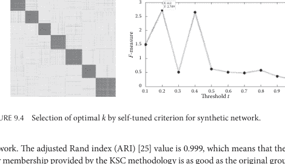

图 9.4 使用自调优准则为合成网络选择最优 k。

network. 调整兰德指数 ARI [25] 的值为 0.999，这意味着 KSC 方法提供的社区成员与原始真实情况一样好。如果我们在算法 3 的演示脚本中将 mod_sel = 'Self'，则执行自调优模型选择。它使用熵和平衡聚类的概念来识别网络中的最优聚类数 k。图 9.4 展示了使用自调优模型选择程序从验证集的特征投影生成的块对角亲和矩阵 S。从图 9.4 可以观察到亲和矩阵 S 中有七个块。为了计算这些块的数量，自调优程序将熵和平衡的概念一起用作 F 测度。图 9.4 显示 F 测度在阈值 t = 0.2 时最大，其值为 2.709。对应于该阈值值识别出的聚类数 k 为 7，这与真实社区的数量相等。

### 算法 3：使用 BAF 准则的合成网络演示脚本

```text
Data:
netname = 'network'; // Name of the file and extension should be '.txt'
baseinfo = 1; // Ground truth exists
cominfo = 'community'; // Name of ground truth file and extension should be '.txt'
weighted = 0; // Whether a network is weighted or unweighted
frac_network = 15; // Percentage of network to be used as training and
maxk = 10; // maxk is maximum value of k to be used in eigen-decomposition, use
// maxk = 10 for k <= 10 else use maxk = 100
mod_sel = 'BAF'; // Method for model selection (options are 'BAF' or 'Self')
output = KSCnet(netname,baseinfo,cominfo,weighted,frac_network,maxk,mod_sel);
```

```text
Result
output = 1; // When community detection operation completes
netname_numclu_mod_sel.csv; // Number of clusters detected
netname_outputlabel.csv; // Cluster labels assigned to the nodes
netname_ARI.csv; // Valid only when ground truth is known, provides information
// about ARI and number of communities covered
```

### 9.3.2 KSC 子函数

我们简要描述在 KSCnet() 函数中调用的一些子函数。首先，大规模网络以边列表形式提供，可能带或不带真实信息；我们将边列表转换为稀疏邻接矩阵 A。frac_network 提供有关网络总节点数中有百分之多少用于训练和验证集的信息。我们设置条件以检查 N_tr 或 N_valid 不能超过最大值为 5000。然后我们使用 “system” 命令运行 FURS 选择技术，如脚本语言 Python 中所实现。Python 先决条件在 “ReadMe.txt” 中提供。图 9.5 演示了使用 FURS 选择技术选择训练和验证集时获得的输出。

从图 9.5 可以观察到，语句 “First Step of the Sampling Process Completed” 出现了两次（一次用于训练，一次用于验证）。

- **KSCmod.** KSCmod 函数接收一个布尔状态变量作为输入，以确定是训练阶段还是测试阶段。如果为 0，则我们提供训练和验证集作为输入；否则，输入为训练和测试集。它还接收 maxk 和特征值分解算法作为输入（选项为 “eig” 或 “eigs”）。它使用 Python 代码计算核矩阵，然后求解特征值分解问题以获得模型。输出为模型及其参数、训练/验证/测试集特征投影以及码本 C_B。对于验证集，我们还获得对应于 maxk 的社区归属，但对于测试集，我们获得对应于最优 k 的聚类成员。
- **KSCcodebook.** KSCcodebook 接收特征投影和特征向量作为输入。它取这些特征投影的符号，计算前 k 个最频繁的代码词并将其输出为码本。它还使用 KSCmembership 函数估计训练节点的聚类成员。
- **KSCmembership.** KSCmembership 接收训练/验证/测试集的特征投影和码本作为输入。它取这些特征投影的符号并计算码本与符号 e 之间的汉明距离。它将相应节点分配给与其汉明距离最小的聚类。

在 BAF 模型选择准则的情况下，我们利用 KSCcodebook 和 KSCmembership 功能来估计最优社区数 k 的

```text
>> descscript
First Step of the Sampling Process Completed
Degree Matrix Empty for the 1 time
Degree Matrix Empty for the 2 time
0.960400104523 seconds
Elapsed time is 1.072581 seconds.
First Step of the Sampling Process Completed
Degree Matrix Empty for the 1 time
Degree Matrix Empty for the 2 time
0.637403992517 seconds
Elapsed time is 0.743813 seconds.
```

图 9.5 选择训练和验证集的 FURS 输出。


调整聚类数

```
/usr/lib64/python2.6/site-packages/scipy/maxentropy/__init__.py:19: DeprecationWarning:
The scipy.maxentropy module is deprecated in scipy 0.10, and scheduled to be
removed in 0.11.

If you are using some of the functionality in this module and are of the
opinion that it should be kept or moved somewhere - or you are even interested
to maintain/improve this whole module - please ask on the scipy-dev mailing
list.

The logsumexp function has already been moved to scipy.misc.
DeprecationWarning)
Elapsed time is 17.60555 seconds.
/usr/lib64/python2.6/site-packages/scipy/maxentropy/__init__.py:19: DeprecationWarning:
The scipy.maxentropy module is deprecated in scipy 0.10, and scheduled to be
removed in 0.11.

If you are using some of the functionality in this module and are of the
opinion that it should be kept or moved somewhere - or you are even interested
to maintain/improve this whole module - please ask on the scipy-dev mailing
list.

The logsumexp function has already been moved to scipy.misc.
DeprecationWarning)
Elapsed time is 17.672895 seconds.
```

图 9.6 在识别 k 时获得的输出片段。

大规模网络。然而，“Self”模型选择技术独立于这些函数工作，并使用熵和平衡的概念来计算由验证集特征投影生成的亲和矩阵 S 在通过真实信息重新排序后块对角线的数量。图 9.6 表示我们在尝试识别大规模网络中社区的最优数量 k 时获得的片段。

在图 9.6 中，我们观察到“DeprecationWarning”，我们忽略它，因为它与我们未使用的“scipy”库中的某些功能有关。我们还观察到我们在两个地方获得了“Elapsed time…”。一次是在构建训练模型之后，第二次是在我们使用验证集执行模型选择之后出现。图 9.7 表示获得测试集社区归属所需的时间。由于整个网络中只有 5000 个节点，并且由于内存限制我们将测试集分为 5000 个节点的块，因此我们在图 9.7 中观察到“I am in block 1”。图 9.8 展示了合成网络的基于社区的结构。当我们使用 BAF 选择标准或“Self”选择技术时，我们得到的结果相同。

```
I am in block 1
/usr/lib64/python2.6/site-packages/scipy/maxentropy/__init__.py:19: DeprecationWarning:
The scipy.maxentropy module is deprecated in scipy 0.10, and scheduled to be
removed in 0.11.

If you are using some of the functionality in this module and are of the
opinion that it should be kept or moved somewhere - or you are even interested
to maintain/improve this whole module - please ask on the scipy-dev mailing
list.

The logsumexp function has already been moved to scipy.misc.
DeprecationWarning)
Elapsed time is 110.644138 seconds.
```

图 9.7 在估计测试聚类成员资格时获得的输出片段。

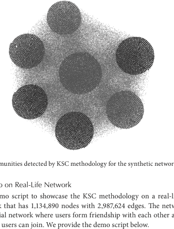

图 9.8 KSC 方法学为合成网络检测到的社区。

### 9.3.3 KSC 在真实网络上的演示

我们提供一个演示脚本来展示 KSC 方法学在真实的大规模 YouTube 网络上的应用，该网络有 1,134,890 个节点和 2,987,624 条边。该网络高度稀疏。这是一个社交网络，用户之间可以建立友谊并创建其他用户可以加入的群组。我们在下面提供演示脚本。

图 9.9 显示了 BAF 模型选择标准在 YouTube 社交网络上的有效性。从图 9.9 中，我们观察到在


图 9.9 通过 BAF 标准为 YouTube 网络选择最优 k。

BAF 与 k 曲线上存在多个局部峰值。然而，我们选择 BAF 值最大的峰值。这发生在 k = 4 时，BAF 值为 0.8995。由于我们可以为终端用户提供整个网络的聚类成员资格，终端用户可以使用各种内部质量标准来估计 resulting 社区的质量。

如果我们在算法 4 的演示脚本中将 mod_sel = 'Self'，那么我们将使用无参数模型选择技术。由于事先不知道真实社区，我们尝试使用算法 2 中提到的贪婪选择技术来估计块对角结构以确定 SizeCi 向量。图 9.10 显示 F-measure 在 t = 0.1 时最大，其值为 0.224。对应于该阈值值的识别出的社区数量 k 为 36（图 9.11）。

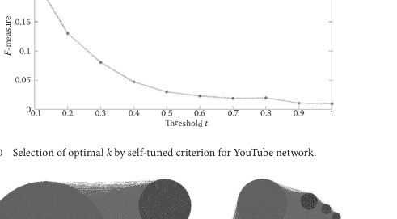

图 9.10 通过自调优标准为 YouTube 网络选择最优 k。

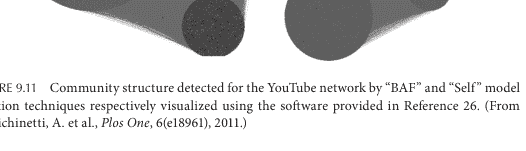

图 9.11 分别由“BAF”和“Self”模型选择技术检测到的 YouTube 网络社区结构，使用参考文献 26 中提供的软件可视化。（引自 Lancichinetti, A. et al., Plos One, 6(e18961), 2011.）

### 算法 4：使用 BAF 标准对 YouTube 网络的演示脚本

数据：

```
netname = 'youtube_mod';    //Name of the file and extension should be '.txt'
baseinfo = 0;    //Ground truth does not exists
cominfo = [];    //No ground truth file so empty set as input
weighted = 0;    //Whether a network is weighted or unweighted
frac_network = 10;    //Percentage of network to be used as training and
                      //validation set
maxk = 100;    //maxk is maximum value of k to be used in eigen-decomposition,
               //use maxk = 10 for k < 10 else use maxk = 100
mod_sel = 'BAF';    //Method for model selection (options are 'BAF' or 'Self')
output = KSCnet(netname,baseinfo,cominfo,weighted,frac_network,maxk,mod_sel);
```

结果：

```
output = 1;    //When community detection operation completes
netname_numclu_mod_sel.csv;    //Number of clusters detected
netname_outputlabel.csv;    //Cluster labels assigned to the nodes
```

## 9.4 结论

在本章中，我们对用于大数据网络社区检测的方法论进行了实践性阐述。该技术基于谱聚类的概念构建，并被称为 KSC。核心概念是在一个小的代表性子图上构建模型，该子图捕捉了大规模网络固有的社区结构。子图是通过 FURS [2] 选择技术获得的。然后，在该子图上构建了 KSC 模型。模型参数通过以下两种技术之一获得：（1）BAF 标准或（2）自调优技术。KSC 模型具有强大的样本外扩展特性。该特性用于大数据网络中以前未见节点的社区归属。我们还解释并演示了 KSC-net 软件的使用，该软件使用 KSC 方法学作为底层核心概念。

## 致谢

EU：导致这些结果的研究已获得欧洲研究理事会在欧盟第七框架计划（FP7/2007-2013）/ ERC AdG A-DATADRIVE-B（290923）下的资助。本章仅反映作者的观点；联盟不对所含信息的任何用途承担责任。Research Council KUL：GOA/10/09 MaNet，CoE PFV/10/002（OPTEC），BIL12/11T；博士/博士后资助。Flemish government—FWO：projects G.0377.12（structured systems），G.088114N（tensor-based data similarity）；PhD/postdoc grants。IWT：project SBO POM（100031）；PhD/postdoc grants。iMinds Medical Information Technologies：SBO 2014。Belgian Federal Science Policy Office：IUAP P7/19（DYSCO，dynamical systems，control and optimization，2012–2017）。

- 24. J. Baylis; Error Correcting Codes: A Mathematical Introduction. Boca Raton, FL: CRC Press, 1988.
- 25. R. Rabbany, M. Takaffoli, J. Fagnan, O.R. Zaiane and R.J.G.B. Campello; Relative validity criteria for community mining algorithms. In International Conference on Advances in Social Networks Analysis and Mining (ASONAM), pp. 258-265, 2012.
- 26. A. Lancichinetti, F. Radicchi, J.J. Ramasco and S. Fortunato; Finding statistically significant communities in networks. PLoS One, 6:e18961, 2011.


## 使大数据对软件开发者社区透明

Yu Wu, Jessica Kropczynski, and John M. Carroll

## 目录

| 项目 | 页码 |
|---|---|
| 10.1 引言 | 176 |
| 10.2 软件开发者的信息需求 | 178 |
| 10.2.1 信息需求：核心工作实践 | 178 |
| 10.2.2 信息需求：构建和维护关系 | 179 |
| 10.2.3 信息需求：职业/职业发展 | 179 |
| 10.3 软件开发者的生态系统 | 180 |
| 10.3.1 社交媒体使用 | 180 |
| 10.3.2 生态系统 | 181 |
| 10.4 信息过载与意识问题 | 183 |
| 10.5 大数据在支持软件开发者社区中的应用 | 184 |
| 10.5.1 来自核心实践的数据 | 185 |
| 10.5.2 软件分析 | 186 |
| 10.6 结论 | 187 |
| 参考文献 | 188 |

## 摘要

数字时代的软件开发者参与了一系列社交媒体服务，如 GitHub、Twitter 和 Stack Overflow，以获取不同的资源。最新研究表明，这些社交媒体服务形成了软件开发者之间相互连接的生态系统，使其能够建立联系、了解最新动态并协调工作。由于在线生态系统的复杂性以及由此产生的大量信息，软件开发者面临信息过载的问题，其中大量信息使其难以意识到满足信息需求的最相关资源。软件开发者在社交媒体服务生态系统中的参与痕迹产生了大数据，这些数据可公开获取，用于解决由信息需求和生态系统产生的问题。第 10.5 节探讨了如何将该社区产生的看似无穷无尽的数据进行综合，以提高意识、增强开发者之间的社区感并加强合作。

## 10.1 引言

由于通过基于 Web 的界面进行协作所需的修订控制方法（或版本控制），软件开发者对数据有着普遍的需求，例如活动痕迹、问题报告以及转换现有代码所需的编码资源。开发者花费大量时间处理数据，只是为了保持对其他开发者活动的认知（Biehl et al. 2007）。随着社交媒体的兴起及其在软件工程中的应用，软件开发者需要意识到来自各种来源的海量信息，例如同事、有趣的开发者、趋势、存储库和对话。存在一种悖论，即信息太多，而对这些信息所包含的知识和资源的认知却太少。社区意识不仅对日常活动很重要，而且对于开发者跟上开发格局和行业变化（Singer et al. 2014）、对项目做出决策（Buse and Zimmerman 2012），以及基于公开数据与其他人建立联系（Singer et al. 2013）也是必要的。世界各地的数百万软件开发者在多个平台上不断产生新的社会和生产性活动。开发者很难在保持对自己参与的个人项目认知度的同时，保持对整个社区产生的信息广度的认知。过量的活动意识会降低软件开发者底层社区的透明度。为了提高蓬勃发展的社区的透明度并改善对可用资源的认知，本章将描述如何收集和分析开发者的活动日志数据，并提供如何将结果呈现给公众以使资源更易于获取和搜索的潜在应用。

关于 OSS 开发者协作的最新研究表明，他们的互动并不局限于修订控制编程平台（Singer et al. 2013; Vasilescu et al. 2013, 2014; Wu et al. 2014）。相反，开发者利用社交功能，如个人资料、活动痕迹和书签，在多个平台之间协调工作。所有这些网站和平台形成了一个“生态系统”，软件开发者在其中实现生产性目标，例如代码生产、建立社会联系和职业发展。本章后面将说明软件开发者所依赖的资源生态系统，并描述它们所满足的目的，包括促进点对点互动的社交媒体功能以及与生产力相关的软件实践。可以想象，当考虑用于探索其互动的多平台维度时，探索软件开发者互动的大数据可能性将呈指数级增长。

第 10.5 节将最强调我们可以在软件开发者社区收集的大数据种类，以及存在的数据量。用于软件开发的在线工作生产平台，例如 GitHub（Dabbish et al. 2012）、CodePlex 和 Bitbucket 等，

### 10.2.1 信息需求：核心工作实践

错误报告和修复是另一个核心软件核心实践，其中必须满足不同的信息需求才能有效地解决错误和问题。错误跟踪在支持软件开发者和用户之间的协作方面发挥着核心作用。Breu et al.（2010）发现，信息需求会随着错误生命周期而变化；例如，在开始时，错误报告可能缺少用于调试的信息或细节。后来，问题会发展，重点关注错误纠正和状态查询。错误跟踪系统应考虑此类不断演变的信息需求。

### 10.2.2 信息需求：构建和维护关系

开源软件开发的最新方法将受版本控制的代码存储库与社交媒体功能相结合，例如 GitHub、CodePlex 等（Dabbish et al. 2012）。这些平台的界面通常包括用户个人资料、代码制品和特定用户执行的活动痕迹。所有这些都可以通过在线界面公开获取，在最近的文献中被称为软件开发的“透明度”（Dabbish et al. 2012; Marlow et al. 2013）。Dabbish et al.（2012）报告称，开发者大量使用这些社交线索以有效协调工作。在尝试协作工作时，开发者通常会诉诸各种线索在这些平台上做出社会推断（Marlow et al. 2013）。

除了直接与代码生产和专业关系发展相关的活动外，开发者还执行各种社交活动，例如与他人交流新想法、提问和回答问题，以及关注彼此的项目。Marlow et al.（2013）报告称，开发者在形成对他人的印象时 heavily 依赖社交媒体的社交功能，以便执行某些类型的活动，例如跟上存储库和其他同行的最新动态，发现同行的互动风格以便更好地沟通，以及评估他人的专业知识以便对代码贡献做出回应。Dabbish et al.（2012）和 Marlow et al.（2013）的工作说明了软件开发者如何在单个平台内寻求信息以与其他人互动。然而，最近的工作发现，完成 OSS 项目所需的所有信息以及软件开发者建立社会联系的信息并不在一个平台上可用。软件开发者积极参与在各个网站上创建自己的社会和专业个人资料，根据该网站的功能优势进行定制，并评估其他同行以实现连接、协作和协调。因此，软件开发者的互动是在具有不同目的和资源的各种平台上协调进行的。虽然他们的个人资料信息可能保持相似，但这些跨平台的协调互动对开发社区来说并不明确（Singer et al. 2013; Wu et al. 2014）。

### 10.2.3 信息需求：职业/职业发展

开源社区的成员会找到建立个人简历的机会，并在社区中寻找人才以组建正在进行的项目的劳动力。在开源项目上工作展示了编码技能、协作能力、工作态度和技术兴趣。对特定领域或编程类型感兴趣但缺乏适当资格的程序员可能会策略性地参与

参与这些项目将帮助他们培养必要的技能和经验，从而进入信息技术的热门领域。在这样的岗位上，程序员不必一开始就承担关键开发角色，而是可以跟随项目、尝试承担一个小角色，并向领域内的专家请教。从招聘程序员的角度来看，程序员在开源社区中参与的项目和贡献列表，可能比推荐信更能全面地展示其技术和团队协作能力。潜在雇主会寻找那些充分利用可用资源、并处于软件行业前沿的开发者。

虽然参与此类项目的经验可能有助于找到工作，但这并不是程序员在职业生涯中利用开源软件的唯一原因。企业已经开始依赖开源软件平台的企业版。参与开源软件不再是业余爱好者利用空闲时间编程的领域。相反，许多开发者现在将开源项目作为日常工作的一部分。许多大型组织现在依赖其员工参与开源社区，这些员工可能会贡献重要的错误报告和修复（Arora 2012）。除了获得完成这些小任务的劳动力外，在开源环境中构建往往比在单个公司背景下通常针对单一用例工作的团队更能提供广阔的视角。这种环境自然催生出鼓励适应和从额外数据资源中学习的新颖创新实践。

## 10.3 软件开发者的生态系统

在数字经济中，软件开发者越来越需要通过社交媒体网站在线上空间公开自己的工作并与他人协作。近期研究（Singer et al. 2013; Wu et al. 2014）表明，软件开发者用来协调工作的一系列平台和网站之间存在重要的相互关联。在本节中，我们将讨论社交媒体如何在软件实践中用于协调社会互动，并展示软件开发者生态系统互联性的证据。

### 10.3.1 社交媒体的使用

软件开发正变得越来越社交化，软件开发的社会背景以及开发者之间的社会互动变得越来越重要。在最近的文献中，软件开发者甚至被描述为“社交程序员”，因为他们密集使用社交媒体网站（Singer et al. 2013）。根据Lietsala和Sirkkunen（2008）的研究，社交媒体可分为以下几类：（1）协作内容创作工具，（2）内容共享工具，（3）虚拟世界工具，以及（4）社交网络（微博）工具。过去的文献报告称，软件开发者密集使用协作内容创作工具和社交网络工具来开展工作。一项对软件开发者的调查研究显示，开发者通过定期访问一到七个社交媒体网站来使用这些工具（Black et al. 2010）。

研究还发现，软件开发者利用社交媒体网站/平台达到广泛的目的。Bougie及其同事（2011）报告称，软件开发者利用Twitter进行社交对话和分享信息，这与软件工程师群体截然不同。Zhao和Rosson（2009）证实，使用Twitter降低了信息共享的成本。Black等人（2010）领导的一项研究发现，开发者还通过社交媒体共享源代码、规格和设计信息。社交媒体的使用还给软件开发者带来了其他好处，例如提高沟通质量以及增强各级组织活动的可见性（Black and Jacobs 2010）。

除了社交媒体中嵌入工具的功能性目的，近期研究表明，其使用情境可能差异很大。即使在同一个社交媒体平台上，软件开发者也会讨论与其工作相关的各种问题。通过分析软件开发者发送的300条抽样推文，Tian等人（2012）发现软件开发者发布关于以下主题的推文：

- 1. 软件工程相关（工作相关），例如正在进行的项目或寻求/提供技术帮助
- 2. 小工具和技术话题（例如iPhone 4）
- 3. 技术话题之外的事件（例如感兴趣的事情）
- 4. 日常闲聊（例如家庭、周末活动）

此外，社交媒体还为软件开发者组建团队和协作工作提供了一种新方式（Begel et al. 2010）。Begel及其同事（2010）报告了社交媒体网站在支持在线软件开发团队合作时发挥的几种典型的小组沟通功能：（1）风暴期，社交媒体允许快速反馈，可用于快速识别和响应不断变化的用户需求；（2）规范期，强调社交媒体在开发者之间的知识共享功能；（3）执行期，认为社交媒体有助于各种开发过程；（4）解散期，强调社交媒体从留下的互动中形成的记录机制。所有这些互动的活动痕迹可以从社交媒体中聚合起来，形成所有用户可访问的机构记忆。研究人员还致力于将社交媒体整合到软件开发工具中。Reinhardt（2009）在Eclipse中嵌入了一个Twitter客户端以支持全球软件开发。

总之，社交媒体已渗透到软件开发的许多方面，从软件开发者的日常生活到团队组建，并不仅限于源代码共享和协作。一方面，它将开发者通过多个服务于不同目的的平台紧密联系起来；另一方面，它也带来了复杂性，开发者不得不在许多平台上管理自己的个人资料和活动，并面临潜在问题，例如来自各种社交媒体网站的信息过载。

### 10.3.2 生态系统

在10.3.1节中，软件开发者经常访问社交媒体网站以协调工作、共享信息和建立社交联系。这些网站的用户并不是彼此孤立的。最近的研究表明，在线社区通过几类社交工具（如wiki、博客、论坛、社交书签、社交文件库和任务管理工具）在社区成员之间创建和组织复杂的信息空间（Matthew et al. 2014）。每种工具类型的“核心”功能被组合利用，以有效协调工作。整个软件社区也有类似的行为，许多在线社交媒体网站为开发者提供不同的功能，他们的协调和协作遍布整个生态系统空间。

在软件开发者采用的各种社交媒体类型中，GitHub是最突出的平台之一，因为它成功吸引了数百万开发者托管自己的项目并与其他同行协作（Marlow et al. 2013）。其日益增长的成功在过去几年中已成为热门研究焦点。然而，以往关于GitHub的研究尚未深入挖掘数据资源的广阔性，因为这些研究主要涉及软件开发者如何利用GitHub功能（如用户资料和活动痕迹）来协调工作（Begel et al. 2010; Dabbish et al. 2012; Marlow et al. 2013）。GitHub不仅仅是一个协作工具。它还包含数百万软件开发者之间广泛的关系网络。Thung及其同事（2013）提出了分析GitHub上社交网络结构的初步尝试。然而，他们研究中的样本并未得到充分描述，似乎缺乏生成有意义相关性所需的整体网络或部分网络数据。GitHub网络形成的原理在以往文献中并未讨论。这里缺失的空白是开发者的社会关系如何与其协作相关联。

研究人员已经观察到，随着社交媒体的进步，个人在在线空间中都以某种方式（通过几度连接或具有连接潜力）相互联系（Hanna et al. 2011）。关注（Following）是大多数社交媒体网站的共同功能，允许用户持续关注他们感兴趣的人，以接收最新消息和更新。例如，Twitter用户可以相互关注，以接收感兴趣的人的消息或推文（Kwak et al. 2010）。除关注外，研究人员还发现，通过关注关系，微博服务之间的相关性和互惠性日益增强（Java et al. 2007）。GitHub提供了类似的功能：通过关注他人，用户会收到其关注对象的活动痕迹，这与在其他社交媒体上的关注类似，区别在于它广播的是活动而非短消息。由于GitHub在关注功能方面与Twitter相似，展示对他人关注的活动（如关注）也可能用于协调软件项目上的协作工作。

社交媒体还极大地扩展了用户创建、修改、分享和讨论互联网内容的能力（Kietzmann et al. 2011）。社会研究人员确定了社交媒体的七个基本构建模块，包括身份、对话、共享、存在感、关系、声誉和群体，它们构成了一个丰富多样的社交媒体网站生态（Kietzmann et al. 2011）。作者认为，每个社交媒体网站对这些七个视角的强调程度不同。在软件行业中，虽然GitHub是支持软件代码实践的关键平台，但许多其他平台，如Stack Overflow和Hacker News，也被软件开发者采用，以支持


基本目的（Kietzmann等，2011）。网站/平台对功能的强调方式不同，正如Kietzmann等（2011）所指出的；然而，关于这些网站/平台如何组织并形成一个面向软件开发者的完整系统，人们所知甚少。

软件生态系统此前已有讨论，但更多是从行业视角展开的（Bosch 2009; Campbell and Ahmed 2010; Jansen et al. 2009; Messerschmitt and Szyperski 2005），这些研究在用户、开发者、买家、卖家、政府和经济的背景下描述软件产业，却使软件开发者的视角在分析中缺失。Singer等（2013）的近期工作报告了面向软件开发者的生态系统的存在，但缺失的部分恰恰是构成围绕软件代码仓库和软件实践的系统究竟由哪些组件组成，以及可以做出哪些努力来使这一有价值的社交与生产资源生态系统对所有软件开发者更加透明。软件开发者在线环境中的活动轨迹所生成的大规模数据集，是解决该问题的一项宝贵资源。

## 10.4 信息过载与感知问题

在第10.3节中，软件开发者采用各种在线服务来协调工作、建立社交联系并构建职业生涯。然而，这些活动是复杂的过程，并广泛分布在众多平台上。社交媒体的数量和类型及其相互关系很可能增加协作的复杂性，并引发问题，例如信息过载。

信息过载是这样一种现象：当信息的高速率和大数量达到过载时，它们会变成噪声（Klapp 1986）。Klapp（1986）认为，如果处理高速率信息时无法避免分心、压力和错误增加，那么信息的质量实际上会变得更差。通过回顾关于信息过载的文献，Edmunds和Morris（2000）将信息过载问题界定为一种情形：信息量过多，但在需要时却难以获取相关且有用的信息。

软件开发中的情况很可能更为严重。在第10.2节中，软件开发者在一系列不同活动中有着密集的信息需求；这些活动有时非常复杂，例如向一个不太熟悉的代码仓库提交拉取请求，而且他们需要在一个复杂的生态系统中彼此协作，该生态系统涵盖在线空间中的许多网站和平台。软件开发领域的研究者有时将这一问题称为感知问题。

感知，即了解正在发生的事情，是软件实践的先导。尽管直接沟通，如面对面沟通，是保持对同伴感知的最有效方式，但软件开发团队，尤其是分布式软件开发团队，缺乏讨论式交流，其协作是通过隐式活动发生的（Bolici et al. 2009）。在开源开发中，开发者的工作通过代码仓库或其他类似工件来协调，例如在源代码修订上的协作或协作式缺陷修复。然而，由于软件开发的复杂性，隐式协作也引发了一些关键的

### 10.5.1 核心实践产生的数据

由于社交媒体网站对在线软件实践的透明性，通过服务提供者提供的API可以获得大量数据。例如，GitHub通过时间线和API公开提供活动数据、用户数据和仓库数据。时间线数据包含详细的日志信息，说明哪个用户在什么时间对哪个软件仓库进行了何种类型的活动（或关注了谁）。活动类型大致可以分为四类（表10.1）。数据以JavaScript对象表示法（JSON）格式存储（Crockford 2006）。这里描述的日志数据包含关于软件开发者 and 软件仓库的有价值信息，这些信息有助于追踪用户或软件项目的完整活动历史。

仅时间线就创造出了大数据，其中包含每天数百万开发者在数百万软件仓库上的活动。收集、聚合和分析GitHub时间线数据，很可能有助于深入理解软件产业的历史、趋势和倾向。

除了时间线，GitHub还提供用于各种查询的API，例如查询特定用户的详细信息，如个人资料信息、近期活动等，或查询某个仓库，如检索贡献者列表以及特定软件项目所使用的编程语言。除GitHub外，Stack Overflow、Bitbucket和Twitter中也可以找到关于活动日志和用户信息的类似API，这为从多种平台和服务中聚合软件开发者生态系统的真正大数据创造了机会。

根据我们在第10.2节中的讨论，软件开发者通常执行三类活动：（1）与软件开发直接相关的“核心”活动；（2）建立或维护社交关系的活动；以及（3）用于职业发展的活动，例如学习。从生态系统中收集的大数据有机会促进所有这三类活动。例如，Basili（1993）提出的经验工厂支持软件开发从开发者项目中收集经验、将这些经验打包（从模型中的示例中），并在未来项目中验证和复用这些经验；它可以通过整合来自生态系统不同来源的数据来构建，进而使个体开发者受益。

软件仓库使用VCS来跟踪代码变更，并使用单独的缺陷跟踪系统在维护过程中提出和修复问题与缺陷。一旦项目的活跃开发者超过一名，就需要VCS。来自VCS的日志包括以下内容：（1）作者，（2）日期和时间，（3）变更的文件，以及（4）可选的日志消息。在GitHub上，VCS和缺陷跟踪系统的所有日志数据都被存储，并通过时间线和API公开可用，这为软件分析提供了关键的信息来源，例如理解软件项目的演化以及归档项目的开发历史。

**表10.1 GitHub记录的活动类型**

| 活动类型 | 描述 |
| --- | --- |
| 代码 | 与源代码直接相关的活动，例如代码提交、代码审查、拉取请求等 |
| 议题 | 与缺陷修复、功能请求、评论等相关的活动 |
| Wiki | 与编辑Wiki页面相关的活动 |
| 感知 | 导致从他人处接收更新的活动，例如关注其他用户 |

### 10.5.2 软件分析

软件项目被认为难以让利益相关者预测相关风险（Buse and Zimmermann 2010）。而在大数据和软件开发者生态系统的时代，不同利益相关者面临更多问题。开源软件开发者需要知道在哪个平台上找到所需信息、在何处以及与谁建立联系、参与哪个项目以及参与到何种程度，等等。软件用户需要知道项目是否正在积极开发，以及项目所有者回应用户反馈的可能性有多大。不同利益相关者需要关于软件项目的各种信息以便做出决策。软件分析是解决这一关切的一种可能方案。

分析（Analytics）是将分析、数据和系统推理的应用加以整合，以做出决策（Buse and Zimmermann 2012）。在大数据和软件分析的帮助下，软件开发中的利益相关者可以获取关于产业整体图景和特定软件项目细节的信息。大数据和软件分析有潜力缓解第10.4节中的信息过载与感知问题，并促进决策过程。

分析已经彻底改变了许多领域的决策过程（Davenport et al. 2010）。分析的目标是帮助决策者提取原本可能被隐藏的重要信息和洞见。为了克服软件的复杂性，近年来研究者将分析应用于软件开发，以便更好地管理该过程（Buse and Zimmermann 2010）。他们主张，软件管理者对软件项目有着高层次关切，例如项目方向、资源分配、功能集合和用户体验，而分析可以帮助回答管理者关于其项目所提出的重要问题（Buse and Zimmermann 2012）。软件分析为软件管理者提供以下优势：（1）监控项目，（2）了解哪些做法有效，（3）提高效率，（4）管理风险，（5）预测变化，以及（6）评估过去的决策。在开源社区中，每位开发者既是自己项目的管理者，也是其所参与的其他项目的开发者。分析可以帮助开源开发者做出各种重要决策，例如使用哪款软件、加入哪个项目、与谁合作等。

尽管技术的快速发展为软件分析创造了潜力，使得软件开发中的多个数据源可以被记录和存储，但这些不同来源的整合以及有意义的分析的创建仍在研究中。Bachman和Bernstein（2009）报告称，现代软件项目管理系统（Jazz、Telelogic Synergy）提供了开发和维护软件项目所需的完整功能。他们声称，过程数据的整合具有多重优势（Bachman and Bernstein 2009）：（1）预测未来或隐藏缺陷的位置和数量（Crowston 1997）；以及（2）项目经理能够使用此类

预测以识别系统的关键部分，限制其影响的严重程度，并允许制定更有条理的计划。然而，来自这些独立系统的数据集成无法自动执行，而必须由开发者手动维护。

随着大数据和生态系统的出现，软件分析可能发挥更大的作用。自动化集成过程可以得到解决，因为现代平台将多个子系统集成在一起。例如，GitHub 为每个仓库集成了 VCS、问题跟踪器和文档功能。在 GitHub 上的一个软件项目中生成的数据，仅凭其唯一标识符就可以被识别和收集。此外，生态系统生成的大数据集有潜力处理 Buse 和 Zimmermann（2012）提出的分析类型，包括趋势、警报、预测、摘要、叠加、目标、建模、基准测试和模拟。大数据在软件分析中的一种应用是将上下文与代码制品集成。例如，托管在 GitHub 上的一个流行软件仓库很可能在 Twitter 上被大量讨论；该软件的用户可能会在 Stack Overflow 上提出许多问题；而在 Hacker News 上，专家们会讨论该软件的优缺点，将其与其他同类产品进行比较并列出应用场景。通过从生态系统中提取和综合信息，大数据可以揭示软件行业的趋势，结合用户反馈和问题，汇总关于单个软件仓库的全面信息，从而为项目利益相关者提供警报，并预测与该仓库相关的特征和错误。此外，由于大数据包含生态系统的详细信息，数据集的多次叠加可以更好地帮助开发者理解某个代码制品的历史，这些历史可用于构建历史模型，或用于分析近期编程语言的趋势。而且，通过探索来自生态系统的大数据，人们可以更好地理解用户的确切需求和关切，这有助于设定目标以解决用户的问题和关切。此外，基准测试在比较不同实践（如相似的代码制品）时很重要。大数据为开展基准测试提供了更大的背景，在其中可以考虑更多的实践和更多的因素。

## 10.6 结论

在本章中，我们讨论了软件开发者开展各种软件实践的信息需求，软件开发者生态系统的出现——在该生态系统中，开发者跨社交媒体网站协调工作并建立社交联系——以及这两类活动的交互如何引发信息过载和感知问题。我们还论证了，生态系统生成的大数据有潜力通过软件分析技术提供准确且全面的信息，从而解决信息过载和感知问题。

软件开发在很大程度上变成了在线空间中的隐式协作（Bolici 等，2009），其中缺乏显式沟通，大多数间接沟通通过各种线索发生，例如社交媒体上的个人资料信息和活动痕迹，这些线索可作为软件开发者形成对他人印象的参考，从而为协作提供信息（Marlow 等，2013）。虽然单个平台内的信息相对可搜索，但相似和相关的信息分散在多个在线资源中，这造成了信息过载和感知问题。第 10.5 节所述的大数据技术最有希望实现透明度，从而提高整个生态系统中协作与创新软件开发的效率和效果。

## 参考文献

Arora, H. (2012). 为什么大公司正在拥抱开源？IBM。访问于2014年3月20日。检索自 https://www.ibm.com/developerworks/community/blogs/6e6f6d1b-95c3-46df-8a26-b7efd8ee4b57/entry/why_big_companies_are_embracing_open_source119?lang=en。

Bachmann, A., and Bernstein, A. (2009). 面向软件过程数据分析的数据检索、处理与链接。瑞士苏黎世：苏黎世大学，技术报告。

Basili, V. R. (1993). 经验工厂及其与其他改进范式的关系。载于《Software Engineering—ESEC '93》，I. Sommerville 和 M. Paul（编）（第68–83页）。Springer Berlin, Heidelberg。

Begel, A., DeLine, R., and Zimmermann, T. (2010, November). 面向软件工程的社交媒体。载于 Proceedings of the FSE/SDP Workshop on Future of Software Engineering Research（第33–38页）。ACM。

Biehl, J. T., Czerwinski, M., Smith, G., and Robertson, G. G. (2007, April). FASTDash：一种用于促进软件团队感知的可视化仪表板。载于 Proceedings of the SIGCHI Conference on Human Factors in Computing Systems（第1313–1322页）。ACM。

Black, S., Harrison, R., and Baldwin, M. (2010). 软件系统开发中社交媒体使用调查。载于 Proc. of the 1st Workshop on Web 2.0 for Software Engineering（第1–5页）。ACM。

Black, S., and Jacobs, J. (2010). 使用 Web 2.0 提高软件质量。载于 Proc. of the 1st Workshop on Web 2.0 for Software Engineering（第6–11页）。ACM。

Bolici, F., Howison, J., and Crowston, K. (2009, May). 没有讨论的协调？自由及开源软件项目中的社会技术一致性与 stigmery。载于 Socio-Technical Congruence Workshop in Conj. Intl Conf. on Software Engineering。加拿大温哥华。

Bosch, J. (2009, August). 从软件产品线到软件生态系统。载于 Proceedings of the 13th International Software Product Line Conference（第111–119页）。Carnegie Mellon University。

Bougie, G., Starke, I., Storey, M. A., and German, D. M. (2011, May). 理解软件工程中的 Twitter 使用：初步发现、持续挑战与未来问题。载于 Proceedings of the 2nd International Workshop on Web 2.0 for Software Engineering（第31–36页）。ACM。

Breu, S., Premraj, R., Sillito, J., and Zimmermann, T. (2010, February). 缺陷报告中的信息需求：改善开发者与用户之间的合作。载于 Proceedings of the 2010 ACM Conference on Computer Supported Cooperative Work（第301–310页）。ACM。

Buse, R. P., and Zimmermann, T. (2010, November). 面向软件开发的分析。载于 Proceedings of the FSE/SDP Workshop on Future of Software Engineering Research（第77–80页）。ACM。

Buse, R. P., and Zimmermann, T. (2012, June). 软件开发分析的信息需求。载于 Proceedings of the 2012 International Conference on Software Engineering（第987–996页）。IEEE Press。

Campbell, P. R., and Ahmed, F. (2010, August). 软件生态系统的三维视图。载于 Proceedings of the Fourth European Conference on Software Architecture: Companion Volume（第81–84页）。ACM。

Crockford, D. (2006). 用于 JavaScript 对象表示法（JSON）的 application/JSON 媒体类型。RFC 4627, July 2006。

Crowston, K. (1997). 组织过程设计的协调理论方法。Organization Science, 8(2), 157–175。

Messerschmitt, D. G., and Szyperski, C. (2005). *软件生态系统：理解不可或缺的技术与产业*。MIT Press Books, Cambridge, MA。

Perlow, L. A. (1999). 时间饥荒：迈向工作时间社会学。*Administrative Science Quarterly, 44*(1), 57–81。

Perry, D. E., Staudenmayer, N. A., and Votta, L. G. (1994). 人员、组织与过程改进。*Software, IEEE, 11*(4), 36–45。

Reinhardt, W. (2009). 沟通是关键——通过微博支持软件工程中的持久知识共享。载于 *Software Engineering (Workshops)*（第329–340页）。

Seaman, C. B., and Basili, V. R. (1998). 沟通与组织：审查会议中讨论的实证研究。*IEEE Transactions on Software Engineering, 24*(7), 559–572。

Singer, L., Figueira Filho, F., Cleary, B., Treude, C., Storey, M. A., and Schneider, K. (2013, February). 社交程序员生态系统中的相互评估：开发者资料聚合器的实证研究。载于 *Proceedings of the 2013 Conference on Computer Supported Cooperative Work*（第103–116页）。ACM。

Singer, L., Figueira Filho, F., and Storey, M. A. (2014). 光速下的软件工程：开发者如何利用 Twitter 保持与时俱进。载于 *Proc. ICSE 2014*。

Thung, F., Bissyandé, T. F., Lo, D., and Jiang, L. (2013, March). GitHub 中社交编码的网络结构。载于 *17th European Conference on Software Maintenance and Reengineering (CSMR)*，（第323–326页）。IEEE。

Tian, Y., Achananuparp, P., Lubis, I. N., Lo, D., and Lim, E. P. (2012, June). 软件工程社区在微博上讨论什么？载于 *Mining Software Repositories (MSR), 2012 9th IEEE Working Conference on*（第247–250页）。IEEE。

Vasilescu, B., Filkov, V., and Serebrenik, A. (2013, September). StackOverflow 与 GitHub：软件开发与众包知识之间的关联。载于 *SocialCom 2013*（第188–195页）。IEEE。

Vasilescu, B., Serebrenik, A., Devanbu, P., and Filkov, V. (2014). 社交问答网站如何改变开源软件社区中的知识共享。载于 *CSCW*。ACM。

Wu, Y., Kropczynski, J., Shih, P., and Carroll, J. M. (2014). 探索 GitHub 及其他平台上软件开发者生态系统。载于 *CSCW '14 Interactive Posters*。

Zhao, D., and Rosson, M. B. (2009, May). 人们如何使用以及为何使用 Twitter：微博在工作场所非正式沟通中的作用。载于 *Proceedings of the ACM 2009 International Conference on Supporting Group Work*（第243–252页）。ACM。


- 11.4.1 大挑战 210
- 11.4.1.1 高可扩展性 211
- 11.4.1.2 高容错性 211
- 11.4.1.3 高一致性 211
- 11.4.1.4 高负载均衡 211
- 11.4.1.5 高吞吐量 212
- 11.4.2 即时工作 212
- 致谢 212
- 参考文献 213

## 摘要

作为数据密集型计算的新趋势，实时流计算在大数据时代正受到越来越多的关注。理论上，流计算是通过提供极低延迟的处理工具和大规模并行处理架构来支持大数据实时数据分析的有效方式。然而，在大多数现有的流计算环境中，如何高效地处理大数据流计算以及如何构建高效的大数据流计算系统，对大数据计算研究提出了巨大挑战。首先，对大数据流计算的数据流图和系统架构，以及系统结构、数据传输、应用接口和高可用性等相关关键技术进行了系统研究。然后，我们对最新研究进行了分类，并描述了Twitter Storm、Yahoo! S4、Microsoft TimeStream 和 Microsoft Naiad 等一些流行的大数据流计算系统的开发现状。最后，讨论了大数据流计算的潜在挑战和未来方向。

## 11.1 引言

大数据计算是未来计算的新趋势，随着数据量的增长和数据速度的加快。一般来说，大数据计算主要有两种机制，即大数据流计算 BDSC 和大数据批处理计算。BDSC 是一种直通计算模型，如 Storm [1] 和 S4 [2]，它对流计算的作用相当于 Hadoop 对批处理计算的作用，而大数据批处理计算是一种先存储后计算的模型，如 Hadoop 实现 [4] 开源的 MapReduce 框架 [3]。

本质上，大数据批处理计算对于许多实时应用场景是不够的，在这些场景中，数据流随时间频繁变化，最新的数据是最重要和最有价值的。例如，在分析实时交易数据时，例如金融交易、电子邮件、用户搜索请求、传感器数据跟踪，数据流随着更多交易的进行而单调增长。随着时间的推移，理想情况下实时应用环境可以由 BDSC 支持。一般来说，大数据流计算具有以下定义特征 [5,6]。(1) 输入数据流是实时数据流，需要实时计算，结果必须在数据变化时每次更新。(2) 到来的数据以远超单个机器能力的速度连续到达。(3) 输入流以低延迟进行多阶段计算以产生输出流，其中任何传入数据条目 ideally 在几秒内反映在输出流中新生成的结果中。

### 11.1.1 流计算

流计算，长期以来“高实时计算”和“高吞吐量计算”的梦想，以计算连续数据流的程序为特征，由于大数据而开启了未来计算的新时代，大数据是指大、快、分散、无结构的数据集，超出可用硬件和软件设施在合理的时间和空间内进行其获取、访问、分析和应用的能力 [7,8]。流计算是一种计算范式，从软件或硬件传感器的集合以流形式读取数据并计算连续数据流，其中反馈结果也应为实时数据流。数据流是一系列数据集的序列，连续流是数据集的无限序列，并行流同时处理多于一个流。

流计算是通过提供极低延迟速度和大规模并行处理架构来支持大数据的有效方式之一，正在成为从大数据中获取有用知识的最快和最有效的方式，使组织能够在问题出现时快速反应或在不久的将来预测新趋势 [9,10]。

大数据输入流具有高速、实时和大容量等特征，应用于传感器网络、网络监控、微博、网页探索、社交网络等应用。这些数据源通常以连续数据流的形式出现，及时分析此类数据流非常重要，因为大多数数据的生命周期非常短 [8,11,12]。此外，数据量如此之高，以至于存储空间不足，并非所有数据都需要存储。因此，先存储后计算的批处理计算模型完全不适用。几乎所有大数据环境中的数据都具有流的特征，流计算通过在实时约束内在线计算数据而出现，以解决大数据计算的困境 [13]。因此，流计算模型将在大数据时代成为高吞吐量计算的新趋势。

### 11.1.2 应用背景

BDSC 能够实时分析和处理数据以获得即时洞察，通常应用于实时分析大量数据并以高速处理它们。许多应用场景需要 BDSC。例如，在金融行业，大数据流计算技术可用于风险管理、营销管理、商业智能等。在互联网中，BDSC 技术可用于搜索引擎、社交网络等。在物联网中，BDSC 技术可用于智能交通、环境监测等。

通常，BDSC 环境部署在高度分布式的集群环境中，因为数据量是无限的，数据流速率很高，结果应为实时反馈。

### 11.1.3 章节组织

本章的其余部分组织如下。第 11.2 节，我们介绍 BDSC 的数据流图和系统架构以及 BDSC 系统的关键技术。第 11.3 节，我们介绍四个流行示例 BDSC 系统的系统架构和关键技术，它们是 Twitter Storm、Yahoo! S4、Microsoft TimeStream 和 Microsoft Naiad。最后，我们在第 11.4 节讨论重大挑战和未来方向。

## 11.2 BDSC 系统概述

在本节中，我们首先介绍有向无环图和流计算的相关概念和定义。然后，我们介绍流计算的系统架构和 BDSC 环境中 BDSC 系统的关键技术。

### 11.2.1 有向无环图和流计算

在流计算中，多个连续并行数据流可以用任务拓扑表示，也称为数据流图，通常用有向无环图 DAG 描述 [5,14–16]。可度量的数据流图视图可由定义 1 定义。

**Definition 1**

数据流图 G 是一个有向无环图，由一组顶点和一组有向边组成；具有逻辑结构和特殊功能；表示为 G = (V(G), E(G))，其中 V(G) = {v_1, v_2, ..., v_n} 是 n 个顶点的有限集合，表示任务，E(G) = {e_{1,1}, e_{1,2}, ..., e_{m-1,n}} 是有向边的有限集合，表示顶点之间的数据流。如果 ∃e_{i,j} ∈ E(G)，则 v_i, v_j ∈ V(G)，v_i ≠ v_j 且 ⟨v_i, v_j⟩ 是一个有序对，其中数据流来自 v_i 流向 v_j。

顶点 v_i 的入度是传入边的数量，顶点 v_i 的出度是传出边的数量。源顶点是入度为 0 的顶点，终点顶点是出度为 0 的顶点。数据流图 G 至少有一个源顶点和一个终点顶点。

对于图 11.1 所示的具有 11 个顶点的示例数据流图，顶点集合为 V = {v_a, v_b, ..., v_j}，有向边集合为 E = {e_{a,c}, e_{b,c}, ..., e_{i,k}}，源顶点

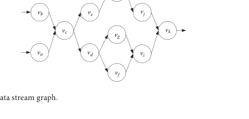

分别为 $v_a$ 和 $v_b$，终点顶点为 $v_k$。顶点 $v_a$ 的入度为 1，顶点 $v_j$ 的出度为 2。

#### 定义 2

数据流图 $G$ 的*子图* $sub$-$G$ 是由顶点子集及其之间的边构成的子图。对于子图 $sub$-$G$ 中的顶点 $v_i$ 和 $v_j$，以及数据流图 $G$ 中的任意顶点 $v$，如果 $v$ 位于从 $v_i$ 到 $v_j$ 的有向路径上，则 $v$ 也必须在 $sub$-$G$ 中，即 $\forall v_i, v_j \in V(sub\text{-}G), \forall v \in V(G)$，且若 $v \in V(p(v_i, v_j))$，则 $v \in V(p(sub\text{-}G))$。

子图 $sub$-$G$ 在逻辑上等价，并可由一个顶点替代。但将该子图归约为单个逻辑顶点会生成一个含环的图，而不是 DAG。

#### 定义 3

从顶点 $v_u$ 到顶点 $v_v$ 的*路径* $p(v_u, v_v)$ 是 $E(p(v_u, v_v))$ 的子集，对于路径 $p(v_u, v_v)$ 中的任意有向边 $e_{i,j}$，应满足条件 $\exists e_k \in p(v_u, v_v)$ 和 $\exists e_j \in p(v_u, v_v)$，并具有以下性质：若 $k \neq i$，则 $\exists m$，且 $e_{m,k} \in p(v_u, v_v)$；若 $i \neq j$，则 $\exists m$，且 $e_{i,m} \in p(v_u, v_v)$。

从顶点 $v_u$ 到顶点 $v_v$ 的路径延迟 $l_p(v_u, v_v)$ 是该路径上顶点和边的延迟之和，如式 11.1 所示：

$l_p(v_u, v_v) = \sum_{v_i \in V(p(v_u, v_v))} c_{v_i} + \sum_{e_{i,j} \in E(p(v_u, v_v))} c_{e_{i,j}},\quad c_{v_i}, c_{v_j}, c_{e_{i,j}} \ge 0. \tag{11.1}$

关键路径也称最长路径，是数据流图 $G$ 中从源顶点 $v_s$ 到终点顶点 $v_e$ 的延迟最长的路径，它也是数据流图 $G$ 的延迟。

如果数据流图 $G$ 中从源顶点 $v_s$ 到终点顶点 $v_e$ 存在 $m$ 条路径，则数据流图 $G$ 的延迟 $l(G)$ 由式 11.2 给出：

$l(G) = \max\{ l_{p1}(v_s, v_e), l_{p2}(v_s, v_e), \dots, l_{pm}(v_s, v_e) \}. \tag{11.2}$

其中 $l_{p_i}(v_s, v_e)$ 是从顶点 $v_s$ 到顶点 $v_e$ 的第 $i$ 条路径的延迟。

#### 定义 4

在数据流图 $G$ 中，如果存在从顶点 $v_i$ 到顶点 $v_j$ 的 $e_{i,j}$，则顶点 $v_i$ 是顶点 $v_j$ 的*父节点*，顶点 $v_j$ 是顶点 $v_i$ 的*子节点*。

#### 定义 5

顶点 $v_i$ 的吞吐量 $t(v_i)$ 是在大数据环境中成功进行数据流计算的平均速率，通常以比特每秒（bps）为单位度量。

我们将源顶点 $v_s$ 归为第一层，将源顶点 $v_s$ 的子节点归为第二层，依此类推，并将终点顶点 $v_e$ 归为最后一层。

第 $i$ 层的吞吐量 $t(level_i)$ 可由式 11.3 计算：

$$t(level_i)=\sum_{k=1}^{n_i} t(v_k), \tag{11.3}$$

其中 $n_i$ 是第 $i$ 层中的顶点数。

如果数据流图 $G$ 有 $m$ 层，则数据流图 $G$ 的吞吐量 $t(G)$ 是这 $m$ 层中所有吞吐量的最小值，如式 11.4 所述：

$$t(G)=\min\{t(level_1), t(level_2),...,t(level_m)\}, \tag{11.4}$$

其中 $t(level_i)$ 是数据流图 $G$ 中第 $i$ 层的吞吐量。

#### 定义 6

数据流图 $G$ 中顶点 $V(G)$ 的拓扑排序 $TS(G)=(v_{s_1},v_{s_2},...,v_{s_n})$ 是其顶点的一种线性排序，使得对于每条从顶点 $v_{s_i}$ 到顶点 $v_{s_j}$ 的有向边 $e_{s_i,s_j}$ $(e_{s_i,s_j}\in E(G))$，在拓扑排序中 $v_{s_i}$ 都位于 $v_{s_j}$ 之前。

拓扑排序存在当且仅当图中没有有向环，也就是说，图必须是有向无环图。任何有向无环图都至少有一个拓扑排序。

#### 定义 7

数据流图 $G$ 的图划分 $GP(G)=\{GP_1, GP_2,...,GP_m\}$ 是基于拓扑排序对顶点集 $V(G)$ 及相应有向边进行的划分。图划分应满足不重叠性和覆盖性，即若 $\forall i \neq j, i,j \in [1,m]$，则 $GP_i \cap GP_j = \varnothing$，且 $\bigcup_{i=1}^{m} GP_i = V(G)$。

### 11.2.2 流计算系统架构

在 BDSC 环境中，流计算是直通式计算模型。如图 11.2 所示，输入数据流采用实时数据流形式，所有

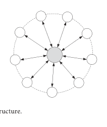

图 11.4 主从结构。

节点都具有特殊功能，它总是从主节点接收数据流，处理该数据流，并将结果发送给主节点。通常，主节点是主从结构系统中的瓶颈。如果主节点发生故障，整个系统将无法工作。

#### 11.2.3.2 数据流传输

推送和拉取是 BDSC 系统中两种主要的数据流传输方式。

在推送系统中，一旦上游节点得到结果，它就会立即将结果数据推送到下游节点。完成此操作后，上游数据将被立即发送到下游节点。然而，如果某些下游节点繁忙或发生故障，部分数据将被丢弃。

在拉取系统中，下游节点向上游节点请求数据。如果某些数据需要进一步处理，上游节点会将数据发送给请求的下游节点。完成此操作后，上游数据将存储在上游节点中，直到相应的下游节点发出请求。部分数据将等待很长时间才能进一步处理，并可能失去时效性。

#### 11.2.3.3 应用接口

应用接口用于设计数据流图，是用户与 BDSC 系统之间的桥梁。通常，良好的应用接口对用户而言应灵活且高效。目前，大多数 BDSC 系统提供类 MapReduce 接口；例如，Storm 系统提供 spout 和 bolt 作为应用接口，用户可以使用 spout 和 bolt 设计数据流图。其他一些 BDSC 系统提供类结构化查询语言（SQL）接口和图形用户界面。

#### 11.2.3.4 高可用性

状态备份与恢复是 BDSC 系统实现高可用性的主要方法。主要有三种高可用性策略，即被动备用策略、主动备用策略和上游备份策略。

在被动备用策略中（见图 11.5），每个主节点定期向备用节点发送检查点数据。如果主节点发生故障，备用节点将从最后一个检查点接管。通常，该策略将实现精确恢复。

## 11.3 BDSC 系统示例

本节介绍四种流行 BDSC 系统实例的系统架构和关键技术。这些系统是 Twitter Storm、Yahoo! S4、Microsoft TimeStream 和 Microsoft Naiad，它们都是专为 BDSC 设计的。

### 11.3.1 Twitter Storm

Storm 是一个开源分布式 BDSC 系统，采用 Eclipse 公共许可证授权。类似于 Hadoop 提供一组用于批处理的通用原语，Storm 提供一组用于实时大数据计算的通用原语。Storm 平台具有简单、可扩展、容错等特点。它可以与任何编程语言一起使用，并且易于设置和操作 [1,20,21]。

#### 11.3.1.1 任务拓扑

在 BDSC 环境中，应用程序的逻辑以任务拓扑的形式封装。一旦设计好任务拓扑并提交给系统，它就会一直运行，直到用户将其终止。

任务拓扑可以描述为有向无环图，并由 spout 和 bolt 组成，如图 11.9 所示。spout 是任务拓扑中的流源，它将从外部源读取数据流（以元组形式），并将其发射到 bolt 中。spout 可以发射不止一个数据流。任务拓扑中数据流的处理在 bolt 中完成。bolt 可以完成任何事情，例如过滤、聚合、连接等。一些简单的功能可由一个 bolt 实现，而复杂的功能将由多个 bolt 实现。逻辑应由用户设计。例如，将推文流转换为热门图像流至少需要两个步骤：一个 bolt 对每张图像的转发进行滚动计数，以及一个或多个 bolt 输出排名前 *n* 的图像流。bolt 也可以发射不止一个流。有向无环图中的每条边表示一个 bolt 订阅某个其他 spout 或 bolt 的输出流。

数据流是无界的元组序列，在分布式 BDSC 环境中并行处理和创建。任务拓扑以许多复杂方式处理数据流。需要在计算的每个阶段之间对数据流重新分区。任务拓扑本质上是并行的，并运行在机器集群上。任何

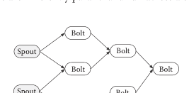

图 11.9 Storm 的任务拓扑。


任务拓扑中的顶点可以创建多个实例。所有这些顶点将同时处理一个数据流，并且拓扑的不同部分可以分配到不同的机器上。良好的分配策略将极大地提升系统性能。

数据流分组定义了该流应如何在bolt的任务之间进行分区；spout和bolt作为许多任务在集群中并行执行。Storm中有七种内置流分组，例如随机分组、字段分组、全部分组、全局分组、无分组、直接分组以及本地或随机分组；也可以通过CustomStreamGrouping接口实现自定义流分组以满足特殊需求。

#### 11.3.1.2 容错

容错是Storm的一个重要特性。如果worker死亡，Storm会自动重启它。如果节点死亡，worker将在另一个节点上重启。在Storm中，Nimbus和Supervisors被设计为无状态，并在遇到任何意外情况时快速失败，所有状态信息都存储在Zookeeper服务器中。如果Nimbus或Supervisors死亡，它们会像什么都没发生一样重启。这意味着你可以杀死Nimbus和Supervisors，而不会影响集群或任务拓扑的健康。

当worker死亡时，Supervisor将重启它。如果它在启动时持续失败并且无法向Nimbus发送心跳，Nimbus将把该worker重新分配到另一台机器上。

当一台机器死亡时，分配给该机器的任务将超时，Nimbus会将这些任务重新分配给其他机器。

当Nimbus或Supervisors死亡时，它们会像什么都没发生一样重启。没有worker进程会受到Nimbus或Supervisors死亡的影响。

#### 11.3.1.3 可靠性

在Storm中，可靠性机制保证每个spout元组都会被相应的拓扑完全处理。它们通过跟踪由每个spout元组触发的元组树，并确定该元组树何时成功完成来实现这一点。每个拓扑都有一个与之关联的“消息超时”。如果Storm未能在该超时时间内检测到某个spout元组已完成，则将该元组判定为失败，并在稍后重放它。

Storm的可靠性机制完全分布式、可扩展且容错。Storm使用取模哈希将spout元组ID映射到acker任务。由于每个元组都携带其所在所有树的spout元组ID，因此它们知道要与哪些acker任务通信。当spout任务发出一个新元组时，它只需向相应的acker发送一条消息，告知其任务ID负责该spout元组。然后，当acker看到一棵树已完成时，它就知道应向哪个任务ID发送完成消息。

acker任务存储一个从spout元组ID到一对值的映射。第一个值是创建该spout元组的任务ID，之后用于发送完成消息。第二个值是一个64位数字，称为“ack val”。ack val表示整个元组树的状态，无论该树多大或多小。它只是树中所有已创建和/或已确认的元组ID的异或（XOR）。当acker任务看到“ack val”变为0时，它就知道元组树已完成。

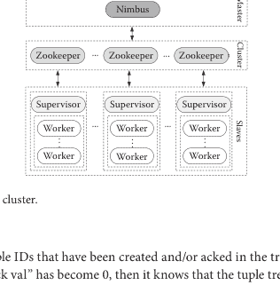

图11.10 Storm集群。

#### 11.3.1.4 Storm集群

Storm集群表面上类似于Hadoop集群。在Hadoop上运行的是“MapReduce作业”，而在Storm上运行的是“拓扑”。如图11.10所示，Storm集群上有两类节点，即主节点和工作节点。

主节点运行Nimbus节点，它类似于Hadoop的“JobTracker”。在Storm中，Nimbus节点负责在集群中分发代码、将任务分配到机器、监控故障等。

每个工作节点运行一个Supervisor节点。Supervisor监听分配给其所在机器的工作，并根据Nimbus分配给它的内容按需启动和停止worker进程。每个worker进程执行拓扑的一个子集。通常，一个正在运行的拓扑由分布在许多机器上的许多worker进程组成。

Nimbus与Supervisors之间的协调通过Zookeeper集群完成。此外，Nimbus守护进程和Supervisor守护进程是快速失败且无状态的；所有状态都保存在Zookeeper服务器中。这意味着如果你杀死Nimbus或Supervisors，它们会像什么都没发生一样重新启动。

### 11.3.2 Yahoo! S4

S4是一个通用、分布式、可扩展、容错且可插拔的平台，使程序员能够轻松开发用于计算连续无界大数据流的应用程序。S4的核心部分用Java编写。其实现是模块化和可插拔的，S4应用程序可以轻松、动态地组合，以创建更复杂的流处理系统。S4最初由Yahoo! Inc.于2010年10月发布，自2011年9月起成为Apache孵化器项目。它采用Apache 2.0许可证 [2,22–25]。

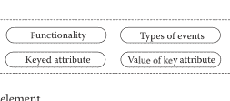

图11.11 处理元素。

#### 11.3.2.1 处理元素

S4的计算单元是处理元素（PE）。如图11.11所示，每个PE实例可由四个组成部分标识，即功能、事件类型、键属性以及键属性的值。每个PE恰好处理与其键值相对应的事件。

一类特殊的PE是无键PE集合，它们没有键属性或键值。这类PE将处理与其关联类型的所有事件。通常，无键PE用于S4集群的输入层，在输入层中事件会被分配一个键。

#### 11.3.2.2 处理节点

处理节点（PN）是PE的逻辑宿主。许多PE在一个PE容器中工作，如图11.12所示。PN负责事件监听器、分发器事件和发射器输出事件。此外，路由模型、负载均衡模型、故障转移管理模型、传输协议和zookeeper部署在通信层中。

所有事件将由S4根据哈希函数路由到PN。每个有键PE可根据对其键属性值应用哈希函数所得的值，精确映射到一个PN。然而，无键PE可以在每个PN上实例化。PN的事件监听器模型将始终监听来自S4的事件。如果某个事件被分配到某个PN，它将被路由到该PN内合适的PE。

#### 11.3.2.3 故障转移、检查点与恢复机制

在S4中，故障转移机制将为S4提供高可用环境。当节点死亡时，将使用相应的备用节点。为了在节点死亡时最小化状态丢失，S4采用了检查点与恢复机制。

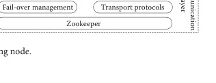

图11.12 处理节点。

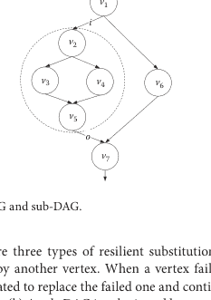

图11.16 流式DAG与子DAG。

数据流。TimeStream中有三种弹性替换方式。(a) 一个顶点被另一个顶点替换。当某个顶点失败时，会启动一个新的对应备用顶点来替换失败的顶点并继续执行，可能是在不同的机器上。(b) 一个子DAG被另一个子DAG替换。当需要调整子DAG中某个顶点的实例数量时，新的子DAG将替换旧的子DAG。例如，如图11.17所示，一个由顶点v2、v3、v4和v5组成的子DAG实现了三个阶段：哈希分区、计算和合并。当负载增加时，TimeStream可以创建一个新的子DAG（如左侧所示），它使用四个分区而不是两个分区，来替换原来的子DAG。(c) 一个子DAG被一个顶点替换。当负载减少时，完成某个特殊功能不再需要那么多步骤，相应的子DAG可以被一个顶点替换，如图11.16所示。

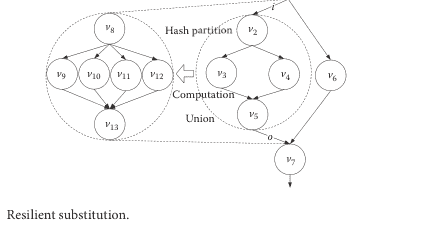

图11.17 弹性替换。


#### 11.3.3.2 Naiad

Naiad 是一个用于执行数据并行、循环数据流程序的分布式系统。其核心部分用 C# 编写。它提供批处理器的高吞吐量和流处理器的低延迟，并能够执行迭代和增量计算。Naiad 是新型计算模型及时数据流 [30] 的原型实现。

### 1. Timely Dataflow

及时数据流是一种基于有向图的计算模型。数据流图可以是有向无环图，如其他 BDSC 环境中一样。它也可以是有向循环图；数据流图中的循环情况正在被考虑。在及时数据流中，时间戳反映循环结构，以便区分在不同输入 epoch 和循环迭代中产生的数据。外部生产者用整数 epoch 为每条消息标记，并在不再接收到具有给定 epoch 标记的任何消息时通知输入顶点。

及时数据流图是有向图，其约束条件是顶点被组织成可能嵌套的循环上下文，并有三个相关的系统提供的顶点。进入循环上下文的边必须经过入口顶点，而离开循环上下文的边必须经过出口顶点。此外，图中的每个循环必须完全包含在某个循环上下文中，并且至少包含一个反馈顶点，该顶点不在任何内部循环上下文中嵌套。图 11.18 显示了一个单循环上下文，其中入口 (I)、出口 (E) 和反馈 (F) 顶点已标记。

### 2. System Architecture

Naiad 集群的系统架构如图 11.19 所示，其中一组进程托管 worker，管理及时数据流顶点的分区。Worker 使用共享内存进行本地消息交换，并使用进程间 TCP 连接进行远程消息交换。

程序将其实时数据流图指定为由类型化连接器链接的阶段的逻辑图。每个连接器可选地具有分区函数来控制阶段之间的数据交换。在执行时，Naiad 将逻辑图扩展为物理图，其中每个阶段被一组顶点替换，每个连接器被一组边替换。图 11.19 显示了一个逻辑图和一个对应的

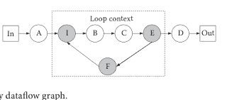

在本地资源不足时，将部分数据流传输到全局计算中心。

##### 11.4.1.5 High Throughput

高吞吐量流计算将通过在多个处理器上同时运行任务拓扑图的多个独立实例来提高数据流计算能力。在 BDSC 环境中，很难实现高吞吐量，因为很难确定如何在任务拓扑图中识别子图复制的需求、确定副本数量以及确定分配给每个副本的数据流的比例。

要在 BDSC 环境中实现高吞吐量，需要良好的多实例复制策略。通常，任务拓扑图中所有节点的所有实例的数据流负载相等是一个不错的选择，因为所有计算节点计算能力高效，并且很容易实现高吞吐量状态。

### 11.4.2 On-the-Fly Work

未来研究将集中于以下方面：

- 1. 研究优化任务拓扑图的新策略，例如子图划分策略、子图复制策略和子图分配策略，并提供高吞吐量的 BDSC 环境
- 2. 研究动态可扩展数据流策略，使得数据流可以根据可用资源和用户的 QoS 进行调整，并提供高负载均衡的 BDSC 环境
- 3. 研究具有循环的任务拓扑图的影响，以及相应的任务拓扑图优化策略和资源分配策略，并提供高度自适应的 BDSC 环境
- 4. 研究大规模实时流计算环境的架构，例如对称架构和主从架构，并提供高度一致的 BDSC 环境
- 5. 开发具有高吞吐量、高容错、高一致性和高可扩展性特征的 BDSC 系统，并在真实 BDSC 环境中部署此类系统

## ACKNOWLEDGMENTS

本工作部分得到国家自然科学基金项目编号 61170008 和项目编号 61272055 的支持，部分得到中国国家重大基础研究 973 计划项目编号 2014CB340402 的支持，部分得到中国国家高技术研究发展计划项目编号 2013AA01A210 的支持，部分得到中国博士后科学基金项目编号 2014M560976 的支持。

## REFERENCES

- 1. Storm. 可在 http://storm-project.net/ 获取（访问于 2013 年 7 月 16 日）。
- 2. Neumeyer L, Robbins B, Nair A 等. S4: Distributed stream computing platform, Proc. 第 10 届 IEEE 国际数据挖掘研讨会, ICDMW 2010, 悉尼, 新南威尔士州, 澳大利亚, IEEE Press, 2010 年 12 月, 页 170–177。
- 3. Zhao Y and Wu J. Dache: A data-aware caching for big-data applications using the MapReduce framework, Proc. 第 32 届 IEEE 计算机通信会议, INFOCOM 2013, IEEE Press, 2013 年 4 月, 页 35–39。
- 4. Shang W, Jiang Z M, Hemmati H 等. Assisting developers of Big Data analytics applications when deploying on Hadoop clouds, Proc. 第 35 届国际软件工程会议, ICSE 2013, IEEE Press, 2013 年 5 月, 页 402–411。
- 5. Qian Z R, He Y, Su C Z 等. TimeStream: Reliable stream computation in the cloud, Proc. 第 8 届 ACM 欧洲计算机系统会议, EuroSys 2013, 布拉格, 捷克共和国, ACM Press, 2013 年 4 月, 页 1–14。
- 6. Acar U A and Chen Y. Streaming Big Data with self-adjusting computation, Proc. 2013 ACM SIGPLAN 数据驱动函数式编程研讨会, 与 POPL 2013 同时举行, DDFP 2013, 罗马, 意大利, ACM Press, 2013 年 1 月, 页 15–18。
- 7. Demirkan H and Delen D. Leveraging the capabilities of service-oriented decision support systems: Putting analytics and Big Data in cloud, Decision Support Systems, 卷 55(1), 2013, 页 412–421。
- 8. Bifet A. Mining Big Data in real time, Informatica (Slovenia), 卷 37(1), 2013, 页 15–20。
- 9. Lu J and Li D. Bias correction in a small sample from Big Data, IEEE Transactions on Knowledge and Data Engineering, 卷 25(11), 2013, 页 2658–2663。
- 10. Tien J M. Big Data: Unleashing information, Journal of Systems Science and Systems Engineering, 卷 22(2), 2013, 页 127–151。
- 11. Zhang R, Koudas N, Ooi B C 等. Streaming multiple aggregations using phantoms, VLDB Journal, 卷 19(4), 2010, 页 557–583。
- 12. Hirzel M, Andrade H, Gedik B 等. IBM streams processing language: Analyzing Big Data in motion, IBM Journal of Research and Development, 卷 57(3/4), 2013, 页 7.1–7.11。
- 13. Dayarathna M and Suzumura T. Automatic optimization of stream programs via source program operator graph transformations, Distributed and Parallel Databases, 卷 31(4), 2013, 页 543–599。
- 14. Farhad S M, Ko Y, Burgstaller B 等. Orchestration by approximation mapping stream programs onto multicore architectures, Proc. 第 16 届国际体系结构支持编程语言和操作系统会议, ASPLOS 2011, ACM Press, 2011 年 3 月, 页 357–367。
- 15. Schneider S, Hirzel M and Gedik B. Tutorial: Stream processing optimizations, Proc. 第 7 届 ACM 国际分布式事件驱动系统会议, DEBS 2013, ACM Press, 2013 年 6 月, 页 249–258。
- 16. Khandekar R, Hildrum K, Parekh S 等. COLA: Optimizing stream processing applications via graph partitioning, Proc. 第 10 届 ACM/IFIP/USENIX 国际中间件会议, Middleware 2009, ACM Press, 2009 年 11 月, 页 1–20。
- 17. Scalosub G, Marbach P and Liebeherr J. Buffer management for aggregated streaming data with packet dependencies, IEEE Transactions on Parallel and Distributed Systems, 卷 24(3), 2013, 页 439–449。
- 18. Malensek M, Pallickara S L and Pallickara S. Exploiting geospatial and chronological characteristics in data streams to enable efficient storage and retrievals, Future Generation Computer Systems, 卷 29(4), 2013, 页 1049–1061。
- 19. Cugola G and Margara A. Processing flows of information: From data stream to complex event processing, ACM Computing Surveys, 卷 44(3), 2012, 页 15:1–15:62。


- 20. Storm wiki. 可获取于 http://en.wikipedia.org/wiki/Storm（访问于 2013 年 7 月 16 日）。
- 21. Storm Tutorial. 可获取于 https://github.com/nathanmarz/storm/wiki（访问于 2013 年 7 月 16 日）。
- 22. Chauhan J, Chowdhury S A and Makaroff D. Yahoo! S4 性能评估：初步研究。会议录 第 7 届 P2P、并行、网格、云和互联网计算国际会议，3PGCIC 2012，加拿大维多利亚不列颠哥伦比亚省，IEEE Press，2012 年 11 月，第 58–65 页。
- 23. Simoncelli D, Dusi M, Gringoli F et al. 使用 BlockMon 扩展服务监控应用的性能，会议录 第 14 届被动与主动测量国际会议，PAM 2013，中国香港，IEEE Press，2013 年 3 月，第 253–255 页。
- 24. S4，分布式流计算平台。可获取于 http://incubator.apache.org/s4/（访问于 2013 年 7 月 16 日）。
- 25. 流计算 StreamBase Yahoo S4 borealis 对比。可获取于 http://oracle-abc.wiki.dot.com/zh/stream-computing-streambase-yahoo-s4-borealis-comparison（访问于 2013 年 7 月 16 日）。
- 26. Guo Z Y, Sean M D, Yang M et al. 故障恢复：当治疗比疾病更糟时。会议录 第 14 届 USENIX 操作系统热点问题会议，USENIX 2013，美国新墨西哥州圣塔阿纳普韦布洛，ACM Press，2013 年 5 月，第 1–6 页。
- 27. Ali M, Chandramouli B, Goldstein J et al. Microsoft StreamInsight 中的可扩展性框架，会议录 IEEE 第 27 届数据工程国际会议，ICDE 2011，德国汉诺威，IEEE Press，2011 年 4 月，第 1242–1253 页。
- 28. Chandramouli B, Goldstein J, Barga R et al. 分布式事件处理系统中的精确延迟估计，会议录 IEEE 第 27 届数据工程国际会议，ICDE 2011，德国汉诺威，IEEE Press，2011 年 4 月，第 255–266 页。
- 29. Ali M, Chandramouli B, Fay J et al. 使用 WorldWide telescope 在线可视化地理空间流数据，VLDB Endowment，第 4 卷(12)，2011 年，第 1379–1382 页。
- 30. Derek G M, Frank M S, Rebecca I et al. Naiad：及时的数据流系统，会议录 第 24 届 ACM 操作系统原理研讨会，SOSP 2013，宾夕法尼亚州，ACM Press，2013 年 11 月，第 439–455 页。
- 31. Garzo A, Benczur A A, Sidlo C I et al. 实时流式移动分析，会议录 2013 IEEE 大数据国际会议，Big Data 2013，美国加州圣克拉拉，IEEE Press，2013 年 10 月，第 697–702 页。
- 32. Zaharia M, Das T, Li H et al. 离散化流：大规模容错流计算，会议录 第 24 届 ACM 操作系统原理研讨会，SOSP 2013，美国宾夕法尼亚州法明顿，ACM Press，2013 年 11 月，第 423–438 页。

- 12.7.3 无锁并行化 ........................................ 234
- 12.7.4 软件 API ............................................................... 235
- 12.8 摘要 .............................................................................. 236
- 参考文献 .................................................................................... 237

## 摘要

本章将三个主题结合在一起：哈希函数、布隆过滤器以及最近出现的流算法。哈希是最古老的三个主题之一，并有大量文献支持。布隆过滤器基于哈希函数，并直接受益于哈希效率。流算法以各种方式同时使用布隆过滤器和哈希，但对性能提出了严格要求。本章从效率和速度的角度审视这三个主题。两个主要性能指标是每单位处理时间和内存占用大小。所有算法均以 C/C++ 伪代码呈现。特别关注硬件实现的可能性。

## 12.1 引言

Hadoop 文件系统（HDFS）[1] 和 MapReduce 是当今大数据处理中的事实标准。虽然它们是两种不同的技术，但就大数据处理——而不仅仅是存储——而言，它们形成了一个整体包。本章将把它们视为一个整体包。今天，Hadoop 和/或 MapReduce 缺乏流行的替代方案 [2]。HDFS 通过将存储分布到多个节点上，解决了无法将大数据存储在单台机器上的实际问题 [3]。MapReduce 是一个框架，可以在该框架上运行处理存储内容的工作——也是以分布式方式——并生成统计摘要。本章将表明，性能改进主要针对 MapReduce [4]。

MapReduce 有几个根本性问题。首先，map 和 reduce 操作符仅限于键值哈希（数据类型，而非哈希函数），这限制了其可用性。例如，虽然数据流是大数据处理的一个良好替代方案，但 MapReduce 无法容纳必要的数据类型 [5]。其次，MapReduce 作业创建了异构环境，其中作业在没有公平保证的情况下竞争相同的资源 [4]。最后，MapReduce 作业，或就此而言 HDFS，缺乏时间感知，而某些算法可能需要按时间顺序处理数据或使用时间窗口。

本章的核心前提是用时间感知的存储和处理逻辑取代 HDFS/MapReduce。Big data 沿时间线重放，所有作业都获得按时间顺序排列的数据项序列。这里的主要区别在于，新的方法将所有作业集中在一个地方——重放数据的节点——而 HDFS/MapReduce 将作业发送到远程节点，以便在本地处理数据。这种架构被选中的唯一目的是容纳各种数据流算法及其创建的数据类型 [5]。

本章介绍的新方法可以被视为一种通用技术，它独立于 HDFS 和 MapReduce 存在。这种技术是新方法众多可能实际应用中的一种。

由于传统并行化与在多核技术上运行的并行化之间的差异而导致的问题。最后，其传统形式的处理方法相对原始，而本章将把它扩展为一种更通用的形式，即 *数据流*。新的处理不仅更通用，而且可以支持更严格的统计处理逻辑，而基于 MapReduce 的传统架构仅接受键值对，同时对用户代码在处理中如何使用数据施加了相当严格的限制。

## 12.2 一个非常规的大数据处理器

介绍本章的最佳方式是宣布它关于一个 *非常规大数据处理器*。本节将详细解释这意味着什么。常规和非常规处理之间的主要区别在于设计的核心要素——*分布*——或者更准确地说，是什么被分布以及如何分布。传统流程是将数据和处理数据的作业同时分布。 本章介绍的非常规处理器仅分布存储部分，而作业在单台机器上运行。

到目前为止，应该很清楚，两种流程之间的比较导致了一种权衡。权衡是显而易见的，原因如下。分布始终是 *通过网络* 进行的，在处理数据时多台机器必须相互 *通信*。这里的权衡在于吞吐量方面。分布始终受分布式网络所能支持的最大吞吐量的限制。本章将讨论 Hadoop 和 MapReduce 的吞吐量限制，并论证新的设计严格来说总是更好，仅仅因为分布式存储的大块数据是通过单台机器 *流式传输* 的，在单台机器上不间断（稳定）地流式传输大块数据，严格来说优于多个节点交换和聚合相对较小的碎片数据。

所有相关领域都有大量术语。第 12.2.1 节专门用于简要介绍所有必要的术语。

### 12.2.1 术语

Hadoop 和 HDFS（Hadoop 文件系统）可互换使用。实际上，为简单起见，本节中的 Hadoop 指的是 Hadoop 和 MapReduce。Hadoop 中的一个行动单位是 *作业*。*流算法* 和 *数据流* 也表示相同的技术。这里，数据的一个单位是 *概要*——大量数据的统计摘要。*概要* 将在新方法中充当作业。

*数据存储* 与 *数据存储* 相同。存储的分布式部分在 Hadoop 中称为 *分片*，在本节中称为 *子存储*。内容本身被拆分为 *记录*，但在本节中，我们称它们为 *项*。在新/替代设计中，项按时间分配，这就是为什么存储被称为 *时间线存储*。

新方法在 *多核* 技术上运行，需要 *共享内存* 以便管理器与在核心上运行的 *概要* 通信。本节采用 *环形缓冲区* 来在共享内存中持续维护项的有限时间窗口。

在估计新方法的性能时，*异构性* 是主要的环境参数，而 *概要字节*（所有 *概要* 处理的数据量）和 *开销*（每个数据批每个核心）是两个质量指标。


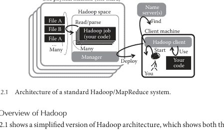

图 12.1 标准 Hadoop/MapReduce 系统架构

### 12.2.2 Hadoop 概述

图 12.1 展示了 Hadoop 架构的简化版本，其中既包含设计也包含关键流程。灰色部分表示系统，而深黑色部分表示用户文件和代码。本节其余部分将逐步介绍一个标准的 MapReduce 作业。

作业的代码需要提前准备好。一旦就绪，你可以将其传递给 Hadoop（实际上是 MapReduce）客户端来启动作业。客户端随后会通过名称服务器找到分布在 Hadoop 集群中的分片，并将你的作业部署到每个分片上。

每个分片上的管理器会在本地运行你的代码。代码可以读取并解析本地找到的文件，但更重要的是，执行 MapReduce 的两个关键操作——map 和 reduce——这两个操作通常都由你的代码实现。结果随后会被发送回客户端机器，客户端从所有分片收集数据后，将最终结果返回给用户。

请注意，这是对所涉及流程的一种简化视图，但已包含足够信息来理解本节后续介绍的新设计中的关键差异。

让我们考虑一个在 Hadoop 上难以运行的示例——数据流中常见的频繁项计数目标 [7]，以及许多其他目标 [5]。要在 Hadoop 上执行该任务，我们首先需要使用 map 操作符收集所有项。然后我们可以使用 reduce 操作符对所有项进行计数。然而，此时我们仍需将所有项保存在内存中，并且实际上数据必须通过网络传输。内存溢出是这种情况下的一个潜在问题。但从更大的角度来看，这种解决方案违反了流式算法中常见的空间效率目标 [6]。

Hadoop 的另一个主要问题是它与键值哈希以外的数据类型不兼容，而数据流处理需要更大的灵活性。例如，Hadoop 无法处理树和图数据类型、多对多 [8] 和一对多 [9] 模式以及其他类型。

### 12.2.3 Hadoop 替代方案：大数据回放

图 12.2 展示了新的 TABID 方法的架构。为简单起见，使用了与 12.2.2 节相同的基本布局。同时，与 12.2.2 节的叙述相呼应，本节也将逐步介绍一次大数据处理会话的步骤。与设计各部分相关的应用程序编程接口（API）将在 12.7.4 节进一步讨论。

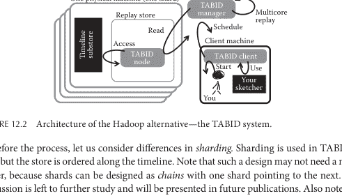

图 12.2 Hadoop 替代方案——TABID 系统的架构

在开始处理之前，让我们考虑分片上的差异。TABID 中也使用了分片，但存储区沿时间线有序排列。请注意，这种设计可能不需要名称服务器，因为分片可以设计为链式结构，一个分片指向下一个分片。这一讨论留待进一步研究，并将在未来的出版物中呈现。还需要注意，正如后面 API 将展示的，数据项不是键值对，而是任意字符串，因此可以容纳任何数据类型，例如编码后的（如 Base64）JSON [10]。

处理过程从定义你的草图器（sketcher）开始。其格式为 JSON [10]，并且预期体积相当小。草图器的独特特性将在本节末尾讨论。

当你启动草图时，TABID 客户端会将其调度给 TABID 管理器。调度涉及优化，即实时将草图打包到核心中，这将在本节后面展示。当回放会话开始时，你的草图将在其中一个核心上运行，并可以访问用于处理的时间线项目。回放结束后，结果以任意结构的 JSON 数据类型返回给客户端。

以下是 TABID 的独特特性/差异。首先，没有代码。相反，草图器指定使用哪种标准流式算法，并提供其配置参数的值。如果是新的流式算法，应首先将其添加到库中，然后通过草图器引用。TABID 中的子存储节点是哑存储设备，不运行代码，尽管创建一个可将数据迁移到分片以在本地回放数据的 TABID 版本并不困难。这个版本及其性能评估将在未来的出版物中研究。

## 12.3 整合所有部分

前面的章节介绍了许多小部分；本节将这些部分整合在一起，同时也将它们映射到一组科学问题，这些问题可用于实现本章提出的最终实际目标。这些科学问题是哈希、布隆过滤器、数据流及相关统计 [11,12]，以及最后的多核架构并行化。

此外，本节有助于巩固本章所涵盖的科学范围。本节还提供了涵盖该范围的文献概述。

### 12.3.1 关于问题范围的更多内容

本章存在于三个独立（尽管有些相关）主题所创造的空间中——哈希、布隆过滤器和数据流。最后一个术语在数值数量上尚未完全确立。对不同项的计数也是如此。这个看似微小的细节构成了数据流处理中大部分复杂性的来源。

除了上述实际目标列表外，以下描述了数据流处理的*棘手之处*：
- 存储当前状态的空间有限——否则，我们将回到传统的数据库导向设计。
- 数据必须按照其自然到达顺序访问，这是实时处理的明显副作用——同样与基于数据库的流程形成重大差异，后者可以访问数据库中的任何记录。
- 每单元处理成本有上限，如果违反该上限，将破坏数据流算法的连续性（可以说，缓冲可以帮助平滑到达率的临时峰值）。

### 12.3.2 文献概述

尽管 Hadoop 在实践中目前无可匹敌 [2]，但该技术在多个方面已知效率低下。HDFS 系统本身可达到的最大吞吐量约为 50 Mbps [3]。当内容被分割成大量小文件时，HDFS 也被发现效率低下 [16]，其中 HDFS 使用的默认块大小为 64 MB 及以上。

最近，文献中对 Hadoop 的性能及其改进给予了大量关注。参考文献 17 中展示了来自真实商业运营集群的统计数据，而参考文献 18 中提出了工作负载建模和合成。性能改进可分为以下两组。参考文献 4 中提出了多核技术上的并行处理，这需要对架构进行重大重写。参考文献 2 中的研究建议更多地使用本地内存处理，而不是通过网络进行分布式处理。

有一些关于在没有 MapReduce 组件的情况下改进 HDFS 技术的文献。参考文献 19 中的研究提出创建 HBase 的可搜索版本——HBase 是一种基于 HDFS 的简单、不可搜索的电子表格数据类型。参考文献 20 中的另一种方法在 HDFS 之上创建了一种全新的数据存储形式，可以说是 HBase 的替代方案。鉴于子存储上的资源由所有并行运行的作业共享，优化对 HDFS 的异构访问也是一个值得关注的主题 [21]。

数据流处理是一种相对较新的方法，但解决了与 MapReduce 相同的问题——高容量实时大数据处理。简而言之，数据流处理的主要前提是能够将大量数据压缩为小的统计摘要。参考文献 5 是一份 100 多页的优秀主题介绍。文献中的实用算法已应用于流量分析 [6]。关于空间效率设计和优化已有研究 [22]。参考文献 23 中考虑了数据流处理的时间特征和滑动窗口。

众所周知的实际数据流处理目标包括频繁项发现 [7]、对快速传播病毒等一对多记录的聚合 [9] 以及多对多记录的通用聚合 [8]。然而，数据流处理的工具包极其灵活，理论上可以容纳任何实际目标。


数据流式处理是本节新设计的主要原因。重放期间的时间感知和处理是新设计的特性，这些特性是在考虑数据流式处理的情况下实现的。巧合的是，由此产生的架构可以从多核硬件运行中受益。

*多核*技术是并行处理的一个特例 [24]。它已被应用于参考文献 4 中的 MapReduce，这提高了其性能，但并未解决本节讨论的其他问题。大多数现有多核方法实现传统的基于调度的并行化 [4,24,25]，这需要跨进程进行密集的消息交换。本章使用并行化的一种特例，其特点是由于无锁设计而具有最小的开销。更多细节将在本节进一步介绍。

## 12.4 数据流式处理问题

本节专门讨论数据流式处理。听起来数据流式处理似乎只涉及用于*流式传输*数据的方法，但实际上，这个主题在科学上极其严谨。严谨性在于该主题背后的信息论。但数据流式处理中的许多表述是在数据处理的新领域中需要的，因此需要一些看起来较新的表述。尽管数据流式处理通常用大量数学符号来书写，但本节以及本章整体将坚持最少的数学内容，严格目的是提供对表述数值本质的基本理解。

第二轮术语在 12.4.1 节中介绍。

### 12.4.1 数据流式处理术语

如前所述，术语*数据流*、*数据流式处理*和*流式算法*都指同一类方法。

*布隆过滤器*和*布隆结构*都指内存中存储过滤器当前状态的空间，通常采用位串形式。然而，布隆过滤器本身不仅是它包含的数据，还包括用于创建和维护状态的方法。

*双向链表*（*DLL*）也是一种结构。然而，DLL 可以说只用于 *C/C++* [14,26]。这并非 100% 正确——实际上，甚至本书作者也能够在 *PHP* 或 *JavaScript* 等其他编程语言中使用 DLL——但 *C/C++* 程序能从 DLL 中获益最多，因为 *C/C++* 中指针的性质与任何其他编程语言中的指针不同。DLL 指一种内存结构（*C/C++* 中的 *struct*），可替代传统列表——向量、栈等。在 DLL 中，每个项/元素通过原始 *C/C++* 指针链接到其邻居，从而形成一条可以沿任一方向遍历的链。DLL 将在本章后面重新讨论，并且是本章末尾讨论的实际应用的一部分。

术语*字*、*字节*和*摘要*特定于哈希。在 32 位架构上，字通常是 32 位（4 字节）整数。哈希方法以*字节*或*字*为粒度*摘要*任意长度的输入，并输出哈希键。哈希通常涉及*按位*操作，其中对字的各个位进行操作。

本节的一部分将讨论该图所呈现的传统设计，然后用更现代的设计替换它。从本章前面我们知道，布隆化是通过计算一个或多个哈希键，并将每个哈希键与其当前状态进行 OR 运算来更新过滤器的值来执行的。这称为插入操作。查找操作是通过在给定哈希键与过滤器当前状态之间进行按位 AND 运算来完成的。从此处开始的决策可以朝以下两个方向之一进行：

- AND 的结果与哈希键的值相同——这是真阳性（TP）或假阳性（FP），无法区分两者。
- AND 的结果与哈希键的值不同——这是 100% 可靠的阴性。

描述布隆过滤器这种查找行为的一种常见方式是将过滤器描述为一个有记忆的人，只能可靠地回答“你以前见过这个项吗？”这个问题 [11]。这并不是低估过滤器的效用，因为对确切问题的回答正是许多实际情况下所需要的。

让我们从哈希的角度来看布隆过滤器设计，尤其是考虑到过滤器的状态是通过向其状态添加更多哈希键而逐渐构建的。

让我们设 n 为项数，m 为哈希键的位长度，因此也是过滤器的位长度。我们从前面知道，哈希键中的每一位可以以 50% 的概率设置为 1。因此，省略细节，最优哈希函数数量可以计算为

$k = \ln 2 \frac{m}{n} \approx 0.6 \frac{m}{n}$

如果每个哈希函数完全独立于所有其他哈希函数，那么在 n 个元素之后某一位保持为 0 的概率是

$p = 1 - \left(1 - \frac{1}{m}\right)^{kn} \approx e^{-\frac{kn}{m}}$。

那么 FP——布隆过滤器的一个重要性能指标——是

$p_{FP} = (1 - p)^{k} \approx \left(1 - e^{-\frac{kn}{m}}\right)^{k} \approx \frac{1}{2^{k}}$，对于最优 k。注意，随着 k 增加，FP 的概率实际上应该降低，这是一个不直观的结果，因为人们会预期过滤器会更早被键填满。

让我们分析 k。在大多数情况下，m ≪ n，这意味着最优哈希函数数量是 1。两个函数只有在 m > 2.5n 时才可行。在大多数现实情况下，这几乎从来不是这样，因为 n 通常巨大，而 m 是像 24 或 32（位）这样实用的值。

### 12.5.2 用于数据流的非常规布隆过滤器设计

基于 12.5.1 节，布隆过滤器中的明显问题是如何提高其灵活性。顺便说一句，此类布隆过滤器通常称为动态布隆过滤器。

图 12.3 展示了通用模型，它适用于大多数动态布隆过滤器的方案。简单的想法是用更丰富的数据结构替换简单的位串（图中布隆过滤器的变化）。过滤器中的每一位现在只是一个指向支持动态操作的结构指针。

随之而来的另一个变化是 OR 操作不再适用。相反，必须对传统设计中本应进行 OR 运算的值的每一位执行非平凡的操作。自然，这会在性能上产生相当大的开销。

文献中可以找到以下类别的动态布隆过滤器。

- 停止添加过滤器。此过滤器将在超过给定点后停止接受新键。显然，这样做是为了将 FP 保持在给定目标值之外。
- 删除过滤器。此过滤器构建起来很棘手，但如果实现，它可以通过忘记给定键引入的变化来恢复到给定的先前状态。
- 计数过滤器。此过滤器既可以计数潜在出现的各个位，也可以计数整个值——位的组合。这一类过滤器显然可以在数据流式处理中找到实际应用。事实上，参考文献 32 中 d-left 哈希方法的现有示例使用了一种计数布隆过滤器 [33]。另一个例子可以在参考文献 34 中找到，其中它大致用于相同的目的。

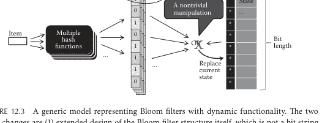

图 12.3 表示具有动态功能的布隆过滤器的通用模型。两个主要变化是：(1) 布隆过滤器结构本身的扩展设计，它不再是位串；(2) 由第一个变化决定的非平凡操作逻辑——简而言之，不能简单地在哈希与布隆过滤器状态之间使用逻辑 OR。


## 图 12.4 所有数据流应用共享的常见组件。

定义，不能高于到达率。另一方面，到达率很重要，因为数据流式处理方法必须能够支持给定的到达率才能在实践中可行。

到达率也是相关研究中最不受欢迎的话题。事实上，文献中很少讨论单位处理时间，而是关注高效的哈希或布隆化方法 [30,32,47,48]。本书作者在参考文献 49 中的早期工作表明，单位处理成本很重要——该研究特别表明，过多的处理会对吞吐量产生重大影响。

到达率这个话题在数据包流量中尤其重要 [28,29,50]。随着传输速率以及流量量的不断增加，交换设备需要更高水平的效率。Click 路由器就是这样一种技术 [51]，它处于活跃开发阶段，最近取得了每秒十亿数据包（pps）处理速率的成果 [52]。Open vSwitch——网络虚拟化中的一种技术——追求相同的目标。有趣的是，该领域的研究使用的术语与数据流式处理中发现的术语大致相同。例如，参考文献 52 和 53 讨论了用于支持逐包决策的数据结构的空间效率。此类研究通常使用布隆过滤器来提高搜索和查找效率 [13,32]。总的来说，本书作者以高概率预测，近期高速数据包处理研究将发现数据流式处理这一主题，并将从这一发现中大大受益 [50]。

### 12.6.2 多核上的流式处理

将 n 个草图打包到 m 个核中的方法是一个著名的装箱问题。本节介绍的方法执行一次（盲）初始打包，但每次状态发生变化时也会重新打包。鉴于每个草图都有可以与重放的大数据不同的开始和结束时间，状态变化可能很频繁。考虑到收敛速度，本节和 12.7 节讨论一种简单的打包启发式方法。鉴于所有核上的所有草图共享一个按时间排序的项流，该启发式方法的主要目标是最小化跨草图的处理游标（流中的当前位置）的方差。直观地说，如果所有重负载处理的草图都打包到一个核中，而所有轻负载的草图都打包到另一个核中，重放将以大大降低的速度移动。新的启发式方法力求避免这种情况，而设计本身促进了并行处理，而无需核传递消息或竞争内存锁。


图12.5 大数据时间线以及在多个核心上成组运行的草图（sketch）。

图12.5展示了TABID管理器节点的设计。管理器运行在一个核心上，负责按照其当前调度启动和结束草图。请注意，仅此一点就比没有调度组件的MapReduce具有更高的灵活性。对时间有序流的读/写访问虽然保持异步，但通过确保写入和读取游标永远不会指向流中的同一位置，从而做到无冲突。草图在“当前”游标处读取数据，而管理器则正在向流的更远位置写入，由此创建了一个冲突安全的缓冲区。

### 12.6.3 性能指标

本节讨论用于分析的参数和指标。首先，让我们定义配置元组的概念：

⟨v_min, v_max, a⟩

该元组指定了由a配置的v_min与v_max之间的值分布。该元组可用于定义异质性：

y = {(exp(-a x))^{-1}, ∀x ∈ {1, 2, …, 100}}, a > 0 v_max, a = 0 (12.1)

其中a是指数。请注意，a = 0的情况是一种特殊的同质情况。在分析中，a的值从列表0、0.7、0.3、0.1、0.05、0.01中随机选择，其中a = 0表示同质分布（水平线），a在0.7到0.3之间产生以较大值为主的分布，a = 0.1几乎是线性趋势，a在0.05到0.01之间输出的分布中大多数值较小。最后两种情况在自然系统中很常见，因此可以称为实际情况。请注意，这种选择看似随意；实际上，它覆盖了所有可能分布的整个范围。

这些分布适用于草图生命周期和每单元开销——这两个实际指标直接影响TABID系统的性能。

打包启发式定义如下：C表示所有核心中所有草图的条目计数值集合，每个草图对应一个值。M是每核心条目计数的集合，每个核心对应一个值。优化目标为（var和max是运算符）：

minimize var(C) + max(M)。

为简单起见，C和M的值在时间窗口内进行归一化，以避免处理两项中不同度量单位的问题。在分析中，该问题通过遗传算法（GA）求解，该目标作为适应度函数。由于篇幅有限，此处省略遗传算法的详细描述。

### 12.6.4 示例分析

本节以两种设置呈现结果：sketchbytes与开销方面的性能。前者通过传统Hadoop作业与TABID草图之间的sketchbytes比率来评估。后者仅针对TABID进行最坏情况分析，展示在给定异质性和草图数量的情况下，可以预期的项目吞吐量。

用于开销的具体元组为⟨100, 10000, 0⟩；⟨100, 10000, 0.7⟩；⟨100, 10000, 0.3⟩；⟨100, 10000, 0.1⟩；⟨100, 10000, 0.05⟩和⟨100, 10000, 0.01⟩——其中度量单位为微秒。生命周期的具体元组为⟨100, 2500, 0⟩；⟨100, 2500, 0.7⟩；⟨100, 2500, 0.3⟩；⟨100, 2500, 0.1⟩；⟨100, 2500, 0.05⟩和⟨100, 2500, 0.01⟩——其中度量单位为分钟。因此，假设用于分析的示例大数据长度为2500米（用于重放）。按照常见的实际吞吐量约1 GB/分钟计算，所讨论的大数据大小为2500 GB [3]。可以有10到1000个并行草图，以及八个核心（假设为商用八核硬件）。

图12.6显示了表示为Hadoop/TABID比率的sketchbytes性能。在异质性a ≥ 0.1的情况下，该比率约为1000。对于较小（更实际）的a值，该比率并未饱和，而是持续增长到5–6个数量级（对数刻度）。请注意，sketchbytes中的这种差距完全是由草图生命周期的异质性造成的。如果考虑到TABID中流只被读取/重放一次，差距会进一步扩大。


图12.6 多种草图数量和若干异质性设置下的sketchbytes指标性能。


图12.9 标准四路DLL的设计。

自身），侧向DLL有助于连接多个元素，以便进行搜索。请注意，碰撞相对较少，这意味着通常只有少数这样的DLL。

### 12.7.3 无锁并行化

图12.10展示了一种在共享内存中避免锁的简单方法。为清晰起见，让我们集中讨论一对管理器-核心进程。请注意，如前所述，如果无锁进程适用于一对，那么它应该适用于任意数量的此类对。此外，管理器在所有对中都是同一进程，从而形成一对多的进程间通信。

管理器（图12.11，右侧）逻辑如下：由于避免逐项信令（通过共享内存）是有帮助的，因此在环形缓冲区的物理限制内批量读取数据，而该限制又取决于共享内存的大小。当新批次读入环形缓冲区时，全局“当前”游标被更新，从而允许所有草图开始处理新项目。管理器还监控所有草图时间，并可根据收集到的统计信息更改打包配置。


图12.10 在共享内存中避免锁的一种方法。


图12.11 每个草图（左）和TABID管理器（右）遵循的共享内存设计及逻辑。

草图（图12.11，左侧）遵循以下逻辑。它等待“当前”游标超过自己的游标（每个草图的游标独立存储在共享内存中）。当检测到变化时，草图处理所有新到达的项目。一旦其游标达到全局“当前”位置，草图返回空闲状态，并在给定的时间间隔内开始轮询新的变化。

请注意，环形缓冲区是通过C/C++库调用访问的[54]，而不是由各方直接访问。这是一个有用的约定，因为它消除了每个访问方维护其在环形缓冲区中当前位置的需要。缓冲区看起来是连续的，而实际上它具有有限的长度，当到达尾部时必须回绕到头部。

### 12.7.4 软件API

虽然远非详尽列表，但本节中的API可以完整描述TABID功能。所有API都通过超文本传输协议（HTTP）执行，即使它们发生同一物理机器内。

要向时间线存储添加数据项，可以发送：

```
POST tabidStorePut(timestamp, 'string'),
```

其中字符串是完全自由的类型。通常的做法是以这种方式发送Base64编码的JSON。

要调度草图，可将sketcher JSON发送为：

```
POST tabidSketchAdd(startTime, JSON),
```

它返回新创建并调度的草图的ID。其当前状态可以使用以下命令验证：

```
GET tabidSketchStatus(ID),
```

它会返回状态JSON。

## 12.8 总结

本章介绍了一种全新的大数据处理范式。该新范式摒弃了“让我们把一切都分布式化”的方法，转而寻求更灵活的技术。灵活性体现在新范式的几个部分——存储如何分布、用户作业如何处理大数据，以及最终用户作业如何在多核架构的各个核心之间分布。

暂且不论这些，可以说新范式是一个有趣的公式化，因为它汇集了当前几个活跃的研究领域。具体而言，包括*高效哈希技术*、基于*多核*技术的并行处理，以及从原始数据创建统计草图的科学严谨的数据流方法。这些主题的集合为动态算法和优化创造了一个有趣的平台，旨在整体提升大数据处理的性能。

本章早期引入了*非传统大数据处理器*，以避免为技术的每个单独部分提供统一的背景。这一早期引入还提出了该技术首先能够正常工作所需的几个主要部分。随后用单独一节将所有部分组合成一个完整的实践/技术解决方案。

在确立背景之后，本章继续深入细节。单独一节专门讨论与哈希、布隆过滤器及相关效率相关的问题。另一节完全聚焦于多核环境中作业分配的优化。最后，专门用一节讨论在多核架构之上，且在实时大数据重放过程之上的数据流问题。

应当指出，大数据的实时重放本身就是一种全新的大数据视角。传统方法同时分布数据存储和处理，而本章讨论了一种更有序、因而更可控的过程，即大数据在单台多核机器上重放，并将任务打包到各个核心中，以实时处理重放的数据流。本章暗示，这种设计允许更高的灵活性，因为设计基于一种自然的权衡。虽然本章没有提供各种设置示例来展示设计的动态特性，但从内容中可以清楚地看出，哪些参数可用于改变技术的平衡。


关于数据流方法本身的科学严谨性问题已得到充分详细的论述，其中展示了若干实际统计目标的示例。同时也表明，这种程度的统计严谨性无法由传统的 MapReduce 技术支持，后者仅支持键值对，并且对它们的使用方式施加了严格的规则——即 map 和 reduce 操作符本身。当使用数据流范式时，作业不再受此类限制，可以使用处理所需的任何数据结构。本章中的这一单一特性在大数据中是一个巨大因素，其中必须捍卫从大数据得出的结论的真实性。

不幸的是，鉴于本章涵盖的主题众多，若干主题未能以足够的细节展开。然而，已提供了足够的相关参考文献，供读者进一步追踪每个具体科学问题的最新研究。

## 参考文献

- 1. Apache Hadoop。可访问于： http://hadoop.apache.org/.
- 2. A. Rowstron, S. Narayanan, A. Donnelly, G. O'Shea, A. Douglas, “没人会因为在集群上使用 Hadoop 而丢掉工作,” *第1届云数据处理热点国际研讨会*, 2012年4月。
- 3. K. Shvachko, “HDFS 可扩展性：增长的极限,” *USENIX 杂志*, 第 35 卷, 第 2 期, 页 6-16, 2012。
- 4. R. Chen, H. Chen, B. Zang, “Tiled-MapReduce：利用分块优化多核上数据并行应用的资源使用,” *第19届并行体系结构与编译技术国际会议 (PACT)*, 页 523-534, 2010。
- 5. S. Muthukrishnan, “数据流：算法与应用,” *理论计算机科学基础与趋势*, 第 1 卷, 第 2 期, 页 117-236, 2005。
- 6. M. Sung, A. Kumar, L. Li, J. Wang, J. Xu, “用于检测互联网流量中常见内容的<|message|> 可扩展高效数据流算法,” *ICDE 研讨会*, 2006。
- 7. M. Charikar, K. Chen, M. Farach-Colton, “在数据流中寻找频繁项,” *第29届自动机、语言和编程国际研讨会*, 2002。
- 8. M. Zhanikeev, “用于在数据中心测量端到端 QoS 的整体社区架构,” *Inderscience 计算科学与工程国际期刊 (IJCSE)*, (印刷中) 2013。
- 9. S. Venkataraman, D. Song, P. Gibbons, A. Blum, “用于快速检测超级传播者的新流算法,” *分布式系统安全研讨会 (NDSS)*, 2005。
- 10. JSON 格式。可访问于： http://www.json.org.
- 11. D. MacKay, *信息论、推断与学习算法*. Cambridge University Press, West Nyack, NY, 2003。
- 12. A. Konheim, *计算机科学中的哈希：切片与切块的五十年*. Wiley, Hoboken, NJ, 2010。
- 13. G. Antichi, A. Di Pietro, D. Ficara, S. Giordano, G. Procissi, F. Vitucci, “一种启发式和混合哈希方法用于快速查找,” *高性能交换与路由国际会议 (HPSR)*, 页 1-6, 2009年6月。
- 14. M. Zadnik, T. Pecenka, J. Korenek, “面向高速网络的 NetFlow 探针,” *现场可编程逻辑与应用国际会议*, 页 695-698, 2005。
- 15. R. Kimball, M. Ross, W. Thornthwaite, J. Mundy, B. Becker, *数据仓库生命周期工具包*. John Wiley and Sons, Indianapolis, IN, 2008。
- 16. Hadoop 中的小文件问题（博客）。可访问于： http://amilaparanawithana.blogspot.jp/2012/06/small-file-problem-in-hadoop.html.
- 17. Z. Ren, X. Xu, J. Wan, W. Shi, M. Zhou, “生产 Hadoop 集群的工作负载特征：以淘宝为例的案例研究,” IEEE 工作负载特征国际研讨会, 页 3–13, 2012。
- 18. Y. Chen, A. Ganapathi, R. Griffith, R. Katz, “使用工作负载套件评估 MapReduce 性能的案例,” 第19届计算机与电信系统建模、分析与仿真国际研讨会 (MASCOTS), 页 390–399, 2011年7月。
- 19. X. Gao, V. Nachankar, J. Qiu, “在 HPC 环境中对 HBase 上的 Lucene 索引进行实验,” 第1届高性能计算与数据库年度研讨会 (HPCCDB), 页 25–28, 2012。
- 20. S. Das, Y. Sismanis, K. Beyer, R. Gemulla, P. Haas, J. McPherson, “Ricardo：集成 R 与 Hadoop,” SIGMOD, 页 987–999, 2010年6月。
- 21. A. Rasool, D. Down, “COSHH：异构 Hadoop 系统的基于分类和优化的调度器,” Technical Report of McMaster University, Canada, 2013。
- 22. Z. Bar-Yossef, R. Kumar, D. Sivakumar, “流算法中的归约，以图中的三角形计数应用为例,” 第13届 ACM-SIAM 离散算法研讨会 (SODA), 2002年1月。
- 23. M. Datar, A. Gionis, P. Indyk, R. Motwani, “在滑动窗口上维护流统计,” SIAM 计算期刊, 第 31 卷, 第 6 期, 页 1794–1813, 2002。
- 24. M. Aldinucci, M. Torquati, M. Meneghin, “FastFlow：多核上高效的并行流应用,” Technical Report no. TR-09-12, Università di Pisa, Italy, 2009年9月。
- 25. R. Brightwell, “托管多核系统研讨会,” 第1届托管多核系统研讨会, 2008。
- 26. M. Kerrisk, The Linux Programming Interface. No Starch Press, San Francisco, 2010。
- 27. C. Shannon, “通信的数学理论,” The Bell System Technical Journal, 第 27 卷, 页 379–423, 1948。
- 28. M. Zhanikeev, Y. Tanaka, “基于流行度的合成数据包跟踪中闪光事件建模,” IEEE 通信质量技术报告, 第 112 卷, 第 288 期, 页 1–6, 2012。
- 29. M. Zhanikeev, Y. Tanaka, “一种用于检测流量中闪光人群的图形方法,” Springer 电信系统期刊, 第 57 卷, 第 1 期, 页 91–105, 2014。
- 30. S. Heinz, J. Zobel, H. Williams, “Burst Tries：一种用于字符串键的快速高效数据结构,” ACM 信息系统汇刊 (TOIS), 第 20 卷, 第 2 期, 页 192–223, 2002。
- 31. F. Putze, P. Sanders, I. Singler, “缓存、哈希和空间高效的 Bloom 过滤器,” 实验算法期刊 (JEA), 第 14 卷, 第 4 期, 2009。
- 32. F. Bonomi, M. Mitzenmacher, R. Panigrahy, S. Singh, G. Varghese, “通过 d-Left 哈希和动态位重分配的 Bloom 过滤器,” 第44届 Allerton 通信、控制与计算会议, 2006。
- 33. F. Bonomi, M. Mitzenmacher, R. Panigrahy, S. Singh, G. Varghese, “计数 Bloom 过滤器的改进构造,” 第14届欧洲研讨会年度会议 (ESA), 第 14 卷, 页 684–695, 2006。
- 34. H. Song, S. Dharmapurikar, J. Turner, J. Lockwood, “使用扩展 Bloom 过滤器的快速哈希表查找：网络处理的辅助,” SIGCOMM, 2005。
- 35. A. Kirsch, M. Mitzenmacher, “更少哈希，相同性能：构建更好的 Bloom 过滤器,” Wiley Interscience 随机结构与算法期刊, 第 33 卷, 第 2 期, 页 187–218, 2007。
- 36. G. Antichi, D. Ficara, S. Giordano, G. Procissi, F. Vitucci, “用于最小完美哈希的 Blooming Trees,” IEEE 全球电信会议 (GLOBECOM), 页 1–5, 2008年12月。
- 37. C. Bhavanasi, S. Iyer, “M2MC：广播网络上多对多通信的中间件,” 第1届通信系统软件与中间件国际会议, 页 323–332, 2006。
- 38. D. Digby, “用于多对多比较的搜索存储器,” *IEEE 计算机汇刊*, 第 C22 卷, 第 8 期, 页 768–772, 1973。
- 39. M. Hattori, M. Hagiwara, “使用多向联想记忆的知识处理系统,” *IEEE 神经网络国际会议*, 第 3 卷, 页 1304–1309, 1995。
- 40. Y. Keselman, A. Shokoufandeh, M. Demirci, S. Dickinson, “通过度量嵌入的多对多图匹配,” *IEEE 计算机视觉与模式识别会议 (CVPR)*, 页 850–857, 2003。
- 41. D. Lorenz, A. Orda, D. Raz, “多对多连接的 QoS 需求最优划分,” *计算机与通信国际会议 (ICC)*, 页 1670–1680, 2003。
- 42. V. Dvorak, J. Jaros, M. Ohlidal, “多对多集合通信的拓扑感知最优调度,” *第6届网络国际会议 (ICN)*, 页 61–66, 2007。
- 43. A. Silberstein, J. Yang, “传感器网络的多对多聚合,” *第23届数据工程国际会议*, 页 986–995, 2007。
- 44. M. Saleh, A. Kamal, “WDM 网状网络中多对多业务梳理的近似算法,” *INFOCOM*, 页 579–587, 2010。
- 45. 本章源代码。可访问于： https://github.com/maratishe/fasthash4datastreams.
- 46. Stringex 项目仓库。可访问于： https://github.com/maratishe/stringex.
- 47. M. Ramakrishna, J. Zobel, “字符串哈希函数的实际性能,” *第5届先进应用数据库系统国际会议*, 1997年4月。
- 48. D. Lemire, O. Kaser, “强通用字符串哈希很快,” Cornell University Technical Report arXiv:1202.4961, Ithaca, NY, 2013。
- 49. M. Zhanikeev, “实用按需多核数据包捕获的实验,” *第15届亚太网络运营与管理研讨会 (APNOMS)*, 2013年9月。
- 50. T. Benson, A. Akella, D. Maltz, “野外的的数据中心网络流量特征,” *互联网测量会议 (IMC)*, 页 202–208, 2010年11月。
- 51. E. Kohler, R. Morris, B. Chen, J. Jannotti, M. Kaashoek, “Click 模块化路由器,” *ACM 计算机系统汇刊 (TOCS)*, 第 18 卷, 第 3 期, 页 263–297, 2000。
- 52. M. Zec, L. Rizzo, M. Mikuc, “DXR：迈向软件每秒十亿次路由查找,” *ACM SIGCOMM 计算机通信评论*, 第 42 卷, 第 5 期, 页 30–36, 2012。
- 53. J. Zhang, X. Niu, J. Wu, “一种空间高效的公平数据包采样算法,” *亚太网络运营与管理研讨会 (APNOMS)*, Springer LNCS 第 5297 卷, 页 246–255, 2008年9月。
- 54. MCoreMemory 项目页面。可访问于： https://github.com/maratishe/mcorememory.


## 有机流

_一个面向社交共享与个性化可持续利用的个人大数据集成与组织统一框架_

Xiaokang Zhou 和 Qun Jin

## 目录

- 13.1 引言 242
- 13.2 相关工作概述 243
- 13.3 有机流：定义与组织 245
- 13.3.1 隐喻与图模型 245
- 13.3.2 有机流的定义 246
- 13.3.3 社会流的组织 248
- 13.4 实验结果与分析 250
- 13.4.1 功能模块 250
- 13.4.2 实验分析 250
- 13.5 小结 252
- 参考文献 253

## 摘要

本章描述了一个统一框架，用于动态整合和有意义地组织个人与社会大数据。随着新兴计算范式的快速发展，我们在高度发达的信息社会中不断经历着工作、生活、娱乐和学习方式的变化，这种社会是现实物理世界与网络数字空间的无缝融合。由于社交媒体的高可访问性以及无线移动计算设备的日益普及，越来越多的人习惯于在社交网络上分享他们的个人内容。用户生成的信息传播得更广泛、更迅速，为人们提供了比以往任何时候都更多的获取知识和信息的机会，这导致数据规模爆炸式增长，对个人、企业、国内和国家经济发展都具有巨大潜在价值。因此，可持续地管理和利用个人大数据，以挖掘有用的洞察和真实价值，从而更好地支持信息检索和知识发现，已成为一个日益重要的问题。为了应对大数据时代的这一状况，根据个人需求对来自生活日志的个人大数据进行聚合和整合的统一方法被认为是必要且有效的，这有利于社交网络环境中的可持续信息共享和利用过程。本章引入并定义了一个新概念——*有机流*，它被设计为一种灵活可扩展的数据载体，为表述、组织和表示个人大数据提供了一种简单而有效的方法。作为一种抽象数据类型，有机流可被视为一种逻辑隐喻，旨在将原始流数据有意义地处理为关联且有条理的组织形式，但未定义物理数据结构和存储的具体实现。在有机流的概念模型下，提出并应用了一种启发式方法，通过社交媒体从海量社会流数据中提取多样化的个人需求。并开发了一种集成机制，基于个人需求以有意义的方式聚合和整合相关数据，其中个人数据可以物理地存储和分布在私有个人云中，并通过一组新引入的名为*启发式石*、*关联水珠*和*关联波纹*的隐喻进行逻辑表示和处理。描述了具有基础模块的系统架构，并展示了原型实现和实验结果，以证明该框架和系统的可用性和有效性。

## 13.1 引言

随着社交媒体（如Twitter和Facebook）的持续发展，越来越多的人参与到了这场社交网络革命中，这导致数据规模急剧增长，从日常文本数据到描述人们生活不同方面的多媒体数据。网站不再以周或天为单位变化，而是以小时、分钟甚至秒为单位，因为人们愿意随时随地相互分享个人内容。例如，Facebook每个月处理5700亿次页面浏览，存储30亿张新照片，并管理250亿条内容[1]。大数据“包括那些大小超出当前技术、方法和理论在可容忍的经过时间内捕获、管理和处理数据能力的数据集”[2]，是“需要新处理形式的高容量、高速度和高多样性信息资产，以支持增强决策、洞察发现和流程优化”的一个例子[3]。处理如此海量复杂的大数据已成为一个巨大挑战，引起了学术界、工业界以及政府的广泛关注。

生活日志作为个人大数据的一种，近年来也受到越来越多的关注。生活日志包含多种数据，如文本、位置、声音、图像和视频，这些数据从多个来源动态产生，具有不同的数据结构甚至没有数据结构。因此，个人（最终用户）很难通过简单处理来自生活日志的原始数据来利用这些记录中隐藏的有用信息，例如用户的个人经历或社区中共享的社会知识。因此，在网络空间和现实世界中有效整合和挖掘这类个人大数据，以向人们提供有价值的个性化服务，是非常必要的。

基于以上讨论，我们将网络世界中的流数据或物理世界中的生活日志数据（它们代表人们信息行为和社会活动的不同方面）称为*社会流*。一方面，人们能够获取的流数据量正以惊人的速度增长。另一方面，一个人很难记住如此大量的、同时混合在一起且关联较少的信息和知识，尤其是当他/她面临更新信息不断涌现的情况时。因此，我们试图找到一种新方法，通过该方法，海量原始流数据可以被有意义且有条理地组织成预先准备的形式，当流数据中隐藏的相关信息和知识与用户个人意图匹配时，可以以关联的方式提供给用户，从而有利于个性化信息查找和检索过程。

在先前的研究中，引入并提出了一种带有隐喻集的图模型，以便在抽象级别上以层次结构表示各种社会流数据[4]。开发了一种机制，通过两种改进算法来辅助用户的信息查找，以最佳适应用户当前的需求和兴趣[5]。在此基础上，组织后的流数据进一步被用于促进用户搜索体验的丰富化[6]。此外，引入并定义了带有正式描述的所谓有机流，它能够发现和表示数据之间的潜在关系[7]。并提出了一种机制，将原始流数据组织成有条理的预准备形式，以辅助数据聚合和整合过程[8]。

本章介绍了一种根据个人需求聚合和整合个人大数据的有效方法，该方法进一步有利于信息融合和知识发现过程，并促进可持续的数据利用过程。我们描述了有机流的扩展和精炼定义，使其成为一个可扩展的数据载体，以有意义且灵活的方式形式化和组织来自生活日志的个人大数据，这有助于从数据到信息、从信息到知识，最后从知识到资产的迭代转化。

## 13.2 相关工作概述

近年来，大数据吸引了越来越多的研究者[9–14]。Alsubaiee等人[9]构建了一个名为ASTERIX的并行数据库系统，试图将并行数据库系统中经过时间检验的原则与网络级计算社区相结合，以应对“大数据”管理挑战。Berkovich和Liao[10]开发了一种工具，以数据流模式对不同的信息项进行聚类，该工具可以增强可用信息处理资源，用于从不同来源进行即时聚类。Hoi等人[11]提出了一种特征选择算法，以解决在线特征


选择（OFS）问题。Zhang 等[12]基于数据特征，提出了一种使用MapReduce的并行粗糙集方法，用于大数据知识获取。Menon[13]关注面向Facebook的数据仓库与分析平台，为面向批处理的分析应用提供支持。Han 等[14]介绍了一种大数据模型，该模型使用社交网络数据进行与各种社会行为相关的信息推荐。

有许多分析和应用关注生活日志[15–20]。Yamagiva 等[15]提出了一种在家中实现生态生活方式的系统，其中传感器通过与人行为和居住环境相关的温度、湿度和光照强度来密切测量社会生活日志。Hori 和 Aizawa[16]开发了一种基于上下文的视频检索系统，该系统利用各种传感器数据为生活日志应用提供视频浏览和检索功能。Hwang 和 Cho[17]开发了一种用于生活日志管理的机器学习方法，其中采用概率网络模型，通过分析各种日志数据来总结和管理人类经验。Kang 等[18]定义了用于保存和检索生活日志媒体的元数据，以处理高容量存储空间和较长搜索时间成本等问题。Shimojo 等[19]利用关系数据库MySQL和Web服务重构了生活日志公共数据模型（LLCDM）和生活日志混搭API（LLAPI），这有助于访问标准化数据，以支持异构生活日志服务的集成。Nakamura 和 Nishio[20]提出了一种通过分析网页浏览日志，根据用户兴趣推断其时间偏好的方法。

在数据聚合方面[21–26]，Ozdemir[21]提出了一种基于功能声誉概念的可靠数据聚合与传输协议，该协议能够提高数据聚合与传输的可靠性。Jung 等[22]提出并开发了两种基于混合聚类的数据聚合机制，即基于聚类的数据聚合机制与基于自适应聚类的数据聚合的组合，以提高数据聚合效果和能源效率。Iftikhar 和 Pedersen[23]开发了一种基于规则的工具，用于在不同粒度级别上维护数据，其特点是自动渐进式数据聚合。Rahman 等[24]提出了一种名为REBIVE（可靠私有数据聚合方案）的隐私保护数据聚合方案，该方案同时考虑数据准确性维护和隐私保护，以为现实环境提供一种维护数据准确性的隐私保护技术。Wei 等[25]提出了三种基于预测的数据聚合方法，即基于灰色模型的数据聚合（GMDA）、基于卡尔曼滤波的数据聚合（KFDA）以及灰色模型与卡尔曼滤波组合数据聚合（CoGKDA），这些方法有助于减少冗余数据通信。Ren 等[26]提出了一种属性感知数据聚合（ADA）方案，该方案由包驱动的定时算法和一种特殊的动态路由协议组成，以提高数据聚合效率，并进一步有利于消除数据冗余。

数据集成方面的研究也已开展。Getta[27]利用了一种基于关系代数二元运算的在线数据集成系统。Atkinson 等[28]开发了一个数据挖掘、访问和集成的框架，以处理

## 13.4 实验结果与分析

### 13.4.1 功能模块

实现有机流中基于个体需求的数据集成与组织的架构如图13.4所示，它由五个主要组件组成：数据收集器、用户需求提取器、数据聚合器、数据集成器和数据关系分析器。

如图13.4所示，数据收集器是该系统中的基础功能模块，用于从个体收集原始数据，并连接主数据库，该数据库保存所有用户的生活日志。用户需求提取器用于从用户的生活日志中提取个体需求、关注点和兴趣，以生成启发石。此外，数据聚合器负责聚合与所提取的个体需求相关的数据，而数据集成器负责将启发石与关联滴进行集成和组织。最后，数据关系分析器分析这些数据之间的主要关系，并进一步组织它们以生成关联涟漪。

### 13.4.2 实验分析

我们利用Twitter数据开展了实验，以证明所提出框架和方法的可行性。

我们从一份著名Twitter列表“twitter”中选取的Twitter用户列表及其部分关注者中获得了Twitter数据集。为实验收集的推文大多发布于2013年4月。最终，共收集了320,000条推文。为了说明我们的方法，在本案例中，在4月4日至16日期间，使用TF-IDF方法提取关键词“Boston”作为启发石，该关键词可以表明该用户群体内的兴趣或需求。然后，将与“Boston”相关的数据聚合起来，形成关联滴。实验分析结果示例如图13.5所示。


图13.4 生成有机流的算法。（引自 Zhou, X.K. 等，“Organic Streams: Data Aggregation and Integration Based on Individual Needs,” Proc. the 6th IEEE International Conference on Ubi-Media Computing [U-Media2013], Aizu-Wakamatsu, Japan, Nov. 2–4, 2013.）


图13.5 数据聚合的实验分析结果示例。（引自 Zhou, X.K. 等，“Organic Streams: Data Aggregation and Integration Based on Individual Needs,” Proc. the 6th IEEE International Conference on Ubi-Media Computing [U-Media2013], Aizu-Wakamatsu, Japan, Nov. 2–4, 2013.）


图13.6 数据集成概念图。（引自 Zhou, X.K. 等，“Organic Streams: Data Aggregation and Integration Based on Individual Needs,” Proc. the 6th IEEE International Conference on Ubi-Media Computing [U-Media2013], Aizu-Wakamatsu, Japan, Nov. 2–4, 2013.）

我们根据第13.3.2节讨论的关系R进一步集成聚合后的数据。如图13.6所示，选定的启发石已成为聚合中心，相关数据作为关联滴汇聚到它那里。根据关系 *启发石 × 关联滴*，关联滴到中心（即启发石）的距离描述了它们之间的相关性，也就是说，相关性越强的关联滴会越靠近中心。此外，根据关系 *关联滴 × 关联滴*，与启发石具有相同相关性的关联滴将分布在同一层中。例如，在图13.6中，所有关联滴分布在四个层中，而在每一层内，相关性越强的数据彼此越靠近。最后，启发石与这些相关关联滴将形成关联涟漪。

## 13.5 小结

在本章中，我们介绍并描述了有机流，将其作为一个统一框架，根据个体需求整合和组织来自生活日志的个人大数据，以促进社交网络环境中信息的可持续利用与共享过程。

我们回顾了此前的工作，其中提出了一种图模型，以分层方式描述各种社交流数据，并采用一组流隐喻来描述社交流的组织过程。此外，我们描述并讨论了精炼后的有机流，将其作为一种灵活且可扩展的数据载体，以根据个体需求聚合和整合个人大数据，其中

- 12. J. Zhang、T. Li 和 Y. Pan，“使用MapReduce从大数据中进行基于并行粗糙集的知识获取”，载于第1届大数据、流和异构源挖掘国际研讨会论文集：算法、系统、编程模型和应用（BigMine '12），ACM，纽约，第20–27页，2012年。
- 13. A. Menon，“Facebook中的大数据”，载于2012年大数据系统管理研讨会论文集（MBDS '12），ACM，纽约，第31–32页，2012年。
- 14. X. Han、L. Tian、M. Yoon 和 M. Lee，“支持社交网络中信息推荐的大数据模型”，载于第二届云与绿色计算国际会议（CGC）论文集，2012年11月1–3日，第810–813页。
- 15. M. Yamagiwa、M. Uehara 和 M. Murakami，“面向家庭生态生活方式的社会生活日志应用系统”，载于基于网络的信息系统国际会议（NBIS '09）论文集，2009年8月19–21日，第457–462页。
- 16. T. Hori 和 K. Aizawa，“基于上下文的生活日志捕获与检索”，载于IEEE国际多媒体与博览会会议（ICME '04）论文集，2004年6月27–30日，第301–304页。
- 17. K.S. Hwang 和 S.B. Cho，“基于机器学习技术的生活日志管理”，载于IEEE智能系统多传感器融合与集成国际会议（MFI）论文集，2008年8月20–22日，第691–696页。
- 18. H.H. Kang、C.H. Song、Y.C. Kim、S.J. Yoo、D. Han 和 H.G. Kim，“用于高效存储和检索生活日志媒体的元数据”，载于IEEE智能系统多传感器融合与集成国际会议（MFI）论文集，2008年8月20–22日，第687–690页。
- 19. A. Shimojo、S. Matsumoto 和 M. Nakamura，“使用关系数据库和Web服务实现并评估生活日志混搭平台”，载于第13届信息集成与基于Web的应用与服务国际会议（iiWAS '11）论文集，ACM，纽约，第503–506页，2011年。
- 20. A. Nakamura 和 N. Nishio，“通过网络生活日志反映用户时间偏好的用户画像生成”，载于2012年ACM普适计算会议（UbiComp '12）论文集，ACM，纽约，第615–616页，2012年。
- 21. S. Ozdemir，“无线传感器网络中基于功能信誉的可靠数据聚合与传输”，Comput. Commun. 第31卷，第17期，第3941–3953页，2008年。
- 22. W.S. Jung、K.W. Lim、Y.B. Ko 和 S.J. Park，“无线传感器网络中基于聚类的有效数据聚合技术”，Wirel. Netw. 第17卷，第5期，第1387–1400页，2011年。
- 23. N. Iftekhar 和 T.B. Pedersen，“用于渐进粒度数据聚合的基于规则的工具”，载于ACM第14届数据仓库与OLAP国际研讨会（DOLAP '11）论文集，ACM，纽约，第1–8页，2011年。
- 24. F. Rahman、E. Hoque 和 S.I. Ahamed，“使用可靠数据聚合保护无线传感器网络中的隐私”，ACM SIGAPP Appl. Comput. Rev. 第11卷，第3期，第52–62页，2011年。
- 25. G. Wei、Y. Ling、B. Guo、B. Xiao 和 A.V. Vasilakos，“无线传感器网络中基于预测的数据聚合：结合灰色模型与卡尔曼滤波”，Comput. Commun. 第34卷，第6期，第793–802页，2011年。
- 26. F. Ren、J. Zhang、Y. Wu、T. He、C. Chen 和 C. Lin，“无线传感器网络中基于势的动态路由的属性感知数据聚合”，IEEE Trans. Parallel Distrib. Syst. 第24卷，第5期，第881–892页，2013年。
- 27. J.R. Getta，“在线数据集成优化”，载于第7届波罗的海数据库与信息系统国际会议论文集，第91–97页，2006年。
- 28. M.P. Atkinson、J.I. Hemert、L. Han、A. Hume 和 C.S. Liew，“一种用于数据挖掘和集成的分布式架构”，载于第二届数据感知分布式计算国际研讨会（DADC '09）论文集，ACM，纽约，第11–20页，2009年。
- 29. A.D. Sarma、X.L. Dong 和 A. Halevy，“与依赖数据源的数据集成”，载于第14届扩展数据库技术国际会议（EDBT/ICDT '11）论文集，A. Ailamaki、S. Amer-Yahia、J. Patel、T. Risch、P. Senellart 和 J. Stoyanovich 编，ACM，纽约，第401–412页，2011年。

## 大规模轨迹数据管理

*位置流的在线处理*

Kostas Patroumpas 和 Timos Sellis

## 目录

- 14.1 引言 258
- 14.2 轨迹表示与管理 261
- 14.3 基于时空准则的在线轨迹压缩 264
- 14.4 遗忘式多分辨率轨迹概要 267
- 14.5 不确定位置上的连续范围搜索 270
- 14.6 演化轨迹的多路复用 272
- 14.7 迈向下一代大规模轨迹数据管理 275
- 参考文献 277

## 摘要

随着智能手机和具备GPS功能的设备日益普及，*基于位置的服务*在社交网络、移动应用、广告、交通监控以及许多其他领域变得越来越重要。对大量人员、车辆、船舶、商品等的位置和轨迹的管理必须高效且鲁棒，因为这些信息需要在线处理，并应实时响应用户请求。在这种*地理流*背景下，此类长期运行的连续查询必须依据移动对象中继的最新位置反复评估，例如，报告哪些人现在正活动于特定区域，或查找距离某移动用户当前位置最近的朋友。本质上，现代处理引擎必须应对海量的流式、瞬时、不确定且异构的时空数据，这些数据可被定性为*大规模轨迹数据*。在本章中，我们研究针对频繁更新的移动对象位置和轨迹的大数据处理技术。快速演化的轨迹数据在其采集、存储、索引、分析、发现和解释方面提出了若干研究挑战，以使其真正有助于智能且经济高效的决策。事实上，关于数据量、速度、多样性和真实性的问题在这一场景中同样存在。因此，我们促进既有的流处理范式与运动特征中固有的时空属性之间的紧密协同。利用每条轨迹所特有的空间局部性和时间及时性，我们提出了来自我们近期研究成果的方法和启发式算法来应对这些问题。我们通过若干案例研究突出大规模轨迹数据管理的某些方面。在数据量方面，我们提出了单遍扫描算法，可将每个对象的行程概括为简洁、可靠的表示。为应对速度，一种遗忘式轨迹近似结构可通过丢弃过时片段中的细节来提供快速的多分辨率概要。检测一起移动的对象可实现轨迹多路复用，从而减少原始位置数据中固有的多样性。至于真实性，我们讨论了一种概率方法，用于针对具有不同程度不确定性（源于地理社交网络中的隐私担忧）的用户位置进行连续范围监控。最后但同样重要的是，当我们迈向下一代轨迹数据管理框架时，我们指出了可能为创新研究和应用提供丰富机会的有趣开放性问题。

## 14.1 引言

如今，全球有数亿台支持GPS的设备在使用。对于若干社交网络（如Facebook或Twitter）或金融平台（如纽约证券交易所）而言，每日交换的信息量已达到太字节量级。每天生成数十亿个射频识别（RFID）标签，数百万个传感器在从气象学、生物多样性到能源消耗、战场监测等多样化的应用领域中收集测量数据。这些惊人的数字预计在未来十年内每两年翻一番，因为互联网用户、智能手机持有者、在线客户和联网传感器的数量正在以非常快的速度增长。此类信息通常还包括空间维度，要么显式地以坐标形式（来自GPS、RFID或全球移动通信系统[GSM]），要么隐式地（通过地理标记的照片或地址）。随着智能手机和具备GPS功能的设备日益普及以及相关平台渗入市场，管理快速累积的大量物体移动轨迹在现代高可用性应用中变得愈发关键。这类基于位置的服务（LBS）能够识别移动设备的地理位置，并基于该位置提供服务。交通监控和车队管理平台、旅游或广告中的移动应用、自然资源与灾害通知系统、被盗物品或老年人追踪服务等，都必须应对海量的此类流动的、不确定的和异构的时空数据。

这些数据集无疑可以被定性为大数据[1]，不仅因为其规模日益庞大，而且因为其易变性和复杂性，这使得通过传统数据管理工具和应用对其进行处理和分析相当困难，甚至不可能。显然，集中式服务器很难支撑来自众多人员、车辆、船舶、集装箱等的大量位置更新，这还可能会影响网络流量和负载均衡。


主要挑战是如何以在线方式处理这种波动、瞬态且可能无界的 *位置数据流*。在这种地理流媒体上下文中，提供对 *连续查询* (CQs) 的增量答案非常重要，即对长期保持活动并需要在传入数据发生变化时刷新其结果的各种众多用户请求 [2]。有几种类型的 *位置感知* CQs [3,4] 会检查众多移动对象的 *当前位置* 之间的空间关系。例如，*连续范围搜索* 必须报告现在正在特定感兴趣区域中移动的对象（例如，市中心车辆）。希望找到距离其当前位置最近的 *k* 个朋友的移动用户是 *连续 k 最近邻* (*k*-NN) 搜索的一个例子。随着被监视对象移动及其相对位置发生变化，必须发出新的结果，从而取消或修改之前的结果（例如，在对该 *k*-NN CQ 的上一个答案 5 分钟后，情况发生了变化，另一个朋友现在离他/她更近了）。

随着时间的推移，每个对象的许多位置都会累积，实际上可用于跟踪其轨迹。当然，维持每个对象的连续轨迹是不现实的，因为实际上，只能在不同的时间瞬间从相应的数据源收集点样本（例如，每隔几秒，一辆汽车就会发送由 GPS 设备测量的位置）。尽管如此，这些轨迹可以成为创新数据分析和智能决策的宝库。事实上，除了对其有效存储或对用户请求及时响应的必要性之外，对此类 *演化轨迹* 集合进行数据探索和趋势发现也至关重要。从车队管理中检测群 [5] 或车队 [6] 到野生动物保护的聚类 [7]，用于拼车服务的车辆轨迹中的相似性连接 [8]，甚至为了有效交通控制而识别经常被遵循的路线 [9,10]，前景巨大。

关于大数据 [11] 的核心挑战通常通过众所周知的三个 V 来描述，即 *体积*、*速度* 和 *多样性*，尽管在参考文献 12 中，提出加入第四个 *真实性*。在从移动对象收集的 *大数据轨迹* 的特定情况下，这些挑战可进一步具体化如下：

- *体积.* 如果众多车辆、包裹、智能手机、动物等被监视，并且其位置被非常频繁地中继，则会捕获大量位置数据。因此，处理机制必须具有可扩展性，因为位置数据的 sheer 体积可能压倒性，并可能每天超过数太字节。此外，处理每个位置都会产生一定的开销，但不一定传达显著的运动变化（例如，如果一艘船在一段时间内沿直线移动），因此由于输入中的相似冗余，存在数据压缩的机会。
- *速度.* 随着数据以各种速率连续生成，并且本质上以随时间变化的方式流式传输，它们必须实时处理。然而，像范围、*k*-NN 等典型的时空查询成本高昂，其结果不应在接收到新输入时从头计算。理想情况下，对当前一批位置数据的评估必须在下一批到达之前完成，以便提供及时的结果并跟上传入的流式位置。
- *多样性.* 数据实际上可能来自多个可能异构的源，并且可能以各种类型或格式表示，要么是结构化（例如，作为关系元组、传感器读数），要么是非结构化（日志、文本消息等）。位置可能具有不同的语义，例如，位置可能来自 GPS 设备和 GSM 单元；因此，精度可能差异很大，高达数百米。此外，这些动态位置数据可能还需要与静态数据集交互，例如，将车辆位置与底层道路网络进行匹配。处理此类数据的复杂性、消除噪声和错误（例如，位置异常值）以及解释潜在运动模式是非平凡的任务，并且可能在分析的多个阶段受假设的约束。
- *真实性.* 由于隐私问题，隐藏用户位置而不仅仅是其身份很重要。因此，位置数据可能故意带有噪声、模糊或错误，以避免恶意或不当使用（例如，防止定位人员或将他们与社会、文化或市场习惯方面的某些群体联系起来）。但处理这种不确定、不完整的信息会增加处理的复杂性；因此，结果不能准确，通常与概率置信度范围相关联。

为了解决与轨迹数据收集、维护和分析在大规模下相关的具有挑战性的研究问题，已经有几个最近的举措，每个举措都提出了利用这些数据独特特征的方法。在本章中，我们关注我们自己的工作关于频繁更新的移动对象的位置和轨迹的实时处理技术的结果。我们在流处理范式与运动特征固有的时空属性之间建立了密切的协同作用，符合关于数据移动性、快速数据访问和汇总的现代趋势。因此，我们强调了关于大数据轨迹的某些案例研究，特别是在流式轨迹的在线数据缩减和针对可扩展数据量的近似查询回答方面。具体而言，

- 在第 14.2 节中，我们介绍了关于移动对象和轨迹表示的基本概念。我们还强调了在地理流媒体上下文中建模和查询中出现的某些特征，例如传入位置中时间戳的必要性、滑动窗口的使用以及最常见的在线分析类型。
- 在第 14.3 节中，我们讨论了基于采样的单遍近似技术，这些技术利用了轨迹流固有的空间局部性和时间及时性。目标是解决体积问题并保持每个对象运动的简洁而相当可靠的摘要，避免任何多余的细节并减少处理复杂性和通信成本。
- 在第 14.4 节中，我们提出了一种分层树结构，该结构为最新对象位置保留更多精度，同时容忍对逐渐老化的流部分的误差增加。旨在应对快速更新的位置（即速度），这种时间衰减方法可以有效地在多个分辨率下提供在线轨迹近似，并且在计算不同移动对象时也可以提供负担得起的估计。
- 在第 14.5 节中，我们描述了一种针对有限真实性的隐私保护用户位置的概率范围监控方法。假设流式位置更新的连续不确定性模型，基于数据的空间和概率属性的新颖修剪启发式被采用，以便提供具有质量保证的可靠响应。
- 在第 14.6 节中，我们概述了一种在线框架，用于检测在最近过去具有大致相似路线的移动对象组。得益于灵活的编码方案，该技术可以通过综合代表同一组中对象运动模式的指示性轨迹来应对运动特征的多样性。
- 最后，在第 14.7 节中，我们指出了几个有趣的开放问题，这些问题可能为涉及大数据轨迹和时空数据的创新研究和应用提供丰富的机会。

## 14.2 轨迹表示与管理

在下文中，我们假设一个用于追踪实体（如人员、车辆、商品等）的三维模型，这些实体具有已知身份，在两个空间和一个时间维度上移动。一般来说，移动对象具有空间范围（即形状），这可能会随时间变化。我们主要关注的是捕获对象的运动特征，而不是在其生命周期中发生的其他变化（出现、消失等）。在不失一般性的情况下，我们将兴趣限制为在欧几里得平面上随时间移动的点实体（而非区域或线），如图 14.1 所示。作为惯例，对于给定的对象 id，其连续的位置样本 p 是地理坐标 (x, y) 的对，在来自给定时间域的离散、全序时间戳 τ 处测量。该时间域可被视为有序的、无限的离散、原始时间瞬间集合（例如，秒）。单个对象的连续位置被分配不断递增的时间戳值，表示每次记录发生的时间。这种时间戳实际上在所有位置元素之间建立了唯一的排序参考。当然，并非所有对象都可能同时中继新位置。事实上，采样率可能不相同（例如，一辆汽车每隔几秒报告一次，而行人每分钟一次），并且即使对于单个对象也可能变化（例如，在沿直线以稳定速度移动时点样本较少）。

当有大量对象被监视时，它们中继的时间戳位置有效地构成了一个位置流，由元组 < id, p, τ > 组成，这些元组不断到达 into


图14.1 三维轨迹及其在欧几里得平面上的二维痕迹。

来自每个移动源的处理引擎。然而，不允许对已注册位置进行删除或更新，从而在仅追加的位置项之间保持一致性。基于这些当前位置，处理器可以评估位置感知查询，例如，检测车辆是否刚刚进入指定区域，或者最近的朋友是否发生了变化。每个对象路径中的顺序性也非常重要，以便检查一段时间内的运动模式，以及对象之间的交互（例如，一起移动的对象）或与静态实体的交互（例如，穿越区域边界）。本质上，这个点位置序列追踪了该对象随时间的运动。更具体地说，标识为 id 并在欧几里得平面上移动的点对象的轨迹 T 是一个可能无界的项序列，由在时间戳 τ 处记录的位置 p 组成。因此，每条轨迹被近似为在不同时间点从相应数据源收集的点样本的演化序列（例如，每隔几秒获取一次的 GPS 读数）。

考虑到可能监测大量对象，该信息创建了一个在空间和时间上同时演化的位置轨迹流。值得提及这种流式轨迹固有的两个特征。首先，时间单调性决定了移动物体在其整个轨迹上所采取的空间位置的严格顺序。因此，随着时间推进，轨迹流的项按递增的时间顺序排列。因此，可以通过简单比较时间指示来对引用同一轨迹的位置元组进行排序。其次，可以预期物体运动的局部性，假设其下一个位置将记录在当前位置附近的某处。因此，可以合理地预期空间中一致的对象路径，但可能由于通信故障或噪声而导致运动不连续的情况除外。

已经提出了几种用于管理时空数据库中连续移动对象的模型和算法。在参考文献13中，开发了一个抽象数据模型和查询语言，为实施时空数据库管理系统（DBMS）扩展奠定基础，其中轨迹被视为移动点。基于该基础设施，SECONDO原型[14]提供了几种内置和可扩展的操作。由于存储和通信带宽的明显限制，维护对象运动的连续轨迹在计算上效率不高。作为性能和位置精度之间的权衡，通常采用离散模型来表示运动，即简单地沿其路径收集点样本。参考文献15中提出的离散模型将时间发展分解为片段，然后使用一个简单的函数来表示沿每个这样的“时间片”的运动。对于轨迹，每个时间片是连接给定对象两个连续记录位置的线段，作为性能和位置精度之间的权衡。在移动对象数据库[16]中，插值技术可用于估计记录样本之间的中间位置，从而近似重建可接受的运动轨迹。此外，样条方法也被提议作为一种通过以固定速率重新采样原始位置测量来提供同步的、基于曲线的轨迹表示的手段。

在实践中，轨迹通常被重建为“折线”向量，即对于每个对象，将每个观察到的位置连接到其紧邻前一个位置的线段序列。因此，从移动点所采取的连续位置的原始流中，可以在线导出一个仅追加的线段流，逐步维护每个对象运动到其最近位置的轨迹。同样，不允许对已注册的线段进行更新，以避免对历史信息进行任何修改，从而保持流式轨迹段之间的一致性。我们坚持将轨迹表示为跨时间的点序列，这意味着位置是线性连接的。另外，请注意，轨迹是从历史的角度来看的，完全不涉及参考文献17中那样对未来对象位置的预测。因此，需要健壮的索引结构来支持空间和时间上的复杂评估[18]。

在基于位置的服务（LBS）应用中，可以表达多种类型的位置感知连续查询（CQs），以检查移动对象之间或与特定静态几何体（包括空间包含、范围或距离搜索）的空间交互。根据参考文献18的分类，可以区分两种类型的时空查询：

- 1. 基于坐标的查询。在这种情况下，物体的当前位置在典型范围[19]和最近邻搜索[3]中最为重要。
- 2. 基于轨迹的查询，涉及轨迹的拓扑（拓扑查询）和派生信息，例如对象的速度或航向（导航查询）。此类查询可用于检查轨迹之间的任何交互，例如连接[8]以识别表现出某种相似性的轨迹（例如，上午8点后行驶相似路线的车辆）或最近邻查询[20]。聚类操作也可用于检测车队[6]、群集[5]或群体[21]。

此外，该模型方便地支持计算派生属性，例如速度或加速度。这些信息可以通过一些处理从位置更新中产生，或者通过简单地操作每个对象的时间戳位置来产生。例如，一旦收到位置更新，就可以立即计算相应移动对象的平均或瞬时速度。结果可以传播到一个维护每个移动对象速度的辅助数据流中。请注意，这种用于速度、加速度、行驶距离等的*派生流*可以根据传入元组的时间指示适当地加盖时间戳，但它们不一定保留来自原始位置流的任何空间特征。

鉴于在每个时间戳 τ 处可能大量但总是有限的位置更新到达以进行处理，评估机制必须维护迄今为止累积的所有数据元素的有序序列，实际上代表对象的历史运动。由于位置更新的庞大规模以及实时回答 CQs 的必要性，处理代表整个运动历史所有细节的冗长且不断增长的轨迹几乎不可行。相反，必须检查接近当前时间的有限时间段内的轻量级但连接的运动路径。流处理主要通过采用 CQs 来实现，其结果总是通过最新到达的位置更新来刷新。此类请求通常涉及对象路径的最新部分，而不是较旧的部分，因为用户主要关心当前或最近的情况。因此，他们为计算指定不断变化的关注时间段（例如，检查最近一小时内收到的位置），而不是处理长时间内堆积的潜在无界对象轨迹。

这一固有且宝贵的特性，连同时间单调性，有一个微妙的影响：一段时间后，较旧的位置可能被视为过时，因此它们可以被丢弃或归档。针对这种位置流的*滑动窗口* [22] 语义是一种理想的选择，因为轨迹总是沿时间维度稳定演化。这种窗口实际上将检查的数据量限制为临时但有限的块。它们通过数据固有的属性，在用户针对流发出的请求中被声明，这主要归功于传入项中的时间戳。通常，用户对最近的时间范围 ω（例如，过去10分钟内转达的位置）表示兴趣，该范围每ρ个时间单位（例如，每分钟）频繁刷新，从而使窗口向前滑动以与新到达的项保持同步。实际上，这种窗口可以自然地提取轨迹的最新部分，从而提供无时间间隙的同步且紧凑的子序列。

## 14.3 基于时空标准的在线轨迹压缩

处理流式位置数据所带来的压倒性*数量*的一种方法是，维护每个对象运动的简洁而可靠的*摘要*，避免任何多余细节并降低处理复杂性。一种合适的算法可以基于启发式方法，利用表征每条轨迹的空间局部性和时间及时性，从而区分应在压缩路径中保留的位置。作为数据流处理中的一个规则，*单遍算法*是有效将海量数据项总结为简洁*概要*的最合适方法，因为它只检查每个传入点一次。本质上，在近似质量之间总是存在权衡


以及时间和空间复杂度。在轨迹流的特殊情况下，还提出了一个额外要求：不仅要利用及时的时空信息，还要考虑并保留数据的顺序特性。因此，为了高效地在线维护轨迹，除了应用压缩技术别无他法，这不仅能大幅减少总体数据量，还能加速查询应答，例如识别最近彼此靠近移动的轨迹对。通过智能地丢弃对对象总体移动影响可忽略的某些点，可以获得一种简化但相当可靠的轨迹表示。这种过程可用作对传入时空更新的过滤器，本质上通过在项目进入进一步处理之前丢弃它们来控制流到达率。此外，由于每个对象是孤立考虑的，这种逐项过滤可以直接应用于数据源处，从而显著节省通信带宽和处理引擎的计算开销。

显然，需要能够成功维护由最重要轨迹位置组成的在线摘要、且每个点处理成本最小的技术。此类算法应利用表征移动的时空特征，成功检测速度和方向的变化，以生成尽可能接近原始路线的有代表性概要。我们在参考文献23所提出技术中的关键直觉是：只要一个点揭示了轨迹过程中的相对变化，就应将其纳入样本。如果传入点的位置可以根据当前移动模式安全预测（例如通过插值），那么该点贡献的信息很少，因此可以在不显著损失精度的情况下被丢弃。因此，保留点可用于近似重建轨迹；丢弃的位置可以通过线性插值以较小误差推导出来。需要注意的是，检查位置不仅基于空间位置，而且基于速度因素（例如速度变化、转向等），以便样本能够捕捉已知移动模式中的任何显著变化。

第一种算法称为阈值引导采样，因为一旦传入位置超过指定阈值，就会将新点追加到保留的轨迹样本中。接受或拒绝一个点的决定根据用户定义规则作出，这些规则指定了速度和方向变化所允许的容差（“阈值”）。为了决定当前位置能否从最近过去安全预测并因此是多余的，该方法同时考虑对象的平均速度和瞬时速度。如图14.2所示，平均速度V_T来自当前轨迹样本中存储的最近两个位置（A、B），而瞬时速度V_C来自最近两个观测位置（B、C）。另请注意，预测路线方向的小幅变化是可以容忍的；因此，只要不使总体移动方向的变化超过δθ（以度为单位的阈值参数），就允许几度的偏差。实际上，由这些判据得到的相应两条轨迹线是环形区域SA_T和SA_C，称为“安全区域”；根据平均速度和当前瞬时速度，通常预期对象接下来分别出现在这些区域中。如参考文献23所论证，仅使用其中一条轨迹线作为丢弃位置的判据是不够的，因为可能漏掉关键点


### 图14.2 在阈值引导采样中寻找联合安全区域（SA_J）。

并且误差可能传播，从而导致压缩轨迹失真。相反，将图14.2所示两条轨迹线的交集SA_J作为联合安全区域是更安全的策略。随着时间推移，自上次插入样本后丢弃点数量增加，该区域更可能收缩，因此漏掉任何关键点的概率会降低。一旦发现这些轨迹线没有交集，就会促使向压缩轨迹中插入点，而无论当前对象位置如何。该方案唯一的问题是，轨迹样本中的项目总数不断增加，却不删除任何已存储点，因此无法在分配给每条轨迹的固定内存空间内容纳。

为弥补这一缺点，参考文献23引入的第二种算法称为STTrace，更适合流式环境。STTrace背后的直觉是采用基于近期移动特征的插入方案，同时允许从样本中删除点，以便在不超出每条轨迹分配内存的情况下为新插入点腾出空间。然而，删除候选点不是在当前样本内容中随机选择的，而是根据其在轨迹保持中的重要性选择的。为了量化轨迹中每个点的重要性，我们使用了一种基于同步欧氏距离（SED）概念的度量[24]。如图14.3所示，对于保留样本（即压缩轨迹）中的任意点B，SED是其实际位置与通过以下方式估计的时间对齐位置B'之间的距离：


### 图14.3 STTrace算法中使用的同步欧氏距离概念。

通过其在样本中的前驱A和后继点C之间的插值估计。由于这本质上是实际点与其沿序列中连接其直接邻居的线段上的时空轨迹之间的距离，因此该采样算法被命名为STTrace。诚然，最好丢弃对当前轨迹概要产生最小失真的点。一旦分配的内存耗尽并检查新点是否可能插入，就在压缩表示中搜索SED最低的项。该点表示在其被丢弃的情况下可能造成的信息损失最小。但这有代价：对于每次新插入，必须在整个样本中搜索最合适的删除候选点，最坏情况成本为O(N)，其中N是压缩轨迹的实际大小。然而，由于N预期非常小，并且采样点可维护在适当的数据结构（例如二叉平衡树）中，操作（搜索、插入、删除）具有对数成本，因此通常这是可承受的权衡。

还有其他几种压缩移动对象轨迹的尝试，或者像参考文献25至27那样通过对传入位置实施负载削减策略，或者像参考文献28和29那样同时考虑轨迹信息。尽管如此，基于参考文献23报告的一系列实验，阈值引导采样成为一种用于轨迹语义负载削减的稳健机制，以较小的计算开销过滤掉可忽略的位置。它提供的样本实际大小粗略指示每条轨迹的复杂度，并且参数可以根据轨迹特征和内存可用性进行微调。此外，它可以应用在靠近数据源处而不是中央处理器，从而节省传输成本和处理能力。关于效率，STTrace总能针对大小未知的轨迹维护一个小的代表性样本。在小压缩率下，它优于阈值引导采样，因为在这种情况下不容易定义合适的阈值。实证结果表明，STTrace在维护最小同步距离以及采样点的内存调整方面会产生一些开销。然而，如果以批处理模式应用STTrace，即在连续时间间隔执行，则可以降低这一成本。

## 14.4 遗忘式多分辨率轨迹概要

显然，每个孤立位置的重要性本质上随时间衰减，因为对象任何记录位置很快会被后续位置取代而过时。这促使一种随年龄丢弃细节的策略：位置越老，其表示可以以渐进方式变得越粗糙，这意味着应为最近的位置保留更高精度，如图14.4所示。实际上，这种对轨迹的遗忘式处理可以应对每个对象收集到的频繁位置更新，即大轨迹数据中的速度挑战。

关于一维时间序列的近似，参考文献30识别了广泛的遗忘函数，这些函数可用于控制时间序列中每个单点所容许的误差量。在我们参考文献31的工作中，我们提出了一种基于遗忘树结构（AmTree）的多粒度框架，它接受流式项目并在分层组织的层级上维护摘要


精度方面，本质上在流片段上实现遗忘行为。此外，不同的抽象层级固有地存在于与时空特征多尺度表示相关的语义中，允许对其演化的逐步细化。这种时间感知方案与 SWAT [32] 遥相呼应，但后者本质上受限于标量流值的 wavelet 变换，无法处理具有用户指定近似函数的多维点。

实际上，AmTree 可以很容易地校准为在每个层级使用不同数量的时间颗粒（即节点）工作。在图 14.5 中，我们展示了该遗忘处理方案的数个连续快照，该方案在每个层级操作成对的项目。为简单起见，我们使用一维数值而非二维位置值，并假设每个层级上的时间颗粒跨越其下方层级时间跨度一半的两个颗粒。除了根节点外，树的每个层级 i 由一个右节点（R_i）和一个左节点（L_i）组成。在最低层级，节点 R_0 接受数据并参考最精细的时间粒度（例如秒），该粒度表征附加到传入元组上的每个时间戳。层级 i 上的每个节点包含的信息跨越与层级 i − 1 上的节点一样多的时间戳。因此，层级 i 上的节点包含表征 2^i 个时间戳的信息，并据此进行更新。

一旦该结构开始消费流项目，节点更新以自底向上的方式执行。用户定义的映射 f 应用于具有当前时间戳值 t 的新鲜位置的批次，并将其变换为可成为树节点内容的单个元组。如图 14.5 所示，其中 f 是数值项的简单求和，所得到的内容被分配给节点 R_0，而先前的内容


图 14.6 用于近似不同计数移动对象的三层 FM-AmTree 结构。

完全覆盖区域 a 的网格单元。那些单元决定了维护聚合的合格 AmTree 结构组。对于每个这样的树，我们需要定位与查询指定的时间段 Δt 重叠的节点集；这些节点对每个合格树都是相同的。通过取这些节点所附草图的并集（即对相应位图进行 OR 操作），我们最终可以为 DC 查询提供近似答案。

文献 31 中进行的实验研究证实，最近的轨迹段始终保持更高的准确性，而总体误差很大程度上取决于查询在过去的时间跨度。即使对于高度压缩的轨迹，准确性也被证明对于回答时空范围查询来说相当令人满意。关于 DC 查询，观察到更细的网格划分会带来更多处理时间，但以更高的准确性为代价。

总体而言，所建议的 AmTree 框架是一种具有指数衰减特征的模块化遗忘结构。它特别适用于处理流式位置更新，并且可以保留整个轨迹的压缩轮廓，同时始终保持每个单独对象连续段之间的 *contiguity*。有效地，这种策略构建了一个多分辨率路径，为最近的过去提供更精细的运动路径，并对轨迹的老化部分保留逐渐越来越少的细节。

结合 FM 草图，AmTree 还可用于时空聚合，以提供关于移动对象位置的 DC 查询的优质估计。

## 14.5 不确定位置的连续范围搜索

最近，越来越流行的社交网络应用已增强了位置感知功能，以实现 *geosocial networking services* [35]，从而允许移动用户相对于其当前位置进行交互。像 Facebook Places [36]、Google Latitude [37] 和 Foursquare [38] 这样的平台使用户能够在地图上精确定位朋友，并与他们选择的关注者分享其行踪和偏好。尽管具有吸引力，此类功能可能会使人们的隐私面临风险，泄露有关日常习惯、政治派别、文化兴趣等敏感信息。移动用户知道自己的确切位置，但可能不愿向第三方披露；相反，他们同意仅中继其行踪的 *cloaked* 指示 [39]；因此，该信息的 *veracity* 被有意限制。

半径 3σ。如果该 MBB 被均匀细分为 λ × λ 个基本方框，则每个方框代表不同的累积概率，由图 14.7a 中的不同阴影表示。然而，对于已知的 σ，每个基本方框中的累积概率与所应用的双变量高斯分布的参数无关。一旦预先计算（例如通过 Monte Carlo），这些概率可以保留在查找表中。

这种细分背后的原理是它可作为探测不确定高斯时的离散验证器 V 使用。考虑图 14.7b 中所示的查询 q 对对象的情形。根据其与给定查询的拓扑关系，V 的每个基本方框可以很容易地表征为三种可能状态之一：（1）T 分配给完全在查询范围内的基本方框；（2）F 表示不相交的方框，即完全在范围之外的那些；以及（3）U 标记与指定查询范围部分重叠的方框。然后，对每个子集方框的相应累积概率求和可返回三个指标 p_T、p_F 和 p_U，适用于相对于截止阈值 θ 的对象验证。结果中的置信边际等于 U-方框的总体累积概率，完全取决于粒度 λ。确实，较小的 λ 可以快速提供答案，这在处理大量对象时至关重要。相比之下，基本方框的细分越细（即 λ 越大），所发出结果的不确定性越小。

作为地理流上下文中及时性与答案质量之间的权衡，在文献 40 中，我们将此范围搜索转化为一个 (ε, δ) 近似问题，其中 ε 量化在报告合格对象时允许的高估误差边际，而 δ 指定可能给出无效答案的容忍度（即假阳性）。我们引入了基于不确定流数据固有的概率和空间属性的若干优化；详情可参见文献 40。

简而言之，该技术可以快速确定项目是否可能符合查询，或完全安全地剪枝非合格情况的检查。不可避免地，这种概率处理会返回近似答案，并附带作为其质量度量的置信边际。对大型合成数据集的模拟表明，与详尽的 Monte Carlo 评估相比，约 15% 的候选对象被急切拒绝，而另有 25% 被剪枝。最重要的是，所有情况下的假阴性均小于 0.1%，这证明了该方法的效率。定性结果对于不同的 λ 都是相似的，但更细的细分自然会带来不断增加的执行成本，但始终比朴素的 Monte Carlo 评估便宜至少一个数量级。

## 14.6 演化轨迹的多路复用

识别在近期时间间隔内大致一起旅行的对象对于减少存储需求以及在处理大数据轨迹时实现快速查询回答也很重要。我们在文献 41 中的工作提出了一个框架，旨在应对处理海量运动数据的应用中被监控的各种路径，例如交通监控（例如拼车服务）；车队管理（物流）；使用雷达的空域控制；生物多样性保护（例如追踪野生动物）；等等。关键思想是，轨迹段序列的符号编码可能提供其并发演化的粗略但简洁的抽象。


直观上，一种处理方案可以利用固有的时空属性（如航向、速度和当前位置），以持续报告具有相似运动轨迹的对象组。然后，可以为每个检测到的组定期构建一条指示性的“代表”路径，因为它实际上可以概括其参与对象共享的时空特征。

该方案的主要目标是根据以下约束检测对象组：

-   *相似性*：成对相似的轨迹段之间的距离必须在 ε 以内。
-   *同时性*：在时间范围为 ω 的最近*滑动窗口* [22] 上检查位置。
-   *及时性*：每隔 β 个时间单位（即窗口滑动一次）定期调整分组，以反映对象运动的任何变化。

因此，在区间 ω 内，每个对象的成对同时记录位置不应偏离超过 ε。这种相似性概念仅限于最近的过去（窗口 ω），并不延伸到整个运动历史。此外，它可以很容易地推广到具有成对相似轨迹段的多个对象（图 14.8）。另外，在从这类轨迹分组增量创建“代表”轨迹时，会应用一个*阈值*：只有当相应组当前包含超过 *n* 个对象时，才返回合成轨迹 *T*。请注意，此类组中没有任何原始位置可以偏离其代表路径 *T* 超过给定容差 ε。


图 14.8 相似演化的轨迹及其代表路径 T。

根据带时间戳的位置来检查轨迹段的相似性，很快就会成为移动对象数量不断攀升或窗口范围扩大时的瓶颈。为了避免这种情况，在参考文献 41 中，我们选择了一种基于连续速度向量的轨迹近似表示，这些向量最终指向每个相应对象的当前位置（图 14.9）。每个向量由一个符号表征，该符号使用熟悉的罗盘概念来表示运动方向，大致体现了对象在连续位置消息之间的路线。实际上，罗盘分辨率 α 决定了运动平滑的程度；当 α = 4 时，方向符号 {N, S, E, W} 仅提供粗略的指示，但使用 α = 16 个符号（图 14.9）或更多符号可以实现更精细的表示。通常，一旦窗口在下一个执行周期滑动，一个额外的符号（近似最近 β 个时间戳内的运动）将被附加到这个先进先出（FIFO）序列的尾部，而最旧的符号（即头部）则被丢弃。因此，每条轨迹只需要维护少量符号和速度度量的序列，而不需要存储大量原始位置，从而节省了大量内存。

符号序列更适合进行相似性检查，因为它们充当运动签名。在参考文献 41 中，我们通过哈希表识别具有共同签名的对象。具有相同符号序列的对象可能具有几乎“平行”的路线，但实际上可能彼此相距甚远。我们方法的关键在于，具有相同签名且当前彼此距离在 ε 以内的对象，最近很可能遵循了相似的路径。因此，可以通过点聚类技术，根据对象的当前位置来识别具有共同签名的至少 n 个对象的组。我们暂时使用基于密度的带噪声空间聚类应用（DBSCAN）算法 [42] 来检测具有相近当前位置的相似轨迹组。之后，对于每个发现的成员数足够（>n 个对象）的簇，可以很容易地创建一条代表路径 T，只需从最新的


图 14.9 使用 16 个符号的罗盘对演化轨迹进行基于方向的编码。

例如，在车队管理、拼车服务、生物多样性保护等方面。这些概念旨在识别在一定时间段内一起移动的移动对象组。最近的聚集概念 [46] 能够对各种额外的群体事件或突发事件进行建模。例如包括庆祝活动、游行、大型商业促销、抗议、交通拥堵和其他公共集会。

关于更具体的分析，参考文献 47 中的方法识别大规模轨迹数据集上基于时间段的最频繁路径。所提出的两步策略首先构建一个包含候选路径频率的图，然后执行图搜索以查找结果。SimpleFleet 平台 [48] 聚合来自车辆轨迹的在线数据，并为大都市地区提供实时交通分析，包括路线搜索服务、统计以及路径、交通状况和等时线的地图可视化。这可能对汽车导航很有用，以便根据实际交通状况推荐路线。vTrack [49] 是一个原型系统，它使用手机从一系列不准确的位置样本中准确估计道路行驶时间。例如，如果 GPS 读数不可用或出错（例如在“城市峡谷”中），可以使用替代但噪声更大的传感器（如 Wi-Fi）来估计用户的轨迹和行驶时间。参考文献 50 中提出的技术基于根据车辆 GPS 位置构建的道路网络的多成本、时间依赖、不确定图模型。因此，对于给定的起点-终点对和开始时间，最优路线可以考虑多种成本和时间相关的不确定性。

流行的基于位置的社交网络（如 Foursquare、Facebook）的迅速普及，也产生了大量与活动信息相关的轨迹。这类活动轨迹 [51] 不仅记录了运动的时空方面，还记录了用户活动的文本描述。这引发了有趣的问题，例如相似性检索：给定一个查询位置序列，每个位置都与一组期望活动相关联，活动轨迹相似性查询返回 k 条覆盖查询活动并产生最短最小匹配距离的轨迹 [51]。可以预计，围绕活动时空描述的更多有趣问题将会出现，包括相似性检索的个性化方面 [52]。

类似地，解读人类生活方式 [53] 不仅对许多科学学科至关重要，而且对地理营销应用具有深远的商业影响。设计算法，将数百万个人的多个社交网络账户数据及其存储在基于位置的社交网络中的公开异构行为数据整合起来，可能会产生有趣的分类方案。这些结果对于个性化推荐和定向广告非常宝贵。

另一个日益常见的趋势是自愿社区创建的地理信息的出现，称为自愿地理信息（VGI）或众包地理空间数据 [54]。OpenStreetMap 项目 [55] 是最成功的 VGI 项目之一，旨在利用志愿者的贡献开发一个协作、免费可用的全球数字地图。众包的另一种形式是社交媒体中的位置共享，例如带注释的 Twitter 帖子 [56] 或 Flickr 中的地理标记照片 [57]。除了隐私问题 [58] 之外，还需要对这些社交媒体数据进行额外处理以检索任何空间信息 [59]。由于非权威性，VGI 项目关于所收集信息的质量和可靠性经常受到质疑。VGI 的预处理和噪声去除似乎是解决这些时空数据不确定性的一个有前途的研究方向。

最后但同样重要的是，下一代平台应向用户提供高级功能，以更好地处理轨迹数据中的特殊性并更好地解释隐藏属性。交互式地图工具应通过根据实际地图比例、不同对象的数量、其轨迹的复杂性等利用表示细节来承载大量数据。在应用开发中，能够将动态位置数据与静态数据集（例如交通网络或行政边界）或其他轨迹关联起来的复杂事件进行细粒度控制的 API 也将很有价值。最后，处理无序或噪声等固有流缺陷将提供动态修订查询结果的能力，从而提高答案的质量。

## 参考文献

-   1. Agrawal, D., P. Bernstein, E. Bertino, S. Davidson, U. Dayal, M. Franklin, J. Gehrke, L. Haas, A. Halevy, J. Han, H.V. Jagadish, A. Labrinidis, S. Madden, Y. Papakonstantinou, J.M. Patel, R. Ramakrishnan, K. Ross, C. Shahabi, D. Suciu, S. Vaithyanathan, and J. Widom. 2012. Challenges and Opportunities with Big Data—A Community White Paper Developed by Leading Researchers across the United States. Available at http://www.cra.org/ccc/files/docs/init/bigdatawhitepaper.pdf (accessed April 30, 2014).
-   2. Stonebraker, M., U. Cetintemel, and S. Zdonik. 2005. The 8 Requirements of Real-Time Stream Processing. ACM SIGMOD Record, 34(4):42–47.
-   3. Mouratidis, K., M. Hadjieleftheriou, and D. Papadias. 2005. Conceptual Partitioning: An Efficient Method for Continuous Nearest Neighbor Monitoring. In Proceedings of the 24th ACM SIGMOD International Conference on Management of Data, pp. 634–645.
-   4. Hu, H., I. Xu, and D.L. Lee. 2005. A Generic Framework for Monitoring Continuous Spatial Queries over Moving Objects. In Proceedings of the 24th ACM SIGMOD International Conference on Management of Data, pp. 479–490.
-   5. Vieira, M., P. Bakalov, and V.J. Tsotras. 2009. On-line Discovery of Flock Patterns in Spatio-Temporal Data. In Proceedings of the 17th ACM SIGSPATIAL International Conference on Advances in Geographic Information Systems (ACM GIS), pp. 286–295.
-   6. Jeung, H., M.L. Yiu, X. Zhou, C.S. Jensen, and H.T. Shen. 2008. Discovery of Convoys in Trajectory Databases. Proceedings of Very Large Data Bases (PVLDB), 1(1):1068–1080.
-   7. Lee, J., J. Han, and K. Whang. 2007. Trajectory Clustering: A Partition-and-Group Framework. In Proceedings of the 26th ACM SIGMOD International Conference on Management of Data, pp. 593–604.
-   8. Bakalov, P., M. Hadjieleftheriou, E. Keogh, and V.I. Tsotras. 2005. Efficient Trajectory Joins Using Symbolic Representations. In MDM, pp. 86–93.
-   9. Chen, Z., H.T. Shen, and X. Zhou. 2011. Discovering Popular Routes from Trajectories. In Proceedings of the 27th International Conference on Data Engineering (ICDE), pp. 900–911.
-   10. Sacharidis, D., K. Patroumpas, M. Terrovitis, V. Kantere, M. Potamias, K. Mouratidis, and T. Sellis. 2008. Online Discovery of Hot Motion Paths. In Proceedings of the 11th International Conference on Extending Database Technology (EDBT), pp. 392–403.
-   11. Manyika, J., M. Chui, B. Brown, J. Bughin, R. Dobbs, C. Roxburgh, and A.H. Byers. 2011. Big Data: The Next Frontier for Innovation, Competition, and Productivity. McKinsey Global Institute, New York. Available at http://www.mckinsey.com/insights/business_technology/big_data_the_next_frontier_for_innovation (accessed April 30, 2014).


- 31. Potamias, M., K. Patroumpas, and T. Sellis. 2007. 流式位置的在线遗忘式汇总。载于第10届空间与时间数据库国际研讨会（SSTD）论文集，第148–165页。
- 32. Bulut, A., and A.K. Singh. 2003. SWAT：大型网络中的分层流汇总。载于第19届数据工程国际会议（ICDE）论文集，第303–314页。
- 33. Tao, Y., G. Kollios, J. Considine, F. Li, and D. Papadias. 2004. 使用概要（Sketches）的时空聚合。载于第20届数据工程国际会议（ICDE）论文集，第214–226页。
- 34. Flajolet, P., and G.N. Martin. 1985. 面向数据库应用的概率计数算法。《计算机与系统科学杂志》，31(2):182–209。
- 35. Mascetti, S., D. Freni, C. Bettini, X.S. Wang, and S. Jajodia. 2011. 地理社交网络中的隐私：与不可信服务提供商和好奇好友的邻近通知。《VLDB杂志》，20(4):541–566。
- 36. Facebook。可从 http://facebook.com/about/location 获取（2014年4月30日访问）。
- 37. Google Latitude。可从 http://www.google.com/latitude 获取（2013年8月1日访问）。
- 38. Foursquare。可从 https://foursquare.com/ 获取（2014年4月30日访问）。
- 39. Chow, C.-Y., M.F. Mokbel, and W.G. Aref. 2009. Casper*：不损害隐私的位置服务查询处理。《ACM数据库系统汇刊》，34(4):24。
- 40. Patroumpas, K., M. Papamichalis, and T. Sellis. 2012. 地理社交网络中流式不确定位置的概率范围监测。载于第24届科学和统计数据库管理国际会议（SSDBM）论文集，第20–37页。
- 41. Patroumpas, K., K. Toumbas, and T. Sellis. 2012. 移动对象轨迹的多路复用。载于第24届科学和统计数据库管理国际会议（SSDBM）论文集，第595–600页。
- 42. Ester, M., H.-P. Kriegel, J. Sander, and X. Xu. 1996. 一种用于在带噪声的大型空间数据库中发现聚类的基于密度的算法。载于第2届知识发现与数据挖掘国际会议（KDD）论文集，第226–231页。
- 43. Aji, A., F. Wang, H. Vo, R. Lee, Q. Liu, X. Zhang, and J. Saltz. 2013. Hadoop-GIS：基于MapReduce的高性能空间数据仓库系统。《VLDB基金会会刊》（PVLDB），6(11):1009–1020。
- 44. Cudré-Mauroux, P., E. Wu, and S. Madden. 2010. TrajStore：面向超大型轨迹数据集的自适应存储系统。载于第26届数据工程国际会议（ICDE）论文集，第109–120页。
- 45. Tang, L., Y. Zheng, J. Yuan, J. Han, A. Leung, C. Hung, and W. Peng. 2012. 从流式轨迹中发现同行旅伴。载于第29届数据工程国际会议（ICDE）论文集，第186–197页。
- 46. Zheng, K., Y. Zheng, N. Jing Yuan, and S. Shang. 2013. 从轨迹中发现聚集模式。载于第29届IEEE数据工程国际会议（ICDE 2013）论文集，第242–253页。
- 47. Luo, W., H. Tan, L. Chen, and L.M. Ni. 2013. 在大轨迹数据中寻找基于时间段的最频繁路径。载于第33届ACM SIGMOD数据管理国际会议论文集，第713–724页。
- 48. Efentakis, A., S. Brakatsoulas, N. Grivas, G. Lamprianidis, K. Patroumpas, and D. Pfoser. 2013. 迈向灵活且可扩展的车队管理服务。载于第6届ACM SIGSPATIAL计算交通科学国际研讨会（IWCTS）论文集，第79页。
- 49. Thiagarajan, A., L. Ravindranath, K. LaCurts, S. Madden, H. Balakrishnan, S. Toledo, and J. Eriksson. 2009. vTrack：使用移动电话进行准确且能耗感知的道路交通延误估计。载于第7届ACM嵌入式网络传感器系统会议（SenSys）论文集，第85–98页。
- 50. Yang, B., C. Guo, C.S. Jensen, M. Kaul, and S. Shang. 2014. 时变不确定性下的多成本最优路径规划。载于第30届IEEE数据工程国际会议（ICDE）论文集。
- 51. Zheng, K., S. Shang, N. Jing Yuan, and Y. Yang. 2013. 迈向活动轨迹的高效搜索。载于第29届数据工程国际会议（ICDE）论文集，第230–241页。
- 52. Shang, S., R. Ding, K. Zheng, C.S. Jensen, P. Kalnis, and X. Zhou. 2014. 空间网络中的个性化轨迹匹配。《VLDB杂志》，23(3):449–468。
- 53. Yuan, N.J., F. Zhang, D. Lian, K. Zheng, S. Yu, and X. Xie. 2013. 我们了解你如何生活：探索城市生活方式的谱系。载于第1届ACM在线社交网络会议（COSN）论文集，第3–14页。
- 54. Goodchild, M.F. 2007. 公民作为自愿传感器：Web 2.0世界中的空间数据基础设施。《国际空间数据基础设施研究杂志》（IJSDIR），2(1):24–32。
- 55. OpenStreetMap项目。可从 http://www.openstreetmap.org 获取（2014年4月30日访问）。
- 56. Twitter。可从 https://twitter.com 获取（2014年4月30日访问）。
- 57. Flickr。可从 https://www.flickr.com 获取（2014年4月30日访问）。
- 58. Damiani, M.L., C. Silvestri, and E. Bertino. 2011. 位置共享应用中敏感位置的细粒度遮蔽。《IEEE普适计算》，10(4):64–72。
- 59. Zheng, Y.-T., Z.-J. Zha, and T.-S. Chua. 2012. 从地理标记照片中挖掘出行模式。《ACM智能系统与技术汇刊》（TIST），3(3):56。

## IV 大数据隐私

## 大数据中的个人数据保护问题

### 目录

- 15.1 引言 284
- 15.1.1 主题与目标 286
- 15.1.2 致读者说明、结构与论点 287
- 15.2 数据保护方面 287
- 15.2.1 大数据与分析的四个步骤 287
- 15.2.2 个人数据 289
- 15.2.2.1 对个人数据的画像活动 292
- 15.2.2.2 假名化 292
- 15.2.2.3 匿名数据 293
- 15.2.2.4 再识别 295
- 15.2.3 目的限制 296
- 15.3 结论与建议 297
- 参考文献 299

### 摘要

新技术已显著改变我们的生活和工作方式。互联网的出现以及在全球网络和数据库中传播的海量数据，既在科学认识和商业机会方面带来显著优势，也在竞争和隐私关切方面带来挑战。当前可获得的数据比以往任何时候都多。欧盟委员会负责数字议程的副主席 Neelie Kroes 将我们的时代定义为“数据淘金热”。什么是大数据？最一般意义上，大数据一词指通常由企业、政府和其他组织持有、随后通过计算机算法进行分析的大型数字数据集。更实际地说，“大数据意味着大笔金钱！”利用大数据价值的最重大挑战，是在商业层面与社会和伦理影响之间实现恰当平衡，尤其是当消费者（即数据主体）对其个人数据如何被收集以及这些数据最终会如何缺乏充分理解时。本章分析适用的数据保护条款及其对企业和消费者/数据主体的影响。更准确地说，将确定（1）数据保护法是否适用及在何种程度上适用，以及（2）个人大数据能否（进一步）处理（例如通过分析软件程序）。为以能够支持后续合法处理活动的方式收集个人数据，对数据保护合规采取战略性且准确的方法至关重要。对一家公司而言，是被个人数据淹没而消亡，还是驾驭其价值，这一差别与隐私合规管理直接相关。

## 15.1 引言

新技术已显著改变我们的生活和工作方式。互联网的出现以及在全球网络和数据库中传播的海量数据，既在科学认识和商业机会方面带来显著优势，也在竞争和隐私关切方面带来挑战。当前可获得的数据比以往任何时候都多。正如欧盟委员会负责数字议程的副主席 Neelie Kroes 在2014年3月19日题为“数据淘金热”（The Data Gold Rush）的演讲中所指出的，我们不仅比以往任何时候都拥有更多可供支配的数据，而且还可以使用多种方式来操作、收集、管理和利用这些数据[1]。然而，正如 Kroes 明智指出的，关键在于在成倍增长的海量数据中发现价值：“合适的基础设施、合适的网络、合适的计算能力，以及最后但同样重要的合适的分析方法和算法，帮助我们穿透岩石之山，找到其中的黄金”[1]。

什么是大数据？最一般意义上，大数据一词指通常由企业、政府和其他组织持有、随后通过计算机算法进行分析的大型数字数据集[2, 第35页]。尽管大数据的定义方式在很大程度上取决于你的参照点，但大数据由聚合数据和匿名数据组成，也包括3.69亿欧盟公民在使用在线平台和服务（包括但不限于应用、游戏、社交媒体、电子商务和搜索引擎）时产生的个人数据[3, 第9页]。例如，为订阅在线服务而收集的个人数据通常包括姓名、性别、电子邮件地址、位置、IP地址、互联网搜索历史和个人偏好，这些数据用于帮助企业提供更个性化、更完善的服务，甚至用于接触潜在客户[3, 第9页]。

全球数字经济“以强劲、动态的增长和新服务的高更替率为特征”[3, 第9页]，并且其特点是只有少数主导性行业参与者。这些少数大型参与者提供的服务往往看似“免费”，但实际上是以授予个人数据为代价的；据估计，这些个人数据价值3000亿欧元[3, 第8页]，且预计未来几年只会继续增长。大数据意味着大笔金钱。估计2013年全球生成了4泽字节的数据[4]。这是惊人的信息量，并且每分钟都在持续增长，

提出可能的创新以及从中创造价值的新方式。因此，随着大数据在我们使用此类新技术设备和服务时日益与我们的日常生活交织在一起，大数据的力量及其对全球市场的影响是巨大的。

企业和政府使用此类数据的方式正处于不断演变的过程之中。过去，收集数据是为了提供特定服务。然而，在大数据时代，此类数据的真正价值可以从其潜在的（再）利用来理解；事实上，预计到2020年，欧盟消费者对其数据所赋予的数字价值将升至1万亿欧元[3, p. 9]。大数据在改善我们的生活方面提供了无穷潜力，从提高服务的供给和效率，到监测气候变化、健康趋势和疾病疫情，再到加强对政府欺诈、滥用和浪费的监测[5, p. 37]。通过这种方式，我们不仅可以将大数据理解为一种技术工具，还可以将其理解为一种公共物品、一种个人身份的表达，甚至是一种财产、一种新的价值形式[5, pp. 37–49]。然而，就本章而言，我们将重点关注个人数据所生成的价值，以及充分隐私和安全保障与商业机会之间的关键平衡。

在欧洲数据保护监督局（EDPS）2014年3月的初步意见中，该机构强调了大数据在竞争、数据保护和消费者保护之间平衡中所带来的挑战[3, p. 2]。确实，在利用大数据价值方面最重大的挑战还必须考虑社会和伦理方面，尤其是当消费者或数据主体对其个人数据如何被收集以及这些数据最终会怎样了解有限时。然而，用尼莉·克罗斯的话说，隐私和安全措施不必仅着眼于限制和保护：

> 数据创造价值，并开启通往新机遇的大门：你不需要让人们“保护”自己免受其自身资产的影响。你需要的是赋能人们，给予他们控制权，给予他们该价值的公平份额。赋予他们对其数据的权利——以及责任，还有行使这些权利和责任的数字工具。并确保他们使用的网络和系统可负担、灵活、有韧性、可信、安全。[1]*

在奥巴马总统任内，美国政府致力于促进数据自由流动和数字经济增长，呼吁私营和公共部门的利益相关者“以能够提高生产力、改善生活和服务社区的方式利用数据的力量”[5, p. 9]。对交易和运营数据的分析使制造商能够更好地管理保修和设备、优化物流、开展行为广告、实施定制定价，甚至帮助银行更好地检测欺诈[5, pp. 37–49]。在这个意义上，大数据为改进、减少浪费、获得新客户提供了可能性，并因此带来更高的货币回报。

欧盟也确认了云计算和大数据带来的生产力、创新和服务的增长[1]。然而，新技术带来的进一步经济增长必须通过拥抱新技术、改善基础设施并为公民提供充分保障来促进。在这方面，世界经济论坛正确地强调了监管的根本任务，即监管“必须跟上新技术，保护消费者，同时不扼杀创新或阻碍采用”[6, p. 3]。

### 15.1.1 主题与目标

2014年上半年以美国和欧盟发布关于大数据的（初步）立场为特征。这表明，从经济和监管两个角度来看，大数据都位居其议程首位。可以初步指出，美国在这一问题上采取了比欧盟更明确的立场，而欧盟仍在考虑若干方面。两个权力体都确认了大数据带来的众多经济利益，以及消费者隐私和数据保护权利面临的同等数量的潜在威胁。美国和欧盟的目标相同，因为二者都决心解决已发现的问题。然而，美国似乎正在考虑审查传统的隐私和数据保护原则，即通知与同意*，而欧盟并未质疑传统原则，而是在研究如何使其适应大数据。

2014年3月，EDPS发布了一份初步意见：

*欧洲数据保护监督局初步意见：大数据时代的隐私与竞争力：数字经济中数据保护、竞争法与消费者保护之间的相互作用（以下简称《EDPS大数据初步意见》）。* [3]

此外，第29条数据保护工作组于2014年4月10日发布了一份关于匿名化技术的相关意见[7]；该意见与关于目的限制的第3/2013号意见[2]以及关于个人数据概念的第4/2007号意见[8]一起，构成了解释现行法律隐私框架如何适用于大数据的基本工具。

2014年5月，白宫发布了两份非常详细的报告：

*大数据：把握机遇，守护价值* [5]

*致总统的报告：大数据与隐私：技术视角* [5, p. ix]

在本章中，我将同时考虑美国和欧盟对大数据的不同视角；然而，作为一名欧洲律师，我将把分析重点放在适用的欧盟数据保护规定及其对企业和消费者/数据主体的影响上。更准确地说，我将采用一种方法，以判定：(1) 数据保护法是否适用，以及 (2) 个人大数据是否可以（进一步）处理（例如，通过分析软件程序）。

### 15.1.2 致读者说明、结构与论点

本章面向熟悉欧洲隐私和数据保护法基本原则的读者。因此，我不会解释一般原则，而是将重点放在与当前分析直接相关的具体方面。对于不熟悉基础知识的人，我建议先阅读《EDPS大数据初步意见》第3.1节[3, p. 11ss]。

第15.2节将讨论数据保护的多个方面，利用经济合作与发展组织（OECD）提出的个人数据沿价值链的四步生命周期，从个人数据保护的角度提供对大数据的理解，并特别关注兼容使用的概念。具体而言，第15.2.2节将阐明个人数据概念的发展及其在数据处理方面的相关性。进一步的重点将放在假名化、匿名数据和再识别等方面。第15.2.3节则将专门讨论目的限制。最后，我关于大数据处理的隐私和数据影响以及数据保护合规管理重要性的结论和建议将在第15.3节中说明。

## 15.2 数据保护方面

世界经济论坛在一篇讨论大数据的论文中指出：“随着生态系统参与者寻求使用（移动设备生成的）数据，他们面临违反用户信任、表达权和保密性的担忧。必须解决隐私和安全问题，才能说服企业、政府和个人更公开地共享数据”[6, p. 5]。因此，让我们尝试从个人数据保护的角度理解大数据究竟意味着什么。

### 15.2.1 大数据与分析的四步

为了从严格的个人数据保护角度解释大数据意味着什么，我将借用OECD所描述的个人数据沿价值链的四步生命周期，具体如下：

- 步骤1：收集/访问
- 步骤2：存储与聚合
- 步骤3：分析与分发
- 步骤4：使用 [9]


## FIGURE 15.1 大数据与分析的四步。

正如第29条数据保护工作组所正确强调的，大数据的价值在于技术日益能够有意义且全面地分析这些数据*，从而做出更好、更知情的决策：

“大数据”指信息在可用性和自动化使用方面的指数级增长：它指企业、政府和其他大型组织所持有的海量数字数据集，随后使用计算机算法对这些数据集进行广泛分析。大数据依赖于技术日益增强的能力，既能支持大量数据的收集和存储，也能分析、理解并利用数据的全部价值（特别是使用分析应用程序）。对大数据的期望是，它最终可能促成更好、更知情的决策。[2, p. 45]

因此，回到经合组织（OECD）框架，大数据的关键步骤是第3步“分析”和第4步“使用”，如图15.1所示。

如果“[c]计算能力如今不仅使‘大海捞针’成为可能，而且变得切实可行”[5, p. 6]，那么对企业而言，公司数据保护官应当自问的两个基本隐私相关问题是：（1）“数据堆”是否已合法构建；（2）分析软件能否合法地在那套大数据上运行以找到那根针。

* 近期美国关于大数据的报告也强调了这一点：“大数据在两个不同意义上都是‘大’的。其一是可供处理的数据在数量和多样性上很大。其二是可应用于这些数据的分析规模（称为‘分析学’）很大，最终目的是进行推断并得出结论。通过数据挖掘和其他类型的分析，可以从那些在收集时似乎不会引发隐私问题、或只引发可控隐私问题的数据中，推导出非显而易见的、有时属于私密的信息。”白宫（2014）《致总统的大数据与隐私报告：技术视角》，第ix页。可访问：http://www.whitehouse.gov/sites/default/files/ostp/PCAST/pcast_big_data_and_privacy_-_may_2014.pdf；以及“计算能力如今不仅使‘大海捞针’成为可能，而且变得切实可行。过去，搜索大型数据集既需要合理组织的数据，也需要具体的研究问题，并依赖选择正确的查询来返回正确结果。大数据分析使数据科学家能够汇集大量数据（包括非结构化数据），并发现异常或模式。”白宫（2014）《大数据：抓住机遇，守护价值》，第6页。可访问：http://www.whitehouse.gov/sites/default/files/docs/big_data_privacy_report_may_1_2014.pdf。

第一个问题可以改写如下：个人数据是否已被合法收集？

第二个问题可以改写如下：通过分析方式对个人数据进行的（进一步）处理，是否与收集数据的目的相兼容（即所谓的“兼容使用”）？

鉴于本章篇幅有限，我将仅聚焦第二个问题——在我看来，它代表了整个大数据现象所提出的核心问题——并假设个人数据已被合法收集。

然而，在回答“兼容使用”问题之前，首先有必要了解处理操作究竟是否涉及个人数据。因此，我们需要关注个人数据的概念。

## 15.2.2 个人数据

理解个人数据是否被处理具有根本重要性。这是因为，如果个人数据未被处理，数据保护原则便不适用。然而，必须强调，“[c]公司可能认为其大部分数据是非个人数据集，但现实中，由用户活动生成的数据如今已很少能够被完全且不可逆地匿名化”[3, p. 9]。因此，说明何为个人数据、何为匿名数据至关重要。为保持一致性和完整理解，第15.2.2.2节和第15.2.2.3节还简要讨论了假名数据与匿名数据之间的区别。

个人数据的概念确立于95/46/EC指令。†该指令的定义在简要概述匿名数据之外，还提供了关于个人数据的指南。95/46/EC指令第2(a)条规定：“‘个人数据’指与已识别或可识别的自然人（‘数据主体’）有关的任何信息；可识别的人是指可以直接或间接识别的人，特别是通过参照识别号码或一项或多项特定于其身体、生理、心理、经济、文化或社会身份的因素而识别的人。”

### 3. 已识别或可识别

“当一个人在人群中与群体所有其他成员‘区分’开来时，该自然人即被‘识别’”[8, p. 12]。当识别尚未发生但有可能发生时，该个人被视为“可识别的”。

为了确定能够访问数据的人是否能够识别该个人，应当考虑控制者或任何其他人可能使用的所有合理手段。在评估中，应当考虑识别成本、预期目的、处理的结构方式、数据控制者期望获得的优势、数据主体所涉利益，以及组织功能障碍和技术故障的风险[8, p. 15]。

### 4. 自然人

95/46/EC指令适用于自然人的个人数据；自然人是一个宽泛概念，要求保护完全独立于数据主体的居所或国籍。

人格的概念被理解为“成为法律关系主体的能力，从个人出生时开始，到其死亡时结束”[8, p. 22]。因此，个人数据涉及已识别或可识别的在世个人。然而，在特定情况下，有关已故者或未出生儿童的数据可能间接受到保护。当数据涉及其他在世者，或者当数据控制者在其文档中不区分在世者与已故者时，可能无法确定数据所涉之人是在世还是已故；此外，一些国家法律认为已故者或未出生者受95/46/EC指令范围保护[8, pp. 22–23]。

法人被排除在95/46/EC指令所提供的保护之外。然而，在某些情况下，有关法人的数据可能与个人有关，例如企业持有自然人的姓名时。2002/58/EC指令*（经2009/136/EC指令†修订）的某些条款将95/46/EC指令的范围扩展至法人。‡

#### 15.2.2.1 个人数据上的剖析活动

95/46/EC指令第15条规定：“成员国应赋予每个人以下权利：不受对其产生法律效果或显著影响其的决定的约束，且该决定仅基于旨在评估与其有关的某些个人方面（例如其在工作中的表现、信用度、可靠性、行为等）的自动化数据处理。”

欧洲委员会“关于剖析的建议”（下称“建议”）*认为，“对个人进行剖析可能不公正地剥夺其获取某些商品或服务的机会，从而违反非歧视原则。”因此，仅纳入或排除本身就可被视为一种法律效果。“建议”指出，当为剖析目的收集和分析数据时，不同情境应分别保持，因为个人数据保护和隐私基本权利“要求存在不同且独立的生活领域，使每个人能够控制其对自身身份的使用。”*

考察当前欧洲数据保护改革，《通用数据保护条例提案》（下称“GDPR提案”）*第20条以95/46/EC指令第15条为基础，并作出若干修改和额外保障。由此，每个自然人都有权“不受”/“反对”（取决于我们考虑的是欧盟委员会提案，还是欧洲议会于2014年3月12日批准的折中版本）剖析，该剖析导致采取“对数据主体产生法律效果，或类似地显著影响相关数据主体的利益、权利或自由”的措施。在此情况下，剖析“指任何形式的个人数据自动化处理，旨在评估与自然人有关的某些个人方面，或尤其分析或预测该自然人的工作表现、经济状况、位置、健康、个人偏好、可靠性或行为”（欧洲议会于2014年3月12日批准的折中版本第4条）。

#### 15.2.2.2 假名化

个人数据是直接或间接识别个人的数据。识别应作广义理解；通过唯一号码进行参照即是此类例子。

不必知道一个人的姓名；能够识别就足够了。换言之，可以根据数据在群体中挑出某个个人。第29条数据保护工作组近期关于匿名化技术的第05/2014号意见明确指出：“假名化并非一种匿名化方法。它仅仅降低数据集与数据主体原始身份的可关联性，


并且因此是一种有用的安全措施” [7, p. 20]。假名间接识别个人，因此被视为个人数据。* 欧洲议会于2014年3月12日批准的《GDPR》妥协版本，第58(a)条 recital 规定“[p]仅基于对假名数据的处理进行的画像应被推定不会对数据主体的利益、权利或自由产生重大影响。当画像，无论是基于单一来源的假名数据还是基于来自不同来源的假名数据的汇总，允许控制者将假名数据归属于特定数据主体时，已处理的数据不应再被视为假名。”

#### 15.2.2.3 匿名数据

匿名数据是指原始或经处理后无法直接或间接与已识别或可识别个人相连接的数据。† 个人数据与匿名数据之间的区别取决于可能的关联，即将数据重新关联到特定数据主体的可能性。关于大量人群的汇总数据只有在“数据控制者将数据汇总到个人事件不再可识别的程度”时才是匿名的 [7]。

当数据无法逆转为原始识别数据时，对数据进行匿名化是足够的。当需要不合理的努力（时间和人力）才能将数据（再）转换为可识别个人数据时，数据被视为匿名。因此，建立数据与数据主体之间联系的可能性是根据为此所需的时间、成本和技术手段来衡量的。‡ 可识别性测试还必须考虑处理时期的最先进技术。敏感信息被视为可识别的技术门槛较低，因为它需要更高水平的保护 [10, p. 525]。

* 在这方面，有趣的是注意到在欧洲议会和理事会关于保护个人在个人数据处理方面的法规提案以及此类数据的自由流动（《通用数据保护条例》）（COM(2012)0011- C7-0025/2012-2012/0011(COD)）的2012年12月17日草案报告中，公民自由、司法和内政委员会，报告员：Jan Philipp Albrecht（“Albrecht 2012年12月17日关于 GDPR 的草案报告”），“报告员鼓励对服务进行假名化和匿名使用。对于假名数据的使用，数据控制者的义务（第4(2)(a)条、第10条、第23条 recital）可能有所减轻”，第211页。 可在以下网址获取： http://www.europarl.europa.eu/RegData/commissions/libe/projet_rapport/2012/501927/LIBE_PR(2012)501927_EN.doc。 此外，关于假名化，参见 Rosario Imperiali 的欧洲隐私协会最新论文：假名性和合法利益：减少数据保护影响的两种解决方案？ 可在以下网址获取： http://www.academia.edu/2308794/Part_1_Pseudonymity_and_legitimate_interest_two_solutions_to_reduce_data_protection_impact。

† 该匿名数据定义也在意大利《个人数据保护法典》第196号立法法令（2003年6月30日）第4.1n条中使用，“匿名数据是指无论在来源上还是由于其已被处理而无法与任何已识别或可识别的数据主体关联的任何数据。” 另见 Albrecht 2012年12月17日关于 GDPR 的草案报告，“本条例不适用于匿名数据，即任何数据，无论单独还是结合关联数据，均无法直接或间接与自然人相关联，或建立此类关联需要不成比例的时间、费用和努力，考虑到处理时期的技术发展水平以及数据将被处理的期间内的发展可能性。” 第15页。

‡ 欧洲委员会建议 (EC) 97/5，1997年2月13日，关于医疗数据保护，第29条工作组，关于个人数据概念的意见 04/2007，01248/07/EN，WP 156。 另见 Albrecht 2012年12月17日关于 GDPR 的草案报告，第15页。

当个人数据使用标准化的安全加密算法进行安全加密，或使用标准化的加密密钥哈希函数进行哈希处理，并且用于加密或哈希数据的密钥在任何安全漏洞中均未被泄露，或以无法通过技术手段进行穷举密钥搜索的方式生成时，数据被视为不可理解 [11]。

数据保护专家和主管当局一致认为，当数据控制者对个人数据进行匿名化时，即使其持有可允许重新识别的“密钥”，此类数据的发布也不构成个人数据的披露 [12, p. 13]。 在这种情况下，个人数据保护法律不适用于相关披露的信息。

个人数据的匿名性为个人数据的保护提供了重要益处，可被视为推进个人隐私权的一种方式 [10, p. 527]。 匿名化数据传输确保了高水平的隐私，特别有利于敏感个人数据的处理 [13]。 此外，匿名化部分执行了数据最小化原则 [12, p. 12]。 如果在个别案件中寻求的目的可以通过使用匿名数据实现，则匿名化技术可消除处理中的个人数据或识别数据。

然而，正如第29条数据保护工作组在《关于匿名化技术意见 05/2014》中正确指出的那样，“数据控制者应考虑匿名化数据集仍可能对数据主体构成残余风险。事实上，一方面，匿名化和重新识别是活跃的研究领域，新的发现定期发布，另一方面，即使是匿名数据，如统计数据，也可能被用于丰富个人的现有画像，从而产生新的数据保护问题。因此，匿名化不应被视为一次性工作，相关风险应由数据控制者定期重新评估” [7, p. 9].*

欧洲数据保护立法并未明确提供“匿名数据”的定义。 欧洲数据保护改革，即欧洲议会于2014年3月12日批准的“GDPR 提案”妥协版本，也未提供匿名数据的定义，但在第23条 recital 中提及了匿名数据：“数据保护原则应适用于有关已识别或可识别自然人的任何信息。 为确定某人是否可识别，应考虑控制者或任何其他人可能合理使用的所有手段，以直接或间接识别或单独识别个人。 为确定是否可能合理使用手段来识别个人，应考虑所有客观因素，例如识别所需的成本和时间，同时考虑处理时期的可用技术和技术发展。 数据保护原则因此

* 这一观点也得到了白宫（2014年）致总统报告《大数据与隐私：技术视角》，第 xi 页的证实。 可在以下网址获取： http://www.whitehouse.gov/sites/default/files/microsites/ostp/PCAST/pcast_big_data_and_privacy__may_2014.pdf。 “匿名化正越来越多地被为许多大数据合法应用而开发的非常技术所击败。 总体而言，随着可用数据的规模和多样性增长，能够重新识别个人（即重新将他们的记录与其姓名关联）的可能性大幅增长。 虽然在某些情况下匿名化可能仍作为额外保障而具有一定用处，但将其本身视为足够保障的方法需要更新。”


不适用于匿名数据，即与已识别或可识别的自然人无关的信息。因此，本条例不涉及对此类匿名数据的处理，包括出于统计和研究目的的处理。

考虑到现行立法框架，匿名数据的概念可源自第95/46/EC号指令和第2002/58/EC号指令（经第2009/136/EC号指令修订）的一些序言部分。第95/46/EC号指令序言第26条提及匿名数据的概念：“保护原则不适用于以数据主体不再可识别的方式而匿名化的数据。”第95/46/EC号指令第27条意义上的行为准则可能有助于理解数据可被匿名化并以无法识别数据主体的形式保留的方式。

对匿名数据的进一步引用包含在第2002/58/EC号指令的序言第9、26、28和33条中。具体而言，序言第9条指出：“成员国（……）应在必要时合作引入和开发相关技术，以适用本指令所规定的保障措施，并特别考虑到尽量减少个人数据处理以及尽可能使用匿名或假名数据的目标。”

#### 15.2.2.4 重新识别

为了确定个人数据是否已被适当匿名化，重要的是评估能否对数据主体进行重新识别，以及是否任何人都能执行此类操作。* 尽管数据保护立法目前未就这些方面提供指导，但数据保护机构在实践中运用多种测试来确定数据是否已被适当匿名化。为此，英国信息专员办公室（ICO）开发了“蓄意侵入者”测试，作为风险评估过程的一部分[12, pp. 22-24]。根据ICO的说法，该测试应主要用于将匿名化信息公开披露给公众或第三方的情境，并被视为一项重要的官方基准。

测试本身基于对以下问题的考量：一个没有任何先验知识、但渴望实现对信息所涉个人进行重新识别的人（即蓄意侵入者）是否会成功。在测试中，蓄意侵入者代表普通公众，因此是一个具备相当能力、能够获取公开可用资源（包括互联网或图书馆）但没有特殊知识（如计算机黑客技能或设备）的个人[12, p. 23]。

本章第15.2.2节考察了个人数据的概念及其在数据处理方面的相关性。我强调了充分理解数据保护原则是否适用这一方面的重要性，这在讨论和审视大数据领域的个人数据保护中至关重要。本文深入介绍了与讨论密切相关的匿名化、假名化和重新识别的概念。充分理解不同类型数据的影响至关重要，因为它们对合理处理活动的合法性具有高度相关的后果。第15.2.3节将探讨目的限制、兼容性评估以及“功能分离”的概念，但必须考虑到，由于新技术的发展，重新识别的风险日益增加。

### 15.2.3 目的限制

2013年4月2日，第29条数据保护工作组发布了一份关于目的限制原则的意见[2]，该原则由第95/46/EC号指令概述。我将简要介绍该意见的基本要素。

根据第95/46/EC号指令，第29条数据保护工作组概述了构成目的限制原则基本要素的内容。目的限制的概念包含两个主要组成部分：

-   个人数据必须出于具体、明确且合法的目的而收集（所谓的目的限定）[2, p. 11]。
-   个人数据不得以与这些目的不符的方式进一步处理（所谓的兼容使用）[2, p. 12]。

兼容或不兼容的使用需要根据以下关键因素逐案评估——即兼容性评估：

-   收集个人数据的目的与进一步处理的目的之间的关系[2, p. 23]
-   收集个人数据的背景以及数据主体对其进一步使用的合理预期[2, p. 24]
-   个人数据的性质以及处理对数据主体的影响[2, p. 25]
-   控制者为确保公平处理并防止对数据主体产生任何不当影响而采取的保障措施[2, p. 26]

目的限制原则只能在符合第95/46/EC号指令第13条规定的条件时受到限制（即国家安全、国防、公共安全，或保护数据主体或他人的权利与自由）。

在该意见中，第29条数据保护工作组涉及大数据问题[2, p. 45s]。更确切地说，第29条数据保护工作组指出，为了合法处理大数据，除了要满足兼容性评估的四个关键因素外，还必须评估额外的保障措施，以确保公平处理并防止任何不当影响。第29条数据保护工作组考虑两种情形来识别此类额外保障措施：

由于美国和欧盟对规范以及进一步探索这一现象的关注日益增加。

第15.2.1节考察了OECD在价值链上的个人数据四步生命周期，并特别重视第3步和第4步，即分析和使用。该节还讨论了兼容使用的问题，即通过分析方式进一步处理个人数据是否与数据收集时的目的兼容。识别公司是否在处理个人大数据的重要性在第15.2.2节中得到了强调，并且对此讨论至关重要。因此，同一节聚焦于个人数据的定义以及理解所处理数据类型的重要性，这是数据保护法适用性的决定性因素。第15.2.2节进一步探讨了假名化、匿名化和重新识别的定义及其后续活动的相对后果。最后，第15.2.3节深入探讨了目的限制原则的基本要素以及兼容性评估的重要性，并将功能分离等其他概念引入讨论。事实上，匿名化技术和数据聚合应被视为确定兼容性的关键要素。因此，纳入第29条数据保护工作组第3/2013号意见强调了目的限制对公司理解进一步使用以合法进行处理的条件的至关重要性。

数据的激增和计算资源的日益丰富为公司带来了巨大的商业机遇。本章对大数据处理的隐私和数据保护影响进行了战略性审视。在整个数据生命周期中进行充分且严格的数据保护合规管理至关重要，本文已对此进行了详细讨论。事实上，公司通常会获得关于如何存储、保护和分析大量数据并将其转化为有价值信息以改善业务的建议。然而，数据——除非经过匿名化*——只能用于其收集时的目的，或与之兼容的目的。¹ 因此，采取战略性且准确的数据保护合规方法至关重要，以便以能够支持进一步合法处理活动的方式收集个人数据。该

* 正如第29条数据保护工作组在关于匿名化技术的第05/2014号意见中正确指出的那样：“数据控制者应考虑，匿名化数据集仍可能给数据主体带来残余风险。事实上，一方面，匿名化和重新识别是活跃的研究领域，新发现定期发表；另一方面，即使是匿名化数据（如统计数据）也可能被用于丰富现有的个人画像，从而产生新的数据保护问题。因此，匿名化不应被视为一次性工作，数据控制者应定期重新评估相关风险。”第29条数据保护工作组关于匿名化技术的第05/2014号意见，2014年4月10日通过，第9页。可查阅：http://ec.europa.eu/justice/data-protection/article-29/documentation/opinion-recommendation/files/2014/wp216_en.pdf。这一观点也得到了白宫（2014年）《给总统的报告：大数据与隐私：技术视角》的确认，第xi页。可查阅：http://www.whitehouse.gov/sites/default/files/microsites/ostp/PCAST/pcast_big_data_and_privacy_-_may_2014.pdf。“匿名化越来越容易被那些为大数据许多合法应用而开发的技术所击败。总的来说，随着可用数据规模和多样性的增长，能够重新识别个人（即将他们的记录与姓名重新关联）的可能性大大增加。虽然匿名化在某些情况下作为额外保障可能仍有一定用处，但那些认为仅靠匿名化就足以构成保障的方法需要更新。”

¹ 详见第2.3节。


对企业而言，被个人数据淹没而消亡，还是利用这些数据的价值，这一差别直接关系到隐私合规管理。

## 参考文献
1. Kroes, N. (2014)《数据淘金热》。欧盟委员会。雅典，3月19日。演讲。可访问：http://europa.eu/rapid/press-release_SPEECH-14-229_en.htm。
2. 第29条数据保护工作组 (2013)《关于目的限制的第03/2013号意见》。2013年4月2日通过。可访问：http://ec.europa.eu/justice/data-protection/article-29/documentation/opinion-recommendation/files/2013/wp203_en.pdf。
3. 欧洲数据保护监督员 (2014)《欧洲数据保护监督员关于大数据时代隐私与竞争力的初步意见：数字经济中数据保护、竞争法与消费者保护之间的相互作用》。可访问：https://secure.edps.europa.eu/EDPSWEB/webdav/site/mySite/shared/Documents/Consultation/Opinions/2014/14-03-26_competition_law_big_data_EN.pdf。
4. Meeker, M. and Yu, L. (2013)《互联网趋势》。Kleiner Perkins Caulfield Byers。可访问：http://www.slideshare.net/kleinerperkins/kpcb-internet-trends-2013。
5. 白宫 (2014)《大数据：抓住机遇，保护价值》。可访问：http://www.whitehouse.gov/sites/default/files/docs/big_data_privacy_report_may_1_2014.pdf。
6. 世界经济论坛 (2012)《大数据，大影响：国际发展的新可能性》。可访问：http://www3.weforum.org/docs/WEF_TC_MFS_BigDataBigImpact_Briefing_2012.pdf。
7. 第29条数据保护工作组 (2014)《关于匿名化技术的第05/2014号意见》。2014年4月10日通过。可访问：http://ec.europa.eu/justice/data-protection/article-29/documentation/opinion-recommendation/files/2014/wp216_en.pdf。
8. 第29条工作组 (2007)《关于个人数据概念的第4/2007号意见》。6月20日通过。可访问：http://ec.europa.eu/justice/policies/privacy/docs/wpdocs/2007/wp136_en.pdf。
9. 经济合作与发展组织 (2013)《OECD 数字经济论文第220号：探索个人数据经济学——衡量货币价值的方法调查》，第4-39页。
10. Kerr, I., Lucock, C. and Steeves, V. (Eds.) (2009)《来自身份轨迹的教训：网络社会中的匿名、隐私与身份》。牛津：牛津大学出版社。
11. ENISA (2012)《关于第4条技术实施指南的建议》，4月，第17页。可访问：http://www.enisa.europa.eu。
12. ICO (2012)《匿名化：管理数据保护风险实践准则》，11月20日。可访问：http://www.ico.gov.uk/news/latest_news/2012/-/media/documents/library/Data_Protection/Practical_application/anonymisation_code.ashx。
13. Nicoll, C., Prins, J. E. J. and van Dellen, M. J. M. (Eds.) (2003)《数字匿名与法律：张力与维度，信息技术与法律系列》。海牙：T.M.C. Asser Press，第149页。

## 隐私保护大数据管理
*以 OLAP 为例*
Alfredo Cuzzocrea

## 目录
- 16.1 引言 302
- 16.1.1 问题定义 303
- 16.1.2 本章组织 304
- 16.2 文献概述与综述 305
- 16.2.1 集中式环境中的隐私保护 OLAP 305
- 16.2.2 分布式环境中的隐私保护 OLAP 306
- 16.3 基本定义与形式化工具 307
- 16.4 处理重叠查询工作负载 309
- 16.5 用于建模和度量准确性的指标 309
- 16.6 用于建模和度量隐私的指标 310
- 16.7 准确性与隐私阈值 312
- 16.8 准确性网格与多分辨率准确性网格：处理准确性与隐私的概念工具 313
- 16.9 一种用于计算概要数据立方体的有效且高效算法 315
- 16.9.1 分配阶段 315
- 16.9.2 采样阶段 317
- 16.9.3 细化阶段 318
- 16.9.4 computeSynDataCube 算法 319
- 16.10 实验评估与分析 320
- 16.11 结论与未来工作 323
- 参考文献 323

关于重要的现代科学应用，例如面向大数据的生物医学工具 [12,13]、e-science 与 e-life 大数据应用 [14,15]、用于探索大数据存储库的智能工具 [16,17] 等。

受这些清晰而明显趋势的启发，本章将注意力集中在面向大数据的隐私保护 OLAP 数据立方体上，并提供两类贡献：
- 我们对文献中现有的隐私保护 OLAP 方法进行了完整综述，涵盖集中式和分布式环境。
- 我们提供了一个创新框架，该框架依赖灵活的基于采样的数据立方体压缩技术，用于在数据立方体上计算隐私保护 OLAP 聚合。

### 16.1.1 问题定义
给定数据立方体 A 的一个多维范围 R，R 上的聚合模式定义为从 R 中提取的聚合值，该聚合值能够提供对 R 中存储数据的“描述”。为了刻画聚合模式的隐私，本章引入一种新的隐私 OLAP 概念。根据这一新概念，给定数据立方体 A，A 的隐私保护以定义在 A 中存储的多维数据上的聚合模式的隐私保护来建模。因此，我们说数据立方体 A 是隐私保护的，当且仅当从 A 中提取的聚合模式是隐私保护的。与我们创新的隐私 OLAP 概念相反，以往的隐私保护 OLAP 方案完全忽视了这一甚至相关的理论方面，并且受关注关系元组隐私保护的成熟技术 [18,19] 启发，相应地把重点主要放在数据单元（例如参考文献20）的隐私保护上。尽管如此，OLAP 处理的是聚合数据，忽视个体信息。因此，处理聚合模式的隐私保护比处理数据立方体单元的隐私保护更有意义。

给定数据立方体 A 的一个多维范围 R，AVG(R)，即 R 中数据单元的平均值，是人们能想到的最简单的聚合模式。应当注意，该模式可以从以下信息以很高精度推断出来：(1) 关于 R 中项目总和的知识 SUM(R)（由于某些原因可能是公开的——例如某公司部门的总薪酬）；以及 (2) 对 R 中项目数量的估计 COUNT(R)（即使未向外部用户披露，也很容易估计——例如该部门的员工总数）。反过来，像 AVG 这样的基本聚合模式可以有意义地组合起来，以逐步发现：(1) 更复杂的聚合模式（例如参考文献21描述了一种从基本聚合推导复杂 OLAP 聚合的可能方法），用于敏感聚合的趋势分析和预测目的；或者相反，(2) 更粗粒度层次数据立方体层级的聚合，直到单个数据单元的隐私被破坏。从后一点可知，参考文献20的结果——传统上关注数据立方体单元的隐私保护——被我们创新的隐私 OLAP 概念所涵盖。

受这些考虑启发，本章提供了一个开创性框架，其中包含灵活的基于采样的数据立方体压缩技术，用于计算；并对所提出的隐私保护 OLAP 框架中嵌入的算法进行了全面的实验评估与分析。最后，在第16.11节中，我们从研究中得出结论，并为所研究领域的未来工作奠定基础。

## 16.2 文献概述与综述
在我们提出的研究中，有两个相关背景，即集中式环境中的隐私保护 OLAP 和分布式环境中的隐私保护 OLAP。这里，我们对这两个领域进行综述。

### 16.2.1 集中式环境中的隐私保护 OLAP
尽管第16.1节讨论了 OLAP 中的隐私保护问题，但当今的 OLAP 服务器平台仍缺乏有效对策来应对隐私泄露带来的相关实践限制。与这一实际趋势相反，作为隐私保护 OLAP 理论基础的统计数据库中的隐私保护问题在过去多年中已得到深入研究 [25]，并且该背景下开发的大量相关技术仍有待研究、扩展并集成到 OLAP 服务器平台的核心层中。基本上，统计数据库的隐私保护技术可分为两大类：基于限制的技术和基于扰动的方法。前者提出限制可向目标数据库提出的查询类别数量（例如参考文献26）；后者提出在目标数据库的多个层次上添加随机噪声，从模式 [27] 到查询答案 [28] 不等。查询审计技术旨在设计智能方法，以检测为保护隐私必须禁止哪些查询。因此，这些方法已在基于限制的隐私保护技术这一更广泛背景下得到研究。最近，出现了一些关于 OLAP 中审计技术的方案。在这些方案中，值得注意的是参考文献29，它利用信息论方法，以及参考文献30，它利用整数线性规划（ILP）技术。然而，由于不同的具体动机，基于限制的技术和基于扰动的技术在 OLAP 中都不够有效和高效。基于限制的技术在 OLAP 中相当无效，因为 OLAP 分析本质上具有交互性，并基于大量操作符和查询类别。基于扰动的技术一次处理一个数据立方体单元，在 OLAP 中相当低效，因为它们在处理海量数据立方体时会引入过多计算开销。应当注意，后一缺点源于缺乏恰当的隐私 OLAP 概念，正如第16.1.1节所强调的那样。

更近期，参考文献31提出了一种基于基数的推理控制方案，旨在寻找获得安全数据立方体的充分条件，即已知值数量处于严格界限之下的数据立方体。与这一研究一致，参考文献32提出了一种结合访问控制和推理控制技术 [28] 的隐私保护 OLAP 方法：(1) 前者基于以长方体格 [33] 和数据多分辨率建模的数据立方体的层次性质；(2) 后者基于直接对数据立方体的更粗粒度聚合施加限制，然后消除仍可推导出的剩余推理。参考文献31和32不能恰当比较

与我们的工作相比，它们基本上结合了受统计数据库启发的技术与一种访问控制方案，而这两者都超出了本章的范围。文献 34 通过提出算法 FMC 扩展了文献 32 的结果，该算法仍在立方体格上工作以隐藏导致推断的敏感数据。最后，文献 20 提出了一种随机数据失真技术，称为零和法，用于在提供范围查询的准确答案的同时保护数据单元的隐私。为此，文献 20 迭代地改变目标数据立方体的数据单元的值，以使数据立方体行和列上数据单元的边际和保持为零。根据第 16.1.1 节中给出的动机，当应用于大规模数据立方体时，文献 20 显然引入了过度的开销，这与我们这类基于采样的技术所带来的低计算需求相比不可同日而语。此外，在我们的框架中，我们感兴趣的是保护聚合模式的隐私而不是数据单元的隐私，而后者可以通过在输入数据立方体的更粗粒度聚合级别引入聚合模式来捕获，正如第 16.1.1 节所述。换句话说，文献 20 并未引入 OLAP 隐私的适当概念，而只是将分析限制在数据立方体单元的隐私上。尽管如此，我们观察到，从客户端的角度来看，文献 20 (1) 解决了我们研究的相同问题，即为数据立方体提供隐私保护（近似）OLAP 查询的答案，以及 (2) 与文献 32 和 35 相反，采用了“数据导向”方法，其性质与我们的方法相似。因此，在我们的实验分析中，我们将我们的框架的性能与文献 20 的性能进行测试，后者除了是当前最先进的基于扰动的隐私保护 OLAP 技术外，还将被视为测试我们提出的隐私保护 OLAP 技术有效性的比较技术。

### 16.2.2 分布式环境中的隐私保护 OLAP

虽然隐私保护分布式数据挖掘已被广泛研究，并且存在大量提案（例如文献 36–40），但在实践中相关的、对分布式数据存储库集合有效高效地支持隐私保护 OLAP 的问题至今仍被忽视。

分布式 OLAP 数据立方体上的隐私保护技术解决了使隐私保护分布式 OLAP 数据立方体的问题，或在另一种解释下，使分布式数据源上的隐私保护 OLAP 数据立方体模型的问题。派生问题相似但性质不同。就第一个问题而言，据我们所知，文献中不存在任何处理它的提案，而就第二个问题而言，文献 35 是文献中存在的最先进结果。

通过查看活跃的文献，虽然存在大量关注隐私保护分布式数据挖掘的倡议 [41]，文献 36–40 是其中一些值得注意的，但据我们所知，只有文献 35、42 和 43 处理了仍相关的、有效高效地支持分布式数据源上隐私保护 OLAP 的问题，具体属于根据提供的分类的第二个科学背景。文献 35 使用随机化方法在分布在多个客户端的数据上定义了隐私保护 OLAP 模型，该方法由所谓的保留替换扰动算法实现，在此基础上 (1) 客户端扰动它们参与划分的元组以获得 *行级隐私*，并且 (2) 服务器能够通过 *重构* 此类查询所涉及的属性的原始分布来评估针对各方表的 OLAP 查询。在文献 35 中，作者证明了所提出的分布式隐私保护 OLAP 模型对隐私泄露是安全的。文献 42 是另一种分布式隐私保护 OLAP 方法，让人联想到我们的方法。更具体地说，文献 42 追求从 *分布在多个站点的数据源* 获得隐私保护 OLAP 数据立方体模型的思想，通过在主要（分布式）OLAP 计算任务的基线步骤中从每个单站点检索的 *聚合数据* 上应用基于扰动的技术来实现。最后，文献 43 将注意力集中在提供在 *无线传感器网络* 上保持隐私的同时进行高效数据聚合的重要问题上。所提出的解决方案由两种隐私保护数据聚合方案表示，这些方案使用创新的 *加性聚合函数*，这些方案分别命名为 *基于集群的私有数据聚合* (CPDA) 和 *切片混合聚合* (SMART)。所提出的聚合函数充分利用了底层无线传感器网络的拓扑和动态，弥合了在这些网络上进行协作数据收集与数据隐私需求之间的差距。

## 16.3 基本定义和形式化工具

定义在关系数据源 S 上的数据立方体 A 是一个元组 A = (D, F, H, M)，使得 (1) D 是 A 的数据域，包含 (OLAP) 数据单元，它们是 A 的基本聚合，计算自存储在 S 中的关系元组；(2) F 是 A 的维度的集合，即底层 OLAP 分析所定义的函数属性（换句话说，F 是元组在 S 中被聚合的属性的集合）；(3) H 是与 A 的维度相关的层次结构的集合，即以一般树的形状表示的函数属性的层次表示；(4) M 是 A 的度量的集合，即底层 OLAP 分析感兴趣的属性（换句话说，M 是作为 SQL 聚合的参数的属性，其结果存储在 A 的数据单元中）。给定这些定义，(1) |F| 表示 A 的维度的数量，(2) d ∈ F 为 A 的通用维度，(3) |d| 为 d 的基数，以及 (4) H(d) ∈ H 为与 d 相关的层次结构。最后，为简单起见，我们假设我们处理的是具有单个度量的数据立方体（即 |M| = 1）。然而，将本章中提出的方案、模型和算法扩展以处理具有多个度量（即 |M| > 1）的数据立方体是直接的。

给定一个 |F|-维数据立方体 A，一个 m 维 *范围查询* Q 对 A，满足 m ≤ |F|，是一个元组 Q = (R<sub>k<sub>0</sub></sub>, R<sub>k<sub>1</sub></sub>, …, R<sub>k<sub>m−1</sub></sub>, A)，使得 (1) R<sub>k<sub>i</sub></sub> 表示在 A 的维度 d<sub>k</sub> 上定义的 *连续范围*，其中 k<sub>i</sub> 属于范围 [0, |F| − 1]，并且 (2) A 是一个 SQL 聚合算子。Q 在 A 上的求值返回在 A 的多维子域中包含的 A 的数据单元集合上计算的基于 A 的聚合，该子域由 Q 的范围 R<sub>k<sub>0</sub></sub>, R<sub>k<sub>1</sub></sub>, …, R<sub>k<sub>m−1</sub></sub> 限定。返回所涉及数据单元的 SUM 的 Range-SUM 查询被视为范围查询的示例。在我们的框架中，我们考虑范围-SUM 查询，因为 SUM 聚合在 OLAP 中非常流行，并且能够有效地从大量多维数据中提取汇总知识以及其他 SQL 聚合（例如 COUNT、AVG 等）。因此，我们的框架可以直接扩展以处理不同于 SUM 的其他 SQL 聚合。然而，后者的研究方面超出了本章的范围，因此留作未来工作。

给定针对数据立方体 A 的查询 Q，Q 的查询区域，用 R(Q) 表示，定义为由 Q 的范围 R_k, R_{k+1}, ..., R_{m_n} 限定的 A 的子域。

给定一个 m 维查询 Q，Q 的准确度网格 𝒢(Q) 是一个元组 𝒢(Q) = ⟨Δℓ_{k1}, Δℓ_{k2}, ..., Δℓ_{km_n}⟩，使得 Δℓ_{k_i} 表示在 Δℓ_k 为基础的（一维）划分中沿 A 的维度 d_k 对 Q 进行的范围划分，其中 k_i 属于 [0, |F|-1]。通过沿 Q 的所有维度组合一维划分，我们最终得到 𝒢(Q) 作为 R(Q) 的规则多维划分。从第 16.1.1 节回顾，准确度网格 𝒢(Q) 的基本单元隐式地由属于目标数据立方体的查询工作负载 QWL 的 Q 的子查询定义。准确度网格的示例如图 16.1 所示：每个基本数据单元对应于 QWL 中的一个子查询。

基于上述定义，在我们的框架中，我们考虑更广义的扩展范围查询 Q* 的概念，定义为元组 Q* = (Q, 𝒢(Q))，使得 (1) Q 是一个“经典”范围查询，Q = (R_k, R_{k+1}, ..., R_{m_n-1}, A)，并且 (2) 𝒢(Q) 是与 Q 关联的准确度网格，𝒢(Q) = ⟨Δℓ_{k1}, Δℓ_{k2}, ..., Δℓ_{km_n}⟩，条件是每个区间 Δℓ_k 定义在 Q 的维度 d_k 的对应范围 R_k 上。为简单起见，在这里和本章的剩余部分中，我们假设 Q ≡ Q*。

给定一个 n 维数据域 D，我们引入 D 的体积，用 ||D|| 表示，如下：||D|| = |d_0| × |d_1| × ... × |d_{n-1}|，使得 |d_i| 是 D 的维度 d_i 的基数。该定义也可以扩展到多维数据立方体 A，从而引入 A 的体积 ||A||，并扩展到多维范围查询 Q，从而引入 Q 的体积 ||Q||。

给定一个数据立方体 A，针对 A 的范围查询工作负载 QWL 定义为针对 A 的（范围）查询的集合，如下：QWL = {Q_0, Q_1, ..., Q_{|QWL|-1}}，其中 R(Q_k) ⊆ R(A) ∀ Q_k ∈ QWL。示例查询工作负载如图 16.1 所示。给定查询工作负载 QWL = {Q_0, Q_1, ..., Q_{|QWL|-1}}，我们说 QWL 是非重叠的，如果不存在两个属于 QWL 的查询 Q_i 和 Q_j 使得 R(Q_i) ∩ R(Q_j) ≠ ∅。给定查询工作负载 QWL = {Q_0, Q_1, ..., Q_{|QWL|-1}}，我们说 QWL 是重叠的，如果


图 16.1 从重叠查询工作负载（粗线）构建非重叠查询工作负载（实线）。


存在两个属于 QWL 的查询 \(Q_i\) 和 \(Q_j\)，使得 \(R(Q_i) \cap R(Q_j) \neq \varnothing\)。给定查询工作负载 \(QWL = \{Q_0, Q_1, \ldots, Q_{|QWL|-1}\}\)，QWL 的区域集合（记为 \(R(QWL)\)）定义为属于 QWL 的查询区域的集合，如下所示：\(R(QWL) = \{R(Q_0), R(Q_1), \ldots, R(Q_{|QWL|-1})\}\)。

## 16.4 处理重叠查询工作负载

当考虑重叠查询工作负载时，我们采用一种统一策略，使我们能够以相同的方式处理非重叠和重叠查询工作负载。正如我们将在第 16.9 节中详细讨论的那样，这种方法在我们隐私保护 OLAP 技术的所有阶段都带来了若干好处。在这方面，给定一个重叠查询工作负载 QWL，我们的目标是从 QWL 中获得一个非重叠查询工作负载 QWL‘，使得 QWL’ 与 QWL 等价，即：(1) QWL‘ 提供与 QWL 相同的信息内容，(2) QWL 可以从 QWL’ 完全重构。为此，对于 QWL 中与 QWL 中其他查询没有任何交集的每个查询 \(Q_i\)，我们简单地将 \(Q_i\) 添加到 QWL‘，并从 QWL 中移除 \(Q_i\)。与此相反，对于 QWL 中至少有一个非空交集与其他查询相交的每个查询 \(Q_i\)，我们 (1) 从 \(Q_i\) 中提取两个新的查询子集（定义见下文），记为 \(\tau_1(Q_i)\) 和 \(\tau_2(Q_i)\)；(2) 将 \(\tau_1(Q_i)\) 和 \(\tau_2(Q_i)\) 添加到 QWL’；(3) 从 QWL 中移除 \(Q_i\)。具体来说，\(\tau_1(Q_i)\) 包含由 \(Q_i\) 与 \(\tau_2(Q_i)\) 中查询的交集区域定义的 \(Q_i\) 的子查询，而 \(\tau_2(Q_i)\) 包含由沿 \(Q_i\) 的维度延长 \(\tau_1(Q_i)\) 中子查询的范围而获得的 \(Q_i\) 区域所定义的 \(Q_i\) 的子查询。作为示例，考虑图 16.1，其中描绘了从重叠查询工作负载 \(QWL = \{Q_0, Q_1, Q_2\}\) 中提取的非重叠查询工作负载 QWL’。

- \(\tau_1(Q_0) = \{q_{0,0}\}\) —— 注意 \(q_{0,0} \equiv Q_0 \cap Q_1\)；
- \(\tau_2(Q_0) = \{q_{0,0}, q_{0,1}, q_{0,2}\}\)；
- \(\tau_1(Q_1) = \{q_{1,0}, q_{2,0}\}\) —— 注意 \(q_{2,0} \equiv Q_2 \cap Q_1\)；
- \(\tau_2(Q_1) = \{q_{1,0}, q_{1,1}, q_{1,2}, q_{1,3}, q_{1,4}, q_{1,5}\}\)；
- \(\tau_1(Q_2) = \{q_{2,0}\}\)；
- \(\tau_2(Q_2) = \{q_{2,0}, q_{2,1}, q_{2,2}\}\)。

因此，\(QWL' = \tau_1(Q_0) \cup \tau_2(Q_0) \cup \tau_1(Q_1) \cup \tau_2(Q_1) \cup \tau_1(Q_2) \cup \tau_2(Q_2)\)。

## 16.5 建模和度量精度的指标

作为目标查询工作负载 QWL 查询答案的精度指标，我们使用精确答案和近似答案之间的相对查询误差，这是 OLAP 中近似查询回答技术质量的一种度量，在文献中被广泛认可（例如，参考文献 24）。

形式上，给定 QWL 中的一个查询 \(Q_k\)，我们将 \(A(Q_k)\) 表示为 \(Q_k\) 的精确答案（即在原始数据立方体 \(A\) 上求值的 \(Q_k\) 的答案），将 \(\hat{A}(Q_k)\) 表示为 \(Q_k\) 的近似答案（即在概要数据立方体 \(A'\) 上求值的 \(Q_k\) 的答案）。因此，\(A(Q_k)\) 和 \(\hat{A}(Q_k)\) 之间的相对查询误差 \(E_O(Q_k)\) 定义如下：

\[
E_O(Q_k) = \frac{|A(Q_k) - \hat{A}(Q_k)|}{\max\{|A(Q_k)|, 1\}}.
\]

\(E_O(Q_k)\) 可以扩展到整个查询工作负载 QWL，从而引入平均相对查询误差 \(E_O(QWL)\)，它考虑了 QWL 中所有查询 \(Q_k\) 的相对查询误差的贡献，每个误差按查询的体积 \(\|Q_k\|\) 相对于 QWL 的总体积（即 QWL 的体积 \(\|QWL\|\)）加权。\(\|QWL\|\) 定义如下：

\[
\|QWL\| = \sum_{k=0}^{|QWL|-1} \|Q_k\|, \quad Q_k \in QWL.
\]

单元，从而推断出更有用的敏感知识。此外，通过利用 OLAP 层次结构和广为人知的 ROLL-UP 运算符，可以在这些层次的更高维度上发现数据范围的聚合。应当注意，单例聚合模型 \(I(Q_k)\) 实际上代表了我们针对范围 SUM 查询隐私保护问题（本章的重点）的隐私 OLAP 概念的一个实例。因此，\(I(Q_k)\) 本质上基于传统的 SQL 聚合运算符 AVG。尽管这样，我们提出的底层理论模型具有足够的通用性，可以轻松扩展到处理更复杂的隐私 OLAP 概念实例，具体取决于所考虑的特定 OLAP 查询类别。在不失一般性的前提下，给定一个属于 OLAP 查询类别 \(C\) 的查询 \(Q_k\)，为了处理 \(Q_k\) 的隐私保护，我们只需要定义相关单例聚合 \(I(Q_k)\) 的形式化表达式（类似于前面针对范围 SUM 查询特定情况的表达式）。然后，我们提出的理论框架以相同的方式工作。

其次，我们研究 OLAP 客户端应用程序如何从关于近似答案的知识以及（与前面情况类似）关于数据立方体和查询元数据的知识中发现敏感聚合。从关于概要数据立方体 \(A'\) 的知识和关于属于查询工作负载 QWL 的给定查询 \(Q_k\) 的答案的知识出发，可以对 \(I(Q_k)\) 进行估计，记为 \(\hat{I}(Q_k)\)，如下所示：

\[
\hat{I}(Q_k) = \frac{\hat{A}(Q_k)}{S(Q_k)},
\]

其中 \(S(Q_k)\) 是从 \(R(Q_k)\) 中实际提取用于计算 \(A'\) 的样本数量（注意 \(S(Q_k) \ll |Q_k|\)）。\(I(Q_k)\) 与 \(\hat{I}(Q_k)\) 之间的相对差异，称为相对推断误差，记为 \(E_i(Q_k)\)，为我们提供了 \(\hat{A}(Q_k)\) 隐私的度量，定义如下：

\[
E_i(Q_k) = \frac{|I(Q_k) - \hat{I}(Q_k)|}{\max\{|I(Q_k)|,1\}}.
\]

实际上，虽然 OLAP 客户端应用程序了解目标数据立方体和查询工作负载 QWL 中查询的定义和元数据，但样本数量 \(S(Q_k)\)（对于 QWL 中的每个查询 \(Q_k\)）不会向其公开。因此，为了建模我们框架的这一方面，我们引入了用户感知的单例聚合，记为 \(\hat{I}_u(Q_k)\)，它是外部应用程序基于可用的知识所感知到的有效单例聚合。\(\hat{I}_u(Q_k)\) 定义如下：

\[
\hat{I}_u(Q_k) = \frac{\hat{A}(Q_k)}{\|Q_k\|}.
\]

基于 \(\hat{I}_u(Q_k)\)，我们推导出相对用户感知推断误差 \(E_i^U(Q_k)\) 的定义，如下所示：

\[
E_i^U(Q_k) = \frac{|I(Q_k) - \hat{I}_u(Q_k)|}{\max\{|I(Q_k)|,1\}}.
\]

由于 \(S(Q_k) \ll \|Q_k\|\)，很容易证明 \(\hat{I}_u(Q_k)\) 比 \(\hat{I}(Q_k)\) 提供了对 \(Q_k\) 单例聚合更好的估计，因为 \(\hat{I}_u(Q_k)\) 是针对 \(R(Q_k)\) 中包含的所有项（即 \(\|Q_k\|\)）进行计算的，而 \(\hat{I}(Q_k)\) 是针对从 \(R(Q_k)\) 中提取的有效样本数（即 \(S(Q_k)\)）进行计算的。换句话说，\(\hat{I}_u(Q_k)\) 是 \(\hat{I}(Q_k)\) 的上界。因此，在我们的框架中，我们使用 \(\hat{I}(Q_k)\) 来计算概要数据立方体，而使用 \(\hat{I}_u(Q_k)\) 来建模 OLAP 客户端应用程序侧的推断问题。

\(E_i^U(Q_k)\) 可以通过考虑平均相对推断误差 \(\bar{E}_i(QWL)\) 扩展到整个查询工作负载 QWL，该误差考虑了 QWL 中所有查询 \(Q_k\) 的相对推断误差 \(E_i(Q_k)\) 的贡献。与平均相对查询误差 \(\bar{E}_Q(QWL)\) 的处理方式类似，我们将 \(\bar{E}_i(QWL)\) 建模如下：

\[
\bar{E}_i(QWL)= \sum_{k=0}^{|QWL|-1} \frac{\|Q_k\|}{\|QWL\|} \cdot E_i(Q_k),
\]

即，

\[
\bar{E}_i(QWL)= \sum_{k=0}^{|QWL|-1} \frac{\|Q_k\|}{\sum_{j=0}^{|QWL|-1}\|Q_j\|} \cdot \frac{|I(Q_k)-\hat{I}_u(Q_k)|}{\max\{|I(Q_k)|,1\}},
\]

在约束条件下

\[
\sum_{k=0}^{|QWL|-1} \frac{\|Q_k\|}{\|QWL\|}=1.
\]

注意，\(\bar{E}_i(QWL)\) 的定义依赖于 \(\hat{I}_u(Q_k)\) 而不是 \(\hat{I}(Q_k)\)。为简洁起见，在本章此处及后续部分，我们假设 \(E_i(Q_k) \equiv E_i^U(Q_k)\)。

这些概念和定义使我们能够引入单例聚合隐私保护模型 \(\mathcal{X}=\langle I(\cdot), \hat{I}(\cdot), \hat{I}_u(\cdot)\rangle\)，这是我们所提出的隐私保护 OLAP 框架的基本组成部分。\(\mathcal{X}\) 很好地实现了我们的隐私 OLAP 概念。

给定针对目标数据立方体 \(A\) 的查询 \(Q_k \in QWL\)，为了在我们的隐私 OLAP 概念下保护 \(Q_k\) 的隐私，我们必须最大化推断误差 \(E_i(Q_k)\)，同时最小化查询误差 \(E_Q(Q_k)\)。虽然 \(E_i(Q_k)\) 的定义可以被合理地视为我们理论模型的不变量，但 \(E_Q(Q_k)\) 的定义严格依赖于 \(\mathcal{X}\)。因此，给定一类特定的 OLAP 查询 \(\mathcal{C}\)，为了保护 \(\mathcal{C}\) 类型查询的隐私，我们只需要适当地定义 \(\mathcal{X}\)。这种优异的特性表明，我们提出的隐私保护 OLAP 框架独立于所考虑的特定查询类别，并且可以轻松地适应一大类 OLAP 查询。

## 16.7 精度与隐私阈值

与最近文献中出现的相关提议类似 [20]，在我们的框架中，我们引入了精度阈值 \(\Phi_Q\) 和隐私阈值 \(\Phi_I\)。\(\Phi_Q\) 和 \(\Phi_I\) 为给定查询工作负载 QWL 针对概要数据立方体 \(A'\) 的平均查询误差 \(\bar{E}_Q(QWL)\) 提供了一个上限，并为平均相对推断误差 \(\bar{E}_i(QWL)\) 提供了一个下限。如第 16.1.1 节所述，\(\Phi_Q\) 和 \(\Phi_I\) 使我们能够通过严格的数学/统计模型有意义地建模和处理精度/隐私约束。

在我们的应用场景中，\(\Phi_Q\) 和 \(\Phi_I\) 由数据仓库服务器和 OLAP 客户端应用程序协商确定。如何设置这些参数的问题是一项重要的参与。直观来说，关于答案的精度，我们可以 (1) 参考广泛接受的查询误差阈值，该阈值属于区间 [15, 20]%，根据 OLAP 中近似查询回答技术背景下大量研究经验的结果（例如，参见参考文献 44），这代表了当前的技术水平，并且 (2) 将其作为权衡参数 \(\Phi_Q\) 的基线。关于答案的隐私，由于用于高级数据管理（如 OLAP）的隐私保护技术相对较新，没有直接的指导方针可供考虑；因此，我们无法像上面的情况那样参考任何广泛接受的阈值。


借助近似查询回答技术。因此，参数 Φ_t 可以根据两步法设置：首先在依赖 Φ_o 的情况下满足精度约束，然后通过尽可能最大化 Φ_t（即提高答案的隐私性）来相应地设置 Φ_t，从而遵循尽力而为的方法。

## 16.8 精度网格与多分辨率精度网格：处理精度与隐私的概念工具

从 16.1.1 节和 16.7 节可知，在我们的框架中，概要数据立方体 A′ 存储的 OLAP 聚合满足针对目标查询工作负载 QWL 的查询的精度/隐私约束。因此，通过采样输入数据立方体 A 来计算 A′，是我们提出的隐私保护 OLAP 框架中最相关的任务。

为此，我们采用根据查询区域的精度网格所定义的分区表示来对查询区域进行采样的策略。该策略称为精度网格约束采样。基于该策略，样本从精度网格的单元格中提取，其视角是将精度网格的基本单元格视为我们推理的原子单元。这一假设有充分依据，因为可以注意到：给定 QWL 的查询 Q_k 及其由 Q_k 的精度网格 G(Q_k) 定义的一组子查询 q_{k,0}, q_{k,1}, …, q_{k,m−1}，对 R(Q_k) 的（子）查询区域 R(q_{k,0}), R(q_{k,1}), …, R(q_{k,m−1}) 进行采样，使我们能够 (1) 高效地回答子查询 q_{k,0}, q_{k,1}, …, q_{k,m−1}，因为采样受精度网格约束，同时 (2) 高效地回答超查询 Q_k，因为 Q_k 的答案由 q_{k,0}, q_{k,1}, …, q_{k,m−1} 的答案之和给出（回想一下，我们考虑的是 range-SUM 查询）。事实上，直接对超查询 Q_k 进行采样的替代方案——我们将其命名为区域约束采样——会使我们面临无法高效回答 Q_k 的子查询 q_{k,0}, q_{k,1}, …, q_{k,m−1} 的缺陷，因为可能存在这样的风险：Q_k 的某些（子）区域样本密度高，而 Q_k 的另一些（子）区域样本密度低。

还需要进一步强调的是，与隐私 OLAP 概念（见 16.7 节）类似，所提出的采样策略取决于所考虑的 OLAP 查询的特定类别，即 range-SUM 查询。如果必须处理不同的 OLAP 查询，则必须相应地定义不同的采样策略。

与处理答案精度时所做的类似，我们也利用精度网格提供的便利来满足隐私约束。换句话说，正如精度一样，答案隐私也通过精度网格的粒度来处理，并且仍然将精度网格的基本单元格视为我们推理的原子单元。

为了确信我们的采样策略带来的好处，考虑图 16.2，其中描绘了一个数据立方体 A 和一个查询 Q_k，以及通过两种不同策略从 R(Q_k) 中提取的 63 个样本（由蓝点表示）：(1) 精度网格约束采样（图 16.2a）和 (2) 区域约束采样（图 16.2b）。如图 16.2 所示，精度网格约束采样使我们能够避免在概要数据立方体 A′ 中获得“偏爱”区域，即那些分配空间总量（类似地，提取样本总数）远大于 A′ 中其他区域的区域。容易理解，后一种情况


图 16.2 两种采样策略：(a) 精度网格约束采样和 (b) 区域约束采样。

可能由替代策略（即区域约束采样）引起，它任意地在 A′ 中产生精度误差低而推断误差高的区域（这是我们框架中的期望目标），以及精度误差非常高而推断误差非常低的区域（这两者都是我们框架中不希望出现的效果）。这种场景的最终全局效果导致在满足精度/隐私约束的情况下回答查询的能力有限。与后一种场景相反，精度网格约束采样旨在使样本在 A′ 中公平分布，从而可以通过满足精度/隐私约束来容纳针对 A′ 的大量查询。

当考虑重叠查询工作负载时，交集（查询）区域带来了处理不同精度网格重叠的问题，我们将其称为多分辨率精度网格，这意味着此类网格通过不同粒度的单元格对多个查询的同一交集区域进行分区。由于此类单元格的粒度不同，我们会得到需要处理的“有问题”的设置，其中子查询的体积差异很大，因此，由于几何问题，同时处理答案的精度和隐私以及处理采样阶段变得更加成问题。应当注意，与非重叠查询的情况相反，非重叠查询的精度网格产生的子查询体积彼此相等，因此我们便于建模和推理任务。

为了克服处理多分辨率精度网格所产生的问题，我们引入一种创新方案，即把非重叠和重叠查询工作负载分解为适当选择的子查询集合，从而便于以统一方式处理这两类查询工作负载。该过程的基础操作是目标查询工作负载 QWL 中查询 Qk 的分解。给定一个 I0,k × I1,k 查询 Qk 及其精度网格 G(Qk)=⟨Δ0,k, Δ1,k⟩，查询分解过程根据 Qk 的性质生成一组子查询 ζ(Qk)。更详细地说，如果 Qk 是非重叠的，则 Qk 被分解为 G(Qk) 中单元格给出的 I0,k I1,k 个子查询，使得每个子查询的体积等于 Δ0,k × Δ1,k。否则，如果 Qk 是重叠的，即 QWL 中存在另一个查询 Qb，使得 R(Qk) ∩ R(Qb) ≠ ∅，则查询分解过程如下进行：
- Qk 与 Qb 的交集区域记为 R'(Qk,Qb)，被分解为由 G(Qk) 与 G(Qb) 的重叠给出的子查询集合 ζ(Qk,Qb)。
- 令 π(Qk) 为 ζ(Q_k) 中（在将 Q_k 视为非重叠的情况下计算得到的）与 R'(Q_k,Q_h) 部分重叠的子查询集合，π(Q_h) 为 Q_h 的类似集合；π(Q_k) 和 π(Q_h) 被分解为子查询集合，这些子查询集合通过考虑 π(Q_k) 和 π(Q_h) 中分别完全包含于区域 R(Q_k) – R'(Q_k,Q_h) 和 R(Q_h) – R'(Q_k,Q_h) 的子查询部分而得到，从而得到边界查询集合 μ_1(Q_k) 和 μ_1(Q_h)。
- 令 ω(Q_k) 为 ζ(Q_k) 中完全包含于区域 R(Q_k) – R'(Q_k,Q_h) – μ_1(Q_k) 的子查询集合，ω(Q_h) 为 Q_h 的类似集合；ω(Q_k) 和 ω(Q_h) 被分解为由 G(Q_k) 和 G(Q_h) 分别给出的子查询集合，从而得到集合 μ_2(Q_k) 和 μ_2(Q_h)。
- 最后，由重叠查询 Q_k 和 Q_h 的分解产生的子查询集合记为 ζ'(Q_k,Q_h)，其获得方式如下：ζ'(Q_k,Q_h) = ζ(Q_k,Q_h) ∪ μ_1(Q_k) ∪ μ_1(Q_h) ∪ μ_2(Q_k) ∪ μ_2(Q_h)。

给定查询工作负载 QWL，QWL 通过根据针对给定（单个）查询所描述的查询分解过程迭代分解其查询 Q_0, Q_1, …, Q_{|QWL|-1} 来进行分解。

## 16.9 一种有效且高效的概要数据立方体计算算法

从 16.3–16.8 节可知，我们的隐私保护 OLAP 技术最终由贪心算法 computeSynDataCube 实现，包含三个主要阶段：(1) 输入存储空间 B 的分配，(2) 输入数据立方体 A 的采样，以及 (3) 概要数据立方体 A' 的精化。在本节中，我们详细呈现这些阶段，最后以算法 computeSynDataCube 作结。

### 16.9.1 分配阶段

给定输入数据立方体 A、目标查询工作负载 QWL 和存储空间 B，为了计算概要数据立方体 A'，首先要考虑的问题是如何在 QWL 的查询区域之间分配 B。给定查询区域 R(Q_i)，向 R(Q_i) 分配一定量的存储空间，记为 B(Q_i)，对应于向 R(Q_i) 分配一定数量的可从 R(Q_i) 中提取的样本，记为 N(Q_i)。为此，在算法 computeSynDataCube 的分配阶段，我们向 QWL 中具有偏斜（即不规则且不对称）数据分布（例如 Zipf）的查询区域分配更多样本，向具有均匀数据分布的查询区域分配更少样本。该方法的基本思想是：少量样本足以“描述”均匀查询区域，因为此类区域的数据分布是“规则的”，而我们需要更多样本“描述”偏斜查询区域，因为此类区域的数据分布与前一情况相反，不是“规则的”。具体而言，我们通过比例存储空间分配方案来应对由此产生的分配问题，该方案允许我们通过向每个区域分配 B 的一部分，在 QWL 的查询区域之间高效地分配 B。该分配方案已在参考文献 45 中针对二维 OLAP 数据立方体近似查询回答技术的不同背景初步提出，在本工作中，它被扩展以处理多维数据立方体和（查询）区域。

首先，如果 QWL 是重叠的，我们计算其对应的非重叠查询工作负载 QWL'（见 16.4 节）。因此，在两种情况下（即 QWL 重叠和不重叠），

得到一组区域 $R(QWL) = \{R(Q_0), R(Q_1), ..., R(Q_{|QWL|-1})\}$。设 $R(Q_k)$ 为属于 $R(QWL)$ 的一个区域；分配给 $R(Q_k)$ 的存储空间量 $B(Q_k)$ 根据考虑以下因素的比例方法确定：（1）$R(Q_k)$ 的数据分布性质和 $R(Q_k)$ 的几何问题以及（2）$R(Q_k)$ 的后者参数与 $R(QWL)$ 中所有区域的相同参数的比例比较，如下：

$B(Q_k) = \frac{\phi(R(Q_k)) + \Psi(R(Q_k)) \cdot \xi(R(Q_k))}{\sum_{i=0}^{|QWL|-1} \phi(R(Q_i)) + \sum_{i=0}^{|QWL|-1} \Psi(R(Q_i)) \cdot \xi(R(Q_i))} \cdot B$

使得 [45] (1) $\Psi(R)$ 是一个布尔特征函数，给定一个区域 $R$，可用于判断 $R$ 中的数据是均匀还是偏斜；(2) $\phi(R)$ 是一个因子，以综合方式捕捉 $R$ 的偏斜度和方差；并且 (3) $\xi(R)$ 是一个因子，提供 $R$ 的偏斜度与其标准差之间的比率，根据参考文献 46，这使我们能够估计 $R$ 的数据分布的偏斜程度。上述公式可以扩展以处理 $QWL$ 区域中 $B$ 的整体分配，从而实现我们比例存储空间分配方案的形式定义，记为 $\mathcal{W}(A,R(Q_0),R(Q_1),...,R(Q_{|QWL|-1}),B)$，通过以下系统：

$B(Q_0) = \frac{\phi(R(Q_0)) + \Psi(R(Q_0)) \cdot \xi(R(Q_0))}{\sum_{k=0}^{|QWL|-1} \phi(R(Q_k)) + \sum_{k=0}^{|QWL|-1} \Psi(R(Q_k)) \cdot \xi(R(Q_k))} \cdot B$

$...$

$B(Q_{|QWL|-1}) = \frac{\phi(R(Q_{|QWL|-1})) + \Psi(R(Q_{|QWL|-1})) \cdot \xi(R(Q_{|QWL|-1}))}{\sum_{k=0}^{|QWL|-1} \phi(R(Q_k)) + \sum_{k=0}^{|QWL|-1} \Psi(R(Q_k)) \cdot \xi(R(Q_k))} \cdot B \tag{16.1}$

$\sum_{k=0}^{|QWL|-1} B(Q_k) \approx B$

换句话说，对于 $R(QWL)$ 的每个查询区域 $R(Q_k)$，我们进一步将存储空间量 $B(Q_k)$ 在通过我们的分解过程（参见第 16.8 节）分解 $Q_k$ 得到的子查询 $q_{k,0}, q_{k,1}, q_{k,2}, ..., q_{k,m-1}$ 之间分配，使用相同的分配方案（公式 16.1）。总体而言，这种方法使我们能够为 $QWL$ 的每个子查询 $q_{k,j}$ 获得存储空间分配，以可从 $q_{k,j}$ 提取的最大样本数 $N(q_{k,j}) = \frac{B(q_{k,j})}{32}$ 表示，$B(q_{k,j})$ 为分配给 $q_{k,j}$ 的存储空间量。

需要注意的是，所描述的方法使我们能够在处理最终概要数据立方体 $A'$ 的准确性/隐私问题时实现极其精确的细节程度。为了确信这一点，请回忆 OLAP 客户端应用程序的粒度是查询的（参见第 16.1.1 节），这远大于我们用作推理原子单元的子查询（具体而言，后者取决于我们使用的准确性网格的程度）。得益于输入查询的粒度与准确性网格单元之间的这种差异，在我们的框架中，该差异被“方便地”做得很高，我们最终获得了关键的信息增益，从而能够有效地完成准确性/隐私约束。

### 16.9.2 Sampling Phase

给定我们比例分配方案（公式 16.1）的一个实例 $\mathcal{W}$，在算法 computeSynDataCube 的第二阶段，我们对输入数据立方体 $A$ 进行采样以获得概要数据立方体 $A'$，以便相对于目标查询工作负载 $QWL$ 满足准确性/隐私约束。为此，我们根据处理具有均匀或偏斜分布的查询区域这一事实应用不同的策略，根据启发了我们的分配技术（参见第 16.9.1 节）的类似见解。具体而言，对于偏斜区域 $R(q_{k,i})$，给定可从 $R(q_{k,i})$ 提取的最大样本数 $N(q_{k,i})$，我们对 $q_{k,i}$ 的 $N(q_{k,i})$ 个异常值进行采样。值得注意的是，对于偏斜区域，异常值的总和代表了包含在这些区域内的所有数据单元总和的准确估计。此外，还应注意，这种方法使我们能够在近似查询应答以及偏斜区域的多维数据的敏感范围的隐私保护方面获得优势。

相反，对于均匀区域 $R(q_{k,j})$，给定可从 $R(q_{k,j})$ 提取的最大样本数 $N(q_{k,j})$，设（1）$\bar{C}_{R(q_{k,j})}$ 为包含在 $R(q_{k,j})$ 中的数据单元值的平均值；（2）$U(R(q_{k,j}),\bar{C}_{R(q_{k,j})})$ 为 $R(q_{k,j})$ 中满足 $\mathrm{value}(C) > \bar{C}_{R(q_{k,j})}$ 的数据单元 $C$ 的集合，其中 $\mathrm{value}(C)$ 表示 $C$ 的值；并且（3）$\bar{C}_{U(R(q_{k,j}),\bar{C}_{R(q_{k,j})})}$ 为 $U(R(q_{k,j}),\bar{C}_{R(q_{k,j})})$ 中数据单元值的平均值。我们采用从 $R(q_{k,j})$ 提取 $N(q_{k,j})$ 个样本的策略，通过选择它们作为 $R(q_{k,j})$ 中满足 $\mathrm{value}(C) > \bar{C}_{R(q_{k,j})}$ 的 $N(q_{k,j})$ 个更接近 $\bar{C}_{U(R(q_{k,j}))}$ 的数据单元 $C$。与之前对偏斜区域给出的考虑一样，应注意，针对均匀区域所描述的采样策略使我们能够在有效地对概要数据立方体进行范围-SUM 查询的需求与限制存储在概要数据立方体内的样本数量的需求之间进行有意义的权衡。

为了满足准确性/隐私约束，采样阶段旨在基于两步方法分别实现（分解的）准确性和隐私约束。给定一个查询区域 $R(Q_k)$，我们首先以满足准确性约束的方式对 $R(Q_k)$ 进行采样，然后检查从 $R(Q_k)$ 提取的样本是否也在准确性约束之外满足隐私约束。如第 16.7 节所述，此策略遵循旨在最小化计算概要数据立方体所产生的计算开销的尽力而为的方法，并且也是设置阈值 $\Phi_Q$ 和 $\Phi_I$ 的指导原则的概念基础。

此外，我们的采样策略旨在获得概要数据立方体 $A'$ 的可调表示，该表示可以逐步细化直到准确性/隐私约束

not satisfy the satisfiability condition, and (2) $Q^F$ is the query of $QWL^P$ having the greater negative distance from the satisfiability condition, that is, $Q^F$ is the query of $QWL^P$ that is in most need of new samples; (3) move enough samples from $Q^T$ to $Q^F$ in such a way as to satisfy the accuracy/privacy constraint on $Q^F$ while, at the same time, ensuring that $Q^T$ does not violate the constraint; and (4) repeat steps 1, 2, and 3 until the current representation of $A'$ satisfies, as much as possible, the accuracy/privacy constraint with respect to $QWL$, within the maximum number of iterations bounded by $L_{A,QWL}$.

关于步骤 3，从 $Q^T$ 移动 $\rho$ 个样本到 $Q^F$ 意味着（1）从 $R(Q^T)$ 中移除 $\rho$ 个样本，从而获得额外的空间，命名为 $B(\rho)$；（2）将 $B(\rho)$ 分配给 $R(Q^F)$；并且（3）通过考虑已变得可用的额外样本数量重新采样 $R(Q^F)$——实际上，这意味着从 $R(Q^F)$ 进一步提取 $\rho$ 个样本。

设 $S^*(Q_i)$ 为满足准确性/隐私约束的查询 $Q_i \in QWL$ 的样本数。根据 $E_Q(Q_i)$（参见第 16.5 节）、$I(Q_i)$、$\bar{I}(Q_i)$ 和 $E_I(Q_i)$（参见第 16.6 节）的形式定义以及可满足性条件，可以很容易证明 $S^*(Q_i)$ 由以下公式给出：$S^*(Q_i) = \frac{1 - \Phi_{O_i}}{1 - \Phi_{P_i}} |Q_i|$。

设 $S_{eff}(Q^F)$ 和 $S_{eff}(Q^T)$ 分别为在前一次采样阶段期间从 $R(Q^F)$ 和 $R(Q^T)$ 有效提取的样本数。注意 $S_{eff}(Q^F) < S^*(Q^F)$ 且 $S_{eff}(Q^T) \geq S^*(Q^T)$。很容易证明，使 $Q^F$ 满足准确性/隐私约束且 $Q^T$ 不违反约束的从 $Q^T$ 移动到 $Q^F$ 的样本数，记为 $S_{mov}(Q^T, Q^F)$，最终由以下公式给出：$S_{mov}(Q^T, Q^F) = S_{eff}(Q^T) - S^*(Q^T)$，在约束 $S_{mov}(Q^T, Q^F) \leq S_{eff}(Q^T) - S^*(Q^T)$ 下。

不详细说明，可以证明，给定（1）任意数据立方体 $A$，（2）任意查询工作负载 $QWL$，（3）任意阈值对 $\Phi_O$ 和 $\Phi_P$，以及（4）任意存储空间 $B$，并非总是可以通过细化过程使 $QWL$ 可满足。从这一证据来看，我们使用尽力而为的方法的想法完全有意义。

### 16.9.4 The computeSynDataCube Algorithm

主要贪心算法 computeSynDataCube 由图 16.3 中列出的伪代码描述，其中（1）allocateStorageSpace 实现比例存储空间分配方案（公式 16.1），（2）sampleDataCube 实现采样策略，（3）check 测试目标查询工作负载相对于概要数据立方体当前表示的可满足性，并且（4）refineSynDataCube 负责细化概要数据立方体的当前表示。

```
computeSynDataCube(A,QWL,Φ_O,Φ_P,B,L_{A,QWL})
W ← allocateStorageSpace(A,QWL,B)
A' ← sampleDataCube(A,Φ_O,W)
while (check(A',QWL,Φ_O,Φ_P) && L_{A,QWL} > 0)
    (A',currSwapMemorySize) ← refineSynDataCube(A',QWL,Φ_O,Φ_P,W,L_{A,QWL})
    L_{A,QWL} ← L_{A,QWL} - currSwapMemorySize
return A'
```


## 16.10 实验评估与分析

为了测试我们框架在研究算法 computeSynDataCube 性能过程中的有效性，我们进行了一项实验评估。实验中，我们针对随机生成的查询集合（这些查询模拟了我们框架的查询工作负载）在概要数据立方体范围上的评估，测试了相对查询误差（同理，回答的准确性）和相对推断误差（同理，回答的隐私性）相对于查询量的变化情况。后者是一个相关参数，决定了任何查询处理算法的计算成本（也称为选择性——例如，参考文献 44）。根据第 16.2.1 节给出的动机，我们采用零和方法 [20] 作为对比技术。

在我们的实验评估中，我们设计了三维二维数据立方体：合成数据立方体、基准数据立方体和真实生活数据立方体。对于所有这些数据立方体，我们将两个维度的基数限制在等于 1000 的阈值内，这代表了建模重要 OLAP 应用的可靠值（例如，参考文献 44）。此外，我们实验框架的数据立方体呈现了不同的稀疏系数 s，该系数度量了数据立方体中非空数据单元相对于数据立方体总数据单元数量的百分比。正如自 OLAP 研究早期经验以来广为人知的那样 [47]，稀疏系数对每一种数据立方体处理技术都产生关键影响，因此也包括隐私保护数据立方体计算。

具体来说，合成数据立方体存储两种数据：均匀数据和偏斜数据，后者通过 Zipf 分布 [48] 获得。我们考虑的基准数据立方体是基于 TPC-H 数据集 [49] 构建的，真实生活数据立方体则基于 Forest CoverType（FCT）数据集 [50]。这两个数据集在数据仓库和 OLAP 研究社区中众所周知。TPC-H 和 FCT 数据立方体的稀疏性分别在相同的 OLAP 数据立方体聚合例程中轻松地人为确定。使用不同类型的数据立方体带来的好处是多方面的，其中我们回顾以下几点：（1）该算法可以在不同的数据分布下进行测试，从而强调了我们提出的技术集合（即分配、采样、细化）的可靠性，如第 16.9 节所述，这些技术检查输入数据的性质以计算最终的概要数据立方体。（2）表征数据立方体的数据分布参数可以轻松控制，从而获得可靠的实验评估。查询的选择性已建模为合成数据立方体总体积的百分比值，并且对于每个实验，我们考虑选择性逐渐增大的查询，以便在不断增大的输入范围下测试我们提出的技术。

关于压缩问题，我们设定了压缩比 r，它度量概要数据立方体 A' 的占用率 size(A') 相对于输入数据立方体 A 的占用率 size(A) 的百分比，等于 20%，这是数据立方体压缩技术广泛接受的阈值（例如，参考文献 44）。为简化起见，我们设置了准确性和隐私阈值，以便不触发细化过程。这也是因为参考文献 20 不支持任何“动态”计算特性（例如，调整随机数据失真技术的质量），因此在完全不同的实验设置下比较这两种技术会特别困难。另一方面，这一方面突出了我们提出的隐私保护 OLAP 技术相对于参考文献 20 的创新特性，后者确实是基于扰动的隐私保护 OLAP 技术中的最新提案。

图 16.4 显示了由均匀、偏斜、TPC-H 和 FCT 数据构建的概要数据立方体在不同 s 值下的相对查询误差的实验结果。图 16.5 则显示了相同数据立方体上相对推断误差的结果。在这两幅图中，我们的方法标记为 G，而参考文献 20 的方法标记为 Z。获得的实验结果证实了我们算法的有效性，与参考文献 20 相比也如此，基于以下考虑。首先，相对查询误差和推断误差随着查询选择性的增加而减小，也就是说，随着查询选择性的增加，回答的准确性增加，回答的隐私性降低。这是因为给定查询 Q_s 涉及的数据单元越多，从 R(Q_s) 中提取的样本越能够“描述” R(Q_s) 的原始数据分布（这也取决于比例存储空间分配方案 [公式 16.1]），因此准确性增加。同时，更多样本导致隐私性降低，因为它们提供了准确的单一聚合，因此推断误差减小。其次，当 s 增加时，我们观察到查询误差更高（即回答的准确性降低）和推断误差更高（即回答的隐私性增加）。换句


### 图 16.4 由 (a) 均匀、(b) 偏斜、(c) TPC-H 和 (d) FCT 数据立方体构建的概要数据立方体在不同 s 值下的相对查询误差（r = 20%）。


### 图 16.5 由 (a) 均匀、(b) 偏斜、(c) TPC-H 和 (d) FCT 数据立方体构建的概要数据立方体在不同 s 值下的相对推断误差（r = 20%）。

话说，数据稀疏性同时影响回答的准确性和隐私性，在第一种情况下（即回答的准确性）产生负面影响，在第二种情况下（即回答的隐私性）产生正面影响。这是因为，与参考文献 20 的结果类似，我们观察到隐私保护技术本质上基于数学/统计模型和工具，强烈依赖于数据的稀疏性，因为后者反过来影响数据库中及数据立方体中保留的数据分布的性质，尤其是形状。这两项实验证据进一步证实了我们的想法，即在计算最终概要数据立方体时，权衡 OLAP 聚合的准确性和隐私性。此外，通过比较均匀、偏斜、TPC-H 和 FCT（输入）数据上的实验结果，我们观察到我们的技术在均匀数据上表现更好，正如预期的那样，而在基准和真实生活数据上性能优雅地下降。这是因为均匀数据分布可以比偏斜、基准和真实生活数据分布更好地逼近。另一方面，图 16.4 和图 16.5 中报告的实验结果向我们证实了我们的技术在基准和真实生活数据（现实应用场景中可能遇到的数据）上的有效性和可靠性。最后，图 16.4 和图 16.5 清楚地表明，我们提出的隐私保护 OLAP 技术优于零和方法 [20]。这一成就也是我们研究的另一个重要贡献。

## 16.11 结论与未来工作

在本章中，我们讨论了集中式和分布式环境中大数据上的隐私保护 OLAP 的原理和基础，并提出了一套完整的框架，用于高效支持数据立方体上的隐私保护 OLAP 聚合，以及其实验评估。我们严格地提出了理论基础以及处理数据立方体和查询的智能技术，以及计算最终概要数据立方体的算法，这些算法按照尽力而为的方法平衡所获回答的准确性和隐私性。在多个类别的数据立方体上进行的实验评估清楚地证明了我们提出的隐私保护 OLAP 技术所带来的好处，与最新提案相比也是如此。

未来的工作主要面向扩展我们框架的实际能力，以涵盖以下特性：（1）智能更新管理技术（例如，当查询工作负载的特征随时间动态变化时会发生什么），也许受到自调整数据库众所周知原理的启发；（2）确保框架在面对攻击者联盟时的鲁棒性；（3）将所提出的框架集成到下一代数据仓库和数据挖掘服务器系统的核心层中；以及（4）在新兴应用场景中构建有用的现实案例研究（例如，复杂数据的分析 [51,52]）。

## 参考文献

- 1. C. Wu 和 Y. Guo，“通过按数据付费模型增强用户数据隐私”，载于：大数据会议论文集，53–57，2013 年。
- 2. M. Jensen，“大数据分析中的隐私保护挑战”，载于：大数据大会论文集，235–238，2013 年。
- 3. M. Li 等人，“MyCloud：支持云计算中用户配置的隐私保护”，载于：ACSAC 论文集，59–68，2013 年。
- 4. S. Betgé-Brezetz 等人，“云基础设施中的端到端隐私策略执行”，载于：CLOUDNET 论文集，25–32，2013 年。
- 5. M. Weidner、J. Dees 和 P. Sanders，“集群中大型数据的主存快速 OLAP 查询执行”，载于：大数据会议论文集，518–524，2013 年。
- 6. A. Cuzzocrea、R. Moussa 和 G. Xu，“OLAP*：有效且高效地支持大数据上的并行 OLAP”，载于：MEDI 论文集，38–49，2013 年。
- 7. A. Cuzzocrea、L. Bellatreche 和 I.-Y. Song，“大数据上的数据仓库和 OLAP：当前挑战和未来研究方向”，载于：DOLAP 论文集，67–70，2013 年。
- 8. A. Cuzzocrea，“大数据分析：探索数据仓库、OLAP 和数据密集型云基础设施的融合”，载于：COMPSAC 论文集，481–483，2013 年。
- 9. A. Cuzzocrea、I.-Y. Song 和 K.C. Davis，“大规模多维数据分析：大数据革命！”，载于：DOLAP 论文集，101–104，2011 年。
- 10. A. Cuzzocrea 和 V. Russo，“隐私保护 OLAP 和 OLAP 安全”，J. Wang（编），《数据仓库与挖掘百科全书》，第 2 版，IGI Global，Hershey, PA，1575–1581，2009 年。
- 11. A. Cuzzocrea 和 D. Saccà，“平衡数据立方体上 OLAP 聚合的准确性和隐私”，载于：第 13 届 ACM 国际数据仓库与 OLAP 研讨会论文集，93–98，2010 年。


-   12. X. Chen 等人，“基于大生物医学数据的 OWL 推理”，载于：大数据会议论文集，29–36，2013。
-   13. M. Paoletti 等人，“探索性数据分析技术与无监督聚类方法在慢性阻塞性肺疾病（COPD）表型临床评估中的应用”，生物医学信息学杂志 42(6)，1021–1031，2009。
-   14. Y.-W. Cheah 等人，“Milieu：轻量级、可配置的科学大数据溯源系统”，载于：大数据大会论文集，46–53，2013。
-   15. A.G. Erdman、D.F. Keefe 和 R. Schiestl，“重大挑战：应用监管科学与大数据改善医疗器械创新”，IEEE 生物医学工程学报 60(3)，700–706，2013。
-   16. D. Cheng 等人，“基于瓦片的可视化分析用于 Twitter 大数据探索性分析”，载于：大数据会议论文集，2–4，2013。
-   17. N. Ferreira 等人，“大规模时空城市数据的可视化探索：以纽约市出租车出行为例”，IEEE 可视化与计算机图形学学报 19(12)，2149–2158，2013。
-   18. L. Sweeney，“k-匿名性：一种隐私保护模型”，国际不确定性模糊性与基于知识的系统杂志 10(5)，557–570，2002。
-   19. A. Machanavajjhala 等人，“l-多样性：超越 k-匿名的隐私保护”，ACM 知识发现交易 1(1)，文章编号 3，2007。
-   20. S.Y. Sung 等人，“数据立方体的隐私保护”，知识与信息系统 9(1)，38–61，2006。
-   21. J. Han 等人，“具有复杂度量的冰山立方体的高效计算”，载于：ACM SIGMOD 论文集，1–12，2001。
-   22. A. Cuzzocrea 和 W. Wang，“基于概率保证的数据立方体近似范围求和查询应答”，智能信息系统杂志 28(2)，161–197，2007。
-   23. A. Cuzzocrea 和 P. Serafino，“LCS-Hist：应对大规模高维数据立方体压缩”，载于：第 12 届国际扩展数据库技术会议论文集，768–779，2009。
-   24. A. Cuzzocrea，“克服 OLAP 中近似查询应答的局限性”，载于：IEEE IDEAS，200–209，2005。
-   25. N.R. Adam 和 J.C. Wortmann，“统计数据库的安全控制方法：比较研究”，ACM 计算调查 21(4)，515–556，1989。
-   26. F.Y. Chin 和 G. Oszogovyi，“统计数据库中的审计与推理控制”，IEEE 软件工程学报 8(6)，574–582，1982。
-   27. J. Schlorer，“统计数据库的安全性：多维变换”，ACM 数据库系统交易 6(1)，95–112，1981。
-   28. D.E. Denning 和 J. Schlorer，“统计数据库的推理控制”，IEEE 计算机 16(7)，69–82，1983。
-   29. N. Zhang、W. Zhao 和 J. Chen，“OLAP 系统中基于基数的推理控制：一种信息论方法”，载于：ACM DOLAP 论文集，59–64，2004。
-   30. F.M. Malvestuto、M. Mezzini 和 M. Moscarini，“审计求和查询以保障统计数据库的安全”，ACM 信息与系统安全交易 9(1)，31–60，2006。
-   31. L. Wang、D. Wijesekera 和 S. Jajodia，“数据立方体中基于基数的推理控制”，计算机安全杂志 12(5)，655–692，2004。
-   32. L. Wang、S. Jajodia 和 D. Wijesekera，“保护 OLAP 数据立方体免受隐私泄露”，载于：IEEE SSP 论文集，161–175，2004。
-   33. J. Gray 等人，“数据立方体：一种泛化分组、交叉列表与小计的关系统计聚合算子”，数据挖掘与知识发现 1(1)，29–53，1997。
-   34. M. Hua 等人，“FMC：一种隐私保护 OLAP 方法”，载于：第 7 届国际数据仓库与知识发现会议论文集，LNCS 第 3589 卷，408–417，2005。
-   35. R. Agrawal、R. Srikant 和 D. Thomas，“隐私保护 OLAP”，载于：2005 年 ACM 国际数据管理会议论文集，251–262，2005。
-   36. J. Vaidya 和 C. Clifton，“垂直划分数据中的隐私保护关联规则挖掘”，载于：第 8 届 ACM 国际知识发现与数据挖掘会议论文集，639–644，2002。
-   37. M. Kantarcioglu 和 C. Clifton，“水平划分数据上关联规则的隐私保护分布式挖掘”，IEEE 知识与数据工程学报 16(9)，1026–1037，2004。
-   38. J. Vaidya 和 C. Clifton，“垂直划分数据上的隐私保护 K 均值聚类”，载于：第 9 届 ACM 国际知识发现与数据挖掘会议论文集，206–215，2003。
-   39. G. Jagannathan、K. Piilapaakkannatt 和 R. Wright，“一种新的隐私保护分布式 K 聚类算法”，载于：2006 年 SIAM 国际数据挖掘会议论文集，492–496，2006。
-   40. G. Jagannathan 和 R. Wright，“任意划分数据上的隐私保护分布式 K 均值聚类”，载于：第 11 届 ACM 国际知识发现与数据挖掘会议论文集，593–599，2005。
-   41. C. Clifton 等人，“隐私保护分布式数据挖掘工具”，SIGKDD 探索 4(2)，28–34，2002。
-   42. Y. Tong 等人，“基于跨站点输出扰动的隐私保护 OLAP”，载于：2006 年国际隐私、安全与信任会议论文集，AICPS 第 380 卷，46，2006。
-   43. W. He 等人，“PDA：无线传感器网络中的隐私保护数据聚合”，载于：第 26 届 IEEE 年度计算机通信会议论文集，2045–2053，2007。
-   44. A. Cuzzocrea，“面向基于答案质量的 OLAP 工具的压缩多维数据立方体中的精度控制”，载于：第 18 届 IEEE 国际科学与统计数据库管理会议论文集，301–310，2006。
-   45. A. Cuzzocrea，“通过多项式逼近改进数据立方体上的范围求和查询评估”，数据与知识工程 56(2)，85–121，2006。
-   46. A. Stuart 和 K.J. Ord，《肯德尔高级统计理论》，第 1 卷：分布理论，第 6 版，牛津大学出版社，纽约，1998。
-   47. S. Agarwal 等人，“关于多维聚合的计算”，载于：VLDB 论文集，506–521，1996。
-   48. G.K. Zipf，《人类行为与最小努力原则：人类生态学导论》，Addison-Wesley，马萨诸塞州波士顿，1949。
-   49. 事务处理委员会，TPC Benchmark H，参见 http://www.tpc.org/tpch/。
-   50. UCI KDD 档案库，森林覆盖类型数据集，参见 http://kdd.ics.uci.edu/databases/covertype/covertype.html。
-   51. K. Beyer 等人，“扩展 XQuery 以支持分析”，载于：2005 年 ACM 国际数据管理会议论文集，503–514，2005。
-   52. R. Bourret 和 C.A. Lang，“XML 文档的分析处理：机遇与挑战”，SIGMOD 记录 34(2)，27–32，2005。

## 17.1 引言

近年来，金融行业对大数据产生了日益浓厚的兴趣。这对金融专家来说并不意外，他们深知数据在该领域的潜在价值，也意识到没有哪个行业能比金融服务业更能从大数据中获益。毕竟，该行业不仅由数据驱动，而且依靠数据蓬勃发展。如今，以四个 V（即体量、多样性、速度与真实性）为特征的数据，广泛存在于该领域的各个层面，从资本市场到金融服务行业皆是如此。近年来，资本市场经历了前所未有的变革，由此产生了海量高速、异构的数据。例如，当今美国约 70% 的股票交易由高频交易（HFT）产生，且由机器驱动 [1]。电子交易的普及刺激了交易活动和高频交易的增长，这些因素加上其他因素，使得超大规模的超高频数据（UHFD）得以产生。这些高速数据已经在风险评估与管理、商业智能（BI）等多个领域对该行业产生了巨大影响。例如，超高频数据的可得性正迫使市场参与者重新思考传统的风险评估方式，并促使人们关注更准确、更短期的风险评估指标。在金融服务领域也可以观察到类似的趋势，大数据正日益成为金融服务公司最重要、最有前景且最具差异化的资产。例如，如今客户期望获得更加个性化的银行服务，为了保持竞争力并满足日益加强的监管审查，银行服务业正承受着巨大压力，必须最大限度地利用现有数据的广度和深度。近年来，企业已经开始利用从海量可用数据海洋中获取的信息来获取客户认知、预判市场状况，并提前更好地把握客户偏好与行为，从而向客户提供高度个性化、以客户为中心的产品和服务，例如基于情感分析的品牌战略管理，以及基于实时位置的产品推送，而非历史上以产品为中心的服务方式。此外，像 2008 年信贷危机这样的事件进一步将此类金融机构的关注点转向大数据，将其作为应对经济不确定性再度加剧、系统性监控、监管压力不断上升以及银行业改革等严峻挑战的战略要务。毫无疑问，在资产管理、保险等其他领域也能看到类似的发展态势。

显然，这些例子表明了金融领域正在发生的变革，越来越多的金融机构正在诉诸大数据，基于真实数据所支持的可信事实洞察力来制定业务决策，而非仅凭直觉。此外，大数据如今在投资分析、计量经济学、风险评估、欺诈检测、交易、客户交互分析以及行为建模等多个领域都发挥着关键作用。

在这个数字时代，我们每天创造约 2.5 京字节（quintillion）的数据，而当今世界上 90% 的数据都是在过去两年间产生的。大数据市场今年估计达到 51 亿美元，预计将增长至 321 亿美元。

到2015年，以及到2017年达到534亿美元[2]。如今，金融领域几乎所有部门都充斥着来自众多异构来源的数据，例如每天进行的数亿笔交易、超高频交易活动、新闻、社交媒体和日志。最近一项调查显示，约62%的公司认识到大数据能够获得竞争优势的能力[2]，毫无疑问，盛行的大数据为金融行业提供了巨大的潜力和机遇。然而，与相关金融领域数据相关的庞大金融数据量、高生成速度、异构性以及易出错性，使得摄取、处理并及时分析如此海量且往往异构的数据变得非常具有挑战性。

如今，金融机构之间和机构内部对于利用可用大数据获得可操作知识的最佳策略尚未达成明确共识。这可以归因于这样一个事实：单一解决方案不太可能满足金融领域范围内不同业务日益增长的需求。如今，许多金融组织正在探索并采用针对其特定领域需求量身定制的定制化大数据解决方案。17.2节将深入介绍金融领域，详细说明该行业的历史趋势以及大数据带来的领域创新。该节还将涵盖金融领域动态中的三个关键要素，即金融中的大数据来源、信息流和数据分析。

## 17.2 金融领域动态

### 17.2.1 历史格局与新兴趋势

在过去的几年里，主要基于关系数据库管理系统（RDBMS）的数据仓库系统一直是向金融领域商业界提供必要情报的领跑者。这些系统大多由来自运营系统的定量数据构建，并使用BI工具访问数据仓库中那些大部分已被充分理解的运营数据[3]。在处理简单分析工作或诸如联机分析处理（OLAP）之类的任务时，这类系统仍被广泛使用，但其使用范围仅限于小规模、定义明确且结构化的数据集。然而，在当今的金融世界中，这类系统曾经在运营与决策制定任务之间存在的明确界限正变得越来越模糊。尽管这些系统在90年代初期曾是主流，但由于其在数据处理和分析能力上的局限性，它们正在慢慢失去在BI及由此而来的决策领域的优先地位。

近年来，金融组织已开始重新思考并重构其业务方式。这一变革由多种因素的共同作用驱动，如监管压力不断升级、合规要求日益提高、监管监督、全球经济不稳定、全球市场竞争加剧、业务需求增长、优化资本和流动性的需求、提高产品和客户关系利润率的需求等等。例如，欧洲市场基础设施监管（EMIR）和金融稳定监督委员会的《多德-弗兰克法案》等法规本身就增加了数百条影响银行业和证券业的新规则。这些要求提高透明度的指令正导致这些行业的数据量急剧增加，并迫使它们重新设计其服务基础设施，以满足新需求。在金融领域的其他部分也可以看到类似的数据增长趋势。例如，2008年至2011年间，市场数据量增长了十倍，而且金融领域所有领域的数据量都在强劲增长；例如，一些欧洲顶级保险公司报告称，仅偿付能力II保险改革监管的第一支柱就要求其提供的数据和分析报告量增加了六倍[4]。纽约证券交易所（NYSE）每天仅金融工具的使用和交易就产生约数太字节的市场和参考数据，而金融领域常用于情绪分析的Twitter信息流每天产生约8太字节的社交互动数据[4]。全球每秒大约执行10,000笔支付卡交易；2010年全球产生了约2100亿笔电子支付，预计到本十年末这一数字将翻一番[4]。金融体系中的其他各种发展也极大地增加了系统中的数据总量。这种转变的一个例子可以解释为“发起-分销”模式的出现，该模式将传统的发起流程分解为一系列高度专业化的交易，并导致该领域数据量的增加。在这种模式下，抵押贷款等金融产品被系统性地证券化，然后再次结构化、重新打包和分销，因此传统上可能只由原始贷款人和借款人记录的贷款细节，现在在多个不同的实体之间共享，如发起银行、借款人、贷款服务商、证券化信托和债券持有人，以及信用保护衍生品的买卖双方[5]。除了增加数据量外，系统中的每个新实体都增加了相关数据的复杂性。预计到2020年，数字宇宙将增长近20倍，达到约35泽字节的数据[6]。

金融领域传统的数据管理实践已无法有效应对来自广泛的内部流程和外部来源（包括社交媒体、博客、音频、视频等）的日益庞大、快速涌入的异构（结构化、半结构化、非结构化）数据。传统数据管理技术注定会在这种不断增长的数据量面前失败，这些数据量远远超出了许多传统系统的存储和分析能力，而且这种失败在许多情况下已经发生。例如，就所创建数据的数量和复杂性而言，交易公司的后台部门已无法跟上其前台流程以及其他行业为处理不断增长的数据量和多种多样数据类型而采用的新兴数据管理实践[5]。此外，传统系统也无法处理来自社交媒体的大量各种类型数据，尤其是非结构化数据，如新闻、Twitter、博客、视频等，而这些数据对于深入了解业务流程（如风险分析、交易预测）并跟上金融服务行业不断变化的客户需求是必需的。在集成异构数据甚至实时处理结构化数据方面，此类系统往往无法胜任。事实上，自新法规出台以来，这一直是许多全球顶级银行系统面临的瓶颈，这些法规要求银行在其交易部门内部提供完整的横向风险视图。这项任务需要将每个交易捕获系统特有的不同模式的数据集成到一个中央存储库中，用于存储头寸、交易对手信息和交易。通过传统的提取、转换、加载（ETL）方法以及采样来提取、转换、清洗和集成此类数据，往往需要数天时间，而且在仅使用数据样本进行分析的情况下并不十分准确。然而，新法规要求整个流程每天执行数次，这显然无法用传统方法实现。这些法规同样适用于资本市场，要求对跨资产类别、业务线和企业的不同风险敞口进行准确评估，以更好地估计和管理系统性相互作用。这些任务需要对各种风险情况进行模拟，这可能导致每天产生数太字节的额外数据[7]。

近年来，采取以数据为中心的视角来应对日益增长的监管压力并在当今数字化、全球化的市场中取得成功，对金融公司来说变得越来越重要。过去，金融组织收集了大量数据。然而，这些机构主要依赖传统的ETL框架，缺乏在现实时间框架内处理数据并从中产生可操作知识的能力。这种方法使他们无法全面了解其业务洞察力，并使他们难以预测和应对不断变化的市场条件、业务需求和新兴机会，而这些都是在当今动态商业环境中蓬勃发展的几个必要条件。因此，依赖传统方案的公司已开始解决其传统系统中固有的局限性。如今，越来越多的金融机构正在探索释放现有数据潜力的新方法，以获取洞察力，帮助它们提高绩效，并通过基于事实和可操作的知识、及时的决策、风险管理与缓释，以及在高复杂性和经常波动的商业环境中的高效运营来获得竞争优势。图17.1强调了大数据的在金融领域的重要性和适用性。该图展示了金融的关键领域，在这些领域中，大数据的力量正被用于解决关键业务需求，从产品创新和基于事实的战略决策到开发新颖智能的业务解决方案。

金融行业一直是最数据驱动的行业之一。在过去几年中，大数据的盛行开辟了金融领域的新视野。一些行业已经开始利用大数据的价值进行信息发现，例如基于社会行为挖掘的预测分析、深度分析、欺诈检测和风险管理。例如，大多数信用卡公司会挖掘从客户交易数据（结构化）、通话记录（非结构化）、电子邮件（半结构化）和索赔数据（非结构化）中聚合的数千到数百万条记录，以主动预测未来风险、准确预测客户换卡行为，并基于此类行为建模制定改善客户关系的措施。同样，一些从事金融风险管理的公司通过将大量交易数据与


图17.1 关键金融领域细分行业中的大数据应用。

来自其他来源的数据，例如实时市场数据，以及全球汇总持仓数据、定价计算和当前系统的风险价值（VaR）穿越容量数据[2]。过去几年，大数据已开始发展成为希望提升绩效并获得竞争优势的金融机构的领跑者。第17.3节举例说明金融领域的一些大数据创新，并重点介绍参与资本市场金融动态流程的不同关键参与者。

## 17.3 金融资本市场领域：深入剖析

### 17.3.1 大数据的起源

如今，金融市场正被大量数据淹没，这些数据的复杂性和规模都在不断增加。今天，股票市场涵盖来自多种来源的各类数据，例如市场数据（包括订单和交易）；参考数据（包括与股票代码、交易所、证券描述、公司行动等相关的数据）；以及基本面数据（包括公司财务、分析师报告、申报文件、新闻（包括收益报告、经济新闻等）和社交媒体数据（包括博客、Twitter信息流等）[8,9]。这些数据源以结构化、半结构化和非结构化等不同格式提供各种信息，从而增加了数据的异质性。此外，这些市场生成和使用的数据体量巨大且高度复杂。金融数据复杂的原因在于，市场中的参与者交易速度越来越快，交易的金融工具数量越来越多、复杂度越来越高，并且拥有比以往更好的信息获取工具。异质性的原因不仅在于全球参与者和监管规则本身存在差异，也在于一个更普通的事实：人们报告信息的方式并不统一。例如，向美国证券交易委员会（SEC）报告持仓的投资经理经常在正确计量单位（千美元或单位数）上出错；业绩数据常被“包装”得更具吸引力（最常见的是更平滑）；等等。

期权定价报告管理局（Options Pricing Reporting Authority）对2014—2015年的最新预测估计，每日消息总量为269亿至287亿条，每秒为1770万至1900万条，最大输出速率至少为每秒100万条消息[10]。例如，覆盖美国主要交易所报价和交易的数据（交易与报价数据库[TAQ]）呈指数级增长，目前达到每年数百TB的速度。对底层数据生成实体的运行结构进行分析，可以部分解释这些海量数据集的庞大规模和复杂性。例如，与由专家经纪人和自然价格发现主导的传统时代不同，如今美国股票市场结构由不同交易所、经纪商赞助的执行场所和另类交易系统聚合而成，它们各自对市场数据和交易量的贡献不同[11]。具体而言，约14家交易所、约50个暗池和200多个国际平台或交易场所分别贡献约66%、13%和21%的交易量[8]。订单通过2000多家经纪自营商提交，系统受包括SEC、SROs等在内的多个监管机构监管[8]。该市场估计的平均交易量包括价值约500亿至1000亿美元的交易、至少20亿笔订单提交和50亿股股票交易[8,12]。动态系统环境包含复杂的交易工作流（例如数十亿笔交易或订单提交、价格匹配、执行、拒绝、修改、确认等），而高频交易（HFT）等不断变化的市场交易实践进一步增加了所生成数据的体量和复杂性。图17.2展示了一个示例，给出典型自动化电子交易系统的高层视图。图中所示的关键模块代表了极其复杂的模型、策略和数据等因素，这些因素增加了整个系统的复杂性。在美国，2010年高频交易估计占股票交易的70%以上[11]。除了增加数据体量，这类不断演进的交易技术还带来极高的数据生成速度。例如，如今通过交易所内的共置服务器，订单匹配及随后的交易执行可在不到100 µs内完成，算法交易也可在数微秒内完成[11]。

### 17.3.2 信息流

金融市场提供综合性平台，促进不同市场参与者之间复杂的相互作用；支持为价格发现而进行大规模信息摄取和聚合；并为非知情、寻求流动性的订单流提供流动性[13]。通过各个市场平台生成的数据通过不同渠道传播给市场参与者。高速市场数据通过INET等主要电子通信网络（ECN）直接传送给某些实体，而数据则通过纳斯达克（NASDAQ）的传播渠道或综合交易系统（CTS）和综合报价系统（CQS）等分发渠道传送给大多数其他实体；CTS直接或间接收集所有美国交易[14]。然而，后一种传播渠道收集数据的速度远慢于数据生成速度[14]。不同市场参与者往往根据各自不同的交易目标，需要并使用具有不同价格粒度（因而不同精度）的数据。例如，高频交易者和纽约证券交易所（NYSE）指定做市商（DMM）等做市商通常使用超高频数据（UHFD，逐笔数据），对微小价格变化高度敏感，每天处理数千笔订单。相比之下，养老金基金投资者等投资者通常基于低频或聚合数据做出投资决策，对微小价格变化（例如日内层面）不太敏感，并且通常每天处理的订单不超过数百笔。另一方面，对冲基金等不受监管的投资者以及日内交易者等其他投机者，通常介于投资者和做市商之间。图17.3进一步展示了不同市场参与者之间存在的此类市场动态。所有这些不同参与者以及底层流程固有的复杂性，使订单或其他信息流变得复杂。例如，如今约三分之一的价格发现发生在暗池中，而且即便在今天，这些暗池仍在很大程度上不可观测。这些因素增加了市场结构的复杂性，并使人们难以理解订单如何转化为交易以及它们如何推动价格发现过程。


图17.2 典型自动化电子交易系统。


图17.3 数据对不同市场参与者的价值。

市场参与者通常根据其交易目标部署不同的交易策略。通常，这些市场参与者收集的原始市场数据会经过提炼、聚合和分析。如今，许多市场参与者正采用新的信息发现方式，并将额外信息纳入其交易策略，包括将传统数据（如订单和交易）与非传统数据（如来自社交网络的情绪数据、随时间变化的趋势、新闻，以及通过高效交互式查询或即席查询对可用数据进行探索性和深度分析）相整合。毫无疑问，此类交易系统生成的大量信息，以及定义现代金融系统的法律和业务关系复杂网络中存在的信息，掌握着理解和准确预测意外市场事件所需的全部答案，也掌握着解决困扰金融系统乃至监管机构的最棘手问题所需的全部答案。

近年来，关注重点已大量转向寻找方法，以便在现实可行的时间范围内从这些不断增长的金融数据中提取所有必要答案。然而，迄今为止，该问题对许多该领域的人而言仍具挑战性，不仅因为大数据约束，还因为缺乏透明度、缺少标准化通信协议，以及不同数据生成系统、流程和组织之间工作流定义不明确等因素。


### 17.3.3 数据分析

正如第 17.1 节和第 17.2 节所示，大数据在金融领域的几乎所有层面都日益丰富，金融机构已经开始利用大数据来保持竞争力；满足日益增长的监管压力、高度动态的环境和不断演变的客户需求所提出的要求；抓住市场机会；并高效地处理风险，等等。然而，大数据本身并不具有太大价值，而且并非所有数据在任何时候都可能有用。有必要将可用数据转化为可操作的知识，以释放大数据的真正潜力，并从中提取有价值的信息或基于事实的战略洞察。图 17.4 描绘了金融领域大数据的关键驱动因素，并展示了一个大数据流水线的基本要素。如图所示，每个大数据流水线通常都涉及异构数据源，这些数据源可能是内部的、外部的，或二者的某种组合。从这些来源收集到的数据随后会经过数据摄取与集成步骤。传统的数据集成方式主要采用 ETL 数据方法。正如第 17.2 节所讨论的，ETL 方法并不总是适用，并且可能存在许多局限，尤其是在涉及大数据时。过去几年的若干进展促成了新型解决方案和架构的发展，这些架构


解决了传统系统固有的某些局限，并提供了独特能力，以高效应对当今的大数据需求。大数据流水线的最终目标是促进对可用数据的分析。大数据分析提供了从海量数据中推断可操作洞察的能力，并可在该过程中协助信息发现。它已成为金融领域各层面实体正在部署和使用的核心组件。例如，银行正越来越多地部署预测分析工具，以实时预测和防范欺诈。预测分析运用数据挖掘、数据建模和统计学中的技术来识别相关因素或交互关系，并基于这些交互关系预测未来结果。市场参与者也越来越常使用预测分析工具来完成决策、改进交易策略以及最大化股票回报等任务。

大数据分析还被用于资本市场的治理类活动，例如检测非法交易模式和风险管理。例如，纽约泛欧交易所部署了一个市场监控平台，该平台采用大数据分析来高效分析数十亿笔交易，从而在现实的时间范围内检测非法交易的新模式。该分析平台使泛欧交易所每天能够处理约 2 TB 的数据量，而到 2015 年，这一数据量预计将超过每天 10 PB。据报道，所部署的基础设施将运行市场监控算法所需的时间缩短了 99% 以上，并提高了监管机构或合规人员检测交易活动中可疑或非法模式的能力，使其能够采取主动调查行动以降低风险 [15]。同样，另一个市场信息数据分析系统（MIDAS）于 2013 年 1 月在美国证券交易委员会（SEC）上线。MIDAS 聚焦金融领域的业务数据源，特别强调公司须定期向 SEC 和联邦存款保险公司（FDIC）提交的文件。该系统通过挖掘市场数据以及 SEC 和 FDIC 归档数据的价值，在系统层面和单个公司层面提供关于金融机构的有价值洞察。它每天处理约 1 TB 的股票、期权和期货数据，以及每秒数百万条消息。订阅者利用该分析系统来分析小型闪电崩盘、评估规则变更的影响，并检测所捕获数据中的异常模式 [8]。

## 17.4 金融领域新兴的大数据格局

正如第 17.1 节至第 17.3 节所讨论的，大数据已经在金融领域引发了若干创新，并开始重塑一些传统经营方式。例如，近年来，资本市场已从涉及简单交易策略（如 20 世纪 80 年代的配对模型）的低频交易，演变为超高频交易以及当今复杂的博弈策略。对高效且有效地利用大数据日益增长的需求，正在推动新一代技术和架构的发展，这些技术和架构通过促进高速数据摄取、数据集成以及对海量异构数据集在现实时间范围内的分析，实现实时信息提取和发现。尽管如此，以大数据为中心的技术和架构的开发与

采用仍然具有挑战性。第 17.4.1 节讨论了金融领域中的一些此类挑战。

### 17.4.1 挑战

尽管许多公司已经意识到大数据所蕴含的巨大前景，但它们仍未开始进行任何投资以获取其收益。如今，许多公司浪费了其已经拥有的超过一半的数据。如果我们依据帕累托原则来评估这些数据的价值，即 80% 的价值来自 20% 的数据，那么显然，大量价值正在流失 [6]。毫无疑问，大数据领域正在快速发展，但该领域在金融行业仍不成熟，若干因素正在减缓其在该领域的增长和采用。数十年来，数据管理与共享一直是资本市场公司面临的难题。最近的金融崩溃和 2008 年的抵押贷款/信贷危机，揭示了美国金融系统信息结构中固有的某些瓶颈和不足。缺乏标准化的数据通信协议、缺乏透明度、复杂的交互关系以及系统中不同金融单元之间的数据质量差距等因素，使得在现实时间范围内为任何类型的分析而梳理并连接不同系统、流程和组织变得极其困难。这些限制因素中的许多，是金融机构多年来合并、内部碎片化和重组的演化结果，并因业务孤岛和僵化的信息技术（IT）基础设施而进一步恶化。迄今为止，该系统内的工作流程在很大程度上仍定义不清，数据存放在互不连接的数据库和/或电子表格中，导致不同组织单元之间出现多种格式和不一致的定义。数据集成仍然是点对点的，并以应急响应的方式战术性地发生 [9]。这些因素的汇聚，使得在一个金融组织内跨不同金融实体高效地摄取、集成和分析大规模异构数据几乎不可行。缺乏最佳实践、数据共享程序、质量指标、数学建模和基于事实的推理，甚至使联邦监管机构也无法及时摄取市场信息、作出主动响应，甚至无法确定可能缺失了哪些信息 [9]。

金融机构历来通过传统数据管理方法，在收集、组织、存储、分析和报告数据上投入巨额资金。正如第 17.2 节所示，传统的数据管理结构已不足以处理海量、高速、异构的金融数据。如今，关键是要部署新的配套基础设施组件、数据摄取与集成平台，以及大数据分析与报告工具，以处理极大规模且往往实时的异构数据集。然而，由于不同组织单元的数据和业务需求各不相同，期望单一解决方案能够适合甚至同样适用于所有金融实体并不现实。此外，由于缺乏定义明确的解决方案，需要采用探索性、增量式、可能还是迭代式的方法，来设计定制且高效的大数据解决方案。因此，金融机构必须制定其大数据投资战略，并聚焦于其特定业务目标，例如风险管理、产品创新、风险与市场情报、成本削减、服务、运营等需要什么，以及如此


第四。例如，风险分析和报告需求需要一个能够帮助整合风险指标并提供强大风险管理与报告能力的平台。另一方面，市场数据管理系统则需要一个高度可扩展的平台，能够实时存储、处理和分析海量异构数据集。

### 17.4.2 新的计算模式与新型架构

实时大数据平台包含一个多层架构，主要包括数据摄取、集成、分析、可视化/报告和决策组件。在金融领域，正在进行大量技术转型，以高效地管理和利用大数据。例如，为了存储和管理极大且不断增长的数据量，重点已从纵向扩展存储解决方案转向横向扩展存储解决方案，其中使用大型的共享存储设备池来产生更多容量，同时降低运营成本。同样，新的数据密集型超算（DISC）设备也越来越多地被部署，以克服传统金融数据管理系统固有的局限性，并在海量数据集上执行复杂分析。具体而言，NASDAQ、NYSE Euronext 和 Lucera 已开始利用诸如 Netezza [16]、Greenplum [17] 以及 Scalable Informatics 的 Cadence 和 Resonance [18] 等系统来满足其大数据和分析需求。像 Netezza 这样的 DISC 设备代表了数据密集型计算中的一种新范式，其中处理在数据所在位置进行。复杂事件处理器（CEPs）、内存数据库和数据网格等技术也在金融行业中用于实时分析。CEP 引擎能够对流数据进行分析，并被前台办公室用于算法交易等。它们被服务行业用于检测实时事件，例如支付交易或其他核心银行业务交易的生成和监控 [7]。

数据网格促进数据的分布式内存处理和存储，并且经常被用来补充 CEP 引擎。为了处理非结构化数据，基于 Hadoop 和 MapReduce 等开源框架的解决方案在当今行业中很常见。这些技术通过并行性和数据本地性感知处理提供了高可扩展性和性能 [7]。除了 Hadoop 之外，其他 NoSQL（解释为不仅仅是 SQL）数据库，如图数据库和文档数据库，也被用于处理非传统、半结构化和非结构化的金融数据集。这些大数据管理系统主要部署在 Brewer 定理上，也称为 CAP 定理，该定理指出系统必须在一致性、可用性和分区容错性这三个属性中选择其二。利用这些技术开发的大多数解决方案被定制为基本可用、软状态、最终一致（BASE）系统，而不像严格遵循原子性、一致性、隔离性、持久性（ACID）合规的传统数据管理系统。大数据技术如 Hadoop 和 NoSQL 与事件流处理系统如 Storm 协同工作，已在金融市场运营中发挥关键作用 [19]。许多金融机构已开始利用现有和新的大数据技术的组合，从其在该领域的大数据探索中获益。随着更多金融单位开始纳入大数据解决方案，预计该领域将出现更多创新和技术改进。

在欧洲持续的主权债务危机期间，大量金融机构未能成功执行巴塞尔银行监管委员会关于其 VaR 估计的授权 [31]。这些不利的金融事件进一步凸显了极端资产价格变动的重要性，因而准确的波动率预测对于通过能够根据不断变化的市场环境进行适应的适当风险计量和管理措施实现有效风险缓解至关重要。由于这些原因，波动率估计和推断在近年来受到大量关注也就不足为奇了。此外，使波动率成为更受欢迎的衡量指标的另一个原因在于，与日收益相比，日收益几乎没有解释力，因而难以预测，而日收益的波动率由于其相对较高的持续性和条件依赖性，是非平稳且可预测的 [32,33]。波动率聚集效应最早由 Mandelbrot [34] 报道，他观察到低波动时期随后是低波动时期，反之亦然。这些因素解释了大量致力于波动率计量和预测的贡献和研究工作。

尽管取得了一些进展，事后波动率的准确计量仍然非同小可，主要是因为波动率不可观察，无法直接从数据中观察到 [27]。过去，已开发出几种模型来预测波动率。第一个流行的波动率模型是 Engle [35] 提出的自回归条件异方差（ARCH）模型。随后，Bollerslev [36] 提出了 ARCH 模型的一种更广义的表示，即广义自回归条件异方差（GARCH）模型。这些模型之后出现了大量基于原始 ARCH 模型不同变体的模型。其中包括参数模型，如 Glosten-Jagannathan-Runkle GARCH（GJR-GARCH）、分数积分 GARCH（FIGARCH）、成分 GARCH（CGARCH）、随机波动率（SV）和其他模型 [37-43]。ARCH 类模型主要通过条件方差纳入条件分布中的时变性，旨在捕捉波动率中的厚尾和长记忆效应。随机模型通常基于这样的假设：资产回报模式的重复低频观测是由一个潜在但未知的随机过程生成的 [44]。这些模型成功地解释了金融回报序列的几个经验特征，例如波动率中的厚尾和长记忆效应。自其引入以来，已发展出大量文献用于建模股票价格、利率和汇率的条件分布 [45]。该类模型在文献中被广泛用于捕捉波动率过程的动态。直到近年，ARCH 模型及其变体已被该领域许多人用于在多个资产类别和机构环境中对日、周或更高间隔数据的资产回报波动率动态进行建模 [37,46]；然而，尽管其在样本内预测性能已被证明良好，其样本外预测性能仍然值得怀疑。过去许多研究根据评估中的低相关系数报告了该类模型无显著预测能力 [47-50]。这些模型通常基于日或更长时间范围的低频资产回报数据来预测波动率。这些模型中使用低频观测会导致大量信息损失，对于股票等某些资产类别，可占可用数据的 99% 以上 [51]。此外，此类模型通常使用日平方回报作为计算“真实波动率”估计的最高粒度。由于日平方回报是根据收盘价计算的，它们无法捕捉日内价格波动或日间波动率变动 [52]。这导致由于统计效率降低而波动率估计不准确。此外，基于低频数据的模型通常严重受结构性断点影响，因此无法适当调整金融市场中变化的漂移 [53]。过去的大多数模型都是通过采用仅代表可用交易数据一小部分的数据集来开发和测试的 [51]。此外，今天，许多市场参与者，如高频交易者、噪声交易者和期货市场的投机者，部署的交易策略通常对资产价格的细微变化非常敏感。对于这些交易者，即使是轻微的日内价格波动也可能导致大量交易量。显然，基于低频资产回报的波动率或风险模型缺乏这些市场参与者交易策略的核心的海量信息。

### 17.5.2 UHFD（大数据）驱动的研究

近年来，超高频交易数据的日益可用性推动了利用逐笔日内价格数据更好地估计波动率预测并克服传统基于低频系统固有局限性至少部分局限性的技术开发的强劲增长。UHFD 相比其低频对应物携带更多信息，不仅有助于衡量波动率，而且对模型估计和预测评估至关重要 [54]。高频数据的可用性加上最近的技术进步，使得大规模交易数据的分析对市场参与者更易于获取 [25]。大量研究工作今天致力于使用高频数据来衡量波动率 [44,55]。学术界对 UHFD 的获取推动了金融波动率计量经济学领域最近的重大进展 [56]。最近，大量兴趣已从基于低频数据的波动率建模转向基于 UHFD 的波动率模型甚至无模型方法。在其他方面，UHFD 为市场微观结构理论的实证检验提供了适当基础，提高了统计效率，并已被证明在每日波动率预测的有意义的事后评估中极其重要 [57,58]。

在过去几年中，在高频下观察到的金融数据的建模已成为金融计量经济学领域的关键研究领域之一。因此，已提出了几种波动率衡量指标和模型，利用 UHFD 的强大功能来改善波动率预测。该组中最流行的衡量指标是已实现波动率估计器 [53,59,60]，它利用日内回报来衡量真实波动率，从而允许衡量潜在方差过程。已实现波动率定义为日内回报平方和。理论上已证明，已实现波动率在超高频下收敛于真实积分方差，

也就是说，随着日内时间间隔长度趋近于零 [61]。具体而言，实证研究表明，资产的高频日内收益平方和可以作为日波动率的近似值 [52,53,61,67]。这种二次变差被称为日综合波动率的估计量。此外，该估计量的预测性能已被证明优于标准 ARCH 型模型的性能 [52]。基于已实现波动率的理论和实证性质，其他几项研究也证实，使用超高频数据可以获得精确的波动率预测 [61,63,68,69]。然而，实验结果与实证或理论依据并不完全吻合，这些依据主要依赖于极限理论，并表明通过提高资产收益的观测频率并利用已实现波动率来表示底层收益过程的真实综合波动率，与使用低频数据（如日度数据）获得的估计值相比，可以获得更有效、噪声更小的估计值 [52,64,70–72]。

这种差异主要归因于市场微观结构噪声的存在。市场微观结构噪声泛指交易过程中固有的各种摩擦。这些交易过程中的不完美源于多种因素，例如买卖价差反弹、交易不频繁、价格变化的离散性、价格变化所包含的信息内容差异等等。例如，市场价格的变化是以离散单位进行的。具体来说，价格通常在买价和卖价（买卖价差）之间波动，并且由于异质市场假说 [73]，竞争性的市场参与者可能同时报出多个价格，从而导致市场微观结构摩擦。在超高频情况下，问题会变得更加严重，因为真实价格过程的波动率会随着时间间隔的缩短而缩小，而噪声成分的波动率则基本保持不变 [74]。因此，在极高频率下，观察到的市场价格所反映的价值，与未被观察到的真实价格成分相比，主要来自噪声成分的贡献。结果，当价格受到噪声污染且后续评估中未考虑该偏差时，已实现波动率度量会产生偏差，因此在超高频下不具有稳健性 [52,75,76]。多项研究已经讨论和分析了市场微观结构噪声效应及其在高频场景中的影响 [74–81]。

自从基于高频的已实现波动率度量问世以来，为了改进基本的基于高频的已实现波动率度量，并满足超高频交易数据可用性所带来的日益增长的需求，已经发展出了多种替代性的波动率估计度量。例如，近年来已经开发出许多新方法来估计瞬时或即时波动率，例如使用高频数据估计每单位时间或每笔交易的波动率。瞬时波动率对高频交易者尤其有用，他们常常利用可用的逐笔成交数据中最细粒度来制定策略，而突然价格变动的即时揭示对其操作至关重要。文献中已经提出了多种基于高频数据的瞬时波动率估计方法，从基于非线性状态空间的模型，到基于非线性市场微观结构噪声的模型，以及基于粒子滤波的模型等 [82–88]。

类似地，为了克服基于高频数据的已实现波动率度量固有的局限性，已经提出了几种基于高频的替代度量。

许多近期研究使用包含已实现波动率度量的参数模型来模拟底层收益过程的日波动率 [89–92]。已实现波动率度量的不同高频变体已被用于解决许多其他问题。例如，这些变体已被证明可用于简化形式的波动率预测 [62,93,94]，以及为资产收益制定信息量丰富且可直接评估的分布含义 [95]。最近，有人提出了异质自回归模型（HAR）[96]。该模型通过对不同区间长度（日、周、月）的已实现波动率进行自回归来估计波动率。自其提出以来，基础模型已经发展出多种变体，例如带有跳跃的 HAR 已实现波动率模型（HARRVJ）以及带有离散和连续跳跃成分的 HAR 已实现波动率模型（HARRVJC）。后两种模型变体基于以下指示：相对频繁的跳跃可能在价格过程的演变中具有显著意义，并且由价格水平跳跃产生的波动率比由已实现波动率度量的连续成分产生的波动率更不具有持续性。基于高频的波动率（HEAVY）方法代表了该类别中的另一个例子。该方法结合了波动率的动量和均值回归效应，并能适应波动率过程中的结构突变。它侧重于两个主要度量，即收盘到收盘的条件方差和开盘到收盘变化的条件期望。它使用高斯准极大似然方法估计这两个度量 [97]。基于已实现区间的估计量是 HEAVY 估计量的另一个例子。它与已实现波动率估计量类似，但使用区间内最高-最低价格范围的平方来代替，以减轻买卖价差偏差的影响。

值得注意的是，在过去几年中，由于超高频下市场微观结构噪声造成的不良影响，当价格受到市场微观结构噪声污染时，学术兴趣已很大程度上转向开发不受此类噪声影响的稳健已实现波动率度量。已经提出了多种已实现波动率度量的变体，从基于优化采样频率的估计量 [75,98]、基于子采样的方法 [76,77] 和傅里叶波动率方法，到基于已实现核的估计量 [78]、小波已实现波动率方法 [99] 和预平均方法 [100,101]。大多数方法可以粗略地分为两大类。第一类主要侧重于在存在噪声的情况下确定波动率估计的最优采样频率，第二类则包含偏差校正方法，这些方法适应微观结构噪声效应并验证使用更高采样频率的合理性。具体来说，在前一种方法中，微观结构噪声效应通过在较粗的区间上稀疏地采样价格来减轻。对于高频数据，即使是 5 分钟的采样间隔也可能导致大量潜在有用的数据点被丢弃，尤其是对于交易量很大的资产。这会导致离散化误差和统计效率降低 [65,102,103]。后一组侧重于利用所有可用的高频数据。例如，双时间尺度和平行时间尺度已实现波动率估计量分别利用两个或多个时间尺度来估计综合波动率。这些估计量已被证明对时间序列相关噪声具有稳健性 [14]，并且优于经典的已实现波动率度量。其他估计量，如基于核的估计量，也已被证明能够捕捉市场微观结构噪声的重要特征，并优于经典的已实现波动率度量 [80]。超高频数据还允许了解价格过程中的跳跃。跳跃代表价格过程中与观测到的波动率完全不相容的不连续变化或运动 [104]。在过去几年中，已经开发出多种参数和非参数方法，用于区分跳跃和连续价格过程，从而对跳跃稳健地估计时变波动率 [105–110]。迄今为止，双幂变差（BPV）或其变体仍然是用于模拟跳跃的主要方法之一。这些方法基于绝对收益的幂和幂积之和，并且已被证明对对数价格过程中的罕见跳跃具有稳健性 [56,109,110]。

上面讨论的所有基于高频数据的方法大多适用于单变量或单资产波动率估计场景。如今，多资产场景下的波动率估计变得越来越重要。此外，多资产收益协方差矩阵的精确估计是金融中许多问题的核心，例如投资组合风险评估和资产定价。超高频数据的可用性促进了其在许多近期协方差资产估计方法中的应用。这主要是因为超高频数据由于更好的统计效率而更好地反映了底层资产收益过程，并且可以大大提高协方差矩阵估计的准确性。然而，正如本节前面所讨论的，使用超高频数据可能会因市场微观结构摩擦而引入噪声。多资产场景下的估计方法还面临由于非同步交易问题带来的额外困难。这些问题之所以出现，是因为不同资产的交易发生在不同的时间点，是随机的，因此是非同步的。由于记录交易时间点的不匹配，即使在没有任何底层相关结构的情况下，按日历时间定期采样的收益也会与其他资产的先前或后续收益相关 [111,112]。这被称为 Epps 效应，它导致协方差估计量随着采样频率的增加而偏向于零 [113]。过去已经使用了两种关键方法来解决这些问题。一种方法试图通过基于同步收益的已实现协方差估计量中使用领先和滞后自协方差项来减少微观结构噪声效应，而另一种方法通过使用所有完全和部分重叠的事件时间收益的叉积来产生协方差矩阵的无偏估计 [114]。近年来，已经提出了几种针对多资产场景的高频数据波动率估计方法，首先是已实现协方差估计量，它基本上是日内收益叉积之和 [115]。与已实现波动率度量一样，该度量也受到微观结构噪声的影响 [114,116–120]。此后，已经开发出许多方法来解决多资产场景中的固有问题，例如市场微观结构噪声和非同步性带来的偏差 [114,116,118,119,121–123]。许多市场参与者经常需要使用高频数据来估计包含大量资产的矩阵。然而，许多现有的估计量只能用于少数资产类别。


并且当矩阵的规模接近或超过样本量时，其结果会变得不一致 [124]。一些近期的方法提出了估计大波动率矩阵的不同方式，其中一些对微观结构噪声和非同步效应具有稳健性。它们采用了不同的方案，从因子模型和低频动态模型到成对和全刷新时间方案等 [112,124–126]。

### 17.5.3 UHFD（大数据）的含义
基于UHFD的估计量在金融的许多领域具有重要含义，尤其是风险评估与管理、单项资产与投资组合。例如，多项研究已利用基于UHFD的已实现波动率估计量进行VaR预测 [127–131]。已实现波动率估计量还被证明在与隐含波动率指标结合使用时，能够解释风险溢价的横截面和时间序列行为的变化 [70]。基于已实现波动率的度量及其变体（如已实现区间估计量）的预测性能，在涉及来自纽约证券交易所（NYSE）和标准普尔（S&P）500股指的真实高频数据的许多其他风险测量研究中表现良好 [55,90,132,133]。其他基于高频度量（如BPV）的研究揭示了常见资产价格演变过程中跳跃的重要性 [109,134]。显然，高频交易（HFT）的日益普及使得利用UHFD获取信息优势成为必要，例如在短期风险评估领域。毋庸置疑，与基于低频的风险模型相比，高频数据能够产生相对更精确、更具适应性的短期风险模型。除了惠及高频交易者外，UHFD也被证明对低频交易者（如传统的低频风险与投资组合管理者）有益，他们可以利用高频动态因子敞口估计来对冲短期风险因子敞口 [135]。UHFD在资产定价和治理等其他领域的应用也正在被越来越多地探索 [136–139]。

### 17.5.4 UHFD（大数据）的挑战
显然，UHFD的可用性已推动金融领域取得重大进展，并使实证研究人员能够解决使用低频数据无法处理的问题。然而，各种因素，如底层市场结构、市场动态、内部流程、交易频率等，都给有效利用当今可获得的巨量UHFD带来了若干困难。此外，对近连续数据的存储、分析和管理也带来了重大的新挑战。例如，一只交易活跃的股票每年可能轻易产生数百万个数据点，并且12个月的数据可能需要数百吉字节的存储空间 [139]。超高频记录的交易数据通常包含大量数据错误。通常，错误数量较多的原因归因于巨大的交易量。数据错误可能来自各种来源。例如，高频交易数据可能包含孤立的坏点位、连续多个坏点位、错误点位、小数错误、换位错误、输入错误以及报告错误（如重复交易或延迟交易）[25,140]。这些错误使得需要精确的数据过滤机制来识别和解决此类错误，并帮助将数据转换为可用形式 [25,140]。此外，如前文第17.5.1至17.5.4节所讨论的，UHFD的使用通常需要在估计技术的精度与市场微观结构噪声效应引起的偏差之间进行权衡。偏差随着采样频率的增加而增大，这使得估计器在高采样频率下精度降低。股票市场的组织结构和制度演变进一步加剧了UHFD中的此类错误 [14]。这些问题代表了研究人员和从业者在使用UHFD方面所面临的一些挑战。尽管该领域已取得多项进展，但要有效利用可获得的UHFD并从中提取最大价值，仍有大量工作要做。

## 17.6 总结
金融业一直是一个数据密集型行业。近期的技术进步加上客户偏好变化和业务需求变化等其他因素，导致了大量数据的产生和消费。过去几年中，在监管压力不断升级、合规要求日益增加、监管监督、全球经济不稳定、全球市场竞争加剧、业务需求增长、优化资本和流动性的压力增大等因素共同驱动下，多项变化正在迫使金融机构重新思考和重构其业务方式。此外，金融领域传统的数据管理实践已无法有效应对来自广泛内部流程和外部来源（包括社交媒体、博客、音频和视频）的不断增长、海量且快速涌入的异构数据。因此，越来越多的金融机构正在求助于大数据，基于真实数据支持的可信事实洞察来制定业务决策，而不仅仅依靠直觉。大数据越来越多地被用于投资分析、计量经济学、风险评估、欺诈检测、交易、客户互动分析和行为建模等多个领域。高效利用大数据已成为这个数据驱动行业中许多机构取得进步和成功的关键。然而，大数据本身并不具有太大价值，而且并非所有数据在任何时候都有用。要从数据中获取相关洞察，部署能够帮助分析、管理和利用数据的高效解决方案非常重要。金融领域已经部署了许多解决方案来管理相关数据并对其进行分析。尽管取得了这些进展，业内许多机构仍然缺乏满足其大数据需求的能力。这很可能是因为不同的组织单元通常有不同的领域特定需求，因此解决方案规格也不同。因此，一个单元部署的解决方案极不可能对其他单元同样有用。本章描述了大数据的金融行业的影响，并介绍了当前由数据驱动的一些关键变革。UHFD的可用性使金融领域取得了重大进展，并使实证研究人员能够解决使用低频数据无法处理的问题。除了展示大数据在行业中的影响外，本章还重点介绍了大数据在金融、金融计量经济学和统计学研究领域的进展。本章以基于UHFD的波动率度量在金融风险测量与管理中的应用为特别关注点，举例说明了该领域的一些关键发展。近年来，超高频交易数据可用性的增加，推动了利用逐笔日内价格数据更好地估计波动率预测并克服传统低频系统固有局限性的技术发展的强劲增长。高频数据的可用性加上近期的技术进步，使市场参与者更容易分析大规模交易数据。基于超高频的估计量在金融的许多领域具有重要含义，尤其是单项资产和投资组合的风险评估与管理。除其他外，此类数据已被证明在日度波动率预测的有意义的事后评估中极为有用。然而，各种因素，如底层市场结构、市场动态、内部流程、交易频率等，都给有效利用当今可获得的大量高频数据带来了若干困难。特别是，市场微观结构噪声效应（如买卖价差反弹和交易不频繁）会在基于高频数据的估计过程中引入显著偏差。本章还讨论了估计技术的精度与市场微观结构噪声效应引起的偏差之间通常需要的权衡。金融领域大数据的可用性为创新开辟了新途径，并为增长和可持续性提供了巨大机遇。尽管在该领域开发和采用基于大数据的解决方案方面取得了重大进展，但要有效利用该领域可用的相关数据并从中提取有洞察力的信息，仍有大量工作要做。与大数据在该领域所拥有的前景和潜力相比，该领域的进展仍处于初期阶段，未来几年还有更多增长空间。

## 参考文献
- 1. Zervoudakis, F., Lawrence, D., Gontikas, G., and Al Merey, M., Perspectives on high-frequency trading. Available at http://www0.cs.ucl.ac.uk/staff/l.zervoudakis/documents/Perspectives_on_High-Frequency_Trading.pdf (accessed February 2014).
- 2. Connors, S., Courbe, J., and Waishampayan, V., Where have you been all my life? How the financial services industry can unlock the value in Big Data. Pwc FS Viewpoint, October 2013.
- 3. Gutierrez, D., Why Big Data matters to finance, 2013. Available at http://www.inside-bigdata.com (accessed February 2014).
- 4. Versace, M., and Massey, K., The case for Big Data in the financial services industry. IDC Financial Insights, White paper, September 2012.
- 5. Flood, M., Mendelowitz, A., and Nichols, W., Monitoring financial stability in a complex world. In: Lemieux, V. (Ed.), Financial Analysis and Risk Management: Data Governance, Analytics and Life Cycle Management, Heidelberg; Springer Berlin, pp. 15–45, 2013.
- 6. Brett, L., Love, R., and Lewis, H., Big Data: Time for a lean approach in financial services. A Deloitte Analytics paper, 2012.
- 7. Oracle Corporation, Financial services data management: Big Data technology in financial services. Oracle Financial Services, An Oracle White paper, June 2012.
- 8. Rauchman, M., and Nazaruk, A., Big Data in Capital Markets. Proceedings of the 2013 International Conference on Management of Data. New York: ACM, 2013.
- 9. Jagadish, H.V., Kyle, A., and Raschid, L., Envisioning the next generation financial cyberinfrastructure: Transforming the monitoring and regulation of systemic risk. Available at ftp://ftp.umiacs.umd.edu/incoming/louiqa/PUB2012/HBR-NextGen_v4.pdf (last accessed 2013).


- 10. 可访问 http://www.opradata.com/specs/Traffic_Projections.pdf （访问于2014年2月）。
- 11. RBC环球资产管理（美国）公司，《美国市场结构：这是我们想要的吗？》RBC环球资产管理，白皮书，2012年2月。
- 12. [BATS全球市场]。可访问 http://batstrading.com/market_summary/ （访问于2014年2月）。
- 13. 阿达米奇，L.，布鲁内蒂，C.，哈里斯，J.，和基里连科，A.，《交易网络》。手稿，密歇根大学、约翰斯·霍普金斯大学、特拉华大学和商品期货交易委员会，2010年。
- 14. 艾特-萨哈利亚，Y.，迈克兰，P.A.，和张，L.，《具有相依微观结构噪声的超高频波动率估计》。《计量经济学杂志》，160(1)，160，2011年。
- 15. IBM公司，《纽约泛欧交易所：借助近实时信息洞察适应市场变化》。IBM案例研究，2013年3月。可访问 http://www-01.ibm.com/software/success/cssdb.nsf/CS/JHUN-95XMPN?OpenDocument&Site=default&cty=en_us。
- 16. 可访问 http://www-01.ibm.com/software/data/netezza/ （访问于2014年2月）。
- 17. 可访问 http://www.gopivotal.com/ （访问于2014年2月）。
- 18. 可访问 https://scalableinformatics.com/ （访问于2014年2月）。
- 19. 贝尔托卢奇，J.，《大数据为金融分析师打开新的大门》。《信息周刊》。可访问 http://www.informationweek.com/big-data/big-data-analytics/big-data-opens-new-doors-for-financial-analysts/d/d-id/1111460? （访问于2014年2月）。
- 20. 巴蒂罗莫，R.，《股票价格波动的最大熵分布》。《物理学A：统计力学及其应用》，392(7)，1638，2013年。
- 21. 韦鲁西斯，T.，和格威利姆，O.，《一种改进的超高频数据清洗算法》。《衍生品与对冲基金杂志》，15(4)，323–340，2010年。
- 22. 恩格尔，R.F.，《超高频数据的计量经济学》。《计量经济学》，68(1)，1–22，2000年。
- 23. 达尔豪斯，R.，和内德迈尔，J.C.，《基于非线性市场微观结构噪声模型的在线即时波动率估计与分解》。《金融计量经济学杂志》，12(1)，174–212，2013年。
- 24. 苗，H.，《函数数据分析在高频金融研究中的潜在应用》。《商业与金融事务杂志》，2，e125，2013年。
- 25. 福尔肯伯里，T.N.，《高频数据过滤》。白皮书，2002年。可访问 http://www.tickdata.com/pdf/Tick_Data_Filtering_White_Paper.pdf。
- 26. 潘，S.H.，和格兰杰，C.，《预测金融市场波动率：综述》。《经济文献杂志》，41(2)，478–539，2003年。
- 27. 艾特-萨哈利亚，Y.，和于，J.，《高频市场微观结构噪声估计与流动性度量》。《应用统计年鉴》，3(1)，422–457，2009年。
- 28. 特里帕蒂，T.，和吉尔-阿拉纳，L.A.，《波动率模型对预测股票市场收益的适用性：印度国家证券交易所研究》。《美国应用科学杂志》，7(11)，1487–1494，2010年。
- 29. 卢齐斯，D.P.，克桑索普洛斯-西西尼斯，S.，和雷费内斯，A.P.，《高频日内数据、日内区间和隐含波动率在多周期风险价值预测中的作用》。《预测杂志》，32(6)，561–576，2013年。
- 30. 德拉科斯，A.A.，库雷塔斯，G.P.，和扎兰加斯，L.P.，《预测雅典证券交易所日收益的金融波动率：非对称正态混合GARCH模型的应用》。《国际金融与经济杂志》，15，333–350，2010年。
- 31. 坎贝尔，A.，和陈，X.L.，《冒险之年》。《风险》，21，28–32，2008年。
- 32. 班努，K.，《使用高频数据测量和预测金融市场波动率》。学位论文，伊拉斯姆斯管理研究所（ERIM），鹿特丹伊拉斯姆斯大学，荷兰，2013年1月。
- 33. 韦伯，R.I.，穆图斯瓦米，J.，和塞加拉，R.，《市场微观结构对台湾期货交易所（TAIFEX）波动率的影响》。《期货市场杂志》，27(12)，1219–1243，2007年。
- 34. 曼德尔布罗特，B.，《某些投机价格的变化》。《商业杂志》，36(4)，394–419，1963年。
- 35. 恩格尔，R.，《自回归条件异方差及英国通胀方差的估计》。《计量经济学》，50(4)，987–1007，1982年。
- 36. 博勒斯列夫，T.，《广义自回归条件异方差》。《计量经济学杂志》，31(3)，307–327，1986年。
- 37. 博勒斯列夫，T.，周，R.Y.，和克罗纳，K.F.，《金融中的ARCH建模：理论与经验证据综述》。《计量经济学杂志》，52，5–59，1992年。
- 38. 古里耶鲁，C.，《ARCH模型与金融应用》。纽约：施普林格出版社，1997年。
- 39. 谢泼德，N.，《ARCH与随机波动率的统计方面》。收录于：考克斯，D.R.，欣克利，D.V.，和巴恩多夫-尼尔森，O.E.（编），《计量经济学、金融及其他领域中的时间序列模型》。伦敦：查普曼与霍尔出版社，第1–67页，1996年。
- 40. 王，Y.，《ARCH模型与扩散过程的渐近非等价性》。《统计年鉴》，30，754–783，2002年。
- 41. 格洛斯坦，L.R.，贾加纳坦，R.，和朗克尔，D.E.，《论股票名义超额收益的期望值与波动率之间的关系》。《金融杂志》，48，1779–1801，1993年。
- 42. 恩格尔，R.F.，和李，G.G.，《股票收益波动率的永久与暂时成分模型》。收录于：恩格尔，R.F.，和怀特，H.（编），《协整、因果与预测：克莱夫·W·J·格兰杰纪念文集》。牛津：牛津大学出版社，第475–497页，1999年。
- 43. 贝利，R.T.，博勒斯列夫，T.，和米克尔森，H.O.，《分数维积分广义自回归条件异方差》。《计量经济学杂志》，73，3–20，1996年。
- 44. 穆勒，H.-G.，森，R.，和施塔特穆勒，U.，《波动率的函数数据分析》。《计量经济学杂志》，165(2)，233–245，2011年。
- 45. 吉塞尔斯，E.，和辛科，A.，《波动率预测与微观结构噪声》。《计量经济学杂志》，160(1)，257–271，2011年。
- 46. 博勒斯列夫，T.，恩格尔，R.，和纳尔逊，D.，《ARCH模型》。收录于：恩格尔，R.，和麦克法登，D.（编），《计量经济学手册》，第IV卷。阿姆斯特丹：爱思唯尔出版社，1994年。
- 47. 阿克吉拉伊，V.，《股票收益时间序列中的条件异方差：证据与预测》。《商业杂志》，62，55–80，1989年。
- 48. 布雷斯福德，T.F.，和法夫，R.W.，《波动率预测技术评估》。《银行与金融杂志》，20，419–438，1996年。
- 49. 菲格莱夫斯基，S.，《预测波动率》。《金融市场、机构与工具》，6，1–88，1997年。
- 50. 弗兰塞斯，P.H.，和范戴克，D.，《使用（非线性）GARCH模型预测股票市场波动率》。《预测杂志》，15，229–235，1995年。
- 51. 卡尔特亚，A.，和卡里安帕斯，D.，《金融资产的波动与协变：高频分析》。《银行与金融杂志》，35(12)，3313–3334，2011年。
- 52. 安德森，T.G.，博勒斯列夫，T.，迪博尔德，F.X.，和拉比斯，P.，《已实现波动率的建模与预测》。《计量经济学》，71，579–625，2003年。
- 53. 巴恩多夫-尼尔森，O.E.，和谢泼德，N.，《基于非高斯奥恩斯坦–乌伦贝克的模型及其在金融经济学中的一些应用》。《皇家统计学会杂志B辑》，63，167–241，2001年。
- 54. 乔尔塔雷阿斯，G.，蒋，Y.，和南克维斯，J.C.，《使用高频数据预测汇率波动率：欧元有什么不同？》。《国际预测杂志》，27(4)，1089–1107，2011年。
- 55. 马滕斯，M.，和范戴克，D.，《用已实现区间度量波动率》。《计量经济学杂志》，138(1)，181–207，2007年。
- 56. 巴恩多夫-尼尔森，O.E.，和谢泼德，N.，《随机波动率与跳跃下的幂变差和双幂变差》。《金融计量经济学杂志》，2(1)，1–48，2004年。
- 57. 格拉米格，J.，和韦尔纳，M.，《波动率与交易间隔持续时间过程的相互依赖性建模》。《计量经济学杂志》，106(2)，369–400，2002年。
- 58. 博勒斯列夫，T.，和赖特，J.H.，《高频数据、频域推断与波动率预测》。《经济学与统计学评论》，83(4)，596–602，2001年。
- 59. 孔特，F.，和雷诺，E.，《连续时间随机波动率模型中的长记忆》。《数学金融》，8，291–323，1998年。
- 60. 麦卡利尔，M.，和梅代罗斯，M.，《已实现波动率：综述》。《计量经济学评论》，27，10–45，2008年。
- 61. 安德森，T.G.，博勒斯列夫，T.，迪博尔德，F.X.，和拉比斯，P.，《已实现汇率波动率的分布》。《美国统计协会杂志》，96，42–55，2001年。
- 62. 安德森，T.G.，和博勒斯列夫，T.，《回应怀疑者：是的，标准波动率模型确实能提供准确的预测》。《国际经济评论》，39，885–905，1998年。
- 63. 安德森，T.G.，和博勒斯列夫，T.，《德国马克-美元波动率：日内活动模式、宏观经济公告与长期依赖关系》。《金融杂志》，53，219–265，1998年。
- 64. 安德森，T.G.，博勒斯列夫，T.，迪博尔德，F.X.，和埃本斯，H.，《已实现股票收益波动率的分布》。《金融经济学杂志》，61，43–76，2001年。
- 65. 巴恩多夫-尼尔森，O.E.，和谢泼德，N.，《已实现波动率的计量分析及其在随机波动率模型估计中的应用》。《皇家统计学会杂志B辑》，64，253–280，2002年。
- 66. 巴恩多夫-尼尔森，O.E.，和谢泼德，N.，《使用已实现方差估计二次变差》。《应用计量经济学杂志》，17，457–477，2002年。
- 67. 安德烈乌，E.，和吉塞尔斯，E.，《滚动样本波动率估计量：一些新的理论、模拟和实证结果》。《商业与经济统计杂志》，20，363–376，2002年。
- 68. 安德森，T.G.，博勒斯列夫，T.，和梅达希，N.，《纠正错误：使用高频数据和已实现波动率进行波动率预测评估》。《计量经济学》，73，279–296，2005年。
- 69. 库普曼，S.，容巴克，B.，和霍尔，E.，《使用历史、已实现和隐含波动率测量预测S&P100股票指数的日波动性》。《实证金融杂志》，12，445–475，2005年。
- 70. 博勒斯列夫，T.，陶琴，G.，和周，H.，《预期股票收益与方差风险溢价》。《金融研究评论》，22，4463–4492，2009年。
- 71. 博勒斯列夫，T.，吉布森，M.，和周，H.，《从期权隐含波动率和已实现波动率动态估计波动率风险溢价与投资者风险厌恶》。《计量经济学杂志》，160，235–245，2011年。
- 72. 吉塞尔斯，E.，和辛科，A.，《评论》。《商业与经济统计杂志》，24，192–194，2006年。
- 73. 穆勒，U.A.，达科罗尼亚，M.M.，达韦，R.D.，皮克泰，O.V.，奥尔森，R.B.，和沃德，J.R.，《分形与内在时间——对计量经济学家的挑战》。收录于：国际AEA实时计量经济学会议，卢森堡，1993年10月14–15日。
- 74. 艾特-萨哈利亚，Y.，迈克兰，P.A.，和张，L.，《在市场微观结构噪声存在的情况下，连续时间过程的采样频率》。《金融研究评论》，18，351–416，2005年。
- 75. 班迪，F.M.，和拉塞尔，J.R.，《微观结构噪声、已实现方差与最优采样》。《经济研究评论》，75，339–369，2008年。
- 76. 张，L.，迈克兰，P.，和艾特-萨哈利亚，Y.，《两个尺度的故事：用带噪声的高频数据确定积分波动率》。《美国统计协会杂志》，100，1394–1411，2005年。
- 77. 张，L.，《使用带噪声观测有效估计随机波动率：多尺度方法》。《伯努利》，12，1019–1043，2006年。
- 78. 巴恩多夫-尼尔森，O.E.，汉森，P.R.，伦德，A.，和谢泼德，N.，《设计已实现核函数以在噪声存在时度量股票价格的事后变化》。《计量经济学》，76，1481–1536，2008年。
- 79. 巴恩多夫-尼尔森，O.E.，汉森，P.R.，伦德，A.，和谢泼德，N.，《子采样已实现核函数》。《计量经济学杂志》，160，204–219，2011年。


- 80. Hansen, P.R., and Lunde, A., 已实现方差与市场微观结构噪声（附评论与回复）。Journal of Business and Economic Statistics, 24, 127–218, 2006.
- 81. Barucci, E., Magno, D., and Mancino, M., 基于高频数据和微观结构噪声的傅里叶波动率预测。Quantitative Finance, 12(2), 281–293, 2012.
- 82. Harris, L., 基于离散观测的股票价格方差与序列协方差估计。Journal of Financial and Quantitative Analysis, 25, 291–306, 1990.
- 83. Zeng, Y., 资产价格微观变动的部分观测模型及基于滤波的贝叶斯估计。Mathematical Finance, 13, 411–444, 2003.
- 84. Fan, J., and Wang, Y., 高频数据的即期波动率估计。Statistics and Its Interface, 1, 279–288, 2008.
- 85. Bos, C.S., Janus, P., and Koopman, S.J., 即期方差路径估计及其在高频跳跃检验中的应用。Discussion Paper TI 2009-110/4, Tinbergen Institute, 2009.
- 86. Kristensen, D., 已实现即期波动率的非参数滤波：基于核的方法。Econometric Theory, 26, 60–93, 2010.
- 87. Munk, A., and Schmidt-Hieber, J., 受噪声污染的高频模型中波动率函数的非参数估计。Unpublished manuscript, 2009.
- 88. Zu, Y., and Boswijk, P., 利用高频金融数据估计即期波动率。Preprint, University of Amsterdam, 2010.
- 89. Shephard, N., and Sheppard, K., 实现未来：基于高频波动率（HEAVY）模型的预测。Journal of Applied Econometrics, 25, 197–231, 2010.
- 90. Brownlees, C.T., and Gallo, G.M., 波动率度量的比较：风险管理视角。Journal of Financial Econometrics, 8, 29–56, 2010.
- 91. Maheu, J.M., and McCurdy, T.J., 高频波动率度量能否改善收益率分布的预测？Journal of Econometrics, 160, 69–76, 2011.
- 92. Hansen, P.R., Huang, Z., and Shek, H.H., 已实现GARCH：收益率与已实现波动率度量的联合模型。Journal of Applied Econometrics, 27, 877–906, 2012.
- 93. Andersen, T.G., Bollerslev, T., and Meddahi, N., 波动率预测的解析评价。International Economic Review, 45, 1079–1110, 2004.
- 94. Ghysels, E., Santa-Clara, P., and Valkanov, R., 预测波动率：充分利用不同频率采样的收益率数据。Journal of Econometrics, 131, 59–95, 2006.
- 95. Andersen, T.G., Bollerslev, T., Frederiksen, P.H., and Nielsen, M.Ø., 连续时间模型、已实现波动率及日股票收益的可检验分布含义。Working paper, Northwestern University, 2006.
- 96. Corsi, F., 已实现波动率的一个简单近似长记忆模型。Journal of Financial Econometrics, 7(2), 174–196, 2009.
- 97. Boudt, K., Cornelissen, J., and Payseur, S., High-frequency：用于分析R中高频金融数据的工具包。Available at http://highfrequency.herokuapp.com (accessed August 2013).
- 98. Andersen, T.G., Bollerslev, T., Diebold, F.X., and Labys, P., 伟大的已实现。Risk, 13, 105–108, 2000.
- 99. Hafner, C.M., 小波系数的互相关及其在高频金融时间序列中的应用。Journal of Applied Statistics, 39(6), 1363–1379, 2012.
- 100. Podolskij, M., and Vetter, M., 微观结构噪声与跳跃同时存在下波动率泛函的估计。Bernoulli, 15(3), 634–658, 2009.
- 101. Jacod, J., Li, Y., Mykland, P.A., Podolskij, M., and Vetter, M., 连续情形下的微观结构噪声：预平均方法。Stochastic Processes and Their Applications, 119(7), 2249–2276, 2009.
- 102. Jacod, J., and Protter, P., 随机微分方程欧拉方法的渐近误差分布。The Annals of Probability, 26, 267–307, 1998.
- 126. Fan, J., Li, Y., and Yu, K., 利用高频数据进行组合选择的巨大波动率矩阵估计。Journal of the American Statistical Association, 107(497), 412–428, 2012.
- 127. Giot, P., and Laurent, S., 使用已实现波动率和ARCH类模型对日风险价值建模。Journal of Empirical Finance, 11, 379–398, 2004.
- 128. Beltratti, A., and Morana, C., 具有长记忆的风险价值的统计优势。Journal of Risk, 7, 21–45, 2005.
- 129. Angelidis, T., and Degiannakis, S., 波动率预测：日内模型与日间模型的比较。Journal of International Financial Markets, Institutions and Money, 18, 449–465, 2008.
- 130. Martens, M., van Dijk, D., and Pooter, M., 预测标普500波动率：长记忆、水平漂移、杠杆效应、星期季节性及宏观经济公告。International Journal of Forecasting, 25, 282–303, 2009.
- 131. Louzis, D.P., Xanthopoulos-Sisinis, S., and Refenes, A., 已实现波动率模型是替代风险价值预测策略的良好候选吗？Germany: University Library of Munich, 2011.
- 132. Shao, X.D., Lian, Y.J., and Yin, L.Q., 利用高频数据预测风险价值：已实现极差模型。Global Finance Journal, 20, 128–136, 2009.
- 133. Christensen, K., and Podolskij, M., 基于已实现极差的积分方差估计。Journal of Econometrics, 141, 323–349, 2007.
- 134. Huang, X., and Tauchen, G., 跳跃对总价格变异的相对贡献。Journal of Financial Econometrics, 3, 456–499, 2005.
- 135. De Rossi, G., Zhang, H., Jessop, D., and Jones, C., 面向低频管理者的高频数据：对冲市场暴露。White paper, UBS Investment Research, 2012.
- 136. Aït-Sahalia, Y., and Saglam, M., 高频交易者：利用速度优势（No. w19531）。National Bureau of Economic Research, 2013.
- 137. Brogaard, J., Hendershott, T., and Riordan, R., 高频交易与价格发现，April 2013。Available at http://ssrn.com/abstract=1928510.
- 138. Bollerslev, T., and Todorov, V., 尾部、恐惧与风险溢价。Journal of Finance, 66(6), 2165–2211, 2011.
- 139. Todorov, V., and Bollerslev, T., 跳跃与贝塔：分离和估计系统性风险的新框架。Journal of Econometrics, 157(2), 220–235, 2010.
- 140. Brownlees, C.T., and Gallo, G.M., 超高频率下的金融计量分析：数据处理问题。Computational Statistics and Data Analysis, 51(4), 2232–2245, 2006.

## 基于语义的异构多媒体大数据检索

Kehua Guo and Jianhua Ma

## 目录
- 18.1 引言 358
- 18.2 相关工作 359
- 18.3 提出的框架 361
- 18.3.1 概述 361
- 18.3.2 语义标注 362
- 18.3.3 优化与用户反馈 364
- 18.3.4 语义表示 364
- 18.3.5 基于NoSQL的语义存储 366
- 18.3.6 异构多媒体检索 366
- 18.4 性能评估 367
- 18.4.1 运行环境与软件工具 367
- 18.4.2 性能评估模型 369
- 18.4.3 精确率评估 370
- 18.4.4 时间与存储成本 371
- 18.5 讨论与结论 372
- 致谢 373
- 参考文献 373

## 摘要

如今，数据异构性是多媒体大数据最关键的特征之一；从大数据环境中检索反映用户查询意图的异构多媒体文档是信息检索和模式识别中的一项困难任务。本章提出了一种异构多媒体大数据检索框架，能够实现良好的检索准确率和性能。本章组织如下。在第18.1节中，我们讨论大数据环境中异构多媒体检索的特殊性，并介绍该主题的背景。然后简要回顾与当前多媒体检索方法相关的文献，并在第18.2节中简要介绍所提出框架的总体概念。在第18.3节中，详细给出该框架的描述，包括语义信息提取、表示、存储和多媒体大数据检索。性能评估在第18.4节中展示，最后，我们在第18.5节中总结本章。

## 18.1 引言

多媒体检索是许多应用中的一项重要技术，例如网络规模的多媒体搜索引擎、移动多媒体搜索、远程视频监控、自动化创作和电子政务[1]。随着多媒体文档的广泛使用，我们的世界将被大量图像、视频、音频和其他内容等多媒体内容所淹没。因此，传统多媒体检索正在转向大数据环境，而根据多媒体大数据检索的特征来解决一些问题的研究引起了相当大的关注。

目前，从大数据环境中进行多媒体检索面临两个问题：第一是文档类型异构性。由各种应用生成的多媒体内容可能巨大且非结构化。例如，不同类型的多媒体服务将生成图像、视频、音频、图形或文本文档。这种异构性使得执行异构搜索变得困难。第二是意图表达。在多媒体检索中，查询意图通常可以由文本表示。然而，文本只能表达非常有限的查询意图。用户不想输入太多关键词，但短文本可能导致歧义。在许多情况下，查询意图可以由内容来描述（例如，我们可以搜索与上传图像相似的一些肖像），但基于内容的检索可能忽略个人理解，因为语义信息无法通过颜色、纹理、形状等物理特征来描述。因此，返回结果可能远不能满足用户的搜索意图。

这些特征已成为基于大数据的多媒体信息检索研究中的新挑战。因此，如何同时考虑类型异构性和用户意图，以保证良好的检索性能和经济效率，一直是一个重要问题。

传统多媒体检索方法可分为三类：基于文本、基于内容和基于语义的检索[1,2]。基于文本的方法已在许多商业互联网规模的多媒体搜索引擎中得到广泛使用。在该方法中，用户输入一些关键词，然后搜索引擎在宿主文档中搜索文本，并返回周围文本包含这些关键词的多媒体文件。该方法具有以下缺点：（1）用户只能输入简短或歧义的关键词，因为用户的查询意图通常无法由文本正确描述。例如，当用户输入关键词“Apple”时，结果可能包含水果、标志和苹果手机。（2）对于仅存储多媒体文档且不存在周围文本的多媒体数据库，基于文本的方法将

将毫无用处。例如，如果用户在数据库中存储了许多动画视频，他/她只能基于简单信息（例如文件名）查询这些视频，因为与它们相关的文本很有限。

另一种多媒体检索方法是基于内容的。在这种方法中，用户上传一个文件（例如图像）；搜索引擎使用基于内容的方法搜索与其相似的文档。这种方法存在三个缺点：
- 这种方法无法支持异构搜索（例如，上传图像来搜索音频）。
- 搜索引擎会忽略用户的查询意图，无法获得满足用户搜索意图的相似结果。
- 特征提取的计算时间将消耗大量计算资源。

第三种方法是基于语义的。在这种方法中，多媒体文档的语义特征通过本体方法描述并存储在服务器的知识库中；当匹配请求到达时，服务器将在知识库中执行检索。然而，如果多媒体文档离开知识库，除非重建语义信息，否则无法执行检索过程。

本章总结自我们最近的工作[1,2]。在本章中，我们使用基于语义的方法来表示用户意图，并提出一个支持异构多媒体大数据检索的存储与检索框架。该框架的特点如下：
- 它支持异构多媒体检索。我们可以上传任意多媒体类型（如图像、视频或音频）的多媒体文档，以获取各种类型的合适文档。
- 交互方便。该框架提供类似传统商业搜索引擎的检索接口，便于检索。
- 它节省数据空间。我们将文本表示的语义信息存储在数据库中，然后提供指向真实多媒体文档的链接，而不是直接处理大尺寸的多媒体数据。
- 它具有经济高效的处理能力。我们在一些廉价计算机上使用NoSQL数据库存储语义信息，并使用开源的Hadoop工具处理检索。实验结果表明，该框架能够有效搜索反映用户查询意图的异构多媒体文档。

## 18.2 相关工作

在过去的几十年中，异构多媒体检索主要使用基于文本的方法。但实际上，这种检索仅基于宿主文件（例如网页）中多媒体文档周围的文本。尽管我们可以输入关键词来获取各种类型的多媒体文档，但这些方法本质上并不支持异构检索。如果文本不存在，则无法执行检索。

在大数据环境中，由于数据复杂性、不确定性和涌现性[3]，信息检索会遇到一些特殊问题。目前，研究集中在海量数据捕获、索引优化和检索改进[4]。在大数据处理过程中，NoSQL技术有助于存储信息，这些信息可以用映射格式表示。Apache HBase是实现NoSQL思想的典型数据库，它简化了设计，提供了水平扩展，并对可用性提供了更细粒度的控制。HBase的特性在最初的Google File System [5]和BigTable [6]中有所概述。HBase中的表可以作为Hadoop [8]中运行的MapReduce [7]作业的输入和输出，并可通过一些典型应用程序接口（API）访问，例如Java [9]。

对异构多媒体检索方法的研究主要集中于如何将基于文本的方法与其他方法相结合[10,11]。尽管用户输入文本关键词更为方便，但基于内容的检索（例如图像）已在一些商业搜索引擎（例如Google图像搜索）中得到广泛使用。然而，基于多媒体内容执行异构检索非常困难[12,13]。例如，给定与同一位艺术家相关的视频和音频文档，很难从这两个文档的二进制数据中识别该艺术家或提取其他相似特征，因为它们的数据格式不同。因此，完整的异构多媒体检索尚未实现。

本章提出的方法主要使用语义信息来支持异构多媒体检索。特征识别不仅基于低级视觉特征，例如颜色、纹理和形状，还充分考虑语义信息，例如事件、体验和情感[14,15]。目前，语义信息提取方法通常使用文本语义分析模型，该模型在潜在空间或随机场中构建文本短语与视觉描述之间的关系。对于图像，词袋模型[16]被广泛用于表达视觉词。对象可以通过视觉词来描述，以实现语义学习。此外，主题模型被广泛用于语义提取。典型的主题模型是概率潜在语义分析（PLSA）[17]和潜在狄利克雷分配（LDA）[18]。基于这些模型，已经提出了许多语义学习方法。一项研究[19]提出了一种在高维特征空间中改善图像分类训练效果的算法。先前的工作[20,21]提出了一些基于监督的多类标注方法。

在无监督学习领域，一项研究[22]提出了一种归一化割聚类算法。另一项研究[23]提出了一种改进的PLSA模型。此外，一些研究人员将相关反馈与机器学习相结合。一项研究[24]使用反馈并获得了一种模型协同方法，以提取语义信息并获得更高精度的识别结果。另一项研究[25]使用支持向量机（SVM）主动学习算法处理反馈信息；用户可以选择反映查询意图的图像。

在系统开发领域，一项研究[26]使用隐马尔可夫模型（HMM）构建自动语义图像检索系统。该方法在给定语义类别后可以表达图像特征之间的关系。数字形状工作台[27–29]提供了一种实现设计资源共享与复用的方法，并使用本体技术描述三维模型的资源和高层语义信息。在该系统中，使用本体驱动的Shapes标注方法和ShapeAnnotator进行用户交互。基于这项工作，另一项研究[30]研究了面向虚拟人的本体表达，涵盖人的特征、功能和技能。普渡大学负责工程本体和工程词典的构想，并提出了一个可计算搜索框架[31]。一项研究[32]使用语义Web规则语言定义语义匹配。另一项研究[33]提出了一种基于层次本体的知识表示模型。

在当前方法中，语义特征和多媒体文档存储在服务器的关系数据库中，并且我们必须购买昂贵的服务器来处理检索。一方面，如果多媒体文档未存储在知识库中，除非重建语义信息，否则无法进行检索过程。另一方面，大尺寸的多媒体数据将消耗大量存储空间。因此，我们的框架提出了一种有效且经济的框架，使用低成本投资来存储和检索异构多媒体数据中的语义信息。在该框架中，我们不直接处理大尺寸的多媒体数据；在HBase中，我们仅存储本体表示的语义信息，这些信息可以在分布式节点中使用基于MapReduce的检索算法进行并行处理。

在我们的框架中，我们应用一些有价值的资产来促进对异构多媒体大数据的反映意图的检索。大数据处理工具（例如Hadoop）是开源的，并且可以免费获取，因此很方便。例如，Hadoop仅提供执行分布式计算的编程模型，我们可以在设计适合MapReduce编程规范的计算模型后使用传统检索算法。此外，由于存在许多计算模型，多媒体文档的语义信息也可以很容易地获得和保存。例如，我们可以通过社交用户标注为多媒体文档提供语义信息，并通过本体技术描述语义信息。这些技术已在各个领域得到广泛使用。

## 18.3 提出的框架

### 18.3.1 概述

本节将介绍我们的框架如何结合语义信息和多媒体文档来执行大数据检索。我们的框架采用四步架构，如图18.1所示。该架构主要由语义


图18.1 框架结构。


标注（图 18.1a）、语义表示（图 18.1b）、基于 NoSQL 的语义存储（图 18.1c）以及异构多媒体检索（图 18.1d）步骤。

在语义标注步骤中，每个多媒体文档将由社交用户根据其个人理解进行标注。多媒体类型可能包括图像、视频、音频以及各种格式的文本。多媒体内容将从各种生成源获取，例如网络爬取、传感器采集、用户生成等。在语义提取之后，第二步中用户提供的文本标注将由本体表示。权重调整方案用于调整本体中每个语义字段的权重。

在第三步中，本体文件将保存到与真实多媒体数据及其位置信息相链接的基于 NoSQL 的存储中。为了更好地适应基于 NoSQL 的大数据处理工具，我们将使用 map（key/value）结构转换过程来规范化多媒体位置及其对应语义信息的存储格式。在生成新的结构后，我们将生成索引和存储块，据此本体将保存到由 HBase 管理的基于 NoSQL 的分布式语义数据库中。

第四步是检索过程。在此步骤中，用户可以上传任意格式的带标注多媒体文档以执行异构多媒体检索（图 18.1d1–d2）。在这种情况下，引擎将通过将上传文档的标注与数据库中的语义信息进行匹配来返回结果（图 18.1d3）。最后，用户将被要求对所选的多媒体文档提供额外的标注（图 18.1d4），以使标注更加丰富和准确。

### 18.3.2 语义标注

在该框架中，多媒体文档将由多个用户进行语义标注，语义信息将保存到 HBase 中。用户可以在软件工具提供的界面中标注多媒体文档。所有标注均以文本描述。

对于标注用户，我们开发了名为 SemanticMultimediaViewer (SMV) [1] 的软件，该软件可以读取、分析和标注语义多媒体文档。该软件运行于 PC 或移动设备上，可以将新文档保存到多媒体数据库中。界面如图 18.2 所示。

在 SMV 中，用户可以选择“Original Annotation”选项卡页面来标注任何多媒体文档。该选项卡页面提供三种功能。首先，用户可以打开一个多媒体文件（图像、视频、音频等）并预览多媒体内容。其次，该选项卡页面提供一个界面，允许用户标注已打开的多媒体文件。最后，当用户选择保存标注时，软件可以将信息保存为语义文件。“Semantic File Edit”选项卡页面提供两种功能。一是打开语义文件并预览语义信息的内容。另一是在语义文件中插入、删除或更新本体并将修改保存到语义文件。在我们的框架中，选项卡页面“Semantic Operation”将不被使用。

我们定义 m 为多媒体文档，C 为所有多媒体文档（包括图像、视频、音频等）的集合，满足 C = {m1, m2, …, mN}（其中 N 为

以及其他级别的语义标注将基于之前的级别提供。所有信息均由用户在原始标注或反馈过程中标注。图 18.3 显示了图像的标注结构。

该框架采用组合模式作为数据结构来表示标注之间的关系。在组合模式中，对象可以组合成树结构以表示部分和整体层次结构。该模式将简单元素和复杂元素视为通用元素。客户端可以使用相同的方法处理复杂元素和简单元素，从而使复杂元素的内部结构独立于客户端程序。使用组合模式的数据结构如图 18.4 [1] 所示。

在该结构中，OntologyComponent 是组合中声明的对象接口。在许多情况下，该接口将实现所有本体共有的默认方法。OntologyLeaf 表示组合中的叶子节点对象，这些节点没有子节点。在 OntologyComposite 中，分支节点的方法将


FIGURE 18.3 图像的标注结构。


FIGURE 18.4 基于组合模式的本体结构。（引自 Guo, K. et al., Wirel. Pers. Commun., 72, 779–793, 2013; Guo, K. and Zhang, S., Comput. Math. Methods Med., 2013, 1–7, 2013.）

定义为存储子组件；与子组件相关的操作将在 OntologyComponent 接口中实现。因此，组合模式允许用户将本体用作一致性方法。

### 18.3.5 基于 NoSQL 的语义存储

NoSQL 数据库已在工业界得到广泛应用，包括大数据和实时 Web 应用。我们使用 NoSQL 技术存储语义信息和多媒体位置，它们以映射格式表示。NoSQL 数据库以高度优化的 key/value 格式呈现所有语义信息。我们可以使用模型存储和检索数据，该模型采用的约束一致性比传统关系数据库（如 Oracle、Microsoft SQL Server 等）更少。在本章中，使用该机制时，我们选择 Apache HBase 以简化存储。

在大数据环境中，速度和成本效率是处理异构多媒体最重要的因素。在 Hadoop 中，HBase 被视为使用 NoSQL 思想的数据存储解决方案。为了便于在 MapReduce 中进行后续数据处理，数据结构需要更改为（key，value）对，因为 map 函数以 key/value 对作为输入。HBase 在数据节点中以块存储文件，块的大小为固定值（例如，64 MB），相应的多媒体语义信息将记录在每个块中。文件结构如图 18.5 [34] 所示。

我们可以从图 18.5 中看出，块文件不存储多媒体数据，以便在数据节点之间进行作业调度时减少网络负载。对于记录，key 是原始多媒体文件的位置，value 是多媒体文档的本体内容。本体信息将表示为字节数组。

### 18.3.6 异构多媒体检索

在检索过程中，首先，我们指定一个 mapper 函数，该函数处理 key/value 对以生成一组中间 key/value 对。其次，我们设计一个 reducer 函数，该函数处理与同一中间 key 关联的中间值。


FIGURE 18.6 基于 MapReduce 的检索过程。（引自 Guo, K. et al., J. Syst. Software, 87, 2014.）

用户可以上传一些多媒体文档以执行检索。同样，这些文档将通过社交标注分配语义信息。语义信息将表示为本体并转换为映射结构。在查询中，我们为每个查询分配一个 QueryId 和 QueryOntology；返回结果将形成为 ReturnedList。基于 MapReduce 的检索过程如图 18.6 [34] 所示。

在图 18.6 中，查询将被提交到 Hadoop 环境，然后 mapper 和 reducer 将运行。所有返回的记录将被放入列表中。在查询和返回列表中，信息将表示为字节数组。mapper 函数接收记录 key（多媒体位置）和记录 value（本体信息）对。对于每对，检索引擎运行所有查询并使用相似度函数为每个匹配查询输出。MapReduce 工具并行在每台机器上运行 mapper 函数。当 map 步骤完成时，MapReduce 工具根据每个 QueryId 对中间输出进行分组。对于每个对应的 QueryId，本地在每台机器上运行的 reducer 函数将简单地取出相似度高于平均值的<|message|> 并将其输出到 ReturnedList。

## 18.4 性能评估

### 18.4.1 运行环境和软件工具

我们在 10 台计算机作为数据节点的基础上开发并部署了我们的框架，可以模拟并行和分布式系统。每个节点都是普通 PC（2.0 GHz CPU，2 GB RAM），其上安装了 Ubuntu Linux 和 Hadoop 2.0 以及支持工具（例如，Java SDK 6.0、OpenSSH 等）。我们将节点编号为 01 到 10，并将节点 01 作为主节点，所有节点均安排为从节点。因此，总共该并行系统有 10 台机器、10 个处理器、20 GB 内存、10 个磁盘和 10 个从数据节点。所有实验均在这种模拟环境中进行。图 18.7 显示了实验中的运行框架。


第二个因素是检索时间。我们将 t_r 定义为检索的时间成本。实际上，t_r 包括提取时间（从 HBase 中提取语义信息）和匹配时间（将样本文档与存储文档进行语义相似性匹配）。

### 3. 存储成本。

因为 HBase 将存储映射信息，所以需要考虑存储成本。存储增长率 p_s 定义如下：

$p_s = s_{ont} / s_{org}$  (18.8)

其中，$s_{ont}$ 是多媒体文档的语义信息大小，$s_{org}$ 是原始多媒体文档的大小，

$s_{ont} = \sum_{i=1}^{N} s_{ont}^{i}$    $s_{org} = \sum_{i=1}^{N} s_{org}^{i}$  (18.9)

## 18.4.3 查准率评估

在实验中，我们首先向搜索引擎上传一个多媒体文档，以搜索与其相似的多媒体文档。上传的文件将由其他一些用户进行标注。在界面中上传文件后，系统将搜索所有语义信息与样本文档相似的记录。时间成本包括从样本文件中提取语义信息，以及将语义信息与 HBase 中的多媒体文档进行匹配。

为了衡量性能，我们使用图像、视频、音频和文本作为样本文档来执行检索。对于每种样本类型，我们使用 10 个不同的文档（编号从 01 到 10）执行 10 次不同的检索。查准率列于图 18.8 中。

从图 18.8 可以看出，我们的框架取得了良好的检索查准率。为了展示异构检索的性能，我们特别记录了使用一种类型搜索四种类型（例如，使用图像搜索图像、视频、音频和文本文档）的查准率。对于每种文档类型，我们使用 10 个不同的样本文档执行 10 次不同的检索，并计算平均查准率。平均查准率如图 18.9 所示。


图 18.8 40 次检索的查准率。


图 18.9 异构检索的平均查准率。

图 18.9 表明，即使在不同多媒体类型之间的检索过程中，查准率也没有降低。这是因为该框架完全放弃了物理特征提取，仅基于语义信息执行检索过程。

然而，我们不能忽视一些支持基于内容检索的传统技术也有良好的表现。例如，Google 图片搜索实际上可以在基于内容的图像检索中获得完美反映用户意图的结果。然而，与这个框架相比，它有以下缺点：（1）由于物理特征提取，这种搜索模式无法支持异构检索。（2）与物理特征相比，标注能更好地表示用户的查询意图，因此在语义多媒体检索时，我们的框架可以获得更准确的结果。如果文档包含更丰富的标注，检索性能将会更好。此外，我们的框架还具有速度快的特点，因为它跳过了物理特征提取。

## 18.4.4 时间与存储成本

为了执行检索过程，我们必须执行几个后台进程，其时间成本为 t_b，包括 t_pre 和 t_ref。表 18.2 显示了后台进程的时间成本。

从表 18.2 可以看出，t_pre 和 t_ref 会花费几秒时间（图像类型的 t_b 约为 132 秒，视频类型为 91 秒，音频类型为 71 秒，文本类型为 102 秒）。但是，后台进程并非始终执行。在服务器中，后台进程将在后台线程中每 24 小时执行一次，因此该时间成本是可以接受的。

表 18.2 后台进程的时间成本（秒）
| 多媒体类型 | t_pre | t_ref | t_b |
|---|---|---|---|
| 图像 | 93 | 39 | 132 |
| 视频 | 63 | 28 | 91 |
| 音频 | 52 | 19 | 71 |
| 文本 | 78 | 24 | 102 |

现在我们将衡量检索时间 t_r。我们特别记录了 16 个检索过程的时间成本。对于每种文档类型（图像、视频、音频和文本），我们执行四次不同的检索（样本编号从 01 到 04）。在每次检索中，分别记录 t_r。16 次检索实验的详细时间成本列于图 18.10 中。


图 18.10 16 次检索的时间成本。

图 18.10 表明，语义信息提取只花费非常短的时间；这是因为我们只需要读取样本文档并从中直接提取语义片段。提取之后，检索过程将类似于基于文本的检索，表 18.2 表明该过程可以在可接受的时间内执行。

由于 HBase 将存储语义信息，因此需要考虑存储成本。表 18.3 显示了存储空间成本。

表 18.3 存储空间成本
| 多媒体类型 | p_i (%) |
|---|---|
| 图像 | 1.56 |
| 视频 | 0.18 |
| 音频 | 0.32 |
| 文本 | 15.23 |

从表 18.3 可以看出，对于图像、视频和音频，语义信息文件的大小几乎没有增加（图像约为 1.56%，视频为 0.18%，音频为 0.32%）；这是因为语义信息以文本形式表示，语义文件的大小很小。但是，文本类型的语义信息文件大小占 15.23%；这是因为文本文件中的语义信息很丰富。

## 18.5 讨论与结论

本章提出了一种支持异构多媒体检索并反映用户检索意图的新方法。我们设计了该框架，并描述了语义标注、本体表示、本体存储、基于 MapReduce 的检索过程和性能评估模型。实验结果表明，该框架在反映用户意图的异构多媒体检索中能够取得良好的性能。

在该框架中，我们只需要购买一些廉价的计算机来执行语义存储和检索过程。因为投资高性能服务器硬件比将廉价计算机构建为分布式计算环境更昂贵，我们的框架有助于降低硬件投资成本。

此外，在我们的框架中，我们使用了一些开源工具，如 Ubuntu Linux、Java SDK 和 Hadoop 工具。操作系统和软件工具可以从相应网站免费下载。这将节省软件投资。此外，Apache Hadoop 为可靠、可扩展、分布式计算提供了简化的编程模型。它允许使用简单的编程模型跨计算机集群对大型数据集进行分布式处理；程序员可以以较低的学习成本使用 Hadoop 和 MapReduce。因此，对于使用我们框架的异构多媒体大数据检索来说，投资成本非常经济。

## 致谢

本工作得到国家自然科学基金（61202341、61103203）和国家留学基金（201308430049）的支持。

## 参考文献

- 1. K. Guo, J. Ma, G. Duan. DHSR: A novel semantic retrieval approach for ubiquitous multimedia. *Wireless Personal Communications*, 2013, 72(4): 779–793.
- 2. K. Guo, S. Zhang. A semantic medical multimedia retrieval approach using ontology information hiding. *Computational and Mathematical Methods in Medicine*, 2013, 2013(407917): 1–7.
- 3. C. Liu, J. Chen, L. Yang et al. Authorized public auditing of dynamic Big Data storage on cloud with efficient verifiable fine-grained updates. *IEEE Transactions on Parallel and Distributed Systems*, 2014, 25(9): 2234–2244.
- 4. J.R. Smith. Minding the gap. *IEEE MultiMedia*, 2012, 19(2): 2–3.
- 5. S. Ghemawat, H. Gobioff, S.T. Leung. The Google file system. *ACM SIGOPS Operating Systems Review*. ACM, 2003, 37(5): 29–43.
- 6. F. Chang, J. Dean, S. Ghemawat et al. Bigtable: A distributed storage system for structured data. *ACM Transactions on Computer Systems*, 2008, 26(2): 1–26, Article no. 4.
- 7. J. Dean, S. Ghemawat. MapReduce: Simplified data processing on large clusters. *Communications of the ACM*, 2008, 51(1): 107–113.
- 8. Apache Hadoop. 可获取于 http://hadoop.apache.org/.
- 9. Apache HBase. 可获取于 http://en.wikipedia.org/wiki/HBase.
- 10. R. Zhao, W.I. Grosky. Narrowing the semantic gap-improved text-based web document retrieval using visual features. *IEEE Transactions on Multimedia*, 2002, 4(2): 189–200.
- 11. Y. Yang, F. Nie, D. Xu et al. A multimedia retrieval architecture based on semi-supervised ranking and relevance feedback. *IEEE Transactions on Pattern Analysis and Machine Intelligence*, 2012, 34(4): 723–742.
- 12. A. Smeulders, M. Worring, S. Santini et al. Content-based image retrieval at the end of the early years. *IEEE Transactions Pattern Analysis and Machine Intelligence*, 2000, 22(12): 1349–1380.
- 13. G. Zhou, K. Ting, F. Liu, Y. Yin. Relevance feature mapping for content-based multimedia information retrieval. *Pattern Recognition*, 2012, 45(4): 1707–1720.
- 14. R.C.F. Wong, C.H.C. Leung. Automatic semantic annotation of real-world web images. *IEEE Transactions on Pattern Analysis and Machine Intelligence*, 2008, 30(11): 1933–1944.
- 15. A. Gijsenij, T. Gevers. Color constancy using natural image statistics and scene semantics. *IEEE Transactions on Pattern Analysis and Machine Intelligence*, 2010, 33(4): 687–698.
- 16. W. Lei, S.C.H. Hoi, Y. Nenghai. Semantics-preserving bag-of-words models and applications. *IEEE Transactions on Image Processing*, 2010, 19(7): 1908–1920.
- 17. T. Hofmann. Unsupervised learning by probabilistic latent semantic analysis. *Machine Learning*, 2001, 42(1–2): 177–196.


- 18. D.M. Blei, A.Y. Ng, M.I. Jordan. 潜在狄利克雷分配. 《机器学习研究杂志》, 2003, 3(1): 993–1022.
- 19. Y. Gao, J. Fan, H. Luo et al. 通过结合特征层次结构和提升来扩展 SVM 分类器的自动图像标注. 载于第 14 届 ACM 国际多媒体会议论文集, Santa Barbara, CA, USA, 2006: 901–910.
- 20. G. Carneiro, A. Chan, P. Moreno, N. Vasconcelos. 用于图像标注和检索的语义类别监督学习. 《IEEE 模式分析与机器智能汇刊》, 2007, 29(3): 394–410.
- 21. N. Rasiwasia, P.J. Moreno, N. Vasconcelos. 缩小差距：基于语义示例的查询. 《IEEE 多媒体汇刊》, 2007, 9(5): 923–938.
- 22. J. Shi, J. Malik. 归一化切割与图像分割. 《IEEE 模式分析与机器智能汇刊》, 2000, 22(8): 888–905.
- 23. F. Monay, D. Gatica-Perez. 用于跨媒体图像索引的语义方面建模. 《IEEE 模式分析与机器智能汇刊》, 2007, 29(10): 1802–1817.
- 24. D. Djordjevic, E. Izquierdo. 一种面向对象的、用户驱动的基于语义的图像标注与检索系统. 《IEEE 电路与系统视频技术汇刊》, 2007, 17(3): 313–323.
- 25. S.C.H. Hoi, J. Rong, J. Zhu, M.R. Lyu. 用于图像检索的半监督 SVM 批量主动学习. 载于 2008 IEEE 计算机视觉与模式识别会议论文集, Anchorage, AK, IEEE Computer Society, 2008: 1–7.
- 26. J. Li, J.Z. Wang. 基于统计建模方法的图片自动语言索引. 《IEEE 模式分析与机器智能汇刊》, 2003, 25(9): 1075–1088.
- 27. R. Albertoni, R. Papaleo, M. Pitikakis. 基于本体论的数字形状搜索框架. 《计算机科学讲义》, 2005, 3762: 896–905.
- 28. M. Attene, F. Robbiano, M. Spagnuolo. 基于部件的虚拟三维形状标注. 载于国际网络世界会议论文集, Hannover, Germany, IEEE Computer Society Press, 2007: 427–436.
- 29. M. Attene, F. Robbiano, M. Spagnuolo, B. Falcidieno. 基于特征表征的三维表面网格语义标注. 《计算机科学讲义》, 2009, 4816: 126–139.
- 30. M. Gutiérrez, A. García-Rojas, D. Thalmann. 将语义融入人类形状的虚拟人类本体. 《视觉计算机》, 2007, 23(3): 207–218.
- 31. Z.J. Li, V. Raskin, K. Ramani. 为工程信息检索开发本体. 《IASME 事务计算与工程信息科学期刊》, 2008, 8(1): 1–13.
- 32. X.Y. Wang, T.Y. Li, S.S. Wang. 基于本体和 SWRL 的三维模型检索系统. 《计算机科学讲义》, 2008, 4993: 335–344.
- 33. D. Yang, M. Dong, R. Miao. 基于本体的产品配置系统开发. 《计算机辅助设计》, 2008, 40(8): 863–878.
- 34. K. Guo, W. Pan, M. Lu, X. Zhou, J. Ma. 一种用于基于语义的异构多媒体大数据检索的有效且经济的架构. 《系统与软件杂志》, 2014, 87 页.

Wang 等 (2009) 提出了在多台机器上对 LDA 进行 Gibbs 采样的方法。另一个名为 Mr.LDA 的灵活大规模主题建模包在 MapReduce 中实现，其中模型参数通过变分推断估计 (Zhai 等 2012)。一种用于并行主题模型的新架构被证明可带来更好的性能 (Smola 和 Narayanamurthy 2010)。

尽管主题模型被证明是语料分析的有效方法，但针对其他类型的非结构化数据（如多媒体内容）的相关模型却很少，部分原因是计算成本高。随着云计算的兴起，主题模型有望在多媒体数据上得到越来越多的应用。此外，对网络上多媒体数据深入理解的日益增长的需求推动了复杂机器学习方法的发展。因此，开发一致有效、高效且易于扩展的大规模多媒体应用主题建模方法是非常必要的。在本章中，我们对大规模多媒体分析的主题模型进行了综述。

本章组织如下。第 19.2 节概述了几种分布式大规模计算框架，随后详细介绍了 MapReduce 框架。第 19.3 节介绍了主题模型，并以 LDA 作为典型主题模型的例子，同时介绍了 Gibbs 采样和变分推断等推断技术。本节还讨论了更高级的主题模型。第 19.4 节对大规模主题建模、主题建模在多媒体分析中的应用以及大规模多媒体分析的最新研究进行了综述。第 19.5 节展示了在多媒体检索和分析的大规模主题建模方面的最新工作。最后，第 19.6 节总结了本章。

## 19.2 大规模计算框架

大规模计算的普及推动了并行处理，使用数千台计算机节点，而过去的大多数计算都是在单处理器上完成的。学术研究领域和工业界在这一领域紧密相连，因为许多公司如 Google、Microsoft、Yahoo、Twitter 和 Facebook 都面临着高效可靠地处理不断增长的数据集的技术挑战。这些公司反过来又创建了许多创新性的大规模计算框架。例如，Google 的 MapReduce（Dean 和 Ghemawat 2008）可能是最受欢迎的分布式框架，而由 Yahoo 与 Apache Hadoop 创建的 MapReduce 开源版本如今随处可见。还有许多其他成功的框架，如 Microsoft 的 Dryad（Isard 等 2007）、Yahoo 的用于无界流数据的 S4、Twitter 使用的 Storm 等。由于大多数这些框架都可以被视为针对特定应用增强的 MapReduce 扩展，在本节的其余部分，大规模计算框架将以 MapReduce 为例进行说明和阐述。

MapReduce 是一个用于在大量计算机节点上并行处理海量数据集的框架。计算机节点可以是一个集群，其中它们位于同一局域网并使用相似的硬件，也可以是一个网格，其中计算机节点在地理和行政上分布的系统之间共享并使用更异构的硬件。在并行计算架构中，计算机节点存放在机架上，每个机架大约有 8 到 64 台。同一机架上的计算机节点通过千兆以太网连接，而机架之间通过交换机互连。

该框架中有两种计算机节点，主节点和工作节点。主节点基本上为工作节点分配任务并跟踪工作节点的状态，状态可以为空闲、执行特定任务或已完成。因此，主节点承担整个过程的中央控制角色，主节点故障可能造成灾难性后果。整个过程可能会中断，所有任务都需要重新启动。另一方面，工作节点故障可以被主节点检测到，因为主节点会定期 ping 工作进程。主节点可以管理工作节点处的故障，所有计算任务最终都会完成。

MapReduce 的名称自然来源于该框架下的两个基本函数，即 Map 步骤和 Reduce 步骤，如图 19.1 所示。计算过程的输入是数据块，可以是任何类型，例如文档或元组。Map 函数将输入数据转换为键值对。然后主控制器选择一个哈希函数，该函数应用于 Map 步骤中的键并产生一个桶号，即用户定义的 Reduce 任务总数。Map 任务中的每个键都被哈希，其键值对通过分组和聚合放入本地桶中，每个桶都 destined for 其中一个 Reduce 任务。Reduce 函数接收由键及其相关值列表组成的对，并以用户定义的方式组合。Reduce 任务的输出是一系列键值对，由 Map 任务接收的键和从 Reduce 任务随键接收的值列表构建的组合值组成。最后，所有 Reduce 任务的输出合并为一个单一文件。

MapReduce 计算框架最好用经典的词频统计示例来说明。词频统计非常重要，因为它正是 IR 模型中的词频。框架的输入文件是许多文档组成的语料库。单词是 Map 函数的键，每个单词出现的次数是对应键的值。如果单词 w 在分配给该进程的所有文档中出现 m 次，在 Reduce 任务中，我们只需将所有值相加，以便在分组和聚合后，输出为一对序列 (w, m)。

在实际的 MapReduce 执行中，如图 19.1 所示，一个工作节点可以处理 Map 任务或 Reduce 任务，但一次只会被分配一个任务。它是


图 19.1 MapReduce 计算示意图


与Map任务相比，Reduce任务数量较少是合理的，因为每个Map任务都需要为每个Reduce任务创建一个中间文件，如果Reduce任务太多，中间文件的数量就会爆炸式增长。MapReduce框架的原始实现由Google通过Google文件系统完成。Yahoo的开源实现称为Hadoop，它可以连同Hadoop文件系统一起从Apache基金会下载。计算处理可以发生在存储在分布式文件系统或数据库中的数据上。MapReduce可以利用数据局部性，在存储资产上或附近处理数据，以减少数据传输，并容忍硬件故障。

MapReduce允许对map和reduce操作进行分布式处理。只要每个映射操作独立于其他操作，所有map都可以并行执行，尽管在实践中受独立数据源数量和每个数据源附近CPU数量的限制。类似地，一组“reducer”可以执行归约任务。map操作中共享同一键的所有输出会同时呈现给同一个reducer。虽然与更顺序化的算法相比，这个过程通常显得低效，但MapReduce可以应用于比“商用”服务器所能处理的规模大得多的数据集。大型服务器群可以使用MapReduce在仅几小时内对PB级数据进行排序。这种并行性还提供了一定的可能性，即在操作期间从服务器或存储的部分故障中恢复：只要输入数据仍然可用，如果某个mapper或reducer失败，工作可以重新调度。

虽然MapReduce框架非常简单、灵活且强大，但其数据流模型非常适合磁盘数据的批处理，此时延迟可能很差，并且其对实时计算的可扩展性有限。为了解决这些问题，Facebook的Puma和Yahoo的S4被提出用于无界流数据的实时聚合。Dremel框架（Melnik等，2010）提出了一种用于嵌套记录的新型列式存储表示，提高了MapReduce的效率。另一个以数据为中心的编程模型允许内存计算。由伯克利AMPLab创建的Piccolo（Powell和Li，2010）和Spark已被证明能够提供快得多的性能。Pregel被提出用于大规模图处理（Malewicz等，2010）。

## 19.3 概率主题建模

主题模型的动机来自现实生活中的直觉。假设你想在公共图书馆找到关于网球的书。你会直接去标有“体育”的书架。你能这样做是因为图书管理员已经根据书中的主题将书分类。然而，随着在线可用信息呈指数增长，不可能雇用足够的人力来阅读和标注网页、图像或视频的主题；非常需要自动标注大规模信息，以便我们可以轻松找到我们要找的内容。概率主题模型提供了强大的工具，可以在没有任何先验注释或标签信息的情况下，发现贯穿大规模文本、图像和视频的隐藏主题。

潜在语义索引（LSI）利用文档词频的奇异值分解（Deerwester等，1990），通过给出原始文档更短、更低维的表示，为高维大数据集提供了一种解决方案。PLSI在LSI的基础上向前迈出了显著一步（Hofmann，1999）。PLSI本质上是一种生成式概率主题模型，其中文档中的每个词被视为来自混合模型的样本，混合主题是多项分布。如图19.2a所示，对于语料库中的每个文档，每个词w以概率p(w|d)从潜在主题x生成，其中x来自文档d的主题分布p(x|d)。PLSI将文档中词出现的概率建模为以下条件独立多项分布的混合：

$p(w,d)=p(d)\,p(w|d)$

其中

$p(w|d)=\sum_{x} p(w|x)p(x|d)$

尽管PLSI被证明是有用的，但它存在一个问题：在文档级别没有概率生成模型来生成不同主题的比例。LDA被提出通过构建三层分层贝叶斯概率主题模型来修正这个问题（Blei等，2003），该模型是语料库的生成式概率模型。概率主题模型以LDA为例。在下一段中，我们将在自然语言处理环境中介绍LDA，其中我们处理文本文档。

主题被定义为固定词汇表上的分布。直观上，文档可以以不同比例展现多个主题。例如，一本关于主题模型的书可以有几个主题，如概率一般模型、LSI和LDA，其中LDA占比最大。我们假设主题在生成文档之前已指定。因此，语料库中的所有文档共享同一组主题，但分布不同。在生成式概率模型中，数据由带有隐藏变量的生成过程产生。

在LDA中，文档表示为潜在主题上的随机混合，隐藏主题结构的先验分布由狄利克雷分布描述。每个词


图19.2 PLSI（a）和LDA（b）的图模型表示。

通过查找其所属文档中的一个主题，并找出该主题内该词的概率来生成，其中我们将每个主题视为词袋并应用语言模型。如图19.2所示，LDA是一个三层分层概率模型，而PLSI只有两层。与PLSI中主题数量固定相比，LDA的优势在于定义了文档在多个隐藏主题上的分布。

三层LDA模型在图19.2中描述为概率图模型，其中语料库由N个文档组成，每个文档有一个D个词的序列。参数θ描述词汇表上的主题分布，假设主题变量x的维数是已知且固定的。参数t描述文档级别的主题混合，它在所有主题上服从多项分布：Dir(β)。请记住，主题在文档之前生成，因此β和θ都是语料库级参数。给定文档时隐藏变量的后验分布，是我们要解决LDA的关键问题，由下式描述：

$p(t,x \mid w,\theta,\beta)=\frac{p(t,x,w \mid \theta,\beta)}{p(w \mid \theta,\beta)}$

其中

$p(t,x,w \mid \theta,\beta)=p(t \mid \beta)\prod_{n=1}^{D}p(x_n \mid t)p(w_n \mid x_n,\theta)$

主题结构是隐藏变量，我们的目标是用观察到的文档自动发现主题结构。我们需要的只是后验分布，即给定语料库中所有文档时隐藏主题结构的条件分布。为了计算这个后验分布，定义了文档和主题结构上的联合分布。不幸的是，后验分布对于精确推断是难处理的。然而，已经为LDA开发了各种各样的近似推断算法，包括基于采样的算法（如吉布斯采样）和变分算法。基于采样的算法用来自经验分布的样本近似后验。在吉布斯采样中，在语料库的隐藏主题变量上定义马尔可夫链。蒙特卡洛方法用于长时间运行该链，然后收集样本，并用这些样本近似后验分布，因为后验分布是马尔可夫链的极限分布。另一方面，变分推断是一种近似后验分布的确定性方法。基本思想是通过优化找到最近的下界。最优下界就是近似的后验分布。

还有许多其他概率主题模型，它们比LDA更复杂，通常通过放宽LDA的假设得到。主题模型放宽了


通过根据前文词语进行条件式生成，从而放宽词袋假设（Wallach 2006）。动态主题模型通过尊重文档的先后顺序来放宽这一假设（Blei and Lafferty 2006）。第三个假设，即主题数量固定，则由贝叶斯非参数（BNP）主题模型放宽（Teh et al. 2006）。相关主题模型（Blei and Lafferty 2007）体现了主题之间并非彼此独立这一洞见。相反，主题之间可能彼此提供证据。其他更高级的主题模型，例如作者–主题模型（Rosen-Zvi et al. 2004）和关系主题模型（Chang and Blei 2010），会考虑诸如文档作者和文档之间链接等附加信息。

## 19.4 主题模型、云计算与多媒体分析之间的耦合

### 19.4.1 大规模主题建模

诸如 LDA 之类的主题建模使我们无需任何监督即可发现贯穿数据中的隐藏主题结构，这对于处理当今规模难以靠人工标注的大数据非常有用。然而，由于可扩展性问题，主题建模在现实世界中的应用受到限制。当文档数量和词汇量达到百万甚至十亿级别时，这在当前实际处理中已经相当常见，我们需要借助分布式计算框架来提高主题建模对超大数据集的可扩展性。广泛适用的 MapReduce 框架已被证明在大规模数据处理方面非常强大。因此，在 MapReduce 编程框架中实现并行化的主题建模算法是非常可取的。

将主题建模扩展到超大规模文档集合这一挑战，推动了该领域在构建分布式或并行化主题模型方面的大量研究。有人提出了一种分布式 LDA 学习算法，通过改进现有的 Gibbs 采样推断方法（Newman et al. 2007）来提升可扩展性。学习过程分布在多个处理器上，每个处理器执行一轮局部 Gibbs 采样。这种近似分布式 LDA（AD-LDA）成功地打开了大规模计算中并行实现主题模型的大门。PLDA 基于 AD-LDA，并在消息传递接口（MPI）和 MapReduce 上实现（Wang et al. 2009）。类似地，PLDA 将所有输入文档分布到多个处理器上。每个处理器维护一份词–主题计数的副本，在每次局部 Gibbs 采样迭代后重新计算词–主题计数，然后通过通信将新的词–主题计数广播给所有其他处理器。在 MapReduce 框架中，每次 Gibbs 采样迭代被建模为一个 Map–Reduce 任务。在 Map 阶段，map worker 执行 Gibbs 采样任务；在 Reduce 阶段，reduce worker 更新主题分配。Map 阶段和 Reduce 阶段的所有 worker 都并行工作，master 处理器会持续检查 worker 状态以处理 worker 处理器上的故障。因此，由 MapReduce 增强的 PLDA 提供了非常稳健且高效的数据处理能力。

然而，Gibbs 采样在大规模计算中有其缺点。首先，采样算法在处理高维模型时可能较慢。已有研究表明，PLDA 借助大型计算机集群可以在较小规模（数百万篇）文档上取得非常好的性能。但它可能无法处理数千万到数亿篇文档，而如今的互联网数据，例如 Yahoo 和 Facebook 的用户资料，很容易超过这一水平。为了处理数亿用户资料，研究人员针对随时间变化的用户模型设计了可扩展的动态用户兴趣分布式推断方法（Ahmed et al. 2011）。用户兴趣会随时间变化，这对预测用户购买意图非常有价值。此外，主题也会随时间变化。因此，用于用户行为定向的主题模型应该是动态的，并能够在线更新。然而，为数百万用户覆盖数月时间推断主题模型极具挑战性。即使采用近似推断，例如 Gibbs 采样，在计算上也不可行。虽然序贯蒙特卡洛（SMC）可能是一种解决方案，但 SMC 估计器在长期依赖场景中很快就会过重，使得在多台计算机之间传输和更新同样不可行。为此，推断时只使用前向采样，这样就不再需要回头查看旧数据。这种新的推断方法已被证明在分析 Yahoo 用户资料方面非常高效，可为在线广告定向、内容个性化和社交推荐等 Web 应用提供强大工具。

其次，Gibbs 采样器是为 LDA 高度定制的，很难扩展到其他应用。为解决这一问题，有人提出在 MapReduce 中使用变分推断方法作为替代方案，构建灵活的大规模主题建模包 Mr.LDA（Zhai et al. 2012）。与随机 Gibbs 采样相比，变分推断在给定初始化后是确定性的，这保证了无论实现运行在何处、何时，每个步骤都会产生相同的输出。这种一致性对于 MapReduce 系统检查 worker 节点故障、从而获得更强的容错能力非常重要，而随机 Gibbs 采样很难做到这一点。因此，变分推断更适合 MapReduce 这样的分布式计算框架。

如前所述，变分推断旨在寻找变分参数，以最小化变分分布与后验分布之间的 Kullback-Leibler 散度，而这正是 LDA 问题的目标。变分分布经过精心选择，以良好保留真实分布中的概率依赖关系。这种独立性带来了跨多个处理器进行自然并行计算的特性。此外，变分推断只需几十次迭代即可收敛，而 Gibbs 采样可能需要数千次。最重要的是，Mr.LDA 非常灵活，可以轻松扩展以高效处理在线更新。

虽然分布式 LDA 已被证明能高效解决大规模主题建模问题，但正则化潜在语义索引（RLSI）（Wang et al. 2011）是主题建模并行化的另一种巧妙设计。文本语料被表示为一个词项–文档矩阵，然后用两个矩阵近似：词项–主题矩阵和主题–文档矩阵。RLSI 旨在求解一个优化问题，即通过正则化最小化关于词项–文档出现的二次损失函数。具体来说，主题使用 l1 范数进行正则化，文档使用 l2 范数。RLSI 的公式设计经过精心选择，使推断过程可以分解为许多子问题。这是 RLSI 能够通过并行化实现扩展的关键。借助平滑正则化，RLSI 的过拟合问题得到了有效解决。

RLSI 最突出的优势是它可以在不减少词汇量的情况下扩展到非常大的数据集。大多数技术会在矩阵变得非常大时减少词项数量以提高效率，但这是以降低学习精度为代价来提升可扩展性。

### 19.4.2 面向多媒体的主题建模

多媒体信息以文本、图形、图像、音频和视频等形式呈现，其丰富性推动了传统面向文本文档的 IR 算法向多媒体计算扩展。虽然主题建模已被证明是组织文本文档的有效方法，但为多媒体 IR 提出概率主题模型也非常可取。事实上，近年来主题建模已被成功用于解决许多计算机视觉问题，例如图像分类和图像标注（Barnard et al. 2003; Blei and Jordan 2003; Duygulu et al. 2002; Li and Perona 2005; Sivic et al. 2006; Wang et al. 2009）。

与文本检索类似，图像文件正呈指数级增长，因此依靠人工标注图像是不可行的。自动图像标注以及自动图像区域标注对于高效处理图像文件非常重要。其他任务，如基于内容的图像检索和基于文本的图像检索，也是相当热门的研究问题。前者使用查询图像（可以是草图或简单图形）检索匹配图像，后者通过文本查询找到对应的图像结果。显然，后者更难，因为需要建立图像与文本数据之间的关系，而前者可以借助视觉图像特征完成。然而，这些图像检索任务整体上比文本检索困难得多。文本文档检索中的单词可以建立词汇索引，而大多数图像基于创作内容，相当抽象，很难教会机器识别图像的主题（Datta et al. 2005）。过去十年中，该领域投入了大量研究，以让计算机能够组织和标注图像。

对应 LDA（Corr-LDA）（Blei and Jordan 2003）对一类数据是另一类数据类型描述的标注数据进行建模，例如标题和图像。该模型建立了被视为潜变量的图像区域与单词集合之间的条件关系。在生成过程中，首先生成图像，图像由区域构成，这类似于文本文档的主题。然后，每个标题单词都从某个选定的区域生成。因此，标题中的单词必须依赖于图像中呈现的因素。不过，这种对应关系不一定是——对应的。多个标题单词可以来自同一区域。通过典型的变分推断，与普通高斯混合模型和高斯–多项式 LDA 相比，Corr-LDA 模型在自动标注和基于文本的图像检索任务上表现明显更好。

到目前为止，主流主题模型 LDA 已被证明在发现隐藏主题结构、为原本高维特征提供低维潜在表示方面非常强大，而 Corr-LDA 在完成多媒体检索任务方面也非常有效。本质上，主题向量是由多项式分布参数化的主题单纯形中的一个随机点，主题混合通过反复抽取每个单词来建立。


从该多项分布的主题出发。虽然这种贝叶斯网络框架确实使采样变得相当容易，但隐变量之间的条件依赖关系却成为LDA模型高效学习的瓶颈。Xiang等人（2005）提出了一种用于带标题图像的多翼谐波机（MWH），它结合了用于标题中单词计数的多元泊松分布和用于图像颜色直方图的多元高斯分布。与前述所有模型不同，MWH可以被视为一种无向主题模型，因为隐变量与输入之间存在双向关系：隐藏的主题结构既可以被看作从判别模型接受输入所得的预测变量，又描述了输入是如何生成的。这种形式体系在快速推断方面具有显著优势，因为它保持了隐变量之间的条件独立性。MWH包含多个谐波机，它们使用共享的隐变量数组对所有来源的观测进行分组，以建模所有来源的主题。这与实际应用中输入数据不一定来自单一来源的事实相符。在Xiang等人（2005）的工作中，针对新闻视频集上的图像标注和检索任务，他们在双翼谐波机（DWH）模型上设计并评估了对比散度和变分学习算法。DWH在两种学习算法下都被证明是鲁棒且高效的。值得注意的是，虽然条件独立性使得MWH能够快速学习，但它也使学习更加困难。这种权衡在离线学习中是可以接受的，但在其他情况下可能还需要进一步研究。

虽然图像分类是独立于图像标注的问题，但这两个任务可以相互关联，因为它们互为证据，并且有着自动组织图像的共同目标。Wang等人（2009）提出了一个单一连贯的主题模型，用于同时进行图像分类和标注。典型的监督主题模型——监督LDA（Blei和McAuliffe，2007）——被扩展到多类别图像分类，并嵌入了一个图像标注的概率模型，随后基于变分法对推断算法进行了大量开发。该连贯模型在真实图像数据集上进行了检验，其标注性能与现有一流方法相当，分类性能则优于最先进的方法。

所有这些概率主题模型都估计标题词与区域图像特征的联合分布，以无监督的方式发现视觉图像特征与词语之间的统计关系。尽管这些模型的结果令人鼓舞，但更简单的主题模型，例如潜在语义分析（LSA）和直接图像匹配，也可以通过监督学习在自动图像标注中取得良好性能，其中与一组词语关联的图像类别是预先定义的。Monay和Gatica-Perez（2003）在Coral数据库上对LSA和概率LSA进行了比较研究。令人惊讶的是，结果表明，基于传播标注的简单LSA在此应用上优于概率LSA。

### 19.4.3 多媒体中的大规模计算

Facebook、Twitter和YouTube等热门网站上的照片和视频数量目前已达到数百亿的规模。这种现实场景具有两面性。一方面，面对如此庞大的多媒体数据集，主题模型等策略通过捕获内在主题结构来自动组织多媒体大数据显得更加必要，这对简化大数据分析具有重要意义。另一方面，处理图像、音频和视频等大规模多媒体内容的挑战性极大。云计算提供了新一代的计算基础设施，通过分布和并行化来管理和处理大数据。多媒体云计算已成为提供多媒体服务和应用的新兴技术。

在基于云的多媒体计算中，多媒体应用数据可以以分布式方式存储和访问，这与在客户端或服务器端完成的传统多媒体处理不同。多媒体数据的一大挑战与异构数据类型和服务（如视频会议和照片共享）有关。另一个挑战是如何使多媒体云提供分布式并行处理服务（Zhu等人，2011）。相应地，并行谱聚类（Chen等人，2011）、并行支持向量机（SVM）（Chang等人，2007）以及前述PLDA等并行算法，为通过云服务挖掘大规模富媒体数据提供了重要工具。最近，基于Hadoop平台提出了几种大规模多媒体数据存储和处理方法（Lai等人，2013；Kim等人，2014）。基于Python的特化内容分析框架（PyCASP）也被提出用于多媒体内容分析，它通过自动将计算从Python应用代码映射到各种并行平台上来实现并行化（Gonina等人，2014）。

## 19.5 面向多媒体检索与分析的大规模主题建模

如第19.4.3节所述，开发用于超大规模多媒体检索与分析的高效算法是非常可取的，并且鉴于大规模主题建模和用于多媒体分析的主题建模的成功（这在第19.4.1和19.4.2节中得到了展示），开发主题模型是一个相当自然的想法。然而，由于计算复杂度的指数级增长，为大规模多媒体分析构建有效的主题模型并开发高效的推断算法并非易事。

网络图像集合也许是最大的照片来源。Google或Yahoo提供的当前网络图像搜索服务大多采用基于文本的图像检索，不使用任何实际的图像内容，也就是说，仅基于周围的文本特征来分析图像。这是非常适用的，因为网页的HTML代码包含用于嵌入图像标注的丰富上下文信息。相应地，还有另一类算法称为基于内容的图像检索，它试图基于图像区域内容分析来检索图像。比起单纯考虑周围文本或图像内容的视觉特征（如颜色和纹理），开发一种语义概念模型对基于语义的应用（如图像和视频检索）以及海量多媒体数据的有效且高效的管理正变得越来越重要。

当数据量达到数百亿规模时，特征提取和机器学习的计算成本可能是灾难性的。例如，一些核机器（如SVM）的计算复杂度至少与数据量成二次方关系，这使得在太字节或拍字节级别上跟踪不断增长的数据变得不可行。为了解决可扩展性问题，数据密集型可扩展计算（DISC）被专门设计为一种用于大规模数据分析的新计算范式（Bryant，2007）。在这种计算范式中，数据本身更受重视，除了执行大规模计算外，它还特别关注不断增长和变化的数据集合。前述MapReduce框架就是基于该范式构建的一种流行应用。MapReduce的直觉非常简单：如果我们有一大组任务，我们可以通过雇佣更多工人、将任务分配给这些工人，最后将所有并行化任务的结果分组或合并来轻松解决问题。MapReduce易于理解；然而，关键问题是如何构建语义概念建模并开发可扩展到分布式平台的高效学习算法。

近年来，在MapReduce框架上实现多媒体数据的主题建模，为大规模多媒体检索和分析提供了良好的解决方案。White等人（2010）针对MapReduce在网络规模计算机视觉中的应用，对多媒体数据挖掘中的MapReduce进行了综述。Yan等人（2009）提出了一种名为鲁棒子空间装袋（RSB）的高效语义概念，它结合了随机子空间装袋和前向模型选择。考虑到多媒体数据高维性导致的常见过拟合问题，该语义概念模型通过在验证集上迭代搜索前向模型选择步骤中的最佳模型，显著降低了过拟合的风险。Yan等人（2009）还提出了MapReduce实现，并在标准图像和视频数据集上进行了测试。通常，同一类别的任务（无论是Map任务还是Reduce任务）会被假定需要大致相同的执行时间，以便较长的任务不会减慢分布式计算过程。然而，多媒体数据的特征是异构的，具有不同维度；因此，无法保证这些任务具有相似的执行时间。因此，需要额外努力来组织这些不平衡的任务。Yan等人（2009）专门设计了一种任务调度算法，用于估计每个任务的运行时间并优化异构任务的任务放置，与基线SVM调度器相比，该算法显著提高了性能。

我们讨论的大多数多媒体数据涉及文本和图像。实际上，大规模主题建模在视频检索和分析中也取得了成功。场景理解是计算机视觉中用于自动视频监控的一个成熟领域。两大挑战是特征的鲁棒性和扩展到大规模数据集的计算复杂度，尤其是对于真实世界的数据。真实世界的数据流是无界的，并且运动模式的数量事先未知。这使得传统LDA不适用，因为LDA的主题数量通常在文档生成之前就已固定。相反，贝叶斯非参数（BNP）模型在发现未知模式方面更具吸引力（Teh等人，2006）。特征的选择以及与连续流对应的增量推断，对于使模型能够扩展到大规模多媒体数据至关重要。

Rana和Venkatesh（2012）设计了一种BNP模型，用于运动模式的大规模统计建模。在数据预处理阶段，粗略尺度的低层特征是


选作模型与复杂度之间的折衷；也就是说，一个复杂的模型可以定义更精细的模式，但会牺牲计算复杂度。采用一种稳健且高效的主成分分析（PCA）来提取视频中的稀疏前景。为了避免每次迭代中昂贵的奇异向量分解运算，利用短时间内背景几乎不变的特点，将秩1约束用于PCA。然后采用狄利克雷过程混合模型对从PCA提取的稀疏分量进行建模。与文本文档的生成模型类似，在事件袋模型中，每个特征向量被视为运动模式的一个样本。多项分布和高斯混合的组合定义了运动的位置和数量。开发了一种衰减的马尔可夫链蒙特卡洛（MCMC）增量推理方法，用于在线设定中的固定成本更新。只要过去的任意点以非零概率被选中，后验就可以保证收敛到真实值。传统的衰减函数如指数衰减只依赖于时间，而对于场景理解问题，概率分布还依赖于聚类空间中的数据，即过去观测与当前观测之间的距离。为了提高对大规模设置的可扩展性，通过测量聚类之间的距离来表示每个聚类中样本之间的距离。该框架在一个长达140小时的视频上进行了测试，该视频的规模相当大，并证明了它能够提供与现有场景理解算法相当的模式发现性能。这项工作增强了我们有效且高效地从无界视频流中发现未知模式的能力，为多媒体数据的大规模主题建模提供了一个非常有前景的框架。

## 19.6 结论与未来方向

互联网和社交媒体平台如Facebook、Twitter和YouTube已经如此普及，以至于每分钟都会产生数以百万计甚至数十亿计的新媒体数据，如照片和视频。用户被如此多的信息淹没，消化海量信息变得相当困难且耗时。来自信息检索领域的概率主题模型通过发现隐藏的主题结构来有效组织大规模多媒体数据，这是非常可取的。另一方面，传统的主题模型如PLSI和LDA由于计算复杂度过高，难以扩展到TB或PB级别的海量数据集，这也是许多传统机器学习和数据挖掘算法所面临的难题。随着云计算的出现，主题模型预计将越来越适用于多媒体数据。谷歌的MapReduce和雅虎的Hadoop是大规模数据处理的显著例子。这些技术已证明对大数据分析任务非常有效。

虽然主题模型在文本文档上的成功已经得到了很好的验证，但最近很多工作致力于将其应用于大规模多媒体分析，其中多媒体数据可以是文本、图像、音频和视频等形式。从19.3节到19.5节可以明显看出，主题建模是一种非常有用的、强大的技术，可以在非常大的规模上解决多媒体云计算问题（Barnard et al. 2003; Blei and Jordan 2003; Duygulu et al. 2002; Li and Perona 2005; Sivic et al. 2006; Wang et al. 2009）。例如，普通高斯混合模型和Corr-LDA之间的比较研究表明，在图像自动标注和基于文本的图像检索任务中，Corr-LDA显著更好。已经提出了各种分布式和并行计算框架，如PLDA和并行支持向量机（PSVM）（Chang et al. 2007）来解决多媒体计算的可扩展性问题。DISC图是大规模数据分析的另一个流行设计（Bryant 2007）。流行的大数据处理框架MapReduce在多媒体云计算应用中也取得了成功，例如网络规模的计算机视觉（White et al. 2010）。大规模数据高维性的另一个主要问题是过拟合。提出了一种新的语义概念模型（Yan et al. 2009）来解决过拟合问题，结果证明了该方法的效果。

在未来的工作中，随着数据规模的不断增长，可扩展性将成为一个更突出的问题。基于Web的多媒体数据挖掘（White et al. 2010）展示了在MapReduce框架中实现计算机视觉算法（如训练、聚类和背景减除）的能力。基于云的计算仍将是大规模多媒体分析的一个非常活跃的研究领域。此外，对于基于云的大规模多媒体计算，非常希望在用户界面上可视化高维数据并易于解释。当前的方法主要显示带有词频的主题（Blei 2012），这是有限的，因为隐藏的主题结构也连接着不同的文档。多媒体数据和底层主题之间的关系更加复杂。可视化这些复杂关系将极大地帮助人们消费多媒体内容。此外，主题模型通常以离线方式训练，即整个批次的数据被一次用于构建模型。这个过程不适合在线设置，因为数据流随时间不断到达。通过在线学习（Barbara and Domeniconi 2008），当新数据到达时，我们不需要重建整个主题模型，只需基于新数据增量更新参数。因此，在线学习可以为多媒体分析提供更高效的解决方案，因为某些多媒体内容本质上是流式的。此外，特征选择和特征工程对多媒体分析和检索至关重要。随着深度学习的最新进展（Hinton et al. 2006; Hinton and Salakhutdinov 2006），学习多媒体数据的紧凑表示和特征将成为一个重要的研究课题。

## 参考文献

- Ahmed, A., Low, Y., and Smola, A. Scalable Distributed Inference of Dynamic User Interests for Behavioral Targeting. ACM SIGKDD Conference on Knowledge Discovery from Data, 2011.
- Barbara, D., and Domeniconi, C. On-line LDA: Adaptive Topic Models for Mining Text Streams with Applications to Topic Detection and Tracking. IEEE International Conference on Data Mining, 2008.
- Barnard, K., Duygulu, P., Forsyth, D., De Freitas, N., Blei, D., and Jordan, M. Matching Words and Pictures. Journal of Machine Learning Research, 3, 1107–1135, 2003.
- Blei, D. Probabilistic Topic Models. Communications of the ACM, 55(4), 77–84, 2012.
- Blei, D., and Jordan, M. Modeling Annotated Data. ACM SIGIR Conference on Research and Development in Information Retrieval, 127–134, 2003.
- Newman, D., Asuncion, A., Smyth, P., and Welling, M. Distributed Inference for Latent Dirichlet Allocation. Neural Information Processing Systems, 1081–1088, 2007.
- Papadimitriou, C.H., Raghavan, P., Tamaki, H., and Vempala, S. Latent Semantic Indexing: A Probabilistic Analysis. ACM SIGACT-SIGMOD-SIGART Symposium on Principles of Database Systems, 159–168, 1998.
- Powell, R., and Li, J. Piccolo: Building Fast, Distributed Programs with Partitioned Tables. USENIX Conference on Operating Systems Design and Implementation, 2010.
- Rana, S., and Venkatesh, S. Large-Scale Statistical Modeling of Motion Patterns: A Bayesian Nonparametric Approach. Indian Conference on Computer Vision, Graphics and Image Processing, 2012.
- Rosen-Zvi, M., Griffiths, T., Steyvers, M., and Smith, P. The Author-Topic Model for Authors and Documents. Uncertainty in Artificial Intelligence, 2004.
- Sivic, J., Russell, B., Zisserman, A., Freeman, W., and Efros, A. Unsupervised Discovery of Visual Object Class Hierarchies. IEEE Conference on Computer Vision and Pattern Recognition, 2008.
- Smola, A., and Narayanamurthy, S. An Architecture for Parallel Topic Model. Very Large Database (VLDB), 3(1), 703–710, 2010.
- Teh, Y., Jordan, M., Beal, M., and Blei, D. Hierarchical Dirichlet Processes. Journal of American Statistical Association, 101(476), 1566–1581, 2006.
- Wallach, H. Topic Modeling: Beyond Bag of Words. International Conference on Machine Learning, 2006.
- Wang, Q., Xu, J., Li, H., and Craswell, N. Regularized Latent Semantic Indexing. ACM SIGIR Conference on Research and Development in Information Retrieval, 2011.
- Wang, Y., Bai, H., Stanton, M., Chen, M., and Chang, E.Y. PLDA: Parallel Latent Dirichlet Allocation for Large-Scale Applications. Conference on Algorithmic Aspects in Information and Management, 301–314, 2009.
- White, B., Yeh, T., Lin, J., and Davis, L. Web-Scale Computer Vision using MapReduce for Multimedia Data Mining. ACM KDD Conference Multimedia Data Mining Workshop, 2010.
- Xiang, E., Yan, R., and Hauptmann, A. Mining Associated Text and Images with Dual-Wing Harmoniums. Uncertainty in Artificial Intelligence, 2005.
- Yan, R., Fleury, M., and Smith, J., Large-Scale Multimedia Semantic Concept Modeling Using Robust Subspace Bagging and MapReduce. ACM Workshop on Large-Scale Multimedia Retrieval and Mining, 2009.
- Zhai, K., Graber, J., Asadi, N., and Alkoujua, M. Mr.LDA: A Flexible Large Scale Topic Modeling Package Using Variational Inference in MapReduce. ACM Conference World Wide Web, 2012.
- Zhu, W., Luo, C., Wang, J., and Li, S. Multimedia Cloud Computing. IEEE Signal Processing Magazine, 28(3), 59–69, 2011.


## 大数据生物特征识别处理

*基于英特尔至强融核的虹膜匹配算法案例研究*

Xueyan Li and Chen Liu

## 目录

| 章节 | 页码 |
|---|---|
| 20.1 引言 | 394 |
| 20.2 背景 | 395 |
| 20.2.1 英特尔至强融核 | 395 |
| 20.2.2 虹膜匹配算法 | 396 |
| 20.2.3 OpenMP | 397 |
| 20.2.4 英特尔 VTune Amplifier | 397 |
| 20.3 实验 | 398 |
| 20.3.1 实验设置 | 398 |
| 20.3.2 工作负载特征 | 398 |
| 20.3.3 不同亲和性的影响 | 399 |
| 20.3.4 最佳线程数 | 401 |
| 20.3.5 向量化 | 401 |
| 20.4 结论 | 403 |
| 致谢 | 403 |
| 参考文献 | 403 |

## 摘要

随着各种来源为识别和验证目的而收集的生物特征数据迅速扩展，如何管理和处理此类大数据引起了极大关注。一方面，生物特征识别应用通常涉及比较大量样本和模板，这对底层硬件平台的计算能力有严格要求。另一方面，硬件能够支持的核心及相关线程数量已大幅增加；新发布的英特尔至强融核协处理器就是一个例子。因此，大数据生物特征识别处理要求应用以更高的并行度执行。以虹膜匹配算法为案例研究，我们实现了该算法的开放多处理（OpenMP）版本，以检验其在英特尔至强融核协处理器上的性能。我们的目标是评估我们的并行化方法，以及最佳线程数的影响、线程到核心亲和性的影响和硬件向量引擎的影响。

## 20.1 引言

在追求更高计算能力的驱动下，最先进的计算机系统一直采用传统通用处理器（GPPs）之外的替代品作为其主要组件，以更好地应对大数据处理。自2008年以来，NVIDIA的图形处理单元（GPUs）已为许多排名靠前的超级计算机系统提供动力。在Top500.org发布的最新榜单中，两台搭载英特尔至强融核协处理器的系统占据了第1和第7位[1]。

虽然很明显，提高大数据处理效率的需求将持续推动硬件变革，但重要的是要认识到这些新系统既有自身的优势，也有局限性。研究人员将代码移植到新平台所需付出的努力也具有重要意义。与其他协处理器和加速器不同，英特尔至强融核协处理器不需要学习新的编程语言或新的并行化技术。它为研究人员提供了与GPP共享并行编程的机会。该平台遵循标准的并行编程模型，这对于已经从事基于x86的并行系统的开发者来说是熟悉的。

这并不意味着在该平台上获得良好性能很简单。该硬件虽然与现有其他多核系统有许多相似之处，但也有其自身的特点和独特功能。为了高效地移植代码，必须理解这些方面。

我们在本次并行化研究中关注的具体应用是生物特征识别。生物特征识别及其他识别技术的重要性显著提升，我们可以在日常生活中看到生物识别系统无处不在。这极大地扩展了医疗保健、就业、执法和安全系统中每天收集和检查的生物特征数据量。来自数亿个身份的生物特征数据可能多达PB级，需要实时访问。例如，国土安全部（DHS）的自动生物特征识别系统（IDENT）数据库在2010年保存了1.1亿个身份，每天注册或验证超过12.5万人[2]。印度的唯一身份识别（UID）计划迄今已覆盖超过1亿人，预计将覆盖超过10亿人。这种大数据处理带来了巨大的计算挑战。此外，运行具有较大数据集的生物特征识别应用会消耗大量的电力和能源。因此，高效的功耗管理是我们面临的另一个挑战。

因此，我们提议在众核架构上执行生物特征识别应用，以获得高能效，同时实现卓越的性能。在本研究中，我们希望分析虹膜识别算法的OpenMP实现在新英特尔至强融核协处理器平台上的性能。重点是了解工作负载特征，分析硬件平台特定功能带来的结果，并讨论有助于提高英特尔至强融核整体性能的方面。

## 20.2 背景

在本节中，我们将介绍至强融核协处理器、虹膜匹配算法、OpenMP编程模型和英特尔 VTune 性能分析器，所有这些都作为本研究的背景知识。

### 20.2.1 英特尔至强融核

英特尔至强融核协处理器（代号Knights Corner）是首款采用英特尔集成众核（MIC）架构的商业产品。至强融核协处理器以快速外设互连（PCIe）外形规格的附加卡形式实现。它支持x86内存模型、电气和电子工程师协会（IEEE）754浮点运算，以及用行业标准编程语言（如FORTRAN、C和C++）编写的应用程序[3]。丰富的开发环境支持该协处理器，包括编译器、众多库（如线程库和高性能数学库）、性能分析与调优工具以及调试器。

至强融核的核心彼此独立运行，并拥有非常强大的向量单元。每个核心都有一个向量处理单元（VPU），用于融合乘加（FMA）运算。向量宽度为512位，VPU可以对8个双精度（或16个单精度）数据元素进行操作[4]。指令采用流水线方式，一旦流水线被填满，每个周期都会产生一个向量结果。此外，至强融核协处理器包括支持第五代双倍数据率同步图形随机存取存储器（GDDR5）规范的内存控制器，以及PCIe接口等特殊功能设备。内存子系统提供完全的缓存一致性。至强融核的核心和其他组件通过环形互连连接。

从软件角度来看，至强融核协处理器属于共享内存计算域，与主机的计算域松散耦合。主机软件栈基于标准Linux内核。相比之下，至强融核软件栈基于修改后的Linux内核。事实上，至强融核协处理器上的操作系统是一个嵌入式Linux环境，提供进程创建、调度或内存管理等基本功能[5]。

一个至强融核协处理器包含超过50个英特尔架构（IA）核心，每个核心支持四路超线程（HT），总共产生超过200个逻辑核心。由于至强融核每个核心支持四个硬件线程，用户需要确定如何使用线程。软件环境允许用户以两种模式控制线程亲和性：紧凑型和散布型。紧凑型亲和性是指在使用其他核心之前，先在一个核心上使用所有线程；散布型亲和性是指在使用给定核心上的多个线程之前，先将线程散布到各个核心上。

在至强融核上，单线程标量（即非向量）代码的性能相当低，例如，与英特尔 Sandy Bridge 中央处理器（CPU）相比[6,7]。至强融核通过提供更多核心和更宽的向量来弥补这一不足。由于在至强融核上，单线程只能每隔一个周期发出一次向量指令，因此每个核心至少必须使用两个线程才能实现完全利用。因此，程序


需要高度并行化和向量化，以优化在该平台上的性能。开发人员可以通过四种方式最大化Xeon Phi上的并行性能：

- 增加并行区域中的并发性
- 减少串行代码
- 最小化临界区的数量
- 改善负载平衡

他们还应该对应用程序进行向量化，以最大化单指令多数据（SIMD）并行性，方法包括加入向量化指令并根据需要应用循环变换，以防编译器无法自动向量化代码[5]。

Xeon Phi可以在两种不同的模式下使用：native（原生）和offload（卸载）。在我们的实验中，我们专注于offload模式。在offload模式下，我们需要处理两个问题：一是管理主机与协处理器之间的数据传输；二是在协处理器上启动函数（或循环）的执行。对于offload模式，主机与协处理器之间的所有数据传输都通过PCIe总线进行。因此，应尽量利用数据重用。对于使用OpenMP编写、同时跨越主机和协处理器的应用程序来说，这也是一个考虑因素。从主机和Xeon Phi中获得益处是我们的目标。

### 20.2.2 虹膜匹配算法

虹膜匹配算法已被认为是生物识别中最可靠的方法之一。我们在本研究中使用的算法基于Daugman的虹膜匹配算法[8]，这是最具代表性的虹膜匹配方法。虹膜匹配算法的过程可总结如下：

- 1. 为虹膜样本生成一个模板以及一个掩码。
- 2. 使用汉明距离比较两个虹膜模板。
- 3. 平移汉明距离计算以抵消旋转不一致性。
- 4. 获取汉明距离读数最低的样本对。

在采样虹膜区域（瞳孔和角膜缘）后，虹膜样本被转换为二维（2-D）图像。然后，Gabor滤波将从虹膜模式中提取最具区分性的信息作为生物特征模板。每个虹膜样本由两个二维位矩阵（20行×480列）表示。第一个是表示虹膜模式的模板矩阵。第二个是掩码矩阵，表示眼睑、睫毛和噪声（例如镜面反射）等可能遮挡虹膜部分的因素。两个虹膜样本基于汉明距离计算进行比较，使用来自每个样本的两个矩阵。计算出的匹配分数归一化在0到1之间，分数越低表示两个样本越相似。

算法的主体是一个17轮的for循环结构，其索引偏移从–8到8，对矩阵执行按位逻辑运算（AND、OR、XOR）。我们假设第一个虹膜样本的矩阵命名为*template1*和*mask1*，第二个虹膜样本的矩阵命名为*template2*和*mask2*。每轮需要三步来完成该过程。首先，*template1*和*mask1*旋转2 × |shift|列，形成两个中间矩阵，命名为*template1s*和*mask1s*。如果shift小于0，则左旋；如果shift大于0，则右旋。其次，我们将*template1s*与*template2*进行XOR运算，结果存入*temp*；将*mask1s*与*mask2*进行OR运算，结果存入*mask*。最后，矩阵*temp*与矩阵*mask*进行AND运算，形成矩阵*result*。因此，本轮的汉明距离等于矩阵*result*中1的个数除以（二维矩阵条目总数（20 × 480）减去矩阵*temp*中1的个数）[9]。所有17次迭代中的最小汉明距离表示两个样本的相似性，并作为两个样本的匹配分数返回。

### 20.2.3 OpenMP

OpenMP [10]是一个应用程序编程接口（API），支持FORTRAN、C和C++中的跨平台共享内存并行编程。它由一组编译器指令和库例程组成，其运行时行为可通过环境变量控制[11]。编译器指令通过注释循环体和代码段，用于并行执行，并将变量标记为局部变量或共享（全局）变量。存在用于临界区、完全独立任务或变量归约的特定结构[12]。

当一个for循环被声明为并行时，该循环的迭代将并发执行。循环的迭代可以根据三种调度策略分配给工作线程：静态（static）、动态（dynamic）和指导性（guided）。在静态调度中，迭代要么被划分为与线程数量相同的区间，要么被划分为块，并以循环轮转方式分配给线程。动态调度将迭代划分为块。这些块使用先到先得策略动态分配给线程。最后，指导性调度策略通过首先向每个线程分配大量工作来减少调度开销。它按几何级数减少分配给线程的工作量（直到给定的最小块大小），以优化负载平衡[12]。在本研究中，我们使用默认的静态调度策略。此外，`#pragma omp parallel`指令可用于标记并行段，`#pragma simd`指令可用于执行向量化。在本研究中，我们两者都使用了。

### 20.2.4 Intel VTune Amplifier

为了深入了解软件行为，我们使用Intel VTune Amplifier XE 2013 [13]（简称VTune）对虹膜匹配算法进行工作负载特征分析。VTune分析基于IA-32和Intel 64的机器上的软件性能，并以交互式视图显示性能数据。在函数粒度级别，VTune分解总执行时间并显示每个函数所花费的时间，因此消耗最多执行时间的函数被识别为“热点函数”。在更细的粒度级别，它还可以显示基本块、几行代码，甚至函数内单行源代码所花费的时间。通过这种方式，我们可以在软件算法中识别出性能密集型函数（热点函数）或代码行（热块）[14]。

## 20.3 实验

在本节中，我们首先介绍实验的设置方式。然后详细展示实验数据的结果。

### 20.3.1 实验设置

实验在BEACON上进行，BEACON是一个利用Intel Xeon Phi协处理器的节能集群。BEACON由国家科学基金会（NSF）资助，用于将科学代码移植并优化到基于Intel MIC架构的协处理器上[15]。截至2013年6月，BEACON在Green500榜单[16]上位列全球最节能超级计算机第3位，在TOP500榜单[17]上位列全球最强大超级计算机第397位。BEACON目前有48个计算节点。每个计算节点配备两个8核Intel Xeon E5-2670处理器、256 GB内存和四个Intel Xeon Phi 5110P协处理器。这一特定型号的Xeon Phi具有60个核和8 GB内存[15]。为了编译代码，我们使用icc版本14.0.2和OpenMP版本4.0。

为获得结果，我们按照以下步骤进行了实验：

- 1. 在BEACON上用C语言编写源代码，然后验证其正确性，并与从Microsoft Visual Studio 2010获得的原始结果进行比对验证。
- 2. 使用Intel VTune研究虹膜匹配算法的工作负载特征。
- 3. 基于前几步的结果，通过添加并行化和向量化特性重写此程序。
- 4. 比较所有结果；获得最佳线程数、不同亲和性的影响以及向量化对性能的影响。

### 20.3.2 工作负载特征

实验中使用的负载来自面部和虹膜质量研究合集（Q-FIRE）数据集[18]和Q-FIRE II非受限数据集，我们共使用了574个虹膜样本。虹膜匹配过程是将每个虹膜样本与整个数据集进行比较，共产生164,451次比较。在本节中，我们将展示性能分析的结果。

在我们的虹膜匹配算法中，每个样本都需要与数据库中的所有其他样本进行比较，因此主函数将包含一个两级嵌套循环用于比较。每次迭代将加载两个样本（模板和掩码）进行比较，然后计算汉明距离以生成匹配分数[14]。VTune

x轴表示线程数，y轴表示执行时间（秒）。两种亲和性之间的差异可以从三个部分进行对比：

- 1. 当仅需要少量线程时，紧凑亲和性比分散亲和性更有效，如图20.2所示。当线程数少于八个时，紧凑亲和性仅使用少量核心（一到两个核心），因此线程之间的通信开销较小；另一方面，分散亲和性使用的核心数与线程数相同。
- 2. 在16到240个线程之间，分散亲和性比紧凑亲和性更快，如图20.3所示。在这种情况下，即使紧凑亲和性使用更少的核心，每个核心


图20.2 分散亲和性和紧凑亲和性在一到两个核心上的差异。


图20.3 分散亲和性和紧凑亲和性在多于两个核心上的差异。


图20.4 分散亲和性和紧凑亲和性的差异。

都满载了四个线程；它们会竞争硬件资源来执行，从而减慢单个执行速度，我们称之为“线程间干扰”，这超过了它们从节省通信开销中获得的好处。另一方面，在分散亲和性中，核心并未完全满载，这就显示出了好处。

- 3. 当线程数较多（超过240个线程）时，两种亲和性的效果几乎相同，如图20.4所示。在这种情况下，线程数超过了硬件能力（60个核心，每个核心4个线程，总共240个线程），因此无论采用哪种亲和性，所有核心都已满载。

总体而言，当我们在Xeon Phi上运行程序时，必须根据线程数和相应的并行级别来考虑合适的亲和性。

### 20.3.4 最佳线程数

在讨论了亲和性的影响之后，找到执行时的最佳线程数是另一个目标。我们尝试针对紧凑亲和性和分散亲和性分别确定最佳线程数。图20.5的结果表明，使用分散亲和性时，最佳线程数为120，对应于使用Xeon Phi上的全部60个核心，每个核心2个线程；使用紧凑亲和性时，最佳线程数为240，对应于使用Xeon Phi上的全部60个核心，每个核心4个线程。


图20.5 最佳线程数。

### 20.3.5 向量化

从图20.1可以看出，函数GetHammingDistance耗时第二，仅次于ReadFile函数。由于Xeon Phi配备了非常强大的向量引擎[19]，我们的目标是利用向量引擎来提高整体性能。因此，我们通过添加并行化和向量化来重写GetHammingDistance函数。由于我们已经讨论了最佳线程数和合适的亲和性，在这种情况下，我们使用分散亲和性运行程序。图20.6显示了在卸载模式下，使用和不使用向量化时，在Xeon Phi上运行虹膜匹配算法的执行时间。请注意，y轴采用对数刻度，因此基本上，2表示100秒，3表示1000秒，依此类推。显然，在所有情况下，向量化都提高了性能。最佳执行时间出现在我们使用最佳线程数120时。


图20.6 使用向量化与不使用向量化的多线程之间的差异。

## 20.4 结论

大数据生物特征识别处理提出了巨大的计算需求，同时它本质上也是高度并行的。在本研究中，作为案例研究，我们实现了虹膜匹配算法的OpenMP版本，并在创新的Intel Xeon Phi协处理器平台上评估了其性能。我们对虹膜匹配算法进行了工作负载特征分析，分析了不同的线程到核心亲和性设置对性能的影响，确定了运行工作负载的最佳线程数，最重要的是，对代码进行了向量化，以利用Xeon Phi自带的强大向量引擎来提高性能。根据我们的经验，尽管新兴的众核平台能够提供足够的并行性，但重新设计应用程序以利用硬件平台的特定特性，对于实现大数据处理的最佳性能非常重要。

## 致谢

我们感谢国家计算科学研究所（NICS）为我们提供访问BEACON超级计算机的权限以开展这项研究。我们还要感谢Gildo Torres和Guthrie Cordone的反馈，他们的反馈极大地改进了本实验的结果和本研究的质量。本工作得到美国国家科学基金会资助，资助号为IIP-1332046。本文所表达的任何观点、发现、结论或建议均为作者个人观点，不一定反映美国国家科学基金会的意见。

## 参考文献

- 1. Top 500 Supercomputer Sites, November 2013. Available at http://www.top500.org/.
- 2. A. Sussman, "Biometrics and Cloud Computing," presented at the Biometrics Consortium Conference 2012, September 19, 2012.
- 3. L. Meadows, "Experiments with WRF on Intel Many Integrated Core (Intel MIC) Architecture," in Proceedings of the 8th International Conference on OpenMP in a Heterogeneous World, Ser. IWOMP'12, Springer-Verlag, Berlin, Heidelberg, pp. 130–139, 2012.
- 4. J. Jeffers and J. Reinders, Intel Xeon Phi Coprocessor High Performance Programming, 1st ed., Morgan Kaufmann, Boston, 2013.
- 5. J. Dokulil, E. Bajrovic, S. Benkner, S. Pillana and M. Sandrisser, "Efficient Hybrid Execution of C++ Applications using Intel Xeon PhiTM Coprocessor," Research Group Scientific Computing, University of Vienna, Austria, November 2012.
- 6. K. Krommydas, T. R. W. Scogland and W. C. Feng, "On the Programmability and Performance of Heterogeneous Platforms," in Parallel and Distributed Systems (ICPADS), 2013 International Conference on, pp. 224–231, December 15–18, 2013.
- 7. P. Sutton, Benchmarks: Intel Xeon Phi vs. Sandy Bridge, 2013. Available at http://blog.xcelerit.com/benchmarks-intel-xeon-phi-vs-intel-sandybridge/.
- 8. J. G. Daugman, "High Confidence Visual Recognition of Persons by a Test of Statistical Independence," Pattern Analysis and Machine Intelligence, IEEE Transactions on, vol. 15, no. 11, pp. 1148–1161, 1993.
- 9. G. Torres, J. K.-T. Chang, F. Hua, C. Liu and S. Schuckers, "A Power-Aware Study of Iris Matching Algorithms on Intel's SCC," in 2013 International Workshop on Embedded Multicore Systems (ICPP-EMS 2013), in conjunction with ICPP 2013, Lyon, France, October 1–4, 2013.
- 10. OpenMP. Available at http://openmp.org/wp/.
- 11. E. Saule and U. V. Catalyurek, “An Early Evaluation of the Scalability of Graph Algorithms on the Intel MIC Architecture,” in 26th International Symposium on Parallel and Distributed Processing, Workshops and PhD Forum (IPDPSW), Workshop on Multithreaded Architectures and Applications (MTAAP), 2012.
- 12. G. Gan, “Programming Model and Execution Model for OpenMP on the Cyclops-64 Manycore Processor,” Ph.D. Dissertation, University of Delaware, Newark, DE, 2010.
- 13. Intel® VTune™ Amplifier XE 2013. Available at https://software.intel.com/en-us/intel-vtune-amplifier-xe.
- 14. J. K.-T. Chang, F. Hua, G. Torres, C. Liu and S. Schuckers, “Workload Characteristics for Iris Matching Algorithm: A Case Study,” in 13th Annual IEEE Conference on Technologies for Homeland Security (HST’13), Boston, MA, November 12-14, 2013.
- 15. Beacon. Available at http://www.nics.tennessee.edu/beacon.
- 16. The Green500 List, June 2013. Available at http://www.green500.org/lists/green201306.
- 17. Beacon on Top500. Available at http://www.top500.org/system/177997?U3MMkI4dufR.
- 18. P. A. Johnson, P. Lopez-Meyer, N. Sazonova, F. Hua and S. Schuckers, “Quality in Face and Iris Research Ensemble (Q-FIRE),” in Fourth IEEE International Conference on Biometrics: Theory Applications and Systems (BTAS), pp. 1-6, 2010.
- 19. E. Saule, K. Kaya and U. V. Catalyurek, “Performance Evaluation of Sparse Matrix Multiplication Kernels on Intel Xeon Phi,” arXiv preprint arXiv:1302.1078, 2013.


## 存储、管理与分析大型卫星数据

*来自真实应用的经验与教训*

Ziliang Zong

## 目录

- 21.1 引言 405
- 21.2 Landsat 项目 407
- 21.3 新挑战与解决方案 408
- 21.3.1 传统卫星影像分发系统 408
- 21.3.2 新卫星数据分发政策 408
- 21.3.3 对数据处理工作流程的影响 409
- 21.3.4 对系统架构、硬件和软件的影响 409
- 21.3.5 对用户特征及其行为的影响 409
- 21.3.6 新系统架构 411
- 21.4 利用大数据分析提高性能并降低运营成本 413
- 21.4.1 Vis-EROS：大数据可视化 414
- 21.4.2 FastStor：基于数据挖掘的多层预取 416
- 21.5 结论：经验与教训 420
- 致谢 422
- 参考文献 422

## 21.1 引言

大数据在产生极其有用的信息方面展现出巨大能力，并在革新科学发现和传统商业模式方面具有非凡潜力。众多企业已开始利用大数据在细粒度层面了解客户行为，重新思考其业务流程工作流，并提高生产力和竞争力。科学家正在利用大数据做出以前不可能实现的新发现。随着大数据的体量、速度、种类和真实性不断增加，我们在创新型大数据管理、高效大数据分析和低成本大数据存储解决方案方面面临着重大挑战。

在本章中，我们将（1）提供一个案例研究，说明世界最大卫星影像分发系统的海量卫星数据（达到拍字节级别）是如何被美国国家航空航天局（NASA）和美国地质调查局（USGS）捕获、存储和管理的；（2）提供一个独特示例，说明政策变化如何显著影响存储、管理大数据和分发大数据的传统方式，这与由销售驱动的典型商业案例大不相同；（3）讨论美国地质调查局地球资源观测与科学（EROS）中心如何迅速克服从为少数政府实验室服务到为数十万全球用户服务的挑战；（4）讨论数据可视化和数据挖掘技术如何用于分析数百万请求的特征，以及它们如何用于提高 EROS 系统的性能、成本和能源效率；以及（5）总结我们在过去 4 年开展该大数据项目中所学到的经验和教训。

我们在本章讨论的大数据项目与其它典型大数据项目相比具有若干独特特征：

- 它并非由销售或其他商业利益驱动。相反，它是由向全球研究人员和用户提供高质量服务的承诺驱动的。
- 大数据已存在于之前的系统中，此前并未构成任何挑战。然而，一个简单的政策变化给现有系统带来了众多新挑战，这在大多数大数据项目中是不常见的。
- 新政策公布后，用户特征及其行为发生了巨大变化，这在现实世界的大数据项目中并不常见。
- 尽管之前的系统已设计用于存储海量数据，但新系统设计仍涉及任何大数据项目所面临的挑战的几乎每一个方面（例如，系统架构、数据存储、工作流设计、数据挖掘、数据可视化等）。
- 我们不仅分享我们的经验，还分享了从这个大数据项目中学到的几条教训，这些教训可能对读者更有价值。

我们在本章进行的案例研究将为读者提供新的视角，以便更宽泛、更深入地思考我们在当今大数据项目中面临的挑战，以及可能帮助我们顺利过渡到令人兴奋的大数据时代的解决方案。

本章其余部分组织如下。第 21.2 节提供了关于 NASA/USGS Landsat 项目的简要背景。第 21.3 节将讨论新政策如何几乎改变了传统系统的方方面面（工作流、系统架构、系统硬件和软件、用户以及用户行为），以及 USGS EROS 如何以极大的敏捷性迅速克服新挑战。在第 21.4 节中，我们将介绍我们之前关于如何利用数据可视化和数据挖掘技术


(a)

(b)

图 21.2 (a) 使用 Landsat 卫星图像研究全球气候变化的示例。（b）使用 Landsat 卫星图像研究拉斯维加斯、内华达州城市增长的示例。

图 21.2a 显示了使用 Landsat 卫星图像研究南极洲冰层融化速度的示例，图 21.2b 显示了使用 Landsat 卫星图像研究拉斯维加斯城市增长的示例。图 21.1 和 21.2 中显示的所有图像均由 USGS 和 NASA 提供。

## 21.3 新挑战与解决方案

### 21.3.1 传统卫星影像分发系统

2008 年之前，EROS 已使用传统分发系统多年提供卫星分发服务。通常，用户向 USGS EROS 发送具体请求，其中包括卫星影像的行（纬度）、路径（经度）以及时间（图像捕获时间）和所用卫星的信息。一旦收到付款，USGS EROS 将处理请求，将生成的卫星图像刻录到 CD 或 DVD 上，并通过 snail mail 发送给用户。尽管 USGS EROS 多年来一直成功地使用这种传统方式管理其工作负载并分发大量有价值的卫星数据，但只有少数研究团体能够负担得起访问这些昂贵的卫星图像。因此，大多数原始卫星数据存储在磁带系统上以降低成本，而中等规模的存储系统足以处理有限数量的用户请求。

### 21.3.2 新卫星数据分发政策

2008 年 4 月 21 日，美国地质调查局发布了重要的“人人享有影像”公告，称整个 USGS Landsat 档案将于 2009 年 2 月前免费向公众开放 [3]。该公告还提供了不同卫星数据可用性的详细时间表。根据公布的时间表，Landsat 7 卫星获取的历史增强型专题制图仪 Plus（ETM+）数据的完整档案，该卫星于发射

用户不会在没有特定研究目的的情况下请求卫星图像，因为请求的图像通常由研究经费支付，且付款需要项目经理批准。此外，由于预算限制，用户不太可能请求大量卫星图像。然而，在新系统中，在“人人享有影像”政策下，用户请求卫星图像无需付费。这极大地影响了用户特征及其行为。首先，用户数量显著增长。在新政策公布之前，只有数百名用户，其中大多数来自美国。现在新的 EROS 系统为数十万全球用户服务。图 21.3 显示了自 2008 年 9 月以来月度下载请求的快速增长。可以观察到，在实施免费下载政策后的前 29 个月内，EROS 系统的工作负载（以请求数量计）已增长四倍，并且预计这种增长在未来将持续下去。其次，在新系统中，用户行为相当激进且随机。图 21.4 显示了超过 60,000 名用户的分析结果。我们发现，前九名用户发送的请求数量占总请求数量的 17.5%。这些用户可归类为激进用户。另一方面，大多数


图 21.3 月度请求数量在前 29 个月内显著增长。


图 21.4 用户下载行为趋于更激进和随机。


有些用户只请求一两幅卫星图像，而且很少再次回来请求。这些用户可以被归类为随机用户。此外，我们观察到在总共 2,875,548 个请求中，有 27.7% 是重复请求。用户之所以发送冗余请求，是因为他们无需付出任何成本，也不需要跟踪哪些卫星图像已经被请求过、哪些还没有。

### 21.3.6 新系统架构

为了向全球用户提供高质量且免费的卫星影像分发服务，EROS 设计了以下新系统架构（如图 21.5 所示），该架构解决了上述大部分挑战。这一新架构包含四个主要模块：用户请求处理器（User Request Handler）；工单处理器（Work Order Handler）；混合存储子系统（包括 FTP 服务器、存储区域网络（简称 SAN）和磁带）；以及卫星影像处理子系统。

用户请求处理器和工单处理器：全球用户可以通过 EarthExplorer [4] 或 Global Visualization Viewer [5] 门户网站发送他们的卫星影像请求。用户请求将被转发到工单处理器。工单处理器将确定所请求的卫星影像所在的位置。如果所请求的卫星影像存在于 FTP 服务器中，用户请求处理器将向用户发送一封包含所请求卫星影像下载链接的电子邮件。然而，如果在 FTP 服务器中找不到某幅卫星影像，则会生成一个“工单”并发送到卫星影像处理子系统，该子系统必须从磁带中获取相应的原始数据到 SAN，并应用适当的过滤和处理算法来创建可供下载的


图 21.5 EROS 卫星影像分发系统的新架构。

卫星影像。一旦工单完成，可供下载的卫星影像将被移动到 FTP 服务器，并向用户发送一封通知电子邮件（包含下载链接）。收到电子邮件后，用户将至少有 7 天时间下载其请求的影像。换句话说，即使 FTP 服务器已满，系统也不会删除生成时间在 7 天以内的卫星影像。由于每幅被请求的卫星影像大小通常超过 200 MB，这种异步的电子邮件通知机制成功提高了 EROS 系统的可用性，因为用户无需担心无法立即下载所请求的卫星影像。

混合存储子系统：在新架构中，USGS EROS 使用分层存储子系统，以长期归档（LTA）格式存储其海量卫星影像。表 21.1 概述了 USGS EROS 卫星影像分发系统中的分层存储组件。所有卫星影像的原始数据首先存储在磁带系统中。一旦有卫星影像被请求，其原始数据将在磁带系统中被找到，然后加载到由硬盘驱动器（HDD）组成的 SAN 系统中进行影像处理和优化。处理后的影像随后会被传送到 FTP 服务器以供下载。

由于 EROS 系统是高度数据密集型的，且大多数请求将是“读”操作，因此在 FTP 服务器层使用固态硬盘（SSD）可以在卫星影像就绪后显著减少数据传输时间。然而，SSD 的高成本也限制了 FTP 服务器的容量。目前，EROS 的卫星数据总量处于拍字节（PB）级别，而 FTP 服务器的当前存储容量设计为太字节（TB）级别。因此，只有一小部分卫星数据可以驻留在 FTP 服务器中，而大部分数据必须存储在低成本的磁带系统中。

如果所请求的卫星影像位于 FTP 服务器上，用户几乎可以立即下载。然而，如果所请求的影像在 FTP 服务器上缺失（即它们以原始数据形式存储在磁带上），用户可能需要等待 20–30 分钟。为了提高卫星数据分发服务的质量，EROS 必须尽一切努力识别并保留最受欢迎的卫星影像在 FTP 服务器上。最重要的是，这个过程需要自动化且高效。对于拍字节量级的数据，人工选择是不可能的。同时，磁带系统的缓慢响应时间可能成为系统瓶颈。因此，基于数据挖掘的预取技术（将在 21.4.2 节中讨论）似乎是进一步提升 EROS 新系统性能的合适技术。

卫星影像处理子系统：卫星影像处理子系统由九个计算节点组成，每个节点包含八个核心。其中一个计算节点作为主节点，其他八个计算节点作为从节点。当所请求的卫星影像在 FTP 服务器上找不到时，主节点将发出一个或多个工单。这里，工单是一个基本任务

表 21.1 混合存储子系统架构

| 层级 | 型号 | 硬件 | 容量 | 总线接口 |
|---|---|---|---|---|
| 1 | Sun/Oracle F5100 | SSD | 100 TB | SAS/FC |
| 2 | IBM DS3400 | HDD | 1 PB | SATA |
| 3 | Sun/Oracle T10K | 磁带 | 10 PB | Infiniband |


图 21.6 轮询工单调度算法。

由每个核心执行，其中包含 15 种不同的算法，用于原始卫星数据预处理和影像优化。主节点基于轮询调度算法决定如何将工单调度到从节点，如图 21.6 所示。具体来说，调度器将以轮询方式计算每个从节点上正在执行的工单数量。下一个工单将被分配给第一个被识别为正在运行少于四个工单的从节点。如果所有从节点都忙碌（每个从节点上同时运行四个工单），则该工单将被分配给主节点，前提是主节点运行少于四个工单。否则，工单将放入等待队列。您是否注意到在图 21.6 中只有一半的可用核心被利用，并想知道为什么不利用每个节点的全部八个核心？这个问题将在 21.5 节中作为我们学到的教训之一来回答。同样值得注意的是，在不同核心上运行的工单不了解其他并行运行的工单，即使对于那些调度在同一节点上的工单也是如此。换句话说，不同工单的执行流和数据流是完全隔离的，并且以任意方式工作，这可能会导致潜在的缓存和内存争用问题，如 21.5 节所讨论的。

## 21.4 使用大数据分析提升性能并降低运营成本

尽管新架构成功自动化了卫星数据处理工作流，并处理了显著增加的工作负载，但 EROS 仍需要持续识别系统瓶颈并提高系统效率，因为用户空间和数据量都在不断增长。好消息是，自 2008 年 9 月新政策实施以来，EROS 已从其全球用户那里收集了数百万条下载请求。这些数据（如果分析正确）具有巨大潜力，可以帮助 EROS 更好地了解用户行为和下载模式，进而促进 EROS 进一步提高系统性能并降低运营成本。

在本节中，我们提供了如何通过分析历史请求来发现用户下载模式的细节，以及这些模式如何帮助提高 EROS 卫星影像分发服务的质量。

### 21.4.1 Vis-EROS：大数据可视化

在我们讨论 Vis-EROS 项目的动机之前，值得重述我们在 21.3 节中讨论过的几个事实。首先，FTP 服务器的大小（100 TB）仅为磁带系统大小（10 PB）的 1%，这意味着只有一小部分卫星影像可以驻留在 FTP 服务器上。其次，在 FTP 服务器中缺失一幅卫星影像的代价非常高（大约 20–30 分钟），因为从原始格式找到并处理一幅卫星影像到可供下载的格式非常耗时。因此，在 FTP 服务器上有效缓存和预取热门卫星影像对于进一步提高 EROS 系统的性能至关重要。

然而，在设计任何缓存或预取算法之前，有几个问题需要回答：（1）热门影像真的存在吗？（2）它们会流行多久？（3）我们如何轻松找到它们？Vis-EROS 项目 [6] 的主要目标是找到这些问题的答案。

由于每幅卫星影像都有一个唯一的地理 ID（即行和路径的组合），我们意识到可以利用现有的数据可视化技术来直观地表示和识别地球上的“热点”（即热门卫星影像）。与纯文本数据相比，可视化数据传达信息更加清晰和有效。有两个免费工具包可供我们选择来可视化 EROS 的下载模式。第一个是 Google Earth [7]，这是一个广泛使用的可视化工具包，为丰富的空间数据集序列提供了探索性界面。Google Earth 显示由 Keyhole 标记语言（KML）[8] 指定的信息，KML 是一种可扩展标记语言（XML）语法和文件格式，用于建模和存储地理


图 21.7 EROS 全球下载请求在 NASA World Wind（左）和 Google Earth（右）中的可视化。明亮的颜色表示该区域有大量请求。


支持点、线、图像和多边形等要素。第二种选择是NASA World Wind [9]，它由NASA使用Java软件开发工具包（SDK）开发。它使用Java OpenGL（JOGL）[10]来渲染地球并显示可视化结果。

一开始，我们不确定哪种可视化工具包更适合我们的需求。因此，我们启动了分别专注于这两种工具的两个独立项目。图21.7展示了使用Google Earth（右）和NASA World Wind（左）生成的第一代EROS数据可视化结果。虽然NASA World Wind有它的优势（例如，渲染地球时可进行细粒度控制），但事实证明Google Earth更易于使用和编程。因此，在第二代中，我们只优化了Google Earth版本，其中包括更好的颜色渲染算法和显示较小区域可视化结果的能力。请注意，颜色较亮的卫星图像表明它们更受欢迎。图21.8展示了北美和南美的可视化结果，图21.9展示了美国的可视化结果。图21.10展示了2010年地震后海地的热点区域。这里我们不包含如何使用Google Earth和NASA World Wind对EROS数据进行可视化的详细信息，仅仅因为可视化技术不是我们这里讨论的重点。读者可以访问Vis-EROS网站[6]并参考我们的论文[11,12]获取实现细节。本章的重点是讨论可视化如何帮助大数据分析。

Vis-EROS项目清楚地回答了上述问题。热门图像确实存在，并且无需复杂算法即可识别。图像的受欢迎程度随时间演变。例如，在海地地震发生之前，没有海地的卫星图像被认为是热门的。然而，地震地点在事件发生后确实变得热门。Vis-EROS项目提供了强有力的证据，表明缓存和预取技术可以通过预处理、加载并将热门图像保留在FTP服务器中来提高EROS系统的性能。


图21.8 北美和南美的可视化结果。


图21.9 美国的可视化结果。


图21.10 海地的可视化结果。

### 21.4.2 FastStor：基于数据挖掘的多层预取

FastStor项目是在Vis-EROS项目完成之后进行的。FastStor项目的主要目标是开发有效的缓存和预取算法，在用户请求到达之前预加载热门卫星图像，并尽可能长时间地将热门卫星图像保留在缓存（即FTP服务器）中。这在很大程度上依赖于对用户下载行为的准确分析和预测。Vis-EROS项目为此目的奠定了良好的基础，并提供了一系列有价值的观察结果：

-   少数用户请求大量图像，而许多用户只请求少量图像。
-   极少数图像非常热门，而大多数图像并不热门。
-   图像的受欢迎程度随时间演变。一般来说，新捕获的图像往往比旧图像更受欢迎。
-   一些图像请求在重要的全球事件（例如地震、海啸和森林火灾）发生后立即被触发。
-   极端历史事件的图像（例如UFO坠毁和切尔诺贝利核电站爆炸）会多年来一直保持热门。

关于我们分析报告的更多细节可在参考文献13中找到。带着这些观察，我们开始寻找能够实现EROS系统高性能的技术。在这个过程中，我们遇到了一系列挑战和相关问题，其中几个列举如下。

-   当缓存大几个数量级时，通常应用于非常小的缓存的缓存优化技术是否仍然有效？
-   每周都有新的卫星数据添加到EROS系统中，用户下载模式随时间演变。哪些技术能够在信息不断增加的情况下有效捕捉新出现的模式？
-   EROS目前拥有大量全球用户。一些用户表现出攻击性行为，频繁请求大量图像，而另一些用户只下载很少的图像并且再也不回来。是否有可能识别每个用户的模式，针对特定用户的算法能否提高系统性能？

我们决定逐一解决这些问题。首先，我们将注意力集中在缓存算法上。我们使用历史用户下载请求，研究了三种广泛使用的缓存替换算法，即先进先出（FIFO）、最近最少使用（LRU）和最不经常使用（LFU），对系统性能的影响。这些算法决定了当达到最大容量时，哪些图像将从FTP服务器中被驱逐。具体来说，FIFO在缓存替换发生时驱逐缓存中最早的条目。对缓存命中不采取任何操作（即，如果缓存中的条目再次被请求，其位置不会改变）。LRU算法在缓存满时移除最近最少使用的条目。LFU利用条目的整体流行度而不是新近程度。LFU按流行度对条目排序。最不流行的条目总是被选择驱逐。

在观察和分析EROS提供的真实世界数据[14]生成的结果后，我们得出结论：在具有大规模数据存储系统的环境中，传统的缓存方法可以成功地提高性能。在整个评估过程中，FIFO缓存替换算法经常导致缓存命中率远低于LRU或LFU。LFU和LRU算法产生相似的缓存命中率，但LFU算法更难实现。总的来说，我们认为LRU是综合考虑性能与实现简易性的最佳缓存算法。

预取是另一种有潜力显著提高缓存性能的技术。预取通过预测用户访问模式，并在实际请求到达之前预加载将要请求的数据，来抵消高延迟输入/输出（I/O）访问。事实上，先前的研究表明，有效的预取算法可以将缓存命中率提高多达50% [15]。

最初，我们提出了一个基于数据挖掘的多层预取框架（如图21.11所示），其中包含两个引擎：离线模式挖掘引擎和在线模式匹配引擎。更具体地说，离线模式挖掘引擎包含三个模块：模式发现模块、模式激活模块和模式修正模块。模式发现模块获取用户请求历史表，应用模式发现策略，并生成候选模式表。候选模式在模式激活模块激活它们之前不会生效。根据请求文件的优先级或紧急程度，候选模式将被分类为紧急模式和非紧急模式。激活的紧急模式和非紧急模式将分别发送到紧急模式表和非紧急模式表。上层预取将根据紧急模式表，预取由模式搜索算法生成的卫星图像


，而下层预取文件列表应从非紧急模式表生成。当我们尝试实现这个框架时，它显得过于复杂。更重要的是，它遗漏了一些需要考虑的关键因素（例如，流行度的演变和对攻击性用户的考虑）。在实际实现中，我们没有根据紧急程度区分模式，因为很难确定哪个模式是紧急的，哪个不是。此外，我们放弃了在线模式匹配引擎，因为它通常在给定的时间窗口内没有足够数量的请求可供分析，而且始终保持运行的成本相当高。

与此同时，我们在模拟器中实现了两种特定的预取算法，分别称为基于流行度的预取和基于用户的预取。在基于流行度的预取算法中，我们区分了存档热门图像和当前热门图像。存档热门图像的流行通常归因于过去发生的历史重大事件。例如，切尔诺贝利的卫星图像就属于此类。当前热门图像的流行是因为用户对最新捕获的场景感兴趣。例如，监测全球变暖影响的研究可能会在格陵兰岛的最新图像可用时立即请求它们。在这种情况下，一旦有新的格陵兰岛卫星图像可用，预取它们将是有益的。

基于用户的预取算法是基于一个重要观察结果设计的：EROS用户的行为差异很大。一些用户下载了数千张卫星图像，而另一些用户只发送过一次请求，再也没有回来。因此，基于一个用户的模式生成的预取规则可能完全不适合另一个用户。考虑到这一点，我们设计了基于用户的预取算法，该算法仅根据该用户的历史请求模式生成预取规则。虽然这将产生更准确的预取结果，但由于EROS数据的特性，为每个用户生成单独的规则是一个非常雄心勃勃的目标。每个请求中有六个属性，它们共同唯一地标识一个卫星图像。这些属性依次是：卫星编号、卫星传感器、行、路径、采集年份和采集年中的第几天。用户可以在两个请求之间在这些维度中的任意一个上切换下载模式，这使得为每个用户建立模式库非常困难。此外，考虑到EROS用户空间的规模，这个过程必须在O(n)时间内完成。

我们的解决方案是将请求的每个重要属性表示为一个整数。然后，我们将所有六个属性整数连接起来，创建一个单独的表示唯一卫星图像的长整数。有了图像的长整数表示，其中每组数字对应一个不同的属性，就可以通过简单的两图像相减来捕捉多维空间中的移动。然后，我们可以将这些移动视为预取规则。例如，如果用户请求两个图像 7-1-100-100-2000-100（Landsat 7的第一传感器于2000年第100天在行100、路径100处捕获的图像）和 7-1-101-099-2000-100，我们将第二个图像从第一个图像中减去，得到以下移动：711010992000100 – 711001002000100 = 9990000000。这个差值 9990000000 唯一地表示路径+1、行-1的移动，因为所有其他属性保持不变。这个简单的数字化解决方案将预取算法的时间复杂度降低到O(n)，这使我们能够有效地


- **经验 #4：** 大数据分析很复杂。要找到可行的解决方案需要付出大量努力。一开始不要过于激进。要一步一步来。例如，在我们的案例中，Vis-EROS 项目作为一个试点项目，为进一步工作提供了支持，并激发了热情。
- **经验 #5：** 全面理解用户行为或系统工作负载，将极大地有助于为 EROS 这样的大规模系统提出合适的算法。我们提出的基于流行度的预取和基于用户的预取算法，都受到用户行为分析和工作负载特征分析结果的启发。
- **经验 #6：** 如果不存在能够显著提升系统性能的解决方案，那么将分别对系统有小幅改进的不同方法结合起来，可以累积成整体系统性能的明显提升。例如，仅使用 LRU，我们在 FTP 服务器上达到了约 70% 的命中率。通过应用当前的基于流行度的预取算法，我们又能获得额外 2% 的提升。最后，通过将 LRU、基于流行度的预取和基于用户的预取算法结合在一起，我们将 FTP 服务器的命中率提高到了 76% 以上。
- **经验 #7：** 针对大规模系统提出的算法必须非常高效。时间复杂度大于 O(n²) 的算法将无法实际实现。始终首选快速而简单的解决方案（例如，用长整数表示用户请求，显著减少了完成基于用户的预取所需的时间）。

同时，我们也从研究中吸取了几条教训，列示如下：

- **教训 #1：** 在物理扩展现有系统之前要三思。维护大数据系统的成本相当昂贵。当用户数量快速增长时，不要扩大系统规模，尽管这是最简单的解决方案。明智的做法是考察整个硬件和软件栈，看看在投资新硬件之前性能是否可以提高。例如，EROS 用户空间在前 3 年增长了近 400%。为保证性能，管理者可以选择将 FTP 服务器规模扩大一倍。然而，我们的实验表明，与将当前 FTP 服务器集群规模扩大一倍的替代方案相比，通过利用我们提出的预取算法，EROS 系统可以在保持相同性能的同时节省超过 30% 的能耗，并减少 800 万美元的直接成本（用于购买额外 100 TB 的 SSD）。
- **教训 #2：** 理解工作负载有助于降低硬件成本并提高硬件利用率。回想第 21.3 节，我们提到八核节点中只有四个核可以同时使用；这是因为每个工作单所需的典型数据文件有数百兆字节。同一插槽内的核心可能会争用缓存资源。此外，如果将太多工作单分配给同一节点，同一节点内的核心也可能争夺内存资源。更糟糕的是，缓存争用可能进一步导致线程抖动问题，从而可能导致不可预测的服务器停机。当前的解决方案是将每个计算节点上同时运行的工作单数量限制为四个，这会使潜在峰值性能降低近 50%。如果这个问题能更早发现，EROS 本可以购买更多核数更少的节点。当应用移植到带有 Intel 集成众核（MIC）协处理器或 NVIDIA GPU 加速器的众核系统时，这些问题仍将存在，甚至可能变得更糟。幸运的是，EROS 没有投资协处理器/加速器。
- 教训 #3：大数据的体量和多样性更倾向于任何已实施框架或算法的简单性。一个复杂的框架（例如，图 21.11 中展示的原始基于数据挖掘的预取框架）在大数据系统中部署之前可能需要简化。
- 教训 #4：可能不存在可直接应用于解决你特定问题的现有解决方案。在我们开始开发自己的预取算法之前，我们花了大量时间评估几种著名的数据挖掘和机器学习算法，包括购物篮分析（MBA）[17]、C4.5 [18]、KNN [19]、朴素贝叶斯 [20]、贝叶斯网络 [21] 和支持向量机 [22]。然而，使用输入特征的所有可能组合时，都没有实现性能提升。由于 EROS 数据和用户行为的独特性，这些广泛使用的技术失败了。

我们希望读者能从我们以往的经验和教训中受益，并在自己的组织中成功开展大数据实践。

## 致谢

本章报告的工作得到了美国国家科学基金会资助，资助编号为 CNS-1212535 和 CNS-0915762。我们还衷心感谢美国地质调查局（USGS）地球资源观测与科学（EROS）中心的支持，他们向我们提供了全球用户下载请求。我们也感谢审稿人提出的有益意见。本研究表达的任何观点、发现、结论或建议均为作者的观点，不一定反映 NSF 或 USGS 的观点。

## 参考文献
- 1. 美国国家航空航天局（NASA）Landsat 计划简介。可访问：http://landsat.gsfc.nasa.gov/。
- 2. 美国地质调查局（USGS）Landsat 计划简介。可访问：http://landsat.handbook.gsc.nasa.gov/handbook/html/chapter1/chapter1.html。
- 3. 可访问：http://landsat.usgs.gov/documents/USGS_Landsat_Imagery_Release.pdf。
- 4. USGS 全球可视化查看器。可访问：http://glovis.usgs.gov/。
- 5. Earth Explorer。可访问：http://earthexplorer.usgs.gov/。
- 6. Vis-EROS。可访问：http://cs.txstate.edu/~zz11/viseros/。
- 7. Google Earth（谷歌地球）。可访问：http://www.google.com/earth/。
- 8. KML。可访问：https://developers.google.com/kml/。
- 9. NASA World Wind。可访问：http://worldwind.arc.nasa.gov/java/。
- 10. Java OpenGL。可访问：http://en.wikipedia.org/wiki/Java_OpenGL。
- 11. Z. L. Zong, J. Job, X. S. Zhang, M. Nijim, and X. Qin, “使用 Google Earth 和 NASA World Wind 可视化全球用户下载模式的案例研究，” Journal of Applied Remote Sensing, vol. 6, no. 1, p. 061703, 2012. doi: 10.1117/1.JRS.6.061703.
- 12. G. D. Standart, K. R. Stulken, X. S. Zhang, and Z. L. Zong, “Vis-EROS：在 Google Earth 中全球卫星图像下载请求的地理空间可视化，” Journal of Environmental Modelling and Software (ENVSOFT), vol. 26, no. 7, pp. 980–982, 2011.
- 13. B. Romoser, R. Fares, P. Janovics, X. J. Ruan, X. Qin, and Z. L. Zong, “大规模卫星图像分发系统的全球工作负载特征分析，” In Proceedings of the 2012 IEEE International Performance Computing and Communications Conference (IPCCC12), Austin, TX, December 2012.
- 14. R. Fares, B. Romoser, Z. L. Zong, M. Nijim, and X. Qin, “在 PB 级数据大型系统上传统缓存策略的性能评估，” In Proceedings of the 7th IEEE International Conference on Networking, Architecture, and Storage (NAS 2012), Xiamen, China, June 2012.
- 15. A. Nanopoulos, D. Katsaros, and Y. Manolopoulos, “一种用于广义 Web 预取的数据挖掘算法，” IEEE Transactions on Knowledge and Data Engineering, vol. 15, no. 5, pp. 1155–1169, 2003.
- 16. B. Romoser, Z. L. Zong, R. Fares, J. Wood, and R. Ge, “使用智能预取降低大规模存储系统的能耗，” In Proceedings of the IEEE International Performance Computing and Communications Conference (IPCCC 2013), San Diego, CA, December 2013.
- 17. 可访问：http://en.wikipedia.org/wiki/Market_basket_analysis。
- 18. 可访问：http://en.wikipedia.org/wiki/C4.5_algorithm。
- 19. 可访问：http://en.wikipedia.org/wiki/K-nearest_neighbor_algorithm。
- 20. 可访问：http://en.wikipedia.org/wiki/Naive_Bayes_classifier。
- 21. 可访问：http://en.wikipedia.org/wiki/Bayesian_network。
- 22. 可访问：http://en.wikipedia.org/wiki/Support_vector_machine。


## 社会领域采用大数据应用的障碍

埃琳娜·斯特兰奇

## 目录

- 22.1 引言 425
- 22.2 大数据的潜力：对社会领域的益处——从企业到社会企业再到非政府组织 426
- 22.3 非政府组织如何利用大数据实现其使命 430
- 22.4 历史上的局限与考量 432
- 22.5 社会领域内的认知差距 434
- 22.6 下一步：如何弥合差距 436
- 22.7 结论 437
- 参考文献 437

## 22.1 引言

有效处理并利用大数据有可能改变世界。事实上，在许多方面，它已经做到了[1,2]。在“人群、云与算法”专题讨论中，多安等人[1]在总结当今的主流观点时，将大数据的普及归功于“数十亿使用设备的人与大规模云计算基础设施的连接，[这]创造了一种新的动态，将数据推到了许多人类事业的前沿。”

如果说实现大数据算法、应用和技术的好处存在上限，我们尚未触及。这一研究领域最初于2001年被称为“大数据”[1]，如今正在迅速成熟。我们不再试图理解大数据是什么以及它是否有用。大数据处理也不再是计算机科学小众研究的专属领域。相反，大数据的概念已被广泛接受为重要且不可阻挡的，而“大数据”这个流行词已超越计算机科学，进入商业、政府和媒体的基本工具之中。

在过去10年中，利用数据的工具和算法日益普及[1,3]。到2010年，已有超过100个组织报告使用分布式文件系统和框架Hadoop[4]。早期采用者在内部Beowulf集群上利用Hadoop处理海量数据。如今，远远超过1000个组织在使用Hadoop。这一数字仍在攀升[5]，并且现在包括具有不同技术能力的公司，以及那些拥有或不拥有内部集群和其他工具的公司。

虽然大数据处理曾属于专门的并行和分布式程序员，但最终它惠及了所有子领域和专业方向的程序员和计算机科学家。如今，即使是能够使用简单网络界面的非程序员，也能获得大数据所提供的全部功能。福斯特等人[6]强调了云计算的易用性，即通过“[网]关，[这些网关]提供对工作流、可视化、资源发现和作业执行服务等各种功能的访问，这些功能通过基于浏览器的用户界面（可以说能隐藏大部分复杂性）实现。”

然而，大数据的好处尚未被企业、政府，尤其是社会领域充分实现。本章其余部分将描述这一差距对社会领域的影响，以及该领域在更广泛背景下所引发的深远意义。第22.2节强调了机会差距：大数据在社会领域中尚未实现的潜力。第22.3节阐述了社会领域获取大数据的渠道。第22.5节描述了当前社会领域对大数据算法和应用的认识与反应。第22.6节提出了一些加速采用大数据的建议。最后，第22.7节给出了一些结论性意见。

## 22.2 大数据的潜力：对社会领域的益处——从企业到社会企业再到非政府组织

社会领域——非营利组织（NPO）和非政府组织（NGO）的世界——可以从利用大数据中获得巨大收益。（在本章中，我们将这类组织统称为“NGO”或“社会领域”。）借助大数据应用，NGO可以更好地了解其服务对象的行为；设计并收集数据集以揭示相关模式；并与合作的科技公司、企业和政府更有效地开展工作。

与企业、政府和学术界一样，NGO是世界经济和社会引擎的重要组成部分。该领域利用大数据的能力有可能惠及组织本身、其服务对象、捐赠者和支持者以及员工。只要存在知识和理解上的差距，阻碍NGO利用大数据应用和算法，这种缺失就与商业世界中省略大数据一样深远和重要。当差距最终被弥合时，回报也将与过去几年商业世界所获得的回报一样深远和有意义。

然而，阻碍社会领域实现大数据潜力的障碍依然坚固地存在。这些障碍与技术、应用或数据本身无关。相反，NGO受到其对风险和回报认知的阻碍；他们几乎没有动力去克服对新技术的天然不信任，包括那些与大数据相关的技术。

与营利性企业不同，NGO似乎很少能从使用大数据中获得好处；由于他们不在市场驱动的现实中运作，成功利用大数据应用和技术并不会带来经济回报。因此，采用新算法和新方法的感知风险往往超过善加利用它们的感知收益。大数据带来的好处对NGO和企业而言可以同样重要，但前者要抽象得多。首先，大数据可以改善对服务对象的服务，但这一指标对许多NGO而言难以量化。毕竟，服务对象不像企业的顾客那样通过“用钱包投票”来表示支持。其次，大数据可以提高自身的运营效率，但NGO并不会因此受益。事实上，许多NGO在向基金会和其他资助者申请额外资金和支持时，发现运营改进反而是一种不利因素。

正如我们将在本章后面看到的，被称为*社会企业*的NGO/营利性混合组织代表了一种更适合利用大数据的结构。这些组织像NGO一样拥有社会使命，但它们也有产生收入的受托责任，这为它们充分利用所捕获和收集的数据提供了催化剂。许多社会企业还是基于网络的企业，更自然地倾向于使用当前技术来实现其使命。

自2006年以来，大数据对企业、政府和科学事业的影响日益增强且无处不在。其影响之大，以至于美国将需要多达14万名数据专业专家和150万具备数据素养的管理者[7]。它改变了企业和组织的运营方式、利润策略评估方式以及对其数据资产的语境化方式。

与此同时，社会领域却落后了；事实上，他们“正在失去阵地，因为他们害怕向这个新世界敞开自己可能会发生什么”[8]。总的来说，NGO没有像其他行业那样从大数据算法和应用的进步中受益。

这一缺陷的意义重大，无论对单个组织还是对更广泛的社会领域整体而言都是如此。当组织未能利用大数据应用和算法来更好地实现其使命时，它们面临着机会成本。此外，随着大数据日益被企业、政府和个人热切接纳，社会领域随着时间推移面临着完全变得无效的风险。

在组织层面，NGO若忽视大数据的好处，就会错失利用大数据改进服务和产品、增加会员和捐赠、简化运营效率的机会。

除此之外，整体上的影响更为重大。构成社会领域的组织肩负着解决世界问题的任务：解决饥饿、拯救环境、治愈疾病、救助动物等等。NGO帮助儿童、穷人和被剥夺权利的人。当这些组织未能接受


对于大数据等可能有益的技术而言，其影响会在所有这些相关群体和受益者中引起共鸣。

正如营利部门正在认识到的那样，大数据的有效效用不再局限于技术领域。各类企业，包括技术能力很弱的企业，都能够利用相关应用和知识：正如 Null 向其商业读者所描述的那样，“很可能你已经在处理大数据了，即使你并未意识到这一点” [9]。企业使用大数据工具（包括移动应用和网站）来了解会影响其利润的流量和用户行为。

试想一个像 Google Analytics 工具 [10] 这样简单的用例，它使网站统计数据的解读变成了一种外行也能使用的应用。Plaza [11] 描述了一个总部位于西班牙的小型非政府组织的用例，该组织利用 Google Analytics 来了解用户如何被古根海姆博物馆所产生的研究工作吸引。除了从收集到的数据中获取重要信息外，该组织还使用 Google Analytics 生成的表格和图表来更好地呈现其材料，而组织本身几乎不需要具备科学或技术要求。随着大数据日益普及，像这个非政府组织一样的组织不仅能够使用这些工具，还能更有效地传达结果和影响；如今，该非政府组织报告的读者将能理解有关网站流量模式和用户行为的语言，并立即领会大数据工具和信息的重要性，几乎或完全不需要说服。

Google Analytics 之类的工具并不会在原本没有数据的地方创造数据，而是让现有数据更易获取。如果没有 Google Analytics 这样易于使用的工具，只有技术能力很强、动力十足的企业主才会倾向于采用传统且耗费大量精力的方式来了解网站流量：手动下载服务器日志，并细致地识别公司网站的访问模式。然而，在该工具于 2006 年广泛推出之后，每家企业和非政府组织，包括那些没有技术背景的机构，都能够在自己的网站上设置 Google ID，并直观地浏览 Google Analytics 界面，以理解和解读流量对其业务的影响。

Google Analytics 等工具提供的分析符合大数据的本质：你拥有的信息量越大，获得的洞察就越丰富。借助这款基于网络的工具，任何人都能更深入地了解哪些页面相关、转化发生在何处，以及他们如何通过网站盈利——而且网站访客越多，他们了解得就越多。这就是大数据对企业的力量；它已变得如此易于获取，以至于更多数据让人看似更容易理解用户行为的影响并发现相关模式。

在热切拥抱大数据的营利企业与落后的非政府组织之间，存在着社会企业。社会企业提供了一个更贴切的例子，说明一个部门正在积极使用大数据并从中受益。

与非政府组织不同，社会企业必须创造收入并保持盈利能力才能成功。因此，它们比非市场驱动的非政府组织更清楚地看到大数据的潜在益处。本节余下部分将探讨社会企业在社会部门中的作用。

社会企业这一概念对商业界和社会部门而言都相对较新，它恰好介于两者之间。宽泛地说，社会企业是优先创造收入的非政府组织，或是为社会目标而最大化收入的营利企业。社会企业代表着“一种聚焦社会目标的新创业精神”，但它仍然是“第三部门的一个分支……从这个意义上说，它们反映了一种趋势，一股涉及整个第三部门的浪潮” [12]。这些社会企业日益成为社会部门中庞大而关键的组成部分，也具备与传统营利企业竞争的良好条件 [13]。

正是社会企业，而非传统非政府组织，率先采用大数据趋势和算法。它们将继续这样做，而传统非政府组织则落在后面。

试想社会企业兼旅行网站 Couchsurfing 的用例：这是一个点对点门户，寻找住处的旅行者可以在这里与希望与旅行者建立新联系的当地接待者建立连接。接待者与访客之间没有金钱交易。访客从住宿和与当地的联系中受益，从而融入一座新城市；而接待者则从发现新友谊以及建立线上和线下声誉中受益。Couchsurfing 本身负有社会使命：它是一个社区建设网站，正在数字时代培育一种新型文化。

Couchsurfing 于 2004 年作为非营利组织成立，最终重新设立为一家“B-corporation”公司：一家负有社会使命的营利企业。尽管它们放弃非营利身份时引发了一些争议，但该组织是社会企业的一个关键范例，它大量利用大数据来同时增加利润和实现社会使命。

除了盈利需求之外，Couchsurfing 相对于其他社会使命型组织的关键区别在于，它起源于一个技术型组织。作为一个社区建设网站，它从一开始就采用大数据来驱动决策。与许多网络初创公司一样，Couchsurfing 依靠大数据来创造并持续改善其网站上的用户体验。作为旅行者，你可以使用 Couchsurfing 找到合适的接待者、地点和活动。凭借超过 600 万名会员，它必须利用数据挖掘和模式来将客人与其合适的接待者联系起来，更重要的是，建立并维护接待者和客人的声誉 [14]。

大数据无法与 Couchsurfing 这样的网站脱钩。Couchsurfing 效仿 Airbnb、Facebook、LinkedIn 和 Quora 等营利性网络企业，不可能可靠地监控其所有接待者，这样做对组织也没有好处。没有中央系统来审查为旅行者提供住宿的人，但这些接待者必须可靠且安全，Couchsurfing 才能继续经营。接待者和旅行者的声誉对网站本身的稳定性和声誉至关重要。与其他社区网站一样，这些声誉最好由社区成员建立和强化，从而得到管理并激发信任。

此外，Couchsurfing 的用户体验必须能够可靠地将旅行者与接待者联系起来，不仅基于个人偏好，还基于使用模式。它必须能够从数百万接待者中筛选，为每位旅行者提供适合其需求的推荐，否则旅行者就不会参与。

Couchsurfing 横跨营利与非营利之间的界线，像任何营利性技术企业一样构建其平台，依靠大数据算法和应用来尽可能优化站内和站外的用户体验。与此同时，它们已经确立自身定位，并力求维护其作为一家心系社区、以社区最佳利益为重的企业的声誉。它们投资于工程和研究能力，使其能够利用大数据，因为这将同时有利于其利润和社会使命。

事实上，正是后一种需求推动 Couchsurfing 转型为 B-corporation。作为非政府组织，它们无法筹集到所需资本来投资于有效利用大数据所需的基础设施和核心能力。当它们能够转向投资者和风险资本家获取资源注入，而不是依赖基金会和个人捐赠者时，它们发现有一批现成的受众愿意接受并拥抱其高增长、依赖数据的社区建设方式。

非政府组织或许尚未跟上大数据的步伐，但像 Couchsurfing 这样的社会企业已经在稳步前进。正是这些介于营利组织与非政府组织之间的中间组织，为整个社会部门采用大数据工具和技术照亮了道路。

## 22.3 非政府组织如何利用大数据实现其使命

每个非政府组织都有一个使命：一个该组织为之成立并为之奋斗或反对的事业。许多相互依存的因素决定某个非政府组织是否能够以及多好地实现其使命。这就是大数据的机会成本：非政府组织能够更快或更充分地实现其使命的方式。

本节余下部分探讨社会部门可以利用大数据的方式，包括以下直接和间接的切入点：
- 1. 改善其服务
- 2. 改进其供给项目
- 3. 增加捐赠和会员
- 4. 精简运营效率
- 5. 为基金会和支持者打包以使命为导向的成果

前两个杠杆点直接影响一个组织实现社会使命的效能。后三个是间接的：它们影响一个组织的结构、效率甚至规模。当这些间接因素得到改善时，某个非政府组织就能更好地实现与其使命相关的任何目标。

首先，让我们考虑非政府组织如何改善其服务。利用大数据的非政府组织可以改善其向服务对象及其他最终用户和受益者提供的服务。在社会部门中，“服务”是非政府组织为实现其使命而向服务对象提供的一项核心能力。它可能是一项医疗服务、一项食品

服务，或物流服务。基于服务的非政府组织（NGO）不断尝试评估他们所提供的服务，以及如何改进、是否可能改进。为此，他们需要信息。

考虑一个用例，例如无国界医生组织（Doctors Without Borders），该组织“无论种族、宗教或政治立场如何，向战争和灾难受害者提供紧急医疗护理”[15]。这类非政府组织必须了解其服务的成效如何，服务对象是否从中受益，以及如何改进服务。他们必须了解服务在个人层面的影响，例如给予患者的护理水平。他们还必须在更广泛的层面上了解组织的影响：在庞大的服务对象群体中，他们在整体层面上产生的效果。

这些必要的评估甚至可以采用数据挖掘的指标和术语。无国界医生组织需要从精确率（服务对象中属于目标市场的百分比）和召回率（该组织在特定区域内能够覆盖的受影响受害者的百分比）的角度来了解其服务的有效性。

如果没有大数据系统或应用，像无国界医生这样的非政府组织往往依赖调查来收集和分析信息。尽管调查很有用，但仅靠基于调查的数据不足以让非政府组织全面了解其服务的范围和影响，尤其是在所覆盖的服务对象数量和服务交付量不断增长的情况下。通过大数据应用和算法捕获和分析的隐式数据，是对通过调查获取的显式数据的有效补充。

其次，让我们考虑非政府组织如何改进其产品/服务。在社会领域，非政府组织的“产品”是一种有偿出售的产品或服务，例如印有该组织标志的T恤。这些交易获得的收入被重新投入到非政府组织的运营预算中。即使那些不自称为社会企业的非政府组织，也往往需要创造收入以维持长期的可持续性。他们向最终用户收取所提供的产品和服务的费用——例如，一个以医疗为使命的非政府组织可能会向患者收取体检或其他医疗服务的费用。

大数据如何影响非政府组织的产品/服务？影响其提供方式。大数据在创建用户友好且易于导航的web平台（尤其是零售网站）方面具有巨大影响力。在零售场景中，大数据算法确保用户能找到他们想要的东西，并享受顺畅的发现过程。

用户的期望在零售环境中已经改变。传统上，最终用户往往对支持其使命的非政府组织比较宽容。如果一个组织拥有强大且相关的社会使命，用户通常会忍受浏览不相关的产品，并费时费力地完成购买流程。然而，如今用户的期望更高了。由于利用大数据创造消费者友好体验的零售平台非常普遍，用户不得不在所有在线互动中要求这些体验。如果没有大数据来塑造其平台和交互模式，非政府组织不太可能提供这些体验。

数据挖掘技术也早已应用于传统营销领域。Agarwal等人[16]在其开创性的数据挖掘论文中，将数据挖掘引入为一种利用企业大数据集的技术范式。例如，他们将数据挖掘描述为一种工具，用于确定“如果商店停止销售百吉饼，哪些产品可能会受影响”，以及“哪些商品应该打折销售，如何设计优惠券”[16]。

塔吉特（Target）等零售巨头率先使用大数据和数据挖掘技术来推动销售。早在2002年，塔吉特就聘请了第一位统计学家来从事这项工作[17]。正如Duhigg所解释的那样：“几十年来，塔吉特收集了每位经常光顾其门店的顾客的大量数据……包括你的年龄、是否已婚并育有子女、住在哪个城区、开车到商店需要多长时间、你的估计薪资、是否最近搬家、钱包里携带哪些信用卡以及访问哪些网站等人口统计信息。然而，如果没有人来分析并理解这些信息，所有数据都毫无意义”[17]。

第四，非政府组织可以利用大数据来简化运营效率。大数据的重要副产品之一是用于支持大数据应用的云计算技术基础设施。云计算工具几乎对每个人都可用，而且越来越容易获取。即使那些本身不需要大数据应用的非政府组织，也可以使用为支持大数据活动而建立的基础设施来托管其web应用、维护数据库，并开展即使是技术性不强的组织也常见的其他活动。

与许多营利性企业（尤其是小型企业）一样，许多非政府组织倾向于在内部维护其信息技术（IT）部门：邮件服务器、网络和其他必要工具都在“自己的四面墙”内构建。作为大数据影响范围和规模的间接结果，非政府组织现在可以利用云计算和在线工具的普及来维护其基础设施。

第五，也是最后一点，非政府组织可以利用大数据将成果整理后呈现给资助者和支持者。众所周知，故事“是沟通的基本组成部分，也是说服力的重要部分”[18, 第1页]。讲故事是一种受欢迎且有意义的方式，可以为获得财务和情感支持提供理由。

## 22.4 历史局限与思考

大数据的概念和现实最初于2001年提出[1]，并在相对较短的时间内得到采纳。许多精通技术的企业在技术刚可用时就蜂拥而至，使用大数据应用，“大数据”也迅速成为词汇的一部分。在早期采用者之后，非技术企业接受大数据应用的速度较慢，但最终也开始使用它们。

在宏观层面，围绕云计算的解决方案意味着数据挖掘算法（软件）和云计算（硬件）的组合。两者共同构成大数据解决方案。为什么？因为一个组织要有效利用可用的大数据，软件和硬件都是解决方案的必要组成部分。在软件层面，大数据应用和算法利用收集到的数据的力量；简而言之，它们将扁平数据转化为有用的信息。在硬件层面，需要系统来管理和处理提供有意义信息的海量数据。

在本章余下部分，我们将数据挖掘称为大数据的软件组件，将云计算称为硬件。尽管大数据解决方案中还包含其他术语和方法，但这些简单的概括对于本章所讨论的组织产生了最大的影响。

在其他方面，大数据的兴起反映在营利性企业招聘的职位和技能上。例如，“数据科学家”这一职位名称在2008年才被广泛使用，而在这个职位下工作的员工数量在2011年至2012年间激增[19]。尽管大数据应用和算法最初源于许多IT部门，但随着时间的推移，它已经变得专业化。企业愿意投入时间和资源到专门针对大数据的角色上。

在其最早的形式中，大数据应用和算法严格属于专业计算机科学家的领域。专注于并行和分布式计算的程序员学会了如何操纵内存、处理器和数据，以创建比内存能容纳的数据更多的程序“挂毯”（即复杂的程序集合）。

在万维网出现之前，任何拥有足以构成大数据的数据的企业都属于一个专业化的企业和研究者群体。自20世纪80年代末以来，随着大多数计算机系统中可用物理内存容量的增加，开发应用程序来管理大量数据的紧迫性逐渐减弱。有一段时间，虽然可用内存容量在增长，但需要处理的数据量并没有随之增长。似乎更大的内存和更快的处理器能够快速管理组织捕获的数据，当然也足以应付任何个人。

然后万维网出现了，为组织提供了一个新的、易于访问的互联网入口。新的数据以两种重要方式被创建和处理：首先，网站开始涌现。互联网上的页面数量在短短15年间从不到100万增长到估计的1万亿[20]。

然而，网页的增长只是开始。更重要的是，人们开始在web上互动。最终用户向公司传递各种直接数据和元数据，包括电子商务订单、个人信息、病史和在线消息。与互联网交易中捕获的数据量相比，网页数量相形见绌。

我们开始看到，无论RAM变得多大，处理器变得多快，个人计算机甚至超级计算机都将永远无法跟上互联网推动的数据增长。

大数据的这一趋势要求计算工具和编程技术进行变革。为了服务于这些专业化领域，编程语言和技术被开发出来，包括开放多处理器（OpenMP）[21]和Erlang [22]，以及随之发展的标准，如可移植操作系统接口（POSIX）线程。编写处理海量数据的并行代码的程序员必须学习相关的编程范式，才能有效地编写程序。

随着时间的推移，与互联网推动的数据增长并行，Hadoop [4] 和框架生成器（FG）[23]等创新技术开始为传统计算机科学家所用，而他们中的绝大多数并没有接受过并行编程的专业培训。这些中间件框架负责许多并行程序通用的“胶水”代码，无论具体应用要解决什么任务。

随着这些发展，并行编程和处理海量数据集变得越来越为广大计算机科学家所接受，无论其背景如何。


尽管如此，并行计算领域仍属于计算机科学家和程序员，而非组织或个人。随着时间的推移，这些范式进一步演进，以至于非程序员不仅能够看到大数据的威力，还能通过日益可用的工具和消费级应用来使用大数据应用。

如 2006 年推出的亚马逊网络服务（AWS）之类的系统提供了可访问强大的集群，完美适用于处理海量数据。推出之初，AWS 提供的是命令行界面，仅限于高度技术化的入口，最适合技术型用户。AWS 与 Hadoop 结合，使得并行编程比以往任何时候都更易于使用。

AWS 及类似产品（例如 Rattle [24]）逐步开发了图形界面，使其强大的云计算系统得以更广泛使用。慢慢地，那些并非专家程序员但具有技术头脑的个人能够采用直观的工具，从而在云端的计算机群上创建自己的应用。

当云计算和数据挖掘应用最终对任何技术水平的终端用户都可用且可访问时——就像我们日常生活中所依赖的消费级应用一样，例如大众工具 Google Analytics——营利性公司必将以更广更深的方式使用大数据算法和技术。

然而，在这些高度技术化的界面的用户可访问性与真正面向所有人的消费级应用之间仍存在差距。云计算和数据挖掘应用正沿着与企业应用相同的轨迹发展：在《5 Ways Consumer Apps are Driving the Enterprise Web》中，Svane 问道：“Since the software I use every day at home and on my phone are so friendly and easy to use, why is my expensive business application so cumbersome and stodgy?” [25]。

与企业应用一样，云计算和数据挖掘应用对已习惯“一键式”界面的终端用户而言似乎仍难以渗透。尽管如此，企业和大数据应用无疑都在朝着随时间变得更易访问的方向前进。与此同时，组织依靠其技术人员和数据科学家来收集和利用其业务中固有的大数据。

## 22.5 社会部门内部的理解差距

根本性的障碍阻碍了非政府组织利用大数据应用和算法的益处。非政府组织并非如人们所假设的那样，受限于大数据的可访问性或相关性——既不是数据本身，也不是与大数据相关的应用和算法的可访问性。事实上，正如我们所见，过去 10 年间，大数据的入口对各类专业人士变得越来越可访问，非政府组织也肯定包含在这一新浪潮中。

相反，当前的问题在于缺乏克服对大数据本能不信任的激励。新的技术总是缓慢被采用，这无疑是事实，但在社会部门尤其如此。在当前状态下，有意使用大数据的非政府组织被置于必须投入适当资源聘请能处理其数据的人员的境地，而他们根本没有动力这样做。

这一现实有许多深层次原因：首先，在非市场现实中，采用大数据的风险因回报有限而被放大。其次，非政府组织无法获得利用大数据所需的资源和知识，而其应用对普通用户而言仍难以触及。第三，非政府组织往往比营利性企业员工流动率更低，从而形成严格抵制变革的企业文化。本节将依次审视这些深层次原因。

首先，在时代精神中，大数据的益处被视为主要为财务方面的（尽管这种认知具有误导性）：它为懂得如何利用所收集数据的企业提供了竞争优势。在其开创性的数据挖掘论文中，Agarwal 等人 [16] 认为他们的工作相关性在于改善“business decisions that the management of [a] supermarket has to make, including what to put on sale, how to design coupons, how to place merchandise on shelves in order to maximize the profit, etc.”。所有这些决策都通过数据挖掘技术变得更好、更有效，其目的都是增加利润。在营利性企业的领域中，这种有限的关注既是采用和投资新技术的必要激励，也是充分激励。

另一方面，非政府组织没有这样的驱动力。它们依靠基金会和政府拨款、个人捐赠、会员资格，甚至一些创收产品，但它们不承担维持盈利的主要责任。因此，通过利用大数据增加利润的潜在收益大大降低，而相关风险则被放大。

无疑，大数据对非政府组织是有用的。正如本章所述，大数据可以帮助非政府组织更好地服务其受益群体并改善其服务。无疑，每个非政府组织都有其追求的使命和需要服务的受益群体。它们必须妥善、负责任地管理其收入——来自基金会拨款、个人捐赠、会员和社会收入。它们若未能履行社会和受托使命，就有损组织声誉。尽管如此，相对于最初使用数据所需承担的风险和资源投入，大数据的益处似乎是间接的且难以企及。

其次，非政府组织往往缺乏捕获、管理和分析大数据所需的资源。正如我们所见，营利性企业将云计算和数据挖掘应用交由其数据科学家和高度技术化的员工使用。随着这些应用变得更加民主化，各类企业中的各类终端用户将承担目前由数据科学家担任的角色。在此之前，营利性企业认为大数据带来的财务收益足够大，因此愿意并能够聘请数据科学家和其他专职角色来管理其数据应用。

然而，由于利用数据缺乏潜在回报，非营利组织在这些角色上的投资意愿和能力更低。Data Without Borders 和 DataKind [26] 等项目通过合作和实习将数据科学家带入社会部门，以弥合社会部门内这些角色的差距。

缺乏这些技术角色的资源及其相关的大数据知识，非政府组织在与大数据应用相关的安全和隐私方面面临感知到的风险。对于一个典型的大数据工作组织来说，为其数据操作而获取和维护一台机器集群不太可能盈利或有益。

最后，从总体上讲，非政府组织员工的流动率更低、任职时间更长，超过了营利性企业部门。这一现实的弊端之一是，长期员工比年轻的新员工更不愿意冒险。事实上，尽管年轻员工敦促，许多非政府组织在采用 Twitter 和 Facebook 等技术方面仍然缓慢 [8]。长期受雇于非政府组织的管理人员和高管不愿偏离已知路径，也慢于信任年轻的新员工。

## 22.6 下一步：如何弥合差距

本章描述了导致社会部门不愿完全拥抱大数据算法和应用的历史背景和当前状况。尽管这一差距显著，但并非不可逾越。事实上，差距最终必然会缩小。然而，缩小差距的时间线是可以加速的，本节其余部分提出了一些策略和战术来实现这一点。

社会部门最终会拥抱大数据。变得司空见惯的新技术和新的思维方式最终会进入社会部门，即使该部门采用速度较慢。自 2006 年正式兴起以来，大数据不仅成为科学的工具，也成为商业的工具。社会部门将随之跟进。

大数据在通用词汇中相对较新，但它并非昙花一现。在这个数字时代产生的数据量只会增加，将海量数据转化为可操作信息的需求也会随之增加。与此同时，利用大数据的应用和技术在近年来越来越民主化，这一趋势也将继续。云计算和数据挖掘已从专门的计算机科学家手中转移到普通计算机科学家手中，现在转移到具有技术头脑的个人手中。大数据很可能会继续沿此轨迹发展，直到——像现在在数百万智能手机、电脑和平板电脑上广泛使用的消费级应用一样——对各类终端用户都可访问。

这一转变本身需要时间，但时间线可以加速。不可避免的采用可以加速。我们不必将全部变革留给时间的稳步推移。社会部门本身也承担着拥抱这些新颖有益技术的部分责任。除此之外，计算机科学领域也处于独特位置，可以加速采用曲线。

本节其余部分描述了三种不同的方式，可以促使大数据算法和技术在社会部门的采用：通过社会企业与非政府组织并存的日益普及；通过数据科学家和研究人员的改进沟通和外联；以及通过云计算和数据挖掘应用的可访问性提升。

首先，随着社会企业开始占使命驱动型组织更大比例，该部门的格局将演变。社会部门将包含更多

比基于捐赠和会员制的非营利组织更能包括更多类似 Couchsurfing 的社会企业。正如第 22.2 节所述，社会企业负责在履行其社会使命的同时创造收入。

这些新型组织，其中许多高度技术化且基于网络，将在采用和使用大数据为自身带来优势方面走在前列。随着他们看到姐妹组织从利用大数据中获得非财务效益，更多传统 NGO 将倾向于效仿。

其次，大数据领域的科学家和研究人员可以改进他们传达该领域进展及相关应用的方式。当应用和效益更易于理解时[18]，社会部门将更易接受大数据，而科学家有责任将新颖的学术和行业研究转化为能够传达其相关性和现实世界适用性的术语。

科学家不仅要对原始研究的內容负责，也要对沟通层面负责。大数据研究，即使是最深奥的结果，也通常对许多类型的终端用户具有直接应用，包括营利性企业和非政府组织。

第三，云计算和数据挖掘应用将变得越来越易于获取。这些工具最初是专门程序员专属的领域，随着时间的推移，它们已民主化到更广泛的用户群体。不过，目前它们对那些不太习惯使用高度技术化工具的人来说仍然难以触及。

就像它们之前的社交网络消费应用一样，大数据工具的可访问性和可用性将不断提高，直到对即使是最不具技术思维的用户也变得相关。当大数据的翻译和理解对任何非政府组织的任何人都有相关性时，组织大数据将被真正充分利用。

## 22.7 结论

本章讨论了大数据算法和应用在社会部门中尚未实现的潜力。这一差距的影响深远且意义重大，既在部门内部也在部门之外。

从根本上说，非政府组织没有动力去寻求他们充分利用大数据所需的资源和人员。没有市场的财务驱动，云计算和数据挖掘应用的好处与使用它们所需投入资源的风险相比显得微不足道。

然而，这一动态是可以并且将会改变的。社会企业正引领着在以使命为导向的背景下应用大数据算法和技术的方式。这些组织的领导力，加上云计算和数据挖掘工具持续提高的可访问性，将加速社会部门的采用曲线。

## 参考文献

- 1. Doan, A., Kleinberg, J., and Koudas, N. PANEL: Crowds, clouds, and algorithms: Exploring the human side of "Big Data" applications. 专题讨论：人群、云和算法：探索“大数据”应用的人性化一面。2010 年数据管理特别兴趣小组（SIGMOD '10），2010 年 6 月 6 日至 10 日。
- 2. Liu, B., Hsu, W., Han, H.S., and Xia, Y. Mining changes for real-life applications. 挖掘现实生活应用中的变化。第 2 届国际数据仓库与知识发现会议（DaWaK 2000），第 337-346 页，2000 年。
