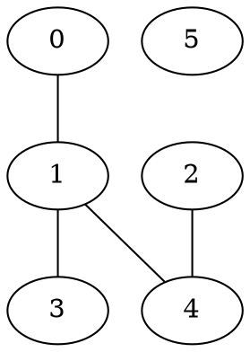

ging purposes and also to present results. Here, the GraphViz package [GraphViz] is explained. It works basically in the following way:

+   (1) One generates an ASCII file, which describes the graph and its properties. This is the so-called dot file.
+   (2) A filter program is used to generate an image from the dot file.

The dot file is human readable and editable. This has some advantages: You can generate graphs either using a normal text editor or you can write simple C functions to output a graph in dot format, which is stored using your own data structures within your simulation package. This will be described below for the graph data structures used in Sec. 6.8. There is also the interactive program dotty, which allows graphs to be loaded, displayed, modified and saved in the dot format. First, we explain the general properties of the dot file and of the commands to generate an image from a dot file. Here, only short ready-to-run examples are given. Some details can be found in the man page when entering man dot on a Unix system or, more complete and up-to-date, at Ref. [GraphViz].

The undirected graph shown in Fig. 6.24 can be described by the following dot file, called testgraph.dot:

```

```

On line 1, graph shows that the file describes an undirected graph, test being the ID of the graph. An ID can be a string composed of alphabetic characters, digits or underscores. Also more complex IDs are possible, in particular if they are double-quoted strings "..." or html strings <...>. Note that the key words strict, graph, digraph, node and edge are not allowed as IDs. Between the braces (line 2 and 14) the graph is described, this is the so-called statement part. For this example, first (lines 5-10)