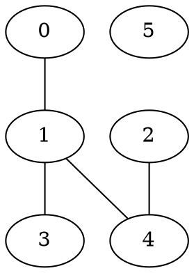

options are shown via one specific example. Here, the plot consists of a main plot (showing file integrand.dat) and an inset (B.dat). The resulting plot is shown in Fig. 9.2. The gnuplot script plot_PW_integrand.gp generating this plot reads as follows:


Fig. 9.2 Example plot generated using gnuplot, containing big fonts, different font types, subscripts, superscripts, additional labels and an inset.

```
set terminal postscript enhanced "Times-roman" 22 portrait
set output "PW_integrand.eps"
set multiplot
set size square 1
set nokey
set label "{/Times-Italic N}=128^2, {/Times-Italic B}_{max}=3" at -47500, 9060
set xtics 1000
set xlabel "{/Times-Italic W}"
set format y "10^{%A.0f}"
set ylabel "{/Times-Italic P(W)}e^{-{/Times-Italic W/T}}" offset 1,0
plot [-48600:-46000] [8700:9100] "integrand.dat" u 1:( $2/log(10.0) )
set size square 0.53
set origin 0.22, 0.175
set xlabel "{/Times-Italic B}_{/Times-Roman max}" offset -0.3,0.6
set xtics 1
set ylabel "{/Symbol b}{/Times-Italic F/N-B}_{max}" offset 1.5,0
set ytics 0.1
set format y "%g"
f(x)=a*x
plot [0:3.5][0:0.2] "B.dat" u 1:(($2-f($1))/(128*128)) ps 2 lw 2
```

In the first line, the output format postscript is chosen. In the enhanced mode, sub-, superscripts and mixed fonts are available. Next, the name of the main font and the standard font size 22 points are given, finally the orientation of the plot. A large font size of 22pt is necessary, because in scientific journals the plots are usually quite small. Many more options are available, please enter help terminal postscript in gnuplot to learn more. In line 2, the name of the output file is stated, as explained already on page 308.

For enabling several plots in one figure, the command set multiplot is used in line 4. The combination of a large plot plus a small plot located inside the large plot results in an inset. Anyway, arbitrary combinations and nested plots are possible.

The first plot starts in line 6. The plot is squared and has scale factor 1 (including labels and margins). In line 6 it is stated that no key is shown. Instead, in line 8, directly a label is set. Some parts of the label are printed with mixed fonts. Here also a superscript 128² and a subscript B_max are generated. The position of the label is determined via at -47500,9060, i.e., in coordinates of the data space. Note that one could also state a unique font valid for the complete label, including a size, via the font option of the set label command, e.g., via including font "/Times-Italic,22". More information you will obtain via entering help set label.

In line 10 of the script, the spacing between the tics of the x-axis is set, followed by the label for this axis in line 11. For the y-axis, the tic labels have a special format. One can state, more or less, arbitrary formats, similar to the formats of the printf() C command. All possible format options can be obtained via entering help set format. Here, see line 12, the power of the actual y value is printed. The reason is that in the file to be plotted the log values of the actual y values are shown, since the


Fig. 9.3 A sample screen-shot showing the xfig program.

The figures can be saved in the internal fig format, and exported in several file formats such as (encapsulated) PostScript, LaTeX, JPEG, TIFF or bitmap. The xfig program can be called in a way that it produces just an output file with a given fig input file. This is very convenient for larger projects where some small picture objects are contained in other pictures and for changing the appearance of the small objects in all other files. With the help of the make program, pretty large projects can be realized.

Last but not least, please note that xfig is vector-oriented, but not pixel-oriented. Therefore, you cannot treat pictures like JPEG files (e.g. photos) and apply operations like smoothing, sharpening or filtering. For these purposes, the package GIMP is suitable. It is freely available again from GNU [Loukides and Oram (1996)].

### 9.2.3 Drawing graphs

As we have seen in Sec. 6.8, many simulations are based on graph representations. In these cases, it is very useful to visualize graphs for debugging purposes and also to present results. Here, the GraphViz package [GraphViz] is explained. It works basically in the following way:

- (1) One generates an ASCII file, which describes the graph and its properties. This is the so-called dot file.
- (2) A filter program is used to generate an image from the dot file.

The dot file is human readable and editable. This has some advantages: You can generate graphs either using a normal text editor or you can write simple C functions to output a graph in dot format, which is stored using your own data structures within your simulation package. This will be described below for the graph data structures used in Sec. 6.8. There is also the interactive program dotty, which allows graphs to be loaded, displayed, modified and saved in the dot format. First, we explain the general properties of the dot file and of the commands to generate an image from a dot file. Here, only short ready-to-run examples are given. Some details can be found in the man page when entering man dot on a Unix system or, more complete and up-to-date, at Ref. [GraphViz].

The undirected graph shown in Fig. 6.24 can be described by the following dot file, called testgraph.dot:



On line 1, graph shows that the file describes an undirected graph, test being the ID of the graph. An ID can be a string composed of alphabetic characters, digits or underscores. Also more complex IDs are possible, in particular if they are double-quoted strings "..." or html strings `<...>`. Note that the keywords strict, graph, digraph, node and edge are not allowed as IDs. Between the braces (line 2 and 14) the graph is described, this is the so-called statement part. For this example, first (lines 5-10) comes a list of node IDs (node statements). These IDs follow the same rules as the ID of the graph. Then (lines 11-14) comes a list of edges (edge statements), which are composed of two IDs joined by the edge operator `--`. Several statements per line are possible, if they are separated by spaces or tabs or semicolons.

To generate an image, say a postscript file from the dot file, one uses a filter program, e.g. dot. It can be called using a command line like

```
dot -Tps testgraph.dot > testgraph.eps
```

The output of dot is always to stdout. Therefore, it is redirected to a file testgraph.eps here. The option -Tps means that the output format is postscript. Other formats are given below. The resulting postscript file is shown in Fig. 9.4.


Fig. 9.4 The graph of Fig. 6.24, as plotted by the dot program.

Also lists of edges of the form node1 -- node2 -- node3 -- node4 can be given. Note that the order of nodes and edges is arbitrary within the statement list. Consequently, one can mix or alternate node and edge statements. In particular, for nodes appearing in edges, it is not necessary to include them explicitly as node statements, unless one wants to state additional attributes. These optional attributes can be written in `[...]` brackets behind the nodes and edges using a comma-separated list of attribute assignments of the form `<attribute>=<value>`. There are many different attributes for shape, color, (minimum) size, fonts, positions etc. We do not list them here for conciseness, but give just an example below. Please refer to the man page for details. Here we state only that attributes can be set also globally for all nodes or all edges by writing `node [<attribute list>]` or `edge [<attribute list>]`. Attributes which apply to the full graph are
