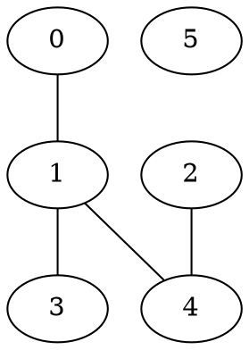

选项通过一个具体示例展示。这里，绘图包含一个主图（显示文件 integrand.dat）和一个内嵌图（B.dat）。生成的绘图显示在图 9.2 中。生成此绘图的 gnuplot 脚本 plot_PW_integrand.gp 如下所示：


图 9.2 使用 gnuplot 生成的示例绘图，包含大字体、不同字体类型、下标、上标、附加标签和内嵌图。

```
set terminal postscript enhanced "Times-roman" 22 portrait
set output "PW_integrand.eps"
set multiplot
set size square 1
set nokey
set label "{/Times-Italic N}=128^2, {/Times-Italic B}_{max}=3" at -47500, 9060
set xtics 1000
set xlabel "{/Times-Italic W}"
set format y "10^{%A.0f}"
set ylabel "{/Times-Italic P(W)}e^{-{/Times-Italic W/T}}" offset 1,0
plot [-48600:-46000] [8700:9100] "integrand.dat" u 1:( $2/log(10.0) )
set size square 0.53
set origin 0.22, 0.175
set xlabel "{/Times-Italic B}_{/Times-Roman max}" offset -0.3,0.6
set xtics 1
set ylabel "{/Symbol b}{/Times-Italic F/N-B}_{max}" offset 1.5,0
set ytics 0.1
set format y "%g"
f(x)=a*x
plot [0:3.5][0:0.2] "B.dat" u 1:(($2-f($1))/(128*128)) ps 2 lw 2
```

在第一行，选择了输出格式 postscript。在增强模式下，下标、上标和混合字体可用。接下来，给出了主字体名称和标准字体大小 22 点，最后是绘图的朝向。由于在科学期刊中绘图通常相当小，因此需要 22pt 的大字体大小。还有更多选项可用，请在 gnuplot 中输入 help terminal postscript 以了解更多信息。第 2 行说明了输出文件的名称，如第 308 页所述。

为了在一个图形中启用多个绘图，在第 4 行使用了命令 set multiplot。大型绘图加上位于大型绘图内部的小型绘图的组合形成了内嵌图。当然，任意组合和嵌套绘图都是可能的。

第一个绘图从第 6 行开始。绘图为正方形，比例因子为 1（包括标签和边距）。第 6 行说明不显示图例。相反，在第 8 行直接设置了一个标签。标签的某些部分使用混合字体打印。这里还生成了上标 128² 和下标 B_max。标签的位置通过 at -47500,9060 确定，即在数据空间的坐标中。请注意，也可以通过 set label 命令的 font 选项为整个标签指定唯一的字体，包括大小，例如通过包含 font "/Times-Italic,22"。更多信息可通过输入 help set label 获得。

在脚本的第 10 行，设置了 x 轴刻度之间的间距，随后在第 11 行给出该轴的标签。对于 y 轴，刻度标签具有特殊格式。可以指定或多或少任意的格式，类似于 C 命令 printf() 的格式。所有可能的格式选项可通过输入 help set format 获得。这里，见第 12 行，打印实际 y 值的幂。原因是待绘图文件中显示的是实际 y 值的对数值，因为


图 9.3 显示 xfig 程序的示例屏幕截图。

图形可以保存在内部 fig 格式中，并导出为多种文件格式，如（封装的）PostScript、LaTeX、JPEG、TIFF 或位图。xfig 程序可以这样调用，使其仅使用给定的 fig 输入文件生成输出文件。这对于大型项目非常方便，其中一些小型图片对象包含在其他图片中，并且需要在所有其他文件中更改小型对象的外观。在 make 程序的帮助下，可以实现相当大的项目。

最后但并非最不重要，请注意 xfig 是面向矢量的，而不是面向像素的。因此，您不能像处理 JPEG 文件（例如照片）那样处理图片并应用诸如平滑、锐化或滤波之类的操作。对于这些目的，GIMP 软件包是合适的。它再次可从 GNU [Loukides and Oram (1996)] 自由获得。

### 9.2.3 绘制图形

正如我们在第 6.8 节中所见，许多模拟基于图形表示。在这些情况下，可视化图形对于调试目的以及呈现结果非常有用。这里解释了 GraphViz 软件包 [GraphViz]。它基本上按以下方式工作：

- (1) 生成一个 ASCII 文件，其中描述了图形及其属性。这就是所谓的 dot 文件。
- (2) 使用过滤程序从 dot 文件生成图像。

dot 文件是人类可读且可编辑的。这有一些优点：您可以使用普通文本编辑器生成图形，或者您可以编写简单的 C 函数以 dot 格式输出图形，该格式使用您自己的数据结构存储在模拟包中。这将在第 6.8 节中使用的图形数据结构中进行描述。下面还有交互式程序 dotty，它允许以 dot 格式加载、显示、修改和保存图形。首先，我们解释 dot 文件的一般属性以及从 dot 文件生成图像的命令。这里只给出了简短的即用示例。一些细节可以在 Unix 系统上输入 man dot 时在手册页中找到，或在 Ref. [GraphViz] 中更完整、更及时地找到。

图 6.24 中显示的无向图可以用以下名为 testgraph.dot 的 dot 文件描述：



在第 1 行，graph 表示该文件描述了一个无向图，test 是图的 ID。ID 可以是由字母字符、数字或下划线组成的字符串。更复杂的 ID 也是可能的，特别是如果它们是双引号字符串 "..." 或 html 字符串 `<...>`。请注意，关键字 strict、graph、digraph、node 和 edge 不能用作 ID。在大括号之间（第 2 行和第 14 行）描述了图形，这是所谓的语句部分。对于此示例，首先（第 5-10 行）给出节点 ID 的列表（节点语句）。这些 ID 遵循与图 ID 相同的规则。然后（第 11-14 行）给出边的列表（边语句），它们由两个通过边运算符 `--` 连接的 ID 组成。每行可以有多个语句，如果它们由空格、制表符或分号分隔。

要从 dot 文件生成图像，例如 postscript 文件，使用过滤程序，例如 dot。它可以使用如下命令行调用

```
dot -Tps testgraph.dot > testgraph.eps
```

dot 的输出始终为 stdout。因此，这里将其重定向到文件 testgraph.eps。选项 -Tps 表示输出格式为 postscript。其他格式在下面给出。生成的 postscript 文件显示在图 9.4 中。


图 9.4 由 dot 程序绘制的图 6.24 的图形。

也可以给出形如 node1 -- node2 -- node3 -- node4 的边列表。请注意，节点和边的顺序在语句列表中是任意的。因此，可以混合或交替节点和边语句。特别是，对于出现在边中的节点，除非想要说明附加属性，否则不需要显式地将其作为节点语句包含。这些可选属性可以用 `[...]` 括号写在节点和边后面，使用逗号分隔的属性赋值列表，形式为 `<attribute>=<value>`。有许多不同的属性用于形状、颜色、（最小）大小、字体、位置等。我们在这里为了简洁不列出它们，但下面给出一个示例。请参阅手册页以获取详细信息。这里我们只说明属性也可以通过编写 `node [<attribute list>]` 或 `edge [<attribute list>]` 全局设置给所有节点或所有边。适用于整个图的属性是
