# 计算机模拟实用指南（第2版）


致我的家人

# 第二版序言

在本书第一版出版后，我收到了来自各方人士的大量支持性评论。尽管如此，许多读者仍建议在书中加入更多主题，特别是与新发展或工具相关的内容。此外，他们还报告了一些印刷错误和细小错误。对于某些段落，我决定稍作重写或通过加入更多示例来扩展。因此，当 World Scientific 请我撰写第二版时，我并未犹豫太久。你手中的就是这项工作的成果。

第二版的主要扩展如下：

- 已添加对编程语言 *Python* 的介绍，见第 2.3 节。该语言介于脚本语言（因为它是解释执行的）和完整的通用高级编程语言之间（例如提供复杂数据结构、面向对象元素以及各种用途的众多库）。因此，使用 *Python* 时，一方面可以轻松编写用于数据分析等各种任务的脚本。另一方面，小型到中型的模拟项目可以快速实现。
- 由于对 *networks and graphs* 的模拟和分析在各个科学领域变得越来越重要，第 6.8 节关于图的内容已通过一个小节（6.8.4）进行了扩展，介绍 *connected component* 的计算。这是图分析中最常执行的分析之一，也是许多复杂算法的基础，例如获得最短路径、直径或中心性度量。
- 第 8.1.1 节关于为离散随机变量 *draw random numbers* 的方法现已包含最快的可用算法。它允许根据给定分布以恒定时间 O(1) 抽取每个随机数。这比标准方法快得多，标准方法需要 O(log N)，其中 N 是可能结果的数量。
- 第 8.2.4 节涵盖了 *rejection method*，该方法允许根据给定的概率密度抽取随机数，通常应用于不可逆分布函数。该节已通过用任意概率密度函数限制目标分布的一般方法进行了扩展。这极大地扩大了可通过该方法实现的分布范围。

    此外，作为在更高维度生成随机点的示例，现在还包含了在 *d-dimensional hypersphere* 表面上均匀抽取点的示例。
- 在关于数据分析的第 8 章中，在第 8.5 节关于假设检验和数据集中相关性度量的内容中，加入了关于 *Receiver operating characteristic*（ROC）的小节。ROC 是一种先进且广泛使用的方法，可用于确定假设检验的最佳参数。
- 此外还添加了关于 *principal-component analysis* 的小节（8.5.5）。这是寻找高维数据中最重要的“方向”的最简单方法。
- *Data clustering methods* 是大数据集分析中的重要工具，因为它们允许在海量数据中寻找结构。这是一种非常复杂的数据分析方式，远超平均值、直方图和曲线拟合的水平。多种方法，从最简单的 *k-means* 方法到高级的层次聚类算法，现已在第 8.5.6 节中进行了详细解释。
- 第 8.6.2 节关于使用 *gnuplot* 进行 *fitting data* 已扩展为如何限制拟合参数的取值范围（默认情况下不可行）以及如何同时将函数拟合到多组数据。
- 在第一版中，*gnuplot* 仅用于生成数据的“快速而粗糙”的绘图。在第 9.2.1 节中，现在展示了如何使用 *gnuplot* 生成出版质量的绘图。
- 第 9.2.4 节关于光线追踪器 *POV-Ray* 已通过一些段落进行了扩展，解释了如何使用该光线追踪器生成模拟快照的三维图像。

    通过使用此类图像的序列，可以轻松生成小型电影。
- 在第一版中，第 9.3.1 节关于 LaTeX，一种用于生成高质量文档的标准排版工具，如同本书这样大的完整书籍，只是一个简短的介绍，提供了少量示例。对于第二版，这一节已大幅扩展，现在可作为 LaTeX 的完整介绍，介绍了科学出版物中最常用的 LaTeX 元素，从而涵盖了从排版角度生成标准到高级手稿所需的所有知识。

这些新章节遵循第一版的动手方法，包含了读者可以尽快将新知识应用到自己工作中的所有必要源代码。因此，我希望这一新版本能让你尽可能快速地学习科学计算机模拟的所有技术方面，从最初的想法到实现、执行模拟、进行数据分析，直至发表你的成果。因此，使用本书将为你节省大量时间，让你能够集中精力解决你想要解决的实际科学问题。最后，由于新版本包含了计算科学中几乎所有非问题特定知识，我决定将书名改为“计算机模拟大实用指南”。

这一新版本不可能没有许多人的帮助。我感谢以下人士传达错误、提出有用建议并提供书籍扩展：Pia Backmann、Jan Christoph Bernack、Gunnar Claussen、Timo Dewenter、Florian Effenberg、Pascal Fieth、Nikolai Gagunashvili、Hendrike Heidemann、Ivo Inicki、Simon Knowles、Karsten Looschen、Markus Manssen、Andreas Mohrs、Zacharias Njam Mokom、Oliver Melchert、Marc Mézard、Tudor Mitran、Christoph Norrenbrock、Tom Seren、Hendrik Schawe、Sagar Sinha、Verena Sterr、Sebastian von Ohr 和 A. Peter Young。此外，Oliver Melchert 提供了用于数据重采样的 Python 脚本，已包含在新版本中。

Alexander K. Hartmann
Oldenburg, 2014 年 7 月

# 第一版序言

你决定成为计算机模拟专家，恭喜！这是一个明智的决定，因为计算和模拟方法在科学、人文学科、经济学、工程学和数学的所有领域变得越来越重要。本书将在模拟研究项目的各个阶段帮助你学习最重要的基础知识，从程序设计、实现和调试阶段，到运行模拟、组织数据和分析结果，再到最终呈现和发表成果的阶段。

请注意，如今有成千上万种不同的问题正在通过计算机模拟进行研究。例如，人们研究土壤中化学物质的扩散、细胞中蛋白质的折叠、大脑中神经元的通信、事故中汽车的变形、股票市场交易员的行为、未来几天或几周天气的演变、涡轮机中流动水的湍流行为、半导体中电子的运动、语言中词语的模式，或拥挤购物中心中行人的交通，仅举几例。因此，有许多算法来处理各种问题，例如有限差分、有限元、积分方法、矩阵求逆、特征值确定、方程求解器、分子动力学模拟、蒙特卡洛方法、密度泛函方法、图算法、优化方法等等。哪些方法适合你的问题在很大程度上取决于你想要解决的问题。由于对于所有这些不同问题可用的算法实在太多，而且通常每个人都需要不同的

博士后项目。我变得越来越有经验，并不断完善我的方法。我还通过阅读有关软件工程、算法、数据结构和数据分析的书籍，以及学习使用许多程序来改进我的工作方式。在最初的博士后几年后，我开始指导学生。因此，我开始传授我的知识，试图帮助他人避免许多陷阱并设计出高效的程序。我部分经验被收录进了海科·里格尔（Heiko Rieger）与我合著的《Optimization Algorithms in Physics》一书的最后一章。事实上，该章节是本书的极简版本。因此，它成为本书的种子，旧章节中的一些材料偶尔也会在这里出现。² 多年间，我指导的学生越来越多，甚至开设了一门关于计算机模拟实践方面的大学课程。这门课程与书中章节相比包含了很多新材料，事实上它也成为本书的种子。然而，我用于指导学生的材料仍然来自多个不同的来源，往往彼此并不完全兼容。我开始觉得，如果我写一本关于计算机模拟实践方面的完整书籍，全面包含“所有”所需材料，将有助于我的工作并提高效率。再过两年，我收到世界科学出版社（World Scientific）的邮件，他们注意到了我的课程网页。他们问我是否愿意基于该课程写一本书。现在做出决定真正实现这本书并不困难。你现在手里拿的就是成果。

请注意，本书包含了一种非常个人化的观点，认为哪些工具是有用的。非常经常地，我介绍几种独立的工具，例如用于编辑、编译和分析程序的工具，而不是一个通常只集成这些基本工具的框架的通用环境。然而，所介绍的大多数工具都是标准程序，可在所有计算机系统上使用（对于 Microsoft 操作系统，它们有时有其他名称）。

在这里，我概述一下本书的内容。首先，给出了 C 编程的简短介绍。还涉及宏、makefile 和 shell 脚本等相关主题。在第二章中，解释了软件工程的主要思想，并提出了若干有助于构建高效可靠代码的提示。在第 4 章中，三种非常

² 摘自 A.K. Hartmann 和 H. Rieger，《Optimization Algorithms in Physics》，第 293–357 页，2002 年，版权所有 Wiley-VCH Verlag GmbH & Co. KGaA。经许可转载。


Alexander Karl Hartmann 是德国奥尔登堡大学（University of Oldenburg）科学系计算物理学教授。他在哈根大学（University of Hagen）获得计算机科学硕士学位，并在杜伊斯堡大学（University of Duisburg）获得物理学硕士学位。在海德堡大学（University of Heidelberg）获得理论物理学博士学位后，他曾在哥廷根大学（University of Göttingen）、加州大学圣克鲁兹分校（University of California in Santa Cruz）和巴黎高等师范学院（École Normale Supérieure）工作。2007 年，他移居奥尔登堡。他的研究兴趣包括计算机模拟、无序系统、组合优化、大偏差和生物信息学。Hartmann 教授是 8 本书籍的作者或合著者，拥有超过 120 篇科学出版物。


```
cc -o first -Wall first.c
```

主命令是 cc，它是 C 编译器（C compiler）的缩写。在上面的示例中，命令 cc 使用了两个选项：

+   -o（表示 output）指定可执行程序将获得的名称，这里是 first。
+   -Wall 中的 W 代表 warning（警告），all 表示编译器将报告它观察到的（几乎）所有奇怪之处，即使从严格意义上说这并不是错误。由于 C 对许多规则非常宽松，它会让你绕过很多限制，而大多数情况下这并不是你想要做的。

经典示例是比较运算符 ==，也就是说，如果你想测试变量 a 和 b 中存储的值是否相等，就必须写成 a==b。这与 a=b 不同，后者将 b 的值赋给 a（见下文）。然而，对于 if (a==b) 这样的条件语句，程序员有时会误写成 if (a=b)，而在某些情况下这仍然是一条有意义的语句。因此，编译器不会将其报告为错误，但使用 -Wall 时，编译器会警告你：在期望条件语句的地方使用了赋值。因此，你应当始终使用最高警告级别 -Wall，并且只有在你完全清楚自己在做什么时，才忽略这些警告。请注意，C 中还有其他几个警告选项，尽管名字叫 -Wall，即使使用它也不会开启这些选项。例如，选项 -Wextra（以前只叫 -W）会开启额外的警告。所有警告选项的完整列表可在编译器文档中找到。

cc 命令的最后一个参数是你实际想要编译的文件。请注意，原则上，一个程序可以由多个文件组成，这些文件都可以通过参数传递给编译器。默认情况下，C 编译器会生成一个可执行文件。因此，编译过程将包括对输入源文件的实际编译，这会为每个输入文件生成（隐藏的）汇编代码。汇编代码会被转换为可执行代码。最后，不同的可执行代码会被链接成一个程序。如果给出了 -c 选项，则会省略链接阶段。在这种情况下，会创建多个可执行的 .o 文件。从命令行调用 C 编译器时，它会提供大量选项，所有这些选项都在手册页中进行了说明。在 UNIX/Linux 下，你可以通过 man 命令访问手册，即输入“man cc”。

现在回到程序 first.c 的结构。第一行包含一个文件。这意味着文件 stdio.h 包含一些定义，编译器应在继续编译过程之前读取它们。在本例中，stdio.h 包含一些用于输入/输出 i/o 的内置标准函数的声明。编译器需要这些声明，因为它必须知道，例如，有多少个参数传递给函数。包含声明的文件通常称为头文件，因此后缀是 .h。在本例中，编译器需要子程序 printf() 的定义，其含义是 print formatted（打印格式化内容，见下文）。请注意，子程序的实际定义，即子程序的代码，并不包含在头文件中，而是包含在库中（见第 17 页）和第 7.1 节中。

每个 C 程序的主程序都称为 main()，它包含 first.c 中剩余的文件内容。事实上，C 程序中所有执行操作的代码都是函数，即它们接受一些参数并返回某些内容。因此，main() 也是一个函数。在这里，它不接受任何参数，这一点由第三行中函数名（main）后面的括号 () 内没有写任何内容来表示。下面你将学习如何通过命令行向 main() 传递一些参数。默认情况下，函数 main() 返回一个整数值，这由函数名前面的 int 表示。

函数的定义，即调用函数时执行的程序代码，包含在括号对 {...} 内（第 4—7 行）。请注意，为了可读性，左括号和右括号被写在彼此下方，但编译器并不要求这样。你本可以把所有内容写在一行中，或者插入许多空行，等等。此外，字符在一行中的位置完全无关紧要，例如你的程序可以看起来像

```c
#include <stdio.h>
int
main
(){
printf(
"My first program\n");      return(0);
}
```

当然，第一个版本比第二个版本可读性高得多，因此你应当遵循一些格式规则。这将在第 3.2 节中讨论。请注意，关于 #include 指令，它只是一种传递给编译器的命令，而不是真正的 C 命令，其语法更为严格。基本上，每条 #include 指令必须完全写在一行中（除非通过行末的 \ 符号显式使用多行）。此外，每行只允许有一条指令。关于编译器指令及相关宏的更多信息在第 1.6 节中给出。

描述 main() 功能的代码包括这里的第 5—6 行。首先，子程序 printf() 将作为参数给出的字符串打印到屏幕上，即这里的字符串 "My first program"。\n 符号是一个格式符号。它表示在打印该字符串后插入一个换行符。因此，程序执行期间如果还使用 printf() 进行任何后续输出，这些输出将从下一行开始打印。你可以使用 printf() 打印许多不同的内容，更多细节在第 1.3 节中说明。请注意，从形式上说，子程序 printf() 是一个函数，因为在 C 中所有子程序都是函数。函数可以有副作用，例如打印信息或更改变量的内容。此外，所有函数都会计算或返回一个值，而这个值通常不如副作用重要，就像本例中一样。函数调用连同结尾的分号构成一条语句。每条语句都必须以分号结束，即使它是函数的最后一条语句，或者是语句块（见第 20 页）的最后一条语句。

在第 6 行中，return(0) 通过返回值说明了函数的返回值。这里它只是 0，按照惯例，这对 main() 来说意味着一切正常。一般来说，可以返回任意复杂的对象。简单的数学函数将返回一个实数，例如参数平方根，但像字符串、数组、列表或图这样的更复杂对象也是可能的。关于 C 中函数的更多内容在第 1.2 节中给出。

要实际执行该命令，需要在 shell 中输入程序的名称，即

```
first
```

请注意，这假定当前目录是环境变量 PATH 中所包含搜索路径的一部分。如果不是这种情况，则必须输入“./first”。程序执行的结果是，消息 "My first program" 将出现在屏幕上（在 shell 内，就在你调用程序的那一行之后），程序将终止，shell 将等待你的下一条命令。

因此，如果你尝试在程序的其他地方给 num_rows 赋值，编译器将报告错误。

其他基本数据类型具有与 int 类似的基本属性和用法，包括

- **short int**
  如果你确定某些变量不需要很大的数字，就可以使用这种数据类型来节省内存。它只占用两个字节，因此可表示范围为 [−2^15, 2^15−1] 的数字，而对于 unsigned short int，可使用范围为 [0, 2^16−1] 的数字。这些类型的变量与 int 变量的处理方式完全相同。

- **char**
  这种数据类型用于使用 ASCII 编码系统在一个字节中存储字符。所赋值的字符必须放在单引号中。使用 printf() 打印字符时，可以使用转换说明符 %c。以下三行定义了一个 char 类型的变量，给它赋一个字符并打印它。

```
char first_char;
first_char = 'a';
printf("The first character is %c.\n", first_char);
```

请注意，你也可以使用 char 变量存储范围在 [−128, 127] 内的整数。因此，当你使用 %d 转换说明符打印变量 first_char 时，你将得到所含字符的 ASCII 码编号，例如字母 'a' 对应数字 97，'\n' 对应数字 10。这些码编号可能取决于机器和/或操作系统。
unsigned char 类型的变量可以存储范围在 [0,255] 内的数字。

- **double and float**
  它们用于存储浮点数。通常 float 需要四个字节，允许表示最大/最小到 ±3.4 × 10^38 的数字，而 double 使用八个字节，允许表示大得多的数字（±9 × 10^307）。
  给 float 或 double 数字赋值时，例如可以使用定点表示法，如 −124.38，或使用形如 −1.2438e2 的“科学”表示法，它表示 −1.2438 × 10^2（等价地，你可以写成 −12.438e1 或 −1243.8e−1）。注意，数值


常量 4 的类型为 int，而常量 4.0 的类型为 double。尽管如此，你可以将 4 赋给浮点变量，因为在必要时类型会隐式转换，参见 Sec. 1.1.2。打印 float 或 double 数值时通常使用转换说明符 %f 表示定点记数，或 %e 表示科学记数法。

注意标准 C 不提供对复数的支持。这不是问题，因为有许多可自由获取的库包含了复数计算所需的所有操作，参见 Chap. 7。

- long int 和 long double
- 地址，也称为指针

在某些计算机系统上，这些数据类型会提供更多的内存。在这些情况下，如果需要更大的允许值范围或更高的精度，使用这些数据类型是有意义的。这些数据类型的变量使用方式与 int 或 double 分别相同。

主内存中的通用地址可以由例如以下方式定义的变量存储

```
void *address1, *address2;
```

请注意每个变量前面必须有一个 '*' 字符。在此情况下类型 void 表示“任何东西”，尽管有时它表示“无”（参见 Sec. 1.2）。如果想指定指针存储（或“指向”）特定类型变量的地址，则必须改写数据类型名称，例如

```
int *address3, *address4;
```

与 void 指针的一个重要区别是 address3+1 指的是 address3 的内存地址加上存储一个 int 值所需的字节数，而 address1+1 是 address1 的内存地址加一个字节。变量的实际地址是通过 & 运算符获得的（参见下一节），例如对于整数变量 sum

```
address1 = &sum;
```

printf() 对指针的转换说明符为 '%p'，结果以十六进制显示。例如

```
printf("address = %p\n", address1);
```

可能导致

address = 0xbfa0604

address1 指向的内存位置中存储的值可通过写 *address1 获得。因此，以下几行

```
int sum;
int *address1;

address1 = &sum;
sum = 12;
printf("%d \n", *address1);
```

运行时将输出 12。

指针的稍高级用法可在练习 (2) 中找到。

| 获取源代码 |
| --- |
| 目录: c-programming |
| 文件: address.c |

请注意，你可以通过 C 程序中的 sizeof() 函数确定任何数据类型实际使用的字节数，包括自定义的类型（参见 Sec. 1.1.4）。数据类型名称必须作为参数传递给该函数。例如，以下小型程序 sizeof.c 将打印每种类型使用的字节数：

| 获取源代码 |
| --- |
| 目录: c-programming |
| 文件: sizeof.c |

```
#include <stdio.h>

int main()
{
printf("int uses %d bytes\n", sizeof(int));
printf("short int uses %d bytes\n", sizeof(short int));
printf("char uses %d bytes\n", sizeof(char));
printf("long int uses %d bytes\n", sizeof(long int));
printf("double uses %d bytes\n", sizeof(double));
printf("float uses %d bytes\n", sizeof(float));
printf("long double uses %d bytes\n", sizeof(long double));
printf("pointers use %d bytes\n", sizeof(void *));
return(0);
}
```

请注意 printf 语句的格式字符串，即第一个参数，包含转换字符 %d，这意味着在打印格式字符串时，作为第二个参数传递的数字将以整数形式打印，替换转换字符。有关 printf 命令及其格式字符串的更多细节在 Sec. 1.3 中解释。因此，程序可能产生以下输出：

```
int uses 4 bytes
short int uses 2 bytes
char uses 1 bytes
long int uses 4 bytes
double uses 8 bytes
float uses 4 bytes
long double uses 12 bytes
pointers use 4 bytes
```

因此，使用 long int 与 int 相比并不会增加范围，但 long double 也是如此。sizeof() 命令在使用指针进行动态内存管理时尤其重要，参见 Sec. 1.4。

所有标准 C 数据类型的精度都是固定的。尽管如此，仍有可自由获取的库允许任意精度，包括相应的运算符，参见 Chap. 7。标准算术数据类型的运算符将在下一节讨论。

### 1.1.2 算术表达式

C 中的算术表达式基本上遵循传统算术的相同规则。标准运算加法（运算符 +）、减法（-）、乘法（运算符 *）和除法（/），以及通常的优先级规则对所有数值数据类型都已定义。此外，可以通过使用括号引入显式优先级。以下表达式给出一些示例：

```
total_charge = -elementary_charge*(num_electrons-num_protons);
weighted_avg_score = (1.0*scoreA+2.0*(scoreB1+scoreB2))/num_tests;
```

执行程序时，'=' 字符右侧表达式求值得到的值会被赋给 '=' 字符左侧显示的变量。请注意，赋值本身就是一个表达式，其结果是被赋的值。因此，赋值 x = 1.0 的结果是 1.0，并且可以像这样自行赋值

```
counter3 = ++counter1;
counter4 = --counter2;
printf("%d %d %d %d\n", counter1, counter2, counter3, counter4);
```

将导致

4 3 5 4

由于计算机使用二进制表示一切，特别是任何自然数 n 在二进制表示 n = Σ 2^i a_i 中都可以解释为 0 和 1 的序列 a_{k-1}...a_0。例如，数字 201 写成二进制序列（最高位在左侧）为 11001001。对于这些序列，有一些运算符可以直接作用于位。我们从涉及两个参数的运算符开始。

& 计算两个操作数的按位 AND。对于每一对位 (a,b)，& 操作定义如右侧表格所示：结果只有在 a AND b 均为 1 时才为 1。因此，对于数字 201（二进制 11001001）和 158（二进制 10011110），201 & 158 的结果为 136（二进制 10001000）。

| a | b | a&b |
| --- | --- | --- |
| 0 | 0 | 0 |
| 0 | 1 | 0 |
| 1 | 0 | 0 |
| 1 | 1 | 1 |

| 计算两个操作数的按位 OR，定义如右侧表格所示：结果在 a OR b 为 1 时为 1。因此，对于数字 201 和 158，结果为 223（二进制 11011111）。

| a | b | a\|b |
| --- | --- | --- |
| 0 | 0 | 0 |
| 0 | 1 | 1 |
| 1 | 0 | 1 |
| 1 | 1 | 1 |

^ 计算两个操作数的按位 XOR，定义如右侧表格所示：结果在 a OR b 为 1 但不同时为 1 时为 1。因此，对于数字 201 和 158，结果为 87（二进制 01010111）。

| a | b | a^b |
| --- | --- | --- |
| 0 | 0 | 0 |
| 0 | 1 | 1 |
| 1 | 0 | 1 |
| 1 | 1 | 0 |

<< 表达式 seq << n 的求值结果是将存储在变量 seq 中（或一般由表达式得到）的位序列左移 n 位，这等价于乘以 2^n。因此，如果 seq 包含 51（二进制 00110011），seq << 2 将得到 204（二进制 11001100）。请注意，如果数字溢出，即相对于变量或表达式的类型过大，高位将被擦除。因此，如果 seq 为 unsigned char 类型，seq << 4 将得到 48（二进制 00110000）。

>> 同样，表达式 seq >> n 的求值结果是将存储在变量 seq 中的位序列右移 n 位，这等价于除以 2^n 的整数除法。

此外，~ 是一个一元反转运算符，它只是将所有 1 替换为 0，所有 0 替换为 1。因此，结果取决于标准位数，因为所有前导 0 将被设为 1。例如，变量 seq 包含值 12（二进制 1100，通常省略前导 0 时），~seq 的结果为（4 字节 = int 的 32 位）4294967283（二进制 11111111111111111111111111110011）。

对于浮点运算，有许多预定义函数，如三角函数、指数/对数、绝对值、贝塞尔函数、伽马函数、误差函数或最大值函数。这些函数的声明包含在头文件 math.h 中。因此，使用这些函数时必须包含此文件。编译时未使用 -Wall，请注意如果未包含 math.h 编译器不会报错，这可能导致错误结果。此外，math.h 包含有用常量的定义，如 π 值或欧拉数 e。以下简单程序 mathtest.c 说明了如何使用数学函数。

| 获取源代码 |
| --- |
| 目录: c-programming |
| 文件: mathtest.c |

```
#include <stdio.h>
#include <math.h>

int main()
{
    double z = 0.25*M_PI;
    printf("%f %f %f\n", sin(z), cos(z), tan(z));
    printf("%f %f\n", asin(sqrt(2.0)/2.0)/M_PI, acos(0.0)/M_PI);
    printf("%f %f %f %f\n", pow(M_E,1.5), exp(1.5), log(1.0), log(M_E));
    printf("%f %f %f\n", fabs(-3.4), floor(-3.4), floor(3.4));
    printf("%f %f\n", fmax(1.3,2.67), fmin(1.3,2.67));
    printf("%e %e %e %e\n", erf(0.0), erfc(0.0), erf(2.0), erfc(2.0));
    printf("%f %f %f\n", tgamma(4.0), tgamma(4.5), exp(gamma(5.0)));
    printf("%f %f %f\n", j0(2.0), j1(2.0), jn(1,2.0));
    return(0);
}
```


编译此程序时，需要额外的选项 `-lm`，这意味着将链接数学函数库。该库中包含所有这些函数的预编译代码，最终程序中会包含所需的部分。^2 你可以使用以下命令编译程序：

```
    cc -o mathtest -Wall mathtest.c -lm
```

程序的第 6 行使用了 π 的预定义常量（3.14159265358979323846）。其他重要的常量包括欧拉数（M_E = 2.7182818284590452354）和 √2（M_SQRT2 = 1.41421356237309504880）。第 7-8 行展示了三角函数及其反函数的用法。请注意，参数必须以弧度为单位，即 2π 的倍数。第 9 行展示了如何使用一般幂函数 a^x 的 `pow()` 和指数函数 e^x 的 `exp()`。第 10 行展示了用于计算数值绝对值的函数 `fabs()` 以及用于向下取整的 `floor()`。第 11 行介绍了 `fmax()` 和 `fmin()` 的用法，它们分别用于计算两个数中的最大值和最小值。第 12 行获得了误差函数 erf(x) = 2/√π ∫_0^x e^(-y^2) dy 的四个值。第 13 行展示了伽马函数的示例用法。请注意，`tgamma()` 是伽马函数 Γ(x)，而 `gamma()` 表示 lnΓ(x)。记住，对于整数值 n，有 Γ(n) = (n−1)! = ∏_{k=1}^{n−1} k。最后，第 15 行展示了第一类贝塞尔函数。`j_n(x)` 计算 n 阶贝塞尔函数，而 `j0` 和 `j1` 分别是 `jn(0, ·)` 和 `jn(1, ·)` 的简写。因此，运行该程序时，你将得到

```
    0.707107 0.707107 1.000000
    0.250000 0.500000
    4.481689 4.481689 0.000000 1.000000
    3.400000 -4.000000 3.000000
    2.670000 1.300000
    0.000000e+00 8.427008e-01 9.953223e-01 1.000000e-00
    6.000000 11.631728 24.000000 24.000000
    0.223891 0.576725 0.576725
```

这些函数在相应的手册页中有文档说明，例如 `man sin`。更复杂的函数，如 Airy 函数、椭圆函数或球谐函数，可以在专门的库中找到，如第 7 章所述。

> ^2 请注意，通常使用动态链接，即只有在程序运行时才链接相应的代码。这样可以保持可执行文件短小。不过，也可以使用选项 `-static` 强制在编译时进行显式链接。

最后，还有一个特殊的运算符 `?`，它与 if 语句相关，将在下一节中说明。

### 1.1.3 控制语句

仅使用目前介绍的语句，程序将只是操作的线性序列，无法解决复杂问题。本节将介绍能够控制程序执行流程的语句。

最简单的语句是 if 语句，它允许根据条件表达式的求值结果在两个语句之间进行选择。一个简单的例子是

```
if(x <= 0)
    step_function = 0.0;
else
    step_function = 1.0;
```

其中，如果 x 小于或等于零，变量 step_function 将被赋值为 0.0；如果 x 大于零，step_function 将得到 1.0。

if 语句的一般形式如下：

```
if( {condition} )
    {statement 1}
else
    {statement 2}
```

在执行过程中，首先检查 `{condition}`。如果条件为真，则执行 `{statement 1}`。如果条件为假，则执行 `{statement 2}`。这些语句可以是任意的，例如上面例子中的赋值、函数调用、另一个嵌套的 if 语句等。此外，两个语句的类型可以不同，例如 `{statement 1}` 可以是函数调用，而 `{statement 2}` 可以是赋值。注意，else 部分可以省略。在这种情况下，如果条件为假，执行将继续到 if 语句之后的下一条语句。

基本的条件表达式可以通过使用关系运算符比较（算术）表达式来形成。在 C 中，我们有

“`||` 运算符序列中*真*的首次出现。当在复合条件表达式中使用会改变变量的运算符（如后置递增运算符 `++`，例如在 `(num_particles > 100)&&(num_runt > 100)` 中）时，这可能很危险。在这种情况下，第二个条件中的后置递增运算符是否执行取决于第一个条件的结果。因此，在大多数情况下，即使这种构造能按预期工作，为了清晰起见也应避免使用。

回顾本节第一个例子，其中将一个值赋给一个变量，而该值在语句的不同分支中是不同的。对于 `if` 语句的这种特殊用法，存在*条件运算符* `?` 作为快捷方式。对于上述例子，产生的*条件表达式*语句为

```
step_function = (x<=0) ? 0.0 : 1.0;
```

条件表达式的一般格式为

`⟨condition⟩ ? ⟨expression 1⟩ : ⟨expression 2⟩`

因此，`?` 运算符是三元的。如果 `⟨condition⟩` 求值为真，条件表达式的结果是 `⟨expression 1⟩`，否则结果是 `⟨expression 2⟩`。条件表达式可以在任何标准表达式可以使用的地方使用。

根据上面所示的 `if` 语句的一般形式，似乎每个分支中只能放置一条语句。这种限制可以通过将任意数量的语句分组到一个*块*中来克服，块是通过用 `{ ... }` 大括号括起语句来创建的，例如

```c
if(step % delta_measurement == 0)
{
    num_measurements++;
    sum += energy;
    sum_squared += energy*energy;
    sum_cubed += energy*energy*energy;
    sum_quad += energy*energy*energy*energy;
}
```

这段代码来自一个模拟程序，其中当步数是 `delta_measurement` 的倍数时，记录（以某种方式计算出的）能量。为了获得平均能量的估计值、置信区间（“误差棒”）以及更高阶矩，需要计算

当程序应根据给定的某个表达式的值从一组语句或块中分支选择其一，并且所选分支仅取决于该值时，可以使用 switch。例如，在模拟中可能有几种不同的原子类型，根据原子类型的不同使用不同的能量函数。原则上，可以使用一组嵌套的 if...else 语句，但在某些情况下，使用 switch 会使代码更清晰。由于 switch 语句并非绝对必要，这里不再详述，读者可参阅相关文献。

### 1.1.4 复杂数据类型

到目前为止，只引入了单个变量来存储信息。这里将解释复杂的数据结构，它们使程序员能够实现向量、矩阵、高阶张量、字符串，以及将可能不同数据类型的元素组合在一起形成联合数据类型的结构。

例如，要定义一个向量 intensity，它可能包含模拟期间 100 次测量的结果，可以这样写

```
double intensity[100];
```

在 C 中，这种向量被称为数组。通过这个定义，变量 intensity 被定义，即在程序执行期间也将分配足够的内存来容纳数组的 100 个元素。这 100 个元素在内存中是连续存储的，因此将使用 100*sizeof(double) 字节的块来存储该数组。注意，分配的内存可能包含任何内容，即必须将其视为未定义的。尽管一些编译器会将所有分配的内存初始化为 0，但你的程序应始终进行显式初始化。分配的内存直到定义该数组的块执行完毕之前都是可用的。这适用于块内定义的所有变量，包括仅保存单个元素的变量。关于这种所谓的变量作用域的更多细节，请参见第 1.2 节。

可以通过写 `intensity[i]` 来访问数组的第 i 个元素，即索引（也称为下标）写在向量名称后的 `[]` 括号中。在 C 中，数组索引从 0 开始，因此这里数组元素 `intensity[0]`、`intensity[1]`、...、`intensity[99]` 可用。在下面的例子中，计算了数组中值的平均值。注意，部分代码未显示，如程序中的注释所示（第 4 行）。在 C 中，注释通过将注释内容括起来表示


因此，atom_name2 的内容也将是 "carbon"。请注意，对字符串的长度没有检查。因此，如果第二个字符串直到终止符 0 的长度超过为第一个字符串保留的块的长度，就会超出数组的边界进行写入。这可能会导致不可预测的行为，如上所述，应避免这种情况（参见第 4.3 节）。如果您不确定字符串的长度，可以使用 strncpy，它有一个额外的第三个参数，指定要复制的最大字符数。

同时请注意，上面的赋值 *cannot* 不能通过写 atom_name2 = atom_name1 来执行，这看起来似乎很自然。事实上，在程序中这样写会导致编译错误。<sup>5</sup>

字符串可以使用 strcmp() 进行比较。调用 strcmp(s1,s2) 如果字符串相等则返回 0，如果 s1 在字典序上小于 s2 则返回负值（通常为 -1），如果 s1 在字典序上大于 s2 则返回正值。

另一个有用的函数是 sprintf()，它允许程序员轻松组装字符串。它的工作原理与 printf() 相似。不同之处在于，结果不会打印到屏幕上，而是写入作为额外第一个参数传递的字符串。这在组装文件名时特别有用，通常用于输出模拟结果，其中文件名以某种方式包含一些程序参数以区分不同的运行。可能如下所示

```
sprintf(file_name, "sim_N%d_T%3.2f_id%d.out",
        num_particles, temperature, run_id);
```

请注意，%3.2f 表示打印一个至少有 3 位数字、其中 2 位在逗号之后的浮点数。关于 printf() 及相关命令的使用，包括这些转换说明的更多细节，可在第 1.3 节找到。因此，如果 num_particles = 10，temperature = 1.3 且 run_id = 15，则 resulting 文件名将为

```
sim_N10_T1.30_id15.out
```

<sup>5</sup> 这在使用指针而不是数组时有所不同，即 char *atom_name1, *atom_name2。在这种情况下必须显式分配内存，参见第 1.4 节。然后原则上可以执行给定的赋值，但不会复制字符串，只是两个指针都指向同一个字符串。之后，对 atom_name1 内容的更改也会更改 atom_name2 的内容，因为两者相同。此外，如果为 atom_name2 分配了一些内存，那么在这种赋值之后，如果没有其他指针引用它，该内存将被“丢失”。这将是一个真正的错误。

该文件名可用于创建文件以写入一些数据，另请参阅第 1.3 节关于文件创建和输入/输出。

此外，字符串也可以转换回数字。sprintf() 的“逆”函数是 sscanf()，将在第 1.3 节中描述。对于特殊情况，如果字符串 s 包含一个整数，即对应数字的数字，可以通过 atoi() 函数将数字作为 int 值获取：

```
number = atoi(s);
```

有关字符串函数的更多详细信息，请参阅文档，例如 man string 将提供许多有用的字符串函数的概述。

矩阵或张量可以使用多维数组实现。例如，元素类型为 double 的矩阵可以通过以下方式定义

```
double mat1[10][20];
```

矩阵 mat1 的 i,j'th 元素使用 mat1[i][j] 访问，同样可以用任意 int 表达式代替 i 和 j。请注意，同样不会进行数组边界的自动检查。假设 vec1 和 vec2 分别是长度为 20 和 10 的 double 数组，以下代码片段将矩阵 mat1 与向量 vec1 相乘，并将结果存储在向量 vec2 中，最后打印出来：

```
for(i=0; i<10; i++)
{
    vec2[i] = 0.0;
    for(j=0; j<20; j++)
        vec2[i] += mat1[i][j]*vec1[j];
}
for(i=0; i<10; i++)
    printf("%f\n", vec2[i]);
```

从技术上讲，编译器将多维数组视为一个大的单维数组。让我们看看它对矩阵的工作方式：首先分配一大块内存（通常未初始化）。接下来，数组按行连续存储在这块内存中。因此，在这种情况下，矩阵将存储在一块 10×20 个 double 元素中。因此，mat1 将包含块开始的地址，这与 mat1[0] 相同。mat1[1] 包含第二行部分开始的地址，而 mat1[0][0] 是第一行第一个元素的内容，以此类推。分配的内存大小可以在程序的任何位置随后使用

可以为 p1 的所有成员赋值为

```
p1.age = 43;
p1.height = 1.73;
p1.sex = 0;
p1.status = 0;
p1.city = 23;
```

也可以在一个语句中像下面这样为整个结构体赋值

```
p2 = p1;
```

因此，p2.age 的值将为 43，p2.height 将为 1.73，等等。

现在，struct person 可以用作任何现有类型名。这样就可以定义一个包含模拟中所有人员的数组：

```
int num_persons = 100;
struct person pers[num_persons];
```

pers 数组元素的不同成员的访问是通过将数组的访问方法与结构体的访问方法结合起来获得的。例如，要将所有人员的婚姻状况初始化为 0，可以使用：

```
for(p=0; p<num_persons; p++)
  pers[p].status = 0;
```

请注意，在这种情况下 pers.status = 0 是不正确的。如果 pers 包含一个名为 status 的数组成员，则它是正确的。

有时，声明数据类型的新名称是有用的，特别是当它们的形式很复杂时，例如指向函数的指针（参见第 1.4 节）。typedef 构造用于此目的。其格式与单个变量定义相同，但前面加上关键字 typedef，即：

```
typedef {type} {type name};
```

因此，给出的名称现在是“新”类型，而不是变量。例如，要为 person 结构体定义新的类型名 person_t，可以写

```
typedef struct person person_t;

person_t p1, p2;
```

也可以将结构体声明和新名称的定义结合起来。在这种情况下，不需要在关键字 struct 之后指定名称：

```c
typedef struct
{
  int     age; /* age of person (years)            */
  double  height; /* height of person in meters       */
  short int  sex; /* 0=male, 1=female                  */
  short int status; /* 0=single,1=married,2=divorced,3=widowed */
  int     city; /* cities are coded as integers 1,... */
} person_t;
```

作者建议对自定义类型的名称使用后缀 _t（或类似规则），以便在任何地方都明显使用新的类型名。

甚至可以通过 typedef 为现有数据类型（如 double）定义新名称。这在例如事先知道以后需要为某些变量使用复杂的数据结构时可能很有用，例如用于极高精度数字的特殊类型。在这种情况下，可能希望为开发目的先使用标准 double 开始实现，然后再切换到高精度数据类型。因此，可以使用 typedef double precision_t，这样以后只需要更改此 typedef，而不必更改高精度类型变量定义的所有出现位置。

C 提供了其他数据类型，例如枚举（每个变量只能有特定值）、位域（用于按位存储数据）和联合（允许变量具有不同类型），这里未涉及。这些数据类型对某些应用有用，但并非绝对必要。请参阅文献了解详细信息。

基于这些复杂数据类型，甚至可以开发更高级的数据结构。它们通常对以更好的方式组织模拟程序非常有用，可显著加快模拟速度。诸如列表、树和图等高级数据结构在第 6.6 至 6.8 节中讨论。


书中会带有大量注释。因此，所有函数都会显示这样的函数注释。不过，为了节省篇幅，本书中给出的函数通常不会显示各自的注释。

在第 12 行，首先声明返回类型，即这里将返回一个 double 值。接下来给出函数名 step_function。然后，在 (...) 括号中列出函数的参数。这里，一个 double 类型的变量就是参数，在函数内部可以通过名称 x 来访问它。注意可以有多个参数。在这种情况下，必须用逗号分隔它们（见下文）。函数的主体部分（这里是第 13—18 行）由 {...} 括号括起来。主体部分由定义和语句组成，就像完整程序的 main() 部分一样。事实上，你可能已经意识到，程序的 main() 部分遵循与任何其他函数相同的语法规则，唯一区别是它始终必须具有特殊名称 main()。最后，函数返回的值通过 return() 语句确定。函数主体部分内可以有多个 return() 语句，但每次调用函数时只会执行其中一个。

在代码的其他部分调用函数时，需要写出函数名，并在括号中写出参数列表，这与调用 sin() 或 printf() 等预定义函数非常相似。函数返回的值可以像任何表达式结果一样使用，例如打印出来，或赋给合适类型的值。我们示例的主程序可能包含例如一个循环，打印出区间 [-1,1] 中的几个函数值，它可能如下所示

```
1  int main()
2  {
3      double x;
4
5      for(x=-1.0; x<=1.0; x+=0.1)    /* print step function in [-1,1] */
6          printf("Theta(%f)=%f\n", x, step_function(x));
7
8      return(0);
9  }
```

运行该程序时，输出如下所示（这里只显示一部分，如点号所示）

```
Theta(-0.100000)=0.000000
Theta(-0.000000)=0.000000
Theta(0.100000)=1.000000
Theta(0.200000)=1.000000
```

为了能够在 `main()` 内使用函数 `step_function()`，编译器在编译 `main()` 的代码时必须“知道”它。有四种方法可以实现这一点：

- (1) `step_function()` 的完整函数定义出现在源文件中 `main()` 之前。这样，当编译器处理到 `main()` 的源代码时，它已经处理了定义 `step_function()` 的部分，因此编译器知道该函数。这样，`step_function()` 是一个全局对象，因此也可以从其他函数（而不仅是 `main()`）中调用。

- (2) 完整的函数定义出现在源文件中 `main()` 之后。为了让编译器在处理 `main()` 时知道 `step_function()` 的存在，必须提前进行声明，这称为*函数原型*。这意味着在 `main()` 定义之前的源代码中，必须出现以下行：

```
double step_function(double);
```

注意行末的结束分号。函数原型包含在函数外部必须知道的所有信息：函数名、参数的类型和顺序，以及返回参数的类型。

在源代码中出现在 `step_function()` 的函数原型之后的所有其他函数，都可以在其代码中调用 `step_function()`。因此，如果所有函数原型都列在开头，那么每个函数都可以调用其他任何函数。

- (3) 源代码经常分布在许多源文件中。如果你的仿真程序很大，并且可以分解为多个独立模块，通常就会发生这种情况。例如，可能有一个模块用于设置仿真，另一个模块用于辅助函数，还有一些模块用于主要的仿真函数，等等。在这种情况下，也必须使用第二种方法。这意味着，对于每个要使用某个函数 func() 的源文件，在编译它时必须知道相应的函数原型。通常，函数原型不会显式写在文件中，而是包含在头文件中，就像 sin() 和 printf() 等标准函数的函数原型一样。必须使用 #include 指令包含该头文件，参见第 1.6 节。注意，包含你自己的头文件时，必须使用 #include "header.h" 形式，而不是 #include <header.h>，后者只用于预定义（系统）头文件。

在这种情况下，如果函数不包含在头文件中，则函数原型前面应加上关键字 external，它表示函数定义出现在当前文件之外，例如

```
extern double step_function(double);
```

现在，在使用 #include 使相应头文件已知之后，函数 step_function() 就始终可以使用了。通常，人们会把所有 #include 指令放在源文件的开头，这样所有定义在源文件内部各处都是已知的。

- (4) 前三种可能性都允许在其他函数中任意使用 step_function()，前提是这些函数通过定义本身或通过原型获知 step_function()。原因是 step_function() 是一个全局对象。不过，也可以把 step_function() 的定义直接放在 main() 内部，例如像下面这样：

```c
int main()
{
    double x;
    double step_function(double x)
    {
        if(x <= 0.0)
            return(0.0);
        else
            return(1.0);
    }

    for(x=-1.0; x<=1.0; x+=0.1) /* print step function in [-1,1] */
        printf("Theta(%.1f)=%f\n", x, step_function(x));
    return(0);
}
```

在这种情况下，step_function() 只能在 main() 内部使用。现在，step_function() 是一个局部对象。如果源代码中还有另一个函数调用 step_function()，编译器就会报错！

因此，情况 1—3 提供的是 step_function() 的全局定义，而情况 4 是局部定义。这种区分也适用于其他定义，例如变量定义或类型声明。不过，类型声明通常是全局的。函数定义和变量定义经常可以在相同的上下文中使用。从技术上讲，在这两种情况下，名称都与一个地址相关联：要么是存储变量内容的地址，要么是可以找到函数机器码的地址。

函数定义的一般形式（根据 ANSI 标准）如下：

```
<return type> <function name> ( <arguments> )
{
  <main part of function>
}
```

对于返回类型和以逗号分隔的参数列表，可以使用任意类型的变量。稍后我们会看到甚至将函数作为参数传递给函数的例子，例如参见第 7.1 节。注意参数列表可以为空，即不传递任何参数。`<main part of function>` 可以是任何类型的有效代码，包括变量、类型和函数的定义，以及各种语句。如上所述，这里定义的变量是局部的。对于下一个示例，我们考虑一个函数，它接受一个 double 数字数组，并应返回最小值和最大值。该函数应适用于任意元素数量的数组，因此必须传递数组（实际上是指向数组开头的指针）和元素数量。

| 获取源代码 |
|---|
| 目录：c-programming |
| 文件：min_max.c |

由于每个函数只能返回一个对象，可以声明一个包含两个元素的结构体来接收结果，如下例所示：

```
typedef struct
{
  double min;
  double max;
} minmax_t;
```

在这种情况下，可以使用特殊类型 void。现在不需要 return 语句。仍然可以使用 return 语句离开函数，但使用时不能带返回值。如果没有显式的 return 语句，函数会一直执行到到达块末尾为止。

再次考虑 minmax() 示例，除了返回 minmax_t 类型的结构体来返回两个数字之外，还可以使用另一种方法：可以传递指针（见第 10 页），这些指针指向应存储返回值的变量。使用指针可以改变这些变量的内容。对于给定的示例，这可能如下所示：

```c
1  void minmax2(double x[], int num, double *p_min, double *p_max)
2  {
3      int i;
4      double min_value, max_value;
5
6      min_value = x[0];
7      max_value = x[0];
8
9      for(i=1; i<num; i++)
10     {
11         if(x[i] < min_value)
12             min_value = x[i];
13         if(x[i] > max_value)
14             max_value = x[i];
15     }
16     *p_min = min_value;
17     *p_max = max_value;
18 }
```

调用 minmax2() 时，必须传递应存储结果的地址，例如像下面这样：

```c
minmax2(x, num, &x_min, &x_max);
```

在这种情况下使用指针是必要的，因为参数总是*按值传递*。这意味着参数变量的内容会被复制到函数的*局部*变量中，即只能在该函数内部访问，类似于在函数主体部分中定义的变量。因此，如果在函数内部改变了参数变量的值（这是可能的），它不会影响函数外部该变量的内容。例如，考虑 minmax() 的以下变体：

```c
minimax_t minimax(double x[], int num)
{
    minimax_t mm;

    mm.min = x[num-1];
    mm.max = x[num-1];

    while(num >=0)
    {
        if(x[num] < mm.min)
            mm.min = x[num];
        if(x[num] > mm.max)
            mm.max = x[num];
        num--;
    }

    return(mm);
}
```

这里，参数 num 在主循环（第 8—15 行）中也用作计数器，因此它在执行期间被改变（第 14 行）。然而，当执行返回到 minimax() 之外时，传入的值仍将保持其原始值。在 C 中，改变函数外部变量的唯一方法是使用指针，如前所述。再次注意，传递数组基本上就像传递指针。因此，对数组元素的更改在函数执行终止后仍将保留。不过，可以通过在参数定义前写 const 来将指针或数组参数限定为常量，例如

```c
minimax_t minimax(const double x[], int num)
```

这意味着不允许更改数组 x[]。这有时有助于防止编程错误，因为如果你事先知道内容不应被更改，而在使用 const 时意外地在代码中包含了对该变量的更改，编译器就会报错。

正如在前面的示例中所见，可以在函数内部定义变量，例如 minmax2() 中的 i、min_value 和 max_value。这样的变量称为局部变量。参数变量，即[^6]

到处都能访问！[^7] 这使得它非常方便，而且对于自定义数据类型的定义甚至是必要的，因为这些数据类型不能作为参数传递给函数。对于变量来说，这可能也显得很方便，例如对于一个由许多粒子组成的大规模仿真。此时，可以把它们的数据存储在全局变量中，因此不必将这些变量传递给使用它们的每个函数。然而，正如第 3.2 节所讨论的，使用全局变量非常容易出错，而且也非常不灵活。*只要能够避免，就不要使用全局变量！！*[^8] 例如，考虑一个计算一组运动粒子平均速度的函数。如果使用全局变量，你就必须为速度计算编写一个函数，并显式说明用于存储数据的数组变量的名称，例如 `particle[]`。因此，如果你的程序中还仿真第二组独立的粒子，比如存储在 `particleB[]` 中，你就必须为 `particleB[]` 的速度计算提供另一个函数。这是低效的，所以更好的做法是只有一个函数，并把实际要处理的粒子作为参数传递。推广这些考虑可得出结论：所有数据都应通过参数传递给函数。因此，全局变量不是必需的，甚至很危险，应当避免。

注意，如果你在另一个函数 `func()` 内部定义函数 `sub()`，那么在 `func()` 中定义的所有其他变量和其他对象都可以从 `sub()` 访问，因此它们相对于 `sub()` 是全局的。此外，局部定义会覆盖在给定位置为全局的任何定义，如下例所示：

| 获取源代码 |
| --- |
| 目录：c-programming |
| 文件：hide.c |

```c
    int number1, number2;    /* these are global variables */

    void do_something()
    {
      int number1;          /* overrides global definition */

      number1 = 33;
      printf("subr: n1=%d, n2=%d\n", number1, number2);
      number2 = 44;
      printf("subr: n1=%d, n2=%d\n", number1, number2);
    }
```

```c
int main()
{
    number1 = 11;
    number2 = 22;
    printf("main: n1=%d, n2=%d\n", number1, number2);
    do_something();
    printf("main: n1=%d, n2=%d\n", number1, number2);

    return(0);
}
```

在 do_something() 内部，只能访问全局变量 number2，而 number1 完全是局部的。因此，对 number1 的赋值不会影响全局变量，但对 number2 的赋值则会影响全局变量。所以，运行该程序时会得到

```
main: n1=11, n2=22
subr: n1=33, n2=22
subr: n1=33, n2=44
main: n1=11, n2=44
```

不过，人们总是可以这样设计仿真程序：不需要嵌套的变量作用域层级。因此，为清晰起见，除非绝对必要，否则应避免使用它们。有一个特殊的编译器警告标志 -Wshadow，它使编译器在某个局部定义覆盖全局定义时报告。该标志通常不包含在 -Wall 警告集合中。

基于函数的更高级编程技术，如递归、分治和回溯，将在第 6.2 至 6.5 节讨论。

## 1.3 输入/输出

由于你想知道仿真的结果，你的程序需要一些输出。最基本的命令是 printf()，它打印到标准输出（通常是屏幕），前面已初步讨论过。通常，你会将一些原始或中间结果写入文件。为此，可以使用 fprintf()。下面，我们还将介绍用于创建、打开、写入、关闭和删除文件的相关命令。通常，你的中间结果必须再次读入才能进一步处理。因此，接下来讨论读入数据的方法。此外，仿真程序需要命令行参数，这将在后面讨论。最后，介绍一种在仿真过程中压缩数据文件的简单方法。

printf()（“格式化打印”）命令由一个格式字符串和若干（可能为零个）待求值然后打印的表达式组成：

```c
printf( <format string>, <argument 1>, <argument 2>, ...)
```

除格式字符串外，所有参数都是可选的。格式字符串可以包含按给定原样打印的字符。此外，格式字符串决定必须给出多少个可选参数，并说明这些不同参数的值如何打印。这是通过所谓的转换说明实现的，转换说明前面总是有 % 字符。每个转换说明分别需要一个参数。例如，使用 %d 打印单个整数，如下例所示：

```c
int num_particles = 100;
```

```c
printf("number of particles: %d\n", num_particles)
```

将得到

```
number of particles: 100
```

该格式字符串还包含字符 `\n`，它是一个转义序列，表示在此输出打印完成之后，后续打印将在下一行继续。最重要的转义序列是

| 转义序列 | 含义 |
| --- | --- |
| `\n` | 换行 |
| `\t` | 水平制表符 |
| `\b` | 退格 |
| `\\` | 反斜杠 `\` |
| `\"` | 双引号 `"` |

转换说明有不同的类型。在仿真语境中，最重要的几个是

| 说明符 | 描述 |
| --- | --- |
| %d, %i | 用于整数 |
| %x, %X | 整数的十六进制表示 |
| %f | 用于浮点数表示 |
| %e, %E | 科学（“指数”）记数法 |
| %s | 字符串 |
| %p | 指针（地址）。 |

注意，要打印一个“%”，需写成“%%”。完整的转换说明列表可在 printf() 的手册文档中找到，例如在 UNIX 系统下输入 man 3 printf，其中数字 3 指第 3 节（“程序员手册”），因为第 2 节（“用户命令”）中还有另一个 printf shell 命令。其中一些转换说明出现在下面这个简单示例中（注意，格式字符串可以像这里一样分成几部分）：

| 获取源代码 |
| --- |
| 目录：c-programming |
| 文件：printing.c |

```c
int counter = 777;
double energy1 = 35678.99;
void *pointer = &energy1;
char name[100] = {"network"};

printf("After %d (hex:%X) iterations an energy of %f \n"
"%e, stored at %p) was obtained for %s\n",
        counter, counter, energy1, energy1, pointer, name);
```

执行这些代码行时，屏幕上将出现以下输出：

```
After 777 (hex:309) iterations an energy of 35678.990000
(3.567899e+04, stored at 0xbfae... ) was obtained for network
```

尽管 printf() 可以处理任意数量的参数，但给出的参数数量必须始终与格式字符串中的转换说明数量匹配。否则编译器会报错。

当仅使用原始转换说明打印时，例如浮点数的格式将始终相同。预定义格式可以通过可选说明修改。详细信息仍可在文档（man 手册页）中找到。这里我们只给出最重要的示例。首先，在 % 之后可以有一个标志。重要的标志有 0（用前导零填充数字）和 -（左对齐）。

[^6]: 注意，对于 C++，还可以通过引用传递变量，这意味着对参数的所有更改在函数结束后仍然有效。从技术上说，这实际上是通过传递指针实现的，但这对程序员是隐藏的，程序员可以像使用任何局部变量一样使用参数变量。

[^7]: 一个例外是：声明为 static 的全局变量只能在同一个源文件内访问。当你希望为全局变量使用一个已经在别处使用或可能在别处用作全局变量的名称时，这可能有用。

[^8]: 除了一些调试目的外，这基本上总是可行的。


写入模式 "w" 表示将从头创建文件。因此，如果该文件之前已存在，它将被删除。其他重要的访问模式包括用于在文件末尾追加的 "a" 和用于读取文件的 "r"。当文件成功打开时，函数将返回一个文件指针，它指向一个内部结构，其中存储了操作系统访问该文件所需的全部信息。从技术上讲，文件被视为所谓的流，这意味着可以以统一的方式向不同介质输出。要以写入方式打开文件，例如 "funcs.dat"，可以使用

```
FILE *file_p;
```

```
file_p = fopen("funcs.dat", "w");
```

要实际写入文件，可以方便地使用 fprintf() 函数，其工作方式与 printf() 函数完全相同，只是输出定向到文件。格式与 printf() 类似，只是（额外的）第一个参数必须是文件指针。因此，一般格式为：

```
fprintf( ⟨file pointer⟩, ⟨format strings⟩, ⟨argument 1⟩, … )
```

假设我们要写入一个四列表格，其中包含函数 sin(x)、cos(x)、exp(x) 在区间 [0, 2π] 内的一些值。我们通过以下语句在文件的第一行写入后续各列的说明：

```
fprintf(file_p, "#    x    cos(x)    sin(x)    exp(x)\n");
```

注意，第一个字符 '#' 会被大多数数据分析和绘图工具（如 gnuplot，见第 8.4 节和第 8.6.2 节）识别为注释行。因此，当你读入文件以对数据进行后处理时，第一行将被忽略。尽管如此，为了便于记录管理，你应始终在模拟输出文件中使用此类注释行。输出文件中可用的信息越多，就越有助于你组织和分析结果。

要写入实际数据，可以使用

```
for(x=0; x<=2*M_PI; x+=0.1)
    fprintf(file_p, "%f %f %f %f\n", x, sin(x), cos(x), exp(x));
```

有一些预定义的文件指针，例如 stdout（标准输出），它写入屏幕。因此，fprintf(stdout, …) 等价于 printf(...)。此外还存在 stderr，它是用于错误消息的标准错误。在交互模式下，它通常也定向到屏幕；但如果你的程序在特殊环境中运行，例如使用排队系统时，stderr 通常与 stdout 不同。

注意，还有其他几个用于写入文件的 C 函数。例如 putc() 写入单个字符，puts() 写入字符串。由于它们没有提供超出 fprintf() 的功能，因此这里不讨论。

最后，当访问终止时，必须关闭文件。为此，必须使用 fclose() 函数，它期望将要关闭的文件的文件指针作为参数，例如

```
fclose(file_p);
```

文件一旦关闭，就可以通过其他方式访问，例如通过编辑器查看。注意，在模拟运行期间，通过 fprintf() 写入的数据不会立即转发到文件。通常使用内部缓冲区，每次缓冲区满时，数据会按块输出到文件。不过，可以在程序内通过 fflush() 函数触发清空缓冲区，该函数同样以文件指针作为参数。

到目前为止，我们讨论了从程序输出数据的方法。另一方面，你的模拟程序通常也需要一些输入。最直接的方法是使用交互式输入，例如根据请求输入一些参数值。在 C 中，这可以通过 getchar() 函数完成，它只从键盘读取一个字符。较长的输入可以通过多次调用 getchar() 来读取。然而，模拟程序经常由大规模计算设施上的批处理队列处理。这些批处理作业会在事先未知的时间启动，因此你无法坐在屏幕前，等待程序启动后再提供必要的输入。不过，一些程序，特别是针对小系统和/或教学目的的程序，可能会以交互方式运行，并且经常使用图形用户界面（GUI）。此类界面超出了本书的范围；此外，在 C 下编写用户界面的方式也常常取决于编程环境。因此，对具有舒适 GUI 的模拟感兴趣的读者可以考虑例如 JAVA 编程语言 [JAVA]。无论如何，在（大规模）计算机模拟的背景下，程序的输入要么通过命令行参数完成（下文将讨论），
选定的文件格式。例如，可以直接测试字符串元素的值。因此，如果你想过滤掉以 '#' 字符开头的注释行，可以测试 `s[0] == '#'` 是否成立。如果成立，则可以继续处理下一行。

如果字符串遵循某种格式，例如它们是用 `fprintf()` 或类似函数生成的，那么就有一种非常方便的处理字符串的方法。在这种情况下，可以使用 `sscanf()`，它基本上是 `sprintf()` 的逆操作：必须提供要分析的输入字符串作为参数，以及一个格式字符串，其中可以包含可打印字符、转义序列和转换说明符。根据转换说明符的不同，还必须提供指向变量的指针，每个指示要读入值的转换说明符对应一个指针。^10 通过将字符串与格式字符串进行比较来分析字符串。每当遇到格式字符串中的转换说明符时，就从输入字符串中提取相应的值并存入给定的变量。此过程会持续到完整分析完输入字符串，或检测到格式字符串与输入字符串之间的第一个不匹配为止。例如，如果字符串 s 包含 "particles: 20 runs: 100"，则调用

```
    int num_read;
    int num_part = 0, num_runs = 0;
```

```
    num_read= sscanf(s, "particles: %d runs: %d", &num_part, &num_runs);
```

将把值 20 赋给 num_part，把 100 赋给 num_runs，并返回值 2，该值被赋给 num_read。如果格式字符串包含不匹配，则处理停止。因此

```
    num_read= sscanf(s, "particles: %d Runs: %d", &num_part, &num_runs)
```

将只给第一个变量 num_part 赋值，而 num_runs 保持其初始值 0，num_read 将为 1。因此，如果你只关心粒子数，也可以使用

```
    num_read = sscanf(s, "particles: %d", &num_part)
```

转换说明符与 `printf()` 相同。有一点很重要：当打印 float 或 double 类型的变量时，两种情况都可以使用转换说明符 `%f`。但在读入

^10 在 '%' 字符后面也可能出现转换说明符修饰符 `*`，它会跳过相应的值；因此，不应为此项提供指针。

一种有用的方法是称为*计算溯源*（Computational Provenance）的活跃研究领域 [Comp. Sci. Eng. (2008)]。一个可能的参数文件，例如用于气体粒子系统的分子动力学模拟¹³，可能如下所示

```
num_particles = 512
temperature = 37.3
number_steps = 10000
step_size (fs) = 1.2
box_size = 10
appendix = A67
save_config = no
```

在实际应用中，可能会有多得多的模拟参数，例如描述不同粒子类型以及不同力场系数的参数。如上所述，这样的参数文件可以读入，最方便的是使用 `strstr()` 函数；这里不深入细节。不过，对于许多应用来说，在调用程序时将模拟参数作为参数传递就足够了，例如像这样

```
arguments 512 37.3
```

这里假设 `arguments` 是程序名，第一个参数（此处为 512）决定例如粒子数，第二个参数（37.3）决定系统温度。不同参数之间必须始终用空格分隔。对于 `arguments` 的其他参数，除非通过选项更改（如下所述），否则采用默认值。

为了能够读取程序参数，必须如下定义 `main()` 函数：

```
int main(int argc, char *argv[])
```

在 `main()` 执行期间，`argc` 将包含参数个数（包括程序名），即上例中为 3。字符串数组 `argv` 中，`argv[0]` 包含程序名，`argv[1]` 包含第一个参数（此处为 512），`argv[2]` 包含第二个参数（此处为 37.3），依此类推。注意，参数以字符串形式存储；因此，如果要将它们解释为数字，就必须进行转换，例如使用 `atoi()`（将字符串转换为整数），或使用如上所述的 `sscanf()`。

¹³ 对于分子动力学模拟，你有描述不同粒子之间作用力的公式（*力场*）。利用这些力，你对牛顿运动方程进行积分，以研究此类系统的动态演化。分子动力学模拟应用广泛，例如用于研究细胞中蛋白质的动力学。


| 获取源代码 |
|---|
| 目录: c-programming |
| 文件: arguments.c |

在我们的示例中，我们使用一个额外的计数器 argc，按顺序处理每个参数。这在程序具有额外选项时尤其有用，见下文。这里，程序参数的处理方式如下：¹⁴

```
int N;                 /* number of particles */
double temp;           /* temperature */
int argc = 1;          /* counter to treat arguments */

N = atoi(argv[argc++]);
sscanf(argv[argc++], "%lf", &temp);
```

一些模拟参数通常保持其默认值，并且每次不需要作为参数传递。在这种情况下，使用程序选项来更改默认值很方便。程序选项通常以 '-' 字符开头，后跟某个名称，可能还有一些附加值。包含一些选项的示例程序调用可能如下所示

`arguments -size 10.3 -appendix XX 100 3.7`

选项及其附带的值像任何其他参数一样存储在 argv[] 字符串中。因此，它们可以使用标准字符串操作进行处理。例如，可以在读取非可选参数之前执行一个循环，只要“当前”参数以 '-' 字符开头就迭代该循环。然后，可以通过 strcmp 将“当前”参数与不同的可用选项进行比较。如果选项匹配，可以采取适当的措施，例如设置标志或分配某个参数值。最后，如果作为参数传递的选项程序不认识，应实现打印错误消息。对于示例程序，这可能如下所示：

```
char appendix[1000];     /* to identify output file */
int do_save;             /* save files at end of output */
int print_help;          /* print help message ? */
double l;                /* lateral size of system */
int num_steps;           /* how many MD steps are performed */

/** default values **/
l = 10; do_save = 0; appendix[0] = 0;
```

14 对于此程序，这里没有给出行号，因为我们以非线性顺序讨论示例程序的不同部分。

首先，如果 var 是类型 ⟨type⟩ 的变量，可以写成

```
p = &var;
```

现在，如你已在第 10 页所知，p 包含 var 存储的地址。对 var 赋值不会改变 p。尽管如此，仍可通过 *p 访问或更改 var 的内容。

第二种可能性是获取一些可用内存，并让 p 指向它。这可通过 malloc()（“内存分配”）函数实现，该函数需要作为参数指定要分配的字节数。它返回指向“某物”（即类型为 void *）的指针，指向已保留的内存区域：

```
void *malloc({size});
```

如果操作系统无法提供请求的内存，则返回特殊的指针值 NULL。由于类型大小可通过 sizeof() 确定，可以通过以下方式为 p 指向的尚未使用的内存位置保留空间：

```
p = ((type *) malloc(sizeof(type)));
```

注意 malloc() 语句前面的类型转换。这种内存分配不会在编译时或程序启动时立即进行。它只在程序中执行 malloc() 函数时发生。因此，与 malloc() 相关的过程称为动态内存管理。

指针还有更令人感兴趣的用法。例如，你可以在模拟中有一个 init() 函数（例如接受一个整数作为参数），它也会为存储整数的内存分配空间并返回指向该内存的指针。函数原型可能如下所示：

```
int *init(int);
```

另一方面，函数也可以通过指针引用。要定义一个指向接受整数作为参数并返回整数的函数的指针 fct_p，可写成

```
int (* fct_p)(int);
```

已定义，而在使用动态内存管理时这是可能的。为此，存在 `realloc()` 函数，它期望两个参数：1. 要扩展的内存区域的指针和 2. 数组的新大小：

```
void *realloc(〈pointer〉, 〈size〉);
```

该函数返回指向内存块新开始的指针。这可以是调用前的同一位置。尽管如此，有时可能需要大幅扩展内存块。在这种情况下，操作系统可能会分配完全不同的内存部分并将内存内容从旧块复制到新块的开头。在这种情况下，命令的执行可能需要一些时间，具体取决于要复制的内存区域的大小。

请注意，只应将通过 `malloc()` 分配的指针传递给 `realloc()`，否则函数的行为是未定义的。此外，可能没有足够的可用内存。在这种情况下会返回特殊的 NULL 指针。

如果想动态分配矩阵，必须分两步进行。首先，必须分配一个数组，其中将分别包含指向每一行开头的指针。现在，在循环内，可以为不同的行分配内存区域。如果 `n_rows` 和 `n_cols` 分别是行数和列数，分配矩阵 `mat` 的代码可能如下所示

```
double **mat;
int n_rows = 10, n_cols = 10;
int i, j;

mat = (double **) malloc(n_rows*sizeof(double *));
for(i=0; i<n_rows; i++)
    mat[i] = (double *) malloc(n_cols*sizeof(double));
```

访问可以像标准矩阵一样进行；因此，例如，要将所有条目初始化为 0，可以写成：

```
for(i=0; i<n_rows; i++)
    for(j=0; j<n_cols; j++)
        mat[i][j] = 0;
```

请注意，由于动态分配的矩阵 mat 的存储方式，实际访问与通过 double smat[n_rows][n_cols] 定义的标准矩阵 smat 不同：标准矩阵存储在一个大的内存块中，每行紧跟其后。另一方面，动态分配的矩阵 mat 的不同行通常存储在不同的位置。因此，直接访问可能如下所示 *(*(mat+i)+j)。这也意味着动态分配的矩阵需要稍多的内存，因为除了实际的矩阵元素之外，还需要一个包含指向不同行地址的指针的数组。尽管如此，动态分配的矩阵更灵活，因为大小可以在运行时更改。不同行包含不同数量的元素也是可能的，而标准数组则不可能。例如，当想要存储长度不同的字符串数组时，这很有用。

最后，程序内部保留的所有内存都应被释放，称为再次释放。为此，可以使用 free() 函数，它将指向先前分配的内存块的指针作为参数，例如：

```
free(p);
```

为矩阵分配的内存的释放分两步进行：首先释放所有行，然后释放包含指向行的指针的数组。对于矩阵 mat，这可能如下所示：

```
for(i=0; i<n_rows; i++)
  free(mat[i]);
free(mat);
```

内存释放特别重要，如果内存仅在某个函数内部使用，并且在函数执行终止后将不再访问。如果不释放，并且如果函数被多次调用，则程序执行期间会分配越来越多的内存，这可能导致操作系统耗尽内存。这种错误称为内存泄漏，应在任何情况下避免。用于检测内存泄漏和与动态内存管理相关的其他错误的有用工具在第 4.3 节中介绍。这些错误通常很难手动发现。

使用动态内存管理，可以生成任意复杂的数据结构。更高级的示例，如列表、树和图，在第 6.6 节至 6.8 节中讨论。


## 1.5 重要的 C 编译器选项

在本书中，解释了许多有用的甚至对某些任务必要的 C 编译器选项。在此，它们被总结如下：

`-o` 设置输出文件的名称，例如像 `cc -o first first.c` 这样

`-c` 仅执行编译过程，不链接最终的可执行文件。每个 .c 文件会生成对应的 .o 文件。当源代码包含在多个不同程序中使用的某些函数时，这很有用。此过程可使用 *make* 文件自动完成，参见第 2.1 节。

`-l` 指定可找到一些预编译函数的库的名称，例如数学函数（m）在 `cc -o mathtest mathtest.c -lm` 中

`-Wall` 打开（几乎）所有编译器警告，例如指出在条件中使用 `=' 而不是 `=='。

`-Wextra` 打开额外的编译器警告，例如指出比较不同类型的变量。

`-Wshadow` 使用此选项时，如果局部定义遮蔽了全局定义，编译器会发出警告，例如当存在两个同名变量时（参见第 44 页）。

`-g` 打开调试器支持，参见第 4.1 节。

`-pg` 打开分析支持，即测量程序在何处花费多少运行时间，参见第 4.4 节。

`-O` 打开代码优化。这意味着它运行得更快。例如，编译器可能会对迭代次数固定的循环进行“展开”。此外，它会将函数代码内联写入而不是调用函数（可通过函数定义开始处的 `inline` 指令强制）。它可以去掉中间表达式/查找公共子表达式。此外，它可以决定

- `#include <header.h>`

这将包含操作系统提供的标准头文件 `header.h`（应替换为实际文件名）。因此，此类文件的搜索通常会在操作系统提供的目录中进行。基本上，每个程序至少必须有一个 `#include <stdio.h>`。其他重要的标准头文件包括 `stdlib.h` 和 `math.h`。
使用 `-I` 编译选项时，可以指定编译器搜索头文件的额外目录。

- `#include "header.h"`

这用于您私有的和本地的头文件。这意味着编译器会首先在当前目录中查找头文件。只有在那里找不到时，它才会查找标准目录。有关编写自己的头文件时需要考虑的内容的更多信息将在下面给出。

编译器指令的第二种重要类型是宏的定义。宏是编程语言中代码序列的快捷方式。其主要目的是允许计算机程序更快地编写。但主要的好处在于更灵活的软件开发成为可能。通过适当使用宏，程序变得结构更好、更通用且不易出错。本文档解释了宏如何在 C 中定义和使用；详细的介绍可在 C 教科书中找到，例如 Ref. [Kernighan and Ritchie (1988)]。其他高级编程语言也具有类似的功能。

在 C 中，宏是通过 `#define` 指令构造的。宏在编译器的预处理阶段处理。此指令的形式为

```c
#define <name> <definition>
```

每个定义必须在一行上，且没有其他定义或指令。如果定义超过一行，则除最后一行外的每一行都必须以反斜杠 `\` 符号结束。宏的最简单形式是常量，例如

```c
#define PI 3.1415926536
```

您可以使用与变量相同的名称为宏命名。惯例是仅对宏使用大写字母。宏可通过 #undef 指令删除。

在扫描代码时，预处理器只是用其定义字面替换宏的每个出现。例如，如果您的代码中有表达式 2.0*PI*omega，预处理器会将其转换为 2.0*3.1415926536*omega。您也可以在其他宏的定义中使用宏。但宏不会在字符串中被替换，即 printf("PI"); 在程序运行时会打印 PI 而不是 3.1415926536。

可以使用 #ifdef 和 #ifndef 指令测试宏的（非）存在。这允许条件编译或平台无关代码，例如

```
#ifdef UNIX
...
#endif
#ifdef MSDOS
...
#endif
```

请注意，可以通过 -D 选项向编译器提供宏的定义，例如 cc -o program program.c -DUNIX=1。如果宏仅用于条件 #ifdef/#ifndef 语句，则可以省略类似 =1 的赋值，即 -DUNIX 已足够。

当程序分为多个模块，或使用库函数时，数据类型和函数的定义在头文件（.h 文件）中提供，如上所述。重要的是，每个头文件在每个源代码文件中应仅被编译器读取一次，否则声明会出现两次，编译器会报错。当项目变得更复杂时，必须管理许多头文件，避免某些头文件被多次扫描可能会变得困难。这可以通过使用宏的简单构造自动防止：

/** example .h file: myfile.h **/

#ifndef _MYFILE_H_
#define _MYFILE_H_

  .... (rest of .h file)
  (may contain other #include directives)

#endif /* _MYFILE_H_ */
```

在编译过程中首次读取头文件的主体后，宏 _MYFILE_H_ 被定义，因此主体永远不会再次被读取。

到目前为止，宏只是常量。当使用带参数的宏时，您将受益于其全部功能。它们在宏名称后用括号给出，例如

```
#define   MIN(x,y)   ( (x)<(y) ?  (x):(y) )
```

您不必像平常那样担心为参数选择的名称，因为不会与同名其他变量冲突，因为当使用宏时，它们会被您提供的表达式替换，例如 MIN(4*a, b-32) 将扩展为 (4*a)<(b-32) ? (4*a):(b-32)。

参数在宏中使用 (  ) 括号，因为比较 < 必须具有最低优先级，无论作为实际参数提供的表达式中包含哪些运算符。此外，您应注意意外的副作用。宏不像函数那样行为。例如，在调用 MIN(a++,b++) 时，变量 a 或 b 在程序执行时可能会增加两次。在这种情况下，通常最好使用内联函数（或有时在 C++ 中使用模板）。但宏有许多应用，无法用内联函数替代，如以下示例所示，该示例结束了本节。

该示例说明了如何使用宏以清晰的方式编写程序，使程序不易出错，并且具有更广泛的适用性。考虑一个 Ising 自旋系统，即在每个格点 i 上放置一个粒子 σ_i 的晶格。每个粒子只能有两个状态 σ_i = ±1。假设所有晶格点从 1 编号到 N。这与 C 数组不同，C 数组从索引 0 开始。以 1 开始编号格点的好处是，对于许多 Ising 系统的模拟，需要格点 0 出于额外的技术原因，见下文。对于模型的最简单版本，只有自旋的邻居相互作用。对于大小为 N = L × L 的二维正方形晶格，一个不在边界的自旋 i 与自旋 i + 1（+x 方向）、i − 1（−x 方向）、i + L（+y 方向）和 i − L（−y 方向）相互作用。当假设自由边界条件时，边界上的自旋可能与更少的邻居相互作用。在周期性边界条件（pbc）下，所有自旋恰好有 4 个邻居。在这种情况下，边界上的自旋相互作用

另一种替代方法是直接以能够处理几乎任意晶格类型的方式来编写程序。这可以通过在一个特殊的初始化子程序（此处不讨论）中建立近邻关系，并将其存储到数组 `next[]` 中来实现。这样，对于所有晶格类型和维度，子程序之外的代码都保持不变。由于代码应适用于所有可能的晶格维度，数组 `next` 是一维的。假设每个格点有 `num_n` 个近邻。那么格点 `i` 的近邻可以存储在 `next[i*num_n]`、`next[i*num_n+1]`、……、`next[i*num_n+num_n-1]` 中。请注意，格点从 1 开始编号。这意味着，一个具有 `N` 个自旋的系统需要一个大小为 `(N+1)*num_n` 的数组 `next`。使用自由边界条件时，缺失的近邻可以设为 0。使用宏 NEXT 可以使对该数组的访问更加容易：

```
#define NEXT(i,r)  next[(i)*num_n + r]
```

`NEXT(i,r)` 包含自旋 `i` 在方向 `r` 上的近邻。例如，对于方形系统，`r=0` 是 +x 方向，`r=1` 是 −x 方向，`r=2` 是 +y 方向，`r=3` 是 −y 方向。不过，采用哪种约定取决于你，但应确保它们一致。对于方形晶格的情况，`num_n=4`。请注意，每当使用宏 NEXT 时，都必须定义一个变量 `num_n`，用于存储近邻数。你也可以将 `num_n` 作为宏的第三个参数，但这样调用宏会显得稍微更令人困惑。不过，如何定义这样的宏取决于你的个人偏好。

NEXT 宏不能通过内联函数实现，因为你可能想直接设置值，例如 `NEXT(i,0)=i+1`。此外，使用内联函数时，你必须显式包含所有参数，即示例中的 `num_n`。最后这一要求可以通过使用全局变量来规避，但这同样是不好的编程风格。

当系统是伊辛自旋玻璃时，每对自旋之间相互作用的符号和大小可能不同。相互作用强度可以以类似于近邻关系的方式存储，例如存储在数组 `j[]` 中。可以通过宏 J 简化访问：

```
#define J(i,r)  j[(i)*num_n + r]
```

用于计算能量 $H = \sum_{\langle i,j\rangle} J_{ij}\sigma_i\sigma_j$ 的子程序可能如下所示（请注意，参数 `N` 表示自旋数，自旋值存储在数组 `sigma[]` 中）：

## 练习

（解答：可从 http://www.worldscientific.com/t/9019-supp 下载）

### (1) 结构及其大小

编写一个程序，使用 typedef 建立一个用于氨基酸（蛋白质的基本构建单元）的数据结构，并打印其大小。该结构应包含以下四个元素：

- 一个 char 类型的氨基酸“类型”
- 一个 int 类型的“电荷”（以电子电荷为单位）
- 一个用于位置的三维向量
- 一个用于速度的三维向量

主程序应使用 sizeof() 命令打印该数据结构的大小。请与各个元素大小之和进行比较！

解决方案源代码
DIR: c-programming
FILE(S): struct_size.c

### (2) 指针操作技巧

编写一个程序，其中包含一个 double 变量 value、一个应包含 value 地址的指针 p1，以及一个应包含 p1 地址的指针 p2。

执行以下步骤

- (a) 使用合适的数据类型定义 p1 和 p2。
- (b) 将所需的值赋给 value、p1 和 p2。
- (c) 使用 printf 和合适的转换说明符打印 value、p1 和 p2。
- 此外，分别仅通过 p1 和仅通过 p2 打印 value 的内容。

解决方案源代码
DIR: c-programming
FILE(S): pointers.c

### (3) 矩阵置换

编写一个程序，对给定的矩阵 test 进行置换，使相邻行交换。使用一个适当选择的置换矩阵 perm（从左侧）与 test 相乘。

该程序应

- (a) 包含三个矩阵的定义，其中一个是 n×n 置换矩阵（n 为偶数）perm，另外两个（test、result）是 n×n 矩阵，
- (b) 初始化 perm，使相邻行交换，
- (c) 以任意方式初始化 test，使得不同行可以区分，
- (d) 计算矩阵乘积 result = perm × test

解决方案源代码
DIR: c-programming
FILE(S): matrix.c

### (6) 函数积分

编写一个函数，使用梯形法则在区间 $[x_1, x_2]$ 上对一维函数 $f(x)$ 进行积分，即计算

$$I = \sum_{t=0}^{t_{\max}-1} \frac{f(x_1 + t\Delta) + f(x_1 + (t+1)\Delta)}{2} \Delta$$ 
$$= \frac{f(x_1)}{2} \Delta + \sum_{t=1}^{t_{\max}-1} f(x_1 + t\Delta)\Delta + \frac{f(x_2)}{2} \Delta$$

其中 $t_{\max}$ 是积分步数，$\Delta = (x_2 - x_1)/t_{\max}$。函数原型如下：

| 解决方案源代码 |
|---|
| DIR: c-programming<br>FILE(S):<br>integration.c |

```
```c
/******************** integrate() ***********************/
/** Integrates a 1-dim function numerically using **/
/** the trapezoidal rule **/
/** PARAMETERS: (*)= return-parameter **/
/**    from: startpoint of interval **/
/**      to: endpoint of interval **/
/** num_steps: number of integration steps **/
/**      f: p. to function to be integrated **/
/** RETURNS: **/
/**    value of integral **/
/*******************************************************/
double integrate(double from, double to, int num_steps,
                 double (* f)(double))
```
```

在 `main()` 函数中测试该函数：对 `math.h` 中定义的 `sin()` 函数在不同区间上积分，例如 $[0, \pi/2]$、$[0, \pi]$。

### (7) 通过编译器优化代码

获取程序 `optimization.c`，它针对一组数字，计算所有可能子集的数字之和。其耗时随数字个数呈指数增长，因此是观察编译器优化效果的良好测试平台。

| 获取源代码 |
|---|
| DIR: c-programming<br>FILE(S):<br>optimization.c |

通过 `cc -o optimization optimization.c -lm -Ox` 编译程序，其中 x 为 0、1、2 和 3。使用 `time optimization` 测量执行编译后程序的运行时间（请注意，标准版本的程序不会打印任何内容）。

源代码文件之间的依赖关系。此外，它还包含生成结果文件（称为目标，即最终程序和/或目标（.o）文件）的命令（例如编译器命令）。每一对依赖关系和命令称为*规则*。包含项目所有规则的文件称为*makefile*，通常命名为 **Makefile**，并且应放置在存储源文件的目录中。

一条规则可以按如下形式用两行编码

```
    (target) : (sources)
    <tab> (command(s))
```

第一行包含依赖关系，第二行包含命令。命令行必须以制表符 `<tab>` 开头，它在大多数编辑器中显示为一个空格。允许有多个目标依赖于相同的源文件。你可以在每行末尾使用反斜杠“\\”来扩展行。命令行可以留空。一个依赖/命令对的示例如下：

```
    simulation.o: simulation.c simulation.h
    <tab>   cc -c simulation.c
```

这意味着，如果 `simulation.c` 或 `simulation.h` 中任一文件发生了更改，就必须编译文件 `simulation.o`。在 UNIX shell 的命令行中输入 `make` 即可调用 `make` 程序。它利用每个文件随文件一起存储的最后修改日期和时间，来判断是否需要重新构建某些目标。每当至少一个源文件比相应的目标文件更新时，就会执行 `<tab>` 之后给出的命令。具体来说，如果目标文件根本不存在，也会执行该命令。在这种特殊情况下，规则第一行中冒号之后不必给出任何源文件。

也可以生成元规则，例如告诉如何处理所有具有特定后缀的文件。标准规则（例如告诉如何处理以 `.c` 结尾的文件）已经存在，但可以通过为每个文件声明不同的规则来更改。这个主题在 `make` 的手册页中有介绍。

`make` 工具总是只尝试构建 *makefile* 中的第一个目标，除非依赖关系强制要求构建其他目标。因此，如果你需要构建多个独立的目标文件 `object1`、`object2`、`object3`，整个编译过程必须由第一条规则触发，因此你的 *makefile* 应写成

    CFLAGS=-g -Wall -I$(HOME)/include
    LIBS=-lm

    simulation: $(OBJECTS) $(OBJECTSEXT)
        $(CC) $(CFLAGS) -o $@ $(OBJECTS) $(OBJECTSEXT) $(LIBS)

    $(OBJECTS): datatypes.h

    clean:
        rm -f *.o

前三行是注释，然后赋值了五个变量OBJECTS、OBJECTSEXT、CC、CFLAGS和LIBS。*makefile*的最后部分是规则。

请注意，如果*makefile*不完整，有时会引入错误。例如，考虑一个被多个代码文件包含的头文件，但这一依赖关系没有在*makefile*中提及。那么，例如，如果你在头文件中更改了数据类型，某些代码文件可能不会被重新编译，尤其是那些你没有更改的文件。因此，同一个目标文件在你的程序中可能以不同格式处理，从而产生似乎难以解释的错误。因此，如果你遇到神秘错误，**make clean**可能会有帮助。然而，大多数时候，难以解释的错误是由内存管理中的错误造成的。如何追踪这些错误在第4章中说明。

*make*工具还具有许多其他特性。更多细节请参阅上面给出的参考文献。

## 2.2 Shell脚本

Shell脚本是比*make*文件更通用的工具。它们实际上是小程序，但通常不编译，即编写很快但运行很慢。脚本可用于执行许多管理任务，如备份数据、安装软件，或针对许多不同参数运行仿真程序。这里仅给出一个与最后一项任务有关的示例。关于脚本的一般性介绍，请参阅有关你的操作系统（如UNIX/Linux）的书籍。

假设你有一个名为coversim21的仿真程序，它计算图的顶点覆盖，而图是图论对象。^1

1 关于图的定义见6.8节。图G = (V,E)的顶点覆盖是顶点子集V′ ⊆ V，使得每条边{i,j} ∈ E至少与一个顶点相关联。

或者，像在shell脚本中一样，你可以在第一行写上#!，后面跟Python解释器的完整路径名。³下面的示例就是这样做的，我们用它介绍一些主要的Python概念：

| 获取源代码 |
|---|
| 目录：scripts |
| 文件：loop.py |

```
1 #!/usr/bin/python
2 
3 a=[12, 45, 98, 112, 114, 135, 167, 298, 312]
4 counter=0
5 for value in a:
6     counter=counter+value
7 print value
8 print "sum of", len(a), "elements:", counter
9 print range(7,12)
10 print a[1], a[2:6]
11 a.insert(3,77)
12 print a
13 a.extend([22, 8])
14 print a
15 a.sort()
16 print a
```

在这个脚本的第3行，创建了一个列表，它是Python中的基本数据类型之一。列表是对象的线性有序序列，详情见6.6节。列表的成员放在方括号中，用逗号分隔。Python允许一行中有多个命令，用分号分隔。与C不同，一行不必以分号结束；相反，行尾也标识命令的结束。非常重要的一点是，与C不同，变量不需要声明。这也允许混合类型，即列表中可同时包含整数、浮点数、字符串，甚至其他列表作为元素。变量在创建并初始化之后存在，直到脚本结束，或者直到同一变量名被用于其他用途。因此，第4行初始化的变量counter将存储整数变量。如果改为写counter=0.0，它将保存浮点变量。

第5-7行执行一个for循环。for循环总是遍历列表（或字符串）的元素。循环体跟在冒号之后。与C不同，不使用括号来定义循环体。相反，循环体通过缩进来识别：for语句之后的第一行属于循环，必须缩进至少一个空格，这里是两个空格。所有后续具有相同缩进级别的行也属于循环。因此，第8行不属于循环。注意，例如，如果第6行完全没有缩进，或者第7行缩进不是两个空格（当前循环体）或零个空格（主程序级别），Python解释器会发出IndentationError。

第6行给出一个算术语句。其工作方式基本上与C相同，即可以使用数字、变量、算术运算符、函数和(...)括号。注意 \*\* 是幂运算符，即 2\*\*7 将得到 128。第7行展示了一个print语句。最简单的情况下，只需在命令后给出一个表达式，例如这里的变量。执行该循环的结果只是打印出列表的元素：

```
12
45
98
112
114
135
167
298
312
```

第8行还打印了由单引号或双引号标识的字符串常量。print语句可以通过给出用逗号分隔的多个表达式来格式化，结果是这些表达式一个接一个地打印，中间用空格分隔。因此，执行这一行会得到

```
sum of 9 elements: 1293
```

在print语句中两个表达式之间省略一个逗号会导致SyntaxError。还有其他格式化打印的方法：可以使用以'%'作为格式符号的格式字符串，就像C的printf()函数那样；也可以使用字符串方法format()。关于这些高级方法，请参阅Python文档。

其余第9-16行用于演示更多创建和访问列表的命令。首先，可以轻松地用range()命令创建连续数字的列表，见第9行。这对标准循环很有用，例如，for i in range(3,10)将从3循环到9。如果只给出一个参数，列表将从0开始，并在给定参数之前一个数结束。还可以给出第三个参数作为步长，默认值为1。负步长也是可能的。所有参数都应为整数。

如第10行所示，列表元素可以通过指定位置来访问，就像C中的数组一样。列表的一部分可以通过指定范围来寻址，称为*切片*。注意，这种方式也可以进行写访问，即`a[1]=77`会覆盖列表的元素1。通过赋空列表`[]`，也可以删除子列表，即`a[2:6]=[]`会从列表中删除元素2、3、4和5。可以使用*extend*方法插入元素，见第11行。这样，通过追加给定参数列表`[22, 8]`中的所有元素来扩展列表。方法的存在表明*Python*实际上是面向对象的，该方法是为列表对象调用的。面向对象的方法可以轻松实现更复杂的修改，例如对列表排序，见第15行。列表的其他有用方法包括`insert(i,x)`，它在位置i插入元素x；`append(x)`，它在列表末尾追加单个元素x；`index(x)`，它返回项x第一次出现的索引；以及`remove(x)`，它从列表中删除项x的第一次出现。注意，确实可以使用

```
a.append([22, 8])
```

但这会得到一个不同的列表，其中最后一个元素本身是由两个数字22和8组成的列表。如果希望使用`append()`方法使两个数字作为单个数字添加，必须使用两次：

```
a.append(22)
a.append(8)
```

到目前为止，我们使用`for`语句创建循环。更灵活的是`while`循环，它由`while`语句、一个条件、后跟冒号以及一个命令块组成，例如

```
counter = 3.5
while counter < 4.2:
    print counter*counter
    counter = counter + 0.1
```

在编程语言中控制执行流程的另一种标准方式是`if`语句，下面的示例详细说明了它：

```
if reps < 10:
    reps = 10
    print "number of repetitions raised to 10"
```

结果为

```
['H', 'Li', 78, 55]
[1, 3, 'structure', [27, 57]]
```

这样就可以遍历字典中的所有项：

```
for key in Z.keys():
    print "Z[", key, "]=", Z[key]
```

另外，也可以按如下方式使用 iteritems() 方法：

```
for key,value in Z.iteritems():
    print "Z[", key, "]=", value
```

接下来，我们考虑一个更复杂、也许典型的通过 Python 处理文件的例子。假设你有两个按列排列数据的文 件，并且希望将它们合并，使得从第一个文件提取第一列和第二列，以及从第二个文件提取第一列，从而生成一个三列文件（假设两个文件的行数相等）。这可以通过以下脚本实现：

| 获取源代码 |
| --- |
| 目录: scripts |
| 文件(S): mix_files.py |

```
#!/usr/bin/python

### for getting command line arguments
import sys

### read file names from command line
file1=sys.argv[1]
file2=sys.argv[2]

### read in file 1
file = open(file1, "r")
line1=[]
for line in file:
    if line[0] != '#':
        line1.append(line)
file.close()

### read in file 2
file = open(file2, "r")
line2=[]
```

如 Python 中通常一样，参数和返回类型都不声明类型。因此，你也可以传递或返回任何类型的对象，如列表、字典或自 定义类。像数字这样的简单变量按值传递，即对它们的更改只会在函数内部局部生效，例如

```
def change1(x):
    x=5
    print x

z=10
print z
change1(z)
print z
```

将得到

```
10
5
10
```

此外，无法立即更改全局变量，因为在函数内部对变量的任何赋值都会创建该名称的局部变量。为了（不良编程风格）使用全局变量的目的，可以使用 global 语句，参见 Python 文档。

如果传递给函数的对象是可变复合对象，如列表或字典，则可以在函数内部以通常的方式更改它们，例如

```
def change2(l):
    l1=len(l)
    l.append(l1)
list=[]
change2(list)
change2(list)
change2(list)
print list
```

将生成列表 [0, 1, 2]。

本节以一个稍大的例子结束，该例子对一组随机数进行自助重采样，以获得该组随机数方差的误差估计。关于自助法的概念，参见第 8.3.4 节。

| 获取源代码 |
| --- |
| 目录: scripts |
| 文件(S): resampling.py |

我们从一个函数开始，该函数计算存储在列表中的给定数字集的经验均值、经验标准差和均值的误差条（参见第 8.3.1 节）：

```python
def basicStatistics(myList):
    av=var=tiny=0.

    # first pass to get mean
    N = len(myList)
    av = float(sum(myList))/N
    # second pass to get variance
    for el in myList:
        dum = el - av
        tiny += dum
        var += dum*dum
    # correction step
    var = (var - tiny*tiny/N)/(N-1)
    sDev = sqrt(var)
    sErr = sDev/sqrt(N)
    return av, sDev, sErr
```

这里使用了非常精确的两遍算法 [Press et al. (1995)] 来计算方差。请注意，在单个 return 语句中返回了一个包含三个值的元组，参见第 16 行。元组的元素可以使用数组表示法单独访问，参见以下从元组中提取方差的函数。在主程序中，我们将使用重采样方法来计算方差的误差条：

```python
def Var(x):
    return basicStatistics(x)[1]*basicStatistics(x)[1]
```

实际的重采样在以下函数中执行。

```python
def bootstrap(array,estimFunc,nBootSamp=128):
    # estimate mean value from original array
    origEstim=estimFunc(array)

    ## resample data from original array
    nMax=len(array)
    h = [0.0]*nBootSamp
    bootSamp = [0.0]*nMax
    for sample in range(nBootSamp):
        for val in range(nMax):
            bootSamp[val]=array[randint(0,nMax-1)]
        h[sample]=estimFunc(bootSamp)

    ## estimate error as std deviation of resampled values
    resError = basicStatistics(h)[1]
    return origEstim,resError
```

该函数接收三个参数：存储在列表 array 中的数据点样本、应用于数据点的计算估计量的函数，以及进行自助样本的次数 nBootSamp。如 usual，无法从参数推断它们的类型，这只能通过函数体中它们的使用方式来明确，这突出了 Python 等动态编程语言的“duck-typing”特性。例如，在第 3 行可以清楚地看出 estimFunc 是一个函数。对于第三个参数，给出了默认值 128，即如果只用两个参数调用 bootstrap，则使用默认值。在第 7 行，一个用作数组的列表 h 由 nBootSamp 个条目初始化为零。以同样的方式，在第 8 行初始化一个包含 nMax 个条目的列表 bootSample。主要重采样在第 9-12 行执行：进行 nBootSamp 次自助采样，即列表 bootSample 用从原始数据数组中随机且独立抽取的数字填充。这里使用了函数 randint(0,nMax-1)，它返回 0 到 nMax-1 范围内的均匀随机整数。请注意，在自助样本中，每个数据点可能出现多次。在第 12 行，为当前自助样本计算估计量并存储在 h 的当前条目中。最后，自助估计量的方差（第 15 行）是实际估计量的误差条，两者都在第 16 行返回。

请注意，在示例程序 resampling.py 中，还包含了主函数，该函数设置了一个从均匀分布中抽取的随机数据集，并计算方差以及自助误差条。

# 第 3 章 软件工程

执行模拟或其他大规模软件项目不仅仅是熟练编码的问题。很大程度上取决于设计的组织方式和编程方式。用于测试的方法以及实际运行模拟和执行数据分析的组织方式对项目的成功也有很大影响。尤其是在有多个人员参与项目时更是如此。本章讨论了执行软件项目的策略。相应的计算机科学领域称为 *软件工程*。例如，Ref. [Sommerville (1989)] 中给出了软件工程的介绍，而更实用的方法则在 Ref. [Kernighan and Pike (1999)] 中提出。

首先，给出了软件工程的一般介绍（第 3.1 节）。第 3.2 节提供了一些提示，说明如何高效地组织源代码文档，以便于编程、调试和文档编写。第 3.3 节介绍了 *subversion* 工具，该工具便于管理任何类型的项目，包括软件项目，尤其是在多人协作时。

## 3.1 如何管理（模拟）项目

当你创建程序时，绝不要立即开始编写代码。这样，只有像脚本这样的小型软件项目才能成功完成。否则你的代码很可能非常不灵活，并且包含一些很难找到的隐藏错误。如果项目涉及多个人，显然需要大量的规划。

但即使你独自编程，第一步也应该坐下来思考一段时间。这将在以后为你节省大量时间和精力。对于中等到大规模项目，规划和结构化是必不可少的。软件工程领域有很多专业书籍，例如 Refs. [Sommerville (1989); Ghezzi et al. (1991)]。这里仅列出了创建复杂软件开发周期的主要步骤。以下描述指的是你在计算科学中通常遇到的情况：项目中涉及一两个人。如何管理涉及众多开发者的大型程序的开发在上述专家文献中有解释。

### 3.1.1 问题定义和解决方案策略

写下你想要解决的问题。画图总是有帮助的！与他人讨论你的问题并告诉他们你希望如何解决它。在此上下文中可能会出现许多问题，其中一些示例如下：

- 你必须提供什么输入？如果只有几个参数，它们可以通过命令行参数或选项传递给程序。在其他情况下，尤其是在模拟化学系统时，需要控制许多参数，使用额外的参数文件可能是一个好主意。
- 你想要获得什么结果，需要分析哪些量？通常将模拟的原始结果，如系统中所有原子的位置或所有自旋的取向，写入配置文件是有用的。所有可测量的量都可以通过后处理获得。然后，如果出现新的问题，很容易再次分析数据。使用配置文件时，你应该估计生成的数据量。磁盘上有足够的空间吗？在程序中直接包含数据文件的压缩可能很有帮助（参见第 57 页）。
- 你能在问题中识别出“对象”吗？对象可能是原子或分子等物理实体，也可能是树中的节点或表格元素等内部结构。将系统和程序视为对象的层次集合通常使问题更容易理解。关于面向对象开发的更多细节可在第 5 章找到。


- 也许程序以后会扩展？通常代码“永远不会”完成。你应该预见程序的后续扩展，并以一种易于复用的方式安排好一切。
- 你是否有一些现有程序可以包含到软件项目中？如果你以上述方式实现了之前的项目，很可能可以回收一些代码。但这需要经验，一开始并不容易做到。然而，随着时间的推移，你将拥有一个不断增长的程序库，这让你能更快地完成未来的软件项目。是否有人创建了你可以复用的程序？有时你可以依赖外部代码，比如库。例如*标准模板库*和*GNU科学库*，这些将在第7章介绍。
- 哪些算法已知可以解决你的问题？你确定自己能解决这个问题吗？许多其他技术已经被发明出来。你应该经常搜索文献寻找现有解决方案。如何通过电子数据库简化搜索，将在第9章深入介绍。有时有必要发明新方法。项目的这一部分可能最耗时，但也是最有趣的任务。

### 3.1.2 设计数据结构

一旦确定了系统中的基本对象，你就必须考虑如何在代码中表示它们。有时定义一些C语言中的*struct*类型（或C++中的简单*类*）就足够了。但通常你需要设计大量的数据结构，它们以复杂的方式相互引用。

精心设计的数据结构将带来组织更良好的程序；通常它们甚至运行得更快。例如，考虑一个图的顶点集合。然后假设你有几个列表$L_i$，每个列表包含引用度为$i$的顶点的元素。也许图在你的程序中被修改，因此顶点的度数会发生变化。这时有时需要将一个顶点从一个列表中移除，并插入到另一个列表中。在这种情况下，如果你的顶点数据结构还包含指向它们在列表中存储位置的指针，你就能获得速度提升。因此，在列表中移除和插入顶点只需常数时间。如果没有这些额外的指针，插入和删除操作就必须部分扫描列表来定位元素，这会导致这些操作的线性时间复杂度。

再次强调，你应该以易于后续扩展的方式设计数据结构。例如，在处理原子晶格时，你应该使用与系统维度甚至晶格结构无关的数据结构；第1.6节给出了一个例子。

当使用外部库时，它们通常包含一些数据类型。上述标准模板库有许多预定义的数据类型，如数组、栈、列表或堆。此外，还可以以复杂的方式组合这些数据类型。例如，你可以定义一个图的栈，图中的顶点附带字符串。

### 3.1.3 定义小任务

在建立基本数据类型之后，你应该考虑需要哪些基本和复杂的操作，即C/C++中哪些函数，来操作模拟中的对象。既然你已经对问题进行了大量思考，你就对可能出现哪些操作有了很好的把握。你应将“执行模拟”这一最终任务分解为小的子任务。这意味着你在设计过程中采用自顶向下的方法。在实现设计时，通常不可能将一个程序作为单一代码按顺序编写。对于实际实现，建议采用自底向上的方法。这意味着你应该从最基本的操作开始。之后，你可以用它们来创建更复杂的操作。一如既往，你应该以灵活的方式定义子程序，并使其易于扩展。

但不必一开始就确定所有基本操作。在代码开发过程中，可能会出现新的应用，从而需要进一步的操作。也可能需要更改或扩展数据结构。然而，你提前思考得越多，之后需要更改程序的地方就越少。

作为一个例子，考虑寻找基态的问题，即具有最低能量的构型。使用一种由称为自旋的小磁矩组成的磁性合金模型。该方法称为模拟退火，这是一种特殊的蒙特卡洛技术。一些基本操作如下：

无序Ising系统的相互作用常数。这有助于进行下面描述的各种测试。

在子程序的原始操作得到验证后，可以进行更复杂的测试。例如，在测试优化例程时，你应该将小型系统的计算结果与可以手工获得的结果进行比较。这让你能够一步步跟踪程序的执行。如果结果与预期不同，测试系统的小规模使你能够找到差异的原因。对于每个操作，你都应该思考预期结果，并将其与运行程序产生的结果进行比较。

此外，将不同方法应用于同一问题的结果进行比较非常有用。例如，如果一种近似方法找到的值比你的“精确”算法更优，你就知道一定有问题。有时至少对于特殊情况，可以找到解析解。另一种方法是使用不变量。例如，在对原子/分子系统（或星系）进行分子动力学模拟时，能量和动量必须守恒；只应出现数值舍入误差。这些量可以非常容易地记录。如果它们随时间变化，那么你的代码中一定有错误。在这种情况下，通常是因为能量和力的公式不兼容，或者积分子程序有错误。

你应该在编写完每个过程后立即进行测试。许多开发者都有这样的经验：如果实现与测试之间的间隔太长，那么进行测试的积极性就会变得很低，导致更多未发现的错误。

当多个模块集成为一个大型可运行程序时，测试过程的最后阶段就开始了。如果你独自编写代码，并且已经在单个模块层面进行了许多测试，那么不应该出现太多意外。如果有几个人参与项目，许多错误会在这个阶段出现。但无论如何，你应该记住：可能没有哪个复杂程序是没有错误的。始终记住理论计算机科学中的一个重要结论 [Lewis and Papadimitriou (1981)]：不可能发明一种通用方法，它能自动证明给定程序满足给定规范。因此，所有测试都必须设计为与当前代码匹配。

如果程序被多次更改或扩展，请始终保留旧版本。通常，更改代码会引入新错误，即使更改很小。在这种情况下，你可以将新代码与旧版本进行比较。请注意，许多编辑器只保留次新版本作为备份，因此你必须自行处理这个问题，除非你使用版本控制系统，它会自动保留所有旧版本。

对于C程序员，始终建议使用 -Wall（警告级别：全部）选项。这样，一些错误在编译过程中就会显现出来，例如在比较中使用 '=' 而不是 '==' 的常见错误，或者访问未初始化的变量。

在C++中，当变量或参数在代码块或子程序中被认为保持不变时，可以通过将它们定义为 const 来检测某些错误。同样，如果试图改变这种变量的值，你在编译阶段就会收到错误消息。

这部分以一个警告结束：永远不要在测试时试图节省时间。后来出现的错误更难发现，你将不得不花费比之前“节省”的多得多的时间。

### 3.1.7 编写文档

软件开发过程的这一部分经常被忽视，尤其是在没有直接客户的科学研究背景下。但即使你使用的是自己的代码，你也应该编写良好的文档。它至少应该包含三个部分：

- **源代码中的注释：** 你应该在每个模块的开头、每个子程序或每个自定义数据结构前、代码块和选定的代码行处放置注释。此外，为变量起有意义的名称至关重要。遵循这些规则会使以后的更改和程序扩展更加直接。你将在第3.2节找到如何实现良好编程风格的更多提示。
- **在线帮助：** 你应该在主程序中包含程序、其参数及其选项的简短描述。当程序被调用时参数数量/形式错误，或传入 -help 选项时，应打印该描述。即使你是程序的作者，也很难记住所有选项和用法。
- **外部文档：** 当你想让程序对其他用户可用，或者程序变得非常复杂时，文档编制过程的这一部分很重要。编写良好的说明是


编写。它是一个很有用的做法，包含一个版本历史，其中列出了已执行的变化。模块注释可能看起来像这样：

/****************************************************/
/*** Functions for spin glasses.                  ***/
/*** 1. loading and saving of configurations      ***/
/*** 2. initialization                            ***/
/*** 3. evaluation functions                      ***/
/***                                              ***/
/*** A.K. Hartmann January 1996                   ***/
/*** Version 1.8      09.10.2000                  ***/
/***                                              ***/
/****************************************************/

/*** Vers. History:                             ***/
/*** 1.0 feof-check in lsg_load...() included   02.03.96 ***/
/*** 2.0 comment for cs2html added              12.05.96 ***/
/*** 3.0 lsg_load_bond_n() added                03.03.97 ***/
/*** 4.0 lsg_invert_plane() added               12.08.98 ***/
/*** 5.0 lsg_write_gen() added                  15.09.98 ***/
/*** 6.0 lsg_energy_B_hom() added               20.11.98 ***/
/*** 7.0 lsg_frc_trust() added                  03.07.00 ***/
/*** 7.1 use new call-form of llist.c library   04.07.00 ***/
/***     -> no memory leak (through copy data)  ***/
/*** 8.0 lsg_mc_T() added                       23.08.00 ***/

- 类型注释：对于你在头文件中定义的每个数据类型（C 中的结构或 C++ 中的类），你应该附加几行注释来描述数据类型的结构及其应用。对于类定义，还应描述可用的方法。此外，对于结构，每个元素都应进行解释。注释的良好排列使一切更易读。这样的注释可能是什么样子的示例可在第 5 章中看到，数据类型为 histo_t。
- 函数注释：对于每个函数，必须说明其目的、输入和输出变量的含义以及调用前必须满足的前提条件。如果你懒得写手册页，子程序顶部的注释是你唯一的信息来源，如果你想在另一个程序中稍后使用该子程序。如果你使用某些特殊的数学方法或巧妙的算法在子程序中，你应该始终在注释中引用来源。

或像这样的难以理解的注释

```
minimize_energy(spin, N, next, 5);  /* I try this one */
```

包含 C(t, SOURCE) 的行是应用宏的示例。该主题在第 1.6 节中有所介绍。

最后：本书的作者在开始编写相应代码的第一行之前就编写模块、函数和块注释。这迫使他更清晰地思考程序的结构。你也应该这样做。

## 3.3 使用 Subversion 进行版本管理

所有仿真项目都会随着时间的推移而演进。这体现在诸如设计描述、程序源代码或论文等文档的变化上，仿真算法和结果将在其中发表。如果你只是独自进行项目，即只有一个作者，并且项目不是很复杂，你可以始终保留“当前”文件；因此，你不需要执行显式的版本管理。

尽管如此，你经常需要旧版本，例如，将改进的算法与之前的版本进行比较。这如果你的程序最新版本行为异常，因为你在代码中引入了一个小错误，也会发生这种情况。或者，在撰写论文时，你可以恢复一个不小心被删除的章节。

为处理这些情况，你可以运行手工版本管理，例如，通过将论文文件命名为 config1v1.jpg、config1v2.jpg、config1v3.jpg 等。在许多情况下，这工作得很好，但它有点浪费磁盘空间，因为每个版本都完整存储，即使两个连续版本仅略有不同。

如果多个作者在项目上工作，手工版本管理会变得稍微复杂一些。一种标准方法是约定一次只能有一个作者编辑每个文件。人们说，文件被当前作者锁定。实际上，这意味着你们必须相互约定谁接下来在哪个文件上工作。这并不坏，因为无论如何你都需要大量沟通才能高效地组织项目。这意味着，如果作者想更改被锁定的文件，他必须等待更改，直到文件再次解锁。此外，锁定只是虚拟的，即可能不小心发生两个人编辑同一文件的情况。在这种情况下，两个作者必须通过合并两者来创建新的最新版本

在此示例中，目录 list 的文件（以及所有子目录递归）被放入一个存储库目录中，该目录将被自动创建。这里，存储库目录与导入的目录同名，但它们可以有不同的名称。也可以指定没有子目录的存储库（file:///home/hartmann/svn/repos1/）。另一方面，如果需要，你也可以指定更长的路径名。存储库中的所有目录和子目录如果不存在将被自动创建。当使用标准操作系统命令直接列出存储库的内容时，你将无法看到你放入的文件或目录。它们是内部存储的。

请注意，如果你未指定 -m 选项，subversion 将调用一个编辑器，在其中你必须输入一条消息。

导入命令对每个顶级存储库目录只发出一次。对于后续更改，你必须使用 commit、add 或 remove 命令，见下文。请始终记住给定目录的所有文件和子目录都会被导入。因此，在执行导入时，你应该有一个干净的目录。对于编程项目，例如，这意味着不应该存在对象文件 .o 或辅助文件。

使用 list 命令，你可以查看存储库或子目录的内容。每次只显示一个目录级别：³

```
Gene:se>svn list file:///home/hartmann/svn/repos1/
list/
Gene:se>svn list file:///home/hartmann/svn/repos1/list
list.c
list.h
list_main.c
list_mergesort.c
list_remove_element.c
```

在第一次开始编辑某些文件之前，你应该先检出项目的当前修订版以创建工作副本。这开始了一个所谓的 working cycle。这是使用 checkout 命令完成的。作为第二个参数，存储库路径的 URL 再次必须指定：

```
Gene:listtest>svn checkout file:///home/hartmann/svn/repos1/list
A list/main.c
A list/list.h
A list/list_remove_element.c
A list/list_mergesort.c
A list/list.c
Checked out revision 1.
```

这将在当前目录中创建一个子目录（此处为 *listtest*），其中包含给定存储库目录中包含的文件（以及可能的其它子目录递归）。请注意，也可以只检出子目录。因此，如果 *list* 包含子目录 *docs*，你也可以指定 *file:///home/hartmann/svn/repos1/list/docs*。默认情况下，*subversion* 使用基本名称作为创建的目录的名称；在这种情况下，子目录 *list/docs* 将被创建。此外，可以给出第三个可选参数来指定正在检出的目录或目录的路径；因此，将 *ldocs* 指定为第四个参数会将 *list/docs* 的所有存储库文件和目录放入 *./ldocs*。请阅读在线帮助（*svn help checkout*）以获取更多信息。

除了从存储库复制常规文件外，*subversion* 还会在所有已检出的目录中创建一个子目录 *.svn*。这些目录包含 *subversion* 管理工作文件所需的所有系统信息。请勿删除或编辑这些目录中的文件。

你可以按你喜欢的次数检出存储库的任何目录或子目录。这意味着，你可以并行拥有多个工作版本（如果你不会因此感到困惑的话）。

现在你可以编辑一些文件（例如在将目录更改为 *list* 之后）。这里使用 *emacs* 编辑器完成。编辑和其他操作会改变文件的 *status*，该状态可以使用 *subversion* 命令 *status* 检查。你可以本地执行这些操作，这意味着你不必输入存储库 URL：

```
~~~
Gene:list>emacs list_main.c
Gene:list>svn status
M       list_main.c
~~~
```

字母‘M’表示文件已 *modified*。其它重要的状态值是‘A’，表示使用 *svn add* 添加或使用 *svn copy* 复制的文件或目录，‘D’表示使用 *svn delete* 删除的文件或目录。如果你使用 *svn move*，旧文件或目录将被删除并创建新文件。切勿使用 *rm* 或 *mv* 等操作系统命令来删除受 *subversion* 控制的文件，因为这会破坏整个 VCS。最后，状态‘？’用于不受 *subversion* 控制的文件或目录。


```text
list = remove_element(list, elem);
delete_element(elem);
@@ -49,7 +49,7 @@
elem = list;
list = remove_element(list, elem);
delete_element(elem);
- print_list(list);
+ print_list(list);*/

return(0);
}
```

输出采用 diff 格式。旧版本的行以 '-' 符号标记，工作副本的行以 '+' 符号标记。行号（其中每个空行块计为一行）在 @@ 符号之后给出。为方便起见，未更改的一些行也会显示出来。

如果在此时其他作者对项目文件进行了更改，你可以通过输入 svn update（将工作目录设为当前目录）获取最新版本。这将把当前工作目录中的所有文件更新到最新版本。可能有你在仓库中更改过的文件也被更改了。在这种情况下，如果没有来自同一文本位置的矛盾更改引起的冲突，Subversion 将自动把来自最新版本的文件与工作副本合并。在此期间仓库中已被更改的文件，在提交之前你必须先执行更新：

```text
Gene:list>svn commit -m "element 8"
Sending       list_main.c
svn: Commit failed (details follow):
svn: Out of date: '/list/list_main.c' in transaction '3-1'
```

这表明你必须执行更新。如果没有冲突产生，一切都会正常。如果出现冲突，在某些版本的 Subversion 中你有机会交互式地解决冲突。我们考虑最一般的情况，即你“手动”解决冲突（这在我们的示例中是默认情况）：

```text
Gene:list>svn update
C       list_main.c
Gene:list>ls list_main.c*
list_main.c  list_main.c.mine  list_main.c.r2  list_main.c.r3
```

假设你的更改基于修订版 2（.r2），而最新修订版是 .r3。在这种情况下，更新创建了四个文件：list_main.c.r2 包含你的更改所基于的修订版，而 list_main.c.r3 包含最新修订版。文件 list_main.c.mine 包含你的工作文件，该文件在执行更新前命名为 list_main.c。最后，list_main.c 现在包含你的工作文件和最新修订版的“混合”。发现冲突的部分用以下形式的额外行标示

```text
<<<<<<< .mine
{text of your working file}
=======
{text of the latest revision}
>>>>>>> .r3
```

现在你可以编辑文件 list_main.c 并创建一个一致的版本。通常，你需要与最新修订版的作者沟通，以便最有效地解决冲突并满足所有作者。在 resulting 文件中，所有包含 <<<<<<<、======= 和 >>>>>>> 的辅助行都应删除。然后你需要使用 resolved 命令告诉 Subversion 你已解决冲突。这将删除所有辅助文件。然后你可以提交：

```text
Gene:list>emacs list_main.c
Gene:list>svn resolved list_main.c
Resolved conflicted state of 'list_main.c'
Gene:list>ls
list.c list.h list_main.c list_mergesort.c list_remove_element.c
Gene:list>svn commit -m "element 8"
Sending       list_main.c
Transmitting file data .
Committed revision 4.
```

你可以使用 log 命令查看过去的修订历史。描述更改的消息也会显示，例如：

```text
Gene:list>svn log
------------------------------------------------------------------------
r3 | hartmann | 2008-11-08 13:00:29 +0100 (Sa, 08 Nov 2008) | 1 line

element 7
------------------------------------------------------------------------
r2 | hartmann | 2008-11-08 12:48:05 +0100 (Sa, 08 Nov 2008) | 1 line

exchange two main parts
------------------------------------------------------------------------
r1 | hartmann | 2008-11-08 12:38:47 +0100 (Sa, 08 Nov 2008) | 1 line

init
------------------------------------------------------------------------
```

到目前为止，所有示例都是针对一位作者的情况，或者如果仓库的访问权限设置相应，也适用于多位作者。在任何情况下，仓库仅在本地访问。

通常，人们在不同地点合作进行项目。在这种情况下，必须通过网络访问仓库。对于网络访问，你的本地系统管理员必须安装服务器。目前有两种可能性。第一种是使用 *svnserve*，它非常快。实际上，在设置仓库时，你通常需要使用一个特殊的目录作为父目录；请咨询你的系统管理员。创建仓库后，你应该在仓库的 conf 子目录中创建或更改 `passwd` 文件，例如

```text
[users]
alex = project1
bernd = project2
stefan = project3
```

这为仓库创建了三个“用户”（不要与系统上的普通用户账户混淆），其密码分别为 `project1`、`project2` 和 `project3`。请注意密码未加密；因此，不应为此目的使用非常机密的密码。

此外，在同一 conf 子目录中的 svnserve.conf 文件中，你必须取消注释以下行（即删除它们前面的 # 符号）：

```text
[general]
auth-access = write
password-db = passwd
realm = This repository contains ...
```

第一行包含一个标签，第二行说明只有经过身份验证的用户才具有对仓库的写访问权限，即只有他们可以提交文件。第三行说明如上所述的密码文件。第四行应描述你的仓库。这里，你应放置一个有意义的简短描述，在登录时将会显示。使用 svnserve 时，你应使用以 svn:// 开头的 URL 进行命令，而不是如上所述以 file:// 开头的 URL，例如 checkout 或 list 命令：

```text
svn checkout svn://svn.physik.uni-oldenburg.de/hartmann/repos1
```

所有未将 URL 作为参数传递的命令，如 update 和 commit，与单用户情况的工作方式相同。

另一种访问 Subversion 仓库的方法基于 Apache 服务器，在这种情况下 URL 将以标准的 http:// 前缀开头。有关使用 Apache 的服务器配置的详细信息，以及 svnserve 情况的更多信息，可在文档 [SVN] 中找到。

```text
26 int main(int argc, char *argv[])
27 {
28     int t, *array, sum = 0;
29
30     array = (int *) malloc (100*sizeof(int));
31     for(t=0; t<100; t++)
32         array[t] = t;
33     for(t=0; t<100; t++)
34         sum += array[t];
35     printf("sum= %d\n", sum);
36     free(array);
37     return(0);
38 }
```

编译代码时你必须包含 -g 选项以允许调试：

```text
cc -o gdbtest -g gdbtest.c
```

调试器使用 gdb（程序名）调用，即

```text
gdb gdbtest
```

现在你可以用文本形式输入命令。非常有用的是通过 list 命令列出程序的源代码。只需输入 l 就足够了。默认情况下，总是打印当前位置周围的十行。因此，在开始时，会显示 main() 开头附近的十行¹（带有 (gdb) 的行显示输入，其他行说明调试器的回答）：

```text
(gdb) l
19
20     for (t=0; t<100; t++)
21         sum += array[t];
22     return(sum);
23 }
24
25
26     int main(int argc, char *argv[])
27     {
28         int t, *array, sum = 0;
(gdb)
```

¹ 在顶部你可以看到程序的另一个函数的一些行，该函数将在下面讨论。

函数也被视为一条源代码行。如果也想以逐步方式调试函数，你必须在调用函数执行 *之前* 输入 `step` 命令。通过输入 `continue`，执行将继续直到遇到下一个断点。严重的错误或程序结束也会停止执行。请注意，被调试程序的输出也会出现在 *gdb* 窗口中：

```text
(gdb) c
Continuing.
sum= 4949

Program exited normally.
```

如你所见，程序打印的最终值（4949）受变量 `array[99]` 更改的影响。

非常有用的是可以在断点中包含条件。在这种情况下，断点只有在条件为真时才会生效。例如，如果想在执行了某个可能很大的迭代次数后检查模拟的状态，这就很有用。这可以使用 `condition` 命令完成。该命令可以应用于已定义的断点。必须提供断点编号和条件。例如：

```text
(gdb) delete 1
(gdb) b 34
Breakpoint 2 at 0x8048477: file gdbtest.c, line 34.
(gdb) condition 2 (t==50)
(gdb) r
Starting program: /home/hartmann/book4/programs/debugging/gdbtest

Breakpoint 2, main (argc=1, argv=0xbff8fe34) at gdbtest.c:34
34              sum += array[t];
(gdb) print t
$1 = 50
```

如果你处理的是复杂的数据结构，如果你的模拟程序在一段时间内演变，这很可能发生，使用多次 `print` 命令打印对象的状态效率不高。对于这种情况，你应该在模拟程序的 C 代码中实现单独的函数，以完整地打印程序对象。每当调试器停止时，在断点之后或使用

使用 `step` 命令，你可以通过 `call` 命令调用程序中包含的任何函数。这里用一个简单的校验和函数来说明，该函数的功能与上面的 `main()` 程序相同。当你想要快速检查数组中某个变量的值是否被改变时，这样的函数非常有用：

```
int chksum(int n, int *array)
{
    int sum=0, t;
    for (t=0; t<n; t++)
        sum += array[t];
    return(sum);
}
```

在我们的示例中，调用可以按如下方式执行：

```
(gdb) call chksum(100, array)
$2 = 4950
```

当涉及指针时，调试尤其有用。这里我们考虑一个线性链表的示例，它是由指针连接的一系列元素。实际的数据结构将在第 6.6 节中介绍。我们假设已经构建了一个由元素 3 5 7 10 6 组成的链表，但由于某种原因，第二个元素之后的连接断开了，见图 4.1。

| 获取源代码 |
| --- |
| 目录：algorithms<br>文件：list_error.c |

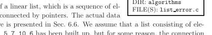

图 4.1 一个由五个元素组成的链表，包含整数 3、5、7、10 和 6。该链表由指针 `list` 表示，指向第一个元素。每个元素包含一个指向其后继元素的指针（图中用箭头表示），最后一个元素除外，它包含一个 NULL 指针，用实心圆表示。由于程序中的错误，第二个元素到其后继元素的连接丢失了。

当程序现在尝试在第三个元素之后插入一个新元素时，它将无法工作，参见 `list_error.c`。我们现在使用调试器来调查这种情况。为此，将在主程序中调用相应函数之前设置一个断点，然后启动程序：

```
break 42
Breakpoint 1 at 0x4007c0: file list_error.c, line 42.
(gdb) run
Starting program: list_error
Breakpoint 1, main (argc=1, argv=0x7fffffffdcf8) at list_error.c:42
42 list = insert_element(list, elem3, elem2);
```

现在，例如，可以检查变量 `list` 的内容：

```
(gdb) print list
$1 = (elem_t *) 0x601030
```

这个信息并不是特别有用。当使用指针时，最好查看指针所指向的内存内容：

```
(gdb) print *list
$2 = {info = 3, next = 0x601010}
```

你甚至可以通过元素的 `next` 字段访问下一个（或更远的）元素：

```
(gdb) print *list->next
$3 = {info = 5, next = 0x0}
```

在这里，你可以看到链表没有继续下去，因此你更清楚需要查找哪种错误。注意，如前所述，如果程序中包含用于打印复杂数据结构的函数，这非常有用，你可以在 gdb 中使用它们，例如：

```
(gdb) call print_list(list)
3 5
```

几乎关于被调试程序的任何类型信息都可以通过 `info` 命令获得，前面已经介绍过用 `info break` 来显示断点。例如，`info registers` 显示处理器所有整数寄存器的内容，而 `info float` 对浮点寄存器做同样的事情。命令 `info variables` 显示所有已知符号的长列表，`info types` 显示所有类型的列表，`info program` 显示当前执行状态。还有更多的 `info` 命令，参见 `help info`。本节中解释的命令足以处理大多数标准调试任务。请注意，gdb 提供了许多特殊命令，请参阅文档 [Loukides and Oram (1996)]。

## 4.2 ddd

有些用户可能觉得图形用户界面更方便。因此，存在一个 gdb 的图形前端：数据展示调试器（data display debugger，ddd）。在 UNIX 操作系统上，只需输入 `ddd` 即可调用（选项参见 man 页面）。然后会弹出一个漂亮的窗口，见图 4.2。窗口的下半部分是一个普通的 gdb 界面，还有几个其他窗口可用。通过输入 `file <程序名>` 可以将程序加载到调试器中。然后源代码会显示在调试器的主窗口中。所有 gdb 命令都可用，其中最重要的命令可以通过鼠标在菜单或按钮中输入。例如，要设置断点，只需将光标放在 ddd 主窗口中的源代码行上，然后点击断点按钮即可。一个很好的功能是，将鼠标移动到变量上时会显示其内容。更多详细信息，请查阅 ddd 的在线帮助。

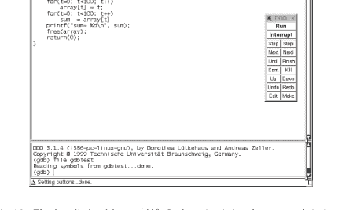

图 4.2 数据展示调试器（ddd）。主窗口中显示源代码。可以通过鼠标调用命令，也可以在窗口的下半部分输入命令。

## 4.3 内存检查器

大多数程序错误是通过系统地运行程序并与预期结果进行交叉检查而发现的。但其他错误似乎以相当不规则和不可预测的方式出现。有时程序运行没有问题，有时却会在代码中相当令人费解的位置因“段错误”（Segmentation fault）而崩溃。很多时候，糟糕的内存管理是导致这种行为的原因。写入超出数组边界、读取未初始化的内存位置或访问已释放的数据，是这类错误中最常见的。由于操作系统在每次运行程序时以不同的方式组织内存，因此这些错误是否会出现是相当不可预测的。此外，很难追踪它们，因为这类错误的效果大多数时候是在与错误发生位置不同的程序位置显现出来的。

作为示例，我们考虑程序写入超出数组边界的情况。这个数组存储在称为堆的内存区域中，所有分配的内存都来自该区域。如果在数组之后的位置存储了另一个变量，在这种情况下它可能会被覆盖。因此，下次读取该变量时，错误就会显现出来。另一方面，如果数组后面的内存块未被使用，程序这一次可能会毫无问题地运行。不幸的是，程序员无法直接控制内存管理。

2 不要与第 6.7.1 节中介绍的数据结构“堆”混淆。

为了检测此类讨厌的错误，可以利用内存检查器。这里考虑使用 valgrind，它是一个非常方便且免费可用的工具。它可以在 UNIX 下运行，只需在程序的调用序列前面加上 `valgrind` 即可。不需要特殊的编译命令或库。你甚至可以调试标准程序，比如 `ls`，试试 `valgrind ls`。

作为示例，我们考虑第 4.1 节中的程序，并稍作修改：为数组分配的内存块现在稍短（长度为 99 而不是 100）；

| 获取源代码 |
| --- |
| 目录：`debugging`<br>文件：`memerror1.c` |

```c
 1 #include <stdio.h>
 2 #include <stdlib.h>
 3
 4 int main(int argc, char *argv[])
 5 {
 6     int t, *array, sum = 0;
 7
 8     array = (int *) malloc (99*sizeof(int));
 9     for(t=0; t<100; t++)
10         array[t] = t;
11     for(t=0; t<100; t++)
12         sum += array[t];
13     printf("sum= %d\n", sum);
14     free(array);
15     return(0);
16 }
```

程序通过以下方式编译：

```
cc -o memerror1 memerror1.c -g
```

我们加上 `-g` 进行编译，因为内存检查器要告诉我们错误出现在哪里，并且在第二次运行中，如果出现错误，我们希望自动将控制权转移到调试器。

运行程序会产生以下输出，程序正常终止：

```
sum= 4950
```

结果是正确的，一切似乎都很好。然而，数组被使用超出了其分配的区域。这可以通过在程序之外调用 valgrind 来看到：

```
 1 [hartmann@comphy01 debugging]$ valgrind memerror1
 2 Memcheck, a memory error detector.
 3 Copyright (C) 2002-2005, and GNU GPL'd, by Julian Seward et al.
 4 Using LibVEX rev 1575, a library for dynamic binary translation.
 5 Copyright (C) 2004-2005, and GNU GPL'd, by OpenWorks LLP.
 6 Using valgrind-3.1.1, a dynamic binary instrumentation framework.
 7 Copyright (C) 2000-2005, and GNU GPL'd, by Julian Seward et al.
 8 For more details, rerun with: -v
 9
10 Invalid write of size 4
11    at 0x804823: main (memerror1.c:10)
12 Address 0x402A1B4 is 0 bytes after a block of size 396 alloc'd
13    at 0x404405: malloc (vg_replace_malloc.c:149)
14    by 0x80483FF: main (memerror1.c:8)
15
```


感兴趣。请注意，`time`（GNU 版本）可能会输出有关进程的其他非计时信息，例如使用的内存量和文件 I/O 操作次数。可以通过 `-f` 选项后跟一个格式字符串来指定这些以及许多其他输出选项，该格式字符串与 `printf` 的格式字符串非常相似。更多详细信息请参阅手册页。

尽管总体计时行为已经很有趣，但如果能够了解程序将大部分 CPU 时间花在了哪里，就更好了。这样一来，程序优化工作便可以集中在程序中最关键的部分。要识别这些部分，可以使用分析器（profiler）。它基本上会测量每个函数占用的 CPU 时间。请注意，第 4.3 节介绍的 valgrind 也具备性能分析功能。这里将介绍 `gprof` 工具。

为了理解 `gprof` 的工作方式，下面考虑一个简单而短小的程序。

| 获取源代码 |
|---|
| 目录：debugging |
| 文件：gproftest.c |

该程序针对数字数组 a[0] . . . a[n-1] 计算两个矩阵 sum[][] 和 prod[][]，其中 sum[i][j] 包含 ∑_{k=i}^{j} a[k]，而 prod[i][j] 包含 ∏_{k=i}^{j} a[k]。请注意，这里只是为了在保持示例程序简短的同时，让我们能够对 `gprof` 进行有趣的分析，才采用了这种非常耗时的实现方式。³ 程序由两个函数 `calc_sum()` 和 `calc_prod()` 组成，它们负责主要工作。这两个函数都接收数字数组和两个索引作为参数，这两个索引用于标识要计算返回值的子序列。两个函数都返回计算得到的值。这些函数的 C 源代码如下。

现在可以像往常一样运行该程序，并将 n 作为参数传入。除了正常输出之外，它还会生成一个配置文件 `gmon.out`，其中包含执行过程的运行时统计信息。如果希望使用不同的配置文件名（例如，在收集多个配置文件时），可以在程序执行完毕后重命名该文件。分析所产生的运行时开销通常几乎无法测量。

可以通过调用 `gprof` 获取人类可读的运行时间分析结果：第一个参数是可执行文件的名称（默认为 `a.out`），第二个参数是配置文件的名称（默认为 `gmon.out`）。`gprof` 支持多个选项，但基本功能并不需要这些选项。有关这些选项的信息，可以阅读 `gprof` 的手册页，也就是在 UNIX 系统上通过 `man gprof` 查看。对于上面所示的示例程序，可以通过以下命令获得运行时间分析：

```
`gprof gprof_test gmon.out`
```

运行时间分析会写入 stdout。默认输出的开头如下所示（运行程序时将数组大小设为 n=1000）：

平坦分析：

每个采样点代表 0.01 秒。

| % 时间 | 累计秒数 | 自身秒数 | 调用次数 | 每次调用自身秒数 | 每次调用总秒数 | 名称 |
| ---: | ---: | ---: | ---: | ---: | ---: | :--- |
| 93.16 | 24.59 | 24.59 | 500500 | 0.00 | 0.00 | calc_prod |
| 6.74 | 26.36 | 1.78 | 501500 | 0.00 | 0.00 | calc_sum |
| 0.09 | 26.39 | 0.03 | 1 | 0.03 | 26.39 | all1 |

“平坦分析”（默认显示，也可以通过选项 `-p` 显示；通过 `-P` 或 `--no-flat-profile` 禁用）基本上说明了最后一列（名称）中列出的每个函数消耗了多少运行时间。第一列（% 时间）说明函数占总运行时间的百分比，第三列（自身秒数）则包含测得的函数自身消耗的运行时间（以秒为单位）。请注意，这个数值不包含该函数调用其他函数（即其后代函数）所使用的运行时间。平坦分析表按照第三列排序。第二列（累计秒数）包含根据第三列得到的累计运行时间。第四列（调用次数）给出了每个函数被调用的次数。在上面的示例中，`calc_prod()` 和 `calc_sum()` 的调用次数几乎相同（`calc_sum()` 在主程序中有一些额外调用），但 `calc_prod()` 所花费的运行时间（15.08 秒）远大于 `calc_sum()` 所花费的时间（1.15 秒）。原因在于，计算两个数的乘积比计算它们的和需要更多 CPU 周期。第五列（每次调用自身秒数）包含函数每次调用的平均秒数，即第三列的值除以第四列的值。第六列（每次调用总秒数）表示函数及其后代函数所花费的平均时间。因此，由于 `all1()` 基本上包含对 `calc_sum()` 和 `calc_prod()` 的所有调用，`all1()` 的值几乎包含完整的运行时间。

`gprof` 的输出在平坦分析之后会包含对各列的简短说明，其内容与刚才的解释等价。可以使用选项 `-b` 或 `--brief` 禁止输出这部分内容。

接下来，输出中会包含调用图（默认包含，也可以通过 `-q` 或 `--no-graph` 选项控制）。这部分输出会针对每个函数列出它是由哪些函数调用的，以及它自己调用了哪些函数。对于我们的示例，输出如下：

## 调用图

```
index % time self children called name
<spontaneous>
[1] 100.0 0.00 26.39 main [1]
0.03 26.38 1/1 all1 [2]
0.00 0.00 1000/501500 calc_sum [4]
----------------------------------------
0.03 26.36 1/1 main [1]
[2] 100.0 0.03 26.36 1 all1 [2]
24.59 0.00 500500/500500 calc_prod [3]
1.78 0.00 500500/501500 calc_sum [4]
----------------------------------------
24.59 0.00 500500/500500 all1 [2]
[3] 93.2 24.59 0.00 500500 calc_prod [3]
----------------------------------------
0.00 0.00 1000/501500 main [1]
1.78 0.00 500500/501500 all1 [2]
[4] 6.7 1.78 0.00 501500 calc_sum [4]
----------------------------------------
```

按函数名称索引

+   [2] all1
+   [3] calc_prod
+   [4] calc_sum

`n_tot` 值。对于每个子函数，第五列显示该子函数被当前函数调用的次数，同时还给出 `f_tot`。例如，`calc_sum()` 被调用了 501500 次，其中 1000 次来自 `main()`，50500 次来自 `all1()`。

另一种输出形式是带注释的代码清单。它会显示程序的源代码。在每个函数的第一行旁边，会打印该函数被调用的次数。为此，除了使用 `-g` 选项进行编译外，还必须使用 `-A` 或 `--annotated-source` 选项调用 `gprof`。`gprof` 的其他输出格式将在其手册页中讨论。

如果程序包含递归调用，`gprof` 的输出会略有不同。这里考虑一个用于计算总和的递归版本；与动态规划方法相比，它同样是人为设计得较慢的版本。该函数如下：

```
1 double calc_sum_rec(double *a, int i, int j)
2 {
3     if(i==j)
4         return(a[i]);
5     else
6         return(a[i]+calc_sum_rec(a,i+1,j));
7 }
```

将 `main()` 和 `all1()` 中对 `calc_sum()` 的调用替换为对 `calc_sum_rec()` 的调用，然后再次针对 n=1000 运行程序，得到的平坦分析如下：

| % 时间 | 累计秒数 | 自身秒数 | 调用次数 | 每次调用自身秒数 | 每次调用总秒数 | 名称 |
|---|---|---|---|---|---|
| 84.87 | 24.24 | 24.24 | 500500 | 0.00 | 0.00 | calc_prod |
| 14.99 | 28.52 | 4.28 | 501500 | 0.00 | 0.00 | calc_sum_rec |
| 0.14 | 28.56 | 0.04 | 1 | 0.04 | 28.55 | all1 |

`calc_prod()` 中花费的运行时间基本没有变化。请注意，即使是运行完全相同的程序，每次运行之间也总会观察到一些小幅波动。原因在于，进程的运行时间取决于运行环境。一个特别重要的因素是：内存位置能够在速度快但容量较小的片上高速缓存中找到的频率，以及必须访问速度相对较慢的主存储器的频率。

由于递归产生的调用次数大幅增加，`calc_sum_rec()` 所花费的运行时间远大于 `calc_sum()`。请注意，在第四列（调用次数）中只列出了非递归调用。


递归的影响可以从调用图中更好地看出，其中 calc_sum_rec() 的条目如下所示：

```
---------------------------------
                167166000                calc_sum_rec [4]
0.01    0.00    1000/501500              main [1]
4.27    0.00    500500/501500            all1 [2]
[4] 15.0  4.28    0.00    501500+167166000  calc_sum_rec [4]
                167166000                calc_sum_rec [4]
---------------------------------
```

递归调用次数在这里出现了三次：在第一行，calc_sum_rec() 是它自己的父级；在第四行，同时显示了非递归调用次数和递归调用次数（后者位于 + 符号之后）；在第五行，calc_sum_rec() 显示为子级。对于像 fA() 调用 fB() 且 fB() 调用 fA() 这样更复杂的递归调用结构，这些数字在不同条目中可能不同。

在某些情况下，程序只有部分被（完全）分析。这可能发生在最终程序由多个目标代码文件链接而成，而其中一些文件未使用 -pg 选项编译时。此外，可以显式选择某些函数进行分析。多次使用选项 -p 和/或 -q 后跟函数名，将只显示涉及所列函数的条目。

最后，请注意，您可以在程序中加入自己的计时测量。这对于在所有模拟过程中测量程序某些关键部分的计时并将计时结果包含在标准日志文件中非常有用。为此，可以使用 C 标准库函数 times，声明在 sys/times.h 中。它以时钟滴答为单位测量时间，因此具有最高的可能分辨率。有关该函数用法的更多信息，可通过在 shell 中输入 "man 2 times" 在 UNIX 手册页中找到。

# 第 5 章 面向对象软件开发

近年来，像 C++、Smalltalk 或 Eiffel 这样的 *面向对象* 编程语言变得非常流行。这些编程语言通常用于实现以面向对象方式设计的程序。但是，*使用面向对象语言* 和以面向对象风格设计模拟程序并不一定相同。例如，即使使用传统的 *过程式* 编程语言如 C、Pascal 或 Fortran，也可以通过应用面向对象方法来设置整个项目。总的来说，采用面向对象的观点有助于问题的分析和合适程序的开发。

例如，关于面向对象软件开发的介绍可以在 Refs. [Rumbaugh et al. (1991); Johnsonbaugh and Kalin (1994); Skansholm (1997)] 中找到。本章的第一部分介绍了面向对象概念。

如前所述，使用过程式语言实现面向对象设计仍然是可能的。这在第 5.2 节中有所体现，其中 *直方图*（见第 8.3.3 节）是用 C 实现的。

在本章的最后一节中，直方图再次被实现，但现在使用 C++。本节也作为 C++ 的介绍，C++ 基本上是 C 的面向对象扩展。此外，C++ 提供了 *模板*，允许为未指定的、即任意数据类型实现算法。这将在另一章中介绍（见第 7.2 节）。总的来说，C++ 的优点是它帮助你以对象为单位组织程序，但仍然具有以非面向对象方式进行操作的灵活性。

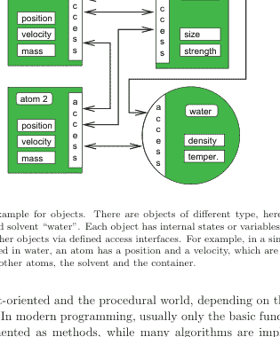

图 5.1 对象的示例。这里有不同类型的对象，“atoms”、“containers” 和溶剂 “water”。每个对象都有内部状态或变量，并通过定义的访问接口与其他对象交互。例如，在蛋白质溶于水的模拟中，一个原子具有位置和速度，它们会受到来自其他原子、溶剂和容器的力的影响。

面向对象和过程式世界取决于实际问题。在现代编程中，通常只有基本功能被实现为方法，而许多算法则通过标准子程序实现。

- **数据封装**

    使用计算机时，您不关心实现。当您在键盘上按下键时，您希望在屏幕上看到结果。您不关心按键如何将击键转换为电信号，该信号如何发送到芯片的输入端口，算法如何处理信号等等。同样，面向对象编程的一个主要原则是隐藏对象的实际实现。对它们的访问只能通过给定的接口，即通过方法进行。内部数据结构被隐藏，在 C++ 中这称为 **private**。数据封装有几个优点：

    - 您不必记住对象的实现。

      在以后使用它们时，它们只表现为一个黑盒子实现

带电原子也是如此。对象的层次组织形式类似的另一种方式是反向进行的：更高级别的对象可以用较低级别的对象来定义。这称为组合 [Meyers (2005)]。例如，一本书由许多属于类 "page" 的对象组成。每个页面可以被视为许多 "letter" 对象的集合。对于上面的物理示例，在建模化学系统时，您可以将 "atoms" 作为基本对象并用它们来定义 "molecules"。再上一层就是 "system" 对象，它是分子的集合。

- **函数/运算符重载**

    方法（即 C++ 中的函数）对低级类的继承是运算符重载的一个例子。它只是意味着您可以为不同类拥有同名的方法，有时相同的代码适用于多个类。这也可能发生在没有继承关系的类上。例如，您可以定义如何添加整数、实数、复数或更大的对象如列表、图形或文档。在 C 或 Pascal 等语言中，您可以定义用于添加数字的子程序和用于添加图形的子程序，但它们必须有不同的名称。在 C++ 中，您可以为许多不同的类定义运算符 "+"（见第 5.3 节的一个示例）。因此，面向对象语言的运算符重载机制只是一个使代码更易读、结构更清晰的工具。

- **软件重用**

    一旦您有了如何建造椅子的想法，您就可以多次建造。因为您有蓝图、工具和经验，建造另一把椅子是一项简单的任务。

    这对于构建程序也是如此：数据封装和继承都促进了软件的重用。例如，一旦您编写了用于处理列表的类，您也可以将列表包含在其他程序中。这很容易，因为以后您不必关心实现。采用灵活方式设计的类可以在实现新软件项目时节省大量时间。

## 5.2 使用 C 的示例

如前所述，以面向对象的方式编程时，您不一定必须使用面向对象语言。它们对于实现确实有帮助，并且 resulting 程序看起来会更优雅、更清晰一些，但您也可以使用 C 等语言编程所有内容。在 C 中，可以非常容易地实现面向对象的风格。作为示例，下面概述了实现直方图的“class” histo。直方图几乎是所有类型的计算机模拟所需的评估和分析工具。正式地，直方图在第 8.3.3 节中介绍。

首先，您必须考虑想要存储的数据。直方图本身是 bins 的数组表。每个 bin 只是计数落入对应直方图范围的小区间内的事件数。为了实现高度灵活性，范围和 bins 的数量必须是可变的。这里为简单起见，假设所有 bins 宽度相同。因此，每个 bin 的宽度 delta 可以很容易计算。为了方便，delta 也被存储。为了计数超出表范围的事件数，引入了 low 和 high 条目。此外，像均值和方差这样的统计量应该能够快速且高精度地获得。因此，分布的几个累积矩 sum[] 也被单独存储。这里，矩的数量 _HISTO_NOM_ 被定义为宏，将此宏转换为变量是直接的。总的来说，这导致了以下 C 数据结构：

| 获取源代码 |
|---|
| 目录: oop |
| 文件: histo.h |

```c
#define _HISTO_NOM_ 9  /* No. of (statistical) moments */

typedef struct
{
    double      from, to;  /* range of histogram */
    double      delta;     /* width of bins */
    int         n_bins;    /* number of bins */
    double      *table;    /* bins */
    int         low, high; /* No. of data out of range */
    double      sum[_HISTO_NOM_]; /* sum of 1s, numbers, numbers^2 ...*/
} histo_t;
```

这里，后缀 _t 用于强调名称 histo_t 表示一个类型。bins 是 double 类型的变量，这允许更通用的应用。请注意，仍然可以从外部访问内部结构，但这不是必要的也不推荐。在 C++ 中，您可以通过声明内部变量

作为 **私有**，见下文。尽管如此，一切都将通过特殊的子程序在此完成，而无需直接访问。

首先，必须能够创建和删除直方图。函数 `histo_new()` 接收要覆盖的区间的范围 [from, to] 和箱子的数量作为参数。它返回指向新创建的直方图的指针：

| 获取源代码 |
| --- |
| 目录: oop |
| 文件: histo.c |

```c
histo_t *histo_new(double from, double to, int n_bins)
{
    histo_t *his;                /* histogram pointer */
    int t;                       /* loop counter */

    his = (histo_t *) malloc(sizeof(histo_t));
    if(his == NULL)              /* enough memory ? */
    {
        fprintf(stderr, "out of memory in histo_new()");
        exit(1);
    }

    if(to < from)                /* boundaries in wrong order ? */
    {
        double tmp;
        tmp = to; to = from; from = tmp;
        fprintf(stderr, "WARNING: exchanging from, to in histo_new()\n");
    }
    his->from = from;
    his->to = to;
    if(n_bins <= 0)              /* number of bins should be positive */
    {
        n_bins = 10;
        fprintf(stderr, "WARNING: setting n_bins=10 in histo_new()\n");
    }
    his->delta = (to-from)/(double) n_bins;      /* setup */
    his->n_bins = n_bins;
    his->low = 0;
    his->high = 0;
    for(t=0; t< _HISTO_NOM_ ; t++)   /* init. accumulated moments */
        his->sum[t] = 0.0;
    his->table = (double *) malloc(n_bins*sizeof(double));
    if(his->table == NULL)    /* enough memory ? */
    {
        fprintf(stderr, "out of memory in histo_new()");
        exit(1);
    }
    else
    {
        for(t=0; t<n_bins; t++)    /* initialize bins */
            his->table[t] = 0;
        return(his);
    }
}
```

主数据结构在第 6 行分配，而用于矩的数组在第 31 行分配。包含了一些简单的错误检查：验证主数据结构（第 7-11 行）和矩数组（第 32-36 行）是否有足够的内存可用。此外，还验证了 from 是否小于 to（第 12-17 行）以及箱子数量是否大于零（第 20-24 行）。直方图在第 18-19 行、第 25-28 行和第 37-39 行中初始化。

函数 histo_delete() 接收指向直方图的指针，释放与直方图关联的内存且不返回任何内容：

```c
void histo_delete(histo_t *his)
{
    free(his->table);
    free(his);
}
```

所有直方图对象都是通过调用 histo_new() 动态创建的，这相当于在 C++ 中调用构造函数或 new，如第 5.3 节所述。对象通过指针寻址。每当调用与 histo 类对象相关的函数时，第一个参数始终是指向相应直方图的指针。当避免直接访问结构时，使用 C 的实现与 C++ 或其他面向对象语言完全等价。继承可以通过在其他类型定义中包含指向 histo_t 对象的指针来实现。当创建这些更高级别的对象时，必须包含对 histo_new() 的调用，而对 histo_delete() 的调用（相当于 C++ 中的析构函数）对于正确删除更复杂的对象是必要的。

作为最后的示例，介绍了将元素插入表和计算均值的函数。很容易推断出如何实现其他函数，例如计算方差/高阶矩或将直方图打印为概率密度函数（见练习 (1)）。

```c
void histo_insert(histo_t *his, double number)
{
    int t;                 /* counter to access moments */
    double value;          /* auxiliary variable */
    value = 1.0;
    for(t=0; t< _HISTO_NOM_; t++)
    {
        his->sum[t] += value;   /* raw statistics */
        value *= number;
    }
    if(number < his->from)      /* insert into histogram */
        his->low++;
    else if(number >= his->to)
        his->high++;
    else
        his->table[(int) floor( (number - his->from) / his->delta)]++;
}
```

```c
double histo_mean(histo_t *his)
{
    if(his->sum[0] == 0)
        return(0.0);
    else
        return(his->sum[1] / his->sum[0]);
}
```

## 5.3 C++ 简介及示例

C++ 语言从技术上讲是 C 的面向对象扩展。它允许复杂的面向对象实现，但如果你愿意，也可以编写纯 C 程序。例如，每个可执行文件必须包含 main() 函数，就像在 C 中一样。本节再次介绍直方图的实现，但现在使用 C++。这也作为对该编程语言的介绍。详情请参阅文献，例如标准参考 [Stroustrup, 2000]。

C++ 最基本的概念是类。类是对属于此类对象的元素数据的描述，以及可用于访问和操作对象的函数。这些函数称为成员函数。C++ 中的头文件（.h 或 .hpp）通常² 包含类声明，而代码文件（.cpp）通常包含成员函数的代码。一个可能的直方图类声明如下：

| 获取源代码 |
| --- |
| 目录: oop |
| 文件: histo++.h |

```cpp
#include <iostream>

class Histo
{
private:
    double      from, to;    // range of histogram
    double      delta;       // width of bins
    int         low, high;   // out of range numbers
    int         n_bins;      // number of bins
    double      *table;      // bins

public:
    Histo(double from, double to, int n_bins);   // constructor
    Histo();                                      // simple constructor
    Histo(const Histo& h);                        // copy constructor
    virtual ~Histo();                             // destructor
    void insert(double number);                   // insert data point
    Histo operator=(const Histo& h);              // assignment operator

    friend std::ostream& operator<< (std::ostream& os, const Histo& h);
};
```

类似于 C 头文件 stdio.h，头文件 iostream 包含用于输入/输出的标准类型。在第 1 行，包含了此头文件。请注意，在现代 C++ 中，标准系统头文件不再使用 .h 后缀。

主要部分是类 Histo 的声明。Histo 对象的全部数据成员列在第 6–10 行。这类似于 C 中结构的成员。³ 这里，仅包含用于箱子和直方图范围之外的数据的成员。用于矩的数据成员，在第 5.2 节的 histo_t 类型中存在，被放入一个继承的类中，见下文。请注意，除了可能跨越多行的 /* ... */ 注释外，C++ 中还有 // ... 样式的注释，其延伸至当前行的末尾。第 6–10 行以

```cpp
1  Histo::Histo(double h_from, double h_to, int h_n_bins)
2  {
3    from = h_from;              // store parameters
4    if(to < from)               // boundaries in wrong order ?
5    {
6      double tmp;
7      tmp = to; to = from; from = tmp;
8      fprintf(stderr, "WARNING: exchanging from, to in Histo()\n");
9    }
10   low = 0;
11   high = 0;
12   n_bins = h_n_bins;
13   delta = (to-from)/n_bins;   // calculate bin width
14   table = new double[n_bins]; // get memory for bins;
15
16   for(int t=0; t<n_bins; t++) // Initialize bins
17     table[t] = 0;
18 }
```

请注意，在函数声明（第 1 行）中，函数名前面加上类名后跟双冒号。这里必须出现，因为不同的类可能具有相同名称的成员，因此必须给出类名以区分它们。^5 数据成员 from 和 to 在第 3 行初始化。在成员函数内部，数据成员可以直接访问，就像函数中的局部变量一样。在第 4-9 行中，假设 from < to 成立。在第 10-13 行，初始化了额外的元素。在第 14 行，箱子表被动态分配。在 C++ 中，这是通过 new 命令完成的，其作用类似于 C 中的 malloc()。^6 在 new 命令之后，写入数组的类型（此处为 double）并在 [ ] 括号中说明请求的元素的数量。如果省略括号，则只生成一个单一变量，而不是数组。最后（第 16-17 行），箱子被初始化。

如果你想定义类 Histo 的对象 his，并给定参数值，你必须使用

```cpp
Histo his(0.0, 10, 100);
```

这创建了一个具有 100 个箱子的直方图 [0.0, 0.1), [0.1, 0.2), ..., [9.9, 10)。这看起来像 C 中的变量定义，但对象名后跟

^5 原则上，你可以将一个类的构造函数的名称用作另一个类的数据成员名称，而不会冲突。

^6 你也可以在 C++ 中使用 malloc()，如果你愿意的话。更复杂的是使用模板向量 std::vector<>，见第 7.2 节。


由括号中构造函数的参数给出。如果你偷懒，不想声明参数，可以使用标准构造函数，如下所示：

```cpp
1  Histo::Histo()
2  {
3      Histo(0, 1, 10);   // Use standard values
4  }
```

这里可以看到，与数据成员一样，成员函数可以像局部变量一样，在（其他或同一个）成员函数内部直接使用/调用。如果使用标准构造函数定义对象 his2，它类似于 C 语言中的变量定义，例如：⁷

```cpp
Histo his2;
```

⁷你也可以包含空括号，明确表示没有传递任何参数。

第三种构造函数是所谓的复制构造函数。它用于通过从另一个对象复制来初始化对象时：

```cpp
Histo his3 = his;
```

原则上，你不必定义自己的复制构造函数。如果没有给出显式复制构造函数，新对象（his3）只是给定对象（his）的逐成员复制。但这意味着 his3 中的指针元素 table 指向与 his 中完全相同的内存区域。这通常不是你想要的。相反，人们希望 his3 拥有自己的 table，但其中填入与 his 相同的数字。这可以通过以下显式复制构造函数实现：

```cpp
1  Histo::Histo(const Histo &h)
2  {
3      from = h.from;              // store parameters
4      to = h.to;
5      low = h.low;
6      high = h.high;
7      n_bins = h.n_bins;
8      delta = h.delta;            // bin width
9      table = new double[n_bins]; // get memory for bins;
10
11     for(int t=0; t<n_bins; t++)  // copy bin entries
12         table[t] = h.table[t];
13 }
```

它看起来与第一个构造函数非常相似，但有一些差异。数据成员的初始值取自传递给构造函数的对象 h。形式上，它被写为参数，尽管在使用它时，数据来源对象写在 = 赋值运算符之后。h 的变量声明前面有 & 字符，这意味着变量通过引用传递。这意味着只传递地址，就好像对象作为指针传递一样。不过，通过引用传递时，可以直接访问对象，而不像指针那样使用 * 运算符。注意，对象 h 的数据元素像结构体中的元素一样被访问。这里允许这样做，因为复制构造函数是该类的成员函数，尽管被访问的对象不同于调用该成员函数的对象。

在任何地方创建的对象，在使用后都必须删除。在第 5.2 节给出的 C 实现中，这是由函数 histo_delete() 完成的。在 C++ 中，删除对象是析构函数的任务，析构函数始终是一个成员函数，其名称为类名前加 ~ 字符。在这里，析构函数必须释放 bins 的 table：

```cpp
Histo::~Histo()
{
    delete[] table;
}
```

第 3 行中 delete 的效果等价于 C 中的函数 free()。如果删除的是数组，如这里所示，必须在 delete 命令后写上 [] 括号。

接下来考虑用于插入数字的成员函数 insert()。它以要插入的数字作为参数。这里，就像普通函数一样，应声明返回类型，在本例中为 void。注意，插入数字的直方图并未作为参数显式传递，因为调用成员函数的对象可在成员函数内部通过“局部”变量访问：

```cpp
void Histo::insert(double number)
{
    if(number < from)      // insert into histogram
        low++;
    else if (number >= to)
        high++;
    else
        table[(int) floor( (number - from) / delta)]++;
}
```

要打印直方图，你可以定义另一个成员函数，例如使用 printf() 函数打印数组 table 的内容。这里展示另一种 C++ 特有的解决方案。在 C++ 中，可以通过流进行打印。一个类似于 C 中 stdout 的标准输出流是 std::cout。你可以通过以下方式将字符串 "number: " 写入标准输出，随后是变量 num 的内容，再随后是一个换行：

```cpp
std::cout << "number: " << num << std::endl;
```

这等价于 printf("number: %d\n", num)。因此，运算符 << 用于输出。要打印的多个对象可以通过多次出现 << 来分隔。注意，std::cout 属于命名空间 std。因此，std:: 并不指代类名。C++ 使用命名空间来允许不同对象在不同命名空间中具有完全相同的名称。标准命名空间 std 包含许多常用对象。如果你偷懒，可以在文件顶部的所有 #include 命令下方写上 using namespace std。现在你可以写 cout 而不是 std::cout，但前提是不存在其他名为 cout 的对象、变量或类型。最后，std::endl 是行尾标记，等价于 "\n"。

如果你想以与标准变量相同的方式将直方图写入 std::cout，例如通过使用 << 运算符。在这种情况下，必须相应地定义运算符 <<。其工作方式如下。该运算符获取要打印的流（os）和 Histo 对象（h）作为参数，并再次返回该流。再次注意，<< 可以访问 h，因为该运算符在头文件中被声明为友元。

```cpp
std::ostream& operator << (std::ostream& os, const Histo& h)
{
    os << "# below:" << h.from << std::endl;
    os << "# above: " << h.to << std::endl;
    os << "# from: " << h.from << " delta: " << h.delta;
    os << "# nbins: " << h.n_bins << std::endl;
    for(int i=0; i<h.n_bins; i++)
        os << i << " " << h.table[i] << std::endl;
    return(os);
}
```

赋值运算符 = 也常常为 C++ 类显式实现。如果没有给出实现，对象会按位复制，这可能并不理想，类似于复制构造函数的情况。对于 Histo，赋值运算符如下所示：

```cpp
Histo& Histo::operator=(const Histo &h)
{
    if(this != &h)            // no self assignment
    {
        from = h.from;        // store parameters
        to = h.to;
        n_bins = h.n_bins;
        delta = h.delta;      // bin width
        delete[] table;       // delete old table
        table = new double[n_bins];   // get memory for bins;
        low = h.low;
        high = h.high;
        for(int t=0; t<n_bins; t++)   // copy bin entries
            table[t] = h.table[t];
    }
    return (*this);
}
```

该实现看起来与复制构造函数非常相似。⁸ 注意，应禁止将对象赋值给“自身”。这通过局部变量 this 在第 3 行得到保证，该变量指向所有成员内部

⁸因此，可以使用一个私有函数 do_copying()，它在需要的地方执行复制。

注意，Histo 的成员函数 insert() 可以直接调用。在这种情况下，它也会自动针对当前对象调用，也就是调用 Histo::insert() 的对象。

练习 (2) 要求你实现一个简单的成员函数 Histo::mean()，它返回直方图中存储数字的均值。在本书范围内，不可能超出 C++ 基础知识。更多细节可在 C++ 文献 [Stroustrup (2000)] 中找到，特别是关于模板的内容，模板是无需指定参数类型的函数或类。这允许实现可处理多种类型的对象。特别重要的是容器类，它们可以存储“任何东西”。一些容器类实现在标准模板库中，第 7.2 节将介绍该库。


## 练习

(解答：可从 http://www.worldscientific.com/t/9019-supp 下载)

### (1) 直方图概率密度函数

设计、实现并测试一个函数，该函数对于直方图 `his` 将写入文件：

- 所有矩的值（前面加上 `#`）
- `his->low`、`his->high` 中离群值的数量（前面加上 `#`）
- 直方图作为概率密度函数，参见第 8.3.3 节第 293 页。

解决方案源代码  
DIR: oop  
FILE(S): main_histo.c  
histo_fprint_pdf.c

函数原型如下：

```c
/* *************** histo_fprint_pdf() *****************/
/** Prints moments of histogram and bin counts for    **/
/** outliers to file.                                 **/
/** Prints also histogram as pdf                     **/
/** Prints also Gaussian standard error bars of      **/
/** bin counts (normalized)                          **/
/** PARAMETERS: (*)= return-parameter                **/
/** file: file pointer                               **/
/** histo: histogram                                 **/
/** RETURNS:                                         **/
/**    (nothing)                                     **/
/*****************************************************/
void histo_fprint_pdf(FILE *file, histo_t *his)
```

备注：为简化起见，您可以包含箱条目的标准“高斯”误差条，参见式 (8.65)。

如果使用 `-DSOLUTION` 编译，您可以使用 `main_histo.c` 中提供的 `main()` 函数来测试您的函数。

### (2) C++

解决方案源代码  
DIR: oop  
FILE(S): histoSOL.cpp

设计、实现并测试类 `HistoM` 的拷贝构造函数。以 `Histo` 的拷贝构造函数（参见第 149 页）和 `HistoM` 的构造函数（参见第 153 页）为例。

函数原型如下：

## 6.1 𝒪 符号

本章最后几节中引入了一些复杂的数据结构。它们在大多数情况下允许将模拟数据以更适合给定问题的方式组织起来，并允许更快地处理。在此，我们介绍 *列表*、*树* 和 *图*，以及创建、修改和使用的一些示例算法。

请注意，正如本书一贯所述，只能给出一些入门示例（尽管涵盖了很大一部分基本应用）。重要的是要记住，你必须学会以数据结构为思维方式，这使你能够寻找高效的实现。一旦你积累了一些经验——在你的脑海中形成一种示例库——这对你来说会变得越来越容易。事实上，还有许多更多的数据结构，通常基于此处介绍的基本数据结构，以及大量作用于这些数据结构的算法。如果您想了解更多，您应该查阅更专业的教科书，如 Refs. [Aho et al. (1974); Cormen et al. (2001); Sedgewick (1990)]。

对于任意算法，为了描述合适选择的衡量问题规模的量 `n` 与运行时间 `T` 之间的依赖关系，使用 𝒪 符号。

### 定义 6.1

设 `T, g : ℕ → ℝ` 为两个实值函数。我们写 `T(n) = 𝒪(g(n))`，如果存在两个正数 `c₁, c₂ > 0` 和一个整数 `n₀`，使得 `c₁g(n) ≤ T(n) ≤ c₂g(n)` 对所有 `n > n₀` 成立。我们说，`T(n)` 是 `g(n)` 的阶。

由于使用 𝒪 符号时忽略常数，因此人们谈论 *渐近* 运行时间或 *时间复杂度*。在理论计算机科学中，通常会给出大小为 `n` 的所有可能输入的上界，即 *最坏情况运行时间*。

作为示例，我们来看一个对 `n` 个数求和的函数：

“求和算法”需要 `C × n`，即 `O(n)`。请注意，在这种情况下，运行时间基本上不依赖于被求和的实际数字，即最坏情况运行时间等于典型运行时间。尽管如此，存在运行时间可能严重依赖于给定实际问题实例的例子。

表 6.1 中列出了在算法上下文中通常出现的运行时间阶，并附有问题规模为 10、100 和 1000 时的结果值。

表 6.1. 函数随输入规模 `n` 的增长。

| T(n) | T(10) | T(100) | T(1000) |
|---|---:|---:|---:|
| n | 10 | 100 | 1000 |
| n log n | 10 | 200 | 3000 |
| n² | 10² | 10⁴ | 10⁶ |
| n³ | 10³ | 10⁶ | 10⁹ |
| n<sup>log n</sup> | 10 | 10⁴ | 10⁹ |
| 2ⁿ | 1024 | 1.3 × 10³⁰ | 1.1 × 10³⁰¹ |
| n! | 3.6 × 10⁶ | 10¹⁵⁸ | 4 × 10²⁵⁶⁷ |

通常如果运行时间受多项式限制，则认为问题容易；所有其他问题都被认为困难。原因可以从表中理解：即使多项式函数在较小的 `n` 时可能取更高的值，渐近上非多项式函数发散得更快。例如，让我们考虑两台计算机的相对性能，一台比另一台快两倍。在线性时间问题中，更快的计算机能够解决的问题规模是较慢计算机在相同时间内可解决问题的两倍。然而，如果运行时间随 2ⁿ 增长，与较慢的计算机相比，更快的计算机只能从 `n` 增加到 `n + 1`。我们看到，对于此类难题，更高速计算机的效用非常有限——可解问题的规模实质性增加只能通过使用更好的算法来实现。

## 6.2 迭代与递归

如果程序必须执行许多相似的任务，这可以表示为迭代，也称为循环，例如使用 C/C++ 中的 `for` 语句。有时使用递归的概念更方便，特别是如果要计算的量具有递归定义。 如果算法/函数调用自身（可能通过其他算法/函数间接调用），则称之为递归。作为一个简单的例子，我们给出一个用于计算自然数 `n > 0` 的阶乘 `n!` 的 C 函数。其递归定义为：

`n! = { 1 if n = 0 or n = 1; n × (n − 1)! otherwise }` (6.1)

该定义可以直接翻译成 C 函数：

```c
int factorial(int n)
{
    if(n <= 1)
        return(1);
    else
        return(n*factorial(n-1));
}
```

在第 3 行，测试的是 `n ≤ 1` 而不是测试 `n = 0` 或 `n = 1`。因此，可以保证算法在所有输入上都会返回结果。

| GET SOURCE CODE |
|---|
| DIR: algorithms |
| FILE(S): fac-rec.c |

对于 `n > 1`，在执行 `factorial(n)` 期间，会创建一系列嵌套的函数调用，直到函数以参数 1 被调用。对 `factorial(n)` 的调用在所有其他对 `factorial(i)`（其中 `i < n`）的调用之前开始，并在之后结束。图 6.1 中的层次结构显示了计算 `factorial(4)` 的调用。

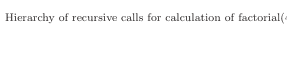

图 6.1. 计算 `factorial(4)` 的递归调用层次结构。

## 6.3 归纳学习中知识的效用

K. Branting

计算机科学系，加拿大滑铁卢大学，滑铁卢，安大略省 N2L 3G1, Canada

摘要。“混合”学习系统的首要动机是领域知识可以减少归纳学习所需的训练实例数量。然而，关于领域知识与归纳偏置之间关系的正式描述尚未提出。本文提出了一个正式的框架，用于分析归纳学习中知识的效用，该框架基于归纳偏置作为假设上的偏序的概念。为了具体说明，该框架被应用于一个联结主义学习系统。

### 6.3.1 引言

领域知识在归纳学习中的效用是一个广泛关注的问题。在许多学习任务中，可用的训练实例数量有限，而某种形式的先验知识可能是充分约束归纳的唯一手段。因此，提出了“混合”学习系统，将某种形式的领域知识与从训练实例中归纳学习相结合。许多此类系统在实验中被证明在各自领域的任务上比纯归纳系统具有更高的预测准确性（参见第 5 节）。然而，关于为什么领域知识在归纳中有用的正式解释尚不存在。

本文提出了一个分析归纳学习中领域知识效用的框架。该框架基于将归纳偏置形式化为假设上的偏序。要证明的论点是，学习系统的先验知识或偏置会影响识别目标假设所需的训练实例数量。特别是，对于一致的贝叶斯分类器这一类学习系统，可以证明其偏置在假设类上为更强排序的系统比具有较弱排序的系统需要更少的实例来识别目标假设。

为了具体化，这一偏置分析被应用于 [2] 中的“递归 sigmoid”网络，这是一种新颖的联结主义架构。递归 sigmoid 网络可以赋予假设一个具有直接联结主义解释的先验排序，并且对于此类先验排序，可以确定学习所需的实例数量的界限。这为实验中证明的初始联结主义知识的效用提供了理论基础。

本文的计划如下。第 2 节定义了本分析适用的归纳学习和归纳偏置的形式。第 3 节描述了 [2] 中的递归 sigmoid 网络。第 4 节使用第 2 节和第 3 节的框架为递归 sigmoid 网络推导出样本界限。第 5 节讨论相关和未来工作，第 6 节提出一些结论。


内容如下：

\[
T(n)=
\begin{cases}
C & (n=1)\\
C n + 2T(n/2) & (n>1)
\end{cases}
\tag{6.3}
\]

如果 \(n\) 足够大，则该递推式可由 \(T(n)=C n \log_2 n\) 求解。将解代入等式第二行即可看出这一点：

\[
\begin{aligned}
T(2n) &= C\cdot 2n + 2T(n)\\
&= C\cdot 2n + 2Cn\log_2 n\\
&= C\cdot 2n\log_2 2 + C\cdot 2n\log_2 n\\
&= C\cdot 2n\log_2(2n)
\end{aligned}
\tag{6.4}
\]

因此，排序的分治实现在渐近意义上比简单的递归排序算法更快。最后注意，一般递推方程

\[
T(n)=
\begin{cases}
k & \text{for } n=1\\
aT(n/c)+kn & \text{for } n>1
\end{cases}
\tag{6.5}
\]

在 \(a>c>1\) 时，其解为 \(T(n)=O(n^{\log_c a})\)。

习题 (2) 考虑了用于快速计算一个数的幂 \(a^n\)（\(n\) 为整数）的分治算法。

## 6.4 动态规划

另一个应用分治和递归显得非常自然的问题是斐波那契数 \(fib(n)\) 的计算。它们的定义如下：

\[
fib(n)=
\begin{cases}
1 & (n=1)\\
1 & (n=2)\\
fib(n-1)+fib(n-2) & (n>2)
\end{cases}
\tag{6.6}
\]

因此，例如，\(fib(4)=fib(3)+fib(2)=(fib(2)+fib(1))+fib(2)=3\)，\(fib(5)=fib(4)+fib(3)=3+2=5\)。这些函数增长非常快：\(fib(10)=55\)，\(fib(20)=6765\)，\(fib(30)=832040\)，\(fib(40)>10^8\)。让我们

```c
if(n<3)
    return(1.0);
else
{
    f = (double *) malloc(n*sizeof(double));    /* allocate memory */
    f[0] = 1; f[1] = 1;  /* start values for dynamic programming */
    for(i=2; i<n; i++)    /* main loop: dynamic programming */
        f[i] = f[i-1] + f[i-2];
    result = f[n-1];                            /* save final result */
    free(f);
    return(result);
}
```

注意，由于在返回最终结果之前必须释放数组 \(f[]\)，所以必须将其缓冲到变量 `result` 中。由于该函数在第 14–15 行只包含一个循环，因此其运行时间为 \(O(n)\)。

最后，我们应指出，有一个显式公式可以直接计算斐波那契数：

\[
fib(n)=\frac{1}{\sqrt{5}}\left(\left(\frac{1+\sqrt{5}}{2}\right)^{n}-\left(\frac{1-\sqrt{5}}{2}\right)^{n}\right).
\tag{6.7}
\]

动态规划原理更复杂的应用示例可在习题 (3) 中找到。

## 6.5 回溯法

这里介绍的最后一种基本编程原理是回溯法。当没有直接计算解的方法时，就应用这种方法。这是许多组合问题的典型情况，例如离散变量上的函数优化。基本思想是必须尝试一些（子）解，如果发现它们不够好就丢弃它们，并尝试其他（子）解。因此，变量会不断被赋值，随后又重新赋值。这是以受控方式完成的，使得所有值得关注的可能赋值都会被尝试，直到找到解。这就是回溯法的基本原理。

作为示例，下面我们将给出一个求解 N 皇后问题的回溯算法。

### N 皇后问题

\(N\) 个皇后要放置在 \(N \times N\) 的棋盘上，使得任何皇后都不攻击其他皇后。这意味着，在每一行、每一列和每条对角线上至多放置一个皇后，见图 6.4。


图 6.4 一个标准的 8 × 8 棋盘，皇后放置在中心附近。叉号表示在 8 皇后问题中不能再放置其他皇后的方格。

该问题的一种朴素解法是枚举 \(N\) 个皇后的所有可能布局，并对每种布局检查是否有皇后攻击另一个皇后。通过限制算法在每列至多放置一个皇后，共有 \(N^N\) 种可能布局。这是一个增长非常快的运行时间，可以通过回溯法降低。

回溯法的思想是逐个放置皇后。如果在中间阶段已经得到无效布局，就停止放置更多皇后。然后回退一步，移除上一步放置的皇后，如果可能的话将其放到别处，然后继续。注意，也会出现再次移除多个皇后的情况，即回退多步，见下面的示例。

算法从最后一列开始并放置一个皇后。接下来，通过递归调用在倒数第二列放置一个皇后，依此类推。如果所有列都已填满，就找到了一个有效布局。如果在某一阶段无法在给定列中再放置任何皇后，则执行回溯步骤：递归调用结束，移除前一个递归步骤中放置的皇后。然后将其放到别处，算法继续进行。参数 `c` 表示下一个皇后要放置的列。为了符合 C 语言数组从索引 0 开始的惯例，我们将行和列编号为 0 到 \(N-1\)。因此，初始调用算法时 \(c=N-1\)。

我们使用数组 `pos[]`，其中 `pos[c]` 存储第 `c` 列中皇后的位置。如果 `pos[c] = 0`，则表示该列尚未放置皇后。因此，初始时所有 `pos[c]` 值均为 0。

数组 `pos[]` 包含完整信息，因此仅使用该数组就足够了。然后，如果要测试第 `c` 列中的皇后是否攻击任何其他皇后，就必须遍历 `pos[c+1]` 到 `pos[N-1]` 这些字段。因此，任何此类测试都需要 \(O(N)\) 次操作。如果为棋盘的所有行和所有对角线使用额外的数组，这些数组指示某行或某条对角线上是否存在皇后，那么该测试可在 \(O(1)\) 步内完成。因此，这是一个示例，说明如何通过牺牲内存并使用更复杂的数据结构来节省运行时间。这是一个通用的权衡原则，在设计模拟时应始终牢记。

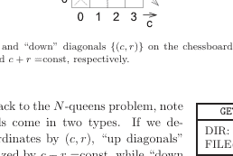

图 6.5 棋盘上的“上”对角线和“下”对角线 \(\{(c,r)\}\) 分别由 \(c-r=\text{const}\) 和 \(c+r=\text{const}\) 表征。

回到 N 皇后问题，注意对角线有两种类型。如果用 \((c,r)\) 表示坐标，则“上对角线”由 \(c-r=\text{const}\) 表征，而“下对角线”由 \(c+r=\text{const}\) 表征，见图 6.5。这里我们使用 `row`、`diag_up` 和 `diag_down`；值 0 始终表示不存在皇后，而值 1 表示已放置皇后。注意，每种对角线都有 \(2N-1\) 条，因此这些数组必须更大（在主程序中分配，此处未展示）。还要注意，对于上对角线，\(c-r\) 最小可为 \(-(N-1)\)，因此我们将该数组的索引偏移这个量，以便像通常一样从索引 0 开始。

使用这些额外数组，皇后问题的回溯函数

| 获取源代码 |
| --- |
| 目录：algorithms |
| 文件：queens.c |

内容如下：

```c
void queens(int c, int N, int *pos, int *row,
            int *diag_up, int *diag_down)
{
    int r, c2;                        /* loop counters */
    if(c == -1)                       /* solution found ? */
    {
        /* omitted here */            /* print solution */
    }
    for(r=N-1; r>=0; r--)             /* place queen in all rows of column c */
    {
        if(!row[r]&&!diag_up[c-r+(N-1)]&&!diag_down[c+r])  /* place ? */
        {
            row[r] = 1; diag_up[c-r+(N-1)] = 1; diag_down[c+r] = 1;
            pos[c] = r;
            queens(c-1, N, pos, row, diag_up, diag_down);
            row[r] = 0; diag_up[c-r+(N-1)] = 0; diag_down[c+r] = 0;
        }
    }
    pos[c] = 0;
}
```

图 6.6 展示了该算法求解 \(N=4\) 时的方式。它首先调用 `queens(3,...)`，在列 3 和行 3 放置一个皇后。然后调用 `queens(2,...)`。不允许放置皇后的位置用叉号标记。对于第 2 列，第 3 行和第 2 行不允许放置皇后。因此，在第 1 行放置一个皇后，并调用 `queens(1,...)`。在第 1 列中，现在无法放置任何皇后。因此，对 `queens(1,...)` 的调用结束。第 2 列中的皇后被放到下面一行，即第 0 行（图 6.6 中的第二行）。然后，通过调用 `queens(1,...)`，在第 2 行放置一个皇后，并调用 `queens(0,...)`。现在，第一列无法放置皇后，因此 `queens(0,...)` 返回。由于第 1 列只有一个可能位置，该皇后被移除，并且对 `queens(1,...)` 的调用也结束。现在，第 2 列中皇后的两个可能位置都已尝试过。因此，对 `queens(2,...)` 的调用也结束，我们回到 `queens(3,...)`。现在，最后一列中的皇后被放置在第 2 行（图 6.6 中的第三行）。从这里开始，可以很直接地在所有列中放置皇后，算法成功。

尽管该算法避免了许多“死胡同”，但其运行时间作为 \(N\) 的函数仍是指数级的。尽管如此，仍存在更好但非常专用的算法，其运行时间仅线性增长。


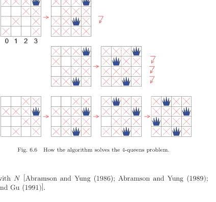

图 6.6 该算法如何求解四皇后问题。

早期使用 N [Abramson and Yung (1986); Abramson and Yung (1989); Sosic and Gu (1991)]。

## 6.6 列表

前几节介绍了基本算法。现在我们转向数据结构，数据结构是在内存中安排数据的特殊方式，使得算法能够尽可能高效地实现。注意，对于不同类型的任务，最适合的数据结构也不同，因此始终必须牢记目标应用。这也解释了为什么在实际开始编程之前仔细规划仿真程序是非常值得推荐的，见第 3 章。此外，请注意，通常允许非常快速操作的数据结构有时需要一定程度的冗余。很多时候，操作越快，需要消耗的内存就越多。因此，运行时间方面的效率是以内存方面的效率为代价的，反之亦然。

假设你正在编写一个用于描述人的社会交互的仿真软件包。对于每个人，总有一个（有时为空的）当前正在与该人交互的其他人集合。这个集合可能随时间变化。因此，我们希望有一种数据结构能够灵活地存储所有当前的熟人，即可以轻松地向集合中添加人和从集合中移除人。这里，我们介绍一种称为列表的数据结构，它可用于解决这一任务。例如，列表用于原子模拟软件包中实现短程相互作用。在这种情况下，每个原子只与距离不太远的原子相互作用。在这种情况下，为每个原子使用一个列表（所谓的“Verlet 表”）来存储当前位于邻域内的原子。⁴ 列表的另一个例子是等待队列，它由按线性顺序给出的任务组成，其中一个任务必须在另一个任务之后执行。这里，元素的顺序也很重要，因为对于许多应用而言，这与熟人列表或 Verlet 表不同。请注意，下面给出的示例应用和实现相当简单，与刚才提到的真实应用不同，目的是使主题尽可能简单。

列表是元素数组（元素类型任意）的推广。列表也像数组一样呈现线性顺序，即总有一个第一个元素，对于每个元素都有一个后继，除了列表的最后一个元素。对于数组，元素的顺序是固定的。如果你想删除一个包含 100 个元素的数组中的第 5 个元素，并且希望保持其余元素的顺序，那么必须将第 6 个元素复制到第 5 个位置，将第 7 个元素复制到第 6 个位置，依此类推，见图 6.7。因此，对于包含 N 个元素的数组，在保持顺序的情况下从列表中删除一个元素需要 O(N) 次操作。向数组中插入一个元素也需要 O(N) 次操作。此外，数组的大小是固定的，因此通常会存储所使用的最后一个元素的编号以及允许的最大元素数。现在，如果要存储的元素数量增长到超过允许的元素数量，就必须使用 realloc 来获得更多内存；如果数组正后方的空闲内存量不足以满足请求，这可能导致相当多的内存复制操作。

另一方面，对于列表，大小和顺序不是固定的。因此，它们的设计使得插入和删除操作始终可以在常数运行时间内完成。为此，最自然的实现是使用*指针*，见 1.4 节。基本思想是每个元素携带一个指针，指向它的后继。这里，我们展示一个实现列表的示例 C 结构，为简单起见，它只存储整数。

| 获取源代码 |
|---|
| 目录：algorithms |
| 文件：list.h |

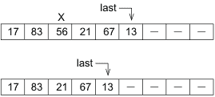

图 6.7 从数组中删除一个元素，使其余元素的顺序保持不变。未使用的数组元素用一条线 — 表示。数组中最后使用的元素存储在变量 *last* 中。上图：删除第三个元素（其中包含数字 56，用 X 标记）之前的数组。下图：最终情形，第三个位置右侧的所有元素都向左移动了一个位置。

```
struct elem_struct
{
    int                    info;             /* holds "information" */
    struct elem_struct *next;  /* pointer to successor (last: NULL) */
};

typedef struct elem_struct elem_t;           /* new type for nodes */
```

每个元素由两个变量组成。实际数据存储在 `info` 中，而列表中的后继存储在 `next` 中。我们还使用了一个 `typedef` 命令，为了方便，它允许以与预定义数据类型相同的方式引用新的列表数据类型。

列表是元素的集合，这些元素以表示线性顺序的方式链接起来，例如见图 6.8。这样的列表称为*单链表*，因为每个元素存储一个指针，即链接。每个元素存储两个指针（一个指向其后继，一个指向其前驱）的列表也很普遍，称为*双链表*。双链表由于额外的元素需要更多内存，但某些

```
int delete_element(elem_t *elem)
{
    if(elem == NULL)
    {
        fprintf(stderr, "attempt to delete 'nothing'\n");
        return(1);
    }
    else if(elem->next != NULL)
    {
        fprintf(stderr, "attempt to delete linked element!\n");
        return(1);
    }
    else
    {
        free(elem);
        return(0);
    }
}
```

该函数包含两项一致性检查。第一，不允许删除“空”（第 3—7 行）。第二，只允许删除孤立的元素（第 8—12 行），这由后继为 NULL 指针来表明。实际删除仅由 free() 命令完成（第 15 行）。

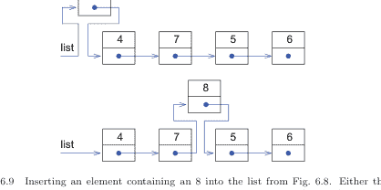

图 6.9 将一个包含 8 的元素插入图 6.8 的列表中。该元素既可以插入到开头（上图），也可以插入到列表中的其他位置（下图）。两种情况下都显示了插入后的最终情形。

为了从元素组装列表，我们使用 insert_element() 函数，它将一个元素（由指针 elem 表示）插入一个列表（由指向第一个元素的指针 list 表示）中给定元素 **where** *之后*，该元素已经是列表成员。需要考虑两种情况。要么新元素插入到列表开头，在这种情况下 **where** 包含 NULL 指针。注意，这种情况特别适用于列表为空时，因此新元素用于创建一个新列表。第二种情况是一般情况，即 **where** 指向列表中现有的成员。这两种情况如图 6.9 所示。

函数 `insert_element()` 恰好接收三个指针 `list`、`elem` 和 `where` 作为参数。注意，在新元素插入到开头的情况下，必须更改指向列表第一个元素的指针，该指针表示列表本身，并在 `insert_element()` 外部定义。为了允许这种更新，函数总是返回指向当前第一个元素的指针。

```c
elem_t *insert_element(elem_t *list, elem_t *elem, elem_t *where)
{
    if(where==NULL)                      /* insert at beginning ? */
    {
        elem->next = list;
        list = elem;
    }
    else                                 /* insert elsewhere */
    {
        elem->next = where->next;
        where->next = elem;
    }
    return(list);
}
```

在元素插入到开头的情况下（第 3—7 行），必须更改指向第一个元素的指针，并为插入的元素 `elem` 的后继 `next` 赋值，如图 6.9 所示。在另一种情况下（第 8—12 行），也要为插入元素的后继赋值，但还要将前驱赋值为指向 `elem`。请注意，构建列表还有许多其他策略。例如，可以按照某种标准对元素排序后再插入。此外，还有一些特殊的列表类型，其中插入元素总是发生在开头（用于所谓的*栈*）或末尾（用于*等待队列*）。对于栈，最后到达的元素最先取出，这称为*后进先出*（LIFO）。对于等待队列，最先到达的元素最先取出，这称为*先进先出*（FIFO）。像往常一样，我们参考


读者可参阅专门教材，了解其他类型的插入操作。

下面的代码片段说明了这些函数的用法，该代码通过将元素按逆序依次插入到链表开头，恰好创建出链表 (4, 7, 5, 6)。

```c
1    elem_t *list, *elem;
2
3    list = NULL;
4    elem = create_element(6);
5    list = insert_element(list, elem, NULL);
6    elem = create_element(5);
7    list = insert_element(list, elem, NULL);
8    elem = create_element(7);
9    list = insert_element(list, elem, NULL);
10   elem = create_element(4);
11   list = insert_element(list, elem, NULL);
```

创建链表之后，人们会想对它做些操作。例如，可以按给定顺序从第一个元素到最后一个元素打印所有成员。这由函数 print_list() 完成，它接收指向第一个元素的指针 list，并且不返回任何值。

```c
1    void print_list(elem_t *list)
2    {
3        while(list != NULL)               /* run through list */
4        {
5            printf("%d ", list->info);
6            list = list->next;
7        }
8        printf("\n");
9    }
```

该函数只是将链表打印到 stdout。这些函数很好地展示了链表的主要操作，即遍历链表的所有成员。其工作方式（第 3—7 行）是从链表开头开始，并通过反复将指针赋值为其后继节点（第 6 行）来沿链表移动指针。注意，指针 list 是按值传递的，因此函数内部改变 list 不会影响它在函数 print_list() 外部的值。

最后，我们讨论从链表中删除元素。这在图 6.10 中说明。我们假设已给出指向待删除元素的指针 elem，以及指向链表第一个元素的指针 list。现在面临的困难是：使用指针时，我们必须知道待删除元素的前驱。每个想成为专家级仿真程序开发者的人，都至少应实现过一次基本的链表类型。

## 6.7 树

现在介绍树，它可能是计算机编程中最重要的高级数据结构，尤其对许多类型的仿真而言。在许多情况下，它们有助于将“规模”为 N 的仿真中耗时 O(N) 的操作替换为只耗时 O(log N) 的操作。因此，树以及由树衍生出的其他数据结构极大地有助于加速仿真，从而能够处理更大的系统。

对于上一节介绍的数据结构（数组和链表），总是使用或假定一种线性顺序。很多时候，还会存在或可以施加一种层次顺序。一个展示层次结构的非常简单的系统例子是公司或政府机构。考虑一个玩具例子，假设一家铁路公司由一个规划部、一个会计部和一个负责运营运输的部门组成。规划部可以细分为一个负责规划网络的部门、另一个负责规划时刻表的部门、第三个负责开发新定价方案的部门，以及第四个负责购买新机车和车厢的部门。会计部可以细分为四个部门，分别负责人事、维护、采购和收入。运营部可以细分为负责货运列车、客运列车、夜行列车、公共汽车的部门，以及一个实际执行维护的部门。在计算机中表示铁路公司结构的自然方式是树，如图 6.11 所示。

现在我们引入一些定义。树的元素称为节点或顶点，后者更常用于图，见 6.8 节。对于铁路公司，例如“railway company”、“accounting”和“night trains”都是节点。当两个节点 A、B 由箭头 A→B 连接时（通常称为链接或边），节点 A 称为 B 的前驱或父节点，而 B 称为 A 的后继或子节点。在图 6.11 中，“personal”是“accounting”的子节点。节点 A 的子节点也定义为 A 的后代。此外，A 的后代的所有子节点也定义为 A 的后代。没有父节点的唯一节点称为树的根。因此，凡是 A 位于从根到该节点的路径上的节点，都是 A 的后代。在示例树中，“railway company”是树的根。另一方面，每个节点 A 连同其所有后代也构成一棵树，称为 *子树*，其中 A 是该子树的根。没有子节点的节点称为 *叶子*，例如“network”和“busses”。原则上，每个节点的子节点数（包括非叶节点）在树中可能不同。若每个节点最多有两个子节点，则该树称为 *二叉树*。要到达节点 A，总是可以从树的根开始，沿箭头方向经过若干链接，直到到达节点 A。访问过的节点序列称为 *路径*。<sup>5</sup> 例如，可通过路径“railway company” → “planning” → “schedule”到达“schedule”。注意，对每个节点而言，从根到达它的路径是唯一的。根与节点 A 之间经过的链接数称为节点 A 的 *高度* 或 *层次*。因此，根的高度始终为零。在图 6.11 的示例树中，节点“planning”的高度为一，而节点“prices”的高度为二。在此示例中，所有叶子的高度相同。一般来说，树的叶子可以具有不同高度，例如，如果该铁路公司有一个未细分为部门的“public relations”分部。最后，*树的高度* 本身是任意叶子的最大高度。

<sup>5</sup> 等价地，也可以将经过的链接序列称为路径。

作为有用且通用数据结构的一个非常简单的例子，我们考虑二叉搜索树。我们希望在其中存储元素 e 的集合 S，这些元素可以按照键 k(e) 的某个值排序，就像 6.3 节中介绍归并排序算法时那样。为简单起见，我们假设对于每个可能的键值，至多存在一个元素。这里，我们希望能够非常快速地测试数据结构中是否存在具有某个键值的元素。此外，我们假设元素可能不断被添加或删除，同时元素应保持有序。每次更改后重新排序数据会太慢。因此，我们不能使用归并排序算法，因为它只会得到已排序元素的固定线性顺序。克服这一限制的基本思想是：通过选取键的任意值 k0，将元素集合划分为键更小的元素（满足 k(e) < k0，记为子集 S(−∞, k0)）、另一个包含满足 k(e) > k0 的元素的子集（记为 S(k0, ∞)），以及可能剩下的一个满足 k(e) = k0 的元素，从而引入一种人为的层次结构。子集 S(−∞, k0) 和 S(k0, ∞) 可以用同样的方式细分。例如，使用键值 k1,0 < k0，可将 S(−∞, k0) 细分为：包含小于 k1,0 的元素的子集 S(−∞, k1,0)；包含介于 k1,0 与 k0 之间元素的子集 S(k1,0, k0)；以及最后可能具有恰好键值 k1,0 的元素。以同样方式，另一个子集 S(k0, ∞) 可使用键 k2,0 > k0 细分。通过对元素集合进行这种层次划分，就生成了一种树结构。可以用二叉树通过表示这种层次结构来存储这些元素。在这种情况下，为方便起见，只使用现有元素的键值来对集合进行层次划分。因此，每个节点存储一个元素 e。对于该节点，一个子树（通常称为左子树）包含所有键值满足 k(e′) < k(e) 的元素 e′，另一个（右）子树包含满足 k(e′) > k(e) 的元素。图 6.12 展示了一棵可能的二叉搜索树，其中包含键值为 13、15、20、23、24、25、27 的元素。

在内存中表示树的一种非常自然的方式是：为每个元素使用一个 C 结构体，并用指针表示链接。这类似于我们在 6.6 节中表示链表的方式。唯一的区别是，由于我们处理的是每个节点最多有两个子节点的二叉树，因此要为每个元素存储两个指针。对于叶子，两个指针的值均为 NULL。可以使用以下数据结构：

| 获取源代码 |
|---|
| 目录：algorithms |
| 文件：tree.h |

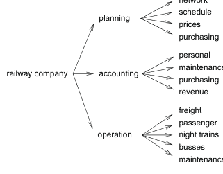

图 6.11 层次结构示例，以树表示：一家铁路公司。注意，树通常绘制为根节点（此处为“railway company”）不位于底部。


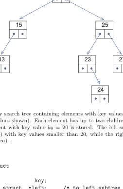

图 6.12 一个包含键值为 13、15、20、23、24、25、27 的元素的二叉搜索树（仅显示键值）。每个元素最多有两个子节点，即子树。在根节点，存储键值为 k0 = 20 的元素。左子树包含键值小于 20 的元素 S(-∞,20)，而右子树包含元素 S(20,∞)。

```c
struct node_struct
{
    int key;                 /* holds key */
    struct node_struct *left;  /* to left subtree (NULL: none) */
    struct node_struct *right; /* to right subtree (NULL: none) */
};

typedef struct node_struct node_t;  /* define new type for nodes */
```

我们为了方便定义了一个新的数据类型 node_t。为简单起见，这里仅存储键值。元素所属的其他数据，通常对实际应用是必要的，可以存储在添加到结构体的其他字段中。注意，如果想要有多种类型的树，例如一个存储原子数据，一个存储完整分子数据（例如每个包含一组原子），就需要定义两种不同的树节点类型。更灵活的替代方案是添加一个字段 void *data 指针，它指向任意内存区域，在那里存储与树结构无关的实际数据。这将允许树包含任意对象。由于已有优秀的库提供用于此目的的数据结构，例如参见第 7.2 节，我们就

```c
node_t *insert_node(node_t *tree, node_t *node, int *in_p)
{
    node_t *current;

    if(tree==NULL)
        return(node);
    current = tree;
    *in_p = 0;                 /* default: not contained */
    while( current != NULL)   /* run through tree */
    {
        if(current->key==node->key)   /* node already contained ? */
        {
            *in_p = 1;
            return(tree);
        }
        if( node->key < current->key)          /* left subtree */
        {
            if(current->left == NULL)
            {
                current->left = node;           /* add node */
                return(tree);
            }
            else
                current = current->left;        /* continue searching */
        }
        else                                   /* right subtree */
        {
            if(current->right == NULL)
            {
                current->right = node;          /* add node */
                return(tree);
            }
            else
                current = current->right;       /* continue searching */
        }
    }
}
```

要创建一棵新树，函数以 tree=NULL 调用（等价地，给定节点可作为新树的根，而无需调用函数）。这种情况在第 5-6 行处理。树在第 7-33 行中被搜索给定键值，从根开始（第 7 行）。如果找到键值，函数结束，树保持不变（第 11-15 行）。否则，搜索继续在左（第 17-25 行）或右（第 27-

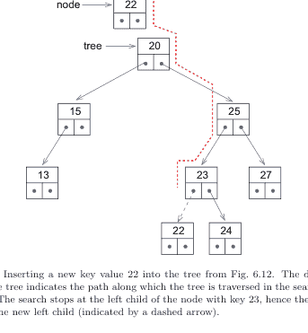

图 6.13 将新的键值 22 插入图 6.12 中的树。树旁的虚线指示在搜索键值 22 时遍历的路径。搜索在键为 23 的节点的左子节点处停止，因此新节点成为新的左子节点（由虚线箭头表示）。

35) 子树。如果相应的子树不存在，则新节点被插入到树中（第 19–22 行和第 29–33 行）。

请注意，还可以以类似方式编写仅测试给定键值是否包含在树中的另一个函数。这可以通过首先在找到键值时返回“是”（C 中的 1），其次省略插入给定元素的行，第三在到达函数末尾时返回“否”（C 中的 0）来实现。细节留给您作为练习（7）。

在搜索给定键时，算法在主循环（第 8–33 行）的每次迭代中将当前指针在树中上移一层。因此，对于高度为 L 的树，定位一个键最多需要 L 次迭代，算法运行时间为 O(L)。

如果一棵具有 L+1 个层级的树在每个层级 l = 0, …, L 包含最大数量 2^l 的节点，则该树可视为“满”。在这种情况下，树总共包含 N = 2^{L+1} − 1 个节点，因此层级数基本对数地依赖于节点数 L = O(log N)。当树不是“满”时通常也成立。因此，在这些情况下

在二叉搜索树中插入和定位元素所需时间为 O(log N)。因此，通常用树存储带有键注释的数据是非常高效的。

是否如此取决于键值插入树的顺序。例如，如果键值已按降序或升序插入，则 resulting “tree” 实际上将是一条列表，见图 6.14，其中层级数随节点数线性增长，而不是对数增长。在这种情况下，插入和定位节点又需要线性时间。列表是未平衡树的特例，一般包含两个子树高度差异显著的节点，例如至少相差二。有几种二叉搜索树的扩展，其中树始终保持平衡，这保证了主要树操作，包括节点删除，都可以在 O(log N) 时间内完成。这些算法的基本思想是首先按上述说明插入元素（或删除，见下文），如果 resulting 树不平衡，则执行额外的重组。我们在此不深入细节；请参阅专业文献 [Cormen et al. (2001); Sedgewick (1990)]。

相反，我们讨论如何使用简单算法打印二叉搜索树，使所有节点按递增顺序打印。这可以通过递归方法实现：首先打印左子树，然后是根，最后是右子树。这项工作由以下函数完成，该函数将指向树的指针作为参数。

```c
void print_tree(node_t *tree)
{
    if(tree != NULL)
    {
        print_tree(tree->left);
        printf("%d ", tree->key);
        print_tree(tree->right);
    }
}
```

这种打印树的方式也称为中序打印。请注意，其他顺序也是可能的，例如前序，其中首先打印当前子树的根，然后是左子树，最后是右子树。对于图 6.12 所示的树，中序输出如下：

13 15 20 23 24 25 27

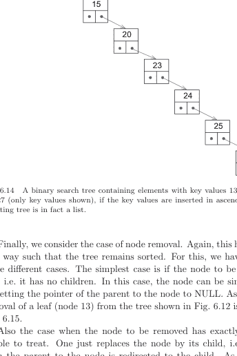

图 6.14 如果键值按升序插入，包含键值为 13、15、20、23、24、25、27 的元素的二叉搜索树（仅显示键值）。 resulting 树实际上是一条列表。

最后，我们考虑节点删除的情况。同样，这必须以树保持有序的方式进行。为此，我们必须考虑三种不同的情况。最简单的情况是待删除节点是叶子，即它没有子节点。在这种情况下，可以通过将指向该节点的父指针设为 NULL 来简单地删除节点。例如，从图 6.12 所示的树中删除叶子（节点 13）的情况在图 6.15 中给出。

待删除节点恰好有一个子节点的情况也很简单处理。只需用其子节点替换该节点，即父节点指向该节点的指针被重定向到子节点。例如，从图 6.12 的树中删除节点 15 的情况在图 6.16 中给出。

最复杂的情况发生在待删除节点 A 有两个子节点时。在这种情况下，在该节点的右子树中搜索具有最小键的节点 S，即右子树中最左边的键。这可以通过从右子树的根（即节点 A 的右子节点）开始，迭代地移动到左子节点，直到到达没有左子节点的节点 S 来实现。这样可以保证 S

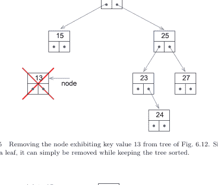

图 6.15 从图 6.12 的树中删除键值为 13 的节点。由于该节点是叶子节点，因此可以在保持树有序的同时简单地将其删除。

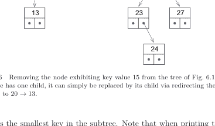

图 6.16 从图 6.12 的树中删除键值为 15 的节点。由于该节点有一个子节点，因此可以通过将指针 20 → 15 重定向为 20 → 13 来简单地用其子节点替换它。

展示子树中的最小键。请注意，按中序方式打印树时，节点 S 将在节点 A 之后立即打印。接下来，可以直接通过存储在数组中的指针访问节点，而无需搜索键，即时间为 $O(1)$。这种存储数据的方式，一种 *double bookkeeping*，是实现更快实现以消耗内存为代价的示例。请注意，在这种情况下需要相当多的额外代码行：由于在删除元素时（或在使用上述用于平衡树的运算时）有时节点会交换内容，因此必须相应地更新从数组元素到节点的指针。双重记账有助于显著加快模拟的速度的情况有很多。因此，您应始终思考双重记账是否可行且有意义。

### 6.7.1 堆

有序二叉树在需要对一组元素进行有序访问时很有用，例如快速访问所有元素。尽管如此，有时只需访问当前最小（或最大）的元素即可。一个例子就是 *event-driven simulation*。例如，考虑一个装满像台球一样的硬球的盒子。这些球以恒定速度运动，除非它们相互碰撞，此时它们会改变方向和速度的大小。一种标准方法是实际模拟球的轨迹，通过以小步移动球，即执行 *Molecular dynamics simulation* [Allen and Tildesley (1989); Haile (1992); Rapaport (1995)]。这非常耗时，而且实际上是不必要的，因为碰撞之间的恒定速度运动是微不足道的，可以精确计算。因此，只需考虑 *events*，即碰撞的球对 $(i,j)$ 以及发生碰撞的对应时间 $t_{i,j}$。在这种情况下，事件驱动模拟包括按时间 $t_{i,j}$ 递增的顺序依次处理所有碰撞事件。顺序很重要，因为在碰撞 $(i,j)$ 之后，参与的球 $i$ 和 $j$ 会沿新的方向运动。因此通常会得到新的碰撞，例如 $i$ 将在 $t_{ik} > t_{ij}$ 时与粒子 $k$ 碰撞，见图 6.18。现在，可能会先前计算了球 $k$ 与另一球 $l$ 的碰撞且 $t_{lk} > t_{ik}$，因此现在碰撞 $(l,k)$ 可能实际上不会发生，因为 $(i,k)$ 会更早发生。

因此，在事件驱动模拟的每个阶段，都必须确定具有最小事件时间的事件。对于最简单的方法，可以遍历所有 $N$ 个事件的列表并选择最小的一个，但每次都需要 $O(N)$ 步。最好使用二叉搜索

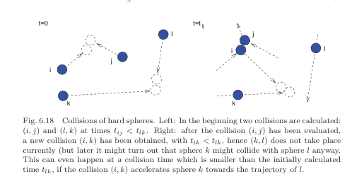

图 6.18 硬球的碰撞。左：开始时计算了两次碰撞：(i, j) 和 (l, k)，时间 t_ij < t_lk。右：在评估了碰撞 (i, j) 之后，得到一个新的碰撞 (i, k)，且 t_ik < t_lk，因此 (k, l) 目前不会发生（但后来可能会发现球 k 仍可能与球 l 碰撞。这甚至可能发生在小于最初计算的时间 t_lk 的碰撞时间，如果碰撞 (i, k) 使球 k 朝向 l 的轨迹加速）。

树来存储事件，其中所有操作都可以在 O(log N) 时间内执行。下一个要考虑的事件将始终位于树的左侧条目处。尽管如此，由于新事件通常以递增的时间生成，简单的树实现会导致不平衡的树，基本上是一个列表，如第 190 页所述。因此，需要额外的算法来平衡树。

尽管如此，对于只需要始终访问集合中最小元素的情况，有一种更简单的方法可以实现每个基本操作 O(log N) 的运行时间。这是通过所谓的优先级队列实现的。优先级队列有许多不同的实现方式。这里，我们考虑一种基于堆的实现。这也是一棵二叉树，但它是部分排序的，使得对于每个子树，最小（或最大，取决于应用）的元素位于子树的根（堆属性）。因此，整棵树的根将始终包含树的最小元素，因此可以甚至在 O(1) 时间内访问。在图 6.19 中显示了一个包含一些自然数的堆。请注意，对于给定的元素集合，可能存在许多不同的有效堆。

我们将考虑一种堆实现，其中堆的所有层级都完全填满，除了最高层级。最高层级将“从左”填充，这在图 6.19 中也是如此。这允许使用数组非常简单地存储堆：元素按层级连续存储，从索引 0 开始（C 惯例），根存储在该处。在树的某一层级中从左到右，元素按顺序存储在数组中。

访问存储在数组中的元素非常简单：对于节点

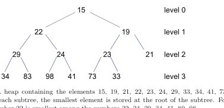

图 6.19 一个包含元素 15、19、21、22、23、24、29、33、34、41、73、83、98 的堆。对于每个子树，最小元素存储在子树的根。例如，数字 22 是数字 22、24、29、34、41、89、98 中最小的。

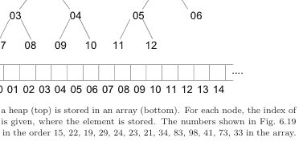

图 6.20 堆（上）如何在数组（下）中存储。对于每个节点，给出了元素存储的数组条目的索引。图 6.19 中显示的数字将按顺序 15、22、19、29、24、23、21、34、83、98、41、73、33 存储在数组中。

存储在数组索引 i 处，其父节点位于索引 (i − 1)/2 处，其中这里的除法被视为整数运算。因此，对于存储在索引 3 和 4 的两个节点，其父节点存储在索引 2/2 = 3/2 = 1 处。此外，左子节点和右子节点可以分别在数组索引 2i + 1 和 2i + 2 处找到。

接下来，展示了一个小的 C 堆实现。作为示例，堆存储事件，由某个 ID（例如可用于在数组中定位事件）和事件的时间表征。堆的每个元素如下

获取源代码
DIR: algorithms
FILE(S): heap.h

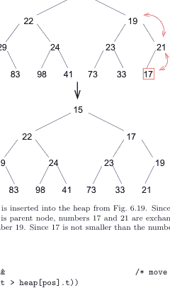

图 6.21 将数字 17 插入图 6.19 的堆中。由于它小于父节点存储的值 21，因此数字 17 和 21 被交换。17 与数字 19 交换。由于 17 不小于根存储的数字 15，因此它就位。

```
    11    while(pos > 0)&&
    12        (heap[parent].t > heap[pos].t))
    13    {
    14        elem = heap[parent];                 /* exchange parent/child */
    15        heap[parent] = heap[pos];
    16        heap[pos] = elem;
    17        pos = parent;                         /* move up */
    18        parent = (pos-1)/2;
    19    }
    20  }
```

第 6–9 行将新元素插入末尾并将元素数量增加一。在第 10–19 行，新元素被移动（第 14–16 行）向根移动，直到当前父节点小于新元素或到达根（第 11–12 行）。请注意，如果想实现双重记账（见第 194 页），则在元素移动时必须更新从外部指向堆中元素的指针。因此，在这种情况下，保存指针的数据结构也必须作为参数传递给函数。


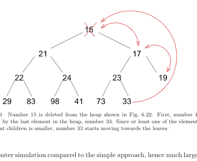

图 6.23 从图6.22所示的堆中删除数字15。首先，数字15被堆中的最后一个元素数字33替换。由于位于子节点处的元素中至少有一个更小，数字33开始向叶子方向移动。

与简单方法相比，模拟要快得多，因此可以处理大得多的系统。最近的一个例子是硬粒子一维系统中的热传导研究 [Grassberger et al. (2002)]，其中使用堆使结果相比之前采用简单方法的工作 [Dhar (2001)] 在质量上得到改善。

请注意，通过碰撞事件进行模拟不仅适用于真实硬粒子，也适用于具有非常短程相互作用的原子；在这种情况下，人们称之为二体碰撞近似，它已成功应用于分子束外延中离子撞击表面的模拟 [Robinson and Torrens (1974)]。

一般来说，堆的应用非常广泛。每当你需要从一组元素中选择“最小”或“最大”时，都应使用优先队列，例如用堆实现的优先队列。与列表的情形类似，在许多情况下你不必实现自己的通用优先队列，因为它已经包含在标准模板库中，见第7.2节。然而，如果你为了获得最高性能而需要双重记录，就必须能够访问内部堆结构。在这种情况下，你需要自己实现一个堆。

然而，在修改程序的一部分并用基于堆的选择替换某种简单选择机制之前，你应该使用 gprof 分析程序的大部分运行时间花在哪里，见第4.4节。也许程序的大部分运行时间花在别处。在这种情况下，你应该先优化这些部分。

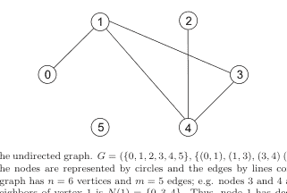

图 6.24 所示的无向图。图中展示了 G = {{0,1,2,3,4,5}, {0,1}, {1,3}, {3,4}, {4,1}, {4,2}}。节点用圆圈表示，边用连接圆圈的线表示。该图有 n = 6 个顶点和 m = 5 条边；例如，节点3和4相邻。顶点1的邻居集合为 N(1) = {0,3,4}。因此，节点1的度为3，而节点2的度仅为1。节点5是孤立的。该图包含从节点0到节点3的长度为3的路径 0,1,4,3，以及环 1,3,4,1。由于节点0,1,2,3,4通过路径相互连接，它们构成一个连通分量。还存在第二个连通分量，仅由节点5组成。

从 v1 到 vk 的路径是一个顶点序列 v1,v2,...,vk，这些顶点通过边连接：(vi, vi+1) ∈ E ∀ i = 1,2,...,k − 1。路径的长度为 k − 1。如果 v1 = vk，则称该路径为闭路径。如果除第一个和最后一个节点外，闭路径中没有节点出现两次，则称其为环。请注意，第6.7节介绍的树只是不含环的图。如果 i) 对于连通分量内节点之间的每一对节点都存在一条路径，并且 ii) 不能向图中添加任何节点而仍使 i) 成立，则称一个节点集合为连通分量。因此，连通分量具有最大规模。如果一个图只有一个连通分量，则称该图是连通的。

现在给出一些仅适用于有向图的定义。对于边 e = (i,j)，i 是 e 的头，j 是 e 的尾。边 e 称为从 i 发出并进入 j。请注意，对于有向路径，重要的是所有边都指向路径的方向；形式上，其定义与无向图情形相同。如果 i) 从集合中的每个节点出发，在该集合内都存在指向集合中其他每个节点的有向路径，并且 ii) 不能向图中添加任何节点而仍使 i) 成立，则称一个节点集合为强连通分量（SCC）。在有向图中，出边和入边可以分别计数。入度由 id(i) = { |j | (j,i) ∈ E } 给出，出度由 od(i) = { |j | (i,j) ∈ E } 给出。显然，对于所有顶点，d(i) = id(i) + od(i)。

道路（边），边上的标签可用于表示相邻城市之间的距离。

### 6.8.2 数据结构

接下来，我们考虑如何在计算机程序中表示图，因此考虑合适的数据结构。特别地，我们讨论邻接矩阵和邻接表。为简单起见，在下面的 C 示例实现中，我们考虑无标签图。所有这些示例都可以直接扩展到带标签图。

在 C 程序中表示图的最简单方法是：首先使用自然 ID 编号区间 {0,1,...,n−1} 表示节点；其次，对于边，使用邻接矩阵 {a_ij}，其中

a_ij = { 1 若边 (i,j) 存在
          0 否则 . } (6.8)

对于图6.24所示的无向图以及图6.25所示的有向版本，矩阵分别如下：

{a_ij} = 
⎛0 1 0 0 0 0⎞   {a_ij} = 
⎛0 1 0 0 0 0⎞
⎜1 0 0 1 1 0⎟   ⎜0 0 0 1 0 0⎟
⎜0 0 0 1 0 0⎟   ⎜0 0 0 0 0 0⎟
⎜0 1 1 0 1 0⎟   ⎜0 0 0 0 1 0⎟
⎜1 1 0 1 0 0⎟   ⎜0 1 1 0 0 0⎟
⎝0 0 0 0 0 0⎠   ⎝0 0 0 0 0 0⎠

请注意，在无向图情形下，邻接矩阵总是对称的。在 C 程序中，邻接矩阵可以像其他矩阵一样简单地使用，见第1.4节。因此，在分配了通过 short int **adj 定义的邻接矩阵之后，可以通过直接赋值 adj[i][j]=1 向图中添加边 (i,j)。同样，可以通过读取 adj[i][j] 以相同方式在 O(1) 时间内测试边是否存在。另一方面，对于有 n 个节点的图，邻接矩阵需要 O(n²) 内存。因此，对于大型稀疏图，即边数少于 O(n²)（通常仅为 O(n)）的图，会浪费大量内存。在许多稀疏图应用中，节点数 n ~ 10⁶，因此邻接矩阵无法放入主存。此外，遍历给定节点的所有邻居（执行图算法时的典型操作）需要 O(n) 步，即使平均邻居数是有限的 O(1)。

对于稀疏图，最好只存储存在的边。例如，可以使用邻居列表来实现。因此，对于图中的每个节点（同样用整数 ID 编号 {0,1,..., n − 1} 表示），使用一个邻居列表。于是，整个图由一个列表数组表示。对于 C 实现，我们可以使用以下数据类型：

获取源代码
目录：algorithms
文件：graphs.h

```
typedef struct
{
    elem_t *neighbors;  /* pointer to list of neighbors */
} gs_node_t;

typedef struct
{
    int       num_nodes;      /* number of nodes */
    gs_node_t *node;          /* array of nodes */
} gs_graph_t;
```

这里为每个节点引入了单独的类型 gs_node_t（第1-4行），尽管它当前只包含一个元素。采用这种方法的原因是它可以相当简单地扩展，例如只需向结构中添加另一个元素，就可以为顶点引入标签。当你使用第176页介绍的列表数据结构时，边不携带任何标签。info 用于存储相邻节点的 ID。图6.26分别展示了图6.24和图6.25中图的列表表示。请注意，对于无向图，边 (i, j) 会作为条目 j 出现在节点 i 的列表中，并作为条目 i 出现在节点 j 的列表中。

### 6.8.3 生成

为了生成图，这里使用函数 gs_graph_generate()，它接收节点数作为参数。初始时没有边。C 实现如下：

获取源代码
目录：algorithms
文件：graphs.c

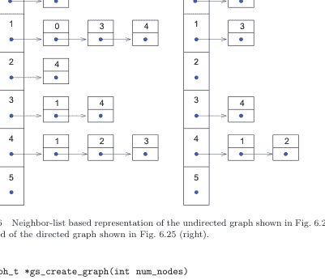

图 6.26 图6.24所示无向图（左）和图6.25所示有向图（右）的基于邻居列表的表示。

```c
gs_graph_t *gs_create_graph(int num_nodes)
{
    gs_graph_t *g;
    int n;

    g = (gs_graph_t *) malloc(sizeof(gs_graph_t)); /* allocate */
    g->num_nodes = num_nodes; /* initialize */
    g->node = (gs_node_t *) malloc(num_nodes*sizeof(gs_node_t));

    for(n=0; n<num_nodes; n++)
        g->node[n].neighbors = NULL;

    return(g);
}
```

该函数只需分配 gs_graph_t 类型的内存（第6行），将节点数存入 num_nodes 元素（第7行），并为 node 元素分配该大小的数组（第8行）。最后，所有邻居列表都被初始化为空（第10-11行）。

对于面向对象的设计，还需要一个用于销毁的函数

删除一个图。可以将此任务拆分为两个子任务：首先移除所有边，即*清除*图，其次释放 `gs_graph_generate()` 中分配的数据结构，即最终删除已清除的图。我们不展示实现的细节，但提到这些函数的源代码也包含在可在线获取的软件包中。

由于隐藏图实现既方便又不易出错，下面给出一个在无向图中插入边的函数。函数 `gs_insert_edge()` 接收图（即一个指针）和边的端点的 ID 作为参数。C 代码如下所示：

```
~~~c
void gs_insert_edge(gs_graph_t *g, int from, int to)
{
    elem_t *elem1, *elem2, *list;

    list = g->node[from].neighbors;                 /* edge exists? */
    while( list != NULL )
    {
        if(list->info == to)                        /* yes */
            return;
        list = list->next;
    }

    elem1 = create_element(to);                     /* create neighbor for 'from' */
    g->node[from].neighbors =
        insert_element(g->node[from].neighbors, elem1, NULL);
    elem2 = create_element(from);                   /* create neighbor for 'to' */
    g->node[to].neighbors =
        insert_element(g->node[to].neighbors, elem2, NULL);
}
~~~
```

首先，检查边是否已存在于图中（第 5-11 行）。如果是，则无需执行任何操作。注意，在第 6-11 行，我们直接在列表的实现层面上操作。为了隐藏列表实现，需要提供 *迭代器*，分别允许我们访问第一个和下一个元素。由于这些示例主要具有说明性质，因此我们不这样做。对于功能强大的通用列表，读者无论如何都应使用现有的库，参见第 7 章。在第 13-15 行，第二个端点被插入到第一个的邻居列表中，而在第 16-18 行，第一个端点被插入到第二个的邻居列表中。注意，该函数的有向版本甚至更简单，因为只需要创建一个包含第二个端点的列表元素并将其插入第一个的邻居列表中即可。

对于图的分析。正如第 6.8.1 节所述，图可能表现出多个 *连通分量*，使得属于同一分量的节点通过路径连接，而属于不同分量的节点之间不存在路径。例如，对于描述通信网络的图，属于同一分量的节点可以相互通信，而属于不同分量的节点则不能。

接下来，讨论一个确定图的连通分量的简单算法。此讨论将分三步进行：首先解释基本思想。接下来给出 C 代码。最后讨论该算法对一个小型示例图的操作。基本思想是从任意（“种子”）节点开始。它被视为第一个分量的第一个节点。随后，“种子”节点的全部邻居，即与其通过边连接的所有节点，都被归为同一分量。同样，这些邻居的邻居也属于同一分量，以此类推。然而，需要注意的是，为了正确确定分量，每个节点不需要被处理多次。例如，“种子”节点首先被处理，当考虑其任何邻居的邻居时就无需再次处理它。为此，对每个节点在数组 *comp* 中保留一个条目，该条目指示在确定分量过程中该节点是否尚未遇到（此时 *comp*[node] = −1）。方便的是，该变量还将存储一个 ID，用于标识节点所属的分量。初始时该变量将对所有节点设为 −1，表示每个节点尚未被考虑。由于对每个节点都需要考虑其所有邻居一次，邻居在被遇到时将被存储在一个“袋”中，实际上实现为一个数组 *candidate*。在分量构建期间，算法从袋中依次取出一个节点来检查其邻居。这样，通过路径与种子节点相连的每个节点都将在某个时刻被考虑并添加到分量中。注意，这里节点在袋中被考虑的顺序无关紧要。如果顺序是 *后进先出* (LIFO)，如同栈，则在考虑种子的第一个邻居之后，其第一个邻居将被依次考虑，等等，然后才考虑种子的第二个邻居。因此，算法倾向于尽可能直接深入。这称为 *深度优先搜索*。如果另一方面袋以 *先进先出* (FIFO) 的方式处理，则所有邻居的种子都是从袋中取出的，然后是邻居的

继续 直到仍有候选节点（第 19 行）。一个接一个地取出候选节点（第 21 行），并执行对所有邻居的循环（第 22–32 行）。对于每个邻居，检查（第 26 行）它是否尚未被分配到一个分量。如果没有，则将其添加到分量并添加到候选节点的袋中（第 27–30 行）。

```
```c
for(n1=0; n1<g->num_nodes; n1++) /* all possible component seeds */
{
    if(comp[n1] == -1)            /* not yet part of a component ? */
    {
        comp[n1] = num_components;
        candidate[0] = n1;
        num_candidates = 1;
        while(num_candidates > 0)  /* still nodes in current comp. ? */
        {
            n2 = candidate[--num_candidates];        /* next candidate */
            neigh = g->node[n2].neighbors;
            while(neigh != NULL)                      /* go through all neighbors */
            {
                nn = neigh->info;
                if(comp[nn] == -1)                /* not yet part of component ? */
                {
                    comp[nn] = num_components;    /* add to candidates */
                    candidate[num_candidates++] = nn;
                }
                neigh = neigh->next;
            }
        }
        num_components++;
    }
}

free(candidate);
return(num_components);
```
```

为了理解算法的工作方式，我们考虑图 6.24 中的小型示例图。初始时所有 comp 值均设为 −1。变量 num_components 初始化为 0。算法执行过程中变量的变化如 图 6.28 所示。在遍历所有节点的循环中，首先遇到节点 0。它尚未被分配到分量，因此以 ID 0 开始一个新的分量。节点 0 被添加到 candidate。因此，在遍历所有候选节点的循环迭代期间

```
~~~
n1=0: comp[0]=0
        candidate={0}    n2=0:
                comp[1]=0
        candidate={1}    n2=1:
                comp[3]=0
                comp[4]=0
        candidate={3,4} n2=4:
                comp[2]=0
        candidate={3,2} n2=2:
        candidate={3}    n2=3:
n1=1:
n1=2:
n1=3:
n1=4:
n1=5: comp[5]=1
        candidate={5}    n2=5:
~~~
```

图 6.28 `gs_components()` 在图 6.24 示例图上的操作。该图由两个分量组成，ID 为 0（节点 0,1,2,3,4）和 1（节点 5）。第一列显示主循环的当前节点 n1。第二列中的每个条目代表一个新的分量的开始以及分量 ID 对种子节点 n1 的相应赋值（代码第 16 行）。第三列显示第 19 行循环每次迭代开始时 candidate 数组的状态。第四列显示从候选节点中取出的当前节点 n2。第五列通过相应的分量 ID 赋值（第 28 行）指示添加到分量的 n2 的所有邻居。

（第 19–33 行），首先考虑节点 0。它有一个邻居，节点 1，被添加到分量中。因此，接下来在候选循环中考虑节点 1。节点 1 有三个邻居，节点 0、3 和 4。节点 0 已属于该分量（comp[0]=0，即 ≠ −1），因此此处无事发生。节点 3 和 4 被添加到分量并添加到候选节点中。接下来，考虑节点 4。其邻居 1 和 3 已属于该分量。因此，只有其邻居节点 2 被添加到分量并添加到候选节点的袋中。由于对候选节点的 FIFO 操作，接下来考虑节点 2。其唯一的邻居节点 4 已属于该分量，无事发生。节点 3 也是如此，其邻居为节点 1 和 4。现在，candidate 数组为空，第一个分量的构建完成。在主循环期间，接下来会遇到节点 1、2、3 和 4。由于它们已经被分配


对于一个分量，不再启动进一步的分量识别过程。最终遇到节点 5。它是一个新分量（ID 1）的种子。由于它没有邻居，即代码第 23 行的条件立即为 FALSE，因此不会有其他节点加入该分量。此时，主循环终止，完整的分量识别过程完成。

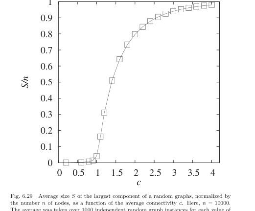

图 6.29 随机图最大分量的平均大小 S，按节点数 n 归一化，作为平均连通度 c 的函数。这里 n = 10000。对于每个 c 值，平均值是在 1000 个独立随机图实例上取得的。线条仅供参考。

作为如何将分量确定与图模型结合使用的一个示例应用，我们研究 Erdős–Rényi（ER）随机图。这些图在此具有 n 个节点和 m 条边，边随机且独立地连接所选节点对。因此，

## 练习

（解答：可从 http://www.worldscientific.com/r/9010-supp 下载）

### （1）排列

| 解决方案源代码 |
| --- |
| 目录：algorithms |
| 文件： |
| permutation.c |

设计、实现并测试一个递归函数 permutation()，用于原地获取并打印整数数组 a[] 的所有排列，即不需要额外的数组。

函数原型如下：

```c
/********************** permutation() **********************/
/** Obtains all permutations of positions 0..n-1 of a       **/
/** given array 'a' of numbers and prints them,            **/
/** including the higher index entries (from 0..n_max-1).  **/
/**                                                         **/
/** Parameters: (*) = return parameter                      **/
/**       n: current range                                   **/
/**       n_max: size of array                              **/
/**       a: array                                          **/
/** Returns:                                                **/
/**       (nothing)                                         **/
/*************************************************************/
void permutation(int n, int n_max, int *a)
```

### （2）数的幂

| 解决方案源代码 |
| --- |
| 目录：algorithms |
| 文件： |
| power.c |

设计、实现并测试函数 fast_power()，用于计算幂 a^n（n 为整数）。采用分治方法，当 n > 2 时将 a^n 的计算转化为 a^{n/2} 的计算。这使得运行时间为 O(log n)，而朴素方法为 O(n)。

函数原型如下：

```c
/************ fast_power() ************/
/** Calculates the a^n (n being a natural number) using **/
/** a divide-and-conquer approach. **/
/**
/** Parameters: (*) = return parameter **/
/**            a: base **/
/**            n: power **/
/** Returns **/
/**            a^n **/
/***************************************/
double fast_power(double a, int n)
```

提示：首先为 n ≥ 0 设计你的函数，然后将 n < 0 的情况归约为 n > 0 的情况。

### （3）数值划分

解决方案源代码
目录：algorithms
文件：partition.c

数值划分问题（NPP）定义如下：给定一个包含 n 个非负整数的集合 A = {a[0]...a[n-1]}，我们希望将其划分为两个子集 A1 ⊂ A 和 A2 ⊂ A，使得差值 d = |∑_{a∈A1} a - ∑_{a∈A2} a| 最小。例如，{2,3,4,10} 可以被划分为两个子集 A1 = {2,3,4} 和 A2 = {10}，其中 d = 1。使用动态规划方法解决此问题，即找到最小差值。设计、实现并测试所得程序。

提示：引入二维数组 part[][]，其中如果 {a[0]...a[i]} 的某个子集的和为 s，则 part[i][s]=1（其中 i=0,...,n-1，s=0,...,∑_{a∈A} a）。可以使用 part[i][s]=1（如果 part[i-1][s]==1 或 part[i-1][s-a[i]]==1）来计算数组 part（需对 part[0][s] 进行适当初始化）。然后，利用 |∑_{a∈A1} a - ∑_{a∈A2} a| = |2∑_{a∈A1} a - ∑_{a∈A} a|，可以从 part[n-1][s]（s=0,...,∑_{a∈A} a）得到最小差值。注意，此方法不直接给出两个子集，仅给出最小差值。

技术提示：将整数作为参数传递给程序。

### （4）骑士的巡游

解决方案源代码
目录：algorithms
文件：knight.c

在国际象棋棋盘上，马可以从当前位置移动到其邻域中最多八个可能位置之一。马的可能走法如图 6.30（左）所示。

骑士巡游问题是为一个 n × n 的棋盘寻找一条巡游路径，从棋盘的左上角开始，使得每个方格恰好被访问一次。一个 8 × 8 棋盘的可行解如图 6.30（右）所示。

编写一个使用回溯方法解决此问题的 C 程序。

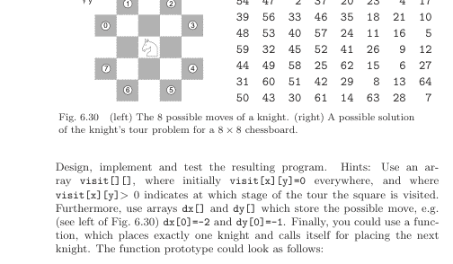

图 6.30 （左）马的 8 种可能走法。（右）骑士巡游问题在 8 × 8 棋盘上的一个可行解。

设计、实现并测试所得程序。提示：使用数组 visit[x][y]，其中初始时到处 visit[x][y]=0，visit[x][y]>0 表示该方格在巡游的第几步被访问。此外，使用数组 dx[] 和 dy[] 存储可能的移动，例如（见图 6.30 左）dx[0]=−2，dy[0]=−1。最后，你可以使用一个函数，它放置一个骑士，并调用自身来放置下一个骑士。函数原型可以如下：

```c
/********************* move_knight() *********************/
/** Calculates recursively via backtracking a tour for **/
/** the knight, such that all squares with visit[x][y]=0 **/
/** are visited once. **/
/** **/
/** Parameters: (*) = return parameter **/
/** n: size of board **/
/** step: how many sites already visited? **/
/** x,y: current position of knight **/
/** visit: states whether and when square was visited **/
/** dx,dy: possible move directions **/
/** Returns: **/
/** (nothing) **/
/********************************************************** */
void move_knight(int n, int step, int x, int y,
 short int **visit, int *dx, int *dy)
```

### （5）从链表中移除元素

设计、实现并测试用于从链表中移除元素的函数 remove_node()，如第 181 页所述。函数原型如下：

解决方案源代码
目录：algorithms
文件：list_rm_e.c

```c
/**************** remove_element() ****************/
/** Remove element from list                       **/
/** PARAMETERS: (*)= return-parameter               **/
/**               list: first element of list       **/
/**               elem: to be removed               **/
/** RETURNS:                                        **/
/**  (new) pointer to beginning of the list         **/
/*****************************************************/
elem_t *remove_node(elem_t *list, elem_t *elem)
```

### (6) 链表的归并排序

设计、实现并测试一个使用归并排序算法（见第 6.3 节）对给定链表进行排序的函数。主要方法如下：首先，将给定链表拆分为两个大小约为一半的链表。然后，对这两个链表分别递归调用该函数。最后，通过合并两个已排序链表来构建结果链表。（练习指针运算的好题目！！）函数原型如下：

| 解决方案源代码 |
|---|
| 目录：algorithms |
| 文件：list_mergesort.c |

```c
/**************** mergesort_list() ****************/
/** Sorts list using mergesort algorithm            **/
/** PARAMETERS: (*)= return-parameter               **/
/**               list: first element of list       **/
/** RETURNS:                                        **/
/**  (new) pointer to beginning of the list         **/
/*****************************************************/
elem_t *mergesort_list(elem_t *list)
```

### (7) 在树中查找值

设计、实现并测试一个函数，用于测试树中是否包含给定键值。函数原型如下：

| 解决方案源代码 |
|---|
| 目录：algorithms |
| 文件：tree_find.c |

```c
/**************** find_node() ****************/
/** Locates a node with a given 'key' in a tree.   **/
/** If the 'key' is not contained in the tree,     **/
/** NULL is returned                               **/
/** PARAMETERS: (*)= return-parameter               **/
/**               tree: pointer to root of tree     **/
/**               key: to be located                **/
/** RETURNS:                                        **/
/**  pointer to node (NULL if key is not existing)  **/
/*****************************************************/
node_t *find_node(node_t *tree, int key)
```


### (10) 随机图

设计、实现并测试一个用于生成 Erdős–Rényi 随机图的函数。这是一个包含 n 个节点和 m 条边的图。边是从所有可能的节点对 i,j ∈ V 中以相等概率随机抽取的。该函数与 gs_preferential_attachment() 类似，但更简单。函数原型如下：

| 解决方案源代码 |
| --- |
| 目录: algorithms<br>文件: graph_r.c |

```c
/********************** gs_random_graph() **********************/
/** Function adds exactly m randomly chosen edges to   **/
/** the graph.                                        **/
/** No self loops are allowed. No edge is allowed to   **/
/** appear twice!                                      **/
/** PARAMETERS: (*)= return-parameter                  **/
/**             (*) g: graph                           **/
/**                 m: number of edges to be added per node **/
/** RETURNS:                                           **/
/**     (nothing)                                      **/
/******************************************************/
void gs_random_graph(gs_graph_t *g, int m)
```

# 第 7 章 库

### 

库是可以在其他程序中使用的各种数据类型和函数的集合。有用于数值方法（如积分或求解微分方程）的库，用于存储、排序和访问数据的库，用于花哨的数据类型（如列表或树）的库，用于生成彩色图形的库，以及用于成千上万其他应用的库。有些库可以免费获得，而其他通常是专门的库则需要购买。使用库可以极大地加快软件开发过程，因为你不必自己实现每一种标准方法。因此，在开始编写程序之前，你应始终检查是否有人已经为你完成了这些工作。

你已在第 1 章学习过库的基础知识。例如，曾讨论过数学函数库，该库包含在所有 C/C++ 编译器中。在这里，只介绍了几个可免费获得的示例库：标准 C 库、标准模板（C++）库（STL）以及 GNU 科学库。其他有用的库示例（本文未详细讨论）有 boost 库 [Boost; Karlsson (2005)] 和 LEDA 库 [Mehlhorn and Näher (1999)]。boost 库也可免费获得，实际上它是由许多基于 STL 的库组成的集合。例如，有用于图、哈希表、区间算术、并行编程（MPI）、统计分布和随机数的库。另一方面，LEDA 库并不直接基于 STL 构建。它还提供图的数据类型，特别是许多非常高效的图算法、几种容器类型、任意精度算术、数据压缩、加密，以及对二维和三维几何的支持。不幸的是，LEDA 库的完整版本相当昂贵。然而，你可以获得一个免费版本，其中包含主要功能的一个全面的子集，包括许多容器数据类型，如优先队列或树。

尽管有许多库可用，有时不可避免地需要自己实现一些专门但基础的函数。在这种情况下，在代码经过一段时间证明可靠且有用后，你可以将其放入自建的库中。如何创建库将在本章的最后一部分进行说明。

许多库是动态链接的。这意味着，当链接器组装可执行文件时，不会从库中包含任何代码。只有在程序执行时，对应库的可执行函数才会被加载到内存中。这有助于保持你的仿真程序的可执行文件大小较小。 nevertheless，有时你必须强制链接器在程序链接时就将库函数包含在可执行文件中。这称为静态链接。当你想在未安装该库的另一台机器上运行仿真时，可能会发生这种情况。你可以通过使用链接器/编译器选项 -static 来指示链接器链接库函数的可执行代码。

## 7.1 标准 C 库

你已在第 1 章遇到过许多标准 C 库函数，例如通过 malloc() 分配内存，通过 system() 调用 shell 函数，或通过 atoi() 将字符串转换为整数。要正确使用此库中的函数，你必须使用指令

```
#include <stdlib.h>
```

请注意，对于标准 C 库函数的可执行文件链接，你不需要使用 -l 选项，因为它们始终会被链接。

在这里，我们只讨论另一个函数，该函数在仿真上下文中被相当频繁地使用。它是 qsort()，它允许按升序对任意数据类型的数组进行排序。该函数实现了高效的快速排序算法 [Sedgwick (1990); Cormen et al. (2001)]，它通常以 O(n log n) 次比较步骤对 n 个元素进行排序。排序顺序由某些排序标准决定，该标准必须由调用 qsort() 的程序提供。

qsort() 的函数原型如下：

```c
void qsort(void *base, size_t nel, size_t width,
    int (*compare)(const void *, const void *));
```

因此，它期望作为参数传入指向待排序数组开头的指针 base 以及数组中元素的数量 nel。第三个参数指定一个元素的字节数。最后一个参数提供排序标准。从技术上讲，它是指向一个函数的指针，该函数本身具有原型

```c
int compare(const void *p1, const void *p2);
```

此函数必须由调用 qsort 的程序提供。它应接受两个指针 p1、p2 作为参数，它们指向需要比较的两个数组元素。函数 compare() 应在 p1 指示的元素“小于”p2 指示的元素时返回 -1。在相反情况下，应返回 +1，如果两个元素相等则返回 0。“较小”的含义由函数决定；因此，如果你想按降序排序，可以在实际上第二个元素较小时返回 -1。请注意，这些指针是指向 void 的指针；因此，compare() 函数通常必须使用强制类型转换（参见第 1.1.2 节）来访问数组元素的内容。此外，函数 compare() 不允许修改数组的内容，这由 const 限定符指示（参见第 1.2 节）。

作为示例，考虑按升序对 double 类型数字数组进行排序。在这种情况下，用于比较两个数字的函数可能如下所示

| 获取源代码 |
| DIR: libraries |
| FILE(S): sorting.c |

```c
int compare(const void *p1, const void *p2)
{
    if (*(double *)p1 < *(double *)p2)
        return (-1);
    else if (*(double *)p1 == *(double *)p2 )
        return (0);
    else
        return(1);
}
```

在这里，用于访问 p1 和 p2 指示的两个元素的强制类型转换直接包含在比较表达式中。对于更复杂的 compare() 函数，通常更方便（且更易读）的做法是创建两个对应类型变量，并将两个指针的内容赋给这些变量。

假设你有一个包含 n 个 double 类型数字的数组 val[]，对 qsort() 的调用应如下所示：

```
qsort(val, n, sizeof(double), compare_double);
```

请注意，排序是就地进行的。因此，数组内的原始顺序会丢失。你在练习 (1) 中要求编写一个稍微复杂一些的 compare() 函数。在第 8 章练习 (6) 中，qsort() 用于从测量样本点计算置信区间。

## 7.2 标准模板库

标准（模板）库（STL）[STL; Josuttis (1999)] 是“标准”C++ 库的一部分。STL 提供三个主要组成部分：用于存储对象的容器、允许程序员以不同方式访问容器的迭代器，以及执行更复杂任务（如排序）的算法。示例容器有 vectors、lists 和 sets。你可以在这些容器中存储几乎任意类型的对象，每个容器一种类型的对象。因此，你可以拥有“某物”的 vectors、“某物”的 lists，或“某物”的 sets。这意味着容器的成员数据或成员函数参数的类型不能预先确定，而必须在每种情况下由你想要使用的实际数据类型定义。这是通过模板实现的。在本节中，将通过讨论 STL 中的两种数据结构——优先队列和映射，来解释如何使用模板。如果你想学习如何实现自己的模板，请参考专业文献 [Stroustrup (2000)]。

在第 6.7.1 节介绍了优先队列。它们允许以这样的方式存储对象，使得总能检索到“最小”的对象。这是可能的，因为对象在优先队列中保持部分排序。在第 6.7.1 节中，介绍了一个基于堆的事件存储在优先队列中的 C 实现。不幸的是，该实现是针对特定的数据结构 heap_elem_t 的。如果你想在堆上存储其他类型（如）your_elem_t 的对象，你必须复制代码并将 heap_elem_t 的所有出现替换为 your_elem_t。此外，你必须提供一些基本操作，例如一个用于比较两个 your_elem_t 类型对象以确定哪个更小的函数。使用模板可以为你简化这项工作。


让我们从使用 STL 的一个简单的字符串优先队列开始。请注意，STL 也包含一个用于字符串的 string 类。要在程序中使用 string 类和优先队列的模板类，你必须编写以下代码：

```
#include <queue>
#include <string>
```

下面这段简单的程序片段展示了如何定义和使用字符串优先队列：

```
priority_queue<string> q2;
q2.push("hello"); // fill priority queue
q2.push("you");
q2.push("are");
q2.push("welcome");

while(!q2.empty()) // get events from queue
{
string s;
s = q2.top(); // get "smallest" string
q2.pop(); // remove it
cout << s << endl;
}
```

| 获取源代码 |
|---|
| 目录：libraries |
| 文件：pqueue0.cpp |

在第 1 行，定义了一个优先队列 q2，并自动初始化为空队列。在类名 priority_queue 后面，模板参数写在尖括号 < > 中，这里是指队列元素类型 string。这样，对所有模板都指定了类型和进一步的参数（见下文）。第 2 行声明了一个辅助字符串变量。使用成员函数 push() 将一些字符串放入队列，该函数接收要放入队列的对象作为参数（从技术上讲，它接收对象的引用）。在第 8–13 行，优先队列被读出。这里使用了另外三个成员函数：empty() 测试队列是否为空；top() 返回对队列中当前第一个元素的引用；使用 pop() 可以移除当前第一个元素。为了完整起见，我们注意到成员函数 size() 返回当前存储在队列中的元素数量。

运行该程序时，输出为：

```
you
welcome
hello
are
```

因此，队列按字典序递减的顺序返回这些字符串。对于简单的预定义数据类型，可以为队列指定其他排序准则作为模板参数。我们这里只考虑最一般的情况：排序准则完全由自己定义，对于更复杂对象的优先队列，通常就是这种情况。

假设你想为事件创建一个优先队列。每个事件描述气体模拟中两个原子的碰撞。在事件驱动模拟中（见第 6.7.1 节），事件将按照事件时间递增的顺序一个接一个地处理。因此，每个事件可以用两个参与原子的 ID 和碰撞发生的时间来描述。这里使用以下数据结构：

| 获取源代码 |
|---|
| 目录：libraries |
| 文件：pqueue.cpp |

```
struct event_t
{
    int part1, part2;    // IDs of particles colliding
    double time;         // time of collision
};
```

这里使用了结构体，它是一种默认所有成员都为 public 的类。即使我们为事件定义一个带有数据封装、访问用的成员函数等的类，下面展示的所有内容也同样适用。

对于优先队列，我们必须提供一个用于比较两个事件的函数。为此，不能使用标准的比较运算符，因此我们必须自己提供一个。为了获得最大的灵活性，这个比较函数必须是一个函数对象（也称为仿函数）。它是某个类的对象 obj，该类提供了 operator() 作为成员函数。因此，将该运算符应用于对象，即编写 obj()，就恰好实现了对该函数的调用。与定义普通函数相比，其优势在于函数对象本身也是 C++ 对象。因此，它们可以拥有所有类属性，例如成员数据等。这样，同一个类可以有不同的函数对象，它们的行为不同，因为其内部数据不同。下面的示例为事件提供了比较，应该能清楚地说明如何定义提供函数对象的类：

```
class EventSortCriterion
{
public:
    bool operator() (const event_t &e1, const event_t &e2)
    {
        return(e1.time > e2.time);
    }
};
```

这看起来像一个标准的类定义，这里没有成员数据，其中一个成员函数是 () 运算符。该运算符接收两个参数，并返回一个类型为 bool 的变量，bool 是 C++ 的一种特殊类型。bool 类型可能的取值为 true 和 false，分别等价于 0 和非零值，且与标准 C 兼容。参数前面写有 const，它禁止运算符修改这些值。

接下来展示如何定义和使用事件优先队列：

```
priority_queue<event_t, vector<event_t>, EventSortCriterion> q;
event_t e; // one event
int i; // loop counter
int num_events = 20;

srand48(1000);
for(i=0; i<num_events; i++) // put events into queue
{
    e.part1 = i;
    e.part2 = i+10;
    e.time = 1000*srand48();
    q.push(e);
}

while(!q.empty()) // get events from queue
{
    e = q.top(); // get smallest event
    q.pop(); // remove it
    cout << "(" << e.part1 << "," << e.part2 << ") at t="
         << e.time << endl;
}
```

最重要的一行是第一行。这里定义了优先队列。与上面字符串队列的例子相比，这里给出了两个额外的模板参数。第二个参数是用于实现队列的数据类型。这里使用了一个 vector，它存储 event_t 类型的元素。请注意，这本身也是一个模板，正如从

这里考虑一个基本示例。该模拟由一些分布在 x-y 平面上的“代理”（agent）组成。每个代理都有一个位置，作为键。此外，与每个代理关联的数据由一些“容量”（capacity）和“交互范围”（interaction range）组成，其确切含义在这里并不重要。这通过以下 agent_t 和 agentkey_t 的两个类型定义来实现：

| 获取源代码 |
|---|
| 目录：libraries |
| 文件：maps.cpp |

```
struct agent_t
{
    int capacity;    // how much an agent can process
    int range;       // interaction range
};
```

```
struct agentkey_t
{
    int x,y;         // position of agent
};
```

由于实现基于搜索树，因此必须提供比较准则。这里，我们假设 x 坐标首先决定顺序。如果两个代理的 x 坐标相同，则接着比较 y 坐标。比较通过相应的函数对象类实现，类似于上面展示的优先队列：

```
class AgentkeySortCriterion
{
public:
    bool operator() (const agentkey_t &k1, const agentkey_t &k2) const
    {
        return( (k1.x < k2.x) || ( (k1.x == k2.x) &&(k1.y < k2.y) ) );
    }
};
```

在 main() 函数中，通过以下方式定义一个映射 m1：

```
typedef map<agentkey_t, agent_t, AgentkeySortCriterion> agentmap_t;
agentmap_t m1;                                           // stores all agents
```

第一个模板参数表示键的类型，第二个参数表示要存储的值对象的类型，而第三个参数是排序准则。如果键定义了 operator<（例如整数键），则第三个参数是可选的。

对于插入和删除元素，可以使用成员函数 insert() 和 erase()。插入操作有点不方便。使用数组表示法会更方便，如下例所示：

```cpp
int num_agents = 20; // number of agents
int sizex=10, sizey=10; // size of system
agentkey_t k1; // one key
agent_t a1; // one agent

for(int i=0; i<num_agents; i++) // distrib. agents
{ // random positions
k1.x = static_cast<int>(floor(sizex*drand48()));
k1.y = static_cast<int>(floor(sizey*drand48()));
a1.capacity = 100;
a1.range = 1 + static_cast<int>(floor(3*drand48()));
m1[k1] = a1;
}
```

使用两个变量 k1 和 a1（第 5-6 行）分别存储键和代理。代理的位置和 range 值随机初始化（第 10-11 行）。请注意，这里使用了 static_cast。这是一个 C++ 运算符，它会执行一些由编译器进行的检查，并防止无意义的类型转换。代理实际上在第 14 行使用数组表示法存储。你可以用同样的方式访问映射元素进行读取，但与数组不同，如果你查找一个键值不存在的元素，该元素会被创建为默认值。

因此，在下面的示例中，我们使用 find() 成员函数来测试是否存在具有特定键的元素。该代码遍历映射中的所有元素。为此，需要一个特殊的对象——迭代器，它类似于映射中的内部指针。有一些预定义的迭代器可以通过公有成员函数访问：begin() 和 end()。前者总是返回一个指向映射当前第一个元素的迭代器，后者返回一个指向最后一个元素之后位置的迭代器。


## 7.3 GNU 科学库

GNU 科学库（GNU Scientific Library，GSL）[Galassi et al. (2006)] 包含大量可用于求解标准数值问题的子程序。该库的特性包括：

- 复数和复函数
- 多项式
- 函数的求值、微分与积分
- 执行插值
- 傅里叶、小波和汉克尔变换
- 函数最小化
- 矩阵对角化
- 求解线性方程（通过矩阵求逆）
- 随机数
- 统计/直方图
- 数据拟合
- 求解非线性方程
- 求解常微分方程和偏微分方程
- 蒙特卡洛模拟和模拟退火

部分功能通过 C 接口调用 BLAS（基础线性代数子程序）包实现，而 BLAS 最初是用 Fortran 实现的。该库仍在持续开发中。请注意，它遵循 GNU 通用公共许可证（GPL）。这意味着该库是自由的，包括源代码。你可以扩展和修改该库。你可以将它包含到其他软件中，前提是它在分发时也必须是自由的（GPL）。

我们通过一个简单示例开始说明其用法：我们想打印二项分布的概率质量函数表，二项分布在 8.1.1 节中定义。为此及相关目的，GSL 提供了针对不同分布的函数。使用其中任何函数时，都必须包含头文件 `gsl/gsl_randist.h`。GSL 的其他部分也有类似的头文件。用于计算二项分布概率质量函数的函数具有以下原型：

```c
double gsl_ran_binomial_pdf(const unsigned int x, const double p,
    const unsigned int n);
```

第一个参数包含要计算其概率的值。第二个和第三个参数包含参数 p 和 n 的值（其中 0 ≤ p ≤ 1 且 x = 0,1,...,n）。该函数以及 GSL 的所有其他函数都在用户指南中说明，用户指南可从网页下载，或购买印刷版 [Galassi et al. (2006)]。接下来展示名为 binomial.c 的小型示例 C 程序，它从命令行读入 p 和 n，并打印包含 p(x) 所有可行值的表：

获取源代码
目录：libraries
文件：binomial.c

```c
1 #include <stdio.h>
2 #include <gsl/gsl_randist.h>
3
4 int main(int argc, char *argv[])
5 {
6     int n;                         /* parameters of distribution */
7     double p;
8     int x;                         /* argument of pdf */
9     double prob;                   /* resulting probability and sum of all probs */
10    int argz = 1;                  /* for treating command line arguments */
11
12    sscanf(argv[argz++], "%lf", &p);
13    n = atol(argv[argz++]);        /* get arguments */
14
15    for(x=0; x<=n; x++)            /* iterate to print full distribution */
16    {
17        prob = gsl_ran_binomial_pdf(x, p, n);
18        printf("%d %f\n", x, prob);
19    }
20    return(0);
21 }
```

第 2 行包含对合适的 GSL 头文件的包含。第 6-10 行包含变量声明。在第 12 和 13 行中，读入命令行参数，参见 1.3 节。第 15-19 行包含主循环，其中调用分布求值（第 17 行），并将结果打印到标准输出（第 18 行）。该程序可以使用以下命令编译：

```
cc -o binomial binomial.c -lgsl -lgslcblas -lm
```

链接时，除 GSL（-lgsl）外，还必须指定一个辅助库（-lgslcblas）和标准数学库（-lm）。注意

所有生成器都是 `gsl_rng` 类型，相应的指针变量在第 6 行声明。生成器实际上在第 11 行使用函数 `gsl_rng_alloc()` 分配，该函数期望一个 `gsl_rng_type *` 类型的参数。GSL 中预定义了许多不同的生成器，见下文。这里使用生成器 "gsl_rng_mt19937"，它也是默认生成器。所有随机数生成器都可以使用函数 `gsl_rng_set()` 用种子初始化，该函数期望一个生成器和一个 `int` 数作为参数。这里使用的种子值为 1000（第 12 行）。数字的实际生成在第 14-18 行的循环中执行。数字的生成总是借助辅助函数完成。它们接收一个指向生成器的指针作为参数，有时还接收相应分布的参数，并返回一个随机数。这里，我们通过函数 `gsl_rng_uniform()` 生成在区间 [0,1) 上均匀分布的数，参见第 16 行。因此，包含值 0，但不包含值 1。最后，销毁生成器（第 20 行）。

GSL 提供了若干高质量生成器。为了向后兼容，还包含其他生成器。总共实现了超过 27 种不同的生成器算法。最著名的有

- `gsl_rng_mt19937`
  MT19937 生成器 [Matsumoto and Nishimura (1998)]。它的周期约为 $10^{6000}$，并通过了 *Diehard* 统计测试 [Marsaglia]。
- `gsl_rng_gfsr4`
  是一种滞后斐波那契生成器 [Ziff (1998)]。在当前实现中，该生成器的周期约为 $10^{2917}$。
- `gsl_rng_ranlux`
  *ranlux* 24 位生成器 [Lüscher (1994)]。它的周期为 $10^{171}$。
- `gsl_rng_rand48`
  是 Unix 线性同余随机数生成器 `rand48()`。它也是为兼容性而包含的，与现代生成器相比质量较低，例如周期约为 $10^{14}$。但对于不需要高质量统计的小型应用来说，这已经足够。
- `gsl_rng_rand`
  是标准 Unix（BSD）线性同余随机数生成器 `rand()`。它是为兼容性而包含的（即你可以在非 Unix 系统上使用它），与现代生成器相比质量非常差，例如周期约为 $10^9$。

请注意，不必在程序中将随机数生成器的类型硬编码。可以定义环境变量 `GSL_RNG_TYPE`，并在程序中调用函数 `gsl_rng_env_setup()`（无参数）。然后，类型为 `gsl_rng_type *` 的全局变量 `gsl_rng_default` 将包含当前生成器，并可在调用 `gsl_rng_alloc()` 时作为参数使用。如果未赋值该环境变量，`gsl_rng_default` 将包含 `gsl_rng_mt19937`。

除了到目前为止讨论的函数外，GSL 还使我们能够研究随机数生成器的性质、复制生成器、将生成器的状态存储到文件中，并将它们读回。

现在，为了实际生成服从二项分布 $Bin(n,p)$ 的数据，提供了以下函数：

```c
unsigned int gsl_ran_binomial(const gsl_rng * r, double p,
                              unsigned int n);
```

第一个参数是指向如上所述的 GSL 随机数生成器的指针。必须将参数 $p$ 和 $n$ 作为第二个和第三个参数传入。因此，要生成 10000 个服从二项分布 (10,0.4) 的数，必须将上述程序中的第 16 行替换为

```c
r = (double) gsl_ran_binomial (rng, 0.4, 10);
```

除二项分布外，GSL 还实现了许多不同的分布。通常，会提供概率密度函数（对于离散变量则是概率质量函数）以及一个根据该分布生成（伪）随机数的函数。示例包括高斯分布、指数分布、Levy 分布、卡方分布、帕累托分布、Weibull 分布和超几何分布。更多细节请参见 GSL 文档。

为了记录所生成随机数以及任何其他数据的直方图，GSL 通过 `gsl_histogram` 数据类型提供直方图。其中包括用于创建、更新、访问、打印、分析和删除直方图的函数。有趣的是，直方图可以具有非均匀大小的箱，这对于对数分箱很有用。同样，更多细节和练习 (2) 请参见 GSL 文档。

我们通过展示如何使用 GSL 求解线性方程组来结束本节。对于这个示例，已经需要一些不同的数据

```
double values[4*4] = {1.0, 2.5, 3.0, 0.0,
    2.0, 5.0, 1.0, 2.0,
    3.5, 3.0, 0.0, 3.0,
    0.0, 2.0, 1.0, 4.0};

double values2[4] = {15.0, 23.0, 21.5, 15.0};

A = gsl_matrix_alloc(4,4);          /* allocate and initialize */
for(i=0; i<4; i++)
  for(j=0; j<4; j++)
    gsl_matrix_set(A, i, j, values[i*4+j]);
x = gsl_vector_alloc(4);
b = gsl_vector_alloc(4);
for(i=0; i<4; i++)
  gsl_vector_set(b, i, values2[i]);
perm = gsl_permutation_alloc(4);

gsl_linalg_LU_decomp(A, perm, &signum);    /* solve equation */
gsl_linalg_LU_solve(A, perm, b, x);

gsl_vector_fprintf(stdout, x, "%f");

gsl_matrix_free(A);                     /* free memory */
gsl_vector_free(b);
gsl_vector_free(x);
gsl_permutation_free(perm);
return(0);
}
```

| 获取源代码 |
|---| 
| 目录：libraries |
| 文件(S)：lin_eq.c |

变量在第 8-12 行声明。描述方程的参数 A 和 b 首先被放入两个一维数组 values 和 values2 中（第 14-18 行），因为这样可以更轻松地初始化矩阵。矩阵、向量和置换的分配与初始化在第 20-28 行执行。请注意，对矩阵和向量元素的写访问分别通过函数 gsl_matrix_set() 和 gsl_vector_set() 进行。这些函数还会执行边界检查，即是否尝试访问矩阵维度之外的区域。读取数据时，GSL 还提供了相应的函数 gsl_matrix_get() 和 gsl_vector_get()，本示例中未使用。¹

¹ 请注意，可以直接通过 b->data[i * b->stride] 访问向量 b 的第 i 个元素，以及直接通过 mat->data[i * 访问矩阵 mat 的第 i,j 个元素

实际计算在第 30 行和第 31 行执行。请注意，系统通过第一个参数传递给 gsl_linalg_LU_decomp()，返回时分解结果将存储在矩阵的左下和右上三角中；因此原始内容会被覆盖。第二个参数指向存储 P 的置换。函数 gsl_linalg_LU_solve() 用于执行前向和后向代入以实际获得解，该解存储在作为最后一个（指针）参数传递的向量中。结果向量由 gsl_vector_fprintf() 按行打印。最后（第 35-38 行）已使用的内存被释放。

对于 GSL 的更复杂用法，例如求解微分方程、优化函数或执行蒙特卡洛模拟，请参阅 GSL 文档。

## 7.4 创建自己的库

尽管有许多有用的库可用，有时你必须自己编写一些代码。多年来，你会收集许多函数和数据结构，如果设计得当，它们可以包含在其他程序中，在这种情况下，将这些子程序放入库中很方便。这样你就不必每次编译程序时都包含目标文件。如果自己创建的库被放入标准搜索路径，你可以像系统库一样访问它，甚至不必记住目标文件存储的位置。

要创建库，你必须有一个目标文件，例如 tasks.o，以及一个头文件，例如 tasks.h，其中定义了所有数据类型和函数原型。此外，为了方便库的使用，你应该编写一个手册页，这在技术上并非必要，但会使库的使用更方便，特别是如果其他人想从中受益。要学习如何编写手册页，你应该查阅 man man 并查看一些手册页的源代码，它们例如存储在 /usr/man 中。

库是通过 UNIX 命令 ar 创建的。要将 tasks.o 包含在你的库 libmy.a 中，你必须输入

```
ar r libmy.a tasks.o
```

在库中可以收集多个目标文件。选项“r”会替换已属于库的给定目标文件，否则会添加它们。如果库尚不存在，则会创建它。有关更多选项，请参阅 ar 的手册页。

在包含目标文件后，你必须更新库的内部对象表。这通过以下方式完成

```
ar a libmy.a
```

现在你可以通过以下方式使用你的库编译程序 prog.c

```
cc -o prog prog.c libmy.a
```

如果 libmy.a 包含多个目标文件，只需写入 libmy.a 即可节省输入。此外你不必记住所有目标文件的名称。

为了更方便地处理库，你可以创建一个目录，例如 ~/lib 并将你的库放在那里。此外，你应该创建目录 ~/include，在那里收集所有个人头文件。那么你的编译命令可能如下所示：

```
cc -o prog prog.c -I$HOME/include -L$HOME/lib -lmy
```

选项 -I 指定附加头文件的搜索路径，-L 选项告诉链接器你的库存储在哪里，通过 -lmy 实际包含库 libmy.a。请注意，使用 -l 选项时前缀 lib 和后缀 .a 被省略。最后应指出，一旦按照上述说明设置库结构，上面给出的编译器命令适用于所有工作目录。因此，你不必记住目录或目标文件的名称。

## 练习

(解决方案：可从 http://www.worldscientific.com/t/9019-supp 下载)

### (1) 排序向量

设计、实现并测试一个程序，该程序生成二维向量 (x,y) 的数组，按升序长度 √(x²+y²) 对向量进行排序，最后打印向量。

使用以下类型表示向量：

```
typedef struct
{
    double x,y;        /* elements of vector */
} vector_t;
```

使用标准 C 库中的 qsort() 函数。为此，编写一个函数 compare_vector()，其应具有以下原型：

/********** compare_vector() **************/
/** Auxiliary function which compares two vectors  **/
/** by its length.                               **/
/** Used to call qsort.                          **/
/** PARAMETERS: (*) = return-parameter           **/
/** p1, p2: pointers to the two vectors          **/
/** RETURNS:                                      **/
/** -1 if *p1<*p2, 0 if *p1=*p2, +1 else          **/
/****************************************************/
int compare_vector(const void *p1, const void *p2)

提示：计算 x² + y² 就足够了；因此你不需要数学库。

解决方案源代码
目录：libraries
文件(S)：vectorsort.c

### (2) 随机数的直方图

设计、实现并测试一个程序，该程序使用 GSL 从概率密度函数为 p(x) = 1/λ exp(−x/λ) 的指数分布中抽取 n 个数，将样本数放入直方图并打印直方图。

- 将程序 randnum.c（第 236 页）作为蓝图查看。
- 使用函数 gsl_ran_exponential() 生成指数分布的随机数。

解决方案源代码
目录：libraries
文件(S)：exponential.c

- 查阅 GSL 手册的直方图部分。使用 **gsl_histogram** 数据结构和相应的 GSL 函数。
- 实现对数分箱，分箱为 [0,x0], [x0,x0f], [x0f,x0f²), ...，其中 f > 1。使用函数 **gsl_histogram_set_ranges()** 设置对数分箱。

运行程序，取 n = 10⁶ 且 λ = 2.0。使用 30 个分箱，由 x₀ = 0.2 和 f = 1.2 定义。使用合适的程序查看直方图，例如 gnuplot，见第 8.4.1 节。

### 附加练习：

GSL 函数 gsl_histogram_fprintf() 不允许将结果作为（归一化）概率密度函数打印。为此，设计、实现并测试一个函数 print_norm_histogram()，用于打印与直方图对应的概率密度函数。函数原型如下：

/* *************** print_norm_histogram() ***************/
/** Prints histogram as probability density function. **/
/** For each bin [l,u] its mid point **/
/** (l+u)/2 and its count normalized by the **/
/** total count and by the bin width (u-l) is shown. **/
/**
/** Parameters: (*) = return parameter **/
/** h: histogram **/
/**
/** Returns: **/
/** (nothing) **/
/**********************************************************/
void print_norm_histogram(gsl_histogram *h)

### 提示：

- 直方图允许负的分箱计数；因此函数应忽略它们。
- 对于每个分箱 i，你可以打印其下端 lᵢ 和上端 uᵢ 之间的中点 (lᵢ + uᵢ)/2。分箱 i 的归一化值为 cᵢ/(N(uᵢ - lᵢ))，其中 cᵢ 是分箱 i 的计数，N 是所有非零计数的总和。
- 无需访问直方图的内部数据。你可以使用函数 **gsl_histogram_bins()** 获取分箱数，**gsl_histogram_get()** 获取分箱的计数，以及 **gsl_histogram_get_range()** 获取分箱的范围；请参阅 GSL 手册了解说明。

按上述方式运行程序，并使用 gnuplot 将结果与概率密度函数的解析公式进行比较。


# 第8章：随机性和统计学

在本章中，我们以非常宽泛的意义关注统计学。这涉及（伪）随机数据的生成、数据的显示/绘图以及模拟结果的统计分析。

经常，模拟涉及显式的随机数生成，例如作为随机模拟的辅助量。在这种情况下，模拟结果也是随机的显而易见。虽然存在许多显式不随机的模拟，但模拟系统的结果行为也可能显得随机，例如容器中相互作用的气体原子的运动。因此，统计数据分析的方法对于几乎所有模拟结果的分析都是必要的。

本章首先（第 8.1 节）对随机性和统计学进行介绍。第 8.2 节解释了根据给定概率分布生成伪随机数。第 8.3 节涵盖了数据的<|message|> 基本分析，即均值、方差、直方图及其对应误差棒的计算。接下来，在第 8.4 节中，说明了如何使用合适的绘图工具 gnuplot 和 xmgrace 以图形方式表示数据。第 8.5 节处理假设检验以及如何测量或确保数据的独立性。第 8.6 节解释了如何将数据拟合到函数中。在结论部分，概述了一种特殊技术，该技术可用于应对由于有限系统尺寸而导致的模拟限制。

请注意，一些示例再次使用 C 编程语言呈现。尽管如此，仍存在非常强大的自由可用程序如 R [R]，其中许多分析（和绘图）工具可作为附加包使用。

## 8.1 概率导论

这里给出了概率和随机性概念的简短介绍。这里的介绍应就本书中呈现的主题而言简洁。尽管如此，更详细的细节，特别是证明、示例和练习，可以在标准教科书中找到 [Dekking et al (2005); Lefebvre (2006)]。这里经常使用不严谨的数学记号以求简洁，例如，我们通常简单地写“一个函数 $g(x)$”，而不是写“一个函数 $g : X \to Y$, $y = g(x)$”。

随机实验是一个真正随机的实验（如放射性衰变或量子力学过程）或至少不可预测的实验（如抛硬币或预测装有高温致密气体的容器内某个气体原子的位置）。

**Definition 8.1**

样本空间 $\Omega$ 是随机实验所有可能结果的集合。

对于硬币的例子，样本空间为 $\Omega = \{\text{head}, \text{tail}\}$。请注意，样本空间原则上可以是无限的，如容器中原子可能的 $x$ 位置。与无限的测量精度，我们有 $\Omega^{(x)} = [0, L_x]$，其中容器应为具有线性尺寸 $L_x$ 的盒子（其他方向为 $L_y$、$L_z$，见下文）。

对于随机实验，人们希望知道某些事件发生的概率。请注意，对于盒子中原子的位置，如果假设测量结果为具有无限精度的实数，则找到原子恰好位于某个 $x$ 坐标 $x \in \Omega^{(x)}$ 的概率为零。因此，人们考虑子集 $A \subset \Omega$ 的概率 $P(A)$（换句话说 $A \in 2^\Omega$，$2^\Omega$ 为幂集，即 $\Omega$ 所有子集的集合）。这样的子集称为事件。因此 $P(A)$ 是随机实验的结果落在 $A$ 内部，即 $A$ 的元素之一的概率。更正式地：

**Definition 8.2**

概率函数 $P$ 是一个函数 $P : 2^\Omega \to [0,1]$ 满足

$P(\Omega) = 1$  (8.1)

并且对于每个有限或无限序列 $A_1, A_2, A_3, \ldots$ 的互不相交事件（$A_i \cap A_j = \emptyset$ 对于 $i \ne j$）我们有

$P(A_1 \cup A_2 \cup A_3 \cup \ldots) = P(A_1) + P(A_2) + P(A_3) + \ldots$  (8.2)

对于公平硬币，两面出现的概率相同，因此有 $P(\emptyset)=0$, $P(\{\text{head}\})=0.5$, $P(\{\text{tail}\})=0.5$, $P(\{\text{head}, \text{tail}\})=1$。

对于容器内的高温气体，力作用于原子。然后原子均匀分布。因此，当测量原子的 $x$ 位置时，找到它位于区域 $A=[x, x+\Delta x]\subset\Omega^{(x)}$ 内的概率为 $P(A)=\Delta x/L_x$。

通常的集合运算适用于事件。两个事件的交集 $A\cap B$ 是包含同时属于 $A$ 和 $B$ 的元素的事件。因此 $P(A\cap B)$ 是实验结果同时包含在事件 $A$ 和 $B$ 中的概率。集合的补集 $A^c$ 是 $\Omega$ 中不属于 $A$ 的所有元素的集合。由于 $A^c$、$A$ 不相交且 $A\cup A^c=\Omega$，我们由式 (8.2) 得到：

$P(A^c)=1-P(A).$ (8.3)

此外，对于两个事件 $A,B\subset\Omega$ 可以证明：

$P(A\cup B)=P(A)+P(B)-P(A\cap B)$ (8.4)

**Proof.** $P(A)=P(A\cap\Omega)=P(A\cap(B\cup B^c))=P((A\cap B)\cup(A\cap B^c))\overset{(8.2)}{=}P(A\cap B)+P(A\cap B^c)$。如果我们对 $A\cup B$ 而不是 $A$ 应用此式，我们得到 $P(A\cup B)=P((A\cup B)\cap B)+P((A\cup B)\cap B^c)=P(B)+P(A\cap B^c)$。从这两个方程中消去 $P(A\cap B^c)$ 得到所需结果。

请注意式 (8.2) 和 (8.3) 是该方程的特例。

如果随机实验重复多次，重复实验的可能结果是单次实验结果的元组。因此，如果你抛硬币两次，可能的结果是 (head,head)、(head,tail)、(tail,head) 和 (tail,tail)。这意味着样本空间是单次实验样本空间的幂。一般来说，也可以将不同的随机实验组合成一个。因此，对于一般情况，如果考虑 $k$ 个具有样本空间 $\Omega^{(1)},\Omega^{(2)},\ldots,\Omega^{(k)}$ 的实验，则组合实验的样本空间为 $\Omega=\Omega^{(1)}\times\Omega^{(2)}\times\ldots\times\Omega^{(k)}$。例如，可以将高温气体中原子位置的测量描述为测量 $x$、$y$ 和 $z$ 坐标的三个独立随机实验的组合。

如果我们假设不同的实验是独立进行的，则组合随机实验中事件的总概率是单次实验概率的乘积：$P(A^{(1)},A^{(2)},\ldots,A^{(k)})=P(A^{(1)})P(A^{(2)})\ldots P(A^{(k)})$。

对于抛公平硬币两次，结果 (head,tail) 的概率为 $P(\{(\text{head},\text{tail})\}) = P(\{\text{head}\})P(\{\text{tail}\}) = 0.5\cdot0.5 = 0.25$。同样，对于测量容器内原子全部三个坐标的实验，可以写出 $P([x, x + \Delta x] \times [y, y + \Delta y] \times [z, z + \Delta z]) = P([x, x + \Delta x])P([y, y + \Delta y])P([z, z + \Delta z]) = (\Delta x/L_x)(\Delta y/L_y)(\Delta z/L_z) = \Delta x\Delta y\Delta z/(L_xL_yL_z)$。

通常人们希望计算相对于所有事件中特定事件 $C$ 的概率，即相对于 $C$ 或有条件于 $C$。对于任何其他事件 $A$ 我们有 $P(C)=P((A \cup A^c) \cap C)=P(A \cap C)+P(A^c \cap C)$，这意味着 $P(A\cap C)/P(C) + P(A^c\cap C)/P(C) = 1$。由于 $P(A\cap C)$ 是结果在 $A$ 和 $C$ 中的联合概率，而 $P(C)$ 是结果在 $C$ 中的概率，比值 $P(A\cap C)/P(C)$ 给出了相对于 $C$ 的结果为 $A$ 和 $C$ 的概率，即在给定 $C$ 的情况下事件 $A$ 的概率，从而得到以下

**Definition 8.3** 在条件 $C$ 下 $A$ 的概率为

$P(A|C) = P(A \cap C)/P(C).$ (8.5)

如我们所见，我们有自然的归一化 $P(A|C)+P(A^c|C)=1$。重写式 (8.5) 得到 $P(A|C)P(C)=P(A \cap C)$。因此，$P(A \cap C)$ 的计算可以分解为两个有时更容易获得的部分。由对称性，我们也可以写 $P(C|A)P(A)=P(A \cap C)$。将此与式 (8.5) 结合，得到著名的贝叶斯规则

$P(C|A) = P(A|C)P(C)/P(A).$ (8.6)

这意味着条件概率 $P(A|C)$ 和 $P(C|A)$ 中的一个可以通过另一个表示出来，如果 $P(A)$ 和 $P(C)$ 已知，这有时是有用的。请注意，贝叶斯规则中的分母有时写成 $P(A)=P(A\cap(C\cup C^c))=P(A\cap C)+P(A\cap C^c)=P(A|C)P(C)+P(A|C^c)P(C^c)$。

如果事件 $A$ 与条件 $C$ 独立，其条件概率应与无条件概率相同，即 $P(A|C)=P(A)$。利用 $P(A\cap C)=P(A|C)P(C)$ 我们得到 $P(A\cap C)=P(A)P(C)$，即独立事件的概率必须相乘。这已在上面用于随机实验，这些实验作为独立子实验进行。


### 定义 8.5

随机变量 X 的分布函数是一个函数 $F_X : \mathbb{R} \to [0, 1]$，定义为

$F_X(x) = P(X \le x)$
(8.8)

下标 X 若不引起混淆可省略。有时分布函数也被称为累积分布函数。人们也说，分布函数定义了一个概率分布。叙述一个随机变量或叙述其分布函数是描述随机实验的两种完全等价的方法。

对于公平硬币，我们有，见图 8.1 左侧

$F(x) = \begin{cases} 0 & x < 0 \\ 0.5 & 0 \le x < 1 \\ 1 & x \ge 1 \end{cases}$
(8.9)

对于测量均匀分布气体中原子的 x 位置，我们得到，见图 8.1 右侧

$F(x) = \begin{cases} 0 & x < 0 \\ x/L_x & 0 \le x < L_x \\ 1 & x \ge L_x \end{cases}$
(8.10)

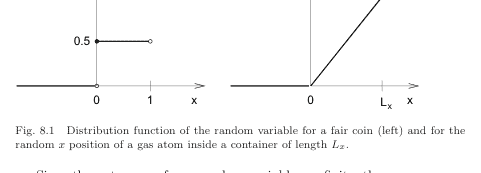

图 8.1 硬币（左侧）随机变量的分布函数以及容器长度为 $L_x$ 内气体原子随机 x 位置的分布函数。

由于任何随机变量的结果都是有限的，在极限 $x \to -\infty$ 时不存在可能的 $X \le x$ 结果。另外，所有可能的结果在 $x \to \infty$ 时都满足 $X \le x$。因此，对所有随机变量都有 $\lim_{x\to -\infty} F(x) = 0$ 且 $\lim_{x\to +\infty} F(x) = 1$。此外，由定义 8.5，

立即可得：

$$P(x_0 < X \le x_1) = F_X(x_1) - F_X(x_0) \tag{8.11}$$

因此，可以计算任意区间（从而也是区间的并集）上得到随机数的概率。

分布函数虽然包含所有信息，但有时处理起来不太方便，因为它给出的是累积概率的信息。更直观的做法是直接描述随机实验的结果。为此，我们必须区分 *离散* 随机变量，其可能结果的数量是可数甚至有限的，以及 *连续* 随机变量，其可能结果是不可数的。描述硬币的随机变量是离散的，而容器内原子的位置是连续的。

### 8.1.1 离散随机变量

我们首先集中讨论离散随机变量。这里，分布函数的一种替代但等价的描述是直接给出每个可能结果的概率：

**定义 8.6** 对于离散随机变量 $X$，*概率质量函数*（pmf）$p_X : \mathbb{R} \to [0,1]$ 给出为

$$p_X(x) = P(X = x). \tag{8.12}$$

同样，下标 $X$ 若不引起混淆可省略。由于离散随机变量只描述可数个结果，概率质量函数几乎处处为零。以下，满足 $p_X(x) > 0$ 的结果 $x$ 用 $\tilde{x}_i$ 表示。由于概率必须和为一，见式 8.1，可得 $\sum_i p_X(\tilde{x}_i) = 1$。有时我们也写 $p_i = p_X(\tilde{x}_i)$。分布函数 $F_X(x)$ 可通过对小于或等于 $x$ 的所有结果的概率求和由 pmf 得到：

$$F_X(x) = \sum_{\tilde{x}_i \le x} p_X(\tilde{x}_i) \tag{8.13}$$

例如，由公平硬币产生的随机变量的 pmf，式 (8.9)，由 $p(0) = 0.5$ 和 $p(1) = 0.5$ 给出（$p(x) = 0$ elsewhere）。推广到可能不公平的硬币，其中结果“1”以概率 $p$ 出现，导致：

这样，认识到 E[X] 是一个数，可得：

σ² = Var(X) = E[(X − E[X])²] = E[X² − 2 E[X] E[X] + E[E[X]²]] = E[X²] − E[X]² = E[X²] − μ²  (8.21)
⇔ E[X²] = σ² + μ²  (8.22)

方差不是线性的，这可以从两个独立随机变量 X₁、X₂ 的线性组合中看出（意味着 E[X₁X₂] = E[X₁]E[X₂] (*))

σ²_{α₁X₁+α₂X₂} = Var[α₁X₁ + α₂X₂]
= E[(α₁X₁ + α₂X₂)²] − E[α₁X₁ + α₂X₂]²
= E[α₁²X₁² + 2α₁α₂X₁X₂ + α₂²X₂²] − (α₁E[X₁] + α₂E[X₂])²
= α₁²E[X₁²] + α₂²E[X₂²] − α₁²E[X₁]² + α₂²E[X₂]²
= α₁²Var[X₁] + α₂²Var[X₂]  (8.23)

期望值 E[Xⁿ] 称为分布的 n’th 阶矩。这意味着期望值是第一阶矩，方差可以由第一和第二阶矩计算得出。

接下来，我们描述离散随机变量的另外两个重要分布。首先，如果重复进行 n 次伯努利实验，可以测量结果“1”出现的次数。形式上，这可以写成 n 个伯努利分布的随机变量 X⁽ⁱ⁾ 的和：X = Σᵢ₌₁ⁿ X⁽ⁱ⁾，参数为 p。这是一个随机变量变换的非常简单的例子，见第 249 页。特别是，该变换是线性的。得到 x 次结果“1”的概率计算如下：得到恰好 x 次“1”的概率为 pˣ，其余 n − x 次实验得到“0”，其概率为 (1−p)ⁿ⁻ˣ。此外，有 C(n,x)=n!/(x!(n−x)!) 种不同的序列，其中有 x 次“1”和 n − x 次“0”。因此，可得：

### 定义 8.9

二项分布，其参数为 n ∈ ℕ 和 p (0 < p ≤ 1)，描述了一个随机变量 X，其 pmf 为

p_X(x) = (n choose x) pˣ (1−p)ⁿ⁻ˣ   (0 ≤ x ≤ n)  (8.24)

常用记号为 X ~ B(n,p)。

此外，可以仅重复伯努利实验直到第一次观察到“1”，试验次数无限制。如果在恰好 x 次后第一次观察到“1”，则前 x − 1 次的结果为“0”。其概率为 (1 − p)^{x−1}。在第 x 次实验中，观察到结果“1”，其概率为 p。因此可得

### 定义 8.11
几何分布，其参数为 p (0 < p ≤ 1)，描述了一个随机变量 X，其 pmf 为

p_X(x) = (1 - p)^{x-1} p   (x ∈ ℕ)   (8.28)

pmf 的示例图（至 x = 10）显示在图 8.2 右侧。几何分布具有（此处不加证明）期望值 E[X] = 1/p，方差 Var[X] = (1−p)/p² 以及如下分布函数：

F_X(x) = { 0          x < 1 ; 1 - (1 - p)^m   m ≤ x < m + 1   (m ∈ ℕ) }

### 8.1.2 连续随机变量

如上所述，如果随机变量描述的是可以得到实数子集中的结果的随机实验，则称其为连续的。也可以使用分布函数来描述此类随机变量，见定义 8.5。对于连续随机变量，存在一种替代描述，等价于离散随机变量的 pmf：概率密度函数说明单位内得到某一数值的概率：

### 定义 8.12
对于具有连续分布函数 F_X 的连续随机变量 X，概率密度函数（pdf）p_X : ℝ → [0,1] 给出为

p_X(x) = dF_X(x)/dx   (8.29)

因此，利用导数的定义并利用式 (8.11) 可得

$F_X(x) = \int_{-\infty}^{x} d\tilde{x}\, p_X(\tilde{x})\tag{8.30}$

$P(x_0 < X \le x_1) = \int_{x_0}^{x_1} d\tilde{x}\, p_X(\tilde{x})\tag{8.31}$

下面给出一些重要连续随机变量的例子。首先，我们将定义 8.13 中期望值和方差的定义推广到连续情形：

### 定义 8.13

- *期望值* 为

  $E[X] = \int_{-\infty}^{\infty} dx\, x p_X(x)\tag{8.32}$

- *方差* 为

  $Var[X] = E[(X - E[X])^2] = \int_{-\infty}^{\infty} dx\, (x - E[X])^2 p_X(x)\tag{8.33}$

期望值和方差具有与离散情形相同的性质，即式 (8.20)、(8.21) 和 (8.23) 仍然成立。连续分布的 n’th 阶矩的定义也相同。

另一个感兴趣的量是 *中位数*，它描述了分布的中心点。它由这样一个点给出，使得该点左右的累积概率都等于 0.5：

### 定义 8.14

中位数 $x_{med} = \text{Med}|X|$ 定义为 $F_X(x_{med}) = 0.5\tag{8.34}$

最简单的分布是均匀分布，其中概率密度函数在某个区间 $[a, b)$ 内非零且为常数：

### 定义 8.15

*均匀分布*，其实值参数为 $a < b$，描述了一个随机变量 $X$，其 pdf 为

$p_X(x) = \begin{cases}0 & x < a \\ \frac{1}{b-a} & a \le x < b \\ 0 & x \ge b\end{cases}\tag{8.35}$

记作 $X \sim U(a,b)$。


分布函数从 x = a 处开始，简单地线性上升，直到在 x = b 处达到 1，例如参见式 8.10 中 a = 0、b = L_x 的情形。均匀分布的期望值为 E[X] = (a + b)/2，方差为 Var[X] = (b − a)^2/12。注意，通过线性变换 g(X) = (b − a) * X + a，若 X ~ U(0,1)，则可得 g(X) ~ U(a, b)。均匀分布是计算机上生成（伪）随机数的基础，参见 8.2.1 节。所有分布都可以通过某种方式从一个或多个均匀分布的变换得到，参见 8.2.2–8.2.5 节。

在模拟的背景下，最重要的连续分布可能是高斯分布：

**定义 8.16** 高斯分布（也称正态分布）具有实值参数 μ 和 σ > 0，它描述一个随机变量 X，其概率密度函数为

$p_X(x) = \frac{1}{\sqrt{2\pi\sigma^2}} \exp\left(-\frac{(x - \mu)^2}{2\sigma^2}\right)$ (8.36)

记作 X ~ N(μ, σ²)。

高斯分布的期望值为 E[X] = μ，方差为 Var[X] = σ²。参数 μ = 5、σ = 3 时该分布的示例图如图 8.3 左侧所示。μ = 0、σ = 1 的高斯分布称为标准正态分布 N(0,1)。对 X0 ~ N(0,1) 施加变换 g(X0) = σ X0 + μ，可以得到任意高斯分布。注意，高斯分布的分布函数无法解析计算。因此，通常使用数值积分或 N(0,1) 的查表值。

**定理 8.1** 设 X^(1), X^(2), ..., X^(n) 是独立随机变量，它们都服从同一分布，且期望值为 μ，方差为 σ²。那么

$X = \sum_{i=1}^{n} X^{(i)}$ (8.37)

在 n 很大时近似服从均值为 nμ、方差为 nσ² 的高斯分布，即 X ~ N(nμ, nσ²)。

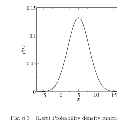

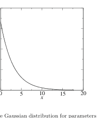

图 8.3 （左）参数 μ = 5、σ = 3 的高斯分布概率密度函数。（右）参数 μ = 3 的指数分布概率密度函数。

*等价地，经过适当归一化的和*

$$Z = \frac{\frac{1}{n}\sum_{i=1}^{n} X^{(i)} - \mu}{\sigma / \sqrt{n}} \tag{8.38}$$

*近似服从标准正态分布 $Z \sim N(0,1)$。*

关于证明，请参阅概率论的标准教材。由于随机过程之和在自然界中非常常见，高斯分布无处不在。例如，在液体中游动的“大”粒子的运动——即所谓的*布朗运动*——就用高斯分布来描述。另一种常见的概率分布是指数分布。

**定义 8.17** *指数分布*具有实值参数 μ > 0，它描述一个随机变量 X，其概率密度函数为

$$p_X(x) = \begin{cases} 0 & x < 0 \\ \frac{1}{\mu} \exp(-x/\mu) & x \ge 0 \end{cases} \tag{8.39}$$

参数 μ = 3 时该分布的示例图如图 8.3 右侧所示。指数分布的期望值为 E[X] = μ，方差为 Var[X] = μ²。其分布函数可以解析求得，为

$$F_X(x) = 1 - \exp(-x/\mu) \tag{8.40}$$

**定义 8.20** 具有 ν > 0 个自由度的卡方分布描述一个随机变量 X，其概率密度函数为（利用 Gamma 函数 Γ(x)=∫₀^∞ t^{x-1} e^{-t} dt）

$$p_X(x)=\frac{1}{2^{ν/2}Γ(ν/2)} x^{ν/2-1} e^{-x/2}\quad (x>0)\tag{8.45}$$ 

且对于 x ≤ 0，p_X(x)=0。

这里不给出分布函数、均值和方差。卡方分布的随机变量可以由 ν 个标准正态分布随机变量 X_i 的平方和得到：X = Σ_{i=1}^ν X_i^2。GNU 科学库中实现了卡方分布（参见 7.3 节）。

**定义 8.21** 具有 d₁、d₂ > 0 个自由度的 F 分布描述一个随机变量 X，其概率密度函数为

$$p_X(x)=\frac{d_1^{d_1/2} d_2^{d_2/2}}{Γ(d_1/2)Γ(d_2/2)} \frac{x^{d_1/2-1}}{(d_1 x + d_2)^{(d_1+d_2)/2}}\quad (x>0)\tag{8.46}$$ 

且对于 x ≤ 0，p_X(x)=0。

这里不给出分布函数、均值和方差。F 分布的随机变量可以由具有 d₁ 自由度的卡方分布随机变量 Y₁ 和具有 d₂ 自由度的卡方分布随机变量 Y₂ 通过 X = (Y₁/d₁)/(Y₂/d₂) 得到。GNU 科学库中实现了 F 分布（参见 7.3 节）。

最后注意，如果应用所谓的 delta 函数 δ(x−x₀)，离散随机变量也可以用概率密度函数来描述。但就计算机模拟而言，这并非必要。因此，这里不再作进一步介绍。

## 8.2 生成（伪）随机数

在科学、经济学或社会科学中的许多模拟中，随机数是必要的。很多时候，模型本身具有随机的参数，这些参数在整个模拟过程中保持不变；这称为淬火无序。凝聚态物理中的一个著名例子是自旋玻璃，它是磁性材料和非磁性材料的随机合金。

在这种情况下，当对小系统进行模拟时，必须对不同无序实现取平均才能获得物理量。每个无序实现由随机选择的磁性粒子与非磁性粒子的位置组成。要在模拟中生成无序实现，就需要随机数。

但是，即使被模拟的系统本身不是随机的，算法也常常需要随机数，例如实现有限温度系综或使用随机化算法时。总之，随机数在计算机模拟中的应用无处不在。

本节介绍随机数的生成。首先解释如何在计算机上生成随机数。然后介绍获得服从目标分布的数的方法：*反演法*、*舍选法*和*Box–Müller 方法*。关于这些方法及类似技术的更详细信息，可参见文献 [Morgan (1984); Devroye (1986); Press et al. (1995)]。本节假设你已经熟悉 8.1 节中介绍的概率论与统计学的基本概念。

### 8.2.1 均匀（伪）随机数

首先应指出，标准计算机是确定性机器。因此，完全不可能直接生成真正的随机数。例如，可以考虑与用户的交互。比如，可以测量连续按键之间的时间间隔，该间隔本质上是随机分布的。但由此得到的时间间隔高度依赖于当前用户，这意味着其统计性质无法控制。另一方面，有些外部设备内置了真正的随机物理过程，可以连接到计算机 [Quantis; Westphal]，或通过互联网使用 [Hotbits]。然而，由于这些数字是真正随机的，它们无法以可控且可复现的方式进行随机模拟。这在科学背景下很重要，因为引人注目或意外的结果常常会被其他研究小组尝试复现。此外，某些程序缺陷只会在特定的随机数下出现。因此，为了调试的目的，能够精确地重复运行同一模拟是很重要的。另外，对于真正的随机数，如果成本低，则生成速度受限；否则，生成器又很昂贵。

这就是通常使用*伪随机数*的原因。它们由确定性规则生成。作为基础的是一个数字生成器


用于均匀分布的 function rand()。每次调用 rand() 时，都会返回一个新的（伪）随机数。（为方便起见，此后省略“伪”字）这些随机数应“看起来像”真正的随机数，并应具有它们的许多性质。人们说它们应“良好”。“看起来像”和“良好”的含义必须加以明确：人们希望有一个随机数生成器，使得每个可能出现的数字确实具有相同的出现概率。此外，如果两个生成的数字 r_i、r_k 仅略有不同，则分别后续调用返回的随机数 r_{i+1}、r_{k+1} 应有显著差异，因此连续数字应具有较低的相关性。指定相关性的方法有很多，因此没有唯一的标准。下面将讨论最简单的一种。

生成伪随机数最简单的方法是线性同余生成器。它们通过递归规则生成一个序列 x_1, x_2, ...，其中的整数介于 0 和 m - 1 之间：

x_{n+1} = (a x_n + c) mod m .        (8.47)

初始值 x_0 称为种子。这里展示了一个简单的 C 实现 lin_con()。它将当前数字存储在局部变量 x 中，该变量被声明为 static，因此即使函数终止后也能被记住（参见第 1.2 节第 42 页）。有两个参数。第一个参数 set_seed 指示是否要设置种子。如果是，则应将新种子作为第二个参数传递，否则第二个参数的值将被忽略。函数在种子被更改时返回种子，或返回新的随机数。注意常数 a 和 c 在函数内部定义，而模数 M 通过宏 RNG_MODULUS 实现，以便在 lin_con() 之外可见：

| 获取源代码 |
| --- |
| 目录: randomness |
| 文件: rng.c |

```c
#define RNG_MODULUS 32768            /* modulus */

int lin_con(int set_seed, int seed)
{
    static int x = 1000;            /* current random number */
    const int a = 12351;            /* multiplier */
    const int c = 1;                /* shift */
    if(set_seed)                      /* new seed ? */
        x = seed;
    else                              /* new random number ? */
        x = (a*x+c) % RNG_MODULUS;

    return(x);
}
```

如果只是想获得下一个随机数，则无需关心种子。因此，我们为方便起见使用 rand_lin_con() 来调用 lin_con()，其第一个参数为 0：

```c
int rand_lin_con()
{
    return(lin_con(0,0));
}
```

如果想设置种子，我们也为方便起见使用一个特殊的简单函数 srand_lin_con()：

```c
void srand_lin_con(int seed)
{
    lin_con(1, seed);
}
```

要生成分布在区间 [0, 1) 中的随机数 r，需要将当前随机数除以模数 m。希望在该区间内获得均匀分布的结果，即均匀分布。从该分布生成的随机数可作为输入，用于生成服从其他、基本任意分布的随机数。下面将看到如何生成服从其他分布的随机数。以下简单的 C 函数使用上面定义的宏 RNG_MODULUS 生成 [0, 1) 中的随机数：

```c
double drand_lin_con()
{
    return( (double) lin_con(0,0) / RNG_MODULUS);
}
```

必须选择参数 a、c、m 的方式以获得“良好”的随机数，其中“良好”意为“相关性更少”。请注意，过去由于使用了不良的随机数生成器，多个模拟结果已被证明是错误的 [Ferrenberg et al. (1992); Vattulainen et al. (1994)]。

### 示例 8.1

要了解“不良生成器”的含义，以参数 a = 12351、c = 1、m = 2^15 和种子值 x_0 = 1000 为例。生成 10000 个随机数，将它们各自除以 m。它们分布在区间 [0, 1) 中。图 8.5 显示了随机数的分布。

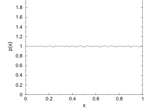

图 8.5 在区间 [0, 1) 中随机数的分布，通过将直方图转换为 pdf 得到，参见第 8.3.3 节。随机数使用参数 a = 12351、c = 1、m = 2^15 的线性同余生成器生成。

分布看起来相当平坦，但仔细观察可以发现一些规律性。这些规律性可以通过记录 k 个连续随机数的 k 元组 (x_i, x_{i+1}, ..., x_{i+k-1}) 来研究。 一个没有相关性的良好随机数生成器会均匀地填满 k 维空间。不幸的是，对于线性同余生成器，点反而位于 (k − 1) 维平面上。可以证明，这样的平面数量最多为 m^{1/k} 量级。不良的生成器具有更少的平面。这就是上面研究的示例的情况，见图 8.6 的上半部分

对于 a = 12350 的结果更糟：仅生成 15 个不同的“随机”数（种子为 1000），然后迭代达到不动点（图中未显示）。

如果改为选择 a = 12349，两点相关性看起来像图 8.6 下半部分所示。显然，行为更加不规则，但在更高阶的 $k$-元组中仍可能出现较差的相关性。

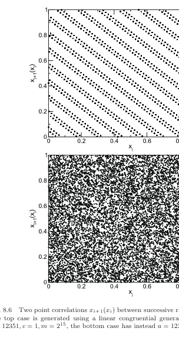

图 8.6 连续随机数 $x_i, x_{i+1}$ 之间的两点相关性 $x_{i+1}(x_i)$。上例使用参数 $a = 12351$、$c = 1$、$m = 2^{15}$ 的线性同余生成器生成，下例则使用 $a = 12349$。

通过了多个经验测试的生成器是 $a = 7^5 = 16807$、$m = 2^{31} - 1$、$c = 0$。实现该生成器时必须小心，因为在计算过程中会生成不适合 32 位的数字。巧妙的实现见文献 [Press et al. (1995)]。最后应强调，与所有线性同余生成器一样，该生成器的低位比特随机性较差。

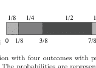

图 8.7 具有四个结果的离散分布，其概率为 p₁ = 1/8、p₂ = 1/4、p₃ = 1/2 和 p₄ = 1/8。概率在区间 [0, 1] 中由子区间表示，各子区间的长度分别等于相应的概率。这允许根据该分布抽取随机数。

离散变量的概率分布，特别是泊松分布。

尽管仅随可能结果数 N 的对数增长已相当高效，但仍存在一种方法 [Walker (1977)]，其中抽取随机数的时间为常数，与 N 无关。下面将对此进行解释，遵循 [Fukui and Todo (2009)] 的实现。

我们将以 N = 5 个可能结果为例，p₁ = 0.1、p₂ = 0.25、p₃ = 0.45、p₄ = 0.1、p₅ = 0.1。基本思想是将不同结果分配到 N 个“包”中。每个包代表权重 p_avg = 1/N。关键点是每个包最多包含两个结果。概率较小的结果 p_i ≤ p_avg 将仅在一个包中表示，而概率较高的结果将包含在多个包中。对于每个包 i，存储表示哪些结果 a_i（也许还有 b_i）以及分数 q_i 属于结果 a_i（结果 b_i 对应分数 1 − q_i）。这些信息存储在表中。一旦表建立好，抽取随机结果就变得简单：首先随机选择包 i，每个包的概率相同为 1/N。为此需要一个 U(0, 1) 均匀分布的随机数。接下来抽取第二个 U(0, 1) 随机数 r。如果 r < q_i，则选择结果 a_i，否则选择 b_i。

只需在实际模拟开始前设置好表即可。具体操作如下：首先将事件 i 分配到包 i 中，设置 a_i = i 且 q_i = p_i。在计算表中，q_i 表示结果 a_i 的概率有多少仍在包 i 中表示。对于本例，该初始情况如图 8.8 所示。接下来，部分排序结果，使得所有 p_i > p_avg 的结果排在前面（左侧），其他结果（p_i ≤ p_avg）排在后面（右侧）。该部分顺序可方便地通过使用两个索引计数器 t₀ 和 t₁ 生成，它们初始时分别放在包 1（C 数组的入口 0）左侧和包 N（C 数组的入口 N − 1）右侧。这些计数器


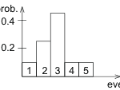

图 8.8 示例中表格的初始表示，其中仅包含结果的概率。柱形的高度对应于概率 $q_i$，柱形中标出的数字对应于结果 $a_i$。

两个指针分别逐步向右和向左移动，直到它们各自指向一个不满足偏序的元素，即 $q_{t_0} > p_{\mathrm{avg}}$ 且 $q_{t_1} < p_{\mathrm{avg}}$。交换这两个元素，于是偏序得到恢复，两个指针可以继续移动。重复此过程，直到两个索引计数器彼此交错，即满足 $t_0 > t_1$。此后，$t_1$ 将指向概率大于 $p_{\mathrm{avg}}$ 的最右侧结果。在我们的示例中，具体情况如图 8.9 所示。

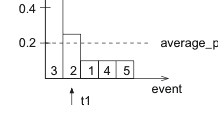

图 8.9 表格重新排列后，所有满足 $q_i > 1/N$ 的结果都位于左侧，其余结果位于右侧。

现在开始设置表格的最后阶段。从右侧开始填充各个包，使每个包所表示的概率均为 $p_{\mathrm{avg}}$。为此，需要从包 $t_1$ 中取出相应的部分，即将 $q_{t_1}$ 减少 $(p_{\mathrm{avg}} - q_t)$，并令 $b_t = a_{t_1}$。

由于 $q_{t_1} > p_{\mathrm{avg}}$，包 $t_1$ 中剩余的数量将为正值，但现在可能小于 $p_{\mathrm{avg}}$。在这种情况下，该包从此属于需要被填满的包。因此，指针 $t_1$ 将向左移动一个位置，即令 $t_1 = t_1 - 1$，然后再次指向一个所表示数量大于 $p_{\mathrm{avg}}$ 的包。对于该示例，情况如图 8.10 所示。

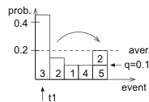

图 8.10 将最右侧的包 $t$ 填充至数量 $p_{\mathrm{avg}} = 1/N$ 后的情况，缺少的数量取自指针 $t_1$ 所指向的包。相应的结果存储在 $b_t$ 中，在最右侧包顶部以数字“2”表示。由于包 $t_1$ 中的数量已降至 $p_{\mathrm{avg}} = 1/N$ 以下，因此 $t_1$ 向左移动一个位置。

重复此过程，直到所有包都填充至 $p_{\mathrm{avg}} = 1/N$ 的水平。最终得到图 8.11 所示的情况（其中 $q_1 = 0.2$、$q_2 = 0.15$，且 $q_3 = q_4 = q_5 = 0.1$）。注意，最左侧的包始终只包含它在开始时所表示的结果，因此 $q_1 = 1/N$。

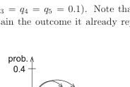

图 8.11 所有包均已排列为表示数量 $p_{\mathrm{avg}} = 1/N$ 后的表格结果。

到目前为止，$q_i$ 的值表示结果 $b_i$ 的全局概率。为了能够按照上文所述抽取随机数，需要将它们转换为条件概率，仅表示结果 $a_i$ 在第 $i$ 个包中的相对占比。由于每个包表示的数量为 $p_{\mathrm{avg}} = 1/N$，根据公式 (8.5)，所有 $q_i$ 的值都必须除以 $p_{\mathrm{avg}}$，即乘以 $N$。

要求你在练习 (2) 中实现这种方法。尽管使用该方法抽取随机数只需要常数级的计算步骤，但每次都需要生成两个（伪）随机数。因此，与本节开头介绍的直接方法相比，只有在可能结果数量 $N$ 较大时，该实现才更高效。

由于使用这些方法可以生成所有可能的离散分布，下面我们将重点介绍生成连续随机变量的技术。

### 8.2.3 逆变换法

给定一个随机数生成器 `drand()`，假设它生成在 $[0, 1]$ 上均匀分布的随机数 $U$。目标是生成具有概率密度 $p_Z(z)$ 的随机数 $Z$。相应的分布函数为

\[F_Z(z) \equiv P(Z \le z) \equiv \int_{-\infty}^{z} dz' p_Z(z') \qquad (8.48)\]

目标是找到一个函数 $g(u)$，使得经过变换 $Z = g(U)$ 后，$Z$ 的结果服从式 (8.48) 所表示的分布。假设 $g$ 可逆且严格单调递增，则有

\[F_Z(z) = P(Z \le z) = P(g(U) \le z) = P(U \le g^{-1}(z)) \qquad (8.49)\]

由于均匀分布变量的分布函数 $F_U(u) = P(U \le u)$ 就是 $F_U(u) = u$（$u \in [0, 1]$），因此可以得到 $F_Z(z) = g^{-1}(z)$。所以，只需选择 $g(z) = F_Z^{-1}(z)$ 作为变换函数，就可以得到服从概率分布 $F_Z(z)$ 的随机数。当然，只有在 $F_Z$ 可逆时，这种方法才有效。如果无法求逆，可以使用后续章节介绍的方法；或者生成一个分布函数表。该表实际上是分布函数的离散化近似，然后可以使用第 8.2.2 节中所示的生成离散随机数的方法。这种方法还可以通过使用分布函数的线性化近似来进一步改进。这里不再展开细节，而是给出一个分布函数确实可以求逆的示例。

**示例 8.2** 考虑参数为 $\mu$ 的指数分布，其分布函数为 $F_Z(z) = 1 - \exp(-z/\mu)$，参见第

可以看到偏差。这些偏差是由统计波动造成的，因为此处的 $p_Z(z)$ 非常小。

### 8.2.4 拒绝法

如上所述，只有当分布函数 $P$ 可以进行解析求逆时，逆变换法才有效。对于不满足这一条件的分布，有时可以通过生成多个随机数并以巧妙的方式将它们组合起来，克服这一问题。

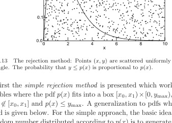

图 8.13 拒绝法：点 $(x,y)$ 在一个有界矩形上均匀散布。满足 $y \le p(x)$ 的概率与 $p(x)$ 成正比。

首先介绍适用于随机变量的简单拒绝法：其概率密度函数 pdf $p(x)$ 能够放入矩形框 $[x_0,x_1] \times [0, y_{\max}]$ 中，即当 $x \notin [x_0,x_1]$ 时 $p(x) = 0$，且 $p(x) \le y_{\max}$。下面将给出无法装入矩形框的 pdf 的推广方法。对于简单方法，按照 $p(x)$ 生成随机数的基本思想是：生成在 $[x_0,x_1] \times [0, y_{\max}]$ 中均匀分布的随机点对 $(x,y)$，并且只接受满足 $y \le p(x)$ 的点，即位于 $p(x)$ 曲线下方的点对，参见图 8.13。因此，抽取到 $x$ 的概率与 $p(x)$ 成正比，符合预期。

下面的 C 函数实现了适用于任意 pdf 的拒绝法。它的参数包括矩形框的边界 $y_{\max}$、$x_0$ 和 $x_1$，以及指向实现 pdf 的函数的指针 `pdf`。有关函数指针的解释，请参见第 59 页。

|  |
|---|
| 获取源代码 |
| 目录：randomness |
| 文件：reject.c |

```
double reject(double y_max, double x0, double x1,
    double (* pdf)(double))
{
    int found;                /* flag if valid number has been found */
    double x,y;               /* random points in [x0,x1]x[0,p_max] */
    found = 0;
    while(!found)             /* loop until number is generated */
    {
        x = x0 + (x1-x0)*drand48();     /* uniformly on [x0,x1] */
        y = y_max *drand48();           /* uniformly in [0,p_max] */
        if(y <= pdf(x))                 /* accept ? */
            found = 1;
    }
    return(x);
}
```

在第 10—11 行中，生成了在矩形框内均匀分布的随机点。第 12—13 行检查是否找到了位于 pdf 曲线下方的点。循环中的搜索过程（第 8—14 行）会持续进行，直到接受某个随机数，并在第 15 行返回该随机数。

**示例 8.3**

将拒绝法应用于一个 pdf：在 $[0,0.5]$ 上密度为 1，在 $[1,1.5]$ 上从 0 线性上升到 4，在其他位置均为 0。该 pdf 由以下 C 函数实现：

```
double pdf(double x)
{
    if ( (x<0)||
        ((x>0.5)&&(x<1))||
        (x>1.5) )
        return(0.0);
    else if((x>0)&&(x<0.5))
        return(1.0);
    else
        return(4.0*(x-1));
}
```

由此得到的经验直方图 pdf 如图 8.14 所示。

如果概率密度可以装入矩形框，始终可以应用简单拒绝法，但它的缺点是必须生成多于实际使用数量的随机数：如果 $A = (x_1 - x_0)/y_{\max}$ 是矩形框的面积，那么平均需要生成 $2A$ 个辅助随机数，才能得到一个服从目标分布的随机数。如果这会导致


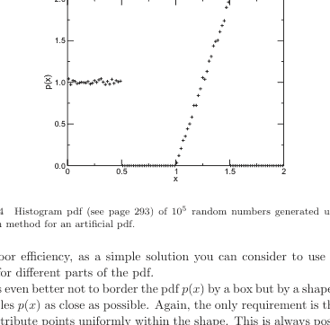

图 8.14 使用拒绝方法生成的 \(10^5\) 个随机数的直方图 pdf（见第 293 页），用于人工 pdf。

效率非常差，作为一种简单的解决方案，可以考虑对 pdf 的不同部分使用多个盒子。

更好的做法不是用盒子限制 pdf \(p(x)\)，而是用一个尽可能接近 \(p(x)\) 的形状来限制它。再次强调，唯一的要求是可以在该形状内均匀分布点。这总是可能的，如果该形状由函数 \(c q(x)\) 给出，并且 \(q(x)\) 是另一个 pdf，且其随机数生成可以很容易地完成，例如使用反演方法。边界条件 \(p(x) \le c q(x)\) 必须在 pdf \(p(x)\) 的整个支撑域内满足。请注意，这种方法在许多情况下也允许为支撑域延伸到无穷大的 pdf 生成随机数。

详细来说，该方法的工作原理如下：首先根据 pdf \(q(x)\) 生成一个随机数 \(x\)。接下来，生成一个随机数 \(y\)，它在 \([0, c q(x)]\) 中均匀分布，即通过在 \([0,1]\) 中均匀抽取一个数并乘以 \(c q(x)\) 得到。最后，如果 \(y < p(x)\)，则接受该数 \(x\)。因此，接受的概率由 \(p(x)/(c q(x))\) 给出。由于第一步生成 \(x\) 的概率密度为 \(q(x)\)，\(x\) 被生成且被接受的联合概率为

\[
p(x,\mathrm{accept}) = \frac{p(x)}{c q(x)} q(x) = \frac{p(x)}{c}.
\]

因此，该概率与 \(p(x)\) 成正比。再次强调，未被接受的数 \(x\) 只是被忽略，即该过程重复进行直到有一个数被接受。任意数 \(x\) 被接受的概率 simply 是对 \(p(x,\mathrm{accept})\) 的积分，即

\[
p_{\mathrm{accept}} = \int_{-\infty}^{\infty} dx\, p(x,\mathrm{accept}) = \int_{-\infty}^{\infty} dx\, \frac{p(x)}{c} = \frac{1}{c}\int_{-\infty}^{\infty} dx\, p(x) = \frac{1}{c},
\]

其中最后一个等式由 pdf \(p(x)\) 的归一化得出。最后，在被接受的条件下生成数 \(x\) 的概率根据式 (8.5) 计算为

\[
p(x|\mathrm{accept}) = p(x,\mathrm{accept})/p_{\mathrm{accept}} = \frac{p(x)}{c}/(1/c) = p(x),
\]

如所愿。由于每次迭代生成 2 个随机数 \(x\) 和 \(y\)，每个被接受的数平均生成的随机数个数为 \(2/p_{\mathrm{accept}} = 2c\)。

作为示例，我们将考虑如式 (8.36) 所示的高斯分布，这里取均值 \(\mu = 0\) 和方差 \(\sigma = 1\)。对任意 \(\mu\) 和 \(\sigma > 0\) 的推广在第 8.2.5 节中进行了说明，其中还介绍了一种专门针对高斯数的无拒绝方法。在这里，我们考虑根据高斯分布生成一个正数 \(x\) 的情况。对于一般情况，由于高斯分布的对称性，最后均匀地在 \([0, 1]\) 中抽取一个随机数 \(s\)，如果 \(s < 1/2\) 则对 \(x\) 取负。

为了限制高斯分布，我们对 \(q(x)\) 使用参数为 \(\mu\) 的指数分布，其密度由式 (8.39) 给出。参数 \(\mu\) 的值将在下面确定。选择指数分布是因为如第 8.2.3 节所示，使用反演方法生成指数分布随机数特别简单。乘数 \(c\) 必须选择使得高斯分布的 pdf 完全位于 \(c q(x)\) 之下，见图 8.15。为了最大化效率，\(c\) 应尽可能小。从图 8.15 的观察中可知，\(c\) 的最佳选择应使 \(p(x)\) 和 \(c q(x)\) 在一个点 \(x\) 处恰好相切（并且不在两点相交，也不会完全不相切）。这导致以下条件：

\[
\begin{aligned}
p(x) &= c q(x) \\
\Rightarrow\quad \frac{1}{\sqrt{2\pi}}\exp\left(-x^2/2\right) &= \frac{c}{\mu}\exp\left(-x/\mu\right) \\
\Rightarrow\quad -x^2/2 &= \log\left(\sqrt{2\pi}c/\mu\right) - x/\mu \\
\Rightarrow\quad (x - 1/\mu)^2 &= 1/\mu^2 - 2\log\left(\sqrt{2\pi}c/\mu\right) \\
\Rightarrow\quad x &= 1/\mu \pm \sqrt{1/\mu^2 - 2\log\left(\sqrt{2\pi}c/\mu\right)}
\end{aligned}
\]

为了使函数 \(c q(x)\) 最小，我们需要对 \(\mu\) 最小化 \(c\)，即

\[
\begin{aligned}
\frac{dc}{d\mu} &\stackrel{!}{=} 0 \\
\Rightarrow \quad \frac{1}{\sqrt{2\pi}} \exp(1/(2\mu^2)) + \frac{\mu}{\sqrt{2\pi}} \frac{-1}{\mu^3} \exp(1/(2\mu^2)) &= 0 \\
\Rightarrow \quad 1 - \frac{1}{\mu^2} &= 0 \\
\Rightarrow \quad \mu &= \pm 1 .
\end{aligned}
\]

由于 \(\mu\) 限制为正值（否则指数分布不归一化），我们得到 \(\mu = 1\)。由于 \(c(\mu)\) 在 \(\mu \to 0\) 和 \(\mu \to \infty\) 两个极限下都趋于无穷大，\(\mu = 1\) 确实是使 \(c\) 最小的最优选择。因此，对于边界函数我们得到简单的指数函数 \(q(x) = \exp(-x)\)，并且由式 (8.50) 将 \(\mu = 1\) 代入得到常数 \(c = \sqrt{e/(2\pi)}\)。请注意，这一计算和结果专门针对通过指数函数限制 pdf 来生成高斯随机数。尽管如此，找到合适的函数 \(q(x)\) 的一般方法类似：必须选择一个函数 \(q(x)\)，使得随机数可以很容易生成。同时还必须确定常数 \(c\)，使得 \(c q(x)\) 尽可能紧密地限制 pdf。通常这涉及对 \(q(x)\) 的一个或多个参数最小化 \(c\)。

为了说明结果，在图 8.16 中，高斯分布与最优边界函数 \(\exp(1/2 - x)/\sqrt{2\pi}\) 以及在边界函数下均匀分布的一些点一起显示。在练习 (4) 中，要求你实现一个 C 函数来实现高斯分布的拒绝方法。

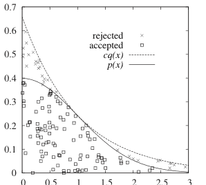

图 8.16 标准高斯在正 \(x\) 轴上的 pdf \(p(x)\)，与其边界函数 \(c q(x)=\exp(1/2-x)/\sqrt{2\pi}\) 以及 100 个在边界函数下以均匀概率散布的点 \((x,y)\)。曲线 \(p(x)\) 下方的点被接受，即 \(x\) 坐标将被作为样本结果取用。

拒绝方法也可以推广到更高维度。作为示例，这里考虑生成在超球体内或其表面上均匀分布的随机数。因此，我们考虑二维中的圆或三维中的球。这在研究真实空间中的随机运动时很有用，例如在 *随机游走模型* 中。原则上，也可以通过合适的坐标变换使用反演方法。这在二维中相当简单，在三维中稍困难，但在更高维度中可能变得相当繁琐。相比之下，目前的方法非常简单，适用于所有维度 \(d\)。这里我们考虑单位超球体，即半径为一。基本思想是在超立方体 \([-1, 1]^d\) 中生成均匀向量 \(\vec{x} = (x_1, x_2, \ldots, x_d)\)，计算其平方长度 \(|\vec{x}|^2 = \sum_i x_i^2\) 并拒绝所有满足 \(|\vec{x}|^2 > 1\) 的向量。因此，超球体是从超立方体中“切出”的。由于超立方体中的分布是均匀的，超球体中的分布也是均匀的。如果你希望在超球体表面上得到均匀分布，可以将球体内部的所有值投影到表面上，即对未被拒绝的那些值取 \(\vec{x}' = \vec{x}/|\vec{x}|\)。

下面展示了一个生成超球体内或其表面随机数的 C 函数。它接受系统的维度、待生成的向量 \(\vec{x}\)（即指针）以及一个标志 surface 作为参数。当 surface 为 0 时，点在超球体内生成，否则在超球体表面生成。该函数返回生成返回向量所需的试验次数。\(^2\)

| 获取源代码 | |
|---|---|
| 目录: | randomness |
| 文件: | sphere.c |

\(^2\)请注意，这可用于数值估计 \(\pi\) 的值：在二维中，单位圆的面积为 \(\pi\)，而正方形的面积为 4。因此，在多次调用的平均下，成功试验的比例应收敛到 \(\pi/4 \approx 0.7854\)。


```
int generate_sphere(int dim, double *x, int surface)
{
    int num_trials;
    int d;                         /* loop counter */
    double magnitude;              /* square magnitude of vector */

    num_trials = 0;
    do
    {
        num_trials++;
        magnitude = 0;
        for(d=0; d<dim; d++)        /* generate point in [0,1]^dim */
        {
            x[d] = 2*drand48()-1.0;
            magnitude += x[d]*x[d];
        }
    } while(magnitude > 1.0);       /* until in unit sphere ? */

    magnitude = sqrt(magnitude);
    if(surface)
        for(d=0; d<dim; d++)        /* normalize point to length 1 */
            x[d] /= magnitude;
    return(num_trials);
}
```

第8–17行的主循环会一直执行，直到获得超球体内的一个点 x̄。其中，循环（第12–16行）在超立方体 [−1,1]^d 内生成一个均匀分布的点，并同时计算向量的长度。最后一部分（第19–22行）在标志 surface 被设置时执行到超球面上的投影。

作为数值实验，在单位圆内生成了1000个点，并在其圆周上生成了200个点。所得点集的散点图如图8.17所示。

### 8.2.5 高斯分布

如果分布函数既不能求逆，概率又不能放入一个盒子中，就必须采用特殊方法。作为示例，考虑一种生成按高斯分布分布的随机数的方法。其他方法以及如何组合不同技术的示例收集在 [Morgan (1984)] 中。

均值为 μ、方差为 σ² 的高斯分布的概率密度函数如式 (8.36) 所示，另见图8.18。除均匀分布外，它是模拟中最常见的分布。

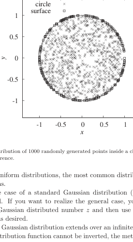

图8.17 在圆内随机生成的1000个点和在其圆周上生成的200个点的分布。

这里考虑标准高斯分布（μ = 0，σ = 1）的情形。如果要实现一般情形，必须抽取一个标准高斯分布数 z，然后使用 σz + μ，它便按所需分布分布。

由于高斯分布延伸到无限区间，并且分布函数不能求逆，上述方法不适用。生成按高斯分布分布的随机数的最简单技术利用中心极限定理 8.1。它告诉我们，K 个独立分布随机变量 Ui（均值为 μ、方差为 v）的任意和将收敛到均值为 Kμ、方差为 Kv 的高斯分布。如果再次取 Ui 在 [0,1) 内均匀分布（其均值为 μ = 0.5、方差为 v = 1/12），则可以选择 K = 12，随机变量 Z = Σ_{i=1}^K Ui -6 将近似按标准高斯分布分布。该方法的缺点是，生成一个最终随机数需要12个随机数，并且大于6或小于-6的数永远不会出现。

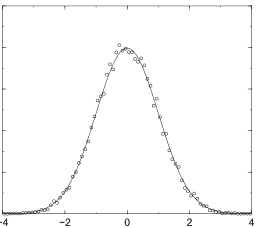

图8.18 零均值、单位宽度的高斯分布。圆圈表示由 Box-Muller 方法抽取的 \(10^4\) 个数值得到的直方图概率密度函数（pdf，见第293页）。

与此技术相比，*Box–Muller 方法* 是精确的。需要两个在 \([0, 1)\) 内均匀分布的随机变量 \(U_1, U_2\) 来生成两个独立的高斯变量 \(N_1, N_2\)。这可以通过从 \(U_1, U_2\) 生成 \(u_1, u_2\) 并赋值来实现：

$$n_1 = \sqrt{-2\log(1-u_1)}\cos(2\pi u_2),\qquad n_2 = \sqrt{-2\log(1-u_1)}\sin(2\pi u_2)$$

证明 \(n_1\) 和 \(n_2\) 确实按 (8.36) 分布的过程如下：让我们把 \(n_1, n_2\) 写成极坐标 \((r, \theta)\)，即 \((r, \theta) = f(n_1, n_2)\)。因此，逆变换为：

$$n_1 = r\cos(\theta),\qquad n_2 = r\sin(\theta).\qquad (8.51)$$

现在我们必须求 \((r, \theta)\) 的概率密度。

一般地，对于通过变换 \((R, \Theta) = f(N_1, N_2)\) 与另外两个随机变量 \(N_1, N_2\) 相联系的两个随机变量 \(R, \Theta\)，设 \(p_{N_1,N_2}\) 为 \((N_1, N_2)\) 的（联合）pdf，则有

$$p_{R,\Theta}(r,\theta)=p_{N_1,N_2}(f^{-1}(r,\theta))|\mathbf{J}^{-1}|,\tag{8.52}$$

其中 $|\mathbf{J}^{-1}|$ 是逆变换的雅可比行列式。因此，我们必须计算式 (8.51) 给出的逆变换的雅可比行列式，由此得到：

$$|\mathbf{J}^{-1}|=\left|\begin{array}{cc}\frac{\partial n_1}{\partial r}&\frac{\partial n_1}{\partial \theta} \\ \frac{\partial n_2}{\partial r}&\frac{\partial n_2}{\partial \theta}\end{array}\right|=\left|\begin{array}{cc}\cos(\theta)&-r\sin(\theta) \\ \sin(\theta)&r\cos(\theta)\end{array}\right|=r\cos^2(\theta)+r\sin^2(\theta)=r.$$

由于 $n_1,n_2$ 应按高斯分布，由式 (8.52) 得到

$$p_{R,\Theta}(r,\theta)=\frac{r}{2\pi}e^{-n_1^2/2-n_2^2/2}=\frac{r}{2\pi}e^{-r^2/2}.\tag{8.53}$$

这个式子可以分解。我们假设 $\theta$ 在 $[0,2\pi)$ 内均匀分布，即密度为 $1/(2\pi)$（通过设置 $\theta=2\pi u_2$ 生成）。剩下 $p_R(r)=r e^{-r^2/2}$。很容易看出，该 pdf 的分布函数为 $F_R(r)=1-\exp(-r^2/2)$（$r\ge 0$）。你可以通过计算 $F_R(r)$ 的导数来验证这一点。因此，可以使用反演方法生成按 pdf $p_R(r)$ 分布的数值。为此我们得到 $r=\sqrt{-2\log(1-u_1)}$。将生成 $\theta$ 和 $r$ 的规则代入逆变换式 (8.51)，得到的结果正好是 Box-Muller 方法给出的公式。

还存在其他生成高斯随机数的方法，其中一些甚至更高效，见参考文献 [Press et al. (1995); Morgan (1984)]。一种基于盒子中粒子模拟的方法在 [Fernandez and Criado (1999)] 中说明。图8.18给出了用 Box-Muller 方法抽取的 $10^4$ 个随机数的直方图概率密度函数（pdf）。注意，你可以在习题 (5) 的解答中找到 Box-Muller 方法的一种实现。

## 8.3 基础数据分析

起点是某个量的 $n$ 个测量点 $\{x_0,x_1,\ldots,x_{n-1}\}$ 的*样本*，这些点由模拟得到。示例包括气体密度、分子两种构象之间的跃迁时间，或股票价格。我们假设从形式上讲，所有测量都可以是

### 8.3.1 Markdown 轻量标记语言

Markdown 是一种轻量级标记语言，创始人为约翰·格鲁伯（John Gruber）。它允许人们"使用易读易写的纯文本格式编写文档，然后转换成有效的 XHTML（或者 HTML）文档。

Markdown 编写的文档可以导出 HTML 、Word、图像、PDF、Epub 等多种格式的文档。

Markdown 文档的扩展名为 .md 或 .markdown，可以使用任意一款文本编辑器打开，也支持市面上的各种主流的办公软件或编辑器。

这两种格式是纯文本文件，不同的是它们扩展名不相同。接下来将针对没有接触过 Markdown 的读者介绍它的常用语法。

下面列举了 Markdown 中的标题、列表、粗体等语法。

- 标题：在文字前添加 `#` 即可创建标题。`#` 的数量表示标题的级别，例如 `#` 表示一级标题，`##` 表示二级标题，以此类推，最多支持六级标题。
- 列表：在文字前添加 `-`、`+` 或 `*` 即可创建无序列表，在文字前添加数字加 `.`（例如 `1.`）即可创建有序列表。
- 粗体：在文字前后添加两个 `*`（例如 `**文本**`）即可加粗文本，添加一个 `*`（例如 `*文本*` 即可让文本变为斜体。

在 Markdown 中插入图片的方法非常简单，只需要使用 `![替代文字]（图片地址）` 这个语法即可。

Markdown 支持嵌入 HTML 标签，可在文档中直接使用 HTML 标签实现在 Markdown 中无法实现的格式效果。

下面通过一个示例来展示 Markdown 的常用语法。

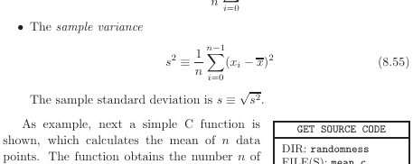

上图演示了 Markdown 基础语法的用法。相应的说明如下。

- 1. 第 1 行，使用一个 `#` 表示一级标题。
- 2. 第 2 行，使用两个 `*` 符号将要加粗的文字括起来。
- 3. 第 3 行，使用 `-` 符号创建无序列表项。
- 4. 第 4 行，使用 `1.` 符号创建有序列表项。

我们建议读者在阅读其他内容之前先熟悉 Markdown 的这些基础语法。

```
double mean(int n, double *x)
{
    double sum = 0.0;          /* sum of values */
    int i;                     /* counter */

    for(i=0; i<n; i++)         /* loop over all data points */
        sum += x[i];
    return(sum/n);
}
```

要求你编写一个类似的函数来计算习题 (5) 中的方差。

样本均值可用于估计分布的期望值 μ ≡ E[X]。该估计是无偏的，这意味着对于任意样本量 n，均值的期望值确实是随机变量的期望值。这很容易证明。注意，从形式上说，样本均值 X̄ 所来自的随机变量为 X̄ = 1/n ∑_{i=0}^{n-1} X_i：

μ_X̄ ≡ E[X̄] = E[ 1/n ∑_{i=0}^{n-1} X_i ] = 1/n ∑_{i=0}^{n-1} E[X_i] = 1/n n E[X] = E[X] = μ (8.56)

这里再次使用了期望值的线性性质。估计量无偏这一事实意味着，如果你通过均值多次重复估计期望值，平均而言会得到正确的值。这与样本量无关。一般地，对于参数 θ 的估计量 h，如果 E[h] = θ，则称其为无偏的。

与你可能因式 (8.16) 和 (8.55) 之间的对称性而预期的情况相反，样本方差不是分布方差 σ² ≡ Var[X] 的无偏估计量，而是有偏的。根本原因如上所述：X̄ 本身就是一个随机变量，由分布 P_X̄ 描述。如式 (8.56) 所示，该分布的均值为 μ，与样本量无关。另一方面，该分布的方差为

σ²_X̄ ≡ Var[X̄] = Var[ 1/n ∑_{i=0}^{n-1} X_i ] ≡ (8.23) 1/n² ∑_{i=0}^{n-1} Var[X_i]
= 1/n² n Var[X] = σ² / n (8.57)


该过程需要运行时间 O(n log n)。然而，存在一种算法 [Press 等 (1995); Cormen 等 (2001)]，它甚至可以在线性运行时间 O(n) 内计算中位数。

### 8.3.2 置信区间

在上一节中，我们研究了利用从一系列独立随机实验中获得的样本，对随机变量 X 的参数进行估计的估计量。这是一种所谓的*点估计量*，因为只估计一个数值。

由于每个估计量本身都是随机变量，因此每个估计值通常都会偏离真值 θ。 consequently，人们希望了解估计值可能偏离真实值 θ 多远。例如，这可以从以下内容获得：

**定义 8.22** 参数 θ 的点估计量 H = h(X_0, X_1, …, X_{n−1}) 的*均方误差*为

$$
MSE(H) ≡ E[(H − θ)²] = E[(H − E[H] + E[H] − θ)²]
= E[(H − E[H])²] + 2E[(H − E[H])(E[H] − θ)] + E[(E[H] − θ)²]
= E[(H − E[H])²] + 2E[(H − E[H])]_{=0}(E[H] − θ) + (E[H] − θ)²
= Var[H] + (E[H] − θ)²  (8.60)
$$

如果估计量是无偏的，即 E[H] = θ，则均方误差由该估计量的方差给出。因此，对于独立样本（每个样本由 n 个样本点组成），如果各估计值彼此接近，则该估计相当准确。不幸的是，通常只有一个样本可用（如何相当巧妙地规避这个问题，见第 8.3.4 节）。此外，均方误差并不能直接提供估计值距离真值 θ 多远的概率解释。

尽管如此，仍可以在概率意义上获得误差的估计。这里我们要计算所谓的置信区间，有时也称为误差棒。

**定义 8.23** 对于描述随机变量的参数 θ，从样本 {x₀, x₁, ..., xₙ₋₁} 得到的两个估计量 l_α = l_α(x_0, x_1, …, x_{n−1}) 和 u_α = u_α(x_0, x_1, …, x_{n−1})，如果对于给定的置信水平 1 − α ∈ (0, 1) 有

P(l_α < θ < u_α) = 1 − α    (8.61)

则它们提供一个置信区间。值 α ∈ (0, 1) 反过来称为显著性水平。

这意味着，真实但未知的值 θ 以概率 1 − α 包含在区间 (l, u) 中，而该区间本身也是一个随机变量。置信水平的典型值为 0.68、0.95 和 0.99（分别对应 α = 0.32、0.05、0.01），置信度依次提高。人们越想确信区间确实包含真实参数，即 α 的值越小，置信区间就会越大。

接下来，简要概述如何得到均值的置信区间；详细信息请查阅专门文献。首先我们回顾，根据其定义，均值是独立随机变量之和。对于计算机模拟，可以假设通常（反例见下文）会进行足够多次实验。⁵ 因此，根据中心极限定理 8.1，X̄ 应当（近似）具有概率密度函数 f_X̄，该函数为高斯分布，其期望值为 μ，某个方差为 σ²_X̄ = σ²/n。这意味着，样本均值落在区间 I = [μ − zσ_X̄, μ + zσ_X̄] 之外的概率 α 可以很容易地从标准正态分布得到。这种情况如图 8.19 所示。注意，该区间关于均值 μ 对称，其宽度以标准差 σ_X̄ 的倍数 z = z(α) 表示。显著性水平 α 与半区间宽度 z 之间的关系正是 ∫_{−z}^{z} dx f_X̄(x) = 1 − α。因此，标准正态分布在区间 [−z, z] 之外的权重为 α。该关系可以从任何标准高斯分布表中获得，也可以从 GNU 科学计算库（见第 7.3 节）的函数 gsl_cdf_gaussian_P() 获得。通常考虑整数值 z = 1、2、3，它们分别对应显著性水平 α = 0.32、0.05 和 0.003。到目前为止，置信区间 I 包含未知期望值 μ 和

未知方差 σ_{\overline{X}}

首先，可以改写

$1 - \alpha = P(\mu - z\sigma_{\overline{X}} \le \overline{X} \le \mu + z\sigma_{\overline{X}})$
$= P(-z\sigma_{\overline{X}} \le \overline{X} - \mu \le z\sigma_{\overline{X}})$
$= P(-\overline{X} - z\sigma_{\overline{X}} \le -\mu \le -\overline{X} + z\sigma_{\overline{X}})$
$= P(\overline{X} - z\sigma_{\overline{X}} \le \mu \le \overline{X} + z\sigma_{\overline{X}})$。

这现在陈述了如下概率：由样本均值 $\overline{X}$ 估计的真值位于一个关于估计值 $\overline{X}$ 对称的区间内。注意，宽度 $2z\sigma_{\overline{X}}$ 基本上由 $\sigma_{\overline{X}} = \sqrt{\text{Var}[\overline{X}]}$ 给出。这解释了为什么本节开头给出的均方误差 $\text{MSE}(H) = \text{Var}[H]$ 是估计量所产生的统计误差的良好度量。这将在第 8.3.4 节中使用。

最后，我们使用 $\frac{n}{n-1}S^2$ 估计真实方差 $\sigma^2$，因此得到 $\sigma_{\overline{X}} = \frac{\sigma}{\sqrt{n}} \approx \frac{S}{\sqrt{n-1}}$。总结得到：

$P\left(\overline{X} - z\frac{S}{\sqrt{n-1}} \le \mu \le \overline{X} + z\frac{S}{\sqrt{n-1}}\right) \approx 1 - \alpha \quad (8.62)$

注意，这个置信区间，其中 $l_\alpha = \overline{X} - z(\alpha)S/\sqrt{n-1}$ 且 $u_\alpha = \overline{X} + z(\alpha)S/\sqrt{n-1}$，关于 $\overline{X}$ 对称；其他置信区间不一定如此。在科学出版物中，为了给出 μ 的估计并包含置信区间，人们常常给出真实均值位于其中的范围，该范围覆盖所有情况的 68%（z = 1），即 $\overline{X} \pm S/\sqrt{n-1}$。这称为标准高斯误差棒或一倍 σ 误差棒。因此，样本方差和样本量决定了误差棒/置信区间。

对于方差，情况更为复杂，因为它并不简单地是统计独立样本点 {x0,x1,...,xn−1} 的和。这里不深入细节，只引用相应统计学文献 [Dekking 等 (2005); Lefebvre (2006)] 中的结果：真实方差以概率 1 − α 位于其中的置信区间由 [σ_l², σ_u²] 给出，其中

σ_l² = ns² / χ²(1 − α/2, n − 1)
σ_u² = ns² / χ²(α/2, n − 1).  (8.63)

这里，χ²(β, ν) 是自由度为 ν 的累积卡方分布的反函数。它表示满足 F(χ², ν) = β 的值，见第 261 页。该卡方函数已在 GNU 科学计算库（见第 7.3 节）的函数 gsl_cdf_chisq_Pinv() 中实现。

注意，作为一种替代方法，你可以将 y_i ≡ (x_i − x̄)² 近似视为独立数据点，并使用上述针对样本 {y_i} 的均值所描述的标准误差估计。此外，也可以使用下文解释的自助法（第 8.3.4 节），它允许为任意估计量计算置信区间。

### 8.3.3 直方图

有时，你不仅想估计潜在分布的矩，还想了解完整分布的情况。在这种情况下，可以使用直方图。

**定义 8.24** 直方图由一组不相交区间

B_k = [l_k, u_k)  (8.64)

给出。

⁵ 对于许多经验实验而言情况有所不同，例如在医学科学中测试新疗法时，通常只能进行非常有限次数的实验。在这种情况下，必须考虑特殊分布，例如*学生分布*。

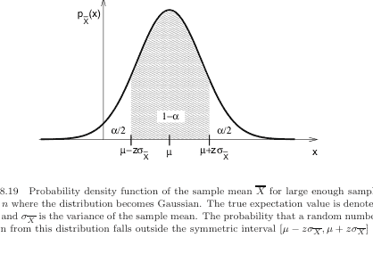

图 8.19 当样本量 $n$ 足够大时，样本均值 $\overline{X}$ 的概率密度函数，此时分布变为高斯分布。真实期望值记为 $\mu$，$\sigma_{\overline{X}}$ 是样本均值的方差。从该分布中抽取的随机数落在对称区间 $[\mu - z\sigma_{\overline{X}}, \mu + z\sigma_{\overline{X}}]$ 之外的概率为 $\alpha$。


例如，当为不同的样本点分配不同权重^6 时，将计数器视为实值变量是有用的。第 5.2 节描述了一个简单的（固定分箱宽度）C 语言直方图实现。*GNU 科学库*（见第 7.3 节）包含实现直方图的数据结构和函数，允许可变分箱宽度。

形式上，对于给定的随机变量 X，第 k 个分箱中的计数 h_k 可以看作参数为 n 和 p_k 的二项随机变量 H_k ~ B(n, p_k) 的一次随机实验结果，其中 p_k = P(X ∈ B_k) 是随机实验 X 的结果落入分箱 B_k 的概率。这意味着直方图分箱的置信区间原则上可以从二项分布获得。然而，对于每个样本，p_k 的真值是未知的，只能通过 q_k ≡ h_k/n 来估计。因此，真实的二项分布是未知的。另一方面，二项随机变量是参数为 p_k 的 n 个伯努利随机变量之和。因此，估计量 q_k 不过是伯努利随机变量的样本均值。如果样本点数量 n “大”（见下文），根据中心极限定理 8.1 以及第 8.3.2 节的讨论，样本均值的分布（事实上是二项分布）近似为高斯分布。因此，在这种情况下可以使用标准置信区间公式 (8.62)：

$$
P\left(q_k - z\frac{S}{\sqrt{n-1}} \le p_k \le q_k + z\frac{S}{\sqrt{n-1}}\right) \approx 1-\alpha \qquad (8.65)
$$

这里，根据公式 (8.19)，伯努利随机变量的样本方差为 s^2 = q_k(1 - q_k) = (h_k/n)(1 - h_k/n)。同样，z = z(α) 表示区间 [−z,z] 的半宽度，使得标准正态分布在该区间外的权重等于 α。因此，具有标准误差棒（z = 1）的估计为 q_k ± √(q_k(1 − q_k)/(n − 1))。

问题仍然存在：什么才算“大”，以至于你可以相信这个“高斯”置信区间？考虑一下，例如你对某个分箱 B_k 一个点也没有测到。这种情况很容易发生在 p_k 小于 1/n 但非零的区域，即在直方图中用于对概率密度函数尾部进行采样的区域。在这种情况下，估计的比例很容易变为 q_k = 0，从而导致零宽度的置信区间，这显然是错误的。这意味着，要使分箱 B_k 的置信区间可靠，所需的样本数量 n 取决于分箱中的条目数。统计学文献中的一个经验法则是 n q_k (1 − q_k) > 9 应成立。如果此条件不满足，则必须从二项分布中获得 q_k 的正确置信区间 [q_{k,l}, q_{k,u}]，这相当复杂，因为它使用了 F 分布（见第 261 页定义 8.21）：

$$
\begin{aligned}
q_{k,l} &= \frac{h_k}{h_k + (n - h_k + 1) F_1} \\
q_{k,u} &= \frac{(h_k + 1) F_2}{(h_k + 1) F_2 + n - h_k},
\end{aligned}
\tag{8.66}
$$

其中

$$
F_1 = F(1 - \alpha/2; 2n - 2h_k + 2, 2h_k)
$$

$$
F_2 = F(1 - \alpha/2; 2h_k + 2, 2n - 2h_k)
$$

值 F(β; r_1, r_2) 表示这样一个 x 值，它使得自由度为 r_1 和 r_2 的 F 分布的分布函数达到值 β。这个逆分布函数在 GNU 科学库中已有实现（见第 7.3 节）。如果你总是使用这些通常关于 q_k 不对称的置信区间，就不可能出错。不过，对于大多数应用而言，标准的高斯误差棒就足够了。

最后，如果你想用直方图来表示来自连续随机变量的样本，你可以很容易地将直方图解释为来自概率密度函数的样本，该样本可以表示为一组点 {(\bar{x}_k, p(x_k))}。这被称为直方图 pdf 或样本 pdf。为简单起见，假设使用区间的中点作为 x 坐标。对于归一化，我们必须除以总计数（如 q_k = h_k / n），并除以分箱宽度。这确保了样本 pdf 的积分（用求和近似）恰好等于 1。因此，我们得到

$$
\bar{x}_k \equiv (l_k + u_k)/2
$$

$$
p(\bar{x}_k) \equiv h_k/(n b_k). \tag{8.67}
$$

无论你选择哪种类型的置信区间，都必须以相同的方式归一化。第 5.2 节展示了一个函数，它能将直方图连同简单高斯误差棒以 pdf 形式打印出来。

对于离散随机变量，直方图可用于估计概率质量函数（pmf）。⁷ 在这种情况下，分箱的选择，特别是分箱宽度，很容易，因为随机实验的所有可能结果通常是已知的。对于用于近似描述连续随机变量的直方图 pdf，分箱宽度的选择很重要。基本上，你必须手动调整宽度，以使样本数据得到“最佳”表示。因此，分箱宽度既不应太小也不应太大。有时，非均匀分箱宽度是最佳选择。在这种情况下，无法给出一般性建议，只能说明在采样数据点较少的区域，分箱宽度应较大。这意味着每个分箱应包含大致相同数量的样本点。对于均匀分箱宽度，存在几种不同的经验法则。例如 $b=3.49 S n^{-1/3}$ [Scott (1979)]，它源于最小化高斯 pdf 与从该高斯分布中抽取的样本之间的平均积分平方差。因此，样本的方差 $S$ 越大，分箱宽度就越大，而增加样本点数量则可以减小分箱宽度。

在任何情况下，你都应该意识到，由于数据点数量有限以及分箱带来的潜在离散性，直方图 pdf 只能是对真实 pdf 的近似。后一个问题近年来已被所谓的*核估计器* [Dekking et al (2005)] 所解决。这里，每个样本点 $x_i$ 由一个所谓的*核函数*表示。核函数 $k(x)$ 是一个尖峰函数，形式上具有以下性质：

- 它在 0 处取得最大值。
- 它在某段距离 $h$ 上衰减到零。
- 它的积分 $\int k(x)\,dx$ 归一化为 1。

常用的核函数例如有三角形、截断的倒抛物线或高斯函数。每个样本点 $x_i$ 通过将核函数平移使其最大值位于 $x_i$ 来表示。pdf 的估计量 $\hat p(x)$ 是所有核函数（每个样本点对应一个）经过适当归一化的和（因子 $1/n$）：

$$
\hat p(x)=\frac{1}{n}\sum_i k(x-x_i) \qquad (8.68)
$$

这些核估计器的优点是，它们通常能得到平滑的函数 $\hat p$，并且对于值 $\hat p(x)$，距离 $x$ 更远的样本点也可能有贡献，其权重随距离增大而减小。最重要的参数是宽度 $h$。$h$ 值太小会导致出现许多可区分的峰，每个样本点对应一个峰。$h$ 值太大会导致重要细节的丢失。这与直方图分箱宽度的选择具有类似的重要性。核函数的选择

原始样本 $\{x_i\}$ 的数据点，每个数据点具有相同的概率 $1/n$。这意味着来自 $\{x_i\}$ 的一些样本点可能在 $\{\tilde{x}_i\}$ 中出现多次，而有些则可能根本不出现。$^9$ 现在，可以对每个 bootstrap 样本计算估计量值 $h^* = h(\tilde{x}_0, \tilde{x}_1, \ldots, \tilde{x}_{n-1})$。对不同的 bootstrap 样本重复此过程 $K$ 次，得到估计量的 $K$ 个值 $h^*_k$ $(k = 1, \ldots, K)$。该样本 $\{h^*_k\}$ 的样本分布函数 $F_{H^*}$ 即为最终结果，它是对所需分布函数 $F_H$ 的近似。注意，第二种近似（用 $F_{H^*}$ 代替 $F_H$）可以通过任意增大 $K$ 来达到任意精度，而且计算成本很低。

你可能会问：这到底是否有效，即 $F_{H^*}$ 是否是 $F_H$ 的良好近似？对于一般情况，没有答案。但在某些情况下有数学证明。例如，对于均值 $H = \overline{X}$，分布函数 $F_{\overline{X}^*}$ 实际上收敛到 $F_{\overline{X}}$。这里唯一微妙之处在于，实际上必须考虑 $\overline{X} - \mu$ $(\mu = E[X])$ 和 $\overline{X} - \bar{x}$ $(\bar{x} = \sum_{j=0}^{n-1} x_j/n)$ 的归一化分布。因此，随机变量只是平移了常数值。对于其他情况，例如估计中位数或方差时，必须以不同的方式归一化，即减去（经验）中位数或除以（经验）方差。然而，对于我们关心的 $F_H$ 的特征，特别是方差（见下文），诸如平移和拉伸之类的归一化并不相关，因此在后续内容中忽略它们。注意，确实存在一些估计量，例如分布的最大值，对于这些估计量，可以反过来证明，即使经过某种归一化，$F_{H^*}$ 也不收敛到 $F_H$。另一方面，为了获得一个不至于太差的误差棒估计，例如，bootstrap 是一种非常方便且合适的方法，近年来已获得高度认可。

现在可以使用 $F_{H^*}$ 来计算任何所需的量。最重要的是置信区间 $[h_l, h_u]$ 的情况，使得对于给定的显著性水平 $\alpha$，区间外的总概率为 $\alpha$，即 $F_{H^*}(h_u) - F_{H^*}(h_l) = 1 - \alpha$。特别地，可以将权重 $\alpha$ 均分在区间的上下两侧，从而确定 $h_l, h_u$

$$
F_{H^*}(h_u) = 1 - \alpha/2, \quad F_{H^*}(h_l) = \alpha/2 . \qquad (8.70)
$$

与第 8.3.2 节中介绍的置信区间类似，$[h_l, h_u]$ 也表示未知参数 $\theta$ 的置信区间，该参数待

$^9$ 一个样本点未被选中的概率为 $(1 - 1/n)^n = \exp(n \log(1 - 1/n)) \to \exp(-1) \approx 0.367$，其中 $n \to \infty$。


如果估计量是无偏的，则可以由估计量来估计。注意，\([h_l, h_u]\) 可以关于实际估计值 \(h(x_0, x_1, \ldots, x_{n-1})\) 不对称。当分布 \(F_{H^*}\) 偏斜时，就会发生这种情况。

为简单起见，正如我们在第 8.3.2 节中所见，可以使用方差 \(\operatorname{Var}[H]\) 来描述估计量的统计不确定性。如第 289 页所述，这基本上对应于 \(\alpha=0.32\) 的不确定性。标准误差棒对应的量是 \(\sqrt{\operatorname{Var}[H]}\)。

下面的 C 函数计算 \(\operatorname{Var}[H^*]\)，作为未知 \(\operatorname{Var}[H]\) 的近似。需要传递的参数包括样本点数量 \(n\)、包含样本点的数组、bootstrap 迭代次数 \(K\)，以及指向表示估计量的函数 \(f\) 的指针。\(f\) 必须接受两个参数：样本点数量和包含样本的数组。函数指针的说明见第 59 页。函数 `bootstrap_variance()` 返回 \(\operatorname{Var}[H^*]\)。

**获取源代码**

- 目录：randomness
- 文件：`bootstrap.c`, `bootstrap_test.c`

```c
double bootstrap_variance(int n, double *x, int n_resample,
                          double (*f)(int, double *))
{
    double *xb;      /* bootstrap sample */
    double *h;       /* results from resampling */
    int sample, i;   /* loop counters */
    int k;           /* sample point id */
    double var;      /* result to be returned */

    h = (double *) malloc(n_resample * sizeof(double));
    xb = (double *) malloc(n * sizeof(double));
    for (sample = 0; sample < n_resample; sample++)
    {
        for (i = 0; i < n; i++) /* resample */
        {
            k = (int) floor(drand48() * n); /* select random point */
            xb[i] = x[k];
        }
        h[sample] = f(n, xb); /* calculate estimator */
    }

    var = variance(n_resample, h); /* obtain bootstrap variance */
    free(h);
    free(xb);
    return(var);
}
```

bootstrap 样本 \(\{x_i^*\}\) 存储在数组 `xb` 中，而采样得到的估计值 \(\{h_i^*\}\) 存储在数组 `h` 中。这些数组在第 10-11 行分配。在主循环（第 12-20 行）中计算 bootstrap 样本，每次获得估计量并将结果存储在 `h` 中。最后，计算样本 \(\{h_i^*\}\) 的方差（第 22 行）。这里使用了 `variance()` 函数，其工作方式与 `mean()` 函数类似，参见练习（5）。练习（6）要求你实现一个用于一般置信区间的 bootstrap 函数。

最直接的方式是将估计量均值作为第四个参数调用 `bootstrap_variance()`。对于“表现良好”的分布（即少量随机变量之和类似于高斯分布的分布），只要 `n_resample` 足够大，得到的方差将非常接近标准高斯（\(\alpha=0.32\)）误差棒。

对于计算样本均值的性质，bootstrap 方法效果很好，但在这种情况下，标准高斯置信区间也足以令人满意。对于非标准估计量，bootstrap 方法更有意义。统计物理学领域一个著名的例子是所谓的 Binder 累积量 [Binder (1981)]，其定义如下：

\[
b(x_0, x_1, \ldots, x_{n-1}) = 0.5 \left( 3 - \frac{\overline{x^4}}{[\overline{x^2}]^2} \right) \tag{8.71}
\]

其中上划线同样表示样本均值，例如 \(\overline{x^2} = \frac{1}{n} \sum_{i=0}^{n-1} x_i^2\)。Binder 累积量通常用于通过模拟确定相变，此时只能研究由有限数量粒子组成的系统。例如，考虑一个处于某个温度 \(T\) 的铁磁系统。在低于居里温度 \(T_c\) 的低温下，系统会表现出宏观磁化强度 \(m\)。另一方面，对于高于 \(T_c\) 的温度，随着系统尺寸增大，\(m\) 平均而言会收敛到零。如果系统尺寸较小，这种转变是模糊的。然而，当对不同组样本点 \(\{m(T,L)_i\}\) 评估 Binder 累积量时（这些样本点是在多个温度 \(T\) 和不同系统尺寸 \(L\) 下获得的），不同 \(L\) 对应的 \(b_L(T)\) 曲线都会（几乎）在 \(T_c\) 处交叉 [Landau and Binder (2000)]，从而可以非常精确地确定 \(T_c\)。图 8.21 展示了一个二维（即层状）模型铁磁体的示例结果，该模型包含 \(L \times L\) 个粒子。Binder 累积量还被用于模拟许多其他系统，如无序材料、气体、优化问题、液体以及描述社会系统的图。

**获取源代码**

- 目录：randomness
- 文件：`binder_L8.dat`, `binder_L10.dat`, `binder_L16.dat`, `binder_L30.dat`

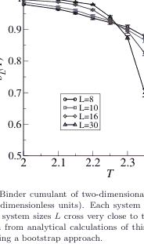

图 8.21 二维模型铁磁体的 Binder 累积量随温度 \(T\)（无量纲单位）变化的曲线图。每个系统由 \(L \times L\) 个粒子组成。不同系统尺寸 \(L\) 的曲线在非常接近相变温度 \(T_c = 2.269\)（由该模型的解析计算得知）处交叉。所示的误差棒可以通过 bootstrap 方法获得。

使用标准误差分析来获得 Binder 累积量的置信区间非常困难（甚至不可能）。而使用 bootstrap 则很直接。你只需使用上面展示的 `bootstrap_variance()` 函数，并传入一个对给定数据点集评估 Binder 累积量的函数作为参数即可。

到目前为止，我们假设使用经验分布函数 \(F_X\) 来确定 \(F_H\) 的近似。或者，可以使用某些可能可用的额外知识。或者，可以通过使用由参数向量 \(\Delta\) 参数化的分布函数 \(F_\Delta\) 来做出额外假设。对于指数分布，该向量只由一个参数组成，即期望值；而对于高斯分布，\(\Delta\) 将由期望值和方差组成。原则上，可以存在任意复杂的、具有多个参数的分布。

为了使 \(F_\Delta\) 成为 \(F_X\) 的“良好”近似，必须调整参数，使分布函数“最好地”表示样本 \(\{x_i\}\)，从而得到参数向量 \(\hat{\Delta}\)。执行这种参数拟合的方法和工具将在第 8.6.2 节中介绍。使用 \(F_\Delta\) 可以像上面那样进行：要么基于 \(F_\Delta\) 精确计算 \(F_H\)，但大多数时候过于繁琐。相反，通常执行模拟，通过模拟 \(F_\Delta\) 反复抽取样本 \(\{\tilde{x}_0, \tilde{x}_1, \ldots, \tilde{x}_{n-1}\}\)，并每次计算估计量 \(\hat{h} = h(\tilde{x}_0, \tilde{x}_1, \ldots, \tilde{x}_{n-1})\)。与上面讨论的经验 bootstrap 情况一样，这会产生样本分布函数 \(F_{H^*}\)，并对其做进一步分析。这种使用 \(F_\Delta\) 代替 \(F_X\) 的方法称为参数 bootstrap（parametric bootstrap）。

请注意，bootstrap 方法确实要求样本点彼此统计独立。例如，数据可以通过马尔可夫链蒙特卡洛模拟生成 [Newman and Barkema (1999); Landau and Binder (2000); Robert and Casella (2004); Liu (2008)]，其中每个数据点 \(x_{i+1}\) 通过某个随机过程计算，但也依赖于前一个数据点 \(x_i\)。关于如何量化相关性的更多细节见第 8.5 节。例如，置信区间将取决于“独立”数据点的比例。这很容易理解：假设你把原始样本 \(\{x_i\}\) 中的每个数据点替换为 10 份副本，从而使样本增大 10 倍，但没有添加任何信息。这会影响后续的 bootstrap 计算，因为 bootstrap 样本的波动会减小。例如，假设你的原始样本只有两个独立样本点 \(x_1 \ne x_2\)。因此，bootstrap 样本可能包含两次 \(x_1\) 或两次 \(x_2\)，或者各一次。因此，bootstrap 平均值会强烈波动。另一方面，如果样本中有 10 个数据点 \(x_1\) 和 10 个数据点 \(x_2\)，那么 bootstrap 样本大多数时候会包含大约 10 个 \(x_1\) 和大约 10 个 \(x_2\)，只有在极少数情况下才会只看到（即 20 次）值 \(x_2\)。因此，bootstrap 均值的波动会较小。在这方面，bootstrap 与第 8.3.2 节中解释的经典置信区间计算类似，后者同样假设数据独立，并且独立数据点的数量会进入像式 (8.62) 这样的公式中。因此，为了对此进行修正，可以将获得的 bootstrap 误差棒乘以因子 \(\sqrt{\lambda_c}\)，其中 \(\lambda_c\) 是顺序相关样本点的典型数量。

应该提到的是，bootstrap 只是几种重采样技术之一。另一种著名的方法是 jackknife（刀切法）方法，它不使用 \(F_X\) 或拟合的 \(F_\Delta\) 进行随机采样。相反，


它小巧、快速，能够生成二维和三维曲线并进行变换，也可以将任意函数拟合到数据（见第 8.6.2 节）。在交互模式下，gnuplot 使用命令行界面。另一方面，只要稍加努力，也可以生成可供出版的高质量图形，最佳做法是使用 gnuplot 脚本。对于喜欢用菜单、按钮和鼠标来绘图的人来说，xmgrace 是更好的选择。它非常灵活，能轻松生成美观且可直接用于出版的图形。

### 8.4.1 gnuplot

在 shell 中输入 gnuplot，或从操作系统的图形用户界面菜单中启动 gnuplot，即可运行该程序。完整手册参见 [Texinfo]。

和往常一样，我们的示例以 X11 之类的 UNIX 窗口系统为例，但该程序几乎可用于所有操作系统。启动后，在 shell 窗口或为 gnuplot 弹出的窗口中会出现提示符（例如 gnuplot>），用户可以输入文本形式的命令，结果显示在其他窗口中或写入文件。如需一般性介绍，只需输入 help。

在举例之前，需要指出，gnuplot 脚本可以通过把命令写入一个文件（例如 command.gp），然后调用 gnuplot command.gp 来生成。

典型的情况是，你有一个 x-y 数据文件，或 x-y-dy 数据文件（其中 dy 是 y 数据点的误差棒）。你的文件可能如下所示，其中系统的能量 e0^10^ 作为系统尺寸 L 的函数存储。文件名为 sg_e0L.dat。第一列包含 L 值，第二列包含能量值，第三列包含能量的标准误差。请注意，以 # 开头的行是注释行，读取时会被忽略：

GET SOURCE CODE
DIR: randomness
FILE(S): sg_e0L.dat

```
### ground state energy of ±J spin glasses
### L e0 error
```

| L | e0 | error |
|---|---|---|
| 3 | -1.6710 | 0.0037 |
| 4 | -1.7341 | 0.0019 |
| 5 | -1.7603 | 0.0008 |
| 6 | -1.7726 | 0.0009 |
| 8 | -1.7809 | 0.0008 |
| 10 | -1.7823 | 0.0015 |
| 12 | -1.7852 | 0.0004 |
| 14 | -1.7866 | 0.0007 |

10 这是三维 ±J 自旋玻璃的基态能量，是统计物理学中一个典型系统。这些自旋玻璃模拟铁-金等合金的磁性行为。

要绘制数据，输入

```
gnuplot> plot "sg_e0L.dat" with yerrorbars
```

可以缩写为 `p "sg_e0L.dat" w e`。请不要忘记文件名两边的引号。接下来，会弹出一个窗口显示结果，见图 8.22。

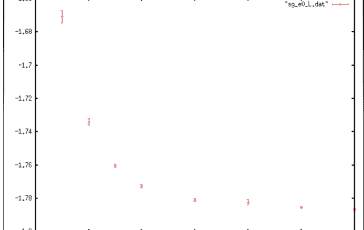
图 8.22 *Gnuplot 窗口，显示一个 plot 命令的结果。*

`plot` 命令有许多选项和样式可用，例如 `with lines` 生成线条而不是符号。这里不解释如何设置线型、符号大小和颜色，因为快速查看数据时通常不需要这些。对于用于演示的“精美”图形，我们推荐 *xmgrace*，见下一节。总之，`help plot` 会告诉你关于 `plot` 命令所需了解的一切。

有时你想在数据点之间添加连线，作为视觉辅助。最简单的选项是使用 `with lines`（简写 `w l`），它显示连接各点的线条，但不显示点。如果想同时看到点和线，可以使用 with linespoints（简写 w lp）。更高级的方法是使用三次样条进行插值，或使用 Bézier 曲线对数据进行近似，例如：

```
gnuplot> plot "sg_e0L.dat" with yerrorbars, \
"sg_e0L.dat" smooth csplines title "splines", \
"sg_e0L.dat" smooth bezier title "bezier"
```

结果如图 8.23 所示。

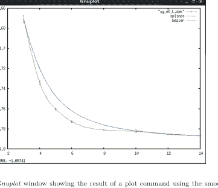
图 8.23 Gnuplot 窗口，显示分别使用平滑选项 csplines 和 bezier 的 plot 命令结果。

这里，命令分布在多行中：`\` 表示命令在下一行继续。使用 title 选项可以为所绘制的不同曲线指定不同名称。注意，还有其他平滑数据的选项可用，参见 help smooth。或者，可以将函数拟合到数据并绘制拟合函数，见第 8.6.2 节。

`plot` 命令的重要选项之一是能够指定范围。可以通过在命令后直接指定范围来实现，例如

```
gnuplot> plot [7:20] "sg_e0L.dat" with yerrorbars
```

将只显示 x ∈ [7,20] 的数据。也可以额外指定 y 范围，如下所示：

```
plot [7:20] [-1.79:-1.77] "sg_e0L.dat" with yerrorbars
```

如果只想设置 y 范围，则必须为 x 范围指定 []。你也可以通过 set xrange 和 set yrange 命令固定范围，这样就不必在每次使用 plot 命令时都给出它们；参见 help set xrange，取消范围可参见 help unset xrange。

Gnuplot 内置大量函数，如 sin(x)、log(x)、幂、根、贝塞尔函数、误差函数^11^等等。完整列表可输入 help functions。这些函数也可以绘制。此外，利用这些函数和标准算术表达式，你还可以定义自己的函数，例如可以定义一个函数 ft(x)，表示参数为 λ（这里称为 lambda）的 Fischer-Tippett 概率密度函数（见式 (8.43)），并通过以下命令显示该函数：

```
gnuplot> ft(x)=lambda*exp(-lambda*x)*exp(-exp(-lambda*x))
gnuplot> lambda=1.0
gnuplot> plot ft(x)
```

你也可以在 plot 命令中包含算术表达式。要绘制平移并缩放后的 Fischer-Tippett 概率密度函数，可以输入：

```
gnuplot> plot [0:20] 0.5*ft(0.5*(x-5))
```

Fischer-Tippett 概率密度函数的尾部呈指数衰减。通过对 y 轴进行对数缩放可以更清楚地看到这一点。

```
gnuplot> set logscale y
gnuplot> plot [0:20] 0.5*ft(0.5*(x-5))
```

将生成如图 8.24 所示的图形。

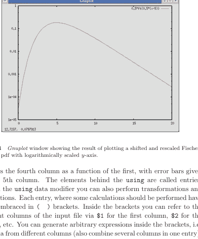
图 8.24 Gnuplot 窗口，显示绘制经过平移和重新缩放的 Fischer-Tippett 概率密度函数，且 y 轴为对数标度的结果。

此外，还可以在一个图中绘制多个函数，用逗号分隔，例如将 Fischer-Tippett 概率密度函数与标准高斯概率密度函数进行比较，这里使用了预定义常量 pi：

```
gnuplot> plot ft(x), exp(-x*x/2)/sqrt(2*pi)
```

可以使用 using 数据修饰符读取多列文件，例如

```
gnuplot> plot "test.dat" using 1:4:5 w e
```

将第四列显示为第一列的函数，误差棒由第五列给出。using 后面的元素称为条目。在 using 数据修饰符中，你还可以进行变换和计算。每个需要执行计算的条目都必须用 ( ) 括号括起来。在括号内，可以通过 $1、$2 等引用输入文件的不同列，$1 表示第一列，$2 表示第二列，依此类推。你可以在括号内生成任意表达式，即使用不同列的数据（也可以在一个条目中组合多个列）、运算符、变量、预定义函数和自定义函数等等。例如，在第 8.6.2 节中，你会看到 sg_e0L.dat 文件中的数据近似遵循幂律 e0(L) = e∞ + a L^b，其中 e∞ ≈ −1.788，a ≈ 2.54，b ≈ −2.8。为了直观地展示这一点，我们想把 e0(L) − e∞ 作为 L^b 的函数绘制出来。这可以通过以下命令实现：

```
gnuplot> einf=-1.788
gnuplot> b=-2.8
gnuplot> plot "sg_e0L.dat" u ($1**b):($2-einf)
```

现在 gnuplot 窗口会将数据显示为一条直线（此处未显示，但见图 8.33）。

更多选项，如相对坐标、线型等，可以通过输入 help set arrow 获得。

到目前为止，所有输出都出现在屏幕上。可以将输出重定向到，例如，封装式 PostScript 文件（通过设置 set terminal postscript，并将输出重定向到 set output "test.eps"）。此时再输入 plot 命令，就会生成相应的 PostScript 文件。

注意，不仅可以组合多个函数，还可以组合多个数据文件，或两者混合，组合到同一个图中。为了记住导出到文件的图所表示的含义，你可以通过输入 set xlabel "L" 来设置图形的轴标签，该设置将在下一次执行 plot 命令时生效。你也可以使用 set title，或通过 set label 放置任意标签。使用 help 命令可以了解更多。

也可以使用 splot 命令进行三维绘图（实际上是二维投影）（输入 help splot 可获取更多信息）。这里，作为示例，我们绘制一个二维高斯分布：

```
gnuplot> x0=3.0
gnuplot> y0=-1.0
gnuplot> sx=1.0
gnuplot> sy=5.0
gnuplot> gauss2d(x,y)=exp(-(x-x0)**2/(2*sx)-(y-y0)**2/(2*sy))\
> /sqrt(4*pi*2*sx*2*sy**2)
gnuplot> set xlabel "x"
gnuplot> set ylabel "y"
gnuplot> splot [x0-2:x0+2] [y0-4:y0+4] gauss2d(x,y) with points
gnuplot>
```

注意，包含（两个参数的）函数 gauss2d() 定义的长行被分成了两行，第一行末尾使用了反斜杠。此外，splot 命令开头的区间说明中使用了其中一些变量。显然，你也可以绘制包含三维数据的数据文件。输出窗口中出现的绘图结果见图 8.26。你可以在显示图形的窗口内拖动鼠标，这将改变视角。

最后，要停止 gnuplot 的交互式执行，请输入命令 exit。这些示例应该已经让你对 gnuplot 的功能有了很好的了解。更多内容可在文档或在线帮助中找到。如何使用 gnuplot 将函数拟合到数据的说明见第 8.6.2 节。到目前为止，这些图都是为了快速获得直观印象而绘制的。


而且该程序倾向于用窗口填满你的屏幕。如需完整信息，请查阅在线帮助、手册或程序的网页 [xmgrace]。

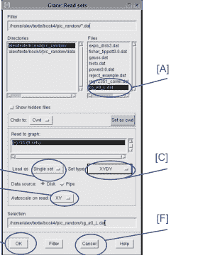

图 8.27 xmgrace 程序的 Grace:Read Set 窗口。除其他功能外，你可以选择文件 [A]、选择输入文件类型 [B]、选择数据格式 [C]，以及选择输入时哪些坐标轴应自动重新缩放 [D]。你还可以通过点击 OK 按钮 [E] 实际加载数据，并通过点击 Cancel 按钮 [F] 关闭窗口。

这里只介绍生成一个简单但漂亮图形的主要步骤，并提及一些进一步的方向。你将看到创建类似第一个示例（为 *gnuplot* 程序所展示）的图形的最重要步骤，但可直接用于发表。首先，你必须在 shell 中输入 `xmgrace` 来启动程序（或从某个窗口/操作系统菜单中启动）。然后选择数据（Data）菜单¹²，接着是导入（Import）子菜单，最后是 ASCII... 子子菜单。此时会弹出“Grace:Read Set”窗口（见图 8.27），你可以选择要加载的数据文件（此处为 sg_e0_L.dat [A]）、输入文件类型（Single Set）[B] 以及数据格式（XYDY）[C]。这意味着你有三列数据，其中第三列是第二列的错误条。然后你可以点击 OK 按钮 [E]。数据将被加载并显示在主窗口中（见图 8.28）。坐标轴范围已根据数据自动调整，因为“Autoscale on read”默认设置为“XY”[D]。你可以通过主窗口左侧、绘图（Draw）按钮正下方的按钮（放大镜、A→、Z、z、→、↓、↑）快速更改显示的数据部分。

¹² 加下划线的字符也出现在菜单名中，表示如果想通过按键打开菜单，需要与 Alt 按钮一起按下的那个键。

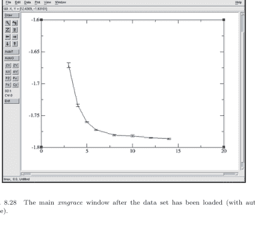

图 8.28 加载数据集后（自动缩放）的 xmgrace 主窗口。

请注意，另一种重要的输入文件类型是“Block data”（块数据），此类文件由许多列组成，而你只想显示其中一部分。当你点击 OK 按钮 [E] 时，会弹出另一个窗口（Grace:Edit block data），你必须在此选择实际要显示的列。对于数据格式（加载块数据时也是如此），其他一些重要选项包括 XY（无错误条）和 XYDYDY（完整置信区间，可能不对称）。最后，你可以通过点击 Cancel 按钮 [F] 关闭文件选择窗口。OK 和 Cancel 按钮是所有 xmgrace 窗口通用的，后续不再明确提及。

按默认方式显示加载的数据时，图形不适合用于发表，因为符号、线条和字体通常太小/太细。要调整图形的许多细节，应进入绘图（Plot）菜单。首先，选择绘图外观（Plot appearance...）子菜单。相应窗口将弹出。在这里，你只需取消选中“Fill”（填充）切换框（右上角），否则 .eps 文件中包含的边界框将与图形不匹配，你的图会覆盖稿件中的其他部分。现在，你的绘图没有背景这一事实通过主 xmgrace 窗口中出现的一些小点变得可见，但这不会影响导出为 .eps 时的输出。

接下来，从绘图（Plot）菜单中选择设置外观（Set appearance...）子菜单。相应窗口将弹出，见图 8.29。你也可以通过在图形内部双击来弹出此窗口。此窗口允许更改数据的实际显示样式。你必须选择要应用更改的数据集 [A]，然后点击窗口左下角的 Apply 按钮。请注意，如果导入了多个数据集，此框中的数据集列表将包含多个数据集。每个数据集都可以（而且通常应该）有自己的样式。显示数据集列表的框也用于管理数据集。当鼠标指针位于此框内时，如果点击鼠标右键，将弹出一个菜单，你可以在其中复制或删除数据集、隐藏或取消隐藏它们，或重新排列它们。

此窗口中的选项排列在不同的选项卡中，最重要的是“Main”（主）选项卡 [B]。在这里，你可以选择是否要为数据点显示符号以及符号类型 [C]，还可以选择符号大小和颜色。如果你想同时显示线条（右侧的 Line properties（线条属性）区域），你可以选择“straight”（直线）等样式，但“none”（无）则表示不应显示线条。样式可以是实线、点线、虚线和不同的点划线。对于演示和发表，线条清晰可见很重要，在本示例中选择线宽为 2 [D] 和黑色 [E]。对于演示，你可以用不同颜色区分不同数据集，但对于科学期刊的发表，你应该牢记，图形通常是以

- \0 选择罗马字体，这也是默认字体。在选择新字体之前，该字体一直有效。
- \1 选择斜体字体，用于方程中。
- \x 选择符号字体，其中包含希腊字符。例如，\xabchq\ 将生成 αβγθ∂Λ，仅举一些重要符号为例。
- \8 生成下标，而 \M 切换回正常状态。例如，\xb\s2\W\1(x) 生成 β₂(x)。
- \S 生成上标，例如 \1A\S3x\N-5 生成 A³x−5。
- 可以使用 \t 和 \- 更改字体大小。
- 使用 \o 和 \O 分别开始和停止下划线，例如 \1A\oBC\O D 生成 ABCD。下划线也可以通过 \u 和 \U 控制。

默认情况下，会显示错误条（右下角的切换框）。至少你应该在“符号（Symbols）”选项卡中增加符号的线宽，并在“错误条（Error bars）”选项卡中增加错误条的基线和上升线宽。

你应该知道，在创建另一个图形时，不必重新进行所有这些及其他样式调整。一旦找到了你的标准，可以通过绘图（Plot）菜单中的保存参数（Save Parameters...）子菜单保存它。相反，你也可以通过同一菜单中的加载参数（Load Parameters...）子菜单加载参数集。

接下来，你可以通过从绘图（Plot）菜单中选择设置外观（Set appearance...）子菜单，或双击坐标轴来调整坐标轴的属性。相应窗口将弹出，见图 8.30。你必须选择当前更改应用于哪个坐标轴 [A]。对于 x 轴，你应该在 Start [B] 和 Stop [C] 字段中设置范围，此处为 1 和 15。在这两个字段下方是重要的 Scale（缩放）字段，你可以选择线性缩放（默认）、对数或倒数，仅举重要选项。

你可以在 Main（主）选项卡 [D] 中进行最重要的调整。在这里，你可以在“标签字符串（Label string）”字段 [E] 中输入显示在坐标轴下方的标签。字符串的格式与数据集图例的格式相同。这里只需输入 \1L，它将显示为 L。主刻度（带标签）和次刻度的主间距可以在相应字段 [F,G] 中选择。下方有一个“格式（Format）”字段，你可以选择刻度标签的打印方式。众多格式中有 General（通用，1,5,10,...）、Exponential（指数，1.0e+00, 5.0e+00, 1.0e+01,...）和 Power（幂，10¹,10²,10³,...），后者对于对数缩放坐标轴很有用。对于刻度标签，你还可以选择精度（Precision）。此选项卡中的这个字段和其他字段，在这里可以保留为标准值。尽管如此，你还应调整坐标轴标签（Axis label & bar 选项卡）和刻度标签（Tick labels 选项卡）的字符大小。对于发表，通常大于 150% 的字符大小清晰可读。请注意，在 Axis label & bar 选项卡中，有一个 Axis transform 字段，你可以输入公式以或多或少任意地变换坐标轴，详细内容请参阅手册。所有选项卡都有许多其他字段，它们也同样有用，但这里我们使用标准选择。请注意，有时 Special（特殊）选项卡很有用，你可以在其中单独输入所有主刻度和次刻度。

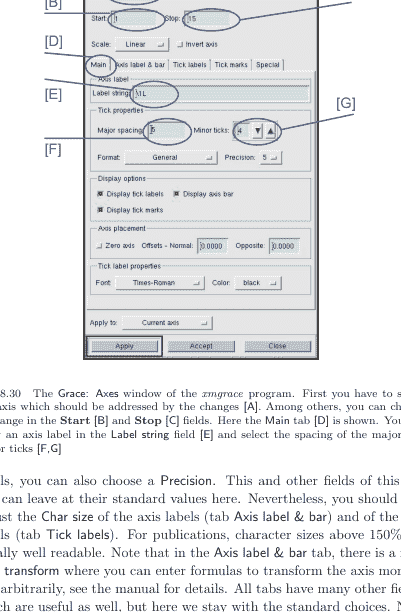

图 8.30 xmgrace 程序的 Grace: Axes 窗口。首先，你必须选择更改所作用的坐标轴 [A]。除其他功能外，你可以更改 Start [B] 和 Stop [C] 字段中的范围。此处显示了 Main（主）选项卡 [D]。你可以在“标签字符串（Label string）”字段 [E] 中输入坐标轴标签，并选择主刻度和次刻度的间距 [F,G]


要完成坐标轴的设计，你可以对 y 轴进行类似修改：Start 字段设为 −1.8，Stop 字段设为 −1.6，Label 字符串为 e\S0\N(L)，并在对应选项卡中设置与 x 轴相同的坐标轴标签和刻度标签字符大小。注意，坐标轴标签将以垂直方向打印。如果你不喜欢这样，可以在 Axis label & bar 选项卡的 Layout 字段中选择 Perpendicular to axis 方向。

现在你已经得到了一张不错的图形。为了展示 xmgrace 的更多功能，我们对其进行一些细化。接下来，你要生成一个内嵌图（inset），即主图内部的一个小子图。这在科学出版物中相当常见。为此，请选择 Edit 菜单，然后选择其中的 Arrange graphs... 子菜单。相应窗口会出现。我们只需要一个内嵌图，即总共 2 个图。为此，在窗口的 Matrix 区域中，将 Cols: 字段设为 1，Rows: 字段设为 2。然后点击 Accept 按钮，应用更改并关闭窗口。现在你有两个图，一个包含已加载的数据，另一个是空的。这两个图当前上下排列，一个在顶部，一个在底部。

要将第二个图设为主图的内嵌图，请从 Plot 菜单中选择 Graph appearance... 子菜单。窗口顶部显示可用图形列表 [A]。在这里选择第一个图 G0。你只需要 Main 选项卡 [B]；其他选项卡用于更改标题、边框和图例的样式。我们建议在 Frame 选项卡中选择 Width 2。在 Main 选项卡中，你可以选择图形的类型 [C]，例如 XY graph（我们这里使用的默认类型）、Polar graph 或 Pie chart。你只需在此修改 Viewport 坐标 [D]。这些坐标是相对坐标，即标准的完整视口（包括坐标轴、标签和标题）为 [0,1] × [0,1]。对于主图 G0，选择 Xmin 和 Ymin 为 0.15，Xmax 和 Ymax 为 0.85。注意，下方有一个 Display legend 切换框 [E]，可以控制是否显示图例。如果需要有图例，可以在 Leg. box 选项卡中控制其位置。现在不同的图形重叠了。这不会给你带来困扰，因为接下来你要在窗口顶部的列表中选择图 G1。我们想让内嵌图位于绘图的空白区域，即右上区域。因此，输入视口坐标：Xmin 0.38，Ymin 0.5，Xmax 0.8，Ymax 0.8。

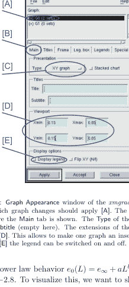

图 8.31 xmgrace 程序的 Grace: Graph Appearance 窗口。在顶部可以选择更改应用于哪个图形 [A]。窗口分为不同的选项卡 [B]，此处显示的是 Main 选项卡。可以选择图形类型 [C]，也可以设置 Title 和 Subtitle（此处为空）。图形的范围可以在 Viewport 区域 [D] 中选择。这样可以将一个图形设为另一个图形的内嵌图。使用 Display legend 切换框 [E] 可以开启或关闭图例。

现在第二个图位置合适，但仍是空的。我们想在内嵌图中显示数据的缩放版本。因此，按照上述相同方式再次导入数据，同时在 Grace: Read sets 窗口中选择 Read to graph G1。在 8.6.2 节中，你会看到数据大致遵循幂律行为 e0(L) = e∞ + a L^b，其中 e∞ ≈ −1.788，a ≈ 2.54，b ≈ −2.8。为了可视化这一点，我们想以 L^b 为横轴，显示 e0(L) − e∞ 的变化。因此，我们需要变换数据。从 Data 菜单中选择 Transformations 子菜单，然后选择其中的 Evaluate expression 子菜单。注意，这里还可以找到许多其他变换，例如傅里叶变换、插值和曲线拟合。详情请查阅手册。此处，Evaluate expression 窗口弹出，见图 8.32（如果你没有关闭之前用过的窗口，你的屏幕可能已经很拥挤了）。变换总是从源集合中取数据点，对所有数据点（或部分点）应用公式，并将结果存储到目标集合中。这些集合可以在窗口顶部的 Source [A] 和 Destination [B] 字段中分别针对图形和数据集进行选择。注意，目标集合中的数据会被覆盖。

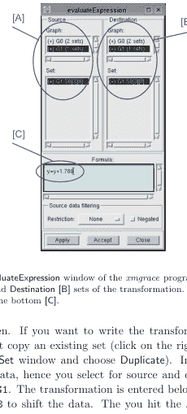

图 8.32 xmgrace 程序的 Evaluate expression 窗口。在顶部可以选择变换的源集合 [A] 和目标集合 [B]。实际变换在底部 [C] 中输入。

如果你想把变换后的数据写入新的集合，可以先复制一个现有集合（在 Destination Set 窗口中点击鼠标右键，选择 Duplicate）。在我们的情况下，我们想替换数据，因此在源和目标中选择来自图形 G1 的数据集。在下方 [C] 输入变换；这里先输入 y=y+1.788 来平移数据。然后点击底部的 Apply 按钮。接着将变换更改为 x=x^(-2.8)，再次点击 Apply 按钮。之后，点击第二个图形将其选中，再点击主窗口左侧的 AS（自动缩放）按钮，你会看到数据点在内嵌图中形成一条漂亮的直线，这证实了数据的这一行为。

同样，你应该为内嵌图选择符号、线型和坐标轴标签。通常这里使用较小的字体。注意，所有操作总是应用于当前图形，可以通过点击图形边界框的角附近来选择当前图形（这并不总是有效，取决于哪些其他窗口处于打开状态），也可以通过双击 Grace: Graph Appearance 窗口图形列表中的相应图形来选择。最终的主窗口如图 8.33 所示。

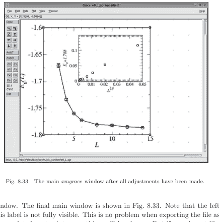

图 8.33 完成所有调整后的 xmgrace 主窗口。

注意，左侧坐标轴标签未完全可见。当导出为封装 PostScript 文件时，这不是问题；所有内容都会显示。但如果你不喜欢这种情况，可以调整图 G0 的 Xmin 值。

最后，如果选择 Window 菜单和 Drawing objects 子菜单，会弹出一个窗口，它支持向绘图中添加/修改和删除许多图形元素，如文本、直线、方框和椭圆（同样有多种颜色、样式、大小等选择）。这里我们不再详述。

```
GET SOURCE CODE
DIR: randomness
FILE(S): sg_e0_L.dat
```

现在，你应该使用 File 菜单和 Save as... 子菜单保存绘图，例如文件名为 sg_e0_L.agr，其中 .agr 是 xmgrace 源文件的典型后缀。如果以后想创建具有类似布局的另一张图，从这个已保存的文件开始会很方便：将其复制到一个新文件，然后再次使用 xmgrace 修改新文件。

要将文件导出为封装 PostScript 格式（适合包含到演示或出版物中，见 9.3 节），你需要选择 File 菜单和 Print setup... 子菜单。在弹出的窗口中，可以选择 Device EPS。文件名会自动切换为 sg_e0_L.eps（这似乎并不总是有效，特别是当你一个接一个编辑多个文件时，请始终检查文件名）。点击 Accept 按钮后，你可以选择 File 菜单和 Print 子菜单，这将生成所需的输出文件。¹⁴

现在你已经具备了查看和绘图的基础能力，因此我们可以继续学习高级分析技术。你可以在练习 (7) 中尝试使用 xmgrace 进行绘图。

## 8.5 假设检验与数据的（不）相关性

在上一节中，你已经学会了如何可视化数据，主要是来自 8.3 节中介绍的基本分析方法的结果。在本节中，我们继续讨论更复杂的分析方法。分析模拟数据的一个重要方法是检验关于结果的假设。待检验的假设通常称为零假设 H₀。零假设的示例有：

- (A) 在交通系统中，开辟一条新车道将使 A→B 连接的旅行时间均值 t̄_A→B 降低到目标阈值 t_target 以下。
- (B) 在熟人网络中，改变描述人们见面方式的规则将改变每个人认识人数的分布。
- (C) 无序磁体中基态能量的分布遵循 Fisher-Tippett 分布。
- (D) 在生态系统模型中，狐狸的种群规模取决于甲虫的种群规模。
- (E) 对于室温下溶解在水中的蛋白质，在水中加入某种盐会改变蛋白质的结构。

现在可以对上述情形建模，并使用模拟来回答这些问题。目标是找到一些方法，根据模拟结果告诉我们是否应接受零假设。没有通用的方法。我们检验 H₀ 的方式取决于


关于原假设的表述。无论如何，我们的结果都将再次基于一组测量值，例如独立数据点 {x_0, x_1, ..., x_{n-1}} 的样本，这些数据点是正式地从随机变量 {X_0, X_1, ..., X_{n-1}} 中抽样获得（同样，它们都由相同的分布函数 F_X 描述）。为了获得可靠的统计解释，我们使用检验统计量，它是样本 t = t(x_0,x_1,...,x_{n-1}) 的函数。其分布描述了相应的随机变量 T。这意味着，你可以使用任何估计量（参见第284页），它也是样本的函数，作为检验统计量。然而，有许多检验统计量通常不被用作估计量。

为了了解检验统计量 t 可能的样子，我们现在讨论上述示例列表的检验统计量。对于 (A)，显然可以使用样本均值。这必须与阈值进行比较，这将在统计解释中进行，从而可以接受或拒绝原假设，见下文。对于 (B)，需要分别比较变化前后熟人数的分布。比较两个分布可以通过多种方式进行。可以只比较某些矩，或者根据分布函数之间的面积差来定义它们之间的距离，这里仅提及两种可能。对于离散随机变量，均方差异特别合适，从而产生了所谓的卡方检验，见第8.5.1节。对于示例 (C)，任务与 (B) 类似，只是将经验结果与给定分布进行比较，并且相应的随机变量是连续的。这里，广泛使用一种基于两个分布函数之间最大距离的方法，称为 Kolmogorov-Smirnov (KS) 检验（见第8.5.2节）。为了检验假设 (D)，即检查统计独立性，可以记录狐狸和甲虫种群规模的二维直方图。将其与假设两个种群独立时的分布进行比较，即与两个单一种群分布函数的乘积进行比较。这里应用了卡方检验的一种变体，见第8.5.4节。在情况 (E) 中，样本不仅仅是一组一维数字，模拟结果是蛋白质的构象，由 N 个粒子的位置 \(\vec{x}_i\) (i = 1,...,N) 的 3N 维向量给出。这里，可以引入一种方法来比较两个蛋白质构象 \(\{\vec{x}_i^A\}, \{\vec{x}_i^B\}\)，方法如下：首先，将第二个蛋白质“移动”到第一个蛋白质附近，使得质心位置重合。其次，分别考虑通过质心和通过第一个原子的轴。将第二个蛋白质绕其

F_T)，它是 F_T 的近似。这样一来，可以获得相应的统计信息。为了节省计算时间，在大多数情况下不进行蒙特卡罗模拟，而是利用一些知识来计算或近似 F_T。

在下面的章节中，将详细讨论对应于示例 (B)、(C)、(D) 的情况。这意味着，将解释如何通过卡方检验检验离散分布的相等性，以及如何通过 KS 检验检验连续分布的相等性。最后，将陈述一些用于检验数据（不）相关性和量化相关程度的方法。

## 8.5.1 卡方检验

卡方检验是一种比较直方图和离散概率分布的方法。该检验也适用于离散化（也称为分箱）的连续概率分布，其中概率通过对不同箱子上的概率密度函数进行积分获得。该检验有两种变体：

-   要么你想将描述样本 {x_0, x_1, ..., x_{n-1}} 的箱子 B_k（见第8.3.3节）的直方图 {h_k} 与给定的离散或离散化概率质量函数（其概率为 {p_k} = P(x ∈ B_k)）进行比较。原假设 H_0 是：“样本服从由 {p_k} 给出的分布”。注意，这些概率是固定的，与数据样本无关。如果概率是参数化的，并且参数由样本确定（例如，通过数据的均值）以使概率最佳地拟合数据，则必须应用第8.6.2节中描述的相关方法。

-   或者，你想比较两个直方图 {h_k}、{ĥ_k}，分别来自两个不同的样本 {x_0, x_1, ..., x_{n-1}} 和 {x̂_0, x̂_1, ..., x̂_{n-1}}，定义在相同的箱子 B_k 上。原假设 H_0 是：“这两个样本服从相同的分布”。15

当检验用于比较本质上是离散的数据时，可以方便地选择区间 B_k，使每个可能的结果对应一个区间。注意，由于分箱过程，该检验也可以应用于高维数据，其中样本是一组向量。非数值数据也可以分箱。在这些情况下，每个箱子要么代表高维空间的一个子集，要么通常代表可能结果的一个子集。为简单起见，我们这里仅限一维数值样本。

15. 请注意，这里我们假设两个样本具有相同大小，这在模拟中通常很容易实现。另一种情况是样本点的数量也是一个随机变量，因此样本点数量的差异会使得接受 H_0 的可能性降低，参见 [Press et al. (1995)]。


图 8.35 卡方统计量：直方图（实线）与离散概率分布（虚线）进行比较。对于每个箱子，计算箱子计数 h_k 与期望计数 np_k 之差的平方和（垂直虚线），参见式(8.72)。在这种情况下，差异相当显著，因此该直方图是通过随机实验从由概率 {p_k} 描述的随机变量（原假设）获得的概率将非常小。

我们从第一种情况开始，即将样本直方图与概率分布进行比较，对应于第 320 页的示例 (C)。检验统计量称为 χ²，其定义为：

$\chi^2 = \sum_k' \frac{(h_k - n p_k)^2}{n p_k} \tag{8.72}$

其中 np_k 是箱子 B_k 中样本点的期望数量。求和符号上的撇号表示省略 h_k = np_k = 0 的箱子。贡献箱子的数量记为 K′。如果概率质量函数 p_k 在无限多个箱子上非零，则对于 np_k << 1 的项截断求和。这意味着贡献箱子的数量总是有限的。注意，h_k > 0 但 p_k = 0 的箱子不会被省略。这会导致 χ² 的值为无穷大，这是合理的，因为对于 h_k > 0 但 p_k = 0 的数据，这些数据不能用概率 p_k 来描述。具有 ν = K′ − 1 个自由度的卡方分布（见式(8.45)）描述了卡方检验统计量，当箱子数量和箱子条目数量较大时。自由度中的 −1 项来自这样的事实：数据点的总数 n 等于期望数据点的总数 Σ_k n p_k = n Σ_k p_k = n，因此 K′ 个不同的被加数在统计上不是独立的。卡方分布的概率密度在式(8.45)中给出。为了执行实际检验，建议使用 GNU 科学库 (GSL) 中的实现（见第7.3节）。接下来，展示一个 C 函数 chi2_hd()，它计算在给定原假设（即样本是使用概率 p_k 生成的）下获得 χ² 或更大值的累积概率（p 值）。chi2_hd() 的参数是箱子数量，以及两个数组 h[] 和 p[]，分别包含直方图 h_k 和概率 p_k：

获取源代码
目录：randomness
文件：chi2.c

```c
double chi2_hd(int n_bins, int *h, double *p)
{
    int n;                     /* total number of sample points */
    double chi2;               /* chi^2 value */
    int K_prime;               /* number of contributing bins */
    int i;                     /* counter */

    n = 0;
    for(i=0; i<n_bins; i++)
        n += h[i];             /* calculate total number of sample points */

    chi2 = 0.0; K_prime = 0;
    for(i=0; i<n_bins; i++)    /* calculate chi^2 */
    {
        if(p[i] > 0)
        {
            chi2 += (h[i]-n*p[i])*(h[i]/(n*p[i])-1.0);
            K_prime ++;
        }
        else if(h[i] >0)       /* bin entry for zero probability ? */
        {
            chi2 = 1e60;
            K_prime ++;
        }
    }
    return(gsl_cdf_chisq_Q(chi2, K_prime-1));
}
```


首先，在第8–10行，通过将所有直方图计数相加得到样本点总数。在主循环（第12–25行）中计算χ²的值。同时，确定贡献区间的数量。最后（第26行），使用GSL函数gsl_cdf_chisq_Q()获得p值。该p值可以与显著性水平α进行比较。如果p值较大，则接受原假设，否则拒绝。

注意，p值的结果明显依赖于区间的数量，并且在适用的情况下，还依赖于区间的具体选择。尽管如此，所有合理的选择，虽然可能导致略有不同的数值结果，但在大多数情况下，关于原假设会得出相同的决策。

接下来，我们考虑要比较两个直方图{h_k}和{ĥ_k}的情况，对应于第320页的示例(B)。在这种情况下，χ²统计量表示为

χ² = Σ'_k (h_k - ĥ_k)² / (h_k + ĥ_k)  (8.73)

求和遍及所有h_k ≠ 0或ĥ_k ≠ 0的区间，K′是相应的贡献区间数。因此，应包含的区间是唯一定义的，这与将直方图与定义为无限多结果的分布进行比较的情况不同。注意，分母中出现的是区间计数之和，而不是平均值。原因是卡方分布是标准高斯分布随机数（方差为1）之和，而在这里，取两个（近似）高斯量的差时，所得方差是各方差之和，近似地用直方图计数来近似。为了计算p值，同样应使用具有ν = K′ − 1自由度的卡方分布。这里不展示C实现，而是请读者参考练习题(8)。如果两个样本大小不同，例如分别为n和ñ，则式(7.69)必须改为[Gagunashvili (2009)]

χ² = 1/(n ñ) Σ'_k (ñ h_k - n ĥ_k)² / (h_k + ĥ_k)

### 8.5.2 柯尔莫哥洛夫-斯米尔诺夫检验

接下来，我们考虑这样一种情况：通过连续随机变量的重复实验获得的样本$\{x_0,x_1,\ldots,x_{n-1}\}$的统计性质需要与给定分布函数$F_X$进行比较。原则上，可以使用上一节解释的卡方检验将直方图与相应分箱的概率分布进行比较。不幸的是，分箱是人为的，并且对结果有影响（想象一下几个非常大的区间）。因此，通常更倾向于使用本节介绍的方法，因为它不需要分箱。注意，如果分布函数是参数化的，并且参数由样本确定（例如通过数据的均值），使得$F_X$最符合数据，则必须应用第8.6.2节的方法。

柯尔莫哥洛夫-斯米尔诺夫检验的基本思想是将分布函数与式(8.69)定义的经验样本分布函数$F_{\hat X}$进行比较。注意，$F_{\hat X}(x)$是分段常数，在位置$x_i$处有大小为$1/n$的跳跃（假设每个数据点在样本中唯一出现）。

这里，对于检验统计量也有多种选择。例如，可以计算$F_X$和$F_{\hat X}$之间的面积。相反，通常只使用两个函数之间的最大差：

$$d_{\max} \equiv \max_x \left|F_X(x)-F_{\hat X}(x)\right| \tag{8.74}$$

由于样本分布函数仅在样本点处变化，因此必须在跳跃前后分别进行比较。因此，式(8.74)等价于

$$d_{\max} \equiv \max_i \left\{ \left|F_X(x_i)-1/n-F_{\hat X}(x_i)\right|, \left|F_X(x_i)-F_{\hat X}(x_i)\right| \right\}$$

该样本统计量在图8.36中可视化。


图8.36 柯尔莫哥洛夫-斯米尔诺夫检验：将样本分布函数（实线）与给定的概率分布函数（虚线）进行比较。样本统计量d_max是两个函数之间的最大差。

p值，即假设样本来自$F_X$的原假设成立时，测得的$d_{\max}$值（$d_{\max}^{\text{measured}}$）或更差值的概率，近似由下式给出（参见[Press et al. (1995)]及其参考文献）：

$$P(d_{\max} \ge d_{\max}^{\text{measured}}) = Q_{\mathrm{KS}}\left(\left(\sqrt{n}+0.12+0.11/\sqrt{n}\right)d_{\max}^{\text{measured}}\right) \tag{8.75}$$

这个近似对于$n \ge 8$已经相当好了。这里使用以下辅助概率函数：

$Q_{KS}(\lambda)=2\sum_{i=1}^{\infty}(-1)^{i+1}e^{-2i^{2}\lambda^{2}}\qquad(8.76)$

其中$Q_{KS}(0)=1$，$Q_{KS}(\infty)=0$。这个函数可以通过直接求和[Press et al. (1995)]最容易地实现。函数Q_ks()接收$\lambda$值作为参数，并返回$Q_{KS}(\lambda)$：

| 获取源代码 |
|---|
| 目录：randomness |
| 文件：ks.c |

```c
double Q_ks(double lambda)
{
    const double eps1 = 0.0001; /* relative margin for stop */
    const double eps2 = 1e-10; /* relative margin for stop */
    int i; /* loop counter */
    double sum; /* final value */
    double factor; /* constant factor in exponent */
    double sign; /* of summand */
    double term, last_term; /* summands, last summand */

    sum = 0.0; last_term = 0.0; sign = 1.0; /* initialize */
    factor = -2.0*lambda*lambda;
```

关于样本分布函数，因为在每个样本数据点，按出现顺序，F_X的值增加1/n。在获取最大距离（第10–19行）时，必须在跳跃之前（第12–14行）和之后（第15–18行）将F_X与分布函数F_X进行比较。注意，这种实现也适用于某些数据点多次出现的样本。

对于实际检验，使用ks()计算给定样本的p值。如果p值超过预期的显著性水平α，则接受原假设，即数据与分布高概率地兼容。通常使用相当小的显著性水平，例如α = 0.05。这意味着即使是很大的d_max值也会被接受。因此，像通常一样，只有在第一类错误概率相当小的情况下才拒绝原假设。

也可以通过KS检验比较大小为n1、n2的两个样本。两个样本分布函数的检验统计量仍然是最大距离。在样本来自同一分布的原假设下，找到与所得d_max相同或更差值的概率与上述式(8.75)相同，只是必须将n替换为“有效”样本量n_eff = n1 n2 / (n1 + n2)，详见[Press et al. (1995)]及其参考文献。使用上面显示的C函数ks()作为模板来实现该检验是很直接的。

### 8.5.3 ROC分析

接收者操作特征（ROC）是一种评估分类检验的方法。我们假设有两类对象A和B，测量某个量Q以确定对象属于A类还是B类（图8.34中的原假设H0）。作为一个实验示例，我们测量动物的体重以判断该动物是否已成年。或者，在计算机模拟领域，可以模拟蛋白质的演化，通过所谓的比对算法比较不同蛋白质，并利用所得的比对分数来判断从群体中选取的两个蛋白质是否具有演化关系[Wolsheimer et al. (2012)]。

通常，测量量Q对于类型A和B遵循不同的分布。这些分布可能在形状或参数值上有所不同，例如两个高斯分布，中心位于不同的μ_A和μ_B值（并具有方差σ_A^2和σ_B^2）。现在，当测量Q以决定对象属于A还是B时，阈值θ可以


Fig. 8.38 随机总体由两种类型 A、B 组成时的接收机操作特性。测量某个量 Q。对于类型 A 的元素，Q 服从 N(0,1) 分布，而对于类型 B，量 Q 服从 N(μ_B,1) 分布。采用一种检验，将元素在 Q > θ 时分类为类型 B（零假设），θ 为可调节阈值。ROC 曲线显示当 θ 变化时真阳性 (TP) 随假阳性 (FP) 的变化。这里显示了 μ_B 不同取值时的三条曲线。还显示了对角线 TP=FP，表示无法进行有意义分类的情况，对应 μ_B = 0 = μ_A。

### 8.5.4 统计（非）独立性

这里，我们考虑由数据点对 (x_i, y_i) (i = 0,1,...,n−1) 组成的样本。对更高维数据的推广是直接的。问题是，y_i 值是否依赖于 x_i 值（或反之）。在这种情况下，也说它们是统计相关的。如果是，则意味着如果我们知道其中一个值，就能以更高的精度预测另一个值。统计（非）独立性的形式定义在第 8.1 节给出。统计依赖的一个例子出现在天气模拟中：降雪量与温度统计相关：如果太暖或太冷，就不会下雪。这也表明，两个变量的依赖关系不一定是单调的。如果只对单调甚至线性的依赖感兴趣，通常说变量是相关的，见下文。


Fig. 8.39 n 个数据点 (x_i, y_i) 的散点图，其中 x_i 数字从标准高斯分布生成（期望值 0，方差 1），而每个 y_i 数字从期望值为 κx_i（方差 1）的高斯分布中抽取。

| 获取源代码 |
| --- |
| DIR: randomness |
| FILE(S): points0A.dat |
| points0B.dat |
| points1A.dat |
| points1B.dat |

重要的是要认识到我们必须区分统计依赖的统计显著性与依赖的强度。假设我们的检验告诉我们 x 值以高概率统计相关。这通常只是意味着我们有一个大样本。另一方面，统计依赖的强度可能仍然很小。例如，给定 x 的值只会影响 y 的概率分布

首先，一维直方图被分配（第 9–10 行）。然后计算计数总数，即样本大小（第 12–15 行）。在第 17–26 行，得到 x 方向的一维直方图。也计算了该方向的有效 bin 数。在第 27–35 行，对 y 方向做同样的处理。$\chi^2$ 检验统计量的实际值在第 37–42 行确定。使用后，分配的内存被释放（第 43–44 行）。最后，p 值被计算（第 45 行），再次使用 GSL 函数 gsl_cdf_chisq_Q()。

图 8.39 所示样本集的 p 值如下：$p(\kappa = 0, n = 50) = 0.077$，$p(\kappa = 0, n = 5000) = 0.457$，$p(\kappa = 1, n = 50) = 0.140$，$p(\kappa = 1, n = 5000) < 10^{-100}$。因此，对于 $\kappa = 1, n = 50$ 的情况，独立性的零假设不会被拒绝（设 $\alpha = 0.05$），而该情况实际上是相关的。另一方面，如果样本数量足够大，就没有疑问。

一旦确定样本包含相关数据，就可尝试测量依赖的强度。标准方法是用线性相关系数（也称为 Pearson 的 $r$）给出

$$ r \equiv \frac{\sum_i (x_i-\overline{x})(y_i-\overline{y})}{\sqrt{\sum_i (x_i-\overline{x})^2 \sum_i (y_i-\overline{y})^2}}. \tag{8.81} $$

该系数假设，如名称所示，数据中存在线性相关。使用 C 函数实现很直接，见练习 (9)。对于图 8.39 所示的数据，得到以下相关系数：$r(\kappa = 0, n = 50) = 0.009$，$r(\kappa = 0, n = 5000) = 0.009$，$r(\kappa = 1, n = 50) = 0.653$，$r(\kappa = 1, n = 5000) = 0.701$。这里，即使在统计量较低的两种情况下，$r$ 的值也反映了数据是否相关。尽管如此，这只是因为我们将强相关数据与不相关数据进行比较。如果我们比较弱但显著相关的數據，仍会得到较小的 $r$ 值。因此，为了检验显著性，最好使用基于 $\chi^2$ 检验统计量的假设检验。

最后，注意可能出现不同类型的相关：到目前为止一直假设不同的样本点 $x_i, x_j$（或样本向量）彼此统计独立。然而，例如，样本可能是使用马尔可夫链蒙特卡洛模拟生成的 [Newman and Barkema (1999); Landau and Binder (2000); Robert and Casella (2004); Liu (2008)]，其中每个数据点 $x_{i+1}$ 使用某种随机过程计算，但也依赖于前一个数据点 $x_i$，因此 $i$ 是一种模拟的人工样本时间。这种依赖性随着样本点之间时间距离的增大而减小。一种观察这种依赖性减小速度的方法是使用相关系数 Eq. (8.81) 的变体，即 *相关函数*：

\[ \bar{C}(\tau) = \frac{1}{n-\tau}\sum_{i=0}^{n-1-\tau} x_i x_{i+\tau} - \left(\frac{1}{n-\tau}\sum_{i=0}^{n-1-\tau} x_i\right) \times \left(\frac{1}{n-\tau}\sum_{i=0}^{n-1-\tau} x_{i+\tau}\right) \tag{8.82} \]

项 \(\frac{1}{n-\tau}\sum_{i=0}^{n-1-\tau} x_i \times \frac{1}{n-\tau}\sum_{i=0}^{n-1-\tau} x_{i+\tau}\) 当 \(n\to\infty\) 时会收敛到 \(\overline{x}^2\)，如果可以假设样本点的分布是平稳的，即不依赖于样本时间。因此，\(\bar{C}(\tau)\) 近似为 \(\frac{1}{n-\tau}\sum_{i=0}^{n-1-\tau}(x_i-\bar{x})(x_{i+\tau}-\bar{x})\)，与线性相关系数 Eq. (8.81) 的分子相当。通常用 \(\bar{C}(0)\) 对相关函数进行归一化，后者在平稳情况下只是样本方差，见 Eq. (8.55)：

\[ C(\tau) = \bar{C}(\tau)/C(0)\,. \tag{8.83} \]


Fig. 8.40 铁磁系统模拟的相关函数 \(C(\tau)\)，\(x_i\) 为时间步 \(i\) 处的磁化强度。（专家提示：\(16\times16\) 自旋的 Ising 系统使用单自旋翻转 Metropolis Monte Carlo 在（约化）温度 \(T = 2.269\) 下模拟，接近相变温度，此时相关时间 \(\tau_r\) 很大。）

因此，对于任何数据，例如来自马尔可夫链蒙特卡洛模拟的数据，C(0) = 1 总是成立。然后 C(τ) 随着差值 τ 的增大而减小，见例如图 8.40。非常常见的是其函数形式类似于指数 ~ exp(−τ/τc)。理论上，C(τ) 应在 τ → ∞ 时收敛到零，但由于样本的有限大小，通常在 τ 接近 n 时会出现强烈的波动。衡量样本点依赖性减小速度的典型时间 τc 由 C(τc) = 1/e 给出，这与上述表达式一致，如果相关函数呈指数衰减。在两倍此距离时，相关性已大幅减小（至 1/e²）。因此，如果你想为依赖数据样本获得误差棒，你可以例如只在样本中包含点 x0, x2τc, x4τc, x6τc, …，或在误差棒的任何计算中仅使用 n/(2τc) 而不是 n。尽管这些误差棒与样本真正独立时的不同，但它能相当好地反映统计误差。

或者，要在不计算相关函数的情况下获得典型时间，也可以使用阻塞方法 [Flyvbjerg (1998)]。在此方法中，你通过 \(x_i^{(z+1)} = (x_{2i}^{(z)} + x_{2i+1}^{(z)})/2\) 和 \(n^{(z+1)} = n^{(z)}/2\) 迭代合并相邻数据点（迭代层级 z = 0 对应原始样本）。你为每个迭代层级计算标准误差棒 \(\sigma^{(z)}/\sqrt{n^{(z)}−1}\)。一旦在层级 \(z_c\) 达到平台，数据（几乎）独立，真实误差棒由该层级值给出。则 \(\tau_c = 2^{z_c}\) 是数据点独立性的典型时间。

如果你只是对误差棒感兴趣，即不需要知道 \(\tau_c\) 的值，也可以使用自助法，该方法不受数据依赖性的影响，见第 8.3.4 节。

### 8.5.5 主成分分析

分析数据中统计依赖的另一种方法是主成分分析。我们研究由 n 个实值 d 维数据点 {\bar{x}^{(i)}} (i = 0, …, n − 1) 组成的样本（“云”），每个数据点 \bar{x}^{(i)} = (x_1^{(i)}, …, x_d^{(i)})^T。与 Eq. (8.54) 类似，样本均值，或云的“中心”，为

$$\bar{x} = \frac{1}{n} \sum_i \bar{x}^{(i)} ,$$

这里及下文中求和符号 ∑i 从 0 到 n−1。 由于我们关注的是云的分散程度，即数据的方差，因此只需考虑将云的中心平移到原点。 因此，我们通过均值对数据点进行归一化：

$$\bar{x}^{(i)} = \tilde{x}^{(i)} - \overline{\tilde{x}}.\tag{8.84}$$

d = 3 维的此类样本的一个例子，平移到原点后，如图 8.41 所示。


图 8.41 随机三维向量 (x1, x2, x3)T 的样本（“+” 符号）。“x” 符号显示该样本在 x1、x2 平面上的投影。 两支箭头表示最重要的主成分，即协方差矩阵对应于两个最大特征值的两个特征向量。 向量的长度为相应特征值的平方根。

基本思想是在云中寻找方向 u（长度 |u| = 1），该方向最能表征数据样本，即数据方差最大的方向。 这些就是主成分。 对于样本数据，两个最重要的方向在图 8.41 中用箭头标出。

现在我们将逐步看到，获得主成分实际上可以通过计算数据点样本的（经验）协方差矩阵的特征向量和特征值来实现。 为此，我们将每个归一化数据点投影到方向 x 上，即计算标量积 q^(i) ≡ x · x^(i)。 因此，利用式 (8.55)，方向 x 上的样本方差为：

Var_x{(x^(i))} = 1/n Σ_i (q^(i) - q̄)^2 , q̄=0 = 1/n Σ_i (q^(i))^2 = 1/n Σ_i (x · x^(i))^2 ,

其中平均值 q̄ = 1/n Σ_i q^(i) 为零，因为数据点已按其均值归一化。 利用转置 ...^T，标量积可写为 a · b = a^T b。 再利用标量积的对称性 a · b = b · a，我们可以将上式改写为

Var_x{(x^(i))} = 1/n Σ_i x^T x^(i) (x^(i))^T x . (8.85)

式 1/n Σ_i x^(i) (x^(i))^T 表示一个 d × d 矩阵，称为（样本）协方差矩阵 C，其元素为

C_kl ≡ 1/n Σ_i x_k^(i) x_l^(i) = 1/n Σ_i (x_k^(i) - x̄_k)(x_l^(i) - x̄_l) = 1/n Σ_i x_k^(i) x_l^(i) - x̄_k x̄_l . (8.86)

协方差矩阵是实数、对称且半正定的。17 即，它仅具有非负特征值 λ_z（z = 1, …, d）以及相应的归一化特征向量 e_z，即

C e_z = λ_z e_z  (λ_z ≥ 0) . (8.87)

在不失一般性的情况下，我们可以假设特征值按降序排列 λ1 > λ2 > … > λd，并且特征向量构成 d 维向量空间的正交归一基 (e_z · e_z' = δ_z,z')。18 这意味着，任何向量都可以表示为特征向量的线性组合。 因此，我们可以写成 x = Σ_z r_z e_z，其中这里及下文中求和 Σ_z 从 1 到 d，且 r_z ≡ x · e_z。 将其代入式 (8.85) 得

17 形式为 A A^T 的任何矩阵都是半正定的。 18 在简并情况下，即某些特征值出现多次时，可以将特征向量集合转化为正交归一基。

Var_{\underline{r}}{(x^{(i)})} = \underline{r}^T C \underline{r} = \left(\sum_z r_z e_z\right)^T C \left(\sum_{z'} r_{z'} e_{z'}\right)
\stackrel{(8.87)}{=} \left(\sum_z r_z e_z\right)^T \left(\sum_{z'} r_{z'} \lambda_z e_{z'}\right)
= \sum_z r_z^2 \lambda_z . \tag{8.88}

其中对于最后的等式，我们使用了特征向量基的正交归一性。 如开头所述，我们感兴趣的是使数据样本在 \underline{r} 方向上的投影方差最大化的方向，即 (8.88) 的最大值。 由于 \underline{r} 的归一化，我们有 1 = \underline{r}^2 = (\sum_z r_z e_z)^2 = \sum_z r_z^2。 由于特征值按降序排列，我们通过设置 r_1 = 1 且 r_z = 0 对 z = 2, ..., d，从而 \underline{r} = e_1，得到 Var_{\underline{r}}{(x^{(i)})} 的最大值。 数据最大分散的方向，即第一主成分，仅仅是协方差矩阵（样本）最大特征值对应的特征向量的方向，而该方向上的方差就是最大特征值本身。

因此，很容易看出，数据第二大分散方向（与最大分散方向正交），即第二主成分，是对应于特征值 \lambda_2 的特征向量，以此类推。 最后，数据的总分散（方差）仅仅是所有特征值的和 \lambda = \sum_z \lambda_z，而 \lambda_z / \lambda 表示与第 z 个特征向量对应的分散的相对量，即与第 z 个最重要的主成分对应的分散。 因此，利用特征值可以某种程度上估计数据表现出多少个真正重要的独立自由度。 例如，如果在 d = 10 维数据点的样本中，前三个特征值之和占样本总方差 \lambda 的 99%，那么实际上数据可以用三个或多或少独立的变量来表示。 变量中固有的依赖性由特征向量描述，这些特征向量通常很难解释。

C 函数 `principal_components()` 计算数据样本的主成分。 这里我们再次使用 GNU 科学库中的一些数据类型和函数，

|  |
|---|
| 获取源代码 |
| DIR: 随机性 |
| FILE(S): princ.comp.c |

特别是用于特征值和特征向量的计算，这使得代码更加紧凑。 因此，我们使用 GSL 数据类型 gsl_vector 和 gsl_matrix，见第 7.3 节第 239 页。

该函数接收一个矩阵 data，其中包含数据点 {z^(i)}，矩阵的每一列包含一个数据点。 为返回特征值，使用向量 eval。 相应的特征向量返回在矩阵 evec 中，同样每列一个向量。

```c
void principal_components(gsl_vector *eval, gsl_matrix *evec,
    gsl_matrix *data)
{
    int t,d1, d2;                     /* loop counters */
    int dim;      /* number of components of data point vectors */
    int num_points;   /* number of data points */
    gsl_matrix *cov;  /* covariance matrix */
    gsl_vector *avg;  /* averages */
    gsl_eigen_symmv_workspace *w;  /* memory for eigenvalues etc */
}
```

局部需要一个向量 avg 来保存数据点各分量的平均值，以及一个矩阵 cov 来存储协方差矩阵。 接下来使用这些分配，其中维度 d 从 data 的行数中读取并存储在变量 dim 中。 数据点数 n 存储在变量 num_points 中：

```c
num_points = data->size2;          /* initialize */
dim = data->size1;
avg = gsl_vector_alloc(dim);
cov = gsl_matrix_alloc(dim, dim);
```

接下来计算平均值。 这里使用了以下两个 GSL 函数：gsl_vector_set()，它设置向量中的一个条目（以向量、条目的索引和值作为参数）以及 gsl_vector_get()，它返回一个条目的值（以向量和条目的索引作为参数）。 GSL 函数 gsl_vector_scale()（第 21 行）将给定向量的每个条目乘以某个数。

```c
for(di=0; di<dim; di++)             /* calculate averages */
{
    gsl_vector_set(avg, di, 0);
    for(t=0; t<num_points; t++)
        gsl_vector_set(avg, di, gsl_vector_get(avg, di)
            + gsl_matrix_get(data, di, t);
}
```

```c
gsl_vector_scale(avg, 1.0/ num_points);
```

利用这些平均值，可以根据式 (8.86) 计算协方差矩阵。 与相应的向量函数类似，使用 GSL 矩阵访问函数 gsl_matrix_get() 和 gsl_matrix_set()，在两种情况下都需要提供行（第 2 个参数）和列索引（第 3 个参数）。

```c
for(d1=0; d1<dim; d1++)          /* calculate covariance matrix */
  for(d2=d1; d2<dim; d2++)
  {
    gsl_matrix_set(cov, d1, d2,
                   -gsl_vector_get(avg, d1)*gsl_vector_get(avg, d2));
    for(t=0; t<num_points; t++)
      gsl_matrix_set(cov, d1, d2, gsl_matrix_get(cov, d1, d2)+
                     gsl_matrix_get(data, d1, t)
                     *gsl_matrix_get(data, d2, t)/num_points);
    gsl_matrix_set(cov, d2, d1, gsl_matrix_get(cov, d1, d2));
  }
```

现在使用 GSL 内置函数计算特征值和特征向量变得非常简单。 首先，需要提供一些“工作空间” w（第 33 行），然后实际计算执行，结果存储在特征值向量 eval 和特征向量矩阵 evec 中：

```c
w = gsl_eigen_symmv_alloc(dim); /* calculate eigenvectors/values */
gsl_eigen_symmv(cov, eval, evec, w);
```

最后，特征值及其对应的特征向量按降序排列。 为简洁起见，这里使用了一个简单的邻居交换算法。 由于维度 d 通常很小，使用更复杂的算法没有好处，该算法只有在渐近情况下才有效。 最后，释放所有局部使用的内存。

```c
for(t=0; t<dim; t++) /* order eigenvalues (and corresp. vectors) */
  for(d1=0; d1<dim-1; d1++)
    if(gsl_vector_get(eval, d1) < gsl_vector_get(eval, d1+1))
    {
      gsl_matrix_swap_columns(evec, d1, d1+1);
      gsl_vector_swap_elements(eval, d1, d1+1);
    }

gsl_eigen_symmv_free(w);
```


```
gsl_vector_free(avg);
gsl_matrix_free(cov);
}
```

### 8.5.6 数据聚类

通常希望在一组 n 个对象中寻找相似性，这些对象由“特征向量”表征。如主成分分析（第 8.5.5 节）的情况一样，我们假设数据由 n 个 d 维实值数据点 {x^(i)}（i = 0, …, n−1）给出，其中每个数据点 x^(i) = (x1^(i), …, xd^(i))^T。此外，假设数据具有某种子结构，即可以将数据组织成组，称为簇，使得组内的对象彼此比属于不同组的对象的相似度更高。请注意，这不是一个精确的定义。事实上，并不存在一个好的定义。因此，什么是好的聚类始终取决于应用和数据。这已由图 8.42 所示的两个样本数据集 A 和 B 举例说明。有关聚类的详细讨论，参见文献 [Jain and Dubes (1988)]。在这里，我们讨论三种方法，k-means 算法、基于邻域的聚类和凝聚聚类方法。


图 8.42 用于测试聚类算法以识别相似数据点的子集的二维数据点集合的两个样本集 A（n = 200，左）和 B（n = 200，右）。

按照 k-means 方法，希望将数据集划分为 k 个簇，k 是一个某种给定的参数。下面我们简要讨论 k 的选择对所得聚类的影响。k-means 方法基于几何观点。每个簇 c = 0,...,k-1 应由一个中心向量 ξ^(c) 表示。假设每个索引为 i ∈ {0,...,n-1} 的数据点被分配到某个（初始时可能随机选择）簇 c(i) ∈ {0,...,k-1}。

我们计算所有数据点与其簇中心之间的均方差（或“离散度”）χ²：

χ² = (1/n) Σ_{i=0}^{n-1} ( ξ^(c(i)) - x^(i) )² .

我们假设中心向量和簇分配的最佳选择是使离散度最小化的选择。因此，对于数据点到簇的固定分配以及任意簇 c ∈ {0,...,k-1}，我们对每个方向 a ∈ {1,...,d} 都有关于中心向量 ξ^(c) 的第 a 个分量的离散度偏导数为零的条件：

0 = ∂χ² / ∂ξ_a^(c) = (2/n) Σ_{i=0}^{n-1} δ_{c,c(i)} ( ξ_a^(c(i)) - x_a^(i) ) = (2 n_c / n) ξ_a^(c) - (2/n) Σ_{i=0}^{n-1} δ_{c,c(i)} x_a^(i) ,

其中 n_c = Σ_{i=0}^{n-1} δ_{c,c(i)} 是簇 c 的大小。因此，每个中心向量 ξ^(c) 如名称所示，是分配给簇 c 的数据点的几何中心：

ξ^(c) = (1 / n_c) Σ_{i=0}^{n-1} δ_{c,c(i)} x^(i) . (8.89)

另一方面，对于固定的中心 ξ^(c)，最小化 χ² 可以通过将每个数据点分配给其最近的簇来实现：

c(i) = argmin_{c=0,...,k-1} { ( ξ^(c) - x^(i) )² } . (8.90)

因此，可以通过从数据点到簇的随机分配开始，然后迭代式 (8.89) 和 (8.90) 直到收敛，例如直到中心向量的相对变化小于给定的小阈值 ε，从而得到一个非常简单的算法。请注意，这种方法不能保证收敛到离散度 χ² 达到全局最小值的解。下面举例说明。

接下来，我们讨论 k-means 方法的一个简短的 C 实现。请注意，文件 cluster.c 还包含辅助和测试函数，如 cluster_test_data1() 和 cluster_test_data2()，它们分别生成测试集 A 和 B。你可以直接使用代码，也可以将其作为更精细方法的起点，例如通过引入表示数据点重要性的额外权重。函数 cluster_k_means() 接收一个矩阵 data，其中包含作为列向量的数据点，以及簇的数量 k。为了方便，我们使用 GSL 数据类型 gsl_vector 和 gsl_matrix，参见第 7.3 节第 239 页。我们还使用 GSL 随机数生成器 rng 进行数据点到簇的初始分配，参见第 7.3 节第 236 页。该函数返回一个数组，其中包含为每个数据点指定其簇的整数。该数组在函数内部创建。此外，函数通过作为参数传递的指针 spread_p 返回最终的离散度。

| 获取源代码 |
|---|
| 目录: randomness |
| 文件: cluster.c |

```
int *cluster_k_means(gsl_matrix *data, int k, gsl_rng *rng,
    double *spread_p)
{
    int *cluster;        /* holds for each point its cluster ID */
    gsl_matrix *center;  /* holds for each cluster its center */
    int *cluster_size;   /* holds for each cluster its #points */
    int dim;             /* number of components of data point vectors */
    int num_points;      /* number of data points */
    int t, d, c;         /* loop counters */
    double spread, spread_old;    /* total distance to centers */
    double dist, dist_min; /* (minimum) dist. between point/center */
    double diff;          /* lateral distance between point/center */
    int c_min;            /* center which is closest to a point */
    int do_print = 0;     /* for debugging */
```

对于初始化，数据点数量 num_points 和条目数量 dim 取自 GSL 矩阵数据结构（第 15 行和第 16 行）。利用此信息，分配返回的数组 cluster、保存每个簇分配数据点数量的数组 cluster_size 以及用于中心的 GSL 矩阵（第 17–19 行）。此外，每个数据点最初被分配到一个随机选择的簇（第 21、22 行）：

```
num_points = data->size2;          /* initialize */
    dim = data->size1;
    cluster = (int *) malloc(num_points*sizeof(int));
```

```
~~~c
cluster_size = (int *) malloc(k*sizeof(int));
center = gsl_matrix_alloc(dim, k);

for(t=0; t<num_points; t++)      /* initial assignments to clusters */
cluster[t] = (int) k*gsl_rng_uniform(rng);
~~~
```

主循环（第 25–66 行）执行直到离散度的变化小于百分之一（第 25 行）。在每次迭代中，对于数据点到簇的给定分配，簇大小和簇中心根据式 (8.89) 进行更新（第 27–42 行）。这是通过首先将中心和簇大小初始化为零（第 27–29 行），然后遍历所有数据点（第 30–37 行），最后通过簇大小 n_i 对中心进行归一化（第 38–42 行）来实现的。请注意，在 C 语言中，数据点的条目 1,...,d 从 0 运行到 dim−1。

对于每次迭代，其次，为每个数据点确定其最近的簇并重新计算离散度（第 44–65 行）。这特别涉及对每个数据点遍历所有簇中心（第 49–62 行），确定数据点与中心之间的距离（第 51–56 行）以及确定最近的中心（第 57–61 行）。

```
~~~c
spread = 1e100;
spread_old = 2e100;
while ( (spread_old-spread)>0.01*spread_old)        /* main loop */
{
    gsl_matrix_set_all(center, 0.0);
    for(c=0; c<k; c++)
        cluster_size[c] = 0;
    for(t=0; t<num_points; t++)          /* determine centers */
    {
        cluster_size[cluster[t]]++;
        for(d=0; d<dim; d++)
            gsl_matrix_set(center, d, cluster[t],
                gsl_matrix_get(center, d, cluster[t])+
                gsl_matrix_get(data, d, t));
    }
    for(c=0; c<k; c++)
        if(cluster_size[c] > 0)
            for(d=0; d<dim; d++)
                gsl_matrix_set(center, d, c,
                    gsl_matrix_get(center, d, c)/cluster_size[c]);

    spread_old = spread;
~~~
```

```
spread = 0;
for(t=0; t<num_points; t++)        /* determine closest center */
{
    c_min = -1;
    for(c=0; c<k; c++)              /* test with all centers */
    {
        dist = 0;                   /* calculate distance point/center */
        for(d=0; d<dim; d++)
        {
            diff = gsl_matrix_get(center,d,c)-gsl_matrix_get(data,d,t);
            dist += diff*diff;
        }
        if( (c_min == -1)||(dist_min > dist) ) /* closest center ? */
        {
            c_min = c;
            dist_min = dist;
        }
    }
    cluster[t] = c_min;
    spread += dist_min;
}
```

在函数结束时，当前离散度存储在由指针 spread_p 给出的外部变量中。还释放中心向量和簇大小的内存，最后返回包含结果的簇数组：

```
*spread_p = spread;
gsl_matrix_free(center);
free(cluster_size);
return(cluster);
}
```

在图 8.43 的左上方显示了数据集 A 的聚类分析结果，其中 k = 3。还显示了算法迭代过程中中心所走的“路径”。显然，聚类很好地表示了数据的结构。当 k 的值不能很好地表示数据时情况会改变，参见图 8.43 的右上方，其中显示了 k = 5 的结果。由于算法被迫具有五个簇，它将围绕 (1,0)^T 的簇细分为三个簇。k 未能很好适应的这种情况也作为一个例子，说明简单的迭代算法不一定收敛到全局最小离散度。当对 k = 5 重复聚类时，使用不同的


图 8.43 左上：使用 k-means 算法对样本集 A 进行聚类的结果，k = 3。不同符号对应不同的簇。线条显示了算法迭代过程中中心如何移动。右上：对样本集 B 且 k = 5 的 k-means 算法结果。这里，算法错误地将围绕 (1.0,0) 的簇细分为三个子簇。左下：离散度 χ² 随簇数 k 的变化。超过最合适的数目 k = 3 后，随着簇数增加，离散度仅略微下降。右下：对于样本集 B，即使选择最合适的数目 k = 2，k-means 也会失败。

对于随机数生成器的种子，不同的离散度和因此不同的簇分配将会出现。这种非唯一收敛，在重新启动 cluster_k_means() 函数后观察到，也可作为 k 选择不佳的指标。

通常，最合适的簇数 k 实际上事先并不知道。在这种情况下，有时帮助进行几个 k 值的聚类并观察离散度 χ² 随 k 的变化是有用的，见图 8.43 左下。离散度在 k 增加时单调缩小。当离散度不再显著下降时，就找到了合适的簇数。尽管如此，这并不总是有效，例如当簇表现出子簇结构时。

还有一些簇结构，其中每个簇可以用其几何中心表示这一基本假设失效，例如样本集 B（图 8.42 右侧）存在两个簇的情况。无论选择什么 k 值，k-means 算法都不会收敛到正确结果。原因是两个簇虽然相当不同，但表现出非常相似的几何均值。这里需要的是聚类方法，它们考虑数据点的局部邻居关系，而非数据点的全局位置。

作为第一步，需要对所有数据点对 i、j 定义“距离” d(i,j)。距离函数的最佳选择在很大程度上取决于数据集和聚类问题的性质。对于样本集 A 和 B（见图 8.42），它们只是二维平面上的点，欧几里得距离似乎是合适的：

$d(i,j) \equiv \sqrt{\sum_{a=1}^{d} \left(x_a^{(i)} - x_a^{(j)}\right)^2} \tag{8.91}$

接下来，我们给出一个 C 函数，将数据向量集合转换为成对距离矩阵。该函数接收一个矩阵 data（GSL 数据类型 gsl_matrix）的列向量并返回成对距离矩阵。注意，数据点的数量和维度，即条目数，可以从矩阵 data 中获取（第 9 行和第 10 行）。所有数据点对的主循环在第 13-24 行执行。距离的计算在第 16-21 行完成。如 C 语言通常所做的那样，数据点的元素 1, ..., d 存储在条目 0 到 dim-1 中。

```c
gsl_matrix *cluster_distances(gsl_matrix *data)
{
  gsl_matrix *dist;        /* matrix containing distances */
  int dim;                 /* number of components of data point vectors */
  int num_points;          /* number of data points */
  int t1, t2, d;           /* loop counters */
  double distance, diff;   /* auxiliary distance variables */

  dim = data->size1;
  num_points = data->size2;          /* initialize */
  dist = gsl_matrix_alloc(num_points, num_points);

for(t1=0; t1<num_points; t1++)        /* iterate over all pairs */
for(t2=0; t2<t1; t2++)
{
    distance = 0;
    for(d=0; d<dim; d++)                /* calculate distance */
    {
        diff = gsl_matrix_get(data,d,t1) - gsl_matrix_get(data,d,t2);
        distance += diff*diff;
    }
    gsl_matrix_set(dist, t1, t2, sqrt(distance));        /* set */
    gsl_matrix_set(dist, t2, t1, gsl_matrix_get(dist, t1, t2));
}

return(dist);
}
```

*基于邻居的聚类* 的基本思想是将数据集转换为图，见第 6.8 节。对于每个数据点 x^{(i)}，图中有一个节点 i。此外，所有节点对 i,j 都通过一个（无向）边 {i,j} 连接，如果对应数据点之间的距离小于某个给定阈值 θ，即如果 d(i,j) < θ。这一点由以下函数实现，该函数使用第 6.8.2 节中先前引入的图数据结构。该函数接收距离矩阵和阈值 θ。代码相当简洁，因为只需要确定节点数（第 8 行）、设置图的节点（第 9 行）并遍历所有节点对，在距离低于阈值时设置边（第 10-13 行）：

```c
gs_graph_t *cluster_threshold_graph(gsl_matrix *distance,
                                    double threshold)
{
    gs_graph_t *g;
    int num_nodes;
    int n1, n2;                         /* node counter */

    num_nodes = distance->size1;
    g = gs_create_graph(num_nodes);
    for(n1=0; n1<num_nodes; n1++)      /* loop over all pairs of nodes */
    for(n2=n1+1; n2<num_nodes; n2++)
        if(gsl_matrix_get(distance, n1, n2) < threshold)  /* edge ? */
            gs_insert_edge(g, n1, n2);

    return(g);
}
```


图 8.44 使用基于邻居的聚类对样本集 B 进行聚类的结果。左上：阈值 θ = 0.2 的结果。右上：阈值 θ = 0.3 的结果。左下：阈值 θ = 0.7 的结果。右下：簇数随阈值 θ 的变化。

最后，实际聚类相当简单：只需使用第 6.8.4 节中给出的函数 gs_components() 确定连通分量即可。每个连通分量对应一个簇！

gs_components()

作为示例，基于邻居的聚类算法应用于 k-means 方法失败的样本集 B。如图 8.44 所示，结果取决于阈值 θ 的选择：如果阈值太小，会检测到过多的簇，而阈值过大时，只会找到一个簇。对于阈值的中间值，最合适的两簇结果被找到。如果正确的阈值事先未知，可以例如研究簇数随阈值 θ 的变化。如图 8.44 右下所示，簇数在阈值 θ ∈ [0.26, 0.6] 的较大范围内保持不变，表明样本集 B 最自然的簇数为两个。

然而，请注意基于邻居的聚类也可能失败。想象样本集 B 中两个簇之间存在少量数据点的“桥梁”。在这种情况下，基于邻居的聚类也无法区分这两个簇。在这种情况下，需要更先进的技术，其基于这样一个思想：若干个相近点的组应作为一个整体影响聚类的结果（类似于 k-means 聚类），但以点或其他点组或点组的距离为依据（不同于 k-means 聚类，其中仅绝对位置相关）。这是分层聚类方法背后的基本概念。这些方法通常也能够检测子结构，如簇中包含簇等。这里，我们将关注一种凝聚聚类方法，即平均链接法。


图 8.45 凝聚聚类的示例：最初有一个 n = 5 个数据点的集合，对应 n 个簇 A、B、C、D 和 E（底部部分）。迭代地合并最近的簇（用椭圆表示）。每次合并都会在树状图（树）中生成一个分支（顶部部分）。左图：在前两个单点簇 D、E 合并为两点簇 DE 后的情况。右图：最终情况，在 B 与 C 合并后，随后 BC 与 DE 合并，最后 A 与 BCDE 合并。树状图表示了分层簇结构。

凝聚聚类的基本思想是将初始的 n 个数据点集合视为 n 个簇的集合 C = {c1, …, cn}，其中 ci = {x^(i)}。在初始簇 ci 和 cj 的每对之间定义簇距离 dc(i,j)，由所选的点到点距离函数 d(i,j) 给出，如欧几里得距离公式 (8.91) 或任何其他合适的距离函数。在凝聚聚类中迭代地将两个


最接近的簇 $c_{i_{\min}}$ 和 $c_{j_{\min}}$，即满足
$$i_{\min},j_{\min} = \operatorname{argmin}_{i,j} d_c(i,j),$$
的簇，被合并为一个新的单一簇 $k = c_{i_{\min}} \cup c_{j_{\min}}$。因此，在第一步中，两个各包含一个数据点的簇将被合并。在接下来的步骤中，将合并单数据点簇或多数据点簇。如图 8.45 所示。在每次迭代中，簇的数量减少一个，因此当所有数据点都聚集到一个单一簇中时，该过程在 $n - 1$ 次迭代后停止。

合并过程可以用一棵树表示，称为树状图：树的叶节点由初始数据点给出，即簇 $c_1, \dots, c_n$。每当两个簇合并时，就会创建一个新的（非叶）节点，该节点以这两个簇为后代。因此，树的根节点是以最后迭代中合并的那两个簇为后代的节点。注意，在绘制该树时，按照叶节点在树遍历（例如中序遍历）中出现的顺序在 $x$ 轴上排列它们是很方便的（见 6.7 节第 190 页）。

最重要的一点是，当通过合并 $c_{i_{\min}}$ 和 $c_{j_{\min}}$ 创建簇 $c_k$ 时，必须给出新簇 $c_k$ 到所有其他簇 $c_l$ 的新距离 $d_c(k,l)$，其中 $l \neq i_{\min}$ 且 $l \neq j_{\min}$。可以采用不同的方法。这里，我们使用平均连接聚类，其中两个簇 $c_k, c_l$ 之间的距离是两个簇中数据点的平均距离：
$$d_c(k,l) = \frac{1}{|c_k||c_l|} \sum_{i \in c_k, j \in c_l} d(i,j),$$
其中 $|c_k|$ 和 $|c_l|$ 分别表示簇 $c_k$ 和 $c_l$ 中的数据点数量。因此，当簇 $c_k$ 通过合并 $c_{i_{\min}}$ 和 $c_{j_{\min}}$ 创建时，新簇 $c_k$ 到所有其他簇 $c_l$ 的距离可以方便地通过下式计算：
$$d_c(k,l) = \frac{1}{|c_k|} \left\{ |c_{i_{\min}}| d_c(i_{\min},l) + |c_{j_{\min}}| d_c(j_{\min},l) \right\}.$$

计算簇距离还有许多其他选择；基本上，它们只需具有这样的性质：合并时簇间距离单调递增。常见的例子是取簇内节点之间逐点距离的最小值或最大值，这分别指定了单连接和全连接聚类。另一种广泛使用的方法是 Ward 方法，其中还考虑了簇的几何中心。关于许多聚类算法的细节，参见文献 [Jain and Dubes (1988)]。

一旦聚类过程完成并计算出树状图，完整的聚类信息就包含在树状图中，特别是层次结构，即簇是否包含子簇，而子簇又包含子簇等。为了获得单一簇集合，一种常用方法是使用阈值 θ，使得所有簇间距离都大于 θ，而所有簇内距离都小于或等于 θ。这类似于前面介绍的基于邻居的聚类，只是凝聚聚类中的簇内距离表示子簇的联合性质，而不是单个节点对的性质。绘制树状图时，通常将叶节点放在 δ = 0（高度）的位置。对于表示两个簇 $i_{\min}, j_{\min}$ 合并的所有其他节点，使用高度 $\delta = d_c(i_{\min}, j_{\min})$，即被合并的两个簇的距离。因此，使用阈值 θ 相当于在 δ = θ 处画一条水平线，并剪掉该线以上的所有节点，参见图 8.47。位于该线以下的剩余树表示各个簇。通常，θ 的一种有意义的选择是在没有节点具有其高度的最大区间内，在某个高度值处切割该树。这对应于上一次合并与当前合并的距离之差最大的那次迭代。

下面，我们讨论单连接凝聚聚类的 C 实现。首先，我们需要一个用于树状图节点的数据结构。每个节点存储对应簇的 ID 和簇的大小。如果该簇是由两个簇合并而来，则该节点存储指向这两个簇对应节点的指针（左和右）以及这两个簇的距离；否则，相应条目为 NULL（或 0）。为此结构引入新的类型名 `cluster_node_t`：

| 获取源代码 |
| --- |
| 目录：randomness |
| 文件：cluster.c |

```
typedef struct cluster_node
{
    int ID;                     /* ID of cluster */
    int size;                   /* number of members */
    double dist;                /* distance of sub clusters */
    struct cluster_node *left;  /* sub cluster */
    struct cluster_node *right; /* sub cluster */
} cluster_node_t;
```

函数 `cluster_agglomerative()` 执行实际聚类。它接收一个点对点距离矩阵 `distance`（GSL 类型 `gsl_matrix`），例如由函数 `cluster_distances()` 计算得到。该函数返回指向树状图根的指针，该树状图表示聚类结果。

```
1  cluster_node_t *cluster_agglomerative(gsl_matrix *distance)
2  {
3      cluster_node_t *tree;                 /* root of dendrogram */
4      cluster_node_t *node;                 /* nodes of dendrogram */
5      int num_points;                       /* number of points to be clustered */
6      int num_clusters;                     /* current number of clusters */
7      int next_ID;                          /* ID of next cluster */
8      int ID_curr;                          /* ID of current cluster */
9      int ID_min1, ID_min2;                 /* IDs of clusters having min distance */
10     int last_ID;                          /* ID of cluster in last row/column */
11     int entry_min1, entry_min2;           /* entry having min distance */
12     int c1, c2;                           /* loop counters */
13     int *pos;                             /* position of cluster in distance matrix */
14     int *cluster;                         /* ID of cluster in each row/column, inv. of 'pos' */
15     double delta;                         /* auxiliary distance */
```

数据点之间的距离以及过程中创建的所有数据都将存储在矩阵 `distance` 中。由于任意时刻最多存在 $n$ 个簇，矩阵 `distance` 足够大。当两个簇合并时，其中一个簇的条目将用于存储合并后簇的距离，而另一个簇的条目将被忽略；它们将与最后一行和最后一列中存储的距离交换。因此，合并之后，最后一行和最后一列将不再使用。这样，矩阵 `distance` 就被覆盖。当前使用的列数和行数（等于当前簇的数量）存储在变量 `num_clusters` 中。注意，簇 ID 以递增方式分配，即 ID $0$ 到 $n-1$ 用于单数据点簇，ID $n$ 用于第一次合并创建的簇，ID $n + 1$ 用于第二次合并创建的簇，依此类推。由于 `distance` 的行和列包含所有簇的条目，也包括那些由合并创建、即 ID 大于 $n-1$ 的簇，因此还使用了两个额外数组：数组 `pos` 为每个簇存储其对应距离当前存储在哪个行和列中。与 `pos` 相反，数组 `cluster` 为每个行和列存储当前在那里表示哪个簇。因此，我们始终有 `pos[cluster[i]] = i` 和 `cluster[pos[i]] = i`。数据安排如图 8.46 所示。


图 8.46 当合并 ID 为 $i_{\min}$ 和 $j_{\min}$（$i_{\min} < j_{\min}$）的簇时，新合并簇的距离存储在原先存储 $i_{\min}$ 距离的行和列中，而对应于 ID 为 $j_{\min}$ 的簇的条目则与最后一行和最后一列交换。上半部分：对于每个簇，其当前列和行存储在数组 `pos` 中；而对于每个列和行，其当前簇存储在数组 `cluster` 中。

在 C 代码中，数据点的数量由矩阵 `distance` 的大小确定（第 16 行）。接下来，为数组 `cluster`、`pos` 和 `node` 分配内存（第 18—21 行）。后两个数组有 $2n - 1$ 个条目，因为这是构建过程中考虑的簇的总数。通过设置 `pos` 和 `cluster` 的条目以及原始数据点的节点（第 23—32 行），初始化完成：

```
    16    num_points = distance->size;
    17
    18    cluster = (int *) malloc(num_points*sizeof(int));
    19    pos = (int *) malloc((2*num_points-1)*sizeof(int));
    20    node = (cluster_node_t *)
    21          malloc((2*num_points-1)*sizeof(cluster_node_t));
    22
```


```
for(c1=0; c1<num_points; c1++)                /* initialize */
{
    pos[c1] = c1;
    cluster[c1] = c1;
    node[c1].left = NULL;
    node[c1].right = NULL;
    node[c1].dist = 0.0;
    node[c1].ID = c1;
    node[c1].size = 1;
}
```

初始时，聚类数等于数据点数 n（第 33 行），下一个可用的聚类 ID 将为 n（第 34 行）。主循环（第 35-81 行）在仍有待合并的聚类时执行。在主循环中，首先确定当前最小的类间距离（第 37-44 行），并通过 cluster 数组获得相应的聚类（第 46-47 行）：

```
num_clusters = num_points;
next_ID = num_clusters;
while(num_clusters > 1)                /* until all clusters are merged */
{
    entry_min1=0; entry_min2=1;  /* search min. off-diag distance */
    for(c1=0; c1<num_clusters; c1++)
        for(c2=c1+1; c2<num_clusters; c2++)
            if(gsl_matrix_get(distance, c1, c2) <
               gsl_matrix_get(distance, entry_min1, entry_min2))
            {
                entry_min1=c1;
                entry_min2=c2;
            }
    ID_min1 = cluster[entry_min1];      /* determine cluster IDs */
    ID_min2 = cluster[entry_min2];
```

现在可以设置一个新的节点。它包含指向其两个子聚类的指针、其 ID、其大小（为两个子聚类大小之和）以及两个子聚类的距离：

```
node[next_ID].left = &(node[ID_min1]);      /* merge clusters */
node[next_ID].right = &(node[ID_min2]);
node[next_ID].ID = next_ID;
node[next_ID].size = node[ID_min1].size + node[ID_min2].size;
node[next_ID].dist = gsl_matrix_get(distance, entry_min1, entry_min2);
```

接下来，计算剩余聚类到新聚类的距离。这些距离存储在两个合并聚类中的第一个的条目中：

```
for(c1=0; c1<num_clusters; c1++)  /* distances to new cluster */
    if(c1 == entry_min1)
        gsl_matrix_set(distance, entry_min1, c1, 0);
    else if(c1 != entry_min2)
    {
        ID_curr = cluster[c1];
        delta = node[ID_min1].size*
            gsl_matrix_get(distance, entry_min1, c1)+
            node[ID_min2].size*
            gsl_matrix_get(distance, entry_min2, c1);
        delta /= node[next_ID].size;
        gsl_matrix_set(distance, entry_min1, c1, delta);
        gsl_matrix_set(distance, c1, entry_min1, delta);
    }
```

最后，当前聚类数减少一（第 68 行），如有必要则设置树状图的根（第 69 行和 70 行）。最后一个当前行和列的条目被放到之前存储第二个聚类距离的行和列中（第 71–75 行），新聚类的 pos 和 cluster 条目被设置（第 77 行和 78 行），下一个可用聚类 ID 的计数器增加一（第 79 行）。主循环结束后，与不再使用的数据结构相关联的内存被释放（第 83 行和 84 行）：

```
num_clusters--;
if(num_clusters == 1)
    tree = &(node[next_ID]);                    /* set root of tree */
last_ID = cluster[num_clusters]; /* last cluster -> entry_min2 */
pos[last_ID] = entry_min2;
cluster[entry_min2] = last_ID;
gsl_matrix_swap_rows(distance, num_clusters, entry_min2);
gsl_matrix_swap_columns(distance, num_clusters, entry_min2);

cluster[entry_min1] = next_ID;
pos[next_ID] = entry_min1;
next_ID++;

}

free(pos);                                      /* clean up */
```

```
84  free(cluster);
85
86  return(tree);
87 }
```


图 8.47 使用凝聚聚类对样本集 B 进行聚类的结果。左上：样本集 A 使用平均链接聚类的树状图。右上：样本集 B 使用平均链接聚类的树状图。左下：当在高度 δ = 1.12 处剪切树状图时得到的样本集 B 的聚类。右下：样本集 B 使用单链接聚类的树状图。

在图 8.47 中显示了样本集 A 和 B 的树状图。当在最明显高度处剪切样本集 A 的树状图时，确实出现了三个聚类。另一方面，为了得到中间聚类与“环”分离的聚类，必须在更低的高度处剪切样本集 B 的树状图，从而得到五个聚类。当考虑出现四个聚类的高度时，“中心”聚类将与左侧用符号 × 指示的聚类合并，因此“环”和“中心”部分未被分离。单链接凝聚方法（此处未显示）更为成功。但这本质上等同于基于邻域的聚类。不同之处（也是改进之处）在于也获得了树状图，这使得能够获得最自然的阈值并分析层次子结构。

请注意源代码 `cluster.c` 还包含函数 `cluster_list_tree()`，该函数对于给定的树状图和给定的阈值 θ 打印按聚类排序的数据点位置，即在每个聚类之间将打印两行空行。19 该函数可以很容易地扩展，例如，将聚类 ID 分配给初始数据点。

## 8.6 通用估计量

在第 8.3 节中，介绍了如何估计可以直接且简单地从给定样本 {x0, x1, ..., xn−1} 获得的参数的不同方法。在本节中，考虑一种通用方法，该方法能够为概率分布的任意参数获得估计量。该方法基于最大似然原理，该原理在第 8.6.1 节中阐述。该原理可以扩展到数据的建模，其中通常给出三元组样本 {(x0, y0, σ0), (x1, y1, σ1), ..., (xn−1, yn−1, σn−1)}。通常 xi 数据点表示可在模拟中选择的某个控制参数，例如气体的温度。假设所有 xi 值都不同。因此，模拟已在控制参数的 n 个不同值下进行。yi 数据点是在控制参数的固定值 xi 下通过模拟获得的测量值的平均值（例如气体的密度）。σi 值是相应的误差棒。20 对数据建模意味着希望确定关系 y = y(x)。通常对关系有一些假设或知识，这意味着有一个参数化测试函数 yθ(x) 可用。因此，参数集 θ 必须调整，使得函数 yθ(x) 最好地拟合样本。这称为数据拟合，将在第 8.6.2 节中解释。这种方法也可以用于

比较多个拟合的测试函数，以确定哪个代表最合适的模型。

### 8.6.1 最大似然

这里我们考虑以下任务：对于给定的样本 {x0, x1, ..., xn−1} 以及由概率质量函数 pmf pθ(x) 或概率密度函数 pdf fθ(x) 表示的概率分布。我们希望确定参数 θ = (θ1,...,θnθ)，使得 pmf 或 pdf 最好地表示数据。这写在括号中，因为“最好”没有唯一的定义，甚至没有数学方法来推导出合适的准则。如果假设对参数没有任何先验知识，可以使用以下原理：

**定义 8.26** *最大似然* 原理指出，参数 θ 应选择使得在给定参数的情况下数据集的似然最大。

对于离散随机变量，如果可以假设不同的数据点是独立的，则数据的似然仅由单个数据点概率的乘积给出。这定义了 *似然函数*

L(θ) ≡ pθ(x1) pθ(x2) ... pθ(xn−1) = ∏_{i=0}^{n−1} pθ(xi) (8.92)

对于连续情形，在随机实验中恰好得到某个样本的概率为零。尽管如此，对于一个小的不确定性参数 ε，得到区间 [x̄ − ε, x̄ + ε] 内值的概率为 P(x̄ − ε ≤ X < x̄ + ε) = ∫_{x̄ − ε}^{x̄ + ε} fθ(x) dx ≈ fθ(x̄)2ε。由于 2ε 仅作为一个因子出现，因此与确定最大值无关。因此，对于连续情形，考虑以下似然函数

L(θ) ≡ fθ(x1) fθ(x2) ... fθ(xn−1) = ∏_{i=0}^{n−1} fθ(xi) (8.93)

为了分析地求出似然函数 L(θ) 的最大值，必须分别计算所有参数的一阶导数并要求它们为零。由于计算乘积的导数涉及乘积法则的应用，通常更方便


考虑对数似然函数

$l(\hat{\theta}) \equiv \log L(\hat{\theta}).$

(8.94)

这将单个数据点的 pmf 或 pdf 的乘积转化为求和，从而使导数更容易求得。此外，由于对数函数是单调函数，似然函数的最大值点与对数似然函数的最大值点相同。因此，在最大似然方法中，通过以下方程组确定“最适合”的参数：

$$\frac{\partial l(\theta)}{\partial \theta_k} \stackrel{!}{=} 0 \quad (k = 1,\dots,n_p)$$ (8.95)

注意，一阶导数为零这一事实仅保证得到极值点。此外，这些方程通常有多个解。因此，必须明确检查哪些解确实是极大值，以及其中哪个是最大的极大值。注意，最大似然估计量是样本的函数，因此也是随机变量 $\mathrm{ML}_{\theta,n}(X_0,\dots,X_{n-1})$。

作为简单示例，我们考虑指数分布，其 pdf 由式 (8.39) 给出。它有一个参数 $\mu$。在样本 $\{x_0,x_1,\dots,x_{n-1}\}$ 的情况下，对数似然函数为

$$l(\mu) = \log \prod_{i=0}^{n-1} f_\mu(x_i)$$
$$= \sum_{i=0}^{n-1} \log \left\{\frac{1}{\mu} \exp\left(-\frac{x_i}{\mu}\right)\right\}$$
$$= \sum_{i=0}^{n-1} \left(\log\left\{\frac{1}{\mu}\right\} - \frac{x_i}{\mu}\right)$$
$$= n \log\left\{\frac{1}{\mu}\right\} - \frac{n \bar{x}}{\mu}$$

对 $\mu$ 求导，我们得到：
$$0 \stackrel{!}{=} \frac{\partial L(\theta)}{\partial \mu} = n \frac{1}{\mu^2} \mu - \frac{n}{\mu^2} \bar{x} = \frac{-n}{\mu^2}(\mu - \bar{x})$$
这意味着 $\mu = \bar{x}$。容易验证这对应一个极大值。由于指数分布的期望值正是 $\mathrm{E}[X] = \mu$，这与 8.3 节的结果一致，那里证明了样本均值是期望值的无偏估计量。

如果将最大似然原理应用于参数为 $\mu$ 和 $\sigma^2$ 的高斯分布，则得到的最大似然估计量分别为样本均值 $\bar{x}$（对应 $\mu$）和样本方差 $s^2$（对应 $\sigma^2$）（此处不推导，例如参见 [Dekking 等人 (2005)]）。这意味着（见式 (8.58)）$\sigma^2$ 的最大似然估计量是有偏的。幸运的是，我们知道当 $n \to \infty$ 时偏差会渐近消失。事实上，在关于底层分布的相当温和的条件下，可以证明参数 $\theta_k$ 的所有最大似然估计量 $ML_{\theta_k,n}(X_0,...,X_{n-1})$ 都是渐近无偏的，即

$$\lim_{n\to\infty} E[ML_{\theta_k,n}] = \theta_k \tag{8.96}$$

与指数分布和高斯分布的情形不同，在许多应用中，最大似然参数与标准样本估计量之间没有直接关系。此外，$ML_{\theta_k,n}$ 通常甚至无法解析确定。在这种情况下，必须数值优化对数似然函数，例如使用 GNU 科学库（GSL）中的相应方法（见 7.3 节）。

| 项目 |
|------|
| 获取源代码 |
| 目录：randomness |
| 文件：max_likely.c |

作为示例，我们考虑 Fisher-Tippett 分布，见式 (8.43)，将其平移以使最大值出现在 $x_0$ 处而不是 0 处。因此，我们需要调整两个参数 $\lambda$ 和 $x_0$。在使用 GSL 的最小化函数时，待优化函数（目标函数），即这里的对数似然函数，必须采用特殊格式。目标函数的第一个参数包含待调整的 pdf 参数，即目标函数的主参数向量。该参数必须是 `gsl_vector` 类型，这是 GSL 的向量类型。要使用此数据类型，需要包含 `<gsl_vector.h>`。这些向量通过 `gsl_vector_alloc()` 创建，通过 `gsl_vector_set()` 设置元素，通过 `gsl_vector_get()` 访问元素，并通过 `gsl_vector_free()` 释放。这些函数的用法从下面的示例中应当不言自明，但您也可以参阅 GSL 文档 [Galassi 等人 (2006)]。

目标函数的第二个参数包含一个指针，指向计算目标函数所需的全部附加数据，在本例中即样本。因此，样本必须存储在一段连续内存中。为此，我们使用以下结构体类型：

```
typedef struct
{
    int n;      /* number of sample points; */
    double *x;  /* sample */
}
sample_t;
```

由于 GSL 包实际提供的是最小化函数，而我们需要的是最大值，因此实际的对数似然函数返回的是负的对数似然。对数似然函数如下所示：

```
double ll_ft(const gsl_vector *par, void *param)
{
    double lambda, x0;                  /* parameters of pdf */
    sample_t *sample;                   /* sample */
    double sum;     /* sum of log-likelihood contributions */
    int i;          /* loop counter */

    lambda = gsl_vector_get(par, 0);            /* get data */
    x0 = gsl_vector_get(par, 1);
    sample = (sample_t *) param;

    sum = sample->n*log(lambda);        /* calculate log likelihood */
    for(i=0; i<sample->n; i++)
        sum -= lambda*(sample->x[i]-x0) +
               exp(-lambda*(sample->x[i]-x0));

    return(-sum);                       /* return - log likelihood */
}
```

首先，我们将作为参数传入的指针转换为我们认为便于使用的数据格式（第 8-10 行）。接下来，实际的对数似然

$l(\lambda, x_0) = n \log \lambda - \lambda \sum_{i=0}^{n-1} (x_i - x_0) - \sum_{i=0}^{n-1} \exp(-\lambda(x_i - x_0))$

在第 12-15 行中计算，最后以相反的符号返回（第 17 行）。

GSL 内置了多种最小化算法。它们都被归入两种框架之一。一种框架适用于需要目标函数及其一阶导数的算法；另一种框架则只需目标函数即可。这里我们使用单纯形算法，它属于后一种形式。它通过构造一个单纯形，²¹ 在单纯形的顶点处评估目标函数

21 单纯形是由 n+1 个顶点在 n 维空间中生成的凸集。

然后调用 gsl_multimin_fminimizer_set()，同时传入目标函数、起始点 par 和（初始）单纯形大小。²² sample.x[] 数组必须填入实际样本（此处未显示）。

最小化循环如下所示：

```
do
{
    /* perform minimization */
    iter++;
    status = gsl_multimin_fminimizer_iterate(s);  /* one step */
    if(status)  /* error ? */
        break;
    size = gsl_multimin_fminimizer_size(s);   /* converged ? */
    status = gsl_multimin_test_size(size, 1e-4);
}
while( (status == GSL_CONTINUE) && (iter<100) );
```

主要工作由 gsl_multimin_fminimizer_iterate() 完成。然后检查是否发生错误。接下来，计算单纯形的大小，最后检验该大小是否低于某个限值，本例中为 10⁻⁴。

参数的实际估计值可通过 gsl_vector_get(s->x, 0) 和 gsl_vector_get(s->x, 1) 获得。注意，最后应释放所有已分配的内存：

```
gsl_vector_free(par);                 /* free everything */
gsl_vector_free(simplex_size);
gsl_multimin_fminimizer_free(s);
free(sample.x);
```

作为示例，根据参数 λ = 3.0、x₀ = 2.0 的 Fisher-Tippett 分布生成了 n = 10000 个数据点。使用上述起始参数，最小化在 39 次迭代后收敛到 λ̂ = 2.995 和 x̂₀ = 2.003。

### 8.6.2 数据拟合

在上一节中，选择概率分布的参数，使分布能最好地描述数据。这里，我们考虑一个更一般的情形，称为数据建模。如上所述，这里给定一个三元组样本 $\{(x_0, y_0, \sigma_0), (x_1, y_1, \sigma_1), \dots, (x_{n-1}, y_{n-1}, \sigma_{n-1})\}$。通常，$y_i$ 是在模拟中获得的测量值，模拟时将某个控制参数（例如温度）固定在不同的值 $x_i$ 上；$\sigma_i$ 是 $y_i$ 的相应误差棒。这里，我们希望确定参数 $\underline{\theta} = (\theta_1, \dots, \theta_{n_p})$，使得给定的参数化函数 $y_{\underline{\theta}}(x)$ 能“最好”地拟合数据，即所谓将函数拟合到数据。与拟合 pmf 或 pdf 的情况类似，对于“最好”没有通用的原则。

我们假设 $y_i$ 是随机变量，也就是说，比较不同的模拟。因此，测量值围绕其“真实”值 $y_{\underline{\theta}}(x_i)$ 散布。这种散布可以近似地用均值为 $y_{\underline{\theta}}(x_i)$、方差为 $\sigma_i^2$ 的高斯分布来描述：

$$q_{\underline{\theta}}(y_i) \sim \exp\left(-\frac{(y_i - y_{\underline{\theta}}(x_i))^2}{2\sigma_i^2}\right). \tag{8.97}$$

这一假设通常成立，例如当每个样本点 $y_i$ 本身是在控制参数值 $x_i$ 下进行模拟所得的样本均值，且 $\sigma_i$ 是相应的误差棒时。完整数据样本的对数似然函数为

$$l(\underline{\theta}) = \log \prod_{i=0}^{n-1} q_{\underline{\theta}}(y_i)$$
$$
\sim -\sum_{i=0}^{n-1} \frac{1}{2}\left(\frac{y_i - y_{\underline{\theta}}(x_i)}{\sigma_i}\right)^2$$

最大化 $l(\underline{\theta})$ 等价于最小化 $-2l(\underline{\theta})$，因此需要最小化均方差异

$$\chi^2_{\underline{\theta}} = \sum_{i=0}^{n-1} \left(\frac{y_i - y_{\underline{\theta}}(x_i)}{\sigma_i}\right)^2 \tag{8.98}$$

这意味着参数 $\underline{\theta}$ 的确定使得函数 $y_{\underline{\theta}}(x)$ 尽可能近地跟随数据点 $\{(x_0, y_0), \dots, (x_{n-1}, y_{n-1})\}$，其中偏差以误差棒 $\sigma_i$ 来衡量。因此，误差棒较小的数据点具有更大的权重。整个过程称为最小二乘拟合。

最小化后的均方差异是一个随机变量。注意，各项之间并不统计独立，因为它们通过 $n_p$ 个参数 $\underline{\theta}$ 相关联，而这些参数是通过最小化 $\chi^2_{\underline{\theta}}$ 确定的。作为


```
gnuplot> fit f(x) "sg_e0_L.dat" via e,a,b
```

然后 gnuplot 会向输出写入描述拟合过程的日志信息。拟合收敛后，它会为给定示例打印：

```
After 8 iterations the fit converged.
final sum of squares of residuals : 7.55104e-06
rel. change during last iteration : -2.54894e-10

degrees of freedom      (FIT_NDF)          : 5
rms of residuals        (FIT_STDFIT) = sqrt(WSSR/ndf) : 0.00122891
variance of residuals   (reduced chisquare) = WSSR/ndf : 1.51021e-06
```

| 参数 | 最终参数集 | 渐近标准误差 |
|---|---|---|
| e | = -1.78786 | +/- 0.0008548 (0.04781%) |
| a | = 2.54248 | +/- 0.2282 (8.976%) |
| b | = -2.80103 | +/- 0.08264 (2.951%) |

拟合参数的相关系数矩阵：

|  | e | a | b |
|---|---|---|---|
| e | 1.000 |  |  |
| a | 0.708 | 1.000 |  |
| b | -0.766 | -0.991 | 1.000 |

最有趣的行是那些打印出你的参数结果 θ̂ 以及标准误差条的行。23 此外，拟合的质量可以通过以“自由度”开头的三行信息来估计。第一行说明了自由度数量，即 n − n_p。如括号中所示，在 gnuplot 中可以通过变量 FIT_NDF 获取该值：

```
gnuplot> print FIT_NDF
5
```

均方差 χ²_N 在 gnuplot 输出中表示为 WSSR。每自由度的均方差根存储在 gnuplot 变量 FIT_STDFIT 中。

> 23 “这些‘误差条’的计算方式实际上仅在线性函数拟合时才是正确的；因此，必须谨慎对待。”

拟合质量的一个度量是概率 Q，即在假设数据点按式 (8.97) 分布 [Press et al. (1995)] 的情况下，均方差值大于或等于当前拟合值的概率。Q 值越大，拟合质量越好。如上所述，Q 可以通过具有 n − n_p 自由度的卡方分布来评估。由于累积卡方分布与归一化不完全伽马函数相关，而后者在 gnuplot 中可用，因此可以直接在 gnuplot 中计算 Q：

```
gnuplot> Q = 1 - igamma(0.5 * FIT_NDF, 0.5 * FIT_NDF*FIT_STDFIT**2)
```

注意，在这种情况下我们得到 Q = 1，这个值如此之大，是因为使用了 σ_r = 1，见下文。

要查看拟合结果以及原始数据，只需输入

```
gnuplot> plot "sg_e0_L.dat" w e, f(x)
```


图 8.48 Gnuplot 窗口，显示 fit 命令的结果以及输入数据。

结果显示在图 8.48 中。请注意，收敛取决于参数的初始选择。如果参数与最佳值相差太远，算法可能会陷入局部最小值。试一试初始值 e=1、a=-3 和 b=1！此外，并非所有函数参数都必须参与拟合。或者，你可以将某些参数设置为固定值，并将它们从 fit 命令末尾的 via 列表中省略。请记住，在上面的示例中，所有数据点都以相同的权重进入结果，即假设 σi = 1 ∀i。你可以通过输入以下内容，让算法考虑误差条，例如第三列中提供的误差条：

```
gnuplot> fit f(x) "sg_e0_L.dat" using 1:2:3 via e,a,b
```

然后，具有较大误差条的数据点对结果的影响较小。在这种情况下，将产生一个不同的、具有更小 Q 值的结果（试试看！）。你还可以限制被纳入拟合的数据点，这适用于只有一部分样本遵循你所考虑的函数规律的情形。这可以用与限制绘图值范围相同的方式来实现，例如使用

```
gnuplot> fit [5:12] f(x) "sg_e0_L.dat" using 1:2:3 via e,a,b
```

在某些情况下，显然一些待拟合参数会落入特定范围内，例如参数必须大于零。在 gnuplot 中，无法显式声明对拟合参数的约束。但可以通过使用合适的函数来实现这一点。

| 获取源代码 |
|---|
| 目录：randomness |
| 文件：parabola.dat |
| fit_restricted.gp |

例如，考虑在模拟中测量金属的磁化强度 m 与外加磁场 B 的函数关系。显然，平均而言，磁化强度只能随磁场增加。但由于统计涨落，在非常小的磁场下，有时你实际上可能会测量到小幅下降，如示例数据文件 parabola.dat 中所示。现在，你想通过拟合抛物线 m(B) = m0 + b B + c B² 来提取所谓的磁化率 χ = dm/dB|B→0：

```
gnuplot> m(x)=m0+b*x+c*x*x
gnuplot> m0=1
gnuplot> b=1
gnuplot> c=1
gnuplot> fit m(x) "parabola.dat" u 1:2:3 via m0,b,c
```

这将导致磁化率 χ = b 为负值：

Final set of parameters
Asymptotic Standard Error

m0 = 1.20905 +/- 0.03342 (2.765%)
b = -0.0576451 +/- 0.25 (433.6%)
c = 3.0935 +/- 0.3017 (9.753%)

注意 b 给出的误差条很大，这与零相容。可以通过使用指数函数来限制线性项的系数，指数函数只能取正值：

```
m2(x)=m2+exp(b2)*x+c2*x*x
m2=1
b2=-10
c2=1
fit m2(x) "parabola.dat" u 1:2:3 via m2,b2,c2
```

结果为

Final set of parameters          Asymptotic Standard Error
m2 = 1.20357 +/- 0.03354 (2.786%)
b2 = -10.5721 +/- 9840 (9.308e+04%)
c2 = 3.02815 +/- 0.3027 (9.996%)

因此，b2 的结果值将为负，也就是说，线性系数的有效值接近零但为正：b = exp(b2) = 2.6 × 10⁻⁵。请注意，这里的影响相当小，所得函数 m2(B) 与 m(B) 无法区分。但在其他情况下，特别是当拟合结果完全偏离数据时（这种情况有时会发生），如上所示限制拟合参数的值会大有帮助。对于更强的限制，例如在区间 [b0, b1] 内，使用其他函数可能会有所帮助。例如，gnuplot 中也提供的 tanh() 函数的值域限制在 [-1,1] 内。因此，令 b ≡ (b0 + (b1 - b0)) tanh(b̃)+1)/2) 并对 b̃ 进行拟合，即可得到对 b 的预期限制。

最后，我们讨论多分支拟合。这意味着将几个共享一个或多个参数的函数（可能还各自拥有额外的独立参数）拟合到几个独立的数据集。

| 获取源代码 |
|---|
| 目录：randomness |
| 文件：exp1.dat |
| multi_fit.gp |

作为示例，我们考虑三个指数函数 f_i(x) = a_i exp(-x/μ) (i = 1,2,3) 的情形，它们具有不同的前置因子，但共享相同的参数 μ。我们想将这三个函数拟合到三组数据上，即确定

参数 a0、a1、a2 和 μ 的值。这三组数据由具有三个不同下截止值的指数分布生成，但都表现出参数 μ = 1。要使这种多分支拟合在 gnuplot 中工作，所有三组数据都必须包含在单个文件（此处为 exp1.dat）中，并用空行分隔。首先，我们定义这三个函数：

```
gnuplot> f0(x)=a0*exp(-x/mu)
gnuplot> f1(x)=a1*exp(-x/mu)
gnuplot> f2(x)=a2*exp(-x/mu)
```

接下来，我们必须将这三个函数组合成一个函数 f(x,s)，其中第一个参数与函数 f0(x)、f1(x)、f2(x) 的参数相同。第二个参数 s 用于在这三个函数之间进行选择。为此，我们首先定义一个辅助函数 delta(a,b)，如果 a=b 则返回 1，否则返回 0。该函数的定义使用了编程语言 C 中的条件运算符（见第 20 页）。这个 delta(a,b) 用于实际定义 f(x,s)：

```
gnuplot> delta(a,b) = (a==b) ? 1 : 0
gnuplot> f(x,s) = delta(s,0)*f0(x)+delta(s,1)*f1(x)+delta(s,2)*f2(x)
```

从 gnuplot 4.4 开始，你可以使用 value 命令作为替代方案，该命令将任意字符串作为变量名，并返回当前赋给该变量的值。在我们的示例中，可以通过以下方式使用该命令：

```
gnuplot> f(x,s) = value(sprintf("a%d",s))*exp(-x/mu)
```

请注意，所有给出的 gnuplot 命令都收集在 multi_fit.gp 中，可以使用 gnuplot multi_fit.gp 执行。拟合的执行方式是：第一列用作 x 参数。参数 s 是当前数据文件 exp1.dat 的索引。这可以通过在 fit 命令的 using 部分的第二列中指定“列号” -2、在第三列指定函数值、并在第四列指定误差条，来自动从数据文件中获取。

```
gnuplot> fit f(x,s) "exp1.dat" using 1:-2:2:3 via a0,a1,a2,mu
```


## 练习

(解答：可从 http://www.worldscientific.com/f/9010-supp 下载)

### 1. 从离散分布中简单采样

设计、实现并测试一个函数，该函数返回一个随机数，其分布根据存储在数组 F 中的某个离散分布函数。采用第 8.2.2 节中描述的简单方法。函数原型如下：

| 解决方案源代码 |
| --- |
| DIR: 随机性 |
| FILE(S): poisson.c |

```c
/*********************** rand_discrete() ***********************/
/** Returns natural random number distributed           **/
/** according a discrete distribution given by the     **/
/** distribution function in array 'F'                 **/
/** Uses search in array to generate number            **/
/** PARAMETERS: (*)= return-parameter                  **/
/**    n: number of entries in array                   **/
/**    F: array with distribution function             **/
/** RETURNS:                                           **/
/**    random number                                   **/
/********************************************************/
int rand_discrete(int n, double *F)
```

为简单起见，您可以使用标准 C 库中的 drand48() 函数生成服从 U(0,1) 分布的随机数。

此外，设计、实现并测试一个函数，该函数为参数为 μ 的泊松分布分配并初始化数组 F，概率质量函数见式 (8.27)。该函数应根据参数 μ 自动确定 F 需要多少个条目。函数原型如下：

```c
/********************** init_poisson() ***********************/
/** Generates  array with distribution function        **/
/** for Poisson distribution with mean mu:             **/
/** p(k)=mu^k*exp(-mu)/k!                              **/
/** The size of the array is automatically adjusted.   **/
/** PARAMETERS: (*)= return-parameter                  **/
/**  (*) n_p: p: to number of entries in table         **/
/**         mu: parameter of distribution              **/
/** RETURNS:                                           **/
/**    pointer to array with distribution function     **/
/********************************************************/
double *init_poisson(int *n_p, double mu)
```

提示：要确定数组大小，您可以先遍历概率并取第一个在数值精度范围内 p(k_0) = 0 的值 k_0。该 k_0 值可作为数组大小。或者，您可以从某个大小开始，并在需要时通过加倍大小来扩展数组。为测试目的，您可以生成许多数字，计算均值并与 μ 进行比较。或者，您可以记录直方图（见第 5 章）并与式 (8.27) 进行比较。

### 2. 从离散分布中恒定时间采样

与练习 (1) 相应，实现从离散分布中以恒定时间抽取随机数的方法。您应首先设置表示参数为 μ 的泊松分布 pmf 的表，见式 (8.27)，使用函数 double *init_poisson_pmf(int *n_p, double mu)，类似于练习 (1) 中的函数 double *init_poisson()，该函数设置分布函数。

用于表示该表，您可以使用以下数据结构：

```c
typedef struct
{
    int num_entries;      /* number of outcomes */
    double *q;            /* splitting probabilities */
    int *a;               /* events for rand<=q */
    int *b;               /* events for rand>q */
} discrete_variate_t;
```

根据第 8.2.2 节第二部分所示的 Walker 方法设置表。您可以使用以下原型：

```c
/***************** setup_table() *****************/
/** Sets up table to generate discrete random numbers **/
/** in constant time using the Walker's method , as **/
/** implemented in K. Fukui & S. Todo, J. Comp. Phys. **/
/** 228 (2009) 2629-2642 **/
/** PARAMETERS: (*)= return-parameter **/
/** num_entries: number of possible results **/
/** p: original probabilities **/
/** RETURNS: **/
/** table with auxiliary variables **/
/****************************************************/
discrete_variate_t setup_table(int num_entries, double *p)
```

您还应实现一个用于抽取随机数的函数：

```c
/* ************ draw_number() **************** */
/** Draw discrete number using the Walker's method. **/
/** PARAMETERS: (*) = return-parameter **/
/** table: for drawing discrete random numbers **/
/** RETURNS: **/
/**     random number **/
/****************************************************/
int draw_number(discrete_variate_t * table)
```

如练习 1 中所述，通过抽取大量随机数、计算均值并与 μ 进行比较来测试您的实现，或者，更好地，通过记录直方图（见第 5 章）并与式 (8.27) 进行比较。

### 3. Fisher-Tippett 分布的反演方法

设计、实现并测试一个函数，该函数返回一个随机数，其分布服从参数为 λ 的 Fisher-Tippett 分布式 (8.43)。使用反演方法。

| 解决方案源代码 |
| --- |
| DIR: 随机性 |
| FILE(S): |
| fischer_tippett.c |

函数原型如下：

```c
/* ************ rand_fisher_tippett() ************ */
/** Returns random number which is distributed **/
/** according to the Fisher-Tippett distribution **/
/** PARAMETERS: (*) = return-parameter **/
/** lambda: parameter of distribution **/
/** RETURNS: **/
/**     random number **/
/****************************************************/
double rand_fisher_tippett(double lambda)
```

备注：为简单起见，您可以使用标准 C 库中的 drand48() 函数生成服从 U(0,1) 分布的随机数。为了测试您的函数，例如，您可以计算生成数的均值，并将其与期望值 ~ 0.57721/λ 进行比较。

### 4. 高斯分布的拒绝方法

实现一个函数，该函数使用拒绝方法通过指数 exp(−x) 边界高斯分布，如第 8.2.4 节所示，返回高斯分布（伪）随机数。

| 解决方案源代码 |
| --- |
| DIR: 随机性 |
| FILE(S): |
| gauss_reject.c |

函数原型如下：

```c
/*****************************************************/
/** Generates Gaussian distributed random number **/
/** using the rejection method via bordering the **/
/** positive part of the Gaussian by exp(-x). With **/
/** probability 1/2 the sign is negated. **/
/** PARAMETERS: (*) = return-parameter **/
/** none **/
/** RETURNS: **/
/** random number **/
/*****************************************************/
double reject_gaussian()
```

备注：为简单起见，您可以使用标准 C 库中的 drand48() 函数生成服从 U(0,1) 分布的随机数。为了测试您的函数，您可以制作直方图 pdf 并将其与高斯分布 pdf 式 (8.36) 进行比较。

### 5. 数据样本的方差

设计、实现并测试一个函数，该函数计算数据点样本的方差 s²。直接使用式 (8.55)，即不要使用式 (8.21) 的等价形式，因为这种形式更容易受到舍入误差的影响。函数原型如下：

| 解决方案源代码 |
| --- |
| DIR: 随机性 |
| FILE(S): variance.c |

```c
/*****************************************************/
/** Calculates the variance of n data points **/
/** PARAMETERS: (*) = return-parameter **/
/** n: number of data points **/
/** x: array with data **/
/** RETURNS: **/
/** variance **/
/*****************************************************/
double variance(int n, double *x)
```

备注：所谓的校正双遍算法 [Chan et al. (1983)] 旨在进一步减少舍入误差。它基于方程
$s^2 = \frac{1}{n}\left[ \sum_{i=0}^{n-1}(x_i - \bar{x})^2 - \frac{1}{n}\left(\sum_{i=0}^{n-1}(x_i - \bar{x})\right)^2 \right]$。
在精确算术中，第二项平方为零，并考虑计算中出现的舍入误差。特别是在期望值较大时变得很重要。进行实验生成 σ² = 1 且 μ = 10¹⁴ 的高斯分布数，并在不使用校正和有校正的情况下进行比较。


### (6) Bootstrap

设计、实现并测试一个函数，该函数使用自助法计算 Eq. (8.70) 给出的显著性水平 α 下的置信区间。

| 解决方案源代码 |
|---|
| DIR: randomness |
| FILE(S): bootstrap_ci.c |

函数原型如下：

```
/*********** bootstrap_ci() *********** 'n_resample' *********/
/** Calculates a confidence interval by 'n_resample' **/
/** times resampling the given sample points **/
/** and each time evaluation the estimator 'f' **/
/** PARAMETERS: (*) = return-parameter **/
/** n: number of data points **/
/** x: array with data **/
/** n_resample: number of bootstrap iterations **/
/** alpha: confidence level **/
/** f: function (pointer) = estimator **/
/** (*) low: (p. to) lower boundary of conf. int.**/
/** (*) high: (p. to) upper boundary of conf. int.**/
/** RETURNS: **/
/** (nothing) **/
/*******************************************************/
void bootstrap_ci(int n, double *x, int n_resample,
    double alpha, double (*f)(int, double *),
    double *low, double *high)
```

提示：可将函数 bootstrap_variance() 作为示例。要获取通过 Eq. (8.70) 定义的位置的条目，可先使用 qsort() 对自助样本进行排序，参见第 7.1 节。

你可以使用提供的 main 文件 bootstrap_test.c、辅助文件 mean.c 和 variance.c 来测试你的函数，并使用 cc -o bt bootstrap_test.c bootstrap_ci.c mean.c variance.c -lm -DSOLUTION 进行编译。请注意，宏定义 -DSOLUTION 会使 main() 函数调用 bootstrap_ci() 而不是 bootstrap_variance()。

### (7) Plotting data

| 解决方案源代码 |
|---|
| DIR: randomness |
| FILE(S): FTplot.agr |

使用 xmgrace 绘制数据文件 FTpdf.dat。该文件包含为 Fisher-Tippett 分布生成的直方图 pdf。文件格式为第 1 列：bin 编号，第 2 列：bin 中点，第 3 列：pdf 值，第 4 列：误差条。使用“block data”格式读取文件（列 2、3、4）。创建带插图的绘图。主图应显示带误差条的直方图 pdf 且 y 轴为对数刻度，插图应以线性坐标显示数据。使用放置在图中的文本标签描述该图。适当选择标签大小、线宽和其他样式。将结果保存为 .agr 文件并导出为 postscript（eps）文件。

结果应类似于：


### (8) Chi-squared test

| 解决方案源代码 |
|---|
| DIR: randomness |
| FILE(S): chi2hh.c |

设计、实现并测试一个函数，该函数根据 Eq. (8.73) 计算两个直方图 {b_i}、{h_i} 的 χ² 检验统计量。该函数应返回 p 值，即在假设两个直方图由同一离散随机变量采样得到的前提下，得到 χ² 或更大的值的累积概率（“p 值”）。

函数原型如下：

```c
/*********************** chi2_hh() ***********************/
/** For chi^2 test: comparison of two histograms       **/
/** to probabilities: Probability to                   **/
/** obtain the corresponding chi2 value or worse.      **/
/** It is assumed that the total number of data points **/
/** in the two histograms is equal !                   **/
/**                                                    **/
/** Parameters: (*) = return parameter                 **/
/**     n_bins: number of bins                         **/
/**     h: array of histogram values                   **/
/**     h2: 2nd array of histogram values              **/
/**                                                    **/
/** Returns:                                           **/
/**     p-value                                        **/
/********************************************************/
double chi2_hh(int n_bins, int *h, int *h2)
```

提示：可将函数 chi2_hd() 作为示例。包含一个测试，以验证两个直方图中的计数总数一致。

测试函数：根据参数 n = par_n = 10 且 p = 0.5 或 p = par_p 的二项分布生成两个直方图。对不同的 par_p 值进行循环，每次使用 GNU 科学库（GSL）的 gsl_cdf_chisq_Q() 函数（参见第 7.3 节）计算 p 值。

### (9) Linear correlation coefficient

设计、实现并测试一个函数，该函数计算线性相关系数 r 以衡量样本 {(x0, y0), (x1, y1), ..., (xn−1, yn−1)} 的相关强度。函数原型如下：

| 解决方案源代码 |
|---|
| DIR: randomness |
| FILE(S): lcc.c |

```c
/******************************* lcc() *******************************/
/** Calculates the linear correlation coefficient              **/
/**                                                               **/
/** Parameters: (*) = return parameter                            **/
/**     n: number of data points                                  **/
/**     x: first element of sample set                            **/
/**     y: second element of sample set                           **/
/**                                                               **/
/** Returns:                                                      **/
/**     r                                                         **/
/***************************************************************/
double lcc(int n, double *x, double *y)
```

说明：编写一个 main() 函数按如下方式生成样本：x_i 数字从标准高斯分布 N(0,1) 生成，而每个 y_i 数字从期望值为 κx_i（方差为 1）的正态分布中抽取。研究不同 κ 和 n 值下的结果。

### (10) Least-squares fitting

复制练习 (3) 的程序到新程序中并修改，使其生成具有参数 λ 和峰值位置 x0 的平移 Fisher-Tippett 数的随机数。数字应存储在直方图中，并将直方图 pdf 写入标准输出。

| 解决方案源代码 |
|---|
| DIR: randomness |
| FILE(S): fitFT.f, EP |
| fisher.tippett2.c |

- 选择直方图参数（范围、bin 范围），使直方图与生成的数据良好匹配。
- 运行程序为参数 x0 = 2.0 和 λ = 3.0 生成 n = 10^5 个数字。将直方图 pdf 管道传输到文件（例如在调用末尾使用 > ft.dat）。
- 使用 gnuplot 绘制结果。
- 在 gnuplot 中定义 Fisher-Tippett 分布的 pdf，并以 x0 和 λ 为可调参数将函数拟合到数据。选择合适的拟合范围。
- 将数据与拟合函数一起绘制。
- 结果与第 8.6.1 节中给出的最大似然拟合相比如何？
- 如果将样本点数增加到 10^6，拟合（特别是对 λ）会变好吗？

提示：平移只需将 x0 加到生成的随机数上。使用第 5 章的直方图，或通过数组 hist 实现“穷人的直方图”（参见第 8.2.4 节部分给出的 reject.c 程序的 main() 函数）。

# Chapter 9 Information Retrieval, Publishing and Presentations

### 

当你需要本章提供的信息时，你已经取得了很大进展，恭喜！你几乎完成了科学计算机模拟项目的完整周期。你的模拟结果已分析完毕，现在你想要准备一篇出版物或做一次报告。

本章提供了有关准备自己的演示文稿和出版物的一些基本信息。由于最合适放在此处，也解释了如何搜索文献和其他科学相关信息，尽管你在项目的各个阶段都需要这样做。

本节描述的工具应能让你解决准备出版物（“论文”）过程中出现的各种技术问题。准备好论文后，通常与一些合著者一起，你应将其交给至少另一位人士仔细阅读。很可能他/她会发现一些错误或指出可能难以理解或具有误导性的段落。你应始终非常认真地对待此类评论，因为普通读者对你的问题的了解远不如你。

完成所有必要的修改，并且你和其他读者对出版物感到满意后，你就可以将其提交给科学期刊。你应选择适合论文内容的期刊。究竟提交到哪里，你应与经验丰富的科研人员讨论，通常是你的合著者。关于此问题无法给出通用建议。然而，从技术上讲，几乎所有期刊都可以通过互联网电子方式提交。禁止将同一篇论文同时提交给多个期刊。然而，你应考虑同时提交到预印本服务器 [arXiv] 以便让科学界迅速了解你的成果。大多数期刊允许你提前公布初步版本。请仔细阅读提交条件！你


数学或计算机科学，以及相应的子部分。与传统的文献数据库类似，您可以搜索数据库，最终限制在某一部分，查找作者姓名、出版年份或标题/摘要中的关键词。找到感兴趣的文章后，您可以立即下载并打印。文件格式为 *PostScript* 和 *PDF*。提交通常应使用 TeX/LaTeX（参见第 9.3 节）。

请注意，完全没有编辑处理，这意味着您对论文的质量没有任何保证。如果您愿意，您可以提交一首描述您花园美景的诗。尽管如此，该服务器的目的是尽快提供重要的科学成果。因此，在提交文章之前，您应确保其正确且有趣，否则您可能会获得不良声誉。

预印本服务器还提供电子邮件访问。可以订阅特定主题。然后每个工作日您都会收到一份已提交的所有新论文的清单。这是一种非常方便跟踪最新进展的方式。但请注意，并非每个人都会向预印本服务器提交。因此，您仍需定期阅读科学期刊。

## 文献数据库

如果您想获取特定作者撰写的所有文章的列表或某一特定主题的所有文章，应查阅文献数据库。不幸的是，这些数据库的访问通常不是免费的。但通常您的图书馆应通过互联网提供最重要的数据库的访问权限。如果您的图书馆/大学未提供您感兴趣的数据库的访问权限，您应提出投诉。

有许多专业数据库。在技术科学和工程领域，*INSPEC* [*INSPEC*] 数据库是适当的信息来源。*INSPEC* 经常调查物理、电子和计算机领域几乎所有科学期刊。对于每篇出现的论文，所有书目信息以及摘要都会被存储。您可以搜索数据库，例如按作者姓名、关键词（在摘要或标题中）、出版年份或期刊进行搜索。通过 *INSPEC* 可以跟踪某一领域的最新进展。

根据您的研究领域，另一个数据库可能更适合您。您应查阅图书馆的网页以了解其中哪些可以访问。没有定期查阅文献数据库，现代科学工作是不可能的。

## 引用数据库

在每篇科学论文中，都会引用一些其他文章。有时获取反向信息很有趣，即获取所有引用给定文章 A 的论文。如果想了解由文章 A 引发的最新的发展，这可能很有用。在这种情况下，您必须访问引用索引。对于科学而言，可能最重要的就是 *Science Citation Index*（SCI），可通过 *Web of Science* [Web of Science] 访问。社会科学也有一个版本。您必须询问系统管理员或图书管理员，是否以及如何从您的站点访问它。*American Physical Society*（APS）[APS] 也在近期论文的在线版本中包含指向引用文章的链接。如果引用文章也通过 APS 提供，您可以立即从互联网访问该文章。这不仅适用于引用论文，也适用于被引文章。

## Papercore 摘要数据库

*Papercore* [*Papercore*] 是科学期刊摘要的在线数据库，见图 9.1 中的屏幕截图。该数据库还包含介绍科学领域并收集相应摘要链接的综述型文档。摘要远超摘要，因为它们大约是对应论文长度的 1/10。它们应包含在彻底阅读论文后长期记住所需的所有必要信息。特别是摘要可能包含公式、图表和其他摘要的链接，以及论文的完整书目信息。因此，阅读摘要时，科学家可以节省大量时间，例如在对一个领域进行概览时。撰写摘要也非常有益，因为它迫使摘要作者比单纯阅读更深入地理解一篇论文。这对博士生尤其有用，他们通过这种方式能更好地学习自己的领域以及科学写作。本书作者本人已总结了 100 多篇论文，他的团队的学生也从为 *Papercore* 做出贡献中受益匪浅。
*Papercore* 可从任何地方在线访问且免费。每个人都可以立即阅读摘要。免费注册后，每个人都可以提交摘要并修改已有的摘要，类似于维基百科百科全书。一个重要区别是摘要可以方便地以 LaTeX 文件提交。可以
下载一个特殊的 summary.cls 类文件，这允许摘要作者在最终提交前在自己的计算机上编译摘要。


图 9.1 Papercore 数据库的屏幕截图。屏幕显示了关于渗流算法的著名论文的（摘要的开头），该算法在统计物理中被广泛使用。

请注意，在数学界，这样的摘要已得到很好的确立，因为它们包含在由美国数学学会运营的可在线访问的 Mathematical Reviews（MR）数据库中。MR 由 Otto Neugebauer 于 1940 年创立为印刷摘要期刊，他是一位数学史学家，1933 年从德国移民。与 Papercore 相比，[Math. Rev.] 对 MR 的访问不是免费的，摘要只能由编辑指定的研究人员撰写，并且所有摘要都是静态的，即之后不能更改。

- **Web browsing**

除了迄今为止提到的来源，如今网上有大量信息可用。许多研究人员在其主页上展示他们的工作、成果和出版物。经常可以下载讲座或计算机代码。

如果您无法通过图书馆找到特定页面，或如果您有兴趣获取有关特定主题的所有网页，您应询问 *搜索引擎*。有一些非常受欢迎的通用搜索引擎，如 *Google* [Google]、*Yahoo* [Yahoo] 或 *Alta Vista* [Alta Vista]。请注意，*Google* 有一个专门针对科学的分支，称为 *Google scholar*，它还提供互联网引用计数。为了在不熟悉的领域获取快速信息，*Wikipedia* [Wikipedia] 也是一个很好的来源。

## 9.2 可视化

在许多情况下，在演示或出版物中解释您的结果时，您希望展示支持性图表，例如解释模型或模拟算法。这样的图表可以方便地使用 *xfig* 工具绘制，该工具在第 9.2.2 节中介绍。

对于某些绘图问题存在专用工具。例如，*GraphViz* 包在此第 9.2.3 节中介绍，可用于绘制图形。这在模拟输出为应美观打印的图形时尤其有用。

在许多情况下，需要显示三维情况。为此目的，*xfig* 不够强大。在这里，*Povray* 包在第 9.2.4 节中简要介绍。

### 9.2.1 使用 gnuplot 生成可用于出版的图表

使用带有命令行界面的 *gnuplot*，它非常适合快速可视化数据。尽管如此，图表最初看起来不会很漂亮，例如字体非常小，标签会非常简单。只要付出一点努力，就有可能制作出可用于科学出版物的图表。接下来，最重要的命令和

| 获取源代码 |
| --- |
| DIR: 文献 |
| 文件: |
| plot_FW_integrand.gp |
| integrand.dat |
| E.dat |


选项通过一个具体示例展示。这里，绘图包含一个主图（显示文件 integrand.dat）和一个内嵌图（B.dat）。生成的绘图显示在图 9.2 中。生成此绘图的 gnuplot 脚本 plot_PW_integrand.gp 如下所示：


图 9.2 使用 gnuplot 生成的示例绘图，包含大字体、不同字体类型、下标、上标、附加标签和内嵌图。

```
set terminal postscript enhanced "Times-roman" 22 portrait
set output "PW_integrand.eps"
set multiplot
set size square 1
set nokey
set label "{/Times-Italic N}=128^2, {/Times-Italic B}_{max}=3" at -47500, 9060
set xtics 1000
set xlabel "{/Times-Italic W}"
set format y "10^{%A.0f}"
set ylabel "{/Times-Italic P(W)}e^{-{/Times-Italic W/T}}" offset 1,0
plot [-48600:-46000] [8700:9100] "integrand.dat" u 1:( $2/log(10.0) )
set size square 0.53
set origin 0.22, 0.175
set xlabel "{/Times-Italic B}_{/Times-Roman max}" offset -0.3,0.6
set xtics 1
set ylabel "{/Symbol b}{/Times-Italic F/N-B}_{max}" offset 1.5,0
set ytics 0.1
set format y "%g"
f(x)=a*x
plot [0:3.5][0:0.2] "B.dat" u 1:(($2-f($1))/(128*128)) ps 2 lw 2
```

在第一行，选择了输出格式 postscript。在增强模式下，下标、上标和混合字体可用。接下来，给出了主字体名称和标准字体大小 22 点，最后是绘图的朝向。由于在科学期刊中绘图通常相当小，因此需要 22pt 的大字体大小。还有更多选项可用，请在 gnuplot 中输入 help terminal postscript 以了解更多信息。第 2 行说明了输出文件的名称，如第 308 页所述。

为了在一个图形中启用多个绘图，在第 4 行使用了命令 set multiplot。大型绘图加上位于大型绘图内部的小型绘图的组合形成了内嵌图。当然，任意组合和嵌套绘图都是可能的。

第一个绘图从第 6 行开始。绘图为正方形，比例因子为 1（包括标签和边距）。第 6 行说明不显示图例。相反，在第 8 行直接设置了一个标签。标签的某些部分使用混合字体打印。这里还生成了上标 128² 和下标 B_max。标签的位置通过 at -47500,9060 确定，即在数据空间的坐标中。请注意，也可以通过 set label 命令的 font 选项为整个标签指定唯一的字体，包括大小，例如通过包含 font "/Times-Italic,22"。更多信息可通过输入 help set label 获得。

在脚本的第 10 行，设置了 x 轴刻度之间的间距，随后在第 11 行给出该轴的标签。对于 y 轴，刻度标签具有特殊格式。可以指定或多或少任意的格式，类似于 C 命令 printf() 的格式。所有可能的格式选项可通过输入 help set format 获得。这里，见第 12 行，打印实际 y 值的幂。原因是待绘图文件中显示的是实际 y 值的对数值，因为


图 9.3 显示 xfig 程序的示例屏幕截图。

图形可以保存在内部 fig 格式中，并导出为多种文件格式，如（封装的）PostScript、LaTeX、JPEG、TIFF 或位图。xfig 程序可以这样调用，使其仅使用给定的 fig 输入文件生成输出文件。这对于大型项目非常方便，其中一些小型图片对象包含在其他图片中，并且需要在所有其他文件中更改小型对象的外观。在 make 程序的帮助下，可以实现相当大的项目。

最后但并非最不重要，请注意 xfig 是面向矢量的，而不是面向像素的。因此，您不能像处理 JPEG 文件（例如照片）那样处理图片并应用诸如平滑、锐化或滤波之类的操作。对于这些目的，GIMP 软件包是合适的。它再次可从 GNU [Loukides and Oram (1996)] 自由获得。

### 9.2.3 绘制图形

正如我们在第 6.8 节中所见，许多模拟基于图形表示。在这些情况下，可视化图形对于调试目的以及呈现结果非常有用。这里解释了 GraphViz 软件包 [GraphViz]。它基本上按以下方式工作：

- (1) 生成一个 ASCII 文件，其中描述了图形及其属性。这就是所谓的 dot 文件。
- (2) 使用过滤程序从 dot 文件生成图像。

dot 文件是人类可读且可编辑的。这有一些优点：您可以使用普通文本编辑器生成图形，或者您可以编写简单的 C 函数以 dot 格式输出图形，该格式使用您自己的数据结构存储在模拟包中。这将在第 6.8 节中使用的图形数据结构中进行描述。下面还有交互式程序 dotty，它允许以 dot 格式加载、显示、修改和保存图形。首先，我们解释 dot 文件的一般属性以及从 dot 文件生成图像的命令。这里只给出了简短的即用示例。一些细节可以在 Unix 系统上输入 man dot 时在手册页中找到，或在 Ref. [GraphViz] 中更完整、更及时地找到。

图 6.24 中显示的无向图可以用以下名为 testgraph.dot 的 dot 文件描述：


在第 1 行，graph 表示该文件描述了一个无向图，test 是图的 ID。ID 可以是由字母字符、数字或下划线组成的字符串。更复杂的 ID 也是可能的，特别是如果它们是双引号字符串 "..." 或 html 字符串 `<...>`。请注意，关键字 strict、graph、digraph、node 和 edge 不能用作 ID。在大括号之间（第 2 行和第 14 行）描述了图形，这是所谓的语句部分。对于此示例，首先（第 5-10 行）给出节点 ID 的列表（节点语句）。这些 ID 遵循与图 ID 相同的规则。然后（第 11-14 行）给出边的列表（边语句），它们由两个通过边运算符 `--` 连接的 ID 组成。每行可以有多个语句，如果它们由空格、制表符或分号分隔。

要从 dot 文件生成图像，例如 postscript 文件，使用过滤程序，例如 dot。它可以使用如下命令行调用

```
dot -Tps testgraph.dot > testgraph.eps
```

dot 的输出始终为 stdout。因此，这里将其重定向到文件 testgraph.eps。选项 -Tps 表示输出格式为 postscript。其他格式在下面给出。生成的 postscript 文件显示在图 9.4 中。


图 9.4 由 dot 程序绘制的图 6.24 的图形。

也可以给出形如 node1 -- node2 -- node3 -- node4 的边列表。请注意，节点和边的顺序在语句列表中是任意的。因此，可以混合或交替节点和边语句。特别是，对于出现在边中的节点，除非想要说明附加属性，否则不需要显式地将其作为节点语句包含。这些可选属性可以用 `[...]` 括号写在节点和边后面，使用逗号分隔的属性赋值列表，形式为 `<attribute>=<value>`。有许多不同的属性用于形状、颜色、（最小）大小、字体、位置等。我们在这里为了简洁不列出它们，但下面给出一个示例。请参阅手册页以获取详细信息。这里我们只说明属性也可以通过编写 `node [<attribute list>]` 或 `edge [<attribute list>]` 全局设置给所有节点或所有边。适用于整个图的属性是

只需以 `<attribute list>` 形式给出，无需方括号。下面展示一个使用了一些属性的示例：

```
graph test2
{
node [shape=box]
0 [label=Milk, style=bold ]
Butter [shape=house,height=2, color=blue]
Cheese [fontname="Palatino-Italic"]
Wheat -- Sandwich
Cheese -- Butter
Butter -- Cake [label = bakery]
Butter -- Sandwich [style = dashed]
Cheese -- Sandwich
}
```

第 3 行包含一个全局节点属性。第 4-6 行包含带有一些属性的节点语句。注意，shape=house 赋值仅针对节点 Butter 覆盖了全局的 shape=box。第 7-10 行包含带有一些属性的边语句。由 dot 生成的最终图像如图 9.5 所示。


图 9.5 另一个由绘图文件定义的图，其中包含若干属性（见正文），并由 dot 程序绘制。

任何过滤器程序都必须包含某种算法，用于将节点放置在图像中。例如，该程序可以尝试最小化交叉边的数量。上文使用的过滤器 dot 尤其适用于可绘制为层次结构的图，例如树。目前可用的其他过滤器包括

- **fdp 和 neato**
  使用不同的“弹簧模型”来生成美观的图像。弹簧虚拟地连接节点和边，使它们彼此分开。这些过滤器会松弛弹簧系统，从而使整体应力最小化。
- **twopi**
  所有节点按径向布局排列。一个节点放置在图像中心，所有其他节点位于围绕中心的一系列同心圆上。
- **circo**
  该过滤器生成圆形布局，其中属于同一双连通分量¹的节点绘制在同一个圆上。

¹ 双连通分量是一个最大节点集合，其中对于该集合中的每一对节点，在双连通分量内都存在两条独立路径。

还有一些依赖于过滤器的属性，用于控制计算图布局的算法。例如，对于 fdp 和 neato，如果在属性列表中给出的位置包含末尾的 '!'，例如 pos="3,21"，或者设置了 pin=true，则这些节点在布局过程中将保持在初始位置。此外，这些过滤器能够生成 PostScript 之外的输出格式，例如 xfig 文件（选项 -Tfig）、位图图形（-Tpng 和 -Tgif）、结构化矢量图形（-Tsvg 和 -Tsvgz）等。如果未给出输出格式，则输出仍为 dot 格式，但会添加节点和边的位置。

要绘制有向图，使用关键字 digraph 而不是 graph，并使用边运算符 -> 而不是边运算符 --。此外，可以在 dot 文件中定义和使用子图；详情再次参见文档 [GraphViz]。

最后，我们展示一个示例，说明如何使用 GraphViz 包编写自己的图绘制函数。该函数基于第 6.8 节中介绍的图数据结构。函数 gs_dot_graph() 接收图、文件流以及一个指示图是否有向的变量作为参数。该函数将图以 dot 格式输出到文件。C 源代码看起来如下：

```
void gs_dot_graph(gs_graph_t *g, FILE *file, int dir)
{
    int n;
    elem_t *elem;

    if(dir)
        fprintf(file, "digraph test \n");
    else
        fprintf(file, "graph test \n");
    fprintf(file, "node [height=0.2,width=0.2,label=\"\",fixedsize=true]\n");

    for(n=0; n<g->num_nodes; n++)    /* go through all node */
    {
        fprintf(file, "\n%d\n", n);
        elem = g->node[n].neighbors;
        while(elem != NULL)            /* loop over all neighbors */
        {
            if(dir)
                fprintf(file, "%d -> %d\n", n, elem->info);
            else
                if(n <= elem->info)    /* print each pair only once */
                    fprintf(file, "%d -- %d\n", n, elem->info);
            elem = elem->next;         /* next neighbor */
        }
    }
    fprintf(file, "}\n");
}
```

根据变量 dir，会打印有向图或无向图（第 6-9 行）。这里，图始终称为“test”。如果希望使用变量名，则必须将图名作为参数包含进去（或将其包含在图的数据结构中）。接下来（第 10 行），设置一些全局节点属性。在第 12-26 行中，通过遍历所有节点来打印图。首先打印节点（第 15 行），然后访问所有邻居（第 16-25 行），并打印相应的有向边或无向边。最后（第 27 行），写入 dot 文件的右花括号。

您还可以使用 C 程序自动将 dot 文件转换为图像文件：通过 system 命令调用，例如以所写入文件的名称作为参数调用 dot，如下几行所示（假设 name 包含文件名的前缀，而 g 表示图）：

以及一个半径。此外，所有对象都必须包含相应的颜色信息。这里，中心球体略微透明。场景描述文件 test1.pov 的内容如下：

```
#include "colors.inc"

background { color White }

sphere { <10, 2, 0>, 2
    pigment { Blue } }

cylinder { <10, 2, 0>, <0, 2, 10>, 0.7
    pigment { color Red } }

sphere { <0, 2, 10>, 4
    pigment { Green transmit 0.4} }

cylinder { <0, 2, 10>, <-10, 2, 0>, 0.7
    pigment { Red } }

sphere { <-10, 2, 0>, 2
    pigment { Blue } }

plane { <0, 1, 0>, -5
    pigment { checker color White, color Black}}

light_source { <10, 30, -3> color White}

camera {location <0, 8, -20>
    look_at <0, 2, 10>
    aperture 0.4}
```


图 9.6 使用 Povray 创建的示例场景。

图像的创建通过调用（此处是在 Linux 系统上通过命令行）povray +Itest1.pov +P 启动。该程序在您的系统上可能名称不同，例如 x-povray。请注意，+I（输入）选项与描述场景的文件名之间没有空格。屏幕上将出现一幅图像。暂停选项 +P 使 Povray 等待在图像上单击鼠标后再退出。除了在屏幕上显示图像外，使用 Povray 3.7 时还会创建一个便携式网络图形格式的文件 test1.png（版本 3.6.2 为 .bmp）。生成的图像如图 9.6 所示。请注意平面上的阴影。

还可以使用 +O 选项为输出文件指定其他名称，例如 +Oimage 会让 Povray 生成 image.png。这些及其他重要选项的摘要如下，这些选项后面通常跟一个值或另一个不带空格的参数：

- `+I<File>` 输入文件 `<File>`
- `+O<File>` 输出文件 `<File>`（不带扩展名 .png）
- `+P` 暂停：完成前等待单击
- `+Q<Quality>` 输出质量，越高越好
- `+W` 图像宽度
- `+H` 图像高度
- `+f<format>` 使用其他输出文件格式，例如 jpg（`<format>`=j）、ppm（`<format>`=p）、bmp（`<format>`=b）。

Povray 确实非常强大。您可以创建几乎任意形状的物体，将它们组合成复杂对象，并施加多种变换。还可以使用模糊或雾等特殊效果。Povray 的所有功能在一本 400 页的手册中进行了描述。Povray 在艺术家群体中被广泛使用。对于科学家来说，它也非常方便，因为您可以轻松地将分子或磁性系统三维区域的配置文件转换为美观的透视图像。这可以通过编写一个小程序来实现：例如，该程序读取包含原子位置列表和链接列表的配置文件，并为每个原子在 Povray 场景文件中放入一个球体，为每个链接放入一个圆柱体。最后，程序必须添加选择合适的光源和相机。然后，通过调用 Povray 创建三维图像。这与第 9.2.3 节中解释的自动创建 dot 文件非常相似。


这里，我们考虑一个三维盒子中原子的例子，原子将被表示为球体。实际的原子数据存储在一个数组中，其中元素的类型为 atom_t，其定义如下：

获取源代码
DIR: 文献
FILE(S): atoms.c

```c
/* stores data of one atom: */
typedef struct
{
    double      m;      /* mass of atom */
    double      sigma;  /* 'size' of atom for LJ */
    double      epsilon;/* LJ energy parameter */
    double      *x;     /* position of atom */
    double      *v;     /* velocity of atom */
    double      *f;     /* force on atom */
} atom_t;
```

请注意，并非所有数据，例如力数组 f，仅用于生成构型时是必要的。尽管如此，这里我们给出了实际使用的数据结构，该结构用于执行分子动力学模拟，即牛顿运动方程的积分。还有数据结构 glas_system_t，它保存模型的全局信息。这里我们只需要条目 dim，它保存系统的维度（这里为 3），条目 l[0]、l[1]、l[2] 存储横向尺寸，以及 N 保存原子的总数。程序 atoms.c 包含一个函数 glas_setup()，它接受一个类型为 glas_system_t 的结构指针，对其进行初始化，生成一个随机构型并返回指向它的指针。

下面展示了一个从当前构型生成 Povray 文件的函数：

```c
void atoms_plot_cfg(atoms_system_t *system, atom_t *atom)
{
    char filename[1000];
    FILE *povfile;
    int t, d;                 /* loop counters */
    double *r;                /* position */

    r = (double *) malloc(system->dim*sizeof(double));
    sprintf(filename, "cfg.pov");   /* open file */
    povfile = fopen(filename, "w");
    fprintf(povfile, "#include \"colors.inc\"\n" /* header etc */
```

```c
if(system->dim == 3)
    fprintf(povfile,
        "sphere { <%f,%f,%f>, <%f\n  pigment { Blue }}\n",
        r[0], r[1], r[2], 2.0*atom[t].sigma);
else if(system->dim == 2)
    fprintf(povfile,
        "sphere { <%f,%f,%f>, <%f\n  pigment { Blue }}\n",
        r[0], r[1], 0.0, 2.0*atom[t].sigma);
}
fclose(povfile);
free(r);
}
```

主循环遍历所有原子，见第 97 行。对于所有原子，位置必须服从周期性边界条件，即它们被折回盒子中（第 89-96 行）。最后，原子位置被转换为 Povray 文件中的球体位置（第 97-104 行）。最后输出文件被关闭（第 106 行），变量 r 使用的内存被释放。


图 9.7 原子随机放置的一个示例构型。该构型使用函数 atoms_plot_cfg() 转换为 Povray 文件，并使用 Povray 打印为图像文件。

上述示例程序可以很容易地扩展以绘制例如分子，通过添加连接对应于化学键连接的原子的球体的细小圆柱体。

生成一个或多个文件后，它们可以使用 *Povray* 转换为图形文件，如上例所示。图 9.7 中显示了使用该函数生成的示例构型。

如果将许多后续构型转换为图像，它们可以合并成一个视频。最简单的方法是使用 Linux 下可用的 `convert` 工具并创建动画 gif，例如

```
convert -delay 20 frame*.png -loop 0 animated.gif
```

`-delay` 选项使 `convert` 生成一系列图像，数字（这里为 20）表示两幅图像之间的暂停时间，单位为毫秒。这里，图像集存储在文件 `frame*.png` 中。`-loop` 选项说明电影要重复的次数；零表示无限次。最后一个参数是输出文件的名称。动画 gif 可以通过将其加载到浏览器中或像静态 gif 图像一样在 html 网页中包含它来轻松查看。

## 9.3 准备出版物

本节介绍了两种呈现结果的工具：要么你想写一篇论文/报告，要么想做一个由笔记本电脑和投影仪显示的幻灯片集支持的演讲。对于这两种情况，都建议使用 TeX/LaTeX。

本节解释了如何使用名为 LaTeX 的系统创建手稿，包括原始文本、表格、列表、数学公式、参考文献和外部图形文件。如何制作图形文件已经讨论过：数据图可以使用第 8 章中解释的程序生成。如何创建其他类型的图表在第 9.2 节中解释

### 9.3.1 LaTeX

TeX/LaTeX 是一个排版系统而不是文字处理器。基本程序是 TeX；LaTeX 是为了便于应用而进行的扩展。在许多科学领域，特别是那些出现大量公式的领域，TeX 和 LaTeX 的组合是一种广泛的标准。尽管如此，即使对于人文学科的出版物，LaTeX 也是最专业的工具。

向科学期刊电子提交文章时，在许多情况下必须使用 LaTeX。本书完全用 LaTeX 编写。

与常规办公软件包不同，使用 LaTeX 时你不会立即看到文本的印刷形式，即 LaTeX 不是 WYSIWYG（所见即所得）程序。文本在常规文本编辑器（如 Emacs）中输入，所有格式都通过特殊命令完成。LaTeX 语言的介绍例如可以在 Refs. [Lamport and Bibby (1994); TUG] 中找到。虽然你必须学习一些特殊命令，但使用 LaTeX 有几个优点：

- 排版质量极佳。比自制格式好得多。你不必关心版面布局。但仍然，你可以根据需要自由更改一切。
- 大型项目不会引起任何问题，与许多商业办公程序形成对比。处理 LaTeX 文本时，你的计算机永远不会抱怨你的文本超过 500 页或包含许多巨大的 post-script 图像。
- 公式排版非常方便快捷。你不必关心索引本身出现在索引中等的情况。此外，如果你想用 β 替换公式中的所有 o，例如，这可以用常规替换完成，通过将所有 \alpha 字符串替换为 \beta 字符串。对于办公系统的情况下，请不要问如何方便地做到这一点。
- 有许多附加包用于增强样式，如信件、透明胶片或书籍。Bibtex 包非常方便，它允许用户方便地建立大型文献数据库。
- 由于你可以使用常规编辑器，写作过程非常快。你不必等待巨大的包出现。
- 另一方面，如果你仍然更喜欢 WYSIWYG（所见即所得）系统，有一个名为 lyx [Lyx] 的程序，它像常规文字处理器一样操作，但输出 LaTeX 文件。尽管如此，一旦你习惯了 LaTeX，你永远不想用其他东西写出版物，除非有人用枪指着你的头强迫你使用办公软件包。

由于 LaTeX 是一种排版语言，你必须编译文本以创建实际输出。现在，给出了 LaTeX 文本的样子以及如何编译它的示例。该示例将给你系统操作的初步印象。之后，使用本书中的一些示例介绍了字体、章节、表格、列表、数学公式、图形和参考文献等重要元素。此外，对于这些样式元素，给出了最重要的选项和变体，从而涵盖了 95% 的科学写作。对于完整参考，请参阅上面提到的文献。

#### 9.3.1.1 开始

以下文件 example.tex 生成一个具有不同字体和公式的文本。我们首先展示完整的文件，然后解释不同元素的含义并展示如何从中获得实际的排版文档。

| 获取源代码 |
| --- |
| DIR: 文献 |
| FILE(S): example.tex |

```latex
\documentclass[12pt]{article}
\begin{document}
This is just a small sample text. You can write some words
\emph{emphasized}/, or in \textbf{bold face}. Also different
{\small sizes} are possible.

An empty line generates a new paragraph. \LaTeX\ is very convenient
for writing formulae, e.g.
\begin{equation}
M_i(t) = \frac{1}{L^3} \int_V x_i \rho(\vec{x},t) d^3\vec{x}
\end{equation}
\end{document}
```

第一行引入文本的类型，这里是 article，即标准，以及字体大小。你应该注意所有 TeX 命令都以反斜杠（\）开头，如果你想在文本中写反斜杠，请参见第 9.3.1.2 节。美元符号 '$' 用于在行内数学模式的开关等少数例外。命令的参数在 { } 花括号中给出，如 \documentclass 命令的类型，它应始终是文件中的第一个命令。可选参数在 [ ] 方括号中给出，如这里的字体大小（默认为 10pt）。请注意 { } 也用于将单词分组在一起。有时有必要对空单词进行分组，例如，如果一个命令指定一个特殊字符，而你希望该字符紧跟其后

另一个字母随后出现。例如单词“Straße”，必须写成 Stra\ss{}e，以告诉 LaTeX 编译器不是指命令 \ss e，而该命令本来就不存在。

实际文本写在以 \begin{document} 开始、以 \end{document} 结束的行之间。在示例中你可以看到一些命令，例如 \emph，它开启高亮，\textbf，它切换到粗体字体，或 \small，它切换到小字体，另见 Sec. 9.3.1.2。字体或字号的更改仅在某一组词内有效，或直到被不同的选择覆盖为止。

数学公式可以写，例如在 \begin{equation} 与 \end{equation} 之间。这是一个所谓的 environment。还有许多其他 environments，见下文。environment 的名称始终是 \begin 和 \end 的参数。在这种情况下，LaTeX 会创建一个与文本分离的公式，并通过 labels 自动创建方程编号，见下文。如果你想要一个没有方程编号的独立公式，请使用 \begin{equation*} 和 \end{equation*}。对于行内公式，将公式写在一对美元符号 $ $ 之间。对于数学公式，存在大量的命令。下面将解释最重要的元素，如希腊字母 (\alpha)、运算符 (+, \rightarrow)、下标 (x_i)、分数 (\frac)、积分 (\int)、函数 (\sin)、向量 (\vec) 以及多行公式 (\begin{eqnarray}...\end{eqnarray})。

文本可以通过输入

```
latex example
```

在 shell 中编译（后缀 .tex 可以省略）。这是 UNIX 的命令，但 LaTeX 存在于所有操作系统中。还存在开发环境，它们结合了编辑器、latex 编译和最终文档的显示。这些环境的例子是 Kile，它包含在大多数 Linux 发行版中，或 TeXworks，它适用于所有大型操作系统。请查阅您本地安装的文档。

编译过程的输出是文件 example.dvi，其中“dvi”表示“device independent”。.dvi 文件可以通过输入 `xdvi example` 使用查看器在屏幕上检查。或者，它可以通过键入 `dvips -o example.ps example.dvi` 转换为 postscript 文件，或通过键入 dvipdf example.dvi 转换为 pdf 文件。在第一种情况下，-o 选项在许多系统上是必要的，因为否则文件会直接打印。对于 dvipdf 命令，始终会生成相应的 pdf 文件（这里：example.pdf）。结果看起来像这样：

> 这只是一段小样本文本。你可以写一些强调的词，或粗体字。也可以使用不同的字号。
> 空行会生成新段落。LaTeX 对于编写公式非常方便，例如
> 
> $$M_s(t)=\frac{1}{L^3}\int_V x_r\rho(\vec{x},t)d^3\vec{x}\qquad (9.1)$$

LaTeX 会为你处理全部的排版工作。这意味着，你不必关心间距、对齐、连字符、字体大小、页码编号、章节编号等等。特别是你如何格式化源 .tex 文件对最终输出影响不大。例如，你可以在每一行只写一个词，也可以把许多词放在源文件的一行中。重要的是空格和制表符，它们分隔单词。两个单词之间的空格或制表符数量对输出没有影响。此外，如第一个示例所述，源文件中的一个或多个空行会开始新段落。这通常意味着输出文件中新段落的第一行会稍微缩进。这可以通过在源文件开头全局包含 \parindent0pt 来避免，或通过使用 \noindent 来避免仅下一段的缩进。不开始新段落而强制换行可以使用 \\ 或使用 \newline。这也用于指示表格等中的换行，见下文。分页可以通过使用 \newpage 或 \clearpage 强制进行。

连字符处理效果良好，但并不总是如此，特别是如果出现语言特定符号时。你可以通过在相应位置插入 \- 来帮助 LaTeX 提供可能的（或想要的）连字符位置，例如 si\-mu\-la\-tion。对于每个词，你可以自行决定要指定哪个位置。如果一个词没有连字符，它会正常显示。否则，它会在给定的位置之一进行连字符，选择能产生最佳布局的位置。你也可以通过 \hyphenation 命令在源文件开头列出带可能连字符位置的词列表（每个位置仅用一个 \- 指示）。如果列表中的一个词不包含可能的连字符点，它在 resulting 文档中永远不会被连字符。你还可以通过使用 \mbox 命令并将文本作为参数来防止词或句子被连字符或拆分到多行。

最终文档的外观由许多参数控制，如行间距、文本宽度、公式中下标的大小等。根据文档和字体大小，存在默认值，你可以根据需要更改。这里不会涵盖，因为在大多数情况下默认值足够且产生完美的外观。请注意大多数科学期刊提供特殊包，它们会格式化你的论文草稿，使其看起来像期刊中印刷的论文。只需查看你打算投稿的期刊主页即可。

你可以通过 % 符号向 LaTeX 源文件添加注释：在一行中，符号及其之后的所有内容都将被编译忽略。³ 例如，对于科学期刊，你通常可以下载期刊定制的类和相应的手稿模板。模板展示了特殊类命令如何使用，例如指定标题、作者、隶属关系、摘要和关键词。在模板中，注释用于解释这些命令的含义。

尽管 LaTeX 已包含大量设计元素，仍有许多扩展可用，称为 packages。它们可以通过 \usepackage 命令在源文件中提供，包名作为 { ... } 括号中的参数给出。任何 \usepackage 必须出现在 \documentclass 命令之后且在 \begin{document} 之前，即在 preamble 中。常用的包有 graphicx 用于包含图形，见 Sec. 9.3.1.7，babel 包用于语言特定设置，如特殊连字符规则，或美国数学学会的 amsmath 包包含许多额外的数学命令。重要的是 inputenc 包，它使用户能够指定编码系统，以便直接在源文件中书写其语言的特殊字符。例如

```
\usepackage[latin1]{inputenc}
```

选择 iso-latin-1 编码系统。另一种常见编码系统是 utf8。科学环境中重要的其他包有 geometry，它实现不同的纸张布局如 DinA4，ifthen，它允许条件编译，makeidx，它使用户

许多语言中存在带不同重音的字母，如法语，或带变音符号，如德语，或其他特殊字符。这里列出了作用于字母 'o' 的最重要的重音，其中一些也适用于其他字母：

| ò \`o | ó \'o | ȯ \.o | õ \~o |
| --- | --- | --- | --- |
| ö \"o | ŏ \u o | ǒ \v o | oo \t oo |
| ô \^o | ő \H o | ọ \d o | ß \ss |
| ō \=o | o̱ \b o | ç \c c | o̧ \c o |
| œ \oe | Œ \OE | ø \o | Ø \O |
| æ \ae | Æ \AE | å \aa | Å \AA |
| ł \l | Ł \L | ı \i | ȷ \j |
| ì \`i | í \'i |  |  |

请注意，还有许多其他语言特定的调整可用，如连字符规则、其他字母表、从右到左书写等。有关更多信息，请参阅 babel 包的文档。

#### 9.3.1.3 章节、节和脚注

你可以使用章节（对于 class 类型 book）、节、小节等来结构化你的文档。例如，Sec. 8.3（见第 283 页）是使用

```
\section{Basic data analysis\label{sec:statistics}}
```

开始的，而下一小节（第 284 页）是使用

```
\subsection{Estimators}
```

开始的。

在 article 类中，\subsubsection、\paragraph 和 \subparagraph 也可用。LaTeX 会自动为你编号节、小节等。你可以通过使用 \label 命令并将任意名称（这里是 sec:statistics）作为参数附加标签来引用这些编号。然后你可以用 \ref 命令在文档的任何地方引用该节，即本例中为 \ref{sec:statistics}。在印刷文档中，你只会看到节号。你也可以通过 \pageref 引用标签出现的页码（印刷版），即

\pagenref{sec:statistics} 这里。标签也经常用于方程编号。如果你在一个方程环境中放置一个 \label 命令，标签的打印值将是方程编号。请注意，LaTeX 通常至少需要两次运行才能正确写入标签。在第一次运行中，它会学习标签对应的值，在下一次运行中，它可以使用这些值将它们包含在打印的文档中。

也非常方便的是 LaTeX 会以有序的方式跟踪章节、节和子节，这样只需包含命令 \tableofcontents，一个完整的目录就会出现在输出文档中。

最后，脚注可以使用命令 \footnote 生成，该命令以脚注文本作为参数。命令必须放置在源文件中脚注应被引用的位置。脚注的实际放置，从引用点所在页开始，将由 LaTeX 自动完成。

#### 9.3.1.4 列表

你可以进一步通过使用列表来结构化你的文档。没有编号的列表由 itemize 环境创建。不同的项目由项目符号表示（如果有多个嵌套列表，则使用其他符号）。例如，从第 313 页开始的列表是使用以下方式创建的

```latex
\begin{itemize}
\item \verb|\\| prints a backslash.
\item \verb|\0| selects the {\rm Roman} font, which is also the default font. A font is active until a new one is chosen.
\item \verb|\1| selects the {\it italic} font, used in equations.
... (left out) ...
\end{itemize}
```

每个列表元素前面都有一个 \item 命令。另一个重要的列表环境是 enumerate，它用数字代替项目符号。对于嵌套的 enumerate 环境，这会导致以字母为子编号的编号。由于这本书其他地方没有出现，我们在此给出一个特殊示例：

```latex
\begin{enumerate}
\item Write program
\begin{enumerate}
\item Design data types and functions
\item Code in C
\item Test and debug
\end{enumerate}
\item Perform simulations and analyse data
\begin{enumerate}
\item For standard case, to compare with analytics
\item For the two-dimensional case
\item For the three-dimensional case.
\end{enumerate}
\end{enumerate}
```

这将得到：

- (1) 编写程序
- (a) 设计数据类型和函数
- (b) 用 C 编程
- (c) 测试和调试
- (2) 执行模拟并分析数据
- (a) 对于标准情况，以与分析结果比较
- (b) 对于二维情况
- (c) 对于三维情况。

任意列表可以使用 list 环境定义；请参阅 LaTeX 文档。

上面列表中使用的 \verb 命令允许任意字符串以等宽字体原样打印。这里要打印的字符串不是作为参数给出，而是被 | | 括起来。这样字符串中可以包含任意符号，也包括‘{’和‘}’。在这里，\verb 之后的第一符号始终被用作定界符号。因此，在上面的示例中也可以写成 \verb?\\?\ 。字符串不允许超出单行的限制。对于应逐字打印的较长文本，有 verbatim 环境。因此，你必须用 \begin{verbatim} 和 \end{verbatim} 括住文本，本书例如就用它来显示 C 源代码。

#### 9.3.1.5 数学公式

相比于传统的办公软件，LaTeX 在排版数学公式时显示出最大的优势。使用标准编辑器输入它们要简单得多（一旦你知道几个最重要的 LaTeX 命令），而 resulting typesetting 看起来非常专业。如上所述，公式可以出现在正文中（在美元符号对 `$...$` 内）或作为带方程编号的独立方程（`\begin{equation}...\end{equation}`）或不带（`\begin{equation*}...\end{equation*}`）。对于前者，存在简写形式 `\[...\]`，对于后者是 `$$...$$`。请注意，与单独的公式相比，许多公式在行内排版时会显得“更紧凑”：

```latex
A formula printed in a line appears like
$\lim_{n\to\infty} \sum_{k=0}^n \frac{1}{n!} = e$
while as a separate formula it appears as
$$
\lim_{n\to\infty} \sum_{k=0}^n \frac{1}{n!} = e
$$
```

将得到

行内打印的公式看起来像 $\lim_{n\to\infty} \sum_{k=0}^n \frac{1}{n!} = e$ 而作为独立公式则显示为

$$
\lim_{n\to\infty} \sum_{k=0}^n \frac{1}{n!} = e
$$

这里，$\sum$ 和 $\lim$ 是 *数学运算符*，其中上标和下标或极限可以通过下划线 `_` 或插入符号 `^` 字符分别表示。请注意，默认情况下仅取一个符号作为界限或极限。如果应出现更复杂的字符串，则必须将其作为 `{ ... }` 组呈现。在此可以使用若干其他重要运算符，特别是用于积分（`\int`）或乘积（`\prod`）：

| | | |
|---|---|---|
| Σ `\sum` | ∏ `\prod` | ∐ `\coprod` |
| ∩ `\bigcap` | ∪ `\bigcup` | ⊎ `\biguplus` |
| ∧ `\bigwedge` | ∨ `\bigvee` | ⊔ `\bigsqcup` |
| ⊕ `\bigoplus` | ⊗ `\bigotimes` | ⊙ `\bigodot` |
| ∫ `\int` | ∮ `\oint` | |

下划线和插入符号最常用于表示下标或上标。LaTeX 即使对于嵌套的下标和上标也能处理正确的字体大小，例如，

```
$$A_y^k = \prod_{i=1}^n B_{y_i z_i}^k$$
```

将被排版为

$A_y^k = \prod_{i=1}^n B_{y_i z_i}^k$

如上公式所示，变量始终由单个字母表示。这意味着像 $velocity$ 中这样的多个字母序列将始终被解释为连续的多个变量，即打印为 velocity，与斜体打印的 velocity 相比，字母之间会有稍多的间距。为了增加可用变量的空间，数学公式中大量使用希腊字母。下面的表格显示了可用的字母：

| 符号 | 命令 | 符号 | 命令 | 符号 | 命令 |
|---|---|---|---|---|---|
| α | \alpha | β | \beta | γ | \gamma |
| δ | \delta | ε | \epsilon | ε | \varepsilon |
| ζ | \zeta | η | \eta | θ | \theta |
| ϑ | \vartheta | ι | \iota | κ | \kappa |
| λ | \lambda | μ | \mu | ν | \nu |
| ξ | \xi | o | o | π | \pi |
| ϖ | \varpi | ρ | \rho | ϱ | \varrho |
| σ | \sigma | ς | \varsigma | τ | \tau |
| υ | \upsilon | φ | \phi | ϖ | \varphi |
| χ | \chi | ψ | \psi | ω | \omega |

此外，字母可以加上波浪号、点、向量等多种附加符号进行装饰：

显然，标准二元运算符符号如 '+'、'-' 和/或关系符号如 '=' 也经常使用，可以直接输入到方程中。此外，如下表所示，还有许多不太常见的运算符可用：

| Γ `\Gamma` | Δ `\Delta` | Θ `\Theta` |
|---|---|---|
| Λ `\Lambda` | Ξ `\Xi` | Π `\Pi` |
| Σ `\Sigma` | Υ `\Upsilon` | Φ `\Phi` |
| Ψ `\Psi` | Ω `\Omega` |  |

| â `\hat{a}` | â `\breve{a}` | â `\check{a}` |
|---|---|---|
| â `\dot{a}` | â `\ddot{a}` | a `\mathring{a}` |
| a `\bar{a}` | a `\vec{a}` | a `\underline{a}` |
| â `\grave{a}` | â `\acute{a}` | aaa `\widehat{aaa}` |
|  | â `\tilde{a}` | aaa `\widetilde{aaa}` |

| + `+` | − `-` | · `\cdot` |
|---|---|---|
| × `\times` | * `\ast` | ★ `\star` |
| / `/` | ÷ `\div` | \ `\setminus` |
| ± `\pm` | ∓ `\mp` | ⅀ `\amalg` |
| ◇ `\diamond` | ◁ `\lhd` | ◁ `\triangleleft` |
| ◇ `\Diamond` | ▷ `\rhd` | ▷ `\triangleright` |
| □ `\Box` | ◁ `\unlhd` | △ `\bigtriangleup` |
| ⌣ `\wr` | ▷ `\unrhd` | ▽ `\bigtriangledown` |
| ○ `\circ` | • `\bullet` | ○ `\bigcirc` |
| ⊕ `\oplus` | ⊙ `\ominus` | ⊗ `\otimes` |
| † `\dagger` | ‡ `\ddagger` | ∅ `\oslash` |
| ∩ `\cap` | ∪ `\cup` | ⊕ `\uplus` |
| ∨ `\vee` | ∧ `\wedge` |  |
| ∩ `\sqcap` | ⊔ `\sqcup` |  |

在 amsmath 宏包中还有更多（不太常见）的运算符符号可用。请参阅相应的文档。在标准 LaTeX 中，预定义的二元关系列在下面的表格中：


| Symbol | Command | Symbol | Command |
|---|---|---|---|
| ⇌ | \rightleftharpoons | ⟺ | \iff |
| ↑ | \uparrow | ↓ | \downarrow |
| ⇈ | \Uparrow | ⇊ | \Downarrow |
| ↕ | \updownarrow | ⇅ | \Updownarrow |
| ↗ | \nearrow | ↘ | \searrow |
| ↙ | \swarrow | ↖ | \nwarrow |
| ↝ | \leadsto |  |  |

LaTeX 还包含许多其他符号：

| Symbol | Command | Symbol | Command | Symbol | Command |
|---|---|---|---|---|---|
| ∀ | \forall | ∃ | \exists | ∂ | \partial |
| ℜ | \Re | ℑ | \Im | ı | \imath |
| ℏ | \hbar | j | \jmath | ℓ | \ell |
| … | \cdots | … | \dots | : | \vdots |
| ⋱ | \ddots | ℵ | \aleph | ℘ | \wp |
| ∇ | \nabla | ∅ | \emptyset | ∞ | \infty |
| ' | , | ' | \prime | ¬ | \neg |
| △ | \triangle | ∠ | \angle | √ | \surd |
| ⊥ | \bot | ⊤ | \top | ◇ | \diamondsuit |
| ♡ | \heartsuit | ♣ | \clubsuit | ♠ | \spadesuit |
| ♭ | \flat | ♮ | \natural | ♯ | \sharp |

常用的重要元素包括分数（\frac）和根式（\sqrt）。第一个命令接受两个参数，第二个命令接受一个参数，外加一个可选的 [n] 值用于表示 n 次根。这两个命令都可以嵌套使用，如下例所示：

```
\begin{equation*}
\sqrt[3]{\frac{a+\sqrt{b+c}}{\frac{1}{x^2}+\sin(x)}}
\end{equation*}
```

结果如下：

$$\sqrt[3]{\frac{a + \sqrt{b + c}}{\frac{1}{x} + \sin(x)}}$$

二项式可以用下面这种相当非标准²的方式来使用：

```
\begin{equation*}
{ r \choose k-1}+ { r \choose k} = {r+1 \choose k}\,.
\end{equation*}
```

结果为

$$\binom{r}{k-1} + \binom{r}{k} = \binom{r+1}{k}.$$

还存在一个 \atop 命令，它的作用方式相同，但省略了括号。

在上面的分数示例中，还使用了 \sin 函数。请注意，函数名不是用斜体打印，而是用罗马字体打印。LaTeX 中预定义了一些函数，如下表所示：

| \arccos | \arcsin | \arctan | \arg | \cos | \cosh |
| \cot | \coth | \csc | \deg | \det | \dim |
| \exp | \gcd | \hom | \inf | \ker | \lg |
| \lim | \liminf | \limsup | \ln | \log | \max |
| \min | \Pr | \sec | \sin | \sinh | \sup |
| \tan | \tanh |  |  |  |  |

你可以使用以下命令声明自己的函数：

```
\DeclareMathOperator!{\verb!\operator!}{\verb!\text!}
```

该命令接受两个参数：运算符的名称和将要打印的文本。\DeclareMathOperator 只能在源文件的导言区（preamble）中使用，即 \begin{document} 之前。

复杂的公式可以使用括号和其他定界符来组织。竖箭头也可以用作定界符。除此之外，LaTeX 还支持以下括号和定界符：

请注意，大括号也可以不带分别打印在大括号上方或下方的附加部分使用。\underline 命令也允许在数学公式之外使用。

公式也可以使用不同的字体。这里特别提一下书法体（calligraphic font），例如：

```
    \begin{equation*}
    \mathcal{A,B,\ldots,y,Z}\,.
    \end{equation*}
```

将得到

$$\mathcal{A}, \mathcal{B}, \ldots, \mathcal{y}, \mathcal{Z}.$$

公式中也可以使用标准文本，例如使用罗马字体。这里可以使用 \mbox 命令，并将所需文本作为其参数。或者，也可以手动通过 \textrm 切换到罗马字体。请注意，当这些字体用作下标时，其大小会有所不同：

```
    \begin{equation*}
    x_{\textrm{critical}} \quad x_{\mbox{critical}}\,,
    \end{equation*}
```

结果为

$$x_{\textrm{critical}} \quad x_{\mbox{critical}}\,.$$

当使用 amsmath（或仅 amsfonts）宏包时，还可以使用更多字体。这里可以使用哥特体 \mathfrak。黑板体（blackboard font）非常有用，例如可以写出：

```
    \begin{equation*}
    \mathbb{C},\; \mathbb{N},\; \mathbb{R},\; \mathbb{Z}\,,
    \end{equation*}
```

这将生成

$$\mathbb{C}, \mathbb{N}, \mathbb{R}, \mathbb{Z}.$$

到目前为止所讨论的公式都只包含一行。跨越多行的公式可以使用 \begin{eqnarray} ... \end{eqnarray} 环境来生成，也可以使用对应的不带公式编号的 * 版本。每一行由三个部分组成，各部分之间用 & 符号分隔。一行以 \\ 结束。第一部分右对齐，第二部分居中对齐，第三部分左对齐。例如，第 290 页显示的公式就是使用以下代码生成的：

```
\begin{eqnarray}
\sigma^2_1 & = & \frac{ns^2}{\chi^2(1-\alpha/2, n-1)} \nonumber \\
\sigma^2_u & = & \frac{ns^2}{\chi^2(\alpha/2, n-1)}.,
\end{eqnarray}
```

请注意，\nonumber 可以防止在公式的相应行中打印公式编号。最后需要强调的是，美国数学会的 LaTeX 扩展包 amsmath 还提供了多种额外的多行公式环境。

#### 9.3.1.6 迷你页、表格和数组

通过水平细分段落，可以创建更多的结构。为此，可以使用 minipage（迷你页）环境。在 minipage 内部，几乎可以放入任何能放到普通页面上的内容，也可以嵌套使用 minipage。从外部来看，minipage 被当作单个符号处理，只不过可能是一个很大的符号。作为示例，我们展示第 15 页列表中某一项的源代码，其中一个小段落和一个小表格并排显示：

```
\begin{minipage}[t]{0.65\textwidth}
Calculates a bitwise OR of the two operands, defined as shown in the table on the right: The result is 1 if $a$ OR $b$ are 1. Hence, for the numbers 201 and 158 one will obtain the result 223 (binary \verb|11011111|).
\end{minipage}
\hfill
\begin{minipage}[t]{0.2\textwidth}
\vspace*{-.1mm}
\begin{tabular}{(cc|c)}
$a$ & $b$ & $a$\verb! & ! $b$\verb! !\\
\hline
0 & 0 & 0\\
0 & 1 & 1\\
1 & 0 & 1\\
1 & 1 & 1
\end{tabular}
\end{minipage}
```

minipage 环境总是接收一个参数，即它的宽度。你可以相对于一些预定义的长度来指定宽度，例如本例中的 \textwidth。另一个重要的长度是 \columnwidth，对于双栏格式（这在科学期刊中相当常见），它大约是 textwidth 的一半。或者，你也可以使用实际单位来指定长度，例如 3cm、30mm 或 15pt，其中 pt 是一个点（point）的大小。

在这里，minipage 使用了可选参数 [t]，表示 minipage 按顶部对齐。其他可选值还有 [b] 和 [c]，分别表示底部对齐和居中对齐。

在第二个 minipage 中使用了一个表格，这也是一个广泛使用的 LaTeX 元素。请注意，整个表格通过 \vspace*{-1mm} 向上移动了。还使用了 \hfill 命令，参见第 9.3.1.2 节。表格使用 tabular 环境定义。它需要将表格的格式作为参数。表格的每一列都必须指定一个格式。在本例中，有两列内容居中（用字母 'c' 表示），接着是一条竖线（'|'），然后是另一列居中内容。其他格式还有左对齐（'l'）和右对齐（'r'）的列。如果某一列总是呈现相同的外观，可以通过 @{ content } 来指定，其中 content 需要替换为实际内容。这也可以是一个空格，例如 @{\hspace*{5mm}}。如果你希望表格周围有边框，还应该在格式行的开头和结尾加上竖线。与 minipage 类似，可以为表格指定 [t]、[b] 或 [c] 选项，分别表示顶部、底部或居中对齐。这样的选项通常可以写在 tabular 和 {...} 参数之间。

接下来是表格的实际条目。每一行不同列的条目之间用 '&' 符号分隔。这里我们有三个列，因此每行需要两个 & 符号。一行以 \\ 结束。如果希望在某一行的下方画一条水平线，可以使用 \hline。对于上面提到的表格边框，你需要在第一行之前和最后一行之后各画一条水平线。请注意，c、r 或 l 格式的每个表格行在打印页面上都限制为一行。要解决这个问题，你可以在条目中放入一个 minipage，正如上面提到的，LaTeX 会将其视为单个符号。由于这有点麻烦，tabular 环境提供了另一种选择：段落列格式。这种格式用格式字母 p 表示，列宽需要作为参数指定，例如 p{0.2\textwidth}。条目将根据给定的宽度进行格式化，可能会跨越多行。此外，还可以创建跨越多列的条目。为此，可以使用 \multicolumn 条目，它接受三个参数：列数、列的格式（与整个表格的格式相同，例如 |c|）以及条目的实际内容。下面的示例表格（本书中未出现）提供了段落格式和多栏格式的使用示例。


列格式，以及如何为表格创建边框：

```
\begin{quote}
\begin{tabular}{l||cccp{0.3\textwidth}{}}
\hline
System & $T^*$ & $\rho$ & $\mu$ & comment \\
\hline
A & 32.7K & 35g/cm$^3$ & 12 A/V & \\
B & 12.5K & 48g/cm$^3$ & 9.3 A/V & \\
only measured under very high pressure\\
C & 24.2K & 18g/cm$^3$ & 17.3 A/V & \\
D & $\sim$ 40K & \multicolumn{2}{c}{not measured} & from literature \\
\hline
\end{tabular}
\end{quote}
```

使用 LaTeX 编译此表格，结果如下所示：

| 系统 | $T^*$ | $\rho$ | $\mu$ | 注释 |
|---|---|---|---|---|
| A | 32.7K | 35g/cm$^3$ | 12 A/V | |
| B | 12.5K | 48g/cm$^3$ | 9.3 A/V | 仅在极高压力下测量 |
| C | 24.2K | 18g/cm$^3$ | 17.3 A/V | |
| D | ~ 40K | not measured |  | 来自文献 |

在数学公式中，例如在 equation 环境中，可以使用一个类似的环境称为 array。例如，第 163 页的公式 (6.1) 是使用以下方式创建的：

```
\begin{equation}
n! = \left\{\begin{array}{ll} 1 & \mbox{if } n=0 \mbox{ or } n=1\\
 & \mbox{times } n-1)! & \mbox{else}\\
\end{array} \right.
\end{equation}
```

\mbox 命令用于（另见第 426 页）在公式中显示普通文本字符串，使该字符串不像公式一样被格式化。对于格式，array 也被视为一个单一符号。使用 \left\{，会创建一个花括号（向右打开），其大小会调整，使括号后直到关闭 \right 的所有内容都被包含。请注意，\right. 中的 '.' 表示关闭括号是“不可见的”，但你也可以使用关闭括号代替。例如，如果你使用 \left( 和 \right) 包围一个 array 环境，你会得到

你想要包含的图形最方便地以封装式 PostScript（.eps）格式提供。当仅使用 \includegraphics 时，图形会出现在命令出现的位置，即使图形不适合页面。通常最好使用 figure 环境，它允许图形“浮动”并将其放置在“接近”当前位置。例如，本书第 329 页的图 8.36 是使用以下方式生成的：

```
\begin{figure}[ht]
\begin{center}
\includegraphics[width=0.8\textwidth]{pic_random/ks_example.eps}
\end{center}
\caption{Kolmogorov-Smirnov test: A sample distribution function (solid line) is compared to a given probability distribution function (dashed line). The sample statistics $d_{\max}$ is the maximum difference between the two functions.}
\label{fig:KSEexample}
\end{figure}
```

figure 环境带有可选参数 [ht]，它告诉 LaTeX 图形应优先放置在此处（h）。如果不可能，则应放置在下一页可能的顶部（t）。'b' 表示底部也经常使用。图形在页面上居中显示，因为它被放在 center 环境中。图形的标题通过 \caption 命令给出。在这里，还给出了一个 label，这使我们能够通过 \ref 引用图形编号，或通过 \pageref 引用图形出现的页码。

#### 9.3.1.8 参考文献

接下来，我们展示如何生成参考文献。有两种版本：一种是将所有引用的文献直接放入文档中，或使用 BibTeX 包，该包使用外部 ASCII 文件作为文献数据库，其中引用的文献会被自动挑选并排序。

首先，我们解释如何将文献直接包含在文档中。毫不奇怪，使用 thebibliography 环境来实现这一点。本书的参考文献如下所示

```
\begin{thebibliography}{}
\bibitem[Abramson and Yung (1986)]{abramson1986}
Abramson, B. and Yung, M. (1986).
```
```
Construction through decomposition: a divide-and-conquer algorithm for the N-queens problem, {it CM '86: Proceedings of 1986 ACM Fall joint computer conference}\ , pp 620--628
(IEEE Computer Society Press, Los Alamitos)

\bibitem[Abramson and Yung (1989)]{abramson1989}
Abramson, B. and Yung, M. (1989).
Divide and conquer under global constraints: A solution to the N-queens problem, {it Journal of Parallel and Distributed Computing}\ , {bf 6}, pp 649--662

... (left out) ...

\end{thebibliography}
```

这里 \begin{thebibliography} 的参数为空。通常，它应包含引用标签的示例。默认情况下，标签按 1,2,3 ... 枚举。在这种情况下，如果参考文献条目少于 100 条，可以写 {11} 作为参数，因为这会创建两位数字标签。

每个条目都在 \bibitem 命令之后给出。如果你想使用自己的标签，可以像这里一样在 [ ] 括号中将其作为可选参数声明。每个 \bibitem 带有作为参数的标记，可以通过 \cite 命令引用该出版物，例如 \cite{abramson1989}，见本书第 174 页。

接下来展示如何使用 BibTeX 以少量工作维护文献数据库。这里你有一个或多个单独的 BibTeX 文件，以 .bib 结尾，例如 mycitations.bib，包含参考文献条目。主要思想是这些条目包含所有可能必要的信息，见下文。在要放置参考文献的位置，写入 \bibliography 命令并在 {...} 大括号中给出 bibtex 文件的名称（不带 .bib 后缀），例如

```
\bibliography{mycitations}
```

参考文献和引用的实际外观在手稿中通过 \bibliographystyle 命令确定，样式名称作为 {...} 大括号中的参数。BibTeX 的标准样式有 plain（参考文献按字母顺序，引用为数字）、unsrt（与 plain 类似但按出现顺序）、alpha（与 plain 类似，引用为作者名加年份）和 abbrv（与 plain 类似但参考文献非常紧凑）。还有更多样式文件，特别是许多期刊提供定制的样式文件，使参考文献看起来与期刊中完全一致，即条目顺序、字体、期刊文章是否带标题等。请查看你希望发表的期刊的网页。

在正文中，参考文献再次通过 \cite 命令给出，如使用 thebibliography 环境时一样。要将参考文献编译到你的文章中，例如 simulation.tex，你必须先用 latex 编译手稿，然后调用（例如在 shell 中）bibtex simulation（不带 .tex 后缀），随后（通常）再进行两次 latex 运行，即你可以在 shell 中输入：

```
latex simulation
bibtex simulation
latex simulation
latex simulation
```

使用 LaTeX 环境时，例如 Kile 或 TeXworks，BibTeX 可以通过相应的按钮或菜单调用。

与显式给出参考文献相比，使用 BibTeX 有三个优点：

- BibTeX 会自动从 BibTeX 文件中挑选被引用的条目，未被引用的条目不会包含在参考文献中。请注意，你可以通过在 LaTeX 文件中的某处放置 \nocite 命令来强制某个条目包含在参考文献中。
- BibTeX 会将引用放在正确的顺序，例如出现顺序或字母顺序。
- 引用的方式和参考文献的外观完全由样式文件决定。如果你为不同的期刊撰写手稿，就无需重新格式化。

为了理解 BibTeX 文件的格式，我们从两个条目的示例开始：

```
@Book{practical_guide2009,
author = {A. K. Hartmann},
title = {{Practical Guide to Computer Simulations}},
publisher = {World Scientific},
address = {Singapore},
year = {2008},
}
```
```
@Article{aspect-ratio2002,
    author = {A. K. Hartmann and A. J. Bray and A. C. Carter and M. A. Moore and A. P. Young},
    title = {The stiffness exponent of two-dimensional {Ising spin glasses for non-periodic boundary conditions using aspect-ratio scaling},
    journal = {Phys. Rev. B},
    volume = {66},
    pages = {224401},
    year = {2002},
}
```

BibTeX 文件是一个纯 ASCII 文件。每个条目以 @ 字符开始。接下来是条目的类型。对于科学出版物，类型 Book、InBook、Article、Proceedings、InProceedings、Unpublished 和 Misc 最为重要。类型可以用大小写字母的任意混合书写（不区分大小写）。实际条目由 { 和 } 括起来。接下来是引用键，用于在 \cite 命令中使用，后跟逗号。然后是一系列以逗号分隔的标签。每个标签由标签名、= 符号以及实际标签文本组成，标签文本由 { } 或 " " 对括起来。对于科学出版物，重要的标签名有 author（或 editor）、title 和 year。对于 author 标签，姓名可以按名字在前姓氏在后的格式给出，或姓氏在前、逗号、名字在后的格式给出。多个作者的姓名用 and 分隔。请注意，可以通过 { } 大括号形成组，例如当姓名由多个词组成时。这些大括号也可以用来防止 title 标签中的一个或几个大写字母被转换为小写字母，这可能是某些样式文件的默认行为。对于 aspect-ratio2002 条目，这用于确保名称 "Ising" 以大写字母开头。

对于 article 类型，标签 journal、volume 和 pages 很重要。对于 Book 类型，你还需要标签 publisher，以及可选的标签 address。原则上任意标签都是可能的。一些期刊参考文献样式会识别 article-number、url（提供文章链接）或 doi（数字对象标识符）等标签。带有未知名称的标签（取决于样式）会被 BibTeX 忽略。因此，你必须查看你想投稿的期刊的样式文件。请注意，许多期刊在其网页上也提供下载你想要引用的每篇论文的 BibTeX 条目的可能性。这可以为你节省一些

时间，并避免文献信息中的错误。

#### 9.3.1.9 自定义命令和长度

最后，我们指出，你可以创建自己的命令、长度或自己的环境。这里，我们给出一个自定义命令的示例，该命令可用于数学模式：

```latex
\newcommand{\pd}[2]{\frac{\partial #1}{\partial #2}}
```

新命令称为 \pd，如 \newcommand 的第一个参数所示。新命令本身有两个参数，由选项 [2] 表示。这些参数可以在最后给出的命令定义中使用 #1 和 #2 来引用。这里，\pd 命令使用这两个参数来构造偏导数公式。例如，第365页的式(8.95)就是使用以下代码生成的：

```latex
\begin{equation}
\pd{(\vec{\theta})}{\theta_k} \stackrel{!}{=} 0 \quad
(k=1,\ldots,n_{\rm p})
\end{equation}
```

可以在源文件中的任何位置引入新长度，方法是使用 \newlength 命令，并将新长度的名称（包括前导反斜杠）作为参数，例如：

```latex
\newlength{\fieldwidth}
```

长度（无论是自定义长度还是 LaTeX 预定义长度）都可以使用 \setlength 来设置，参数为长度名称（带反斜杠）和实际长度。实际长度可以用实际单位给出，也可以用现有长度的倍数给出：

```latex
\setlength{\fieldwidth}{0.3\columnwidth}
```

所有内容都已经调整好，因此在使用 acroread 显示生成的 pdf 文件时，会得到外观漂亮的幻灯片。你不必担心幻灯片尺寸、字体或间距。

要使用该类，你必须在相应的 LaTeX 源文件中将文档类设置为 beamer。此外，应使用 graphicx 宏包来包含图形，使用 babel 和 inputenc 进行输入编码，并使用 times 和 fontenc 进行字体编码。具体如下：

获取源代码  
目录：literature  
文件：testtalk.tex  

```latex
\documentclass{beamer}
\usepackage{graphicx}
\usepackage[english]{babel}
\usepackage[latin1]{inputenc}
\usepackage{times}
\usepackage[T1]{fontenc}
```

要从输入文件生成 pdf 文件，在类 Unix 系统上应使用 pdflatex 命令，即在本例中只需输入 pdflatex testtalk，或者使用适用于其他操作系统的相应命令。这会直接生成最终输出文件 testtalk.pdf，可以在笔记本电脑上使用 acroread 以全屏模式展示。


图9.8 使用 LaTeX 和 beamer 类的测试演示文稿的标题页。请注意，细黑边框不是演示文稿的一部分。这里显示它只是为了指示幻灯片的边界。

接下来，在源文件中，你必须选择演示文稿的样式。为此，有一些预定义主题和配色主题。这里，我们使用主题 default 和配色主题 crane：

```latex
\usetheme{default}
\usecolortheme{crane}
```

default 主题相当简约，见图9.8和图9.9。其他主题往往会填满屏幕。例如，Luebeck 提供额外的框，在每张幻灯片上显示报告名称、作者姓名、当前节和小节的名称。这会为实际信息留下较少的空间，而到第二张幻灯片时演讲者的姓名应该已经为人所知。因此，这里推荐更简约的主题。无论如何，在预定义主题中，例如有 Bergen、Marburg、Berkeley 以及许多其他主题。仅举几个配色主题：beetle、fly 和 whale。有关详细信息，请查阅文档，并尝试哪种主题最适合你的风格。

在默认设置下，所有幻灯片都在右下角包含一些导航符号。如果你不喜欢这样，而更喜欢使用页码，则应使用

```latex
\setbeamertemplate{navigation symbols}{}
\setbeamertemplate{footline}[frame number]
```

报告的第一张幻灯片通常是标题页。为此，你可以使用宏 \title、\author、\date 和 \logo，例如：

```latex
\title{Why $10^{-6}$ is not improbable enough:\\
 nature is not fully random}
\author{Alexander K. Hartmann}
\institute{University of Oldenburg} % (optional, but mostly needed)
{
    Institute of Physics\\
    University of Oldenburg
}
\date{Bielefeld, 3. July 2008}
\logo{\includegraphics[width=0.11\textwidth]{mylogo.pdf}}
```

这里，使用 graphicx 宏包提供的 \includegraphics 命令包含了一个图形。请注意，由于技术原因，包含的文件基本上也必须是 pdf。这意味着，如果你只有其他文件格式可用，必须首先转换图形，例如，如果你有封装 PostScript（.eps）图，可以使用 epstopdf。

beamer 源文件中的幻灯片由 frame 环境定义。在 \begin{frame} 和 \end{frame} 括号内，原则上可以编写任何有效的 LaTeX 代码。对于标题页，这特别简单，因为只需写 \titlepage。源文件的其余部分如下所示：

```latex
\begin{document}
\begin{frame}
\titlepage
\end{frame}

\logo{} % show logo only on first page

\section{Group}
\subsection{Overview}
\include{slide_group/group}

\end{document}
```

请注意，默认情况下，logo 会显示在每张幻灯片上，除非你在标题幻灯片之后将 logo 更改为空 logo，就像这里所做的那样。为了组织演示文稿结构，人们使用标准 LaTeX 命令 \section 和 \subsection。建议为每张幻灯片创建一个相应的子目录，并在其中收集所有源材料。这样可以在不同报告之间更容易地交换完整幻灯片。一旦你开始在不同场合展示你的结果，就会遇到这种情况。这里，第二张幻灯片（见图9.9）存储在子目录 slide_group 中的文件 group.tex 里。

这张幻灯片也是使用 frame 环境实现的。现在给出幻灯片的标题：

```latex
\begin{frame}
\frametitle{Computational Physics Group}
\end{frame}
```

幻灯片的顶部由居中的蓝色文本和居中图片组成：

```latex
\begin{center}
\textcolor{blue}{``Complex behavior of disordered systems''}
\end{center}
\begin{center}
\includegraphics[width=0.6\textwidth]{slide_group/physics_cs}
\end{center}
```

幻灯片的大部分内容使用标准 LaTeX 元素实现，特别是你可以使用 minipage 环境对演示文稿进行大量调整。请查看源文件。尽管如此，beamer 类提供了一些附加功能，允许动态更改幻灯片。这里我们特别提到 overprint 环境。


图9.9 使用 LaTeX 和 beamer 类的测试演示文稿的第二张幻灯片。请注意，这张幻灯片会动态变化。当前情况是该幻灯片的第一阶段。下一阶段（见正文）将在你查看文件时按下计算机上的空格键后，在右下角显示另一幅图。

在我们的示例中，这看起来像

```latex
\begin{overprint}
\onslide<1>\centerline{
\includegraphics[width=0.8\textwidth,height=0.6\textwidth]
{slide_group/opt_problem}}

\onslide<2>
\centerline{\includegraphics[width=0.9\textwidth,height=0.5\textwidth]
{slide_group/function2dB}}
\end{overprint}
```

请注意，beamer 类命令的一些参数放在尖括号 < > 中，就像这个示例中那样：如 \onslide<1> 命令所示，最初幻灯片上将显示图形文件 opt_problem.pdf。⁶ 当你在演示期间按下笔记本电脑上的空格键时，接下来将在同一位置显示图形文件 function2dB.pdf。从技术上讲，testtalk.pdf 文件只包含两张不同的幻灯片，除了由 \onslide 命令标记的区域之外，它们完全相同。如果你以非全屏模式查看 testtalk.pdf，会立即注意到这一点，但在使用全屏模式时，看起来幻灯片在动态变化。请注意，\onslide 命令旁给出的编号始终只针对当前 frame。因此，对于下一个 frame，它又从 1 开始。此外，你也可以给出范围，例如 \onslide<1-3> 或 \onslide<2>。因此，可以创建以相当复杂的方式动态变化的演示文稿。例如，你可以通过展示模拟算法在小样本上的运行情况来解释该算法如何工作。为此，你准备不同的图，显示样本在算法不同阶段的情况，并使用如上所示的 overprint 环境。为了避免图在演示期间“晃动”，应确保在同一位置显示的所有图形文件具有完全相同的大小。⁷

你应该知道，也可以将这些范围与 itemize 环境中的标准 \item 命令一起使用，例如 \item<1> ... \item<2> ... \item<3>。这允许幻灯片逐步展开，一次显示一个或多个条目。⁸ 最后，请不要忘记用 \end{frame} 关闭每个 frame 环境。

这些示例应该足以让你很快创建外观漂亮的标准演示文稿。要了解更多关于 beamer 类其他功能并成为专家，请查阅 beamer 手册。


# 附录A 补充材料
### 
从网站 http://www.worldscientific.com/r/9019-supp 可以找到本书中使用的所有示例程序和脚本，以及习题解答。

我们假设你有一个标准的 C 编译器可用。无论如何，所有程序都能在 Linux 环境中运行，而 Linux 可免费获取。对于某些应用，你需要更多工具。本书中使用的所有工具均可免费获取。

补充材料的内容如下：

目录 programs 包含 C/C++ 程序的源代码和一些脚本，以及习题解答。每一章都有一个对应的子目录，按其在书中出现的顺序排列：
-   c-programming
-   scripts
-   se
-   debugging
-   oop
-   algorithms
-   libraries
-   randomness
-   literature

每个目录都包含一个 README 文件，简要说明程序的内容以及如何编译和运行它们。

# 参考文献
Abramson, B. 和 Yung, M. (1986). 通过分解构造：N皇后问题的分治算法，CM '86 1986年ACM秋季联合计算机会议论文集，第620-628页。（IEEE Computer Society Press, Los Alamitos）
Abramson, B. 和 Yung, M. (1989). 全局约束下的分治：N皇后问题的一种解法，Journal of Parallel and Distributed Computing 6，第649-662页。
Aho, A. V., Hopcroft, J. E. 和 Ullman, J. D. (1974). 计算机算法的设计与分析，（Addison-Wesley, Reading (MA)）。
Albert, R. 和 Barabási, A.-L. (2002). 复杂网络的统计力学，Rev. Mod. Phys. 74，第47-97页。
Allen, M. P. 和 Tildesley, D. J. (1989). 液体的计算机模拟，（Oxford University Press, Oxford）。
Alta Vista，搜索引擎，见 http://www.altavista.com/。
APS，美国物理学会，期刊见 http://publish.aps.org/。
arXiv，预印本服务器，见 http://arxiv.org/。
Bauke, H. (2007). 用最大似然方法估计幂律分布的参数，Eur. Phys. J. B 58，第167-173页。
Beamer 类，一个 LaTeX 宏包；由 Till Tantau 编写，见 http://latex-beamer.sourceforge.net/。
Becker, F. (2007). C++ 标准库扩展，（Addison-Wesley Longman, Amsterdam）。
Binder, K. (1981). Ising 模型块分布函数的有限尺寸标度分析，Z. Phys. B 43，第119-140页。
Binder, K. 和 Heermann, D. W. (1988). 统计物理学中的蒙特卡罗模拟，（Springer, Heidelberg）。
Bolobas, B. (1998). 现代图论，（Springer, New York）。
boost 库集合；可在 http://www.boost.org/ 获取，包括文档。
Cardy, J. (1996). 统计物理学中的标度与重整化，（Cambridge University Press, Cambridge）。
Chan, T. F., Golub, G.H. 和 LeVeque, R. J. (1983). 计算样本方差的算法：分析与建议，Amer. Statist. 37，第242-247页。
Claiborne, J. D. (1990). 计算机网络所需的数学预备知识。（Wiley, New York）。
Computational Provenance，《Computing in Science & Engineering》10 (3) 特刊，第3-52页。
Cormen, T. H., Leiserson, C. E., Rivest, R. L. 和 Stein, C. (2001). 算法导论。（MIT Press）。
综合 TeX 档案网络：http://www.ctan.org/。
Dekking, F. M., Kraaikamp, C., Lopuhaä, H. P. 和 Meester, L. E. (2005). 概率论与统计学现代导论。（Springer, London）。
Devroye, L. (1986). 非均匀随机变量生成，（Springer, London）。
Dhar, A. (2001). 不等质量弹性碰撞粒子一维气体中的热传导，Phys. Rev. Lett. 86，第3554-3557页。
由 George Marsaglia 提供的“Dichard”测试，源代码见 http://www.stat.fsu.edu/pub/diehard/。
Efron, B. (1979). Bootstrap 方法：再论刀切法，Am. Statist. 7，第1-26页。
Efron, B. 和 Tibshirani, R. J. (1994). Bootstrap 导论，（Chapman & Hall/CRC, Boca Raton）。
Fernandez, J. F. 和 Criado, C. (1999). 正态随机数算法，Phys. Rev. E 60，第3361-3365页。
Ferrenberg, A. M., Landau, D. P. 和 Wong, Y. J. (1992). 蒙特卡罗模拟：来自“良好”随机数发生器的隐藏误差，Phys. Rev. Lett. 69，第3382-3384页。
Flyvbjerg, H. (1998). 相关数据平均值的误差估计，载于：Kertész, J. 和 Kondor, I.（编），Advances in Computer Simulation，（Springer, Heidelberg），第88-103页。
Fukui, K. 和 Todo, S. (2009). 用于具有长程相互作用的自旋系统的 Order-N 团簇蒙特卡罗方法，J. Comp. Phys. 228，第2629-2642页
Galassi, M. 等 (2006). GNU 科学库参考手册。（Network Theory Ltd, Bristol），另见 http://www.gnu.org/software/gsl/。
N.D. Gagunashvili，用于比较加权直方图的卡方检验，Nucl. Instrum. Meth. A 614, 287-296 (2010)
Ghezzi, C., Jazayeri, M. 和 Mandrioli, D. (1991). 软件工程基础，（Prentice Hall, London）。
Google 搜索引擎，见 http://www.google.com/。
GraphViz 图形绘制软件包，见 http://www.graphviz.org/。
Grassberger, P., Nadler, W. 和 Yang, L. (2002). 一维硬粒子气体中的热传导与熵产生，Phys. Rev. Lett. 89, 180601，第1-4页。
Haile, J. M. (1992). 分子动力学模拟：基本方法，（Wiley, New York）
Hartmann, A. K. (1999). 3d ±J 随机键 Ising 模型的基态行为，Phys. Rev. B 59，第3617-3623页。
Hartmann, A. K. 和 Rieger, H. (2001). 物理学中的优化算法，（Wiley-VCH, Weinheim）。
Heck, A. (1996). Maple 导论，（Springer, New York）。
HotBits 网页：在这里可以订购由放射性衰变生成的随机数文件，见 http://www.fourmilab.ch/hotbits/。
Hucht, A. (2003). 程序 fsscale，见 http://www.thp.uni-duisburg.de/fsscale/。
INSPEC，文献数据库，见 http://www.inspec.org/publish/inspec/。
Jain, A. K. 和 Dubes R. C. (1988). 聚类数据算法，（Prentice-Hall, Englewood Cliffs, USA）。
JAVA 编程语言，见 http://www.java.com/。
Johnsonbaugh, R. 和 Kalin, M. (1994). C++ 面向对象编程，（Macmillan, London）。
Josuttis, N. M. (1999). C++ 标准库，（Addison-Wesley, Boston）。
Karlsson, B. (2005). 超越 C++ 标准库：Boost 导论，（Addison-Wesley Longman, Amsterdam）。
Kernighan, B. W. 和 Pike, R. (1999). 编程实践，（Addison-Wesley, Boston）。
Kernighan, B. W. 和 Ritchie, D. M. (1988). C 程序设计语言，（Prentice Hall, London）。
Lamport, L. 和 Bibby, D. (1994). LaTeX：文档准备系统用户指南与参考手册，（Addison Wesley, Reading (MA)）。
Landau, D.P. 和 Binder, K. (2000). 统计物理学中的蒙特卡罗模拟指南，（Cambridge University Press, Cambridge (UK)）。
Lefebvre, L. (2006). 应用概率论与统计学，（Springer, New York）。
Lewis, H. R. 和 Papadimitriou, C. H. (1981). 计算理论要素，（Prentice Hall, London）。
Liu, J. S. (2008). 科学计算中的蒙特卡罗策略，（Springer, Heidelberg）。
Loukides, M. 和 Oram, A. (1996). 使用 GNU 软件编程，（O'Reilly, London）；另见 http://www.gnu.org/manual。
Lüscher, M. (1994). 用于格点场论模拟的便携式高质量随机数发生器，Comput. Phys. Commun. 79，第100-110页。
Lyx，基于 LaTeX 的文档处理器，见 http://www.lyx.org/。
Mathematical Reviews 是一个用于数学论文和书籍摘要与评论的数据库，见 http://www.ams.org/publications/math-reviews/math-reviews。
Matsumoto, M. 和 Nishimura, T. (1998). Mersenne twister：一种623维等分布均匀伪随机数发生器，ACM Transactions on Modeling and Computer Simulation 8，第3-30页。
Mehlhorn, K. 和 Näher, St. (1999). LEDA 组合与几何计算平台，（Cambridge University Press, Cambridge）；另见 http://www.mpi-sb.mpg.de/LEDA/leda.html。
Meyers, S. (2005). Effective C++：改善程序与设计的55个具体方法，（Addison-Wesley, Reading (MA)）。
Morgan, B. J. T. (1987). 模拟基础，（Cambridge University Press, Cambridge）。


Sommerville, I.（1989）。《软件工程》，（Addison-Wesley，Reading（MA））。

Sosic, R. 与 Gu, J.（2001）。N 皇后问题的快速搜索算法，IEEE Trans. on Systems, Man, and Cybernetics 21，第 1572-1576 页。

标准模板库，见 http://www.sgi.com/tech/stl/download.html。

Stroustrup, B.（2000）。《C++ 程序设计语言》，（Addison-Wesley Longman，Amsterdam）。

Sutter, H.（1999）。《Exceptional C++：47 个工程谜题、编程问题与解决方案》，（Addison-Wesley Longman，Amsterdam）。

Subversion 版本控制系统，见 http://subversion.tigris.org/。

Swamy, M. N. S. 与 Thulasiraman, K.（1991）。《图、网络与算法》，（Wiley，New York）。

Texinfo 系统，见 http://www.gnu.org/。有些工具带有 texinfo 文件。要阅读它，请调用编辑器 'emacs'，输入 <ctrl>+‘h’，然后输入 ‘i’ 以启动 texinfo 模式。

TUG，TeX 用户组，见 http://www.tug.org/。

Valgrind 内存检查器；更多信息（包括用户手册）可从 http://www.valgrind.org/ 获取。

Vattulainen, I.、Ala-Nissila, T. 与 Kankaala, K.（1994）。模拟中随机数的物理检验，Phys. Rev. Lett. 73，第 2513-2516 页。

Walker, A.J.（1997）。一种生成具有一般分布的离散随机变量的有效方法，ACM Trans. Math. Softw. 3，第 253 页

Web of Science，见 http://www.isiknowledge.com/

Westphal Electronic（http://www.westphal-electronic.com/）销售基于 Z 二极管热噪声产生真随机数的设备。这些设备可通过 USB 端口或蓝牙连接到计算机。

Wikipedia 是一个免费的在线百科全书，目前包含超过 250 万篇文章，见 http://www.wikipedia.org/。

Wilson, M.（2007）。《扩展 STL》，（Addison-Wesley Longman，Amsterdam）。

Wolfshiemer, S.、Hartmann, A. K.、Rabus, R. 与 Nuel, G.（2012）。使用 ppALIGN 计算基于得分的比对的后验概率，Stat. Appl. Gen. Mol. Biol. 11，第 4 期，第 1 篇文章

Xmgrace（X Motiv GRaphING，数据的先进计算与探索），见 http://plasma-gate.weizmann.ac.il/Grace/。

Yahoo 搜索引擎，见 http://www.yahoo.com/。

Ziff, R. M.（1998）。四抽头移位寄存器序列随机数生成器，Computers in Physics 12，第 385-392 页。

zlib 压缩库，见 http://www.zlib.net/。

此页有意留白

# 索引

- ? 运算符，20，376
- 接受区间，322
- 熟人网络，203
- acroread，437
- 邻接矩阵，204–205
- 相邻节点，201
- 算法，159
  - 回溯，170–174
  - 分治，165–168
  - 动态规划，168–170
  - 阶乘，164
  - 归并排序，165–168
  - N 皇后，173
  - 递归，162–165
  - 顺序，164
- Alta Vista，392
- 美国物理学会，390
- 分析数据，283–301，320–377
- AND 运算，15
- animal_t，166
- 动画 gif，408
- --annotated-source 选项，134
- -A 选项，134
- Apache 服务器，116
- APS，390
- 弧，201
- 算术表达式，12–18
- 算术运算符，12–18
- 数组，25–31，96，124，195
- 赋值，7
- 渐近运行时间，160
- atoi()，30
- awk，52
- 回溯，170
- 基本操作，96
- 贝叶斯法则，248
- beamer 类，436–441
- 伯努利分布，252
- 贝塞尔函数，17
- Bézier 曲线，304
- bin，291
- 二元反演运算符，16
- 二进制表示，15
- 二叉树，183
- Binder 累积量，298–299
- 分箱概率分布，324
- 二项分布，234–236，253
- 二分搜索，267
- 位图，396，400
- 块，20，23，25
  - 变量，21
- 键，201
- boost 库，223
- 自助法，89–91，295–300，340，382
  - 参数化，299–300
- -b 选项，132
- 自底向上方法，96
- 广度优先搜索，212
- break 语句，24
- --brief 选项，132
- 布朗运动，258
- 按引用，41，150
- C 编程语言，xi，1-79，137
  - long double 数据类型，10
  - AND 运算，15
  - 算术表达式，12-18
  - 算术运算符，12-18
  - 数组，25-31
  - 赋值，7
  - 强制类型转换，13
  - char 数据类型，9
  - 编译器，3
  - 编译器选项，63-64
  - 常量，8
  - 递减运算符，14
  - double 数据类型，9
  - 动态链接，17
  - 文件指针，48
  - 函数，6，34-44
  - 头文件，5
  - if 语句，18-22
  - #include，6
  - 递增运算符，14
  - 输入/输出，44-58
  - int 数据类型，7-9
  - 链接，3，4
  - 宏，65，70
  - main()，5
  - malloc()，59
  - 矩阵，30-31
  - 运算符
    - 算术，12-18
  - 选项，4，63-64
  - OR 运算，15
  - 指针，10，11，14
  - 优先级规则，12
  - 预处理器，64
  - printf()，6，8，44-47
  - return 语句，24
  - 变量作用域，41-44
  - 移位运算，15
  - short int 数据类型，9
  - sizeof()，11
  - 字符串，27，30
  - 结构体，31-32
  - switch 语句，24
  - 类型转换，13
  - typedef，32-33
  - 变量，7，8
  - while 循环，23，24
  - XOR 运算，15
- C++，1，145-155
- 封装，139
- 强制类型转换，13，59，225
- 中心极限定理，257，281，288
- char 数据类型，9
- 子节点，182
- 卡方分布，261
- 卡方检验，324-327，383
- circo，400
- 引文数据库，390
- 引文网络，203
- 类，95，98，138，145
  - 容器，155
  - Histo，146
  - HistoM，153
- clean，77
- 闭合路径，202
- 聚类，346-363
  - 平均链接，355-363
  - 层次，355-363
  - k 均值，346-352
  - 基于邻居，352-355
- 颜色主题，438
- 注释，80，100，104-107
  - 函数，34
- 编译器，3
- 补集，247
- 完全图，201
- 复数，234
- 复杂度
  - 时间，160
- 分量
  - 连通，202
  - 强连通，202
- 组合，141
- 计算溯源，54，56，101
- compute_sum()，160
- 条件表达式，18-20
- Gumbel，260
- 正态，见高斯分布
- 帕累托，见幂律分布
- 泊松，254，378，379
- 幂律，259
- 标准正态，257
- 均匀，256
- 分布函数，250
  - 经验，295
  - 样本，295，328
- 分治原则，165，168，169
- 文档，100
- -Wall 选项，64
- -D 选项，66
- 双重记录，194，198，200
- double 数据类型，9
- drand48()，267
- 动态链接，17，224
- 动态规划，169
- 容易问题，162
- 边，182，201
  - 头，202
  - 入边，202
  - 运算符，398，400
  - 出边，202
  - 尾，202
- 特征值，341
- 特征向量，341
- elem_t，176
- 经验分布函数，295
- 端点，201
- 能量
  - 守恒，99
- 环境变量
  - PATH，6
- Erdős–Rényi 图，215
- erf()，17
- 错误
  - 第一类，322
  - 第二类，322
- 误差条，101，287，290，372
- 误差函数，17
- 转义序列，45
- 估计量，284
  - 核，294
  - 稳健，286
  - 无偏，285
- 欧拉–马歇罗尼常数，260
- 事件，194，246
- 事件驱动模拟，194
- exp()，17
- 期望值，252，256
  - 置信区间，289
- 指数分布，243，258，271，276，380
- F 分布，261
- fabs()，17
- 阶乘，163
- factorial()，163，164
- 假阴性，322
- 假阳性，322
- fclose()，49
- fdp 过滤器，400
- 铁磁体，298
- fflush()，49
- fgets()，50，52
- fib()，169
- 斐波那契数，168–170
- 文件指针，48，49
- 有限图，201
- 有限尺寸效应，216
- Fisher–Tippett 分布，259，380
- 拟合，300
  - 约束，374
  - 多分支，375
- 拟合，369–377
  - 最小二乘，370–377，385
  - 质量，373
- 拟合数据，234
- float 数据类型，9
- floor()，17
- fmax()，17
- fmin()，17
- fopen()，47，50
- -f 选项，129
- Fortran，1
- Fortran 编程语言，xi，137
- 傅里叶变换，234
- fprintf()，49
- frame 环境，438
- 友元，147
- fscanf()，52
- fseek()，53
- ftell()，53
- 函数，6，34–44
  - 内联，63，67
  - 核函数，294
- 函数原型，36
- gamma()，17
- 伽马函数，261
- 伽马函数
  - 不完全，373
- 高斯分布，257，280–283，288，380
- gdb 调试器，117–122
- getchar()，49
- gets()，52
- gif 格式，400
- 全局变量，104
- GNU 通用公共许可证，234
- GNU 科学计算库，234–241，261，267，272，288，290，292，293，326，343–350，366，384
  - 特征值，343–346
  - 直方图，238，243
  - LU 分解，239
  - 矩阵，239
  - 向量，239
- gnuplot，302–309
  - 数据拟合，369–377
  - 脚本，302
  - 向量，307
- Google，392
- -g 选项，63，118，125，134
- goto 语句，24，104
- GPL，234
- gprof 性能分析器，129–135
- 图，95，201–216
  - 完全，201
  - 连通，202
  - 连通分量，210–216
  - 创建，206
  - 定义，201
  - 有向，201
  - 绘制，396–402
  - Erdős–Rényi，215
  - 示例，203
  - 有限，201
  - 插入边，207
  - 带标签，203
  - 稀疏，140
- GraphViz，396–402
- 基态
  - 能量，302
- gs_create_graph()，206
- gs_dot_graph()，400
- gs_graph_t，205
- gs_insert_edge()，207
- GSL，见 GNU 科学计算库
- gs_node_t，205
- gs_preferential_attachment()，208
- Gumbel 分布，260
- 汉克尔变换，234
- 困难问题，162
- 哈希表，233
- 边的头，202
- 头文件，5，37，66，103
- 堆，96，194–200
- heap_elm_t，197
- heap_insert()，197
- 高度，183
- -help 选项，100
- 调用层次，164，167
- histo_delete()，144
- 直方图，142，234，238，243，290–295
  - 置信区间，292
  - pdf，293
- Histo::Histo()，147，149
- Histo::insert()，150
- histo_insert()，145
- histo_mean()，145
- HistoM::HistoM()，153
- HistoM::~HistoM()，154
- histo_new()，144
- histo_t，142
- Histo::~Histo()，150


- subversion 中的钩子, 112
- 超球面, 278
- 假设, 320
  - 测试, 320-340
- #ifdef, 66
- #ifndef, 66
- if 语句, 18-22
- 实现, 98
- #include, 6, 64
- 入边, 202
- 不完全伽马函数, 373
- 自增运算符, 14
- 入度, 202
- 独立性, 248
- 继承, 140, 153-155
- 变量初始化, 8, 25, 27, 28
- 内联函数, 63, 67
- 中序树遍历, 190
- 输入, 94
- insert_element(), 179
- insert_node(), 188
- INSPEC 数据库, 389
- int 数据类型, 7-9
- 积分, 234
- 接口, 139
- 插值, 234
- 交集, 247
- 逆方法, 271-273
- -I 选项, 64, 236, 242
- 孤立节点, 201
- ispell 拼写检查器, 436
- 迭代器, 207, 232
- Jackknife 技术, 300-301
- Java 编程语言, xi, 49
- j n O, 17
- JPEG 格式, 396
- kernel
  - 估计器, 294
  - 函数, 294
- 键, 165, 184, 230
- 骑士巡游, 218
- Kolmogorov-Smirnov 检验, 328-331
- 有标签图, 203
- 标记, 203
- LaTeX, 396, 408-436
  - 数组, 429
  - 箭头符号, 422
  - 参考文献, 431
  - BibTeX, 432
  - 二元关系, 421
  - 二项式, 424
  - 括号, 424
  - 章节, 416
  - 引用, 432, 433
  - 破折号, 414
  - 强调, 414
  - 枚举, 417
  - 环境, 411
  - 图形, 430
  - 字体大小, 414
  - 字体, 414
  - 脚注, 417
  - 外文字符, 416
  - 公式, 419
  - 分数, 423
  - 函数, 424
  - 希腊字母, 420
  - 连字符, 414
  - 项目列表, 417
  - 标签, 416
  - 列表, 417
  - 数学字体, 426
  - 数学公式, 419
  - 数学运算符, 419, 420
  - 数学符号, 420
  - mbox, 429
  - minipage 环境, 427
  - 新命令, 435
  - 上划线, 425
  - 引号, 415
  - 根号, 423
  - 节, 416
  - 自定义命令, 435
  - 空格, 415
  - 特殊符号, 415
  - 下标, 420
  - 上标, 420
  - 表格, 428
- 命名空间, 151
- neato 过滤器, 400
- 邻居节点, 201
- 网络, 201
  - 熟人, 203
  - 引用, 203
- 节点, 201
  - 相邻, 201
  - 孤立, 201
  - 邻居, 201
- node_t, 185
- --no-flat-profile 选项, 131
- 非线性方程, 234
- 正态分布, 见高斯分布
- NPP, 218
- N-皇后
  - 算法, 173
  - 问题, 170-174
- 零假设, 328, 331
- 数值划分问题, 218
- O 表示法, 160
- 对象, 94, 137-157
- 面向对象编程, 137-157
- --O 选项, 63
- --o 选项, 63
- 操作, 96
  - 基本, 96
- 运算符
  - ?, 20, 376
  - AND, 15
  - 算术, 12-18
  - 二进制反转, 16
  - 条件, 20, 376
  - 自减, 14
  - 自增, 14
  - OR, 15
  - 移位, 15
  - XOR, 15
- 运算符重载, 141
- operator <<, 151
- operator =, 152
- 选项
  - --A, 134
  - --annotated-source, 134
  - -b, 132
  - --brief, 132
  - -c, 4, 63
  - -D, 64
  - --db-attach=yes, 126, 128
  - -f, 129
  - -g, 63, 118, 125, 134
  - --graph, 132
  - -l, 64, 236, 242
  - -L, 64, 236, 242
  - -l, 63, 242
  - -lgcl, 235
  - -lgclbclas, 235
  - -lm, 235
  - --no-flat-profile, 131
  - --no-graph, 132
  - -O, 63
  - -o, 4, 63
  - -P, 131
  - -p, 131, 135
  - -pg, 63, 130, 135
  - -Q, 132
  - -q, 132, 135
  - -static, 17, 224
  - -Wall, 4, 16, 63, 100
  - -Wshadow, 44, 63
  - -o 选项, 4
- OR 操作, 15
- 序参量, 216
- 出度, 202
- 出边, 202
- 重载, 147
- p 值, 326, 336, 338, 383
- 参数, 94
- 参数自助法, 299-300
- 父节点, 182
- Pareto 分布, 见幂律分布
- Pascal 编程语言, xi, 1, 137
- 路径, 202
  - 闭合, 202
  - 长度, 202
- PATH 环境变量, 6
- pdf, 255, 293
  - 直方图, 293
  - 样本, 293
- pdf 文件格式, 389
- Pearson 相关系数 r, 338
- 周期性边界条件, 67
- Perl 编程语言, 2, 80
- 排列, 239
- -pg 选项, 63, 130, 135
- 相变, 216
- Python 编程语言, 80
- 数据绘图, 301-320, 382
- pmf, 见概率质量函数
- PNG 格式, 400
- 点估计量, 287
- 指针, 10, 11, 14, 26, 29, 38, 40, 41
  - 智能, 233
- Poisson 分布, 254, 378, 379
- 极坐标, 282
- 多项式运行时间, 162
- 多项式, 234
- -P 选项, 131
- -p 选项, 131, 135
- PostScript 文件格式, 308, 389, 396, 411
- POV-Ray, 402
- POV-Ray, 408
- pow(), 17
- 幂集, 246
- 幂律分布, 259
- 优先级规则, 12
- 前驱, 182
- 优先连接, 208
- 先序树遍历, 190
- 预印本服务器, 388
- 预处理器, 64
- 主成分分析, 340-346
- 原理
  - 回溯, 170
  - 分而治之, 165, 168, 169
  - 动态规划, 169
  - 递归, 162
- print_tree(), 190
- printf(), 6, 8, 28, 44-47
- print_list(), 180
- 优先队列, 195, 226-230
- private, 139, 147
- 概率, 246-248
  - 条件, 248, 276
  - 密度函数, 255, 293
  - 分布, 250
    - 分箱, 324
  - 函数, 246
  - 联合, 248, 275
  - 质量函数, 234, 251
- 问题
  - 容易, 162
  - 困难, 162
  - N-皇后, 170-174
  - 排序, 165
- 过程式编程, 137
- 编程
  - 动态, 169
  - 风格, 102-107
- protected, 147
- 蛋白质调控, 203
- public, 140, 147
- Python, 81-91
  - 算术语句, 83
  - 命令行参数, 88
  - Cython, 81
  - 字典, 86
  - for 循环, 82
  - 函数, 88
  - 列表, 82-84
  - 字符串, 83
  - 字符串, 85
  - 元组, 90
  - while 循环, 84
- --no-graph 选项, 132
- -Q 选项, 132
- -q 选项, 132, 135
- --graph 选项, 132
- qsort(), 224-226
- 拟合优度, 373
- queens(), 173
- 淬火无序, 261
- 队列, 179, 181
- quicksort, 224
- R, 2
- rand_lin_con(), 264
- 随机实验, 246
- 随机数生成器, 236-238, 262-283
  - 种子, 263
- 随机数, 234
- 随机变量, 248-261
  - 连续, 251, 255-261
  - 离散, 251, 251-255, 378, 379
  - 变换, 249, 253
- 射线追踪器, 402
- README, 101
- 接收者-操作者特征, 331
- 接收者-操作者特征, 332
- 递推方程, 164, 168
- 递归, 162, 168
- 拒绝采样法, 273-280, 380
- 仓库, 108
- 重采样, 295-301
- return 语句, 24, 35, 40
- 修订版本, 108
- 稳健估计量, 286
- ROC, 331-332
- 根, 182
- 运行时间
  - 渐近, 160
  - 多项式, 162
  - 表格, 162
  - 最坏情况, 160
- 样本, 283, 291, 295
  - 分布函数, 295, 328
  - 中位数, 286
  - pdf, 293
- 样本空间, 246, 247
- 标准差, 284
- 方差, 284, 381
- scanf(), 52
- SCC, 202
- SCI, 390
- 科学引文索引, 390
- 科学期刊, 388
- 变量作用域, 41-44
- 脚本, 79-81, 93
- 搜索引擎, 392
- 搜索树, 184
- 种子, 263
- 段错误, 124
- 自平均, 101
- 顺序算法, 164
- 移位操作, 15
- short int 数据类型, 9
- 显著性水平, 288
- 单纯形算法, 367
- 模拟退火, 96, 234
- 模拟
  - 事件驱动, 194
  - 分子动力学, 99, 194, 405
  - 蒙特卡罗, 234
- sizeof(), 11, 59
- 小任务, 96
- 智能指针, 233
- 软件
  - 周期, 102
  - 开发, 94
  - 工程, 93-102
  - 重用, 95, 141
  - 排序, 165
- 源代码调试器, 98, 117
- 稀疏图, 140
- 球体, 278
- 自旋, 96
- 自旋玻璃, 261, 302
- 样条, 303
- sprintf(), 29, 47
- 正方形晶格, 67-70
- srand_lin_con(), 264
- 栈, 96, 179, 181
- 标准 C 库, 224-226
- 标准差, 252
  - 样本, 284
- 标准正态分布, 257
- 标准模板库, 155, 226-233
- static_cast, 232
- 静态链接, 224
- 静态变量, 42
- -static 选项, 17, 224
- 统计依赖, 333-363
- 统计学, 234
- stderr, 49
- stdio.h 头文件, 5
- stdout, 48
- strcmp(), 29
- strcpy(), 28
- 流, 48, 151
- 字符串
  - C 语言, 27-30
  - Python, 85
- 强连通分量, 202
- struct, 31-32, 95
- 结构, 31-32
- 风格, 102-107
- 子图, 201
- 子程序, 见函数
- 子树, 183
- subversion, 108-116
  - 检出文件, 110
  - 提交更改, 112
  - 冲突, 113, 114
  - 创建仓库, 109
  - 差异, 112
  - 钩子, 112
  - 导入目录, 109
  - 列出仓库, 110
  - 远程访问, 115
  - 修订历史, 114
  - 文件状态, 111
  - 更新文件, 113
  - URL 语法, 109
- 后继, 182
- svn 程序, 109
- svnadmin 程序, 109
- switch 语句, 24
- 运行时间表, 162
- 边尾, 202
- 目标, 76
- 任务, 96
- 温度, 298
  - Curie, 298
- 检验
  - 卡方, 324-327, 383
  - Kolmogorov-Smirnov, 328-331
- 检验统计量, 321
- 测试, 98
- 工具, 117-135
- TeX, 408
- tgamma(), 17
- 主题, 438
- 定理
  - 中心极限定理, 281
- Tuff, 396
- time 命令, 128
- 时间复杂度, 160
- 时间测量, 128-135
- times(), 135
- 自顶向下方法, 96
- TR1, 233
- 树, 182-200, 202, 230, 356
  - 平衡, 190
  - 二叉, 183, 230
  - 定义, 182
  - 示例, 182
  - 插入节点, 187-189
  - 打印, 190
  - 删除节点, 191-194
  - 不平衡, 190
- 树遍历
  - 中序, 190
  - 先序, 190
- twopi 过滤器, 400
- 类型转换, 13
- I 型错误, 322
- II 型错误, 322
- typedef, 32-33
- 无偏估计量, 285
- #undef, 66
- 均匀分布, 256
- UNIX, xi, 124
- valgrind, 124-128
- 变量, 7-12, 103
  - 全局, 104
  - 局部, 41
  - 静态, 42
- 方差, 252, 256
  - 置信区间, 290
  - 样本, 284
- 向量, 239
- 矢量图形, 400


- 版本控制系统, 97, 108
- 顶点, 95, 201
  - 邻接, 201
  - 度, 95
  - 孤立, 201
  - 邻居, 201
- void, 40

- -Wall 选项, *4, 16*, 63, 100
- 小波, 234
- while 循环
  - C 语言, 23-24
  - Python, 84
- 工作周期, 110
- 万维网, 203
- 最坏情况运行时间, 160
- -Wshadow 选项, 44, 63

- *xfig* 绘图程序, 395-396, 400, 402
- *xmgrace*, 309-320, *382*
- XOR 运算, 15

- 雅虎, 392

- zlib 库, 58

