# 仿生计算算法及其应用 [应用数学]


## INTECH

开放科学 | 开放思维

InTech 图书和期刊的**免费**在线版本可在 **www.intechopen.com** 找到

## 教育心理学：主动学习策略

教学单位：学习与动机，学习理论，认知发展，教学设计与评估

- 了解主动学习的基本概念与作用
- 掌握主动学习的常见策略
- 学会在课堂中运用主动学习策略

教育心理学导论 — 主动学习策略
放松一些参数。这两个机制如下：强制继承机制和再生机制。第四章考察了实数编码遗传算法中交叉和变异算子作用的实证研究。第五章总结了遗传算法的定制处理架构，并提出了可扩展并行阵列的方案，该方案足以在现场可编程门阵列技术中实现。第六章提出了一种具有拼接与可分解编码表示的新型遗传算法。这种表示的一个非常有趣的特征是，它可以通过不同数量的均匀显著构建块进行拼接和分解，以不同精度描述问题的潜在解。最后，第七章全面概述了遗传算法，包括算法历史、算法架构、遗传算法分类，以及以演化硬件应用为例的应用。

第二部分致力于十个可由自适应遗传算法解决的不同现实世界问题。第8章展示了一种基于遗传算法的有效聚类工具，用于对文献集合进行分组，并提出了遗传算法参数的数值和结构分类。为解决定义明确的项目组合选择问题，第9章通过结合遗传算法和功能规范性（多准则）方法提出了一种混合模型。第10章说明了遗传算法在天体物理学、火箭发动机工程和能量分配中的广泛应用。这些应用提出了使用遗传算法解决丰度问题的一种新的形式化方法（即输入问题的逆向模型）。第11章研究了一种连续遗传算法，用于将一对配准并增强的可见光图像与红外图像融合。第12章展示了一种非常高效且稳健的自适应遗传算法，用于建立时间序列的线性建模。为处理受限词汇语音识别问题，第13章提出了一种基于遗传算法和费舍尔线性判别比（FLDR）的新方法。遗传算法用于处理最优特征生成任务，而FLDR作为特征空间中的可分性准则。第14章说明了遗传算法在动态在线拍卖环境中的一个非常有趣的应用。第15章考察了使用并行遗传算法在近期数据流上查找频繁项集，而第16章展示了一种繁殖遗传算法，用于设计电力系统稳定器以阻尼电力系统中的低频振荡。第17章讨论了利用遗传算法优化高额定功率同步电机中的脉冲模式。

第三部分汇集了两个人工免疫系统和一个粒子群优化。本书第18章提出了一种负选择方案，它模拟自然免疫系统的自我/非我区分，以解决动态适应度景观中的变化检测问题。第19章使用一组偏微分方程，表述并建模了组织微观切片中先天免疫反应对脂多糖的动力学。第20章分析群体智能，即粒子群优化被用于处理相同并行机调度问题。该算法的主要特征是其搜索策略受到随机因素的扰动。

第四部分包括四个通过结合不同元启发式方法形成的混合模型。如今，混合化被认为是高性能算法的一个基本方面。纯算法总是劣于混合算法。本节展示了混合模型的良好示例。第21章将三种免疫功能（免疫记忆、抗体多样性和自我调节）融入遗传算法，以加快其搜索速度并提高其局部/全局搜索能力。第22章关注遗传算法与文化算法的结合。在多维背包问题上的性能验证了混合化的有效性。第23章研究了将遗传算法融入Benders分解算法以解决有容量限制的工厂选址问题。为解决受约束的多目标供应链优化问题，第24章研究并比较了两种仿生算法，包括非支配排序遗传算法和一种新颖的多目标粒子群优化器。

由于各章由世界各地不同背景的许多研究人员撰写，本书涵盖的主题和内容提供了其他方式不易获得的见解。希望本书能为人工智能领域的研究人员、从业专业人士、本科生和研究生提供参考，以促进更多创造性想法。

编辑对作者的贡献表示最深切的感谢和赞赏。也感谢InTech员工的出色编辑协助。

高上策  
副研究员  
嵌入式系统与服务计算教育部重点实验室  
同济大学  
上海


## 第1部分

### 遗传算法的最新进展

根据缩放次数和缩放率，解会被修正到若干有效数字。SZGA能够预测所求解为精确最优解的可能性。缩放因子、子迭代种群数、缩放次数以及给定问题的维数都会影响求解的可能性和精度。在本章中，我们考察这些参数，并提出一种在SZGA中选择参数最优值的方法。

## 2. 连续缩放遗传算法

本节简要介绍连续缩放遗传算法⁶，并为所用参数的选择提供基础。该算法已相继应用于许多优化问题。连续缩放遗传算法涉及在候选最优点周围连续缩小搜索空间。虽然该方法也可应用于一般的遗传算法（GA），但在本研究中，它被应用于微遗传算法（MGA）。SZGA的工作过程如下。首先，生成初始解种群并应用MGA。此后，每100代识别一次具有最佳适应度的精英点。接下来，将搜索域缩减为（X_OPT-d^k/2, X_OPT+d^k/2），然后在缩减后的域上继续优化过程（图1）。搜索域的缩减提高了解的分辨率，该过程重复进行，直到获得满意的解。

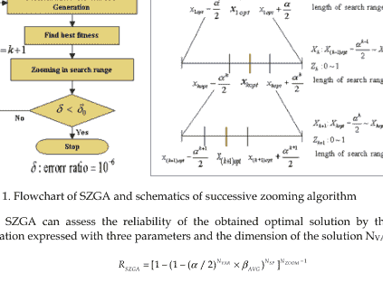

图1. SZGA流程图及连续缩放算法示意图

SZGA可以通过用三个参数和解的维数N_VAR表示的可靠性方程来评估所获得最优解的可靠性。

R_SZGA = [1 - (1 - (α / 2))^{...} × β_AVG]^{...} (1)

其中，
α：缩放因子，β：改进因子
N_VAR：解的维数，N_ZOOM：缩放次数
N_SIF：子迭代次数，N_POP：种群数
N_SF：子迭代期间个体的总数（N_SF=N_SUB×N_POP）

三个参数控制SZGA的性能：缩放因子α、缩放操作次数N_ZOOM和子迭代种群数N_SF。根据先前的研究，SZGA的最优参数（如缩放因子、缩放操作次数和子迭代种群数）与优化问题中使用的变量数密切相关。

### 2.1 SZGA中参数的选择

SZGA的缩放因子α、子迭代种群数N_SF和缩放次数N_ZOOM极大地影响找到最优解的可能性以及所求解的精度。这些参数过去通常凭经验或通过试错法选择。分配给这些参数的值决定了解的可靠性和精度。不恰当的参数值可能导致丢失全局最优解，或者可能因基于这些不当值找到的最优解精度低而需要进一步搜索。我们将通过研究这些参数之间的关系并找到这些参数的最优值来优化SZGA本身。我们将提供一种考虑解的维度的SZGA参数值选择标准方法。

SZGA以缩放因子α、子迭代种群数N_SF和缩放次数N_ZOOM为优化对象，目标可靠性为99.9999%，目标精度为10^6。当前优化的目标是在满足目标可靠性和目标精度的同时最小化计算负担。我们不采用经验参数值，而是建议一种标准方法，通过使用任何优化技术为上述目标函数找到这些参数的最优值，从而优化SZGA本身。因此，在使用SZGA解决任何给定的优化问题之前，我们首先优化SZGA本身以找到其参数的最优值，然后使用这些参数求解原始优化问题以找到最优解。

在分析参数之间的关系后，我们将构造SZGA自身优化的数学问题。解向量由缩放因子α、子迭代种群数N_SF和缩放次数N_ZOOM组成。目标函数由实际可靠性与目标可靠性之差、实际精度与目标精度之差、实际N_SF与建议N_SF之差以及生成的种群总数组成。

F(α, N_SF, N_ZOOM) = ΔR_SZGA + ΔA + ΔN_SF + (N_SF × N_ZOOM) (2)

其中，
ΔR_SZGA：与目标可靠性的差值
- ΔA：与目标精度的差值
- Δ N_SP：与建议N_SP的差值

SZGA自身的优化问题可以通过使用该目标函数表示如下：

最小化 F(X) (3)

其中，

X = {α, N_SP, N_ZOOM}^T
0 < α < 1
N_SP > 100
N_ZOOM > 1

实际可靠性与目标可靠性之差是R_SZGA与99.9999%之间的差值，其中可靠性R_SZGA用平均改进因子重写为

R_SZGA = [1 − (1 − (α / 2)^N_ZOOM × β_AVG^N_SP)^(N_ZOOM − 1)] (4)

这里，我们可以看到稍后将进行回归的平均改进因子β_AVG。实际精度与目标精度之差是精度A与10^4之间的差值，其中精度A实际上是上限，可以写为

A = α^(N_ZOOM − 1) (5)

实际N_SP与建议N_SP之差是N_SP与100^7之间的差值。在组织优化算法时，目标函数中的每个元素根据其重要性被赋予不同的权重。因此，首先满足目标可靠性和目标精度，然后使生成的种群总数最小化。尽管可以使用任何优化技术来求解式（3），但可以采用SZGA来优化SZGA本身，从而快速准确地获得解。

使用目标函数以及测试函数^9回归后的平均改进因子，对SZGA中的参数进行了优化。目标可靠性为99.9999%，解的目标精度为10^4。建议的子迭代种群数N_SP为100。表1给出了四种不同设计变量数情况下SZGA参数的优化值。

我们发现，对于不同设计变量数的测试函数，结果与表1有相似的趋势。我们还发现，对于设计变量数超过1的情况，建议的子迭代种群数N_SP将不再能够保证可靠性和精度。为了获得具有适当可靠性（99.9999%）和精度（10^4）的最优解，需要大得多的子迭代种群数。

为了验证我们的优化结果，我们在可行域内固定两个参数，使其满足目标可靠性和目标精度，并检查目标函数随剩余参数的变化。对于四个设计变量的情况，目标函数变化的示例证明了所获得的参数最优值的有效性。尽管这些值可能并非对所有其他情况都有效，但它们可以作为新问题的良好参考。稍后将给出选择这些参数值的其他方法。

表1. 不同设计变量数下SZGA的优化参数结果

| 变量数 | 2 | 4 | 8 | 16 |
|---|---|---|---|---|
| 缩放因子α | .02573 | .1303 | .4216 | .5176 |
| Nzoom | 5 | 8 | 17 | 22 |
| Nsp | 1,000 | 2,000 | 9,510 | 1,479,230 |
| 函数评价次数 | 5,000 | 16,000 | 161,670 | 32,543,060 |

### 2.2 连续缩放与预分区算法的编程

SZGA的编程很简单，如下所述。这种缩放思想不仅限于遗传算法，还可以应用于大多数其他全局搜索算法。设Y(i)为全局变量，取值范围为YMIN(i) ~ YMAX(i)，其中i为设计变量编号。Z(i)由取值在0~1之间的局部归一化变量组成。因此，在FORTRAN中它们之间的关系如下：

```
DO 10 I=1,NVAR
10 Y(I)=YMIN(I)+(YMAX(I)-YMIN(I))*Z(I)
```

缩放区域内局部变量Z(I)和局部变量X(I)（0~1）之间的关系如下：

```
DO 12 I=1,NVAR
12 Z(I)=ZOPT(I,JWIN-1)+ALP**(JWIN-1)*(X(I)-0.5)
```

其中，ZOPT(I,JWIN)是缩放步(JWIN-1)中的精英个体，ALP是缩放因子。注意ZOPT(I,JWIN-1)更合理。然而，参数增加1是为了适应旧版FORTRAN，它要求维数参数为正整数。基于步(JWIN-1)中的精英个体，我们在步JWIN中搜索变量。请注意，ZOPT(I,1)=0。

预分区算法在经过一组进化后，将猜测的初始区域调整为一个非常合理的区域。

```
DO 14 I=1,NVAR
    YMIN(I)=YINP(I)-BTA*ABS(YINP(I))
14  YMAX(I)=YINP(I)+BTA*ABS(YINP(I))
```

其中，YINP(I)是经过一组进化后得到的精英个体。因此，我们消除假定的初始边界，并建立一个新的合理边界。系数BTA可以被适当地选择，例如0.5。


### 2.3 混合遗传算法

遗传算法是基于自然选择和自然繁殖机制的随机全局搜索方法。GAs 已被应用于结构优化问题，因为它们能够解决涉及连续、不连续和非凸区域混合等优化问题。通过使用锦标赛选择以及精英策略等技术，简单遗传算法 SGA (simple GA) 已被改进为 MGA。然而，遗传算法在后期快速搜索精确最优点方面存在一定的困难。DPE（动态参数编码）遗传算法 4 使用数字缩放技术，在某一阶段之后不再改变更高位的数字。SZGA（逐次缩放遗传算法）逐次缩小搜索区域，从而大大提高了收敛速度。一种能够保证找到最优点的新的混合遗传算法技术已被提出 7,14。

混合遗传算法首先使用 MGA 识别准最优点，其搜索能力优于简单遗传算法。为了解决后期收敛问题，我们采用了将全局遗传算法与局部搜索算法（DFP 1 或 MGA）相结合的混合算法。使用 DFP（Davidon Fletcher Powell）方法的混合算法结合了遗传算法和梯度搜索技术的优点。另一个在缩放区域的全局遗传算法与局部遗传算法的混合算法称为 LGA（局部缩放遗传算法），检查准最小点附近的凹性条件。上述混合算法的改进通过将其应用于闸门优化问题得到验证。

在此最小化问题的混合算法中，按代进行 MGA，直到目标函数不再发生变化，然后在 Z_MGA 处找到近似最优解。检查目标函数关于设计变量的梯度，如果在小缩放区域的边界上满足凹性条件 1（图 2）。如果条件不满足，则将小缩放区域扩大 δ。经过多次迭代后，凹性条件最终在以 Z_MGA 为中心的最终缩放区域（kδ × kδ）边界上得到满足。利用来自全局遗传算法的精英解（近似最优解，Z_MGA）和凹性条件，最优点可在最终缩放区域 [Z(i): (Z_MGA(i) - kδ) ~ (Z_MGA(i) + kδ)] 内找到。从这一点开始，对可能包含最优点的最终小缩放区域执行局部遗传算法。通常，该区域远小于原始区域，因此收敛速度显著提高（请注意，第一次近似解过早收敛到不精确但接近最优的点）。

水闸需要安装在水坝中以调节流量并确保水坝的蓄水功能。在这些闸门中，由于其精度高、启闭方便、耐用等特点，径向闸门被广泛用于调节大型水坝的流量。此外，3 臂式径向闸门在桁架截面尺寸和泄流操作期间的振动特性方面表现优于 2 臂式。表 2 比较了 3 臂式径向闸门的优化结果，该结果考虑了包括带臂或不带臂的垂直桁架在内的结构主重最小化时的反力。混合算法（MGA+DFP、MGA+LGA）在远少于 MGA 的 9000 代的 4100 代后获得了 0.690488E+10 的精确最优解，而 MGA 得到的是接近但不精确的解 0.690497E+10。

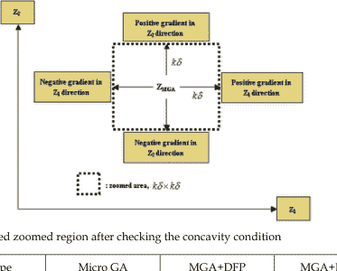

Fig. 2. 检查凹性条件后确认的缩放区域

| 3-arm type | Micro GA | MGA+DFP | MGA+LGA |
|---|---|---|---|
| 收敛代数 | 9000 | 4000+α | 4100 |
| 目标函数 | 0.690497E+10 | 0.690488E+10 | 0.690488E+10 |

表 2. 结果比较：MGA、MGA+DFP、MGA+LGA

## 3. SZGA 的示例

缩放因子 α 的值作为一个最优参数在文献 [8] 中获得，并发现与经验值吻合良好。在 SZGA 中使用该缩放因子，通过最小化系统的总势能推导出桁架结构的位移。使用缩放因子 α 的值，通过 SZGA 对操作安装在发电机的卡普兰型涡轮机上的导叶闸门的伺服电机的容量进行了优化。

这只是 sec.2.1⁹ 中讨论的全部最优参数中的一个参数。因此，使用该因子⁸ 进行的分析是简化分析。如第 2.1 节所述，可使用表 1 中建议的良好测试模型的参数值进行优化，或可使用下一节中讨论的以其他方式获得的参数值。

在以下各节中提供了若干额外的 SZGA 优化示例，以更深入地了解 SZGA 并找到选择 SZGA 参数值的另一种方法。第一个示例求出橡胶材料的 Mooney-Rivlin 系数以与最小二乘法得到的结果进行比较。第二个示例是一个损伤检测问题，其中最小化了实测固有频率与结构假设损伤的固有频率之间的差异。第三个示例求出

| 待最小化的误差 | Haines & Wilson | 最小二乘 | SZGA |
|---|---|---|---|
| 简单拉伸 | 0.757932 | 0.709209 | 0.921277 |
| 纯剪切 | 0.702015 | 0.620089 | 0.370579 |
| 等双轴 | 13.2580 | 0.242475 | 0.139983 |
| 总误差 | 14.7180 | 1.57177 | 1.43184 |

表 3. 获取 Mooney-Rivlin 6 系数的不同方法之间的误差比较

### 3.2 结构的损伤检测

由于制造误差、材料缺陷、疲劳或设计失误，结构有时会比预期更早发生失效，其中疲劳失效可能是最常见的。因此，为了保护结构免受任何灾难性失效的侵害，会进行包括敲击、目视检查和其他无损检测在内的定期检查。然而，这些方法都是局部的，并且在很大程度上取决于检查员的技能和经验。因此，利用理性算法、强大的计算机和 FEM，近年来已对智能化和全局化的损伤搜索方法进行了研究。

根据假设的结构损伤，最小化实测数据与计算数据之间的差异的目标函数，以找到结构中可能损伤的位置和强度。实测数据可以是某些点的位移或结构的固有频率，而计算数据是通过有限元法使用假设的结构损伤获得的，其严重程度在 0 到 1 之间分级。例如，Chou 等人使用了由桁架构件组成的离散结构中几个位置的静位移，并采用了一种混合串方案作为隐式冗余表示。同时，Rao 采用了残余力法，其中适应度是目标函数的倒数，该目标函数是残余力的矢量和，而 Koh 采用了堆叠模态形状相关性，该方法可以在不包含灵敏度信息的情况下定位多个损伤 11。

然而，典型的结构可以细分为许多有限单元并且具有许多自由度。因此，有限元法进行静力分析以及频率分析都需要很长时间。对于遗传算法，分析时间与用于评估适应度的函数数量有关。当监测整个结构时，该数量可能变得无法控制，其结果是所需 RAM 或内存空间变得过大，在处理如此多数据时访问速度过慢。

因此，所提出的 SZGA 在这种情况下非常有效，因为它不需要那么多染色体，甚至少至 4 个，从而克服了传统遗传算法在确定损伤程度时需要大量染色体而导致的收敛速度减慢问题。此外，只要结构设计得当，损伤数量可能在 1-4 之间，因此可以通过将监测问题细分为较小的子问题来解决自由度过多的問題。此外，裂纹通常起源于结构的外部和受拉应力位置这一事实


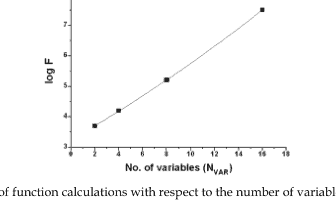

图 5. 不同变量数下的函数计算次数

SZGA 可通过在逐级缩小的搜索域内搜索来精确定位最优解。除了这种精调能力外，SZGA 对每个缩小后的搜索域仅需少量染色体，这对于解变量数量很多的大型结构损伤检测来说是非常有用的特性。本研究中仅使用了四或六位染色体。最优解的精度由逐级缩小的极小范围来保证。

大多数结构只有少数裂纹，且这些裂纹可能位于不同位置。因此，本文提出一种组合搜索方法，以 $^nC_k$ 方式选择可能的损伤位置，从而分别搜索各条裂纹；其中 n 表示单元总数，k 表示可能的裂纹位置数量（1-4）。因此，在由 n（=20）个单元建模的连续结构中最多考虑了四条裂纹（k），并比较了组合搜索与全域搜索的函数计算次数。

$^nC_k = \frac{n!}{k!(n-k)!}$ (6)

| 裂纹数 | $^nC_k$ | 函数计算次数 | 比值（组合/全域） |
|---|---|---|---|
| | | 组合搜索 | 全域搜索 | |
| 1 | 20 | 0.580671×10^5 | 0.578096×10^9 | 0.100445×10^-3 |
| 2 | 190 | 0.950000×10^6 | 0.578096×10^9 | 0.164332×10^-2 |
| 3 | 1140 | 0.990843×10^7 | 0.578096×10^9 | 0.171398×10^-1 |
| 4 | 4845 | 0.740788×10^8 | 0.578096×10^9 | 0.128143 |

表 4. 组合搜索方法减少 SZGA 计算量的结果

在对整个结构进行监测时，根据变量数与函数计算次数之间的关系，函数计算次数约为六亿。然而，如表 4 所示，使用组合搜索方法后，与全域监测情况相比，函数计算次数减少了约 10^1~10^4 倍。表 5 显示，使用组合方法和 SZGA 能够良好地检测损伤。

| 单元编号 | 19 | 20 | 25 | 26 | 31 | 32 |
|---|---|---|---|---|---|---|
| 实际完好度因子 | 1 | 1 | 0.5 | 1 | 1 | 1 |
| 损伤检测结果 | 1.0 | 1.0 | 0.499999 | 1.0 | 1.0 | 1.0 |

表 5. 使用组合方法和 SZGA 进行结构损伤检测的结果

### 3.3 使用权重因子的连杆系统设计

本节介绍一个流程，该流程使用遗传算法对柴油发动机中使用的单个四杆连杆系统和双四杆连杆系统进行优化设计。关于由开式单连杆系统和闭式单连杆系统共同构成的双连杆系统的优化设计研究很少见，而且在该领域中很难找到 SZGA 的应用，因为目标函数具有宽而平坦的分布 1,2。

在对单个四杆连杆系统进行优化设计时，可以发现：当输入-输出（IO）角相等时，初始构型和最终构型呈现某种对称性。对于开式单连杆系统，输入-输出（IO）连杆的半径相同，并具有平面对称性；对于闭式单连杆系统，输入-输出（IO）连杆的半径相同，并具有点对称性。

为了控制小型高速直喷发动机中的涡流控制阀，有两种驱动系统：第一种使用由脉宽调制控制的单个直流电机，第二种使用两个直流电机。然而，本研究采用第一种执行器，通过双连杆系统同时控制两个涡流控制阀。当柴油发动机中的两个进气门由同一个电机控制时，如果控制连杆系统的设计变量选择不当，两个进气门通常会产生明显不同的角响应。因此，为了确保双进气门柴油发动机的均衡性能，需要建立并求解一个优化问题，以找出双四杆连杆系统的最佳设计变量集，从而最大程度地减小同一输入下不同响应之间的差异。

目标函数中引入了两个权重因子，以保持多个目标函数之间的平衡。目标函数之间权重因子的合适比例通过图形方式确定。SZGA 和所开发的 FORTRAN 连杆程序给出的最优解可通过监测适应度加以确认。各目标函数的下降幅度列于表中。输出连杆在同步输入连杆作用下的响应已通过实验和 Recurdyn 三维运动学分析软件包进行验证。实验与分析结果吻合良好。

所提出的优化设计流程已成功应用于一款近期推出的豪华运动型多功能车（SUV）车型。表 6 给出了原始模型的响应和优化后模型的响应。优化模型几乎实现了完全相同的左、右侧输出；在给定连杆中心位置以及采用单输入电机的双控制系统条件下，0.603 的左、右响应之差被认为是可达到的最小值。

| 模型 | 输入（度） | 左侧 | 右侧 | 最大差值 |
|---|---|---|---|---|
| 原始模型 | 0-90 | 0-89.144 | 0-91.958 | 2.044 |
| 优化模型 | 0-90 | 0-89.999 | 0-89.999 | 0.603 |

表 6. 原始模型与优化模型的比较

### 3.4 合适的等式约束带宽

在含有等式约束的问题中，遗传算法要在满足约束的同时保持效率并不容易。最优解位于等式约束线上，因此在约束线上或其附近生成个体非常重要。然而，包含该等式线在内的理想窄区域相对于整个区域而言非常小，在该窄区域内生成的个体数量远少于理想窄区域外部的个体。因此，对于带等式约束的问题，遗传算法或 SZGA 的收敛速度会显著变慢。本文提出带宽方法来解决这种收敛缓慢的问题。

对于最小化问题，我们添加了一个基本的罚函数以满足等式约束，具体说明见后文。如前所述，仅使用这种基本约束时，无法期望较快的收敛速度。因此，我们在包含等式约束线的理想窄区域之外的区域添加一个附加罚函数，使其成为一个目标函数值被大幅提高的不可行区域。带宽表示仅施加基本罚函数的窄区域的一半宽度。

使用遗传算法处理等式约束有三种方法。第一种是在等式约束条件的两侧都施加罚函数。第二种是沿等式约束线在一侧施加单调函数，在另一侧施加偶（跳跃）罚函数；但采用单调罚函数的一侧应当是可行区域。最后一种是不在等式约束线的一侧施加罚函数，而在另一侧施加偶（跳跃）罚函数，且不施加罚函数的一侧应当是可行区域。

图 6 中仅使用原始罚函数的惩罚方法，是处理等式约束的基本技术 15。然而，如果只采用这种基本技术，收敛速度会太慢，难以达到最优点。许多生成的个体因为离等式约束线太远而被浪费。因此，需要附加罚函数来提高遗传算法的有效性。也就是说，当个体位于以等式约束线为中心的某一带宽之外时，还需要对目标函数施加额外惩罚。

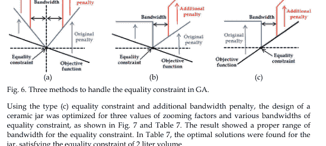

图 6. 遗传算法中处理等式约束的三种方法。

采用类型 (c) 的等式约束处理方法并施加附加带宽罚函数后，对陶瓷罐在三种缩放因子值和不同等式约束带宽下进行了优化设计，如图 7 和表 7 所示。结果表明了等式约束的合适带宽范围。在表 7 中，找到了满足 2 升容积这一等式约束的罐体最优解。

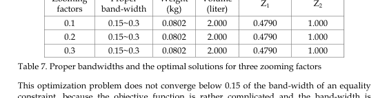

图 7. 等式约束带宽和世代数的最佳适应度。

| 缩放因子 | 合适带宽 | 重量（kg） | 容积（升） | Z₁ | Z₂ |
|---|---|---|---|---|---|
| 0.1 | 0.15~0.3 | 0.0802 | 2.000 | 0.4790 | 1.000 |
| 0.2 | 0.15~0.3 | 0.0802 | 2.000 | 0.4790 | 1.000 |
| 0.3 | 0.15~0.3 | 0.0802 | 2.000 | 0.4790 | 1.000 |

表 7. 三种缩放因子的合适带宽及最优解

该优化问题在等式约束带宽低于 0.15 时不会收敛，因为目标函数相当复杂，且带宽相对过窄，难以从可行区域中获得大多数候选最优个体。


# 寻找最合适数学方程的网络算子法

阿斯卡特·迪维耶夫¹ 和 叶莲娜·索弗罗诺娃²  
¹俄罗斯科学院多罗德尼岑计算中心，  
²俄罗斯人民友谊大学  
俄罗斯

## 1. 引言

对于许多应用和研究问题，需要以数学方程的形式寻找解。这些问题包括实验数据逼近中的函数选择、控制对象模型的辨识、以状态空间坐标函数形式进行的控制综合、动力学与数学物理反问题等。获得用于求解这些问题的数学方程的主要方法，在于对问题的初始表述公式进行解析变换。少数问题具有精确解析解，因此数学家会使用各种假设、分解以及解的特殊性质。通常由数学家设定数学方程的形式，然后使用数值方法和计算机寻找最优参数。最小二乘法等方法多年来一直应用于逼近问题（Kahaner D. et al., 1989）。

近年来，当无法解析地找到数学方程时，神经网络已被用于求解复杂问题。任何神经网络的结构也由参数值或权重系数给出。在函数逼近和神经网络训练问题中，数学方程的形式由研究人员设定，而计算机在这些方程中搜索参数的最优值（Callan, 1999; Demuth et al., 2008）。

1992年，一种新的遗传编程方法被开发出来。它能够求解寻找最合适数学方程的问题。在遗传编程中，数学方程以符号串的形式表示。每个符号串对应于一个树形计算图。该图的节点包含运算，叶节点包含变量或参数（Koza, 1992, 1994; Koza, Bennett et al., 1999 & Koza, Keane et al., 2003）。

遗传编程通过应用遗传算法来求解问题。为了执行交叉，必须找到对应于树枝的符号子串。符号串分析会增加算法的运行时间。如果同一个参数或变量在所需数学方程中出现多次，那么为了有效求解问题，遗传编程需要对树进行交叉，使叶节点包含的参数或变量数量不少于所需数量。

在求解合适数学方程搜索问题时暴露出的遗传编程局限性，促成了网络算子的创建。

在这项工作中，我们引入一种新的数据结构，我们称之为网络算子。网络算子是一个有向图，包含运算、操作数以及用于计算数学方程的全部信息。

网络算子法已被用于控制综合问题（Diveyev & Sofronova, 2008; Diveev, 2009; Diveev & Sofronova, 2009a,b）。

## 2. 数学方程的程序表示法

数学方程由变量、参数、一元运算和二元运算组成，这些要素构成四个构造集合。

变量集合

\[
X = (x_1,\ldots,x_N), \quad x_i \in \mathbb{R}, \quad i = 1,\ldots,N. \tag{1}
\]

参数集合

\[
Q = (q_1,\ldots,q_P), \quad q_i \in \mathbb{R}, \quad i = 1,\ldots,P. \tag{2}
\]

一元运算集合

\[
O_1 = \{\rho_1(z)=z, \rho_2(z),\ldots,\rho_W(z)\}. \tag{3}
\]

二元运算集合

\[
O_2 = \{\chi_0(z',z''),\ldots,\chi_{V-1}(z',z'')\}. \tag{4}
\]

一元运算集合必须包含恒等运算

\[
\rho_1(z) = z. \tag{5}
\]

二元运算必须可交换

\[
\chi_i(z',z'') = \chi_i(z'',z'), \quad i = 0,\ldots,V-1, \tag{6}
\]

可结合

\[
\chi_i((z',z''),z''') = \chi_i(z',(z'',z''')), \quad i = 0,\ldots,V-1, \tag{7}
\]

并且具有单位元

\[
\exists e_i: \chi_i(e_i,z) = z, \quad i = 0,\ldots,V-1. \tag{8}
\]

数学方程的程序表示法是借助构造集合（1）—（4）表示方程的方法。

## 3. 数学方程的图形表示法

为了将数学方程表示为图，我们使用程序表示法。我们通过额外的一元恒等运算 \(\rho_1(z)=z\) 和具有单位元的二元运算 \(\chi_i(e_i,z)=z\) 来扩展程序表示法。这些运算不影响计算结果，但它们在表示法中设定了确定的运算顺序，使得二元运算以一元运算或单位元作为其操作数，而一元运算仅以二元运算、参数或变量作为其操作数。

**数学方程的图形表示法**是一种满足以下条件的二元运算表示法：

- a. 二元运算可以以一元运算或该二元运算的单位元作为其操作数；
- b. 一元运算可以以二元运算、参数或变量作为其操作数；
- c. 二元运算不能以带有相同常量或变量的一元运算作为其操作数。

任何程序表示法都可以转换为图形表示法。

## 4. 数学表达式的网络算子

为了构造数学表达式的图，我们使用图形表示法。如果数学表达式的一元运算对应于图的边，二元运算、参数或变量对应于图的节点，则图形表示法可以转换为图。

假设在图形表示法中有一个子串，其中两个一元运算是二元运算 ...\(\chi_k(\rho_l(\ldots),\rho_m(\ldots))\)... 的操作数。该子串如图1所示。

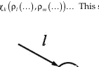

图1. 子串 ...χ_k(ρ_l(...),ρ_m(...))... 的图

假设有一个子串，其中二元运算是二元? 一元运算 ...\(\rho_k(\chi_l(\ldots))\)... 的操作数。该子串如图2所示。

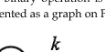

图2. 子串 ...ρ_k(χ_l(...))... 的图

| 一元运算 | 一元运算 |
|---|---|
| ρ1(z) = z | ρ13(z) = arctan(z) |
| ρ2(z) = ε^(-1)（若 \|z\| > 1/√ε）；否则 z² | ρ14(z) = sgn(z)/ε（若 \|z\| > 1/√ε）；否则 z |
| ρ3(z) = -z | ρ15(z) = √ε（若 \|z\| < ε）；否则 √z |
| ρ4(z) = sgn(z)√\|z\| | ρ16(z) = z（若 \|z\| < 1）；否则 sgn(z) |
| ρ5(z) = sgn(z)/ε（若 \|z\| < ε）；否则 1/z | ρ17(z) = sgn(z)ln(\|z\| + 1) |
| ρ6(z) = ε^(-1)（若 z > -ln(ε)）；否则 ε^z | ρ18(z) = sgn(z)/ε（若 \|z\| > -ln(ε)）；否则 sgn(z)(ε^(\|z\|) - 1) |
| ρ7(z) = ln(ε)（若 -ln\|z\| > 1/ε）；否则 ln\|z\| | ρ19(z) = 0（若 \|z\| > -ln(ε)）；否则 sgn(z)ε^(\|z\|) |
| ρ8(z) = sgn(z)/ε（若 \|z\| > -ln(ε)）；否则 (1 - ε^(-z))/(1 + ε^(-z)) | ρ20(z) = 1（若 z > ε）；0（若 z < 0）；否则 3z²/ε² - 2z³/ε³ |
| ρ9(z) = 1（若 z ≥ 0）；否则 0 | ρ21(z) = 1（若 z > ε/2）；-1（若 z < -ε/2）；否则 3z/ε² - 4z³/ε³ |
| ρ10(z) = sgn(z) | ρ22(z) = 0（若 \|z\| > -ln(ε)）；否则 ε^(\|z\|) |
| ρ11(z) = cos(z) | ρ23(z) = -sgn(z)/ε（若 \|z\| > 1/√ε）；否则 z - z³ |
| ρ12(z) = sin(z) | ρ24(z) = ε/(1 + ε^z)（若 z > -ln(ε)）；否则 1/(1 + ε^(-z)) |

**表1. 一元运算**


| 运算 | 单位元 |
|---|---|
| χ₀(z',z'') = z' + z'' | 0 |
| χ₁(z',z'') = z' z'' | 1 |
| χ₂(z',z'') = max{z',z''} | -1/ε |
| χ₃(z',z'') = min{z',z''} | 1/ε |
| χ₄(z',z'') = z' + z'' - z' z'' | 0 |
| χ₅(z',z'') = sgn(z' + z'')√((z')² + (z'')²) | 0 |
| χ₆(z',z'') = sgn(z' + z'')(|z'| + |z''|) | 0 |
| χ₇(z',z'') = sgn(z' + z'')max{|z'|,|z''|} | 0 |

表 2. 二元运算

首先我们设置括号以强调函数参数。然后利用表 1 和表 2 找到合适的运算并用运算替换函数

y = x₁ + sin(x₁) + q₁ x₁ e^{-x₂} = ((x₁ + sin(x₁)) + q₁ x₁ e^{-x₂}) = χ₀((x₁ + sin(x₁)), q₁ x₁ e^{-x₂})
= χ₀(χ₀(x₁, ρₛ(sin(x₁))), ρ₁ q₁ x₁ e^{-x₂}) = χ₀(χ₀(x₁, ρₛ₁(x₁)), χ₁(q₁ x₁, ρₛ(-x₂)))
= χ₀(χ₀(x₁, ρₛ₁(x₁)), χ₁(q₁ x₁, ρₛ(ρₛ(p₃(x₂)))))

结果我们得到数学方程的程序表示

y = χ₀(χ₀(x₁, ρₛ₁(x₁)), χ₁(q₁ x₁, ρₛ(ρₛ(p₃(x₂))))).

我们可以看到这种程序表示不符合图形表示的要求。这些要求对于进一步构造图是必要的。根据网络算子的定义，二元运算对应于图的节点，一元运算对应于边，因此在数学方程的图形表示中，二元运算和一元运算必须是彼此的参数。

当程序表示中一个二元运算的参数是另一个二元运算时，我们无法构造图，因为两个节点之间没有边，换句话说没有一元运算。

为满足图形表示的要求，让我们引入额外的单目恒等运算。例如在给定的程序表示中我们有一个子串

y = χ₀(χ₀(...) , χ₁(...)).

这里二元运算有两个二元运算作为其参数。它不满足图形表示的条件「a」。如果我们使用额外的恒等运算，则有

$$ y = χ₀(ρ₁(χ₀(...)), ρ₁(χ₁(...))) . $$

单目恒等运算 ρ₁(z) 不改变参数的值，并且该运算对于通过图形表示构造图是必要的。

由于图形表示应包含参数为一元运算的二元运算，因此我们需要额外的单目恒等运算。我们得到

$$ y = χ₄(ρ₁(χ₀(ρ₁(x₁), ρₛ₁(x₁))), ρ₁(χ₁(ρ₁(χ₁(ρ₁(q₁), ρ₁(x₁))), ρ₄(ρ₂(x₂))))) . $$

这种表示不是图形表示，因为它不满足图形表示的条件「b」。这里一元运算的参数是一元运算

$$ ... ρ₄(ρ₂(x₂)) ... $$

我们使用第二个参数为单位元的额外二元运算，例如 χ₀(...,0)。根据表 2，二元运算 χ₀(z′,z″) 是加法。加法的单位元是 0，它不影响计算结果。因此我们得到

$$ ... ρ₄(χ₀(ρ₂(x₂), 0)) ... $$

我们得到数学方程的图形表示

$$ y = χ₀(ρ₁(χ₀(ρ₁(x₁), ρₛ₁(x₁))), ρ₁(χ₁(ρ₁(χ₁(ρ₁(q₁), ρ₁(x₁))), ρ₄(χ₀(ρ₂(x₂), 0))))) . $$

这种表示不满足图形表示的条件「c」，因为它包含一个子环，其中二元运算有两个具有相同变量的一元运算作为其参数

$$ ... χ₀(ρ₁(x₁), ρₛ₁(x₁)) ... $$

我们向子环添加一个具有单位元和单目恒等运算的二元运算

$$ ... χ₀(ρ₁(χ₀(ρ₁(x₁), 0)), ρₛ₁(x₁)) ... $$

结果我们得到以下数学方程的表示

$$ y = χ₀(ρ₁(χ₀(ρ₁(χ₀(ρ₁(x₁), 0)), ρₛ₁(x₁))), ρ₁(χ₁(ρ₁(χ₁(ρ₁(q₁), ρ₁(x₁))), ρ₄(χ₀(ρ₂(x₂), 0))))) . $$

这种表示具有图形表示的所有属性，我们可以通过这种表示构造方程的图。为了构造图，我们使用图 1 - 4 中呈现的规则。图示于图 5。图 5 显示了图中每个节点顶部的节点编号。我们看到边发出的节点的编号小于边进入的节点的编号。这种编号对于没有环的有向图总是可能的。

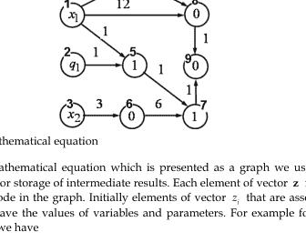

图 5. 数学方程的图

为了计算以图形式呈现的数学方程，我们使用额外的节点向量 z 来存储中间结果。向量 z 的每个元素与图中的特定节点相关联。最初，与源节点相关联的向量 z 的元素具有变量和参数的值。例如对于图 5 中呈现的图，我们有

$\mathbf{z} = [z_1 \dots z_9]^T,$

其中 9 是图中的节点数。对于源节点我们设 $z_1 = x_1$, $z_2 = q_1$, $z_3 = x_2$。其他元素 $z_i$ 的值等于二元运算的单位元。结果我们得到节点向量的初始值

$\mathbf{z} = [x_1 \; q_1 \; x_2 \; 0 \; 1 \; 0 \; 1 \; 0 \; 0]^T.$

在给定的例子中我们使用加法和乘法。加法的单位元是 0，乘法的单位元是 1。

根据计算规则，我们计算对应于从没有入边的节点发出的边的单目运算。对于边 $(i,j)$，节点 $i$ 在此时没有入边。单目运算 $\rho_i$ 对应于边 $(i,j)$。二元运算 $\chi_j$ 对应于节点 $j$。然后我们执行以下计算

$z_j = \chi_j(z_i, \rho_i(z_i)), \tag{9}$

其中等式右边 $z_i$ 是上一步的值。

计算 (9) 后我们从图中删除边 $(i,j)$。

如果我们对节点编号，使得边发出的节点的编号小于边进入的节点的编号，则计算只需按照节点编号进行。

方程。它取决于研究者设定的汇节点的数量。在给定的例子中，如果我们将汇节点编号为 7、8、9，则我们将得到三个数学方程

$$y_1 = z_7 = e^{-x_2}q_1x_1,$$

$$y_2 = z_8 = x_1 + \sin(x_1),$$

$$y_3 = z_9 = x_1 + \sin(x_1) + e^{-x_2}q_1x_1.$$

图形表示的这一特性允许使用网络算子来表示向量函数。

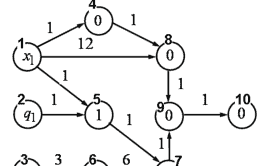

图 7. 数学方程的放大图

## 6. 网络算子矩阵

为了在 PC 内存中表示网络算子，我们使用网络算子矩阵 (NOM)。NOM 基于图的关联矩阵 $A=[a_{ij}]$, $a_{ij}∈{0,1}$, $i,j=1,L$，其中 $L$ 是图中的节点数。

如果我们用对应节点的二元运算编号替换关联矩阵的对角元素，并用一元运算编号替换非零非对角元素，我们将得到 NOM $Ψ=[ψ_{ij}]$, $i,j=1,L$。

对于图 6 所示的网络算子，我们有以下 NOM

$$
\mathbf{A} =
\begin{bmatrix}
0 & 0 & 0 & 1 & 1 & 0 & 0 & 1 \\
0 & 0 & 0 & 0 & 1 & 0 & 0 & 0 \\
0 & 0 & 0 & 0 & 0 & 1 & 0 & 0 \\
0 & 0 & 0 & 0 & 0 & 0 & 0 & 1 \\
0 & 0 & 0 & 0 & 0 & 1 & 0 & 0 \\
0 & 0 & 0 & 0 & 0 & 1 & 0 & 0 \\
0 & 0 & 0 & 0 & 0 & 0 & 0 & 1 \\
0 & 0 & 0 & 0 & 0 & 0 & 0 & 0
\end{bmatrix}.
$$

图 6 图的 NOM 如下

$$\Psi = \begin{bmatrix} 0 & 0 & 0 & 1 & 1 & 0 & 0 & 12 \\ 0 & 0 & 0 & 0 & 1 & 0 & 0 & 0 \\ 0 & 0 & 0 & 0 & 0 & 3 & 0 & 0 \\ 0 & 0 & 0 & 0 & 0 & 0 & 0 & 1 \\ 0 & 0 & 0 & 0 & 1 & 0 & 1 & 0 \\ 0 & 0 & 0 & 0 & 0 & 0 & 6 & 0 \\ 0 & 0 & 0 & 0 & 0 & 0 & 0 & 1 \\ 0 & 0 & 0 & 0 & 0 & 0 & 0 & 0 \\ \end{bmatrix}.$$

NOM $\Psi = [\psi_{ij}]$, $i,j=1,\overline{L}$ 由于节点编号是上三角的。NOM 对于计算数学方程是不够的，因为它不包含关于参数和变量的信息。这些信息保存在节点向量的初始值中

$$\mathbf{z}=[z_1\ ...\ z_L]^T.$$ (10)

然后数学方程的计算可以通过以下方式进行

$$z_j = X_{\psi_{ij}}(\rho_{\psi_{ij}}(z_i),z_j),\ \text{if}\ \psi_{ij}\neq0,\ i=1,\overline{L-1},\ j=i+1,\overline{L}.$$ (11)

要通过其 NOM 计算数学方程，我们需要依次遍历所有行；$i=1,\overline{L-1}$。在每一行 $i$ 中，我们考虑跟随对角元素的元素，$j=i+1,\overline{L}$。如果其中找到非零元素，则根据方程 (11) 执行计算。

对于给定的 NOM 我们得到

$$\mathbf{z}=[x_1\ q_1\ x_2\ 0\ 1\ 0\ 1\ 0]^T,$$

$\psi_{1,4}=1,\ \psi_{4,4}=0,\ z_4 = X_0(\rho_1(z_1),z_4)=x_1+0=x_1;$ $\psi_{1,5}=1,\ \psi_{5,5}=1,\ z_5 = X_0(\rho_1(z_1),z_5)=x_1+1=x_1;$ $\psi_{1,8}=12,\ \psi_{8,8}=0,\ z_8 = X_0(\rho_{12}(z_1),z_8)=\sin(x_1)+0=\sin(x_1);$ $\psi_{2,5}=1,\ \psi_{5,5}=1,\ z_5 = X_1(\rho_1(z_1),z_5)=q_1x_1;$ $\psi_{3,6}=3,\ \psi_{6,6}=0,\ z_6 = X_0(\rho_3(z_1),z_6)=-x_1+0=-x_1;$ $\psi_{4,6}=1,\ \psi_{6,6}=0,\ z_6 = X_0(\rho_1(z_1),z_6)=x_1+\sin(x_1);$ $\psi_{5,7}=1,\ \psi_{7,7}=1,\ z_7 = X_1(\rho_1(z_1),z_7)=q_1x_1+1=q_1x_1;$ $\psi_{6,7}=6,\ z_7 = X_1(\rho_6(z_6),z_7)=e^{-x_3}q_1x_1;$ $\psi_{7,8}=1,\ \psi_{8,8}=0,\ z_8 = X_0(\rho_1(z_7),z_8)=e^{-x_3}q_1x_1+x_1+\sin(x_1).$

## 7. 网络算子的变体

相似的网络算子是满足以下条件的网络算子：

- a. 具有相同的源节点；
- b. 具有相同的构造集合。

相似的网络算子是具有相同节点数的相似网络算子。


**结构相似的网络算子** 是在单目和双目运算上不同的相似网络算子。

**网络算子的变化** 是导致相似网络算子的网络算子改变。

**网络算子的简单变化** 是不能表示为其他变化的复合的变化。

网络算子的简单变化在表 3 中给出。

| 简单变化编号 | 简单变化 |
|---|---|
| 0 | 边上单目运算的替换 |
| 1 | 节点中双目运算的替换 |
| 2 | 带单目运算的边的添加 |
| 3 | 若该边进入的节点至少还有一条入边，则删除该边 |
| 4 | 节点数增加 |
| 5 | 节点数减少 |
| 6 | 带双目运算的节点及带单目运算的入边的添加 |
| 7 | 若该入边是唯一的，则删除带入边的汇节点。 |

表 3. 网络算子的简单变化

**网络算子的结构变化** 是改变网络算子边集的变化。

结构变化改变图的关联矩阵。在表 3 中，结构变化为 2 - 5。变化 0、1 不改变关联矩阵并导致结构相似的网络算子。

**完整的网络算子** 是不能执行变化 2 的网络算子。

完整的网络算子包含 L 个节点，其中源节点数为 N + P，最大边数等于

|C| = (L - N - P)(L + N + P - 1)/2.   (12)

如果对任意网络算子应用变化 2，即边的添加，则可以构造一个与初始网络算子相似的完整网络算子。

如果对完整的网络算子应用变化 3，即边的删除，则可以构造任意相似的网络算子。

任何网络算子的变化都可以通过有限次数的简单变化实现。

## 8. 网络算子的本征变化

在表 3 中，本征变化为 0 - 5。

网络算子的任何本征变化都可以通过有限次数的简单本征变化实现。

为了表示任何简单变化，我们使用变化向量

**w** = [w₁, w₂, w₃, w₄]ᵀ, (13)

其中 w₁ 是表 3 中的变化编号，w₂、w₃、w₄ 是其整数值取决于变化编号的元素。

变化向量的元素值在表 4 中给出。如果元素的值未定义，它们可以取任意值。例如当 w₁ = 1 时，元素 w₂ 可以保持该边进入的节点编号 w₃ = w₃。

网络算子的变化表示为

**Ψ̂** = **w** ∘ **Ψ**,

其中 **Ψ** 是执行变化前的 NOM，**Ψ̂** 是执行变化后的 NOM。

| 变化编号 w₁ | 边发出节点的编号 | 边进入节点的编号 | 单目运算编号 | 双目运算编号 |
|---|---|---|---|---|
| 0 | w₂ | w₃ | w₄ | - |
| 1 | - | w₃ | - | w₄ |
| 2 | w₂ | w₃ | w₄ | - |
| 3 | w₂ | w₃ | - | - |
| 4 | w₂ | - | - | - |
| 5 | w₂ | - | - | - |
| 6 | w₂ | - | w₃ | w₄ |
| 7 | - | w₃ | - | - |

表 4. 变化向量的元素

考虑网络算子变化的例子。我们有一个描述数学方程的网络算子

y = \frac{q_1 x_1^3}{\sqrt[3]{x_1^2 + x_2^2}} .

给定方程的网络算子矩阵为

$$\boldsymbol{\Psi} = \begin{bmatrix}0 & 0 & 0 & 1 & 0 & 0 & 0 \\ 0 & 0 & 0 & 14 & 2 & 0 & 0 \\ 0 & 0 & 0 & 0 & 2 & 0 & 0 \\ 0 & 0 & 0 & 1 & 0 & 0 & 1 \\ 0 & 0 & 0 & 0 & 0 & 15 & 0 \\ 0 & 0 & 0 & 0 & 0 & 5 & 0 \\ 0 & 0 & 0 & 0 & 0 & 0 & 1\end{bmatrix}.$$

假设我们有一个变化向量 $\mathbf{w} = [2\ 4\ 6\ 2]^T$。元素 $w_1 = 2$ 表示我们执行边的添加。根据表 3，新的边应从节点 4 发出，进入节点 6 并具有单目运算 2。

结果我们有 NOM

$$\tilde{\boldsymbol{\Psi}} = \mathbf{w} \circ \boldsymbol{\Psi} = \begin{bmatrix}0 & 0 & 0 & 1 & 0 & 0 & 0 \\ 0 & 0 & 0 & 14 & 2 & 0 & 0 \\ 0 & 0 & 0 & 0 & 2 & 0 & 0 \\ 0 & 0 & 0 & 1 & 0 & 2 & 1 \\ 0 & 0 & 0 & 0 & 0 & 15 & 0 \\ 0 & 0 & 0 & 0 & 0 & 5 & 0 \\ 0 & 0 & 0 & 0 & 0 & 0 & 1\end{bmatrix}.$$

NOM $\tilde{\boldsymbol{\Psi}}$ 对应于以下数学方程

$$y = \frac{q_1 x_1^3}{\sqrt[3]{x_1^2 + x_2^2 + (q_1 x_3)^2}}.$$

假设变化向量 $\mathbf{w}^1 = [0\ 4\ 7\ 11]^T$ 和 $\mathbf{w}^2 = [0\ 6\ 7\ 1]^T$ 给出。这些向量的第一分量 $w_1 = 0$ 表示边上单目运算的替换。第二和第三分量表示节点之间的边。第一个向量指向边 $(4,7)$，第二个指向边 $(6,7)$。第四个元素包含新的单目运算编号。根据表 1，该运算对向量 $\mathbf{w}^1$ 为 $\rho_{11}(z)=\cos(z)$，对向量 $\mathbf{w}^2$ 为 $\rho_1(z)=z$。结果我们得到 NOM

$$\tilde{\boldsymbol{\Psi}} = \mathbf{w}^2 \circ \mathbf{w}^1 \circ \boldsymbol{\Psi} = \begin{bmatrix}0 & 0 & 0 & 1 & 0 & 0 & 0 \\ 0 & 0 & 0 & 14 & 2 & 0 & 0 \\ 0 & 0 & 0 & 0 & 2 & 0 & 0 \\ 0 & 0 & 0 & 1 & 0 & 0 & 11 \\ 0 & 0 & 0 & 0 & 0 & 15 & 0 \\ 0 & 0 & 0 & 0 & 0 & 0 & 1 \\ 0 & 0 & 0 & 0 & 0 & 0 & 1\end{bmatrix}.$$

NOM $\tilde{\boldsymbol{\Psi}}$ 对应于

$y = \cos(q_1 x_1^3) \sqrt[3]{x_1^2 + x_2^2}$

考虑改变网络算子节点数的非正常变化的例子。我们有一个变化向量 $\mathbf{w} = [6\ 4\ 7\ 0]^T$。变化编号 $w_1 = 6$ 表示我们添加具有双目运算 $w_4 = 0$ 的节点和具有单目运算 $w_3 = 7$ 的发出边。变化后我们得到 NOM

$\tilde{\mathbf{\Psi}} = \mathbf{w} \circ \mathbf{\Psi} = \begin{bmatrix}0&0&0&1&0&0&0&0&0\\0&0&0&14&2&0&0&0&0\\0&0&0&0&2&0&0&0&0\\0&0&0&1&0&0&1&7&0\\0&0&0&0&0&15&0&0&0\\0&0&0&0&0&5&0&0&0\\0&0&0&0&0&0&0&0&0\\0&0&0&0&0&0&0&0&0\end{bmatrix}$

该 NOM 对应于具有两个汇节点的图并表示至少两个数学方程

$y_1 = \frac{q_1 x_1^3}{\sqrt[3]{x_1^2 + x_2^2}},\quad y_2 = \ln|q_1 x_1^3|$

让我们给出变化向量 $\mathbf{w}^1 = [3\ 6\ 7\ 0]^T$ 和 $\mathbf{w}^2 = [5\ 7\ 0\ 0]^T$。在第一个向量中 $w_1^1 = 3$，因此我们删除节点 $w_2^1 = 6$ 和 $w_3^1 = 7$ 之间的边。在第二个向量中 $w_1^2 = 5$，我们删除节点 $w_2^2 = 7$ 及其入边。结果我们有

$\tilde{\mathbf{\Psi}} = \mathbf{w}^2 \circ \mathbf{w}^1 \circ \mathbf{\Psi} = \begin{bmatrix}0&0&0&1&0&0\\0&0&0&14&2&0\\0&0&0&0&2&0\\0&0&0&1&0&0\\0&0&0&0&0&15\\0&0&0&0&0&0\end{bmatrix}$

该 NOM 对应于两个数学方程 $y_1 = q_1 x_1^3,\quad y_2 = \sqrt[3]{x_1^2 + x_2^2}$。由于我们改变了图，我们得到两个数学方程。网络算子在图 8 中给出。变化的执行并不总是可能的。如果变化无法执行，则省略它。例如我们有一个变化向量 $\mathbf{w} = [0\ 4\ 6\ 2]^T$。第一分量表示变化 0，即单目运算的替换。然而节点 $w_2 = 4$ 和 $w_3 = 6$ 之间没有边，因此该变化不执行且 NOM 未改变 $\tilde{\mathbf{\Psi}} = \mathbf{w} \circ \mathbf{\Psi}$。

对于正常变化，当满足以下任一条件时，变化 w₁ = 3 不执行：
- 边 {w₂,w₃} 不存在；
- 边 {w₂,w₃} 进入的节点没有其他入边；
- 边 {w₂,w₃} 发出的节点没有其他出边。

两个相似网络算子之间的结构距离是从一个网络算子得到另一个网络算子所需执行的单次变化的最小数量。网络算子 Ψ¹ 与网络算子 Ψ² 之间的结构距离等于网络算子 Ψ² 与 Ψ¹ 之间的结构距离。

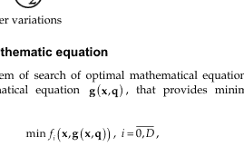

图 8. 变化后的网络算子

## 8. 最优数学方程的搜索

让我们表述最优数学方程 g(x,q) 搜索的问题。需要找到数学方程 g(x,q)，使其在约束条件下提供目标函数的最小值

min f_i(x,g(x,q)), i=0,D, (14)
f_i(x,g(x,q)) ≤0, j=D+1,K, (15)

其中 x 是变量向量，q 是参数向量。

问题 (14)、(15) 的解是数学方程 g~(x,q)。数学方程 g(x,q) 是一个函数

g(x,q)=[g₁(x,q)...g_M(x,q)]^T. (16)

如果 D ≥1，则问题的解是 Pareto 集

Π={g^k(x,q): k=1,s},

其中 ∀g^k(x,q)∈Π ∃g^j(x,q)∈Π, f_i^*(g^j(x,q))≤f_i^*(g^k(x,q)), 0≤i≤D,
f^*(g(x,q))=[f₀(g(x,q))...f_D(g(x,q))]^T, if f_i(g^k(x,q))≤f_i(g^j(x,q)), i=0,D, and ∃_j f_i(g^k(x,q))<f_i(g^j(x,q)).


b'_j = { s'_j, if (j-1) mod (c+d)=0 , j=1,P(c+d). ; s'_j ⊕ b'_{j-1}, otherwise } (24)

从二进制代码中我们得到参数向量

q' = [q'_1 ... q'_θ]^T , (25)

q'_k = Σ_{j=1}^{c+d} 2^{c+d-1} b'_j ... , k=1,P . (26)

为了估计每个可能的解 Ψ' 和 q'，我们使用一个称为 Pareto 集距离的参数

## Pareto 集距离

对于每个解 (W^i, s^i)，1 ≤ i ≤ H，我们求出数学方程 g'(x,q') 并计算目标函数 (14) 的值

f' = [f'_1 ... f'_θ]^T , (27)

在集合中我们找到比解 (W^i, s^i) 更好的可能解的数量

Λ_i = Σ_{i=1}^{H} λ_i (f') , (28)

其中

λ_i (f') = {1, if f' ≤ f^i ; 0, otherwise} . (29)

为了构造新解，我们执行选择、交叉和变异的遗传操作。

我们随机选择两个解 (W^{s1}, s^{s1}), (W^{s2}, s^{s2}) 并以概率进行交叉

p_c = max{ [1+γΛ_{s1}]/[1+Λ_{s1}], [1+γΛ_{s2}]/[1+Λ_{s2}] } , (30)

其中 γ 是给定的交叉参数，0 < γ < 1。

在两点 k_r, k_s 进行交叉后，我们得到四个新解 (W^{H+1}, s^{H+1}), (W^{H+2}, s^{H+2}), (W^{H+3}, s^{H+3}), (W^{H+4}, s^{H+4})

W^{H+1}=W^{s1} , (31)

\mathbf{s}^{h+1} = \left[s_1^{h+1}\dots s_k^{h+1} s_{k+1}^{h+1}\dots s_{k+(d-1)}^{h+1}\right]^T, \tag{32}

W^{h+2}=W^5, \tag{33}

\mathbf{s}^{h+2} = \left[s_1^{h+2}\dots s_k^{h+2} s_{k+1}^{h+2}\dots s_{k+(d-1)}^{h+2}\right]^T, \tag{34}

W^{h+3} = (\mathbf{w}^{h+3},\mathbf{w}^{h+1,k-1},\mathbf{w}^{2,k},\dots,\mathbf{w}^{h+2,i}), \tag{35}

\mathbf{s}^{h+3} = \left[s_1^{h+3}\dots s_k^{h+3} s_{k+1}^{h+3}\dots s_{k+(d-1)}^{h+3}\right]^T, \tag{36}

W^{h+4} = (\mathbf{w}^{h-1},\dots,\mathbf{w}^{h,k-1},\mathbf{w}^{h,k},\dots,\mathbf{w}^{h+1,i}), \tag{37}

\mathbf{s}^{h+4} = \left[s_1^{h+4}\dots s_k^{h+4} s_{k+1}^{h+4}\dots s_{k+(d-1)}^{h+4}\right]^T, \tag{38}

对于每个新解 $(W^{h+i},s^{h+i}),\ i=\overline{1,4}$，我们以概率 $p_m\in[0,1]$ 执行变异。我们为新解的两个部分找到变异点 $m_r,\ m_p$。在新染色体 $(W^{h+i},s^{h+i}),\ 1\le i\le4$ 中，我们随机生成具有结构和参数部分的变异向量 $\mathbf{w}^{h+i}_{m_r}$。对于每个新解我们计算函数 (14)

\mathbf{f}^{h+i} = \left[f_0^{h+i}\dots f_D^{h+i}\right]^T,\ i=\overline{1,4}. \tag{39}

对于新解 $j$，我们根据 (28) 找到 Pareto 集距离 $\Lambda_{i,j}$。然后我们找到 Pareto 集距离最大的解

\Lambda_{i_*}=\max\{\Lambda_{i},i=\overline{1,H}\}, \tag{40}

其中 $i_*$ 是 Pareto 集距离最大的解的编号。

我们将新解与具有最大 Pareto 集距离的解进行比较

\Lambda_{h+i,j}<\Lambda_{i_*}. \tag{41}

如果满足 (41)，则用第一个新解替换具有最大距离的解 $W^*=W^{h+i},\ s^*=s^{h+i},\ f^*=f^{h+i}$，并重新计算集合中所有解的距离。

这些步骤对每个新的可能解 $(W^{h+i},s^{h+i}),\ j=\overline{1,4}$ 执行。

从可能解的选择开始重复这些步骤。在给定 $E$ 次迭代后，其中 $E$ 称为 epoch，我们改变基本解 $\Psi^0$。

作为新的基本解，我们可以取使函数最小的解

\hat{f}^- = \min\left\{\sum_{i=0}^{N}\left(\frac{\hat{f}_i}{f_i}\right)^2\right\}, \tag{42}

\mathbf{\Psi}^{310}=\begin{bmatrix}0&0&0&1&0&0&0&0\\0&0&0&11&0&0&0&0\\0&0&0&0&1&0&0&0\\0&0&0&1&12&0&0&0\\0&0&0&0&0&12&15&0\\0&0&0&0&0&0&1&15\\0&0&0&0&0&0&1&1\\0&0&0&0&0&0&0&1\end{bmatrix}

或函数

$g^{310}(x,\mathbf{q})=\sin\big(\sin(x\cos(q_1))+q_2\big)\sqrt{\big(\sin(x\cos(q_1))+q_2\big)^2}$

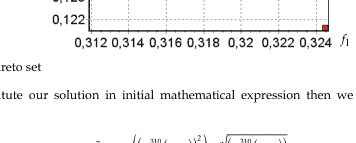

图 11. 一个 Pareto 集

如果我们将我们的解代入初始数学表达式，则应得到恒等式，

$\tilde{x}=\cos\big((g^{310}(x,\mathbf{q}))^2+\sqrt{g^{310}(x,\mathbf{q})}\big)$

函数 $\tilde{x}$ 和恒等函数的图像在图 12 中表示


图 12. 解号 310 的函数图像

| 编号 | 解编号 | f1 | f2 |
|---|---|---|---|
| 1 | 27 | 0.31208313 | 0.1243371 |
| 2 | 469 | 0.3124092 | 0.12701286 |
| 3 | 36 | 0.31248842 | 0.12695655 |
| 4 | 366 | 0.31317121 | 0.12657987 |
| 5 | 492 | 0.3132807 | 0.12652959 |
| 6 | 122 | 0.31423625 | 0.12614932 |
| 7 | 412 | 0.31526313 | 0.12581255 |
| 8 | 173 | 0.31617553 | 0.1255099 |
| 9 | 868 | 0.31630362 | 0.12551643 |
| 10 | 472 | 0.31719342 | 0.12528834 |
| 11 | 494 | 0.31731617 | 0.12525837 |
| 12 | 18 | 0.31815508 | 0.12506176 |
| 13 | 106 | 0.31826894 | 0.1250361 |
| 14 | 624 | 0.31903468 | 0.12486921 |
| 15 | 54 | 0.31981169 | 0.12470895 |
| 16 | 180 | 0.31989995 | 0.12469127 |
| 17 | 132 | 0.32046985 | 0.12457951 |
| 18 | 560 | 0.32054244 | 0.12456557 |
| 19 | 539 | 0.32099647 | 0.12447971 |
| 20 | 205 | 0.32105204 | 0.12446936 |
| 21 | 288 | 0.321382 | 0.12440861 |
| 22 | 141 | 0.32141958 | 0.12440176 |
| 23 | 696 | 0.32161979 | 0.12436553 |
| 24 | 658 | 0.32163874 | 0.12436213 |
| 25 | 621 | 0.32170585 | 0.12435009 |
| 26 | 310 | 0.32447275 | 0.121647 |

表 5.

## 10. 结论

在本工作中考虑了自动搜索数学方程问题的新方法。研究者定义了操作、变量和参数的集合。计算机程序生成满足给定限制的若干数学方程。然后优化算法找到合适的数学表达式的结构及其参数。该方法基于新的数据结构网络算子。

如果我们用逻辑操作集合替换网络算子中的一元和二元操作集合，则可以执行最合适的逻辑函数的搜索 (Alnovani et al. 2011)。

## 11. 局限性与发展

将网络算子表示为矩阵受其维度的限制。

在数学方程具有许多变量和参数的问题中，有必要使用具有许多零元素的大的网络算子矩阵。

为了排除这一限制，可以将具有相当数量节点的网络算子划分为一些小的网络算子。我们得到多层网络算子和一些较小维度的矩阵。每层网络算子描述数学方程的一部分。

网络算子的进一步发展是为在计算机内存中表示网络算子而创建一种特殊的数据结构。这种结构可以是多层的并提供有效的并行计算。

## 12. 参考文献

- Alnovani G.H.A., Diveev A.I., Pupkov K.A., Sofronova E.A. (2011) Control Synthesis for Traffic Simulation in the Urban Road Network, Preprints of the 18-th IFAC World Congress. Milan (Italy) August 28 – September 2. pp. 2196-2201.
- Callan R. (1999) The essence of neural networks. The Prentice Hall Europe, 1999, ISBN 0-13-908732-X, 978-013-9087-32-5. 232 p.
- Demuth, H.; Beale, M.; Hagan, M. (2008) Neural Network Toolbox™ User’s Guide. The MathWorks, Inc. ISBN 0-9717321-0-8. 907 p.
- Diveev A.I. (2009) A multiobjective synthesis of optimal control system by the network operator method. Proceedings of international conference «Optimization and applications» (OPTIMA) Petrovac, Montenegro, September 21-25, pp. 21-22.
- Diveev A.I., Sofronova E.A. (2009) Numerical method of network operator for multi-objective synthesis of optimal control system, Proceedings of Seventh International Conference on Control and Automation (ICCA’09) Christchurch, New Zealand, December 9-11, pp. 701-708. ISBN 978-1-4244-4707-7.
- Diveev A.I., Sofronova E.A. (2009) The Synthesis of Optimal Control System by the Network Operator Method, Proceedings of IFAC Workshop on Control Applications of Optimization CAO’09, 6 – 8 May, University of Jyväskylä, Agora, Finland.
- Diveyev A.I., Sofronova E.A. (2008) Application of network operator method for synthesis of optimal structure and parameters of automatic control system, Proceedings of 17-th IFAC World Congress, Seoul, 05. - 12. July . pp. 6106 – 6113.
- Kahaner, D.; Moler, C.; Nash, S. (1989) Numerical methods and software Prentice Hall Incorporation ISBN 0-13-6272-58-4. 504p.
- Koza, J.R. (1992). Genetic Programming: On the Programming of Computers by Means of Natural Selection, MIT Press. ISBN 0-262-11170-5. 840 p.
- Koza, J.R. (1994). Genetic Programming II: Automatic Discovery of Reusable Programs, MIT Press. ISBN 0-262-11189-6. 768 p.
- Koza, J.R.; Bennett, F.H.; Andre, D. & Keane, M.A. (1999). Genetic Programming III: Darwinian Invention and Problem Solving, Morgan Kaufmann. ISBN 1-55860-543-6. 1154 p.
- Koza, J.R.; Keane, M.A.; Streeter, M.J.; Mydlowec, W.; Yu, J.; Lanza, G. (2003). Genetic Programming IV: Routine Human-Competitive Machine Intelligence, Springer. ISBN 1-4020-7446-8. 590 p.


# 插入强制继承机制和参数松弛的简单遗传算法性能

Esther Lugo-González, Emmanuel A. Merchán-Cruz, Luis H. Hernández-Gómez, Rodolfo Ponce-Reynoso, Christopher R. Torres-San Miguel and Javier Ramírez-Gordillo

*墨西哥国立理工学院 机械与电气工程高等学院*
*墨西哥*

## 1. 引言

遗传算法（GA）是解决大规模设计优化问题的强大工具。对 GA 的研究兴趣既在于其理论也在于其应用。一方面，已经做出了各种修改，使其能够更快、更准确、更可靠地解决问题。

遗传算法是一种搜索范式，应用进化生物学原理（交叉、变异、自然选择）来处理难以处理的搜索空间。GA 的强大和成功主要归功于种群个体的多样性，这些个体并行进化，遵循适者生存的原则。一般而言，遗传算法解决的是 (Goldberg, 1989) 中提到的组合优化问题，这意味着与问题规模相关的潜在可行解呈指数增长，从而产生大量响应。在标准 GA 中，个体的多样性是通过遗传算子交叉和变异获得并维持的，这些算子使 GA 能够找到可行解并避免过早收敛到局部最大值 (Holland, 1975)。

遗传算法的性能，如同任何全局优化算法一样，取决于平衡两个冲突目标的机制，即利用迄今为止找到的最佳解，同时探索搜索空间以寻找有前景的解。遗传算法的强大之处在于其以最佳方式结合探索和利用的能力 (Holland, 1975)。然而，尽管这种最佳利用在理论上对遗传算法可能是正确的，但在实践中存在问题。这些问题产生的原因是 Holland 假设种群规模是无限的，适应度函数准确反映了解的适用性，且基因之间的相互作用非常小 (Beasley et al., 1993)。

本文提出的进化算法由经典遗传算法以及 (Merchán-Cruz, 2005, Merchán-Cruz et al., 2008, Merchán-Cruz et al., 2007) 提出的强制继承机制和 (Ramirez-Gordillo, 2010, Lugo Gonzalez, 2010) 的再生机制组成，用于优化闭链机构的轨迹生成并通过放松某些参数来规划其对机构的影响。目标是展示放松 GA 参数的行为，观察当某些参数变化超过文献中建立的推荐值时出现的优势和劣势。

## 2. 遗传算法描述

一旦选择了问题编码和适应度函数，进化过程就开始了。为了进化新解，会随机或使用特定问题的知识创建一组编码解的初始种群。该种群会受到遗传算子的作用以创建新的有前景的解。

典型的遗传算法从一个随机生成的种群开始，该种群由基因、位点、等位基因、染色体、基因型、变量和表现型组成 (Holland, 1975, Goldberg, 1989, Michalewicz, 1999, Coello-Coello, 2007)，图 1。

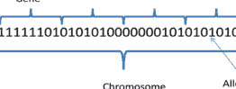

Fig. 1. 染色体二进制表示。

个体通过评估目标函数以概率方式被选择。当种群中至少 95% 的个体具有该基因的相同值时，该基因已收敛。种群收敛时，所有基因都已收敛。

GA 中存在不同的算子，其中最流行的是 (1) *选择*，(2) *交叉*，和 (3) *变异*，根据 (Goldberg, 1989) 定义的构建遗传算法的步骤如图所示 2 所示。

*初始种群* 是随机创建的，并编码在具有可变长度的数组的染色体中。编码可以用二进制表示完成 (Goldberg, 1989)，基于每个变量的域 (图 3)。

在 *解码* 中，需要对基因型有一个表示，以便在称为基因的符号链内分配参数。*评估* 使用适应度函数，该函数反映个体在问题域中变量的实际值方面的价值，但在存在大量限制的许多组合优化情况下，搜索空间的部分点可能不代表有效个体。例如，平面机构综合的方程为：

F = (C_{sd}^{l}(v) - C_{ts}^{l}(v))^{2} + (C_{sd}^{l}(v) - C_{tg}^{l}(v))^{2}    (1)

其中 C_i^s 是设计者指示的一组特定点，C_i^a 是机构连杆生成的点，且 v = r1, r2, r3, r4, r5, r6, X0, Y0，角度 θ1^0, θ2^0,...θi^0 是变量 θi 的值，i 是商的余数。遗传算法仅进行最大化，但可以通过使用函数的倒数轻松进行最小化，以避免奇点问题 (2)：

fitness optimum = 1 / fitness
(2)

为了改善结果，可以在算法过程中插入诸如精英主义、再生阶段和强制继承机制等方法：

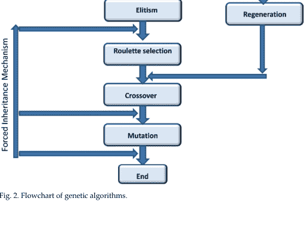

Fig. 2. 遗传算法流程图。

Domain=[-60 60 -60 60 0 60 ............0 360]
[χmin χmax Ymin Ymax...........θminθmax]

Fig. 3. 染色体结构。

### 精英主义
在这种情况下，在特定时间种群中最好的个体被选为父代，这为当前代得分最高的染色体在下一代中保留两个位置，而不允许该染色体在下一代中进行交叉。其中一个位置，精英染色体在下一代中也不会受到变异的影响。

### 再生机制
对一些活体生物使用生理条件或损伤前更新策略的研究表明，可以通过特定的遗传机制纳入出现并专门提供成年生物储备细胞的细胞，在此条件下，算法可以被视为种群内的进化过程。因此，种群的一小部分可以更新，这有助于增加构建块的形成，从而更好地找到最优值，但同时出现了 (Hidalgo and Lanchares, 2000) 和 (Wen-Jyi et al., 2003) 解释的进化算法过早收敛的问题这一不便。

然而，生物进化过程及其模仿，可以验证再生因子的使用及其在选择、交叉和变异的遗传算子中的基本保留。

### 强制继承机制
由 (Merchán-Cruz, 2005) 提出，是再生机制的补充部分，作为在交叉过程和变异期间基于精英主义引入专门染色体的策略。与精英主义不同，后者使种群中最适个体在不改变的情况下传递到下一代，FIM 被引入再生、选择、交叉和变异的过程中，保证上一代最适个体经历最小变化，从而以一致的方法提高其适应度值。该机制非常有用，当问题中需要求解的变量数量相当大时。

正如在简单 GA 中最佳获得的染色体在世代间传递一样，最佳染色体集合也传递到用于下一轨迹参数的 GA 搜索中。通过将前几代的最佳染色体集合引入当前 GA 搜索的初始种群中，产生新的轨迹段所需的世代数减少，前提是该特定时刻轨迹稳定，因为最优或接近最优解已编码在初始种群中。如果机构由于运动学约束或其他情况必须改变其轨迹，则传递的染色体集合不会影响对新最优集合的搜索，因为它会根据其相应的适应度进行评估和排序。图 4 说明了称为强制继承机制 FIM 的机制 (Merchán-Cruz, 2005)。

再生和强制继承所需的必要操作为：
- 1. 用于再生的种群百分比。
- 2. 再次选择个体的数量、染色体的长度以及因此的种群规模。


-   3. 再生会按需再生百分比从个体中取值。
-   4. 该种群被转换为二进制表示。
-   5. 再生个体在原始种群中所占位置的确定不会改变个体数量。
-   6. 将再生种群重新插入到原始种群的一个区域中。
-   7. 再生种群中的最佳个体被引入，旨在不改变个体数量。

随着遗传算法的发展，从种群中选取最佳个体将促进被选为新一代父母的个体的选择。

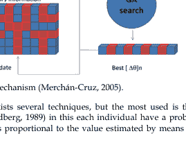

图 4. 强制继承机制 (Merchán-Cruz, 2005)。

对于父代选择存在多种技术，但最常用的是 (Goldberg, 1989) 提出的比例选择，在此每个个体被选为父代的概率与通过目标函数估计的值成正比。

交叉基于取两个适应良好的个体以获得共享双方基因的后代。存在多种交叉机制，具体使用取决于所分析的方案。根据 (Kuri-Morales and Galaviz-Casas, 2002) 最流行的是：单点交叉、双点交叉和均匀交叉。

突变是一个以概率 p_m 应用的操作符，其作用是以位突变概率 i-1 翻转单个位，其中 l 为染色体链的长度。

虽然交叉需要大种群来有效结合必要信息，但突变在应用于小种群并在大量世代中进行时效果最佳。突变通常是次要的搜索算子，它在解周围进行随机局部搜索，因此受到的关注远少于交叉。然而，在以交叉为主要搜索算子的进化策略中，对突变算子的开发给予了大量关注。若干突变算子，包括自适应技术，已由 (Lima, 2005) 提出。显然，突变无法像交叉一样很好地执行这一角色。

另一方面，交叉概率表示交叉执行的频率。如果没有交叉，后代是父母的精确拷贝。如果有交叉，后代由父母染色体的部分组成。如果交叉概率为 100%，则所有后代均由交叉产生。如果为 0%，则全新一代由旧种群染色体的精确拷贝组成（但这并不意味着新一代相同）。交叉的目的是期望新染色体具有旧染色体的良好部分，也许会更好。然而，允许种群的一部分存活到下一代是好的。

突变概率表示染色体部分被突变的频率。如果没有突变，后代在交叉（或复制）后被取用且无任何变化。如果执行突变，染色体的一部分会被改变。如果突变概率为 100%，整个染色体会被改变，如果为 0%，则什么也不会改变。突变是为了防止 GA 陷入局部极值，但不应经常发生，因为那样 GA 实际上会变成随机搜索。

每个算子使得进化过程向搜索区域中的有希望的区域进展，并可在种群内保持多样性，并通过随机采样新个体抑制过早收敛到局部最优。另一方面，需要通过量化进化过程的度量来操纵信息，这可以通过设计一个获取更合适个体的函数来实现。该度量被称为能力函数，它提高了个体以良好性能运行并获得无可匹敌质量的能力。

问题通常包含限制，如非线性和不等式，这使得有必要在某些函数上纳入对限制违反的信息，而最知名的是惩罚规则，它通过惩罚因子扩展其定义域来限制适应度规则，以应对任何被违反的限制。它可以对不可行进行惩罚或使个体可行。惩罚函数设计必须考虑个体与可行区域的距离、满足成本以及预期合规成本。其中一些惩罚有：

-   死亡惩罚。它将零适应度分配给不可行的个体，避免再次计算限制或目标函数。然而，如果初始种群不包含任何可行个体，算法可能会被截断。
-   静态惩罚。它定义违反等级并为每个等级选择一个违反系数。
-   动态惩罚。惩罚因子随时间变化；它们易受参数值的影响，并在这些参数未正确选择时过早收敛。
-   自适应惩罚：基于反馈过程调整惩罚。

自适应惩罚在本工作中使用。

### 2.1 GA 的效率增强

Goldberg 将 GA 的效率增强技术分为四个大类：并行化、混合化、时间延续和评估松弛 (Goldberg, 2002)：

-   1. **并行化：** GA 在多个处理器上执行，计算负载分布在这些处理器之间 (Cantu-Paz, 2000)。这在解决大规模问题时带来显著加速。并行化可以通过不同方式实现。一种简单的方式是让 GA 操作的一部分（如评估）同时在多个处理器上运行 (Bethke, 1976)。另一种方式是创建多个子种群并允许它们同时分别进化，同时在子种群之间传播良好解 (Grosso, 1985)。
-   2. **混合化：** 局部搜索方法或领域特定知识与 GA 耦合。它们在全局搜索中很强大。然而，它们在微观尺度上达到最优的效率不如局部搜索方法。因此，将局部搜索方法纳入 GA 的混合化将促进局部收敛。一种常见的混合形式是在 GA 的每一代后对种群的每个成员应用局部搜索算子 (Sinha, 2002)。
-   3. **时间延续：** 利用突变和重组的能力，在给定的有限计算资源下获得尽可能高质量的解 (Srivastava, 2002)。时间延续利用了使用大种群进行单次收敛历元的解搜索与使用小种群进行多次收敛历元之间的权衡。
-   4. **评估松弛：** 精确但计算成本高昂的适应度评估被不太精确但计算成本低廉的适应度估计所取代。低成本、低精度的适应度估计可以是 1) 外源性的，如代理（或近似）适应度函数的情况，其中外部意味着它可用于开发适应度估计；或 2) 内源性的，如适应度继承 (Smith, 1995) 的情况，其中适应度估计在内部计算并基于父代适应度。

## 3. GA 参数性能的调整

一些作者如 (Holland, 1975) 研究了 GA 参数变化的影响，这些影响必须考虑以在特定应用中发挥其全部潜力。据此，为了使搜索算法在线上表现良好，必须快速决定最有希望的搜索区域，以便集中搜索努力，离线性能不会惩罚搜索算法探索搜索空间的较差区域，前提是这有助于实现最佳可能的解（按适应度），较大的世代间隔和精英策略的使用也会提高 GA 的性能，其中通常推荐的二进制表示的突变率为 0.001 到 0.01 (Goldberg, 1989)，或通常交叉概率值要小得多 (Cabrera et al., 2002)。

GA 内可按重要程度调整的主要参数有：

-   种群大小
-   交叉百分比
-   突变百分比

算法设计受限于选择和确定参数的控制程度或策略，如突变、交叉的范围和可能性以及种群规模。(Sánchez-Marín, 2000) 在其研究中支持了

控制参数的确定，即试验不同取值并选择那些能给出更好结果的取值。（De Jong，1975）在实验后推荐了简单点交叉的概率以及变异中比特移动的概率的取值。在本工作中，定义了以下参数：种群规模为50个个体、交叉概率为0.6、变异概率为0.001以及精英选择；然而，其缺点在于这些参数仅适用于具有非常特定限制的某一特定问题。

（De Jong，1975）描述道，在线操作基于对每一代中最佳解的监测，而离线操作则考虑种群中的所有解以获得最优值。（Grefenstette，1986）使用元算法作为优化方法，以获得使算法在线和离线操作具有相似参数的取值。

为了使搜索算法具有良好的在线性能，它必须快速判断最有希望的搜索区域在哪里，并将其努力集中在那里。离线性能并不总是惩罚搜索算法去探索搜索空间中的较差区域，因为这有助于获得尽可能好的解（就适应度而言）。在线和离线分析的最佳参数集为：种群规模30和80个个体，交叉概率0.95和0.45，两者的变异概率均为0.01；在线情况使用精英选择策略，离线情况不使用精英选择。

（Smith，1993）提出了一种考虑误差可能性的遗传算法来调整种群规模。这与代数有关；如果在使用较少的条件下为评估次数确定一个较小值（20到50），收敛会很快，但不能保证最优结果。

（Endre Eiben 等，1999）揭示了基于实验的参数分析的技术缺陷，并指出以下几点：

- 参数并非相互独立，但系统地尝试它们所有可能的组合几乎是不可能的。
- 参数调优过程耗时，但如果逐个优化参数，则有可能处理它们之间的交互作用。
- 对于给定问题，所选参数的值不一定最佳，但如果统一使用它们进行分析，将获得更有意义的值。

一般来说，下面列出了一些作者（如 Holland，1975）提出的关于遗传算法的重要观察结果，在使用该工具时必须考虑，例如：

- 较大的世代间隔和使用精英策略也能提高GA的性能。
- 使用大种群（> 200）且变异百分比较高（> 0.05）并不会提高GA的性能。
- 使用小种群（< 20）且变异百分比较低（< 0.002）并不会提高GA的性能。
- 变异似乎对GA的性能具有更大的重要性。
- 如果种群规模增大，交叉的效果似乎会被稀释。

期望轨迹的生成包括控制耦合连杆上的一个点，图5（情形I：四杆机构；情形II：六杆机构），使其所描述的轨迹驱动耦合连杆通过一组离散的给定点，这些点称为精确点（Norton，1995）。为了确定该点，需要获得开链和闭链机构。

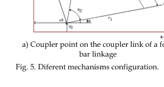

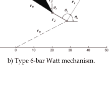

a) 四杆机构连杆上的耦合点

b) 6杆Watt机构。

图5. 不同机构配置。

### 4.1 机构综合中的优化设计

该问题的表述需要定义多个方面，如设计空间、目标函数、优化算法和约束（Lugo-Gonzalez 等，2010）。在对应于机构综合的情况下，希望减小期望轨迹与生成轨迹之间的误差，此外还分析当修改诸如变异和交叉概率、个体数量以及最大代数等参数时算法响应的变化，这些将用所提出的方程（3）进行评估，该方程具有适用于函数近似评估的特性，其中在（Goldberg，1989）工作的原始版本中加入了惩罚项，即：

$$F = \frac{1}{N} * \sqrt{\frac{\sum_{i=1}^{N}\left(C_{eu}(v)-C_{eg}(v)\right)^2 + \left(C_{iu}(v)-C_{ig}(v)\right)^2}{n}} \tag{3}$$

除了以 $N$（即精确点数量）的倒数作为除法因子外，还应用个体数量 $ni$ 的除法，并加入一个惩罚项，其目标是恢复那些不满足初始约束（称为 Grashof 条件）的个体。

最后，优化算法使用四个收敛准则，定义如下：

- *reng=* 是第一个限制条件，这是第一次评估，用于验证种群是否满足 Grashof 限制（机构综合的特定条件）。
- *maximogen=* 定义算法可以评估目标函数的最大次数。额外一次调用意味着搜索结束而未找到解。
- *minimerror=* 定义目标函数中允许的误差最小值，用于与生成函数进行比较。最小误差参数值的变化意味着搜索结束而未找到解。
- *condrep=* 定义在继续下一操作之前，同一值在评估中可以重复的次数。

当这些最后条件在评估中满足时，算法将停止搜索，并给出最能满足限制和条件的最优值。

### 4.2 具有GA参数优化、18个精确点和四杆机构的椭圆轨迹

以（Cabrera 等，2002；Laribi 等，2004；Starosta，2006）中获得的研究结果为基础，描述四连杆机构的椭圆路径。该研究案例由（Kunjar 和 Krishnamurty，1997）首次提出。综合采用了一些应用变体，使用遗传算法或将遗传算法与模糊逻辑等工具相结合。表1显示了机构要遵循的期望精确点。图6显示了相应的图形。


| 点 | 1 | 2 | 3 | 4 | 5 | 6 | 7 | 8 | 9 | 10 | 11 | 12 | 13 | 14 | 15 | 16 | 17 | 18 |
|---|---|---|---|---|---|---|---|---|---|---|---|---|---|---|---|---|---|---|
| X | 0.5 | 0.4 | 0.3 | 0.2 | 0.1 | 0.005 | 0.02 | 0.0 | 0.0 | 0.03 | 0.1 | 0.15 | 0.2 | 0.3 | 0.4 | 0.5 | 0.6 | 0.6 |
| Y | 1.1 | 1.1 | 1.1 | 1.0 | 0.9 | 0.75 | 0.6 | 0.5 | 0.4 | 0.3 | 0.25 | 0.2 | 0.3 | 0.4 | 0.5 | 0.7 | 0.9 | 1.0 |

表 1. 由 (Kunjur and Krishnamurty, 1997) 提出的期望椭圆轨迹的精度点。

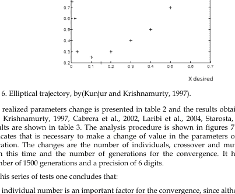

图 6. 由 (Kunjur and Krishnamurty, 1997) 提出的椭圆轨迹。

实现的参数变化在表 2 中给出，而由 (Kunjur and Krishnamurty, 1997, Cabrera et al., 2002, Laribi et al., 2004, Starosta, 2006) 取得的结果以及我们的结果显示在表 3 中。分析过程显示在图 7 和图 8 中。但这表明有必要对交叉和变异的参数值进行更改。变化包括个体数量、交叉和变异，这会影响时间和收敛所需的世代数。它具有最大 1500 代和 6 位精度的设置。

由此系列测试得出结论：

- 个体数量是收敛的重要因素，因为虽然使用少量个体可以获得响应时间，但并不能保证结果是最优的。随着个体数量的增加，响应时间会增加，但获得更好结果的可能性也会增加。如前所述，程序将具有一个最优的个体数量以便满意运行，但这必须通过试错来验证，因为该程序以随机生成种群为基础。然而，当实施 FIM 时算法的性能仅比先前考虑的系统所获得的性能略有下降。
- 不存在确定交叉和变异概率最优值的规则。并非总是产生个体完全变化的最大值会给出最佳结果，如表 2 所观察到的。对于本研究案例，最佳结果出现在项目 k 中，其最小误差值。该值直接受变量域的影响，并且还受个体数量的影响。
- 域是获得最优结果的决定性值，因为所有变量都通过合成所需的计算相互关联。例如，如果某些角度的限制被修改，它会改变连杆长度的值，从而改变误差值，因为也许杆件必须增加或减小其长度以覆盖指定的轨迹。尽管参数设计良好，如果变量的定义不正确，则无法实现目标。

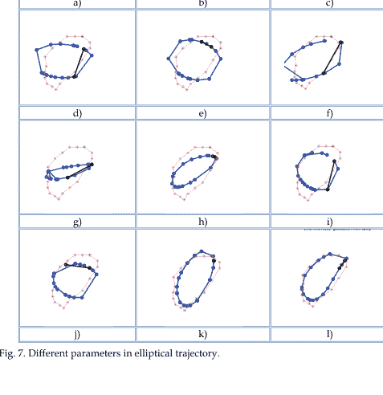

图 7. 椭圆轨迹中的不同参数。

|  | 种群数量 | Pc | Pm | 误差 | 世代 | 时间 (S) |
|---|---|---|---|---|---|---|
| a) | 500 | 0.6 | 0.01 | 0.12607 | 974 | 124.70116 |
| b) | 1000 | 0.6 | 0.01 | 0.116874 | 992 | 200.83390 |
| c) | 1000 | 0.8 | 0.8 | 0.146653 | 994 | 281.61255 |
| d) | 1000 | 0.8 | 0.7 | 0.140036 | 992 | 318.54909 |
| e) | 1500 | 0.8 | 0.7 | 0.128140 | 992 | 499.81671 |
| f) | 1500 | 0.85 | 0.85 | 0.113155 | 979 | 384.667514 |
| g) | 2000 | 0.3 | 0.1 | 0.253548 | 992 | 416.934751 |
| h) | 2000 | 0.6 | 0.2 | 0.2020683 | 988 | 374.043950 |
| i) | 2000 | 0.6 | 0.4 | 0.1852588 | 991 | 431.125409 |
| j) | 2000 | 0.7 | 0.2 | 0.0986130 | 988 | 335.516387 |
| k) | 2000 | 0.7 | 0.4 | 0.0854537 | 995 | 402.078071 |
| l) | 2000 | 0.85 | 0.85 | 0.09922667 | 989 | 776.17100 |

表 2. 由四杆机构生成的椭圆形的参数修改。

表 3 中给出了上述研究人员与所提算法的比较。通过这些结果可以看出，杆件长度、角度以及期望轨迹与生成轨迹之间存在数值对应关系。提及的研究中未发现的另一个变量是时间，这对优化至关重要。这将取决于交叉概率、变异参数、个体和世代数。改变这些参数的微小值可能意味着收敛时间的缩短，但并不总是能保证最优值。以特定参数为例，GA 优化分析所花费的时间为 280.508318 秒。

| 作者 | Xo | Yo | R2 | R1 | R4 | R3 | R5 |
|---|---|---|---|---|---|---|---|
| Kunjur | 1.132062 | 0.663433 | 0.274853 | 1.180253 | 2.138209 | 1.879660 | 0.91 |
| Cabrera | 1.776808 | -0.641991 | 0.237803 | 4.828954 | 2.056456 | 3.057878 | 2 |
| Laribi | -3.06 | -1.3 | 0.42 | 2.32 | 3.36 | 4.07 | 3.90 |
| Starosta | 0.074 | 0.191 | 0.28 | 0.36 | 0.98 | 1.01 | 0.36 |
| A-G prop. | 3.88548 | 0.907087 | 0.286753 | 4.52611 | 3.59121 | 4.29125 | 3.613847 |

| 作者 | 误差 | 评估次数 |
|---|---|---|
| Kunjur | 0.62 | 5000 |
| Cabrera | 0.029 | 5000 |
| Laribi | 0.20 |  |
| Starosta | 0.0377 | 200 |
| A-G prop. | 0.0152 | 2000 |

表 3. 由一些作者获得的椭圆路径的尺寸和角度定义。

尽管应用的世代数比上一项研究工作更多，仍获得了令人满意的结果。由于世代数较多，计算时间要求更高，但这使得生成路径与期望路径之间的误差更小，因此精度更高。

图 8 显示了误差行为在路径开始时和每个世代评估结束时如何下降（a 和 b）。图 c 和 d 说明了四杆机构沿路径的演变，覆盖了第一和第六精度点，这些点是随机选择的以显示指定路径。

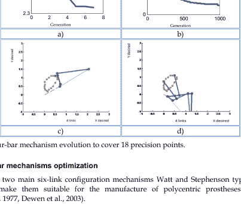

图 8. 四杆机构演变以覆盖 18 个精度点。

### 4.3 六杆机构优化

存在两种主要六连杆配置机构，即 Watt 和 Stephenson 型，其特点使其适用于制造多中心假肢，如 (Radcliffe, 1977, Dewen et al., 2003)。

第一个示例说明了用于覆盖 21 个精度点的六杆机构。为了评估所分析机构的有效性，Watt-I 型将遵循一条具有任意提出限制的路径，初始 18 个点，其条件如表 4 所述。

图 9 显示了 Watt-I 型机构应遵循的建议路径。如前所述，种群、交叉和变异概率、时间以及世代数分析的设置将被改变，以证明这些调整不是独立的，并且相互影响。

| 多中心机构 | 描述 | 值 |
|---|---|---|
| 特征 |  |  |
| 期望点 | 变量限制 |  |
|  | x_d = [25 10 5 10 20 10 5 10 15 25 40 43 50 55 50 40 50 55 50 40 25] |  |
|  | y_d = [130 120 100 80 65 55 35 20 15 10 10 15 20 40 55 65 80 100 120 130 130] |  |
| 每个连杆的限制 | r1,r2,r3,r4,r5,r6,r7,r8,r9,r10 ∈ [-60,60] in mm |  |
|  | x0,y0 ∈ [-60,60] in mm |  |
| 运动范围 | 0° to 360° degrees |  |
| 种群数量 | n 个体 | 200 |
| 交叉概率 | 比例型 | 变化 |
| 变异概率 | 仅一点 | 变化 |
| 精度 | 小数点后位数 | 6 |
| 最大世代数 | 1000 代 |  |

表 4. 六杆机构限制。

该路径是遗传机构综合演变的结果（图 10）。在随后的图和表 5 中，可以看到误差如何随着世代的推移而减小，同时改变一些参数以获得最佳拟合。

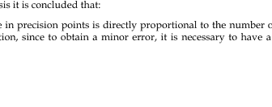

图 9. 六杆 Watt-I 型机构的 20 个点的轨迹。

该路径的提出目的是证明六连杆机构可以遵循四杆机构难以遵循的路径。

由此分析得出结论：

- 精度点的增加与种群中的个体数量成正比，因为为了获得更小的误差，需要有更大的搜索范围。


- 个体数量过少会降低搜索效果且无法提供令人满意的结果。
- 为了获得最优值，有必要将交叉概率的值至少提高到大于 0.6。
- 变异率可变化至最高 0.9，因为如果其增加到 1，则会完全改变个体，而没有对评估而言的最佳的真正意义，该最佳是通过精英主义和强制继承机制获得的。
- 交叉概率和变异概率的高值并不能保证达到最佳收敛值。

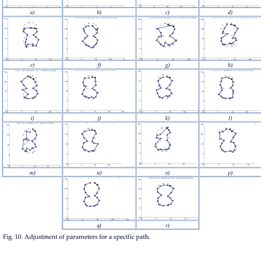

Fig. 10. 针对特定路径的参数调整。

|  | ni | Pc | Pm | error | time | generations |
|---|---|---|---|---|---|---|
| a) | 200 | 0.6 | 0.01 | 0.4530713342399 | 180.696374 | 978 |
| b) | 200 | 0.6 | 0.4 | 0.2088516234 | 162.480752 | 991 |
| c) | 200 | 0.8 | 0.8 | 0.1039548356200 | 168.681711 | 996 |
| d) | 500 | 0.6 | 0.01 | 0.1441113 | 250.446699 | 981 |
| e) | 500 | 0.6 | 0.4 | 0.07266868 | 282.191 | 960 |
| f) | 500 | 0.8 | 0.8 | 0.0558828894 | 290.697 | 987 |
| g) | 1000 | 0.6 | 0.01 | 0.059796068 | 468.693084 | 999 |
| h) | 1000 | 0.6 | 0.4 | 0.0532988776 | 480.813937 | 947 |
| i) | 1000 | 0.7 | 0.5 | 0.119467646451 | 457.496696 | 999 |
| j) | 1000 | 0.7 | 0.7 | 0.032606509948 | 524.067239 | 989 |
| k) | 1000 | 0.8 | 0.5 | 0.099396867739 | 536.369984 | 993 |
| l) | 1000 | 0.85 | 0.8 | 0.0311870033413 | 550.612374 | 972 |
| m) | 1500 | 0.6 | 0.1 | 0.1962062488 | 619.5235 | 981 |
| n) | 1500 | 0.6 | 0.4 | 0.090101544 | 672.77304 | 990 |
| o) | 1500 | 0.95 | 0.85 | 0.163192355 | 1046.2808 | 968 |
| p) | 2000 | 0.7 | 0.7 | 0.08380448 | 1116.16188 | 999 |
| q) | 2000 | 0.85 | 0.8 | 0.0114246856933 | 1295.874818 | 987 |
| r) | 2000 | 0.95 | 0.85 | 0.0277589482798 | 1306.641231 | 1000 |

Table 5. 六杆机构参数针对特定路径的调整。

## 5. 讨论

优化过程是迭代的，并且通过对遗传算法参数进行变化的测试已得到证实，以分析系统的行为，这意味着它们可以被修改，直到找到其行为满足设计者期望和要求的系统。GA 的参数通常以非线性关系相互作用，这就是为什么它们不能独立优化的原因，已在所呈现的研究案例中得到证实。当存在种群规模的变化时，这一事实将在路径生成的收敛时间和精度上得到体现。

已证明种群中个体的多样性是通过交叉算子和遗传变异获得的，并且在所有分析中，它们允许找到更好的解决方案并避免过早收敛到最大前提。虽然也必须提到精英主义和强制继承有助于限制将覆盖所施加限制的个体的数量。另一方面，观察到如果 GA 具有不足或较小的种群，则其进行大量繁殖以获得最优解的可能性很少。

此外，过大的种群会导致算法需要更长的计算时间来处理并获得新一代。事实上，并不存在增加种群规模变得低效的极限，因为它既不会获得更快的问题解决速度，也不会保证收敛。对于本章所述的研究案例，当将种群增加到 3500 个个体时，没有呈现可接受的结果，并且程序变得极其缓慢。如果种群保持如此之大，例如 1000 个个体，这意味着它可以提高算法的性能，尽管这会受到较慢的初始响应的影响。重要的是要强调种群规模与问题解空间中概率关系之间存在的联系。

本工作的研究案例是超定且非线性类型的，这必然意味着多维、非线性和非均质的解空间，因此，大初始值覆盖解空间的不同区域，其中算法可能过早收敛到意味着最优前提成本的解，但当保持较低的变异概率时，无法保证种群尽管在个体数量上很庞大，仍然是问题解的概率代表。考虑到这一点，并且考虑到从当前初始个体评估和生成新个体种群的计算时间直接受限于该种群的个体数量，需要进行更多操作才能获得可能的解的新一代。

## 6. 结论

在个体数量减少的种群上操作时，并未达到对解空间不同区域的足够代表性数量，但创建可能解新一代所需的计算时间急剧下降。当考虑算法中变异概率的高百分比时，可以确保在解空间的不同区域进行启发式搜索，这与强制继承机制相结合已证明，对于本工作中处理的问题，这是一种增强 GA 启发式能力的策略，对于非线性多维、非均质问题，使算法成为元启发式；因此证明了误差的减少得到了显著改善，约为之前报道工作的 20%。还观察到变异百分比的增加改善了离线性能，因为种群中的所有解都被考虑用于获得最优值。离线性能不会惩罚算法探索搜索空间的较差区域，只要它有助于达到就适应度而言的最佳可能解。

已验证对于交叉，规则得到满足，即应用小于 0.6 的值时，性能不是最优的，并且不会改变特定问题的预期结果。在变异的情况下，已证明它可以不论改变次数而改变，并增加其值以获得最优结果，几乎达到单位，但避免完全变异所有染色体，从而消除精英主义和强制继承机制所创造的好处。

通过试错，还得出结论，参数不是独立的，系统地搜索所有可能的组合几乎是不可能的；但如果参数一次一个地优化，则可以处理其相互作用，并且对于给定问题，所选参数的值不一定是最优的，但如果它们被统一分析，将会产生更有意义的值。

## 7. 致谢

作者感谢 Instituto Politécnico Nacional，项目编号 20113426，为本研究的开展提供设施和手段。

## 8. 参考文献

- A. K. Mallik & A. Ghosh 1994. 机构的运动学分析与综合。CRC-Press, 688.
- Beasley, D., Bull, D. R. & Martin, R. R. 1993. 遗传算法概述：第1部分，基础。University Computing, 15, 58-69.
- Bethke, A. 1976. 并行处理器上遗传算法与基于梯度优化器的比较：处理能力使用效率。Tech. Rep. No. 197, Logic of Computers Group, University of Michigan.
- Bulatovic, R. R. & Djordjevic, S. R. 2004. 用受控偏差法对四杆连杆进行最优综合。The first international conference on computational mechanics (CM'04), 31, No. 3-4, 265-280.
- Cabrera, J. A., Simon, A. & Prado, M. 2002. 用遗传算法对机构进行最优综合。Mechanism and machine theory (Mech. mach. theory), 37, No. 10, 1165-1177.
- Cantu-Paz, E. 2000. 高效且精确的并行遗传算法。Kluwer, Boston, MA.
- Coello-Coello, C. A. 2007. 进化计算导论。In: CINVESTAV-IPN (ed.) Mexico.
- De Jong, K. A. 1975. 一类遗传自适应系统行为的分析。Tesis doctoral, University of Michigan.
- Denavit, J. & Hartenberg, R. S. 1964. 连杆机构的运动学综合。USA: McGraw-Hill.
- Dewen, J., Ruihong, Z., Ho, D., Rencheng, W. & Jichuan, Z. 2003. 使用六杆机构的假肢膝关节的运动学和动力学性能, Journal of Rehabilitation Research and Development, 40, No. 1, 39-48.
- Endre Eiben, A., Hinterding, R. & Michalewicz, Z. 1999. 进化算法中的参数控制。IEEE Transactions on Evolutionary Computation, 3, No. 2.
- Fogarty, T. 1989. 在遗传算法中改变变异概率。Proc. 3rd Int. Conf. Genetic Algorithms, J. D. Schaffer, Ed. San Mateo, CA: Morgan Kaufmann.
- Freudenstein, F. 1954. 四连杆机构设计的分析方法。Transactions of the ASME 76, 483-492.
- Goldberg, D. 2002. 来自和面向胜任遗传算法的经验教训。Kluwer, Boston, MA.
- Goldberg, D. E. 1989. 搜索、优化和机器学习中的遗传算法, USA, Addison - Wesley.
- Grefenstette, J. J. 1986. 遗传算法控制参数的优化。IEEE Trans. Systems, Man, Cybern, 16, no. 1, 122-128.


- Grosso, P. 1985. 遗传适应的计算机模拟：多位点模型中的并行子组件交互。博士论文，密歇根大学。
- Hidalgo, J. I. & Lanchares, H. R. 2000. 使用遗传算法的多FPGA系统划分与布局。载于《Euromicro DSD 2000论文集》。
- Holland, J. H. 1975. 自然与人工系统中的适应。安阿伯：密歇根大学出版社。
- Kalnas, R. & Kota, S. 2001. 将不确定性纳入机构综合。《机构与机器理论》，第36卷，第3期，843-851页。
- Kunjur, A. & Krishnamurty, S. 1997. 机构综合中的遗传算法。《应用力学与机器人学杂志》，第4卷，第2期，18-24页。
- Kuri-Morales, A. & Galaviz-Casas, J. 2002. 遗传算法。墨西哥国立理工学院，墨西哥国立自治大学，经济文化基金会，202页。
- Laribi, M. A., Mlika, A., Romdhane, L. & Zeghloul, S. 2004. 机构综合中的遗传算法-模糊逻辑组合方法（GA-FL）。《机构与机器理论》，第39卷，717-735页。
- Levitski, N. L. & Shakvazian, K. K. 1960. 含低副的四元件空间机构综合。《国际机械科学杂志》，第2卷，76-92页。
- Lima, C. A. F. 2005. 结合有效的交叉与变异算子：一种概率模型构建方法。GECCO'05。
- Lima, C. F., Sastry, K., Goldberg, D. E. & Lobo, F. G. 2005. 结合有效的交叉与变异算子：一种概率模型构建方法。GECCO'05，ACM 1599303108/05/0006。
- Lugo-González, E., Hernández-Gómez, L. H., Ponce-Reynoso, R., Velázquez-Sánchez, A. T., Urriolagoitia-Sosa, G., Merchán-Cruz, E. A. & Ramírez-Gordillo, J. 2010. 基于GA的平面机构综合的性能优化。载于《2010年IEEE电子、机器人与汽车力学会议论文集》（2010年9月28日-10月1日）。IEEE计算机学会，华盛顿特区，126-131页。
- Lugo González, E. 2010. 使用遗传算法设计机制及其在下肢假肢中的应用。博士论文，墨西哥国立理工学院。
- Merchán-Cruz, E. A. 2005. 共享工作空间的机器人操作器轨迹规划中的软编程技术。哲学博士，谢菲尔德。
- Merchán-Cruz, E. A., Hernández-Gómez, L. H., Velázquez-Sánchez, A. T., Lugo-González, E. & Urriolagoitia-Sosa, G. 2007. 在基于遗传算法的机器人操作器轨迹规划器中利用单调性。载于第16届IASTED国际应用模拟与建模会议（西班牙马略卡岛帕尔马，2007年8月29-31日）。De Felice主编。ACTA出版社，加州阿纳海姆，300-305页。
- Merchán-Cruz, E. A., Urriolagoitia-Sosa, G., Ramírez-Gordillo, J., Rodríguez-Cañizo, R., Campos-Padilla, I. Y., Muñoz-César, J. J. & Lugo-González, E. 2008. 自适应种群规模的共享工作空间机器人操作器轨迹规划器（基于GA）。载于《2008年电子、机器人与汽车力学会议论文集》（2008年9月30日-10月3日）。IEEE计算机学会，华盛顿特区，520-525页。
- Michalewicz, Z. 1999. 遗传算法+数据结构=进化程序。第三版。纽约：Springer出版社。
- Norton, R. L. 1995. 机械设计。墨西哥印刷，McGraw-Hill出版社。
- Quintero-R, H., Calle-Trujillo, G. & Díaz-Arias, A. 2004. 基于遗传算法的机构多位置轨迹生成与运动综合。《科学与技术》，第10卷，第25期。
- Radcliffe, C. 1977. Knud Jansen讲座：膝上假肢机构：运动学、对线与处方标准。《假肢与矫形实践》。
- Ramírez-Gordillo, J. 2010. 多机器人操作器系统中的轨迹规划。博士论文，墨西哥国立理工学院。
- Rechenberg, I. 1973. 进化策略：基于生物进化原理的技术系统优化。Friedrich Frommann出版社，斯图加特-巴特坎施塔特。
- Roston, G. P. & Sturges, R. H. 1996. 四杆机构的遗传算法综合。《工程设计、分析与制造中的人工智能》，第10卷，371-390页。
- Sánchez-Marín, F. T. 2000. 面向轨迹生成的平面机构尺寸综合贡献。科学博士，Jaume I大学。
- Sinha, A. 2002. 设计高效的遗传与进化算法混合体。硕士论文，伊利诺伊大学厄巴纳-香槟分校。
- Smith, B. D. A. S. S. 1995. 遗传算法中的适应度继承。载于：ACM应用计算研讨会论文集，345-350页。
- Smith, R. 1993. 自适应调整种群规模：算法与分析。第5届国际遗传算法会议论文集，S. Forrest主编。加州圣马特奥：Morgan Kaufmann，653页。
- Srivastava, R. 2002. 遗传算法中的时间延续。硕士论文，伊利诺伊大学厄巴纳-香槟分校。
- Starosta, R. 2006. 关于遗传算法在机构综合中的某些应用。GAMM年会摘要集，77页。
- Tzong-Mou, W. & Cha'o-Kuang, C. 2005. 带有可调连杆的精确机构综合的数学模型及其仿真。《应用数学与计算》，第160卷，309-316页。
- Varbanov, H., Yankova, T., Kulev, K. & Lilov, S. 2006. 平面机构设计专家系统S&EA。《专家系统及其应用》，第31卷，558-569页。
- Vasiliu, A. & Yannou, B. 2001. 使用神经网络的平面机构尺寸综合：在轨迹生成连杆机构中的应用。《机构与机器理论》，第36卷，第2期，229-310页。
- Walczak, T. 2006. 利用神经网络的机构综合。载于GAMM年会摘要集，柏林，77页。
- Wen-Jyi, H., Chien-Min, O. & Chin-Ming, Y. 2003. 使用遗传算法的突发错误信道鲁棒矢量量化。欧洲人工神经网络研讨会，267-274页。
- Whitley, D., Rana, S. & Heckendorn, R. 1998. 邻域搜索与进化算法中的表示问题。载于D. Quagliarella、J. Périaux、C. Poloni和G. Winter主编的《工程与计算机科学中的遗传算法和进化策略：最新进展与工业应用》第3章，39-57页。

# 实数编码遗传算法中交叉与变异的作用

Yourim Yoon^1^ 和 Yong-Hyuk Kim^2*^

¹首尔大学计算机科学与工程学院，首尔
²光云大学计算机科学与工程学院，首尔
大韩民国

## 1. 引言

我们在先前使用实数编码遗传算法的工作中认识到，实数编码中交叉与变异的作用与二进制编码中存在显著差异（Yoon等，2012）。在本研究中，我们旨在论证实数编码中遗传算子的独特作用。

近年来，关于使用实数编码的进化算法已开展了许多研究。这些研究包括蚁群优化（Socha & Dorigo, 2008）、人工蜂群算法（Akay & Karaboga, 2010; Kang et al., 2011）、进化策略（ES）（Beyer, 2001）、差分进化（Das & Suganthan, 2011; Dasgupta et al., 2009; Kukkonen & Lampinen, 2004; 2005; Mezura-Montes et al., 2010; Noman & Iba, 2005; Rönkkönen et al., 2005; Storn & Price, 1997; Zhang et al., 2008）、粒子群优化（Chen et al., 2007; Huang et al., 2010; Juang et al., 2011; Krohling & Coelho, 2006; J. Sun et al., 2011）等。特别是，在进化策略领域，我们可以发现许多基于自适应技术的研究（Beyer & Deb, 2001; Hansen & Ostermeier, 2001; Igel et al., 2007; 2006; Jägersküpper, 2007; Kita, 2001; Kramer, 2008a,b; Kramer et al., 2007; Meyer-Nieberg & Beyer, 2007; Wei et al., 2011）。

许多研究者也专注于在遗传算法（GAs）中使用实数基因，如（Ripon et al., 2007）所述。据报道，对于某些问题，实数编码表示及相关技术优于传统的二进制表示（Eshelman & Schaffer, 1993; Herrera et al., 1998; Janikow & Michalewicz, 1991; Lozano et al., 2004; Ono et al., 1999; Ono & Kobayashi, 1997; Surry & Radcliffe, 1996; Wright, 1991）。对实数编码遗传算法也进行了一些理论研究（Goldberg, 1991; Higuchi et al., 2000; Kita et al., 1998; Qi & Palmieri, 1994a,b）。然而，尽管算子的动机和遗传算法的框架相似，实数编码遗传算法中遗传算子的作用和行为与二进制编码存在根本的不同。

在本章中，我们试图通过多种实验验证实数编码中交叉与变异相对于二进制编码的不同性质。我们特别关注遗传算子在实数编码遗传算法中使用时的效果（交叉与变异的偏差和功能）。


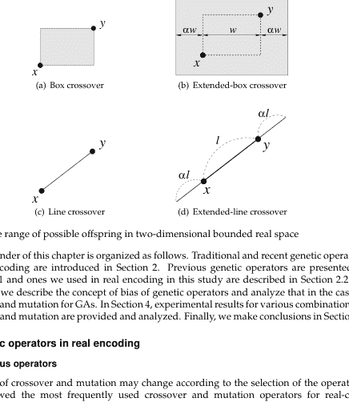

图 1. 二维有界实数空间中可能后代的范围

本章其余部分组织如下。第 2 节介绍实数编码中传统和近期的遗传算子。第 2.1 节介绍先前的遗传算子，第 2.2 节描述本研究在实数编码中使用的算子。第 3 节描述遗传算子偏置的概念，并分析遗传算法中交叉和变异情形下的偏置。第 4 节给出并分析交叉与变异各种组合的实验结果。最后，第 5 节给出结论。

## 2. 实数编码中的遗传算子

### 2.1 先前的算子

交叉和变异的作用可能随算子的选择而变化。我们回顾了实数编码表示中最常用的交叉和变异算子。我们将通过研究交叉和变异算子的各种组合，分析交叉和变异的作用如何变化。

文献中有许多用于实数编码表示的交叉算子。实数编码表示的传统交叉算子在 (Bäck et al., 2000) 中有所描述。传统交叉算子的两个主要家族 (Mühlenbein & Schlierkamp-Voosen, 1993) 是离散交叉¹ (Reed et al., 1967) 和混合交叉 (Michalewicz, 1996)。混合交叉算子可分为线性交叉和盒式交叉。后两种交叉算子的重要变体是扩展线性交叉和扩展盒式交叉 (Mühlenbein, 1994)。

离散重组家族是用于二进制串的基于掩码的交叉算子家族（包括 n 点交叉和均匀交叉）向实向量的直接扩展。¹

¹ 它也称为支配交叉（dominant crossover）。

```
box-crossover(x,y)
{
  for i ← 1 to n
    z_i ← a random real number in [min(x_i,y_i),max(x_i,y_i)];
  return z = (z_1,z_2,...,z_n);
}
```

图 2. 盒式交叉的伪代码

```
extended-box-crossover(x,y)
{
  for i ← 1 to n
    m ← min(x_i,y_i), M ← max(x_i,y_i);
    em ← m - α(M - m), eM ← M + α(M - m);
    z_i ← a random real number in [min(em,l_i),max(eM,u_i)];
  return z = (z_1,z_2,...,z_n);
  // α is extension rate.
}
```

图 3. 扩展盒式交叉的伪代码

掩码仍然是一个二进制向量，它规定后代向量的每个位置上的（实）值取自哪个父代。

混合重组家族不像离散重组那样在父代之间交换值，而是对它们取平均或进行混合。线性重组在连接两个父代的（欧几里得）线段上返回后代。盒式重组在以两个父代为对角顶点的盒（超矩形）内返回后代。扩展线性重组在经过父代向量并延伸到它们之外的扩展线段上选取后代，而不仅限于二者之间的线段。类似地，扩展盒式重组在一个扩展盒中选取后代，该盒的主对角线经过父代但延伸到父代之外。

近来，已为实数编码表示设计了几种新的交叉算子。近期文献中出现了几种用于实数编码表示的非传统交叉算子。它们包括 SBX（模拟二进制交叉）(Ballester & Carter, 2003; 2004b; Deb & Agrawal, 1995; Deb & Beyer, 1999; Deb & Kumar, 1995; Deb et al., 2007)、UNDX（单峰正态分布交叉）(Kita et al., 1998, 1999; Ono et al., 1999; Ono & Kobayashi, 1997)、SPX（单纯形交叉）(Higuchi et al., 2000; Tsutsui & Goldberg, 2002; Tsutsui et al., 2001, 1999)、PCX（父代中心交叉）(Ballester & Carter, 2004a; Deb et al., 2002, etc [Herrera et al., 2003; 2005; Takahashi & Kita, 2001])。其中大多数较为复杂，并基于后代的特定概率分布（SBX、UNDX 和 PCX）、自适应性（SBX 和 UNDX）或多个父代（UNDX 和 SPX）。其中一些（例如）还包含变异算子的功能。在本研究中，我们关注传统交叉：它不考虑后代的特定概率分布，而只考虑在给定两个父代时，哪些后代能够以大于零的概率生成。

```
line-crossover(x,y)
{
  λ ← a random real number in [0,1];
  for i ← 1 to n
    z_i ← λx_i + (1 − λ) y_i;
  return z = (z_1,z_2,...,z_n);
}
```

图 4. 线性交叉的伪代码

```
extended-line-crossover(x,y)
{
  m ← −∞, M ← ∞;
  for i ← 1 to n
    if x_i ≠ y_i
      t_i ← (l_i − y_i)/(x_i − y_i), t_u ← (u_i − y_i)/(x_i − y_i);
      t_m ← min(t_i,t_u), t_M ← max(t_i,t_u);
      m ← max(m,t_m), M ← min(M,t_M);
  λ ← a random real number in [max(m, −α), min(M, 1 + α)];
  for i ← 1 to n
    z_i ← λx_i + (1 − λ) y_i;
  return z = (z_1,z_2,...,z_n);
  // α is extension rate.
}
```

图 5. 扩展线性交叉的伪代码

实数编码向量最常见的变异形式是：将期望为零的随机变量向量 M 加到父代向量上，从而生成后代向量。变异有两类：有界变异和无界变异，取决于随机变量的范围是有界还是无界。最常用的有界变异是蠕变变异和单变量变异，最常用的无界变异是高斯变异。对于蠕变（或超盒）变异，M ∼ U[(-a,a)]^n 是一个均匀随机变量向量，其中 a 是定义后代区域范围的参数。该算子在以父代向量为中心的超盒内产生后代。对于单变量变异，M 是一个向量，其中除一个随机分量外，所有分量均置为零，该随机分量是均匀随机变量 ∼ U[(-a,a)]。有界变异算子可能会陷入局部最优。相反，无界变异算子保证渐近全局收敛。主要的无界变异是高斯变异，其中 M 服从多元高斯分布。

### 2.2 本研究采用的算子

作为分析中使用的交叉算子，我们采用了四种具有代表性的交叉：盒式交叉、扩展盒式交叉、线性交叉和扩展线性交叉。它们的伪代码分别如图 2、图 3、图 4 和图 5 所示，每种交叉的可能范围如图 1 所示。

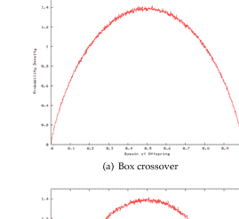
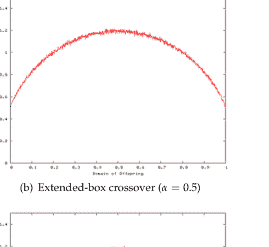
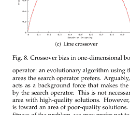
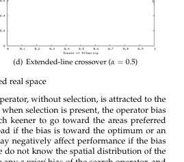

图 8. 一维有界实数空间中的交叉偏置

算子：使用该算子的进化算法在没有选择的情况下，会被吸引到搜索算子偏好的区域。可以说，即使存在选择，算子偏置也充当一种背景力，使搜索更倾向于前往搜索算子偏好的区域。如果偏置指向最优解或高质量解区域，这未必是坏事。然而，如果偏置指向低质量解区域，则可能对性能产生负面影响。如果我们不知道问题适应度的空间分布，我们可能希望搜索算子不具有任何先验偏置，而只使用选择偏置；选择偏置由采样解的适应度提供信息，这些采样解构成搜索中获得的关于有希望区域的经验知识，而且选择偏置也更容易理解。

本章研究实数编码遗传算法中由交叉本身以及交叉与变异结合所引起的偏置。直观上，盒式交叉和线性交叉偏向欧几里得空间中的中心。通过选取大量（理想情况下无限多）随机父代对，并在这些父代对所确定的盒（或线）中均匀随机地生成后代，可以很容易地通过实验验证这一直观判断。


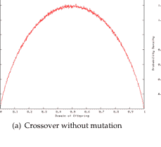

(a) 无变异的交叉

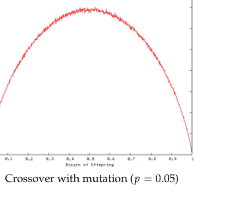

(b) 带变异的交叉 (p = 0.05)

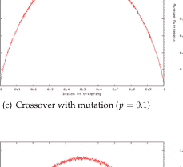

(c) 带变异的交叉 (p = 0.1)

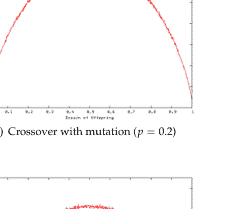

(d) 带变异的交叉 (p = 0.2)

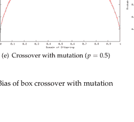

(e) 带变异的交叉 (p = 0.5)

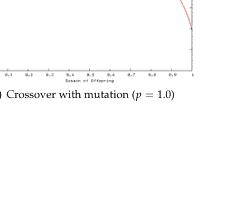

(f) 带变异的交叉 (p = 1.0)

图 9. 带变异的盒交叉的偏差

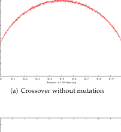

(a) 无变异的交叉

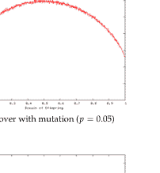

(b) 带变异的交叉 (p = 0.05)

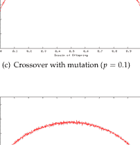

(c) 带变异的交叉 (p = 0.1)

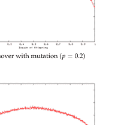

(d) 带变异的交叉 (p = 0.2)

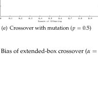

(e) 带变异的交叉 (p = 0.5)

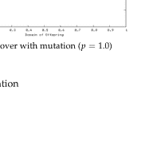

(f) 带变异的交叉 (p = 1.0)

图 10. 带变异的扩展盒交叉 (α = 0.5) 的偏差

设 N 为种群大小。随机组成 N/2 对集合，并对每对应用交叉和变异，生成 N/2 个后代。对父代和新生成的后代进行排序，从中选择最好的 N 个个体作为下一代种群。所有实验的种群大小均为 400。如果种群在 n × r × (1.0 − r) 代内没有变化，则除最佳个体外重新初始化。这里 r 为发散率，我们将其设为 0.25，如 Eshelman (1991) 中所述。所使用的 GA 在找到全局最优解时终止。

对于交叉，我们使用了四种交叉算子：盒交叉、扩展盒交叉（扩展率 α：0.5）、线交叉和扩展线交叉（扩展率 α：0.5）。交叉后，我们要么对后代进行变异，要么不进行。我们使用了两种不同的变异算子：高斯变异和精细变异。对每种交叉类型应用了不同的变异率，且变异率随世代数增加而降低。

表 2 显示了 30 次运行的结果。‘Ave’ 中的每个值表示 30 次运行的平均函数值。值越小越好。函数评估的上限为 50,000，即遗传算法在 50,000 次评估后终止，并在世代中输出迄今为止评估过的最佳解。表中，k = 1 + ⌊numberOfGenerations/100⌋，精细变异的速率为 0.5/k。

从这些实验中我们可以得到以下特性。

- 没有一种算子组合对所有问题实例都优越。对于平移球面，盒交叉配合精细变异表现最佳。对于平移 Schwefel，线交叉配合高斯变异；对于平移 Rosenbrock，扩展盒交叉无变异；对于平移 Rastrigin，盒交叉配合精细变异分别表现最佳。因此我们可以知道，合适的交叉和变异会根据给定问题的特性而变化。

- 无变异时，扩展盒交叉表现最佳。也就是说，当我们不知道给定问题的特性时，在实数编码遗传算法中使用扩展盒交叉作为交叉算子是一个通用选择。这很方便，因为不需要对变异进行参数调优。然而，使用设计良好的交叉和变异组合可以超越扩展盒交叉的性能。

- 异常的是，对于扩展盒交叉，无变异的结果最好，且性能随变异率增加而变差。然而，对于盒交叉，适度的变异率对性能有良好影响。在所有情况下，带变异的盒交叉比不带变异的性能更好。从这一事实我们可以推断，扩展盒交叉本身包含变异的功能，而盒交叉不包含。

- 除扩展盒交叉外，带变异的交叉结果优于不带变异的交叉。特别是，精细变异优于高斯变异。精细变异取决于父母之间的距离，因此随着种群收敛，变异强度趋近于零。也就是说，随着种群收敛，变异量变得非常精细。在二进制编码中，变异的主要作用是扰动效应以防止过早收敛。然而，从本实验可以知道，在实数编码中，变异的微调功能也很重要。

| 交叉 | 变异 | 平移球面 Ave (σ'/√n) | 平移 Schwefel Ave (σ'/√n) | 平移 Rosenbrock Ave (σ'/√n) | 平移 Rastrigin Ave (σ'/√n) |
|---|---|---|---|---|---|
| 无 | 0.05/k | 5.46e+02 (4.59e+01) | 1.68e+04 (9.05e+02) | 1.87e+07 (1.70e+06) | -2.66e+02 (1.91e+00) |
| 无 | 0.10/k | 6.40e+01 (2.17e+01) | 1.16e+04 (5.33e+02) | 4.64e+06 (3.86e+05) | -2.68e+02 (1.65e+00) |
| 无 | 0.20/k | 1.37e+02 (1.55e+01) | 7.99e+03 (4.79e+02) | 4.74e+06 (2.34e+05) | -2.64e+02 (1.58e+00) |
| 无 | 0.50/k | 9.67e+02 (3.13e+01) | 7.87e+03 (3.18e+02) | 1.89e+07 (8.19e+05) | -2.27e+02 (1.28e+00) |
| 无 | 1.00/k | 2.28e+03 (6.45e+01) | 1.24e+04 (3.72e+02) | 7.12e+07 (1.45e+07) | -1.91e+02 (1.72e+00) |
| 盒交叉 | 无 | 2.86e+02 (4.48e+02) | 1.24e+04 (3.03e+02) | 5.36e+07 (1.69e+07) | -1.83e+02 (1.14e+00) |
| 盒交叉 | 0.05/k | 3.61e+02 (8.81e+01) | 1.44e+04 (3.18e+02) | 1.66e+07 (4.52e+06) | -2.24e+02 (1.24e+00) |
| 盒交叉 | 0.10/k | -4.02e+02 (1.13e+01) | 1.22e+04 (1.42e+02) | 7.86e+06 (2.26e+05) | -2.60e+02 (1.11e+00) |
| 盒交叉 | 0.20/k | -4.25e+02 (6.96e+01) | 9.98e+03 (1.40e+02) | 4.34e+06 (1.57e+04) | -2.48e+02 (2.37e+00) |
| 盒交叉 | 0.50/k | -3.40e+02 (3.04e+03) | 8.10e+03 (1.17e+02) | 2.16e+05 (1.02e+04) | -1.94e+02 (1.90e+00) |
| 盒交叉 | 1.00/k | 2.81e+02 (1.54e+03) | 8.68e+03 (2.05e+02) | 5.55e+06 (2.53e+05) | -1.71e+02 (1.48e+00) |
| 盒交叉 | 精细 | -4.50e+02 (1.43e+03) | 8.74e+03 (1.16e+02) | 1.40e+07 (6.16e+05) | -3.03e+02 (1.60e+00) |
| 盒交叉 | 精细 + 0.05/k | -4.50e+02 (2.54e+02) | 8.43e+03 (1.36e+02) | 1.99e+06 (8.59e+04) | -2.77e+02 (3.16e+00) |
| 盒交叉 | 精细 + 0.20/k | -2.48e+02 (4.07e+02) | 1.10e+04 (1.12e+02) | 5.32e+06 (1.59e+05) | -2.59e+02 (3.26e+00) |
| 盒交叉 | 精细 + 0.50/k | -4.37e+02 (5.19e+01) | 7.88e+03 (1.06e+02) | 1.78e+04 (8.37e+02) | -2.07e+02 (1.87e+00) |
| 盒交叉 | 精细 + 1.00/k | -2.11e+02 (6.63e+08) | 8.83e+03 (1.72e+02) | 8.47e+05 (3.91e+04) | -1.82e+02 (1.64e+00) |
| ... | ... | ... | ... | ... | ... |
| 扩展盒交叉 (α = 0.5) | ... | ... | ... | ... | ... |
| 线交叉 | ... | ... | ... | ... | ... |
| 扩展线交叉 (α = 0.5) | ... | ... | ... | ... | ... |

表 2. 结果

- Dasgupta, S., Das, S., Biswas, A. & Abraham, A. (2009). 关于差分进化中种群动力学的稳定性和收敛性, AI Commun. 22(1): 1-20.
- Deb, K. & Agrawal, R. B. (1995). 用于连续搜索空间的模拟二进制交叉, Complex Systems 9(2): 115-148.
- Deb, K., Anand, A. & Joshi, D. (2002). 一种用于实参数优化的计算高效进化算法, Evolutionary Computation 10(4): 371-395.
- Deb, K. & Beyer, H.-G. (1999). 具有模拟二进制交叉的实参数遗传算法中的自适应, Proceedings of the Genetic and Evolutionary Computation Conference, pp. 172-179.
- Deb, K. & Kumar, A. (1995). 具有模拟二进制交叉的实数编码遗传算法：多峰和多目标问题的研究, Complex Systems 9: 431-454.
- Deb, K., Sindhya, K. & Okabe, T. (2007). 用于实参数优化的自适应模拟二进制交叉, Proceedings of the Genetic and Evolutionary Computation Conference, pp. 1187-1194.
- Eshelman, L. J. (1991). CHC 自适应搜索算法：在进行非传统遗传重组时如何进行安全搜索, Proceedings of the Workshop on Foundations of Genetic Algorithms, pp. 265-283.
- Eshelman, L. J., Mathias, K. E. & Schaffer, J. D. (1997). 交叉算子偏差：利用种群分布, Proceedings of the International Conference on Genetic Algorithms, pp. 354-361.
- Eshelman, L. J. & Schaffer, J. D. (1993). 实数编码遗传算法和区间模式, Proceedings of the Workshop on Foundations of Genetic Algorithms, pp. 187-202.
- Goldberg, D. E. (1991). 实数编码遗传算法、虚拟字母表和阻塞, Complex Systems 5: 139-167.
- Hansen, N. & Ostermeier, A. (2001). 进化策略中的完全去随机化自适应, Evolutionary Computation 9: 159-195.
- Herrera, F., Lozano, M. & Sánchez, A. M. (2003). 实数编码遗传算法交叉算子的分类：一个实验研究, International Journal of Intelligent Systems 18(3): 309-338.
- Herrera, F., Lozano, M. & Sánchez, A. M. (2005). 实数编码遗传算法的混合交叉算子：一个实验研究, Soft Computing 9(4): 280-298.
- Herrera, F., Lozano, M. & Verdegay, J. L. (1998). 处理实数编码遗传算法：行为分析的算子和工具, Artificial Intelligence Review 12(4): 265-319.
- Higuchi, T., Tsutsui, S. & Yamamura, M. (2000). 实数编码遗传算法单纯形交叉的理论分析, Proceedings of the Sixth International Conference on Parallel Problem Solving from Nature, pp. 365-374.
- Huang, H., Qin, H., Hao, Z. & Lim, A. (2010). 用于连续优化的基于示例学习的粒子群优化, Information Sciences. doi:10.1016/j.ins.2010.10.018.
- Igel, C., Hansen, N. & Roth, S. (2007). 用于多目标优化的协方差矩阵自适应, Evolutionary Computation 15(1): 1-28.
- Igel, C., Suttorp, T. & Hansen, N. (2006). 一种计算高效的协方差矩阵更新和用于进化策略的 (1 + 1)-CMA, Proceedings of the Genetic and Evolutionary Computation Conference, pp. 453-460.
- Jägersküpper, J. (2007). 用于连续优化的基本进化算法的算法分析, Theoretical Computer Science 379(3): 329-347.


- Janikow, C. Z. & Michalewicz, Z. (1991). 遗传算法中二进制与浮点数表示的实验比较, *第四届遗传算法国际会议论文集*, pp. 31–36.
- Juang, Y.-T., Tung, S.-L. & Chiu, H.-C. (2011). 用于多模态函数全局优化的自适应模糊粒子群优化, *信息科学* 181(20): 4539–4549.
- Kang, F., Li, J. & Ma, Z. (2011). 用于数值函数精确全局优化的Rosenbrock人工蜂群算法, *信息科学* 181(16): 3508–3531.
- Kita, H. (2001). 进化策略与实数编码遗传算法中自适应性的比较研究, *进化计算* 9(2): 223–241.
- Kita, H., Ono, I. & Kobayashi, S. (1998). 实数编码遗传算法中单峰正态分布交叉的理论分析, *进化计算国际会议论文集*, pp. 529–534.
- Kita, H., Ono, I. & Kobayashi, S. (1999). 实数编码遗传算法中单峰正态分布交叉的多父代扩展, *进化计算大会论文集*, pp. 1581–1587.
- Kramer, O. (2008a). 约束连续搜索空间中的过早收敛, *自然启发式并行问题求解会议论文集*, pp. 62–71.
- Kramer, O. (2008b). *进化计算的自适应启发式方法*, Springer.
- Kramer, O., Gloger, B. & Goebels, A. (2007). 使用实验设计对进化策略和粒子群优化器的实验分析, *遗传与进化计算会议论文集*, pp. 674–681.
- Krohling, R. A. & Coelho, L. S. (2006). 使用高斯分布的协同进化粒子群优化求解约束优化问题, *IEEE系统、人与控制论汇刊，B部分* 36(6): 1407–1416.
- Kukkonen, S. & Lampinen, J. (2004). 带约束的多目标优化中广义差分进化的扩展, *自然启发式并行问题求解会议论文集*, pp. 752–761.
- Kukkonen, S. & Lampinen, J. (2005). GDE3：广义差分进化的第三个进化步骤, *进化计算大会论文集*, pp. 443–450.
- Sun, C., Zeng, J. & Pan, J. (2011). 一种用于约束优化问题的改进向量粒子群优化, *信息科学* 181(6): 1153–1163.
- Lozano, M., Herrera, F., Krasnogor, N. & Molina, D. (2004). 带交叉爬山法的实数编码模因算法, *进化计算* 12(3): 273–302.
- Meyer-Nieberg, S. & Beyer, H.-G. (2007). 进化算法中的自适应, *进化算法参数设置会议论文集*, pp. 47–75.
- Mezura-Montes, E., Miranda-Varela, M. E. & Gómez-Ramón, R. (2010). 约束数值优化中的差分进化：实证研究, *信息科学* 180(22): 4223–4262.
- Michalewicz, Z. (1996). *遗传算法+数据结构=进化程序*, Springer.
- Mühlenbein, H. (1994). 饲养者遗传算法——一种可证明最优的搜索算法及其应用, *IEE遗传算法应用研讨会*, pp. 5/1–5/3.
- Mühlenbein, H. & Schlierkamp-Voosen, D. (1993). 饲养者遗传算法的预测模型I：连续参数优化, *进化计算* 1(1): 25–49.
- Noman, N. & Iba, H. (2005). 通过局部搜索增强差分进化在高维函数优化中的性能, *遗传与进化计算会议论文集*, pp. 25–29.
- Ono, I., Kita, H. & Kobayashi, S. (1999). 使用均匀交叉增强的单峰正态分布交叉的鲁棒实数编码遗传算法：交叉概率自适应的影响, *遗传与进化计算会议论文集*, pp. 496–505.
- Ono, I. & Kobayashi, S. (1997). 使用单峰正态分布交叉进行函数优化的实数编码遗传算法, *第七届遗传算法国际会议论文集*, pp. 246–253.
- Qi, A. & Palmieri, F. (1994a). 连续空间中无限种群规模进化算法的理论分析，第一部分：选择与变异的基本性质, *IEEE神经网络汇刊* 5(1): 102–119.
- Qi, A. & Palmieri, F. (1994b). 连续空间中无限种群规模进化算法的理论分析，第二部分：交叉多样化作用分析, *IEEE神经网络汇刊* 5(1): 120–129.
- Reed, J., Toombs, R. & Barricelli, N. A. (1967). 生物进化与机器学习的模拟, *理论生物学杂志* 17: 319–342.
- Ripon, K. S. N., Kwong, S. & Man, K. F. (2007). 用于多目标优化的实数编码跳跃基因遗传算法(RJGGA), *信息科学* 177(2): 632–654.
- Rönkkönen, J., Kukkonen, S. & Price, K. (2005). 基于差分进化的实数参数优化, *进化计算大会论文集*, pp. 506–513.
- Socha, K. & Dorigo, M. (2008). 连续域蚁群优化, *欧洲运筹学杂志* 185(3): 1155–1173.
- Someya, H. & Yamamura, M. (2005). 具有环面搜索空间转换的鲁棒实数编码进化算法, *软计算* 9(4): 254–269.
- Storn, R. & Price, K. (1997). 差分进化——连续空间全局优化的一种简单高效启发式方法, *全球优化杂志* 11(4): 341–359.
- Suganthan, P. N., Hansen, N., Liang, J. J., Deb, K., Chen, Y., Auger, A. & Tiwari, S. (2005). CEC 2005实数参数优化特别会议的问题定义与评估标准，技术报告NCL-TR-2005001，国立交通大学计算机科学系自然计算实验室(NCLab).
- Surry, P. D. & Radcliffe, N. (1996). 实数表示, *遗传算法基础研讨会论文集*, pp. 343–363.
- Takahashi, M. & Kita, H. (2001). 用于实数编码遗传算法的基于独立分量分析的交叉算子, *进化计算大会论文集*, pp. 643–649.
- Tsutsui, S. (1998). 通过镜像扩展搜索空间边界的遗传算法中的多父代重组, *第五届自然启发式并行问题求解国际会议论文集*, pp. 428–437.
- Tsutsui, S. & Goldberg, D. E. (2001). 实数编码遗传算法中的搜索空间边界扩展方法, *信息科学* 133(3–4): 229–247.
- Tsutsui, S. & Goldberg, D. E. (2002). 单纯形交叉与连锁识别：单阶段进化与多阶段进化, *IEEE国际进化计算会议论文集*, pp. 974–979.
- Tsutsui, S., Goldberg, D. E. & Sastry, K. (2001). 带单纯形交叉的实数编码遗传算法中的连锁学习, *第五届人工进化国际会议论文集*, pp. 51–58.
- Tsutsui, S., Yamamura, M. & Higuchi, T. (1999). 实数编码遗传算法中带单纯形交叉的多父代重组, *遗传与进化计算会议论文集*, pp. 657–664.
- Wei, L., Chen, Z. & Li, J. (2011). 基于进化策略的自适应L_p LS-SVM, *信息科学* 181(14): 3000–3016.
- Wright, A. H. (1991). 用于实数参数优化的遗传算法, *遗传算法基础研讨会论文集*, pp. 205–218.
- Yoon, Y., Kim, Y.-H., Moraglio, A. & Moon, B.-R. (2012). 实数表示的无偏边界扩展交叉的理论与实证研究, *信息科学* 183(1): 48–65.
- Zhang, M., Luo, W. & Wang, X. (2008). 基于动态随机选择的约束优化差分进化, *信息科学* 178(15): 3043–3074.


# 一种拼接/可分解二进制编码及其在遗传和进化算法中的新算子

Yong Liang  
澳门科技大学  
中国

## 1. 引言

大多数现实世界问题可以用不同的表示方法进行编码，但遗传和进化算法（GEAs）可能无法基于其表型表示成功解决这些问题，除非使用某些特定于问题的遗传算子。因此，在现实世界问题中使用 GEAs 时，需要适当的遗传表示（Goldberg, 1989; Liepins, 1990; Whitley, 2000; Liang, 2011）。

过去几十年里，对遗传表示进行了大量理论和实证研究。早期工作（Goldberg, 1989c; Liepins & Vose, 1990）表明，GEAs 的行为和性能受所用表示的强烈影响。因此，为适当的 GEAs 搜索制作了许多基因型表示。其中，二进制、整数、实值、混乱和树结构表示是最重要且被许多 GEAs 广泛使用的。

为了研究遗传表示的性能，最初，Holland（1975）提出了模式定理来模拟 GEAs 处理二进制位串之间相似性的性能。利用建筑模块（BBs）被定义为由整体问题分解的子问题的高度适应解，建筑模块假说（Goldberg, 1989c）指出 GEAs 主要因其传播短、低阶且高度适应的 BBs 的能力而起作用。在过去十年中，Thierens（1995）、Miller（1996）、Harik（1997）、Sendhoff（1997）和 Rothlauf（2002）发展了通向遗传表示一般理论的三个重要要素。他们确定冗余、建筑模块（BBs）的缩放以及距离失真是在不同遗传表示下影响 GEAs 性能的主要因素。

当基因型数量高于表型数量时，遗传表示被记为冗余。对冗余表示的研究表明，在初始种群中给高质量解提供更多副本会提高 GEAs 的性能，而高质量解被低估的编码会使问题更难解决。然而，均匀冗余对 GEAs 的性能没有影响。

表示的缩放阶数描述了 BBs 对个体适应度的不同贡献。众所周知，如果 BBs 均匀缩放，GEAs 会隐式并行解决所有 BBs。相反，对于非均匀缩放的 BBs，会发生多米诺收敛，BBs 从最显著的 BB 开始依次求解（Thierens, 1995）。因此，收敛时间增加，并且由于竞争 BBs 的噪声，性能下降。

表示的距离失真度量了将表型映射到基因型时个体之间距离的变化程度，而表示的局部性意味着相似基因型是否对应相似表型。理论分析表明，距离失真和局部性等于零的表示——即个体之间的距离得以保持——不会改变其所用问题的难度，并保证可靠且可预测地解决有界复杂度的問題。

选择适当表示对 GAs 性能的重要性已得到认可，但发展表示的一般理论是一个艰巨的挑战。迄今为止，关于表示对 GAs 性能影响的理论尚未建立完善。为了帮助不同任务的用户搜索良好的表示，近年来一些研究人员基于现有理论提出了建议。例如，Goldberg（Goldberg, 1989）提出了编码的两个基本设计原则：

- 最小字母表原则：编码的字母表应尽可能小，同时仍允许对解进行自然表示。
- 有意义的建筑模块原则：模式应短、低阶，并且与其他固定位置的模式相对无关。

最小字母表原则建议我们使用位串表示。结合有意义的建筑模块（BBs）原则，我们构建均匀显著 BBs，其中包括等缩放和拼接/可分解等位基因。

本章的目的是介绍我们的新型遗传表示——拼接/可分解（S/D）二进制编码，该编码是基于设计高效遗传表示的一些理论指导和现有建议提出的。S/D 二进制表示可以被拼接和分解，通过不同数量的均匀显著 BBs 以不同精度描述问题的潜在解。根据 S/D 二进制表示的特征，GEAs 可以从高缩放到低缩放的 BBs 依次应用，以避免竞争 BBs 的噪声并提高 GEAs 的性能。我们的理论和实证研究表明，S/D 二进制表示比其他现有二进制编码更适合 GEAs 搜索。此外，提出了一种新的基因型距离 d_g 在 S/D 二进制空间 Φ_s 上，该距离在 GEAs 收敛期间等价于实值空间 Φ_r 上的欧几里得距离 d_p。基于新的基因型距离 d_g，GEAs 可以可靠且可预测地解决有界复杂度的問題，并且依赖于表型距离 d_p 来解决不同类型优化问题的方法可以直接用于 S/D 二进制空间 Φ_s。

本章组织如下。第 2 节描述了三种最常用的二进制表示——二进制、Gray 和一元编码，以及它们对 GEAs 性能影响的理论分析。第 3 节介绍我们提出的拼接/可分解（S/D）二进制表示及其基因型距离。第 4 节提出了基于 S/D 二进制表示的新遗传算法，即拼接/可分解遗传算法（SDGA）。第 5 节讨论了 SDGA 的性能，并从实证研究中比较了 S/D 二进制表示与其他现有二进制编码。第 6 节得出章节结论。

## 2. 背景

二进制编码是最常用且受自然启发的 GEAs 表示，尤其对遗传算法（GAs）（Goldberg, 1989）而言。当用二进制表示编码实值问题时，不同类型的二进制表示以不同的方式将实值分配给二进制串。最常见的二进制表示是二进制、Gray 和一元编码。根据表示理论的三个方面（冗余、缩放的建筑模块和距离失真），Rothlauf（Rothlauf, 2002）研究了不同二进制表示对实值编码的 GAs 性能差异。

### 2.1 一元编码和冗余

在一元编码中，长度为 l = s − 1 的串是表示 s 个不同表型值所必需的。第 i 个表型值由对应基因型串中 1 的个数 i − 1 编码。因此，2^(l−1) 个不同基因型仅编码 s 个不同表型。通过表示理论对一元编码的分析表明，该编码是冗余的，并且不对表型进行均匀表示。因此，使用一元编码的 GAs 的性能取决于最优解的结构。除非使用更大的种群规模，否则一元 GAs 无法解决整数 one-max、欺骗性 trap 和 BinInt（Rothlauf, 2002）问题，因为对于这三种类型的问题，最优解被严重低估。因此，一元 GAs 的性能远不如使用非冗余二进制或 Gray 编码的 GAs（Jülstrom, 1999; Rothlauf, 2002）。

### 2.2 二进制编码、缩放的建筑模块和汉明悬崖

二进制编码使用指数缩放的位来表示表型。每个表型值 x_p ∈ Φ_p = {x_1, x_2, ..., x_s} 由长度为 l = log_2(s) 的二进制串 x_g 表示。因此，二进制编码的基因型-表型映射是一对一映射，并且无冗余地编码表型。

然而，对于非均匀缩放的二进制串和高维表型空间的竞争建筑模块（BBs），竞争 BBs 会产生大量噪声，导致 GAs 性能下降。使用二进制编码的 GAs 的性能不仅受 BBs 非均匀缩放的影响，还受与汉明悬崖相关的问题影响（Schaffer, 1989b）。二进制编码的效果是某些表型邻居的基因型完全不同。例如，当我们选择表型 x_p = 7 和 y_p = 8 时，两个个体的距离为一，但得到的基因型 x_g = 0111 和 y_g = 1000 具有最大的可能基因型距离 ||x − y||_g = 4。因此，二进制表示的局部性部分较低。在距离失真理论中，如果编码具有完美的局部性并且不改变个体之间的距离，则保留问题的难度。分析表明，二进制编码

改变个体之间的距离，从而改变优化问题的复杂性。因此，容易的问题可能变得困难，反之亦然。当映射表型到基因型时，二进制遗传算法无法可靠地求解问题。

### 2.3 格雷编码与问题难度的改变

无冗余的格雷编码（Schaffer, 1989a）旨在克服二进制编码的汉明悬崖问题（Schaffer, 1989b）。在格雷编码中，表型的每个邻居也是对应基因型的邻居。因此，使用仅在搜索空间中执行小步长的基于变异的搜索算子时，问题的难度保持不变。结果是，使用格雷编码的基于变异的搜索比使用二进制编码更容易求解容易的问题和有界难度的问题。尽管格雷编码具有高度局部性，但它仍然改变了位差异大于一的个体之间的距离对应关系。当关注基于交叉的搜索方法时，对模式平均适应度的分析表明，格雷编码保留的构建块复杂性小于二进制编码。因此，对于某些类型的问题，使用格雷编码的遗传算法性能下降是不可避免的（Whitley, 2000）。

## 3. 一种新颖的可拼接/可分解二进制遗传表示

上述章节的描述表明，现有的二进制遗传表示不适合遗传算法搜索，并且不能保证使用遗传算法可靠且可预测地求解有界复杂性问题。根据对高效表示设计进行的理论分析和建议，遗传表示应尝试遵守的一些重要点。遗传算法的常用表示通常使用等位基因序列对表型进行编码。等位基因可以分离（分解）为构建块（BBs），这些构建块彼此不相互作用，并且决定了解决方案的一个特定表型属性。遗传算子的目的是通过检测哪些 BBs 彼此影响来分解整个等位基因序列。遗传算法表现良好，因为它们能够识别每个 BB 的最佳等位基因并将其组合形成问题的高质量整体解。

基于上述研究结果和建议，我们提出了一种新的遗传表示，适用于遗传算法搜索。在本节中，首先我们介绍一种新颖的可拼接/可分解（S/D）二进制编码，然后定义 S/D 编码的新基因型距离，最后基于遗传表示理论的三个要素（冗余、缩放的 BB 和距离失真）给出 S/D 编码的理论分析。

### 3.1 一种可拼接/可分解二进制编码

在（Leung, 2002; Xu, 2003a）中，我们提出了用于实值编码的新颖 S/D 二进制编码。假设 n 维问题的表型域 \(\Phi_p\) 可以由下式指定

\[
\Phi_p = [\alpha_1, \beta_1] \times [\alpha_2, \beta_2] \times \cdots \times [\alpha_n, \beta_n].
\]

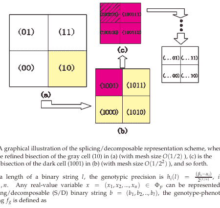

Fig. 1. 可拼接/可分解表示方案的图形说明，其中（b）是（a）中灰色单元（10）的细化二分（网格大小 \(O(1/2)\)），（c）是（b）中深色单元（1001）的细化二分（网格大小 \(O(1/2^2)\)），依此类推。

给定二进制字符串的长度 \(l\)，基因型精度为 \(h_i(l) = (\beta_i - \alpha_i)/2^{l/n}, i = 1, 2, \ldots, n\)。任意实值变量 \(x = (x_1, x_2, \ldots, x_n) \in \Phi_p\) 可以由可拼接/可分解（S/D）二进制字符串 \(b = (b_1, b_2, \ldots, b_l)\) 表示，基因型-表型映射 \(f_g\) 定义为

\[
x = (x_1, x_2, \ldots, x_n) = f_g(b) = \left( \sum_{j=0}^{l/n-1} 2^{l/n-1-j} b_{j n + 1}, \ldots, \sum_{j=0}^{l/n-1} 2^{l/n-1-j} b_{j n + n} \right)
\]

其中

\[
\sum_{j=0}^{l/n-1} 2^{l/n-1-j} b_{j n + i} \le \frac{x_i - \alpha_i}{h_i(l)} < \sum_{j=0}^{l/n-1} 2^{l/n-1-j} b_{j n + i} + 1.
\]

也就是说，编码中每个位的意义可以被清晰且唯一地解释（因此，编码的 S/D 二进制字符串的每个 BB 都有特定的含义）。如图 1 所示，以 \(\Phi_p = [0,1] \times [0,1]\) 和 S/D 二进制字符串 \(b = 100101\) 为例（在这种情况下，\(l = 6\)，\(n = 2\)，且基因型精度 \(h_1(l) = h_2(l) = 1/2^3\)）。让我们看看如何识别 S/D 二进制字符串 \(b\) 以及 \(b\) 的每个位值意味着什么。在图 1-(a) 中，表型域 \(\Phi_p\) 被二分为四个 \(\Phi_p^{1/2}\)（即均匀大小为 \(1/2\) 的子区域）。根据每个坐标方向上的左-0 右-1 对应规则，这四个 \(\Phi_p^{1/2}\) 可以分别标识为 (00)、(01)、(10) 和 (11)。由于表型 \(x\) 位于子区域 (10)（灰色正方形）中，其第一个构建块（BB）应为 \(BB_1 = 10\)。这导致 S/D 二进制字符串 \(b\) 的前两位。同样，在图 1-(b) 中，\(\Phi_p\) 被划分为 \(2^{2 \times 2}\) 个 \(\Phi_p^{1/4}\)，这些是通过沿每个方向进一步二分每个 \(\Phi_p^{1/2}\) 获得的。

特别是，这进一步将 \(\Phi_p^{1/4} = (BB_1)\) 分为四个 \(\Phi_p^{1/8}\)，可分别标记为 \((BB_1, 00)\)、\((BB_1, 01)\)、\((BB_1, 10)\) 和 \((BB_1, 11)\)。表型 \(x\) 位于 \((BB_1, 01)\) 子区域（深色正方形）中，因此其第二个 BB 应为 \(BB_2 = 01\)，其对应 S/D 二进制字符串 \(b\) 的前四个位置为 1001。

同样，如图 1-(c) 所示，\(\Phi_p\) 被划分为 \(2^{2 \times 3}\) 个 \(\Phi_p^{1/8}\)，其中 \(\Phi_p^{1/8} = (BB_1, BB_2)\) 特别被划分为四个标记为 \((BB_1, BB_2, 00)\)、\((BB_1, BB_2, 01)\)、\((BB_1, BB_2, 10)\) 和 \((BB_1, BB_2, 11)\) 的 \(\Phi_p^{1/16}\)。发现表型 \(x\) 为 \((BB_1, BB_2, 01)\)，即与 S/D 二进制字符串 \(b\) 相同。这表明对于任意三个区域划分，\(b = (b_1, b_2, b_3, b_4, b_5, b_6)\)，每个位值 \(b_i\) 可以按如下几何方式解释：\(b_1 = 0\)（\(b_2 = 0\)）表示在 1/4 精度的 \(\Phi_p\) 划分中，表型 \(x\) 沿 x 坐标方向（y 坐标方向）位于左半部分，而 \(b_1 = 1\)（\(b_2 = 1\)）表示 \(x\) 位于右半部分。因此，第一个 \(BB_1 = (b_1, b_2)\) 决定了 \(x\) 的 1/4 精度位置。

如果 \(b_3 = 0\)（\(b_4 = 0\)），则进一步表明当 \(\Phi_p\) 细化为 \(\Phi_p^{1/8}\) 时，\(x\) 位于 \(\Phi_p^{1/8}\) 的 x 方向（y 方向）左半部分，若 \(b_3 = 1\)（\(b_4 = 1\)）则位于右半部分。因此获得了更精确的几何位置（即 1/8 精度位置）和更精细的 \(BB_2\)。同样我们可以解释 \(b_5\) 和 \(b_6\) 并识别 \(BB_3\)，它决定了 \(x\) 的 1/8 精度位置。这种解释适用于任何高分辨率 \(l\) 位 S/D 二进制编码。

### 3.2 可拼接/可分解二进制表示上的新基因型距离

对于衡量二进制字符串的相似性，汉明距离（Hamming, 1980）在二进制空间中被广泛使用。汉明距离描述了两个二进制字符串中有多少位不同，但不能考虑非均匀二进制表示中的缩放属性。因此，基因型空间与表型空间之间的距离失真使得表型上容易的问题变得更困难。因此，为了确保遗传算法能够可靠地求解容易的问题和有界复杂性问题，建议使用等价距离。为此，我们在 S/D 二进制空间上定义了一种新的基因型距离来衡量 S/D 二进制字符串的相似性。

Definition 1: 假设任意两个二进制字符串 \(a\) 和 \(b\) 属于 S/D 二进制空间 \(\Phi_g\)，基因型距离 \(\|a - b\|_g\) 定义为

\[
\|a - b\|_g = \sum_{i=1}^{n} \left| \frac{1}{2^{l/n} - 1} \sum_{j=0}^{l/n - 1} \frac{a_{j n + i} - b_{j n + i}}{2^{j+1}} \right|
\]

其中 \(l\) 和 \(n\) 分别表示 S/D 二进制字符串的长度和实值编码表型空间 \(\Phi_p\) 的维度，

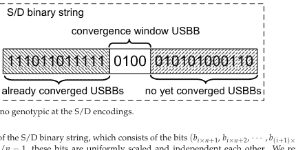

Fig. 3. S/D 编码上的多米诺收敛。

在 S/D 二进制字符串的每个 \(BB_i\) 中，其由位 \((b_{i \times n + 1}, b_{i \times n + 2}, \ldots, b_{(i + 1) \times n})\) 组成，\(i = 0, \ldots, l/n - 1\)，这些位是均匀缩放且相互独立的。我们将 \(BB_i\) 的这种精细特征称为均匀显著 BB（USBB）。此外，拼接不同数量的 USBB 可以用不同的精度描述问题的潜在解。因此，USBB 的组内 BB 难度（构建块内部）和组间 BB 难度（构建块之间）（Goldberg, 2002）都很低。理论分析表明，在 USBB 上搜索的遗传算法可以比在非均匀缩放 BB 上的遗传算法更快地探索高质量位。

S/D 二进制编码是一种无冗余表示，因为使用 S/D 二进制字符串表示实值是一一对应的基因型-表型映射。整个 S/D 二进制字符串由非均匀缩放的 USBB 序列构建。遗传算法的多米诺收敛发生，且 USBB 按从高到低的缩放顺序依次求解。

S/D 二进制表示的 BB 显著性可变和均匀显著 BB 属性体现了对遗传算法搜索非常有用的重要信息。我们将在后续章节中利用这些信息设计基于 S/D 二进制表示的新遗传算法。

## 4. 一种新的 S/D 二进制遗传算法（SDGA）

现有的指数缩放表示包括二进制和格雷编码，由非均匀缩放的 BB 组成。对于高维表型空间中非均匀缩放且相互竞争的 BB，存在来自竞争 BB 的大量噪声，导致遗传算法性能下降。此外，随着字符串长度的增加，越来越多的低显著性 BB 由于来自竞争 BB 的噪声而被随机固定，导致遗传算法性能下降。使用较大的种群规模可以减少来自竞争 BB 的噪声的影响。然而，在实际问题中，长二进制字符串对于以高精度编码大型搜索空间是必要的，因此我们不能使用过大的种群规模来解决噪声问题。因此，遗传算法会过早收敛，无法收敛到问题的最优解。

为了避免遗传算法中竞争 BB 的噪声，我们基于 S/D 二进制表示的精细属性提出了一种新的可拼接/可分解遗传算法（SDGA）。整个 S/D 二进制字符串可以分解为非均匀缩放的 USBB 序列。因此，在 S/D 二进制编码上遗传算法的搜索过程中，


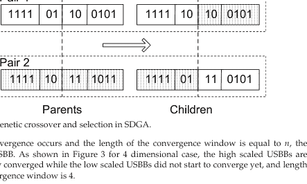

图 4. SDGA 中的遗传交叉和选择。

多米诺收敛发生，且收敛窗口的长度等于 n，即 USBB 的长度。如图 3 所示，对于 4 维情况，高缩放 USBB 已完全收敛，而低缩放 USBB 尚未开始收敛，收敛窗口的长度为 4。

在 SDGA 中，遗传算子按顺序从高缩放 USBB 应用到低缩放 USBB。SDGA 中交叉和选择的过程如图 4 所示。从当前种群中随机选择两个个体 x1 和 x2，交叉点随机设置在收敛窗口 USBB 中，交叉算子生成两个子代 c1、c2。亲本 x1、x2 及其子代 c1、c2 可分为两对 {x1, c1} 和 {x2, c2}。在每对 {xi, ci}（i = 1, 2）中，亲本和子代具有相同的低缩放 USBB。选择算子将根据整个 S/D 二进制串计算的适应度，以高精度保留每对中较好者进入下一代。因此，收敛窗口 USBB 中对高适应度有贡献的位将被保留，而低缩放 USBB 侧的多样性将被维持。变异将根据变异概率作用于收敛窗口和尚未收敛的 USBB，以增加种群的多样性。这些低显著性 USBB 将因 GA 搜索而收敛，以避免来自竞争 BB 的噪声。SDGA 算法的实现伪代码如图 5 所示。

由于在 GAs 的收敛窗口 USBB 中识别高质量位比在非均匀 BB 上的 GAs 更快，且不会出现来自竞争 BB 的噪声。因此，种群可以高效地收敛到收敛窗口 USBB 位置上的高质量 BB，该 BB 是问题过度表示最优解的组成部分。根据 Thierens 的理论结果（Thierens, 1995），采用 S/D 二进制表示的新 GA 的总体收敛时间复杂度约为 O(l / √n) 量级，其中 l 为 S/D 二进制串的长度，n 为问题的维数。这比对整个二进制串进行操作要快得多，后者 GAs 的近似收敛时间为 O(l) 量级。该增益对于高维问题尤其显著。

## 5. 经验验证

在本节中，我们对前几节中描述的不同遗传表示和算子的性能差异进行经验验证。

```
Input: N—population size, m—number of USBBs, g—number of generations to run;
Termination condition: Population fully converged;
begin
g ← 0;
m ← 1;
Initialize P_g;
Evaluate P_g;
while (not termination condition) do
  for t ← 1 to N/2;
    randomly select two individuals x1^t and x2^t from P_g;
    crossover and selection x1^t, x2^t into P_{g+1};
  end for
  mutation operation P_{g+1};
  Evaluate P_{g+1};
  if (USBB_m fully converged) m ← m + 1;
end while
end
```

图 5. SDGA 算法的伪代码。

### 5.1 两个整数基准优化问题

在我们的实验中，我们使用 one-max 和完全欺骗性 trap 问题的整数特定变体，以比较定义在二进制串上的不同遗传表示。

整数 one-max 问题定义为

$$f_1(x_1,x_2,\cdots,x_n)=\sum_{i=1}^{n}x_i$$

整数欺骗性 trap 为

$$f_2(x_1,x_2,\cdots,x_n)=\begin{cases}\sum_{i=1}^{n}x_i\text{ if for each }i,\ x_i=x_{i,max}\\\sum_{i=1}^{n}x_{i,max}-\sum_{i=1}^{n}x_i-1\text{ else.}\end{cases}$$

其中 $x\in\Phi_n$ 且 $n$ 为问题的维数。在我们的实现中，设 $n=30$。

对于二进制表示，整数 one-max 问题等同于 BinInt 问题 [Rudnick, 1992]。这两个问题对二进制串具有指数显著性或适应度结构。整数 one-max 问题是一个完全容易的问题，而整数欺骗性 trap 对于 GA 来说应是完全困难的。

### 5.2 不同表示下 GA 性能的比较

在第一组实验中，我们在整数 one-max 和欺骗性 trap 问题上应用了使用二进制、格雷、一元、S/D 编码的标准 GA（SGA）和 SDGA 以比较其性能。我们进行了 50 次运行，每次运行在种群完全收敛后停止。这意味着种群中的所有个体都相同。为了比较的公平性，我们使用相同的参数设置和相同的初始种群实现了具有不同二进制编码的 SGA 和 SDGA。对于 SGA，我们使用了单点交叉算子（交叉概率=1）和无放回的规模为二的锦标赛选择算子。我们未使用变异，因为我们希望专注于遗传表示对选择重组 GA 的影响。

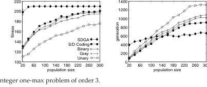

图 6. 阶数为 3 的整数 one-max 问题。

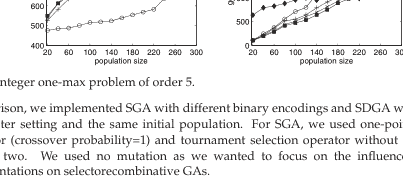

图 7. 阶数为 5 的整数 one-max 问题。

对于 one-max 问题，我们使用了 30 维问题，阶数为 2（每个维度中不同表型数 s = 2^k = 4）、3（s = 2^k = 8）、4（s = 2^k = 16）和 5（s = 2^k = 32）。由于在我们的实现中，低阶欺骗性 trap 问题的全局最优解无法被我们使用的所有 GA 探索，且高阶欺骗性 trap 问题比低阶更困难且无法被 GA 求解，这里我们仅给出 30 维欺骗性 trap 问题阶数为 2（s = 2^2 = 4）和 3（s = 2^3 = 8）的结果。使用二进制、格雷和 S/D 编码时，阶数 2 问题的串长 l = 60，阶数 3 为 l = 90，阶数 4 为 l = 120，阶数 5 为 l = 150。使用一元编码时，阶数 2 需要 30 × 3 = 90 位，阶数 3 需要 30 × 7 = 210 位，阶数 4 需要 30 × 15 = 450 位，阶数 5 需要 30 × 31 = 930 位。

图 6-7 分别给出整数 one-max 问题阶数 3 和 5 的结果，图 8-9 分别给出整数欺骗性 trap 问题阶数 2 和 3 的结果。图示针对具有不同表示的 SGA 和 SDGA，显示了以种群规模 N 为基准的运行结束时的最佳适应度（左）和运行持续时间——完全收敛代数（右）。

SGA 使用 S/D 编码的性能不能显著优于二进制和格雷编码。

如图 6-9 所示，SDGA 的性能显著优于具有不同编码的 SGA。使用较小的种群规模时，SDGA 完全收敛时探索到的解远优于 SGA，因为每个位都是由 SDGA 的搜索过程识别的，而不是被竞争 BB 的噪声随机固定。出于同样的原因，SDGA 的运行持续时间长于 SGA。这意味着没有过早收敛且没有漂移发生。对于较大的种群规模，SDGA 的性能远优于 SGA，原因在于高质量解和较短的运行持续时间，因为 GA 在 S/D 二进制编码的 USBB 上搜索比在非均匀缩放的 BB 上更快，且仅在 USBB 的非均匀序列上发生的多米诺收敛太弱。

| P_m | one-max（阶数 2）最佳适应度（标准差） | one-max（阶数 2）运行持续时间（标准差） | one-max（阶数 3）最佳适应度（标准差） | one-max（阶数 3）运行持续时间（标准差） | one-max（阶数 4）最佳适应度（标准差） | one-max（阶数 4）运行持续时间（标准差） | one-max（阶数 5）最佳适应度（标准差） | one-max（阶数 5）运行持续时间（标准差） | deceptive（阶数 2）最佳适应度（标准差） | deceptive（阶数 2）运行持续时间（标准差） | deceptive（阶数 3）最佳适应度（标准差） | deceptive（阶数 3）运行持续时间（标准差） |
|---|---|---|---|---|---|---|---|---|---|---|---|---|
| SDGA | 89.6 (1.24) | 383.1 (43.6) | 209.2 (2.9) | 577.3 (77.4) | 448.1 (6.8) | 768.7 (107.2) | 926.6 (9.8) | 952.9 (118.2) | 88.74 (0.78) | 380 (48) | 208.1 (2.8) | 573.1 (75.6) |
| S/D coding | 81.1 (9.8) | 446.1 (187.4) | 180.9 (21.16) | 597 (287) | 375.9 (54.3) | 694.9 (377.2) | 777.1 (101) | 761.8 (422.4) | 80.02 (9.7) | 428 (173) | 182.9 (21.6) | 602.9 (285.4) |
| Binary | 80.1 (10.3) | 473.7 (192.7) | 177.7 (21.9) | 651 (316.8) | 370.5 (42.2) | 748.8 (398) | 752.6 (91) | 838.6 (481.6) | 77.16 (9.1) | 482 (192) | 172.8 (21.1) | 690.1 (334.8) |
| Gray | 78.3 (9.6) | 496.9 (196.3) | 173.1 (20.5) | 691.2 (328.5) | 365.2 (42.2) | 803.6 (434.8) | 719.8 (87.9) | 909.5 (502) | 78.76 (9.4) | 453 (183) | 177.9 (21.8) | 647 (309.5) |
| Unary | 76.1 (10.6) | 536.8 (218.5) | 150.5 (21.3) | 844.2 (416.7) | 281.5 (26.6) | 1006 (558.4) | 560.8 (72.4) | 1216 (726.9) | 74.18 (10.5) | 549 (221) | 150.7 (20.6) | 882.7 (451.9) |

表 1. SGA 在不同二进制表示下与 SDGA 在 one-max 和 deceptive 问题上的结果比较。

表 1 总结了 one-max 和欺骗性 trap 问题的实验结果。每个问题的最佳适应度（运行持续时间）计算为使用不同种群规模时 GA 完全收敛的适应度（代数）的平均值。

SDGA 的平均适应度远优于其他 SGA。SDGA 在不同问题上的最佳适应度和运行持续时间标准差显著小于其他 SGA。这表明种群规模是 SGA 搜索的重要参数，但对 SDGA 搜索而言并非显著参数。SDGA 的运行持续时间对于

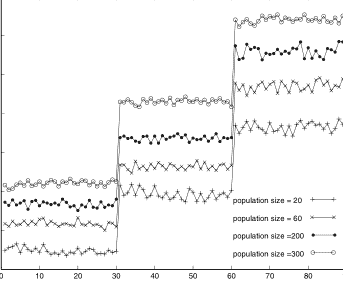

图 10. 无竞争 BB 噪声的 SDGA 收敛过程。

阶数为 4 和 5 的 one-max 问题的运行时间比 SGA 的更长，因为 SGA 对于长二进制字符串和小种群规模而言过早成熟。

如表 1 所描述，对于 one-max 和欺骗性 trap 问题，所有 GAs 都收敛到由 BBs 过度表示的最优解的侧面。但使用不同二进制表示的 SGA 无法探索问题的最优解。SDGA 探索由 BBs 过度表示的最优解的能力明显优于 SGA。为了探索欺骗性 trap 问题的全局最优解，我们需要使用其他 niche 方法将整个种群划分为一些子种群。在每个子种群中，全局最优解由 BBs 过度表示，因此 SDGA 可以有效地探索欺骗性 trap 问题的该全局最优解。

## 5.3 避免竞争 BB 的噪声

为了验证关于避免竞争 BB 噪声的预测，我们已实现我们的 SDGA 来求解 30 维整数 one-max 问题，阶数为 3。我们统计了每个位完全收敛前所需的世代数。结果是对 50 次独立运行取平均值。图 10 显示了长度为 l = 90 的字符串的位收敛情况，种群规模分别为 20、100、200、300。实验结果汇总于表 2。每个 USBB_i，(i = 1,2,3) 的运行持续时间是属于该 USBB_i 的位的完全收敛世代数的平均值。

如 图 10 和表 2 所示，整个 S/D 二进制字符串包含三个 USBB。在每个 USBB 中，位在几乎相同的世代均匀收敛。对于非均匀缩放的 USBB 序列，多米诺收敛依次从高缩放 USBB 到低缩放 USBB 发生。因此，没有较不显著的位与更显著的位在同一世代收敛，且不会产生竞争 BB 的噪声。

另一方面，我们知道当 GAs 使用小种群规模时，竞争 BB 的噪声会强烈出现。在我们的实现中，当 SDGA 的种群规模小到 20 时，位的收敛过程与使用大种群规模的 SDGA 相同。低缩放 USBB 通过 SDGA 在较长世代中收敛，且不会产生竞争 BB 的噪声。

从图 10 和表 2 清楚可见，预测与实验结果非常吻合。

| 种群大小 | USBB₁ 的运行持续时间 | USBB₂ 的运行持续时间 | USBB₃ 的运行持续时间 |
|---|---|---|---|
| 20 | 47.3(8.2) | 193.7(12.7) | 365.6(13.8) |
| 100 | 116.6(6.8) | 263.2(7.8) | 470.8(12.1) |
| 200 | 167.4(7.7) | 366.5(6.7) | 559.6(13.9) |
| 300 | 220.3(7.0) | 430.8(6.6) | 633.6(7.8) |

表 2. 不同种群规模下 USBBs 完全收敛的运行持续时间比较。(标准差)

## 5.4 带有变异算子的 SDGA

在本小节中我们考虑了变异算子对 SDGA 搜索的作用。我们已实现带有不同变异概率的 SDGA 来求解 30 维整数 one-max 问题，阶数为 3。结果是对 50 次独立运行取平均值。图 11 展示了实验结果，其中变异概率分别为 0.001、0.005、0.01、0.05 和 0.1。图显示了 SDGA 的运行持续时间——相对于种群规模 N 的完全收敛世代数。

如 图 11 所示，当变异概率小于 0.01 时，SDGA 可以在小种群和大种群规模下完全收敛，且运行持续时间不会增加过长。当变异概率增大到大于 0.01 时，大种群规模的 SDGA 难以完全收敛，只有在使用小种群规模时，SDGA 才能完全收敛，但运行持续时间显著增加。

表 3 汇总了种群规模为 20、40 和 60 的实验结果。对于小种群规模（20 和 40），变异算子可以改善 SDGA 的性能，因为它可以找到当前种群中未包含的一些高质量位。对于大种群规模（≥ 60），所有高质量位都包含在初始种群中，因此当 SDGA 完全收敛时，变异算子无法改善最佳适应度。此外，当变异概率大于 0.01 时，SDGA 无法在合理时间内完全收敛（此处我们将运行持续时间的上限设为 10^6 代）。

## 5.5 S/D 二进制表示上的基因型距离

为了验证关于依赖于实值空间距离的方法，可以基于我们新定义的基因型距离直接用于 S/D 二进制空间的预测，我们将 SGA 与 S/D 二进制编码和动态 niche sharing 方法结合

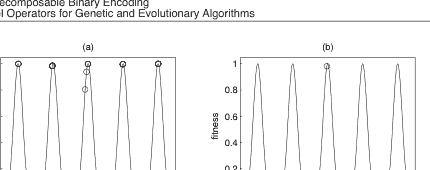

图 13. 使用 S/D 基因型距离和 Hamming 距离的动态 niche sharing 方法结果比较，针对 $f_4(x)$。 (图例：“o” — 最终种群中的最优解)

基因型距离可以在每次运行中探索 $f_3(x)-f_6(x)$ 中的所有最优解。相反，对于使用 Hamming 距离的 niche 方法，最终种群收敛到多峰问题的单一最优解，无法找到多个最优解。这意味着当使用 Hamming 距离时，由于基因型空间（S/D 二进制空间）与表现型空间（实值空间）之间的距离失真，niche 方法无法工作。

实验研究表明，依赖于实值空间欧几里得距离的方法可以直接在我们新定义的基因型距离下用于 S/D 二进制空间。

| | 距离阈值 | S/D 基因型距离 最优解数量 | S/D 基因型距离 成功率 | Hamming 距离 最优解数量 | Hamming 距离 成功率 |
|---|---|---|---|---|---|
| $f_3$ | 2.0 | 2 | 100% | 1 | 0% |
| $f_4$ | 0.16 | 5 | 100% | 1 | 0% |
| $f_5$ | 0.16 | 5 | 100% | 1 | 0% |
| $f_6$ | 0.8 | 6 | 100% | 1 | 0% |

表 5. 使用 S/D 基因型距离和 Hamming 距离的动态 niche sharing 方法结果比较。

## 6. 讨论

本文首次在 S/D 二进制表示中给出了均匀显著构建块（USBB），其中包含均匀缩放的位。这假设表现型空间 $\Phi_p$ 在每个维度上是均匀缩放的。如果假设不满足，我们需要先对表现型空间 $\Phi_p$ 进行归一化，然后将归一化后的表现型空间 $\Phi'_p$ 编码到 S/D 二进制空间 $\Phi_g$，以保证每个 USBB 中的位具有相同的尺度。

SDGA 应用于 S/D 二进制表示，并依次从高缩放 USBB 到低缩放 USBB 收敛。然而，当收敛窗口 USBB 无法收敛到单一高质量 BB 时，可能存在一些高质量 BB 来描述问题的不同最优解。此时，我们需要使用其他方法（例如 niche 方法）将整个种群划分为几个子种群，每个子种群关注每个最优解。因此，每个最优解将被

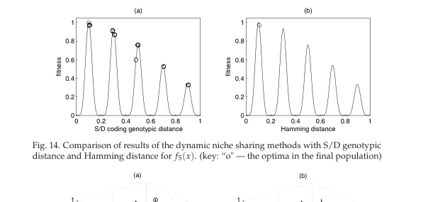

图 14. 使用 S/D 基因型距离和 Hamming 距离的动态 niche sharing 方法结果比较，针对 f5(x)。 (图例："o" — 最终种群中的最优解)

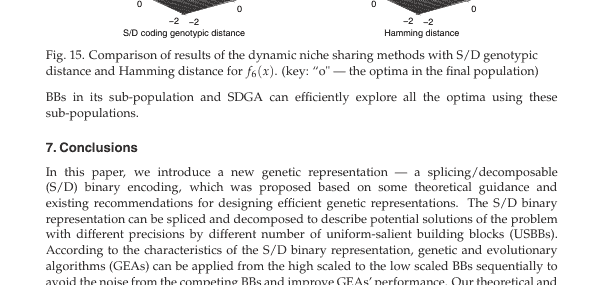

图 15. 使用 S/D 基因型距离和 Hamming 距离的动态 niche sharing 方法结果比较，针对 f6(x)。 (图例："o" — 最终种群中的最优解)

BBs 在其子种群中过度表示，且 SDGA 可以使用这些子种群有效地探索所有最优解。

## 7. 结论

本文介绍了一种新的遗传表示——拼接/可分解（S/D）二进制编码，该编码是基于一些理论指导和设计高效遗传表示的现有建议提出的。S/D 二进制表示可以通过不同数量的均匀显著构建块（USBs）拼接和分解，以不同精度描述问题的潜在解。根据 S/D 二进制表示的特性，遗传和进化算法（GEAs）可以依次从高缩放 BB 应用到低缩放 BB，以避免竞争 BB 的噪声并改善 GEAs 的性能。我们的理论和实证研究表明，S/D 二进制表示比其他现有二进制编码更适合 GEAs 搜索。此外，我们在 S/D 二进制空间上定义了一种新的基因型距离，该距离在 GEAs 收敛期间等价于实值空间上的欧几里得距离。基于新的基因型距离，GEAs 可以可靠地

并且可预测地解决有界复杂度的問題，且依赖于欧几里得距离来解决不同类型优化问题的方法可以直接用于 S/D 二进制空间。

## 8. 致谢

本研究得到中华人民共和国澳门特别行政区澳门科学技术发展基金（项目编号 021/2008/A）和（项目编号 017/2010/A2）的资助。

## 9. 参考文献

- Goldberg, D. E. (1989). 遗传算法在搜索、优化和机器学习中的应用. Reading, MA: Addison-Wesley.
- Hamming, R. (1980). 编码与信息论. Prentice-Hall.
- Han, K. H. & Kim, J. H. (2000). 遗传量子算法及其在组合优化问题中的应用, Proceedings of Congress on Evolutionary Computation 2000: Volume 1, pp. 1354-1360, La Jolla, CA.
- Harik, G. R., Cantu-Paz, E., Goldberg, D. E. & Miller, B. L. (1997). 赌徒破产问题、遗传算法与种群规模. In Back, T. (Ed.), Proceedings of the Fourth International Conference on Evolutionary Computation, pp. 7-12, New York.
- Holland, J. H. (1975). 自然与人工系统中的适应. Ann Arbor, MI: University of Michigan Press.
- Julstrom, B. A. (1999). 冗余遗传编码可能无害. Proceedings of the Genetic and Evolutionary Computation Conference 1999: Volume 1. San Francisco, CA: Morgan Kaufmann Publishers.
- Leung, K. S., Sun, J. Y. & Xu, Z. B. (2002). 进化计算的效率加速策略：自适应实现. Engineering Computations, 19 (3), pp. 272-304.
- Leung, K. S. & Liang, Y. (2003). 基于自适应精英种群的遗传算法用于多峰函数优化. Proceedings of Genetic and Evolutionary Computation Conference 2003: Volume 1, pp. 1160-1171, Chicago, USA.
- Liang, Y. & Leung, K. S. (2006). 具有基于排除的选择算子和傅里叶级数辅助函数的进化策略, Applied Mathematics and Computation, Volume 174, pp. 1080-1109.
- Liepins, G. E. & Vose, M. D. (1990). 遗传优化中的表征问题. Journal of Experimental and Theoretical Artificial Intelligence, 2, pp. 101-115.
- Lobo, F. G., Goldberg, D. E. & Pelikan, M. (2000). 遗传算法在指数缩放问题上的时间复杂度. Proceedings of the Genetic and Evolutionary Computation Conference 2000: Volume 1. San Francisco, CA: Morgan Kaufmann Publishers.
- Mahfoud, S. W. (1996). 遗传算法的生态位方法. Doctoral Thesis, University of Illinois at Urbana-Champaign.
- Miller, B. L. & Goldberg, D. E. (1996). 遗传算法的最优采样 (IlliGAL Report No. 96005). Urbana, IL: University of Illinois at Urbana-Champaign.
- Rothlauf, F. (2002). 遗传与进化算法的表征. Heidelberg; New York: Physica-Verl., 2002.
- Schaffer, J. D. (Ed.) (1989a). 第三届国际遗传算法大会论文集. San Francisco, CA: Morgan Kaufmann Publishers.
- Schaffer, J. D., Caruana, R. A., Eshelman, L. J. & Das, R. (1989b). 影响遗传算法函数优化整体性能的控制参数研究. Proceedings of the Third International Conference on Genetic Algorithms. San Mateo, CA: Morgan Kaufmann.
- Sendhoff, B., Kreutz, M. & von Seelen, W. (1997). 基因型-表型映射的一个条件：因果性. In Back, T. (ed.), Proceedings of the Seventh International Conference on Genetic Algorithms, pp. 73-80, San Francisco: Morgan Kaufmann.
- Thierens, D. (1995). 遗传算法的分析与设计. Leuven, Belgium: Katholieke Universiteit Leuven.
- Whitley, D. (2000). 局部搜索与高精度格雷码：收敛结果与邻域. In Martin, W., & Spears, W. (Eds.), Foundations of Genetic Algorithms 6. San Francisco, California: Morgan Kaufmann Publishers, Inc.
- Wong, Y. Y., Lee, K. H., Leung, K. S. & Ho, C. W. (2003). 遗传算法参数自适应与多样性保持的一种新方法. Soft Computing, 7(8), pp. 506-515.
- Wong, Z. Y., Leung, K. S., Wong, M. L. & Fang, J. (2000). 一种新型非线性积分及其计算算法. Fuzzy Sets and Systems, 112, pp. 223-231.
- Xu, K. B., Wang, Z. Y., Heng, P. A. & Leung, K. S. (2003a). 基于非线性积分投影的分类. IEEE Transactions on Fuzzy Systems, 11(2), pp. 187-201.
- Xu, Z. B., Leung, K. S., Liang, Y. & Leung, Y. (2003b). 进化计算的效率加速策略：基础与快速遗传算法. Applied Mathematics and Computation 142, pp. 341-388.
- Zhu, Z. Y. & Leung, K. S. (2002a). 用于多目标优化问题的增强退火遗传算法, Proceedings of the Genetic and Evolutionary Computation Conference 2002, New York, USA.
- Zhu, Z. Y. & Leung, K. S. (2002b). 用于多目标优化问题的异步自调节岛屿遗传算法, Proceedings of the Congress on Evolutionary Computation 2002, Hawaii, USA.
- Liang, Y. & Leung, K. S. (2011). 具有自适应精英种群策略的遗传算法用于多峰函数优化. Applied Soft Computing, 11(2), pp. 1160-1171.

## Genetic Algorithms: An Overview with Applications in Evolvable Hardware

Popa Rustem
"Dunarea de Jos" University of Galati
Romania

## 1. 引言

遗传算法（GA）是一种基于遗传学和自然选择原理的优化和搜索技术。GA 允许由许多个体组成的人群在指定的选择规则下进化到使“适应度”（即最小化成本函数）最大化的状态。自然选择作为主要进化原理的基本原则是由查尔斯·达尔文提出的，他对遗传机制一无所知。经过多年的研究，他假设父母的性状在后代生物体中混合在一起。有利的变异得以保留，而不利的变异则被淘汰。出生个体多于能够存活的个体，因此存在持续的生存斗争。具有优势的个体有更大的生存机会，即“适者生存”。这一理论在其时代遭到了严重的反对，即使在发现孟德尔定律之后，直到 1920 年代“才证明孟德尔遗传学和达尔文的自然选择理论丝毫不冲突，它们的幸福结合产生了现代进化理论”（Michalewicz, 1996）。

达尔文进化概念背后的动态原理被用来为一类能够解决计算中一些困难问题的算法提供基础。这些“自然选择的计算等价物，称为进化算法，通过根据它们解决问题的适应度或熟练程度如何，逐步改进一组或一代候选解来发挥作用。”（Forbes, 2005）。进化算法（EAs）具有高度的并行性，这使得解决这些困难问题变得更加可行，尽管通常计算工作量是巨大的。

在本章中，我们重点关注 GAs 在数字电子设计中的一些应用，使用外在可进化硬件（EHW）的概念。但首先，我们介绍了进化计算中主要研究方向的起源、简单遗传算法（SGA）的结构，以及 GAs 的分类，考虑到该研究领域的最新进展。

## 2. 进化计算的简史

在 1950 年代和 1960 年代，多位计算机科学家独立研究了进化系统，其想法是进化可以用作工程优化工具

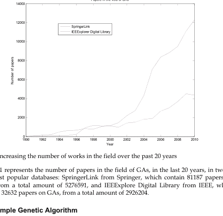

图 1. 过去 20 年来该领域论文数量的增长

图 1 表示了过去 20 年来 GA 领域论文数量在两个最受欢迎的数据库中的情况：Springer 的 SpringerLink，其中包含 81187 篇关于 GAs 的论文，占总数的 5276391 篇；IEEE 的 IEEE Xplore 数字图书馆，其中包含 32632 篇关于 GAs 的论文，占总数的 2926204 篇。

## 3. 一个简单的遗传算法

所有优化问题的解的集合构成了搜索空间。问题在于从所有可能的解中找到最合适的解。当搜索空间变得巨大时，我们需要一种特定的技术来找到最优解。GAs 提供了其中一种方法。实际上它们的工作方式都非常相似，将简单的遗传学适应于算法机制。GA 处理一组可能的解。每个解都通过染色体表示，这只是一个抽象表示。

将所有可能的解编码到染色体中是 GA 的第一部分，但也绝不是最直接的部分。还需要确定一组繁殖算子。繁殖算子直接应用于染色体，并用于通过使用适应度函数（通常是最适应者，以一定的可能性）进行选择、重组（交叉）和变异以及对问题的解进行操作。“适当的表示和繁殖算子确实是决定性的，因为 GA 的行为极其依赖于它。经常很难找到一种尊重搜索空间结构并根据问题的属性具有一致性和相关性的繁殖算子的表示”（Sivanandam & Deepa, 2008）。


一旦种群出现改进，它就会再次下降”（Sivanandam & Deepa, 2008）。

快速混乱遗传算法（FmGA）是一种二元、随机、可变串长、基于种群的求解优化问题的方法。FmGA 与其他遗传方法的主要区别在于 FmGA 能够显式操作遗传物质的构建块（BBs），以获得良好的解并可能获得全局最优解。一些工作，如（Haupt & Haupt, 2004），仅使用混乱遗传算法（mGAs）这一术语。

最后，独立采样遗传算法（ISGAs）是更鲁棒的 GAs，它们操作构建块以避免 GA 中的过早收敛。隐式并行性和交叉的有效性得到增强，并且 ISGAs 已被证明优于几种不同的 GAs（Sivanandam & Deepa, 2008）。其他高效 GAs 的类别可针对不同的特定应用实现。

## 5. 遗传算法的应用

“GAs 已应用于科学、工程、商业和社会科学。已有许多科学家使用遗传算法解决了许多工程问题。GA 概念可应用于诸如燃气管道系统优化等工程问题。另一个重要的当前领域是结构优化。该问题的主要目标是在每个构件的最大和最小应力约束下最小化结构的重量。GA 也用于医学成像系统。GA 用于执行图像配准，作为更大规模数字减影血管造影的一部分。可以发现 GAs 可用于广泛的应用范围”（Sivanandam & Deepa, 2008）。GAs 还可应用于生产计划、空中交通问题、汽车、信号处理、通信网络、环境工程等。在（Bentley & Corne, 2002）中，讨论了进化创造力，使用了大量来自音乐、一般艺术、建筑和工程设计的例子。进化电子学，无论是模拟还是数字，都已在许多出版物中得到研究（Bentley & Corne, 2002; Popa, 2004; Popa et al., 2005）。（Higuchi et al., 2006）是关于可进化硬件的非常好的书籍。

可进化硬件（EHW）是基于软件可重构可编程逻辑器件（PLDs）构建的硬件。在这些电路中，逻辑设计被编译成二进制位串，通过改变位，可以即时实现任意硬件结构。关键思想是将这样的位串视为遗传算法（GA）的染色体。通过遗传学习，EHW 找到最佳位串并根据环境收到的奖励重新配置自身（Iba et al., 1996）。

在本节的其余部分，我们介绍了作者使用 GAs 开发的数字电路进化设计中的三个应用。其中第一个描述了使用标准 GA 在复杂可编程逻辑器件（CPLD）中综合有限状态机（FSM）的方法。其他两个应用使用标准 GA 的不同混合技术：第一个与另外两种优化技术（归纳搜索和模拟退火）结合，以解决数字电路的自动测试模式生成问题，该问题描述于（Bilchev & Parmee, 1996），第二个使用量子计算的新范式（Han & Kim, 2002）来改进标准 GA 在数字电路进化设计中的收敛性。

### 5.1 使用标准 GA 实现 FSM

这个第一个例子使用外在硬件进化，即使用硬件模型并通过软件仿真对其进行评估。图 3 中表示的 FSM 是两台计算机之间串行通信的计算机接口。从一个状态到另一个状态的转换仅取决于 4 个输入 x_i 中的一个，i=1..4。该电路有 4 个输出，每个输出仅在一个状态下为逻辑 1。FSM 有 6 个状态，并在（Popa, 2004）中介绍过。

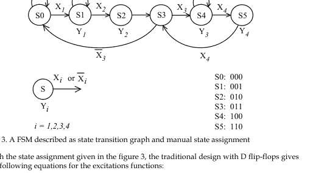

Fig. 3. 用状态转换图和手动状态分配描述的 FSM

根据图 3 给出的状态分配，采用 D 触发器的传统设计给出激励函数的以下方程：

```
D2 = x3 · Q1 · Q0 + Q1 · Q0̅ + Q1̅ · Q0̅
D1 = x2 · Q1̅ · Q0 + x1 · Q0 + Q1 · Q0̅
D0 = x1 · Q0̅ · Q0̅ + x2 · Q1 · Q0 + Q1 · Q0̅
```

输出函数由以下方程给出：

```
y1 = Q1̅ · Q0
y2 = Q2̅ · Q1 · Q0̅
y3 = Q2 · Q1̅
y4 = Q2 · Q1
```

对于该电路的进化设计，我们考虑到每个布尔函数最多有 5 个输入和最多 4 个最小项。如果我们想在 PLD 结构（AND 数组和可配置为 OR 门的逻辑单元）中实现这些函数，则熔丝阵列链接的数量为 2·5·4=40，我们可以将该数字视为染色体的总长度（Iba et al., 1996）。

我们的 GA 是标准的，种群大小为 30 条染色体。一点交叉以 80% 的概率执行，变异率为 2%。每代替换 6 条较差的染色体。停止标准是世代数。

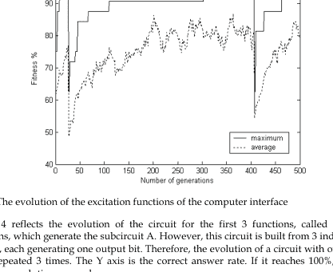

Fig. 4. 计算机接口激励函数的演化

图 4 反映了用于生成子电路 A 的前 3 个函数（称为激励函数）的电路演化。然而，该电路由 3 个独立电路构建，每个电路生成一个输出位。因此，具有一个输出位的电路的演化重复 3 次。Y 轴为正确回答率。如果达到 100%，则硬件进化成功。

同样，图 5 反映了用于生成子电路 B 的输出函数的电路演化。演化在更少的世代数后成功，因为在这种情况下总搜索空间远低于前一种情况（所有输出函数只有 3 个变量）。

进化可能为这些布尔函数提供一些非最小表达式，但对于 PLD 实现来说最小化不是必要的。染色体的长度大于最优长度，进化后的方程比给定的方程（1-7）复杂得多。整个组合电路的完整成本为传统设计 15 个门和 37 个输入，进化设计 30 个门和 102 个输入。


Fig. 5. 计算机接口输出函数的演化

我们已使用 Xilinx ISE 6.1i 软件在真实的 Xilinx XCR3064 CoolRunner CPLD 中实现了传统设计和进化电路。在传统设计中，即使用方程（1-7），FSM 仅使用了 64 个宏单元中的 7 个宏单元，224 个乘积项中的 11 个乘积项，以及 160 个函数块输入中的 7 个函数块输入。令人惊讶的是，尽管进化设计在相同的状态分配下提供了更复杂的方程，但在 XCR3064XL CPLD 中实现该电路也使用了 64 个宏单元中的 7 个，224 个乘积项中的 10 个，以及 160 个函数块输入中的 7 个。这甚至比前一种情况更好，因为乘积项的数量少了 1。两种实现都使用了相同数量的触发器（即 3/64）以及相同数量用作输入/输出的引脚（即 9/32）。我们保留了 FSM 的状态分配，子电路 A 和 B 实际上是纯组合电路。有趣的是，我们的 GA 提供的解决方案比 CAD 软件为此目的使用的最小化工具给出的解决方案更好。

### 5.2 GA 的多重混合

混合遗传算法（HGAs）将 GA 的强大功能与局部优化器的速度相结合。通常 GA 找到最优区域，然后局部优化器接管以找到最小值。（Bilchev & Parmee, 1996）开发了一种搜索空间缩减方法，称为归纳搜索。全局优化问题被划分为一系列子问题，这些子问题通过在维度较小的子空间中搜索部分解来解决。

该方法已用于解决可编程逻辑阵列（PLAs）中的自动测试模式生成问题，即找到一组有效的输入测试向量，

这些测试向量能够覆盖电路中尽可能多的故障（我们考虑了两种PLA结构，其可能的“固定为0”故障总数分别为50个和200个）。

(Wong & Wong, 1994)设计了一种以模拟退火算法作为局部优化器的HGA。模拟退火中的优化过程本质上是对熔融粒子退火过程的模拟。从高温开始，熔融粒子被缓慢冷却。随着温度降低，粒子的能级也降低。当温度足够低时，熔融粒子凝固。与物理退火过程中的温度水平相对应的是模拟退火中的迭代次数。在每次迭代中，生成一个候选解。如果该解更优，则接受它，并用它生成另一个候选解。如果该解变差，则以一定概率接受该解。

上述两种混合方法各有优点。每个归纳步骤中的归纳搜索工作量控制着

```
    Procedure MHGA
    begin
        Initialize a partial solution for N = 1 and establish the initial temperature T_0;
        for k = 2 to N_p,
            Generate randomly the initial population of chromosomes;
            repeat
                append each chromosome to the partial solution, and evaluate it;
                repeat
                    select, proportional with fitness, 2 parents;
                    apply crossover to obtain 2 offsprings;
                    apply mutation to the new chromosomes;
                    calculate the fitness of new chromosomes;
                    the new chromosomes are accepted or not accepted;
                until  end of the number of chromosomes
                update the population, according with the fitness;
                the temperature is decreased;
            until end of the number of generations
            Update the partial solution;
        end
    end
```

图 6. MHGA的结构

计算复杂度和预期结果质量之间的权衡，而模拟退火可避免早熟收敛，并减少变异操作的不利影响。在(Popa et al., 2002)中，我们提出了一种HGA，通过对遗传算法进行双重混合——一方面与归纳搜索混合，另一方面与模拟退火技术混合——将所有这些优点集中到单一算法中。多重混合遗传算法的结构如图6所示。

我们使用上述三种HGA进行了实验，目的是在有限数量的测试向量下找到最大故障覆盖率。我们首先测试了一种具有50个潜在“固定为0”故障的PLA结构，仅使用6个测试向量来考虑对这些故障的最大覆盖，结果见图7。然后，我们对一种更复杂的、具有200个潜在“固定为0”故障的PLA结构重复了相同算法，并尝试用24个测试向量覆盖尽可能多的故障。这三种算法的演化过程见图8。


图 7. 用三种HGA在500次迭代中求解50个可能故障的故障覆盖问题

如果n是已覆盖故障数，N是故障总体中的所有故障数，则相关的适应度函数为 f = n/N · 100%。还可能存在一些关于输入信号可能组合的约束。电路设计者根据若干通道的合法状态定义合法组合集合。所有合法模板的集合定义了可行域。这些算法中使用的主要遗传参数为：种群规模为20条染色体，均匀交叉率为100%，均匀变异率为1%。经过500次迭代，多重混合遗传算法达到的最大故障覆盖率约为69%，而两种单一混合遗传算法中表现最好的归纳遗传算法达到的最大故障覆盖率约为66%。这些结果是连续5次运行的平均值。我们甚至尝试了10次或更多次运行，但结果基本一致。

另一组实验是在一种具有200个可能故障的更复杂的PLA型数字结构上进行的。图8展示了三种HGA在该故障覆盖问题上的性能比较。输入测试向量数为24。在250次适应度函数调用之后，即25次迭代（每个归纳步骤包含10代），多重混合遗传算法的故障覆盖率比归纳遗传算法约高1%。


图 8. 用三种HGA求解200个可能故障的故障覆盖问题

这些实验表明，所提出的MHGA似乎比另外两种HGA——归纳遗传算法和由模拟退火混合的遗传算法——具有更好的性能。我们在两个复杂度不同的示例上证明，在PLA型数字电路的自动测试模式生成问题中，MHGA能提供最高的故障覆盖率。

## 5.3 用于 EHW 的量子启发式遗传算法

(Popa et al., 2010)中提出的量子启发式遗传算法（QIGA）使用单条染色体，该染色体表示为一串量子位，如(Han & Kim, 2002; Zhou & Sun, 2005)所述。包含n个量子位的量子染色体可表示为：

$$q = \begin{bmatrix} \alpha_1 & \alpha_2 & \dots & \alpha_n \\ \beta_1 & \beta_2 & \dots & \beta_n \end{bmatrix}^T \tag{8}$$

其中，对于 $i=1,\dots,n$，每一对 $\alpha_i$、$\beta_i$ 分别是与 $|0\rangle$ 态和 $|1\rangle$ 态相关的概率幅，满足 $\alpha_i^2 + \beta_i^2 = 1$，且 $\alpha_i^2$ 和 $\beta_i^2$ 的值表示测量该量子位时看到传统基因0或1的概率。

量子染色体可以同时处于全部 $2^n$ 个状态，即：

$$|q\rangle = a_0|00\dots0\rangle + a_1|00\dots1\rangle + \dots + a_{2^n-1}|11\dots1\rangle \tag{9}$$

其中 $a_i$ 表示量子概率幅，$a_i^2$ 是从全部 $2^n$ 个可能的经典染色体中看到第 $i$ 条染色体的概率 (Zhou & Sun, 2005)。

由于量子染色体中存在这种状态叠加，我们在种群中使用单条染色体。在传统遗传算法（CGA）或具有图2所示结构的简单遗传算法中，种群总是包含一定数量的染色体，而算法的效率通常取决于种群规模。但一条量子染色体可以同时表示所有可能的传统染色体，因此它可以在每一代生成任意规模的传统染色体种群。在评估适应度时，量子种群将被转换为传统种群。

(Zhou & Sun, 2005)中描述了单染色体量子遗传算法（SCQGA）。第一步，使用式(8)生成一条量子染色体。将随机数与每个量子位的概率进行比较，它坍缩为0或1。重复此过程N次，即可得到由N条染色体组成的传统种群。下一步，计算每条传统染色体的适应度值。这需要大量时间，从而影响算法的速度性能。在CGA中同样存在适应度评估问题和算法速度低的问题。

我们在QIGA中实现的想法是：每一代都启动量子染色体的坍缩，但偶尔生成整个传统染色体种群，而在其余迭代中只生成单条传统染色体。我们称之为坍缩概率的新参数确定了进化过程中生成传统种群的比率。该算法的最后一个重要步骤是建立一种将量子染色体从当前代更新到下一代的方法。QIGA使用(Han, 2003)中描述的相同方法。其思想是利用量子旋转门修改量子染色体中每个量子基因（或量子位）的概率。该算子通过将量子相位 θ 改变为 θ + Δθ 来改变概率幅。构造旋转门的思想是使整个种群（量子染色体）朝着最优个体的方向变化。将最优传统染色体中的每一位与量子染色体平均版本中的对应位进行比较（该版本对每个量子位使用0.5的概率构建）。如果这两位同为0或同为1，则 Δθ = 0。如果最优染色体的位为1而另一位为0，则 Δθ = α，否则 Δθ = -α。旋转门的角度参数 Δθ 可以为0、-α或α，具体取决于每个量子位在染色体中的位置。参数 α 是一个正的小参数，决定演化速率 (Zhou & Sun, 2005)。

QIGA的基本结构如图9所示，q(t)是第t次迭代中的量子染色体，P(t)是同一次迭代t中的种群。该种群可能包含多条染色体，也可能只包含一条，具体取决于q(t)中的坍缩概率。这三种算法——CGA、SCQGA和QIGA——已在同一问题上进行了比较，该问题涉及使用不同逻辑门综合一个4变量布尔函数。染色体定义网络中门电路初级输入与初级输出之间的连接，并决定门电路的逻辑运算符。CGA的种群有64条染色体，其中每代有20条发生改变，遗传算子采用100%的单点交叉和5%的变异率。

图10展示了三种算法在300代上成功运行10次后的平均演化情况。一次成功运行假定适应度评估达到100%，


图 10. CGA、SCQGA 和 QIGA 的演化

| 参数 | CGA | SCQGA | QIGA |
|---|---|---|---|
| 全局时间 | 73.990 s | 38.599 s | 19.263 s |
| 自身时间 | 2.447 s | 1.417 s | 1.390 s |
| 评估时间 | 59.561 s | 31.536 s | 11.750 s |
| 评估函数调用次数 | 25200 | 19200 | 4836 |
| 评估与全局时间之比 | 80.5 % | 81.7 % | 60.9 % |
| 代数 | 300 | 300 | 300 |
| 10 次尝试中成功运行次数（适应度为 100%） | 7 | 6 | 6 |

表 1. CGA、SCQGA 与 QIGA 的比较

不幸的是，在 300 代中成功运行的次数仅约为 CGA 的 70%，其余两种算法约为 60%。这是由于存在一个约束，即仅接受适应度评估为 100% 的结果。在其他应用中，这一约束可能并不关键。

## 6. 结论

在本章中我们对 GAs 进行了总结概述并讨论了一些可能的应用程序。我们提出了三种使用 GAs 在门级对数字电路进行的外在进化设计。

该领域仍需进行未来研究。首先重要的是找到染色体中电路的更好表示，因为复杂函数需要大量架构位，这直接影响 GA 搜索空间。EHW 仅在适应度达到 100% 时才成功，而在巨大的搜索空间中，这一条件可能并不总是可能实现。这就是目前所进化电路的复杂性仍然很小的<|message|> 主要原因。在我们看来，论文（Yao & Higuchi, 1999）中得出的结论仍然有效：“EHW 研究需要解决诸如可扩展性、在线适应、泛化、电路正确性以及在真实物理环境中进化硬件的潜在风险等问题。有人认为，在仓促进行大规模 EHW 实现之前，应建立 EHW 的理论基础”。

最近出现了将 GA 与量子计算元素进行杂交的想法（Han & Kim, 2002; Han, 2003）。我们提出了一种新的量子启发式遗传算法（QIGA），其速度明显快于其他类似算法，其基于引入一个新参数的思想，我们称之为坍缩概率，并使量子染色体发生坍缩，以便不像通常那样每代都生成，而是时不时地生成常规染色体种群。我们相信，通过建立从当前代到下一代更新量子染色体的新方法，未来研究中可以找到该方法的一些改进。最后，一些杂交技术可能对新的量子启发式进化算法有用。（Rubinstein, 2001）使用遗传编程演化具有各种属性的量子电路，而（Moore & Venayagamoorthy, 2005）已开发出一种受量子进化与粒子群启发的算法来演化常规组合逻辑电路。

## 7. 参考文献

- Bentley, P. J. & Corne, D. W. (Ed(s).). (2002). 创造性进化系统, Academic Press, ISBN: 1-55860-673-4, San Francisco, USA
- Bilchev, G. & Parmee, I. (1996). 约束处理用于故障覆盖代码生成问题：一种归纳进化方法, 第四届并行自然问题求解会议论文集 (PPSN IV), pp. 880-889, Berlin, September 1996
- Burda, I. (2005). 量子计算导论, Universal Publishers, ISBN: 1-58112-466-X, Boca Raton, Florida, USA
- Forbes, N. (2005). 生命的模仿：生物学如何启发计算, MIT Press, ISBN: 0-262-06241-0, London, England
- Han, K. H. & Kim, J. H. (2002). 一类组合优化的量子启发式进化算法, IEEE 进化计算汇刊, vol.6, no.6, (December 2002), pp. 580-593, ISSN 1089-778X
- Han, K. H. (2003). 量子启发式进化算法, 博士论文, Department of Electrical Engineering and Computer Science, Korea Advanced Institute of Science and Technology, Korea, 2003
- Haupt, R. L. & Haupt, S. E. (2004). 实用遗传算法（第二版）, Wiley-Interscience, ISBN: 0-471-45565-2, New-Jersey, USA
- Higuchi, T.; Liu, Y. & Yao, X. (Ed(s).). (2006). 可进化硬件, Springer-Verlag, ISBN-13: 978-0387-24386-3, New-York, USA
- Iba, H.; Iwata, M. and Higuchi, T. (1996). 机器学习方法在门级可进化硬件中的应用. 第一届可进化系统国际会议论文集 ICES'96, pp.327-343, Tsukuba, Japan, October 1996
- Mazumder, P. & Rudnick, E. M. (1999). VLSI 设计、布局与测试自动化的遗传算法, Prentice Hall PTR, ISBN: 0-13-011566-5, Upper Saddle River, New Jersey, USA
- Michalewicz, Z. (1996). 遗传算法 + 数据结构 = 进化程序（第三版）, Springer-Verlag, ISBN: 3-540-58090-5, New-York, USA
- Mitchell, M. (1997). 遗传算法导论（第三次印刷）, MIT Press, ISBN: 0-262-13316-4, London, England
- Moore, Ph. & Venayagamoorthy, G. K. (2005). 使用混合量子进化与粒子群启发算法演化组合逻辑电路, 2005 年 NASA/DoD 可进化硬件会议论文集 EH'05, pp. 97-102, 2005
- Popa, R.; Aiordachioaie, D. & Nicolau, V. (2002). 遗传算法中的多重杂交, 第十六届欧洲控制论与系统研究会议 EMCSR'2002, pp.536-541, ISBN 3-85206-160-1, Vienna, Austria, April 2-5, 2002
- Popa, R. (2004). Xilinx XC3R3064 CPLD 中的可进化硬件, IFAC 可编程器件与系统研讨会，PDS 2004, pp. 232-237, ISBN: 83-908409-8-7, Cracow, Poland, November 18-19, 2004
- Popa, R.; Aiordachioaie, D. & Sirbu, G. (2005). Xilinx Spartan 3 FPGA 中的可进化硬件, 2005 WSEAS 动力系统与控制国际会议, pp. 66-71, ISBN 960-8457-37-8, Venice, Italy, November 2-4, 2005
- Popa, R.; Nicolau, V. & Epure, S. (2010). 一种用于可进化硬件的新量子启发式遗传算法, 第三届电气与电子工程国际研讨会 ISEEE 2010, pp. 64-69, ISBN: 978-1-4244-8407-2, Galati, Romania, September 16-18, 2010 (in IEEE Xplore Digital Library, DOI 10.1109/ISEEE.2010.5628539)
- Rubinstein, B. I. P. (2001). 使用遗传编程演化量子电路, 2001 年进化计算大会论文集，CEC2001, pp.114-121, IEEE Press, 2001
- Schöneburg, E.; Heinzmann, F. & Feddersen, S. (1994). 遗传算法与进化策略：模拟进化的理论与实践导论, Addison-Wesley, ISBN: 5-89319-493-2, München, Germany
- Sivanandam, S. N. & Deepa, S. N. (2008). 遗传算法导论, Springer-Verlag, ISBN: 978-3-540-73189-4, India
- Wong, K. P. & Wong, Y. W. (1994). 基于遗传算法和模拟退火的混合优化技术开发, 进化计算研讨会 (AI'94), pp. 127-154, Armadale, Australia, November 1994
- Yao, X. & Higuchi, T. (1999). 可进化硬件的机遇与挑战, IEEE 系统、人与控制论汇刊 – C 部分：应用与综述, 进化计算, vol.29, no.1, (February 1999), pp. 87-97, ISSN 1094-6977
- Zhou, S. & Sun, Z. (2005). 属于 EDA 的一种新方法：仅有一个染色体的量子启发式遗传算法, 自然计算国际会议，ICNC2005, pp. 141-150, LNCS 3612, Springer-Verlag, 2005

## Part 2

### 遗传算法的新应用

## 调整遗传算法以分组文献集合

José Luis Castillo Sequera
阿尔卡拉大学，计算机科学系，马德里
西班牙

### 1. 引言

工业和科学领域都存在一些关于难以优化的实际问题，其特征是计算复杂性，因为现有的精确算法效率低下或根本无法实现。元启发式（MHs）是一类通用近似方法家族，由迭代过程组成，引导启发式，智能地结合不同概念以适当探索和利用搜索空间[12]。因此，在设计 MHs 时有两个重要因素：intensification 和 diversification。diversification 通常指的是访问搜索空间中许多不同区域的能力，而 intensification 指的是在这些区域中获得高质量解的能力。搜索算法必须在这两个因素之间取得平衡，才能成功解决所处理的问题。

另一方面，信息检索（IR）可以定义为通过存储机制响应用户查询来选择信息的问题[3]。信息检索系统（IRS）是一类信息系统，处理由文档组成的数据库，并通过在适当的时间间隔内允许访问相关信息来处理用户的查询。理论上，文档是一组文本数据，但技术发展导致了多媒体文档的 proliferate[4]。

遗传算法（GAs）受自然生物的遗传过程和种群自然进化的原理启发，源于元启发式[2]。基本思想是维持一个染色体种群，染色体代表特定问题的候选解，通过竞争和受控变异的过程随时间演化。GAs 最重要的组成部分之一是交叉算子[7]。考虑到所有 GA 都必须在 intensification 和 diversification 之间取得平衡以增强对最优解的搜索，交叉算子通常被视为改善局部最优 intensification 的关键部分。此外，通过进化过程，由于某些进化因素，染色体有时会发生改变（突变），突变算子是确保 diversification 并找到最优可行区域的关键因素。

高效分配 GA 参数可优化解的质量和算法所需的资源[13]。这样，我们可以获得强大的搜索

算法和领域无关，可应用于广泛的学习任务。在信息检索（IR）领域众多可能的應用之一可能是解决信息检索系统（IRS）面临的一个基本问题：需要找到最能描述文档的组，并允许彼此根据亲和力对所有文档进行归类。出现的问题在于难以找到最能描述一篇文档的组，因为它们并不针对单一议题，即使针对了，话题的处理方式也可能使其适合另一组。因此，该任务复杂且主观，两个人很容易使用有效标准将同一文档分配到不同的组中。

聚类是数据挖掘和知识发现中的重要工具，因为能够自动将相似项分组的能力使人能够发现隐藏的相似性和关键概念 [10]。这使用户能够理解大量数据。一个例子是搜索万维网，因为它是各种信息的大型存储库，许多搜索引擎允许用户查询网络，通常通过关键词搜索。然而，典型的关键词搜索会返回大量网页，使用户难以理解结果并找到真正需要的信息。文档聚类面临的一个挑战是许多文档包含多个主题。

本文提出了一种应用于文档领域的遗传算法（GA），该算法通过优化其参数实现自我改进，在无监督文档聚类中提供强化与多样性之间的平衡，确保可接受的最优适应度。

## 2. 文献基础

本研究使用了两个集合，“Reuters 21578” 集合和一个西班牙语文献库，其中包含 2006 年和 2007 年《El Mundo》社论的开放获取格式。

路透社文献库由 1987 年出现在路透社的真实新闻稿组成，该集合正成为文档自动分类领域内的标准，并被该领域许多作者使用。该集合由分布在 22 个文件中的 21578 份文档组成。我们开发了一种名为 NZIPF [6] [11] 的文献处理过程，以生成为系统提供文档向量。

文献处理过程包括多个文档处理阶段，每个阶段代表在基础文档上开发的处理过程，以更有效地获得文献向量。

第一步是所谓的过滤过程，其主要目标是定义文献库的文档，目的是拥有属于单一类别的文档，这将允许在文档处理中具有更小的复杂性。然后，对文档进行分区的过程的目的是获得每个文档的自由文本。接下来，我们使用停用词表过程，我们提取文档文本的术语，其中每个提取的词都将与空词列表进行比较，该列表将消除没有兴趣或缺乏自身意义的词。然后，词可以经历词根切除过程“词干提取”，在我们的案例中，我们实现了并使用了英语的 Porter 算法和西班牙语的另一种算法。在此步骤中，计算所获得术语的频率，针对我们文献库的所有文档，以便能够知道哪些术语在每份文档中更常用；然后利用这些信息进行选择那些更具代表性的术语的过程。下一步将包括选择具有更大判别力的术语以进行其规范化。我们应用齐普夫定律，计算戈夫曼点 [3] 和过渡区域，它使我们能够获得文献库的术语。最后，我们使用 Salton [4] 开发的 IDF（逆文档频率）函数分配权重，该函数使用文档中词的频率。经过所有这些处理后，我们获得了文档集合中文档的特征向量。

该过程在图 1 中概述。


图 1. 进行的文献处理过程

另一方面，在测试环境中应该有一个用户提供需要分组的文档。提供文档的用户角色将由“非常少（20）、少（50）、多（80）和足够（150）”份文档的样本表示，要求它们仅属于路透社的两个类别或由其特征向量词干提取器表示的西班牙语社论分布。图 2 显示了我们用于实验的文献环境 [10]，需要注意的是，与监督型算法不同，后者需要知道获得组的数量，我们的算法将演化以找到最合适的结构，自己形成组。

由于遗传算法模拟的性质，其演化是伪随机的，这转化为需要使用不同种子进行多次运行以达到最优解的需要。种子的生成是根据系统时间进行的。因此，使用遗传算法的实验是通过对从实验集合 [1] 中取出的每个样本进行五次执行来进行的。实验结果将是获得的最佳适应度和其收敛性。为了衡量算法的质量，必须分析获得的最佳解决方案和遗传算法五次运行的平均值。


图 2. 使用遗传算法进行测试的实验环境。

## 3. 文档聚类的遗传算法

### 3.1 个体

种群由一组个体组成，其中每个个体由线性染色体构成，该染色体通过树结构（层次结构）表示。个体应形成在顶部准备好的二叉树结构 *聚类所有文档* 上，其中每个文档由 *特征向量* 组成。向量将由所选词干术语频率的加权值组成，以实现文档处理方案 [4]。这种表示将被尝试演化，以便染色体经历遗传变化并找到对 IRS 所有文档更合适的组 'Clusters'。在根节点中我们将拥有我们的适应度函数 (*适应度*)，它衡量 resulting 聚类的质量。根据需要处理的文档数量和要创建的树的深度（高度），染色体可能具有可变长度。

图 3 显示了初始世代（0），采用基于树的表示方案，以便在染色体内编码足够复杂的逻辑结构。遗传算法的搜索区域是可生成的全部相关函数和终端所产生的全部可能树的空间。这样我们可以演化各种形状和大小的个体 [8]，允许演化决定最佳设置。

尽管初始种群是随机的，但有一组定义的参数控制着此类个体的建立。例如，*初始集合中不应创建两个相同的个体*，为此，创建了生产规则以确保符合此条件。上述规则要求每个个体节点的构建语法以先序方式进行。


图 3. 遗传算法个体的初始种群（世代“0”）

### 3.2 生产算子

生产算子应用于每一代。新一代的新个体可以通过应用算子施加的变换从一个或两个个体中产生。突变算子和交叉算子将无差别地实现。两个算子都依赖于分配给遗传算法的突变概率和/或交叉 [7]。

*突变算子应用于节点（文档），使用锦标赛方法从种群中选择一个个体，然后随机选择该个体的一个终端节点对来突变其终端节点，生成一个新的个体，将所选节点进行转置（见图 4）。*


图 4. 应用于终端的基本突变算子


对于交叉算子，采用基于掩码交叉 [9] 的算子，该算子通过锦标赛方法选择两个父个体，随机选择一个父个体的染色体用作“所选个体的交叉掩码”。交叉是通过分析两个父个体的染色体来完成的。如果两个染色体至少有一个函数节点（节点 0），则放置所选的父掩码，但如果我们在两个父个体的染色体中发现文档，则会选择“未当选”的父文档，并将其用作父“当选”（掩码）上的枢轴，以进行与所述父相对应的交叉，同时交换所述父的染色体。这会产生一个新个体，并确保在给定的染色体集合中具有父母相同的结构特征，但我们只有在子代的适应度优于其父母时才将其纳入种群（见图 5）。


图 5. 交叉算子（交叉掩码）

## 3.3 选择

在评估种群适应度之后，下一步是染色体选择。选择体现了“适者生存”原则 [5]。满足适应度的染色体被选中进行繁殖，为此，我们采用锦标赛选择方法，使用规模为 2 的锦标赛，并在每一代中应用精英主义 [2]。

## 4. 参数控制

就其规模而言，以及在实验过程中微小变化对 GA 行为的影响 [1]，所要使用的参数值的选择显得是一个关键因素。在选择它们时，我们关注当其中任何一个值发生变化时 GA 性能指标的变化，特别是成功率的演变和“适应度”的演变。因此，这些参数是非常重要的部分，因为它们直接影响 GA 的性能 [13]。这些参数可以独立处理，但算法的整体性能并不完全取决于单一参数，而是取决于所有参数的组合。许多研究人员对某些参数比其他参数更关注，但大多数人都同意应受控制的参数是：选择方案、种群大小、遗传变异算子及其变化率。

由于 GA 有多个参数必须仔细选择以获得良好的性能并避免过早收敛，在我们的案例中，经过大量测试后，我们选择了参数控制，以及一些策略，例如：

为控制种群大小，我们使用 Michalewicz [9] 提出的称为 GAVAPS（种群大小的遗传变异）的策略，使用年龄和寿命的概念。在创建第一代时，所有个体都被赋予零年龄，指个体的出生，每当新一代诞生时，每个个体的年龄增加一。同时个体出生时，会分配一个寿命，表示它将在内部存活多久。因此，个体将在达到给定年龄时死亡。每个个体的寿命取决于其适应度值与整个种群平均值的比较。因此，如果个体具有更好的适应度，它将有更长的时间存活，使其具有更大的能力生成具有其特征的新个体。在我们的案例中，我们允许每一代使用此策略生成具有相似特征的新个体。

因此，我们基本上对每一代的最佳个体采用这种方法，并将其应用于在后续世代中保持精英主义，从而确保对可用空间的最佳强化，同时在它们寿命期间保留它们 [9]。然而，为了确保多样性，我们在每一代中随机生成剩余的个体。这样，我们可以探索搜索空间的许多不同区域，并在可行区域的强化与多样性之间实现平衡。

在所有情况下，种群大小已设置为 50 个个体，用于按照 [1] 的建议进行的实验，该建议建议在大多数实际应用中以介于 l 和 2l 之间的种群大小工作（染色体长度 l）。在我们的案例中，“l”，我们的染色体长度，始终等于：

2 * number of documents to cluster -1.

另一方面，我们使用两个适应度函数的度量来计算文档之间的距离和相似度，以便形成更好的聚类（见表 1）。

表 1. 函数的度量

| 度量 | 公式 |
|---|---|
| 欧几里得距离 | $d_y = \sqrt{\sum_{i=1}^n (x_i - x_j)^2}$ |
| 皮尔逊相关系数（相似度） | $r = \frac{1}{n} \sum \left( \frac{x_i - \bar{x}}{\sigma_{x_i}} \right) \left( \frac{x_j - \bar{x}}{\sigma_{x_j}} \right)$ |
| 全局适应度 | $\min \left( \alpha \, \text{Distance(Documents } i) + (1 - \alpha) \left(1 / \text{Similarity(Documents } i)\right) \right)$ |

其中 $x_i$ 和 $x_j$ 是我们正在分组的文档的特征向量，“μ”是示例的数量，$\sigma_i$、$\sigma_j$ 是 $x_i$ 和 $x_j$ 的标准差，其中：α 是调整距离和相似度的参数。适应度函数用于最小化文档之间的距离并最大化它们之间的相似度。

因此，对于我们实验环境的实验，我们使用了文档样本“非常少（20）、少（50）、多（80）和足够（150）”个文档，要求它们仅属于 Reuters 语料库的两个类别或社论。每個样本都用五个不同的种子处理，并且每个结果都与“K-means”方法进行比较。然后，每个实验都通过改变遗传算法算子的概率率重复，使用表 2 中显示的所有参数，直到找到最适合我们适应度函数中组合的两个指标的 α 值。

表 2. 考虑用于复合函数的遗传算法的参数

| 参数 | 值 |
|---|---|
| 种群大小（树数量） | 50 |
| 评估次数（代数） | 5000 maximum |
| 锦标赛大小 | 2 |
| 变异概率 (Pm) | 0.01, 0.03, 0.05, 0.07, 0.1, 0.3, 0.5, 0.7 |
| 交叉概率 (Pc) | 0.70, 0.75, 0.80, 0.85, 0.90, 0.95 |
| 文档数量 | 非常少, 少, 多, 足够 |
| α 系数 | 0.85 (best value found) |
| 深度阈值 | 7/10 |

### 4.1 研究确定 GA 中 α 的值

我们使用 Reuters 21 分布，因为它在文档之间具有更大的离散度，并应用 GA 在每次测试中改变 α 的值，使用常规参数，始终试图测试 GA 的有效性。我们使用表 2 中的值分析了适应度与 α 值之间的关系（结果显示在表 3 和图 6 中）。

在图 6 中，我们可以看到适应度值在 0.85 以上存在更大的离散度，这是由于欧几里得距离贡献增加所致，这使得适应度对寻找聚类不敏感。结果表明，α 值接近 0.85 可提供更好的结果，因为它在命中次数方面为我们提供了更高的有效性，并且算法具有更好的适应度。这已通过其他分布得到证实。

表 3. 使用 GA 进行的测试结果，采用 Reuters 语料库分布 21 的不同文档样本，以确定 α 的最佳值

| 文档 | α | 代数 | 最佳适应度 | 平均中值适应度 | 命中次数 | 有效性 (%) |
|---|---|---|---|---|---|---|
| 20 | 0.75 | 1436 | 0.25291551 | 0.46849675 | 15 | 75.0 |
| 20 | 0.80 | 1592 | 0.20298477 | 0.47206890 | 16 | 80.0 |
| 20 | 0.85 | 2050 | 0.15255487 | 0.24504483 | 17 | 85.0 |
| 20 | 0.90 | 3694 | 0.15266796 | 0.25909582 | 17 | 85.0 |
| 20 | 0.95 | 1520 | 0.15319261 | 0.24568629 | 17 | 85.0 |
| 50 | 0.75 | 3476 | 0.25290429 | 0.28744261 | 35 | 70.0 |
| 50 | 0.80 | 3492 | 0.20285265 | 0.27862528 | 36 | 72.0 |
| 50 | 0.85 | 3355 | 0.15312467 | 0.29128428 | 36 | 72.0 |
| 50 | 0.90 | 2256 | 0.15318358 | 0.2837470 | 36 | 72.0 |
| 50 | 0.95 | 2222 | 0.15345986 | 0.27863789 | 36 | 72.0 |
| 80 | 0.75 | 3049 | 0.25704660 | 0.3681676 | 61 | 76.2 |
| 80 | 0.80 | 1371 | 0.20782096 | 0.3303315 | 61 | 76.2 |
| 80 | 0.85 | 2131 | 0.15784449 | 0.3447947 | 62 | 77.5 |
| 80 | 0.90 | 1649 | 0.15815252 | 0.32398087 | 62 | 77.5 |
| 80 | 0.95 | 2986 | 0.17796620 | 0.36008861 | 61 | 76.2 |
| 150 | 0.75 | 2279 | 0.26194273 | 0.29866150 | 91 | 60.6 |
| 150 | 0.80 | 1273 | 0.20636391 | 0.2293754 | 93 | 62.0 |
| 150 | 0.85 | 3257 | 0.15468809 | 0.27518240 | 94 | 62.6 |
| 150 | 0.90 | 1136 | 0.25482251 | 0.28218144 | 94 | 62.6 |
| 150 | 0.95 | 2452 | 0.25456480 | 0.26788158 | 91 | 60.6 |
| 250 | 0.75 | 3617 | 0.25754282 | 0.31144435 | 120 | 48.0 |
| 250 | 0.80 | 3274 | 0.20844638 | 0.2511289 | 121 | 48.4 |
| 250 | 0.85 | 3066 | 0.15805103 | 0.19299910 | 121 | 48.4 |
| 250 | 0.90 | 2343 | 0.20634355 | 0.20342140 | 121 | 48.4 |
| 250 | 0.95 | 2047 | 0.25541276 | 0.27844937 | 120 | 48.0 |


图 6. 不同 Reuters 语料库文档样本的最佳适应度与 α 值的关系：分布 21


### 4.2 确定变异算子和交叉算子概率取值的测试

我们开始分析系统行为，在广泛的取值范围内改变变异算子概率，以涵盖所有可能的情况。实验过程中，我们使用了来自路透社数据集的不同样本。因此，对于变异算子概率，我们讨论了一个广泛的取值范围：0.01、0.03、0.05、0.07、0.1、0.3、0.5、0.7；这使我们能够在不同情况下应用遗传算法的变异算子并研究其行为。为了确定交叉算子概率的最优值，我们追踪了0.70到0.95的区间；这是一个较高的值，但旨在促使我们设计的算子被频繁应用，因为变异概率的最优值比交叉概率重要得多，因此我们选择在实验中对交叉比率进行更详细的研究。作为算子质量指标值，我们使用了遗传算法的命中次数。

关于锦标赛规模，我们选择了值2，因为二元锦标赛在大量进化算法的应用中表现出了非常好的性能。尽管确定最优适应度函数并非本实验的基本目标之一，但我们尝试将欧氏距离和皮尔逊相关系数（基于余弦相似度）等强大且不同的度量结果组合为一个值。

因此，为了找到控制距离与簇文档相似度倒数权重的调整系数α，我们进行了大量参数控制测试，以获得一个能让这两种度量对适应度作出适当贡献的值，最终确定了α的值为0.85。

系统设置的最大代数为5000，但该参数可能随算法的收敛情况而有所不同。至于用于表示每篇文档特征向量的词干项数量，我们使用了通过NZIPF处理方法选出的词项[6][11]。

最后，我们设定了一个称为个体（树）深度阈值的限制。该阈值在“极少和少”文档情况下取值为7，在“多和足够多”文档情况下设为10。为了分析结果并验证其有效性，我们将遗传算法的结果与文档集合中已有的真实分组进行了比较[6]，还将结果与另一种在最优条件下运行的监督式聚类算法（Kmeans）进行了比较。我们分析了以下内容：

- **聚类有效性：** 这是考虑聚类质量时最重要的结果比较指标。我们进行了分析过程，以评估遗传算法在最佳适应度下取得的成功，以及所有遗传算法执行过程中的平均得分。
- **适应度演化：** 我们进行了分析，以观察每次执行中的适应度演化，评估遗传算法在改变概率值时的行为和成功率。
- **算法收敛性：** 在此过程中，遗传算法获得最佳适应度（最佳聚类）。

由于遗传算法的参数直接影响适应度行为，在实验之前，我们对所有遗传算法的表现进行了全面分析，以确定其鲁棒性并调整各个参数。最后，我们实验性地使用了表1中讨论的参数，并分析了算法的行为。我们在图7中展示了遗传算法在20、80和150篇文档样本下，随变异率变化返回的平均命中次数，并展示了遗传算法的命中因子随变异率的变化情况。我们观察到，在变异率为0.03时获得了最佳性能；这一结果表明，使用该比率也能获得最佳的平均适应度。我们用另一个文档集合验证了这一行为。


图7. 遗传算法在20、80和150篇文档样本下随变异率变化的平均命中次数及遗传算法命中情况。

此外，我们还分析了交叉算子对最终结果的影响。图8分别显示了在极少样本（20）、多样本（80）和大量文档（150）情况下，交叉率与平均命中次数的关系。此外，还对遗传算法在改变交叉率时的成功因子进行了比较分析。这表明，无论样本如何，当交叉算子使用0.80的比率时，遗传算法表现更好。因此，如果我们最大化算法的效率，该值似乎是理想的，因此我们得出结论，该比率能为我们带来更好的结果。


图8. 遗传算法在20、80和150篇文档样本下随交叉率变化的平均命中次数及遗传算法命中情况。

为了验证遗传算法的结果，我们将其结果与Kmeans算法进行了比较。Kmeans算法使用相同的样本进行处理，并将需要获得的组数作为输入。该算法仅使用欧氏距离度量，并且作为一种监督式算法，其唯一参数调整是需要处理的组数；因此，它是在最优条件下基于Kmeans执行的。我们证明了遗传算法的平均有效性非常可接受，在大多数情况下优于Kmeans监督式算法[10]（当使用这些变异和交叉参数时），但额外优势是我们以无监督的方式处理文档，允许进化算法使用我们的调整进行聚类。因此，为了展示这种行为的细节，我们在图7和图8中以图形方式呈现，并针对本工作提出的进化算法，对我们实验中使用的每种算子类型进行了同样的比较。

然后，表4、5、6和7展示了使用最优变异和交叉参数，在主要文档集合分布Reuters 21578上获得的比较结果。

**分布21 路透社集合4 — 文档类别：Acq与Earn（最佳结果 / 最佳平均）**

| 文档样本 | 适应度 | 有效性 | 收敛 | 平均适应度 | 适应度偏差 | 平均收敛 | Kmeans |
|---|---|---|---|---|---|---|---|
| 极少文档（20篇） | 0.152048900 | 90%（18次命中） | 1163 | 0.1520609 | 0.00014601 | 1185 | 17.8 |
| 少文档（50篇） | 0.153006650 | 92%（46次命中） | 2079 | 0.15304887 | 0.0004569 | 2736 | 45.6 |
| 多文档（80篇） | 0.156029510 | 81%（65次命中） | 2787 | 0.15637693 | 0.0025014 | 2810 | 66.4 |
| 足够多文档（132篇） | 0.157012180 | 70.4%（93次命中） | 3359 | 0.15720766 | 0.0024132 | 1980 | 98.6 |

表7. 进化系统在Reuters 21578集合“分布21”下，使用各种文档样本的最佳结果和平均结果比较。

然后，结果以图形方式显示在图9中。


图9. 复合函数与Kmeans（四个路透社集合）所得结果的比较图。

最后，为了验证结果，我们将结果与另一个西班牙语集合进行了比较，该集合以相同方式处理，使用了表2中的所有值（见图10）。


图10. 复合函数与Kmeans（西班牙语集合）所得结果的比较图。

## 5. 结论

在本研究中，我们提出了遗传算法参数的一种新分类法，即数值参数和结构参数，并通过一个测试聚类问题，检验了数值参数对基于遗传算法的仿真优化应用中算法性能的影响。我们从问题域的特征开始分析。

我们问题域的主要特征如下：

- 一组决策变量相对于优化问题目标函数值具有支配地位：目标函数值与该支配变量组合的值直接相关，该值接近0.85。
- 在目标函数值方面，好的解决方案对其他解决方案具有高度支配性，但它们之间差异并不显著。

问题域的这些特性导致遗传算法表现出快速收敛的行为。根据我们的计算结果，较低的变异率能带来更好的性能。遗传算法机制在搜索空间中产生了锁定效应；因此，在特定问题域中，较低的变异率降低了过早收敛的风险，并在搜索空间中提供了多样性。由于支配性的存在，交叉算子对遗传算法的性能没有显著影响。此外，从种子化种群开始会产生更有效的结果。

我们可以得出结论，遗传算法具有有利的演化过程，在适当调整参数的基础上，以可接受且稳健的方式提供了最优的文档聚类。我们证明了遗传算法的平均有效性非常可接受，在大多数情况下优于Kmeans监督式算法，但额外优势是我们以无监督的方式处理文档，允许进化算法使用我们的调整进行聚类。实验结果表明，当变异算子使用0.03的比率、交叉算子使用0.80的比率时，我们获得了最佳性能；如果我们最大化遗传算法的效率，这些值似乎是理想的。


作为未来的研究方向，可以针对不同问题领域、采用不同结构参数设置开展相同的分析，甚至可以研究数值参数与结构参数之间的交互作用。

## 6. 参考文献

- [1] [Alander, 1992] Alander J. “论遗传算法的最优种群规模。” Proc. CompEuro 1992.
- [2] [Bäck, 1996] Bäck T. “理论与实践中的进化算法。” Oxford University Press，1996。
- [3] [Berry Michael, 2004] M. Berry，《文本挖掘综述——聚类与检索》，Springer，2004。
- [4] [Berry Michael, et al., 2008] M. Berry、Malu Castellano（编辑）：“文本挖掘综述 II”，Springer，2008。
- [5] [Castillo, Fernández, León, 2008] “基于聚类遗传的信息检索。” IADIS Data Mining，2008。
- [6] [Castillo, Fernández, León, 2009] “使用 NZIPF 进行聚类的特征降维。” IADIS e-Society 2009。
- [7] [Goldberg D., 1989] 《搜索、优化与机器学习中的遗传算法》。Addison Wesley，M.A.，1989。
- [8] [Holland J.H., 1975] 《自然与人工系统中的适应》。University of Michigan Press，Ann Arbor，1975。
- [9] [Michalewicz, 1999] Michalewicz Z. “遗传算法 + 数据结构 = 进化。” Springer，1999。
- [10] [Olson David, 2008] Olson D. “高级数据挖掘技术。” Springer，2008。ISBN: 978-3-540-76916-3。
- [11] [Pao M.L., 1976] Pao M. “基于词出现 Goffman 转移的自动标引。” 载于美国信息科学学会会议（第40届：1977：芝加哥）。《20世纪80年代的信息管理：ASIS 1977年年会论文集》，第14卷：第40届年会，芝加哥。
- [12] [Reeves C.R., 1993] 《组合问题的现代启发式技术》，Wiley，New York，1993。
- [13] [Schaffer et al., 1989] Schaffer 等。“遗传算法控制参数在函数优化中的性能研究”，1989。

## 结合遗传算法与数学决策分析的公共投资组合选择

Eduardo Fernández-González, Inés Vega-López and Jorge Navarro-Castillo

锡那罗亚自治大学  
墨西哥

### 1. 引言

公共政策分析中一个核心且常引发争议的问题是资金在相互竞争的项目之间的分配。用于资助社会项目的公共资源尤为稀缺。通常，申请的资金总额表面上远超可批准额度。此外，战略、政治和意识形态标准渗透于此类分配的行政决策中（Peterson，2005）。为满足这些规范性标准——它们或是主流公共政策的基础，或是政府意识形态的基础——显然宜根据理性原则（例如最大化社会效益）对项目进行优先级排序并构建项目组合。Fernandez 等（2009a）认为，公共项目可刻画如下：

- 它们可能无疑是有利可图的，但其收益是间接的，也许只有在长期才可见，且难以量化。
- 除了对社会福利的潜在经济贡献外，还应考虑无形收益，以全面审视其社会影响。
- 还必须考虑公平性，包括项目影响的程度以及受益个体的社会状况。

诚然，刻画“最佳公共项目组合”的主要困难在于找到一种机制来适当定义、评估和比较社会回报。无论社会回报概念的定义如何变化，我们都可以断言下述命题具有同义反复的价值。

**命题 1：** 给定两个成本与预算相近的社会项目 A 和 B，如果 A 具有更好的社会回报，则应优先选择 A 而非 B。

暂且忽略定义项目组合社会回报的困难：给定两个预算相当的项目组合 C 和 D，当且仅当 C 具有更好的社会回报时，才应优先选择 C 而非 D。因此，寻找最佳项目组合的问题可归结为找到一种评估社会项目回报的方法，或至少一种分析备选组合提案的比较方式。

考察公共政策效率影响最常用的方法是“成本-效益”分析（例如 Boardman，1996）。在这种方法下，项目的假定后果被“转换”为等价的货币单位，其中正的

受到若干作者质疑的僵化过程（例如 Gabriel 等，2006；Fernandez 等，2009a,b）。根据我们的观点，关于哪些项目应获得资助的决策必须基于最佳组合，而非最佳单个项目。因此，仅将项目相互比较是不够的。相反，比较组合至关重要。基于单个项目排名选择组合，可以保证最佳项目集合得到支持。然而，这组项目并不一定等于最佳组合。事实上，这两个集合可能不相交。在这种情况下，如果一个相对较好（就其社会影响而言）但昂贵的项目需要不成比例的资金，那么拒绝它是合理的（Fernandez 等，2009a,b）。因此，我们认为，获得最佳组合等价于求解定义在所有可行组合集合上的 Pα 问题。

Mavrotas 等（2008）认为，当组合被优化时，优质项目可能被由低成本且影响可忽略的项目组成的组合排在后面。然而，只要满足以下条件，这并非真正的缺陷。

- 每个项目单独来看都是可接受的
- 决策者能够定义其对于可行组合集合的偏好（通过使用某种质量度量，甚至凭直觉）
- 决策者偏好由更多低成本项目组成的组合。

为了求解可行组合集合上的选择问题，应处理以下问题。

- 应界定决策者的性质。必须明确该主体能够以合法方式处理社会利益问题。此外，还应回答以下问题：决策者是单个人吗？还是具有同质偏好的集体，以至于这些偏好可由决策模型捕捉？抑或是具有冲突偏好的异质群体？社会利益如何反映在决策模型中？
- 需要建立决策者（DM）对组合社会影响的偏好的可计算模型。
- 组合选择是一个具有指数复杂度的优化问题。可能的组合集合是申请资助项目的幂集。组合集合的基数为 2^N，其中 N 是项目数量。如果考虑每个项目可被赋予一个支持水平，即项目可以得到部分支持，则该问题的复杂度会显著增加。在这些条件下，优化问题不仅在于确定哪些项目构成最佳组合，还在于确定每个项目的支持水平。
- 如果考虑协同项目的影响或它们之间的时间依赖关系，所得优化模型的复杂度会显著增加。

第一个问题涉及社会偏好、集体决策、民主和公平等概念。另一方面，第二个问题构成数学决策分析的主要影响领域。这些构建纳入不同标准和视角的偏好模型的能力，正是这些技术（尽管存在一些局限）对于构建冲突偏好的多维模型有用的原因。


决策者对项目组合（或其社会影响）的偏好可以从不同视角、使用不同方法并为了实现不同目标来建模。选择其中一种方案取决于决策者是谁（例如，单个人还是异质群体），以及该决策者愿意在寻找问题解决方案上投入多少精力。因此，关于构成项目组合的各项目的影响和质量的信息，可以通过若干可用备选方式之一从决策者处获得。这要求我们考虑不同的建模策略，并因此考虑不同的求解方法。我们应注意，决策者的偏好可以用不同且多样的视角来建模；范围从要求一致性、合理性和基数信息的规范方法，到仅要求序数信息的完全宽松方法。所选模型将取决于决策者在建模过程中愿意投入的时间和精力，以及关于偏好的可用信息。在这里，我们关注的是构建决策者对项目组合集合的偏好的功能规范模型。

进化算法是处理该问题复杂性（上文列出的第三和第四个问题）的强大工具。与传统数学规划相比，进化算法对可行域的形状、决策变量的数量以及目标函数的数学性质（例如连续性、凸性、可微性和局部极值）不那么敏感。此外，所有这些问题都不容易用数学规划技术处理（Coello, 1999）。虽然进化算法并不比数学规划更省时，但它们通常更有效，一般能够为传统方法无法处理的问题求得令人满意的解（Coello et al., 2002）。

进化算法提供了必要的工具，用于处理模型的数学复杂性和问题的指数复杂性。此外，数学决策分析方法是建模决策者对项目和项目组合的偏好，以及构建用于寻找最佳项目组合的优化模型的主要工具。

本章其余部分组织如下。第2节概述决策的功能规范方法，以及该方法作为支持求解选择、排序和评价问题的工具的用途。第3节研究公共项目组合选择问题，其中项目的影响由项目评价来刻画，决策者使用规范方法寻找最优项目组合（即提供最大偏好信息的情形）。同一节中，我们还描述一种用于求解该优化问题的进化算法。第4节给出一个说明性示例。最后，第5节给出一些结论。

## 2. 构建全局偏好模型的功能方法概要

数学决策分析提供了两种主要方法，用于利用决策过程中参与者所提供的信息构建全局偏好模型。第一种方法是基于完全且传递可比性规范公理的功能模型。第二种方法是关系模型，它更以将偏好表示为模糊优序关系而著称。然而，在本工作中，我们将只关注功能方法。

使用功能模型（也称为功能规范方法，例如 French, 1993）时，决策者必须建立一个弱偏好关系，称为“至少一样好”关系，并用符号 ≽ 表示。该关系是决策集 A 上的弱序（一个完全且传递的关系）。陈述“a 至少一样好于 b”（a ≽ b）被视为一个逻辑谓词，其真值属于集合 {假, 真}。如果 a ≽ b 为假，那么 b ≻ a 必为真，意味着 b 严格优于 a。鉴于该关系的传递性，如果决策者同时认为谓词 a ≽ b 和 b ≽ c 为真，那么谓词 a ≽ c 也被设为真。该方法不考虑两个谓词 a ≽ b 和 b ≽ a 同时为假的情形，这种情形称为不可比。因此，功能模型要求决策者具有无限的辨别能力。

关系 ≽ 可以定义在任何集合上，其元素可以相互比较，并且作为这种比较的结果，可以成为偏好的对象。特别值得关注的是决策者考虑风险事件，并且行动后果不是确定性的而是概率性的情形。为了形式化地描述这种情形，我们在此引入彩票的概念。

### 定义 1.

彩票是一个形如 (p₁, x₁; p₂, x₂; … pₙ, xₙ) 的 2N 元组，其中 xᵢ ∈ ℝ 表示某项决策的后果，pᵢ 是该后果的概率，并且所有概率之和等于 1。

由于关系 ≽ 是完全且传递的，可以证明可以在决策集 A 上定义一个实值函数 V（V: A → ℝ），使得对于所有 a, b ∈ A，V(a) ≥ V(b) ⇔ a ≽ b。该函数在风险情形下称为价值函数或效用函数（French, 1993）。如果决策是在一组彩票上作出的，则可以证明存在效用函数 Ũ，使得 Ũ(L₁) ≥ Ũ(L₂) ⇔ L₁ ≽ L₂，其中 L₁ 和 L₂ 是决策集中的两个彩票，Ũ 是效用函数的期望值（French, 1993）。

价值函数或效用函数表示一个构造良好的偏好聚合模型。该模型围绕一组定义决策者理性行为的公理构建。因此，它构成理想行为的形式化构造。分析员的任务是在构建该模型时协调决策者的现实行为与理想行为。模型一旦建立，我们就有了形式化的问题定义。这是一个选择问题，通过在可行备选方案集上最大化 V 或 Ũ 来求解。由此，只需对这些函数的值排序即可获得排序。通过将这些值的范围划分为 M 个连续区间，可以定义离散有序类别，用于给决策集 A 中的对象打标签（例如，优秀、很好、好、一般和差）。这些类别被视为等价类，对象被分配到其中。

构建功能模型时，必须保证与决策者偏好相容。通常的做法是从一个刻画问题本质特征的数学表述开始。随后以反映决策者已知偏好的方式向模型加入参数。因此，每当决策者表示对象 a 优于对象 b 时，模型（即价值函数 V）必须满足条件 V(a) > V(b)。否则，模型应满足条件 V(a) = V(b)，表示决策者既不偏好 a 优于 b，也不偏好 b 优于 a。这种情形称为对 (a, b) 无差异。如果 V 是一个基本函数，这些关于对象的偏好/无差异陈述就变成数学表达式，从而给出 V 的参数值。为此，通常由决策者提供关于决策备选对 (a_i, b_i) 之间若干陈述的真值。然后，由条件集合 V(a_i) = V(b_i) 获得模型的参数值。最后，价值函数和效用函数通常表示为加性形式或乘积形式，而在最简单的情形下表示为加权和函数。

彩票的期望收益是彩票历史中观测收益的平均值。如果决策者参与该彩票足够多次，那么最终收益应接近彩票的期望收益。然而，假设决策者会多次面对（参与）同一决策问题并不现实，因为决策问题大多数时候是独特且不可重复的。因此，对决策者面对风险的行为进行建模至关重要。人们在面对风险情境时反应各异。在现实生活中，决策者可能是风险偏好型、风险厌恶型，甚至风险中性型。个人面对风险的行为显然是一种主观特征，取决于以下所有方面。

- 决策者的个性
- 决策者所处的具体情境，因为这决定了失败或成功的影响。
- 作出决策将带来的收益或损失金额。
- 决策者与这些收益和损失之间的关系。

所有这些方面都密切相关。其中第一个方面完全是主观的，而其余三个方面具有明显的客观特征。

能够对决策者面对风险时的行为进行建模，是功能方法最有趣的性质之一。在此，有必要引入彩票中的确定性等值概念。

### 定义 2.

确定性等值是一种“奖品”，它使个体在选择参与彩票与确定获得该奖品之间无差异。

风险厌恶型决策者会给彩票赋予低于该彩票期望值的确定性等值。另一方面，风险偏好型决策者会给彩票赋予高于该彩票期望收益的确定性等值。当赋予彩票的确定性等值与该彩票的期望收益相同时，我们说决策者是风险中性的。决策者的这种行为会在效用函数上产生相当有趣的性质。例如，可以证明风险厌恶型效用函数是凹的，风险偏好型效用函数是凸的，风险中性型效用函数是线性的。

让我们通过总结功能方法的优点和缺点来结束本节。我们首先列出功能方法的主要优点。

- 它是理性决策的一种形式化且优雅的模型。
- 模型一旦存在，获得其决策建议是一个直接的过程。
- 它可以对决策者面对风险的行为进行建模。


在式 2 中，c_i 表示第 i 个项目的主观价值。式 1 和式 2 在形式上是等价的。然而，只有当存在一个能为 c_i 赋予有意义取值的过程时，所得的 V 值才有意义。

在我们继续描述其余假设之前，需要引入基本组合的概念。

**定义 3：** 基本组合是只包含同一类别项目的组合。它将以 C 维向量的形式表示，其中 C 是离散类别的数量。每个维度对应一个特定类别。每个维度中的值对应该关联类别中的项目数量。因此，含有 n 个项目的基本组合的 C 维向量将具有形式 (0, 0, ..., n, 0, ..., 0)。

**假设 5：** SDM 可以在基本组合集合上定义一个完整关系 ≽。也就是说，对于任意一对基本组合 P 和 Q，以下命题中有一个且仅有一个为真。
- 组合 P 优于组合 Q
- 组合 Q 优于组合 P
- 组合 P 和 Q 无差异。

**假设 6（本质性）：** 给定在同一类别上定义的两个基本组合 P 和 Q。设 P = (0, 0, ..., n, 0, ..., 0) 且 Q = (0, 0, ..., m, 0, ..., 0)。当且仅当 n > m 时，P 优于 Q。

在离散类别集合中，设 C₁ 为最低类别，C_L 为最高类别，C_j 为优于 C₁ 的类别。

**假设 7（阿基米德性）：** 对于任意类别 C_j，总存在一个整数值 n，使得 SDM 更偏好由 C₁ 类别中的 n 个项目组成的组合，而非由 C_j 类别中的单个项目组成的任何组合。

**假设 8（连续性）：** 如果定义在类别 j（1 < j ≤ L）上的基本组合 P = (x, 0, ..., 0, ..., 0) 优于基本组合 Q = (0, ..., 1, 0, ..., 0)，则总存在一对整数值 n 和 m（n > m），使得由最低类别中 n 个项目组成的基本组合与由第 j 个类别中 m 个项目组成的另一个基本组合无差异。

假设 5 刻画了决策函数方法的规范性主张。假设 6 是假设 4（可加性）与所有项目均满足最低可接受性要求这一前提相结合的推论。假设 7 是本质性与自然数集合无界性共同导致的推论。假设 8 模拟一个人使用天平进行平衡的方式：使用一组两类砝码，其值为互质数。

设 c₁ 是表示属于较低类别 C₁ 的项目主观价值的数。类似地，我们用 c_j 表示类别 C_j 中项目的价值。现在，假设基本组合 P（包含 C_j 中的 n 个项目）和 Q（由 C_j 中的 m 个项目组成）无差异。也就是说，P 和 Q 具有相同的 V 值。如果将假设 8 与式 2 结合，我们得到以下表达式。

受支持项目集合的函数。当非模糊模型包含清晰集的二元指示函数时，经典“模糊技术”所提供的模糊泛化通过用隶属函数替换该函数来实现，该隶属函数表达对更一般模糊集的“隶属度”。这样，式 5 变为下面所示的式 6。

U = Σ_ik w_ik μ_ik  (6)

式 6 由 Fernandez 和 Navarro（2002）提出，作为项目组合主观价值的一种度量。

## 3.3 协同与冗余

项目之间的冗余可以通过约束来处理。对于每一对冗余项目 (p_i, p_j)，i < j，应强制满足条件 μ_i(d_i) × μ_j(d_j) = 0。

设 S = {S1, S2, ..., Sk} 为协同项目联盟的集合。在诸如式 5 所表示的模型中，每个这样的联盟都应被视为一个（额外的）单独项目。因此，每个联盟都有一个相关成本（即该联盟中各个项目成本之和）和一个评价值。该评价值应优于该联盟中任何项目的评价值。假设联盟 S_i 和 S_j 分别成为项目 P_N+i 和 P_N+j。如果 S_i 是 S_j 的子集，那么将二者都纳入一个项目组合就没有意义。因此，P_N+i 和 P_N+j 必须被视为冗余项目。此外，如果项目 p_k 是 S_i 的成员，那么对 (p_k, P_N+i) 也是冗余的（因为 p_k 的价值已包含在 P_N+i 的价值中）。

## 3.4 用于优化公共项目组合主观价值的遗传算法

假设项目组合的可行域 R_f 由总预算约束和项目按领域分布约束定义。此外，SDM 可能由于以下原因对项目组合施加进一步约束。
- 项目组合的特定预算分配可能非常难以证明其合理性。假设 SDM 断言“项目 p_i 比项目 p_j 好得多”。因此，任何 μ_i 大于 μ_j 的项目组合都可能不可接受。这意味着存在某些否决情形，可用以下约束建模。对于每一对项目 p_i 和 p_j，设 s_i 和 s_j 为其对应评价值，如果 (s_i - s_j) ≥ v_s，则 (μ_i (d_i) - μ_j (d_j)) 必须大于（或等于）0，其中 v_s 是否决阈值。下文将称这些约束为否决约束。
- 项目之间可能存在冗余。

我们用 R'_f（R'_f ⊂ R_f）表示使每个项目组合都可接受的决策变量取值集合。在 R'_f 中所有否决约束均得到满足，并且属于该区域的项目组合中不存在冗余项目。现在可将优化问题定义如下。

问题定义 2。可通过最大化 U = Σ_ik f_i,k (μ_i,k (d_i,k)) w_i,k 来选择最优项目组合，约束条件为 d ∈ R'_f，其中 d_i,k 表示分配给属于第 i 个类别的第 k 个项目的资金支持。

求解该问题需要复杂的非线性规划算法。所涉及的决策变量数量可达数千个。由于 μ_i 的不连续性，目标函数在由 d_k = m_k 定义的超平面上不连续。因此，其连续域不是连通的。可行域 R_f 的形状过于复杂，若还需处理协同与冗余则更是如此。R_f 几乎不具备非线性规划方法通常要求的数学性质。注意，对项目对 (p_i, p_k) 和 (p_k, p_i) 的否决约束在由 d_k = m_k 和 d_k^v = m_k^v 定义的超平面上不连续。在考虑数百甚至数千个项目的现实场景中，非线性规划解法无法处理这些情况。利用式 6，即问题定义 2 的一种简化形式，Fernandez 等（2009）以及随后 Litvinchev 等（2010）使用混合整数规划模型高效求解了该问题。遗憾的是，该方法无法处理协同、冗余、否决约束，也无法处理问题定义 2 中函数 f 的非线性形式。

进化算法对可行域形状、决策变量数量以及目标函数的数学性质（例如连续性、凸性、可微性和局部极值）不太敏感。相比之下，所有这些问题都是数学非线性规划技术真正关心的问题（Coello，1999）。尽管进化算法在时间上并不高效，但它们通常能找到非常接近最优的解。问题定义 2 表示一个相对粗糙的模型。然而，主要关注点不在于精细调优优化过程，而在于模型的通用性以及达到最优解或接近近似最优解的能力。

在图 1 中，我们展示了用于求解问题定义 2 所述优化问题的遗传算法。该算法基于 Fernandez 和 Navarro（2005）的工作。与任何遗传算法一样，一个基本问题是为优化问题的可行解集合定义编码方案。在这种情况下，每个个体表示一个项目组合，每条染色体包含 N 个基因，其中 N 是项目数量。对于染色体，我们使用浮点编码来表示资金在项目组合中各项目之间的分布。每个项目的资金支持由其隶属函数 μ_i(d_i) 表示，该函数为实值函数，取值范围为 [0, 1]。也就是说，用一个浮点数表示每个项目的隶属度值。该隶属度值在我们对染色体的定义中是一个基因。如前所述，可以增加基因数量，以处理协同项目的影响。

每个个体的适应度值基于式 5 给出的函数 U 计算。请记住，这是一个主观价值，它反映 SDM 对项目获得其运行所需资金的确定性。SDM 关于项目已获得足够资金的观点使用两个参数 α 和 β 建模。两个参数的取值范围均为连续区间 [0, 1]。第一个参数 α 可以解释为断言“如果项目获得 m 个货币单位的资金，则其具有足够的资金支持”的真值程度。当该资金支持达到值 βM 时，谓词“项目具有足够资金”被视为真。需要这两个参数的值来建立函数 μ_i 的模型，以便计算 U 的值。为了生成

对于这些模型，我们建议选择参数 α 和 β（0 < α < 1，m/M < β ≤ 1）来对 μ 进行建模，如图2所示。对于本文给出的实验，使用了 α = 0.5 和 β = 1。这些参数的最有前景的值分别合理地位于区间 [0.5, 0.7] 和 [0.9, 1] 内。

```
Algorithm 1. A Genetic Algorithm for Project Portfolio Selection.
Input:   cycles, the number of iterations before the algorithm converges
         generations
         c_r, the crossover rate
         m_r, the mutation rate
Output:  best_solution, the best solution found

1   Set best_solution ← any feasible portfolio. // this is the best so far
2   Set N ← the number of projects (chromosomes)

3   Set Population ← {best_solution}

4   for (i = 1 to cycles) do
5       for (j = 1 to N - 1) do
6           set new_solution ← best_solution
7           randomly select a gene in new_solution and mutate it
8           set Population ← Population ∪ {new_solution}
9       end

10      evaluate every individual ∈ Population
11      set best_solution ← the fittest individual ∈ Population

12      for (k = 1 to generations) do
13          perform crossover on (N × c_r) individuals ∈ Population
14          perform mutation on (N × m_r) individuals ∈ Population

15          set Population ← Population ∪ {best_solution}
16          evaluate every individual ∈ Population
17          set best_solution ← the fittest individual ∈ Population
18      end
19  end

20  return best_solution
```

图1. 用于项目组合选择的遗传算法

在选择阶段，使用了轮盘赌技术。也就是说，某个特定个体被选中进行繁殖的概率与其适应度值成正比。在实验中，交叉率设置为0.2。在任何给定的繁殖试验中，有20%的种群被选择进行交叉。交叉算子从每个父代字符串中获取基因，并将其组合以产生下一代的子代。这样做的主要原因是，通过从适应度高的父代字符串创建新字符串，可以探索搜索空间中新的有前景的区域。虽然许多交叉技术

### 3.5 一个示例

现在让我们考虑取自（Fernandez 和 Navarro，2005）的以下示例。目标是在400个研发项目之间分配5000万美元的预算。这些项目分布在四个领域，即工程学、生命科学、形式科学和社会科学。第一个领域（工程学）有140个项目，第二个领域（生命科学）有80个项目，第三个领域（形式科学）有100个项目，最后一个领域（社会科学）有80个项目。不考虑协同效应。

项目根据其评估和领域的分类如表1所示。与每个类别和领域对应的项目主观价值如表2所示。这些值是以一个评估为“低于平均水平”的社会科学项目作为基线（w = 1）获得的。这些值定义了项目集合上的一个排名，可用于根据第1节中描述的传统启发式方法分配资金（该方法具有所有已知的局限性）。

|  | 领域1 | 领域2 | 领域3 | 领域4 |
|---|---|---|---|---|
| 很好 | 54 | 28 | 13 | 12 |
| 好 | 23 | 9 | 18 | 24 |
| 高于平均水平 | 62 | 32 | 36 | 28 |
| 平均水平 | 1 | 9 | 17 | 11 |
| 低于平均水平 | 0 | 2 | 16 | 5 |
| 总计 | 140 | 80 | 100 | 80 |

表1. 项目按领域的分布。

|  | 领域1 | 领域2 | 领域3 | 领域4 |
|---|---|---|---|---|
| 很好 | 5.838 | 4.3785 | 3.892 | 2.9190 |
| 好 | 4.540 | 3.4055 | 3.027 | 2.2700 |
| 高于平均水平 | 3.027 | 2.2700 | 2.018 | 1.5135 |
| 平均水平 | 2.108 | 1.5810 | 1.405 | 1.0540 |
| 低于平均水平 | 2.000 | 1.5000 | 1.333 | 1.0000 |

表2. 项目主观价值。

通过为每个领域分配随机预算范围，生成了该问题的四个不同实例。对于每个项目，定义了 m_i^a 和 M_i^a 的随机值，分别代表其最低和最高资金需求。所提出的进化算法被运行了30次，以优化问题定义2给出的表达式。为简单起见，取 f(μ_a) 等于 μ_a。

该算法使用 Visual C++ 编码。在一台主频为2.1 GHz的奔腾4处理器上运行一百万代，其执行时间约为25分钟。该体系结构配有256 MB物理内存和74.5 GB硬盘驱动器。表3所示的实验结果表明，与传统方法相比，优化组合的价值有了显著提高。

这些结果平均节省了651.4万美元，相当于总预算的13.02%。如表4所示，这一改进对受支持项目的数量产生了积极影响。受支持项目的平均数量比使用传统方法时高出12.5%。

| 实例 | 按项目评估排名获得的组合资助价值 | 优化组合的价值 | 改进 |
|---|---|---|---|
| 1 | 1406.80 | 1533.95 | 9% |
| 2 | 1282.36 | 1496.16 | 16.67% |
| 3 | 1279.58 | 1458.48 | 14% |
| 4 | 1393.58 | 1566.97 | 12.44% |

表3. 传统资助方式与我们的方法。

| 实例 | 按项目评估排名获得资助的受支持项目数量 | 优化组合中的受支持项目数量 | 增量 |
|---|---|---|---|
| 1 | 237 | 267 | 12.76% |
| 2 | 257 | 285 | 10.89% |
| 3 | 265 | 299 | 12.83% |
| 4 | 246 | 279 | 13.41% |

表4. 传统资助方式与我们的方法（组合的基数）。

### 3.6 对时间依赖性建模

问题定义2中描述的模型可以推广以纳入时间限制。

**问题定义3。**

具有时间依赖性的项目最优组合可以通过最大化 U = Σ_{ik} f(u_k(d_a)) w_{ik} 来选择，约束条件为 (d, t) ∈ R'F，其中向量 t = (t(p1), t(p2), ...) 表示每个项目开始期间有效的决策变量。R'F 考虑了时间优先约束、项目可开始时间的约束以及每个时间间隔的可用资金。

该问题可以使用与前面类似的遗传算法求解。然而，必须设计一种不同的个体编码方式。我们的建议是将个体编码为形如 (μ1, t1, μ2, t2, …, μN, tN) 的2N维向量。与之前一样，对应于 μi 的基因的定义域为连续区间 [0, 1]。对应于 ti 的基因的定义域为集合 {1, 2, 3, …, T}，其中 T 是最大时间段数。交叉只能发生在同类基因之间。然而，突变可能发生在任何基因上。诸如时间优先和项目可最早开始时间等限制，由 Carazo 等人（2010）描述的约束条件来控制。

## 4. 结论

给定一组前提，就有可能从 SDM 的角度创建用于选择最优组合的价值模型。虽然这个问题是图灵可判定的，但找到其精确解需要指数时间。然而，使用遗传算法解决这个问题可以非常接近最优组合选择。

受规范方法的启发，这里提出的前提集基于以下假设。

- 对于 SDM 而言，每个项目和每个组合都具有取决于其社会影响的主观价值。即使最初无法量化，这种价值也存在。
- SDM 要么已经定义了一致的偏好体系，要么希望这样做。
- SDM 愿意投入大量心智努力来定义这套一致的偏好并生成上述价值模型。

至于组合问题的算法解决方案，当考虑协同效应和时间依赖性时，其计算复杂度会显著增加。然而，战略规划需要高质量的模型。这一场景中定义的问题非常重要，因此有理由使用计算密集型解决方案。

## 5. 致谢

本工作部分由墨西哥科学技术委员会（CONACyT）根据资助号57255和106098赞助。

## 6. 参考文献

- Abdullah, A. & Chandra, C.K. (1999). 可持续交通：政策部门改革的优先事项，世界银行，检索自 <http://www.worldbank.org/html/extpb/sustain/sustain.htm>
- Badri, M.A. & Davis, D. (2001). 项目选择的综合0-1目标规划模型. 国际项目管理杂志，第19期，第243-252页。
- Bertolini, M., Braglia, M., & Carmignani, G. (2006). AHP方法在公共工程合同提案中的应用. 国际项目管理杂志，第24期，第422-430页。
- Boardman, A. (1996). 成本效益分析：概念与实践，Prentice Hall。


- Bouyssou, D., Marchant, Th., Perny, P., Tsoukias, A., & Vincke, Ph. (2000). *评估与决策模型：批判性视角*, Kluwer 学术出版社, 多德雷赫特。
- Brans, J.P. & Mareschal, B. (2005). PROMETHEE 方法, In: *多准则决策分析：现状综述*, Figueira, J., Greco, S., & Ehrgott, M., pp. 163-190, Springer 科学 + 商业媒体, 纽约。
- Carazo, A.F., Gómez, T., Molina, J., Hernández-Díaz, A.G., Guerrero, F.M., & Caballero, R. (2010). 求解多目标投资组合选择的综合模型. *计算机与运筹研究*, No. 37, pp. 630-639。
- Chan, Y., DiSalvo, J., & Garrambone, M. A. (2005). 资本预算的目标寻求方法. *社会经济规划科学*, No. 39, pp. 165-182。
- Coello, C. (1999). 基于进化的多目标优化技术的全面综述. *知识与信息系统*, No. 1, pp. 269-308。
- Coello, C., Van Veldhuizen, D., & Lamont, G. (2002). *用于求解多目标问题的进化算法*, Kluwer 学术出版社, 纽约-波士顿-多德雷赫特-伦敦-莫斯科。
- Davis, K. & McKevon, P. (1986). *管理定量模型（西班牙语）*, Grupo Editorial Iberoamérica 出版集团, 墨西哥。
- Dorfman, R. (1996). 为什么成本效益分析被广泛忽视以及该怎么办？ *Interfaces*, Vol. 26, No. 1, pp. 1-6。
- Duarte, B. & Reis, A. (2006). 基于多属性价值理论的项目评价系统开发. *计算机与运筹研究*, No. 33, pp. 1488-1504。
- Fandel, G. & Gal, T. (2001). 大学间教学与研究资金的再分配：北莱茵-威斯特法伦案例. *欧洲运筹学杂志*, No. 130, pp. 111-120。
- Fernandez, E. & Navarro, J. (2002). 利用模糊偏好模型进行公共项目投资组合问题的遗传搜索. *运筹学年刊*, No. 117, pp. 191-213。
- Fernandez, E. & Navarro, J. (2005). 公共组织中研发项目选择的基于计算机的决策模型. *计算与决策科学基础*, Vol. 30, No. 2, pp. 103-131。
- Fernandez, E., Felix, F., & Mazcorro, G. (2009). 竞争项目公共资源分配的超排序模型的多目标优化. *国际运筹学杂志*, No. 5, pp. 190-210。
- Fernandez, E., Lopez, F., Navarro, J., Litvinchev, I., & Vega, I. (2009). 大型公共组织研发项目选择的综合数学-计算机方法. *运筹学国际数学杂志*, No. 1, pp. 372-396。
- Figueira, J., Greco, S., Roy, B., & Słowiński, R. (2010). ELECTRE 方法：主要特征与最新发展, In: *多准则分析手册，应用优化*, Zopounidis, C., & Pardalos, M., pp. 51-89, Springer, 海德堡-多德雷赫特-伦敦-纽约。
- French, S. (1993). *决策理论：理性数学导论*, Ellis Horwood, 伦敦。
- Gabriel, S., Kumar, S., Ordóñez, J., & Nasserian, A. (2006). 具有概率考虑的项目选择多目标优化模型. *社会经济规划科学*, No. 40, pp. 297-313。
- Kaplan, P. & Ranjithan, S.R. (2007). 求解公共部门规划问题的一种新的 MCDM 方法, 2007 IEEE 计算智能多准则决策研讨会论文集, pp. 153-159。
- Keeney, R.L. & Raiffa, H. (1976). 多目标决策。偏好与价值权衡, Wiley and Sons, 纽约。
- Lee, J. & Kim, S. (2001). 相互依赖的信息系统项目选择的综合方法. *国际项目管理杂志*, No. 19, pp. 111-118。
- Liesio, J., Mild, P., & Salo, A. (2007). 用于稳健投资组合建模和项目选择的偏好规划. *欧洲运筹学杂志*, No. 181, pp. 1488-1505。
- Litvinchev, I., López, F., Álvarez, A., & Fernández, E. (2010). 通过最大化双目标影响度量进行大规模公共研发投资组合选择. *IEEE 系统、人与控制论学报*, No. 40, pp. 572-582。
- Martino, J. (1995). *研发项目选择*, Wiley, 纽约-奇切斯特-布里斯班-多伦多-新加坡。
- Mavrotas, G., Diakoulaki, D., & Caloghirou, Y. (2006). 政策限制下的项目优先排序。MCDA 与 0-1 编程的结合. *欧洲运筹学杂志*, No. 171, pp. 296-308。
- Mavrotas, G., Diakoulaki, D., & Koutentis, A. (2008). 分段、政策和逻辑约束下对排序项目的选择. *欧洲运筹学杂志*, No. 187, pp. 177-192。
- Navarro, J. (2005). 公共组织研发项目选择的智能技术（西班牙语）, 博士论文, 西那罗亚自治大学, 墨西哥。
- Peterson, S. (2005). 关于发展中国家金融改革的访谈, *肯尼迪学院洞察*, 约翰·F·肯尼迪政府学院, 哈佛大学, 检索自：<www.ksg.harvard.edu/ksgnews/KSGinsight/speterson.htm>。
- Roy, B. (1990). 超排序方法与 ELECTRE 方法的基础, In: *多准则决策援助读本*, Bana e Costa, C.A., pp. 155-183, Springer-Verlag, 柏林。
- Roy, B. (1996). *决策支持的多准则方法*, Kluwer。
- Saaty, T.L. (2000). *层次分析法基础*, RWS Publications, 匹兹堡。
- Saaty, T.L. (2005). 用于决策无形标准测量的层次分析和网络分析过程. In: *多准则决策分析：现状综述*, Figueira, J., Greco, S., & Ehrgott, M., pp. 345-407, Springer Science + Business Media, 纽约。
- Santhanam, R. & Kyparisis, J. (1995). 信息系统项目选择的多准则决策模型. *计算机与运筹研究*, No. 22, pp. 807-818。
- Sen, A. (2000). *发展即自由*, Anchor Books, 纽约。
- Sen, A. (2008). *论伦理与经济学*（第 18 版）, Blackwell Publishing, 马尔登-牛津-卡尔顿。

## 参数与解的搜索：遗传算法在天文学和工程学中的应用

Annibal Hetem Jr.
Universidade Federal do ABC
Brasil

### 1. 引言

遗传算法（GAs）可以帮助解决各种复杂问题，而将这些问题表征为遗传算法的可能研究对象是应用该技术的第一步。经过数年，我们已使用这一强大工具解决了天文学和工程学领域的问题，这两个领域都需要复杂的模型和模拟。

为了改进先前的模型并测试新模型，我们开发了一种基于遗传算法生成解决方案的方法。从初步分析开始，必须确定模型输入和输出参数，然后对问题进行逆向求解，我们称之为逆模型。这一概念导向了可用于遗传算法实现的最终形式化。

在简要介绍主要关注点和思想之后，将描述一些应用及其结果和讨论。还给出了有关实现的细节以及每个模型/解决方案的特殊性。还提供了一个专门关于误差条估计的部分。遗传算法方法能给出良好的拟合质量，但输入参数的取值范围必须谨慎选择，因为可能会得出不切实际的参数。

遗传算法也可用于验证给定模型是否比另一个模型更适合解决某个问题。即使考虑到所推导参数的局限性，自动拟合过程也为对大量数据样本和所考虑模型的统计分析提供了一种有趣的工具。

### 2. NP-完全问题的表征

在本节中，NP-完全问题被 presented 为遗传算法的主要目标。在开始设计遗传算法之前，研究和表征问题以证明所用技术的合理性至关重要。

NP-完全性的最初概念由 Stephen Cook 于 1971 年在其著名论文 *定理证明程序的复杂性* 中提出。本节中提出的主要思想源于 Garey & Johnson（1979）和 Papadimitriou（1995）的优秀著作。


图 1. Dullemond 等 (2001) 模型应用于 AB Aurigae 恒星的结果。合成 SED 是其各组成部分之和：恒星辐射（连续细线）；边缘辐射（虚线）；盘冷层辐射（点划线）；以及盘热层辐射（点线）。各种波长下的观测数据用方块表示（Hetem & Gregorio-Hetem 2007）。

### 3.1.2 实现

GA 代码被设计和构建用于寻找最佳盘参数，即 S = {R_D, M_D, θ, p, T_rim, d, M_*, L_*, T_*}, 如 2.1 小节所述。然而，其中一些参数已经已知：恒星参数 d、L_* 和 T_* 来自观测并可在文献中轻松找到。本质上，所使用的 GA 方法实现了 Dullemond 等 (2001) 模型提供的 SED 拟合的 χ² 最小化。用于操作数据的主要结构是包含解的链表（参数集、适应度水平、χ²_i 和遗传算子 Φ_i），表示为

S_i = { {R_Di, θ_i, M_Di, p_i, T_i}, {χ²_i, Φ_i} } (1)

其中 S_i 表示第 i 个解，T_i 是第 i 个 Trim。遵循 Goldberg (1989)，代码从构建第一代开始，其中所有参数都在允许范围内随机选择（例如，50 ≤ RD ≤ 1000 AU）。我们选择所有世代中个体（参数集）的数量为 100。在随后的迭代循环中，评估函数对每个个体运行 Dullemond 等 (2001) 模型，并通过 χ² 测度将合成 SED 与观测数据进行比较，使用修改后的表达式（Press 等 1995）：

χ²_i = 1/N Σ_{j=1}^N (F_j - φ_{ij})² (2)

其中 F_j 是波长 λ_j 处的观测流量，N 是观测数据点的数量，φ_{ij} 是解 S_i 的计算流量。最小的 χ² 被假定为 gof，即该世代的拟合优度测度。评估函数应用于所有个体，然后判断程序按递增的 χ² 对列表进行排序。它还围绕取自 Dominik 等 (2003) 的 AB Aurigae 模型的参数设置了一百对随机盘质量和半径。最小值处的 结果为 gof ~ 0.046，这意味着误差条估计收敛到参数集周围的窄范围。


图 3. 为 AB Aurigae 估计的等高线水平 gof(M_D, R_D)，显示置信水平 χ²(68%)=0.082（连续线）、χ²(90%)=0.15（虚线）和 χ²(99%)=0.21（点划线）（Hetem & Gregorio-Hetem 2007）。

我们还将所述 GA 方法应用于另外四颗恒星，以验证对显示不同 SED 形状和不同红外超额水平的物体拟合的质量。我们的样本由其近红外 SED 的斜率选择。Herbig Be 恒星的红外超额是球形尘埃包层的结果（van den Ancker 等 2001），而厚边缘翘曲盘是 Herbig Ae 的特征。考虑到这一点，我们从 Pico dos Dias Survey 样本（Gregorio-Hetem 等 1992；Torres 等 1995；Torres 1998）中选择 A 型或晚 B 型恒星来应用 GA SED 拟合。结果连同其对应的 gofs 一起呈现在表 1 中（见图 4）。


图 4. 对恒星 BD-14 1319、IRAS 07394-1953、IRAS 06475-0735 和 HD 141569 获得的 GA SED。图以 log[F_ν(Wm⁻²)] 对 log[λ(μm)] 给出（Hetem & Gregorio-Hetem 2007）。

| PDS | Name | M_* (M⊙) | R_D (AU) | M_D (M⊙) | T_in (K) | θ (°) | p | gof |
|---|---|---|---|---|---|---|---|---|
| 398 | HD 141569 | 2.4 | 13 | 0.06 | 1085 | 0.6 | -2.0 | 0.006 |
| 022 | BD-14 1319 | 2.8 | 690 | 0.003 | 380 | 40 | -1.0 | 0.006 |
| 130 | IRAS 06475-0735 | 2.0 | 309 | 0.20 | 1705 | 53 | -1.5 | 0.016 |
| 257 | IRAS 07394-1953 | 2.0 | 859 | 0.64 | 1838 | 47 | -2.0 | 0.098 |

表 1. 所选恒星的获得参数（Hetem & Gregorio-Hetem 2007）。

## 3.2 年轻恒星的丰度和金属丰度通过光谱合成

本小节基于已发表的工作《遗传算法和光谱合成在 T Tauri 恒星丰度和金属丰度计算中的应用》（Hetem & Gregorio-Hetem 2009）。

在前一小节中，我们提出了一种基于 GA 的计算技术的方法，旨在优化 T Tauri 恒星原行星盘参数的估计。受该应用成功启发，该应用给出准确且高效的计算，我们决定开发一种类似的方法来确定原子恒星丰度。

### 3.2.1 人工光谱作为测量工具

在天体物理学中，吸收光谱被获得并用作分析化学工具，以确定恒星大气中原子和离子的存在，如果可能的话，量化存在的原子量。在恒星大气中，每个元素产生数量的光谱吸收线，其波长可以与实验室实验提供的光谱发射表相比以极高的精度测量。

恒星大气中给定元素的存在可以通过寻找其在正确波长处的吸收线来验证（并测量）。氢通过其巴尔末吸收线存在于所有恒星中，并且常用于校准测量。高分辨率光谱的示例呈现在图 5 中。

天体物理学家用来计算恒星中原子丰度的方式遵循以下步骤：

- 1. 在给定波长范围（或范围）内获得恒星光谱，其中研究元素的线应出现；
- 2. 生成人工光谱，考虑源自所需元素的线以及吸收线产生的已知物理；
- 3. 比较人工和观测光谱。这里简单的 χ² 检验足以计算一般比较指数；
- 4. 使用 GA 方法论优化人工光谱以最小化与观测光谱的差异（逆问题，小节 2.1）；
- 5. 一旦优化方法论达到其目标，就将元素参数（密度、温度、电离等）视为恒星大气中元素的测量值。

### 3.2.2 逆转问题

从我们对第 2 节的讨论可以看出，生成合成光谱是一个 P 问题，因为结果是从一组参数获得的，并且不需要更多计算。生成时间显然是有限的，并且有一系列非常高效的软件工具可以做到这一点。唯一需要注意的是确保人工光谱具有与观测光谱相同的波长分辨率，以便简化未来的比较。

上面提到的步骤 4，即优化人工光谱的方法论，是关键点。如果想使用 GA 解决丰度问题，就有必要逆转 P 问题，即有必要将人工光谱生成工具用作更大、更复杂算法的外部例程。用于此任务的算法呈现在图 6 中。


图 5. 恒星 PDS054 的 FEROS 光谱（Rojas 等 2008）。


图 6. 用于拟合 T Tauri 恒星多波段光谱的 GA 代码的主要模块（改编自 Hetem & Gregorio-Hetem 2009）。

将每个元素的丰度建立为待求参数，一个 GA 术语中的个体是所有元素丰度加上一些大气参数的集合。初始参数集用于构建具有 100 个个体的第一代。评估例程创建合成光谱，其条目是每个染色体中的遗传数据。此任务是通过调用选定的光谱工具来执行的。

可以选择许多非常高效的软件工具。在我们的应用中，化学物种的丰度是通过使用 Corbally 提供的光谱合成软件 SPECTRUM（Gray & Corbally 1994）和 Kurucz 的大气模型软件 ATLAS9（1993）来确定的。

### 3.2.3 结果

在本节中，我们展示了 GA 方法对三颗恒星的结果，其高分辨率光谱是在智利拉西拉的欧洲南方天文台（ESO）使用 1.52m 望远镜上的光纤扩展范围光学光谱仪（FEROS）获得的。恒星参数（有效温度和重力）通过铁吸收线的激发和电离平衡计算（Rojas 等 2008）。原子和分子线数据主要来自美国国家标准与技术研究院¹ 和 Kurucz 网站²。太阳原子丰度来自 Grevesse & Sauval（1998），超精细结构常数取自 Dembczynski 等（1979）和 Luc & Gerstenkorn（1972）。大气模型来自 Kurucz 库。特定大气模型是通过 ATLAS9 程序（Kurucz 1993）的 GNU-Linux 移植计算的。

¹ http://physics.nist.gov/PhysRefData/ASD/index.html
² http://kurucz.harvard.edu 4 and http://wwwuser.oat.ts.astro.it/castelli/

该方法对观测光谱的特定区域进行多范围拟合，寻找最佳拟合。对 SPECTRUM 的需求和命令仅用于生成感兴趣的特定区域，但 χ² 比较指数是在所有波长范围上评估的。图 7 和图 8 展示了对某些恒星在所选线上的结果。

为恒星找到的金属丰度和丰度与之前为该特定样本获得的结果相兼容。这些初步结果，通过使用 GA 技术实现，表明该方法的效率。未来，我们打算在更大的 T Tauri 恒星样本中使用该方法。

## 4. 火箭发动机工程中的应用

本节介绍了在航空航天领域应用 GAs 的两种解决方案，两者都涉及液体推进火箭发动机的燃料泵送。有许多选择需要在高性能燃料泵的设计中做出，其中之一是泵的类型。

建模了两种不同类型的泵：Harrington 泵和涡轮泵。两者都呈现复杂的设计方法论，其中包括：表格函数插值、数值积分和构造材料选择。


图 7. 程序 GASpectrum 经过五代的运行后的主界面。上方面板表示光谱：蓝线表示观测光谱，红线表示最佳个体光谱（引自 Hetem & Gregorio-Hetem 2009）。


图 8. 恒星 HD202746、PD5054 和 TW Hydra 在钙、铁、钛和钴谱线上的主要结果（引自 Hetem & Gregorio-Hetem 2009）。

## 4.1 使用 GA 对 Harrington 泵的设计进行参数化

本小节基于已发表的工作 *Artificial Intelligence Parametrization of Harrington Pumps*（Caetano & Hetem 2011）。

自从液体发动机航天器问世以来，泵送方案的选择一直是涡轮泵（Neufeld 1995）。然而，涡轮泵在设计以及达到其最优性能方面存在许多困难。优秀且经验丰富的设计师可以设计出效率达到 70-90% 的专用涡轮泵，但效率不到其一半的情况也并不少见。低效率在某些应用中也许可以接受，但在火箭技术中这是一个严重的问题。常见的问题包括：

- 1) 从高压边缘沿泵壳与转子之间的间隙回流到低压入口的流量过大；
- 2) 入口处流体再循环过度；
- 3) 流体离开泵壳时旋涡过度；
- 4) 在低压区域对叶轮叶片表面造成破坏性的气蚀；
- 5) 转子本身的临界成型很难做到精确（参见 Dixon & Hall (2010) 中提供的众多示例和演示，以更好地理解这些问题）。

另一方面，选择是加压储罐。在这种选择中，燃料和氧化剂储罐被加注并用高压气体（氦或氮）增压，该气体会将流体推向推力室。因此，很容易看出，随着火箭发动机消耗其内容物，储罐输出的燃料压力会下降。作为一种选择，设计者可以提高内部压力，但这也会带来材料成本（由于罐壁厚度）和稳定性方面的高昂代价。实际上，加压推进剂储罐用于小型火箭，例如太空任务的末级。

作为这两个极端之间的一种优雅的中间解决方案，Harrington（2003）提出了一种设计，填补了挤压式供应与涡轮泵之间的空白。该方案还具有降低火箭项目成本的优势，保持低重量，同时没有涡轮泵的高复杂性，涡轮泵的操作、理论问题和结构细节将在下一节中说明。

### 4.1.1 泵的描述与操作

该结构由两个腔室（图 9 中的 B1 和 B2）和一组 8 个阀门组成。腔室通过阀门 k3 和 k4 连接到主储罐（Mt）。这些腔室还通过阀门 k5 和 k6 向燃烧室（CB）输送推进剂。有一个高压气体发生器（Hp），通过阀门 k1 和 k2 连接到腔室。阀门 k7 和 k8 用作腔室的通气口。

泵以两种状态交替工作。在状态 1 中，B1 正由 Mt 填充，而 B2 正在向燃烧室供料；在状态 2 中，它们的角色互换，即 B2 正由 Mt 填充，而 B1 正在向燃烧室供料。状态切换通过打开和关闭阀门完成，如图 9 和表 2 所示。阀门的打开和关闭由一个小型处理器控制。

### 4.1.2 模型：泵的结构细节

设计 Harrington 泵很简单，但优化过程并不简单（正如预期：分别是 P 问题和 NP 问题）。具有小腔室的泵必须快速填充和排气，并且气体和液体阀门及管道中的水头损失要最小。使泵循环尽可能快可以使其更轻，但更高的流速会带来问题（Harrington 2003）。


图 9. Harrington 泵的示意图和工作方式，包括其腔室（B1 和 B2）以及阀门（k1-8）。主火箭燃料储罐用 Mt 表示，而 Hp 表示高压气体发生器。图中显示了两种状态。左：B1 正由 Mt 填充，而 B2 正在向燃烧室供料。右：B1 正在向燃烧室供料，而 B2 正由 Mt 填充。箭头表示流动方向。（Caetano & Hetem 2011）。

| 阀门 | 状态 1 | 状态 2 |
|---|---|---|
| k1 | 关闭 | 打开 |
| k2 | 打开 | 关闭 |
| k3 | 打开 | 关闭 |
| k4 | 关闭 | 打开 |
| k5 | 关闭 | 打开 |
| k6 | 打开 | 关闭 |
| k7 | 打开 | 关闭 |
| k8 | 关闭 | 打开 |

表 2. 样品的导出模型参数（Caetano & Hetem 2011）。

泵罐材料的选择起着重要作用，因为其质量密度和应力系数是泵设计中的关键因素。主储罐压力（约 300 kPa）和入口阀的面积设定了最大流入速率的限制。如果流入速度增加，可能会导致推进剂充气，这对于发动机的正常工作是不利的。泵腔中加压气体的额外体积应尽量小以最小化气体消耗，但如果太小，则会有推进剂通过通气口损失。

计算的主要参数是状态切换周期 t_cy、由火箭发动机需求确定的体积流量 Q、在燃料压力 p_f 下的推进剂比冲 I_sp、燃料质量密度 ρ_f、推力 T，以及材料属性：质量密度 ρ_c 和应力系数 σ_c。根据这些参数，并假设泵腔为球形，可以立即得到一个腔室的直径：

D_c = sqrt(6 * ∫_0^{t_cy} Q dt / π) , (4)

其中积分结果为腔室体积，对于最简单的稳态流动情况，它简化为 V_c = Q t_cy。已知直径并应用 Young（1989）的应力公式，腔室壁厚可由下式得到：

t_w = p_f D_c / σ_c , (5)

而腔室总质量为：

M_c = π t_w D_c^2 ρ_c . (6)

为了获得推力，可以对理想膨胀情况应用动量方程，于是：

T = g Q I_sp ρ_f , (7)

其中 g 表示重力加速度。

对这些表达式进行变换，并对阀门和其他附件的相对重量进行估算，可得出 Harrington（2003）的表达式 7，即泵的推重比：

T/W = 0.43 g I_sp ρ_f σ_c / (p_f t_cy ρ_c) , (8)

这是需要优化的目标。泵的总质量为 M_p = 1.56 M_c，质量流量可以容易地由 m_dot = Q ρ_f 得到。表达式 (4)-(8) 被编写到一个程序中，以测试这组方程作为模型的可行性。表 3 给出了典型参数值下获得的结果。这些结果与火箭发动机泵文献一致（Griffin and French 1991; Sutton 1986）。

| 输入参数 | 模型结果 |
|---|---|
| t_cy 5 s | V_c 0.016667 m³ |
| Q 200 l/min | D_c 31.69203 cm |
| I_sp 285 s | t_w 0.090549 cm |
| ρ_f¹ 935 kg/m³ | M_c 0.8 kg |
| P_f 4 MPa | M_p 1.248 kg |
| T 8800 N | T 8704.85 N |
| σ_s² 350 MPa | W 8718.8 |
| ρ_s² 2.8 g/cm³ | ṁ 3.116667 kg/s |

¹ 推进剂混合物：LOX/RP-1

² 2219 铝合金

表 3. 泵模型的测试值及结果。

### 4.1.3 GA 优化方法

这里我们描述遗传算法（GA）优化方法以及为满足其需求而对问题进行编码的形式体系。

我们想要寻找的泵参数是上述主要参数的一个子集：状态切换周期 t_cy、燃料压力 P_f、燃料质量密度 ρ_f，以及材料属性：质量密度 ρ_s 和应力系数 σ_s。这些是 GA 的自由参数，形式化的表示为

Λ = {t_cy, P_f, ρ_f, σ_s} , (9)

称为参数集。用于处理材料参数 ρ_s 和 σ_s 的技术在子小节 4.1.4 中说明。

所得到的泵必须输送给定推进剂 ρ_f 的所需质量速率 ṁ，并且必须由给定材料（ρ_s 和 σ_s）制成。有些变量取决于具体项目，如体积流量 Q、在燃料压力下的推进剂比冲 I_sp 以及推力 T。这三个参数是火箭发动机设计者为了指定其所需泵而应该定义的参数。与上段描述的第一组参数不同，这些值不能被算法改变，可以归入另一组，即常数集：

Ψ = {Q, I_sp, T} . (10)


$[S_1,S_2,...,S_N]_{k+1} = \theta[(S_1,\Phi_1),(S_2,\Phi_2)...(S_N,\Phi_N)]_k.$ (13)

一旦新一代准备就绪，评估函数将被重新应用，算法重复所述操作直至达到循环结束条件。结束条件可以基于迭代次数或质量（$\chi^2$ 值的低水平）。

## 4.1.4 室结构材料的选取

主要材料属性，质量密度 $\rho_r$ 和应力系数 $\sigma_r$ 也可以由 GA 选择。不是直接使用这些参数，而是创建了一个材料参数 $K_c$，它是一个指向密度-应力数据库的整数。因此，我们的新参数集变为

$\Lambda = \{t_{cy}, P_j, \rho_r(K_c), \sigma_r(K_c)\} ,$ (14)

或简写为

$\Lambda = \{t_{cy}, P_j, K_c\} .$ (15)

由于 $K_c$ 是一个离散值，因此需要在第一代和变异事件中构建特殊的例程来操作基因。

## 4.1.5 结果与结论

表 4 给出了 20 代 GA 运行的主要结果。这些值与泵的预期值一致。腔室选用的材料为 99.9% 铜。在一台简单的笔记本电脑上，约 100 代的典型运行可在 ~5 秒内完成。

| t_cy | 8.2 | s | Vc | 0.00393786 | m³ |
|---|---|---|---|---|---|
| Q | 200 | l/min | Dc | 0.195924 | cm |
| L_sp | 285 | s | tw | 0.089 | cm |
| ρ_r¹ | 935 | kg/m³ | Mc | 0.957973 | kg |
| P_i | 4 | MPa | Mp | 1.49444 | kg |
| σ_r² | 350 | MPa | T/W | 843.227 |  |
| ρ_c² | 2.8 | g/cm³ | ṁ | 0.448098 | kg/s |

¹ 推进剂混合物：LOX/RP-1

² 铜 99.9% Cu

表 4. 泵模型的 GA 结果值。

GA 被证明是高效的，并且由于该方法本身与模型复杂度无关，因此肯定可以在泵设计的未来实现中使用。模型的未来演进和复杂性增加，如热传递和真实阀门，可以受益于 GA 的鲁棒性和可靠性。

本工作的下一步是增强模型，使其具有更现实和具体的趋势。预计将纳入非线性函数、微分方程和积分。表格函数也不远离泵项目中可以找到的内容，其具有固有的插值。寻找泵设计参数的整体问题很容易变成 NP 问题，即一个很难找到解的问题，但一旦有一个候选解，很容易验证它是否是一个好的解。

## 4.2 使用 GA 对用于火箭发动机的涡轮泵设计进行参数化

本小节基于已发表的工作 Parametric Design of Rocket Engine Turbo pumps with Genetic Algorithms (Burian et al. 2011)。

在高推力、长持续时间液体推进剂火箭发动机应用中，与加压气体供给系统相比，涡轮泵送通常可实现更低的重量和更高的性能。涡轮泵供给系统仅需要相对较低的泵入口压力，从而推进剂罐压力，而在推力室入口所需的大部分压力由泵提供，从而节省了相当大的飞行器重量。如 Huzel & Huang (1967) 所述，最佳性能的涡轮泵系统定义为在给定推力水平、航程或速度增量下为飞行器提供最重有效载荷的系统：总级起飞重量；以及推力室比冲（基于推进剂组合、混合比和燃烧室运行效率）。

主要涡轮泵部件的具体布置或几何形状与其选择过程相关（Logan & Roy 2003）。一些复杂设计，如 SSME-航天飞机主发动机，具有多级泵，但大多数推进剂泵具有单级主叶轮。最终会达到一个或多个设计限制，这需要更多的迭代，每次迭代都有新的变化参数或方法。为了更好地举例，请参见表 5，其中给出了 V2（二战德国导弹）酒精泵的一些数据。

| 参数 | 值 |
|---|---|
| impeller diameter | 34 cm |
| rotation | 5000 rpm |
| performance | 265 kW |
| delivery | 50 kg/s |
| delivery pressure | 25 atm |

表 5. 改编自 Sutton & Biblarz (2001) 的 V2 酒精泵参数。

本小节考虑基于 GA 开发软件工具，以协助确定用于液体推进剂火箭发动机中涡轮泵配置的优异参数。我们提出了第一个版本，其中考虑了压缩机级主要参数的计算。

### 4.2.1 模型

本工作中使用的泵压缩机模型基于 Sutton & Biblarz (2001) 的第 10 章。该模型为建模提供了连贯的基础，并且足够复杂，可用作进一步参数优化步骤的有效测试。

我们想要找到的泵参数为：压缩机入口直径 d1，压缩机出口直径 d2，流体输入速度 v1，吸入比转速 S，轴截面 Asi，主罐压力 Pt，通过管道、阀门等流动产生的总流体摩擦（包括粘度） Pf，罐相对于泵入口的高度产生的压力 Pe。特别是最后一个参数导致了关于泵在火箭内部位置的项目见解。这些是 GA 自由参数，形式上 Λ = {d1,d2,v1,S,Asi,Pt,Pf,Pe}，称为参数集。得到的压缩机必须输送所需的质量流量 ṁ，并且从输入压力 P0 开始，产生具有输出压力 P2 的流动。应考虑一些常数，如流体质量密度 ρ 和外部重力 g0。我们假设流体为乙醇（C2H5OH），由于其绿色特性和绿色结果。这些三个参数是火箭发动机设计师应定义以指定所需压缩机的参数。与上面段落中描述的前八个参数不同，这些值不能被算法更改，可以包含在另一组中，结果集 = {ṁ, P0, P2}。

为了满足 GA 形式主义，必须写下模型，或描述从 Λ 得到 Γ 的必要变换的形式主义，或 Γ=f(Λ)。可以根据 Sutton & Biblarz (2001) 模型并转换其表达式获得这些表达式。首先，压力应转换为水头，或流体产生给定压力所需的高度，因此我们定义 H0、Hi 和 Hf，分别为罐水头、提升水头和摩擦水头，可以通过以下方式获得

$$P_t = \int_{H_0}^{0} g_0 \rho \, dh, \quad (16)$$

$$P_e = \int_{H_i}^{0} g_0 \rho \, dh, \quad (17)$$

和

$$P_f = \int_{H_f}^{0} g_0 \rho \, dh, \quad (18)$$

入口的有效面积由下式给出

$$A_{i0} = \frac{\pi}{4} d_1^2 - A_{si}, \quad (19)$$

这决定了体积流量

$$ Q = \iint_{A(s)} v_i \, dA . \qquad (20) $$

然后，绝对正水头可以通过以下方式获得

$$ H_a = H_i + H_e - H_f \qquad (21) $$

净正吸水头或高于蒸汽压力的可用吸水头可以通过以下方式获得

$$ H_s = H_i + H_e - H_f - H_v \qquad (22) $$

其中 $H_v$ 是可燃物蒸汽压力。所需吸水头将取为可用吸水头的 80%，以提供空化安全裕度，或 $H_{SR}=0.8H_v$。为了避免泵空化，$H_i$ 必须高于 $H_{SR}$。如果泵需要额外的水头，推进剂可能需要通过外部手段加压，例如通过串联添加另一台泵（增压泵）或通过气体加压推进剂罐。较小的 $H_{SR}$ 值是可取的，因为它可能允许降低罐加压要求，从而降低惰性罐质量。

轴速由下式给出

$$ N_{rpm} = \frac{S H_e^\phi}{u_{si}\sqrt{Q}} \qquad (22) $$

其中 $φ=3/4$ 和 $u_{si}=17.827459$ 为常数。$u_{si}$ 由于 SI 转换而必需（参见 Sutton & Biblarz 2001，式 10-7）。上式允许我们获得 $N_{rpm}$，轴速以弧度每秒计。

叶轮叶片尖端速度由下式给出

$$ u_1 = \frac{1}{2} d_2 N_{rad/s} . \qquad (23) $$

利用 $u_1$ 我们可以评估泵提供的水头

$$ \Delta H = \frac{u_1^2}{\psi g_0} , \qquad (24) $$

其中 $ψ$ 对不同设计的值在 0.90 到 1.10 之间。对于许多泵，$ψ=1.0$，我们采用该值。

此时，我们能够获得所有最终结果，Γ = {m_dot, P_1, P_2}：

$$ P_1 = H_1 g_0 \rho , \qquad (25) $$

$$ P_2 = (\Delta H + H_1) g_0 \rho , \qquad (26) $$

和

$$ \dot{m} = \rho Q . \qquad (27) $$


## SAMPLE：带发言人和命令类型的自增强多平台语音基准

Mahshad Gholami, Jiliang Zhang, Yufeng Yang, Tiantian Feng, Shrikanth Narayanan

美国加利福尼亚州洛杉矶，南加州大学

mahshad@usc.edu, jiliangz@usc.edu, yufengya@usc.edu, tiantiaf@usc.edu, shri@ee.usc.edu

### 摘要

自动语音识别（ASR）系统，尤其是为边缘 AI 场景设计的系统，通常局限于特定的说话人和平台。ASR 的普及带来了识别来自广泛说话人和平台语音的迫切需求。然而，由于隐私、网络和硬件限制，从所有平台获取数据仍是一项重大挑战。在本文中，我们提出了一种新颖的自增强多平台语音基准（SAMPLE），该基准通过以下方式实现评测：（1）在平台和说话人层面引入两个评估任务；（2）利用社交媒体上用户生成内容（UGC）的存在——受众会对来自各种平台的语音录音发表评论，并使用自增强数据来提高语音识别的鲁棒性。为实现这一目标，我们采用 Whisper，并使用两阶段提示方法来生成逼真的文本数据。利用这些生成的数据，我们探索并检验了各种自监督训练技术，以扩充训练数据集并降低识别错误率。

关键词：语音识别，边缘 AI，多平台 ASR，自增强，自监督学习

### 1. 引言

近年来，ASR 应用在从移动设备到汽车 [1, 2] 的各类平台中的普及度显著增加，这要求语音识别在嘈杂的声学环境中具有鲁棒性。然而，主要挑战在于不同说话人和平台之间固有的差异性。除了不同说话人的方言、口音和物理声道形状的差异之外，平台差异也可能导致极大的变异性。这种变异性深刻影响着真实世界边缘 AI 应用中语音识别系统的性能 [3, 4]，因此，提高 ASR 系统在多样化场景中的泛化能力势在必行。

当这些 ASR 系统部署到 Amazon Alexa、Google Home 或 Apple Siri 等平台时，它们会遇到各种类型的背景噪声、特殊口音和语音模式。此外，一些平台采用波束成形或前端语音增强，导致音频质量、带宽和声学特性发生变化 [5, 6]。一种直接的解决方案是使用来自每个目标平台的带标签音频数据来训练和适配模型。然而，通过数据共享或直接录制从多个平台收集数据，往往因围绕用户数据隐私的法律限制而被禁止，或者需要耗费大量精力和成本 [7, 8]。因此，减少对来自每个平台的真实录制数据的依赖是可取的。

为了解决这一挑战，人们提出了不同的数据增强方法用于鲁棒的语音识别，包括添加噪声 [9, 10]、改变语速 [11] 或操纵音高 [12]。深度生成模型的最新进展也为自监督语音增强和增强开辟了新的可能性。例如，文本到语音（TTS）系统可用于生成来自不同说话人的数据。然而，这些方法往往无法再现不同录音条件下的独特变化，例如在不同麦克风配置下遇到的变化。

在本文中，我们提出了自增强多平台语音基准（SAMPLE），这是一个旨在评估和改进多平台场景中 ASR 鲁棒性的基准框架。SAMPLE 旨在回答以下两个问题：（1）ASR 性能在不同平台和说话人之间的变化程度如何？（2）我们能否在不使用额外真实录制数据的情况下，通过数据增强来提高 ASR 模型的鲁棒性？为了回答第一个问题，我们构建了一个文本纠正任务来评估不同平台和说话人的 ASR 性能，并观察到错误率上的性能差距。为了回答第二个问题，我们提出了一个用于改进 ASR 的自增强框架，该框架利用 Whisper [13] 作为两阶段数据生成引擎，并将其作为 ASR 的语音数据增强器。随后，增强数据被用于为现有深度学习模型建立统一的训练策略。

我们在本工作中的贡献总结如下：

- 1. 我们引入了一个适用于多平台场景的 ASR 系统新评估框架。
- 2. 我们研究了自增强数据对 ASR 鲁棒性的影响。
- 3. 我们提供了整个框架的开源实现（可在 https://github.com/usc-sail/SAMPLE 获取），包括数据生成和模型训练，以促进可复现研究。

### 2. 相关工作

### 2.1. 用于 ASR 的数据增强

诸如 SpecAugment [10]、噪声注入 [9] 和速度扰动 [11] 之类的音频数据增强方法在 ASR 系统训练中被广泛采用。最近的研究还探索了让预训练语言模型生成文本数据以微调 ASR 模型（例如 [14] 和 [15]）。他们提出在文本数据增强中使用 TTS 模型或预训练语言模型来增强 ASR。相比之下，我们的工作侧重于使用自增强数据来改进多平台边缘 AI 环境中的 ASR。

### 2.2. ASR 基准测试

在不同条件下对 ASR 系统进行基准测试对于理解其能力和局限性至关重要。现有基准 [16, 17] 关注噪声环境或各种说话风格的鲁棒性，但不关注多平台场景。我们的 SAMPLE 框架专门针对多平台 ASR，并引入自增强作为在不同设备和声学环境中实现鲁棒识别的解决方案。

### 参考文献

- 1. A. Hannun 等，《深度语音：扩展端到端语音识别》，2014。
- 2. D. Amodei 等，《深度语音 2：英语和普通话的端到端语音识别》，2016。
- 3. T. S. Fuchs 等，《头部运动对语音识别的影响》，2015。
- 4. J. Barker 等，《第三届 CHiME 语音分离与识别挑战赛》，2017。
- 5. E. Vincent 等，《第二届 CHiME 语音分离与识别挑战赛》，2013。
- 6. J. Barker 等，《第五届 CHiME 语音分离与识别挑战赛》，2018。
- 7. S. E. Shepstone 等，《分布式语音识别中的隐私问题》，2015。
- 8. A. Senior 等，《隐私感知的声学建模》，2018。
- 9. D. S. Park 等，《SpecAugment：一种用于自动语音识别的简单数据增强方法》，2019。
- 10. D. S. Park 等，《大规模数据集上的 SpecAugment》，2020。
- 11. T. Ko 等，《用于语音识别的音频增强》，2015。
- 12. N. Jaitly 等，《用于文本相关说话人识别的声道长度扰动》，2016。
- 13. A. Radford 等，《通过大规模弱监督实现鲁棒的语音识别》，2022。
- 14. K. Cao 等，《通过生成式数据增强改进低资源 ASR》，2022。
- 15. M. Chen 等，《用于 ASR 的文本数据增强：综合综述》，2023。
- 16. A. R. Vaidya 等，《鲁棒语音识别基准分析》，2022。
- 17. T. Kun 等，《用于鲁棒语音识别的基准》，2021。

该问题完全基于离散元素——不存在浮点参数。因此，这里的主要讨论是如何构建一种染色体语法，使其既能在遗传算法（GA）规则下使用，又能对模型有意义。此外，由于问题完全离散化，很可能会找到不同的解，这些解在适应度函数中获得相同的评价。这促使模型进行新的改进，以更好地评估解，增强不同个体之间的区分度。

### 5.1 使用遗传算法进行电力保护设备的配置

本小节基于已发表的工作《电力配电保护设备的自动配置》（Burian 等，2010）。

衡量电力配电系统在多大程度上能够提供安全、充足的电力供应以满足用户需求，称为“可靠性”。对于电力配电系统，电力公司有责任提供尽可能可靠的服务，以合理的成本反映最先进的技术水平，其最终产品就是电力³。大多数电力公司记录停电信息，如停电次数、持续时间以及受影响用户数量。这些数据和统计数据可以按每条线路或运营部门进行报告，并使用标准性能指标进行比较。

性能指标提供历史数据，可用于判断上升或下降趋势，并衡量系统改进计划是否取得了预期效果。

我们在本小节中考虑的质量模型基于持续停电数据，使用以下指标：SAIDI 和 SAIFI 指数，具体说明如下：

- 1. SAIDI（系统平均停电持续时间指数，System Average Interruption Duration Index）：定义为每个受服务用户每年的平均停电持续时间比率。该指数通常被称为每个用户的停电分钟数。  
  SAIDI = 用户停电持续时间总和 / 受服务用户总数 (29)
- 2. SAIFI（系统平均停电频率指数，System Average Interruption Frequency Index）：定义为在给定时期（通常为一年）内，每个受服务用户在报告期内服务中断的平均次数比率。用户中断定义为对单个用户的一次持续中断：  
  SAIFI = 用户中断总次数 / 受服务用户总数 (30)

显而易见，期望的是具有最小 SAIDI 和 SAIFI，并且在安装保护设备上成本更低的电路。具有这些特性的最终电路将是优化后的电路。


图 10. 基于 Bishop (1997) 的电力变电站中无重合闸能力的断路器电路。

## 5.1.1 模型

所选模型基于 Bishop (1997) 的工作，其电路具有多个分支线路，并包含图 10 所示的用户数量和负载 KVA 值。进行分析需要一些统计数据，例如：用户数量；电力公司中保护设备的布置；实施保护设备的良好可能性；配电电路对质量指标的响应；以及依据 Bishop 指标得出的传统修复和恢复时间值。

用于分析的初始电路如图 10 所示，其中考虑了 Bishop (1997) 对北美类似特征的配电电路指标所给出的值。使用的一般统计参数如表 7 所示。作为基准案例，系统建模时假定变电站设备不具有重合闸功能。这只是为了提供与其他电路（在电路上安装了重合器和熔断器等保护设备）进行相对比较的值，从而建立 SAIDI 和 SAIFI 指标的比较框架。

| 每条电路英里每年的故障次数 | 0.22 |
|---|---|
| 永久性故障百分比 | 20% |
| 暂时性故障百分比 | 80% |
| 手动恢复时间 | 2.0 小时 |
| 30 条线路的修复时间 | 3.0 小时 |
| 10 条线路的修复时间 | 2.5 小时 |

表 7. 模型中使用的通用统计参数。


图 11. 图 10 电路的节点表示，包含所有可能的保护设备位置（改编自 Burian 等人，2010 年）。

## 5.1.2 方法论：转换为 GA 应用

第一步是提供一种形式化方法，使保护设备网络可以用染色体 Λ 中的一组基因来表示，并使 Bishop (1997) 模型能够表达为一个参数由 Λ 给出的 P 问题。

所选择的解决方案是将电路编码为一系列节点，记为 Ni（i 为整数），并建立节点之间的链接列表（见图 11）。特殊节点 N0 是变电站中的主保护开关（在所有解决方案中都存在）。节点之间的每个链接都可以安装一个保护设备，其位置记为 Pi,j，其中 i 和 j 是定义该链接的两个节点。节点采用了特殊的数据结构来存储有关相数、用户数量、到相邻节点的距离等信息。

所采用的解决方案将 S 视为一个有序的标记列表，有序列表中的位置对应于一个位置，如 Pij。然后，对于图 11 中的电路，有

Λ = [ P0,1, P1,2, P1,3, P2,4, P2,5, P2,6, P6,7, P6,12, P7,8, P7,9, P9,10, P11,12, P12,13, P12,14, P14,15, P14,16 ] . (31)

因此，Λ 是一个有限的标记集合，其元素数量远小于节点数量的平方⁴，并在 P 问题中充当参数集。这些标记可以代表放置在其相应电路位置上的保护设备。可能的设备有：变电站主开关（仅在位置 P0,1 处可能出现，记作 S）；熔断器（F）；自动重合开关（R）；以及无设备。

⁴ 当然！在表示电路时，一个节点并不是与所有其他节点都相连……

设备类型决定了用于计算保护设备总成本以及依据 Bishop (1997) 计算 SAIDI 和 SAIFI 指标的算法。因此，每个集合 Λ_i 代表一个不同的电路，应用 Bishop 的算法可以得到一个结果集

Γ_i (Λ_i) = {SAIDI_i, SAIFI_i, c_Si, c_Ri, c_Fi} .  (32)

其中 c_S、c_R 和 c_F 分别为主开关、重合开关和熔断器的成本，以货币“单位”表示，一个单位等于单相熔断器的成本。

由于集合 Γ_i 本身无法表达个体 Λ_i 对我们所要解决问题的适应程度，我们必须提供一个表达式，将 Γ_i 汇总为一个更方便的、单值的变量，例如第 3.1 小节中描述的 gof 值。该 gof 的定义应具有单调行为，即随着成本以及 SAIDI 和 SAIFI 指标的增大而单调变化。我们采用了简单的表达式

gof = κ_1 (SAIDI + SAIFI) + κ_2 (c_S + c_R + c_F) .  (33)

其中 κ_1 和 κ_2 是常数比例换算系数。那么，我们的优化电路将是具有较小 gof 值的那个。这样，我们的逆向 NP 问题就可以通过寻找具有较小 gof 值的个体 Λ_i 来求解。由于所有参数都是有限范围内的整数（标记），在处理新个体和突变的 GA 例程中必须特别小心。因此，考虑到染色体的离散特性，重新构建了这些例程。GA 优化代码的整体行为遵循图 2 中提出的算法。

## 5.1.3 结果与结论

最终优化后的电路如图 12 所示，其对应的指标如表 8 所示。GA 代码在约 50 代配置的范围内对大量解和配置进行了搜索。这展示了 GA 在此类分析以及离散设备配置应用中的潜力。GA 优化技术已被证明是优化配电系统内部保护设备配置的有效技术。

| 指标 | 值 |
|---|---|
| SAIDI | 2.7694 |
| SAIFI | 1.04385 |
| 成本 S | 60 单位 |
| 数量 S | 1 |
| 成本 R | 280 单位 |
| 数量 R | 3 |
| 成本 F | 25 单位 |
| 数量 F | 9 |
| 总成本 | 365 单位 |

表 8. 优化电路的指标值。


图 12. 通过 GA 方法得到的优化电路（改编自 Burian 等人，2010 年）。

## 6. 致谢

作者感谢 UFABC/CECS——巴西 ABC 联邦大学工程、建模与社会科学中心；AEB——巴西航天局 / UNIESPAÇO 计划；FAPESP 和 CNPq。

## 7. 参考文献

- André P., Ward-Thompson D., Barsony M., (1993), ApJ, 406, 122
- Bentley, P.J., & Corne D.W. (2002) Creative Evolutionary Systems. Morgan-Kaufmann, San Francisco.
- Bishop, M.T. (March 1997) Establishing Realistic Reliability Goals. The Tech Advantage 97 Conference & Electric Expo.
- Burian, R.; Hetem, A., Caetano, C. A. C. Automatic Allocation of Electric Power Distribution Protective Devices (2010) Opatija. 33rd International Convention on Information and Communication Technology, Electronics and Microelectronics. Opatija / Abbazia : IEEE, 2010, v.1, p. 22-22.
- Caetano, C.A.C., & Hetem, A. (2011) Artificial Intelligence Parametrization of Harrington Pumps, to be submitted to International Journal of Heat and Fluid (in preparation).
- Cook, Stephen (1971) The complexity of theorem proving procedures. Proceedings of the Third Annual ACM Symposium on Theory of Computing, pp. 151-158.
- Dembczynski, J., Ertmer, W., Johann, U., Penselin, S., & Stinner, P. 1979, Z. Phys. A, 291, 207
- Dixon, S.L., Hall, C. A. (2010) Fluid mechanics and thermodynamics of turbomachinery 6th ed. ISBN 978-1-85617-793-1.
- Dominik C., Dulllemond C. P., Waters L. B. F. M., Walch S. (2003) A&A, 398, 607
- Dullemond C. P., Dominik C., Natta A. (2001) ApJ, 560, 957
- Garey, M. R., & Johnson D. S. (1979) Computers and Intractability: A Guide to the Theory of NP-completeness. W. H. Freeman.
- Goldberg D. E. (1989) Genetic Algorithms in Search, Optimization and Machine Learning. Addison-Wesley Longman, Boston, MA
- Gray, R.O., & Corbally, C.J. (1994) AJ, 107, 742
- Gregorio-Hetem J., Lépine J. R. D., Quast G. R., Torres C. A. O., de la Reza R. (1992) AJ, 103, 549
- Grevesse, N. & Sauval, A.J. (1998) Space Science Reviews 85, 161
- Griffin, M.D., & French, J.R. (1991) Space Vehicle Design, AIAA.
- Harrington, S. (2003) Pistonless Dual Chamber Rocket Fuel Pump, 39th AIAA/ASME/SAE/ASEE Joint Propulsion Conference and Exhibit. AIAA 2003-4479.
- Hetem, A., & Gregorio-Hetem, J. (2007) The use of genetic algorithms to model protoplanetary disks, MNRAS 382, 1707–1718 (2007) doi:10.1111/j.1365-2966.2007.12442.x
- Hetem Jr, A., Gregorio-Hetem, J. (2009) The use of Genetic Algorithms and Spectral Synthesis in the Calculation of Abundances and Metallicities of T Tauri stars. In: Young stars, Brown Dwarfs and Protoplanetary Disks Special Session 7 - IAU XXVII General Assembly, 2009, Rio de Janeiro - RJ. IAU XXVII General Assembly Abstract Book. Paris - France : International Astronomical Union, 2009. v.1. p. 481-481.
- Huzel, D.K. & Huang, D.H. (1967) Design of Liquid Propellant Rocket Engines, Rocketdyne Division, North American Aviation, Inc.
- Koza J. R. (1994) Genetic Programming II: Automatic Discovery of Reusable Programs. MIT Press.
- Kurucz, R. L. (1993) CD-ROM 13, Atlas9 Stellar Atmosphere Programs and 2 km/s Grid (Cambridge: Smithsonian Astrophys. Obs.)
- Lada C. J., Wilking B. A. (1984) ApJ, 287, 610
- Logan, E., Jr. & Roy, R. (eds) (2003) Handbook of Turbomachinery (Second Edition Revised and Expanded), Marcel Dekker, Inc.
- Luc, P. & Gerstenkorn, S. (1972) AA, 18, 209
- Neufeld, M. J. (1995) The Rocket and the Reich. The Smithsonian Institution. pp. 80-1, 156, 172. ISBN 0-674-77650-X.
- Papadimitriou, C. H. (1995) Computational Complexity. Addison-Wesley, Reading Massachusetts.
- Press W. H., Teukolsky S. A., Vetterling W. T., Flannery B. P. (1995) Numerical Recipes in C, 2nd edn. Cambridge Univ. Press, New York
- Rojas, G., Gregorio-Hetem, J., Hetem, A. (2008) MNRAS, 387, Issue 3, pp. 1335-1343.
- Sutton, G.P., & Biblarz, O. (2001) Rocket Propulsion Elements 7th edition, JOHN WILEY & SONS, INC.
- Sutton, G.P. (1986) Rocket Propulsion Elements an Introduction to Engineering of Rockets, John Wiley & Sons.
- Torres C. A. O. (1998) Publicação Especial do Observatório Nacional, No. 10/99. Observatório Nacional, Rio de Janeiro
- Torres C. A. O., Quast G. R., de la Reza R., Gregorio-Hetem J., Lépine J. R. D. (1995) AJ, 109, 2146
- van den Ancker M. E., Meeus G., Cami J., Waters L. B. F. M., Waelkens C. (2001) A&A, 369, 217
- Wilking B. A., Lada C. J., Young E. T. (1989) ApJ, 340, 823
- Young, W. C. (1989) Roark's formulas for stress and strain, McGraw-Hill


第4节介绍了所提出的图像融合算法。第5节报告了所提算法的实验结果。第6节总结了本研究。

## 2. 文献综述

在本节中，我们将介绍红外图像技术、非线性图像增强算法、图像配准和图像融合的相关工作。

### 2.1 红外技术

近期备受关注的一种电磁辐射类型是红外（IR）辐射。IR指的是可见光谱红色末端之外的区域，该区域位于电磁谱的可见光区和微波区之间。

如今，红外技术具有许多令人兴奋且有用的应用。在红外天文学领域，关于宇宙的新奇发现正在不断取得，而医学成像作为诊断工具。

人类在正常体温下，主要在红外波段辐射，波长约为10微米。皮肤上直接位于血管上方的区域，平均比相邻皮肤暖约0.1摄氏度。此外，典型人脸的温度变化范围约为8摄氏度 [F. Prokoski, 2000]。

事实上，由于光照、观察方向、面部表情和姿势变化导致的同一人脸图像之间的差异，通常大于不同人脸之间引入的差异。热红外图像对光照和面部表情引入的变化是不变的，因为它捕捉的是解剖信息。然而，热成像在识别佩戴眼镜的人时存在局限，因为玻璃是低发射率的材料，或者当面部热特性因体温升高（如体育锻炼）而改变时 [G. S. Kong et al., 2005]。结合红外和视觉技术将有利于人脸检测和识别。

### 2.2 非线性图像增强技术

#### 2.2.1 非线性对数变换

非线性对数变换通过对图像中每个像素 \(g[m,n]\) 应用对数函数，将原始图像 \(g\) 转换为调整后的图像 \(g'\)，

\[
g'[m,n] = k \log(g[m,n]) \tag{1}
\]

其中 \(k = L/\log(L)\) 是一个保持动态范围的缩放因子，\(L\) 为强度。对数变换通常应用于整体对比度低的暗图像，或包含镜面反射或高光的图像。前一种情况下，暗像素的提亮导致整体亮度增加。后一种情况下，高光被抑制，从而提高了图像的有效动态范围。

方程1中定义的对数函数是非参数化的，即它是单一的输入/输出传输函数。Schreiber 在 [W. F. Schreiber, 1978] 中提出了改进的参数化函数：

\[
g'(l) = (L-1)\left[\frac{\log(1+\alpha g(l))-\log(\alpha+1)}{\log(1+\alpha L)-\log(\alpha+1)}\right]+1 \tag{2}
\]

其中 \(\alpha\) 参数化非线性传输函数。

### 2.3 配准

图像配准是图像处理中的基本任务，用于对齐两个或多个图像，通常称为参考图像和传感图像 [R. C. Gonzalez et al., 2004]。配准通常是遥感 [L. M. G. Fonseca & B. S. Manjunath, 1996]、医学和计算机视觉中必需的过程。配准可以根据图像获取的方式分为四类 [B. Zitova & J. Flusser, 2003]：

- 不同视角：从不同视角拍摄的同一场景的图像。
- 不同时间：不同时间拍摄的同一场景的图像。
- 不同传感器：由不同传感器拍摄的同一场景的图像。
- 场景到模型配准：由传感器拍摄的场景图像和来自模型（如数字高程模型）的同一场景图像。

不可能实现适用于所有配准任务的综合方法，且存在许多不同的配准算法。本研究重点关注基于特征的配准技术，它们通常包括以下三个步骤 [B. Zitova & J. Flusser, 2003]。

- 特征检测：该步骤试图定位图像中一组控制点，如边缘、线条交点和角点。它们可以手动或自动检测。
- 特征匹配：第二步是建立传感图像中检测到的特征与参考图像中检测到的特征之间的对应关系。
- 变换模型估计、图像重采样和几何变换：传感图像通过适当的插值技术进行变换和重采样以匹配参考图像 [B. Zitova & J. Flusser, 2003]。

每个配准步骤都有其特定问题。在第一步中，可用于配准的特征必须分布在图像上且易于检测。参考图像和传感图像中确定的特征集必须具有足够的共同元素，即使两幅图像并不完全覆盖同一场景。理想情况下，算法应能够检测到相同的特征 [B. Zitova & J. Flusser, 2003]。

在第二步，即特征匹配中，由于不同的成像条件和/或传感器的不同光谱灵敏度，物理上对应的特征可能不相似。特征描述的选择和相似性度量必须考虑这些因素。特征描述符应高效且对假设的退化不变。匹配算法应稳健且高效。没有对应特征的单个特征不应影响其性能 [B. Zitova & J. Flusser, 2003]。

在最后一步，适当重采样技术的选择受限于插值精度与计算复杂性之间的权衡。在文献中，有流行的技术如最近邻和双线性插值 [B. Zitova & J. Flusser, 2003]。

### 2.4 遗传算法

#### 2.4.1 引言

优化可分为离散变量或连续变量。离散变量只有有限数量的可能取值，而连续变量则有无限多个可能取值。离散变量优化也称为组合优化，因为最优解由所有可能变量的有限集合中的变量的特定组合构成。然而，当试图在数轴上寻找 \(f(x)\) 的最小值时，更合适地将问题视为连续问题 [J. H. Holland, 1975; S. K. Mitra et al., 1998]。

遗传算法操纵待解决问题的潜在解的种群。通常，每个解被编码为二进制字符串，等同于自然界中个体的遗传物质。每个解都与一个适应度值相关联，该值反映了其相对于种群中其他解的好坏。个体的适应度值越高，其在下一代中生存和繁殖的机会就越高。遗传算法中遗传物质的重组通过交叉机制模拟，该机制在字符串之间交换部分。

另一种操作称为变异，会导致字符串中位发生偶发且随机的改变。变异在自然界中有直接的类比，并起着再生丢失遗传物质的作用 [M. Srinivas & L. M. Patnaik, 1994]。GAs 已在许多领域找到应用，包括图像处理 [J. Zhang, 2008; L. Yu et al., 2008]。

#### 2.4.2 连续遗传算法（CGA）

GAs 通常将解表示为二进制字符串。对于许多应用，用实数表示解更为方便，这被称为连续遗传算法（CGA）。CGA 的优点是需要的存储更少，且比二进制对应方法更快。图1显示了简单 CGA 的流程图 [Randy L. Haupt & Sue Ellen Haupt, 2004]。

##### 2.4.2.1 连续遗传算法的组成部分

流程图中的各个元素如下所述 [D. Patnaik, 2006]。

###### 2.4.2.1.1 成本函数

GAs 的目标是解决由成本函数定义且涉及一组参数的优化问题。在 CGA 中，参数被组织为一个称为染色体的向量。如果染色体有 \(N_{\mathrm{var}}\) 个变量（\(N\) 维优化问题）由 \(p_1, p_2, p_3, \ldots, p_{N_{\mathrm{var}}}\) 给出，则染色体被写为具有 \(1 \times N_{\mathrm{var}}\) 个元素的数组，如 [Randy L. Haupt & Sue Ellen Haupt, 2004]：

\[
\text{chromosome} = [p_1, p_2, p_3, \ldots, p_{N_{\mathrm{var}}}] \tag{3}
\]


图 1. CGA 的流程图

在这种情况下，变量值表示为浮点数。每个染色体都有一个成本，通过在变量 p1,p2,p3,...,pNvar 上评估成本函数 f 得到，

cost = f(chromosome) = f(p1,p2,p3,...,pNvar) (4)

方程 (3) 和 (4) 以及适用的约束构成了待求解的问题。由于 GA 是一种搜索技术，它必须限制在探索变量空间的合理区域。有时这是通过对问题施加约束来实现的。如果不知道初始搜索区域，则初始种群中必须有足够的多样性，以便在集中于最有希望的区域之前探索合理大小的变量空间。

## 2.4.2.1.2 初始种群

为开始 CGA 过程，必须定义一个包含 Nvar 的初始种群，一个矩阵表示种群，每一行都是一个 1 x Nvar 的连续值染色体 [D.Patnaik, 2006]。给定 Nvar 个染色体的初始种群，完整的 Nvar x Nvar 随机值矩阵由以下方式生成：

pop = rand(Nvar, Nvar) (5)

所有变量均归一化为 0 到 1 之间的值。如果值的范围在 p_lo 和 p_hi 之间，则归一化值由下式给出：

p = (p_hi - p_lo)p_norm + p_lo (6)

其中

- p_lo = 变量范围中的最小数值
- p_hi = 变量范围中的最大数值
- p_norm = 变量的归一化值

这个染色体群体不是民主的：个体染色体并非都平等创造。每个染色体的价值由成本函数评估。因此，在这一点上，染色体被传递给成本函数进行评估 [Randy L. Haupt & Sue Ellen Haupt, 2004]。

现在是决定初始种群中哪些染色体足够好以便存活并可能在下一代繁殖后代的时候。如二进制算法版本所做的那样，N_pop 个成本及其相关染色体按从低成本到高成本的顺序排序。自然选择过程在每次迭代中发生，以使染色体种群进化。在给定一代的 N_pop 个染色体中，只有排名前 N_top 的染色体保留用于交配，其余则被丢弃以腾出空间给新后代 [Randy L. Haupt & Sue Ellen Haupt, 2004]。

## 2.4.2.1.3 配对

一组合格染色体被随机选为父代以生成下一代。每对产生两个后代，包含来自每个父代的性状。父代越相似，后代携带父代性状的可能性越大。

## 2.4.2.1.4 交配

与二进制算法一样，选择两个父代产生后代。在连续 GA 中已尝试了许多不同的交叉方法。最简单的方法是先标记交叉点，然后父代在染色体中标记的交叉点之间交换其元素。考虑两个父代：

parent₁ = [p₁,₁, ..., p_Nvar,₁]
parent₂ = [p₁,₂, ..., p_Nvar,₂]  (7)

两个后代可能产生为：

offspring₁ = [p₁,₁, p₂,₂, p₃,₂, p₄,₂, p₅,₁, p₆,₁, ..., p_Nvar,₁]
offspring₂ = [p₁,₂, p₂,₁, p₃,₁, p₄,₁, p₅,₂, p₆,₂, ..., p_Nvar,₂]  (8)

## 2.4.2.1.5 自然选择

极端情况是选择 N_var 个点并随机选择两个父代中的哪一个在每个位置贡献其变量。因此沿着染色体逐行进行，在每个变量处随机选择是否在两个父代之间交换信息。该方法称为均匀交叉 [Randy L. Haupt & Sue Ellen Haupt, 2004]：

offspring₁ = [p_m1,1, p_m2,2, p_3,1, p_4,2, p_5,1, p_6,0, ..., p_Nvar,1]
offspring₂ = [p_m1,2, p_m2,1, p_m3,1, p_m4,1, p_m5,2, p_m6,1, ..., p_Nvar,1]  (9)

这些点交叉方法的缺点是未引入新信息：初始种群中随机初始化的每个连续值都以不同的组合传播到下一代。尽管该策略对二进制表示效果良好，对于连续变量而言，我们只是交换两个数据点。这些方法完全依赖于突变来引入新的遗传物质。混合方法通过找到将两个父代的变量值组合成后代中新的变量值的方法来解决此问题 [Randy L. Haupt & Sue Ellen Haupt, 2004]。单个后代变量值 p_{new} 来自两个对应父代变量值的组合：

$$p_{new} = βp_{mn} + (1 − β)p_{dn}    (10)$$

其中

- β = [0, 1] 区间内的随机数
- p_{mn} = 母染色体中的第 n 个变量
- p_{dn} = 父染色体中的第 n 个变量

第二个后代的相同变量只是第一个的补数（即用 1 - β 替换 β）。如果 β = 1，则 p_{mn} 完全传播而 p_{dn} 消失。相反，如果 β = 0，则 p_{dn} 完全传播而 p_{mn} 消失。当 β = 0.5 时，结果是两个父代变量的平均值。该方法在 [Randy L. Haupt & Sue Ellen Haupt, 2004] 中被证明在若干有趣问题上效果良好。

选择要混合哪些变量是下一个需要解决的问题。有时，这种线性组合过程针对某个交叉点右侧或左侧的所有变量进行。可以选择任意数量的点进行混合，最多可达 N_{var} 个值，其中所有变量都是两个父代的线性组合。变量可以通过对每个变量使用相同的 β 或为每个变量选择不同的 β 来混合。这些混合方法有效地结合了两个父代的信息并选择介于父代所界定值之间的变量值；然而，它们不允许引入超出种群中已表示的极值之外的数值。最简单的方法是线性交叉 [Randy L. Haupt & Sue Ellen Haupt, 2004]，其中由两个父代生成三个后代：

$$p_{new1} = 0.5p_{mn} + 0.5p_{dn}; p_{new2} = 1.5p_{mn} − 0.5p_{dn}; p_{new3} = −0.5p_{mn} + 1.5p_{dn}    (11)$$

超出界限的任何变量都被丢弃。然后选择最好的两个后代进行传播。当然，0.5 因子并不是此类方法中唯一可用的因子。启发式交叉 [Randy L. Haupt & Sue Ellen Haupt, 2004] 是一种变体，其中在 [0, 1] 区间内选择某个随机数 β，后代的变量由以下方式形成：

$$p_{new} = β(p_{mn} − p_{dn}) + p_{mn}    (12)$$

该主题的变体包括选择任意数量的变量进行修改并为每个变量生成不同的 β。该方法还允许生成超出两个父代变量值范围的后代。如果发生这种情况，后代将被丢弃，算法尝试使用另一个 β。混合交叉 (BLX-α) 方法 [Randy L. Haupt & Sue Ellen Haupt, 2004] 首先选择一些参数，以确定后代变量可能位于两个父代变量界限之外的距离。该方法允许产生超出父代范围的新值，而不会让算法偏离太远。

该算法是外推方法与交叉方法的组合。目标是找到一种方法来尽可能模仿二进制 GA 交配方案的优点。它首先随机选择第一对父代中的一个变量作为交叉点：

```
α = roundup{random * N_var}  (13)

Let
parent₁ = [p_m1 ... p_mα ... p_mN_var]
parent₂ = [p_d1 ... p_dα ... p_dN_var]  (14)
```

其中 m 和 d 下标区分母父代和父父代。然后将所选变量组合以形成将在子代中出现的新的变量：

```
pnew₁ = p_mα - β[p_mα - p_dα]  (15)
pnew₂ = p_dα + β[p_mα - p_dα]
```

其中 β 是 0 到 1 之间的随机值。最后一步是用其余染色体完成交叉：

```
offspring₁ = [p_m1 p_m2 p_new1 ... p_mN_var]  (16)
offspring₂ = [p_d1 p_d2 p_new2 ... p_dN_var]
```

其中 β 也是 0 到 1 之间的随机值。最后一步如前所述用染色体的其余部分完成交叉：

如果选择染色体的第一个变量，则仅交换所选变量右侧的变量。如果选择染色体的最后一个变量，则仅交换所选变量左侧的变量。除非 β > 1，否则该方法不允许后代变量超出父代设定的界限。

## 2.4.2.1.6 突变

如果不加注意，GA 可能过快地收敛到成本曲面上的一个区域。如果该区域位于全局最小值区域，则没有问题。然而，一些函数具有许多局部最小值。为了避免过快收敛，必须通过在某些变量中随机引入变化或突变来探索成本曲面上的其他区域。随机数用于选择要突变的变量的行和列 [Randy L. Haupt & Sue Ellen Haupt, 2004]。


## 2.4.2.1.7 下一代

在所有这些步骤之后，起始种群中的染色体会被排序，并且排名靠后的染色体会被排名靠前的父代产生的后代所取代，以产生下一代。从排名靠后的染色体中选择一些随机变量进行突变。然后染色体按从最低成本到最高成本进行排序。该过程迭代进行，直到达到全局解。

## 2.5 图像融合

近几十年来，图像传感技术的快速发展使得多传感器系统在许多应用中变得流行。研究人员开始致力于这些系统的领域，如医学成像、遥感和军事应用 [D.Patnaik, 2006]。使用这些技术的结果是可用多样性数据的数量大幅增加。多传感器图像数据通常提供关于所调查区域的互补信息，因此图像融合提供了一种有效的方法来比较和分析此类数据 [H. Wang, 2004]。图像融合被定义为将一个场景的两个或多个图像中的信息结合起来的过程，以增强场景的观看或理解。融合过程必须保留融合图像中的所有相关信息 [A. Mumtaz & A. Majid, 2008; S. Erkanli & Zia-Ur Rahman, 2010]。

图像融合可以在像素、特征和决策层级进行。其中，像素级融合方法是最简单的技术，其中取各个像素强度的平均/加权平均来构造融合图像 [K. Kannan & S. Perumal, 2007]。尽管它们很简单，但由于存在一些严重的缺点，这些方法现在已不再使用。例如，融合信息的对比度降低，并且在融合图像中引入了冗余信息，这可能会掩盖有用信息。这些缺点可通过特征级和决策级融合方法克服。特征级和决策级融合方法基于人类视觉系统。决策级融合将来自多个算法的结果组合起来以产生最终的融合图像。已提出了几种用于特征级融合的金字塔变换方法 [A. Wang et al., 2006]。最近，基于小波变换的发展方法变得流行 [A. Wang et al., 2006]。在该方法中，源图像被分解为不同分辨率的子图像，在每个子图像中不同的特征变得突出。为了融合原始源图像，基于某些标准将不同源图像的相应子图像组合起来形成复合子图像。复合变换的逆金字塔变换给出最终的融合图像。

## 3. 增强低可见度图像

### 3.1 引言

人类视觉系统（HVS）使个体能够从环境中获取信息 [S. Erkanli & Zia-Ur Rahman, 2010b; H. Kolb, 2003]。HVS 在很宽的光度强度范围内感知颜色和细节的能力远好于电子摄像机。此外，物体的感知颜色几乎与照明类型无关，即 HVS 是颜色恒定的。相比之下，电子摄像机受限于动态范围和缺乏颜色恒定性，而当前成像和显示设备如 CRT 监视器和打印机具有约两个数量级的有限动态范围，而最好的照片印刷品可提供高达 10^5:1 的对比度。然而，真实世界场景的动态范围可达六个数量级 [S. Erkanli & Zia-Ur Rahman, 2010b; L. Tao et al., 2005]。这可能导致高对比度图像中因过曝而饱和，或暗图像中因欠曝 [Z. Rahman, 1996]。增强技术的思想是使图像中原本因亮度不足或对比度不足而难以感知的细节显现出来 [Z. Rahman, 1997]。已开发出大量图像增强方法，如对数变换、幂律变换、分段线性变换和直方图均衡化。然而这些增强技术基于全局处理，导致输入和输出强度空间之间只有一个映射。因此这些技术不足以处理同时具有非常明亮和非常暗区域的图像。其他图像增强技术具有局部性，即输出值不仅取决于输入像素值，还取决于像素邻域的像素值。这些技术能够在各种照明条件下改善局部对比度。

单尺度 Retinex（SSR）是 Edwin Land 提出的 Retinex 算法的修改 [G. D. Hines et al., 2004; E. Land, 1986]。它提供动态范围压缩（DRC）、颜色恒定性和色调再现。SSR 对 DRC 或色调再现有良好结果，但不能同时提供两者。因此，Rahman 等人开发了多尺度 Retinex（MSR）。MSR 将具有不同尺度常数的多个 SSR 输出组合成一个单一输出图像，该图像具有良好的 DRC、颜色恒定性和良好的色调再现。MSR 的输出显示了暗像素中的大部分细节，但代价是增强了这些像素中的噪声，并且在缓慢变化强度的大区域中色调再现较差。因此，Jobson 等人开发了带颜色恢复的多尺度 Retinex（MSRCR），用于合成局部对比度改善、颜色恒定性和亮度/颜色再现。其他非线性增强模型包括 Tao 等人提出的增强用照度反射模型（IRME）[L. Tao et al., 2005]，以及 Tao 描述的用于非线性增强的自适应和集成邻域相关方法（AINDANE）[L.Tao, 2005]。两者都使用用于亮度增强的非线性函数，并根据像素相对于邻近像素的相对大小来调整每个像素的强度。

在本节中，描述了一种新的图像增强方法：非均匀和均匀暗图像增强技术（ETNUD）。新算法的细节在第 3.2 节给出。第 3.3 节描述了实验结果并将我们的结果与其他图像增强技术进行比较。最后在第 3.4 节中给出了结论。

### 3.2 非均匀和均匀暗图像增强技术（ETNUD）

ETNUD 的主要创新在于 DRC 变换参数的选择，以及环绕尺度和颜色恢复参数的选择。以下各节描述选择机制。

### 3.2.1 DRC 变换参数的选择

彩色图像 $I_c$ 的强度 I 可以通过以下方式确定：

$I(m,n)=0.2989r(m,n)+0.587g(m,n)+0.114b(m,n)$ (17)

其中 $r$、$g$、$b$ 分别是 $I_c$ 的红、绿、蓝分量，$m$ 和 $n$ 分别是行和列像素位置。假设 I 为每像素 8 位，$I_n$ 是 $I_c$ 的归一化版本，使得：

$I_n(m,n)=I(m,n)/255$ (18)

使用线性输入-输出强度关系通常与直接观看场景相比不能产生良好的视觉表示。因此，使用基于从图像直方图提取的一些信息的非线性变换进行 DRC。为此，将强度图像的直方图细分为四个范围：

$r_1=0-63$，$r_2=64-127$，$r_3=128-191$ 和 $r_4=192-255$。$I_n$ 映射到 $I_n^{drc}$ 使用以下公式：

$I_n^{drc}=\begin{cases}(I_n)^x+\alpha & 0<x<1\\(0.5+(0.5I_n)^x)+\alpha & x\ge1\end{cases}$ (19)

第一个映射提取暗区域的细节，第二个抑制明亮过冲。$x$ 的值由下式给出

$x=\begin{cases}0.2, & \text{if } (f(r_1)+f(r_2))\ge(f(r_3)+f(r_4)) \land (f(r_1)\ge f(r_2))\\0.5, & \text{if } (f(r_1)+f(r_2))\ge(f(r_3)+f(r_4)) \land (f(r_1)< f(r_2))\\3.0, & \text{if } (f(r_1)+f(r_2))<(f(r_3)+f(r_4)) \land (f(r_1)\ge f(r_2))\\5.0, & \text{if } (f(r_1)+f(r_2))<(f(r_3)+f(r_4)) \land (f(r_1)< f(r_2))\end{cases}$ (20)

其中 $f(a)$ 指范围 $(a)$ 之间的像素数量，$f(a_1+a_2)=f(a_1)+f(a_2)$，且 $\land$ 是逻辑与运算符。$\alpha$ 是偏移参数，有助于调整图像的亮度。$x$ 值的确定及其与公式 20 中给出的范围关系的关联是使用大量非均匀和均匀暗图像通过实验完成的，$x$ 值也可以手动确定。强度图像的 DRC 映射执行视觉上显著的变换。然而，它往往对比度较差，因此使用局部、像素相关的对比度增强方法来改善对比度。

### 3.2.2 环绕参数和颜色恢复的选择

许多局部增强方法依赖于中心/环绕比 [L. Tao, 2005]。Hurlbert [A. C. Hulbert, 1989] 研究了高斯作为最优环绕函数。其他

[E. Land，1986]提出的环绕函数与[D. J. Jobson 等人，1997]提出的高斯函数性能进行了比较。两项研究都确定，高斯形式在一定范围的空间常数内能产生良好的动态范围压缩。因此，通过使用高斯核 G(m, n) 进行二维离散空间卷积来获取周围像素的亮度信息，G(m, n) 定义为：

G(m,n) = K exp( -(m² + n²)/σ_s² )  (21)

其中 σ_s 是环绕空间常数，等于 G(m, n) 的标准差，K 在约束条件 Σ_{m,n} G(m,n) = 1 下确定。

中心环绕对比度增强定义为：

I_cs(m,n) = 255 [ I_n^{dec}(m,n) ]^{E(m,n)}  (22)

其中 E(m, n) 由下式给出：

E(m,n) = [ I_mu(m,n) / I(m,n) ]^S  (23)

其中

I_mu(m,n) = I(m,n) * G(m,n)  (24)

S 是一个自适应对比度增强参数，与输入强度图像 I(m, n) 的全局标准差相关，'*' 是卷积算子。参数 S 定义为：

S = { 3 当 σ ≤ 7 ； 1.5 当 7 < σ ≤ 20 ； 1 当 σ ≥ 20 }  (25)

σ 是原始强度图像的 r, g, b 标准差。如果 σ < 7，图像对比度较差，将增加图像的对比度。如果 σ ≥ 20，图像具有足够的对比度，则不会改变对比度。最后，基于原始图像中包含的彩色信息，通过线性颜色恢复获得增强图像，如下所示：

S_j(x,y) = I_cs(x,y) * I_j(x,y) / I(x,y) * λ_j  (26)

其中 j ∈ {r,g,b} 表示 RGB 光谱波段，λ_j 是调整色调的参数。

### 3.2.3 评估标准

在本工作中，使用了以下评估标准。

### 3.2.3.1 一种新度量

有一些度量（如亮度和对比度）用于表征图像。另一种此类度量是清晰度。清晰度与图像的高频含量成正比。因此，新度量定义为 [Z. Rahman，2009]：

$$S = \sqrt{\|\hat{h} \odot I\|^2} = \sqrt{\sum_{v_2=0}^{M_2-1}\sum_{v_1=0}^{M_1-1} |\hat{h}[v_1,v_2]|\,|\hat{I}[v_1,v_2]|^2}$$ (27)

其中 $h$ 是一个高通滤波器，周期为 $M_1\times M_2$，$\hat{h}$ 是其直接离散傅里叶变换（DFT）。$\hat{I}$ 也是图像 $I$ 的 DFT。$\hat{h}$（或 $h$）的作用是对相对于低频的高频能量进行加权，从而强调高频对 $S$ 的贡献。$S$ 的值越大，$I$ 的清晰度越高，反之亦然。

方程 27 定义了清晰度的计算方式，并定义为：

$$\hat{h}[v_1,v_2] = 1 - \exp\left(-\frac{v_1^2 + v_2^2}{\sigma^2}\right)$$ (28)

其中 $\sigma$ 是衰减系数 $=1.0 - e^{-1} \approx 2/3$ 处的参数。$\sigma$ 的值越小，意味着被衰减的频率越少，反之亦然。在本研究中 $\sigma=0.15$。

### 3.2.3.2 图像质量评估

图像的整体质量可以通过亮度 $\mu$、对比度 $\sigma$ 和清晰度 $S$ 来衡量，其中亮度和对比度分别假定为均值和标准差。然而，不使用全局统计量，而是使用区域统计量。为此 [Z. Rahman，2009]：

- 1. 将 $M_1\times M_2$ 图像 $I$ 划分为 $(M_1/10)\times(M_2/10)$ 个不重叠的块 $I_i$，$i=1,...,100$，使得 $I = \cup_{i=1}^{N} I_i$（区域总数为 100）。
- 2. 对每个块计算度量 $\mu_i$、$\sigma$ 和 $S_i$。
- 3. 根据计算出的度量将块分类为 GOOD 或 POOR（将在下文中讨论）。
- 4. 根据区域的分类将整个图像分类为 GOOD 或 POOR（将在下文中讨论）。

以下标准用于亮度、对比度和清晰度 [Z. Rahman，2009]：

- 2. 设 σₙ 为归一化对比度参数，使得：

    σₙ = { σ / 128      当 μ ≤ 64
          1 − σ / 128    其他情况 }  (30)

当 0.25 ≤ σₙ ≤ 0.5 时，区域被认为具有足够的对比度。当 σₙ < 0.25 时，区域对比度较差，而当 σₙ > 0.5 时，区域对比度过高。

- 3. 设 Sₙ 为归一化清晰度参数，使得 Sₙ = min(2.0, S/100)。当 Sₙ > 0.8 时，区域具有足够的清晰度。图像质量使用下式评估：

    Q = 0.5 μₙ + σₙ + 0.15 Sₙ  (31)

其中 0 < Q < 1.0 是质量因子。当 Q > 0.55 时，区域被分类为良好，当 Q ≤ 0.55 时，区域被分类为差。当被分类为 GOOD 的区域总数 N_G > 0.6 N 时，图像整体被分类为 GOOD。

### 3.3 实验结果

ETNUD 的图像样本尽可能多样化，以便结果尽可能具有普遍性。AINDANE 和 IRME 算法使用 MATLAB 实现，其代码由作者和研究团队开发。MSRCR 增强使用商业软件 Photo Flair 完成。根据视觉体验，对提出的算法做出以下陈述：

- 1. 在亮度增强部分，已表明 ETNUD 对较暗图像效果良好，并且该技术能自适应于图像（图 2）。
- 2. 在对比度增强部分，低对比度图像中不可见或极少可见的特征变得可见。
- 3. 在图 2 中，γ = 1.4 的伽马校正不能提供良好的视觉增强。IRME 和 MSRCR 能展现暗部细节，但在暗部存在一定的噪声增强，这可能被认为是令人不快的。AINDANE 无法展现图像的细微细节。根据评估标准，ETNUD 算法给出了良好的结果，并且在（表 1）中优于其他算法。ETNUD 提供了更好的能见度增强；最佳清晰度可通过方程 19 中的 α 参数进行调整。

|  | 原始图像 | Gamma | IRME | AINDANE | MSR | ETNUD |
|---|---|---|---|---|---|---|
| 良好区域数量 | 32 | 52 | 95 | 90 | 90 | 99 |
| 较差区域数量 | 68 | 48 | 5 | 10 | 10 | 1 |

表 1. 图 2 的评估标准结果。

### 3.4 结论

ETNUD 图像增强算法提供了较高的色彩准确性，并在图像的亮度和对比度之间实现了更好的平衡。

## 4. 基于熵的图像融合与连续遗传算法

### 4.1 引言

图像融合被定义为将场景的两幅或多幅图像中的信息组合起来，以增强对该场景的观察或理解的过程。要融合的图像可以来自不同的传感器，或者在不同时间、不同位置获取。因此，任何图像融合过程的第一步是图像数据的精确配准。如果已知诸如瞬时视场（IFOV）以及获取图像的位置和方向等参数，尤其是当传感器模式产生的图像使用相同的坐标空间时，这一步骤相对简单。当传感器模式差异显著且只能在信息层面完成配准时，这将更具挑战性。因此，融合过程的目标是保留分量图像中的所有相关信息，并将其置于融合图像（FI）中。这要求该过程最小化融合图像中的噪声和其他伪影。因此，融合过程也可以被视为一个优化问题 [K. Kannan 和 S. Perumal，2002]。近年来，图像融合已被应用于多个不同领域，如遥感 [T. A. Wilson 和 S. K. Rogers，1997]、医学成像 [C. S. Pattichis 和 M. S. Pattichis，2001] 和军事应用 [B. V. Dasarathy，2002]。


图 2. 增强技术的比较：（左上）原始图像；（右上）IRME；（中左）伽马校正，γ = 1.4；（中右）MSR；（左下）AINDANE；（右下）ETNUD。

图像融合可分为三个处理层次：像素级、特征级和决策级。这些方法从像素级到特征级再到决策级，抽象程度逐渐增加。在像素级方法中，使用简单的算术规则（如各个像素强度的平均值）或更复杂的组合方案来构建融合图像。在特征级，图像被分类为具有已知标签的区域，并使用来自不同传感器模式的这些标记区域来组合数据。在决策级，可以使用规则组合来决定是否包含部分数据。


遗传算法（GA）是一种基于达尔文生物进化原理寻求函数最优解的优化技术。尽管有多种执行和评估图像融合的方法，但仍有许多未解决的问题。在本节中，提出了一种新的图像融合质量度量方法，并与许多现有方法进行了比较。重点是像素级图像融合（PLIF），并提出了一种使用GA的新图像融合技术。

使用GA优化融合过程的参数，以生成比任一单独图像包含更多信息的融合图像（FI）。本节的主要目的是借助CGA找到用于融合图像的最优权重。GA和图像融合的技术在第4.2节中给出。第4.3节描述了评估标准。第4.4节描述了实验结果，并将我们的结果与其他图像融合技术进行了比较。第4.5节提供了结论。

## 4.2 GA与图像融合的技术

### 4.2.1 遗传算法

如前所述，GA是一种非线性优化技术，通过在随机生成的解中进行非穷举搜索来寻求函数的最优解。GA使用多个搜索点，而不是一次只搜索一个点，并且试图找到全局近最优解，而不会陷入局部最优。由于这些显著优势，GA减少了搜索时间和空间。然而，使用GA也存在缺点：它们通常不适合实时应用，因为收敛到最优解的时间无法预测。收敛时间取决于种群大小以及GA的交叉和变异算子。在此融合过程中，选择了连续遗传算法。

### 4.2.2 连续遗传算法（CGA）

GA通常处理二进制数据。对于许多应用而言，在模拟或连续数据空间中工作比在大多数GA的二进制空间中工作更方便。因此，使用CGA，因为它们具有所需存储更少且比二进制更快的优势。CGA输入由浮点数表示，其范围可根据需要适当设定。图6显示了简单CGA的流程图[Randy L. Haupt & Sue Ellen Haupt, 2004]。流程图中的各个元素描述如下：

- i. *成本函数和变量的定义：* 变量值以浮点数（$p_i$）表示。在每个染色体（基本的GA处理向量）中，根据参数（$p_1,...,p_{var}$）有多个值。每个染色体通过评估成本函数来确定其成本[Randy L. Haupt & Sue Ellen Haupt, 2004]。
- ii. *初始种群：* 要开始CGA过程，必须定义初始种群。矩阵表示种群，每一行是一个包含连续值的$1\times N_{var}$染色体。将染色体传递给成本函数进行评估[Randy L. Haupt & Sue Ellen Haupt, 2004]。
- iii. *自然选择：* 染色体按成本从低到高排序。在给定世代的总染色体中，只保留排名前$N_{keep}$的染色体用于交配，其余的被丢弃，以便为新的后代腾出空间。
- iv. *交配：* 在连续GA中，已经尝试了许多不同的交叉方法。在交叉中，交叉点右侧的所有基因都会被交换。在第一对父代中随机选择变量作为交叉点：$\alpha = (U(0,1)N_{var})$，其中$U(0,1)$是均匀分布。父代由下式给出[Randy L. Haupt & Sue Ellen Haupt, 2004]：

  $parent_1 = [P_{m1},...,P_{mN_{var}}]$
  $parent_2 = [P_{d1},...,P_{dN_{var}}]$  (32)

  其中下标$m$和$d$分别代表母本和父本。然后将选定的变量组合成将出现在子代中的新变量。

  $pnew_1 = p_{m\alpha} + \beta[p_{d\alpha} - p_{m\alpha}]$
  $pnew_2 = p_{d\alpha} + \beta[p_{m\alpha} - p_{d\alpha}]$  (33)

  其中$\beta$是0到1之间的随机值。最后一步是使用染色体的其余部分完成交叉：

  $offspring_1 = [P_{m1},P_{m2},...,pnew_1,...,P_{mN_{var}}]$
  $offspring_2 = [P_{d1},P_{d2},...,pnew_2,...,P_{mN_{var}}]$  (34)

- v. *变异：* 如果不加注意，GA可能会过快收敛到成本表面的一个区域。如果该区域处于全局最小值区域，则没有问题。然而，有些函数有许多局部最小值。为了避免过快的收敛，必须通过随机引入某些变量的变化（即变异）来探索成本表面的其他区域。将变异率乘以种群中可变异变量的总数，即可得到变异量。使用随机数来选择要变异的变量的行和列。
- vi. *下一代：* 完成上述所有步骤后，对下一代的起始种群进行排序。排名靠后的染色体被丢弃，并由排名靠前的父代产生的后代所替代。从排名靠后的染色体中选择一些随机变量进行变异。然后按成本从低到高对染色体进行排序。重复此过程，直到获得全局解[Randy L. Haupt & Sue Ellen Haupt, 2004]。

### 4.2.3 图像融合

一组场景的输入图像，在不同时间拍摄或由不同类型的传感器同时拍摄，会揭示场景的不同信息。从一组输入图像中提取数据并组合以形成信息内容更丰富的新合成图像的过程称为图像融合。

### 4.3 评估标准

在本节中，定义了以下标准来评估图像融合算法的性能。

### 4.3.1 图像质量评估

该评估标准已在第3.2.3节中讨论。

### 4.3.2 熵

熵通常被定义为图像中包含的信息量。在数学上，熵通常表示为：

$E = -\sum_{i=0}^{L-1} p_i \log_2 p_i$ (35)

其中$L$是灰度级总数，$p = \{p_0, ..., p_{L-1}\}$是每个灰度级出现的概率。融合后熵的增加可以解释为信息内容的整体增加。因此，可以通过评估原始数据的熵和融合数据的熵来评估融合的质量。

### 4.3.3 互信息指标

互信息指标用于评估融合图像与源图像的相关性能。设A和B为随机变量，其边缘概率分布为$p_A(a)$和$p_B(b)$，联合概率分布为$p_{AB}(a,b)$。则互信息定义为：

$I_{AB} = \sum p_{AB}(a,b)\left[\log\left[p_{AB}(a,b) / (p_A(a)p_B(b))\right]\right]$ (36)

较高的互信息（MI）值表明融合图像$F$包含了源图像$A$和$B$中相当多的信息。MI可以定义为$MI = I_{AF} + I_{BF}$。

较高的MI值并不意味着来自两幅图像的信息被对称地融合。因此，引入了信息对称性（IS）。IS指示融合图像中的信息相对于输入图像的对称分布程度。IS值越高，融合结果越好。IS由下式给出：

$IS = 2 - abs\left[I_{AF} / (I_{AF} + I_{BF}) - 0.5\right]$ (37)

### 4.4 实验结果

本实验的目标是融合可见光图像和红外图像。为了最大限度地减少配准问题，可见光图像和热图像必须同时拍摄，这一点很重要。使用Pinnacle软件同时采集可见光图像和热图像。尽管辐射校准很重要，但热像仪并不总能


由于时间限制，无法在现场条件下进行校准。图3显示了一个红外和可见光图像同时捕获的示例。从图中可以明显看出，由于视场和像素分辨率明显不同，图像在融合之前需要进行配准。

对所提算法的性能进行了测试并与不同PLIF方法进行了比较。如图3所示，红外和可见光图像此前未进行配准。配准图像、基准图像（红外图像）和使用CGA的融合图像如图4所示。成本函数非常简单，定义为：

Entropy(F = w_V V + w_IR IR) (38)

其中 V 和 IR 分别为可见光和红外图像，w_V 和 w_IR 为各自对应的权重，F 为融合图像。初始种群大小为100x3。种群矩阵中的第一列和第二列分别表示 w_V 和 w_IR，最后一列表示成本函数，即 F 的熵。然后根据成本对初始种群进行排序。在GA的每次迭代中，100行中的20行被保留用于配对，其余则被丢弃。交叉操作基于公式35进行。变异率设为0.20，因此变异变量总数为40。变异变量的值被同一范围内的新随机值替换。


图3. 可见光和红外图像：左：可见光图像，右：红外图像。

配准图像

红外图像

融合图像


图4. 融合结果：左：配准图像，中：红外图像，右：使用GA的融合图像

在GA进行50次迭代后，CGA结果使得CGA最大化成本并找到图像的最优权重。在第2、8和25次迭代中，成本有所增加，但与全局解无关。最优解在第45次迭代中确定并保持不变，因为它是最佳解。图4显示了基于点规则的PLIF的融合结果。在对红外和可见光数据进行配准后，我们确定 w_V = 0.9931 和 w_IR = 0.0940 是使公式38中指定的 F 的熵成本函数最大化的最优值。这些权重结果的评估如表2所示。表2显示，基于CGA的融合方法在熵和IS方面给出了更好的结果

（使F的熵最大化的最优权重），由此可以得出结论，CGA比其他PLIF表现更好。


图5. 融合结果：（左上）来自红外或可见光图像的最高值；（右上）来自红外或可见光图像的最低值；（左下）红外和可见光图像的平均值；（右下）阈值。

## 4.5 结论

本节介绍了基于CGA的图像融合算法并将其与其他经典PLIF进行了比较。结果表明，基于CGA的图像融合比其他PLIF给出更好的结果。

## 5. 实验结果

### 5.1 引言

在人脸识别中，通常存在一个数据库，用于存储已知身份的一组人脸。在测试图像中，一旦检测到人脸，人脸就会从图像或视频中裁剪出来作为探针，与数据库进行比对以寻找可能的匹配。匹配算法为每对比较产生一个相似度度量。

由于光照变化导致同一人脸图像之间的差异通常大于因人脸身份变化而产生的差异。为解决光照和相机变化问题，建立了一个数据库，考虑这些变化以评估所提技术。

除了常规的室内灯光外，人在前方还设有四个额外的聚光灯，可以按顺序打开和关闭，以在不同光照条件下获取人脸图像。请注意，必须同时捕获可见光和热成像图像，以便观察人脸图像的变化。可见光和热成像图像几乎同时捕获。尽管辐射定标很重要，但由于当前红外相机的特性，热成像相机无法校准。Pinnacle（Pinnacle Systems Ltd.）软件已被用于同时捕获16张可见光和热成像图像。图6（a）和（e）显示了同时拍摄的可见光和热成像图像的示例。

|  | 最高值（图5） | 最低值（图5） | 平均值（图5） | 阈值（图5） | 基于GA（图4） |
|---|---|---|---|---|---|
| 熵 | 6.91 | 3.14 | 6.56 | 6.93 | 7.28 |
| 图像质量 | 100 | 70 | 100 | 100 | 100 |
| IS | 1.90 | 1.63 | 1.96 | 1.91 | 1.96 |

表2. 图4和图5的图像融合方法性能比较。

本章的重点是可见光图像增强。然后，可见光图像将基于地标配准算法与红外图像进行配准。最后，配准后的红外和可见光图像用于人脸识别融合。

### 5.2 可见光图像增强

如图6所示，ETNUD算法被应用于不同光照条件下的16张可见光图像。在所有图中，除了常规室内灯光外，位于人前方四个额外的聚光灯被打开和关闭以创建不同的光照条件。为了增强这些可见光图像，首先平衡亮度，然后增强图像对比度，最后根据原始图像中包含的色度信息通过线性色彩恢复获得增强图像。亮度增强部分的结果表明，该算法对暗图像效果良好。原始图像中看不到的所有细节都变得清晰可见。实验结果表明，对于所有彩色图像，所提算法工作效果足够好。

### 5.3 红外与可见光图像配准

首先，从不同传感器、视角、时间和分辨率获取的红外和可见光图像被调整为相同尺寸。然后建立了在红外图像中检测到的特征与在可见光图像中检测到的特征之间的对应关系。控制点从两幅图像中Harris角点检测算法检测到的角点中手动选取，其中角点在两幅图像中的位置相同。

在第二步中，计算空间变换以将一幅图像中选定的角点映射到另一幅图像中的角点。一旦建立变换，待配准图像将被重采样和插值以匹配参考图像。对于RGB和强度图像，推荐使用双线性或双三次插值方法，因为它们能带来更好的结果。在实验中，使用了双三次插值方法。

### 5.4 讨论

实验结果已应用于由研究团队创建的数据库。该算法分为四个步骤，分别描述如下。在

调整文字方向

在 Word 中，可以旋转文本、更改文本方向，以及设置文本框和形状中文本的显示方式。选择其中的一个或多个字符，然后进行更改以调整文字方向，以适应文档的版式。

执行以下操作：

- 在“插入”选项卡上，选择“文本框”，然后选择“绘制文本框”或“绘制竖排文本框”。

文本框中的文本方向会自动调整，但你可以通过右键点击文本框，然后选择“设置形状格式”来进一步调整。在“形状选项”>“大小/版式与属性”>“文本框”下，可以设置文本方向、对齐方式和内边距等。

提示：使用“文本框”可以更灵活地控制文本方向。你还可以旋转文本框本身来达到所需的效果。

请选择“实际大小”或“页面宽度”来查看文本方向的变化。

另请参阅

在 Word 中插入艺术字

更改文本框和形状的边距

|  | 平均值 |  | 熵 |  | PSNR |  | IQ |  |
|---|---|---|---|---|---|---|---|---|
| 数据库图像 | A | B | A | B | A | B | A | B |
| 1(图19) | 101.61 | 153.50 | 7.03 | 7.58 | 14.16 | 35.73 | 85 | 94 |
| 2 | 111.78 | 144.92 | 7.26 | 7.68 | 13.64 | 35.73 | 90 | 95 |
| 3 | 105.35 | 124.06 | 7.25 | 7.42 | 13.84 | 28.13 | 87 | 96 |
| 4 | 118.91 | 140.72 | 7.33 | 7.53 | 13.21 | 28.33 | 97 | 96 |
| 5 | 104.2 | 117.17 | 7.41 | 7.82 | 14.12 | 29.40 | 91 | 94 |
| 6 | 106.82 | 117.41 | 7.46 | 7.78 | 14.10 | 29.15 | 97 | 94 |
| 7 | 115.76 | 137.67 | 7.37 | 7.68 | 14.12 | 29.26 | 98 | 98 |
| 8 | 116.18 | 137.02 | 7.56 | 7.83 | 14.50 | 29.64 | 97 | 96 |
| 9 | 93.22 | 134.03 | 7.29 | 7.63 | 15.22 | 33.41 | 87 | 83 |
| 10 | 114.05 | 143.26 | 7.23 | 7.60 | 14.64 | 36.17 | 99 | 98 |
| 11 | 111.50 | 131.12 | 7.34 | 7.51 | 13.92 | 28.25 | 93 | 99 |
| 12 | 117.51 | 142.50 | 7.37 | 7.66 | 13.60 | 30.10 | 96 | 95 |
| 13 | 114.65 | 139.16 | 7.34 | 7.51 | 14.18 | 30.05 | 94 | 96 |
| 14 | 116.47 | 141.82 | 7.29 | 7.54 | 15.08 | 30.94 | 99 | 99 |
| 15 | 115.81 | 132.06 | 7.53 | 7.60 | 14.39 | 28.75 | 98 | 97 |
| 16 | 118.57 | 137.00 | 7.34 | 7.68 | 14.93 | 28.90 | 99 | 99 |

表3. 数据库的统计数据。


图6. 图像1的融合结果：（左上-(a)）原始；（右上-(b)）增强；（中左-(c)）原始；（中右-(d)）增强；（左下-(e)）红外；（右下-(f)）融合图像；图-遗传算法在100次迭代后的结果。


## 6. 结论

在本章中，我们创建了一个可见光与热成像图像数据库，并开发了多种提高图像质量的技术，以解决人脸识别中的光照挑战。

首先，设计了一种图像增强算法来改善图像的视觉质量。实验结果表明，该增强算法在亮度和对比度增强方面均表现良好，取得了较好的效果。在亮度增强部分，证明了所提算法对暗图像和亮图像均能有效处理。在对比度增强部分，证明了所提出的非线性传递函数可以使低对比度图像中不可见或几乎不可见的特征清晰可见。

其次，对来自不同传感器、视角、时间和分辨率的红外图像与增强可见光图像进行了配准。基于Harris角点检测算法在两幅图像中检测到的一组图像特征，建立了红外图像与可见光图像之间的对应关系。基于一些手动选择的角点确定了空间变换矩阵，并利用该变换矩阵进行配准。

最后，开发了一种用于图像融合的连续遗传算法。与二进制遗传算法相比，连续遗传算法具有存储需求更少的优点，并且由于染色体在评估代价函数之前无需解码，因此本质上比二进制遗传算法更快。

数据融合从一对配准并增强后的可见光图像和热红外图像中生成一幅融合图像。融合图像对光照方向具有不变性，并在低光照条件下表现稳健。它们有潜力显著提升人脸识别系统的性能。使用可见光图像进行人脸识别的主要障碍之一是光照变化。这一挑战可以通过使用红外图像来缓解。另一方面，单独使用红外图像进行人脸识别通常不可行，因为它们无法携带足够详细的纹理信息。作为补救措施，本文提出了一种混合系统，该系统可以同时利用可见光图像和红外图像的优势，并在各种光照条件下改善人脸识别性能。

## 7. 参考文献

- Bowyer W., Chang K. 和 Flynn P., 三维人脸识别方法综述, ICPR, 第1卷, 第358-361页, 2004.
- Dasarathy B. V., 航空航天应用背景下的图像融合, Inform. Fusion, 第3卷, 2002.
- Erkanli S. 和 Rahman Zia-Ur., 针对均匀和非均匀照明暗图像增强技术, ISDA 2010, 埃及开罗, 2010b.
- Erkanli S. 和 Rahman Zia-Ur., 基于小波的均匀和非均匀照明暗图像增强, ISDA 2010, 埃及开罗, 2010c.
- Erkanli S. 和 Rahman Zia-Ur., 借助连续遗传算法实现基于熵的图像融合, IEEE ISDA会议, 2010年12月.
- Fonseca L. M. G. 和 Manjunath B. S., 多传感器遥感图像配准技术, Photogrammetric Engineering & Remote Sensing, 第62卷, 第1049-1056页, 1996.
- Gonzalez R. C., Woods R. E. 和 Eddins S. L., 数字图像处理, Pearson Education, Inc. Prentice Hall, 2004.
- Haupt Randy L. 和 Haupt Sue Ellen, 实用遗传算法, 第二版, ISBN 0-471-45565-2 Copyright © 2004 John Wiley & Sons, Inc.
- Hines G. D., Rahman Z., Jobson D. J. 和 Woodell G. A., 使用数字信号处理器的单尺度Retinex, 载于GSPX会议论文集, 2004.
- Holland J. H., 自然与人工系统中的适应性, University of Michigan Press, 1975.
- Hurlbert A. C., 颜色的计算, 博士论文, Mass. Inst. Tech., Cambridge, MA, 1989年9月.
- Jobson D. J., Rahman Z. 和 Woodell G. A., 中心/环绕Retinex的性质与性能, IEEE Trans. Image Processing, 第6卷, 第451-462页, 1997.
- Kannan K. 和 Perumal S., 基于像素的多聚焦图像融合中离散小波变换的最优分解层数, 国际计算智能与多媒体应用会议, 2007.
- Kolb H., 视网膜如何工作, American Scientist, 第91卷, 2003.
- Kong G. S., Heo J., Abidi B. R., Paik J. 和 Abidi M. A., 可见光与红外人脸识别的最新进展——综述, Computer Vision and Image Understanding, 第1卷, 第103-135页, 2005.
- Land E., 一种用于Retinex颜色视觉理论中指示符计算的替代技术, 美国国家科学院院刊, 第83卷, 第3078-3080页, 1986.
- Mahani S., Ho J., Vetter T. 和 Kriegman D. J., 使用三维模型进行人脸识别：姿态与光照, Proceedings of the IEEE, 第94卷, 第1977-1999页, 2006.
- Mitra S. K., Murthy C. A. 和 Kundu M. K., 使用遗传算法的分形图像压缩技术, IEEE Trans. Image Process., 第586-593页, 1998.
- Mumtaz A. 和 Majid A., 遗传算法及其在图像融合中的应用, 国际新兴技术会议ICET, 2008.
- Patnaik D., 使用小波变换和神经网络的生物医学图像融合, IEEE国际工业技术会议, 第1189-1194页, 2006.
- Pattichis C. S. 和 Pattichis M. S., 医学影像融合应用——综述, 载于Asilomar会议记录：信号、系统、计算机, 第2卷, 第1263-1267页, 2001.
- Prokoski F., 红外识别的历史、现状与未来, 可见光谱之外的计算机视觉：方法与应用, IEEE研讨会论文集, 第5-14页, 2000.
- Rahman Z., Jobson D. 和 Woodell G. A., 用于彩色图像增强的多尺度Retinex, 载于IEEE国际图像处理会议论文集, 1996.
- Rahman Z., 图像处理讲义, Old Dominion University, 2009.
- Rahman Z., Woodell G. A. 和 Jobson D., 多尺度Retinex与其他图像增强技术的比较, 载于IS&T成立50周年会议论文集, 第426-431页, 1997b.
- Schreiber W. F., 用于质量改善的图像处理, Proceedings of the IEEE, 第66卷, 第1640-1651页, 1978.
- Socolinsky D. A. 和 Selinger A., 可见光与热红外图像人脸识别性能的比较分析, IEEE国际模式识别会议, 第4卷, 第217-222页, 2002.
- Srinivas M. 和 Patnaik L. M., 遗传算法：综述, 第17-26页, 第27卷, 1994年6月.
- Tao L., 用于彩色图像非线性增强的自适应集成邻域依赖方法, SPIE Journal of Electronic Imaging, 第1-14页, 2005.
- Tao L., Tompkins R. C. 和 Asari K. V., 用于国土安全应用视频流非线性增强的照度反射模型, IEEE国际应用图像与模式识别研讨会AIPR, 2005年10月19-21日.
- Wang A., Sun H. 和 Guan Y., 小波变换在多模态医学图像融合中的应用, 网络、传感与控制, 2006年IEEE国际会议论文集ICNSC, 第270-274页, 2006.
- Wang H., 使用离散多小波变换的多传感器图像融合, 第三届机器学习与控制论国际会议, 上海, 2004年8月26-29日.
- Wilson T. A. 和 Rogers S. K., 基于感知的高光谱数据图像融合, IEEE Trans. Geoscience and Remote Sensing, 第35卷, 第1007-1017页, 1997年7月.
- Yu L., Yung T., Chan K., Ho Y. 和 Ping Chu Y., 使用改进的遗传算法和最优像素调整过程的图像隐藏, 第八届智能系统设计与应用国际会议, 2008.
- Zhang J., Feng X., Song B., Li M. 和 Lu Y., 使用空间域质量评估和遗传算法的多聚焦图像融合, Human System Interactions, 第71-75页, 2008年5月25-27日.
- Zitova B. 和 Flusser J., 图像配准方法：综述, Image and Vision Computing 21, 第977-1000页, 2003.

## 用于时间序列自动线性建模的自适应遗传算法

Pedro Flores<sup>1</sup>、Larysa Burtseva<sup>2</sup> 和 Luis B. Morales<sup>3</sup>

<sup>1</sup>索诺拉大学
<sup>2</sup>下加利福尼亚自治大学
<sup>3</sup>墨西哥国立自治大学  
墨西哥

### 1. 引言

本文提出了一个构建时间序列（TS）线性模型的方法论建议，将获取良好线性模型的问题视为一个带边界变量的非线性优化问题。值得一提的是，在构建这些问题时，借鉴了传统统计学方法的一些思想。

作为本文所提出方法的产物，我们将开发两种用于处理时间序列的启发式算法，它们能够为同一问题构建多个模型，并且这些模型的精度可以通过增加模型项数来提高，而传统统计学方法并不具备这种特性。因此，利用这些算法可以为同一问题获得多种解决方案，我们可以从中选择在预测中表现最佳的结果。此外，本文提出的算法还能构建与自回归（AR）模型和经典自回归滑动平均（ARMA）模型等价但不同的线性版本，其附加优势在于，在传统方法失效的情况下，仍有可能获得非平稳时间序列以及方差非平稳的模型。

由于本文提出的优化问题可能存在多个局部最小值，因此需要使用特殊技术来求解。为此，我们开发了一个基于实数编码的自适应遗传算法（SAGA）版本，该算法无需用户干预，即可在不修改代码参数的情况下为不同问题找到满意的解。

另一方面，该方法的主要特点之一在于：在许多情况下，这些线性版本会出现一种被称为“预测延迟”的现象，这使我们能够修改所获得的线性模型，以得到更准确的预测结果。

值得注意的是，为时间序列开发的第一版AR算法曾在国际竞赛的示例中进行了测试：

> **“NN3 人工神经网络与计算智能预测竞赛”**

下文将简称NN3，该竞赛于2006-2007年举办（http://www.neural-forecasting-competition.com/NN3/results.htm）。该竞赛是


每年举行以评估计算智能领域方法在 TS 的多样问题中的准确性。在本届比赛中，面临的问题是使用相同的方法预测一组序列的 18 个未来值，其中大多数是真实现象的测量值。该竞赛分为两个类别：NN3-Complete 有 111 个问题，NN3-Reduced 包含 11 个问题。在本次竞赛中，仅使用四项模型，就在 29 名竞争者中获得了 NN3-Complete 类别的第三名，并在 53 名竞争者中获得了 NN3-Reduced 类别的第六名。本文将在多个部分中参考与该竞赛示例相关的内容。NN3 结果的分析可在 (Crone & Hibon & Nikolopoulos, 2011) 中找到。

## 2. 方法论

预测过程包括计算或预测未来将发生的某事件的值。为了充分实现这一过程，有必要分析相关事件数据并建立模型，使其能够在假设它们未来可能再次发生的条件下纳入过去出现的行为模式。需要注意的是，我们不关心产生事件的机制如何运作，而是预测其行为。

TS 模型用于研究随时间变化的数据的行为。数据可以解释为在相等且连续的时间间隔内实现的某种现象的某个值（可观测变量）的测量值。有多种方法可以构建 TS 模型，其中最重要的概述可在 (Weigend & Gershenfeld, 1994) 中找到。在 (Palit & Popovic, 2005) 中展示了计算智能领域最常用的方法论概述。最常用的方法之一是基于将 TS 视为随机过程的实现。这种方法是对 TS 的统计处理的依据，可在 (Box & Jenkins, 1976) 和 (Guerrero, 2003) 中找到。如今，TS 模型的构建是一个发展迅速的领域，这一点可从《时间序列分析期刊》（http://www.wiley.com/bw/journal.asp?ref=0143-9782&site=1）的文章以及在时间序列建模国际竞赛（如 NN3）中发表的论文中得到证明。尽管存在使用 TS 的 GA 论文（Alberto et al., 2010; Battaglia & Protopapas, 2011; Chiogna & Gaetan & Masarotto, 2008; Hansen et al., 1999; Mateo & Sović & Gadea, 2010; Szpiro, 1997; Yadavalli et al., 1999），但需要注意的是，未发现使用 SAGA 用于此目的的参考。

数据将用 $\{Z_t\}$ 表示，并隐含假设 $t$ 取值 $1,2,\ldots,N$，其中参数 $N$ 表示信息可用的时间点。当数据集的模型可用时，则可以估计 TS 的值，记为 $\{\hat{Y}_t\}$。此外，为了将模型视为良好模型，要求 $\{\hat{Y}_t\}$ 的值与 $\{Z_t\}$ 的值“相似”。本工作的主要目的是为数据集构建线性模型，以便在时刻 $N + 1, N + 2, \ldots, N + K$ 对所研究现象的 $K$ 个未知值进行良好估计。

在预测主题中，当具有这些 $N + K$ 个数据的 TS 可用时，前 $N$ 个数据的集合称为训练集，用于构建序列模型并实现其参数的估计。序列中最后 $K$ 项的集合称为测试集，用于比较不同模型以选择最合适的模型。特别是，本工作关注构建自回归模型（AR($p$)）的自动化模型，阶数为 $p$。对于 TS，表达式的形式为：

$$Z_t = \delta + \phi_1 Z_{t-1} + \phi_2 Z_{t-2} + \ldots + \phi_p Z_{t-p} + a_t \qquad (1)$$

其中 $Z_t$ 是所讨论的可观测变量，$\delta$ 和 $\phi_i$ 是待确定的参数，变量 $a_t$ 表示称为 *残差* 的噪声随机变量。表达式 (1) 意味着要预测时间 $t$ 将发生的情况，需要 $t$ 之前的 $p$ 个值；这些值称为 *延迟* 或 *滞后*。

在经典线性模型理论中，限制条件是 $a_t$ 表示白噪声，但在本文中未包含此限制，这将允许为残差找到 AR 表达式，从而提高模型的准确性。

对这类模型感兴趣的原因在于它们代表了关于序列行为的最重要信息，同时消除了可能出现的噪声。还应补充的是，对于这些模型而言，表达式 (1) 中仅出现预先设定的项数很重要。这将允许为 TS 找到模型，根据所使用的项数控制同一序列近似的准确性。

**问题 1:** 如果 $\{Z_t\}$ 是原始 TS 且 $\{F_t\}$ 是以以下形式获得的预测

$$F_t = \delta + \phi_1 Z_{t-1} + \phi_2 Z_{t-2} + \ldots + \phi_p Z_{t-p} \qquad (2)$$

且 $t > p$。

需要找到使函数最小化的 $\delta$ 和 $\phi_i$ 值：

$$\sqrt{\sum_{i=p}^{N}(Z_i-F_i)^2} \qquad (3)$$

该函数将称为 *平方和根* (RSS)。需要补充的是，为了计算速度，优先使用该函数的平方，结果相同。

在此初步设定中，模型的构建被呈现为求解线性插值问题，并且由于 $\delta$ 和 $\phi_i$ 的值并非任意，而是位于某些区间内，因此需要方法来求解问题 1，同时处理有界变量。

RSS 函数可能存在多个局部最优解，为解决此问题开发了 SAGA 算法的原始版本，该版本允许求解具有有界变量的实际非线性优化问题。选择自适应版本是因为希望尽可能自动化这些模型的构建过程。

## 3. 自适应遗传算法

SAGA 算法由 Thomas Back 开发（Back, 1992a, 1992b），其特点是它们自行寻找最佳运行参数。在其中，自适应参数被编码在个体的表示中，因此它们会被遗传算子的作用所改变。这样，这些参数的最佳值将产生更好的个体，它们有更大的生存概率，从而将参数的最佳值传播到整个种群。SAGA 有多个版本，尤其在将自动调整的参数上有所不同（Eiben et al., 1999）。在本工作的情况下，使用了四个自适应参数：个体交叉概率 $p_c$、交叉重复次数 $r_c$、个体变异概率 $p_m$ 和变异重复次数 $r_m$，如 (4) 所示。这些参数及其值的选择基于遗传操作交叉和变异可以是多重的，但它们不能有很大的值这一思想。该算法的二进制版本已由本文作者之一在其他问题中使用（Flores, 1999; Garduño, 2000; Garduño, 2001; Sanchez, 2004），并且根据查阅的文献，这里提出的版本（使用实数表示）也是其原创。

这些问题的个体将被提议为其解决方案，并且还将有四个额外分量，其中将表示个体交叉概率 $p_c$、交叉重复次数 $r_c$、个体变异概率 $p_m$ 和变异重复次数 $r_m$ 的值。该个体的这一部分称为自适应参数部分，并且由此，我们的整个个体由以下表示：

$$(\delta, \phi_1, \phi_2, \ldots, \phi_p, p_c, r_c, p_m, r_m) \qquad (4)$$

上述内容是必要的，因为在此模型中，交叉和变异的概率将是每个个体的特征（而不是像 GA 传统中那样属于种群），此外还认为交叉和变异可以是多重的，即同时操作多次。多重交叉和变异是 GA 中使用的交叉和变异的重复，当个体由实数分量向量表示时使用。使用这些参数的方式与 (Back, 1992a, 1992b) 中提出的方式相似。

本文代码中自适应参数使用的限制为：个体交叉概率 $p_c$ 在区间 (0.5, 0.95) 内变化，交叉重复次数 $r_c$ 在 (1.0, 4.0) 内，这意味着交叉只能发生一次到三次；个体变异概率 $p_m$ 在 (0.5, 0.85) 内变化，变异重复次数 $r_m$ 在 (1.0, 5.0) 内，这意味着变异可能发生一次到四次。这些自适应参数的限制是基于其他工作的经验选择的（Flores, 1999; Garduño, 2000; Garduño, 2001; Sanchez, 2004），其中它们被证明能给出良好的结果。

随后将详细介绍交叉和变异的程序。

### 3.1 交叉与变异

给定两个个体，交叉的实现以个体交叉值的平均值为交叉概率。一旦决定个体是否交叉，就取平均个体交叉的整数部分，这就是它们交叉的次数。两个个体的交叉包括从随机选择的某个坐标开始交换两个向量的坐标。多重交叉是多次将此程序应用于同一向量的结果。

对于变异，取个体的个体变异概率，据此决定是否变异。一旦决定

当个体发生变异时，变异次数等于该个体在自身变异重复过程中所具有的整数部分值。要对个体应用变异，会随机选择向量的一个坐标，并在上述坐标所设定的界限内，将其值改为另一个（同样为随机选择）的值。多重变异就是将这一过程对同一个体重复应用多次。

## 3.2 自适应遗传算法的使用

由于SAGA具有随机性，通常会对同一问题执行多次运行，并从中选择最佳结果。这些算法分三个阶段应用于求解我们的问题。前两个阶段确定哪些变量对解决问题很重要，第三阶段则真正计算解。需要指出的是，个体由两部分组成，但本节只考虑个体的第一部分，即自回归分量。下面给出基于SAGA获得问题解的流程。

在第一阶段，使用SAGA探索解空间，然后确定 δ、φ1、φ2、...、φp 中哪些变量对当前问题最为重要。为此，进行了10次重复实验，每次进行1000次迭代，并将每次重复所得解的 δ、φ1、φ2、...、φp 的绝对值之和构造成一个向量（见图1）。


图1. 使用所有变量的解。

在第一阶段，目标是探索解空间，为此需考虑所有变量，进行10次重复实验。然后，将得到的10个解相加（所有分量均为正）构建一个向量，并假设这些分量中取值最大的那些变量最为重要。

在第二阶段，应用SAGA仅考虑问题的重要变量来寻找解。为此，需要事先确定所需变量的数量（详见下文），并选择第一阶段中取值较大的那些变量。本阶段进行5次重复实验，每次重复在最后200次迭代中解不再变化时结束。从这5次重复中选择得到的最佳结果（见图2）。

在第二阶段，只考虑个体自回归部分中取值最大的变量，并为其保留原有的取值范围：对于个体该部分中的其他所有变量，规定其上下限均为零。本阶段进行5次重复实验，并从中选择RSS值最小的一次。

在第三阶段，将只考虑前一阶段获得的重要变量来计算解。为此，扩展了边界。

一旦为时间序列建立了良好的AR模型，就可以为其残差 {a_t} 再建立一个AR模型，该模型与原始模型结合后，可以得到与ARMA模型等价的结果，但具有更强的预测能力。

另一方面，要解决问题1，首先必须处理以下问题，同时考虑到需要找到一个具有K项的AR模型，其中K是事先确定的：

- 1. 必须考虑多少个p项？
- 2. 线性表达式中系数的取值范围是什么？
- 3. 哪些K项最适合求解该问题？
- 4. 能使函数(3)最小化的这K项的值是什么？

下面总结我们的方案中所使用的BJ方法的结果。

## 4.1 Box-Jenkins方法的主要结果

单变量时间序列通过Box-Jenkins（BJ）方法进行分析，该方法基于带有随机加性分量（称为白噪声）的差分方程。针对这些BJ模型，我们研究了序列平稳性成立的条件，以及确定特定模型参数所需遵循的步骤。

最一般的模型称为ARMA(p,q)（自回归移动平均），表示可观测变量 {Z_t} 和白噪声 {a_t} 中都存在自回归分量。对于平稳序列，一类特殊的模型是自回归模型AR(p)（记作AR），其表达式为：

$$Z_t = \delta + \phi_1 Z_{t-1} + \phi_2 Z_{t-2} + ... + \phi_p Z_{t-p} + a_t \tag{5}$$

当序列平稳时，δ 和 φ_i 是满足以下关系的常数：

$$|\phi_1| < 1, \tag{6}$$

$$\mu = \frac{\delta}{1 - \sum \phi_i}$$

且

$$\sum \phi_i < 1$$

其中 μ 表示序列 { Z_t } 的均值。(6) 中的关系是平稳性的推论，可在 (Box & Jenkins, 1976) 中查阅。

对于时间序列中相隔 k 个时间单位的观测值，与AR模型相关的相关结构由自相关函数给出：

$$\rho_k = \phi_1 \rho_{k-1} + \phi_2 \rho_{k-2} + ... + \phi_p \rho_{k-p}$$

其中 ρ_k 是序列中相隔 k 个时间单位数据的自相关系数。根据满足该差分方程的初始条件，可呈现以下可能的行为：指数衰减或正弦衰减。这可以用来判断序列是否平稳。

最一般的模型是ARIMA(p, d, q)模型（自回归积分移动平均过程），它涵盖非平稳序列，需要应用d阶差分使其平稳：

$$\phi_p(B)\nabla^d z_t = \delta + \theta_q(B)a_t$$

其中 φ_p(B)、θ_q(B) 和 B 是满足以下关系的算子：

$$\phi_p(B)z_t = (1 - \phi_1 B - \phi_2 B^2 - \cdots - \phi_p B^p)z_t = z_t - \phi_1 z_{t-1} - \cdots - \phi_p z_{t-p}$$

以及

$$\theta_q(B)a_t = (1 - \theta_1 B - \theta_2 B^2 - \cdots - \theta_q B^q)a_t = a_t - \theta_1 a_{t-1} - \cdots - \theta_q a_{t-q}$$

$$B^k z_t = z_{t-k}$$

$$\nabla^d z_t = (1 - B)^d z_t$$

类似地，还有一个一般模型，可处理周期为 s 的短期平稳性或循环运动，由下式表示：

$$\phi_p(B^s)\phi_p(B)\nabla^d z_t = \delta + \theta_Q(B^s)\theta_q(B)a_t$$

其中 φ_p(B^s) 和 θ_Q(B^s) 是类似于上述的多项式算子，但其幂为 s 的倍数；{a_t} 是时刻 t 的残差，θ_i 是移动平均部分的相应分量。

BJ方法遵循以下阶段：

- (a). 在ARIMA类模型中识别可能的模型。为此，首先需要确定序列是否平稳。当观测序列不平稳时，应用差分算子：

    $$\nabla z_t = z_t - z_{t-1}$$

    根据需要重复应用多次，直至序列平稳。为避免过度差分，需要计算新所得序列的方差，并选择方差最小的那个。

    当序列均值平稳，但其方差增大或减小时，根据BJ方法，应施加变换（通常是对数变换）以稳定方差。需要指出的是，在我们的方案中这一步并非必要。

    对于平稳序列，自相关函数和偏自相关的行为模式表明模型应有的参数个数 i 和 j。

    此外，对于时间序列，除了平稳性之外，ARIMA模型还要求另一个性质，称为可逆性，该性质允许将序列表示为一个满足以下条件的无限阶自回归模型：

一旦选定了要处理的序列，就会基于自相关函数估计线性逼近该序列所需的项数。在本工作中，计算了自相关函数的30个值，并在选择所需项数时利用了两种情况：如果函数递减，则取值为4；反之，则选取等于该函数首次出现最大值时所对应值的值（见图3）。通过这一过程，若序列具有平稳性且周期小于30，则此处构建的模型能够恰当地表示这种平稳性。


图3. 可能出现的自相关函数图形。

利用这些信息，为所选序列的系数区间建立界限。为此，除独立项δ外，所有φi的取值范围为[−1, 1]，而δ的界限则在零与序列平均值之间计算。设置这些界限的原因可由(6)中的方程得出。基于以上全部信息，所需项数p及其系数界限的提议便完整了。基于这一信息，在第3.2节所述的前两个阶段中应用SAGA来解决问题1，具体如下：

### 结果 1

如果 {y_t} 是 {x_t} 的差分序列，并具有模型

$y_t = h_0 + h_1 y_{t-1} + h_2 y_{t-2} + ... + h_k y_{t-k}$

那么，对于项为 $y_t = x_t - x_{t-1}$ 的差分序列，必须有

$x_t = h_0 + (1 + h_1) x_{t-1} + (h_2 - h_1) x_{t-2} + ... + (h_k - h_{k-1}) y_{t-k} - h_k y_{t-k-1}$  (7)

是序列 {x_t} 的一个模型。

- 由这一结果可以得到两个重要推论：
  - 序列 |x_t| 的模型比序列 |y_t| 的模型多一项。
  - 如果 y_t 的系数值在 −1.0 到 1.0 之间，则 x_t 的系数可能不在此范围内。

根据需要多次应用结果1，即可获得原始序列的模型，并将第3.2节的第三阶段应用于该模型，以得到该时间序列（TS）的线性模型。注意，如果某个差分序列具有AR模型，那么为原始序列构建的模型比差分序列的项数更多；因此，如果原始序列需要K项，则必须找到项数少于K的差分序列模型。

### 4.2.2 第二种算法

第二种算法仅利用BJ方法论中的一部分，即估计差分序列线性逼近所需的项数；差分序列可能是平稳的，由此确定将用于原始序列的项数。

从现在起，应用第3.2节所述的各阶段，将所有系数的界限取为[-1,1]，但始终处理原始序列。目前尚无结果证明使用这些界限的合理性，仅找到一处参考文献（Cortez等，2004）使用了这些界限。另一方面，事实上在NN3中，有很高比例的案例使用此算法比使用第一种算法获得了更好的结果。例如，在NN3-Complete的111个示例中，第二种算法在46个示例上的表现优于第一种算法。

## 5. NN3结果

2007年NN3国际竞赛（NN3人工神经网络与计算智能预测竞赛）旨在评估用于时间序列预测的最新方法论。该竞赛允许使用基于神经网络、模糊逻辑、遗传算法以及人工智能领域其他方法的方法。所涉及的问题分为两组，分别称为NN3-Complete（含111个示例）；竞赛的目的是使用相同的方法论为两组中的每个示例找到最佳模型。本节的符号与NN3中使用的符号类似。

为了评估某个模型在某个示例s中的性能，需要估计预测值F，并通过该序列所有值上的对称平均绝对百分比误差SMAPE指标的平均值来衡量性能。SMAPE以百分比度量原始序列Z的真实值与预测值F之间的绝对对称误差，其计算针对每个序列s的测试集（大小为n）中的所有观测t，SMAPE等于：

$$\frac{1}{n} \sum_{t=1}^{n} \frac{|z_t - f_t|}{(z_t + f_t)/2} * 100 \tag{8}$$

最后，对同一数据集中的所有示例取平均。关于模型预测精度的其他度量可参见（Hyndman & Koehler, 2006）。

该指标可以评估在同一数据集上应用不同方法的性能，产生最低值的方法被认为是最佳方法。在NN3-Complete集合中，最佳结果为14.84%，而应用本工作开发的算法得到的结果为16.31%。在NN3-Reduced中，结果分别为13.07%和15.00%。然而，使用本工作提出的方法构建线性模型可能改进这些结果，因为：

- 尽管竞赛旨在为每个示例确定最佳模型，但本工作为每个示例找到了一个含4项的AR模型。可以预期，如果将序列划分为训练集和测试集，可能会找到预测能力更高、能改进所得结果的模型。
- 未使用包含残差行为或预测推进的ARMA模型，而这些模型可以显著改进结果。

为构建NN3竞赛模型，开展了多项工作。首先处理NN3-Reduced问题；利用所开发的两种算法，对每个示例各运行50次，以寻找含4项的线性模型。表1给出了线性表达式及RSS计算的结果。

在审查了这些示例的50次解的表现后，得出结论：5次运行足以获得令人满意的结果。因此，对于NN3-Complete的示例，每种算法仅运行5次，并从中选出最佳结果。NN3-Complete示例的结果未在文中给出。

| 问题 | 线性模型 | RSS |
|---|---|---|
| 101 | $F_t = 1269.3358 + 0.3467Z_{t-1} + 0.6978Z_{t-12} - 0.2921Z_{t-13}$ | 1713.55 |
| 102 | $F_t = 1.9887 + 0.9218Z_{t-1} + 0.9574Z_{t-12} + 0.8972Z_{t-14}$ | 5440.262 |
| 103 | $F_t = 1.9989 + 0.9218Z_{t-1} + 0.8124Z_{t-12} - 0.3734Z_{t-13}$ | 80019.738 |
| 104 | $F_t = 9.113 + 0.7252Z_{t-1} + 0.8316Z_{t-12} - 0.5592Z_{t-13}$ | 7321.538 |
| 105 | $F_t = 1.998 + 0.9099Z_{t-1} + 0.3104Z_{t-11} + 0.2225Z_{t-13}$ | 1513.964 |
| 106 | $F_t = 2821.954 + 0.2673Z_{t-2} - 0.1699Z_{t-7} + 0.3422Z_{t-12}$ | 4464.87 |
| 107 | $F_t = 1.9978 + 0.7937Z_{t-1} + 0.3152Z_{t-12} - 0.1125Z_{t-13}$ | 1387.011 |
| 108 | $F_t = 2000.5819 + 0.2885Z_{t-2} - 0.1456Z_{t-4} + 0.2379Z_{t-5}$ | 10417.433 |
| 109 | $F_t = 1.9988 + 0.9951Z_{t-1}$ | 2297.306 |
| 110 | $F_t = 1863.0699 + 0.2520Z_{t-1} - 0.1058Z_{t-5} + 0.2359Z_{t-11}$ | 18593.279 |
| 111 | $F_t = 474.1106 + 0.2420Z_{t-11} - 0.3319Z_{t-12} + 0.2688Z_{t-13}$ | 7248.281 |

表1. NN3-REDUCED的线性模型。

### 5.1 NN3图形

本节展示了使用本文所述某些启发式算法获得最佳结果时的一些序列图。图中最后18个点对应的值，是评估表1中线性模型表达式后获得的预测结果。


图4. 示例101。

## 6. 时间序列的ARMA模型

在本节中，将已开发的方法应用于获取误差序列的AR分量，该误差序列是通过从原始序列中减去AR模型所赋予的值而得到的。将这两个分量相加即可获得一个新模型，从而在我们的方法中得到与传统ARMA模型等价的形式。


图 5. 示例 102.


图 6. 示例 103.


图 7. 示例 104.


图 8. 示例 105.

本节的第一部分以图 10 为例给出了采用我们的方法学对某个特定序列所得到的误差，该序列根据其行为可以得出结论它不是白噪声。请注意，对采用该方法学得到的误差进行白噪声检验时，未观察到它们是白噪声。


图 9. 示例 106.

因此可以为这些误差序列建立 AR 模型，这些模型将能够充分地对误差进行建模，这使得在考虑这两个模型时能够获得更大的预测能力。

## 6.1 ARMA 模型的构建

本工作中使用的最一般模型是自回归移动平均 ARMA(p, q)，其包含可观测变量 Z_t 和误差 a_t 中的自回归分量，其中：

$$
a_t = Z_t - \left(\delta + \sum_{i=1}^{p}\phi_i Z_{t-i}\right)
$$

且

$$
F_t = \delta + \sum_{i=1}^{p}\phi_i Z_{t-i} + \sum_{j=1}^{q}\gamma_j a_{t-j}
$$

一旦为某个序列得到 AR 模型，就可以通过获取在考虑原始序列与其 AR 模型之间的 a_t 误差时得到的序列的另一个 AR 模型来构建 ARMA 模型。当向 AR 模型中添加一个考虑误差对应自回归项的附加分量时，就得到完整的 ARMA 模型。图 10 显示了该序列误差的一个示例。


图 10. 对应于误差的 TS 的示例。

构建 ARMA 模型的程序分为两个阶段实现。首先为原始序列构建 AR 模型，之后考虑误差序列 a_t，其它

| 示例 | AR | RSS | RSS AF | 改进 % |
|---|---|---|---|---|
| 51 | 0.9968 + 0.8129₁ + 0.6594₁₂ − 0.4799₁₃ | 3767.009 | 3379.4502 | 10.28 |
| 64 | 0.3984 + 0.9199₁ + 0.6778₁₂ − 0.5999₁₃ | 3899.114 | 3495.0649 | 10.36 |
| 66 | 0.9984 + 0.9202₁ + 0.5888₁₂ − 0.5103₁₃ | 3893.0544 | 2803.1406 | 27.99 |
| 74 | 0.9993 + 0.9448₁ + 0.5226₁₂ − 0.4801₁₃ | 4894.1655 | 3340.5911 | 31.74 |
| 86 | −0.9991 + 0.6235₁ + 0.2161₁₂ + 0.1907₁₇ | 4114.1499 | 1917.1522 | 53.40 |
| 88 | 0.9979 + 0.7001₁ + 0.1531₁₁ + 0.01438₁₈ | 2449.5383 | 1265.7606 | 48.32 |
| 89 | 0.9995 + 0.8914₁ + 0.2169₁₂ − 0.1079₁₃ | 1247.8290 | 339.8757 | 97.27 |
| 105 | 1.9980 + 0.9099₁ + 0.3104₁₁ − 0.2225₁₃ | 1513.984 | 664.8109 | 56.08 |

表 2. 线性模型与带 AF 模型的 RSS 比较。

## 9. 与其他方法学的比较

为了评估模型对 TS 数据的性能，将其分为两个集合，称为训练集和测试集。训练集包含序列的前几个值（大约占总数的 90%），测试集包含最后 10%。训练集模型的信息用于选择模型并评估参数。一旦选定，对应模型将被评估其对测试集的预测能力，并且当存在不同的模型提案时，通常会选择测试集的最佳结果。对于此评估可以使用多种性能度量（Hyndman & Koehler, 2006）。在本工作中优先使用 RSS。

采用本工作的方法学构建模型时按如下进行：

- (a). 在此第一阶段计算模型的 AR 部分。为此，从 K = 2 开始构建具有 K 项的 AR 模型并在测试集上测试性能。一旦获得第一个 K 值，使得模型的 RSS 小于 K − 1 和 K + 1 所得的值，则认为模型的 AR 部分具有已找到的 K 项并进入第二阶段。
- (b). 计算由原始序列和前一阶段得到的模型计算出的值得到的误差序列。对此新序列应用上述提及的相同程序并得到对应于 ARMA 模型 MA 移动平均分量的部分。可能出现的情况是，通过加入模型的 MA 分量，测试集上的近似会比仅用 AR 部分得到的更差。在这种情况下，模型将仅具有 AR 分量。
- (c). 检查第 1 阶段得到的 AR 模型是否出现 FD 现象，如果出现，则根据 (9) 将图形向左平移一个单位，只要该程序能改善结果。

为了测试我们 (8) 的模型性能，我们使用了 (Box & Jenkins, 1976) 中出现的序列 A、B、C、D、E 和 F，并在第 3 章中使用并呈现。

在 (Hansen et al., 1999) 中展示了为这些序列构建若干线性模型的结果。第一个是经典的 BJ，其它在 BJ 模型不满足误差为白噪声的假设时适用。在 (McDonald & Yexiao, 1994) 中指出，使用这些最新模型在误差不是白噪声时将模型的预测能力提高了 8% 到 13%。紧接着呈现了这些模型与线性模型的对应关系。

- 标准 ARIMA 模型。这里应用 BJ 的传统方法学，其中主要分量是时间序列 {Z_t} 和白噪声 {a_t} 中线性自回归移动平均模型（Box & Jenkins, 1976）。
- 普通最小二乘法 (OLS) 当误差分布出现厚尾问题时使用，可降低预测误差（Huber, 2004）。
- 最小绝对偏差 (LAD)。用于最小化绝对值之和而非平方和。这是为了降低极端误差的影响（Huber, 2004）。
- 广义 t 分布 (GT)。这里在假设误差具有 t 分布的情况下最小化相对于参数的目标函数（McDonald & Newey, 1988）。
- 二类指数广义贝塔分布 (EGB2)。这里假设误差具有此类分布（McDonald & Newey, 1988）。

此外在 (Hansen et al., 1999) 中还呈现了两种神经网络模型的结果，一个是启发式（Heuristic NN），另一个基于遗传算法（GANN），它们包含在商业软件 BioComp System's NeuroGenetic Optimizer ® 中。

为了与上述模型进行比较，将使用 (Hansen et al., 1999) 中所示的相同训练集和测试集大小，其中如果序列的元素数大于 100，则测试集大小设为 10。如果小于或等于 100，则测试集大小为五。训练集的大小为序列的原始大小减去测试集的元素数。

采用本工作的方法学得到了表 3 的模型，其中对每个示例给出了 AR 分量以及必要时的 MA。请注意，当表中最后一列显示 “AF” 时，应用了 (9) 中呈现的平移。

| 序列 | AR | MA | AF |
|---|---|---|---|
| A | 1.1035 + 0.5648₁ + 0.1919₆ + 0.1245₉ +0.0544₁₃ | −0.2271₁ + 0.1046₂ + 0.0514₃ | No |
| B | 0.8302 + 1.1274₁ − 0.1685₂ + 0.0644₄ | 0.0460₂ − 0.0576₅ + 0.1381₆ +0.0587₇ | Yes |
| C | 0.8425₁ − 0.8488₂ |  | No |
| D | 0.7609 + 0.8997₁ + 0.0511₁₂ − 0.0335₁₆ |  | Yes |
| E | 1.9993 + 1.0051₁ − 0.2590₃ + 0.1538₁₀ |  | Yes |
| F | 1.9996 + 0.6555₂ + 0.2938₃ |  | No |

表 3. Box Jenkins 问题求解。

表 4 显示了 (Hansen et al., 1999) 中呈现的各种方法学的结果以及采用本工作中提出的算法得到的结果。表 4 用作比较误差绝对值之和的准则。我们的模型结果在名为 “Linear AF” 的行中呈现，与其它模型对比时获得的名次在名为 “Place” 的行中。需要指出的是，除了一个实例外，每个比较组中采用我们的方法学得到的结果都优于所对比的统计方法，并且与神经网络得到的结果相比也具有良好的表现。


表 5 展示了本文提出的方法与 (Cortez et al., 2004) 中报道的方法进行比较的结果。本文中对比了以下方法学：

- Holt-Winters 方法学。该方法学因其简单性和预测的准确性而被广泛使用，尤其适用于周期性时间序列。它基于四个基本方程，表示序列的规律性、趋势、周期性和预测 (Chatfield, 2000)。
- Box-Jenkins 方法学，该方法学已在前文各节中广泛论述 (Box & Jenkins, 1976)。
- 进化预测方法。它是一种基于进化编程的方法学 (Cortez et al., 2004)。
- 进化元算法。它是一种元启发式方法，使用两个架构层级，第一层选择所讨论的 ARMA 模型，第二层估计相应的参数 (Cortez et al., 2004)。

为测试模型的性能，使用了 (Hyndman, 2003) 中的一些序列，众所周知的是：Passengers，这是一个序列 (144 个数据)，代表某航空公司的月乘客人数；Paper，该序列 (120 个数据) 代表法国的纸张月销售额；Deaths，这是一个序列 (169 个数据)，代表德国道路上的死亡和伤亡；Maxtemp 代表澳大利亚墨尔本的最大温度 (240 个数据)；以及 Chemical，这是一个序列 (198 个数据) 的化学反应器浓度读数。这些序列的训练集包含 90% 的数据，其余 10% 在测试集中。

|  | 系列 A | 系列 B | 系列 C | 系列 D | 系列 E | 系列 F | 系列 G |
|---|---|---|---|---|---|---|---|
| 线性 AF | 3.9 | 75 | 5.9 | 2.87 | 87 | 46 | 173 |
| 启发式 NN | 4.519 | 88.312 | 9.138 | 2.942 | 98.873 | 43.966 |  |
| GA NN | 3.705 | 72.398 | 6.684 | 2.952 | 69.536 | 36.4 |  |
| ARIMA ML | 4.005 | 78.855 | 11.247 | 3.114 | 3.114 | 49.161 |  |
| OLS | 3.937 | 83.17 | 10.74 | 3.08 | 114.8 | 45.5 |  |
| LAD | 3.96 | 79.47 | 10.3 | 3.066 | 117.6 | 44.46 |  |
| GT | 3.937 | 80.68 | 10.25 | 3.064 | 106.5 | 44.59 |  |
| EBG2 | 4.017 | 81.01 | 10.3 | 3.066 | 111.8 | 44.5 |  |
| 名次 | 1 | 2 | 1 | 1 | 2 | 6 |  |

表 4. 模型在绝对误差之和方面的比较。

使用本文提出的方法，得到了表 5 中显示的模型。请注意，这些示例中没有一个呈现 FD。

在表 6 中，对这些 TS 的结果进行了对比。我们的模型结果显示在名为“Linear AF”的列中，与其他模型比较后获得的名次显示在“Place”列中。

从本节表中呈现的结果可以得出结论，使用我们的方法学构建的模型优于所有用统计方法获得的模型，并且与此处提出的非线性方法具有竞争力。此外，必须补充的是，该方法学是完全自动化的，并且能够对其他传统方法学无法建模的 TS 进行建模。

| 系列 | AR | MA |
|---|---|---|
| Passengers | 1.3400 + 0.9087₁ + 1.0612₁₂ − 0.9633₁₃ |  |
| Paper | 6.2323 + 0.9583₁₂ |  |
| Deaths | 1.9941 + 0.9053₁₂ + 0.0832₁₄ | 4.3636 + 0.405₂ |
| Maxtemp | 0.7046 + 0.3362₁ + 0.0668₇ + 0.4060₁₁ + 0.2910₁₂ | 18.662 + 0.1045₅ − 0.1857₁₁ − 0.1930₁₂ |
| Chemical | 0.5419 + 0.6081₁ + 0.3753₇ − 0.0144₁₅ |  |

表 5. 本文提出的方法学下的解。

| 系列 | Holt-Winters | Box-Jenkins | 启发式进化 | 元进化 | 线性 AF | 名次 |
|---|---|---|---|---|---|---|
| Passengers | 16.5 | 17.8 | 21.9 ± 1.2 | 17.2 ± 0.0 | 16.3 | 1 |
| Paper | 49.2 | 61 | 60.2 ± 2.2 | 52.5 ± 0.1 | 5.59 | 1 |
| Deaths | 135 | 144 | 135.9 ± 1.7 | 137 ± 2 | 140 | 3 |
| Maxtemp | 0.72 | 1.07 | 0.95 ± 0.02 | 0.93 ± 0.4 | 0.94 | 2 |
| Chemical | 0.35 | 0.36 | 0.36 ± 0.0 | 0.34 ± 0.0 | 0.34 | 1 |

表 6. 与其他方法学的比较。

## 10. 结论

从以上内容可以得出若干结论。第一个是，本文开发的方法学基于将线性模型的构建设为优化问题，其中问题的构建由经典 TS 理论指导，是正确的，因为它允许构建比传统方法获得的模型更好的模型。

另一个结论是，选择 SAGA 作为解决此处提出问题的替代方案非常重要，因为这使得能够探索我们问题的解空间并找到解决它最重要的变量。此外，所开发的 SAGA 版本已被证明在解决许多不同问题时非常稳健，无需调整参数。

作为未预见的结果，发现了 FD 现象，这使我们能够为 TS 构建新的线性模型，在某些情况下，这些模型是比其他线性和非线性模型更好的替代方案。此外，这些新模型在工业控制、经济、金融等领域的应用具有巨大潜力。特别地，我们认为 FD 是所讨论现象的特征，但只有在模型以适当的方法学构建时才能检测到，特别是变量的选择和设定限制。

最后，应该指出的是，拥有一种完全自动化的能够对其他方法学无法建模的现象进行建模的方法学，为建模和过程控制的计算机系统开发开辟了一个全新的可能性世界。

## 11. 参考文献

- Alberto I. & Beamonte A. & Gargallo P. & Mateo P. & Salvador M. (2010). 使用遗传算法的具有邻域效应的 STAR 模型中的变量选择。Journal of Forecasting, 第 29 卷，第 8 期，页码 (728-750)，ISSN 0277-6693。
- Bäck T. (1992). 遗传算法中突变率、选择和自适应之间的相互作用。Proc. 2nd Conf. on Parallel Problem Solving from Nature, (Brussels, 1992)，ISBN 0444897305，Elsevier Amsterdam。
- Bäck T. (1992). 遗传算法中的自适应。Proc. 1st Eur. Conf. on Artificial Life。MIT Press。剑桥，马萨诸塞州。
- Battaglia F. & Protopapas M. (2011). 使用遗传算法拟合时变多体制模型。Journal of Time Series Analysis, 第 32 卷，第 3 期，页码 (237-252)，ISSN 1467-9892。
- Box G. & Jenkins G. (1976). 时间序列分析：预测与控制。Holden-Day, INC。ISBN 0-13-060774-6，奥克兰，加利福尼亚，美国 1976。
- Chatfield C. (2000). 时间序列预测，CRC Press，ISBN 1584880635，美国。
- Chiogna M. & Gaetan C. & Masarotto G. (2008). 通过迭代逐步和遗传算法自动识别季节性传递函数模型。Journal of Time Series Analysis, 第 29 卷，第 1 期，页码 (37-50)，ISSN 1467-9892。
- Cortez F. & Rocha M. & Neves J. (2004). 进化时间序列预测 ARMA 模型。Journal of Heuristics, 第 10 卷，第 4 期，页码 (415-429)，ISSN 1381-1231。
- Eiben A. E. & Hinterding R. & Michalewicz Z. (1999). 进化算法中的参数控制。IEEE Transactions on Evolutionary Computation, 第 3 卷，第 2 期，页码 (124-141)，ISSN 1089-778X。
- Flores P. & Garduño R. & Morales L. & Valdez M. (1999). 使用筛式自适应遗传算法预测 Met-脑啡肽构象。Proceedings of the Second International Symposium on Artificial Intelligence: Adaptive Systems ISSAS'99.，页码 (186-190)。
- Garduño R. & Morales L. & Flores P. (2000). 分子水平非共价生物过程动力学。Revista Mexicana de Física, 第 46 卷，增刊 2，页码 (135-141)，ISSN 0035-001X。
- Garduño R. & Morales L. B. & Flores P. (2001). 关于肽经验力场全局最小值处的奇点。Journal of Molecular Structure (Theochem)，页码 (277-284)，ISSN 0166-1280。
- Guerrero V. (2003). 经济时间序列统计分析，Thomson Editores，ISBN 9706863265，墨西哥城。
- Hansen J. & McDonald J. & Nelson R. (1999). 使用遗传算法设计的神经网络进行时间序列预测，与现代统计模型的实证比较。Computational Intelligence, 第 15 卷，第 3 期，页码 (171-184)，ISSN 0824-7935。
- Huber P. (2004). 稳健统计。Wiley-IEEE。ISBN 978-0-521-88066-8，美国。
- Hyndman R. & Koehler A. (2006). 对预测准确度度量的再审视。International Journal of Forecasting, 第 22 卷，第 4 期，页码 (679-688)，ISSN 0169-2070。
- Hyndman R. (2003). 时间序列数据库。可在 http://www.robjhyndman.com/TSDL 获取
- Mateo F. & Sovilj D. & Gadea R. (2010). 使用遗传算法的近似 k-NN delta 检验最小化方法；应用于时间序列。Neurocomputing, 第 73 卷，第 10-12 期，页码 (2017-2029)，ISSN 0925-2312。
- McDonald J. & Newey W. (1988). 通过广义 t 分布对回归模型的局部自适应估计。Econometric Theory, 第 4 卷，页码 (428-457)，ISSN 0266-4666。
- McDonald J. & Xiaoxi X. (1994). ARIMA 模型局部自适应估计量的一些预测应用。Economics Letters, 第 45 卷，第 4 期，页码 (155-160)，ISSN 0165-1765。


- Medeiros, C. & Veiga, Â. (2000). 用于时间序列预测的混合线性模型. *IEEE神经网络汇刊*, 第11卷, 第6期, 第1402–1412页. ISSN 1045-9227.
- Medeiros, C. & Veiga, Â. (2005). 一种灵活系数平滑转移时间序列模型. *IEEE神经网络汇刊*, 第16卷, 第1期, 第97–113页. ISSN 1045-9227.
- Miller, B. & Goldberg, D. (1995). 遗传算法、锦标赛选择与噪声影响. *复杂系统*, 第9卷, 第193–212页. ISSN 0891-2513.
- *时间序列分析杂志*. 获取地址: <http://www.blackwellpublishing.com/journal.asp?ref=0143-9782>
- Palit, A. & Popovic, D. (2005). *时间序列预测中的计算智能：理论与工程应用*. Springer-Verlag, ISBN 1852339489, 伦敦.
- Sánchez, V., Flores, P., Valera, J. & Pérez, M. (2004). 基于遗传算法的铜闪速熔炼质量平衡计算. *金属杂志*, 第56卷, 第12期, 第29–32页. ISSN 1047-4838.
- Szpiro, G. (1997). 用遗传算法预测混沌时间序列. *物理评论E*, 第55卷, 第3期, 第2557–2568页. ISSN 1539-3755.
- Weigend, A. & Gershenfeld, N. (1994). *时间序列预测：预测未来与理解过去*. Addison-Wesley 出版公司, ISBN 9780201626025, 美国.
- Yadavalli, V., Dahule, R., Tambe, S. & Kulkarni, B. (1999). 使用遗传算法获取混沌时间序列的函数形式. *混沌*, 第9卷, 第3期, 第789–794页. ISSN 1054-1500.

## 人工智能

人工智能

### 1.1 人工智能的定义

人工智能（AI）是计算机科学的一个分支，它企图了解智能的实质，并生产出一种新的能以人类智能相似的方式做出反应的智能机器，该领域的研究包括机器人、语言识别、图像识别、自然语言处理和专家系统等。

- AI的目标是让机器能够胜任一些通常需要人类智能才能完成的复杂工作。
- 不同学科对人工智能的理解有所不同。

人工智能是研究、开发用于模拟、延伸和扩展人的智能的理论、方法、技术及应用系统的一门新的技术科学。

### 1.2 人工智能的发展简史

人工智能的发展历史可以追溯到20世纪40年代，经历了多次高潮与低谷。近年来，随着深度学习等技术的突破，人工智能迎来了新的发展浪潮。

部分原因在于，它能够在人工智能中实现许多实际应用，例如自然语言理解[9]、人机接口、对残障人士的辅助等；另一方面，它是一项引人入胜的智力挑战，几乎每年都会出现用于特征生成的新的数学方法和新的、更复杂的分类器[10]、[11]。在语音识别算法的实现中出现的实际问题包括实时性要求、降低算法的计算复杂度，以及在一般或特定环境中的噪声消除[12]。语音识别可以是与用户相关的，也可以是与用户无关的。

语音识别的一个具体情形是词识别，旨在从连续的语音信号中识别出孤立的单词；它可应用于系统命令控制，如轮椅、电视、工业机械、计算机、手机、玩具等。这个特定语音处理领域的一个特点是，其词汇量通常相对较小，例如参见[13]和[14]。

在本章中，我们针对受限词汇的语音识别问题提出了一种创新方法，该方法使用遗传算法，通过在频域中搜索一组特定的子带来最优地生成一组滤波器组的设计参数，并使用费希尔线性判别比作为特征空间中的类可分性准则。这样，我们利用遗传算法来创建最优特征空间，使来自N个类别的模式分布在彼此远离且紧凑的簇中。在我们的上下文中，每个类别（ω₀, ω₁, ω₂, ..., ωₙ₋₁）代表词汇表中的一个单词。这项工作的另一个重要部分是，该算法需要在专用硬件上实时运行，而不一定是个人计算机或类似平台，因此所开发的算法应具有较低的计算需求。

本章的组织结构如下：第2节将介绍变量和特征选择概念背后的主要思想；第3节概述最具代表性的语音识别方法。第4节致力于解释我们方法的一些数学基础，包括傅里叶变换、费希尔线性判别比和帕塞瓦尔定理。第5节展示了我们的算法基础，即遗传算法和反向传播神经网络，后者是一种强大的分类器，用于性能比较。第6节描述了我们语音识别方法的实现，最后，第7节给出结论和未来工作。

## 2. 最优变量与特征选择

特征选择是指从特征中选择对给定结果最具预测性的特征的问题。而最优特征生成则是指从输入变量中推导出在特征空间中类可分性最优的特征。最优特征生成与模式识别问题特别相关，因为它是实现高正确分类率的基础：判别性特征表示得越好，分类器对新输入模式的分类效果就越好。特征生成决定了模式在特征空间中的分布方式，因此塑造了每个模式识别问题的决策边界；线性和非线性分类器都能受益于良好形态的特征空间。

最近出现的新而稳健的分类器，如支持向量机（SVM）、最优间隔分类器、相关向量机[4]以及其他稳健的核分类器，似乎表明新的发展方向是朝向这样一类分类器：它们虽然强大，但必须以可靠的特征生成技术为前提。在某些情况下，分类器使用一个包含特征选择阶段的滤波器，如递归特征消除支持向量机[15]，它以一种递归的方式消除特征，类似于后向/前向变量选择方法[1]。

### 2.1 变量与特征的选择和生成方法

变量与特征选择的方法基于两种途径：一是将特征视为标量——标量特征选择；另一种是将特征视为向量——特征向量选择。在这两种途径中，都必须采用类可分性度量准则；一些准则包括受试者工作特征曲线（ROC）、费希尔判别比（FDR）或一维散度[1]。目标是从总共K个变量或特征中选择一个包含k个变量的子集。在下文中，术语“特征”用于表示变量和特征。

### 2.1.1 标量特征选择

第一步是选择一个类可分性度量准则C(K)。对每个可用特征计算准则C(K)的值，然后按照C(K)值的降序对特征进行排序。选择与k个最佳C(K)值对应的k个特征来构成特征向量。这种方法简单，但没有考虑特征之间已有的相关性。

### 2.1.2 向量特征选择

标量特征选择对于互相关性较高的特征可能效果不佳；另一个缺点是，如果希望以最优性的精神验证所有可能的特征组合，那么计算负担显然是一个主要限制因素。为了降低复杂度，已经提出了一些次优过程[1]：

**序贯后向选择。** 该方法由以下步骤组成：

- a. 选择一个类可分性准则，并对所有特征的特征向量计算其值。
- b. 剔除一个特征，并对剩余特征的每种可能组合重新计算相应的准则值。选择具有最佳值的组合。
- c. 从选定的K-1特征向量中，剔除一个特征，并对每种结果组合计算准则值，选择具有最佳值的组合。
- d. 继续此过程，直到特征向量仅包含k个特征，其中k为预定义的大小。

计算次数可由下式计算：1 + 1/2((K + 1)K − k(k + 1)).


顺序前向选择。前述方法的逆向过程如下：

- a. 计算每个单独特征的准则值；选择具有“最佳”值的特征。
- b. 对于所有包含上一步胜出者的可能二维向量，计算每一个的准则值，并选择最佳的一个。

### 2.1.3 浮动搜索方法

上述方法存在嵌套效应问题，这意味着一旦某个特征（或变量）被丢弃，就无法再次被考虑。或者反过来说，一旦某个特征（或变量）被选中，就无法被丢弃。为了克服这些问题，Pudil 等人于 1994 年提出了一种称为浮动搜索方法的技术 [1]，该方法允许特征进入或离开已选 k 个特征的集合。实现该技术有两种方式：一种源自前向选择，另一种源自后向选择的原理。其采用三步流程，即包含、测试和排除。实现细节可参见文献 [1]、[16]。

### 2.1.4 特征选择的一些趋势

近年来特征选择方面的工作，例如 Somol 等人的研究 [17]，不仅优化选择特征子集，还同时优化选择子集的大小。Sun 等人 [18] 面对在大量无关特征条件下的特征选择问题，使用机器学习和数值分析方法，且不对底层数据分布作任何假设。在其他工作中，特征选择技术与实例选择相结合；实例选择指的是“特征选择问题的正交版本”[19]，即发现一个实例子集，使分类器获得比使用每个类别中全部实例更高的预测精度。

### 2.2 最优特征生成

从第 2.1 节可以看出，特征选择中的类可分性度量准则仅用于衡量从总共 K 个特征中选出的 k 个特征的有效性，而与特征的生成方式无关。最优特征生成这一主题则是指将类可分性准则作为特征生成过程本身的一个组成部分。该任务可表述为：如果 x 是测量样本的 m 维向量，则将其转换为另一个 l 维向量，并使某个类可分性准则得到优化。为此，考虑线性变换 y=A^T x。

至此，只需注意特征选择与特征生成之间的区别即可。

## 3. 语音识别

在语音处理中，从机电声换能器获得的电信号以固定速率（采样频率 F_s）进行数字化和量化，随后分割成典型持续时间为 10 毫秒的小帧。关于第 2 节，此处将语音信号的原始数字化值视为输入变量；对该变量进行的数学变换将产生特征。

本部分将介绍两种与该领域密切相关且在语音识别中重要且广泛使用的技术。线性预测编码（Linear Predictive Coding，LPC）是一种预测技术，它利用若干 K 个系数与信号的最后 K 个样本的线性组合来预测下一个样本的值；这 K 个系数将代表区分性特征。下一节将详细解释 LPC 方法。

### 3.1 线性预测编码（LPC）

LPC 是用于模式估计的最先进分析技术之一，其基本思想是：当前样本可以通过过去一些样本的线性组合来预测，从而基于信号的短时片段生成频谱描述，并将信号 s[n] 视为全极点滤波器激励 u[n] 的响应。


图 1. LPC 语音模型。

图 1 展示了 LPC 所基于的模型，其中激励 u[n] 被视为待识别的模式。滤波器的传递函数如式 (1) 所述 [3]：

H(z) = S(z)/U(z) = G / (1 - \sum_{k=1}^{p} a_k z^{-k}) = G / A(z)   (1)

其中 G 是增益参数，a_k 是滤波器系数，p 决定滤波器的阶数。在图 1 中，样本 s[n] 与激励 u[n] 的关系由以下方程给出：

s[n] = \sum_{k=1}^{p} a_k s[n - k] + G u[n]   (2)

考虑到过去样本的线性组合是使用估计器 \bar{s}[n] 计算的，该估计器表示为：

\bar{s}[n] = \sum_{k=1}^{p} a_k s[n - k]   (3)

预测误差由相对于 s[n] 的精度不足决定，定义如下 [20]：

e[n] = s[n] - \tilde{s}[n] = s[n] - \sum_{k=1}^{p} a_k s[n - k] \tag{4}

e[z] = s[z] \left( 1 - \sum_{k=1}^{p} a_k z^{-k} \right) \tag{5}

从方程 (5) 可以看出，误差的预测序列在其分量中包含一个 FIR 型滤波器系统，其定义为：

A(z) = 1 - \sum_{k=1}^{p} a_k z^{-k} = \frac{E(z)}{S(z)} \tag{6}

方程 (2) 和 (4) 表明 e[n]=G u[n]。预测系数的估计通过最小化预测误差获得。其中 e[n]^2 表示预测的平方误差，E 是时间间隔 (m) 内的总误差。短时段的预测误差定义为：

E = \sum_m e[m]^2 = \sum_m \left[ s[m] - \sum_{k=1}^{p} a_k s[m - k] \right]^2 \tag{7}

系数 {a_i} 通过 E 对这些系数的偏导数使片段上的预测误差 E 最小；这意味着：

\frac{\partial E}{\partial a_i} = 0, \quad 1 \le i \le p. \tag{8}

通过方程 (7) 和 (8)，得到最终方程：

\sum_{k=1}^{p} a_k \sum_n s[n - k] s[n - i] = - \sum_n s[n] s[n - i], \quad 1 \le i \le p, \tag{9}

该方程以最小二乘形式写出，称为正规方程。对于信号 s[n] 的任何定义，方程 (9) 都构成一个包含 p 个未知数的 p 个方程组，必须针对系数 {a_i} 求解，以尽量减小方程 (7) 中的误差 E。最小总平方误差（记为 E_p）可通过展开方程 (7) 并将结果代入方程 (9) 得到，即：

E_p = \sum_n s^2[n] + \sum_{k=1}^{p} a_k \sum_n s[n] s[n - k], \tag{10}

使用自相关法求解 [8]。

在实际应用中，假设方程 (7) 的误差在无穷持续时间 -\infty < n < \infty 内被最小化，因此方程 (9) 和 (10) 可简化为：

该技术广泛用于模式识别，特别面向向量之间的时间扭曲，例如书写时间、摄像机速度、字母遗漏等。这些时间变化不成比例，并且随每个人、物体或事件而不同，而且这些情况在任何方面都不会重复。DTW 使用动态规划来发现两个或多个向量之间的相似之处和差异。

该方法考虑两个表示特征向量的序列，分别由 a(i), i=1,2,...,l 和 b(j), j=1,2,...,J 定义，其中一般情况下每个向量中的元素数量不同（l≠J）。DTW 的目标是在二维平面中找到两个序列之间的适当距离，其中每个序列代表一个轴，每个点对应两个序列之间的局部关系。平面上的节点 (i,j) 与成本相关联，成本由函数 d(i,j)=|a(i)-b(j)| 定义，它表示元素 a(i) 和 b(j) 之间的距离。

点的集合从起点 (i_0, j_0) 开始，到节点 (i_J, j_J) 结束，它是一个大小为 K 的有序序列，其中 K 是沿途节点的数量。由这些点构成的每条路径都与总成本 D 相关，定义为

D = \sum_{k=0}^{K-1} d(i_k , j_k). (19)

两个序列之间的距离定义为所有可能路径中 D 的最小值

D(a,b)= \min_k (D). (20)

在搜索待比较模式之间的最小距离时，存在归一化和时间限制 [22], [1]。这些限制包括：端点、单调性条件、局部连续性、全局路径和斜率权重。

最终点受加窗大小的约束，并在每个模式中执行；在大多数情况下，它是经验性的，并定义为极值，即：

i(1)=1, j(1)=1

i(K)=I, j(K)=J. (21)

图 3 显示了一个仅部分考虑其中一个序列的示例，这种情况在搜索最小成本时是不允许的。

单调性条件试图保持时间归一化的时间顺序，并避免负斜率，即

i_{k+1} ≥ i_k (22)

和

j_{k+1} ≥ j_k. (23)


图 3. 违反尺寸端点规则的序列示例。

图 4 显示了一个没有单调性路径的示例，单调性路径不允许用于寻找最优路径。


图 4. 无单调性路径示例。

## 连续性条件

$$ i(K)-i(K-1)\le 1 \quad \text{and} \quad j(K)-j(K-1)\le 1 \qquad (24) $$

由保持以下形式的两个连续点之间的关系定义：

$$ c(K-1)=\{(i(K),j(K)-1),(i(K)-1,j(K)-1),(i(K)-1,j(K))\} \qquad (25) $$

全局限制定义了最优路径所在节点的区域，并基于提供可行区域的平行四边形 [7]，从而避免处理中涉及的不必要区域。图 5 显示了平行四边形关键点的取值。


图 5. 全局区域和斜率的确定。

最优路径布局定义了两个特征序列之间差异性的度量，其一般形式为

$$ D(a,b)=\min\left[\frac{\sum_{k=1}^{K} d(i(k))\cdot w(k)}{\sum_{k=1}^{K} w(k)}\right] \qquad (26) $$

其中 $d(i(k))$ 和 $w(k)$ 分别是参考向量窗口 $i(k)$ 与识别向量 $j(k)$ 之间的局部距离，以及 $k$ 的加权函数，用于保持灵活方式并改善对齐。计算 DTW 距离的简化计算算法如下所示 [1]：

```
D(0,0)=0
for i = 1 : I
    D(i,0)=D(i-1,0)+1
end
for j = 1 : J
    D(0,j)=D(0,j-1)+1
end
for i = 1 : I
    for j = 1 : J
        c1 = D(i-1,j-1)+d(i,j|i-1,j-1)
        c2 = D(i-1,j)+1
        c3 = D(i,j-1)+1
        D(i,j)= min(c1,c2,c3)
    end
end
D(a,b)=D(I,J)
```

## 4. 数学基础

### 4.1 费舍尔线性判别比 FLDR

*费舍尔线性判别比*，被用作多个研究领域的优化准则，包括语音识别、手写识别等 [1]。考虑以下定义：

**类内散布矩阵。**

$$ S_w = \sum_{i=1}^{M} P_i S_i \qquad (27) $$

其中 $S_i$ 是类 $\omega_i$ 的协方差矩阵，$P_i$ 是类 $\omega_i$ 的先验概率。Trace[$S_w$] 是特征或类描述元素的平均方差的度量。

**类间散布矩阵**

$$ S_b = \sum_{i=1}^{M} P_i(\mu_i - \mu_0)(\mu_i - \mu_0)^T \qquad (28) $$

其中 $\mu_0$ 是全局均值向量

$$ \mu_0 = \sum_{i=1}^{M} P_i \mu_i \qquad (29) $$

Trace[$S_b$] 是每个单独类均值与相应全局值之间平均距离的度量。

**混合散布矩阵**

$$ S_m = E[(x - \mu_0)(x - \mu_0)^T] \qquad (30) $$

$S_m$ 是特征向量相对于全局均值的协方差矩阵，E[.] 是期望均值值的数学算子。基于刚刚给出的定义，可以表达以下准则：

$$ J_1 = \frac{trace\{S_m\}}{trace\{S_w\}} \qquad (31) $$
$$ J_2 = \frac{|S_m|}{|S_w|} = |S_w^{-1} S_m| $$

可以证明，当 $l$ 维中的样本在每个类内围绕其均值良好聚类，且不同类的聚类彼此良好分离时，$J_1$ 和 $J_2$ 取较大值。式 (31) 中的准则可用于指导优化过程，因为它们衡量了聚类数据的优良性；待聚类的数据可能是代表某一类项目的特征集合。Trace[$S_b$] 是每个单独类均值与相应全局值之间平均距离的度量。

图 6 显示了使用式 (31) 评估 FLDR 的示例；FLDR 及其相应值被显示。请注意，蓝色聚类与红色聚类分离得越多，FLDR 值越大。


### 4.2 帕塞瓦尔定理与傅里叶变换

帕塞瓦尔定理以优雅的方式指出，离散信号在时域中的能量可以通过一个简单的关系在频域中计算 [2]、[3]：

$$ \sum_{i=0}^{N-1} |x[i]|^2 = \frac{2}{N} \sum_{k=0}^{N-1} |X[k]|^2 \qquad (32) $$

其中

- N 是离散信号的采样数，
- x[i] 是离散信号的第 i 个采样，
- X[k] 是 x[i] 傅里叶变换的第 k 个采样。

对于离散信号 x[i]，傅里叶变换可以通过众所周知的离散傅里叶变换使用其实现的高效算法 FFT 计算 [2]、[3]：

$$ X[k] = \sum_{n=0}^{N-1} x[n] e^{-j \frac{2\pi}{N} nk}, \quad k=0,1,\ldots,N-1 \qquad (33) $$

帕塞瓦尔定理的含义是，算法可以在频域离线搜索信号的特定能量特性，然后利用离线获得的信息配置一组数字滤波器，以在线实时在时域中寻找相同的能量特性。两个域之间的 *链接* 是信号的能量含量。

## 5. 算法基础

本节专门用于描述模式识别中的两个重要要素：*反向传播神经网络* BPNN 和 *遗传算法* GA。BPNN 被用作参考分类器，以将本文提出的方法在词识别问题上的性能进行比较。GA 是所提出技术中特征生成不可或缺的一部分。

### 5.1 学习范式

机器学习有几种主要范式或方法。这些包括监督学习、无监督学习和强化学习。此外，许多研究人员和应用开发者将两种或多种学习方法组合到一个系统中 [25]。

*监督学习* 是最常见的学习形式，有时称为示例编程。学习系统通过向其展示问题状态或属性的示例以及期望的输出或动作来进行训练。学习系统基于输入做出预测，如果输出与期望输出不同，则系统会被调整或适应以产生正确输出。此过程反复进行，直到系统学会做出准确的分类或预测。数据库、传感器日志或跟踪日志中的历史数据通常用作训练或示例数据。

*无监督学习* 用于学习系统需要识别输入之间的相似性或识别输入数据中的特征时。数据被呈现给系统，系统会适应以将数据划分为组。聚类或分割过程会持续进行，直到系统在对数据连续多次遍历时将相同数据放入同一组。无监督学习算法执行一种特征检测，其中提取数据中的重要共同属性。

*强化学习* 是一种监督学习类型，用于显式输入/输出训练数据对不可用时。它可用于存在输入序列且期望输出仅在特定序列发生后才知道的情况。识别一系列输入值与稍后输出值之间关系的过程称为时间信用分配。由于我们提供的错误信息较少，强化学习通常比监督学习花费更长时间且效率更低。然而，在许多情况下，获得期望结果的确切先验信息是不可能的。在许多方面，强化学习是最现实的学习形式。

学习系统中的另一个重要区别是学习是在线进行还是离线进行。在线学习意味着系统被派出去执行其任务，并且在每次交易处理后可以学习或适应。在线学习类似于在职培训，对学习算法提出了严格的要求。它必须非常快且非常稳定。另一方面，离线学习更像是一次商务研讨会。你

将你的销售人员从销售现场撤下，置于一个可以专注于在无干扰环境中提升技能的地方。经过一段合适的培训期后，他们会被派出去应用新获得的知识和技能。在智能系统背景下，这意味着我们将收集系统所经历情况的数据。然后我们可以将这些数据与期望的系统响应信息相结合，以构建训练数据集。一旦我们拥有了这个数据库，就可以用它来修改系统的行为。

## 5.2 反向传播神经网络

反向传播是最流行的监督学习神经网络架构。它具有前馈连接拓扑结构，意味着数据在网络中单向流动，并使用一种称为误差反向传播的技术来调整连接权重 Rumelhart, Hinton, and Williams 1986 in [23]。除了输入层和输出层之外，反向传播网络可以有一个或多个隐藏层单元，这些单元仅接收来自其他单元的输入，而不来自外部环境。当隐藏层单元足够多时，具有单个隐藏层或处理单元的反向传播网络可以学习建模任何连续函数。反向传播网络的主要应用是预测和分类。

图 7 显示了反向传播神经网络的示意图，并说明了训练过程中的三个主要步骤。


图 7. 反向传播神经网络的拓扑结构。

首先，输入数据被呈现给左侧输入层单元，并通过网络流动直到到达右侧网络输出单元。这称为前向传播。

其次，由于这是监督学习，输出单元的激活值或值代表网络的实际或预测输出，

第三，计算期望输出与实际输出之间的差异，产生网络误差。然后该误差项通过网络向后传递以调整连接权重。

每个网络输入单元接收一个单一的数值 x_i，通常将其缩放或归一化到 0.0 到 1.0 之间。该值成为输入单元激活值。接下来，我们需要将数据通过神经网络向前传播。对于隐藏层中的每个单元，我们计算输入单元激活值与连接输入层单元到隐藏层的权重乘积之和。该和是输入向量与隐藏单元中权重之间的内积（也称为点积或标量积）。计算出该和后，我们加上一个阈值，然后将该和通过非线性激活函数 f，产生单元激活值 y_j。计算网络中隐藏层或输出层任意单元激活值的公式为

$y_j = f\left(\text{sum}_j = \sum_i x_i w_{ij} + \theta\right)$ (34)

其中 i 遍历所有通向第 j 个单元的单元，且激活函数为

$f(\text{sum}_j) = \frac{1}{1 + e^{-\text{sum}_j}}$ (35)

如前所述，我们对 f 使用 S 形 sigmoid 或 logistic 函数。计算权重变化的公式为

$\Delta w_{ij} = \eta \delta_j y_i$ (36)

其中 w_ij 是连接单元 i 到单元 j 的权重，η 是学习率参数，δ_j 是该单元的误差信号，y_i 是单元 i 的输出或激活值。对于输出层的单元，误差信号是目标输出 t_j 与实际输出 y_j 之间差值乘以 logistic 激活函数的导数。

$\delta_j = (t_j - y_j) f'(\text{sum}_j) = (t_j - y_j) y_j (1 - y_j)$ (37)

遗传算法成功的首要原因是其广泛适用性、易用性和全局视角 [6]、[24]、[25]。接下来是简单遗传算法的列表。

- 1. **过程（遗传算法）**
- 2. M = 种群大小。 (*# 任意时刻可能的解的数量。*)
- 3. N_g = 代数。 (*# 迭代次数。*)
- 4. N_o = 子代数量。 (*# 由交叉生成。*)
- 5. p_m = 变异概率。 (*# 也称为变异率 M_r。*)
- 6. P ← Ξ (M)
- 7. 对于 j = 1 到 M
- 8. 评估 f[p[j]]
- 9. 结束循环
- 10. 对于 i = 1 到 N_g
- 11. 对于 j=1 到 N_o
- 12. (x,y) ← Φ(p) (*从当前种群中选择两个父代 x 和 y*)
- 13. Offspring[j] ← χ(x,y) (*通过父代 x 和 y 交叉生成子代*)
- 14. 评估 f[offspring[j]] (*评估每个子代的适应度*)
- 15. 结束循环
- 16. 对于 j = 1 到 N_o (*以概率 p_m 应用变异*)
- 17. Mutated[j] ← μ(y)
- 18. 评估 f[mutated[j]]
- 19. 结束循环
- 20. p ← Selected(p, offsprings) (*从父代和子代中选择最佳 M 个解。*)
- 21. 结束循环
- 22. 返回 p 中得分最高的配置。
- 23. 结束

遗传算法在语音处理领域通过解决变量和特征选择问题而得到应用 [11]、[14]、[26]、[27]、[28]、[29]、[30]。

## 6. 限制词汇语音识别系统

术语“限制词汇语音识别”指的是对属于语义域内有限词集的口语单词重复的识别。这意味着这些词具有相关的含义，例如，数字 = {0,1,2,..., 9} 或一周中的天数=[星期六, 星期一,..., 星期五]。有限大小词集识别的应用包括语音指令系统、仓库系统中计算机数据库的语音输入和搜索、语音辅助电话拨号、人机接口等。为特定语义域开发的系统的优势在于，它可以构建得比为通用语音识别构建的系统更准确，同时也需要更少的训练集。

限制词汇语音识别也是一个重要的研究课题，因为其底层模式识别问题涉及复杂性：变量选择、特征生成/选择和分类器选择。变量选择主要限制为选择原始数字化语音信号作为变量； alternatively，周围环境噪声也可以用作另一个用于噪声消除的变量。特征生成已通过获取线性预测系数（LPC），

AR/ARMA 系数、傅里叶系数、倒谱系数、梅尔谱系数等 [31] 进行。在许多情况下，系数是在短时窗（通常为 10 ms）以及语音信号的有声段上计算的。除了特征生成外，分类器也有多种选择：隐马尔可夫模型 HMM（可能是最流行的）、神经网络（反向传播、自组织映射、径向基等）、支持向量和其他核机、高斯混合、贝叶斯型分类器、LVQ 等。应该注意的是，模式识别链中每个元素的选择列表绝非详尽。请注意，仅通过考虑此处提到的变量、特征和分类器的所有组合，很容易看出实现限制词汇语音识别系统的方式太多。


图 8. 显示 GA 和 FLDR 的最优特征生成的框图。

### 6.1 方法

图 8 显示了整个语音识别系统的框图。系统工作于两个阶段：训练和运行。下面描述训练阶段的各模块。

**词典获取与归一化。** 在此阶段，将构成待识别词典的 M 个词的集合 L = {w_0,w_1,w_2,..., w_M} 从将使用该系统的说话者处获取；包含语音信号数字化版本的向量将供下一阶段使用。

**功率谱。** 功率谱传统上是语音识别特征的来源；在此，语音信号的功率谱将被遗传算法用于确定判别频率带。

**最优特征生成。** 此处选择的特征为 a) 谱的八到十二个频率区域（子带）的能量 E，b) 每个子带的带宽（BW），c) 子带的中心频率（F_c）。见图 9。子带处理在语音中已被先前使用，但方式不同 [32]、[33]、[34]。此处使用具有精英主义的遗传算法来选择每个带宽（BW）、其中心频率（F_c）以及子带数量。遗传算法的主要参数列于表 1。GA 的代价函数是一个旨在最大化 Fisher 线性判别比（FLDR）的表达式。代价函数中使用 FLDR 确保


| 参数 | 值 |
|---|---|
| 种群 | 20-120 |
| 变异 | 高斯 { 1-2, 1-2 } (尺度, 收缩) |
| 选择 | 精英选择 |
| 交叉 | 分散、单点和双点 |

表 1. 遗传算法的参数。

同时增加了类别 ω₁ 和 ωᵢ 之间的类间可分性和类内紧致性，其中 ω₁ 是要识别单词的类别，ωᵢ 是其余 M-1 个单词的类别。FLDR 已在第 4.1 节中描述，此处采用的表达式为公式（31）：

$$I_2 = \frac{|S_b|}{|S_w|} = |S_w^{-1} S_b|$$

其中 |S_b| 是类间协方差矩阵的行列式，|S_w| 是类内协方差矩阵的行列式。在进化过程结束时，遗传算法产生了一组向量，这些向量带有参数 [E, BW, F_c] 以及介于 8 到 12 之间的子带数量。


图 9. 将功率谱划分为判别区域的子带频谱划分。

## 滤波器组设计

在运行阶段，计算输入语音信号的功率谱对于实时响应并不实际，因为离散傅里叶变换（DFT [2]，[3]）需要太多计算时间，而快速傅里叶变换（FFT [2]，[3]）要求样本数为 2 的幂，大多数时候需要补零。本应用不使用功率谱，而是采用第 4.2 节描述的帕塞瓦尔定理；该定理指出时域和频域的能量相等。在离散形式下，我们回顾公式（32）：

$$\sum_{i=0}^{N-1} x[i]^2 = \frac{2}{N} \sum_{k=0}^{N} |X[k]|^2$$

其中 $x[i]$ 是时域信号，$X[k]$ 是其修正后的频谱，通过取信号的 DFT 并将第一个和最后一个频率除以 2 的平方根得到。因此，所需要做的就是从时间信号中滤出子带，然后计算每个子带的能量。这可以通过一组数字带通滤波器完美实现，其参数与遗传算法找到的参数相匹配，优点是：在实时语音最后一个样本结束时，可以立即识别出一个词。

在运行阶段，每当采集到一个语音样本时，前三个阶段同时运行，发生在两个连续采样间隔之间；第一阶段采集语音信号，并用信号的最大值更新归一化系数 $N$；标记为“滤波”的模块表示滤波器组的动作，输出信号经过平方并逐样本累加。在一个浊音段结束时，第三个模块向分类器提供用于单词分类的特征集。

## 6.2 系统设计

本节将介绍系统设计的细节。

### 6.2.1 使用子带表征频谱

考虑信号的傅里叶变换：

$S(\omega)=F\{s(t)\}$  (40)

现在考虑将频谱分成子带，如图 9 所示。请注意，在图 9 中，$S(\omega)$ 已被归一化为单位幅度。对于每个子带，能量可计算为：

$E_i = k_0 \sum_{lb}^{ub} \big(S(\omega)\big)^2$  (41)

其中 $E_i$ 是第 $i$ 个子带的能量，$k_0$ 是与第 $i$ 个子带带宽（$BW_i$）成正比的常数，$lb$ 和 $ub$ 分别是第 $i$ 个子带的下界和上界。在频域中，$s(t)$ 的第 $n$ 个话语的特征向量变为：

$S_{r_n}(\omega)=[E_1\;E_2\;E_3\;\dots\;E_M]$  (42)

其中 $M$ 是子带数量，$S_{r_n}$ 是第 $n$ 个 $S(\omega)$ 的降维版本。为了表征词汇表中的某个词，必须输入 $N$ 个 $s(t)$ 样本。从图 9 的示例出发，且不失一般性，将在时域中运行的相应滤波器组的参数集为：

$BF = [C_1\;BW_1\;C_2\;BW_2\;C_3\;BW_3\;\dots\;C_L\;BW_L]$  (43)

在这种情况下，应用于时域信号的滤波器数量为 $L$。对于包含 $K$ 个词（$K$ 较小）的词汇表，需要搜索解的空间由 $K$ 个 $N$ 行、2000 列的矩阵给出。

### 6.2.2 遗传算法设置

### 6.2.2.1 染色体编码

染色体由公式（43）所述的滤波器组参数组成。子带数量固定，每个中心频率和带宽都受遗传算法影响。使用实数。

### 6.2.2.2 代价函数

代价函数由公式（32）的准则 J₂ 给出。目标是将 J₂ 作为中心频率和带宽的函数最大化。

### 6.2.2.3 约束条件

适用以下约束条件：

- R1. 子带重叠 ≤ 50 Hz。
- R2. 带宽限制在 40 到 400 Hz 范围内，并根据遗传算法的性能变化。

### 6.2.2.4 遗传算法的运行参数

遗传算法的主要参数汇总在表 1 中。参数值根据实验获得的最佳结果给出。遗传算法在 Matlab® 中运行，使用了遗传算法工具箱和 gatool 指南。表 1 中的参数命名与 Matlab® 使用的命名一致。

### 6.2.2.5 应用算法

为使迄今所描述的方法可操作，应用以下步骤：

- 1. **词汇定义。** 2 到 K 个词。在许多实际应用中，K 为 8 到 15 个词即可满足要求。
- 2. **数据库采集。** 为学习目的，对词汇表中的每个词采集 15 到 20 个话语。采样频率可设置为 6000 到 8000 Hz。人声在此范围内很容易适应。
- 3. **s(t) 到 S(ω) 的变换。** 对数据应用傅里叶变换，归一化为单位幅度和固定长度 2000。
- 4. **为 GA 准备数据。** 设置滤波器组（染色体）的大小（公式（43））和约束条件（第 6.2.2.3 小节）。
- 5. **运行 GA。** 运行 GA 以找到使 J₂（公式（32））最大的子带。
- 6. **滤波器实现。** 对每个子带，计算相应带通滤波器的系数。对于实时实现，推荐阶数为 4 到 8 阶，类型为 IIR、椭圆。椭圆滤波器具有很好的区分度和选择性。实现细节见文献 [2]。
- 7. **命令建模。** 为了进行比较从而进行分类，需要对词汇表中的每个命令构建每个词的高斯统计模型。对每个命令按如下步骤进行：
  - a. 构造一个矩阵 C，包含 15-20 行 $S_{r_n}(\omega)$ 和 M 列（每行对应命令的一个样本，每列对应 GA 选择的一个子带）。
  - b. 计算所有样本的平均值，以得到每个子带的平均能量；这就是命令的特征向量（μ）。
  - c. 计算协方差矩阵，Sᵢ = cov(Cᵢ)。
  - d. 任何时候，第 i 个命令的模型与输入命令的特征向量 x 之间的马氏距离为：

$dM(x, \mu_i) = (x - \mu_i)^T \Sigma_i^{-1}(x - \mu_i)$    (44)

为了实现实时实现，数字系统必须连续对输入麦克风进行采样。命令的每个样本都必须经过每个滤波器滤波（子带提取）。在命令期间，离开每个滤波器的信号能量的积分用于创建该命令的特征向量，即公式（44）中的 x。将特征向量与词汇表中的每个模型进行比较，并将 dM 分数最小的那个命令识别为该命令。这就是所谓的“最小距离分类器”[5]。

## 7. 结果

为了测试系统，使用了以下词典：L₀={faster, slower, left, right, stop, forward, reverse, brake}，L₁={zero, one, two, three, four, five, six, seven, eight, nine}，L₂={rápido, lento, izquierda, derecha, alto, adelante, reversa, freno}，L₃={uno, dos, tres, cuatro, cinco}。对于所有词典，招募了 3 名男性和 3 名女性志愿者。他们为每个词提供了 116 个样本，其中 16 个用于训练，100 个用于测试。为了证明我们方法的强大之处，我们使用了基于马氏距离的最小距离分类器。在所有情况下，遗传算法都运行了 30 次，以在训练集中找到最佳响应。在训练阶段，使用留一法来充分利用训练集的有限规模[1]。表 2 总结了结果。第 5 列和第 7 列显示了与使用倒谱系数作为特征的反向传播神经网络的比较。实验使用 Matlab® 及其相关的遗传算法、神经网络和数字信号处理工具箱完成。实时实现使用德州仪器® TMS320LF2407 数字信号处理器完成，该处理器安装在一块实验卡上。

| 性别¹ | 词典² | 训练集 | 模拟 MDC³ 测试集 | 模拟 BPNN⁴ 测试集 | DSP 实时 MDC³ 真实场景 | DSP 实时 BPNN⁴ 真实场景 |
|---|---|---|---|---|---|---|
| 女 | 0 | 100 | 97 | 92 | 94 | 90 |
| 女 | 1 | 100 | 98 | 90 | 95 | 90 |
| 女 | 2 | 100 | 100 | 97 | 94 | 89 |
| 女 | 3 | 100 | 100 | 91 | 95 | 88 |
| 男 | 0 | 100 | 100 | 94 | 96 | 89 |
| 男 | 1 | 100 | 100 | 90 | 95 | 90 |
| 男 | 2 | 100 | 99 | 92 | 94 | 90 |
| 男 | 3 | 100 | 98 | 92 | 93 | 88 |

¹性别，²词典，³最小距离分类器，⁴反向传播神经网络[1]，每层 8-32-K 个神经元，K 根据实验而定，L 中的每个词对应一个神经元。

表 2. 使用 4 个词典、2 种语言、6 人（男声和女声）、2 种分类器的正确分类百分比（%）。仿真和实时实现。


## 7.1 结果与讨论

### 7.1.1 L3 西班牙语词汇中的结果
遗传算法运行了30次，获得的最大 Fisher 比率为62。得到的最佳染色体为：

BF = [254 180 526 132 744 118 1196 141 1483 115 2082 86 2295 171 2828 46]

由此得到的对应中心和带宽分别为：

C = [254 526 744 1196 1483 2082 2295 2828]

BW = [180 132 118 141 115 86 171 46]

训练集和测试集中的识别率分别为100%和99%。在真实条件下，每个词向麦克风重复40次时，正确分类率为93.5%。

### 7.1.2 L3 中的遗传算法
GA 的连续执行产生了变化的 Fisher 比率。这里观察到种群规模至关重要，因为20条染色体的种群产生的 Fisher 比率在35到42之间，而120个个体的种群很容易产生高于58的 Fisher 比率。实验过程中注意到，约束 R1 和 R2 的特定取值也会对结果产生很大影响。

与传统使用神经网络和倒谱系数的方法相比，结果明显表现出更高的性能，更重要的是，与神经网络以及倒谱系数的实时计算相比，该系统能够实时运行且计算量非常低。

### 7.1.3 L2 英语词汇中的结果
遗传算法执行了30次，期间改变种群规模、变异概率、约束、子带数量和其他参数。初始子带数量为8，然后扩展到9和12；在这种情况下，Fisher 比率从23（8个子带，种群规模=20）变化到48（12个子带，种群规模=200）。得到的中心和带宽为：

C = [250 446 648 1283 1483 1776 2018 2506 2737 3197 3383 3833]

BW = [ 5 138 187 157 139 43 207 106 105 98 148 224]

### 类内重复性和类间差异
训练集中的性能为100%；测试集中的性能为99%。每个词的正确分类率分别为 [100% 100% 98% 100% 97% 100% 98% 99%]，分别对应词 {faster、slower、left、right、stop、forward、reverse、brake}。图10显示了单词 'faster' 和单词 'slower' 的两个语音样本的归一化频谱。在两种情况下，请注意频域中的重复性，以及两组频谱之间的差异。


### 7.1.4 实时实现的结果
为了在接近真实的应用中验证性能，在德州仪器（Texas Instruments）的四个词元 L=[L₀, L₁, L₂, L₃] 的每一个上，于数字信号处理器 TMS320LF2407 中实现了最小距离分类器。使用按钮开始和结束语音采集，从而执行浊音/非浊音分割。该 DSP 具有内置的10位模数转换器，便于完成接口任务。所使用的数字滤波器为 IIR 拓扑、椭圆型、8阶。滤波器系数（A、B）使用 Matlab® 软件计算。模数转换设置为每 T 秒采集一个样本（T=1/6000）；每当一个样本进入设备，滤波器便工作，相应的输出被平方并累加，以计算信号能量。必须解决缩放问题，因为模型是在实值 [-1 , 1] 尺度上创建的，而 DSP 只能“看到”整数值。一旦处理完整个命令，只需几毫秒即可应用最小距离分类器并给出分类结果。在这种情况下，正确分类率约为94.5%，总共对 L 中的单词进行了1200次重复。

## 8. 结论与未来工作
本章提出了一种实现高性能、实时、受限词汇语音识别系统的方法，该方法将遗传算法与矩阵形式的 Fisher 线性判别比（FLDR）相结合。回顾了变量选择和特征选择以及特征生成的概念；还介绍了与语音处理相关的一些概念，如 LPC 公式和用于模板匹配的 DTW 方法。

这里使用的概念工具之一是频域中某些子带的信号能量；得益于 Parseval 定理，可以通过一组数字滤波器在时域计算相同的能量，从而提供一种非常快速的识别器应用方式，因为该过程在单词发声的同时进行。主要展示了两个实验，分别使用西班牙语和英语，参与者包括男性和女性；两种情况下都获得了高性能，最差情况下也超过94%。与采用反向传播神经网络和倒谱系数的典型实现相比，该方法在接近真实的应用中至少有效10%以上。

在不同的种群、变异概率等条件下，以及改变约束集时，遗传算法始终最大化类间可分性和类内紧凑性准则。值得注意的是，遗传算法在第一次执行时并未给出最佳结果，这意味着必须重复执行才能获得良好结果；增加种群规模并操纵约束集表明，有可能获得各种不同的结果，因此仔细实验很重要。

未来的工作将包括：开发噪声环境下的浊音/清音检测；研究并适配更多可在时域轻松计算且在频域具有对偶的特征；开始研究说话人无关方法，利用更鲁棒的分类器；最后，增加词汇量，尽管仍像[35]中那样限制在特定语义领域。另一个有趣的方向是让语音识别系统考虑用户老化过程[36]。

## 9. 致谢
作者谨对 *阿瓜斯卡连特斯理工大学*（Universidad Politécnica de Aguascalientes）为本项目提供的财政支持表示感谢。

## 10. 参考文献
- [1] K. Koutroumbas 和 S. Theodoridis，*模式识别*，第1版。美国加利福尼亚：Academic Press，1999年。
- [2] John G. Proakis 和 Dimitris G. Manolakis，*数字信号处理：原理、算法与应用*，第3版。美国新泽西：Prentice Hall，1996年。
- [3] L. R. Rabiner 和 R. W. Schafer，*数字信号处理导论*，第1版。美国汉诺威：Now Publishers Inc.，2007年。
- [4] Isabelle Guyon 和 André Elisseeff，变量选择与特征选择导论，*机器学习研究杂志*，第3卷，第1157-1182页，2003年。
- [5] R. O. Duda、P. E. Hart 和 D. G. Stork，*模式分类*，第1版。美国纽约：John Wiley & Sons, Inc.，2001年。
- [6] D. E. Goldberg，*搜索、优化与机器学习中的遗传算法*，美国：Addison-Wesley Professional，1989年。
- [7] F. Itakura，应用于语音识别的最小预测残差原理，*IEEE 声学、语音与信号处理汇刊*，第23卷，第2期，第67-72页，1975年。
- [8] J. Makhoul，线性预测：教程综述，*IEEE 会议录*，第63卷，第4期，第561-580页，1975年。
- [9] C. D. Manning，*统计自然语言处理基础*，第6版。美国马萨诸塞州剑桥：MIT Press，2003年。
- [10] J. Ramírez、J. M. Górriz 和 J. C. Segura，语音活动检测：基础与语音识别系统鲁棒性，载于 *鲁棒语音识别与理解*，M. Grimm 和 K. Kroschel 编。奥地利维也纳：In-Tech，2007年，第1章，第1-22页。


对话电话语音，载于*IEEE仪器与测量技术会议*，布达佩斯，匈牙利，2001年，第1926-1931页。

[28] S. Kwong, Q. H. He, K. F. Man, K. S. Tang, and C. W. Chau, 并行基于遗传的混合模式匹配算法用于孤立词识别，*国际模式识别与人工智能杂志*，第12卷，第4期，第573-594页，1998年。

[29] V. V. Ngoc, J. Whittington, and J. Devlin, 带嵌入式信号增强的自动语音识别实时硬件特征提取，载于*语音技术*。维也纳，奥地利：InTech，2011年，第2章，第29-54页。

[30] S. A. Selouani and D. O'Shaughnessy, 使用遗传算法和Mel倒谱子空间方法的语音识别鲁棒性，载于*IEEE国际声学、语音与信号处理会议（ICASSP '04）*，蒙特利尔，魁北克，加拿大，2004年，第1-201-4页。

[31] L. R. Rabiner, 隐马尔可夫模型及其在语音识别中的选定应用教程，*IEEE会刊*，第77卷，第2期，第257-286页，1989年。

[32] S. Okawa, E. Bocchieri, and A. Potamianos, 噪声环境下的多频带语音识别，载于*国际声学、语音与信号处理会议（ICASSP 1998）*，布拉格，捷克共和国，1998年，第1-4页。

[33] A. de la Torre et al., 噪声条件下的语音识别：补偿方法，载于*语音识别与理解*，M. Grimm和K. Kroschel编。维也纳，奥地利：InTech，2007年，第25章，第440-460页。

[34] A. Alvarez et al., 基于进化算法的特征子集选择在语音自动情感识别中的应用，*计算机科学讲义·非线性语音处理进展*，第4885卷，第273-281页，2007年5月。

[35] G. E. Dahl, D. Yu, L. Deng, and A. Acero, 基于上下文相关DBN-HMM的大词汇量连续语音识别，载于*国际声学、语音与信号处理会议（ICASSP 2011）*，布拉格，捷克共和国，2011年，第1-4页。

[36] B. M. Ben-David et al., 衰老和噪声对实时口语词汇识别的影响：来自眼动的证据，*言语、语言与听力研究杂志*，第54卷，第243-262页，2011年2月。

为了解决上述缺点，开发了一种能够参与多个异构拍卖的自主智能体。它被赋予了交易能力，并且能够自主进行购买（Anthony, 2003; Anthony & Jennings, 2003b）。严重影响该智能体投标策略的两个主要值是k和β值。这两个值对应于四个投标约束的多项式函数，即剩余时间、剩余拍卖数、用户对便宜货的渴望程度和用户的迫切程度。策略的进一步细节将在第3节中讨论。k值的范围是0到1，而β值的范围是0.005到1000。这两个值之间的可能组合是无穷无尽的，因此解决方案策略的搜索空间非常大。因此，使用遗传算法为给定的拍卖环境寻找接近最优的投标策略。

这项工作是上述解决方案的扩展，该解决方案已被成功用于为特定类别的环境演化出有效的投标策略。本工作旨在通过优化技术改进现有投标策略。采用三种不同的遗传算法技术变体来演化投标策略，以寻找接近最优的投标解决方案。这三种技术是参数整定、确定性动态自适应和自适应性。这些方法中的每一种都将在第4、5和6节中详细说明。本章其余部分的结构如下。第2节讨论相关工作。第3节讨论投标策略框架。第4节讨论参数整定实验。第5节和第6节讨论确定性自适应实验和自适应性实验。第7节讨论所有方案之间的比较。最后，第8节给出结论。

## 2. 相关工作

遗传算法已被证明在复杂系统中表现良好，而传统搜索算法在这些复杂系统中的问题已被解决。这是因为算法能够在很少先验信息的情况下，在大型搜索空间中发现最优区域。拍卖领域的许多研究者已经使用遗传算法来设计或改进拍卖的投标策略。下一节讨论与演化投标策略相关的工作。

Babanov（2003）提出了一种进化方法，用于研究策略性智能体与电子市场的交互。该工作基于不同的方法学描述了智能体的策略，这些方法在信息收集和繁殖中采用不相容的规则。该工作将进化框架中收集的信息用于经济研究，因为许多研究者都曾尝试将进化框架用于经济研究（Nelson, 1995; Epstein & Axtell, 1996; Roth, 2002; Tesfatsion, 2002）。由于只应用了一种特定的进化方法，这种进化方法允许策略是异构的而非同质的。该工作表明，从这一框架演化出的异构策略可用作有用的研究数据。

ZIP由Cliff提出，是一种人工交易智能体，它使用简单的机器学习在在线公开喊价拍卖市场环境中作为买方或卖方进行适应和操作（Cliff, 1997）。其市场环境与Smith（Smith, 1962）所使用的环境类似。


图2. 市场模拟器

### 3.2 投标策略

该框架的投标算法如图3所示。令`Item_NA`为一个布尔标志，用于指示目标物品是否已被智能体购买。假设`p_r`的值基于从过去拍卖中观察到的当前可靠市场价格，并且市场正在提供该智能体感兴趣的物品。当投标智能体尚未获得所需物品时，投标智能体需要建立活动拍卖列表以跟踪当前活动拍卖。活动拍卖被定义为正在进行或刚刚开始但尚未达到结束时间的拍卖。

```
while (t ≤ tmax) and (Item_NA = true)
    Build active auction list;
    Calculate current maximum bid using the agent’s strategy;
    Select potential auctions to bid in, from active auction list;
    Select target auction as one that maximizes agent’s expected utility;
    Bid in the target auction using current maximum bid as reservation price at this time;
Endwhile
```

图3. 投标智能体的算法

```
for all i ∈ A
    if ((t ≥ σ_i) and (t ≤ η_i)) or (S_i(t) = ongoing)
        add i to L(t)
    endif
endfor
```

图4. 构建活动拍卖列表的算法

为了建立活动拍卖列表，投标智能体按照图4所示的算法进行。`S_i(t)`是一个布尔标志，表示拍卖`i`在时间`t`的状态，其中`i ∈ A`且`S_i(t) ∈ {ongoing, completed}`。每个拍卖`i ∈ A`都有一个开始时间`σ_i`和各自的结束时间`η_i`。活动拍卖列表通过将所有在时间`t`正在运行的拍卖纳入而构建。在英式拍卖和维克里拍卖中，任何已开始但尚未达到结束时间的拍卖都被视为活动拍卖。`S_i(t)`用于荷式拍卖，因为这类拍卖的结束时间不固定。

投标智能体建立活动拍卖列表后，将根据智能体策略开始计算当前最高出价。当前最高出价定义为智能体在当前时间愿意出价且小于或等于其私有估值的金额。四个投标约束用于确定当前最高出价，即剩余时间、剩余拍卖数、对便宜货的渴望程度和迫切程度。

剩余时间策略考虑投标智能体获得所需物品所剩余的投标时间。该策略根据剩余投标时间决定出价值。假设投标时间t介于0和t_max之间（0 ≤ t ≤ t_max），当前出价值根据以下表达式计算：

$f_{\pi} = \alpha_{\pi}(t) p_r$  (1)

其中$\alpha_{\pi}(t)$是如下形式的多项式函数：

$\alpha_{\pi}(t) = k_r + (1 - k_r) \left( \frac{t}{t_{\max}} \right)^{\frac{3}{\beta}}$  (2)

该函数是一个时间相关的多项式函数，主要考虑从分配的最大时间中剩余的时间。$k_r$是一个常数，它决定智能体在任何拍卖中的起始出价值，该值乘以区间大小。这些时间相关函数可以定义为从在$p_r$附近快速开始出价，到直到最后才在$p_r$附近出价，以及介于两者之间随$\alpha_{\pi}(t)$值变化的所有可能性。通过使用上述方程改变$\beta$的值，可以获得不同形状的曲线。对于每个$\beta$值，都有无限数量的可能策略。在该策略中，$\beta$值定义在0.005 ≤ β ≤ 1000之间。$\beta$可能表现出两种不同的行为。当$\beta < 1$时，该策略将以较低值出价直到截止时间几乎到达，此时该策略与建议将私有估值作为推荐出价值一致。当$\beta > 1$时，该策略以接近私有估值的出价值开始，并在截止时间之前很久就迅速达到私有估值。图5显示了随$\beta$值变化的曲线形状。


图5. 不同β值下的曲线。（Anthony, 2003）


另一种剩余拍卖策略则考虑投标代理为了获得物品而能够参与的剩余拍卖数量。当投标代理获取所需物品的机会逐渐减少时，该策略的出价会随着剩余拍卖数量的减少而更接近 $p_r$。当前出价值基于以下表达式计算：

$$f_{ra} = \alpha_{ra}(t) p_r \tag{3}$$

其中 $\alpha_{ra}(t)$ 是一个多项式函数，形式如下：

$$\alpha_{ra} = k_{ra} + (1 - k_{ra}) \left( \frac{c(t)}{|A|} \right)^{\frac{1}{\beta}} \tag{4}$$

多项式函数 $\alpha_{ra}$ 与 $\alpha_{re}$ 中使用的项相当类似，两者唯一的区别在于 $c(t)$。$c(t)$ 是在时间 0 到 $t$ 之间已完成的拍卖列表。该策略的 $\beta$ 值与剩余时间策略相同，取值范围为 $0.005 \le \beta \le 1000$。

寻求便宜货策略是指投标代理希望以便宜的价格获取所需物品。在这种场景下，投标代理需要考虑所有正在进行的拍卖以及获取物品的剩余时间。当前出价值基于以下表达式计算：

$$f_{ba} = \omega(t) + \alpha_{ba}(t)(p_r - \omega(t)) \tag{5}$$

在上述表达式中，变量 $\omega(t)$ 考虑了所有正在进行的拍卖以及当前出价值。由于只有荷兰式拍卖和英式拍卖具有当前出价值，因此该表达式仅考虑这两种拍卖类型。因此，最小出价值是根据当前出价值以及拍卖剩余时间的比例来计算的。这些值被求和，并根据该特定时刻的活跃拍卖数量进行平均。$\omega(t)$ 的表达式根据以下公式计算：

$$\omega(t) = \frac{1}{|L(t)|} \left( \sum_{i \in L(t)} \frac{t - \sigma_i}{\eta_i - \sigma_i} v_i(t) \right) \tag{6}$$

其中 $v_i$ 是拍卖 $l$ 在时间 $t$ 时的当前最高出价值，且 $l \in L(t)$；$\sigma_i$ 和 $\eta_i$ 分别是拍卖 $i$ 的开始时间和结束时间。

$\alpha_{ba}(t)$ 的表达式定义为：

$$\alpha_{ba}(t) = k_{ba} + (1 - k_{ba}) \left( \frac{t}{t_{max}} \right)^{\frac{1}{\beta}} \tag{7}$$

常数 $k_{ba}$ 的有效范围是 $0.1 \le k_{ba} \le 0.5$，$\beta$ 值的范围是 $0.005 \le \beta \le 0.5$。$\beta$ 值低于 1，因为寻求便宜货的投标代理绝不会以 $\beta > 1$ 的行为出价。因此，为了在接近结束时间之前保持低价，$\beta$ 值始终低于 1。所以采用 $\beta < 0.5$ 的值。

 desperation（急切程度）策略反映了投标代理在给定时间内获取目标物品的急切程度，因此具有这种行为的投标代理倾向于激进地出价。该策略使用与寻求便宜货策略相同的最小出价值和多项式函数，但对 $\beta$ 和 $k_{de}$ 的值做了微小调整。该策略的常数 $k_{de}$ 有效范围是 $0.7 \le k_{de} \le 0.9$，而 $\beta$ 值范围是 $1.67 \le \beta \le 1000$。在这种情况下，$\beta$ 值大于 1，因为寻求便宜货的投标代理绝不会以 $\beta < 1$ 的行为出价。因此，$\beta$ 值总是高于 0.7，因为投标代理会出价接近其私人估值。

每种策略都关联一个权重，该权重用于强调在在线拍卖中将使用哪些策略组合进行出价。最终的当前最高出价是基于四种策略的组合，并利用权重计算得出。图 6 显示了基于不同出价策略权重组合的各种出价约束组合。还可以看到，通过改变出价约束权重的值，可以生成不同的出价模式。


图 6. 出价约束的各种组合

## 3.3 遗传算法

### 3.3.1 表示

本工作采用浮点编码，因为浮点编码已被证明能够产生更快、更一致且更准确的结果（Janikow & Michalewicz, 1991）。因此，浮点编码使用结构数组来表示。以浮点数组结构表示的个体如表 1 所示。

将最优个体保留到新种群中，并确保相当数量的较优个体能够进入下一代。遗传算法中采用锦标赛选择法，从剩余百分之九十的种群中选择个体进入交配池（Blickle & Thiele, 2001）。选择锦标赛选择技术是因为它已知能够在允许多样化的较优个体填充交配池方面表现良好（Blickle & Thiele, 1995）。通过实施锦标赛选择，较优个体可以为下一代的遗传构建做出贡献，并且与比例选择相比，最优个体不会在繁殖过程中占据主导地位。

### 3.3.4 交叉过程

本工作使用扩展算子浮点交叉算子（Beasley et al. 1993b）。该算子通过取两个值之间的差值，将其加到较高的值上（得到最大范围），并从较低的值中减去该差值（得到最小范围）来工作。然后在该算子导出的最小和最大范围内生成新的基因值（Anthony & Jennings, 2002）。

### 3.3.5 变异过程

由于编码是浮点数，本工作中使用的变异算子必须是非二进制变异算子。Beasley 提出了一些可以使用的非二进制变异算子，例如随机替换、蠕变算子和几何蠕变（Beasley et al. 1993b）。蠕变算子从选定的基因中添加或减去一个小的随机生成量，用于根据参数的范围限制，在选定的基因上添加或减去一个小常数 0.05（Anthony & Jennings, 2002）。

### 3.3.6 停止条件

遗传算法将重复该过程，直到满足终止条件。在本工作中，进化在 50 次迭代后停止。进行了广泛的实验以确定种群收敛的点。决定选择 50 作为停止标准，因为观察到种群总是在 50 次迭代之前或结束时收敛。

Anthony 的工作存在一些缺点，其中使用的交叉率和变异率是基于文献综述中推荐的值。然而，研究表明，应用中采用的交叉率和变异率依赖于具体应用，因此需要进行模拟以找到合适的交叉率和变异率。此外，遗传算法的其他变体已被证明比传统遗传算法表现更好，这值得进一步研究。

## 4. 参数调整

许多研究者，如 De Jong、Grefenstette、Schaffer 等，在寻找适用于许多数值测试问题的参数值方面付出了大量努力。Anthony 和 Jennings（Anthony & Jennings, 2002）的出价策略进化采用了基于文献的固定交叉和变异概率。然而，这些推荐值在遗传算法中可能无法发挥最佳效果，因为事实证明参数值依赖于待解决问题的性质（Engelbrecht, 2002）。在本实验中，交叉率和变异率通过不同的概率组合进行微调，以发现遗传算子概率的最佳组合。因此，本实验的主要目标是通过“手动调整”交叉率和变异率的值来提高出价策略的有效性，从而发现新的静态交叉率和变异率组合。通过改进算法，可以在探索解空间的过程中找到更有效的出价策略。

该实验分为两部分。第一部分改变交叉率，第二部分改变变异率。在本实验结束时，将发现的最佳组合率与 Anthony 工作中进化出的出价策略进行对比和实证评估（Anthony, 2003）。

### 4.1 实验设置

表 2 和表 3 显示了遗传算法的进化设置和参数设置。用于实证评估的模拟环境参数设置如表 4 所示。这些参数包括代理的保留价格、代理的出价时间和活跃拍卖的数量。代理的保留价格是代理愿意为物品支付的最高金额，而出价时间是代理获取用户所需物品所分配的时间。活跃拍卖是在时间 $t_{max}$ 之前正在进行的一系列拍卖。图 7 显示了遗传算法的伪代码。

| 表示方式 | 实数值 |
|---|---|
| 交叉 | 扩展组合算子 |
| 变异 | 蠕变算子 |
| 选择 | 锦标赛选择 |

表 2. 遗传算法进化设置

| 代数 | 50 |
|---|---|
| 个体数量 | 50 |
| 精英主义 | 10% |
| 交叉概率 | 0.2, 0.4, 0.6, 0.8 |
| 变异概率 | 0.2, 0.02, 0.002 |
| 终止条件 | 50 代之后 |
| 运行次数 | 10 |

表 3. 遗传算法参数设置


| | |
|---|---|
| 代理保留价格 | 73 ≤ p_r ≤ 79 |
| 每次拍卖的出价时间 | 21 ≤ t_max ≤ 50 |
| 活跃拍卖数量 | 20 ≤ L(t) ≤ 45 |

表 4. 模拟市场的可配置参数

```
Begin
Randomly create initial bidder populations;
While not (Stopping Criterion) do
    Calculate fitness of each individual by running the marketplace 2000 times;
    Create new population
    Select the fittest individuals (HP);
    Create mating pool for the remaining population;
    Perform crossover and mutation in the mating pool to create new generation(SF);
    New generation is HP + SF;
    Gen = Gen + 1
End while
End
```

图 7. 遗传算法

## 4.2 实验评估

进化策略的性能基于三个指标进行评估。首先，平均适应度是指在 50 代中每一代种群的适应度。平均适应度显示了策略在随时间收敛以找到最佳解决方案的能力。

其次，成功率是指代理在给定时间内以不超过其私有估值的任何价格成功获得物品的时间百分比。该指标将决定代理在保证请求物品交付方面的效率。个体将从每个数据集中选出，在模拟市场中竞争 200 次。成功率是根据代理在 200 次运行中赢得物品的次数计算的。以下公式用于计算成功率。

成功率 = (获胜次数) × 100 / 200 (9)

最后，第三个指标是平均收益，定义为

$$\frac{\sum_{i=1}^{200} \left(\frac{p_i - v_i}{p_i}\right)}{n}$$ (10)

其中 p_i 是代理的私有估值，n 是运行次数，v_i 是拍卖 i 的中标出价值。该值随后除以代理的私有估值，对运行次数求和并取平均值。如果代理未能成功获得物品，则其收益为 0。

一系列实验是使用表 2 中描述的交叉率和变异率集合进行的。发现 0.4 的交叉率和 0.02 的变异率比其他组合表现更好（Gan et al, 2008a, Gan et al, 2008b）。使用新发现的交叉率 p_c = 0.4 和变异率 p_m = 0.02 进行了实验。然后将结果与遗传算子的原始组合（p_c = 0.6 和 p_m = 0.02）进行比较。图 8、9 和 10 显示了使用交叉率 0.4 和变异率 0.02 的组合进化而来的策略与使用交叉率 0.6 和变异率 0.02 的组合之间的比较。从交叉率 0.4 和变异率 0.02 的组合进化而来的新策略在平均适应度、成功率和平均收益方面产生了更好的结果。可以观察到，与其他变异率（0.2 和 0.002）相比，0.02 的变异率进化出了更好的策略。该比率与 Cervantes 的研究结果相似（Cervantes & Stephen, 2006），其中建议变异率低于 1/N 和误差阈值。此外，比较结果还表明，0.4 的交叉率和 0.02 的变异率的组合在进化出价策略时也能在探索和利用之间实现更好的平衡。进行 T 检验以显示这种新发现的遗传算子概率组合的显著改进。表 5 中 ⊕ 符号表示 P 值小于 0.05 且具有显著改进。

| | P 值 |
|---|---|
| 平均适应度 | ⊕ |
| 成功率 | ⊕ |
| 平均收益 | ⊕ |

表 5. t 检验统计分析的 P 值，用于比较新发现的遗传算子概率与旧的遗传算子概率集合


图 8. 基准与新发现的速率之间平均适应度的比较。


图 9. 使用基准和新发现的速率进化的策略的成功率


图 10. 使用基准和新发现的速率进化的策略的平均收益

本节研究了在灵活且可配置的启发式决策制定框架中，遗传算法中预定遗传算子速率集合的各种组合的性能，该框架能够处理在不同协议（English、Vickrey 和 Dutch）下应用的跨多个拍卖的出价问题。如前所述，应用这些算子的算子概率的最佳组合是问题相关的。因此，必须进行实验以发现新的遗传算子概率组合，从而提高出价策略的有效性。该实验证明了在先前工作中应用的交叉率和变异率不是在此框架中使用的最佳值。凭借这种新的遗传算子组合，实验评估还表明，在在线拍卖市场中出价时，进化出的策略在成功率和平均收益方面表现优于从其他组合进化出的策略。通过发现更好的遗传算子概率组合，如图 8、9 和 10 所示，出价策略的性能得到了改进。从这次参数调优实验中可以确认参数是问题相关的。然而，尝试所有不同的

## *碎石桩承载力行为研究* *改良地基*

## 碎石桩复合地基承载力研究

杜正辉 1  李永刚 2  刘 岩 1

(1. 同济大学土木工程学院地下建筑与工程系, 上海 200092;  2. 中国路桥工程有限责任公司, 北京 100011)

摘要：以某高速公路软土地基处理为背景，通过现场试验与有限元分析，研究了碎石桩复合地基的承载特性，分析了桩土应力比随荷载的变化规律以及桩体模量、桩长等因素对复合地基承载力的影响。结果表明，碎石桩复合地基的承载力与桩土应力比存在一定的相关关系，桩体模量的提高和桩长的增加均能有效提高复合地基承载力。

关键词：碎石桩；复合地基；承载力；桩土应力比；有限元

中图分类号：TU472.3  文献标识码：A


图1 现场载荷试验示意图

### 0 引言

碎石桩复合地基是高速公路软基处理中常见的一种地基处理方式，其以施工速度快、造价低等优点在工程中得到广泛应用。目前，针对碎石桩复合地基的设计与计算方法尚存在不少问题有待进一步研究。本文结合某实际工程，对碎石桩复合地基的承载力特性进行综合分析。

### 1 碎石桩复合地基的受力机理与承载力计算方法

碎石桩复合地基的承载力受桩体材料、桩长、桩径、桩土模量比以及桩间土性质等多种因素的影响。在竖向荷载作用下，桩与桩间土共同承担上部荷载，并通过桩体将荷载传递至较深土层，从而提高了地基的整体承载力。

目前常用的承载力计算方法有：应力比法、稳定分析法及经验公式法等。其中，应力比法在工程设计中应用最为广泛，其核心在于合理确定桩土应力比 n。

### 2 工程概况

依托工程位于某沿海地区，地基为深厚的淤泥质软土，具有含水率高、压缩性大、强度低等特点。设计采用振动沉管碎石桩对软基进行处理，桩径为 0.5 m，桩长 11.5 m，桩间距 1.4 m，按正三角形布置。

### 3 现场试验与结果分析

为验证设计参数的合理性，在施工现场选取了 3 个试验点进行单桩复合地基载荷试验。试验采用慢速维持荷载法，分级加载，每级荷载下观测沉降稳定后再施加下一级荷载。

与表 2 和表 4 相同。图 11 显示了确定性动态自适应遗传算法的伪代码。

| | |
|---|---|
| 表示 | 浮点数 |
| 代数 | 50 |
| 个体数 | 50 |
| 精英主义 | 10% |
| 选择算子 | 锦标赛选择 |
| 交叉算子 | 扩展组合算子 |
| 交叉概率 | 变化（范围从 0.4 到 0.6）/ 固定（0.4） |
| 变异算子 | 爬行算子 |
| 变异概率 | 变化（范围从 0.2 到 0.002）/ 固定（0.02） |
| 终止条件 | 50 代后 |
| 重复运行次数 | 30 |

表 6. 确定性动态自适应参数设置

```
Begin
  Randomly create initial bidder populations;
  While not (Stopping Criterion) do
    Calculate fitness of each individual by running the marketplace 2000 times;
    Create new population
    Select the fittest individuals (HP);
    Create mating pool for the remaining population;
    Perform crossover and mutation in the mating pool to create new generation(SF);
    New generation is HP + SF;
    Change the control parameter value (Crossover / Mutation)
    Gen = Gen + 1
  End while
End
```

图 11. 确定性动态自适应遗传算法

| 交叉率 | 变异率 | 缩写 |
|---|---|---|
| 固定 | 增加 | CFMI |
| 固定 | 减少 | CFMD |
| 增加 | 固定 | CIMF |
| 减少 | 固定 | CDMF |
| 增加 | 增加 | CIMI |
| 减少 | 减少 | CDMD |
| 增加 | 减少 | CIMD |
| 减少 | 增加 | CDMI |

表 7. 确定性动态自适应测试集


### 5.2 实验评估

演化投标策略的性能基于第 4.2 节讨论的三个指标进行评估。如前所述，每个种群的平均适应度在 50 代上计算。代理策略的成功率和平均收益在市场模拟的 200 次运行中观察。

使用表 7 中的测试集进行了一系列确定性动态适应的实验。从实验中，CFMD 和 CDMI 的表现优于其他组合（Gan et al., 2008a; Gan et al., 2008b）。图 12 显示，使用确定性动态适应演化的人群表现远优于固定常数交叉和变异率。这一结果与其它研究人员观察到的结果相似，即非恒定控制参数优于固定常数控制参数（Back, 1992; Back, 1993; Back & Schutz, 1996; Fogarty, 1989; Hesser & Manner, 1991; Hesser & Manner, 1992）。即使不同动态确定性方案的收敛点相似，与 CFMD 种群相比，具有 CDMI 的种群实现了更高的平均适应度。CDMI 方案通过增加变异率能够在运行结束前在搜索空间中保持探索速度，同时交叉率下降，在搜索空间中实现了探索与开发之间的平衡，并在该设置中实现了探索与开发之间的平衡。


图 12. CFMF、CFMD 和 CDMI 的平均适应度比较

根据图 13 和图 14，CDMI 在成功率和平均收益两方面均优于 CFMF 和 CFMD。这表明使用 CDMI 演化的策略不仅产生更好的平均适应度，而且与其它确定性方案演化的策略相比演化出更有效的策略，并且在拍卖结束时采购物品时能够获得更高的利润。在演化过程中也实现了更高的平均适应度函数。

## 6. 自适应

自适应思想基于进化的演化。自适应已被用作调节控制参数的方法之一。正如名称所示，算法自行控制参数的调整。这是通过将参数编码到个体基因组中并经历突变和重组来实现的。控制参数可以是进化算法中的任何策略参数，例如变异率、交叉率、种群大小、选择算子等（Back et al., 1997）。然而，编码的参数并不直接影响个体的适应度，而是“更好”的值会产生“更好”的个体，这些个体更有可能存活并产生后代，从而使这些“更好”的参数值得以扩散。自适应的目标不仅是找到合适的调整，还要高效地执行。当考虑优化器面对动态问题时，任务变得更加复杂，因为在 EA 运行开始时最优的参数设置在演化过程中可能会变得不合适。有研究表明，不同阶段的演化过程可能存在不同的最优参数值（Back, 1992a; Back, 1992b; Back, 1993; Davis, 1987; Hesser & Manner, 1991）。自适应旨在使分布偏向搜索空间的适当区域，并在个体之间保持足够的差异性以实现进一步的可演化性（Angeline, 1995; Meyer-Nieberg & Beyer, 2006）。

自适应方法在进化规划（Fogel, 1962; Fogel, 1966）和进化策略（Rechenberg, 1973; Schwefel, 1977）中被广泛使用，但在遗传算法（Holland, 1975）中很少使用。本工作将自适应应用于遗传算法，旨在调整交叉率和变异率。当不同的自适应能够根据算法的当前阶段调整交叉率和变异率从而改进算法时，可获得不同演化阶段的最优速率。研究人员已证明自适应能够改进遗传算法中的交叉（Schaffer & Morishima, 1987; Spears, 1995）。此外，研究还表明，通过将变异率纳入个体基因组，自适应变异率的表现优于固定常数变异率（Back, 1992a; Back, 1992b）。在本节中，将测试三种不同的自适应方案，以从该测试集中发现最佳自适应方案。自适应要求将交叉率和变异率编码到个体的基因组中。因此，需要对编码表示进行一些修改。交叉率和变异率成为基因组的一部分，将经历与其它等位基因类似的交叉和变异过程。

### 6.1 实验设置

表 8 显示了自适应遗传算法的参数设置。模拟环境中的演化设置和参数设置与表 2 和表 4 相同。图 15 显示了自适应遗传算法的伪代码。图 16 显示了实验中将使用的个体基因组的不同的编码表示。交叉率和变异率被编码到表示中以经历演化过程。

| 参数 | 值 |
|---|---|
| 代数 | 50 |
| 个体数 | 50 |
| 精英保留 | 10% |
| 选择算子 | Tournament Selection |
| 交叉算子 | Extension Combination Operator |
| 交叉概率 | Self-Adapted / Fixed (0.4) |
| 变异算子 | Creep Operator |
| 变异概率 | Self-Adapted / Fixed (0.02) |
| 终止条件 | After 50 Generation |
| 重复运行次数 | 30 |

表 8. 自适应遗传算法参数设置

```
Generation = 0
Random initialize population
While generation not equal 50
  Evaluate population fitness
  Select the top 10% to next generation
  Tournament Selection Parents to Mating Pool
  Check Parents Crossover Rate
  Generating offspring through crossover process
  Check Individual Mutation Rate
  Mutate the offspring
  Select offspring to the next generation
  Generation = Generation + 1
```

图 15. 自适应算法的两种遗传算子


图 16. 用于自适应交叉和变异率的投标策略编码

| 交叉率 | 变异率 | 缩写 |
|---|---|---|
| 固定 | 自适应 | SAM |
| 自适应 | 固定 | SAF |
| 自适应 | 自适应 | SACM |

表 9. 自适应测试集

### 6.2 实验评估

演化投标策略的性能也基于第 4.2 节讨论的三个指标进行评估。如前所述，每个种群的平均适应度在 50 代上计算。代理策略的成功率和平均收益在市场模拟的 200 次运行中观察。

使用表 9 中描述的自适应测试集进行了一系列实验。从实验中看，同时自适应交叉率和变异率的表现优于其他组合（*Gan et al.*, 2009）。如图 17 所示，具有自适应交叉和变异（SACM）的种群实现了比自适应交叉（SAC）和自适应变异方案（SAM）种群更高的平均适应度。这种情况意味着具有自适应交叉和变异的种群在其他种群中表现最佳，这归因于自适应交叉和变异方案，它结合了自适应交叉和自适应变异方案的优点。通过使两个参数自适应，控制参数可以根据先前研究表明不同演化阶段具有不同最优参数值的结论，在不同阶段调整以找到最佳控制参数的解决方案（*Eiben et al.*, 1999）。


图 17. 不同自适应方案的平均适应度


图 18. 不同自适应方案演化策略的成功率


图19. 不同自适应方案进化出的策略的平均收益

所有个体在采用自适应交叉和变异方案后，成功率和平均收益均提高了4%，如图18和图19所示。这证明了使用自适应交叉和变异进化出的策略，不仅能够产生更好的平均适应度和成功率，而且与其他自适应方案进化出的策略相比，还能进化出更有效的策略。

## 7. 遗传算法变体之间的比较

为了确定三种方法中哪一种在提高竞价策略有效性方面表现最佳，本文对每次实验的最佳结果进行了比较。通过从参数调整、确定性动态自适应和自适应实验中选择表现最佳的方法来进行比较。本工作的主要目标是利用不同的遗传算法方法来提高现有竞价策略的有效性。


图20. 不同遗传算法方法下的群体平均适应度

图20显示了采用不同遗传算法方法时进化竞价策略的平均适应度。可以清楚地看到，不同遗传算法方法之间的收敛点存在明显差异。与基准方法、新发现的静态速率方法和确定性动态自适应方法相比，自适应方法获得了更高的平均适应度。尽管自适应方法和确定性动态自适应方法的平均适应度相似，但自适应的平均适应度仍高于确定性动态自适应。


图21. 不同遗传算法方法进化出的策略的成功率


图22. 不同遗传算法方法进化出的策略的平均收益

由自适应遗传算法进化出的个体通过提供更优的成功率，胜过了其他方法进化出的个体。其进化出的策略比确定性动态自适应进化出的策略成功率高出1%。与基准值相比，采用自适应方法的策略成功率提高了4%。因此，通过自适应遗传算法进化出的策略能够在在线拍卖竞价中进化出更好的策略并提供更高的成功率，这最终将提升遗传算法搜索更优竞价策略的能力。

所有由自适应遗传算法进化出的策略都优于其他方法，其平均收益比采用确定性动态自适应的策略高2%，比基准策略高4%。这一结果表明，使用自适应遗传算法进化出的策略不仅产生了更好的平均适应度和成功率，而且与其他方法进化出的策略相比，还能进化出更有效的策略，并且在采购物品时获得了更高的利润。

|  | SA | Benchmark | Newly Discovered Static Rate | DDA |
|---|---|---|---|---|
| 成功率 | ⊕ |  |  | ⊕ |
| 平均收益 | ⊕ |  | ⊕ | ⊕ |

表10. 不同方法在成功率和平均收益方面比较的P值

表10中的符号⊕表示P值小于0.05，具有显著改进。表10中t检验的P值结果显示，与其他方法相比，自适应方法产生的改进更为显著。因此，可以确认自适应是提高竞价策略有效性的最佳方法。

## 8. 结论

基于实验结果，在在线拍卖环境中，采用自适应遗传算法进化出的策略在成功率和平均收益方面取得了最理想的结果。这些策略在进化过程中还获得了更高的平均适应度函数值。

图20、图21、图22和表10的结果通过实证证明了自适应遗传算法相比其他遗传算法方法能够进化出更好的竞价策略，从而证实了这一结论。在这些不同方法中，由于自身特性，自适应方法优于所有其他方法。为了获得更好的竞价策略，可以使用自适应交叉和变异方案来确保更优的竞价策略，从而带来更高的成功率、平均适应度和平均收益。

未来可以通过另外两种进化方法——进化策略和进化规划——来进化竞价策略，以开展进一步研究。使用进化规划和进化策略进化竞价策略可能会产生与遗传算法不同的有趣结果。比较进化策略、进化规划和遗传算法之间的性能，可能会产生有趣的结果。

## 9. 参考文献

Angeline, P. J. 1995. Adaptive and Self-Adaptive Evolutionary Computation. In Palaniswami, M., Attikiouzel, Y., Marks, J., Fogel, D., & Fukuda, T. (eds.). A Dynamic System Perspective, pp. 264-270. New York: IEEE Press.

Anthony, P. 2003. Bidding Agents for Multiple Heterogeneous Online Auctions. PhD's Thesis. University of Southampton.

Anthony, P. and Jennings, N. R. 2002. Evolving Bidding Strategies for Multiple Auctions. Amsterdam: Proceedings of the 15th European Conference on Artificial Intelligence, pp. 178-182. IOS Press.

Anthony, P. and N. R. Jennings. 2003a. Agents in Online Auctions. In Yaacob, S. Nagarajan, R., Chekima, A. and Sinarayanayan, G. (Eds.). Current Trends in Artificial Intelligence and Applications, pp. 42-50. Kota Kinabalu: Universiti Malaysia Sabah.

Anthony, P. and N. R. Jennings. 2003b. Developing a Bidding Agent for Multiple Heterogeneous Auctions. ACM Transactions on Internet Technology, 3(3): 185-217.

Anthony, P. and N. R. Jennings. 2003c. A Heuristic Bidding Strategy for Multiple Heterogeneous Auctions. Proceedings of the Fifth International Conference on Electronic Commerce, pp. 9-16. New York: ACM.

Babanov, A., Ketter, W. and Gini, M. L. 2003. An Evolutionary Approach for Studying Heterogeneous Strategies in Electronic Markets. Engineering Self-Organising Systems 2003, pp. 157-168.

Back, T. and Schutz, M. 1996. Intelligent Mutation Rate Control in Canonical Genetic Algorithms. Proceedings of the International Symposium on Methodologies for Intelligent Systems. In Ras, Z. W. and Michalewicz, Z. (Eds.) Lecture Notes In Computer Science, 1079: 158-167. London: Springer-Verlag.

Back, T. 1992a. The Interaction of Mutation Rate, Selection, and Self-Adaptation within a Genetic Algorithm. In Manner, R. and Manderick, B. (Eds.) Proceeding 2nd Conferences of Parallel Problem Solving from Nature, pp. 85-94. Belgium: Elsevier.

Back, T. 1992b. Self-Adaptation in Genetic Algorithms. In Varela, F. J. and Bourgine, P. (Eds.) Toward a Practice of Autonomous Systems: Proceeding 1st European Conference of Artificial Life, pp. 263-271. Cambridge: MIT Press.

Back, T. 1993. Optimal Mutation Rates in Genetic Search. Proceedings of the 5th International Conferences of Genetic Algorithms, pp. 2-8. San Francisco: Morgan Kaufmann.

Back, T., Fogel, David, and Michalewicz, Z. Eds. 1997. Handbook of Evolutionary Computation. New York: Oxford University Press.

Bapna, R., P. Goes, and A. Gupta (2001). Insights and Analyses of Online Auctions. Communications of the ACM, 44 (11): 43-50.

Beasley, D., Bull, D. R. and Martin R. R. 1993. An Overview of Genetic Algorithms: Part 2, Research Topics. University Computing 15(4): 170-181.

Blickle, T. and Thiele, L. 1995. A Comparison of Selection Schemes Used in Genetic Algorithms. Technical Report 11, Zurich: Swiss Federal Institute of Technology.

Blickle, T. and Thiele, L. 2001. A Mathematical Analysis of Tournament Selection. Proceedings of the Sixth International Conference on Genetic Algorithms, pp. 9-16. San Francisco: Morgan Kaufmann.

Catania, V., Malgeri, M. and Russo, M. 1997. Applying Fuzzy Logic to Codesign Partitioning. IEEE Micro 17(3), 62-70.

Cervantes, J. and Stephens, C. R. 2006. "Optimal" mutation rates for genetic search. Proceedings of the 8th Annual Conference on Genetic and Evolutionary Computation, pp.1313-1320. New York: ACM Press.

Chandrasekharam, R., Subramanian, S. and Chaudhury, S. 1993. Genetic Algorithm for Node Partitioning Problem and Application in VLSI Design. IEE Proceedings Series E: Computers and Digital Techniques, 140(5): 255-260.

Choi, J. H., Ahn, H., and Han, I. 2008. Utility-based double auction mechanism using genetic algorithms. Expert System Applications, 2008, pp. 150-158.

Cliff, D. 1997. Minimal Intelligence Agents for Bargaining Behaviours in Market Environment. Technical Report HPL-97-91. Hewlett Packard Laboratories.


Cliff, D. 1998a. 双重拍卖市场中自适应交易代理的遗传优化。IEEE 计算智能金融工程会议论文集 (CIFEr)，第 252-258 页。

Cliff, D. 1998b. 连续双重拍卖市场中自适应软件代理交易者参数集的进化优化。(ASCM A98) 第二届国际自主代理会议研讨会。(未发表)

Cliff, D. 2002a. 通过拍卖类型连续空间的市场机制演化。进化计算大会论文集，第 2029-2034 页。

Cliff, D. 2002b. 进化混合拍卖机制搜索空间的可视化。在第 8 届国际会议《生命系统模拟与合成》(ALifeVIII) 会议“超越适应度：进化可视化”研讨会上宣读，悉尼。

Cliff, D. 2006. ZIP6：交易代理和在线拍卖市场机制进化设计中的进一步探索。《IEEE 进化计算汇刊》。

Davis, L. 1987. 《遗传算法与模拟退火》。旧金山：Morgan Kaufmann 出版社。

Davis, L. 1991a. 《遗传算法手册》。纽约：Van Nostrand Reinhold。

Davis, L. 1991b. 混合与数值表示。载于 Davis, L. (编)，《遗传算法手册》，第 61-71 页。纽约：Van Nostrand Reinhold。

eBay. 2008. “eBay Inc. 2010 年度报告。” (2010 年 10 月 19 日)。http://investor.ebayinc.com/annuals/cfm

Eiben, A. G., Hinterding, R. 和 Michalewicz, Z. 1999. 进化算法中的参数控制。《IEEE 进化计算汇刊》，3(2)，第 124-141 页。

Engelbrecht, A.P. 2002. 《计算智能：导论》。新泽西：John Wiley & Sons。

Epstein, J. M. 和 Axtell, R. 1996. 《成长的人工社会：自下而上的社会科学》。剑桥：MIT Press。

Fogarty, T. 1989. 遗传算法中变异概率的变化。载于 Schaffer, J. D. (编)《第三届国际遗传算法会议论文集》，第 104-109 页。旧金山：Morgan Kaufmann。

Fogel, D. B. 1992. 《进化的人工智能》。博士论文。伯克利：加州大学。

Fogel, L. J. 1962. 自主自动机。《工业研究》，4：14-19。

Gan K.S., Anthony P. 和 Teo J. 2008a. 交叉率变化对投标策略进化影响。第 4 届国际 IASTED 计算机科学与技术进展会议 (ACST-2008)，马来西亚兰卡威，2008 年 4 月。

Gan K.S., Anthony P., Teo J. 和 Chin K.O. 2008b，投标策略进化中的变异率。2008 年第三届信息技术国际研讨会 (ITSim2008)，马来西亚吉隆坡，2008 年 8 月

Gan K.S., Anthony P., Teo J. 和 Chin K.O. 2008c. 进化投标策略中的动态策略参数控制。科廷科技大学科学与工程 (CUTSE) 国际会议 2008，马来西亚砂拉越，2008 年 11 月。

Gan K.S., Anthony P., Teo J. 和 Chin K.O. 2008d，进化投标策略使用确定性动态适应。第 4 届信息技术与多媒体国际会议 (ICIMU2008)，马来西亚万宜，2008 年 11 月。

Gan K.S., Anthony P., Teo J. 和 Chin K.O. 2009，使用自适应遗传算法进化投标策略。智能泛在计算与教育国际研讨会，中国成都。

Goldberg, D. E. 1989. 《搜索、优化和机器学习中的遗传算法》。纽约：Addison-Wesley。

Hesser, J. 和 Manner, R. 1990. 迈向遗传算法的最优变异概率。载于 Schwefel, H. P. 和 Manner, R. (编)《第 1 届自然并行问题求解会议论文集》，《计算机科学讲义》，496，第 23-32 页。伦敦：Springer-Verlag。

Hesser, J. 和 Manner, R. 1992. m-启发式在最优变异概率中的研究。《第 2 届自然并行问题求解会议论文集》。第 115-124 页。比利时：Elsevier。

Hinterding, R., Michalewicz, Z., 和 Eiben, A. E. 1997. 进化计算中的适应性：综述。第 4 届 IEEE 进化计算会议论文集。第 65-69 页。

Hinterding, R., Michalewicz, Z., 和 Eiben, A. E. 1997. 进化计算中的适应性：综述。第 4 届 IEEE 进化计算会议论文集。第 65-69 页。

Holland, J. H. 1975. 《自然与人工系统中的适应》。密歇根：MIT Press。

Internet Auction List. 2008. USAWeb.com 中的列表搜索，http://internetauctionlist.com/Search.asp。2011 年 10 月 19 日。

Janikow, C. Z. 和 Michalewicz, Z. 1991. 遗传算法中二进制与浮点表示的实验比较。载于 Belew, R. K. 和 Booker, L. B. (编)《第 4 届国际遗传算法会议论文集》。第 31-36 页。旧金山：Morgan Kaufmann。

Jansen, E. 2003. Netlingo 互联网词典。http://www.netlingo.com/。2008 年 11 月 10 日。

Karr, C. 1991. 模糊控制器的遗传算法。《AI Expert》。6(2)：26-33。

Lee, M. A. 和 Takagi, H. 1993. 使用遗传算法集成模糊系统的设计阶段。《IEEE 模糊系统国际会议论文集》。第 612-617 页。

Meyer-Nieberg, S. 和 Beyer, H-G. 2006. 进化算法中的自适应。载于 Lobo, F., Lima, C., 和 Michalewicz, Z. (编)《进化算法中的参数设置》。伦敦：Springer-Verlag。

Michalewicz, Z. 1992. 《遗传算法 + 数据结构 = 进化程序》。伦敦：Springer-Verlag。

Muhlenbein, H. 1992. 遗传算法真正的工作原理：I. 变异与爬山。载于 Manner, R. & Manderick, B. (编)《自然并行问题求解 2》。第 15-25 页。比利时：Elsevier。

Nelson, R. R. 1995. 关于经济变化的近期进化理论。《经济文献杂志》。33(1)：48-90。

Obitko, M. 1998. 遗传算法导论。http://cs.felk.cvut.cz/xobitko/ga/。2008 年 11 月 12 日。

Rechenberg, I. 1973. 进化策略：根据生物进化原理优化技术系统 (Evolution Strategy: Optimization of Technical Systems by Means of Biological Evolution)。斯图加特：Fromman-Holzboog。

Roth, A. E. 2002. 经济学家作为工程师：博弈论、实验和计算作为设计经济学的工具。《Econometrica》，70(4)：1341-1378。

Schaffer, J. D. 和 Morishima, A. 1987. 遗传算法的自适应交叉分布机制。载于 Grefenstette, J. J. (编)《遗传算法及其应用：第二届国际遗传算法会议论文集》。第 36-40 页。

Schwefel, H. P. 1977. 利用进化策略对计算机模型进行数值优化。《跨学科系统研究》。26。

Smith, V. 1962. 竞争性市场行为的实验研究。《政治经济学杂志》，70：111-137。

Spears, W. M. 1995. 进化算法中的交叉适应。《第四届进化编程年会论文集》。第 367-384 页。剑桥：MIT Press。

Tesfatsion, L. 2002. 基于代理的计算经济学：自下而上地成长经济。《Artificial Life》，8(1)：55-82。

Uckun, S., Bagchi, S. 和 Kawamura, K. 1993. 工作车间调度中的遗传搜索管理。《IEEE Expert: 智能系统及其应用》，8(5)：15-24。

Wolfstetter, E. 2002. 拍卖：导论。《经济调查杂志》，10：367-420。

## 基于遗传算法的近期数据流频繁项集挖掘

周勇*, 韩军 和 郭贺
大连理工大学软件学院，大连
中国

### 1. 引言

数据流是以快速速率生成的大量数据元素序列，其特征为连续流动、到达率高、数据规模无界以及实时查询请求。随着时间的推移，数据流中嵌入的知识更可能发生变化。识别数据流的近期变化，特别是在线数据流，可以为数据流分析提供有价值的信息。数据流上的频繁模式可以为决策和应用提供重要依据。由于数据流的流动性和连续性，频繁模式的信息会随着新数据的到来而变化。

在近年来，数据流上的挖掘是数据挖掘中最有趣的问题之一。在线数据流挖掘是处理现实世界应用的重要技术，例如交通流量管理、股票行情监控和分析、无线通信管理等。在大多数数据流应用中，用户倾向于更关注近期数据流的模式信息。因此，在近期数据流中挖掘频繁模式是一项具有挑战性的工作。挖掘过程应具有单遍算法、更新效率高、空间成本有限以及查询在线响应。然而，大多数针对数据流的挖掘算法或频率近似算法无法高效地区分新生成数据元素的信息与可能不再有用或当前可能无效的旧数据元素的过时信息。

许多先前的研究为流上的频繁项集高效挖掘做出了贡献。一般来说，使用三种处理模型，即里程碑模型、滑动窗口模型和阻尼模型[1]。里程碑模型在特定窗口中分析流，该窗口从称为里程碑的固定时间戳开始，以当前时间戳结束。对于滑动窗口模型的情况，挖掘过程在固定长度的滑动窗口上执行。基于滑动窗口模型，当新数据到达时，最旧的数据会立即被剪枝。阻尼模型使用整个流通过衰减因子 d 计算频率，这使得近期数据比之前的数据更重要。


第3节讨论数据流中的项集。第4节在构建环境中实现了该算法的综合实验并与其他方法进行了比较。此外，本节还提出了用于挖掘时间敏感滑动窗口的算法分析。最后，我们在第5节总结了工作。

## 2. 理论基础

该研究结合了滑动窗口技术、频繁项集、遗传算法和并行处理技术。

滑动窗口已被应用于网络通信、时间序列数据挖掘、数据流挖掘等。本算法使用滑动窗口 [9, 10] 获取当前数据流。

### 定义 1 滑动窗口：

对于正数 ω1，某一时间 T，数据集 D = (d0, d1, ..., dn) 落入窗口 SW（窗口 SW 的大小为 ω1），则窗口 SW 称为滑动窗口。

### 定义 2 嵌套子窗口：

对于正数 ω2，某一时间 T，滑动窗口 SW 中最新的数据集 dn 落入嵌套窗口 NSW（NSW 的大小为 ω2），则嵌套窗口 NSW 称为嵌套子窗口。

如图1所示，解释了滑动窗口对数据集动态更新的应用。


图 1. 滑动窗口中数据的动态更新

### 定义 3 滑动窗口中的频繁项集：

对于滑动窗口中的当前数据，项目集合 I = {i1, i2, ..., ij}，事务项目数据集 S = {s1, s2, ..., sn}，每个事务项目都是项目的集合，s ⊆ I。若 X ⊆ S，则 X 为项集。若 X 中有 k 个元素，则称 X 为 k-项集。相对于项集 X，如果其支持度大于或等于用户给定的最小支持阈值，则 X 称为频繁项集。

遗传算法从初始种群开始搜索过程。种群中的每个个体都是可能的频繁模式。我们主要通过交叉、变异和选择 [8] 使用遗传算法来实现结果。经过几代选择后，我们得到最终的频繁项集。遗传算法中的主要规则和算子如下：

- 1. 编码规则：本工作使用整数编码。例如，数据流中每个事务项目有 ABCDE 五个属性，编码为 21530 的事务项目表示我们取 A 属性的第二个值，取 B 属性的第一个值，以此类推，我们用 0 表示不考虑 E 属性的值。
- 2. 适应度函数：Fi = Wi/Wz；Fi 是事务项目 i 的支持度，Wi 是每个属性具有相同值的事务项目数量，Wz 是窗口中的事务项目总数。
- 3. 选择算子：该算法使用轮盘赌选择。对于个体 i，其适应度 Fi，种群大小 M，则其被选中的概率表示为 pi = Fi / ΣFi (i = 1, 2, ..., M)。
- 4. 交叉：该算法使用单点交叉。若父染色体为 A (a1a2a3 ... a i ... a n) 和 B (b1b2b3 ... b i ... b n)，交叉操作后，子染色体为 A1 (a1a2a3 ... b i ... b n) 和 B1 (b1b2b3 ... a i ... a n)。交叉算子主要用于在父染色体之间交换部分基因。通过对父代两个个体的操作，我们得到子代。于是子代会继承父代的有效模型。
- 5. 变异算子：算法使用简单变异。若父染色体为 A (a1a2a3 ... a i ... a n)，变异后子染色体变为 A1 (a1a2a3 ... b i ... a n)。变异操作随机改变某些基因以产生新个体。变异操作是获得全局优化的重要原因。它有助于增加种群多样性，但在该算法中，生成频繁项集所需的对应基因已经存在，因此我们使用较低的变异率。

当我们在程序中建立并行部分时，可以让该部分运行在 GPU 上。在 GPU 上运行的函数称为核（kernel 函数）。核函数不是完整的程序，而是整个 CUDA 程序的并行部分 [13, 14]。完整的 CUDA 程序执行如图 2 所示。图显示在核函数中有两个并行层，网格中的并行块和块中的并行线程。

嵌套子窗口的作用是避免在旧数据移出滑动窗口后，仍在滑动窗口中的数据被重复处理。设交叉概率为 P，个体变异概率为 Q。为了实现并行计算，将嵌套子窗口中的数据分为 Z 段。


图 3. 初始种群的生成。

第 2 步。利用嵌套子窗口获取最新数据，得到数据的频繁 1-项集，将频繁 1-项集编码为整数字符串，并随机组合频繁 1-项集以构成嵌套子窗口中的初始种群。该种群的个体是可能的频繁模式。

- 1. 统计 A 属性中 I1、I2、I3 的数量；
- 2. 统计 B 属性中 I1、I2、I3 的数量；
- 3. 统计 C 属性中 I1、I2、I3 的数量；
- 4. 保留大于或等于阈值 S 的值，其余设为 0（本例中 S 取 3）；
- 5. 去除全零行，按其原始行设置非零值；
- 6. 将每个非零值排列并保持其在行中的原始位置，用 0 填充剩余位置；
- 7. 根据原始位置组合非零项。用频繁 1-项集和组合项构成初始种群。

该过程如图 4 所示。

第 3 步。计算个体适应度是初始种群中的个体与实际事务项目匹配的过程。为了实现并行匹配，我们将数据分为 Z 段。虽然该操作增加了内存开销，但减少了运行时间。在数据流频繁模式挖掘中非常重要。根据适应度进行轮盘赌选择。以交叉概率 P 进行交叉。以变异概率 Q 进行变异。扫描数据后确定个体适应度。将满足条件的个体加入频繁项集。依靠 GPU 强大的并行计算能力，用 Z 段进行并行匹配，将大大减少运行时间，该过程如图 5 所示。


图 4. 初始种群的生成


图 5. 并行计算适应度

第 4 步。如果迭代次数小于 T，算法跳转到第 3 步。经过 T 次迭代计算后，完成迭代并获得当前嵌套子窗口中的频繁项集；

在第二部分，获得滑动窗口中的最终频繁项集。过程如第 5 步所示。

### 第 5 步。

用本次获得的频繁项集和最近 M 次（M = ω1/ω2-1）获得的先前频繁项集构成模式集。进行搜索以确定滑动窗口中的最终频繁项集。

- 1. 对于 i = 1: M+1
- 2. 构成模式集；
- 3. 结束
- 4. 在滑动窗口 SW 中进行并行搜索；
- 5. 当某个模式的支持度大于或等于 S 时，将其识别为最终频繁模式；

该过程如图 6 (a) (b) 所示。


(a) 模式集的生成

(b) 最终频繁模式的生成

图 6. 获取频繁模式的过程


在第三部分，动态重复上述两个操作。该过程如步骤 6 所示。

Step 6. 随着数据流的流动，该算法继续处理新到达的数据并丢弃旧数据，转到步骤 2 并继续上述操作，直到数据流结束。

## 3.2 NSWGA 算法分析

与使用模式树维护数据流历史信息的其他算法相比，NSWGA 每次并行处理一批数据，而模式树算法每次只处理一个事务项，每个事务项都需要反复匹配。挖掘当前窗口中数据的频繁项集时，整个过程的时间不仅取决于对窗口中数据的扫描次数，还取决于内部基本操作——匹配次数。

假设一个数据流有 N 个事务项，每个事务项有 V 个属性；每个属性有 K 个可能取值。模式树算法可能有 K^V 条频繁模式搜索路径。设窗口大小为 N。当窗口中的整个数据流流过时，获取频繁项集所需的计算量为 N * K * V。

对于 fp-tree 算法，当 fp-tree 有 L 条路径时，计算量为 2 * N * V + V * L，L 的数量会随着支持度阈值的降低而增加。

当支持度为 S，遗传算法的迭代次数为 T，并行计算数量为 Z（Z 根据数据量确定，本例中设 Z 为 200），滑动窗口大小为 N，获取频繁项集所需的计算量为 P = P1 + P2 + P3。其中：

P1 ≈ N * V 获取 1-频繁项集的计算量；

P2 = V * T * N / S * Z 获取嵌套子窗口中频繁项集的计算量；

P3≈ α *V^N/S*Z*M (1<= α <=1/S) 获取最终频繁项集的计算量。

当属性取值 K 较大时，该算法在时间复杂度上具有明显优势。当 Z 的数量越大时，运行时间会变得更短。

## 4. 实验与分析

### 4.1 实验

在本实验中，我们使用人工数据集并用 MATLAB 和 CUDA C 语言实现 NSWGA 算法。我们使用配备 2.6GHz CPU、2GB 内存、Nvidia GPU C1060、Windows XP 操作系统的计算机来测试该算法的性能。

滑动窗口的大小为 100k。数据集的大小为 200K。随着数据的流动，我们每 10k 数据进行一次统计。

- 1. 模拟数据流有三个属性。每个属性有 10 个可能取值。算法的运行结果如表 1 所示。

| algorithm | support degree | average runtime |
|---|---|---|
| fp-tree | 10% | 0.156 |
| fp-tree | 20% | 0.087 |
| fp-tree | 30% | 0.029 |
| NSWGA | 10% | 0.087 |
| NSWGA | 20% | 0.032 |
| NSWGA | 30% | 0.015 |

表 1. fp-tree 算法与 NSWGA 算法的比较

- 2. 模拟数据流与上文相同。算法的运行结果如表 2 所示。

| algorithm | support degree | average runtime |
|---|---|---|
| Dstree | 10% | 0.138 |
| Dstree | 20% | 0.139 |
| Dstree | 30% | 0.141 |
| NSWGA | 10% | 0.087 |
| NSWGA | 20% | 0.032 |
| NSWGA | 30% | 0.015 |

表 2. Dstree 算法与 NSWGA 算法的比较 1

- 3. 模拟数据流有三个属性。每个属性有 20 个可能取值。算法的运行结果如表 3 所示。

| algorithm | support degree | average runtime |
|---|---|---|
| Dstree | 10% | 0.406 |
| Dstree | 20% | 0.397 |
| Dstree | 30% | 0.402 |
| NSWGA | 10% | 0.090 |
| NSWGA | 20% | 0.041 |
| NSWGA | 30% | 0.017 |

表 3. Dstree 算法与 NSWGA 算法的比较 2

### 4.2 实验结果分析

如表 1 所示，随着支持度的增加，这两种算法的频繁模式迅速减少，匹配次数减少，最终运行时间会减少。然而，fp-tree 算法不仅需要维护全局频繁模式树，还需要额外的时间为每个数据段构建子模式树。然后该算法将子模式树的信息保存到全局频繁模式树中。随着处理次数的增加，fp-tree 算法的运行时间变得比 NSWGA 更长。

表 2 显示，随着支持度的增加，使用模式树维护频繁模式信息的算法（如 Dstree 算法）无法减少运行时间，而 NSWGA 算法能够节省大量运行时间。

在表 2 中，模拟数据的属性有 10 个可能的取值，在表 3 中有 20 个。随着可能取值数量的增加，Dstree 算法的运行时间会大幅增加，而 NSWGA 算法的运行时间几乎没有变化。

## 5. 总结

在海量数据流中发现频繁项对预测和决策非常重要。本章提出了一种方法，即 NSWGA（嵌套滑动窗口遗传算法），用于在当前窗口内对数据流进行频繁项集挖掘。NSWGA 利用遗传算法的并行性搜索嵌套子窗口中最新数据的频繁项集。滑动窗口的最终频繁项集通过对嵌套子窗口中这一系列频繁项集的综合处理获得。NSWGA 能够准确及时地在数据流上捕获最新的频繁项集。同时过期数据会定期删除。由于使用了嵌套窗口和遗传算法的并行处理能力，该方法降低了时间复杂度。

本章提出了一种关于数据流频繁模式挖掘的算法——NSWGA 算法。该算法的主要贡献如下：（1）利用遗传算法的并行性挖掘数据流的频繁模式，减少了运行时间；（2）该算法将滑动窗口与遗传算法相结合，提出了一种改进的初始种群获取方法；（3）该算法保证了实现的快速性和查询精度。

## 6. 参考文献

- [1] Lichao Guon, Hongye Su, Yu Qu. Approximate mining of global closed frequent itemsets over data streams. Journal of the Franklin Institute 348 (2011) 1052–1081.
- [2] Chao-Wei Li, Kuen-Fang Jea. An adaptive approximation method to discover frequent itemsets over sliding-window-based data streams. Expert Systems with Applications 38 (2011) 13386 – 13404.
- [3] Syed Khairuzzaman Tanbeer, Chowdhury Farhan Ahmed, Byeong-Soo Jeong *, Young-Koo Lee. Sliding window-based frequent pattern mining over data streams. Information Sciences 179 (2009) 3843 – 3865.
- [4] Carson Kai-Sang Leung Qamrul I. Khan. DSTree: A Tree Structure for the Mining of Frequent Sets from Data Streams[C]. Hong Kong: Proceedings of the Sixth International Conference on Data Mining, (2006)928–932.
- [5] Tzung Pei Hong, Chun Wei Lin, Yu Lung Wu. Maintenance of fast updated frequent pattern trees for record deletion. Computational Statistics & Data Analysis, Vol.53,(2009)2485-2499.
- [6] Han J, Pei J. Mining frequent patterns without candidate generation[C]. Dallas,TX: Proceedings of ACM SIGMOD International Conference on Management of Data, (2000)1-12.
- [7] Zhi-Xin Feng, Zhong Cheng. An algorithm for mining maximal frequent patterns based on FP-tree. Computer Engineering, Vol.30, (2004) 123-124.
- [8] Wang Xiaoping, Cao Liming. Genetic algorithm - theory, application and software implementation [M]. Xi'an : Xi'an Jiaotong University Press,(2002).
- [9] Syed Khairuzzaman Tanbeer, Chowdhury Farhan Ahmed, Byeong-Soo Jeong. Sliding window-based frequent pattern mining over data streams. Information Sciences: an International Journal, Vol.179,(2009) 3843 - 3865.
- [10] Joong Hyuk Chang, Won Suk Lee. A sliding window method for finding recently frequent itemsets over online data streams. Journal of Information Science and Engineering ,Vol.20,(2004)753 - 762.
- [11] Joong Hyuk Chang, Won Suk Lee. Finding Recent Frequent Itemsets Adaptively over Online Data Streams[C]. Washington: Proceedings of the ninth ACM SIGKDD international conference on Knowledge discovery and data mining,( 2003) 487 - 492.
- [12] F. Molnar Jr., T. Szakaly, R. Meszaros, I. Lagzi... Air pollution modelling using a Graphics Processing Unit with CUDA[J]. Computer Physics Communications, 2010,181(1):105-112.
- [13] NVIDIA Corporation. CUDA programming guide[Z].2008.
- [14] Harish P, Narayanan PJ. Accelerating large graph algorithms on the GPU using CUDA[C]. Springer Heidelberg,2007.367-390.


## 使用育种遗传算法的电力系统控制器优化设计

K. A. Folly 和 S. P. Sheetekela

*开普敦大学，Rondebosch 7701 专用邮箱*
*南非*

### 1. 引言

遗传算法（GAs）近年来在求解全局优化问题中得到了广泛应用（Mitchell, 1996）。GA 是一种基于自然生物进化模型的搜索算法（Goldberg, 1989）。它们本质上是稳健的搜索和优化机制，相比传统优化技术具有若干优势，包括能够有效搜索大空间而不会陷入局部最优。GA 不要求目标函数具有连续性或光滑性等性质，也不使用海森矩阵或梯度估计。

在过去几年中，遗传算法（GAs）在许多领域展现出潜力，包括电力系统领域。尽管 GA 提供了稳健而强大的自适应搜索机制，但它们也存在若干缺点（Mitchell, 1996）。其中一些缺点包括“遗传漂移”问题，它使 GA 无法保持种群多样性。一旦种群收敛，交叉算子便无法有效探索搜索空间的新区域。另一个缺点是难以逐一优化 GA 的算子（如种群规模、交叉率和变异率）。这些算子（或参数）以非线性方式相互影响。特别是，最优种群规模、交叉率和变异率很可能在单次运行过程中发生变化（Baluja, 1994）。从用户的角度来看，选择 GA 参数并非易事。自从 Holland 于 1975 年首次提出“经典” GA，将其作为一种高效、易于使用且可适用于广泛问题的工具以来（Holland, 1975），人们提出了许多 GA 变体形式，通常针对特定问题定制（Michalewicz, 1996）。然而，由于可用选择数量巨大，用户并不总是能够轻松地为手头的特定问题选择合适的 GA 参数。目前，关于如何为特定问题选择合适 GA 参数的理论指导很少（Michalewicz, 1996）。另一个问题是，GA 使用的自然选择策略并非不会失败。为了应对上述局限，最近提出了一种极其通用且有效的函数优化器，称为育种遗传算法（BGA）（Muhlenbein, 1994）。BGA 的灵感源于动物育种科学。其主要思想是使用基于动物育种概念的选择策略，而不是“自然选择”（Irhamah & Ismail, 2009）。该策略背后的假设如下：“将两个高适应度个体交配，比将两个随机选择个体交配，更有可能产生高适应度的后代”。

BGA 的一些特点如下：

- BGA 使用实值表示，而经典 GA 使用二进制表示。
- BGA 只需要用户选择少数几个参数。
- 所使用的选择技术（总是）截断选择，即从当前一代中选出适应度最高的前 T% 个体，经过重组和变异形成下一代，其余个体被丢弃。

使用 BGA 的主要优点在于其选择方法简单（Irhamah & Ismail, 2009），并且需要用户选择的参数较少。然而，这种简单性是有代价的。由于每一代只选择最佳个体来产生下一代的子代，因此存在过早收敛的可能性。结果，BGA 可能收敛到局部最优，而不是期望的全局最优。需要提及的是，包括 GA 在内的大多数进化算法在一定程度上都存在过早收敛的问题。处理该问题的通用方法是对种群中少数随机选择的个体应用变异。在本工作中，我们并非使用固定的变异率，而是采用了自适应变异策略（Green, 2005），（Sheetekela & Folly, 2010）。这意味着变异率不是固定的，而是根据种群的收敛性和性能而变化。一般来说，即使采用固定变异率，BGA 仍可能比 GA 表现更好，如（Irhamah & Ismail, 2009）中所讨论的。

近年来，将进化算法应用于设计电力系统稳定器以阻尼电力系统低频振荡的做法受到越来越多的关注，例如参见（Wang, et al 2008）、（Chuang, & Wu 2006）、（Chuang, & Wu 2007）、（Eslami, et al 2010）、（Hongesombat, et al 2005）、（Folly, 2006）和（Hemmati, et al 2010）。

电力系统中的低频振荡由多种原因引起。其中之一是远距离重功率传输。在过去几年中，低频振荡问题变得越来越重要。其中一些原因如下：

- a. 现代电力系统要求在其稳定裕度附近运行。微小的扰动很容易降低系统的阻尼并使系统失稳。
- b. 电力行业的放松管制和开放接入导致不同区域之间的功率传输增加。这会降低稳定裕度。

多年来，传统控制方法，如相位补偿技术（Hemmati et al, 2010）、根轨迹法（Kundur, 1994）、极点配置技术（Shahgholian & Faiz, 2010）等，已被用于设计常规电力系统稳定器（CPSS）。这些（CPSS）因其简单性而在工业界被广泛接受。然而，常规控制器无法在宽广的运行条件下为系统提供足够的阻尼。为了在设计 PSS 时覆盖宽广的运行条件，多位作者提出使用多运行条件，即在一组指定的运行条件上使用各种优化技术优化 PSS 参数，例如灵敏度技术（Tiako & Folly, 2009）、（Yoshimura & Uchida, 2000），

$z_l = r x_l + (1 - r) y_l$ (2)

其中 $x_i$ 和 $y_i$ 是两个父代。

在这种情况下，可以说子代位于连接两个父代的线段上的一个随机选择点，如图 2 所示。


图 1. 体积重组


图 2. 线性重组

### 2.2 变异

GA 中一直令人关注的一个问题是过早收敛，即一个良好但并非最优的解会逐渐主导种群。换句话说，搜索很可能收敛到局部最优，而不是期望的全局最优。这个问题可以通过在将每个子代插入种群之前，向每个子代添加一个小的正态分布零均值随机数向量（例如标准差为 R）来消除。该向量标准差 R 的大小非常关键，因为较小的 R 可能导致过早收敛，而较大的 R 可能损害搜索并降低其最优收敛能力。因此，最好采用自适应方法，在搜索过程中修改变异率。我们将 R 设置为额定率 R_nom。种群被分为两半 X 和 Y。对 X 应用 2R_nom 的变异率，而对 Y 应用 R_nom/2 的变异。根据平均产生更好、更适应解的种群（X 或 Y）调整变异率 R_nom。如果 X 个体更适应，则将变异率 R_nom 略微增加约 10%。如果 Y 更适应，则将变异率 R_nom 减少类似的量。


## 3. 测试模型

所考虑的电力系统是一个单机无穷大母线（SMIB）系统，如附录8.2.1中的图A.1所示。发电机通过双回输电线路连接到无穷大母线。发电机采用六阶电机模型建模，并配备自动电压调节器（AVR），该调节器由附录8.1.4中给出的一阶微分方程的简单励磁机表示。AVR的框图如附录8.2.2中的图A.2所示。还设计了一个附加控制器，即电力系统稳定器（PSS），用于阻尼系统的振荡。PSS的框图如附录8.2.3中的图A.3所示。

将系统的非线性微分方程在标称运行工况附近线性化，得到如下一组线性方程：

$$\begin{cases}\frac{d}{dt}x = Ax + Bu\\ y = Cx + Du\end{cases}$$ (3)

其中：

A 是系统状态矩阵，B 是系统输入矩阵，C 是系统输出矩阵，D 是前馈矩阵。  
x 是系统状态向量，u 是系统输入向量，y 是系统输出向量。

本文中，x = [Δδ Δω Δψ_fd Δψ_1d Δψ_1q Δψ_2q ΔE_fd]^T ; u = [ΔT_m ΔV_ref]^T ; y = Δω；其中，Δδ 是转子角偏差，Δω 是转速偏差，Δψ_fd 是励磁磁链偏差，Δψ_1d 是 d 轴阻尼绕组磁链偏差，Δψ_1q 是第 1 个 q 轴阻尼绕组磁链偏差，Δψ_2q 是第 2 个 q 轴阻尼绕组磁链偏差，ΔE_fd 是励磁机输出电压偏差。ΔT_m 是机械转矩偏差，ΔV_ref 是电压参考值偏差。

在设计控制器时考虑了多种运行工况。这些运行工况是通过改变发电机的有功功率输出 P_e、无功功率 Q_e 以及线路电抗 X_e 得到的。然而，为简单起见，本文仅介绍三种运行工况。这些运行工况连同开环特征值及其相应的阻尼比（括号中为百分比）列于表1中。

表1. 所选运行工况及开环特征值

| 工况 | 有功功率 P_e [p.u.] | 无功功率 Q_e [p.u.] | 线路电抗 X_e [p.u.] | 特征值（阻尼比） |
|------|-------------------------|---------------------------|---------------------------|------------------------------|
| 1 | 1.1000 | 0.4070 | 0.7000 | -0.2894 ± j5.2785 (0.0547) |
| 2 | 0.5000 | 0.1839 | 1.1000 | -0.3472 ± j4.3271 (0.0800) |
| 3 | 0.9000 | 0.3372 | 0.9000 | -0.2704 ± j4.7212 (0.0572) |

## 4. 适应度函数

适应度函数用于提供个体表现好坏的度量。在本问题中，PSS 参数应在一定的指定运行工况范围内同时稳定系统。待优化的 PSS 具有类似于常规 PSS（CPSS）的结构，如附录8.2.3中的图A.3所示。需要优化的参数有三个：K_st、T1 和 T2，其中 K_st 是 PSS 增益，T1 和 T2 是超前-滞后时间常数。T_w 是隔直时间常数，它并不关键，因此未进行优化。

所使用的适应度函数是最大化最低阻尼比。目标函数的数学表述如下：

val = max(min(ζ_ij))  (4)

其中 i = 1, 2, ..., n, j = 1, 2, ..., m

ζ_ij = -σ_ij / sqrt(σ_ij² + ω_ij²)

ζ_ij 是第 j 种运行工况下第 i 个特征值的阻尼比。特征值的数量为 n，m 为运行工况的数量。

σ_ij 和 ω_ij 分别为特征值的实部和虚部（频率）。

## 5. PSS 设计

设计 PSS 时考虑了以下参数域约束。

0 < K_s ≤ 20  
0.001 ≤ T_i ≤ 5

其中 K_s 和 T_i 分别表示控制器增益和超前-滞后时间常数。

### 5.1 BGA-PSS

设计过程中使用了以下 BGA 参数：

- 种群规模：100
- 代数：100
- 选择：截断选择（即选择种群中最好的15%）
- 重组：线性和体积重组
- 变异初始 R_nom：0.01

BGA-PSS 的参数见附录8.2.3中的表A.1。

需要提及的是，对 BGA 和 GA 施加了最大阻尼比50%的限制，否则它们的阻尼比可能会更高。如果机电模式的阻尼过高，可能会对系统中的其他模式产生负面影响。

### 6.2 大扰动

通过在0.1秒时对系统施加三相故障来考虑大扰动。故障施加在系统的送端（线路2上母线1附近），持续200ms。通过断开线路2来清除故障。图3至图5显示了系统的转速响应。

图3显示了工况1下发电机的转速响应。当系统配备 GA-PSS 和 BGA-PSS 时，大约在3秒内稳定。另一方面，配备 CPSS 的系统的稳定时间增加了一倍以上（6秒）。此外，其后续振荡也大于 BGA-PSS 和 GA-PSS 的振荡。

图4显示了工况2下的转速响应。可以看出，与配备 BGA-PSS 和 GA-PSS 的系统相比，配备 CPSS 的系统具有更大的振荡。对于 BGA-PSS 和 GA-PSS，系统大约在3.5秒内稳定，而 CPSS 则需要6秒以上才能稳定。BGA-PSS 和 GA-PSS 的性能非常相似，尽管 BGA-PSS 的性能略优于 GA-PSS。

图5显示了工况3下系统的转速响应。可以看出，配备 BGA-PSS 和 GA-PSS 的系统在不到4秒内稳定，而 CPSS 则需要6秒以上。配备 CPSS 时，系统具有较大的超调和欠调。


图3. 三相故障下工况1的转速响应

遗传参数。在本工作中，采用自适应变异来处理BGA中的早熟收敛问题。通过时域和频域仿真结果证明了所提方法的有效性。特征值分析表明，在所有考虑的运行工况下，基于BGA的控制器比基于GA的控制器为系统提供了更好的阻尼。常规控制器在所有考虑的运行工况下提供的阻尼最小。还通过对系统施加三相故障，考察了BGA控制器在大扰动下的鲁棒性。进一步的研究将朝着在优化中使用多目标函数以及使用更复杂的电力系统模型的方向进行。

## 8. 附录

### 8.1 发电机和自动电压调节器（AVR）方程

#### 8.1.1 摇摆方程

$$\frac{d}{dt}\Delta\omega = \frac{1}{2H}(T_m - T_e - K_D\Delta\omega)$$

$$\frac{d}{dt}\Delta\delta = \omega_0\Delta\omega$$

其中

- $\delta$ 是转子角，单位为 rad
- $\omega$ 是同步转速，单位为标幺值（p.u.）
- $\omega_0$ 是同步转速，单位为 rad/sec
- $H$ 是惯性时间常数，单位为 sec.
- $T_m$ 是机械转矩，单位为 p.u.
- $T_e$ 是电气转矩，单位为 p.u.
- $K_D$ 是阻尼系数，单位为转矩/p.u.

#### 8.1.2 转子回路方程

$$\frac{d}{dt}\psi_{fd} = \omega_0\left(E_{fd} - \frac{R_{fd}}{L_{fd}}i_{fd}\right)$$

$$\frac{d}{dt}\psi_{1d} = -\omega_0 R_{1d}i_{1d}$$

$$\frac{d}{dt}\psi_{1q} = -\omega_0 R_{1q}i_{1q}$$

$$\frac{d}{dt}\psi_{2q} = -\omega_0 R_{2q}i_{2q}$$

### 8.2 电力系统模型、AVR参数及PSS框图和参数

#### 8.2.1 电力系统模型图


图A.1. 系统模型——单机无穷大母线（SMIB）

#### 8.2.2 自动电压调节器（AVR）框图


图A.2. 自动电压调节器结构

#### 8.2.3 PSS的框图和参数


图A.3. 电力系统稳定器结构

在图A.3中，V_PSS 是 PSS 的输出信号，而 Δω(s) 是输入信号，此处为转速偏差。

表A.1. PSS参数

| PSS | Ks | T1 | T2 | Tw |
|------|------|------|------|------|
| CPSS | 9.7928 | 1.1686 | 0.2846 | 2.5000 |
| GA-PSS | 13.7358 | 3.5811 | 1.2654 | 2.5000 |
| BGA-PSS | 18.8838 | 3.7604 | 1.7390 | 2.5000 |


- Green, J. (2005). 育种遗传算法背后的思想，*开普敦大学电气工程系*。

- Folly, K. A. (2006). 电力系统稳定器的设计：遗传算法与基于种群的增量学习之间的比较，*2006 IEEE 电力工程学会大会*，ISSN: 1932-5517。

- Hemmati, R., Mojtaba, S., Boroujeni, S. & Abdollahi, M. (2010). 鲁棒型与智能型电力系统稳定器的比较。*国际物理科学杂志*，第5卷，第17期，第2564-2573页。

- Holland, J. H. (1975). *自然与人工系统中的适应*，密歇根大学出版社，安娜堡。

- Hongesombut, K., Dechanupaprittha, S., Mitani, Y. & Ngamroo, I. (2005). 基于分层与并行微遗传算法多目标设计的鲁棒电力系统稳定器整定。*第15届电力系统计算会议论文集*，列日。

- Ibraham & Ismail, Z. (2009). 一种用于随机需求车辆路径问题的育种遗传算法。*应用研究杂志*，第5卷，第11期，第1998-2005页。

- Kundur, P. (1994). *电力系统稳定性与控制*，McGraw Hill，1994。

- Michalewicz, Z. (1996). *遗传算法 + 数据结构 = 进化程序*。第3版。Springer-Verlag。

- Mitchell, M. (1996). *遗传算法导论*，麻省理工学院出版社。

- Muhlenbein, H. (1994). 育种遗传算法——一种可证明的最优搜索算法及其应用，可从 http://www.ieee.org 获取。

- Shetekela, S. & Folly, K. A. (2010). 用于电力系统稳定器设计的育种遗传算法。*2010 IEEE 进化计算大会（CEC）*，西班牙巴塞罗那。

- Shetekela (2010). *使用进化算法设计电力系统稳定器*，硕士论文，开普敦大学电气工程系。

- Shaghoolian, G. & Faiz, J. (2010). 电力系统稳定器对单机无穷大母线小信号稳定性的影响。*国际电气与电力工程杂志*，第14卷，第2期，第45-53页。

- Sundareswara, K. & Begum, S. R. (2004). 电力系统稳定器的遗传整定。*欧洲电气汇刊*，第14卷，第151-160页。

- Tiako, R. & Folly, K. A. (2009). 使用多潮流条件研究电力系统稳定器参数优化。*澳大利亚电气与电子工程杂志*，第5卷，第3期，第237-244页。

- Yoshimura, K. & Uchida, N. (2000). 多机电力系统中增强稳定性与鲁棒性的 P + ω 参数优化。*日本电气工程*，第131卷，第1期，第19-31页（译自 Denki Gakkai Ronbunshi，第11卷，1998年11月，第1312-1320页）。

- Wang, Z., Chung, C. Y., & Wong, C. T. (2008). 使用差分进化在多运行条件下设计鲁棒电力系统稳定器。*IET 发电、输电与配电*，第2卷，第5期，第690-700页。

## 关于高功率等级下同步电机中感应电机最优 PWM 的应用

Arash Sayyah<sup>1</sup> 和 Alireza Rezazadeh<sup>2</sup>  
<sup>1</sup>波士顿大学电子与计算机工程系，马萨诸塞州波士顿  
<sup>2</sup>德黑兰沙希德·贝赫什提大学电子与计算机工程系  
<sup>1</sup>美国  
<sup>2</sup>伊朗

### 1. 引言

同步电机的显著特征，如恒定运行转速、通过提供无功功率以抵消感性负载造成的滞后功率因数而实现显著节能、低浪涌电流，以及可设计转矩特性以满足被驱动负载要求的能力，使其成为众多行业的最优选择。这些电机的经济利用以及效率提升是应受到高度重视的问题。

在高功率额定运行中，驱动电路的高开关效率至关重要，因此最优脉宽调制（PWM）是合理的供电方案（Holtz, 1992）。采用最优PWM可减少电机过热，从而降低转矩脉动。由内部损耗引起的过热是电机额定选型的一个主要因素。此外，设置合适的冷却方法是一个尤其重要的问题，且其复杂性随电机尺寸增大而增加。在实现最优PWM的各种方法中，谐波消除法占主导地位（Mohan et al., 1995），（Enjeti et al., 1990），（Sun et al., 1996），（Chiasson et al., 2004），（Czarkowski et al., 2002），（Sayyah et al., 2006c）。由于铜耗从根本上由电流谐波决定，因此定义一个与谐波不良影响相关的性能指标至关重要，而不是仅关注特定谐波（Bose, 2002）。在此，总谐波电流畸变（THCD）是用于最小化电机损耗的目标函数。

同步电机在直轴（d）和交轴（q）上具有不对称结构，这使其建模与感应电机有很大不同。特别地，将说明高功率同步电机中的THCD取决于电机的一些内部参数；尤其是 $l_d$ 和 $l_q$，分别为d轴和q轴电感。基于在特定运行点采集的输入和输出数据，这些参数通过在线辨识方法确定（Ljung & Söderstrom, 1983）。根据辨识出的参数，该问题被重新表述为优化任务，并通过遗传算法（GA）寻找最优脉冲模式。确实，所提目标函数的复杂性和非线性增加了陷入……的概率

其中 $\theta$ 是转子角。忽略(14)中的欧姆项，可得：

$$
\mathbf{u}_{\alpha\beta}
= \frac{d}{d\tau}\left(L_S(\theta)i_{\alpha\beta}
+ l_{md}\begin{pmatrix}\cos\theta\\ \sin\theta\end{pmatrix}i_F\right).
\tag{15}
$$

其中：

$$
L_S(\theta)=\frac{l_d+l_q}{2}I_2
+\frac{l_d-l_q}{2}\begin{pmatrix}\cos2\theta & \sin2\theta\\ \sin2\theta & -\cos2\theta\end{pmatrix}.
\tag{16}
$$

$I_2$ 是 $2\times2$ 单位矩阵。因此：

$$
\begin{aligned}
i_{\alpha\beta}
&=L_S^{-1}(\theta)\cdot\left(\int u_{\alpha\beta}\,d\tau
- l_{md}\begin{pmatrix}\cos\theta\\ \sin\theta\end{pmatrix}i_F\right)\\
&=\begin{pmatrix}
\frac{l_d+l_q}{2l_d l_q} - \frac{l_d-l_q}{2l_d l_q}\cos2\theta &
-\frac{l_d-l_q}{2l_d l_q}\sin2\theta\\
-\frac{l_d-l_q}{2l_d l_q}\sin2\theta &
\frac{l_d+l_q}{2l_d l_q} + \frac{l_d-l_q}{2l_d l_q}\cos2\theta
\end{pmatrix}
\cdot\left\{\int u_{\alpha\beta}\,d\tau
- l_{md}\begin{pmatrix}\cos\theta\\ \sin\theta\end{pmatrix}i_F\right\}\\
&=\left(\frac{l_d+l_q}{2l_d l_q}I_2
- \frac{l_d-l_q}{2l_d l_q}\begin{pmatrix}\cos2\theta & \sin2\theta\\ \sin2\theta & -\cos2\theta\end{pmatrix}\right)
\cdot\left(\int u_{\alpha\beta}\,d\tau
- l_{md}\begin{pmatrix}\cos\theta\\ \sin\theta\end{pmatrix}i_F\right).
\end{aligned}
\tag{17}
$$

进一步简化后，可得 $i_{\alpha\beta}$ 为：

$$
i_{\alpha\beta}
= \frac{l_d+l_q}{2l_d l_q}\int u_{\alpha\beta}\,d\tau
+ l_1 - \frac{l_d-l_q}{2l_d l_q}l_2.
\tag{18}
$$

其中：

$$
l_1
= -l_{md}\frac{l_d+l_q}{2l_d l_q}\begin{pmatrix}\cos\theta\\ \sin\theta\end{pmatrix}i_F
+ l_{md}\frac{l_d-l_q}{2l_d l_q}
\begin{pmatrix}\cos2\theta & \sin2\theta\\ \sin2\theta & -\cos2\theta\end{pmatrix}
\cdot\begin{pmatrix}\cos\theta\\ \sin\theta\end{pmatrix}i_F.
\tag{19}
$$

以及

$$
l_2
= \begin{pmatrix}\cos2\theta & \sin2\theta\\ \sin2\theta & -\cos2\theta\end{pmatrix}
\cdot\int u_{\alpha\beta}\,d\tau.
\tag{20}
$$

利用三角恒等式 $\cos(\theta_1 - \theta_2) = \cos\theta_1\cos\theta_2 + \sin\theta_1\sin\theta_2$ 和 $\sin(\theta_1 - \theta_2) = \sin\theta_1\cos\theta_2 - \cos\theta_1\sin\theta_2$，式18中的 $l_1$ 项可简化为：

$$
\begin{aligned}
l_1
&= -l_{md}\frac{l_d+l_q}{2l_d l_q}\begin{pmatrix}\cos\theta\\ \sin\theta\end{pmatrix}i_F
+ l_{md}\frac{l_d-l_q}{2l_d l_q}
\begin{pmatrix}\cos2\theta\cos\theta+\sin2\theta\sin\theta\\
\sin2\theta\cos\theta-\cos2\theta\sin\theta\end{pmatrix}i_F\\
&= -l_{md}\frac{l_d+l_q}{2l_d l_q}\begin{pmatrix}\cos\theta\\ \sin\theta\end{pmatrix}i_F
+ l_{md}\frac{l_d-l_q}{2l_d l_q}\begin{pmatrix}\cos\theta\\ \sin\theta\end{pmatrix}i_F\\
&= -\frac{l_{md}}{l_d}\begin{pmatrix}\cos\theta\\ \sin\theta\end{pmatrix}i_F.
\end{aligned}
\tag{21}
$$


另一方面，将相电压写成傅里叶级数形式：

$$\begin{aligned}u_A &= \sum_{s\in S_3} u_{2s+1}\sin((2s+1)\theta),\\u_B &= \sum_{s\in S_3} u_{2s+1}\sin((2s+1)(\theta-\frac{2\pi}{3})),\\u_C &= \sum_{s\in S_3} u_{2s+1}\sin((2s+1)(\theta-\frac{4\pi}{3})),\end{aligned}$$

并利用三相到两相变换，可得：

$$\begin{pmatrix}u_\alpha\\u_\beta\end{pmatrix}=\begin{pmatrix}\frac{1}{3}&-\frac{1}{3}\\\frac{1}{\sqrt{3}}&-\frac{1}{\sqrt{3}}\end{pmatrix}\begin{pmatrix}u_A\\u_B-u_C\end{pmatrix}=\begin{pmatrix}\sum_{s\in S_3}u_s\sin(s\theta)\\\sum_{s\in S_3}u_s\sin(s(\theta-\frac{2\pi}{3})+\varphi_s)\end{pmatrix}\tag{22}$$

其中：

$$\varphi_s=\begin{cases}\frac{\pi}{2}&\text{对于 }s=1,7,13,\cdots\\-\frac{\pi}{6}&\text{对于 }s=5,11,17,\cdots\end{cases}$$

因此，我们得到：

$$u_{\alpha\beta}=\begin{pmatrix}\sum_{l=0}^{\infty}u_{6l+1}\sin((6l+1)\theta)\\\sum_{l=0}^{\infty}u_{6l+1}\sin((6l+1)(\theta-\frac{2\pi}{3})+\frac{\pi}{2})\end{pmatrix}+\begin{pmatrix}\sum_{l=0}^{\infty}u_{6l+5}\sin((6l+5)\theta)\\\sum_{l=0}^{\infty}u_{6l+5}\sin((6l+5)(\theta-\frac{2\pi}{3})-\frac{\pi}{6})\end{pmatrix}.\tag{23}$$

对 $u_{\alpha\beta}$ 积分可得：

$$\int u_{\alpha\beta}\,d\tau=-\frac{1}{\omega}\times\left\{\begin{aligned}&\left(\sum_{l=0}^{\infty}\frac{u_{6l+1}}{6l+1}\cos((6l+1)\theta)+\sum_{l=0}^{\infty}\frac{u_{6l+1}}{6l+1}\cos((6l+1)\theta-4\pi l-\frac{\pi}{2})\right)\\&+\left(\sum_{l=0}^{\infty}\frac{u_{6l+5}}{6l+5}\cos((6l+5)\theta)+\sum_{l=0}^{\infty}\frac{u_{6l+5}}{6l+5}\cos((6l+5)\theta-4\pi l-\frac{3\pi}{2})\right)\end{aligned}\right\}=-\frac{1}{\omega}\times\left(\begin{aligned}&\sum_{l=0}^{\infty}\frac{u_{6l+1}}{6l+1}\cos((6l+1)\theta)+\frac{u_{6l+5}}{6l+5}\cos((6l+5)\theta)\\&\sum_{l=0}^{\infty}\frac{u_{6l+1}}{6l+1}\sin((6l+1)\theta)-\frac{u_{6l+5}}{6l+5}\sin((6l+5)\theta)\end{aligned}\right)\tag{24}$$

将 $\int u_{\alpha\beta}\,d\tau$ 代入式18，项 $J_2$ 可写为：

$$J_2=\begin{pmatrix}\cos2\theta&\sin2\theta\\\sin2\theta&-\cos2\theta\end{pmatrix}\int u_{\alpha\beta}\,d\tau=-\frac{1}{\omega}\times\left\{\begin{aligned}&\left(\sum_{l=0}^{\infty}\frac{u_{6l+1}}{6l+1}\cos((6l+1)\theta)\cdot\cos2\theta+\sum_{l=0}^{\infty}\frac{u_{6l+1}}{6l+1}\sin((6l+1)\theta)\cdot\sin2\theta\right)\\&+\left(\sum_{l=0}^{\infty}\frac{u_{6l+5}}{6l+5}\cos((6l+5)\theta)\cdot\cos2\theta+\sum_{l=0}^{\infty}\frac{u_{6l+5}}{6l+5}\sin((6l+5)\theta)\cdot\sin2\theta\right)\\&+\left(\sum_{l=0}^{\infty}\frac{u_{6l+1}}{6l+1}\cos((6l+1)\theta)\cdot\sin2\theta-\sum_{l=0}^{\infty}\frac{u_{6l+1}}{6l+1}\sin((6l+1)\theta)\cdot\cos2\theta\right)\\&+\left(\sum_{l=0}^{\infty}\frac{u_{6l+5}}{6l+5}\cos((6l+5)\theta)\cdot\sin2\theta-\sum_{l=0}^{\infty}\frac{u_{6l+5}}{6l+5}\sin((6l+5)\theta)\cdot\cos2\theta\right)\end{aligned}\right\}=-\frac{1}{\omega}\left(\sum_{l=0}^{\infty}\frac{u_{6l+1}}{6l+1}\sin((6l-1)\theta)+\frac{u_{6l+5}}{6l+5}\sin((6l+7)\theta)\right).\tag{25}$$

考虑到上述推导结果，我们可以将 $i_A = i_a$ 重写为：

$$i_A = \left( -\frac{l_d + l_q}{2l_d l_q j\omega} \right) \sum_{l=0}^{\infty} \left[ \frac{u_{6l+1}}{6l+1} \cos((6l+1)\theta) + \frac{u_{6l+5}}{6l+5} \cos((6l+5)\theta) \right] + \left( \frac{l_d - l_q}{2l_d l_q j\omega} \right) \sum_{l=0}^{\infty} \left[ \frac{u_{6l+1}}{6l+1} \cos((6l-1)\theta) + \frac{u_{6l+5}}{6l+5} \cos((6l+7)\theta) \right] - \frac{l_{md}}{l_d} i_F \cos\theta. \tag{26}$$

利用适当的哑变量 $l = l' + 1$ 和 $l'' = l' - 1$，我们得到：

$$i_A = \left( -\frac{l_d + l_q}{2l_d l_q j\omega} \right) \left\{ \sum_{l=0}^{\infty} \frac{u_{6l+1}}{6l+1} \cos((6l+1)\theta) + \sum_{l=0}^{\infty} \frac{u_{6l+5}}{6l+5} \cos((6l+5)\theta) \right\} + \left( \frac{l_d - l_q}{2l_d l_q j\omega} \right) \left\{ \sum_{l'=1}^{\infty} \frac{u_{6l'+7}}{6l'+7} \cos((6l'+5)\theta) + \sum_{l''=1}^{\infty} \frac{u_{6l''-1}}{6l''-1} \cos((6l''+1)\theta) \right\} - \frac{l_{md}}{l_d} i_F \cos\theta$$

$$= \left( -\frac{l_d + l_q}{2l_d l_q j\omega} \right) \left\{ \sum_{l=0}^{\infty} \frac{u_{6l+1}}{6l+1} \cos((6l+1)\theta) + \sum_{l=0}^{\infty} \frac{u_{6l+5}}{6l+5} \cos((6l+5)\theta) \right\} + \left( \frac{l_d - l_q}{2l_d l_q j\omega} \right) \left\{ \sum_{l=0}^{\infty} \frac{u_{6l+7}}{6l+7} \cos((6l+5)\theta) + \sum_{l=0}^{\infty} \frac{u_{6l-1}}{6l-1} \cos((6l+1)\theta) + u_1 \cos\theta \right\} - \frac{l_{md}}{l_d} i_F \cos\theta. \tag{27}$$

因此，我们得到 $i_A$ 为：

$$i_A = \left( -\frac{1}{2l_d l_q j\omega} \right) \cdot \left\{ \sum_{l=0}^{\infty} \left[ (l_d + l_q) \frac{u_{6l+1}}{6l+1} - (l_d - l_q) \frac{u_{6l-1}}{6l-1} \right] \cos((6l+1)\theta) + \sum_{l=0}^{\infty} \left[ (l_d + l_q) \frac{u_{6l+5}}{6l+5} - (l_d - l_q) \frac{u_{6l+7}}{6l+7} \right] \cos((6l+5)\theta) - (l_d - l_q) u_1 \cos\theta \right\} - \frac{l_{md}}{l_d} i_F \cos\theta. \tag{28}$$

从式28中去除基波分量，我们得到：

$$i_{Ah} = \left( -\frac{1}{2l_d l_q j\omega} \right) \cdot \left\{ \sum_{l=1}^{\infty} \left[ (l_d + l_q) \frac{u_{6l+1}}{6l+1} - (l_d - l_q) \frac{u_{6l-1}}{6l-1} \right] \cos((6l+1)\theta) + \sum_{l=0}^{\infty} \left[ (l_d + l_q) \frac{u_{6l+5}}{6l+5} - (l_d - l_q) \frac{u_{6l+7}}{6l+7} \right] \cos((6l+5)\theta) \right\}$$

$$= \left( -\frac{1}{2l_d l_q j\omega} \right) \cdot \left\{ \sum_{l=0}^{\infty} \left[ (l_d + l_q) \frac{u_{6l+7}}{6l+7} - (l_d - l_q) \frac{u_{6l+5}}{6l+5} \right] \cos((6l+7)\theta) + \sum_{l=0}^{\infty} \left[ (l_d + l_q) \frac{u_{6l+5}}{6l+5} - (l_d - l_q) \frac{u_{6l+7}}{6l+7} \right] \cos((6l+5)\theta) \right\}. \tag{29}$$

$f_{sw}/f_{max}$ 的值随调制指数的变化关系如图3所示。


图3. 开关方案

图3表明，随着开关角度数量的增加以及M从单位值下降，曲线向上限 $f_{sw}/f_{max}$ 移动。然而，曲线始终保持在极限值之下。当N增大到较大数值时，优化过程及其所取得的结果不再有效。此外，与空间矢量PWM（SVPWM）相比，它并未显示出显著优势。基于这一事实，在高功率电机中，供电方案是优化PWM与SVPWM的组合。

在此阶段，重点放在PWM馈电逆变器的前馈结构上。电流反馈路径的存在意味着开关频率由电流决定，而电流是系统动态和负载条件的后续结果。这可能导致无法控制的高开关频率，无疑会带来巨大损耗。此外，利用电流反馈生成PWM会加剧系统的不稳定性，并导致混沌现象。

## 4. 优化过程

数值优化算法应承担对目标函数进行全局优化的任务。然而，由于目标函数可能存在大量局部最优值，算法容易陷入局部解。在数值算法中，遗传算法（GAs）因其能够避免局部解终止优化过程的能力，已被广泛用作处理全局优化问题的搜索和优化工具。遗传算法还有其他一些优点，例如：对系统特定信息（尤其是导数信息）不敏感、应用多样性、易于在优化中融合启发式规则、具备学习并随时间适应变化的能力、对搜索空间进行隐式并行定向随机探索，以及能够在搜索过程中容纳离散变量等（Bäck et al., 1997）。

遗传算法对潜在解群体进行操作，通过进化生成接近最优解的近似解。种群是一组染色体，基本的遗传算法算子包括选择、交叉和变异。在每一代中，一组新的


近似解的生成是通过选择个体并利用交叉和变异算子对其进行繁殖的过程，这些算子概念上借鉴了自然遗传学。这一过程导致随着时间的推移，更优个体的演化，并产生接近最优的解。

本文所考虑问题的遗传算法方法结构如下：

- 1. 为初始种群随机生成可行个体。即一个 n × (N − 1) 的随机矩阵，其中各行的元素按升序排列，位于 [0, ½] 区间内。
- 2. 通过 cᵢ 评估种群中所有成员的目标函数值。这使得可以估计每个个体被选中进行繁殖的概率。
- 3. 进行用于繁殖的个体选择。在进行个体选择后，根据下文论述应用交叉和变异。创建新种群并从步骤 (2) 继续此过程。此过程重复进行直至达到终止准则。

算法是否能找到接近最优解以及是否能高效找到该解，取决于遗传算法参数的恰当选择。随后可找到关于设置遗传算法各组成部分策略的一些论证。

种群规模在算法性能中起着关键作用。较大的种群规模会降低收敛速度，但有助于保持种群多样性，从而降低算法陷入局部最优的概率。相反，较小的种群规模可能导致过早收敛。将种群规模选为 [(10·N)^1.2]，其中括号 [·] 表示取整数部分，可获得令人满意的结果。

采用高斯变异步长 (Eiben et al., 1999) 与算术交叉相结合来产生下一代的后代。变异通过用下式替换向量 α 的分量来实现
αᵢ' = αᵢ + N(0, σ)  (36)
其中 N(0, σ) 是均值为零、标准差为 σ 的随机高斯数。我们用动态参数代替静态参数 σ，该函数 σ(t) 定义为
σ(t) = 1 − t/T  (37)
其中 t 是当前代数，从零变化到 T，T 为最大代数。

在此，变异步长 σ(t) 将从运行开始时 (t = 0) 的 1 缓慢减小到 0，随着代数 t 接近 T。我们将变异概率 (Pₘ) 在优化过程的所有阶段均设为固定的 0.2。保持相对较高的变异率的一个目的是维持种群多样性，有效探索搜索空间并防止过早收敛。本文考虑算术交叉 (Michalewicz, 1996)，该算子的概率设为 0.8。当两个父个体表示为 αᵏ = (α₁ᵏ,...,αₘᵏ)，k ∈ {1,2} 时，两个后代 αⁿ = (α₁ⁿ,...,αₘⁿ) 作为双亲基因的插值进行繁殖：

$$a_m^{1'} = \lambda a_m^{1} + (1 - \lambda) a_m^{2}$$ $$a_m^{2'} = (1 - \lambda) a_m^{1} + \lambda a_m^{2}$$ (38)

其中参数 λ 是区间 [0,1] 中随机选取的数。

可在 GAs 算法中使用的选择方法各不相同。锦标赛选择 (Goldberg, 1989) 且规模为 2 是其中一种方法，本研究将其用作选择机制。替换操作期间还启用了精英策略。精英主义通常会带来种群更快收敛，并提高找到最优个体的机会。本研究中考虑的精英数量为种群规模的 5%。本研究的终止准则为达到第 500 代，即算法重复进行直至达到预定的代数。应注意的是，为了提高算法所实现的最优解的精度，我们使用了局部搜索函数，该函数从遗传算法的结果作为初始估计开始，求解多个变量的标量函数的最小值。

## 5. 同步电机的最优脉冲模式

电机的特性在很大程度上取决于磁性材料的使用。这些材料用于形成磁路，并由电机设计人员用来获得特定的期望特性。力求实现磁性材料的最佳利用，从而减小其尺寸、体积和成本，使得电机设计工作集中于将电机的额定工作点定位在磁化曲线饱和拐点附近。此外，工作点的变化，可能由各种因素引起，会导致电机电感发生实质性变化。考虑到 d 轴和 q 轴气隙之间的不成比例关系 (q 轴气隙较大)，d 轴电感会更快地进入饱和区。这显著影响 L_d/L_q 的值。其他因素，如老化和温升，也应在研究电机电感变化时予以考虑。

基于上述讨论，电机电感的在线辨识似乎不可或缺。或者执行优化程序，或者使用预先确定的 L_d/L_q 来寻址相应的 LUT 和用于控制逆变器的开关模式。后者只有在针对不同 L_d/L_q 值有各种 LUT 可用时才可能。

关于同步电机的辨识算法，由于众多电机变量不可用，例如阻尼电流，会导致此类动态被忽略。因此，辨识参数出现偏差并偏离其真实值是相当可能的。考虑到问题对 L_d/L_q 的敏感性，这些参数中存在偏差会导致得到与最优不同的开关模式。如观察到，联机辨识过程和离线计算最优脉冲模式两者都需要过度的处理负担。LUT 中的替换会导致瞬态条件。与瞬态条件相关的缺点可简要表述如下：

- 1. 过渡期间功率损耗增加，且 THCD 的降低未实现。
- 2. 瞬态条件的加剧可能达到不可接受的水平并导致系统跳闸。

因此，在保持系统工作点不变的同时，对瞬态条件进行大量补偿，会提高系统成本。

## 6. 比较结果

用于所进行比较的基本组成部分的感应电机的最优脉冲模式如图 4 所示。


Fig. 4. 感应电机的最优脉冲模式。

为了区分次优解和全局解，对开关角在所考虑区间 (即 [0, π/2]) 上的分布方案的洞察，以及对开关角数量增加的追踪，都提供了显著帮助。此外，I_d/I_q = 0.3 时同步电机的最优脉冲模式如图 5 所示。

I_d/I_q = 0.3 时，使用感应电机最优脉冲模式 (次优解) 所得到的最小 THCD 和所得 THCD 如图 6 所示。

为比较，定义了一个指标：

Error Percentage = (τ_r^{synch+} - τ_r^{synch}) / τ_r^{synch} × 100%, (39)

其中 τ_r^{synch+} 表示使用感应电机最优开关的同步电机的所得 THCD。对于 I_d/I_q 从 0.3 到 0.8 以 0.1 为增量，误差百分比如图 7 所示。由于所得系统 intended 用于高调制指数，考虑到这些比较结果，所提出的方法是相当合理的。


Fig. 5. I_d/I_q = 0.3 时同步电机的最优脉冲模式。


Fig. 6. I_d/I_q = 0.3 时同步电机使用次优解的最小 THCD 与所得 THCD 之间的比较。


## 7. 结论

本文提出了一种有效的高功率同步电机谐波损耗最小化的替代方法。这些电机中提出的电流谐波模型取决于 d 轴和 q 轴的电感，即直轴和交轴电感。由于高功率应用是关注重点，找到在每个特定工作点具有最小损耗的全局最优解具有重要意义。对于具有指定特性的已识别典型电机，该问题被重新表述为优化任务，并通过遗传算法（GA）寻求最优脉冲模式以最小化总谐波电流畸变（THCD）。最优脉宽调制（PWM）波形可实现多达 12 次开关（每个 PWM 波形四分之一周期），其中对于超过此数量的开关角度，空间矢量 PWM（SVPWM）方法优于最优 PWM 方法。选择 GA 作为优化方法似乎完全可取，考虑到其主要特征能够克服确定性优化方法的不足，特别是在决策变量增加时，更有可能找到全局最优解，以及所提出目标函数的非线性和复杂性。

前述电感明显受工作点修改、老化和温度升高影响。因此，进行中的开关模式不再是全局最优模式，因此执行优化过程以从先前的识别程序结果中确定新的最优脉冲模式是必不可少的。开关模式的替换会引发不利的瞬态条件。电流谐波模型与其参数无关的感应电机的最优脉冲模式被应用于具有不同 i_q/i_d 值的同步电机的谐波模型。所提出方法的有效性值得注意，特别是在 i_q/i_d 值较大和高调制指数的情况下。

## 8. 致谢

作者感谢伍珀塔尔大学的 Joachim Holtz 教授对本研究中开发方法提出的恰当建议。

## 9. 参考文献

- Bäck, T.; Hammel, U. & Schwefel, H.-P. (1997). 进化计算：历史与现状评述. IEEE Transactions on Evolutionary Computation, Vol. 1, No. 1, April 1997, 3-17.
- Boldea, I. & Nasar, S. A. (1992). AC 驱动器的矢量控制, CRC Press, Boca Raton, FL.
- Bose, B. K. (2002). 现代电力电子技术与交流驱动, Prentice Hall, Upper Saddle River, NJ.
- Chiasson, J.; Tolbert, L. M.; McKenzie, K. & Du, Z. (2004). 谐波消除问题的完整解. IEEE Transactions on Power Electronics, Vol. 19, No. 2, March 2004, 491-499.
- Czarkowski, D.; Chudnovsky, D. V.; Chudnovsky, G. V. & Selesnick, I. W. (2002). 单相逆变器最优PWM问题的求解. IEEE Transactions on Circuits and Systems-I, Vol. 49, No. 4, April 2002, 465-475.
- Davis, L. (1991). 遗传算法手册, Van Nostrand Reinhold, New York.
- Eiben, Á. E.; Hinterding, R. & Michalewicz, Z. (1999). 进化算法中的参数控制. IEEE Transactions on Evolutionary Computation, Vol. 3, No. 2, July 1999, 124-141.
- Enjeti, P. N.; Ziogas, P. D. & Lindsay, J. F. (1990). 用于消除谐波的编程PWM技术：批判性评估. IEEE Transactions on Industry Applications, Vol. 26, No. 2, Mar./Apr. 1990, 302-316.
- Goldberg, D. E. (1989). 搜索、优化和机器学习中的遗传算法, Addison-Wesley, Reading, MA.
- Holtz, J. (1992). 脉宽调制综述. IEEE Transactions on Industrial Electronics, Vol. 39, No. 5, December 1992, 410-419.
- Holtz, J. (1995). 用复信号流图表示交流电机的动态特性. IEEE Transactions on Industrial Electronics, Vol. 42, No. 3, June 1995, 263-271.
- Leonhard, W. (2001). 电驱动控制, 3rd ed., Springer-Verlag, New York.
- Ljung, L. & Söderström, T. (1983). 递归辨识理论与实践, MIT Press, Cambridge, MA.
- Michalewicz, Z. (1996). 遗传算法 + 数据结构 = 进化程序, Springer-Verlag, New York.
- Mohan, N.; Undeland, T. M. & Robbins, W. P. (1995). 电力电子学：变换器、应用与设计, Wiley, New York.
- Rezazadeh, A. R.; Sayyah, A. & Aflaki, M. (2006). 用于离线最优PWM供电大功率同步电机的调制误差观测与调节, Proceedings of 1st IEEE conference on industrial electronics and applications, pp. 1300-1307, May 2006, Singapore.
- Sayyah, A.; Aflaki, M. & Rezazadeh, A. R. (2006). 基于GA的感应电机总谐波电流畸变优化及选定谐波抑制, Proceedings of international symposium on power electronics, electrical drives, automation and motion, pp. 1361-1366, Italy, May 2006, Taormina (Sicily).
- Sayyah, A.; Aflaki, M. & Rezazadeh, A. R. (2006). 使用遗传算法最小化大功率感应电机总谐波电流畸变的最佳PWM, Proceedings of SICE-ICASE international joint conference, Korea, pp. 5494-5499, October 2006, Busan.
- Sayyah, A.; Aflaki, M. & Rezazadeh, A. R. (2006). 使用遗传算法优化PWM逆变器的THD并抑制特定阶次谐波, Proceedings of IEEE international symposium on intelligent control, pp. 874-879, Germany, October 2006, Munich.
- Sun, J. (1995). 大功率电压源逆变器的最优脉宽调制技术, Thesis, University of Paderborn, Germany.
- Sun, J.; Beineke, S. & Grotstollen, H. (1996). 基于谐波消除方程实时求解的最优PWM. IEEE Transactions on Power Electronics, Vol. 11, No. 4, July 1996, 612-621.

## 第 3 部分

## 人工免疫系统与群体智能

## 人工免疫系统、动态适应度景观与变化检测问题

Hendrik Richter  
HTWK Leipzig University of Applied Sciences  
Germany

### 1. 引言

让生物过程、行为和结构启发问题求解算法和设备的设计，在过去几十年里一直是工程和应用科学中一个突出且持久的主题。在此背景下，仿生计算发挥了开创性的作用。诸如进化计算 (1; 8; 25)、人工免疫系统 (4; 6; 43)、膜计算 (29) 或群体系统 (9; 22) 等领域已走出襁褓阶段，并在理论基础和重要应用方面取得了进展。这些领域发展成当前形态的事实及其方式归因于三大主要发展：(i) 以数字计算机形式出现的廉价、快速且可靠的计算能力，(ii) 计算能力与算法方法实现相结合可创造出强大的问题求解器的认识，以及 (iii) 生物系统可以被富有成效地理解为信息处理单元，因而可经常用于计算和/或算法目的的见解。这一趋势当然不应与计算生物学混淆，但与之高度相关，并且如果没有生物学中向算法化和数学化的根本进展，可能是不可想象的，参见例如 (5; 16; 21; 38) 的最新讨论。在上述仿生计算领域中，进化算法和人工免疫系统发挥着独特作用，因为它们的历史特别悠久，且已达到的成熟度显著较高。在本文中，我们将使用这两种方案相结合来解决动态优化中最大跟踪与变化检测相互交织的问题。

为了通过进化计算成功解决动态优化问题，需要对标准算法结构进行补充，即通过维持和增强种群多样性的算子。这里的动态优化是指相关适应度景观的拓扑结构随时间变化。相当数量的这些用于多样性管理的算子（例如记忆方案、随机移民或超突变 (24; 26; 30; 33; 35; 39; 45)）只有在已知适应度景观变化发生的时间点时才能被触发并正常工作。因此，变化检测问题在解决动态优化问题中具有很高的实际相关性 (3; 19; 27)。

原则上，变化检测基于利用从适应度景观中提取的关于搜索空间中点适应度值的信息。这种信息的提取可以以两种方式进行。其中一种是使用进化算法的

一种是利用种群，这被称为基于群体的检测；另一种是在规定点上额外测量景观的适应度 (26)，这被称为基于传感器的检测。最近，一项研究 (34) 对这两类方法进行了比较。结果表明，基于群体的检测不需要额外的适应度函数评估，但必须进行精细的统计检验。另一方面，基于传感器的检测可以省去这些检验，但代价是在适应度景观中重新进行测量。无论变化检测的质量如何，对基于群体的适应度数据使用统计检验有时在总体上是不可取的。尽管使用非参数统计检验符合适应度分布的非高斯特性，但这些检验需要独立样本才能准确使用。而对于来自连续世代的适应度分布，这种独立性可能并不成立。下一代群体的适应度值来源于当前世代，并且只部分受到驱动进化算法的随机影响的作用。如果适应度景观发生了（随机诱导的）变化，这种情况可能会有所不同，但同样无法保证由此产生的适应度分布在统计上是独立的。由于这些原因，人们希望有替代方法。一个很有前景的选择是使用人工免疫系统的方法，特别是负选择 (4; 7; 13; 18; 44)。这些算法已成功用于解决类似问题，例如网络安全、计算机病毒检测、网络入侵检测和故障诊断，参见 (13; 18; 43)。在本文中，我们提出了一种用于动态适应度景观中变化检测的免疫学方法。

本文的组织结构如下。在接下来的两节中，介绍动态适应度景观并定义变化检测问题。然后，在第4节中，给出免疫学变化检测方案，并描述其主要组成部分：形状空间、亲和力函数、检测器生成和检测处理。在第5节中，我们给出了该方案的数值实验，并使用受试者工作特征 (ROC) 以及 ROC 曲线下面积 (AUC) 作为分析工具。最后，我们总结了研究发现并指出了未来的工作。

## 2. 动态与适应度景观

适应度景观的概念是促进进化计算理论理解的重要方法 (20; 40; 41)。这些景观传统上被认为是静态的，可以通过基因型到适应度的映射获得，或者更一般地，通过编码优化问题的所有可能解并给每个解赋予适应度值而获得。所有可能的解构成搜索空间 $S$，而适应度函数 $f(s): S \to \mathbb{R}$ 为每个点 $s \in S$ 提供一个适应度值。在基因型到适应度映射的情况下，$S$ 与基因型空间重合。如果搜索空间 $S$ 不是度量的，我们必须解释，如果我们稍微修改一个可能的解 $s \in S$（从而在搜索空间中局部移动它），我们会得到哪些解。这是通过邻域结构 $n(s)$ 来完成的，它为搜索空间中的每个点提供一组直接且可能更远的邻居。

如果适应度景观是动态的，那么其三个定义性组成要素——搜索空间 $S$、适应度函数 $f(s)$、邻域结构 $n(s)$——原则上都可能随时间变化。因此，我们还需要一个时间集以及说明 $S$、$f(s)$ 和/或 $n(s)$ 如何随时间演化的映射 (31; 32; 37)。

迄今为止，文献中考虑的动态优化问题在一定程度上处理了所有这些变化可能性。虽然搜索空间基本成分（如维度或表示形式（二进制、整数、离散、实数等））的真实改变非常罕见，但个体可行性的变化是动态搜索空间的另一种不太实质的变化，并在动态约束问题设置中讨论 (28; 36)。关于动态路由的工作可以部分解释为邻域结构的变化 (2; 15)，而迄今为止大多数工作都致力于依赖时间的适应度函数 (24; 26; 30; 33; 35; 39; 45)，这也是本文的重点。

在动态优化问题（DOP）中，适应度景观

$$f(x,k) \ge 0 \tag{1}$$

定义在固定的有界搜索空间 $M \subset \mathbb{R}^n$ 上，其中 $x \in M$，并随离散时间 $k \in \mathbb{N}_0$ 而变化。该 DOP 由进化算法（EA）求解，种群 $P \in \mathbb{R}^\mu$，世代时间 $t \in \mathbb{N}_0$。其种群动态可以用世代转移函数描述

$$P(t + 1) = \psi(P(t)),\; t \ge 0, \tag{2}$$

它解释了第 $t + 1$ 代的种群 $P(t + 1)$ 如何由第 $t$ 代的种群 $P(t)$ 产生。时间尺度 $t$ 和 $k$ 都作为变化测量和排序的工具（$t$ 用于从一代到下一代种群的变化，$k$ 用于动态适应度景观的变化）。由于 $\mu$ 个个体 $p_i(t) \in P(t)$，$i=1,2,\dots,\mu$，遍布于适应度景观 (1) 中，它们可以被标记为适应度值 $f(p_i(t),k)$。在求解 DOP 的过程中，两个时间尺度通过变化频率 $\gamma \in \mathbb{N}$ 相关联，其中

$$t = \gamma k. \tag{3}$$

通常，$\gamma$ 被认为对所有世代 $t$ 是常数，但它也可能是 $k$ 的函数，甚至对于每个 $k$ 都不同（例如随机过程的正整数实现）。注意，我们要求在景观变化之间有多于一代的间隔，$\gamma > 1$，因此 $k = \lfloor \gamma^{-1} t \rfloor$。

## 3. 变化检测问题

从 (3) 可以看出，适应度景观每 $\gamma$ 代变化一次。由于假设这些变化的时间模式不是显式已知的，我们现在感兴趣的是从个体 $p_i(t) \in P(t)|_{t=\gamma k}$ 的适应度值

$$f_i(k) = f(p_i,k) \tag{4}$$

推断是否发生了适应度景观的变化。我们称之为利用种群适应度数据进行动态适应度景观中的变化检测问题。更具体地说，我们想要检测变化点 $t_{cp}$，其性质是存在 $x \in M$ 使得

$$f(x,\lceil \gamma^{-1}(t_{cp} - 1) \rceil) \neq f(x,\lceil \gamma^{-1} t_{cp} \rceil). \tag{5}$$

我们的惯例是在世代时间尺度 $t$ 上定义变化点 $t_{cp}$，因为我们的检测完全基于种群 $P(t)$ 的适应度值 $f(x,\lceil \gamma^{-1} t \rceil)$。由 (3) 可得 $\lfloor \gamma^{-1}(t_{cp} - 1) \rfloor = k - 1$ 且 $\lfloor \gamma^{-1}t_{cp} \rfloor = k$，也就是说，对于每个整数 $\gamma^{-1}t$，适应度景观 (1) 都会发生一次变化。

变化点定义 (5) 表明，无论适应度景观拓扑的实际变化多小、多微不足道，都认为发生了变化。从计算的角度来看，这在可检测性方面提出了一些问题。基于种群数据的变化检测假设适应度景观的变化会影响其大量点，并使它们的适应度值增加或减少。此外，一般不存在 $P(t)=P(t - 1)$，因此由于 $p_i(t - 1) \neq p_i(t)$，我们无法检查 $f(p_i, \gamma^{-1}(t - 1)) \neq f(p_i, \gamma^{-1}t)$。

另一个方面是，给定的框架不适合区分小而渐进的变化与更大但突变的变化。这种区分只能根据所考虑的适应度景观来进行。这里给出的处理和讨论旨在适用于拓扑结构发生突然且实质性变化的适应度景观。因此，可以合理地假设这些变化在实际中是可检测的。我们排除了适应度景观中小而渐进的变化（例如由适应度评估过程中的噪声和/或其他扰动引起的变化）。这与本文所考虑的变化检测方案的应用背景是一致的。它应该有助于触发和控制进化算法的多样性增强与维持。对于小而渐进变化的适应度景观，额外的变化激活的多样性管理无论如何都不起主要作用；其他类型的进化算法（特别是强调鲁棒性的算法，如自适应）在这里更适用。

如上所示，通常不可能直接验证条件 (5)。利用种群个体 $p_i(t) \in P(t)$ 的适应度值 $f(p_i,k)|_{k=\lfloor \gamma^{-1}t \rfloor}$ 的基本思想是，这些量形成一个适应度分布

$$F(t) = \{f_1(t), f_2(t), \dots, f_\mu(t)\} \tag{6}$$

可以对其本身进行分析，或与前面的 $\ell$ 个分布进行比较，即创建宽度为 $\ell$ 的时间窗口，$F(t - 1), F(t - 2), \dots, F(t - \ell)$。适应度分布可以被视为数据流，监测该数据流应该能够显示进化算法的正常最优值发现模式，但也应反映出在适应度景观发生变化时该正常模式被中断（因此在对 $F(t)$ 和 $F(t - 1)$ 进行评估时会产生不同的模式）。从统计学上讲，所考虑的数据集 $F(t)$ 可以被视为来自未知分布 $D(t)$。这将变化检测问题转化为检验数据集 $F(t)$ 和 $F(t - 1)$，或由任何包含 $F(t)$ 的时间窗口创建的任何数据集，是否来自不同分布的问题，这被称为统计假设检验。这种联系被广泛用于解决变化检测问题，例如 (14; 23)。这里显而易见的问题是，哪种检验能告诉我们 $D(t)$ 是否不同于 $D(t - 1)$，以及这种差异是否充分必要地意味着发生了变化。用统计假设检验的语言来说，理想的检验应该只显示真实变化，即没有假阳性，并且指示所有变化，即没有假阴性。然而，统计假设检验方法通常要求样本 $F(t)$ 与 $F(t - 1)$ 是独立的。如果样本来自进化算法的移动种群，情况很可能并非如此。数据集 $F(t)$ 包括进化种群的适应度值，代表两种类型的

相互干扰的种群动态。一个演化中的种群（理想情况下且最好情况下）单调地趋向最优解，并在此过程中改变其均值和标准差。EA 的这种收敛行为是期望的且是预期的工作模式，但它同样是一种统计现象。此外，F(t) 的适应度值是 F(t − 1) 值的直接结果，因此很难被视为彼此独立。第二个方面是对适应度景观变化的反应；如果动态过程是一个随机过程，这种反应更可能被视为独立的。由于所有这些原因，我们寻找统计假设检验的替代方案。因此，我们打算利用人工免疫学的思想来解决动态适应度景观中的变化检测问题。

## 4. 免疫学变化检测器

人工免疫系统（AIS）是一类软计算算法，其灵感来自并模仿生物对应物的工作原理和功能（43；44）。AIS 可追溯到 20 世纪 80 年代（11），其产生源于对自然免疫系统日益增长的理论理解，以及与将生物过程用于计算目的的强烈兴趣相结合。这些算法具有适应、学习和记忆能力，并已应用于分类、模式识别和数据挖掘/分析等不同领域的问题求解（6；13；18；43）。在不同类型的 AIS 中，负选择算法在解决所谓的异常检测问题中占据了突出地位（7；10；13；18；42）。这里的异常检测是指将动态过程的正常行为（通常由某种（外部）模型刻画）与由偏离该模型所定义的异常区分开来。下文我们回顾负选择，并展示如何将其用于检测动态适应度景观中的变化。

负选择以形状空间（shape space）概念为基础，该空间表示需要检测行为变化的动态过程的可观测特征。在该形状空间内，我们定义一组源于正常行为的自体元素。反过来，从这些自体元素中导出一组检测器，这些检测器不得与自体集合中的任何样本匹配，通常通过使用一些训练数据来实现。随后，利用这些检测器来判断来自动态过程的新输入特征数据是正常的（自体）还是不正常的（非自体）。因此，负选择模仿了自然免疫系统的自体/非自体区分，见图 1，其中展示了二维形状空间中的自体和非自体元素。我们现在描述负选择算法的主要组成部分：形状空间、亲和力度量、检测器生成和检测过程。

### i.) 形状空间。

负选择算法的形状空间是所研究动态过程数据的表示，可以是有限字母表上的字符串（例如二进制字符串，此前大量工作已使用，参见例如（18）），也可以是实值的（13）。作为变化检测的基础，适应度分布 F(t) 是实值的，因此这里使用实值形状空间 S = [0,1]^m 似乎很直接，其中 m 是其维度。形状空间的维度是影响检测方案计算量和性能的重要参数（42）。适应度分布 F(t) 的维度等于种群中的个体数 μ。因此，鉴于上述原因，对来自适应度分布的数据进行预处理似乎是合理的，其目标是同时降低维度并提取关于景观何时发生变化的最有意义的信息。


图 1. 二维形状空间中的自体元素、非自体元素和检测器。

在若干可设想的预处理方式中，我们在此考虑如下方案。分布 F(t) 和 F(t − 1) 分别根据其适应度值独立排序。然后取两个排序分布中排名最高的 m/2 个和排名最低的 m/2 个元素。将来自 F(t − 1) 的元素从来自 F(t) 的元素中减去，最后将这些计算得到的量（它们反映两个连续适应度分布之间的差异）归一化到区间 [0,1]。因此，结果就是 m 维形状空间中的一个点。上述数据预处理过程由常识性论据驱动：适应度景观的变化尤其影响最佳和最差适应度值的大小，并且它们从一代到下一代的相对差异能够说明发生的是标准演化搜索还是对景观变化的反应。注意，通过这种预处理，定义了适应度分布上的一个度量。

### ii.) 亲和力度量。

亲和力度量表示形状空间中元素（即点）之间的匹配和识别程度。换句话说，亲和力度量描述形状空间中元素在多大程度上不同。形状空间中的每个元素由其中心点 c ∈ [0,1]^m 和匹配半径 r 定义。根据其在免疫检测和分类过程中的作用，形状空间中有三类元素：

- (a) 自体元素 se = (cs, rs)，即已知属于自体空间的样本（通常来自训练数据集），
- (b) 检测器 dt = (cd, rd)，它们由自体元素导出且不得与其匹配，以及
- (c) 输入数据样本 id = (ci, ri)，必须将其分类为属于自体集合或不属于自体集合。

自体元素、检测器和输入数据也分别以其免疫学动机术语而闻名：自体细胞、抗体和抗原。存在大量不同的亲和力度量，参见例如（18）的综述。我们这里使用欧几里得距离，因此如果 ||ci − cj|| < ri + rj，则存在匹配，其中索引 i、j 表示形状空间中的不同元素。

### iii.) 检测器生成。

在检测器生成中，来自具有已知自体/非自体区分能力的训练数据的自体元素被用于计算检测器中心点和半径。与计算亲和力度量的情形类似，存在多种不同的检测器生成机制，参见例如（18）。在一些初步实验中（为简洁起见，此处不报告），一种主要使用 v-检测器（17）思想的方案显示出最佳结果，因此在此采用。该方案的优点是能够在生成过程中处理非自体空间的覆盖问题，并最大化单个检测器的尺寸以实现更大的覆盖范围。其代价是，实际创建的检测器数量成为生成过程的一个（不可预测的）结果，而不是最初设置的参数。

该方案的工作方式如下。输入是一组自体元素 s_ej，其中 j = 1,2,... #_s，#_s 是自体元素的总数。此外，我们设定目标覆盖率 α 并计算量 h = 1/α。然后重复以下步骤。生成一个候选检测器点及其半径，作为均匀分布随机变量的一个实现。检验该检测器是否与任何自体元素匹配。如果匹配，则收缩其半径以消除任何匹配。如果不匹配，则将半径增大到任何匹配的极限。之后，检验具有更新半径的候选检测器是否被已经通过该检验的检测器完全覆盖。如果是，则丢弃该候选；否则将其保存到通过覆盖检验的检测器集合中。重复这些步骤，直到候选检测器连续 h 次无法通过覆盖检验。保存的候选检测器被接受用于变化检测过程。

### iv.) 检测过程。

在按上述方式生成检测器的训练时间之后，免疫学变化检测器可用于通过监测定义在适应度分布 F(t) 和 F(t - 1) 上的度量，来判断是否已达到根据式 (5) 的变化点。必要的预处理与上文第 4.1 节中训练阶段给出的预处理相同。因此，每一代 t 都会产生一个输入数据样本 id(t) = (ci(t), ri)，其中中心点来自预处理，而自体半径 ri 是定义检测器灵敏度的量，需在初始化免疫学变化检测器时设置，并将在下文报告的数值实验中考察。亲和力函数通过使用欧几里得距离度量来计算

w(t) = Σ_{j=1}^{#det} aff(id(t), dt_j),   (7)

其中 #det 是检测器 dt_j 的总数，个体亲和力为

aff(id(t), dt_j) = { β||ci(t) - cd_j|| if ||ci(t) - cd_j|| < rd_j ; ||ri - rd_j|| if ||ci(t) - cd_j|| < rd_j + ri }

且 β 是权重因子。根据 w(t) 的值，可以推断出变化点。因此，必须设置阈值 ϑ，且 w(t) > ϑ 表示发生变化。

### v.) 性能评估。

为了评估变化检测的成功性和质量，可以使用受试者工作特征（ROC）曲线方法，参见例如（12）。ROC 曲线是一种用于组织并可视化分类及其性能的工具。因此，它们可用于分析和描绘以下两者之间的相对权衡：

方案的优点（根据分类正确识别的实例）和成本（错误识别）。这使得它们特别适用于评估变化检测方案。此处的分类是在正变化检测和负变化检测之间。因此，我们可以定义以下性能指标。如果有正检测并且适应度景观发生了变化，则计为真阳性（tp）；如果发生了变化但未被检测到，则为假阴性（fn）。另一方面，如果没有变化发生且检测为负，则为真阴性（tn）；在此情况下的正检测会产生假阳性（fp）。对于这种二乘二的变化分类，我们得到性能指标的元素：tp 率

$tp \approx \frac{\text{正确识别的变化}}{\text{总变化数}}$ (8)

而 $fn = 1 - tp$ 以及 $fp$ 率

$fp \approx \frac{\text{错误识别的变化}}{\text{总非变化数}}$ (9)

以及 $tn = 1 - fp$。在 ROC 图中，$tp$ 率（在纵坐标上）与 $fp$ 率（在横坐标上）相对应。因此，对于给定的阈值 $\bar{\vartheta}$，免疫变化检测器的 $tp$ 和 $fp$ 率在 ROC 空间中给出一个点；ROC 曲线是通过绘制随阈值 $\bar{\vartheta}$ 变化的比率得到的。

## 5. 实验结果

下面我们报告了上述变化检测方案的数值实验。在实验中，我们使用动态适应度景观为“零平面上的锥体场”，其中 $N$ 个锥体坐标为 $c_i(k)$，$i = 1, \dots, N$，随离散时间 $k \in \mathbb{N}_0$ 移动。这些锥体分布在景观中，具有随机选择的初始坐标 $c_i(0)$、高度 $h_i$ 和斜率 $s_i$，见图 2。因此，我们得到

$f(x,k) = \max\left\{ 0, \max_{1 \leq i \leq N} \left\{ h_i - s_i \| x - c_i(k) \| \right\} \right\},$ (10)

其中锥体的数量为 $N = 50$，其维度 $n = 2$。锥体坐标移动序列的动力学大多是正态随机的，即每个 $c_i(k)$ 对每个 $k$ 都是正态分布随机变量的独立实现。在最后一组实验中，我们还考虑了不同种类的动力学，即规则的、类似圆形的（因此完全可预测）动力学，其中锥体坐标形成一个圆圈，因此在搜索空间中经过一段时间后返回到相同的位置，以及混沌动力学，其中锥体坐标遵循具有混沌行为的非线性动力系统的轨迹，见（30）中关于这种景观动力学设置的详细情况。

此外，我们采用一个具有固定数量 $\lambda = 48$ 个个体的 EA，该 EA 使用锦标赛大小为 2 的锦标赛选择、与适应度相关的中间性有性重组（该操作进行 $\lambda$ 次，通过随机选择两个个体来产生后代，后代是两个亲本的适应度加权算术平均值）以及标准变异，变异率为 0.1。请注意，只要它


图 3. 检测过程 γ = 20，形状空间维度 m = 8，覆盖率 α = 0.999 和自半径 ri = 0.2。


a


b

图 4. ROC 曲线：a) 变化覆盖率 α；b) 变化形状空间维度 m。

r_d。两幅图均显示了每个 20 个后续检测器世代的散点图。可以看出，通常覆盖率 α 和维度 m 越大，产生的检测器越多。这两个事实看起来相当合乎逻辑，因为更高的覆盖率需要更多的检测器，而更高的维度意味着更大的广义体积需要由检测器填充。随着维度的增大，检测器的实际数量也更分散，即其变化范围增大。例如，对于 m = 8 且 α = 0.900 时，最低值（#det = 15）与最高值（#det = 33）之间的差异为 18，而对于 m = 4 时最大差异为 8。关于检测器数量随平均检测器半径 r_d 的变化，也能找到允许类似解释的结果，见图 5b。较小的覆盖率 α 不仅产生较少的检测器，而且产生平均半径较小的检测器，尽管半径范围重叠。一个可能的解释是，对于更高的覆盖率 α，会产生并测试更多检测器候选者，因此更有可能最终找到并选择具有较大半径的检测器。


图 5. 不同覆盖率 α 下的检测器数量 #det 取决于：a) 形状空间维度 m；b) 平均检测器半径 mean(r_d)。

在下一个实验中，我们研究了自半径 r_i 的变化效应以及不同类型景观动力学的影响。为了对 ROC 曲线进行数值评估，我们计算 ROC 曲线下的面积（AUC），它是检测

## 12 静电场

电荷是物质的一种属性，它与物质的其他性质以及物质间的相互作用有着重要影响。通过与大量的事实相联系，本节首先介绍了电荷守恒定律，然后又介绍了电场、电场强度，最后介绍了电场线。

### 12.1 电荷 电荷守恒定律

### 12.2 库仑定律

### 12.3 电场强度

### 思考与讨论

- 在雷雨天气里，人们总是不喜欢在空旷的高处停留，为什么？
- 把一个带电的物体靠近验电器（如图12-1），观察金属箔片是否张开，并探究其道理。


对不同变化频率 γ、形状空间维度 m = 8 和覆盖率 α = 0.999 的 $r_i$，图 6a 给出了随机景观动力学的结果，而图 6b 和图 6c 给出了规则动力学（圆）和混沌动力学的结果。AUC 再次是 100 次运行的平均值。我们通常可以看到反浴盆曲线，表明 $r_i$ 的某个区间是最好的。在某些情况下，此区间内的性能没有显著差异，例如随机动力学且 γ = 20 时，而在其他情况下，例如随机动力学且 γ = 5 时，可以观察到明显的最大值。此外，随机动力学的性能通常优于规则或混沌动力学，并且非常快的景观动力学 γ = 5 可能会产生相当差的检测结果。这些结果看起来有点令人惊讶，因为众所周知，对于规则和混沌动力学的优化结果，我们没有发现如此显著的差异（33；35）。一个可能的解释是，对于景观中的随机动力学，种群的组成更均匀，种群动力学更具随机性。这反过来导致更好的检测器设计，从而实现更有效的变化检测。

## 6. 结论

我们提出了一种免疫方法来解决动态适应度景观中的变化检测问题。负选择算法被用来决定适应度景观是否发生了变化。这完全是基于种群的样本基础上的适应度信息进行的。通过接收器操作特性（ROC）曲线评估的数值实验显示了该方案的效率。该方法的一个重要特征是它不直接使用任何统计检验，因此可以对样本的独立性施加要求。在未来的工作中，将免疫变化检测器与统计检验进行比较和结合将是有趣的。这可以与对具有更高维度和复杂性的动态适应度景观的研究相联系。

## 7. 参考文献

- [1] T. Bäck. 《理论与实践中的进化算法：进化策略、进化编程、遗传算法》。Oxford University Press, New York Oxford, 1996.
- [2] P. A. N. Bosman and H. Poutré. 《进化算法中通过显式负载预测的计算智能在线动态车辆路径》。载于：T. P. Runarsson, H. G. Beyer, E. Burke, J. J. Merelo Guervós, L. D. Whitley, X. Yao (编)，《自然界的并行问题求解 - PPSN IX》，Springer-Verlag, Berlin Heidelberg New York, 312-321, 2006.
- [3] J. Branke. 《动态环境中的进化优化》。Kluwer, Dordrecht, 2002.
- [4] L. N. de Castro and J. Timmis. 《人工免疫系统：一种新的计算智能方法》，Springer-Verlag, Berlin Heidelberg New York, 2002.
- [5] J. E. Cohen. 《数学是生物学的下一个显微镜，只会更好；生物学是数学的下一个物理学，只会更好》。PLoS Biol 2(12): e439. doi:10.1371/journal.pbio.0020439, 2004.
- [6] D. Dasgupta. 《人工免疫系统及其应用》，Springer-Verlag, Berlin Heidelberg New York, 1999.
- [7] P. D'haeseleer, S. Forrest and P. Helman. 《一种免疫学方法用于变化检测：算法、分析及含义》。载于：Proc. 1996 IEEE Symposium on Security and Privacy, IEEE Computer Society, Los Alamitos, CA, 110-119, 1996.


- [8] A. E. Eiben 和 J. E. Smith. *进化计算导论*. Springer-Verlag, 柏林海德堡纽约, 2003.
- [9] A. P. Engelbrecht. *计算群体智能基础*, Wiley, Chichester, 2006.
- [10] F. Esponda, S. Forrest 和 P. Helman. 正负检测方案的形式化框架. *IEEE Trans. Syst. Man Cybern.*, B34: 357–373, 2004.
- [11] J. D. Farmer, N. H. Packard 和 A. S. Perelson. 免疫系统、适应与机器学习. *Physica*, D22: 187–204, 1986.
- [12] T. Fawcett. ROC分析导论. *Pattern Recognition Letters*, 27: 861–874, 2006.
- [13] F. Gonzalez 和 D. Dasgupta. 使用实值负选择的异常检测. *Genetic Programming and Evolvable Machines*, 4: 383–403, 2003.
- [14] J. G. De Gooijer. 多维随机过程中的变点检测. *Computational Statistics & Data Analysis*, 51: 1892–1903, 2006.
- [15] J. I. van Hemert 和 J. A. La Poutré. 具有丰饶区域的动态路由问题：模型与进化计算. 见：X. Yao, E. Burke, J. A. Lozano, J. Smith, J. J. Merelo Guervós, J. A. Bullinaria, J. Rowe, P. Tiño, A. Kabán, H. P. Schwefel（编）, *从自然求解问题–PPSN VIII*, Springer-Verlag, 柏林海德堡纽约, 692–701, 2004.
- [16] J. Leo van Hemmen. 生物学与数学：两种文化的富有成效的融合. *Biol. Cybern.*, 97: 1–3, 2007.
- [17] Z. Ji 和 D. Dasgupta. 负选择算法中检测器覆盖率的估计. 见：H. G. Beyer 等（编）, *遗传与进化计算大会会议录，GECCO 2005*, ACM Press, 纽约, 281–288, 2005.
- [18] Z. Ji 和 D. Dasgupta. 重新审视负选择算法. *Evolutionary Computation*, 15: 223–251, 2007.
- [19] Y. Jin 和 J. Branke. 不确定环境中的进化优化——综述. *IEEE Trans. Evol. Comput.*, 9: 303–317, 2005.
- [20] L. Kallel, B. Naudts 和 C. R. Reeves. 适应度函数与搜索景观的性质. 见：L. Kallel, B. Naudts, A. Rogers（编）, *进化计算的理论方面*, Springer-Verlag, 柏林海德堡纽约, 177–208, 2001.
- [21] E. E. Keller. 两种文化的冲突. *Nature*, 445: 603, 2007.
- [22] J. Kennedy, R. C. Eberhart 和 Y. Shi. *群体智能*, Morgan Kaufmann, 旧金山, CA, 2001.
- [23] D. Kifer, S. Ben-David 和 J. Gehrke. 检测数据流中的变化. 见：M. A. Nascimento 等（编）, *VLDB 2004会议录*, Morgan Kaufmann, 旧金山, 180–191, 2004.
- [24] R. Mendes 和 A. Mohais. DynDE：用于动态优化问题的差分进化. 见：D. Corne（编）, *进化计算大会会议录，IEEE CEC 2005*, IEEE Press, 皮斯卡塔韦, NJ, 2808–2815, 2005.
- [25] Z. Michalewicz. *遗传算法 + 数据结构 = 进化程序*. Springer-Verlag, 柏林海德堡纽约, 1996.
- [26] R. W. Morrison 和 K. A. De Jong. 再论触发式超突变. 见：A. Zalzala 等（编）, *进化计算大会会议录，IEEE CEC 2000*, IEEE Press, 皮斯卡塔韦, NJ, 1025–1032, 2000.
- [27] R. W. Morrison. *为动态环境设计进化算法*, Springer-Verlag, 柏林海德堡纽约, 2004.
- [28] T. T. Nguyen 和 X. Yao. 动态约束问题的基准测试与求解. 见：A. Tyrrell（编）, *进化计算大会会议录*, IEEE CEC 2009, IEEE Press, 皮斯卡塔韦, NJ, 690–697, 2009.
- [29] G. Paun, G. Rozenberg 和 A. Salomaa. *牛津膜计算手册*, 牛津大学出版社, 牛津, 2010.
- [30] H. Richter. 混沌适应度景观中动态严重性的研究. 见：D. Corne（编）, *进化计算大会会议录*, IEEE CEC 2005, IEEE Press, 皮斯卡塔韦, NJ, 2824–2831, 2005.
- [31] H. Richter. 时空适应度景观中的进化优化. 见：T. P. Runarsson, H. G. Beyer, E. Burke, J. J. Merelo Guervós, L. D. Whitley, X. Yao（编）, *从自然求解问题–PPSN IX*, Springer-Verlag, 柏林海德堡纽约, 1–10, 2006.
- [32] H. Richter. 耦合映像格子作为时空适应度函数：景观度量与进化优化. *Physica*, D237: 167–186, 2008.
- [33] H. Richter 和 S. Yang. 基于抽象的动态适应度函数记忆. 见：M. Giacobini 等（编）, *EvoWorkshops 2008：进化计算的应用*, Springer-Verlag, 柏林海德堡纽约, 597–606, 2008.
- [34] H. Richter. 检测动态适应度景观中的变化. 见：A. Tyrrell（编）, *进化计算大会会议录*, IEEE CEC 2009, IEEE Press, 皮斯卡塔韦, NJ, 1613–1620, 2009.
- [35] H. Richter 和 S. Yang. 动态优化问题中抽象记忆方案的学习行为. *Soft Computing*, 13: 1163–1173, 2009.
- [36] H. Richter. 约束动态优化问题的记忆设计. 见：C. Di Chio 等（编）, *进化计算的应用 - EvoApplications 2010*, Springer-Verlag, 柏林海德堡纽约, 552–561, 2010.
- [37] H. Richter. 进化优化与动态适应度景观：从反应扩散系统到混沌CML. 见：I. Zelinka, S. Celikovsky, H. Richter, G. Chen（编）, *进化算法与混沌系统*, Springer-Verlag, 柏林海德堡纽约, 409–446, 2010.
- [38] D. P. Rowbottom. 生物学和物理学中的模型：有什么区别？ *Found. Sci.*, 14: 281–294, 2009.
- [39] A. Simões 和 E. Costa. 用于处理动态环境的变长记忆进化算法. 见：M. Giacobini 等（编）, *EvoWorkshops 2007：进化计算的应用*, Springer-Verlag, 柏林海德堡纽约, 617–626, 2007.
- [40] T. Smith, P. Husbands, P. Layzell 和 M. O’Shea. 适应度景观与可进化性. *Evolut. Comput.*, 10: 1–34, 2002.
- [41] P. F. Stadler 和 C. R. Stephens. 景观与有效适应度. *Comm. Theor. Biol.* 8: 389–431, 2003.
- [42] T. Stibor, J. Timmis 和 C. Eckert. 实值负选择与统计异常检测技术的比较研究. 见：C. Jacob 等（编）*人工免疫系统：ICARIS-2005会议录*, Springer-Verlag, 柏林海德堡纽约, 262–275, 2005.
- [43] J. Timmis, M. Neal 和 J. Hunt. 用于数据分析的人工免疫系统. *Biosystems*, 55: 143–150, 2000.
- [44] J. Timmis, A. Hone, T. Stibor 和 E. Clark. 人工免疫系统的理论进展. *Theoretical Computer Science*, 403: 11–32, 2008.
- [45] R. Tinós 和 S. Yang. 用于动态优化问题的自组织随机移民遗传算法. *Genetic Programming and Evolvable Machines*, 8: 255–286, 2007.

## 先天免疫系统建模

Pedro Rocha, Alexandre Pigozzo, Bárbara Quintela, Gilson Macedo, Rodrigo Santos 和 Marcelo Lobosco

*茹伊斯迪福拉联邦大学*  
*巴西*

### 1. 引言

人类免疫系统（HIS）是一个由特化细胞、组织和器官组成的复杂网络，负责保护机体免受病毒、细菌和其他寄生虫等不同病原体引起的疾病侵害。抵御病原体的第一道防线由皮肤和黏膜等物理屏障构成。如果病原体突破这道第一保护屏障，先天免疫系统将随时准备识别并消灭它们。因此，先天免疫系统负责强大的非特异性防御，可防止或限制大多数病原微生物引起的感染。

因此，理解先天免疫系统至关重要，不仅因为它是人体的第一道防线，还因为它的快速应答。然而，其复杂性以及各组成部分之间的强烈交互使得这一任务极为复杂。不过，如果使用计算模型，其某些方面可能更容易理解。建模与仿真有助于理解庞大而复杂的过程，特别是像在HIS中出现的那些具有强烈耦合影响和时间依赖交互的过程。此外，*计算机模拟*相比*体内*实验具有投入技术、资源和时间更少的优势，使研究人员能够在短时间内检验大量假说。

先前的一项工作（Pigozzo 等 (2011)）开发了一个数学和计算模型，用于模拟组织微观切片中对脂多糖（LPS）的免疫应答。LPS内毒素是一种强效免疫刺激剂，可诱导与细菌感染相当的急性炎症反应。该模型采用一组偏微分方程（PDEs）来再现先天应答第一阶段中抗原（LPS）、中性粒细胞和细胞因子的时空行为。

良好的建模实践要求评估所提出新模型的置信度。为此目的而使用的一种重要工具是敏感性分析。敏感性分析研究模型输入值的变化对其产生的输出的影响。然而，由于必须评估大量情景，这项研究可能非常耗时。这种高昂的计算成本促使我们利用通用图形处理器（GPUs）开发敏感性分析代码的并行版本。选择GPU是因为它们能够


图1示意性地展示了巨噬细胞、中性粒细胞、促炎细胞因子与LPS之间的关系。LPS会引起巨噬细胞和中性粒细胞的反应，这两种细胞能够识别LPS并对其进行吞噬。吞噬过程会迅速诱导中性粒细胞凋亡。这种诱导与活性氧（ROS）的产生有关（Zhang et al. (2003)）。静息巨噬细胞在组织中发现LPS后会被激活。促炎细胞因子由激活的巨噬细胞和中性粒细胞在识别LPS后产生。这会诱导内皮通透性增加，使更多的中性粒细胞离开血管进入感染组织。

我们的方程组如下所示，其中RM、AM、A、N和CH分别表示静息巨噬细胞、活化巨噬细胞、LPS、中性粒细胞和促炎细胞因子的数量。LPS的动力学由方程(1)建模。

```
{
  dA/dt = -μ_A A - (λ_N|A N + λ_AM|A AM + λ_RM|A RM) A
  A(0) = 20
}(1)
```

项μ_A A模拟LPS的衰减，其中μ_A为其衰减速率。项-(λ_N|A N + λ_AM|A AM + λ_RM|A RM) A模拟巨噬细胞和中性粒细胞对LPS的吞噬作用，其中λ_N|A为中性粒细胞的吞噬速率，λ_AM|A为活化巨噬细胞的吞噬速率，λ_RM|A为静息巨噬细胞的吞噬速率。

中性粒细胞由方程(2)建模。

```
{
  permeability_N = (P_N^max - P_N^min) * CH / (CH + k_eqCH) + P_N^min
  source_N = permeability_N * (N_max - N)
  dN/dt = -μ_N N - λ_A|N A N + source_N
  N(0) = 0
}(2)
```

项permeability_N使用Hill方程（Goutelle et al. (2008)）来模拟血管内皮通透性如何依赖于局部细胞因子浓度。Hill方程也常被用于例如药物剂量-反应关系的建模（Wagner (1968)）。

其思想是根据进入内皮的促炎细胞因子浓度来模拟内皮通透性的增加。在Hill方程中，P_N^max表示促炎细胞因子诱导的内皮对中性粒细胞通透性增加的最大速率，P_N^min表示促炎细胞因子诱导的内皮通透性增加的最小速率，k_eqCH表示达到最大通透性增加效应50%时的促炎细胞因子浓度。项μ_N N模拟中性粒细胞凋亡，其中μ_N为凋亡速率。项λ_A|N A N模拟由吞噬作用诱导的中性粒细胞凋亡，其中λ_A|N表示这种诱导凋亡的速率。项source_N表示中性粒细胞的源项，即从中性粒细胞从血管进入组织的数量。该数量取决于内皮通透性。

已模拟的完整方程组（包括所使用的初始值）由方程(6)给出：

```
dA/dt = -μ_A A - (λ_N|A·N + λ_AM|A·AM + λ_RM|A·RM)·A
A(0) = 20|40
permeability_N = (p_N^max - p_N^min)·CH/(CH + k_pN) + p_N^min
source_N = permeability_N·(N^max - N)
dN/dt = -μ_N N - λ_N|A·N·A + source_N
N(0) = 0
permeability_RM = (p_RM^max - p_RM^min)·CH/(CH + k_pRM) + p_RM^min
source_RM = permeability_RM·(M^max - (RM + AM))
dRM/dt = -μ_RM RM - λ_RM|A·RM·A + source_RM
RM(0) = 1
dAM/dt = -μ_AM AM + λ_RM|A·RM·A
AM(0) = 0
dCH/dt = -β_CH CH + (β_CH|N N + β_CH|AM AM)·A·(1 - CH/CH_inf)
CH(0) = 0
```

应当注意，在这种情况下将使用两个不同的A(0)初始值：A(0) = 20和A(0) = 40。

敏感性分析表明，有两个参数与模型相关：组织支持新中性粒细胞进入的能力（N^max）以及中性粒细胞对LPS的吞噬速率（λ_N|A）。

N^max是模型中最敏感的参数。组织支持新中性粒细胞进入的能力与构成血管内衬的内皮细胞的通透性直接相关。如果对与通透性相关的参数进行正向调整，那么进入组织的中性粒细胞会更多。组织中中性粒细胞数量增加会带来许多后果：第一，更多细胞进行吞噬，因此LPS的量下降得更快。第二，由于组织中LPS较少，被激活的静息巨噬细胞数量减少。第三，产生的细胞因子更多，因为中性粒细胞是产生这些细胞因子的主要来源。如果进行负向调整，则观察到相反的效果：组织中中性粒细胞数量较少时，更多静息巨噬细胞被激活。同时，产生的细胞因子也更少。

图2至图6说明了这一情况。可以观察到，当N^max达到其最大值时，LPS衰减得更快。

| 参数 | 值 | 单位 | 参考文献 |
|---|---|---|---|
| N0 | 0 | cell | 估计 |
| CH0 | 0 | cell | 估计 |
| A0 | 20 | cell | 估计 |
| RM0 | 1 | cell | 估计 |
| AM0 | 0 | cell | 估计 |
| μ_CH | 7 | 1/day | 估计 |
| μ_N | 3.43 | 1/day | 估计 |
| μ_A | 0 | 1/day | Su et al. (2009) |
| μ_RM | 0.033 | 1/day | Su et al. (2009) |
| μ_AM | 0.07 | 1/day | Su et al. (2009) |
| λ_N|A | 0.55 | 1/(cell·day) | Su et al. (2009) |
| λ_A|N | 0.55 | 1/(cell·day) | Su et al. (2009) |
| λ_AM|A | 0.8 | 1/(cell·day) | Su et al. (2009) |
| β_CH|N | 1 | 1/(cell·day) | 估计 |
| β_CH|AM | 0.8 | 1/(cell·day) | 估计 |
| N^max | 8 | cell | 估计 |
| MR^max | 6 | cell | 估计 |
| p_N^max | 11.4 | 1/day | 基于 Price et al. (1994) |
| p_N^min | 0.0001 | 1/day | 估计 |
| p_RM^max | 0.1 | 1/day | 估计 |
| p_RM^min | 0.01 | 1/day | 估计 |
| chInf | 3.6 | cell | 基于 de Waal Malefyt et al. (1991) |
| k_eqch | 1 | cell | 估计 |
| λ_RM|A | 0.1 | 1/(cell·day) | 估计 |

表2. 初始条件、参数和单位。


图2. 在A(0) = 20及不同N^max值下，细胞因子的时间演化。


图7. 在A(0) = 40及不同N^max值下，细胞因子的时间演化。


图8. 在A(0) = 40及不同N^max值下，中性粒细胞的时间演化。

## 7.1 ODE模型

Kumar等人（2004）提出了一个由ODE组成的三维域中的炎症模型，考虑了三种细胞/分子：病原体和两种炎症介质。该模型能够根据初始条件和参数的不同取值再现一些实验结果。作者描述了敏感性分析的结果，并由此提出了一些治疗策略。该工作随后被扩展（Reynolds et al. (2006)）以研究依赖于时间的抗炎反应的优势。在这一扩展中，数学模型由更简单的模型（称为简化模型）构建而成。该数学模型（Reynolds et al. (2006)）由一个包含四个方程的ODE系统组成，用于建模：
- 病原体
- 活化吞噬细胞
- 组织损伤
- 抗炎介质

对第一个模型（Kumar et al. (2004)）的新改编被提出，用于模拟涉及重复剂量内毒素的许多场景（Day et al. (2006)）。在这项工作中，结果


图11. 在A(0) = 40及不同N_max^A值下，活化巨噬细胞的时间演化。


图12. 在A(0) = 20及不同λ_{N_i|A}值下，细胞因子的时间演化。

## 7.2 PDE模型

Su等人（2009）提出的模型使用偏微分方程（PDE）系统来模拟不仅包括固有免疫系统的功能，也包括适应性免疫系统的功能。该模型考虑了最简单的抗原形式，即病原体模式的分子组成，并兼顾免疫反应的所有基本因素：抗原、免疫系统细胞、细胞因子和趋化因子。该模型捕捉了免疫反应的以下阶段：识别、启动、效应反应以及感染的消退或向新平衡态（稳态）的转变。该模型能够再现HIS的重要现象，例如
- 细胞到达感染部位的时间顺序
- 树突状细胞、巨噬细胞向调节性T细胞呈递抗原
- 促炎和抗炎细胞因子的产生
- 趋化现象


图 15. 当 $A(0) = 20$ 且 $\lambda_{N|A}$ 取不同值时，静息巨噬细胞的时间演化。


图 16. 当 $A(0) = 20$ 且 $\lambda_{N|A}$ 取不同值时，活化巨噬细胞的时间演化。

（Muraille 等人，1996）。Klein（1980）提出并比较了 B 细胞分化和增殖的三种数学模型。

ImmSim（Bezzi 等人，1997；Celada & Seiden，1992）是一个 HIS 模拟器，实现了以下机制：免疫记忆、亲和力成熟、超突变效应、自身免疫反应等。CAFISS（Complex Adaptive Framework for Immune System Simulation，免疫系统模拟的复杂自适应框架）（Tay & Havar，2005）是一个用于模拟免疫系统（尤其是 HIV 攻击）的框架。SIMMUNE（Meier-Schellersheim & Mack，1999）允许用户基于描述不同尺度细胞行为的数据对细胞生物系统进行建模。虽然它是为模拟免疫现象而开发的，但也可用于不同领域。类似的工具还有 CyCells（Warrender，2004），其设计目的是研究细胞间关系。


图 17. 当 $A(0) = 40$ 且 $\lambda_{N|A}$ 取不同值时，细胞因子的时间演化。


图 18. 当 $A(0) = 40$ 且 $\lambda_{N|A}$ 取不同值时，中性粒细胞的时间演化。


图 19. 当 $A(0) = 40$ 且 $\lambda_{N|A}$ 取不同值时，LPS 的时间演化。

作为未来的工作，我们计划实现一个更完整的数学模型，例如包括新的细胞（自然杀伤细胞、树突状细胞和补体系统）、其他促炎细胞因子、抗炎细胞因子、分子以及参与免疫应答的其他过程。

## 9. 致谢

作者谨感谢 FAPEMIG、CNPq（479201/2010-2）、CAPES 和 UFJF 对本研究的支持。

## 10. 参考文献

- Bezzi, M., Celada, F., Ruffo, S. & Seiden, P. E. (1997). 克隆免疫应答的细胞自动机模型中免疫状态与疾病状态之间的转变, *Physica A: Statistical and Theoretical Physics* 245(1-2): 145 – 163.
    URL: http://www.sciencedirect.com/science/article/pii/S0378437197000964
- Celada, F. & Seiden, P. E. (1992). 免疫系统中细胞相互作用的计算机模型, *Immunology Today* 13(2): 56 – 62.
    URL: http://www.sciencedirect.com/science/article/pii/016756999290108M
- Day, J., Rubin, J., Vodovotz, Y., Chow, C. C., Reynolds, A. & Clermont, G. (2006). 急性炎症反应的一个简化数学模型（第二部分）：捕获重复内毒素给药的情景, *J Theor Biol* 242(1): 237–256.
    URL: http://dx.doi.org/10.1016/j.jtbi.2006.02.015
- de Waal Malefyt, R., Abrams, J., Bennett, L., Figdor, C. & de Vries, J. (1991). 白细胞介素 10（IL-10）抑制人单核细胞的细胞因子合成：单核细胞产生的 IL-10 的自调控作用, *J Exp Med* 174(5): 1209–20.
    URL: http://dx.doi.org/10.1084/jem.174.5.1209
- Kirschner, D. (1999). 结核分枝杆菌与 HIV-1 合并感染的动力学, *Theoretical Population Biology* 55(1): 94 – 109.
    URL: http://www.sciencedirect.com/science/article/pii/S004058099891382X
- Goutelle, S., Maurin, M., Rougier, F., Barbaut, X., Bourguignon, L., Ducher, M. & Maire, P. (2008). Hill 方程：其药理学建模能力综述, *Fundamental & Clinical Pharmacology* 22(6): 633–648.
    URL: http://dx.doi.org/10.1111/j.1472-8206.2008.00633.x
- Janeway, C., Murphy, K. P., Travers, P., Walport, M. & Janeway, C. (2001). *免疫生物学*, 第 5 版, Garland Science, New York and London.
- Keener, J. & Sneyd, J. (1998). *数学生理学*, Springer-Verlag New York Inc., New York, NY, USA.
- Klein, P. (1980). 抗体反应的数学模型, *Folia Microbiologica* 25: 430–438. 10.1007/BF02876697.
    URL: http://dx.doi.org/10.1007/BF02876697
- Kumar, R., Clermont, G., Vodovotz, Y. & Chow, C. C. (2004). 急性炎症的动力学, *Journal of Theoretical Biology* 230(2): 145–155.
- Zhang, B., Hirahashi, J., Cullere, X. & Mayadas, T. N. (2003). 吞噬作用后导致中性粒细胞凋亡的分子事件的阐明, *The Journal of Biological Chemistry* 278: 28443–28454.

## 一种用于同型并行机调度问题的随机扰动粒子群优化算法

Mehmet Sevkli¹ 和 Aise Zulal Sevkli²

¹沙特国王大学，工程学院，工业工程系，利雅得

²沙特国王大学，计算机与信息科学学院，信息技术系，利雅得，沙特阿拉伯王国

### 1. 引言

以最小化最大完工时间（makespan，C<sub>max</sub>）为目标的同型并行机调度（PMS）问题是著名的 NP-hard [1] 组合优化问题之一。通过多项式时间有界算法不太可能获得最优调度。对于小规模 PMS 问题实例，可以使用精确算法（如分支定界 [2, 3] 和割平面算法 [4]）在合理的计算时间内求解。然而，随着问题规模的增大，精确方法的计算时间呈指数增长。另一方面，启发式算法通常具有可接受的时间和内存需求，但不保证最优解。也就是说，得到的可行解可能是最优的或接近最优的。Graham [5] 提出的著名最长处理时间（LPT）规则是一种所谓的列表调度算法。已知当最大完工时间作为唯一标准时，该规则效果很好 [6]。后来，Coffman 等人 [7] 提出了 MULTIFIT 算法，该算法考虑了装箱问题与最大完工时间问题之间的关系。Yue [8] 表明，MULTIFIT 启发式并不能保证在每个问题上都优于 LPT。Gupta 和 Ruiz-Torres [9] 开发了 LISTFIT 算法，该算法将 MULTIFIT 启发式的装箱方法与多个作业列表相结合。Min 和 Cheng [10] 提出了一种遗传算法（GA），其性能优于模拟退火（SA）算法。Lee 等人 [11] 为 PMS 问题提出了一种 SA 算法，并将他们的结果与 LISTFIT 算法进行了比较。Tang 和 Luo [12] 开发了一种新的迭代局部搜索（ILS）算法，该算法基于不同数量的循环交换。

粒子群优化（PSO）基于自然界中不同物种（如鸟群和鱼群）之间的社会互动和交流的隐喻。它与其他进化方法的不同之处在于，它不使用遗传算子（如交叉和变异），并且整个种群的成员在整个搜索过程中都保持不变。因此，信息在种群成员之间社会共享。

### 2.2 解的表示与下界

PMS 问题的解表示为整数排列 Π={1,..., n}，其中 Π 定义了作业的加工顺序。如上文所述，从解质量和 CPU 时间两个方面比较了三个版本的 PSO 算法。

在 Tasgetiren 等人 [17] 提出的基于连续域的 PSO（PSO<sub>SPV</sub>）中，粒子本身并不表示排列。相反，使用 SPV 规则从粒子的位置值推导出排列。而在 Pan 等人 [21] 提出的离散 PSO 和本文提出的算法（SPPSO）中，粒子本身表示排列。

| 作业 | 1 | 2 | 3 | 4 | 5 | 6 | 7 | 8 | 9 |
|---|---|---|---|---|---|---|---|---|---|
| p<sub>i</sub> | 7 | 7 | 6 | 6 | 5 | 5 | 4 | 4 | 4 |

表 1. 一个 9 作业 × 4 机器的 PMS 问题示例

对于这三种算法，都可以通过一个示例来说明为粒子寻找最大完工时间值的过程。也就是说，假设排列向量为 Π= {1 8 3 4 5 6 7 2 9}。考虑 4 台并行机器和 9 个作业，其加工时间如表 1 所示，给定向量的最大完工时间值如图 1 所示。


根据该调度，向量中的每个值被迭代地分配给最空闲的机器。排列向量的前四个元素（1,8,3,4）分别分配给四台机器。其余作业逐一分配给第一台空闲的机器。例如，作业 5 被分配给第二台机器（M2），因为它是第一台空闲出来的机器。如果此时有多个可用机器，则该作业将被随机分配（平局可任意打破）。正如图 1 中容易看到的那样，给定序列的最大完工时间值为 C<sub>max</sub>(Π)=14。

P | C<sub>max</sub> 的下界计算如下 [22]：

LB(C<sub>max</sub>) = max { ⌈(1/m) Σ<sub>i=1</sub><sup>m</sup> p<sub>i</sub>⌉ ; max<sub>i</sub> {p<sub>i</sub>} } (3)

该下界是在假设不允许抢占的情况下得到的。如果 C<sub>max</sub>(Π)=LB(C<sub>max</sub>)，则当前解 (Π) 是最优的。因此，下界将用作终止条件之一。


贯穿本章，表1所示示例的下界可计算为：

$$
LB(C_{\max}) = \max\left\{\left[\frac{1}{4}\sum_{i=1}^{p} p_i\right]; \max_i\{p_i\}\right\} = \max(12;7)=12
$$

### 2.3 经典粒子群优化

在粒子群优化（PSO）中，每个单一解（称为粒子）被视为一个个体，群体则成为粒子群（种群），搜索空间是要探索的区域。每个粒子都有一个通过适应度函数计算出的适应度值，以及一个飞向最优解的速度。所有粒子在问题空间中飞行，跟随最接近最优解的粒子。PSO从一个初始解种群开始，并逐代更新。控制PSO算法的原理可表述如下：

- 第$i$个粒子的$n$维位置$(X_i=(x_{i1},x_{i2},...,x_{in}))$和速度向量$(V_i=(v_{i1},v_{i2},...,v_{in}))$以随机位置和速度开始。
- 每个粒子知道其位置以及该位置的目标函数值。第$i$个粒子的最佳位置记为$P_i=(p_{i1},p_{i2},...,p_{in})$，整个粒子群的最佳位置记为$G=(g_1,g_2,...,g_n)$。PSO算法由以下主要方程控制：

$$
v_{in}^{t+1}=wv_{in}^{t}+c_1 r_1(p_{in}^{t}-x_{in}^{t})+c_2 r_2(g_n^{t}-x_{in}^{t}) \tag{4}
$$
$$
x_{in}^{t+1}=v_{in}^{t+1}+x_{in}^{t}
$$

其中，$t$表示迭代次数，$w$是惯性权重，它是控制先前速度对当前速度影响的系数，$c_1$和$c_2$称为学习因子，$r_1$和$r_2$是$[0,1]$上均匀分布的随机变量。

原始PSO算法可以优化解空间元素为连续实数的那些问题。文献中成功将PSO应用于组合问题的主要障碍在于其连续性的本质。为弥补这一缺陷，Tasgetiren等人[17]提出了最小位置值（SPV）规则。另一种使用PSO处理组合问题的方法由Pan等人[21]完成。他们生成一个类似的PSO方程，利用单点和双点遗传交叉算子来更新粒子的速度和位置向量。

### 3. 提出的随机扰动粒子群优化算法

在本章中，针对PM5问题提出了一种随机扰动粒子群优化算法（SPSO）。初始种群随机生成。最初，每个个体及其位置和适应度值被赋给其个体最优（即迄今为止发现的每个个体的最佳值）。另一方面，整个粒子群中的最佳个体及其位置和适应度值被赋给全局最优（即整个粒子群中的最佳粒子）。然后，基于个体最优和全局最优更新每个粒子的位置。SPSO中的这些操作类似于经典PSO，即根据适应度值在s1、s2和s3中选择新解。被选中的粒子可能比当前解差，这保持了粒子群的多样性。通过改变每个新粒子的个体最优和全局最优来实现收敛。

```
~~~
Begin
    Initialize particles (population) randomly
    For each particle
        Calculate fitness value
        Set its position vector and fitness value as personal best (P_i^t)
        Select the best particle and its position vector as global best (G_t)
    End
    Do{
        Update inertia weight
        For each particle
            Apply insert with the probability of inertia weight (s1)
            Apply insert to (P_i^t) with the probability of C1 (s2)
            Apply insert to (G_t) with the probability of C2 (s3)
            Select the best one among the s1,s2 and s3
            Update personal best (P_i^t)
        End
        Update global best (G_t)
    }While (Maximum Iteration is not reached)
End
~~~
```

图2. 针对PM5问题的SPSO算法伪代码

## 4. 计算结果

本节对提出的SPSO算法的有效性进行对比研究。SPSO专门与近期提出的另外两种PSO算法进行了对比测试：Tasgetiren等人[17]的PSO_sw算法和Pan等人[21]的DPSO算法。考虑了两个实验框架，即E1和E2，它们隐含了用于生成作业处理时间的离散均匀分布类型。也就是说，对于实验E1和E2，每个作业的处理时间分别使用U[1,100]和U[100,800]的均匀分布生成。所有SPSO、PSO_sw和DPSO算法均用C语言编码，并在配置为2.6 GHz CPU和512MB内存的PC上运行。所有算法考虑的种群大小为作业数量（n）。

对于SPSO和DPSO，社会参数和认知参数取为c1 = c2 = 0.5，初始惯性权重设为0.9，且从不低于0.40，递减因子β固定为0.999。对于PSO_sw算法，社会参数和认知参数固定为c1 = c2 = 2，初始惯性权重设为0.9，且从不低于0.40，递减因子β选为0.999。算法运行20000/n次迭代。所有三种算法在应用时均未嵌入任何形式的局部搜索。

问题实例针对3、4、5、10、20、30、40、50台机器以及20、50、100、200和500个作业生成。为了允许变化，每个问题规模生成10个实例。因此，实例总数达到350个。本章考虑的度量主要关于解的质量。性能度量

是一种相对质量度量C/LB，其中C是算法获得的结果（makespan），LB是实例的下界，按式(3)计算。一旦C达到LB，该指标结果为1.0，否则保持大于1。

| m | n | DPSO平均最小值 | DPSO平均均值 | DPSO平均最大值 | DPSO最小值 | DPSO均值 | DPSO最大值 | SPSO最小值 | SPSO均值 | SPSO最大值 |
|---|---|---|---|---|---|---|---|---|---|---|
| 3 | 20 | 1.000 | 1.000 | 1.000 | 1.000 | 1.000 | 1.000 | 1.000 | 1.000 | 1.000 |
| | 50 | 1.000 | 1.000 | 1.000 | 1.000 | 1.000 | 1.000 | 1.000 | 1.000 | 1.000 |
| | 100 | 1.000 | 1.000 | 1.000 | 1.000 | 1.000 | 1.000 | 1.000 | 1.000 | 1.000 |
| | 200 | 1.000 | 1.000 | 1.000 | 1.000 | 1.000 | 1.000 | 1.000 | 1.000 | 1.000 |
| | 500 | 1.000 | 1.000 | 1.000 | 1.000 | 1.000 | 1.000 | 1.000 | 1.000 | 1.000 |
| 4 | 20 | 1.000 | 1.000 | 1.000 | 1.000 | 1.000 | 1.000 | 1.000 | 1.000 | 1.000 |
| | 50 | 1.000 | 1.000 | 1.000 | 1.000 | 1.000 | 1.000 | 1.000 | 1.000 | 1.000 |
| | 100 | 1.000 | 1.000 | 1.000 | 1.000 | 1.000 | 1.000 | 1.000 | 1.000 | 1.000 |
| | 200 | 1.000 | 1.000 | 1.000 | 1.000 | 1.000 | 1.000 | 1.000 | 1.000 | 1.000 |
| | 500 | 1.000 | 1.000 | 1.000 | 1.000 | 1.000 | 1.000 | 1.000 | 1.000 | 1.000 |
| 5 | 20 | 1.001 | 1.001 | 1.005 | 1.001 | 1.005 | 1.001 | 1.005 | 1.001 | 1.005 |
| | 50 | 1.001 | 1.000 | 1.002 | 1.000 | 1.000 | 1.000 | 1.000 | 1.000 | 1.000 |
| | 100 | 1.000 | 1.000 | 1.001 | 1.000 | 1.000 | 1.000 | 1.000 | 1.000 | 1.000 |
| | 200 | 1.000 | 1.000 | 1.000 | 1.000 | 1.000 | 1.000 | 1.000 | 1.000 | 1.000 |
| | 500 | 1.000 | 1.000 | 1.000 | 1.000 | 1.000 | 1.000 | 1.000 | 1.000 | 1.000 |
| 10 | 20 | 1.050 | 1.091 | 1.168 | 1.050 | 1.091 | 1.168 | 1.050 | 1.091 | 1.168 |
| | 50 | 1.000 | 1.002 | 1.004 | 1.004 | 1.005 | 1.008 | 1.000 | 1.001 | 1.004 |
| | 100 | 1.000 | 1.001 | 1.002 | 1.002 | 1.003 | 1.005 | 1.000 | 1.000 | 1.002 |
| | 200 | 1.001 | 1.002 | 1.002 | 1.001 | 1.002 | 1.002 | 1.000 | 1.001 | 1.001 |
| | 500 | 1.001 | 1.001 | 1.002 | 1.001 | 1.001 | 1.001 | 1.000 | 1.000 | 1.001 |
| 20 | 20 | 1.015 | 1.026 | 1.050 | 1.033 | 1.043 | 1.053 | 1.009 | 1.024 | 1.050 |
| | 50 | 1.000 | 1.007 | 1.009 | 1.013 | 1.025 | 1.029 | 1.037 | 1.004 | 1.009 |
| | 100 | 1.000 | 1.006 | 1.007 | 1.010 | 1.013 | 1.015 | 1.018 | 1.004 | 1.006 |
| | 200 | 1.000 | 1.004 | 1.006 | 1.007 | 1.006 | 1.007 | 1.009 | 1.002 | 1.003 |
| | 500 | 1.000 | 1.001 | 1.002 | 1.001 | 1.001 | 1.001 | 1.000 | 1.000 | 1.001 |
| 30 | 50 | 1.000 | 1.066 | 1.154 | 1.266 | 1.076 | 1.161 | 1.266 | 1.066 | 1.154 |
| | 100 | 1.000 | 1.013 | 1.022 | 1.028 | 1.043 | 1.061 | 1.072 | 1.019 | 1.029 |
| | 200 | 1.000 | 1.009 | 1.017 | 1.021 | 1.032 | 1.037 | 1.043 | 1.014 | 1.017 |
| | 500 | 1.000 | 1.009 | 1.011 | 1.015 | 1.011 | 1.016 | 1.021 | 1.008 | 1.009 |
| 40 | 50 | 1.000 | 1.282 | 1.538 | 1.707 | 1.282 | 1.538 | 1.707 | 1.282 | 1.538 |
| | 100 | 1.000 | 1.033 | 1.047 | 1.067 | 1.084 | 1.115 | 1.142 | 1.042 | 1.055 |
| | 200 | 1.000 | 1.021 | 1.028 | 1.034 | 1.054 | 1.067 | 1.075 | 1.028 | 1.035 |
| | 500 | 1.000 | 1.016 | 1.019 | 1.022 | 1.025 | 1.030 | 1.031 | 1.016 | 1.020 |
| 50 | 100 | 1.000 | 1.070 | 1.088 | 1.114 | 1.156 | 1.184 | 1.220 | 1.070 | 1.097 |
| | 200 | 1.000 | 1.036 | 1.044 | 1.053 | 1.081 | 1.096 | 1.106 | 1.049 | 1.057 |
| | 500 | 1.000 | 1.023 | 1.027 | 1.030 | 1.034 | 1.043 | 1.046 | 1.028 | 1.032 |
| 平均值 | | 1.019 | 1.033 | 1.046 | 1.029 | 1.044 | 1.058 | 1.020 | 1.034 | 1.048 |

表2. 实验E1的结果：p-U(1,100)


表3 实验E2的结果：p~U(100,800)

| m | n | PSO_spv 最小值 | PSO_spv 平均值 | PSO_spv 最大值 | DPSO 最小值 | DPSO 平均值 | DPSO 最大值 | SPPSO 最小值 | SPPSO 平均值 | SPPSO 最大值 |
|---|---|---|---|---|---|---|---|---|---|---|
| 3 | 20 | 1.000 | 1.000 | 1.000 | 1.000 | 1.000 | 1.000 | 1.000 | 1.000 | 1.000 |
| 3 | 50 | 1.000 | 1.000 | 1.000 | 1.000 | 1.000 | 1.000 | 1.000 | 1.000 | 1.000 |
| 3 | 100 | 1.000 | 1.000 | 1.000 | 1.000 | 1.000 | 1.000 | 1.000 | 1.000 | 1.000 |
| 3 | 200 | 1.000 | 1.000 | 1.000 | 1.000 | 1.000 | 1.000 | 1.000 | 1.000 | 1.000 |
| 3 | 500 | 1.000 | 1.000 | 1.000 | 1.000 | 1.000 | 1.000 | 1.000 | 1.000 | 1.000 |
| 4 | 20 | 1.000 | 1.001 | 1.001 | 1.000 | 1.000 | 1.001 | 1.000 | 1.000 | 1.001 |
| 4 | 50 | 1.000 | 1.000 | 1.000 | 1.000 | 1.000 | 1.000 | 1.000 | 1.000 | 1.000 |
| 4 | 100 | 1.000 | 1.000 | 1.000 | 1.000 | 1.000 | 1.000 | 1.000 | 1.000 | 1.000 |
| 4 | 200 | 1.000 | 1.000 | 1.000 | 1.000 | 1.000 | 1.000 | 1.000 | 1.000 | 1.000 |
| 4 | 500 | 1.000 | 1.000 | 1.000 | 1.000 | 1.000 | 1.000 | 1.000 | 1.000 | 1.000 |
| 5 | 20 | 1.001 | 1.002 | 1.003 | 1.001 | 1.002 | 1.003 | 1.001 | 1.001 | 1.002 |
| 5 | 50 | 1.000 | 1.000 | 1.000 | 1.000 | 1.000 | 1.000 | 1.000 | 1.000 | 1.000 |
| 5 | 100 | 1.000 | 1.000 | 1.000 | 1.000 | 1.000 | 1.000 | 1.000 | 1.000 | 1.000 |
| 5 | 200 | 1.000 | 1.000 | 1.000 | 1.000 | 1.000 | 1.000 | 1.000 | 1.000 | 1.000 |
| 5 | 500 | 1.000 | 1.000 | 1.000 | 1.000 | 1.000 | 1.000 | 1.000 | 1.000 | 1.000 |
| 10 | 20 | 1.046 | 1.071 | 1.128 | 1.040 | 1.068 | 1.128 | 1.040 | 1.068 | 1.128 |
| 10 | 50 | 1.001 | 1.003 | 1.005 | 1.003 | 1.006 | 1.010 | 1.001 | 1.002 | 1.003 |
| 10 | 100 | 1.000 | 1.001 | 1.001 | 1.003 | 1.004 | 1.004 | 1.001 | 1.001 | 1.001 |
| 10 | 200 | 1.000 | 1.000 | 1.001 | 1.001 | 1.002 | 1.003 | 1.000 | 1.001 | 1.001 |
| 10 | 500 | 1.000 | 1.000 | 1.000 | 1.000 | 1.001 | 1.002 | 1.000 | 1.000 | 1.001 |
| 20 | 50 | 1.022 | 1.067 | 1.113 | 1.026 | 1.037 | 1.054 | 1.011 | 1.019 | 1.025 |
| 20 | 100 | 1.012 | 1.016 | 1.021 | 1.012 | 1.023 | 1.029 | 1.006 | 1.006 | 1.007 |
| 20 | 200 | 1.002 | 1.005 | 1.010 | 1.011 | 1.014 | 1.017 | 1.003 | 1.003 | 1.004 |
| 20 | 500 | 1.000 | 1.001 | 1.002 | 1.005 | 1.007 | 1.009 | 1.001 | 1.002 | 1.003 |
| 30 | 50 | 1.080 | 1.122 | 1.195 | 1.096 | 1.128 | 1.195 | 1.080 | 1.123 | 1.195 |
| 30 | 100 | 1.016 | 1.029 | 1.043 | 1.038 | 1.055 | 1.065 | 1.012 | 1.015 | 1.016 |
| 30 | 200 | 1.012 | 1.017 | 1.022 | 1.027 | 1.033 | 1.037 | 1.008 | 1.010 | 1.012 |
| 30 | 500 | 1.005 | 1.006 | 1.007 | 1.012 | 1.015 | 1.017 | 1.005 | 1.007 | 1.008 |
| 40 | 50 | 1.268 | 1.378 | 1.534 | 1.268 | 1.378 | 1.534 | 1.268 | 1.378 | 1.534 |
| 40 | 100 | 1.024 | 1.069 | 1.095 | 1.077 | 1.093 | 1.102 | 1.022 | 1.029 | 1.036 |
| 40 | 200 | 1.016 | 1.022 | 1.028 | 1.046 | 1.057 | 1.066 | 1.015 | 1.019 | 1.021 |
| 40 | 500 | 1.009 | 1.010 | 1.011 | 1.022 | 1.025 | 1.027 | 1.011 | 1.012 | 1.014 |
| 50 | 100 | 1.034 | 1.052 | 1.084 | 1.121 | 1.154 | 1.166 | 1.047 | 1.060 | 1.084 |
| 50 | 200 | 1.007 | 1.011 | 1.022 | 1.076 | 1.086 | 1.099 | 1.026 | 1.032 | 1.035 |
| 50 | 500 | 1.001 | 1.003 | 1.007 | 1.034 | 1.039 | 1.044 | 1.015 | 1.019 | 1.022 |
| 平均值 |  | 1.016 | 1.025 | 1.038 | 1.026 | 1.035 | 1.046 | 1.016 | 1.023 | 1.033 |

表4 两个实验的结果

| m | n | PSO_spv p~U(1,100) nopt | CPU | PSO_spv p~U(100,800) nopt | CPU | DPSO p~U(1,100) nopt | CPU | DPSO p~U(100,800) nopt | CPU | SPPSO p~U(1,100) nopt | CPU | SPPSO p~U(100,800) nopt | CPU |
|---|---|---|---|---|---|---|---|---|---|---|---|---|---|
| 3 | 20 | 10 | 0.008 | 10 | 0.266 | 10 | 0.014 | 10 | 0.308 | 10 | 0.005 | 10 | 0.241 |
| 3 | 50 | 10 | 0.015 | 10 | 0.571 | 10 | 0.008 | 10 | 0.077 | 10 | 0.003 | 10 | 0.029 |
| 3 | 100 | 10 | 0.038 | 9 | 2.020 | 10 | 0.010 | 10 | 0.091 | 10 | 0.005 | 10 | 0.023 |
| 3 | 200 | 10 | 0.310 | 9 | 8.054 | 10 | 0.044 | 10 | 0.239 | 10 | 0.019 | 10 | 0.062 |
| 3 | 500 | 10 | 3.172 | 10 | 57.143 | 10 | 0.259 | 10 | 1.437 | 10 | 0.083 | 10 | 0.180 |
| 4 | 20 | 10 | 0.112 | 1 | 1.007 | 10 | 0.201 | 3 | 0.383 | 10 | 0.096 | 4 | 0.406 |
| 4 | 50 | 10 | 0.013 | 2 | 0.836 | 10 | 0.055 | 7 | 0.294 | 10 | 0.024 | 10 | 0.202 |
| 4 | 100 | 10 | 0.027 | 9 | 1.676 | 10 | 0.059 | 8 | 0.355 | 10 | 0.019 | 10 | 0.126 |
| 4 | 200 | 10 | 0.202 | 9 | 4.391 | 10 | 0.115 | 7 | 0.865 | 10 | 0.053 | 10 | 0.239 |
| 4 | 500 | 10 | 3.169 | 10 | 11.438 | 10 | 1.085 | 10 | 3.635 | 10 | 0.234 | 10 | 0.485 |
| 5 | 20 | 7 | 0.206 | 0 | 0.603 | 8 | 0.218 | 0 | 0.363 | 9 | 0.233 | 0 | 0.430 |
| 5 | 50 | 9 | 0.084 | 8 | 0.678 | 10 | 0.134 | 1 | 0.274 | 10 | 0.052 | 5 | 0.286 |
| 5 | 100 | 8 | 0.028 | 5 | 2.308 | 10 | 0.199 | 3 | 0.424 | 10 | 0.072 | 9 | 0.255 |
| 5 | 200 | 9 | 0.408 | 9 | 4.877 | 10 | 0.397 | 2 | 1.023 | 10 | 0.127 | 9 | 0.357 |
| 5 | 500 | 6 | 3.177 | 9 | 15.739 | 10 | 2.502 | 3 | 4.576 | 10 | 0.453 | 9 | 0.720 |
| 10 | 20 | 0 | 0.414 | 0 | 0.429 | 0 | 0.374 | 0 | 0.401 | 0 | 0.559 | 0 | 0.449 |
| 10 | 50 | 5 | 0.799 | 0 | 0.922 | 0 | 0.322 | 0 | 0.329 | 8 | 0.344 | 0 | 0.399 |
| 10 | 100 | 4 | 0.778 | 1 | 2.853 | 0 | 0.512 | 0 | 0.542 | 8 | 0.354 | 0 | 0.435 |
| 10 | 200 | 0 | 0.208 | 1 | 10.314 | 0 | 1.189 | 0 | 1.259 | 5 | 0.630 | 0 | 0.673 |
| 10 | 500 | 0 | 3.194 | 5 | 52.414 | 0 | 4.869 | 0 | 5.207 | 2 | 1.347 | 0 | 1.439 |
| 20 | 50 | 0 | 0.960 | 0 | 1.514 | 0 | 0.438 | 0 | 0.446 | 0 | 0.450 | 0 | 0.471 |
| 20 | 100 | 0 | 2.840 | 0 | 2.883 | 0 | 0.627 | 0 | 0.650 | 0 | 0.510 | 0 | 0.551 |
| 20 | 200 | 0 | 10.385 | 0 | 10.671 | 0 | 1.397 | 0 | 1.451 | 0 | 0.806 | 0 | 0.862 |
| 20 | 500 | 0 | 52.525 | 0 | 67.284 | 0 | 5.334 | 0 | 5.643 | 0 | 1.750 | 0 | 1.853 |
| 30 | 50 | 0 | 1.636 | 0 | 1.631 | 0 | 0.459 | 0 | 0.469 | 0 | 0.485 | 0 | 0.504 |
| 30 | 100 | 0 | 2.842 | 0 | 2.898 | 0 | 0.643 | 0 | 0.674 | 0 | 0.561 | 0 | 0.607 |
| 30 | 200 | 0 | 10.495 | 0 | 11.330 | 0 | 1.455 | 0 | 1.532 | 0 | 0.906 | 0 | 0.972 |
| 30 | 500 | 0 | 59.247 | 0 | 66.154 | 0 | 5.550 | 0 | 5.940 | 0 | 1.978 | 0 | 2.324 |
| 40 | 50 | 0 | 1.684 | 0 | 1.636 | 0 | 0.497 | 0 | 0.522 | 0 | 0.518 | 0 | 0.590 |
| 40 | 100 | 0 | 2.984 | 0 | 2.873 | 0 | 0.699 | 0 | 0.742 | 0 | 0.620 | 0 | 0.726 |
| 40 | 200 | 0 | 10.625 | 0 | 10.531 | 0 | 1.568 | 0 | 1.667 | 0 | 1.022 | 0 | 1.164 |
| 40 | 500 | 0 | 59.573 | 0 | 65.551 | 0 | 5.829 | 0 | 6.292 | 0 | 2.244 | 0 | 2.548 |
| 50 | 100 | 0 | 3.628 | 0 | 3.626 | 0 | 0.813 | 0 | 0.861 | 0 | 0.697 | 0 | 0.745 |
| 50 | 200 | 0 | 10.702 | 0 | 10.556 | 0 | 1.680 | 0 | 1.763 | 0 | 1.140 | 0 | 1.247 |
| 50 | 500 | 0 | 65.759 | 0 | 65.793 | 0 | 6.117 | 0 | 6.465 | 0 | 2.521 | 0 | 2.844 |
| 总计 |  | 148 |  | 117 |  | 148 |  | 94 |  | 172 |  | 126 |  |
| 平均值 |  | 8.922 |  | 14.385 |  | 1.305 |  | 1.634 |  | 0.598 |  | 0.727 |  |

- [2] Van de Velde, S. L. (1993) “Duality-based algorithms for scheduling unrelated parallel machines”. ORSA Journal on Computing, 5, 192-205.
- [3] Dell Amico, M., Martello, S. (1995) “Optimal scheduling of tasks on identical parallel processors”, ORSA Journal on Computing 7, 191-200.
- [4] Mokotoff, E. (2004). “An exact algorithm for the identical parallel machine scheduling problem,” European Journal of Operational Research, 152, 758-769.
- [5] Graham, R. L. (1969). “Bounds on multiprocessor timing anomalies. SIAM Journal on Applied Mathematics, 17, 416-429.
- [6] Blazewicz, J., Ecker, K., Pesch, E., Schmidt, G., and Weglarz, J., (1996), “Scheduling Computer and Manufacturing Systems”. (Berlin: Springer).
- [7] Coffman EG, Garey MR, Johnson DS, (1978). “An application of bin-packing to multiprocessor scheduling”. SIAM Journal on Computing 7, 1-17.
- [8] Yue, M., (1990) “On the exact upper bound for the MULTIFIT processor algorithm”, Annals of Operations Research, 24, 233-259
- [9] Gupta IND, Ruiz-Torres AJ (2001) “A LISTFIT heuristic for minimizing makespan on identical parallel machines”, Prod Plan Control 12:28-36
- [10] Min, L., Cheng, W.(1999) “A genetic algorithm for the minimizing the makespan in case of scheduling identical parallel machines”, Artificial Intelligence in Engineering 13, 399-403
- [11] Lee WC, Wu CC, Chen P (2006) “A simulated annealing approach to makespan minimization on identical parallel machines”. International Journal of Advanced Manufacturing Technology 31, 328-334.
- [12] Tang L, Luo J. (2006) “A New ILS Algorithm for Parallel Machine Scheduling Problems”, Journal of Intelligent Manufacturing 17 (5), 609-619
- [13] Eberhart, R.C., and Kennedy, J., (1995) “A new optimizer using particle swarm theory,” Proceedings of the Sixth International Symposium on Micro Machine and Human Science”, Nagoya, Japan, 1995, 39-43.
- [14] Onwubolu, G.C. and M. Clerc. (2004). “Optimal Operating Path for Automated Drilling Operations by a New Heuristic Approach Using Particle Swarm Optimisation.” International Journal of Production Research 42(3), 473-491
- [15] Akjiratkar,C., Yenradee,P., Drake,P.R. (2007). “PSO-based algorithm for home care worker scheduling in the UK”, Computers & Industrial Engineering 53(4), 559-583
- [16] Van den Bergh, F. and A.P. Engelbrecht. (2000). “Cooperative Learning in Neural Networks Using Particle Swarm Optimizers.” South African Computer Journal 26, 84-90.
- [17] Tasgetiren, M.F., Liang, Y.C., Sevkli, M. and Gencyilmaz, G, (2007) “Particle Swarm Optimization Algorithm for Makespan and Total Flowtime Minimization in Permutation Flowshop Sequencing Problem”, European Journal of Operational Research 177 (3), 1930-1947.
- [18] Sha,D.Y., Hsu, C-Y, (2006) “A hybrid particle swarm optimization for job shop scheduling problem”, Computers & Industrial Engineering, 51(4),791-808
- [19] Salman, A., I. Ahmad, and S. Al-Madani. (2003). “Particle Swarm Optimization for Task Assignment Problem.” Microprocessors and Microsystems 26, 363-371.
- [20] Kennedy, J., R.C. Eberhart, and Y. Shi. (2001). *Swarm Intelligence*, San Mateo, Morgan Kaufmann, CA, USA.


## 面向MKP的基于单种群和多种群遗传算法的文化算法性能研究

Deam James Azevedo da Silva¹, Otávio Noura Teixeira²  
和 Roberto Célio Limão de Oliveira¹  
¹帕拉联邦大学（UFPA），  
²帕拉州立大学中心（CESUPA）  
巴西

## 1. 引言

进化计算（EC）受进化启发，通过基因继承、突变和选择最适候选解来探索解空间。自20世纪60年代诞生以来，进化计算已被用于搜索与优化中的各种困难而复杂的优化问题，例如：组合优化、有约束和无约束的函数优化、工程问题等（Adeyemo, 2011）。这一成功部分归因于其操作的无偏性，即使在领域知识很少或没有的情况下仍能表现良好（Reynolds, 1999）。基本的EC框架由相当简单的步骤组成，如编码方案定义、种群生成方法、目标函数、选择策略、交叉和突变（Ahmed & Youas, 2011）。此外，EC所使用的相同流程只需相对较少的重新编程即可应用于多种问题。

文化算法（CAs）与遗传算法（GA）一样，是优化问题中经常使用的进化模型。文化算法（CAs）基于进化系统的知识，由Reynolds提出，作为模拟文化进化的一种手段（Reynolds, 1994）。CAs算法实现双重继承机制，其中特征既在种群层面继承，也在信念空间（文化）层面继承。使用社会学习的算法优于使用个体学习的算法，因为它们在寻找解时具有更好、更快的收敛性（Reynolds, 1994）。在CAs中，个体的特征和行为表示在种群空间中。这种表示可以支持任何基于种群的计算模型，如遗传算法、进化规划、遗传编程、差分进化、免疫系统等（Jin & Reynolds, 1999）。

多维背包问题（MKP）是一个著名的非确定性多项式时间难组合优化问题，具有广泛的应用，如货物装载、切割库存问题、计算机系统中的资源分配，以及

## 2.1 多维背包问题

如前所述，MKP是一个著名的非确定性多项式时间难组合优化问题，具有广泛的应用（Tavares et al., 2008）。经典0-1背包问题是最受研究的优化问题之一，涉及从可用物品中选择一个子集，使其利润最大，同时所选子集的总重量不超过背包容量。该问题可描述如下：给定n个物品和m个背包约束（或资源）两个集合，对于每个物品j，分配一个利润p_j；对于每个约束i，指定一个消耗值r_ij。目标是确定一组物品，使总利润最大，且不超过给定约束容量c_i。形式上，表述如下（Tavares et al., 2008）：

最大化  
∑_{j=1}^{n} p_j x_j ,  (1)

约束条件  
∑_{j=1}^{n} r_{ij} x_j ≤ c_i ,  i = 1,...,m  (2)

x_j ∈ {0, 1},  j = 1,...,n  (3)

其中  
p_j > 0 , r_{ij} ≥ 0 and c_i ≥ 0  (4)

背包约束由式(2)中描述的m个约束中的每一个表示。决策变量是二进制向量x = (x_1,...,x_n)。每个物品j映射到一个位，当x_j = 1时，对应物品被视为解的一部分。m = 1的特殊情况通常称为背包问题或一维背包问题。

对于单约束情形，该问题不是强NP难的，并且已开发出有效的近似算法来获得接近最优的解。Martello和Toth对单背包问题及启发式算法进行了综述（Martello & Toth, 1990）。精确技术和穷举搜索算法（如分支定界）仅在求解小规模MKP实例时具有实际用途，因为它们通常过于耗时（例如，100个物品或更少的实例，并取决于约束条件）。

## 2.2 MKP的进化方法

在实现进化算法（例如简单遗传算法（GA））来求解特定问题时，需要定义五个组成部分（Agape et al., 1997）。第一个组成部分是基因型或潜在问题的遗传表示（个体表示方案）。第二个是创建初始解种群的方法。第三个是验证解适应度的函数（目标函数或适应度函数）。第四个是遗传算子，第五个是算法所使用的一些常量参数值（如种群大小、应用算子的概率等）。

### 2.2.1 基因型

MKP的自然表示应是二进制表示，其中每一位表示背包中某个元素是否存在。置为1的位表示对应物品已装入背包，置为0的位表示未装入。因此，对于背包中的六个元素，一个包含两个个体的典型种群将如图1所示表示。这样，每个元素都有一个由位索引给出的标识。

在图1(a)中，背包中有三个元素，对应以下位置：1、4和6。在图1(b)中，背包中有四个元素，其位置为：2、3、5和6。


### 2.2.2 初始种群

种群是由一组编码染色体组成的解表示。生成初始种群的方法有很多，例如随机染色体或包含更接近最优解的染色体。在大多数应用中，初始种群是随机生成的。

### 2.2.3 评价函数

在GA中，每个个体由适应度函数评价。一些个体由于其适应度而产生比另一些个体更多的子代。通过这种机制，拥有适应度更好染色体的个体有更好的机会留下其基因。随着世代推进，这会带来整个种群更好的平均性能（Ku & Lee, 2001）。一个可行向量解x需要满足约束(2)，否则不可行。因此，对所有不可行解施加惩罚，以降低其相应的“适应度”。所以，本研究使用的两类评价函数基于静态（常数）惩罚函数和自适应惩罚函数。每个个体的标准评价函数由以下表达式给出：

```
$$Evaluation (x) = \sum_{i=1}^{n}(x[i]*p[i]) - Pen(x)$$ (5)
```

```
$$Maximum Profit Possible (MaxP) = \sum_{i=1}^{n}p[i]$$ (6)
```

当Evaluation (x) = MaxP时，向量解x是最优的。

（Reynolds & Chung, 1996）。因此，CAs可以为全局知识提供显式机制，并提供一个有用的框架，用于在EC系统中建模自适应。CAs基于进化系统的知识，实现双重继承机制。该机制允许CAs既探索微观进化，也探索宏观进化。微观进化是在种群层面发生的进化。宏观进化发生在文化本身，即信念空间进化。信念空间是对问题解的信息进行细化和存储的地方。它通过种群空间在进化过程中获得。信念空间的目标是引导个体搜索更好的区域。在CAs中，进化比没有宏观进化机制的种群发生得更快。个体的特征和行为表示在种群空间中，并且如前所述，种群空间可以支持任何基于种群的计算模型，如遗传算法等（Jin & Reynolds, 1999）。通信协议规定了关于哪些个体可以为信念空间中的知识做出贡献（接受函数）以及信念空间将如何影响新个体（影响函数）的规则，如图2所示。


图2. 文化算法框架（Reynolds & Peng, 2004）。

在信念空间中表示知识最常用的两种方式是（Reynolds & Peng, 2004）：情境知识和规范知识。情境知识表示在某一进化时刻找到的最佳个体，它包含若干被视为其余种群一组范例的个体。范例数量可能因实现而异，但通常很小。例如，用于表示此类知识的结构如图3所示。每个个体连同其参数和适应度值一起存储（Iacoban et al. 2003）。


图3. 情境知识的表示。

当找到种群中的最佳个体时，情境知识会被更新。这发生在其适应度值超过所存储的最差个体的适应度值时。


规范知识表示一组区间，这些区间刻画了构成最佳解的特征所给出的取值范围（Jacoban 等，2003）。

图4展示了Reynolds及其学生使用的结构，其中存储了个体特征的最小值和最大值。


图4. 规范知识的表示

这些区间用于指导个体中发生的调整（变异）。对于这些最小值（li）和最大值（ui），还存储了适应度值。该值来源于分别产生每个极值 Li 和 Ui 的个体。

规范知识范围的调整根据最优个体而变化。也就是说，如果个体被接受函数接受，并且其范围小于信念空间中存储的范围，则调整该范围，反之亦然。

问题的求解会在种群空间中产生个体经验，这些经验被选择用于促成信念空间的接受，在信念空间中知识被概括并存储。在初始种群中，个体通过适应度函数进行评估。然后，函数性能的信息被用作产生下一代概括的基础。被选中的个体的经验将用于对当前信念空间的知识进行必要的调整。

### 2.4 并行遗传算法

并行遗传算法（PGAs）的定义与多种遗传算法并行执行有关。PGA的主要目标是减少与简单遗传算法相关的较长执行时间，以便在大型搜索空间中找到接近最优解，并找到更好的解。

PGA可以通过两种方法实现（Sivanandam，2007）：标准并行方法和分解方法。在第一种方法中，顺序GA模型通过将实现任务划分给各个处理器，在并行计算机上实现。标准并行方法也称为主从式GA。在分解方法中，整个种群以分布式形式存在。分解方法的另一个特征是种群被划分为若干个子种群，称为dèmes。Dèmes彼此分离，个体只在同一个dème内竞争。一个称为迁移（migration）的额外算子用于将个体从一个dème移动到另一个dème。如果个体可以迁移到任何其他dème，该模型称为岛屿模型；当在并行或分布式环境中实现时，也称为多种群GA（Braun，1991）。迁移可通过多种参数控制，以几乎与处理器数量成反比的因子完成（Aguirre，2000）。

在岛屿模型GA中，子种群在选择、繁殖和评估期间是隔离的。岛屿通常在将个体迁移到其他岛屿或概念处理器之前，专注于子种群内的进化过程，这些岛屿或概念处理器也执行进化过程。在搜索过程中的预定时刻，岛屿向其他岛屿发送迁移者并接收来自其他岛屿的迁移者。分布式模型有许多变体，例如岛屿、dèmes和小生境方法，每种都需要定义和调整大量参数（Gustafson，2006）。

通信拓扑的一个示例可以定义为一个图，其中子种群 Pi（i = 0, 1, ..., K - 1）是顶点，每条定义的边 Lij 指定关联顶点 Pi 和 Pj（相邻子种群）之间的通信链路（Aguirre，2000）。通常，假设每条定义的链路 Lij 是有向图，我们可以指示将从 Pi 迁移到 Pj 的个体数量 Rij（迁移率）以及迁移事件之间的代数 M（迁移间隔）。通信拓扑和迁移率可以是静态的或动态的，迁移可以是异步或同步的。

已经应用了多种选择迁移者的策略。常用的两种策略是最优选择和随机选择。例如，迁移可以实现每 M 代发生一次的同步精英广播策略。每个子种群将其 R 个最优个体的副本广播给所有相邻子种群。

因此，每个子种群在每次迁移事件中都会收到迁移者。图5展示了 +1+2 通信拓扑岛屿模型，其中每个子种群连接到两个邻居（L = 2）。在此示例中，子种群 P0 只能向 P1 和 P2 发送个体，并且只能接收来自 P4 和 P5 的迁移者。


图5. +1+2 通信拓扑。

## 3. 文化岛屿模型（CA-IM）

本节介绍一种通信拓扑方法，用于在基于岛屿模型的文化算法中实现迁移过程。如前所述，在经典岛屿模型实现中，子种群以环形连接

### 3.1 变异与重组

在变异操作中，利用了文化知识（如情境知识）以及标准的二进制变异操作（称为“位翻转变异”）。如果在变异过程中使用了文化知识，则变异染色体的基因以 P_M 概率被情境知识中存储的染色体最佳基因替换，否则，基因通过位翻转变异进行反转。从情境知识的一组染色体中选择的染色体可以是最佳染色体或随机染色体。

位翻转变异是进化算法中用于解决二进制表示问题的常见操作。因此，当前变异染色体中的每一位都被翻转，即所选基因的值以变异概率 P_M 被反转。图7展示了CA-IM所使用的变异伪代码。

```pseudocode
CA-IM Mutation
1- Get Initial Parameters:
• P_M (Probability of Mutation);        • C (Current Chromosome) ;
• S [] (Situational Knowledge);        • Sbest (best chromosome of S []);
• Srandom= random chromosome of S [];
2- Create C' (Chromosome Mutation)
If (random <=0.5)
{
    for (int i=0; i< genotypeLength; i++)
    {
        if (random <=P_M)
        {
            if (random <=0.5)
                C'[i]=Sbest[i];
            else
                C'[i]=Srandom[i];
        }
    }
}
else
{
    for (int i=0; i< genotypeLength; i++)
    {
        If (random <=P_M)
            C'= flip(C, i);
    }
}
3- Return C';
```

图7. 变异伪代码。

在重组操作中，也利用了文化知识以及标准的二进制重组操作（称为“均匀重组”）。在均匀重组中，位以一和零的任意序列从第一个或第二个父代随机复制到后代染色体的基因中。图8展示了CA-IM重组的伪代码。

如果在重组过程中使用了文化知识，则染色体基因以 P_R 概率被情境知识中存储的染色体最佳基因替换。否则，基因将被来自其父代的基因替换。这里在重组过程中仅从情境知识中选择最佳染色体。

```pseudocode
CA-IM_Recombination
1- Get Initial Parameters:
• Pt (Probability of Recombination);
• C1 (Current Chromosome 1);        // Parents Chromosomes
• C2 (Current Chromosome 2);        // Parents Chromosomes
• S [] (Situational Knowledge);
• Sbest=best chromosome of S [];
2- Create C1' and C2' //Offsprings Chromosome Recombination )
for (int i=0; i<genotypeLength; i++)
{
  if (random< Pt)
  {
    If (random <0.5)
    {
      if (random<= 0.5)
      {
        C1'[i] = Sbest[i];
        C2'[i] = Sbest[i];
      }
      else
      {
        C1'[i] = C2[i];
        C2'[i] = Sbest[i];
      }
    }
    else
    {
      C1'[i] = C2[i];
      C2'[i] = C1[i];
    }
  }
  else
  {
    C1'[i] = C1[i];
    C2'[i] = C2[i];
  }
}
3- Return Sons (C1' and C2');
```

图8. 重组伪代码。

## 4. 实验结果与讨论

为了评估所提出的CA-IM算法的性能，我们使用相同的背包问题进行了各种测试，并与分布式遗传算法进行了比较。为进行比较，使用了两种基于分布式GA的算法（Aguirre等，2000）：（i）分布式经典GA（记为DGA），和（ii）分布式GA-SRM（记为DGA-SRM）。SRM 指“带变异的自我繁殖”，并通过变异引入多样性，诱导有益突变的出现。

CA-IM算法有两个版本：CA-IM_1和CA-IM_2。唯一区别在于CA-IM_1具有固定的变异和重组率，而CA-IM_2具有随机的变异和重组率。标准CA（CAs）是单种群的文化算法。

### 4.1 DGA 和 DGA-SRM

DGA处理各种0/1多背包问题（NP难组合问题），从先前的工作来看，这些问题对GA来说似乎相当困难（Aguirre等，2000）。这些算法在取自文献的测试问题上进行了评估。问题规模涵盖15到105个物体、2到30个背包，可在OR-Library中找到（Beasley，1990）。背包问题定义为：问题（n, m），其中n表示物体数量，m表示背包数量。每个背包


每个背包都有特定的容量，每个物体也有特定的重量。例如，Weing7 (105, 2) 表示一个具有 105 个物体和 2 个背包的 MKP。

此处呈现的每个实验都与 DGA 和 DGA-SRM 中描述的工作具有相似的容量（Aguirre et al., 2000），例如：种群大小、每次运行中的函数评估次数以及总共 100 次独立运行。每次运行使用不同的种子作为随机初始种群。为了更好地理解 DGA 和 DGA-SRM 算法，列出了一些参数和符号：

- 种群的最大规模由 λ_total 表示（固定为 800）；
- 父代和子代种群规模分别由 μ 和 λ 表示；
- 参数 K 表示子种群（分区）的数量。因此，λ * K = λ_total（最大值=800）；
- 参数 M 是迁移事件之间的世代数（迁移间隔）；
- 符号 N 表示在 100 次运行中全局最优解被找到的次数；
- 符号 τ 表示一个阈值（用于控制归一化变异体的存活比率）。
- 符号 T 表示每次运行中的函数评估次数；
- Average 为最佳解的平均值，Sdev 为围绕 Average 的标准差；

在 DGA 和 DGA-SRM 中，每个子种群将其 R 个最佳个体的副本广播给所有邻居子种群。因此，在每次迁移事件中，每个子种群都会收到 λ_m = L x R 个迁移个体，其中 L 为链接数。当没有迁移且子种群完全隔离演化时，表中用 X 表示此类特征的值。DGA 和 DGA-SRM 对背包问题 Weing7 的结果如表 1 所示（Aguirre et al., 2000）。

| K | λ_m / λ | LR | λ | M | N | 平均值 | 标准差 | μ | λ | M | N | 平均值 | 标准差 |
|---|---|---|---|---|---|---|---|---|---|---|---|---|---|
| 8 | 0.10 | 5 2 | 100 | 5 | 0 | 1094423.4 | 433.38 | 50 | 100 | 80 | 63 | 1095421.44 | 30.84 |
| 8 | 0.05 | 5 1 | 100 | 5 | 0 | 1093284.95 | 733.24 | 50 | 100 | 100 | 66 | 1095423.58 | 29.84 |
| 8 | 0.01 | 1 1 | 100 | 5 | 0 | 1089452.96 | 1082.41 | 50 | 100 | 80 | 77 | 1095430.51 | 26.51 |
| 8 | X | X | 100 | X | 0 | 1087385.56 | 1729.4 | 50 | 100 | X | 60 | 1095419.80 | 30.86 |

表 1. DGA 和 DGA-SRM 对 Weing7 (105, 2) 的最佳结果（λ_total=800；T=8×10^5）。

根据表 1，DGA 在 Average 中找到的最佳值等于 1094423.4，DGA-SRM 为 1095430.51。表 1 还表明 DGA-SRM 相对于 DGA 改善了结果。表 2 显示了 DGA 和 DGA-SRM 对其他背包问题找到的结果。为了简化表 2 中显示的结果，应考虑以下配置参数：K = 16 个子种群且 μ =25（Aguirre et al., 2000）。

| 问题 (n, m) | λ_m / λ | DGA LR | DGA λ | DGA M | DGA N | DGA 平均值 | DGA 标准差 | DGA-SRM (τ=0.35) λ | DGA-SRM (τ=0.35) M | DGA-SRM (τ=0.35) N | DGA-SRM (τ=0.35) 平均值 | DGA-SRM (τ=0.35) 标准差 |
|---|---|---|---|---|---|---|---|---|---|---|---|---|
| Petersen6 (39,5) | 0.01 | 11 | 50 | 5 | 0 | 10506.90 | 26.11 | 50 | 140 | 77 | 10614.82 | 5.82 |
| Petersen7 (50,5) | 0.10 | 5 | 100 | 5 | 0 | 1093284.95 | 733.24 | 50 | 40 | 89 | 16535 | 5.94 |
| Sento1 (60, 30) | 0.10 | 5 | 100 | 5 | 0 | 1089452.96 | 1082.41 | 50 | 40 | 98 | 7771.78 | 1.54 |
| Sento2 (60, 30) | 0.10 | 5 | 100 | 5 | 0 | 1087385.56 | 1729.4 | 50 | 40 | 84 | 8721.32 | 2.11 |

表 2. DGA 和 DGA-SRM 对其他问题的最佳结果（λ_min = 800；T=4×10^6）。

## 4.2 CA-IM_1

对于所提出的算法（CA-IM），还考虑了各种参数和符号，例如：

- 参数 P 是主种群的大小；
- 参数 P_M 是变异概率，P_R 是重组概率。
- 岛屿的数量为 K（子种群数量）；
- 参数 α 是定义每个岛屿种群大小相对于 P 的百分比。
- 每个岛屿中的子种群大小为 SI，因为 SI = α * P。
- 情境知识在种群空间中的最佳个体百分比由 SK_P 表示，情境知识在多种群空间中的最佳个体百分比由 SK_M 表示。
- 参数 M 是迁移事件之间的世代数（迁移间隔）。在此，M 决定了岛屿种群通过情境知识影响的间隔。
- 符号 T 表示每次运行中的函数评估次数；
- 符号 N 表示在 100 次运行中全局最优解被找到的次数。
- Average 为最佳解的平均值，Stdev 为围绕 Average 的标准差；
- 平均代数是每次运行中最佳解被找到的世代的平均值。

对于 CA-IM_1 进行的测试，所选择的选拔为锦标赛，其值为 3，变异率（P_M）为 0.025，重组率（P_R）为 0.6。情境知识配置为：SK_P=0.2 和 SK_M=0.5。表 3 显示了 CA-IM_1 找到的结果，其在 Average 中找到的最佳值为 109545（最优值），在平均代数中为 44.49。所有达到的值均为最优值。然而，如果平均代数相对于总世代数较低，则意味着最优解在少数世代内找到。

如表 3 所示，可以观察到 CA-IM 在任何配置下都优于 DGA-SRM，例如子种群（岛屿）数量和子种群大小。同样，CA-IM 也表现出比 DGA-SRM 更高的收敛可靠性，N 和 Average 值更高而 Stdev 更小。这些结果表明 CA-IM 对所有使用的参数都具有更高的性能。

| P | K | α | SI | M | N | 平均代数 | 平均值 | 标准差 |
|---|---|---|---|---|---|---|---|---|
| 400 | 8 | 0.125 | 50 | 20 | 100 | 52.9 | 1095445 | 0.0 |
| 400 | 8 | 0.125 | 50 | 5 | 100 | 44.49 | 1095445 | 0.0 |
| 100 | 7 | 1.0 | 100 | 5 | 100 | 68.87 | 1095445 | 0.0 |

表 3. CA-IM_1 对 Weing7 (105, 2) 的最佳结果（λ_total=800 且 T=8×10^5）。

引入了新的结果“平均代数”以便评估其他类型的性能，其值表示在 100 次独立运行中每个所呈现问题的最优值被找到的世代的平均值。特别是在 M 较低且 K 较高时发生（参见平均代数的结果）。这意味着具有小种群的更多岛屿会产生更好的收敛。

根据表 3，Average 中找到的最佳值为 1095445（最优值），而平均代数为 44.49，这意味着值较低，考虑到每次运行中使用了 500 代，其中 T=4×10^6。这代表 500 代，种群大小等于 800（包括所有子种群）。表 4 显示了其他 MKP 的结果

| 问题 (n, m) | P | K | α | SI | M | N | 平均代数 | 平均值 | 标准差 |
|---|---|---|---|---|---|---|---|---|---|
| Petersen6 (39,5) | 400 | 8 | 0.125 | 50 | 20 | 100 | 30.22 | 10618.0 | 0.0 |
| Petersen6 (39,5) | 400 | 4 | 0.25 | 100 | 5 | 100 | 26.29 | 10618.0 | 0.0 |
| Petersen7 (50,5) | 400 | 8 | 0.125 | 50 | 20 | 100 | 78.49 | 16537.0 | 0.0 |
| Petersen7 (50,5) | 400 | 4 | 0.25 | 100 | 5 | 100 | 71.51 | 16537.0 | 0.0 |
| Sento1 (60,30) | 400 | 8 | 0.125 | 50 | 20 | 100 | 100.21 | 7772.0 | 0.0 |
| Sento1 (60,30) | 400 | 4 | 0.25 | 100 | 5 | 100 | 87.44 | 7772.0 | 0.0 |
| Sento2 (60,30) | 400 | 8 | 0.125 | 50 | 20 | 99 | 185.19 | 8721.81 | 0.099 |
| Sento2 (60,30) | 400 | 4 | 0.25 | 100 | 5 | 100 | 166.12 | 8772.0 | 0.0 |

表 4. CA-IM_1 对其他问题的最佳结果（λ_total = 800，T=4×10^5）。

因此，可以观察到 CA-IM_1 优于 DGA-SRM。同样，CA-IM_1 也表现出比 DGA-SRM 更高的收敛可靠性（N 和 Average 值更高而 Stdev 更小）。这些结果表明 CA-IM_1 能够找到 MKP 的全局最优解，考虑到测试结果为 100% 成功。

呈现出更大困难的问题是 Sento2，在某些情况下呈现出接近 100% 的最优值，例如 N=98 和 N=99。即使 N < 100 的结果，它们仍然优于所选基准获得的结果。与此同时，实现一些调整使 CA-IM_1 能够达到 Sento2 的 N=100。

## 4.3 CA-IM_2

对于 CA-IM_2 进行的测试，所选择的选拔为锦标赛，其值为 3。变异率（P_m）是在特定区间内的随机值：P_m ∈ [0.01, 0.5]。重组率（P_r）也在一个区间内为随机值：P_r ∈ [0.1, 0.99]。情境知识配置为：SK_P=0.2 和 SK_M=0.5。CA-IM_2 的结果在

表5显示了Weing7的结果，表6显示了其他背包问题的结果。

| P | K | α | SI | M | N | 世代数平均值 | 平均值 | 标准差 |
|---|---|---|---|---|---|---|---|---|
| 400 | 8 | 0.125 | 50 | 20 | 100 | 70.48 | 1095445 | 0.0 |
| 400 | 8 | 0.125 | 50 | 5 | 100 | 72.72 | 1095445 | 0.0 |
| 100 | 7 | 1.0 | 100 | 5 | 100 | 107.11 | 1095445 | 0.0 |

表5. CA-IM_2 (λ_total =800, T=8×10^5) 对 Weing7 (105,2) 的最佳结果。

| 问题 (n, m) | P | K | α | SI | M | N | 世代数平均值 | 平均值 | 标准差. |
|---|---|---|---|---|---|---|---|---|---|
| Petersen6 (39,5) | 400 | 8 | 0.125 | 50 | 20 | 100 | 37.89 | 10618.0 | 0.0 |
| Petersen6 (39,5) | 400 | 4 | 0.25 | 100 | 5 | 100 | 33.39 | 10618.0 | 0.0 |
| Petersen7(50,5) | 400 | 8 | 0.125 | 50 | 20 | 100 | 81.46 | 16537.0 | 0.0 |
| Petersen7(50,5) | 400 | 4 | 0.25 | 100 | 5 | 100 | 74.38 | 16537.0 | 0.0 |
| Sento1(60,30) | 400 | 8 | 0.25 | 50 | 20 | 98 | 112.55 | 7771.75 | 1.7717 |
| Sento1(60,30) | 400 | 4 | 0.25 | 100 | 5 | 100 | 126.46 | 7772.0 | 0.0 |
| Sento2(60,30) | 400 | 8 | 0.125 | 50 | 20 | 71 | 183.35 | 8720.0 | 3.7199 |
| Sento2(60,30) | 400 | 4 | 0.25 | 100 | 5 | 88 | 173.53 | 8721.38 | 2.1732 |

表6. CA-IM_2 (λ_total =800, T=4×10^5) 对其他问题的最佳结果。

CA-IM_2 中突变和重组的随机率实现与 CA-IM_1 相比没有产生令人满意的结果，如表6所示。此外，对于所有背包问题，算法 CA-IM_2 的世代数平均值都大于 CA-IM_1。然而，与 CA-IM_1 相比，Weing7 的结果差异不大，如表3和表5所示。

### 4.4 CA-S（标准文化算法）

对于 CA-S，我们也使用了相同的配置，例如：锦标赛值=3，P_M=0.025 和 P_R=0.6。情境知识配置等于 0.2（SK_p=0.2）。此处呈现的每个实验也由 100 次独立运行组成，每次运行都使用不同的种子来生成随机初始种群。

| 问题 (n, m) | P | N | 平均值 | 标准差. |
|---|---|---|---|---|
| Petersen6 (39,5) | 800 | 97 | 10617.58 | 2.4002 |
| Petersen7 (50,5) | 800 | 81 | 16533.7 | 6.8703 |
| Sento1 (60,30) | 800 | 100 | 7772.0 | 0.0 |
| Sento2 (60,30) | 800 | 82 | 8721.14 | 2.4495 |
| Weing7 (105,2) | 800 | 100 | 1095445.0 | 0.0 |

表7. CA-S (T=4×10^5) 对所有背包问题的最佳结果。

表7显示了使用单一种群的标准文化算法（CA-S）的结果。根据结果，CA-S 仅在 Sento1 和 Weing7 上对 100 次运行达到最优平均值。然而，CA-S 对 Petersen6、Petersen7 和 Sento2 的结果优于 DGA-SRM 提出的结果。

## 5. 结论

本文提出了一种具有单一种群（CA-S）和多重种群（CA-IM）的文化算法（CA），以提高 MKP 上的搜索性能。观察到 CA-S 提高了收敛可靠性和搜索速度。然而，对于所呈现的大多数问题，CA-S 不足以达到全局最优。我们的基于岛模型的文化算法实现（CA-IM.1 和 CA-IM.2）允许通过代表文化算法中可用文化知识的信念空间结构在岛屿子种群和主种群之间进行迁移。

结果表明，对于所选基准，CA-IM.1 比 CA-IM.2 更好。结果还表明，CA-IM.1 和 CA-IM.2 执行最优搜索并达到最优值，其值等于或高于为比较而选定的算法 DGA 和 DGA-SRM 所达到的值。所获得的积极结果支持了这种方法对于解决高度受限的 NP 完全问题（如 MKP）是理想的这一观点。此外，基于 GA 种群的文化算法与局部搜索技术的混合有可能改善标准 CA 所获得的结果。在未来的工作中，将对被随机淘汰和重建的子种群的行为进行研究。此外，将对 CA 实现局部搜索，既针对标准 CA（单一种群），也针对 CA-IM（多重种群），以验证这些算法的改进。

## 6. 致谢

本研究得到 CAPES（Coordenação de Aperfeiçoamento de Pessoal de Ensino Superior, Brazil）和 FAPESPA（Fundação de Amparo à Pesquisa do Estado do Pará, Brazil）的支持。

## 7. 参考文献

- Adeyemo, J.A. (2011). 利用多目标进化算法的水库运行综述, In: *Asian Journal of Scientific Research*, Vol.4, No. 1, pp.16-27, February 2011, ISSN 19921454.
- Agapie, A., Fagarasan, F. & Stanciulescu, B. (1997). 用于拟合问题的遗传算法, In: *Nuclear Instruments & Methods in Physics Research Section A*, Vol. 389, No.1-2, April 1997, pp. 288-292, ISSN 0168-9002.
- Aguirre, H. E. & Tanaka, K. (2006). 遗传算法中并行算子的模型, In: *Springer Book Series Studies in Computational Intelligence, Parallel Evolutionary Computations*, Nedjah, N., Alba, E. & Macedo M., L., pp.3-31, Springer, ISBN 9783540328391, Berlin Heidelberg.
- Aguirre, H. E., Tanaka, K., Sugimura, T. & Oshita, S. (2000). 具有合作-竞争遗传算子的改进分布式遗传算法, In: *Proc. IEEE Int. Conf. on Systems, Man, and Cybernetics*, Vol. 5, ISBN 0-7803-6583-6, pp. 3816-3822, Nashville, TN, USA, October 8-11 2000.
- Aguirre, H. E., Tanaka, K. & Sugimura, T. (1999). 改进遗传算法的遗传算子合作模型 In: International Conference on Information Intelligence and Systems, ISBN 0-7695-0446-9, pp. 98-106, Bethesda, MD, USA, 31 Oct. - 03 Nov., 1999.
- Ahmed, Z. & Younas, I. (2011). 用于 0-1 修改背包问题的基于动态规划的遗传算法, In: International Journal of Computer Applications, Vol. 16, No.7, February, 2011, pp. 1-6, ISSN 09758887.
- Back, T., Fogel, D. B. & Michalewicz, Z. (Eds.). (1997). 进化计算手册, Oxford University Press, ISBN 0-7503-0392-1, UK.
- Beasley, J. E. (1990). 多维背包问题, In: OR-library, Date of Access: September 2011, Available from: http://people.brunel.ac.uk/~mastjjb/jeb/orlib/mknapinfo.html.
- Braun, H. (1991). 用遗传算法求解旅行商问题的研究, In: Parallel Problem Solving from Nature – Proceedings of 1st Workshop, Vol. 496 of Lecture Notes in Computer Science, H.P. Schwefel and R. Manner, Vol. 496, pp. 129-133, Springer, ISBN 3-540-54148-9, Dortmund, FRG, October 1-3 1990.
- Chu, P. C. & Beasley, J. E. (1998). 多维背包问题的遗传算法, In: Journal of Heuristics, vol. 4, no. 1, June 1998, pp. 63-86, ISSN 1381-1231.
- Eiben, A. E. & Smith, J.E. (2008). 进化计算导论, Springer, Second edition, ISBN 978-3-540-40184-1, Amsterdam, NL.
- Fukunaga, A. S. & Tazoe, S. (2009). 多重背包问题遗传算法中的多表示组合, In: IEEE Congress on Evolutionary Computation, ISBN 978-1-4244-2958-5, pp. 2423-2430, Trondheim, 18-21 May, 2009.
- Gallardo, J. E., Cotta, C. & Fernández, A. J. (2007). 混合膜算法与分支定界技术的混合研究, In: IEEE Transactions on Systems, Man, and Cybernetics, Part B, Vol. 37, No. 1, February 2007, pp. 77-83, ISSN 1083-4419.
- Glover, F. & Kochenberger, G. A. (1996). 多维背包问题的关键事件禁忌搜索, In: Meta-Heuristics: Theory and Applications, Osman, I.H. & Kelly, J.P., pp. 407-427, Springer, ISBN 978-0-7923-9700-7, Boston, USA.
- Gunther, R. R. (1998). 多约束 0-1 背包问题的改进遗传算法, In: Evolutionary Computation Proceedings. IEEE World Congress on Computational Intelligence, ISBN 0-7803-4869-9, pp. 207-211, Anchorage, AK, May 4-9 1998.
- Gustafson, S. & Burke, E.K. (2006). 物种岛模型：一种替代的并行进化算法, In: Journal of Parallel and Distributed Computing, Vol. 66, No. 8, August 2006, pp. 1025-1036, ISSN 07437315.
- Iacoban, R., Reynolds, R. & Brewster, J. (2003). 文化群体：建模文化对社会互动和问题解决的影响, In: IEEE Swarm Intelligence Symposium, ISBN 0-7803-7914-4, pp. 205-211, University Place Hotel, Indianapolis, Indiana, USA, April 24-26 2003.
- Jin, X., & Reynolds, R. G. (1999). 使用具有分层架构的知识系统指导进化计算搜索, In: Proceedings of the 11th IEEE International Conference on Tools with Artificial Intelligence, ISBN 0-7695-0456-6, pp. 29-36, Chicago, Illinois, November 08-10 1999.


Ku, S. & Lee, B. (2001). 面向集合的遗传算法与背包问题，载于：进化计算大会论文集，ISBN 0-7803-6657-3，第650-654页，韩国首尔，2001年5月27-30日。

Kumar, R. & Singh, P. K. (2010). 使用进化算法和启发式算法评估双目标0-1背包问题的解质量，载于：《应用软计算》，第10卷第3期，2010年6月，第711–718页，ISSN 1568-4946。

Martello, S. & Toth, P. (1990). 算法与计算机实现，John Wiley & Sons，ISBN 0471924202，纽约。

Nowostawski, M. & Poli, R. (1999). 并行遗传算法分类，载于：第三届基于知识的智能信息工程系统国际会议论文集，ISBN 0780355784，第88-92页，阿德莱德，1999年8月。

Reynolds, R. G., & Peng, B. (2004). 文化算法：文化如何学习解决问题的计算建模，载于：第十七届欧洲控制论与系统研究会议，ISBN 3-85206-169-5，奥地利维也纳，2004年4月13-16日。

Reynolds, R. G. & Chung, C. (1996). 使用文化算法演化多智能体合作，载于：微型机器人世界杯足球锦标赛论文集，第53-56页，韩国大田，1996年。

Reynolds, R. G. (1994). 文化算法导论，载于：第三届进化规划年度会议论文集，ISBN 9810218109，第131-139页，加利福尼亚州圣迭戈，1994年2月24-26日。

Reynolds, R. G. (1999). 第二十四章：文化算法：理论与应用，载于：《优化中的新思想》，Corne, D.、Dorigo, M. & Glover, F.，第367-377页，McGraw-Hill有限公司，ISBN 0-07-709506-5，英国英格兰。

Silva, D. J. A. & Oliveira, R. C. L. (2009). 一种用于MKP的基于遗传算法的多种群文化算法，载于：第11届遗传与进化计算年度会议论文集，ISBN 978-1-60558-325-9，第1815-1816页，加拿大魁北克省蒙特利尔，2009年7月8-12日。

Sivanandam, S.N. & Deepa, S. N. (2007). 遗传算法导论（第1版），Springer，ISBN 978-3-540-73189-4，纽约。

Sivaraj, R. & Ravichandran, T. (2011). 一种用于求解复杂NP问题的改进型基于聚类的遗传算法，载于：《计算机科学杂志》，第7卷第7期，2011年5月，第1033-1037页，ISSN 15493636。

Spillman, R. (1995). 用遗传算法求解大规模背包问题，载于：IEEE系统、人与控制论国际会议，第1卷，ISBN 0-7803-2559-1，第632-637页，加拿大不列颠哥伦比亚省温哥华，1995年10月22-25日。

Tavares, J., Pereira, F. B. & Costa, E. (2008). 多维背包问题：适应度景观分析，载于：《IEEE系统、人与控制论汇刊，B部分：控制论》，第38卷第3期，2008年6月，第604-616页，ISSN 1083-4419。

Tomassini, Marco (2005). 空间结构进化算法：人工进化、空间与时间——自然计算系列（第1版），Springer，纽约，ISBN 3540241930，美国新泽西州锡考克斯。

Zoheir, E. (2002). 使用自适应遗传算法求解0/1背包问题，载于：《工程设计、分析与制造中的人工智能》，第16卷第1期，2002年1月，第23-30页，ISSN 08900604。

## 使用遗传算法求解带容量约束的工厂选址问题的Benders主问题

Ming-Che Lai¹ 与 Han-suk Sohn²*
¹育达大学，
²新墨西哥州立大学
¹台湾
²美国

## 1. 引言

容量约束的工厂选址问题（CPL）包括确定一组具有容量限制的候选工厂的位置，并将一组客户分配给这些工厂。其目标是在满足所有客户需求的同时，不违反工厂的容量限制，并使总固定成本和运输成本最小。CPL是一个著名的组合优化问题，许多决策问题都可以作为CPL的特例得到。文献中提出了大量启发式求解算法（参见Rolland等，1996；Holmberg & Ling，1997；Delmaire等，1999；Kratica等，2001；He等，2003；Uno等，2005）。此外，许多作者也研究了精确求解方法。这些方法包括分支定界方法，通常结合线性规划松弛（Van Roy & Erlenkotter，1982；Geoffrion & Graves，1974）或拉格朗日松弛（Cortinhal & Captivo，2003）。Van Roy（1986）使用了交叉分解，这是一种原始分解与对偶分解算法的混合；Geoffrion & Graves（1974）则考虑用Benders分解求解CPL问题。然而，与许多其他混合整数线性规划应用不同，Benders分解算法在该问题领域并不成功，原因在于求解主系统很困难。在Benders算法最常应用的混合整数线性规划问题中，主问题为整数变量（较难的决策）选择取值，而子问题是一个线性规划问题，为连续变量（较容易的决策）选择取值。如果约束仅在子问题中显式出现，那么主问题就不含显式约束，从而更适合用遗传算法（GA）求解。在这种情况下，GA的适应度函数通过计算一组线性函数即可快速、简单地评估。因此，本章讨论一种混合算法（Lai等，2010）及其实现，以克服Benders分解的困难。该混合算法基于Benders分解算法的求解框架，并结合GA的使用来有效降低计算难度。本节其余内容可在Goldberg（1989）和Davis（1991）中找到。GA的实现是一个逐步过程：

### 4.1 初始化

初始化即生成初始种群。种群规模和染色体长度取决于用户的选择以及具体问题的其他要求。开始时，通常有一个完全随机的种群。种群中的每个随机串（或染色体）代表问题的一个可能解，然后用目标函数进行评估。目标函数的选择很重要，因为它实际上包含待求解问题的全部知识。用户应选择能够最适合其目的的理想属性的适当组合。在CPL问题中，变量Y是一个二进制整数向量。它很容易编码为二进制位串，其中位置#i对应工厂#i。例如，Y = (0 1 1 0 1 0 0 0) 表示工厂#1、#4、#6和#7不开放，工厂2、3和5开放。在我们的GA中，使用了50的种群规模，适应度函数通过计算一组线性函数即可快速、简单地评估，即 σ_T(Y) ≡ Max_{1≤i≤T} { α^i Y + β^i }。

### 4.2 选择

选择（Goldberg称之为繁殖）从当前种群开始。应用选择来创建中间种群或交配池。交配池中的所有染色体都在等待其他操作（如交叉和/或变异）以创建下一代种群。在规范遗传算法中，选择根据适应度进行。适应度可以通过多种方式确定。例如，适应度可以根据某个串在当前种群中的概率（Goldberg，1989）、某个串在种群中的排名（Baker，1985；Whitley，1989）来分配，或者简单地根据其得分表现来分配。在我们的GA中，使用后一种情况，即得分处于平均值的串获得一次交配；得分比平均值高一个标准差的串获得两次交配；得分比平均值低一个标准差的串不获得交配（Michalewicz，1998）。

### 4.3 交叉与变异

我们使用标准的单点交叉方法。交配池中的复制串被随机配对，每次交配产生两个后代。串的交叉位置通常随机选择，但并非总是如此。例如，GenJam系统（一个交互式遗传算法爵士乐即兴演奏器，由Dannenberg为卡内基梅隆MIDI工具包开发）的交叉点选择分布偏向染色体中心，以促进种群多样性。如果交叉点太靠近染色体的一端或另一端，产生的子代更可能与其亲代相似。当两个几乎相同的乐句恰好在同一独奏中彼此靠近地演奏时，这会导致GenJam系统自我重复，而GenJam以这种方式演奏似乎并不可取。变异的作用是保证种群的多样性。在大多数情况下，变异以一个等于……的概率改变一个或多个基因（染色体中的位置）


突变率。通常，但并非总是如此，突变会翻转单个位。事实上，与此相反，GenJam 的突变算子比翻转一位更为复杂。它们采用了几种标准的旋律发展技术，例如移调、倒行、旋转、反转、排序和倒行-反转。因为这些算子在音乐上都有意义，所以它们在事件层面上操作，而非在单个位上（Biles, 2001）。

### 4.4 替换

经过选择、交叉和突变过程后，当前种群将被新种群取代。每代中成功的个体更有可能在下一代中存活，而不成功的个体则不太可能存活。在我们的 GA 中，我们使用增量替换方法（参见 Beasley 等，1993），即只有适应度值优于当前个体的新个体才会被替换。因此，适应度最好的个体始终保留在种群中。

### 4.5 终止

一般而言，遗传算法在达到指定代数或适应度值收敛后终止。我们的 GA 在最佳解在 100 次迭代中没有改进时终止。

## 5. 混合 Benders/遗传算法

混合整数线性问题 Benders 分区算法的基本思想是将原问题分解为纯整数主问题和一个或多个连续变量的子问题，然后在这两个问题之间迭代。如果主问题的最优解的目标函数值等于子问题的目标函数值，则算法以原混合整数问题的最优解终止。否则，我们一次向主问题添加一个约束，称为 Benders 割，并重复求解，直到满足终止条件为止。这种分解的主要困难在于主问题的求解，这是一个“困难”的问题，计算成本高。

对于所研究的 CPL 问题，约束仅在子问题中明确，而主问题没有明确的约束。因此，主问题更适合用 GA 求解。

Lai 等（2010）引入了一种混合 Benders/遗传算法，这是一种 Benders 算法的变体，使用遗传算法为得到“良好”的子问题解提供主问题。Lai 和 Sohn（2011）进行了一项研究，将混合 Benders/遗传算法应用于车辆路径问题。下面是对混合算法的详细描述，并如图 1 所示。

- 1. **初始化。** 我们将迭代计数器 k 初始化为零，选择二进制变量向量 Y 的初始试验值，该向量用于选择要开放的工厂。
- 2. **原问题子系统。** 我们通过求解一个可行域与 Y 无关的运输线性规划问题来评估 r(Y) 的值。

Step 3. 生成 Benders 割。我们使用运输子问题的对偶解计算新的线性支撑，并将 k 增加 1。

Step 4. 通过 GA 的原问题主系统。要计算的试验选址方案 Y 是通过实现一个 GA 来计算的，其解同时提供一个可行的投资计划和等价程序最小成本的下界。

4a. 初始化。我们将变量 Y 初始化为二进制位串，其中位置 #i 对应工厂 #i。我们生成初始种群并同样对其适应度函数进行评估。

4b. 遗传操作。我们执行标准的单点交叉方法。还执行突变操作以保证种群的多样性。当前种群通过增量替换方法被新种群取代。

4c. 终止。如果在 100 次迭代内没有改进，我们终止 GA。


Fig. 1. 混合 Benders/遗传算法的流程图

这种混合算法将避免其他传统搜索方法，即用于主问题的分支定界。它将以并行方式搜索解空间并利用适应度函数的“易于”评估。

## 6. 示例

为了说明前面章节讨论的混合算法，我们使用一个随机生成的包含 20 个工厂选址和 50 个客户的问题。五十个点在一个正方形区域内


Fig. 3. Benders 算法（BD-Opt）提供的上界和下界。


Fig. 4. Benders 算法（BD-Opt）找到的当前解。

最后，算法再次重启，50 个试验解由子问题评估，这次使用遗传算法，以便主问题再次被子优化以生成试验解。每个主问题在找到 40 个优于当前解的试验解后终止（或在最多 100 代后），此时所有优于当前解的解都会被评估。（在每个子问题之后，试验解使用更新的主问题成本函数，v̂(Y)，重新评估，只有成本小于当前解的解才会被子问题评估。）


Fig. 7. Benders 算法（混合 BD/GA）变体 3 的当前解 试验 1。


Fig. 8. Benders 算法（混合 BD/GA）变体 3 的当前解 试验 2。

在这种情况下，生成 50 个试验解仅需要 7 个主问题。（使用了规模为 50 的种群，交叉概率为 75%，突变概率为 1%。）

Canadian Journal of Operational Research and Information Processing, Vol. 37, pp. 194-225.

Geoffrion, A. M. & Graves, G.W. (1974). 用 Benders 分解进行多商品配送系统设计。 Management science, Vol. 20, No. 5, pp. 822-844.

Goldberg, D. E. (1989). 遗传算法在搜索、优化和机器学习中的应用, Addison-Wesley Professional, ISBN 978-0201157673, Boston, MA, USA.

Goldberg, D. E. & Lingle, R. J. (1985). 等位基因、基因座与旅行商问题, Proceedings of the 1st International Conference on Genetic Algorithms, pp. 154-159, ISBN 0-8058-0426-9, Pittsburgh, PA, USA, July, 1985.

He, S.; Chaudhry, S. & Chaudhry, P. (2003). 使用遗传算法求解一类设施选址问题。 Expert Systems, Vol. 20, No. 2, pp. 86-91.

Heragu, S. S. & Chen, J. (1998). 单元制造系统设计的优化解：Benders 分解方法。 European journal of operational research, Vol. 107, pp. 175-192.

Holland, J. H. (1992). 自然与人工系统中的适应：生物学、控制和人工智能应用的初步分析, A Bradford Book, ISBN 978-0262518110, Cambridge, MA, USA

Holmberg, K. & Ling, J. (1997). 阶梯成本设施选址问题的拉格朗日启发式方法。 European journal of operational research, Vol. 97, No. 1, pp. 63-74.

Kennington, J. L. & Whitler J. E. (1999). 优化电信网络备用容量的高效分解算法。 INFORMS Journal on computing, Vol. 11, No. 2, pp. 149-160.

Kershenbaum, A. (1997). 遗传算法何时效果最佳。 INFORMS Journal on computing, Vol. 9, No. 3, pp. 254-255.

Kim, H.; Sohn, H. & Bricker, D.L. (2011). 使用 Benders 分解和广义网络的发电扩建规划。 International Journal of Industrial Engineering, Vol. 18, No. 1, pp. 25-39.

Kratica, J.; Tosic, D.; Filipovic, V. & Ljubic, I. (2001). 用遗传算法求解简单工厂选址问题。 RAIRO Operations Research, Vol. 35, pp. 127-142.

Levine, D. (1997). 遗传算法：实践者的观点。 INFORMS Journal on computing, Vol. 9, No. 3, pp. 256-259.

Lai, M.; Sohn, H.; Tseng, T. & Chiang, C. (2010). 容量受限工厂选址问题的混合算法。 Expert Systems with Applications, Vol. 37, pp. 8599-8605.

Lai, M. & Sohn, H. 车辆路径问题的混合算法。 (2011) working paper.

Liepins, G. E. & Hilliard, M. R. (1989). 遗传算法：基础与应用。 Annals of operations research, Vol. 21, pp. 31-58.

Michalewicz, Z. (1998). 遗传算法 + 数据结构 = 进化程序, Springer, ISBN 978-3540606765, New York, USA

Oliver, I. M.; Smith, D. J. & Holland, J. R. (1987). 旅行商问题上置换交叉算子的研究。 Proceedings of the 2nd International Conference on Genetic Algorithms, pp. 224-230, ISBN 0-8058-0158-8, Hillsdale, NJ, USA, July, 1985.

Randazzo, C.; Luna, H. & Mahey, P. (2001). 双技术本地接入网络设计的 Benders 分解。 Discrete mathematics and theoretical computer science, Vol. 4, pp. 235-246.


Reeves, R. C. (1997). 面向运筹学研究者的遗传算法。*INFORMS 计算期刊*，第9卷，第3期，第231-250页。

Rolland, E.; Schilling, D. A. & Current, J. R. (1996). 一种求解 p-中位问题的高效禁忌搜索方法。*欧洲运筹学杂志*，第96卷，第329-342页。

Salkin, H. M., Mathur, K. & Haas, R. (1989). *整数规划基础*，Appleton & Lange，ISBN 978-0130550392，美国纽约。

Uno, T.; Hanaoka, S. & Sakawa, M. (2005). 遗传算法在多维竞争设施选址问题中的应用。*IEEE 国际系统、人与控制论会议论文集*，第3276-3280页，ISBN 0-7803-9298-1，美国夏威夷大岛，2005年10月12日。

Van Roy, T. J. (1986). 一种用于容量约束设施选址的交叉分解算法。*运筹学*，第34卷，第145-163页。

Van Roy, T. J. & Erlenkotter, D. (1982). 基于对偶的动态设施选址方法。*管理科学*，第28卷，第1091-1105页。

Whitley, D. (1989). GENITOR 算法与选择压力：为何基于排名的繁殖试验分配最佳。第3届国际遗传算法会议论文集，第116-121页，ISBN 1-55860-066-3，美国弗吉尼亚州费尔法克斯，1989年6月。
