# Arduino C++ 蓝牙低功耗

## 献词

献给艾薇，感谢陪伴

以及安德鲁，感谢款待

（本页故意留空）

## 前言

感谢您购买本书。我很高兴写了这本书，更高兴您正在阅读它。

我于2011年开始接触低功耗蓝牙，当时我正在开发便携式脑成像技术。后来，在参与一位朋友的穿戴电子初创公司工作时，我于2016年春天在电视节目《美国最伟大的创造者》的幕后工作。

我有着网页编程的背景，发现 BLE 的机制和术语令人困惑且难以理解。在一段时间的沉浸之后，我适应了这些差异，并开始欣赏这种低功耗技术背后的力量。

与其他无线技术不同，BLE 可以由纽扣电池供电数月之久——非常适合可穿戴或物联网（IoT）项目！由于它的低功耗和短数据传输，它非常适合传输小块信息，但不太适合传输声音或视频等流媒体数据。

祝您好运，尽情享受！

# 第1节

## 本书使用的约定

每个开发者都有自己的编码规范。我个人认为，编写良好的代码本身就具有自解释性。此外，一致且有组织的编码规范能让开发者更容易地接手彼此的代码，使他们能够可靠地预测作者可能如何组织和实现某个功能，从而更易于学习、协作、修复缺陷和执行升级。

我在本书中使用的编码规范如下：

内联注释如下：

```cpp
// inline comments
```

多行注释遵循 Doxygen 标准：

```cpp
/**
 * This is a multiline comment
 * It features more than one line of comment
 * @parameter usage description
 * @return type
 */
```

常量和变量采用驼峰式大小写：

```cpp
static const int constantName = 1;
```

```cpp
int normalVariable = 1;
```

函数声明采用驼峰式大小写。当空间不足以容纳整个函数时，参数会写在另一行：

```cpp
void shortFunction() {
}
```

```cpp
void superLongFunctionName(
    int parameterOne,
    int parameterTwo)
{
    ...
}
```

长行将用反斜杠（\）断开，下一行将缩进：

```cpp
static const char[] someReallyLongVariableNameWillBeBroken = \
    "onto the next line";
```

## 引言

在本书中，您将学习如何使用 Java 在 Android 上编写通过低功耗蓝牙进行通信的中心设备（Central）和外围设备（Peripheral）程序的基础知识。这些教程最终将完成三个项目：

- 信标与扫描器

- 回声服务器与客户端

- 遥控设备

在本书的课程中，您将学习与以下内容相关的重要概念：

- 低功耗蓝牙如何工作

- 数据如何发送和接收

- 处理数据的常见模式

本书非常适合任何熟悉 Android 编程、想要构建物联网设备或构建一个与蓝牙设备通信的工具的读者。

## 概述

低功耗蓝牙（BLE）是一种数字无线电协议。它非常简单，通过从一个计算机向另一个计算机发送无线电信号来工作。

蓝牙支持一种中心辐射型的连接模型。一个设备充当集线器，用蓝牙术语来说就是“中心设备”。其他设备充当“外围设备”。

一个中心设备可以同时与多个外围设备保持多个连接，但一个外围设备一次只能维持一个连接（图1-1）。因此得名“中心设备”和“外围设备”。

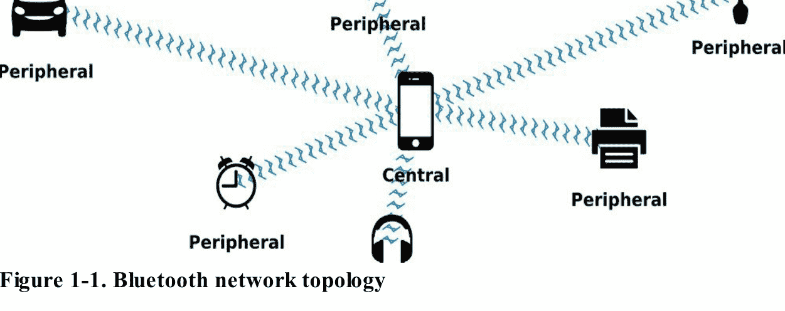

图1-1. 蓝牙网络拓扑

例如，您的智能手机作为中心设备。它可以连接蓝牙音箱、灯具、智能手表和健身追踪器。您的健身追踪器和音箱都是外围设备，它们一次只能连接一个智能手机。

中心设备有两种模式：扫描模式和已连接模式。外围设备有两种模式：广播模式和已连接模式。外围设备必须进行广播，中心设备才能看到它。

### 广播

外围设备通过在某一个无线电频率上广播其设备名称和其他信息，然后在另一个频率上进行广播，这一过程称为跳频。通过这种方式，它可以减少由反射信号或其他设备产生的无线电干扰。

## 扫描

类似地，中心设备先在一个无线电频率上收听外围设备的广播，然后在另一个频率上收听，直到发现来自外围设备的广播。这个过程与在电视上寻找好看节目的过程并无二致。

扫描中的中心设备在无线电频率之间跳频的时间间隔与广播中的外围设备跳频的速度不同。这样，扫描和广播最终会重叠，从而使两者能够连接。

每个设备都有一个唯一的媒体访问控制地址（MAC地址），用于在网络中标识它。外围设备广播该MAC地址以及有关外围设备设置的其他信息。

### 连接

在中心设备看到外围设备的广播后，中心设备可以连接到该外围设备。连接涉及某种握手，该握手由设备在硬件或固件级别处理。

连接期间，外围设备不能连接到任何其他设备。

### 断开连接

中心设备可以随时断开与外围设备的连接。外围设备会感知到断开。

### 通信

中心设备可以通过称为“特征”（Characteristic）的机制向外围设备发送数据和请求数据。特征由外围设备提供，供中心设备访问。一个特征可能具有一个或多个属性，例如 READ 或 WRITE。每个特征属于一个服务（Service），服务就像特征的容器。这种范式称为蓝牙通用属性规范（GATT）。

GATT 范式如下所示（图1-2）。

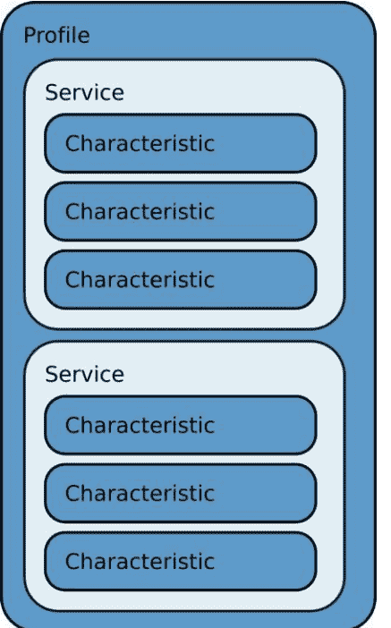

图 1-2. GATT 结构示例

要从特征（Characteristic）传输或请求数据，中央设备（Central）必须首先连接到该特征所属的服务（Service）。

例如，心率监测器可能具有以下 GATT 配置文件，允许中央设备读取外围设备（Peripheral）的每分钟心跳数、名称和电池电量（图 1-3）。

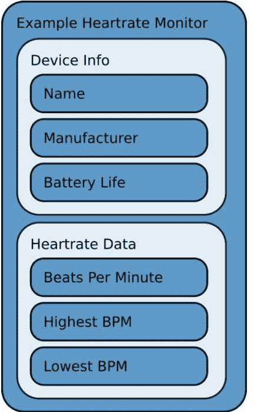

图 1-3. 心率监测器的 GATT 结构示例

为了获取特征的电池电量，中央设备还必须连接到外围设备的“设备信息”服务。

由于特征由外围设备提供，因此术语指的是可以对特征进行的操作。当数据被发送到特征时，称为“写入”；当数据从特征下载时，称为“读取”。

重申一下，特征是一个可以被写入或读取的字段。服务是一个容器，可以包含一个或多个特征。GATT 是这些服务和特征的布局。特征可以被写入或读取。

## 字节序

蓝牙根据上下文使用大端序（Big-Endian）和小端序（Little-Endian）来排列数据。

在广播期间，数据以大端序传输，数字的最高有效字节位于末尾（图 1-4）。

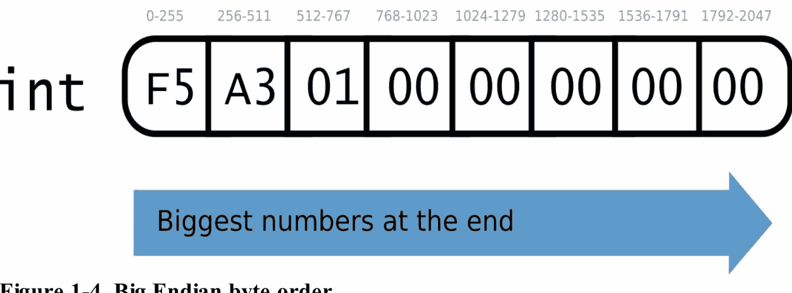

图 1-4. 大端序字节顺序

然而，GATT 内部的数据传输使用小端序，最低有效字节位于末尾（图 1-5）。

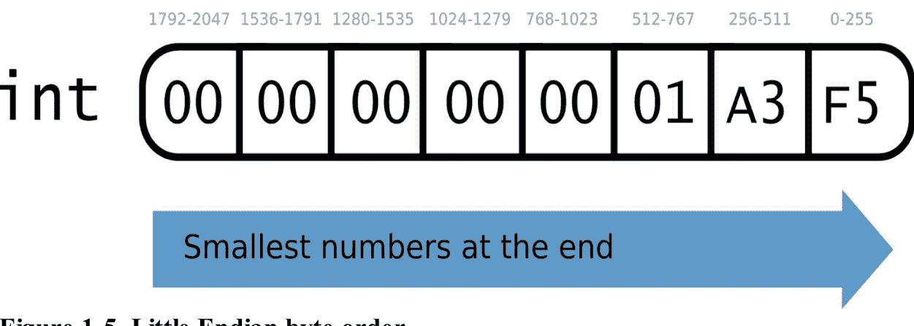

图 1-5. 小端序字节顺序

## 权限

特征（Characteristic）向中央设备（Central）授予特定权限。这些权限包括在特征上读写数据的能力，以及订阅通知（Notification）的能力。

## 描述符

描述符（Descriptor）描述特征（Characteristic）的配置。目前唯一被指定的描述符是“通知”标志，它允许中央设备订阅通知。

## UUID

UUID（Universally Unique Identifier，通用唯一标识符）是一个很长的标识符，无论它何时被创建或由谁创建，都很有可能是唯一的。

BLE 使用 UUID 来标记服务和特征，这样即使在切换设备或多个特征共享相同名称时，也能准确识别服务和特征。

例如，如果一个外围设备有两个“温度”特征——一个用于摄氏度，另一个用于华氏度，UUID 就能确保传达正确的数据。

UUID 通常是 128 位字符串，看起来像这样：

`ca06ea56-9f42-4fc3-8b75-e31212c97123`

但由于 BLE 的数据传输能力非常有限，因此也支持 16 位 UUID，它看起来像这样：

`0x1815`

每个特征和每个服务都由其自身的 UUID 标识。某些 UUID 被保留用于特定用途。

例如，UUID `0x180F` 被保留用于包含电池报告特征的服务。

同样，蓝牙规范中也保留了特征的 UUID。

例如，UUID `0x2A19` 被保留用于报告电池电量的特征。

保留用于特定服务的 UUID 列表可在*附录 IV：保留的 GATT 服务*中找到。

保留用于特定特征的 UUID 列表可在*附录 V：保留的 GATT 特征*中找到。

如果你不确定在项目中该使用哪些 UUID，可以选择一个未分配的服务（例如 `0x180C`）作为服务，以及一个通用的特征（`0x2A56`）。

虽然两个生成的 UUID 相同的可能性极低，但程序员可以自由地定义可能已存在的任意 UUID。只要定义服务和特征的 UUID 在单个 GATT 配置文件中不重叠，使用在其他上下文中已存在的 UUID 就没有问题。

## 蓝牙硬件

所有蓝牙设备至少包含一个处理器和一个天线（图 1-6）。

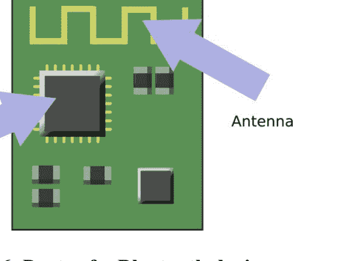

图 1-6. 蓝牙设备的组成部分

天线发射和接收无线电信号。处理器响应来自天线的变化，并控制天线的调谐、广播消息、扫描以及 BLE 设备的数据传输。

## 功率与范围

BLE 拥有 40 个 2 MHz 信道，最大发射功率为 10 mW，数据包大小为 20 字节，速度为 1 Mbit/s。

与任何无线电信号一样，信号质量会随着距离的增加而急剧下降，如下所示（图 1-7）。

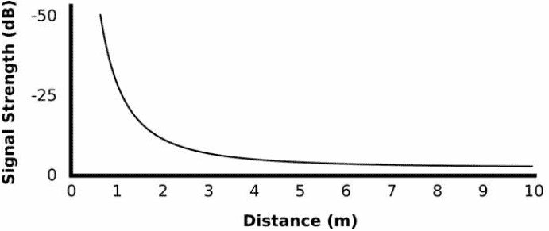

图 1-7. 距离与蓝牙信号强度关系

该信号质量与接收信号强度指示器（RSSI）相关。

如果已知外围设备和中央设备相距 1 米时的 RSSI（A）、当前距离下的 RSSI（R）以及无线电传播常数（n），则可以通过以下公式近似计算出中央设备与外围设备之间的距离（d，单位为米）：

d ≈ 10^((A-R)/(10n))

无线电传播常数取决于环境，但通常在较差环境中为 2.7，在理想环境中为 4.3。

举例来说，假设一台设备在 1 米处的 RSSI 为 75，当前 RSSI 读数为 35，传播常数为 3.5：

d ≈ 10^((75-35)/(10×3.5))

d ≈ 10^(40/35)

d ≈ 14

因此，外围设备与中央设备之间的距离约为 14 米。

## 介绍 nRFx

nRF51822、nRF52833 及相关芯片是快速、多功能的芯片，对低功耗蓝牙（Bluetooth Low Energy）提供了出色的支持，并且拥有惊人的电池续航能力。

作为嵌入式设备，它们可以被设计为连接设备，用于从家庭自动化到分布式气象监测，再到可穿戴电子设备等各种应用。

本书将教授如何使用 nRF 芯片构建低功耗蓝牙外围设备。这些芯片具有令人难以置信的多功能性。nRF 可用的蓝牙及其他功能超出了本书的范围。

虽然本书中的示例很简单，但这项技术的潜在应用却是深远的。几乎所有可穿戴设备和物联网（IoT）技术都在某种程度上采用了这项技术，从配置到数据报告等等。

## nRF 设置

根据购买的型号和 API，编写 nRF 芯片程序有多种方式。

本书教授如何使用 ARM mbed 平台，这是一个支持 nRF 及其他嵌入式芯片组的在线 C++ 编译器。它是一个免费平台，提供开源 API 和优秀的文档。

### nRFx 微控制器

nRF 低功耗蓝牙微控制器是快速、强大的处理器，具有出色的电池续航能力。

它可以使用 C 和 C++ 编程语言进行编程。它具有输入和输出引脚，可以连接到各种传感器、电机和其他设备。

有许多由不同制造商生产的开发板采用 nRF 芯片。也可以使用它开发定制板。

### mbed IDE

mbed IDE 看起来像一个典型的编码环境，包含文件列表、文本编辑器和编译器输出（图 2-1）。

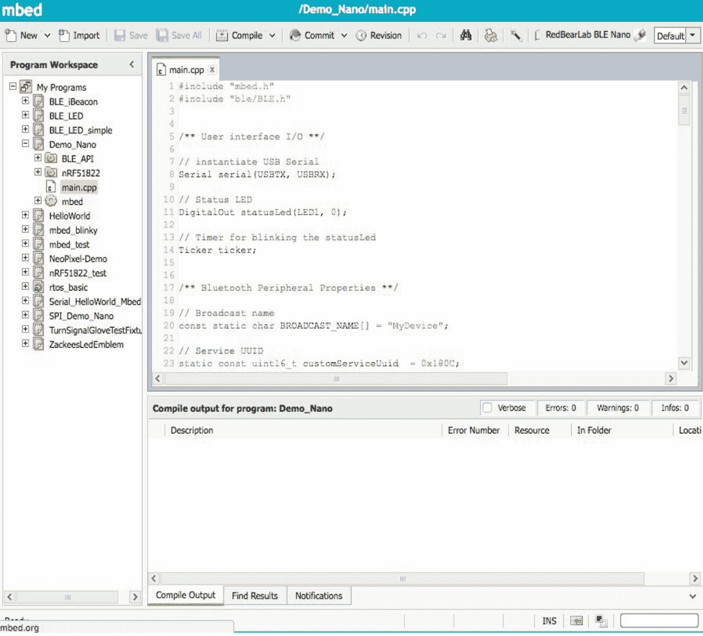

图 2-1. mbed IDE

要使用 mbed 平台，请在 [http://developer.mbed.org](http://developer.mbed.org) 注册开发者账户。mbed 编程环境可在“编译器”菜单下找到（图 2-2）。


图 2-3. mbed 空白工作区

## 安装开发平台

为了让 mbed 知道如何为你的开发板进行编译，请点击右上角的按钮安装板级支持。当没有安装支持的开发板时，该按钮显示“未选择设备”。点击该按钮将打开一个对话框，列出支持的设备（图 2-4）。

图 2-4. 添加支持的设备

点击左下角的“添加平台”按钮，打开一个包含可能支持的设备的新选项卡（图 2-5）。

### 你尚未选择任何平台

从下面的列表中选择一个平台，然后点击“选择平台”按钮进行选择。

| 描述 | 引脚 |

| --- | --- |

| 不适用 | 更多信息 |

你注册的平台

添加平台

选择平台

开发板，筛选器，mbed 已启用，mbed OS 支持，目标厂商，平台厂商

**图 2-5. 支持的 nRF 平台**

搜索你正在开发的设备名称。点击设备以打开详细信息，然后点击“添加到你的 mbed 编译器”。页面将重新加载，并显示一条消息：“该平台现已添加到你的账户中。”关闭此选项卡即可重新看到 IDE。

- **mbed LPC1768**

  - Cortex-M3，96MHz

  - 512KB Flash，32KB RAM

- **mbed LPC11U24**

  - Cortex-M0，48MHz

  - 32KB Flash，8KB RAM

- **FRDM-KL25Z**

  - Cortex-M0+

  - 128KB Flash，16KB RAM

  - USB OTG

- **NXP LPC800-MAX**

  - Cortex-M0+

  - 16KB Flash，4KB RAM

- **EA LPC4088 QuickStart Board**

  - Cortex-M4，120MHz

  - 512KB Flash，96KB SRAM

- **Seeeduino-Arch**

  - Cortex-M0，48MHz

  - 32KB Flash，8KB RAM

要将 IDE 配置为编译到该设备，请关闭平台选择器，然后再次点击“未选择设备”按钮重新打开它。从底部的已注册平台列表中选择新安装的平台，并点击“选择平台”按钮以激活该平台（图 2-6）。

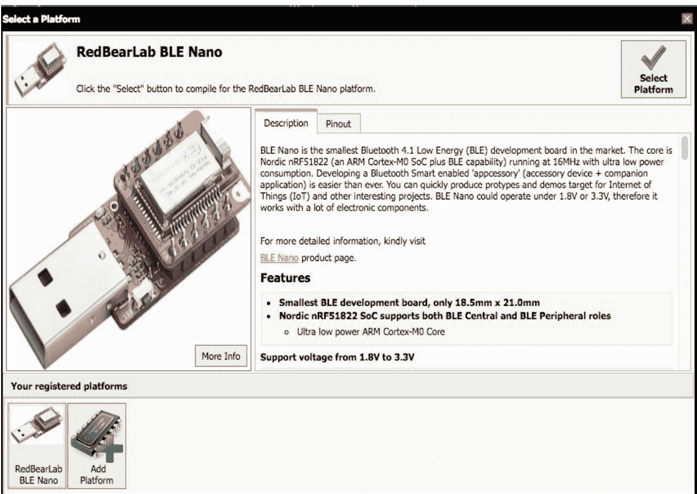

**图 2-6. 选择平台**

### 创建新项目

要创建新项目，请点击“新建”按钮。将弹出“创建新程序”对话框，你可以在其中设置程序名称、程序模板（如果存在）以及编译器平台（如果你有多个开发目标）。（图 2-7）


**图 2-7. 新建项目对话框**

接下来，导入所需的蓝牙和平台库，以便使用蓝牙 API。点击“导入”按钮。将打开一个对话框。搜索“ble”以找到所需库：BLE_API 和 nRF51822。（图 2-8）

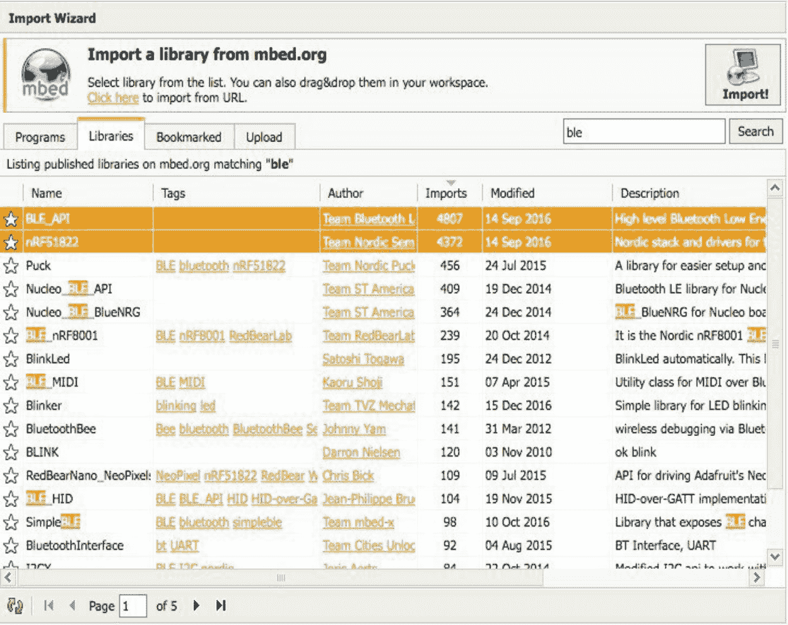

**图 2-8. 导入所需库**

这些库将被导入新项目。从这里开始，可以对项目进行编程和编译。（图 2-9）

# 第 3 章

### 引导

在任何软件项目中，首先要做的是熟悉环境。

因为我们正在使用蓝牙，所以了解如何初始化蓝牙无线模块并报告程序正在做什么非常重要。

在编程时，中心设备（Central）和外设（Peripheral）都通过 USB 与计算机通信。这允许你在程序运行时向计算机报告错误和状态消息（图 3-1）。

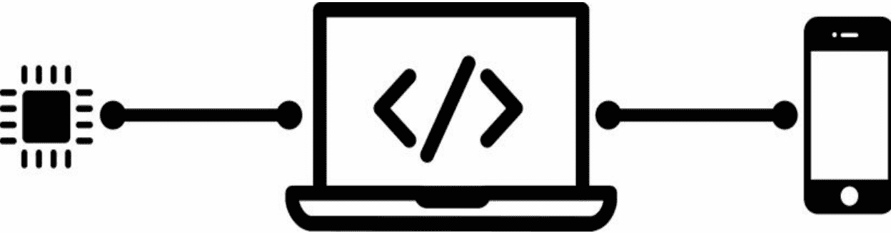

**图 3-1. 编程配置**

### 对外设进行编程

为了更容易调试，打印出 nRF 的“想法”是很有用的，因此本章将教你如何将数据从 nRF 打印到正在编程的计算机上。

### 打开蓝牙

为了使用 nRF 芯片的蓝牙功能，必须包含某些 C 头文件。在 mbed 平台上，这些文件是 `mbed.h` 和 `ble/BLE.h`：

```c
#include "mbed.h"

#include "ble/BLE.h"
```

### 调试

打印出 nRF 的“想法”有助于后续调试。这可以通过实例化一个 `Serial` 对象并向该 `Serial` 对象打印文本来实现。

```cpp
Serial serial(USBTX, USBRX); // initialize the Serial object

serial.baud(9600); // set the baud rate

serial.printf("Hello World\r\n"); // print text
```

有许多方法可以读取 nRF 打印的内容，具体取决于可用的软件和平台。在 Mac OS 和 Linux 上，可以使用名为 `screen` 的程序：

```shell
$ screen /dev/tty.usbmodemXXXX 9600
```

使用 `screen` 时，请确保波特率（此处为 9600）与 nRF `Serial` 对象上的波特率匹配，并且设备名称是为可用 nRF 设备创建的那个。

尝试将程序上传到 nRF 时，必须关闭与 nRF 的串行连接。可以通过发出以下按键序列来关闭 `screen` 会话：

Ctrl+a, k, y

### 整合所有内容

在 nRF IDE 中创建一个名为 `ble_serial` 的新项目，并输入以下代码：

**示例 3-1. `ble_serial/main.c`**


```c
#include "mbed.h"

#include "ble/BLE.h"

/** User interface I/O **/

// instantiate USB Serial

Serial serial(USBTX, USBRX);

// Status LED

DigitalOut statusLed(LED1, 0);

// Timer for blinking the statusLed

Ticker ticker;

/** Functions **/

/**
* visually signal that program has not crashed
*/

void blinkHeartbeat(void);

/**
* Main program and loop
*/

int main(void) {
    serial.baud(9600);
    serial.printf("Hello World\r\n");
    ticker.attach(blinkHeartbeat, 1);
    while (1) {
        serial.printf(".");
        wait(1);
    }
}

void blinkHeartbeat(void) {

    /* Do blinky on LED1 to indicate system aliveness. */

    statusLed = !statusLed;
}
```

通过将编译后的十六进制代码上传到 nRF 芯片来运行该程序。此过程可能因 nRF 的串行接口而异，但在许多支持 USB 的 nRF 平台上，只需将代码拖放到 MBED 磁盘即可。（图 3-2）。

**图 3-2. 将程序上传到 nRF 芯片**

上传完成后，创建一个与 nRF 的串行连接来读取其打印输出。这可以使用 `Terminal` 或 `CMD` 应用程序完成。实际命令因平台而异。以下是 Mac OS X 上的示例（图 3-3）：

```shell
$ screen /dev/tty.usbmodem1412 9600
```

**图 3-3. 在 Mac OS X 上创建与 nRF 的串行连接**

生成的程序将在串行监视器中打印“Hello World”，如下所示（图 3-4）：

```text
Hello World
......
```

**图 3-4. 串行输出**

要停止串行连接，请依次键入 Ctrl+a、k、y

## 示例代码

本章的代码可在以下网址在线获取：[https://github.com/BluetoothLowEnergyInCppWithnRFx/Chapter03](https://github.com/BluetoothLowEnergyInCppWithnRFx/Chapter03)

## 扫描与广播

任何蓝牙低功耗交互的第一步都是让外设通过一个称为广播的过程让中心设备知道它的存在。

在广播过程中，外设进行广播，而中心设备进行扫描。

蓝牙设备调到同一射频信道（也称为信道）时就会相互发现。蓝牙低功耗中有三个信道专门用于设备发现：

**表 4-1. 蓝牙低功耗发现射频信道**

| 信道 | 射频 |
| --- | --- |
| 37 | 2402 MHz |
| 38 | 2426 MHz |
| 39 | 2480 MHz |

外设会依次在信道上广播其名称和其他数据。这被称为跳频（图 4-1）。

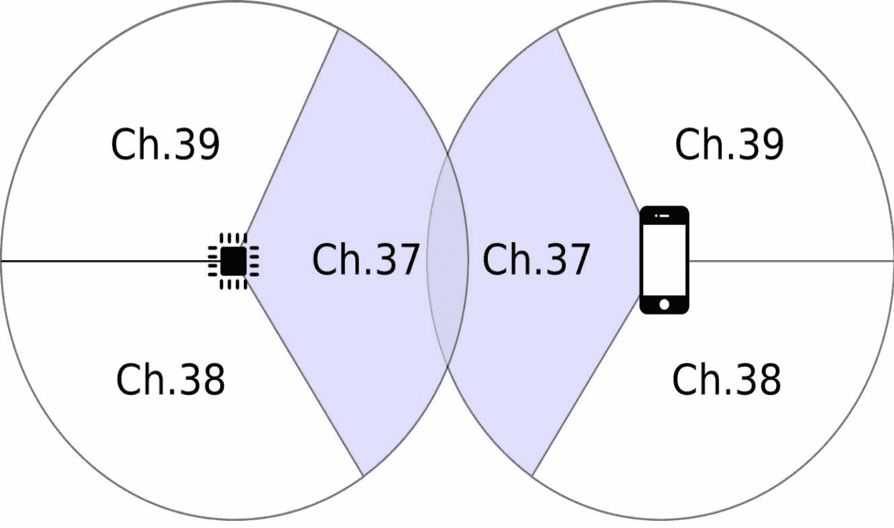

**图 4-2. 扫描发现广播**

扫描设置差异很大，例如每 10ms 扫描 100ms，或每 10s 扫描 1s。

通常，当中心设备发现正在广播的外设时，中心设备会向外设请求扫描响应。在某些情况下，扫描响应包含有用的数据。例如，iBeacon 使用扫描响应数据告知中心设备每个 iBeacon 的位置，而无需中心设备连接并下载更多数据。

任何蓝牙低功耗交互的第一步都是让外设通过一个称为广播的过程让中心设备知道它的存在。

广播会在一个信道上报告服务器名称和其他信息，直到所有信道都用尽，然后服务器在第一个信道再次重复该过程。

外设可以随时开始或停止广播。

### 对外设进行编程

要通过蓝牙低功耗进行广播，你需要准备一些内容。首先，必须包含 BLE 支持：

```cpp
#include "mbed.h"

#include "ble/BLE.h"
```

必须创建一个 BLE 对象：

```cpp
// Broadcast name

const static char BROADCAST_NAME[] = "MyDevice";
```

```cpp
int main(void) {

    // initialized Bluetooth Radio

    BLE &ble = BLE::Instance(BLE::DEFAULT_INSTANCE);

}
```

某些事情在芯片内部从这里开始发生，在此之前无法设置广告名称和其他参数。需要一个回调来处理转换：

```cpp
int main(void) {
    ...
    ble.init(onBluetoothInitialized);
}
```

由此产生的回调需要设置广告名称和其他参数，例如广告间隔和蓝牙外设的可发现性：

```cpp
void onBluetoothInitialized(
    BLE::InitializationCompleteCallbackContext *params)
{
    BLE& ble = params->ble;
    ble_error_t error = params->error;
    // quit if there's a problem
    if(error != BLE_ERROR_NONE) {
        return;
    }
    // Ensure that it is the default instance of BLE
    if(ble.getInstanceID() != BLE::DEFAULT_INSTANCE) {
        return;
    }

    serial.printf("Describing Peripheral...");

    // advertising parameters
    ble.gap().accumulateAdvertisingPayload(
      // Device is Peripheral only
      GapAdvertisingData::BR_EDR_NOT_SUPPORTED |
      // always discoverable
      GapAdvertisingData::LE_GENERAL_DISCOVERABLE
    );

    // broadcast name
    ble.gap().accumulateAdvertisingPayload(
      GapAdvertisingData::COMPLETE_LOCAL_NAME,
      (uint8_t *)BROADCAST_NAME,
      sizeof(BROADCAST_NAME)
    );

    // allow connections
    ble.gap().setAdvertisingType(
      GapAdvertisingParams::ADV_NON_CONNECTABLE_UNDIRECTED
    );

    // advertise every 1000ms
    ble.gap().setAdvertisingInterval(1000); // 1000ms

    // begin advertising
    ble.gap().startAdvertising();

    serial.printf(" done\r\n");
}
```

为了节省电量，可以在蓝牙操作之间将蓝牙无线电置于睡眠状态：

```cpp
int main(void) {
    ...
    // wait for Bluetooth Radio to be initialized
    while (ble.hasInitialized() == false);
    while (1) {
        // save power when possible
        ble.waitForEvent();
    }
}
```

## Putting it All Together

```cpp
/**
 * visually signal that program has not crashed
 */

void blinkHeartbeat(void);

/**
 * Callback triggered when the ble initialization process has finished
 *
 * @param[in] params Information about the initialized Peripheral
 */

void onBluetoothInitialized(
    BLE::InitializationCompleteCallbackContext *params
);

/**
 * Main program and loop
 */

int main(void) {
    serial.baud(9600);

    serial.printf("Starting Peripheral\r\n");

    ticker.attach(blinkHeartbeat, 1); // Blink status led every 1 second

    // initialized Bluetooth Radio
    BLE &ble = BLE::Instance(BLE::DEFAULT_INSTANCE);

    ble.init(onBluetoothInitialized);

    // wait for Bluetooth Radio to be initialized
    while (ble.hasInitialized() == false);
    while (1) {
        // save power when possible
        ble.waitForEvent();
    }
}

void blinkHeartbeat(void) {
    /* Do blinky on LED1 to indicate system aliveness. */
    statusLed = !statusLed;
}

void onBluetoothInitialized(
    BLE::InitializationCompleteCallbackContext *params)
{
    BLE&   ble = params->ble;
    ble_error_t error = params->error;
    // quit if there's a problem
    if(error != BLE_ERROR_NONE) {
        return;
    }

    // Ensure that it is the default instance of BLE
    if(ble.getInstanceID() != BLE::DEFAULT_INSTANCE) {
        return;
    }

    serial.printf("Describing Peripheral...");

    // advertising parameters
    ble.gap().accumulateAdvertisingPayload(
        // Device is Peripheral only
        GapAdvertisingData::BR_EDR_NOT_SUPPORTED |
        // always discoverable
        GapAdvertisingData::LE_GENERAL_DISCOVERABLE
    );

    // broadcast name
    ble.gap().accumulateAdvertisingPayload(
        GapAdvertisingData::COMPLETE_LOCAL_NAME,
        (uint8_t *)BROADCAST_NAME,
        sizeof(BROADCAST_NAME)
    );

    // allow connections
    ble.gap().setAdvertisingType(
      GapAdvertisingParams::ADV_NON_CONNECTABLE_UNDIRECTED
    );

    // advertise every 1000ms
    ble.gap().setAdvertisingInterval(1000); // 1000ms

    // begin advertising
    ble.gap().startAdvertising();

    serial.printf(" done\r\n");
}
```

此草图将创建一个广告为“MyDevice”的外设。附近的中心在扫描时将看到此外设。

## Example code

本章的代码可在网上获取：[https://github.com/BluetoothLowEnergyInCppWithnRFx/Chapter04](https://github.com/BluetoothLowEnergyInCppWithnRFx/Chapter04)

## Connecting and Disconnecting

每个蓝牙设备都有一个唯一的媒体访问控制 MAC 地址，即 48 位标识符值，写法如下：

```text
00:A0:C9:14:C8:3A
```

设备在网络上广播数据时，会附带预期接收者的 MAC 地址，以便接收设备可以过滤 intended for them 的数据包。

外设在广告期间所做的一部分工作是使其 MAC 地址为已知。

一旦中心知道外设的 MAC 地址，中心就可以尝试连接。在中心和外设之间传递数据之前必须这样做。中心可以同时与多个外设保持多个连接，但外设一次只能保持一个连接。因此得名中心和外设（图 5-1）。

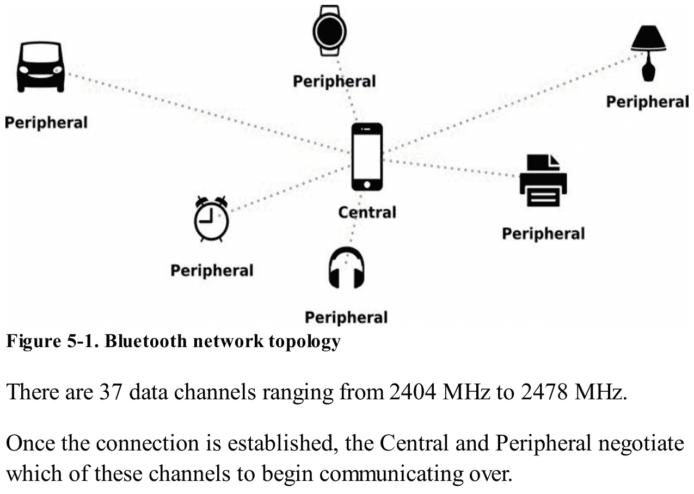

图 5-1. 蓝牙网络拓扑

有 37 个数据通道，范围从 2404 MHz 到 2478 MHz。

一旦建立连接，中心和外设就会协商从中开始通信的这些通道。

由于外设一次只能保持一个连接，因此在建立新连接之前必须与中心断开连接。

连接和断开连接过程如下（图 5-2）。

```text
外设
中心
请求连接
连接已建立
请求断开连接
断开连接已授予
```

`onConnection` 回调允许外设对传入连接做出反应。

```cpp
void onBluetoothInitialized(
    BLE::InitializationCompleteCallbackContext *params)
{
    ...

    ble.gap().onConnection(onCentralConnected);

    ...
}

void onCentralConnected(const Gap::ConnectionCallbackParams_t *params) {
    serial.printf("Central connected\r\n");
}
```

## Putting It All Together

创建一个新的草图并将其保存为 `ble_connect`。

此草图将进行广告并管理与中心的连接。当中心连接时，外设将把中心的 MAC 地址打印到串行监视器中。

### Example 5-1. `ble_connect/main.c`


```cpp
#include "mbed.h"

#include "ble/BLE.h"

/** User interface I/O */

// instantiate USB Serial
Serial serial(USBTX, USBRX);

// Status LED
DigitalOut statusLed(LED1, 0);

// Timer for blinking the statusLed
Ticker ticker;

/** Bluetooth Peripheral Properties **/

// Broadcast name
const static char BROADCAST_NAME[] = "MyDevice";

/** Functions **/

/**
 * visually signal that program has not crashed
 */

void blinkHeartbeat(void);

/**
 * Callback triggered when the ble initialization process has finished
 *
 * @param[in] params Information about the initialized Peripheral
 */

void onBluetoothInitialized(
    BLE::InitializationCompleteCallbackContext *params
);

/**
 * Callback handler when a Central has disconnected
 *
 * @param[in] params Information about the connection
 */

void onCentralDisconnected(
    const Gap::DisconnectionCallbackParams_t *params
);

/**
 * Main program and loop
 */

int main(void) {

    serial.baud(9600);

    serial.printf("Starting Peripheral\r\n");

    ticker.attach(blinkHeartbeat, 1); // Blink status led every 1 second

    // initialized Bluetooth Radio
    BLE &ble = BLE::Instance(BLE::DEFAULT_INSTANCE);

    ble.init(onBluetoothInitialized);

    // wait for Bluetooth Radio to be initialized
    while (ble.hasInitialized() == false);

    while (1) {

        // save power when possible
        ble.waitForEvent();
    }

}

void blinkHeartbeat(void) {

    /* Do blinky on LED1 to indicate system aliveness. */
    statusLed = !statusLed;
}
```

```cpp
statusLed = !statusLed;

}

void onBluetoothInitialized(

    BLE::InitializationCompleteCallbackContext *params)

{

    BLE& ble = params->ble;

    BLE_error_t error = params->error;

    // quit if there's a problem

    if(error != BLE_ERROR_NONE) {

        return;

    }

    // Ensure that it is the default instance of BLE

    if(ble.getInstanceID() != BLE::DEFAULT_INSTANCE) {

        return;

    }

    serial.printf("Describing Peripheral...");

    // process disconnections with a callback

    ble.gap().onDisconnection(onCentralDisconnected);

    // advertising parametirs

ble.gap().accumulateAdvertisingPayload(

  // Device is Peripheral only

  GapAdvertisingData::BR_EDR_NOT_SUPPORTED |

  // always discoverable

  GapAdvertisingData::LE_GENERAL_DISCOVERABLE);

// broadcast name

ble.gap().accumulateAdvertisingPayload(

  GapAdvertisingData::COMPLETE_LOCAL_NAME,

  (uint8_t *)BROADCAST_NAME,

  sizeof(BROADCAST_NAME)

);

// allow connections

ble.gap().setAdvertisingType(

  GapAdvertisingParams::ADV_CONNECTABLE_UNDIRECTED

);

// advertise every 1000ms

ble.gap().setAdvertisingInterval(1000); // 1000ms

// begin advertising

ble.gap().startAdvertising();

serial.printf(" done\r\n");

}
```

```cpp
void onCentralDisconnected(const Gap::DisconnectionCallbackParams_t *params)
{
    BLE::Instance().gap().startAdvertising();
    serial.printf("Central disconnected\r\n");
}
```

当中心设备连接后，随后与外设断开时，串口监视器的输出应类似于下面这样（图5-3）。

```
Central connected: 45:b5:7d:96:01:2f

Central disconnected
```

## 图3-4 串口输出

您的外设现在可以处理连接和断开连接了。您可以修改回调函数，打开LED、向屏幕打印内容，或做其他任何事。

## 示例代码

本章代码可在以下网址获取：https://github.com/BluetoothLowEnergyInCppWithnRFx/Chapter05

## 服务与特征

在数据可以在中心设备与外设之间来回传输之前，外设必须托管一个GATT配置文件。也就是说，外设必须具备服务和特征。

## 识别服务与特征

每个服务和特征都由一个通用唯一标识符（UUID）来识别。UUID遵循格式0000XXXX-0000-1000-8000-00805f9b34fb，因此32位UUID 00002a56-0000-1000-8000-00805f9b34fb可以表示为0x2a56。

某些UUID预留用于特定用途。例如，任何16位UUID为0x2a35（或32位UUID 00002a35-0000-1000-8000-00805f9b34fb）的特征都被视为血压读数。

有关保留的服务UUID列表，请参阅*附录四：保留的GATT服务*。

有关保留的特征UUID列表，请参阅*附录五：保留的GATT特征*。

## 通用属性配置文件

服务和特征描述了外设上的一棵数据访问点树。这棵由服务和特征组成的树被称为通用属性（GATT）配置文件。把GATT想象成类似于文件夹和文件树可能会很有帮助（图6-1）。

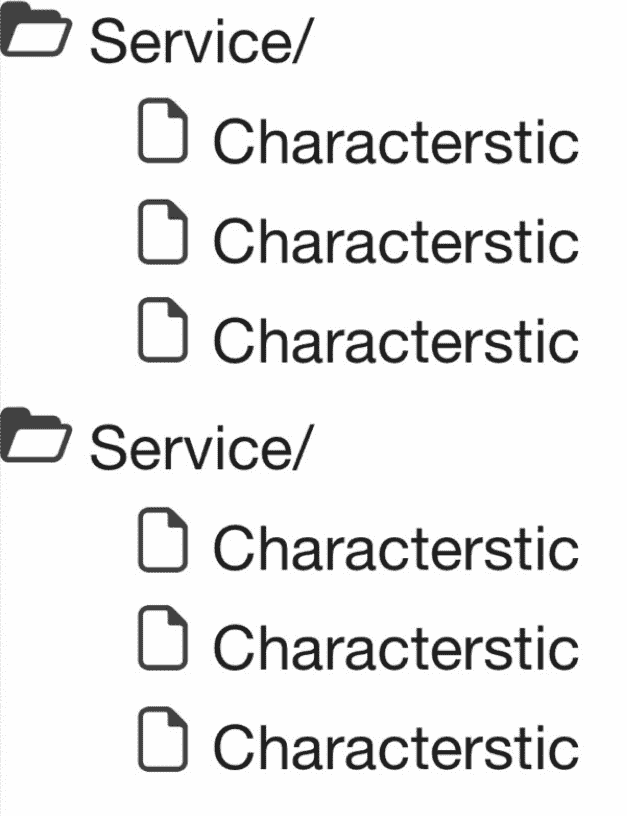

**图6-1 GATT配置文件的文件系统隐喻**

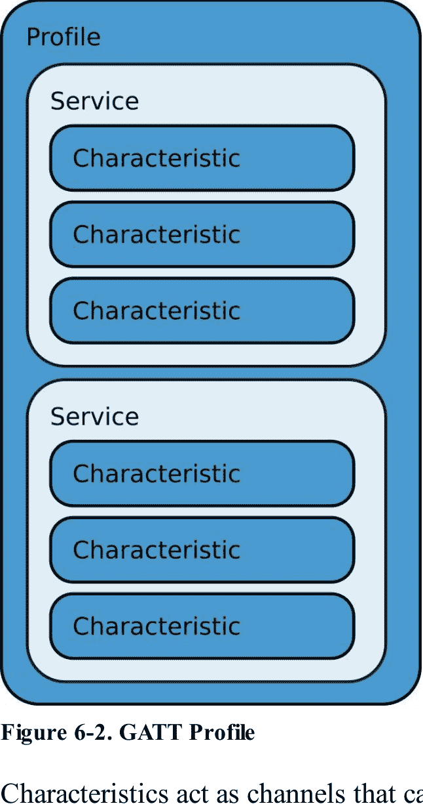

**图6-2 GATT配置文件**

特征充当可进行通信的通道，服务则充当特征的容器。顶层服务称为主服务，位于另一个服务内部的服务称为次要服务。

特征的最大值长度为20字节，并且具有称为描述符的内部设置，这些描述符可以被修改。描述符使用UUID标识。一个稍后将会讨论的重要描述符是客户端特征配置（0x2902），它允许已连接的中心设备订阅该特征的变更通知。

有关保留描述符的列表，请参阅*附录五：GATT描述符*。

## 表6-1 特征权限

| 描述符 | 描述 |
|---|---|
| Read | 中心设备可以读取该特征，外设可以设置值。 |
| Write | 中心设备可以向该特征写入，当特征值改变时会通知外设，并且当写入操作发生时也会通知中心设备。 |
| Write without Response | 中心设备可以向该特征写入。当特征值改变时会通知外设，但中心设备不会收到写入操作已发生的通知。 |
| Notify | 当外设更改值时，中心设备会收到通知。 |

由于GATT配置文件托管在外设上，因此用来描述特征权限的术语是相对于外设如何访问该特征而言的。因此，当中心设备向外设上传数据时，外设可以从特征中“读取”。外设向特征“写入”新数据，并且可以“通知”中心设备数据已更改。

## 数据长度与速度

值得注意，低功耗蓝牙的最大数据包大小为20字节，速度为1 Mbit/s。

## 对外设进行编程

通用属性配置文件通过设置外设的服务和特征的UUID及权限来定义。

特征可以配置以下权限（表6-2）：

## 表6-2 BLE特征权限

| 值 |
|---|
| BLE_GATT_CHAR_PROPERTIES_READ |

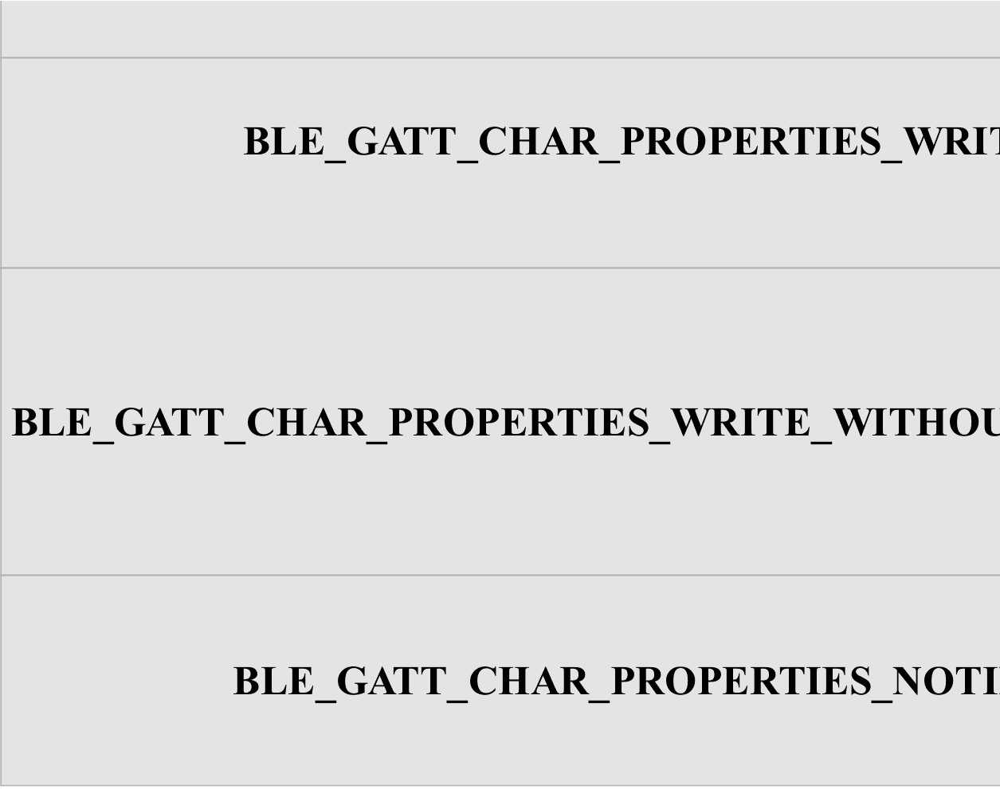

特征的最大长度为20字节。由于16位和8位数据类型在C++中易于传递，在示例中我们将使用`uint16_t`（无符号16位整数）和`uint8_t`（无符号8位整数）值。任何数据类型，包括自定义字节缓冲区，都可以通过BLE传输和组装。

定义一个UUID为`180c`（一个未注册的通用UUID）的服务：

```cpp
BLEService service("180C");
```

或者

```cpp
BLEService service("0000180C-000-1000-8000-00805f9-b34fb");
```

第一种方法让外设自动生成UUID的大部分，第二种方法则强制外设使用特定的UUID。第一种方法更简单但不够精确。第二种方法精确，并且适用于需要与外部人员或API共享UUID的项目。

某些UUID不可使用。如果选择了错误的UUID，外设可能会在没有警告的情况下崩溃。

nRF51822中提供了多种类型的特征，具体取决于你需要传输的数据类型。数组、整数、浮点数、布尔值和其他数据类型都有各自的特征构造函数。

例如，这个长度为2字节、UUID为`1801`的特征可以被中心设备读取，并且可以通知中心设备变更：

```cpp
static char readValue[2] = {0};
```

```cpp
ReadOnlyArrayGattCharacteristic
<uint8_t, sizeof(readValue)> readCharacteristic(
"1801",
(uint8_t *)readValue,
GattCharacteristic::BLE_GATT_CHAR_PROPERTIES_READ | \
GattCharacteristic::BLE_GATT_CHAR_PROPERTIES_NOTIFY
```

这个长度为8字节、UUID为`2A56`（数字特征）的特征可以被中心设备写入：

```cpp
static char writeValue[8] = {0};
```

```cpp
WriteOnlyArrayGattCharacteristic
<uint8_t, sizeof(writeValue)>writeCharacteristic(
writeCharacteristicUuid,
(uint8_t *)writeValue,
GattCharacteristic::BLE_GATT_CHAR_PROPERTIES_WRITE);
```

以下是可以创建的各种特定数据类型特征的示例：

```cpp
int properties = BLERead | BLEWrite | BLENotify;

ReadWriteBooleanCharacteristic booleanCharacteristic(
UUID,
properties,
maxLen
);

ReadWriteIntegerCharacteristic integerDataCharacteristicName(
UUID,
properties,
maxLen
);

BLEUnsignedIntCharacteristic yourCharacteristicName(
    UUID,
    properties,
    maxLen
);

BLELongCharacteristic yourCharacteristicName(
    UUID,
    properties,
    maxLen
);

BLEUnsignedLongCharacteristic yourCharacteristicName(
    UUID,
    properties,
    maxLen
);

BLEFloatCharacteristic yourCharacteristicName(UUID, properties, maxLen);
```

服务与特征通过`BLEPeripheral`添加到GATT配置文件中。将两个特征添加到服务之后，它们

它们被假定为同一个服务的一部分。这必须在 `blePeripheral.begin()` 之前发生。

```cpp
...
BLE &ble = BLE::Instance(BLE::DEFAULT_INSTANCE);
...
// Set up custom service
static const uint16_t customServiceUuid = 0x180C;
GattCharacteristic *characteristics[] = {
    &readCharacteristic, &writeCharacteristic
};
GattService customService(
    customServiceUuid,
    characteristics,
    sizeof(characteristics) / sizeof(GattCharacteristic *)
);
ble.addService(customService);
...
ble.gap().startAdvertising();
...
```

# 综合应用

创建一个名为 `ble_characteristics` 的新草图，并复制以下代码。

## 示例 6-1：`sketches/ble_characteristics/ble_characteristics.c`

```cpp
#include "mbed.h"

#include "ble/BLE.h"

/** User interface I/O **/

// instantiate USB Serial
Serial serial(USBTX, USBRX);

// Status LED
DigitalOut statusLed(LED1, 0);

// Timer for blinking the statusLed
Ticker ticker;

/** Bluetooth Peripheral Properties **/

// Broadcast name
const static char BROADCAST_NAME[] = "MyDevice";

// Device Information UUID

static const uint16_t deviceInformationServiceUuid = 0x180a;

// Battery Level UUID

static const uint16_t batteryLevelServiceUuid = 0x180f;

// array of all Service UUIDs

static const uint16_t uuid16_list[] = { customServiceUuid };

// Number of bytes in Characteristic

static const uint8_t characteristicLength = 20;

// Device Name Characteristic UUID

static const uint16_t deviceNameCharacteristicUuid = 0x2a00;

// Model Number Characteristic UUID

static const uint16_t modelNumberCharacteristicUuid = 0x2a24;

// Serial Number Characteristic UUID
```


```cpp
static const uint16_t serialNumberCharacteristicUuid = 0x2a04;

// Battery Level Characteristic UUID
static const uint16_t batteryLevelCharacteristicUuid = 0x2a19;

// model and serial numbers
static const char* modelNumber = "1AB2";
static const char* serialNumber = "1234";

int batteryLevel = 100;

/** Functions **/

/**
 * visually signal that program has not crashed
 */
void blinkHeartbeat(void);

/**
 * Callback triggered when the ble initialization process has finished
 *
 * @param[in] params Information about the initialized Peripheral
 */
void onBluetoothInitialized(
    BLE::InitializationCompleteCallbackContext *params
);

/**
 * Callback handler when a Central has disconnected
 *
 * @param[in] params Information about the connection
 */
void onCentralDisconnected(
    const Gap::DisconnectionCallbackParams_t *params
);

/** Build Service and Characteristic Relationships */
// Create a read/write/notify Characteristic
static uint8_t deviceNameCharacteristicValue[characteristicLength] = \
    BROADCAST_NAME;

ReadOnlyArrayGattCharacteristic<uint8_t, sizeof(characteristicValue)> \
    deviceNameCharacteristic(
        deviceNameCharacteristicUuid,
        characteristicValue);

static uint8_t modelNumberCharacteristicValue[characteristicLength] = \
    modelNumber;

ReadOnlyArrayGattCharacteristic<uint8_t, sizeof(characteristicValue)> \
    modelNumberCharacteristic(
        modelNumberCharacteristicUuid,
        characteristicValue);

static uint8_t serialNumberCharacteristicValue[characteristicLength] = \
    serialNumber;

ReadOnlyArrayGattCharacteristic<uint8_t, sizeof(characteristicValue)> \
characteristicValue,
GattCharacteristic::BLE_GATT_CHAR_PROPERTIES_READ | \
GattCharacteristic::BLE_GATT_CHAR_PROPERTIES_NOTIFY
);

GattCharacteristic *batteryLevelCharacteristics[] = {
  &batteryLevelCharacteristic
}

GattService batteryLevelService(
  batteryLevelServiceUuid,
  batteryLevelCharacteristics,
  sizeof(batteryLevelCharacteristics) / sizeof(GattCharacteristic *)
);

/**
 * Main program and loop
 */
int main(void) {
  serial.baud(9600);
  serial.printf("Starting Peripheral\\r\\n");
  ticker.attach(blinkHeartbeat, 1); // Blink status led every 1 second
  // initialized Bluetooth Radio

BLE &ble = BLE::Instance(BLE::DEFAULT_INSTANCE);
ble.init(onBluetoothInitialized);
// wait for Bluetooth Radio to be initialized
while (ble.hasInitialized() == false);

while (1) {
    // save power when possible
    ble.waitForEvent();
}

}

void blinkHeartbeat(void) {
/* Do blinky on LED1 to indicate system aliveness. */
statusLed = !statusLed;
}

void onBluetoothInitialized(
    BLE::InitializationCompleteCallbackContext *params)
{
BLE&   ble = params->ble;
ble_error_t error = params->error;

// quit if there's a problem
if(error != BLE_ERROR_NONE) {
    return;
}
// Ensure that it is the default instance of BLE
if(ble.getInstanceID() != BLE::DEFAULT_INSTANCE) {
    return;
}

serial.printf("Describing Peripheral...");
// attach Services
ble.addService(customService);
// process disconnections with a callback
ble.gap().onDisconnection(onCentralDisconnected);
// advertising parameters
ble.gap().accumulateAdvertisingPayload(
    // Device is Peripheral only
    GapAdvertisingData::BREDR_NOT_SUPPORTED |
    // always discoverable
    GapAdvertisingData::LE_GENERAL_DISCOVERABLE);
// broadcast name
ble.gap().accumulateAdvertisingPayload(
    GapAdvertisingData::COMPLETE_LOCAL_NAME,
    (uint8_t *)BROADCAST_NAME, sizeof(BROADCAST_NAME)
);
// advertise services
ble.gap().accumulateAdvertisingPayload(
    GapAdvertisingData::COMPLETE_LIST_16BIT_SERVICE_IDS,
    (uint8_t *)uuid16_list, sizeof(uuid16_list)
);
// allow connections
ble.gap().setAdvertisingType(
    GapAdvertisingParams::ADV_CONNECTABLE_UNDIRECTED);
// advertise every 1000ms
ble.gap().setAdvertisingInterval(1000); // 1000ms
// set the GATT values
ble.gattServer().write(
    deviceNameCharacteristic.getValueHandle(),
    BROADCAST_NAME,
    characteristicLength
);
ble.gattServer().write(
    modelNumberCharacteristic.getValueHandle(),
    modelNumber,
    characteristicLength
);
ble.gattServer().write(
    serialNumber.getValueHandle(),
    serialNumber,
    characteristicLength
);
ble.gattServer().write(
    batteryLevelCharacteristic.getValueHandle(),
    batteryLevel,
    characteristicLength
);
// begin advertising
ble.gap().startAdvertising();
serial.printf(" done\r\n");
}

void onCentralDisconnected(const Gap::DisconnectionCallbackParams_t *params)
{
    BLE::Instance().gap().startAdvertising();
    serial.printf("Central disconnected\r\n");
}
```

运行时，这个草图会创建一个以“MyDevice”为广播名称的外设（Peripheral），并提供一个 GATT 配置文件（profile），其中包含一个具有读写权限的特性（Characteristic）（图 6-2）。

- 设备信息服务：`000180a-000-1000-8000-00805f9-b34fb`
- 设备名称特性：`0002a00-000-1000-8000-00805f9-b34fb`
- 型号特性：`0002a24-000-1000-8000-00805f9-b34fb`
- 序列号特性：`0002a04-000-1000-8000-00805f9-b34fb`
- 设备信息服务：`000180a-000-1000-8000-00805f9-b34fb`
- 电池电量服务：`000180f-000-1000-8000-00805f9-b34fb`
- 电池电量特性：`0002a19-000-1000-8000-00805f9-b34fb`
- 服务：`000180c-000-1000-8000-00805f9-b34fb`
- 特性：`0002a56-000-1000-8000-00805f9-b34fb`

图 6-2：nRF 上承载的 GATT 配置文件

## 示例代码

本章的示例代码可在以下网址获取：https://github.com/BluetoothLowEnergyInCppWithnRFx/Chapter06

## 从外设读取数据

低功耗蓝牙（Bluetooth Low Energy）的真正价值在于其无线传输数据的能力。

蓝牙外设（Peripheral）是被动设备，因此它们不会向已连接的中心设备（Central）推送数据。相反，中心设备会请求从某个特性（Characteristic）读取数据。只有在特性启用了读取属性（Read Attribute）时，读取才能发生。

这被称为“从特性读取值”。

因此，如果外设更改了某个特性的值，随后中心设备从外设下载数据时，过程如图 7-1 所示：

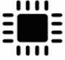

**外设**


**中心设备**

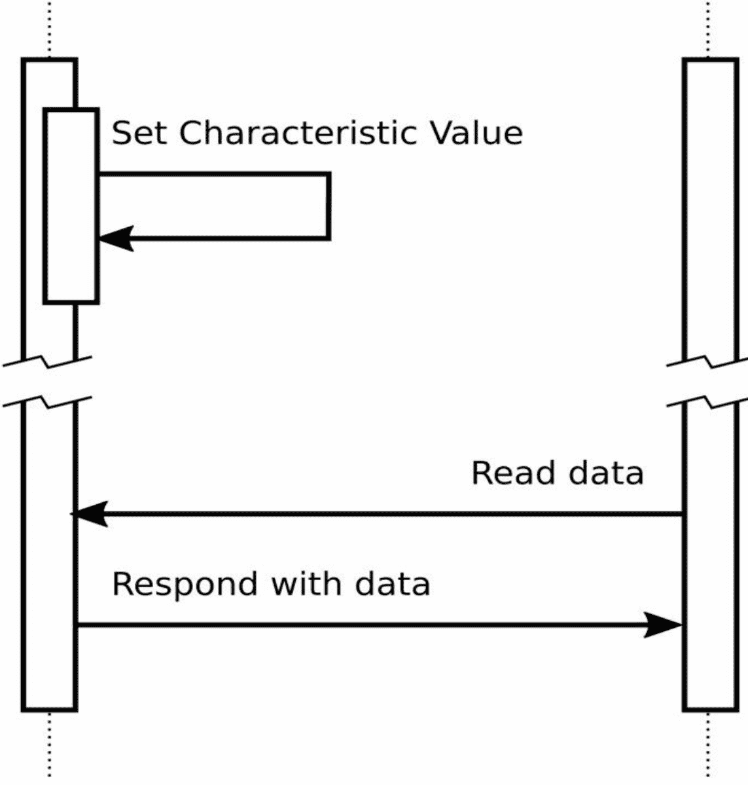

设置特征值

读取数据

响应数据

图 7-1. 中心设备从外设读取数据的过程

中心设备可以重复读取特征值，无论该特征值的值是否已发生变化。

### 外设编程

通过 BLE 传输数据相当容易。这要求外设拥有一个中心设备可读取的特征值。

创建一个服务和一个具有读取属性、最长 20 字节的特征值。例如，一个 16 字节的只读特征值：

```cpp
// create a 16-byte long Characteristic value, initialize with zeroes
static uint8_t characteristicValue[16] = {0};

// create a Read only Characteristic
ReadOnlyArrayGattCharacteristic<uint8_t, sizeof(characteristicValue)> \
characteristic(
"2A56", // UUID 2a56
characteristicValue // use the Characteristic value
);
```

每个服务和特征值都必须能够通过 UUID 唯一标识。

这样，特征值中的数据就可以在本地设置，以便已连接的中心设备从中读取。

```cpp
char* outputString = "Hello World";
int stringLength = 12;

ble.gattServer().write(
    characteristic.getValueHandle(),
    outputString,
    stringLength
);
```

### 整合全部内容

创建一个名为 `ble_send_data` 的新草图，然后将以下代码复制到该草图中。

该草图每 5 秒将特征值设置为一个随机字符串。

#### 示例 7–1. `ble_send_data/main.c`

```cpp
#include "mbed.h"
#include "ble/BLE.h"

/** User interface I/O */

// instantiate USB Serial
Serial serial(USBTX, USBRX);
// Status LED
DigitalOut statusLed(LED1, 0);
// Timer for blinking the statusLed
Ticker ticker;

/** Bluetooth Peripheral Properties **/

// Broadcast name
const static char BROADCAST_NAME[] = "MyDevice";
// Service UUID
static const uint16_t customServiceUuid = 0x180C;
// array of all Service UUIDs
static const uint16_t uuid16_list[] = { customServiceUuid };
// Number of bytes in Characteristic
static const uint8_t characteristicLength = 20;
// Characteristic UUID
static const uint16_t characteristicUuid = 0x2A56;

/** State **/

// Storage for written Characteristic value
char bleCharacteristicValue[characteristicLength];
uint16_t bleCharacteristicValueLength = 0;

/** Functions **/

/**
* create a random string
*/
static const char alphanum[] = "0123456789ABCDEFGHIJKLMNOPQRSTUVWXYZ";

void writeRandomStringToCharacteristic();

/**
* Callback triggered when the ble initialization process has finished
*
* @param[in] params Information about the initialized Peripheral
*/
void onBluetoothInitialized(
    BLE::InitializationCompleteCallbackContext *params
);

/**
```


# 向外设写入数据

当中心设备向外设托管的特征值中写入一个值时，数据即从中心设备发送到外设，前提是该特征值具有写入权限。

该过程如下所示（图 8-1）。

外设

中心设备

写入数据

图 8-1. 中心设备向外设写入数据的过程

## 外设编程

为了让外设能够接收来自中心设备的数据，它必须拥有一个允许写入的特征值。

例如，这个 8 字节的特征值支持“写入”操作：

```cpp
// Create a read/write/notify Characteristic

static const uint8_t characteristicLength = 8;

static uint8_t characteristicValue[characteristicLength] = {0};

WriteOnlyArrayGattCharacteristic<uint8_t, sizeof(characteristicValue)> \
    characteristic(
    "2A56",
    characteristicValue
);
```

该特征值必须有一个回调函数来描述如何处理传入的数据。回调参数标识被写入的特征值以及传输的详细信息，包括长度和已写入的值。

回调在中断中处理，处于正常操作之外。最好不在回调内实现大量功能。一种最佳实践是设置一个布尔标志，然后在主循环中检查该标志。

```cpp
// flag when Central has written to a Characteristic

bool bleDataWritten = false; // true if data ha

// Storage for written Characteristic

// 值已写入特征

char bleCharacteristicValue[characteristicLength];

/**

 * 此回调处理对特征（Characteristic）的传入写入。

 *

 * @param[in] params

 *   有关正在更新的特征的信息。

 */

void onBleCharacteristicWritten(const GattWriteCallbackParams *params) {

    // 如果本地特征已被写入

    if (params->handle == characteristic.getValueHandle()) {

        bleDataWritten = true;

        bleCharacteristicValueLength = params->len;

        // 将新值复制到占位符中以备后用。

        // 最好不要在此函数中做太多事情，因为这是一个中断

        strncpy(bleCharacteristicValue, (char *) params->data, params->len);

    }

}

```

回调必须像这样绑定到 GATT 服务器：

```cpp

void onBluetoothInitialized(

    BLE::InitializationCompleteCallbackContext *params)

{

    ...

    ble.gattServer().onDataWritten(onBleCharacteristicWritten);

    ...

}

```

当不在中断中时，可以从主循环中提取传入的 8 位数据值并将其打印到串口：

```cpp

int main(void) {

    ...

    while (1) {

        // 当中心设备（Central）写入本地特征时，

        // 在此处处理更改

        if (bleDataWritten) {

            bleDataWritten = false; // 确保只发生一次

            serial.printf(

                "Data written to characteristic: %s\r\n",

                bleCharacteristicValue

            );

        }

        ...

    }

}

```

# 综合应用

创建一个名为 `ble_receive_data` 的新草图，代码如下。

## 示例 8-1. ble_receive_data/main.c

```cpp

#include "mbed.h"

#include "ble/BLE.h"

/** 用户界面 I/O **/

// 实例化 USB 串口

Serial serial(USBTX, USBRX);

// 状态 LED

DigitalOut statusLed(LED1, 0);

// 用于闪烁 statusLed 的定时器

Ticker ticker;

/** 蓝牙外设属性 **/

// 广播名称

const static char BROADCAST_NAME[] = "MyDevice";

// 服务 UUID

static const uint16_t customServiceUuid = 0x180C;

// 所有服务 UUID 的数组

static const uint16_t uuid16_list[] = { customServiceUuid };

// 特征中的字节数

static const uint8_t characteristicLength = 20;

// 特征 UUID

static const uint16_t characteristicUuid = 0x2A56;

/** 状态 **/

// 当中心设备已写入特征时的标志

// 如果数据已写入特征，则为 true

bool bleDataWritten = false;

// 存储写入的特征值

char bleCharacteristicValue[characteristicLength];

uint16_t bleCharacteristicValueLength = 0;

/** 函数 **/

/**

 * 以视觉方式表明程序未崩溃

 */

void blinkHeartbeat(void);

/**

 * 蓝牙初始化过程完成时触发的回调

 *

 * @param[in] params 有关已初始化外设的信息

 */

void onBluetoothInitialized(

    BLE::InitializationCompleteCallbackContext *params

);

/**

 * 此回调处理对特征（Characteristic）的传入写入。

 *

 * @param[in] params

 *   有关正在更新的特征的信息。

 */

void onBleCharacteristicWritten(const GattWriteCallbackParams *params);

/**

 * 当中心设备断开连接时的回调处理程序

 *

 * @param[in] params 有关连接的信息

 */

void onCentralDisconnected(

    const Gap::DisconnectionCallbackParams_t *params

);

/** 构建服务与特征的关系 **/

// 创建读/写/通知特征

static uint8_t characteristicValue[characteristicLength] = {0};

WriteOnlyArrayGattCharacteristic<uint8_t, sizeof(characteristicValue)> \

    characteristic(
        characteristicUuid,
        characteristicValue);

// 将特征绑定到服务

bleDataWritten = false; // 确保只发生一次

serial.printf(

    "Data written to characteristic: %s\r\n",

    bleCharacteristicValue

);

// 尽可能省电

ble.waitForEvent();

}

}

void blinkHeartbeat(void) {

    /* 在 LED1 上闪烁以指示系统正常运行。 */

    statusLed = !statusLed;

}

void onBluetoothInitialized(

    BLE::InitializationCompleteCallbackContext *params)

{

    BLE& ble = params->ble;

    ble_error_t error = params->error;

    // 如果有问题则退出

    if (error != BLE_ERROR_NONE) {

        return;

    }

    // 确保这是 BLE 的默认实例

    if (ble.getInstanceID() != BLE::DEFAULT_INSTANCE) {

        return;

    }

    serial.printf("Describing Peripheral...");

    // 附加服务

    ble.addService(customService);

    // 如果中心设备写入特征，

    // 使用回调处理事件

    ble.gattServer().onDataWritten(onBleCharacteristicWritten);

    // 使用回调处理断开连接


```cpp
    ble.gap().onDisconnection(onCentralDisconnected);

    // 广播参数

    ble.gap().accumulateAdvertisingPayload(
        // 设备仅作为外设
        GapAdvertisingData::BREDR_NOT_SUPPORTED |
        // 始终可发现
        GapAdvertisingData::LE_GENERAL_DISCOVERABLE);

    // 广播名称
    ble.gap().accumulateAdvertisingPayload(
        GapAdvertisingData::COMPLETE_LOCAL_NAME,
        (uint8_t *)BROADCAST_NAME,
        sizeof(BROADCAST_NAME)
    );

    // 广播服务
    ble.gap().accumulateAdvertisingPayload(
        GapAdvertisingData::COMPLETE_LIST_16BIT_SERVICE_IDS,
        (uint8_t *)uuid16_list,
        sizeof(uuid16_list)
    );

    // 允许连接
    ble.gap().setAdvertisingType(
        GapAdvertisingParams::ADV_CONNECTABLE_UNDIRECTED
    );

    // 每 1000 毫秒广播一次
    ble.gap().setAdvertisingInterval(1000); // 1000毫秒

    // 开始广播
    ble.gap().startAdvertising();

    serial.printf(" done\r\n");

}

void onBleCharacteristicWritten(const GattWriteCallbackParams *params) {
    // 如果本地特征已被写入
    if (params->handle == characteristic.getValueHandle()) {
        bleDataWritten = true;
        bleCharacteristicValueLength = params->len;

        // 将新值复制到占位符中以备后用。
        // 最好不要在此函数中做太多事情，因为这是一个中断
        strncpy(bleCharacteristicValue, (char *) params->data, params->len);
    }
}

void onCentralDisconnected(const Gap::DisconnectionCallbackParams_t *params)
{
    BLE::Instance().gap().startAdvertising();
    serial.printf("Central disconnected\r\n");
}
```

当已连接的中心设备写入数据时，串口监视器输出如下（图 8-2）：

```text
5 bytes sent to characteristic 2A56: hello
5 bytes sent to characteristic 2A56: world
16 bytes sent to characteristic 2A56: Bluetooth works!
```

### 图 8-2. 串口输出

## 示例代码

本章代码可在以下网址获取：https://github.com/BluetoothLowEnergyInCppWithnRFx/Chapter08

## 使用通知

如果中心设备不知道新数据何时可用，那么中心设备能够读取数据的能力价值有限。

通知解决了这个问题。当特征值发生变化时，特征可以发出通知。订阅这些通知的中心设备将知道特征值何时发生变化，但不知道新值是什么。然后中心设备可以从特征中读取最新数据。

整个过程如下所示（图 9-1）。

- 外设（Peripheral）
- 中心设备（Central）
- 订阅通知
- 设置特征值
- 发送通知
- 取消订阅通知

### 图 9-1. 外设向已连接的中心设备通知特征值变化的过程

## 编程外设

让我们看看如何在代码中实现这一点。通常，蓝牙外设的电池寿命非常宝贵。因此，当特征值发生变化时，通知已连接的中心设备但不向中心设备发送新数据是很有用的。唤醒蓝牙无线电发送一个字节比发送20个或更多字节消耗更少的电量。

可以通过设置 `BLENotify` 标志在特征中启用通知。

例如，以下特征同时支持读取访问和通知。

```cpp
// 初始化特征值

static uint8_t characteristicValue[characteristicLength] = {0};

// 创建具有读取和通知属性的只读特征

ReadOnlyArrayGattCharacteristic<uint8_t, sizeof(characteristicValue)> \
characteristic(

characteristicUuid,

characteristicValue,

GattCharacteristic::BLE_GATT_CHAR_PROPERTIES_READ | \
GattCharacteristic::BLE_GATT_CHAR_PROPERTIES_NOTIFY);
```

当 Characteristic 的值发生变化时，会自动向已连接的 Central 发送通知。

```cpp
char* outputString = "Hello World";

int stringLength = 12;

ble.gattServer().write(
    characteristic.getValueHandle(),
    outputString,
    stringLength
);
```

### 整合所有内容

创建一个名为 `ble_notifications` 的新 sketch，包含以下代码。

Example 9-1. `ble_notifications/main.cpp`

```cpp
#include "mbed.h"
#include "ble/BLE.h"

/** User interface I/O **/
// instantiate USB Serial
Serial serial(USBTX, USBRX);
// Status LED
DigitalOut statusLed(LED1, 0);
// Timer for blinking the statusLed
Ticker ticker;

/** Bluetooth Peripheral Properties **/
// Broadcast name
const static char BROADCAST_NAME[] = "MyDevice";
// Service UUID
static const uint16_t customServiceUuid = 0x180C;
// array of all Service UUIDs
static const uint16_t uuid16_list[] = { customServiceUuid };
// Number of bytes in Characteristic
static const uint8_t characteristicLength = 20;
// Characteristic UUID
static const uint16_t characteristicUuid = 0x2A56;

/** State **/
// Storage for written Characteristic value
char bleCharacteristicValue[characteristicLength];
uint16_t bleCharacteristicValueLength = 0;

/** Functions **/
/**
 * create a random string
 */
static const char alphanum[] = "0123456789ABCDEFGHIJKLMNOPQRSTUVWXYZ";
void writeRandomStringToCharacteristic();

/**
 * Callback triggered when the ble initialization process has finished
 *
 * @param[in] params Information about the initialized Peripheral
 */
void onBluetoothInitialized(
    BLE::InitializationCompleteCallbackContext *params
);

/**
 * Callback handler when a Central has disconnected
 *
 * @param[in] params Information about the connection
 */
void onCentralDisconnected(
    const Gap::DisconnectionCallbackParams_t *params
);

/** Build Service and Characteristic Relationships **/
// Create a read/write/notify Characteristic
static uint8_t characteristicValue[characteristicLength] = {0};
ReadOnlyArrayGattCharacteristic<uint8_t, sizeof(characteristicValue)> characteristic(
    characteristicUuid,
    characteristicValue,
    GattCharacteristic::BLE_GATT_CHAR_PROPERTIES_READ |
        GattCharacteristic::BLE_GATT_CHAR_PROPERTIES_NOTIFY);

// Bind Characteristics to Services
GattCharacteristic *characteristics[] = {&characteristic};
GattService customService(
    customServiceUuid, characteristics,
```

```cpp
void writeRandomStringToCharacteristic() {
    statusLed = !statusLed;
    static const uint16_t stringLength = rand() % characteristicLength;
    uint8_t outputString[stringLength];
    for (int i=0; i < stringLength-1; i++) {
        outputString[i] = alphanum[rand() % alphanumLength];
    }
    outputString[stringLength-1] = '\0';
    BLE::Instance(BLE::DEFAULT_INSTANCE).gattServer().write(
        characteristic.getValueHandle(),
        outputString,
        stringLength
    );
}

void onBluetoothInitialized(
    BLE::InitializationCompleteCallbackContext *params)
{
    BLE& ble = params->ble;
    ble_error_t error = params->error;
    // quit if there's a problem
    if(error != BLE_ERROR_NONE) {
        return;
    }
    // Ensure that it is the default instance of BLE
    if(ble.getInstanceID() != BLE::DEFAULT_INSTANCE) {
        return;
    }
    serial.printf("Describing Peripheral...");
    // attach Services
    ble.addService(customService);
    // process disconnections with a callback
    ble.gap().onDisconnection(onCentralDisconnected);
    // advertising parameters
    ble.gap().accumulateAdvertisingPayload(
        // Device is Peripheral only
        GapAdvertisingData::BREDR_NOT_SUPPORTED |
        // always discoverable
        GapAdvertisingData::LE_GENERAL_DISCOVERABLE);
    // broadcast name
    ble.gap().accumulateAdvertisingPayload(
        GapAdvertisingData::COMPLETE_LOCAL_NAME,
        (uint8_t *)BROADCAST_NAME,
        sizeof(BROADCAST_NAME)
    );
    // advertise services
    ble.gap().accumulateAdvertisingPayload(
        GapAdvertisingData::COMPLETE_LIST_16BIT_SERVICE_IDS,
        (uint8_t *)uuid16_list,
        sizeof(uuid16_list)
    );
    // allow connections
    ble.gap().setAdvertisingType(
        GapAdvertisingParams::ADV_CONNECTABLE_UNDIRECTED
    );
    // advertise every 1000ms
    ble.gap().setAdvertisingInterval(1000); // 1000ms
    // begin advertising
    ble.gap().startAdvertising();
    serial.printf(" done\r\n");
}

void onCentralDisconnected(const Gap::DisconnectionCallbackParams_t *params)
{
    BLE::Instance().gap().startAdvertising();
    serial.printf("Central disconnected\r\n");
}
```

当 sketch 运行后，Serial Monitor 的输出将类似于此 ([Figure 9-2](#))：

```text
Setting characteristic to: FMZAP
Setting characteristic to: GGORPFNU7KYJCNJKP
Setting characteristic to: G665P
```


### Figure 9-2. Serial Output

## Example code

本章的代码可在网上获取：[https://github.com/BluetoothLowEnergyInCppWithnRFx/Chapter09](https://github.com/BluetoothLowEnergyInCppWithnRFx/Chapter09)

## 流式传输数据

通过 Bluetooth Low Energy 发送的最大数据包大小为 20 字节。可以通过将消息分成 20 字节或更小的包并逐个发送来发送更多数据。

这些数据包可以以一定的速度发送。

Bluetooth Low Energy 以 1 Mb/s 的速度传输。在数据传输时间和外设处理传入数据所需的时间之间，一个数据包发送后到下一个数据包准备好发送之间存在时间延迟。

要发送多个数据包，必须采用队列/通知系统，该系统在外设准备好接收下一个数据包时提醒 Central。

有许多方法可以做到这一点。其中一种方法是在外设处理完写入后设置一个具有读、写和通知权限的 Characteristic，并将 Characteristic 标记为“就绪”。这会向 Central 发送通知，Central 发送下一个数据包。这样，只需一个 Characteristic 即可完成单次数据传输。

此过程可以可视化如下 ([Figure 10-1](#figure-10-1))。


Peripheral


Central

- Subscribe to notifications
- Send Data
- Loop
- Set Characteristic to "ready"
- Send Notification
- Send Data
- Unsubscribe from Notifications

### Figure 10-1. The process of using notifications to handle flow control on a multi-packet data transfer

### Programming the Peripheral

这种实现队列 Characteristic 的方法需要一个支持读、写和通知权限的 Characteristic。

在此示例中，一个 16 位长的 Characteristic：

```cpp
...
BLECharacteristic characteristic(
  "2803",
  BLERead | BLENotify | BLEWrite, // read, write, notify
  16
);
...
```

当此 Characteristic 被写入且数据被处理后，Characteristic 的值将被切换为流控制消息；在此示例中为“ready”。

由于 `onCharacteristicWritten` 被处理为中断，因此最佳实践是避免在该函数内部处理数据。相反，最好设置一个标志并在主循环中处理数据。

```cpp
...
static const char* bleFlowControlMessage = "ready";
static const int bleFlowControlMessageLength = 5;
bool bleDataWritten = false; // true if data has been received
char bleCharacteristicValue[16] = {0};
int bleCharacteristicValueLength;
char bleCharacteristicUUID[32];

void onCharacteristicWritten(
  BLECentral& central,
  BLECharacteristic &characteristic) {
  bleDataWritten = true; // alert that data has been written
  bleCharacteristicUUID = characteristic.uuid();
  bleCharacteristicValueLength = characteristic.valueLength();
  // Since we are playing with strings, use strcpy
  strcpy(bleCharacteristicValue, (char*) characteristic.value());
}

// setup
void loop() {
if (bleDataWritten) { // has data been written?
  bleDataWritten = false; // clear the flag
```

```cpp
char uuid[32];
};

BleTransmission bleTransmissionData;
bool bleDataWritten = false; // true if data has been received
BLEService service("180C");
BLECharacteristic characteristic(
  "2A56",
  BLERRead | BLENotify | BLEWrite, // read, write, notify
  characteristicTransmissionLength
);
BLEPeripheral blePeripheral;
bool bleCharacteristicSubscribed = false; // true when a client subscribes

// When data is sent from the client, it is processed here inside a callback
// it is best to handle the result of this inside the main loop
void onBleCharacteristicWritten(BLECentral& central,
  BLECharacteristic &characteristic) {
  bleDataWritten = true;
  bleTransmissionData.uuid = characteristic.uuid();
  bleTransmissionData.length = characteristic.valueLength();
  // Since we are playing with strings, we must use strncpy
  strncpy(bleTransmissionData.data,
    (char*) characteristic.value(), characteristic.valueLength());
}

void setBleCharacteristicValue(char* output, int length) {
    characteristic.setValue((const unsigned char*) output, length);
}

void setup() {
    Serial.begin(9600); // open a Serial connection
    while (!Serial); // wait for Serial console to open
    blePeripheral.setLocalName(bluetoothDeviceName);
    blePeripheral.setAdvertisedServiceUuid(service.uuid());
    blePeripheral.addAttribute(service);
    blePeripheral.addAttribute(characteristic);
    // trigger onBleCharacteristicWritten when data is sent to the characteristic
    characteristic.setEventHandler(
        BLEWritten,
        onBleCharacteristicWritten
    );
    blePeripheral.begin();
}

void loop() {
    // if the bleDataWritten flag has been set, print out the incoming data
    if (bleDataWritten) {
        bleDataWritten = false; // ensure only happens once
```

```cpp
Serial.print(bleTransmissionData.length);
Serial.print(" bytes sent to characteristic ");
Serial.print(bleTransmissionData.uuid);
Serial.print(": ");
Serial.println(bleTransmissionData.data);

// send out flow control message
setBleCharacteristicValue((char*) bleReadReceiptMessage,
    bleReadReceiptMessageLength);
}
```

运行草图时，外设会将收到的数据打印到串行监视器中，然后通知已连接的中央设备它已准备好接收更多数据（图 10-2）。

```
16 bytes sent to characteristic 2A56: this is a super
Ready for more data
16 bytes sent to characteristic 2A56: long message
Ready for more data
```

### 图 10-2. 串行监视器输出

## 示例代码

本章代码可在线获取，网址为：https://github.com/BluetoothLowEnergyInCppWithnRFx/Chapter10

# 第 11 章

## 项目：iBeacon

信标可用于测距或空间感知。iBeacon 是一种特殊的信标类型，得到了行业的广泛支持。它支持某些标识 iBeacon 的数据，使跨平台的测距和空间感知变得更加容易。

由于无线电信号强度会随距离增加而自然衰减，蓝牙外设既可用于测距，也可用于空间感知。

## 测距

蓝牙信号可用于估算外设与中央设备之间的距离，因为无线电信号质量会随距离以可预测的方式下降。下图展示了信号如何随距离增加而下降（图 11-1）。

当附近 iBeacon 的距离和位置都已知时（图 11-2）。

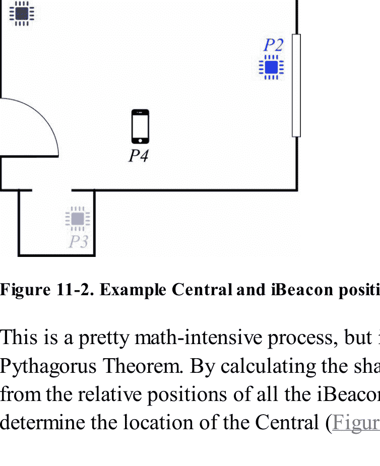

### 图 11-2. 房间内中央设备与 iBeacon 的位置示例

这是一个相当依赖数学计算的过程，但其基础全部是毕达哥拉斯定理。通过计算由所有 iBeacon 与中央设备的相对位置构成的三角形形状，就可以确定中央设备的位置（图 11-3）。

读取。通过查询所发现 iBeacon 的 `Major` 和 `Minor` 编号，可以知道用户位于博物馆特定楼层的某个房间。相关内容从博物馆的 API 获取并加载到智能手机应用中。

## 对 Peripheral 进行编程

每个 iBeacon 都使用一个 `UUID` 加上 `Major` 和 `Minor` 编号进行标识。

属于同一组织单元的 iBeacon 共享同一个 `UUID`。例如，属于同一家连锁杂货店的所有 iBeacon。

```cpp
// Beacon UUID - use the same UUID for a group of Beacons
static const uint8_t UUID[] = {
    0xE2, 0x0A, 0x39, 0xF4, 0x73, 0xF5, 0x4B, 0xC4,
    0xA1, 0x2F, 0x17, 0xD1, 0xAD, 0x07, 0xA9, 0x61
};
// Major Number identifies the iBeacon
static const uint16_t MAJOR_NUMBER = 1122;
// Minor number identifies the iBeacon
static const uint16_t MINOR_NUMBER = 3344;
// radio transmission power
// 0xC8 = 200, 2's compliment is 256-200 = (-56dB)
static const uint16_t TRANSMISSION_POWER = 0xC8;
```

发射功率很重要，它既用于设置 iBeacon 的广播范围，也用于让中央设备判断自身与 iBeacon 的距离。

### 整合所有内容

下面的草图创建了一个 Beacon 外设，它将其参考 RSSI 以及相对于某个点的 x、y 距离存储在特征值中。实现起来非常简单；在前几章中你已经完成了大部分工作。

创建一个名为`ble_security`的新草图，并复制以下代码。

示例 11-1. `sketches/ble_beacon/ble_beacon.c`

```cpp
#include "mbed.h"

#include "ble/services/iBeacon.h"

/** User interface I/O **/
// instantiate USB Serial
Serial serial(USBTX, USBRX);

// Status LED
DigitalOut statusLed(LED1, 0);

// Timer for blinking the statusLed
Ticker ticker;

/** Bluetooth Peripheral Properties **/
// Bluetooth Peripheral Singleton
// Beacon UUID - use the same UUID for a group of Beacons
static const uint8_t UUID[] = {0xE2, 0x0A, 0x39, 0xF4, 0x73, 0xF5, 0x4B, 0xC4,
                                0xA1, 0x2F, 0x17, 0xD1, 0xAD, 0x07, 0xA9, 0x61};

// Major Number and Minor number identify the Beacon
static const uint16_t MAJOR_NUMBER = 1122;
static const uint16_t MINOR_NUMBER = 3344;

// radio transmission power
// 0xC8 = 200, 2's compliment is 256-200 = (-56dB)
static const uint16_t TRANSMISSION_POWER = 0xC8;

/** Functions **/
/**
* visually signal that program has not crashed
*/
void blinkHeartbeat(void);

/**
* Callback triggered when the ble initialization process has finished
*
* @param[in] params Information about the initialized Peripheral
*/
void onBluetoothInitialized(
    BLE::InitializationCompleteCallbackContext *params
);

/**
 * Main program and loop
 */
int main(void) {
    serial.baud(9600);
    serial.printf("Starting iBeacon\r\n");
    ticker.attach(blinkHeartbeat, 1); // Blink LED every 1 seconds
```


```cpp
// initialized Bluetooth Radio

BLE &ble = BLE::Instance(BLE::DEFAULT_INSTANCE);

ble.init(onBluetoothInitialized);

// wait for Bluetooth Radio to be initialized

while (ble.hasInitialized() == false);

while (1) {

    // put radio to sleep in between broadcasts

    ble.waitForEvent();

}

}

```

```

void blinkHeartbeat(void) {

    /* Do blinky on LED1 to indicate system aliveness. */

```


```cpp

statusLed = !statusLed;

}

void onBluetoothInitialized(

    BLE::InitializationCompleteCallbackContext *params)

{

    BLE &ble = params->ble;

    ble_error_t error = params->error;

    if(error != BLE_ERROR_NONE) {

        return;

    }

    // create beacon with these properties

    iBeacon *ibeacon = new iBeacon(

        ble, UUID, MAJOR_NUMBER, MINOR_NUMBER, TRANSMISSION_POWER);

    // begin broadcast

    ble.gap().setAdvertisingInterval(1000); // 1000ms

    ble.gap().startAdvertising();

}

```

当 Beacon 草图运行时，串口监视器的输出如下（图 11-2）：

```text

Setting device name to: MyBeacon

Starting Bluetooth Advertising

```

**图 11-2. 串口输出**

## 示例代码

本章的代码可在以下网址获取：`https://github.com/BluetoothLowEnergyInCppWithnRFx/Chapter11`

## 项目：Echo 客户端与服务器

回声服务器是网络编程中的“Hello World”。它具备在网络中传输、存储和响应数据所需的最少功能，这是任何网络应用都应具备的核心功能。

然而，它必须支持本书迄今所学到的所有功能——广播、读取、写入、通知、分段数据传输和加密。这是一个复杂的程序。

回声服务器的工作原理如下（图 11-1）：中央设备（Central）充当客户端。

本项目大量基于截至第 10 章所见到的代码，因此不会有什么意外之处。

### 对外围设备编程

这个项目相对简单，因为中央设备和外围设备都用它们的母语——二进制——进行通信。因此，与文本相比，处理数据所需的步骤更少。

必须有两条特征值（Characteristic）：一条用于写入命令，另一条用于读取响应，它们位于自动化 IO 服务（`0x1815`）下。响应特征值将支持通知：

```cpp

// Automation IO Service UUID

static const uint16_t customServiceUuid = 0x1815;

// Number of bytes in Characteristic

static const uint8_t characteristicLength = 2;

// Write commands to this Characteristic

uint16_t commandCharacteristicUuid = 0x2A56;

// Respond to connected Central from this Characteristic

uint16_t responseCharacteristicUuid = 0x2A57;

static char commandValue[characteristicLength] = {0};

```

```cpp

WriteOnlyArrayGattCharacteristic<uint8_t, sizeof(commandValue)>

    commandCharacteristic(

        commandCharacteristicUuid,

        (uint8_t *)commandValue,

        GattCharacteristic::BLE_GATT_CHAR_PROPERTIES_WRITE);

static char responseValue[characteristicLength] = {0};

ReadOnlyArrayGattCharacteristic<uint8_t, sizeof(responseValue)>

    responseCharacteristic(

        responseCharacteristicUuid,

        (uint8_t *)responseValue,

        GattCharacteristic::BLE_GATT_CHAR_PROPERTIES_READ |

        GattCharacteristic::BLE_GATT_CHAR_PROPERTIES_NOTIFY

    );

// Set up custom service

GattCharacteristic *characteristics[] = {

    &commandCharacteristic,

    &responseCharacteristic

};

GattService customService(

    customServiceUuid, characteristics,

    sizeof(characteristics) / sizeof(GattCharacteristic *)

);

```

命令特征值需要能够访问中央设备写入的数据，如下所示：

```cpp

// true if data has been written to the characteristic

bool bleDataWritten = false;

// incoming command

uint8_t bleCommandValue[characteristicLength] = {0};

const char* uuid;

```

```cpp

void onDataWrittenCallback(const GattWriteCallbackParams *params) {

    serial.printf("command written");

    if (params->handle == commandCharacteristic.getValueHandle()) {

        bleDataWritten = true;

        memcpy(

            bleCommandValue,

            (char*) params->data,

            sizeof(bleCommandValue) * params->len

        );

    }

}

```

必须将消息类型定义为尾部（footer）、命令和响应：

```cpp

/** Commands **/

static const uint8_t bleCommandFooterPosition = 1;

static const uint8_t bleCommandDataPosition = 0;

static const uint8_t bleCommandFooter = 1;

static const uint8_t bleCommandLedOn = 1;

static const uint8_t bleCommandLedOff = 2;

```

```cpp

/** Response **/

static const uint8_t bleResponseFooterPosition = 1;

static const uint8_t bleResponseDataPosition = 0;

static const uint8_t bleResponseErrorFooter = 0;

static const uint8_t bleResponseConfirmationFooter = 1;

static const uint8_t bleResponseLedError = 0;

static const uint8_t bleResponseLedOn = 1;

static const uint8_t bleResponseLedOff = 2;

```

该程序有两条命令：一条用于打开 LED，一条用于关闭 LED。

```cpp

static const unsigned int ledOn = 1;

```

```cpp

static const unsigned int ledOff = 2;

```

对中央设备的响应必须表示 LED 的状态。

```cpp

void sendBleCommandResponse(int ledState) {

    byte confirmation[characteristicLength] = {0x0};

    confirmation[bleResponseDataPosition] = (byte)ledState;

    confirmation[bleResponseFooterPosition] =

        (byte)bleResponseConfirmationFooter;

    responseCharacteristic.setValue(

        (const unsigned char*) confirmation,

        characteristicLength

    );

}

```

一旦收到命令，外围设备需要改变 LED 状态，然后通知中央设备命令已处理。

```cpp

DigitalOut statusLed(LED1, 0);

int main(void) {

    while (1) {

        if (bleDataWritten) {

            bleDataWritten = false; // ensure only happens once

            if (bleCommandValue[bleCommandFooterPosition] ==

                bleCommandFooter)

            {

                serial.printf("command in footer\r\n");

                switch (bleCommandValue[bleCommandDataPosition]) {

                    case bleCommandLedOn:

                        statusLed.write(0);

                        sendBleResponse(bleResponseLedOn);

                        break;

                    case bleCommandLedOff:

                        statusLed.write(1);

                        sendBleResponse(bleResponseLedOff);

                        break;

                    default:

                        // handle unknown condition

                        serial.printf("Unknown command\r\n");

                }

            }

        }

    }

}

```

向中央设备发送确认 LED 状态的响应如下所示：

```cpp

void sendBleResponse(uint8_t ledState) {

    uint8_t responseValue[characteristicLength];

    responseValue[bleResponseFooterPosition] =

        bleResponseConfirmationFooter;

    responseValue[bleResponseDataPosition] = ledState;

    BLE::Instance(BLE::DEFAULT_INSTANCE).gattServer().write(

        responseCharacteristic.getValueHandle(),

        (const uint8_t *)responseValue,

        characteristicLength);

}

```

### 整合所有内容

以下草图将创建一个外围设备，它可以接收预设的命令来打开和关闭板载 LED。

创建一个名为 `led_remote` 的新项目，并复制以下代码：

**示例 13-1. sketches/led_remote/led_remote.c**

```c

#include "mbed.h"

#include "ble/BLE.h"

/** User interface I/O **/

// instantiate USB Serial

Serial serial(USBTX, USBRX);

// Status LED

DigitalOut statusLed(LED1, 0);

/** Bluetooth Peripheral Properties **/

// Broadcast name

const static char BROADCAST_NAME[] = "RemoteLed";

// Automation IO Service UUID

static const uint16_t customServiceUuid = 0x1815;

// array of all Service UUIDs

static const uint16_t uuid16_list[] = { customServiceUuid };

// Number of bytes in Characteristic

static const uint8_t characteristicLength = 2;

// Write commands to this Characteristic

uint16_t commandCharacteristicUuid = 0x2A56;

// Respond to connected Central from this Characteristic

uint16_t responseCharacteristicUuid = 0x2A57;

/** Commands **/

static const uint8_t bleCommandFooterPosition = 1;

static const uint8_t bleCommandDataPosition = 0;

static const uint8_t bleCommandFooter = 1;

static const uint8_t bleCommandLedOn = 1;

static const uint8_t bleCommandLedOff = 2;

/** Response **/

static const uint8_t bleResponseFooterPosition = 1;

static const uint8_t bleResponseDataPosition = 0;

static const uint8_t bleResponseErrorFooter = 0;

static const uint8_t bleResponseConfirmationFooter = 1;

static const uint8_t bleResponseLedError = 0;


```cpp
static const uint8_t bleResponseLedOn = 1;

static const uint8_t bleResponseLedOff = 2;
```

## State

```cpp
// flag when Central has written to a Characteristic
// true if data has been written to the characteristic
bool bleDataWritten = false;

// incoming command
uint8_t bleCommandValue[characteristicLength] = {0};
```

## Functions

```cpp
/**
 * Callback triggered when the ble initialization process has finished
 *
 * @param[in] params Information about the initialized Peripheral
 */
void onBluetoothInitialized(
    BLE::InitializationCompleteCallbackContext *params
);

/**
* This callback allows the LEDService to receive
* updates to the ledState Characteristic.
*
* @param[in] params
*   Information about the characterisitc being updated.
*/
void onDataWrittenCallback(const GattWriteCallbackParams *params);

/**
* Notify connected Central of changed LED state
*
* @param[in] ledState
*   The LED state
*/
void sendBleResponse(uint8_t ledState);

/**
* Callback handler when a Central has disconnected
*
* @param[i] params Information about the connection
*/
void onCentralDisconnected(
    const Gap::DisconnectionCallbackParams_t *params
);
```

## Build Service and Characteristic Relationships

```cpp
// Set Up custom Characteristics

static char commandValue[characteristicLength] = {0};

WriteOnlyArrayGattCharacteristic<uint8_t, sizeof(commandValue)> \
    commandCharacteristic(
    commandCharacteristicUuid,
    (uint8_t *)commandValue,
    GattCharacteristic::BLE_GATT_CHAR_PROPERTIES_WRITE);

static char responseValue[characteristicLength] = {0};

ReadOnlyArrayGattCharacteristic<uint8_t, sizeof(responseValue)> \
    responseCharacteristic(
    responseCharacteristicUuid,
    (uint8_t *)responseValue,
    GattCharacteristic::BLE_GATT_CHAR_PROPERTIES_READ|\
    GattCharacteristic::BLE_GATT_CHAR_PROPERTIES_NOTIFY
);

// Set up custom service

GattCharacteristic *characteristics[] = {

  &commandCharacteristic,

  &responseCharacteristic

};

GattService customService(

    customServiceUuid,

    characteristics,

    sizeof(characteristics) / sizeof(GattCharacteristic *)

);
```

## Main Program and Loop

```cpp
/**

 * Main program and loop

 */

int main(void) {

  serial.baud(9600);

  serial.printf("Starting LedRemote\r\n");

  // initialized Bluetooth Radio

  BLE &ble = BLE::Instance(BLE::DEFAULT_INSTANCE);

  ble.init(onBluetoothInitialized);
```

```cpp
// wait for Bluetooth Radio to be initialized

while (ble.hasInitialized() == false);

while (1) {

    if (bleDataWritten) {

        bleDataWritten = false; // ensure only happens once

        // do something with the bleCharacteristicValue

        serial.printf("responding to command\r\n");

        for (int i=0; i<characteristicLength; i++) {

            serial.printf("0x%x ", bleCommandValue[i]);

        }

        serial.printf("\r\n");

        if (bleCommandValue[bleCommandFooterPosition] == \

            bleCommandFooter)

        {

            serial.printf("command in footer\r\n");

            switch (bleCommandValue[bleCommandDataPosition]) {

                case bleCommandLedOn:

                    serial.printf("Led on\r\n");

                    statusLed.write(0);
```

```cpp
// quit if there's a problem
if(error != BLE_ERROR_NONE) {
    return;
}

// Ensure that it is the default instance of BLE
if(ble.getInstanceID() != BLE::DEFAULT_INSTANCE) {
    return;
}

serial.printf("Describing Peripheral...");

// attach Services
ble.addService(customService);

// if a Central writes tho a Characteristic,
// handle event with a callback
ble.gattServer().onDataWritten(onBleCharacteristicWritten);

// process disconnections with a callback
ble.gap().onDisconnection(onCentralDisconnected);

// advertising parametirs
ble.gap().accumulateAdvertisingPayload(
    // Device is Peripheral only
    GapAdvertisingData::BREDR_NOT_SUPPORTED |
    // always discoverable
    GapAdvertisingData::LE_GENERAL_DISCOVERABLE);

// broadcast name

ble.gap().accumulateAdvertisingPayload(

  GapAdvertisingData::COMPLETE_LOCAL_NAME,
  (uint8_t *)BROADCAST_NAME,
  sizeof(BROADCAST_NAME)
);

// advertise services

ble.gap().accumulateAdvertisingPayload(

  GapAdvertisingData::COMPLETE_LIST_16BIT_SERVICE_IDS,
  (uint8_t *)uuid16_list, sizeof(uuid16_list)
);

// allow connections

ble.gap().setAdvertisingType(

  GapAdvertisingParams::ADV_CONNECTABLE_UNDIRECTED
);

// advertise every 1000ms

ble.gap().setAdvertisingInterval(1000); // 1000ms

// begin advertising

ble.gap().startAdvertising();

serial.printf(" done\r\n");
}
```

```cpp
void onDataWrittenCallback(const GattWriteCallbackParams *params) {

    serial.printf("command written");

    if(params->handle == commandCharacteristic.getValueHandle()) {

        bleDataWritten = true;

        memcpy(

            bleCommandValue,

            (char*) params->data,

            sizeof(bleCommandValue) * params->len

        );

    }

}

void sendBleResponse(uint8_t ledState) {

    serial.printf("writing response\r\n");

    uint8_t responseValue[characteristicLength];

    responseValue[bleResponseFooterPosition] = \

        bleResponseConfirmationFooter;

    responseValue[bleResponseDataPosition] = ledState;

    BLE::Instance(BLE::DEFAULT_INSTANCE).gattServer().write(

        responseCharacteristic.getValueHandle(),

        (const uint8_t*)responseValue,

characteristicLength);

}

void onCentralDisconnected(const Gap::DisconnectionCallbackParams_t *params)

{

    BLE::Instance().gap().startAdvertising();

    serial.printf("Central disconnected\r\n");

}
```

由此产生的外设在被指示时会打开和关闭 LED，并报告已处理命令。

当中央发送“Light On”命令时，串行监视器应类似于此（[Figure 13-4](#figure-13-4)）：

```text
Starting LedRemote

responding to command

0x01 0x01

LED on
```

### Figure 13-4. Serial Output

您的 nRF 应响应点亮连接到板上的 LED。

## Example code

本章的代码可在网上获取
at: https://github.com/BluetoothLowEnergyInCppWithnRFx/Chapter13

# Project: Remote Control LED

到目前为止，本书大量使用文本数据而不是二进制数据，因为无需使用示波器或逻辑分析仪等专用工具即可轻松使用文本。

大多数实际项目传输的是二进制而不是文本。二进制在传输信息方面效率更高。

由于二进制数据是计算机的语言，因此比文本更容易处理。无需担心字符集、空字符或截断的单词。

本项目将展示如何使用中央设备上的软件远程控制外设上的 LED。

LED 远程控制的工作方式如下（图 13-1）。

Peripheral

Central

Send Command

Command

[on]

Turn LED on

[off]

Turn LED off

Send confirmation

### Figure 14-1. How a Remote Control LED works

在所有其他示例中，文本在中央和外设之间发送。

为了使中央和外设能够相互理解，它们之间需要共同的语言。在本例中，为数据包格式。

## Sending Commands to Peripheral

当中央发送消息时，它应该能够指定它发送的是命令还是错误。我们可以用两个字节来做到这一点，如下所示（图 13-2）。

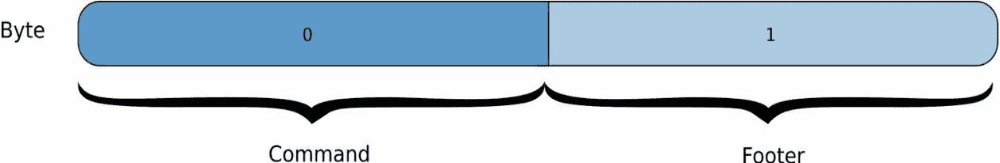

### Figure 13-2. Packet structure for commands

外设读取传入消息的页脚字节以确定消息的类型，即错误或命令。例如，将消息类型定义为：

### Table 13-1. Footer Values

| Name | Value | Description |
|---|---:|---|
| `bleResponseError` | 0 | The Central is sending a error |
| `bleResponseConfirmation` | 1 | The Central is sending a confirmation |
| `bleResponseCommand` | 2 | The Central is sending a command |

外设读取第一个字节以确定错误或命令的类型。例如，将命令定义为：

### Table 13-2. Command Values

| Name | Value | Description |
|---|---:|---|
| `bleCommandLedOff` | 1 | Turn off the Peripheral’s LED |
| `bleCommandLedOn` | 2 | Turn on the Peripheral’s LED |

然后外设以关于成功或失败执行命令的状态消息响应中央。这也可以表示为两个字节（图 13-3）。

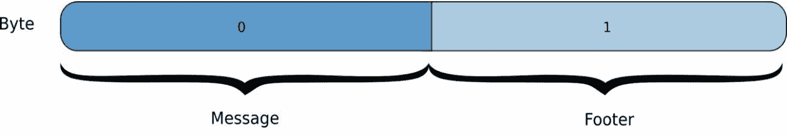

### Figure 13-3. Packet structure for responses

This program has two commands: one to turn the LED on and one to turn the LED off.

```cpp
static const unsigned int ledOn = 1;

static const unsigned int ledOff = 2;
```

Responses to the Central must represent the state of the LED.

```cpp
void sendBleCommandResponse(int ledState) {

  byte confirmation[characteristicTransmissionLength] = {0x0};

  confirmation[bleResponseDataPosition] = (byte)ledState;

  confirmation[bleResponseFooterPosition] = \

    (byte)bleResponseConfirmationFooter;

  responseCharacteristic.setValue(

    (const unsigned char*) confirmation,

    characteristicTransmissionLength

  );

}
```


Once a command has been received, the Peripheral needs to change the LED state, then notify the Central that the command has been processed.

```cpp
void loop() {
  if (bleCommandReceived) {
    bleCommandReceived = false; // ensures only executed once

    // incoming command is one byte
    unsigned int command = bleMessage[bleMessageDataPosition];

    if(command == bleCommandLedOn) {
      Serial.println("Turning LED on");
      ledState = HIGH;
      sendBleCommandResponse(ledState);
    } else {
      Serial.println("Turning LED off");
      ledState = LOW;
      sendBleCommandResponse(ledState);
    }

    digitalWrite(ledPin, ledState);
  }
}
```

## Putting It All Together

The following sketch will create a Peripheral that can receive pre-programmed commands to turn the onboard LED on and off.

Create a new project called `led_remote`, and copy the following code:

**Example 12-1.** `sketches/led_remote/led_remote.ino`

```cpp
#include "CurieBle.h"

static const char* bluetoothDeviceName = "LedRemote";
static const int characteristicTransmissionLength = 2;

// Commands
static const uint8_t bleCommandFooterPosition = 1;
static const uint8_t bleCommandDataPosition = 0;
static const uint8_t bleCommandFooter = 1;
static const uint8_t bleCommandLedOn = 1;
static const uint8_t bleCommandLedOff = 2;

// Responses
static const uint8_t bleResponseFooterPosition = 1;
static const uint8_t bleResponseDataPosition = 0;
static const uint8_t bleResponseErrorFooter = 0;
static const uint8_t bleResponseConfirmationFooter = 1;
static const uint8_t bleResponseLedError = 0;
static const uint8_t bleResponseLedOn = 1;
static const uint8_t bleResponseLedOff = 2;

// Peripheral Properties
static const byte ledPin = 13;
static const unsigned int ledError = 0;
static const unsigned int ledOn = 1;
static const unsigned int ledOff = 2;

int ledState = ledOff;

// internal state
char bleMessage[characteristicTransmissionLength];
const char* uuid;
bool bleCommandReceived = false;

BLEService service("180C");

BLECharacteristic commandCharacteristic(
  "2A56",
  BLEWrite,
  characteristicTransmissionLength
);

BLECharacteristic responseCharacteristic(
  "2A57",
  BLERead | BLENotify,
  characteristicTransmissionLength
);

// Central connected. Print MAC address
void onCentralConnected(BLECentral& central) {
    Serial.print("Central connected: ");
    Serial.println(central.address());
}

// Central disconnected
void onCentralDisconnected(BLECentral& central) {
    Serial.println("Central disconnected");
}

void setup() {
    Serial.begin(9600);
    while (!Serial) {} // wait for Serial to connect

    digitalWrite(ledPin, LOW); // start with LED off

    blePeripheral.setLocalName(bluetoothDeviceName);

    // attach callback when central connects
    blePeripheral.setEventHandler(
        BLEConnected,
        onCentralConnected
    );

    // attach callback when central disconnects
    blePeripheral.setEventHandler(
        BLEDisconnected,
        onCentralDisconnected
    );

    blePeripheral.setAdvertisedServiceUuid(service.uuid());
    blePeripheral.addAttribute(service);
    blePeripheral.addAttribute(commandCharacteristic);
    blePeripheral.addAttribute(responseCharacteristic);

    commandCharacteristic.setEventHandler(
        BLEWritten,
        onCharacteristicWritten
    );

    Serial.print("Starting ");
    Serial.println(bluetoothDeviceName);

    blePeripheral.begin();
}

void loop() {
    if(bleCommandReceived) {
        bleCommandReceived = false; // ensures only executed once

        // incoming command is one byte
        unsigned int command = bleMessage[bleCommandDataPosition];

        if(command == bleCommandLedOn) {
            Serial.println("Turning LED on");
            ledState = HIGH;
            sendBleCommandResponse(ledState);
        } else {
            Serial.println("Turning LED off");
            ledState = LOW;
            sendBleCommandResponse(ledState);
        }

        digitalWrite(ledPin, ledState);
    }
}
```


The resulting Peripheral turns an LED on and off when instructed, and reports that it’s processed the command.

When the Central sends the “Light On” command, the Serial Monitor should resemble this (Figure 12-4):

## Example code

The code for this chapter is available online at: [https://github.com/BluetoothLowEnergyInArduino101/Chapter12](https://github.com/BluetoothLowEnergyInArduino101/Chapter12)

## Appendix I: Bluetooth Properties

For reference, the following are properties of the Bluetooth Low Energy network and hardware.

| Property | Value |
|---|---|
| Range | 100 m (330 ft) |
| Data Rate | 1M bit/s |
| Application Throughput | 0.27 Mbit/s |
| Security | 128-bit AES with Counter Mode CBC-MAC and application layer user data encryption (BEWARE: this encryption has vulnerabilities) |
| Robustness | Adaptive Frequency Hopping, Layer Acknowledgement, 24-bit CRC, 32-bit Message Integrity Check |
| Peak Current Consumption | < 15 mA |
| Byte-Order in Broadcast | Big Endian (most significant bit at ... ) |

## Appendix II: UUID Format

Bluetooth Low Energy has tight space requirements. Therefore it is preferred to transmit 16-bit UUIDs instead of 32-bit UUIDs. UUIDs can be converted between 16-bit and 32-bit with the standard Bluetooth Low Energy UUID format:

**Table II-1. 16-bit to 32-bit UUID Conversion Standard**

| UUID Format | uuid16 | Resulting uuid32 |
|---|---|---|
| 00000000-0000-1000-8000-00805f9b34fb | 0x2A56 | 00002A56-0000-1000-8000-00805f9b34fb |

## Appendix III: Minimal Recommended GATT

As a best practice, it is good to host a standard set of Services and Characteristics in a Peripheral's GATT Profile. These Characteristics allow connected Centrals to get the make and model number of the device, and the battery level if the Peripheral is battery-powered:

**Table III-1. Minimal GATT Profile**

| GATT Type | Name | Data Type | UUID |
|---|---|---|---|
| Service | Device Information Service |  | 0x180A |
| Characteristic | Device Name | char array | 0x2A00 |
| Characteristic | Model Number | char array | 0x2A24 |
| Characteristic | Serial Number | char array | 0x2A25 |
| Service | Battery Service |  | 0x180F |
| Characteristic | Battery Level | integer | 0x2A19 |

| Service | UUID | Name |
|---|---|---|
| Battery Service | 0x180F | org.bluetooth.service.battery_service |
| Blood Pressure | 0x1810 | org.bluetooth.service.blood_pressure |
| Body Composition | 0x181B | org.bluetooth.service.body_composition |
| Bond Management | 0x181E | org.bluetooth.service.bond_management |
| Continuous Glucose Monitoring | 0x181F | org.bluetooth.service.continuous_glucose_monitoring |
| Current Time Service | 0x1805 | org.bluetooth.service.current_time |
| Cycling Power | 0x1818 | org.bluetooth.service.cycling_power |
| Cycling Speed and Cadence | 0x1816 | org.bluetooth.service.cycling_speed_and_cadence |
| Device Information | 0x180A | org.bluetooth.service.device_information |
| Environmental Sensing | 0x181A | org.bluetooth.service.environmental_sensing |
| Generic Access | 0x1800 | org.bluetooth.service.generic_access |
| Generic |  |  |

| 属性 | UUID | 服务 UUID |
| --- | --- | --- |
| 通用属性 | 0x1801 | org.bluetooth.service.generic_attribute |
| 血糖 | 0x1808 | org.bluetooth.service.glucose |
| 健康体温计 | 0x1809 | org.bluetooth.service.health_thermometer |
| 心率 | 0x180D | org.bluetooth.service.heart_rate |
| HTTP 代理 | 0x1823 | org.bluetooth.service.http_proxy |
| 人机接口设备 | 0x1812 | org.bluetooth.service.human_interface_device |
| 立即警报 | 0x1802 | org.bluetooth.service.immediate_alert |
| 室内定位 | 0x1821 | org.bluetooth.service.indoor_positioning |
| 互联网协议支持 | 0x1820 | org.bluetooth.service.internet_protocol_support |
| 链路丢失 | 0x1803 | org.bluetooth.service.link_loss |
| 位置与导航 | 0x1819 | org.bluetooth.service.location_and_navigation |
| 下次夏令时变更服务 | 0x1807 | org.bluetooth.service.next_dst_change_service |
| 对象传输 | 0x1825 | org.bluetooth.service.object_transfer |
| 电话提醒状态服务 | 0x180E | org.bluetooth.service.phone_alert_status |
| 脉搏血氧仪 | 0x1822 | org.bluetooth.service.pulse_oximeter |
| 参考时间更新服务 | 0x1806 | org.bluetooth.service.reference_time_update |
| 跑步速度与步频 | 0x1814 | org.bluetooth.service.running_speed_and_cadence |
| 扫描参数 | 0x1813 | org.bluetooth.service.scan_parameters |
| 传输发现 | 0x1824 | org.bluetooth.service.transport_discovery |
| 发射功率 | 0x1804 | org.bluetooth.service.tx_power |
| 用户数据 | 0x181C | org.bluetooth.service.user_data |
| 体重秤 | 0x181D | org.bluetooth.service.weight_scale |

**来源：** Bluetooth SIG：GATT 服务

摘自 https://www.bluetooth.com/specifications/gatt/services

| 名称 | UUID | 描述 |
| --- | --- | --- |
| 视风风向 | 0x2A73 | org.bluetooth.characteristic.apparent_wind_direction |
| 视风风速 | 0x2A72 | org.bluetooth.characteristic.apparent_wind_speed |
| 外观 | 0x2A01 | org.bluetooth.characteristic.gap.appearance |
| 气压趋势 | 0x2AA3 | org.bluetooth.characteristic.barometric_pressure_trend |
| 电池电量 | 0x2A19 | org.bluetooth.characteristic.battery_level |
| 血压特征 | 0x2A49 | org.bluetooth.characteristic.blood_pressure_feature |
| 血压测量 | 0x2A35 | org.bluetooth.characteristic.blood_pressure_measurement |
| 身体成分特征 | 0x2A9B | org.bluetooth.characteristic.body_composition_feature |
| 身体成分测量 | 0x2A9C | org.bluetooth.characteristic.body_composition_measurement |
| 身体传感器位置 | 0x2A38 | org.bluetooth.characteristic.body_sensor_location |
| CGM 会话运行时间 | 0x2AAB | org.bluetooth.characteristic.cgm_session_run_time |
| CGM 会话开始时间 | 0x2AAA | org.bluetooth.characteristic.cgm_session_start_time |
| CGM 特定操作控制点 | 0x2AAC | org.bluetooth.characteristic.cgm_specific_ops_control_point |
| CGM 状态 | 0x2AA9 | org.bluetooth.characteristic.cgm_status |
| CSC 特征 | 0x2A5C | org.bluetooth.characteristic.csc_feature |
| CSC 测量 | 0x2A5B | org.bluetooth.characteristic.csc_measurement |
| 当前时间 | 0x2A2B | org.bluetooth.characteristic.current_time |
| 骑行功率控制点 | 0x2A66 | org.bluetooth.characteristic.cycling_power_control_point |
| 骑行功率特征 | 0x2A65 | org.bluetooth.characteristic.cycling_power_feature |
| 骑行功率测量 | 0x2A63 | org.bluetooth.characteristic.cycling_power_measurement |
| 骑行功率向量 | 0x2A64 | org.bluetooth.characteristic.cycling_power_vector |
| 数据库更改增量 | 0x2A99 | org.bluetooth.characteristic.database_change_increment |
| 出生日期 | 0x2A85 | org.bluetooth.characteristic.date_of_birth |
| 阈值评估日期 | 0x2A86 | org.bluetooth.characteristic.date_of_threshold_assessment |
| 日期时间 | 0x2A08 | org.bluetooth.characteristic.date_time |
| 日日期时间 | 0x2A0A | org.bluetooth.characteristic.day_date_time |
| 星期几 | 0x2A09 | org.bluetooth.characteristic.day_of_week |
| 描述符值已更改 | 0x2A7D | org.bluetooth.characteristic.descriptor_value_changed |
| 设备名称 | 0x2A00 | org.bluetooth.characteristic.gap.device_name |
| 露点 | 0x2A7B | org.bluetooth.characteristic.dew_point |
| 数字 | 0x2A56 | org.bluetooth.characteristic.digital |
| 夏令时偏移 | 0x2A0D | org.bluetooth.characteristic.dst_offset |
| 海拔 | 0x2A6C | org.bluetooth.characteristic.elevation |
| 电子邮件地址 | 0x2A87 | org.bluetooth.characteristic.email_address |
| 精确时间 256 | 0x2A0C | org.bluetooth.characteristic.exact_time_256 |
| 燃脂心率 | 0x2A88 | org.bluetooth.characteristic.fat_burn_heart_rate |
| HTTP 状态码 | 0x2AB8 | org.bluetooth.characteristic.http_status_code |
| HTTPS 安全性 | 0x2ABB | org.bluetooth.characteristic.https_security |
| 湿度 | 0x2A6F | org.bluetooth.characteristic.humidity |
| IEEE 11073-20601 监管认证数据列表 | 0x2A2A | org.bluetooth.characteristic.ieee_11073-20601_regulatory_certification_data_list |
| 室内定位配置 | 0x2AAD | org.bluetooth.characteristic.indoor_positioning_configuration |
| 中间袖带压力 | 0x2A36 | org.bluetooth.characteristic.intermediate_cuff_pressure |
| 中间温度 | 0x2A1E | org.bluetooth.characteristic.intermediate_temperature |
| 辐照度 | 0x2A77 | org.bluetooth.characteristic.irradiance |
| 语言 | 0x2AA2 | org.bluetooth.characteristic.language |
| 姓氏 | 0x2A90 | org.bluetooth.characteristic.last_name |
| 纬度 | 0x2AAE | org.bluetooth.characteristic.latitude |
| LN 控制 | 0x2A6B | org.bluetooth.characteristic.ln_control |
| 最大推荐心率 | 0x2A91 | org.bluetooth.characteristic.maximum_recommended_heart_rate |
| 测量间隔 | 0x2A21 | org.bluetooth.characteristic.measurement_interval |
| 型号字符串 | 0x2A24 | org.bluetooth.characteristic.model_number_string |
| 导航 | 0x2A68 | org.bluetooth.characteristic.navigation |
| 新提醒 | 0x2A46 | org.bluetooth.characteristic.new_alert |
| 对象操作控制点 | 0x2AC5 | org.bluetooth.characteristic.object_action_control_point |
| 对象已更改 | 0x2AC8 | org.bluetooth.characteristic.object_changed |
| 对象首次创建 | 0x2AC1 | org.bluetooth.characteristic.object_first_created |
| 对象 ID | 0x2AC3 | org.bluetooth.characteristic.object_id |
| 对象上次修改 | 0x2AC2 | org.bluetooth.characteristic.object_last_modified |
| 对象列表控制点 | 0x2AC6 | org.bluetooth.characteristic.object_list_control_point |
| 对象列表过滤器 | 0x2AC7 | org.bluetooth.characteristic.object_list_filter |
| 对象名称 | 0x2ABE | org.bluetooth.characteristic.object_name |
| 对象属性 | 0x2AC4 | org.bluetooth.characteristic.object_properties |
| 对象大小 | 0x2AC0 | org.bluetooth.characteristic.object_size |
| 对象类型 | 0x2ABF | org.bluetooth.characteristic.object_type |
| OTS 特征 | 0x2ABD | org.bluetooth.characteristic.ots_feature |
| 外设首选连接参数 | 0x2A04 | org.bluetooth.characteristic.gap.peripheral_preferred_connection_parameters |
| 外设隐私标志 | 0x2A02 | org.bluetooth.characteristic.gap.peripheral_privacy_flag |
| PLX 连续测量 | 0x2A5F | org.bluetooth.characteristic.plx_continuous_measurement |
| PLX 特征 | 0x2A60 | org.bluetooth.characteristic.plx_features |
| PLX 抽查测量 | 0x2A5E | org.bluetooth.characteristic.plx_spot_check_measurement |
| PnP ID | 0x2A50 | org.bluetooth.characteristic.pnp_id |
| 花粉浓度 | 0x2A75 | org.bluetooth.characteristic.pollen_concentration |
| RSC 特征 | 0x2A54 | org.bluetooth.characteristic.rsc_feature |
| RSC 测量 | 0x2A53 | org.bluetooth.characteristic.rsc_measurement |
| SC 控制点 | 0x2A55 | org.bluetooth.characteristic.sc_control_point |
| 扫描间隔窗口 | 0x2A4F | org.bluetooth.characteristic.scan_interval_window |
| 扫描刷新 | 0x2A31 | org.bluetooth.characteristic.scan_refresh |
| 传感器位置 | 0x2A5D | org.bluetooth.characteristic.sensor_location |
| 序列号字符串 | 0x2A25 | org.bluetooth.characteristic.serial_number_string |
| 服务已更改 | 0x2A05 | org.bluetooth.characteristic.gatt.service_changed |
| 软件版本字符串 | 0x2A28 | org.bluetooth.characteristic.software_revision_string |
| 有氧和无氧阈值的运动类型 | 0x2A93 | org.bluetooth.characteristic.sport_type_for_aerobic_and_anaerobic_thresholds |
| 支持的新提醒类别 | 0x2A47 | org.bluetooth.characteristic.supported_new_alert_category |

| 名称 | UUID | 描述 |
|---|---|---|
| 受支持的新警报类别 | 0x2A47 | org.bluetooth.characteristic.supported_new_alert_category |
| 受支持的未读警报类别 | 0x2A48 | org.bluetooth.characteristic.supported_unread_alert_category |
| 系统 ID | 0x2A23 | org.bluetooth.characteristic.system_id |
| TDS 控制点 | 0x2ABC | org.bluetooth.characteristic.tds_control_point |
| 温度 | 0x2A6E | org.bluetooth.characteristic.temperature |
| 温度测量 | 0x2A1C | org.bluetooth.characteristic.temperature_measurement |
| 温度类型 | 0x2A1D | org.bluetooth.characteristic.temperature_type |
| 三区心率限值 | 0x2A94 | org.bluetooth.characteristic.three_zone_heart_rate_limits |
| 时间精度 | 0x2A12 | org.bluetooth.characteristic.time_accuracy |
| 时间源 | 0x2A13 | org.bluetooth.characteristic.time_source |
| 时间更新控制点 | 0x2A16 | org.bluetooth.characteristic.time_update_control_point |
| 时间更新状态 | 0x2A17 | org.bluetooth.characteristic.time_update_state |
| 含夏令时的时间 | 0x2A11 | org.bluetooth.characteristic.time_with_dst |
| 时区 | 0x2A0E | org.bluetooth.characteristic.time_zone |
| 真风向 | 0x2A71 | org.bluetooth.characteristic.true_wind_direction |
| 真风速 | 0x2A70 | org.bluetooth.characteristic.true_wind_speed |
| 双区心率限值 | 0x2A95 | org.bluetooth.characteristic.two_zone_heart_rate_limit |
| 发射功率电平 | 0x2A07 | org.bluetooth.characteristic.tx_power_level |
| 不确定性 | 0x2AB4 | org.bluetooth.characteristic.uncertainty |
| 未读警报状态 | 0x2A45 | org.bluetooth.characteristic.unread_alert_status |
| URI | 0x2AB6 | org.bluetooth.characteristic.uri |
| 用户控制点 | 0x2A9F | org.bluetooth.characteristic.user_control_point |
| 用户索引 | 0x2A9A | org.bluetooth.characteristic.user_index |
| 紫外线指数 | 0x2A76 | org.bluetooth.characteristic.uv_index |
| 最大摄氧量 | 0x2A96 | org.bluetooth.characteristic.vo2_max |
| 腰围 | 0x2A97 | org.bluetooth.characteristic.waist_circumference |
| 重量 | 0x2A98 | org.bluetooth.characteristic.weight |
| 重量测量 | 0x2A9D | org.bluetooth.characteristic.weight_measurement |
| 体重秤功能 | 0x2A9E | org.bluetooth.characteristic.weight_scale_feature |
| 风寒指数 | 0x2A79 | org.bluetooth.characteristic.wind_chill |

**来源：** Bluetooth SIG：GATT 特征。取自 https://www.bluetooth.com/specifications/gatt/characteristics

## 附录 VI：GATT 描述符

以下 GATT 描述符 UUID 已保留用于特定用途。

GATT 描述符用于描述特征中可修改的属性，例如，客户端特征配置（0x2902）可被标记，以允许已连接的中央设备订阅某特征的通知。

### 表 VI-1. 保留的 GATT 描述符

| 规范名称 | UUID | 规范 |
|---|---|---|
| 特征聚合格式 | 0x2905 | org.bluetooth.descriptor.gatt.characteristic_aggregate_format |
| 特征扩展属性 | 0x2900 | org.bluetooth.descriptor.gatt.characteristic_extended_properties |
| 特征表示格式 | 0x2904 | org.bluetooth.descriptor.gatt.characteristic_presentation_format |
| 特征用户描述 | 0x2901 | org.bluetooth.descriptor.gatt.characteristic_user_description |
| 客户端特征配置 | 0x2902 | org.bluetooth.descriptor.gatt.client_characteristic_configuration |
| 环境传感配置 | 0x290B | org.bluetooth.descriptor.es_configuration |
| 环境传感测量 | 0x290C | org.bluetooth.descriptor.es_measurement |
| 环境传感触发设置 | 0x290D | org.bluetooth.descriptor.es_trigger_setting |
| 外部报告引用 | 0x2907 | org.bluetooth.descriptor.external_report_reference |
| 数字量数目 | 0x2909 | org.bluetooth.descriptor.number_of_digitals |
| 报告引用 | 0x2908 | org.bluetooth.descriptor.report_reference |
| 服务端特征配置 | 0x2903 | org.bluetooth.descriptor.gatt.server_characteristic_configuration |
| 时间触发设置 | 0x290E | org.bluetooth.descriptor.time_trigger_setting |
| 有效范围 | 0x2906 | org.bluetooth.descriptor.valid_range |
| 值触发设置 | 0x290A | org.bluetooth.descriptor.value_trigger_setting |

**来源：** Bluetooth SIG：GATT 描述符。取自 https://www.bluetooth.com/specifications/gatt/descriptors

## 附录 VII：公司标识符

以下公司拥有特定的制造商标识符，用于在通用访问规范（GAP）中标识蓝牙设备。没有特定制造商的外设使用 ID 65535（0xffff）。所有其他 ID 均被保留，即使尚未分配。

此列表并非详尽无遗。完整且更新的列表可在 Bluetooth SIG 网站上找到。

### 表 VII-1. 公司标识符

| 十进制 | 十六进制 | 公司 |
|---|---|---|
| 0 | 0x0000 | 爱立信技术许可 |
| 1 | 0x0001 | 诺基亚移动电话 |
| 2 | 0x0002 | 英特尔公司 |
| 3 | 0x0003 | IBM 公司 |
| 4 | 0x0004 | 东芝公司 |
| 5 | 0x0005 | 3Com 公司 |
| 6 | 0x0006 | 微软 |
| 7 | 0x0007 | 朗讯 |
| 8 | 0x0008 | 摩托罗拉 |
| 13 | 0x000D | 德州仪器公司 |
| 19 | 0x0013 | 爱特梅尔公司 |
| 29 | 0x001D | 高通 |
| 36 | 0x0024 | 阿尔卡特 |
| 37 | 0x0025 | 恩智浦半导体（前身为飞利浦半导体） |
| 60 | 0x003C | 黑莓有限公司（前身为 RIM 公司） |
| 76 | 0x004C | 苹果公司 |
| 86 | 0x0056 | 索尼爱立信移动通信 |
| 89 | 0x0059 | 北欧半导体公司 |
| 92 | 0x005C | 贝尔金国际公司 |
| 93 | 0x005D | 瑞昱半导体公司 |
| 101 | 0x0065 | 惠普公司 |
| 104 | 0x0068 | 通用汽车 |
| 117 | 0x0075 | 三星电子有限公司 |
| 120 | 0x0078 | 耐克公司 |
| 135 | 0x0087 | 佳明国际公司 |
| 138 | 0x008A | Jawbone |
| 184 | 0x00B8 | 高通创新中心（QuIC） |
| 215 | 0x00D7 | 高通技术公司 |
| 216 | 0x00D8 | 高通互联体验 |
| 220 | 0x00DC | 宝洁 |
| 224 | 0x00E0 | 谷歌 |
| 359 | 0x0167 | 拜耳医疗保健 |
| 367 | 0x016F | Podo 实验室公司 |
| 369 | 0x0171 | 亚马逊物流服务 |
| 387 | 0x0183 | 华特迪士尼 |
| 398 | 0x018E | Fitbit 公司 |
| 425 | 0x01A9 | 佳能公司 |
| 427 | 0x01AB | Facebook 公司 |
| 474 | 0x01DA | 罗技国际公司 |
| 558 | 0x022E | 西门子股份公司 |
| 605 | 0x025D | 利盟国际公司 |
| 637 | 0x027D | 华为技术有限公司 |
| 720 | 0x02D0 | 3M 公司 |
| 876 | 0x036C | Zipcar |
| 897 | 0x0381 | 夏普公司 |
| 921 | 0x0399 | 尼康公司 |
| 1117 | 0x045D | 波士顿科学公司 |
| 65535 | 0xFFFF | 无设备 ID |

**来源：** Bluetooth SIG：公司标识符。取自 https://www.bluetooth.com/specifications/assigned-numbers/company-identifiers

## 术语表

以下是蓝牙低功耗相关术语及其含义的列表。

- **安卓** - 一种用于智能手机和平板电脑的开源操作系统。
- **Arduino** - 一个开源计算机硬件与软件公司、项目及用户社区，设计并制造单板微控制器和微控制器套件，用于构建能够感知和控制现实世界物体的数字设备与交互式对象。
- **属性** - GATT 配置文件中的一个单元，可供中央设备访问，例如服务或特征。
- **信标** - 一种持续广播的蓝牙低功耗外设，使中央设备能够从广播属性中收集的信息来辨别自己的位置。
- **蓝牙低功耗（BLE）** - 一种用于微型电子设备的低功率、短距离无线协议。
- **广播** - 蓝牙低功耗的一项功能，外设通过它输出自己的名称和其他特定数据。

- **中心设备** - 一种低功耗蓝牙设备，可连接多个外围设备。
- **信道** - 一种经过精细调谐的射频频率，用于广播或数据传输。
- **特征** - 一个端口或数据端点，可在此读取或写入数据。
- **描述符** - 特征的一项功能，允许某种数据交互，例如读取、写入或通知。
- **E0** - 低功耗蓝牙内置的加密算法。
- **通用属性（GATT）配置文件** - 一组服务和特征的列表，这些服务和特征是外围设备所特有的，并描述外围设备如何提供数据。GATT配置文件由外围设备托管。
- **iBeacon** - 一种与苹果兼容的信标，允许中心设备下载特定的数据包，以告知中心设备其绝对位置和其他属性。
- **Intel® Curie™模块** - 为Arduino 101提供支持并包含蓝牙芯片组的Intel®模块。
- **通知** - 外围设备提醒中心设备数据发生变化的一种操作。
- **外围设备** - 一种低功耗蓝牙设备，可连接到单个中心设备。外围设备托管通用属性（GATT）配置文件。
- **读取** - 中心设备从特征下载数据的一种操作。
- **扫描** - 中心设备搜索广播中的外围设备的过程。
- **扫描响应** - 低功耗蓝牙的一项功能，允许中心设备在不连接的情况下下载一小包数据。
- **服务** - 用于组织数据端点的容器结构。服务由外围设备托管。
- **通用唯一标识符（UUID）** - 一个较长、随机生成的字母数字字符串，无论在哪里使用都是唯一的。UUID旨在避免无数程序相互交互时可能发生的名称冲突。
- **写入** - 中心设备更改特征上数据的一种操作。

## 关于作者


托尼有着无穷无尽的好奇心，这促使他想要探索和学习他所接触的一切；而他的热情又驱使他将所学分享给他人。

他有两大真正的热爱：品牌塑造和发明创造。

他对品牌塑造的热情促使他创办了一家公司，为苹果、英特尔和索尼BMG等企业在四个国家开展品牌和营销业务。他喜欢将设计、写作、产品和战略等元素编织成一个定义公司的本质真理。

他对发明的热情促使他创办了一家利用脑成像技术量化冥想并预测癫痫发作的公司。该公司获得了150万美元的融资，并在旧金山孵化，他目前居住在那里。

同样的热情也让他经历了一些冒险，包括与希腊东正教僧侣一起住在修道院里，以及跟随西班牙的一位吉普赛人学习弹奏弗拉门戈吉他。

## 关于本书

本书是一本实用的指南，介绍如何在Android手机和平板电脑上进行低功耗蓝牙编程。

在本书中，你将学习如何编写Android设备程序，使其通过低功耗蓝牙与任何中心设备或外围设备通信的基础知识。本书的每一章都建立在前一章的基础上，最终形成了三个项目：

- 信标与扫描器
- 回显服务器与客户端
- 遥控设备

在阅读本书的过程中，你将学习到一些重要的概念，这些概念涉及：

- 低功耗蓝牙如何工作
- 数据如何发送和接收
- 处理数据的常见范式

## 技能水平

无论你对Android上的Java编程有基础还是高级知识，这本书都非常适合你。

## 本系列其他图书

如果你对其他低功耗蓝牙设备的编程感兴趣，请查看本系列的其他图书，或访问[bluetoothlowenergybooks.com](http://bluetoothlowenergybooks.com)：

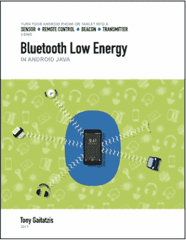

### Android Java中的低功耗蓝牙编程

Tony Gaitatzis, 2017

ISBN: 978-1-7751280-1-4

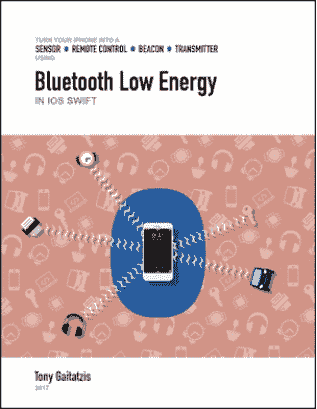

### iOS Swift中的低功耗蓝牙编程

Tony Gaitatzis, 2017

ISBN: 978-1-7751280-0-7

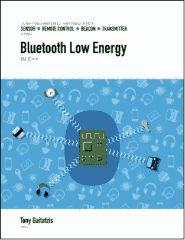

### 面向nRF微控制器的C++低功耗蓝牙编程

Tony Gaitatzis, 2017

ISBN: 978-1-7751280-3-8

（此页有意留白。）

- **广播** - 低功耗蓝牙的一项功能，外围设备借此输出自己的名称和其他特定数据。
- **属性** - GATT配置文件中的一个单元，可由中心设备访问，例如服务或特征。
- **信标** - 一种低功耗蓝牙外围设备，通过持续广播，使中心设备能够从广播属性中获取的信息来辨别它们的位置。
- **大端** - 一种以二进制存储数字的机制，数字的最高有效值最先存储，通常显示在屏幕右侧。
- **低功耗蓝牙（BLE）** - 一种供微电子设备使用的低功耗、短距离无线协议。
- **中心设备** - 一种低功耗蓝牙设备，可连接多个外围设备。
- **信道** - 一种经过精细调谐的射频频率，用于广播或数据传输。
- **特征** - 一个端口或数据端点，可在此读取或写入数据。
- **描述符** - 特征的一项功能，允许某种数据交互，例如读取、写入或通知。
- **E0** - 低功耗蓝牙内置的加密算法。
- **通用访问配置文件（GAP）** - 关于外围设备的标识信息，用于通过名称、服务列表、可连接性或其他自定义数据来识别外围设备。这些数据在连接后可访问，并以大端格式存储。
- **iBeacon** - 一种与苹果兼容的信标，允许中心设备下载特定的数据包，以告知中心设备其绝对位置和其他属性。
- **小端** - 一种以二进制存储数字的机制，数字的最低有效值最先存储，通常显示在屏幕右侧。
- **通知** - 外围设备提醒中心设备数据发生变化的一种操作。
- **外围设备** - 一种低功耗蓝牙设备，可连接到单个中心设备。外围设备托管通用属性（GATT）配置文件。
- **读取** - 中心设备从特征下载数据的一种操作。
- **扫描** - 中心设备搜索广播中的外围设备的过程。
- **扫描响应** - 低功耗蓝牙的一项功能，允许中心设备在不连接的情况下下载一小包数据。
- **服务** - 用于组织数据端点的容器结构。服务由外围设备托管。
- **通用唯一标识符（UUID）** - 一个较长、随机生成的字母数字字符串，无论在哪里使用都是唯一的。UUID旨在避免无数程序相互交互时可能发生的名称冲突。
- **写入** - 中心设备更改特征上数据的一种操作。
- **Android** - 用于智能手机和平板电脑的开源操作系统。
- **广播** - 低功耗蓝牙的一项功能，外围设备借此输出自己的名称和其他特定数据。
- **信标** - 一种低功耗蓝牙外围设备，通过持续广播，使中心设备能够从广播属性中获取的信息来辨别它们的位置。
- **大端** - 一种以二进制存储数字的机制，数字的最高有效值最先存储，通常显示在屏幕右侧。
- **低功耗蓝牙（BLE）** - 一种供微电子设备使用的低功耗、短距离无线协议。
- **中心设备** - 一种低功耗蓝牙设备，可连接多个外围设备。
- **信道** - 一种经过精细调谐的射频频率，用于广播或数据传输。

## 特征

可以读取或写入数据的端口或数据端点。

## 描述符

特征的一项特性，允许进行某种数据交互，如读取、写入或通知。

## E0

低功耗蓝牙内置的加密算法。

## 通用访问配置文件（GAP）

关于外围设备的识别信息，通过名称、服务列表、可连接性或其他自定义数据来标识外围设备。此数据在连接后可访问，并以大端格式存储。

## iBeacon

一种兼容苹果的信标，允许中心设备下载特定数据包，以告知中心设备其绝对位置和其他属性。

## 小端序

一种以二进制存储数字的机制，其中数字的最低有效值最先存储，通常在屏幕的右侧表示。

## 通知

外围设备向中心设备提醒数据发生变化的一种操作。

## 外围设备

一种低功耗蓝牙设备，可以连接到单个中心设备。外围设备托管通用属性（GATT）配置文件。

## 读取

中心设备从特征下载数据的一种操作。

## 扫描

中心设备搜索广播外围设备的过程。

## 扫描响应

低功耗蓝牙的一项功能，允许中心设备在不连接的情况下下载一个小数据包。

## 服务

用于组织数据端点的容器结构。服务由外围设备托管。

## 写入

中心设备修改特征上数据的一种操作。

## Android

用于智能手机和平板电脑的开源操作系统。

