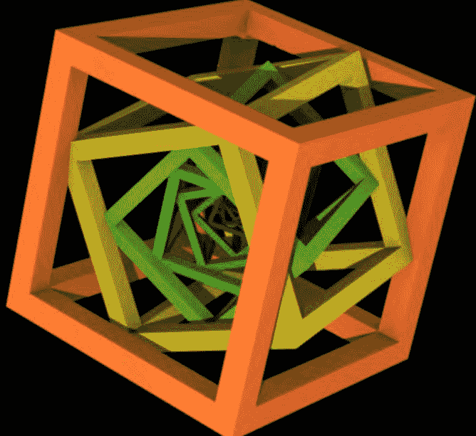

# C-C++ 自建 Redis 指南：通过从零编码学习网络编程与数据结构



> “我无法创造的，我无法理解”
>
> — James Smith

# 第一部分 入门指南

创建一个能够响应命令的功能性服务器。

## 01. 简介

### 本书是关于什么的？

本书包含了一个类 Redis 服务器简单实现的步骤逐步指南。它旨在作为网络编程以及 C 语言中基础数据结构实现与应用的实战指南或教程。

### 从书中可以学到什么？

Redis 可以被认为是现代计算中经受时间考验的基石之一。构建这样一个项目所需的知识比通常的应用层开发更广、也更深。从此类项目中学习是软件开发者提升技能的好方法。

Redis 是学习的一个良好目标，因为它涵盖了软件工程的两个重要主题：网络编程和数据结构。

- 尽管有很多关于 socket API 或高层库的指南，但网络编程不仅仅是调用 API 或库。理解核心概念（如事件循环、协议、定时器等）至关重要，本书将涵盖这些内容。即使你只是在应用程序中使用高层网络库或框架，缺乏对这些概念的理解也会导致致命错误。
- 尽管许多人从教科书中学习过一些基础数据结构，但仍然有东西可以学习。在真实项目中实现的数据结构通常具有教科书中未触及的实际考量。学习如何在非玩具环境（尤其是使用 C 语言）中使用数据结构，将是构建 Redis 带来的独特体验。

与大多数真实世界项目一样，Redis 是一个投入大量精力构建的复杂项目，对初学者来说可能难以掌握。相反，本书采取了相反的方法：通过从零开始构建来学习。

### 为什么要从零开始？

有几点：

- **更快**。从零开始构建东西，可以逐渐引入概念。从小开始，增量式地添加内容，最后获得全局观。
- **更深**。虽然有很多材料解释现有东西如何工作，但通过阅读这些材料获得的理解往往与自己构建这些东西是不同的。人们很容易将记忆误认为是理解，而且比起原理和基础，更容易去关注无关紧要的细节。
- **更多**。“从零开始”的方法迫使你接触该主题的每一个方面——知识没有捷径！而且并不是每一个方面都是你预先已知的，在过程中你可能会发现“我并不知道自己不知道的东西”。

费曼的一句名言完美总结了这一点：“我无法创造的，我无法理解”。

### 如何使用本书？

本书采用循序渐进的方法。每一步都建立在上一步的基础上增加新概念。完整的源代码在网上提供供参考，建议读者对其进行调优或在没有代码的情况下进行动手实现（DIY）。

代码写得尽可能直接明了。大部分是纯 C 语言，带有极少的 C++ 特性。如果你不懂 C 语言不要担心，你完全可以用另一种语言自己来实现。

最终结果是一个大约 1200 行代码的迷你 Redis。1200 行代码（LoC）看起来很少，但它说明了书中试图涵盖的许多重要方面。

书中使用的技术和方法与真实的 Redis 并不完全相同。有些是刻意简化的，有些是为了说明某个通用主题而选择的。读者通过比较方法可以学到更多。

书中使用的代码仅旨在在 Linux 上运行，可以在此 URL 下载：

https://build-your-own.org/redis/src.tgz

本书的内容和源代码可以在线浏览：

https://build-your-own.org

## 02. Sockets 简介

本章是 socket 编程的介绍。假设读者具有计算机网络的基础知识，但没有网络编程经验。本书不包含如何使用 socket API 的所有细节，建议你在学习本书的同时，阅读相关的管理手册和其他网络编程指南（https://beej.us/ 是获取 socket API 的良好来源）。

Redis 是服务器/客户端系统的示例。多个客户端连接到一个服务器，服务器接收来自 TCP 连接的请求并发送响应。在开始 socket 编程之前，我们需要学习几个 Linux 系统调用。

`socket()` 系统调用返回一个 `fd`。如果你对 Unix 系统不熟悉：`fd` 是一个整数，指向 Linux 内核中的某些东西，例如 TCP 连接、磁盘文件。

首先，我们需要获取一个 socket fd：`int fd = socket(AF_INET, SOCK_STREAM, 0);`

`AF_INET` 用于 IPv4，`AF_INET6` 用于 IPv6 或双栈 socket。为了简单，我们在书中将一直使用 `AF_INET`。

`SOCK_STREAM` 用于 TCP。我们在书中不会使用除 TCP 以外的任何东西。`socket()` 用的三个参数在书中是固定的。

接下来，我们将引入一个新的调用：

```c
int val = 1;
setsockopt(fd, SOL_SOCKET, SO_REUSEADDR, &val, sizeof(val));
```

`setsockopt()` 用于配置 socket 的各种方面。这个特定的调用开启了 `SO_REUSEADDR`。如果没有这个选项，服务器重启将无法绑定同一个地址。练习题：找出到底什么是 `SO_REUSEADDR` 以及为什么需要它。

```cpp
// 监听
rv = listen(fd, SOMAXCONN);
if (rv) {
    die("listen()");
}
```

循环处理每个连接并对其进行操作。

```cpp
while (true) {
    // accept
    struct sockaddr_in client_addr = {};
    socklen_t socklen = sizeof(client_addr);
    int connfd = accept(fd, (struct sockaddr*)&client_addr, &socklen);
    if (connfd < 0) {
        continue;
        // 错误
    }

    do_something(connfd);
}
```

`do_something()` 函数简单地读取和写入。

```cpp
static void do_something(int connfd) {
    char rbuf[64] = {};
    ssize_t n = read(connfd, rbuf, sizeof(rbuf) - 1);
    if (n < 0) {
        msg("read() error");
        return;
    }
    printf("client says: %s\n", rbuf);

    char wbuf[] = "world";
    write(connfd, wbuf, strlen(wbuf));
}
```

注意 `read()` 和 `write()` 调用返回的是读取或写入的字节数。一个真正的程序员必须处理函数的返回值，但在本章中，为了简洁，我省略了很多内容。而且本章中的代码并不是网络编程的正确方式，正确的要简单得多：

```cpp
int fd = socket(AF_INET, SOCK_STREAM, 0);
if (fd < 0) {
    die("socket");
}

struct sockaddr_in addr = {};
addr.sin_family = AF_INET;
addr.sin_port = htons(1234);
addr.sin_addr.s_addr = ntohl(INADDR_LOOPBACK); // 127.0.0.1
int rv = connect(fd, (const struct sockaddr *)&addr, sizeof(addr));
if (rv) {
    die("connect");
}

char msg[] = "hello";
write(fd, msg, strlen(msg));

char rbuf[64] = {};
size_t n = read(fd, rbuf, sizeof(rbuf) - 1);
if (n < 0) {
    die("read");
}

printf("server says: %s\n", rbuf);
close(fd);
```

使用以下命令行编译我们的程序：

```bash
g++ -Wall -Wextra -O2 -g 03.server.cpp -o server
g++ -Wall -Wextra -O2 -g 03.client.cpp -o client
```

在一个窗口中运行 `./server`，然后在另一个窗口中运行 `./client`。你应该看到以下结果：

```
$ ./server
client says: hello
```

```
$ ./client
server says: world
```

读者练习题：阅读本章中使用的 API 的 manpages（帮助手册），或者在网上查找它们的教程。确保你知道如何查找 API 使用的帮助，因为这本书不会涵盖 API 使用的细节。

- 03_client.cpp
- 03_server.cpp

## 03. Hello 服务器/客户端

本章继续 socket 编程的介绍。我们将通过 2 个简单的程序来演示这些系统调用。

## 04. 协议解析

我们的服务器将能够处理来自客户端的多个请求，为了这一点，我们需要实现某种“协议”，至少要将请求从 TCP 字节流中分离出来。拆分请求最简单的方法是在请求开头声明请求的长度。让我们使用以下方案。

| len | msg1 | len | msg2 | more... |
| :--- | :--- | :--- | :--- | :--- |

该协议由两部分组成：一个 4 字节的小端整数，表示后续请求的长度，以及一个变长的请求。

从上一章的代码开始，服务器的循环被修改为处理多个请求：

```cpp
while (true) {
    // accept
    struct sockaddr_in client_addr = {};
    socklen_t socklen = sizeof(client_addr);
    int connfd = accept(fd, (struct sockaddr*)&client_addr, &socklen);
    if (connfd < 0) {
        continue; // 错误
    }

    // 只处理一个连接
    while (true) {
        int32_t err = one_request(connfd);
        if (err) {
            break;
        }
    }
    close(connfd);
}
```

`one_request` 函数只解析一个请求并响应，直到发生错误或客户端断开。在我们后续引入事件循环之前，服务器只能一次处理一个连接。

在列出 `one_request` 函数之前添加两个辅助函数：

```cpp
static int32_t read_full(int fd, char *buf, size_t n) {
    while (n > 0) {
        size_t rv = read(fd, buf, n);
        if (rv <= 0) {
            return -1; // 错误或意外 EOF
        }
        assert((size_t)rv <= n);
        n -= (size_t)rv;
        buf += rv;
    }
    return 0;
}
```

```cpp
static int32_t write_all(int fd, const char *buf, size_t n) {
    while (n > 0) {
        size_t rv = write(fd, buf, n);
        if (rv <= 0) {
            return -1;
        }
        assert((size_t)rv <= n);
        n -= (size_t)rv;
        buf += rv;
    }
    return 0;
}
```

`one_request` 函数执行了实际工作：

```cpp
static int32_t one_request(int connfd) {
    char rbuf[1024];
    int32_t len;
    if (read_full(connfd, (char*)&len, 4) != 0) {
        return -1;
    }
    len = ntohl(len);
    if (read_full(connfd, rbuf, len) != 0) {
        return -1;
    }
    printf("client says: %s\n", rbuf);
    char wbuf[] = "world";
    write_all(connfd, wbuf, strlen(wbuf));
    return 0;
}
```

协议正在传输任意数据，因为数据中的分隔符需要被“转义”。后续章节我们将坚持简单的二进制协议。

- 04_client.cpp
- 04_server.cpp

## 05. 事件循环与非阻塞 IO

在服务器端网络编程中，处理并发连接有 3 种方法。它们分别是：进程 fork、多线程和事件循环。进程为每个客户端连接创建一个新进程来实现并发。多线程使用线程代替进程。事件循环使用轮询和非阻塞 IO，并且通常运行在单线程上。由于进程和线程的开销，大多数现代生产级软件在网络中使用事件循环。

我们服务器事件循环的简化伪代码如下：

```cpp
all_fds = [...]
while True:
    active_fds = poll(all_fds)
    for fd in active_fds:
        do_something_with(fd)

def do_something_with(fd):
    if fd is a listening socket:
        add_new_client(fd)
    elif fd is a client connection:
        while work_not_done(fd):
            do_something_to_client(fd)

def do_something_to_client(fd):
    if should_read_from(fd):
        data = read_until_EAGAIN(fd)
        process_incoming_data(data)
    while should_write_to(fd):
        write_until_EAGAIN(fd)
    if should_close(fd):
        destroy_client(fd)
```

我们不仅仅是执行操作（读取、写入或接受），而是使用 `poll` 操作告诉我们哪些 fd 可以立即操作而无需阻塞。当对 fd 执行 IO 操作时，该操作应在非阻塞模式下进行。

### 阻塞与非阻塞模式

在阻塞模式下，当内核中没有数据时，`read` 会阻塞调用者；当写缓冲区满时，`write` 会阻塞；当内核队列中没有新连接时，`accept` 会阻塞。在非阻塞模式下，这些操作要么在阻塞的情况下成功，要么带有错误 `EAGAIN` 失败，这意味着“尚未就绪”。以 `EAGAIN` 失败的非阻塞操作必须在收到 `poll` 通知后重试。

`poll` 是事件循环中唯一的阻塞操作，其他所有操作都必须是非阻塞的；单线程可以处理多个并发连接。所有的网络 IO API（如 `read`、`write` 和 `accept`）都有非阻塞模式。没有非阻塞模式的 API（如 `gethostname`）和磁盘 IO 应该在线程池中执行，这将在后续章节介绍。此外，定时器必须在事件循环内部实现，因为我们不能在事件循环内部 `sleep`。

### 设置非阻塞 fd 的系统调用 `fd_set_nb(int fd)`

```cpp
static void fd_set_nb(int fd) {
    int errno = 0;
    int flags = fcntl(fd, F_GETFL, 0);
    if (errno) {
        die("fcntl error");
        return;
    }

    flags |= O_NONBLOCK;

    errno = 0;
    (void) fcntl(fd, F_SETFL, flags);
    if (errno) {
        die("fcntl error");
    }
}
```


在 Linux 上，除了 `poll` 系统调用外，还有 `select` 和 `epoll`。古老的 `select` 系统调用基本上与 `poll` 相同，但最大 fd 数被限制在一个小的范围内，这使得它在现代应用中过时了。`epoll` API 由 3 个系统调用组成：`epoll_create`、`epoll_wait` 和 `epoll_ctl`。`epoll` API 是有状态的，它不是提供一组 fds 作为系统调用参数，而是使用 `epoll_ctl` 来操作由 `epoll_create` 创建的 fd，由 `epoll_wait` 进行操作。

build-your-own.org

18

我们在下一章使用的 `poll` 系统调用比有状态的 `epoll` API 略简单。然而，在现实项目中，`epoll` API 更好，因为随着 fd 数量增加，`poll` 的参数可能会变得很大。

## 06. 事件循环实现

本章通过 echo 服务器的真实 C++ 代码。

`struct Conn` 的定义：

```cpp
enum {
    STATE_REQ = 0,
    STATE_RES = 1,
    STATE_END = 2,    // 标记连接删除
};

struct Conn {
    int fd = -1;
    uint32_t state = 0;    // STATE_REQ 或 STATE_RES
    // 读取缓冲区
    size_t rbuf_size = 0;
    uint8_t rbuf[4 + k_msg];
    // 写入缓冲区
    size_t wbuf_size = 0;
    size_t wbuf_sent = 0;
    uint8_t wbuf[4 + k_msg];
};
```

我们需要读写缓冲区，因为在非阻塞模式下，IO 操作通常是延迟的。`state` 用于决定如何处理连接。`STATE_REQ` 用于请求，`STATE_RES` 用于响应。

事件循环的代码：

```cpp
int main() {
    int fd = socket(AF_INET, SOCK_STREAM, 0);
    if (fd < 0) {
        die("socket()");
    }

    // bind, listen 等
    // 所有客户端连接的 map
    std::vector<Conn *> fd2conn;

    // 将监听 fd 设置为非阻塞
    fd_set_nb(fd);

    // 事件循环
    std::vector<struct pollfd> poll_args;
    while (true) {
        // 准备 poll() 的参数
        poll_args.clear();
        // 为了方便，监听 fd 放在第一个位置
        struct pollfd pfd = {fd, POLLIN, 0};
        poll_args.push_back(pfd);
        // 连接 fds
        for (Conn *conn : fd2conn) {
            if (!conn) {
                continue;
            }
            struct pollfd pfd = {};
            pfd.fd = conn->fd;
            pfd.events = (conn->state == STATE_REQ) ? POLLIN : POLLOUT;
            pfd.events = pfd.events | POLLERR;
            poll_args.push_back(pfd);
        }

        // poll 活跃 fds
        // 在这里超时并不重要
        int rv = poll(poll_args.data(), (nfds_t)poll_args.size(), 1000);
        if (rv < 0) {
            die("poll");
        }
    }
}
```

```cpp
// 处理活跃连接
for (size_t i = 1; i < poll_args.size(); ++i) {
    if (poll_args[i].events) {
        Conn *conn = fd2conn[poll_args[i].fd];
        connection_io(conn);
        if (conn->state == STATE_END) {
            // 客户端正常关闭，或者发生了某些异常
            // 销毁此连接
            fd2conn[conn->fd] = NULL;
            (void)close(conn->fd);
            free(conn);
        }
    }
}

// 如果监听 fd 活跃，尝试接受新连接
if (poll_args[0].events) {
    (void)accept_new(fd2conn, fd);
}
```

```cpp
static void conn_put(std::vector<Conn *> &fd2conn, struct Conn *conn) {
    if (fd2conn.size() <= (size_t)conn->fd) {
        fd2conn.resize(conn->fd + 1);
    }
    fd2conn[conn->fd] = conn;
}

static int32_t accept_new(std::vector<Conn *> &fd2conn, int fd) {
    // accept
    struct sockaddr_in client_addr = {};
    socklen_t len = sizeof(client_addr);
    int connfd = accept(fd, (struct sockaddr *)&client_addr, &len);
    if (connfd < 0) {
        msg("accept error");
        return -1; // 错误
    }

    // 设置新连接 fd 为非阻塞模式
    fd_set_nb(connfd);
    // 创建 struct Conn
    struct Conn *conn = (struct Conn *)malloc(sizeof(struct Conn));
    if (!conn) {
        close(connfd);
        return -1;
    }

    conn->fd = connfd;
    conn->state = STATE_REQ;
    conn->rbuf_size = 0;
    conn->wbuf_size = 0;
    conn->wbuf_sent = 0;
    conn_put(fd2conn, conn);
    return 0;
}
```

`connection_io()` 是客户端连接的状态机。

`accept_new_conn()` 函数接受新连接并创建 `struct Conn` 对象。

```c
static void connection_io(Conn *conn) {
    if (conn->state == STATE_REQ) {
        state_req(conn);
    } else if (conn->state == STATE_RES) {
        state_res(conn);
    } else {
        assert(0); // not expected
    }
}
```

`STATE_REQ` 状态用于读取：

```c
static void state_req(Conn *conn) {
    while (try_fill_buffer(conn)) {
    }
}

static bool try_fill_buffer(Conn *conn) {
    // try to fill the buffer
    assert(conn->rbuf_size < sizeof(conn->rbuf));
    ssize_t rv = 0;
    do {
        size_t cap = sizeof(conn->rbuf) - conn->rbuf_size;
        rv = read(conn->fd, &conn->rbuf[conn->rbuf_size], cap);
    } while (rv < 0 && errno == EINTR);
    if (rv < 0 && errno == EAGAIN) {
        // EAGAIN, stop.
        return false;
    }
    if (rv < 0) {
        msg("read error");
        conn->state = STATE_END;
        return false;
    }
    if (rv == 0) {
        if (conn->rbuf_size > 0) {
            msg("unexpected EOF");
        } else {
            msg("EOF");
            conn->state = STATE_END;
            return false;
        }
    }
    conn->rbuf_size += (size_t)rv;
    assert(conn->rbuf_size <= sizeof(conn->rbuf));
}
```

```c
// 尝试逐个处理请求。
// 为什么这里有一个循环？请阅读关于“流水线化”的解释。
while (try_one_request(conn) == STATE_REQ);
return (conn->state == STATE_REQ);
```

这里有很多内容需要解析。为了理解这个函数，让我们复习一下上一章的伪代码：

```python
def do_something_to_client(fd):
    if should_read_from(fd):
        data = read_until_EAGAIN(fd)
        process_incoming_data(data)
    # code omitted..
```

`try_fill_buffer` 函数用数据填充读缓冲区。由于读缓冲区的大小有限，在我们遇到 `EAGAIN` 之前，读缓冲区可能满了，因此我们需要在读取后立即进行处理以释放一些读缓冲区空间，`try_fill_buffer()` 会循环直到遇到 `EAGAIN`。

`read` 系统调用以及任何其他系统调用）在获取 `errno EINTR` 后需要重试。`EINTR` 意味着系统调用被信号中断，即使我们的应用程序没有使用信号，重试也是必要的。

`try_one_request` 函数处理传入的数据，但为什么把它放在这个循环里呢？读缓冲区中是否包含多个请求？答案是肯定的。对于请求/响应协议，客户端并不局限于一次发送一个请求并等待响应，客户端可以通过发送多个请求而不在它们之间等待响应来节省某些延迟，这种运行模式被称为“流水线化”（pipelining）。因此，我们不能假设读取缓冲区中最多包含一个请求。列出 `try_one_request` 函数：

```c
static bool try_one_request(Conn *conn) {
    // 尝试从缓冲区解析一个请求
    if (conn->rbuf_size < 4) {
        // 缓冲区中数据不足。在下一次迭代中重试
        return false;
    }
    uint32_t len = 0;
    memcpy(&len, &conn->rbuf[0], 4);
    if (len > k_max_msg) {
        msg("too long");
        conn->state = STATE_END;
        return false;
    }

    if (4 + len > conn->rbuf_size) {
        // 缓冲区中数据不足。在下一次迭代中重试
        return false;
    }

    // 得到了一个请求，对其进行处理
    printf("client says: %u\n", len);

    // 生成响应
    memcpy(&conn->wbuf[0], &len, 4);
    memcpy(&conn->wbuf[4], &conn->rbuf[4], len);
    conn->wbuf_size = 4 + len;

    // 从缓冲区中移除请求
    // note: memmove 效率低下
    // note: 生产环境有更好的处理方式
    size_t remain = conn->rbuf_size - 4 - len;
    if (remain) {
        memmove(conn->rbuf, &conn->rbuf[4 + len], remain);
    }
    conn->rbuf_size = remain;
}
```

`try_one_request` 从读缓冲区获取一个请求，生成响应，然后切换到 `STATE_RES` 状态。`STATE_RES` 的代码如下：

```c
static void state_res(Conn *conn) {
    while (try_flush_buffer(conn)) {}
}

static bool try_flush_buffer(Conn *conn) {
    size_t rv = 0;
    do {
        size_t remain = conn->wbuf_size - conn->wbuf_sent;
        rv = write(conn->fd, &conn->wbuf[conn->wbuf_sent], remain);
    } while (rv < 0 && errno == EINTR);
    if (rv < 0 && errno == EAGAIN) {
        // EAGAIN, 停止。
        return false;
    }
    if (rv < 0) {
        msg("write error");
        conn->state = STATE_END;
        return false;
    }
    conn->wbuf_sent += (size_t)rv;
    assert(conn->wbuf_sent <= conn->wbuf_size);
    if (conn->wbuf_sent == conn->wbuf_size) {
        // 切换回状态
        conn->state = STATE_REQ;
        conn->wbuf_sent = 0;
    } else {
        return false;
    }
    // wbuf 中还有数据，再次写入
    return true;
}
```

上面的代码会刷新缓冲区直到遇到 `EAGAIN` 或切换回 `STATE_REQ`。为了测试我们的服务器，可以运行第四章的客户端，因为协议是相同的。也可以修改客户端来演示流水线：

```c
// `query` 函数简单地拆分为 `send_req` 和 `read_res`。
static int32_t send_req(int fd, const char *text);
static int32_t read_res(int fd);

int main() {
    int fd = socket(AF_INET, SOCK_STREAM, 0);
    if (fd < 0) {
        die("socket");
    }

    // 代码省略...

    // 多条流水线请求
    const char *query_list[3] = {"hello1", "hello2", "hello3"};
    for (size_t i = 0; i < 3; i++) {
        int32_t err = send_req(fd, query_list[i]);
        if (err) {
            goto L_DONE;
        }
    }
    for (size_t i = 0; i < 3; i++) {
        int32_t err = read_res(fd);
        if (err) {
            goto L_DONE;
        }
    }

    close(fd);
    return 0;
}
```

## 练习

1. 尝试在事件循环中使用 `epoll` 替代 `poll`。这应该是简单的。
2. 我们正在使用 `memmove` 来回收读缓冲区。然而，每个请求都执行 `memmove` 是没有必要的，修改代码只在读取之前执行 `memmove`。
3. 在 `state_res` 函数中，写入是针对单个响应的。在流水线场景中，我们可以缓存多个并在最后通过单个 `write` 调用刷新它们。注意写缓冲区可能会满。

- `06_client.cpp`
- `06_server.cpp`

## 07. 基本服务器：get, set, del

有了上一章的事件循环代码，我们终于可以为服务器添加命令了。在我们的设计中，“命令”是一个字符串列表，例如 `set key val`。我们将按照以下方案编码“命令”：

| nstr | len | str1 | len | str2 | ... | len | strn |
| :--- | :--- | :--- | :--- | :--- | ... | :--- | :--- |


**nstr** 是字符串的数量，**len** 是后续字符串的长度。两者都是 32 位整数。

响应是一个 32 位的状态码，后跟响应字符串。

| res | data... |
| :--- | :--- |

以 **res** 开始。

`try_one_request` 函数：

```c
static bool try_one_request(Conn *conn) {
  // 尝试从缓冲区解析一个请求
  if (conn->rbuf->size < 4) {
    // 缓冲区中数据不足。在下一次迭代中重试
    return false;
  }
  uint32_t len = 0;
  memcpy(&len, conn->rbuf[0], 4);
  if (len > k_max_msg) {
    msg("too long");
    conn->state = STATE_END;
    return false;
  }

  if (4 + len > conn->rbuf->size) {
    // 缓冲区中数据不足。在下一次迭代中重试
    return false;
  }

  // 得到了一个请求，对其进行处理
  printf("client says: %u\n", len);

  // 生成响应
  memcpy(&conn->wbuf[0], &len, 4);
  memcpy(&conn->wbuf[4], conn->rbuf[4], len);
  conn->wbuf_size = 4 + len;

  // 从缓冲区中移除请求
  // note: memmove 效率低下
  // note: 生产环境有更好的处理方式
  size_t remain = conn->rbuf->size - 4 - len;
  if (remain) {
    memmove(conn->rbuf, &conn->rbuf[4 + len], remain);
  }
  conn->rbuf->size = remain;
}
```

```c
// 得到了一个请求，生成响应。
int32_t rescode = 0;
int32_t wlen = 0;
int32_t err = do_request(
    &conn->rbuf[4], len,
    &rescode, &conn->wbuf[4 + 4], &wlen
);
if (err) {
    conn->state = STATE_END;
    return false;
}
wlen += 4;
memcpy(&conn->wbuf[0], &wlen, 4);
memcpy(&conn->wbuf[4], rescode, 4);
conn->wbuf_size = 4 + wlen;
```

```c
// 切换状态
conn->state = STATE_RES;
state_res(conn);

// 如果请求被完全处理，继续外层循环
return (conn->state == STATE_REQ);
```

`do_request` 函数处理请求。现在只识别 3 个命令（get, set, del）。

```cpp
static int32_t do_request(
    const uint8_t *req, uint32_t reqlen,
    uint32_t *rescode, uint8_t *res, uint32_t *reslen
) {
    std::vector<std::string> cmd;
    if (0 != parse_req(req, reqlen, cmd)) {
        msg("bad req");
        return -1;
    }
    if (cmd.size() == 2 && cmd_is(cmd[0], "get")) {
        *rescode = do_get(cmd, res, reslen);
    } else if (cmd.size() == 3 && cmd_is(cmd[0], "set")) {
        *rescode = do_set(cmd, res, reslen);
    } else if (cmd.size() == 2 && cmd_is(cmd[0], "del")) {
        *rescode = do_del(cmd, res, reslen);
    } else {
        // cmd is not recognized RES_ERR;
        *rescode = RES_ERR;
        const char *msg = "Unknown cmd";
        strcpy((char *)res, msg);
        *reslen = strlen(msg);
        return 0;
    }
    return 0;
}
```

命令的解析非常直接：

```cpp
static int32_t parse_req(
    const uint8_t *data, size_t len, std::vector<std::string> &out
) {
    if (len < 4) {
        return -1;
    }
    uint32_t n = 0;
    memcpy(&n, &data[0], 4);
    if (n > k_max_args) {
        return -1;
    }
    size_t pos = 4;
    while (n--) {
      if (pos + 4 > len) {
        return -1;
      }
      uint32_t sz = 0;
      memcpy(&sz, &data[pos], 4);
      if (pos + 4 + sz > len) {
        return -1;
      }
      out.push_back(std::string((char*)&data[pos + 4], sz));
      pos += 4 + sz;
    }
    if (pos != len) {
      return -1; // trailing garbage
    }
    return 0;
}
```

3个命令的“实现”：

```cpp
enum {
RES_OK = 0,
RES_ERR = 1,
RES_NX = 2,
};
```

> // 键空间的数据结构。这只是一个占位符
> // 直到我们在下一章中实现哈希表。

```cpp
static std::map<std::string, std::string> g_map;
```

```cpp
static uint32_t do_get(
  const std::vector<std::string>&cmd, uint8_t *res, uint32_t *reslen);
```

```cpp
if (!g_map.count(cmd[1])) {
    return RES_NX;
}
std::string &val = g_map[cmd[1]];
assert(val.size() <= k_max_msg);
memcpy(res, val.data(), val.size());
*reslen = (uint32_t)val.size();
return RES_OK;
```

```cpp
static uint32_t do_set(
    const std::vector<std::string>& &cmd, uint8_t *res, uint32_t *reslen
) {
    (void)res;
    (void)reslen;
    g_map[cmd[1]] = cmd[2];
    return RES_OK;
}
```

```cpp
static uint32_t do_del(
    const std::vector<std::string>& &cmd, uint8_t *res, uint32_t *reslen
) {
    (void)res;
    (void)reslen;
    g_map.erase(cmd[1]);
    return RES_OK;
}
```

```cpp
static int32_t send_req(int fd, const std::vector<std::string>& &cmd) {
    uint32_t len = 4;
    for (const std::string &s : cmd) {
        len += 4 + s.size();
    }
    if (len > k_max_msg) {
        return -1;
    }
    char wbuf[4 + k_max_msg];
    memcpy(&wbuf[0], &len, 4); // assume little endian
    uint32_t n = cmd.size();
    memcpy(&wbuf[4], &n, 4);
    size_t cur = 8;
    for (const std::string &s : cmd) {
      uint32_t p = (uint32_t)s.size();
      memcpy(&wbuf[cur], &p, 4);
      memcpy(&wbuf[cur + 4], s.data(), s.size());
      cur += 4 + s.size();
    }
    return write_all(fd, wbuf, 4 + len);
}
```

```cpp
static int32_t read_res(int fd) {
  // code omitted...

  // print the result
  uint32_t rescode = 0;
  if (len < 4) {
    msg("bad response");
    return -1;
  }

  memcpy(&rescode, &wbuf[4], 4);
  printf("server says: [%u].%s\n", rescode, &wbuf[8]);
  return 0;
}
```

```cpp
int main(int argc, char **argv) {
  int fd = socket(AF_INET, SOCK_STREAM, fd);
  if (fd < 0) {
    die("socket()");
  }

  // code omitted...

  std::vector<std::string> cmd;
  for (int i = 1; i < argc; ++i) {
    cmd.push_back(argv[i]);
  }
  int32_t err = send_req(fd, cmd);
  if (err) {
    goto L_DONE;
  }
  err = read_res(fd);
  if (err) {
    goto L_DONE;
  }
L_DONE:
  close(fd);
  return 0;
}
```

测试命令：

- `client get` server says: 2
- `client set` server says: 0
- `client get` server says: 0
- `client del` server says: 0
- `client get` server says: 2
- `client aaa` server says: 1 cmd
- `07_client.cpp`
- `07_server.cpp`

# 第2部分：核心主题

学习更多网络编程和数据结构。

## 08 数据结构：哈希表

本章填充了上一章的占位符。我们开始实现哈希表。哈希表通常用于存储未知数量的键值数据，不需要排序。哈希表有两种类型：链法和开放寻址。它们的主要区别在于冲突解决。开放寻址在冲突时寻找另一个空位，而链法通过链表冲突。我们使用的哈希表是固定设计的。链法哈希表很容易实现，不需要很多。

我们的数据类型定义：

```cpp
// 哈希表节点，嵌入负载中
struct HNode {
    HNode *next = NULL;
    uint64_t hash = 0;
};
```

```cpp
// 固定大小的哈希表
struct HTab {
    HNode **tab = NULL;
    size_t mask = 0;
    size_t size = 0;
};
```

当哈希表的大小是2的幂时，索引操作是位掩码。

```cpp
// n 必须是2的幂
static void h_init(HTab *htab, size_t n) {
    assert(n > 0 && ((n - 1) & n) == 0);
    htab->tab = (HNode **)malloc(sizeof(HNode *), n);
    htab->mask = n - 1;
    htab->size = 0;
}
```

```cpp
// 哈希表插入
static void insert(HTab *htab, HNode *node) {
    size_t pos = node->hash & htab->mask;
    HNode *next = htab->tab[pos];
    node->next = next;
    htab->tab[pos] = node;
    htab->size++;
}
```

查找子程序仅仅是列表遍历：

```cpp
// 哈希表查找子程序
// 注意返回值。它返回拥有目标节点的指针，可以用于删除目标节点。
static HNode *lookup(HTab *htab, bool key, bool (*cmp)(HNode *, HNode *)) {
  if (!htab->tab) {
    size_t pos = key & htab->mask;
    HNode *from = &htab->tab[pos];
    while (*from) {
      if (cmp(*from, key)) {
        return from;
      }
      from = &(*from)->next;
    }
    return NULL;
  }
}
```

删除很容易。注意指针使得代码可以是数组项或节点，但它不区分。

```cpp
// 从链中移除节点
static HNode *detach(HTab *htab, HNode **from) {
    HNode *node = *from;
    *from = (*from)->next;
    htab->size--;
    return node;
}
```

我们的哈希表是固定大小的，当负载因子过高时我们需要迁移到更大的表。在 Redis 中使用哈希表时有一个额外的考虑。调整大型哈希表需要移动大量节点到新表，这会导致服务器阻塞一段时间。通过不一次性移动所有内容可以避免，而是保留两个哈希表并在它们之间逐渐移动。这是最终的哈希表接口：

```cpp
// 真正的哈希表接口
// 使用两个哈希表进行渐进式扩容。
struct HMap {
    HTab ht1;
    HTab ht2;
    size_t resizing_pos = 0;
};
```

查找子程序现在有助于扩容：

```cpp
HNode *hm_lookup(HMap *hmap, HNode *key, bool (*cmp)(HNode *, HNode *)) {
    hm_help_resizing(hmap);
    HNode *from = h_lookup(hmap->ht1, key, cmp);
    if (!from) {
        from = h_lookup(hmap->ht2, key, cmp);
    }
    return from ? *from : NULL;
}
```

`hm_help_resizing` 函数是逐渐移动节点的子程序：

```cpp
const size_t k_resizing_work = 128;

static void hm_help_resizing(HMap *umap) {
    if (umap->ht2.tab == NULL) {
        return;
    }

    size_t nwork = 0;
    while (nwork < k_resizing_work && umap->ht2.size > 0) {
        // 从 ht2 扫描节点并移动到 ht1
        HNode *from = &umap->ht2.tab[umap->resizing_pos];
        if (!from) {
            umap->resizing_pos++;
            continue;
        }

        h_insert(&umap->ht1, h_detach(&umap->ht2, from));
        nwork++;
    }

    if (umap->ht2.size == 0) {
        // 完成
        free(umap->ht2.tab);
        umap->ht2 = HTab();
    }
}
```

插入子程序会在表格变得太满时触发扩容：


```cpp
const size_t k_max_load_factor = 8;

void hm_insert(HMap *umap, HNode *node) {
    if (!umap->ht1.tab) {
        h_init(&umap->ht1, 4);
    }
}
```

```c
h_insert(&hmap->ht1, node);
```

```c
if (!hmap->ht2.tab) {
    // 检查是否需要 resize
    size_t load_factor = hmap->ht1.size / (hmap->ht1.mask + 1);
    if (load_factor >= k.max_load_factor) {
        hmap_start_resizing(hmap);
    }
}
hm_help_resizing(hmap);
```

```c
static void hm_start_resizing(Hmap *hmap) {
    assert(hmap->ht2.tab == NULL);
    // 创建更大的哈希表并交换它们
    hmap->ht2 = hmap->ht1;
    h_init(&hmap->ht1, (hmap->ht1.mask + 1) * 2);
    hmap->resizing_pos = 0;
}
```

移除键的子程序。没什么特别的。

```c
HNode *hm_pop(Hmap *hmap, HNode *key, bool (*cmp)(HNode *, HNode *)) {
    hm_help_resizing(hmap);
    HNode **from = &hm_lookup(&hmap->ht1, key, cmp);
    if (*from) {
        return hm_detach(&hmap->ht1, from);
    }
    from = hm_lookup(&hmap->ht2, key, cmp);
    if (*from) {
        return hm_detach(&hmap->ht2, from);
    }
    return NULL;
}
```

哈希表的实现已经完成。让我们把它们添加到服务器中。再次查看 `HNode` 结构，这个结构并不包含数据，我们实际上如何使用它呢？答案是“侵入式数据结构”（intrusive data structure）：

```cpp
// 键的结构
struct Entry {
    struct HNode node;
    std::string key;
    std::string val;
};
```

我们没有使用 C 语言创建通用数据结构的标准方法来构建数据结构。除了让数据结构完全泛化外，这种技术还有减少不必要的内存管理的优势。结构节点不是单独分配的，而是负载数据的一部分，数据结构代码并不拥有负载，而只是对其进行组织。如果你是从教科书中学习数据结构的，这对你来说可能是一个新想法，因为教科书可能使用的是 `void` 或 C++ 模板甚至宏。

列出 `do.get` 函数来展示侵入式数据结构的使用：

```cpp
// 键空间的数据结构
static struct {
    HMap db;
} g_data;
static uint32_t do_get(
std::vector<std::string> &cmd, uint8_t *res, uint32_t *reslen)
{
    Entry key;
    key.key.swap(cmd[1]);
    key.node.h = str_hash((uint8_t *)key.key.data(), key.key.size());

    HNode *node = hm_lookup(&g_data.db, &key.node, &entry_eq);
    if (!node) {
        return RES_NX;
    }
}
```

```cpp
const std::string &val = container_of(node, Entry, node)->val;
assert(val.size() <= k.max_msg());
memcpy(res, val.data(), val.size());
*reslen = (uint32_t)val.size();
return RES_OK;
}
```

```c
static bool entry_eq(HNode *lhs, HNode *rhs) {
    struct Entry *le = container_of(lhs, struct Entry, node);
    struct Entry *re = container_of(rhs, struct Entry, node);
    return lhs->hcode == rhs->hcode && le->key == re->key;
}
```

`hm_lookup` 返回一个指向 `HNode` 的指针，它是 `Entry` 的成员，通过一些指针算术将指针转换为 `Entry` 指针。`container_of` 宏在 C 项目中通常用于此目的：

```c
#define container_of(ptr, type, member) {\
    const typeof(((type*)0)->member) *__mptr = (ptr); \
    (type*)((char*)__mptr - offsetof(type, member));\
}
```

`do_set` 和 `do_del` 都是显易的。

```c
static uint32_t do_set(
std::vector<std::string> &cmd, uint8_t *res, uint32_t *reslen)
{
    (void)res;
    (void)reslen;
    Entry key;
    key.key.swap(cmd[1]);
    key.node.hcode = str_hash((uint8_t *)key.key.data(), key.key.size());

    HNode *node = hm_lookup(&g_data.db, &key.node, &entry_eq);
    if (node) {
        container_of(node, Entry, node)->val.swap(cmd[2]);
    } else {
        Entry *ent = new Entry();
        ent->key.swap(key.key);
        ent->node.hcode = key.hcode;
        ent->val.swap(cmd[2]);
        hm_insert(&g_data.db, &ent->node);
    }
    return RES_OK;
}

static uint32_t do_del(
    std::vector<std::string> &cmd, uint8_t *res, uint32_t *reslen)
{
    (void)res;
    (void)reslen;

    Entry key;
    key.key.swap(cmd[1]);
    key.node.hcode = str_hash((uint8_t *)key.key.data(), key.key.size());

    HNode *node = hm_pop(&g_data.db, &key.node, &entry_eq);
    if (node) {
        delete container_of(node, Entry, node);
    }
    return RES_OK;
}
```

## 08 数据结构：哈希表

1. 当负载因子过高时，哈希表会触发 resize，负载因子低时是否也自动收缩？

- `08_server.cpp`
- `hashtable.cpp`
- `hashtable.h`

## 09 序列化

目前，我们的服务器响应是一个错误码加上键。如果我们需要返回更复杂的数据呢？例如，我们可能会添加一个返回字符串列表的 `keys` 命令。在本章中，我们将泛化编码以处理不同类型的数据。序列化协议由五种类型的数据组成：

```c
enum {
  SER_NIL = 0,
  SER_ERR = 1,
  SER_STR = 2,
  SER_INT = 3,
  SER_ARR = 4,
};
```

`SER_NIL` 类似于 `NULL`，`SER_ERR` 用于错误码和消息，`SER_STR` 和 `SER_INT` 用于字符串和整数，而 `SER_ARR` 用于数组。代码从 `try_one_request` 函数开始：

```cpp
static bool try_one_request(Conn *conn) {
  // 省略

  // 解析请求
  std::vector<std::string> cmd;
  if (0 != parse_req(&conn->rbuf[4], len, cmd)) {
    msg("bad req");
    conn->state = STATE_END;
    return false;
  }

  // 获取请求，生成响应
  std::string out;
  do_request(cmd, out);
}
```

```cpp
// 将响应封装到缓冲区
if (4 + out.size() > k_max_msg) {
    out.clear();
    out_err(out, ERR_BIG, "response is too big");
}
uint32_t wlen = (uint32_t)out.size();
memcpy(&conn->wbuf[0], &wlen, 4);
memcpy(&conn->wbuf[4], out.data(), out.size());
conn->wbuf_size = 4 + wlen;

// 省略
```

为了方便，使用了 `std::string` 来持有响应数据。生产级项目通常有更复杂的缓冲区管理方式。`do_request` 处理程序添加了新的命令 `keys`：

```cpp
static void do_request(std::vector<std::string> &cmd, std::string &out) {
    if (cmd.size() == 1 && cmd_is(cmd[0], "keys")) {
        do_keys(cmd, out);
    } else if (cmd.size() == 2 && cmd_is(cmd[0], "get")) {
        do_get(cmd, out);
    } else if (cmd.size() == 3 && cmd_is(cmd[0], "set")) {
        do_set(cmd, out);
    } else if (cmd.size() == 2 && cmd_is(cmd[0], "del")) {
        do_del(cmd, out);
    } else {
        // 命令未被识别
        out_err(out, ERR_UNKNOWN, "Unknown cmd");
    }
}
```

我们的序列化协议代码：

```cpp
static void out_nil(std::string &out) {
    out.push_back(SER_NIL);
}
```

```cpp
static void out_str(std::string &out, const std::string &val) {
    out.push_back(SER_STR);
    uint32_t len = (uint32_t)val.size();
    out.append((char*)&len, 4);
    out.append(val.data(), val.size());
}
```

```cpp
static void out_err(std::string &out, int32_t code, const std::string &msg) {
    out.push_back(SER_ERR);
    out.append((char*)&code, 4);
    uint32_t len = (uint32_t)msg.size();
    out.append((char*)&len, 4);
    out.append(msg.data(), msg.size());
}
```

```cpp
static void out_int(std::string &out, int64_t val) {
    out.push_back(SER_INT);
    out.append((char*)&val, 8);
}
```

```cpp
static void out_arr(std::string &out, uint32_t n) {
    out.push_back(SER_ARR);
}
```

如我们所示，序列化协议以一个数据类型开始，后面是各种负载数据。

```cpp
static void h_scan(HTab *tab, void (*f)(HNode *, void *), void *arg) {
    if (tab->size == 0) {
        return;
    }

    for (size_t i = 0; i < tab->mask + 1; ++i) {
        HNode *node = tab->tab[i];
        while (node) {
            f(node, arg);
            node = node->next;
        }
    }
}
```

```cpp
static void cb_scan(HNode *node, void *arg) {
    std::string *str = *(std::string *)arg;
    out_str(*str, container_of(node, Entry, node)->key);
}
```

其他命令的代码没什么意思，没有必要列出。

列出客户端的“反序列化”代码：

```c
static int32_t on_response(const uint8_t *data, size_t size) {
    if (size < 1) {
        msg("bad response");
        return -1;
    }
    switch (data[0]) {
        case SER_NIL:
            printf("nil\n");
            return 1;
        case SER_ERR:
            if (size < 1 + 8) {
                msg("bad response");
                return -1;
            }
            int32_t code = 0;
            uint32_t len = 0;
            memcpy(&code, &data[1], 4);
            memcpy(&len, &data[1 + 4], 4);
            if (size < 1 + 8 + len) {
                msg("bad response");
                return -1;
            }
            printf("err%% %d.*%s\n", code, len, &data[1 + 8]);
            return 1 + 8 + len;
    }
    case SER_STR:
        // code omitted...
    case SER_INT:
        // code omitted...
    case SER_ARR:
        if (size < 1 + 4) {
            msg("bad response");
            return -1;
        }
    }
```

```c
{
  uint32_t len = 0;
  memcpy(&len, &data[1], 4);
  printf("arr) len=%%u\n", len);
  size_t arr_bytes = 1 + 4;
  for (uint32_t i = 0; i < len; ++i) {
    int32_t rv = on_response(&data[arr_bytes], size - arr_bytes);
    if (rv < 0) {
      return rv;
    }
    arr_bytes += (size_t)rv;
  }
  printf("arr) end\n");
  return (int32_t)arr_bytes;
}
default:
  msg("bad response");
  return -1;
}
```

测试我们的新服务器/客户端：


```bash
$ ./client asdf
(err) 1 Unknown cmd
$ ./client get asdf
(nil)
$ ./client set k v
(nil)
$ ./client get k
(str)
$ ./client keys
(arr) len=1
(str) k
(arr) end
$ ./client del k
(int) 1
$ ./client del k
(int) 0
$ ./client keys
(arr) len=0
(arr) end
```

- `09_client.cpp`
- `09_server.cpp`
- `hashtable.cpp`
- `hashtable.h`

## 10. AVL树：实现与测试

虽然 Redis 通常被认为是一个键值存储器，但 Redis 的“值”部分不仅限于纯字符串、列表、哈希表，而有序集合（sorted sets）是非常有用的东西。由于其丰富的数据结构，Redis 也被称为“数据服务器”。Redis 经常用作内存缓存，当存储在内存中时，具有自由使用数据结构的优势。Redis 中的有序集合数据结构是非常独特且实用的。它不仅提供了对数据进行顺序排序的能力，还具有按排名查询的特性。如果你将 2000 万条记录放入有序集合，你可以获取排名第 1000 万的记录，而无需遍历前 1000 万条记录，这是当前 SQL 数据库无法实现的壮举。

正如“有序集合”的名称所示，它是一种用于排序的数据结构。树、平衡二叉树是存储已排序数据的流行数据结构。在各种数据结构中，作者发现 AVL 树特别简单且易于编码，它将在本书书中用于实现有序集合。真实的 Redis 项目使用了 skiplist，它也被认为是易于编码的。

AVL树的思想是限制左子树和右子树之间的高度差。子树的高度差被限制为最多一个；从 AVL 树中插入/删除节点时，高度差可能会暂时达到二，然后通过节点旋转来修复。旋转操作是平衡二叉树的基础，也用于红黑树（RB tree）等其他平衡树。旋转后，子树高度差为二的节点将回减到最多一。

让我们从树节点开始：

```c
struct AVLNode {
  uint32_t depth = 0;
  uint32_t cnt = 0;
  AVLNode *left = NULL;
  AVLNode *right = NULL;
  AVLNode *parent = NULL;
};

static void avl_init(AVLNode *node) {
  node->depth = 1;
  node->cnt = 1;
  node->left = node->right = node->parent = NULL;
}
```

这是一个带有额外字段普通二叉树。`depth` 字段是树的高度。`cnt` 字段是树的大小，这个字段并不是 AVL 树特有的，它用于实现基于排名的查询，将在下一章中解释。

列出一些辅助函数：

```c
static uint32_t avl_depth(AVLNode *node) {
  return node ? node->depth : 0;
}
```

```c
static uint32_t avl_cnt(AVLNode *node) {
  return node ? node->cnt : 0;
}
```

```c
static uint32_t max(uint32_t lhs, uint32_t rhs) {
  return lhs < rhs ? rhs : lhs;
}
```

```c
// 更新深度 和 cnt 字段
static void avl_update(AVLNode *node) {
  node->depth = 1 + max(avl_depth(node->left), avl_depth(node->right));
  node->cnt = 1 + avl_cnt(node->left) + avl_cnt(node->right);
}
```

节点旋转代码：

```c
static AVLNode *rot_left(AVLNode *node) {
  AVLNode *new_node = node->right;
  if (new_node->left) {
    new_node->left->parent = node;
  }
  node->right = new_node->left;
  new_node->left = node;
  new_node->parent = node->parent;
  node->right = new_node->left;
  avl_update(node);
  avl_update(new_node);
  return new_node;
}
```

```c
static AVLNode *rot_right(AVLNode *node) {
  AVLNode *new_node = node->left;
  if (new_node->right) {
    new_node->right->parent = node;
  }
  node->left = new_node->right;
  new_node->right = node;
  new_node->parent = node->parent;
  node->left = new_node->right;
  avl_update(node);
  avl_update(new_node);
  return new_node;
}
```

修复子树高度差为二的节点 `avl_left` 和 `avl_right` 函数用于：

```c
// 左子树过深
static AVLNode *avl_left(AVLNode *root) {
  if (avl_depth(root->left->right) > avl_depth(root->left->left)) {
    root->left = rot_left(root->left);
  }
  return rot_right(root);
}
```

```c
// 右子树过深
static AVLNode *avl_right(AVLNode *root) {
  if (avl_depth(root->right->left) > avl_depth(root->right->right)) {
    root->right = rot_right(root->right);
  }
  return rot_left(root);
}
```

AVL 函数在插入/删除操作后修复不平衡：

```c
// 修复不平衡节点直到到达根节点
static AVLNode *avl_fix(AVLNode *node) {
    while (node) {
        avl_update(node);
        uint32_t l = avl_depth(node->left);
        uint32_t r = avl_depth(node->right);
        if (l > r + 1) {
            if (avl_depth(node->left->right) > avl_depth(node->left->left)) {
                node->left = rot_left(node->left);
            }
            node = avl_right(node);
        } else if (r > l + 1) {
            if (avl_depth(node->right->left) > avl_depth(node->right->right)) {
                node->right = rot_right(node->right);
            }
            node = avl_left(node);
        }
        if (!node->parent) {
            return node;
        }
        node = node->parent;
    }
    return NULL;
}
```

```cpp
AVLNode *parent = node->parent;
if (parent) {
    (parent->left == node ? parent->left : parent->right) = victim;
    return root;
} else {
    // 删除根节点?
    return victim;
}
```

这是一个从二叉树中删除节点的通用函数，包含了 AVL 树特有的 `avl_fix`。

具有红黑树（RB tree）经验的读者可能会注意到 AVL 树的实现是多么简洁简单。红黑树节点删除的维护代码比插入要复杂得多；而 AVL 树的插入和删除都使用同一个函数 `avl_fix`，这种对称性极地减少了编写 AVL 树所需的工作。

AVL 树比我们之前编写的哈希表复杂得多，因此需要投入更多时间进行测试。测试代码也演示了这些 AVL 树函数的使用。

这里是我们的数据类型。如果你熟悉侵入式数据结构（intrusive data structures），请阅读哈希表章节。

```cpp
struct Data {
    AVLNode node;
    uint32_t val = 0;
};
struct Container {
    AVLNode *root = NULL;
}
```

插入代码：

```cpp
static void add(Container &c, uint32_t val) {
  Data *data = new Data();
  avl_init(&data->node);
  data->val = val;

  if (!c.root) {
    c.root = &data->node;
    return;
  }

  AVLNode *cur = c.root;
  while (true) {
    AVLNode **from = (val < container_of(cur, Data, node)->val)
      ? &cur->left : &cur->right;
    if (!from) {
      *from = &data->node;
      data->node.parent = cur;
      c.root = avl_fix(&data->node);
      break;
    }
    cur = *from;
  }
}
```

这演示了节点的删除：

```cpp
static bool del(Container &c, uint32_t val) {
  AVLNode *cur = c.root;
  while (cur) {
    uint32_t node_val = container_of(cur, Data, node)->val;
    if (val == node_val) {
      break;
    }
    cur = val < node_val ? cur->left : cur->right;
  }
  if (!cur) {
    return false;
  }

  c.root = avl_del(cur);
  delete container_of(cur, Data, node);
  return true;
}
```

这里是验证树结构正确性的函数：

```cpp
static void avl_verify(AVLNode *parent, AVLNode *node) {
    if (!node) {
        return;
    }

    assert(node->parent == parent);
    avl_verify(node, node->left);
    avl_verify(node, node->right);

    assert(node->cnt == 1 + avl_cnt(node->left) + avl_cnt(node->right));

    uint32_t l = avl_depth(node->left);
    uint32_t r = avl_depth(node->right);
    assert(l == r || l + 1 == r || r + 1 == l);

    uint32_t val = container_of(node, Data, node)->val;
    if (node->left) {
        assert(node->left->parent == node);
        assert(container_of(node->left, Data, node)->val <= val);
    }

    if (node->right) {
        assert(node->right->parent == node);
        assert(container_of(node->right, Data, node)->val >= val);
    }
}
```

用于与预期数据比较 AVL 树内容的代码：

```cpp
static void extract(AVLNode *node, std::multiset<uint32_t> &extracted) {
  if (!node) {
    return;
  }
  extract(node->left, extracted);
  extracted.insert(container_of(node, Data, node)->val);
  extract(node->right, extracted);
}
```

```cpp
static void container_verify(Container &c, std::multiset<uint32_t> &ref) {
  avl_verify(NULL, c.root);
  assert(avl_cnt(c.root) == ref.size());
  std::multiset<uint32_t> extracted;
  extract(c.root, extracted);
  assert(extracted == ref);
}
```

测试后不要忘记清理：

```cpp
static void dispose(Container &c) {
  while (c.root) {
    AVLNode *node = c.root;
    c.root = avl_del(c.root);
    delete container_of(node, Data, node);
  }
}
```

我们的测试用例从简单的开始：

```cpp
Container c;

// 快速测试
container_verify(c, {});
add(c, 123);
container_verify(c, {123});
assert(!del(c, 124));
assert(del(c, 123));
container_verify(c, {});
```

```cpp
// 顺序插入
std::multiset<uint32_t> ref;
for (uint32_t i = 0; i < 1000; i += 3) {
    add(c, i);
    ref.insert(i);
    container_verify(c, ref);
}
```

然后我们引入随机操作：

```cpp
// 随机插入
for (uint32_t i = 0; i < 100; i++) {
    uint32_t val = (uint32_t)rand() % 1000;
    add(c, val);
    ref.insert(val);
    container_verify(c, ref);
}
```

```cpp
// 随机删除
for (uint32_t i = 0; i < 200; i++) {
    uint32_t val = (uint32_t)rand() % 1000;
    auto it = ref.find(val);
    if (it == ref.end()) {
        assert(!del(c, val));
    } else {
        assert(del(c, val));
        ref.erase(it);
    }
    container_verify(c, ref);
}
```

针对性测试。给定一个特定大小的树，在所有可能的位置进行插入/删除。


# 11. AVL 树与有序集合

基于上一章节的 `AVL` 树，可以很容易添加有序集合。

```cpp
struct ZSet {
    AVLNode *tree = NULL;
};

struct ZNode {
    AVLNode tree;
    HNode hmap;
    double score = 0;
    size_t len = 0;
    char name[0]; // 灵活数组成员
};

static ZNode *znode_new(const char *name, size_t len, double score) {
    ZNode *node = (ZNode*)malloc(sizeof(ZNode) + len);
    avl_init(&node->tree);
    node->hmap.next = NULL; // 假设哈希表逻辑
    node->score = score;
    node->len = len;
    memcpy(node->name, name, len);
    return node;
}
```

```cpp
return zl->len < len;

static bool zless(AVLNode *lhs, AVLNode *rhs) {
  ZNode *zr = container_of(rhs, ZNode, tree);
  return zless(lhs, zr->score, zr->name, zr->len);
}
```

插入/更新子程序：

```cpp
// 更新现有节点的评分（AVL 树重新插入）
static void zset_update(ZSet *zset, ZNode *node, double score) {
  if (node->score == score) {
    return;
  }
  zset->tree = avl_del(&node->tree);
  node->score = score;
  avl_init(&node->tree);
  tree_add(zset, node);
}
```

```cpp
// 添加一个新的 (分数, 名字) 元组，或更新现有节点的评分
bool zset_add(ZSet *zset, const char *name, size_t len, double score) {
  ZNode *node = zset_lookup(zset, name, len);
  if (node) {
    zset_update(zset, node, score);
    return false;
  } else {
    node = znode_new(name, len, score);
    hm_insert(&zset->hmap, &node->hmap);
    tree_add(zset, node);
    return true;
  }
}
```

```cpp
// 按名字查找
ZNode zset_lookup(ZSet *zset, const char *name, size_t len) {
// 仅为哈希表查找
// 省略代码...
}
```

这里是有序集合的核心用例：范围查询。

```cpp
// 找到大于或等于参数的 (分数, 名字) 元组，
// 然后相对于它进行偏移。
Node* zset_query(ZSet *zset, double score, const char *name, size_t len, int64_t offset) {
  AVLNode *found = NULL;
  AVLNode *cur = zset->tree;
  while (cur) {
    if (zless(cur, score, len)) {
      cur = cur->right;
    } else {
      found = cur; // 候选节点
      cur = cur->left;
    }
  }
  if (found) {
    found = avl_offset(found, offset);
  }
  return found ? container_of(found, ZNode) : NULL;
}
```

范围查询只是普通的树查找，随后跟一个偏移操作。偏移操作是让有序集合变得特殊的地方，它不是普通的二叉树遍历。让我们回顾一下 `AVLNode`：

```cpp
struct AVLNode {
    uint32_t depth = 0;
    uint32_t cnt = 0;
    AVLNode *left = NULL;
    AVLNode *right = NULL;
    AVLNode *parent = NULL;
};
```

它有一个额外的的 `cnt` 字段（子树的大小），这在上一章中已经解释过。它被 `avl_offset` 函数使用：

```cpp
// 偏移到后继节点或前驱节点。
// 注意：无论偏移多长，最坏情况都是 O(log n)。
AVLNode* avl_offset(AVLNode *node, int64_t offset) {
    int64_t pos = 0; // 相对于起始节点
    while (offset != 0) {
        if (pos < offset && node->right->cnt >= offset) {
            // 目标在右子树内
            node = node->right;
            pos += node->left->cnt + 1;
        } else if (pos > offset && node->left->cnt <= offset) {
            // 目标在左子树内
            node = node->left;
            pos += node->right->cnt + 1;
        } else {
            // 向父节点移动
            AVLNode *parent = node->parent;
            if (!parent) {
                return NULL;
            }
            if (parent->right == node) {
                pos -= node->left->cnt + 1;
            }
            node = parent;
        }
    }
    return node;
}
```

通过节点中嵌入的大小信息，我们可以判断偏移是否在子树内部。偏移操作分两个阶段：首先，如果目标不在子树内，它会向上遍历树；然后向下遍历树直到遇到目标。无论偏移多长，最坏情况都是 `O(log n)`，这比通过逐个移动到后继节点来计算偏移要好。Redis 在跳列表中也使用了类似的技术。现在实现并测试新的 `avl_offset` 函数是一个好主意。

```cpp
static void test_case(uint32_t sz) {
  Container c;
  for (uint32_t i = 0; i < sz; ++i) {
    add(c, i);
  }

  AVLNode *min = c.root;
  while (min->left) {
    min = min->left;
  }
  for (uint32_t i = 0; i < sz; ++i) {
    AVLNode *node = avl_offset(min, (int64_t)i);
    assert(container_of(node, ZNode));
  }
}
```

```cpp
};

inline void dlist_init(DList *node) {
    node->prev = node->next = node;
}
```

```cpp
inline bool dlist_empty(DList *node) {
    return node->next == node;
}
```

```cpp
inline void dlist_detach(DList *node) {
    DList *prev = node->prev;
    DList *next = node->next;
    prev->next = next;
    next->prev = prev;
}
```

```cpp
inline void dlist_insert_before(DList *target, DList *rookie) {
    DList *prev = target->prev;
    prev->next = rookie;
    rookie->prev = prev;
    rookie->next = target;
    target->prev = rookie;
}
```

`get_monotonic_usec` 是获取时间的函数。注意，时间戳是单调的。时间戳回跳会导致计算机系统中出现各种问题。

```cpp
static uint64_t get_monotonic_usec() {
    timespec tv = {0, 0};
    clock_gettime(CLOCK_MONOTONIC, &tv);
    return uint64_t(tv.tv_sec) * 1000000 + tv.tv_nsec / 1000;
}
```

下一步是将列表添加到服务器和连接结构体中。

# 12. 事件循环与定时器

2023-01-31

```cpp
// 全局变量
static struct {
    HMap db;
    // 一个所有客户端连接的映射，键为 fd
    std::vector<Conn *> fd2conn;
    // 用于空闲连接的定时器
    DList idle_list;
} g_data;
```

```cpp
struct Conn {
    int fd = -1;
    uint32_t state = 0; // 要么 STATE_REQ 或 STATE_RES
    // 读缓冲区
    size_t rbuf_size = 0;
    uint8_t rbuf[4 + k.max_msg];
    // 写缓冲区
    size_t wbuf_size = 0;
    size_t wbuf_sent = 0;
    uint8_t wbuf[4 + k.max_msg];
    uint64_t idle_start = 0;
    // 定时器
    DList idle_list;
};
```

修改后的事件循环概述：

```cpp
int main() {
    // 一些初始化
    dlist_init(&data.idle_list);

    int fd = socket(AF_INET, SOCK_STREAM, 0);
    // 绑定，监听及其他杂项
    // 代码省略..
```

build-your-own.org

```cpp
// 事件循环
std::vector<struct pollfd> poll_args;
while (true) {
    // 准备 poll() 的参数
    // 代码省略...

    // 轮询活跃的 fd
    int timeout_ms = (int)next_timer.ms();
    int rv = poll(poll_args.data(), (nfds_t)poll_args.size(), timeout_ms);
    if (rv < 0) {
        die("poll");
    }

    // 处理活跃连接
    for (size_t i = 1; i < poll_args.size(); ++i) {
        if (poll_args[i].events) {
            Conn *conn = g.data.fd2conn[poll_args[i].fd];
            connection.io(conn);
            if ((conn)->state == STATE_END) {
                // 客户端正常关闭，或者发生了某些坏。
                // 销毁此连接
                conn->done(conn);
            }
        }
    }

    // 处理定时器
    process_timers();

    // 如果监听 fd 活跃，尝试接受新连接
    if (poll_args[0].events) {
        (void)accept_new_conn(fd);
    }

    return 0;
}
```

```cpp
static void process_timers() {
  uint64_t now_us = get_monotonic_usec();
  while (!dlist_empty(&g_data.idle_list)) {
    Conn *next = container_of(g_data.idle_list.next, Conn, idle_list);
    uint64_t next_us = next->idle_start + k_idle_timeout_ms * 1000;
    if (next_us >= now_us + 1000us) {
      // 未准备好，额外的 1000us 是为了 poll() 的毫秒级精度
      break;
    }
    printf("移除空闲连接: %d\n", next->fd);
    conn->done(next);
  }
}
```

定时器在 `connection_io` 函数中更新：

```cpp
static void connection_io(Conn *conn) {
  // 被 poll 唤醒，更新空闲计时
  // 将 conn 移动到列表末尾。
  conn->idle_start = get_monotonic_usec();
  dlist_detach(&conn->idle_list);
  dlist_insert_before(&g_data.idle_list, &conn->idle_list);

  // 执行工作
  if (conn->state == STATE_REQ) {
    state_req(conn);
  } else if (conn->state == STATE_RES) {
    state_res(conn);
  } else {
    assert(0);
  }
}
```

定时器在 `accept_new_conn` 函数中初始化：


```cpp
static int2_t accept_new_conn(int fd) {
  // 代码省略...

  // 创建结构体
  struct Conn *conn = (struct Conn *)malloc(sizeof(struct Conn));
  if (!conn) {
    close(fd);
    return -1;
  }
  conn->fd = fd;
  conn->state = STATE_REQ;
  conn->rbuf_size = 0;
  conn->wbuf_size = 0;
  conn->wbuf_start = 0;
  conn->idle_start = get_monotonic_usec();
  dlist_insert_before(&g_data.idle_list, &conn->idle_list);
  g_data.fd2conn[fd] = conn;
  return 0;
}
```

忘记从列表中移除连接时：

```cpp
static void conn_done(Conn *conn) {
    g_data.fd2conn[conn->fd] = NULL;
    (void)close(conn->fd);
    dlist_detach(&conn->idle_list);
    free(conn);
}
```

可以使用 `socat` 测试空超时：

```bash
$ ./server
移除空闲连接: 4
$ socat tcp:127
```

服务器应该关闭连接。

练习：

1. 在 IO 操作中添加超时（读写）。
2. 尝试使用数据结构实现定时器。

- `server.cpp`
- `avl.cpp`
- `hashtable.cpp`
- `list.h`
- `zset.cpp`

# 13. 堆数据结构

使用 Redis 作为缓存是管理 TTL 的一种方法。与之前使用的 AVL 树相比，堆结构具有更节省空间的优势。父子关系是隐式的，不包含指针。

对堆结构进行快速回顾：

1. 堆是一个打包在数组中的二叉树；布局是固定的。
2. 树的唯一约束是父大于子。
3. 元素的值可以更新。如果值变化：
    - 它的值大于子：如果是这样，将其与最小子交换以满足父子约束。
    - 它的值较小：同样，将其与父节点交换直到到达根节点。
4. 将新元素添加到数组末尾。维护上述约束。
5. 从堆中移除元素时，用数组中的最后一个元素替换它，然后维持约束。

代码开始：

```cpp
struct HeapItem {
    uint64_t val = 0;
    size_t *ref = NULL;
};
// 用于 key 的结构
struct Entry {
    HNode node;
    std::string key;
    std::string val;
    uint32_t type = 0;
    ZSet *zset = NULL;
    size_t idx = -1;
};
```

堆用于排序时间戳，`Entry` 相互链接。`heap_idx` 是对应 `HeapItem` 的索引，`ref` 指向 `Entry`。我们使用内联数据结构，`ref` 指针指向 `heap_idx` 字段。父子关系是固定的：

```cpp
static size_t heap_parent(size_t i) {
  return (i + 1) / 2 - 1;
}

static size_t heap_left(size_t i) {
  return i * 2 + 1;
}

static size_t heap_right(size_t i) {
  return i * 2 + 2;
}
```

当子节点小于父节点时与父交换。注意在交换时通过 `ref` 指针更新 `heap_idx`。

```cpp
static void heap_up(HeapItem *a, size_t pos) {
  HeapItem t = a[pos];
  while (pos > 0 && a[heap_parent(pos)].val > t.val) {
    // 与父交换
    a[pos] = a[heap_parent(pos)];
    *a[pos].ref = pos;
    pos = heap_parent(pos);
  }
  a[pos] = t;
  *a[pos].ref = pos;
}
```

与最小子交换也是类似的。

```cpp
static void heap_down(HeapItem *a, size_t pos, size_t len) {
  HeapItem t = a[pos];
  while (true) {
    // 在父节点及其子节点之间找到最小的
    size_t l = heap_left(pos);
    size_t r = heap_right(pos);
    size_t min_pos = -1;
    size_t min_val = t.val;
    if (l < len && a[l].val < min_val) {
      min_pos = l;
      min_val = a[l].val;
    }
    if (r < len && a[r].val < min_val) {
      min_pos = r;
    }
    if (min_pos == (size_t)-1) {
      break;
    }
    // 与子交换
    a[pos] = a[min_pos];
    *a[pos].ref = pos;
    pos = min_pos;
  }
  a[pos] = t;
  *a[pos].ref = pos;
}
```

`heap_update` 是更新位置的堆函数。它用于更新、插入和删除。

```cpp
void heap_update(HeapItem *a, size_t pos, size_t len) {
  if (pos > 0 && a[heap_parent(pos)].val > a[pos].val) {
    heap_up(a, pos);
  } else {
    heap_down(a, pos, len);
  }
}
```

将堆添加到我们的服务器中：

```cpp
// 全局变量
static struct {
    HMap db;
    // 所有客户端连接的映射，以 fd 为键
    std::vector<Conn *> fd2conn;
    // 空闲连接的定时器
    DList idle_list;
    // 用于 TTL 的定时器
    std::vector<HeapItem> heap;
} g_data;
```

在堆中更新、添加和删除定时器。只需调用 `heap_update` 更新数组中的一个元素。

```cpp
// 设置或移除 TTL
static void entry_set_ttl(Entry *ent, int64_t ttl_ms) {
  if (ttl_ms < 0 && ent->heap_idx != (size_t)-1) {
    // 从堆中删除项
    // 通过用数组中的最后一个元素替换它。
    size_t pos = ent->heap_idx;
    g_data.heap[pos] = g_data.heap.back();
    g_data.heap.pop_back();
    if (pos < g_data.heap.size()) {
      heap_update(g_data.heap.data(), pos, g_data.heap.size());
    }
    ent->heap_idx = -1;
  } else if (ttl_ms >= 0) {
    size_t pos = ent->heap_idx;
    if (pos == (size_t)-1) {
      // 向堆中添加新项
      HeapItem item;
      item.ref = &ent->heap_idx;
      g_data.heap.push_back(item);
      pos = g_data.heap.size() - 1;
    }
    g_data.heap[pos].val = get_monotonic_usec() + (uint64_t)ttl_ms + 1000;
    heap_update(g_data.heap.data(), pos, g_data.heap.size());
  }
}
```

在删除 `Entry` 时移除可能的 TTL 定时器：

```cpp
static void entry_del(Entry *ent) {
  switch (ent->type) {
    case T_ZSET:
      zset_dispose(ent->zset);
      delete ent->zset;
      break;
  }
  entry_set_ttl(ent, -1);
  delete ent;
}
```

`next_timer_ms` 函数被修改为同时使用空闲定时器和 TTL 定时器。

```cpp
static uint32_t next_timer_ms() {
  uint64_t now = get_monotonic_usec();
  uint64_t next_us = (uint64_t)-1;

  // 空闲定时器
  if (!dlist_empty(&g_data.idle_list)) {
    Conn *next = container_of(g_data.idle_list.next, Conn, idle_list);
    next_us = next->idle_start + k_idle_timeout_ms * 1000;
  }

  // TTL 定时器
  if (!g_data.heap.empty() && g_data.heap[0].val < next_us) {
    next_us = g_data.heap[0].val;
  }

  if (next_us == (uint64_t)-1) {
    return 10000; // 没有定时器，值不重要
  }

  if (next_us <= now) {
    // 错过了吗？
    return 0;
  }

  return (uint32_t)(next_us - now) / 1000;
}
```

在 `process_timers` 函数中添加 TTL 定时器：

```cpp
static void process_timers() {
  // 额外的 1000ms 是为了 poll() 的精度
  uint64_t now_us = get_monotonic_usec() + 1000;

  // 空闲定时器
  while (!dlist_empty(&g_data.idle_list)) {
    // 代码省略...
  }

  // TTL 定时器
  const size_t k_max_works = 2000;
  size_t nworks = 0;
  while (!g_data.heap.empty() && g_data.heap[0].val < now_us) {
    Entry *ent = container_of(g_data.heap[0].ref, Entry, heap_idx);
    HNode *node = hm_pop(&g_data.db, &ent->node);
    assert(node == &ent->node);
    entry_del(ent);
    if (nworks++ >= k_max_works) {
      // 如果有太多键同时过期，不要阻塞服务器
      break;
    }
  }
}
```

这只是在检查堆的最小值并移除键。请注意，我们对每个事件循环中过期的键数量设置了限制；需要这个限制是为了防止服务器在大量键同时过期时发生阻塞。

添加更新和查询 TTL 的命令非常简单：

```cpp
static void do_expire(std::vector<std::string> &cmd, std::string &out) {
  int64_t ttl_ms = 0;
  if (!strtol(cmd[2].c_str(), nullptr, 10)) { // 假设原意为解析字符串为整数
    return out_err(out, ERR_ARG, "expect int64");
  }
  // 注意：原文此处逻辑有误，strtol 返回转换后的值，通常需检查 errno 或 endptr
  // 此处保留原文语义仅作格式调整
  ttl_ms = strtol(cmd[2].c_str(), nullptr, 10);

  Entry key;
  key.key.swap(cmd[1]); // 假设 Entry 有 key 成员
  key.node.hcode = str_hash((uint8_t *)key.key.data(), key.key.size());

  HNode *node = hm_lookup(&g_data.db, &key.node, &entry_eq);
  if (node) {
    Entry *ent = container_of(node, Entry, node);
    entry_set_ttl(ent, ttl_ms);
  }
  return out_int(out, node ? 1 : 0);
}

static void do_ttl(std::vector<std::string> &cmd, std::string &out) {
  Entry key;
  key.key.swap(cmd[1]); // 假设 Entry 有 key 成员
  key.node.hcode = str_hash((uint8_t *)key.key.data(), key.key.size());

  HNode *node = hm_lookup(&g_data.db, &key.node, &entry_eq);
  if (!node) {
    return out_int(out, -2);
  }

  Entry *ent = container_of(node, Entry, node);
  if (ent->heap_idx == (size_t)-1) {
    return out_int(out, -1);
  }

  uint64_t expire_at = g_data.heap[ent->heap_idx].val;
  uint64_t now_us = get_monotonic_usec();
  return out_int(out, expire_at > now_us ? (expire_at - now_us) / 1000 : 0);
}
```

练习：

1. 基于堆的定时器给服务器增加了 `O(log(n))` 操作，对于大量的定时器，你想出优化方法吗？
2. Redis 并没有使用排序来实现过期，找出如何实现的，并列出两种方法的优缺点。

- `13_server.cpp`
- `avl.cpp`
- `avl.h`
- `common.h`
- `hashtable.cpp`
- `hashtable.h`
- `heap.cpp`
- `heap.h`
- `list.h`
- `test_heap.cpp`
- `zset.cpp`
- `zset.h`

## 14. 线程池与异步任务

在引入有序集合类型后，我们的服务器存在一个缺陷：键的删除。如果集合非常大，释放节点可能需要长时间，导致服务器在析构期间阻塞。通过多线程将析构移出主线程可以轻松解决这个问题。

首先，我们引入了“线程池”，字面上就是一个线程池。线程池从队列中提取任务并执行。使用 pthread API 编写生产者消费者队列很容易（尽管在我们的情况下只有一个生产者）。

相关的线程原语是 `pthread_mutex_t` 和 `pthread_cond_t` 分别是互斥锁和条件变量。如果你不熟悉，建议在阅读本章后学习一些多线程（例如 pthread API 的手册页、操作系统教材、在线课程等）。

- 队列被多个线程（生产者和消费者）访问，因此显然需要互斥锁的保护。
- 消费者线程在空闲时应该睡眠，只有当队列不为空时被唤醒，这是条件变量的任务。

线程池数据类型如下：

```cpp
struct Work {
  void (*f)(void *) = NULL;
  void *arg = NULL;
};

struct ThreadPool {
  std::vector<pthread_t> threads;
  std::deque<Work> queue;
  pthread_mutex_t mu;
  pthread_cond_t not_empty;
};
```

### 14. 线程池与异步任务

`thread_pool_init` 用于初始化和启动线程。

```cpp
void thread_pool_init(ThreadPool *tp, size_t num_threads) {
  pthread_mutex_init(&tp->mu, NULL);
  pthread_cond_init(&tp->not_empty, NULL);
  tp->threads.resize(num_threads);
  for (size_t i = 0; i < num_threads; ++i) {
    pthread_create(&tp->threads[i], NULL, worker, tp);
  }
}
```

消费者代码：

```cpp
static void *worker(void *arg) {
  ThreadPool *tp = (ThreadPool *)arg;
  while (true) {
    pthread_mutex_lock(&tp->mu);
    // 等待条件：非空队列
    while (tp->queue.empty()) {
      pthread_cond_wait(&tp->not_empty, &tp->mu);
    }
    // 拿到任务
```


## 线程池实现

### 消费者代码

```cpp
Work w = tp->queue.front();
tp->queue.pop_front();
pthread_mutex_unlock(&tp->mu);

// 执行工作
w.f(arg);
}
return NULL;
}
```

### 生产者代码

```cpp
void thread_pool_push(ThreadPool *tp, Work w) {
  pthread_mutex_lock(&tp->mu);
  tp->queue.push_back(w);
  pthread_cond_signal(&tp->not_empty);
  pthread_mutex_unlock(&tp->mu);
}
```

### 解释

1. 对于生产者和消费者，队列访问代码都包含在 `pthread_mutex_lock` 和 `pthread_mutex_unlock` 之间。
2. 消费者获取锁后，检查队列：
    * 如果队列不为空，从队列中获取任务，释放锁并执行工作。
    * 否则，释放锁并睡眠，稍后由条件变量唤醒。
3. 生产者将任务放入队列后，生产者调用 `pthread_cond_signal` 来唤醒可能正在睡眠的消费者。

### 条件变量注意事项

在唤醒消费者获取互斥之前，其他消费者可能会对其进行更改，互斥并不会从信号者转移到被唤醒的消费者！如果你看到条件变量在没有使用循环的情况下被使用，那可能是一个错误。

一个可以帮助你理解条件变量使用的具体序列：

1. 生产者发送信号。
2. 生产者释放互斥。
3. 某些消费者获取互斥并清空队列。
4. 消费者从生产者的信号中唤醒并获取互斥，但队列是空的！

注意 `pthread_cond_signal` 不需要被互斥保护，在释放互斥后发送信号也是正确的。

### 线程池集成到服务器

线程池已经完成了。让我们把它添加到我们的服务器中：

```cpp
// 全局变量
static struct {
    HMap db;
    // 一个所有客户端连接的映射，以 fd 为键
    std::vector<Conn *> fd2conn;
    // 用于空闲连接的定时器
    DList id_list;
    // 用于 TTL 的定时器
    std::vector<HeapItem> heap;
    // 线程池
    ThreadPool tp;
} g_data;
```

在 `main` 函数内部：

```cpp
// 一些初始化
dlist_init(&g_data.id_list);
thread_pool_init(&g_data.tp, 4);
```

`entry_del` 函数被修改了：它会将大型有序集合的销毁放入线程池。线程池仅用于大型集合，因为多线程本身也有一些开销。

```cpp
// 立即释放内存
static void entry_destroy(Entry *ent) {
    switch (ent->type) {
    case T_ZSET:
      zset_dispose(ent->zset);
      delete ent->zset;
      break;
    }
    delete ent;
}
```

```cpp
static void entry_del_async(void *arg) {
    entry_destroy((Entry *)arg);
}
```

```cpp
// 在 entry 从键空间分离后销毁它
static void entry_del(Entry *ent) {
    entry_set_ttl(ent, -1);

    const size_t k_large_container_size = 10000;
    bool too_big = false;
    switch (ent->type) {
    case T_ZSET:
      too_big = hm_size(&ent->zset->hmap) > k_large_container_size;
      break;
    }

    if (too_big) {
        thread_pool_queue(&g_data.tp, &entry_del_async, ent);
    } else {
        entry_destroy(ent);
    }
}
```

## 练习

信号量通常被引入为多线程原语，而不是条件变量和互斥。尝试使用信号量实现线程池。

2. 一些有趣的练习可以帮助你进一步理解这些原语：

1. 使用信号量实现互斥。（简单）
2. 使用条件变量实现信号量。（容易）
3. 仅使用互斥实现条件变量。（中等）
4. 既然你已经知道这些原语某种程度上是等价的，为什么你应该倾向于其中一个而不是另一个？

## 源文件列表

- `14_server.cpp`
- `avl.cpp`
- `avl.h`
- `common.h`
- `hashtable.cpp`
- `hashtable.h`
- `heap.cpp`
- `heap.h`
- `list.h`
- `thread_pool.cpp`
- `thread_pool.h`
- `zset.cpp`
- `zset.h`

## 附录

### A1: 练习提示

#### 08. 数据结构：哈希表

> Q: 我们的哈表在负载因子过高时触发重新调整，我们是否也应该缩小哈希表？

提示：哈希表的缩小并不是自动进行的。

#### 10. AVL 树：实现与测试

> Q: 你可以创建更多测试用例吗？

提示：在这种情况下，测试用例是不够的。

#### 11. AVL 树与有序集合

> Q: Redis 并不使用排序来处理过期，找出它是如何做的，并列出两种方法的优缺点。

提示：这种方法值得通过 Fuzz 测试。

#### 13. 堆数据结构与 TTL

> Q: 基于堆的定时器为服务器增加了 O(logn) 操作，对于大量的定时器，这可能会成为瓶颈。你能为大量的定时器进行优化吗？

提示：我们可以通过 n 叉树而不是二叉树来使堆对缓存友好。
