# ODP 企业系统构建指南：开放分布式处理入门指南 (Chapman & Hall／Crc 软件工程与软件开发创新)

## Chapman & Hall/CRC 软件工程与软件开发创新丛书

丛书主编

Richard LeBlanc

西雅图大学计算机科学与软件工程系主任

### 宗旨与范围

本丛书涵盖软件工程与软件开发的方方面面。丛书中的图书既包括创新型参考书、研究专著，也包括本科生和研究生教材。覆盖范围包括传统主题、前沿研究以及当前行业实践，例如敏捷软件开发方法和面向服务的架构。我们也欢迎关于实践最有效的领域和条件的图书提案。

### 已出版书目

**《软件开发：一种开源方法》**

Allen Tucker、Ralph Morelli 和 Chamindra de Silva

**《使用 ODP 构建企业系统：开放分布式处理导论》**

Peter F. Linington、Zoran Milosevic、Akira Tanaka 和 Antonio Vallecillo

本页有意留空

## 关于作者
**Peter F. Linington** 是英国肯特大学计算机通信名誉教授。自该活动启动以来，他一直参与 ODP 参考模型及其各种支持标准的标准化工作。自 WODPEC 成立以来，他一直共同主持该领域的主要研讨会 WODPEC。他近期的研究兴趣涵盖体系结构描述、策略的使用以及基于模型的技术。更多信息可在 http://www.cs.kent.ac.uk/people/staff/pfl/ 找到。

**Zoran Milosevic** 是 Deontik Pty Ltd. 的负责人，这是一家专注于企业系统规划、开发和部署的小型咨询与软件公司。在位于布里斯班的分布式系统技术中心（DSTC）工作期间，他参与了 ODP 企业语言的标准化以及若干 OMG 标准。他是 IEEE 企业分布式对象计算（EDOC）会议的创始人。更多信息可在 http://deontik.com/About/Zoran.html 找到。

**Akira Tanaka** 是日本小型咨询公司 view5 LLC 的创始人，专注于将视点和基于模型的方法应用于软件开发。他从早期就参与 RM-ODP 标准化。在日立有限公司软件事业部工作期间，他领导了日本 INTAP 的 ODP 委员会，并经常参加 EDOC 的 WODPEC。他还活跃于 OMG，包括作为 UML Profile for EAI 规范和 SoaML RFP 的贡献者。更多信息可在 http://www.view5.co.jp/ 找到。

**Antonio Vallecillo** 是西班牙马拉加大学语言与信息系统教授。他的研究兴趣包括开放分布式处理、基于模型的工程、组件软件和软件质量。他是 ISO/IEC 19793（UML4ODP）以及 RM-ODP 第 2 部分和第 3 部分修订版（ISO/IEC 10746-2/3）的联合编辑。更多信息可在 http://www.lcc.uma.es/~av 找到。


## 前言

担任 ISO/ITU-T 开放分布式处理基础参考模型（RM-ODP）第3部分的报告员，是我职业生涯中最令人振奋的时期之一；感谢作者邀请我为这本描述该模型及其在实际分布式系统设计与规范中应用的优秀著作撰写前言。前言的作用是为读者交代背景；为此，我从个人视角谈谈 RM-ODP 的起源。

RM-ODP 在标准化方法上在许多方面都是一项突破，它源于电信和计算技术十年间快速发展的创新。在 RM-ODP 之前，国际网络标准一直聚焦于大型计算机操作系统的需求，即通过受监管的电信提供商所提供的相对低速网络链路进行文件传输、远程作业控制和远程终端访问。ISO 开放系统互连标准族及其相关的七层参考模型就是为满足这些需求而制定的。对于文件传输等点对点服务，将通信建模为一个协议状态机，使消息在通信路径两端的两个服务状态机之间来回传递，便已足够。然而，随着 OSI 演进到包含多方分布式应用，OSI 模型的局限性变得明显。需要一个新的框架，以更好地表示网络管理、网络安全和目录服务等面向系统的概念。OSI 参考模型所缺少的能力，是描述系统结构，以及对比基本数据交换更丰富的交互进行建模。

20世纪80年代和90年代，微处理器的出现推动了计算格局的巨大变化。小型计算机使计算走出数据中心，随后迅速出现单用户工作站，并最终迎来如今无处不在的个人计算机。与此同时，局域网（LAN）技术的发展推动了一场同样具有革命性的变化席卷计算机网络领域。局域网通过高速链路实现计算机的低成本互连，促成了客户端-服务器架构的出现；在这种架构中，一台强大的服务器计算机为一组较小的用户工作站和个人计算机提供打印、文件和数据库服务。与客户端-服务器架构并行，网络操作系统和分布式操作系统也经历了并行演进，它们遵循去中心化架构。随着个人计算机日益普及，客户端-服务器模型逐渐占据主导地位，但点对点模型仍是利用机器集群构建强大服务器的重要技术；这一发展脉络一直延续到用于科学处理的现代并行高性能超级计算机，并由此延伸到面向在线服务和*云计算*的现代数据中心的可扩展高度并行架构。

操作系统与局域网的协同演进，催生了新网络协议和服务的爆发式增长。与早期叠加在电话网上的广域电信相比，局域网具有更大带宽和更高可靠性，从而消除了许多曾驱动 OSI 标准设计的限制。随着 UNIX 成为当时占主导地位的工作站操作系统，互联网协议 IP 和 TCP 日益普及，OSI 的相关性被进一步削弱。同时，个人计算机上 TCP/IP 的实现取代了专有的客户端-服务器协议，使 TCP/IP 成为*事实上的*标准。

随着局域网和客户端-服务器计算的发展，标准的重点从作为文件传输等网络功能的协议，转向更通用地访问操作系统服务以及用于构建分布式应用的库。例如，*远程过程调用（RPC）*协议允许通过编程语言的过程调用调用远程机器上的函数，尽管失败模式更复杂。从 RPC 到*网络对象*只是一小步；后者将模型推广到远程对象上的方法调用，并引入了*远程对象引用*的概念，即指向对象的指针，可将其交给其他计算机，使它们能够调用该对象的方法。借助这些设施，人们通常将网络对象视为提供*服务*的东西，而该服务由对象所提供的一组方法调用来定义。

基于这些思想，人们构建了许多 RPC 和网络对象系统，并且针对编程接口和互操作协议的标准开始出现。最早出现的是开放软件基金会基于 RPC 的分布式计算环境（OSF/DCE），随后是对象管理组的公共对象请求代理体系结构（CORBA）及相关*CORBA 服务*。两者都是后来通常被称为*中间件*的示例——中间件是位于基本机器操作系统和（分布式）应用之间的一层分布式计算基础设施。

随着这些技术应用于实际分布式应用，人们逐渐认识到，尽管 RPC 和网络对象是有用的基本系统组件，但它们并未满足构建可靠系统的需求，因此中间件的进一步发展提供了更高级的设施，如原子事务、对服务复制和服务迁移的支持等。通常，这些设施采取两种形式之一：*显式*形式，即能力暴露给应用程序员；或*透明*形式，即能力隐藏在 RPC 或网络对象模型之后。显式模型编程更复杂，但提供了更大的控制力，以及利用特定于应用的知识来改进系统性能的能力；而透明模型，顾名思义，不需要程序员进行特殊干预。

所有这些技术发展界定了 RM-ODP 的开发背景，其目标是定义一个参考模型，为制定系统间互操作标准提供描述性框架，支持用由*中间件*粘合在一起的组件构建此类系统，并让（分布式）应用可在不同供应商的技术之间移植。

在此期间，我个人参与了其中若干技术发展，首先是在英国剑桥大学计算机实验室担任学术研究员，帮助构建剑桥分布式系统 [86]；随后担任 ANSA 的首席架构师，该项目由计算机和电信供应商组成的联合体资助。ANSA 最初是英国政府阿尔维计划的一部分，后来成为欧盟资助的名为*集成系统架构*的项目的一部分。ANSA 的启动略早于 OSF 和 OMG，其愿景是开发一个实用的架构框架及支持组件，以涵盖当时研究原型中展示的新分布式计算概念。除架构之外，ANSA 项目还开发了一个名为 ANSAware 的参考实现，许多项目合作伙伴使用它来构建、评估和部署实际的分布式系统。¹

ANSA 的概念融入了 OSF/DCE、OMG/CORBA 和 ISO/RM-ODP；三个组织以及参与各项活动的团队之间有着密切合作，成员也有一定重叠。尽管 OSF 和 OMG 侧重于为特定分布式计算功能制定标准，但 RM-ODP 倾向于提供一个更高层次的参考模型，以便将此类技术标准纳入其中，并借助该模型讨论使用这些标准（或其他标准）的系统之间的互操作方式。

从 ANSA 传入 RM-ODP 的最重要理念或许是*视点*概念（在 ANSA 中称为*投影*）。这些概念最初源于一种愿望：把对分布式系统工程结构的讨论——即系统由计算机、通信链路、操作系统和中间件组件构成——与程序员从网络对象、接口、并发线程等方面看到的抽象分布式计算模型区分开来。我们还认识到，ANSA 计算模型可以基于若干不同的工程模型进行实例化，具体取决于所需的透明性类型。这引出了从每个视点用单独的*语言*描述系统的概念，以及需要能够展示……模型之间的一致性。

用每种语言表达的同一系统。为此，ANSA 借鉴了 Sowa 关于概念结构的工作 [93]，将架构视为逻辑学家 C. S. Peirce 最初提出的存在图的形式。图显示了架构中概念之间的关系，而术语 projection 被取其数学解释，即穿过图的一片切片，在某种抽象层面上包含图中每一个架构概念。这使我们能够解释观点之间的对应关系，而采用基于逻辑的方法为其他对形式方法感兴趣的同事打开了大门，使他们能够将严格的数学规范技术应用于 RM-ODP 的开发。

在以面向对象编程的理念作为 ANSA 计算模型的基础时，我们在诸如继承、类与类型、对象与接口等概念上遇到困难，而编程语言社区对此类理念的相对重要性和关系存在激烈争论，并未有所帮助。最终，我们将对象作为模块化和封装的单元确定为分布式系统中的关键属性，并将类和继承归为与规范组织方式相关的软件工程概念。我们进一步认为，一个对象可以表现出多个接口，不同接口可能封装对象的不同状态分区，并为不同类型的客户端提供不同种类的服务。我们谈到选择性透明作为工程观点能力的抽象，由计算视图中的工程（即系统管理）接口控制。计算观点最终成为一种非常强大的系统建模工具，但给希望直接在面向对象编程语言中实现 ANSA 的同事带来了问题，迫使他们要么限制 ANSA 模型，要么使用编程语言对象同时表示 ANSA 接口和 ANSA 对象。

这两个初始观点不足以满足 ANSA 或 RM-ODP 的需求。借鉴从事 OSI 协议一致性测试的同事的思路，我们引入了技术观点，以便能够说明哪些标准适用于系统中的特定接口，以及如何在这些点上进行一致性测试。为了讨论系统管理、安全等主题，我们发现需要一种语言来描述系统 intended 的目的、系统的边界以及使用系统的人所承担的角色。这促使我们引入了企业观点。此外，我们希望能够从高层次将系统视为信息处理系统，而不承诺特定的计算结构，这促使我们增加了信息观点，该观点允许以系统处理的信息的概念模式以及该信息被处理的流程的信息流模型为规范。

企业观点提供了描述组织结构、安全、可靠性、服务质量和其他所谓的非功能性需求以及系统中人类行为者角色的术语。组织概念以 *联邦* 的概念为中心，表示许多系统源于先前自治系统的互联（例如，如 *企业应用集成*）。在联邦中，没有一个系统从属于另一个系统；相反，必须就互联的内容、在这些互联处可以发生的交互以及赋予交互的含义达成一致。在这一点上，ANSA 基于 Searle 的 [90] 对 Austin 的 *言语行为理论* [48] 的发展的工作提供了一些基础。它为 RM-ODP 提供了 *执行性行为*（改变系统中事态的行为，如在线购买）与纯粹的 *信息性行为* 以交换数据（例如，在在线目录中查找价格）的概念。通过以系统行为对其外部环境的影响来表达系统行为，企业观点提供了表达系统策略以及系统行为的预期结果和影响所需的工具。将系统的企业观点与其他观点之间的对应关系表达出来，本质上就是展示技术系统如何满足外部需求的练习——换句话说，展示其适用性。

与联邦相关联的概念是工程观点中的 *拦截*，用于捕捉允许在不同基础设施上构建系统之间桥梁的系统组件的想法。通过相关的 *选择性透明* 概念，系统计算（或程序）接口与选择提供必要的非功能性需求基础设施的工程机制之间存在类似的解耦，这些需求在企业观点策略中设定。这是一种有争议的方法，与当时寻求所有供应商和用户都应遵守的通用标准集的哲学相悖。认识到能够谈论由不同当局运行的多样化系统之间互操作性的模型会更通用，RM-ODP 社区采纳了 ANSA 的联邦和拦截概念，并借此确保该模型在启发它的许多技术生命周期之外仍然相关。

ANSA 在某些方面存在不足，RM-ODP 社区中的其他人开发了新想法（其中一些被重新纳入 ANSA 和 ANSAware）。也许最重要的是增加了概念以允许对非 RPC 基于的交互进行建模。这种需求来自电信行业代表，他们希望 RM-ODP 能够容纳用于控制交换网络的信令系统，以及需要承载同步的语音或视频流以及异步数据的需求。为填补这一空白，当时在法国电信工作的 J.-B. Stefani 将 Esterel [50] 编程语言中的 *信号* 作为同步原子通信事件引入到 RM-ODP 计算观点中。这开启了基于 RM-ODP 的丰富多媒体系统进一步发展的广阔领域，并催生了另一个行业联盟 TINA-C，该联盟探索了将 RM-ODP 思想应用于设计 *智能电信网络* 以支持日益放松管制和私有化的电信行业提供的新的电信服务。

回顾现在，大约 20 年后，显而易见的问题是 RM-ODP 对后续发展产生了什么影响。毫无疑问，它为 ISO 进一步开展分布式计算标准工作提供了必要的工具箱，尽管在一些例外情况下，势头从 ISO 转向了行业联盟，随着分布式计算转向诸如 *Web 服务* 等新技术，新的联盟在 OSF 和 OMG 旁边涌现。RM-ODP 对对象管理组织的对象请求代理 CORBA 和 CORBA 服务标准产生了强烈影响，而这些标准随后又强烈影响了 Java 编程语言和虚拟机的分布式计算规定，并由此进一步影响到 Web 服务。毫无疑问，ODP 工作帮助了计算机和电信行业的许多人，无论是供应商还是客户，在网络从早期的局域网快速演进到今天的全球互联网期间，如何利用分布式计算。

未来如何？RM-ODP 仍然具有重要价值——概念足够通用和强大，可以描述当前系统。此外，随着我们日益依赖计算机运行现代世界，并需要管理这些系统的复杂性以及它们所使用的技术的快速演变，能够准确、完整地建模和规范它们的能力仍然是一个关键挑战。展望更远，在我工作的微软研究实验室，一些同事正在使用分布式计算的概念构建 DNA 复制、分割和重组以及人类细胞的系统生物学的计算模型，这源于能够编程 *诊疗* 分子以诊断和治疗遗传性疾病的愿景。也许有一天我们会看到人类被建模在 RM-ODP 的计算和工程观点中，以及他们今天主要生活在其中的企业观点中！

就 RM-ODP 本身而言，企业观点一直活跃发展至今，与用于系统设计和规范的形式方法工作相关联，这些方法用于诸如 *模型驱动架构* 等方法，其中 RM-ODP 社区与 OMG 之间的合作仍然充满活力且富有成效。

我赞扬作者从我们一起工作的早期开始继续推进 RM-ODP 议程，我欢迎有机会承认所有参与 RM-ODP 的人的贡献。在本书中，作者出色地将概念与现代系统和需求联系起来，保留了 ISO 文档中模型所具有的严谨性，但采用了令人耳目一新且富有信息性的风格，使其更易于理解。

Andrew Herbert
Cambridge


## 前言

开放分布式处理参考模型（RM-ODP）是由标准化组织 ISO 和 ITU-T 制定的国际标准。它为系统化地描述和构建广泛分布的系统与应用提供了坚实基础。该标准强调，在构建此类系统时必须考虑演进，为此要识别主要利益相关方的关注点，然后将设计表达为一系列相互关联的视点，以表示这些关注点。这样，每个利益相关方都能形成适合自身的系统视图，而受到其他方的干扰最小。

尽管 ODP 作为标准已有十多年，但标准并不容易当作睡前读物来读。其中提出的理念有一批热忱的追随者，但在此之外，许多从业者仍不了解这些理念。本书旨在提供一条更平缓的路径，帮助读者理解构成 ODP 的核心思想，并展示在设计和构建真实系统时如何应用这些思想。它为软件工程师和企业架构师提供了易于理解的软件设计原则入门。此外，本书还解释了使用视点来生成更简单、更灵活设计的益处。本书并不局限于任何单一工具或设计方法，而是聚焦于使架构设计稳健、灵活且持久的关键选择。本书还展示了企业架构在设计和组织复杂分布式 IT 系统方面的力量。

本书的编写受到该标准近期修订的推动。在修订过程中，ISO 吸纳了 ODP 在诸多不同领域应用的经验，并考虑了新技术和新潮流。我们涵盖了 ODP 标准中的最新发展，包括 ODP 参考模型和 ODP 企业语言的近期更新。本书为企业系统设计提供了新的洞见。编写本书的另一个原因，是纪念 ISO/IEC 19793 标准（称为 UML4ODP）的发布。该标准使用统一建模语言（UML）记法，提供一种熟悉且易于使用的方式来表达 ODP 设计；它通过定义标准化的 UML 概要文件来实现这一点。本书还提供了指南，说明如何使用 UML 记法来组织和编写系统规范，以及如何将此类规范融入模型驱动工程工具链。这为使用 ODP 理念的用户提供了一种更简单的方式，用现有设计和建模工具来表达这些理念。

最后，在应对新的标准化方法和互操作性框架（例如电子政务、电子医疗以及能源和交通运输行业中的框架）时，人们对使用 ODP 的兴趣持续存在。本书展示了 RM-ODP 理念如何应用于服务工程、云计算和开放企业创建等现代运动。

这是第一本用软件工程师和软件架构师共通语言介绍 ODP 材料的书。它简短、简洁且聚焦地呈现了 RM-ODP 的要点，并展示了它如何适应当今的软件流程。本书描述了 ODP 框架的所有主要概念和机制，解释了如何以实用方式将它们用于大型开放分布式系统的规范，并介绍了用于创建规范的基本记法。本书忠实遵循标准，但额外提供了关于标准背后思路以及应如何解读标准的信息。读者可以熟悉最佳设计概念和实践，这对任何专业设计大型软件应用的人都至关重要。

### 路线图

本书面向若干不同读者群体。它的编写既希望吸引从事系统架构的技术专家，也希望吸引更广泛的、从事此类系统实现工作的读者。

本书分为四个部分，每个部分重点不同，并逐步深入探讨不同概念及其应用的更多细节。本书还有两个附录。四个部分提供的内容如下：

- 一份扩展的执行摘要，介绍 ODP 的基本结构化理念，尤其是存在一组视点这一核心思想。
- 对五个 ODP 视点及其相互对应关系的更详细解释。阅读这一部分可以了解 ODP 架构主要元素的风格和用途。
- 解释这些概念如何用于解决分布式系统开发和演进中遇到的若干常见问题。这一部分将帮助读者理解使用这种结构如何带来更灵活、更具适应性的系统。
- 讨论此类系统建模背后一些更微妙的思想，以及它们对支撑工具提出的新要求。这一部分回答了人们常想直接提出的若干问题：为什么该框架要按这种方式定义。

第一个附录汇集了本书中使用的所有示例模型片段，以便对基于 ODP 的简单设计提供单一概览。由于篇幅限制，即使这一附录也需要有所取舍；更完整的版本可从作者网站获取（参见 http://theodpbook.lcc.uma.es/）。

第二个附录提供了一些问题和场景，可用于支持使用本书进行教学和培训。除了为从业专业人士提供信息外，我们希望本书也能为研究生和研究人员提供资源，帮助他们理解大型软件系统设计中的主要问题和原则；本书还可用于硕士或博士课程，讲授 ODP 的概念和设计原则，并帮助学生研究该领域的新问题。

全书通过使用一个贯穿始终的示例统一起来，该示例描述一家中型公司在成长和发展过程中所需的 IT 支持。理解系统架构的问题之一，在于看清它究竟如何帮助系统构建者的日常活动。最纯粹形式的抽象结构可能显得枯燥而遥远，因此我们试图通过一系列简短小案例，说明为什么需要架构的各个方面，从而将这些结构与开发者面临的问题联系起来。这些片段对主要阐述起辅助作用，但并非其主要组成部分。各章通常以其中一个小片段开头，对将要解决的问题作非正式介绍。

本书面向三类读者。它主要面向企业架构师和软件工程师，他们希望理解复杂企业系统设计中的概念、机制和问题，并利用这些知识建立基于工具的方法来记录、演进和测试系统。读者将更清楚地了解在强健架构框架内进行设计时可用的问题和选项。他们可以从一般性层面应用这些理念，也可以进一步在标准或基于标准的参考书中研究完整细节。

第二类目标读者包括 IT 项目经理和首席信息官，他们将能够理解 RM-ODP 框架和基于视点的设计方法的可能性，以及采用这种方法可为其公司或组织带来的潜在益处。如今有越来越多大型、多组织的信息系统项目，例如在航空航天和医疗保健领域，参与其中的设计者正迫切寻求系统化的架构方法。ODP 提供了这样一种方法。

第三类读者是首席执行官和企业架构师，他们可以总体了解这种设计方法，并能够评估在其组织内使用一套成熟的 ISO 和 ITU-T 标准的优势，以及与其客户、供应商、金融服务等方的 IT 系统互操作的优势。如今，对于这些拥有数百个客户、供应商和开发者、需要以无缝方式与其他 IT 系统交换数据和服务的大型复杂 IT 系统而言，使用国际标准对于达到（并保证）所需的互操作水平至关重要。


## 致谢

ODP 标准是许多专家多年来在标准制定过程中努力的成果。此处篇幅有限，无法向所有人致谢，但我们尤其要感谢 ISO 召集人和文档编辑在领导这项工作方面所作出的贡献，特别是 Joost J. van Griethuysen、Eng Chew、Bryan Wood、Jean Bérubé、Fausto Caneschi、Jean-Bernard Stefani、Andrew Herbert、Richard Sinnott、Mirion Bearman、Pramila Daryani、Peter Furniss、Lea Kutvonen、Laurent LeBouquer、Joaquin Miller、Kerry Raymond、Gerd Schürmann 和 Sandy Tyndale-Biscoe。Arve Meisingset 在协调我们与 ITU-T 的联系方面发挥了关键作用，Tom Rutt 提供了与 OMG 的重要联络渠道。

许多人阅读了本书的草稿，并为我们提供了非常有益的建议；我们尤其感谢 Andy Bond、Fred Cummins、Andrew Herbert、Jishnu Mukerji、Bruno Traverson 和 Bryan Wood。

作者还要感谢 No Magic, Inc. 提供其 UML 工具，为本书的编写提供便利；并感谢 José Raúl Romero 和 Juan Ignacio Jaen 构建并维护 MagicDraw 的 ODP 插件，以及维护 RM-ODP 网站。

最后，我们要感谢 CRC Press 所有参与人员，特别是 Randi Cohen、Amber Donley 和 Karen Simon，感谢他们在整个出版过程中提供的专业帮助和建议。

- Peter F. Linington
- Zoran Milosevic
- Akira Tanaka
- Antonio Vallecillo

## 历史背景

ODP 及其参考模型的需求可以追溯到很久以前，源于早期开放系统互连方面的工作。从事应用协议工作的专家们逐渐清楚地认识到，当时普遍关注的对等通信并不足够，分布式系统设计需要采取更整体的方法，从相关组织的结构入手。在提出任何技术解决方案之前，必须先对企业有透彻的理解。

与此同时，关于支持统一分布平台的中间件理念也有大量工作在推进，例如促成了 ANSA 体系结构 [72] 和早期的对象管理组织（OMG）规范。ODP 的工作始于汇集当时可用的研究思想，然后利用这些思想构建厂商中立的体系结构。通过采用当前最佳思想来维护一个广泛适用的框架，这一原则一直是 ODP 工作的基础。

目前，RM-ODP 由 ISO/IEC 的一个工作组（JTC1/SC7/WG19：*IT 系统规范技术*）维护和开发。该工作组与 ITU-T 密切合作，联合出版一系列标准，并与其他国际组织（如 OMG）保持紧密合作关系。这些联系有助于汇集智慧，以在新兴技术和范式出现时不断更新和改进该框架，并保持广泛规范和标准的一致性。

## 使用的约定

对体系结构要素的许多解释，涉及不同概念的表示方式，以及应用这些概念可能产生哪些制品。人们很容易搞不清哪种用法属于哪一类别，因此我们引入一些图形约定来帮助理清。在本书中，我们将使用以下排版约定：

- **_粗斜体_**字体用于突出显示 ODP 概念词。
- 无衬线字体表示某个元素来自 UML 模型。
- `typewriter` 字体将某项标记为具体实例。

## 第一部分
### 框架

本页有意留空

## 关于第一部分

第一部分说明 ODP 的目标，并初步介绍该框架所依据的共同概念。特别地，它描述视点的思想，以及如何用这一思想来组织系统规范。它还介绍支撑功能分类法，用于建立共同词汇，并以人机接口为例，说明分布规划如何与系统设计的其他方面相互作用。

最后，讨论表示法，并介绍一种基于 UML 的表示法的特定标准化概要。本书其余部分将使用这种表示法。

贯穿全书，我们通过一系列戏剧化的小故事将所解决的问题置于具体情境中，这些故事展示 PhoneMob 组织内的日常活动；PhoneMob 是一家虚构公司，其活动构成了贯穿全书的示例。一般而言，这些内容对每章所阐述的技术要点并非必需，但您肯定应该阅读第一幕，因为它介绍了本书其余部分所用示例的总体结构。

本页有意留空

## 第1章
### ODP 是什么？

马库斯·斯坦伯格是个白手起家的人，他凭借挑选强团队的能力建立了自己的事业。走进高管会议室时，他希望事情没有进展得这么快，但若不利用当前的经济形势，他就太愚蠢了。他已经迅速收购了 PhoneMob——一家颇有前途的初创公司，它存在现金流问题，并且迫切需要实现工作方法自动化。他们的业务是为手机用户提供完整的设施管理套餐，在概念上与他目前的“相机救援”帝国足够接近，因此确实存在一些协同机会，但 PhoneMob 首先需要整顿。不过，这次收购将为他提供所需的平台，使他在经济复苏到来时真正有所作为。

马库斯知道，他即将面对的 IT 团队技术实力扎实，但他开始认为他们需要一种新方法。近来的项目似乎都比预期耗时更长，临到最后出现的障碍和小的误解太多。他喜欢运转顺畅的机器，而他们目前的表现让他恼火。他决定动用一些人情关系，结果有人向他介绍了亚历克斯·雷恩——一位咨询企业架构师；他听说，雷恩的新方法正在各类合适场合受到青睐。

“很好，你们都到了。”他环视房间，注意到自己人像往常一样分成了以技术为主和以业务为主的两拨。他也注意到雷恩两侧的空座位；要让雷恩被大家接受，还得做些工作。“你们都知道，我们手头有一项大任务，就是让 PhoneMob 跟上时代，我希望这件事又快又高效地完成。我们需要让重新启动后的组织作为一个现代化机构打出名号，同时不失去现有客户。”

“我知道你们已经有很多事要忙，把协调这件事的责任压到你们任何人身上都不公平，”——他希望这才是自己的真实原因——“所以我请亚历克斯·雷恩来这里加入我们，帮助把各项工作整合起来。”他从他们的表情可以看出，业务团队中有些人宁愿不要这种帮助。埃莉诺·休伊什——他那位情绪多变但雄心勃勃的 CIO——正直视着他；而挑剔的合规官伊沃尔·戴维斯则带着批判的目光看着雷恩，雷恩仍然显得轻松自信。技术方面的人似乎没那么感到受威胁。首席系统分析师克莱尔·莫斯仍在研读她的文件，而特雷弗·克拉克，这位

配置经理和采购部的特鲁迪·麦克尼尔正以礼貌但谨慎的态度关注着他。基础设施经理奈杰尔·奥利弗正在他的记事本上勾画某种图表，尽管马库斯无法分辨这是否与本次会议有关，还是奈杰尔脑中其他事情。

他转向会议的另一位成员，该成员来自他的核心团队之外。“我假设你们已经认识来自 PhoneMob 的爱德华·费弗夏姆；你们在谈判期间一定都与他打过交道。他来这里是为了向我们介绍他们当前服务的经验和流程，以及他对合并系统需求的看法。”费弗夏姆不安地挪动了一下，环视桌子，点头致意表示认可。“那么，让我们进入正题吧，爱德华，也许你可以快速介绍一下主要业务单元，让我们开始？”

费弗夏姆按动遥控器，显示出一张衣衫不整的商人对着手机又跳又叫的图片。“如你所知，”他说，“我们的使命是消除拥有手机的麻烦。手机坏了我们就修，如果不能马上修好，我们就提供替换机。我们在欧洲各地都有门店，所以在你旅行时也能提供帮助，并将修好的手机送回你的驻地。”他一点，画面切换到布满点的地图，尽管马库斯想，这点还不多。

“说实话，”爱德华说，“我们目前的主要问题是这些站点整合得并不好，但到目前为止，我们是从每个地方办公室特许经营各自为政、拥有各自的 PC 式支持的基础上发展起来的，如果没有完善的基础设施，我们就无法再增长。”

他再次点击，屏幕上出现了一张复杂的框图，并指向一组标红的路径。“这个，”他说，“是工作排程和物流。那里是自动化的主要范围。这里另一个区域涉及与手机厂商的联络，目前主要是人对人的谈判；这里是企业关系管理，这是我们需要建立得更稳固的领域之一。下面是计费和账户管理流程。不，这里我们至少最初应该集中在物流上。”他停顿了一下，凝视着自己的图表，仿佛第一次看到它。“我想与你们习惯的不同之处在于所涉及的数据管理的复杂性。”

伊丽诺打断道。“问题是什么？”她尖锐地问道。“看起来简单得很。”

“哦不，”他说，“远非如此。想想用户在手机内容上的投入。SIM 卡绑定在号码上，可以更换，但联系人列表、短信和通话记录对于保持运作是必要的，而所有这些数据都可能很敏感。”

这引出了奈杰尔。“所以你们的服务工程师可以访问敏感的客户数据？这不是安全问题吗？”

“好吧，目前我们没有提供客户想要的灵活性，但数据隐私肯定会在你们现在计划的事情中成为一个问题。让我们看看最常见的用例，”爱德华说。“一家公司与我们签订合同来支持其销售人员。其中一位代表在斯图加特，他的手机键盘坏了。他来到我们斯图加特办公室，我们把他的手机接入测试装置以绕过键盘并将状态下载到备用机中；我们把 SIM 卡换到这台新机器上，销售员就可以继续前行。在他离开前我们估算维修时间，他告诉我们到那时他会到柏林。我们承诺将修好的手机送到他在柏林的酒店。”

“如果有额外延迟怎么办？”伊丽诺问道。“假设有一个更深层次的问题需要退回制造商，而这个问题直到你们更换键盘后才显现出来？”

“好吧，那我们就发一条短信给出修订后的估算。他可以回复短信，或访问我们的网站来确认新时间。”

克莱尔向前探身。“但到那时他可能已经回家了。”

“是的，但如果必要他可以更改送货地址。如果他自己的计划有变化也可以这样做。”

克莱尔并不满意。“如果手机已经在运往柏林的途中，而他这时做出更改会怎样？”

“好吧，我们的物流支持必须应对这种情况。我们在手机离开当地仓库前进行确认检查，并指示快递员在完成交付前确保客户尚未退房。”

“备用手机使用预付钱包归还；在手机发出前，用户的信息已复制到修好的手机上。完成所有这些后，企业账户将被收取费用。”

奈杰尔皱眉。“那备用手机中的状态呢？”

“好吧。”爱德华摊开双手。“如果用户需要完全同步，他可以到当地办公室进行交换；这样我们也可以为他更换 SIM 卡。但我们发现如果人们知道自己使用的是备用手机，通常愿意自行记录。我们可以在手机归还后如果他们想要就把状态通过电子邮件发回给他们。”

马库斯环顾众人。“好吧，对我们迄今为止听到的有什么评论吗？”

奈杰尔抬头。“我觉得这里有大量设计工作要做，”他说。“我们需要研究多种不同的基础设施用例，我的团队需要一些时间来理解应用结构，加上安全方面的问题，以及用户界面问题，仅此而已。”

“等等，”伊丽诺打断道，“我们需要业务部门能理解的设计；我们必须对他们保持简单，否则我们就无法就他们需要的流程进行有意义的讨论。”

伊沃尔皱眉。“但我们需要仔细检查这些细节，以发现会导致日后合规问题的不一致之处。”

特鲁迪点头。“而且我们从一开始就需要考虑我们的企业标准和程序是否合适。我们需要有所有细节，”她说。

“但看这里，”克莱尔说，“我们不能把所有这些都加入应用设计中，否则我们会失去对应用架构的把握。那会是一团糟。而且我们不需要应用团队和基础设施团队重复彼此的工作。”

马库斯拍桌子。“现在等等。你们都在同时说话。亚历克斯，你还没说话。你对刚才听到的有什么看法？”

亚历克斯站起来走到翻页板前。“我认为你们都提出了很好的观点，”他说。“这是一个非常大的设计，存在相互冲突的需求，需要不同的关注点和详细程度。处理它的最好方法是分而治之；你们应该确定关键利益相关者，然后从他们的角度描述问题。如果能确定正确的利益相关者，不同的观点可以基本独立，因此可以并行处理。我希望你们使用的框架叫做 ODP，它强调五种这样的观点。”他在图表上画了一个图，五个箭头汇聚到设计问题上。“这些大致对应于你们这种情况中的组织职责，即业务流程、系统分析、数据完整性、基础设施以及智力或物理资源。如果你们各自从自己的关注点和所需的详细程度开始，我们就可以将不同的观点联系起来，以描述完整的问题。”

“我希望你们每个人准备一份你们所看到的需求大纲，然后我们可以看看它们如何契合并从那里继续。”

“好吧，”马库斯说，“那就这么办，我们在 28 号再见，看看效果如何。现在就到这里了；我得再去和财务人员谈谈。”他站起来，怒气冲冲地走出房间，留下讨论继续进行；讨论几个小时后仍在继续。

### 1.1 ODP 参考模型

开放式分布式处理参考模型（RM-ODP）的目标是为规范和构建大型或复杂系统提供一个框架；我们称所生产的系统为 *ODP 系统*。这些系统可能是经典的 IT 系统、信息系统、嵌入式系统、业务系统，或我们感兴趣的任何其他东西。

如果一个系统至少是中等复杂度的，那么从其组件或子系统的细节中提取其结构和外部属性的描述是有用的。如果这种抽象视图集中于一般原则的提炼，它就被称为 *架构*。当以对推导出整个未来系统族有用的方式呈现时，它被称为框架。因此，在描述支持广泛应用的业务系统时，谈论企业架构或一个


企业框架。不过，近来这些术语已被过度使用，如今缺乏焦点。就这些术语而言，RM-ODP 是一种用于设计任何分布式系统的架构框架，尤其是那些因复杂性而构成挑战的系统。

参考模型于 20 世纪 90 年代中期发布，此前国际标准化组织历时近 10 年，汇集了当时最优秀的架构成果。该成果由 ISO 和国际电信联盟电信标准化部门（ITU-T，即电信标准论坛）作为共同文本发布。RM-ODP 共分四部分 [2–5]。这四部分分别提供了导论、一套严谨的基础概念、架构框架，以及与配套形式化技术的衔接。该框架的用户预计是系统设计人员，但其目标还包括帮助构建支持此类设计活动的工具，或制定标准以沉淀该领域最佳实践和可复用机制的人。

RM-ODP 定义的是一个框架，而不是一种方法论。它赋予设计者一种思考系统并组织其规范的方式，但不会约束设计步骤的执行顺序。业界有许多流行的设计流程，该框架几乎可以与其中任何一种配合使用。

由于 ODP 系统设计通常是大型协作项目，实际过程很可能是迭代式的，随着想法不断演进、需求被更充分地理解，规范的各个部分会逐步填充细节。然而，完成这一过程的顺序取决于具体环境。在全新项目中，设计可能遵循经典的自顶向下瀑布式模式；在遗留系统迁移中，则会从记录现有约束开始；在敏捷或快速原型开发环境中，设计会强调模块化和细粒度迭代。本文提出的规范组织思路可应用于上述任何一种方法论中。即使设计方法发生改变，这些思路依然有效，并为使用不同流程的设计者之间开展协作提供了共同框架和词汇。

近来出现了许多相互竞争的架构框架，其中一些较知名的框架将在第 16.5 节中加以评述。不过，ODP 具有一系列显著特点，使其特别适用于面向企业和信息处理应用的开放分布式系统规范。首先，它拥有国际标准地位所赋予的权威性和稳定性。你可以放心使用它，因为它受成熟国际流程的约束，不会被某个群体或私人组织单方面更改。其次，它基于一套严格定义的形式化概念，因而具有相当高的精确性，使它与当前业界面向软件工程和模型驱动的发展趋势高度契合。第三，它建立在成熟的企业建模语言和分布式系统架构之上，二者共同使 ODP 成为对通过互联网通信的大型跨组织、跨管辖区系统进行建模的理想框架。最后，它对一致性和合规性提供了集成良好且充分发展的处理方案，使其成为从设计自然过渡到开发的实际工具。所有这些因素共同确立了 ODP 的地位，使其成为理解和实现系统互操作性的最有效架构工具。

### 1.2 视点

#### 1.2.1 视点的理念

RM-ODP 最为人所知的也许就是对视点的运用。其背后的思路是将一份复杂的规范拆分成一组彼此耦合但又相互独立的片段。这是一个非常古老的想法，例如用于简化工程图纸（如图 1.1 所示），也用于建筑师绘制的建筑图纸中。

参考模型的作者十分清楚满足不同利益相关者需求的重要性，因此引入了“一组相互关联的视点”这一概念，以保持灵活性，并避免构建和维护单一大型系统描述所面临的困难。¹

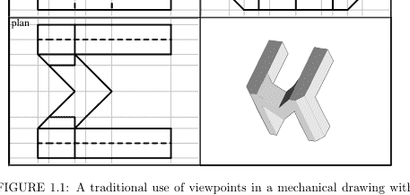

图 1.1：第一角正投影机械制图中对视点的传统运用。

其核心思想是，由于这组视点彼此相互关联（如第 1.2.4 节所述），它们等价于一个概念上的单一大型模型。这一等价模型不会呈现给任何单个用户，因为它过于复杂而无法实际使用。不过，当工具需要处理来自多个视点的信息时，它们可以构造该模型的部分或全部内容。

事实上，拥有一套集成良好的工具或工具链，是视点方法获得成功的基础。如果没有这样的工具链，程序员就必须查阅每一个视点才能发现他们所要编写的代码上的全部约束，这将在很大程度上抵消该方法带来的优势。

这些视点相互耦合，共同构成一份完整的系统规范，但在表达这组视点中的每一个成员时，并不一定要使用相同的技术。每个利益相关者都会熟悉针对其特定关注点而精心调校的语言和表示法，因此所使用的技术往往各不相同。当然，技术越相似，就越容易关联不同视图，因此在解决具体组成问题的便利性与集成便利性之间需要做出取舍。

在选取一组视点时，目标之一是使它们尽可能松耦合。使用视点的一个好处是，它允许不同团队并行开展工作，从而让规范的部分内容先于其他部分达到一定程度的稳定和成熟。选取一组恰当的视点需要技巧；如果两个视点之间存在过多关联，独立活动就会变得困难；如果它们不能反映行业中常见的活动分组，那么它们就无法归属于明确可识别的利益相关者。

因此我们可以看到，例如，系统状态和行为的分开描述就不适合作为视点候选，因为它们由一种基本二元性联系在一起，彼此紧密交织。另一方面，服务使用和服务提供则是很好的候选，因为对于经过精心选择的服务而言，二者分别处理相互独立的细节；只要提供了正确的服务，服务如何提供以及如何使用的细节就不会相互影响，可以由不同团队处理。这两类关注点几乎是正交的。

¹ 提供一组视点的想法已在多个设计和软件工程领域出现；最近有人尝试将这一总体思想纳入 IEEE 1471《软件密集型系统架构描述推荐实践》[75]，该标准随后在 ISO 内被进一步细化为 ISO 42010 [24]。

#### 1.2.2 一组特定的视点

通过一组视点来分离关注点的理念可以应用于许多设计活动。不过，如果许多不同团队都接受同一组视点，组件被复用的可能性就会更大。要制定一项国际标准，需要最大程度的通用性，因为单一方法必须覆盖庞大且长期存在的用户群体。因此，ODP 参考模型定义了五个特定视点（见图 1.2），旨在吸引整个标准族中五个明确的用户群体。

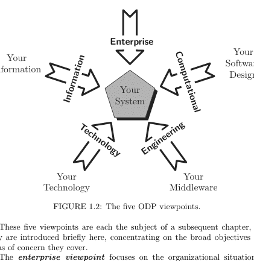

图 1.2：ODP 的五个视点。

这五个视点各自是后续某一章的主题，但这里先简要介绍它们，重点说明它们所涵盖的总体目标和关注领域。

企业视点关注的是设计活动将要发生的组织环境。它集中于待设计系统需要支持的目标、业务规则和政策。因此，需要满足的利益相关者是所支持业务流程的所有者，以及负责制定运营政策的管理者。其重点在于业务和社会单元及其相互依赖关系。

请注意，这里“企业”一词旨在涵盖任何感兴趣的活动；企业可以是指定人员被要求描述的任何事物。它可以是一个单一产品及其用户，也可以是一个商业组织，还可以是涉及众多企业或政府实体的更大社会结构。它涵盖我们在当前特定设计活动中所关注的任何应用领域。


The **信息视点** 集中于对所关注企业内部所操纵的共享信息进行建模。创建信息规范的目标在很大程度上与前几代创建数据字典的目标相同。通过提供一个可在整个设计中引用的通用模型，我们可以确保在所有点上对信息采用相同的解释。因此，我们可以避免因设计团队的各个成员各自做出解释决策而导致的使用分歧和信息收集不完整的情况。

理想情况下，我们希望存在单一的通用信息模型，但这显然不切实际。因此，此处的目标是为特定的设计活动实现一个共享模型，但我们稍后会看到，当考虑系统联合或遗留系统集成时，即使这一点也可能无法实现。我们能做到的最好情况是在特定设计权限范围内使用单一模型。然而，这已经足够具有挑战性，同时也带来了巨大的质量改进潜力。

The **计算视点** 关注于支持企业活动的过程和应用的高层设计的开发。它使用面向对象软件设计的熟悉工具，以具有强封装边界的对象来表达其模型，通过执行一系列操作（或传递连续的信息流）在类型化接口上进行交互。计算规范在数据对象的定义及其行为约束方面参考信息视点。

计算设计是抽象的，因为其对象并未放置在特定位置，也未分配特定的运行资源；这些工作在其他地方完成。通过将对象放置在不同的平台上，相同的设计可以以多种不同的方式实现。

The **工程视点** 解决基础设施提供多样性的问题；它为在各种不同情况下支持必要的抽象计算交互提供规定。因此，它提供了一种避免锁定到特定平台或基础设施机制的方法。特定的交互可能涉及子系统之间的通信，或位于单个应用服务器中的对象之间的通信，具体使用何种工程解决方案取决于当前情况。工程规范类似于中间件提供方式的规范；不同运行环境下有不同的解决方案，但目标是提供一套一致的通信服务和其他支持服务，供应用设计者在所有情况下依赖。

在 ODP 中，工程视点还关注向计算设计者提供一组保证，称为 *透明性*。提供一种透明性涉及承担一个分布问题的责任，以便计算设计无需担心它。

如今所需的许多机制都已以标准中间件或 Web 服务组件的形式提供，简化了工程规范，因为它可以引用现有解决方案，并仅说明如何将它们组合以满足系统的基础设施需求。

技术视点关注管理现实世界的约束，例如在预算内实现系统可用的硬件限制，或应用必须运行的现有应用平台。设计者从未真正拥有从零开始的奢侈，而这一视点汇集了关于现有环境、当前采购政策和配置问题的信息。它关注于为系统选择普遍使用的标准，以及实际资源的分配和配置。它代表已实现系统的硬件和软件组件，以及提供这些组件之间链接的通信技术。综合所有这些因素，它表达了 ODP 系统规范应如何实现。

该视点在管理对整体规范的测试符合性方面也具有重要作用，因为它指定了从实现者处所需的信息以支持此测试。

#### 1.2.3 视点语言

我们可以将任何传达思想的机制视为一种语言，无论是书写的、绘制的还是口头的。通信可以在人与人之间进行，也可以在机器之间进行，或被两者理解。

因此，我们可以说在特定视点中表达的概念、惯例和约束的集合构成了视点语言。这种语言的解释规则在特定实例中可以被视为代表一个视点虚拟机。我们可以将支持工具视为解析语言的语法并检查其语义规则，或视为实现等效的虚拟机；这只是同一枚硬币的两面。

从架构角度来看，我们无需关心这种语言作为纸上标记或编码在消息中的物理表示。抽象语言可以用多种不同的具体记法表示，适用于不同的情况。例如，许多工具可以同时使用图形或文本记法，并将设计存储在第三种面向机器的格式中，例如 XML 的一种方言。这些都是表达相同抽象语言的不同记法。

因此，对于此处考虑的五个视点中的每一个，我们都有一个对应的视点语言。当我们希望强调相关利益相关者的感知时，我们谈论视点；当我们希望强调思想的传达方式时，我们谈论语言，但这两个方面紧密耦合；没有使用语言就无法表达思想。

因为不同的视点强调设计的不同的方面，并且使用不同的技术来实现，因此利益相关者各自最习惯使用自己的语言和记法风格。例如，撰写业务政策的人可能更喜欢以声明方式表达目标，或许说生产的目标水平应始终实现，而记录流程的人可能自然地以命令式思维，表达需要完成的工作作为一系列指令。

另一个例子，业务流程可能涉及具有实时截止时间的扩展活动，并有已完成工作比例的度量，而计算任务可能集中于被视为不可分割（或原子）的事件序列，截止时间由等效事件表达，完全没有连续时间的模型。像这样处理序列但没有连续时间简化了分析，但使表达系统的连续属性（如服务质量）变得更加困难。

#### 1.2.4 视点对应关系

尽管通过将系统规范划分为不同利益相关者所见的视图，我们实现了强大的简化，但规范必须继续成为单一目标系统的连贯描述。如果视点之间没有联系，就不会发生这种情况；本应为单一设计的东西就会分裂成五部分。因此，视点之间必须建立联系，这通过在它们之间建立一组对应关系来实现，如图 1.3 所示。

在当前呈现不同用户视图的软件工具中，这种联系通常源自对象的名称。如果同一名称出现在两个图表中，则假定它们代表同一事物的两个方面。

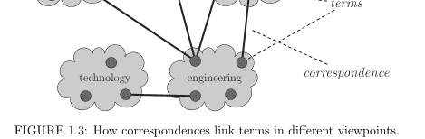

FIGURE 1.3: 对应关系如何链接不同视点中的术语。


#### 1.3.1 对象模型

ODP 系统规范以对象为表达形式。对象是我们想要建模的实体的表示，包括物理元素（手机）、人类（John，维修中心职员）或更抽象的实体（一笔待处理的维修订单）。对象包含信息并提供服务。换句话说，对象以其状态为特征，或者二元地，以其行为为特征。根据所采用的观点和表示法的风格，主要强调可以放在行为或状态上。

使用对象范式提供了抽象和封装，这两者是对复杂系统进行规范和设计时的重要属性。抽象允许突出从给定视角来看与系统相关的方面，同时隐藏无关的方面。封装是指对象中包含的信息只能通过对象所支持的接口处的交互来访问的属性。由于对象是封装的，因此不会因交互而在对象外部产生隐藏的副作用。它还意味着对象的内部细节对其他对象是隐藏的，这对于确保替代实现的互换性至关重要，并为处理异构性、互操作性和可移植性提供了基础。

行为表现为一组动作的集合。动作可以是可能发生的任何事情，可分为交互（涉及对象环境的参与）和内部动作（在没有此类参与的情况下发生）。内部动作的一个例子是模拟手机突然故障的动作。交互用于建模，例如，客户向 PhoneMob 职员请求维修其手机，或将数据从一张手机存储卡传输到另一张卡的行为。参与交互的每个对象都扮演一个特定的动作角色，该角色以其贡献或接受的信息以及是否发起该动作为特征。

系统由一组交互对象的配置组成。对象在接口处交互，接口是它们与其他对象可能发生的交互的子集，连同它们可能发生的时间的约束集合。事件是指动作已经发生的事实。当事件发生时，有关已发生动作的信息成为系统状态的一部分，因此随后可能在其他交互中进行通信。这种通信称为事件通知。

交互的规范集中于参与其中的对象。然而，在某些情况下，我们可能希望关注交互发生的确切位置以及如何观察它。这是通过引入交互点的概念来实现的，该概念关注交互在时间和空间上发生的地点。我们将在第 8 章中看到，后来当我们关注确保某些交互在测试期间可观察时，这一概念将导致参考点和一致性点的更具体思想。

最后，服务是一种行为，由提供者对象和消费者对象之间的交互触发，通过创建、修改或消费信息为其用户增加价值。

#### 1.3.2 类型、类和模板

与大多数面向对象的建模和编程语言一样，ODP 中的对象、动作和接口通常以其类型为依据进行规范。在 ODP 中，类型是一个谓词，用于表征一组元素，并用于识别和描述它们。例如，类型 Customer 描述了与系统相关的公司客户的共同特征。类似地，类型 RepairOrder 捕获系统中任何维修订单应具有的信息。谓词可以用许多不同的表示法表达，从文本语言到图形建模表示法（UML 类是表示类型的典型表示法，以属性和操作的形式描述相应对象的状态和行为）。

类型有助于将实体分类为类别，这些类别形成满足给定类型的对象的集合。此类集合称为类。需要注意的是，UML 中的类概念与 ODP 中的类概念不同。UML 类是一组对象的描述，而 ODP 类是对象本身的集合。因此，UML 中的类概念更接近 ODP 中的类型概念。没有 UML 概念与 ODP 中的类概念相似。

除了类型和类之外，ODP 还使用模板的概念，模板是指元素的规范，包括足以允许实例化发生的细节。例如，面向对象编程语言中的具体类就是模板。类型只能用于测试实例是否满足它们；模板可用于创建实例。模板还可能包含参数，这些参数需要在实例化时绑定到特定值。

#### 1.3.3 组合

组合及其逆运算分解是 ODP 中的关键概念。我们已经提到系统由交互的对象组成。两个或多个对象的组合本身就是另一个对象（称为复合对象）。新对象的特征由被组合的对象以及它们被组合的方式（所使用的组合算子）决定。

行为也可以组合，形成新的行为。这可以应用于行为片段或完整对象的行为。因此，复合对象的行为是组件对象行为的相应组合，可能隐藏一些交互以使其成为内部动作。

动作组合可以被规范以形成过程。过程是一组按规定方式进行并导向目标的步骤。步骤是用于过程中的动作的抽象，它未指定参与该动作的对象。步骤在定义中引入，因为在组合中不需要指定所有动作细节。目标的存在是因为过程的目标应始终在其规范中明确说明。在 ODP 中，元素的目标表达其实际优势或预期效果。它被表达为对未来状态的偏好。

#### 1.3.4 将对象分组在一起

ODP 区分了组织对象集合的不同方式。在最简单的情况下，对象可以组织成组，组是具有特定关系的对象的集合，该关系表征它们之间某种结构性相互依赖，或预期的共同行为。例子是所有信息对象的组，或与给定计算对象相关的工程对象的组。

域通常用于描述这些分组；域是由控制对象通过表征关系相关联的一组对象。每个域都有其关联的控制对象，该对象通常本身不是域的成员。这一个例子是命名域，其中一组名称由控制对象与对象相关联。另一个例子是管理域，其中一组打印机对象由控制器管理。

对象也可以组织成配置，配置是由特定接口处的交互链接的对象集合。例子是共同提供给定服务的对象的配置，或实现一个通道的工程对象的配置。

这些概念可以在特定视图中专门化。例如，在企业语言中，社区是为了满足给定合同中指定的特定目标而形成的企业对象的配置。在我们的 PhoneMob 示例中，一个社区是共同为客户提供基本维修服务的对象的配置。另一个社区是由一组对象形成的物流组织，其目标是以安全及时的方式为用户提供交付服务。第三个例子是银行社区，它是共同为其客户提供一系列银行服务（支付、资金转账等）的企业对象的配置。

最后，联合体是一个为了满足共同目标而形成的域的社区。它模拟了许多商业情况，例如建立合作伙伴关系和合资企业；例子是一组航空公司联合起来，通过代码共享航班为其客户提供运输服务的联合体，或一组银行共享其 ATM 的联合体，以便客户可以互换使用任何一个。在我们的

例如，PhoneMob 公司和一家大型保险公司可以组成联邦，为其各自客户提供更广泛的服务。联邦的每个成员通过参与该联邦，同意受社区契约与策略的约束（其中可能包括贡献资源或约束行为的义务），以追求共同目标。同时，联邦保留原始参与者的自主性和独立性。

#### 1.3.5 契约

作为一个一般概念，契约定义管辖一组对象集体行为的规则。它规定这些对象作为群体行动时适用的义务、许可和禁止。这些可以表达例如服务质量约束、持续时间或有效期的说明、使契约失效的行为，或者活性与安全性条件。²

契约概念可用于任何视点。在企业视点中，我们有社区契约（见第2章），反映交互的业务上下文。例如，表示维修组织的社区契约表达对其服务中心、其员工和客户所承担的义务，以及在交付维修服务时需满足的关于效率、安全性、响应时间和保密性的条件。

契约概念在计算视点中有若干用途。一个例子是用它来描述服务契约，该契约定义对象在提供任意其他对象将与之交互的接口时所承担的义务。另一个例子是绑定契约，它捕获在建立特定绑定时所商定的属性（这可以是基本绑定或复合绑定；见第4章）。

最后，任何计算对象都在一个环境中交互，该环境表示其在配置中的位置；环境契约陈述对象所参与交互的非功能属性，例如响应时间、吞吐量或资源消耗。这些计算环境契约反映工程视点中对相应对象和交互的约束。

#### 1.3.6 策略概念

策略提供了一种强大的机制，用于声明业务规则，也用于规定并实现任何开放分布式系统所需的结构和行为可变性。策略用于识别系统生命周期内可以改变的行为片段，以及对这些行为的约束。换言之，策略可以看作对设计时预见的系统规范的约束，其细节可以修改，以管理该系统满足特定（且不断变化的）情形。更多细节见第10章。

策略依据*规则*来定义。规则是对系统规范的约束。规则通常表示为义务、许可、授权或禁止。例如，一条规则可以规定，与客户关联的任何电话用户都可以下订单维修移动电话（*许可*），而另一条规则可以规定，维修中心必须在48小时内维修手机或提供替代手机（*义务*）；再一条规则可以声明，VIP客户有权立即获得替代手机（*授权*）；第四条规则可以规定，出于安全原因，不得将SIM存储器返还给除提交原始维修订单的客户之外的任何客户（*禁止*）。

### 1.4 实用构建块

参考模型的目标之一是促进使用通用术语来描述分布式体系结构，尤其涉及支持和管理分布式应用所需的功能元素。许多供应商为这些功能起了自己的名称，使得在不同解决方案之间进行类比以及寻找描述互通机制的厂商中立术语更加困难。

因此，参考模型提供了支持分布所需的体系结构功能目录。该词汇表可用于任何视点，但它侧重于全面覆盖工程视点，并且所识别的许多功能通常包含在系统基础设施中。然而，有些功能可作为服务供计算规范使用，另一些则可能以更抽象的形式加以利用，例如在企业规范中对仓库建模时。

该目录涵盖四个主要领域。首先是不同工程对象分组的*管理*，提供对资源分配、保护和激活的控制。然后对*同步*机制进行分类，接着是各种*仓库*功能，以及用于辅助资源发现和互通的不同专门特性。最后，它确定了用于提供一系列分布式*安全*功能的重要构建块。

使用这种分类法有助于不同团队理解现有组件所提供的功能，从而促进复用。这些功能可用作关键词，为组件目录或更高层技术设计模式集合建立索引，从而辅助设计。这提供了一套通用词汇，用于向潜在用户、外部评估人员或一致性测试人员解释系统体系结构。它还允许以普遍理解的方式表达平台无关设计，而无需参照具体技术选择，从而使采用模型驱动工程方法的团队更容易就需求和解决方案交换想法。

### 1.5 面向服务

近年来，将面向服务作为设计原则使用已受到大量关注。然而，从体系结构的角度看，面向服务的体系结构（SOA）与ODP中定义的体系结构框架之间没有显著差异；当前的面向服务方案可以看作更一般的ODP方法的子集。

SOA的主要原则是：功能应打包为提供明确定义服务的松耦合单元，并且应用应通过服务的组合来构建，这些服务可以基于某种形式的发布或经纪机制被动态发现。更近期的SOA活动在此基础上增加了对不同设计视角所提供服务的区分，产生不同种类的服务，例如业务服务、技术服务等。

ODP将服务定义为一个基本概念，表示由于在某个接口处交互而提供的附加价值。由于ODP对象模型基于强封装，这意味着它与SOA的服务观高度一致。发现和动态使用方面由ODP绑定模型以及诸如交易者（trader）等通用功能的定义来涵盖。不同类型的服务由ODP视点来体现，其中业务服务在企业视点中表达，技术服务主要在计算视点中表达。然而，在ODP企业视点中，正如我们将在下一章看到的，更强调声明式表达和灵活结构，因此业务服务的定义只是可用设计工具之一。还需要定义服务在不同视点中不同方面之间的对应关系，以提供服务整体的一致规范。

那么，是什么使面向服务的体系结构与众不同？主要差异不在体系结构方面，而更多涉及提高对开放性和弹性的工程期望，这在很大程度上源于多年来基于Web系统的实施经验，以及为广泛采用诸如统一资源标识符（URIs）等开放资源标识符所做的努力。


### 1.6 人机交互

任何信息系统设计的一个重要方面，是明确系统为与之交互的人们提供哪些接口，这通常称为人机交互。在这一设计领域中，人机界面（简称 UI）是人和机器发生交互的地方。

典型的企业设计会涉及多种活动。有些活动涉及人员，有些涉及自动化解决方案，还有一些涉及人机交互。不过，这些类别并非一成不变；设计会逐步转向自动化解决方案，而不一定需要进行重大的结构调整。

在足够抽象的描述中，即使发生此类变化，所执行的功能仍可保持不变，但表达这些功能细节所涉及的学科却截然不同：中间件提供商和用户界面设计人员使用不同的工具和技术。不过，这两个领域都大量使用工具。在中间件领域，工具可以根据接口定义自动生成存根，并负责集成确保可靠性和容错能力的机制。另一方面，应用于用户界面设计的工具可以生成软件组件，使其在系统中充当用户代理，并根据与一系列网页表单及其他页面的交互来管理用户对话。这些工具还可用于在整个组织内应用统一的外观和体验。

在接下来的描述中，我们将主要关注系统结构，但也会说明这种方法如何支持人机交互管理：既可以使用捕获系统结构的同一组信息，也可以添加专门用于支持这一设计方面的信息。

因此，企业描述可用于识别人类活动与系统支持的活动之间的交互；信息视点可以定义数据类型，这些数据类型既可用于系统间交互，也可用于用户界面；计算视点则可以包含支持人机交互所需对话的详细信息。

将用户界面支持纳入设计，通常会导致在计算设计中加入不同的对象，分别表示每位用户以及支持系统中的用户代理。这样做可以更精确地规定预期的用户交互，并且如第 8 章所述，还为测试是否正确遵循所规定的用户交互提供了基础。

因此，用户交互支持被纳入视点框架之中；不过，在后续章节讨论各个视点语言时，我们还会回到这一主题，说明其对这些语言各自产生的影响。

### 1.7 选择合适的工具

#### 1.7.1 通过 UML4ODP 重用 UML

尽管如前所述，ODP 视点语言以抽象方式定义，并不限定使用某种具体表示法，但在编写真正有用的模型之前，我们确实需要选定一种表示法。选择哪种表示法并不特别重要，只要我们的工具链能够处理它，并能将它与其他正在使用的工具集成即可；不过，如果设计人员已经熟悉这种表示法，就能更容易地着手工作。

UML [30] 是目前业界最流行的建模语言，大多数设计人员对它都有一定了解。借助相关的对象约束语言（OCL）[36]，还可以增强其表达能力。那么，为什么不在这里使用它呢？现有 UML 的问题在于，它不支持我们所需的关注点分离，也不支持 ODP 为此引入的结构化概念。UML 具有以图类型表示的功能视图，但这些视图紧密耦合，并且由单一的分层命名空间作为基础。这使得我们难以实现所需的分离。

那么，模型驱动工程（MDE）如何呢？许多 MDE 原型都使用 UML 来表达其源模型和目标模型，不是吗？没错，但关键就在于此。它们通过在彼此相当独立的模型之间进行转换来工作，每个模型都有自己的内部一致性和命名空间。这些转换提供了所需的解耦程度（见第 15 章）。

随着这些技术的发展，以及越来越多 UML 领域专用方言的出现，ODP 的创始者重新审视了 UML，并认为鉴于它如今已得到广泛认可，在许多情况下都可以用它为各个 ODP 视点规范提供一种熟悉的表示法。因此，他们制定了一项新标准 ISO 19793：《UML 在 ODP 系统规范中的应用》，简称 UML4ODP [22]。该标准提供了一个将 ODP 概念映射到 UML 表示法的配置文件，³使人们可以使用传统 UML 工具对其进行操作。为 UML 工具安装合适的插件后，还可以跨多个视点进行一致性检查。

当然，ODP 也可以采用其他表示法，以适应其他用户群体（例如业务流程设计人员）的需要，只要能够实现类似程度的工具集成即可。不过，本书将从简处理，主要采用 UML4ODP 表示法。

#### 1.7.2 UML4ODP 简介

UML4ODP 标准既定义了一种基于 UML 的表示法，用于表达 ODP 系统规范；也定义了使用该表示法对其进行结构化的方法，从而为模型开发方法奠定基础。因此，UML4ODP 表示法不仅适用于希望用 UML 描述 ODP 系统的 ODP 建模人员，也适用于需要处理非简单系统规范、并需要采用某种方法来组织大型 UML 系统规范的 UML 建模人员。

UML4ODP 使用标准 UML 概念，并依赖 UML 提供的标准扩展机制来定义新语言，尤其依赖 UML 配置文件。具体而言，UML4ODP 定义了七个相关的 UML 配置文件：每个 ODP 视点各有一个，另有一个用于描述对应关系，一个用于在 ODP 系统规范中建模符合性（见第 8 章）。本书中的所有模型图均使用这些配置文件绘制。

因此，以 UML4ODP 表达的 ODP 系统规范由一个带有构造型 «ODP_SystemSpec» 的 UML 模型组成，其中包含一组模型，每种视点规范各有一个模型；每个模型都带有构造型 «<X>_Spec»，其中 <X> 表示相应的视点（见图 1.4）。每种视点规范都使用适用于该语言的 UML 配置文件。

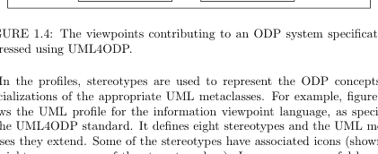

图 1.4：构成 ODP 系统规范的各个视点，以 UML4ODP 表达。

在这些配置文件中，构造型用于将 ODP 概念表示为相应 UML 元类的特化。例如，图 1.5 展示了 UML4ODP 标准中规定的信息视点语言 UML 配置文件。该配置文件定义了八种构造型及其扩展的 UML 元类。其中一些构造型带有关联图标（显示在构造型框的右上角）。图标非常有用，因为它们为 ODP 规范的使用者提供了直观的表示法。这一点在某些视点（例如企业视点）中尤为重要。设计人员必须决定在特定图表中展示多少这类信息。例如，在本书中，我们通常会显示图标；在有助于理解的情况下也会标出构造型名称，而在含义已十分明确时则省略名称，以免让某些较复杂的图表显得杂乱。

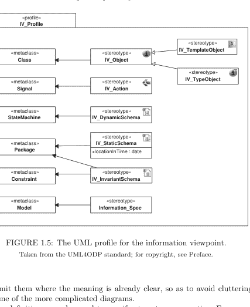

图 1.5：信息视点的 UML 配置文件。

摘自 UML4ODP 标准；版权信息请参见序言。

标记定义也用于指定构造型的属性。例如，构造型 IV_StaticSchema 的标记定义 locationInTime 可用于指定所建模静态模式的准确时间位置。第 3 章的图 3.4 展示了在具体静态模式规范中使用此标记定义的示例。

#### 1.7.3 集成工具包

如今，大多数软件开发都会使用某种形式的集成开发环境（IDE），由它处理构建和归档复杂项目结构时的大量日常事务。例如，Eclipse [65] 是一个特别受欢迎的环境，因为它具有良好的可扩展性。同样的原则也适用于其他领域，例如业务规划；当前的趋势是进一步整合所用工具，将它们组合成单一的集成工具链。


大致相同的内容。”她看起来很受伤。“是的，但这只是初稿；等结构清晰后，我会期望将它们重构为一组共同的类。”“但请记住 Ivor 的演示。他在他的客户对象中已经有完全相同的信息了。你可以直接引用它。”“但他信息太多，而且他的命名与我们看待流程的方式不对应。” Alex 微笑。“记住我之前说的对应关系。你可以将设计中的类视为位于抽象包中。然后，如果你有一个与信息视图的对应关系，能够在适当的情况下重命名和选择项目，工具就可以基于该关联为你构建视图中正确的具体类。你不需要从头再做一遍。

Ivor 皱眉。“但那样的话，如果我更改设计的那部分，我可能会破坏计算视图。”“当然，有可能，” Alex 说，“但当你在提交前请求全局检查时，你会得到警告。然而这种情况应该很少见，如果发生了，很可能意味着存在一个共享问题，你无论如何都应该讨论。没有这种关联，你仍然会是需求。我们错过了发布目标超过一个月。”

Alex 往后靠。“而客户设计评审没有发现它？”“没有，运气最差。在旧流程中，那一步是工作责任从前台转移到车间的地方，双方都认为是由对方的需求在处理。”很明显，这整件事是 Eleanor 仍然感到愤怒的，虽然她能理解这是怎么发生的。

Alex 苦笑。“这很容易发生，”他说。“孤立地处理活动的一小部分是不够的。”他的声音悲伤而略带怀念，并同情地对 Eleanor 微笑。“如果公司维护了其组织单元之间关系的适当企业描述，以及对其业务流程的适当视图，包括所有手动部分，那么你就能看到有些东西没有被覆盖。你甚至可能从设计工具那里得到红色警报，如果某些义务没有得到履行。当然，整个想法不仅仅是防止灾难——对组织的清晰视图有助于总体提高质量。”

“好的，” Eleanor 说，“我开始明白它可能如何有所帮助，但你如何表达业务不同部分之间责任的相互作用？”

“好吧，我们需要关注业务单元如何交互。我们可以通过将它们视为社区中的参与者来实现这一点。这涉及每个参与者扮演一个角色，该角色定义了其预期行为以及与其他参与者的交互。一些分配策略随后可以指定组织中不同参与者如何履行角色，以及谁对什么负责。”

“听起来像社会学。”“不，” Alex 微笑着说，“但用这些相同的术语来谈论比在组织内部过度使用已有的名称要好；那样只会造成混淆。”

他转回白板并开始勾画一个结构。

### 2.1 以社区进行设计
企业视图定义了 ODP 系统设计和部署所在的组织、业务和社会环境。主要是通过使用企业语言，业务利益相关者和设计团队才能发展出他们所需的共同理解，如果系统要适合其用途的话。企业视图应该能够帮助回答关于 ODP 系统的一系列问题，例如：“ODP 系统的目的是什么？”“系统的业务需求是什么？”或“关键利益相关者是谁，他们如何与系统交互？”

业务流程比软件流程更灵活、界限也更不清晰，因此需要比传统模块化更灵活的结构化原则。业务系统在某些特定情况下应做正确的事情是由多组重叠的规则决定的，而不是由单一算法决定；一些约束将直接来自业务流程，但其他约束可能来自组织规范，如安全策略，或来自与交易伙伴的协议，甚至来自法律约束。我们需要合并这些各种类型的约束。这是通过将企业规范基于一组相互关联的社区来实现的。

一个社区定义了一组参与者应如何行为以实现特定目标。为了使规则可重用，它们以社区中角色之间的交互形式表达，将其定义与可用资源的细节以及特定时刻生效的责任解耦。这就像在写戏剧剧本时使用角色，作者说明每个角色应该说什么，但实际扮演特定角色的演员要到特定演出时才确定。注意，虽然在本章中我们只是谈论角色而不总是说它们是社区角色，但角色的想法


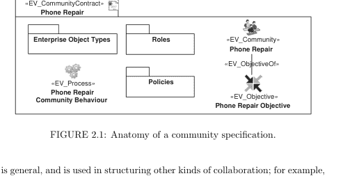

图 2.1：社区规范的结构剖析。

它是通用的，并用于组织其他类型的协作；例如，我们也可以谈论交互中的角色。

图 2.1 说明了规定社区所涉及的主要元素；这些关键概念之间关系的更多细节将在本初步介绍之后给出。在这里以及全书当中，PhoneMob 规范被用作一个贯穿始终的示例；该规范的更多支撑细节可在附录A中找到。

首先，我们有社区的行为，它通常被定义为处理不同业务关注点的过程的组合。这种组合本身产生一个过程，并在图 2.1 中表示为一个构造型为 «EV_Process» 的 UML 活动。该过程由社区的角色参数化。此外，社区通常还会有若干策略，这些策略允许修改其行为的各个方面，以应对不断变化的情况。这些策略发挥重要作用，使社区行为能够被动态修改，以满足不断变化的需求。策略如何提供受控的灵活性，以便在情况变化时仍能保证目标实现，将在第10章详细讨论。最后，还有若干支持性企业对象的声明，这些对象归社区所有，用于表示其内部状态和资源。

社区由社区契约来描述。在规范中显式给出这一描述（它实际上是一种社区类型），有助于设计捕获动态过程，例如对社区运行所依据规则的协商；它给出了行为以及其中的角色、策略和本地对象的自反表示。该契约还包括对社区目标的声明。

高层描述通常说明所涉企业规范的范围和应用领域。范围以系统将要展现的行为来表示。例如，PhoneMob ODP 系统可能有一个范围，用以表达其关键功能，例如跟踪所有维修订单、客户、用户和用户位置。PhoneMob 企业规范的应用领域可能说明该企业规范所适用的特许经营业务的属性，例如表明这不是、也永远不会是一个安全关键业务系统。

### 2.2 识别角色

社区本质上是一种协作；履行其角色的对象一致认为，它们的目标是实现既定的业务目的。在简单情况下，契约中履行角色的各方以及契约中表达的行为可以在其整个生命周期内保持不变。或者，契约可以定义修改社区成员资格或改变其行为细节的行为。动态修改行为的一种方式是为社区定义可变策略（见第10章）。注意，社区概念可用于建模特定组织的结构，或不同组织之间的协作，这种协作以业务合同、服务级别协议（SLA）表述，或作为不同立法域之间的联盟（见第11章）。

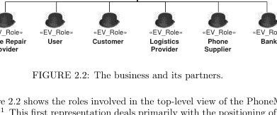

图 2.2：业务及其合作伙伴。

图 2.2 显示了 PhoneMob 业务顶层视图中涉及的角色。¹ 这第一种表示主要处理业务在其环境中的定位。有一个代表整个业务本身的角色（称为 Phone Repair Provider），以及若干代表与该业务打交道的主要外部参与者的角色——其客户、供应商、银行以及 PhoneMob 的分包商，例如物流供应商。使用 UML4ODP 时，这些角色

¹ 在本书中，我们选择用帽子作为角色的图标，而不是 UML4ODP 标准中建议的戏剧面具；我们觉得这个图标以及“戴帽子”的隐喻更容易立即被识别。

-   若干 Branch 角色，代表位于世界各地的办事处；每个办事处直接与用户及其损坏的手机打交道，进行诊断，并要么直接执行简单维修，要么在情况更严重时安排将手机返回供应商。

我们想作出的第二个区分是组织内自动化系统与人工系统之间的区分。我们需要作出这一区分，因为我们需要将自动化系统和用户界面定位在业务活动之中，而这些将是其他视点的主要关注点。在我们的简单示例中，我们将每个业务单元划分为一个员工角色和一个系统角色。注意，这一细化步骤仅应用于 PhoneMob 本身；这里的业务合作伙伴被视为黑盒，因为我们不希望对其内部结构作任何假设。这两个细化步骤得到图 2.3 所示的一组角色。

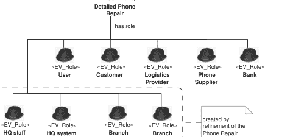

图 2.3：Detailed Phone Repair 社区的角色。

设计已经变得相当复杂，因此我们将系统划分为若干不同的活动，并将它们视为更小的子社区。这些子社区中的每一个都必须以与完整社区契约一致的方式运行，而这将通过为每个子社区关联一个特定的简化契约来表达。关键活动包括维修、客户联络、绩效评审，以及与负责物流和供应的分包商进行合同谈判。每个活动都可以通过完整社区的一个简化视图来描述，该视图只包含参与特定活动的角色。例如，维修过程不需要关心客户合同的谈判，本地分支维修中心会将财务事项（例如与客户银行联系）委托给总部集中处理。因此，直接参与本地中心维修过程的社区（我们称之为 Branch Repair Provision 社区）可以缩减为具有图 2.4 所示的一组角色。

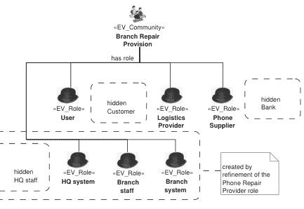

图 2.4：Branch Repair Provision 社区的角色。

因此，开发本地维修过程角色的整个序列始于图 2.2 中引入的 Phone Repair 社区的抽象角色集。通过将单一的维修服务提供商替换为总部和本地分支角色之间的交互，并区分员工和系统参与者，它被转换为图 2.3 中的 Detailed Phone Repair 社区。在第二步中，仅选择与分支中的本地维修过程相关的角色，从而得到 Branch Repair Provision 社区，其角色集如图 2.4 所示。

### 2.4 角色与角色填充

角色是将企业规范维系在一起的粘合剂。社区中角色的使用与软件中过程形式参数的概念有一些相似之处。二者都通过提供一个本地标识来实现复用，该标识可在规范的可复用部分中被引用，然后在具体使用点链接到适当的外部项。在这种情况下，角色在社区行为中被引用，并在其每次特定使用时链接到填充该角色的对象。因此，这些对象需要满足社区的行为。

一般来说，填充社区角色的对象各自都有自己的生命周期；它们在填充某个特定角色之前可能已经参与企业中的其他活动，并且在停止扮演该角色之后可能继续从事其他活动。另一方面，如果社区规则允许，角色的职责可以从一个对象转移到另一个对象。只要一个对象满足角色定义中陈述的行为条件，它就可以被分配给该角色，从而参与社区，为社区目标作出贡献（同时也帮助实现自身目标）。这些条件可能与加入社区的某些能力要求有关（例如，只有经认证的物流组织才能履行物流提供商的角色），与涵盖认证和访问控制的安全策略有关，以及与性能义务有关，例如电话维修服务与其客户之间的维修服务 SLA 中可能出现的那种性能义务。在形式上，这对应于每个角色都有一个关联的角色类型，并且要求填充该角色的对象应满足该类型。同样，我们可以在此将其与编程语言中使用形式参数时支配类型检查和隐式转换的规则进行类比。

在决定模型元素是以实例还是类型来表达时，会出现建模风格的问题。企业建模者可能经常使用简写风格，仅引用对象类型，谈论一个 Phone User 对象填充 User 角色，而他们真正的意思是存在某个匿名企业对象，其类型为 Phone User，并且填充 User 角色。

社区的行为以分配给角色的企业对象预期展现的动作来表述——也就是对动作何时可以发生的约束。其表达方式取决于所采用的风格；一些可能的技术包括使用状态机、事件排序或面向过程的风格。

角色总是相对于其所属社区定义的，该社区拥有其角色的命名空间。这意味着，不同社区中的角色尽管名称相同，也可以彼此不同；例如，在 Phone Repair 社区和 Logistics Provision 社区中都定义一个 Customer 角色是合法的。然而，它们各自都有自己的行为，而该行为在每种情况下都派生自定义它们的社区。

在任一时刻，至多一个企业对象可以填充社区中的某个特定角色，但不同对象可以在不同时间填充同一角色；例如，某个特定物流组织因与 PhoneMob 的底层业务合同而被分配 Logistics Provision 角色，但不同合同可以在不同时期建立，每个合同都具有不同的


物流组织。然而请注意，一个社区可以定义特定角色类型的多个角色，每个角色具有相同的行为约束，从而允许多个对象在社区中共享职责。这可以通过为角色关联适当的基数约束来指定，正如 Detailed Phone Repair 社区中的 Branch staff 角色所展示的那样。

一般而言，一个对象可以在同一社区中扮演多个角色。例如，在 PhoneMob 场景中，一个个人可以在 Phone Repair 社区中同时扮演 *User* 角色和 *Customer* 角色，尽管对于组织客户而言，这些角色通常由不同的对象填充（见下一节）。

最后，社区规范可能对角色的填充包含额外的约束。最熟悉的例子是 *动态职责分离* 的要求，其中要求两个或多个角色必须由不同的对象填充；例如，财务交易不能由同一个人同时提出和批准。

### 2.5 多个社区

任何具有显著复杂性的问题通常都需要使用灵活的结构化技术，而这对于企业规范尤其如此。如果要使社区保持足够简单以便理解，则需要将它们组合起来，这可以通过多种方式完成。

社区的组合方式将选定以支持复杂组织结构的建模，紧密反映 ODP 系统所处的现实世界环境。这些结构可以表述为社区之间的关系以及规范其建立和变更的策略。

一个社区整体可以被视为一个企业对象，因此本身可以在某个更高层级的社区中填充一个角色。因此，在自顶向下设计方法中，我们可以从总体视图开始，然后通过使用子社区来填充顶层角色对其进行细化。将社区作为整体考虑后得到的对象称为 *社区对象*。

例如，我们可以通过引入 *物流提供* 社区来捕捉物流提供商的行为，或许用以表达其收集和交付程序的细节；代表此社区的社区对象随后可以填充 Phone Repair 社区中的 *物流提供者* 角色（见图 2.5）。然而请注意，在建立这种联系时需要陈述一些额外的约束。考虑 *Green Transport* 对象，它是在定义 *物流提供* 社区时将被细化的社区对象。它填充 Phone Repair 社区中的 *物流提供者* 角色，并且其部分角色的填充方式因此已被确定。*物流提供* 社区中的 *Customer* 角色不再是任意对象，而是成为填充 Phone Repair 社区中 Phone Repair Provider 角色的对象，即 PhoneMob 本身。由于客户在这种情况下正在托运自己的货物，他们还填充 Goods Source 或 Goods Destination 角色，而相应的目的地或来源则由 Phone Supplier 或 User 填充。在图 2.5 中，User 角色是目的地，PhoneMob 是来源。只要满足这些约束，我们就可以使用任何能够提供其类型与我们更高层级社区中角色类型匹配的社区对象的物流提供商。

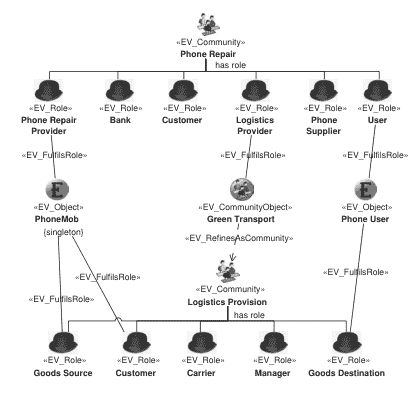

图 2.5：使用角色填充链接两个社区。

两种或更多社区交互的另一种方式是让来自不同社区的一个或多个角色由单个共享对象填充。由于该对象的行为受其所填充的每个角色的约束，因此涉及的各个社区之间存在间接联系。这可用于合并来自不同组织单位的约束。例如，图 2.2 中的 Phone Repair 社区区分了与其客户相关的两个角色：一个是关注使用服务并支付费用的 Customer 角色，另一个是关注使用手机和请求特定维修的 User 角色。引入一个名为 CustomerOrg 社区的简单社区来捕捉这些角色的联系。这使我们能够表达组织的合同经理如何限制在维修协议下可以请求工作的人员。

如果单个企业对象，例如一名销售员，在 **CustomerOrg** 社区中履行 **Employee** 角色，同时在 **Phone Repair** 社区中履行 **User** 角色，则两个社区的行为将被耦合。类似地，单个基础设施经理对象可能同时填充 **CustomerOrg** 社区中的 **Contract Manager** 角色和 **Phone Repair** 社区中的 **Customer** 角色。这种联系例如可以建模用户需要由客户组织中的合同经理授权，并将其与 **Phone Repair Provider** 角色持有的客户合同进行核对的需求（见图 2.6）。

在某些情况下，我们希望以这样的方式耦合两个社区，即两个角色始终保持关联，无论由哪个对象填充它们。这在构建社区层次结构时经常出现。在我们的场景中，例如，要求特定的 **HQ system** 企业对象履行 **Detailed Phone Repair** 社区中的 **HQ system** 角色，同时也在简化的 **Branch Repair Provision** 社区中履行同名角色；这是通过在 **Branch Repair Provision** 社区的角色上放置角色填充约束来实现的。我们要求该处的 **HQ system** 角色由填充 *Detailed Phone Repair community* 中 *HQ system role* 的对象填充，其中 *Branch Repair Provision community* 对象履行 *Branch role*。两个角色类型之间还将存在细化关系。

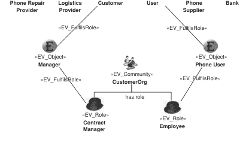

图 2.6：链接 Phone Repair 和 CustomerOrg 社区。

最后，一个社区可以在其行为的一部分中创建另一个社区，可能但不一定是为了履行其自身的一个角色。这类似于熟悉的工厂设计模式；例如，总部社区在扩展其领土时可以创建一个新的 *Branch Repair Provision community*。

### 2.6 社区行为

到目前为止，我们一直集中于使用角色的概念将对象链接到社区行为。现在我们转向此类行为的规范方式。但首先应注意，行为不仅仅涉及角色扮演者执行的操作。角色关注将行为链接到更广阔的图景中，但正如我们在介绍社区元素时所看到的，社区还可能引入仅在其规范范围内相关、因此具有局部范围的额外企业对象。

例如，一个分支的特定实现可能涉及某些内部程序中的参与者，例如仓库管理员，而该对象实际上并未在更广泛的规范中作为角色公开。仓库管理员的存在对填充 *Phone Repair community* 角色的对象不可见，并且是相关分支的纯粹本地事务。人们有时会问此类本地对象是否应被视为角色，但这样做会使社区的外部视图复杂化而没有带来真正的益处，因此最好将其保持为具有局部范围，从而可以是简单的企业对象。

角色或本地企业对象可以以多种不同的方式参与行为。首先，企业语言允许对企业对象参与交互的方式做出区分。如果对象参与执行操作，则相对于该操作而言它被称为 *actor*。例如，履行 *Branch staff* 角色的对象是发起 *Inspect Phone* 操作的参与者。如果对象对于操作的执行至关重要，需要分配或可能被使用，则相对于该操作而言它被称为 *resource*。例如，*Loan Handset* 对象构成资源池；各种备件也是如此。此外，如果企业对象在交互中被提及，但并非其积极参与者，则该对象相对于该操作而言被称为 *artefact*；一个例子是 *User Handset* 企业对象。所有这些限定都是相对于特定操作而言的；一个操作中的人工制品在另一个操作中可能是参与者。


其次，企业语言支持业务服务的表达。**业务服务**是对行为的一种特定描述，侧重于一方提供给其他方的功能或能力，其他方随后可以使用该服务来满足自身的业务需求，从而为其带来一定的附加价值。业务服务可以由社区中的单个角色提供，也可能涉及多个角色；例如，**手机维修**社区的手机维修服务由**手机维修提供商**角色提供（该角色共同涵盖**详细手机维修**社区的**总部系统**和**分支机构员工**角色），这两个角色都与服务用户交互。该业务服务是**手机维修**社区的核心部分，可供**手机维修**社区中的其他成员使用，例如**客户**和**用户**。

社区可以将业务服务公开；也就是说，这些服务不仅可以由同一社区中担任其他角色的对象使用，还可以被不同社区的行为访问。请注意，一个业务服务可以由一个或多个技术服务支持，这些技术服务在计算视点中描述；服务概念的这种不同用法与当前的 SOA 框架一致，例如 **OASIS 参考架构** [46]。

**流程**是以**步骤**之间的顺序或并发排序来表达的一种特定行为形式。每个业务步骤都可以消耗和产生信息。因此，一个流程将涉及一个或多个社区角色，这些角色执行与业务步骤相关的动作。每个流程都旨在满足一个目标，一个社区中可以定义许多流程，每个流程都为社区的整体目标做出贡献。流程的这种抽象定义可以进一步细化，以给出更详细的流程定义，并用 BPMN 或 UML 活动图（如 UML4ODP 中）等表示法来表示。

**交互**是社区行为的基本元素。每个交互都指明它涉及哪些角色，以及各角色在其中发挥什么作用。例如，在请求维修的消息交换中，可能涉及**用户**和**分支机构员工**这两个社区角色，其中用户作为发起者，分支机构作为响应者（发起者和响应者是交互角色，而不是社区角色）。随后，多个交互可以组合成序列或并发活动，形成扩展的行为片段，先构建各个步骤，再构建完整流程。因此，简单交互可用于构建控制流，从而产生一种在流程建模中常见的行为风格。

一个社区的完整行为通常可以分解为若干不同的流程。在 PhoneMob 中（见图 2.7），例如有负责处理故障手机的维修流程，以及两个独立的管理流程：一个负责与物流提供商协商服务水平，另一个负责提供关键绩效指标的评估和报告。最后，还有一个负责维护手机借用政策的管理流程。

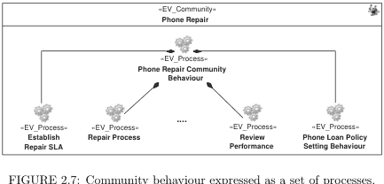

#### 2.6.1 社区流程

让我们进一步考察社区行为中的一个组成流程。图 2.8 展示了与单次手机维修生命周期相关的流程定义，适用于一位 VIP 用户，她有权在

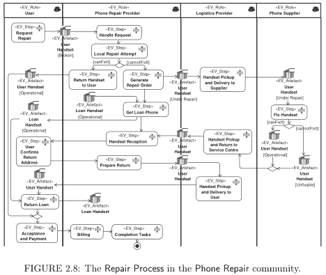
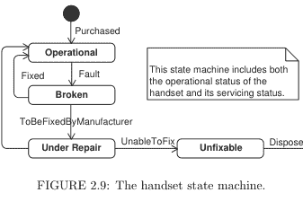

自己的手机得到处理期间获得一部备用手机。所涉及的角色包括用户、手机维修提供商、物流提供商和手机供应商。手机维修社区还有其他角色，但它们不直接参与此流程。

图中的若干流程被标记为引用用户手机这一工件，显示为 «EV Artefact»；来自“请求维修”步骤的流程就是一个例子。在本规范中，我们选择使用工件引用来强调：该流程与相关手机在角色之间的物理转移有关。在“请求维修”步骤之后，不仅流程流向手机维修提供商，故障手机的责任也发生转移。注意，该工件用其假定状态 [broken] 进行修饰；该状态取自为手机定义的状态机（见图 2.9）。在状态不确定的地方，例如归还备用手机时，省略该修饰。

此流程表示中的步骤相对粗粒度。因此，例如，手机首次接收时，保存用户状态和 SIM 所涉及的细节被归入“处理请求”步骤，而恢复该状态则构成“准备归还”步骤的一部分。这些细节对于确保用户获得高质量体验很重要，但采取必要动作的确切顺序并不是用户或客户角色所关心的。

#### 2.6.2 细化流程

图 2.8 所示行为是通用的；它适用于组织中的所有维修活动，并以图 2.2 所示角色来表达。每个分支机构可以独立地以适合其本地情况的方式对其进行细化。图 2.10 展示了其中一种细化，定义了

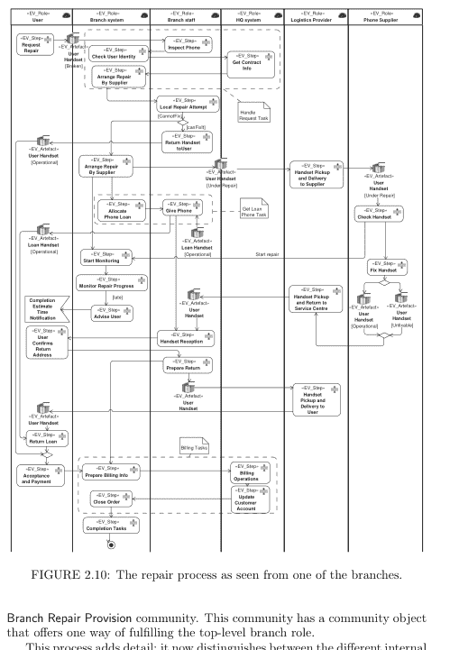

FIGURE 2.10：从其中一个分支机构看到的维修流程。

Branch Repair Provision 社区。该社区有一个社区对象，提供了一种履行顶层分支机构角色的方式。

该流程增加了细节；它现在使用图 2.4 所示的细化角色，区分 PhoneMob 组织内部的不同角色。然而，从外部各方视角看到的流程应当基本上是

通过执行评估来获得信息。最后，一个对象可以执行一个作为规定的动作，创建一条约束社区未来行为的规则。规定提供了一种灵活而强大的机制，可在运行时更改系统的业务规则，使其能够动态适应业务变化和新需求。

表达对行动的可问责性，可以识别出对规则变更负责的当事方；这与企业策略的道义性质十分契合，因为该当事方必须获得授权才能执行该规定。这些概念可用于表达各种治理框架。在 PhoneMob 示例中，当与一个履行客户角色的组织建立新合同时，我们可以看到这些机制在发挥作用。合同可以通过点击某个网页中的按钮来生效，但它对 PhoneMob 具有约束力，因为该组织已向首席信息官进行委托；首席信息官是对信息系统负责的当事方，而该系统作为其代理，接受使协议生效的 Web 交互。

### 2.8 服务质量及其他约束

到目前为止，对行为的讨论一直集中在要执行的任务序列上——即所谓流程的功能方面。然而，我们还需要能够对执行质量的各个方面施加约束，例如事情完成的速度、故障概率应有多低，或安全属性应有多好。这通常涉及用关于允许何种执行变化的条件来修饰基本行为，而基本行为是一组允许的事件序列。

例如，PhoneMob 与 VIP 客户之间的服务水平协议会产生一些策略，例如 PhoneMob 有义务遵守维修响应时间，并在违约时提供补偿，例如安排更换有问题的用户手机。

这是一个复杂问题，因为各方之间存在许多依赖关系，而且向一个社区成员提出的任何质量保证都取决于其他成员的适当行为。例如，要求物流提供商在 12 小时内交付货物，取决于接收方能够在该时段结束前收货。一般而言，施加于某个对象的任何义务都依赖于其环境所提供的支持保证。

此类质量约束如何表达，其细节取决于所考虑的属性，这将超出本书范围。


### 2.9 识别系统的用户界面

企业规范确定了用户与支撑系统进行交互的各个点。例如，图2.10展示了一个过程定义，其中包含角色“分行系统”与角色“用户”“分行员工”“总部系统”“物流提供商”和“电话供应商”之间的交互。在该图中，至少用户或分行员工（由人担任的角色）与分行系统（由计算机系统担任）之间的交互发生在可见的用户界面上。我们将重点关注这些交互，因为图中对其他角色的描述不够详细，无法确定这些交互是人机之间还是机器与机器之间的交互。

交互的性质可以用许多不同方式表达，但一种常见方法是将设计活动划分为三个相互独立又彼此相关的方面（或者用我们的术语来说，视点），分别涉及内容、导航和呈现。

- **内容**关注系统处理的持久信息。在超媒体系统中，内容视点可能不仅包括关于传统系统所管理实体（订单、客户或库存项）的原始数据，还包括更复杂的实体，如图像、视频片段、音轨和动画。
- **导航**处理如何访问内容；它涵盖可以访问哪些内容项，以及用户如何从一个内容项移动到另一个内容项。因此，导航建立了用户能够沿着系统所维护内容行进的可能路径。
- **呈现**处理内容以及支持系统功能的各种交互元素的可视化。

这些视图可以非常自然地映射到RM-ODP视点中。在企业视点中，我们主要关注导航的抽象视图。其他方面则在不同的视点中处理。内容元素正是信息视点中所表示的那些元素，而计算视点将说明广泛的导航流程如何实现。呈现在工程视点中描述，其中规定了呈现样式和模板——归根结底，这些元素与需要为计算机间交互规定的消息数据格式属于同一类别。最后，ODP技术视点对呈现施加了一些约束，例如，包括规范中需要考虑的可用性和可访问性标准。

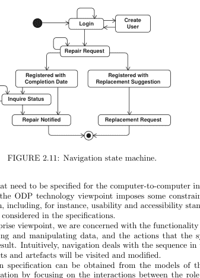

图2.11：导航状态机。

在企业视点中，我们关注可用于获取和操作数据的功能，以及系统因此将采取的动作。直观地说，导航处理企业对象和制品被访问与修改的顺序。

导航规范可以从企业规范的模型中获得：重点关注前面所识别的角色对之间的交互，并提取仅描述这些交互的状态机（见图2.11）。这样的图表示用户与机器之间对话步骤中请求和提供信息的顺序。每个状态将对应展示给用户或向用户索取信息的一组页面或表单。转换标记对话进展的阶段。

### 2.10 编写企业规范

ODP企业语言并未规定任何用于构建系统企业规范的特定方法，因为所采用的方法将在很大程度上取决于被规范的系统、它将支持的业务，以及系统运行环境所产生的约束。对于本示例，遵循了以下过程：

- 1. 识别系统所涉及的社区、其目标以及其中涉及的角色。
- 2. 识别每个社区内的企业对象。
- 3. 定义实现社区目标所需的行为。这可以表现为过程、其构成动作，以及执行这些动作的社区角色或本地企业对象。
- 4. 定义关于企业对象可如何担任角色的任何约束。
- 5. 识别治理行为的策略。
- 6. 识别可能改变治理系统规则的任何行为，以及治理此类行为的策略（只有当规范包含某些能够引起这些变化的行为时，社区的结构、行为或策略才可能发生变化）。
- 7. 识别涉及不同方问责以及可能委托的动作。
- 8. 识别在社区生命周期内可能改变其结构或成员资格的任何行为，以及治理此类行为的策略。

当然，这些活动的顺序不必一定是线性的，而且并非所有活动都适用于所有建模情境。

> 亚历克斯扶着弹簧门，门上刻花玻璃嵌板装饰着攀缘植物——他猜是啤酒花——埃莉诺从他身旁走过，进入酒吧；她那件中长款深棕褐色夹克上溅着雨点。他们刚刚长时间苦战企业模型，两人都需要休息一下。他们端着饮料走向角落的一张桌子。这地方是传统的城市风格，用豪华的长椅座分隔成一个个小隔间，座椅用黄铜小钉固定软垫，椅背升高，形成齐肩高的屏风，由机器车削的木柱构成，表面涂着厚重的吸光清漆。
>
> “为建模干杯，”她啜了一口西拉葡萄酒说道，“不过我还是不明白，这些组织层面的事情究竟怎样才能真正帮助我们构建系统。”
>
> 他叹了口气。“你干这行多久了？”“大概十年，之前还做了五年分析师。”“那么，你最初参与的那些系统，提供的支持和我们今天追求的一样吗？”她略一思索。“不一样，它们只是相当基础的单体应用；我们现在做的集成度要高得多。”“而且你肯定同意，这个趋势会继续下去。”她点点头，灯光从那只镶宝石的蜥蜴上闪了一下——它仿佛定格在她右耳轮廓上向上攀爬。“这意味着，今天投入时间捕捉组织细节，就是在投资，让明天引入系统变得更容易，”他说，“除此之外，它还有助于促进业务人员与系统设计人员之间的理解——避免那些赶时髦的人所说的认知失调。”
>
> 她若有所思。“但到哪里为止呢？你可以不断添加业务规则和目标，而当你处理法律和社会责任这类不那么有形的方面时，事情会变得越来越难。”“当然，你必须务实，只比最低要求稍微往未来多看一点，但想想我们可能会走向哪里。二十五年后你会做什么？”“真诚希望，是拿着一份丰厚养老金享受环球邮轮旅行，”她说，“不过我明白你的意思。强调社区中的角色而不是个人，也是出于同样的原因？”“是的，”他说，“而且是在相当短的时间尺度上，这样最终会得到一组可复用的构建块，并能对组织变化作出响应。当然，采用模型驱动方法会有帮助，这样业务模型的变化可以以最少的重新编码应用到运行中的系统上。”
>
> 停顿了一会儿，她去吧台又点了些饮料。“这里难道没有问题吗？”她一边打开一袋薯片，一边问道，用一只酒红色指甲利落地划开镀铝聚酯薄膜。“如果我们一切都从业务模型构建，那我们这样的技术设计人员不就要去做更平凡的工作了吗？”“我不这么认为，”他若有所思地说，挑了一片为数不多的完整薯片，“在我看来，真正准确的企业模型将成为组织的王冠明珠；构建和维护这些模型并不容易，而它们的保管人将在业务中扮演核心角色，可能比现在更加核心。”
>
> “那么架构顾问呢？”她挑衅似地歪了歪头问道，“他们的未来会怎样？”他咧嘴一笑。“就我个人而言，我一直幻想自己是个珠宝大盗，”他说着，深深喝了一大口温热的深色啤酒。


## 第三章

## 信息视角

> “进来，Ivor，”Marcus 说。“你想跟我们谈谈吗？”他没有坐在他那张清爽、时尚的浅色白蜡木办公桌后面，而是坐在窗下的长桌旁，长桌上放着一块巨大的平板屏幕，桌上堆满了报告、PERT 图和贸易杂志。Eleanor 已经占据了一把铬合金和皮革的访客椅。Ivor 坐下了另一把椅子，转身面向 Marcus。他看起来很紧张。
>
> “我认为我们需要谈谈如何组织工作。这种新方法正在改变平衡和我们的工作方式，这会带来后果。我担任合规官已经三年了，我很乐意负责确保我们拥有履行法定义务所需的正确类型和质量的信息。我带着这个任务进入当前项目，但这里正在进行的信息建模对设计活动来说更为核心。它根本不适合放在合规之下。”
>
> Marcus 和 Eleanor 交换了眼神。“是的，我们看到了，”Marcus 说，靠在椅背上。“重点正在改变，我们必须让组织做出回应。你认为我们应该对此怎么办？”“嗯，我认为我们应该建立一个新的职责，负责创建和维护必要的信息模型。它需要双重汇报，同时向 CIO 和合规办公室汇报，以确保所有要求都得到覆盖。”
>
> Eleanor 看了看她的笔记文件夹。“我同意我们需要一个新的职责，”她说，“而且它需要有足够的力度让我们的开发人员认真对待中心定义的类型。但所需技能是关于维护一个在开发中发挥积极作用的存储库，而不是监控角色。我们应该挑选一位对这种方法持同情态度的 proven 开发人员，让他们负责建立必要的流程。他们最初至少需要两名向其汇报的员工。”
>
> Marcus 站起来走到他的办公桌旁。“好吧，所以我们一致认为需要新的结构。不过我不接受双重汇报的想法；那种结构有各种各样的问题。我们将在规划组层面引入新职位，向 CIO 汇报，像其他开发和运营负责人一样，但有义务在关键设计承诺步骤之前与你的团队、Ivor，一起完成模型签批。”Ivor 抿着嘴，但并不沮丧；他预料到了这个裁决，但他心里知道类似的事情是必须的。“你有合适的人选吗？”
>
> Eleanor 微笑。“我想到的是 Ira Vernon；他有建模经验，并且是 Janus Two 项目的发布经理——他在那里做得不错。”“什么？那个系鞋带领带和那枚做作的蓝银色夹子的家伙？他是来自德克萨斯的吧？似乎相当脱离。”
>
> “我认为他来自亚利桑那，而且非常以他的家庭为荣；我知道那枚 bolo 夹是祖尼族的；我自己也想要一些那种精美的绿松石。”Marcus 打断道。“他怎么穿着不是问题；他会致力于这份工作吗？”“是的，我相信他会。我认为他真的能看到好处并希望实现它。”“好吧，他将向你汇报，所以我信任你的判断。我们会与他会面，然后你为内部公告起草一份初步的职位描述，我们再完善流程。你认为实施方面有什么问题吗？Ivor 你先说。”
>
> “嗯，和往常一样，问题在于阻止人们走好意的捷径，从而重复定义。我们需要在代码评审流程中以及员工入职培训中强调拥有数据项单一来源的重要性。”Eleanor 点头。“是的，培训很重要，但响应性也很重要。Ira 必须做的事情之一是确保人们不要把通用模型看作一个美好的理想而是一个实际的瓶颈。信息视图必须有快速的变更流程。”
>
> “但我们也面临着模型内容方面的文化转变。人们对集中化的行为约束并不习惯；他们总是更愿意为数据结构使用模板，而不是为交互序列使用。我们需要与工具供应商合作，寻找更好的行为重构方式；也许外面有一些有用的插件可以帮助。”
>
> “好吧，”Marcus 说，望向窗外聚集的乌云，“你有一名实习生要开始——为什么不让他们去做一次搜索呢。最后一件事；我们能确定走这个方向会提高质量吗？”
>
> Eleanor 停顿了一下。“嗯，你知道 Alex 在刚参与时对我们的故障单做了一次梳理。他估计我们修复的故障中几乎有 60% 可归因于代码中重复了系统其他地方已正确实现的东西的错误。当然主要是一些小问题，但总体上仍然是很大的麻烦。”
>
> Marcus 点头。“好吧，就这么办。Eleanor，你今晚能把那份职位说明书草案给我吗？然后我认为我们就结束了。”他转向屏幕查看消息；会议结束了。

### 3.1 信息的优先性

信息视角的目标是对系统所操作共享的信息进行建模，以便提供共同的理解。

*信息动作* 对系统中的信息处理进行建模。所有出于建模目的而关注的动作都至少与一个对象相关联。动作也有类型，这些类型表征了具有特定属性的动作集合。一个信息动作的例子是用户“Joe Smith”在阿姆斯特丹市中心的 PhoneMob 服务中心请求维修序列号为“SN33433/09”的用户手持设备。对应的动作类型是 RepairRequest，其参数为用户手持设备、用户和 PhoneMob 服务中心。请注意，这是一个抽象动作，与下一章将处理的更详细的函数规范无关。

动作会导致参与其中的对象发生状态变化。例如，在 RepairRequest 动作之后，信息对象 User Handset 的状态被初始化为 Broken——见图 3.3。这些状态变化通过动态 schemata¹ 来描述，如后文所述。

除这些元素外，信息语言还定义了三种结构（称为一个 *schema*）；这使我们能够以信息对象的行为、由一组 *dynamic schemata* 描述；适用于对象及其行为的约束、由一组 *invariant schemata* 描述；以及某一时刻的信息对象配置、由一组 *static schemata* 描述的方式来组织信息规范。

不同种类的 schema 可能适用于整个系统，也可能仅适用于其内部的特定领域。

一个 *dynamic schema* 指定信息在系统运行过程中如何演变，描述一个或多个信息对象允许的状态变化。*dynamic schema* 例如可以描述当一个有效的手持设备维修请求被添加到系统时会发生什么（图 3.3），或表达 User 对象的整体行为。涉及一组对象的状态变化可以被视为这些对象之间的交互。

除了描述状态变化外，dynamic schema 还可以描述信息对象的创建和删除。例如，RepairRequest 动作会导致创建 RepairOrder 信息对象，并且如果用户在维修过程中允许使用借用手持设备且店内有空闲的借用手持设备，则可选地创建 Loan 对象。

一个 *invariant schema* 是一组谓词，约束一个或多个信息对象，在系统的所有有效行为中必须始终为真。它可以描述信息对象的类型、它们的关系以及这些类型和关系上的约束。谓词约束其适用的对象的可能状态和状态变化。任何 dynamic schema 中指定的行为都受 invariant schema 约束。例如，invariant schema 可以约束给定信息对象的值，或动作的发生，例如“维修订单只能由其公司”

¹在英语中，schema 的复数形式是 *schemata*。


由系统所知。”此类不变模式的一个示例如图 3.1 所示。

*静态模式* 对必须在某一时刻为真的断言进行建模。静态模式的常见用途是指定一组信息对象在建模者特别感兴趣的情况下的给定状态。例如，它可能描述一次成功维修订单的最终状态。

### 3.3 编写信息规范

本节描述如何使用信息语言的概念和结构规则来编写 ODP 信息规范。我们需要描述规范的开发过程以及使用的记法。RM-ODP 不对构建信息规范施加任何方法论，但为了说明这些思想，我们将遵循一个简单的过程，按以下方式进行规范：

- 1. 信息对象的类型以及信息对象之间的关系类型。
- 2. 系统运行期间可能发生的信息动作的类型。
- 3. 一组动态模式，描述动作发生时对象的行为。
- 4. 一组不变模式，描述系统元素的约束。
- 5. 一组静态模式，提供系统或其任何组成对象的瞬时视图。

表示信息语言概念有许多可能的选项，取决于信息建模者的经验和技能；实体-关系模型（ERM）、对象角色模型（ORM）或 UML 类图都可以使用。在本书中，我们将使用相应的 UML4ODP 配置文件，该配置文件提供了一组 UML 元素，用于在 UML 中编写信息规范。

#### 3.3.1 信息对象类型

首先，我们需要指定建模我们 ODP 系统所处理数据的 information objects 的类型。信息对象通常以其类型来指定，在 UML 中由类以 «IV-Object» 刻板印象表达。

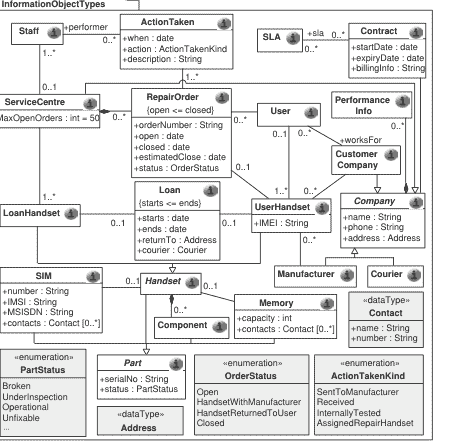

FIGURE 3.1：显示信息对象类型的不变模式。

图 3.1 显示了 PhoneMob 信息规范的 ODP 信息对象类型。注意信息规范捕获系统处理的信息，并且没有必要表示计算机系统本身（与企业视图规范形成对比）。

图 3.1 中的类图还表达了信息对象类型之间允许的关系。例如，它定义了一个表示服务中心的信息对象应与表示其员工的信息对象相关联，与商店拥有的贷款手机集相关联（无论是在库存中，还是在手机维修期间借给 VIP 用户），以及与该中心负责的维修订单集相关联。反过来，表示此类订单的信息对象与表示损坏手机的信息对象、将它们带到商店的用户的信息对象以及记录自维修订单打开以来对损坏手机执行的不同操作的信息对象相关联。

此外，模型指定了在系统有效的信息对象配置中可以出现的对象种类和关联种类的约束（例如就关联端的多重性或对某些对象的特定约束而言）。

所有这些元素都在一个刻板印象为 «IV_InvariantSchema» 的 UML 包中定义，它表示 ODP 信息不变模式。

#### 3.3.2 信息动作类型

在信息视图中，动作主要用于描述导致信息对象状态变化的事件。图 3.2 显示了 PhoneMob 系统的一些动作类型。

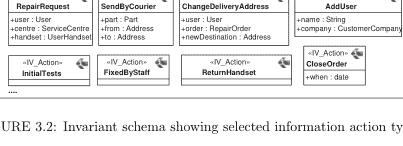

*图 3.2：显示所选信息动作类型的不变模式。*

在 UML 表示中，信息动作作为不变模式包内的动作类型表达。信息动作类型由刻板印象为 «IV_Action» 的 UML 信号表达。信号的属性表示此类信号表达的 ODP 交互所传达的信息。因此，表示动作发生实例的类的实例将由信号表达，由相应信息对象的状态机发送或接收（见下一节）。内部动作表示为相关信息对象的状态机的内部转换。

#### 3.3.3 动态模式

UML 状态机可用于描述信息对象的行为；状态变化由表达信息动作的信号触发。因此，状态机表达动态模式。请注意，信号会导致定义其转换的所有状态机发生变化，反映了 ODP 交互可能导致其涉及的所有对象状态变化的事实。换句话说，ODP 交互是一段共享行为。

图 3.3 说明了 Handset 信息对象的状态机。该图不仅显示了动作对相应信息对象的影响，还显示了允许执行动作的状态，作为这些动作的先决条件和后置条件。

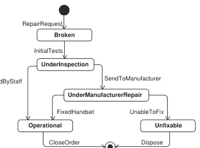

FIGURE 3.3：Handset 信息对象的状态机。

#### 3.3.4 作为约束的不变模式

我们已经看到不变模式如何用于指定信息对象类型及其关系，但它们也可以用于表达对系统处理的信息的其他约束。

例如，我们可能需要表达没有任何手机同时被多个维修订单引用，或用户在系统中应具有唯一名称的事实。这些不变性已经通过选择关联端的多重性或向元素添加一些 OCL 约束并入到描述信息对象类型的 UML 类图中（例如，参见图 3.1 中为类 User 或 RepairOrder 指定的约束）。

其他 OCL 约束可用于指定模型上的进一步限制，或表达完整性约束。例如，我们可以根据可能的企业政策声明此类业务规则，通过简单地向 ServiceCentre 信息对象类型添加 OCL 约束，来限制中心当前开放的维修订单数量，如以下片段所示。

```
context ServiceCentre inv:
    self.repairOrder->select(status <> MaxOrderStatus::closed)->
                         size() <= MaxOpenOrders
```

可以以这种方式指定进一步的不变模式，定义指定系统处理的共享数据模型所处理的信息模型的完整性约束和良构规则。

#### 3.3.5 静态模式

有时能够描述信息的瞬时视图非常有用，例如在系统初始化时，或在与系统任何利益相关者相关的任何其他特定时刻。对象的瞬时状态的这种规范正是静态模式所提供的，在 UML 中通过对象图表达。

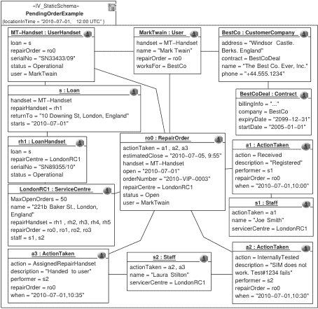

FIGURE 3.4：示例 RepairOrder 的当前状态。

例如，图 3.4 所示的 UML 包表达了一个维修订单的可能状态，其中订单已被注册，电话已测试并发现故障，并且已分配贷款手机并交给用户。到目前为止，该订单尚未进行进一步操作——例如，故障手机尚未送往制造商进行维修。

### 3.4 信息规范的结构

构成系统信息规范的所有元素都汇集在一个刻板印象为 «Information_Spec» 的单个模型中。该模型包含表达信息规范的不变、静态和动态模式的包集合，将它们在不同的包中结构化以用于组织目的。图 3.5 描绘了 PhoneMob 系统的 «Information_Spec» 模型。

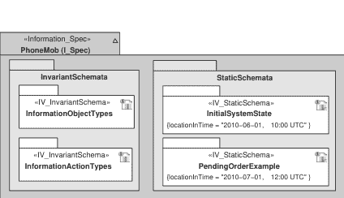

FIGURE 3.5：PhoneMob 信息规范的结构。

请注意，在此图中没有用于动态模式规范的包。鉴于它们在 UML 中被建模为与相应对象类型关联的状态机，将其规范拆分到不同的包中并没有多大意义。


### 3.5 与其他视点的关系

尽管不同 ODP 视点可以独立定义，且 RM-ODP 并未规定它们的明确顺序，但常见做法是先开发系统的企业规范，然后准备信息规范和计算规范。这些规范可能相互施加约束，通常每个视点规范都会随着其他规范的开发而修订和完善。

在 ODP 视点规范的概念性增量开发过程中，即开发信息规范时考虑先前定义的企业规范，可以通过检查企业规范来发现信息对象。例如，ODP 系统参与的任何企业动作中引用的每个制品，都会以某种方式与一个或多个信息对象相对应。类似地，计算对象、接口和交互可以从信息对象及其关联的信息动作中导出。

一般来说，系统的企业规范中的元素并非都需要对应其信息规范中的元素。例如，企业规范中的角色类型并非都对应信息视图中的对象类型。同样，并非所有信息对象或动作都对应企业元素。一个例子是，在信息视点规范中，手持终端被分解为各个部件；这些部件在企业视图中被抽象掉。类似地，物流提供商企业社区及其所有组成元素对应单个 Courier 信息对象类型，分支机构企业社区对应 ServiceCentre 信息对象类型。在每种情况下，信息视点都遵循企业视点的策略，同样，所有企业策略都与信息规范的静态、动态和不变模式一致。

第7章将描述两个不同视点规范的元素之间的关系如何以对应关系的形式明确指定和描述。目前，我们只需强调这样一个事实：两个视点规范都是同一系统的视图，因此一个视点规范中关于某个实体所规定的内容，需要与任何其他视点规范中关于同一实体所述的内容一致。任意两个视图都不应做出相互矛盾的陈述；也就是说，它们应当相互一致。对应关系将用于检查这一点。

> “边界划在哪里？”“嗯，这是架构师必须做出的价值判断之一，不是吗？我们想把什么当作平台？无论我们选择什么，在其之下都可以选择多种技术方案来适应不同情况。随着我们理解如何标准化和集成更复杂的技术，边界会逐渐上移。”她把杯子伸出去，想再续一杯。
>
> “那好，”他拿起一块燕麦饼干说道，“信息模型和计算模型之间的边界呢？”“嗯，我们知道通常可以导入信息规范中的大块内容并在计算视图中扩展它们，但计算对象通常粒度更粗，因此有些信息对象在计算视图中只成为属性。其实，我刚才在你把 SIM 对象作为参数讨论时就应该提到这一点；它实际上并不是计算对象。”他皱起眉头，隔着杯子直视她。“但为什么？做出这种区分的依据是什么？”
>
> 克莱尔想了一会儿，然后向后靠，用手指捋了捋头发。“你模型中最小的对象是什么？”“嗯，我猜会是某个基本类型的特化；比如说，把一个整数特化为员工年龄。”“好，那你期望把年龄对象迁移到另一个系统并远程查询它吗？”“不会，那效率太低了。”克莱尔笑了。“嗯，这就是区分的基础。计算对象是分布式的候选对象。这并不意味着它实际上会自行移动，而是说我们准备在设计阶段考虑这样做。”“这对我来说似乎有点模糊，”他说。“是的，这是另一个架构上的判断决策，取决于对可用技术的合理使用，但在实践中通常相当清楚。我们在做决策时往往有点宽松，因为有一些方法可以约束对象组，以便在工程和技术模型中做出实际分布决策时对它们进行统一管理。”
>
> “你有时不会因为不能对这类事情做出硬性决定而感到有点沮丧吗？”“天哪，不会，”她说，“我追求的是稳定的设计，不必每当出现需要应对的新技术浪潮就修改。应用太复杂，不能一直重新发明它们。”她坐直身子，回头看向屏幕。“SIM 上的那组标识符怎么办？我们需要漫游控制数据的公共模型吗？”

### 4.1 使用计算对象进行设计

计算视点的目标是对应用的基本功能、它提供的服务以及这些服务如何在内部通过组件和连接器实现进行建模；换言之，该视点关注系统功能以及实现该功能的软件架构。其他关注点，例如软件组件到平台节点的分布，或用于实现该功能的技术，不在其范围内。

这样，系统的软件架构就变得与分布和平台无关，因此可以跨不同平台重用，并且其寿命可以比用于实现它的技术长得多。这种关注点分离还允许在后期以模块化方式纳入这些方面，我们将在第5章看到。

计算语言允许系统架构师使用一组基本元素来表达设计，这些元素在大多数软件架构和语言中都很常见。更准确地说，计算规范将 ODP 系统的功能分解描述为*计算对象*的配置、这些对象在其*接口*处发生的*交互*，以及针对它们的*环境契约*。本章将更详细地描述这些元素。

### 4.2 计算对象

计算对象对系统的基本功能元素建模，向其他对象提供服务并使用来自其他对象的服务，但不考虑它们跨网络和节点的分布。因此，每个计算对象都封装了部分系统状态和功能，从而实现模块化系统设计。为规范选择计算对象的一种方法是，识别可作为单独开发候选的基本工作单元，它们因此成为软件架构的构建块。

计算对象所具有的接口类型集合规定了它提供和需要的服务。每项服务又由其使用中所涉及的行为及其元素的语法来刻画。语法方面体现在其支持的操作、流或信号的*签名*中（这些概念的定义见4.4节）。例如，图4.1显示了两个 UML 组件，它们表示两个计算对象类型（UserOperations 和 CorporationDataMgmt）；它们之所以交互，是因为 UserOperations 组件需要 CorporationDataMgmt 组件提供的一项服务。每个对象声明一个 ODP 接口（分别为 IUser2Corporation 和 ICorporationMgmt）。组成服务的操作签名由名为 UserMgmt 的 UML 接口指定。因为操作签名一致，所需服务与所提供服务之间的兼容性得到保证（两项服务


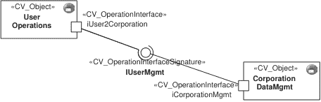

图 4.1：连接计算对象所涉及的概念。

共享相同的签名规范（IUserMgmt），但具有互补的因果性，反映了它们的客户端和服务器角色。

UML（使用 UML4ODP 定义的适当构造型进行增强）为计算语言概念提供了自然且忠实的表示。因此，UML 组件可以直接用于表示计算对象、它们的接口及其操作签名。UML 组件表示计算对象类型，UML 端口用于表示 ODP 接口类型，UML 接口表示计算信号和操作的签名。

UML 并不是以平台无关方式指定计算对象接口的唯一方法——也就是说，不必承诺使用特定编程语言或实现技术。例如，CORBA [31] 是 OMG 的一项规范，除其他外，它提供了一种平台无关的语言来描述对象接口。这种语言称为 *CORBA IDL（接口定义语言）*，也被采纳为 ISO 14750 [12] 标准，作为 RM-ODP 系列的一部分。它提供了一种文本记法，用于指定对象接口和操作签名。因此，如果你采用 ODP 计算规范，创建到 CORBA 的映射并不难。ITU-T 还有另一种接口定义语言，称为 eODL（*ITU-T Rec. Z.130，ITU 对象定义语言* [26]），它提供了 OMG 的 IDL 之外的一些功能。在面向服务的架构领域，用于表示 Web 服务的接口使用 WSDL [100] 指定。这可以视为面向基于 Web 的服务的接口定义语言的一种专门版本，它也允许以文本方式表达 ODP 计算语言概念。因此，从计算规范创建到 Web 服务规范的映射也相对直接。

精确指定接口的能力极有价值。首先，它允许用户和其他 IT 系统利用描述计算对象所提供的服务及其调用方式的规范。然后，这些技术服务可以按第 1.5 节讨论的方式公开。其次，服务描述可用于在存储库中或通过 Web 定位和发现服务。服务描述已用于现有的中间件服务注册机制，例如 JINI 查找服务。为了在服务搜索解决方案之间提供共享术语和通用功能，RM-ODP 定义了 ODP 交易功能。该功能在描述服务类型以及在分布式和异构服务存储库中发现提供特定服务的对象的一项国际标准 [9] 中得到了进一步阐述。OMG 也使用该标准作为其对象交易服务 [27] 的基础。

最后，如果我们将接口视为类型，就可以利用现有类型理论来推理服务（或对象）的可替换性和兼容性。前者指一个对象能够替换另一个对象，且这种变化对外部客户端是透明的；后者定义了若两个或多个对象连接起来，要正常工作所需满足的要求。这些概念可以视为对象互操作性硬币的两面。这对于以可预测的方式连接独立开发的部分和服务且不出现不良错误至关重要，而这在大多数 SOA 和云系统中必不可少。

### 4.3 绑定

除了封装系统功能的计算对象之外，还需要表示这些对象之间的绑定。这对于建模具有非平凡行为的连接特别有用，例如向系统其他部分报告异常的连接。以无缝方式连接两个或多个对象并非易事，因此 RM-ODP 对绑定的指定和实现非常谨慎。在 ODP 中，绑定是通过在两个或多个对象之间建立通信关系而创建的上下文，绑定由绑定动作创建。通常，一个计算对象通过执行绑定动作来发起与另一个计算对象的交互，使它们能够相互连接并开始交换服务和数据。然而，在某些情况下，特别是涉及多媒体通信时，一个对象可以在若干其他对象之间发起绑定；这称为第三方绑定。

RM-ODP 区分两种绑定：基本绑定和复合绑定。在基本绑定中，对象之间的连接是直接的，不需要在它们之间使用任何其他对象；这种情况就是我们通过简单共享定义操作签名的 UML 接口来连接两个组件的所需服务和提供服务。例如，图 4.1 显示了这一点，其中使用 UML 球窝记法表示绑定。

通道，其中任意数量的计算对象可以注册为各类事件的源或监听者。

### 4.4 计算对象之间的交互

对象之间的交互使用若干标准交互类型描述：*操作*、*流*和*信号*。这些交互类型由相应的计算对象接口支持：*操作接口*、*流接口*和*信号接口*。

最原始的交互类型是*信号*，它定义在*信号接口*中。信号是一种原子共享动作，导致从发起对象到响应对象的单向、局部化通信。例如，从计算对象传递到其本地基础设施的消息可以用信号建模，本地异常也可以用信号建模。信号序列也可以用于定义更抽象交互（如操作或流）的属性（见图 4.3）。

*操作*可能是计算对象之间最常见的交互形式。操作是客户端对象与服务器对象之间的交互，它要么是通告，要么是询问。这样，我们区分单向和双向（请求与响应）交互。

*通告*是单向交互，其中客户端对象请求服务器对象执行某个功能，因此无需服务器响应。请求由*调用*建模。更详细地说，一个信号标志通告从客户端对象传递到基础设施，另一个信号标志其从基础设施传递到服务器对象。使用这种细粒度的信号表示，我们可以描述例如通告的传输时间，但在大多数情况下，我们可以将通告视为单个非局部化交互。

*询问*是双向交互，其中客户端对象请求服务器对象执行某个功能，服务器向客户端发送响应，如许多 RPC 风格的交互。请求由*调用*建模，响应由*终止*建模。终止的概念概括了许多编程语言中的结果和异常。必要时，操作可以根据信号详细定义。例如，两个通过基础设施通信的对象之间的询问操作可以详述为一组四个信号，分别指定调用和终止的发送和接收。

交互建模的抽象层次取决于系统设计者在每一时刻和每种情况下的具体需求。


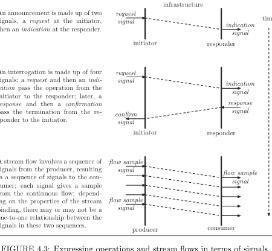

**图 4.3：** 用信号表示操作和流。

RM-ODP 提供多种类型的交互，使设计者能够在任何所需层次上保持精确。一个例子是：操作可以被细化为描述该操作调用和终止期间发生的各个交互的一组原子信号。另一个例子是：复杂事件分发系统可以建模为管理通告序列的复合绑定，并抽象掉所涉及对象之间通信中涉及的所有底层细节。随后，可以将分离的事件管理域的链接建模为复合绑定的串联。

最后，*流*及其组成*流*用于对信息的连续传输进行建模，例如用于交换视频和其他类型多媒体流的传输。你可以将接收 YouTube 视频或互联网无线电广播视为这类交互的例子。一个流是在一段时间内沿一个方向对类型化信息的连续传输。流还可用于表示常规数据流，例如监控报告，或过程控制应用中周期性传感器读数的连续流，而无需对其中涉及的稳定消息序列进行显式建模。各种连续媒体的属性由流接口规定，这些接口描述所交换数据的性质。这是通过声明一组流来实现的，每个流都具有关联的传输方向。这意味着，会话式音频应用可以使用流接口来描述，其中每个流接口都有一对流，每个方向一个流。

ODP 区分三种不同的通信模式，每种模式都由一对匹配的角色组成。在第一种模式中，*发起者*是引起通信的对象，而*响应者*是因此与发起者通信的对象。其次，*生产者*是所传送信息的来源对象，而*消费者*是该信息的汇点。最后，*客户端*是请求由另一对象执行服务的对象，而*服务器*是代表客户端对象执行某种服务的对象。选择适当的模式使我们能够强调所描述通信的最重要属性。

### 4.5 环境契约与透明性

计算语言还允许规定计算对象及其交互的非功能属性。此类非功能属性的示例包括服务质量（QoS）要求、使用或管理约束、服务等级协议（SLA）等。这些要求使用*环境契约*来规定。

规定和表示环境契约的方式取决于其性质以及可用于该任务的表示法。例如，在 UML 中，环境契约可以通过多种方式规定，从与对象交互相关的时间约束，到使用任何现有 UML 配置文件（用于规定 QoS 和实时属性）表达的更复杂要求。一个例子是 OMG 提出的*MARTE 的 UML 配置文件：实时嵌入式系统的建模与分析*[35]。此外，透明性模式使我们能够表达对象的服务质量要求。RM-ODP 定义了不同种类的透明性，包括访问透明性、故障透明性、位置透明性、迁移透明性、持久性透明性、重定位透明性、复制透明性和事务透明性。其中每一种透明性都允许从计算规范中屏蔽由所命名方面引起的问题，同时仍提出一项要求：这些关注点应在系统规范的其他某处加以处理。在 ODP 中，工程视点是提供实现这些透明性的适当机制的主要场所，因此它通常负责明确说明如何满足由计算视图中选定的透明性所提出的要求。RM-ODP 定义的透明性集合中有两种（访问透明性和位置透明性）总是隐含在每一份计算规范中，因此工程规范应始终处理它们。关于透明性的更详细讨论可见第 9 章。

选择这些透明性可以简化计算规范，例如，隐藏因必须处理某些组件或连接器的复制以提高整体系统可靠性和可用性所带来的问题和复杂性，或隐藏因在调用服务之前必须知道服务位置所带来的问题和复杂性。在这方面，透明性提供了一种非常有效的机制，用于在系统基本功能与可以模块化方式规定并根据特定用户需求接入的其他方面之间实现合理的关注点分离。

ODP 定义了实现分布透明性的标准功能和结构，使符合 ODP 的系统能够按照相关标准实现这些透明性。然而，每种透明性都伴随着性能与成本的权衡，而且在许多情况下只有部分透明性是相关的。因此，并非每个系统都需要所有透明性。设计者需要选择要应用于每份计算规范的具体分布透明性。

### 4.6 编写计算规范

除了依赖一组定义良好的概念和机制来表达计算对象、接口和交互之外，设计者还需要一些指南和结构化规则来编写其系统的计算规范。本节提供一些关于如何做到这一点的指南。

#### 4.6.1 划分为组件

我们通常从规定应用的高层软件架构开始。这样的架构将提供系统的总体图景，描述系统中的关键计算对象，以及它们如何交互以实现应用目标。

所谓软件架构，我们指系统的结构与组织，它由软件元素（组件、连接器）、这些元素的外部可见属性以及它们之间的关系来定义[49]。该结构还定义了指导设计如何随时间演进的原则和准则[71]。它为满足系统功能需求和非功能需求提供了基础[81,82]。

设计系统软件架构有不同的方法。第一步是选择最适合目标应用和用户需求的架构风格（管道-过滤器、客户端-服务器、多层、黑板、toaster 等）。架构风格的选择以及帮助系统设计者做出这种选择的软件方法学不在本书范围内。然而，RM-ODP 独立于这些过程，因为它被设计为可与其中任何一种过程配合使用。

对于 PhoneMob 系统，我们可以采用简单的三层软件架构，这是许多基于 Web 的系统和 SOA 系统的典型架构。在这种架构中，面向用户的接口、业务逻辑和持久化数据存储被分离到独立的层（或层次）中。每一层中的对象向其他层提供服务，从而为这类系统形成自然的职责组织和关注点分离。

然而，在企业规范中，我们处理的是扮演员工角色的人员，并对其与支持他们的 ODP 系统之间的交互进行建模。我们需要将这些交互贯穿到计算规范中，并在其中对其细化，以给出人机接口的更多细节。为此，我们在架构中增加第四层。因此，人机接口层表示人类参与者，表示层则包含负责与人类用户交互的软件组件。

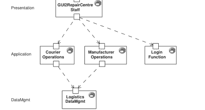

**图 4.4：** 将一个计算用例划分到所选层级中。


表示层与业务逻辑层通信，业务逻辑层提供用户所需的服务。业务逻辑层通过执行详细处理来控制应用程序的功能。必要时，它访问数据层，应用程序的持久信息存储在该层并可供使用。该层保持数据中立，并使数据独立于应用服务器以及业务流程和规则。为数据设置独立的层还能提高可扩展性和性能。图 4.4 展示了使用这种结构来表达一个与组织某些后勤支持有关的单一用例。

图 4.5 展示了 PhoneMob 系统软件架构中更大的部分，以在接口处交互的计算对象来描述。这里出于组织目的将对象分组到包中，尽管包划分并非关键：它主要用作识别各个层的参考。外层包对应架构层。在它们内部，对象根据其提供的服务种类进行分组。辅助服务（例如登录）也被包含进来，因为它们为其余对象提供了一组公共功能。对计算对象类型建模的 UML 组件的端口之间的 UML 依赖关系，表示它们之间需要绑定。此类 UML 依赖关系是对更详细地表达绑定的方式的抽象，

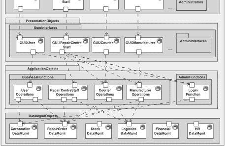

图 4.5：PhoneMob 系统软件架构的一部分。

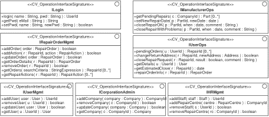

图 4.6：操作接口签名的详细规范。

这些绑定即我们在图 4.1 中展示的，或稍后在图 4.7 中使用的绑定，其中接口签名被明确指定。

#### 4.6.2 对象接口与动作签名

一旦定义了软件架构，下一步就是通过指定计算对象的接口，来细化每个对象将向其他对象提供或从其他对象要求的具体服务。这既包括声明其操作的签名（见图 4.6），也包括定义其行为（将在下一节讨论）。

在 UML4ODP 中，计算接口通过 UML 端口来表示（见图 4.5 和图 4.7）。每个端口所提供和所需服务的签名，在 UML4ODP 中通过使用 UML 接口来指定。因此，图 4.6 展示了指定 ODP 接口签名的 UML 接口，这些签名刻画了某些系统交互。接口签名的使用在图 4.7 中说明，其中使用 UML 球窝表示法来表达相应计算对象之间的原始绑定。

图 4.7 包含了关于组件的更多信息，例如它们的一些内部实现分类器。例如，组件 CorporationDataMgmt 管理关于作为 PhoneMob 公司客户的公司信息。它表示一个数据库，该数据库存储并管理这些公司的相关信息，因此包含一个实现分类器（CorpMgmt «focus» 类），该分类器指定了它的行为。该分类器拥有关于系统已知的公司集合和客户集合的信息。

请注意，这里除了使用 UML4ODP 构造型之外，还使用标准 UML 概念和构造型来表达某些模型细节。例如，带有 «focus» 和 «dataType» 构造型的 UML 类用于

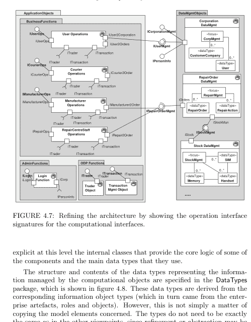

图 4.7：通过展示计算接口的操作接口签名来细化架构。

在这一层次上明确表示提供某些组件核心逻辑的内部类，以及它们使用的主要数据类型。

表示由计算对象管理的信息的数据类型的结构和内容，在 DataTypes 包中指定，该包如图 4.8 所示。这些数据类型派生自相应的信息对象类型（而信息对象类型又来自企业制品、角色和对象）。然而，这并不只是复制相关模型元素的问题。这些类型不必与其他视点中的类型完全相同，因为可能涉及细化或抽象。例如，在此视点中添加了一些附加信息，用于存储客户和其他利益相关者的用户名和密码。还添加了标识符以简化对象引用。

正如在其他视点中一样，在设计早期阶段引入的计算对象，之后可以被重写为更小的计算对象（通过细化或分解），或者与其他计算对象组合以形成更大的计算对象（组合）。这些机制允许

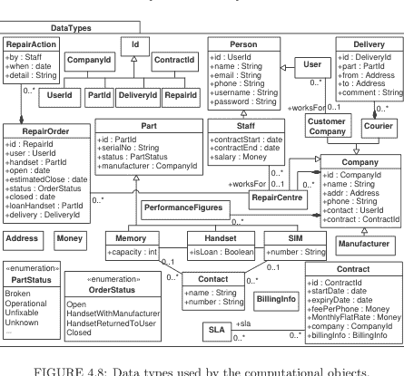

图 4.8：计算对象所使用的数据类型。

计算规范以自顶向下或自底向上的方式创建，甚至使用迭代过程（有时称为中间向外）从两端同时创建。

到目前为止，我们一直集中于静态结构以保持简单，但计算设计通常涉及动态演化的结构。这涉及计算对象实例化更多计算对象或计算接口、执行绑定动作、使用绑定对象的控制功能、解除绑定、删除计算接口或丢弃计算对象。这些机制在 ODP 中使用工厂概念建模，该概念引入一种对象：当给定对象类型和任何必要的限定参数时，它创建新对象并返回对该对象的引用。这种模式如今在系统中很常见，例如可在 .NET 或 JEE 等平台的组件工厂中找到。

例如，员工的登录过程通常包括与通用表示对象的初始交换，随后在表示层中创建一个特定代理对象，以管理与该特定员工的交互。当员工注销时，该代理对象被丢弃。类似地，管理某种临时分组的对象可以为每个新组成员创建一个新的接口实例，从而强制

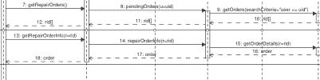

图 4.9：一个计算交互图，展示处理查询的步骤。

职责分离，并且当成员离开该组时，它将删除此实例。

#### 4.6.3 行为：操作

除了结构方面，我们还需要指定计算规范中元素的行为。UML 状态机可用于表达任何计算元素的内部行为：端口、组件和实现分类器。状态机用于表示此类行为，正如在企业规范和信息规范中已经说明的那样。

UML 活动图在此视点中常用于表达对象交互，因为它们提供了我们对对象之间交换消息的不同方式进行建模所需的那类抽象。当交互以信号或操作来定义时，尤其如此。或者，当消息和交互协议是设计重点时，UML 交互图可能更合适。

例如，图 4.9 展示了一个序列图，表达当客户请求关于待处理维修订单的信息时，计算规范的组件之间发生的交互。用户与系统交互的确切方式以及呈现给她的信息封装在 GUI2User 对象中，这里不作描述。这里只展示由这些与系统 GUI 的交互所产生的通信。

图 4.9 表明，当用户决定登录时，表示对象（GUI2User 对象）向业务逻辑层中的合适对象（LoginFunction）发送登录请求。该对象与相应的数据库访问对象协商，以检查用户名和密码，用于


图 4.9：一个计算交互图，展示处理查询的步骤。


该客户返回在该会话期间使用的客户标识符（为简化起见，未显示提供姓名和密码不正确时发生的替代行为）。随后，展示对象会查询该客户的待处理订单并将其呈现给用户。客户从中选择其中一个（由适当的 RepairId 标识），系统将被查询该特定订单。

在规范中也可以加入环境契约，以带有所属类记号 «CV.EnvironmentContract» 的约束来表达。例如，图 4.9 中的持续时间约束表达了接收登录操作响应的延迟不应超过 1 秒这一事实。这种方法允许以非功能属性的形式进行表达，以便由支持工具进行检查。

#### 4.6.4 行为：流

到目前为止，我们一直使用操作来指定系统对象之间的交互。然而，也存在其他形式的交互。例如，流可用于建模在较长一段时间内从一个对象传输到另一个对象的连续信息流。

假设在 PhoneMob 系统中需要一个专用电话会议应用程序来连接服务中心和手机制造商。如果将其设为视频会议，就有可能向制造商展示手机及其部件并获得建议，从而节省将手机派送到工厂、等待维修后再将其带回服务中心所涉及的时间、精力和金钱。

我们将从两种方式来描述这一点，首先使用原始绑定，然后展示复合绑定的使用如何简化描述。

图 4.10 所示的图表表示了这种视频会议系统的架构，仅使用原始绑定进行描述；它由两种计算对象组成（维修方和顾问方）。每个对象都有三个接口，其中两个用于会话控制，一个用于多媒体交换。控制接口（名为“ctrl”）与我们之前看到的类似，并提供由操作签名 IControl 描述的操作。

还有一个流接口（名为“media”），其签名由接口签名 RepairerStream 和 AdviserStream 指定。这些流接口定义了四个用于产生和消费音频和视频的流。两个接口构成一对互补接口，其中顾问流接口中的流方向与维修方流接口中的流方向相反。维修方和顾问方需要各自独立的互补流接口，例如 audioIn 由顾问方产生并由维修方消费。

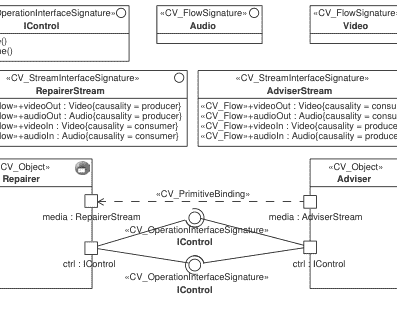

**Figure 4.10:** 使用流指定多媒体应用程序。

在本例中，我们假设控制接口由基础设施绑定，而流接口则通过显式绑定动作进行绑定；在这种第一种情况下，这两者都是原始绑定。

要创建配置，服务中心系统应与制造商系统发起交互；该交互导致在每一方创建维修方和顾问方代理对象，并交换已创建对象上的控制和流接口的接口引用；维修方执行绑定动作完成配置。任一方都可以通过调用其对等方的控制接口来控制媒体流。会议结束后，代理对象将被指示自行移除，并清理这些对象使用的引用和资源。

现在让我们看同一个应用程序，但这次引入一个显式的绑定对象。 resulting configuration is shown in Figure 4.11. 这里存在权衡：设计中增加了一个对象，但应用程序定义的接口类型数量可以减少。现在两个应用程序组件都提供相同的接口 MediaUserStream，因此两者都在其 audioOut 流上发送音频。绑定对象提供一对互补接口，其签名为 MediaBindingStream，该签名通过反转其中所有流的方向从 MediaUserStream 派生而来。该签名在图中以灰色显示，以表明它是在绑定创建时派生的。然后绑定对象将具有这样的行为：从一侧消费 audioOut 的样本并在另一侧将其作为 audioIn 产生，同样适用于其他三个流，从而使它的两个流接口相互交叉链接。

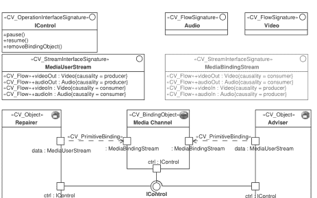

**Figure 4.11:** 在多媒体应用程序中使用绑定对象。

维修方执行的绑定动作创建绑定对象，后者进而创建到媒体接口的两个原始绑定。绑定动作返回对绑定对象控制接口的引用，然后将其提供给维修方和顾问方。所有绑定对象都有这样的控制接口，允许在不再需要时关闭绑定，但在这里我们可以增强它以支持控制操作。这实际上比之前更清晰的结构，因为绑定对象封装了支持流的机制，而我们正试图控制的就是这些机制。维修方和顾问方可以根据需要独立绑定到控制接口以访问暂停和恢复功能。

这里描述的是与第一个设计相同的系统行为，但焦点已转移到绑定对象上，后者是通用的，因此更有可能从可重用库中派生。

如果需求演进为需要多方会议而不仅仅是双向通信，引入绑定对象的优势会更加明显。由于描述使用了绑定对象，所有参与方仍可使用相同的流接口，而选择或组合输入的规则则在可重用的会议绑定对象类型内定义，从而使系统设计更具灵活性。

在更复杂的应用程序中，我们还可以使用将任意行为作为绑定类型的一部分进行指定的能力来定义其他有用的构建块，以修改或过滤所承载的流。例如，可以定义将具有不同属性的流接口链接起来的绑定，以便例如将彩色视频源链接到黑白展示对象。如果流是报告数据的连续序列，也许在遥测应用程序中，我们可以在不同数据类型之间定义流的绑定，以选择特定视图、合并来自不同源的流或在不同数据格式之间转换。这样，类型化的绑定对象为应用程序设计中的结构化和重用提供了一种强大的技术。

### 4.7 与其他视图的关系

正如我们所见，计算视图规范通常不是孤立设计的，而是通常在企业和信息规范的初稿可用后（或至少与它们并行）创建的。

例如，生成系统计算规范的第一步包括确定计算对象的正确配置以及这些对象之间的交互，以保证系统功能得到实现，正如企业规范所规定的那样。这些计算对象和交互的描述也应以适当的抽象级别进行，并且它们需要按照信息规范的规定操作系统处理的信息。这就是为什么企业和信息规范中的元素可以有效地用于识别计算对象及其交互。

如果组织中已有良好的商用现成（COTS）或遗留组件可用于新系统，另一位设计师也可以采用自下而上的方法。封装此类遗留或 COTS 组件功能的计算对象是规范的完美候选者。

一旦确定，计算对象可以根据特定的软件架构分组到包中，例如将面向业务的对象收集在同一层中，将通用功能或 UI 对象放在其他层中。这种结构构成了并定义了系统的软件架构。对于行为，许多计算交互将（例如使用细化）从信息视图规范中的动态模式派生而来。最后，与系统业务规则相关的企业策略，以及控制系统数据状态变化和完整性约束的信息不变模式，可以作为指定计算对象及其交互的环境契约的起点。

当在企业视图中识别出策略时，相关行为预计是可变的，因此计算结构必须

反映这一事实。一种可能的技术是引入显式的间接机制，该机制调用一个解释策略的策略值对象。作为策略一部分定义的行为（见第10章对策略封套的描述）随后可以修改或替换该对象，而不影响设计的其余部分。例如，可以根据营销决策确定一项策略，在维修工作延迟完成时调整维修收费。如果该策略从提供即时折扣改为对未来维修给予抵扣，则计算收费的对象将需要修改；如果该对象与计费过程的其他部分清晰分离，修改会更容易。

当然，目前讨论的三个视角规范彼此之间存在约束，通常每个视角规范都会在其他规范开发过程中被修订和完善。

最后，并非计算规范中的所有元素都需要对应另外两个视角中任一视角的元素，也并非其他规范中的所有对象都有计算等价物。每个视角关注系统的不同方面，并使用不同的语言表达。因此，它们的元素各不相同。然而，它们都是同一系统的视图，因此其中许多元素表示的是同一系统实体的视图。这意味着各视图应当一致，且任何视图都不能对系统施加相互矛盾的需求。例如，企业策略应当与信息视角的不变模式以及计算环境契约保持一致。在 ODP 中，对应关系（见第7章）用于显式规定两个不同视角规范元素之间的关系。因此，对应关系成为检查视图之间一致性的基本要素。

本页有意留空

> 交互所需的属性；这通常基于所请求的透明性和实际部署细节来完成，因为你需要知道所涉及的对象是在同一系统上还是在不同系统上，如果是后者，有哪些类型的通信可用。”Nigel 想了一会儿。“但如果对象的位置发生变化，情况可能会改变。”“当然，你需要知道可以预见哪些变化。例如，如果一个对象被移动，通信方式可能会随着它从使用本地访问变为跨防火墙交互而改变。”“所以你必须做最坏的打算？”“在一定程度上是这样。但你可能希望在设计中固定某些配置方面。”
>
> “我不明白这一点，Alex，”Trudy 说，“你难道不想保留选择余地吗？”“并非总是如此。想想这样的情况：你想用细粒度数据对象来表达计算设计的某些部分；这些对象的一个配置可能由工厂对象生成，然后可能在其整个生命周期中保持在一起——有点像数据库表中的一行。你知道这些对象无论在哪里都可以始终进行本地交互，因为你已经决定配置中的各个成员不应迁移离开其余成员。这个组构成一个单元，一起创建、一起迁移、一起做检查点。在这种情况下，你可以优化通信支持。”
>
> “那么这如何影响工程规范？”“嗯，Claire，工程语言提供了许多与这类分组相关的概念。共享同一生命周期的一组对象称为集群（cluster），可以通过与一个特殊的集群管理器对象通信来操纵整个组。还有其他有用的分组概念——用于关联具有相似故障管理的对象的胶囊（capsule），以及用于关联在最低层共享资源的对象的节点（node）。”“而工程语言概念让你能够将这些表达为架构需求，并映射到你决定使用的任何平台上？”“是的，Nigel，大致就是这样做的。”
>
> 他们一边吃完这顿饭，一边思考着这件事。最后，Nigel 把椅子往后一推。“嗯，这顿午餐真是很有启发。”Alex 咧嘴一笑。“既美味又有收获；哦，可计费时间的乐趣！”

### 5.1 工程视角的用途是什么？

工程视角的目标是识别并规定对象之间分布式交互的支撑机制。其重点是规定分布如何工作——对象如何分布在节点上，以及节点结构以及连接节点的通道将如何建模。它还定义了支持所需分布透明性所需的公共功能。显然，该视角供特别关注系统基础设施的系统设计人员使用。

由于这一领域长期以来一直是标准化的目标，因此已经存在许多标准或规范，为特定技术（如 Web Services、.NET、JEE 或 CORBA）提供此类机制。工程视角的主要价值在于提供一种技术架构框架或参考架构，可用作设计新系统或比较现有分布式处理基础设施技术的基本工具。这样，基础设施设计可以比支持它们的技术拥有长得多的寿命；这使这些技术能够演进，而不会使作为公司主要资产的系统设计失效。

另一个重要特征是，一致性测试所需的信息源自该视角。尽管实际的一致性测试可能是针对技术视角中规定的软件和硬件制品进行的，但基本的测试要求是在与技术无关的工程视角中定义的。例如，观察一条 SOAP 消息从客户端 PC 技术对象传递到部门服务器技术对象，可用于通过将其与相应工程对象之间接口上预期交互进行比较来检查一致性，而该接口已被标识为一致性点。

### 5.2 对象与分布

工程设计的主要目标是支持计算对象的分布透明性需求。如上一章所述，计算交互至少是访问透明和位置透明的。然而，在计算透明性模式规范中还可以规定更多的透明性属性。

基本工程对象（简称 BEO）是一类特殊的工程对象，用于在工程视角中表示每个计算对象。这里我们主要关注机器工程和网络通信工程。有些计算对象可能表示人类参与者，但对于这些对象，只有一个简单的占位符 BEO；与它们通信的工程属于人机交互标准化的范畴，但本参考框架未作详细说明，因此这里不再进一步讨论。

BEO 集合可以看作计算设计的抽象。所得描述隐藏了具有相似通信需求的对象之间的区别，只保留将计算对象刻画为所提供分布平台使用者的信息。因此，BEO 是要放置在特定节点上并发起跨网络通信的主要对象。所有其他工程对象都是在节点或通道架构中定义的次要元素，其目标是提供支持分布所需的功能。这包括各种支持对象，如仓库或目录，它们取自一组称为 ODP 功能的公共功能。

在 PhoneMob 计算规范中，我们建立了一个多层设计（见图 4.5），其中人类对象由表示对象支持，而表示对象又使用访问数据管理对象的应用对象。在工程视角中，我们将这些对象放置在特定节点上（见图 5.1）。¹ 因此，User 和 RepairCentreStaff 对象将各自由自己的表示对象支持，而这些表示对象将位于不同节点上。这是通过将对应于计算表示对象的 BEO 放置在相关人员本地的节点上来完成的。虽然这听起来很复杂，但在实践中，这通常会相当自然地发生，因为这些对象是由适当节点上充当本地工厂的初始登录代理对象创建的。

表示应用对象和数据管理对象的 BEO 随后被放置在合适的后端服务节点上；这些节点可以被复制，以提高性能或可靠性。它们通常出于性能和负载均衡的原因而被显式放置。工程对象的这种分布以及它们通过不同通道连接的方式，会对任何系统的许多其他关键关注点产生强烈影响，尤其是对大多数所谓的非功能方面（如可靠性、高可用性或安全性）产生强烈影响。

例如，图 5.1 中的图示展示了一种设计，其中有一个专用节点用于与分支机构维修中心的每项业务活动进行接口。其余业务对象在另一个节点上运行。类似地，有专用通道供维修中心接口对象访问主服务器，还有其他通道支持后端分布。这允许对每个通道施加不同的要求。有一条通道（PhoneMobDedicatedChannel），具有严格的安全要求和高性能，用于将维修中心接口对象与 PhoneMob 主节点连接起来，以保证它们之间快速而安全的通信，而不是使用与其他表示对象相同类型的通道。

性能要求在 *环境契约* 中规定。环境契约在 UML4ODP 中使用 OCL 或附加到适当节点或通道的时序约束来表达。或者，可以使用专用的 UML 配置文件（如 MARTE [35]）来规定这些非功能需求。

节点的实际性质在此并未确定，而将在技术视角配置中标识，从而给客户或快递员

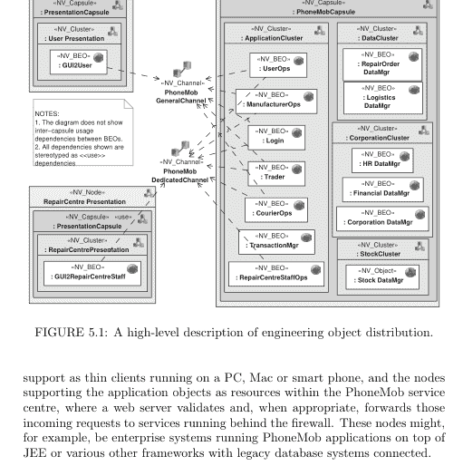

**图 5.1：工程对象分布的高级描述。**

作为运行在 PC、Mac 或智能手机上的瘦客户端，以及作为 PhoneMob 服务中心内的资源支持应用程序对象的节点，其中 Web 服务器验证并在适当时将这些传入请求转发给防火墙后面的服务。这些节点例如可能是运行 PhoneMob 应用程序的企业系统，基于 JEE 或各种其他框架，并连接了遗留数据库系统。

- NOTES:
  - 1. 该图未显示 Capsule BEO 之间的跨胶囊使用依赖关系。
  - 2. 所示的所有依赖关系都被刻板化为 <<uses>> 依赖关系。

### 5.3 节点架构

节点架构确定了在支持应用程序对象的平台中常见的一系列功能。提供一种技术中立的架构来描述它们有助于识别不同基础设施解决方案之间的共同点，例如 JEE 或 .NET，从而使不同平台的集成变得更简单。其中一些功能涉及对象分组，这些分组在管理基本系统属性时很重要，例如资源消耗、容错或持久性。这些分组（在图 5.1 中以大幅简化的配置示出）包括诸如节点以及其中的集群集合、带集群管理器、胶囊集合、带胶囊管理器以及一个核等元素。

这些概念用于定义节点的逻辑结构。如今，有许多完整的基础设施支持包可用，但仍然重要的是为基础设施提供一个通用的功能架构，以支持这些产品之间的互操作性和互通，或将其扩展到新出现的技术。

理解支持提供分布透明性所需的功能类型、实现这些功能所需的基本机制，以及它们如何被结构化并分配给工程视角的架构元素是很重要的。这提供了一个参考架构，可以据此比较和评估现有的分布式处理系统，或据此设计明天的系统。利用它有助于技术架构师指定或选择所需的基础设施特性。

前两个概念在资源提供和使用之间做出区分，如下所示：

- 一个 **节点** 代表具有计算、通信和存储能力的物理对象，通常与其他节点有连接。因此，节点将有一个或多个网络地址，并且部署在节点上的元素可以成为网络可访问的。你的笔记本电脑、你的办公 PC、你的手机以及你组织的服务器机器都是节点。然而，这是一个轻微的简化，因为节点实际上不必是单独的、物理可触及的对象；此类资源的虚拟化（参见第 9.1 节）也可以被视为节点。

- 一个 **工程对象** 是在此视角中感兴趣的任何对象。这些对象支持系统的计算需求、分布透明性或基础设施方面。我们在此区分 BEO，它代表计算对象，以及其他工程对象，其目的是提供基本工程功能，例如管理器、拦截器和目录。

工程视角语言还定义了另外三个概念，描述了任何工程规范中涉及的主要控制元素：

- 一个 **核** 代表使节点在最低级别运行所需的基本机制，通常代表操作系统内核，管理并分配处理能力、通信能力和存储能力。公平调度和精确计时都依赖于核提供的对节点资源的集中控制。

- 一个 **胶囊** 是独立处理和存储的单元。胶囊内的故障会影响其中的所有对象。胶囊支持由 **胶囊管理器** 管理的工程对象集合。胶囊通过某种保护机制彼此隔离，以使一个胶囊中的不正确行为不会损坏其他胶囊。其后果之一通常是，由于涉及额外的检查，跨胶囊边界的通信比胶囊内部的通信昂贵得多。一组胶囊的示例是操作系统（一个核）运行的每者拥有自己地址空间的独立进程集合。胶囊的另一个示例是 JEE 或 CCM [29] 组件容器。

- 一个 **集群** 是生命周期紧密耦合的 BEO 集合，因此可以作为一个单一单元被激活、停用或迁移。构成 JEE 或 .NET 组件的对象记录是一个集群。另一个示例是将小型原始对象聚合为更大的配置以形成数据库更新的行。

每个核、胶囊或集群都包含一个负责管理它并控制其成员资格的管理对象。该结构的概要如图 5.2 所示。

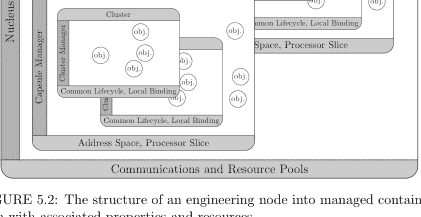

**图 5.2：工程节点划分为托管容器，每个容器具有关联的属性和资源。**

嵌套组件通常在系统初始化时按顺序实例化。

首先，节点由其核配置。核随后为胶囊及其胶囊管理器分配资源。胶囊管理器随后创建必要的集群及其集群管理器。在此过程中，胶囊管理器为集群管理器分配资源。最后，BEO 被实例化，要么在集群内部，要么直接在胶囊中，以执行为它们所代表的计算对象指定的任务。

当 BEO 的工作完成后，其资源将被返还给其直接管理器。如果这是集群，集群管理器可能会决定终止，并且当其所有工作完成后，胶囊可能会终止，将其资源释放回核以重新分配，以便系统返回到仅存在节点和核的初始状态。

### 5.4 通道架构

工程语言中的第二组主要概念涉及定义通道架构，该架构代表通信基础设施，允许工程对象进行交互。

基本元素是通道，它是计算绑定的工程等价物。通道由存根、绑定器、协议对象和拦截器以及链接组成，用于通信通常驻留在不同节点中的基本工程对象。图 5.3 显示了连接 PhoneMob 应用程序的 GUI2User 和 UserOps BEO 的通道的示例。

通常没有必要详细指定这些元素，因为它们由底层中间件平台提供（其中一些本身已标准化 [13]）。然而，有时我们希望在功能上对它们进行建模，以便指定通道的一些属性，或对其表达需求——例如对通道的性能要求或对协议对象或拦截器的安全约束。

所有通道都涉及相同的功能，使用专门的工程对象以有序的方式实现所需的功能。然而，不同的特定通信架构可能会各自以自己的方式组织或交错这些功能。

- **存根** 转换或监控通道中的信息。这包括，例如，消息元素的编组和解组、将本地接口转换为可互操作接口引用的翻译，或提供消息内容加密。存根是实现用不同语言编写的两个对象之间通信访问透明性的元素（如 C++ 和 Smalltalk）。客户端对象与其本地存根通信，后者负责翻译请求

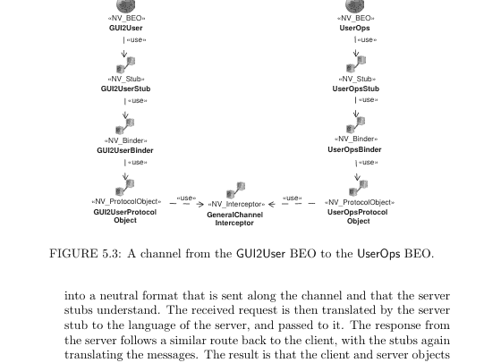

*图 5.3：从 GUI2User BEO 到 UserOps BEO 的通道。*

转换成一种中性格式，该格式沿通道发送，并且服务器桩能够理解。随后，服务器桩将收到的请求转换为服务器所使用的语言，并将其传递给服务器。服务器的响应沿类似路径返回客户端，期间桩同样会转换消息。结果是，客户端和服务器对象都认为自己在与用各自语言编写的本地对象通信。

- **绑定器**提供服务，用于在通过通道通信的 BEO 之间建立分布式绑定，并提供协调复制对象实例的透明性功能。这其中可能涉及多种不同的对话风格。因此，例如，客户端和服务器绑定器可以建立通信通道，而服务器绑定器可以在激活服务器对象之前等待请求。事实上，服务器绑定器可以根据服务器对象所需的激活策略表现出不同行为；绑定器可以为收到的每个请求创建一个对象，也可以在通道启动时只实例化一个对象来处理所有传入请求，或者创建一个服务器对象来处理一段时间内收到的所有请求，但若在一段时间内没有收到任何请求，该对象就会终止；许多其他实例化策略也是可能的。
- **协议对象**是对协议通信能力的封装，它可能是为特定任务而设的完整分层协议栈，例如对 Web 服务协议 SOAP 的支持。在较低层次上，协议对象可能利用 IPv6 漫游支持，以不涉及重新创建绑定的方式与移动设备保持联系。协议对象还可以封装某种特殊用途协议的实现，例如抗噪声卫星链路或量子密码信道的驱动程序。
- 当需要跨越任何组织、安全、系统管理、命名或协议域边界时，就需要某种网关。*拦截器*正是工程语言为此目的提供的元素。所有交换的消息都要经过通道拦截器，这一事实还使得可以向系统添加有趣的管理功能。例如，可以观察消息，以执行服务质量和性能监控，甚至出于安全或其他原因对消息进行重排或过滤。另一种用途是：两个对象位于不同网络中，各自遵循某种本地通信协议；例如，一个使用 OSI 七层体系结构，另一个遵循供应商的专有协议。桥接这些差异的任务可以由连接它们的工程通道内的拦截器完成。拦截器不必分析通信中所有封装层次；如果信息对双方来说已经可以理解，它们就可以原样传递。第 11 章将进一步讨论这一点。

这些对象通常各自都有一个控制接口，用于对通道的不同方面进行协调管理，并动态重配置通信设施。

### 5.5 公共功能与过程

除了允许将工程对象放置在不同节点上之外，工程视角还确定了一些支持透明性需求所需的公共功能，称为 ODP 功能。在当今可用的各种分布式系统中，可以找到大体相似的功能集合，尽管它们通常以特定于技术的方式实现。工程视角定义了一套独立的词汇，为这些功能提供技术中立的描述。这些功能可以隐藏系统故障、根据名称解析对象位置、查找服务提供项（通过交易）、管理事件等。某些 ODP 功能可视为提供了实现分布式系统常见功能的基本处理模式，以及以可重用方式设计分布式基础设施的基本构建块。

ODP 定义了十五种公共功能，分为四大组：

- 管理功能：节点管理、对象管理、集群管理和胶囊管理功能。
- 协调功能：事件通知、检查点与恢复、停用与重新激活、组、复制、迁移、事务、ACID 事务以及工程接口引用跟踪功能。
- 存储库功能：存储、信息组织、重定位、类型存储库和交易功能。
- 安全功能：访问控制、安全审计、认证、完整性、机密性、不可否认性和密钥管理功能。

本书无法详细定义全部功能，因此我们将描述限制在其中的一部分，并用这些功能来说明如何将它们组合起来，为应用设计者提供有用的复合功能。

让我们先看看事务功能。注意，该功能比大多数银行账户管理系统中通常使用的 ACID 事务功能更为通用。在真实的分布式处理环境（例如，设想任何构建在互联网之上的系统）中，参与事务的各方可能分布在不同的城市或国家，事务可能是一个长时间运行的流程，持续数天甚至数周。因此，提供该功能的对象将需要与事务中涉及的所有参与对象或参与方通信，以监控相关操作并检查可能存在的不一致。

如果检测到不一致，该对象将安排初始化一些补偿操作，这些操作通常是每个节点上的本地事务，用于移除更改并有效地将每个对象带回其初始状态。例如，如果在某个事务中从账户取出了些钱，补偿操作意味着显式地将相同金额存回该账户，这不同于 ACID 事务中定义的典型隐式回滚操作。采用这种方法，对象的状态可能暂时不一致，但最终会再次一致。该功能已在若干后续标准中详细定义，包括 CORBA 规范中名为 *OTS 规范的附加结构化机制* 的部分 [39]，以及 OASIS 标准 *业务事务协议* [42] 和 *Web 服务协调框架* [43]。

另一个相关示例是 ODP 交易功能。该功能源于电话运营商提供的黄页服务的理念；它允许服务提供者将其服务导出到交易器（代表提供 ODP 交易功能的一组对象）。消费者对象随后可以基于给定的一组约束查找该服务，以获得提供该服务的对象的引用。许多读者会觉得该功能很熟悉，因为它此后一直处于面向服务架构（SOA）的核心，并且是 UDDI 的 Web 服务规范的基础。ODP 交易功能标准也被 OMG 采纳，成为 *CORBA 对象交易服务* [27]。

ODP 功能也可以组合起来实现某些透明性。

例如，让我们看看如何通过使用一组选定的 ODP 功能，以两种不同方式对计算对象隐藏系统故障。

- 一种方法是时常保存系统状态，并在必要时从该保存副本恢复运行。为此，使用检查点与恢复功能对应用状态的关键部分（例如保存在集群中的部分）设置检查点，然后在需要时恢复信息。
- 另一种方法是使用复制功能；该功能允许管理一个行为兼容的对象组。如果一个副本发生故障，就用一个新副本替换它，并将新副本集成到组中。与此同时，服务由组内其余成员维持。

ODP 功能还可以用于提供其他透明性。例如，迁移功能允许应用（集群）迁移到另一个进程（胶囊）。这可以通过两种方式完成。一种是使用复制功能，通过组成一个包含两个对象的组，将服务扩展到新节点，然后移除原来的成员，从而在新节点上留下一个提供者。

或者，可以通过使用停用与重新激活功能来实现迁移。集群管理器首先停用其集群，随后对该集群设置检查点。检查点被移动到新节点，并在那里于新的胶囊中重新激活。

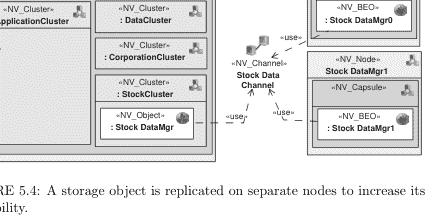

*图 5.4：存储对象在分开的节点上复制以提高其可用性。*


另一种复制透明性的用途，这次是为了提高可用性和性能，如图 5.4 所示。这是图 5.1 的改进，其中原始的 Stock DataMgr 基础工程对象被分解为一个支持对象，该对象保留在 PhoneMob 节点中并协调原始 BEO 的两个副本，每个副本位于不同的节点中。

进一步关于透明性选择和使用的细节以及迁移函数在第 9 章中给出。

### 5.6 编写工程视图规范

RM-ODP 对于用于开发系统视图规范的方法论持中立态度。然而，在下面的列表中，我们提供了一些可在编写工程规范时使用的指南：

- 1. 检查系统的计算视图规范并识别需要支持的计算对象；为这些计算对象中的每一个定义 BEO。
- 2. 分析所需的透明性模式并识别必要的透明性以及实现处理机制所需的 ODP 函数。
- 3. 识别节点并细化节点结构。
- 4. 将 BEO 与节点关联。
- 5. 将 ODP 函数与节点关联。
- 6. 在需要时添加工程对象以支持上述识别的对象分组（集群管理器、胶囊管理器等）。
- 7. 识别通道并设计通道结构。
- 8. 识别进行测试的基本一致性点。

这些步骤中的最后一步构成了与测试过程的重要联系。一致性点主要是在工程视图中以接口的形式定位，尽管有时它们可能在更抽象的视图中被识别。在这种情况下，相关的抽象模型元素必须通过对应关系的链条链接到工程接口。RM-ODP 定义了四种一致性点：互操作、程序化、感知和互换一致性点（详见第 8.3 节），其中任何一种都可以在工程视图规范中指定并定位。

正如我们在下一章将看到的，技术视图随后说明一致性要求应如何记录，以及应适用哪些对可实现标准的一致性的额外要求。这涉及引用此处定义的一致性点并提供关于如何在这些点上进行测试的说明。

完整的步骤列表将引导您得出工程视图规范的初始版本，采用自上而下的方法。然而，您在工程和技术视图中的制品上也可能有要求，需要自下而上的方法。例如，您可能需要使用组织中已有的 COTS 包、遗留系统或网络通道集合，或由第三方为其开发，然后将它们纳入您的工程规范中。

### 5.7 整合当前技术

当某些 ODP 函数及其相关机制体现在特定技术中时，它们会被细化以满足源自目标技术的额外要求。我们已经看到一些 ODP 函数或其适配在 CORBA、Java 或 Web Services 技术中存在。其中包括，例如，命名、事件通知、交易、事务和安全支持。

还有其他情况，分布基础设施由第三方组织或公司提供。例如，使用云计算时就会发生这种情况。采用该技术的含义很简单，即您的工程规范应映射到云提供商所实现并提供的透明性机制和通用功能的规范。它们提供的细节被封装在云提供商内部，因此不构成我们设计的一部分。

### 5.8 与其他视图的关系

工程对象通过支持计算对象的交互和管理，在实现企业视图中建立的目标方面发挥作用，这些计算对象在此视图中表示为基础工程对象。除了这种间接耦合之外，各种工程对象还将受企业视图中建立的通用规则和策略的约束，这些规则和策略控制整个系统的配置。因此，企业策略可能会确定影响节点、核、胶囊、集群或其他 ODP 函数行为的性能或安全目标。特别是，企业制品可能需要由基础工程对象表示，以便对它们的引用可以导致隐式交互以确定其状态或属性。

编制计算规范的设计人员关注代表系统基本功能的计算对象，以及这些对象接口处的交互。他们不关心这种基本结构如何被分布、复制、迁移或持久化。在工程视图中，这种分布及其支持所需的机制成为主要焦点。

通常，一个计算对象有一个对应的基础工程对象，一个计算接口将有一个对应的工程接口。然而，存在例外情况：

- 1. 当计算对象是绑定对象时，该计算对象将导致对应的本地工程绑定或工程通道，而不是基础工程对象，并且
- 2. 当给定的透明性模式需要使用复制函数时，将引入多个基础工程对象以支持所需的透明性。

最后，工程规范中的对象和接口需要在实际资源中得到体现，例如处理器和网络。这涉及声明一组对应关系，例如工程节点与以可实现标准定义的技术对象之间的对应关系。这是下一章的主题。

本页特意留空

## 第 6 章

### 技术视图

“The King is dead; long live the King,” muttered Alex as he stared at the huge notched axe in its glass case. He had insisted on coming here when Trevor and Trudy had admitted that neither of them had ever been inside the White Castle, even though they worked only three blocks away. It was well worth a Saturday morning to see their reaction to the scale of the place.

“国王死了，万岁国王，”亚历克斯盯着玻璃柜中那把巨大的缺口斧低声嘟囔道。他坚持要来这里，因为特雷弗和特鲁迪承认他们从未进入过白城堡，尽管他们的工作地点仅在三条街之外。花一个周六上午来看看他们对这个地方规模的反应是完全值得的。

“I never did understand that saying,” said Trevor. “Surely either he’s dead or he isn’t. He can’t be both.” “It’s making a deliberate contrast between two views of kingship,” said Alex. “The office of king continues, with the heir taking over instantaneously when the old king dies. So one instantiation of the king terminates, but there is still a king, even though it’s not the same individual.” Trudy grinned. “It sounds more like a Hydra in this case,” she said. “But it seems a bit of a funny way of looking at it.”

“我从来没理解过那句话，”特雷弗说。“他要么死了，要么没死。他不可能两者兼具。”“这是在刻意对比两种王权的观点，”亚历克斯说。“国王的职位继续存在，随着旧国王的去世，继承人会立即接任。所以国王的一个实例终止了，但仍然有国王，即使不是同一个人。”特鲁迪咧嘴一笑。“在这方面听起来更像是一条九头蛇，”她说。“但这似乎有点奇怪的看法。”

“Do you think so? Think about the specification of a call centre operator we were reviewing on Friday. The operator deals with one customer at a time. A particular dialogue is terminated and the customer description in the operator’s state is destroyed. The immediately following action responds to a new customer by instantiating a new description. In our specification, it was still a customer, but a different instance.”

“你真的这么认为吗？想想我们周五审查的呼叫中心操作员规范。操作员一次只处理一个客户。特定的对话终止，操作员状态中的客户描述被销毁。紧接着的动作通过实例化新的描述来响应新客户。在我们的规范中，它仍然是一个客户，但是一个不同的实例。”

“But hang on,” said Trevor, turning from an array of crossbows to join the conversation, “aren’t both the operator and the customer just roles?” “Yes they are, but my point is that rules for filling them are different, because one operator deals with many customers over a session, but there is a level of continuity in the model. Even if we bind a specific employee to the operator role, there is still a steady flow of different customers, and their identities are chosen by the environment.”

“等等，”特雷弗说，转身离开一排弩加入对话，“操作员和客户不都是角色吗？”“是的，它们是，但我的观点是填充它们的规则不同，因为一个操作员在一个会话中处理许多客户，但模型中存在一定的连续性。即使我们将特定员工绑定到操作员角色，仍然会有不同客户的稳定流动，而他们的身份由环境决定。”

They walked through into the banqueting hall, its dark vaulted roof hung with banners. “If you don’t like that one, think about the system configurations we have been describing. The elements in the description have quite different lifecycles and ownership. The main servers are fully determined, and we know all about them, right down to their serial numbers and the colour of the cabinets. The local networks are under our management, but are reconfigured and upgraded all the time; we try to track the changes, but they are largely self-configuring at the detailed level, so we concentrate on capturing major properties, like VLAN structure and security domains. The customer

他们走进了宴会厅，黑暗的拱形屋顶悬挂着旗帜。“如果你不喜欢那个，就想想我们一直在描述的系统配置。描述中的元素具有相当不同的生命周期和所有权。主要服务器完全确定，我们对它们了如指掌，甚至包括它们的序列号和机柜的颜色。本地网络在我们管理之下，但不断被重新配置和升级；我们试图跟踪变化，但它们在详细层面上很大程度上是自配置的，因此我们专注于捕获主要属性，如 VLAN 结构和安全域。客户


广域网之外那些分布在外部区域的系统并不在我们的控制范围内。我们甚至往往不知道涉及了何种设备，只能满足于为使其运转而设定最低能力要求。然而，它们都是同一配置规范中的元素。

“但如果大部分配置都是流沙，测试又该怎么办？我们需要更牢固地把控对象，以便进行测试，并在日常工作中监控其是否正常运作。”特鲁迪停下来，凝视着巨大的屏幕，屏幕上展示着那些厚重墙壁的全幅画面。“没错，配置细节不仅影响在哪里测试，也影响如何测试，”特雷弗补充道。“但正因如此，我们需要在规范中明确声明一致性点，这样我们才知道哪些点必须按约定方式开放访问。至于如何测试，我们需要借助他人提供的信息，也就是那些不受我们直接控制的组件的实现者或部署者。他们必须为我们提供足够的细节，以便访问一致性点，并理解他们所做的选择，从而正确解读测试结果。”

“好了，亚历克斯，我开始明白了，”特鲁迪说，“但我们如何确保对方提供了正确信息呢？”“这属于采购环节的一部分，或者在组织内部属于高层管理方向的一部分。首要要求是建立明确的标准，而这传统上正是君主的一项职责。国王万岁！”

### 6.1 与现实世界的连接

大多数软件设计者更愿意生活在一个理想世界中：他们可以在任何厂商平台上指定、开发和部署系统，而不受任何技术或成本限制。然而，我们都知道现实并非如此，而技术视点正是要解决这个问题。在大多数情况下，设计者需要考虑公司已有的 IT 基础设施、预算要求，以及现有的商业政策或战略；这些因素可能强制要求或禁止使用特定的厂商技术。例如，某家公司可能要求使用仅在几年前购置的大型闪亮刀片阵列。既然已经投入了如此巨额的资金，他们就无法再购买与当前平台不兼容的其他硬件机器或软件应用。另一家公司可能有企业政策，要求所有应用都使用开源软件。还有一些公司可能要求使用低成本的 PC 来运行其所有 IT 应用。

这些要求对系统实现，进而对软件架构、应用开发所用的编程语言，以及系统功能的分布方式都构成了非常强的约束。然而，此类要求并不属于目前为止所描述的任何视点规范的一部分，而且大多数规范方法都会忽略它们。于是，它们往往要到系统开发过程很晚的阶段才会被纳入，而那时通常已经太迟，因为系统规范几乎无法再承受任何重大变更。

在编制大型系统规范时，另一个经常被忽略的问题是：需要建立不同的一致性和合规性标准及测试。一致性测试用来检查实现所用到的组件、语言和协议是否满足规范，以及规范中列为系统强制要求的各项标准。例如，我们可能需要检查系统服务是否以 Web 服务方式实现，其接口是否使用 WSDL 描述，并是否通过 REST 协议通信；或者需要检查我们的操作系统是否符合 ISO/IEC/IEEE 9945 POSIX 标准。在 ODP 中，一致性测试通过一致性点来指定，从而可以在这些点上检查真实实现是否与规范匹配。合规性测试则性质不同，它关注的是系统规范是否与正在使用的架构或设计框架保持一致。第 8 章会更详细地讨论这两类测试。

最后，任何系统规范都还应包含一些计划，用于技术选择过程以及系统部件（即共同构成系统实现的软件和硬件产品）的演进。我们都清楚当前技术变化很快，因此，需要在系统规范中的某处以明确方式描述可预见的变化种类以及如何应对这些变化。

RM-ODP 的开发者为此引入了一个专用视点，即技术视点。该视点关注与选择用于实现 ODP 系统的技术有关的所有方面。

### 6.2 技术语言的元素

技术语言的主要目标是提供概念和构造，用于指定构成系统的硬件和软件产品；测试此类实现是否如其余视点所规定的那样符合规范；并指定系统部件（硬件和软件产品）在其生命周期内进行选择、获取和演进所需的计划和流程。技术语言定义了四个主要概念：技术对象、可实现标准、实现，以及 IXIT（Implementation eXtra Information for Testing，即“测试附加实现信息”；该名称源自早期针对特定协议、称为 PIXIT 的 OSI 概念）。

#### 6.2.1 技术对象

技术规范用技术对象（表示实现的硬件和软件组件）及其之间接口的配置来描述 ODP 系统的实现。这些对象会受到令人满意的技术产品的成本和可获得性的约束。

技术对象通常按其类型来指定。这类类型的示例包括可用于实现系统并执行其功能的 PC、服务器、ATM、打印机和其他硬件设备的种类。对这些类型给出清晰定义，有助于回答诸如此类的问题：我们是否要依靠彩色打印机可用，或者系统是否会在一台中央服务器、一台 PC 或外部云计算系统上运行某些特定服务。技术规范还描述了操作系统和应用程序的类型（例如浏览器或文本编辑器），以及用于部署工程信道的连接类型（LAN、WAN、内联网等）。

例如，图 6.1 使用 UML4ODP 表示法展示了 PhoneMob 系统的技术配置。它采用 UML 部署图描述系统的部署架构，通过展示将要使用的不同技术对象类型以及它们之间的连接方式来达成这一点。在部署图中，计算机节点被表示为节点，并用连线表示节点之间的接口。不同类型的网络也以节点形式表示。该图显示，系统将使用三种不同的计算资源（PC、企业应用服务器和后端业务服务器）、两种不同的通信介质（LAN 和 WAN），以及作为 PC 特殊外设的打印机和条码读取器。PC 和企业应用服务器可连接到 LAN 和 WAN，而后端业务服务器只能连接到受防火墙控制的隔离 LAN。对 WAN 的连接同样需要通过防火墙。

技术选择会带来明确的影响。例如，所用技术对象的类型可能影响服务质量保障。技术对象决定了交互的性能成本，进而间接决定了其他视点中定义的行为所能达到的服务质量。技术选择还可能影响功能需要如何开发，甚至影响应用的软件架构。例如，JEE 或 .NET 等某些技术平台会强制采用特定的架构风格（如客户机-服务器或多层架构），并提供一些通用功能和服务。其他平台可能无法提供所有必要服务，因此缺失的服务必须在每次需要时通过添加代码来实现。


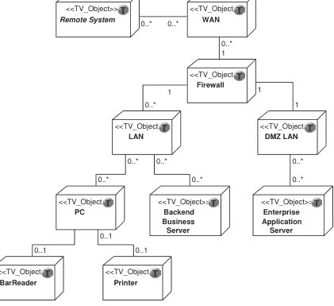

FIGURE 6.1: 节点配置概述。

#### 6.2.2 可实现标准

尽管目前各厂商平台之间的互操作性水平不断提高，但仍存在一些不兼容性，迫使用户必须使用与规范中选定的操作系统（Linux、MacOS、Windows 等）相匹配的特定应用程序。这就是为什么需要指定技术对象必须符合的*可实现标准*。此类可实现标准的示例是 ISO/IEC/IEEE 9945（POSIX）的应用程序编程接口，或 ISO/IEC 9075-10 的 SQL — 对象语言绑定（SQL/OLB）以及类似 ISO/IEC 13490 CD-ROM 文件系统的媒体格式规范。图 6.2 显示了业务服务器技术对象的示意视图，其中包含代表 CPU、内存、中间件等的其他技术对象，以及其中一些对象应符合的可实现标准。

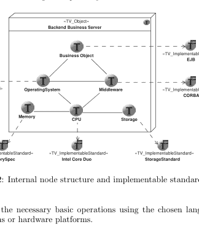

FIGURE 6.2: 内部节点结构和可实现标准。

可实现标准实际上是技术对象的模板。因此，技术视图通过列出用于使用所选语言、操作系统或硬件平台提供必要基本操作的标准，在一组视图规范和实际实现之间提供了一个链接。

#### 6.2.3 IXIT

技术语言在一致性测试过程中也发挥着重要作用。一致性测试基于在规范中定义为一致性点的某些点对系统实现的观察。这些点是规范中建立的参考点集合的子集，需要可供测试访问（有关更多详细信息，请参阅第 8 章）。尽管如何找到它们在本视图中有记录，但这些点本身通常与工程规范中定义的各种可访问接口相关联。定义了四类可应用一致性测试的参考点。第一类是程序化参考点，表示可通过操作系统日志或通过安装便携式拦截器观察到的软件接口。第二类是感知参考点，通过直接检查物理系统观察，例如查看屏幕或机械执行器。第三类是互操作参考点，通过检查系统之间传递的消息进行检查，最后是交换参考点，通过读取产生的某种便携式介质进行检查，例如 CD-ROM 或外部硬盘驱动器。

然而，由于规范通常不会定义完整的协议栈，而是将一些详细选择留给实现者，因此实现需要附带实现者提供的额外说明，说明实现的结构以及测试人员如何访问规范中声明的一致性点。这些信息被称为用于测试的实现额外信息，或 IXIT。技术规范提供了一个格式，说明实现者必须在 IXIT 中包含的信息的最低要求。然后使用这些信息来解释测试人员可以做出的观察，以其他视图中定义的词汇和概念来解释。例如，它允许识别有效交互，以便可以根据某些指定的对象行为检查其适当性（参见第 8 章）。

指示实现者在生成 IXIT 时必须包含的信息的格式可以附加到任何技术对象或接口；图 6.3 显示了将此额外信息的要求与两个技术对象关联的示例。另一个示例可能是技术规范要求实现者说明所提供的任何强制性平台组件的确切版本号，例如应用程序服务器中的 EJB 环境。

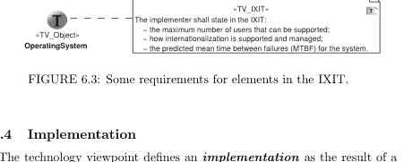

FIGURE 6.3: IXIT 中元素的一些要求。

#### 6.2.4 实现

技术视图将实现定义为实例化规范的过程的结果，其有效性可以接受测试。这些过程不仅涵盖开发，还涵盖与系统部署、配置和演进相关的其他活动。它们包括，例如，配置指南、部署计划、变更管理计划、技术和服务提供商选择标准、维护流程等等。在 UML4ODP 中，这些过程使用带有关联词 «TV_Implementation» 的活动图表示。

图 6.4 显示了选择技术对象的示例。它假设系统的所有者和运营商需要添加一些功能；他们会搜索满足其需求的组件，如果他们已经拥有合适的解决方案的元素，他们会选择并部署它们。然而，如果没有合适的可用方案，他们会将需求作为供应请求指定并发布给分包商，后者将实现组件并在 IXIT 中描述解决方案。然后代表运营商的验收测试人员使用此信息来测试新组件。如果测试成功，则部署组件，否则对其进行纠正并再次测试。

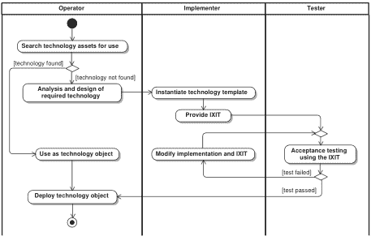

FIGURE 6.4: 选择技术对象的 TV_Implementation 活动。

### 6.3 与其他视图的关系

技术视图主要与工程视图相关，因为它指定了必须实现工程对象的硬件和软件组件，包括工程规范中确定的节点和通道。因此，每个原子或复合工程对象都对应一个技术对象。请注意，该关系是双向的：工程对象提供了需要实现的对象，而技术对象提供了用于实现它们的特定技术的信息以及这些实现应符合的标准。

## 第 7 章：对应关系 — 将一切联系起来

Nigel 从白板前退后一步。“好吧，至少我们同意规范中需要有用户和会话。” Claire 抿了抿嘴。“不过，”她说，“我不确定我们指的是同一件事。在我的计算模型中，用户具有名称和凭据，但在你的工程模型中，它只是坐在浏览器前的人。我的会话可以被挂起，但你的会话直接映射到网络连接，如果我理解这里的这个约束的话。”

他们谁都不想改变自己的工作方式，互相怒视着对方，各自寻找突破口。这将会很困难。

“等等，诸位，” Alex 说，“这很常见，这正是我说对应关系不仅仅是匹配名称的原因。对我来说很清楚，你们在这里需要的对应关系建立了一个子类型关系。” 他们都稍微放松了一些。“但这如何涵盖会话生命周期的差异？” Claire 问。“好吧，看看你的会话状态。如果一个会话存在，它要么是活动状态，要么是挂起状态。所以 Nigel 的会话对应于你的活动会话。我们可以通过在状态之间的对应关系上加上额外约束来处理这个问题。”“我想我明白了，” Nigel 说，“所以这意味着会话类型之间存在子类型关系，状态之间存在受约束的等价关系，但实例之间不是一对一的关系。”“是的，没错。实例关系是一对多。” Claire 微笑着。“实际上它将是多对多，不是吗？我的模型具有注销和登录操作，可以在一个通信会话中使用，因此它可以连续承载多个用户会话。”

Nigel 走到窗边，片刻凝视着对面的屋顶线；阳光照亮了石板上地衣环状物耀眼的橙色。这是清洁空气再次带回码头区的又一变化，他想知道蛾子是否也在改变颜色以作补偿。“我不明白的是，”他转身面对其他人时说，“如何将这些约束的更改传递到运行系统中实现的更改。”“好吧，” Alex 开始说，“可能有多种途径，但它们都取决于工具捕捉到约束并推断出它们意味着选择合适的工程模板。最简单的方法可能是将通信会话重用作为选择绑定器模板的选择标准之一。如果存在计算

> 改变用户身份的动作，这将意味着使用多用户绑定器。而且必须有这样一个动作，因为登录操作的细节会涉及它。

> “我们对工具要求很高，不是吗？”克莱尔歪着头说。同一片阳光照出她金发中的亮泽。“但我们应该如此！”亚历克斯回答。“在从设计的不同部分发现简单的逻辑含义方面，以及在设计发展过程中进行枯燥但至关重要的一致性检查方面，工具比程序员强得多。”“如果逻辑并不简单，或者副作用不明显呢？”她在逗他，他知道。“那就求上天保佑我们别碰上聪明的程序员。如果系统依赖于一行晦涩到你想印在T恤上的代码，我敢打赌这个系统会极难维护。”

### 7.1 对对应关系的需求

到目前为止，我们集中讨论了五种视点语言构成的集合。就此止步再容易不过，但我们需要把不同视点关联起来，使它们交织成一个统一的系统规范。本章旨在通过集中讨论不同视点中元素之间的对应关系来纠正这种失衡。

如果把视点视为表示不同利益相关者所关注的领域，那么对应关系就表示这些利益相关者之间就他们的世界观如何重叠、哪些实体出现在多个视图中达成的共识。

ODP中的每个对应关系连接一对视点，因此有两个端点，每个视点中各一个。特定一对视点之间的所有对应关系共同构成所谓的对应关系规范。原则上可以定义多路对应关系，但这些更难以理解和管理，因此为简单起见使用二元关系构成的网状结构。因此，有五个视点时，最多可能有十种对应关系规范，但并非每种可能情况都有重要内容可说，所以实践中少于十种。然而，总共不能少于四组对应关系，否则总体规范将不能完全连通并会瓦解。

ODP中对应关系的概念被有意保持得相当一般，因为各个视点可能使用不同的语言来规定，以满足其各自需要。因此，对应关系是规范元素之间的一种一般性链接，并带有一条相关规则或约束，用以表明两个不同视点中的元素是如何关联的。两个规范元素的链接可以独立于所涉及的语言，尽管那些一般要应用的附加规则的表达无法仅在被链接的任一视点中表达出来。

事实上，对应关系可以在任何相关类型的一对规范元素之间建立。除对象和属性外，例如，我们还可以在动作或状态之间建立对应关系，而在这里，两个视点整体上更可能使用不同的抽象层次。一个视点可能讨论宽泛的业务动作，而另一个视点表达细粒度的计算动作。在这种情况下，对应关系将涉及一种*部分-整体*关系，因为我们可以说，观察到业务动作意味着计算动作已经发生，但计算动作只意味着业务动作正在进行，而不是已经完成。

另一种对应关系出现在主要规定类型的视点（如信息视点）与主要处理实例的视点（如计算视点）之间。这里的对应关系可以是熟悉的类型—实例关系。示例可见于信息视点和技术视点中定义的类型（或模板）与技术视点、计算视点或企业视点中定义的特定配置之间的链接。

### 7.3 ODP体系结构所要求的对应关系

ODP参考模型定义了构成五种视点语言的概念和规则，但它尽可能为设计者留出灵活性，使他们能够自由使用这些语言来表达最符合其需求的系统。这样做的结果之一是，它对究竟应该有哪些对应关系施加的约束很少；这些对应关系主要将由问题域的性质决定。然而，参考模型本身确实规定了一些强制性对应关系，这些对应关系源自存在跨越或连接视点的体系结构概念的那些领域。这些对应关系确保体系结构的完整性。

我们考虑存在体系结构约束的两个领域。第一个规定对应关系的领域是信息视点与计算视点之间。这里有一项要求：表示所需信息状态转换的不变模式与动态模式的约束，在计算视图中应当可追踪为相应计算对象的交互或内部动作。这对于证明需求正得到满足是必要的。

第二个领域位于计算视点与工程视点之间，涉及一组约束，用以确保能够提供透明性，同时不会因意外的特性交互而引入意外的障碍或副作用。由此产生的对应关系在图7.1中示意。这里的目标是创建一种工程结构，使其能够以灵活的方式演进，以应对环境变化，并在任何时候都清晰地映射到其所支持的计算设计上。

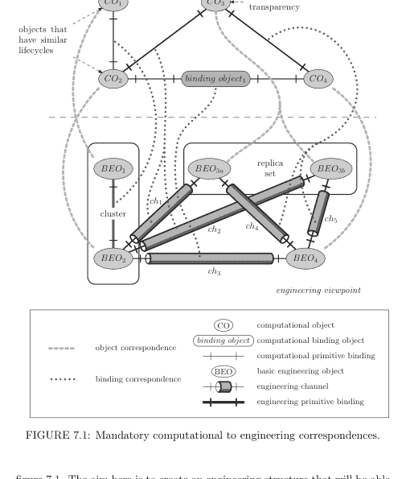

图7.1：从计算视点到工程视点的强制性对应关系。

可能使这种映射复杂化的机制之一是支持复制。因此，各种约束在没有复制的情况下强制保持简单性，以避免给有复制的情形增加额外复杂性。实现方式是规定：除非存在复制，否则计算对象与其支持的基本工程对象之间是一一对应关系。如果存在复制，则一个计算对象专门对应一组基本工程对象；例如在图7.1中，计算对象CO3对应于包含BEO3a和BEO3b的集合。

这处理了大多数计算对象，但并非全部。计算绑定对象很特殊，因为它们封装通信设施。绑定对象，或接口的原始绑定，要求对应于工程通道或集群内的本地交互。还有一些规则确保计算动作在细化为更详细的对话时以一致的方式得到精化。

这些是非常简单的约束，但也会有许多更具领域特定性的约束。为帮助规范制定者组织这些约束，UML4ODP标准包含若干检查清单，其形式是元规则，用于识别链接不同视点所需的对应关系语句种类。例如，它规定：对于企业规范中的每个企业对象，规范制定者应指出实现所需企业行为的计算对象配置。类似地，对于企业规范中的每个交互，他们应提供与所述企业交互相对应的计算接口和操作或流的列表，并说明该对应关系是适用于该交互的所有发生，还是受某个谓词限定。然后由规范制定者负责应用这些规则，并在此过程中生成一组领域特定的对应关系。

### 7.4 对应关系规范剖析

UML4ODP标准通过为对应关系规范定义一个元模型，将所有这些内容整合在一起。图7.2对此作了概述。该规范本身是一个单独的模型，与各视点模型相链接，但独立于所有这些模型之外。

这两个视点刻画了要把它们联系在一起的规范。该规范本身由一组*对应规则*构成，而这些规则的成员由一组*对应链接*引用。每个对应链接都有两个*对应端点*，每个端点分别与相关视点中的某一组*术语*相关联。

该元模型中的*术语*（Term）元素可与相关视点中的任何语言元素相关联。在UML配置文件中，这是通过使用标签来完成的，因此无需受相关命名空间属性的约束；这样对视点规范编写者的影响最小。

对应规则表达必须对被链接的两个视点中的元素集合强制实施的约束。一个例子是

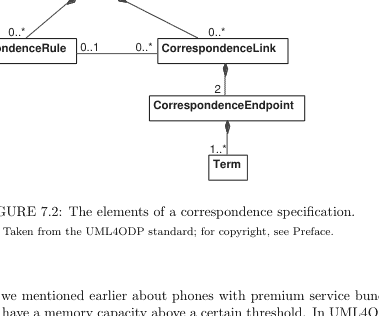

图 7.2：对应规范的元素。
取自 UML4ODP 标准；版权请参见前言。

我们之前提到的关于具有高级服务捆绑包的手机需要具有高于某一阈值的内存容量的约束。在 UML4ODP 中，这些约束通常用 OCL 表示。对应规则还可以提供有关链接元素的关联类型的信息；一些示例有 use、runsOn、affects、implements、realizes 和 replicates。这类关系并非预先确定，而是通常由系统设计者定义。该定义必须包含其语义，说明它们在此系统规范中应具有何种含义。例如，在 PhoneMob 规范中，我们使用 runsOn 约束来表示用于运行特定 BEO 的技术对象类型，或使用 replicates 来表示将计算对象与其支持的复制 BEO 集合关联起来的对应关系。

### 7.5 采用形式化视角

视点集合定义了一组相关的领域特定语言。这些语言中的每一种都是通过将其元素映射到某个非常简单的支撑模型上来形式化定义的，通常是某种标记转换系统，表示系统状态演化的方式。如果要统一不同的视点语言，我们必须首先建立一个统一的支撑框架。这让我们重新认识到统一所假设的原始类型集合的重要性，如果不同语言共享一组共同的原始类型，它们的组合会简单得多。幸运的是，目前对于 boolean、integer 和 string 等原始类型已形成相当广泛的共识；参考模型第 2 部分还为所需的对象建模概念提供了统一的基础。

当我们需要通过结合不同领域特定语言中所有对应项的解释来表达整个系统的演化，从而给出完整系统状态演化的规则集时。

重要的是视点规范之间的耦合应尽可能保持轻量。这就是我们强调需要分离不同视点相关命名空间的原因。我们需要能够向特定视点添加元素，而无需承担确保所用名称在整个设计中唯一的开销，并且需要在视点内部进行重大重构，而无需在其他地方进行相应的更改。

所有这些听起来可能相当沉重，有可能对应关系比视点本身的模型元素还要多。然而，情况并没有看起来那么糟糕。尽管对应关系中需要大量信息，但其中很大一部分可以从一些相当简单的规则中推断出来。

首先，尽管前面有所说明，我们可以识别出某些上下文，其中名称等价可以被视为暗示对应关系。虽然一般来说不同视点的命名空间是无关的，且可能出现偶然的名称匹配，但组织通常会选择对这些命名空间的部分进行对齐，以促进内部沟通。在这些情况下，利益相关者同意，只要在类型级别存在对应关系，就不会在类型关系所建立的范围内为不同目的重复使用名称。如果是这样，具有相同名称的两个不同视点中的元素可以被视为具有隐含的对应关系。

其次，我们可以更进一步，不仅在类型和实例级别断言对应关系，还在完整的类型系统或子系统级别断言对应关系。这可以通过从一个视点向另一个视点导入一组类型定义（或从外部库导入到两个视点规范中）来实现，以便在共享定义被使用之处自动建立对应关系。这种共享通常基于来自信息视点的一组类型定义；这些定义随后在其他视点中直接使用或通过局部细化使用。

然而，我们不能忽视这样一个事实：对应关系将视点绑定成一个连贯的整体，而一旦构建完成，这个整体就会表现出导致我们最初选择视点的规模和复杂性问题。那么，归根结底我们获得了什么？嗯，主要的设计工作是在视点中进行的，在那里情况更简单，然后我们就可以利用强大的工具来检查完整系统的一致性并为其派生实现组件。一旦我们有了对应关系，无论是通过显式定义还是通过从更高级别规则推导，我们就可以利用它们来运行检查并分析我们所指定的系统的行为。

对应关系还有其他重要用途。例如，由于它们标识了多视点规范中的相关元素，因此可以帮助识别受更改影响的元素。因此，它们可用于执行某种假设或影响分析：如果我决定在企业视点中更改策略，哪些信息和计算元素会受到影响？工程对象集的更改是否会影响企业或计算视点中的任何特定服务水平协议或环境合同？

同样，与对应规则相关联的约束可用于维护视点规范的一致性。例如，考虑一组由一组对应关系关联的一致模型。如果我们在其中一个模型中进行更改，在许多情况下，可以通过对应关系传播该更改，从而更改其他模型以恢复一致性。例如，考虑一个对应关系，它规定计算视点中绑定对象的名称与工程视点中相应通道的名称相同。如果设计者决定更改通道的名称，该更改可以轻松传播到计算绑定对象，反之亦然。

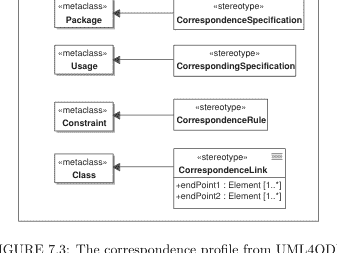

图 7.3：来自 UML4ODP 的对应关系配置文件。
取自 UML4ODP 标准；版权请参见前言。

### 7.6 对应关系的示例

我们可以通过查看一些简单示例来展示定义对应关系所涉及的原则。这里使用 UML4ODP 标准中为对应关系定义的 UML 配置文件显示了它们，该配置文件使用图 7.3 所示的四个刻板印象。对应关系的端点表示为标签定义，提供了引用规范中任何模型元素的很大灵活性。

让我们展示一些使用示例。首先，图 7.4a 显示了图 7.1 中描绘的绑定对象与工程通道之间的对应关系。另一个对应关系（显示在图 7.4b 中）建立了图 4.5 中的 Stock DataMgmt 计算对象与支持它的复制工程对象之间的关系，该对象在图 5.4 中引入。

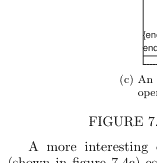

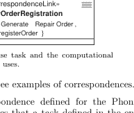

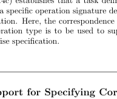

图 7.4：三个对应关系示例。

为 PhoneMob 系统定义的一个更有趣的对应关系（显示在图 7.4c 中）规定企业视点中定义的一个任务与计算视点规范中定义的一个特定操作签名相关。这里，对应关系表明特定计算操作类型应用于支持企业规范中的业务流程步骤。

### 7.7 指定对应关系的工具支持

可用性是当前大多数 UML 工具的局限性之一。编写大型系统规范变得繁琐且费力；特别是，

标注元素的标签值规范通常意味着与工具进行长序列的交互。在 UML4ODP 中对应关系规范的情况下尤其如此，因为对应关系的数量通常很大，并且需要为每个对应关系单独选择相关元素。在这种情况下，工具可以提供很大帮助。

可以以更简洁、更直观的方式定义对应关系，使用相关元素之间的带样例依赖关系（尽管依赖关系的方向并不重要）。例如，工具可以扩展 UML4ODP 表达对应关系的标准记法，提供一种更易于、更快绘制的简写记法，同时提供更直观的表示。使用它可以借助大多数 UML 绘图工具中可用的核心功能，快速显示元素之间的关系。图 7.5 所示的图表展示了绑定对象与工程通道之间对应关系的一种替代表示，该对应关系在图 7.4a 中已显示。

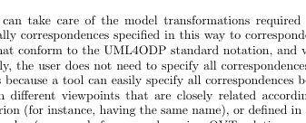

图 7.5：绑定对象到工程通道对应关系的更简洁表示。

工具可以处理模型转换所需的工作，以自动将以这种方式指定的对应关系转换为符合 UML4ODP 标准记法的对应关系规范，反之亦然。

同样，用户并非在所有情况下都需要手动指定所有对应关系，因为工具可以轻松地根据某些给定标准（例如，具有相同的名称）密切相关的不同视图中的元素之间指定所有对应关系，或以隐式方式使用规则定义（例如，使用 QVT 关系表达——参见第 15 章）。通常，对从少量隐式关系自动生成的对应关系集进行微调，比从头开始然后逐一指定大量单独对应关系更容易。

## 第三部分
### 使用 ODP

## 关于第三部分
在视图结构的基础上，本部分探讨了需求可能变化的多种方式，并展示了通过应用合适的架构技术，如何使系统设计更具弹性且更具广泛适用性。

为设定背景，第 8 章探讨了合规性和遵从性的概念，它们为架构、设计和实现之间提供了桥梁。它展示了不同设计层级如何自然地过渡到遵从性评估和测试。

接下来，一系列章节各自研究不同类型的变化以及如何应对。第 9 章研究系统可能部署的环境中的变化，以及如何利用透明性将应用特定关注点与这些变化解耦。第 10 章研究管理变化如何导致需求变化，每个章节都探讨架构框架如何实现系统的平滑演进。这些方面都涉及系统随时间变化的方式，以及如何在变化的环境中延长设计的生命周期。

## 第 8 章
### 遵从性 — 它做对了吗？
奈杰尔在特鲁迪的隔间前停下来打招呼，却得到了超出预期的结果。她的桌子上堆满了打印文档的碎片，屏幕上大约打开了十几个窗口。它们都覆盖着荧光笔标记和笔记，白板上是一团被圈出的参考资料并由箭头连接。其中一组环形箭头用红色记号笔描出。

“没用，”她说，“他们根本没说明规则是什么。”“什么问题？”“他们声称是 CRM 系统的市场领导者，但没有明确说明该软件包真正需要什么。这就像去年那个事务中止问题，我们发现所有消息都必须映射到完整的 SOAP。显而易见的 REST 等价物根本不起作用，但安装指南中没有任何警告。”

奈杰尔用手指梳理着头发。的确他记得。那延迟了一次重要的升级，马库斯对此并不满意。“但你现在看的并不是事务性组件。”他朝白板挥了挥手。“不，这是另一个问题，奈杰尔，涉及注册兴趣。我只是想知道这个操作是否必须由软件包其中一个工作流的后代调用，还是任何人都可以调用。这完全取决于此处父活动和传播动作的定义，但定义是循环的，如你所见。但真正的问题是，除非我们知道哪些支持机制符合条件，否则圆圈中的这一步无法被检查——其实是同样的问题——而他们的文档根本没有说明。”她一字一句地说着，声音中带有一丝绝望的边缘。

“听起来，”他说，“他们似乎没有为其产品提供清晰的遵从模型，而这反过来意味着编写他们声称遵循的所谓标准的联盟不知道他们应该坚持这一点。”他想了一分钟。“听着，在这个阶段你能做的就是问他们的支持热线它做什么，并确保律师把答案写进谅解备忘录，这样我们才有保障。但这是一个典型的‘我不会从这里开始’的案例。来吧，我请你喝咖啡。”

### 8.1 合规性与遵从性
在使用 ODP 参考模型之类的框架时，我们需要有方法来评估所做的解释是否正确。这里可以使用两个概念——遵从性和合规性。区别在于是否需要对物理产品进行某些测试，还是仅通过对两份规范之间一致性的推理就足够了（参见图 8.1）。

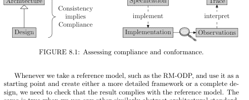

图 8.1：评估合规性和遵从性。

每当我们采用参考模型，例如 RM-ODP，并以其为起点创建更详细的框架或完整设计时，我们需要检查结果是否符合参考模型。使用任何其他类似抽象的架构标准时也是如此。实际上，这涉及将参考模型和新材料放在一起查看，并问它们是否仍然有意义。通过追溯每个概念的使用回对应的参考模型定义，然后进行逻辑分析以查看是否存在矛盾，从而形成复合模型。如果存在矛盾，则新规范不符合要求。

遵从性的情况要复杂得多。这里我们想问的是某个产品是否做了规范所要求它做的事情。这不能通过对描述的推理来完成。它需要某种测试。¹ 测试是一个涉及观察系统行为的过程；该过程的结果是一组测试结果——对所观察内容的陈述——而测试遵从性本质上等同于检查测试结果与原始规范的合规性。

¹ 当然，我们只能在目标规范本身一致的情况下提出关于遵从性的问题。

### 8.2 遵从性社区
遵从性的概念可以广泛应用于许多不同领域，从产品制造到服务提供再到管理指南的应用。ISO 关于合格评定的工作 [19] 旨在足够通用以涵盖整个范围，但就我们的目的而言，我们希望有一个更具体的框架，集中于开放分布式系统。

RM-ODP 的第 2 部分提供了一个遵从性架构，可以将其视为设计、实现和测试活动的企业模型（参见图 8.2）；它定义了三个主要角色，确定了规范制定者、实现者和测试者。通常，一个对象可以履行其中多个角色，但描述角色不同的情况更简单——所谓的第三方测试场景。

*规范制定者* 制定并发布规范。该规范不仅说明实现应该做什么，还通过定义其行为可以被观察的位置来限制实现如何被测试。这是因为许多不同风格的规范可以表示相同的预期对象，而实现者应尽可能拥有自由来生产高效运行的东西。

例如，业务流程可能将修复后手机的包装和发货描述为涉及一系列步骤：包装手机、打印测试报告、在盒子上打印标签、装填盒子、执行最终检查并密封盒子。这些发生的确切顺序可能重要也可能不重要。如果规范制定者只是为了描述的简便而使用序列，但会接受其他顺序或并行行为作为完成相同工作，我们就不想过度限制。

然而，对于评估其中一些活动，例如最终检查，之前所有步骤是否已完成可能真的很重要。在这种情况下，规范制定者将检查者与之前步骤之间的交互声明为 *参考点*。这意味着它是一个可能需要观察正确行为的地方。

UML4ODP 提供了一个简单的配置文件，允许规范中的元素被样例化为 «ODP_ReferencePoint»，并由合适的注释限定，这些注释被样例化为 «ODP_ConformanceStatement»。

规范通常 intended for reuse；关于需要测试什么的最终决定在重复使用时可能会有所不同。因此，规范可能会识别出相当多的参考点，指示测试可能进行的位置，而完整产品规范的最终集成随后将涉及从中选择一个子集作为 *遵从点*，在这些点上说明需要进行最终产品测试。

*实现者* 显然必须生产一个根据规范行为的实现，这涉及他们进行制


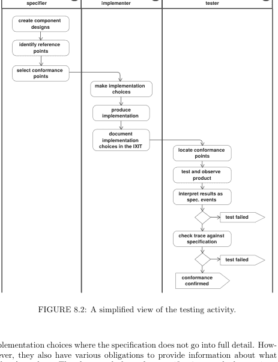

**图 8.2：测试活动的简化视图。**

对于规范未作充分详细说明的地方，存在实现选择。然而，实现者也承担各种义务，需要提供关于其已完成工作的信息。他们必须声明自己正在实现哪些规范以及哪些选项；这通常涉及确认其合同约定要做的事情，但对于现成产品而言，可能并不那么明确。其次，他们必须声明如何定位一致性点，即测试者对所供应的物理或软件制品具有何种访问方式。最后，实现者需要说明规范中的原子概念是如何实现的。最后这项义务可能要求他们提供大量信息。例如，计算规范可能以相当抽象的方式表达，采用高层交互或消息的形式。实现者需要说明这些交互是如何得到支持的，这可能涉及引用其他标准或提供额外的规范片段。

*测试者*在一致性点激励并观察行为。观察必然处于非常详细的层次，原则上例如观察与被测系统交换的电信号或光信号。必须根据这些信号所表示的符号来解释它们，然后再将这些符号解释为完整消息，依此类推。最终，这一过程会检测到正在测试的规范中的某个原子概念（或者，如果观察结果无法解释或毫无意义，则检测到实现中的错误）。然后测试者知道规范中的某个事件已经发生，并且可以将到目前为止检测到的事件序列（称为迹）与规范所允许的行为进行核对。

### 8.3 参考点的类型

测试过程可以采取多种不同形式，具体取决于所涉及参考点的性质。RM-ODP 确定了以下四种重要类型的参考点。

*互通参考点*与某种物理通信信道相关联，例如网络链路或子系统之间的连接器。可以观察在通信系统之间传递的物理信号。例如，当一对具有 SOAP 接口的协议对象绑定在一起时，可以将它们通信所经由的网络接入电缆指定为互通参考点。

*程序化参考点*表示一个软件接口，出于测试目的可以在该接口观察交互。这意味着本地系统基础设施需要提供某种支持来报告事件，例如对内核或中间件服务的调用，或者提供安装某种软件监控组件的能力，例如可能由修改过的类加载器提供。例如，一个 BEO 可能需要使用同一集群内某个工程对象提供的事件通知服务。这种交互将是本地的，因此在接口处进行检查将涉及使用程序化参考点。

*感知参考点*是系统与真实世界交互的点。这可以通过键盘和屏幕，或通过某种更专用的设备（如 ATM 终端），或通过传感器和机器人设备来实现；还有许多其他例子。在此类点进行测试，涉及观察系统报告正在执行某个动作时实际发生了什么；如果化工厂的控制系统报告某个阀门正在关闭，我们是否真的能看到这确实发生了？或者，可能要求安全审计功能在检测到异常事件迹时生成弹出消息。检查这是否确实发生，必须在感知参考点进行。

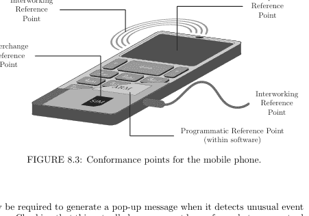

**图 8.3：移动电话的一致性点**

*交换参考点*是读取或写入某种便携介质的点，并且可以通过观察在一系列已知操作前后介质的状态来检查这一过程。例如，规范可能规定，在某些情况下，可移动 SD 存储卡上的配置详细信息会被更新；测试者可以取出该卡，查看更改是否确实已记录。或者，客户对订单信息的确认可能被写入智能卡，随后可以检查这一记录副本与系统状态是否一致。

为了说明这些概念，考虑由分包商提供电话测试仪的情形（见图 8.3）。将一张测试 SIM 卡装入已维修的电话，然后使用手机制造商提供的外部接口将该电话连接到测试仪。将软件测试框架加载到电话内存中。测试仪编排一系列测试，在这些测试中会运行电话的各项功能，包括读写 SIM 卡、在电话显示屏上呈现图案，以及测试无线接收器和发射器。测试结束时，将 SIM 卡插入测试仪并检查其内容。

在此场景中，测试仪连接在一个互通参考点上；无线接口提供了另一个互通参考点。测试软件的加载和运行依赖于存在一个程序化参考点，在该参考点上可提供一组特定的操作系统服务。对显示图案的检查在感知参考点进行，最后，SIM 卡检查需要一个交换参考点。

### 8.4 对视点规范的一致性

前面我们解释了如何需要解释一致性测试结果，以识别标准中定义的动作。这一点在企业视点中最为重要，因为企业视点处理的是相当抽象的动作和事件。因此，我们通过更详细地考察这一机制如何运作来结束本章。

考虑企业规范中由特定角色执行的一个交互，也许是从分支机构系统向总部系统传送计费信息。这一交互应当可以在位于两个系统之间通信路径上的参考点处观察到，例如总部系统的网络接入链路。然而，活动图中表示企业行为的弧线与接入链路上的光信号波动之间存在很大的鸿沟。

让我们首先考察逐步缩小需求范围所涉及的一系列设计步骤。在企业规范中，我们需要识别正在扮演所考虑角色的对象。然后，可以通过一些对应关系将企业行为中的弧线与表达计算行为的状态机中的迁移关联起来。实际上，分支机构系统的行为和总部系统的行为都会有这样的迁移，但由于在执行测试时我们关注总部系统，因此我们将集中讨论其行为。但请注意，该迁移可能并不直接参与某个对应关系，而可能需要从涉及其所连接状态的对应关系中推断出来；即便如此，仍然存在一条指向它的逻辑链，而这又反过来标识出一个计算交互。

这一交互的执行方式将取决于选择一个满足特定环境中透明性要求的工程模板，而该模板将规定适当的消息格式、协议和一系列消息交换。然后，这些交换如何进行取决于技术视点中为通信确定的可实现标准。这些选择中的每一项都记录在系统文档中：或记录在视点规范中，或记录在对应关系中，或者对于最后阶段，由实现者在 IXIT 中作出声明（见第 6 章）。

对一致性测试结果的分析则逆转这一顺序（见图 8.4）。首先，了解所使用的通信标准，就可以解释物理测量结果，从而得到比特流，然后得到一系列原始消息。了解所使用的协议和格式，就可以解释这些内容，以识别正在执行的计算动作及其所传达的参数。当前使用的监控工具通常会这样做；任何手工分析过二进制转储的人都知道这类工具多么有价值。


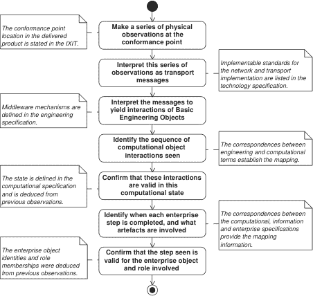

图 8.4：在企业视角中检查一致性。

我们现在已经以一系列计算信号的形式得到了观察结果。下一步是将这些观察结果解释为特定进程执行的操作。这不是一项简单的任务，因为需要将请求与响应配对，并理清并发的执行线程；还可能涉及通过寻找合适的关联器（如会话标识符或事务标识符）来构建必要的上下文。最后，必须使用下一组对应关系来解释这些计算交互，以识别企业交互以及负责这些交互的角色。

当我们逐步上升到越来越抽象的表示时，需要借助通过分析早先观察结果所获得的有关上下文的知识。在某些情况下，初始分析可能有歧义，需要进一步观察才能确定，例如，对象所承担的多个角色中，哪一个角色导致其拒绝某个请求。

当然，在这一链条的任何位置，分析都可能失败。此类失败表明未能遵守相关视角的规则，因而表明系统中存在故障，使得在能够询问通信与企业相关性之前，该通信就已经没有意义。

最后我们应注意，与这种行为和观察分析并行，还存在一条与测试过程相关的义务链。只有在一致性点执行测试时，测试才能被强制要求；而这些一致性点必须已作为参考点充分详细地声明，以便测试人员能够定位它们。因此，如果实现者将通往总部系统的访问链路声明为一致性点，这一声明会传递到其他视角，从而使相应的模型元素有可能参与一致性评估。另一方面，如果在企业规范中声明了一致性点，就有一项相关义务：在其他视角中识别一致性点，以便能够针对该企业设计的所有有效细化构造出像前面概述的那样的推理链。

### 8.5 声明合规或一致性

当详细规范声明其符合更广泛的框架时，应包含一项声明来主张这种符合性，并明确哪些术语和概念源自该框架。该声明应准确指出所引用的是框架的哪个修订版。

产品符合规范的声明是产品文档的一部分。该声明通常构成 IXIT 的一部分，并且应包含用于定位规范中定义的所有一致性点的说明。规范与 IXIT 合在一起必须始终提供执行测试和解释测试结果所需的全部信息。

在本书中，我们通常假设会生成一整套视角规范。然而，在某些产品针对某个现有环境的情况下，规范可能只详细说明一部分视角，例如只包含企业视角、信息视角和计算视角的完整规范。在这种情况下，必须通过 IXIT 建立指向缺失细节的链接，并且为此始终至少需要一份残留的技术规范。

## 第 9 章：透明性——隐藏常见问题

“没用的，”特雷弗说，带着一种不容置疑的神气合上笔记本电脑。“我们就是无法用当前的服务器平台达到性能和可用性目标，而可能需要的是一种不停机平台，那会让我们远远超出预算。”

他们四人正在一间小会议室里艰难地处理资源计划。这些会议室是旧码头工厂改造成更清洁、更高技术活动场所时从绘图室中隔出来的。两侧都有窗户，如今被额外的白板部分挡住，但仍然可以向下看：左边是开放式开发区的隔间，右边是现在的维修实验室、发货区和仓库。过去用来照亮绘图板的天窗，如今映出疾驰的马尾云丝缕，在夕阳中呈橙色。

“那么，”奈杰尔说，“通过在独立平台上复制物流服务器来分担负载怎么样？我们可以把副本放在区域中心，这样任何本地服务故障都不会使全部瘫痪，同时还能获得更好的本地响应。”“拜托，”克莱尔恼怒地说，“你知道协调和同步那些副本会有多少麻烦吗？上次我们试着让开发人员做出那样的结构时，在测试中损失了将近两个月。”“而且我记得，最后需要三个平台而不是两个，来弥补额外成本，”特雷弗补充道。“不过，提醒你，这意味着我们可以使用现有设备，所以肯定会更便宜！”

“等一下，”亚历克斯说，他一直在安静地听着。“你不希望应用程序员参与编写管理副本的代码。那项工作太难了，不会有人想做好几遍。你需要的是基础设施解决方案。把它放在工程视角中，然后作为通用服务使用。”克莱尔看起来并不信服。“但我们仍然需要让应用人员每次请求访问时选择正确的样式；任何误解都会导致混乱。”“但记住我告诉过你的关于使用转换工具的话。不要担心访问。标记需要特殊处理的数据对象，然后使用这些标记指导转换，重写所有关键访问以使用复制选项。”

“我们在整个计算视图中都做这种标记吗？”

“更好的是，如果可以的话，在信息视图中标记关键类型，”亚历克斯说。“这样出错的空间会更小，只要每次使用敏感类型时都适用相同的需求；情况通常如此。”

仿佛为了给讨论画上标点，大楼的智能照明系统选择这一刻响应渐浓的暮色，把隐藏的天花板射灯渐渐调亮。

### 9.1 什么是透明性？

分布式系统本质上比单体系统更复杂、更不可预测。正如莱斯利·兰波特被广泛引用的话所说：“分布式系统就是这样一种系统：我无法完成工作，因为某台我甚至从未听说过的计算机发生了故障。”分布式系统会遇到各种各样的问题，从时钟偏移到不协调的变更管理。许多问题都有众所周知的解决方案，但其中一些方案很微妙，容易出错，而且所有这些方案都让设计者的工作更加困难。存在分布时，需要考虑的潜在错误种类就是多得多。如果能隐藏其中一些复杂性，那就好了。

但并没有灵丹妙药。我们可以通过使用确认和重发丢失内容来隐藏传输错误，但结果是传输延迟更不可预测。我们可以通过保存数据的非易失副本来防范本地停电，但这会降低系统速度，而且对洪水或地震不太可能有效。

然而，我们仍然可以通过减少错误种类来简化事情：如果我们接受潜在代价，就可以完全隐藏某些错误，同时承认仍会有一些更罕见但更严重的错误漏过。我们通过*透明性*这一概念来表达这一点。当设计者请求一种透明性时，他们是在声明希望在一个看不到相应类别问题的环境中工作。要么该问题将由基础设施修复，要么如果该过程失败，将报告一种更严重的错误。更正式地说，这种对基础设施的简化视图是通过声明*透明性模式*来请求的，该模式规定用于表达设计的语言特性（或等价地，支持它的虚拟机）应向设计者隐藏选定的异常。图 9.1 说明这种隐藏如何发生。

然后，基础设施根据该透明性请求进行自我配置。它实际做什么取决于其运行环境。考虑应用设计者提出的一个请求：*迁移*


## (i) 对象与其环境之间交互的种类。
- A. 与对象接口中定义的操作相对应的交互。
- B. 对象接口中定义的错误终止。
- C. 报告环境中错误的交互，例如其他对象的故障。

## (ii) 从对象视角看，请求透明性所产生的后果。
报告被透明性所掩盖问题的交互会被隐藏，但可能被转换为其他更宽泛的错误类别。

## (iii) 提供透明性的基础设施视角。
基础设施组件捕获被透明性隐藏的错误，并调用纠正措施。如果成功，这些措施会向对象返回正常终止。

## 图 9.1：透明性如何改变对象的环境。
*透明性*应应用于特定服务器。也就是说，如果服务器对象移动到新的网络位置（例如，为平衡负载可能有必要这样做），应用不应需要采取任何特殊动作。基础设施的配置控制将评估该请求。如果服务器确实是可移动的，它就需要在从该客户端到服务器的通道中部署额外组件，或许用于捕获服务器未找到异常、搜索新的服务器位置，然后重新配置通信支持以链接到该位置。另一方面，相关服务器可能无法迁移，因为它与某些物理资源（例如大型数据档案）紧密耦合。如果这样，基础设施


可以省略额外组件，因为显然永远不会需要它们，并且通过排除这些组件可以降低成本。然而，如果将来服务器被重新设计，使其确实变为可移动，那么该应用的透明性方案仍会被记录，因此支持它的基础设施可以随之修改，以包含所需的恢复机制。

这种将关于基础设施的假设与满足这些假设的方式分离的方法，在广泛分布式应用需要运行于许多不同种类环境时特别有用。例如，用户界面客户端可能运行在桌面上，也可能运行在移动电话中。它在两种情况下具有相同的故障透明性需求，但提供这些需求的复杂性差异很大，在移动场景中需要更多机制来补偿更广泛的威胁和故障模式。这不仅仅是基本的通信问题，因为两种情况下保护客户端持久状态所需的机制可能完全不同，移动客户端需要全新的通信路径来在基地位置记录其事务；而静态桌面则可能简单得多，同时提供相同质量的服务。

最后这个例子暗示图 9.1 是一种过度简化。许多支撑机制需要一些额外的参数化；例如，事务透明性机制很可能需要向其控制的交互添加事务标识符。其他机制则需要转换现有参数；一个例子是位置透明性，它需要将命名参数从位置无关形式转换为位置相关形式。一般来说，添加一种透明性将涉及对由该透明性负责的任何交互的参数进行分析，并可能进行修改；这等价于由支撑虚拟机应用的一组交互重写规则。

从这些例子应当可以清楚看出，提供透明性与虚拟化之间存在密切关系，而虚拟化是支持云计算的基本技术之一。透明性旨在简化设计者所看到的虚拟机，尤其是在其管理和故障行为方面；虚拟化则通过提供一台虚拟机来做同样的事情，该虚拟机将某些共享资源的一部分呈现得如同由物理上独立的平台提供，且独立于其他用户。二者都可能涉及提供软件支持，以保证用户对所提供的服务或资源具有特定视图，从而简化设计者的工作。

### 9.2 透明性的类型
透明性可以有许多类型，其中一些是领域特定的，或者适用于安全等一般方面。RM-ODP 本身定义了一组覆盖常见分布问题的标准透明性。这些包括：
- **访问透明性**隐藏不同环境之间在表示和编程模型上的差异，从而允许语言无关的分布。几乎所有流行的中间件都提供访问透明性。
- **故障透明性**掩盖对象或其支撑环境的故障；其提供通常涉及某种机制，例如检查点或复制，以允许恢复对象的内部状态。
- **位置透明性**涉及以独立于相关资源物理位置的形式提供对象标识符或其他名称，从而使应用结构与支撑它的物理配置之间解耦。
- **迁移透明性**对对象的当前用户和潜在用户隐藏对象已被移动这一事实。因此，管理功能可以将对象移动到新平台，而不必担心在系统其他地方引起错误。
- **重定位透明性**关注保持接口绑定。它涉及更新绑定，以便对象移动时现有通信不会中断。
- **复制透明性**隐藏如下事实：某个特定接口并非仅由单个对象支持，而是由一组协作对象支持，例如为了提高性能或可用性。
- **持久性透明性**对对象及其用户隐藏系统管理员可能采取的暂时挂起对象执行、然后恢复执行的操作；对象的状态，或用于整个对象集合（如集群）的容器的状态，可能被移到某种二级存储，以节省资源，或在系统崩溃后营造持续可用的印象。存在持久性透明性时，应用状态是非易失的，能够在支撑平台发生故障后存活。
- **事务透明性**隐藏为确保独立行为线程能够有序共享资源而需要的一整组并发与一致性措施。透明性方案标识相关动作组，并将启用适当的事务与补偿机制的工作留给基础设施。

### 9.3 透明性与视点
透明性在工程视点中的基础设施机制管理与计算、企业和信息视点中建立的设计约束之间的关联中发挥重要作用。计算规约与工程规约之间的关系尤其重要，因为计算设计通过规定特定可实现对象行为的约束，确立了分布的潜力。企业和信息规约对这一计算结构施加更广泛、更通用的约束。然而，从计算视点转向工程视点会引入特定基础设施和分布环境的属性。

计算设计者对其对象或接口进行标记，以指示它们将具有的任何特殊属性。然后，工程规约定义一组*模板*，为各种分布问题提供可复用解决方案，并给出必要规则，以便在实际适用的任何环境中选择合适模板来满足计算需求。实例化所选模板会生成各种所需组件，以提供绑定，并由此提供具有正确属性的支撑通道。


图 9.2：提供迁移透明性所需的支撑对象。

例如，考虑在 PhoneMob 系统中为工单提供迁移透明性（见图 9.2）。从计算视点看，目标是让表示维修任务的对象成为

在应用程序的任何地方都可见，而无需担心其实际位置，该位置可能会随着相关电话在仓库或部门之间调配而改变。应用程序设计者只需通过为该对象类型创建相应的透明性模式，将此对象标记为具有迁移透明性，也许在计算视图中，因为在这种情况下，所涉及的信息类型是一个超类型，处理更广泛的任务类型。然而请注意，在此阶段，UML4ODP 不支持对单个对象或类型指定透明性模式。

这导致选择适合所用平台的相应工程模板。它提供了在不同位置对对象进行检查点、钝化和重新激活的功能。它还要求为对象的每个接口建立迁移机制，以便现有客户端在对象移动期间或移动后尝试访问对象时不会看到错误。此外，如果对象提供已发布的服务，可能需要使用新位置更新注册表或目录条目。

另一个例子是提供持久性透明度。PhoneMob 设计人员可能会决定其 Web 界面中用户对话的状态应在会话失败后仍然保持。这可以通过请求该状态的透明持久性来实现，从而在每一步将对话状态记录到非易失性存储中，并在任何新会话开始时恢复该状态。

然而，其结果可能需要一些额外的计算设计特性。可能存在一个隐含假设，即应用程序在会话开始时处于初始状态，并且会话重启是摆脱一致性问题的方式。如果是这样，就需要一些额外的交互，以允许明确取消对话，防止用户陷入无休止的失败会话系列中，在每次新尝试时都会恢复某些错误状态。同样，如果通过检查点提供跨处理器故障的持久性，就需要有一个允许放弃有缺陷检查点的过程。

最后，我们可能会问，在计算规范中进行标记是否真的有必要。迁移透明度听起来像是一件有用的事情，那么为什么不将其作为所有对象的强制要求呢？生活会更简单。答案是没有免费的午餐。添加额外的机制会带来相关的成本，因此在所有地方包括对象之间强相互依赖的情况下包含这些机制，可能会导致不可接受的性能损失。通过仅标记设计者认为在某个阶段可能移动的对象，我们可以降低成本，因为我们可以在真正不需要的地方省去大量昂贵的活动。

## 第10章：策略 — 跟踪变化的需求

“‘仍然只是显示延误，’”奈杰尔说，在走到登机口外的显示屏前查看后。“‘我不确定我们今晚能否离开这里。有人要咖啡吗？’”

他们本应前往一个会议；亚历克斯说服了马库斯让他带奈杰尔和埃莉诺参加 EDOC 的行业经验轨道，EDOC 是他们现在从事的企业建模类型的首要活动，以便让他们接触更多新思想。然而，航线上的一个空中交通管制中心出现了问题，他们已经等了将近两个小时。

亚历克斯要了一杯卡布奇诺，埃莉诺要了一杯圣诞特制焦糖布丁拿铁。奈杰尔给自己要了一杯普通的滤泡咖啡。“‘很有意思，’”他把托盘放下时说，“‘我们到这里时队伍长得多，每个人都得到两块小杏仁饼。现在每个人咖啡上都印着花哨的设计图案，但只有一块饼干。这不是随机的，我每次都观察了前面四五个顾客。’”“‘一定是策略，’”亚历克斯说。“‘他们让值班经理根据负载调整配方。’”

“‘我们可以借用这个想法，’”埃莉诺说。“‘我们每次市场部有灵感时都需要改变折扣算法；现在我们只需告诉他们他们正在更改策略。这对他们的自尊心有好处。’”“‘再多点自负那些家伙就会爆炸了，’”奈杰尔说。“‘但我听说过这个术语在网络拥塞管理中和在安全中使用。是同一个想法吗？’”“‘是的，’”亚历克斯说，从他的饮料中舀起一勺巧克力和泡沫。“‘这是一个到处都出现的常见模式。突出你预期需要更改的地方非常有用。它让你明天的工作更轻松。’”“‘但在网络和企业中是同一个想法吗？’”奈杰尔问道。“‘埃莉诺的焦糖布丁和我昨晚在烤盅里吃的那种一样吗？’”“‘当然不一样，’”埃莉诺说。“‘这只是让他们放点红糖然后懒得搅拌。’”他们都笑了，但亚历克斯继续说。“‘是同一个模式，但详细的机制和时间尺度不同。但如果你坚持这个模式，就不必重新发明人们可能犯的所有错误。’”

就在这时，航班被叫到了。“‘稍等，’”亚历克斯说着拿起他的包，“‘你一定会在会议上听到更多关于策略的内容，我敢肯定。’”

### 10.1 为什么需要策略？

在进行设计工作时，经常需要做出决策，而设计者意识到随着事态发展，最佳答案会发生变化。这可能是由于组织目标、支持技术或活动进行的环境的改变。设计者可以通过指出规范中可能发生变化的部分涉及策略来防范这些变化。这是一个警告，系统应构建成便于纳入更改，并让设计者明确在规划后续更改时应允许多少自由度。

系统的属性在其生命周期内通常不会稳定地变化。相反，存在稳定期，被修改系统行为规则的事件所打断。ODP 参考模型将纪元定义为某物——无论是对象、组件还是系统——具有特定行为或遵守特定规则集的时间段。一个纪元的例子是策略适用的期间。策略变更事件标志着不同纪元之间的边界。

这一总体图景可以有许多变化。作为运行系统管理的一部分的偶尔变化就是其中之一，但当广泛使用的组件（如 bean 或 shrink-wrapped 包）被部署时，类似的考虑也适用；设计设想所产生的制品可能在许多不同的情况下使用，并在投入使用时的部署过程中允许受控程度的定制。此类可重用组件的采用者必须定义并安装一套部署策略。典型的系统生命周期概述在图 10.1 中。

系统预期执行的一些事情是由关于其所服务的组织如何运作的广泛决策决定的。因此，例如，大多数组织都有某种普遍的安全策略，确定在处理不同类型信息时应应用何种控制级别，以及谁可以被信任处理什么。交付一个无法随着情况变化快速准确地跟踪这些访问控制规则变化的主要系统的团队通常会过得很糟糕，因此可定制的策略几乎是普遍的，但遗憾的是并不完全如此。还有许多其他例子，例如交易审批策略、折扣策略或委托策略。

引入策略的另一个原因是允许系统设计在多个不同司法辖区中被利用，或响应变化


本图展示了由规范派生出的行为如何演化。这里，一个规范被实例化三次，得到三个不同的系统。

`D_i` 是系统 i 的部署；同时为其建立一组初始策略。

`E_{i,j}` 是系统 i 的第 j 个时期；它被画成直线，是因为策略所指定的行为保持不变。

`P_{i,j}` 是系统 i 的第 j 个策略设置事件；系统轨迹方向的改变表明系统行为在这些点发生了变化，但在随后的整个时期中保持不变。

**图 10.1：** 策略被断言的时期和点。

影响系统行为的监管规定。因此，例如，金融系统可能需要调整以满足特定国家税法或一组审计要求。原始设计者会知道业务流程中存在某些关键点，在这些点上应纳税且必须计算税额，但具体细节取决于地区，并且可能因系统最初创建时甚至尚未起草的立法而改变。

策略是一个通用概念，适用于任何视角。然而，正如这些示例所示，它在企业语言中尤其被大量使用，因为在那里需要同时满足敏捷业务流程的需求，以及稳定可靠地提供 IT 系统的需求。

因此，策略是一种重要工具，使组织能够以受控方式更改系统或子系统的行为，并借此使其能够响应不断变化的需求和挑战。

### 10.2 什么是策略？

宽松地说，策略是规范中由设计者或其他相关利益相关者识别出的任何潜在变化点。引入策略以增加灵活性的想法是通用的，因此可应用于任何视角。每个策略都关联若干信息，这些信息以不同方式约束系统行为。我们可以区分以下术语。

- **策略** 是用于指代整个信息集合或指代规范中某个变化点的术语。
- **受影响行为** 是系统行为中由策略修改或控制的部分。例如，策略可能控制发放借用手机之前必须满足的条件，也许基于用户此前的可靠性。那么，获取借用手机这一步骤将成为受影响行为。
- **策略值** 表示在特定时期内应用于变化点的约束。更改策略值会改变系统行为。例如，访问控制策略的策略值可能选择适当的机制，因此一个策略值可能要求密码验证，而替代它的另一个策略值则要求出示有效证书。
- **策略设置行为** 是修改策略值的行为。如果未定义此类行为，则策略不能由运行系统内的机制更改。它仍然可以通过不属于系统规范一部分的操作来更改，例如在系统首次启动前选择部署信息，或者更改它然后重新初始化系统。然而，预计大多数系统将需要能够动态演化，因此会有关于策略更改方式以及此类更改何时生效的任何约束的定义。例如，财务策略的更改不应在可补偿事务的范围内变得可见。设计者还需要决定，如果策略更改会使系统处于刚刚变成的禁止状态，应该发生什么；可能有必要定义一些过渡规则来处理这种情况。
- **策略包络** 指示可接受策略值的限制。如果系统管理者被赋予完全自由来安装任何策略值，就不可能推理系统设计的正确性。任何所需的系统属性都可能被足够严苛的策略值破坏。然而，如果策略包络表达了对于任何可接受策略值都必须成立的约束，那么更改策略的影响就可以受到限制，从而可以作出关于系统行为的有意义推论，无论应用的是哪个有效策略值，这些推论都成立。

策略包络可以通过多种方式表达。最严格的方法是限制策略值的设置，使其只能从已声明的可能行为片段枚举中选择，尽管这通常过于不灵活。其他方法将策略值限制为给定语言中的表达式，或限制为受约束的算法类别。可以限制策略值能够访问或更改系统状态的哪些方面，或者施加更复杂的约束。


**图 10.2：** 控制借用手机发放的策略。

我们可以在图 10.2 给出的示例中看到这些概念的实际运用。该图展示了控制何时应将手机借给客户的策略。所有相关信息被汇集到单个图中，以便从整体上查看该策略。受影响行为被标识为一个特定交互，即作为制品的手机从手机维修提供商转移给用户的交互。在任何特定时期，只有当策略值所表达的守卫条件得到满足时，才允许发生该交互。策略值可以由策略设置行为更改，该行为在图中表示为一个进程。该进程的定义将说明哪些角色可以更改该值，以及在什么情况下可以发生这种更改。这可能涉及分支机构经理与总部某人之间的协议。最后，无论提出何种更改，策略值都必须满足策略包络中给出的约束。在这里，这些约束表明该值必须是布尔守卫条件，并且只能依据关于用户以及用户所提维修请求进度的信息。在示例中，策略值和包络都以非正式方式表达，但在实际规范中，这些规则必须以比这更精确的记法来表达。

图 10.2 中对策略概念的呈现与 UML4ODP 中给出的呈现有所不同，因为这里更突出地表现了受影响行为受策略值约束的方式，以及策略设置行为受策略包络约束的方式。在 UML4ODP 中，这些是隐含的，是从其他关系的传递闭包推导出来的。原始版本还将策略值显示为包含在包络中，仅说明了最简单的情形，即给出了具体的值列表；在这里，我们表明这种关系通常基于用某种策略语言中的语句来约束策略值。可能值的枚举只是这种情况的一个平凡特例。

已经有许多用于表达策略的语言提案。其中许多基于事件-条件-动作模型，在该模型中，策略值是一组表达式，说明当给定动作发生且相关条件得到满足时，应采取（或禁止）什么动作。相同的基本结构可用于表达许可和义务。这一语言家族中最著名的语言之一是 Ponder [64]，它具有若干用于构造策略规则集的有用特性。其他提案基于道义逻辑（见第 14 章）。

对于系统间通信，*可扩展访问控制标记语言（XACML）* [44] 是一种 XML 语言，专门用于以事件-条件-动作风格表示访问权限。它允许由单个语句构造权限集，并说明这些语句应如何一起解释；例如，访问可能取决于任一语句为真，或者可能要求所有语句都为真。单个语句表达关于请求该动作的主体、其目标以及要执行动作性质的细节。主体和目标通过属性集的匹配来标识；同样，它们的组合有多种选项可用。

*业务词汇和业务规则语义（SBVR）* [33] 是 OMG 内近期工作的成果，提供了一个用于定义业务词汇和业务规则的框架。因此，它有可能表达主体和目标的支撑语义，而这些语义常常被策略语言所忽略。它是在考虑模型驱动环境中使用的情况下产生的，这使其成为需求捕获和设计工具支持中一个潜在有用的元素。

### 10.3 实现策略

要成为系统演化的有效工具，策略值必须易于更改。这意味着需要选择一种允许松散耦合的结构。


策略表示到系统其余部分的传递。这可以通过多种方式实现。一种方法是在运行时解释策略表示，以便从合适的存储库中检索它（例如，在目录驱动网络中[59,96]）；这允许通过更新存储库来进行更改，因为各个系统组件在下次需要解释策略时将检索新版本。另一种替代方案是将策略作为合适组件管理框架中的插件对象提供，或作为由引用标识的服务提供，该引用可在需要时动态重新绑定。

IETF定义了一种众所周知的策略应用架构，它涉及为每一类策略识别控制点集合。控制点有两类（例如，见图10.3）。


图10.3：使用策略执行点和策略决策点来控制流媒体视频服务器中的策略。

策略执行点（PEP）是必须基于相关策略做出选择的点。当需要决策时，PEP将请求的详细信息传达给策略决策点（PDP），后者解释或以其他方式查询策略，并确定结果应该是什么。然后，它将结果返回给PEP，PEP据此采取行动，允许或禁止该请求。这种结构的优点是，策略值由相对较少的PDP解释，而这些PDP可能服务于多得多的PEP，每个PEP都与单独的细粒度资源相关联。

PEP/PDP结构假定，只要策略适用，就需要对策略进行受控执行。这就是所谓的悲观策略执行方法。系统的构造方式使得执行点不可能违反策略。然而，这并不是处理执行的唯一方式。还有另一种方法，称为乐观策略执行，其中策略被发布，然后对系统进行监控，可能基于抽样，以检查策略是否得到遵守。如果发现策略被违反，则采取一些纠正或惩罚措施。许多企业策略就是这种情况，在策略以法律法规形式出现时也是如此；系统应当遵守任何相关法律，而违反可能导致利益相关方通过法院向其所有者寻求赔偿。

## 第11章
## 联邦——与陌生人交谈

阳光在酒店下方山谷中蜿蜒的河面上闪烁，众人围坐在露台上的桌子旁。马库斯曾明确表示，这个异地规划周末应当是非正式的，但仍然是严肃的业务。他们前一天下午花时间回顾了当前处境，并享用了一顿丰盛的晚餐，以感谢他们取得的进展。上午的会议在议程上被隐晦地标为*新商业模式*，与前一天明确的主题相比，显得令人沮丧地含糊。

“好吧，我希望你们都享用了早餐，”马库斯说，“但我现在想和你们分享一些重要消息。我没有给你们任何准备材料，因为这件事非常敏感，不是对我们，而是对我们的新合作伙伴而言；如果他们的参与在错误的时间被知晓，他们可能会在市场上陷入严重麻烦。”他现在肯定吸引了他们的注意力，尽管埃莉诺露出自满的神情，表明她知道将要发生什么。

过去几个月，我们一直在与Factotum讨论，该公司是定制豪华旅行套餐的市场领导者。他们希望将访问我们服务的机会纳入一揽子福利中，以消除旅行的麻烦。他们在广告中大力宣传这些额外福利；说实话，一些高端信用卡公司向白金卡持卡人提供的附加福利正在伤害他们，他们需要反击。

克莱尔看上去很困惑。“我不太确定我明白了，”她说。“业务量足以对我们产生影响吗？他们会进入我们计划覆盖的中心吗？他们不是会进入旅游中心，而不是商业枢纽吗？”马库斯点点头。“完全正确，但再稍微想一想。先回应你的第二点：他们很多业务都在历史名城，而我们确实对这些城市有兴趣；他们已经有非常顺畅的快递网络，用于处理票务以及向他们覆盖的偏远地区运送奢侈品，所以我们可以借助这一点。至于业务量，那并不是我们真正感兴趣的原因。说实话，我并不指望巨大的额外业务量；我们会收支平衡，但真正的机会在于，这是一个进行病毒式广告的完美机会。我们希望我们真正市场中的重要人物——我们想要签约的公司的CEO和CIO——在晚宴上听到他们的朋友如何通过PhoneMob把假期从灾难中拯救出来。我们希望他们看着Factotum的宣传单，并认为他们应该把他们的

> 我们交换的是其版本，但这就像和一个外国合作伙伴争论谁付翻译费；我们不需要改变我们的思维方式，只需确保对方听到他们期望听到的内容。
> 
> “但如果基础设施不同，那怎么运作呢？”奈杰尔问道。
> “你还记得工程通道模型中的那些拦截器吗？嗯，工作就是在那里完成的。它们就是翻译器，并且会完成我们发现需要完成的任何工作，前提是保持我们商定的高层视图。如果中间件不同，或者消息格式不同，或者任何其他细节不同，拦截器会沿着解释过程向上推进，直到达成共同一致，然后沿着栈向下返回，将共同概念翻译成另一方的概念。”
> 
> “好，”马库斯说，“这听起来够简单；我们就这么做吧。”“嗯，我们会弄明白的，不是吗，”埃莉诺说，“我敢打赌，午饭前我们完不成。”没有人接赌。

### 11.1 互操作如何工作？

联邦的目标是允许两个或多个独立组织合作，同时保持其基本独立性。它们各自仍然可以继续做自己想做的事，管理各自的活动，只是必须在需要使合作奏效的狭窄领域中遵守一些最低限度的约束。一般来说，如果联邦不再符合其目标，任何合作伙伴都可以选择退出，尽管可能会有一些惩罚，以便在发生这种情况时补偿其他合作伙伴。

组建联邦是组建团体的一种特殊情况，而团体是企业语言的基本构建块。像任何团体一样，联邦由契约描述——在这种情况下，它被称为联邦契约。它还有一个目标，代表组建合作的目的。

必要的独立性程度得到保证，因为联邦的每一方都是一个由其自身团体所代表的组织。联邦团体与这些团体重叠，因此整个系统的行为是联邦约束与每个组织内部约束组合的结果。严格来说，这是通过让合作伙伴的团体在联邦团体中填充角色来实现的。联邦契约各方所要填充的角色的定义尽可能抽象，以避免对其持续活动造成不必要的约束。记住，角色是由某个对象实例化的形式参数，显然，角色类型约束了能够履行该角色的对象类型。在这种情况下，联邦角色类型远不如团体的对象类型详细

为履行该职责的一方提供对象，并抽象掉未参与联邦的业务的所有方面（见图 11.1）。然后，每一方应只依赖契约中角色类型所捕获的对等方的抽象视图；其他任何内容都可能由本地管理层在不事先通知的情况下更改。


在这些情况下，使用**域**的概念来明确所有权和问责问题通常很有帮助。一般而言，域是一组对象，它们与某个控制对象具有特征性关系；但该术语也可用来表达对资源的责任，例如对应于某个合作伙伴的全部或部分权限范围。定义一个合适的域，其中包含要提交给联邦的资源，可以使契约的范围清晰明确。

联邦的共同体行为涵盖两个方面。第一，它定义实现其目标所必需的各方之间的交互。例如，Factotum 向 PhoneMob 发送其客户列表，请求在指定期限内为他们提供手机维修服务；后来，PhoneMob 对保障范围和实际执行的维修计费。第二，联邦契约涵盖建立、维护和终止联邦的详细责任。这包括组织事项，如通知期和退出罚则，也包括已定义的技术责任和基础设施事项，如交换格式和转换职责（见第 11.4 节）。

与任何其他共同体契约一样，联邦契约可以包含策略定义，这些策略允许在联邦生命周期内动态更改对成员施加的某些约束，从而执行联邦管理。策略设定行为将定义变更流程，以及各方在同意变更时拥有何种发言权。

由于联邦组织之间是松耦合的，基本行为或所应用的策略很可能在某个阶段引发冲突和不一致。因此，通常会发现联邦契约的相当大一部分涉及违规、异常和补偿条款的处理。

### 11.2 解释与共享信息

建立联邦的主要问题之一是决定各方之间通信应采取何种形式。无论谈论的是人还是自动化系统，两个实体之间任何信息交流都取决于它们之间存在基本共享的理解层次。消息接收方需要能够解释消息，识别其中包含的术语，以及这些术语在消息和更广泛对话中的位置所导致的上下文含义。没有这种理解，就无法进行任何交流。

我们可以说，通信实体必须共享一个共同本体，从而就存在哪些类别的事物以及因此可以指称什么达成一致。它们还必须对通信的语法或结构有某种共同理解。如果存在核心共识，就可以用它来交换更多规则和定义，以扩大交换范围，尽管目前的技术水平只允许对机器通信进行相当直接的增强。人类则灵活得多，会利用本地上下文中的许多细微线索来消除歧义。这一点可见于自然语言中本地上下文的广泛使用，例如 Susumu Kuno [83] 的“时间像箭一样飞逝，果蝇喜欢香蕉”，也可见于理解 Noam Chomsky [58] 的“警察被命令在午夜后停止饮酒”所需的更广泛上下文，该句有四种可能解释。

目前，我们依靠联邦契约提供商定的核心语法和本体，再向其添加合适的领域特定包，以涵盖其他类别信息的交换。当前互操作性研究的一个主攻方向是开发更灵活的扩展机制，用于松耦合通信。

到目前为止，我们一直侧重于将术语解释为具有内在含义，但还有另一个同等重要的考虑，即术语用于指称实体；也就是说，将术语理解为名称。这里的问题在于，即使在同一语言共同体内部，事物的命名方式也可能存在许多地方性差异。你可能把你的猫叫作 Fred，但在隔壁房子里，Fred 最可能被直接理解为户主的名字。在这种情况下，如果我站在后门喊 Fred，我可能叫来的是猫，也可能是邻居。

解决这个问题正是所谓上下文相关命名方法的核心。整个领域在 *ISO/IEC 14771：ODP 命名框架* [16] 中有详细论述。该标准给出了名称经过一系列命名域传递的模型，解释了名称应如何被解释和转换，以便通信各方即使名称在每个域中形式不同，也能将其理解为对同一事物的引用。

命名框架中描述的一个特定主题是使用特殊命名域（或上下文）来支持联邦。这些命名域既可用于促进联邦内预期通信，也可通过限制本地资源的外部可见性来防止非预期访问。

首先，联邦中的合作伙伴可以创建一个特定的*导出上下文*，其中包含其已同意提供的服务的名称。如果所有外部通信都限制为使用该上下文中的名称，那么任何其他本地服务都无法被命名，因此组织外部的用户无法访问它们。

为便于联邦内通信，可以创建一个称为*联邦上下文*的单一共享命名上下文，作为联邦协议的一部分。该上下文确保各个合作伙伴拥有一组共同的前缀来指称彼此的资源，因此，以这种形式出现的名称绝不会产生歧义。

最后，可以在组织内定义*导入上下文*，以对本地用户可访问的外部服务提供显式控制。当然，在许多情况下，组织会放弃这种级别的控制，把整个 Internet 命名结构导入其本地命名上下文，以便所有已连接系统都可以按名称访问；但这里有一种强大的控制机制，必要时可以使用。

### 11.3 互操作的基础

不同组织的完整联邦需要创建一份联邦契约，其中涉及若干视点中的协议。下列列表给出的一些方面将涉及联邦的目的及其运作方式，另一些方面（在第二个列表中）将涉及活动如何管理。因此，至少需要：

- 企业视点中的一项协议，即联邦是必要的，并明确说明其目标，以及就管理和安全策略而言所需的资源共享和下放控制水平。该协议需要在参与组织的最高管理层确认。*在示例中，一份说明目标的理解备忘录（简称 MoU）由两位 CTO 编写，并由 Marcus 及其对应负责人签署。*
- 对联合业务流程以及任何相关业务服务的协议，这些流程和服务将阐明联邦。*Eleanor 与她的对应人员合作，记录所需业务流程以及这些流程将被调用的情形。*
- 为联邦协议所涵盖的活动开发共享信息模型。*Ira 从 PhoneMob 信息模型中提取一个子集，处理客户和用户的属性，并与 Factotum 的技术人员达成一致；Factotum 尚未为其系统建立集成的信息模型。*
- 在计算视点中就资源发现机制、服务发布策略以及每个参与者要支持的计算接口达成协议。*该联邦连接两个特定参与方，因此不需要开放发布。两个组织可以简单地交换服务描述，其中涉及用合适语言（如 WSDL 或 IDL 规范）表示的计算接口签名；在计算视点中不需要更显式的发布机制。PhoneMob 计算模型被扩展，以包含到商定接口定义的映射。*
- 就支持参与者之间实际通信的工程与技术解决方案作出决定，并为匹配参与者内部约定所需的任何消息转换分配职责。*Nigel 起初在这里没有问题，因为组织间通信使用常规 Web 服务约定，但传输的某些信息项表示形式与 PhoneMob 内部使用不同。这些需要转换，于是在其 Web 服务支持平台中引入一个拦截器，并与之紧密绑定。*

这些考虑主要涉及联邦的设计。还需要为其部署和持续管理制定计划。这些计划包括：


-   从企业视点就联邦合同的维护程序达成一致；这应包括就测试与验证程序以及实施、初始测试、部署和使用的分阶段计划达成一致。*两个组织组成的联合工作组记录商定的程序，并将这些程序作为附录添加到谅解备忘录中。*
-   联邦还应制定企业级退出策略，说明如果联邦必须终止将会发生什么。*就解散联邦的通知期达成一致，并补充完成在建工作的安排。增加针对两年内终止所造成的投资损失和突然终止所造成的机会损失的处罚条款。这也附在谅解备忘录之后。*

### 11.4 联邦的工程化

一旦定义了联邦社区，我们就知道了待交换信息的抽象视图以及对话的结构。然而，我们仍需确定通信技术、链路建立方式，以及在这些链路上使用的通信格式如何与各个联邦成员所运行系统中的本地用法相关联。抽象信息模型中的类型细化为具体表示的方式之间可能存在不兼容，或者本地用法存在差异，无论是中间件的选择还是支撑协议方面。也可能需要调用额外的管理功能来确保访问策略或安全策略得到应用。

所需的是将访问控制或数据转换所需的额外功能放入通信路径的方法。工程通道架构正是为此目的提供了拦截器的概念。拦截器可以作为中间系统，直至并包括所用工程解决方案之间存在不兼容的最高层级。在拦截器一侧接收到的消息使用该侧的规则进行解释，直到识别出共享抽象中的某个元素，然后将其重新编码，并以拦截器另一侧域的格式发送出去（见图11.2）。

拦截器要完成的转换的复杂性取决于所要处理的不兼容的性质。如果不兼容性处于相对较低的层级，仅影响支撑通信协议，则拦截器相当简单，因为它不需要关心对话中应用特有的方面，只需将应用消息直接传递而不解释它们。这意味着它维护的状态相对较少，因此拦截器可以放置在域之间的任何位置，并且可以轻松重启或迁移。

另一方面，如果转换涉及对等系统中桩所处理的格式，情况就复杂得多。为了能够解释和修改所传递的消息，拦截器需要了解正在使用的接口类型，并维护更多的对话状态。例如，它可能需要在所通信的某种抽象类型的本地表示之间进行转换，因此必须分析消息并准备重新格式化它们。在某些情况下，对话结构可能存在差异：一个系统协商本地上下文，从而信息不必在一系列消息中重复，而另一个系统则在每条消息中显式包含该信息。在这种情况下，拦截器必须了解对话状态，并在必要时添加或剥离信息。它需要知道接口类型才能做到这一点，这意味着它必须深度参与绑定过程。

如果各域使用不同的发布和资源发现过程，则所需的拦截器更加复杂，因为它必须在这些不同过程之间进行转换，充当资源发现中所涉及的注册服务或交易服务的代理。然后，它必须准备以等效服务之间映射的形式维护相当长期的状态。例如，如果需要在 Web 服务域和 CORBA 域之间进行映射，就需要整理来自多个不同来源的信息，因为这两个资源发现系统各自将不同的架构功能打包在一起，其中 WSDL 处理更具体的信息，而 CORBA IDL 更具模块化。事实上，OMG 已制定了一项名为 CORBA to WSDL/SOAP Interworking (C2WSDL) Version 1.2.1 [34] 的规范，描述了如何做到这一点。


图 11.2：工程通道拦截器的操作。

### 11.5 类型系统的联邦化

简化联邦域管理的一种方法是引入类型仓库。类型仓库背后的思想是使域中使用的所有类型定义都可以从某个众所周知的服务访问。同一仓库还注册外部类型定义的位置，指示其本地主域的类型仓库可在何处访问，并注册以子类型关系表示的映射信息，以便潜在用户能够对类型进行推理，并推断是否可以期望拦截器将其转换为本地可理解的形式。

如何做到这一点的技术细节超出了本书的范围，但 ODP 类型仓库的细节可在 *ISO/IEC 14769: The ODP Type Repository Function* [15] 中找到，该标准也以 *ITU-T Recommendation X.960* 的形式提供。该标准奠定了基础，OMG 后来在此基础上定义了其 *Meta Object Facility* [28] 规范。

### 11.6 身份联邦化

另一个具有相当实际重要性的领域是身份联邦化，它允许创建广泛适用的单点登录方案。这里的目标是支持分布式信任模型的建立以及访问令牌或假名的管理。针对这些需求的联邦方法得到了 *WS-Federation* [45] 和 *WS-Trust* [47] 等技术的支持。

所需的一般结构与互操作背后的模型非常相似。首先，需要有一个商定的概念框架来表达身份和信任，以及各域权威之间经协商的一组信任关系。这些关系可以是直接的或间接的；如果各域通过某个第三方（如受信任的对等方或公认的权威机构）连接，则这些关系是间接的。

然后形成一个联邦社区，其中涉及各域的角色，如果存在第三方代理，也涉及该代理的角色。联邦合同定义了用于导出带有适当凭证的名称、或生成链接的假名令牌的行为。它表达了所生成身份将具有的属性，例如其生存期，以及对是否应允许进一步联邦步骤的任何约束。它还记录了违规行为的通知方式及与之相关的处罚。如今，可能还有义务应要求向法律主管机关披露身份映射，以便追踪犯罪活动。

### 11.7 遗留系统

值得注意的是，这些思想除了用于组织间联邦之外，还可以用于遗留系统集成的规划和执行。将遗留服务连接到更现代的基础设施涉及管理决策：哪些服务需要保留，哪些服务已过时并可以逐步淘汰 [54]。由此产生的决策可以通过明确遗留系统预期扮演的角色以及该角色与组织内其他角色的关系来记录。

实际集成涉及建立共享本体和过程模型，这可能必须根据遗留组件的现有用法进行逆向工程。在此基础上，确定任何必要转换器的性质和位置，并编写其实现和投运的工程计划。最后，还需要一个最终从遗留组件迁移出去以及将其退役的计划。

### 11.8 互操作还是集成？

如何决定是让相关系统组成联邦还是进行集成？这是一个困难的权衡，涉及各种成本，并取决于对组织演进方式的假设。

首先，更强的集成允许更明智的管理，从而带来更高效、更可靠的运行。信息模型将得到更完全的共享（尽管遗留障碍仍会存在），因此会带来更高的一致性和更好的规划。

另一方面，这种紧密耦合意味着不同系统相互依赖，因此任何一方的退出都会损害组织的其余部分。如果各组件具有显著的自主性，其目标的变化可能导致必要的合作与共享水平丧失。然而，专注于互通的最有力理由是，随着组织演进，其组合方式会发生变化，集成措施必须反复重做，这给拥有许多业务联系的组织带来难以承受的负担；而基于标准的互通策略如果实施良好，将支持不断演进的合作伙伴集合，维护成本更低，因而总成本也低得多。集成会造成更长程的有序化，而物理学告诉我们，这是流体系统即将凝固的明确迹象。简而言之，联邦化减少了合作伙伴目标变化带来的威胁，集成允许更多的合理化，但限制了合作伙伴的行动自由和系统未来的灵活性。


## 第12章

### 使用现有产品

“下一项，”马库斯说。他们回到了原来的绘图办公区，已经花了几个小时逐项审阅一份技术审计报告。这次审计是与 Factotum 持续谈判的成果之一，其大部分关注点都与韧性有关。

“建议27b指出了不同服务中心中重复的维修订单实例之间的一致性问题，”埃莉诺念着面前那张粉色纸上的内容。“他们说得对；这里可能存在一个问题，但这意味着要给所有订单更新步骤增加事务控制。这将是一项艰巨的工作，尤其是把它和我们喝咖啡前谈到的归档与灾难恢复改进放在一起时。”

“复制透明性怎么样？我记得那在物流服务中效果很好，”奈杰尔满怀希望地说。

“也许吧，”埃莉诺朝楼下隔间望了片刻。“但我不这么认为；我们仍然需要把通往归档的通道考虑进去，而把整个子系统与复制关联起来会对性能造成太大损害。”

“再给我解释一下，好吗，”马库斯插话道，一脸困惑。“我以为透明性会把这类东西都隐藏起来。”

“透明性确实对程序员隐藏了复杂性，但这里的问题在于协调大量对象所带来的实际运行时成本。无论如何，我们希望从归档中获得的是韧性，这意味着要尽可能保持与归档之间的边界清晰。”又停顿了一下。

“我们可以尝试另一种方法，”亚历克斯轻声说。“如果我们不想要所有这些基于归档的韧性机制带来的复杂性，难道不能完全避开它们吗？”

“但我们花了半个上午找出为什么必须要有它们，”克莱尔厉声说。

“不完全是。我们已经表明需要一致性和韧性，而不是说需要我们自己实现所有那些可怕的机制。”

“那么替代方案是什么？”

“不要构建这个子系统；把你想要的东西作为服务购买。云计算最近有很多发展。你可以从一家全球供应商那里购买具备韧性和一致性的存储，并将其用作本地中心之间的安全邮箱。这样一来，外部供应商就得操心协调和灾难恢复。你与他们商定一份合适的 SLA，而他们已经拥有提供该服务所需的全部资源。你只需操心本地中心的访问，而且仍然可以使用复制透明性这一招来避免那里出现可见的复杂性。”

“好，”马库斯说，“缺点是什么？”

“你必须把风险和经常性成本考虑进去。成本不应与内部解决方案的现实总拥有成本相差太远，而且很可能更便宜。在评估内部完成一项工作时，总会有你忽略的隐性成本。风险则更难处理。你必须为供应商的商业失败做好规划，但他们是大型厂商。你应该在本地中心考虑一个质量较低的降级备用系统，并建立商业对冲。”

“你是说押注地球上最大的书商的商业失败？”艾拉问道。“这可是严肃的交易。”

“确实如此，但必须考虑这一点。我认为更重要的是它所带来的安全、保密和控制权丧失的风险。你信任你的供应商能在规格不变的情况下维持真正稳定的服务吗？总存在升级过于积极的风险。”

“升级肯定是安全的吧？”马库斯又露出困惑的神情。“改进服务不可能成为问题，对吧？”

“哦，当然可能，”埃莉诺懊恼地说，“还记得几年前那个在线销售税系统吗？我们刚把它顺利稳定下来，他们就升级了它，并在数据模型中增加了一整个额外层级。我们花了好几周才把错误编码从财务数据中清除出去，内部审计人员至今还记得那些特殊的对账处理。”

“好，我记得那件事，但这个想法听起来仍然有意思。我们来谈谈细节吧。”

### 12.1 这个产品能为我做什么？

使用像 ODP 这样的架构框架时，一个实际问题是：现实世界很少像教科书假设的那样简单。那种认为开发可以孤立进行、从需求一直到部署的图景，与现实相去甚远。设计团队很少能把完整企业系统的规格说明作为一个自包含的活动来产出。通常，他们至少会识别出一些可在别处获得的组件。商用现成产品（COTS 子系统）的纳入，最清晰地体现了设计职责的分离，也最好地说明了这些问题。然而，使用遗留组件也涉及同样的问题。

本质上，要解决的问题源于这样一种需要：既要保留清晰架构方法的优势，又要纳入那些已经生产出来、不受你控制、基于不同框架、甚至根本没有清晰框架的子系统。具体来说，来自非 ODP 文化的组件如何才能被纳入我们的 ODP 世界？

当你购买一个 COTS 产品来执行某项功能时，你就放弃了对详细设计的控制。另一方面，你立刻得到一个可用的解决方案，并受益于供应商的规模经济。至少，如果你选择了一家成熟且信誉良好的供应商，情况就是如此。你还能获得持续支持、维护和定期升级。然而，这类升级可能好坏参半，因为它们可能引入变化，使你将该产品集成到系统中的方式失效。

这个领域当然没有万能良药。客户希望供应商保证产品稳定性，但供应商必须平衡许多不同客户对其提出的相互冲突的需求。他们还需要创新以吸引新客户。这些相互冲突的需求之间的平衡，将取决于供应商业务的性质。如果一家供应商使用一组组件来提供单独定制的、量身打造的解决方案，以响应客户各自的招标邀请，那么它比那种以缩封包装形式向成千上万甚至数百万客户销售通用产品的供应商更可能考虑单个客户的约束。

这在很大程度上取决于供应商为其产品编写文档的方式、他们对待这些文档维护的认真程度、是否提前预警产品变更，以及是否提供迁移工具来让客户更轻松。这些文档问题的核心，是需要创建合适的模型，既包括产品模型，也包括产品使用方式的模型；这些模型本身还需要被定位在 ODP 框架之内。

### 12.2 供应商与用户视图

供应商会有自己在设计和构建产品时使用的规格说明，但其中包含许多私有细节，因此我们这里集中讨论一组与产品使用相关的模型。这些模型有若干任务要完成。

在理想情况下，评估可用产品并决定使用哪一种的过程，将涉及确认这些不同模型之间的关系（当然，还涉及许多其他因素，例如性价比和商业信誉）。我们在图 12.1 和图 12.2 中说明这些关系，把可观察行为表示为维恩图，从而将可能行为的子集显示为包含在其超集之中。如果产品提供的服务是用户所需服务的超集，并且用户环境中可用的基础设施支持是产品需求的超集，那么该产品就是合适的。

首先，让我们考虑基础设施。供应商会有一个从功能角度描述支持产品所需基础设施的模型；一般来说，这个模型会描述若干备选方案，因为它将涵盖产品可部署的一系列不同环境。


图 12.1：产品所需的基础设施服务以及其用户可提供的服务。

然而，环境选择会受到约束，以确保用户所作选择能够带来一致运行。例如，供应商可能指出，必要通信可以通过多种不同方式提供，对应用户可能希望利用的各种常见固定和移动技术。图12.1以示意图形式表明，产品需要一些核心基础设施，并且至少需要三种可能技术选项中的一种。

用户也将拥有一个基础设施模型，这一次它指示用户在部署产品时实际提供的支持服务。这个模型将比供应商的基础设施模型限制性更强，因为它只涵盖用户已作出的具体技术选择；但在这些限制范围内，它又更通用，因为它描述了所选技术的全部能力，而这些能力通常比产品的特定需求更广泛。图12.1中的提供轮廓所示即为此意：用户能够支持核心设施和选项1，而且还能支持更多内容。例如，供应商模型可能只要求点对点通信，而实际基础设施同时提供该服务以及某种形式的组通信或组播。

供应商拥有的第二个模型描述产品能为用户做什么。这是一个经典的组件模型，指示产品在其约束最少的环境中能够完成的最广泛的事情范围；也就是说，它描述了供应商所设想的全部可能使用方式的并集。供应商还可能作为文档的一部分提供若干用例模型，提出利用产品的有效方式，但这些模型很可能只是说明性的，而非确定性的，也没有说明用户实际购买产品的原因。此外，还可能存在一组强制性的基本用户行为核心，例如安全凭据的初始化和注册；如果产品要正确运行，就必须执行这些行为。在我们的维恩图中，这可以重新组织为一个单独区域，将用户必须发起的行为与用户在需要特定服务时可以发起的行为区分开来。在图12.2中，内部轮廓


图 12.2：供应商所设想的最广泛和最狭窄行为，以及用户所需的行为。

显示了用户有义务发起的行为，而外部轮廓显示了用户被允许发起的行为。

用户还将拥有一个模型，说明产品要为他们做什么。同样，这是产品实际能力的一个子集，这一次指示可用特性中哪些子集实际将被使用（见图12.2中的中间轮廓）。它还可能指示特定特性对用户的业务流程是必不可少的，还是仅仅是有益的。

当然，供应商可能不会以适合评估的形式提供产品模型，或者在极端情况下，可能只用最宽泛的营销术语描述产品。在这种情况下，潜在客户需要自行构建对产品的描述，并在必要时通过向潜在供应商提问来补充。

供应商提供严格模型以表明其声称产品能做什么，在考虑一致性时也很重要。一旦供应商声称某个给定模型代表其产品的功能，用户就可以将其同时用作一致性目标——对照它检查测试观察结果——以及用于验证自己的设计，以检查他们在该组件之上构建的服务是否满足其业务需求。

以上讨论给出的是理想化和简化的草图。例如，所描述的每个模型都可能体现在不止一个视角中。使用视角有助于组织所需的评估，但不同供应商组织和用户组织之间可能存在解释差异，这反映了它们各自的内部结构和利益相关者职责。

例如，可能获取一个信息交换服务组件，以集成由一组贡献对等方提供的信息。从提供该服务的角度来看，协调活动将成为其企业规范的焦点；目标是根据小组成员贡献的信息生成并分发共同共享映像。他们为什么希望这样做，与组件提供者无关。

与这种产品视图相关联，还会在信息视图中有一组共享数据类型、一个计算访问过程，以及支撑性的工程和技术约束。

这样的组件可以以多种方式使用。在协调委员会或项目组时，信息交换是所指定的社区角色之间的一种特定交互，因此用于实现该交换的服务在企业规范中可见；然而，服务访问的确切方式构成计算规范的一部分。另一方面，在调查应用中，协调可能是隐式的，表现为对某个特定角色提供统计信息的要求，但在详细说明计算规范之前并不提及使能服务。最后，如果科学建模活动需要利用分布式仿真工具，同一个协调组件可能在工程视角中用作整理机制，但在计算设计中完全不可见。

为实现这一点，组件和用户应用的各视角以不同方式相互关联，但仍保持各自的独立性。一个实际例子可见于ODP交易者功能（ISO/IEC 13235-1）的标准化，这是一种通用的服务发布和资源发现机制[9]。该标准描述了交易的企业规范、信息规范和计算规范，但将工程规范留给平台设计者（尽管ISO/IEC 13235-3 [10]标准化了一种支持目录使用的特定工程实现）。

交易者功能在应用设计中仅在其计算视图中可见，表现为通过众所周知的接口访问的服务，并体现在所选信息数据类型和约束的定义中。这反映了使用服务的组织中的利益相关者与提供服务的组织之间的差异。

#### 12.3.2 变化中的技术

随着产品演进，它会获得新特性并利用新的支持服务。如果未撤销任何服务，且未对基础设施提出额外要求，供应商就保持向上兼容性。在演进的每一步，都有一组相应的模型描述能力和需求。在实践中，许多供应商提供更严格的兼容性保证：在每次发布时，都会声明兼容性关系沿发布链向后保持多少步，可能还会附带相关警告，说明下一次升级后的预期情况，以便用户有时间应对否则会带来问题的即将发生的变化。

如果新产品特性可用，用户首先必须决定它们是否带来足够收益，值得开展迁移活动。此类活动通常首先评估：这些变化是在现有业务流程内带来局部可用性改进，还是需要改变业务流程本身。例如，考虑一个工作流管理系统。其用户界面可能升级，用更具动态性的基于AJAX的界面替代粗粒度的Web表单界面，而不会对业务流程产生显著影响，但需要更改若干决策支持插件的接口。或者另一方面，同一服务可能新增动态工作重新调度特性，从而对业务流程产生重大变化，因为这些特性使得能够更精细地将高级服务定位于关键市场。

一旦确定了某个抽象层次，在该层次上拟议增强不再可见，这个层次就可以用作总体不变量，而变更就成为一项旨在维持该目标描述的重构工作。这种分析有助于有把握地确定变更范围，因为不变量元素本质上限制了后续变更在设计中的传播程度。这里显然与第11章关于联邦的讨论有很强的相似性。

#### 12.3.3 利益相关者不断变化的视角

选择使用外部购买的产品和服务，其后果之一是本地利益相关者关注点的转移，而随着时间推移，这会导致用于对整个系统建模的视角发生演变。如果某组特定机制的责任被外包，以前是工程设计主要关注点的事项可能完全不再受到关注。

例如，考虑一个组织决定从某家专业供应商购买信任管理解决方案时重点的变化。过去需要本地技能的一整套加密密钥管理技术，现在只是评估使用外部供应商风险时所需的背景信息，而所需的服务器和插件则变成了黑盒。然而，由此会产生对外部供应商的强依赖，并在某些方面降低敏捷性。接受这一点既是一项技术决策，也是一项业务决策。


## 第13章
### 系统演进——移动球门柱

埃莉诺从门边的托盘上递给克莱尔一杯冰镇桑塞尔白葡萄酒，两人一起走进马库斯的办公室。边桌上的文件已经被清理干净，取而代之的是一座东仓库区拟再开发项目的建筑模型。

“我想我会喜欢这个新布局，”克莱尔说，“尤其是她在大空间里错层设计的方式，既提供了小型空间，也让一部分视野可以共享。”

“是的，而且没有丢掉原有的装饰铁艺；幸好我们很早就打消了那个误解，以为程序员不愿被窗外景色分心；她真的相信我们更喜欢待在有围合的房间里盯着屏幕。”

马库斯也走了过来。“那么，你们现在觉得这些方案怎么样？你们的人接受得如何？符合他们的预期吗？”

克莱尔想了一下。“我会说他们是积极看待的；已经有人在问谁得到哪个空间，但这是挑细节，而且完全不是防御性的。我们什么时候能看到时间表和迁移计划？”

“当然是在你们所有人参与撰写之后。我们必须确保变化平稳推进，不影响我们的工作；我们不能再承担当初从孵化器场地搬到这里的混乱了；这次我们有了真正的客户。”

埃莉诺咧嘴一笑。“别提醒我——没人知道谁在哪里，也不知道该找谁帮忙。那真是乱成一团。”

亚历克斯加入他们，转动着手中的空酒杯。“我们只要把它当作一次大型系统增强。同样的原则适用：先识别依赖关系，并让支持性服务先运行起来。然后，在需求得到满足后，我们再进行功能迁移。其实，这比我们做的大多数升级更容易，因为它只是迁移，业务流程保持不变。”

“那就和引入新的差旅预订系统不一样了，对吧，马库斯？”

“好吧，克莱尔，我确实应该在你们开始提交之前就把新表格告诉财务部门，但当时我在为追加资本进行谈判，你也清楚；总之，这不是同一回事。”

“实际上，我觉得这是同一回事，”亚历克斯说。“迁移规划中有一条关键规则：除非接收方已经能够解读消息，否则绝不发送消息。这被称为‘无意外’规则，也是管理分布式升级的关键。你总是先升级接收方，再升级发送方，而且只让客户端发出服务器能够满足的请求。我们始终需要牢记这一原则。”

“还有什么至理名言吗，亚历克斯？”

“我想差不多就是这些了；现在你只需要把它付诸实践。总要在客人需要之前打开下一瓶酒；我想再喝一点你那上好的桑塞尔。”

### 13.1 应对变化

任何组织都不会一成不变，因此业务流程和基础设施需求也在不断演进。ODP 架构试图将技术创新的影响限制在工程和技术视点内，只要提供给组织的基本功能保持不变，就可以做到这一点。然而，新技术带来了新的经营方式，因此技术可以成为业务流程再造的刺激因素。

更重要的是，新市场的开放、合并或收购，以及组织内部的变化，不断带来业务创新的新机会。这些都会导致 IT 需求发生变化，而且通常比技术采用周期更为紧迫。任何管理者都不会乐意被告知：在 IT 改变完成之前，必须等待，即使这意味着错过进入一个新且可能利润丰厚的市场。

RM-ODP 对这类不可预见的变化并没有直接讲太多（这与第 10 章所述在可预测的变化点提供策略不同），因为它描述的是系统的现状，而不是系统开发过程的动态。不过，参考模型的构建方式便于演进；这是它为不同利益相关方提供关注点分离的结果。通过一组视点来分离系统规格，并以明确对应关系在清晰理解的前提下松散耦合，可以在保持整体一致性的同时，分别开展演进的各个方面。

### 13.2 工具支持的重要性

业务驱动的演进带来的问题之一是，难以预测某一变化的影响范围有多大。技术驱动的变化通常涉及改变某个代表业务抽象的支撑概念，因此只要抽象不变，这种变化就是透明的。业务驱动的变化则涉及在相当抽象的层面修改系统的目标和设计，而且这些变化可能向下渗透到支撑基础设施的任何部分。好的设计仍然会比较稳健，因为基础设施提供的服务足够通用，可以支撑相当大比例的组织变化；但对于影响是否可以预测，信心就没有那么足了：真正的考验在于广泛检查基础设施是否仍然适合其用途。

如果这种检查必须由人来完成，就会既繁琐又容易出错。不过，如果有足够强大的工具，就可以将大量检查自动化。后续实现也是如此。当变化涉及将成熟模式应用于新的抽象数据结构、从而生成适当的存储和访问机制时，很大比例的工作都可以自动化。只有引入新逻辑时，往往才会有更多设计决策需要作出，因而需要更多的人为干预。

正是在这里，采用模型驱动工程方法（见第 15 章）的好处才真正显现。如果需求变化可以表达为对抽象模型的修改，并且已经建立了合并和细化这类模型的转换规则，那么创建完整系统规格的大量工作就可以自动化。

这种规格管理的自动化程度还可以让评估拟议变更的影响变得更简单、更高效，从而在决策过程中为拟议变更关联准确的迁移成本。

### 13.3 修改视点

在相互关联的视点框架中处理系统演进的某些影响，可以通过一个简单示例来说明。假设 PhoneMob 组织决定推出一项新业务服务：如果这样做更适合用户的计划，维修好的手机可以在机场领取。该组织与一家成熟的手机配件供应特许经营商达成协议，以获得位置合适的网点。

首先，业务流程的变化在企业规格中表达。这包括在手机维修社区中引入机场网点角色，并将相应逻辑加入维修流程，以便决定物流提供商应该像现在一样直接送交给用户，还是送交机场代理。

支持这一变化会立即产生后果；还需要在信息模型中增加新的模型元素，表示新的代理，并扩展描述维修订单所需的交付信息。还需要更新部分动态模式，以表示企业流程中的新路径和工件状态。

信息对象变化的后果会或多或少自动传递到计算规格，因为计算规格已经把信息对象作为其业务对象视图的基础。不过，它还需要充实与这一新代理角色交互所涉及的对谈，而且需要设计工作，例如扩展调度算法以及与物流供应商的交互，以支持新活动。

在这个特定示例中，工程规格不太可能受到显著影响，因为它关注的是解决交互问题的可复用方案，而与新代理的交互类型与已经支持的交互并没有根本不同。不过，如果新型计算方式意味着需要解决新的问题，可能就需要新的方案。可能需要扩展的一个领域是安全，因为信任与威胁的平衡可能与过去接受的不同。

最后，技术规格需要扩展，以描述代理处所需的新型终端，并记录由此产生的更大配置。

在流程的每一个步骤中，发现任何不一致都会触发变化。如果存在成熟的对应模式，就可以用它们来发现：一个视点中的新元素何时需要另一个视点中添加对应元素，以维持该模式。同样，这种变化传播也可以借助合适的工具实现自动化。

### 13.4 避免同步过渡

即使在最小的分布式系统中，要同时应用于多个组件的变更也很难执行；对于任何有相当规模的配置，采用关闭所有设备、更新所有组件然后重启的策略，既过于具有破坏性，风险也太高，不值得考虑。这等于迈入未知之地，更像新手尝试奥运跳台滑雪。任何实用的演进策略都必须基于增量变更的应用，以便能够逐一对单个组件系统引入任何一种特定变更。即使计划得再好，也会遇到问题，因此必须能在发现这些问题的同时回滚局部变更。

实现这种所需增量开发的一种方式是，确保设计中绑定在一起的接口始终遵守所谓的“无意外”规则。该规则规定，任何组件都不应


那么，这有什么帮助呢？假设在 PhoneMob 系统中，关于向某些国家发送手机的法规发生变化，导致需要将 repairOrder 状态值列表扩展以包含 awaiting export clearance。如果我们先更新一些服务中心而其他中心尚未更新，后者可能会收到包含未知值的状态消息。另一方面，如果我们执行两阶段更新，使每个服务中心首先被更新为接受并存储新值但不生成它，则新旧版本之间的通信不会有问题。一旦此更改完成并稳定下来，我们就可以依次对每个系统进行第二次更改，使其开始传输新定义的值，并且新功能生效。

虽然这个例子很简单，但更复杂的过渡可以组织成一组更新的复杂序列，确保所有子系统在新功能激活之前都已准备好处理新功能。这通常需要相当多的步骤，以确保功能依赖关系得到遵守。检查更新计划是否合理且稳健是一项复杂任务，也是工具可以用来根据更改前后的系统规范创建和验证合适序列的另一个领域。

计算语言包含支持这种演进的特定规则，因为正是通过创建计算绑定，我们将处于所需更新序列不同阶段的子系统连接起来。然而，类似的分析和推理也可以应用于其他视角，尽管在更抽象的视角中，我们对系统行为采取更少本地化的观点，因此仅具有更改前后的状态模型。正是计算视角中引入了可能发生分布的接口，因此系统演进的管理必须在此考虑不同更新集已应用的域之间的交互。因此，将相应规则置于此处是自然的。

### 13.5 企业演进

到目前为止，我们考虑了增量修改。企业及其基础设施的一些变化可能更加剧烈。考虑组织历史上的重大事件所涉及的大规模变化，例如合并和收购，或重大的剥离。在这些节点上，IT 支持的提供会发生重大动荡，有时这会严重损害组织。

我们可以将合并视为与建立联邦类似的方式。关键是建立即将合并的组织的清晰企业模型，并在整个过程中将其作为参考。

首先，我们需要制定一个基于高层视图松散耦合的计划，在域边界通过拦截器进行转换以解决详细的 incompatibilities，然后再进行增量化的合理化和对齐活动。这是一个很好的策略，因为时间至关重要。一家新电信初创公司的 CIO 曾私下告诉我们，他们拥有“业内最现代的遗留系统”，因为时间压力迫使他们克隆了竞争对手的计费系统，而不是决定他们真正想要的所有细节。

这个过程最困难的部分可能是预测主要利益相关者将是谁，以及在很可能在一段时间内保持流动的组织结构中如何分配职责。这表明在视角之间追求比通常更松散的耦合是有益的。这也再次强调了工具的重要性，这次是为了支持必然随之而来的重构。

重构也是剥离的关键要素，但这里的顺序是相反的。一旦确定了分离某个业务单元的可能性，其与组织其余部分的交互需要被编纂，然后流程重构以削弱相互依赖。域需要明确建立，并引入拦截器，并非出于故意引入不兼容的意图，而是因为域边界将成为信任假设发生变化的点，因此需要管理控制。

很明显，这个主题更多是管理问题而非技术问题，因此读者应查阅这些领域的资料，本书在此不再赘述。然而，我们确实强调拥有适当的架构框架（如 ODP）的重要性，它提供了一个稳健的企业模型，可用作规划和执行任何此类大规模过渡活动时的路线图。

### 13.6 版本控制

正如我们之前指出的，系统演进的管理超出了 ODP 参考模型的范围，因为该模型专注于捕获系统的特定设计。然而，考虑如何支持系统演进会引发许多重要问题，并且应该已经很清楚，需要强大的建模工具来支持演进。

当前规范语言和工具的局限性之一是，像 ODP 一样，它们集中于企业系统的单一规范。未来，这些工具需要与强大的版本控制机制和演进规划辅助工具集成，以便设计人员能够生成修订后的系统规范以支持拟议的组织变更。然后，设计人员可以借助工具将此目标设计转化为一系列安全的迁移步骤，使变更生效。

这样的版本管理系统需要成为企业主要开发项目汇聚的点；不同的开发活动会以不同的方式重叠并更新关键组件。这些活动需要合并并检查潜在冲突。高层管理也需要能够设定优先级，以便在部署过程中优先处理关键任务变更。整个领域都是引入新标准和产品以支持完整流程的机会所在。


## 第四部分：继续前行

### 关于第四部分

最后一部分将我们带出了 ODP 参考模型标准本身所包含的材料。它主要通过两种方式实现这一点。

首先，我们查看参考模型的制定方式，旨在回答读者可能对为何采取特定方法以及关于支撑各种建模活动的概念框架所做的假设的一些问题。这提供了 ODP 理论基础的简要一瞥，并提出了一些引人入胜的问题，但对于直接用户而言并非必读。

第 15 章集中于工具链。ODP 工作假设有一套强大的工具和对设计过程的相当程度的自动化支持，但 ODP 标准并未涵盖此领域或说明此类工具应如何构建。本章通过回顾模型驱动、工具支持的设计和开发快速发展世界中采取的一些关键方向来弥补这一点。

最后，第 16 章简要介绍了可以找到所涵盖主题更多信息的地方，并确定了其他企业架构的若干提案。本章还提到了 ODP 在近年影响的若干工作领域。


## 第14章
### 建模风格

“这些人生活在什么样的世界里？”克莱尔问道。他们仍坐在讲座厅的后排，但大多数听众已经陆续离场。讲台前的一小群人围着演讲者，仍在进行激烈的讨论。亚历克斯咧嘴一笑。“你不喜欢吗？我觉得他论证得很好。”“但有什么用呢？我是指，区分某事是必然的必然，还是只是必然，有什么关系？而且当他说‘在没有未来的世界里，一切都是必然的’时，我真的在想这一切的意义何在。”

在亚历克斯的建议下，他们上到俯瞰办公室的山上的大学，去听计算机系新任模态逻辑教授的就职讲座，这位教授以将理论思想应用于工业问题而闻名。他谈到了将建模置于形式化基础上的重要性，并以关于需求的简单陈述可以有多种解释的例子来说明他的论点。

“我仍然不确定一些细微之处是否真的很重要，”埃莉诺补充道。“难道不能通过运用常识来理清吗？”“嗯，”亚历克斯想了一会儿才继续说，“很多取决于我们试图支持哪种合作。如果我们围坐在桌边讨论一个问题，我们对它的看法上的任何差异很可能在过程中就能理清，但如果我们要写下设计供他人解读，就没那么容易了。而且当我们开始尝试自动化事物时，特别是当误解涉及我们 supposed to work with 的语言如何使用时，这就变得非常重要了。”“但这正是我们使用标准化语言的原因，不是吗？难道像 Java 这样的语言现在不是通用的吗？”“不完全是，克莱尔；它们的形式化基础不如你想象的那样，而且真正的问题出现在我们审视处理需求和行为规则的语言时。将 b 设为 a + 1 的陈述通常被很好地理解，但说客户应在七天内付款的陈述就更难确定了。我们越接近现实世界，就越难以精确地说明如何处理所有棘手情况。这就是律师依赖‘合理人’概念以及这样的人可能会做什么的原因——它使他们免于预测所有可能情况的许多困难细节。我们的工具构建者做不到这一点。”

埃莉诺低头看着磨损的木制长凳，上面某个年轻人记录了他对生物学的无知。“但那必然性的必然性之类的东西呢？它不可能有任何实际效果吧？”“嗯，他谈论的是行为的建模方式以及模型表达方式如何改变你认为相同的行为范围。如果你能证明简化行为描述的规则始终成立，即使它看起来相当晦涩，它可能是简化描述并证明其满足目标的关键。如果我知道我只需用 necessary 替换 necessarily necessary，那么我就有一个将描述重写为更简单形式的方法，在这种形式下，两个术语相同可能更明显。”埃莉诺仍不满意。“但它们意思相同不是显而易见的吗？”“不幸的是并非如此。有许多必然性和可能性的形式化描述，可以根据所做的假设排列成一个家族。不幸的是，这一点正是通过包含或排除特定公理而得到子家族的区分特征之一。”

此时高窗外已是漆黑，只有白板旁的群体仍在，且人数在减少。他们现在正在绘制几乎完全由星号、箭头和括号组成的复杂表达式。

“好吧，”克莱尔说，“但没有未来的世界呢？”“澄清可能性和必然性含义的一种方式是谈论有时称为可能世界模型的东西。它由表示系统整体可能状态的节点组成，以框架形式表达，提供说明状态如何表达的陈述列表以及标记说明在特定情况下哪些为真的标记。这些节点随后通过弧连接，指示一个描述能否演化为另一个。如果我们有这样的模型，我们就可以以简单的方式定义我们的术语。某事在给定状态下是可能的，如果系统至少有一种演化方式使其为真；它是必然的，如果演化没有任何方式使其为假。这是一种分析行为属性的强大方法，对工具构建者非常重要。他引用的那句话本身没什么用，但有助于学生记住定义。如果一个状态完全无法演化，因为它没有外出弧，那么它显然没有使陈述为假的后继状态，所以你想要考虑的任何事物都是必然的。”

一个搬运工从下门进来，正在擦拭黑板。

“快走吧，他们要关灯了，我也说得够久了。我们去喝一杯。”

### 14.1 形式化模型的重要性

到目前为止，我们已描述了描述系统所需的基本概念工具。这里，我们稍微幕后看看，解释这种建模中所做的假设与传统软件工程中熟悉的假设有何不同。特别是，本章探讨支撑企业建模的特定需求。这类书籍没有太多空间容纳大量支撑理论，所以我们只集中于介绍在设计建模框架时出现的问题的风味。

然而，应该记住，我们始终谈论的是形式系统；也就是说，我们关注的是以某些符号、其语法、一些公理和一组推理规则定义的正式语言的使用。任何形式系统都是自包含的，必须在必要时通过在其符号与现实世界实体之间建立对应关系与现实世界相关联。

这里重要的是，由于其形式化，使用涉及操作具有明确语法的语言，而自动化工具擅长于此。如果问题可以用形式化术语表述，则工具可以检查一致性，并根据语言的性质验证诸如终止性和活性等有趣属性。

在构建模型时，至关重要的是我们对要涵盖的内容有清晰的认识；我们的目标是什么，它有哪些边界，我们试图捕捉哪些属性？在本章剩余部分，我们将审视其中涉及的一些问题。

### 14.2 什么是系统？

如果我们要谈论系统的建模，最好先知道什么是系统。系统可以是我们既作为整体又作为较小相互作用部分组合而感兴趣的任何事物。在适当情况下，系统可以从一组子系统分层组成（见图14.1）。当我们设计某物时，我们通常将其视为系统，因为我们既关心其整体表现，也关心其如何由部件构成。相关部件不一定是制造物；系统可能涉及人类或自然资源。

然而，ODP 规范始终关注 ODP 系统的创建或理解。在直觉层面上，这个系统是什么通常是相当清楚的，这就是为什么我们能够将对该问题的考虑推迟到书的这么晚才讨论。理解系统是编写规范时的目标。这并不意味着系统是规范中每个要素的核心；某些视图可能只关注系统运行的环境，或以如此抽象的水平表达业务需求，以至于目标系统本身不可见。


**图 14.1：** 系统层次结构。

在 PhoneMob 规范中，例如，企业视图中的顶层社区反映了 PhoneMob 管理层在所涉及各方方面的关注，而甚至没有提到目标系统。目标系统随后在手机维修提供商角色被细化到系统支持单个活动的方式变得可见的程度时出现。ODP 企业视图的初始重点在于建立待实现系统的活动的目的、范围和政策，并将其定位在其所属企业内部。根据所讨论的上下文，术语 *enterprise* 可以指单个组织或多个组织，例如在供应链安排或某项立法下联系在一起。ODP 系统可以描述现有系统及其环境、预期未来结构、扩展现有系统的某些新行为或在某些环境中创建的完全新系统。

### 14.3 建模开放或封闭世界？

考虑模型时要问的一个关键问题是模型是否具有外部边界。有两种可能的方法（参见图 14.2）。例如，在建模组件时，模型表达了该组件如何与世界其他部分交互，但其边界之外的世界并未建模。相反，组件具有与环境交互的接口。接口及其类型形成边界

对联邦成员的独立性和演进潜力的不可接受的刚性约束。请注意，联邦本身可以被视为更高抽象级别的社区，因此可以像任何其他单个社区一样在更高级别的规范中重用。

### 14.4 捕获需求

企业语言中采用的正式方法旨在改善业务利益相关者和系统设计者之间的沟通，同时带来将需求与系统详细设计联系起来的所需严谨性。当使用工具支持基于模型的开发时，这一点尤其重要；这些工具需要提供将需求、设计中的功能和后续实现的元素联系起来的可追溯性。通过采用一套精确的建模概念来实现严谨性，这些概念经过精心选择以反映典型的业务语言和行话，例如过程、政策、方、问责、委托等概念。这些建模概念允许表达预期企业或系统的结构和行为，无论是全新的还是现有系统的预期扩展。

可以使用各种技术来促进基于业务需求和业务规则的业务结构和流程的开发，利用与利益相关者的访谈。例如，标准用例或业务场景提供了一种使用结构化自然语言表达业务和系统需求的方法，反映了系统的特定片段。通常，可以将多个用例结合起来，以得出使用企业语言概念表达的更广泛、更通用的业务模型。这些模型比松散的用例集合更易于自动检查。理想情况下，软件开发工具应提供需求与企业模型结果元素之间的可追溯性，以确保当需求发生变化时，可能受影响的企业模型元素可以被突出显示；越来越多的工具正在为此类功能提供支持。

从建模的角度来看，需求捕获有两个有趣的特征。第一个是需求模型与设计之间的关系是一种特别极端的细化形式，其中需求中提出的主张必须在最初未指定的系统元素被设计者选择的某种架构兼容的设计完全替换时仍然为真。需求建模的第二个特征是它通常会引入一些在最终设计中根本不出现的角色和责任，涵盖系统所有权、其相关运行时和实施成本等事项。

可向下传递以利用更广泛的资源，或可为失败的参与者找到授权的替代者。

这些是当前模型只是迈向业务实践、社会规范甚至法律系统某些方面更高级别描述的第一步的领域。不可想象的是，未来立法可能会得到所涉社区的适当正式模型的支持。科学文献中已经有许多关于相当复杂法律和法规的正式建模的例子 [57,77,87,91]。

### 14.6 表达语义

到目前为止，我们一直集中在表达行为的问题上，但在信息建模领域也有许多同样重要的问题。这里同样，主要问题是如何在正式的知识模型与具有所有复杂性和模糊性的现实世界之间建立稳健的联系。所使用的模型通常基于构建大量术语的集合，用属性标记并通过关系链接。这些知识网络通常称为本体。构建一个好的本体需要大量的判断和技巧，因为需要平衡覆盖范围和精确度。

像往常一样，需要限制由此产生的复杂性，这通常通过定义覆盖特定主题领域的本体来实现。然后这些需要相关，通常通过一个 overarching 上层本体（有时称为基础本体）。这使规范者面临与创建联邦时出现的问题非常相似的问题（参见第 11 章）。这里的问题再次是，组合不同领域很容易导致不一致和模糊。

例如，考虑移动电话行业的技术本体与涵盖产品销售的通用商业本体之间的交互。移动电话本体可能涵盖像手持设备和 SIM 卡这样的术语，并表达它们之间的整体-部分关系。商业本体可能描述备件、所有权和保修，表明产品的所有权意味着对其部件的所有权。然而，当我们出售一部手机时，它通常涉及预装的 SIM 卡，也许是按需付费的方式。这些本体作为单独的知识领域简单组合会掩盖手机供应商、运营商和客户之间更复杂关系的整个一系列问题。

解决这些问题需要详细分析术语适用于现实世界实体意味着什么，并且需要之前为处理义务而概述的相同模态机制的大部分。

## 第 15 章：锋利的工具

“你好，”克莱尔说，“你在做什么？看起来很阴郁。”奈杰尔坐在长桌旁，桌上放着两台显示器和一台笔记本电脑，周围散落着打印的清单和图表。“我正在重建与 Factotum 的联邦链接的防火墙规则。在测试系统上它运行良好，但在投入生产时将需要全新的权限集，而且我必须向内部审计证明没有漏洞。”“听起来不算太糟；为什么涉及这么多纸？”

“因为配置数据来自网络管理系统，但实际的通信模式是应用程序序列图，而且它们散布在不同的功能设计中。更糟的是，实际的数据流并不完全如设计所述，因为拦截器前面有透明缓存，所以网络流被打断了。控制规则也格式各异，来自不同的系统。”

克莱尔开始感兴趣。他们梳理了不同的数据源，并在午餐前确定了五种不同的报告类型，这些报告共同包含了所有关键信息。之后，一些简单的 shell 脚本提取了一系列关系并将名称整理成更易管理的形式。克莱尔让艾拉参与进来，因为她记得上周她对他非常满意的一个开源本体可视化工具。现在是下午中旬，他们围着一台笔记本电脑，看着一个布满彩色线条的显示屏。

“一团糟，”奈杰尔说。“比所有纸张都糟。”“是的，但等等，”艾拉说，拉下菜单，“这里是最聪明的部分。该工具进行聚类分析并寻找与 resulting 结构相匹配的关系闭包。”他点击了几项，画面扭动并稳定下来，显示出一个粗糙的网格，少数几条线横穿主要束。“那么，我们想知道哪些授权路径跨越组织边界。”在进行了一些选项选择后，一些束被高亮显示为红色。

奈杰尔接手并将鼠标悬停在这些组上，注意到所涉及的网络路由。“是的，那就是我正在处理的结构，但那上面的那组流呢？哦，它们都经过一个叫做 echo responder 的东西；它做什么？”克莱尔思考了一会儿。“那是


### 15.2 模型编辑器与分析工具

大型系统规范开发所需的第一级工具支持应由模型编辑器提供。RM-ODP 最初被定义为独立于任何用于表达其概念的特定表示法，以提高其使用性和灵活性。换句话说，ODP 视点语言是抽象语言，因为它们定义应使用哪些概念，而不是如何表示这些概念。缺乏用于精确表达多视点规范中涉及的不同模型的表示法，是大多数企业架构方法的共同特征，包括 Zachman 框架、4+1 模型和 RM-ODP。

仅定义语言的抽象语法的问题在于，它使编写视点规范的工具的开发更加困难。需要更多信息来支持对所产生内容进行形式化分析，从系统规范中可能推导出实现，并管理完成规范所需的无数其他细节。

已有许多不同的表示法被提出作为 ODP 规范语言。较早的表示法来自学术界，主要基于形式化语言，如 Z [95]、Object-Z [67]、LOTOS [1, 18]、Alloy [76] 和 Maude [61]。这些表示法提供精确的系统规范，更重要的是，它们允许对系统进行严格分析，并配有用于规范推理的工具，包括一致性检查、原型仿真或模型检查。然而，形式化描述技术固有的精确性以及工业工具支持的缺乏阻碍了它们的广泛采用。

正如我们之前提到的，UML 的接受度、可用的 UML 工具数量、对模型驱动开发和模型驱动架构（MDA）倡议日益增长的兴趣，都促使 ISO/IEC 和 ITU-T 于 2004 年启动 UML4ODP 联合项目。该项目旨在促进使用 UML 来表达 ODP 系统规范。我们已在第 1.7.2 节描述了 UML4ODP 项目及其表示法。该联合项目的目标是：ODP 建模者应使用 UML 表示法以标准图形方式表达其 ODP 规范，而 UML 建模者应能够使用 RM-ODP 概念和机制来组织其大型 UML 系统规范。

UML4ODP 表示法通过一组 UML 配置文件被定义为 UML 的扩展，这一事实使其更容易被采用。所有主要的 UML 建模工具都提供 UML 配置文件，从而能够在其中使用 UML4ODP 表示法。此外，已利用这些配置文件创建了专门的 UML4ODP 模型编辑器，并且这些编辑器也可作为插件用于一些广泛使用的 UML 建模工具。

一个例子是用于 MagicDraw 的 UML4ODP 插件。这些领域特定工具允许用户在其编辑器中将 ODP 概念和机制作为一等实体来使用，并为规范提供通用骨架和模板。

然而，在构建大型系统规范时，仅使用一组 UML 配置文件进行编辑可能还不够。还需要检查这些规范的结构和架构是否正确。使用诸如 RM-ODP 之类的参考模型的好处之一是，它允许根据经过充分测试的标准架构来组织规范。ODP 视点语言的结构化规则在标准中被明确定义，这一事实使得开发能够验证模型的工具成为可能，这些工具检查模型是否符合 ODP 参考架构。使用前面提到的一些插件已经可以做到这一点，这些插件能够检测规范中缺失的部分、架构问题、冲突元素或违反结构化规则的情况。

在此背景下，工具的另一个关键作用体现在单个视点规范的验证中。我们已经提到，存在允许对视点进行形式化分析甚至仿真的表示法。问题在于如何将 UML4ODP 规范与这些表示法连接起来，以便能够利用它们的工具包。这正是模型驱动技术真正发挥作用的地方。

### 15.3 模型驱动方法

近年来，人们非常强调开发用于系统设计与开发的模型驱动技术。这一运动的标志是重心的转变：从模型主要用于捕获需求并为创造性编码过程搭建场景的情形，转变为模型成为设计的主要焦点和设计信息的源表示，而大部分机械化的实现过程从中获取指导信息。于是，其假设是：模型是回答关于系统的任何问题的去处。任何修改都作为模型的变更来执行，随后对实现过程进行增量式重做。有了足够强大的工具，这种重做可以廉价而快速地完成。

我们都熟悉在支持高级语言时这种几乎完全依赖工具的情况。如今，绝大多数程序开发都使用 Java 之类的语言进行，几乎没有人会再费心考虑从高级语言到目标代码的编译过程，或目标代码到机器码的 JIT 编译过程，而这些过程正是此类代码执行的基础。将这一点提升到从模型层开始并不完全直接，因为模型更抽象，单一的细化路线并不总是合适，但这样做的回报是可观的；这正是模型驱动方法试图做的事情。

长期以来，提高设计表述所在抽象层次的工作一直是一条主要研究主线，而且现在应该已经清楚，它对 ODP 视点的发展产生了重要影响。然而，这些思想在 2001 年获得突出地位，当时 OMG 在其 MDA 白皮书 [92] 中汇集了许多早期思想。该书最初聚焦于一个特定问题，即将应用设计与日益增多的可用中间件平台的细节解耦。所提出的答案是：在相当抽象的模型中捕获应用细节，然后提供工具，使这一单一设计能够针对每个可用平台进行特化。

主要贡献之一是将先前以不同文法语言之间翻译为表述方式的思考重新表述，使这些思想被表达为由相应元模型支配其形式的模型（尽管元模型基本上仍然只是一种文法）。如果从抽象模型和具体模型所需的转换能够依据元模型来定义，那么由这些元模型生成的单个工具就可以用于转换共享同一元模型的整个模型族（见图 15.1）。在实践中，转换需要参数化以使其更广泛适用，因此该过程由转换中嵌入的材料与执行特定转换活动时提供的一些附加信息共同引导。

后来，OMG 扩展了其架构以支持不止一个细化步骤，并确定了三个主要建模层次，产生了计算无关模型（CIM）、平台无关模型（PIM）和平台特定模型（PSM）[84]。请注意，术语 PIM 和 PSM 是相对于某个选定的平台概念来定义的，并且可以随着系统设计的细化而递归应用。研究人员提出，集成诸如安全性等非功能方面的一种方法是扩展该链条，使其涉及一系列转换步骤 [63, 80]，从而导致与面向方面编程的融合。


图 15.1：模型转换框架。

人们很容易试图在这一模型族与视点之间进行类比，但存在一个重要差异，使得这种联系并不恰当。这就是：视点的特征在于利益相关者的关注点，而 CIM、PIM 和 PSM 的思想则相对于技术细节。因此，随着技术演进以及设计焦点上移到更高的抽象层次，这两个体系之间将出现逐渐的相对漂移。

### 15.4 模型转换

模型和转换是模型驱动架构方法的关键要素。模型转换基本上是模型之间关系的算法化规范（声明式或操作式），更具体地说，是将信息从一个模型到另一个模型的*映射*。模型转换至少涉及两个模型（源模型和目标模型），它们可以符合相同或不同的元模型。由模型转换定义的关系决定了符合这些元模型的模型之间的有效映射，并且根据关系的性质可以是不同类型：单向或双向、细化或抽象、内生或外生（取决于源元模型和目标元模型是否相同），等等。转换规范通常由一组模型转换规则给出，这些规则描述源语言中的模型如何转换为目标语言中的模型。

除了模型到模型的转换之外，还可以定义文本到模型以及模型到文本的转换，其中源模型或目标模型的语言使用文本表示法来表达。前者称为注入器，对于将程序或文档转换为可使用模型驱动技术和工具进行操作的模型非常有用。提取器则用于从模型生成结构化文档（文本、Word、Excel、HTML、XML 或程序源代码）。

模型转换本身也可以被视为一个模型，这为高阶转换提供了机会，即操作表示其他模型转换的模型的转换。


转换 [97]。转换的元模型对应于编写该转换所用的语言。

关于模型驱动转换的早期讨论集中于一对一转换，即每个转换恰好将一个源连接到一个目标。然而，一般而言，结构化规范的开发会产生更复杂的模式，其中转换通常是多对多的。一种常见模式是将多个规范片段编织在一起以生成单一目标。另一种模式是从单个设计派生多个实现元素，例如同时产生可执行代码和部署控制文件，如定制的防火墙规则集。

模型转换的另一个重要用途是在技术空间甚至语义域之间定义桥接。例如，模型转换可用于将用 UML4ODP 编写的规范转换为 Maude 或 Alloy 中的相应规范，以便利用这些目标域中可用的分析设施和工具。此外，如今模型转换被广泛用于在使用不同技术或位于不同技术空间（例如 EMF [55]、CORBA、Java 或 RDBMS，仅举几例）的系统或应用之间构建双向桥接。

最后，需要指出的是，模型转换通常不是孤立定义的，而是作为一组转换的一部分，这些转换组合成模型转换链，从而提供更强大的功能。这遵循例如 Unix shell 所使用的典型流水线方法，其中多个命令通过管道串联起来，形成一个专用应用。

### 15.5 转换语言

如果没有相应的语言来定义转换，仅有转换架构没有太大用处。因此，OMG 定义了一项称为 QVT 的建议，全称为 *元对象设施（MOF）2.0 查询/视图/转换规范* [41]。这为具有不同需求的转换规范编写者提供了一个具备一系列功能的规范工具包。

关于转换使用的持续争论之一一直是：应该以声明式还是命令式风格定义转换。有人声称声明式风格更适合表达架构关系，因为它更抽象；而另一些人则更喜欢命令式方法，因为它更易于编写和调试。QVT 通过提供两种不同的语言来支持这两种风格，分别称为 QVT Relations 和 QVT Operational。二者都实现于一种称为 QVT Core 的底层命令式语言之上。

与编程语言一样，目前有许多其他模型转换语言可用，其中 ATL（ATLAS 转换语言）[78] 可能是使用更广泛的一种。ATL 是一种混合模型转换语言，包含声明式和命令式构造的混合。ATL 转换是单向的，作用于只读源模型并生成只写目标模型。

一般来说，要使用的模型转换语言取决于我们希望在源模型和目标模型之间建立的关系的具体特征，以及选择表达该关系的最佳方式。

还有几种用于编写模型到文本转换的语言，例如 MOFscript、JET、TCS 或 Acceleo。最后一种是 OMG MOF 模型到文本（MOFM2T）语言 [32] 的一种实现。TCS（文本具体语法）可用于指定注入器和提取器。它通过将语法信息附加到元模型，能够为领域特定语言（DSL）指定文本具体语法。使用 TCS，可以解析（文本到模型）并美化打印（模型到文本）DSL 语句。同样，每种情况下使用的语言取决于我们的具体需求和偏好。

### 15.6 视点与转换

那么，这种转换方法与 ODP 视点有何关系？首先必须明确，这些技术可用于支持单个视点内的精化或其他自动化设计步骤。例如，它们可以支持第 2 章中描述的社区精化。然而，该方法对于集成和汇集来自不同视点的信息尤为重要。转换方法可用于支持组合和精化不同视点模型以产生可工作系统所需的各种步骤，但要采取的步骤的性质取决于相关视点，而且将这些部分组合在一起的方式不止一种。不过，根据相关视点，我们可以看到若干种风格。

在当前语境中，我们可以区分三种转换模式（尽管还有更多），它们在视点规范所扮演的角色和信息流的性质方面有所不同（见图 15.2）。它们是：


图 15.2：不同转换类型的示意图。

- 1. 合并转换，其中将两个规范组合以生成一个组合。这可以通过遵循一组已定义的对应关系来执行。一个例子是从一个规范导入定义，以补全另一个使用这些定义的规范；它包括众所周知的导入类型库的过程。另一个例子是编织不同方面。
- 2. 精化转换，其中一个规范提供一组模板，用于用特定的支撑机制片段替换另一个规范中的术语。这包括经典的模型驱动转换，其中将平台规范应用于平台无关设计，以产生平台特定设计。
- 3. 分配转换，其中对两个规范应用某种策略，以在它们之间构造最优关系。这可能涉及资源分配，其中一个规范中定义的任务与另一个规范中定义的资源相关联。然后，结果可以通过创建一组分配对应关系来表达。示例可能包括将应用中的任务部署到可用处理器上，或构建执行调度。

考察特定视点之间的关系，有些遵循单一模式，而另一些本质上是复合的。计算视点和工程视点之间的关系也许是最简单的，是一种直接的精化关系，其中工程视点提供一组用于精化计算规范的模板。这会产生一个临时规范，它不属于 ODP 视点之一，但表示一种抽象实现。由于它将在必要时重新生成，因此会跟踪计算视点和工程视点发生的变化。

信息视点与计算视点之间的关系涉及合并，其中信息类型被导入计算规范，它们通常会在计算设计过程中作为进一步精化的起点。

企业规范与其他规范之间的关系主要也是一种精化，但所应用的规则取决于组织和所使用的方法，因此可以采用多种统一方法。

技术视点的参与更为复杂，因为它涉及几种不同类型的信息。该视点涵盖可用资源及其配置，以及可实现标准的目录和符合性要求。主要活动之一是执行分配步骤，该步骤将抽象实现中的任务与特定资源关联起来；这种分配转换的结果会被添加到技术视点配置信息中。于是，在所产生的技术视点元素与受支持的工程元素之间存在一种关系实例。

这些示例展示了转换工具如何操作视点信息并支持已设计系统的实现。当然，作为系统生成过程的一部分，还有其他信息流，这些信息流来自前面给出的模式或其他模式，但应当清楚，每个工具都需要处理并组合来自不同视点的信息才能完成其工作。

模型转换对于保持不同模型同步也非常有用。这些模型可以是同一视点规范的两种表示，也可以是由一组对应关系关联的两个视点规范。第一种情况发生在用户应用两种具体语法来表达一种视点语言时，例如文本语法和图形语法。在第二种情况下，其中一个视点规范中的更改可能需要反映到其余相关视点中。如第 7 章所述，对应关系可用于传播这些更改，而模型转换提供了一种使这些规范保持同步的自然机制。例如，设想两个元素位于不同视点中，但通过一种规定它们名称应当一致的对应关系相关联。每当相关元素被修改时，模型转换可以负责更改某个元素的名称。


最后，对应关系在多视角规范中也非常有用，可用于检查不同视图之间的一致性。参考模型第3部分讨论了这个问题并解释说，如果两个视角规范 S1 和 S2 通过一组对应关系相关，而该对应关系可以用模型转换 T 来指定，则可以将转换应用于 S1 得到一个新的规范 T(S1)。然后可以将它直接与 S2 进行比较以执行不同种类的检查。此类一致性检查的示例包括，例如，据称等效对象集之间的行为兼容性 [60]，或在其中一个视角规范中检测矛盾约束。

### 15.7 进一步集成

我们离能够通过按下按钮就从一组视角规范部署系统的状况还很遥远。事实上，我们不太可能实现这一乌托邦目标。确实，向更大集成迈进既有积极方面也有消极方面。

在积极方面，有可能使组织实际运作方式的更多信息可用，并将这些信息反馈到系统管理和控制流程中。如果有关于实际使用模式的信息可用，可以将其反馈以协助自主管理机制。我们可以通过在工具链中建立新路径来优化和平衡资源的使用。

另一方面，我们需要保留一定的松散耦合和 compartmentalization 以允许适当的管理。我们实际上并不希望企业模型中的更改立即传导到运行系统。我们需要在更改被接受之前遵守评审流程，并允许设计者在实施可能更改之前对其进行实验并评估其影响。随着集成水平逐步提高而相伴的一个要求是需要更强大的管理工具来管理整个过程，允许探索选项并限定设计者可以执行的活动范围，以使其不超出其权限。

## 第16章 更广阔的视角

Marcus 转身回到门口。“还有最后一条消息，”他说，“我刚被告知 PhoneMob 系统已被提名为 IT 行会奖。大家干得好。” Eleanor 抬起头。“你告诉 Alex 了吗？而且你打算让他为新项目提供建议吗？” Marcus 环视团队成员的面孔，想着他们现在合作得多么好。“我会在他的圣诞卡上加个便条，让我的助理给他寄一箱他最喜欢的黑皮诺。但我认为我们不需要再麻烦他了。我想你们现在都知道自己怎么做了。” 他朝他们短暂地笑了笑，然后关上门离开。

### 16.1 下一步该看哪里

读到这里，你可能想知道更多；那么下一步是什么？一个答案是直接查阅标准本身。最好的起点可能是在 UML4ODP 的介绍，该介绍是最新的出版物，但不久后你会想要阅读参考模型第 2 部分 [3] 和第 3 部分 [4]，因为它们是大多数想法的来源。这些可在 ISO 或 ITU-T 在线公开获取，其他许多支持标准也是如此。第 2 部分解释了在所有视角中使用的基本概念和词汇，而第 3 部分介绍了五个视角语言、透明性和支持功能。

然后可以在企业语言标准 [17] 中找到更多面向业务方面的细节。关于在计算和工程视角中支持配置构建的关键技术的一些额外细节可以在接口引用和绑定标准 [14] 中找到，而关于在存在多个联邦域的情况下对名称进行操作的重要通用材料则由命名框架 [16] 提供。

参考模型可免费从 ISO 公开标准页面 http://standards.iso.org/ittf/PubliclyAvailableStandards/index.html 获取。ITU-T 提供了其版本的文献，特别是在 EDOC 系列会议或相关的 WODPEC 研讨会系列中。

#### 16.3.1 NASA RASDS

国际合作在太空探索和部署基于太空的数据收集平台方面导致了共享设施和资源的需求。正如以往，这引起了人们对促进互操作性框架需求的关注，因此空间数据系统咨询委员会提出了 *Reference Architecture for Space Data Systems* [62]。此后该架构已被 ISO 发布为 ISO 13537 [11]。

该架构基于 RM-ODP，但扩展了一组视角，以考虑因太空环境特殊挑战而产生的通信细节和航天器系统工程的特殊关注点。

#### 16.3.2 Service-Aware Interoperability Framework

RM-ODP 最近已被用作 Health Level 7（HL7）标准化工作的输入。HL7 International 是一个非营利的、经 ANSI 认可的标准开发组织，成员来自 55 多个国家，致力于提供全面的框架和相关标准，用于电子健康信息的交换、集成、共享和检索。其目标是支持临床实践以及卫生服务的管理、交付和评估。

RM-ODP 已被用于为广泛的电子健康互操作性问题提供架构基础。HL7 工作中的这一部分被称为服务感知互操作性框架（SAIF）[73]。

SAIF 提供了一个框架，用于在健康组织之间交换文档、消息和服务时确保互操作性。这由四个核心子框架组成：

- The Information Framework (IF)，它定义了如何通过可追溯的过程捕获和细化对给定域重要的静态信息，以产生可实现或已实现的信息制品。
- The Behavioural Framework (BF)，它提供了一种与技术无关的描述电子健康系统中行为的方法。企业和计算语言中的许多概念以及一些基础概念已被 SAIF 行为框架采用。
- The Governance Framework (GF)，它提供了一个抽象的治理模型。它可以应用于互操作性社区内、标准开发社区内、跨标准开发社区或特定企业架构内。使用 ODP 企业语言的一个子集。
- The Enterprise Conformance and Compliance Framework (ECCF)，它提供了一个组织框架，其中相互关联的电子健康架构制品按内容分类。它用于定义一致性和合规声明，并基于 RM-ODP 中对一致性的处理。

#### 16.3.3 其他标准中的使用

在前几章中，我们描述了构成 ODP 标准家族的主要成员。然而，ODP 工作的影响不仅限于此，此外，ODP 框架也被许多其他 ISO 项目使用。

应用最广泛的领域是 ITU-T 在其传输网络管理支持方面的工作。建议 *G.851, Management of the Transport Network* [25] 以及处理管理信息不同方面的二十五项相关建议都是使用 ODP 框架构建的。相关工作正在 *ITU-T Study Group 17, concerned with Question 13/17 on Formal Languages and Telecommunications Software* 中继续进行。

在一个完全不同的领域的使用示例是标准 *ISO/TS 17573: Systems Architecture for Vehicle-Related Tolling* [20]，该标准在使用七年后目前正在修订。它使用 ODP 参考模型提供一种架构、标准词汇和建模方法，使系统可以从不同视角来看待，涵盖从硬件组件和网络协议或接口到企业角色和系统整体的一般政策的广泛要求。这是通过应用构成视角语言的不同概念和术语集来实现的。只有当所有视角模型都存在时，才能对真实系统进行完整描述。这使车辆自动化专家能够实现关注点的清晰分离，并提供一种更易于定义一致性系统的方法。

另一个示例可以在标准 *ISO 19119: Geographic Information Services* [21] 中找到，该标准为涉及地理信息系统数据访问和处理的产品提供了互操作性框架。它使用 ODP 视角来构建框架，并设有章节解释与每个 ODP 视角相关的特定领域细节。服务组合基于计算规范，语义互操作性基于信息视角。结果是一个模块化、面向服务的工具包，用于构建涉及地理信息相关和分析系统的地理信息数据存储库的工作流。


这一趋势在近期发布的多部分标准 ISO 12967：*健康信息学——服务架构（HISA）*中得以延续。该标准为医疗健康信息学提供了架构框架，并给出了一套用于服务定义和集成的 ODP 视点规约 [6–8]。其目标是提供一种统一的方法，将新开发成果和商用现成产品与现有遗留系统整合在一起，因此它非常强调联邦化。该标准的每一部分对应一个 ODP 视点。

再来看其他架构标准，ODP 参考模型在 IEEE 1471（以及其后续标准 ISO 42010）中被作为遵循其规定的基于视点的架构描述的框架的典型范例。事实上，RM-ODP 与这两项架构描述标准之间相互影响显著，相关工作组也始终保持密切、积极的联络，以确保它们之间的一致性。

RM-ODP 在新工作中继续得到使用；ISO 中一项值得关注的在研工作涉及互操作性元模型框架的标准化，目前正在 *ISO/IEC JTC1 SC32* 中开展。该工作以 ODP 元模型为基础来描述服务，并可能被进一步用于面向服务和云计算中的服务等价性研究。

以上只是 RM-ODP 持续影响并支持广泛标准化活动的几个方面。

### 16.4 工具

有多个 UML 工具提供 UML4ODP 能力。例如，No Magic 公司的 MagicDraw 是一款流行的商业 UML 工具，我们使用它来制定 UML4ODP 标准，本书中的各种 UML 图也是用它绘制的。参与 RM-ODP 标准化的西班牙团队为该产品开发了一个插件，相关信息可在 http://www.magicdraw.com/uml4odp_plugin 找到。该插件添加了一个名为 *RM-ODP* 的自定义菜单项，可访问基础 ODP 图模板和一些模型检查工具。它为每种 ODP 图类型提供了自定义的 ODP 面板，可直接拖放创建图。使用 UML 工具的资源与插件管理器即可轻松安装该插件，该管理器可从工具的帮助菜单访问。

Sparx System 的 Enterprise Architect 是另一款可通过添加 ODP 功能来使用的 UML 工具。安装 ODP 功能后，用户可以绘制基于 UML4ODP 的图。更多信息可访问 http://www.sparxsystems.com.au/products/3rdparty/odp/index.html。还有更多 UML 工具，例如 PatternWeaver，读者可以借助它们进行 ODP 建模。不过，建议读者咨询工具供应商，了解可用的插件。

许多制定标准或其他规范的组织都会维护使用这些规范的已知产品列表，这些列表是了解潜在工具供应商和开源社区中相关团体的丰富信息来源。工具供应商通常会以其自身能力、外观与交互体验以及其他特色功能来增强标准实现，以吸引客户。

开源社区是感兴趣的人们聚集在一起实现共同感兴趣事物的场所。就 UML 和 UML profile 而言，OMG 的 UML 页面（http://www.uml.org/）和 MDA 页面（http://www.omg.org/mda/）是查找这类工具供应商的良好起点。一个很好的开源社区例子是 Eclipse 基金会（http://www.eclipse.org/）。在 Eclipse 社区中，有 Eclipse 建模框架 [55] 这种专门支持建模工具创建的能力。Eclipse 建模项目（http://www.eclipse.org/modeling/）中有多种实现，包括 UML 2 工具项目。你还可以找到不同建模风格的实现。

### 16.5 比较企业架构

近年来出现了许多架构框架方案；它们都面向企业系统的设计与演进。然而，由于各自的范围和侧重点不同，它们不容易直接比较。这也意味着每种方案都有自身的优势与不足。

我们可以将这些方案分为两组。第一组是旨在对企业系统及其内容的规约所涉及的各类制品、过程和人员进行分类的框架。这种风格最早的例子是 Zachman 框架 [94]。它诞生于 1980 年代末，提出了架构框架的概念，并很快流行起来。

Zachman 框架为组织企业架构的内容提供了系统性指导，常用于表示组织内现有架构制品的组合。它经历了多个版本的演进，不同版本都使用二维矩阵来提供架构元素和过程的分类；视版本而定，这需要在多达 36 个矩阵单元之间做出选择。然而，它侧重于对企业架构及其组成规约进行分类，却从未明确说明这些元素应如何相互关联。

RM-ODP 的作者们精心选择了一小组视点，用于应对创建和管理大型分布式系统时常见的涉众。他们避免为覆盖其他通用性较低的关注点而再定义更多视点，以免增加复杂性。他们还避免对视点规约的结构方式施加不必要的约束。

参考模型作为标准化框架的起源，帮助其开发者借鉴不同涉众领域的专业知识，确保每种视点语言都使用与该类标准制定团队熟悉的概念。但作者在视点语言中保留了灵活性，允许用户选择任何合适的表示法和方法论，而不在所有视点中强加不必要的分类约束（例如强制使用单一维度集）。

参考模型的独特之处在于，它对视点对应关系提供了完善而连贯的说明，可确保规约集的一致性，并为集成式工具链奠定基础。它还提供了一个清晰的框架来表达和评估合规性与一致性。这一点至关重要，因为企业系统和应用并非由孤立团队开发维护，而是由来自其他公司的多个模型、应用和系统组合而成。

每种视点语言都包含一套精确的建模概念，这些概念基于坚实的理论和工程基础而开发，并同时借鉴了组织领域和分布式系统领域。正是组织概念与技术概念的结合，以及二者之间的对应关系，使 ODP 框架成为从不同视角、在不同抽象层级上表达各种互操作性需求的绝佳选择。

透明性、联邦和契约等支撑概念与机制，对于实现企业系统之间的顺畅互操作也变得至关重要。在涉及跨越组织或管辖区域边界、需要交换信息、提供服务并连接流程，以便与其他企业开展业务的情况下，这一点尤为重要。

最后，RM-ODP 作为国际标准这一事实确保了供应商中立性和长期有效的规范。这些方面对于保护采用任何企业框架所需的投资尤为重要。当它与广泛使用的 UML 表示法及基于 UML 的工具建立紧密联系时，这些正是 RM-ODP 这样成熟的框架所提供的优势。此外，参考模型本身也可以被利用和调整，以适应新的标准化发展，例如架构框架和基础的建立。


对于新领域；这一点可以从其在电信、政府和健康部门的使用中看出。

### 16.6 尾声

自 RM-ODP 首次发布以来，许多人已尝试过该方法，如今已有许多竞争性框架旨在满足不同社区和工业部门的需求。事实上，它们的数量已足以使框架之间的互操作性成为一个问题，因此，用户比以往任何时候都更需要理解底层概念。

我们希望对 ODP 架构及其使用方式的描述能帮助读者理解使用此类框架的好处，以及在设计过程中保持清晰意识到需要服务于各种利益相关者的重要性。我们使用的工具日益增强的能力为更清晰地阐述关注点分离开辟了道路，同时确保一致性和连贯性。

在定位新技术并规划其部署以服务于现有企业时，使用稳健且一致的框架至关重要。ODP 参考模型可用于分析诸如云计算、社会计算和移动计算等新思想的影响。它可以帮助区分真正新颖的东西与仅仅包装不同的东西，并有助于理解新的主张，正如它对服务导向所做的那样，从而更清晰地理解新举措的意义。

这是迈向生成灵活且不断演进的信息基础设施的道路，这些基础设施经得起时间的考验，并真正满足用户需求。

## 附录

### 附录 A

### PhoneMob 规范

本附录总结了构成 PhoneMob 示例的规范，重点关注其结构和组织。虽然本书正文主要关注 ODP 规范的各个要素，但本附录为读者提供了其组织的更全局视图。

**总体结构。** 图 A.1 以 UML4ODP 表示法展示了 PhoneMob 规范的总体结构。它提供了图 1.4 中先前展示的 UML 模型的完整视图，但这次包含了其所有构成包。其中有五个对应各个视图点，六个对应它们之间的对应关系（因为在这种情况下，并非所有对应关系都是必需的）。


**图 A.1：** PhoneMob 系统规范的总体结构。

### A.1 企业视图点规范

企业语言定义了四个关键概念：企业规范、系统、范围和应用领域。

在我们的示例中，待规范的系统是一个支持 PhoneMob 公司运营的计算机化系统。该系统的范围描述了其预期行为，说明了它在业务环境中应如何工作以及与其环境交互的方式。系统的范围以其所履行的角色集合来建模（参见第 A.1.2 节）。

PhoneMob 系统的企业规范由一个模型表达，该模型的类型为 «Enterprise_Spec»，其中包含构成规范的所有社区的合同，如图 A.2 所示。这也展示了规范的应用领域，它描述了 ODP 系统环境必须具备的属性，以便使用该规范。它通过 «Enterprise_Spec» 模型的标记值来表达，给出了系统的企业规范。


FIGURE A.2: The structure of the PhoneMob enterprise specification.

#### A.1.1 社区及其合同

图 A.2 显示，PhoneMob 系统的企业规范由三个社区的规范组成：Phone Repair（见图 A.3）、CustomerOrg（见图 A.4）和 Logistics Provision（见图 A.5）。

通常，所有社区合同具有相同的结构：一个目标（在实际合同中会更具体和详细）以及四个主要包，包含社区角色、对象类型、流程和策略的规范。


FIGURE A.3: Community contract for the Phone Repair community.

#### A.1.2 社区角色和对象类型

社区的角色已在第 2 章中详细描述。例如，图 2.2 显示了 Phone Repair 社区的角色，这里在图 A.3 中进行了总结。其他社区的角色在包含在社区合同中的 Roles 包中命名（见图 A.4 和 A.5）。

企业对象类型在其对应的包中描述。例如，图 A.6 显示了在 Phone Repair 社区中定义的对象类型。限制企业对象可在社区中充当哪些角色的分配策略已在图 2.5 和 2.6 中显示。


FIGURE A.4: Community contract for the CustomerOrg community.


FIGURE A.5: Community contract for the Logistics Provision community.


FIGURE A.6: The enterprise objects in the Phone Repair community.

#### A.1.3 行为

行为可以用企业语言以流程或更细粒度的方式以交互的形式建模。流程在 UML4ODP 中以 UML 活动表达。

Phone Repair 社区中的一些流程已在图 2.7 中显示，其中一个（Repair Process）在图 2.8 中进一步详细说明，该图显示了表达流程步骤的活动图，并确定了每个步骤中涉及的角色。

当建模重点主要放在行为中涉及的角色和制品上，以及它们之间的关系上时，以社区中角色之间交互的形式对行为进行更详细的建模是合适的。图 A.7 显示了 CustomerOrg 社区中的此类交互，其中 Employee 和 Contract Manager 就维修请求达成一致。


FIGURE A.7: A Request Repair interaction in the CustomerOrg community.


FIGURE A.8: The Phone Repair information action types.

### A.2 信息视图点规范

系统的信息视图点规范的总体结构和内容已在图 3.5 中显示。这包括一个包含信息对象类型（图 3.1）及其相关属性、关联和状态机（图 3.3）的包；其他包给出了信息动作类型（图 3.2）的选择，以及与系统相关的静态模式之一的规范（图 3.4）。

图 A.8 显示了规范中使用的信息动作类型的完整集合。

另一个静态模式的示例显示在图 A.9 中。与图 3.4 不同，图 3.4 给出了特定维修订单的快照，这里我们展示了系统的初始状态，为简单起见，系统被定义为只有一个服务中心、一名员工和仅两部借用手机。


FIGURE A.9: A static schema stating the initial state of the system.

最后，第 3 章还展示了一个 UML 状态机，表示其中一个对象的动态模式。图 A.10 显示了另一种风格的动态模式，它表示 RepairOrder 信息对象的状态机。转换的可能触发器是信息动作，其类型在图 A.8 中定义。


图 A.10：RepairOrder 信息对象的动态模式。

### A.3 计算视点规范

PhoneMob 系统计算视点规范的整体结构如图 A.11 所示。它包含三个高层包。一个包描述应用程序的软件架构。第二个包处理系统的行为方面。最后一个包包含规范中使用的基本数据类型（如图 4.8 所示）。此外，完整计算规范的模型具有一些关联的标记值，用于确定系统需要哪些透明性。在这种情况下，需要事务透明性和复制透明性（参见第 A.4 节中的工程规范），以及访问透明性和位置透明性；后者对任何计算规范都是强制性的——因此无需显式规定它们。


图 A.11：计算规范的整体结构。

计算规范的内部包已在第 4 章中描述；图 4.5 展示了 SoftwareArchitecture 包的结构，该包组织为四层，后来在图 4.7 中进行了细化。每个计算接口所提供和所需服务的签名如图 4.6 所示。最后，使用交互序列（图 4.9）和流（图 4.10）展示了该系统行为规约的一些示例。

PhoneMob 系统计算规范的其余部分遵循非常相似的模式，因此这里不再包含。

### A.4 工程视点规范

系统的 ODP 工程规范描述工程对象（它们对应于实现系统功能的计算对象）如何分布到处理节点，以及它们如何通过通道进行交互。节点（划分为胶囊和集群）与通道（划分为桩、绑定器、协议对象和拦截器）的内部结构组织都在此视点中表达。


图 A.12：工程规范的整体结构。

PhoneMob 系统工程规范的整体组织如图 A.12 所示。它包含两个主要包，一个包含基本工程对象类型，另一个包含分布结构。

NV-Objects 包描述基本工程对象。它们对应于计算规范中描述的计算对象。这里再次使用相同的分组结构，尽管只是为了打包目的，因为它并不意味着对分布有任何约束。其中一个包包含实现公共功能（如 Trader）或提供所需透明性的服务（如 TransactionMgr；请记住，计算规范声明需要事务透明性）的 ODP 对象。


图 A.13：工程对象的分布。

工程对象的分布由 ObjectDistribution 包的元素描述，该包定义了七个节点和七个通道。其中一些元素在图 A.13 中表示，该图概述了主要系统处理元素的分布。节点包含胶囊和集群，它们表示出于保护和迁移管理目的的元素分组，并依据为系统定义的策略和战略。

最后，工程规范还提供了表示通道内部元素所需的元素，如第 5 章所讨论，其中图 5.3 展示了应用程序某个通道的架构。其余通道遵循相似的模式。

### A.5 技术视点规范

技术规范关注四个主要问题：（1）识别用于实现系统的主要技术对象类型；（2）以可实现标准描述对这些对象的要求；（3）陈述需要与技术对象关联的测试附加信息（IXIT）；以及（4）描述系统的提供、部署、维护和演化及其各部分所涉及的相关过程和活动。在我们的示例中，技术规范按此结构组织，为每类描述设置一个包（参见图 A.14）。

这些包的内容已在第 6 章中分别在图 6.1、6.2、6.3 和 6.4 中描述。


图 A.14：技术规范的整体结构。

### A.6 对应关系

我们不仅需要规定各视点，还需要规定各个视点中的元素如何相互关联。PhoneMob 系统规范定义了视点之间的六组成对对应关系（参见图 A.1）。这里没有篇幅描述所有这些包的详细内容；相反，我们将重点说明如何识别和表达对应关系。

第 7 章说明了 UML4ODP 标准提供了检查表，用于识别应为系统规定的对应关系。其中一些对任何 ODP 系统规范都是强制性的，例如链接计算对象和工程对象的对应关系。另一些则取决于所规定的系统。这些可选对应关系的示例包括链接企业对象与计算对象的对应关系，或链接企业交互与计算接口的对应关系。并非每个企业对象或交互在计算视点中都有对应元素。例如，Paper Document 企业对象类型没有对应的计算元素。

通常，根据视点元素之间关系的类型，我们可以识别两类视点元素对应关系。第一类是表示同一实体（如手机）的视点元素之间的对应关系，这些元素从不同视角表示该实体。

图 A.15 展示了 Handset 对象在企业视点、信息视点和计算视点中的表示，每个视点关注不同方面，从而产生细微差异。该图还展示了它们之间的对应关系。注意，手机在企业视点和信息视点中是对象，而在计算视点中是数据类型。因此，在工程视点和技术视点中没有它的表示。


图 A.15：同一实体不同视图之间的对应关系。


图 A.16：从计算对象到工程对象的对应关系。

此类对应关系的另一个示例是工程对象与计算对象之间的一组关系。如图 A.16 所示。注意，对象名称并不总是一致。

第二类对应关系发生在相关对象并不表示同一实体、但彼此之间仍存在关系时。一个典型示例是影响若干信息元素或计算元素的企业策略。在这种情况下，目的有两方面。首先，对应关系规定该策略如何约束相关元素；其次，对应关系提供可追溯性机制，以识别受该策略影响的元素，反之也识别影响单个视点元素的策略。

这类对应关系还用于规定实现和部署工程节点与通道所需技术的选择。图 A.17 和图 A.18 对此进行了说明，其中对应关系表示


图 A.17：从工程对象到技术对象的对应关系。


图 A.18：节点和通道对应于技术对象。

相关元素之间的使用关系。在实际应用中，访问方式会远比这里展示的更多，例如使用短信交互进行访问，或从智能手机上运行的程序进行访问。

请注意，本附录中展示的对应关系是使用第 7 章提到的简写记法绘制的，该记法使用构造型依赖，而不是 UML4ODP 标准中的对应类。工具将负责从简写形式生成这些类，反之亦然，这大大简化了建模者的工作。

本页有意留空

## 附录 B：精选练习

本附录包含一组练习，使读者能够检查自己是否能够使用书中的概念、机制和记法来开发自己的设计与规范。为此，我们建议开展两类活动。首先，我们考虑各种情境，在这些情境中可以使用 RM-ODP 的概念和机制来组织开放分布式系统的规范。随后，还有一小套附加问题，用于检查对某些特定 ODP 概念的理解。

### B.1 精选场景

设想你是设计团队的一员，面临以下场景。你应当考虑视角规范可能采取的形式，并为概要设计提出合适的建议。你还应当检查需求，并确定场景中的每条陈述对哪些视角产生影响。

RM-ODP 并未规定任何特定方法来构建系统的各个视角规范。不过，我们建议你遵循讨论各个视角的章节（第 2 章至第 6 章）末尾给出的指示，这些指示提供了一些关于如何推进的指南。

#### B.1.1 Twitter

假设你在 PhoneMob 做出了出色的工作，其他公司纷纷想请你为其业务开发企业架构描述。尤其是 Twitter™ 在启动重大 IT 重组之前，需要对其系统进行文档化。

因此，要求你编写 Twitter 的 ODP 企业和信息视角规范。

#### B.1.2 基于网络的超市

一家超市想成立一家子公司，为其客户提供基于网络的订单录入和配送服务。该子公司的系统应按如下方式运行。订单从现有门店的库存中拣选，但后续配送由当地分包商执行；这些分包商按需聘用，以满足需求。订单从订单录入网站传输到门店内的移动设备，员工在那里配齐订单以备配送。订单清单确认单与配送说明一起打印，并交给配送司机。在订单配货期间，向配送公司提供有关即将进行的配送的调度信息。

要求你为该业务所支持的系统开发 ODP 企业、信息和计算规范。

#### B.1.3 Skype

设想 Skype™ 计划改进其电话会议服务，允许大型群组在会话期间拆分并重新组合。

为支持这一点，要求你编写 Skype 当前状态的 ODP 信息、计算和工程视角规范，并说明这些规范应如何修改。

#### B.1.4 忠诚积分系统

一家第三方公司为各种现有服务提供忠诚奖励。该计划旨在使参与组织的服务更具吸引力。这家忠诚积分公司向主要服务提供商提供一揽子支持，包括主要提供商可纳入其设计的软件组件。要求基于公共代码的分发，在所有关联服务中应用统一的奖励收集规则。但是，必须能够轻松地将积分支持集成到现有提供商应用中。

编写该系统的企业规范，特别强调其与代表其余关联公司的社区之间的交互。企业规范编写完成后，要求你开发信息规范和计算规范，重点关注该系统将如何与关联公司的 IT 系统交互。

#### B.1.5 为自动柜员服务增加股票交易

一家现有即时股票交易服务的提供商目前通过 Web 界面运营，它正与一家运营 ATM 现金取款机网络的建房互助协会开展合资项目。在该方案中，用户可以通过与现有取款机中的附加菜单交互来买卖股票。需要一种策略，尽可能少地扰乱两个组织既有的三层架构。

首先要求你为这两个系统提供简单的 ODP 规范，然后确定在两个系统中实施修改所需的最小变更集。

#### B.1.6 Google 搜索引擎

设想你被 Google™ 聘用为其核心产品之一 Google 搜索引擎的首席架构师，他们希望你提供该应用的架构描述，目标如下：

- 依靠高层模型，以平台和技术无关的方式理解该应用。
- 拥有该应用所管理数据的概念模型。
- 定义应用的软件架构，以指导后续开发和变更。
- 规定部署架构和通信基础设施，以分布式服务器、进程和通道来表达，从而能够全局了解系统工作负载、执行负载均衡改进，或对系统进行端到端性能分析。
- 描述应支持该应用的硬件、软件和通信基础设施的技术采用、采购、供应和维护程序。

编写 Google 搜索引擎的 ODP 规范，包括全部五个视角以及它们之间的对应关系。

### B.2 一些附加问题

根据本书中介绍的概念回答这些问题。

- 1. 一位设计师说：“既然我们已经决定允许将持久数据存储在我们系统中的移动设备上，那么关于所需可用性级别的企业策略意味着，我们将需要为所有计算对象增加支持复制透明性的工程机制，而不只是为那些当前在计算设计中被标记为具有关键需求的计算对象。”请向不了解 ODP 架构的人解释这位设计师在说什么，以及他们使用的概念是什么意思。
- 2. 遗留系统由一个数据库以及一组数据录入、更新和查询应用组成。有必要在不中断运行的情况下对其进行升级，迁移到一个采用基于对象设计并具有更丰富应用集的新系统。这些应用需要事务性操作。概述为以分阶段方式执行这一迁移可能采取的步骤。
- 3. 两个组织需要互操作，但分别承诺使用不同种类的中间件和不同的数据格式。指出它们为建立互操作性可能采取的一种方法，说明最初需要建立哪些约定，以及可以如何提供对必要协议和格式转换的支持。说明如果每个合作伙伴都使用导入和导出命名域，并建立合适的拦截器来提供结构化文档的转换，这一过程可能如何得到协助。
- 4. 在避免不必要细节的同时，清楚说明所涉及的对象、接口、操作和动作，概述设计可能如何使用合适绑定的概念来描述以下每种情况。你的答案应涵盖配置的初始化和使用。
  - (a) 一种计算设计，其中客户端-服务器交互中的错误被通知给单独的管理对象。
  - (b) 一种计算设计，其中从摄像机到若干显示器的视频组播被动态配置，以改变显示器数量及所提供服务的质量。
  - (c) 一种计算设计和工程设计，其中在使用不同帧率表示视频的域中的源和汇之间创建视频绑定。
- 5. 什么是一致性点？解释 ODP 一致性模型中的主要角色和活动，并描述它们如何用于以下示例。

  一台新的电脑游戏主机被设计为具有开放接口，并接受由众多供应商生产的游戏。该主机可以连接到互联网，也可以从标准预录卡带加载游戏。在内部，其系统提供了一组丰富的高级图形方法，游戏模块可以使用这些方法。

  借助该系统的功能框图，讨论在测试该主机以及供应商提供以在其上运行的游戏时，可能涉及的不同类别的一致性点。


## 参考文献

- [1] *ISO IS 8807，信息处理系统——开放系统互连。LOTOS：一种基于观察行为时序关系的形式描述技术，1989。*

- [2] *ISO/IEC IS 10746-1，信息技术——开放分布式处理——参考模型：概述，1998。亦作为 ITU-T 建议书 X.901 发布。*

- [3] *ISO/IEC IS 10746-2，信息技术——开放分布式处理——参考模型：基础，2009。亦作为 ITU-T 建议书 X.902 发布。*

- [4] *ISO/IEC IS 10746-3，信息技术——开放分布式处理——参考模型：架构，2009。亦作为 ITU-T 建议书 X.903 发布。*

- [5] *ISO/IEC IS 10746-4，信息技术——开放分布式处理——参考模型：架构语义，1998。亦作为 ITU-T 建议书 X.904 发布。*

- [6] *ISO IS 12967-1，健康信息学——服务架构——第1部分：企业视点，2009。*

- [7] *ISO IS 12967-2，健康信息学——服务架构——第2部分：信息视点，2009。*

- [8] *ISO IS 12967-3，健康信息学——服务架构——第3部分：计算视点，2009。*

- [9] *ISO/IEC IS 13235-1，信息技术——开放分布式处理——交易功能：规范，1998。亦作为 ITU-T 建议书 X.950 发布。*

- [10] *ISO/IEC IS 13235-3，信息技术——开放分布式处理——交易功能：使用 OSI 目录服务提供交易功能，1998。亦作为 ITU-T 建议书 X.952 发布。*

- [11] *ISO IS 13537，空间数据与信息传输系统——空间数据系统参考架构，2010年9月。*

- [12] ISO/IEC IS 14750，信息技术——开放分布式处理——接口定义语言，1999。亦作为 ITU-T 建议书 X.920 发布。

- [13] ISO/IEC IS 14752，信息技术——开放分布式处理——计算交互的协议支持，2000。亦作为 ITU-T 建议书 X.931 发布。

- [14] ISO/IEC IS 14753，信息技术——开放分布式处理——接口引用与绑定，1999。亦作为 ITU-T 建议书 X.930 发布。

- [15] ISO/IEC IS 14769，信息技术——开放分布式处理——类型仓库功能，2000。亦作为 ITU-T 建议书 X.960 发布。

- [16] ISO/IEC IS 14771，信息技术——开放分布式处理——命名框架，1999。亦作为 ITU-T 建议书 X.910 发布。

- [17] ISO/IEC IS 15414，信息技术——开放分布式处理——企业语言，2006。亦作为 ITU-T 建议书 X.911 发布。

- [18] ISO/IEC IS 15397，信息技术——LOTOS 增强（E-LOTOS），2001。

- [19] ISO/IEC IS 17000，合格评定——词汇和一般原则，2004。

- [20] ISO/TS 17573，道路运输和交通远程信息处理——电子收费——车辆相关收费的系统架构，2003。

- [21] ISO 19119，地理信息——服务，2005。

- [22] ISO/IEC IS 19793，信息技术——开放分布式处理——将 UML 用于 ODP 系统规范，2008。亦作为 ITU-T 建议书 X.906 发布。

- [23] ISO/IEC IS 19793 Cor 1:2010，勘误 1——信息技术——开放分布式处理——将 UML 用于 ODP 系统规范，2010。

- [24] ISO/IEC/IEEE FDIS 42010，系统与软件工程——架构描述，2010。

- [25] ITU-T 建议书 G.851，传送网管理——RM-ODP 框架的应用。ITU-T，1996年11月。

- [26] ITU-T 建议书 Z.130，ITU 对象定义语言。ITU-T，1999。

- [27] *OMG 交易对象服务，1.0 版。* 对象管理组，2000年6月。文档 formal/2000-06-27。

- [28] *OMG 元对象设施（MOF）。2.0 版。* 对象管理组，2006年1月。文档 formal/2006-01-01。

- [29] *OMG CORBA 组件模型规范（CCM）。4.0 版。* 对象管理组，2006年4月。文档 formal/2006-04-01。

- [30] *OMG 统一建模语言 2.1.1 上层结构规范。* 对象管理组，2007年2月。文档 formal/2007-02-05。

- [31] *OMG 公共对象请求代理体系结构（CORBA）：核心规范。3.1 版。* 对象管理组，2008年1月。文档 formal/2008-01-04。

- [32] *OMG MOF 模型到文本转换语言（MOFM2T）。1.0 版。* 对象管理组，2008年1月。文档 formal/08-01-16。

- [33] *OMG 业务词汇和业务规则语义（SBVR），1.0 版。* 对象管理组，2008年1月。文档 formal/08-01-02。

- [34] *OMG CORBA 与 WSDL/SOAP 互操作（C2WSDL）。1.2.1 版。* 对象管理组，2008年8月。文档 formal/2008-08-03。

- [35] *OMG 面向 MARTE 的 UML 概要文件：实时嵌入式系统的建模与分析，1.0 版。* 对象管理组，2009年11月。文档 formal/2009-11-02。

- [36] *OMG 对象约束语言（OCL）规范。2.2 版。* 对象管理组，2010年2月。文档 formal/2010-02-01。

- [37] *OMG 业务动机模型 1.1 版。* 对象管理组，2010年5月。文档 formal/2010-05-01。

- [38] *面向不断变化世界的选择架构。* 对象管理组，2010。http://www.omg.org/mda/products_success.htm。

- [39] *OMG OTS 的附加结构化机制。1.0 版。* 对象管理组，2011年1月。文档 formal/2011-01-05。

- [40] *OMG 业务流程模型和符号（BPMN）2.0 版。* 对象管理组，2011年3月。文档 formal/2011-01-03。

- [41] *OMG 元对象设施（MOF）2.0 查询/视图/转换（QVT）。1.1 版。* 对象管理组，2011年1月。文档 formal/2011-01-01。

- [42] *业务事务协议。委员会草案 1.1 版。* OASIS，2004年11月。

- [43] *Web 服务协调框架（WS-CF）。委员会草案 0.2 版。* OASIS，2004年12月。

- [44] *可扩展访问控制标记语言（XACML）2.0 版。* OASIS，2005年2月。

- [45] *Web 服务联合语言（WS-Federation）。1.2 版。* OASIS，2009年5月。

- [46] *面向服务架构的参考架构基础。1.0 版，委员会草案 02。* OASIS，2009年10月。

- [47] *WS-Trust。1.4 版。* OASIS，2009年2月。

- [48] 约翰·兰肖·奥斯汀。*如何以言行事。* 哈佛大学出版社，1962。第二版，1975。

- [49] L. Bass、P. Clements 和 R. Kazman。*实践中的软件架构。* Addison-Wesley，1997。

- [50] 热拉尔·贝里和乔治·贡蒂埃。Esterel 同步编程语言：设计、语义、实现。*科学计算机编程*，9(2):87–152，1992。

- [51] 斯特凡诺·比斯塔雷利和弗朗切斯科·桑蒂尼。最小生成树问题的 C-半环框架。载于 *代数开发技术新趋势（WADT 2008）*，LNCS 第 5486 卷，第 56–70 页。Springer，2008年6月。

- [52] 戈登·S. 布莱尔和让-贝尔纳·斯特凡尼。*开放分布式处理与多媒体。* Addison-Wesley，1998。

- [53] 泽维尔·布朗、玛丽-皮埃尔·热尔韦和普拉维·斯里普拉基奇。模型总线：迈向建模工具的互操作性。载于 *欧洲模型驱动架构研讨会：基础与应用（MDA-FA 2004）论文集*，LNCS 第 3599 卷，第 17–32 页。Springer，2005。

- [54] M.L. 布罗迪和 M. 斯通布雷克。*迁移遗留系统：网关、接口与增量方法。* Morgan Kaufmann，1995。

- [55] 弗兰克·布丁斯基、戴维·斯坦伯格、埃德·默克斯、雷蒙德·埃勒西克和蒂莫西·J. 格罗斯。*Eclipse 建模框架。* Addison-Wesley，2008。

- [56] 斯特凡诺·切里、皮耶罗·弗拉泰尔纳利、阿尔多·邦焦、马尔科·布兰比拉、萨拉·科迈和玛丽斯特拉·马泰拉。*设计数据密集型 Web 应用。* Morgan Kaufmann，2002年12月。http://www.webml.org。


[57] J. Chomicki、J. Lobo 和 S. Naqvi。使用逻辑编程解决冲突。*IEEE TKDE*，15(1):244-259，2003年1月。

[58] Noam Chomsky。*生成语法理论中的若干主题*。Mouton，海牙，1966年。

[59] CISCO。目录启用网络。载于*互联网络技术手册*。Cisco Press，2009年。内容也可通过 http://docwiki.cisco.com/wiki/Internetworking_Technology_Handbook 获取。

[60] Edmund Clarke、Natasha Sharygina 和 Nishant Sinha。程序兼容性方法。载于*第4届组件与对象形式化方法国际研讨会论文集*，*LNCS* 第4111卷，第243-258页。Springer，2006年。

[61] Manuel Clavel、Francisco Durán、Steven Eker、Patrick Lincoln、Narciso Martí-Oliet、José Meseguer 和 Carolyn Talcott。*关于 Maude——高性能逻辑框架*，*LNCS* 第4350卷。Springer，2007年。

[62] 空间数据系统咨询委员会。*空间数据系统实践建议——空间数据系统参考架构*，2008年9月。CCSDS 311.0-M-1。

[63] Vittorio Cortellessa、Antinisca Di Marco 和 Paola Inverardi。模型驱动架构中的非功能建模与验证。载于*第6届 IEEE/IFIP 软件架构工作会议论文集（WICSA 2007）*，第25-28页。IEEE Computer Society，2007年。

[64] Nicodemos Damianou、Naranker Dulay、Emil Lupu 和 Morris Sloman。*Ponder：一种用于指定分布式系统安全与管理策略的语言。语言规范——第2.3版*。Imperial College，2000年10月。研究报告 DoC 2000/1。

[65] Jim D'Anjou、Scott Fairbrother、Dan Kehn、John Kellerman 和 Pat McCarthy。*Java 开发者 Eclipse 指南*。Addison-Wesley，2005年。

[66] 美国国防部体系结构框架，2009年。http://cio-nii.defense.gov/sites/dodaf20/。

[67] Roger Duke、Gordon Rose 和 Graeme Smith。Object-Z：一种倡导用于标准描述的规范语言。*Computer Standards & Interfaces*，17:511-533，1995年9月。

[68] Hector A. Duran-Limon 和 Gordon S. Blair。面向多媒体中间件的 QoS 管理规范支持。*J. System Software*，72(1):1-23，2004年6月。

[69] Huascar Espinoza、Daniela Cancila、Bran Selic 和 Sébastien Gérard。将 SysML 与 MARTE 结合用于嵌入式系统基于模型的设计所面临的挑战。载于*欧洲模型驱动架构研讨会：基础与应用（MDA-FA 2009）论文集*，LNCS 第5562卷，第98–113页。Springer，2009年。

[70] *联邦企业架构（FEA）*，2005年。http://www.whitehouse.gov/omb/e-gov/fea/。

[71] D. Garland 和 D.E. Perry。软件架构专刊导言。*IEEE Trans. Software Engineering*，21(4):269–274，1995年。

[72] A.J. Herbert。ANSA 概述。*IEEE Network*，8(1):18–23，1994年。

[73] HL7 International。*服务感知互操作框架（SAIF）*，2010年。SAIF 报告目前仍在制定中，但最新版本可通过 HL7 网站 http://www.hl7.org/ 获取。

[74] G.E. Hughes 和 M.J. Cresswell。*模态逻辑指南*。Methuen，1984年。

[75] IEEE Computer Society。*IEEE 标准 1471-2000：IEEE 软件密集型系统体系结构描述推荐实践*，2000年10月。

[76] Daniel Jackson。Alloy：一种轻量级对象建模表示法。*ACM Trans. Software Engineering and Methodology*，11(2):256–290，2002年4月。

[77] Andrew J.I. Jones 和 Marek J. Sergot。制度化权力的形式化刻画。*J. IGPL*，4(3):427–443，1996年。

[78] Frédéric Jouault、Freddy Allilaire、Jean Bézivin 和 Ivan Kurtev。ATL：一种模型转换工具。*Sci. Computer Programming*，72(3):31–39，2008年。

[79] Paul Klint。ToolBus：一种面向语言处理工具的服务导向架构。*ERCIM News*，70，2007年7月。

[80] Carsten Köllmann、Lea Kutvonen、Peter F. Linington 和 Arnor Solberg。一种在模型驱动开发中管理 QoS 可信性维度的面向方面方法。载于*第3届模型驱动企业信息系统国际研讨会（MDEIS 2007）论文集*，第85–94页，2007年6月。

[81] Philippe Kruchten。架构蓝图——软件架构的“4+1”视图模型。*IEEE Software*，12(6):42–50，1995年。

[82] Philippe Kruchten、Henk Obbink 和 Judith Stafford。软件架构的过去、现在与未来。*IEEE Software*，23(2):22–30，2006年。

[83] Susumu Kuno 和 Anthony G. Oettinger。*英语的句法结构与歧义*。载于*秋季联合计算机会议论文集*，AFIPS，第397–418页，内华达州拉斯维加斯，1963年。ACM。

[84] Joaquin Miller 和 Jishnu Mukerji。*MDA 指南*。Object Management Group，2003年1月。文档 ab/2003-06-01。

[85] *MOD 体系结构框架（MoDAF）*，第1.2版，2008年。http://www.mod.uk/DefenceInternet/AboutDefence/WhatWeDo/InformationManagement/MODAF/。

[86] R.M. Needham 和 A.J. Herbert。*剑桥分布式系统*。Addison-Wesley，1982年。

[87] S. Olbrich 和 C. Simon。面向电子政务的流程建模——将法律法规可视化和语义建模为可执行流程集。*Electronic J. e-Government*，6(1):43–54，2008年。

[88] Janis R. Putman。*使用 RM-ODP 进行架构设计*。Prentice Hall，2000年。

[89] Daniel Rönnedal。*道义逻辑导论*。CreateSpace，2010年。

[90] John Searle。*言语行为*。Cambridge University Press，1969年。

[91] M.J. Sergot、F. Sadri、R.A. Kowalski、F. Kriwaczek、P. Hammond 和 H.T. Cory。作为逻辑程序的《英国国籍法》。*CACM*，29(5):370–386，1986年5月。

[92] R.M. Soley、D.S. Frankel、J. Mukerji 和 E.H. Castain。*模型驱动架构——变化世界中的首选架构*。Object Management Group，2001年。OMG 白皮书，http://www.omg.org/mda/。

[93] J.F. Sowa。*概念结构：心智与机器中的信息处理*。Addison-Wesley，1984年。

[94] J.F. Sowa 和 J.A. Zachman。扩展并形式化信息系统架构框架。*IBM Systems Journal*，31(3):590–616，1992年。

[95] J.M. Spivey。*Z 表示法。参考手册*。Prentice Hall，第2版，1992年。

[96] John Strassner。*目录启用网络*。MacMillan Technical Publishing，1999年。

[97] Massimo Tisi、Frédéric Jouault、Piero Fraternali、Stefano Ceri 和 Jean Bézivin。*论高阶模型转换的使用*。载于*欧洲模型驱动架构研讨会：基础与应用（MDA-FA 2009）论文集*，LNCS 第5562卷，第18–33页。Springer，2009年。

[98] The Open Group 体系结构框架，第9.0版，2009年。http://www.opengroup.org/togaf/。

[99] G.H. von Wright。道义逻辑。Mind，60:1–15，1951年。

[100] W3C。Web 服务描述语言（WSDL）第2.0版，第0部分：入门，2007年6月。

尽管开放分布式处理参考模型（RM-ODP）成为标准已有十多年，许多从业者仍对其知之甚少。**《使用 ODP 构建企业系统：开放分布式处理导论》** 提供了一条平缓的路径，帮助读者理解构成 ODP 的核心思想，并展示在设计和构建具有挑战性的系统时如何应用这些思想。它为软件工程师和企业架构师提供了易于理解的设计原则导论。本书还解释了使用视点来生成更简单、更灵活设计的好处，以及如何将 ODP 应用于服务工程、开放企业和云计算。

作者还提供了使用统一建模语言™（UML）表示法以及组织和编写系统规范的指南。他们阐明了如何通过模型驱动架构®（MDA）等方法将其融入模型驱动工程工具链。他们还展示了 RM-ODP 在电子政务、电子医疗以及能源和交通运输行业中设计和组织复杂分布式 IT 系统方面的能力。


## 特点

- 简明、聚焦地介绍 RM-ODP 的核心内容及其在当今软件流程中的定位
- 解释 ODP 框架的所有主要概念和机制
- 探讨 ISO ODP 标准的最新发展
- 使用广泛采用的 UML 表示法，基于 ODP 概念对大型开放分布式系统进行建模
- 描述适用于政府和行业领域的互操作性框架

本书中的所有概念和思想都通过一个贯穿全书的示例加以说明，该示例描述了一家中型公司在成长和发展过程中所需的 IT 支持。完整的 UML 模型及其他内容可在配套网站上获取。


**CRC 出版社**
Taylor & Francis Group
www.crcpress.com

6000 Broken Sound Parkway NW
Suite 300, Boca Raton, FL 33487
711 Third Avenue
New York, NY 10017
2 Park Square, Milton Park
Abingdon, Oxon OX14 4RN, UK

K12956
ISBN 978-1-4398-6625-2
90000


