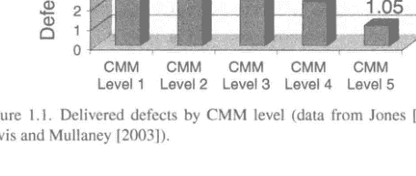
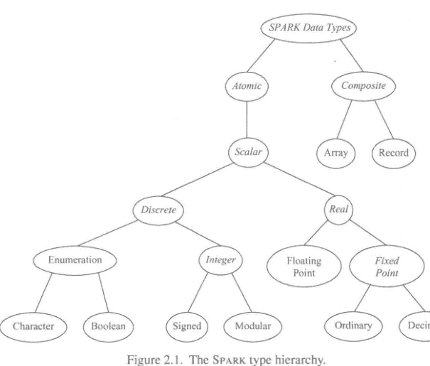
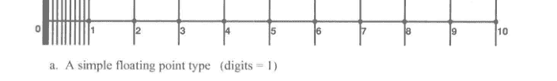
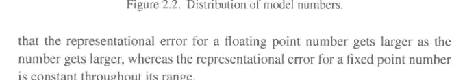
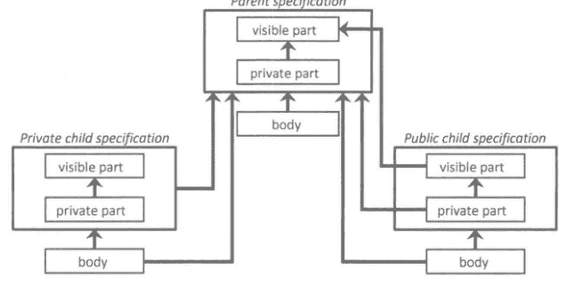
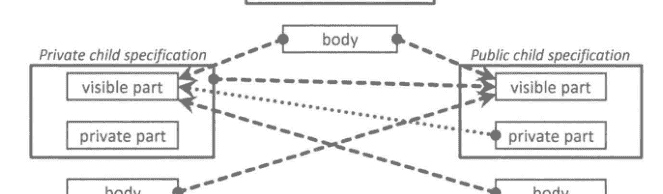
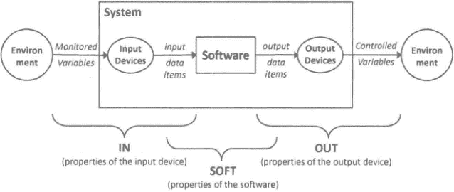
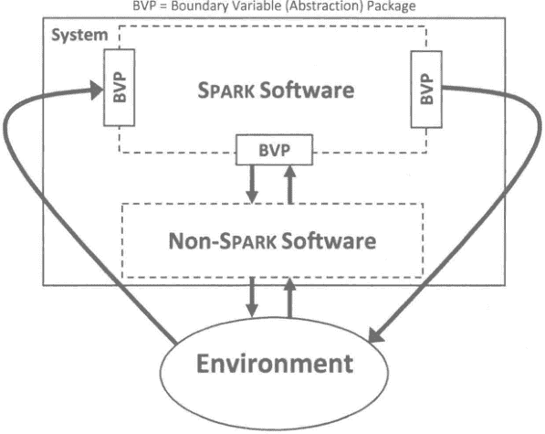
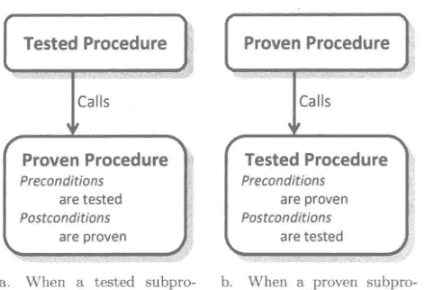
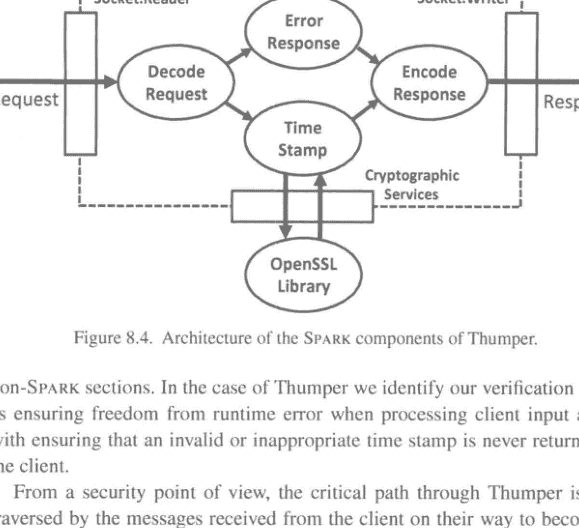

# SPARK 高完整性应用构建指南


John W. McCormick 是爱荷华大学北部分校的计算机科学教授。他于 1979 年在纽约州立大学开始了他的职业生涯。他曾担任计算机协会 Ada 特别兴趣小组的秘书、财务主管和主席。1993 年，John 获得了教学卓越校长奖。他于 2002 年获得 Ada 特别兴趣小组杰出服务奖，并于 2008 年获得杰出 Ada 社区贡献奖。他的其他奖项包括 Ada 特别兴趣小组最佳论文和演示奖以及 Ada Europe 最佳演示奖。

Peter C. Chapin 是佛蒙特技术学院计算机信息系统教授。Peter 于 1986 年在 VTC 开始工作，担任电气与计算机工程技术系的讲师，教授微控制器和 C 编程课程。自 2009 年以来，Peter 一直担任 VTC CubeSat 实验室的软件主管，在那里他与学生一起使用 Ada 和 SPARK 编程小型纳米卫星。VTC 于 2013 年 11 月 19 日成功将一颗工作的 CubeSat 卫星发射到近地轨道。这是第一颗使用 SPARK 编程的 CubeSat。

常州大学图书馆
藏书章

John W. McCormick 是爱荷华大学北部分校的计算机科学教授。他于 1979 年在纽约州立大学开始了他的职业生涯。他曾担任计算机协会 Ada 特别兴趣小组的秘书、财务主管和主席。1993 年，John 获得了教学卓越校长奖。他于 2002 年获得 Ada 特别兴趣小组杰出服务奖，并于 2008 年获得杰出 Ada 社区贡献奖。他的其他奖项包括 Ada 特别兴趣小组最佳论文和演示奖以及 Ada Europe 最佳演示奖。

Peter C. Chapin 是佛蒙特技术学院计算机信息系统教授。Peter 于 1986 年在 VTC 开始工作，担任电气与计算机工程技术系的讲师，教授微控制器和 C 编程课程。自 2009 年以来，Peter 一直担任 VTC CubeSat 实验室的软件主管，在那里他与学生一起使用 Ada 和 SPARK 编程小型纳米卫星。VTC 于 2013 年 11 月 19 日成功将一颗工作的 CubeSat 卫星发射到近地轨道。这是第一颗使用 SPARK 编程的 CubeSat。

## 前言

SPARK 是一种形式化定义的编程语言和一套验证工具，专门设计用于支持高完整性软件的开发。使用 SPARK，开发人员可以正式验证其代码的属性，例如

- 信息流，
- 免于运行时错误，
- 功能正确性，
- 安全策略，以及
- 安全策略。

SPARK 满足所有高完整性软件安全标准的要求，包括 DO-178B/C（以及形式化方法补充 DO-333）、CENELEC 50128、IEC 61508 和 DEFSTAN 00-56。SPARK 可用于支持《通用准则信息技术安全评估标准》中规定的最高级别的软件保证。

自首次在 SPARK 中编写非平凡系统的证明以来已过去二十年（Chapman and Schanda, 2014）。用于 SHOLIS 的 27,000 行 SPARK 代码，该系统有助于海上直升机的安全运行，产生了近 9,000 个验证条件（VCs）。其中 75.5% 的 VCs 由 SPARK 工具自动证明。剩余的 VCs 使用交互式证明辅助工具手工证明。快进到 2011 年，NATS iFACTS 航路空中交通管制系统在英国上线。529,000 行 SPARK 代码被证明是“防崩溃的”。SPARK 工具已改进到 152,927 个 VCs 中 98.76% 被自动证明的程度。大多数剩余的证明是通过添加用户定义规则完成的，只剩下 200 个证明需要“通过评审”完成。

尽管 SPARK 和其他证明工具取得了显著的成功，但它们的使用仍然有限。许多软件工程师认为智力挑战

证明的成本太高，以至于他们不考虑在自己的项目中使用这些技术。因此，设计最新版本 SPARK（称为 SPARK 2014）时的一个重要目标，是为使用证明工具提供一种要求不那么苛刻的方法。实现这一目标的第一步是 Ada 2012 的到来，它带来了新的契约语法。我们不再需要将 SPARK 断言写成 Ada 代码中的特殊注释。可作为 SPARK 语言合法使用的 Ada 子集已经扩大，涵盖了更大的 Ada 子集，为开发者提供了更丰富的构造集合来开发代码。

SPARK 2014 的真正威力在底层。新的 SPARK 工具集与 GNAT 编译器的前端集成。这种合并使 SPARK 工具能够直接利用 GNAT 编译器执行的许多代码分析。此外，新工具使用基于 Why3 软件验证系统（Bobot 等，2011）的全新证明系统。Why3 管理一组现代可满足性模理论（SMT）证明器，如 Alt-Ergo（OCamlPro，2014）、CVC4（New York University，2014）、YICES（Dutertre，2014）和 Z3（Bjørner，2012），由它们完成程序中契约的实际证明。这些底层证明工具能够处理的情况远多于最初的 SPARK 证明器。不要被这种高深的数学基础吓退；使用 SPARK 并不需要了解这些底层证明工具。

SPARK 2014 的另一项重大改进是证明与测试技术的集成。SPARK 程序中的 Ada 2012 断言可以通过运行测试用例进行动态检查。或者，这些断言可以由 SPARK 证明工具证明为正确。这种混合验证方法允许我们逐步提高程序的形式化程度。能够结合测试与证明，也使我们更容易验证用多种语言混合编写的程序。

区分作为编程语言的 SPARK 与执行程序属性分析和证明的 SPARK 工具是有益的。移除访问类型和异常等难以分析的特征，使 SPARK 2014 语言成为 Ada 2012 的一个子集。然而，SPARK 2014 语言也通过额外的 pragma 和 aspect 扩展了 Ada 2012。SPARK 语言在《SPARK 2014 Reference Manual》（SPARK Team，2014a）中描述，并且可能由许多 Ada 编译器供应商实现。

在撰写本书时，Altran/AdaCore 的 SPARK 实现是唯一存在的实现。其实现细节在《SPARK 2014 Toolset User’s Guide》（SPARK Team，2014b）中描述。由于 SPARK 只有一个实现，人们很容易认为 SPARK 实际上就是参考手册和用户指南中描述的行为的并集。然而，未来可能出现另一种 SPARK 实现，它实现参考手册中的语言，同时提供不同的用户体验。

为方便读者，本书有时将 SPARK 语言与 Altran/AdaCore 实现的 SPARK 混为一谈。由于当时只有一种 SPARK 实现可用，这种做法似乎合理，并且具有简化表述的优点。例如，第 7.1.1 节描述的 SPARK_Mode 提供了一种标识程序中哪些部分属于 SPARK 的方法。严格来说，SPARK_Mode 是 Altran/AdaCore 实现的一项特性，而不是 SPARK 语言本身的一部分。可以设想，另一种 SPARK 实现可能使用不同的机制来标识 SPARK 代码。

同样重要的是要理解，虽然 SPARK 语言相对稳定，但工具正在快速演进。随着工具成熟，它们能够比以往更快地自动完成更多证明。你可能会发现，较新版本的工具不需要像旧版本那样多的提示和断言。特别是，本书中的一些示例可能由更新的工具以比我们这里更少的断言证明。

SPARK 语言包含面向对象编程所需的 Ada 2012 构造：标记类型、类型扩展、分派操作、抽象类型和接口类型。提供了契约记法，以确保应用于超类实例的任何操作对于子类实例也有效（里氏替换原则）。本书选择不涵盖 SPARK 编程的面向对象方面。

## 各章概要

第 1 章概述高完整性软件以及一些常用于创建高质量软件的方法。SPARK 语言和工具集在降低缺陷率的背景下进行描述。

第 2 章介绍构成 SPARK 语言的 Ada 2012 基本子集。SPARK 的判定结构和循环结构对所有程序员来说都很熟悉。子程序有两种形式：函数和过程。本章很大一部分内容专门讨论类型。Ada 允许我们定义自己的简单类型和复杂类型。使用这些类型，我们可以创建现实世界的精确模型，并向 SPARK 工具提供有价值的信息，从而在程序执行之前识别错误。

第 3 章讨论包。包有助于构建大型程序。我们使用包来支持关注点分离、封装、信息隐藏等。一个 SPARK 程序由一个主子程序组成，它使用包提供的服务。

第 4 章首次介绍契约——关于程序行为的断言，开发者必须正确实现这些断言。依赖契约提供了验证程序中数据依赖和信息流依赖的手段。数据依赖或信息流的错误实现可能导致安全违规。SPARK 工具可以检查实现是否符合这些契约的要求。这种分析提供两项主要服务。第一，它验证从未使用未初始化数据。第二，它验证程序计算出的所有结果都以某种方式参与程序的最终输出——也就是说，所有计算都是有效的。

第 5 章回顾基本的离散数学，这些知识有助于阅读和编写契约。命题逻辑和谓词逻辑提供了表达规定功能行为的契约中断言所需的基本概念。谓词逻辑的存在量词（存在）和全称量词（对所有）对于陈述关于集合的断言至关重要。虽然不是使用 SPARK 工具所必需的，但我们给出关于论证及其有效性的基本介绍。SPARK 证明工具生成的验证条件（VC）就是必须证明有效的论证，以确保我们的实现满足契约。实际证明则留给 SPARK 工具完成。

第 6 章描述如何使用 SPARK 工具证明程序的行为属性。第一步是证明我们的程序没有运行时错误——也就是说，永远不会引发异常。通过为每个子程序包含前置条件和后置条件等契约，我们陈述所需的功能。我们可以使用 SPARK 工具表明这些契约始终得到遵守，从而我们的代码实现了该功能。在理想情况下，工具只需要我们的代码就能验证它没有运行时错误并满足所有契约。现实中，工具还不够智能，无法独自完成这种验证。当在我们认为代码正确的情况下证明失败时，我们需要向工具提供一些额外信息，以便它完成证明。这些信息以额外断言的形式给出。

第 7 章探讨构建并非完全用 SPARK 编写的程序所涉及的问题。通常不可行，甚至不可取，用 SPARK 编写整个程序。程序的某些部分可能需要用完整的 Ada 编写，以利用 SPARK 中不可用的 Ada 特性，例如访问类型和异常。SPARK 程序可能需要调用用完整 Ada 或其他某种编程语言编写的第三方库。

诸如 C 之类的语言。当然，当程序执行流入非 SPARK 组件时，SPARK 对正确性的保证无法得到形式化保证。

第 8 章在软件工程过程的背景下概述 SPARK。我们描述三种常见用法：将 SPARK 2005 程序转换为 SPARK 2014、分析或转换现有 Ada 程序，以及从头开发新的 SPARK 程序。我们介绍用于 SPARK 的 INFORMED 设计方法，并讨论如何结合使用测试与证明。最后，我们给出一个使用 INFORMED 过程开发应用的案例研究。

第 9 章考察一些用于证明 SPARK 程序性质的高级技术，包括幽灵实体和传递性质的证明。我们讨论我们发现的对调试证明有用的方法，并提供若干完成困难证明的指南。最后，我们简要介绍 SPARK 的内部工作原理以及进一步学习的建议。

## 工具

目前，Altran 和 AdaCore 的合作提供了 SPARK 2014 的唯一实现。他们提供两个版本。SPARK GPL 及相应的 GNAT GPL Ada 编译器可在 http://www.libre.adacore.com 免费提供给软件开发人员和学生。SPARK Pro 及相应的 GNAT Pro Ada 编译器面向工业、军事和商业开发人员。有关这些专业工具订阅的信息可在 http://www.adacore.com 获取。

## 网络资源

一个包含本书所有示例以及部分练习完整源代码的网站，可在 http://www.cambridge.org/us/academic/subjects/computer-science/programming-languages-and-applied-logic/building-high-integrity-applications-spark 找到。

*Ada 2012 语言参考手册*和*Ada 2012 原理说明*可在 http://www.ada-auth.org/standards/12rm/html/RM-TTL.html 和 http://www.ada-auth.org/standards/12rat/html/Rat12-TTL.html 获取。

*GNAT 参考手册*和*GNAT 用户指南*可在 http://docs.adacore.com/gnat_rm-docs/html/gnat_rm.html 和 http://docs.adacore.com/gnat_ugn-docs/html/gnat_ugn.html 获取。


并拒绝重新启动，在这种情况下，你将不得不重新安装引擎。

- 4. 偶尔，你的汽车会把你锁在外面，并且拒绝让你进入，直到你同时抬起门把手、转动钥匙并踢门（这一操作需要你使用四肢中的三肢）。

为什么我们不在乎质量？简单答案是，有缺陷的软件“足够好用”。我们愿意花几个小时为软件中的缺陷寻找变通方法，以便使用那些确实能正常工作的功能。使用机器人手术工具的医生、驾驶电传操纵飞机的飞行员，或核电站的操作员，应该满足于“足够好用”吗？在这些领域中，软件质量确实很重要。这些是*高完整性应用*的例子——在这类应用中，故障会对人、组织或环境产生重大影响。然而，我们认为软件质量在每个领域都很重要。每个人都希望自己的软件能正常工作。也许当今对质量的最大需求在软件安全领域。Watts Humphrey（2006b）在其通讯文章*安全改变一切*中写道：“如今，软件缺陷扰乱交通、导致公用事业故障、助长身份盗窃，甚至造成人身伤害或死亡，已屡见不鲜。黑客、罪犯和恐怖分子利用我们软件中缺陷的方式，正以当前‘打补丁并修复’策略无法应对的速度增长。”

## 1.1 获得软件质量

产品的质量的经典定义关注消费者的需求、期望和偏好。客户满意度取决于许多特性，其中一些特性对产品功能的贡献很小。

制造商对产品质量有不同的看法。他们关注产品的设计、工程和制造。质量通过是否符合规范和标准来评估，并通过消除缺陷来改进。在本书中，我们关注质量的这个缺陷方面。

这是因为，目前用于消除软件缺陷的成本和时间在我们的工作中占了如此大的比例，以至于压倒了其他一切，甚至常常削弱我们满足功能需求的能力。要在安全性、可用性、可维护性、生产率、可预测性、质量以及几乎任何其他“-性”方面取得有意义的改进，我们必须将缺陷问题减少到可管理的程度。只有这样，我们才能将足够的资源投入到质量的其他方面。（Humphrey, 2006a）


表 1.1. 软件 CMM（Paulk, 2009）

| 级别 | 重点 | 特征 |
|---|---|---|
| 1，初始 | 无 | *临时* 或混乱。 |
| 2，可重复 | 项目管理 | 必要的过程纪律已到位，可在具有类似应用的项目中重复之前的成功。 |
| 3，已定义 | 软件工程 | 针对管理活动和工程活动的软件过程已记录、标准化并整合为组织的一套标准软件过程。 |
| 4，已管理 | 质量过程 | 收集软件过程和产品质量的详细度量。软件过程和产品在定量上得到理解和控制。 |
| 5，优化 | 持续改进 | 通过来自过程的反馈以及对创新思想和技术的试点，实现了持续的过程改进。 |

### 1.1.1 *缺陷率*

在传统制造业中，质量是通过控制制造过程来保证的。统计工具用于分析生产过程并预测和纠正可能导致不合格产品的偏差。统计过程控制由 Walter A. Shewhart 于 1924 年开创，用于减少 Western Electric Company 制造的电话传输设备故障频率。二战后，W. Edwards Deming 将统计过程控制方法引入日本工业。由此产生的日本制造产品的质量至今仍是世界其他地区的基准。

1987 年，在 Watts Humphrey 的工作推动下，软件工程研究所（SEI）提出了统计过程控制可应用于软件工程过程的观点。SEI 于 1991 年定义了软件能力成熟度模型（Software CMM）。¹ 软件 CMM 定义了表 1.1 中描述的五个过程成熟度级别。每个级别都提供了一组过程改进优先事项。

有大量证据支持这样一种说法：使用软件 CMM 定义的更好流程会导致缺陷更少的程序。图 1.1 显示了项目中交付缺陷的典型率作为软件 CMM 级别的函数。在 CMM 5 级工作的工程师获得的平均 1.05 个缺陷/千行代码（KLOC）似乎是一个很低的数字。然而，这一比率必须放在大多数复杂项目的大规模背景下考虑。

这表明飞机飞行管理系统中的典型一百万行代码交付时带有超过 1,000 个缺陷。NASA 关于丰田凯美瑞意外加速的报告描述了对汽车发动机控制模块中 280,000 行代码的检查（NASA, 2011）。假设该代码是在最高 CMM 级别下开发的，图 1.1 中的数据表明该代码可能包含近 300 个缺陷。这些数字对于高完整性软件来说太大了。

为了在软件应用程序发布之前防止或检测并移除缺陷，了解缺陷的来源是有用的。表 1.2 显示了三项关于软件缺陷来源的研究的估计。

表 1.2. 缺陷来源

| 研究 | 设计和编码 | 需求和规范 | 其他 |
|---|---|---|---|
| Beizer (1990) | 89% | 9% | 2% |
| NIST (2002) | 58% | 30% | 12% |
| Jones (2012, 2013) | 60% | 20% | 20% |

这些数据表明，大多数缺陷是在开发的设计和编码阶段创建的。

验证和确认是通常用于保证软件质量的流程和技术所使用的名称。软件验证是证明软件符合其书面规范的过程。这一定义通常用问题“我们是否在构建 *产品正确？*”来说明。验证是证明正确性的一种手段。我们使用验证来定位并从我们的设计和实现、编译器、操作系统以及我们执行应用程序的硬件中移除缺陷——这些缺陷构成了表 1.2 中分类的大多数缺陷。

软件 *验证* 是评估应用程序以确保其真正满足用户需求的过程——规范是正确的。这一定义通常用问题“我们是否在构建 *正确的产品？*”来说明。验证在证明我们移除了源自规范的缺陷（表 1.2 的第三列）方面很重要。



图 1.1. 按 CMM 级别划分的交付缺陷（数据来自 Jones [2000] 和 Davis and Mullaney [2003]）。

### 1.1.2 *软件测试*

实现图 1.1 所示缺陷率所使用的验证策略通常基于软件测试。软件测试的深入介绍超出了本书的范围。有关更多信息，请参阅 Ammann and Offutt (2008)、Black (2007)、Jorgensen (2008)、Kaner, Falk, and Nguyen (1999) 或 Beizer (1990) 的经典测试书籍。测试有两种基本方法：黑盒测试和白盒测试。

*黑盒测试* 完全基于程序的行为，而不了解任何编码细节。它也称为行为测试或功能测试。测试用例是从应用程序规范中给出的需求创建的。黑盒测试通常在完整系统或大型子系统上执行。它通常由未编写被测软件的人执行。这些测试人员通常对应用领域比对软件工程有更多的了解。有许多黑盒测试策略，包括 Black (2007)：

- 等价类和边界值测试
- 用例、实时数据和决策表测试
- 状态转换表测试
- 域测试
- 正交数组和全对测试
- 反应式和探索性测试

由于黑盒测试完全源自规范，它们提供了一种验证我们的设计、实现、编译器、操作系统和硬件共同成功实现规范的手段。黑盒测试并不能直接提供规范正确的验证。然而，测试人员的领域专业知识是在测试期间发现规范错误的重要资源。

*白盒测试* 基于应用程序中的实际指令。它也称为 *玻璃盒测试* 或 *结构测试*。白盒测试是从应用程序中语句的可能执行序列创建的。白盒测试通常由程序员执行，可应用于小单元（单元测试）以及单元组合（集成测试）。白盒测试的两个基本策略是控制流测试和数据流测试。

控制流测试通常旨在实现代码的特定覆盖级别。常用代码覆盖策略包括：

- 语句覆盖；
- 条件覆盖；
- 多条件覆盖；
- 多条件决策覆盖；
- 修改条件/决策覆盖（MC/DC）；和
- 路径覆盖。

*数据流测试* 为控制流测试增加了另一个维度。除了测试控制如何在程序中流动外，数据流测试还检查变量被设置和使用的顺序。

### 1.1.3 *改进缺陷率*

至少有三个原因说明仅靠测试无法满足当前和未来的质量需求。首先，完全测试几乎总是不可行的。假设我们想使用黑盒测试来验证一个函数是否正确地相加两个 32 位整数。对该函数的穷举测试需要 2^64 种整数组合——太多而无法实际测试。

在白盒测试中，我们希望测试程序中的每一条可能路径。随着分支指令数量的增加，程序中可能路径的数量呈指数增长，对小型程序进行完整的路径覆盖测试需要巨大的工作量，而对大多数实际大小的程序来说是不可能的。良好的测试在于为黑盒测试选择可能数据的子集以及为白盒测试确定最可能的执行路径。

这就引出了第二个原因，即仅靠测试无法达到我们需要的质量。用户总会以创新且非预期的方式使用应用程序。我们可能没有测试那些“创造性”使用我们应用程序时输入的数据或执行的路径。第三，我们现在面临一类新的用户：敌对者。我们的应用程序正受到罪犯、黑客和恐怖分子的攻击。这些人积极寻找未测试的数据和未测试的执行路径以

漏洞利用。因此，每当发现并修补一个安全漏洞时，我们就会发现自己正在更新应用程序。

Watts Humphrey（2004）提出了四种替代策略，用于实现低于软件 CMM 第 5 级所获得的缺陷率。

- **净室（Clean Room）：** 该过程由 Harlan Mills、Michael Dyer 和 Richard Linger（1987）于 20 世纪 80 年代中期在 IBM 开发，重点在于缺陷预防而非缺陷消除。缺陷预防通过在需求和设计中结合使用人工应用的形式化方法，随后进行统计测试来实现。质量结果比软件 CMM 第 5 级的结果好十倍。
- **团队软件过程（TSP）：** 一种由 Watts Humphrey（2000）开发的基于过程的缺陷预防方法。质量结果比软件 CMM 第 5 级的结果好十倍以上。
- **构造正确（CbyC）：** 一种由 Praxis Critical Systems 开发的软件开发过程（Amey，2002；Hall 和 Chapman，2002）。CbyC 在整个生命周期中使用形式化方法，并使用 SPARK 对代码进行强静态验证。质量结果比软件 CMM 第 5 级的结果好 50 到 100 倍（Croxton 和 Chapman，2005）。
- **TSP 环境中的 CbyC：** 一种将 CbyC 使用 SPARK 的形式化方法与团队软件过程的流程改进相结合的过程。

净室和 CbyC 都基于形式化方法。*形式化方法*是用于软件开发的一种基于数学的技术。形式化规范提供对应用程序功能的精确、无歧义描述。在开发周期的后期，形式化规范可用于验证其在软件中的实现。尽管多年来已有大量工作，形式化方法仍然难以被工业界从业者接受。引用这种有限使用的原因包括：形式化方法延长了开发周期、需要困难的数学知识，以及工具支持有限（Knight 等，1997）。

在本书中，我们向你介绍 SPARK 编程语言，以及如何使用它来创建可被形式化验证的高完整性应用。与形式化方法会增加开发时间的说法相反，使用 SPARK 已被证明可以通过将测试时间减少 80% 来缩短开发周期（Amey，2002）。本书的一个目标是表明，借助 SPARK 提供的工具，所涉及的数学知识并不会超出典型软件工程师的能力范围。我们并不试图涵盖形式化规范或

## 1.3 SPARK 工具

SPARK 附带一组用于开发 SPARK 程序的工具。工具的完整描述可在 *SPARK 2014 工具集用户指南*（SPARK Team，2014b）中找到。在本节中，我们列出这些工具并给出非常简要的概述。各工具的更多详细描述将在适当的时候于后续章节中给出。

### 1.3.1 GNAT 编译器

GNAT 编译器执行典型编译器的任务：

- 检查程序是否符合所有 Ada 语法和语义规则。
- 生成可执行代码。

*SPARK 2014 工具集用户指南*（SPARK Team，2014b）建议，开发 SPARK 程序的第一步是使用 GNAT 编译器*语义检查*工具来确保代码是有效的 Ada。一旦完成 SPARK 程序的形式化验证，我们的最后一步就是使用 GNAT 编译器生成可执行代码。

出于测试目的，我们可以要求编译器生成机器码，以便在程序运行时检查任何断言（前置条件、后置条件等）。如果发现任何断言为假，就会引发异常 `Assertion_Error`。这种能力使我们能够在证明断言之前对它们进行测试。

### 1.3.2 GNATprove

GNATprove 是 SPARK 的验证工具。它可以在三种不同模式下运行：

- **检查（Check）：** 检查程序单元是否只包含为 SPARK 定义的 Ada 子集。
- **流（Flow）：** 对 SPARK 代码执行流分析。该分析由两部分组成：一部分是*数据流分析*，考虑变量的初始化和子程序的数据依赖关系；另一部分是*信息流分析*，考虑传入和传出子程序的值之间的依赖关系或耦合关系。
- **证明（Proof）：** 对 SPARK 代码执行形式化验证。形式化验证将指出任何可能引发运行时错误的代码，例如除以零、给变量赋予超出其类型范围的值、数组索引不正确或算术表达式溢出。如果 SPARK 代码包含表达代码功能属性的断言，则会验证这些断言。

GNATprove 验证的 SPARK 代码中的断言是逻辑陈述。*逻辑陈述*是一个有意义的陈述句，它要么为真，要么为假。逻辑陈述一词通常简称为*陈述*。一个陈述不可能在某一时刻为真，而在另一时刻为假。例如，下面是两个简单的逻辑陈述，一个为真，一个为假：

- 叠氮化钠是一种毒物。
- 纽约市是纽约州的首府。

我们的断言常常涉及存在量词（存在）或全称量词（对所有），如下例所示：

- 存在一个有两个头的人。
- 所有人都会死。

要说服自己第一个量化陈述为真，我们需要找到至少一个有两个头的人。如果我们能找到一个不死的人，我们就可以放心地认为第二个量化陈述为假。在后续章节中，你将学习如何为 SPARK 断言编写逻辑陈述。

GNATprove 分析 SPARK 代码和我们的断言，以产生若干逻辑陈述。*定理*是已被证明（为真）的陈述。GNATprove 产生的逻辑陈述是*猜想*——被认为是真但尚未被证明的陈述。SPARK 将这些猜想称为*验证条件*或 *VC*。当我们已经证明一个 *VC* 为真时，我们说它被*消解*了。如果我们消解了 GNATprove 生成的所有 VC，我们就可以相信我们的 SPARK 程序是正确的。

如果你上过离散数学课程，你学习过证明逻辑陈述的不同方法。手动证明一个逻辑陈述需要技巧和时间。GNATprove 产生的 VC 太多，无法手工证明。幸运的是，有许多证明工具可用于执行必要的证明。GNATprove 使用两个证明工具，分别称为 Alt-Ergo（OCamlPro，2014）和 CVC4（New York University，2014）。GNATprove 可能使用的其他工具包括 Yices（Dutertre，2014）和 Z3（Bjørner，2012）。

### 1.3.3 GNATtest

形式化验证为我们提供了最大的信心，相信我们的程序满足其规范。然而，并非总是能够对程序的所有部分进行形式化验证。某些子程序无法被形式化验证的原因有很多：

- 我们可能无法形式化地表达子程序所期望的属性。例如，一个程序接收大量地震数据，对这些数据执行一组复杂的数学变换，并根据变换结果为地球物理学家显示图形化图像。尽管我们可以形式化地指定数学变换，但我们不太可能形式化地指定图形输出。
- 我们可能需要使用不适合形式化验证的编程语言特性。例如，我们可能需要使用指针来解决某个特定子问题。
- 对程序中的某些组件应用形式化验证可能不具有成本效益。我们可能有一个来自先前项目的模块，已经通过其他方式验证过，但我们没有预算重新验证它。有时，测试一个简单的子程序可能比形式化地指定并形式化验证它更具成本效益。

测试是用于验证不适合形式化验证的子程序的主要方法。我们还建议在使用证明工具进行形式化验证之前，对代码执行一些测试。除了发现代码中的错误之外，此类测试还可能揭示断言中的错误。GNATtest 是一个基于 AUnit 的工具，可为有效的 Ada 程序单元创建单元测试骨架和测试驱动程序。GNATtest 的测试用例甚至可以直接用 Ada 代码编写。

SPARK 的设计允许工程师将使用 GNATprove 的形式化验证与使用 GNATtest 的测试混合使用。形式化验证以较低成本提供更多信心，而测试允许验证那些形式化规范不可行的代码部分。Ada 子程序上的契约提供了将证明与测试相结合的机制。

## 1.4 SPARK 示例

为了让你感受 SPARK 代码的样子，我们在本章末尾给出一个示例。我们的示例是选择排序算法的一种 SPARK 实现，它源自 Dale 和 McCormick（2007）给出的 Ada 代码。现在不必担心细节——我们将在本书余下部分描述它们。我们将选择排序的所有细节封装在一个包中。我们将在第 3 章详细讨论包。SPARK 包分两部分编写：一个规范，定义包包含什么；以及一个包含


实际实现。下面是一个包的规范，该包包含一个对整数数组进行排序的排序过程：

```ada
1  pragma Spark_Mode (On);
2  package Sorters is
3
4     type Array_Type is array (Positive range <>) of Integer;
5
6     function Perm (A : in Array_Type;
7                    B : in Array_Type) return Boolean
8     -- Returns True if A is a permutation of B
9       with Global => null,
10           Ghost => True,
11           Import => True;
12
13    procedure Selection_Sort (Values : in out Array_Type)
14    -- Sorts the elements in the array Values in ascending order
15      with Depends => (Values => Values),
16          Pre    => Values'Length >= 1 and then
17                    Values'Last <= Positive'Last,
18          Post   => (for all J in Values'First .. Values'Last - 1 =>
19                      Values (J) <= Values (J + 1)) and then
20                    Perm (Values'Old, Values);
21  end Sorters;
```

该规范的第一行是一个*编译指示*，它是对 GNAT 编译器和 GNATprove 的指令。在这个例子中，该编译指示通知 GNATprove：应检查这个包规范，以确保它只包含属于 Ada 的 SPARK 子集的构造。第 4 行定义了一个数组类型，该类型以正整数为索引，并包含整数元素。符号 `<>` 表示未指定第一个和最后一个索引值。这样的数组类型称为无约束数组类型。我们将在第 2 章详细讨论数组。

SPARK 有两种形式的子程序：过程和函数。第 13 行到第 20 行指定了选择排序过程。在第 13 行，我们看到该过程接受一个参数 `Values`，它是一个第 4 行所定义类型的数组。记号 **in out** 告诉我们，数组 `Values` 被传入过程（**in**），可能被修改，然后返回给调用者（**out**）。我们将在第 2 章详细讨论子程序。

第 15 行到第 20 行是该过程的形式*契约*。SPARK 契约是一种断言，基于 Ada 中称为方面（aspect）的构造。一个*方面*描述实体的属性。在本例中，实体是过程 `Selection_Sort`。方面 `Depends` 描述了信息

```ada
21     exit when Value = 0;          -- Exit loop on sentinel value
22     Count := Count + 1;
23     List (Count) := Value;        -- Put Value into the array List
24   end loop;
25
26   -- Sort the first Count values in the array List
27   Sorters.Selection_Sort (Values => List (1 .. Count));
28
29   Ada.Text_IO.Put_Line (Item => "Here are the sorted numbers");
30   for J in 1 .. Count loop
31     Ada.Integer_Text_IO.Put (Item => List (J),
32                              Width => 8);
33     Ada.Text_IO.New_Line;
34   end loop;
35 end Sort.Demo;
```

该程序的第一行是一个编译指示，告诉工具这段代码不是用 Ada 的 SPARK 子集编写的。因此，尽管我们可以形式验证选择排序过程，但我们仍需要用其他方式验证这段代码。我们审查了这段代码，并进行了多次测试运行，以确信这段代码是正确的。

第 2 行到第 4 行说明了该程序需要哪些外部资源。这里，我们需要 Ada 库中的操作来完成字符串（包 `Ada.Text_IO`）和整数（包 `Ada.Integer_Text_IO`）的输入输出。我们还需要前面指定的包 `Sorters`。

第 8 行到第 10 行定义了三个子类型。子类型允许我们从现有类型派生出更专门或受限的域。例如，子类型 `Index_Type` 的域限制为 1 到 50 之间的整数。子类型 `My_Array_Type` 约束了 `Sorters` 包中的数组类型，使得第一个索引为 1，最后一个索引为 50。我们将在第 2 章详细讨论类型和子类型。

第 12 行到第 14 行为程序定义了三个变量。`List` 是一个包含 50 个整数的数组（索引从 1 到 50），`Count` 是 0 到 50 之间的整数，`Value` 是一个整数。

第 17 行到第 34 行是程序的可执行语句。我们将在第 2 章讨论所有这些语句的细节。即使没有详细知识，你大概也能看懂三个主要步骤：一个由哨兵值控制的循环来读取整数，一次对选择排序过程的调用，以及一个显示结果数组的循环。

还剩一项任务。我们需要编写实现选择排序的 SPARK 代码。这段代码位于包 `Sorters` 的主体中。我们将在第 9.2 节完成这个主体并证明其正确。

- 1.3 如果一个飞行管理系统典型的百万行代码中可能包含 1000 多个缺陷，那么为什么没有更多关于飞机因软件故障而从天上掉下来的报告？
- 1.4 你在验证自己编写的程序时使用过本章描述的哪些软件测试技术？
- 1.5 软件验证和软件确认之间有什么区别？
- 1.6 为什么仅靠测试不足以满足当前和未来的软件质量需求？
- 1.7 结合软件开发定义术语*语义*。
- 1.8 判断正误：SPARK 是 Ada 的子集。
- 1.9 说出 GNATprove 的三种模式，并分别给出简要描述。
- 1.10 定义*逻辑陈述*。
- 1.11 给出一个为真的逻辑陈述的例子。给出一个为假的逻辑陈述的例子。
- 1.12 判断以下存在性陈述是真还是假：
  - a. 有些男人活到 100 岁。
  - b. 有些女人活到 200 岁。
  - c. 存在某个数，其平方根恰好是该数值的一半。
- 1.13 判断以下全称陈述是真还是假：
  - a. 所有男人都活到 100 岁。
  - b. 任何数的平方都是正数。
  - c. 每只哺乳动物都有尾巴。
- 1.14 定义*定理*和*猜想*。
- 1.15 定义*验证条件*（VC）。
- 1.16 *discharging* 一个 VC 是什么意思？
- 1.17 什么是*编译指示*？
- 1.18 什么是*方面*？
- 1.19 定义*前置条件*和*后置条件*。

# 2 基本的 SPARK 语言
# 基本的 SPARK 语言

SPARK 是一种基于 Ada 的编程语言。Ada 语言的语法和语义在*Ada 参考手册*（ARM，2012）中定义。*SPARK 参考手册*（SPARK Team，2014a）包含 SPARK 中所用 Ada 子集的规范以及 SPARK 特有的方面。如第 1 章所述，SPARK 2014 的一个主要目标是体现 Ada 2012 中尽可能大的、适合形式分析的子集。当前 SPARK 不支持以下 Ada 2012 特性：

- 名称别名；任何对象不得由多个名称引用
- 指针（访问类型）和动态内存分配
- goto 语句
- 带副作用的表达式或函数
- 异常处理程序
- 受控类型；对对象创建、赋值和销毁提供精细控制的类型
- 任务/多线程（将在未来版本中包含）

本章和第 3 章涵盖 SPARK 中可用的许多（但不是全部）Ada 2012 特性。我们讨论与 SPARK 以及本书所用示例最相关的特性。我们假设读者即使了解 Ada，也知之甚少。Barnes（2014）全面描述了 Ada 编程语言。Ben-Ari（2009）很好地描述了与软件工程相关的 Ada 方面。Dale、Weems 和 McCormick（2000）为新手程序员提供了 Ada 入门。常见数据结构的 Ada 实现可在 Dale 和 McCormick（2007）中找到。网上也有许多 Ada 语言资源，你在阅读本章时可能会发现它们有用，包括 English（2001）、Riehle（2003）和 Wikibooks（2014）的材料。


让我们从一个简单的示例开始，该示例说明了 Ada 程序的基本结构。下面的程序提示用户输入两个整数并显示它们的平均值。

```
    1  with Ada.Text_IO;
    2  with Ada.Integer_Text_IO;
    3  with Ada.Float_Text_IO;
    4  procedure Average is
    5     -- Display the average of two integers entered by the user
    6     A : Integer;   -- The first integer
    7     B : Integer;   -- The second integer
    8     M : Float;     -- The average of the two integers
    9  begin
    10    Ada.Text_IO.Put_Line (Item => "Enter two integers.");
    11    Ada.Integer_Text_IO.Get (Item => A);
    12    Ada.Integer_Text_IO.Get (Item => B);
    13    Ada.Text_IO.New_Line;
    14
    15    M := Float (A + B) / 2.0;
    16
    17    Ada.Text_IO.Put (Item => "The Average of your two numbers is ");
    18    Ada.Float_Text_IO.Put (Item => M,
    19                           Fore => 1,
    20                           Aft  => 2,
    21                           Exp  => 0);
    22    Ada.Text_IO.New_Line;
    23 end Average;
```

程序的前三行是 *上下文项*。这三项上下文项共同构成了程序的 *上下文子句*。这三个 *with* 子句指定了我们的程序所需的库单元。在此示例中，我们使用来自三个不同库单元的输入输出操作：一个用于字符串和字符的输入输出（Ada.Text_IO），一个用于整数的输入输出（Ada.Integer_Text_IO），以及一个用于浮点实数的输入输出（Ada.Float_Text_IO）。我们所有示例中的粗体字都是 *保留字*。你可以在 ARM（2012）第 2.9 节中找到全部七十三個保留字的列表。

紧随上下文子句之后的是第 4 行的程序规约。在此示例中，规约仅由名称 Average 组成且没有参数。该名称在标记此程序单元结束的最后一行中重复出现。注释以两个相邻的连字符开始并延伸到行尾。在我们的列表中，注释以斜体格式显示。

紧随程序单元的规约之后的是 *声明部分*（第 5–8 行）。在我们的示例中，我们声明了三个变量。变量 A 和 B 被声明为类型 `Integer`，这是一种语言定义的整数类型，具有实现定义的范围。变量 M 被声明为类型 `Float`，这是一种语言定义的浮点数类型，具有实现定义的精度和范围。这三个变量的初始值未定义。

程序的可执行语句在保留字 `begin` 之后。我们示例中的可执行语句除一个之外都是对各种库包中定义的例程（子程序）的调用。在第一个语句中，我们调用库包 `Ada.Text_IO` 中的例程 `Put_Line`。

除例程 `New_Line` 外，示例中调用的所有例程都需要参数。Ada 提供了 *命名* 和 *位置* 参数关联。你可能非常熟悉位置参数关联，其中形式参数和实际参数通过参数列表中的位置关联。使用命名参数关联时，我们调用中参数的顺序无关紧要。我们的示例使用命名关联来匹配形式参数和实际参数。要使用命名关联，我们给出形式参数的名称，后跟箭头符号 `=>`，再后跟实际参数。在我们对例程 `Put_Line` 的调用中，形式参数是 `Item`，实际参数是我们提示的字符串字面量。当只有一个参数时，命名参数关联提供的信息很少。然而，当有多个参数时，如在对 `Ada.Float_Text_IO.Put` 的调用中，命名参数关联提供的信息使阅读和编写调用都更轻松。此调用中的形式参数 `Fore`、`Aft` 和 `Exp` 提供了如何格式化实数的信息。有关实数格式化的详细信息在 ARM（2012）第 A.10.9 节中给出。

我们示例中唯一不是例程调用的语句是第 15 行的赋值语句，它计算用户输入的两个整数的平均值。该赋值语句中的算术表达式包含三个操作。首先，将两个整数相加。然后将整数和显式转换为浮点数。最后，将浮点和除以 2。显式转换（强制转换）到类型 `Float` 是必要的，因为 Ada 不进行隐式类型转换。显式类型转换的语法类似于使用类型作为函数名称的函数调用。

你可能会觉得程序 `Average` 需要的输入比你愿意做的更多。为每个库例程的名称加上其包名前缀（例如 `Ada.Integer_Text_IO`）可能看起来令人望而生畏。当然，大多数集成开发环境（如 GNAT 编程工作室 GPS）都提供智能代码补全，使这项任务更容易。Ada 提供了另一种替代方案，即 *use 子句*，它允许我们在不使用单元名称作为前缀的情况下使用来自程序单元的资源。

不同程序单元可能定义了同名的资源。例如，Ada.Text_IO 和 Ada.Integer_Text_IO 都包含一个名为 Put 的子程序。编译器使用子程序调用的签名来确定调用哪个 Put。如果编译器无法解析名称，你将看到错误消息。下面是一个更短的 Average 程序版本，说明了 use 子句的使用。我们还使用了位置参数关联来缩短参数列表。

```
with Ada.Text_IO;        use Ada.Text_IO;
with Ada.Integer_Text_IO; use Ada.Integer_Text_IO;
with Ada.Float_Text_IO;   use Ada.Float_Text_IO;
procedure Average is  -- Shorter version with "use clauses"
   -- Display the average of two integers entered by the user
   A : Integer;   -- The first integer
   B : Integer;   -- The second integer
   M : Float;     -- The average of the two integers
begin
   Put_Line ("Enter two integers.");
   Get (A);
   Get (B);
   New_Line;

   M := Float (A + B) / 2.0;

   Put ("The Average of your two numbers is ");
   Put (M, 1, 2, 0);
   New_Line;
end Average;
```

在本书的其余部分，我们将在使代码对读者更清晰时使用前缀和命名参数关联。在离开这个简单程序之前，最后说明一点。Ada 不区分大小写。因此，三个标识符 — Total、total 和 tOtAl — 是等价的。对同一标识符使用不同的大小写被认为是不良做法。GNAT 编译器常用的一个开关要求对使用不同大小写的情况发出警告。

## 2.1 Control Structures

Ada 提供了两种基于某些条件做出决定的语句：if 语句和 case 语句。ARM（2012）第 5.3 节提供了 if 语句的详细信息，第 5.4 节提供了 case 语句的详细信息。Ada 提供了具有几种不同迭代方案的 loop 语句。这些方案在 ARM 第 5.5 节中有详细描述。在本节中，我们将提供每种控制结构的示例。

### 2.1.1 If Statements

以下是 if 语句各种形式的示例。

```
if A < 0 then
  A := -A;
  D := 1;
end if;

if A in 1 .. 12 then
  B := 17;
end if;

if A > B then
  E := 1;
  F := A;
else
  E := 2;
  F := B;
end if;
```

```
if A = B then
  F := 3;
elsif A > B then
  F := 4;
else
  F := 5;
end if;

if A >= B and A >= C then
  G := 6;
elsif B > A and B > C then
  G := 7;
elsif C > A and C > B then
  G := 8;
end if;
```

Ada 提供了以下在 if 语句的布尔表达式中常用的相等、关系、逻辑和成员运算符。

| Operator | Meaning |
|---|---|
| **Equality Operators** | |
| = | 相等 |
| /= | 不相等 |
| **Relational Operators** | |
| < | 小于 |
| <= | 小于或等于 |
| > | 大于 |
| >= | 大于或等于 |

| Operator | Meaning |
|---|---|
| **Logical Operators** | |
| not | 逻辑否定 |
| and | 逻辑合取 |
| or | 逻辑析取 |
| xor | 异或 |
| and then | 短路与 |
| or else | 短路或 |
| **Membership Operators** | |
| in | 成员 |
| not in | 非成员 |

包含 and 和 or 运算符的布尔表达式必须包含括号以指示期望的求值顺序。ARM（2012）第 4.5 节给出了 Ada 所有运算符的完整列表和描述以及六个优先级级别。


还可以减少代码片段的重复。Ada 有两种条件表达式：*if 表达式*和*case 表达式*。

## If 表达式

If 表达式在语法上类似于 if 语句，但它产生一个值，而不是改变程序的控制流。由于 if 表达式产生单个值，因此它比 if 语句受到更多限制。以下是三个 if 语句示例，其右侧是使用 if 表达式的等价赋值语句。

```ada
if A > B then
    C := D + 5;
else
    C := F / 2;
end if;

C := (if A > B then D + 5 else F / 2);
```

```ada
if A > B then
    C := D + 5;
elsif A = B then
    C := 2 * A;
else
    C := F / 2;
end if;

C := (if A > B then D + 5 elsif A = B then 2 * A else F / 2);
```

```ada
if X >= 0.0 then
    Y := Sqrt (X);
else
    Y := Sqrt (-2.0 * X);
end if;

Y := Sqrt (if X >= 0.0 then X else -2.0 * X);
```

注意，if 表达式括在括号中，且不包含 end if。可以在 if 表达式内嵌套 if 表达式。if 表达式中的 D + 5、F / 2 和 2 * A 等表达式称为*依赖表达式*。在最后一个示例中，if 表达式决定将 X 还是 −2X 传递给平方根函数。

如果表达式的类型是 Boolean，则可以省略 if 表达式的最后一个 else 部分。省略的 else 部分默认视为 True。因此，以下两个 if 表达式等价：

```ada
(if C - D = 0 then E > 2 else True)        (if C - D = 0 then E > 2).
```

布尔 if 表达式常用于前置条件、后置条件和循环不变式。例如，下面是一个前置条件，它表示如果 A 小于零，那么 B 也必须小于零。然而，如果 A 不小于零，则该前置条件满足（True）。

```ada
Pre => (if A < 0 then B < 0);
```

这个 if 表达式实现了蕴含 A < 0 → B < 0。我们将在第 5 章讨论数学逻辑基础时进一步研究蕴含。

## Case 表达式

Case 表达式从多个可能的依赖表达式中返回一个值。正如你所料，case 表达式在语法上类似于 case 语句。下面的 case 表达式为变量 Letter¹ 中的大写字母赋予 Scrabble 字母值。

```ada
Value := (case Letter is
    when 'A' | 'E' | 'I' | 'L' | 'U' |
        'N' | 'O' | 'R' | 'S' | 'T' => 1,
    when 'D' | 'G' => 2,
    when 'B' | 'C' | 'M' | 'P' => 3,
    when 'F' | 'H' | 'V' | 'W' | 'Y' => 4,
    when 'K' => 5,
    when 'J' | 'X' => 8,
    when 'Q' | 'Z' => 10);
```

在此示例中，依赖表达式都是简单的整数字面量。带有布尔依赖表达式的 case 表达式常用于前置条件、后置条件和循环不变式。虽然我们可以省略 if 表达式的最后一个 else 部分，但 case 表达式必须为 case 选择器（本例中为 Letter）可能取的每个值提供一个依赖表达式。如果我们漏掉二十六个大写字母中的任何一个，编译器就会报错。

### 2.1.4 循环语句

Ada 的循环语句重复执行一系列语句零次或多次。循环语句的最简单形式是无限循环。尽管一开始为无限循环提供循环语法似乎有些奇怪，但这种循环在嵌入式软件中很常见，系统从设备上电运行到设备关闭。下面是一个嵌入式温度控制器中此类循环的示例。它从模数转换器（ADC）获取当前温度，并通过数模转换器（DAC）调节燃气阀的输出。

```ada
loop
    ADC.Read (Temperature);      -- Read the temperature from the ADC
    Calculate_Valve (Current_Temp => Temperature,  -- Calculate the new
                     New_Setting => Valve_Setting); -- gas valve setting
    DAC.Write (Valve_Setting);      -- Change the gas valve setting
end loop;
```

我们在循环内使用 exit 语句，在满足某个条件时终止该循环的执行。exit 语句可以放在构成循环体的语句序列中的任何位置。下面是一个循环，它读取整数并求和，直到遇到负的哨兵值。负值不会被加入总和。

```ada
Sum := 0;
loop
    Ada.Integer_Text_IO.Get (Value);
    exit when Value < 0;
    Sum := Sum + Value;
end loop;
```

loop 语句可以使用两种迭代方案。while 迭代方案用于创建前测试循环。当条件为真时执行循环体。当条件为假时循环终止。下面的循环使用 while 迭代方案，通过牛顿法计算 X 的平方根的近似值。

```ada
Approx := X / 2.0;
while abs (X - Approx ** 2) > Tolerance loop
    Approx := 0.5 * (Approx + X / Approx);
end loop;
```

这个程序片段使用了某些编程语言中没有的两个运算符。运算符 abs 返回其操作数的绝对值，** 用于将数字提升到整数次幂。

for 迭代方案用于创建确定性计数循环。该方案的一个简单示例如下。

```ada
for Count in Integer range 5 .. 8 loop
    Ada.Integer_Text_IO.Put (Count);
end loop;
```

你大概能猜到，这个循环显示四个整数 5、6、7 和 8。让我们看看 for 迭代方案背后的细节。此示例中的变量 Count 称为循环参数。循环参数不像普通变量那样在声明部分定义。Count 仅在此循环体中定义。范围 5 .. 8 定义了一个包含四个值的离散子类型。对于此离散子类型中的每个值，循环体执行一次。这些值按递增顺序赋给循环参数。在循环体内，循环参数被视为常量；我们不能修改它。为了使循环更通用，我们可以将示例中的字面量 5 或 8 替换为任何求值为整数类型的表达式。我们将在本章后面讨论类型和子类型时重新讨论这个主题。

如果我们将保留字 reverse 添加到 for 循环中，这些值将按递减顺序赋给循环参数。下面的 for 循环按相反顺序显示这四个数字。

```ada
for Count in reverse Integer range 5 .. 8 loop
    Ada.Integer_Text_IO.Put (Count);
end loop;
```

反转示例范围中值的顺序会创建一个空范围的子类型——一个没有值的子类型。具有空范围的 for 循环迭代零次。当范围由变量定义时，这种情况经常出现。以下每个 for 循环都不显示任何内容：

```ada
A := 9;
B := 2;
```

```ada
for Count in Integer range A .. B loop  -- With a null range, this
    Ada.Integer_Text_IO.Put (Count);       -- loop iterates zero times
end loop;
```

```ada
for Count in reverse Integer range A .. B loop  -- With a null range, this
    Ada.Integer_Text_IO.Put (Count);          -- loop iterates zero times
end loop;
```

## 2.2 子程序

子程序是一种程序单元，其执行由子程序调用引发。Ada 提供两种形式的子程序：过程和函数。我们使用过程调用语句来调用过程。你在本章开头的程序 Average 中看到了过程调用语句的示例。我们通过在表达式中使用函数名来调用函数。函数返回一个值，该值用于调用它的表达式中。

子程序的定义可以分为两部分：定义其签名的声明和包含其可执行语句的体。第 13 页上包 Sorters 的规范包括过程 Selection_Sort 的声明。或者，我们可以跳过子程序声明，并使用体开头的规范来定义签名。本节我们将采用第二种方法，并在讨论包时使用单独的声明。ARM（2012）第 6 节提供了有关子程序的详细信息。

### 2.2.1 过程

让我们从一个名为 Example 的完整程序开始，它说明了过程的主要特性。

```ada
with Ada.Text_IO;
with Ada.Integer_Text_IO;
procedure Example is

   Limit : constant Integer := 1_000;

   procedure Bounded_Increment
      (Value  : in out Integer;   -- A value to increment
       Bound  : in     Integer;   -- The maximum that Value may take
       Changed : out Boolean)  -- Did Value change?
   is
   begin
      if Value < Bound then
         Value  := Value + 1;
         Changed := True;
      else
         Changed := False;
      end if;
   end Bounded_Increment;

   Value    : Integer;
   Modified : Boolean;

begin  -- procedure Example
   Ada.Text_IO.Put_Line ("Enter a number.");
   Ada.Integer_Text_IO.Get (Value);
   Bounded_Increment (Bound  => Limit / 2,
                      Value  => Value,
                      Changed => Modified);
end Example;
```


```
30   if Modified then
31      Ada.Text_IO.Put_Line ("Your number was changed to ");
32      Ada.Integer_Text_IO.Put (Item => Value,
33                                Width => 1);
34   end if;
35 end Example;
```

你可能首先注意到的是，我们的程序本身就是一个过程。它被称为*主过程*。每个过程由一个声明部分和一组语句组成；声明部分定义该过程的所有局部资源，语句序列在过程被调用时执行。过程 Example 的声明部分包含四个声明：命名常量 Limit、过程 Bounded_Increment，以及两个变量 Value 和 Modified。命名常量被赋予不可更改的值。该程序还引入了语言定义类型 Boolean，其可能取值为 True 和 False。

我们程序的执行从主过程的可执行语句开始（过程 Example 的第 25 行）。执行的第一条语句是调用过程 Put_Line，它显示提示“Enter a number.”。然后程序从用户处获取一个值，调用过程 Bounded_Increment，最后根据刚调用的过程的行为，可能显示一条消息。

## 参数模式

许多编程语言要求程序员为其参数指定按值传递、按引用传递等参数传递机制。Ada 使用一种更高层的方式，基于参数的数据流方向而不是传递机制。过程 Bounded_Increment 展示了我们可以赋予参数的三种不同模式。

- **in** — 用于将数据从调用方传入过程。在过程内部，in 模式参数被视为常量。实参可以是任何表达式，只要其结果与形参类型匹配。在我们的示例中，参数 Bound 的模式为 in。
- **out** — 用于将结果从过程传回调用方。应将形参视为未初始化变量。实参必须是变量，且其类型与形参类型匹配。在我们的示例中，参数 Changed 的模式为 out。
- **in out** — 用于修改实参。一个值被传入，由过程使用，可能被过程修改，然后返回给调用方。它类似于一个用实参值初始化的 out 模式参数。由于会返回一个值，实参必须是变量。在我们的示例中，参数 Value 的模式为 in out。

可以想象，SPARK 分析工具利用这些参数模式来定位错误，例如将未初始化变量作为 in 参数传入。

## 作用域

标识符的作用域决定了该标识符在程序中哪些位置可以使用。在讨论 for 循环时，我们已经见过一个作用域示例。循环参数的作用域是循环体。不能在循环体之外引用该循环参数。Ada 程序中其他每个标识符的作用域都基于*声明区域*的概念。每个子程序定义一个声明区域。该区域是子程序声明和子程序体的组合。声明区域比我们之前定义的声明部分包含更多内容。

让我们看看第 28 页程序 Example 中定义的声明区域。过程 Example 的声明区域从其名称之后（第 3 行）开始，到第 35 行的 **end** 关键字结束。类似地，过程 Bounded_Increment 的声明区域从其名称之后（第 7 行）开始，到第 19 行的 **end** 关键字结束。注意，Bounded_Increment 的声明区域嵌套在 Example 的声明区域之内。还要注意，Bounded_Increment 的声明区域包含其三个参数的定义。

特定标识符可以在何处使用由以下两条规则决定：

- 标识符的作用域包括其定义之后、包含该定义的声明区域内的所有语句。这包括所有嵌套声明区域，但下一条规则所述情况除外。
- 标识符的作用域不会延伸到任何包含局部定义的*同名标识符*的嵌套声明区域。² 这条规则有时称为*名称优先*。当存在同名标识符时，*局部*标识符在过程内优先。

根据这些规则，变量 Value 和 Modified 可由主过程 Example 使用，但不能由过程 Bounded_Increment 使用。常量 Limit 既可在过程 Example 中使用，也可在过程 Bounded_Increment 中使用。由于 Limit 声明在过程 Example 的声明区域内，因此称 Limit 对 Example 是*局部*的。由于 Limit 声明在过程 Bounded_Increment 的外层声明区域中，因此称 Limit 对 Bounded_Increment 是*全局*的。三个参数 Value、Bound 和 Changed 对过程 Bounded_Increment 是*局部*的。

尽管全局常量很有用，但使用全局变量通常被认为是一种不良实践，因为它们可能从任何地方被修改。我们采用始终在过程之后声明变量的风格，这样这些变量就不会被那些过程访问。

在第 3 章中，我们使用作用域受限的全局变量来实现变量包。我们可以包含一个全局方面，以指示某个过程访问或不访问全局变量。如果某个过程违反了其声明的全局访问，SPARK 工具将给出错误消息。

### 2.2.2 函数

函数返回一个值，该值用于调用该函数的表达式中。虽然一些编程语言将返回值限制为标量，但 Ada 函数可以返回复合值，例如数组或记录。SPARK 将所有函数参数限制为 *in* 模式。这种模式限制鼓励程序员创建没有副作用的函数。出于同样的原因，SPARK 函数可以使用但不能修改全局变量。下面是一个函数示例，它接收一个实数值和可接受的误差容限，返回该值的平方根的近似值。

```ada
function Sqrt (X : in Float; Tolerance : in Float) return Float is
    Approx : Float;  -- An approximation of the square root of X
begin
    Approx := X / 2.0;
    while abs (X - Approx ** 2) > Tolerance loop
        Approx := 0.5 * (Approx + X / Approx);
    end loop;
    return Approx;
end Sqrt;
```

该函数的签名包括其参数以及返回值的类型。*Approx* 是一个局部变量，保存我们对 *X* 的平方根的近似值。执行 **return** 语句会结束函数的执行，并将结果返回给调用方。一个函数中可以有多个 **return** 语句。如果你的程序需要计算平方根，最好使用库中的函数，而不是我们的示例代码。

### 表达式函数

表达式函数允许我们编写由单个表达式组成的函数，而无需编写函数体。*表达式*函数的可执行代码是直接写在函数规范中的表达式。例如，下面是一个 Boolean *表达式*函数，如果第二个参数是第一个参数的两倍（无论两个数的符号如何），则返回 True：

```ada
function Double (First    : in Integer;
                Second   : in Integer) return Boolean is
   (abs Second = 2 * abs First);
```

注意，实现函数 Double 的表达式括在括号中。表达式函数的一个常见用途是在断言中，例如前置条件、后置条件和循环不变式。用命名良好的函数调用替换复杂表达式可以使断言更易读。当然，我们也可以轻松地在其他断言中重用该表达式。

## 2.3 数据类型

计算机程序对存储在内存中的数据进行操作。我们的程序通过称为*对象*的符号名引用这些数据。对象声明为变量或常量。在 Ada 中，每个对象都必须具有特定类型。*数据类型*确定该类型对象可能取值的集合（其定义域）以及可对这些值执行的操作集合。例如，整数类型的定义域可能由 −2,147,483,648 到 +2,147,483,647 之间的所有整数组成。对这些数字的操作通常包括算术运算符（+、−、×、÷）、相等运算符（=、≠）和关系运算符（<、>、≤、≥）。

Ada 中的主要预定义类型有 Boolean、Character、Integer、Float、*Duration* 和 String。你从以往的编程经验中已经熟悉其中大多数类型。*Duration* 是一种实数类型，用于以秒为单位记录时间。正如你在本章前面的示例中所见，Ada 变量的声明方式是先写变量名，再写其类型名。下面还有一些示例：

```ada
Found    : Boolean;
Letter   : Character;
Count    : Integer;
Distance : Float;
```

常量声明类似，但需要添加单词 **constant** 和一个值：

```ada
Pay_Taxes : constant Boolean  := True;
Negative  : constant Character := 'N';
Maximum   : constant Integer   := 1_247_962;
-- Note the use of underscores to
```


```ada
Origin      : constant Float   := 0.0;
-- improve readability of the literal
File_Name   : constant String  := "data.txt";
```

Ada 允许我们定义自己的简单和复杂类型。利用这些类型，我们可以创建现实世界的准确模型，并为 SPARK 工具提供有价值的信息，以便在程序执行前识别错误。让我们看一个存在明显错误的示例程序：

```ada
with Ada.Float_Text_IO;
procedure Bad_Types is
    Room_Length    : Float;   -- length of room in feet
    Wall_Thickness : Float;   -- thickness of wall in inches
    Total          : Float;   -- in feet
begin
    Ada.Float_Text_IO.Get (Room_Length);
    Ada.Float_Text_IO.Get (Wall_Thickness);
    Total := Room_Length + 2.0 * Wall_Thickness;
    Ada.Float_Text_IO.Put (Item => Total, Fore => 1, Aft => 2, Exp => 0);
end Bad_Types;
```

在这个示例中，我们定义了三个变量，每个变量都保存一个实数。程序员忽略了每个变量声明所附带的注释，并且在将墙厚测量值加到房间长度测量值之前，没有将其从英寸转换为英尺。虽然这个简短程序中的错误很明显，但在大型程序中寻找类似的错误需要花费大量测试和调试的精力。Ada 的类型模型有助于从我们的程序中消除一大类错误。然而，正如示例所示，当我们没有充分利用类型系统来建模我们的数据时，我们的 Ada 程序中仍可能出现此类错误。

SPARK 的类型是 Ada 类型的一个子集。Ada 的访问类型（指针）和受控类型不适合形式化分析，因此不属于 SPARK。在撰写本文时，SPARK 不支持任务类型。我们预计在不久的将来会有所改变。图 2.1 显示了 SPARK 各类类型之间的关系。该图中的层次结构类似于类继承层次结构。类型 Boolean 是一个枚举类型。枚举类型是一种离散类型。图 2.1 中用斜体表示名称的类型，例如 Scalar，是用于组织类型分类的抽象实体。所有 Ada 类型³ 可用的操作集合包括赋值（:=）和相等性测试（= 和 /=）。



图 2.1 显示类型分为两组：原子类型和复合类型。复合类型是指其值可以分解为更小值的类型。字符串类型是一种复合类型。字符串值由字符组成。我们可以访问和使用构成字符串的各个字符。原子类型是指其值不能分解为更小值的类型。字符类型是原子类型。字符值不能分解为更小值。整数和实数也是原子类型。

### 2.3.1 标量类型

标量类型是一种具有额外排序属性的原子类型。我们可以用关系运算符（<、<=、> 和 >=）比较标量值。字符、整数和实数都是标量类型。

面向对象编程的一个原则是开发能够准确建模问题中对象的类。我们可以将同样的方法应用于标量类型的设计。通过使用更准确地反映我们所解决问题的<|message|> 数据本质的标量类型，我们可以编写更好的程序。关于代价高昂的软件故障性质的一项研究表明，标量数量的糟糕模型在所研究的案例中导致了近 90% 的错误（Eisenstadt, 1997；McCormick, 1997）。Ada 允许程序员定义自己的标量数据类型，以准确建模问题域中的标量值。

图 2.1 显示标量类型有两种。实数类型提供了处理实数的机制。离散类型是一种具有唯一后继和前驱的额外属性的标量类型。我们将在下一节中查看具体的实数和离散类型。

### 实数类型

实数的存储和操作是数值分析学科的核心内容。涉及实数计算的根本问题是，计算机内存中几乎无法精确表示实数。例如，在 10,000.0 和 10,001.0 之间的无限多个实数中，只有 1,024 个在 IEEE 754 单精度表示中被精确表示。具有精确表示的数字称为 *模型数*。其余数字被近似并由最接近的模型数表示。特定实数的表示误差等于它与用于表示它的模型数之间的差值。

### 浮点类型

下面是用于相加房间尺寸的简单程序的修订版本。取而代之的是语言定义的类型 Float，我们定义了两种新的浮点类型：Feet 和 Inches。因为变量 Room_Length 和 Wall_Thickness 现在是不同类型，SPARK 工具将捕获我们在之前的错误程序中出现的英尺和英寸不当相加的情况。

```ada
with Ada.Text_IO;
procedure Good_Types is
  -- Declarations of two floating point types
  type Feet is digits 4 range 0.0 .. 100.0;
  type Inches is digits 3 range 0.0 .. 12.0;

  -- Instantiation of input/output packages for feet and inches
  package Feet_IO is new Ada.Text_IO.Float_IO (Feet);
  package Inch_IO is new Ada.Text_IO.Float_IO (Inches);

  function To_Feet (Item : in Inches) return Feet is
  begin
    return Feet (Item) / 12.0;
  end To_Feet;

  Room_Length : Feet;
  Wall_Thickness : Inches;
  Total : Feet;
begin
    Feet_IO.Get (Room_Length);
    Inch_IO.Get (Wall_Thickness);
    Total := Room_Length + 2.0 * To_Feet (Wall_Thickness);
    Feet_IO.Put (Item => Total, Fore => 1, Aft => 1, Exp => 0);
end Good_Types;
```

英尺和英寸的相加要求我们将一个值从一个单位转换为另一个单位。我们包含了一个执行此转换的函数。函数 To_Feet 首先进行显式类型转换（3 英寸被转换为 3 英尺），然后除以 12 以完成单位转换。

我们这两个新的浮点类型由程序开头处的类型定义定义。要定义新的浮点类型，我们必须指定浮点数中尾数所需的最小十进制位数。该数字位于类型定义中 digits 词之后。为浮点类型指定范围是可选的。如果省略范围，编译器将创建一个具有可能最宽范围的浮点类型。

我们根据最大值的预期精度选择尾数的最小位数。对于我们的房间长度，我们选择 100 英尺作为我们域的上限。我们估计 100 英尺长房间的测量精度为一英尺的十分之一。因此，我们需要四位精度来表示 100.0——三位用于小数点左边的数字，一位用于小数点右边的数字。如果我们用精度为一英尺千分之一的激光测距仪代替卷尺，我们会将精度位数增加到六位，小数点两侧各三位。同样，我们估计 12 英寸厚的墙的测量精度为一英寸的十分之一。因此，我们的墙厚类型需要总共三位精度。我们选择的精度是我们将接受的最小值。编译器将选择硬件上可用的最有效浮点表示，其精度至少为我们指定的精度。最常用的表示是 IEEE 754 浮点表示标准所指定的表示。我们通常将浮点类型定义中指定的精度视为我们实际数据的精度文档。

我们不能使用库包 Ada.Float_Text_IO 中的过程来对 Feet 和 Inches 类型的值进行输入和输出。Ada 提供了一个通用库包，可以实例化以获得用于对我们自己的浮点类型进行输入和输出的包。你可以看到包 Feet_IO 和 Inch_IO 的两个实例化紧跟在我们的

两种浮点类型。我们将在第 2.4.2 节和第 3.3.3 节进一步讨论 Ada 的泛型设施。

## 定点类型

如图 2.1 所示，Ada 支持实数的两种表示形式：定点表示和浮点表示。定点数在基数点前后提供固定数量的数字位。当我们在纸上写一个实数时，通常使用定点格式，例如

12.75    0.00433    1258.1

在浮点数中，基数点可以“浮动”到任意位置。浮点是科学计数法在计算机中的实现。浮点值由两个独立的数实现：尾数和指数。以下都是 1,285.1 的有效表示：

.12581 × 10⁴    1.2581 × 10³    12.581 × 10²  
125.81 × 10¹    1258.1 × 10⁰    12581. × 10⁻¹

浮点是目前最常用的实数表示形式。在大多数编程语言中，浮点是唯一可用于表示实数的类型。与定点类型相比，浮点类型支持的值范围要宽得多。然而，定点类型有两个特性，使其在某些情况下更受青睐。首先，定点运算使用标准整数机器指令执行。整数指令通常比浮点指令更快。一些廉价的嵌入式微处理器、微控制器和数字信号处理器不支持浮点运算。在这种情况下，定点是可用于实数的唯一高效表示形式。

定点的第二个优点是，最大表示误差在该类型的整个范围内是恒定的。浮点类型的最大表示误差取决于数值的大小。这一差异是每种表示中模型数分布不同的结果。模型浮点数之间的距离在整个范围内变化；它取决于指数的值。模型定点数之间的距离在整个范围内恒定。

图 2.2 说明了模型数分布的差异。图 2.2a 展示了一个非常简单的浮点表示的模型数。在 1.0 和 10.0 之间有十个模型数，在 0.1 和 1.0 之间有十个模型数，在 0.01 和 0.1 之间有十个模型数。图 2.2b 展示了一个简单定点表示的模型数。模型数之间的距离在整个范围内恒定。图 2.2 表明，浮点数的表示误差随着数值变大而变大，而定点数的表示误差在其整个范围内恒定。



a. 一个简单的浮点类型（digits = 1）



b. 一个简单的定点类型（delta = 0.25）

**图 2.2. 模型数的分布。**

实数表示形式的选择真的会对我们的应用产生影响吗？“1991 年 2 月 25 日，在沙漠风暴行动期间，一套部署在沙特阿拉伯宰赫兰的爱国者导弹防御系统未能跟踪并拦截一枚来袭的飞毛腿[导弹]。这枚飞毛腿导弹随后击中一座陆军军营，导致 28 名美国人丧生” Blair、Obenski 和 Bridickas（1992）。爱国者导弹连之所以失效，是因为一个与浮点数的存储和使用有关的软件问题。该系统将时间（以十分之一秒为单位）存储在一个浮点变量中。表 2.1 摘自美国政府会计总署的报告，显示了将该时间表示为浮点值时的误差大小。与所有浮点表示一样，误差大小随着数值大小的增加而增加。

**表 2.1. 将时间建模为浮点实数时距离波门误差的大小**

| 小时 | 秒 | 绝对不准确度（秒） | 导弹距离波门近似偏移（米） |
|---|---|---|---|
| 0 | 0.0 | 0.0 | 0 |
| 1 | 3600.0 | 0.0034 | 7 |
| 8 | 28800.0 | 0.0275 | 55 |
| 20 | 72000.0 | 0.0687 | 137 |
| 48 | 172800.0 | 0.1648 | 330 |
| 72 | 259200.0 | 0.2472 | 494 |
| 100 | 360000.0 | 0.3433 | 687 |

表 2.1 表明，浮点表示误差随着数值增大而增大。经过二十小时后，时间偏差已经足够大，以至于目标位于距离波门之外，爱国者导弹无法针对威胁发射。悲剧发生后，通过将浮点时间变量替换为定点变量，软件得到了修正。请注意，Ada 的预定义类型 Duration 是用于表示秒的定点类型。

要声明一个定点类型，我们需指定我们愿意接受的模型数之间的最大距离。最大表示误差是该距离的一半。我们还可以为该类型指定一个可选的范围。下面有两个示例：

```
type Thirds is delta 1.0 / 3.0  range 0.0 .. 100_000.0;
type Volts  is delta 2.0**(-12) range 0.0 .. 5.0;
```

Thirds 是一个定点类型，其模型数之间的指定距离为 $\frac{1}{3}$（0.33333...）；Volts 是一个定点类型，其模型数之间的指定距离为 $\frac{1}{4096}$（0.000244140625）。这两种类型都称为*普通定点类型*。我们的定点类型中模型数之间的实际距离可能小于我们请求的距离。模型数之间的实际距离是小于或等于为 delta 给定值的最大二的幂。因此，尽管我们为 Thirds 指定了 $\frac{1}{3}$ 的 delta 值，实际使用的 delta 是二的幂 $\frac{1}{4}$（$2^{-2}$）。我们为 Volts 指定的 delta 是二的幂，因此直接使用。由于模型数之间的距离是某个二的幂，普通定点类型有时称为*二进制定点类型*。

浮点类型和普通定点类型都不适合货币计算。二者都无法准确存储商业应用中非常重要的十进制小数。Ada 的*十进制定点类型*是此类值更合适的选择。下面是一个示例：

```
type Dollars is delta 0.01 digits 12;
```

对于十进制定点类型，我们必须同时指定一个 10 的幂的 delta 和十进制数字位数。范围是可选的。Dollars 类型的值包含十二个十进制数字。由于模型数之间的距离为 0.01，其中两个数字位于小数点右侧，留给小数点左侧十个数字。

我们使用泛型包 Ada.Text_IO.Fixed_IO 和 Ada.Text_IO.Decimal_IO 来实例化用于普通定点类型和十进制定点类型输入输出的包。你可以在 ARM（2012）的 A.10.9 节中找到可用 I/O 操作的详细信息。以下是示例类型的实例化：

```
package Thirds_IO is new Ada.Text_IO.Fixed_IO (Thirds);
package Volts_IO  is new Ada.Text_IO.Fixed_IO (Volts);
package Dollar_IO is new Ada.Text_IO.Decimal_IO (Dollars);
```

Ada 中防止不同类型混合的规则，对于定点类型的乘法和除法更为宽松。任意两个定点类型之间都允许乘法和除法。结果类型由上下文决定。因此，例如，如果我们将一个 Volts 值和一个 Thirds 值相乘的结果赋给一个 Volts 变量，该乘法的结果类型就是 Volts。类似地，如果我们将同一个乘积赋给一个 Thirds 变量，该乘法的结果类型就是 Thirds。此外，定点值可以与整数相乘或相除，结果仍为同一定点类型。

### 2.3.2 离散类型

回顾一下，标量类型是一种原子类型，并具有有序性的附加属性。离散类型是一种标量类型，并具有唯一后继和前驱的附加属性。语言定义的类型 Boolean、Character 和 Integer 都是离散类型。在接下来的小节中，我们将研究如何定义自己的离散类型。

### 枚举类型

枚举类型提供了一种通过枚举（列出）域中的所有值来定义类型的方法。下面的程序说明了三个枚举类型的定义和使用：

```
with Ada.Text_IO;              use Ada.Text_IO;
with Ada.Integer_Text_IO;      use Ada.Integer_Text_IO;
procedure Enum_Example is
   -- Declaration of three enumeration types
   type Day_Type is (Monday, Tuesday, Wednesday, Thursday,
                     Friday, Saturday, Sunday);
   type Traffic_Light_Color is (Red, Green, Yellow);
   type Pixel_Color        is (Red, Green, Blue, Cyan,
                               Magenta, Yellow, Black, White);

   package Day_IO is new Ada.Text_IO.Enumeration_IO (Day_Type);

   function Next_Day (Day : in Day_Type) return Day_Type is
   begin
```


```ada
if Day = Day_Type'Last then
   return Day_Type'First;
else
   return Day_Type'Succ (Day);
end if;
end Next_Day;

Today    : Day_Type;
Tomorrow : Day_Type;
Count    : Integer;
begin
   Put_Line ("What day is today?");
   Day_IO.Get (Today);
   Tomorrow := Next_Day (Today);
   Put ("Tomorrow is ");
   Day_IO.Put (Item => Tomorrow,
               Width => 1,
               Set   => Ada.Text_IO.Lower_Case);
   New_Line;

   if Today > Tomorrow then
      Put_Line ("Today must be Sunday");
   end if;
   New_Line;

   Put_Line ("The week days are ");
   for Day in Day_Type range Monday .. Friday loop
      Day_IO.Put (Day);
      New_Line;
   end loop;
   New_Line (2);

   for Color in Traffic_Light_Color loop
      Put_Line (Traffic_Light_Color'Image (Color));
   end loop;
   New_Line (2);

   Count := 0;
   for Color in Pixel_Color range Red .. Yellow loop
      Count := Count + 1;
   end loop;
   Put (Item => Count, Width => 1);
end Enum_Example;
```

我们的三个枚举类型都是通过列出其域中所有值的字面量来定义的。这些字面量不区分大小写。我们也可以将 Day_Type 的第一个值键入为 MONDAY 或 monday。请注意，Red 既是 Pixel_Color 的字面量，也是 Traffic_Light_Color 的字面量。

我们可以为枚举值的输入和输出实例化包。在示例程序中，我们实例化了 Ada 库中的泛型包 Enumeration_IO，以创建包 Day_IO，它允许我们获取和输出星期值。你可以在 ARM（2012）的 A.10.10 节中找到可用于枚举值的输入和输出操作的详细信息。与定义字面量一样，输入值不区分大小写。对于输出，我们可以在全大写或全小写值之间进行选择。示例中主过程的第一部分调用包 Day_IO 中的过程 get 和 put，以获取一个表示星期的值并显示下一天。

我们的主程序调用函数 Next_Day 来确定用户输入的星期几之后的那一天。这个函数首次使用了属性。属性是一种运算符，用于产生类型或对象的某个特征。有些属性需要参数。以下是标量类型最常见的属性：

| 属性 | 描述 |
|---|---|
| 'First | 返回该类型的下界 |
| 'Last | 返回该类型的上界 |
| 'Image | 返回与给定值等价的字符串 |
| 'Value | 返回与给定字符串等价的值 |

另外还有两个可用于离散类型的属性：

| 属性 | 描述 |
|---|---|
| 'Succ | 返回给定值的后继 |
| 'Pred | 返回给定值的前驱 |

让我们看看程序 Enum_Example 中使用的属性。函数 if 语句中的表达式 Day_Type'Last（读作“day type tick last”）使用属性 'Last 来确定该类型域中的最后一个（最大）值。正如你可能预期的，属性 'First 返回该类型域中的第一个（最小）值。属性 'Succ 需要一个参数。它返回传递给它的值的后继。由于 Day_Type 类型中的值 Sunday 没有后继，将 Sunday 传递给后继属性函数是错误的。函数 Next_Day 中 if 语句的目的，是在后继函数失败的那一种情况下，通过返回我们类型的第一个星期（Monday）来避免这个错误。属性 'Pred 返回传递给它的值的前驱。使用该函数确定类型域中最小值的前驱是错误的。你可以在 ARM（2012）的 3.5 节中找到适用于所有标量类型的属性的描述。适用于所有离散类型的其他属性在 3.5.5 节中描述。3.5.8 和 3.5.10 节描述了适用于所有浮点类型和定点类型的属性。

示例主子程序的下一部分演示了关系运算符与枚举值的用法。这些运算符使用每个枚举类型定义中字面量的顺序。Day_Type 定义了星期的顺序，其中 Monday 是最小的星期，Sunday 是最大的星期。询问 Today 是否大于 Tomorrow 的 if 语句仅当 Today 为 Sunday 时为真。

示例程序的其余部分演示了 for 循环的其他变体。我们之前的 for 循环示例只使用了整数循环参数。循环参数可以是任何离散类型。回想一下，循环参数不会在循环之前声明。它的类型和范围由保留字 in 后面的离散子类型定义来定义。

示例程序中的第二个循环使用了一个不带范围的类型名。这个循环遍历 Traffic_Light_Color 类型的全部三个值，并显示每个值。在这个循环中，我们使用了另一种方法来显示交通灯颜色。'Image 属性函数返回与枚举参数等价的大写字符串。然后我们使用 Ada.Text_IO.Put_Line 来显示这个字符串。'Image 属性的优点是简单。然而，它不提供在枚举 I/O 包实例化中创建的 put 过程所能提供的、用于格式化枚举值的控制。

## 整数类型

大多数程序员使用其语言中定义的整数类型来表示所有保存整数的变量。正如我们之前在房间长度示例中看到的，对不同的量使用相同的类型可能会导致逻辑错误，从而需要调试工作。通过再次为我们的整数使用不同且合适的类型，我们可以对软件更有信心。Ada 同时提供有符号和无符号整数类型。

### 有符号整数

要定义新的有符号整数类型，我们只需要指定范围。以下是三个有符号整数类型的定义以及每种类型的一个变量声明：

```ada
type Pome is range 0 .. 120;
type Citrus is range -17 .. 30;
type Big_Range is range -20 .. 1_000_000_000_000_000_000;

Apples : Pome;
Oranges : Citrus;
Fruit : Big_Range;
```

每个类型的范围由最小值和最大值指定，而不是由诸如字节或字之类的某种存储单元大小指定。由于它们是不同的类型，比较 Apples 和 Oranges 是非法的。当然，如果你确实想在表达式中把 apples 和 oranges 组合起来，可以使用显式类型转换，如下所示：

```ada
Fruit := Big_Range (Apples) + Big_Range (Oranges);
```

可用于有符号整数的运算包括 +、-、*、/、**、abs、rem 和 mod。当两个操作数都为正时，rem（除法余数）和 mod（数学取模）运算符返回相同的结果。如果你的操作数之一为负，应查阅 ARM（2012）4.5.5 节中给出的这两个相似运算符的正式定义。前面针对枚举值讨论的属性 'First、'Last、'Succ、'Pred 和 'Image 也可用于有符号整数。

要对自定义整数类型进行输入和输出，我们需要从 Ada 库中提供的泛型整数 I/O 包实例化一个包。以下是我们定义的三个整数类型的实例化：

```ada
package Pome_IO is new Ada.Text_IO.Integer_IO (Pome);
package Citrus_IO is new Ada.Text_IO.Integer_IO (Citrus);
package Big_IO is new Ada.Text_IO.Integer_IO (Big_Range);
```

### 模整数

模整数类型是使用模运算的无符号整数类型。模整数变量的值在达到上限后会回绕。要定义模整数类型，我们只需要指定一个模数。以下是一些模整数类型定义和变量声明：

```ada
type Digit   is mod 10;      -- range is from 0 to 9
type Byte    is mod 256;     -- range is from 0 to 255
type Nybble  is mod 16;      -- range is from 0 to 15
type Word    is mod 2**32;   -- range is from 0 to 4,294,967,295
```

```ada
Value : Nybble;
```

下面的赋值语句说明了该类型的模特性：

```ada
Value := 12 + 8;    -- Value is assigned 4
```

除了通常的算术运算符之外，逻辑运算符 and、or、xor 和 not 也可用于模整数类型。这些运算符将值视为位模式。对于模类型，not 运算符的结果定义为该类型的上界与该值之间的差


操作数。对于模数为 2 的幂的情况，这对应于对该操作数值的二进制表示按位取补。

你可能还记得在汇编语言、C、C++ 或 Java 程序中使用逻辑运算符和位掩码来清除、设置和翻转计算机内存中的各个位。因此，你可能会认为 Ada 的模块化类型为 Ada 程序提供了操作各个位的机制。Ada 提供了一种更高层次的位操作方法。本主题超出了本工作的范围。关于使用 Ada 进行低级编程的完整讨论，请参见 McCormick、Singhoff 和 Hugues（2011）。

同样，我们必须实例化包，以便对我们定义的类型进行输入和输出。你可以在 ARM（2012）的 A.10.8 节中找到有关这些包以及 get 和 put 过程的详细信息。以下是我们四个模块化类型的实例化：

```ada
package Digit_IO  is new Ada.Text_IO.Modular_IO (Digit);
package Byte_IO   is new Ada.Text_IO.Modular_IO (Byte);
package Nibble_IO is new Ada.Text_IO.Modular_IO (Nibble);
package Word_IO   is new Ada.Text_IO.Modular_IO (Word);
```

### 2.3.3 子类型

通过定义我们自己的类型，我们使程序更易于阅读，更不易发生类型错误，并允许 SPARK 工具进行范围检查。在某些情况下，具有不同约束的值关系非常密切，以至于在表达式中一起使用它们既常见又符合需要。尽管显式类型转换允许我们编写此类表达式，但 Ada 提供了更好的解决方案——子类型。子类型允许我们创建一组值，该值是某个现有类型定义域的子集。子类型继承其基类型的操作。子类型与派生它的类型以及从该类型派生的所有其他子类型兼容。子集通过指定现有类型和可选约束来定义。让我们看一些示例：

```ada
subtype Uppercase is Character range 'A' .. 'Z';
subtype Negative  is Integer   range Integer'First .. -1;

type    Day_Type is (Monday, Tuesday, Wednesday, Thursday,
                     Friday, Saturday, Sunday);
subtype Weekday is Day_Type range Monday .. Friday;
subtype Weekend is Day_Type range Saturday .. Sunday;

type    Pounds      is digits 6 range 0.0 .. 1.0E+06;
subtype UPS_Weight  is Pounds  range 1.0 .. 100.0;
```

```ada
subtype FedEx_Weight is Pounds  range 0.1 .. 1.0;

subtype Column_Number is Ada.Text_IO.Count; -- A synonym

Total    : Pounds;
Box      : UPS_Weight;
Envelope : FedEx_Weight;
```

子类型 Uppercase 的定义域是语言定义类型 Character 的定义域的子集。子类型 Uppercase 的对象可以与 Character 类型的对象组合，或用来代替 Character 类型的对象。类似地，子类型 Negative 的定义域是语言定义类型 Integer 的定义域的子集。子类型 Weekday 和 Weekend 的定义域都是程序员定义类型 Day_Type 的子集。下面的赋值语句说明了具有相同基类型的子类型的组合：

```ada
-- Adding two different subtypes with same base type
Total := Box + Envelope;
```

子类型定义也可用于创建同义词——即与基类型具有相同定义域的子类型。同义词通常用于为名称较为通用的类型提供更针对问题的名称，或消除为包中定义的类型名称添加前缀的需要。子类型 Column_Number 就是此类同义词的一个示例。

Ada 中定义了两个常用的语言定义子类型。Positive 是 Integer 的子类型，其范围从 1 开始。Natural 是 Integer 的子类型，其范围从 0 开始。

### 2.3.4 标量类型与证明

定义并使用我们自己的类型和子类型来准确建模现实世界的值，有助于防止程序中的错误。在使用 SPARK 证明工具时，为变量选择合适的范围还提供了额外的好处。例如，以下赋值语句：

```ada
A := B / C;
```

要证明包含此语句的程序是正确的，需要工具证明 C 永远不可能为零。如果声明 C 为某种范围中不包含零的类型或子类型（例如子类型 Positive），则此证明会简单得多。下面是另一个示例，通过使用适当的范围可以简化其证明：

```ada
A := (B + C) / 2;
```

你能看出这个简单语句中潜藏的错误吗？如果 B 和 C 都是非常大的数，它们的和可能超过处理器的累加器容量。为了确保此语句正确，工具必须证明这两个数之和不会超过累加器最大值。通过为 B 和 C 声明具有受限范围的类型或子类型，证明工具的工作会容易得多。使用具有适当范围的类型和子类型，而不是预定义类型 Integer 和 Float，将减少你和证明工具为验证程序所付出的努力。

### 2.3.5 数组类型

数组是复合类型，其分量具有相同的类型。我们通过索引给出特定分量的位置来访问它。定义数组类型需要两个类型：一个用于分量的类型或子类型，以及一个用于索引的类型或子类型。分量可以是任何类型。索引可以是任何离散类型。以下是一些数组定义的示例：

```ada
type Index_Type is range 1..1000;
type Inventory_Array is array (Index_Type) of Natural;
```

```ada
subtype Lowercase is Character range 'a' .. 'z';
type Percent is range 0..100;
type Frequency_Array is array (Lowercase) of Percent;
```

```ada
type Day_Type is (Monday, Tuesday, Wednesday, Thursday,
    Friday, Saturday, Sunday);
type On_Call_Array is array (Day_Type) of Boolean;
```

```ada
Inventory : Inventory_Array;
Control : Frequency_Array;
Unknown : Frequency_Array;
On_Call : On_Call_Array;
```

变量 Inventory 是一个包含 1,000 个自然数的数组，索引从 1 到 1,000。Control 和 Unknown 是包含 26 个百分比的数组，索引从 a 到 z。On_Call 是一个包含七个布尔值的数组，索引从 Monday 到 Sunday。

Ada 提供了丰富的数组操作。让我们从选择操作开始。我们使用索引来选择数组中的特定分量。我们可以使用索引从数组中获取值或更改数组中的值。以下是一些使用我们刚刚定义的变量的示例：

```ada
Inventory (5) := 1234;
Control ('a') := 2 * Control ('a');
```

```ada
On_Call (Sunday) := False;

Total_Days := 0;
for Day in Day_Type loop
    if On_Call (Day) then
        Total_Days := Total_Days + 1;
    end if;
end loop;
```

赋值是数组可用的另一种操作。像往常一样，强类型要求赋值语句的源和目标具有相同的类型。以下赋值语句使数组 Unknown 成为数组 Control 的副本。

```ada
Unknown := Control;
```

我们可以使用相等运算符比较两个相同类型的数组。如果数组分量是离散值，我们还可以使用任何关系运算符比较两个数组。关系运算符基于字典序（有时称为词典序），使用离散分量类型的顺序关系。我们经常对字符数组（字符串）使用关系运算符。以下是一个使用我们之前定义的两个数组变量的示例：

```ada
if Control = Unknown then
    Put ("The values in the two arrays are identical");
elsif Control < Unknown then
    Put ("The values in Control come lexicographically before those in Unknown");
end if;
```

*切片* 是另一种选择操作。它允许我们处理子数组。我们使用切片读取数组的一部分或写入数组的一部分。范围用于指定感兴趣的部分。以下是切片的两个示例：

- *将元素 11–20 复制到位置 1–10*
  ```ada
  Inventory (1 .. 10) := Inventory (11 .. 20);
  ```

- *将元素 2–11 复制到位置 1–10*
  ```ada
  Inventory (1 .. 10) := Inventory (2 .. 11);
  ```

我们的第二个示例说明了具有重叠范围的切片赋值。当在基于数组的列表中插入或删除分量时，此类赋值对于打乱数组中的分量很有用。

尽管索引和切片都访问分量，但它们的结果却大不相同。索引操作访问单个分量。The

切片操作会访问数组。因此，尽管表达式 Inventory (5) 和 Inventory (5 .. 5) 非常相似，它们的结果类型却非常不同。Inventory (5) 是自然数，而 Inventory (5 .. 5) 是由一个自然数组成的数组。

我们的切片示例还说明了数组赋值的滑动特性。这些赋值的源和目标索引范围不同。源数组中的十个值会滑动到目标数组中。源和目标的索引范围可以不同。数组赋值的两个限制是：目标和源必须是相同类型，并且分量数量必须相同。

我们通过定义多个索引来定义多维数组。下面的示例说明了定义数组的两种方式，其中我们使用两个索引来定位一个分量：

```ada
type Row_Index is range 1 .. 1000;
type Col_Index is range -5 .. +5;
```

```ada
type Two_D_Array is array (Row_Index, Col_Index) of Float;
```

```ada
type One_Row       is array (Col_Index) of Float;
type Another_2D_Array is array (Row_Index) of One_Row;
```

```ada
Canary : Two_D_Array;       -- A 2-dimensional array variable
Finch  : Another_2D_Array; -- An array of arrays variable
```

为二维数组建立索引的语法与为数组的数组建立索引的语法不同。下面是这两种方式各自的示例：

```ada
-- Assign zero to row 12, column 2 of the 2-D array
Canary (12, 2) := 0.0;
```

```ada
-- Assign zero to the second component of the 12th array
Finch (12)(2) := 0.0;
```

切片仅限于一维数组。我们不能对数组变量 Canary 进行切片。不过，我们可以对数组的数组变量 Finch 中的某个数组进行切片。

## 受约束和无约束数组类型

前面所有数组示例都是受约束数组。受约束数组类型是具有索引范围约束的数组类型。无约束数组类型定义只提供索引的类型，不指定该类型的范围。下面是一个示例：

```ada
type Float_Array is array (Positive range <>) of Float;
```

这条语句定义了无约束数组类型 Float_Array。该数组类型的分量类型为 Float，该数组的索引为子类型 Positive。我们没有指定 Positive 索引的范围。方框符号 <> 表示这是无约束数组类型的定义。由于这种数组类型没有范围约束，我们不能使用无约束数组类型来声明数组变量，因为编译器无法确定要为这样的数组变量分配多少内存。

```ada
Illegal : Float_Array; -- This declaration will not compile
```

无约束数组类型的两个重要用途是：(a) 作为受约束数组子类型的基础；(b) 用作形参的类型。下面是受约束数组子类型的示例：

```ada
subtype Small_Array is Float_Array (1 .. 10);
subtype Large_Array is Float_Array (1000 .. 9999);
```

```ada
Small : Small_Array; -- An array of 10 Float values
Large : Large_Array; -- An array of 9,000 Float values
```

由于数组 Small 和 Large 具有相同的基类型，我们可以在如下表达式中组合它们：

```ada
Large (1001 .. 1010) := Small;      -- Copy 10 values
if Small /= Large (2001 .. 2010) then -- Compare 10 values
   -- Copy 21 values
   Large (2001 .. 2021) := Small & 14.2 & Small;
end if;
```

前一个示例中的第二条赋值语句说明了另一种数组操作：连接。& 运算符可用于连接两个数组、一个数组和一个分量，或两个分量。所有情况下的结果都是数组。在我们的示例中，我们通过将数组 Small 的一个副本、值 14.2 以及 Small 的第二个副本连接起来，创建了一个包含 21 个分量的数组。

下面是一个带有无约束数组形参的子程序规范示例：

```ada
function Average (Values : in Float_Array) return Float;
```

形参 Values 将匹配任何作为 Float_Array 的受约束数组子类型的实参。该形参将采用实参的索引约束。下面使用前面定义的两个数组变量调用函数 Average：

```ada
Avg := Average (Small);       -- Average of 10 values
Avg := Average (Large);       -- Average of 9,000 values
Avg := Average (Large (2001 .. 2010)); -- Average of 10 values
Avg := Average (Large & Small);      -- Average of 9,010 values
```

### 数组属性

正如你刚才所见，我们可以将不同大小的数组传递给函数 Average。我们不需要传递数组的大小或其起始、结束索引。该函数利用属性来获取实际数组参数的属性。前面我们介绍了一些最常用的离散类型属性。数组类型也有属性。数组最常用的属性如下：

| 属性 | 描述 |
| --- | --- |
| `'First` | 返回索引范围的下界 |
| `'Last` | 返回索引范围的上界 |
| `'Length` | 返回数组中分量的数量 |
| `'Range` | 返回数组的索引范围（`'First .. 'Last`） |

下面是函数 Average 的函数体，它使用了其中两个属性：

```ada
function Average (Values : in Float_Array) return Float is
    Sum : Float;
begin
    Sum := 0.0;
    for Index in Values'Range loop
        Sum := Sum + Values (Index);
    end loop;
    return Sum / Float (Values'Length);
end Average;
```

处理无约束数组参数时，你不应对第一个或最后一个索引值做任何假设。尽管许多数组使用 1 作为起始索引，你也应使用属性，而不是做出这种假设。

ARM（2012）第 3.6 节给出了数组类型和属性的详细信息。在那里你还可以找到如何对多维数组使用属性。

### 数组聚合

数组聚合是括在圆括号中的一组分量。可以把数组聚合看作数组字面量。聚合通常用于初始化数组对象。下面是使用数组聚合初始化前面定义的数组变量 Small 的一些示例：

```ada
Small := (0.0, 1.0, 2.0, 3.0, 4.0, 5.0, 4.0, 3.0, 2.0, 1.0);  -- by position
Small := (1 .. 10 => 0.0);                                      -- by name
Small := (1 .. 5 => 0.0, 6 .. 10 => 1.0);
Small := (1 | 3 | 5 | 7 | 9 => 0.0, others => 1.0);
Small := (others => A + Sqrt (B));
```

在第一个示例中，赋给数组 Small 的十个分量按位置给出：0.0 赋给 Small(1)，1.0 赋给 Small(2)，依此类推。在其他示例中，我们使用数组索引作为名称，将值赋给数组中的特定位置。与 case 选择器类似，我们可以使用范围以及用竖线分隔的各个索引值，将位置与值关联起来。others 关键字可以放在最后使用，将某个值与之前未指定的位置关联起来。最后一个示例根据变量 A 和 B 计算一个值，它表明聚合并不是真正的字面量，而只是分量的集合。

数组聚合也可用于多维数组。让我们看一个示例。下面是一个整数二维数组，三行的索引从 -1 到 1，四列的索引从 1 到 4：

```ada
type Row_Range is range -1 .. 1;
type Col_Range is range 1 .. 4;
type Table_Array is array (Row_Range, Col_Range) of Integer;

Table : Table_Array;   -- 2-dimensional array with 12 elements
```

下面是使用聚合为 Table 赋值的示例：

```ada
-- Assign all elements by position
Table := ((1, 2, 3, 4),
          (5, 6, 7, 8),
          (9, 8, 7, 6));
-- Assign rows by name, columns by position
Table := (-1 => (1, 2, 3, 4),
           0 => (5, 6, 7, 8),
           1 => (9, 8, 7, 6));
-- Assign all elements by name
Table := (-1 => (1 .. 4 => 2),
           0 => (1 .. 3 => 3, 4 => 6),
           1 => (2 => 5, others => 7));
Table := (-1 .. 1 => (1 .. 4 => 0));
Table := (others => (others => 0));
```


## 字符串

我们以对 Ada 预定义定长字符串类型的非常简要的讨论，来结束关于无约束数组的讨论。String 类型被预定义为具有正索引的字符无约束数组。

```ada
-- Type String is defined in Ada.Standard as
type String is array ( Positive range <> ) of Character;
```

以下是字符串子类型、字符串常量和若干字符串变量声明的示例：

```ada
subtype Name_String is String (1 .. 20);  -- A constrained array type
```

```ada
Currency : constant String := "Dollars";
```

```ada
Name    : Name_String;        -- A string containing 20 characters
Address : String (1 .. 40);   -- A string containing 40 characters
City    : String (3 .. 22);   -- A string containing 20 characters
```

定长字符串效率高，但在使用上比变长字符串需要更多考虑。例如，你不能将一种长度的字符串赋值给另一种长度的字符串。我们可以利用数组切片来对不同长度的字符串进行赋值。

```ada
Name := Address; -- Illegal Assigning 40 characters to a 20 character string
Name := "Peter"; -- Illegal Assigning 5 characters to a 20 character string
Address := Name; -- Illegal Assigning 20 characters to a 40 character string
```

```ada
City := Name;                -- Legal Both source and target contain 20 characters
Name := Address (1 .. 20);    -- Legal Both source and target contain 20 characters
Address := Name & Name;       -- Legal Both source and target contain 40 characters
Address (9 .. 28) := Name;    -- Legal Both source and target contain 20 characters
```

在最后一条语句中，赋值只改变了变量 Address 的四十个字符中的二十个。

如果我们希望在定长字符串中存储的字符数少于其长度，可以利用额外的变量来跟踪字符串的“实际”长度，并使用该变量对该字符串进行切片。下面是一个示例，演示如何在一个长度为二十的定长字符串中存储五个字符。

```ada
Count := 5;
Name (1 .. Count) := "Peter";
Put (Name (1 .. Count));      -- Display Peter
```

下面是一个使用 String 类型的完整程序，用于说明受约束数组子类型、切片、无约束数组参数和数组属性：

```ada
with Ada.Text_IO;
procedure Palindrome is

  function Is_Palindrome (Item : in String) return Boolean is
    Left_Index  : Natural;  -- Two indices mark the beginning and
    Right_Index : Natural;  -- end of the unchecked portion of Item
  begin
    Left_Index := Item'First;
    Right_Index := Item'Last;
    loop
      exit when Left_Index >= Right_Index or else
        Item (Right_Index) /= Item (Left_Index);
      Left_Index := Left_Index + 1;
      Right_Index := Right_Index - 1;
    end loop;
    return Left_Index >= Right_Index;
  end Is_Palindrome;

  Max_Length : constant Positive := 100;
  subtype Line_Type is String (1 .. Max_Length);

  Line  : Line_Type;  -- Characters entered by user
  Count : Natural;    -- Number of characters entered

begin
  Ada.Text_IO.Put_Line ("Enter a line.");
  -- Get_Line reads characters to end of line
  -- Last is the index of the last character read
  Ada.Text_IO.Get_Line (Item => Line,
                        Last => Count);
  -- Slice off garbage before calling Is_Palindrome
  if Is_Palindrome (Line (1 .. Count)) then
    Ada.Text_IO.Put_Line (" is a palindrome");
  else
    Ada.Text_IO.Put_Line (" is not a palindrome");
  end if;
end Palindrome;
```

定长字符串变量 Line 包含 100 个字符。变量 Count 跟踪 Line 中最后一个“有效”字符的索引。对过程 Get_Line 的调用会用键盘输入的字符填充 Line。Get_Line 过程读取字符，直到字符串被填满（对于 Line 是 100 个字符）或遇到行终止符。

如果用户输入单词 toot，然后按回车键，Line 的前四个字符将是 t o o t，其余九十六个字符将未定义。当我们调用函数 Is_Palindrome 时，我们会切掉垃圾部分，只传递用户输入的字符。

### 2.3.6 记录类型

数组是同构复合类型——所有组件都具有相同的类型。记录是异构复合类型——组件可以具有不同的类型。在数组中，我们通过给出组件在集合中的位置来访问特定组件。在记录中，我们通过给出组件名称来访问特定组件。以下声明为库存系统定义了一个简单的记录类型。

```ada
subtype Part_ID is Integer range 1000 .. 9999;
type    Dollars is delta 0.01 digits 7 range 0.0 .. 10_000.0;

type Part_Rec is
  record
    ID      : Part_ID;
    Price   : Dollars;
    Quantity : Natural;
  end record;

Part     : Part_Rec;
Discount : Dollars;
```

类型 Part_Rec 中定义了三个组件（字段）。每个组件都由一个名称标识。该名称与变量名一起用于选择记录中的特定组件。以下是一些说明组件选择的示例：

```ada
Part.ID       := 1234;
Part.Price    := 1_856.25;
Part.Quantity := 597;
Discount      := 0.15 * Part.Price;
```

### 记录聚合

在前面的示例中，我们使用了三条赋值语句来为记录变量 Part 赋值。我们可以使用记录聚合，通过一条赋值语句为记录变量赋值。记录聚合是一种记录值，写为用括号括起来的组件值集合。聚合中的值与记录字段的关联可以按位置或按名称给出。以下是各自的示例：

```ada
Part := (1234, 1.856_25, 597);  -- Assign values by position

Part := (ID       => 1234,    -- Assign values by name
         Quantity => 597,
         Price    => 1.856_25);
```

在记录聚合中使用命名关联时，我们可以按任意顺序排列字段。

### 判别式

我们经常用一个或多个判别式来参数化记录类型。*判别式*是一种记录组件，其他组件可以依赖于它。普通记录组件可以是任何受约束类型，而判别式则限于离散类型。以下声明使用判别式记录来定义基于数组的库存记录列表。判别式 Max_Size 用于定义数组组件的索引约束。

```ada
type Part_Array is array (Positive range <>) of Part_Rec;

type Inventory_List (Max_Size : Positive) is
  record
    Size  : Natural;
    Items : Part_Array (1..Max_Size);
  end record;
```

当我们在对象声明中使用判别式记录时，我们为判别式提供一个实际值。以下声明定义了一个最多可容纳 1,000 条零件记录的库存列表：

```ada
Inventory : Inventory_List (Max_Size => 1000);
```

Inventory 是一个包含三个组件的记录：Max_Size、Size 和 Items。最后一个组件是零件记录数组。以下是一些访问此数据结构中信息的代码：

```ada
-- Append a new part to the inventory list
if Inventory.Size = Inventory.Max_Size then
  Put_Line ("The inventory list is full");
else
  Inventory.Size := Inventory.Size + 1;
  Inventory.Items (Inventory.Size) := New_Part;
end if;
```

### 2.3.7 派生类型

子类型允许我们定义现有类型的子集，其值可以与共享同一基类型的任何其他子类型组合。有时我们希望创建一个与现有类型相似但却是不同类型的新类型。以下是一个派生类型定义的示例：

```ada
-- Define a floating point type
type Gallons is digits 6 range 0.0 .. 100.0;
-- Define a new type derived from Gallons
type Imperial_Gallons is new Gallons;
```

类型 Imperial_Gallons 是一个派生类型。Gallons 是 Imperial_Gallons 的父类型。派生类型不限于标量类型。我们也可以从数组类型和记录类型派生类型。派生类型的定义域是父类型定义域的副本。然而，由于它们是不同的类型，一种类型的值不能赋值给另一种类型的对象。我们可以使用显式类型转换，将一种类型的值转换为另一种类型的值。

派生类型最常见的用途是创建与面向对象编程相关的类层次结构。关于类和继承的详细讨论不在本书范围内。

## 2.4 子程序，更多选项

### 2.4.1 重载

只要签名不同，我们就可以有两个同名子程序。子程序的签名由参数的数量、类型和顺序组成。对于函数，返回值的类型也要考虑。形式参数名称和模式不属于签名的一部分。以下是三个同名但不同的过程规范的示例：

```ada
procedure Calc (A : in  Integer;
                C : out Integer);

procedure Calc (A : in  Integer;
                C : out Float);

procedure Calc (A : in  Integer;
                B : in  Integer;
                C : out Integer);
```


我们也可以重载运算符。让我们看一个例子。下面是一个用于表示平面上点的坐标的记录类型，以及两个点变量：

```text
type Point is    -- Cartesian coordinates of a point
   record
      X_Coord : Float;
      Y_Coord : Float;
   end record;
```

```text
P1 : Point;
P2 : Point;
```

下面的函数重载了 <= 运算符，可用于判断 Left 点到原点的距离是否与 Right 点相同，或比 Right 点更近。注意，我们必须将运算符符号放在双引号中。

```text
function "<=" (Left : in Point; Right : in Point) return Boolean is
   -- Returns True when Left is the same distance from
   -- or closer to the origin than Right
   Left_Squared  : Float;
   Right_Squared : Float;
begin
   Left_Squared := Left.X_Coord ** 2 + Left.Y_Coord ** 2;
   Right_Squared := Right.X_Coord ** 2 + Right.Y_Coord ** 2;
   return Left_Squared <= Right_Squared; -- Calls <= for Float numbers
end "<=";
```

最后，是一些调用函数 "<= " 的代码。该调用既可以作为中缀运算符，也可以作为普通函数调用（前缀运算符）。使用函数调用语法时，运算符必须放在双引号中。

```text
-- Function called as an infix operator
if P1 <= P2 then
   Put_Line ("P1 is not further from the origin than P2");
else
   Put_Line ("P1 is further from the origin than P2");
end if;
```

```text
-- "Normal" function call
if "<=" (P1, P2) then ...
```

### 2.4.2 泛型子程序

Ada 提供了参数化泛型单元，用于编写可复用的软件组件。泛型单元是模板，可以被实例化以创建用于特定应用的单元。虽然创建泛型单元的初始工作量可能较高，但长期节省可能非常可观。我们不仅可以复用模板中的代码，而且只需测试一个实例即可验证所有未来的实例化。⁴ 我们已经看到如何使用泛型包来创建用于对我们定义的类型进行输入和输出的包。现在让我们看看如何编写自己的泛型单元。

假设我们已编写以下函数，用于统计某个特定字符在字符串中出现的次数：

```text
function Count (Source : in String;
    Pattern : in Character) return Natural is
  -- Returns the number of times Pattern occurs in Source
  Result : Natural := 0;
begin
  for Index in Source'Range loop
    if Source (Index) = Pattern then
      Result := Result + 1;
    end if;
  end loop;
  return Result;
end Count;
```

虽然这个函数专门用于统计字符串中的字符，但同样的逻辑可用于统计任意数组中对象的出现次数。对于每个不同的应用，我们需要为参数 Source 和 Pattern 使用不同的类型。与其为每个应用编写新的计数函数，我们可以编写一个泛型函数并按需实例化它。我们通过泛型参数为每个应用提供不同的类型。我们在泛型单元的规范中定义泛型形式参数，并在为特定应用实例化泛型单元时提供泛型实参。Ada 提供了许多不同种类的泛型形式参数，并对可以提供的实参有具体规则。表 2.2 显示了常用的泛型形式类型，并描述了可接受哪些泛型实参类型。完整列表请参见 ARM（2012）、Barnes（2014）或 Wikibooks（2014）。

让我们从 Pattern 的类型开始。这个类型也是我们希望处理的数组中分量的类型。数组分量的类型没有任何限制。不过，我们确实需要将数组中的分量与 Pattern 进行比较，因此该类型必须是定义了相等运算符的类型。泛型形式参数类型 private 满足这一要求。任何具有赋值和相等测试的类型都可以作为私有泛型形式类型的实参提供——也就是我们目前见过的每一种类型。

数组的泛型形式参数类型稍微复杂一些。我们需要做三个决定：

- 1. 数组索引应允许哪些类型？
- 2. 数组类型应为受约束还是无约束？
- 3. 数组分量应允许哪些类型？

我们对 Pattern 类型的选择已经给出了第三个问题的答案——它可以是任何类型。由于无约束数组类型可以具有任意长度，它比受约束数组类型更通用。实际上，我们最初示例中的数组类型就是一个由正数索引的字符无约束数组。我们可以选择为数组使用正数索引。不过，我们可以更通用。数组索引的唯一限制是它必须是离散类型。形式泛型参数类型（<>）将匹配任何离散实参类型。现在你的脑袋可能已经被所有这些新术语弄得晕头转向了，所以让我们直接看实现上述内容的代码。下面是一个通用对象计数函数的规范：

```text
    generic
        type Component_Type is private;  -- Any type with assignment and equality testing
        type Index_Type     is (<>);     -- Any discrete type
        type Array_Type     is array (Index_Type range <>) of Component_Type;
    function Generic_Count (Source  : in  Array_Type;
                            Pattern : in  Component_Type) return Natural;
    -- Returns the number of times Pattern occurs in Source
```

泛型单元以关键字 generic 开始，随后是泛型形式参数列表，然后是单元规范。让我们回顾这个例子中泛型形式参数的选择。Component_Type 是一个形式类型，将匹配任何允许赋值和相等测试的实参类型。Index_Type 是一个形式类型，将匹配任何离散实参类型。最后，Array_Type 是一个形式类型，将匹配任何实参无约束数组类型，该数组类型由为 Index_Type 提供的实参类型索引，并具有为 Component_Type 提供的实参类型的分量。

现在让我们从泛型函数创建一些实际的计数函数。下面是一个由字符索引的百分比无约束数组的类型：

```text
    type Percent is range 0 .. 100;
    type Percent_Array is array (Character range <>) of Percent;
```

下面是一个函数实例化，用于统计某个特定百分比值在数组中出现的次数：

```text
    function Percent_Count is new Generic_Count
                            (Component_Type => Percent,
                             Index_Type     => Character,
                             Array_Type     => Percent_Array);
```

下面是对我们新创建函数的调用，使用一个包含十个值的数组聚合作为 Source，并使用字面量 5 作为 Pattern：

```text
    The_Count := Percent_Count (Source => (5, 6, 7, 5, 3, 4, 19, 16, 5, 23),
                                Pattern => 5);
```

让我们看看泛型函数的另一个实例化。这一次，我们将看一个统计特定字符出现次数的实例化


在字符串中——即本节开头给出的非泛型函数的一个等价形式——以及一个示例调用。

```
function Char_Count is new Generic_Count
    (Component_Type => Character,
     Index_Type      => Positive,
     Array_Type      => String);
```

```
The_Count := Char_Count (Source => "How now brown cow",
                         Pattern => 'w');
```

为非泛型子程序编写单独的规范是可选的。泛型子程序必须写成单独的规范加函数体。`Generic_Count` 的可执行代码与我们最初编写的、用于统计字符串中某字符出现次数的函数完全相同。

```
function Generic_Count (Source  : in  Array_Type;
                        Pattern : in  Component_Type) return Natural is
    Result : Natural := 0;
begin
    for Index in Source'Range loop
        if Source (Index) = Pattern then
            Result := Result + 1;
        end if;
    end loop;
    return Result;
end Generic_Count;
```

在编写函数体时，我们并不知道会为 `Array_Type` 和 `Component_Type` 提供哪些实际类型。那么，我们可以对参数 `Source` 和 `Pattern` 应用哪些操作呢？我们只知道 `Source` 是由某种离散类型索引的无约束数组。我们在函数体中使用了数组属性 `'Range` 和数组下标访问。我们不知道参数 `Pattern` 的类型。但我们的确知道它支持赋值和相等性测试。而我们实现该函数只需要后者。

让我们让这个计数逻辑更加通用。也许我们想知道，在一个百分比数组中，有多少个值大于九十；或者，在一个笛卡尔坐标点数组中，有多少个点位于以原点为圆心、半径为 1.0 的圆内。要完成这些任务，我们需要把 `if` 语句中的相等性测试替换为针对其他某种性质的测试。为此，我们使用泛型形式子程序。作为我们最后的

## 摘要

SPARK 是 Ada 语言的一个子集。这是对本章所讨论的 SPARK 子集中 Ada 特性的摘要。

-   Ada 提供了高级编程语言所应具备的全部控制结构。
-   `if` 表达式和 `case` 表达式可用于从多个相互依赖的表达式中选择一个值。
-   `loop` 语句和 `exit` 语句可用于实现任意迭代方案。
-   `for` 循环选项可用于实现计数循环。
-   `while` 循环选项可用于实现前测型循环。
-   Ada 提供两类子程序：过程（procedure）和函数（function）。
-   参数传递模式基于数据流方向，而不是底层传递机制。
-   Ada 程序的嵌套结构为控制标识符的作用域提供了强大机制。
-   Ada 的类型模型也许是最重要的特性，使 Ada 相比其他编程语言具有显著优势。
-   程序员自定义的标量类型让我们能够更准确地为所求解的问题建模。
-   Ada 同时为实数提供浮点表示和定点表示。
-   Ada 同时为整数提供有符号表示和无符号（模）表示。
-   枚举类型允许我们通过列出某个取值域中的所有可能值来创建类型。
-   属性提供有关某个类型或对象的信息。
-   子类型允许我们创建某个既有类型取值域的子集。
-   我们可以用任何离散数据类型为数组建立下标，而不限于整数下标。
-   下标访问允许我们访问数组的一个元素。
-   切片允许我们访问数组的一部分；切片本身是一个数组。
-   无约束数组类型允许我们定义能够匹配任意大小的实际数组参数的形式数组参数。
-   记录是异构复合数据类型。
-   派生类型允许我们从既有类型创建新的不同类型。
-   只要每个子程序具有不同的签名，子程序名称就可以重载。签名由参数的数量和类型以及（对于函数而言）返回类型组成。
-   泛型单元允许我们编写可复用于其他应用程序的代码。

## 练习

-   2.1  `*with*` 子句的目的是什么？

-   2.2  Ada 程序的*声明部分*位于何处？

-   2.3  定义下列术语：

    |  |  |
    |---|---|
    | a. 形式参数 | f. 局部变量 |
    | b. 实际参数 | g. 全局变量 |
    | c. 依赖表达式 | h. 数据类型 |
    | d. 循环参数 | i. 模型数 |
    | e. 作用域 | j. 属性 |

-   2.4  *参数关联*是什么意思？请描述参数如何通过*命名参数关联*和*位置参数关联*进行关联。

-   2.5  `*use*` 子句的目的是什么？

-   2.6  判断对错：Ada 是*区分大小写*的吗？

-   2.7  编写一个 `*if*` 语句，检查三个整数变量 A、B 和 C，并显示三条消息之一：“有两个值相同”“三个值都相同”或“所有值都不相同”。

-   2.8  Ada 有两个不同的 *and* 运算符（*and* 和 *and then*），也有两个不同的 *or* 运算符（*or* 和 *or else*）。后一种形式被称为*短路*形式。请阅读 ARM 的第 4.5.1 节，然后解释这些逻辑运算符普通形式与短路形式之间的区别。

-   2.9  第 22 页示例中的四个 `*if*` 语句中，哪些可以转换为 `*if*` 表达式？

-   2.10 为什么第 23 页的 `*case*` 语句示例不能转换为 `*case*` 表达式？

-   2.11 编写一个循环，显示 0 到 100 之间所有能被 3 整除的整数。

-   2.12 判断对错：具有空范围的 `*for*` 循环恰好执行一次迭代。

-   2.13 编写一个过程，交换其两个整数参数的内容。

-   2.14 编写一个函数，返回其两个实数参数中较大的一个。

-   2.15 数据类型定义了哪两个特征？

-   2.16 假设有一个用于复数的类型。为什么这个类型不是原子类型？

-   2.17 为什么 5.3 不是 5.2 的唯一后继？

-   2.18 数量误差可以用绝对误差或相对误差表示。对于下列每个量，确定哪种类型的误差更有意义（绝对误差或相对误差），然后为该量声明最合适的 Ada 类型：

    -   a. 到宇宙中各个星系的距离（以光年计）
    -   b. 飞行器的海拔高度（以英尺计）
    -   c. 汽车燃油箱中汽油的加仑数
    -   d. 银行账户余额

-   2.19 编写一个名为 `Nearly_Equal` 的布尔函数，当两个浮点数近似相等时返回 `True`。如果两个数之差的绝对值小于较小数的 0.001%，则认为这两个数近似相等。

-   2.20 假设有一个类型表示“石头剪刀布”游戏中的选择，其取值域由玩家的三种可能选择组成。

    -   a. 为什么这个类型是原子类型？
    -   b. 这个类型是标量类型吗？请解释你的答案。

-   2.21 对于可以用作数组类型*分量*的类型，有哪些限制（如果有）？对于可以用作数组类型*下标*的类型，有哪些限制（如果有）？

-   2.22 声明一个数组类型，其分量为正整数，下标为 `Pixel_Color`（定义见第 40 页）。

-   2.23 给定以下无约束数组类型：

    ```
    type Int_Array is array (Character range <>) of Integer;
    ```

    请补全以下函数，使其返回数组中的最大值：

    ```
    function Max (Items : in Int_Array) return Integer is
    ```

-   2.24 给定以下定义无约束实数数组的数组类型：

    ```
    type Float_Array is array (Positive range <>) of Float;
    ```

-   2.25 为什么下面的变量声明是非法的？请为适合存放一个人名字的字符串变量编写一个声明。

    ```
    Name : String;
    ```


编写第 63 页上给出的通用过程 Tally 的一个实例化，使其统计数组中近似等于给定数字的浮点数的数量。使用你在练习 2.19 中编写的函数 Nearly_Equal。

2.26 给定以下定义了笛卡尔点（第 58 页定义）的无约束数组的类型，该数组由 Natural 整数索引，一个保存 100 个点的数组变量，以及一个保存点计数的变量：

```ada
    type    Point_Array is array (Natural range <>) of Point;
    subtype Point_List  is Point_Array (101 .. 200);
```

```ada
    My_Points  : Point_List ;
    Point_Tally : Natural;
```

- a. 编写通用过程 Tally 的一个实例化，使其统计数组中距离原点不大于给定点的点的数量。你可以使用第 58 页定义的函数 "<="。
- b. 编写对你实例化的过程的调用，以统计数组 My_Points 中位于半径为 1.0 的圆上或内部的点的数量。把结果放入变量 Point_Tally。你可以声明一个变量来保存模式点，或在过程调用中使用记录聚合。

# 3 大型编程

DeRemer 和 Kron (1975) 区分了编写大型程序和编写小型程序的活动。他们认为大型程序是由许多小型程序（模块）构建的系统，通常由不同的人编写。今天将编程语言的功能沿着同样的思路分离是很常见的。在第 2 章中，我们介绍了编写最基本程序所需的 Ada 方面。在本章中，我们讨论了一些支持大型程序开发的 Ada 特性。

为了促进大型程序的构建，Ada 使用编程单元。Ada 程序由一个主子程序组成，该子程序使用库单元提供的服务。*库单元* 是我们可以单独编译的 Ada 代码单元。库单元通常被称为 *编译单元*。我们在示例中已经使用了许多预定义的库单元。*with 子句* 提供对库单元的访问。*use 子句* 提供对库单元内部公共声明的直接可见性，这样我们就不必用库单元的名称为它们加上前缀。

库单元是子程序（过程或函数）、包或通用单元。主子程序本身就是一个库单元。嵌套在另一个编程单元内的子程序、包和通用单元不是库单元；它们必须与它们嵌套的编程单元一起编译。通常，我们使用编译器和链接器从一组库单元创建可执行文件。库单元在将 SPARK 和非 SPARK 代码混合到单个程序中也发挥作用——这是我们在第 7 章讨论的话题。在下面的各节中，我们将向你介绍包和通用单元。

封装和信息隐藏是大型编程的基石。这两个概念都涉及处理复杂性。封装有两个方面：相关资源的组合以及规范与实现的分离。在面向对象设计和编程中，我们使用封装将数据和方法组合成一个称为 *类* 的单一实体。封装还允许我们分离类为操作数据提供的操作方法，而无需透露这些方法是如何实现的。

*包* 是 Ada 用于封装的构造。包支持抽象数据类型、单独编译和重用。我们将包写成两个部分：包声明和包体。声明指定了包可以向程序其余部分提供的资源。这些资源可能包括类型、子类型、常量、变量和子程序。包体提供了在包声明中定义的子程序的实现。

信息隐藏与封装相关但不同。封装将事物放入一个盒子中。盒子是透明还是不透明决定了信息是否被隐藏。

信息隐藏是在设计过程中我们隐藏最可能发生变化的决策时所做的事情。我们隐藏信息是为了保护设计的其他部分免受该决策变化的影响。现代编程语言提供机制以确保设计的细节不会被不需要这些细节的程序部分访问。

信息隐藏确保当我们更改类的实现时，类的使用者不会受到影响。假设，例如，我们的程序使用了排序列表。如果我们将该列表的实现从基于链表的改为基于数组的，信息隐藏确保此更改对使用排序列表的程序部分没有影响。

Ada 中用于信息隐藏的主要构造是 *私有类型*，它在第 3.3.2 节中介绍。私有子程序和私有子包是限制对设计细节访问的额外 Ada 构造。

尽管定义和使用包的方式有很多种，但我们通常可以将包归入四类之一：定义包、实用包、类型包和变量包。这种分类方案既不严格也不全面。在下面的各节中我们将查看每个类别的一个示例。

## 3.1 定义包

定义包将相关的常量和类型组合在一起。当相同的类型必须在多个不同的程序中使用或由不同程序员在同一大型程序的不同部分工作时，这样的包很有用。

这是一个定义包的示例：

```ada
with Ada.Numerics;
package Common_Units is

   type Degrees is digits 18 range 0.0 .. 360.0;
   type Radians is digits 18 range 0.0 .. 2.0 * Ada.Numerics.Pi;

   type Volts is delta 1.0 / 2.0**12 range -45_000.0 .. 45_000.0;
   type Amps is delta 1.0 / 2.0**16 range -1_000.0 .. 1_000.0;
   type Ohms is delta 0.125 range 0.0 .. 1.0E8;

   type Light_Years is digits 12 range 0.0 .. 20.0E9;

   subtype Percent is Integer range 0 .. 100;
end Common_Units;
```

该包定义了六个类型和一个子类型。它使用了来自 Ada 库定义包 Ada.Numerics 的 π 值。因为定义包没有子程序，所以没有需要实现的内容。事实上，如果我们尝试为它编译一个包体，编译器会给出错误。

这是一个使用我们定义包的简短程序：

```ada
with Common_Units; use type Common_Units.Ohms;
with Ada.Text_IO;  use Ada.Text_IO;
procedure Ohms_Law is

   package Ohm_IO is new Fixed_IO (Common_Units.Ohms);
   package Amp_IO is new Fixed_IO (Common_Units.Amps);
   package Volt_IO is new Fixed_IO (Common_Units.Volts);

   A  : Common_Units.Amps;
   R1 : Common_Units.Ohms;
   R2 : Common_Units.Ohms;
   V  : Common_Units.Volts;
begin
   Put_Line ("Enter current and two resistances ");
   Amp_IO.Get (A);
   Ohm_IO.Get (R1);
   Ohm_IO.Get (R2);
   V := A * (R1 + R2);
   Put ("The voltage drop over the two resistors is ");
   Volt_IO.Put (Item => V,
                Fore => 1,
                Aft  => 2,
                Exp  => 0);
   Put_Line (" volts ");
end Ohms_Law;
```

该程序还说明了 *use type 子句*。当我们声明一个类型时，我们定义了它的域和一组操作。由于类型 Ohms 是一个定点类型，操作包括所有标准算术运算符。要添加两个电阻值，我们使用加法运算符。然而，由于该运算符在包 Common_Units 中定义，我们必须为加法运算符加上包名前缀或包含一个 use 子句以直接访问该运算符。use 子句使命名包中的所有资源在不加前缀的情况下可用。use type 子句更具体；它允许我们在不加前缀的情况下使用给定类型的运算符¹。

## 3.2 实用包

实用包将提供某种特定服务所需的常量、类型、子类型和子程序组合在一起。库包 Ada.Numerics.Elementary_Functions 是一个实用包，它包含二十九个数学函数，如平方根、三角函数和 Float 值的对数。还有该数学包的通用版本，可以为任何浮点类型实例化。

这是一个实用包的声明，它提供了三个用于控制屏幕上显示输出的操作：

```ada
package Display_Control is

   procedure Bold_On;
   -- Everything sent to the screen after this procedure
   -- is called will be displayed in bold characters

   procedure Blink_On;
   -- Everything sent to the screen after this procedure
   -- is called will be blinking

   procedure Normal;
   -- Everything sent to the screen after this procedure
   -- is called will be displayed normally

end Display_Control;
```


这三个操作的实现依赖于显示硬件。将这种依赖关系放入包体中，使我们无需了解该硬件即可使用这些操作。下面给出该包的一个包体，其中实现了对支持 ANSI 转义序列的显示器的操作。包规范中声明的每个过程都在这里有一个对应的过程体。

```ada
with Ada.Text_IO;
with Ada.Characters.Latin_1;    -- Characters in the
                                -- ISO 8859-1 character set
package body Display_Control is

-- Assumes that the display accepts and processes American
-- National Standards Institute (ANSI) escape sequences.

   -- Code to start an ANSI control string (the Escape
   -- control character and the left bracket character)
   ANSI_Start : constant String :=
                   Ada.Characters.Latin_1.ESC & '[';

   procedure Bold_On is
   begin  -- "ESC[1m" turns on Bold
      Ada.Text_IO.Put (ANSI_Start & "1m");
      -- Send any buffered characters to the display
      Ada.Text_IO.Flush;
   end Bold_On;

   procedure Blink_On is
   begin  -- "ESC[5m" turns on Blink
      Ada.Text_IO.Put (ANSI_Start & "5m");
      Ada.Text_IO.Flush;
   end Blink_On;

   procedure Normal is
   begin  -- "ESC[0m" turns off all attributes
      Ada.Text_IO.Put (ANSI_Start & "0m");
      Ada.Text_IO.Flush;
   end Normal;

end Display_Control;
```

该包体使用了两个库包中的资源。虽然此包体中没有必要，但包体中也可以包含其他子程序。

这些辅助子程序是包体内部的局部子程序；不能从外部调用。

## 3.3 类型包

我们使用类型包来创建抽象数据类型（ADTs）。*抽象数据类型*由一组数据值和相关操作组成，这些值和操作的规范独立于任何特定实现。抽象数据类型是 Ada 的一个基本概念（Dale 和 McCormick, 2007; Barnes, 2014; Ben-Ari, 2009）。我们用于抽象数据类型的示例是有界队列。下面是一个有界队列的包声明，其元素类型为整数：

```ada
package Bounded_Queue_V1 is
-- Version 1, details of the queue type are not hidden

subtype Element_Type is Integer;

type Queue_Array is array (Positive range <>) of Element_Type;
type Queue_Type (Max_Size : Positive) is
   record
      Count : Natural;       -- Number of items
      Front : Positive;      -- Index of first item
      Rear  : Positive;      -- Index of last item
      Items : Queue_Array (1 .. Max_Size);  -- The element array
   end record;

function Full (Queue : in Queue_Type) return Boolean;

function Empty (Queue : in Queue_Type) return Boolean;

function Size (Queue : in Queue_Type) return Natural;

function First_Element (Queue : in Queue_Type) return Element_Type
   with
      Pre => not Empty (Queue);

function Last_Element (Queue : in Queue_Type) return Element_Type
   with
      Pre => not Empty (Queue);

procedure Clear (Queue : in out Queue_Type)
   with
      Post => Empty (Queue) and then Size (Queue) = 0;
```

```ada
procedure Enqueue (Queue : in out Queue_Type;
                   Item  : in     Element_Type)
  with
    Pre  => not Full (Queue),
    Post => not Empty (Queue) and then
            Size (Queue) = Size (Queue'Old) + 1 and then
            Last_Element (Queue) = Item;

procedure Dequeue (Queue :   in out Queue_Type;
                   Item  :   out Element_Type)
  with
    Pre  => not Empty (Queue),
    Post => Item = First_Element (Queue'Old) and then
            Size (Queue) = Size (Queue'Old) - 1;

end Bounded_Queue_V1;
```

该包将队列类型定义为一个包含五个组件（一个判别式和四个字段）的记录，并提供八个队列操作。其中有五个队列操作包含前置条件和后置条件的契约。我们稍后会详细讨论这些契约。不过，让我们先看一个使用该包规范中定义的抽象队列类型的简短程序。

```ada
with Bounded_Queue_V1; use Bounded_Queue_V1;
with Ada.Text_IO;       use Ada.Text_IO;
procedure Bounded_Queue_Example_V1 is
  -- Uses the first version of the bounded queue package

  My_Queue : Bounded_Queue_V1.Queue_Type (Max_Size => 100);
  Value    : Integer ;

begin
  Clear (My_Queue); -- Initialize queue
  for Count in Integer range 17 .. 52 loop
    Enqueue (Queue => My_Queue, Item => Count);
  end loop;
  for Count in Integer range 1 .. 5 loop
    Dequeue (Queue => My_Queue, Item => Value);
    Put_Line (Integer'Image (Value));
  end loop;
  Clear (My_Queue);
  Value := Size (My_Queue);
  Put_Line ("Size of cleared queue is " & Integer'Image (Value));
end Bounded_Queue_Example_V1;
```

这个示例程序中的第一个声明定义了一个最大大小为 100 的有界队列。为了清晰起见，我们在声明变量 `My_Queue` 时选择为类型 `Queue_Type` 加上包名前缀，尽管 `use` 子句允许我们省略包名。循环将 36 个值入队后，程序会出队 5 个值并显示它们。清空队列后，程序显示队列的大小。

剩下的工作就是完成队列包的包体，并在其中实现包规范中定义的队列操作。下面是有界队列包的包体：

```ada
package body Bounded_Queue_V1 is

   function Full (Queue : in Queue_Type) return Boolean is
   begin
      return Queue.Count = Queue.Max_Size;
   end Full;

   function Empty (Queue : in Queue_Type) return Boolean is
   begin
      return Queue.Count = 0;
   end Empty;

   function Size (Queue : in Queue_Type) return Natural is
   begin
      return Queue.Count;
   end Size;

   function First_Element (Queue : in Queue_Type) return Element_Type is
   begin
      return Queue.Items (Queue.Front);
   end First_Element;

   function Last_Element (Queue : in Queue_Type) return Element_Type is
   begin
      return Queue.Items (Queue.Rear);
   end Last_Element;

   procedure Clear (Queue : in out Queue_Type) is
   begin
      Queue.Count := 0;
      Queue.Front := 1;
      Queue.Rear  := Queue.Max_Size;
   end Clear;

procedure Enqueue (Queue : in out Queue_Type;
                   Item   : in     Element_Type) is
begin
  Queue.Rear := Queue.Rear rem Queue.Max_Size + 1;
  Queue.Items (Queue.Rear) := Item;
  Queue.Count := Queue.Count + 1;
end Enqueue;

procedure Dequeue (Queue : in out Queue_Type;
                   Item   :     out Element_Type) is
begin

  Item := Queue.Items (Queue.Front);
  Queue.Front := Queue.Front rem Queue.Max_Size + 1;
  Queue.Count := Queue.Count - 1;
end Dequeue;

end Bounded_Queue_V1;
```

### 3.3.1 契约简介

队列包规范（第 73 页）中的契约是以方面（aspect）的形式给出的。*方面*描述实体的属性。Ada 2012 定义了近七十种可在程序中使用的不同方面。本章中，我们将了解其中一些标准方面。Ada 的某种实现可能还会提供额外的方面。我们将在第 4 章开始介绍 SPARK 特有的方面。

典型方面的规范由一个名称、一个箭头（`=>`）和一个定义组成。以过程 `Clear` 的后置条件方面为例：

```ada
procedure Clear (Queue : in out Queue_Type)
  with
    Post => Empty (Queue) and then Size (Queue) = 0;
```

名称 `Post` 表示该方面是过程的后置条件。这个方面要求箭头后面是一个布尔定义。我们的布尔定义是一个表达式，其中包含对队列函数 `Empty` 和 `Size` 的调用。后置条件应在操作完成后为真。在本例中，`Clear` 执行完成后，我们希望队列为空，且大小为 0。当然，过程 `Clear` 的实现中也可能存在错误，因此我们需要验证 `Clear` 是否确实满足其后置条件。


测试是验证此过程的一种显而易见的方法。我们可以编写一个测试程序，将项入队到队列中，清空队列，最后调用并显示函数 Empty 和 Size 返回的值。Ada 2012 提供了一种更快捷的后置条件测试方法。通过设置编译器选项，我们可以让 Ada 编译器生成在运行时检查契约的代码。如果程序中的任一后置条件在子程序调用完成时不成立，程序将因运行时错误而停止，并指出违反了哪个后置条件。

在每次子程序调用结束时执行后置条件定义会增加程序的运行时间。当然，仅仅因为我们的测试运行从未发现后置条件被违反，并不意味着该子程序对所有可能的执行都是正确的。SPARK 提供了另一种验证后置条件的方法。我们可以使用 GNATprove 工具在不执行代码的情况下形式化地验证后置条件。我们将在第 6 章讨论这种静态验证方法。

现在让我们看看过程 Enqueue 的契约。

```ada
procedure Enqueue (Queue : in out Queue_Type;
                   Item  : in    Element_Type)
with
   Pre  => not Full (Queue),
   Post => not Empty (Queue) and then
           Size (Queue) = Size (Queue'Old) + 1 and then
           Last_Element (Queue) = Item;
```

方面名 Pre 表示子程序的前置条件。每次调用该子程序时，这个布尔表达式都应为真。与后置条件一样，该布尔表达式可以包含函数调用。在此示例中，前置条件告诉我们，当队列已满时不应调用过程 Enqueue。与后置条件一样，设置编译器选项将生成在每次调用子程序时检查前置条件的代码。如果程序中的某个前置条件在子程序调用时不成立，程序将因运行时错误而停止，并指出违反了哪个前置条件。我们也可以使用 GNATprove 工具静态验证程序中的所有子程序调用都满足给定的前置条件。

过程 Enqueue 的后置条件表明，在调用该过程之后，队列非空，其大小增加了一，并且该项是队列的最后一个元素。大小表达式的逻辑说明了如何使用 'Old 属性来引用 in out 模式参数的原始值。在我们的示例中，调用过程 Enqueue 之后，结果队列（Queue）的大小比调用前队列（Queue'Old）的大小大一。

由于前置条件引用调用前参数的状态，因此其中不能使用 'Old 属性。前置条件 not Full (Queue) 引用传入并由该过程修改的队列。

我们使用 'Result 属性在后置条件中引用函数的结果。例如，下面是一个返回自然数平方根的函数：

```ada
function Sqrt (Item : in Natural) return Natural
with
  Post => Sqrt'Result ** 2 <= Item and then
    (Sqrt'Result + 1) ** 2 > Item;
```

后置条件表明，函数的结果是平方小于或等于参数 Item 的最大整数。

### 3.3.2 信息隐藏

我们在第 73 页的队列包规范中定义的类型 Queue_Type 的细节是公开的。使用此包的程序员可以忽略包中定义的操作，直接访问记录的组件来操作队列。他们可能会将定义队列的字段设置为不一致或无效的状态。如果我们后来更改定义队列类型的记录，程序中访问原始组件的部分将失败。这种方法与信息隐藏的概念相悖。通过强制实施信息隐藏，我们可以消除不一致的可能性，同时确保对实现细节的更改不会影响程序的其他部分。

Ada 使用私有类型来实现信息隐藏。下面是我们的队列包的第二个版本，它使用私有类型来保护构成队列类型的细节：

```ada
package Bounded_Queue_V2 is
-- Version 2, details of the queue type are hidden

subtype Element_Type is Integer;

type Queue_Type (Max_Size : Positive) is private;

function Full (Queue : in Queue_Type) return Boolean;

function Empty (Queue : in Queue_Type) return Boolean;

function Size (Queue : in Queue_Type) return Natural;
```

在我们第一个版本的实现中，判别式 Max_Size 用于为每个队列对象指定最大大小。程序员可对私有类型对象执行的操作仅限于包规范中定义的操作（在我们的示例中为 Full、Empty、Clear、Enqueue 和 Dequeue）、赋值和相等性测试。

第二个变化是，通过紧跟在过程 Dequeue 定义之后写下的关键字 **private**，将规范分为两部分。**private** 一词以上的所有内容均可由应用程序员自由使用。包规范的这一部分称为*可见部分*。**private** 一词以下的所有内容都是隐藏的。包的这一部分称为*私有部分*。使用此包的客户端程序员在阅读规范时可以看到这些细节，但不能在程序中引用它们。在我们的示例中，用于存储队列元素的数组类型的细节以及实际定义队列类型的记录类型都是*私有的*。应用程序员不能像使用我们的第一个版本那样操作队列记录的字段。他们必须调用包中的公共操作来操作队列。

我们实现这些操作的隐藏版本的包体与公开版本的包体相同。副本可在 http://www.cambridge.org/us/academic/subjects/computer-science/programming-languages-and-applied-logic/building-high-integrity-applications-spark 获取。我们在第 74 页给出的使用我们队列类型的示例应用程序，只需更改导入的包名即可与隐藏版本一起使用。

### 3.3.3 泛型包

我们的队列包的两个版本都定义了一个元素为整数的队列类型。要创建字符队列类型，我们可以复制整数队列包的规范和包体，将元素类型从整数更改为字符，然后编译新文件。Ada 的泛型包提供了一种更简单、更安全的方法。在第 2 章中，我们使用 Ada 库中的泛型包为我们自己的标量类型创建输入和输出包。现在我们来看如何编写这样的包。我们使用泛型参数来提供编译器定制包所需的信息。对于我们的队列，我们只需提供希望存储在队列中的元素类型。表 2.2 列出了最常用的泛型形式类型。由于队列包体使用了元素赋值，而队列规范中的契约使用了元素相等性测试，因此合适的泛型形式类型是 **private**。下面是一个泛型队列包的规范，它可以为任何具有赋值和相等性测试操作的元素类型进行实例化：

```ada
generic
   type Element_Type is private;
package Bounded_Queue is
-- Final version, generic with hidden details

   type Queue_Type (Max_Size : Positive) is private;

   function Full (Queue : in Queue_Type) return Boolean;

   function Empty (Queue : in Queue_Type) return Boolean;

   function Size (Queue : in Queue_Type) return Natural;

   function First_Element (Queue : in Queue_Type) return Element_Type
      with
         Pre => not Empty (Queue);

   function Last_Element (Queue : in Queue_Type) return Element_Type
      with
         Pre => not Empty (Queue);

   procedure Clear (Queue : in out Queue_Type)
      with
         Post => Empty (Queue) and then Size (Queue) = 0;

   procedure Enqueue (Queue : in out Queue_Type;
                      Item   : in     Element_Type)
      with
         Pre  => not Full (Queue),
         Post => not Empty (Queue) and then
                 Size (Queue) = Size (Queue'Old) + 1 and then
                 Last_Element (Queue) = Item;

   procedure Dequeue (Queue : in out Queue_Type;
                      Item   :    out Element_Type)
      with
         Pre  => not Empty (Queue),
         Post => Item = First_Element (Queue'Old) and then
                 Size (Queue) = Size (Queue'Old) - 1;

private

   type Queue_Array is array (Positive range <>) of Element_Type;
```


```ada
type Queue_Type (Max_Size : Positive) is
   record
      Count : Natural := 0;        -- Number of items
      Front : Positive := 1;        -- Index of first item
      Rear  : Positive := Max_Size; -- Index of last item
      Items : Queue_Array (1 .. Max_Size); -- The element array
   end record;

end Bounded_Queue;
```

保留字 **private** 在此包中有两种不同的用途。它用于定义泛型形参 `Element_Type`，表示实际参数可以是任何具有赋值运算和相等性测试的类型。泛型包体只能将该类型用于这些操作。**private** 在我们的泛型包规范中的第二种用途是在 `Queue_Type` 的定义中。和之前一样，该类型将应用程序可以使用的操作限制为包中定义的这些操作。在这两种情况下，`private` 都限制了对细节的访问。在泛型形参中，它限制了包体的编写者。在类型声明中，它限制了使用该类型的应用程序。保留字 **private** 在此包中第三次出现时（从底部往上数第 11 行，单独占一行）与第二种用途有关。正如我们在上一节讨论的，我们的私有 `Queue_Type` 的细节在该行下方给出。位于该行之上的所有内容都是公开的，其他程序单元可以访问。

当我们从该泛型包实例化一个队列包时，需要提供一个实际参数，这个参数就是所需的队列组件类型。下面是我们的队列应用程序的修订版，使用泛型队列包实例化一个以字符作为元素的队列类型：

```ada
with Bounded_Queue;
with Ada.Text_IO;    use Ada.Text_IO;
procedure Bounded_Queue_Example is
   -- Uses the generic version of the bounded queue package

   -- Instantiate a queue package with character elements
   package Char_Queue is new Bounded_Queue (Element_Type => Character);
   use Char_Queue;

   My_Queue : Char_Queue.Queue_Type (Max_Size => 100);
   Value    : Character;

begin
   Clear (My_Queue); -- Initialize queue
   for Char in Character range 'f' .. 'p' loop
       Enqueue (Queue => My_Queue, Item => Char);
   end loop;
   for Count in Integer range 1 .. 5 loop
       Dequeue (Queue => My_Queue, Item => Value);
       Put (Value);
       New_Line;
   end loop;
   Clear (My_Queue);
   Put_Line ("Size of cleared queue is " & Integer'Image (Size (My_Queue)));
end Bounded_Queue_Example;
```

## 3.4 变量包

变量包用于封装单个对象。这种概念有时被称为*单例*或*单例类*。作为示例，我们来考察一些可能用于宾果（Bingo）游戏模拟的包。玩这个游戏的玩家会管理多张不同的宾果卡。由于涉及的卡片很多，我们会使用一个带有相应操作的类型包来对它们建模。游戏进行时，数字会从唯一来源中随机抽取。我们可以使用变量包来建模这一来源。首先来看一个定义包，它描述了宾果游戏中使用的数字。

```ada
package Bingo_Numbers is

   -- This package defines BINGO numbers and their associated letters

   -- The range of numbers on a Bingo Card
   type Bingo_Number is range 0 .. 75;

   -- 0 can't be called, it is only for the Free Play square
   subtype Callable_Number is Bingo_Number range 1 .. 75;

   -- Associations between Bingo numbers and letters
   subtype B_Range is Bingo_Number range 1 .. 15;
   subtype I_Range is Bingo_Number range 16 .. 30;
   subtype N_Range is Bingo_Number range 31 .. 45;
   subtype G_Range is Bingo_Number range 46 .. 60;
   subtype O_Range is Bingo_Number range 61 .. 75;

   -- The 5 Bingo letters
   type Bingo_Letter is (B, I, N, G, O);

end Bingo_Numbers;
```

下面是一个变量包的规范，该包对用于抽取宾果数字的篮子进行建模：

```ada
with Bingo_Numbers; use Bingo_Numbers;
package Bingo_Basket is

   function Empty return Boolean;

   procedure Load  -- Load all the Bingo numbers into the basket
     with
        Post => not Empty;

   procedure Draw (Letter : out Bingo_Letter;
                   Number : out Callable_Number)
   -- Draw a random number from the basket
     with
        Pre => not Empty;

end Bingo_Basket;
```

注意，这里没有宾果篮子的类型，也没有任何操作接受篮子参数。包体隐藏了一个单独的篮子。这三个操作都作用于这个隐藏的篮子对象。下面是该包体：

```ada
with Ada.Numerics.Discrete_Random;
package body Bingo_Basket is

   type Number_Array is array (Callable_Number) of Callable_Number;
   The_Basket : Number_Array; -- A sequence of numbers in the basket
   The_Count : Bingo_Number; -- The count of numbers in the basket

   package Random_Bingo is new Ada.Numerics.Discrete_Random
                                (Result_Subtype => Callable_Number);
   use Random_Bingo;
   -- The following object holds the state of a random Bingo number generator
   Bingo_Gen : Random_Bingo.Generator;

   procedure Swap (X : in out Callable_Number;
                   Y : in out Callable_Number) is
      Temp : Callable_Number;
   begin
      Temp := X; X := Y; Y := Temp;
   end Swap;

   function Empty return Boolean is (The_Count = 0);
   -- Example of an expression function

   procedure Load is
       Random_Index : Callable_Number;
   begin
       -- Put all numbers into the basket (in order)
       for Number in Callable_Number loop
           The_Basket (Number) := Number;
       end loop;
       -- Randomize the array of numbers
       Reset (Bingo_Gen);  -- Seed random generator from clock
       for Index in Callable_Number loop
           Random_Index := Random (Bingo_Gen);
           Swap (X => The_Basket (Index),
                 Y => The_Basket (Random_Index));
       end loop;
       The_Count := Callable_Number'Last;  -- all numbers now in the basket
   end Load;

   procedure Draw (Letter : out Bingo_Letter;
                   Number : out Callable_Number) is
   begin
       Number := The_Basket (The_Count);
       The_Count := The_Count - 1;

       -- Determine the letter using the subtypes in Bingo_Numbers
       case Number is
           when B_Range => Letter := B;
           when I_Range => Letter := I;
           when N_Range => Letter := N;
           when G_Range => Letter := G;
           when O_Range => Letter := O;
       end case;
   end Draw;
end Bingo_Basket;
```

变量 `The_Basket` 是一个包含所有宾果数字的数组，它对包体中的所有操作都是全局的。全局变量 `The_Count` 跟踪该数组中尚未被抽取的数字个数。当 `The_Count` 为零时，函数 `Empty` 返回 `True`。这两个变量共同维护宾果篮子的状态。变量 `Bingo_Gen` 是一个随机宾果数字生成器，供 `Load` 操作全局使用。过程 `Swap` 未在包规范中定义。它不是篮子操作，而是被过程 `Load` 调用的局部子程序。

### 3.4.1 包初始化

使用 `Bingo_Basket` 包的程序在从中抽取数字之前，应该调用 `Load` 操作来初始化包中的全局变量 `The_Basket`。这种显式初始化对这个变量包是合适的，因为我们很可能会用这个包玩多局宾果游戏。然而，有些情况要求初始化只发生一次。例如，考虑下面这个实现序列号生成器的包：

```ada
package Serial_Numbers is
    type Serial_Number is range 1000 .. Integer'Last;
    procedure Get_Next (Number : out Serial_Number);
end Serial_Numbers;
```

对过程 `Get_Next` 的调用会返回下一个可用的序列号。由于我们不希望重复数字，因此没有提供用于初始化序列的操作。相反，我们在包体中设置了初始序列号：

```ada
package body Serial_Numbers is

    Next_Number : Serial_Number := Serial_Number'First;

    procedure Get_Next (Number : out Serial_Number) is
    begin
        Number := Next_Number;
        Next_Number := Next_Number + 1;
    end Get_Next;

end Serial_Numbers;
```

全局包变量 `Next_Number` 的声明包含一个初始值赋值。该值会在该包体被声明生效期间赋给该变量。*声明生效*（elaboration）是声明的运行时处理过程。声明生效会使被声明的项得以产生，然后，如果声明包含初始值，就把该值赋给该项。

当一个变量包封装的是较复杂的数据结构时，初始化该数据结构可能需要采取比仅给变量赋初值更多的手段。例如，我们可能需要一个循环来创建初始链表。包体可以包含一个可选的语句序列，这些语句会在包体被声明生效时执行。这种初始化


代码放在包的 begin 和 end 之间。下面是我们可能如何使用包初始化代码为 Next_Number 赋予初始值：

```ada
package body Serial_Numbers2 is

   Next_Number : Serial_Number;

   procedure Get_Next (Number : out Serial_Number) is
   begin
      Number := Next_Number;
      Next_Number := Next_Number + 1;
   end Get_Next;

begin -- package initialization code
   Next_Number := Serial_Number'First;
end Serial_Numbers2;
```

对于包初始化代码中可以包含什么内容，并没有限制。我们可以调用在那里或任何包中定义的子程序。不过，明智的做法是保持这段初始化代码简单，以尽量减少引发异常的可能性。尽管包初始化代码主要用于初始化变量包的状态（通过初始化其全局变量），但并没有规则禁止在任何具有包体的包中使用它。

精化何时发生？每次调用子程序时，其所有局部声明都会在 begin 之后的代码执行之前完成精化。在这种情况下，局部变量的存储空间在栈上分配，并赋予所有初始值。

程序加载后，每个包规范和包体都会精化一次。包的精化顺序必须遵循一条基本规则：一个单元必须先精化，另一个单元才能使用其中的资源。对于大多数项目，Ada 编译器可以确定合法的精化顺序。然而，使用具有相互依赖关系的包可能会使编译器难以或无法确定精化顺序。Ada 提供了编译指示（pragmas），我们可以用它们向编译器提示正确的顺序。但在某些情况下，可能有必要通过重构程序的设计来消除相互依赖关系。第3.6节提供了关于精化的更多讨论和示例。

## 3.5 子包

Ada 为库单元提供了一种分层命名方案。名为 Apple 的包可以有一个名为 Apple.McIntosh 的子包。Apple 是 McIntosh 的父包。这种命名方案克服了名称唯一性问题，就像分层文件系统允许我们通过将两个同名文件放在不同目录中来区分它们一样。我们已经在 Ada 库中见过这种包名层次结构的示例。Ada 是库中所有预定义单元的父包。Text.IO 是 Ada 的子包，包含用于文本输入和输出的资源。

除了提供用于组织名称的层次结构之外，子单元还提供了重要的信息隐藏特性。我们已经看到私有类型如何用于隐藏抽象数据类型的细节。在我们有界队列类型包的示例中，定义实现的记录和数组对于使用我们队列类型的程序单元是不可访问的。这些客户端必须使用我们在包规范的公有部分中定义的操作（例如 Enqueue）来操作队列对象。然而，私有类型的细节在实现这些操作的包体中是可用的。这些私有细节也可供子包的私有部分和包体使用。这种访问允许一组单元共享私有信息，同时使该信息对外部客户端保持隐藏。<sup>2</sup>

这种共享使我们能够轻松扩展抽象数据类型。事实上，子包是继承和动态分派等面向对象编程特性的关键构造，这些内容超出了本书的范围。让我们看一个示例。下面是一个简单栈类型包的规范：

```ada
package Stacks is
   -- Implements a simple stack of integers (with no safety features)
   type Stack_Type (Max_Size : Positive) is private;

   procedure Clear (Stack : out Stack_Type);
   function Empty (Stack : in Stack_Type) return Boolean;
   procedure Push (Item : in Integer;
                   Stack : in out Stack_Type);
   procedure Pop (Item : out Integer;
                  Stack : in out Stack_Type);
private
   type Stack_Array is array (Positive range <>) of Integer;
   type Stack_Type (Max_Size : Positive) is
      record
         Top : Natural := 0; -- Initialize all stacks to empty
         Items : Stack_Array (1 .. Max_Size);
      end record;
end Stacks;
```

下面是一个子包规范，其中为我们的栈类型新增了一个操作：

```ada
package Stacks.More is
    function Peek (Stack : in Stack_Type) return Integer ;
    -- Returns a copy of the top element on the Stack
end Stacks.More;
```

我们当然可以将函数 Peek 添加到原来的栈包中。然而，对原包进行该更改将要求我们重新编译所有使用它的客户端。当然，我们还想演示子包的一种用法。为此，下面是我们的子包的包体：

```ada
package body Stacks.More is
    function Peek (Stack : in Stack_Type) return Integer is
    begin
        return Stack.Items (Stack.Top);
    end Peek;
end Stacks.More;
```

可以看到，这个包体使用了栈包规范私有部分中给出的栈类型细节。

### 3.5.1 私有子包

包 Stacks.More 是*公有子包*的一个示例。公有子包允许扩展其私有类型并继续保持其私有性，从而为客户端提供额外资源。

在开发子系统时，有时我们希望将其分解为若干部分，同时又不让该子系统的客户端直接访问这些部分。Ada 的私有子包提供了隐藏这些部分的机制。使用私有子包中的资源仅限于以其父包为根的分层包结构。

为了说明私有子包的这一作用，考虑一个飞行管理系统（FMS）。FMS 是驾驶舱软件的一个组件，可自动执行各种飞行中的任务。FMS 的一项主要功能是对飞行计划进行飞行中管理。下面是一个包的大纲，该包向客户端提供对飞行计划的操作：

```ada
package FMS is
    type Flight_Plan is private;
    . . .
    -- Many operations on flight plans
    . . .
```

```ada
private
   -- Hidden details of the flight plan type
   type Flight_Plan is ...
end FMS;
```

导航数据库和位置确定是构成 FMS 的众多组件中的两个。我们飞行管理子系统的客户端无需直接访问这两个组件。它们由客户端调用的 FMS 中的操作来访问。因此，我们将这两个子系统放入私有子包中。下面是这两个私有子包的大纲：

```ada
private package FMS.Navigation_Database is
   ...
end FMS.Navigation_Database;
```

```ada
private package FMS.Positioning is
   ...
end FMS.Positioning;
```

包 FMS 的包体将与这些私有包协同工作，以使用它们的资源。客户端单元不能使用这些包。

让我们再看一层这个 FMS 设计。位置信息通过多个子系统获得，包括全球定位系统、惯性参考系统（IRS）和甚高频全向无线电信标（VOR）。由于这三个子系统是定位系统的组件，我们将它们作为该系统的私有子包。

```ada
private package FMS.Positioning.GPS is
   ...
end FMS.Positioning.GPS;
```

```ada
private package FMS.Positioning.IRS is
   ...
end FMS.Positioning.IRS;
```

```ada
private package FMS.Positioning.VOR is
   ...
end FMS.Positioning.VOR;
```

在本书中，我们在开发分层状态抽象（第4.3.3节和第7.3.3节）、将非 SPARK 代码与遗留 Ada 软件隔离（第8.2节）以及划分未经验证的 SPARK 代码（第9.3.5节）时，使用了私有子包。


### 3.5.2 可见性与子层级

我们层级中的每个包都可以同时具有可见部分、私有部分和包体。这些部分和包体可以默认访问层级中其他包的部分，或通过对它们使用 with 子句来访问。当然，我们可以用 with 子句引用层级之外的任何公有单元。以下是可见性规则：

-   子包规范永远不需要用 with 子句引用其父包；规范可以用 with 子句引用兄弟包，但公有子包规范不能用 with 子句引用私有兄弟包；规范不能用 with 子句引用自己的子包。
-   包体永远不需要用 with 子句引用其父包。
-   父包的实体在其后代（子包、孙包等）中可通过简单名称访问；不需要 use 子句。
-   在父包规范中给出的 with 子句也适用于其包体和后代。
-   私有子包在以父包为根的树之外永远不可见。并且在该树内，它对公有兄弟包的可见部分也不可见。
-   任何子包的私有部分和包体都可以访问其祖先（父包、祖父包等）的私有部分。
-   私有子包的可见部分可以访问其祖先的私有部分。
-   针对子包的 with 子句自动隐含针对其所有祖先的 with 子句。
-   针对某单元的 use 子句使该单元后代中的资源可通过简单名称访问。这些后代必须已被 with 子句引用。
-   private with 子句允许包的私有部分（而非可见部分）访问指定包中的资源。公有子包可以 private with 一个私有兄弟包。

图3.1说明了子包与父包之间的直接可见性。这种可见性是自动的；它不需要任何 with 或 use 上下文子句。箭头表明，规范的每个私有部分都直接可见该规范的可见部分。每个包体都可以访问其规范中的一切以及其父包规范中的一切。私有子包的可见部分和私有部分都直接访问其父包规范中的一切。公有子包的访问则更为有限。公有子包的可见部分只能访问其父包可见部分中的资源。然而，公有子包的私有部分可以直接访问其父包规范中的一切。



图3.1. 子包的直接可见性。

图3.2展示了通过放置在包规范或包体开头的 with 子句获取对其他相关单元访问权的几种方式。在所有情况下，with 子句只提供对被 with 的包可见部分中资源的访问权。父包的包体可以用 with 子句引用其任意后代。层级中任何后代（无论私有还是公有）的包体都可以用 with 子句引用层级中的任何其他包。但如图3.1所示，访问祖先包不需要 with。私有子包的规范可以用 with 子句引用层级中的任何包，而公有子包的规范只能用 with 子句引用其他公有子包。

**with** 子句有两种特殊形式。在包规范开头包含 **private with** 子句，只允许该规范的私有部分访问指定包。



图3.2. 通过子包中的 **with** 子句实现的可见性。

图3.2中表示 **private with** 子句的虚线箭头表明，私有子包可见部分中的资源可以在公有子包的私有部分中使用。在后续章节中，我们利用 **private with** 子句使私有部分免于我们的 SPARK 分析。**limited with** 为相互依赖的单元提供了一种机制。本书中我们没有使用任何 **limited with** 子句。

公有子包和私有子包本身都可以拥有这两种子包。公有子包的私有子包从它的公有父包开始一个新的可见性层级。私有子包的私有子包也从它的私有父包开始一个新的可见性层级。私有子包的公有子包扩展该私有子包的规范。这个公有子包对其公有叔包（与新公有子包共享同一祖父包的包）的包体可见，并且对其私有叔包的所有部分可见。

子包为实现复杂架构提供了非常灵活的机制。一如既往，重要的是尽可能保持模块之间的关系易于理解。

## 3.6 展开

我们以再次讨论展开来结束本章，这一概念已在第3.4.1节中介绍。展开是对声明、声明部分或程序单元体的运行时处理。这种处理发生在程序执行期间，包括分配空间和为对象提供初始值等活动。如第3.4.1节所示，包体的展开可以包括执行包体末尾的语句序列。

下面是一个过程中展开的简单示例：

```ada
    procedure Elaboration_Demo (Size  : in  Positive ;
                                Count : out Natural) is
        Line  : String (1 .. Size) := (others => ' ');
        Guess : Float := (1.0 + Ada.Numerics.Elementary_Functions.Sqrt (5.0)) / 2.0;
    begin
        ...
    end Elaboration_Demo;
```

当调用过程 Elaboration_Demo 时，其声明会在执行 **begin** 与 **end** 之间的语句之前展开。具有 Size 个分量的数组变量 Line 的空间分配在系统栈上，并且其所有分量都初始化为空白字符。类似地，为 Guess 分配空间，并将其初始化为 $\frac{1+\sqrt{5}}{2}$，即黄金比例。

展开期间可以调用子程序，正如 Guess 初始化中对平方根函数的调用所示。此类调用允许程序的任意部分作为展开的一部分执行。

对于包，展开可能更复杂，因为包的展开顺序很重要。例如，以下两个骨架包规范和包体：

```ada
with Pack_B;
package Pack_A is
   Var_1 : Integer := 2 * Pack_B.Var_3 / 3;
   . . .
end Pack_A;
----------------------
package body Pack_A is
   Var_2 : Integer := 5 * Pack_B.Var_3 / 6;
   . . .
end Pack_A;

--------------------------------------------
package Pack_B is
   Var_3 : Integer := 17;
   . . .
end Pack_B;
----------------------
with Pack_A;
package body Pack_B is
   Var_4 : Integer := 3 * Pack_A.Var_1 / 4;
   . . .
end Pack_B;
```

在 Pack_A 规范的展开期间，Var_1 的初始化使用了 Pack_B.Var_3 的值。因此，Pack_B 规范的展开必须在 Pack_A 规范的展开之前完成。类似地，Pack_B 规范的展开必须在 Pack_A 包体的展开之前完成。最后，Pack_B 的包体在 Var_4 的初始化中使用了 Pack_A.Var_1 的值。因此，Pack_A 的规范必须在 Pack_B 的包体之前展开。

在包含许多包的程序中确定合法的展开顺序，是必须在将包的目标代码链接为可执行文件之前解决的问题。³ GNAT Ada 编译器使用一个名为 GNATbind 的工具，该工具除其他任务外，还检查程序是否存在可接受的展开顺序，并生成一个包含有效展开顺序的主程序。

具有循环展开依赖的程序没有有效的展开顺序。在这种情况下，GNATbind 会发出错误消息。然后由程序员负责将包重新组织成确实具有有效展开顺序的一组包，或者向绑定器提供额外信息，以便它能够找到有效顺序。将包分解为子包是消除循环展开依赖的一种方法。

*GNAT 用户指南*（GNAT, 2015b）的附录 C 对展开过程、展开问题和解决方案进行了出色讨论。这些解决方案包括若干编译指示，程序员可以使用这些编译指示向绑定器提供额外信息，从而可能让绑定器确定它自身无法确定的有效顺序。

## 小结

-   库单元是单独编译的程序单元。
-   在 Ada 中，库单元可以是子程序、包或泛型单元。
-   with 子句提供对库单元中公有声明的访问。
-   use 子句提供库单元中公有声明的直接可见性，因此我们不必用库单元名作为它们的前缀。
-   包为大型软件应用提供逻辑结构。
-   包是 Ada 中实现抽象、封装和信息隐藏的主要手段。
-   包由规范以及实现该规范的包体组成。
-   我们将定义包定义为将相关常量和类型组合在一起的包。
-   由于没有需要实现的操作，定义包没有包体。
-   我们将工具包定义为将提供某种服务的相关常量、类型和子程序组合在一起的包。
-   类型包用于创建抽象数据类型。
-   私有类型用于封装抽象数据类型的细节。
-   我们使用方面为包中操作指定前置条件和后置条件。
-   我们可以使用可选的编译器开关生成代码，以便在程序执行时检查每个前置条件和后置条件。
-   泛型包是可以为特定目的实例化的模板。
-   泛型形式参数提供了定制泛型包的机制。
-   变量包用于创建单例——隐藏的单个对象。


- 一个包可能包含在包被 elaborated 时执行的初始化代码。
- 初始化代码通常用于初始化封装了非平凡数据结构的变量包的状态。
- 公共子包和私有子包允许我们以结构化的方式分解子系统。
- 公共子包使子系统对子系统用户视图的分解成为可能。
- 私有子包使子系统实现的分解成为可能。
- 私有 `with` 子句仅允许从该规范的私有部分访问命名包的可见部分。
- elaboration 是对声明、声明性部分或程序单元体的运行时处理。

## 练习

- **3.1** *with 子句* 和 *use 子句* 的用途是什么？
- **3.2** 定义以下术语（其中一些需要超出本书范围的知识）。
  - a. Encapsulation
  - b. Information hiding
  - c. Definition package
  - d. Utility package
  - e. Abstract data type
  - f. Type package
  - g. Aspect
  - h. Attribute
  - i. Precondition
  - j. Postcondition
  - k. Variable package
  - l. Elaboration
- **3.3** 查看 Ada 参考手册第 A.10.1 节中包 Ada.Text_IO 的规范。解释该包如何可被归类为实用包。解释该包如何可被归类为类型包。
- **3.4** 从 http://www.cambridge.org/us/academic/subjects/computer-science/programming-languages-and-applied-logic/building-high-integrity-applications-spark 获取 Bounded_Queue_V2 的规范和体的副本。也获取示例应用 Bounded_Queue_Example_V1 的副本。
  - a. 进行必要的名称更改，使应用程序使用队列包的这个第二版本。构建并运行应用程序。
  - b. 通过递增队列长度而不是递减来破坏 dequeue 过程的实现。构建并运行应用程序。错误是否被检测到还是结果只是不正确？
  - c. 查阅编译命令中添加代码以在运行时检查契约的适当开关。使用此开关构建并运行应用程序。错误是否被检测到还是结果只是不正确？
- **3.5** Ada 使用保留字 **私有** 来限制对细节的访问。谁对私有类型的细节具有完全访问权限（应用程序程序员还是包程序员）？谁对私有泛型参数的细节具有完全访问权限？
- **3.6** 以队列包的版本 2 为指南，编写一个类型包，用于组件为字符的栈。包含适当的先决条件和后置条件。编写、构建并运行一个使用你的栈包的简单测试程序。
- **3.7** 将你在练习 3.6 中编写的字符栈包转换为泛型包，可为支持赋值的任何组件类型实例化。修改你的测试程序，构建并运行它。
- **3.8** 为什么我们不能在先决条件中使用 'Old 属性？
- **3.9** 为什么第 78 页上定义的平方根函数 Sqrt 不需要一个声明 Item 不为负的先决条件？
- **3.10** 编写一个用于数学集合的泛型类型包的规范，具有操作 Union、Intersection、Is_Member、Add_Value、Remove_Value 和 Make_Empty。将集合封装在私有类型中。使用以集合组件类型为索引的布尔数组来实现集合类型。为集合组件类型选择合适的泛型形式参数类型。（提示：我们必须对在此简单数组实现中可能使用的元素种类施加什么限制？）检查你的包规范的语法。
- **3.11** 编写练习 3.10 中的集合包的主体。通过将数组中的所有组件设为 False 使集合变空。通过将其组件设为 True 或 False 来向集合添加或从集合中移除元素。Union 操作可以通过对两个数组中对应的布尔组件进行 **或**'ing 来实现，从而创建 resulting 布尔数组。类似地，Intersection 可以通过对相应组件进行 **与**'ing 来实现。
- **3.12** 编写一个使用练习 3.10 和 3.11 中开发的泛型集合包的简单应用程序。实例化一个组件为字母表二十六个大写字母的集合包。编写一个显示集合中字母的过程。（提示：编写一个遍历全部二十六个字母的循环并显示集合中的成员。）包含构造集合并对其执行操作的的代码。
- **3.13** 什么是 * elaboration*？对于子程序， elaboration 何时发生？
- **3.14** Bingo_Basket 包体中的过程 Load 每次调用时都会重置随机数生成器。我们只需要重置一次。使用包初始化对 Bingo_Basket 的主体进行此更改。也将初始篮子设为空。
- **3.15** 在系统的分解中，公共子包的主要用途是什么？私有子包呢？
- **3.16** 私有 with 子句施加了 with 子句未施加的什么限制？

# 4 依赖契约

本章我们描述 SPARK 用于描述程序中数据依赖和信息流依赖的特性。此分析提供两项主要服务。首先，它验证从未使用未初始化的数据。其次，它验证程序计算的所有结果以某种方式参与程序的最终输出——也就是说，所有计算都是 *有效*。

第一项服务的价值相当明显。未初始化的数据具有不确定的值。如果使用它，其效果很可能是一个运行时异常，或者更糟，程序可能只是计算出错误的结果。第二项服务的价值就不那么清楚了。一个产生未使用结果的程序充其量是无谓地低效。然而，无效的计算也可能是更大问题的症状。也许程序员忘记实现或不完全实现了某些必要的逻辑。SPARK 工具进行的流分析有助于防止程序员发布实际上仅部分完成的程序。

然而，重要的是要认识到，仅靠流分析并不能证明你的程序免于运行时错误的可能性。流分析只是构建健壮软件的第一步。它可以揭示大量故障，但要创建高度健壮的系统，有必要使用第 6 章中描述的证明技术。

如第 1 章所述，按严格程度递增的顺序，有三个分析层需要考虑：

- 1. 证明程序是合法的 Ada，并在适当时遵守 SPARK 的限制。验证此点的最直接方法是使用 SPARK 启用的编译器（如 GNAT）编译代码。
- 2. 证明程序没有数据依赖或流依赖错误。通过运行 SPARK 工具对每个源文件进行 "examine" 来验证此点。
- 3. 证明程序免于运行时错误，并且它遵守其所有契约、不变量和其他断言。通过运行 SPARK 工具对每个源文件进行 "prove" 来验证此点。

我们建议在你的工作中明确这三个步骤。仅当上一步的所有错误都已修复后，才进行下一步。本章讨论第二步。

## 4.1 数据依赖契约

*数据依赖契约* 描述子程序依赖于哪些全局数据以及该数据是被读取、写入还是两者兼有。数据依赖契约作为子程序声明上的 Global 方面出现。

通常不鼓励使用全局数据。这主要是因为当程序频繁、无纪律地使用此类数据时，程序员很难推理程序的行为。通常，人们期望子程序只读取其 **输入** 参数并修改其 **输出** 参数。子程序对全局数据的读写在调用点并不明显，容易被忽略。例如，如果调用 Process(X, Y) 读取全局变量 Z，很容易忘记在调用前初始化 Z。

SPARK 的数据依赖契约允许程序员以类似于子程序参数指定的方式显式指定每个子程序使用的全局数据。因此，读取和写入的全局数据被明确定义为每个子程序声明的一部分。SPARK 工具使用此信息确保所有全局数据在需要之前已初始化，并且写入全局数据的所有结果都被使用。SPARK 工具进行的流分析验证子程序的主体如何操作参数和全局数据，如参数列表和数据依赖契约所述。

例如，考虑以下用于执行光栅图形绘制的包的简略包规范：

```ada
pragma SPARK_Mode (On);
package Raster.Graphics is

   Workspace_Size : constant := 100;
   type Coordinate_Type is new Integer range 1 .. Workspace_Size;
   type Point is
      record
         X, Y : Coordinate_Type;
      end record;
```

```ada
    type Line_Algorithm_Type is (Bresenham, Xiaolin_Wu);
    type Status_Type is (Success, Line_Too_Short, Algorithm_Not_Implemented);

    Status        : Status_Type;
    Line_Algorithm : Line_Algorithm_Type;
    Line_Count     : Natural;

    procedure Draw_Line (A, B : in Point)
      with
        Global => (Input => Line_Algorithm,
                   Output => Status,
                   In_Out => Line_Count);

    end Raster.Graphics;
```

这个包规范的第一行，pragma SPARK_Mode (On)，告知 SPARK 工具该单元遵循 SPARK 语言的所有规则。我们说该单元“处于 SPARK 中”。我们可以编写这样的程序：其中某些单元用 SPARK 编写，而其他单元用完整 Ada 或另一种编程语言编写。我们将在第 7 章讨论混合使用 SPARK、完整 Ada 和 C。我们也可以使用一个方面（aspect）来声明某单元处于 SPARK 中，如下所示：

```ada
    package Raster.Graphics
      with SPARK_Mode => On
    is
```

在本书中，我们同时使用 pragma 和 aspect 来声明某单元处于 SPARK 中。我们将在第 7.1.1 节进一步讨论 SPARK 模式。

现在让我们看看包规范 Raster.Graphics 的细节。该包在一个大小为 100 像素的正方形工作区上绘图。它首先引入 Coordinate_Type，以将其他整数值与用于表示绘图空间坐标的值区分开来。该包随后定义一个记录类型 Point，用于表示特定的二维位置。

过程 Draw_Line 在两点 A 和 B 之间画一条线。由 Global 方面给出的数据依赖契约指定了该过程使用的三个全局变量。数据依赖契约中可以使用三种模式来指示数据流的方向，就像子程序参数可以为此目的使用三种模式一样。在此例中，所需的画线算法被读取，表示过程成功或失败的状态值被写入，而已绘制线条总数的计数器被更新。每种模式只能出现一次，但可以关联一个用括号括起来的任意变量列表。

子程序使用的全局变量的行为类似于实参固定的参数。然而，在数据依赖契约中不必指定全局变量的类型。要在契约中使用这些变量，它们必须在程序中的该点可见。因此，它们的类型可从其他位置的声明中获得。在前面的示例中，全局变量声明在包 Raster.Graphics 的规范内部。

一条重要规则是，数据依赖契约中提到的变量必须是完整对象。例如，不允许使用单个数组元素或记录分量。即使子程序只访问复合实体的一个分量，变量也必须是整个数组或记录。

SPARK 还要求函数只从全局数据读取。因此，模式 Output 和 In_Out 对函数是非法的。这与 SPARK 的限制一致，即函数只有 *in* 参数。有必要确保子表达式未指定的求值顺序保持确定性。

例如，考虑如下赋值语句

```ada
X := F(A) + F(B);
```

如果允许 F 向全局变量输出，那么存储在该变量中的最终结果将取决于 + 的操作数的求值顺序。然而，该顺序在语言中未指定。为确保程序始终产生定义明确、可预测的结果，不能允许输出依赖于这种未指定的顺序。通过禁止函数具有副作用（例如写入全局数据），这种担忧得以消除。过程不会出现此问题，因为每个过程都在自己的语句中被调用，而语句执行的顺序是指定的。

前面描述的过程 Draw_Line 有两个普通参数，并使用了三个全局变量。人们可能会想，为什么没有把其中部分或全部全局变量改为参数声明。在许多开发者看来，这样做会被认为风格更好。

然而，至少有两种情况使用全局数据是合理的。也许全局数据最重要的用途是保存可变包的内部状态。我们在第 3.4 节中对 Bingo basket 包使用了这种方法。我们将在第 4.3 节讨论用于管理内部状态的 SPARK 方面。

当嵌套子程序访问外层子程序的局部变量或参数时，全局数据也很有用。为演示这一点，考虑下面包 Raster.Graphics 的简化主体。目前我们仍让 Draw_Line 访问三个全局变量，尽管在更合理的应用中，其中部分或全部全局变量可能会作为参数传入 Draw_Line。

```ada
pragma SPARK_Mode(On);
package body Raster.Graphics is

   procedure Draw_Line(A, B : in Point) is

      Min_Distance : constant Coordinate_Type := 2;

      -- Verify that A, B are far enough apart.
      -- Write error code to Status if not.
      procedure Check_Distance
        with
          Global => (Input => (A, B),
                     Output => Status)
      is
         Delta_X : Coordinate_Type := abs (A.X - B.X);
         Delta_Y : Coordinate_Type := abs (A.Y - B.Y);
      begin
         if Delta_X**2 + Delta_Y**2 < Min_Distance**2 then
            Status := Line_Too_Short;
         else
            Status := Success;
         end if;
      end Check_Distance;

   begin
      Check_Distance;
      if Status = Success then
         case Line_Algorithm is
            when Bresenham =>
               -- Algorithm implementation not shown...
               Line_Count := Line_Count + 1;

            when Xiaolin_Wu =>
               Status := Algorithm_Not_Implemented;
         end case;
      end if;
   end Draw_Line;

end Raster.Graphics;
```

为实现确保整个程序中信息不被误用的更大目标，有必要将流分析扩展到跨子程序，包括跨不同包中的子程序。

Ada 提倡将大型软件系统构建为松散耦合包的集合。这些包独立开发，通常并行开发，并且只有在分别经过测试和分析后才集成到最终程序中。如果 SPARK 不支持这种开发风格，那么它对现实程序将毫无用处。

SPARK 允许通过要求程序员在子程序声明中声明信息进出子程序的方式，独立地对各个包进行程序级流分析。这些 *流依赖契约* 在分析调用该子程序的代码时使用，并在分析该子程序的实现时检查。

例如，考虑一个过程，它从给定位置开始，在字符串中搜索给定字符的首次出现。如果找到该字符，则返回状态值 true 及其在字符串中的位置。该过程的声明可能如下所示：

```ada
procedure Search (Text    : in  String;
                  Letter  : in  Character;
                  Start   : in  Positive;
                  Found   : out Boolean;
                  Position : out Positive)
with
    Global  => null,
    Depends => (Found   => (Text, Letter, Start),
                Position => (Text, Letter, Start));
```

使用 Depends 方面表达的流依赖契约描述了过程的每个输出如何依赖于输入。在此例中，为 Found 产生的值取决于被搜索的文本、被搜索的字母以及搜索的起始位置。为 Position 产生的值取决于同样的三个输入。

根据 Search 的预期行为或 *语义*，直观上很清楚上面表达的依赖关系是正确的。例如，Found 显然依赖于 Start。如果 Letter 只出现在文本的第一个位置，那么当 Start 是字符串开头时搜索将成功，而当 Start 位于字符串中间时将失败。同样，Found 显然依赖于被搜索的字母和被搜索的文本。

请注意，我们可以有意义地声明过程 Search 的流依赖契约，而无需实现它——甚至无需查看其

实现。因此，流依赖契约可以在编写包体之前写在包规范中。它们代表了一种表达每个子程序语义行为某一方面的形式化方式。

顺便说一句，我们注意到 Search 没有使用任何全局数据。可以通过添加以下内容来显式说明这一点：

```ada
Global => null
```

到 Search 的方面规格中。然而，不显式指定数据（或流）依赖契约并不一定是错误。我们将在第 4.5 节更详细地描述省略这些契约的影响。

让我们看一个示例，它说明了跨多个过程的流分析。考虑另一个过程，它旨在接收形式为 "NAME=NUMBER" 的字符串，并在名称与给定名称匹配时返回指定的数字。该过程的声明及其流依赖契约如下：

```ada
procedure Get_Value (Text  : in     String;
                      Name  : in     String;
                      Value : in out Integer)
with
   Global  => null,
   Depends => (Value => (Text, Name, Value));
```

这里，意图是在调用 Get_Value 之前将 Value 初始化为默认值。如果给定字符串格式错误，或者它不以 Name 作为前缀，则 Value 保持不变。

Get_Value 的主体如下：

```ada
procedure Get_Value (Text  : in     String;
                      Name  : in     String;
                      Value : in out Integer) is

   Equals_Found    : Boolean;
   Equals_Position : Positive;
begin
   if Text'Length > 0 then
      Search (Text     => Text,
              Letter   => '=',
              Start    => Text'First,
              Found    => Equals_Found,
              Position => Equals_Position);
      if Equals_Found then
         if Name = Text (Text'First .. Equals_Position - 1) then
            Value := Integer'Value (Text (Equals_Position + 1 .. Text'Last));
         end if;
      end if;
   end if;
end Get_Value;
```

对参数 Value 的赋值需要将数字字符串（例如 "4932"）转换为整数。我们使用 'Value 属性来完成此转换。

注意，Get_Value 使用了第 105 页指定的过程 Search。在对 Get_Value 进行流分析时，SPARK 工具将从 Search 声明上的流依赖契约得知 Equals_Found 依赖于 Text。此外，由于 Equals_Found 用于 if 语句的控制表达式中，该语句内写入的任何值也间接依赖于 Text。最后，由于 Name 用于包围对 Value 赋值的 if 语句的控制表达式中，因此 Value 依赖于 Name。还要注意，Value 依赖于其自身的输入，因为如果 Equals_Found 为 false，过程返回时 Value 保持不变。

我们简单的“通过检查”分析已经表明，流依赖契约得到了遵守。然而，如果过程不完整，则流依赖契约的某一部分可能被违反，流分析将相应地产生诊断信息。流分析帮助程序员避免交付不完整的程序。

继续这个示例，假设后来对 Search 进行了更改，改变了信息流经该过程的方式。Search 上的流依赖契约必须更新以反映此更改。因此，Get_Value 将需要重新分析，并且它可能因 Search 的更改而包含流错误。这样，更改 Search 的主体有可能对 Search 的调用者、这些调用者的调用者等造成一连串更改。

这种连锁反应可能听起来不吸引人，但它与从 Search 的参数列表中移除参数或更改参数类型时可能发生的情况并无不同。在这种情况下，Search 的调用者必须相应地编辑，并且可能还要编辑这些调用者的调用者，依此类推。流依赖契约是子程序接口的一部分，正如参数列表一样。它用于暴露比仅靠参数列表所能提供的更多关于子程序行为的信息。SPARK 工具执行的流分析检查这些附加信息的一致性，就像传统 Ada 编译器检查每次调用的实参的一致性一样。

有许多 Search 的实现可以满足参数类型和模式。这些实现中有大量与在字符串中搜索特定字符无关，无论使用了什么暗示性名称。流依赖契约将其中一些实现作为流错误排除，留下更小的一组同时符合参数类型、模式以及流依赖契约的实现。

然而，仍然很容易看出，存在许多满足流依赖契约但不正确的 Search 实现。为了进一步收紧可能性，程序员可以使用前置条件和后置条件来更精确地描述子程序输出与其输入之间的关系。我们在第 3.3 节中有界队列包中介绍了 Pre 和 Post 方面。我们将在第 6.2 节中更详细地介绍这些方面。

然而，重要的一点是，流依赖契约必须是完整的。如果你使用了 Depends 方面，就必须完整描述进入和离开子程序的所有流，包括由数据依赖契约描述的涉及全局数据的流。相比之下，如你将看到的，前置条件和后置条件通常是不完整的。它们可能不会描述输入与输出之间关系的每个方面。在这方面，有效使用前置条件和后置条件在很大程度上取决于你使用它们的技能以及所使用的证明技术。然而，流契约更可靠，因为你的程序只有在完全消除流错误后才能通过 SPARK 检查。

### 4.2.1 流依赖契约缩写

一般来说，流依赖契约由子程序的每个输出与该输出所依赖的输入列表之间的关联组成。编写这些关联可能枯燥且重复，因此 SPARK 提供了两个重要的缩写，使编写流依赖契约更加容易。

首先，多个输出依赖于相同输入是很常见的。一个特别常见（尽管并非普遍）的情况是每个输出都依赖于所有输入。前面展示的过程 Search 就是这样。流依赖契约的语法允许程序员将输出列表与输入列表关联起来。因此，如下契约

```ada
with
   Depends => (Found => (Text, Letter, Start),
               Position => (Text, Letter, Start))
```

可以缩写为

```ada
with
    Depends => ((Found, Position) => (Text, Letter, Start))
```

其含义是，输出列表中提到的每个输出都依赖于关联输入列表中提到的所有输入。

对于 in out 参数或 In_Out 全局变量，参数或变量的输出值依赖于其自身输入值是很常见的。前面展示的过程 Get_Value 中的参数 Value 就是这样。在这种情况下，符号 =>+ 可用于表示左侧的每个输出既依赖于其自身，也依赖于右侧的所有输入。例如，如下契约

```ada
with
    Depends => (Value => (Text, Name, Value))
```

可以缩写为

```ada
with
    Depends => (Value =>+ (Text, Name))
```

在 in out 参数或 In_Out 全局变量仅依赖于自身的重要情况下，诸如 Value => Value 的流依赖契约可以缩写为 Value =>+ null。缩写形式可以读作：“Value 依赖于自身，而不依赖于其他任何东西。”

有时输出完全不依赖于任何输入。当子程序“凭空”写入一个值来初始化输出时，就会发生这种情况。例如，

```ada
procedure Initialize (Value : out Integer)
with
    Depends => (Value => null);
```

流依赖契约 Value => null 可以读作：“Value 不依赖于任何东西。”这意味着子程序在不引用任何输入的情况下设置该值。

最后，也可以给出一个在依赖关系的输出侧使用 null 的流依赖契约，如下例所示：

```ada
procedure Update (Value : in out Integer;
                Adjust : in Integer)
with
    Depends => (Value =>+ null,
                null => Adjust);
```

这里，Value 仅依赖于自身，没有任何东西依赖于 Adjust。因此，Adjust 不用于任何结果的计算。这样的流依赖契约


它可以实现为一个简单的记录数组，其中每条记录存储单个事件的信息；也可以采用更复杂的实现方式。例如，该包可能维护索引，以加快日期簿查询速度；也可能将事件描述打包到某种辅助数据结构中，以节省空间。对于包的用户而言，这些都无关紧要。

但是，包包含由公共子程序访问和修改的内部状态这一事实，对于流分析非常重要。例如，`Add_Event` 通过向日期簿添加新的事件记录来更新内部状态。由于新状态取决于现有状态，`Add_Event` 实际上必须读取现有状态。这意味着，在调用 `Add_Event` 之前，包的内部状态必须已经以某种方式完成初始化。

为了在 SPARK 方面描述内部状态，有必要为该内部状态指定一个名称。不必完整地声明内部状态。事实上，这样做会暴露包所隐藏的信息。包的客户端并不关心内部状态是如何组织的细节。他们只关心内部状态存在这一事实，以及公共子程序如何读取和更新它。因此，只需将内部状态抽象为一个称为状态抽象的单一名称即可。

下面的示例展示了 Datebook 规范的 SPARK 版本。这里引入了名为 `State` 的状态抽象，用于表示包的内部状态：

```ada
with Dates;
package Datebook
  with
    Abstract_State => State
is
  type Status_Type is (Success, Description_Too_Long, Insufficient_Space);

  procedure Add_Event (Description : in String;
                       Date       : in Dates.Datetime;
                       Status     : out Status_Type)
  with
    Global => (In_Out => State),
    Depends => (State =>+ (Description, Date),
                Status => (Description, State));
end Datebook;
```

本例中的名称 `State` 是程序员选择的名称，用于标识包的内部状态。由于我们希望尽可能隐藏该内部状态的性质，因此很难为它指定一个更具描述性的名称。正如第 4.3.2 节所示，有时需要将抽象状态拆分为两个或更多组成部分。在这种情况下，我们会为各组成部分指定能够清楚区分它们的名称。

我们通过描述 `Add_Event` 对包内部状态产生的影响，增强了对它的声明。注意，`State` 被视为一种全局变量。事实上，它正是全局变量。状态抽象表示包内部的全局数据。包的客户端不需要了解这些隐藏数据的细节。他们只需知道包具有状态，以及所调用的子程序会使用和/或更改该状态。

`Add_Event` 上的数据依赖契约和流依赖契约表明，状态取决于日期簿的状态以及输入的描述。日期簿已满或描述过长时，`Add_Event` 可能会失败。

如果包中唯一的公共子程序是前面示例所示的 `Add_Event`，SPARK 工具执行的流分析将报告包的内部状态没有初始化途径。过程 `Add_Event` 要求在调用前 `State` 已具有一个值。那么，`State` 如何获得其初始值呢？

一种方法是提供一个初始化过程。其声明可能如下所示：

```ada
procedure Initialize
  with
    Global => (Output => State),
    Depends => (State => null);
```

该过程不接受任何参数，因为它初始化的是包内部的全局数据。数据依赖契约和流依赖契约通过声明该过程从“无”中为状态抽象赋予一个值，表达了这一点。现在，有了这个过程，就可以先调用 `Initialize`，再正确地调用 `Add_Event`。流分析将确保这一调用顺序确实发生。

在某些情况下，包内部的全局数据无需显式调用过程即可完成初始化。正如第 3.4.1 节所述，可变包的内部状态可以通过适当的静态表达式进行初始化，也可以通过在包体展开时执行的初始化代码进行初始化。在这种情况下，包会自行完成初始化。可以修改包上的方面声明，以反映这种行为，如下例所示：

```ada
with Dates;
package Datebook
  with
    Abstract_State => State,
    Initializes    => State
is
    type Status_Type is (Success, Description_Too_Long, Insufficient_Space);

    -- No Initialize procedure needed
    procedure Add_Event (Description : in String;
                         Date        : in Dates.Datetime;
                         Status      : out Status_Type)
      with
        Global  => (In_Out => State),
        Depends => (State =>+ (Description, Date),
                    Status => (Description, State) );
end Datebook;
```

如果在程序开发过程中，内部状态变得足够复杂，以至于需要一个专门的初始化过程，则可以添加该过程，并移除 `Initializes` 方面。流分析将确保新过程在需要时得到调用。

到目前为止介绍的 `Datebook` 包，是第 3.4 节所讨论的一种可变包。它允许操作单个日期簿变量。在查看 `Datebook` 包体之前，先考虑一种作为类型包的替代实现是有帮助的，如第 3.3 节所述。下面这个名为 `Datebooks` 的版本（注意复数形式）提供了一个 `Datebook` 私有类型，并且没有内部状态。相反，私有类型的组成部分保存每个 `Datebook` 对象的状态。

```ada
with Dates;
package Datebooks is
    type Datebook is private;

    type Status_Type is (Success, Description_Too_Long, Insufficient_Space);

    procedure Add_Event (Book        : in out Datebook;
                         Description : in     String;
                         Date        : in     Dates.Datetime;
                         Status      : out    Status_Type)
      with
        Depends => (Book =>+ (Description, Date),
                    Status => (Description, Book) )
private

    -- Provide a full definition for the private type Datebook

    Maximum_Description_Length : constant := 128;
    subtype Description_Index_Type is
       Positive range 1 .. Maximum_Description_Length;
    subtype Description_Count_Type is
       Natural range 0 .. Maximum_Description_Length;
    subtype Description_Type is String(Description_Index_Type);

    -- Each Event_Record handles exactly one datebook entry.
    type Event_Record is
       record
          Description_Text : Description_Type;
          Description_Size : Description_Count_Type;
          Date             : Dates.Datetime;
          Is_Used          : Boolean;
       end record;

    subtype Event_Index_Type is
       Positive range 1 .. Maximum_Number_Of_Events;
    type Datebook is
       array (Event_Index_Type) of Event_Record;

end Datebooks;
```

在这个版本中，调用者必须创建一个 `Datebook` 对象，并将其显式传递给包中的各个子程序。因此，这些子程序（例如 `Add_Event`）现在必须接受一个额外参数。子程序不再具有数据依赖契约，但针对新参数的流依赖契约，仿照了原始包版本中针对状态抽象所使用的流依赖契约。

这个版本相比前一个版本具有一些优势。首先，它允许客户端创建和操作多个不同的 `Datebook` 对象。其次，`Datebooks` 包没有内部状态，这在多任务环境中具有优势。不过，原始版本更易于使用，因为客户端不需要自行创建日期簿。最合适的方法取决于应用程序的需求。

前面完整展示的私有部分看起来很复杂。但是，原始的 `Datebook` 包也需要在包体中进行类似的声明，以完整定义该包的内部状态。下一节将对此进行更详细的说明。

### 4.3.1 *细化*

使用状态抽象时，包体必须显式声明哪些全局变量以及嵌套包状态（如果存在）共同组成该抽象状态。


状态。这样的实体被称为状态抽象的构成要素，而将状态抽象分解为其构成要素的过程称为细化。在简单情况下，状态抽象可能被细化为单个包全局变量，从而只有一个构成要素。在更复杂的情况下，状态抽象将被细化为多个包全局变量。

例如，假设 Datebook 包是通过记录数组实现的，其中每个记录包含一个事件的信息，类似于 Datebook 包的工作方式。于是该数组就成为状态抽象的唯一构成要素。包体可能部分如下所示：

```ada
package body Datebook
  with
    Refined_State => (State => Event_Array)
is
  -- Provide an appropriate type definition.
  Maximum_Description_Length : constant := 128;
  subtype Description_Index_Type is
    Positive range 1 .. Maximum_Description_Length;
  subtype Description_Count_Type is
    Natural range 0 .. Maximum_Description_Length;
  subtype Description_Type is String(Description_Index_Type);

  -- Each Event_Record handles exactly one datebook entry.
  type Event_Record is
    record
      Description_Text : Description_Type;
      Description_Size : Description_Count_Type;
      Date             : Dates.Datetime;
      Is_Used          : Boolean;
    end record;

  subtype Event_Index_Type is
    Positive range 1 .. Maximum_Number_Of_Events;
  type Event_Array_Type is
    array(Event_Index_Type) of Event_Record;

  Event_Array : Event_Array_Type;

  -- Body of add event operation
  procedure Add_Event ...
end Datebook;
```

包体上的 Refined_State 方面指定了包内部哪些全局变量构成先前声明的抽象状态的构成要素。在我们的示例中，抽象状态 State 被细化为单个全局变量 Event_Array。在包规范中存在抽象状态而在包体中未对其进行细化是错误的。

此外，包规范中的数据和流依赖契约必须在包体中进行细化，以明确指定这些子程序对细化状态的影响。这些细化后的契约出现在包体内部，因为它们引用的是包内部的信息。过程 Add_Event 的主体可能是

```ada
procedure Add_Event (Description : in  String;
                     Date        : in  Dates.Datetime;
                     Status      : out Status_Type)
  with
    Refined_Global  => (In_Out => Event_Array),
    Refined_Depends => (Event_Array =>+ (Description, Date),
                        Status      => (Description, Event_Array))
is
  Found     : Boolean; -- Is there an available slot?
  Available : Event_Index_Type := Event_Index_Type'First; -- Location
begin
  -- If the given description won't fit there is no point continuing.
  if Description'Length > Maximum_Description_Length then
    Status := Description_Too_Long;
  else
    -- Search for a free slot in the event array.
    Found := False;
    for Index in Event_Index_Type loop
      if not Event_Array(Index).Is_Used then
        Available := Index;
        Found := True;
        exit; -- We found an available slot in the array
      end if;
    end loop;

    if not Found then
      -- If there is no free slot return an error.
      Status := Insufficient_Space;
    else
      -- Otherwise fill in the free slot with the incoming information.
      -- Need to pad the description with blanks.
      Event_Array(Available).Description_Text := Description &
        (1 .. Maximum_Description_Length - Description'Length => ' ');
      Event_Array(Available).Description_Size := Description'Length;
      Event_Array(Available).Date := Date;
      Event_Array(Available).Is_Used := True;
      Status := Success;
    end if;
  end if;
end Add_Event;
```

请注意，Refined_Global 和 Refined_Depends 方面是根据实际的包全局变量表达的，而不是像在包规范中所做的那样根据状态抽象表达的。

到目前为止的示例显示了状态抽象与单个构成变量之间的一一对应关系。Datebook 包的更复杂的实现可能包含一个索引，允许根据常用字段快速查找事件。在这种情况下，状态抽象可能被细化为两个包全局变量，如下所示：

```ada
package body Datebook
  with
    Refined_State => (State => (Event_Array, Event_Index))
is
  type Event_Array_Type is ...;
  type Event_Index_Type is ...;

  Event_Array : Event_Array_Type;
  Event_Index : Event_Index_Type;
end Datebook;
```

同样，子程序上的细化数据和流依赖契约必须更新，以描述这些子程序对各个构成要素的影响。Add_Event 很可能会同时修改日记本本身及其索引。例如，

```ada
package body Datebook
  with
    Refined_State => (State => (Event_Array, Event_Index))
is
  ...

  procedure Add_Event (Description : in  String;
                       Date        : in  Dates.Datetime;
                       Status      : out Status_Type)
    with
      Refined_Global  => (In_Out => (Event_Array, Event_Index)),
      Refined_Depends => (Event_Array =>+ (Description, Date),
                          Event_Index =>+ (Description, Date),
                          Status      => (Description, Event_Array))
  is
    -- Local variables of Add_Event omitted
  begin
    -- Body of Add_Event omitted
  end Add_Event;

end Datebook;
```

请注意，在这种情况下 Status 不依赖于 Event_Index。推测，Add_Event 的成功或失败不受索引影响。在包规范中，Status 依赖于整体状态抽象 State，因为它依赖于该抽象的一个构成要素，即 Event_Array。

重要的是，新版本的 Datebook 包在不改变包规范的情况下改变了日记本的内部组织。不仅该包的客户端无需重新编译，而且这些客户端的流分析也无需重新进行。当然，包 Datebook 主体的分析确实需要重新进行，导致 SPARK 工具在实施变更的背景下考虑新的细化契约。

### 4.3.2 多个状态抽象

在迄今为止的 Datebook 包的表述中，单个状态抽象用于抽象两个构成要素：日记本本身及其索引。这最大化了从包客户端隐藏的信息量。假设现在想要添加一个用于压缩索引的公共子程序。规范必须更改以包含此子程序并声明它如何与包提供的状态抽象交互。我们将此包命名为 Indexed_Datebook，以告知其用户它与先前描述的 Datebook 包相比具有不同的性质。由于索引现在是公共信息，因此在包的名称中反映该信息是合适的：

```ada
with Dates;
package Indexed_Datebook
  with
    SPARK_Mode  => On,
    Abstract_State => State
is
  type Status_Type is (Success, Description_Too_Long, Insufficient_Space);

  procedure Initialize
    with
      Global  => (Output => State),
      Depends => (State => null);

  procedure Compact_Index
    with
      Global  => (In_Out => State),
      Depends => (State =>+ null);

  procedure Add_Event (Description : in  String;
                       Date        : in  Dates.Datetime;
                       Status      : out Status_Type)
    with
      Global  => (In_Out => State),
      Depends => (State  =>+ (Description, Date),
                  Status => (Description, State));

end Indexed_Datebook;
```

因为 Compact_Index 只更新内部状态，所以它不需要参数。流依赖契约显示新状态仅依赖于旧状态。由于数据依赖契约声明状态的模式为 In_Out，流分析将要求在可以使用 Compact_Index 之前调用包的初始化过程。

然而，使用单个状态抽象有时会在包的子程序之间造成不必要且不期望的耦合。例如，假设事件索引可以直接由包初始化，而不需要初始化过程的帮助。在这种情况下，应该可以在不先调用 Initialize 的情况下调用 Compact_Index。也许某些程序会发现这样做很方便。

这些思想可以通过使用多个状态抽象来表达。下面的规范版本展示了这一点。名称 State 已被放弃，改用两个更具描述性的名称。

```ada
with Dates;
package Indexed_Datebook_V2
  with
    SPARK_Mode  => On,
    Abstract_State => (Book, Index),
    Initializes   => Index
```


```
is
  type Status_Type is (Success, Description_Too_Long, Insufficient_Space);

  procedure Initialize
    with
      Global => (Output => (Book, Index)),
      Depends => (((Book, Index) => null));

  procedure Compact_Index
    with
      Global => (In_Out => Index),
      Depends => (Index =>+ null);

  procedure Add_Event (Description : in String;
                        Date : in Dates.Datetime;
                        Status : out Status_Type)
    with
      Global => (In_Out => (Book, Index)),
      Depends => (Book =>+ (Description, Date),
                  Index =>+ (Description, Date),
                  Status => (Description , Book));

end Indexed_Datebook_V2;
```

除了声明两个状态抽象之外，该包还声明其中一个抽象会被自动初始化。过程 Compact_Index 的数据依赖和流依赖契约表明，在使用它之前，只需要初始化 Index 抽象即可。流分析现在将允许在调用 Initialize 之前调用 Compact_Index。

Indexed_Datebook 包体还需要展示如何细化每个状态抽象。例如：

```
package body Datebook
  with
    Refined_State => (Book => Event_Array,
                      Index => Event_Index)
is
  ...
end Datebook;
```

子程序体上的细化方面保持不变，因为它们本来就是根据各个组成部分编写的。当然，流分析会验证各个包体上的细化契约是否与子程序声明中的契约一致。

这种方法减少了由于对包内部状态进行过度抽象而导致的子程序之间的*虚假耦合*。但是，这样做的代价是向客户端暴露更多包的内部结构。

假设进行此更改后，决定索引并非必需，于是将其删除。规范中的数据依赖和流依赖契约就需要相应更新，这将要求重新分析所有客户端，并可能修改这些客户端的契约。为了避免直接删除 Compact_Index 过程（以及破坏调用它的客户端代码），有人可能会想用一个什么也不做的版本替换它。然而，新过程的 SPARK 契约会表明它没有任何效果，流分析也会因此产生警告。因此，在单个包中引入多个状态抽象时应当谨慎，因为这属于一种信息暴露；日后撤销此类更改可能会比预期更加困难。

### 4.3.3 分层状态抽象

复杂的状态信息可以通过使用由包层次结构实现的状态层次结构来简化。顶层的通用状态可以细化为具体状态变量，以及包含在较低层包中的抽象状态。这种向抽象状态的细化可以持续进行，直到所有状态都被细化为具体状态变量。下面来看一个示例：

```
```ada
package Hierarchical_State_Demo
   with SPARK_Mode   => On,
        Abstract_State => Top_State,
        Initializes    => Top_State
is
   procedure Do_Something (Value : in out Natural;
                           Success :    out Boolean)
      with Global  => (In_Out => Top_State),
           Depends => (Value   =>+ Top_State,
                       Success => (Value, Top_State),
                       Top_State =>+ Value);
end Hierarchical_State_Demo;
```
```

在 Hierarchical_State_Demo 包体中，我们将状态 Top_State 细化为具体状态变量 Count，以及嵌套包 A_Pack 中定义的抽象状态 State：

```
```ada
package body Hierarchical_State_Demo -- Nested implementation
   with SPARK_Mode => On,
        Refined_State => (Top_State => (Count, A_Pack.State))
```
```
is
package A_Pack
  with Abstract_State => State,
    Initializes  => State
is
procedure A_Proc (Test : in out Natural)
  with Global  => (In_Out => State),
    Depends => (Test  =>+ State,
    State  =>+ Test);
end A_Pack;
```

```
package body A_Pack
  with Refined_State => (State => Total)
is
Total : Natural := 0;

procedure A_Proc (Test : in out Natural)
  with Refined_Global  => (In_Out => Total),
    Refined_Depends => (Test =>+ Total,
    Total =>+ Test) is

begin
  ...
end A_Proc;
end A_Pack;
```

```
Count : Natural := 0;

procedure Do_Something (Value : in out Natural;
  Success : out Boolean)
with Refined_Global  => (In_Out => (Count, A_Pack.State)),
  Refined_Depends => (Value  =>+ (Count, A_Pack.State),
  Success  =>
(Value, Count, A_Pack.State),
  Count  =>+ null,
  A_Pack.State =>+ (Count, Value)) is

begin
  ...
end Do_Something;
end Hierarchical_State_Demo;
```

过程 Do_Something 的 Refined_Globals 和 Refined_Depends 也引用了抽象状态 State。请注意，顶层包规范中的 Initializes => Top_State 通过为 Count 赋予初始值，以及通过嵌套包 A_Pack 规范中的 Initializes => State 方面得以满足。

A_Pack 包体将抽象状态 State 细化为具体变量 Total，而过程 A_Proc 的 Refined_Global 和 Refined_Depends 方面中使用了该变量。

我们可以很容易地扩展此示例所展示的逻辑：在 Hierarchical_State_Demo 的包体中嵌套其他包，以增加额外的抽象状态（拓宽层次结构）；或者在 A_Pack 包体中嵌套包，以加深层次结构。这些扩展显而易见的问题是，每增加一个状态抽象，Hierarchical_State_Demo 包体就会变得更大。

一个看似显而易见的解决方案是将嵌套包放入一个独立的库单元中，并使用 with 子句访问它。下面是采用这种方式的 Hierarchical_State_Demo 版本：

```
with Hierarchical_State_Demo.A_Pack;
package body Hierarchical_State_Demo -- Child package implementation
   with SPARK_Mode => On,
        Refined_State => (Top_State => (Count, A_Pack.State))
is
   Count : Natural := 0;

   procedure Do_Something (Value   : in out Natural;
                           Success :    out Boolean)
     with Refined_Global  => (In_Out => (Count, A_Pack.State)),
          Refined_Depends => (Value   =>+ (Count, A_Pack.State),
                              Success => (Value, Count, A_Pack.State),
                              Count   =>+ null,
                              A_Pack.State =>+ (Count, Value)) is
   begin
      . . . . .
   end Do_Something;
end Hierarchical_State_Demo;
```

移除嵌套包 A_Pack 后，该包体已经大幅缩短。我们将 A_Pack 设置为 Hierarchical_State_Demo 的子包，使包层次结构与抽象状态层次结构保持一致。

然而，当我们尝试检查包含新抽象状态的独立子包时，便遇到了困难。SPARK 要求所有细化状态都必须对客户端隐藏——在本例中，客户端就是 Hierarchical_State_Demo 的客户端。当包含用于细化的抽象状态的包嵌套在包体中时，这并不是问题。但作为普通子包时，所有代码都可以访问它。

解决方案是将 A_Pack 设置为私有子包。这样，它的资源就只能被其父包 Hierarchical_State_Demo 及其父包的后代访问。下面是私有子包 A_Pack 的规范：

```
```ada
private package Hierarchical_State_Demo.A_Pack
   with SPARK_Mode => On,
        Abstract_State => (State with Part_Of => Top_State),
        Initializes    => State
is
   procedure A_Proc (Test : in out Natural)
      with Global  => (In_Out => State),
           Depends => (Test  =>+ State,
                       State =>+ Test);
end Hierarchical_State_Demo.A_Pack;
```
```

这个私有子包规范包含 Part_Of 选项。当细化到私有子包中定义的抽象状态时，必须在该抽象状态中包含此选项。Part_Of 选项表示该声明所属的封装状态抽象。在本例中，State 是 Top_State 的组成部分。当抽象状态并非“局部”状态时要求使用 Part_Of 选项，其原因在 *SPARK 2014 参考手册*（SPARK 团队，2014a）的第 7.2.6 节中有说明。

A_Pack 的包体无需对原先第 121 页给出的版本进行任何修改。Hierarchical_State_Demo 的嵌套版本和私有子包版本的完整代码可在以下网址获取：http://www.cambridge.org/us/academic/subjects/computer-science/programming-languages-and-applied-logic/building-high-integrity-applications-spark。

## 4.4 默认初始化

流分析的目的之一是确保不会执行无效计算。然而，Ada 允许为需要默认初始化的类型定义默认初始化器，这一特性可以确保该类型的所有对象都已初始化。如果你尝试将此类对象重新初始化为非默认值，可能会想知道这是否会导致默认初始化变得无效。

为便于说明，请考虑以下声明，它们引入了一个用于表示由十个整数构成的数组的类型：

```
```ada
subtype Array_Index_Type is Positive range 1 .. 10;
type    Integer_Array    is array (Array_Index_Type) of Integer ;
```
```


现在考虑一个简单函数，它用于对这样一个数组的元素求和。在本例中，我们只考虑流问题，因此目前可以暂时不考虑计算过程中溢出的问题。

```
function Add_Elements (A : Integer_Array) return Integer is
  Sum : Integer := 0;  -- Ineffective initialization
begin
  Sum := 0;
  for Index in A'Range loop
    Sum := Sum + A (Index);
  end loop;
  return Sum;
end Add_Elements;
```

该函数包含对 Sum 的冗余初始化：首先在变量声明时初始化，随后又在函数体开头再次初始化。流分析会将该初始化标记为流问题，称其“没有效果”，因为所初始化的值在未被使用的情况下就被覆盖了。

这没有问题，但现在考虑使用 Ada 为类型指定默认初始值的机制的情形。你可能会引入一种特殊的整数类型来用作累加器。

```
type Accumulator is new Integer
  with Default_Value => 0;
```

使用 Default_Value 方面意味着，每次声明 Accumulator 类型的对象时，它都会自动被赋值为零。这确保累加器始终被初始化为一个合理的值。现在考虑 Add_Elements 的第二个、略有不同的实现：

```
function Add_Elements2 (A : Integer_Array) return Integer is
  Sum : Accumulator;
begin
  -- Sum is automatically initialized.
  -- Yet assignment below does not cause a flow issue.
  Sum := 1;  -- Start with a bias value.
  for Index in A'Range loop
    Sum := Sum + Accumulator (A (Index));  -- note type conversion
  end loop;
  return Integer (Sum);
end Add_Elements2;
```

在这个版本中，Sum 会自动初始化为其默认值零。通常，对于这样的函数来说，这会带来很好的便利。然而，Add_Elements2 希望将累加和偏移一，因此在函数体中将 Sum 重新初始化为 1。值得注意的是，这不会导致流分析将默认初始化标记为无效。工具理解在某些情况下覆盖默认初始化是合理的，因此不认为这样做是流问题。

由于 Accumulator 是不同于 Integer 的新类型，现在需要在 Add_Elements2 中进行一些类型转换。你可能想知道为什么不将 Accumulator 定义为 Integer 的子类型。唉，Ada 不允许将 Default_Value 方面应用于子类型。

作为另一个例子，考虑以下封装一对整数的记录定义。这里为两个分量都指定了默认值。

```ada
type Pair_With_Default is
   record
      X : Integer := 0;
      Y : Integer := 0;
   end record;
```

现在考虑一个函数 Adjust_Pair，它接受一个 Pair_With_Default，并在 (x, y) 平面上移动它：

```ada
function Adjust_Pair (P : Pair_With_Default) return Pair_With_Default is
   Offset : Pair_With_Default;
begin
   -- Offset is automatically initialized.
   -- Yet assignment below does not cause a flow issue.
   Offset.Y := 1;
   return (P.X + Offset.X, P.Y + Offset.Y);
end Adjust_Pair;
```

与前一个例子一样，Offset 会被默认初始化。然而，对 Offset.Y 的赋值并不是流问题，因为对默认初始化值的重新初始化被认为是合理且正确的。此外，在返回表达式中使用 Offset.X 也不是流问题，因为 Offset 的 X 分量当然具有默认初始化器。

你可能想知道，如果该记录只有部分分量具有默认初始化器，会发生什么：

```ada
type Pair_With_YDefault is
   record
      X : Integer;
      Y : Integer := 0;
   end record;
```

尽管这样的类型声明在完整的 Ada 中是合法的，但在 SPARK 中不允许。要么所有分量都必须具有默认初始化器，要么都不能有。

变量包在精化时实际上也可以被默认初始化。再次考虑 Datebook 示例，这里展示了一个清除日期簿中所有事件的过程。为简洁起见，未展示该包中的其他子程序。

```
with Dates;
package Datebook
   with
      Abstract_State  => State,
      Initializes     => State
is
   procedure Clear
      with
         Global   => (Output => State),
         Depends  => (State => null);
end Datebook;
```

Datebook 包建模了由状态抽象 State 表示的单个对象。Initializes 方面断言该包在精化时初始化该状态。然而，从 Clear 过程的流依赖契约 State => null 可以看出，该过程也会初始化该状态。如果一位紧张的编程人员在使用该包之前调用了 Clear，那么该编程人员就是在重新初始化一个已默认初始化的“变量”。遵循前面描述的原则，流分析不会将此标记为流问题。

一般来说，重新初始化可能会使被重新初始化的实体进入新的起始状态。在前面的 Adjust_Pair 的 Offset 示例中，Y 根据外层子程序的需要被设置为起始值 1。类似地，一个复杂的包可能具有多个以不同方式清除内部状态的“清除”过程。

当然，重新初始化会带来一些开销。当一个值被重新初始化时，进行默认初始化所花费的时间就被浪费了。这是反对在所有地方为所有实体定义默认初始化的一个理由。相反，编程人员可能希望按照自己的意愿、在需要时并以所需方式显式初始化对象。然而，默认初始化对某些类型和某些包是有用的；在那些合理的情况下，SPARK 工具允许重新初始化。

## 4.5 依赖契约的综合

从概念上讲，SPARK 要求每个子程序都具有数据依赖契约和流依赖契约。然而，并非在所有情况下都必须显式包含这些契约；SPARK 工具可以使用本节讨论的规则综合它们。

只要你满足于综合出的契约，就可以编写 SPARK 代码，而不必在每个地方都繁琐地提供数据依赖契约和流依赖契约。这意味着，只需向现有编译单元添加适当的 SPARK_Mode 方面（如我们在第 7.1.1 节所述），并当然移除该单元可能使用的任何非 SPARK 构造，就可以将现有 Ada 代码“转换”为 SPARK。在开始使用 SPARK 工具之前，不必为所有子程序标注依赖契约。以这种方式将 SPARK 应用于现有 Ada 代码称为*回顾性分析*。

前面我们强调过，数据依赖契约和流依赖契约是子程序规范的一部分。与参数列表一样，理想情况下，依赖契约应在实现子程序之前作为设计过程的一部分编写。在设计并实现代码库时应用 SPARK 称为*构造性分析*。

然而，即使在构造性分析的情况下，依赖综合出的契约有时也是合理的。对于嵌套在其他子程序内部的子程序，或仅在特定包上下文中使用的子程序来说，尤其如此。内部子程序的存在是为了服务于外层子程序或包，实际上属于外层实体的实现部分，而不是自身的设计元素。

契约综合的确切规则很详细，但其效果在很大程度上是直观的：

- 1. 如果存在 Global 方面但不存在 Depends 方面，则通过假设每个输出依赖于所有输入来综合流依赖契约。对于像第 105 页的 Search 过程这样的小型子程序，这通常完全正确。无论如何，所得的流依赖是保守的，因为它可能定义比实际存在的更多依赖。这有可能增加调用者中的误报数量，但例如不会允许任何错误，比如意外使用未初始化值²。如果误报被证明是个问题，你始终可以显式添加更精确的流依赖契约。

- 2. 如果存在 Depends 方面但不存在 Global 方面，则通过检查流依赖契约并根据流构造数据依赖来综合数据依赖契约。例如，假设一个子程序声明如下：

```
```
procedure Do_Something(X : in Integer; Y : out Integer)
   with
      Depends => (Y => (X, A, B), B => (X, A), C => X);
```
```

该契约提到了 A、B 和 C，它们在此程序位置必须作为全局变量可见。所指定的流要求 A

设 A 为输入，C 为输出，B 既是输入也是输出。因此，合成的数据依赖契约如下

```ada
with
  Global => (Input => A, In_Out => B, Output => C)
```

3. 如果既不存在 `Global` 方面，也不存在 `Depends` 方面，SPARK 工具会分析子程序体以合成数据依赖契约，然后使用该契约合成流依赖契约，如前所述。

然而，在某些情况下，子程序体不可用、未经过分析，或者是从另一种语言导入的。一个重要的例子是处理没有子程序体源代码的库包规范。在这种情况下，SPARK 工具会假定该子程序完全不使用任何全局数据，但会产生一条警告，提醒程序员这一（可能不正确的）假定。随后，合成的流依赖契约只考虑子程序的参数，并像通常一样假定每个输出依赖于所有输入。

函数的处理方式与过程大致相同。合成的数据依赖契约将函数结果作为函数的唯一输出。可以通过在流依赖契约中显式使用 `F'Result` 来指定流向函数 F 的输出的流。然而，为函数编写显式流依赖契约并不常见，因为生成的契约通常完全正确。

关于依赖契约的使用和合成，还有两个重要问题需要牢记。首先，允许声明比实际存在的更多依赖。SPARK 工具会检测到这种不一致，但这不被视为错误。可以通过 pragma Annotate,³ 使该诊断消息合理化，从而允许你“预先声明”你预计代码的未来版本可能需要的依赖。因此，调用方将被迫考虑这些依赖，即使它们当前并未生效。例如，如果你已将某些全局变量声明为 Input 数据依赖，那么调用方可能需要在调用你的子程序之前初始化这些变量，即使你的子程序当前并不使用它们。

同样重要的是要理解，合成的依赖契约不会在它们所适用的子程序体中进行检查。在许多情况下，合成的契约过于激进，例如声明了比实际存在的更多流，从而导致许多误报。然而，合成的依赖契约会用于调用代码的分析。激进的契约也可能增加调用方中的误报数量，但实践表明，这些误报带来的负担通常很小。在确实有影响的情况下，可以通过显式编写依赖契约来避免误报。

未来，SPARK 工具还将能够合成 `Abstract_State`、`Refined_State`、`Refined_Global` 和 `Refined_Depends` 方面。然而，在撰写本文时，对这些方面的合成支持在很大程度上仍然缺失。例如，如果你在包中包含 `Abstract_State`，则必须显式提供相应的精化依赖契约。另一方面，在撰写本文时，SPARK 工具能够根据子程序所引用的包的抽象状态，合成该子程序的依赖契约。

## 总结

- SPARK 程序的开发可分为三个阶段：验证程序属于 SPARK 子集，验证程序没有流错误，以及验证程序不存在运行时错误并且所有可执行契约都得到遵守。
- 使用 `Global` 方面的数据依赖契约指定子程序使用哪些全局变量以及这些变量上的模式。全局变量的三种模式等同于参数的三种模式。
- 数据依赖契约将全局变量视为子程序的附加参数，其中每个调用点使用的实参都相同。
- 数据依赖契约中使用的全局变量必须是完整变量；它们不能是某个更大变量的组件。
- 函数只能从全局变量输入。
- 应避免使用全局变量，或至少应尽量减少使用。然而，在访问外层子程序的局部变量和参数时，或者在从包内部访问该包的全局状态时，使用全局变量是合理的。
- 使用静态表达式初始化的全局常量不需要在数据依赖契约中提及。
- 在分析带有数据依赖契约的子程序时，SPARK 工具会验证全局变量上声明的模式与这些变量的实际使用方式一致。
- 使用 `Depends` 方面的流依赖契约指定子程序的每个输出依赖于哪些输入。
- 子程序上的流依赖契约可以、并且理想情况下应该在该子程序编写之前指定；它们构成子程序接口的一部分。
- 流分析验证没有使用未初始化的数据，并且所有计算都是有效的。
- 流依赖契约在仅由参数所要求的约束之外，进一步约束合法实现的集合。
- 流依赖契约是完整的，其含义是除非所有数据流信息都完全到位，否则流分析将失败。相比之下，前置条件和后置条件的强度仅取决于程序员如何编写它们。
- 可以通过在依赖的输入侧使用 `null` 来声明子程序的某个输出不依赖于任何输入（因此该输出由该子程序初始化）。
- SPARK 允许对编译单元进行分别分析。被调用子程序上的依赖契约会参与调用子程序的分析。
- 状态抽象是表示包内部全局状态（全局变量或内部嵌套包的状态）的名称。
- 一旦声明，状态抽象就可以作为一种全局变量，用于该包公共子程序上的数据依赖契约和流依赖契约。
- 可以使用 `Initializes` 方面指定某个包在没有特定初始化过程帮助的情况下初始化其内部状态。
- 每个状态抽象都必须在包体中被精化为其组成的全局变量或嵌套包状态。
- 在包体中精化状态抽象时，公共子程序上的数据依赖契约和流依赖契约也必须在包体中进行精化。它们必须根据状态抽象的组成部分进行精化。
- 一个包可以定义多个状态抽象，以减少子程序之间的错误耦合，代价是暴露该包内部结构的更多细节。
- 当实体（变量或变量包）被默认初始化时，重新初始化它并不是流错误。默认初始化不会被标记为无效。
- SPARK 工具可以为未显式标记为具有数据依赖契约和流依赖契约的子程序合成这些契约。
- 如果子程序有 `Global` 方面但没有 `Depends` 方面，则合成的流依赖契约将每个输出视为依赖于所有输入。
- 如果子程序有 `Depends` 方面但没有 `Global` 方面，则根据流依赖契约中列出的输入和输出生成合成的数据依赖契约。
- 如果子程序既没有 `Global` 方面也没有 `Depends` 方面，则从子程序体（如果可用）推导出合成的数据依赖契约，并像通常一样根据数据依赖契约计算合成的流依赖契约。
- 合成的契约是保守的。它们可能包含不存在的流，从而导致误报。
- 在无法访问子程序体且不存在契约的情况下，SPARK 工具无法合成数据依赖契约，而是假定该子程序不使用全局数据。会发出相应警告。
- 对于具有合成契约的子程序，不会在其子程序体中检查依赖关系。这样做是为了避免产生过多误报消息。
- 合成契约的能力支持回顾性分析，即对未考虑 SPARK 编写的现有代码使用 SPARK。它还让你不必费心为例如内部子程序编写依赖契约。

## 练习

4.1 以下哪些数据依赖契约肯定是非法的，为什么？

```ada
a. function F(X : Integer) return Integer
   with
     Global => (Input => (Y, Z));
```

```ada
b. function F(X : Integer) return Integer
   with
     Global => (Input => Y, In_Out => Z);
```

```ada
c. procedure P(X : in out Integer)
   with
     Global => Dates.Compilation_Date;
```

```ada
d. procedure P(X : in out Integer)
   with
     Global => (Input => Y, In_Out => (X, Z));
```

4.2 什么是“无效”计算？

4.3 以下哪些流依赖契约肯定是非法的，为什么？

```ada
a. procedure P(X : in Integer; Y : in out Integer)
   with
     Depends => (Y => X);
```

- b.

    ```
    procedure P(X : in Integer ; Y : in out Integer )
    with
        Depends => (Y =>+ X);
    ```

- c.

    ```
    procedure P(X : in Integer ; Y : in out Integer )
    with
        Global  => (Output => (Count, Timestamp)),
        Depends => (Y =>+ X, Count => (X, Y));
    ```

- d.

    ```
    procedure P(X : in Integer ; Y : in out Integer )
    with
        Global  => (Output => (Count, Timestamp)),
        Depends => (Y =>+ X,
                    Count => (X, Y),
                    Timestamp => Count);
    ```

- e.

    ```
    procedure P(X : in Integer ; Y : in out Integer )
    with
        Global  => (Output => Timestamp, In_Out => Count),
        Depends => (Y =>+ X,
                    Count => (X, Y),
                    Timestamp => X);
    ```

- f.

    ```
    procedure P(X : in Integer ; Y : in out Integer )
    with
        Global  => (Output => Timestamp, In_Out => Count),
        Depends => (Y =>+ X,
                    Count =>+ (X, Y),
                    Timestamp => X);
    ```

- 4.4 修改第 3 章第 73 页和第 78 页中有界队列包版本 1 和版本 2 的规范，以包含适当的数据依赖和流依赖契约。

- 4.5 修改第 3 章第 84 页中 Bingo 篮子包的规范和主体，以包含适当的数据依赖和流依赖契约。该包封装了 Bingo 篮子的状态。

- 4.6 修改第 3 章第 86 页中序列号包的规范和主体，以包含适当的数据依赖和流依赖契约。

- 4.7 状态抽象在一定程度上暴露了包的内部结构，因此似乎部分破坏了信息隐藏。这是一个问题吗？讨论。

- 4.8 说一个对象是默认初始化的意味着什么？默认初始化即使对象后来被重新初始化也永远不会被认为无效。为什么？

- 4.9 考虑以下具有全局变量和一个交换其参数与全局变量的 Swap 过程的简单包：

    ```
    package Example is
      G : Integer;

      procedure Swap(X : in out Integer)
        with Global => (In_Out => G);
    end Example;
    ```

    为 Swap 合成的流依赖契约是什么？它准确吗？

- 4.10 当契约被合成时，它不会在契约适用的子程序的主体中被检查。考虑以下具有流依赖契约的子程序：

    ```
    procedure P(X : in out Integer)
      with Depends => (X =>+ A, A => B);
    ```

    - a. 合成的数据依赖契约是什么？
    - b. 如果 P 的主体事实上使用了另一个全局变量 C，不一致会被检测到吗？请注意！

- 4.11 当契约被合成时，它不会在契约适用的子程序的主体中被检查。考虑以下具有数据依赖契约的子程序：

    ```
    procedure P(X : in out Integer)
      with Global => (Input => A, Output => B);
    ```

    - a. 合成的流依赖契约是什么？
    - b. 如果 P 的主体实际上没有合成契约中的某个流依赖，不一致会被检测到吗？

- 4.12 我们建议在包的公共子程序上显式声明数据和流依赖契约。为什么？

- 4.13 在什么情况下合理地依赖合成的数据和流依赖契约？

- 4.14 构造性分析和回顾性分析有什么区别？

# 5 数学背景

本章在软件分析的背景下介绍数学逻辑的一些基础知识。这部分内容对某些读者来说可能是复习，但我们鼓励所有读者至少浏览本章，以了解我们的记号、术语以及在编写 SPARK 程序时使用它们的方法。你可能希望查阅 Epp（2010）、Gersting（2014）或 Rosen（2011）等离散数学教材，以获得这些主题的完整论述。

## 5.1 命题逻辑

命题是有意义的陈述句，其为真或为假。命题也称为逻辑陈述或只是陈述。陈述不能在某一时刻为真而在另一时刻为假。例如，这里有两个简单的命题，一个为真一个为假：

- 叠氮化钠是有毒的。
- 纽约市是纽约州的首府。

并非自然语言中可以说出的所有陈述都无歧义地为真或为假。当一个人说“我喜欢意大利菜”时，通常会有许多细微的限定在起作用。说话者可能真正的意思是“我通常喜欢意大利菜”，或“我吃过我喜欢的意大利菜”。真实含义要么从对话的上下文中显而易见，要么可以通过提问澄清问题来更深入地探讨。无论如何，说话者几乎肯定不是指他或她一定喜欢世界上所有的意大利菜。原来的陈述既不完全为真也不完全为假。

即使数学表达式也可能存在歧义。我们无法判断表达式 x ≥ 17 是真还是假，因为我们不知道 x 的值。我们可以通过给 *x* 一个值来将此表达式转化为命题。在第 5.4 节，我们将展示如何使用量词为此类变量赋值。

而文学、诗歌和幽默依赖于充满细微含义的模糊陈述的情感冲击，高完整性系统必须以更绝对的术语构建。飞机的飞行员希望知道如果激活某个控制装置，起落架一定会响应。因此，我们感兴趣的是具有明确真值的陈述。

我们使用符号 *s₁, s₂, s₃,* … 来表示陈述。例如，*s₁* 可能表示“芝加哥小熊队今年赢得了世界大赛”，*s₂* 可能表示“世界大赛的赢家是最好的棒球队”，*s₃* 可能表示“最好的棒球队的球员拥有最高的平均薪水”。我们可以使用称为 *命题联结词* 的运算符组合这些陈述。这些运算符的名称和符号在表 5.1 中按优先级递减的顺序给出。如 usual，括号可用于澄清或覆盖正常的优先级。

表 5.1 中列出的所有联结词都是中缀二元运算符，除了 ¬，它是前缀一元运算符。这些联结词的真值在表 5.2 中给出。

表 5.2 中前两个命题逻辑联结词的行为符合其非正式描述：¬s₁ 表示“非 s₁”，当 s₁ 为假时返回真，反之亦然，而 s₁ ∧ s₂ 表示“s₁ 且 s₂”。它仅在 s₁ 和 s₂ 都为真时返回真。你肯定熟悉各种编程语言中执行否定和合取的运算符。以下是使用布尔变量 A、B 和 C 在 SPARK 中说明其用法的两个赋值语句：

```
A := not B;
A := B and C;
```

其他联结词需要一些额外的解释：∨，或联结词，是包容的，因为当其一个或两个操作数为真时返回真。在日常用语中，词或有时以排他意义使用（“你可以吃饼干或糖果[但不能两者都吃]”）。在命题逻辑中，这种排他或函数可以用更复杂的公式模拟：

$$(s_1 \lor s_2) \land \neg(s_1 \land s_2)$$

非正式地说，这读作，“你可以吃（饼干或糖果）并且不（饼干且糖果）。” 注意，即使人们通常不使用括号，为了避免歧义，通常需要在非正式表达中添加一些澄清。没有括号，听者可能会怀疑说话者是否意味着，“你可以吃（饼干或（糖果且非饼干））和糖果。” 在现实生活中，这类歧义通常使用上下文信息解决，人类在这方面处理得非常出色，但误解仍然时有发生。SPARK 提供了包容或和排他或的运算符：

```
A := B or C;    -- Inclusive or
A := B xor C;   -- Exclusive or
```

蕴含联结词 → 捕捉条件表达式的含义。设 s₁ 为陈述“你在这门课上努力学习”，s₂ 为“你会得到好成绩”。现在我们假设这些陈述具有明确的真值。在这种情况下，公式 s₁ → s₂ 非正式地翻译为“如果你在这门课上努力学习，那么你会得到好成绩。” 该公式通常读作“s₁ 蕴含 s₂”。

表 5.2 显示条件表达式唯一为假的时候是第一个陈述，即前件，为真而第二个陈述，即后件，为假的时候。在这种情况下，你确实努力学习了，但仍然得了差成绩——条件表达式不为真。在所有其他情况下，条件表达式被认为为真。有时这会导致令人惊讶的结果。例如，以下陈述为真：“如果月亮由绿奶酪制成，那么你今年会中彩票。” 因为前件为假，后件的真值无关紧要

表 5.1. 命题逻辑的联结词

| 符号 | 正式名称 | 非正式名称 |
|---|---|---|
| ¬ | 否定 | 非 |
| ∧ | 合取 | 与 |
| ∨ | 析取 | 或 |
| → | 蕴含 | 条件 |
| ↔ | 等价 | 双条件 |

表 5.2. 命题联结词的真值表

| x | y | ¬x | x ∧ y | x ∨ y | x → y | x ↔ y |
|---|---|---|---|---|---|---|
| F | F | T | F | F | T | T |
| F | T | T | F | T | T | F |
| T | F | F | F | T | F | F |
| T | T | F | T | T | T | T |


## 表 5.3. 与常见英文短语对应的逻辑联结词

| 英文短语 | 命题 |
|---|---|
| *A* 和 *B*、*A* 但 *B*、*A* 也 *B*、<br>*A* 连同 *B*、*A* 而且 *B* | *A* ∧ *B* |
| *A* 或 *B* | *A* ∨ *B* |
| 如果 *A*，那么 *B*、只有 *B* 才 *A*、*A* 蕴含 *B*、<br>*A*，因此 *B*、*B* 由 *A* 推出、<br>*A* 是 *B* 的充分条件、<br>*B* 是 *A* 的必要条件 | *A* → *B* |
| *A* 当且仅当 *B*、<br>*A* 是 *B* 的充分必要条件 | *A* ↔ *B* |

可能是。实际上，条件表达式在该情形下不适用。前件为假的条件表达式被称为*空真*。

在 SPARK 中，条件表达式可以写成 if 表达式。例如，由逻辑语句 *b* → *c* 确定的 *a* 的值可以写成如下 SPARK 代码：

```
A := (if B then C);
```

回顾第 2.1.3 节可知，没有 else 子句的 if 表达式在条件为假时求值为真，这与蕴含的定义一致。在我们证明 SPARK 验证条件时，这种空真行为至关重要。

双条件联结词表达的是：其两个操作数的真值始终相同。如果 *s1* ↔ *s2* 为真，那么 *s1* 和 *s2* 在所有情形下都有相同的真值。数学文本中常用的短语“当且仅当”可译为双条件联结词。“P 当且仅当 Q”表示 *P* ↔ *Q*。这一性质用于表达我们将在第 5.2 节讨论的*逻辑等价*概念。SPARK 没有可直接实现双条件的构造。相反，我们必须使用第 5.2 节中描述的逻辑等价表达式。

开发软件的任务之一就是把英语表达翻译成形式化表达式。在处理逻辑联结词时，这种翻译尤为重要。表 5.3 给出了一些常见英文短语及其等价的逻辑表达式。

需要记住，英语和任何自然语言一样，往往具有歧义和细微差别。此外，人们在表达时也常常不够精确。因此，只把表 5.3 作为参考即可。

## 表 5.4. ¬s₁ ∧ (s₂ → (s₃ ∨ (s₁ ↔ s₃))) 的真值表

| s₁ | s₂ | s₃ | ¬s₁ | s₁ ↔ s₃ | s₃ ∨ (s₁ ↔ s₃) | s₂ → (s₃ ∨ (s₁ ↔ s₃)) | ¬s₁ ∧ (s₂ → (s₃ ∨ (s₁ ↔ s₃))) |
|---|---|---|---|---|---|---|---|
| F | F | F | T | T | T | T | T |
| F | F | T | T | F | T | T | T |
| F | T | F | T | T | T | T | T |
| F | T | T | T | F | T | T | T |
| T | F | F | F | F | F | T | F |
| T | F | T | F | T | T | T | F |
| T | T | F | F | F | F | F | F |
| T | T | T | F | T | T | T | F |

我们使用表 5.2 定义了五个命题联结词。真值表也用于展示一个复合命题的所有可能取值。例如，定义为

s₄ = ¬s₁ ∧ (s₂ → (s₃ ∨ (s₁ ↔ s₃)))

的复合命题 s₄ 的可能取值见表 5.4。该表的每一行对应定义 s₄ 的三个原始命题（s₁、s₂、s₃）的一种组合。若一个复合命题的定义中有 n 个不同的原始命题，则该命题的真值表有 2ⁿ 行。定义 s₄ 的三个原始命题写为表 5.4 的前三列。八行包含这三个输入的全部可能取值组合。表中其余五列对应定义 s₄ 时使用的五个逻辑联结词，并且其排列顺序与从三个输入对联结词进行求值的顺序一致。

某些公式具有这样的性质：无论其组成命题取何真值，公式本身都为真。这类表达式称为重言式。一个简单的重言式例子是 s₁ ∨ ¬s₁。若 s₁ 为真，则 s₁ ∨ ¬s₁ 为真；若 s₁ 为假，s₁ ∨ ¬s₁ 仍然为真。虽然重言式乍看起来可能无趣，但它们在论证有效性验证中起着非常重要的作用，我们将在第 5.3 节看到这一点。

## 5.2 逻辑等价

观察表 5.4 的第四列（标记为 ¬s₁）和最后一列。这两列的值完全相同。我们说 ¬s₁ 与 ¬s₁ ∧ (s₂ → (s₃ ∨ (s₁ ↔ s₃))) 是逻辑等价的。

## 表 5.5. 逻辑等价式

| 名称 | 析取形式 | 合取形式 |
|---|---|---|
| 交换律 | A ∨ B ⇔ B ∨ A | A ∧ B ⇔ B ∧ A |
| 结合律 | (A ∨ B) ∨ C ⇔ A ∨ (B ∨ C) | (A ∧ B) ∧ C ⇔ A ∧ (B ∧ C) |
| 分配律 | A ∨ (B ∧ C) ⇔ (A ∨ B) ∧ (A ∨ C) | A ∧ (B ∨ C) ⇔ (A ∧ B) ∨ (A ∧ C) |
| 德摩根律 | ¬(A ∨ B) ⇔ ¬A ∧ ¬B | ¬(A ∧ B) ⇔ ¬A ∨ ¬B |
| 吸收律 | A ∨ (A ∧ B) ⇔ A | A ∧ (A ∨ B) ⇔ A |
| 幂等律 | A ∨ A ⇔ A | A ∧ A ⇔ A |
| 同一律 | A ∨ *False* ⇔ A | A ∧ *True* ⇔ A |
| 全域界定律 | A ∨ *True* ⇔ *True* | A ∧ *False* ⇔ *False* |
| 互补律 | A ∨ ¬A ⇔ *True* | A ∧ ¬A ⇔ *False* |
| 双重否定律 |  | ¬(¬A) ⇔ A |
| 条件式析取律 |  | A → B ⇔ ¬A ∨ B |
| 双条件式合取律 |  | A ↔ B ⇔ (A → B) ∧ (B → A) |

符号 ↔ 用于表示两个命题的逻辑等价，如下所示：

¬s₁ ⇔ ¬s₁ ∧ (s₂ → (s₃ ∨ (s₁ ↔ s₃)))

我们可以用一个命题的值替换另一个命题的值。看待这一特定等价关系的另一种方式是：命题 ¬s₁ ∧ (s₂ → (s₃ ∨ (s₁ ↔ s₃))) 可以化简为 ¬s₁。

命题的化简与代数表达式的化简一样，可以通过应用某些规则来完成。我们用于化简命题的规则称为*逻辑等价式*。表 5.5 总结了最常用的逻辑等价式。表 5.5 中的每个逻辑等价式都可以通过构造真值表来证明。

下面看一些例子，说明如何用这些逻辑等价式化简命题。每行后面的名称是我们从前一行得到该行时使用的逻辑等价式。在第一个例子中，我们使用逻辑等价式把逻辑联结词的数量从四个减少到两个。在第二个例子中，我们把一个复合命题化简为一个不带任何联结词的原始命题。

| 表达式 | 规则 |
|---|---|
| ¬(p ∧ ¬q) ∨ q |  |
| (¬p ∨ ¬(¬q)) ∨ q | 德摩根律 |
| (¬p ∨ q) ∨ q | 双重否定律 |
| ¬p ∨ (q ∨ q) | 结合律 |
| ¬p ∨ q | 幂等律 |

| 表达式 | 规则 |
|---|---|
| ¬(q → p) ∨ (p ∧ q) |  |
| ¬(¬q ∨ p) ∨ (p ∧ q) | 条件式析取律 |
| (¬(¬q) ∧ ¬p) ∨ (p ∧ q) | 德摩根律 |
| (q ∧ ¬p) ∨ (p ∧ q) | 双重否定律 |
| (q ∧ ¬p) ∨ (q ∧ p) | 交换律 |
| q ∧ (¬p ∨ p) | 分配律 |
| q ∧ True | 互补律 |
| q | 同一律 |

## 5.3 论证与推理

论证是试图使某人相信某件事的做法。在形式逻辑中，论证由一组称为前提的命题表达，这些前提共同支持另一个称为结论的命题的真值。下面是一个包含两个前提和一个结论的论证示例：

> 如果霍勒斯吞下了叠氮化钠，那么霍勒斯中毒了。
> 霍勒斯吞下了叠氮化钠。
> 因此，霍勒斯中毒了。

所有论证都可以表示为如下形式：

(p₁ ∧ p₂ ∧ p₃ ∧ p₄ ∧ p₅ ∧ p₆ … ∧ pₙ) → c

其中 p 表示前提，c 表示结论。非正式地说，这一命题表示：如果所有前提都为真，那么结论为真。由于构造不当的论证中的前提可能与结论毫无关系，因此仅凭前提为真并不足以说明结论为真。我们需要关注论证的形式。如果上述蕴含式是重言式，则称该论证有效。只有当论证有效时，结论才是其前提的逻辑结果。

考虑本节开头给出的中毒论证。如果用 s₁ 表示“霍勒斯吞下了叠氮化钠”，用 s₂ 表示“霍勒斯中毒了”，我们可以把该论证形式化地写为

((s₁ → s₂) ∧ s₁) → s₂

证明该命题是重言式、因此该论证有效的一种方法是构造真值表，如表 5.6 所示。可以看到，无论输入 s₁ 和 s₂ 取何值，论证式 ((s₁ → s₂) ∧ s₁) → s₂ 的值都为真。请注意，表中只有一行


**表 5.6. ((s₁ → s₂) ∧ s₁) → s₁ 的真值表**

| s₁ | s₂ | s₁ → s₂ | (s₁ → s₂) ∧ s₁ | ((s₁ → s₂) ∧ s₁) → s₁ |
|---|---|---|---|---|
| F | F | T | F | T |
| F | T | T | F | T |
| T | F | F | F | T |
| T | T | T | T | T |

在这个真值表中，两个前提 s₁ → s₂ 和 s₁ 均为真。由于蕴涵的性质，当前提为假时，论证是空真的。因此，要证明一个论证有效，我们只需填写真值表中所有前提都为真的那些行。

虽然真值表提供了一种验证论证的方法，但当输入和前提数量很大时，它们会很繁琐。另一种方法是构造论证有效性的形式证明。我们通过应用称为推理规则或推断规则的推导规则来做到这一点。我们使用这些规则从先前的语句推导出新的有效语句。推理规则就像已知有效的“迷你论证”。我们的毒药论证是称为肯定前件式的最常见推理规则之一的例子。它可以表示如下：

```
s₁ → s₂   s₁
------------
s₂
```

非正式地说，这种记号表示线下的结论可由线上间隔排列的假设推出。更准确地说，这种记号表示：如果以各假设的合取作为前件、以结论作为后件构造一个条件表达式，那么该条件表达式是重言式。

存在许多有用的推理规则。以下是最常用的规则：

- **肯定前件式**
  ```
  A → B   A
  --------
  B
  ```

- **否定后件式**
  ```
  A → B   ¬B
  --------
  ¬A
  ```

- **合取**
  ```
  A   B
  --------
  A ∧ B
  ```

- **简化**
  ```
  A ∧ B
  --------
  A   B
  ```

- **添加**
  ```
  A
  --------
  A ∨ B
  ```

- **假言三段论**
  ```
  A → B   B → C
  ---------
  A → C
  ```

- **选言三段论**
  ```
  A ∨ B   ¬A
  --------
  B
  ```

- **逆否**
  ```
  A → B
  --------
  ¬B → ¬A
  ```

- **选言消除**
  ```
  A ∨ B   A → C   B → C
  -----------------
  C
  ```

- **归结**
  ```
  A ∨ B   ¬A ∨ C
  ---------
  B ∨ C
  ```

简化规则包含两个结论。这是对具有相同前提和两个不同结论的两条不同规则的简写。

这里有两个示例证明，使用推理规则证明一个论证是有效的（定义该论证的语句是重言式）。为完成证明，我们从前提开始，并使用各种推理规则和逻辑等价式将它们变换为结论。每个证明的右栏描述了该行上的特定语句是如何从先前行推导出来的。

- ¬(s₁ ∨ ¬s₂) ∧ (s₂ → s₃) → (¬s₁ ∧ s₃) — 要验证的论证

  1. ¬(s₁ ∨ ¬s₂) — 前提
  2. s₂ → s₃ — 前提
  3. ¬s₁ ∧ ¬(¬s₂) — 对第 1 行应用德摩根律
  4. ¬s₁ ∧ s₂ — 对第 3 行应用双重否定
  5. ¬s₁ — 对第 4 行应用简化
  6. s₂ — 对第 4 行再次应用简化
  7. s₃ — 对第 2 行和第 6 行应用肯定前件式
  8. ∴ (¬s₁ ∧ s₃) — 对第 5 行和第 7 行应用合取

- (s₁ → s₃) ∧ (s₃ → ¬s₂) ∧ s₂ → ¬s₁ — 要验证的论证

  1. s₁ → s₃ — 前提
  2. s₃ → ¬s₂ — 前提
  3. s₂ — 前提
  4. s₁ → ¬s₂ — 对第 1 行和第 2 行应用假言三段论
  5. ¬(¬s₂) — 对第 3 行应用双重否定
  6. ∴ ¬s₁ — 对第 4 行和第 5 行应用否定后件式

这种证明论证有效性的方法在 SPARK 中有直接对应物。GNATprove 可以为每个子程序生成称为*验证条件*（VCs）的论证¹。它使用我们的前置条件作为前提，使用我们的后置条件作为结论。如果我们能证明这些 VC，我们就已表明我们的后置条件总是可由前置条件推出。幸运的是，我们不必像前面的示例那样手动执行证明。GNATprove 利用自动定理证明器来完成该任务。

然而，有时我们需要用额外的断言来帮助证明器。我们将在第 6 章中详细讨论程序证明的细节。

你如何看待以下论证？

> 如果月亮是由绿奶酪做成的，那么 NASA 就能养活全世界。  
> 月亮是由绿奶酪做成的。  
> 因此，NASA 能养活全世界。

该论证根据肯定前件式是有效的。然而，正如我们所知，第二个前提是假的。这使得论证语句 $(p_1 \land p_2) \to c$ 成为空真。论证有效性只关乎论证形式或语法。大多数有用的论证都具有为真的前提。一个有效且前提为真的论证被称为*可靠论证*。这一原则适用于程序证明。GNATprove 将检查我们为子程序编写的前置条件是否始终为真。

## 5.4 谓词逻辑

到目前为止所研究的语句都是固定语句。然而，许多有用语句中有趣的逻辑结构在用如此简单的措辞表达时会丢失。例如，“所有学生都努力学习”这样的语句可能是一个合法语句，但这样表达它并不能传达一个重要事实：它是关于整个实体集合的语句。

为了更直接地表达这类语句，我们需要首先将它们参数化。与其把一个语句当作单纯事实 $s_1$，我们可以给它多个参数 $s_1(x_1, x_2, \ldots, x_n)$。我们称这种参数化语句为*谓词*。$x_i$ 的取值来自一个称为*论域*的集合 $U$，并且可以是任何方便的集合。

例如，令 $U$ 为今天地球上所有活人的集合。令谓词 $s(x)$ 在 $x \in U$ 是学生时为真。令谓词 $w(x)$ 在 $x \in U$ 努力学习时为真。一旦给谓词提供适当的参数，我们就将所得语句视为真或假。目前，我们要求所有参数都来自同一个集合 $U$，因此实际上是同一类型。

如果 Alice $\in U$，那么诸如 $s(\text{Alice})$ 这样的语句在 Alice 是学生时为真，否则为假。语句 $s(\text{Alice}) \to w(\text{Alice})$ 非正式地表示“如果 Alice 是学生，那么 Alice 努力学习”。这个语句是专门关于 Alice 的语句。它可能为真，也可能为假。无论如何，关于 Bob $\in U$ 的类似语句 $s(\text{Bob}) \to w(\text{Bob})$ 的真值可能完全不同。

对于表达式 $M = s(x) \to w(x)$，我们能说什么？*变量* $x$ 表示 $U$ 中一个尚未指定的元素。没有 $x$ 的特定值，$M$ 就不是语句——它没有真值。我们说变量 $x$ 在 $M$ 中是*未绑定*的。

要使 $M$ 成为真正的语句，我们需要*绑定*变量 $x$。我们关注两种绑定器：用 ∀ 表示的*全称量词*，以及用 ∃ 表示的*存在量词*。

语句 ∀x ($s(x) \to w(x)$) 非正式地读作：“对于所有 $x$，如果 $x$ 是学生，那么 $x$ 努力学习。”更准确地说，我们指的是 ∀x ∈ $U$ ($s(x) \to w(x)$)，但论域通常从上下文中显而易见，并且通常不会在公式中明确提及。需要注意的是，$x$ 的取值范围是整个集合 $U$。回想一下，当蕴涵的前件为假时，该蕴涵为空真。因此，对于任何不是学生的 $x$，$s(x) \to w(x)$ 自动为真。

SPARK 使用 **all** 的语法和箭头分隔符 $=>$ 来实现全称量词。赋值语句右侧的表达式

```
A := (for all X in Integer => (if X rem 10 = 0 then X rem 2 = 0));
```

实现了量化谓词 ∀x ∈ $Z$ ($d(x) \to e(x)$)，其中 $Z$（我们的论域）是所有整数的集合，$d(x)$ 是谓词“$x$ 能被 10 整除”，$e(x)$ 是谓词“$x$ 是偶数”。这个表达式表示，任何能被 10 整除的整数都是偶数。正如你可能想象的那样，变量 A 被赋值为 true。

在本节开头，我们谈到了“所有学生都努力学习”这一语句，现在我们已经使用全称量词对该语句进行了形式化编码，从而揭示了它是关于整个实体集合的语句这一事实。我们可以通过直接令 $s_1 = \forall x\,(s(x) \to w(x))$，然后讨论 $s_1$，从而把量化隐藏在一个简单语句中。这没有什么问题，而且有时完全合适。然而，许多有趣的证明将需要更详细地考察谓词内部的全称量化结构。

现在让我们看看使用存在量词来绑定语句变量的情况。考虑非正式语句“有些学生努力学习”。这意味着至少有一名学生努力学习，或者等价地说，存在一名学生努力学习。该语句可以使用存在量词编码为 $s_2 = \exists x\,(s(x) \land w(x))$。$s_2$ 为真意味着 $U$ 中至少有一个实体既是学生又努力学习。满足该谓词的此类实体的精确数量并未指定；甚至可能全部都是。注意，∃x ($s(x) \to w(x)$) 是完全不同的东西。


为了理解它，我们可以对量词所覆盖的表达式使用条件式作为析取的等价形式（来自表 5.5），从而得到 ∃x (¬s(x) ∨ w(x))。如果 U 中哪怕有一个实体不是学生，这个陈述就为真。显然，这与说“有些学生努力学习”毫无关系。

SPARK 使用 **某些** 的语法和箭头定界符 `=>` 来实现存在量词。赋值语句右侧的表达式（该表达式调用布尔函数 Is.Prime）

```ada
A := (for some X in Natural => (X rem 2 = 0 and then Is.Prime (X)));
```

实现了量化谓词 ∃x ∈ ℕ (e(x) ∧ p(x))，其中 ℕ（我们的论域）是所有自然数的集合，e(x) 是谓词“x 是偶数”，p(x) 是谓词“x 是素数”。这个表达式表示存在某个自然数既是偶数又是素数。由于 2 是素数，因此将 true 赋给变量 A。

我们的例子说明了量词与逻辑联结词之间的一种常见关联。全称量词 ∀ 最常与蕴含运算符 → 关联。存在量词 ∃ 最常与合取运算符 ∧ 关联。

我们可以通过缩小约束变量的域来简化量化表达式。例如，我们的陈述“所有学生都努力学习”可以写成

$$\forall x \in U\ (s(x) \rightarrow w(x)) \quad \text{or} \quad \forall x \in S\ (w(x)), $$

其中 U 是当今地球上所有活人的集合，S 是所有学生的集合（U 的子集）。类似地，我们的陈述“有些学生努力学习”可以写成

$$\exists x \in U\ (s(x) \land w(x)) \quad \text{or} \quad \exists x \in S\ (w(x)). $$

在 SPARK 中编写量词时，我们经常使用类型或子类型来缩小域。例如，子类型声明

```ada
subtype Digit is Integer range −9 .. 9;
```

将以下量化表达式中的约束变量 X 的取值限制为：

```ada
A := (for all X in Digit => X ** 2 < 100);
```

我们如何判断一个量化谓词是真还是假？要证明一个全称量化谓词为假，我们只需找到约束变量的一个值，使得该谓词为假。例如，要证明陈述 ∀x (s(x) → w(x)) 为假，我们需要找到一名不努力学习的学生。要证明一个全称量化谓词为真则需要更多努力。我们需要遍历整个论域，以确认不存在使我们的谓词为假的值。在你们的离散数学课上，你们可能学过如何用直接证明来代替这种暴力方法。

### 表 5.7. 与常见英语短语关联的量词

| 英语短语 | 量词 |
|---|---|
| for all, all, every, each, any | 使用 ∀ |
| there exists, some, one, at least one | 使用 ∃ |

对于存在量词，我们只需找到一个使谓词为真的值，就可以说整个陈述为真。要证明它为假，我们必须遍历域中的所有值，以确保其中没有一个满足该谓词。

与逻辑联结词一样，我们需要能够将英语短语翻译成逻辑量词。我们的例子应该能让你对对应关系有所了解。表 5.7 给出了我们的两个量词最常见的英语短语。然而，与表 5.3 一样，在将英语陈述翻译成形式逻辑陈述时仍需谨慎。

到目前为止，我们的所有谓词都只有一个参数。我们也可以有多参数谓词。例如，令谓词 c(x, y) 表示“人 x 喜欢菜肴 y”，其中“喜欢”意味着他们愿意和一群朋友去一家专营该菜肴的餐厅。这个谓词涉及两个全集论域：U，当今所有活人的集合；以及 F，所有可能的食物菜肴的集合。表 5.8 给出了使用这个双参数谓词的示例。

多参数谓词通常用于含有多个量词的陈述中。表 5.9 提供了一些示例。这里我们使用为前一个表定义的谓词 c(x, y)，以及定义为“人 x 爱 y”的谓词 l(x, y)。对于该表的后半部分，论域隐含为 U，即当今所有活人的集合。

### 表 5.8. 使用谓词 c(x, y)“人 x 喜欢菜肴 y”的示例

| 谓词 | 中文翻译 |
|---|---|
| c(Bob, Thai) | 鲍勃喜欢泰国菜。 |
| ∀p ∈ U (c(p, Chinese)) | 每个人都喜欢中国菜。 |
| ∀f ∈ F (c(Mildred, f)) | 米尔德里德喜欢所有菜肴。 |
| ∃f ∈ F (¬c(Horace, f)) | 霍勒斯不喜欢某些菜肴。 |
| ∃p ∈ U (c(p, Mexican)) | 有人喜欢墨西哥菜。 |

### 表 5.9. 使用多个量词和谓词 c (x, y)“人 x 喜欢菜肴 y”以及 l (x, y)“人 x 爱 y”的示例

| 谓词 | 中文翻译 |
|---|---|
| ∀p ∈ U (∀f ∈ F (c (p, f))) | 每个人都喜欢所有菜肴。 |
| ∀p ∈ U (∃f ∈ F (c (p, f))) | 每个人都喜欢某些菜肴。 |
| ∃p ∈ U (∀f ∈ F (c (p, f))) | 有人喜欢所有菜肴。 |
| ∃p ∈ U (∃f ∈ F (c (p, f))) | 有人喜欢某些菜肴。 |
| ∀p (l (p, Raymond)) | 每个人都爱雷蒙德。 |
| ∃p (∀q (¬l (p, q))) | 有人不爱任何人。 |
| ∃p (∀q (¬l (q, p))) | 存在某个人，没有人爱他。 |
| ∀p (∃q (l (p, q))) | 每个人都爱某个人。 |
| ∃p (∀q (l (p, q))) | 有人爱每个人。 |
| ∀p (∀q (l (p, q) → p = q)) | 每个人只爱自己。 |

将量化陈述翻译成英语需要练习，而将英语翻译成量化陈述则需要更多练习。本章开头引用的三本离散数学教材都提供了大量进一步的示例。

让我们看一些在 SPARK 程序中使用存在量词和全称量词的实际示例。下面是一个搜索过程的规格说明，该过程确定某个值在值数组中第一次出现的位置：

```ada
type Array_Type is array (Positive range <>) of Integer;

procedure Find_First (List     : in  Array_Type;
                      Value    : in  Integer;
                      Position : out Positive)
    with
        Depends => (Position => (List, Value)),
        Pre     => (for some Index in List'Range => List (Index) = Value),
        Post    => (Position in List'Range and then
                    List (Position) = Value and then
                    (for all Index in List'First .. Position - 1 =>
                        List (Index) /= Value));
```

前置条件指出，值 Value 在数组 List 中至少出现一次，即 ∃Index (List(Index) = Value)。谓词变量 Index 的域（论域）是数组 List 的索引范围。

后置条件是三个部分的合取。第一部分指出，结果 Position 是数组 List 的合法下标。第二部分指出，Position 是 Value 在 List 中的位置。第三部分使用带有限定域的全称量词，指出 Position 之前的所有位置都不包含 Value。

下面是另一个搜索过程，其规格说明略有不同。这一次，我们要查找的值可能在数组中，也可能不在。此外，数组不包含任何重复值。答案由一个布尔值组成，说明是否找到了该值；如果找到了，还给出一个位置，指明它在数组中的位置。

```ada
procedure Find_Only ( List    :  in  Array_Type;
                      Value   :  in  Integer ;
                      Found   :  out Boolean;
                      Position:  out Positive )
  with
    Depends => ((Found, Position) => (List, Value)),
    Pre     => (List'Length > 0 and then
                List'Last < Positive'Last and then
                (for all J in List'Range =>
                  (for all K in List'Range =>
                    (if List (J) = List (K) then J = K)))),
    Post    => (Position in List'Range and then
                ((Found and then List (Position) = Value)
                 or else
                (not Found and then Position = List'Last and then
                (for all J in List'Range => List (J) /= Value))));
```

我们有三个前置条件。第一个指出数组中至少有一个元素。第二个指出数组的上界小于最大的 Positive 值。前两个前置条件确保函数体所需的任何算术表达式都不会溢出。第三个前置条件指出数组没有重复值。这个检查需要两个全称量词。声明没有重复值的方法是比较数组中的所有值对。如果在这种比较中发现相等，那么两个索引必须相同。我们在表 5.9 的最后一个示例中使用了相同的逻辑。用形式化术语，这最后一个前置条件可以表示为

∀j (∀k ((Value(j) = Value(k)) → (j = k))).

后置条件更复杂。第一部分指出返回的位置是数组的合法下标。第二部分指出，要么我们

## 摘要

- 命题是一个有意义的陈述句，它要么为真，要么为假。
- *逻辑陈述*和*陈述*是命题的同义词。
- 陈述可以用诸如 *s₁*、*s₂*、*A* 和 *P* 等符号表示。
- 陈述可以使用逻辑联结词 ¬（否定）、∧（合取）、∨（析取）、→（蕴含）或 ↔（等价）组合。
- 在蕴含 *a* → *b* 中，*a* 称为*前件*，*b* 称为*后件*。
- 前件为假的蕴含是空真的。
- *真值表*用于定义逻辑联结词，并显示复合陈述的可能真值。
- *重言式*是无论定义它的任何原始陈述的真值如何都始终为真的陈述。
- 当两个命题对所有“输入”都具有相同的值时，它们是*逻辑等价*的。
- *逻辑等价*用于化简逻辑陈述。
- *形式论证*是一组称为*前提*的陈述，它们共同支持另一个称为*结论*的陈述为真。
- 论证表示为 (*p₁* ∧ *p₂* ∧ *p₃* ∧ *p₄* ∧ *p₅* ∧ *p₆* … ∧ *pₙ*) → *c* 的形式。
- *有效论证*是其蕴含形式为重言式的论证。
- 真值表可用于表明一个论证是有效的。
- *推理规则*是可用于表明其他论证有效的有效论证。
- **SPARK** 使用称为*验证条件*的论证来证明子程序的后置条件可由其前置条件推导出来。
- *可靠论证*是其前提全部为真的有效论证。
- *谓词*是参数化的陈述。我们必须为谓词的参数提供具体值，以确定其真值。
- *未绑定变量*是谓词中使用的一个没有值的变量。我们无法确定含有未绑定变量的谓词的真值。
- 我们可以使用*全称量词* ∀ 或*存在量词* ∃ 来绑定谓词中的变量。
- 将英语句子转换为带有量化谓词和逻辑连接词的命题，是编写 SPARK 前置条件和后置条件的软件工程师的一项重要技能。

## 练习

### 5.1

定义以下术语。

- a. 命题
- b. 陈述
- c. 命题联结词
- d. 合取
- e. 析取
- f. 异或
- g. 蕴含
- h. 前件
- i. 后件
- j. 空真
- k. 逻辑等价
- l. 重言式

### 5.2

完成下表，以证明条件式作为析取式的逻辑等价：*x* → *y* ⇔ ¬*x* ∨ *y*。

| *x* | *y* | *x* → *y* | ¬*x* | ¬*x* ∨ *y* |
|---|---|---|---|---|
| F | F |  |  |  |
| F | T |  |  |  |
| T | F |  |  |  |
| T | T |  |  |  |

### 5.3

完成下表，以证明吸收逻辑等价：*x* ∧ (*x* ∨ *y*) ⇔ *x*。

| *x* | *y* | *x* ∨ *y* | *x* ∧ (*x* ∨ *y*) |
|---|---|---|---|
| F | F |  |  |
| F | T |  |  |
| T | F |  |  |
| T | T |  |  |

### 5.4

已知 *p* 为真、*q* 为假、*r* 为真，下列命题的真值是什么？

- a. ¬(*p* ∧ *q*) ∨ *r*
- b. (*p* ∧ *q*) ∨ *r*
- c. *p* ∧ (*q* ∨ *r*)
- d. ¬*p* ∨ (¬*q* ∧ *r*)
- e. *q* → (*p* ∨ *q*)
- f. (*p* ∨ *q*) → *r*
- g. *r* → (¬*p* ∧ ¬*q*)
- h. *q* ∨ (¬*p* → *r*)

### 5.5

使用布尔变量 A、B 和 C，将语句定义 $a = b \leftrightarrow c$ 转换为 SPARK 赋值语句。你需要使用表 5.5 中的一个逻辑等价。

### 5.6

使用表 5.5 中的逻辑等价化简下列命题。像第 140 页的示例那样，写出你使用的每个等价的名称。

- a. $p \land \neg(p \land q)$
- b. $(p \rightarrow q) \land p$
- c. $(p \lor q) \land (p \lor \neg q)$
- d. $p \lor (q \land \neg p)$
- e. $p \land \neg(p \land \neg q)$
- f. $\neg(p \land q) \land (p \lor \neg q)$

### 5.7

设 $P$ 为陈述“玫瑰是红色的”，$Q$ 为陈述“紫罗兰是蓝色的”，$R$ 为陈述“糖是甜的”。将下列英文句子翻译为形式陈述。

- a. 玫瑰是红色的，紫罗兰是蓝色的。
- b. 玫瑰是红色的，但糖不是甜的。
- c. 玫瑰是红色的且紫罗兰是蓝色的，这并不成立。
- d. 玫瑰是红色的，但糖是甜的。
- e. 玫瑰是红色的仅当紫罗兰是蓝色的。
- f. 玫瑰是红色的，是紫罗兰是蓝色的充分条件。
- g. 玫瑰是红色的，是紫罗兰是蓝色的必要条件。
- h. 从紫罗兰是蓝色的可推出玫瑰是红色的。
- i. 如果玫瑰是红色的且紫罗兰是蓝色的，那么糖是甜的。
- j. 每当玫瑰是红色的，紫罗兰就是蓝色的，并且糖是甜的。
- k. 玫瑰是红色的，并且如果糖是酸的，那么紫罗兰不是蓝色的。

### 5.8

定义以下术语。

- a. 论证
- b. 前提
- c. 结论
- d. 有效论证
- e. 可靠论证
- f. 推理规则

### 5.9

使用推理规则和逻辑等价证明下列论证是有效的。像第 143 页那样标注每一步。

- a. $(A \rightarrow B) \land (C \lor \neg B) \land A \rightarrow C$
- b. $A \land (\neg B \rightarrow \neg A) \rightarrow B$
- c. $\neg(A \lor \neg B) \land (B \rightarrow C) \rightarrow (\neg A \land C)$
- d. $\neg A \land (A \lor B) \rightarrow B$
- e. $(\neg A \rightarrow \neg B) \land B \land (A \rightarrow C) \rightarrow C$

### 5.10

给定以下谓词  
$c(x)$ 表示 $x$ 是汽车，  
$m(x)$ 表示 $x$ 是摩托车，且  
$f(x)$ 表示 $x$ 是快的，  
将下列每个英文句子翻译为形式陈述。  
论域是世界上的所有事物。回顾 ∀ 通常与 → 关联，∃ 通常与 ∧ 关联。我们已给出第一题的答案。

- a. 所有汽车都是快的。*答案* ∀x(C(x) → F(x))
- b. 有些摩托车是快的。
- c. 所有汽车都是快的，但没有摩托车是快的。
- d. 只有摩托车是快的。
- e. 没有汽车是快的。
- f. 如果每辆汽车都是快的，那么每辆摩托车都是快的。
- g. 有些摩托车不是快的。
- h. 如果没有汽车是快的，那么有些摩托车不是快的。

### 5.11

给定以下谓词  
$b(x)$ 表示 $x$ 是蜜蜂，  
$f(x)$ 表示 $x$ 是花，  
$s(x)$ 表示 $x$ 会蜇，且  
$p(x, y)$ 表示 $x$ 为 $y$ 授粉。  
将下列每个英文句子翻译为形式陈述。论域是世界上的所有事物。回顾 ∀ 通常与 → 关联，∃ 通常与 ∧ 关联。我们已给出第二题的答案。

- a. 所有蜜蜂都会蜇。
- b. 有些花会蜇。*答案* ∃x (F(x) ∧ S(x))
- c. 只有蜜蜂会蜇。
- d. 有些蜜蜂为所有花授粉。
- e. 所有蜜蜂都为一些花授粉。

### 5.12

谓词 e(x) 表示“x 是偶整数”。仅使用该谓词和量词，将下列英文句子翻译为形式陈述。论域是所有整数。

- a. 有些整数是偶数。
- b. 所有整数都是偶数。
- c. 有些整数是奇数。
- d. 有些整数既是偶数又是奇数。
- e. 一个偶整数与 12 的和是一个偶整数。
- f. 任意两个偶整数的和是一个偶整数。

### 5.13

下面的函数接收一个百分比数组和一个特定百分比。它返回数组中小于给定特定百分比的百分比个数。从代码中可以看出，它通过查找数组中第一个大于或等于该特定百分比的值来完成此任务。为使该算法正常工作，数组中的值必须按升序排列。补全表述该要求的前置条件。


```
type Percent    is delta 0.25 range 0.0 .. 100.0;
type Percent_Array is array ( Integer range <> ) of Percent;

function Num_Below (List  : in Percent_Array;
                    Value : in Percent) return Natural
-- Returns the number of values in List that are less than Value
with
    Pre => (

is
    Result : Natural;
    Index  : Integer;
begin
    Result := 0;
    Index  := List' First ;
loop
    exit when Index > List'Last or else List (Index) >= Value;
    Result := Result + 1;
    Index  := Index + 1;
end loop;
    return Result;
end Num_Below;
```

5.14 为练习 5.13 中的函数添加第二个前置条件，说明 List 至少包含一个值。

# 6 证明

在本章中，我们描述如何使用 SPARK 来证明程序的某些正确性属性。当你要求“证明”代码时，SPARK 工具默认会尽力证明代码永远不会引发我们在 6.1 节中描述的任何预定义语言异常。如果你还包含前置条件和后置条件、循环不变式或其他类型的断言，工具也会尝试证明这些断言永远不会失败。

重要的是要理解，SPARK 工具创建的证明完全是静态的。这意味着，如果证明成功，那么被证明的事项对于程序所有可能的执行都成立，无论提供什么输入。这是证明区别于测试的关键特性。

然而，Ada 断言在单元编译时生效的断言策略控制下也是可执行的。对于无法完成证明的断言，可以在程序运行时（例如在测试期间）进行检查，以帮助对未证明的断言提供一定程度的信心。因此，测试可用于补充此处描述的证明技术，以获得更高的整体可靠性。我们在 8.4 节进一步讨论这一点。

## 6.1 运行时错误

逻辑错误是程序自身逻辑中的错误，可能导致程序在执行时失败。原则上，这种错误完全是由程序员疏忽引起的。相反，外部错误是由程序执行环境中的问题引起的错误，例如因为文件不存在而无法打开文件。如果程序正确，就不应包含任何逻辑错误。然而，外部错误不受程序控制，无论程序构造得多么好都可能发生。设计良好的程序应能够应对可能出现的任何外部错误。然而，外部错误的处理不在本书范围内，而属于软件分析、设计和测试的范畴（见 Black, 2007）。

我们将*运行时错误*区分为一种特殊的逻辑错误，它由 Ada 规定的检查在程序执行期间检测到。运行时错误的例子包括尝试用越界索引访问数组、算术溢出或除零。其他类型的逻辑错误包括在不满足前置条件的情况下调用子程序，但这些错误不会被 Ada 语言本身检查。不过，你可以包含自定义断言来检查此类错误。我们在 6.2 节描述如何做到这一点。

对于用 C 等不安全语言编写的程序，运行时错误通常会产生“未定义行为”，在 Ada 社区中称为*错误执行*，通常导致崩溃。此类错误通常由可利用的故障引起，也表明潜在的安全问题。相反，Ada 在运行时错误发生时引发异常。细心的程序员会提供异常处理器¹，以某种合理方式处理运行时错误，例如报告错误甚至尝试从中恢复。

不幸的是，在高完整性系统中，事后处理运行时错误是不可接受的。如果程序做了不合逻辑的事，例如除以零，这意味着程序员原本打算发生的事实际上没有发生。异常处理器可以猜测从该点起如何继续，但这只是猜测。因为该错误本来就不应发生，异常处理器无法确定如何响应。例如，重试失败的操作可能导致再次尝试同样的不合逻辑计算，从而可能造成无效错误处理动作的无限循环。

在高完整性环境中，运行时错误绝不发生很重要。SPARK 使你能够构造程序无运行时错误的数学证明，这为 SPARK 缺乏异常处理支持提供了理由。被证明无运行时错误的程序永远不会引发异常，因此不需要异常处理。在 7.1 节中，我们讨论从 SPARK 调用完整 Ada 库时出现的问题，以及如何处理这些库可能产生的异常。

作为副作用，与完整 Ada 相比，使用 SPARK 也可能创建更高效的程序，无论是在空间还是时间方面。如果程序已被证明无异常，则可以在禁用所有运行时检查的情况下编译。这使编译器能够创建比原本更快、更紧凑的可执行文件。最后，通过使用不支持异常处理的精简 Ada 运行时系统，还可能享受额外的节省。我们在 6.8 节讨论如何以及何时抑制运行时检查。

证明程序无运行时错误是 SPARK 编程中应追求的第一级证明。然而，重要的是要理解，证明无运行时错误并不表明程序在直觉意义上是“正确”的。SPARK 还允许证明更高层的正确性属性。实现这一点的技术在本章后面的章节中讨论。这些技术扩展了此处描述的方法。证明无运行时错误是构造更复杂证明的基础。

### 6.1.1 *预定义异常*

SPARK 语言允许程序员显式引发异常，但 SPARK 工具会尝试证明 raise 语句永远不会实际执行。此特性使你例如可以声明一个 Not_Implemented 异常，并在未完成的子程序中引发它。只要存在引发该异常的可能，SPARK 工具就无法证明这样的子程序，从而提醒还有更多工作要做²。

在纯 SPARK 程序中可能出现的唯一异常是 Ada 语言中预定义的、当语言规定的检查失败时由 Ada 编译器自动引发的异常。有四种预定义异常。它们可能因多种原因被引发。本节描述这四种预定义异常，并概述 SPARK 如何管理它们。

#### Program_Error

Program_Error 异常在完整 Ada 中因各种程序组织问题而出现，这些问题并不总能被编译器检测到。可能引发 Program_Error 的完整情况列表很长，但作为一个例子，如果函数执行结束时没有返回值，就会引发该异常。为了解这可能如何发生，考虑以下函数：它搜索一个整数数组，并返回数组中第一个零出现位置所关联的索引。

```
subtype Index_Type is Natural range 0 .. 1023;
type Integer_Array is array (Index_Type) of Integer;

function Search_For_Zero (Values : in Integer_Array) return Index_Type is
begin
   for Index in Index_Type loop
      if Values (Index) = 0 then
         return Index;
      end if;
   end loop;
end Search_For_Zero;
```

该函数在搜索成功时通过从循环内部返回而结束。如果数组不包含零值会发生什么？在完整 Ada 中，函数会“越过”末尾，并引发 Program_Error。该函数不一定错误。如果它仅用于至少包含一个零值的数组，则它会按预期运行。然而，按当前写法，该函数蕴含可能引发异常，这在高完整性应用中是不可接受的。

前面的函数不是合法的 SPARK，因为在某些情况下可以静态地表明它会引发异常——本例中是 Program_Error。修复该问题的一种方法是，在当前越过末尾的路径上添加 return 语句。程序员需要决定如果数组中不出现零应返回什么值。

另一种方法是向函数添加前置条件，确保它总是以至少包含一个零值的数组被调用。还必须在函数末尾添加显式的 raise 语句。修改如下所示：

```
subtype Index_Type is Natural range 0 .. 1023;
type Integer_Array is array(Index_Type) of Integer;

function Search_For_Zero (Values : in Integer_Array) return Index_Type
    with Pre => (for some Index in Index_Type => Values(Index) = 0)
is
begin
    for Index in Index_Type loop
        if Values (Index) = 0 then
            return Index;
        end if;
    end loop;
    raise Program_Error;
end Search_For_Zero;
```

SPARK 工具将尝试证明显式 raise 永远不会执行，而前置条件使该证明能够成功。SPARK 工具还将尝试证明在每个调用点前置条件都得到满足。我们在 6.2.1 节讨论前置条件。


显式 `raise` 还可以防止控制流从函数末尾落出并触发自动生成的异常。SPARK 工具并不将其视为错误，而是将显式 `raise` 视为一种信号：你希望工具证明该 raise 语句永远不会执行。

你也可以通过显式 `raise` Program_Error 来记录程序中任意“不可能”事件。随后 SPARK 工具会尝试证明这些事件确实如你所认为的那样不可能发生。例如，考虑一个用于管理路灯的简单包。其规范可能如下所示：

```ada
pragma SPARK_Mode (On);
package Lights is
   type Color_Type is (Red, Yellow, Green);

   function Next_Color (Current_Color : in Color_Type) return Color_Type;

end Lights;
```

函数 Next_Color 接收一个颜色，并返回在特定序列中要使用的下一个颜色。一个枚举类型定义了三种可能的颜色值。该包的包体如下所示：

```ada
pragma SPARK_Mode(On);
package body Lights is

   function Next_Color (Current_Color : in Color_Type) return Color_Type is
      Result : Color_Type;
   begin
      case Current_Color is
         when Red =>
            Result := Green;
         when Yellow =>
            Result := Red;
         when Green =>
            Result := Yellow;
      end case;
      return Result;
   end Next_Color;

end Lights;
```

函数 Next_Color 使用 `case` 语句处理每一种可能的颜色。Ada 针对 case 语句的完全覆盖规则（如第 2.1.2 节所述）确保每种颜色都会被考虑。现在假设向可能的颜色集合中添加一种新颜色，于是 Color_Type 的定义变为

```ada
type Color_Type is (Red, Yellow, Green, Pink);
```

Ada 编译器将要求在 Next_Color 的 case 语句中为 Pink 添加一个 case 分支。然而，假设你认为程序的逻辑保证 Next_Color 永远不会以 Pink 值被调用。为了满足编译器，你可能会加入一个空 case，例如

```ada
when Pink =>
    null;
```

在这种情况下，这会执行特殊的 null 语句，而该语句什么也不做。然而，如果以 Pink 值调用 Next_Color 是逻辑错误，那么这种方法只是隐藏了错误，因此非常不可取。

另一种策略是显式 raise Program_Error，以某种不容易被掩盖的方式宣告该错误：

```ada
when Pink =>
    raise Program_Error;
```

现在 SPARK 工具将尝试证明这种情况永远不会发生，从而验证你关于程序的信念为真。然而，按照我们目前展示的方式编写 Next_Color，该证明会失败。使用前置条件可使证明变得轻而易举：

```ada
function Next_Color (Current_Color : in Color_Type) return Color_Type
    with Pre => Current_Color /= Pink;
```

当然，现在 SPARK 工具将尝试证明在每个调用点都满足该前置条件。

### Tasking_Error

Ada 为编写由多个相互交互的任务构建的程序提供了广泛支持。与这些任务特性相关可能会出现某些错误条件，在这种情况下会引发 Tasking_Error。在撰写本文时，可用的 SPARK 2014 版本不支持 Ada 的任何任务特性，因此完全避免了 Tasking_Error。³ 然而，我们注意到，由于 SPARK 允许你使用 SPARK 和完整 Ada 的混合体来构建程序（如第 7.1 节所讨论），因此可以使用 SPARK 工具来分析更大并发程序中的顺序部分。

### Storage_Error

在 Ada 程序中，如果程序内存耗尽，就会引发 Storage_Error。这种情况主要有两种发生方式。第一，程序在动态分配对象时可能耗尽堆空间。第二，程序在调用子程序时可能耗尽用于保存局部变量的栈空间。

SPARK 通过禁止堆分配内存来避免因堆耗尽而引发 Storage_Error。不幸的是，避免栈溢出更为困难，仅靠 SPARK 本身无法保证程序不会引发 Storage_Error。

然而，可以通过分析来确保程序不会耗尽栈空间。该方法需要两个步骤。首先，必须禁止所有形式的递归，包括子程序调用自身的直接递归，以及两个（或更多）子程序相互调用的间接递归。对于递归程序所需的栈空间量，很难设置静态界限，因为递归调用的次数通常只能在动态执行时发现。SPARK 工具不检测递归，但诸如 AdaCore 的 GNATcheck 等附加工具可以做到。

如果程序不是递归的，并且不进行任何间接调用（SPARK 禁止此类调用），则有可能构建一棵表示其可能进行的子程序调用的树。这样的树称为*调用树*。例如，如果过程 A 调用过程 B1 和 B2，那么该树将以 B1 和 B2 作为 A 的子节点。

在获得完整的调用树之后，必须计算从树的整体根节点（表示主过程）到每个叶节点的每条路径上所需的栈空间。其中一些路径可能不是可能的执行路径，并且有可能通过静态分析排除。其中一些路径可能包含动态大小的局部变量，并且需要静态确定这些变量大小的上界。尽管 SPARK 工具不进行这种分析，但在撰写本文时，AdaCore 的 GNATstack 或 AbsInt 的 StackAnalyzer 是两种可用的工具，它们可以完成此分析。

或者，可以在测试期间动态分析栈使用情况。然后，可能通过推敲测试用例来获得所需栈大小的最坏情况上界。无论以何种方式获得该界限，都可以通过为程序提供等于或超过该界限的栈空间来避免栈溢出。

从技术上讲，Ada 标准允许编译器在几乎任何构造的执行期间引发 Storage_Error。实际上，一些编译器确实会以程序员不可见的方式隐式使用额外存储。因此，要完全排除 Storage_Error，还需要能够了解编译器实现策略的工具。

### Constraint_Error

我们已经看到 SPARK 如何管理 Program_Error、Tasking_Error 和 Storage_Error，从而能够编写不会引发这些异常的程序。

Ada 预定义的最后一个异常是 Constraint_Error。每当违反约束时就会引发该异常，例如：(a) 将某个值赋给变量时违反了该变量类型的范围约束；(b) 使用超出该数组边界的索引访问数组元素；或 (c) 在算术运算期间发生溢出。

由于 SPARK 语言的限制，完整 Ada 中的某些 Constraint_Error 来源在 SPARK 中不会出现。例如，如果尝试解引用空访问值（指针），Ada 会引发 Constraint_Error。这在 SPARK 中是不可能的，因为 SPARK 禁止访问值。然而，在 SPARK 中仍可能出现许多 Constraint_Error 来源。要保证不会出现 Constraint_Error，需要基于所分析代码的结构构造证明。

### 6.1.2 *验证条件*

在程序中必须进行语言强制检查的每个位置，SPARK 工具都会生成一个*验证条件*，在某些文献中也称为*证明义务*。每个验证条件都是如第 5.3 节所述的一个逻辑蕴含。验证条件的假设取自导向该程序点的代码，并考虑到达该程序点的所有可能路径。验证条件的结论本质上是：不会引发该异常。也就是说，结论指出会导致该异常的条件为假。如果验证条件得到证明，那么假设就蕴含该异常永远不会发生。

在典型程序中，会生成大量验证条件，其中一些具有复杂的假设。SPARK 工具利用自动定理证明器在无需人工干预的情况下完成验证条件的证明。至少理念如此。通常，有必要通过以特定方式组织程序或向工具提供额外信息来帮助这些工具。我们将在本章后续各节的几个示例中讨论这些技术。一旦我们完成了所有验证条件的证明，我们就能非常有信心地认为程序不包含运行时错误。

## 6.2 契约

Ada 2012 相对于该语言早期版本的一些最重要新增内容，是支持*契约式编程*的设施。这是一种编程风格，在这种风格中，子程序的语义以及


表 6.1. Ada/SPARK 断言

| 方面/编译指示 | SPARK 中支持 | 仅 SPARK | 交叉引用 |
|---|---|---|---|
| Assert | 是 | 否 | 第 6.3.1 节 |
| Assert_And_Cut | 是 | 是 | 第 6.3.2 节 |
| Assume | 是 | 是 | 第 6.3.3 节 |
| Contract_Cases | 是 | 是 | 第 6.2.6 节 |
| Dynamic_Predicate | 否 | 否 | 第 6.2.5 节 |
| Initial_Condition | 是 | 是 | 第 6.2.2 节 |
| Loop_Invariant | 是 | 是 | 第 6.4 节 |
| Loop_Variant | 是 | 是 | 第 6.5 节 |
| Post | 是 | 否 | 第 6.2.2 节 |
| Pre | 是 | 否 | 第 6.2.1 节 |
| Refined_Post | 是 | 是 | 第 6.2.3 节 |
| Static_Predicate | 是 | 否 | 第 6.2.5 节 |
| Type_Invariant | 否 | 否 | 第 6.2.4 节 |

类型的属性由软件设计者编写的断言在程序本身中以形式化方式规定。我们用术语*断言*来指代编码到程序中的特定条件，并保留术语*契约*来指代使用断言形式化程序行为的抽象概念。

在 Ada 中，在程序设计中创建的断言是可执行的。在运行时可以检查它们，以确保设计者指定的行为正在实现。SPARK 工具超越了这种动态检查，并努力静态地证明这些断言永远不会失败。

表 6.1 展示了 Ada/SPARK 程序员可用的所有断言形式，并给出了我们更详细讨论每种形式的位置的引用。在撰写本文时，Ada 中存在的断言形式尚未全部被 SPARK 支持。表中对不支持的断言作了相应标示。此外，SPARK 还增加了一些不属于标准 Ada 的断言形式。那些 SPARK 特有的形式也在表中标示。

每当编译一个程序单元时，都会有某种*断言策略*生效。Ada 标准只定义了两种这样的策略：Check 和 Ignore，不过编译器可以提供额外的策略。

如果断言策略为 Check，那么任何失败的断言（求值为 false）都会导致从 Ada.Assertions 包中引发 Assertion_Error 异常。重要的是要理解，此检查发生在运行时，并且恢复必须在运行时完成，例如通过合适的异常处理器。在这方面，断言类似于第 6.1 节中描述的运行时错误。然而，与运行时错误不同，程序员需要在其程序中显式包含断言。此外，断言可用于检查程序员认为适当的任何条件。

断言策略 Ignore 会使编译器移除断言检查，因此这些检查不会在运行时进行测试。在这种情况下，断言的失败不会被检测到，很可能导致其他表现更差的故障。SPARK 的主要目标之一是能够证明所有断言永远不会失败。^4 在这种情况下，程序可以用 Ignore 断言策略编译，而不必担心意外失败。除了提高程序的可靠性外，SPARK 还可以改善其性能，因为断言检查会消耗处理器时间等资源。

在以下小节中，我们描述如何指定断言，并给出一些关于其使用的提示。我们的方法是展示复杂度和真实感逐渐增加的示例，以便让读者体会 SPARK 断言在实践中如何工作。

### 6.2.1 *前置条件*

Ada 允许用前置条件修饰子程序。*前置条件*是一个逻辑表达式（布尔类型的表达式），每当调用子程序时它都必须成立（求值为 True）。前置条件使用 Pre 方面指定。由于用于定义前置条件的表达式是任意的，因此它可用于编码任意复杂度的条件。

作为一个示例，考虑一个包 Shapes，它对二维形状进行一些几何计算。该包使用的所有坐标均为笛卡尔形式，并被约束到每个维度上 −100 到 100 像素范围内的工作区。该包的简化规范如下：

```ada
pragma SPARK_Mode(On);
package Shapes is

   subtype Coordinate_Type is Integer range -100 .. +100;
   subtype Radius_Type    is Coordinate_Type range 0 .. 10;

   type Circle is
      record
         Center_X : Coordinate_Type;
         Center_Y : Coordinate_Type;
         Radius   : Radius_Type;
      end record;

-- Return True if X, Y are inside circle C.
function Inside_Circle (X, Y : in Coordinate_Type;
                        C     : in Circle) return Boolean
with
   Pre => C.Center_X + C.Radius in Coordinate_Type and
          C.Center_X - C.Radius in Coordinate_Type and
          C.Center_Y + C.Radius in Coordinate_Type and
          C.Center_Y - C.Radius in Coordinate_Type;
end Shapes;
```

这里，圆由其圆心的坐标和半径描述。函数 `Inside_Circle` 接受一对 X、Y 坐标和一个圆，如果给定坐标位于给定圆内，则返回 true。

`Inside_Circle` 上的前置条件强制执行圆必须完全包含在工作区内的规则。我们不希望考虑与允许坐标范围重叠的圆，例如圆心接近 `Coordinate_Type` 边界且半径较大的圆。

由于前置条件是子程序声明的一部分，因此子程序的所有用户都知晓它，并且它成为子程序接口的一部分。调用者有责任确保前置条件得到满足。如果不满足（并且如果断言策略为 Check），则会在运行时引发异常。然而，SPARK 工具将在每个调用 `Inside_Circle` 的位置生成一个验证条件；如果该条件得到证明，则表明在这些位置中的每一处前置条件都得到满足。

请注意，普通的 Ada 子类型约束也是一种前置条件。例如，考虑一个计算斐波那契数的函数 Fibonacci。如果它声明为

```ada
function Fibonacci (N : in Natural) return Natural;
```

那么即使对于相当小的 N 值，它也会引发 `Constraint_Error`。这是因为斐波那契数列增长非常迅速，如果 N 即使中等偏大，也会在函数内部导致算术溢出。特别地，对于使用 32 位 Integer 类型的系统，可计算的最大斐波那契数对应 N = 46。可以通过添加前置条件来表达这一约束：

```ada
function Fibonacci (N : in Natural) return Natural
with
   Pre => N <= 46;
```

然而，更合适的做法是使用 Ada 创建标量子类型的机制，而不是使用前置条件。

```ada
subtype Fibonacci_Argument_Type is Natural range 0 .. 46;

function Fibonacci (N : in Fibonacci_Argument_Type) return Natural;
```

现在，尝试使用超出范围的值将导致 Constraint_Error，而不是像前置条件失败那样导致 Assertion_Error，但 SPARK 工具会尝试证明在任一情况下该错误都不会发生。

在可能时使用子类型是最好的，因为它们更简单，编译器更容易管理和优化。即使断言策略为 Ignore，它们也会继续受到检查。然而，Ada 的标量子类型相对有限，因为它们只能表达某些受限种类的约束，例如范围约束。相比之下，前置条件完全通用，可用于表达任意复杂度的条件。在 Inside_Circle 示例中，标量子类型无法捕获所需条件。位于坐标系边缘的小圆可能仍然可以接受。例如，试图约束用于表示圆心坐标的类型并不是解决方案。圆的可接受性取决于其各分量值之间的相互作用。

在第 5.4 节中，我们介绍了 Ada 使用 *for all* 或 *for some* 的量化表达式语法。前置条件以及一般意义上的断言通常可以很好地利用量化表达式，特别是在涉及数组时。事实上，主要是它们在断言中的使用促使 Ada 语言添加了量化表达式。

作为一个示例，考虑一个实现二分查找算法的过程。该算法接受一个数组和一个数据项，并高效地检查数组是否包含该数据项。然而，该算法要求给定数组按排序顺序排列。以下包 Searchers 的规范包含过程 Binary_Search⁶ 的声明以及一个前置条件：

```ada
package Searchers
  with SPARK_Mode => On
is
   subtype Index_Type is Positive range 1 .. 100;
   type Array_Type is array (Index_Type) of Integer;

   procedure Binary_Search (Search_Item : in  Integer;
                            Items       : in  Array_Type;
                            Found       : out Boolean;
                            Result      : out Index_Type)
     with
       Pre =>
```


```ada
(for all J in Items'Range =>
    (for all K in J + 1 .. Items'Last => Items(J) <= Items(K)));
end Searchers;
```

该前置条件使用两个嵌套的全称量化表达式来断言数组中的每一项都位于（或等于）其后的所有项之前。SPARK 工具将照常在每个调用 `Binary_Search` 的位置创建一个验证条件，以证明该前置条件得到满足。

值得反复强调的是，Ada 中的断言是可执行的。考虑到这一点，请注意为 `Binary_Search` 给出的前置条件运行时间为 `$O(n^2)$`。相比之下，二分查找算法本身只运行 `$O(\log n)$` 时间。

表达数组已排序的另一种方式是

```ada
Pre => (for all J in Items'First .. Items'Last - 1 =>
            Items (J) <= Items (J+1))
```

这种方式的优点是运行时间仅为 `$O(n)$`，而且也可能被认为更清晰。然而，与它所附着的算法相比，它的渐近速度仍然更慢。由于断言可以在大型数组上使用量化表达式，甚至调用递归函数，因此它们可能消耗大量空间和时间。因此，表达力强的断言有可能使一个原本具有可接受性能特征的程序变得不可用。我们将在第 6.8 节进一步讨论这个问题。

### 6.2.2 *后置条件*

*后置条件*是一种在子程序完成其动作并将控制权返回给调用者时断言为真的条件。它描述子程序的效果。因此，后置条件是从我们的程序必须满足的功能需求中推导出的形式化陈述。

后置条件通过 `Post` 方面（aspect）引入。作为示例，再次考虑 `Searchers` 包。下面给出该包的一个版本，其中 `Binary_Search` 过程已被赋予一个后置条件：

```ada
package Searchers2
   with SPARK_Mode => On
is
   subtype Index_Type is Positive range 1 .. 100;
   type Array_Type is array (Index_Type) of Integer;

   procedure Binary_Search (Search_Item : in  Integer;
                            Items       : in  Array_Type;
                            Found       : out Boolean;
                            Result      : out Index_Type)
      with
         Pre  => (for all J in Items'Range =>
                     (for all K in J + 1 .. Items'Last => Items(J) <= Items(K))),
         Post => (if Found then Search_Item = Items (Result)
                     else (for all J in Items'Range => Search_Item /= Items(J)));
end Searchers2;
```

该后置条件表示：如果过程报告已找到搜索项，那么该项存在于数组中报告的位置。else 子句表示：如果过程没有找到搜索项，那么该项不存在于数组中的任何位置。

前置条件和后置条件具有对偶关系。前置条件是调用者的义务，需要在调用子程序之前通过运行时测试或证明来表明该条件为真。在子程序内部，前置条件可用于验证条件的假设中，在子程序体的上下文中被视为已知条件。

另一方面，后置条件是子程序自身的义务，需要表明当子程序返回时该条件为真。调用上下文可以在调用点之后出现的验证条件的假设中使用后置条件。

调用者感兴趣的是易于证明的弱前置条件，以及能提供大量可在调用后使用的信息的强后置条件。相反，实现者希望得到在所要实现的子程序中提供大量信息的强前置条件，以及易于证明的弱后置条件。调用的双方都希望尽可能少地做出承诺，但尽可能多地获得承诺。

当然，在实际程序中，正如在现实生活中一样，必须取得平衡。后置条件描述子程序正确意味着什么，因此理想情况下应作为子程序设计的一部分来编写。后置条件越具体（越强），它捕获的关于子程序行为的信息就越多。通常需要提供前置条件来支持后置条件。

例如，对于 `Binary_Search`，除非实现“知道”数组已经排序，否则它没有机会证明后置条件。该算法依赖于这一点。因此，如果要证明后置条件，前置条件是必要的。

`Binary_Search` 过程只有 `in` 和 `out` 参数。对于 `in out` 参数（或 `In_Out` 全局项），有时需要在后置条件中引用参数（或全局项）的原始值。作为示例，考虑一个过程，它求一个自然数的最小质因数，并在将该因数除出后返回该因数和原始数：

```ada
procedure Smallest_Factor (N     : in out Positive;
                           Factor :    out Positive)
   with
      Post => Is_Prime(Factor) and
              (N = N'Old / Factor) and
              (N'Old rem Factor = 0);
```

这里我们使用一个函数 `Is_Prime`，当且仅当其参数是质数时返回真。

该过程会改变 `N` 的值。然而，我们可以在后置条件中使用 `'Old` 属性引用其原始值。这意味着编译器必须在调用过程之前维护 `N` 值的一个副本，以便在计算后置条件时使用该副本。这里，`N` 只是一个整数，因此保留它的副本并不昂贵。然而，这是断言可能潜在地消耗大量资源的另一个例子；考虑参数是大型数据结构的情况。

一般来说，我们可以将子程序的*前状态*称为子程序开始执行之前整个程序的状态。类似地，我们可以将子程序的*后状态*称为子程序返回之后整个程序的状态。用这些术语来说，`'Old` 属性可以说会复制前状态的一部分，以便在计算后置条件时使用。

在将 `'Old` 与数组一起使用时需要小心。考虑以下四个表达式。这里，`A` 是一个数组，`Index` 是数组索引子类型的变量。

- `A'Old(Index)` 访问由当前 `Index` 所给位置处的原始数组元素。这里，*原始*表示前状态的一部分，而*当前*表示后置条件执行时的值，即后状态的一部分。
- `A(Index'Old)` 访问由原始 `Index` 所给位置处的当前数组元素。
- `A'Old(Index'Old)` 访问由原始 `Index` 所给位置处的原始数组元素。当进入子程序时，原始数组（整体）和原始 `Index` 都会被保存。
- `A(Index)'Old` 与 `A'Old(Index'Old)` 大致相同。特别地，它引用表达式 `A(Index)` 的原始值。然而，当进入子程序时，只保存 `A(Index)` 的原始值，而不是整个数组。

最后一种情况说明了一条通用规则。`'Old` 的前缀可以是任意表达式，其值在进入子程序时被保存。例如，后置条件中的 `(X + Y)'Old` 会导致表达式 `X + Y` 的原始值被保存，并在计算后置条件时使用。后置条件中每次使用 `'Old` 都意味着创建一个单独的保存值。我们还注意到，由于用作 `'Old` 前缀的表达式会被复制，因此它不能具有受限类型。⁷

前面展示的 `Smallest_Factor` 的后置条件并未完全描述该过程的预期行为。它只说明 `Factor` 是 `N` 原始值的某个质因数，但不一定是最小的那个。尽管该后置条件没有达到它所能达到的强度，但它仍然向调用上下文传递了有用的信息。证明该后置条件将始终得到满足，是对该过程正确性的部分证明。其余性质可以通过测试来探索。我们将在第 8.4 节更详细地描述证明与测试之间的相互作用。

该后置条件可以加强如下：

```ada
procedure Smallest_Factor (N      : in out Positive;
                           Factor : out Positive)
   with
      Post => (N = N'Old / Factor) and
              (N'Old rem Factor = 0) and
              (for all J in 2 .. Factor - 1 => N'Old rem J /= 0);
```

新增的量化表达式表示，原始 `N` 没有比 `Factor` 更小的其他因数。不再需要直接断言 `Factor` 是质数，因为一个数的最小因数总是质数，这是一个数学事实。注意，现在后置条件依赖于一个在程序范围之外证明的数学性质。这是设计与实现之间相互作用的一个例子。尽管 SPARK 允许你将软件的构造形式化，但它本身并不是一套完整的形式化设计方法。

函数结果通常是匿名的，因此要在函数的后置条件中引用它们，必须使用 `'Result` 属性。考虑 `Smallest_Factor` 的一个函数版本，它返回一个自然数的最小因数：

```ada
function Smallest_Factor (N : in Positive) return Positive
   with
      Post => (N rem Smallest_Factor'Result = 0) and
              (for all J in 2 .. Smallest_Factor'Result - 1 => N rem J /= 0);
```


在这种情况下，没有必要使用“Old，因为 N 是一个函数无法修改的输入参数。

## 包的初始条件

正如第 3.4.1 节所述，当一个包被展开时，可能会执行某些初始化活动。包规范或包体中具有初始化表达式的全局变量会被赋予其初始值。此外，包体还可以包含一个语句序列，用于执行更复杂的、面向整个包的初始化操作。可以在包规范上使用 Initial_Condition 方面，以断言一个在包完全展开后为真的条件。从概念上讲，该方面类似于一种面向整个包的后置条件。

通常，在变量包具有需要初始化的抽象状态时，Initial_Condition 很有意义，如第 4.3 节所述。此时，初始条件可以记录该初始化结果的相关信息。SPARK 工具会生成一个验证条件，用于证明包的展开确实按照指定要求初始化了内部状态。

例如，再次考虑第 4.3 节中讨论的 Datebook 包。这里我们展示一个经过缩略的规范，其中包含一个返回日期簿中事件数量的函数。为简洁起见，包中的其他子程序未在此列出。

```ada
with Dates;
package Datebook
    with
        Abstract_State     => State,
        Initializes         => State,
        Initial_Condition  => Number_Of_Events = 0
is
    function Number_Of_Events return Natural
        with
            Global => (Input => State);
end Datebook;
```

如果使用了 Initial_Condition 方面，那么在 Abstract_State 和 Initializes 方面存在时，Initial_Condition 必须出现在它们之后。此外，它只能使用可见的变量和子程序。在前面的示例中，包的初始条件断言：展开完成后，日期簿中的事件数量为零。这是一个直观的预期，现在已经由 SPARK 工具进行了形式化指定和检查。

请注意，函数 Number_Of_Events 在 Datebook 包的 Initial_Condition 方面中被使用之后才声明。这一顺序违反了第 30 页定义的作用域规则。我们的 Datebook 示例展示了 Ada 允许使用尚未声明实体的少数场景之一——断言可以引用在同一声明部分中稍后声明的名称。我们将频繁使用 Ada 作用域规则的这一例外。

### 6.2.3 *私有信息*

考虑第 164 页上的 Shapes 类型包。在许多应用中，更合适的做法是通过将类型 Circle 声明为私有类型来隐藏圆的表示。然而，将 Circle 的细节移至 private 部分后，我们会发现另一个问题——函数 Inside_Circle 的前置条件将无法再通过编译。公共子程序的前置条件不能使用隐藏的（私有）信息。

为了解决这一问题，我们可以引入一个公共函数 In_Bounds，用于测试一个 Circle 是否完全位于工作区内。下面的 Shapes2 包展示了这些修改：

```ada
pragma SPARK_Mode(On);
package Shapes2 is
   subtype Coordinate_Type is Integer range -100 .. +100;
   subtype Radius_Type is Coordinate_Type range 0 .. 10;
   type Circle is private;

   -- Return True if X, Y are inside circle C.
   function Inside_Circle (X, Y : in Coordinate_Type;
                           C    : in Circle ) return Boolean
     with Pre => In_Bounds (C);

   -- Return True if C is entirely in the workspace.
   function In_Bounds (C : in Circle ) return Boolean;

private
   type Circle is
     record
        Center_X : Coordinate_Type;
        Center_Y : Coordinate_Type;
        Radius   : Radius_Type;
     end record;
end Shapes2;
```

Inside_Circle 的前置条件已经重写，以使用新的函数。函数 In_Bounds 的函数体写在包体中，因此可以访问包的私有信息。这样，它就可以根据需要使用类型 Circle 的表示。为在断言表达式中使用而定义函数，还可以提高复杂表达式的可读性，并简化多个断言之间复杂条件的共享。请注意，正如上一节所述，我们在 In_Bounds 声明之前就已经在断言中使用了它。

函数 In_Bounds 是一个完全普通的函数。包的客户端可以像调用其他公共函数一样调用它。事实上，它提供了一项对包客户端可能有用的服务。也可以创建只能在断言表达式中使用的函数。我们将在第 9.1.1 节中更详细地讨论这些*幽灵函数*。

正如你所料，包可见部分中子程序的后置条件也禁止使用私有信息。我们可以引入函数，以抽象的方式指定子程序的效果，就像我们处理 Inside_Circle 函数的前置条件时所做的那样。例如，Shapes2 包没有提供创建已初始化 Circle 对象的方式。我们可以通过向包中添加合适的构造函数来解决这一问题：

```ada
function Make_Circle (X, Y : in  Coordinate_Type;
                      R    : in  Radius_Type) return Circle
  with
    Post => In_Bounds (Make_Circle'Result);
```

这里我们假设 Make_Circle 会通过在必要时调整半径，强制生成的圆位于边界内，而不会报告错误。在实际应用中，这种行为是否合适将取决于整个应用的设计。

SPARK 工具可以推理出：Make_Circle 返回的 Circle 对象可以被 Inside_Circle 接受，而无需了解 In_Bounds 的任何实现细节。工具可以将该函数进行抽象处理。这依赖于 In_Bounds 没有副作用——这是 SPARK 中所有函数的要求——并且不读取其数据依赖契约中指定的任何全局变量（在此情况下，该契约是综合生成的）。

包体中的子程序可以完全访问包规范 private 部分中的信息。Shapes2 包体中的辅助子程序可能需要根据类型 Circle 的私有结构，了解 Make_Circle 的效果。仅知道 Make_Circle 返回的圆对象“位于边界内”是不够的。内部子程序可能需要了解圆心坐标与半径之间的关系。内部子程序可以拥有这些知识，但如何将这些知识提供给它们呢？

SPARK 允许你在包体中细化后置条件，以便使用包体中可用的私有信息来表达该条件。下面给出了 Make_Circle 的一种实现，该实现使用 Refined_Post 方面细化了规范中的后置条件：

```ada
function Make_Circle (X, Y  : in Coordinate_Type;
                     Radius : in Radius_Type) return Circle
with Refined_Post =>
  (Make_Circle'Result.Center_X + Make_Circle'Result.Radius
     in Coordinate_Type and
   Make_Circle'Result.Center_X - Make_Circle'Result.Radius
     in Coordinate_Type and
   Make_Circle'Result.Center_Y + Make_Circle'Result.Radius
     in Coordinate_Type and
   Make_Circle'Result.Center_Y - Make_Circle'Result.Radius
     in Coordinate_Type)
is
  R : Radius_Type := Radius;
begin
  if R >= Coordinate_Type'Last - X then
    R := Coordinate_Type'Last - X;
  end if;
  if R >= X - Coordinate_Type'First then
    R := X - Coordinate_Type'First;
  end if;
  if R >= Coordinate_Type'Last - Y then
    R := Coordinate_Type'Last - Y;
  end if;
  if R >= Y - Coordinate_Type'First then
    R := Y - Coordinate_Type'First;
  end if;
  return (X, Y, R);
end Make_Circle;
```

Make_Circle 的效果是使用内部术语描述的。SPARK 工具将生成验证条件，以证明该子程序的函数体满足细化后的后置条件。此外，工具还将生成一个验证条件，用于证明前置条件（如果有）与细化后的后置条件一起能够推出公开可见的后置条件。这使得细化后的后置条件可以比公共后置条件更强（即可以表达更多内容），但不能更弱。

包体内部对 Make_Circle 的调用方将使用细化后的后置条件，因为该条件是根据它们所关注的私有信息来表达的。该

一般规则是，如果精化方面（refined aspects）可见，就会使用它们。这包括第 4.3.1 节中提到的 Refined_Global 和 Refined_Depends 方面。

当然，包的客户端不能使用精化后置条件来帮助证明调用上下文中的验证条件。这是一项必要的限制，因为精化后置条件是用客户端无法访问的私有术语编写的。实际上，公共后置条件对精化后置条件进行了净化，使其适合客户端。如果私有信息发生变化，精化后置条件可能必须更新，但公共后置条件捕获了关键设计信息，不需要（也不应该）更改。

如果不使用精化后置条件，则公共后置条件取而代之，并代表关于子程序效果的唯一已知信息，即使对内部调用者也是如此。如果不使用公共后置条件，则将其视为真，这很容易从可能存在的任何精化后置条件中证明。

在 Make_Circle 的早期实现中，SPARK 工具无法证明公共后置条件可由精化后置条件推出。这是因为公共后置条件是用函数 In_Bounds 来编写的，而 SPARK 工具不知道 In_Bounds 对 Circle 的私有组件有什么影响。我们需要给 In_Bounds 添加一个精化后置条件：

```ada
function In_Bounds (C : in Circle) return Boolean
  with
    Refined_Post => In_Bounds'Result =
      (C.Center_X + C.Radius in Coordinate_Type and
       C.Center_X - C.Radius in Coordinate_Type and
       C.Center_Y + C.Radius in Coordinate_Type and
       C.Center_Y - C.Radius in Coordinate_Type)
  is
  begin
    return
      (C.Center_X + C.Radius in Coordinate_Type and
       C.Center_X - C.Radius in Coordinate_Type and
       C.Center_Y + C.Radius in Coordinate_Type and
       C.Center_Y - C.Radius in Coordinate_Type);
  end In_Bounds;
```

精化后置条件断言 In_Bounds 返回的值与其实现给出的值相同。当然，这非常冗余。SPARK 有一条特殊规则，可以在这种情况下提供帮助。当使用表达式函数时（见第 2.2.2 节），表达式函数的函数体自动充当其后置条件。实际上，一个后置条件

```ada
Radius : Radius_Type;
end record;

function In_Bounds (C : Circle) return Boolean is
  (C.Center_X + C.Radius in Coordinate_Type and
   C.Center_X - C.Radius in Coordinate_Type and
   C.Center_Y + C.Radius in Coordinate_Type and
   C.Center_Y - C.Radius in Coordinate_Type);
end Shapes3;
```

现在 SPARK 工具可以证明 Make_Circle 满足其公共后置条件，因为它“知道” In_Bounds 做了什么。此外，在这种情况下，Make_Circle 上不再需要精化后置条件，因为 In_Bounds 以同样可用于内部子程序的方式捕获了所有必要信息。因此，我们绕了一圈又回到了原点，也可以移除 Make_Circle 上的 Refined_Post 方面。

这个故事的寓意是，尽量将公共断言中使用的函数实现为包规范的私有部分或包体中的表达式函数。

我们通过指出私有信息还可能包括包的内部状态（例如包包含的任何全局数据）来结束本节。前面的许多讨论同样适用于公共断言需要访问此类内部状态的情况。然而，在这种情况下，断言中使用的任何函数的实现都需要放在包体中，因为在那里可以访问包的内部状态；仅仅放在规范的私有部分是不够的。

### 6.2.4 *类型不变量*

到目前为止，我们讨论的是附加到子程序上的断言，它们描述与调用子程序相关的条件或与子程序返回值相关的条件。然而，Ada 还允许将断言附加到类型本身。此类断言描述这些类型的所有对象的属性。在本节中，我们描述类型不变量，并给出一些关于 SPARK 未来可能如何支持它们的提示。

在上一节的包 Shapes3 中，使用了一个前置条件来确保在将 Circle 对象传递给函数 Inside_Circle 之前它们是合理的。如果该包提供了许多子程序，那么每个子程序大概都需要为所有 Circle 参数提供类似的前置条件。

另一种方法是，在所有子程序上应用后置条件，以检查它们返回的 Circle 对象是否合理。Make_Circle 函数就是这样做的。由于 Circle 类型是私有的，因此不必同时做这两件事。Circle 只能由包中的子程序更改。如果所有返回圆的子程序都只返回有效的圆，那么接受圆的子程序就可以直接假定它们是有效的。

无论如何，我们试图应用的断言——即所有圆都完全位于工作区内——实际上是对类型 Circle 的限制，而不是与操作圆的那些过程相关的限制。Ada 提供了一种使用类型不变量更直接地表达这一想法的方法。下面的包 Shapes4 规范说明了这种方法：

```ada
pragma SPARK_Mode(On);
package Shapes4 is
   subtype Coordinate_Type is Integer range -100 .. +100;
   subtype Radius_Type is Coordinate_Type range 0 .. 10;
   type Circle is private
     with
       Type_Invariant => In_Bounds (Circle);

   -- Create a circle object.
   function Make_Circle (X, Y : in Coordinate_Type;
                         Radius : in Radius_Type) return Circle;

   -- Return True if X, Y are inside circle C.
   function Inside_Circle (X, Y : in Coordinate_Type;
                           C : in Circle) return Boolean;

   -- Return True if C is entirely in the workspace.
   function In_Bounds (C : in Circle) return Boolean
     with Inline;

private
   type Circle is
     record
       Center_X : Coordinate_Type;
       Center_Y : Coordinate_Type;
       Radius   : Radius_Type;
     end record;

   function In_Bounds (C : in Circle) return Boolean is
     (C.Center_X + C.Radius in Coordinate_Type and
      C.Center_X - C.Radius in Coordinate_Type and
      C.Center_Y + C.Radius in Coordinate_Type and
      C.Center_Y - C.Radius in Coordinate_Type);
end Shapes4;
```

相对于先前的 Shapes3 包，唯一的更改是：关于圆位于工作区内的条件，已从 Inside_Circle 的前置条件和 Make_Circle 的后置条件，移到了 Circle 私有类型的不变量。请注意，在用于类型不变量的表达式中，类型本身的名称 Circle 被用作正在检查的该类型对象的替身。

类型不变量只能应用于私有类型。它们所断言的条件只在实现该类型的包的“边界”处强制执行。在该包内部，对象可能经历不变量暂时为假的中间状态。然而，每当公共子程序返回时都会检查该不变量，以确保包的客户端看到的对象始终处于适当状态。在这方面，类型不变量有点类似于自动应用于所有公共子程序的后置条件。由于 SPARK 目前不支持类型不变量，因此它们的效果在很大程度上可以通过繁琐地定义适当的后置条件来模拟。

当前定义的包 Shapes4 没有为 Circle 对象提供默认初始化。仅仅声明一个 Circle 就可能导致类型不变量失败，因为默认初始化之后也会检查类型不变量，而 Circle 各组成部分的初始值是不确定的。

可以通过简单地向定义 Circle 的记录的各组成部分添加适当的初始化器，来指定合理的默认初始化：

```ada
type Circle is
   record
      Center_X : Coordinate_Type := 0;
      Center_Y : Coordinate_Type := 0;
      Radius   : Radius_Type     := 0;
   end record;
```

现在，一个默认初始化的 Circle 将遵守其不变量。

一旦 SPARK 支持类型不变量，它将在每个需要检查不变量的地方生成验证条件；如果这些条件得到证明，就表明该检查不会失败。

### 6.2.5 子类型谓词

除类型不变量之外，Ada 还允许以子类型谓词的形式将断言应用于非私有类型。在某些方面，子类型谓词类似于约束（例如范围约束），这些约束限制子类型允许的取值。它们在类似的位置接受检查。然而，将子类型谓词描述为断言是很自然的，因为与其他

这类断言是程序员提供的任意复杂度的条件，并受断言策略控制。

## 动态谓词<sup>10</sup>

类型可以被视为一组值（一个域）以及一组可应用于这些值的操作。Ada 的**子类型**声明通过指定基类型域的一个子集来创建子类型。例如，考虑：

```
subtype Pixel_Coordinate_Type is Natural range 0 .. 1023;
```

Pixel_Coordinate_Type 并不与 Natural 关联的整个值集对应，而是与 0 到 1023 范围内这些值的一个子集关联。

虽然这种机制很有用，但也相当有限。要定义更复杂的子集，需要更通用的规范方法。动态谓词允许你通过使用任意条件来定义哪些值属于该子集，例如：

```
subtype Even_Type is Natural
   with Dynamic_Predicate => Even_Type mod 2 = 0;
```

与 Type_Invariant 方面一样，当类型名称出现在条件中时，它被解释为被测试值的替身。如果条件为真，则该值属于所定义的子类型。在此示例中，Even_Type 的值是偶数自然数。

作为另一个示例，考虑以下内容：

```
subtype Prime_Type is Natural
   with Dynamic_Predicate => Is_Prime (Prime_Type);
```

这里 Prime_Type 的值是使函数 Is_Prime 返回 true 的自然数——大概是素数。

动态谓词的确切检查位置在 *Ada 参考手册*（2012）第 3.2.4 节中给出，但直观地说，它们在与较简单约束相同的位置被检查：在向对象赋值期间、在将值作为参数传递给子程序时，等等。例如，如果 E 的类型为 Even_Type，则如下表达式

```
E := (A + B) / 2;
```

在表达式 (A + B) / 2 的结果为奇数时会引发 Assertion_Error。请注意，尽管动态谓词类似于一种用户定义的约束，但如果谓词失败，并不会使用 Constraint_Error 异常。动态谓词的检查与其他类型的断言一样，由断言策略控制。

当 SPARK 确实支持动态谓词时，与完整的 Ada 相比，它很可能仍会对其使用施加一些限制。例如，考虑以下类型定义：

```ada
type Lower_Half is
   record
      X : Natural;
      Y : Natural;
   end record;
with Dynamic_Predicate => Lower_Half.X > Lower_Half.Y;
```

Lower_Half 类型的实例表示第一象限中位于直线 y = x 下方的点。然而，在完整的 Ada 中，当修改各个组件时不会检查动态谓词。因此，如果 Point 是 Lower_Half 类型的变量，程序可以设置 Point.X := 0，而不会引发 Assertion_Error。SPARK 很可能会通过禁止像此示例中那样依赖于复合类型组件的动态谓词来堵住该漏洞。

依赖于全局变量的动态谓词也会产生问题，例如通过调用读取此类变量的函数 F。例如，考虑以下动态谓词：

```ada
subtype Example_Type is Natural
   with Dynamic_Predicate => F (Example_Type);
   -- function F reads some global variable
```

由于全局变量可能在程序生命期内发生变化，因此即使值本身不变，Example_Type 类型的值有时可能有效（属于该子类型），有时可能无效。SPARK 很可能也会禁止此类示例。

## 静态谓词

动态谓词非常通用，但这种通用性是有代价的。编译器无法合理（通常甚至不可能）计算由动态谓词定义的子类型的成员关系。因此，由动态谓词定义的子类型不能用于允许使用子类型的某些区域。

作为一个示例，考虑以下 case 语句，其中选择器 N 的类型为 Natural：

```ada
case N is
   when Even_Type => ...
   when Prime_Type => ...
end;
```

Ada 的完全覆盖规则要求，在 N 的每个可能值都必须在各个 when 子句中予以涵盖。在此示例中并非如此，因为存在既不是偶数也不是素数的自然数。然而，不能期望编译器在不理解用于定义子类型的谓词的详细语义的情况下知道这一点。这些谓词可能涉及调用相当复杂的函数，例如本示例中 Prime_Type 的情况。因此，该示例被排除，因为它使用了由动态谓词定义的子类型。

Ada 定义了一种更受限的子类型谓词形式，称为静态谓词，它确实支持子类型的许多（尽管不是全部）常见特性，同时仍允许某种程度的定制。此外，在撰写本文时，SPARK 支持静态谓词。

关于可用作静态谓词的谓词规范种类的精确规则，在 *Ada 参考手册*（2012）第 3.2.4 节中给出。然而，作为一个示例，我们展示一个使用成员关系测试来指定非连续值范围的静态谓词。考虑一个用于管理拼字游戏（Scrabble）的包。该包的规范可能部分如下所示：

```ada
pragma SPARK_Mode(On);
package Scrabble is

   subtype Scrabble_Letter is Character range 'A' .. 'Z';

   subtype Scrabble_Value is Positive
     with Static_Predicate => Scrabble_Value in 1 .. 5 | 8 | 10;

   type Scrabble_Word is array(Positive range <>) of Scrabble_Letter;

   subtype Scrabble_Score is Natural range 0 .. 100;
   function Raw_Score (Word : in Scrabble_Word) return Scrabble_Score
     with Pre => (Word'Length <= 10);

end Scrabble;
```

这里使用子类型 Scrabble_Letter 将 Character 约束为该游戏所用的大写字母。子类型 Scrabble_Value 使用静态谓词定义，以仅包含各种字母实际使用的值。类型 Scrabble_Word 是一个字母的无约束数组，旨在容纳单个单词。函数 Raw_Score 将给定单词中字母的值相加，并返回 0 到 100 范围内的值。该

Raw_Score 的前置条件确保使用的单词长度不超过十个字符。这就是将返回值限制为 100 的理由（一个字母的最大值为 10）。请注意，在这种情况下，后置条件使用子类型来表述。

类型 Scrabble.Word 不能轻易地变为十个 Scrabble.Letter 的固定大小数组，因为 Scrabble.Letter 中没有空格之类的字符可用作短单词所需的填充。你可能会想用如下静态谓词来定义 Scrabble.Letter：

```ada
subtype Scrabble_Letter is Character
  with Static_Predicate => Scrabble_Letter in 'A' .. 'Z' | ' ';
```

然而，包主体将 Scrabble_Letter 用作数组的索引子类型，而带谓词的子类型绝不能用于该情形。以下是包 Scrabble 的主体：

```ada
pragma SPARK_Mode(On);

package body Scrabble is

type Scrabble_Value_Lookup is array (Scrabble_Letter) of Scrabble_Value;
Lookup_Table : constant Scrabble_Value_Lookup :=
  ('A' => 1, 'B' => 3, 'C' => 3, 'D' => 2,
   'E' => 1, 'F' => 4, 'G' => 2, 'H' => 4,
   'I' => 1, 'J' => 8, 'K' => 5, 'L' => 1,
   'M' => 3, 'N' => 1, 'O' => 1, 'P' => 3,
   'Q' => 10, 'R' => 1, 'S' => 1, 'T' => 1,
   'U' => 1, 'V' => 4, 'W' => 4, 'X' => 8,
   'Y' => 4, 'Z' => 10);

function Raw_Score (Word : in Scrabble.Word) return Scrabble.Score is
  Total_Score : Scrabble.Score := 0;
begin
  for Letter_Index in Word'Range loop
    pragma Loop_Invariant (Total_Score <= 10*(Letter_Index - Word'First));
    Total_Score := Total_Score + Lookup_Table (Word (Letter_Index));
  end loop;
  return Total_Score;
end Raw_Score;

end Scrabble;
```

定义了一个查找表，用于将 Scrabble 字母转换为其对应的值。它被声明为一个常量，并以静态表达式作为初始化器，因此

```ada
-- In the square.
return 1;
elsif X >= 0 and Y >= 0 then
   -- First quadrant.
   return 0;
elsif X < 0 and Y >= 0 then
   -- Second quadrant.
   return -1;
elsif X < 0 and Y < 0 then
   -- Third quadrant.
   return 0;
else
   -- Fourth quadrant.
   return -1;
end if;
end In_Unit_Square;
```

该实现利用了这样一个事实：第一个成立的条件会停止后续比较。实现中的条件并非互斥，但它们也不需要互斥。SPARK 工具将生成验证条件，以表明该实现确实满足规格说明中提供的契约情形。然而，这个例子表明，随着子程序的参数（以及输入全局项）数量增加，必须按契约情形划分的空间维度也会增加。

另请注意，契约情形的后件在子程序返回之后求值，因此允许在那里像在后置条件中一样使用 'Result 和 'Old 属性。

最后我们注意到，允许将常规的 Pre 和 Post 方面与 Contract_Cases 一起使用。其语义在很大程度上是直观的：除了契约情形之外，还必须遵守前置条件和后置条件。完整细节请参见 SPARK 2014 *参考手册*（SPARK Team，2014a）。

### 6.2.7 断言中的运行时错误

由于断言是可执行的，因此在断言求值期间存在发生运行时错误的可能性。因此，执行断言可能因断言自身的问题而引发 Assertion_Error 以外的异常。SPARK 工具将为这些断言生成验证条件，以证明它们连同程序其余部分都不存在运行时错误。

如果断言可能为假或完全不合逻辑，那么工具对其提出异议是恰当的。然而，在某些情况下，断言在数学上为真，但在求值时却会导致运行时错误。发生这种情况只有一种方式：算术溢出。如果断言包含其他类型的运行时错误，例如除以零或数组越界访问，那么该断言本来就没有意义。

例如，考虑下面这个愚蠢的过程，其前置条件表达了关于参数的一个真实事实：

```ada
procedure Silly (X      : in  Positive ;
                 Y      : in  Positive ;
                 Result : out Positive)
with
  Pre => ((X + Y) / 2 in Positive)
is
begin
  if X > 10 then
    Result := 1;
  else
    Result := Y / 2 + 1;
  end if;
end Silly;
```

该前置条件断言两个 Positive 参数的平均值处于 Positive 的范围内，然后执行一些无意义的计算，但这些计算完全不存在运行时错误，并遵守合成出的流依赖契约。这个过程本身没有任何问题，但前置条件的求值可能引发 Constraint_Error，因为 X + Y 可能溢出 Positive 的基础类型。SPARK 工具将生成一个无法证明的验证条件，试图检查不会发生溢出。

规避此问题的一种方法是仔细编写断言，使它们同样不会出现运行时错误。然而，你可能对此感到沮丧，尤其是如果你计划在禁用断言检查的情况下部署程序，正如我们在第 6.8 节所讨论的那样。毕竟，断言旨在成为关于系统设计的陈述。为什么不能在不存在机器限制担忧的纯数学世界中对其求值呢？

事实上，GNAT 编译器和 SPARK 工具提供了一些选项来控制溢出的处理方式。提供了三种不同的溢出模式：

- **STRICT：** 溢出的处理遵循 Ada 标准。算术计算在子类型的基础类型中进行。
- **MINIMIZED：** 计算在由编译器选择的超大整数类型中进行，例如 Long_Long_Integer（对 GNAT 编译器而言是 64 位）。这不会防止所有可能的溢出，但会防止许多常见情况，并且仍保持合理的效率。
- **ELIMINATED：** 计算在大小无界的扩展整数类型中进行。不可能发生溢出，尽管可以想象可能会引发 Storage_Error。

溢出模式可以分别针对程序正常部分中的一般计算和断言中的计算进行选择。默认情况下，工具对两者都使用 STRICT。在你计划在禁用断言的情况下部署时，可以考虑将断言的溢出模式改为 ELIMINATED。这减少了必须在断言自身中证明的验证条件数量，而且如果断言实际上根本不会执行，也不会付出使用扩展整数进行计算所带来的性能代价。有关溢出模式处理的更多信息，请参见 GNAT 和 SPARK 用户指南。我们在第 6.7 节展示这些问题的更实际示例。

请记住，断言中的表达式是通用的，并且可能调用不在 SPARK 中的函数。此类函数可能引发任何异常。如果断言涉及无界递归，也可能引发 Storage_Error。例如，如果某个函数 F 的后置条件调用了 F 本身，那么第二次调用的后置条件将作为第一次调用后置条件求值的一部分被检查，依此类推。这不一定是一个错误；如果后置条件编写得当，它将有一个不涉及调用 F 的基本情况。

例如，考虑以下用于计算斐波那契数的函数 Fibonacci 的规格说明：

```ada
function Fibonacci(N : Natural) return Natural
with
  Contract_Cases =>
    (N = 0 => Fibonacci'Result = 0,
     N = 1 => Fibonacci'Result = 1,
     others => Fibonacci'Result = Fibonacci(N - 1) + Fibonacci(N - 2));
```

我们留给读者一个练习：考虑如果 Fibonacci 函数也以递归方式实现会发生什么。不用说，最好避免递归断言。

## 6.3 Assert 与 Assume

到目前为止我们看到的断言都是契约性的，因为它们构成系统设计的一部分，理想情况下应在编写包规格说明时编写。在本节中，我们研究可在子程序主体中使用的断言，以对进行中的计算作出陈述。本质上，这些断言是实现细节，在理想世界中是不必要的。然而，由于定理证明是一项不断发展的技术，有时你需要通过提供“踏脚石”来协助工具，从而由若干更简单的证明构建出整体证明。用数学语言来说，本节涵盖的断言实际上允许你陈述引理和推论，以简化更复杂命题的证明。

本节中的三种断言都以 pragma 而非 aspect 的形式提供。这是因为，与之前的断言不同，它们的行为更像可执行语句，而不是与声明关联的信息。Assert pragma 是 Ada 的一部分，但另外两个——Assert_And_Cut 和 Assume——是 SPARK 特有的。

### 6.3.1 Assert

Assert pragma 允许你指定一个你认为为真的任意条件。该 pragma 可以出现在子程序中任何可出现声明或可执行语句的位置。每个断言都带有一个证明义务，即表明指定条件在该点始终为真。你可以把 Assert 用作对思路的一种检查。假设在某个复杂子程序的中途，你发现自己说出类似“此处 X 应大于一”的话。你可以在程序本身中这样表达这个想法：

```ada
pragma Assert (X > 1);
```

当我们人类对程序进行推理时，会在头脑中作出许多这样的陈述。然后我们使用这些陈述来推理程序中稍后出现的其他构造。例如，我们可能会说：“由于 X 在前几行大于一，因此某某赋值语句

“将始终赋值给一个在界内的值。”对于每个 `Assert` 杂注，SPARK 工具都会生成一个验证条件来检查它。同样，工具也会把被断言的条件作为后续验证条件的前提。因此，无论对人还是对 SPARK，断言都有助于阐明程序中发生的事情，并简化从代码行为中得出结论的过程。

为了说明其中一些问题，我们给出一个略显刻意构造的子程序示例，用于计算某所虚构州立大学学生的学期账单。`Students` 包的规格说明提供了必要的类型和子程序声明。

```ada
with Dates;
package Students
   with SPARK_Mode => On
is
   type Gender_Type is (Male, Female, Unspecified);
   type Meal_Plan_Type is (None, On_Demand, Basic, Full);
   type Student_ID is range 0 .. 999_999;
   subtype Valid_Student_ID is Student_ID range 1 .. Student_ID'Last;

   type GPA_Type is delta 0.01 range 0.00 .. 4.00;

   type Money_Type is delta 0.01 digits 7 range -99_999.99 .. +99_999.99;

   type Student_Record is private;

   -- Adjusts the tuition based on student characteristics.
   function Compute_Bill (Student : in Student_Record;
                          Base_Tuition : in Money_Type) return Money_Type
     with
       Pre => (Base_Tuition in 0.00 .. 20_000.00);

private

   type Student_Record is
      record
         Birth_Date   : Dates.Date;
         ID           : Student_ID;   -- An ID of zero means not a real student.
         Gender       : Gender_Type;
         GPA          : GPA_Type;
         Part_Time    : Boolean;
         In_State     : Boolean;      -- True if the student is a state resident.
         Resident     : Boolean;      -- True if the student resides on campus.
         Meal_Plan    : Meal_Plan_Type;
         Self_Insured : Boolean;      -- True if the student has insurance.
      end record;

end Students;
```

`Compute_Bill` 函数接收一个适当定义的学生记录，以及一个面向本州学生的基础学费值。它返回最终账单，计算方式为可能调整后的学费，加上各项费用和保险费，再减去学生获得的助学金。注意，`Compute_Bill` 包含一个前置条件，对 `Base_Tuition` 的大小设定了限制。另一种做法是定义 `Money_Type` 的一个子类型，把基础学费值的约束编码在其中。

同样，`Compute_Bill` 返回 `Money_Type` 类型的值，这暗示可能会出现负账单。如果不希望如此，可以定义合适的 `Money_Type` 子类型，或者使用后置条件。

下面的清单展示了通过 SPARK 检查的 `Students` 包实现：

```ada
package body Students
    with SPARK_Mode => On
is
    function Compute_Bill (Student : in Student_Record;
                           Base_Tuition : in Money_Type) return Money_Type is
        Tuition   : Money_Type;
        Fees      : Money_Type;
        Grants    : Money_Type := 0.00;
        Insurance : Money_Type := 0.00;
    begin
        Tuition := Base_Tuition;

        if not Student.In_State then
            -- Out of state tuition is 50% higher.
            Tuition := Tuition + Tuition / 2;
        end if;

        -- Compute health insurance premium.
        if not Student.Self_Insured then
            Insurance := 1_000.00;
        end if;

        -- Compute base fees depending on full-time/part-time status.
        if Student.Part_Time then
            Fees := 100.00;
        else
            Fees := 500.00;
        end if;

        -- Room and board.
        if Student.Resident then
            Fees := Fees + 4_000.00;  -- Room.
            case Student.Meal_Plan is
                when None      => null;
                when On_Demand => Fees := Fees + 100.00;
                when Basic     => Fees := Fees + 1_000.00;
                when Full      => Fees := Fees + 3_000.00;
            end case;
        else
            -- Nonresident students getting a meal plan pay a premium.
            case Student.Meal_Plan is
                when None      => null;
                when On_Demand => Fees := Fees + 200.00;
                when Basic     => Fees := Fees + 1_500.00;
                when Full      => Fees := Fees + 4_500.00;
            end case;
        end if;

        -- University policy: give high-achieving students a break.
        if Student.GPA >= 3.00 then
            Grants := Grants + 250.00;

            -- Special directive from the state for very high-achieving women.
            if Student.GPA >= 3.75 and Student.Gender = Female then
                Grants := Grants + 250.00;
            end if;
        end if;

        return ((Tuition + Fees) - Grants) + Insurance;
    end Compute_Bill;

end Students;
```

此实现考虑了许多条件，例如住校学生与非住校学生不同的膳食计划费用、全日制学生与非全日制学生不同的基础费用，以及给予高成就学生的特别助学金。

在撰写本文时，SPARK 工具难以证明最终账单计算 `((Tuition + Fees) - Grants) + Insurance` 处于 `Money_Type` 范围内。仔细研究该过程会发现，即使 `Tuition`、`Fees`、`Grants` 和 `Insurance` 都取极端值，总账单仍应该在范围内。由于需要检查子程序中众多路径，这项审查工作非常繁琐。此外，总账单同时通过加法和减法计算，因此需要同时考虑计算值上界和下界的所有组合，才能确保每种情况下最终结果都保持在范围内。

理想情况下，SPARK 工具会自动完成所有这些工作。但如果工具遇到困难，你可以以 `Assert` 杂注的形式提供提示。例如，你可以在 `return` 语句之前添加以下断言：

```ada
pragma Assert (Tuition   in   0.00 .. 30_000.00);
pragma Assert (Insurance in   0.00 ..  1_000.00);
pragma Assert (Fees      in 100.00 ..  7_500.00);
pragma Assert (Grants    in   0.00 ..    500.00);
```

借助这些信息，SPARK 工具可以轻松证明总账单在范围内。只要使用足够大的超时值（见 9.3 节），工具也能证明这些断言本身，从而证明整个函数不会出现运行时错误。

重要的是要理解，这些断言只是对 SPARK 工具的提示。未来版本的工具，或者不同的后端证明器，也许无需这些断言就能证明整个函数。从这个意义上说，这些断言不是契约性的；它们不属于子程序的规格说明。

这个示例说明了三个重要概念：

- 如果需要断言，具体需要哪些取决于 SPARK 工具及其使用的定理证明器的能力。由于工具一直在演进，你可能会发现过去需要的断言将来不再需要。
- `Assert` 杂注可用于定位证明过程中的问题。我们会在 9.3 节中进一步讨论。
- 即使 SPARK 工具不需要这些断言即可完成证明，它们仍然可以为程序增加有价值的文档。与普通注释不同，`Assert` 杂注中的信息可以被工具检查，也可以在运行时检查。

### 6.3.2 Assert 和 Cut

在上一节中，我们说过：“SPARK 工具会把*被断言*的条件用作后续验证条件的前提。”但某个验证条件证明失败，会得到关于哪条路径导致问题的具体信息。另一方面，如果为每个检查只生成一个验证条件，并且该验证条件包含通向该检查的所有路径的信息，那么验证条件的数量会更少，但也会更复杂。而且，如果证明失败，从中提取关于失败原因的具体信息会更加困难。

重要的是要理解，条件语句之后的每个检查都会有两条通向它的路径，因为条件语句会产生两条路径。这也包括后续的条件语句。一般来说，随着子程序控制流复杂度的增加，路径数量往往呈指数增长。考虑下面的例子，它也是 `Compute_Bill` 的精简版本：

```ada
function Compute_Bill (Student : in Student_Record;
                       Base_Tuition : in Money_Type) return Money_Type is
    Fees   : Money_Type;
    Grants : Money_Type := 0.00;
begin
    if Student.Part_Time then
        Fees := 100.00;
    else
        Fees := 500.00;
    end if;

    if Student.GPA >= 3.00 then
        Grants := Grants + 250.00;

        -- Special directive from the state for very high-achieving women.
        if Student.GPA >= 3.75 and Student.Gender = Female then
            Grants := Grants + 250.00;
        end if;
    end if;

    return (Base_Tuition + Fees) - Grants;
end Compute_Bill;
```

第一个条件语句有两条路径。这两条路径中的每一条又会在测试 `Student.GPA >= 3.00` 时产生分支。进入第二个条件语句的路径会在最内层 `if` 语句处再次分支。总体上有六条路径通向 `return` 语句，因此在证明 `(Base_Tuition + Fees) - Grants` 在范围内时，需要考虑六组不同的前提。

在之前展示的 `Compute_Bill` 版本中，多个控制结构按顺序出现，每个都会使路径数量成倍增加，直到通向最终 `return` 语句的路径总数变得很大；而 `return` 语句之前的 `Assert` 杂注意味着，若某个验证条件证明失败，仍能获得关于哪条路径导致问题的具体信息。


它相当庞大。无论采用何种证明策略，这都会增加证明子程序的计算负担。

处理此问题的一种方法是把大型子程序分解为若干个较小的子程序。其思路是从大型子程序中抽取出相对独立的代码块，并将这些代码块转换为（可能是局部的）辅助子程序。由于 SPARK 工具按子程序为单位进行分析，辅助子程序中的路径数量不会相互相乘。相反，辅助子程序的效果以及它们内部包含的任何路径，都由其契约来概括。

另一种方法，即本文在此介绍的方法，是在子程序中添加一个或多个 *切点*。切点是子程序中的一个位置，所有传入路径在此终止，并且从此处发出一条新的单一路径。SPARK 工具对传入路径收集的所有信息都会被遗忘。

Assert_And_Cut 断言与 Assert 断言类似之处在于它会创建证明义务，并提供 SPARK 工具可在传出路径上使用的信息。然而，与 Assert 不同，Assert_And_Cut 断言会引入一个切点。Assert_And_Cut 之后只有一条单一路径离开。此外，Assert_And_Cut 之后 SPARK 工具所知道的唯一信息就是在该断言中明确说明的信息。

例如，下面是使用 Assert_And_Cut 在函数 Compute_Bill 中 的 Students 包体的一个版本：

```ada
package body Students3
  with SPARK_Mode => On
is
   function Compute_Bill (Student : in Student_Record;
                          Base_Tuition : in Money_Type) return Money_Type is
      Tuition  : Money_Type;
      Fees     : Money_Type;
      Grants   : Money_Type := 0.00;
      Insurance : Money_Type := 0.00;
   begin
      Tuition := Base_Tuition;

      if not Student.In_State then
         -- Out of state tuition is 50% higher.
         Tuition := Tuition + Tuition / 2;
      end if;

      pragma Assert_And_Cut (Tuition in 0.00 .. 30_000.00);

      -- Compute health insurance premium.
      if not Student.Self_Insured then
         Insurance := 1_000.00;
      end if;

      pragma Assert_And_Cut ((Tuition in 0.00 .. 30_000.00) and
                             (Insurance in 0.00 .. 1_000.00));

      -- Compute base fees depending on full-time/part-time status.
      if Student.Part_Time then
         Fees := 100.00;
      else
         Fees := 500.00;
      end if;

      -- Room and board.
      if Student.Resident then
         Fees := Fees + 4_000.00;  -- Room.
         case Student.Meal_Plan is
            when None       => null;
            when On_Demand  => Fees := Fees + 100.00;
            when Basic      => Fees := Fees + 1_000.00;
            when Full       => Fees := Fees + 3_000.00;
         end case;
      else
         -- Nonresident students getting a meal plan pay a premium.
         case Student.Meal_Plan is
            when None       => null;
            when On_Demand  => Fees := Fees + 200.00;
            when Basic      => Fees := Fees + 1_500.00;
            when Full       => Fees := Fees + 4_500.00;
         end case;
      end if;

      pragma Assert_And_Cut ((Tuition in 0.00 .. 30_000.00) and
                             (Insurance in 0.00 .. 1_000.00) and
                             (Fees in 100.00 .. 7_500.00));

      -- University policy: give high achieving students a break.
      if Student.GPA >= 3.00 then
         Grants := Grants + 250.00;

         -- Special directive from the state for very high achieving women.
         if Student.GPA >= 3.75 and Student.Gender = Female then
            Grants := Grants + 250.00;
         end if;
      end if;

      pragma Assert_And_Cut ((Tuition   in  0.00 .. 30_000.00) and
                             (Insurance in  0.00 ..  1_000.00) and
                             (Fees      in 100.00 ..  7_500.00) and
                             (Grants    in  0.00 ..    500.00));

      return ((Tuition + Fees) - Grants) + Insurance;
   end Compute_Bill;

end Students3;
```

这里每个感兴趣的中间结果在计算完成后立即用 Assert_And_Cut 断言说明。因此，由前面控制结构产生的多条路径被阻断，并且路径数量在函数向下进行时不会相乘。这使得验证条件保持简单或数量较少，具体取决于所使用的证明策略，从而加快证明过程。然而，请注意，每个 Assert_And_Cut 都需要重新断言需要向前传递的任何信息。

### 6.3.3 假设

Assume 断言在许多方面与 Assert 断言非常相似。

- Assume 包含一个布尔表达式，如果断言策略设置为 Check，则会对其进行求值。如果该表达式返回 false，则会引发 Assertion_Error 异常。
- SPARK 工具在 Assume 之后 的验证条件的假设中使用所断言的条件。

然而，与 Assert 不同，Assume 断言不会创建证明义务。相反，SPARK 工具只是将假设条件视为既定事实。因此，确保假设条件为真对你来说很重要。然而，由于 Assume 是可执行的，像所有断言一样，错误的假设可能在测试期间通过求值时引发的异常而被检测到。这意味着假设的安全性完全取决于代码审查和测试，而非证明。

一般来说，你应该只在特殊情况下并且要非常谨慎地使用 Assume。为了说明潜在的危险，请考虑一个明显错误的假设的效果：

```ada
pragma Assume (0 = 1); -- Assume nothing is something.
```

此 assume 之后 的验证条件将包含一个错误的假设。当与其它假设结合时，结果是一个错误的先决条件。由于验证条件只是一个蕴含，错误的先决条件允许验证条件无论其后件是什么都可被证明。你可以从矛盾中证明任何事情。因此，前面的 Assume 允许所有后续验证条件都被证明。

当然这是一个愚蠢的例子。只要程序是用断言策略 Check 编译的，它会在测试中立即失败。此外，很明显没有人会故意写出这样的假设。然而，一些矛盾的假设可能就不那么明显了。例如，考虑下面的 Assume，其中 A 是一个数组：

```ada
pragma Assume ((for all J in A'Range => A(J) > 0) and (A(A'First) = -1));
```

同样，在这个矛盾假设之后的所有验证条件都将是可证明的——即使是与数组 A 毫无关系的验证条件。

如果矛盾假设包含复杂条件，它们可能在代码审查中逃过检测，但在运行时会失败，因此在测试期间应很容易被检测到。真正的危险在于可能只有有时为假的假设，如此例所示：

```ada
pragma Assume (C > 0);
A := B / C;
```

使用该假设，SPARK 工具成功证明 B / C 不会导致除零。然而如果假设是错误的怎么办？如果 Assume 改为 Assert，工具将尝试证明 C > 0 在所有情况下都为真。Assume 不承担该要求。

那么 Assume 的用途是什么？该断言允许你将你知道为真、原因与程序逻辑无关的信息注入到程序中。如果没有这些信息，SPARK 工具可能要求你添加错误处理或进行其它处理，而在你系统的更大视角中，你知道这些处理是不必要的。实际上，Assume 允许你编码关于外部世界的信息，而工具需要知道这些信息，但否则不会知道。

例如，考虑一个使用 64 位计数器作为时钟的嵌入式系统。下面的 Tick 过程每毫秒被调用一次，以更新时钟值并执行其它维护工作：

```ada
pragma SPARK_Mode(On);
package body TickTock
   with Refined_State => (TickTock_State => Clock_Value)
is
   type Clock_Type is range 0 .. 2 ** 63 - 1;
   Clock_Value : Clock_Type := 0;

   procedure Tick
     with
       Refined_Global  => (In_Out => Clock_Value),
       Refined_Depends => (Clock_Value =>+ null)
   is
   begin
      Clock_Value := Clock_Value + 1;
      -- Other housekeeping...
   end Tick;

end TickTock;
```

在这个简单程序中，SPARK 工具无法证明 Clock_Value 的递增会保持在范围内。然而，如果系统在启动时初始化并且每毫秒只递增 Clock_Value 一次，则需要超过 2.9 亿年才能达到其最大值。

你可以通过添加错误处理来推进证明：

```ada
if Clock_Value = Clock_Type'Last then
   Restart_System;
else
   Clock_Value := Clock_Value + 1;
end if;
```

如果系统在下一个超大陆形成时仍在运行，它现在有重启并重新初始化自己的明智做法。更重要的是，SPARK 工具现在确信 Clock_Value + 1 是安全的。然而，为在任何现实场景中永远不会出现的条件添加这种错误处理，比有用更晦涩。

相反，这里是使用 Assume 的合适位置：

```ada
pragma Assume (Clock_Value < Clock_Type'Last);
Clock_Value := Clock_Value + 1;
```


现在，SPARK 工具在递增 `Clock.Value` 时，会毫无异议地证明关联的验证条件。此外，为此做出的假设以一种容易查找的方式记录在代码中，而且该假设甚至可能在运行时被检查。实际上，程序运行所处外部环境的信息，即系统至少每 2.9 亿年重新启动一次，正在被告知给这些工具，以便它们在证明中考虑这一信息。

上面的例子似乎很有说服力，但即使在这里也需要谨慎。也许稍后 `Clock_Type` 会被改成：

```ada
type Clock_Type is range 0 .. 2 ** 31 - 1; -- 32 bits.
```

此时，`Clock.Value` 只需 24.8 天就会达到最大值。系统很可能运行这么长时间，从而在假设不成立时引发 `Assertion_Error`；如果断言检查被关闭，则在 `Clock.Value` 溢出时引发 `Constraint_Error`。SPARK 工具不会发现这个问题，因为它被假设掩盖了。当然，做出这种更改后，应当审查所有假设。幸运的是，`Assume` pragma 在程序中十分醒目，很容易定位。

我们会在第 9.2 节使用 `Assume` pragma，在那里利用传递性来证明第 1 章引入的选择排序。

## 6.4 循环不变式

循环是一个问题。循环的每次执行都是被分析子程序中的一条独立路径。然而，循环通常执行多少次只能在运行时动态得知。因此，循环周围以及离开循环之后可能存在数量未知的路径。

想象一下展开循环，使循环体的顺序执行次数与循环通过的次数相同。循环之后的构造在一次展开、两次展开或任意次展开后都可能达到。为循环之后的检查生成的验证条件需要覆盖每一种可能的路径，而这些路径的数量可能是无限的。循环体内部在循环执行过程中被反复访问的构造也是如此。在本节中，我们将介绍 SPARK 为管理循环提供的 `Loop_Invariant` pragma。我们会在第 6.5 节介绍用于证明循环终止的 `Loop_Variant` pragma。

能够到达循环不变式的路径。如果这些验证条件都能被证明，那么不变式将始终为真。与所有断言一样，循环不变式也是可执行的，具体取决于断言策略，并且如果失败会引发 `Assertion_Error`。

`Loop_Invariant` pragma 的一个特殊特性是，它是一个切割点，正如我们在第 6.3.2 节中描述的那样。所有到达不变式的路径都被认为在该点终止，只有一条路径离开不变式。这种行为对于控制包含循环的程序可能包含的无数路径至关重要。

不变式将循环分成三部分：首次进入循环并在不变式处终止的路径；从不变式出发绕循环一圈并再次在不变式处终止的路径；最后，从不变式出发并离开循环的路径。当然，如果循环之前、之后或内部还有其他控制结构，这三部分中的每一部分都可能对应多条路径。不过，这种方法把路径数量固定为 SPARK 工具能够知道的值，而不是让该数量取决于循环的执行次数。

由于不变式是一个切割点，它必须紧靠循环内部出现。这意味着它不能嵌套在循环内其他控制结构（例如 `if` 语句）中。只有在条件成立时才会执行的不变式既不会切断循环，也不会限制 SPARK 工具需要考虑的路径数量。循环不变式非常重要，因此 SPARK 工具会为每个你没有提供不变式的循环自动生成一个。生成的不变式只断言 `True`，因此证明起来很平凡，但对后续证明没有用处。

你可能会认为，循环不变式（即使是 SPARK 工具在需要时生成的平凡不变式）会阻止循环之前收集的信息到达循环之后。这似乎是切割点带来的预期结果。然而，SPARK 工具具有特殊处理机制，能够将循环之前收集到的、关于循环内未修改对象的信息传递到切割点之后以及循环之后的验证条件中。这简化了循环不变式的编写，因为不需要在不变式中重申关于循环不会修改的对象的信息。

与 `Assert` 和 `Assume` pragma 一样，`Loop_Invariant` 并不是真正意义上的契约。当循环迭代次数可能未知时，它需要用来帮助 SPARK 工具证明验证条件。随着工具的发展，它们可能会变得更擅长在不需要辅助的情况下生成循环不变式。你可能会发现，未来需要显式写出这些不变式的次数会比过去更少。

作为示例，考虑一个提供缓冲区类型的包，这种类型是一种字符数组，并带有一些用于操作缓冲区的子程序。这样一个 *Buffers* 包的规范的一部分可能如下所示：

```ada
package Buffers is

   Maximum_Buffer_Size : constant := 1024;
   subtype Buffer_Count_Type is Natural range 0 .. Maximum_Buffer_Size;
   subtype Buffer_Index_Type is Positive range 1 .. Maximum_Buffer_Size;
   type    Buffer_Type       is array (Buffer_Index_Type) of Character;

   -- Returns the number of occurrences of Ch in Buffer.
   function Count_Character (Buffer : in Buffer_Type;
                             Ch : in Character) return Buffer_Count_Type;
end Buffers;
```

下面是函数 `Count_Character` 的函数体：

```ada
   function Count_Character (Buffer : in Buffer_Type;
                             Ch : in Character) return Buffer_Count_Type is
      Count : Buffer_Count_Type := 0;
   begin
      for Index in Buffer_Index_Type loop
         pragma Loop_Invariant (Count < Index);

         if Buffer (Index) = Ch then
            Count := Count + 1;
         end if;
      end loop;
      return Count;
   end Count_Character;
```

SPARK 工具关注的问题之一是，`Count` 在循环内部被递增时，它的值不会超出范围。这是一个合理的担忧。如果循环执行次数过多，`Count` 就可能被递增太多次。不过在本例中，函数没有问题。`Count` 的初始值为零，而且最多只会被递增与循环执行次数相同的次数，即 1024 次。因此，即使内部条件每次循环都为真，`Count` 最后也只会是 1024，在循环结束时仍在范围内。

为了把这个信息传达给工具，我们向循环添加一个 `Loop_Invariant` pragma，断言只要到达该点，`Count` 的值就总是小于循环参数。工具很容易证明这一点。进入循环时，`Count` 为零，`Index` 为 1。每轮循环中，`Index` 总会被递增，而 `Count` 取决于路径有时才被递增。无论哪种情况，只要上一轮中 `Count` 小于 `Index`，它就会继续保持小于 `Index`。最后，工具利用循环不变式中的信息很容易证明 `Count + 1` 永远不会超出 `Buffer_Count_Type` 的允许范围。

作为第二个示例，考虑一个将一个普通字符串值复制到缓冲区中的过程。该过程的声明可能如下所示：

```ada
procedure Copy_Into (Buffer : out Buffer_Type;
                     Source : in  String)
with
   Depends => (Buffer => Source);
```

如果源字符串太长，这个过程会截断该字符串，只复制能放入缓冲区的字符。如果源字符串太短，缓冲区会用空格填充。下面是这个过程的一个实现：

```ada
procedure Copy_Into (Buffer : out Buffer_Type;
                     Source : in  String) is
   Characters_To_Copy : Buffer_Count_Type := Maximum_Buffer_Size;
begin
   Buffer := (others => ' ');  -- initialize to all blanks
   if Source'Length < Characters_To_Copy then
      Characters_To_Copy := Source'Length;
   end if;
   for Index in Buffer_Count_Type range 1 .. Characters_To_Copy loop
      pragma Loop_Invariant
        (Characters_To_Copy <= Source'Length and
         Characters_To_Copy = Characters_To_Copy'Loop_Entry);

      Buffer (Index) := Source (Source'First + (Index - 1));
   end loop;
end Copy_Into;
```

在确定实际需要复制多少个字符后，用一个循环逐字符完成复制。循环不变式断言，`Characters_To_Copy` 的值在循环执行过程中不会改变。它通过 `'Loop_Entry` 属性实现这一点，该属性允许你引用变量在首次进入循环时所具有的值。因此，`'Loop_Entry` 属性与 `'Old` 属性类似，因为它要求编译器保留变量较早值的副本。

当前一代 SPARK 工具实际上并不需要我们在过程 `Copy_Into` 中写下的这条循环不变式。这种放宽源于对不会发生变化的值（例如 `Characters_To_Copy`）的特殊处理。


在循环内部；实际上没有必要在不变量创建的切点处重新断言关于它们的信息。然而，SPARK 工具的早期版本确实需要不变量，因为当时的技术还不够成熟。这说明了，随着工具的演进，您程序中所需的非契约断言的数量和性质可能会发生变化。然而，像前置条件和后置条件这样的契约断言体现了设计信息，在一定程度上与工具无关。

寻找合适的循环不变量需要一定的实践和技巧。你需要找到一个条件，它以非平凡的方式描述循环的工作，易于工具证明，并且能为后续的验证条件提供有用的信息。

作为一个更复杂的例子，考虑一个将 IP 版本 4 (IPv4) 地址转换为适合人类显示的点分十进制字符串的过程。¹¹ 该过程是 Thumper 项目中 Network.Addresses 包的一部分，我们将在第 8.5 节中描述。这里部分展示了该包的规范。在此代码中，类型 Network.Octet 是一个 8 位模类型，其值范围为 0 到 255。

```ada
package Network.Addresses is

   type IPv4 is private;

   subtype Address_String_Index_Type is Positive range 1 .. 15;
   subtype Address_String_Type is String (Address_String_Index_Type);
   subtype Address_Length_Type is Natural range 7 .. 15;

   procedure To_IPv4_String (Address       : in IPv4;
                              Text          : out Address_String_Type;
                              Character_Count : out Address_Length_Type)
   with
      Global  => null,
      Depends => ((Text, Character_Count) => Address);

private
   subtype IPv4_Address_Index_Type is Integer range 1 .. 4;
   type IPv4 is array (IPv4_Address_Index_Type) of Network.Octet;

end Network.Addresses;
```

该包利用了 IP 地址的文本形式最多需要十五个字符这一事实。因此它定义了一个合适的子类型来表达此限制。然而，由于某些 IP 地址短于十五个字符，过程 To_IPv4_String 还会输出实际所需的字符数。该过程在这种情况下会用空格填充输出字符串。以下是实现该过程的一种尝试：

```ada
subtype Digit_Type is Character range '0' .. '9';
subtype Value_Type is Network.Octet range 0 .. 9;
type    Value_To_Digit_Type is array(Value_Type) of Digit_Type;

Digit_Lookup_Table : constant Value_To_Digit_Type :=
  Value_To_Digit_Type'('0', '1', '2', '3', '4', '5', '6', '7', '8', '9');

procedure To_IPv4_String (Address       : in  IPv4;
                          Text          : out Address_String_Type;
                          Character_Count : out Address_Length_Type) is

  subtype Skip_Type is Positive range 1 .. 4;

  Index   : Address_String_Index_Type;
  Count   : Natural;
  Skip    : Skip_Type;
  Value   : Network.Octet;
  Digit_2 : Digit_Type;
  Digit_1 : Digit_Type;
  Digit_0 : Digit_Type;
begin
  Text  := Address_String_Type'(others => ' ');
  Count := 0;

  -- For each octet ...
  for J in IPv4_Address_Index_Type loop

    -- Compute starting position in output string.
    Index := Text'First + Count;

    -- Compute the digit characters for this octet.
    Value   := Address (J);
    Digit_2 := Digit_Lookup_Table(Value / 100);
    Value   := Value rem 100;
    Digit_1 := Digit_Lookup_Table(Value /  10);
    Value   := Value rem 10;
    Digit_0 := Digit_Lookup_Table(Value);

    -- Output the digits appropriately.
    if Digit_2 /= '0' then
       Text (Index + 0) := Digit_2;
       Text (Index + 1) := Digit_1;
       Text (Index + 2) := Digit_0;
       Skip := 3;
    elsif Digit_1 /= '0' then
       Text (Index + 0) := Digit_1;
       Text (Index + 1) := Digit_0;
       Skip := 2;
    else
       Text (Index + 0) := Digit_0;
       Skip := 1;
    end if;

    -- Place the dot unless this is the last octet.
    if J /= IPv4_Address_Index_Type'Last then
       Text (Index + Skip) := '.';
       Skip := Skip + 1;
    end if;

    -- Update Count.
    Count := Count + Skip;
  end loop;

  Character_Count := Count;
end To_IPv4_String;
```

该过程通过循环遍历 IP 地址中的每个字节，并在工作时在输出字符串中填入适当的文本。循环每次迭代在输出字符串中使用的空间量取决于正在处理的地址组件的值。有时只需要一个数字，但有时最多需要三个数字。Skip 的值记录了当前循环迭代中使用的空间量；该值用于更新迄今为止消耗的字符数的 running total。

该子程序不包含流程错误，但 SPARK 工具难以证明对数组 Text 的各种访问都在界限内。工具“不理解”循环将执行有限次数，并且永远不会使 Count 以及因此的 Index 达到过大的值。

为了帮助证明成功，我们必须添加一个循环不变量，向 SPARK 工具说明 Count 是适当地有界的。我们必须找到一个条件，既在工具的证明能力范围内，又能提供足够的信息让工具完成它们卡住的证明。要找到合适的 invariant，首先要问这个问题：我们作为人类，如何知道这段代码有效？回答这个问题能让我们洞察必须告诉 SPARK 工具的内容。此外，如果该过程实际上有缺陷，尝试向自己解释它为何有效很可能会揭示该缺陷。这就是 SPARK 将不正确的程序转变为可靠程序的本质。

如果我们研究该过程，可以看到每次循环迭代最多向输出字符串添加四个字符（最多三个数字字符和一个点）。因此，作为第一次尝试，我们在 for 循环内部立即添加以下循环不变量：

```ada
pragma Loop_Invariant (Count <= 4*(J-1));
```

这增加了需要证明的验证条件的数量，因为循环不变量增加了额外的证明义务。然而，该不变量确实允许工具验证对 Text 数组的所有访问都在界限内——这是一个显著的进步。仅剩的两个义务是针对语句

```ada
Count := Count + Skip;
```

在循环末尾以及在过程返回前对 Character_Count 的最终赋值。

一个问题是最后一次循环迭代是特殊的，但我们没有向工具传达任何相关信息。特别是，在最后一次迭代中不会输出点字符，因此最多只会向输出字符串添加三个字符。这很重要，因为输出字符串的大小正好是十五个字符，而不是十六个——如果每次迭代都输出四个字符则需要十六个字符。为了表达这一概念，我们在语句 Count := Count + Skip 之前，在循环末尾添加以下断言：

```ada
pragma Assert ( if J < IPv4_Address_Index_Type'Last
    then Skip <= 4
    else Skip <= 3);
```

这告知工具在最后一次循环迭代期间跳过的距离最多为三，并允许工具解除与更新 Count 相关的验证条件。

剩余的问题在于语句

```ada
Character_Count := Count;
```

这里的问题是 Character_Count 的类型为 Address_Length_Type，其约束范围为 7 .. 15。到目前为止的断言仅对写入的字符数设置了上界，工具难以证明至少输出了七个字符。为了解决这个问题，我们将循环不变量更改为

```ada
pragma Loop_Invariant (Count >= 2*(J-1) and Count <= 4*(J-1));
```

现在工具能够解除子程序中的所有验证条件，证明它不存在任何运行时错误的可能性。

乍一看，这个过程如果类型没有定义得如此精确可能会更容易。例如，如果 Address_Length_Type 的下界为一而不是七，也许最后一步就不需要了。然而，为了使某些证明更容易而放宽类型定义几乎从来都不是正确的做法。事实上，松散指定的类型通常会使证明更困难，如果不是在一个地方，就是在另一个地方。工具在证明与 IP 地址相关的其他地方的验证条件时，可能能够利用 Address_Length_Type 的严格约束来发挥优势。始终努力收紧类型定义；避免放宽它们。将尽可能多的信息嵌入到程序中。

此示例还说明了人类推理与 SPARK 工具之间的相互作用。在确信代码的正确性后，我们也许只需将推理记录在注释中，而不必费心寻找合适的 SPARK 断言。然而，SPARK 用来检查我们的工作，这很有价值，因为人类在尝试在脑中管理推理程序时所需的大量细节时很容易出错。此外，SPARK 断言是一种机器可读的文档，可以由对代码不太熟悉的其他程序员自动检查。如果对过程进行了更改，SPARK 工具将提醒进行更改的程序员注意引入的任何潜在运行时问题。

例如，考虑以下来自 To_IPv4_String 过程的代码：

```ada
-- Compute the digit characters for this octet.
Value   := Address (J);
Digit_2 := Digit_Lookup_Table (Value / 100);
Value   := Value rem 100;
Digit_1 := Digit_Lookup_Table (Value / 10);
Value   := Value rem 10;
Digit_0 := Digit_Lookup_Table (Value);
```

有必要使用于索引查找表的值都在 0 .. 9 范围内。毫无疑问，程序员在最初编写代码时考虑到了这一点。SPARK 工具也在没有提示的情况下证明了这一点，因此程序员无需花费时间审查代码以查找该错误。因此，工具可以处理许多“简单”的证明，并且仅要求人类协助


更困难的情况。然而，归根结底，为代码生成“证明”的是人，而不是工具，即便这些证明只是在头脑中完成的。工具只是用来检查人的工作。

作为最后一个示例，请考虑我们在第 167 页给出的 `Binary_Search` 过程的如下实现：

```ada
package body Searchers2
  with SPARK_Mode => On
is

  procedure Binary_Search (Search_Item : in  Integer;
                           Items       : in  Array_Type;
                           Found       : out Boolean;
                           Result      : out Index_Type) is

    Low_Index  : Index_Type := Items'First;
    Mid_Index  : Index_Type;
    High_Index : Index_Type := Items'Last;
begin
  Found := False;
  Result := Items'First;  -- Initialize Result to "not found" case.

  -- If the item is out of range, it is not found.
  if Search_Item < Items(Low_Index) or Items(High_Index) < Search_Item then
    return;
  end if;

  loop
    Mid_Index := (Low_Index + High_Index) / 2;
    if Search_Item = Items(Mid_Index) then
      Found := True;
      Result := Mid_Index;
      return;
    end if;

    exit when Low_Index = High_Index;

    pragma Loop_Invariant
      (Search_Item in Items(Low_Index) .. Items(High_Index));

    if Items(Mid_Index) < Search_Item then
      Low_Index := Mid_Index;
else
    High_Index := Mid_Index;
end if;

end loop;
end Binary_Search;

end Searchers2;
```

该实现是非递归的，也相对直接。要完成证明，必须给出合适的循环不变量。和往常一样，找到正确的循环不变量是整个问题中最棘手的部分。在给出不变量的位置，搜索项尚未被找到；如果它确实存在于数组中，那么它位于 `Low_Index` 到 `High_Index`（含两端）之间。借助所示的不变量，前面给出的 `Binary_Search` 实现即可得到证明：它永远不会出现运行时错误，并满足其强后置条件。

不幸的是，前面的实现存在一个严重缺陷。在某些情况下，循环会无限运行而没有任何进展。考虑 `Low_Index` 和 `High_Index` 相邻，且所考察的数组元素是自然数 10 和 20 的情况。假设搜索项是 20。此时实现计算出的 `Mid_Index` 等于 `Low_Index`。由于数组中该位置的元素（10）小于搜索项（20），实现将 `Low_Index` 设为 `Mid_Index` 的值，而这一操作不会改变任何东西。于是过程永久循环。

尽管工具已经证明该过程满足其后置条件，但这个结论只在过程最终会返回时才适用。我们尚未证明该过程在每种情况下都会终止。在第 6.5 节中，我们会讨论如何做到这一点。

## 6.5 循环变体

在上一节中我们看到，SPARK 工具甚至可能证明某个子程序满足强后置条件，但该子程序仍可能存在严重缺陷。这种出人意料的结果之所以出现，是因为后置条件的证明没有考虑不终止的可能性。子程序可能只是永远执行而不返回。一般来说，如果子程序包含无界递归，或者包含循环语句，就可能发生不终止。在本节中，我们研究如何证明子程序没有无限循环。

SPARK 子程序中有许多循环显然会终止，不需要特殊处理。例如，`for` 循环会在首次遇到循环时计算出的范围内遍历其循环参数。Ada 的规则不允许循环体修改循环参数，因此它只能在该指定值范围内前进。一旦循环参数耗尽这一范围，这类循环就保证会终止。不过，`while` 循环以及没有迭代方案而构造的循环（裸循环语句）可能执行的次数是不确定的。作为外层子程序正确性完整证明的一部分，证明这类循环会终止往往是可取甚至必要的。

可以借助 `Loop_Variant` pragma 来证明循环终止。`Loop_Variant` 的语义比我们目前见过的其他断言更复杂。`Loop_Variant` 允许你定义一个表达式，在循环执行过程中要么始终递增，要么始终递减。如果该表达式的值有合适的上界或下界，那么循环必然结束，因为表达式的值不可能无限递增或递减却不越过该界。表达式不允许在相邻循环迭代之间保持不变。表达式必须沿着单调方向“取得进展”逼近某个界。否则，循环可能永远执行。例如，`Loop_Variant` pragma

```
pragma Loop_Variant (Increases => A - B + C);
```

断言表达式 `A - B + C` 随循环的每次迭代而递增。

`Loop_Variant` pragma 允许指定多个表达式。每个表达式都以变化方向前缀修饰，方向为 `Increases` 或 `Decreases`。下面是一个使用整型变量 `X`、`Y` 和 `Z` 的示例：

```
pragma Loop_Variant (Increases => X, Decreases => Y - Z);
```

该断言表示：在每次循环迭代中，要么 `X` 的值递增，要么表达式 `Y - Z` 的值递减。当 pragma 中有多个表达式时，只要其他某个表达式按指定方向变化，任何特定表达式在特定迭代中都可以保持不变。

`Loop_Variant` pragma 中表达式的顺序很重要。在每次迭代中，会按文本顺序检查各表达式，直到发现某个表达式发生变化，或所有表达式都被检查完。如果最后检查的表达式按指定方向变化，则断言为真，否则为假。位于发生变化之后的所有表达式都会被忽略。因此，在我们的示例中，如果 `X` 递增，则不会考虑 `Y - Z` 发生了什么变化。

`Loop_Variant` pragma 中的表达式必须具有离散类型。任何离散类型的定义域都是有限的有序值集合。因此，离散类型的值会自动具有上界和下界。在我们的示例中，表达式的类型是 `Integer`，因此受 `Integer'First` 和 `Integer'Last` 约束。你无需再指定其他边界。

当然，循环不一定会让这些表达式一直变化到它们的边界。这一点并不重要。重要的是，边界必须存在，并且循环必须让这些表达式的值单调递增或递减。这足以证明循环最终必然终止。

与所有断言一样，循环变体在断言策略的控制下是可执行的。如果它们失败，就会像通常一样引发 `Assertion_Error`。同样，与所有断言一样，SPARK 工具会生成一个验证条件，以证明该变体永远不会失败。完成该验证条件的证明，也就证明了循环会终止。

在 6.4 节的 `Binary_Search` 示例中，该过程使用了一个裸循环语句，并在满足某些条件时通过 `exit` 语句结束循环。与 `for` 循环不同，这种形式的循环有可能无限执行。因此在这种情况下，宜使用 `Loop_Variant` 来证明这种情况不会发生。

要找到合适的循环变体，首先可以问：哪个表达式描述了循环正在取得的进展？在 `Binary_Search` 这个例子中，一种可能是 `High_Index` 和 `Low_Index` 始终彼此靠近：

`pragma Loop_Variant (Decreases => High_Index - Low_Index);`

如果循环的每次迭代都会缩小这两个索引之间的距离，那么循环最终会结束。

当这两个索引之差为零时，子程序将退出循环。不过，你可能会想：如果 `High_Index - Low_Index` 跳过零而变为负数，会发生什么？

在这种情况下，循环变体表达式的类型是 `Integer`（`Index_Type` 的基础类型）。理论上，`High_Index - Low_Index` 的最小可能值是 -99。当两个索引值分别位于各自的极端时，就可能出现这一值。如果循环真的是无限的，而循环变体却仍然成功，那么 `High_Index - Low_Index` 将永远递减下去。最终，当两个索引之一越界时，会引发 `Constraint_Error`；如果没有发生越界，


当整数减法的结果超出 Integer 的取值范围时，也会发生这种情况。如果代码已证明不会发生运行时错误，那么这两种情况都不可能出现；程序不可能同时存在无限循环和满足条件的循环变体。

遗憾的是，第 6.4 节中的 Binary_Search 实现确实存在潜在的无限循环，而且正如你所预期的那样，循环变体无法完成证明。要修复该子程序，必须以一种能够保留运行时错误自由性证明、后置条件证明以及某个合适循环变体的方式纠正错误。下面给出一种满足这些要求的实现：

```ada
package body Searchers3
   with SPARK_Mode => On
is
   procedure Binary_Search (Search_Item : in Integer;
                            Items       : in Array_Type;
                            Found       : out Boolean;
                            Result      : out Index_Type) is
      Low_Index  : Index_Type := Items'First;
      Mid_Index  : Index_Type;
      High_Index : Index_Type := Items'Last;
   begin
      Found  := False;
      Result := Items'First;   -- Initialize Result to "not found" case.

      -- If the item is out of range, it is not found.
      if Search_Item < Items(Low_Index) or Items(High_Index) < Search_Item then
         return;
      end if;

      loop
         Mid_Index := (Low_Index + High_Index) / 2;
         if Search_Item = Items(Mid_Index) then
            Found  := True;
            Result := Mid_Index;
            return;
         end if;

         exit when Low_Index = High_Index;

         pragma Loop_Invariant (not Found);
         pragma Loop_Invariant (Mid_Index in Low_Index .. High_Index - 1);
         pragma Loop_Invariant (Items(Low_Index) <= Search_Item);
         pragma Loop_Invariant (Search_Item <= Items(High_Index));
         pragma Loop_Variant (Decreases => High_Index - Low_Index);

         if Items(Mid_Index) < Search_Item then
            if Search_Item < Items(Mid_Index + 1) then
               return;
            end if;
            Low_Index := Mid_Index + 1;
         else
            High_Index := Mid_Index;
         end if;

      end loop;
   end Binary_Search;

end Searchers3;
```

关键思路是将 Mid_Index + 1 赋给 Low_Index，从而在前文所述的包含两个元素的子序列情况下，强制 Low_Index 向前推进。然而，这现在要求增加一项测试，以防这次额外的推进越过数组中搜索项的值。这些修改导致 SPARK 工具难以证明提前返回情况下的后置条件。将 not Found 添加到循环不变量中后，工具便能够明确后置条件中哪一部分与当前情况相关。

最后，还必须断言一个循环不变量，用于描述 Low_Index、Mid_Index 和 High_Index 之间的关系，这样才能跟踪循环底部赋值语句所产生的影响。经过这些修改，SPARK 工具能够证明该子程序可以正确工作，并且永远不会无限循环。

需要注意的是，从技术上讲，SPARK 工具只允许每个循环包含一个循环不变量；不过，为了方便起见，可以像前一个示例中那样，连续使用多个 Loop_Invariant 编译指示。其效果是创建一个总体不变量，而该总体不变量是所列各个不变量的合取。

最后还需要指出，从技术上讲，证明某个特定的循环变体并不能单独证明子程序会返回。一个子程序可能在不同路径上包含多个循环；证明其中一个循环会终止，并不能排除另一个循环无限运行的可能性。为了确保子程序始终返回，有必要证明子程序中所有可实际到达的循环都会终止。在实践中，这通常不是问题，但 SPARK 工具本身不会直接检查这一要求。

## 6.6 判别式

Ada 提供了一种使用判别式参数化记录类型的方法。第 2.3.6 节曾简要介绍过这一主题的基础知识。本节将提供一个更详细的判别式使用示例，并展示它们如何与 SPARK 证明交互。

带判别式的类型是一种不定类型，在某些方面类似于无约束数组类型。要声明一个对象，必须为判别式提供一个具体值。所提供的值可以动态计算，因此具有很大的灵活性。不过，具有不同判别式的不同对象仍然属于同一类型，因此可以将它们传递给接受该类型的同一个子程序。例如，在第 6.7 节中，我们将展示如何使用 SPARK 的另一种类型参数化方法，即泛型。

作为使用判别式类型的一个具体示例，请考虑对非常大的值执行整数计算这一问题。Ada 编译器内置的整数类型可能支持 64 位计算，甚至可能支持更大的位数，但它们会受到硬件自然支持范围的限制。然而，某些应用程序需要对极大的整数执行计算，例如 1,024 位甚至更大的整数。许多密码算法（如 RSA 或基于椭圆曲线的密码系统）都需要操作这类*扩展精度*整数。

设计一个支持扩展精度整数类型的软件包是很自然的。在本例中，我们将该类型命名为 Very_Long。按照 Ada 中通常将类型软件包名称设为复数形式的惯例，我们将定义该类型的软件包命名为 Very_Longs。

遗憾的是，不同的应用程序对需要操作的数字大小有不同要求。我们可以将 Very_Long 设计为根据需要动态扩展（和收缩），但实现这一功能的自然方式需要使用内存分配器，而 SPARK 不支持这一特性。另一种方法是为 Very_Long 设置固定大小，选择一个足够大的大小，以支持任何可以想象到的应用程序。然而，对于某些特殊应用程序来说，这个大小可能仍然不够；而在大多数不需要如此大尺寸的情况下，又会浪费空间和时间。

因此，Very_Long 非常适合设计为带判别式的类型，其判别式的值表示整数的大小。这样，不同对象可以根据需要拥有不同的大小，同时仍然属于同一类型。

对于模拟有符号整数的密码应用程序而言，通常不需要使用常规的数学运算。相反，无符号模整数往往更有用：在具有固定位数的值内部执行加法和减法时，数值会“回绕”，而不会发生溢出。本例展示的正是这类整数。下面给出了软件包 Very_Longs 的完整规范，并附有行号以供参考：

```ada
1   pragma SPARK_Mode(On);
2
3   package Very_Longs is
4
5   -- Here "Digit" means a base 256 digit.
6   Maximum_Length : constant := 2**16;
7   type    Digit_Count_Type is new Natural range 0 .. Maximum_Length;
8   subtype Digit_Index_Type is Digit_Count_Type range 1 .. Digit_Count_Type'Last;
9   type    Very_Long (Length : Digit_Index_Type) is private;
10
11  -- Constructors.
12  function Make_From_Natural (Number : in Natural;
13                              Length : in Digit_Index_Type) return Very_Long
14    with Post => Make_From_Natural'Result.Length = Length;
15
16  procedure Make_From_Hex_String (Number : in String;
17                                  Result : out Very_Long;
18                                  Valid  : out Boolean)
19    with
20      Depends => ((Result, Valid) => (Number, Result)),
21      Pre => Number'Length = 2*Result.Length;
22
23  -- Relational operators. Only Very_Longs of equal size can be compared.
24  function "<" (L, R : in Very_Long) return Boolean
25    with Pre => L.Length = R.Length;
26
27  function "<=" (L, R : in Very_Long) return Boolean
28    with Pre => L.Length = R.Length;
29
30  function ">" (L, R : in Very_Long) return Boolean
31    with Pre => L.Length = R.Length;
32
33  function ">=" (L, R : in Very_Long) return Boolean
34    with Pre => L.Length = R.Length;
35
36  -- Returns True if Number is zero.
37  function Is_Zero (Number : in Very_Long) return Boolean;
38
39  -- Returns the number of significant digits in Number.
```


```ada
40  function Number_Of_Digits(Number : in Very_Long) return Digit_Count_Type;
41
42  -- Modular addition (modulo 256**Length).
43  function ModAdd (L, R : in Very_Long) return Very_Long
44    with
45      Pre  => L.Length = R.Length,
46      Post => ModAdd'Result.Length = L.Length;
47
48  -- Modular subtraction (modulo 256**Length).
49  function ModSubtract (L, R : in Very_Long) return Very_Long
50    with
51      Pre  => L.Length = R.Length,
52      Post => ModSubtract'Result.Length = L.Length;
53
54  -- Modular multiplication (modulo 256**Length).
55  function ModMultiply (L, R : in Very_Long) return Very_Long
56    with
57      Pre  => L.Length = R.Length,
58      Post => ModMultiply'Result.Length = L.Length;
59
60  -- Ordinary multiplication.
61  function "*" (L, R : in Very_Long) return Very_Long
62    with Post => "*"'Result.Length = L.Length + R.Length;
63
64  -- Division returns quotient and remainder.
65  procedure Divide (Dividend  : in  Very_Long;
66                    Divisor   : in  Very_Long;
67                    Quotient  : out Very_Long;
68                    Remainder : out Very_Long)
69    with
70      Depends => (Quotient  =>+ (Dividend, Divisor),
71                  Remainder =>+ (Dividend, Divisor)),
72      Pre => (Number_Of_Digits (Divisor) > 1) and
73            (Divisor.Length = Remainder.Length) and
74            (Dividend.Length = Quotient.Length) and
75            (Dividend.Length = 2*Divisor.Length);
76
77  private
78    type Octet is mod 2**8;
79    type Double_Octet is mod 2**16;
80
81    type Digits_Array_Type is array (Digit_Index_Type range <>) of Octet;
83  -- The bytes are stored in little endian order.
84  type Very_Long (Length : Digit_Index_Type) is
85      record
86          Long_Digits : Digits_Array_Type (1 .. Length);
87      end record;
88
89      function Is_Zero (Number : in Very_Long) return Boolean is
90          (for all J in Number.Long_Digits'Range => Number.Long_Digits (J) = 0);
91
92  end Very_Longs;
```

包首先声明了三种类型。我们将 Very_Long 视为以 256 为基数表示，其中每个 *扩展数字* 都是 0–255 范围内的 8 位值。在我们对本例的讨论中，以及在代码本身中，我们使用 *数字* 一词来表示基数为 256 的扩展数字。

第 6 行和第 7 行引入了一种用于计数 Very_Long 中数字的类型。我们选择支持的最大数字数是 somewhat 任意的数字 2^16。 然而每个 Very_Long 的长度都是其所需长度；它们并不都需要有 2^16 个数字。 然而施加一个合理的界限简化了许多证明。 如果 Digit_Count_Type 没有对 Natural 施加任何约束，代码将被迫处理具有可能数十亿个数字的整数。 在这种一般情况下，长度上的某些计算往往会溢出。 限制 Digit_Count_Type 的范围允许这些计算在没有复杂处理的情况下成功完成。

尽管 2^16 个数字的限制似乎是任意的，但它并不比在 32 位系统上 Natural'Last 典型的 2^31 − 1 的限制更任意。 如果必须指定某个任意限制，为什么不选择一个在进行长度的简单计算时提供足够的“headroom”而不溢出的限制呢？ 我们注意到，如果此代码编译为 16 位系统，其中 Natural'Last 仅为 2^15 − 1，代码要么完全无法编译，要么在最坏情况下无法证明。 无论如何，潜在问题将在开发期间被捕获。

第 8 行引入了一个用于索引 Very_Long 中数字的子类型。 索引规则将最低有效数字分配索引 1。 尽管从零开始索引似乎更自然，但由于我们稍后描述的某些判别式限制，这最终是不可行的。

第 9 行将判别式 Very_Long 类型本身引入为 private。 判别式指定了值中的数字数。 例如，1024 位整数的长度将为 1024/8 = 128 个数字。 尽管 Very_Long 的细节对用户是隐藏的，但判别式不是，并且更像类型的公共组件。 因此它可以在公共子程序的先决条件和后置条件中使用。

还请注意，这些声明使用 Ada 类型系统来强制执行不允许零长度 Very_Long 对象的限制。 判别式不能取值为零；每个对象必须至少有一个数字长。 当然，Very_Long 的所有数字都可能为零，因此 Very_Long 的长度和它包含的有效数字数是两个不同的问题。

第 12–21 行提供了两个构造函数子程序。 它们允许从普通自然数以及十六进制数字字符串创建 Very_Long 对象。 后者子程序对于初始化极大值很有用。 由于任意字符串可能包含非十六进制数字的字符，子程序如果发现无效字符则返回 Valid 参数设为 false。 检查此项需要在运行时进行错误处理。 一种替代策略是按如下方式加强先决条件：

```ada
Pre => Number'Length = 2 * Result.Length and
    (for all J in Number'Range => Is_Hex_Digit (J))
```

这假设一个具有明显含义的函数 Is_Hex_Digit 可用。

尽管第二种方法增加了对构造函数所有调用者的证明负担，但它允许在过程中删除错误检测代码。 它还允许删除 Valid 参数以及与检查它相关的所有错误处理代码。 最后，它将允许过程转换为函数，进而允许它在声明部分中用于初始化 Very_Long，如以下示例所示：

```ada
Some_Number : Very_Long := Make_From_Hex_String ("FFFFFFFF");
```

此示例显示了将检查从程序执行的动态域移动到程序验证的静态域所产生的有趣级联效应。 此外，可以认为这里描述的修改是更优的，因为调用者不太可能故意给 Make_From_Hex_String 一个无效的字符串。 原始设计存在一个问题，即 SPARK 工具所做的流分析将要求即使在程序员知道给定字符串没问题的情况下也必须检查 Valid。

还请注意，Make_From_Hex_String 的先决条件使用了表达式 2*Result.Length。 这是一个如果 Digit_Index_Type 具有 Natural 的完整范围就会有问题的计算示例。 例如，2*Natural'Last 很可能会溢出。 这也是断言本身中的表达式受 SPARK 检查的示例，正如我们在第 6.2.7 节中讨论的那样。

可以通过重写先决条件来允许此情况下 Natural 的完整范围

```ada
Pre => Number'Length mod 2 = 0 and
       Number'Length / 2 = Result.Length
```

第一个条件确保给定字符串的长度为偶数。 这种重写通常是可能的，但可能很晦涩。 通常更容易也更好的是将涉及的类型约束为“合理”范围。

在离开 Make_From_Hex_String 之前，我们指出流依赖契约将 Result 用作输入：

```ada
Depends => ((Result, Valid) => (Number, Result))
```

鉴于 Result 是 **输出** 参数，这似乎令人惊讶。 然而，与无约束数组类型的参数的界限类似，调用中使用的实际参数具有由调用者设置的具体判别式值。 例如，对 Result 的写入值取决于此判别式。 如果 Result 的长度很大，写入它的值将不同于 Result 的长度很小时。 因此所示的依赖关系是正确的。

现在回到 Very_Long 规范的列表，第 24–34 行声明了几个关系运算符。 私有类型已经可以进行相等比较，但对于 Very_Long 这样的数值类型，也自然会有其他关系运算符。 请注意，先决条件要求进行比较的两个数字大小相同。 尽管从数学上讲比较不同大小的数字是合乎逻辑的，但预期的应用域（密码学）通常不需要这样做。 此外，限制简化了实现。 在这里请注意，先决条件正被用来描述参数之间的关系；这是 Ada 类型系统本身无法做到的。

第 37 行声明了一个便利函数 Is_Zero 来测试 Very_Long 是否为零。 该函数最初是为了在后面的断言中使用而提出的，但对包的客户端也很有用。

第 40 行声明了另一个便利函数 Number_Of_Digits，它返回 Very_Long 中有效数字的数量。 这与 Very_Long 的长度不同，因为前导零不显著。 事实上，如果 Very_Long 的所有数字都为零，则 Number_Of_Digits 返回零。

第 43–62 行为 Very_Long 声明了三个算术运算符。 与关系运算符的情况不同，这些函数中的大多数被赋予名称而不是重载运算符符号。 这是因为它们执行模运算，其中产生的进位会被无错误地忽略。 最好为遵循通常数学

行为。唯一的例外是第二个乘法运算符，它确实会产生扩展结果而不会溢出或丢失信息。

算术运算符的前置条件和后置条件断言，它们仅对大小相同的值进行操作，并根据输入产生具有特定大小的值。“*”运算符函数会生成一个扩展结果，其大小足以容纳它可能产生的最大值。请注意，任何子程序都不会去除前导零位，例如，01<sub>16</sub> × 01<sub>16</sub> = 0001<sub>16</sub>——也就是说，两个8位值用“*”相乘总是产生一个16位值。

第65–75行声明了一个除法过程。与常规的“/”运算符不同，Divide同时返回商和余数。前置条件断言了所涉及数字大小之间的若干重要关系。总之，它要求用一个n位除数去除一个2n位被除数，以得到一个2n位商和一个n位余数。

所使用的除法算法（Knuth, 1998）要求除数中的有效数字位数严格大于一。¹² 该要求通过以下前置条件来表述：

```
Number_Of_Digits (Divisor) > 1
```

其中使用了先前声明的便捷函数。

由于各种算术运算的前置条件和后置条件都对所涉及数字的大小作出说明，因此将它们一起使用可以顺畅工作。SPARK会验证一个操作的输出与下一个操作的输入兼容。通过利用这些限制，可以简化操作的实现（可能带来性能提升），而无需担心行为不当的程序可能不遵守这些限制。

算术运算的后置条件并不试图捕获每个操作的实际数学结果。这样做超出了本示例的范围，这也说明后置条件通常只是对子程序行为的部分说明。尽管SPARK工具会尝试证明所声明的后置条件始终得到满足，但目前对这些子程序进行更完整的验证仍需要测试。

规范的私有部分位于第78–91行。这里给出了私有类型的完整视图。保存数字本身的Long_Digits组件的大小由判别式指定。

将Digit_Index_Type定义为从零到Digit_Count_Type'Last – 1的范围，可能看起来更自然。这将允许最低有效位位于Long_Digits数组中的索引零处。然而，这样做将要求Very_Long的完整视图如下所示：

```ada
type Very_Long (Length : Digit_Index_Type) is
   record
      Long_Digits : Digits_Array_Type (0 .. Length - 1); -- illegal
   end record;
```

不幸的是，这在Ada中是非法的，因为判别式的值不能用作记录内部表达式的一部分。

包Very_Longs的主体太长，无法在此完整展示，但可以在 http://www.cambridge.org/us/academic/subjects/computer-science/programming-languages-and-applied-logic/building-high-integrity-applications-spark 找到。不过，查看Number_Of_Digits会很有启发。该函数过于复杂，难以轻松实现为表达式函数。相反，它必须作为普通函数在包体中实现，如下所示：

```ada
function Number_Of_Digits (Number : in Very_Long) return Digit_Count_Type
with
   Refined_Post =>
      (Number_Of_Digits'Result <= Number.Length) and
      (if Number_Of_Digits'Result > 0 then
         Number.Long_Digits (Number_Of_Digits'Result) /= 0) and
      (for all J in (Number_Of_Digits'Result + 1) .. Number.Long_Digits'Last
         => Number.Long_Digits (J) = 0)
is
   Digit_Count : Digit_Count_Type := 0;
begin
   if not Is_Zero (Number) then
      for Index in Number.Long_Digits'Range loop
         if Number.Long_Digits (Index) /= 0 then
            Digit_Count := Index;
         end if;

         pragma Loop_Invariant
           ((if Digit_Count > 0 then
                (Number.Long_Digits (Digit_Count) /= 0 and
                 Digit_Count in 1 .. Index)) and
            (if Index > Digit_Count then
                (for all J in Digit_Count + 1 .. Index =>
                    Number.Long_Digits (J) = 0)));
      end loop;
   end if;
   return Digit_Count;
end Number_Of_Digits;
```

为了让SPARK有希望证明Divide的主体没有运行时错误，它需要了解Number_Of_Digits如何基于Very_Long的完整视图工作。这是因为Number_Of_Digits在Divide的前置条件中用于表达一项重要限制，以确保Divide不会引发异常。因此，如第6.2.3节所述，有必要为Number_Of_Digits提供一个精化后置条件，以便在分析Divide期间使用。

## 6.7 泛型

如第2.4.2节和第3.3.3节所述，Ada支持泛型子程序和泛型包，程序员可以以不同方式实例化它们。在本节中，我们描述SPARK如何处理泛型，特别是围绕泛型代码证明的一些问题。

泛型与SPARK的核心思想是，泛型的每个实例化都必须单独证明。不可能证明泛型代码本身，因为用于实例化泛型的类型和值的具体细节会影响证明。尽管原则上可能可以一劳永逸地证明泛型代码的某些方面，但SPARK工具目前并不尝试这样做。

相反，这些工具在泛型实例化的位置进行流分析并生成验证条件。每个实例化都单独处理。有可能一个实例化的所有证明都成功，而其他实例化则不然。事实上，有可能一个实例化“在SPARK中”，而其他实例化完全处于SPARK语言之外——这也是SPARK工具不直接分析泛型代码的另一个原因。

我们通常不会为泛型单元指定SPARK_Mode。模式由泛型单元实例化位置处的模式决定。然而，如果泛型单元的主体包含非SPARK代码，则应显式将该主体标记为SPARK_Mode (Off)。我们不希望SPARK工具在该泛型单元的任何实例化中分析该主体。

作为示例，请考虑以下一个实现双向链表的泛型可变包的简化规范。列表中的对象具有由泛型参数Element_Type给定的类型。

```ada
generic
   type Element_Type is private;
   Max_Size : Natural;
   Default_Element : Element_Type;
package Double_List
with
   Abstract_State  => Internal_List,
   Initializes     => Internal_List;
  Initial_Condition  => Size = 0
is
type Status_Type is (Success, Invalid_Step,
                     Bad_Iterator, Insufficient_Space );
type Iterator is private;

procedure Clear
  with
    Global  => (Output => Internal_List),
    Depends => (Internal_List => null),
    Post    => Size = 0;

procedure Insert_Before (It     : in  Iterator ;
                         Item   : in  Element_Type;
                         Status : out Status_Type)
  with
    Global  => (In_Out => Internal_List),
    Depends => (Internal_List => + (It, Item),
                Status => Internal_List );

function Back return Iterator
  with
    Global => null;

function Size return Natural
  with
    Global => (Input => Internal_List);

private
  -- Position zero is a sentinel node.
  type Iterator is new Natural range 0 .. Max_Size;
end Double_List;
```

实现*动态*链表的传统方法是使用堆来存储链表中的节点。然而，如果任何实例化要由SPARK分析，则该方法不可行，因为SPARK不支持内存分配器或访问类型。相反，该包将链表存储在一个固定大小的结构中，因此更准确地应称为*有界双向链表*。尽管链表可以动态改变大小，但为其保留的内存区域不能改变。允许的列表元素最大数量由泛型参数Max_Size给出。

该包定义了一个私有Iterator类型。该类型的对象用于“指向”链表内部。迭代器可以指向链表中的任何元素，也可以指向

一个特殊的列表末尾元素，也称为*哨兵*元素，从概念上讲它恰好位于最后一个有效元素之后。Back 函数返回指向该哨兵的迭代器；即使对于空列表，调用 Back 也是有效的。

一个更完整的包还会包含用于在列表上向前和向后移动迭代器的子程序，以及用于通过迭代器读写列表项的子程序。泛型参数 Default_Element 旨在当有人（错误地）读取列表的哨兵时被返回。泛型包无法知道在这种情况下返回什么值才合适，因此它依赖实例化来提供这样的值。

该包规范具有 SPARK 数据和流依赖契约，以及对该包所持有的抽象状态的声明。以下是这个简化包的包体：

```ada
package body Double_List
with
   Refined_State => (Internal_List => (Memory, Count, Free_List, Free))
is

   subtype Index_Type is Iterator ;

   type List_Node is
      record
         Value    : Element_Type;
         Next     : Index_Type;
         Previous : Index_Type;
      end record;

   type Node_Array is array (Index_Type) of List_Node;
   type Free_Array is array (Index_Type) of Index_Type;

   Memory    : Node_Array; -- Holds the list nodes.
   Count     : Index_Type; -- Number of items on the list.
   Free_List : Free_Array; -- Maps available nodes.
   Free      : Index_Type; -- Points at the head of the free list.

procedure Clear
   with
      Refined_Global  => (Output => (Memory, Count, Free_List, Free)),
      Refined_Depends => ((Memory, Count, Free_List, Free) => null)
is
begin
   -- Make sure the entire array has some appropriate initial value.
   Memory := (others => (Default_Element, 0, 0));
   Count := 0;

   -- Prepare the free list.
   Free_List := (others => 0);
   Free := 1;
   for Index in Index_Type range 1 .. Index_Type'Last - 1 loop
       Free_List (Index) := Index + 1;
   end loop;
end Clear;

procedure Insert_Before (It     : in  Iterator;
                         Item   : in  Element_Type;
                         Status : out Status_Type)
with
    Refined_Global  => (Input => Free_List,
                        In_Out => (Memory, Count, Free)),
    Refined_Depends => (Memory =>+ (Count, It, Item, Free),
                        (Count, Status) => Count,
                        Free            =>+ (Count, Free_List))
is
    New_Pointer : Index_Type;
begin
    if Count = Index_Type(Max_Size) then
        Status := Insufficient_Space;
    else
        Status := Success;

        -- Get an item from the free list.
        New_Pointer := Free;
        Free := Free_List (Free);

        -- Fill in the fields and link the new item into the list.
        Memory(New_Pointer) := (Item, It, Memory(It).Previous);
        Memory(Memory(It).Previous).Next := New_Pointer;
        Memory(It).Previous := New_Pointer;

        -- Adjust count.
        Count := Count + 1;
    end if;
end Insert_Before;

function Back return Iterator is
begin
    return 0;
end Back;

function Size return Natural is (Natural(Count))
  with Refined_Global => (Input => Count);

begin
   -- Clear the list at package elaboration time.
   Clear;
end Double_List;
```

定义了一个 List_Node 类型，其中包含列表 Element_Type 的一个值，以及两个指向列表中下一个和上一个节点的“指针”。在这里，这些指针实现为适当维度的列表节点数组中的索引。每个列表节点在 Free_List 数组中都有一个对应分量，用于指示该节点是否可用。空闲列表本身是一个单链表，其头由 Free 给出。位置零处的列表节点是哨兵节点。

该包体也像往常一样具有 SPARK 方面，包括对包抽象状态的精化，以及精化的数据和流依赖契约。尽管本示例中未使用，包体可能包含其他 SPARK 断言，例如证明此泛型单元实例化所需的循环不变式。

尽管有这些 SPARK 方面，SPARK 工具并不会直接分析泛型代码。相反，这些方面会在 SPARK 分析每个实例化时使用。考虑一个简单的包，它围绕一个特定的整数列表实例化提供更高层的子程序。为了示例起见，这个包展示为只包含一个过程 Append_Range，它把给定的整数范围追加到列表上。

```ada
pragma SPARK_Mode(On);
package List_Handler -- To demonstrate instantiation of generic package.
  with
    Abstract_State => List,
    Initializes    => List
is
  procedure Append_Range (Lower, Upper : in Integer)
    with
      Global  => (In_Out => List),
      Depends => (List =>+ (Lower, Upper));
end List_Handler;
```

该包通过 SPARK_Mode 编译指示获得 SPARK 规范。它将其正在管理的列表声明为抽象状态。以下是这个包的包体：

```ada
pragma SPARK_Mode(On);
with Double_List; -- The generic doubly linked list package
pragma Elaborate_All(Double_List);

package body List_Handler
with
   Refined_State => (List => Integer_List.Internal_List)
is
   package Integer_List is new Double_List (Element_Type => Integer,
                                             Max_Size => 128,
                                             Default_Element => 0);
   use type Integer_List.Status_Type;

   procedure Append_Range(Lower, Upper : in Integer)
   with
      Refined_Global => (In_Out => Integer_List.Internal_List),
      Refined_Depends => (Integer_List.Internal_List =>+ (Lower, Upper))
   is
      Current : Integer := Lower;
      Status : Integer_List.Status_Type;
   begin
      while Current <= Upper loop
         Integer_List.Insert_Before (It => Integer_List.Back,
                                      Item => Current,
                                      Status => Status);
         exit when Status /= Integer_List.Success or Current = Upper;
         Current := Current + 1;
      end loop;
   end Append_Range;
end List_Handler;
```

注意这个包体开头的精化状态子句。抽象状态 List 被精化为实例化包 Integer_List 的抽象状态 Internal_List。实际上，该实例化就像是包 List_Handler 内部的一种全局变量。

出现在 List_Handler 包体顶部的编译指示 Elaborate_All(Double_List) 控制精化顺序。正如我们在第 3.6 节所述，包之间的依赖关系有时需要采取特殊措施来控制它们的精化顺序，以确保不会使用未精化的单元。由于 Double_List 的实例化作为库级包包体中的全局变量出现，SPARK 工具要求首先精化 Double_List 的包体，并传递地精化它所依赖的所有包的包体。这就是 Elaborate_All 的作用。这确保实例化的精化成功，因为到那时它所要求的所有库单元都将已被精化。

当 SPARK 工具对包 List_Handler 的包体进行流分析并生成验证条件时，它们也会对正在使用的 Double_List 的特定实例化进行流分析并生成验证条件。如果所有证明都成功，就像本示例中那样，那只能说明 Integer_List 实例化的证明成功了。其他实例化可能有失败的证明，并且可以想象，甚至可能包含 Integer_List 实例化所没有的严重错误。

例如，Integer_List 是 Double_List 的一个实例化，其 Max_Size 为 128 个元素。由于 Max_Size 的类型是 Natural，因此可以用 Max_Size 为零来实例化 Double_List。可以想象，该边界情况可能包含非零大小情况可能不包含的运行时问题。如果是这样，工具所做的分析将在有问题的实例化上失败，而仍然通过其他行为更好的实例化。

有些实例化甚至可能不是 SPARK。考虑如下实例化：

```ada
type Integer_Access is access Integer;
package Integer_Pointer_List is
    new Double_List (Element_Type     => Integer_Access,
                     Max_Size         => 128,
                     Default_Element  => null);
```

这个实例化创建了一个保存整数访问值的列表变量。然而，由于 SPARK 中不允许访问类型，这个实例化不能出现在 SPARK_Mode 为 on 的代码中。它不是 SPARK。

Double_List 是一个泛型变量包。当我们从它实例化一个实际包时，该实例实现单个列表变量。由于它是泛型的，它可以在程序中多次实例化。因此，我们的泛型变量包支持创建多个列表变量。然而，SPARK 工具会为每个实例化重复证明。此外，以这种方式创建的“变量”不容易被复制或比较，因为它们实际上具有不同的类型。

另一种设计是将 Double_List 改造成一个类型包，它仅在列表的元素类型上是泛型的。可以使用列表类型上的判别式在声明时指定每个列表对象的最大大小。这种方法的优点是允许对列表对象进行赋值和比较，前提是它们具有相同的大小（并且 SPARK 工具会静态证明这一点）。这也意味着工具只需为每种元素类型证明一次 Double_List 代码，而不是为每个列表变量证明一次。我们将这种替代设计的细节留给读者作为练习。


Ada 还允许单个子程序是泛型的。作为示例，考虑以下包 Generic_Searchers 的规范，其中包含一个对已排序数组进行二分查找的泛型过程。这是第 6.2.1 节所述 Binary_Search 过程的泛型版本。

```ada
pragma SPARK_Mode(On);
package Generic_Searchers is

  generic
    type Element_Type is private;
    type Index_Type   is range <>;
    type Array_Type   is array (Index_Type) of Element_Type;
    with function "<" (L, R : Element_Type) return Boolean is <>;
  procedure Binary_Search (Search_Item : in  Element_Type;
                           Items       : in  Array_Type;
                           Found       : out Boolean;
                           Result      : out Index_Type)
  with
    Pre  => (for all J in Items'Range =>
               (for all K in J + 1 .. Items'Last => Items (J) < Items (K))),
    Post => (if Found then
               Search_Item = Items (Result)
             else
               (for all J in Items'Range => Items (J) /= Search_Item));

end Generic_Searchers;
```

泛型 Binary_Search 过程由数组类型以及数组索引和元素的合适类型参数化。回想一下，在此上下文中将 Element_Type 声明为 private 意味着只要类型可复制并提供相等比较运算符，就可以使用任何类型。二分查找算法会利用 Element_Type 对象的相等比较。

将 Index_Type 声明为

```ada
type Index_Type is range <>;
```

意味着 Index_Type 可以是任何有符号整数类型（或子类型）。相反，如果 Index_Type 被声明为

```ada
type Index_Type is (<>);
```

则允许任何离散类型（包括枚举类型）用于索引数组。然而，二分查找算法会对索引值进行计算，以找到数组中两个位置之间的中点，而这些操作对于枚举类型来说更加困难。

注意，泛型数组类型参数的声明要求仅使用完全约束的数组进行实例化。也就是说，Binary_Search 的每次实例化仅适用于特定大小的数组。可以通过将 Array_Type 参数的声明改为

```ada
type Array_Type is array (Index_Type range <>) of Element_Type;
```

来泛化该过程，使其适用于无约束数组类型。在这种情况下，每次实例化都可以使用给定类型的可变大小数组。尽管这种方法更通用，但它还有其他影响，我们稍后将讨论。

由于二分查找算法要求 Element_Type 具有排序关系，最后一个泛型参数声明了一个函数“<”，可用于确定一个值是否排在另一个值之前。泛型代码除了泛型参数列表中声明的内容之外，对该函数一无所知。然而，当 SPARK 工具分析实例化时，工具届时将确切知道实际使用的是哪个函数。

例如，考虑如下 Binary_Search 的实例化：

```ada
subtype Index_Type is Positive range 1 .. 10;
type Natural_Array_Type is array (Index_Type) of Natural;

procedure Natural_Search is
    new Generic_Searchers.Binary_Search (Element_Type => Natural,
                                         Index_Type   => Index_Type,
                                         Array_Type   => Natural_Array_Type);
```

这里，过程 Natural_Search 对恰好包含十个自然数的数组进行二分查找。由于类型 Natural 的“<”运算符在实例化点直接可见，编译器将自动为“<”泛型参数提供它（这就是泛型参数声明末尾的“方框”符号 <> 的含义）。当 SPARK 工具分析该实例化时，它们知道“<”是自然数上的普通小于运算，并在证明中利用该信息。这很有帮助，因为工具对基本算术运算符（包括关系运算符）的性质有一些内置知识。然而，考虑另一个使用第 6.6 节介绍的扩展精度整数的实例化：

```ada
subtype Index_Type is Positive range 1 .. 10;
subtype Big_Integer is Very_Longs.Very_Long (Length => 256/8);
type Big_Array_Type is array (Index_Type) of Big_Integer;

procedure Big_Search is
    new Generic_Searchers.Binary_Search (Element_Type => Big_Integer,
                                         Index_Type   => Index_Type,
                                         Array_Type   => Big_Array_Type,
                                         "<"          => Very_Longs."<");
```

在这种情况下，数组元素是 256 位整数。注意，由于 Very_Long 类型的“<”运算符不是直接可见的，因此必须在实例化中将其显式命名为泛型实参。

与前面的情况不同，SPARK 工具没有关于 Very_Long 类型“<”行为的内置知识。它们对该运算符的了解仅来自包提供的运算符函数契约。该契约并未完全规定 Very_Longs."<" 的所有相关性质，因此工具在证明该实例化时可能会遇到更多困难。可以使用*外部公理化*向 SPARK 工具提供必要的性质，这是我们在第 9.4 节中简要讨论的一种高级技术。然而，这个例子说明了分别分析每个实例化的价值。工具能够利用每个实例化可用的任何特定信息。如果工具试图一次性证明泛型，那么它们在适当时将无法使用专门信息来简化证明。

现在让我们关注 Binary_Search 的前置条件和后置条件，为方便起见再次列出如下。

```ada
Pre =>
  (for all J in Items'Range =>
    (for all K in J + 1 .. Items'Last => Items (J) < Items (K))),
Post =>
  (if Found then
    Search_Item = Items (Result)
  else
    (for all J in Items'Range => Items (J) /= Search_Item));
```

该前置条件与第 6.2.1 节所述非泛型版本过程的前置条件类似。特别地，它断言输入数组已排序，并且在本例中还断言数组中的每个元素都是唯一的。但请注意，这样的结论依赖于“<”的“预期”性质。虽然泛型代码本身没有任何内容保证“<”按预期工作，但 SPARK 工具将使用实例化点处合理的解释，如前所述。

在前置条件中使用“<=”似乎更自然、更通用，就像非泛型示例中所做的那样。不幸的是，Element_Type 没有可用的“<=”运算符，因此这样的修改无法编译。如前所述，由于断言是可执行的，它们必须遵守与普通 Ada 代码相同的语义和名称解析规则。这可以通过几种方式解决。可以向泛型参数列表添加一个“<=”函数。或者，可以在前置条件本身中使用

Items (K) < Items (J) or Items (K) = Items (J)

来表达该逻辑。这可行是因为 Element_Type 不是受限类型，因此保证具有“=”运算符。

可以考虑使用第 6.2.1 节中也提到的更简单的前置条件：

```ada
Pre => (for all J in Items'First .. Items'Last - 1 =>
    Items (J) <= Items (J + 1))
```

然而，这可能会出现问题。考虑数组仅包含一个元素的情况。在这种情况下，Items'First = Items'Last。计算 Items'Last - 1 可能会溢出，从而在评估前置条件时导致 Constraint_Error 异常。具体考虑如下 Binary_Search 的实例化：

```ada
subtype Index_Type2 is Integer range Integer'First .. Integer'First;
type Natural_Array_Type2 is array (Index_Type2) of Natural;

procedure Natural_Search2 is
   new Generic_Searchers.Binary_Search (Element_Type => Natural,
                                        Index_Type   => Index_Type2,
                                        Array_Type   => Natural_Array_Type2);
```

过程 Natural_Search2 仅搜索由所支持的第一个（最负的）整数值索引的单元素数组。当评估前置条件时，会计算表达式 Integer'First - 1。该计算很可能因溢出而导致异常。如第 6.2.7 节所述，SPARK 工具在生成并尝试证明与该断言相关的验证条件时将检测到此问题。不幸的是，前面的 Natural_Search2 实例化将包含一个与该前置条件相关的无法证明的验证条件。

注意，由于计算 J + 1，原始前置条件也遭遇类似问题。可以通过几种方式解决此问题。一种是更改工具使用的溢出检查模式。另一种方法是


为了使前置条件表达式更复杂，例如，仅在数组至少有两个元素时才应用量化表达式（单个元素的数组已经是有序的）。或者，在这种情况下，你也可以忽略该问题。因为工具会分别分析每个实例化，不存在问题的实例化将顺利通过证明。在这种情况下，用 Binary_Search 去搜索大小为一的数组是相当愚蠢的，因此失败的实例化很可能根本不会被尝试。

与此同时，Ada 的类型系统会阻止你意外地将大小为一的数组发送给期望其他大小的实例化。然而，请注意，如果你创建了一个期望无约束数组类型的通用过程，则需要更加谨慎。

## 6.8 检查的抑制

一旦你成功完成了程序单元（如包体）中的所有证明，你可能希望抑制 Ada 编译器通常插入的检查。SPARK 工具已经表明这些检查永远不会失败，那么为何还要承受其开销？这使你能够创建既正确又高效的程序。

这一效应的一个演示是 SPARK-Skein 的 SPARK 实现（Chapman, Botcazou, and Wallenburg, 2011），一种安全哈希算法。13 SPARK 实现被证明没有运行时错误，并且实际上帮助发现了该算法 C 语言原始参考实现中的一个缺陷。然而，在所有检查都被抑制的情况下，SPARK 实现的性能与 C 实现基本相同。

实际上有两类检查需要考虑，并且处理方式不同。第一类，我们简单地称之为“运行时检查”，是编译器根据 Ada 语言自动添加的。如果这些检查失败，通常会引发预定义的异常，例如 Constraint_Error。

另一类检查是程序员以形式前置条件和后置条件、Assert 语用、循环不变式等方式添加的断言。这些与运行时检查不同，因为如果程序员不编写它们，它们根本就不存在。此外，编译器默认不一定执行断言；这取决于实现定义的默认断言策略。最后，断言失败会引发 Assertion_Error 异常，而不是前面讨论的四种语言定义的异常之一。

抑制检查的方法以及相关问题在很大程度上取决于被抑制的检查类型。在接下来的两个小节中，我们将更详细地描述这些问题。

### 6.8.1 运行时检查

运行时检查由编译器自动插入，以测试是否应引发第 6.1 节中讨论的预定义异常之一的情况。Ada 标准允许编译器“优化掉”编译器能够确定永远不会失败的任何运行时检查。由于某些编译器可能比其他编译器更深入地分析代码，因此很难精确知道编译器移除了哪些运行时检查，留下了哪些。

SPARK 工具所做的分析可以看作是对编译器已进行的分析的深化。工具会完全分析某些类型的全部运行时检查；如果证明成功，则不需要这些运行时检查。因此，合理的做法是指示编译器删除在完全证明的单元中由 SPARK 覆盖的所有运行时检查。

删除单元中运行时检查的一种方法是使用 pragma Suppress 如下所示删除所有检查：

```ada
package body Example is
   pragma Suppress (All_Checks);

   -- etc.
end Example;
```

然而，这需要谨慎进行。All_Checks 覆盖的某些运行时检查，特别是与内存耗尽相关的检查，并未被 SPARK 单独排除。理论上，可以证明一个单元没有运行时错误，但在执行期间该单元仍可能发生栈溢出。在所有运行时检查都被抑制的情况下，这种事件会导致程序以“错误”的方式执行，即以未定义的方式执行，而不是像通常那样引发 Storage_Error。这在高完整性环境中是极其不 desirable 的。

不过应该提到，Ada 标准并不要求编译器删除 pragma Suppress 中提到的运行时检查。该语用仅授予这样做的许可。例如，即使源代码中使用了 pragma Suppress (All_Checks)，GNAT 编译器仍会检查栈溢出。有关更多信息，请参阅 GNAT 参考手册（2015a）。

因此，使用 pragma Suppress 对程序的行为和性能的影响可能比你想象的要小，因为它们所附着的子程序。我们在讨论第 6.2.1 节中的 Binary_Search 示例时就注意到了这种效应。因此，断言有可能使程序变慢很多倍，在某些情况下使程序慢上数千倍甚至数百万倍。对于依赖于高度高效算法的程序，删除不必要的断言可能决定了是否能达到性能目标，还是完全无法使用。

出于这个原因，一些编译器，如 GNAT，默认不执行断言。相反，它们只有在显式将断言策略设置为 Check 时才会被执行。这可以通过编译器命令行选项为程序中的所有断言完成，或通过设置配置语用 Assertion_Policy 为所需策略来完成。一旦 SPARK 工具证明所有断言永远不会失败，你就可以通过显式将策略设置为 Ignore 来禁用它们，或者在 GNAT 的情况下，简单地恢复默认行为。如果更改断言策略，则必须重新编译程序才能使更改生效。

特别感兴趣的是你可能希望在包体内忽略但仍在包接口处强制执行的断言。假设，例如，你已成功在某个包体中排出所有验证条件。这意味着，在其他方面，内部子程序的前置条件在该体中的每个调用点都得到满足。如果使用断言策略设置为 Ignore 编译该体，你将删除与这些前置条件检查相关的开销。然而，你可能仍希望至少在你证明整个程序中的每个调用点都必然满足它们之前，对公共子程序的前置条件进行检查。为此，你可以将断言策略设置为在公共子程序声明的规范中检查。

规则是，对特定断言使用的断言策略是该断言定义时生效的策略。因此，即使编译器将前置条件和后置条件检查插入到它们适用的子程序体中，影响公共子程序的前置条件和后置条件的仍是规范中生效的断言策略。

例如，考虑第 157 页讨论的函数 Search_For_Zero。包含此函数的实用程序包的规范可能部分如下：

```ada
package Utility is
   pragma Assertion_Policy (Check);

   subtype Index_Type is Natural range 0 .. 1023;
   type Integer_Array is array (Index_Type) of Integer;

   function Search_For_Zero (Values : in Integer_Array) return Index_Type
   with
      Pre  => (for some Index in Index_Type => Values (Index) = 0),
      Post => Values (Search_For_Zero'Result) = 0;

end Utility;
```

这里断言策略显式设置为 Check，导致每当调用该函数时都会在运行时检查前置条件（和后置条件）。然而，该包的主体可以包含

```ada
pragma Assertion_Policy (Ignore);
```

这会删除主体本身内的所有断言检查。请注意，所有对 Search_For_Zero 的调用都将检查前置条件（和后置条件），即使这些调用来自包内部。

在这种情况下，后置条件的检查有些不幸，因为在主体中排出所有验证条件将表明后置条件始终得到满足。然而，使用 GNAT 编译器，可以使用 Assertion_Policy 语用来单独选择性地控制每种断言。有关更多信息，请参阅 GNAT 参考手册（2015a）。例如，规范可以写成如下。

```ada
package Utility is
   pragma Assertion_Policy (Pre => Check, Post => Ignore);

   subtype Index_Type is Natural range 0 .. 1023;
   type Integer_Array is array (Index_Type) of Integer;

   function Search_For_Zero (Values : in Integer_Array) return Index_Type
   with
      Pre  => (for some Index in Index_Type => Values (Index) = 0),
      Post => Values (Search_For_Zero'Result) = 0;

end Utility;
```

每当显式将断言策略设置为 Ignore 时都需要谨慎。例如，如果对前述包 Utility 的主体进行了更改，并且在更改后未排出所有验证条件，你很容易就会遇到后置条件未得到满足且未被检查的情况。然而，SPARK 工具始终生成验证条件并且


尝试无论断言策略设置如何都解除它们。因此，静态验证不受 `Assertion_Policy` pragma 的影响。

## 总结

- 逻辑错误是由于程序员疏忽导致的程序逻辑错误。运行时错误是一种特殊的逻辑错误，由 Ada 规定的运行时检查检测到。
- 断言是程序员定义的检查。所有断言在编译单元时生效的断言策略控制下都是可执行的。Check 策略启用断言。Ignore 策略禁用它们。如果断言在执行期间失败，则会引发 `Assertion_Error`。
- SPARK 工具尝试证明程序没有运行时错误，并且此外，程序员提供的所有断言将始终得到满足。
- SPARK 通过禁止可能引发 `Program_Error` 和 `Tasking_Error` 的特性来消除它们。
- SPARK 并不消除 `Storage_Error` 的可能性，但它简化了消除该错误所需的分析。
- SPARK 在证明无运行时错误的过程中消除 `Constraint_Error`。
- 在需要检查的每个点——无论是 Ada 标准规定的，还是程序员以断言形式添加的——SPARK 工具都会生成一个验证条件；如果该条件得到证明，则表明该检查永远不会失败。
- 前置条件是附加到子程序上的断言，每当调用该子程序时都必须成立。它可用于对子程序的输入施加类型系统所施加约束之外的约束。特别是，前置条件可以描述输入之间所需的关系。
- 后置条件是附加到子程序上的断言，每当子程序返回时都必须成立。它描述子程序的效果，并且是子程序功能规范的一部分。
- 在后置条件中，可以使用 `'Old` 属性引用子程序首次进入时输入的值。可以使用 `'Result` 属性引用函数的返回值。
- `Initial_Condition` 方面可用于包，以指定包在展开之后所具有的状态。它充当一种包级后置条件，对于具有内部状态的包最为有用。
- 包的可见部分中的断言不能直接引用包私有部分中的信息。因此，有时有必要在此类断言中定义并使用公共函数。
- `Refined_Post` 方面可用于包体中，以内部术语描述子程序的后置条件。SPARK 尝试证明公共后置条件（如果有）可由子程序的前置条件和精化后置条件推出。
- 表达式函数会自动获得一个精化后置条件，该后置条件断言它们返回用于定义它们的表达式的值。因此，表达式函数可以被视为纯规范。
- 通常将公共断言中使用的函数定义为包规范私有部分中的内联表达式函数。
- 类型不变量是附加到私有类型上的断言，每当操作该类型对象的子程序返回时都必须成立。它们可以近似地视为自动应用于所有操作该类型子程序的后置条件。
- SPARK 目前不支持类型不变量。但是，它们是 Ada 的一部分，仍然可以使用。SPARK 工具只是（尚）不会尝试证明它们永远不会失败。
- 子类型谓词允许你对子类型指定复杂约束。它们可用于更精确地指定类型。SPARK 目前不支持动态谓词，但支持静态谓词。
- Contract_Cases 提供了一种方便、易于维护的方式来指定一组前置条件和后置条件。当子程序的输入域可以划分为互不相交的子域时，它最为适用。SPARK 证明所有情况互斥，并且覆盖整个输入域。
- 由于断言是可执行的，因此在求值时它们有可能导致运行时错误。SPARK 工具还会生成验证条件以表明这不会发生。
- 可以通过调整 GNAT 编译器的溢出模式来避免断言中的运行时错误。
- Assert pragma 允许你向子程序体中注入任意检查。SPARK 工具尝试证明每个 Assert 始终为真，并利用所断言的信息来帮助后续证明。Assert pragma 让你可以向工具提供“提示”，以简化后续证明。
- Assert_And_Cut pragma 与 Assert pragma 类似，不同之处在于它还引入一个切点。所有到达 Assert_And_Cut 的路径都会终止。只有一条路径离开 Assert_And_Cut。这对于减少子程序中的路径总数以简化验证条件并加快处理速度很有用。
- Assume pragma 为 SPARK 工具引入可供使用的信息，但其自身不承担任何证明义务。它可用于编码程序外部的信息，而工具仍需要这些信息来完成合理的证明。
- 应谨慎使用 Assume pragma。如果假设为假，SPARK 工具可能最终证明出错误的东西。但是，Assume 会照常执行，因此测试可能会发现错误假设。
- 循环不变量是添加到循环体中的断言，它断言一个对每次循环迭代都为真的条件。它充当切点，从而防止循环产生可能无限的路径。
- 尽管是切点，SPARK 工具会对循环内部未改变的值进行特殊处理。关于这些值的信息不需要由循环不变量重新断言。
- 选择循环不变量可能很棘手。你需要找到一个在循环入口以及循环每次迭代时都易于证明的条件，并且该条件还提供足够的信息来证明循环内部和循环之后的其他验证条件。
- 如果 SPARK 工具成功证明了子程序的后置条件，这仅意味着如果子程序实际返回，则该后置条件得到满足。
- Loop_Variant pragma 允许你指定一个或多个在循环执行时始终增加或始终减少的表达式。这些表达式必须具有离散类型，因此如果循环变体为真，则意味着循环最终必须终止。
- 在 while 循环中，或在使用裸 loop 保留字构造的循环中，适合使用 Loop_Variant。
- SPARK 处理判别式类型的方式与处理无约束数组类型的方式类似。工具会酌情生成与判别式相关的验证条件，并且判别式可以自然地用于断言中。
- SPARK 工具不直接分析泛型代码，而是分别分析泛型的每个实例化。某些实例化可能完全得到证明，而另一些甚至可能不是合法的 SPARK。
- 当 SPARK 工具分析泛型实例化时，它们使用有关所涉及实际泛型参数的信息。由于关于所用类型和操作的信息有限，某些实例化可能难以证明。
- 在完全得到证明的代码中，可能希望抑制运行时检查和断言检查以提高程序效率。尤其断言检查可能值得抑制，因为断言有可能在渐近意义上拖慢执行速度。

## 练习

6.1 Alice 有兴趣使用 Bob 创建的包。他们之中谁希望该包中的公共子程序具有强前置条件？谁希望具有强后置条件？

6.2 假设有一个函数 File_Exists，它接受一个字符串，并在你的程序可以访问给定名称的文件时返回 True。现在考虑一个读取配置文件的过程，其声明如下：

```
procedure Read_Configuration (File_Name : in String)
  with Pre => File_Exists (File_Name);
```

这是对契约的可疑使用。为什么？

6.3 什么是*切点*？在什么情况下适合考虑在代码中引入切点？如何向代码中添加切点？

6.4 假设你想创建一个只接受偶数非负整数的子程序。你可以使用如下前置条件：

```
procedure Example (X : Natural)
  with Pre => (X mod 2 = 0);
```

或者可以使用如下子类型谓词：

```
subtype Even is Natural
  with Dynamic_Predicate => Even mod 2 = 0;

procedure Example (X : Even);
```

讨论这两种方法在 SPARK 编程方面的相对优点。如果该子类型可以使用静态谓词定义，你的答案会有所不同吗？

6.5 在撰写本文时，SPARK 不支持类型不变量。但是，在很大程度上可以绕过这一点。如何绕过？

6.6 解释契约情况如何可以被视为前置条件和后置条件的组合。Contract_Cases 方面是严格必要的吗，还是总是可以使用前置条件和后置条件来表达契约情况？

6.7 编写一个过程，将计数器数组中的每个计数器递增。证明你的过程没有运行时错误。你将需要一个前置条件来断言所有计数器尚未达到最大值。你可能还需要一个合适的循环不变量。


6.8 如果非正式地说条件 C₁ 比条件 C₂ “更强”（其中条件是一个布尔表达式），那么 C₁ 和 C₂ 之间预期的形式关系是什么？

6.9 考虑第 203 页上包 Buffers 的规范。向该包添加以下子程序。对每个子程序编写合适的后置条件，实现子程序，并证明你的实现相对于后置条件是正确的。

- a. 添加一个名为 Reverse_Buffer 的过程，声明如下：

    ```
    procedure Reverse_Buffer (Buffer : in out Buffer_Type);
    ```

    该过程反转 Buffer 的内容。例如，反转字符串 "Hello" 的结果为 "olleH"。

- b. 添加一个名为 Rotate_Right 的过程，声明如下：

    ```
    procedure Rotate_Right (Buffer : in out Buffer_Type;
                        Distance : in Buffer_Count_Type);
    ```

    该过程将 Buffer 的内容向更高索引值（向右）移动 Distance 的量。任何“掉出末端”的元素都会被带回开头。例如，将字符串 "Hello" 向右旋转三位得到 "lloHe"。

- c. 添加一个名为 Search 的函数，声明如下：

    ```
    function Search (Haystack : Buffer_Type;
                     Needle : String) return Buffer_Count_Type;
    ```

    该函数返回 Haystack 中 Needle 首次出现的索引，如果 Needle 未出现则返回零。允许 Needle 比 Haystack 更长，在这种情况下它永远找不到。

- d. 添加一个名为 Count_And_Erase_Character 的过程，声明如下：

    ```
    procedure Count_And_Erase_Character
      (Buffer : in out Buffer_Type;
       Ch : in Character;
       Count : out Buffer_Count_Type);
    ```

    该过程在 Count 中返回 Ch 在 Buffer 中出现的次数。它还修改 Buffer，使 Ch 的每次出现都被替换为空格。

- e. 添加一个名为 Compact 的过程，声明如下：

    ```
    procedure Compact (Buffer : in out Buffer_Type;
                       Erase_Character : in Character;
                       Fill_Character : in Character;
                       Valid : out Buffer_Count_Type);
    ```

    该过程通过删除 Erase_Character 的出现来压缩 Buffer。缓冲区末尾打开的空闲空间用 Fill_Character 的实例填充。返回时，Valid 的值是未被擦除的原始字符数。

6.10 设第 203 页上 Buffers 包的规范修改为使用无约束数组类型如下：

```
package Buffers_Unconstrained is
  subtype Buffer_Count_Type is Natural;
  subtype Buffer_Index_Type is Positive;
  type Buffer_Type is array(Buffer_Index_Type range <>) of Character;
  ...
end Buffers_Unconstrained;
```

重复练习 6.9。

6.11 在 SPARK 程序中，许多循环不需要循环变体 pragma。在什么情况下考虑使用循环变体是合适的？

6.12 当使用多个表达式的循环变体 pragma 时，后续表达式可能“朝错误方向发展”，只要前面表达式朝正确方向变化即可。特别是，后续表达式可能被重置为某个初始值。解释为什么循环仍然最终会终止，尽管有这种行为。这与嵌套循环有何关系？

6.13 Binary_Search 的前置条件实际上不需要说明输入数组是有序的。更弱但仍然足够的条件是数组必须同时由表达式 E < Search_Item 和 E <= Search_Item 分区，其中 E 是数组元素。如果存在索引 i 使得该表达式对 i 之前的每个元素都为真，而对 i 处及之后的每个元素都为假，则称数组由表达式分区。例如，如果搜索项为 10，则包含 (5, 3, 10, 10, 8, 6) 的数组是合适分区的。

修改第 167 页上显示的 Binary_Search 的前置条件以使用此较弱条件。第 214 页给出的实现是否仍然满足后置条件？

6.14 考虑第 185 页上的 In_Unit_Square 函数。遵循该函数的风格，展示一个 In_Unit_Circle 函数的规范，该函数接收 Float 参数并返回 +1 如果给定点在以原点为中心半径为一的圆内。

6.15 第 6.7 节讨论的通用包 Double_List 不完整。通过添加用于迭代器移动的子程序以及通过迭代器读取和更新列表元素的子程序，使该包可用。还添加一个 Front 函数，该函数返回指向列表第一个元素的迭代器（如果列表为空则返回哨兵）。在第 6.7 节的包 List_Handler 中添加一些过程以演示这些新功能。确保 SPARK 证明你修改后的 List_Handler 不存在运行时错误。

6.16 通过再次修改包 Double_List 来扩展练习 6.15，使其成为类型包而不是变量包。让每个列表的最大大小由判别式给出。将你修改后的包命名为 Double_Lists，其私有类型为 List。修改 List_Handler 包以使用你的新包。确保 SPARK 证明你修改后的 List_Handler 不存在运行时错误。

6.17 为什么在部署的程序中抑制断言比抑制运行时检查更重要？

# 7 与 SPARK 接口

通常不可能甚至不希望将整个程序都用 SPARK 编写。程序的某些部分可能需要使用完整的 Ada 来利用 SPARK 中不可用的 Ada 特性，例如访问类型和异常。SPARK 程序可能需要调用用 Ada 或其他编程语言（如 C）编写的第三方库。当然，当程序的执行进入非 SPARK 组件时，SPARK 的正确性保证无法正式保证。然而，混合 SPARK 和非 SPARK 代码在实践中非常重要。本章我们探讨构建仅部分使用 SPARK 的程序时的问题。在第 8 章中，我们将研究如何通过将证明与测试结合来验证并非全部为 SPARK 的应用程序。

## 7.1 SPARK 与 Ada

本节讨论混合 SPARK 与完整 Ada。从 Ada 调用 SPARK 是微不足道的，因为 SPARK 是 Ada 的子集，因此从完整 Ada 编译器的角度来看完全普通。然而，从 SPARK 调用完整 Ada 则会带来更多问题，因为 SPARK 的限制要求在两种语言接口处进行特殊处理。

### 7.1.1 SPARK 模式

概念上，你程序的每个部分或构造要么“在 SPARK 中”，要么“不在 SPARK 中”。如果一个构造在 SPARK 中，则它符合 SPARK 的限制，而如果一个构造不在 SPARK 中，它可以按构造的需要使用完整 Ada 的所有特性。不允许 SPARK 构造直接引用非 SPARK 构造。例如，一个在 SPARK 中的子程序体不能调用具有非 SPARK 声明的子程序。然而，由于声明和体是独立的构造，因此允许 SPARK 子程序体调用具有 SPARK 声明的子程序，即使被调用子程序的体不在 SPARK 中。

由你来通过指定其 SPARK 模式来标记程序的 SPARK 构造。这是通过使用 SPARK_Mode pragma 或 SPARK_Mode aspect（视情况而定）完成的。SPARK 模式可以显式设置为 On 或 Off。如果构造的 SPARK 模式根本未提及，则其值取自某个适当的封闭构造。对于库级单元，如果 SPARK 模式未明确指定，则取特殊值 Auto。我们将在第 7.1.3 节描述自动 SPARK 模式的效果。

你不能在细粒度上更改 SPARK 模式，例如在单个表达式的不同子表达式之间或子程序的各个语句之间。大致上，SPARK 模式设置只能在包或子程序的粒度上更改。具体来说，有六个位置我们可以指定 SPARK 模式：

- 立即在库级包规范内或之前
- 立即在库级包体内部
- 紧跟在库级包规范的 **private** 关键字之后
- 紧跟在库级包体的 **begin** 关键字之后
- 紧跟在库级子程序规范之后
- 立即在库级子程序体内部

如果你希望整个程序都是 SPARK，你可以通过指定

```
pragma SPARK_Mode (On);
```

作为 *配置 pragma* 提供给你的编译器。这种 pragma 由编译器用来控制整个编译的各种特性。配置 pragma 的应用机制及其作用范围是编译器特定的。如果你使用配置 pragma 为整个程序打开 SPARK 模式，你仍然可以根据需要为程序的特定部分关闭它。配置 pragma 仅更改默认值，它并不禁止你创建 SPARK 和非 SPARK 代码混合的程序。

有几个重要的用例得到支持。本节我们将检查这些用例中的一些。在下面的示例中，我们显式指定 SPARK 模式。稍后我们将描述 SPARK 模式必须使用的一些重要一致性规则以及未显式指定 SPARK 模式的效果。


最重要的情形之一是：包规范在 SPARK 中，而相应的包体不在 SPARK 中。这允许你从 SPARK 代码调用非 SPARK 包中的子程序。作为一个例子，考虑以下变量包 `Interval_Tree` 的简化规范，该包封装了一个以结构化方式存储实数区间的对象。该包更贴近实际的版本还会包含额外的区间树操作。

```ada
package Interval_Tree
  with
    SPARK_Mode   => On,
    Abstract_State => Internal_Tree,
    Initializes    => Internal_Tree
is
  type Interval is
    record
      Low : Float;
      High : Float;
    end record;

  -- Inserts Item into the tree.
  procedure Insert (Item : in Interval)
    with
      Global  => (In_Out => Internal_Tree),
      Depends => (Internal_Tree => (Internal_Tree, Item)),
      Post    => Size = Size'Old + 1;

  function Size return Natural
    with
      Global => (Input => Internal_Tree);

  -- Destroys the tree. After this call, the tree can be reused.
  procedure Destroy
    with
      Global => (In_Out => Internal_Tree),
      Post   => Size = 0;

end Interval_Tree;
```

区间树可用于高效判断给定区间是否与一组已有区间中的任意一个重叠，以及执行类似操作。这里为便于说明，区间仅表示为一个保存两个浮点值的记录。该规范带有设置为 `On` 的 `SPARK_Mode` 方面，以表明它打算位于 SPARK 中。使用 `On` 是可选的；只要提到了 `SPARK_Mode`，就假定其取值为 `On`，除非另有说明。也可以改用 `SPARK_Mode` pragma。这两种形式含义相同。使用哪一种只是风格问题。

包规范中的子程序声明带有常见的 SPARK 方面，如 `Global`、`Depends` 和 `Post`。尽管本示例没有展示，但也可以提供前置条件。在对调用该包中子程序的代码进行分析时，SPARK 工具会以通常方式使用这些方面。

下面是包 `Interval_Tree` 的完整包体。该包体只展示了示例规范中所声明子程序的实现，以及必要的支持类型声明。

```ada
with Ada.Unchecked_Deallocation;
package body Interval_Tree
    with
        SPARK_Mode => Off
is
    type Tree_Node;
    type Tree_Node_Access is access Tree_Node;
    type Tree_Node is
        record
            Data      : Interval;
            Maximum   : Float;
            Parent    : Tree_Node_Access := null;
            Left_Child : Tree_Node_Access := null;
            Right_Child : Tree_Node_Access := null;
        end record;

    -- Instantiate a procedure for deallocating node memory
    procedure Deallocate_Node is new Ada.Unchecked_Deallocation
        (Object => Tree_Node,
         Name   => Tree_Node_Access);

    type Tree is
        record
            Root : Tree_Node_Access := null;
            Count : Natural := 0;
        end record;

    T : Tree;  -- The actual tree in this variable package

    procedure Insert (Item : in Interval) is
        New_Node : Tree_Node_Access; -- local to Insert, global to Subtree_Insert

        procedure Subtree_Insert (Pointer : in not null Tree_Node_Access) is
        begin
            if Item.Low <= Pointer.Data.Low then
                if Pointer.Left_Child = null then
                    Pointer.Left_Child := New_Node;
                    New_Node.Parent := Pointer;
                else
                    Subtree_Insert (Pointer.Left_Child);
                    Pointer.Maximum :=
                        Float'Max (Pointer.Maximum, Pointer.Left_Child.Maximum);
                end if;
            else
                if Pointer.Right_Child = null then
                    Pointer.Right_Child := New_Node;
                    New_Node.Parent := Pointer;
                else
                    Subtree_Insert (Pointer.Right_Child);
                    Pointer.Maximum :=
                        Float'Max (Pointer.Maximum, Pointer.Right_Child.Maximum);
                end if;
            end if;
        end Subtree_Insert;

    begin
        New_Node := new Tree_Node'(Data => Item,
                                    Maximum => Item.High,
                                    others => <>);
        if T.Root = null then
            T.Root := New_Node;
        else
            Subtree_Insert (T.Root);
        end if;
        T.Count := T.Count + 1;
    end Insert;

    function Size return Natural is
    begin
        return T.Count;
    end Size;

    procedure Destroy is

        procedure Deallocate_Subtree (Pointer : in out Tree_Node_Access) is
        begin
            if Pointer /= null then
                Deallocate_Subtree (Pointer.Left_Child);
                Deallocate_Subtree (Pointer.Right_Child);
                Deallocate_Node (Pointer);
            end if;
        end Deallocate_Subtree;

    begin
        Deallocate_Subtree (T.Root);
        T.Count := 0;
    end Destroy;

end Interval_Tree;
```

这个变量包体中的树数据结构使用指针²（访问类型）和动态分配的内存，以便树在程序执行期间可以按需增长到任意大小。由于这些构造在 SPARK 中不合法，因此通过将 `SPARK_Mode` 方面设置为 `Off`，显式声明该包体不在 SPARK 中。在这种情况下，必须显式设置包体的 SPARK 模式。因为包的规范已显式标记为在 SPARK 中，所以除非另有说明，工具会假定包体也在 SPARK 中。

由于包体不在 SPARK 中，因此不必精化规范中声明的抽象状态。此外，SPARK 工具不会验证包体中的子程序是否符合其声明的数据和流依赖契约，也不会尝试证明代码不存在运行时错误，以及子程序始终遵守其声明的后置条件。确保代码正确性的责任落在程序员身上，并需要配合适当的测试。

然而，重要的是要注意，前置条件和后置条件是 Ada 的一部分，因此 Ada 编译器会像往常一样加入运行时检查，以验证后置条件（在本例中），具体取决于编译包规范时生效的断言策略。如果后置条件失败，将引发 `Assertion_Error` 异常³，然后该异常会传播到 SPARK 代码中。对于任何未处理的 `Constraint_Error` 或 `Storage_Error` 异常，或者就此而言，包体中可能引发的任何其他未处理异常，情况也是如此。

这似乎有问题，因为 SPARK 代码不能定义任何异常处理程序来处理其调用的非 SPARK 代码中的异常。人们可能希望所有这类情况都能在测试期间被捕获，但即使不能，也仍然可以从一个不在 SPARK 中的高层“main”子程序调用 SPARK 代码，并在其中包含异常处理程序，以处理底层非 SPARK 子程序引发的任何意外异常。

包体中的子程序也可以捕获它们可能产生的所有异常（除了前置条件和后置条件失败所引发的 `Assertion_Error` 异常），并将其转换为错误状态码。然而，如果该包还要被非 SPARK 代码调用，而在这些代码中异常处理既自然又方便，那么这种方法可能并不理想。正如我们在第 7.1.2 节中所示，可以通过创建一个特殊的包装包来管理这种情况。

前一个示例展示了一个变量包，但如果你想以类型包的形式提供区间树呢？这将允许用户创建多个独立的树对象。像通常一样，可以通过声明一个私有类型来表示树本身，并在包规范中提供一个私有部分，向编译器详细说明树类型的性质。然而，该私有部分需要使用非 SPARK 构造，在本例中就是访问类型。幸运的是，可以只将规范的私有部分标记为不在 SPARK 中，如下所示：

```ada
private with Ada.Finalization;
package Interval_Trees
  with SPARK_Mode => On
is
  type Interval is
    record
      Low : Float;
      High : Float;
    end record;

  type Tree is limited private;

  -- Inserts Item into tree T.
  procedure Insert (T : in out Tree; Item : in Interval)
    with Global => null,
         Depends => (T => (T, Item));

  function Size (T : in Tree) return Natural
    with Global => null;

private
  pragma SPARK_Mode (Off);
```


```
type Tree_Node;
type Tree_Node_Access is access Tree_Node;
type Tree_Node is
  record
    Data : Interval;
    Maximum : Float;
    Parent : Tree_Node_Access := null;
    Left_Child : Tree_Node_Access := null;
    Right_Child : Tree_Node_Access := null;
  end record;

type Tree is new Ada.Finalization.Limited_Controlled with
  record
    Root : Tree_Node_Access := null;
    Count : Natural := 0;
  end record;

overriding procedure Finalize (T : in out Tree);

end Interval_Tree;
```

在这种情况下，必须使用 SPARK_Mode 的 pragma 形式，因为 Ada 不允许将方面仅应用于包规范的私有部分。pragma SPARK_Mode (Off) 必须出现在私有部分的顶部，将整个私有部分标记为不在 SPARK 中。

此示例还利用了 Ada 自动终结对象的机制⁴，因此在这种情况下程序员无需调用 “destroy” 过程。为此，必须使用 Ada.Finalization。然而，由于该包仅用于支持私有部分，因此可以使用我们在 3.5.2 节中介绍的 with 子句的特殊形式来引入它。private with 使该包的资源仅在私有部分可用。

也可以将各个子程序标记为处于 SPARK 中。这在包规范需要使用非 SPARK 构造，但包中的某些子程序仍可给出 SPARK 声明的情况下很有用。随后，SPARK 代码可以调用带有 SPARK 声明的子程序，即使它可能无法使用外层包的所有功能。

类似地，包体中的子程序体可以视情况标记为在 SPARK 内或 SPARK 外。这使你可以在合适的代码上使用 SPARK 工具，而无需为了同一包中的其他子程序人为避免完整的 Ada 特性，从而造成不自然的设计。

关于 SPARK 模式有一条重要的一致性规则：一旦 SPARK 模式被关闭，就不能再为任何从属构造重新打开它。为说明这一点，包被认为包含四个部分：

- 1. 规范的可见部分
- 2. 规范的私有部分
- 3. 包体
- 4. 包体中出现在 **begin** 之后的精化代码

该一致性规则意味着，如果对其中某个部分显式关闭了 SPARK 模式，那么就不能在后面的部分中重新打开它。例如，如果包的包体关闭了 SPARK 模式，那么就不能再在该包的精化代码中重新打开 SPARK 模式。

此外，如果对某个部分打开了 SPARK 模式，则假定它对所有后续部分都打开，除非显式关闭。因此，在包的规范中将 SPARK_Mode 设置为 On 会声明该包的所有部分都处于 SPARK 中，除非对后面的部分将 SPARK_Mode 显式设置为 Off。

### 7.1.2 包装器包

如前所述，只要该库包的规范（或至少被调用子程序的规范）处于 SPARK 中，就允许 SPARK 调用具有非 SPARK 包体的库包中的代码。即使被调用子程序的声明没有明确标记为处于 SPARK 中，也可能仍然允许 SPARK 代码使用 7.1.3 节所述的自动 SPARK 模式来调用它们。

然而，非 SPARK 库包中的错误很可能通过异常来报告，因为这是完整 Ada 中正常的错误处理方式。因此，需要某种手段将异常转换为 SPARK 风格错误处理所需的状态码。此外，如果非 SPARK 库包具有非 SPARK 规范，仍可能通过适当的翻译和转换使其可从 SPARK 调用。完成这些工作需要构造一个包装器包，该包提供 SPARK 规范，并包含仅将其调用转发到底层库包的子程序。

作为示例，考虑 7.1.1 节中描述的 Interval_Tree 包。该包恰好具有 SPARK 规范，但包体中出现的异常仍可能传播到 SPARK 代码中。为处理此问题，我们创建一个新包 Interval_Tree_Wrapper，其规范与 Interval_Tree 的规范非常相似，如下所示：

```
with Interval_Tree;
package Interval_Tree_Wrapper
    with
        SPARK_Mode => On,
        Abstract_State => Underlying_Tree,
        Initializes => Underlying_Tree
is

    type Interval is new Interval_Tree.Interval;

    type Status_Type is (Success, Insufficient_Space, Logical_Error);

    -- Inserts Item into the tree.
    procedure Insert (Item : in Interval;
                      Status : out Status_Type)
        with
            Global => (In_Out => Underlying_Tree),
            Depends => (Underlying_Tree => (Underlying_Tree, Item),
                        Status => Underlying_Tree),
            Post => (Size'Old = (if Status = Success then Size - 1 else Size)));

    function Size return Natural
        with
            Global => (Input => Underlying_Tree);

    -- Destroys the tree. After this call the tree can be reused.
    procedure Destroy
        with
            Global => (In_Out => Underlying_Tree),
            Post => Size = 0;

end Interval_Tree_Wrapper;
```

该规范与 Interval_Tree 的规范之间的主要区别在于：引入了一个状态类型，并且可能失败的子程序——此处为 Insert——被修改为返回状态指示。

包装器包还为底层包提供的类型（此处为类型 Interval）引入了自己的类型。这使包装器包能够自包含，而无需其客户端 with 底层包。

还要注意，Insert 的 SPARK 方面与底层过程版本略有不同。流依赖契约增加了 Status 对 Underlying_Tree 的依赖。此外，后置条件被改为断言：当且仅当子程序成功返回时，树的大小才会增加。

将后置条件写成如下形式会更自然：

```
Post => (if Status = Success
    then Size = Size'Old + 1
    else Size = Size'Old);
```

然而，Ada 不允许在可能不会被求值的上下文中（例如条件表达式的某个分支中）对函数调用的前缀使用 'Old 属性。回想一下，'Old 意味着在进入子程序时保存前缀表达式的值。当结果可能不需要时，调用函数是不可取的。此处，Size'Old 在条件表达式的两个分支中都被使用。尽管如此，Ada 的规则在此情况下禁止这样做。

Underlying_Tree 状态抽象旨在表示底层包的内部树。严格来说，Interval_Tree_Wrapper 没有内部状态，因此为它声明任何 Abstract_State 都是“谎言”。SPARK 工具不会注意到这个谎言，因为正如你将看到的，Interval_Tree_Wrapper 的包体不在 SPARK 中，因此不会被工具检查。然而，如果对底层包的唯一访问是通过包装器，那么这个谎言并不是真正的问题，因为包装器包实际上承担了被包装包的内部状态，就像可以说包装纸包含与它所包装的盒子相同的礼物一样。

然而，在此情况下，Interval_Tree 具有 SPARK 规范，并且可能被愿意将异常传递到更高层的 SPARK 代码直接调用。为了让 SPARK 工具正确理解其他代码与包装器包之间的关系，有必要如实说明包装器包在做什么。可以通过不在 Interval_Tree_Wrapper 上定义 Abstract_State，而是在前面提到 Underlying_Tree 的 SPARK 方面中显式引用 Interval_Tree.Internal_Tree 来实现。

包装器包的包体包含相对简单的子程序，这些子程序包装底层库包的子程序。以下是包装器包中 Insert 的实现：

```
procedure Insert (Item : in Interval;
    Status : out Status_Type) is
begin
    Interval_Tree.Insert (Interval_Tree.Interval (Item));
```


```ada
Status := Success;
exception
   when Storage_Error =>
      Status := Insufficient_Space ;
   when others =>
      Status := Logical_Error ;
end Insert ;
```

在本例中，异常被转换为状态码；除此之外，没有做其他任何工作，只进行了一次平凡的类型转换，将包装器类型 `Interval` 转换为底层包的类型 `Interval`。一般来说，包装子程序可以在调用底层子程序之前以任意方式转换参数，也可以在返回之前转换底层子程序的返回结果。

创建包装包可能很繁琐，而且必须谨慎完成，以避免产生 SPARK 工具无法检测到的错误。不过，它的优点是不需要访问底层库包体的源代码。

### 7.1.3 自动 SPARK 模式

到目前为止，我们一直将 `SPARK_Mode` 作为一个二值属性来讨论，它可以为 `On` 或 `Off`。不过，还有一种自动设置，允许 SPARK 工具自行判断某个构造的 SPARK 模式。这种 `Auto` 设置不能被显式指定；它只会在我们下面概述的某些情况下被隐含地启用。

自动 SPARK 模式的一个重要使用场景是在 SPARK 程序中尝试使用已有库包。Ada 标准库是一个尤其典型的例子，但任何在编写时没有考虑 SPARK 的库都存在这个问题。这类库声明的许多实体可能完全符合 SPARK 的要求。如果工具要求库的规格说明显式指定 SPARK 模式，那么你必须等到库供应商提供支持 SPARK 的更新，才能在 SPARK 程序中使用该库。这可能永远不会发生。

为了了解自动 SPARK 模式的示例，请看下面的 `Contains` 函数。该函数接收一个字符串和一个字符，当且仅当给定字符串包含给定字符时返回真。

```ada
with Ada.Strings.Fixed;
function Contains (S : in String;
                   Ch : in Character) return Boolean
  with SPARK_Mode => On
is
  Search_String : String (1 .. 1) := (others => Ch);
  Result_Index  : Natural;
begin
  Result_Index := Ada.Strings.Fixed.Index (Source => S,
                                           Pattern => Search_String,
                                           From    => S'First);
  return Result_Index /= 0;
end Contains;
```

该函数位于自己的编译单元中，因此是一个库级函数，没有嵌套在任何包内。它的 `SPARK_Mode` 被显式设为 `On`。但它使用了 Ada 标准库包 `Ada.Strings.Fixed` 中的 `Index` 函数。该函数在字符串中搜索指定子串，并返回子串出现处的索引；如果未出现，则返回零。

然而，`Ada.Strings.Fixed` 的库级规格说明中没有显式的 `SPARK_Mode` 设置，因此会按自动 SPARK 模式处理。工具会判定 `Index` 函数的声明属于 SPARK，从而允许该函数被 SPARK 代码调用。如第 4.5 节所述，工具会为该函数合成数据和流依赖契约。但是，`Ada.Strings.Fixed` 的函数体不会被分析，因此工具无法合成 `Index` 函数的 `Global` 方面，并会就这一点发出警告。默认情况下，该警告会阻止工具尝试证明 `Contains` 的函数体。

`Index` 函数的文档明确说明它既不读取也不写入任何全局数据。因此，SPARK 工具所做的假设对它成立。工具可以配置为即使产生警告也继续运行，在本例中这样做是合适的。不过，仍有一个验证条件无法证明。具体来说，将 `S'First` 传给 `Index` 可能引发 `Constraint_Error`，因为当 `S` 为空时，边界可能超出 `Positive` 子类型的范围。

一种处理方法是将空字符串作为特殊情况处理。另一种做法是添加前置条件，禁止对空字符串调用 `Contains`：

```ada
with Ada.Strings.Fixed;
function Contains2 (S : in String;
                    Ch : in Character) return Boolean
  with
    SPARK_Mode => On,
    Pre => S'Length > 0
is
    Search_String : String (1 .. 1) := (others => Ch);
    Result_Index  : Natural;
begin
    Result_Index := Ada.Strings.Fixed.Index (Source  => S,
                                             Pattern => Search_String,
                                             From    => S'First);
    return Result_Index /= 0;
end Contains2;
```

在这个版本中，所有验证条件都能得到证明。

以这种方式使用库包时，还有一个细节需要考虑。`Index` 函数可能根据参数值的不同引发多种异常。因此，与调用任何不属于 SPARK 的代码一样，我们需要意识到异常仍有可能被引发，尽管 `Contains2` 自身的函数体不会产生运行时错误（前提是其前置条件得到满足）。我们可以把 `Index` 的前置条件直接编码成 SPARK 代码中的断言，从而确保不会引发异常。此外，`Index` 的后置条件可以表示为一个假设。

```ada
with Ada.Strings.Fixed;
function Contains3 (S  : in String;
                    Ch : in Character) return Boolean
with
   SPARK_Mode => On,
   Pre        => S'Length > 0,
   Post       => Contains3'Result = (for some I in S'Range => S (I) = Ch)
is
   Search_String : String (1 .. 1) := (others => Ch);
   Result_Index  : Natural;
begin
   --  An empty search string causes Index to raise Pattern_Error
   --  A starting point for the search that is out of bounds raises Index_Error
   pragma Assert (Search_String'Length > 0 and S'First in S'Range);
   Result_Index := Ada.Strings.Fixed.Index (Source  => S,
                                            Pattern => Search_String,
                                            From    => S'First);
   --  Index returns zero if it does not find the string or else it returns
   --  a position in the string where the pattern starts
   pragma Assume
     (if Result_Index = 0 then
        (for all J in S'Range => S (J) /= Ch)
else
    (Result_Index in S'Range and then S (Result_Index) = Ch));
return Result_Index /= 0;
end Contains3;
```

这个示例说明，实际上可以在不修改库包源代码的情况下，为库子程序提供前置条件和后置条件。当然，围绕 `Index` 编写一个包装包也可以更自然地提供前置条件和后置条件。

我们注意到，这个示例在某种意义上并不真实，因为如果你真的想编写一个类似 `Contains3` 的函数，完全可以直接使用 Ada 的量词表达式轻松实现：

```ada
function Contains4 (S  : in String;
                    Ch : in Character) return Boolean is
(for some J in S'Range => S(J) = Ch);
```

不过，该示例说明的是使用自动 SPARK 模式来调用那些并非为 SPARK 编写的库子程序的一般方法。

## 7.2 SPARK 与 C

SPARK 在安全关键的嵌入式系统中扮演着重要角色，这类系统中的软件故障可能导致重大投资损失或严重人身伤害。然而，如今大多数嵌入式系统都是用 C 语言编写的，而 C 以难以正确使用而闻名。尽管如此，已有大量精心构建且经过充分测试的 C 代码存在，SPARK 开发者可能希望复用它们。

要在 SPARK 中使用现有 C 库，首先需要一个“关联”了 C 编译器的 Ada 编译器。以 GNAT Ada 编译器为例，一个这样的 C 编译器是 `gcc`，但可能与给定 Ada 编译器兼容的 C 编译器有很多。一般来说，Ada 编译器需要了解 C 编译器的存在，这样当信息在 Ada 与 C 之间相互传递时，数据布局和调用约定才能正确匹配。此外，Ada 编译器还必须将包 `Interfaces.C` 提供的设施与关联 C 编译器提供的设施匹配起来，这一点稍后会介绍。

尽管 SPARK 与 C 交互时出现的许多细节超出了本书的范围，我们现在给出一个示例来阐明几个重要要点。Ada 标准规定任何


希望提供 C 接口的实现，并且我们力求只使用这些特性。各个 Ada 实现可以提供标准未要求的附加特性，因此可移植性较差。我们使用了一种这样的附加特性，稍后将予以强调。

我们的示例是人为构造的，但足够贴近现实，具有说明性。假设存在一个现有的 C 库，它在某种通信系统中管理消息包。我们首先关注声明某些类型和两个示例函数的 C 头文件：

```c
#ifndef MESSAGE_H
#define MESSAGE_H

#include <stddef.h>

typedef unsigned short nodeid_t;    // 16 bit network node ID numbers.
typedef unsigned long sequenceno_t; // 32 bit packet sequence numbers.

struct PacketHeader {
    nodeid_t    source_node;
    nodeid_t    destination_node;
    sequenceno_t sequence_number;
};

enum error_code {
    SUCCESS = 1, INVALID_DESTINATION, INSUFFICIENT_SPACE
};

// Returns the Fletcher checksum of the given buffer.
unsigned short compute_fletcher_checksum(const char *buffer, size_t size);

// Installs the given header into the buffer. Returns an error code as
// appropriate. If an error is detected the buffer is left unchanged.
enum error_code install_header (
    char *buffer,
    size_t size,
    const struct PacketHeader *header);

#endif
```

在这个假想的系统中，“网络”中的每个节点由一个 16 位节点标识符表示。消息包具有由源节点地址、目的节点地址和唯一序列号组成的头部。给出了一个用于计算数据数组上 Fletcher 校验和的函数。这里，数组按通常的 C 风格被视为指向第一个元素的指针，并单独提供大小。还声明了第二个函数，它把头部结构复制到包缓冲区中，并提供一些检查以确保操作合理。

这个示例说明了类型别名（C 的 typedef 声明）、结构体、数组、枚举类型以及以自然 C 风格接收这些参数的函数的用法。示例函数的实现很直接，但此处未展示，因为它对我们的目的并不重要。在某些情况下，库函数的实现可能根本无法获得。然而，任何希望使用该库的 C 程序员都可以访问描述该库的头文件。

第一步是编写一个 SPARK 包规范，声明必要的类型和子程序。实际上，我们按照 Ada 标准中描述的某些规则，并依据特定 Ada 编译器的扩展，把 C 头文件转换为 Ada。我们将分阶段展示该规范，先从类型声明开始：

```ada
with Interfaces.C;
package Messages
with SPARK_Mode => On
is
  type Node_Id_Type is new Interfaces.C.unsigned_short;
  type Sequence_Number_Type is new Interfaces.C.unsigned_long;

  type Error_Code is (Success, Invalid_Destination, Insufficient_Space)
    with Convention => C;
  for Error_Code use (1, 2, 3);

  type Packet_Header_Type is
    record
      Source_Node      : Node_Id_Type;
      Destination_Node : Node_Id_Type;
      Sequence_Number  : Sequence_Number_Type;
    end record
      with Convention => C;

end Messages;
```

Ada 标准并不要求每个 Ada 编译器都支持到 C 的接口。然而，如果某个编译器确实支持这样的接口，它还必须提供包 Interfaces.C，其中包含（除其他内容外）与相关 C 编译器所用内置类型相匹配的类型定义。例如，Interfaces.C.int 与相关 C 编译器的类型 int 具有相同的大小和取值范围。这种做法是必要的，因为例如无法保证 Ada 类型 Integer 与 C 类型 int 兼容。恰巧在 GNAT 和 gcc 编译器中，这两种类型是兼容的，但为了最大可移植性，最好使用 Interfaces.C 中的类型。

前面的包规范在开启 SPARK_Mode 的情况下编写，首先为节点标识符和序列号引入类型。名称不必与 C 头文件中的名称相同；只需在后续声明中恰当使用它们即可。在原始 C 中，nodeid_t 和 sequenceno_t 是 C 内置类型的别名，可以自由地与具有相同类型的其他无关变量混用。然而，包 Messages 中的定义是全新的类型，不能被意外混用。这更加健壮，也体现了 Ada 提高既有 C 接口类型安全性的能力。

该枚举被定义为 Ada 枚举，并将 Convention 方面设置为 C。这告知 Ada 编译器，该类型的对象应按相关 C 编译器处理枚举的方式兼容表示。能够为枚举类型设置 Convention 方面，是我们在本例中使用的唯一 GNAT 扩展。由于 C 头文件从 1 而不是默认的 0 开始定义该枚举，包 Messages 使用*枚举表示子句*以匹配的方式指定枚举器的值。[5]

最后，C 结构体被建模为 Ada 记录，同样使用 C 的 Convention 方面，以确保 Ada 编译器按照相关 C 编译器对结构体的预期来布局该记录。

有了这些类型定义，我们现在可以为例中的两个 C 函数编写声明。我们将从校验和计算函数开始，因为它是一个纯函数，容易在 SPARK 中表示：

```ada
function Compute_Fletcher_Checksum
  (Buffer : in Interfaces.C.char_array;
   Size   : in Interfaces.C.size_t) return Interfaces.C.unsigned_short
with
   Global      => null,
   Import      => True,
   Convention  => C,
   External_Name => "compute_fletcher_checksum";
```

该函数的 C 版本接收一个字符数组，并且不修改该数组，这一点从 C 头文件中缓冲区参数声明里的 const 可以看出。包 Interfaces.C 包含一个无约束数组类型的声明，用于保存 C 风格字符。因此，该函数的第一个参数具有这种类型，并具有 *in* 模式。Ada 编译器将按 C 函数的预期，通过地址传递实际参数。

与该声明关联的方面包括：Import 方面设置为 True，表示该函数实际上是用外语编写的。Convention 方面指定使用哪种语言。对于导入的子程序，没有必要、甚至不合法用 Ada 编写主体。

External_Name 方面指定 C 程序员创建的函数名。C 语言区分大小写，因此这允许我们使用混合大小写给函数起一个对 Ada 友好的名称，同时仍将声明连接到正确的底层 C 函数。

此外，Global 方面表明该函数不修改任何全局数据。与包装非 SPARK Ada 代码的包一样，SPARK 工具无法验证这一断言的真实性，因为它们无法分析该函数的 C 主体。同样，责任在于程序员要确保其正确。可以推测，程序员在编写 Global 方面之前阅读了 C 库的文档。实际上，程序员正在把 C 库文档中的信息转换为 SPARK 工具能够理解的形式。

在考虑 C 头文件中的第二个函数之前，有必要退一步反思我们目前创建的包规范。尽管该规范是用 SPARK 编写的，但它显式地使用了包 Interfaces.C 中的各种实体。这告诉大家，该包的主体是用 C 编写的，从而暴露了本应理想地隐藏的实现细节。此外，该包的客户端即使本应对 C 一无所知，也不得不处理 Interfaces.C 中的类型才能使用该包提供的子程序。实际上，来自该包实现的“C 味”正泄漏到程序的其余部分。

区分对现有库的薄绑定和厚绑定通常很有用。薄绑定几乎是对现有库接口的字面翻译，几乎或完全不努力改变该接口的架构或设计。相反，厚绑定是对现有库接口的重新加工，以充分利用客户端环境中的特性。

到目前为止，我们的工作使用 Ada 特性将 Node_Id_Type 和 Sequence_Number_Type 彼此区分开，但除此之外它仍是薄绑定。我们可以加厚绑定，既为 SPARK 客户端提供更自然的接口，又完全隐藏对 Interfaces.C 的所有使用。为此，我们必须创建一个包装包。以下规范展示了一种可能：

```ada
pragma SPARK_Mode(On);
package Messages_Wrapper is
    type Checksum_Type is mod 2**16;
```

```ada
function Compute_Checksum (Data : in String) return Checksum_Type;
end Messages_Wrapper;
```

本规范中未提及 Interfaces.C。此外，由于 Ada 数组本身已知其大小，因此该函数无需像 C 函数常见那样额外接受一个大小参数。以下是该包的主体：

```ada
pragma SPARK_Mode(On);
with Interfaces.C;
package body Messages_Wrapper is
   use type Interfaces.C.size_t;  -- needed for visibility in precondition

   function Compute_Fletcher_Checksum
     (Buffer : in Interfaces.C.char_array;
      Size   : in Interfaces.C.size_t) return Interfaces.C.unsigned_short
   with
      Global       => null,
      Import       => True,
      Convention   => C,
      Pre          => Size = Buffer'Length,
      External_Name => "compute_fletcher_checksum";

   function Compute_Checksum (Data : in String) return Checksum_Type is
      -- Copy the Ada string Data into the C string Buffer
      Buffer : Interfaces.C.char_array :=
         Interfaces.C.To_C (Item => Data,
                            Append_Nul => False);
      Result : Interfaces.C.unsigned_short;
   begin
      -- Call the C function whose Ada specification is above
      Result := Compute_Fletcher_Checksum (Buffer => Buffer,
                                           Size => Buffer'Length);
      -- Return the Result converted to Checksum_Type;
      return Checksum_Type (Result);
   end Compute_Checksum;
end Messages_Wrapper;
```

导入的 C 函数的声明现在出现在主体中，而非单独的规范里。会进行适当的类型转换，以使包装包中使用的自然 Ada 类型与 Interfaces.C 提供的类 C 类型相匹配。前述包的主体使用 SPARK 编写，且 SPARK 工具成功证明其无运行时错误。因此，例如从 Interfaces.C.unsigned 到 Checksum_Type 的类型转换将始终成功，而不会引发 Constraint_Error。此外，导入声明上指定的前置条件将始终得到满足。

编写包装包比仅编写包含导入声明的规范要多花功夫，但其优点是完全将 C 的使用隐藏在包装包的主体内部。GNAT 编译器提供了一个命令行选项 -fdump-ada-spec，可自动将 C 头文件转换为近似正确的 Ada 包规范。该选项生成的绑定非常薄，甚至在编译前可能需要一些调整。然而，此功能提供了一种快速开始编写我们刚才描述的更厚的绑定的方法。

为我们示例中的第二个 C 函数（install_header）编写 SPARK 声明是棘手的。因为该 C 函数会修改其参数缓冲区，所以我们无法提供直接的 SPARK 函数声明。请记住，SPARK 函数不得修改其参数。相反，我们必须编写一个 SPARK 过程声明，将缓冲区作为 in out 参数传递，并将操作状态作为 out 参数返回。此解决方案要求我们编写一个辅助子程序，该子程序调用底层的 C 函数 install_header，并通过参数而非作为函数返回值返回状态。辅助子程序可以用 C 编写，也可以用完整的 Ada 编写。以下是该辅助子程序的 C 版本：

```c
void install_header_helper (
    char *buffer,
    size_t size,
    const struct PacketHeader *header,
    enum error_code *status)
{
    // Call function install_header and save return value in local result
    enum error_code result = install_header (buffer, size, header);
    // Copy result to "out" parameter
    *status = result;
}
```

此函数必须使用关联的 C 编译器编译并链接到最终程序中。然而，它不需要访问其封装的原始库函数的源代码。

我们现在可以使用辅助函数以过程的形式编写 Ada 声明：

```ada
-- Needed to make operators used in postcondition directly visible.
use type Interfaces.C.size_t;
use type Interfaces.C.char;
use type Interfaces.C.char_array;
procedure Install_Header (Buffer : in out Interfaces.C.char_array;
    Size : in Interfaces.C.size_t;
    Header : in Packet_Header.Type;
    Status : out Error_Code)
with
    Global => null,
    Depends => (Buffer =>+ (Size, Header), Status => (Size, Header)),
    Post => (if Status /= Success then
        Buffer = Buffer'Old
    else
        (for all J in Buffer'First + 12 .. Buffer'Last =>
        Buffer(J) = Buffer'Old (J))),
    Import => True,
    Convention => C,
    External_Name => "install_header_helper";
```

缓冲区参数以 in out 模式声明，因为 C 函数的逻辑是返回部分元素未更改的缓冲区。因此，在调用过程之前，缓冲区应完全初始化（SPARK 工具将确保这一点为真）。另请注意，头记录作为普通的 in 参数传递。Ada 编译器将使用指针将其传递给底层的 C 函数，正如 C 函数所期望的那样。在这种情况下，Ada 过程被赋予了一个自然名称，但 External_Name 方面将声明指向辅助函数而不是原始函数。

该声明包含多个 SPARK 方面，用于指定数据依赖和流依赖契约。还提供了后置条件。如前所述，这些契约无法由 SPARK 工具检查。事实上，由于后置条件通常编译到其适用的子程序的主体中，你可能会期望即使后置条件也不会在运行时被检查，因为在这种情况下过程的主体实际上是一个 C 函数。然而，GNAT Ada 编译器会为声明生成一个存根，该存根围绕对 C 函数的实际调用，并包含后置条件运行时检查。因此，根据生效的断言策略，Assertion_Error 可能会在运行时被引发，如同往常一样。

前置条件的处理方式类似。虽然 SPARK 工具会努力证明在每个调用点任何前置条件都得到满足，但 GNAT 生成的存根也包含如前所述的前置条件运行时检查。编译器创建这些存根的能力增强了在测试混合 Ada/C 程序时获得的正确性保证。

无论如何，假设底层的 C 函数是正确的，也许通过测试验证过，SPARK 工具将使用声明上的契约来帮助证明调用该过程的代码的属性。这又是将可能存在于 C 库文档中的信息带入代码本身的另一个例子。

正如我们之前提到的，辅助子程序也可以用完整的 Ada 编写。其思路是为底层的 C 函数编写一个导入声明，该声明具有一个 **输入输出** 参数，这是完整 Ada 2012 允许的。辅助过程可以调用导入的 C 函数并执行与上面 C 辅助程序基本相同的步骤。特别是，它可以将底层函数返回的值写入一个 **输出** 参数。

辅助过程可以放在自己的包中，也可以在之前描述的作为对 C 库的厚绑定服务的包中，前置和后置条件应用于辅助过程而不是导入声明。然而，辅助过程的主体不能使用 SPARK，因为它必须使用非 SPARK 声明。我们将此实现的细节留给读者作为练习。

## 7.3 外部子系统

在前面的章节中我们看到，系统不必完全用 SPARK 编写。通过为非 SPARK 代码提供 SPARK 接口，我们仍然可以使用 SPARK 提供的分析工具。本节我们将研究与硬件设备以及对我们的 SPARK 程序外部的其他软件子系统交互的更高层次方法。这些 *外部子系统* 按定义在程序控制之外，因此具有程序无法完全预期的行为。当使用 SPARK 时，正确建模这种情况尤其重要，以便 SPARK 工具能够考虑它。外部变量和外部状态抽象提供了必要的模型。

### 7.3.1 外部变量

内存映射变量是程序用于与硬件交互的一种方法。⁹ 基本思想是特定的内存地址解析为硬件寄存器而不是随机存取存储器。因此，程序可以

通过普通变量访问硬件寄存器。在 Ada 中，内存映射变量由 Volatile 和 Address 方面定义。通过增加描述内存映射变量外部属性的 SPARK 方面，我们可以使用 SPARK 工具来分析程序对这些变量的使用。

如果外部子系统在它自己选择的时间读取某个内存映射变量的值，则称该变量具有*异步读取器*。类似地，如果外部子系统在它自己选择的时间更新某个变量，则称该变量具有*异步写入器*。请注意，异步读取器和异步写入器这两个术语是从外部子系统的角度来说的。进行读取和写入的是外部子系统。

SPARK 提供两个布尔方面来指定这两种可能性中的一种或两种：

- **Async_Readers:** 对于 Async_Readers 为 true 的任何对象，程序外部的硬件或软件可随时（异步地）读取它。
- **Async_Writers:** 对于 Async_Writers 为 true 的任何对象，程序外部的硬件或软件可随时（异步地）更改它。

Async_Readers 对流分析和证明分析均无影响，因此主要起文档说明作用。Async_Writers 对流分析没有影响，但对证明分析有影响。证明工具会考虑到对同一变量的两次连续读取可能返回不同结果。

SPARK 提供两个相关的布尔方面，它们确实控制外部对象的流分析：

- **Effective_Reads:** 表示程序读取易变变量的值会对内部或外部硬件或软件子系统产生影响。Effective_Reads 只能为同时设置了 Async_Writers 的变量指定。
- **Effective_Writes:** 表示程序向变量赋值会对内部或外部硬件或软件子系统产生影响。Effective_Writes 只能为同时设置了 Async_Readers 的变量指定。

Effective_Reads 和 Effective_Writes 都会影响流依赖。读取前者或写入后者被建模为对变量的值产生影响。

对于提供输入值流的设备（如大容量存储设备和串行端口），我们通常将 Effective_Reads 设置为 true；对于从连续值之间没有显著关系的传感器等设备读取，则设置为 false。我们通常将 Effective_Writes 设置为 true。

让我们看一个简单示例，说明 Effective_Reads 如何改变流分析。[7] 在下面的代码片段中，Volatile.Value 是一个易变变量，其 Async_Writers 为 true。程序外部的硬件或软件可随时更改这个易变变量。

```
if Count = 0 then
    My_Value := Volatile.Value;
end if;
My_Value := Volatile.Value;
```

My_Value 的值是否依赖于 Count 的值？如果 Effective_Reads 为 true，那么 My_Value 将依赖于 Count。例如，从缓冲区读取字符时，Count 决定 My_Value 最终得到第一个还是第二个字符。当 Effective_Reads 设置为 false 时，My_Value 将不依赖于 Count。例如，从温度传感器读取时，My_Value 将包含最新的温度。

Ada 语言提供了易变对象的概念。此类对象的行为就好像四个 SPARK 方面均为 true。SPARK 允许你在合理的情况下通过指定这些方面的某个子集来细化程序的行为。

让我们看一些示例。下面是一个定义包，它定义了一个模块化类型和一个映射到内存地址 FFFF0000₁₆ 的单个 8 位易变变量：

```
with System.Storage.Elements;
package Numeric_Display
  with SPARK_Mode => On
is

  type Octet is mod 2**8;

  Value : Octet
    with
      Size => 8, -- Use exactly 8 bits for this variable
      Volatile => True,
      Address => System.Storage.Elements.To_Address(16#FFFF0000#);

end Numeric_Display;
```

变量 Value 是位于特定内存地址的单个 8 位内存映射寄存器。该寄存器控制一个标准的七段 LED 显示器。该寄存器被赋予 Ada 的 Volatile 方面，这意味着它同时具有异步读取器和写入器。此外，读取和写入始终有效。考虑以下使用该内存映射寄存器的程序片段：

```
Numeric_Display.Value := 0;
Numeric_Display.Value := 1;
```

通常，流分析会警告我们第一个赋值语句未被使用。然而，因为易变变量 Value 具有异步读取器且对它的写入是有效的，这段代码不会产生流错误。每次更新都会由外部系统（此处为硬件设备）处理。

现在假设程序希望读回控制寄存器中的值。变量 X 的类型为 Numeric_Display.Octet：

```
X := Numeric_Display.Value;
X := Numeric_Display.Value;
```

这段代码也不会产生流错误，因为假定寄存器在每次读取之间可能改变值，并且每次读取都是有效的（可能改变硬件状态）。

然而，对我们设备的这种刻画过于激进。由于该设备根本不会更改控制寄存器中的值，连续读取两次将始终产生相同的值。读取控制 LED 显示器的寄存器也不会改变该显示器的显示。相反，考虑以下内存映射寄存器的声明：

```
Value : Octet
   with
      Size        => 8,  -- Use exactly 8 bits for this variable
      Volatile    => True,
      Async_Readers => True,
      Effective_Writes => True,
      Address     => System.Storage.Elements.To_Address(16#FFFF0000#);
```

由于显式提供了两个 SPARK 方面，另外两个 SPARK 方面默认为 false。该声明等同于我们写成：

```
Value : Octet
   with
      Size           => 8,  -- Use exactly 8 bits for this variable.
      Volatile       => True,
      Async_Readers  => True,
      Effective_Writes => True,
      Async_Writers  => False,
      Effective_Reads => False,
      Address        => System.Storage.Elements.To_Address(16#FFFF0000#);
```

其含义可概括如下：

- *Async_Readers* => *True*。存在外部硬件，可随时读取 Value。
- *Effective_Writes* => *True*。赋给 Value 的值会对内部或外部硬件产生影响。
- *Async_Writers* => *False*。不存在写入 Value 的外部硬件。
- *Effective_Reads* => *False*。如果程序未进行任何中间写入而多次读取 Value，则构成流问题。

这种对外部寄存器工作方式的细化描述比我们最初的描述更稳健，因为它能捕获仅使用 Volatile 时无法捕获的错误。例如，现在对这个双重赋值的流分析会告诉我们第一个赋值未被使用：

```
X := Numeric_Display.Value;
X := Numeric_Display.Value;
```

### 7.3.2 外部状态抽象

信息隐藏是一项重要的设计原则。通过隐藏我们的设计决策，我们可以更容易地更改这些决策。例如，在上一节中，我们使用一个内存映射变量来让程序在七段 LED 显示器上显示值。如果我们需要将此应用程序迁移到使用基于端口的 I/O 而非内存映射 I/O 的处理器上，我们可能需要更改该程序的许多部分。通过隐藏硬件连接的细节，我们只需更改包含这些细节的模块。

SPARK 提供*外部状态抽象*来隐藏外部接口的细节。下面是一个包规范，它描述了我们外部 LED 显示器的属性，同时在包体中隐藏了内存映射的外部变量。我们还提供了一个过程，用于将十个数字转换为各个显示段。

```
package LED_Display
   with SPARK_Mode    => On,
        Abstract_State => (LED_State
            with External => (Async_Readers  => True,
                              Effective_Writes => True))
is
   subtype Digit_Type is Integer range 0 .. 9;
```


定义抽象状态 `LED_State` 的 `Abstract_State` 方面具有比你在第 4.3.8 节中看到的更多的选项。过程 `Display_Digit` 在其 `Global` 方面中引用了这个抽象状态。

```ada
procedure Display_Digit (Digit : in Digit_Type)
  with
    Global => (Output => LED_State);

end LED_Display;
```

`LED_State` 的声明包含 `External` 选项，该选项告诉我们实际状态由硬件设备和/或 SPARK 程序外部的其他软件子系统维护。最后，这个外部状态对象给出了两个外部属性 `Async_Readers` 和 `Effective_Writes`。这两个属性与我们在上一节中用于易失变量的属性相同。与易失变量类似，如果未指定这四个属性中的任何一个，则四个属性全部假定为 true。而且，就像这里的情况一样，如果定义了一个或多个属性，则未定义的属性假定为 false。

以下是包 `LED_Display` 的主体，我们在其中细化抽象状态 `LED_State`，定义连接硬件的易失变量，并实现过程 `Display_Digit`：

```ada
with System.Storage_Elements;
package body LED_Display
  with SPARK_Mode => On,
    Refined_State => (LED_State => Value)
is
  type Octet is mod 2 ** 8;

  Value : Octet
    with
    Size => 8, -- Use exactly 8 bits for this variable
    Volatile => True,
    Async_Readers => True,
    Effective_Writes => True,
    Address => System.Storage_Elements.To_Address(16#FFFF0000#);

  -- Segments 'a' through 'g' are in order from least to most significant bit.
  -- Active high.
  Patterns : constant array (Digit_Type) of Octet :=
    (2#0011.1111#, 2#0000.0110#, 2#0101.1011#, 2#0100.1111#,
     2#0110.0110#, 2#0110.1101#, 2#0111.1101#, 2#0000.0111#,
     2#0111.1111#, 2#0110.0111#);

procedure Display_Digit (Digit : in Digit_Type)
  with Refined_Global => (Output => Value)
is
begin
  Value := Patterns (Digit);
end Display_Digit;

end LED_Display;
```

我们将抽象状态 `LED_State` 细化为易失变量 `Value`。我们可以将一个抽象状态细化为多个不同的具体状态或抽象状态。不过，SPARK 要求为抽象状态指定的所有外部属性都必须在细化后的状态中得到实现。这些属性的实现可以像这里一样由单个细化对象完成，也可以由多个对象共同完成。如果某个外部抽象状态没有给出任何属性，则必须将其细化为一个或多个对象，由这些对象共同实现全部四个外部属性。

让我们看一个使用外部状态抽象的更复杂示例。下面的包为单个串口提供了接口。它提供打开和关闭串口的过程，以及读取和写入单个字节的过程。

```ada
with Interfaces;
package Serial_Port
  with
    SPARK_Mode => On,
    Abstract_State => (Port_State, (Data_State with External)),
    Initializes => Port_State
is
  -- Types for configuring serial parameters.
  type Baud_Type is (B2400, B4800, B9600, B19200);
  type Parity_Type is (None, Even, Odd);
  type Data_Size_Type is (Seven, Eight);
  type Stop_Type is (One, Two);

  -- Type for serial port data
  type Byte is new Interfaces.Unsigned_8;

  -- Type used to convey error codes.
  type Status_Type is (Success, Open_Failure, IO_Failure);

  -- Returns Open_Failure if port is already open or if the open fails.
  procedure Open (Baud      : in  Baud_Type;
                  Parity    : in  Parity_Type;
                  Data_Size : in  Data_Size_Type;
                  Stop      : in  Stop_Type;
                  Status    : out Status_Type)
    with
      Global  => (In_Out => Port_State),
      Depends => ((Port_State, Status) =>
                    (Port_State, Baud, Parity, Data_Size, Stop));

  -- Returns IO_Failure if port is not open or if the underlying I/O fails.
  procedure Read (Item   : out Byte;
                  Status : out Status_Type)
    with
      Global  => (Input => (Port_State, Data_State)),
      Depends => (Item => (Port_State, Data_State), Status => Port_State);

  -- Returns IO_Failure if port is not open or if the underlying I/O fails.
  procedure Write (Item   : in  Byte;
                   Status : out Status_Type)
    with
      Global  => (Input => Port_State, Output => Data_State),
      Depends => (Data_State => (Port_State, Item), Status => Port_State);

  -- Has no effect if port is not open. Returns no failure indication.
  procedure Close
    with
      Global  => (In_Out => Port_State),
      Depends => (Port_State => Port_State);
end Serial_Port;
```

包的规格说明使用 SPARK 编写，并声明了两个状态抽象。第一个 `Port_State` 对串口硬件本身进行建模。它跟踪端口是否已打开、正在使用的串行参数，以及与权限或系统级错误相关的其他信息。该状态由底层系统以某种方式初始化，因此包声明 `Port_State` 会被自动初始化。

另一个状态抽象 `Data_State` 表示与串口连接的外部子系统，因此被声明为外部状态抽象。由于四个外部属性都未指定，它们全部默认为 true。该外部子系统被假定为与串口异步地进行 I/O，而且对端口的读取和写入都是有效的。特别是，对端口的两次连续读取可能返回不同的值，而连续两次将相同值写入端口显然也可能是有意义的。

包中的子程序照例带有数据和流依赖性契约，并以这两个状态抽象来表示。在编写这些契约时，务必清楚地记住状态抽象代表什么。例如，考虑 `Read` 过程上的契约：

```ada
-- Returns IO_Failure if port is not open or if the underlying I/O fails.
procedure Read (Item   : out Byte;
                Status : out Status_Type)
  with
    Global  => (Input => (Port_State, Data_State)),
    Depends => (Item => (Port_State, Data_State), Status => Port_State);
```

`Read` 过程在端口未打开时会报告错误，而该信息是 `Port_State` 的一部分。此外，`Read` 会检查底层运行时系统报告的错误信息，这些信息也包含在 `Port_State` 中。因此，该过程从 `Port_State` 获取输入，并且 `Port_State` 还用于推导 `Item` 的值和最终的 `Status`。

此外，`Read` 还从 `Data_State` 获取输入，因为它从连接到串口的外部子系统读取一个值。该值用于推导输出 `Item`，但不参与设置 `Status`。

你可能会设想，`Serial_Port` 的主体包含一个或多个连接到串口硬件的易失变量。不过，在本例中，我们决定实现一个在 Windows 操作系统下运行的版本。我们没有将外部状态细化为硬件变量，而是调用 Windows 应用程序编程接口（API）。

`Serial_Port` 的主体不是 SPARK 代码。它使用了依赖访问类型等非 SPARK 特性的 API。`Serial_Port` 的主体使用 Ada 编写。不过，它也可以用 C 编写，在这种情况下，我们的规格说明将要求在声明的子程序上添加 `Import` 和 `Convention` 方面，如第 7.2 节所述。照例，这要求程序员仔细审查包规格说明中的 SPARK 方面，因为它们的细化不会被 SPARK 工具检查。

为了说明更高级别的包如何利用低层接口访问外部子系统，请考虑以下包 `Terminal` 的简化规格说明。它用于提供对连接到串口的标准串行终端的更方便访问。

```ada
with Serial_Port;
package Terminal
  with SPARK_Mode => On
is
  type Status_Type is (Success, Insufficient_Space, Port_Failure);
```


```
procedure Get_Line (Buffer  : out String;
    Count  : out Natural;
    Status : out Status_Type)
with
  Global => (Input => (Serial_Port.Port_State,
      Serial_Port.Data_State)),
  Depends => ((Buffer, Count, Status) => (Buffer,
      Serial_Port.Port_State,
      Serial_Port.Data_State));
end Terminal;
```

该规范只展示了一个过程 `Get_Line`，它从终端读取一个以回车符结尾的字符串，并将这些字符写入给定的缓冲区。如果在遇到回车符之前缓冲区空间不足，或者底层串口报告 I/O 错误，它将返回错误指示。

该过程带有 SPARK 数据和流依赖合约，这些合约以底层串口的状态抽象来书写。这看起来违反了信息隐藏：规范在其他地方完全没有提及串口，让人以为它可以支持其他类型的通信介质。

然而，尽管语法上看似如此，本包并未隐藏对串口的使用。例如，在调用 `Get_Line` 之前必须先打开串口；`Get_Line` 对端口状态的依赖必须被声明。因此，SPARK 的作用是让那些在语义上本来就可观察到的依赖被明确呈现出来。

包 `Terminal` 的包体很简单，下面完整展示：

```
with Ada.Characters.Latin_1;
package body Terminal
  with SPARK_Mode => On
is
  use type Serial.Port.Status_Type;

  procedure Get_Line (Buffer : out String;
      Count : out Natural;
      Status : out Status_Type) is
    Value : Serial.Port.Byte;
    Port_Status : Serial.Port.Status_Type;
  begin
    Buffer := (others => ' ');
    Count := 0;
    Status := Success;

    loop
      pragma Loop_Invariant (Count <= Buffer'Length);

      -- Check to be sure there is space remaining in the buffer.
      if Count = Buffer'Length then
        Status := Insufficient_Space;
        exit;
      end if;

      Serial_Port.Read (Value, Port_Status);

      -- Check to be sure a byte was successfully read.
      if Port_Status /= Serial_Port.Success then
        Status := Port_Failure;
        exit;
      end if;

      -- We are done if a carriage return is read.
      exit when Character'Val (Value) = Ada.Characters.Latin_1.CR;

      -- Convert Value (a Byte) to a character and append to Buffer
      Buffer (Buffer'First + Count) := Character'Val (Value);
      Count := Count + 1;
    end loop;
  end Get_Line;

end Terminal;
```

主循环包含一个循环不变式 `pragma`，用于证明不会发生缓冲区溢出。请注意，即使对外部子系统的直接访问不属于 SPARK 范畴，包 `Terminal` 仍完全在 SPARK 中为该子系统的接口增添了有用的功能。这里采用的策略是：先将外部子系统封装在一个包体非 SPARK 的最小化包中，然后在引用该子系统封装包的 SPARK 包中尽可能多地实现功能。

实际上，尽管 SPARK 能够证明上述 `Get_Line` 的实现没有运行时错误，该实现仍有问题，而且是两个问题。参见练习 7.13 了解更多信息。

### 7.3.3 分层外部状态抽象

在 4.3.3 节中，我们展示了状态抽象的层次结构如何帮助简化具有复杂状态的系统。状态抽象的层次结构同样可以用于简化具有复杂外部状态的系统。下面来看一个例子。

空气密度或许是影响飞行器性能的最重要因素。密度高度是常用的空气密度度量。它是指相对于标准大气条件而言，在观测地点上使得空气密度等于所示空气密度的高度。某个位置的密度高度可以根据当前温度、气压和湿度计算得到。下面是一个包的规范，它使用外部传感器测量这三个分量并确定密度高度：

```
package Density_Altitude
  with SPARK_Mode => On,
    Abstract_State => (Density_State with External => Async_Writers)
is
  type Feet is range -5.0000 .. 100.000;

  procedure Read (Value : out Feet)
    with Global => (Input => Density_State),
      Depends => (Value => Density_State);
end Density_Altitude;
```

该包封装了一个抽象外部状态，调用过程 `Read` 即可返回密度高度。抽象状态 `Density_State` 被赋予了唯一的外部属性 `Async_Writers`。该属性告诉我们以及 SPARK：`Density_State` 将由系统外部的组件更新。由于其他三个属性（`Async_Readers`、`Effective_Writes` 和 `Effective_Reads`）没有被列出，它们默认为 false。

我们在包体中细化 `Density_State` 以及过程 `Read` 的 `Global` 和 `Depends` 方面：

```
with Density_Altitude.Temperature_Unit,
     Density_Altitude.Pressure_Unit,
     Density_Altitude.Humidity_Unit;
package body Density_Altitude
  with SPARK_Mode => On,
    Refined_State => (Density_State => (Temperature_Unit.Temp_State,
                                        Pressure_Unit.Press_State,
                                        Humidity_Unit.Humid_State)) is

  procedure Read (Value : out Feet)
    with Refined_Global => (Input => (Temperature_Unit.Temp_State,
                                      Pressure_Unit.Press_State,
                                      Humidity_Unit.Humid_State)),
      Refined_Depends => (Value => (Temperature_Unit.Temp_State,
                                    Pressure_Unit.Press_State,
                                    Humidity_Unit.Humid_State))
  is
    Temperature : Temperature_Unit.Degrees;
    Pressure : Pressure_Unit.PSI;
    Humidity : Humidity_Unit.Percent;
  begin
    Temperature_Unit.Read (Temperature);
    Pressure_Unit.Read (Pressure);
    Humidity_Unit.Read (Humidity);
    Value := Feet (Float (Temperature) + -- A stub for the real
                   Float (Pressure) +    -- equation that calculates
                   Float (Humidity));    -- density altitude
  end Read;

end Density_Altitude;
```

`Density_State` 被细化为三个私有子包中定义的抽象状态，每个子包对应一个输入传感器。`Refined_Global` 和 `Refined_Depends` 也被细化为这些抽象状态。从每个传感器读取数值后，即可计算密度高度。

下面是湿度私有子包的规范：

```
private package Density_Altitude.Humidity_Unit
  with SPARK_Mode => On,
    Abstract_State => (Humid_State
      with External => Async_Writers,
        Part_Of => Density_State)
is
  type Percent is range 0 .. 100;

  procedure Read (Value : out Percent)
    with Global => (Input => Humid_State),
      Depends => (Value => Humid_State);

end Density_Altitude.Humidity_Unit;
```

包 `Humidity_Unit` 的抽象状态 `Humid_State` 有两个选项：`Part_Of` 和 `External`。`Part_Of` 选项告诉我们以及 SPARK：抽象状态 `Humid_State` 是抽象状态 `Density_State` 的组成部分。外部属性 `Async_Writers` 与它所细化的抽象状态 `Density_State` 的属性一致。`Density_State` 的组成部分中至少有一个必须为该抽象状态指定外部属性。

下面是湿度私有子包的包体：

```
with System.Storage_Elements;
package body Density_Altitude.Humidity_Unit
  with SPARK_Mode => On,
    Refined_State => (Humid_State => Humid_Sensor)
is
  Humid_Sensor : Percent
    with Volatile => True,
      Async_Writers => True,
      Address => System.Storage_Elements.To_Address (16#A1CAF0#);

  procedure Read (Value : out Percent)
    with Refined_Global => (Input => Humid_Sensor),
      Refined_Depends => (Value => Humid_Sensor)
  is
  begin
    Value := Humid_Sensor;
  end Read;

end Density_Altitude.Humidity_Unit;
```

这里，抽象状态 `Humid_State` 被细化为具体的外部变量 `Humid_Sensor`。同样，被细化的抽象状态的组成部分中至少有一个必须与该抽象状态具有相同的外部属性。温度和压力传感器的私有子包与湿度传感器的几乎完全相同。9 现在我们的工作完成了：所有抽象状态都已细化为具体变量。

## 摘要

-   包和子程序等构造可以处于“in SPARK”或“not in SPARK”状态。程序中属于 SPARK 的部分只使用 SPARK 允许的功能，并遵守 SPARK 的其他限制。
-   `SPARK_Mode` 方面或 `pragma` 控制哪些构造将被作为 SPARK 处理。默认情况下 `SPARK_Mode` 是关闭的，这意味着编译器会将整个程序视为 Ada 程序。
-   可以使用配置 `pragma` 默认开启 `SPARK_Mode`。否则，可以通过 `SPARK_Mode` 方面或 `SPARK_Mode` `pragma` 为给定构造开启它。


- SPARK_Mode 的值不能在小规模构造上更改，例如表达式中的子表达式或子程序中的单条语句。SPARK_Mode 只能以较大构造（如子程序和包）的粒度进行更改。
- 允许 SPARK 中的代码调用用其他语言（如 C）编写的库，前提是程序员为每个外部操作编写 SPARK 声明。程序员负责确保该库确实符合其声明的 SPARK 方面；SPARK 工具无法检查这些方面。
- 当从 SPARK 调用 C 时，有时需要编写一个小型辅助函数，用于收集底层 C 函数的返回值，并将其作为“out”参数返回。这样便可以将该函数的接口编写为过程，并绕过 SPARK 对带有 out 参数的函数的限制。
- 通过声明外部变量，可以访问程序外部的信息，例如外部硬件子系统。通常，会创建一个包，用声明为外部变量的抽象状态来封装该外部子系统。
- 默认情况下，外部变量被假定具有异步读取器和写入器，这意味着外部子系统在程序控制之外的时间访问这些变量。
- 默认情况下，外部变量被假定始终具有有效读取和有效写入，这意味着每次读取该外部变量都可能产生新值，并且每次写入都是有意义的，即使连续两次写入相同的值也是如此。
- 可以声明具有异步读取器和写入器以及有效读取和写入的其他组合的外部变量，以处理特殊情形。
- 分层外部状态抽象提供了一种简化复杂外部状态的方法。

### 练习

- 7.1 允许程序的部分内容不在 SPARK 中有什么优势？这样做有什么危险？
- 7.2 Ada 编译器默认将 SPARK_Mode 设为关闭。为什么？在编写高完整性程序时，通常希望尽可能多的程序部分处于 SPARK 中。如何以方便且稳健的方式安排这一点？
- 7.3 下列哪些是允许的，哪些是不允许的？这里 A 和 B 是两个子程序的名称。它们可以是过程或函数，也可以各为其中之一。
  - a. A 的主体在 SPARK 中，并调用 B；B 具有 SPARK 声明和 SPARK 主体。
  - b. A 的主体在 SPARK 中，并调用 B；B 具有 SPARK 声明和非 SPARK 主体。
  - c. A 的主体在 SPARK 中，并调用 B；B 具有非 SPARK 声明和非 SPARK 主体。
  - d. A 的主体不在 SPARK 中，并调用 B；B 具有 SPARK 声明和 SPARK 主体。
  - e. A 的主体不在 SPARK 中，并调用 B；B 具有 SPARK 声明和非 SPARK 主体。
  - f. A 的主体不在 SPARK 中，并调用 B；B 具有非 SPARK 声明和非 SPARK 主体。
- 7.4 不允许子程序具有非 SPARK 声明和 SPARK 主体。为什么这会被禁止？
- 7.5 向第 7.1.1 节描述的包 Interval_Tree 添加一个函数 Check_Overlap，其具有以下轮廓：

  ```ada
  function Check_Overlap(Item : in Interval) return Boolean;
  ```

  如果给定区间与树中至少一个区间重叠，则该函数应返回 True；否则应返回 False。你的函数应在 O(log n) 时间内运行，并具有适当的 SPARK 方面。
- 7.6 假设你编写了一个具有非 SPARK 主体和 SPARK 规范的包。规范中子程序声明上可能出现的下列哪些方面实际上会被检查，以及这种检查会在何时发生？
  - a. Global
  - b. Depends
  - c. Pre
  - d. Post
- 7.7 第 266 页展示的包装包在包装包主体中显示了导入声明。这些声明是否必须位于主体中，还是可以继续放在它们自己的包规范中？如果可以将它们放在自己的规范中，请修改所展示的包装包以说明其外观。如果它们必须出现在主体中，请解释原因。
- 7.8 为第 267 页展示的 C 辅助函数编写完整的 Ada 版本。如何继续的概要可以在第 7.2 节末尾找到。你可能会发现完成第 265 页开始的包 Messages_Wrapper 是有用或合适的。（提示：底层 C 函数的导入声明可以设为辅助过程的局部声明。因此，只有该辅助过程需要将 SPARK_Mode 设为 Off。）
- 7.9 选择一个小型且你已经编写过的 C 库。为你的库编写一个 SPARK 规范，并编写一个使用该库的 SPARK 演示程序。
- 7.10 针对包主体实际上是 C 库的情况，重复练习 7.6。
- 7.11 定义短语*有效读取*和*有效写入*。为什么有时需要指定外部变量的读取和写入始终是有效的？
- 7.12 编写一个包 DIP，用于封装一个内存映射寄存器，该寄存器保存八个 DIP 开关的状态，用户可以调整这些开关以为你的程序提供输入。你的包应提供一个用于读取开关的子程序，以及一个适当声明的外部状态抽象。
- 7.13 包 Terminal 中 Get_Line 的实现存在两个问题。第一，大小为零的缓冲区将始终导致返回 Insufficient_Space 错误。然而，只要用户在响应中输入空行，就应该能够成功传入零大小的缓冲区。第二，如果返回的缓冲区完全填满字符，则无法区分以下情况：该行恰好等于缓冲区长度，以及用户试图输入过多数据。在保持 SPARK 的无运行时错误证明的同时修复这些问题。

# 8 使用 SPARK 的软件工程

在前面的章节中，我们集中讨论了 SPARK 语言的细节。在本章中，我们将从更广阔的视角来看 SPARK 如何在软件工程过程的背景下使用。《SPARK 2014 工具集用户指南》（SPARK Team, 2014b）列出了三种常见的使用场景：

- 1. 将使用 SPARK 2005 开发的现有软件转换为 SPARK 2014
- 2. 分析和/或转换遗留 Ada 软件
- 3. 从头开发新的 SPARK 2014 代码

我们首先更详细地考察这些场景，讨论证明与测试之间的相互作用，然后给出一个案例研究，以说明从头开发新的 SPARK 2014 代码时出现的一些问题。

## 8.1 SPARK 2005 的转换

当一个可正常工作的 SPARK 2005 程序仍在为增强功能而进行积极维护时，将其转换为 SPARK 2014 是有意义的。SPARK 2014 提供的更大语言范围和增强的分析工具集，在为现有 SPARK 2005 程序添加功能时可能节省开发时间。

由于 SPARK 2014 是 SPARK 2005 的超集，转换是直接的。《SPARK 2014 工具集用户指南》（SPARK Team, 2014b）第 7.2 节简要介绍了这种转换。《SPARK 2014 参考手册》（SPARK Team, 2014a）附录 A 提供了将 SPARK 2005 构造转换为 SPARK 2014 的信息和大量示例。其中为转换子程序、类型（ADT）包、变量（ASM）包、外部子系统、证明等提供了说明和示例。如果你需要将代码限制为 SPARK 2005 构造，但希望使用 SPARK 2014 更简洁的语法，可以使用 pragma Restrictions (SPARK_05)，让分析工具标记出 SPARK 2005 中不可用的 SPARK 2014 构造。

Dross 等人（2014）讨论了他们在三个不同领域中把 SPARK 2005 转换为 SPARK 2014 的经验。AdaCore 有一个 SPARK 2005 到 SPARK 2014 的转换器，可辅助转换过程。在撰写本文时，此工具仅提供给使用其 GNAT 和 SPARK 产品专业版（pro 版本）的用户。

我们用一个简单示例来说明如何将 SPARK 2005 包转换为 SPARK 2014。该包封装了一个保存温度数据的循环缓冲区，例如来自模数转换器的温度数据。SPARK 2005 规范如下所示：

```ada
with Data_Types;
--# inherit Data_Types;
package Temperature_Buffer05
  --# own Contents;
is
  type Temperature_Record is
    record
      Time_Stamp : Data_Types.Time_Type;
      Value      : Data_Types.Temperature_Type;
    end record;

  -- Adds a new item to the buffer.
  procedure Put (Item : in Temperature_Record);
  --# global in out Contents;
  --# derives Contents from Contents, Item;

  -- Returns True if buffer is not empty.
  function Has_More return Boolean;
  --# global in Contents;

  -- Retrieves the oldest item from the buffer.
  procedure Get (Item : out Temperature_Record);
  --# global in out Contents;
  --# derives Contents from Contents &
  --#         Item     from Contents;
  --# pre Has_More (Contents);

  -- Initializes the buffer.
```


```ada
procedure Clear;
-- # global out Contents;
-- # derives Contents from ;

end Temperature_Buffer05;
```

这个变量包的抽象状态在 SPARK 2005 中通过在规范里使用 “own variables” 来声明。以 Ada 注释形式出现的标注以大体直观的方式提供数据和流依赖契约。特别值得注意的是过程 Get 的前置条件，它要求 Has_More 返回 true。如果缓冲区为空，则不允许从缓冲区中取出项。

在 SPARK 2005 中，前置条件里对 Has_More 的使用是抽象的，因为 SPARK 2005 标注不可执行。前置条件和后置条件中使用的任何函数都必须是纯函数，因此 SPARK 2005 要求将该函数所读取的抽象状态作为显式参数传递。

包体首先细化抽象状态，并声明该状态的组成部分：

```ada
package body Temperature_Buffer05
-- #own Contents is Buffer, Count, Next_In, Next_Out;
is
  Buffer_Size : constant := 8;
  type Buffer_Index_Type is mod Buffer_Size;
  type Buffer_Type is array (Buffer_Index_Type) of Temperature_Record;
  Buffer : Buffer_Type;

  type Buffer_Count_Type is range 0 .. Buffer_Size;
  Count  : Buffer_Count_Type; -- Number of items.
  Next_In : Buffer_Index_Type; -- Next available slot.
  Next_Out : Buffer_Index_Type; -- Next item to extract.
```

为 Buffer_Index_Type 使用模类型会使缓冲区索引自动回绕，并简化编程。在这种情况下，缓冲区永远不会填满；新数据进入时，旧数据会被挤出。

函数 Has_More 和过程 Get 的实现如下：

```ada
function Has_More return Boolean
-- # global in Count;
is
begin
  return Count > 0;
end Has_More;

procedure Get (Item : out Temperature_Record)
--# global in Buffer; in out Count, Next_Out;
--# derives Item from Next_Out, Buffer &
--#          Count from Count           &
--#          Next_Out from Next_Out;
is
begin
   Item := Buffer (Next_Out);
   Next_Out := Next_Out + 1;
   Count := Count - 1;
end Get;
```

与 SPARK 2014 一样，数据和流依赖关系按其组成部分进行细化。代码本身很直接。然而，SPARK 2005 工具难以证明赋值语句 `Count := Count - 1` 不会导致运行时错误。它确实不会导致运行时错误，因为除非 Count > 0，否则前置条件禁止调用 Get。然而，SPARK 2005 工具不理解 Has_More 的行为，需要使用我们在此不详细说明的技术来教会它们该行为。尽管 Has_More 实现在包体中，原则上工具可以看到它，但这仍然是必要的。

下面这个 SPARK 2014 版本的包规范是对 SPARK 2005 版本的直接翻译：

```ada
with Data_Types;
package Temperature_Buffer14
with
   SPARK_Mode => On,
   Abstract_State => Contents
is

   type Temperature_Record is
      record
         Time_Stamp : Data_Types.Time_Type;
         Value      : Data_Types.Temperature_Type;
      end record;

-- Initializes the buffer.
procedure Clear
   with
      Global  => (Output => Contents),
      Depends => (Contents => null);

-- Adds a new item to the buffer.
```

此外，SPARK 2014 工具通常使用更强大的定理证明器；一些在 SPARK 2005 中难以处理的验证条件在 SPARK 2014 中可能更容易处理。因此，可能可以简化或消除某些循环不变式，或者以更自然的方式编写代码。

最后，SPARK 2014 提供的更丰富的语言为重构 SPARK 2005 程序以利用这种丰富性提供了可能。前面给出的 Temperature_Buffer 示例来自一个嵌入式系统，该系统还缓冲其他类型的读数。将所有缓冲区都设为单个泛型单元的实例会很自然。然而，早期版本的 SPARK 不支持泛型。当然，对遗留系统进行多少重写是合适的将取决于具体情况。然而，如果认为将软件更新到 SPARK 2014 是值得的，那么重新组织甚至重新设计软件的部分内容以利用 SPARK 2014 更丰富的特性集可能也是值得的。

## 8.2 遗留 Ada 软件

SPARK 的首选使用方式是*构造性分析*风格，在这种风格中，我们创建的程序其单元包含由第 4 章和第 6 章讨论的方面所指定的完整契约集。正如我们在第 7 章所见，SPARK 通过对非 SPARK 代码规范使用契约，提供了将 SPARK 代码与非 SPARK 代码混合的方法。通常，非 SPARK 代码用 Ada 或 C 编写。

SPARK 2014 能够分析未给出 SPARK 契约的既有 Ada 代码。这种*回溯分析*之所以可行，是因为 SPARK 工具能够直接从程序单元的源代码合成一组数据依赖契约和流依赖契约（见第 4.5 节）。这些合成契约可用于分析遗留 Ada 代码，或在尚未包含契约的 SPARK 代码早期开发期间使用。

合成契约是真实契约的安全过近似。例如，它们假设*所有*输出都依赖于*所有*输入。由于子程序体不太可能满足所有合成契约，因此当子程序体不遵守合成契约时，SPARK 工具不会生成警告或检查。合成契约用于验证子程序调用者中的正确初始化以及对任何依赖契约的遵守情况。

*SPARK 2014 用户指南*第 6.8.1 节描述了如何为以下情况合成契约：

- 非 SPARK 子程序——即带有 `SPARK_Mode => Off` 的子程序；
- 没有数据契约或流契约的 SPARK 子程序；
- 只有数据契约的 SPARK 子程序；以及
- 只有流契约的 SPARK 子程序。

如上一段所述，SPARK 工具合成的方面几乎总是比我们会编写的方面更一般。然而，当没有为 SPARK 子程序给出数据契约或流契约时，工具会使用路径敏感的流分析来跟踪子程序体中的数据流，从而生成精确的数据依赖和流依赖。无论代码是否正确，这些合成契约都能准确描述该代码。

*SPARK 2014 工具集用户指南*（SPARK Team, 2014b）第 7.3 节提供了一些指导，说明如何使用 SPARK 工具分析遗留 Ada 代码，作为执行全部或部分转换为 SPARK 之前的第一步。即使不打算将遗留 Ada 代码转换为 SPARK，这些工具也能帮助我们发现 Ada 代码中的错误。例如，以下人为构造的包规范和包体：

```ada
package Unused_Parameter with SPARK_Mode => On is

   procedure Avg (A : in  Natural;
                  B : in  Natural;
                  C : out Natural);
end Unused_Parameter;

package body Unused_Parameter with SPARK_Mode => On is

   procedure Avg (A : in  Natural;
                  B : in  Natural;
                  C : out Natural) is
   begin
      C := (A + A) / 2;
   end Avg;

end Unused_Parameter;
```

这里我们在包体中犯了一个错误，键入的是 (A + A) 而不是 (A + B)。SPARK Examine 工具报告 B 未被使用。GNAT 编译器不提供这种分析。下面是另一个简单的包：

```ada
package Overflow with SPARK_Mode => On is

   procedure Avg (A : in  Natural;
                  B : in  Natural;
                  C : out Natural);
end Overflow;

package body Overflow with SPARK_Mode => On is

   procedure Avg (A : in  Natural;
                  B : in  Natural;
                  C : out Natural) is
   begin
      C := (A + B) / 2;
   end Avg;

end Overflow;
```

这一次 Examine 工具报告没有问题。然而，Prove 工具报告下面这一行

```ada
C := (A + B) / 2;
```

可能会溢出。A 和 B 的值可能大到其和超过累加器所能容纳的最大值。即使 Pattis 在 1988 年已经指出这一点，许多入门编程书籍中的二分查找和归并排序算法实现中仍然存在这个错误。虽然人们可能不会想到测试这种情况，但我们的证明工具很快就发现了它。稍作代数变换，我们可以将表达式重新组织为

```ada
C := A + (B - A) / 2;
```

现在 Prove 工具报告没有可能的运行时错误。

让我们看一个更大的示例，使用 SPARK 分析既有的 Ada 代码。我们希望验证第 3.4 节中介绍的包 Bingo_Basket 中不会引发运行时错误。以下是其规范，其中添加了使其进入 SPARK 的方面：

```ada
with Bingo_Numbers; use Bingo_Numbers;
package Bingo_Basket with SPARK_Mode => On is

   function Empty return Boolean;

   procedure Load  -- Load all the Bingo numbers into the basket
     with
        Post => not Empty;

   procedure Draw (Letter  : out Bingo_Letter;
                   Number : out Callable_Number)
```


```ada
-- Draw a random number from the basket
   with
      Pre => not Empty;

end Bingo_Basket;
```

当我们运行 SPARK Examine 工具时，会看到以下与包体有关的消息（代码见第 84 页）：

```text
Phase 1 of 2: generation of Global contracts...
Phase 2 of 2: analysis of data and information flow...
bingo_basket.adb:34:07: warning: no Global contract available for "Reset"
bingo_basket.adb:34:07: warning: assuming "Reset" has no effect on global items
bingo_basket.adb:36:26: warning: no Global contract available for "Random"
bingo_basket.adb:36:26: warning: assuming "Random" has no effect on global items
```

显然，Examine 工具对我们使用 Ada 库中的泛型随机值生成器并不满意。这里的解决方案是，将涉及该库操作的代码分离出来，放入一个私有子包中。我们将规范标记为在 SPARK 中，而将包体标记为不在 SPARK 中：

```ada
private package Bingo_Basket.Random with SPARK_Mode => On is
   function Random_Number return Callable_Number;
end Bingo_Basket.Random;
```

```ada
with Ada.Numerics.Discrete_Random;
package body Bingo_Basket.Random with SPARK_Mode => Off is

   package Random_Bingo is new Ada.Numerics.Discrete_Random
                   (Result_Subtype => Callable_Number);

   -- The following object holds the state of a random Bingo number generator
   Bingo_Gen : Random_Bingo.Generator;

   function Random_Number return Callable_Number is
   begin
      return Random_Bingo.Random (Gen => Bingo_Gen);
   end Random_Number;

begin
   -- Initialize the random number generator from the system clock
   Random_Bingo.Reset (Gen => Bingo_Gen);
end Bingo_Basket.Random;
```

以下是包 Bingo_Basket 的修订后包体，其中所有 Ada 库的使用都通过调用该子包完成：

```ada
with Bingo_Basket.Random;
package body Bingo_Basket with SPARK_Mode => On is

   type Number_Array is array (Callable_Number) of Callable_Number;
   The_Basket : Number_Array; -- A sequence of numbers in the basket
   The_Count : Bingo_Number;  -- The count of numbers in the basket

   procedure Swap (X : in out Callable_Number;
                   Y : in out Callable_Number) is
      Temp : Callable_Number;
   begin
      Temp := X; X := Y; Y := Temp;
   end Swap;

   function Empty return Boolean is (The_Count = 0);

   procedure Load is
      Random_Index : Callable_Number;
   begin
      -- Put all numbers into the basket (in order)
      for Number in Callable_Number loop
         The_Basket (Number) := Number;
      end loop;
      -- Randomize the array of numbers
      for Index in Callable_Number loop
         Random_Index := Bingo_Basket.Random.Random_Number;
         Swap (X => The_Basket (Index),
               Y => The_Basket (Random_Index));
      end loop;
      The_Count := Callable_Number'Last;  -- all numbers now in the basket
   end Load;

   procedure Draw (Letter : out Bingo_Letter;
                   Number : out Callable_Number) is
   begin
      Number := The_Basket (The_Count);
      The_Count := The_Count - 1;

      -- Determine the letter using the subtypes in Bingo.Definitions
      case Number is
         when B_Range => Letter := B;
         when I_Range => Letter := I;
         when N_Range => Letter := N;
         when G_Range => Letter := G;
         when O_Range => Letter := O;
      end case;
   end Draw;
end Bingo_Basket;
```

将所有使用 Ada 库的代码移到一个子包之后，SPARK Examine 工具没有发现这个包有任何问题。证明工具也没有报告任何问题。我们现在确信，包 Bingo_Basket 没有运行时错误，并且过程 Load 的后置条件（篮子不为空）始终成立。¹ 我们曾想为 Bingo_Basket.Random 的规范添加 Abstract_State 和 Initializes 方面。然而，这里的目标是分析遗留 Ada 代码，而不是将 Ada 转换为 SPARK。

在分析遗留代码时，我们建议从程序中的最低层包开始——即那些不依赖于其他单元的包。为每个包规范添加 SPARK_Mode => On，并对其运行 SPARK Examine 工具，以查看潜在错误的列表。修正检查所报告的任何错误。然后为包体添加 SPARK_Mode => On 并检查它。正如我们对包 Bingo_Basket 所做的那样，你会看到所使用的任何标准 Ada 库操作都会产生警告。为了获得更深入的分析，请将此类操作移到它们自己的包中，并使其包体不在 SPARK 中。然后，你可以对下一层程序单元重复此过程。

## 8.3 创建新软件

SPARK 最适合应用于新软件的开发。从零开始开发，使你有机会从架构设计到详细实现的整个过程中使用 SPARK 工具。

测试驱动开发（TDD）是一种流行的、演进式的软件开发方法，它结合了测试先行开发（先编写测试，再编写刚好足以满足该测试的代码）和重构（一种有纪律的代码重组）。借助 SPARK 将证明与测试相结合的能力，我们可以将 TDD 扩展为一种更严格的方法，我们称之为验证驱动开发（VDD）。² 在 VDD 中，我们先编写契约，再编写满足这些契约的代码。数据依赖契约和流依赖契约可以在早期得到验证。一旦代码编写完成，就可以验证其不存在运行时错误，并验证前置条件和后置条件。以满足验证目标为导向进行设计，是创建高质量软件的一种强大方法。

软件设计本质上就是软件工程师在“收集并验证需求”与“编写代码实现这些需求”之间所做的一系列决策。设计是对一组软件制品或模块的规格说明。

人们已经设计出许多不同的设计方法学，用来指导我们做出其中涉及的众多决策。*SPARK 2014 工具集用户指南*（SPARK Team，2014b）第 7.1 节给出了从零开始开发 SPARK 程序的以下总体视图：

- 1. 首先创建一组描述系统架构设计的包规范。为每个规范包含契约，描述每个包所封装的抽象状态。使用子程序契约来指定对抽象状态的全局依赖，并使用依赖契约来指定每个子程序中的信息流。可以向这些高层包添加前置条件和后置条件，以描述安全性和安全防护等高层属性。
- 2. 使用 SPARK_Mode 方面标识 SPARK 包。在此阶段，在实现任何可执行代码之前，可以使用 Examine 工具分析高层包结构。
- 3. 利用自顶向下分解来实现包体。从顶层子程序规范开始，通过将其分解为低层子程序来实现包体，每个低层子程序都带有适当的契约。在此过程的每次迭代中，你可以持续运行 Examine 工具。
- 4. 每实现一个子程序，你就可以通过证明或测试来验证它。在启用断言检查的情况下测试契约，可以让我们确信契约编写正确。随后，证明会表明不存在运行时错误，并且契约得到满足。
- 5. 验证完成后，可以根据项目选择的策略，在启用或禁用断言检查的情况下编译可执行文件。

在接下来的几节中，我们将介绍一种更详细的 SPARK 程序设计方法。INFORMED³ 设计方法正是为在这一关键阶段发挥 SPARK 的优势而开发的。对 INFORMED 的这一介绍基于技术报告 *面向 SPARK 的 INFORMED 设计方法*（SPARK Team，2011）。第 13 章 *SPARK：高完整性软件的可靠方法*（Barnes，2012）提供了对 INFORMED 方法的另一种讨论。尽管技术报告（SPARK Team，2011）和书（Barnes，2012）中的示例都是 SPARK 2005，但这些原则同样适用于 SPARK 2014。


### 8.3.1 设计原则

良好设计的特性是相当众所周知的：

- **抽象**是将实体的本质特征与这些特征实际工作方式的细节分离。它是我们应对复杂性的主要工具。
- **封装**是将一个实体包含在另一个实体中，使被包含的实体不显露。类概念将数据与操作组合成单个组件，是面向对象设计中封装的一个典型例子。封装在规约与实现之间提供清晰分离——这是编程的契约模型的一条必要原则。包是 SPARK 用于封装的主要构造。
- **信息隐藏**是将系统中最可能发生变化的设计决策隔离出来的原则。当设计决策改变时，它保护程序的其他部分免于大量修改。信息隐藏与抽象密切相关，因为我们想要隐藏的正是事物工作方式的细节。隐藏不必要的细节使我们能够专注于实体的本质特性。

    信息隐藏与封装相关但有所不同。封装把事物放进一个盒子里。这个盒子是不透明还是透明，决定了信息是否被隐藏。私有类型是 SPARK 用于信息隐藏的主要构造。
- **耦合**是衡量实体之间连接程度的指标。高度耦合的对象以这样的方式交互：修改一个对象而不修改另一个对象会变得困难。高耦合程度可能是抽象不佳或封装不足的结果。弱耦合或松散耦合是可取的。

    在 SPARK 中，包名出现在 with 子句中表示松散耦合（使用某项服务）。包名出现在数据依赖契约（Global 方面）或流依赖契约（Depends 方面）中，则表示更强的耦合。
- **内聚**是衡量单个实体内聚焦程度或目的性的指标。它是模块各元素彼此归属的程度。模块具有高内聚使我们更容易理解它们并对其进行修改。在 SPARK 包中拥有不相关的抽象状态变量，是低内聚的一个标志。

隐藏不必要的细节使我们能够专注于实体的本质特性。然而，实体的状态是一种不应被隐藏的本质特性——在没有状态信息的情况下我们无法进行推理。对象的状态由其实现定义。由于检查对象的实现以确定状态信息会破坏契约模型，我们必须将此信息包含在对象的规约中。我们通过包含 Abstract_State 方面来完成这项任务。这些方面提供适当层次的状态信息抽象，这些信息是推理操作对对象的影响所需的，而无需拥有或需要状态如何表示的细节。以这种方式管理状态信息是 INFORMED 设计方法的一个重要组成部分。

### 8.3.2 设计元素

INFORMED 使用了面向对象设计（OOD）和函数式设计中的概念。OOD 技术用于建立系统的体系结构。该体系结构表示为一个主程序以及带契约的包框架。特别重要的是将状态分配给这些包。利用这些信息，我们可以在早期阶段使用 SPARK 工具分析数据依赖和流依赖。

我们使用经典的功能分解来实现对象内的操作。我们可以再次利用 SPARK 工具来检查设计的期望属性是否得到保持、代码是否没有运行时错误，以及后置条件所表达的任何功能属性是否得到满足。

### 主程序

主程序通常具有与以下程序类似的形式。系统先被初始化，然后一个循环（通常是无限循环）完成所有所需的处理。

```ada
with A, B, C;
procedure Main
    with SPARK_Mode => On,
         Global      => -- references to states in packages A, B, and C,
         Depends     => -- references to states in packages A, B, and C
is
    procedure Initialize is ...
    procedure Do_Something is ...
begin
    Initialize;
    loop
        Do_Something;
    end loop;
end Main;
```

Initialize 和 Do_Something 过程很可能被分解为若干过程，每个过程负责系统行为的某个单独模式。例如，一个 Do_Something 过程可能负责控制容器中的温度，而另一个负责控制压力。

这个通用主程序最重要的部分是规定系统数据依赖和流依赖的两个方面。这些方面通常引用被 with 的包的抽象状态，而不是特定变量。

### 包

在第 3 章中，我们将包组织为四组：(1) 定义包，(2) 工具包，(3) 类型包，(4) 变量包。INFORMED 在这一分类方案中又增加了几种。

**变量包。**

包含应通过 Abstract_State 方面揭示的状态。我们在主程序和/或使用该包的其他单元的 Global 和 Depends 方面中使用该抽象状态的名称。封装和信息隐藏得以保持，因为无需揭示内部状态的任何细节。Refined_State 允许我们在包体中指定若干更详细的状态项。

我们可以组合变量包。因此，一个自行车对象可以包含一个车架对象和两个车轮对象。自行车的抽象状态可以被细化为其各组件的抽象状态。SPARK 私有子包允许变量包进行逻辑嵌套或嵌入，而无需物理嵌入表示它们的包。

**类型包。**

没有状态，因此没有 Abstract_State 方面。如第 3.3 节所述，类型包提供一种类型的名称，该名称可用于其他单元中的对象声明。该类型可以是具体类型（如第 73 页有界队列的第一个版本所示），也可以是私有类型（如第 78 页有界队列的第二个版本所示）。类型包用于实现抽象数据类型。对于私有类型，包还必须提供一组可对该类型对象执行的操作。具体类型自带预定义的操作集，这些操作集可以通过声明以该类型为参数的附加操作来扩展。类型包中声明的类型变量在使用点声明，并作为参数传递给类型包提供的操作。

由于这将状态局部化在变量声明处，类型包提供了一种减少信息流并因此减少耦合的机制。INFORMED 报告用“类型包的实例”这一短语表示类型包中声明的类型的变量。

INFORMED 描述了一种更专门化的类型包，称为声明具体类型的类型包。这种形式的类型包等价于我们在第 3.1 节中描述的定义包。

**工具包。** 向其他包提供共享服务。这些包从不包含状态（否则它们将是变量包）。工具包中声明的任何类型都应是简单具体类型，而不是抽象数据类型（否则它们将是类型包）。INFORMED 报告提供了工具包适用和不适用情况的示例。

**边界变量包。** 是一种特殊类型的变量包，在我们系统与其外部元素之间提供接口。我们的 SPARK 程序与之通信的实体可能是某种硬件传感器或执行器。第 7.3 节讨论了嵌入式应用中常见的外部子系统的性质。

这些外部子系统使用外部变量，这些变量表示从外部系统到达或发送到外部系统的数据流，因此它们在其抽象状态方面以 with External 为特征。

**边界变量抽象包。** 用于在系统的外部变量与其用户之间放置一个抽象层。这种方法消除任何外部变量的直接暴露，使更高层单元不受外部变量细节的影响。边界变量抽象包使用 SPARK 的状态细化来提供对外部变量的这种间接访问。

抽象可以隐藏提供输入时涉及多个外部变量这一事实，也可以隐藏正在发生的某些其他处理。抽象还可以隐藏不属于外部变量的其他局部状态（例如先前的值）。INFORMED 技术报告提供了一个示例，使用单个边界变量抽象包来封装用户可能按下的两个不同按钮。该包被细化为两个实现为私有子包的边界变量包。INFORMED 报告中伴随此示例的是一条关于边界变量抽象包的非常重要指南——绝不要在一个抽象中混合输入和输出外部变量。这种混合会导致

令人困惑的信息流结果出现，其中输入错误地似乎依赖于先前作为输出发送的值。请为每个外部变量使用单独的抽象，如在第 7.3.2 节中 package Serial_Port 所做的那样。

最后，我们注意到变量抽象包不必包含任何隐藏的外部变量。我们 SPARK 程序所通信的外部实体可能是某个库、操作系统或协作软件系统的 API。

### 8.3.3 INFORMED 设计方法原则

INFORMED 技术报告列出了五项指导性设计原则。

### 1. 面向应用的方面

SPARK 方面提供了软件行为的表达，与实际代码无关。如果该描述以问题域术语而非实现术语表达，则更有用。例如，我们更愿意看到术语燃油阀而不是数字-模拟转换器 #3。

### 2. 最小信息流

为了推理系统的行为，我们需要推理流经其中的信息。如果信息流被最小化，此类推理就会简化。将数据从系统的一部分移动到另一部分会增加信息流复杂性，而该复杂性由 Global 和 Depends 方面衡量。最小化信息流的方法包括

- 最小化不必要细节的传播；
- 定位和封装状态信息；
- 避免复制数据；以及
- 使用适当的包层次结构。

### 3. 必要与非必要之间的清晰分离

软件设计人员必须调和许多有时相互冲突的约束。当出现此类冲突时，设计人员应将系统的基本功能作为最高优先级。

例如，虽然通过使某些数据全局化可能会简化系统的测试，但更希望将这种设计中非必要的方面放在确保信息流最小化的位置。额外代码，通过注释和流分析明确标识为系统基本功能所不需要，可以在测试时提供对数据的访问。

### 4. 仔细选择 SPARK 边界

应仔细考虑定义 SPARK 中包含的内容与不包含的内容之间的边界。与 SPARK 2005 相比，SPARK 2014 的边界要灵活得多，其目标是通过证明和测试的结合来支持验证。

### 5. 尽早使用静态分析

构成设计的包应尽早使用 SPARK 工具进行检查。尽早使用这些工具可通过使用抽象、推迟实现细节以及适当使用 SPARK_Mode => Off 来实现。分析应随着设计的演进而继续。这种对设计选择的持续检查提供了我们目标得以实现的有力保证。

### 8.3.4 INFORMED 设计步骤

INFORMED 报告包括构建 SPARK 应用的六步建议序列。

- 1. 系统边界、输入和输出的识别。
- 2. 在整体系统边界内识别 SPARK 边界。
- 3. 系统状态的识别和定位。
- 4. 状态初始化的处理。
- 5. 次要需求的处理。
- 6. 组件内部行为的实现。

设计是一个迭代过程，因此在以下步骤中通常会出现大量循环、回溯和反馈。

### 1. 系统边界、输入和输出的识别

正在设计的 SPARK 系统通常是更大系统的一部分，该系统与外部世界有交互。第一步是划定此边界并识别物理输入和输出。这些是影响或受系统行为影响的环境量。它们在 Parnas 和 Madey（1995 年）的四变量模型中被描述为监控变量和控制变量，该模型描述了计算机系统与环境之间的交互。此模型如图 8.1 所示。



### 2. SPARK 边界的识别

在识别了我们整体系统的边界后，我们会考虑将应用程序的 SPARK 部分的边界放在何处——即哪些部分在 SPARK 中，哪些部分不在。选择边界变量包和边界变量抽象包是定义 SPARK 边界的一种方法。这些包的抽象状态提供的输入和输出值是图 8.1 所示的 Parnas 模型中的输入数据项和输出数据项。图 8.2 显示了通过这些包到非 SPARK 软件和环境的信息流，该软件和环境由 Parnas 四变量模型定义。INFORMED 报告给出了包含整体系统中多个 SPARK 系统的系统示例。



在此阶段识别出的每个组件将应用的验证风格的识别是 VDD 的关键部分。证明在 SPARK 单元的验证中肯定会发挥重要作用，而运行时断言检查将帮助我们验证 Ada 单元。用其他语言编写的单元需要进行测试。我们必须确定每个单元所需的分析深度。第 8.4 节中给出的建议为规划 SPARK 与非 SPARK 单元边界处的验证提供了指导。

### 3. 状态的识别和定位

识别系统中所需的状态并确定状态信息放置位置是实现 INFORMED 设计方法目标的核心。因此，报告对包用于状态管理、隐藏和通信的不同方式进行了分类。

大多数非平凡系统将值存储在变量中，因此具有“历史”或状态。在没有状态的情况下，使用特定值集调用操作总是返回相同的答案。另一方面，调用使用状态的操作的结果也可能取决于该过程所有先前调用的某些复杂历史。INFORMED 报告强调，选择此状态的适当位置可能是影响系统中信息流量的最重要的决定。你必须决定（1）必须存储什么，（2）应存储在哪里，以及（3）应如何存储。

**必须存储什么？**

某些静态数据存储几乎总是必需的，但数量应尽可能最小化。你应避免通过将其存储在单一位置来复制数据，并通过“访问函数”将其提供给其他单元。

状态分类是 INFORMED 的关键部分。状态可以分为基本、非基本、输入、输出等组。细化的黄金法则告诉我们，只有当它们具有相同的分类和初始化模式时，才应将具体状态细化为同一抽象状态的组成部分。

安全（A 级、B 级等）或安全（机密、非机密、绝密等）的完整性级别是状态类的良好候选。细化的黄金法则在这里尤其重要——永远不要将不同完整性的状态一起细化。如果你具有分离属性，例如确保绝密和非机密材料保持分离，你需要在状态层次结构中设计这种分离。⁵

**应存储在哪里？**

INFORMED 报告为我们提供了几条指导原则。存储在主程序内部的数据不会出现在其数据流或信息流依赖契约中。这会产生不幸的效果，即删除描述数据流的所有信息。因此，更合适的做法是将此数据放在变量包或边界变量包中。然后主程序在其 global 和 depends 方面包含这些包的抽象状态。当然，在包内部，我们会将抽象状态细化为具体状态变量和具有状态的低级包的抽象状态变量的组合。

**应如何存储？**

INFORMED 报告描述了存储状态的多种方式：

- 在库级别的变量包中（全局状态）
- 在另一个变量包中嵌入的变量包中（分层状态细化）
- 在另一个变量包的私有子包中（分层状态细化的首选方法）
- 在主程序中嵌入的变量包中
- 作为在类型包中定义的类型的一个实例
- 作为具体的 Ada 变量

状态应尽可能本地化。在子程序中的局部变量足够的情况下，应完全避免使用。子程序（主程序除外）中声明的变量仅存在于对该子程序的调用期间。类型包为我们提供了将具有复杂状态的项目尽可能本地化放置的额外自由。

我们建议当你只需要一个具有状态的对象实例时使用变量包，并在需要多个副本时使用类型包。变量包的使用可以扩展到具有少量有限对象的情况。例如，将三个按钮封装在单个控制面板包中可能比定义按钮类型包更好。

### 4. 状态初始化的处理

在识别并确定状态的位置后，我们接下来要考虑的是各种状态将如何初始化。初始化状态有两种方法：

- a. 在程序 elaboration 期间初始化。此初始化包括变量声明附带的初始值赋值以及包 elaboration 部分中语句的执行（参见第 3.4.1 节）。

我们在第 4.4 节讨论了默认初始化。使用 *Initializes* 方面为 SPARK 提供了重要信息

用于确保变量包内的状态在其初始化之前不被使用的工具。

- b. 在程序执行期间初始化。主程序可以直接向具体 Ada 变量赋值，并调用初始化过程来初始化变量包的状态，或初始化由类型包中类型所声明的对象的状态。

## 5. 次要需求的处理

INFORMED 设计方法的第三条原则是清晰区分基本需求和非基本需求。INFORMED 将次要需求定义为并非源自核心功能需求的需求。次要并不意味着不重要，而是说应以不通过状态和信息流扭曲设计“纯度”的方式来容纳它们。只读变量、数据日志记录和测试点以及缓存是 INFORMED 报告附录 B（SPARK Team, 2011）中讨论的三种次要需求示例。

## 6. 组件内部行为的实现

在识别出我们架构中的组件（如变量包、类型包和边界变量包）之后，我们可以创建带契约的规范。我们可以对这些规范执行早期静态分析。

接下来，我们需要实现每个对象的期望行为。第一步照例是将该行为分解为更小的 INFORMED 组件。例如，控制面板的变量包可以分解为多个边界变量包——面板上的每个组件对应一个边界变量包。当我们尽可能地进行分解后，可以使用标准的自顶向下细化过程将行为分解为适当的子程序。我们可以为每个子程序规范包含契约，并在实现主体之前继续运行 Examine 工具。当特定包内子程序的主体完成时，我们可以运行 Proof 工具来检查潜在的运行时错误或后置条件违反。

INFORMED 报告（SPARK Team, 2011）包含三个案例研究来说明该设计方法。尽管这些设计采用 SPARK 2005，但其思想很容易迁移到 SPARK 2014。我们在第 8.5 节用一个与安全相关的案例研究来说明这种方法。

## 8.4 证明与测试

如第 1.1.2 节所讨论，测试是验证和确认软件的主要手段。测试只能向我们表明程序在实际测试的用例中是“正确”的。优秀的测试人员会选择最合适的测试用例来发现故障。DO-178（RTCA, 2011a）和 ISO/IEC/IEEE 29119 等行业标准为适当的测试技术提供了指导。

在第 6 章中，我们研究了如何使用 SPARK 证明程序的正确性属性。如果我们能够证明程序是正确的，那么我们就完全相信它在断言覆盖的所有情况下都能工作。形式化验证比测试提供更强的保证。新的验证标准为使用证明提供了指导。例如，DO-333 标准是 DO-178C 标准关于形式化方法的补充，其中指出：“形式化方法可能以非常有选择性的方式使用，以部分满足少量目标，也可能成为满足许多与开发和验证相关的目标的主要证据来源”（RTCA, 2011b）。

除了提供更强的保证外，证明的成本也可能低于测试的成本。对于覆盖准则要求大量测试的最关键软件而言尤其如此（Moy et al., 2013）。C-130J 飞机任务计算机使用 SPARK 就是一个明显的节约示例。洛克希德报告称，对于超过 100,000 行代码的测试和认证，其成本比预计成本节省了 80%（Amey, 2002）。

然而，有时证明并不是最佳选择：

- 我们的整个程序并不都适合证明。程序的部分内容可能需要使用 Ada 构造，如异常或访问类型，而这些在 SPARK 中是不合法的。程序的部分内容可能用其他语言编写，例如 C（见第 7.2 节）。
- 为包的所有期望属性提供形式化描述可能非常昂贵，甚至不可能。交互式包尤其难以形式化。
- 软件确认⁶并未由形式化契约专门处理。测试仍然是确认软件的最佳方式。

通过结合证明与测试，我们可以兼得两者之长。我们可以将应用划分为多个部分（包或子程序），并对每个独立部分应用证明或测试，从而组合这些方法。由于验证链的强度取决于其最薄弱环节，我们的目标是至少获得与单独测试一样好的验证，但成本更低。Comar、Kanig 和 Moy（2012）对结合形式化验证与测试进行了出色讨论。该论文可通过 AdaCore 的 GEM 系列获取。



图 8.3. 结合证明与测试时验证前置条件和后置条件。

SPARK 的契约为在这样划分的程序中结合证明与测试提供了理想机制。我们如何验证契约取决于应用中子程序之间的关系：

- 当一个已证明的子程序调用另一个已证明的子程序时，被调用子程序的前置条件和后置条件通过证明来验证。
- 当一个已测试的子程序调用另一个已测试的子程序时，被调用子程序的前置条件和后置条件需要通过测试来验证。
- 当一个已测试的子程序调用一个已证明的子程序时，已证明子程序的前置条件需要通过测试来验证，而已证明子程序的后置条件通过证明来验证（见图 8.3a）。从不同已测试子程序对同一已证明子程序的调用，必须分别测试该已证明子程序的前置条件。
- 当一个已证明的子程序调用一个已测试的子程序时，已测试子程序的前置条件通过证明来验证，而已测试子程序的后置条件需要通过测试来验证（见图 8.3b）。

软件工程中常见的 80/20 比例似乎适合证明与测试相结合的模型。典型高完整性程序中约 80% 的子程序可以“轻松”证明，其余子程序中约 80% 可以“轻松”测试。这样剩下 4% 的子程序属于难以验证类别。

通过在 Ada 2012 编译器中设置一个开关，我们在子程序中编写的前置条件和后置条件将在运行时检查。这简化了我们的测试工作。我们只需开发和运行适当的测试用例集。每当断言检查失败时，就会引发异常。

GNATtest 工具结合 GNAT 特定的 Test_Case 方面，可用于构建并运行完整的测试框架。该工具基于 AUnit，即 xUnit 系列单元测试框架的 Ada 版本。

最后，值得一提的是，无论你打算如何验证操作，测试都有助于识别证明中的潜在问题，而证明也有助于识别测试中的潜在问题。如果你无法证明某个后置条件，请尝试测试它。你可能会发现错误在契约中，而不在代码中。

## 8.5 案例研究：时间戳服务器

在本节中，我们概述一个实际案例研究，以说明 SPARK 在新软件构建中的使用。该案例研究的最新源代码及附加文档可在 GitHub 上找到（Chapin, 2014）。

我们的应用是一个安全时间戳服务器，我们称之为 *Thumper*，它实现 RFC-3161（Adams et al., 2001）中规定的时间戳协议。为简洁起见，协议的某些细节并未完全支持。不过，该实现已足够完整，可以展示 SPARK 的许多特性。在本节中，我们描述该协议，勾勒 Thumper 的架构，并讨论 SPARK 在其实现中所起的作用。

### 8.5.1 时间戳协议

时间戳协议在概念上很简单。它为某人（例如爱丽丝）提供了一种方法，以获取一个小型密码令牌，证明她拥有的特定文档在某个特定时间或之前已经存在。爱丽丝可以将此令牌出示给另一个人鲍勃，以便日后验证。

更具体地说，假设爱丽丝是某大学的学生，鲍勃是一名教师。鲍勃要求某项作业必须在某个日期和时间之前完成。爱丽丝完成作业并获得时间戳令牌。然后她通过电子邮件将作业提交给鲍勃。不幸的是，由于某些网络问题，她的邮件直到截止日期之后才到达鲍勃的邮箱。于是爱丽丝可以使用时间戳向鲍勃证明，她确实按时完成了作业。

时间戳协议利用了三个密码学概念，我们在此简要回顾。更多信息请查阅任何密码学教材，例如 Mao（2004）或 Stallings（2014）。

*密码哈希*是一个相对较小的值，可用于表示较大的文档。如果文档发生变化，哈希将非常


哈希值极有可能与原内容不同。加密哈希类似于校验和，但区别在于：在计算上，任何人都无法找到能生成某个特定哈希值的文档，也无法以生成相同哈希值的方式修改文档。当使用高质量的加密哈希算法时，在计算上同样无法找到两个会生成相同哈希值的不同文档，这种性质有时被称为强抗碰撞性。

公钥/私钥对是一对相互关联的密钥，用公钥加密的内容只能由对应的私钥解密。通常，用户会保密私钥，同时广泛分发公钥，从而让用户不认识的人也能发送只有该用户能读取的加密消息。

数字签名是附加到消息上的一段数据，它是用签名者的私钥处理该消息的加密哈希后得到的。任何人都可以用对应的公钥验证这个签名。验证成功表明两点：消息未被修改，因为任何修改都会（极有可能）改变哈希值；签名者身份真实，因为只有私钥的持有者才能生成能够用对应公钥验证的签名。

下面是 Alice 使用时间戳服务器为她的一篇文档获取时间戳的过程：

- 1. Alice 计算她的文档的加密哈希 H。
- 2. Alice 将 H 发送给服务器。
- 3. 服务器将当前时间附加到 H 之后，并对组合结果进行数字签名。得到的结果就是时间戳。
- 4. 服务器将时间戳返回给 Alice。
- 5. Alice 验证时间戳：检查其中包含的时间是否合理、其中包含的哈希值是否仍为 H，以及时间戳上的数字签名是否有效。

随后，Alice 将她的文档连同时间戳提交给 Bob。Bob 计算文档的哈希 H，并验证其与时间戳中的哈希值一致。他还验证服务器的数字签名。如果 Bob 相信服务器没有被入侵，并且信任服务器的时间是准确的，那么他必须承认 Alice 的文档在时间戳所注明的时间或此前就已存在。⁷

即使 Alice 持有时间戳，她也不能破坏这个协议。在获得时间戳后修改文档会改变其哈希值。如果她试图篡改时间戳本身，以修改其中存储的哈希值或时间，她就会使服务器的签名失效。请注意，Alice 不需要向服务器透露自己的文档（只需提供文档的哈希值）、不需要向服务器进行身份验证，也不需要以任何方式信任服务器，因为她在收到时间戳时会自行验证它。

### 8.5.2 架构、设计与实现

显然，Alice 和 Bob 都会使用专用的客户端程序来简化时间戳的处理以及所需的加密操作。但在这里，我们只关心时间戳服务器 Thumper。

在设计和实现 Thumper 的过程中，我们做两个与安全相关的重要假设。我们假设主机文件系统上存储的所有文件都对 Thumper 私有，尤其包括 Thumper 的私钥。此外，我们假设主机操作系统返回的时间是正确的。保证这些假设属于系统管理问题，而不是软件设计和实现问题。

Thumper 在概念上很简单。它等待来自网络的 时间戳请求消息，计算所需的时间戳，然后返回。之后 Thumper 继续等待下一条请求消息。无效的请求消息会使 Thumper 生成错误响应。不过，RFC-3161 对消息的确切格式提出了许多要求。特别是，需要使用 ASN.1（抽象语法记法 1）的 DER（可区分编码规则）（国际电信联盟，2002）。

RFC-3161 没有规定消息的传输方式。Thumper 使用用户数据报协议（UDP）。这是合理的，因为请求和响应都很小，可以放入单个 UDP 数据报中。因此，无需考虑多个数据包的排序或确认问题；响应本身就充当对请求的确认。此外，Thumper 是迭代服务器，一次只处理一个请求。这简化了实现，而且也是合理的，因为处理一个请求所需的时间很短。另外，客户端绝不可能拖慢服务器的运行，例如在发出初始请求后再拒绝发送所需信息。

Thumper 使用三项主要支撑服务：

- 网络
- 加密库
- 序列号生成器

Thumper 将这些服务抽象到各自的包中。网络包提供发送和接收 UDP 数据报的子程序。我们



图 8.4. Thumper 的 SPARK 组件架构。

非 SPARK 部分。就 Thumper 而言，我们将验证目标确定为：确保处理客户端输入时不会出现运行时错误，同时确保永远不会向客户端返回无效或不恰当的时间戳。

从安全角度看，Thumper 中的关键路径是客户端消息从到达服务器、直到成为返回给客户端的响应的整个过程。我们假设输入消息可能是恶意的，并且可能故意构造畸形，意图使服务器崩溃或诱使服务器生成无效时间戳。相比之下，Thumper 的初始化和辅助日志功能并不关键，因为它们不依赖客户端输入，因此可以合理地完全用 Ada 编写。

图 8.4 展示了 Thumper 的 SPARK 组件架构。SPARK 与非 SPARK 代码之间的边界由若干边界变量包标记，这些包封装了与非 SPARK 组件的连接。Network.Socket.Reader 和 Network.Socket.Writer 包封装了编译器厂商的网络库，并提供简化接口。它们还隐藏底层网络库，防止厂商特定的名称泄漏到程序的其他部分。Thumper 的未来版本可以使用不同的网络库，甚至使用不同的消息传输机制；SPARK 组件无需知道这些变化。

出于务实的考虑，我们选择使用 OpenSSL 库来满足 Thumper 的加密需求。这并不理想，尤其令人担忧的是 OpenSSL 过去曾出现过安全问题（OpenSSL 项目，2014b）。遗憾的是，在撰写本文时，我们无法获得用经过验证的 SPARK 编写、支持数字签名算法且开源的加密库。由于 OpenSSL 是用 C 编写的，且在 SPARK 之外，我们使用一个边界变量包 Cryptographic_Services，让 SPARK 能够访问 OpenSSL 的服务。它在其（非 SPARK）包体中隐藏了所有必要的 C 接口，以及 Thumper 的私钥。

如图 8.4 所示，Thumper 使用 SPARK 解码传入的请求消息、检查它们的有效性，并根据情况编码错误响应或时间戳响应。由于处理 DER 编码的 ASN.1 消息很复杂，这一过程存在大量出错机会，而我们力图证明 Thumper 的代码不会引发任何运行时异常。

### 3. 状态的识别与定位

边界变量包 Network.Socket.Reader 和 Network.Socket.Writer 包含外部状态抽象，分别表示来自网络的传入消息流和发往网络的传出消息流。

Reader 包的规范如下：

```ada
pragma SPARK_Mode(On);

with Messages;
with Network.Addresses;

package Network.Socket.Reader
  with Abstract_State =>
    (Input_Message_Stream with External => (Async_Writers => True,
                                             Effective_Reads => False))
is
  type Status_Type is (Success, Failure);

  -- This procedure receives a datagram.
  -- It also returns the source address.
  procedure Receive (Message : out Messages.Network_Message;
                     From    : out Addresses.UDPv4;
                     Status  : out Status_Type)
    with
      Global  => (Input => Input_Message_Stream),
      Depends => ((Message, From, Status) => Input_Message_Stream);
end Network.Socket.Reader;
```

Messages 包是一个用 SPARK 编写的实用包，提供基本数据类型以及少量用于操作有界原始数据消息的辅助子程序。Network.Addresses 包是一个用 SPARK 编写的类型包


该包为 UDP 地址提供了一种抽象类型。请注意，尽管此包的主体是使用供应商提供的库实现的，但这里看不到这一事实的任何迹象。

来自网络的消息流使用外部状态抽象 Input_Message_Stream 来建模。该外部状态抽象的 Async_Writers 被设置为 True，因为消息可能由于 Thumper 无法控制的原因随时出现。特别是，连续多次调用 Receive 可能返回不同的结果。另一方面，Effective_Reads 被设置为 False，因为读取消息不会影响发送消息的外部系统。对于 UDP 协议而言尤其如此，因为数据报的发送方和接收方之间没有连接。

Writer 包的规范如下：

```
pragma SPARK_Mode(On);

with Messages;
with Network.Addresses;

package Network.Socket.Writer
  with Abstract_State =>
    (Output_Message_Stream with External => (Async_Readers  => True,
                                             Effective_Writes => True))
is
  type Status_Type is (Success, Failure);

  -- This procedure sends a datagram to the given destination address.
  procedure Send (Message : in  Messages.Network_Message;
                  To      : in  Addresses.UDPv4;
                  Status  : out Status_Type)
    with
      Global  => (In_Out => Output_Message_Stream),
      Depends =>
        (Output_Message_Stream =>+ (Message, To),
         Status => (Output_Message_Stream, Message));
end Network.Socket.Writer;
```

这里，出站消息流使用另一个外部状态抽象 Output_Message_Stream 来建模。在这种情况下，Async_Readers 被设置为 True，表示某个外部系统在与 Thumper 活动无关的时间读取出站消息。此外，Effective_Writes 被设置为 True，表示每条消息都可能影响读取它们的外部系统。

Send 过程上的某些流依赖关系并不显而易见。例如，为什么输出消息流应当依赖于自身？这是因为，原则上，由于底层操作系统中网络队列已满，输出消息流可能暂时不可用。在这种情况下，发送可能失败，并且输出消息流的状态不会改变。因此，该过程返回的输出消息流依赖于传给该过程的输出消息流。

重要的是要记住，与这些边界变量包一起使用的契约不会由 SPARK 验证，因为这些包的主体位于 SPARK 之外，并且不会被工具分析。因此，如果 SPARK 要正确理解所涉及的真实数据和信息流，就需要仔细审查这些契约。

遵循 INFORMED 报告（SPARK Team, 2011）中的指南，我们不使用单个状态抽象来同时为输入流和输出流建模。使用单个状态抽象会使分析变得混乱。例如，SPARK 工具可能会认为从网络读取的消息与发送到网络的消息存在某种关联。

有两个包含状态的变量包需要考虑。第一个是用于生成序列号的伪随机数生成器。其规范如下：

```
pragma SPARK_Mode(On);

package Serial_Generator
  with
    Abstract_State => State,
    Initializes     => State
is
  type Serial_Number_Type is mod 2**64;

  procedure Next (Number : out Serial_Number_Type)
    with
      Global  => (In_Out => State),
      Depends => ((State, Number) => State);

end Serial_Generator;
```

第二个包含状态的包是加密服务包，它保存用于生成数字签名的服务器私钥。其规范如下：

```
pragma SPARK_Mode(On);

with Hermes;

package Cryptographic_Services
    with
        Abstract_State => Key
is
    type Status_Type is (Success, Bad_Key);

    procedure Initialize (Status : out Status_Type)
        with
            Global => (Output => Key),
            Depends => ((Key, Status) => null);

    function Make_Signature (Data : in Hermes.Octet_Array)
        return Hermes.Octet_Array
    with Global => (Input => Key);

end Cryptographic_Services;
```

在这里，Hermes 是一个完全用 SPARK 编写的包，包含 ASN.1 编码和解码功能。该包中的 Octet_Array 类型保存原始数据，这些数据旨在作为 DER 编码的 ASN.1 数据流的一部分。

Cryptographic_Services 的主体包含与 OpenSSL 库对接所需的全部代码，但这里看不到对该库的使用。如果将来某个时候出现了合适的 SPARK 加密库，则只需更新 Cryptographic_Services 的主体即可使用它。

我们注意到，这里描述的两个包所持有的状态具有显著不同的安全级别。Cryptographic_Services 持有的密钥显然是安全敏感信息。相比之下，伪随机数生成器的状态敏感程度低得多，因为它仅用于为响应消息派生序列号。因此，适合将这些状态存储在不同的变量包中，而不是例如创建一个单独的包来将所有状态集中保存在一处。

## 4. 状态初始化的处理

前面描述的状态以不同的方式进行初始化。网络包是 Network.Socket 的子包；Network.Socket 是一个非 SPARK 包，封装了单个 UDP 套接字。Network.Socket 的规范如下：

```
with Network.Addresses;
private with GNAT.Sockets;
package Network.Socket is

   Network_Error : exception;

   procedure Create_And_Bind_Socket (Port : in Addresses.Port_Type);

private
   Socket : GNAT.Sockets.Socket_Type;
end Network.Socket;
```

过程 Create_And_Bind_Socket 初始化两个网络流。它通过引发 Network_Error 异常来报告失败，该异常是供应商特定异常 GNAT.Sockets.Error 的一种转换。此包私有部分声明的变量 Socket 对 Reader 和 Writer 包的（非 SPARK）主体可见。这里我们使用父包向两个子包提供私有资源。实际上，两个消息流使用同一个底层套接字，但这种组织方式使得可以像前面描述的那样，将这些流抽象到不同的包中。

Serial_Generator 包在精化时初始化，其规范中的 Initializes 方面表明了这一点。它在启动时使用系统时间为伪随机数生成器设置种子。Cryptographic_Services 包由主程序通过一个特殊的初始化过程进行初始化。它从文件系统读取私钥，并将其存储在内部以供将来使用。

## 5. 次要需求的处理

目前，Thumper 只有一个次要需求：为运行期间出现的任何外部错误创建日志。我们不关心初始化错误。如果 Thumper 初始化失败，它会立即终止并给出适当的消息；此类错误不需要记录到日志。然而，在网络上接收或发送消息时可能存在问题，此类问题应记录下来，以提醒操作员并协助故障排查。

日志记录器是另一个边界变量包，未在图 8.4 中显示，其规范如下：

```
pragma SPARK_Mode(On);
package Logger
  with
    Abstract_State =>
      (Log_Stream with External => (Async_Readers => True,
                                    Effective_Writes => True)),
    Initializes => Log_Stream
is

   procedure Write_Error (Message : in String)
     with Global => (Output => Log_Stream);

end Logger;
```

在精化时，此包通过打开一个合适的日志文件来初始化自身。

## 6. 组件内部行为的实现

当然，剩下的工作是实现到目前为止提到的各个包的主体以及程序的核心逻辑。这里我们介绍实现中的几个要点。

Thumper 的主程序不在 SPARK 中。它主要涉及初始化以及处理任何初始化错误。随后它调用过程 Service_Clients，系统的核心功能位于该过程中。完整的主程序如下：

```
with Ada.Exceptions;
with Ada.Text_IO;

with Cryptographic_Services;
with Network.Socket;
with SPARK.Boundary;

use Ada.Exceptions;

procedure Thumper_Server is
    use type Cryptographic_Services.Status_Type;

    Crypto_Status : Cryptographic_Services.Status_Type;
begin
    -- Be sure the key is available.
    -- This initializes Cryptographic_Services.Key
    Cryptographic_Services.Initialize (Crypto_Status);
    if Crypto_Status /= Cryptographic_Services.Success then
        Ada.Text_IO.Put_Line
            ("*** Unable to initialize the cryptographic library: missing key?");
    else
        -- Set up the socket.
        -- This initializes the network streams (both input and output).
        Network.Socket.Create_And_Bind_Socket (318);

        SPARK.Boundary.Service_Clients;  -- Infinite loop services requests
    end if;
```


```ada
exception
    when Ex : Network.Socket.Network_Error =>
        Ada.Text_IO.Put_Line
            ("*** Unable to initialize network: " & Exception_Message(Ex));
end Thumper_Server;
```

包 SPARK_Boundary 对应于图 8.4 中的虚线框。Service_Clients 过程在无限循环中执行该框内的内容，并利用我们之前描述的（边界）变量包。SPARK_Boundary 的规范如下所示：

```ada
pragma SPARK_Mode(On);

with Cryptographic_Services;
with Logger;
with Network.Socket.Reader;
with Network.Socket.Writer;
with Serial_Generator;

use Network.Socket;

package SPARK_Boundary is

    procedure Service_Clients
    with
        Global =>
            (Input =>
                (Reader.Input_Message_Stream, Cryptographic_Services.Key),
            In_Out =>
                (Logger.Log_Stream,
                 Writer.Output_Message_Stream,
                 Serial_Generator.State)),
        Depends =>
            (Logger.Log_Stream =>+
                (Reader.Input_Message_Stream, Writer.Output_Message_Stream,
                 Cryptographic_Services.Key, Serial_Generator.State),
             Writer.Output_Message_Stream =>+
                (Reader.Input_Message_Stream,
                 Cryptographic_Services.Key,
                 Serial_Generator.State),
             Serial_Generator.State =>+ Reader.Input_Message_Stream);

end SPARK_Boundary;
```

注意，with 语句准确提到了那些属于边界变量包或包含状态的包。这些 with 语句是必要的，以便各种抽象状态可用于 Service_Clients 上的数据和流依赖契约。

日志记录器的存在使依赖契约变得复杂。这很不幸，因为日志记录器是次要需求，人们可能希望它不要搅乱关键信息。不幸的是，SPARK 工具要求到（以及通常来自）日志记录器状态的流必须像任何其他流一样被正确声明。

有些流令人意外。特别是输出消息流对自身的依赖。这是因为 Service_Clients 最终调用 Writer 包中的 Send 过程。如前所述，该过程可能使输出消息流保持不变。此外，如果 Service_Clients 在尝试接收请求时只得到错误，它甚至永远不会尝试写入输出消息流。因此，输出消息流必须是 In_Out 全局项。在最初编写 Service_Clients 的契约时，这些细节并未被充分认识到。随着这些问题显现，在 Service_Clients 的实现过程中做了一些调整。

值得注意的是，流依赖契约有助于安全审查。由于攻击者可以操纵输入消息流，任何依赖该流的项都需要仔细保护。在这种情况下，所有输出都可能受到攻击。尤其值得关注的是日志流。攻击者是否可能以某种方式发送畸形请求，从而导致畸形日志消息使服务器崩溃？鉴于包 Logger 的主体不在 SPARK 中，这个问题尤其有趣。类似地，攻击者能否通过发送适当构造的畸形请求，以某种方式操纵序列号生成器的状态？

Service_Clients 过程本身包含一个无限循环，如下所示：

```ada
procedure Service_Clients is
   use type Reader.Status_Type;
   use type Writer.Status_Type;

   Client_Address   : Network.Addresses.UDPv4;

   Network_Request  : Messages.Network_Message;
   Request_Message  : Messages.Message;
   Read_Status      : Reader.Status_Type;

   Response_Message : Messages.Message;
   Network_Response : Messages.Network_Message;
   Write_Status     : Writer.Status_Type;
begin
  loop
    Reader.Receive (Message => Network_Request,
                    From    => Client_Address,
                    Status  => Read_Status);

    if Read_Status /= Reader.Success then
      Logger.Write_Error(" Failure reading request message!");
    else
      Request_Message := Messages.From_Network (Network_Request);
      Timestamp_Maker.Create_Timestamp (Request_Message, Response_Message);
      Network_Response := Messages.To_Network (Response_Message);

      Writer.Send (Message => Network_Response,
                   To      => Client_Address,
                   Status  => Write_Status);

      if Write_Status /= Writer.Success then
        Logger.Write_Error(" Failure sending reply message!");
      end if;
    end if;
  end loop;
end Service_Clients;
```

变量 Network_Request 和 Network_Response 保存从网络接收和发送到网络的 Network.Octet 类型的原始八位字节。它们是记录，携带一个固定大小的数组以及该数组中实际使用的元素数量的计数。变量 Request_Message 和 Response_Message 保存 Hermes.Octet 类型的原始八位字节，其中包含 DER 编码的 ASN.1 数据。

函数 From_Network 和 To_Network 仅对数据执行从 Network.Octet 到 Hermes.Octet 以及相反方向的类型转换。尽管区分不同种类的八位字节可能显得学究气，但这是有意义的，因为底层网络上的数据可能有许多形式。Hermes 仅处理 DER 编码的 ASN.1。但将来，时间戳消息可能被封装在某种应用协议（如 HTTP）中。因此，在 Thumper 的未来版本中，区分原始网络数据和时间戳消息将是有用的。

过程 Create_Timestamp 将请求消息转换为响应消息。每个请求都会生成一个响应；无效或畸形的请求会生成错误响应。Create_Timestamp 是应用程序的核心，并且几乎是纯函数式的。它接受一个八位字节数组并返回另一个。然而，由于每个生成的时间戳都经过数字签名并且必须包含唯一序列号，Create_Timestamp 需要使用加密密钥和序列号生成器。Create_Timestamp 的 SPARK 声明如下：

```ada
procedure Create_Timestamp (Request_Message : in  Messages.Message;
                             Response_Message : out Messages.Message)
with
  Global =>
    (Input  => Cryptographic_Services.Key,
     In_Out => Serial_Generator.State),
  Depends =>
    (Response_Message =>
      (Request_Message, Cryptographic_Services.Key, Serial_Generator.State),
     Serial_Generator.State =>+ null);
```

程序的大部分实际上位于 Create_Timestamp 内部。然而，该过程的高度纯净性——它很少引用任何状态——意味着其实现原则上很直接。详情请参阅 GitHub 上的 Thumper 站点（Chapin, 2014）。

## 备选设计

考虑一些备选设计有助于理解我们迄今为止所开发的概念如何应用于它们。首先，考虑网络边界变量包 Network.Socket.Reader 和 Network.Socket.Writer。这两个包分别封装了从网络输入和向网络输出的外部状态抽象。为了进行准确的流分析，对输入和输出使用不同的状态抽象很重要。然而，即使要使用两个抽象，也并非严格需要创建两个单独的包。可以定义具有两个状态抽象的单个包。这种方法可能显得更自然，尤其是考虑到两个状态抽象都使用一个共同的底层套接字。

然而，我们预计 Thumper 的未来版本可能希望存储生成的时间戳以进行审计。这样的更改可以通过将 Network.Socket.Writer 包体替换为另一个也与数据库通信的包体来实现。此更改根本不会影响 Network.Socket.Reader 包。两个单独的包可能看起来有些过度，但它确实清楚地区分了系统的输入和输出，允许更改其中一个而不干扰另一个。

使用变量包来保存密钥和伪随机数生成器状态的做法也可以改变。特别是，可以将 Cryptographic_Services 和 Serial_Generator 转换为类型包，以提供合适的

抽象数据类型来保存它们的状态。这些类型的对象可以在主程序中声明，并作为参数传递给 Service_Clients。然而，这并没有非常简化对 Service_Clients 的依赖契约。Cryptographic_Services、Key 和 Serial_Generator。状态将不再是全局项，但它们仍会作为参数名出现在流依赖契约中。此外，Thumper 既不需要多个加密密钥，也不需要多个伪随机数生成器，因此使用类型包的主要优势并不是必需的。

## 总结

-   将 SPARK 2005 程序转换为 SPARK 2014 很直接，因为 SPARK 2014 是 SPARK 2005 的超集。
-   SPARK 工具可用于对未给出 SPARK 方面的现有 Ada 代码执行回顾性分析。
-   SPARK 工具将直接从程序单元的源代码生成数据依赖契约和流依赖契约的安全过近似。
-   对遗留 Ada 代码进行更深入的分析时，可能需要将非 SPARK 代码段移入子包或私有子包。
-   为满足验证目标而进行设计，是创建高质量软件的强大方法。这种创建新 SPARK 程序的方法称为验证驱动开发。
-   抽象、封装、信息隐藏、耦合和内聚提供了良好软件设计的度量。
-   INFORMED 设计方法是专门为在软件开发这一关键阶段发挥 SPARK 的优势而开发的。
-   INFORMED 设计的要素包括变量包、类型包、实用程序包、边界变量包和边界变量抽象包。
-   我们使用 Abstract_State 方面来表明一个包封装了状态，而不揭示该状态的实现细节。
-   局部化状态和最小化数据流是 INFORMED 设计方法的主要原则。
-   结合证明与测试是验证代码的强大机制。由于验证链的强度取决于其最薄弱的一环，我们的目标是获得至少与仅靠测试所能达到的同样好的验证，但成本更低。

# 9 高级技术

本章我们考察一些用于证明 SPARK 程序性质的高级技术。尽管我们在这里描述的方法对于许多程序的开发并不需要，但你可能会发现它们对于处理更大、更现实的应用程序有用，甚至必要。

## 9.1 Ghost 实体

Ghost 实体使表达关于程序的断言更容易。Ghost 实体的本质属性是它们对有效程序的执行行为没有影响。因此，包含 Ghost 实体的有效程序在有或没有它们的情况下执行结果相同。

### 9.1.1 Ghost 函数

在你试图证明关于程序正确性的强陈述的应用中，你需要在断言中编写的表达式会变得非常复杂。为了帮助管理这种复杂性，最好将某些子表达式分解为单独的函数，既为它们提供文档，也便于在多个断言中复用它们。

仅为验证目的而创建的函数称为 Ghost 函数。Ghost 函数的本质属性是它们通常不在程序执行中发挥任何作用。¹ Ghost 函数只能从诸如前置条件、后置条件和循环不变式之类的断言中调用。不能从程序中普通的、非断言部分调用它们。

作为一个例子，考虑包 Sorted_Arrays 的规格说明，其中包含用于创建和处理整数排序数组的子程序：

```ada
package Sorted_Arrays is
  type Integer_Array is array( Positive range <> ) of Integer;

  -- Sorts the given array.
  procedure Sort ( Data : in out Integer_Array )
    with Global => null,
      Post => (for all J in Data'First .. Data'Last - 1 =>
        (Data(J) <= Data(J + 1)));

  -- Return index of specified Value if it exists; zero if Value not in Data.
  function Binary_Search ( Data : in Integer_Array;
    Value : in Integer ) return Natural
    with Pre => (for all J in Data'First .. Data'Last - 1 =>
      (Data(J) <= Data(J + 1)));
end Sorted_Arrays;
```

请注意，Sort 的后置条件和 Binary_Search 的前置条件都使用相同的量化表达式来断言所处理的数组已排序。尽管在此例中该表达式并非特别笨拙，但它仍然有些晦涩且难以阅读。在两个子程序上重复它也会损害包的可维护性。

我们的第二版规格说明引入一个 Ghost 函数来抽象并简化其他子程序上的前置条件和后置条件。我们使用布尔方面 Ghost 来指示函数 Is_Sorted 仅出于验证目的而包含。

```ada
package Sorted_Arrays2 is
  type Integer_Array is array( Positive range <> ) of Integer;

  function Is_Sorted ( Data : in Integer_Array ) return Boolean
    with Ghost => True,
      Post => (Is_Sorted'Result =
        (for all J in Data'First .. Data'Last - 1 =>
          (Data(J) <= Data(J + 1))));

  -- Sorts the given array.
  procedure Sort ( Data : in out Integer_Array )
    with Global => null,
      Post => Is_Sorted (Data);

  -- Return index of specified Value if it exists; zero if Value not in Data.
  function Binary_Search (Data : in Integer_Array;
                          Value : in Integer) return Natural
    with Pre => Is_Sorted (Data);
end Sorted_Arrays2;
```

Sort 的后置条件和 Binary_Search 的前置条件使用 Is_Sorted 函数，而不是更冗长的量化谓词。它们现在更清晰，也更容易维护。

函数 Is_Sorted 装饰有一个后置条件，用于解释其效果。人们可能会想在如下后置条件中使用条件表达式：

```ada
function Is_Sorted (Data : Integer_Array) return Boolean
with Ghost => True,
     Post => (if Is_Sorted'Result then
                 (for all J in Data'First .. Data'Last - 1 =>
                    (Data(J) <= Data(J + 1)));
```

然而，这个后置条件不够强。如果 Is_Sorted 返回 False，它没有说明数组的任何情况。特别地，一个返回 False 的 Is_Sorted 实现将总是满足这个后置条件（参见表 5.1 中的蕴含条目）。所需的是 Is_Sorted 返回 true “当且仅当”数组已排序。这种等价性在我们的第一版中通过 Is_Sorted'Result 与量化表达式相等来表达。为了满足后置条件，这两者的真值必须相同。

严格来说，根本不必在 Is_Sorted 上包含后置条件。SPARK 工具会理解从 Sort 出来的数组通过 Is_Sorted，而这就是将该数组发送给 Binary_Search 所需的全部。Is_Sorted 究竟做什么并不立即相关。

然而，公开 Is_Sorted 做什么的细节，可能让 SPARK 工具更容易完成程序中其他位置的其他证明。例如，在 Is_Sorted 的后置条件可见的情况下，工具将“知道”从 Sort 出来的数组例如具有以下性质

```ada
Data(Data'First) <= Data(Data'Last)
```

作为 <= 传递性的结果。一般来说，尽可能多地向 SPARK 工具公开信息是一种良好实践。

以下是 Ghost 函数 `Is_Sorted` 的主体：

```ada
function Is_Sorted (Data : in Integer_Array) return Boolean is
begin
   return (for all J in Data'First .. Data'Last - 1 =>
      (Data(J) <= Data(J + 1)));
end Is_Sorted;
```

在这种情况下，主体本质上是后置条件的重复。这对 Ghost 函数来说并不罕见，尽管并非必需，甚至并非普遍。它确实意味着，如果断言策略是 Check，那么由 Is_Sorted 完成的测试实际上会执行两次。测试在主体中执行以计算 Is_Sorted'Result，然后在后置条件中再次执行。然而，如果断言策略是 Ignore，断言不会被执行，整个 Is_Sorted 函数可能会被编译器从程序中移除，因为无论如何它都不能在断言表达式之外使用。

在这种情况下，更好的替代方案是将 Is_Sorted 函数编写为表达式函数，如下所示：

```ada
package Sorted_Arrays3 is
   type Integer_Array is array (Positive range <>) of Integer;

   function Is_Sorted (Data : in Integer_Array) return Boolean
   is (for all J in Data'First .. Data'Last - 1 =>
      (Data(J) <= Data(J + 1)))
      with Ghost => True;

   -- Sorts the given array.
   procedure Sort (Data : in out Integer_Array)
      with Global => null,
           Post   => Is_Sorted (Data);

   -- Return index of specified Value if it exists; zero if Value not in Data.
   function Binary_Search (Data : in Integer_Array;
                           Value : in Integer) return Natural
      with Pre => Is_Sorted (Data);

end Sorted_Arrays3;
```

这个版本的优点是 Is_Sorted 不需要单独的主体，因为整个函数都在包规格说明中实现。此外，如第 6.2.3 节所解释，表达式函数的主体用于自动生成该函数的后置条件。


### 9.1.2 Ghost 变量

方面 Ghost 既可以应用于变量和常量，也可以应用于函数。此类变量只能用于验证断言中。它们通常用于循环不变式中。与 Ghost 函数一样，有效程序的运行时行为无论是否包含 Ghost 变量都相同。我们将在下一节中查看一个包含 Ghost 变量和常量的示例。

## 9.2 传递性质的证明

我们需要证明的许多性质都是传递关系。作为此类性质以及 Ghost 实体用法的一个示例，我们回到选择排序过程。我们在第1.4节给出了它的规范，并在此重复：

```
pragma SPARK_Mode (On);
package Sorters is

    type Array_Type is array ( Positive range <> ) of Integer;

    function Perm (A : in Array_Type;
                   B : in Array_Type) return Boolean
    -- Returns True if A is a permutation of B
    with Global => null,
         Ghost => True,
         Import => True;

    procedure Selection_Sort (Values : in out Array_Type)
    -- Sorts the elements in the array Values in ascending order
    with Depends => (Values => Values),
         Pre => Values'Length >= 1 and
                Values'Last <= Positive'Last,
         Post => (for all J in Values'First .. Values'Last - 1 =>
                  Values (J) <= Values (J + 1)) and then
                Perm (Values'Old, Values);
end Sorters;
```

过程 Selection_Sort 有两个后置条件。第一个后置条件指出返回的值按升序排列。第二个后置条件使用 Ghost 函数 Perm 指出返回的数组 Values 是原数组 Values'Old 的一个排列。也就是说，新数组是原数组中值的重新排序。如果没有这第二个后置条件，一个给定整数 (5, 7, 3, 3, 8) 并返回 (5, 5, 5, 5, 5) 的排序过程将会是有效的。

判断两个数组是否互为排列的一种常见方法是对每个数组进行排序，并比较排序后的数组。由于我们正在使用排列性质来验证排序过程，因此不能使用排序来验证排列。另一种方法是统计每个数组中每个元素的数量，并比较这些计数。由于我们的数组分量是整数，对于32位整数表示，这种方法可能需要 2³² 个计数器。

我们采用另一种方法来表明结果是原数组的一个排列。函数 Perm 是一个 Ghost 函数。方面 Import 指出该函数的函数体位于 SPARK 程序外部。我们不会编写函数体，而是向证明工具提供验证排列后置条件所需的数学规则。以下是实现我们的选择排序的完整包体：

```
pragma SPARK_Mode (On);
package body Sorters is

function Perm_Transitive (A, B, C : Array_Type) return Boolean
  with Global => null,
    Post => (if Perm_Transitive'Result
        and then Perm (A, B)
        and then Perm (B, C)
        then Perm (A, C)),
    Ghost => True,
    Import => True;

procedure Swap (Values : in out Array_Type;
    X : in Positive ;
    Y : in Positive )
  with Depends => (Values => (Values, X, Y)),
    Pre => (X in Values'Range and then
        Y in Values'Range and then
        X /= Y),
    Post => Perm (Values'Old, Values)  and then
        (Values (X) = Values'Old (Y) and then
        Values (Y) = Values'Old (X) and then
        (for all J in Values'Range =>
        (if J /= X and J /= Y then Values (J) = Values'Old (J))))
is
  Values_Old : constant Array_Type := Values
    with Ghost => True;
  Temp : Integer;
begin
    Temp := Values (X);
    Values (X) := Values (Y);
    Values (Y) := Temp;
    pragma Assume (Perm (Values_Old, Values));
end Swap;

-- Finds the index of the smallest element in the array
function Index_Of_Minimum (Unsorted : in Array_Type) return Positive
    with Pre => Unsorted'First <= Unsorted'Last,
         Post => Index_Of_Minimum'Result in Unsorted'Range and then
                 (for all J in Unsorted'Range =>
                    Unsorted (Index_Of_Minimum'Result) <= Unsorted (J))
is
    Min : Positive ;
begin
    Min := Unsorted'First ;
    for Index in Unsorted'First .. Unsorted'Last loop
        pragma Loop_Invariant
            (Min in Unsorted'Range and then
             (for all J in Unsorted'First .. Index - 1 =>
                Unsorted (Min) <= Unsorted (J)));
        if Unsorted (Index) < Unsorted (Min) then
            Min := Index;
        end if;
    end loop;
    return Min;
end Index_Of_Minimum;

procedure Selection_Sort (Values : in out Array_Type) is
    Values_Last : Array_Type (Values'Range)
        with Ghost => True;
    Smallest : Positive ;  -- Index of the smallest value in the unsorted part
begin  -- Selection_Sort
    pragma Assume (Perm (Values, Values));
    for Current in Values'First .. Values'Last - 1 loop
        Values_Last := Values;
        Smallest := Index_Of_Minimum (Values (Current .. Values'Last));
        if Smallest /= Current then
            Swap (Values => Values,
                  X      => Current,
                  Y      => Smallest);
        end if;

        pragma Assume (Perm_Transitive (Values'Loop_Entry, Values_Last, Values));

        pragma Loop_Invariant (Perm (Values'Loop_Entry, Values));
        pragma Loop_Invariant  -- Simple partition property
          ((for all J in Current .. Values'Last =>
               Values (Current) <= Values (J)));
        pragma Loop_Invariant  -- order property
          ((for all J in Values'First .. Current =>
               Values (J) <= Values (J + 1)));
    end loop;
end Selection_Sort;
end Sorters;
```

排列验证的核心位于从第14行开始的过程 Swap 中。它的后置条件指出：(1) 结果数组是原数组的一个排列；(2) 索引位置 X 和 Y 处的值已被交换；(3) 数组中其余的值保持不变。

我们知道，交换数组中的两个元素会生成原数组的一个排列。然而，SPARK 工具并不知道这一事实。我们在第34行使用 pragma Assume 和 Ghost 函数 Perm 来陈述这一事实。交换两个元素后，SPARK 工具将假定结果是原数组的一个排列。我们使用 Ghost 常量 Values_Old 保存原数组的副本。我们不能使用 Values'Old，因为 'Old 属性只能用于后置条件中。²

接下来，我们必须告诉 SPARK 工具：经过多次元素交换后，最终数组是原数组的一个排列。这是一个传递性质：如果 A 和 B 互为排列，且 B 和 C 互为排列，那么 A 和 C 互为排列。我们使用另一个定义在第4–11行的 Ghost 函数 Perm_Transitive 来表达这种传递性。该函数的后置条件陈述了传递性质。函数后置条件应始终提及函数的结果，因此我们也包含了它。由于后置条件就是我们证明所需的全部内容，我们包含了方面 Import，这样就不必为该函数编写函数体。

第78行的 pragma Assume 告诉证明工具：每次交换后，结果仍然是原数组的一个排列。此 pragma 中对 Perm_Transitive 的调用的三个参数分别是原数组（其在循环开始之前的值）、最后一次交换之前的数组，以及当前数组。我们使用 Ghost 变量 Values_Last 保存交换元素之前的数组副本。

还有一项事实需要提供给证明工具：数组是其自身的一个排列。这一事实在第67行的 pragma Assume 中给出。

像往常一样，我们需要通过为循环编写不变式来帮助证明工具证明我们的后置条件。虽然每个循环只能编写一个不变式，但只要多个 Loop_Invariant pragma 是连续的，就可以使用它们。第80–86行的三个 pragma 可以使用合取运算符 and then 写成单个 pragma，就像在函数 Index_Of_Minimum 中所做的那样。请注意 Selection_Sort 和 Index_Of_Minimum 中的循环不变式如何支持它们的后置条件。

本示例中采用的方法可以应用于任何需要传递性质的证明。让我们看一个更通用的示例。在规范中，

- 将该具有传递性的性质声明为没有函数体的 Ghost 函数，并且
- 在你希望证明其保持该性质的修改操作的后置条件中使用该性质。

看看你能否在我们的排序包规范（第330页）中找出这两个步骤。

在包体中，

- 将传递关系声明为没有函数体的 Ghost 函数（参见排序包体的第4–11行），
- 在修改操作体的开头添加 pragma Assume，以陈述该性质适用于自身（参见排序包体的第67行），
- 声明一个 Ghost 变量（参见排序包体的第63–64行），并在应用修改之前将当前值赋给它（参见第69行），以及
- 在执行修改后添加带有传递关系 Ghost 函数的 pragma Assume，以指示该性质适用于当前值（参见排序包体的第78行）。

让我们看一个说明此方法的更简单示例。³ 过程 Change 对其参数 X 进行一些修改，其后置条件是由函数 Property 给出的传递性质成立。

```
package Transitive
with SPARK_Mode => On
is
    function Property (X, Y : in Natural) return Boolean
    with Global => null,
```


```ada
  Ghost => True,
  Import => True;

procedure Change (X : in out Natural)
  with Post => Property (X'Old, X);

end Transitive;
```

以下是这个包的包体。注意，我们并不了解 Property 的含义，只知道它具有传递性。

```ada
package body Transitive
  with SPARK_Mode => On
is

  function Prop_Transitive (A, B, C : in Natural) return Boolean
  -- Define the transitivity of Property
    with Global => null,
         Post   => (if Prop_Transitive'Result
                    and then Property (A, B)
                    and then Property (B, C)
                    then Property (A, C)),
         Ghost  => True,
         Import => True;

  procedure Shift (X : in out Natural)
    with Post => Property (X'Old, X)
  is
  begin
    -- Tell the proof tool that Property holds after this operation
    pragma Assume (Property (X, X / 2));
    X := X / 2;
  end Shift;

  procedure Change (X : in out Natural) is
    X_Last : Natural
      with Ghost => True;
  begin
    -- Tell the proof tool that the Property applies to an unchanged value
    pragma Assume (Property (X, X));
    for I in 1 .. 10 loop
      pragma Loop_Invariant (Property (X'Loop_Entry, X));
      X_Last := X;
      Shift (X);
      -- Tell the proof tool that
      --   because the Property holds for X'Loop_Entry and X_Last and
      --   the Property holds for X_Last and X then the property
      --   must hold for X'Loop_Entry and X
      pragma Assume (Prop_Transitive (X'Loop_Entry, X_Last, X));
    end loop;
  end Change;

end Transitive;
```

直到最近，默认的定理证明器还无法完成对我们选择排序的证明。而且它们要花一段时间才能证明我们较简单的传递性质示例。然而，Z3 定理证明器能够在非常短的时间内证明这两个包。关于替代定理证明器的简要讨论，见第 9.3.2 节。

## 9.3 证明调试

作为一名程序员，你无疑已经学会了各种在程序中查找和修复缺陷的技术。你可能也了解到，程序调试可能很困难，并且需要大量实践。有一些专门的调试工具可以简化查找和消除缺陷的过程，但这些工具同样需要实践才能用好。

当你开始使用 SPARK 对程序进行形式化验证时，你需要培养一种新型调试的技能：证明调试。如果证明不成功，你如何找出问题所在并修复它？当然，如果证明不成功是因为程序存在错误，那么修复该错误就是必要的第一步。这一步很容易被忽视，令人意外——

- 如果证明失败，在尝试修复证明之前，请仔细检查代码是否正确。

甚至在审查代码本身之前，也值得退一步确认该代码的形式化规范是否正确。例如，你可能已经正确实现了一个子程序，但如果你把后置条件写错了，它可能就无法通过证明。这里的问题不在于你的实现，而在于你对子程序预期行为的规范说明。这一步也很容易被忽视，令人意外——

- 如果证明失败，请仔细检查你的断言是否陈述了你的意图。

然而，即使代码的规范说明和实现都正确，证明仍可能失败，原因可能是程序中的信息不足，或者定理证明器技术有限。在本节中，我们讨论各种证明调试方法，帮助你诊断并修复这类情况。但是要注意，和任何调试活动一样，证明调试需要实践和经验。学习证明调试的最佳方式就是处理许多棘手的证明。

### 9.3.1 证明工作流程

设想你刚刚完成了一个 SPARK 代码包，它成功作为 Ada 编译，并且成功通过了检查，因此没有流分析问题。你现在准备证明该代码没有运行时错误，并且遵守其前置条件、后置条件和其他断言。不幸的是，当你运行 SPARK 工具时，你发现有些证明失败了。你应该如何继续？

支撑 SPARK 工具的自动定理证明器需要一定时间来完成每个验证条件的证明。不幸的是，一般来说，无法设定所需时间的具体上限。错误的验证条件无论定理证明器运行多久都永远不会得到证明（假设定理证明器是可靠的）。但即使是正确的验证条件，也可能无法由任何给定的定理证明器证明，或者即使能够证明，也可能需要很长时间才能完成证明。

允许定理证明器长时间运行的问题在于，许多失败的验证条件会要求你等待过长的时间才能结束证明过程。例如，如果你的包有 50 个验证条件，其中 10 个无法证明，并且你把定理证明器对每个验证条件的最长运行时间设为 60 秒，那么你可能需要等待 10 分钟才能越过那些失败的验证条件——此外还要加上证明器在其他证明上花费的时间。这会使编辑和重新证明代码的过程变得繁琐，因为每次尝试证明代码时，你都必须等待所有失败的验证条件超时。

SPARK 工具通过按子程序缓存证明结果，在一定程度上缓解了这个问题。如果你只编辑包中的一个子程序，那么只有该子程序会被重新处理。未更改的子程序中所完成的证明（无论失败与否）不会重新计算。但是，如果你正在处理一个包含许多失败验证条件的复杂子程序，这种机制就没有那么有帮助了。因此，在尝试证明复杂代码时，你的第一道防线就是避免复杂的子程序——

- 将复杂的子程序拆分成几个更简单的子程序。

除了能更好地利用 SPARK 工具的证明缓存功能之外，这通常还会通过减少每个子程序中的路径数量来降低验证条件的复杂度，从而加快处理速度。额外的好处是，它还能让你的程序更容易被人理解。

我们建议一开始给定理证明器设置相对较短的超时时间，比如 5 秒。这会在验证条件失败时快速中止证明器，并让你在编辑周期中获得更快的周转时间。不幸的是，这也意味着一些如果给予更多时间就可能成功的证明会失败。当你处理代码并通过例如添加必要的前置条件或循环不变式来修复“容易”的失败证明时，可以逐步增加证明器的超时时间。随着失败验证条件数量的下降，根据你的耐心，为每个验证条件花 20 秒甚至 30 秒是合理的。更长的超时时间本身就可能让其他证明在你无需额外工作的情况下成功——

- 开始时给证明器设置较短的超时时间，但随着失败验证条件数量的减少而增加它。

有时你会遇到一个验证条件，它可能需要异常长的超时时间（也许是很多分钟）才能被证明。通过修改代码，可能可以更快地证明这样的验证条件。使用极长的超时值只应作为最后手段。但是，如果其他方法都不奏效，并且你确信代码实际上正确，尝试 10 分钟、20 分钟或更长的超时值可能会成功。

当然，如果你的开发系统性能相当强大，也会有帮助。一台机器上的 10 秒可能比另一台机器上的 2 分钟完成更多工作。此外，SPARK 工具支持多核系统。你可以通过命令行开关或 GNAT 项目属性来设置 GNATprove 使用的处理器数量。

在撰写本文时可用的 SPARK 工具版本中，每个验证条件由单个线程分析。例如，同时运行四个线程可以让工具并行处理四个验证条件，但每个验证条件本身并不会加速。一个需要很多分钟才能证明的单个验证条件，无论你使用多少个线程，仍然需要很多分钟——

- 利用你的多核处理器，让 SPARK 工具同时处理多个困难的证明，从而使长超时更容易忍受。


### 9.3.2 备选定理证明器

在撰写本文时，SPARK 工具每次启动证明时实际上会使用两个定理证明器：CVC4（New York University，2014）和 Alt-Ergo（OCamlPro，2014）。你也可以下载并安装其他证明器。不同的证明器各有优缺点。你可能会发现某些验证条件可由某个证明器证明，而其他证明器无法证明。事实上，这正是 SPARK 工具附带两个证明器并一起使用的原因。然而，即使两个证明器都能完成同一个验证条件，它们在所需时间或消耗内存方面也可能存在相当大的差异。此外，定理证明是一项不断发展的技术，因此未来使用的证明器的能力和性能很可能优于当今可用的证明器。

例如，直到最近，即使使用很长的超时时间，我们也无法用这两个证明器证明第 9.2 节给出的选择排序。我们发现，Z3 定理证明器（Bjørner，2012）可以用非常短的超时时间证明该过程。然而，CVC4 的一个新版本也能够证明这段代码。

-   尝试使用备选定理证明器，看看它们应对你那些困难验证条件的效果如何。

《SPARK 2014 工具集用户指南》（SPARK Team，2014b）第 9.2 节提供了关于使用备选定理证明器的信息。GNATprove 可以使用 Why3 平台支持的任何定理证明器。⁴ 要使用另一个证明器，必须将其列在你的 .why3.conf 配置文件中。命令 `why3 config --detect-provers` 可用于在 PATH 中搜索任何受支持的证明器，并将它们添加到你的 .why3.conf 配置文件中。在你的 .why3.conf 文件中配置的任何证明器名称，都可以作为从命令行运行 GNATprove 时开关 `--prover` 的参数，或输入到从 GPS 运行 GNATprove 时的“备用证明器”框中。你可以通过用逗号分隔证明器名称来指定使用多个证明器。

所有定理证明器都力求可靠，即它们绝不应声称已证明一个错误的验证条件。因此，如果任何一个证明器声称已完成一个验证条件，你就有理由说它已被证明。当然，这确实假设你使用的所有证明器本身都是无错误的。使用多个证明器会增加可信计算基的规模；这里将其定义为：为了使你相信证明的有效性而必须保证正确的软件主体。显然，这是使用多个证明器的一个缺点，但我们认为这样做的优点通常大于缺点。

### 9.3.3 通用技巧

前面的讨论主要涉及运行工具的不同方式。在本小节及后续小节中，我们将讨论修改程序以帮助困难证明通过的方法。这里我们提出一些可能有助于考虑的通用观察。在后续小节中，我们将讨论更主动的证明调试技术。

-   使用尽可能具体的类型和子类型。

诸如 Integer 或 Float 之类的类型几乎从来都不是正确选择。相反，你应该定义尽可能多地编码问题信息的类型，然后使用这些类型。内置子类型 Natural 和 Positive 有时是合适的，但通常你可以做得更好。例如：

```
subtype Class_Size_Type is Natural range 0 .. 500;
subtype Header_Size_Type is Positive range 20 .. 40;
subtype Student_ID_Type is String(1 .. 9);
subtype Extended_Integer is Very_Longs.Very_Long(20);
```

如果 SPARK 工具了解实际使用的约束，许多证明会大大简化。例如，计算两个 Positive 值的平均值 (A + B)/2 可能会溢出，但计算两个 Class_Size_Type 值的平均值不会溢出，因为计算是在 Class_Size_Type 的基类型（很可能是 Integer）中进行的。同样，如果 Y 的子类型不允许零值，那么证明 X/Y 不会导致除零就很简单。

虽然严格的约束可能会使某些证明更复杂，但从长远来看，它们会极大地简化整个证明过程。这条规则的一个推论是，无约束类型（例如无约束数组类型）往往会使证明更难。尽管它们对于编写通用代码非常有用，但除非确实必要，否则不要使用它们。

-   如果代码不那么通用，验证通常更容易。

许多子程序的编写都对其输入的性质作了假设。除非你使用前置条件将这些假设显式化，否则 SPARK 工具无法知道它们。合适的前置条件通常能让子程序主体中的困难证明通过，因为工具在分析主体时现在可以获得更多信息。当然，强前置条件确实会在调用点增加证明义务，但这些很可能本来就是应该完成的证明。

-   添加强前置条件。

前置条件和严格指定的子类型实际上是用两种方式表达同一件事。两者都意味着将更多信息带入子程序主体。

前置条件可以表达输入之间的关系，因此更通用，分量也更重。通常，在可能的情况下最好使用子类型，而在 Ada 的子类型机制表达力不足的情况下才求助于前置条件。⁵

许多带循环的子程序需要循环不变式才能被完全证明。编写好的循环不变式可能很棘手。然而，如果你在循环内部或循环之后遇到困难的验证条件，那么很可能你需要的正是循环不变式。当然，循环不变式也会增加自身的证明义务，但这往往是为了让其他证明通过而必须付出的代价。

-   添加循环不变式。

通过添加合适的 Assume 编译指示，你可以让任何验证条件得到证明。你可能会说服自己，想要做出的假设始终有效，于是忍不住这样做。

-   避免使用 Assume。

关于 Assume 编译指示为何危险的讨论，请参见第 6.3.3 节。尽管如此，Assume 在证明调试过程中确实可以发挥作用（正如我们在下一节所述），也可以向 SPARK 工具传达通常超出其知识范围的信息，例如我们在第 9.2 节证明传递性质时那样。

### 9.3.4 控制证明问题

虽然无节制地使用 Assume 编译指示可能很危险，但我们现在描述一种在调试失败证明时临时使用它的强大方法。该过程可分为三个步骤：

1.  一如既往，在尝试修复失败的证明时，先试着理解为什么这段代码在你看来是正确的。例如，想象你正试图向别人解释这段代码为什么正确。
2.  临时在代码中添加一个 Assume 编译指示，以体现你对代码正确原因的理解。调整你的假设，直到 SPARK 工具能够完成先前失败的证明。
3.  如果你在做出任何调整后仍认为该假设合理，就尝试将其改为 Assert 编译指示。如果 SPARK 工具能够证明该断言，你就完成了。如果不能，尝试修改假设，或将假设移到不同位置，甚至重复该过程，用第二个假设来协助证明新放置的断言。

在某些情况下，你可能会发现，让困难证明成功的唯一方法是做出完全不合常理的假设。这强烈表明，你的代码或断言实际上可能有问题。你必须做出的假设的性质以及必须做出该假设的位置，可以帮助你找到错误。

我们建议在此过程中使用假设，而不是直接使用断言，因为 SPARK 工具不会尝试证明假设，这会加快程序分析速度。如果你立即使用断言，而工具既未能证明该断言，也未能证明原始验证条件，那么你最终要等待两倍长的时间才能再次尝试。如果你使用较长的超时时间，这尤其成问题。只要确保在完成之前将假设转换为断言即可。

这种方法可以称为反向追踪，因为它涉及从失败的证明开始，反向遍历代码，直到找到你需要的断言。例如，假设程序包含如下赋值语句：

```
X := A/B;
```

假设证明 B /= 0 失败。你可以通过使用如下假设来“修复”这个证明：

```
pragma Assume (B /= 0);
X := A/B;
```

当然，一旦你将假设转换为断言，该断言就会立即无法证明，而你将一无所获。然而，如果你沿程序流程反向移动，也许能够找到一个可以说更有意义内容的位置。例如，在我们的假设程序中展示更多上下文，会得到：

```
B := F(X);
if B <= 0 then
  C := G(X) + 1;
  pragma Assume (C /= 1);
  B := C - 1;
end if;
X := A/B;
```

在这种情况下，如果跳过 if 块，那么 B 必须大于零。否则，如果我们假设 C 接收到的值不是表达式 G(X) + 1 的值，那么一切正常。在这种情况下，将假设转换为断言可能仍然无法证明，但这一练习或许揭示了 G 的后置条件指定得不够充分。例如，你可能会自言自语：“那不是问题。”

因为 G 总是返回一个正值，而任何正值加一都不可能等于一。” 修复失败证明的方法可能就像给 G 添加一个后置条件一样简单，例如

```ada
Post => G'Result > 0;
```

当然，真正的问题可能是 G 的结果类型声明得不合适。也许它被声明为 Integer，但本应是 Positive，或者更好的是 Positive 的某个约束更强的子类型。

这个例子很简单，而且高度人为构造。然而，它说明了探索通向麻烦证明的路径的一般方法：向这些路径注入提示性假设，直到证明能够成立。这些假设随后可以转换为断言，或至少指导程序中需要进行的其他更改。正如这里所暗示的，该方法常常能揭示程序较远部分的问题，或帮助你发现遗漏的错误。

另一种类似方法可称为前向追踪，它需要从程序流的开头开始，添加“显然”为真的断言（而非假设），并逐步推进到失败的证明。你添加的每个断言都可以包含逐步增多的信息，并利用它之前的断言轻松证明，直到当流程到达失败的验证条件时，工具可用的信息量足以完成这个困难证明。这种方法类似于证明数学中的困难定理：先证明一系列越来越强的引理，最终使最后的证明变得直接。以这种方式添加假设或断言，相当于在证明调试中向程序添加调试打印语句。

与普通调试一样，找到问题实际上只是解决问题的第一步。更困难的步骤常常是决定最合适的修复方法。是否应声明并使用更合适的类型？是否应使用条件语句添加运行时测试？是否应调整前置条件或后置条件？所有这些选择都有可能影响程序的重要部分。例如，给过程添加更强的后置条件会增加该过程内部的证明负担。如果这反过来又要求该过程具有更强的前置条件，那么整个代码库中可能会产生更多证明义务。

### 9.3.5 划分未证明代码

有时，由于某种原因，完成某些验证条件的证明是不可行的。然而，由于严格测试、代码审查或其他原因，你可能仍然对所涉代码有信心。让程序单元带有失败的证明很不美观。这也很危险，因为你会对工具反复发出的可忽略消息变得不敏感。如果消息改变或出现不可忽略的新消息，你可能注意不到。因此，非常希望将程序单元划分为能够干净证明的单元和不打算作为 SPARK 的单元。

SPARK 工具确实提供了一种手段：使用 pragma Warnings 抑制警告，并使用 pragma Annotate 为失败证明提供理由。更多信息见《SPARK 2014 工具集用户指南》（SPARK Team, 2014b）。当然，抑制消息应谨慎进行，并且只有在仔细审查或集中测试提供正确性证据之后才可进行。

在较大代码块包含大量未证明验证条件，甚至位于 SPARK 之外的情况下，将未证明代码分解到单独单元中可能更合适。这有助于引起对困难代码的注意，将其作为未来审查的对象。Ada 的私有子包特性在此上下文中特别有用。我们用一个简单例子说明该技术。

在较早版本的 SPARK 工具中，对位操作效果的理解并不好。⁶ 因此，证明与这些操作相关的验证条件常常很困难。

假设有人想创建一个实现若干网络协议的包。将这样一个可能很大的包组织为协同工作的一组子包是合理的。顶层父包可能包含整个系统都关注的声明，例如表示网络上流动数据基本单元的基础类型声明。如下是这样一个包 Network 的部分规范：

```ada
package Network
  with SPARK_Mode => On
is
    type Octet      is mod 2**8;
    type Double_Octet is mod 2**16;
end Network;
```

该包的子包可能实现各种网络协议，例如 TCP、UDP，或 SMTP 之类的应用协议。假设实现多个协议时有用的各种辅助子程序被分解到子包 Network.Helpers 中。为说明起见，假设该包包含一个过程 Split16，它将一个 16 位值拆分为一个 8 位最高有效字节和一个 8 位最低有效字节。人们可能会尝试如下编写该过程：

```ada
package body Network.Helpers
  with SPARK_Mode => On
is

  function Shift_Right (Value : in Double_Octet;
                        Count : in Natural) return Double_Octet
    with Import => True,
         Convention => Intrinsic;

  procedure Split16 (Value : in Double_Octet;
                     MSB   : out Octet;
                     LSB   : out Octet) is
  begin
    MSB := Octet (Value and 16#00FF#);
    LSB := Octet (Shift_Right (Value, 8));
  end Split16;
end Network.Helpers;
```

当然，现实的 Network.Helpers 包很可能包含许多其他复杂度各异的子程序。函数 Shift_Right 有两个方面。布尔型方面 Import 告诉我们和工具，该函数体定义在一种被导入到我们 Ada 程序中的外部语言里。方面 Convention 指定该外部语言的名称。在第 7.2 节中，我们使用 Convention => C 表示子程序体是用 C 编写的。在本例中，指定的 Convention 是 Intrinsic。该约定意味着子程序体由编译器本身提供，通常通过高效的代码序列（通常是一条机器指令）实现，用户不为其提供显式函数体。GNAT 编译器可用的内建操作列于《GNAT 用户指南》（GNAT, 2015b）第 2.10.2 节。

目标是在 SPARK 中尽可能多地编写网络协议实现。然而，较早版本的 SPARK 工具难以证明例如将 Value and 16#00FF# 转换为 Octet 不会引发 Constraint_Error，因为它不理解掩码操作的意义。工具所看到的只是被转换的类型 Double_Octet 可能具有无法放入 Octet 的值。类似评论也适用于使用 Shift_Right 查找最低有效字节。为绕过这一点，我们可以将有问题的构造移入一个单独的包，如下所示：

```ada
pragma SPARK_Mode(On);
private package Network.Bit_Operations is
```

一种明确表示其代码不受证明约束的方式。Network.Helpers 包现在为

```ada
with Network.Bit_Operations;
use  Network.Bit_Operations;
package body Network.Helpers
  with SPARK_Mode => On
is
  procedure Split16 (Value : in  Double_Octet;
                     MSB   : out Octet;
                     LSB   : out Octet) is
  begin
    MSB := TakeMSB_From16 (Value);
    LSB := TakeLSB_From16 (Value);
  end Split16;
end Network.Helpers;
```

这个新版本很容易证明，因为所有类型无需转换即可匹配。注意 Network.Bit_Operations 是一个私有子包。这通过在其规范中使用 **private** 来表明。在 Ada 中，私有子包通常用于从一组相关包中分解出内部支持设施。更多信息见第 3.5.1 节。这里我们使用私有子包封装其他某个（些）包所需的不可证明代码，从而使大部分代码库能够被干净地证明。

### 9.3.6 当其他方法都失败时

如果在尝试本节所述技术后仍完全无法让某个验证条件得到证明，你可以转而借助测试来探究问题。我们在第 8.4 节讨论这一点。在这里，SPARK 的价值在于它提供的聚焦作用。未证明的验证条件必须由测试用例仔细覆盖，而覆盖代码中已证明方面的测试则不那么关键，可以给予较低优先级。

- 使用测试覆盖未证明的验证条件。

## 9.4 SPARK 内部机制

在本节中，我们概述 SPARK 工具内部如何工作。我们的目的不是详细描述这些工具的理论和操作，而是让你对它们正在做什么有所了解，从而让你能够成为一个

更有效的工具用户。我们也希望引起您对学习如何使用 SPARK 架构所实现的先进技术的兴趣。

我们通过一个简短的示例来说明工具的内部运行方式。考虑一个名为 Workspaces 的包，其中包含若干用于操作自然数无约束数组的实用子程序。该包的简略规范可能如下所示：

```ada
pragma SPARK_Mode (On);
package Workspaces is
    type Workspace_Type is array ( Positive range <> ) of Natural;
    function Generate_Workspace (Size : in Positive ) return Workspace_Type;
end Workspaces;
```

函数 Generate_Workspace 返回按特定方式初始化的指定大小的数组。特别是，数组前半部分的全部元素被初始化为其索引值，而超过中点之后的所有数组元素则以相同的值按降序初始化。例如，对 Generate_Workspace(6) 的调用返回数组 (1, 2, 3, 3, 2, 1)。

为了从验证的角度保持示例简单，我们没有为该函数提供后置条件。然而，我们将验证我们的实现是否没有运行时错误。我们的第一次实现尝试如下：

```ada
pragma SPARK_Mode (On);
package body Workspaces is

    function Generate_Workspace (Size : in Positive ) return Workspace_Type is
        Workspace : Workspace_Type(1 .. Size) := (others => 0);
    begin
        for J in 1 .. Size / 2 loop
            Workspace (J) := J;
            Workspace ((Size + 1) - J) := J;
        end loop;
        return Workspace;
    end Generate_Workspace;

end Workspaces;
```

SPARK 工具无法证明 Size + 1 的计算不会溢出。此次尝试证明显示了实现中的一个真实问题。因为 Natural'Last 与 Natural 基本类型的最大值相同（使用 GNAT 的默认溢出选项），因此向 Size 加一实际上可能会导致溢出。但工具实际上试图完成什么证明，又是如何尝试的呢？

SPARK 工具使用名为 Why3 的程序验证系统（Bobot 等，2011）。Why3 工具接受一种名为 WhyML 的语言作为输入，该语言提供了许多与 Standard ML 或 Objective Caml 等其他 ML 家族语言相似的功能。WhyML 程序具有可执行语义，原则上可以像任何其他程序一样运行。

WhyML 是作为软件验证的中间语言开发的。WhyML 在通常的 ML 语言元素的基础上增加了大量用于表达前置条件和后置条件、循环不变式以及与 SPARK 中可用的类似的其他断言的特性。WhyML 还支持指定和使用关于类型和数据结构属性的各种理论的能力。Why3 系统包含一个针对常用实体的预定义理论库。

主要的 SPARK 工具 GNATprove 将其分析的每个单元翻译成一组 WhyML 模块，每个被分析的子程序对应一个模块。该模块连同大量的支持材料一起写入项目的证明文件夹中的文件（对于我们的示例为 workspaces.mlw）。默认情况下，证明文件夹是项目构建输出文件夹中的 gnatprove 文件夹。

作为为 SPARK 程序创建的支持材料之一的示例，请考虑以下描述 Ada 内置类型 Natural 的 WhyML 模块：

```whyml
module Standard__natural
  use import "_gnatprove_standard".Main
  use import "int".Int
  use      "_gnatprove_standard".Integer

type natural "bounded_type"
function first : int = 0
function last : int = 2147483647
predicate in_range(x : int) =
  ( ( first <= x ) /\ ( x <= last ) )

clone export "ada__model".Static_Discrete with
type t = natural,
function first = first,
function last = last,
predicate in_range = in_range
end
```

这里导入了各种库理论，包括 SPARK 工具提供的一些补充，以补充 Why3 平台中自带的理论。引入了一个类型 natural 以及返回该类型下界和上界的函数。此外，还定义了一个谓词，它接受一个整数并在该整数在类型范围内时返回 true。我们注意到在 WhyML 中整数具有任意精度，因此建模为真正的数学整数。最后，`Static_Discrete` 理论被克隆，其中类型 `natural` 替代了 `Static_Discrete` 的类型 `t`，函数 `first` 和 `last` 以及谓词 `in_range` 也是类似处理。其结果是对 Ada 类型 Natural 作为离散类型的完整逻辑描述。

所有标准 Ada 类型都以这种方式提供，此外还有程序本身中定义的类型。在此示例中，这包括无约束数组类型 `Workspace_Type`，它是通过克隆库 `Unconstr_Array` 理论来描述的。程序中使用的匿名类型也被赋予工具生成的名称并进行描述。在示例中，用于指定数组 Workspace 边界的动态子类型被赋予名称 `TTworkspaceSP1`，并通过克隆库 `Dynamic_Discrete` 理论来描述。

用于检查 SPARK 函数 Generate_Workspace 的契约和运行时错误自由度的 WhyML 模块出现在所有支持定义之后，在 `workspaces.mlw` 中。SPARK 工具不会以对人类友好的方式格式化 WhyML，使代码难以阅读。然而，WhyML 旨在由人类生成，因为 Why3 系统的一些用户直接编写 WhyML。采用更自然的名称和更好的格式，更清楚地表明 WhyML 程序是对 SPARK 子程序的翻译，其中所有检查都被明确化。

以下 WhyML 片段取自从 Generate_Workspace 创建的模块。为了提高可读性，名称已被大幅简化，格式也进行了建议性的安排。

```whyml
workspace :=
  Array_1.set
    (!workspace)

  ( let workspaces_0 =
      (("VC_OVERFLOW_CHECK"
          (integer.range_check_((positive.to_int(size) + 1))) - !j)
       in
       (( assert
          { ("VC_INDEX_CHECK"
             (((integer.to_int workspace_first) <= workspaces_0) /\
                (workspaces_0 <= (integer.to_int workspace_last))) });
          workspaces_0)))

  ( natural.of_int (!j));
```

理解 WhyML 还需要熟悉 ML 类似语言的一般语法和语义。前面表达式由 SPARK 赋值语句生成

```ada
Workspace ((Size + 1) - J) := J;
```

代码通过使用函数 set 来设置现有数组中一个元素，从而创建 Workspace 数组的新版本。在 ML 类似语言中，函数参数由空格分隔，这里以空行显示。第 3 行的第一个参数是现有的 Workspace 数组。名称 workspace 实际上是一种指针，! 运算符用于解引用该指针。

第 5–13 行的函数第二个参数是“let 表达式”的结果，该表达式创建一个临时变量 workspaces_0，由 (Size + 1) - J 初始化，最终在第 13 行仅求值为该变量。GNATprove 使用范围检查辅助函数在 Size + 1 的求值中插入了溢出检查。最后，在 workspaces_0 返回之前，使用断言检查其值是否在数组索引子类型的范围内。

第 15 行的 set 函数的第三个参数只是原始赋值语句右侧使用的 J 的值。请注意，这里不需要检查，因为 SPARK 级别上 J 的类型保证其值必须在数组元素的范围内。

Why3 工具可以将 WhyML 直接转换为 Objective Caml 编程语言的代码。因此，GNATprove 与 Why3 工具一起构成了某种 SPARK 到 OCaml 编译器。然而，对我们更有兴趣的是定理证明器的使用。Why3 工具从 WhyML 中提取“证明任务”，基于请求的检查并使用程序中的其他信息（在前一个示例中未显示）。这些证明任务随后由 Why3 处理成可被定理证明器作为输入读取的形式。此处理由 Why3 驱动程序指导。

不同的定理证明器对可接受输入的逻辑类型有不同的要求。Why3 驱动程序的工作是将从 WhyML 程序中提取的证明任务转换为适合所驱动证明器的形式。

在这种情况下，溢出检查无法证明，因为溢出实际上可能发生。代码很容易通过重新排列表达式 (Size + 1) - J 中运算的顺序为 (Size - J) + 1 来修复。此更改导致生成的 WhyML 发生相应的更改，从而使证明成功。

为什么使用 Why3 这样的中间验证系统？为什么不直接从 SPARK 代码生成适合定理证明器处理的格式的证明任务呢？事实上，这正是 SPARK 2005

工具确实如此。不过，SPARK 2014 的架构更加灵活且易于扩展，也能更好地利用证明技术方面的进展。例如，要支持新的定理证明器，只需为其创建合适的 Why3 驱动程序即可。这甚至可以由第三方完成；无需对 GNATprove 做任何更改。SPARK 工具随附了适用于多个流行定理证明器的 Why3 驱动程序，而工具正是以此为基础来支持多个证明器的。

此外，还可以直接在 Why3 层面与底层工具进行交互。例如，可以要求 SPARK 工具证明有关三角函数的数学性质，如勾股恒等式：

Sin(X)*Sin(X) + Cos(X)*Cos(X) = 1.0

即使暂且不考虑浮点运算所带来的困难，要为 Sin 和 Cos 编写合适的（可证明的）后置条件，从而使上述性质得以证明，也并非易事。勾股恒等式是描述这两个函数之间关系的底层数学理论的推论。为作说明，假设 Cos 声明如下：

```
function Cos(X : Float) return Float
  with Post => Sin(X)*Sin(X) + Cos'Result*Cos'Result = 1.0;
```

Cos 的函数体可能类似于下面这样⁷：

```
function Cos(X : Float) return Float is
begin
  return Sqrt(1.0 - Sin(X)*Sin(X));
end Cos;
```

如果 Sqrt 具有合适的后置条件，那么或许可以证明这种实现给出的后置条件；但显然，Sin 不能以类似方式编写，否则这两个函数将会无限互相递归。相反，Sin 需要采用其他实现方式，例如基于 sin(x) 的泰勒级数展开。这样的实现与勾股恒等式之间的关系并不明显；要建立这种联系，需要借助更广泛的数学概念。

然而，勾股恒等式正是一个基本关系的例子，而这类关系对于证明程序的其他性质可能非常有用。如何将这类关系告知 SPARK 工具？一种方法是提供外部公理化。这实际上是一种手写的 Why3 理论，用于描述所需的性质。Why3 工具会像使用其他理论一样使用该理论，从而使原本可能无法成功的证明得以通过。不过，使用这种技术时必须谨慎，因为 Why3 理论中的错误可能会引入不健全性，使错误结论和正确结论一样都能够被证明。正如我们在第 6.3.3 节中提醒的那样，只要能够证明一个错误结论，就能够证明所有结论。在这一点上，不谨慎地使用外部公理化，与不谨慎地使用 Assume 编译指示有许多相似之处。有关外部公理化的更多信息，请参见 *SPARK 2014 工具集用户指南*（SPARK 团队，2014b）第 9.5 节。

除了手动向证明过程中注入人类编写的 WhyML 之外，还可以在这一层面进行人工证明。具体而言，SPARK 工具随附了支持 Coq 和 Isabelle 证明助手的 Why3 驱动程序。这可以帮助你完成一些难以证明、自动化定理证明器无法处理的证明。不过，使用证明助手显然要求你熟悉相应工具。有关配置 Coq 以用于 SPARK 的更多信息，请参见 *SPARK 2014 工具集用户指南*（SPARK 团队，2014b）第 9.2.3 节。

最后，还有其他软件验证系统将 Why3 用作中间验证系统。其中一个特别值得关注的系统是 Frama-C，以及用于 C 程序的 WP 插件。使用通用的中间验证语言，为无缝进行混合语言验证提供了可能。在许多经常同时使用 SPARK 和 C 的嵌入式系统应用中，能够跨越 SPARK-C 边界执行完整验证，是一个非常诱人的前景。

这里提到的技术都较为高级；除本节之外，本书没有讨论这些技术。不过，它们确实说明了 SPARK 2014 的架构为未来更多的进步和发展奠定了基础。如今正是参与软件形式化验证的令人振奋的时代，而 SPARK 正处于该领域的前沿。

# 1 引言与概述

- 1. 1997 年，SEI 用能力成熟度模型集成（CMMI）取代了软件 CMM。
- 2. 使用 GPS 集成开发环境或 GNATbench（Eclipse 的 Ada 插件）时，检查分析和流分析会合并为 *examine* 命令。

# 2 基本 SPARK 语言

- 1. 变量 Letter 声明为第 45 页定义的 Uppercase 子类型，其取值域包含 26 个大写字母。
- 2. 另一个名称相同的标识符。
- 3. Ada 的受限类型不支持赋值和相等性测试。受限类型是指在其定义中，或在复合类型的某个组成部分的定义中包含保留字 **limited** 的类型。
- 4. 使用 SPARK 时，每个实例化都会单独进行验证。

# 3 大规模程序设计

- 1. Ada 的运算符包括 and、or、xor、=、/=、<、<=、>、>=、+、-、&、*、/、rem、mod、`**`、abs 和 not。
- 2. 这种私有数据共享类似于某些面向对象编程语言中的 *友元类* 概念。
- 3. 在 C++ 和 Java 程序中，展开顺序是一个重要问题；程序员论坛通常将其称为 *静态初始化顺序灾难*。

# 4 依赖契约

- 1. 粗略地说，*静态表达式* 是一种可以由编译器求值的表达式。有关更多详细信息，请参见《Ada 参考手册》（2012）第 4.9 节。
- 2. 这意味着，调用方计算出的一个无效值，如果作为输入参与了一个实际上并不存在的流依赖，那么该值可能会显得有效。
- 3. 参见 *SPARK 2014 工具集用户指南*（SPARK 团队，2014b）。

# 5 数学基础

- 1. 在此语境下，这些论证通常称为 *猜想*（潜在的定理）。
- 2. 运算符 ∈ 表示集合成员关系。表达式 *x* ∈ *U* 读作“*x* 是当今所有在世人类组成的集合中的一个成员”。

# 6 证明

- 1. 有关 Ada 的异常和异常处理程序的说明，请参见 Dale 和 McCormick（2007）或 Barnes（2014）。
- 2. 如果子程序的实现不够充分，无法遵守其数据依赖契约和流依赖契约，那么对该子程序的检查也可能失败。
- 3. 较早的 SPARK 2005 确实在一定程度上支持任务。
- 4. Assume 断言具有特殊性。参见第 6.3 节。
- 5. 第 *N* 个斐波那契数 *F(N)* 由 *F(N − 1) + F(N − 2)* 给出，其中 *F(0) = 0* 和 *F(1) = 1* 是初始条件。
- 6. 在本例中，该过程只搜索恰好包含 100 个整数的数组。在第 6.7 节中，我们将展示该过程的一个更通用的泛型版本。
- 7. 请记住，受限类型不能被复制。
- 8. *内联展开* 是指编译器用子程序副本替换子程序调用的过程。这种替换通常可以改善执行时间并减少栈内存使用；但同时也会增大程序的规模。使用 Inline 方面可以请求执行这种展开。
- 9. 在撰写本书时，SPARK 尚不支持类型不变量。不过，计划在 SPARK 的未来版本中提供支持。
- 10. 在撰写本书时，SPARK 尚不支持动态谓词。不过，计划在 SPARK 的未来版本中提供支持。
- 11. 例如，192.168.56.2。
- 12. 可以扩展该算法，使其能够处理一位数除数（Knuth，1998），但这里不作此处理。
- 13. 例如，安全哈希算法会与数字签名算法结合使用，以提供强大的数据完整性检查。

# 7 与 SPARK 的接口

- 1. *库级别* 是指程序单元不嵌套在另一个程序单元中。它可以单独编译，并通过 with 子句和 use 子句进行引用。
- 2. 有关 Ada 指针的说明，请参见 Dale 和 McCormick（2007）或 Barnes（2014）。
- 3. 有关 Ada 的异常和异常处理程序的说明，请参见 Dale 和 McCormick（2007）或 Barnes（2014）。
- 4. 有关 Ada 自动终结的说明，请参见 Dale 和 McCormick（2007）或 Barnes（2014）。
- 5. 有关使用 Ada 与硬件交互的完整介绍，请参见 McCormick、Singhoff 和 Hugues（2011）。


- 6. McCormick 等人（2011）对在 Ada 中与硬件交互进行了完整讨论。
- 7. 感谢 Altran UK 的 Angela Wallenburg 和 AdaCore 的 Yannick Moy 提供此示例。
- 8. 抽象状态方面的完整语法见《SPARK 2014 参考手册》（SPARK Team，2014a）第 7.1.4 节。
- 9. 此示例的全部源代码可在 http://www.cambridge.org/us/academic/subjects/computer-science/programming-languages-and-applied-logic/building-high-integrity-applications-spark?format=PB 获取。

# 8 使用 SPARK 的软件工程

- 1. 当函数 Empty 被编写为普通函数时，其后置条件未能得到证明。SPARK 工具不会为子程序生成后置条件。当把后置条件添加到该普通函数的主体后，证明成功了。由于表达式函数的结果被视为该函数的后置条件，因此只要有可能，就值得使用表达式函数而不是普通函数。
- 2. 感谢 Rod Chapman 建议使用“验证驱动开发”这一名称。
- 3. 该方法的名称大致源自这样一种概念：将信息流作为设计构成系统的对象或实体的核心工具。INFORMED 是 INformation Flow ORiented MEthod of Design（面向信息流的设计方法）的首字母缩写。
- 4. 例如，定义记录类型会隐式定义相等性和字段选择操作。我们可能会添加诸如“小于或等于”之类的附加操作。
- 5. 流行的 OpenSSL 库中的 Heartbleed 漏洞，部分原因是在同一缓冲区对象中混合了敏感数据与非敏感数据。
- 6. 经典的口语化定义：验证——我们是否正确地构建产品？确认——我们是否构建了正确的产品？
- 7. Bob 还必须相信所使用的各种密码算法是安全的。

# 9 高级技术

- 1. 当断言策略设置为 Check 时，Ada 断言是可执行的。因此，当断言策略设置为 Check 时，幽灵函数可能会被执行。
- 2. SPARK 的未来版本可能允许在 Assume 编译指示中使用 'Old。
- 3. 感谢 Johannes Kanig。
- 4. 兼容证明器的完整列表见 http://why3.lri.fr/#provers。
- 5. 另请注意子类型谓词，尽管在撰写本文时，SPARK 尚不支持 Dynamic_Predicate。
- 6. 此后该限制已被部分解除，并且仍在继续改进 SPARK 工具在这一领域的工作。
- 7. 实际实现需要根据 X 的值选择正平方根或负平方根。

## 参考文献

- Ada 一致性评估机构。2012。《Ada 参考手册，ISO/IEC 8652:2012 (E)》。第 3 版。
- Adams, C.、Cain, P.、Pinkas, D. 和 Zuccherato, R. 2001（8 月）。RFC-3161：互联网 X.509 公钥基础设施时间戳协议（TSP）。加利福尼亚州弗里蒙特：互联网工程任务组。
- Aho, Alfred V.、Lam, Monica S.、Sethi, Ravi 和 Ullman, Jeffrey D. 2007。《编译器：原理、技术与工具》。第 2 版。马萨诸塞州波士顿：Addison Wesley。
- Amey, Peter. 2002。构造即正确：更好也可以更便宜。《CrossTalk，国防软件工程杂志》，15(3)，24–28。
- Ammann, Paul 和 Offutt, Jeff. 2008。《软件测试导论》。剑桥：剑桥大学出版社。
- Barnes, John. 2012。《SPARK：经过验证的高完整性软件方法》。http://www.altran.co.uk，英国：Altran Praxis。
- Barnes, John. 2014。《Ada 2012 程序设计》。剑桥：剑桥大学出版社。
- Beizer, Boris. 1990。《软件测试技术》。纽约：Van Nostrand Reinhold。
- Ben-Ari, Mordechai. 2009。《面向软件工程师的 Ada》。第 2 版。伦敦：Springer-Verlag。
- Bjørner, Nikolaj. 2012。使用 Z3 将可满足性提升到新水平。第 1–8 页，载于：Gramlich, Bernhard、Miller, Dale 和 Sattler, Uli（编），《自动推理》。计算机科学讲义，第 7364 卷。柏林：Springer。
- Black, Rex. 2007。《实用软件测试：成为有效且高效的测试专业人员》。印第安纳波利斯：Wiley。
- Blair, Michael、Obenski, Sally 和 Bridickas, Paula. 1992。《爱国者导弹防御：软件问题导致沙特阿拉伯达兰的系统故障》。技术报告 GAO/IMTEC-92-26。华盛顿特区：美国总审计局。
- Bobot, François、Fillâtre, Jean-Christophe、Marché, Claude 和 Paskevich, Andrei. 2011。Why3：看管你的证明器群。载于：中间验证语言研讨会（第 53–64 页）。波兰弗罗茨瓦夫。
- Chapin, Peter. 2014。Thumper。https://github.com/pchapin/thumper。
- Chapman, Roderick、Botcazou, Eric 和 Wallenburg, Angela. 2011。SPARKSkein：Skein 的形式化快速参考实现。第 16–27 页，载于：第 14 届巴西形式化方法会议：基础与应用论文集。SBMF'11。柏林：Springer-Verlag。
- Chapman, Roderick 和 Schanda, Florian. 2014。我们到了吗？使用 SPARK 进行工业定理证明的 20 年。第 17–26 页，载于：Klein, Gerwin 和 Gamboa, Ruben（编），《交互式定理证明》。计算机科学讲义，第 8558 卷。瑞士：Springer International Publishing。
- Comar, Cyrille、Kanig, Johannes 和 Moy, Yannick. 2012。《将形式化程序验证与测试集成》。技术报告。AdaCore。http://www.adacore.com/uploads_gems/Hi-Lite_ERTS-2012.pdf。
- Croxford, Martin 和 Chapman, Roderick. 2005。构造即正确：高完整性软件宣言。《CrossTalk，国防软件工程杂志》，18(12)，5–8。
- Dale, Nell 和 McCormick, John. 2007。《Ada 与数据结构：面向对象方法》，第 2 版。马萨诸塞州萨德伯里：Jones and Bartlett。
- Dale, Nell、Weems, Chip 和 McCormick, John. 2000。《使用 Ada 95 进行程序设计与问题求解》。第 2 版。马萨诸塞州萨德伯里：Jones and Bartlett。
- Davis, Noopur 和 Mullaney, Julia. 2003。《实践中的团队软件过程（TSP）：近期成果摘要》。技术报告 CMU/SEI-2003-TR-014 ESC-TR-2003-014。宾夕法尼亚州匹兹堡：卡内基梅隆大学软件工程研究所。
- DeRemer, Frank 和 Kron, Hans. 1975。大规模编程与小规模编程。第 114–121 页，载于：可靠软件国际会议论文集。纽约：美国计算机协会。
- Dross, Claire、Efstathopoulos, Pavlos、Lesens, David、Mentré, David 和 Moy, Yannick. 2014。《铁路、太空、安全：SPARK 2014 的三个案例研究》。http://www.spark-2014.org/uploads/erts_2014.pdf。
- Dutertre, Bruno. 2014。Yices 2.2。第 737–744 页，载于：Biere, Armin 和 Bloem, Roderick（编），《计算机辅助验证（CAV'2014）》。计算机科学讲义，第 8559 卷。德国海德堡：Springer。
- Eisenstadt, Marc. 1997。我最棘手的缺陷战争故事。《ACM 通讯》，40(4)，30–37。
- English, John. 2001。《Ada 95：面向对象编程的技艺》。http://www.adaic.org/resources/add_content/docs/craft/html/contents.htm。
- Epp, Susanna S. 2010。《离散数学及其应用》。第 4 版。加利福尼亚州太平洋格罗夫：Brooks/Cole Publishing。
- Gersting, Judith. 2014。《计算机科学中的数学结构》。第 7 版。纽约：W.H. Freeman。
- GNAT，2015a。《GNAT 参考手册》，http://docs.adacore.com/gnat_rm-docs/html/gnat_rm/gnat_rm.html。
- GNAT，2015b。《GNAT 用户指南》，http://docs.adacore.com/gnat_ugn-docs/html/gnat_ugn/gnat_ugn.html。
- Hall, Anthony 和 Chapman, Roderick. 2002。构造即正确：开发商业安全系统。《IEEE 软件》，19(1)，18–25。
- Humphrey, Watts. 2000。《团队软件过程导论》。SEI 软件工程丛书。马萨诸塞州波士顿：Addison Wesley。
- Humphrey, Watts. 2004。《安全改变一切》。在 ACM SIGAda 年度国际会议上发表的主题演讲，11 月 14–18 日，佐治亚州亚特兰大。
- Humphrey, Watts. 2006a（1 月）。有缺陷的软件也能工作。《SEI 新闻》。http://www.sei.cmu.edu/library/abstracts/news-at-sei/wattsnew20041.cfm。
- Humphrey, Watts. 2006b（2 月）。安全改变一切。《SEI 新闻》。http://www.sei.cmu.edu/library/abstracts/news-at-sei/wattsnew20042.cfm。
- 国际电信联盟。2002（7 月）。《信息技术——ASN.1 编码规则：基本编码规则（BER）、规范编码规则（CER）、可辨别编码规则（DER）规范》。瑞士日内瓦。
- Jones, Capers. 2000。《软件评估、基准与最佳实践》。Addison-Wesley 信息技术丛书。波士顿：Addison Wesley。
- Jones, Capers. 2012（9 月）。《2012 年的软件质量：现状调查》。新英格兰软件质量小组。http://sqgne.org/presentations/2012-13/Jones-Sep-2012.pdf。
- Jones, Capers. 2013。《软件缺陷来源与移除方法》。技术报告。罗德岛州纳拉甘西特：Namcook Analytics LLC。
- Jorgensen, Paul. 2008。《软件测试：工匠方法》。第 3 版。佛罗里达州博卡拉顿：Auerbach Publications。
- Kaner, Cem、Falk, Jack 和 Nguyen, Hung Quoc. 1999。《计算机软件测试》。第 2 版。印第安纳州印第安纳波利斯：Wiley。
- Knight, John、DeLong, Colleen、Gibbs, Matthew 和 Nakano, Luis. 1997（9 月）。为什么形式化方法没有被更广泛地使用？载于：Holloway, Michael 和 Hayhurst, Kelly（编），《第四届 NASA 兰利形式化方法研讨会论文集》，第 1–12 页。弗吉尼亚州汉普顿：NASA。
- Knuth, Donald. 1998。《计算机程序设计艺术：半数值算法》。第 2 卷。马萨诸塞州波士顿：Addison-Wesley。
- Mao, Wenbo. 2004。《现代密码学：理论与实践》。新泽西州上萨德尔河：Pearson。
- Marsh, William 和 O’Neill, Ian. 1994。《SPARK 的形式化语义》。技术报告。英格兰巴斯：Program Validation（可从 Altran Praxis 获取）。
- McCormick, John. 1997。论坛来信。《ACM 通讯》，40(8)，30。
- McCormick, John W.、Singhoff, Frank 和 Hugues, Jérôme. 2011。《使用 Ada 构建并行、嵌入式和实时应用》。英格兰剑桥：剑桥大学出版社。
- Mills, Harlan、Dyer, Michael 和 Linger, Richard. 1987。净室软件工程。《IEEE 软件》，4(5)，19–25。
- Moy, Yannick、Ledinot, Emmanuel、Delseny, Hervé、Wiels, Virginie 和 Monate, Benjamin. 2013。测试还是形式化验证：DO-178C 的替代方案与工业经验。《IEEE 软件》，30(3)，50–57。
- NASA。2011（1 月）。《国家公路交通安全管理局丰田意外加速调查》。技术评估报告 TI-10-00618。华盛顿特区：NASA 工程与安全中心。
- 纽约大学。2014。CVC4：SMT 求解器。http://cvc4.cs.nyu.edu/web/。
- 美国国家标准与技术研究院。2002（5 月）。《软件测试基础设施不足的经济影响》。规划报告 02-3。华盛顿特区：NIST。


## 参考文献

- OCamlPro. 2014. *Alt-Ergo 定理证明器*. http://alt-ergo.lri.fr/.
- OpenSSL Project. 2014a. *OpenSSL 密码学与 SSL/TLS 工具包*. https://www.openssl.org/.
- OpenSSL Project. 2014b. *OpenSSL 漏洞*. https://www.openssl.org/news/vulnerabilities.html.
- Parnas, David Lorge, and Madey. 1995（1月）. 计算机系统的功能文档. *计算机编程科学*, 25(1), 41–61.
- Pattis, Richard E. 1988. 二分查找中的教科书错误. *SIGCSE 公报*, 20(1), 190–194.
- Paulk, Mark C. 2009. 软件能力成熟度模型的历史. *ASQ 软件质量专业人员*, 12(1), 5–19.
- 航空无线电技术委员会（RTCA）. 2011a. *DO-178C 机载系统与设备认证中的软件考虑*. RTCA 与欧洲民用航空设备组织（EUROCAE）.
- 航空无线电技术委员会（RTCA）. 2011b. *DO-333，DO-178C 与 DO-278A 的形式化方法补充*. RTCA 与欧洲民用航空设备组织（EUROCAE）.
- Riehle, Richard. 2003. *Ada 精要：面向有经验的计算机程序员的 Ada 编程入门*. 技术报告. Salinas, CA: AdaWorks Software Engineering.
- Rosen, Kenneth. 2011. *离散数学及其应用*. 第7版. New York: McGraw-Hill.
- SPARK Team. 2011（9月）. *面向 SPARK 的 INFORMED 设计方法*. Bath, England. http://docs.adacore.com/sparkdocs-docs/Informed.htm.
- SPARK Team. 2014a. *SPARK 2014 参考手册*. New York: AdaCore. http://docs.adacore.com/spark2014-docs/html/lrm/.
- SPARK Team. 2014b. *SPARK 2014 工具集用户指南*. New York and Paris: AdaCore. http://docs.adacore.com/spark2014-docs/html/ug/.
- Stallings, William. 2014. *密码学与网络安全：原理与实践*. 第6版. Upper Saddle River, N.J.: Pearson.
- Wikibooks. 2014. *Ada 编程*. http://en.wikibooks.org/wiki/Ada_Programming.

## 索引

- ∃, 145
- ∀, 145
- ∈, 356
- 抽象数据类型, 73, 300
- 抽象, 298
- Ada 参考手册, 18
- 与 Ada 的接口, 247
- 加法, 142
- 聚合
  - 数组, 51
  - 记录, 55
- 前件, 137
- 论证, 141
- 算术运算符, 44
- 数组, 47
  - 属性, 51
  - 受约束的, 49
  - 无约束的, 49
- 方面, 13, 76
  - Abstract_State, 111
  - Address, 270, 271
  - Async_Readers, 270
  - Async_Writers, 270
  - Contract_Cases, 184
  - Convention, 264, 265, 345
  - Default_Value, 125
  - Depends, 105
  - Effective_Reads, 270
  - Effective_Writes, 270
  - External_Name, 265, 268
  - Ghost, 327
  - Global, 31, 100, 265
  - Import, 265, 331, 333, 345
  - Initial_Condition, 171
  - Initializes, 112
  - Inline, 176, 346
  - Post, 76, 167
  - Pre, 77, 164
  - Refined_Depends, 117
  - Refined_Global, 117
  - Refined_Post, 174
  - Refined_State, 116
  - Size, 271
  - Spark_Mode, 101
  - 合成的, 291
  - Volatile, 270, 271
- Assert 编译指示, 189
- Assert_And_Cut 编译指示, 196
- 断言策略, 163
- 断言, 9, 155, 163
- Assume 编译指示, 198, 333
- Async_Readers, 270
- Async_Writers, 270
- 异步读取器, 270
- 异步写入器, 270
- 属性, 42, 51
  - 'First, 42, 51
  - 'Image, 42, 43
  - 'Last, 42, 51
  - 'Length, 51
  - 'Loop_Entry, 204
  - 'Old, 77, 169, 186
  - 'Pred, 42
  - 'Range, 51
  - 'Result, 78, 170, 186
  - 'Succ, 42
  - 'Value, 42, 107
- 绑定器, 95
- 绑定
  - 厚绑定, 265
  - 薄绑定, 265
- 约束变量, 145
- 边界变量抽象包, 301
- 边界变量包, 301
- 与 C 的接口, 261
- 调用树, 161
- 调用约定, 261
- 情况分析, 142
- case 表达式, 25
- case 语句, 23
- 强制类型转换。参见类型转换
- 子包, 87
- 循环依赖, 95
- 净室, 7
- 内聚, 298
- 编译单元, 68
- 连接, 50
- 结论, 141
- 条件表达式, 23
- 配置编译指示, 248
- 猜想, 356
- 合取, 142
- 连接词, 136
- 后件, 137
- 构成成分, 115
- Constraint_Error, 161
- 构造性分析, 128, 291
- 上下文子句, 19
- 上下文项, 19
  - limited with 子句, 93
  - private with 子句, 92, 254
  - use 子句, 21, 68, 71
  - use type 子句, 71
  - with 子句, 19, 68
- 契约, 13, 76, 163
  - 数据依赖, 100
  - 流依赖, 105
  - 精化, 116
  - 合成, 127, 291
- 契约编程, 162
- Contract_Cases 方面, 184
- 逆否命题, 142
- 受控变量, 303
- Convention 方面, 264, 265, 345
- 转换。参见类型转换
- 构造即正确, 7
- 正确，定义, 8
- 耦合, 298
- 密码散列, 310
- 割点, 196
- 数据依赖契约, 100
- 数据布局, 261
- 数据类型, 32
- 声明部分, 20, 29, 93
- 声明区域, 30
- 默认值方面, 125
- 定义包, 69, 301
- 依赖表达式, 24
- Depends 方面, 105
- 数字签名, 311
- 判别式
  - 私有类型, 80
  - 记录, 56
- 析取三段论, 142
- 动态谓词, 180
- 有效计算, 99
- Effective_Reads, 270
- Effective_Writes, 270
- 展开, 86, 93
  - 循环依赖, 95
- 封装, 68, 298
- 枚举表示子句, 264
- 错误执行, 156
- 错误
  - 外部错误, 155
  - 逻辑错误, 155
  - 运行时错误, 156
- 异或, 137
- 存在量词, 145
- 表达式函数, 31
- 外部公理化, 352
- 外部错误, 155
- External 选项, 274, 281
- 外部特性, 274
- 外部状态抽象, 273
- 外部子系统, 269
- 假耦合, 121
- 流依赖契约, 104
- for 循环, 26, 43
- 形式化方法, 7
- 形式化验证, 8
- 函数, 31
  - 表达式函数, 31
- 泛型
  - 形式
    - 子程序, 62
    - 类型, 59
  - 包, 36, 80
  - 参数, 59, 80
  - 泛型的证明, 224
  - 子程序, 59
- 幽灵函数, 173, 326
- 幽灵变量, 330
- 全局, 30
- Global 方面, 31, 100
- 精化黄金法则, 305
- 散列，密码, 310
- 头文件, 262
- 同形异义词, 30
- 假言三段论, 142
- if 表达式, 24
- if 语句, 22
- 包含或, 137
- 索引, 47
- 推理规则, 142
  - 加法, 142
  - 情况分析, 142
  - 合取, 142
  - 逆否命题, 142
  - 析取三段论, 142
  - 假言三段论, 142
  - 肯定前件式, 142
  - 否定后件式, 142
  - 简化, 142
- 信息隐藏, 69, 78, 298
- INFORMED, 297
  - 设计元素, 299
  - 设计步骤, 303
  - 其原则, 302
- Initial_Condition 方面, 171
- Initializes 方面, 112
- Inline 方面, 176, 346
- 与以下接口
  - Ada, 247
  - C, 261
- Intrinsic, 345
- 公钥/私钥, 311
- 库单元, 68
- limited with 子句, 93
- 局部, 30
- 逻辑等价, 140
- 逻辑错误, 155
- 逻辑运算符, 22, 44
- 逻辑语句, 11, 135
- 循环参数, 27
- 循环语句, 25
  - for 方案, 26, 43
  - while 方案, 26
- Loop_Invariant 编译指示, 201
- Loop_Variant 编译指示, 212
- 松耦合, 298
- 主过程, 29
- 模型数, 35, 38
- 肯定前件式, 142
- 否定后件式, 142
- 受监视变量, 303
- 相互依赖单元, 93
- 名称优先级, 30
- Natural, 46
- 空范围, 27
- 空语句, 160
- 选项
  - External, 274, 281
  - Part_Of, 124, 281
- 或
  - 异或, 137
  - 包含或, 137
- 重载
  - 运算符, 58
  - 子程序, 57
- 包, 69
  - 边界变量, 301
  - 边界变量抽象, 301
  - 子包, 87
  - 定义, 69, 301
  - 泛型, 36
  - 初始化, 86
  - 嵌套, 121
  - 私有子包, 89, 124
  - 公有子包, 89
  - 类型, 73, 300
  - 实用, 71, 301
  - 变量, 83, 300
- 包状态, 110
- 参数
  - 关联, 20
  - 模式, 29
- Part_Of 选项, 124, 281
- 爱国者导弹, 38
- Positive, 46
- 后置条件, 76, 167
- 后状态, 169
- 编译指示, 13
  - Assert, 189
  - Assert_And_Cut, 196
  - Assume, 198, 333
  - Loop_Invariant, 201
  - Loop_Variant, 212
  - Spark_Mode, 101, 254
- 前置条件, 77, 164
- 预定义异常
  - 约束错误, 161
  - 程序错误, 157
  - 存储错误, 160
  - 任务错误, 160
- 谓词, 144
  - 动态谓词, 180
  - 静态谓词, 181, 182
- 前提, 141
- 前状态, 169
- 私有子包, 89, 124
- 私有部分, 80
- 私有类型, 69, 78
- private with 子句, 92, 254
- 过程, 28
- Program_Error, 157
- 编程语言，C, 261
- 证明义务, 162
- 特性
  - Async_Readers, 270
  - Async_Writers, 270
  - Effective_Reads, 270
  - Effective_Writes, 270
- 命题, 135
- 命题连接词, 136
- 公有子包, 89
- 范围, 27
- Refined_Depends 方面, 117
- Refined_Global 方面, 117
- Refined_Post 方面, 174
- Refined_State 方面, 116
- 精化, 115
  - 精化黄金法则, 305
- 关系运算符, 22
- 表示子句，枚举, 264
- 保留字, 19
- 回顾性分析, 128, 291
- 推理规则。参见推理规则
- 运行时错误, 156
- 作用域, 30
- 简化, 142
- 单例, 83
- 切片, 48
- 可靠论证, 144
- Spark 模式, 248
- Spark_Mode 方面, 101
- Spark_Mode 编译指示, 101, 254
- 状态抽象, 111
  - 外部状态抽象, 273
- 语句。参见逻辑语句
- 静态谓词, 181
- 静态验证, 8
- Storage_Error, 160
- String, 53
- 子程序, 27
- 子类型, 45
  - Natural, 46
  - Positive, 46
- 子类型谓词, 179
- 契约合成, 127, 291
- Tasking_Error, 160
- 重言式, 139
- 测试驱动开发, 296
- 厚绑定, 265
- 薄绑定, 265
- 传递性, 333, 334
- 可信计算基, 339
- 类型
  - 数组, 47
    - 受约束的, 49
    - 无约束的, 49
  - 原子类型, 33
  - 复合类型, 33
  - 派生类型, 57
  - 离散类型, 40
  - 枚举类型, 40
  - 整数
    - 模整数, 44
    - 有符号整数, 43
  - 父类型, 57
  - 私有类型, 69, 78
  - 实数, 35
    - 十进制, 39


- 定点，37
- 浮点，35
- 记录，55
- 标量，34
- 字符串，53
- 类型转换，20，44
- 类型不变式，178
- 类型包，73，300

- 未绑定变量，145
- 未定义行为，156
- 全称量词，145
- 论域，144
- use 子句，21，68，71
- use type 子句，71
- 实用程序包，71，301

- 有效论证，141
- 变量包，83，300
- VC。参见验证条件
- 验证条件，143，162
- 验证驱动开发，296，305
- 验证目标，313
- 可见性，91
  - 直接，91
  - with 子句，91
- 可见部分，80

- while 循环，26
- with 子句，19，68
  - 受限，93
  - 私有，92，254

文档由 Anna's Archive 于 2023-2024 年前后生成，作为 DuXiu 合集的一部分（https://annas-blog.org/duxiu-exclusive.html）。

图像已无损嵌入。有关原始文件的信息可在 PDF 附件中找到。部分统计信息（更多内容见 PDF 附件）：

```json
{
  "filename": "QnVpbGRpbmcgaGlnaCBpbnRlZ3JpdHkgYXBwbGljYXRpb25zIHdpdGggU1BBUktfNDA4NjU0MjUuemlw",
  "filename_decoded": "Building high integrity applications with SPARK_40865425.zip",
  "filesize": 41100577,
  "md5": "0fe7398313f9ec3915f2061140958cc",
  "header_md5": "010e07ca4b7db94f905ce5cec06a88421",
  "sha1": "0957b189b78d502d89c3a253e6c06a25b590",
  "sha256": "480283b176321a1f65cdfb353bec3c38a45293382edefb3e3660be922eb5fe23",
  "crc32": 994392627,
  "zip_password": "",
  "uncompressed_size": 54271396,
  "pdg_dir_name": "Building high integrity applications with SPARK_40865425",
  "pdg_main_pages_found": 368,
  "pdg_main_pages_max": 368,
  "total_pages": 384,
  "total_pixels": 1747652928,
  "pdf_generation_missing_pages": false
}
```
