# 仿真软件构建指南：理论与算法，附 C++ 应用

## 前言

*为仿真构建软件*不同于许多其他仿真书籍，因为它聚焦于仿真软件的设计与实现；通过最终形成一个完整的仿真系统，本书独具特色。仿真软件的设计与构建一直是教科书长期缺席的主题，尽管许多——如果不是大多数——仿真项目都需要开发新软件。通过探讨这一重要主题，我希望*为仿真构建软件*能够补充其他优秀的建模与仿真教科书。本书既可作为仿真编程的入门读物，也可作为经验丰富的从业者的参考书。我希望它在这两方面都能对您有所助益。

本书从 Zeigler 的建模与仿真理论视角来探讨仿真，介绍该理论的基本概念，并展示如何将这些概念应用于工程问题。本书最初的构想并没有如此宏大；其早期阶段更像一本构建仿真器的食谱，几乎只关注算法、仿真程序示例以及仿真器面向对象设计的指导原则。本书保留了许多这样的风格，用可运行的代码演示每个概念和算法。然而，与食谱不同，书中讨论的概念和算法并非脱离理论而孤立存在；它们在建模与仿真理论中的起源得以清晰呈现，这为其应用提供了动机和更深刻的洞见。

第 3、4、5 章是本书的核心。我从离散时间系统、其性质与结构、仿真算法及应用开始。大多数读者对离散时间系统会较为熟悉，即使不熟悉，也很容易掌握。离散时间系统被推广以引入离散事件系统；这种方法自然导向 Zeigler 的离散事件系统规范、其性质与结构以及仿真流程。核心的三章以对具有相互作用的连续与离散事件动态系统进行建模和仿真的方法作结。

三个主要章节之外，还穿插了机器人学、控制与通信以及电力系统方面的应用。这些示例比教科书中通常预期的更为复杂；三个示例占据了两整章。然而，它们的描述足够详细，使学生能够复现书中给出的结果，并更进一步探索关于示例系统的未解问题。本书的附录讨论了无法完全融入正文叙述的技术问题：测试与设计、并行计算，以及对示例所需数学主题的简要回顾。

在本书成书过程中，许多人提供了建议和指导。我特别感谢橡树岭国家实验室的 Vladimir Protopopescu，他审阅了我的粗略草稿并提出了批评意见；他的建议对本书的组织结构以及我对许多材料的表述产生了深远影响。我也感谢 Angela，她审阅了非常早期的草稿，只是偶尔评论一下院子里的状况和家里尚未完工的项目。最后同样重要的是，感谢 Joe 和 Jake，在我工作的清晨时分，他们安静地（大部分时候）自娱自乐。

JIM NUTARO

田纳西州橡树岭

2009 年 12 月

## 引言

仿真使原本不切实际的系统成为可能。现代飞机和汽车中的精密控制系统、台式计算机中强大的微处理器以及太空机器人之所以成为可能，是因为仿真大幅减少了对昂贵原型的需求。这些复杂系统是在精密仿真器的辅助下设计的，因此仿真软件本身已成为大多数工程工作的主要部分。一个项目的成功可能取决于能否构建出经济实惠且可靠的仿真器。

良好的软件工程实践和可用的软件架构对于构建任何用途的软件都至关重要，仿真器也不例外。仿真器的成本较少取决于其主题的技术复杂性，而更多取决于所有软件共有的因素：需求的清晰性与完整性、控制复杂性的设计与开发过程、有效的测试与维护，以及适应不断变化需求的能力。缺乏上述任何一项属性的小型软件项目充其量代价高昂，而缺少其中部分或全部要点则是失败项目的通病。¹

然而，复杂仿真器的设计几乎完全由对被仿真对象的考虑所驱动，这种情况很常见。项目始于一个被仔细界定的问题：例如，计算电路中随时间变化的电压和电流，估算制造设施在制品存储需求，或确定疾病在人群中的传播速率。借助适当的算法集合，科学家或工程师编写程序来回答手头的问题。最终结果有三个层面：模型、计算其轨迹的算法，以及将数据输入和输出仿真器的一些手段。其中第一项是构建仿真器的原因。然而，另外两项往往构成了大部分代码。由于它们是次要关注点，其范围和规模通过专门化而缩小；在构建仿真器时利用了模型的特殊性，因此其三个方面变得密不可分。

如果模型足够基础，值得将其精确应用于大量类似系统，那么这种仿真方法可能非常成功。² 然而，更可能的情况是，如果仿真器不与其所模仿的系统同步演进，它就会被替换。一个成功的仿真器可以在其对象的整个生命周期内持续存在，不断变化以满足新需求、适应新数据和求解方法，并反映系统本身的修改。实际上，仿真器的生命周期成本主要由其演进成本决定。一个仅为其眼前目的而构建、不考虑未来用途和目标的仿真程序不太可能蓬勃发展。其集成在一起的各个方面重新工程化的成本很高，而当新需求超出狭隘设想的架构极限时，几乎可以肯定需要替换，且代价可能很高。相反，健壮的软件架构有助于良好的工程实践，这反过来又确保软件具有长期有用的服务期，同时降低其生命周期成本。

### 1.1 软件架构的要素

几乎所有用于通用目的的仿真框架都有四个共同要素：动态系统的概念、用于构建模型的软件构造、计算模型动态轨迹的仿真引擎，以及在仿真推进过程中对其进行控制和观察的手段。框架所基于的动态系统概念对其最终形式、最终用户的体验以及其可扩展性和可复用性有着深远影响。

最早仿真工具中采用的单体式建模概念很快让位于模块化概念，原因有二：（1）大型系统的运作方式无法作为一个整体来构想。复杂操作必须分解为可管理的部分，逐一处理，然后组合以获得所需行为；（2）要复用模型或模型的一部分，要求该模型及其组件连贯且自包含。商业和学术仿真工具几乎普遍采用模块化建模概念，同时这些工具的模型库不断增长，这证明了这一思想的根本重要性。

²Arrillaga 和 Watson 的 *电力系统计算机建模* [6] 提供了一个极好的例子，说明这种方法如何以及在何处能够成功。在该书中，作者基于结构化设计原则构建了一个完整的仿真程序，以解决与几乎所有电力系统都相关的问题。

¹Charette 关于软件为何失败的文章 [22] 对惊人的软件失败案例作了出色且易读的叙述，而 Brooks 的《人月神话》[14] 在今天仍与 20 世纪 70 年代一样具有现实意义。


模拟引擎由一组组件的组合产生动态行为。概念上，至少，这很直接。连续系统模拟器近似求解一组微分方程的解，积分方法的选择取决于系统轨迹的定性特征以及对精度和精度的要求。离散事件仿真按事件发生的时间顺序执行由其组件调度的事件。撇开事件调度算法的细节和数值积分的程序，这些仿真方法相当直观，任何两个合理构建的模拟器在提供相同模型时将产生基本不可区分的结果。

在具有离散事件的模型中——开关的打开和关闭、数据包的出发和到达，或机器的故障和修复——同时发生的情况经常导致模拟器在给定其他方面相同的模型时产生不兼容的结果（见例如 Ref. 12）。这个问题有两个方面：意图和计算精度。首先是一个建模问题：对模型同时作用的不同的离散发生，其预期后果是什么？通过选择该问题的特定解决方案，仿真工具完成了对动态系统的定义。这个看似晦涩的问题因此具有根本的重要性，因而是大量研究的主题（一个很好的总结可在 Wieland [146] 和 Raczynski [113] 中找到）。同时交互在大型模块化模型中不可避免，建模者对其影响的清晰程度对开发和维护模拟器的成本有深远影响。

关于如何应用同时事件的问题与判断两个事件是否同时发生的问题是不同的。离散事件系统用实数来度量时间，因此模型本身对同时发生是明确无误的；当其调度时间相等时，事件是并发的。然而，计算机用一个大但仍有限的值集来近似实数。再加上浮点运算中的舍入误差，很容易构造一个模型，实际上并未产生同时事件，但计算机却坚持认为它确实如此。这种效应造成的分析问题以及与之相关的关于如何处理同时动作（真实的或其他的）的问题在仿真文献中被广泛讨论（再次参见 Wieland [146] 的文章和 Raczynski [113] 的文本；另见 Refs. 10、107 和 130）。

动态系统的概念及其作为对象类和对建模者的接口的呈现具有根本重要性。为使其清晰、一致和精确而付出的努力，其回报与所构建模型的复杂性和规模成正比。在非常小的模型中，组织的益处难以察觉，这与结构在经验局限于 100 行计算机程序时似乎不重要是同一原因。然而，对于大型复杂的模型，遵循一个设计良好的结构是成功的前提；组织原则对模型的构建及其后期的重用都很重要。

模拟引擎所作用的建模构造反映在其向外部世界呈现的接口中。大型仿真项目很少孤立存在。更常见的是，所研究的物体是更大系统的一部分，并且当模拟器满足其初始目的时，这种成功会产生在更大背景下重用的愿望。例如，设计用的模拟器可以进入培训和测试设备、成品系统的基于组件的仿真，甚至进入其所建模的机器的操作软件中。

在超越模型验证和重用（见例如 Ref. 32）这些非常困难的问题之外，软件重用中常见的问题可能阻止一个原本合适的模拟器被适配到新环境。仿真运行的控制和观察手段，特别是对仿真时钟的控制设施、提取状态变量值的设施、接收重要事件通知的设施以及注入外部派生输入的设施，具有首要重要性。用这些能力改造模拟器的成本可能相当高，但它们不可避免地需要与更大的应用程序集成。

### 1.2 系统概念作为架构基础

系统论，如 Ashby [7]、Zeigler 等 [157]、Mesarovic 和 Takahara [86]、Wymore [149, 150] 以及 Klir [68] 等多位作者所发展，对动态系统给出了精确的表征，其中两个方面构成了我们仿真框架的概念基础。首先是动态系统的状态转换模型，特别是其将离散时间、离散事件和连续系统联系起来的特征。特别值得注意的是，离散时间仿真，常被描述为离散事件仿真的对应物，成为状态转换模型的一个特例。这一事实可通过诉诸底层理论而轻易确立。

其次是系统网络的统一概念，其中组件是状态转换模型，其互连规则在动态方面保持不变。这使得包含离散和连续组件的模型能够在单一概念框架内构建。对动态系统的连贯概念——对于组件和网络，对于连续和离散模型保持不变——也反映在仿真引擎为其控制和观察提供的设施中。概念框架由此扩展到整个模拟器的重用，使其能够作为其他仿真工具和软件系统的组件。

必须掌握的基本概念数量很少，而这些概念的适用范围却非常广泛，这使得仿真框架对极其广泛的应用有用。它也可以用作现有仿真模型的集成框架，以及作为扩展手中已有仿真包能力的工具。此外，建立在广泛数学理论基础上的仿真框架可以揭示仿真模型与其他动态系统表示之间的基本关系；混合自动机与离散事件系统之间密切的关系——混合自动机在现代控制文献中经常出现——就是一个恰当的例子。

这里采用的方法并不排他，也不与离散事件仿真的既定世界观无关。例如，Cota 和 Sargent 的过程交互世界观 [29, 125] 融入了 Zeigler 的离散事件系统规范 [152] 的关键要素，而本书中的仿真框架即源于此。活动扫描世界观在包含依赖于连续变量达到特定值的离散事件的模型中显而易见。用任何经典观点构建的离散事件模型都可以作为大型模型中的组件，反之，在我们框架内描述的模型也可以作为其他仿真的组件。从多种形式的部分组成复杂模型的能力，也许是本书方法最具吸引力的部分。

### 1.3 摘要

本书中发展的建模和仿真概念通过统一建模语言（UML）图表和示例代码加以说明，代码完整程度几乎构成一个完成的仿真引擎；用 C++ 完成的成品可通过下载 adevs 软件获得，网址为 http://freshrat.net/projects/adevs。将这些仿真概念实现在其他编程语言中并不困难。

如果不采用此特定框架，其主要元素仍可有用地适配到其他仿真包中。第五章所述的对连续组件的处理方法，可用于从任何体现系统模块化概念的离散事件模拟器构建混合仿真器。连续系统仿真工具同样可以利用离散事件和连续组件的分离，将复杂的离散事件模型集成到现有的连续系统建模框架中。

程序员对仿真引擎的接口，通过该接口控制时间的推进并访问和影响模型的组件，应是所有仿真工具的特性。其价值由大量关于仿真互操作性的文献以及提供此类接口的商业仿真包数量的增长所证明。本书中展示的接口可轻松适配于新的模拟器设计或现有仿真工具。

总体而言，所提出的方法提供了一个连贯的世界观，涵盖离散时间、离散事件和连续系统。该世界观的两个具体好处是其严格地将离散时间系统的类包含在离散事件系统的类中，以及耦合概念的统一性，这允许在不依赖组件内部工作方式的情况下构建网络。然而，这一统一的世界观为建模者和软件工程师提供了更重要但难以量化的优势。少量且表达力很强的建模构造、对同时性的自然和统一处理，以及由此带来的构建大型模型的简易性，可以大大降低模拟复杂系统的成本。


### 1.4 书籍组织

第2章论述了软件设计的主要方面、后续章节中出现的特定数值和离散仿真方法以及其他技术主题的纳入。 第2章中开发的机器人坦克具有三个重要特征：（1）它由相互作用的离散事件和连续子系统建模，（2）各部分既单独又集体地进行实验，（3）其仿真器既用于内部也用于批处理运行。

第3章介绍了状态转换系统、状态转换系统网络，并在此基础上构建了仿真引擎的核心。 这是在离散时间系统的简单、几乎平凡的背景下完成的，在该背景下，基本概念最容易被把握和应用。 软件通过细胞自动机的仿真器进行了演示。

第4章在此基础上构建，引入了离散事件系统作为离散时间系统的推广。 利用这些新概念，仿真引擎得到扩展，然后通过对第2章中引入的机器人坦克的计算机的仿真器进行了演示。 第4章还重新审视了第3章中的细胞自动机，以表明它们是异步细胞自动机的特例，而异步细胞自动机可以方便地描述为离散事件系统。

第5章通过引入连续系统完成了仿真框架。 用于定位状态事件、调度时间事件和求解微分方程的数值技术被用来构建一类特殊的系统，其内部动力学是连续的，但会产生和消耗事件轨迹，因此可以方便地纳入离散事件模型。 第4章的仿真框架扩展为包含这些新模型，整体随后通过机器人坦克的完整仿真器进行了演示。 细胞自动机再次被重新审视，并表明第4章的异步细胞自动机实际上是微分自动机的特例，而微分自动机在近年来越来越受到关注。

第6章提供了体现仿真技术不同方面的工程问题示例。 本书以对开放问题和未来研究方向的讨论作结。 附录包含关于仿真模型设计与测试、利用并行计算机仿真离散事件系统以及系统同态简要介绍的补充材料，系统同态在细胞自动机的持续讨论中使用。

## 第一个示例：模拟机器人坦克

此示例有两个目的。 首先，它说明了混合动力学如何在工程问题中出现。 该模型有三个主要部分：运动方程、推进系统模型和计算机模型。 前两个是分段连续的，其不连续性由电机电压的阶跃变化和橡胶履带的粘滞摩擦引起。 第三个模型是离散事件系统的典型示例；坦克的计算机被建模为不可中断的服务器和队列。 运动方程、推进系统和计算机组合形成坦克的完整模型。

其次，此示例说明了大型仿真程序软件架构的基本要素。 仿真引擎仅负责计算模型的动态行为；其他功能（可视化和交互控制、性能指标计算等）委托给软件的其他部分。 这种方法基于两种模式或原则：模型-视图-控制和实验框架。

模型-视图-控制是一种在用户界面设计中广泛使用的模式（参见例如 Refs. 47 和 101）；仿真引擎和模型被视为动态文档，并且在此视角下，整体设计可能对大多数软件工程师来说都很熟悉。

实验框架（如 Daum 和 Sargent [31] 所描述）是对模型与为其提供输入并观察其行为的程序组件在逻辑上的分离。 这些原则简化了重用；两个实验的程序说明了它们的应用方式及其带来的好处。

1 然而，要注意其更广泛的解释 [152, 157]。

整个示例不必一次全部掌握，其各部分将在后续章节中建立其基础时重新审视。 其在此处的目的是作为仿真引擎使用方式的具体示例，并激发本书记述后续章节中讨论的软件架构和算法的动机。

### 2.1 功能建模

Fishwick [42] 将功能模型定义为将输入转换为输出的事物。 系统的这种观点是有利的，因为它导致仿真软件的自然分解为实现精确定义转换的对象。 模型内的不同功能由不同的功能块描述，这些功能块连接起来形成系统的完整模型。 实现功能块的软件对象以相同的方式连接以构建仿真器。

设计模型的方法众多。 其中许多方法相当通用：例如键合图和状态转换图。 其他方法特定于特定问题：例如电路的网孔电流法和刚体的拉格朗日公式。 大多数方法最终都以系统的状态空间模型告终：状态变量集及其动态行为的描述。 状态空间模型的数学表述可以采用例如微分方程、差分方程和有限状态机的形式。

将状态空间模型更改为功能模型在原则上很简单。 状态变量定义模型的内部状态；可以从系统外部看到的状态变量或状态变量的函数是模型的输出；不是状态变量但系统演化所需的变量成为模型的输入。 实际上，这种更改需要判断、经验以及对有时微妙的技术问题的仔细考虑。 将状态空间模型拆分为几个相互作用的功能模型，或将几个状态空间模型组合成单个功能模型可能是有利的。 一些状态空间模型可以简化以获得更易于处理模型；简化可以通过精确的数学变换完成，也可以通过简单地舍弃项来完成。 在此过程中最好的指导是构建仿真软件的经验、对所研究系统的熟悉程度以及对模型预期用途的清晰理解。

功能模型及其互连是仿真软件的规范。 为此目的，有两种类型的功能模型：原子和网络。 原子模型具有状态变量、定义其对输入内部响应的状态转换函数，以及将内部动作转换为可观察行为的输出函数。 网络模型由其他功能模型构建，网络的行为由其互连组件的集体行为定义。 仿真器通过自下而上构建来实现：实现原子模型，将这些模型连接起来形成网络模型，将这些网络模型组合成更大的组件，并重复直到软件完成。 这种自下而上的模型构建方法如图 2.1 所示。

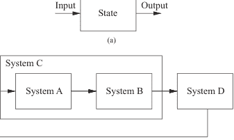

**图 2.1** 从功能部件自下而上构建模型：（a）原子模型输入、输出和内部状态；（b）由三个原子模型构建的网络模型。

仿真引擎在实现原子和网络模型的软件对象上运行。 因此构建仿真器需要将动态系统的各部分以这种形式表达。 功能模型不必一步构建。 原子模型和网络模型更易于通过一系列步骤获得，这些步骤从适当的建模技术开始，继续到模型基本动态的状态空间描述，将这些组合起来创建更复杂的组件，并最终得到一个——可能很大——可以由仿真引擎作用的功能模型。

### 2.2 机器人坦克

机器人坦克足够简单，可以对其实行连续和离散动力学进行彻底讨论，但又足够复杂，具有大型、更实用系统中存在的特征。 机器人的操作员通过无线网络控制它，数据包的接收、存储和处理由离散事件系统建模。 机载计算机将操作员的命令转换为电机的控制信号。 电机和坦克的物理运动被建模为连续系统。 这些组件组合起来形成坦克的完整模型。

我们的目标是将坦克机载计算机的周期分配给两个任务：坦克电机的物理控制和处理来自坦克操作员的命令。 与我们的目标相关的坦克有四个部分：接收操作员命令的无线电、将这些命令转换


将命令转换为电机的控制信号、向电机供电的电路，以及推进坦克的齿轮箱和履带。坦克有两个履带，左和右，每个都由自己的无刷直流（DC）电机驱动。齿轮箱将每个电机连接到其履带的链轮上。操作员通过设置电机端子处电压信号的占空比来驾驶坦克。占空比使用游戏手柄上的控制杆设置，并通过无线网络发送到计算机。

计算机为每个电机生成两个周期性电压信号。电机的占空比是在信号的一个周期内其处于开启状态的时间比例（即其开启时间）。由于电池电压固定，输送到电机的功率与其占空比成正比。驾驶坦克很简单。如果左右电机的占空比相等，则坦克沿直线移动。如果左电机的占空比高于右电机，则坦克顺时针旋转。如果右电机的占空比高于左电机，则坦克逆时针旋转。较高的占空比使坦克快速移动；较低的占空比使坦克缓慢移动。

如果电压信号的频率很高，则电机的惯性会使其在断开电池的瞬间平稳通过；电机运行高效，坦克操控良好。如果频率过低，则电机运行效率低下。电池连接时它加速，断开时减速，重新供电时再次加速。这会产生热量和噪音，浪费能量并耗尽电池，而不做有用功。因此，我们希望电压信号具有较高的频率。

不幸的是，高频信号意味着计算机处理无线电数据的可用时间更少。如果频率过高，则坦克处理操作员命令时会产生明显的延迟。在某个时刻，计算机将被电机任务完全占用，此时坦克会变得无响应。

中间存在一个频率，既能被驾驶员接受，又足够高效以提供令人满意的电池寿命。安全频率范围存在物理限制。它不能高到计算机完全被驾驶电机的任务消耗。它也不能低到坦克失控地颠簸或使电机和控制电路过热。在此范围内，频率的选择取决于驾驶员对坦克控制细微差别的敏感程度。

可以通过对真实坦克进行实验来选择可接受的频率；让几个人使用不同频率驾驶它，看看他们最喜欢哪一个。如果我们使用真实坦克来做这件事，那么我们只能得到少数人对少数频率的意见。坦克的电池是可进行实验次数的限制之一。它们在几次试验后就会耗尽，需要数小时才能重新充电。只有一个坦克是另一个限制。实验必须一次进行一个。然而，如果我们构建坦克的仿真，则可以将仿真器提供给任何关心发表意见的人，而那个人可以根据时间和耐心尝试尽可能多的不同频率。

**表 2.1** 用于坦克运动方程的参数值

| 参数 | 值 | 描述 |
| --- | --- | --- |
| m_t | 0.8 kg | 坦克的质量 |
| J_t | 5 × 10^-4 kg·m^2 | 坦克的角质量 |
| B | 0.1 m | 履带到履带的坦克宽度 |
| B_r | 1.0 N·s/m | 履带向前滚动的机械阻力 |
| B_t | 14.0 N·s/m | 履带向前滑动的机械阻力 |
| B_l | 0.7 N·m·s/rad | 履带转弯的机械阻力 |
| S_l | 0.3 N·m | 履带的侧向摩擦 |

#### 2.2.1 运动方程

坦克运动的模型改编自 Anh Tuan Le 的博士论文 [74]。模型的參數列於表 2.1 中，坦克的坐标系和作用力在图 2.2 中示出。模型假设坦克在坚硬平坦的表面上行驶，且履带不打滑。坦克的位置由其 x 和 y 坐标给出。坦克的前进方向 θ 是相对于坐标系 x 轴测量的，坦克以速度 v 沿此方向移动。

左履带以力 F_l 向前推动坦克；右履带以力 F_r 推动；B_r 是履带滚动的机械阻力。坦克使用滑转转向；要转弯，电机必须共同产生足够的扭矩使履带侧向滑动。这需要克服粘滞力 S_l。当产生足够的扭矩时，车辆开始转弯。随着转弯，部分推进力被用来拖拽履带横向移动；这通过对其转弯运动的额外阻力 B_l 和其滚动运动的阻力 B_t 来建模。

坦克的运动由两组方程描述，一组用于坦克转弯时，一组用于坦克不转弯时。从转弯到不转弯（反之亦然）的切换有两个离散效应：（1）当履带粘住且转弯结束时，角速度 ω 瞬间变为零并保持为零，（2）当坦克开始和结束转弯时，坦克的滚动阻力瞬间变化。布尔变量 *转向* 用于改变方程组。描述坦克运动的方程为

turning = { true if (B/2)|F_l − F_r| ≥ S_l; false otherwise }  (2.1)

v̇ = { (1/m_t)(F_l + F_r − (B_r + B_t)v) if turning = true; (1/m_t)(F_l + F_r − B_r v) if turning = false }  (2.2)

ω̇ = { (1/J_t)((B/2)(F_l − F_r) − B_l ω) if turning = true; 0 if turning = false }  (2.3)

θ̇ = ω  (2.4)

ẋ = v sin(θ)  (2.5)

ẏ = v cos(θ)  (2.6)

If turning = false then ω = 0  (2.7)

当 *转向* 从 false 变为 true 时，每个状态变量都从开始转弯前的值演化，但使用为 *转向* = true 指定的方程。当 *转向* 从 true 变为 false 时，除 ω 外的每个状态变量都从结束转弯前的值演化，但使用为 *转向* = false 指定的方程；ω 瞬间变为零并保持为零，直到坦克再次开始转弯。

这些微分方程描述了坦克响应履带推进力的方式。履带力 F_l 和 F_r 是该模型的输入，我们可以将状态变量 v、ω、θ、x 和 y 的任意函数作为输出。出于即将变得清楚的原因，我们将使用相对于地面的左右履带的速度；图 2.2 说明了所需量。左履带的速度 v_l 和右履带的速度 v_r 由坦克的线速度 v 和角速度 ω 确定

v_l = v + Bω/2  (2.8)

v_r = v − Bω/2  (2.9)

输入对输出的依赖关系由函数表示

$$\begin{bmatrix}v_l(t)\\v_r(t)\end{bmatrix}=M\left(\begin{bmatrix}F_l(t)\\F_r(t)\end{bmatrix}\right)$$  (2.10)

该函数接受左右履带力作为输入，并产生左右履带速度作为输出。

表 2.1 中的值是如何获得的？其中两个是直接测量的：用邮政秤测量坦克的质量，用尺子测量坦克的宽度。坦克的角质量是一个有根据的猜测。给定坦克船体的宽度 $w$ 和长度 $l$，它们是用尺子测量的，以及用邮政秤获得的质量，角质量是通过假设坦克是均匀密实的盒子来计算的。有了这些数据和假设，我们有

$$J_t=\frac{m_t}{12}(w^2+l^2)$$

这并不精确，但用尺子和秤能获得的最好结果。

阻力参数则更具推测性。转弯扭矩 $S_l$ 由坦克的重量 $W$ 和履带长度 $l_t$ 计算得出，两者均直接测量，自 Serway 的 *《面向科学家的物理学》* [133] 中橡胶的静摩擦系数 $\mu_s$，以及来自 Le 论文 [74] 的近似

$$S_l=\frac{Wl_t\mu_s}{3}$$

向前运动的阻力 $B_r$ 和 $B_t$ 以及转弯的阻力 $B_l$ 被选为使模型具有合理的线性和旋转速度。

这种测量、粗略近似和有根据猜测的混合并不少见。构建详细模型比为其获取数据更容易。然而，细节并非多余。该模型的目的是探索坦克对驾驶员的响应如何随发送到电机的功率信号频率而变化。为此目的，有必要包含决定坦克对间歇性电压信号响应的特性：具体来说，惯性和摩擦。

#### 2.2.2 电机、齿轮箱和履带

电机、齿轮箱和履带是一个机电系统，使用键合图方法为其构建动态模型（Karnopp et al. [6] 对该方法给出了极好且全面的介绍）。键合图模型通过使用方程 2.10 作为键合图元件与运动方程耦合。该元件有两个端口，其中一个具有 effort 变量 $F_l$ 和 flow 变量 $v_l$，另一个具有 effort 变量 $F_r$ 和 flow 变量 $v_r$。因果关系

该元件由公式 2.10 的函数形式决定：它以 effort 变量为输入并产生 flow 变量。这就是选择履带速度作为输出的原因。

电机、变速箱和履带的模型考虑了电动机的电感和内阻、齿轮的角质量和摩擦，以及橡胶履带的顺应性。电动机为 Mabuchi FA-130 电机，与小型玩具中普遍使用的同类型直流电机相同。一个电机驱动一条履带。电机插入 Tamiya 双电机变速箱。该变速箱有两个相同、独立的齿轮组来转动链轮。链轮和履带来自 Tamiya 履带和轮组套件；履带在坦克加速时会伸长（在急转弯时这会导致履带从轮子上脱落！），因此其顺应性包含在模型中。

为了驱动电机，计算机在 Allegro A3953 全桥脉宽调制（PWM）电机驱动器中切换一组晶体管。当开关闭合时，坦克的电池连接到电机。当开关打开时，电池与电机断开。晶体管的开关速率比计算机操作它们的速率高三个数量级，且电路中的功率损耗与系统其他地方的效率低下相比可以忽略。因此，电池和电机驱动器被建模为理想的时变电压源。

连接的电机、变速箱和履带的示意图及其键合图如图 2.3 所示。表 2.2 列出了本模型中使用的参数。

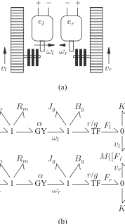

**图 2.3** 坦克的电机、齿轮和履带：（a）示意图；（b）键合图。

**表 2.2** 电机、变速箱和履带的参数

| Parameter | Value | Description |
|---|---|---|
| $L_m$ | 10⁻³ H | 电机的电感 |
| $R_m$ | 3.1 Ω | 电机的电阻 |
| $J_g$ | 1.2 × 10⁻⁶ kg·m² | 齿轮的角质量 |
| $B_g$ | 6.7 × 10⁻³ N·m·s/rad | 齿轮旋转的机械阻力 |
| $g$ | 204 | 变速箱的齿轮比 |
| $\alpha$ | 10⁻³ N·m/A | 电动机的电流-转矩比 |
| $r$ | 0.015 m | 链轮的半径 |
| $K_t$ | 10⁻³ m/N | 履带的顺应性 |

微分方程直接从键合图中读出：

$$
\dot i_l = \frac{1}{L_m}(e_l - i_l R_m - \alpha \omega_l) \tag{2.11}
$$

$$
\dot \omega_l = \frac{1}{J_g}\left(\alpha i_l - \omega_l B_g - \frac{r}{g}F_l\right) \tag{2.12}
$$

$$
\dot F_l = \frac{1}{K_t}\left(\frac{r}{g}\omega_l - v_l\right) \tag{2.13}
$$

$$
\dot i_r = \frac{1}{L_m}(e_r - i_r R_m - \alpha \omega_r) \tag{2.14}
$$

$$
\dot \omega_r = \frac{1}{J_g}\left(\alpha i_r - \omega_r B_g - \frac{r}{g}F_r\right) \tag{2.15}
$$

$$
\dot F_r = \frac{1}{K_t}\left(\frac{r}{g}\omega_r - v_r\right) \tag{2.16}
$$

其中 $e_l$ 和 $e_r$ 为电机电压，$v_l$ 和 $v_r$ 为由公式 2.8 和 2.9 给出的履带速度。

表 2.2 中的参数值来自制造商数据、测量结果和有根据的猜测。齿轮比 $g$ 和电流-转矩比 $\alpha$ 由制造商提供。齿轮比是准确且精确的（尤其是相对于模型中其他参数的值）。电流-转矩比是 Mabuchi，即电机制造商提供的两种情况的平均值。第一种情况是电机在峰值效率下运行，第二种情况是电机堵转。这两种情况之间的差异很小，表明 $\alpha$ 随着电机负载的变化而不会发生实质性变化。因此，对 $\alpha$ 的估计很可能非常合理。

链轮的半径 $r$ 以及电机的电阻 $R_m$ 和电感 $L_m$ 是直接测量的。使用尺子测量链轮的半径。确定 $R_m$ 和 $L_m$ 需要更多工作。空载电机中的电流 $i$ 与电机两端的电压 $e$ 之间的关系由微分方程给出

$$
\dot{i}=\frac{1}{L_m}(e-iR_m) \tag{2.17}
$$

参数 $L_m$ 和 $R_m$ 是通过将 1.5-V C 电池连接到电机并用示波器测量电机电流的上升时间和稳态来估计的。设 $i_f$ 为稳态电流，$t_f$ 为上升时间，且 $0.9i_f$ 为时间 $t_f$ 时的电流（即上升时间是从零电流到稳态电流 90% 所需的时间）。在稳态时 $\dot{i}=0$，电机的电阻由下式给出

$$
R_m=\frac{e}{i_f}
$$

需要瞬态电流来求 $L_m$。瞬态电流由公式 2.17 的解给出：

$$
i(t)=\frac{e}{R_m}\left(1-\exp\left(-\frac{R_m}{L_m}t\right)\right) \tag{2.18}
$$

将 $0.9i_f$ 代入 $i(t)$，$t_f$ 代入 $t$，并在公式 2.18 中求解 $L_m$ 得到

$$
\frac{1}{L_m}=-\frac{1}{R_mt_f}\ln\left(1-0.9\frac{R_m}{e}i_f\right)=-\frac{i_f}{et_f}\ln(0.1)\approx 2.3\frac{i_f}{et_f}
$$

或等价地

$$
L_m\approx 0.652\frac{t_f}{i_f}
$$

类似的实验用于获得 $B_g$。在此实验中，电机连接到变速箱。如前所述，使用示波器测量电机电流的上升时间和稳态值。电机的旋转速度 $\dot{\omega}$ 由下式给出

$$
\dot{\omega}=\frac{1}{J_g}(\alpha i-B_g\dot{\omega})
$$

制造商给出电机在峰值效率下运行时速度为 $\dot{\omega}=731.6$ 弧度每秒（rad/s）。在稳态时 $\dot{\omega}=0$。稳态电流 $i_f$ 用示波器测量。利用 $i_f$ 和电机速度，变速箱的机械阻力由下式给出

$$
B_g \approx \frac{\alpha i_f}{\dot{\omega}} = 1.37 \times 10^{-6} i_f
$$

变速箱的角质量 $J_g$ 由其质量 $m_{gb}$、齿轮半径 $r_{gb}$ 以及质量在圆柱体中均匀分布的假设估计得出。在这组测量和假设下，角质量为

$$
J_g = m_{gb} r_{gb}^2
$$

履带的顺应性是一个数量级近似。履带在从轮子上滑落之前只能拉伸几毫米。履带的最大推进力约为一牛顿。因此，履带顺应性的数量级估计为 $10^{-3}$ 米/$10^{0}$ 牛顿，或约为 $10^{-3}$ m/N。

#### 2.2.3 坦克连续动力学的完整模型

公式 2.1–2.9 和 2.11–2.16 共同描述了坦克的物理行为。运动方程和电机、变速箱和履带的方程是分开开发的，但求解算法在耦合方程合并时效果最好。因此，这些被放入一个名为 “tank physics” 的单一功能模型中，如图 2.4 所示。坦克的输入是其左右电机的电压；这些来自计算机。坦克的输出是其位置和航向；这些由坦克操作员观察。坦克物理动力学的完整状态空间模型为

$$
turning = \begin{cases}
true & \text{if } \frac{1}{2}|F_l - F_r| \ge S_t \\
false & \text{otherwise}
\end{cases} \tag{2.19}
$$

$$
\dot{v} = \begin{cases}
\frac{1}{m_t}\left(F_l + F_r - (B_r + B_s)v\right) & \text{if } turning = true \\
\frac{1}{m_t}\left(F_l + F_r - B_r v\right) & \text{if } turning = false
\end{cases} \tag{2.20}
$$

$$
\dot{\omega} = \begin{cases}
\frac{1}{J_r}\left(\frac{B}{g}(F_l-F_r)-B_i\omega\right) & \text{if turning} = \text{true}\\
0 & \text{if turning} = \text{false}
\end{cases} \tag{2.21}
$$

$$
\dot{\theta} = \omega \tag{2.22}
$$

$$
\dot{x} = v \sin(\theta) \tag{2.23}
$$

$$
\dot{y} = v \cos(\theta) \tag{2.24}
$$

$$
\text{If turning} = \text{false then } \omega = 0 \tag{2.25}
$$

$$
\dot{i}_l = \frac{1}{L_m}(e_l - i_l R_m - \alpha \omega_l) \tag{2.26}
$$

$$
\dot{\omega}_l = \frac{1}{J_g}\left(\alpha i_l - \omega_l B_g - \frac{r}{g}F_l\right) \tag{2.27}
$$

$$
\dot{F}_l = \frac{1}{K_t}\left(\frac{r}{g}\omega_l - \left(v + \frac{B\omega}{g}\right)\right) \tag{2.28}
$$

$$
\dot{i}_r = \frac{1}{L_m}(e_r - i_r R_m - \alpha \omega_r) \tag{2.29}
$$

$$
\dot{\omega}_r = \frac{1}{J_g}\left(\alpha i_r - \omega_r B_g - \frac{r}{g}F_r\right) \tag{2.30}
$$

$$
\dot{F}_r = \frac{1}{K_t}\left(\frac{r}{g}\omega_r - \left(v - \frac{B\omega}{g}\right)\right) \tag{2.31}
$$

该模型有 11 个状态变量——v、ω、θ、x、y、i_l、ω_l、F_l、i_r、ω_r 和 F_r；两个输入变量——e_l 和 e_r；以及三个输出变量——x、y 和 θ。

#### 2.2.4 计算机

计算机是来自 Maxim 的 TINI 微控制器，它通过无线网络接收操作员的命令并将其转换为电机的电压信号。计算机从连接计算机和无线电的以太网中提取原始位，将位通过以太网和用户数据报协议（UDP）栈处理以获得数据包，从该数据包中获取控制信息，并将该信息存储在寄存器中，以便生成电压信号的中断处理程序可以找到它。中断处理程序定期运行，其优先级高于处理操作员命令的线程。因此，中断处理程序花费的时间无法用于处理操作员的命令。

电压信号的频率由中断处理程序的频率决定。频繁的中断产生高频电压信号；不频繁的中断产生低频信号。图 2.5 说明了中断处理程序的工作方式。它每 N 个机器周期执行一次，并在每次调用时向存储在 8 位寄存器中的计数器添加 32。该计数器与设定的开启时间进行比较，


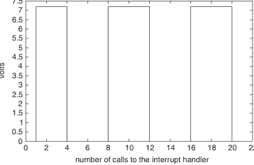

**图 2.5** 用中断处理程序产生电压信号。

尽管是间接地，由操作员设定。如果计数器大于或等于开启时间，则关闭电机；如果计数器小于开启时间，则打开电机。例如，如果坦克正在全功率运行，则两台电机的开启时间都是 255，电机将始终打开；如果电机关闭，则开启时间为 0。

在图 2.5 中，计数器初始为 0，电机处于关闭状态。开启时间为 128。第一次调用中断处理程序时，计数器加 32，比较 32 < 128，然后将电机接到坦克的 7.2 V 电池组上，从而打开电机。在第 4 次调用时，计数器的值为 128，等于开启时间，电机被关闭。在第 8 次调用时，计数器回绕，电机再次打开。

中断处理程序中的代码很短；它有 41 条汇编指令，执行需要 81 个机器周期。根据计算机制造商的数据，每秒有 18.75 × 10⁶ 个机器周期，也就是每个周期 0.0533 × 10⁻⁶ s（0.0533 μs）。因此，中断处理程序执行需要 0.432 × 10⁻⁶ s（0.432 μs）。电压信号的频率取决于中断处理程序使计数器回绕的速度。平均而言，中断处理程序被调用 8 次完成一个电压信号周期。该周期的长度为 8 × (0.432 × 10⁻⁶ + 0.0533 × 10⁻⁶ × N)。我们可以选择 N，从而选择电压信号的周期；由此得到的频率 fₑ 为

$$f_e \approx \frac{10^6}{3.46 + 0.426N} \qquad (2.32)$$

中断处理程序的离散事件模型有两类事件：*开始中断*和*结束中断*。*开始中断*事件将中断指示器设为 true，并安排在 0.432 × 10⁻⁶ s 后发生*结束中断*事件。*结束中断*事件使计数器加 1，设置电机开关，并将中断指示器设为

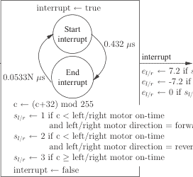

**图 2.6** 中断处理程序的事件图。

false，同时安排一个*开始中断*事件在 0.0533 × 10⁻⁶ N s 后发生。有两个软件开关，每个电机各一个，每个开关有三个位置。如果软件开关位于第一个位置，则电机连接到坦克的 7.2 V 电池组。如果开关位于第二个位置，则电机连接到电池，但正负极已调换，电机反转运行。在第三个位置，电机与电池断开。在任何给定时刻，都可以为任一电机指定新的开启时间和方向；当下一次*结束中断*事件发生时，中断处理程序会按新的设置运行。

图 2.6 显示了中断处理程序的事件图（事件图由 Schruben 引入 [131]；Fishwick [42] 描述了它们在功能模型中的用法）。该模型有 9 个状态变量。其中 4 个在图中是显而易见的：8 位计数器 c、*中断*指示器，以及左、右电机的开关 sₗ 和 sᵣ。改变电机开启时间和方向的事件是模型的输入；这些输入变量以*左电机开启时间*、*左电机方向*、*右电机开启时间*、*右电机方向*的形式存储，使状态变量数量达到 8 个。在连接各事件的有向边中隐含着距离下一次事件发生的时间，这是该系统的第 9 个也是最后一个状态变量。该模型的输出是中断指示器以及左、右电机的电压。输出变量在相应的状态变量改变后立即改变。如果某个事件被安排在某个输入变量改变的同一时刻，则先执行该事件，然后再修改相应变量。

当计算机不忙于执行中断处理程序时，它处理来自操作员的命令。每条命令都以一个 10 字节的 UDP 数据包到达：两个浮点数指定左、右电机的方向和占空比，还有 2 字节与本模型无关的信息。计算机大约能以每秒 40 千字节（kB）的速度接收数据。这个估算来自 iGuru 论坛 [120]，与制造商给出的最大数据率相当吻合，只是略低一些。计算机通过以太网与 802.11b 无线电通信（该无线电由单独的微处理器控制），以太网的最小数据包大小为 64 字节，远大于 10 字节的有效载荷。因此，我们可以乐观地估计处理一个数据包需要 0.0016 s（1.6 ms，即 1600 µs）。我们将忽略数据包丢失，并假设计算机（至少是无线电）可以存储任意数量的未处理数据包。这被建模为一个具有固定服务时间和无限队列的服务器。当中断处理程序正在执行时，服务器被迫暂停。服务器在处理完一个数据包后，会生成电机的开启时间和方向。

图 2.7 是该模型的 DEVS 图（见 Zeigler 等人 [159] 的描述，以及较新的 Schulz 等人 [132]；这些图有时被称为*相图*[42]）。该模型有三个状态变量：数据包队列 q；处理队首数据包所需的剩余时间 σ；以及模型的阶段，即*中断*或*运行*。它响应两类输入：来自中断处理程序的中断指示器和来自网络的数据包。中断指示器使系统进入*中断*阶段，系统保持在该阶段，直到收到第二个中断指示器，后者使系统回到*运行*阶段。当计算机处理完一个数据包时，它会设置左、右电机的开启时间和方向，然后开始处理下一个数据包；如果没有剩余数据包，则变为*空闲*。相图中的每条边都标注了相变发生时发生改变的状态变量。每个阶段都包含其持续时间，以及在持续时间到期而离开该阶段时生成的输出值。

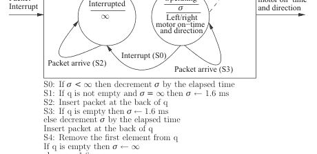

图 2.7 显示计算机如何处理一个数据包的相图。

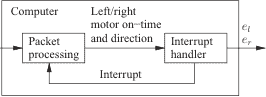

图 2.8 坦克计算机的框图。

将中断处理程序的模型和处理数据包的线程模型连接起来，就构成了计算机的模型。中断处理程序从处理数据包的线程接收电机开启时间；线程从中断处理程序接收中断指示器，并从网络接收数据包。计算机的输出设置左、右电机的电压。图 2.8 给出了计算机的框图，其中包括它的输入、输出和内部组件。

事件图和相图具有信息量，但并非最终的定义性描述。它们没有精确说明输出在何时产生，也没有说明如何处理同时发生的事件。这些问题留到第 4 章讨论，届时将正式介绍离散事件系统的状态空间模型。

#### 2.2.5 坦克的完整模型

坦克的完整模型由计算机和坦克物理模型组成。计算机的输出连接到坦克物理模型的输入。坦克的位置和方向会显示给驾驶员。驾驶员通过向计算机发送包含控制信息的数据包来形成闭环。图 2.9 展示了这种安排。坦克的操作员不是模型的一部分；操作员使用控制真实坦克所用的相同软件和硬件来控制模拟坦克。

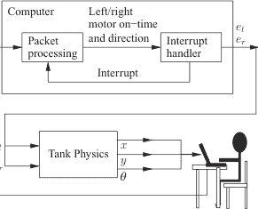

图 2.9 模拟坦克和真实操作员的框图。


### 2.3 坦克模拟器的设计

仿真器有四个部分：仿真引擎、坦克模型、驾驶员接口和网络接口。图 2.10 展示了实现这些部分的类及其关系。仿真引擎和坦克是我们主要关注的部分，它们分别由 *Simulator* 类和 *SimEventListener* 接口以及 *Tank* 类实现。用户界面由 *Display* 类和 *DisplayEventListener* 接口实现，它们接收用户输入并显示坦克的运动。*UDPSocket* 类实现网络接口，仿真器通过该接口接收来自驾驶员的命令。

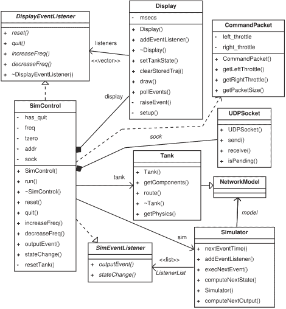

**图 2.10** 展示仿真软件主要组件的类图。

*SimControl* 类在其 *run* 方法中实现应用程序的主循环。该方法使仿真时钟与真实时钟同步推进，更新 *Display*，并轮询 *Simulator*、*Display* 和 *UDPSocket* 以获取新事件。*SimControl* 类实现 *SimEventListener* 接口，当模型组件改变状态并产生输出时，通过该接口通知它。这些回调在 *SimControl* 对象调用 *Simulator* 的 *computeNextState* 方法时接收。*SimControl* 还实现 *DisplayEventListener* 接口，当用户对显示执行操作时，通过该接口通知它：例如按下退出键“q”或按下仿真重置键“r”。这些回调在 *SimControl* 调用 *Display* 的 *pollEvents* 方法时接收。*SimControl* 对象在主循环的每次迭代中轮询 *UDPSocket* 的 *pendingInput* 方法，从网络提取 *CommandPackets*。

*Simulator* 有六个方法。构造函数接受一个模型——它可以是多级、多组件模型，也可以是单个原子模型——仿真器将对该模型进行操作。方法 *nextEventTime* 返回仿真器下一事件的时间：在没有中间输入的情况下，某个组件下一次产生输出或改变状态的时间。方法 *computeNextOutput* 提供模型在其下一事件时刻的输出，而不实际推进模型的状态。方法 *computeNextState* 推进仿真时钟，并将调用方提供的任何输入注入模型。实现 *SimEventListener* 接口并通过调用 *addEventListener* 方法注册自身的对象，会在模型组件产生输出或改变其状态时收到 *Simulator* 的通知。这些通知在调用 *computeNextState* 或 *computeNextOutput* 时发生。

图 2.10 中未给出 *Tank* 如何实现的细节；其主要组件如图 2.11 所示。*Tank* 与 *Simulator* 之间的关系很重要。*Simulator* 被设计为对一组相互连接的状态空间模型进行操作；*Tank* 是此类模型的一个具体实例。

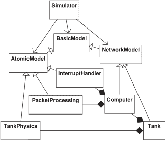

**图 2.11** 展示模型主要组件的类图。

坦克的各个部分最终派生自两个基础类：*AtomicModel* 类和 *NetworkModel* 类。*Tank* 类和 *Computer* 类派生自 *NetworkModel*，并实现图 2.8 和图 2.9 所示的框图。派生自 *AtomicModel* 的 *TankPhysics* 类实现方程 2.19–2.31。*PacketProcessing* 类和 *InterruptHandler* 类也派生自 *AtomicModel*，实现图 2.6 和图 2.7 所示的模型。

该设计将我们仿真程序的三个方面分离开来。*SimControl* 类协调软件的主要活动：渲染显示、从网络接收命令以及运行仿真。它使用 *Simulator* 的六个方法来控制仿真时钟、向模型注入输入，并获取模型状态和输出的信息。

*Simulator* 及其大量支持类（图中未显示）实现事件调度与路由、数值积分以及其他必要任务的算法。这些算法在抽象的 *AtomicModel* 和 *NetworkModel* 类上运行，而不需要详细了解底层动态特性。

模型通过从 *AtomicModel* 和 *NetworkModel* 派生具体类来实现。派生自 *AtomicModel* 类的模型实现连续和离散事件组件的状态空间表示。派生自 *NetworkModel* 类的模型描述状态空间模型和网络模型的集合如何连接以形成完整系统。

### 2.4 实验

在对仿真坦克进行实验之前，我们必须确定物理上可行的频率范围。上限无需仿真即可推导。假设计算机除执行中断处理程序外不执行任何操作。在中断处理程序的各次调用之间零指令的情况下，方程 2.32 给出电压信号的最大频率为 289 kHz。在该频率下，计算机没有时间处理来自驾驶员的命令，因此无法控制坦克。

为确定下限，我们仿真坦克以半油门运行，并测量电机中耗散的功率。在考察若干频率下的功率损耗后，我们可以选择最低可接受频率，即更高频率不会显著提高效率的频率。该仿真的软件比交互式仿真简单得多，但它使用了图 2.11 所示的所有类，以及图 2.10 所示的 *SimEventListener* 和 *Simulator* 类。实现坦克模型的类不变：图 2.11 完全适用。程序的其余部分，即为进行本实验必须实现的所有新代码，不到 100 行。

主函数创建一个 *Tank*、一个用于该 *Tank* 的 *Simulator*，以及一个 *TankEventListener*，后者计算电机中损耗的功率。*TankEventListener* 派生自 *SimEventListener* 类。将 *TankEventListener* 注册到 *Simulator* 后，程序在零时刻向坦克注入一个 *SimPacket*。该数据包包含左右电机的占空比。现在仿真运行 3 秒，足以让坦克达到约 0.2 m/s 的最大速度，并以该速度运行略超过 2 秒。电机中损耗的功率 P 为

$P = \frac{1}{3} \int_{0}^{3} i_l(t)^2 R_m + i_r(t)^2 R_m \, dt$

$\approx \frac{1}{t_M} \sum_{k=0}^{M-1} (t_{k+1} - t_k)(i_{l,k}^2 R_m + i_{r,k}^2 R_m) \tag{2.33}$

其中 $t_k$ 是调用 *TankEventListener* 的 *stateChange* 方法的时间，$i_{l,k}$ 和 $i_{r,k}$ 是时刻 $t_k$ 的电流。注意 $t_0 = 0$，且 $t_M$ 可能略小于 3，这取决于仿真器如何为其积分算法选择时间步长（可以使其在 $t = 3$ 时更新坦克状态，但本例中并未这样做）。

每当 *Simulator* 为 *Tank* 的原子组件计算新状态时，就会调用 *TankEventListener* 的 *stateChange* 方法。发生这种情况时，*TankEventListener* 计算方程 2.33 中求和的一步。*getPowerLost* 方法通过将损耗能量除以经过时间来计算损耗功率。实现 *TankEventListener* 的 C++ 代码如下所示。

#### TankEventListener

```cpp
#ifndef TankEventListener_h
#define TankEventListener_h
#include "Tank.h"
#include "SimEvents.h"
#include "SimEventListener.h"
#include <fstream>

class TankEventListener: public SimEventListener
{
public:
    TankEventListener(const Tank* tank):
        SimEventListener(),
        tank(tank), fout("current.dat"),
        E(0.0), // Accumulated energy starts at zero
        t1(0.0), // First sample is at time zero
        il(tank->getPhysics()->leftMotorCurrent()), // i_l(0)
        ir(tank->getPhysics()->rightMotorCurrent()) // i_r(0)
    {
        fout << t1 << " " << il << " " << ir << std::endl;
    }
    // Listener does nothing with output events
    void outputEvent(ModelInput, double){}
    // This method is invoked when an atomic component changes state


```cpp
void stateChange(AtomicModel* model, double t)
{
    // If this is the model of the tank's physics
    if (model == tank->getPhysics()) {
        // Get the current and motor resistance
        double Rm = tank->getPhysics()->getMotorOhms();
        // Update the energy dissipated in the motors
        E += (t-t1)*(il*il*Rm + ir*ir*Rm);
        // Remember the last sample
        il = tank->getPhysics()->leftMotorCurrent();
        ir = tank->getPhysics()->rightMotorCurrent();
        t1 = t;
        fout << t1 << " " << il << " " << ir << std::endl;
    }
}
// Get the power dissipated in the left and right motors
double getPowerLoss() const { return E/t1; }
private:
    const Tank* tank;
    std::ofstream fout;
    double E, t1, il, ir;
};

#endif
```

一个 shell 脚本会反复调用主程序来开展仿真实验。每次调用仿真程序时，都会计算在一个频率和一对占空比下电机中耗散的功率。仿真程序的第一个参数是发送给电机的电压信号频率，第二个参数是左电机的占空比，第三个参数是右电机的占空比。（第零个参数是可执行文件本身的名称。）程序会准备实验、运行实验、将结果打印到控制台、进行清理并退出。主函数的 C++ 代码如下所示。

#### 功率耗散实验的主程序

```cpp
#include "Tank.h"
#include "SimEvents.h"
#include "TankEventListener.h"
using namespace std;

int main(int argc, char** argv)
{
    // Get the parameters for the experiment from the command line
    if (argc != 4) {
        cout << "freq left_throttle right_throttle" << endl;
        return 0;
    }
    // Get the frequency of the voltage signal from the first argument
    double freq = atof(argv[1]);
    // Create a command from the driver that contains the duty ratios from
    // the second and third arguments.
    SimPacket sim_command;
    sim_command.left_power = atof(argv[2]);
    sim_command.right_power = atof(argv[3]);
    // Create the tank, simulator, and event listener. The arguments to the
    // tank are its initial position (x = y = 0), heading (theta = 0), and
    // the smallest interval of time that will separate any two reports of
    // the tank's state (0.02 seconds).
    Tank* tank = new Tank(freq,0.0,0.0,0.0,0.0,0.02);
    Simulator* sim = new Simulator(tank);
    TankEventListener* l = new TankEventListener(tank);
    // Add an event listener to compute the power dissipated in the motors
    sim->addEventListener(l);
    // Inject the driver command into the simulation at time zero
    ModelInputBag input;
    SimEvent cmd(sim_command);
    ModelInput event(tank,cmd);
    input.insert(event);
    sim->computeNextState(input,0.0);
    // Run the simulation for 3 seconds
    while (sim->nextEventTime() <= 3.0) sim->execNextEvent();
    // Write the result to the console
    cout << freq << " " << l->getPowerLoss() << endl;
    // Clean up and exit
    delete sim; delete tank; delete l;
    return 0;
}
```

使用以下 shell 脚本对一组频率执行仿真

```bash
for ((i=50;i<=7000;i+=50)); do ./a.out $i 0.5 0.5; done
```

其中 a.out 是仿真程序的名称（这是 GNU C++ 编译器生成的可执行文件的默认名称）。该脚本以 50 Hz 为增量，计算频率范围 [50, 7000] 内电机中耗散的功率。结果绘制在图 2.12 中。该图表明 3000 Hz 是频率的一个合理下限。交互实验将从 3000 Hz 开始，逐步提高到更高频率，直到我们找到仍能实现有效控制的最高频率。²

²这些损耗的功率去了哪里？它变成了热和噪声。图 2.12 中所示的频率处于人耳听觉范围内。因此，电机会发出明显的高频嗡鸣声。伴随而来的是齿轮发出的低沉咕噜声和研磨声；如果电机接近满功率运行，还会闻到淡淡的臭氧味。

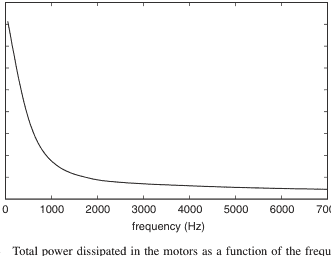

图 2.13 所示的赛道用于交互实验。坦克从赛道最左侧一段的中心出发，被操纵绕赛道行驶并返回起始位置。如果坦克偏离赛道，则该次运行被丢弃。经过数次练习运行后，实验运行以 2 kHz 为增量进行。在每个频率下，坦克绕赛道行驶，直到完成三圈。作者记录了完成每圈的时间以及每个频率下的失败尝试次数。结果列于表 2.3 中。

比较损耗功率、完成一圈赛道所需时间以及失败运行次数的数据，效率与控制之间的权衡立刻显而易见。在低频下，坦克响应非常灵敏，实验赛道可在大约一分钟内安全通过。在较高频率下，驾驶员必须更加谨慎；在 9 kHz 及以上时，赛道非常难以通过。随着频率提高，电机运行效率更高，但坦克更难控制。

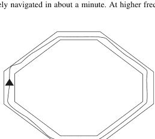

表 2.3 交互实验数据

| 频率（kHz） | T₁（s） | T₂（s） | T₃（s） | 平均值 | 失败次数 |
|---|---:|---:|---:|---:|---:|
| 3 | 68.7 | 68.3 | 69.1 | 68.7 | 0 |
| 5 | 68.9 | 68.3 | 70.8 | 69.3 | 0 |
| 7 | 69.8 | 70.0 | 67.9 | 69.2 | 0 |
| 9 | 68.3 | 68.5 | 88.4 | 75.1 | 2 |
| 11 | 67.6 | 84.4 | 113.0 | 88.3 | 0 |
| 12 | 104.0 | 101.7 | 无数据 | 103.2 | 2 |

根据这些数据以及图 2.12 中的数据，我们可以得出结论：7 到 8 kHz 之间的频率是最佳选择。在该范围内，电机运行高效，计算机能及时处理来自驾驶员的命令。实际坦克的工作频率约为 7.4 kHz：中断处理程序的相邻两次调用之间相隔 310 个机器周期。

### 2.5 小结

本示例展示了本书其余部分所开发的仿真引擎的三个主要特性：模块化、自底向上的模型构建；模型与其仿真器的分离；以及离散事件组件和连续组件的纳入。模块化、自底向上的构建方式允许大型仿真器被分块构建和测试。原子模型封装基本行为；如果对大型模型进行合理分解，那么这些最小的部件就可以被独立地构建、测试和维护。当这些部件组合成更大的组件时，这些更大的组件也可以彼此独立地构建、测试和调试。这种封装原则延伸到整个仿真器，最终使整个仿真器可以作为更大软件系统中的一个自包含组件使用。

模型与其仿真器的分离也有类似目的。仿真引擎中包含的算法是为特定类别的系统设计的。因此，它们可以在不涉及任何特定系统的情况下被构建、测试和维护。仿真引擎的测试用例将主要由简单模型组成，这些模型的行为可以通过手工计算或借助另一个已知正确的仿真器推导出来。这对建模者来说也是一个优势；仿真器所假定的系统类别的定义，保证了它将如何运行。因此，仿真引擎的改进对模型是透明的，这大大简化了仿真程序的长期维护。

包含离散事件组件和连续组件对于许多工程系统的建模不可或缺；机器人坦克就是一个例子。这必须准确且精确地完成，但准确性正是最大的挑战。说一个仿真相对于理想化模型是准确的，意味着该模型的行为原则上可以不借助仿真器推导出来：必须存在一个正确结果，用以衡量准确性。因此，将模型与计算其行为的算法分离至关重要。因此，这两个概念是建模与仿真研究的核心。


## 第 3 章

## 离散时间系统

仿真引擎是一组用于构建仿真器的 C++ 类。模型通过扩展封装结构与动态行为的类来构造。这些模型被交给实现仿真算法的对象，由这些算法计算模型的动态行为。封装仿真算法的类具有用于监视和控制仿真器进度的方法。

大型模型由两类组件构建。原子模型描述基本事物。它们封装那些顾名思义不再进一步分解的组件的动态行为。坦克的中断处理程序、数据包处理模型以及描述坦克运动的微分方程都是原子模型。网络模型由相互交互的部分组成：原子模型和其他网络。它们封装结构：多组件系统中的组件和连接关系。坦克的计算机和坦克本身都是网络模型。

仿真引擎基于这两类组件提供的接口运行。原子模型具有根据其当前状态计算其输出的方法，以及根据其当前状态和输入计算其下一状态的方法。网络模型具有用于检索其组件集合、将其组件的输出转换为其他组件的输入及自身输出、以及将其输入转换为组件输入的方法。事件调度、数值积分和其他必要任务的算法包含在实现仿真引擎的类中。

可视化、实时交互、仿真网络接口以及其他类似功能由使用仿真引擎的软件实现。该软件在软件工程术语中称为仿真引擎的*客户端*，它通过三种方式与仿真引擎交互。客户端控制仿真中时间推进的速率。时间可以以仿真引擎能够达到的最快速度推进，可以与现实世界时间的流逝相协调，也可以按任何其他所需方式推进。当任何组件（原子组件或网络组件）产生输出时，以及当任何原子组件改变其状态时，客户端会收到通知。这些通知可用于驱动交互式仿真中的显示、收集统计数据，或创建记录信息以供后续显示或调试的文件。客户端还可以向正在运行的仿真中注入输入。这是交互式仿真所必需的，并且可用于向仿真器提供脚本化的轨迹。

*《构建仿真软件：理论、算法及C++应用》。James J. Nutaro 著，版权所有 © 2011 John Wiley & Sons, Inc.*

对于离散时间系统，仿真引擎最为简单。一旦确立了基本概念和软件制品，将它们扩展到离散事件系统和连续系统就很直接。仿真引擎的结构（即使不是细节）在一般情况下得以保留；模型仍然从 *Atomic* 和 *Network* 类派生，*Simulator* 计算它们的动态行为。离散时间、离散事件和连续仿真的主要区别在于用于推进仿真时钟的算法。因此，面向离散时间系统的仿真引擎是一个有用的基础。

### 3.1 原子模型

*原子模型*是一个动态系统，它响应环境而变化，并在变化时影响环境。影响系统的变量是它的输入，这些变量用集合 $X$ 描述。系统借以影响环境的变量是它的输出，这些变量用集合 $Y$ 描述。构成系统的变量是它的状态，这些变量用集合 $S$ 描述。

系统的动态行为由从时间到输入、输出和状态集合的函数描述。系统使用的时间集合称为其*时基*；对于离散时间系统，这是自然数集合 $\mathbb{N}$。*输入轨迹*是从时间集合 $\mathbb{N}$ 到输入集合 $X$ 的函数；*输出轨迹*是从 $\mathbb{N}$ 到 $Y$ 的函数；*状态轨迹*是从 $\mathbb{N}$ 到 $S$ 的函数。

#### 3.1.1 轨迹

轨迹 $z$（可以是输入轨迹、输出轨迹或状态轨迹）在特定时间 $t$ 的值写作 $z(t)$。定义在从 $t_0$ 到 $t_n$ 的区间上的轨迹一般记为 $z\langle t_0,t_n\rangle$。当需要指定端点时，$<$ 和 $>$ 会根据包含关系替换为 [ 和 ]，或根据排除关系替换为 ( 和 )，具体为

$$
\begin{aligned}
t \in [t_0,t_n] &\iff t_0 \le t \le t_n \\
t \in (t_0,t_n] &\iff t_0 < t \le t_n \\
t \in [t_0,t_n) &\iff t_0 \le t < t_n \\
t \in (t_0,t_n) &\iff t_0 < t < t_n
\end{aligned}
$$

定义域为时基 $T$、值域为集合 $Z$ 的轨迹集合记为 $\langle T,Z\rangle$。每个成员 $z\in\langle T,Z\rangle$ 是一个函数 $T\to Z$。两条轨迹 $z_a\langle t_1,t_2\rangle$ 和 $z_b\langle t_1,t_2\rangle$ 相等，当且仅当对于所有 $t\in\langle t_1,t_2\rangle$，都有 $z_a(t)=z_b(t)$：简言之

$$ z_a\langle t_1,t_2\rangle = z_b\langle t_1,t_2\rangle \iff (\forall t\in\langle t_1,t_2\rangle)(z_a(t)=z_b(t)) \tag{3.1} $$

并且，如果定义域已明确，我们可以简单地写作 $z_a=z_b$。当描述离散时间系统的输入、输出和状态轨迹集合时，我们分别使用记号 $\langle \mathbb{N},X\rangle$、$\langle \mathbb{N},Y\rangle$ 和 $\langle \mathbb{N},S\rangle$。

在相容时间开始和结束的轨迹可以连接起来，形成一条新轨迹。连接 $z_a[t_0,t_n)$ 和 $z_b[t_n,t_m)$ 会生成由下式定义的 $z_{ab}[t_0,t_m)$：

$$ z_{ab}(t) = \begin{cases} z_a(t) & \text{if } t\in [t_0,t_n) \\ z_b(t) & \text{if } t\in [t_n,t_m) \end{cases} $$

符号 $\cdot$ 表示连接；在这个特定例子中

$$ z_{ab}[t_0,t_m) = z_a[t_0,t_n) \cdot z_b[t_n,t_m) $$

或者更简洁地

$$ z_{ab} = z_a \cdot z_b $$

如果定义域已明确。轨迹的连接如图3.1所示。该定义涵盖与我们相关的特定情况。更一般地，如果两条轨迹 $z_a\langle t_0,t_n\rangle$ 和 $z_b\langle t_n,t_m\rangle$ 在连接时刻 $t_n$ 没有冲突，则它们可以连接。轨迹也可以被拆开。例如，$z\langle t_0,t_3\rangle$ 可以剖分为 $z_a\langle t_0,t_2\rangle$ 和 $z_b\langle t_2,t_3\rangle$，使得 $z=z_a\cdot z_b$。

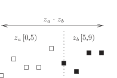

**图3.1** 连接两条轨迹。

时间平移算子 $\tau$ 将轨迹的起始时间和结束时间移动相等的距离。例如，对轨迹 $z_a[0,2]$ 应用参数为 1 的 $\tau$，得到 $\tau(1,z_a[0,2])=z_b[1,3]$。新轨迹 $z_b$ 与 $z_a$ 相同，但定义在不同的区间上；在这个例子中，$z_a(0)=z_b(1)$、$z_a(1)=z_b(2)$、$z_a(2)=z_b(3)$。$\tau$ 的定义是该例子的推广：

$$ \tau(h,z_a\langle t_1,t_2\rangle)=z_b\langle t_1+h,t_2+h\rangle \quad \text{such that}\quad z_a(t)=z_b(t+h) \tag{3.2} $$

为简洁起见，$\bullet$ 算子结合 $\cdot$ 和 $\tau$，用于连接两条不一定在同一时间开始和结束的轨迹 $z_a[t_1,t_2]$ 和 $z_b[t_3,t_4]$。这种操作非常常见，而分别表示平移和连接的记号很快就会变得繁琐。$\bullet$ 算子定义为

$$ z_a[t_1,t_2]\bullet z_b[t_3,t_4] = z_a[t_1,t_2]\cdot\tau(t_2-t_3,z_b[t_3,t_4]) \tag{3.3} $$

将 $z_b$ 平移 $t_2-t_3$，会将其定义域从 $[t_3,t_4]$ 转换为 $[t_3+(t_2-t_3),t_4+(t_2-t_3)]=[t_2,t_4+t_2-t_3]$，从而为两条轨迹提供一个共同的连接时间。

#### 3.1.2 状态转移与输出函数

全状态转移函数 $\Delta$ 响应输入轨迹 $x[t_0,t_0]$，将系统从状态 $s$ 移动到状态 $s'$：

$$ s' = \Delta(s,x[t_0,t_0]) \tag{3.4} $$

并非所有此类函数都是全状态转移函数；$\Delta$ 必须满足

$$ \Delta(s,x_1\cdot x_2)=\Delta(\Delta(s,x_1),x_2) \tag{3.5} $$

$$ \Delta(s,x[t,t])=s \tag{3.6} $$

式 3.6 要求系统在空时间区间内不改变其状态。式 3.5 是半群性质。它表明，向系统输入一系列输入轨迹 $x_1,x_2,\ldots,x_n$，与向系统输入单条轨迹 $x_1\cdot x_2\cdot\ldots\cdot x_n$ 具有相同的效果。在实践中也很常见地要求

$$ \Delta(s,\tau(h,x))=\Delta(s,x) \tag{3.7} $$

式 3.7 表明，系统对输入的响应不依赖于施加该输入的时间。满足这一性质的系统称为时不变系统。

这三个性质是日常经验的数学表达。其中最重要的是半群性质。为了说明它，想象一个用锁和钥匙进行的实验。如果锁是闭合的，处于锁定状态，并且钥匙 $k$ 被转动，那么


我们可以预期锁会被打开，处于解锁状态。数学上，unlocked = Δ(locked, x[0, 1))，其中 x(0) = k。如果我们能再次转动钥匙，我们预期锁会闭合：locked = Δ(unlocked, x[0, 1))。如果锁是闭合的，并且我们转动钥匙两次，预期完成时它仍是闭合的：locked = Δ(locked, x • x)。总之，我们预期 locked = Δ(locked, x • x) = Δ(Δ(locked, x), x)。

同样重要的是，Δ 是一个函数，而不是某种更弱的构造。假设我们为原始钥匙 k₁ 制作一个副本，称为 k₂。这些钥匙不可区分，因此 k₁ = k₂。如果锁是闭合的，并且我们转动第二把钥匙，我们预期锁会打开：这与使用第一把钥匙得到的结果完全相同。令 x₂[0, 1)（其中 x₂(0) = k₂）为在锁中转动钥匙 k₂ 的输入轨迹，我们可以写出 x₁[0, 1) = x₂[0, 1)，并因此有 Δ(locked, x₁[0, 1)) = Δ(locked, x₂[0, 1))。再次转动钥匙，使得 x₁ • x₁ = x₂ • x₂，我们预期 Δ(locked, x₁ • x₁) = Δ(locked, x₂ • x₂)。同一把锁；同一个实验；相同的钥匙；相同的结果。

最后，考虑方程3.7。如果锁是闭合的，我们转动钥匙，那么锁会打开，无论这一动作何时进行。类似地，如果锁是打开的，我们转动钥匙，那么锁会闭合，无论我们何时采取这一动作。你可能会问，如果锁有一个计时器，会怎样？如果它是内部计时器，那么其值由自上次重置以来经过的时间决定。经过的时间是一个状态变量，可以通过对系统施加输入将其置零。

如果锁使用外部计时器，例如从全球定位系统或原子钟接收的信号，那么外部时钟的值就是锁的一个输入。如果为了测试锁而向其提供过快、过慢或运行方向错误的定时信号，则锁的响应将仅取决于定时信号的值，而不取决于该信号何时被施加。如果这项测试在早晨进行一次、在傍晚进行一次，那么两次都会产生相同的结果。我们预期方程3.7成立。

半群性质具有根本重要性，因为用于仿真的迭代算法正是由它推导出来的。要求 Δ 是一个函数同样至关重要；它在处理同时发生的动作时起着关键作用。时不变性对仿真算法而言并非必需，但要求它并不会带来限制，而且非常方便。如果不要求时不变性，则必须向仿真引擎提供初始时间，并提供访问仿真时钟的方法。这样，模型可以将时间直接纳入其状态转移函数中。将对时间的任何依赖通过将其变为状态变量而纳入模型状态中，同样合理，而且最终会简单得多。自此以后，假定我们的模型是时不变的。

假设我们施加一个定义在单个点上的输入轨迹。例如，轨迹 x[t₀, t₁) = x(t₀)。系统从状态 s₀ 开始，其在时刻 t₁ 的状态 s₁ 为

$$s_1 = \Delta(s_0, x[t_0, t_1)) = \delta(s_0, x(t_0)) \tag{3.8}$$

其中函数 δ 是单步状态转移函数，或简称为状态转移函数。函数 δ 将单个状态和单个输入映射为一个新状态；其形式为

$$\delta : S \times X \to S$$

我们完全可以不提及时间而写出方程3.8。给定当前状态 s 和输入 x，下一状态 s' 为

$$s' = \delta(s, x)\tag{3.9}$$

该函数通过描述系统如何响应任意单个输入，为我们提供了一种定义总状态转移的便捷方式。总状态转移函数 Δ 通过对输入轨迹 x[t₀, t_n) 中的值递归应用 δ 来定义。该轨迹被分解为长度为单位长度的段 x₀, x₁, ..., x_{n−1}，使得

$$x[t_0, t_n) = x_0[t_0, t_1) \cdot x_1[t_1, t_2) \cdots x_{n-1}[t_{n-1}, t_n)$$

使用半群性质，我们写出

$$s_n = \Delta(\Delta(s_0, x_0), x_1 \cdot x_2 \cdots x_{n-1})$$
$$= \Delta(\delta(s_0, x_0(t_0)), x_1 \cdot x_2 \cdots x_{n-1})$$

重复应用该公式使我们能够完全通过应用 δ 来计算 s_n。详细进行该计算，得到

$$\Delta(s_0, x) = \Delta(\Delta(s_0, x_0), x_1 \cdot x_2 \cdots x_{n-1})$$
$$= \Delta(\delta(s_0, x_0(t_0)), x_1 \cdot x_2 \cdots x_{n-1})$$
$$= \Delta(s_1, x_1 \cdot x_2 \cdots x_{n-1})$$
$$= \Delta(\Delta(s_1, x_1), x_2 \cdots x_{n-1})$$
$$= \Delta(\delta(s_1, x_1(t_1)), x_2 \cdots x_{n-1})$$
$$= \Delta(s_2, x_2 \cdots x_{n-1})$$
$$= \dots$$
$$= \Delta(\Delta(s_{n-2}, x_{n-2}), x_{n-1})$$
$$= \Delta(\delta(s_{n-2}, x_{n-2}(t_{n-2})), x_{n-1})$$
$$= \Delta(s_{n-1}, x_{n-1})$$
$$= \delta(s_{n-1}, x_{n-1}(t_{n-1}))$$
$$= s_n$$

```text
1  s ← s0
2  for tk ∈ [t0, tn) do
3      print time tk and state s
4      s ← δ(s, x(tk))
5  end
```

**算法 3.1**  计算离散时间系统总状态转移函数的迭代过程。

该递归过程一次消耗输入轨迹的一个段。首先计算由将输入 x₀(t₀) 施加到状态 s₀ 所产生的状态 s₁。状态 s₂ 由 δ(s₁, x₁(t₁)) 计算。接着由 δ(s₂, x₂(t₂)) 计算状态 s₃，并重复此过程直到到达 s_n。总状态转移函数的这一定义是尾递归的，因此可以很容易地改写为算法3.1中的迭代过程。

输出函数 λ 描述系统状态如何呈现给观察者。它将当前状态 s 映射为输出 y，其形式为

$$\lambda : S \to Y$$

由状态轨迹 s < t₀, t_n > 产生的输出轨迹 y < t₀, t_n > 定义为

$$y(t_k) = \lambda(s(t_k)) \tag{3.10}$$

对每个 t_k ∈ < t₀, t_n >。为了在仿真中容纳输出函数，只需对算法3.1做一个小改动；这样便得到算法3.2。

图3.2说明了状态转移函数和输出函数在定义系统动态行为中的作用。总之，状态转移函数定义系统对输入的内部响应；输出函数为外部观察者投射出内部状态的视图。

```text
1  s ← s0
2  for tk ∈ [t0, tn) do
3      print time tk, state s, and output λ(s)
4      s ← δ(s, x(tk))
5  end
```

**算法 3.2**  用于仿真原子离散时间系统的迭代算法。

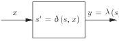

**图 3.2**  原子模型的动态部分。

#### 3.1.3 原子离散时间模型的两个示例

第一个例子，考虑一个系统，其状态 $s$、输入 $x$ 和输出 $y$ 为实数，状态转移函数和输出函数为

$$\delta(s,x)=\frac{s}{2}+x \tag{3.11}$$

$$\lambda(s)=10s \tag{3.12}$$

该系统的两次仿真见表3.1。第一行包含初始状态和第一个输出。输入轨迹 $x_1[0, 4)$ 和 $x_2[0, 4)$ 分别写在各自的列中。每一行中的状态列和输出列分两步填写：(1) 将上一行的状态和输入代入方程3.11来计算状态 $s$；(2) 将新状态代入方程3.12来计算输出 $y$。重复此过程，直到输入轨迹结束。

注意，第二个实验从第一个实验结束时的相同状态开始。如果我们通过将第二个输入轨迹馈入系统（即馈入 $x_1 \circ x_2$）来继续第一个实验，那么结果本会完全相同，最终状态和输出与第二个实验中的相同。

第二个例子，考虑一台售卖咖啡但只接受五分、十分和二十五分硬币的自动售货机。当向投币口投入 $1 时，机器会送出一杯咖啡。按下 CHANGE 按钮时，机器会退回任何未花掉的硬币。为了构造该机器的模型，我们将时间取为提供给它的输入数量。当投入硬币、按下 CHANGE 按钮，或两者同时发生时，时间递增。可以同时投入多枚硬币并按下 CHANGE 按钮。当顾客等待机器响应先前的输入时，时间也会递增。

**表 3.1**  由方程3.11和3.12所述系统的两次仿真

| 实验 1 |  |  |  | 实验 2 |  |  |  |
|:---:|:---:|:---:|:---:|:---:|:---:|:---:|:---:|
| $t$ | $s$ | $x_1$ | $y$ | $t$ | $s$ | $x_2$ | $y$ |
| 0 | 1 | 1 | 10 | 0 | 0.5 | 0 | 5 |
| 1 | 1.5 | 1 | 15 | 1 | 0.25 | −0.125 | 2.5 |
| 2 | 1.75 | 1 | 17.5 | 2 | 0 | 1 | 0 |
| 3 | 0.875 | 0.0625 | 8.75 | 3 | 1 | 0 | 10 |
| 4 | 0.5 | — | 5 | 4 | 0.5 | — | 5 |


模型接受来自集合的任意组合输入

$$X = \{nickel, dime, quarter, cancel, wait\}$$

并产生来自集合的输出组合

$$Y = \{nickel, dime, quarter, coffee, nothing\}$$

模型输入是来自 $X$ 的值的袋，输出是来自 $Y$ 的值的袋。袋（有时称为 *多集*）是一个无序集合。例如，袋 {nickel, nickel, dime} 包含两枚镍币和一枚迪姆币，总价值为 25 美分。空袋与空集类似，用 ∅ 表示。两个袋的并集与两个集合的并集相同，只是允许重复。例如，{nickel, nickel, dime} ∪ {dime} = {nickel, nickel, dime, dime}。空袋是并集运算的单位元：对于任意袋 $X$，$X \cup \varnothing = X$。

列出项目的顺序无关紧要。例如，{nickel, dime, nickel} 等于 {nickel, nickel, dime}。因此，机器必须在任意特定状态 $s$ 下，对提供其中任一值时产生相同的结果。例如，必须有

$$\delta(s, \{nickel, nickel, dime\}) = \delta(s, \{nickel, dime, nickel\})$$

硬币库存、当前顾客投入的硬币价值以及 CANCEL 按钮的状态构成了模型的状态。变量 $n$、$d$ 和 $q$ 分别是库存中镍币、迪姆币和四分之一美元硬币的数量。变量 $v$ 是当前顾客投入机器的硬币总价值。变量 $cancel$ 在按下 CANCEL 按钮时为 true，否则为 false。

该机器的状态转换函数由算法 3.3 定义，其以机器状态变量为成员变量的对象的形式编写方法。该方法的唯一参数是 $X$ 中输入的袋 $x^b$。方法 *getCoins* 由算法 3.4 实现，返回从机器库存中选取的硬币袋，其总价值等于其参数。状态转换函数首先在可能的情况下，从顾客先前投入的未花费硬币价值中扣除一美元。然后将新硬币添加到顾客的总价值和机器的库存中。CANCEL 按钮的状态最后确定。

算法 3.5 定义了模型的输出函数，形式相同。该方法返回输出集合 $Y$ 中的元素袋 $y^b$。如果机器中至少有 \$1，则生产一杯咖啡。如果按下 CANCEL 按钮，则机器退还顾客的找零。如果同时售出咖啡，则只退还未花费的硬币。

表 3.2 显示了该模型的两次实验。再次，我们看到半群性质在起作用。状态转换函数确实是一个函数，可以通过检查输入袋中项目顺序的变化是否改变模拟结果来验证。

```
1 method δ(x^b)
2 Sell a cup of coffee
3 If v ≥ 100 then v ← v − 100
4 If cancel is pressed, clear it and return any change
5 if cancel = true then
6     cancel ← false
7     C ← getCoins(v)
8     n ← n − number of nickels in C
9     d ← d − number of dimes in C
10    q ← q − number of quarters in C
11    v ← 0
12 end
13 Add the coins inserted by the customer
14 n_c ← number of nickels in x^b, n ← n + n_c
15 d_c ← number of dimes in x^b, d ← d + d_c
16 q_c ← number of quarters in x^b, q ← q + q_c
17 v ← v + 5n_c + 10d_c + 25q_c
18 Check the cancel button
19 cancel ← cancel is in x^b
20 end method
```

##### 算法 3.3 咖啡售货机的状态转换函数。

```
1 method getCoins(cents) returns C
2 Initialize the bag of coins
3 C ← ∅
4 Copy the inventory of the machine
5 q_c ← q, d_c ← d, n_c ← n
6 Pick quarters first
7 while q_c > 0 and cents ≥ 25 do
8     q_c ← q_c − 1, cents ← cents − 25
9     C ← C ∪ {quarter}
10 end
11 Pick dimes next
12 while d_c > 0 and cents ≥ 10 do
13    d_c ← d_c − 1, cents ← cents − 10
14    C ← C ∪ {dime}
15 end
16 Pick nickels last
17 while n_c > 0 and cents ≥ 5 do
18    n_c ← n_c − 1, cents ← cents − 5
19    C ← C ∪ {nickel}
20 end
21 return C
22 end method
```

##### 算法 3.4 *getCoins* 方法的定义。

```
1  method λ() returns y^b
2    Initialize the output bag
3    y^b ← ∅
4    How much money has the customer put into the machine?
5    cash ← v
6    Sell a cup of coffee
7    if cash ≥ 100 then
8      y^b ← {coffee}
9      cash ← cash − 100
10   end
11   Expel any change that remains after the sale
12   if cancel = true then y^b ← y^b ∪ getCoins(cash)
13   If the bag is still empty, then the output is nothing
14   if y^b = ∅ then y^b ← {nothing}
15   return y^b
16 end method
```

**算法 3.5** 咖啡售货机的输出函数。

#### 3.1.4 用于输入和输出的袋系统

袋作为模型输入和输出的基本类型非常有用，因此我们将其纳入系统的定义。元素在 $X$ 中的袋的集合记为 $X^b$。类似地，元素在 $Y$ 中的袋的集合记为 $Y^b$。例如，如果 $Y = {nickel, dime, quarter}$，则 ${nickel} ∈ Y^b$，${nickel, nickel} ∈ Y^b$，${dime, nickel}$ 也是如此。状态转换函数根据模型当前状态 $s$ 和 $X$ 中的输入袋 $x^b$ 计算模型的下一个状态；其形式为

δ : S × X^b → S    (3.13)

输出函数将当前状态 $s$ 映射到 $Y$ 中的输出袋 $y^b$；其形式为

λ : S → Y^b    (3.14)

这些新形式不会改变总状态转换函数的定义或原子模型的模拟算法。它们的重要性主要在于网络模型的定义和模拟，这在第 3.2 节中讨论。

#### 3.1.5 原子模型的模拟器

原子模型的仿真引擎有四个类：*Atomic*、*Simulator*、*EventListener* 和 *Bag*。*Bag* 是无序对象集合的通用类。它用于向 *Atomic* 模型提供输入并从中获取输出。*Bag* 是 C++ 标准模板库 STL 中定义的多个关联容器的部分实现（参见例如 Ref. 60）。它具有插入和删除对象、遍历包含对象以及确定容器中对象数量的方法。

*EventListener* 可以注册到 *Simulator*，后者在模型产生输出并改变其状态时会通知监听器。*EventListener* 有两个抽象方法：*stateChange* 和 *outputEvent*。当模型改变其状态时，*Simulator* 调用 *stateChange* 方法。当模型产生输出时调用 *outputEvent* 方法。

*Simulator* 有四个方法：*addEventListener*、*getTime*、*computeNextState* 和 *computeOutput*。*addEventListener* 方法将 *EventListener* 放入被通知模型更改的监听器列表中。*getTime* 方法返回上次计算状态的仿真时间。*computeNextState* 方法执行四项操作：（1）如果尚未完成，则计算模型的输出函数，（2）计算模型的下一个状态，（3）通知这些操作的监听器，（4）告诉模型清理其输出函数创建的对象。*computeOutput* 方法调用模型的输出函数并通知已注册的 *EventListeners* 相应的输出值；它不会改变模型的状态。

原子模型派生自抽象 *Atomic* 类，该类定义了仿真算法所需的接口。该类有两个抽象方法：*delta* 和 *output_func*¹。方法 *delta* 实现状态转换函数，*output_func* 实现输出函数。派生类的成员变量是模型的状态变量，并由其构造函数初始化。

*computeOutput* 方法在每个仿真时间最多有效一次。同一仿真时间的后续调用无效。此设计决策有两个实际动机：（1）它通过在 *computeNextState* 方法结束时一次性清理来简化输出对象的管理，（2）模型的 *output_func* 方法在每个仿真时间只调用一次；实际上，建模者经常在 *output_func* 中或响应输出时收集统计数据、驱动输出设备并执行其他任务，这些任务必须在每个仿真时间只执行一次。

模型输入-输出集中的对象类型使用模板参数指定。使用模板类构建原子模型的决定主要由 C++ 编程语言的使用所驱动。C++ 是一种强类型语言，缺乏内置基类。因此，仿真引擎必须在编译时知道模型将产生和消耗哪些类型的对象。具有指定输入和输出类型的模板的原子模型的通用基类解决了此问题，并使程序员能够显式控制如何

##### 表 3.2 售货机的两次模拟

| s | 实验 1 (x1) | 实验 1 (y) | 实验 2 (x2) | 实验 2 (y) |
|---|---|---|---|---|
| 0 | {quarter, quarter, quarter, quarter, dime, nickel, dime}<br>q = 14, d = n = 10<br>v = 0<br>cancel = false | (nothing) | {quarter, quarter, quarter, quarter, dime, nickel, dime}<br>q = 14, d = n = 10<br>v = 0<br>cancel = false | (nothing) |
| 1 | {dime, dime, nickel}<br>q = 14, d = n = 11<br>v = 105<br>cancel = false | (coffee) | {dime, dime, nickel}<br>q = 17, d = 13, n = 10<br>v = 105<br>cancel = false | (coffee) |
| 2 | {quarter, quarter, quarter, quarter, dime, nickel, dime}<br>q = 14, d = n = 11<br>v = 115<br>cancel = false | (nothing) | {quarter, quarter, quarter, quarter, dime, nickel, dime}<br>q = 17, d = 13, n = 10<br>v = 105<br>cancel = true | (cancel) |
| 3 | {dime, dime, nickel}<br>q = 14, d = n = 11<br>v = 115<br>cancel = true | (dime, nickel) | {dime, dime, nickel}<br>q = 17, d = 13, n = 10<br>v = 5<br>cancel = true | (nickel) |
| 4 | {quarter, quarter, quarter, quarter, dime, nickel, dime}<br>q = 14, d = n = 10<br>v = 0<br>cancel = false | (nothing) | {quarter, quarter, quarter, quarter, dime, nickel, dime}<br>q = 17, d = 13, n = 9<br>v = 0<br>cancel = false | (nothing) |

C++ 标准模板库 STL（参见例如 Ref. 60）。它具有插入和删除对象、遍历包含对象以及确定容器中对象数量的方法。

*EventListener* 可以注册到 *Simulator*，后者在模型产生输出并改变其状态时会通知监听器。*EventListener* 有两个抽象方法：*stateChange* 和 *outputEvent*。当模型改变其状态时，*Simulator* 调用 *stateChange* 方法。当模型产生输出时调用 *outputEvent* 方法。

*Simulator* 有四个方法：*addEventListener*、*getTime*、*computeNextState* 和 *computeOutput*。*addEventListener* 方法将 *EventListener* 放入被通知模型更改的监听器列表中。*getTime* 方法返回上次计算状态的仿真时间。*computeNextState* 方法执行四项操作：（1）如果尚未完成，则计算模型的输出函数，（2）计算模型的下一个状态，（3）通知这些操作的监听器，（4）告诉模型清理其输出函数创建的对象。*computeOutput* 方法调用模型的输出函数并通知已注册的 *EventListeners* 相应的输出值；它不会改变模型的状态。

原子模型派生自抽象 *Atomic* 类，该类定义了仿真算法所需的接口。该类有两个抽象方法：*delta* 和 *output_func*¹。方法 *delta* 实现状态转换函数，*output_func* 实现输出函数。派生类的成员变量是模型的状态变量，并由其构造函数初始化。

*computeOutput* 方法在每个仿真时间最多有效一次。同一仿真时间的后续调用无效。此设计决策有两个实际动机：（1）它通过在 *computeNextState* 方法结束时一次性清理来简化输出对象的管理，（2）模型的 *output_func* 方法在每个仿真时间只调用一次；实际上，建模者经常在 *output_func* 中或响应输出时收集统计数据、驱动输出设备并执行其他任务，这些任务必须在每个仿真时间只执行一次。

模型输入-输出集中的对象类型使用模板参数指定。使用模板类构建原子模型的决定主要由 C++ 编程语言的使用所驱动。C++ 是一种强类型语言，缺乏内置基类。因此，仿真引擎必须在编译时知道模型将产生和消耗哪些类型的对象。具有指定输入和输出类型的模板的原子模型的通用基类解决了此问题，并使程序员能够显式控制如何

¹为什么不使用 *lambda*？符号（或词）*delta* 通常用于表示变化。此用法在第一和第二年的微积分和物理课程中引入。用符号（或词）*lambda* 表示输出相对不常见。因此，方法名 *output_func* 似乎不太可能混淆程序员。


输入和输出对象得到管理。然而，这迫使每个使用 *Atomic* 接口的类都成为泛型类，因此整个仿真引擎必须实现为一组泛型类。

其他编程语言会促成这个问题的其他解决方案。无类型语言和动态类型语言（例如 Tcl 和 Python）会隐式地解决这个问题。对于具有内置通用超类的语言——Java 及其 *Object* 类就是一个例子——很自然地使用该语言的超类作为 *Atomic* 模型输入和输出的基本类型。当语言具有内在的垃圾回收器时，这种解决方案尤其有吸引力。

暂且考虑一下，在仿真引擎的 C++ 实现中，通用基类可能如何被使用。我们可以强制程序员对所有输入和输出使用由仿真引擎提供的基类，但这在实践中很别扭。小型仿真项目会被封装简单数据类型的对象弄得杂乱不堪：双精度浮点数、整数和字符串。大型仿真项目则被推向一种设计，这种设计总是迫使模型交换指向对象的指针，而不是对象本身（或对象的副本）。因此，分配给输入和输出对象的内存必须仔细管理，而这会成为错误的一个来源。指向对象的指针有时是必要的，使用模板允许这样做，但通常可以避免，而模板提供了一种避免的方法。

尽管如此，一些仿真器需要使用动态分配的对象作为其模型输入和输出的基本类型。因此，*Atomic* 类有一个抽象的 *gc_output* 方法，用于管理由 *output_func* 方法创建的对象。这是必要的，因为创建该对象的模型无法知道仿真器何时用完它。在此情况下，“用完”意味着仿真器内的所有模型以及仿真器外的事件监听器都有机会访问该对象。只有 *Simulator* 知道何时满足此条件，因此只有它能安全地调用 *gc_output* 方法，此时 *Atomic* 模型可以销毁它创建的任何输出对象。

构成仿真引擎的类位于 *adss* 命名空间中，以防止与不属于仿真引擎的类、函数和变量发生冲突。名称 *adss* 描述了这些类的集合是什么：一个离散时间系统仿真器。图 3.3 展示了仿真引擎中的类及其方法、属性和主要关系。*Simulator* 和 *Bag* 类是仅有的具有具体方法的类。所有其他类都（几乎）是纯抽象的。唯一的例外是 *Atomic* 类，它有一个成员变量。这个变量 *Bag y* 在 *Simulator* 调用模型的 *output_func* 方法并随后调用 *gc_output* 方法时由 *Simulator* 使用。尽管这个 *Bag* 属于 *Atomic* 类，但它是私有的，因此派生类无法访问。只有 *Simulator*（它是 *Atomic* 类的友元）可以访问它。

*Bag* 类可以用任何合适的数据结构实现。它可能是 STL *multiset* 的简单别名、动态大小的数组，或为在仿真引擎中使用而优化的某种结构。无论如何，保留 *Bag* 这个名称是为了提醒

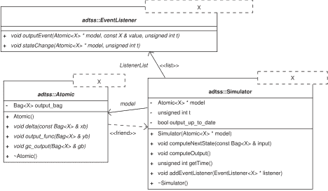

**图 3.3** 离散时间原子模型仿真引擎的类图。

程序员：它是一个无序的对象集合。仿真算法不重视 *Bag* 中元素的顺序，模型也不应重视。

*Simulator* 类是仿真引擎中最复杂的部分。它实现基本仿真算法，实现使该算法可供 *Simulator* 客户端使用的接口，并协助 *Atomic* 模型清理其垃圾。*Simulator* 的源代码列于下文。这个仿真器实现、*Bag* 类的一个实现，以及抽象的 *EventListener* 和 *Atomic* 类，共同构成了一个用于仿真离散时间原子模型的完整类库。这些类定义在仿真器包含的文件 `dtss_atomic.h` 中。

##### 离散时间原子模型的仿真器

```cpp
#ifndef _dtss_simulator_h_
#define _dtss_simulator_h_
#include "dtss_atomic.h"

namespace dtss
{

template <typename X> class Simulator
{
public:
    // Create a simulator for the supplied model
    Simulator(Atomic<X>* model):
        model(model), t(0), output_up_to_date(false){
```
// Compute the next state of the model and invoke stateChange
// and outputEvent callbacks as appropriate
void computeNextState(const Bag<X>& input);
// Compute the model's output and make outputEvent callbacks
void computeOutput();
// Get the simulation time.
unsigned int getTime() { return t; }
// Add an event listener
void addEventListener(EventListener<X>* listener)
{
    listeners.push_back(listener);
}
private:
Atomic<X>* model; // The model to simulate
unsigned int t; // Simulation clock
bool output_up_to_date; // Is the model output up to date?
// List of event listeners
typedef std::list<EventListener<X>*> ListenerList;
ListenerList listeners;
};

template <typename X>
void Simulator<X>::computeNextState(const Bag<X>& input)
{
    computeOutput(); // Compute the output at time t
    t++; // Advance the simulation clock
    model->delta(input); // Compute the new state of the model
    // Notify listeners that the state has changed
    for (typename ListenerList::iterator iter = listeners.begin();
         iter != listeners.end(); ++iter)
        (*iter)->stateChange(model);
    // Cleanup
    model->gc_output(model->output_bag);
    model->output_bag.clear();
    output_up_to_date = false;
}

template <typename X>
void Simulator<X>::computeOutput()
{
    // Return if the output function has been evaluated
    if (output_up_to_date) return;
    // Compute the output
    output_up_to_date = true;
    model->output_func(model->output_bag);
    // Tell listeners about the output
    for (typename Bag<X>::iterator iter = model->output_bag.begin();
         iter != model->output_bag.end(); ++iter)
        for (typename ListenerList::iterator iter = listeners.begin();
```
        iter != listeners.end(); iter++) {
          (*iter)->outputEvent(model,*iter,t);
        }
      }
    }

  } // end of namespace

#endif
```

第 3.1.3 节所述自动售货机的交互式仿真将说明仿真器的使用方式。该模型由 CoffeeMachine 类实现，该类派生自 Atomic 类。该模型的输入输出是一个枚举，因此不需要垃圾回收方法。自动售货机模型的状态变量是 CoffeeMachine 类的成员变量。状态转移函数在 delta 方法中实现，输出函数在 output_func 方法中实现。模型的初始状态由构造函数设置。CoffeeMachine 类的代码列于下文。注意，咖啡机从表 3.2 中的初始状态开始。

##### CoffeeMachine 类的定义

```cpp
#ifndef __CoffeeMachine_h_
#define __CoffeeMachine_h_

#include "adtss.h"

// Input and output values
typedef enum {
  NICKEL, DIME, QUARTER,
  CANCEL, WAIT, COFFEE, NOTHING
} IO_Type;

// Definition of the coffee machine
class CoffeeMachine: public adtss::Atomic<IO_Type>
{
  public:
    // Constructor puts the model into its initial state
    CoffeeMachine();
    // State transition function
    void delta(const adtss::Bag<IO_Type>& xb);
    // Output function
    void output_func(adtss::Bag<IO_Type>& yb);
    // Garbage collection method does not do anything
    void gc_output(adtss::Bag<IO_Type>&){}
    // Get the amount of money in the machine
    int getInventoryValue() const { return 5*n+10*d+25*q; }
    // Get the amount of money left to the customer
    int getCustomerValue() const { return v; }
```


```cpp
private:
    int n, d, q; // Numbers of nickels, dimes, and quarters
    int v; // Value left to the customer
    bool cancel; // Status of the cancel button
    // Find coins in the inventory.
    void getCoins(int cents, int& nout, int& dout, int& qout);
};

#endif
```

##### CoffeeMachine 类的实现

```cpp
#include "CoffeeMachine.h"

using namespace adts;

void CoffeeMachine::getCoins(int cents, int& nout, int& dout, int& qout)
{
    int qc = q, dc = d, nc = n;
    nout = dout = qout = 0;
    // Pick quarters
    while (qc > 0 && cents >= 25) {
        qout++; qc--; cents -= 25;
    }
    // Pick dimes
    while (dc > 0 && cents >= 10) {
        dout++; dc--; cents -= 10;
    }
    // Pick nickels
    while (nc > 0 && cents >= 5) {
        nout++; nc--; cents -= 5;
    }
}

CoffeeMachine::CoffeeMachine():
    adts::Atomic<IO_Type>(),
    n(10), d(10), q(10), // Start with ten of each type of coin
    v(0), cancel(false)
{}

void CoffeeMachine::delta(const Bag<IO_Type>& xb)
{
    // Sell a cup of coffee
    if (v >= 100) v -= 100;
    // Remove change if the cancel button is pressed
    if (cancel) {
        // Clear the cancel signal
        cancel = false;
        // Return the coins
        int nc, dc, qc;
        getCoins(v,nc,dc,qc);
        q -= qc; d -= dc; n -= nc;
        v = 0;
    }
    // Add change that was inserted by the customer
    // and check the state of the cancel button
    for (Bag<IO_Type>::const_iterator iter = xb.begin();
         iter != xb.end(); iter++) {
        if ((*iter) == NICKEL) { n++; v += 5; }
        else if ((*iter) == DIME) { d++; v += 10; }
        else if ((*iter) == QUARTER) { q++; v += 25; }
        else if ((*iter) == CANCEL) cancel = true;
    }
}

void CoffeeMachine::output_func(Bag<IO_Type>& yb)
{
    // How much cash is in the machine?
    int cash = v;
    // If there is enough money for a cup of coffee, then pour a cup
    if (cash >= 100) {
        yb.insert(COFFEE);
        cash -= 100;
    }
    // Return any remaining change if the cancel button is pressed
    if (cancel) {
        int nreturn, dreturn, qreturn;
        getCoins(cash,nreturn,dreturn,qreturn);
        for (int i = 0; i < nreturn; i++) yb.insert(NICKEL);
        for (int i = 0; i < dreturn; i++) yb.insert(DIME);
        for (int i = 0; i < qreturn; i++) yb.insert(QUARTER);
    }
    // If no output was produced then put NOTHING into the output bag
    if (yb.empty()) yb.insert(NOTHING);
}
```

* CoffeeMachineListener* 类派生自 *EventListener* 类，报告 *CoffeeMachine* 的输出，并在 *CoffeeMachine* 状态发生变化时报告剩余给客户的找零。以下展示了 *CoffeeMachineListener* 的代码。

##### CoffeeMachineListener 类

```cpp
#ifndef _CoffeeMachineListener_h_
#define _CoffeeMachineListener_h_
#include "CoffeeMachine.h"
#include <iostream>

class CoffeeMachineListener: public adts::EventListener<IO_Type>
{
public:
  // Listen for events from a coffee machine
  CoffeeMachineListener(CoffeeMachine* m):m(m){}
  // This is invoked by the simulator when the model produces output
  void outputEvent(adts::Atomic<IO_Type>* model, const IO_Type& value, unsigned int t)
  {
    std::cout << "output @ t = " << t << ", ";
    if (value == NICKEL) std::cout << "nickel\n";
    else if (value == DIME) std::cout << "dime\n";
    else if (value == QUARTER) std::cout << "quarter\n";
    else if (value == COFFEE) std::cout << "Coffee\n";
    else std::cout << "nothing\n";
  }
  // This is invoked by the simulator when the model changes state
  void stateChange(adts::Atomic<IO_Type>* model, unsigned int t)
  {
    std::cout << "You have " <<
    m->getCustomerValue() << " cents @ t = "
    << t << std::endl;
  }
private:
  CoffeeMachine* m;
};

#endif
```

程序的主函数分为两部分。第一部分创建了一个 CoffeeMachine、一个 CoffeeMachineListener 和一个 Simulator。CoffeeMachine 被传递给 Simulator 的构造函数，而 CoffeeMachineListener 则注册以接收来自 Simulator 的输出和状态变化通知。第二部分在用户输入 "quit" 之前运行模拟。程序的每一行输入都被解析为模型的 quarter (q)、dime (d)、nickel (n)、cancel (c) 和 wait (w) 输入。这些输入通过 Simulator 的 computeNextState 方法应用于 CoffeeMachine。当用户输入 "quit" 时，会打印机器的利润，程序清理后退出。

##### 咖啡机模拟的主函数

```cpp
#include "CoffeeMachine.h"
#include "CoffeeMachineListener.h"
#include <iostream>
using namespace std;

int main()
{
    // Create the model
    CoffeeMachine* m = new CoffeeMachine();
    // Create the simulator and register a listener to report changes to
    // the model
    CoffeeMachineListener* l = new CoffeeMachineListener(m);
    adts::Simulator<IO_Type>* sim = new adts::Simulator<IO_Type>(m);
    sim->addEventListener(l);
    // Look for input and apply it to the simulator
    while (true) {
        // Get a command from the user
        string command;
        adts::Bag<IO_Type> input;
        cout << sim->getTime() << " > ";
        cin >> command;
        // Is it time to stop?
        if (command == "quit") break;
        // Otherwise process the input string
        for (int i = 0; i < command.length(); i++) {
            if (command[i] == 'q') input.insert(QUARTER);
            else if (command[i] == 'd') input.insert(DIME);
            else if (command[i] == 'n') input.insert(NICKEL);
            else if (command[i] == 'c') input.insert(CANCEL);
            else if (command[i] == 'w') input.insert(WAIT);
        }
        // Apply the input to the model. This invokes the listener's
        // callback methods
        sim->computeNextState(input);
    }
    // Report final profit
    cout << m->getInventoryValue() << " cents in the inventory\n";
    // Clean up and exit
    delete sim; delete l; delete m;
    return 0;
}
```

现在我们可以使用单一轨迹 x₁ • x₂ 重复表 3.2 所示的实验。结果如下所示，当然它与之前手工完成的模拟相匹配。注意，时间 t 的输出跟随该时间点的输入提示，而时间 t 的状态则先于提示。

```
0 > qqqqnd
output @ t = 0, nothing
You have 115 cents @ t = 1
1 > w
output @ t = 1, Coffee!
You have 15 cents @ t = 2
2 > c
output @ t = 2, nothing
You have 15 cents @ t = 3
3 > w
output @ t = 3, nickel
output @ t = 3, dime
You have 0 cents @ t = 4
4 > qqddd
output @ t = 4, nothing
You have 105 cents @ t = 5
5 > c
output @ t = 5, Coffee!
You have 5 cents @ t = 6
6 > w
output @ t = 6, nickel
You have 0 cents @ t = 7
7 > quit
600 cents in the inventory
```

### 3.2 网络模型

网络模型有两个部分。首先是构成网络的组件集合，这些组件可以是原子模型或网络模型。第二部分描述了网络模型及其组件如何连接。网络组件的输出可以连接到其他组件的输入和网络本身的输出，而网络的输入可以连接到其组件的输入。

网络模型与原子模型一样，具有一组输入 X 和一组输出 Y，网络对输入轨迹进行操作以产生输出轨迹。输入到输出的转换由模型的组件完成。它们的集体状态定义了网络的状态。状态转换函数以类似的方式由其组件的状态转换函数为网络模型定义；同样，网络的输出函数也是如此。

网络仅了解其组件的输入和输出，因此无法区分在给定相同输入轨迹时产生相同输出轨迹的两个模型。其组件的内部工作是不可见的。因此，每个网络模型都可以简化为一个原子模型，该模型完全模仿其可观察行为。网络的这一特性称为耦合下的闭包。²

原则上，我们可以执行此简化，然后使用第 3.1.5 节的软件进行模拟。在实践中，这是不切实际的。尽管如此，耦合下的闭包对我们的模拟软件有一个直接的后果；简化过程产生了一种模拟网络模型的算法。


#### 3.2.1 网络模型的组成部分

为了定义网络的合成结果，我们需要精确描述其各部分。网络本身记为 *N*。它有一个输入集合 *X* 和一个输出集合 *Y*。集合 *D* 包含网络的各个组件（但不包含网络本身）。对于每个模型 *d* ∈ *D* ∪ {*N*}，都存在一个影响 *d* 的组件集合。注意，集合 *D* ∪ {*N*} 包含网络的所有组件以及网络本身。模型 *d* 的影响者集合记为 *I*<sub>d</sub>。这些影响者集合构成的族称为 Ī。

对于 *d* 的影响者集合 *I*<sub>d</sub> 中的每个模型 *d′*，都有一个耦合函数 *z*<sub>d′,d</sub>。耦合函数具有以下三种形式之一：(1) 如果 *d′* 是网络（即 *d′* = *N* 且 *d* ∈ *D*），则 *z*<sub>N,d</sub> 将来自网络的输入转换为 *d* 的输入；(2) 如果 *d′* 和 *d* 是组件（即 *d′*, *d* ∈ *D*），则 *z*<sub>d′,d</sub> 将 *d′* 的输出转换为 *d* 的输入；或者 (3) 如果 *d* 是网络（即 *d′* ∈ *D* 且 *d* = *N*），则 *z*<sub>d′,N</sub> 将 *d′* 的输出转换为网络的输出。包含网络所有耦合函数的集合称为 *Z*。

为清晰起见，组件 *d* 的各部分用下标 *d* 表示；也就是说，*X*<sub>d</sub> 是 *d* 的输入集合，*Y*<sub>d</sub> 是 *d* 的输出集合。类似地，*X*<sub>N</sub> 是网络的输入集合，*Y*<sub>N</sub> 是网络的输出集合。按照这一约定，网络模型的各部分可总结为

- *X*<sub>N</sub> = 输入集合
- *Y*<sub>N</sub> = 输出集合
- *D*<sub>N</sub> = 组件集合
- Ī<sub>N</sub> = {*I*<sub>d</sub> | *d* ∈ *D* ∪ {*N*}} 影响者集合族
- *Z*<sub>N</sub> = {*z*<sub>d′,d</sub> | *d′* ∈ *I*<sub>d</sub> 且 *d* ∈ *D* ∪ {*N*}} 耦合函数集合，其中
  - *z*<sub>N,d</sub> : *X*<sub>N</sub><sup>b</sup> → *X*<sub>d</sub><sup>b</sup>
  - *z*<sub>d′,N</sub> : *Y*<sub>d′</sub><sup>b</sup> → *Y*<sub>N</sub><sup>b</sup>
  - *z*<sub>d′,d</sub> : *Y*<sub>d′</sub><sup>b</sup> → *X*<sub>d</sub><sup>b</sup>

图 3.4 说明了这一对象集合及其在网络模型中的作用。通过允许网络将其他网络作为组件包含在内，我们可以创建模型的层次结构（或树），将复杂系统逐步分解为越来越小的部分。层次结构的叶子节点是原子模型。网络模型占据中间位置。由于每个网络都有结果模型，因此可以将任意子层次结构折叠为一个原子模型，而树中其他位置的模型不会察觉这一变化（当然，除非该模型正是被折叠层次结构的一部分）。

³这种描述网络的方法非常通用，但也非常繁琐。通过使用框图、邻域图、计算模板和其他可视化技术来展示组件如何连接，可以避免这种方法（或者说，用图来表述）。然而，这些技术不适合给出网络动态行为的精确定义。

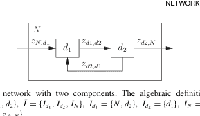

**图 3.4** 一个具有两个组件的网络。该网络的代数定义为 D = {d1, d2}，Ī = {I<sub>d1</sub>, I<sub>d2</sub>, I<sub>N</sub>}，I<sub>d1</sub> = {N, d2}，I<sub>d2</sub> = {d1}，I<sub>N</sub> = {d2}，且 Z = {z<sub>N,d1</sub>, z<sub>d1,d2</sub>, z<sub>d2,d1</sub>, z<sub>d2,N</sub>}。

然而，这一性质要求组件只与其兄弟节点和父节点通信。这通过以下要求来保证：(1) 组件的每个实例至多属于一个网络实例；(2) 如果一个模型位于网络 N 的集合 D<sub>N</sub> 中，那么该模型的影响者也必须位于 D<sub>N</sub> 中，或者就是 N 本身。

#### 3.2.2 网络模型的结果模型

模拟网络的原子模型称为该网络的结果模型。该原子模型具有状态集合 S<sub>r</sub>、输入集合 X<sub>r</sub>、输出集合 Y<sub>r</sub>、状态转移函数 δ<sub>r</sub> 和输出函数 λ<sub>r</sub>。下标 r 用于区分结果模型的各部分与网络中组件的各部分以及网络本身的各部分。

结果模型的状态集合通过函数 STATE 递归构造。该函数接受一个模型 d（可以是原子模型或网络模型），并返回其状态集合。如果模型是原子模型，则 STATE 以显而易见的方式工作，直接返回 S<sub>d</sub>。如果模型是网络模型，则 STATE 给出其原子组件和网络组件状态集合的笛卡尔积，具体为

STATE(d) = { S<sub>d</sub> 若 d 是原子模型；∏<sub>d' ∈ D<sub>d</sub></sub> STATE(d') 若 d 是网络模型 } (3.15)

网络 N 的结果模型的状态集合为

S<sub>r</sub> = STATE(N) (3.16)

并且结果模型与网络具有相同的输入—输出集合：

X<sub>r</sub> = X<sub>N</sub> (3.17) Y<sub>r</sub> = Y<sub>N</sub> (3.18)

至于输出函数，它通过递归深入网络来定义。由状态 $s_r \in S_r$ 生成的输出为

$$\lambda_r(s_r)=\bigcup_{d\in I_N\setminus \{N\}}\mathcal{N}(\lambda_d(s_d))$$ (3.19)

如果 $d$ 是原子模型，则直接计算函数 $\lambda_d$。如果 $d$ 是网络模型，则通过对它应用式 3.19，即求其结果模型的输出，来得到 $\lambda_d$。$\lambda_r$ 的结果是影响该网络（即属于 $I_N$）的组件的汇总输出，且可能经过耦合函数修改。

结果模型的状态转移函数以类似方式定义。为了确定结果模型状态 $s_r$ 中元素 $s_d$ 的下一个值，需要先求出模型 $d$ 的输入，然后应用其状态转移函数。$d$ 从其兄弟节点接收输入

$$x_d^b=\bigcup_{d'\in I_d\setminus\{N\}} Z_{d',d}(\lambda_{d'}(s_{d'}))$$ (3.20)

其中，如果 $d'$ 是原子模型，则直接计算 $\lambda_d$；如果它是网络模型，则通过式 3.19 计算，即使用其结果模型的输出函数。包 $x_d^b$ 不包含施加到 $d$ 所属网络上的输入。结果模型的下一个状态为

$$\delta_r(s_r,x^b)=\delta_r((s_{d_1},s_{d_2},\ldots,s_{d_k}),x^b)=(s'_{d_1},s'_{d_2},\ldots,s'_{d_k})$$ (3.21)

其中

$$s'_{d_i}=\begin{cases}\delta_{d_i}(s_{d_i},x_d^b), & \text{若 }N\notin I_{d_i}\\\delta_{d_i}(s_{d_i},x_d^b\cup Z_{N,d_i}(x^b)), & \text{若 }N\in I_{d_i}\end{cases}$$

式 3.21 中的第二种情况处理发往该组件的网络输入。如果 $d_i$ 是原子模型，则直接计算 $\delta_{d_i}$。否则，使用式 3.21，即 $d_i$ 的结果模型的状态转移函数。

这组定义以及用于仿真原子模型的算法 3.2，完整描述了一个仿真引擎。尽管如此，仿真软件的组织方式会有所不同。这里给出的相对简单的定义告诉我们仿真器的正确实现必须做什么，而不是必须如何做。从这个意义上说，离散时间系统的每个仿真器都是相同的——给定相同模型的两个仿真器，无论它们如何构造，都必须产生相同的结果。

#### 3.2.3 网络模型及其结果模型的示例

为了说明这一数学构造，考虑一台计算如下逻辑函数的机器

$$y(n+1)=y(n)\oplus(x_1(n)\oplus x_2(n))$$ (3.22)

其中 ⊕ 是异或（即二进制加法）。该机器有两个输入：x₁ 和 x₂。它有一个输出 y，并记住其先前的输出，以便计算下一个输出。该机器由两类原子组件构成——一类计算异或函数，另一类具有用于存储 y 的存储器。该模型的组织结构如图 3.5 所示。

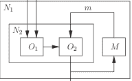

**图 3.5** 由两类原子模型构造的逻辑函数。

计算异或的组件记为 O，代表异或。它有两个输入和一个输出。输入包始终包含 2 个比特：b₁ 和 b₂。输出包包含一个比特。O 机器有两个可能状态，分别对应其逻辑运算的两种可能结果。输入、输出和状态集合分别为

X_O = Y_O = S_O = {0, 1}

输出函数和状态转移函数分别为

λ_O(s_O) = {s_O}
δ_O(s_O, (b₁, b₂)) = b₁ ⊕ b₂

存储组件记为 M，代表存储器，具有一个输入、一个输出和 2² 个可能状态。其定义如下

X_M = Y_M = {0, 1}
S_M = {0, 1} × {0, 1}
δ_M((q₁, q₂), {x}) = (q₂, x)
λ_M((q₁, q₂)) = {q₁}

两个模型的状态转移函数都只是部分定义的。回顾一下，状态转移函数接受 S 中的一个状态和集合 X^R 中的一个包，并返回 S 中的一个新状态。为了获得完全定义的状态转移函数，新状态必须是

对于状态和输入袋的每一种组合都有明确定义。然而，袋 {1} 属于 X_b^δ，但 δ_0 对其没有定义。类似地，袋 {1, 0} 属于 X_b^m，但 δ_M 对于它如何修改 M 的状态是不明确的。状态转移函数通常是部分定义的。然而，请确保仿真不会进入这些未定义区域。

完整机器由两个阶段构建。第一个阶段记为 N1，包含第二个阶段 N2 和存储机器 M。第二个阶段包含两个 O 机器。从原子组件的定义和网络的构造可以看出，该机器完成一次方程 3.22 的计算需要三个时间步。改变输入后，输出中会出现两个瞬态值，然后第三个、最终值才会出现。这模仿了数字电路的稳定时间，数字电路需要多个时钟周期来完成一次操作。

N1 和 N2 的定义在图 3.5 中已清晰且无歧义地说明。尽管如此，下面仍给出代数定义以演示其在仿真中的使用。请注意，影响者集合具有双重（二层）下标；下标的第二部分表示该集合属于 \bar{I}_{N1} 还是 \bar{I}_{N2}。

网络 N2 由下式定义

\[
X_{N_2}=\{x_1,x_2,m\}\times\{0,1\}
\]
\[
Y_{N_2}=\{0,1\}
\]
\[
D_{N_2}=\{O_1,O_2\}
\]
\[
\bar{I}_{N_2}=\{I_{O_1,N_2}, I_{O_2,N_2}, I_{N_2,N_2}\}
\]

其中
\[
I_{O_1,N_2}=\{N_2\}
\]
\[
I_{O_2,N_2}=\{N_2,O_1\}
\]
\[
I_{N_2,N_2}=\{O_2\}
\]

\[
Z_{N_2}=\{z_{O_1,O_2},z_{N_2,O_1},z_{O_2,N_2},z_{N_2,O_2}\}
\]

其中
\[
z_{O_1,O_2}((b))=\{b\}
\]
\[
z_{N_2,O_1}(\{\ldots,(x_1,b_1),(x_2,b_2),\ldots\})=\{b_1,b_2\}
\]
\[
z_{O_2,N_2}((b))=\{b\}
\]
\[
z_{N_2,O_2}(\{\ldots,(m,b),\ldots\})=\{b\}
\]

请注意，输入集合包含比特的标签；标签对应于图 3.5 中比特出现的边的名称。另请注意，N2 的耦合函数仅部分定义。例如，不清楚 N2 如何处理其输入袋中的两个标记为 m 的比特。再次强调，仿真必须避免这些未定义情况。

网络 N1 由下式定义

$X_{N_1} = \{x_1,x_2\} \times \{0,1\}$
$Y_{N_1} = \{0,1\}$
$D_{N_1} = \{N_2,M\}$
$\bar I_{N_1} = \{I_{N_1,N_1}, I_{N_2,N_1}, I_{M,N_1}\}$

其中

$I_{N_1,N_1} = \{N_2\}$
$I_{N_2,N_1} = \{N_1,M\}$
$I_{M,N_1} = \{N_2\}$
$Z_{N_1} = \{z_{N_1,N_2}, z_{M,N_2}, z_{N_2,N_1}, z_{N_2,M}\}$

其中

$z_{N_1,N_2}(\{(x_1,b_1),(x_2,b_2)\}) = \{(x_1,b_1),(x_2,b_2)\}$
$z_{M,N_2}(\{b\}) = \{(m,b)\}$
$z_{N_2,N_1}(\{b\}) = \{b\}$
$z_{N_2,M}(\{b\}) = \{b\}$

该网络的输入也是一个比特对。同样，标签对应于图 3.5 中比特出现的边。

现在我们可以使用算法 3.2 和方程 3.15–3.21 手工模拟该系统的单个时间步。一个时间步的计算已足够繁重，不宜重复；计算机可以更快、更可靠地完成这些计算。O1 和 O2 的初始状态为零。M 的初始状态为 (0,0)。机器的输入保持恒定为 {(x1,1),(x2,0)}。算法 3.2 的第一步计算 N1 的输出；这使用方程 3.19 完成。按深度优先且从左到右展开递归步骤得到

$\lambda_{N_1}(\{s_{N_1}\}) = \bigcup_{d \in I_{N_1,N_1}} z_{d,N_1}(\lambda_d(s_d))$
$= z_{N_2,N_1}(\lambda_{N_2}(s_{N_2}))$
$= z_{N_2,N_1}(\bigcup_{d \in I_{N_2,N_2}} z_{d,N_2}(\lambda_d(s_d)))$
$= z_{N_2,N_1}(z_{O_2,N_2}(\lambda_{O_2}(s_{O_2})))$
$= z_{N_2,N_1}(z_{O_2,N_2}(\{0\}))$
$= z_{N_2,N_1}(\{0\})$
$= \{0\}$

算法 3.2 接下来使用方程 3.21 计算 N1 的新状态。我们通过重用上述部分的计算来简化；需要 N2 的输出，而我们已经知道。N1 的下一状态由下式给出

δ_N1(s_N1, {(x1,1), (x2,0)}) = (δ_M(s_M, x_M^b, δ_N2(s_N2, x_N2^b ∪ z_N1_N2({(x1,1), (x2,0)})))) (3.23)

结果状态的第一半部分，即存储组件 M 的状态，为

δ_M(s_M, x_M^b) = δ_M(s_M, ∪_{d∈I_M - {N1}} z_{d,M}(λ_d(s_d))) = δ_M(s_M, z_{N2,M}(λ_N2(s_N2))) = δ_M(s_M, z_{N2,M}({0})) = δ_M(s_M, {0}) = (0,0) (3.24)

结果状态的第二半部分，即网络 N2 的状态，为

δ_N2(s_N2, x_N2^b ∪ z_N1_N2({(x1,1), (x2,0)})) = δ_N2(s_N2, (∪_{d∈I_N2 - {N1}} z_{d,N2}(λ_d(s_d))) ∪ z_N1_N2({(x1,1), (x2,0)})) = δ_N2(s_N2, z_M,N2(λ_M(s_M)) ∪ z_N1_N2({(x1,1), (x2,0)})) = δ_N2(s_N2, {(m,0)} ∪ z_N1_N2({(x1,1), (x2,0)})) = δ_N2(s_N2, {(m,0)} ∪ {(x1,1), (x2,0)}) = δ_N2(s_N2, {(m,0), (x1,1), (x2,0)}) = (δ_O1(s_O1, x_O1^b ∪ z_N2_O1({(m,0), (x1,1), (x2,0)})), δ_O2(s_O2, x_O2^b ∪ z_N2_O2({(m,0), (x1,1), (x2,0)}))) (3.25)

该对的第一部分，即 O1 的下一状态，为

δ_O1(s_O1, x_O1^b ∪ z_N2_O1({(m,0), (x1,1), (x2,0)})) = δ_O1(s_O1, (∪_{d∈I_O1 - {N2}} z_{d,O1}(λ_d(s_d))) ∪ z_N2_O1({(m,0), (x1,1), (x2,0)})) = δ_O1(s_O1, z_N2_O1({(m,0), (x1,1), (x2,0)})) = δ_O1(s_O1, {(1,0)}) = 1 (3.26)

第二部分，即 O2 的下一状态，为

$$\begin{aligned}
\delta_{O_2}(s_{O_2},x^b_{O_2}\cup Z_{N_2,O_2}(\{(m,0),(x_1,1),(x_2,0)\}))
&=\delta_{O_2}(s_{O_2},(U_{d\in O_2\leftarrow N_2}\{Z_{d,O_2}(\lambda_d(s))\}\cup Z_{N_2,O_2}(\{(m,0),(x_1,1),(x_2,0)\})))\\
&=\delta_{O_2}(s_{O_2},Z_{O_1,O_2}(\kappa_1(s_{O_1}))\cup Z_{N_2,O_2}(\{(m,0),(x_1,1),(x_2,0)\}))\\
&=\delta_{O_2}(s_{O_2},\{0\}\cup Z_{N_2,O_2}(\{(m,0),(x_1,1),(x_2,0)\}))\\
&=\delta_{O_2}(s_{O_2},\{0\}\cup\{0\})\\
&=\delta_{O_2}(s_{O_2},\{0,0\})\\
&=0
\end{aligned}$$

(3.27)

将方程 3.27 和 3.26 代入方程 3.25 得到

$$\delta_{N_2}(s_{N_2},x^b_{N_2}\cup Z_{N_1,N_2}(\{(x_1,1),(x_2,0)\}))=(1,0)$$

(3.28)

将方程 3.28 和 3.24 代入方程 3.23 得到最终解：

$$\begin{aligned}
\delta_{N_1}(s_{N_1},\{(x_1,1),(x_2,0)\})
&=(\delta_M(s_M,x^b_M),\delta_{N_2}(s_{N_2},x^b_{N_2}\cup Z_{N_1,N_2}(\{(x_1,1),(x_2,0)\})))\\
&=((0,0),(1,0))
\end{aligned}$$

(3.29)

该计算繁琐但简单。计算出网络 N1 的状态和输出后，我们发现算法 3.2 的第一次迭代已完成，并且只要有足够的耐心，我们可以用同样的方式计算下一次迭代。

#### 3.2.4 模拟结果

在耦合下的闭包可以将单个原子模型的仿真器转变为网络模型的仿真器。为此，第 3.1.5 节的仿真引擎需要四个新类：Network、Resultant、Event 和 Set。修订后的类图如图 3.6 所示。Set 类正如其名称所示。它可以用 STL set 类的简单别名实现，或以其他专门为仿真器设计的方式实现。Set 的基本特征是元素可以被添加和移除，它最多包含每个元素的副本一个，并且我们可以遍历其内容。

Resultant 封装了一个 Network 对象，使其看起来像一个 Atomic 对象。Resultant 的输出函数做两件事；它将网络组件中属于 I_N 的输出放入 Resultant 输出的 Bag 中，并捕获对其他组件的输入以用于计算状态转移函数。请记住，输出函数总是在状态转移

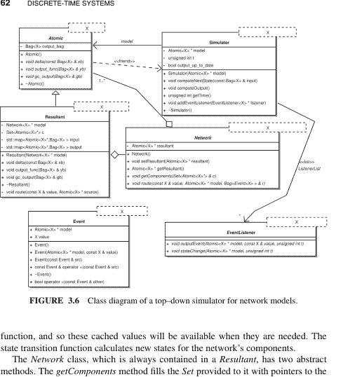

FIGURE 3.6 Class diagram of a top-down simulator for network models.

函数之前计算，因此这些缓存值在需要时可用。状态转移函数计算网络组件的新状态。

Network 类始终包含在 Resultant 中，具有两个抽象方法。getComponents 方法用网络的组件 Resultant 和 Atomic 的指针填充提供的 Set。route 方法计算每个组件的输入袋，但与第 3.2.3 节中的手工计算不同，后者通过向后查找源来获取模型的输入，route 方法从源开始并将输出向前移动到目的地。这避免了第 3.2.3 节手工仿真中明显的、为多个组件生成输入的输出函数的缓慢重新计算。

route 方法的参数是事件的源、事件本身，事件可以是输入或输出；以及一个 Bag，用于放置描述事件目的地的 Event 对象。每个 Event 对象指向与事件源连接的模型，并包含事件经过适当 z 函数转换后的内容。事件的接收者来自受源 d 影响的模型集合 E_d；该集合定义为

$E_d = \{d' \mid d \in I_{d'}\}$

(3.30)


反过来，d 的影响者集合 I_d 可以通过交换 I 和 E 来定义，从而得到

I_d = {d' | d ∈ E_{d'} }

接收者 Bag 中的每个 Event 都包含源 d 对 E_d 中模型的输入 Bag 的贡献；如果该网络本身位于 E_d 中，还包含其输出 Bag。确切地说，route 方法接收一个源 d，并构造如下 Bag：

R_d = {(d', z_{d,d'}(λ_d(s_d))) | d' ∈ E_d } (3.31)

其中 R_d 中的每个二元组都是一个 Event 对象。R_d 中针对模型 d' 的输入存储在 Resultant 的 input 映射中，以便在计算状态转移函数时供后续使用。

Resultant 是唯一具有实质性实现的新类。要仿真一个 Network 模型，需将该模型传给 Resultant 的构造函数，然后再将 Resultant 传给 Simulator。如果 Network A 包含在 Network B 内部，那么包含 A 的 Resultant 会被放入 B 的组件 Bag 中。输入和输出的路由通过引用 Resultant 来完成。实现 Resultant 的代码如下。仿真引擎的其余部分定义在随附的 dtss_network.h 文件中。

##### Resultant 类的实现

```
#ifndef _dtss_resultant_h
#define _dtss_resultant_h
#include "dtss_network.h"

namespace adtss
{

template <typename X> class Resultant: public Atomic<X>
{
public:
    Resultant(Network<X>* model);
    void delta(const Bag<X>& xb);
    void output_func(Bag<X>& yb);
    void gc_output(Bag<X>& k);
    ~Resultant() { delete model; }
private:
    Network<X>* model;
    Set<Atomic<X>*> c;
    std::map<Atomic<X>*,Bag<X> > input, output;
    void route(const X& value, Atomic<X>* source);
};

template <typename X>
Resultant<X>::Resultant(Network<X>* model):
    Atomic<X>(),model(model)
```

```
        // Clear the input bag for the component
        input[*iter].clear();
    }
    // Clear the input and output bag for the resultant
    input[this].clear();
    output[this].clear();
}

template <typename X>
void Resultant<X>::route(const X& value, Atomic<X>* source)
{
    Bag<Event<X> > r;
    model->route(value,source,r);
    for (typename Bag<Event<X> >::const_iterator iter = r.begin();
         iter != r.end(); iter++) {
        // If this is an output from the network
        if ((*iter).model == this) output[this].insert((*iter).value);
        // otherwise it goes to an internal component
        else input[(*iter).model].insert((*iter).value);
    }
}

} // end of namespace

#endif
```

仔细检查后会发现，*Network* 和 *Resultant* 有一个小缺陷。route 方法每次只处理模型输入和输出中的一个元素。因此，很难实现同时作用于多个元素的耦合函数。例如，输出集合为 {0, 1} 的模型可以产生包含任意 0 和 1 集合的 Bag。耦合函数 z1({b1, b2, . . . , bn}) = {b1 ∨ b2 ∨ · · · ∨ bn} 很难用所提出的软件实现，而 z2({b1, b2, . . . , bn}) = {¬b1, ¬b2, . . . , ¬bn} 则很容易完成。

这种限制的理由是实际性的；当仿真引擎扩展到包含离散事件系统时，瞬态事件将使 z1 之类的函数非常难以使用。因此，z2 之类的函数占主导地位。如果需要 z1 之类的函数，则定义一个单独的原子模型，由它收集所需输入，经过瞬时状态转移来计算该函数，并将结果作为输出产生。第 4 章将重新讨论这个主题。

3.2.3 节描述的逻辑函数将演示如何使用仿真器。可以看到，这些耦合函数与上面的 z2 类似。使用单个模板参数来设置输入和输出所用对象类型的决定，要求选择一个适合每个模型的对象类型。在本例中，我们使用 port_value_t 结构，其中包含每个模型都需要的 bit 字段，以及网络所需要的 port 字段。原子模型只是忽略 port 字段。需要小于运算符，因为 *Bag* 类实际上只是 C++ 标准模板库中的 *multiset*。

异或模型和记忆模型的实现直接来自它们的定义。注意，这两个类的 *delta* 方法都会检查输入 Bag 是否包含正确数量的元素。这种运行时测试有助于调试；即使在不生效时（即定义了 NDEBUG 进行编译时），它也提醒我们该模型只接受受限范围的输入。异或模型和记忆模型的实现列于下方。

##### 异或模型与记忆模型

```
    #ifndef __xor_memory_models_h_
    #define __xor_memory_models_h_

    #include "adts.h"
    #include <cassert>

    // Structure used for input from and output to the models
    struct port_value_t
    {
        char port; // Port on which the I/O appears
        bool bit;  // Bit appearing at the port
        bool operator<(const port_value_t& other) const { // For the STL
            return bit < other.bit;
        }
    };

    // Definition of the exclusive-or model
    class Xor: public adts::Atomic<port_value_t>
    {
    public:
        Xor():adts::Atomic<port_value_t>(),s(false){} // State is 0
        // State transition function
        void delta(const adts::Bag<port_value_t>& xb)
        {
            // Make sure the input bag is acceptable
            assert(xb.size() == 2);
            // Process the two input events
            adts::Bag<port_value_t>::iterator iter = xb.begin();
            bool x1 = (*iter).bit, x2 = (*(++iter)).bit;
            s = (x1 && !x2) || (x2 && !x1);
        }
        // Output function
        void output_func(adts::Bag<port_value_t>& yb)
        {
            port_value_t y;
            y.bit = s;
            yb.insert(y);
        }
    };
```

```
// Garbage collection method does not do anything
void gc_output(adtss::Bag<port_value_t>&){}
private:
    bool s;
};

// Definition of the memory machine
class Memory: public adtss::Atomic<port_value_t>
{
    public:
        Memory():adtss::Atomic<port_value_t>()
        {
            s[0] = s[1] = false;
        }
        // State transition function
        void delta(const adtss::Bag<port_value_t>& xb)
        {
            // Make sure the input bag is acceptable
            assert(xb.size() == 1);
            // Process the input
            s[0] = s[1];
            s[1] = (*(xb.begin())).bit;
        }
        // Output function
        void output_func(adtss::Bag<port_value_t>& yb)
        {
            port_value_t output;
            output.bit = s[0];
            yb.insert(output);
        }
        // Garbage collection method does not do anything
        void gc_output(adtss::Bag<port_value_t>&){}
    private:
        bool s[2];
};

#endif
```

下面列出 *N₁* 和 *N₂* 的代码。*N₁* 包含的是内含网络 *N₂* 的 *Resultant*，而不是 *N₂* 本身；*N₁* 将这个 *Resultant* 放入其组件集合，并用它来路由事件。实现模型输入端口的类级（即 static）常量，是实现网络的类的另一个特性。如果端口是常量，就不存在它们被意外覆盖并导致晦涩、难以定位的错误的风险。通过将它们设为类级变量（即 static），我们可以确保减少仿真所使用的内存。这是一个小优势，而且模型必须足够大，才能带来任何真正的好处。

尽管如此，该类的每个实例都应具有相同的输入和输出变量集合，因此将它们定义为类级常量是合理的做法。

##### N1 模型

```
#ifndef _n1_h_
#define _n1_h_
#include "adtss.h"
#include "n2.h"
#include "xor_memory_models.h"

class N1: public adtss::Network<port_value_t>
{
public:
  static const int x1, x2; // Labels for input ports
  // Create the network; components set their own initial state
  N1():adtss::Network<port_value_t>(),
  n2(new N2()) {}
  // Get the set of components in this network
  void getComponents(adtss::Set<adtss::Atomic<port_value_t>*> & c)
  {
    c.insert(&n2);
  }
  }
  // Route input and output within the network
  void route(const port_value_t& value,
    adtss::Atomic<port_value_t>* src,
    adtss::Bag<adtss::Event<port_value_t> > & r)
  {
    adtss::Event<port_value_t> e;
    e.value = value;
    // Input to the network
    if (src == getResultant()) {
      e.model = &n2;
      r.insert(e);
    }
    // Output from N2
    else if (src == &n2) {
      // Output from the network
      e.model = getResultant();
      r.insert(e);
      // Input to M
      e.model = &m;
      r.insert(e);
    }
    // Output from M
    else if (src == &m) {
```

```cpp
43            // Input to N2
44            e.model = &n2;
45            e.value.port = N2::m;
46            r.insert(e);
47          }
48        }
49      private:
50        adtss::Resultant<port_value_t> n2;
51        Memory m;
52      };
53
54    #endif
```
##### N2 模型
```cpp
1    #ifndef _n2_h_
2    #define _n2_h_
3    #include "adtss.h"
4    #include "xor_memory_models.h"
5
6    class N2: public adtss::Network<port_value_t>
7    {
8      public:
9
10       static const int m, x1, x2; // Labels for the input ports
11
12       N2():adtss::Network<port_value_t>(),
13           xor1(),xor2(){}
14
15       void getComponents(adtss::Set<adtss::Atomic<port_value_t>*>& c)
16       {
17         c.insert(&xor1);
18         c.insert(&xor2);
19       }
20
21       void route(const port_value_t& value,
22           adtss::Atomic<port_value_t>* src,
23           adtss::Bag<adtss::Event<port_value_t> >& r)
24       {
25         adtss::Event<port_value_t> e;
26         e.value = value;
27         // Input to the network
28         if (src == getResultant()) {
29           // Input to the m port
30           if (value.port == m) e.model = &xor2;
31           // Input to one of the bit ports
32           else e.model = &xor1;
33           r.insert(e);
34         }
```
```cpp
// Output from 01
else if (src == &xor1) {
    // Input to 02
    e.model = &xor2;
    r.insert(e);
}
// Output from 02
else if (src == &xor2) {
    // Output from the network
    e.model = getResultant();
    r.insert(e);
}
}
private:
    Xor xor1, xor2;
};

#endif
```
##### N1 和 N2 端口定义
```cpp
#include "n1.h"
#include "n2.h"
// Ports have unique numbers within the scope of their class
const int N2::m = 0;
const int N2::x1 = 1;
const int N2::x2 = 2;
const int N1::x1 = N2::x1;
const int N1::x2 = N2::x2;
```
下面列出的模拟器的主函数从标准输入读取一对输入位，将这些输入应用于一个完整的机器周期（三个时钟周期），并在每个时钟周期打印机器的输出。

##### 逻辑机器模拟器的主函数
```cpp
#include "adtss.h"
#include "n1.h"
#include <iostream>
using namespace std;

class MachineListener: public adtss::EventListener<port_value_t>
{
public:
    void outputEvent(adtss::Atomic<port_value_t>* model,
                     const port_value_t& x, unsigned int t)
```
```cpp
{
    cout << x.bit << " ";
}
void stateChange(adtss::Atomic<port_value_t>*,unsigned int){}
};

int main()
{
    // Create the model
    adtss::Resultant<port_value_t>* m =
    new adtss::Resultant<port_value_t>(new N1());
    // Setup the simulator and a listener for reporting outputs
    MachineListener* l = new MachineListener();
    adtss::Simulator<port_value_t>* sim =
    new adtss::Simulator<port_value_t>(m);
    sim->addEventListener(l);
    // Counters for the clock and machine cycle
    int clk = 0, machine_cycle = 0;
    // Run the simulation
    while (true) {
        // Get the input from stdin
        adtss::Bag<port_value_t> input;
        port_value_t x1, x2;
        x1.port = N1::x1;
        x2.port = N1::x2;
        cin >> x1.bit >> x2.bit;
        // Quit if the input has ended
        if (cin.eof()) break;
        input.insert(x1);
        input.insert(x2);
        // Print the time and input
        cout << "## M" << machine_cycle << " C" << clk <<
        "\t" << x1.bit << " " << x2.bit << "\t\n";
        // Print the time and output at the next machine cycle
        cout << "## M" << ++machine_cycle <<
        " C" << clk+2 << "\t\n";
        // Advance the simulation by one machine cycle
        for (int t = 0; t < 3; t++) {
            clk++;
            sim->computeNextState(input);
        }
        cout << endl;
    }
    // Clean up and exit
    delete sim; delete l; delete m;
    return 0;
}
```

现在我们有了由方程 3.22 定义的逻辑函数的完整模拟器。为便于参考，这里重新写出：

$$y(n+1)=y(n)\oplus(x_1(n)\oplus x_2(n))$$

该函数中的时间 $n$ 计数机器周期。完成一个机器周期需要模型三个时间步。因此，逻辑输入-逻辑输出每隔三个时钟周期读取一次。

该模型所具有的记忆使其具有有趣的瞬态行为。如果输入 $x_1$ 和 $x_2$ 保持 $x_1\oplus x_2$ 为 1，则输出将在 1 和 0 之间振荡。如果输入变为 $x_1\oplus x_2=0$，则输出将保持在其先前的值。通过将 $x_1\oplus x_2$ 重新设为 1，可以恢复振荡行为。

我们可以使用 $y$ 关于 $x_1$ 和 $x_2$ 的定义手工计算输出轨迹。回想 $y(0)=0$。如果我们应用 $x_1[0,3]=111$ 且 $x_2[0,3]=000$，则输出为

$$\begin{aligned}
y(1)&=y(0)\oplus(x_1(0)\oplus x_2(0))=0\oplus(1\oplus0)=1\\
y(2)&=y(1)\oplus(x_1(1)\oplus x_2(1))=1\oplus(1\oplus0)=0\\
y(3)&=y(2)\oplus(x_1(2)\oplus x_2(2))=0\oplus(1\oplus0)=1
\end{aligned}$$

模拟器当然与此计算一致。输入以下内容
```
1 0
1 0
1 0
```
输入模拟器后产生输出
```
xx M0 C0        1 0    yy M1 C0–2    0 0 1
xx M1 C3        1 0    yy M2 C3–5    1 1 0
xx M2 C6        1 0    yy M3 C6–8    0 0 1
```
其中以 xx 开头的列是每个机器周期的输入，以 yy 开头的列是在机器周期期间及之间产生的输出。由于每个机器周期需要三个时间步，因此每个机器输出对应两个瞬态输出：模拟器报告的最后一列是 y。

如果随后向机器输入 $x_1[3,5]=00$ 且 $x_2[3,5]=00$，则

$$\begin{aligned}
y(4)&=y(3)\oplus(x_1(3)\oplus x_2(3))=1\oplus(0\oplus0)=1\\
y(5)&=y(4)\oplus(x_1(4)\oplus x_2(4))=1\oplus(0\oplus0)=1
\end{aligned}$$

并且在输入恒定时输出将保持为 1。模拟器当然也与此计算一致：向其输入
```
    1 0
    1 0
    1 0
    0 0
    0 0
```
产生输出
```
    xx M0 C0        1 0      yy M1 C0~2      0 0 1
    xx M1 C3        1 0      yy M2 C3~5      1 1 0
    xx M2 C6        1 0      yy M3 C6~8      0 0 1
    xx M3 C9        0 0      yy M4 C9~11     1 1 1
    xx M4 C12       0 0      yy M5 C12~14    1 1 1
```
其中模拟器输出的最后一列是 y。

如果接下来向机器输入 x₁[5, 10) = 11100 且 x₂[5, 10) = 00000，输出将从 1 摆动到 0 再到 1 然后回到 0 并保持在那里。输入
```
    1 0
    1 0
    1 0
    0 0
    0 0
    1 0
    1 0
    1 0
    0 0
    0 0
```
输入模拟器得到的结果
```
    xx M0 C0        1 0      yy M1 C0~2      0 0 1
    xx M1 C3        1 0      yy M2 C3~5      1 1 0
    xx M2 C6        1 0      yy M3 C6~8      0 0 1
    xx M3 C9        0 0      yy M4 C9~11     1 1 1
    xx M4 C12       0 0      yy M5 C12~14    1 1 1
    xx M5 C15       1 0      yy M6 C15~17    1 1 0
    xx M6 C18       1 0      yy M7 C18~20    0 0 1
    xx M7 C21       1 0      yy M8 C21~23    1 1 0
    xx M8 C24       0 0      yy M9 C24~26    0 0 0
    xx M9 C27       0 0      yy M10 C27~29   0 0 0
```
正如预期的那样。

该系统的正确运行关键取决于输入变化的正确时序。输入值允许在时钟每第三次滴答时改变，否则必须保持恒定。模拟代码在其主循环中强制执行这一点。如果取消此限制，模型的行為将难以预测。为了演示这一点，作者已更改模拟程序的主函数，使其在时钟的每个滴答时应用新的输入值，而不是在机器周期之间保持输入恒定。代码如下所示。

##### 立即应用输入的主程序
```cpp
#include "adtss.h"
#include "n1.h"
#include <iostream>
using namespace std;

class MachineListener: public adtss::EventListener<port_value_t>
{
public:
    void outputEvent(adtss::Atomic<port_value_t>* model,
        const port_value_t& x, unsigned int t)
    {
        // Print the time and output at the next machine cycle
        cout << "y " << t << "\t" << x.bit << endl;
    }
    void stateChange(adtss::Atomic<port_value_t>*,unsigned int){}
};

int main()
{
    // Create the model
    adtss::Resultant<port_value_t>* m =
        new adtss::Resultant<port_value_t>(new N1());
    // Setup the simulator and output listener
    MachineListener* l = new MachineListener();
    adtss::Simulator<port_value_t>* sim =
        new adtss::Simulator<port_value_t>(m);
    sim->addEventListener(l);
    // Run the simulation
    while (true) {
        // Get the input from stdin
        adtss::Bag<port_value_t> input;
        port_value_t x1, x2;
        x1.port = N1::x1;
        x2.port = N1::x2;
        cin >> x1.bit >> x2.bit;
        // Quit if the input has ended
        if (cin.eof()) break;
        input.insert(x1);
```


```cpp
input.insert(x2);
// Print the time and input
cout << "xx C" << sim->getTime() << "\t" <<
    x1.bit << " " << x2.bit << "\t\n";
// Advance the simulation
sim->computeNextState(input);
}
// Clean up and exit
delete sim; delete l; delete m;
return 0;
}
```

现在我们必须以时钟周期而非机器周期的形式定义输入轨迹。当以时钟的滴答表示时，先前的输入 $x_1[0, 10) = 1110011100$ 变为

$x'_1[0, 30) = 111\ 111\ 111\ 000\ 000\ 111\ 111\ 111\ 000\ 000$

而输入 $x_2[0, 10)$ 变为

$x'_2[0, 30) = 000\ 000\ 000\ 000\ 000\ 000\ 000\ 000\ 000\ 000$

如果我们将这些轨迹输入到新的模拟器中，输出为

|  |  |  |  |  |  |  |
|---|---:|---:|---:|---|---:|---:|
| xx | C0 | 1 | 0 | yy | C0 | 0 |
| xx | C1 | 1 | 0 | yy | C1 | 0 |
| xx | C2 | 1 | 0 | yy | C2 | 1 |
| xx | C3 | 1 | 0 | yy | C3 | 1 |
| xx | C4 | 1 | 0 | yy | C4 | 1 |
| xx | C5 | 1 | 0 | yy | C5 | 0 |
| xx | C6 | 1 | 0 | yy | C6 | 0 |
| xx | C7 | 1 | 0 | yy | C7 | 0 |
| xx | C8 | 1 | 0 | yy | C8 | 1 |
| xx | C9 | 0 | 0 | yy | C9 | 1 |
| xx | C10 | 0 | 0 | yy | C10 | 1 |
| xx | C11 | 0 | 0 | yy | C11 | 1 |
| xx | C12 | 0 | 0 | yy | C12 | 1 |
| xx | C13 | 0 | 0 | yy | C13 | 1 |
| xx | C14 | 0 | 0 | yy | C14 | 1 |
| xx | C15 | 1 | 0 | yy | C15 | 1 |
| xx | C16 | 1 | 0 | yy | C16 | 1 |
| xx | C17 | 1 | 0 | yy | C17 | 0 |
| xx | C18 | 1 | 0 | yy | C18 | 0 |
| xx | C19 | 1 | 0 | yy | C19 | 0 |
| xx | C20 | 1 | 0 | yy | C20 | 1 |
| xx | C21 | 1 | 0 | yy | C21 | 1 |

xx C22 1 0      yy C22 1
xx C23 1 0      yy C23 0
xx C24 0 0      yy C24 0
xx C25 0 0      yy C25 0
xx C26 0 0      yy C26 0
xx C27 0 0      yy C27 0
xx C28 0 0      yy C28 0
xx C29 0 0      yy C29 0

这个 y（即每三行中的值）与之前的模拟中的 y 相同。现在，让我们修改 $x'_2$，使其在每个机器周期的中间发生变化。这可以模拟系统中某些组件的异常操作、电路中的噪声或其他不良状况。保持 $x'[0, 30)$ 不变，我们将 $x'_2[0, 30)$ 改为

$$x'_2[0, 30) = 010\ 010\ 010\ 010\ 010\ 010\ 010\ 010\ 010\ 010$$

并将此输入模拟器后得到

xx C0  1 0      yy C0  0
xx C1  1 1      yy C1  0
xx C2  1 0      yy C2  1
xx C3  1 1      yy C3  0
xx C4  1 0      yy C4  1
xx C5  1 1      yy C5  1
xx C6  1 0      yy C6  1
xx C7  1 1      yy C7  1
xx C8  1 0      yy C8  0
xx C9  0 1      yy C9  1
xx C10 0 0      yy C10 0
xx C11 0 1      yy C11 1
xx C12 0 0      yy C12 1
xx C13 0 1      yy C13 1
xx C14 0 0      yy C14 1
xx C15 1 1      yy C15 0
xx C16 1 0      yy C17 1
xx C17 1 1      yy C17 1
xx C18 1 0      yy C18 1
xx C19 1 1      yy C19 1
xx C20 1 0      yy C20 0
xx C21 1 1      yy C21 1
xx C22 1 0      yy C22 0
xx C23 1 1      yy C23 0
xx C24 0 0      yy C24 0
xx C25 0 1      yy C25 0
xx C26 0 0      yy C26 0
xx C27 0 1      yy C27 1

xx C28 0 0      yy C28 0
xx C29 0 1      yy C29 1

查看每第三行，逻辑机的对应输出为 y[0, 10) = 1101110001，这显然不是根据方程 3.22 以及通过查看 x′_1 和 x′_2 中每第三个值得到的输入 x_1 和 x_2 所期望的结果。时序很重要，这一事实已由我们的模拟清楚地证明。

本节构建的模拟引擎从上到下模拟网络模型，从最上层的网络开始，到最底层的原子模型为止。经过一系列改进，这个自顶向下的模拟器将演变为 Zeigler 抽象模拟器 [152, 157] 的实现。基于抽象模拟器的自顶向下架构被广泛使用，并在大量文献中被讨论和完善（参见例如 Refs. 26, 51 和 144）。该架构特别适用于基于组件的模拟（参见例如 Refs. 23, 24, 64, 127 和 148），以及最近的基于 Web 的模拟（参见例如 Refs. 81 和 88）。

### 3.3 离散时间系统的模拟器

可以通过专注于原子模型，并让网络模型仅告知模拟器原子模型如何连接，来构建一个简单而有效的模拟器。本节设计的模拟器自底向上工作。网络模型是事件在原子组件之间传递时的中间步骤；每个操作都始于原子模型并终于原子模型。

该方法的依据分为两部分：

- 1. 网络结果的状态转移函数由该网络为根的树叶节点上的原子组件的状态转移函数定义。因此，我们可以跳过中间网络的结果构造，直接使用叶节点的原子模型。
- 2. 影响集合可用于计算受任意特定原子组件影响的原子组件集合，这些组件可能位于模型层次结构的任何位置。计算从一个原子模型开始，以一组原子模型结束，并通过递归使用沿途遇到的每个网络的影响集合和耦合函数来完成。

位于网络模型 N 下方的原子模型集合 A_N 是通过递归深入网络并将找到的所有原子模型添加到 A_N 中得到的。集合 A_N 定义为

A_N = {d ∈ D_N | d is atomic} ∪_{N'∈D_N | N' is a network} A_{N'}    (3.32)

如果 $N$ 是要模拟的网络，则 $A_N$ 是模拟器操作的原子模型集合。假设应应用于每个模型 $d \in A_N$ 的输入 $x_d^b$ 已知，我们可以用一个简单的 for 循环计算网络的状态转移函数：

```
for $d \in A_N$ do
    $s_d \leftarrow \delta_d(s_d, x_d^b)$
end
```

困难的步骤是找到 $x_d^b$。这个问题有三个部分：（1）将 $d \in A_N$ 的输出传递到 $A_N$ 中其他模型的适当输入包中；（2）将网络 $N$ 的输入传递到 $A_N$ 中原子模型的适当输入包中；以及（3）将 $d$ 的输出传递到以 $N$ 为根的树中网络模型的适当输出包中，这一步仅为了可能需要的 EventListener 的利益而进行。

首先考虑第 1 部分：给定原子模型 $d$ 的输出，如何找到 $d$ 影响的原子模型集合，并将相应值插入这些模型的输入包中。我们从与 $d$ 具有相同父级的模型开始。父级表示为 $PARENT(d)$。$PARENT(d)$ 中被 $d$ 直接影响的原子组件在 $E_d$ 中（参见方程 3.30），并且将值 $z_{d,d'}(\lambda_d(s_d))$ 添加到每个原子模型 $d' \in E_d$ 的输入包中。这处理了 $d$ 的原子兄弟。其他 $d' \in E_N$ 是属于 $PARENT(d)$ 的网络，或 $d'$ 本身就是 $PARENT(d)$。

如果 $d'$ 是属于 $PARENT(d)$ 的网络，则按如下方式进行。首先找到 $d'$ 影响的 $d'$ 的组件；这些模型在 $D_{d'}$ 中。然后，将值 $z_{d',d''}(\lambda_{d'}(\lambda_d(s_d)))$ 添加到每个此类原子组件 $d''$ 的输入包中。对于网络组件，我们只需重复此过程：找到 $d''$ 中被 $d''$ 影响的组件，更新原子模型的输入包，并再次对网络模型重复此过程。

否则 $d'$ 就是 $PARENT(d)$ 本身（即网络本身）。在这种情况下，前一段的描述应用于 $PARENT(d')$ [除非当然 $PARENT(d')$ 是模型树的根，在这种情况下输出已离开系统，我们的工作就完成了]。换句话说，我们找到 $PARENT(d')$ 中被 $d'$ 影响的组件集合并按如下方式进行。对每个此类原子组件 $d''$ 的输入包添加值 $z_{d',d''}(\lambda_{d'}(s_{d'}))$。对于网络组件，我们根据需要重复本段或前一段所述的过程。

算法 3.6 简洁地描述了此递归过程。它从 $A_N$ 中的一个模型开始，并向从该模型可达的 $A_N$ 中每个模型的输入包添加一个值。route 过程被调用时传入产生输出的原子模型 $d$、模型 $d$ 的父级以及输出 $y = \lambda_d(s_d)$。与 $A_N$ 中的每个原子模型 $d' \in A_N$（当然包括 $d$）相关联的是一个输入包 $x_{d'}^b$，该包在计算过程中被填充。过程中使用的耦合函数和影响集合属于父级参数所指的网络。


```text
1  procedure route(parent,d,y^b)
2  foreach d' ∈ E_d do
3      d' is an atomic component of parent
4      if d' is atomic then
5          x_{d'}^b ← x_{d'}^b ∪ z_{d,d'}(y^b)
6      d' is a network component of parent
7      else if d' ≠ parent then
8          route(d',d,z_{d,d'}(y^b))
9      else if this is an output from parent
10     else if d' = parent and PARENT(d') exists then
11         route(PARENT(d'),d',z_{d,d'}(y^b))
12     end
13 end
```

**算法 3.6** 用于在网络模型内路由输入和输出的流程。影响集合 E_d 和耦合函数 z_{d,d'} 属于网络父级。

路由问题的另外两个部分——将输入放入网络模型以及从网络模型观察输出——可方便地由算法 3.6 解决。通过调用 route 并将 N 作为第一个和第二个参数（即 parent = d = N），以及将 x^b 作为第三个参数，可将输入 x^b 注入网络 N。当第三个条件为真时（即“来自父级的输出”条件），网络模型会产生输出，并且注册到 Simulator 的 EventListeners 会在此时收到通知。

算法 3.7 描述了完整的仿真流程。它将输入轨迹 x < t_0, t_n > 应用于具有原子组件集合 A_N 的网络 N。对于 A_N 中的每个组件 d，都有一个输入包 x^b_d 和其状态 s_d。EventListeners 的通知已被省略，即使它们将在实现中出现。

```text
1  for t_k ∈ < t_0, t_n > do
2      Clear the bags of input
3      foreach d ∈ A_N do
4          x_{d}^b ← ∅
5      end
6      Route the input to N
7      route(N,N,x(t_k))
8      Compute and route output from the components
9      foreach d ∈ A_N do
10         route(PARENT(d),d,z_{d,d}(s_d))
11     end
12     Change the state of the components
13     foreach d ∈ A_N do
14         s_d ← δ_d(s_d, x_d^b)
15     end
16 end
```

**算法 3.7** 离散时间模型的自底向上仿真算法。

实现自底向上模拟器的类几乎与自顶向下模拟器使用的类相同。*Resultant* 不再必要，已被移除。新增一个 *Diss* 类，并修改 *Atomic* 和 *Network* 类使其继承自它。*Diss* 类保存两条信息：模型的父级和模型的类型。*Diss* 类的父级字段用于实现 PARENT 函数。类型信息用于 route 流程以及初始化仿真引擎⁴。*Network* 和 *Atomic* 类在其他方面保持不变。

*Event* 类不需要任何修改，但我们有机会有用地扩展 *EventListener* 类的功能。模拟器现在能够感知每个事件在网络耦合中的移动，可以通知监听器每个原子和网络模型的每一个输出。同样，监听器也可以被告知每个原子模型状态的变化。这显著扩展了 *EventListener* 观察、报告、记录和可视化大型模型运行的能力。新的 *EventListener* 的 *outputEvent* 方法接受一个 *Event*，该事件携带产生输出的模型、网络或原子，以及输出本身。

类似地，我们可以通过允许其客户端直接向多组件模型的任何组件注入输入来扩展 *Simulator* 类的功能。这是构建交互式仿真以及将模拟器集成到多模拟器联邦中的基本能力。新的 *Simulator* 的 *computeNextState* 方法接受一个 *Event* 对象的 *Bag*。*Bag* 中的每个 *Event* 都包含一个模型及其输入。如果模型是原子的，则输入会被放入其输入包中。如果目标是网络，则使用算法 3.6 将输入传递给适当的原子模型集合。

修订后的类图如图 3.7 所示，由此可以轻松推断出 *Diss*、*Network*、*Atomic*、*Event* 和 *EventListener* 类的实现。*Event* 类有两个字段以及设置和访问它们的方法。*EventListener* 是一个纯虚类，没有实现，只有定义。*Diss* 类包含其父级、设置和获取父级的方法，以及虚方法 *typeIsNetwork* 和 *typeIsAtomic*；这些方法由 *Network* 和 *Atomic* 类实现。*Network* 类在调用 *typeIsNetwork* 时返回自身，在调用 *typeIsAtomic* 时返回 NULL。*Atomic* 类则相反。

*Simulator* 类是唯一具有实质性实现的一个类。它实现了算法 3.7，并进行了上述讨论的小幅修改，以允许模拟器的客户端向任何组件注入输入，并在组件产生输出或状态发生变化时通知监听器。算法 3.6 用于在模型中移动事件。*Simulator* 的源代码如下所示。

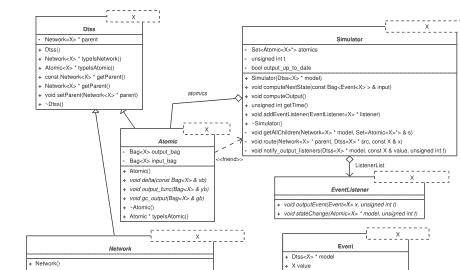

**图 3.7** 离散时间系统自底向上仿真引擎的类图。

#### 离散时间模型的通用模拟器

```cpp
1 #ifndef _dtss_simulator_h_
2 #define _dtss_simulator_h_
3 #include "dtss_models.h"
4 #include <ostream>
5
6 namespace dtss
7 {
8
9 template <typename X> class Simulator {
10 public:
11   // Create a simulator for the supplied model
12   Simulator(Dtss<X>* model);
13   // Compute the next state of the model and invoke callbacks
14   void computeNextState(const Bag<Event<X> >& input);
15   // Compute the model's output and make outputEvent callbacks
16   void computeOutput();
17   // Get the simulation time.
18   unsigned int getTime() { return t; }
19   // Add an event listener
20   void addEventListener(EventListener<X>* listener) {
21     listeners.push_back(listener);
22   }
23 private:
24   Set<Atomic<X>*> atomics; // The complete set of atomic models
25   unsigned int t; // Simulation clock
26     bool output_up_to_date; // Is the model output up to date?
27     // List of event listeners
28     typedef std::list<EventListener<X>*> ListenerList;
29     ListenerList listeners;
30     // Get all of the children belonging to a network
31     void getAllChildren(Network<X>* model, Set<Atomic<X>*>& s);
32     // Move an input or output value to its destination
33     void route(Network<X>* parent, Dtss<X>* src, const X& x);
34     // Tell all EventListeners about an output
35     void notify_output_listeners(Dtss<X>* model,
36                                  const X& value, unsigned int t);
37 };
38
39 template <typename X>
40 Simulator<X>::Simulator(Dtss<X>* model):
41     t(0),output_up_to_date(false)
42 {
43     // If this is an atomic model then it is the only
44     // atomic model to simulate
45     if (model->typeIsAtomic() != NULL)
46         atomics.insert(model->typeIsAtomic());
47     // Otherwise get all of the atomic models by recursion
48     else getAllChildren(model->typeIsNetwork(),atomics);
49 }
50
51 template <typename X>
52 void Simulator<X>::computeNextState(const Bag<Event<X> >& input)
53 {
54     // Compute the output at time t
55     computeOutput();
56     // Deliver the injected input
57     for (typename Bag<Event<X> >::iterator iter = input.begin();
58          iter != input.end(); iter++) {
59         if ((*iter).model->typeIsAtomic()) {
60             (*iter).model->typeIsAtomic()->input_bag.insert((*iter).value);
61         }
62         else {
63             route((*iter).model->typeIsNetwork(),(*iter).model,(*iter).value);
64         }
65     }
66     // Advance the simulation clock
67     t++;
68     // Update the state of every atomic component
69     for (typename Set<Atomic<X>*>::iterator aiter = atomics.begin();
70          aiter != atomics.end(); aiter++) {
71         // Compute the new state of the model
72         (*aiter)->delta((*aiter)->input_bag);
73         // Notify listeners that the state has changed
74         for (typename ListenerList::iterator liter = listeners.begin();
```


```cpp
    iter != listeners.end(); iter++) {
        (*iter)->stateChange(*aiter,t);
    }
}
// Cleanup
for (typename Set<Atomic<X>*>::iterator iter = atomics.begin();
    iter != atomics.end(); iter++) {
    (*iter)->gc_output((*iter)->output_bag);
    (*iter)->output_bag.clear();
    (*iter)->input_bag.clear();
}
output_up_to_date = false;
}
```

```cpp
template <typename X>
void Simulator<X>::computeOutput()
{
    // Return if the output function has been evaluated
    if (output_up_to_date) return;
    // Compute the output
    output_up_to_date = true;
    for (typename Set<Atomic<X>*>::iterator aiter = atomics.begin();
        aiter != atomics.end(); aiter++) {
        // Get the output from the model
        (*aiter)->output_func((*aiter)->output_bag);
        // Move the output to its destination
        Bag<X> y = (*aiter)->output_bag;
        for (typename Bag<X>::iterator yiter = y.begin();
            yiter != y.end(); yiter++) {
            route((*aiter)->getParent(),*aiter,*yiter);
        }
    }
}
```

```cpp
template <typename X>
void Simulator<X>::getAllChildren(Network<X>* model, Set<Atomic<X>*>& s)
{
    // Get the components of the network
    Set<Dtss<X>*> c;
    model->getComponents(c);
    // Add the atomic components of the network to s and
    // recursively add the atomic components of the sub-networks
    for (typename Set<Dtss<X>*>::iterator citer = c.begin();
        citer != c.end(); citer++) {
        if ((*citer)->typeIsAtomic()) s.insert((Atomic<X>*)(*citer));
        else getAllChildren((*citer)->typeIsNetwork(),s);
    }
}
```

```cpp
124  template <typename X>
125  void Simulator<X>::route(Network<X>* parent, Dtss<X>* src, const X& x)
126  {
127      // Notify event listeners of the output. Recall that parent = src only
128      // if x is an input to a network. In all other cases, it is an output
129      // from a model.
130      if (parent != src) // Make sure it is an output and not an input
131          notify_output_listeners(src,x,t);
132      // If the parent is null (e.g., if we are simulating a
133      // single atomic model) then there is nothing to do
134      if (parent == NULL) return;
135      // Get the set of models that are influenced by x
136      BagEvent<X> r;
137      parent->route(x,src,r);
138      // Route the input to each element in r
139      for (typename BagEvent<X>::iterator iter = r.begin();
140           iter != r.end(); iter++) {
141          // If the destination is an atomic model
142          if ((*iter).model->typeIsAtomic() != NULL) {
143              (*iter).model->typeIsAtomic()->input_bag.insert((*iter).value);
144          }
145          // If the destination is a network component of the parent
146          else if (parent != (*iter).model) {
147              route((*iter).model->typeIsNetwork(),
148                    (*iter).model,(*iter).value);
149          }
150          // If the destination is the parent
151          else { // if (*iter).model == parent
152              route(parent->getParent(),parent,(*iter).value);
153          }
154      }
155  }
156  
157  template <typename X>
158  void Simulator<X>::notify_output_listeners(Dtss<X>* model,
159      const X& value, unsigned int t)
160  {
161      Event<X> event(model,value);
162      for (typename ListenerList::iterator iter = listeners.begin();
163           iter != listeners.end(); iter++)
164          (*iter)->outputEvent(event,t);
165  }
166  
167  } // end of namespace
168  
169  #endif
```

第 3.2.3 节中描述的逻辑功能最初在第 3.2.4 节中实现，它将演示如何使用这个自底向上的模拟器。Xor 和 Memory 类保持不变。N1 和 N2 类有两处变化：(1) 修改构造函数，以设置网络组件的父级；(2) 将指向 Resultants 的指针替换为指向 Networks 本身的指针。修改后的 N1 和 N2 类如下所示。

#### 修改后的 N1 模型

```cpp
#ifndef _n1_h_
#define _n1_h_

#include "adts.h"
#include "n2.h"
#include "xor_memory_models.h"

class N1: public adts::Network<port_value_t>
{
public:
    static const int x1, x2;

    N1():adts::Network<port_value_t>(),
        n2(),m()
    {
        n2.setParent(this);
        m.setParent(this);
    }

    void getComponents(adts::Set<adts::Dtss<port_value_t>*>& c)
    {
        c.insert(&n2);
        c.insert(&m);
    }

    void route(const port_value_t& value, adts::Dtss<port_value_t>* src,
        adts::Bag<adts::Event<port_value_t> >& r)
    {
        adts::Event<port_value_t> e;
        e.value = value;
        // Input to the network
        if (src == this) {
            e.model = &n2;
            r.insert(e);
        }
        // Output from N2
        else if (src == &n2) {
            // Output from the network
            e.model = this;
            r.insert(e);
            // Input to M
41            e.model = &m;
42            r.insert(e);
43        }
44        // Output from M
45        else if (src == &m) {
46            // Input to N2
47            e.model = &n2;
48            e.value.port = N2::m;
49            r.insert(e);
50        }
51    }
52    private:
53        N2 n2;
54        Memory m;
55 };
56
57 #endif
```

#### 修改后的 N2 模型

```cpp
1 #ifndef _n2_h_
2 #define _n2_h_
3 #include "adts.h"
4 #include "xor_memory_models.h"
5
6 class N2: public adts::Network<port_value_t>
7 {
8     public:
9         static const int m, x1, x2;
10
11        N2():adts::Network<port_value_t>(),
12            xor1(),xor2()
13        {
14            xor1.setParent(this);
15            xor2.setParent(this);
16        }
17
18        void getComponents(adts::Set<adts::Dtss<port_value_t>*>& c)
19        {
20            c.insert(&xor1);
21            c.insert(&xor2);
22        }
23
24        void route(const port_value_t& value, adts::Dtss<port_value_t>* src,
25            adts::Bag<adts::Event<port_value_t> >& r)
26        {
27            adts::Event<port_value_t> e;
28            e.value = value;
29            // Input to the network
30            if (src == this) {
31                // Input to the m port
32                if (value.port == m) e.model = &xor2;
33                // Input to one of the bit ports
34                else e.model = &xor1;
35                r.insert(e);
36            }
37            // Output from xor1
38            else if (src == &xor1) {
39                // Input to xor2
40                e.model = &xor2;
41                r.insert(e);
42            }
43            // Output from xor2
44            else if (src == &xor2) {
45                // Output from the network
46                e.model = this;
47                r.insert(e);
48            }
49        }
50    private:
51        Xor xor1, xor2;
52 };
53
54 #endif
```

主函数经过修改，以适配新的 Simulator 和 EventListener 接口。由于 EventListener 现在会接收每个组件的输出通知，因此必须过滤掉不需要的事件。对于本次仿真，MachineEventListener 通过检查传入事件的来源，并仅报告来自 N1 的输出来过滤这些事件。仿真输入还必须放入一个 Event 中，该 Event 同时携带输入值及其目标模型。这一更改在从控制台提取数据并推进仿真时钟的 while 循环中完成。

修改后的代码如下所示。在给定相同输入的情况下，逻辑机的自底向上仿真产生与自顶向下仿真相同的状态和输出轨迹。为证明这一点，这里重复第 3.2.4 节中在代码标题“立即应用输入的主程序”之前描述的仿真。将输入

```
1 0
1 0
1 0
0 0
0 0
1 0
1 0
1 0
0 0
0 0
```

馈入模拟器后，得到结果

| 事件 1 | 值 1 | 事件 2 | 值 2 |
|---|---|---|---|
| xx M0 C0 | 1 0 | yy M1 C0-2 | 0 0 1 |
| xx M1 C3 | 1 0 | yy M2 C3-5 | 1 1 0 |
| xx M2 C6 | 1 0 | yy M3 C6-8 | 0 0 1 |
| xx M3 C9 | 0 0 | yy M4 C9-11 | 1 1 1 |
| xx M4 C12 | 0 0 | yy M5 C12-14 | 1 1 1 |
| xx M5 C15 | 1 0 | yy M6 C15-17 | 1 1 0 |
| xx M6 C18 | 1 0 | yy M7 C18-20 | 0 0 1 |
| xx M7 C21 | 1 0 | yy M8 C21-23 | 1 1 0 |
| xx M8 C24 | 0 0 | yy M9 C24-26 | 0 0 0 |
| xx M9 C27 | 0 0 | yy M10 C27-29 | 0 0 0 |

与之前完全相同。

#### 修改后的主函数

```cpp
#include "adts.h"
#include "n1.h"
#include <iostream>
using namespace std;

class MachineListener: public adts::EventListener<port_value_t>
{
  public:
    MachineListener(adts::Dtss<port_value_t>* top):top(top){}
    void outputEvent(adts::Event<port_value_t> x, unsigned int t)
    {
        if (x.model == top) cout << x.value.bit << " ";
    }
    void stateChange(adts::Atomic<port_value_t>*,unsigned int){}
  private:
    adts::Dtss<port_value_t>* top;
};

int main()
{
    // Create the model
    N1* m = new N1();
    // Setup the simulator and output listener
    MachineListener* l = new MachineListener(m);
    adts::Simulator<port_value_t>* sim =
        new adts::Simulator<port_value_t>(m);
    sim->addEventListener(l);
```


```cpp
// Counters for the clock and machine cycle
int clk = 0, machine_cycle = 0;
// Run the simulation
while (true) {
    // Get the input from stdin
    adtss::Bag<adtss::Event<port_value_t> > input;
    port_value_t x1, x2;
    x1.port = N1::x1;
    x2.port = N1::x2;
    cin >> x1.bit >> x2.bit;
    // Quit if the input has ended
    if (cin.eof()) break;
    input.insert(adtss::Event<port_value_t>(m,x1));
    input.insert(adtss::Event<port_value_t>(m,x2));
    // Print the time and input
    cout << " xx M" << machine_cycle << " C" << clk <<
         "\t" << x1.bit << " " << x2.bit << "\t";
    // Print the time and output at the next machine cycle
    cout << " yy M" << ++machine_cycle << " C" << clk << "-" << clk+2 << "\t";
    // Advance the simulation by one machine cycle
    for (int t = 0; t < 3; t++) {
        clk++;
        sim->computeNextState(input);
    }
    cout << endl;
}
// Clean up and exit
delete sim; delete l1; delete m;
return 0;
}
```

### 3.4 米利/摩尔型系统

摩尔型系统的输出是其状态的函数；摩尔输出函数具有如下形式

$$\lambda : S \to Y$$

这些系统我们已经熟悉。米利型系统的输出是其状态和当前输入的函数；米利输出函数具有如下形式

$$\lambda : S \times X \to Y$$

通过丢弃提供给输出函数的输入，我们可以构建一个米利型系统来模仿任何摩尔型系统。在这个意义上，米利型系统是更一般的构造。那么，我们为什么没有为米利型系统构建仿真引擎呢？

当我们构建由米利型组件组成的网络时，麻烦就来了。假设我们有两台米利型机器 M₁ 和 M₂，按图 3.8 所示的反馈配置排列。这两台特定的米利机是一对相同的有限状态自动机，其状态转移与输出函数如图 3.9 所示。圆圈表示状态，弧线表示系统对输入的响应。斜杠前的字母是引起状态转移的输入，斜杠后的字母是对应的输出。

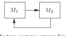

**图 3.8** 两个按反馈配置排列的米利型系统。

不知道 M₂ 的输出，就无法知道 M₁ 的输出，因为 M₂ 为 M₁ 提供输入。不知道 M₁ 的输出，就无法知道 M₂ 的输出，但这又需要 M₂ 的输出。只有存在对 M₁ 和 M₂ 输出的一致且唯一的选择时，这个问题才能解决。

假设 M₁ 从状态 p 开始，M₂ 从状态 q 开始。M₁ 的输出可以是 a 或 b。如果它是 a，那么 M₁ 的输入就是 b，因此 M₂ 的输出也是 b。不幸的是，这要求 M₂ 的输入为 b，于是 M₁ 的输出必须是 b，而不是 a。我们得到了一个矛盾：M₁ 的输出不可能是 a。

假设 M₁ 的输出是 b。那么它的输入必须是 a。因此，M₂ 的输出也必须是 a，但这要求它的输入为 a，于是 M₁ 的输出必须是 a，而不是 b。这又是一个矛盾：M₁ 的输出不可能是 b。显然，机器不能从状态 (p, q) 开始，而 (q, p) 同样不可维持。

状态 (p, p) 给了我们一点喘息之机。如果 M₁ 的输出是 a 且 M₂ 的输出是 b，那么机器进入状态 (p, q)，但随后就卡住了。状态 (q, q) 稍微更有吸引力。如果两台机器都产生输出 a，整个系统可以移动到状态 (p, p)，然后卡住；或者，如果两台机器都产生输出 b，它可以移动（更确切地说，停留）在状态 (q, q)。

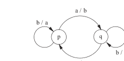

**图 3.9** 米利系统 M₁ 和 M₂ 的状态转移与输出函数。

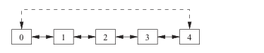

**图 3.10** 一维元胞自动机中五个元胞的排列。当这些元胞构成环时存在虚线连接，构成线时则不存在。

这个特定问题是一种更根本弊病的症状。由离散模型构成的网络如果包含无延迟环路，通常是定义不良的。图 3.9 所示的排列不是一个系统，因为我们无法为该网络定义一个合成结果。在某些特殊情况下，这个问题也许可以避免；例如，我们的例子可以通过消除状态 *p* 及其相连的弧线来简化。经过这种简化后，它行为良好，但并不十分有趣。

这个问题还会在涉及对输入作出瞬时反应的离散事件系统时再次出现。禁止瞬时事件，并由此消除无延迟环路，会严重束缚模型，因而不可行。一个令人满意的解决方案也许出人意料地存在于本章所研究的摩尔型离散时间系统中。

### 3.5 元胞自动机

著名的“生命游戏”因 1970 年一篇*《科学美国人》*文章而流行起来 [48]，它是一类称为元胞自动机的系统的实例。元胞自动机由一组离散时间系统——自动机中的元胞——组成，这些系统排列在网格中。每个元胞与其直接相邻的元胞交互。在一维元胞自动机中，元胞排成一行，并与其左侧和右侧的邻居交互；如图 3.10 所示。为了可视化元胞自动机的整体状态，为其元胞的每个状态分配一种颜色，并将这些状态并排绘制。通过按顺序排列其后续状态，一个叠一个，来描绘自动机的轨迹。这形成了一幅马赛克图，可以揭示原本简单的元胞在集体行为中令人惊讶的模式。

元胞自动机很容易作为离散时间网络来建模和仿真。为便于说明，我们将考虑一维元胞自动机，其元胞有两种状态：白色和黑色，分别缩写为 *w* 和 *b*。元胞由 *Cell* 类实现，该类派生自仿真引擎的 *Atomic* 类。*Cell* 具有一个状态以及在元胞自动机中的位置。其 *delta* 方法接受一个结构，其中包含相邻元胞的状态和位置。来自左右邻居的输入以及 *Cell* 的当前状态被传递给一个名为 *cell_rule* 的虚方法。该方法检查其三个参数，并返回元胞的下一个状态。要实现任何特定元胞，只需实现 *cell_rule* 方法。*Cell* 的 *output_func* 方法仅返回其当前状态。*Cell* 类的源代码如下所示。

#### Cell 类

~~~cpp
#ifndef Cell_h_
#define Cell_h_
#include "adtss.h"

typedef enum { BLACK, WHITE } state_t;
// Structure used for input to and output from a cell
struct IO_Type
{
    state_t state; // The cell's discrete state
    int src; // Location of the cell that produced the event
    bool operator<(const IO_Type& other) const // Needed by the STL
    {
        return src < other.src;
    }
};

class Cell: public adtss::Atomic<IO_Type>
{
    public:
        // Constructor puts the cell into its initial state
        Cell(state_t s0, int location):
            adtss::Atomic<IO_Type>(),
            s(s0),location(location) {}
        // State transition function
        void delta(const adtss::Bag<IO_Type>& xb)
        {
            // Edges are WHITE
            state_t left = WHITE, right = WHITE;
            for (adtss::Bag<IO_Type>::iterator iter = xb.begin();
                 iter != xb.end(); iter++) {
                if ((*iter).src == location-1) left = (*iter).state;
                else right = (*iter).state;
            }
            s = cell_rule(left,right,s);
        }
        // Output function
        void output_func(adtss::Bag<IO_Type>& yb)
        {
            IO_Type output;
            output.state = s;
            output.src = location;
            yb.insert(output);
        }
        // The gc_output method is not needed
        void gc_output(adtss::Bag<IO_Type>&){}
        // Get the location of the cell
        int getLocation() const { return location;

```cpp
// Get the discrete state of the cell
state_t getState() const { return s; }
protected:
    // This is the rule for computing the cell’s next state
    virtual state_t cell_rule(state_t left, state_t right, state_t s) = 0;
private:
    state_t s;
    const int location;
};

#endif
```

*CellularAutomaton* 类派生自仿真引擎的 *Network* 类，包含一个 *Cell* 对象数组。一个细胞的输出会发送给它的两个邻居：位置 *i* 处的细胞输出会发送到位置 *i + 1*（右）和 *i − 1*（左）处的细胞。数组两端两个细胞的输出可以被丢弃，或者发送到另一端的细胞。该数组初始为空，细胞通过 *placeCell* 方法显式分配到各自的位置。*CellularAutomaton* 类的源代码如下所示。

#### CellularAutomaton 类

```cpp
#ifndef CellularAutomaton_h
#define CellularAutomaton_h
#include "Cell.h"

class CellularAutomaton: public adtss::Network<IO_Type>
{
public:
    // Create an automaton with space for size cells
    CellularAutomaton(int size, bool ring):
        adtss::Network<IO_Type>(),
        size(size),ring(ring)
    {
        cell = new Cell*[size];
        for (int i = 0; i < size; i++) cell[i] = NULL;
    }
    void getComponents(adtss::Set<adtss::Dtss<IO_Type> >* c)
    {
        for (int i = 0; i < size; i++) c->insert(cell[i]);
    }
    void route(const IO_Type& value, adtss::Dtss<IO_Type>* model,
        adtss::Bag<adtss::Event<IO_Type> >& r)
    {
        adtss::Event<IO_Type> x;
        x.value = value;
        // Get the positions of the cells to the left and right
        int left = value.src - 1, right = value.src + 1;

        // Wrap the left end of the automaton to form a ring
        if (left < 0 && ring) {
            x.value.src = size;
            x.model = cell[size-1];
            r.insert(x);
        }
        // or just send the event to the left
        else if (left >= 0) {
            x.value.src = value.src;
            x.model = cell[left];
            r.insert(x);
        }

        // Wrap the right end of the automaton to form a ring
        if (right == size && ring) {
            x.value.src = -1;
            x.model = cell[0];
            r.insert(x);
        }
        // or just send the event to the right
        else if (right < size) {
            x.value.src = value.src;
            x.model = cell[right];
            r.insert(x);
        }
    }

    // The destructor destroys the Cells too
    ~CellularAutomaton()
    {
        for (int i = 0; i < size; i++)
            delete cell[i];
        delete [] cell;
    }
    // The placed cell is adopted by the CellularAutomaton
    void placeCell(Cell* new_cell)
    {
        new_cell->setParent(this);
        if (cell[new_cell->getLocation()] != NULL)
            delete cell[new_cell->getLocation()];
        cell[new_cell->getLocation()] = new_cell;
    }

private:
    int size;
    bool ring;
    Cell** cell;
};

#endif
```

**表 3.3** 描述细胞状态转移函数的位

| 左、状态、右 | 位 |
|---|---:|
| *bbb* | 7 |
| *bbw* | 6 |
| *bwb* | 5 |
| *bww* | 4 |
| *wbb* | 3 |
| *wbw* | 2 |
| *wwb* | 1 |
| *www* | 0 |

我们可以通过从 *Cell* 类派生新类，一次创建一个细胞类型。每个细胞将三个二进制值——左输入、状态和右输入——映射为一个二进制值——下一状态。状态转移函数完全由 2³ 种情况定义：每种输入和状态的组合对应一种情况。如果将每种细胞类型编码为一个新类，则需要 2⁸ 个类。

更紧凑的解决方案是创建一个名为 *BinaryCell* 的类，其构造函数接受一个编码所需行为的字节。规则在 8 位中的编码如表 3.3 所示。使用这种编码，规则通过右移位来实现：左邻居为黑色时移 4 位，状态为黑色时移 2 位，右邻居为黑色时移 1 位，状态和邻居为白色时移 0 位。移位后，模型的下一状态由最低有效位给出。该类的实现如下所示。

#### BinaryCell 类

```cpp
#ifndef BinaryCell_h_
#define BinaryCell_h_
#include "Cell.h"

class BinaryCell: public Cell
{
    public:
        BinaryCell(state_t s0, int location, unsigned char rule):
            Cell(s0,location),rule(rule) {}
    protected:
        state_t cell_rule(state_t left, state_t right, state_t s)
        {
            // Calculate the number of bit shifts
            unsigned char shift = 0;
            if (left == BLACK) shift += 4;
            if (s == BLACK) shift += 2;
            if (right == BLACK) shift += 1;
            // Extract the outcome
            if ((rule >> shift) & 0x01) return BLACK;
            else return WHITE;
        }
    private:
        const unsigned char rule;
};
#endif
```

仿真程序从命令行接受四个参数：要使用的细胞数量、要仿真的代数、编码转移函数的一个字节，以及指示细胞形成环还是线的标志。如果选择线，则线边缘之外的空白区域颜色为白色。使用 EventListener 在细胞状态改变时更新显示，并将最终图像保存到文件中。创建元胞自动机时，中心有一个黑色细胞，其他细胞为白色。主仿真程序如下所示。

#### 主仿真程序

```cpp
#include "CellularAutomaton.h"
#include "Display.h"
#include "BinaryCell.h"
using namespace std;

// The event listener displays the state of the cells when it changes
class CellListener: public EventListener<IO_Type>
{
  public:
    // Create display for the simulation
    CellListener(int num_cells, int num_generations):
        display(Display::initializeDisplay(num_cells,num_generations)){}
    // Draw the state of a cell to the off-screen buffer
    void showState(const Cell* cell, int gen)
    {
        // Draw a white cell (red = green = blue = 255)
        if (cell->getState() == WHITE)
            display.setColor(cell->getLocation(),gen,255,255,255);
        // or draw a black cell (red = green = blue = 0)
        else display.setColor(cell->getLocation(),gen,0,0,0);
    }
    // Update the screen
    void update() { display.redraw(); }
    // The listener ignores output events
    void outputEvent(Event<IO_Type>, unsigned int){}
    // Update the appearance of the cell when its state changes
    void stateChange(Atomic<IO_Type>* model, unsigned int t)
    {
        Cell* cell = dynamic_cast<Cell*>(model);
        showState(cell,t);
    }
    // Save the image to a file
    void saveImage() { display.toBmp("image.bmp"); }
  private:
    Display& display; // Reference to the display
};

int main(int argc, char** argv)
{
    // Get the number of generations to run the simulation
    if (argc != 5) {
        cout << "Requires # cells, # generations, rule #, and ring | line"
             << endl;
        return 0;
    }
    // Get the model parameters from the command line
    int num_cells = atoi(argv[1]);
    int num_gens = atoi(argv[2]);
    unsigned char rule = atoi(argv[3]);
    bool ring = (strcmp(argv[4],"ring") == 0);
    // Create the display
    CellListener* listener = new CellListener(num_cells,num_gens);
    // Create the cellular automaton
    CellularAutomaton* automaton = new CellularAutomaton(num_cells,ring);
    // Create the cells with a black one at the center and all others white
    for (int i = 0; i < num_cells; i++) {
        // Create and initialize the cell
        state_t s0 = WHITE;
        if (i == num_cells/2) s0 = BLACK;
        Cell* cell = new BinaryCell(s0,i,rule);
        // Display it
        listener->showState(cell,0);
        // Add it to the automata
        automaton->placeCell(cell);
    }
    // Run the simulation
    Bag<Event<IO_Type> > empty_input; // This is a closed system
    Simulator<IO_Type>* sim = new Simulator<IO_Type>(automaton);
    sim->addEventListener(listener);
    for (int i = 0; i < num_gens; i++) {
        // Display the output
        listener->update();
        // Compute the next state
        sim->computeNextState(empty_input);
    }
```


```
77  // Save the final image to a file
78  listener->saveImage();
79  // Clean up and exit
80  delete sim; delete listener; delete automaton;
81  return 0;
82  }
```

Wolfram [147] 已经对全部一维元胞自动机进行了编目。我们的 `BinaryCell` 类使用 Wolfram 对转换规则的编码，但生成的图像中时间从底部开始，而不是像 Wolfram 的目录那样从顶部开始。图 3.11 展示 Wolfram 的 188 号规则，它会产生斜向条纹。图 3.12 是目录中较鲜明的元胞自动机之一。图 3.12 中的两张图像看起来几乎相同，但在第 30 代之后，当边缘的细胞首先变黑时，会出现细微差异。两幅图中，左侧图像都是把自动机卷成环后产生的，右侧图像则是末端保持散开时产生的。两种情况下的元胞自动机都有 60 个细胞，并模拟了 60 代。

### 3.6 小结

本章引入了动态系统的基本概念、源于该概念的建模框架，以及满足第 1 章所建立需求的软件架构。几乎无需额外修饰，这个基础就能支撑更复杂但更有用的离散事件与混合系统模型。因此，扎实掌握这些相对简单场景中体现的基本概念，对后续内容至关重要。

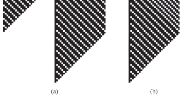

**图 3.11** 188 号规则：(a) 环；(b) 线。

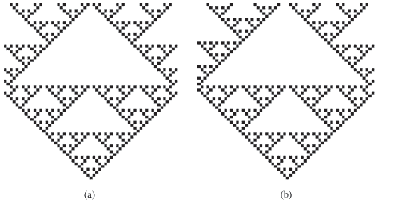

**图 3.12** 210 号规则：(a) 环；(b) 线。

第 4 章介绍的离散事件系统既能复现本章的全部示例，也为售货机那个笨拙的 `wait` 输入提供了一种优雅的替代方案，后者已在 3.1.3 节中描述。在充分理解这些离散时间系统之后，我们会发现把它们改造成离散事件系统是有益的学习辅助手段（因此这个任务留给读者）。元胞自动机同样会以离散事件系统的新形式出现，其适用范围也得到扩展，允许脱离同步进行，这是许多基于智能体的模型的一项重要特性。离散事件系统还是模拟第 5 章主题混合系统不可或缺的跳板。

## 第 4 章

## 离散事件系统

离散事件系统是离散时间系统的一种推广，它允许时间是连续的。离散事件系统的轨迹是从时间基 ℝ × ℕ 到其输入、输出和状态集合的函数。这些轨迹在任何有限区间内只改变有限次。这正是离散事件系统的定义性特征；引起这些离散变化的事件，也给这类系统赋予了名称。

时间基的扩展带来了两个问题，这也是离散事件系统及其模拟器（相对于离散时间系统）描述起来较复杂的原因。第一个问题是事件可能发生在任意时刻，因此模型必须包含一些机制，用来描述其事件发生在 ℝ × ℕ 的哪个子集上。第二个问题是时间在一个平面内推进。只有该平面的实数部分反映物理时间；离散部分是用瞬时事件对变化进行建模所产生的产物（Maler 和 Manna 对此给出了富有洞察力的讨论 [82, 83]）。为了允许系统有序演化而强加于时间的结构，虽然并不复杂，却不同于离散时间（即时间基为 ℕ）和微分（即时间基为 ℝ）系统所特有的加法群。

除了这些问题及其后果之外，定义状态转换函数的基本方法以及模拟软件的一般组织方式均未改变。与离散时间系统一样，用于模拟原子模型的迭代模拟过程由状态转换函数、一组基本段及半群性质推导而来。同样，还定义了一个将网络化简为其等效网络的过程，并体现在一个由惯常组件构成的自底向上模拟引擎中：用于构建模型的 **Network** 和 **Atomic** 类，以及用于执行模拟的 *Simulator* 和 *EventListener* 类。

### 4.1 原子模型

离散事件系统的原子模型具有输入集合 X、输出集合 Y、状态集合 S，以及总状态集合 Q，其中 Q 是 S × ℝ 的子集。总状态 (s, e) ∈ Q 包含两条信息：系统状态 s，以及系统已经处于该状态的真实时间 e。占据时间对于完整定义系统行为是必要的；与输入按固定间隔到达、每个状态恰好在一个时间点上被占据的离散时间系统不同，离散事件系统可以无限期地停留在一个状态中，并且对输入的反应会受到在该状态中驻留时间的影响。

#### 4.1.1 时间与轨迹

这里采用的时间结构已被广泛使用，尽管有时是隐式呈现或采用不同记号，它出现在 Matveev 和 Savkin 对混合系统的研究 [84]、Rönngren 和 Liljenstam 关于并行离散事件模拟中事件排序的提议 [122]、Chow 等人 [25] 为并行 DEVS 模型描述的抽象模拟器中，也作为 Ptolemy II 模拟环境 [75] 的一部分。时间基中的两个元素 (t₁, c₁) 和 (t₂, c₂) 在对应分量都相等时相等；因此，相等关系定义为

$$(t_1, c_1) = (t_2, c_2) \iff t_1 = t_2 \land c_1 = c_2 \tag{4.1}$$

时间先按实数部分排序，再按离散部分排序；关系 < 定义为

$$(t_1, c_1) < (t_2, c_2) \iff (t_1 = t_2 \land c_1 < c_2) \lor t_1 < t_2 \tag{4.2}$$

算子 φ 给出数对 (t, c) 的实数部分：

$$\phi((t, c)) = t \tag{4.3}$$

推进算子 ▷ 在离散事件系统的定义中取代加法。它按以下规则将第一个参数推进一个与第二个参数相等的量：

$$(t, c) \triangleright (h, k) = \begin{cases}(t+h, 0) & \text{if } h \ne 0 \\(t, c+k) & \text{if } h = 0\end{cases} \tag{4.4}$$

与实数或自然数的加法不同，▷ 算子既不满足交换律，也不满足结合律。请注意：

(1, 1) ▷ (0, 1) = (1, 2)

但

(0, 1) ▷ (1, 1) = (1, 0)

因此 a ▷ b ≠ b ▷ a；第一个和第二个参数不能互换。另请注意：

((1, 0) ▷ (1, 1)) ▷ (0, 1) = (2, 1)

但

(1, 0) ▷ ((1, 1) ▷ (0, 1)) = (2, 0)

因此 (a ▷ b) ▷ c ≠ a ▷ (b ▷ c)；应用 ▷ 的顺序改变会改变计算结果。

离散事件系统的轨迹是从 ℝ × ℕ 到集合 X（输入轨迹）、Y（输出轨迹）和 Q（状态轨迹）的函数。算子 ℓ 给出轨迹的真实长度，具体为

$$\ell(\zeta < (t₁, c₁), (t₂, c₂) >) = \phi((t₂, c₂)) − \phi((t₁, c₁)) = t₂ − t₁    (4.5)$$

回顾一下，离散事件系统的轨迹在任何有限长度的区间内只改变有限次。输入和输出轨迹还满足一个附加性质：在任何有限区间内，除有限个点外，它们都等于非事件 Φ。满足这第二个性质的轨迹称为*事件轨迹*，而合法的离散事件系统保证：其输入为事件轨迹时，输出也为事件轨迹。¹

图 4.1 展示了一条事件轨迹。真实时间从左到右流动。在每个真实时刻，可以发生有限次离散转换。真实时间中每个点处的离散时间从下到上流动。每个事件的值都写在时间平面中它的位置上。

第 3.1.1 节引入的轨迹连接规则保持不变，但“平移并连接”这一便利运算 • 不再适用，因为没有加法，轨迹不容易平移。· 算子仍然适用，它在定义离散事件系统的状态转换函数时，将扮演与定义离散时间系统时相同的角色。

¹ 一个系统若在输入为事件轨迹时不能产生事件轨迹输出，则被称为不合法，或者按更近期的说法，被称为 Zeno。不合法这一术语来自 Zeigler（例如参见文献 152）；Zeno 是受芝诺关于阿喀琉斯与乌龟的悖论启发而提出的现代术语，表示同一概念（例如参见文献 160）。


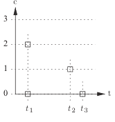

**图 4.1** 一个事件轨迹，在 (t₁, 0)、(t₂, 1)、(t₃, 0) 处各有一个事件。

#### 4.1.2 状态转移函数

离散事件系统可以自主行动，无需环境的任何触发即可改变状态并产生输出。系统也可以对输入作出反应，既可以立即响应，也可以在延迟之后响应。时间推进函数用于这两个目的；它调度来自模型的输出及其状态的自主变化。

时间推进函数的形式为

\[
ta:S\to R_0^\infty
\]

其中 \(R_0^\infty\) 是包含无穷大的非负实数集合：

\[
R_0^\infty=\{x\mid x\in\mathbb{R}\land x\ge0\}\cup\{\infty\}
\]

状态 \(s\) 的持续时间是时间推进函数赋予它的值。进入 \(s\) 后，系统会一直保持在该状态，直到 \(ta(s)\) 流逝，或者某个介入输入将系统驱动到新状态。总状态集合 \(Q\) 通过时间推进函数定义为

\[
Q=\{(s,e)\mid s\in S\land0\le e\le ta(s)\}. \tag{4.6}
\]

计算离散事件系统的状态转移函数需要三样东西：一个总状态、一个时间推进函数和一条输入轨迹。借助这些因素，状态转移函数构造出一条分段常数的状态轨迹。当事件出现在输入轨迹中时，以及当时间推进函数指示自主变化时，离散事件系统的状态会发生改变。

回想一下，为了定义离散时间系统的状态转移函数，输入轨迹被分解为长度为单位长度的片段，并逐个送入系统。以类似方式，事件轨迹被分解为基本段，这些基本段要么 (1) 恰好有一个事件，该事件启动轨迹，要么 (2) 不包含任何事件。具体而言，一条在时刻 \(t_1,\ldots,t_n\) 处有事件的事件轨迹 \(x[t_\alpha,t_\beta)\) 被拆分为片段 \(x_\alpha,x_1,\ldots,x_n\)，使得初始段 \(x_\alpha\) 定义在区间 \([t_\alpha,t_1)\) 上，中间段 \(x_k\)（\(1\le k<n\)）定义在 \([t_k,t_{k+1})\) 上，终止段 \(x_n\) 定义在 \([t_n,t_\beta)\) 上。段 \(x_1,x_2,\ldots,x_n\) 除起始处外处处等于 \(\Phi\)。例外是 \(x_\alpha\)：若 \(t_\alpha<t_1\)，则它只包含 \(\Phi\)；否则其定义域为空，且 \(\ell(x_\alpha)=0\)。如果 \(x_\alpha\) 没有事件，或仅在其起始处包含单个事件，那么它已经是基本段。

函数 \(\delta\) 接收一个初始总状态和一个基本段 \(x[t_0,t_f)\)，并返回该段结束时的总状态。这是离散时间系统单步转移函数的离散事件类比，但由于离散事件系统能够采取自主动作，\(\delta\) 变得复杂。为了遍历 \(x\)，时间推进函数可能需要若干小步，因此 \(\delta\) 采用递归定义。该递归有五种情形：轨迹起始处的输入、同时发生的输入与自主动作、中间自主动作、推进到中间事件期间的无动作，以及在轨迹末尾终止。

前三种情形需要系统采取确定动作，并且为每种情形定义一个函数来描述系统的响应。自主动作的影响由内部转移函数给出；其形式为

\[
\delta_{\mathrm{int}}:S\to S
\]

它使系统从自主事件发生时的状态转移到后续状态。输入的影响由外部转移函数给出。它把下一状态表示为输入时刻的总状态 \((s,e)\) 与输入本身的函数；其形式为

\[
\delta_{\mathrm{ext}}:Q\times X\to S
\]

其中 \(Q\) 是由式 4.6 定义的总状态集合。自主动作与输入可能同时发生，这种情形属于汇合转移函数的范畴。这实际上是外部转移函数在 \(e=ta(s)\) 时的特殊情形；其形式为

\[
\delta_{\mathrm{con}}:S\times X\to S
\]

从初始状态 \((s,e)\in Q\) 出发，\(\delta\) 给出系统对基本轨迹 \(x[t_0,t_f)\) 的响应为

\[
\delta((s,e),x[t_0,t_f)) =
\tag{4.7}
\]

1. 起始处的输入事件：若 \(x(t_0)\neq\Phi\land e<ta(s)\)，则为 \(\delta((\delta_{\mathrm{ext}}(s,e,x(t_0)),0),x[t_0,t_f))\)。
2. 起始处的输入事件且同时发生自主动作：若 \(x(t_0)\neq\Phi\land e=ta(s)\)，则为 \(\delta((\delta_{\mathrm{con}}(s,x(t_0)),0),x[t_0\mapsto(0,1),t_f))\)。
3. 中间自主动作：若 \(x(t_0)=\Phi\land e=ta(s)\)，则为 \(\delta((\delta_{\mathrm{int}}(s),0),x[t_0\mapsto(0,1),t_f))\)。
4. 无动作：若 \(x(t_0)=\Phi\land e<ta(s)\land ta(s)-e\le\ell(x)\)，则为 \(\delta((s,ta(s)),x[t_0\mapsto(ta(s)-e,0),t_f))\)。
5. 终止事件：若 1–4 不适用，则为 \((s,e+\ell(x))\)。

如果轨迹起始处存在事件，前两种情形会处理该事件。由于 \(x\) 是基本轨迹，\(t_0\) 是输入唯一可能出现的位置。第三种情形执行由时间推进函数调度的自主事件。第四种情形使系统经过内部事件之前的真实无动作区间。在这些情形中，对 \(\delta\) 的递归调用保持 \(x\) 的基本性；在 \(t_0\) 推进之后，它仅包含 \(\Phi\)。如果 \(x\) 的真实长度太短，无法容纳下一个自主动作，或者 \(x\) 为空（此时 \(x(t_0)\) 未定义且条件 1–4 不成立），则第五种情形终止计算。

总状态转移函数 \(\Delta\) 给出系统对任意事件轨迹 \(x\) 的响应。如果 \(x\) 是基本轨迹，则

\[
\Delta((s,e),x)=\delta((s,e),x). \tag{4.8}
\]

如果 \(x\) 不是基本轨迹，则将其分解为基本段，使得

\[
x=x_\alpha\cdot x_1\cdot\cdots\cdot x_n
\]

并且 \(\Delta\) 通过下式递归定义：

\[
\Delta((s,e),x_\alpha\cdot x_1\cdot\cdots\cdot x_n)
=\Delta(\delta((s,e),x_\alpha),x_1\cdot\cdots\cdot x_n). \tag{4.9}
\]

总状态转移函数一次处理一个基本段来遍历轨迹，当最后一个此类段处理完毕时计算结束。

#### 4.1.3 输出函数

离散事件系统的输出源于其自主动作。系统可以在没有输入的情况下产生输出，也可以在输入诱发自主事件时响应输入而产生输出。与离散时间系统一样，从引入输入到产生输出之间存在延迟，这种延迟存在的原因相同——离散事件系统是摩尔型系统。离散事件系统的摩尔表述所施加的延迟为 \((0,1)\)，当模型的时间推进为零时会出现这种最小延迟。如果时间推进为正，则会出现更长的延迟。

离散事件系统的*总*输出函数 \(\Lambda\) 具有如下形式

\[
\Lambda:Q\to Y\cup\{\Phi\}
\]

它把系统的*总*状态映射到其*总*输出集合中的一个值。输出函数 \(\lambda\) 与内部、外部和汇合函数一样，以状态集合 \(S\) 来定义系统的行为；其形式为

\[
\lambda:S\to Y
\]

*总*输出函数 \(\Lambda\) 通过 \(\lambda\) 定义为

\[
\Lambda((s,e))=
\begin{cases}
\lambda(s), & \text{if } e=ta(s);\\
\Phi, & \text{otherwise}.
\end{cases}
\tag{4.10}
\]

当式 4.7 中的情形 2（汇合事件）或情形 3（内部事件）发生时，已流逝时间 \(e\) 等于时间推进，因此这两种情形与输出的产生同时发生。

#### 4.1.4 合法系统

为了使系统是合法的，其时间推进函数必须确保在任何有限长度的真实区间内，系统只采取有限个动作。反过来，遍历无限状态序列必须需要无限量的真实时间。具体而言，系统可能产生的每个状态序列 \(s_1,s_2,\ldots\) 都必须满足

\[
\lim_{n\to\infty}\sum_{k=1}^{n}ta(s_k)\to\infty
\]

Zeigler [157] 给出了两个足以确保这一点的条件：

1. 状态集合 \(S\) 是有限的，并且状态转移函数可能产生的每个循环都包含一个满足 \(ta(s)>0\) 的状态 \(s\)。
2. 存在下界 \(b>0\)，使得对所有 \(s\in S\)，都有 \(ta(s)>b\)。

第一个条件是必要且充分的。任何具有有限个状态的系统，在没有外部影响的情况下，必定会稳定到某个具有无限时间推进的特定状态，或者无休止地遍历一组需要某个正时间才能遍历的状态。第二个条件只是充分的。如果时间推进严格为正，那么时间将始终前进。然而，也可能存在某个状态子集，其中状态的时间推进为零，但总是导向一个时间推进为正的状态。在这种情况下，尽管系统是合法的，第二个条件仍被违反。


Ames [4] 区分了两种不合法行为。颤动 Zeno 系统在进入一系列时间推进为零的状态的无尽序列时会卡住；一个对所有 \(s\in S\) 都有 \(ta(s)=0\) 的系统就是一个例子。真正的² Zeno 系统具有无限序列的状态；尽管每个状态都有正的时间推进，但它违反了合法性准则。例如，一个遍历状态序列 \(s_1, s_2, \ldots\) 的系统，其中 \(ta(s_k)=1/2^{k-1}\)，是真正 Zeno 的；该时间推进序列中的元素为正，但序列收敛于零且其和收敛于有限数。（时间推进之和收敛于 2，且系统从时间 \(t\) 的状态 \(s_1\) 开始，在 \(t+2\) 之前卡住。）

² 颤动 Zeno 系统与真正 Zeno 系统一样不合法，因此这个名称选择很奇怪。

每个合理的实际系统模型都是合法的。不合法的系统通常是建模时出现的错误造成的，而且这些错误常常在仿真程序无法停止时被发现。上述例子是极端的，但在实践中不合法的模型很容易出现，必须小心避免。

#### 4.1.5 原子模型的一个例子

一个具有单个输入、单个输出和单个状态变量的简单系统将演示状态转换和输出函数。该模型接受一个实值非负输入，并将其乘以经过的时间。当相等的时间已过去时，乘积将被产生。如果在输出待处理时到达一个输入，则新输入会替换存储的值。与输出同时到达的输入被视为其经过时间等于时间推进。在产生输出时，存储的值被设为 \(\infty\)。定义该系统的函数为

$$
\begin{aligned}
\delta_{\mathrm{int}}(q) &= \infty,\\
\delta_{\mathrm{ext}}(q,e,x) &= xe,\\
\delta_{\mathrm{con}}(q,x) &= xq,\\
ta(q) &= \lambda(q)=q.
\end{aligned}
$$

我们将向该系统输入四个原始轨迹，并使用公式 4.7 和 4.10 计算由此产生的状态和输出。轨迹为

- \(x_1[(0,0),(1,0)]\)，其中
  $$
  x_1(t)=
  \begin{cases}
  1 & \text{if } t=(0,0),\\
  \Phi & \text{otherwise}.
  \end{cases}
  $$
- \(x_2[(1,0),(1,1)]\)，其中
  $$
  x_2(t)=
  \begin{cases}
  0 & \text{if } t=(1,0),\\
  \Phi & \text{otherwise}.
  \end{cases}
  $$
- \(x_3[(1,1),(2,0)]\)，其中 \(x_3(t)=\Phi\)。
- \(x_4[(2,0),(2,2)]\)，其中
  $$
  x_4(t)=
  \begin{cases}
  2 & \text{if } t=(2,0),\\
  \Phi & \text{otherwise}.
  \end{cases}
  $$

系统以 \(q=\infty\) 开始，并在该状态停留了一个时间单位。使用公式 4.7 计算其对 \(x_1\) 的响应，我们有

$$
\begin{aligned}
\delta((\infty,1), x_1[(0,0),(1,0)])
&= \delta((1,0), x_1[(0,1),(1,0)]) && \text{(Case 1)}\\
&= \delta((1,1), x_1[(1,0),(1,0)]) && \text{(Case 4)}\\
&= (1,1) && \text{(Case 5)}.
\end{aligned}
$$

当系统处于总状态 \((1,1)\) 时，应用 \(x_2\) 得到

$$
\begin{aligned}
\delta((1,1), x_2[(1,0),(1,1)])
&= \delta((0,0), x_2[(1,1),(1,1)]) && \text{(Case 2)}\\
&= (0,0) && \text{(Case 5)}.
\end{aligned}
$$

当系统处于总状态 \((0,0)\) 时，我们应用 \(x_3\) 并得到

$$
\begin{aligned}
\delta((0,0), x_3[(1,1),(2,0)])
&= \delta((\infty,0), x_3[(1,2),(2,0)]) && \text{(Case 3)}\\
&= (\infty,1) && \text{(Case 5)},
\end{aligned}
$$

系统回到它开始的地方。最后，注入 \(x_4\) 得到

$$
\begin{aligned}
\delta((\infty,1), x_4[(2,0),(2,2)])
&= \delta((2,0), x_4[(2,1),(2,2)]) && \text{(Case 1)}\\
&= (2,0) && \text{(Case 5)},
\end{aligned}
$$

最终的总状态为 \((2,0)\)。

该仿真产生的输出轨迹 \(y[(0,0),(2,2)]\) 为

$$
y(t)=
\begin{cases}
1 & \text{if } t=(1,0),\\
0 & \text{if } t=(1,1),\\
\Phi & \text{otherwise},
\end{cases}
$$

状态轨迹 \(q[(0,0),(2,2)]\) 为

$$
q(t)=
\begin{cases}
\infty & \text{if } t=(0,0),\\
1 & \text{if } t\in[(0,1),(1,1)],\\
0 & \text{if } t=(1,1),\\
\infty & \text{if } t\in[(1,2),(2,0)],\\
2 & \text{if } t\in[(2,1),(2,2)].
\end{cases}
$$

接下来我们构造复合轨迹 \(x=x_1\cdot x_2\cdot x_3\cdot x_4\)。其规范分解为原始部分为

$$
x=x_0[(0,0),(0,0)]\cdot x_1\cdot (x_2\cdot x_3)\cdot x_4,
$$

其中 \(x_0\) 是一个空轨迹，\(x_1\) 和 \(x_4\) 如前所述，第三个原始段为 \(x_2\cdot x_3\)。从总状态 \((\infty,1)\) 重新开始并使用公式 4.9 应用 \(x\) 得到

$$
\begin{aligned}
\Delta((\infty,1), x_0\cdot x_1\cdot (x_2\cdot x_3)\cdot x_4)
&= \Delta(\delta((\infty,1), x_0), x_1\cdot (x_2\cdot x_3)\cdot x_4)\\
&= \Delta((\infty,1), x_1\cdot (x_2\cdot x_3)\cdot x_4) && \text{(Case 5)}\\
&= \Delta(\delta((\infty,1), x_1), (x_2\cdot x_3)\cdot x_4)\\
&= \Delta((1,1), (x_2\cdot x_3)\cdot x_4) && \text{(Previous calculation)}\\
&= \Delta(\delta((1,1), (x_2\cdot x_3)), x_4).
\end{aligned}
$$

为了计算系统对 \((x_2\cdot x_3)\) 的响应，我们利用 \(\delta((1,1), (x_2\cdot x_3))=\Delta((1,1), x_2\cdot x_3)=\Delta(\Delta((1,1), x_2), x_3)\) 这一事实，并从内到外进行，得到

$$
\begin{aligned}
\Delta(\Delta((1,1), x_2), x_3)
&= \Delta(\delta((1,1), x_2), x_3)\\
&= \Delta((0,0), x_3) && \text{(Previous calculation)}\\
&= \delta((0,0), x_3)\\
&= (\infty,1) && \text{(Previous calculation)}
\end{aligned}
$$

如预期。最后，应用 \(x_4\)，我们得到

$$
\Delta((\infty,1), x_4)=\delta((\infty,1), x_4)=(2,0)\quad \text{(Previous calculation)}
$$

正如之前一样。

**表 4.1** 离散事件系统的表驱动仿真

| t | s | ta(s) | y | x | 类型 |
|---|---|---|---|---|---|
| (0, 0) | ∞ | ∞ | — | 1 | init,in,1 |
| (0, 1) | 1 | 1 | — | — | ext |
| (1, 0) | — | — | 1 | 0 | out |
| (1, 1) | 0 | 0 | 0 |  | con,out |
| (1, 2) | ∞ | ∞ | — | — | int |
| (2, 0) | — | — | — | 2 | in |
| (2, 1) | 2 | 2 | — | — | ext |
| (2, 2) | — | — | — | — | final,0 |

手工离散事件仿真可通过与离散时间仿真（参见表 3.1 和 3.2）中使用的类似表格大大简化。该表有六列：时间 \(t\)、状态 \(s\)、时间推进 \(ta(s)\)、输出 \(y\)、输入 \(x\)，以及在 \(t\) 发生的事件类型。轨迹的开始和结束及其中间事件可以列在单独的表中，并在使用时划掉。

第一行用初始时间、状态及相关值以及适当的输入填入；其事件类型为“init”，并记录初始经过时间。后续行首先确定事件类型，该类型可以是“in”、“out”、“int”、“ext”、“con”或它们的组合，然后根据事件类型填入各列。“out” 事件不会改变系统的状态，但 \(y\) 列中可能有值；类似地，“in” 事件在 \(x\) 列中放置一个值。由于所有其他事件导致的新状态是使用上一行的状态、输入和经过时间计算的；给定行中的经过时间是该行中 \(\varphi(t)\) 与上一行之间的差值。请注意，输出出现在经过时间等于时间推进的每一行中。类型“final”分配给最后一行，并记录 \(e\) 的结束值。表 4.1 使用此方法展示了上述模型的仿真。如果从表中省略 \(x\) 和 \(y\) 列中的空条目以及 \(s\) 和 \(ta(s)\) 列中未更改的值，则该过程最快。

#### 4.1.6 机器人坦克中的中断处理器

坦克中断处理器的模型是原子模型的一个更复杂的例子。图 2.6 中的事件图说明了其操作。该模型的 state space 表示必须遵循我们在第 2.2.4 节中为其建立的两个约定：输入立即改变状态变量且不改变到下一次中断的时间，并且输出在 *结束中断* 事件完成其工作后立即发生。

实际上在坦克仿真器中使用的中断处理器比图 2.6 中显示的稍复杂。出于计算效率的原因，它将输出事件限制为电机电压实际发生变化的实例，而图 2.6 中的事件图指示在每次 *结束中断* 事件后输出。

当中断处理器以这种方式实现时，仿真无法跟上现实世界的时间，无法交互使用。原因是中断处理器向坦克物理模型提供输入，而为该模型计算状态变化需要（相对）较长时间。当中断处理器的输出仅限制在电压实际发生变化的实例时，仿真避免了不必要的、耗时的物理模型更新，因此能够交互使用。

采用此更改后，如果模型使用输出电压 \(e_l\) 和 \(e_r\) 作为状态变量代替开关位置 \(s_l\) 和 \(s_r\)，则代码更简单（但事件图更混乱）。为了确定何时必须产生新的输出值，需要两个新的状态变量来记住上次输出时的电压。这些变量称为 \(e'_l\) 和 \(e'_r\)。

相对于第 2.2.4 节中的描述，中断指示器的操作也需要稍作修改。需要一个额外的阶段在 *结束中断* 事件发生后产生输出。中断处理器现在有三个不同的阶段，对应于两种类型的事件和输出的产生。这些阶段为 EXEC、WAIT 和 OUTPUT。在 EXEC 阶段，模型已执行 *开始中断* 事件并等待 *结束中断* 事件。在 WAIT 阶段，模型已产生其输出（需要一个）并等待 *开始中断* 事件。在 EXEC 和 WAIT 阶段之间的离散瞬间是短暂的 OUTPUT 阶段，它改变电压信号。

中断之间的周期最方便地用期望的信号频率表示，而不是用分隔中断的机器周期数表示。有（参见第 2.2.4 节开头）大约八次对中断处理器的调用在每个电压信号周期中。因此，频率为 \(f_e\) 的电压信号需要中断周期 \(t_e\)，其值为

$$
t_e=\frac{1}{8f_e} \qquad (4.11)
$$

采用这些更改后，完整的 state variables 集合为电机处的电压 \(e_l\) 和 \(e_r\)；作为输出提供的最后电压 \(e'_l\) 和 \(e'_r\)，计数器 \(c\)，左电机开启时间 \(o_l\) 和右电机开启时间 \(o_r\)，左右电机的方向 \(r_l\) 和 \(r_r\)，阶段 \(i\)（即布尔中断指示器），以及到下一个事件剩余的时间 \(\sigma\)。电压变量的取值范围为集合 \(\{0,-7.2,7.2\}\)。计数器和电机开启时间的取值范围为区间 \([0,255]\) 中的自然数集合。方向指示器 \(r_l\) 和 \(r_r\) 在电机反向运行时为 true，否则为 false。阶段 \(i\) 的取值范围为 \(\{\mathrm{EXEC},\mathrm{WAIT},\mathrm{OUTPUT}\}\)。到下一个事件剩余的时间 \(\sigma\) 的取值范围为 \([0,\max\{t_e,432\times 10^{-6}\}]\)。模型的 state 可以写成（尽管有些笨拙）元组 \((e_l,e_r,e'_l,e'_r,c,o_l,o_r,r_l,r_r,i,\sigma)\)，状态集合是这些状态变量取值范围的笛卡尔积。

为简洁起见

$$
q=(e_l,e_r,e'_l,e'_r,c,o_l,o_r,r_l,r_r,i,\sigma)
$$

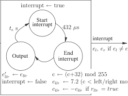

**图 4.2** 坦克中断处理器的修正事件图。

用于指示系统状态。模型的输入形式为 \((o'_l, r'_l, o'_r, r'_r)\)，它携带电机 ON 时间和方向开关的期望值。模型输出的是包含中断指示符以及电压对 \((e_l, e_r)\) 的包。

尽管其状态集合很大，模型的行為相当简单。图 4.2 显示了修改后的事件图，其中包括新的状态变量和阶段。³ *输出* 和 *开始中断* 事件会产生输出。如前所述，输入会立即应用，但对下一个事件的时间没有影响。

时间推进函数是中断处理器定义中最简单的一部分。它返回到下一个事件剩余的时间，定义为

$$
ta(q)=\sigma
$$

输出函数在中断开始和结束时生成事件。当时间推进到期且模型处于其 WAIT 阶段时，中断开始。此时会为数据包处理器产生一个 *中断* 信号。中断在时间推进到期且模型处于其 OUTPUT 阶段时结束。此时会产生另一个 *中断* 信号，同时产生电机的新电压值。具体而言，我们得到

$$
\lambda(q)=
\begin{cases}
\{interrupt\}, & \text{if } i=\mathrm{WAIT}\\[2pt]
\{interrupt\}, & \text{if } i=\mathrm{OUTPUT}\land(e_l=e'_l\land e_r=e'_r)\\[2pt]
\{interrupt,(e_l,e_r)\}, & \text{if } i=\mathrm{OUTPUT}\land(e_l\ne e'_l\lor e_r\ne e'_r)\\[2pt]
\varnothing, & \text{otherwise}
\end{cases}
$$

³ 假谓词的数值为零，真谓词的数值为一。因此，例如，电压 \(e_l\) 在 \(c <\) 左电机开启时间时为 7.2，否则为 0。

```
1 if i = WAIT then
2 i ← EXEC
3 σ ← 432 × 10⁻⁶
4 else if i = EXEC then
5 c ← c + 32 mod 255
6 e_l ← 7.2(c < o_l)
7 e_r ← 7.2(c < o_r)
8 if r_l = true then e_l ← −e_l
9 if r_r = true then e_r ← −e_r
10 i ← OUTPUT
11 σ ← 0
12 else if i = OUTPUT then
13 e'_l ← e_l
14 e'_r ← e_r
15 i ← WAIT
16 σ ← t_e
17 end
```

**算法 4.1** 中断处理器的内部转移函数。

转移函数仅稍微复杂一些。内部转移函数实现了事件图中出现的 Start interrupt、End interrupt 和 Output 事件的逻辑。Output 事件的效果是将 \(e'_l\) 和 \(e'_r\) 的值设为 \(e_l\) 和 \(e_r\)，并安排一个 Start interrupt 事件。为了安排该事件，模型被置于其 WAIT 阶段，σ 被设为中断周期。Start interrupt 事件的效果是安排一个 End interrupt 事件。它通过将模型置于其 EXEC 阶段并将 σ 设为执行中断所需的时间来安排。End interrupt 事件的效果是递增计数器，设置电压值，并安排一个立即的 Output 事件。内部转移函数使用算法 4.1 计算。

外部转移函数更简单。在接收到输入时，它会递减 σ 并更改每个电机的 ON 时间和方向。对输入 \((o'_l, r'_l, o'_r, r'_r)\) 的系统响应为

$$
\delta_{\text{ext}}(q, e, o'_l, r'_l, o'_r, r'_r) = (e_l, e_r, e'_l, e'_r, c, o'_l, r'_l, o'_r, r'_r, i, \sigma - e)
$$

汇合转移函数先应用内部转移函数然后应用外部转移函数。实际上，这优先考虑自主行为而不是输入。汇合转移函数定义为

$$
\delta_{\text{con}}(q, o'_l, r'_l, o'_r, r'_r) = \delta_{\text{ext}}(\delta_{\text{int}}(q), 0, o'_l, r'_l, o'_r, r'_r)
$$

尽管其动力学简单，模型状态空间的大小使得手工仿真不切实际。因此，演示必须等到必要的仿真软件构建完成。

#### 4.1.7 用于输入和输出的包系统

正如离散时间系统一样，实践中的离散事件系统被构建为接受对象包作为输入并产生对象包作为输出。这不需要对离散事件系统基本定义的实质性更改，但细节在小方面有所不同。集合 \(X^b\) 和 \(Y^b\) 是来自 \(X\) 和 \(Y\) 的元素的包，并且输出函数 λ 以及转移函数 \(\delta_{\text{ext}}\) 和 \(\delta_{\text{con}}\) 的形式为

$$
\begin{aligned}
\lambda &: S \to Y^b\\
\delta_{\text{ext}} &: Q \times X^b \to S\\
\delta_{\text{con}} &: S \times X^b \to S
\end{aligned}
$$

从此以后使用这些。

#### 4.1.8 原子模型的仿真器

可以作为公式 4.7 的特例构建的仿真引擎具有很大的实用价值。该仿真引擎将使我们能够对模型执行四项操作：（1）询问其下一次自主动作发生的时间，（2）询问在该时间它将产生的输出，（3）在该时间计算自主动作，以及（4）在上次状态变化和下一次自主事件之间的间隔内在任何时间向模型注入输入。

前两项任务很简单。如果上一次事件——内部、外部或汇合——将系统置于时间 \(t_L\) 的状态 \(s\)，则下一次自主动作将在时间 \(t_L \rhd (ta(s), 0)\) 发生。这是当 \(e = 0\) 时公式 4.7 的情况 4 将 τ 推进的量；即在情况 1–3 改变状态之前立即进行。该时间点的输出为 \(\lambda(s)\)。

对于最后两项任务，仿真器仅接受两种类型的轨迹：在下一个自主动作处终止的空轨迹，或在某个时间 \(t \in [t_L, t_L \rhd (ta(s), 0)]\) 结束的单个输入轨迹。因此输入轨迹 \(x\) 跨越区间 \([t_L, t] = [t_L, t \rhd (0, 1)]\)。如果 \(x\) 没有事件，则它已经是原始轨迹；否则它被分解为 \(x_\sigma[t_L, t] \cdot x_1[t, t \rhd (0, 1))\)。模型可以以三种方式响应 \(x\)：

- 1. \(\delta_{\text{ext}}(s, \phi(t) - \phi(t_L), x)\) if \(t < t_L \rhd (ta(s), 0)\)
- 2. \(\delta_{\text{int}}(s)\) if \(x(t) = \Phi\) and \(t = t_L \rhd (ta(s), 0)\)
- 3. \(\delta_{\text{con}}(s, x)\) if \(x(t) \ne \Phi\) and \(t = t_L \rhd (ta(s), 0)\)

情况 2 和 3 在时间 \(t_L \rhd (ta(s), 0)\) 产生输出事件。

在实践中，最重要的轨迹满足上述约束；其他类型的轨迹以无意义的停滞结束，因为 \(s\) 没有变化。通过限制允许的轨迹，仿真器不能以非零的经过时间启动。并且它不能被赋予例如跨越 \([t_1, t_2) \supset (t(s)/2, 0)\) 的轨迹，该轨迹仅包含无事件，但在此区间或经过时间不是 \(t(s)\) 的任何地方都没有有趣的事情发生，除非当然输入变得可用。因此，这些限制并没有降低仿真器的实用性。

其主要优点是提高了仿真器的计算速度，并且这种改进的重要性随着模型规模的增大而增长。对于单个原子模型，这些限制显然是不必要的，并且从公式 4.7 导出的简单直接的迭代算法更通用。对于大型网络模型，可以明显受益，因为我们可以利用非常高效的事件调度算法。当将这些仿真转移到并行计算机上时，可以获得更大的收益，在这种情况下，上述提到的限制对于获得良好的性能是必不可少的。然而，目前我们将重点放在单个原子模型的简单情况。

原子离散事件模型的仿真器类似于、几乎是原子离散时间模型的仿真器的复制品（参见第 3.1.5 节）。离散事件模型的仿真器有四个类：*Bag* 类、*Atomic* 类、*EventListener* 类和 *Simulator* 类。为了避免与仿真程序中可能使用的其他库发生冲突，这四个类被放入 *adevs*（a discrete-event system simulator）命名空间中。三个主要类——*Atomic*、*Simulator* 和 *EventListener*——及其关系如图 4.3 所示。

*Bag* 是 C++ 标准模板库中 *multiset* 类的别名。*EventListener* 类与离散时间仿真器中使用的相同。

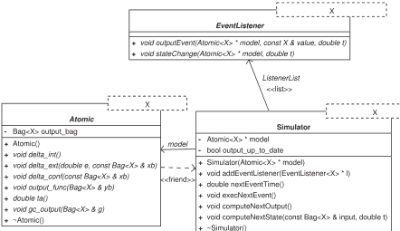

**图 4.3** 原子离散事件模型仿真软件的类图。


它有两个虚方法，`Simulator` 调用它们以通知监听器已产生输出或发生了状态转换。

*Atomic* 类有六个虚方法。它保留了 `gc_output` 方法，*Simulator* 使用该方法告诉模型删除其作为输出产生对象。它还保留了实现模型输出函数的 `output_func` 方法。离散时间仿真器的 `delta` 函数被三个方法取代，每个方法对应离散事件模型的一个基本转换函数。`delta_int` 方法实现内部转换函数，`delta_ext` 方法实现外部转换函数，而 `delta_conf` 方法实现汇合转换函数。最后，添加了方法 `ta` 以实现模型的时间推进函数。

*Simulator* 保留了离散时间仿真器的 `addEventListener` 和 `computeOutput` 方法，但其中用于与仿真交互有三个方法，离散事件仿真器则有四个。其中两个方法用于获取信息。`nextEventTime` 方法返回下一次自主动作的时间。`computeOutput` 方法调用已注册 *EventListeners* 的 `outputEvent` 方法，以告知它们在下一次事件时间模型的输出。

另外两个用于推进仿真时钟。`execNextEvent` 方法计算模型在下一次事件时间时的输出和下一状态，并在进行过程中调用所有已注册 *EventListeners* 的 `outputEvent` 和 `stateChange` 方法。此方法不接受输入；它执行模型的内部转换函数。输入通过 `computeNextState` 方法应用。它接受一个 `Bag` 输入以及应用该输入的时间，该时间必须小于或等于 `nextEventTime`。在该时间点，会执行适当的外部或汇合事件，并且该方法通过调用它们的 `stateChange` 方法以及对于汇合事件的 `outputEvent` 方法来通知任何 *EventListeners* 该操作。

由程序员实现的虚方法构成了仿真引擎的大部分。唯一具有实质性实现的是 *Simulator* 类，其实现如下所示。此实现中没有时间对 (`t`, `c`)。实际时间 `t` 明确出现，但 `c` 每次调用 `computeNextState` 且时间参数相同 时都会隐式递增。显式化 `c` 并无收益，除非可能允许 *Simulator* 的用户为每个事件记录完整时间戳。如果需要此信息，可以通过一个计数器来恢复，该计数器在仿真时钟的实际部分每次推进时重置为零，并在不推进时钟的 `computeNextState` 调用后递增。

##### Simulator 类的实现

```cpp
#ifndef _adevs_simulator_h_
#define _adevs_simulator_h_
#include "adevs_atom.h"
#include <cfloat>
#include <cassert>

namespace adevs
{

template <typename X> class Simulator {
    public:
        Simulator(Atomic<X>* model):
            model(model), tL(0.0),
            output_up_to_date(false){}
        void addEventListener(EventListener<X>* l)
        {
            listeners.push_back(l);
        }
        double nextEventTime() { return tN; }
        void computeNextState(const Bag<X>& input, double t);
        // Execute the autonomous event at time nextEventTime()
        void execNextEvent()
        {
            Bag<X> empty;
            computeNextState(empty,nextEventTime());
        }
        void computeNextOutput();
    private:
        Atomic<X>* model; // The model to simulate
        double tN, tL; // Time of the next and previous event
        bool output_up_to_date; // Is the output up to date?
        // List of event listeners
        typedef std::list<EventListener<X>*> ListenerList;
        ListenerList listeners;
};

template <typename X>
void Simulator<X>::computeNextState(const Bag<X>& input, double t)
{
    // If this is an external event
    if (t < tN && !input.empty()) model->delta_ext(t-tL,input);
    // If this coincides with an autonomous action
    else if (t == tN) {
        computeNextOutput();
        if (!input.empty()) model->delta_conf(input);
        else model->delta_int();
    }
    // Find the next event time
    double ta = model->ta();
    if (ta < DBL_MAX) tN = t + ta;
    else tN = DBL_MAX;
    // Set the simulation clock and notify listeners of the change in state
    tL = t;
    for (typename ListenerList::iterator iter = listeners.begin();
         iter != listeners.end(); iter++) {
        (*iter)->stateChange(model,t);
    }
    // Cleanup
    model->gc_output(model->output_bag);
    model->output_bag.clear();
    output_up_to_date = false;
}

template <typename X>
void Simulator<X>::computeNextOutput()
{
    // Return if the output function has been evaluated
    if (output_up_to_date) return;
    // Compute the output
    output_up_to_date = true;
    model->output_func(model->output_bag);
    // Notify registered listeners of the output events
    for (typename Bag<X>::iterator yiter = model->output_bag.begin();
         yiter != model->output_bag.end(); yiter++) {
        for (typename ListenerList::iterator iter = listeners.begin();
             iter != listeners.end(); iter++)
            (*iter)->outputEvent(model,*yiter,tN);
    }
}

} // end of namespace

#endif
```

#### 4.1.9 仿真中断处理器

第 4.1.6 节中开发的中断处理器的实现展示了如何使用仿真软件。类 InterruptHandler 派生自 Atomic；其虚方法被实现以实现模型的转换函数、时间推进函数和输出函数。对该模型（以及坦克实现的整个过程中；参见附录 A，第 A.2.2 节）的输入和输出都是类 SimEvent 的实例，该类有两个属性：一个联合体包含五种特定事件类型之一，以及一个标志显示实际存在的是哪一种类型。

中断处理器对类型为 SimMotorOnTime 的事件做出反应，并产生类型为 SimInterrupt 和 SimMotorVoltage 的事件。SimMotorOnTime 事件携带有关电机开启时间以及它们应旋转方向的信息。SimInterrupt 事件除了其类型外没有其他信息，而 SimMotorVoltage 事件包含左右电机的电压。模型产生的输出不是动态分配的，因此无需由垃圾回收方法释放。*InterruptHandler* 的实现列于下方。

##### InterruptHandler 的头文件

```cpp
#ifndef INTERRUPT_HANDLER_H_
#define INTERRUPT_HANDLER_H_
#include "adevs.h"
#include "SimEvents.h"

// This is the model of the computer's interrupt handler.
class InterruptHandler: public adevs::Atomic<SimEvent>
{
    public:
        // Phases of the interrupt handler
        typedef enum { OUTPUT, EXEC, WAIT } Phase;
        // Create an interrupt handler that executes with the
        // specified frequency.
        InterruptHandler(double freq);
        // State transition functions
        void delta_int();
        void delta_ext(double e, const adevs::Bag<SimEvent>& xb);
        void delta_conf(const adevs::Bag<SimEvent>& xb);
        // Output function
        void output_func(adevs::Bag<SimEvent>& yb);
        // Time advance function
        double ta();
        void gc_output(adevs::Bag<SimEvent>&){}
        // Methods for getting the values of the state variables
        unsigned int getCounter() const { return counter; }
        unsigned int getLeftOnTime() const { return left_on_time; }
        unsigned int getRightOnTime() const { return right_on_time; }
        bool getLeftReverse() const { return reverse_left; }
        bool getRightReverse() const { return reverse_right; }
        double getLastLeftOutput() const { return last_left_v; }
        double getLastRightOutput() const { return last_right_v; }
        double getLeftOutput() const { return left_v; }
        double getRightOutput() const { return right_v; }
        Phase getPhase() const { return phase; }
        double getInterruptPeriod() const { return interrupt_period; }
    private:
        const double interrupt_period; // Clock period
        // Magnitude of the voltage at the motor when turned on
        const double motor_voltage;
        const double execute_time; // Execution time of the interrupt
        double ttg; // Time to the next internal event
        unsigned char counter, left_on_time,
                      right_on_time; // On/off counters
```

```cpp
bool reverse_left, reverse_right; // Motor direction
double last_left_v, last_right_v; // Previous output voltages
double left_v, right_v; // Next output voltages
Phase phase; // The current phase of the model
};

#endif
```

##### InterruptHandler 的实现

```cpp
#include "InterruptHandler.h"
#include <iostream>
using namespace std;
using namespace adevs;

InterruptHandler::InterruptHandler(double freq):
    Atomic<SimEvent>(),
    interrupt_period(1.0/(8.0*freq)), // Initialize the model
    motor_voltage(7.2),
    exec_time(0.432E-6),
    ttg(interrupt_period),
    counter(0),
    left_on_time(0),
    right_on_time(0),
    reverse_left(false),
    reverse_right(false),
    last_left_v(0.0),
    last_right_v(0.0),
    left_v(0.0),
    right_v(0.0),
    phase(WAIT)
{
}

void InterruptHandler::delta_int()
{
    // Start an interrupt
    if (phase == WAIT)
    {
        phase = EXEC;
        ttg = exec_time;
    }
    // End an interrupt and send the output
    else if (phase == EXEC)
    {
        // Increment the counter
        counter += 32;
        // Compute the next output voltage
        left_v = motor_voltage*(counter < left_on_time);
        if (reverse_left) left_v = -left_v;
        right_v = motor_voltage*(counter < right_on_time);
        if (reverse_right) right_v = -right_v;
        // Send the voltage and interrupt signal
        phase = OUTPUT;
        ttg = 0.0;
    }
    // Wait for the next interrupt
    else if (phase == OUTPUT)
    {
        // Remember the last output voltages
        last_left_v = left_v;
        last_right_v = right_v;
        // Wait for the next interrupt
        phase = WAIT;
        ttg = interrupt_period;
    }
}

void InterruptHandler::delta_ext(double e, const Bag<SimEvent>& xb)
{
    // Decrement the time to go
    ttg -= e;
    // Look for input
    for (Bag<SimEvent>::iterator iter = xb.begin();
         iter != xb.end(); iter++)
    {
        assert((*iter).getType() == SIM_MOTOR_ON_TIME);
        left_on_time = (*iter).simMotorOnTime().left;
        right_on_time = (*iter).simMotorOnTime().right;
        reverse_left = (*iter).simMotorOnTime().reverse_left;
        reverse_right = (*iter).simMotorOnTime().reverse_right;
    }
}

void InterruptHandler::delta_conf(const Bag<SimEvent>& xb)
{
    delta_int();
    delta_ext(0.0,xb);
}

void InterruptHandler::output_func(Bag<SimEvent>& yb)
{
    // If this is the end of an interrupt
    if (phase == OUTPUT)
    {
        // If the voltage changed, then send the new values
        if (last_left_v != left_v || last_right_v != right_v)
        {
            SimMotorVoltage volts;
            volts.el = left_v;
            volts.er = right_v;
            yb.insert(SimEvent(volts));
        }
        // Send the interrupt indicator
        yb.insert(SimEvent(SIM_INTERRUPT));
    }
    // If this is the start of an interrupt
    else if (phase == WAIT) yb.insert(SimEvent(SIM_INTERRUPT));
}
double InterruptHandler::ta() { return ttg; }
```

仿真程序通过标准输入获得一条输入轨迹，并计算由此得到的状态和输出轨迹。仿真在最后一个输入处结束。中断处理器产生的电压信号频率通过命令行设置。下面列出了该仿真器的实现。这是模型在新环境中被复用的另一个示例：最初作为交互式坦克仿真器的一部分构建的 `InterruptHandler`，现已从该仿真器中提取出来，并被复用于这个新的仿真程序。

##### InterruptHandler 的仿真

```cpp
#include "adevs.h"
#include "InterruptHandler.h"
#include <iostream>
using namespace std;
using namespace adevs;

// Listener for recording the state and output of the interrupt handler
class InterruptListener: public EventListener<SimEvent>
{
public:
InterruptListener(){}
void outputEvent(Atomic<SimEvent>* model,
const SimEvent& value, double t)
{
cout << "Output, t = " << t << ", ";
if (value.getType() == SIM_INTERRUPT)
cout << "interrupt" << endl;
else if (value.getType() == SIM_MOTOR_VOLTAGE)
cout << "el = " << value.simMotorVoltage().el <<
" er = " << value.simMotorVoltage().er << endl;
}
void stateChange(Atomic<SimEvent>* model, double t)
{
InterruptHandler* ih = dynamic_cast<InterruptHandler*>(model);
        cout << "State, t = " << t;
        cout << ", el = " << ih->getLeftOutput();
        cout << ", er = " << ih->getRightOutput();
        cout << ", e'l = " << ih->getLastLeftOutput();
        cout << ", e'r = " << ih->getLastRightOutput();
        cout << "\n\tc = " << ih->getCounter();
        cout << ", o'l = " << ih->getLeftOnTime();
        cout << ", o'r = " << ih->getRightOnTime();
        cout << ", r'l = " << ih->getLeftReverse();
        cout << ", r'r = " << ih->getRightReverse();
        cout << ", i = ";
        if (ih->getPhase() == InterruptHandler::WAIT)
            cout << "WAIT" << endl;
        else if (ih->getPhase() == InterruptHandler::EXEC)
            cout << "EXEC" << endl;
        else if (ih->getPhase() == InterruptHandler::OUTPUT)
            cout << "OUTPUT" << endl;
    }
};

int main(int argc, char** argv)
{
    // Make sure that a frequency was given
    if (argc != 2) {
        cout << "Must provide a signal frequency" << endl;
        return 0;
    }
    // Set the output precision to make the small time advances apparent
    cout.precision(12);
    // Create the model, event listener, and simulator
    InterruptHandler* ih = new InterruptHandler(atof(argv[1]));
    InterruptListener* l = new InterruptListener();
    Simulator<SimEvent>* sim = new Simulator<SimEvent>(ih);
    sim->addEventListener(l);
    // Print the initial state of the model
    l->stateChange(ih,0.0);
    // Run the simulation
    while (true) {
        // Bag for injecting the input
        Bag<SimEvent> input;
        // The value to inject
        SimMotorOnTime motor_setting;
        // Time to inject the input
        double t; int c;
        // Read the time and input values
        unsigned int o_l, o_r;
        cin >> t >> c >> o_l >> motor_setting.reverse_left
            >> o_r >> motor_setting.reverse_right;
        motor_setting.left = (unsigned char)o_l;
        motor_setting.right = (unsigned char)o_r;
        // If this is the end of the input, then quit
        if (cin.eof()) break;
        // Simulate until time t and then inject the input
        while (sim->nextEventTime() < t) {
          cout << endl;
          sim->execNextEvent();
        }
        // Simulate the transient events
        for (int i = 0; i < 100 && sim->nextEventTime() == t; i++) {
          cout << endl;
          sim->execNextEvent();
        }
        // Inject the input
        input.insert(SimEvent(motor_setting));
        cout << endl;
        sim->computeNextState(input,t);
    }
    // Clean up
    delete sim; delete l; delete ih;
    return 0;
}
```

在这个示例中，中断处理器以 2000 Hz 运行，因此其周期 t_e 精确等于 6.25 × 10⁻⁴ 秒（式 4.11）。输入轨迹 x((0), (t_e, 0)) 在 x((t_e/2, 0)) = (255, 0, 255, 1) 处有一个事件，它将左电机设为全速前进、右电机设为全速反向；它还在 x((t_e, 0)) = (0, 0, 0, 0) 处有一个事件，在计算机有机会处理前一条命令之前，将电机设置改为完全停止。描述该轨迹的输入文件 `exp1` 包含两行：

~~~text
3.125E-5 0 255 0 255 1
6.25E-5 0 0 0 0 0
~~~

运行仿真会产生：

~~~text
$ ./a.out 2000 < exp1
State, t = 0, el = 0, er = 0, e'l = 0, e'r = 0,
       c = 0,ol = 0,or = 0,rl = 0,rr = 0,i = WAIT

State, t = 3.125e-05, el = 0, er = 0, e'l = 0, e'r = 0,
       c = 0,ol = 255,or = 255,rl = 0,rr = 1,i = WAIT

Output, t = 6.25e-05, interrupt
State, t = 6.25e-05, el = 0, er = 0, e'l = 0, e'r = 0,
       c = 0,ol = 0,or = 0,rl = 0,rr = 0,i = EXEC
$
~~~

仿真器打印时间 (0, 0) 处的初始状态。输入轨迹在时间 (t_e/2, 0) 设置左右电机的计数器。在时间 (t_e, 0)，中断处理器被激活，并产生它的 {interrupt} 输出；与此同时，第二个输入被施加，从而阻断了电机的启动。

让电机以半功率运行，可以很有说服力地说明尽量减少中断处理器产生的电压事件数量有多重要。输入文件

```
0 0 127 0 127 1
1 0 0 0 0 0
```

会让坦克原地旋转一秒钟。中断处理器产生了 35,753 个输出，其中 397 个是 *SimMotorVoltage* 事件。如果每次仿真的中断都产生一个电压事件，问题就立刻显现出来：朴素方案会为 *TankPhysics* 模型产生 10 倍于原来的输入事件，而该模型的状态转换计算非常耗时。这些额外的工作会把仿真器拖慢到无法用于交互的程度。将 *SimMotorVoltage* 事件限制为仅那些真正表示电压变化的事件，是一项必不可少的优化。

### 4.2 网络模型

离散时间模型网络和离散事件模型网络的构造方式相同。一个网络由一组组件模型、这些模型之间的连接，以及网络输入输出与组件输入输出之间的连接组成。离散事件网络在耦合运算下是封闭的，将网络约简为其原子等价模型的步骤，也定义了多组件系统的仿真步骤。从第 3 章对离散时间系统的学习中，这些方面都应该很熟悉。

由于离散事件模型的各原子组件各自按自己的步调运行，由此得到的离散事件网络比对应的离散时间网络更复杂。这些新的组合复杂性几乎完全来自时间推进函数。除去这些细节，本节的内容与第 3 章中的内容相类似。输入和输出事件在模型中递归地路由。算法的基础步骤同样是熟悉的：计算输出、将输出转换为输入，然后计算新状态。仿真器的接口也基本保持不变。

#### 4.2.1 网络模型的组成

离散事件网络的结构和组合方式与离散时间网络完全相同。总结第 3.2.1 节，一个网络

模型由以下定义

$X_N$ = 网络的输入集合  
$Y_N$ = 网络的输出集合  
$D$ = 组件集合  
$I = \{I_d \mid d \in D \cup \{N\}\}$ 影响者集合族  
$Z = \{z_{d,d'} \mid d' \in I_d \text{ and } d \in D \cup \{N\}\}$ 耦合函数集合，其中  
$\quad z_{N,d}: X_N^b \to X_d^b$  
$\quad z_{d,N}: Y_d^b \to Y_N^b$  
$\quad z_{d',d}: Y_{d'}^b \to X_d^b$

另请注意，影响者集合 $I_d$ 定义影响集合 $E_d$（见第 3.2.4 节），由

$E_d = \{d' \mid d \in I_{d'}\}$

给出，并且该集合在模拟器的构建中使用。

#### 4.2.2 网络模型的合成

网络离散事件模型的合成是一个原子模型，其状态集合、转移函数和输出函数由其互连的组件定义。为简化否则会非常混乱的记号，此处所采用的构造假设网络的所有组件都是原子模型（这是 Zeigler [157] 采用的相同方法）。第 3.2.2 节描述了完成约简过程的网络递归下降。

合成的输入和输出集合是网络的 $X_N$ 和 $Y_N$ 集合。合成的状态集合 $S_r$ 是其组件的总状态集合的笛卡尔积，使得

$S_r = \times_{d \in D} Q_d \qquad (4.12)$

合成的时序推进函数 $ta_r$ 为

$ta_r(s_r) = \min_{d \in D} ta_d(s_d) - e_d \qquad (4.13)$

它给出了网络中下一次自主动作前剩余的最短时间。

即将发生的组件是那些将要经历自主事件的组件；它们构成集合

$$IMM = \{d \mid ta_d(s_d) - e_d = ta_r(s_r)\}$$ (4.14)

子集 $IMM \cap I_N$，其连接到网络的输出，将其输出事件贡献给网络的输出；其输出函数为

$$\lambda_r(s_r) = \cup_{d \in IMM \cap I_N} z_{d,N}(\lambda_d(s_d))$$ (4.15)

合成的转移函数更为复杂。在为组件计算新状态之前，必须先知道其输入。这些的求法几乎与离散时间网络相同，但只有即将发生的模型才产生输出。组件集合 $IMM \cap (I_d - \{N\})$ 在合成的内部或汇合转移时向 $d$ 提供输入，所提供的输入为

$$x_d^b = \cup_{d' \in IMM \cap (I_d - \{N\})} z_{d',d}(\lambda_{d'}(s_{d'}))$$ (4.16)

这个值袋不包括来自网络输入的贡献，但它确实包括所有源自其兄弟组件的输入。

在合成的内部转移时，网络没有输入。因此，式 4.16 足以计算组件的输入，内部转移函数定义为

$$\delta_{int,r}(s_r) = ((s'_1, e'_1), (s'_2, e'_2), \ldots, (s'_n, e'_n))$$ (4.17)

其中

$(s'_j, e'_j) = \begin{cases} (s_j, e_j + ta_j(s_j)) & \text{if } x_j^b = \emptyset \land j \notin IMM \\ (\delta_{int,j}(s_j), 0) & \text{if } x_j^b = \emptyset \land j \in IMM \\ (\delta_{ext,j}(s_j, e_j + ta_j(s_j), x_j^b), 0) & \text{if } x_j^b \neq \emptyset \land j \notin IMM \\ (\delta_{con,j}(s_j, x_j^b), 0) & \text{if } x_j^b \neq \emptyset \land j \in IMM \end{cases}$

内部转移函数通过改变其组件的状态来改变合成的状态，对于每个组件有四种可能的结果。第一种情况，组件上没有事件发生，仅其经过时间被推进。其他三种情况根据其处置情况改变组件的状态：如果即将发生则进行内部事件，如果接收到输入则进行外部事件，如果两者条件都适用则进行汇合事件。

在合成的外部转移时没有即将发生的模型，只有合成的输入 $x^b$ 才能诱导其组件的状态变化。合成的外部转移函数将输入移动到适当的组件集合并用其外部转移函数改变它们的状态。所有其他组件都处于空闲状态，仅推进其经过的时间。外部转移函数定义为

$$\delta_{ext,r}(s_r,e,x_r^b)=((s'_1,e'_1),(s'_2,e'_2),\ldots,(s'_n,e'_n)) \tag{4.18}$$

其中

$$
(s'_j,e'_j)=
\begin{cases}
(s_j,e_j+e) & \text{if } N\notin I_j\lor Z_{N,j}(x_r^b)=\varnothing\\
(\delta_{ext,j}(s_j,e_j+e,Z_{N,j}(x_r^b)),0) & \text{otherwise}
\end{cases}
$$

第一种情况适用于从网络接收不到输入的组件，第二种情况适用于所有其他组件。

汇合转移函数几乎与内部转移函数相同，但对受网络影响的组件有特殊规定。为此，定义了一组函数 $\zeta_j(x^b)$，每个组件一个，用以给出其从兄弟组件和网络接收的集体输入。对于每个 $j\in D$，$\zeta_j$ 接受网络的输入袋 $x^b$ 并给出对 $j$ 的输入袋

$$\zeta_j(x^b)=
\begin{cases}
x_j^b & \text{if } N\notin I_j\\
x_j^b\cup Z_{N,j}(x^b) & \text{if } N\in I_j
\end{cases} \tag{4.19}$$

该方程中的 $x_j^b$ 由式 4.16 定义。汇合转移函数的定义为

$$\delta_{con,r}(s_r,x_r^b)=((s'_1,e'_1),(s'_2,e'_2),\ldots,(s'_n,e'_n)) \tag{4.20}$$

其中

$$
(s'_j,e'_j)=
\begin{cases}
(s_j,e_j+ta_r(s_r)) & \text{if } \zeta_j(x_r^b)=\varnothing\land j\notin IMM\\
(\delta_{int,j}(s_j),0) & \text{if } \zeta_j(x_r^b)=\varnothing\land j\in IMM\\
(\delta_{ext,j}(s_j,e_j+ta_r(s_r),\zeta_j(x_r^b)),0) & \text{if } \zeta_j(x_r^b)\neq\varnothing\land j\notin IMM\\
(\delta_{con,j}(s_j,\zeta_j(x_r^b)),0) & \text{if } \zeta_j(x_r^b)\neq\varnothing\land j\in IMM
\end{cases}
$$

这与式 4.17 相同，只是每个组件的输入袋贡献了来自网络的信息。

#### 4.2.3 网络模型及其合成的一个示例

本示例由两台金属加工机器组成。冲压机将小金属球压平成圆盘。它有一个料仓来存放等待压制的球。钻床

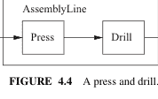

在每个圆盘中心钻孔，它也有一个料仓来存放等待钻孔的圆盘。冲压机在一秒内压平一个球，但钻床需要两秒完成工作。这些机器的连接如图 4.4 所示。该网络的代数描述可从图中轻易推导出来（见第 3.2.1 节）。

网络及其组件的输入和输出是描述零件数量的自然数：有孔和无孔的球和圆盘。用下标 $m$ 表示机器模型，$t_m$ 表示加工时间，我们可以将机器的状态集合表示为

$$S_m = \mathbb{N} \times R_0^\infty$$

其中 $(p, \sigma) \in S_m$ 描述机器待处理的零件数 $p$ 以及处理第一个零件剩余的时间 $\sigma$。时序推进为

$$ta_m((p, \sigma)) = \begin{cases} \sigma & \text{if } p > 0 \\ \infty & \text{otherwise} \end{cases}$$

当此时间到期时，内部转移函数

$$\delta_{int,m}((p, \sigma)) = (p - 1, t_m)$$

从机器中移除零件，输出函数

$$\lambda_m((p, \sigma)) = 1$$

使零件可供装配线上下一台机器使用。在接收到 $q$ 个零件后，外部转移函数

$$\delta_{ext,m}((p, \sigma), e, q) = \begin{cases} (p + q, \sigma - e) & \text{if } p > 0 \\ (p + q, t_m) & \text{if } p = 0 \end{cases}$$

将零件放入料仓，如果料仓为空则开始对其中的一个进行操作。当新零件到达且同时完成一个零件时，汇合转移函数

$$\delta_{con,m}(((p,\sigma),q),q) = (p+q-1,t_m)$$

排出已完成的零件，存储传入的零件，并开始操作新零件。

装配线模型有两个机器模型副本；冲压机的模型用下标 $p$ 表示，钻床用 $d$ 表示。下标 $r$ 用于网络的合成，其状态为

$$s_r = (((p_p,\sigma_p),e_p),((p_d,\sigma_d),e_d))$$

钻床和冲压机初始料仓中无零件。它们的初始状态分别为 $(0, 2)$ 和 $(0, 1)$。合成的初始状态为 $(((0, 1), 0), ((0, 2), 0))$，其经过时间 $e_r$ 为零。对于本次实验，装配线的输入为

$$x_I((0,0),(3,0)) = \begin{cases} 1 & \text{if } t=(0,0) \\ 2 & \text{if } t=(1,1) \\ \Phi & \text{otherwise} \end{cases}$$

该轨迹的原始分解有三部分：空轨迹 $x_\Phi((0,0),(0,0))$，第一输入轨迹 $x_I((0,0),(1,1))$ 且 $x_I((0,0)) = 1$，以及第二输入轨迹 $x_2((1,1),(3,0))$ 且 $x_2((1,1)) = 2$。

式 4.7 的情况 5 处理 $x_\Phi$ 而不改变状态或经过时间，接下来处理 $x_1$。式 4.7 的情况 1 将系统状态改变为

$$\delta_{ext,r}((((0,1),0),((0,2),0),0),1) = ((\delta_{ext,m}((0,1),0,1),0),((0,2),0)) \\ = (((1,1),0),((0,2),0))$$

时间推进到 $(0, 1)$。装配线的时序推进现在为

$$ta_r((((1,1),0),((0,2),0))) = \min[1,\infty] = 1$$

式 4.7 的情况 4 将合成的经过时间 $e$ 设为 1 并将轨迹推进到时间 $(1, 0)$。经过时间等于时序推进，但装配线的输出为

$$\lambda_r((((1,1),0),((0,2),0))) = \Phi$$

因为钻孔机没有产生输出。方程 4.7 的情况 3 现在将系统移动到状态

$$\delta_{int,r}(((1, 1), 0), ((0, 2), 0)) = ((\delta_{int,m}((1, 1), 0), \delta_{ext,m}((0, 2), 1, 1), 0)) = (((0, 1), 0), ((1, 2), 0))$$

在时间 (1, 1) 并将 e_r 设置为 0。情况 5 完成 x_1。

接下来应用轨迹 x_2。装配线的时间推进现在为

$$ta_r(((0, 1), 0), ((1, 2), 0)) = \min\{\infty, 2\} = 2$$

因此在时间 (1, 1) 的输入触发外部转换，将系统置于状态

$$\delta_{ext,r}((((0, 1), 0), ((1, 2), 0)), 0, 2) = ((\delta_{ext,m}((0, 1), 0, 2), 0), ((1, 2), 0)) = (((2, 1), 0), ((1, 2), 0))$$

在时间 (1, 2) 并将 e_r 设置为 0。时间推进现在为

$$ta_r(((2, 1), 0), ((1, 2), 0)) = \min\{1, 2\} = 1$$

情况 4 将时间推进到 (2, 0) 并将 e_r 设置为 1。此时结果的输出为

$$\lambda_r(((2, 1), 0), ((1, 2), 0)) = \Phi$$

因为钻孔机在产生输出前还需要一个时间单位。在 (2, 0) 应用情况 3，下一个状态为

$$\delta_{int,r}(((2, 1), 0), ((1, 2), 0)) = ((\delta_{int,m}((2, 1), 0), \delta_{ext,m}((1, 2), 1, 1), 0)) = (((1, 1), 0), ((2, 1), 0))$$

在时间 (2, 1) 且 e_r = 0。时间推进现在为

$$ta_r(((1, 1), 0), ((2, 1), 0)) = \min\{1, 1\} = 1$$

情况 4 将时间推进到 (3, 0) 并将 e_r 设置为 1。现在钻孔机生产出第一件零件，结果的输出为

$$\lambda_r(((1, 1), 0), ((2, 1), 0)) = 1$$

情况 5 结束仿真。

这种递归充分证明了网络的定义，但在需要手工计算时，表格驱动的程序更实用。该表包含一列时间以及每个组件的五列。与之前一样，按行进行计算所需的输入、输出和状态转换事件。然而在本例中，每个组件的 x 列将包含其影响者的 y 列的贡献。为此，保持耦合图在手边是有帮助的。使用表格驱动方法对前述仿真的重复在表 4.2 中显示。

**表 4.2 离散事件系统网络的表格驱动仿真**

| t | **冲床** s | **冲床** ta(s) | **冲床** y | **冲床** x | **冲床** 类型 | **钻床** s | **钻床** ta(s) | **钻床** y | **钻床** x | **钻床** 类型 |
|---|---|---|---|---|---|---|---|---|---|---|
| (0, 0) | (0, 1) | ∞ | — | 1 | in,init,0 | (0, 2) | ∞ | — | — | init,0 |
| (0, 1) | (1, 1) | 1 | — | — | ext | — | — | — | — | — |
| (1, 0) | — | — | 1 | — | out | — | — | — | 1 | in |
| (1, 1) | (0, 1) | ∞ | — | 2 | out,in | (1, 2) | 2 | — | — | ext |
| (1, 2) | (2, 1) | 1 | — | — | ext | — | — | — | — | — |
| (2, 0) | — | — | 1 | — | out | — | — | — | 1 | in |
| (2, 1) | (1, 1) | 1 | — | — | int | (2, 1) | 1 | — | — | ext |
| (3, 0) | — | — | — | 1 | out,final,1 | — | — | 1 | 1 | in,out,final,1 |

#### 4.2.4 仿真结果

正如在第 3.2.4 节中对离散时间系统所做的那样，耦合下的闭包可用于将第 4.1.8 节中描述的单个原子模型的仿真器转换为网络模型的仿真器。为此，在图 4.3 中添加了四个新类：Network、Resultant、Event 和 Set。修订后的类图显示在图 4.5 中。

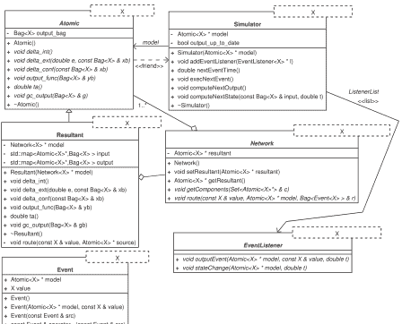

图 4.5 网络模型自顶向下仿真器的类图。

Set、Event 和 Network 类与离散时间仿真器中使用的相同；它们在第 3.2.4 节中进行了描述。Event 类保存模型的输入或输出，并将这些事件通过 Network 传递。Set 有四个基本特征；元素可以被添加和移除，它最多包含每个元素的副本一个，并且我们可以遍历其元素。Network 类有两个抽象方法，一个用于通过网络路由输入和输出事件，另一个用于获取其组件集合。Network 还有一个指向其 Resultant 的指针。

Resultant 是一个原子模型，它封装了 Network 并计算第 4.2.2 节中为其定义的 state transition、output 和 time advance 函数。与离散时间仿真器一样，组件输入的计算使用影响集合 E_d 向前进行，而不是使用影响者集合 I_d 向后进行。Resultant 除此之外是网络的时间推进函数（方程 4.13）、输出函数（方程 4.15）以及外部（方程 4.18）、内部（方程 4.17）和汇合（方程 4.20）转换函数的朴素实现。

下面列出了 *Resultant* 的实现。这种 *Resultant* 与离散时间 resultant 的相似性甚至延伸到代码的重用；*route* 方法与第 3.2.4 节中列出的是同一个。

##### Resultant 的实现

```cpp
#ifndef _adevs_resultant_h
#define _adevs_resultant_h
#include "adevs_network.h"
#include <vector>

namespace adevs
{

template <typename X> class Resultant: public Atomic<X>
{
  public:
    Resultant(Network<X>* model);
    void delta_int();
    void delta_ext(double e, const Bag<X>& xb);
    void delta_conf(const Bag<X>& xb);
    void output_func(Bag<X>& yb);
    double ta();
    void gc_output(Bag<X>& gb);
    ~Resultant() { delete model; }
  private:
    Network<X>* model;
    // Structure for the state and elapsed time of the components
    struct total_state_t
    {
        double e; Atomic<X>* m;
        // The STL set needs the less than operator
        bool operator<(const total_state_t& b) const { return m < b.m; }
    };
    std::vector<total_state_t> c;
    std::map<Atomic<X>*,Bag<X> > input, output;
    void route(const X& value, Atomic<X>* source);
};

template <typename X>
Resultant<X>::Resultant(Network<X>* model):
    Atomic<X>(model->model())
{
    model->setResultant(this);
    // Get the atomic components
    Set<Atomic<X>*> ctmp; model->getComponents(ctmp);
    // Set the elapsed time to zero and save the total state
    typename Set<Atomic<X>*>::iterator iter = ctmp.begin();
    for ( ; iter != ctmp.end(); iter++) {
        total_state_t s;
        s.e = 0.0; s.m = *iter;
        c.push_back(s);
    }
}

template <typename X>
void Resultant<X>::delta_int()
{
    // Save the time advance because it will change as the state is updated
    double time_adv = ta();
    // Input for each component was computed in the output_func method and
    // so only the new states are computed here.
    for (typename std::vector<total_state_t>::iterator iter = c.begin();
            iter != c.end(); iter++) {
        // Get the bag of input for the model
        Bag<X>& xb = input[(*iter).m];
        // Is this model in IMM?
        if ((*iter).m->ta()-(*iter).e <= time_adv) {
            // Internal event if no input
            if (xb.empty()) (*iter).m->delta_int();
            // Confluent event otherwise
            else (*iter).m->delta_conf(xb);
            // Reset the elapsed time
            (*iter).e = 0.0;
        }
        // otherwise, does it have input?
        else if (!xb.empty()) {
            (*iter).m->delta_ext((*iter).e + time_adv,xb);
            (*iter).e = 0.0;
        }
        // just update the elapsed time otherwise
        else (*iter).e += time_adv;
    }
}

template <typename X>
void Resultant<X>::delta_ext(double e, const Bag<X>& xb)
{
    // Send the input to the proper components
    for (typename Bag<X>::const_iterator iter = xb.begin();
            iter != xb.end(); iter++)
        route(*iter,this);
    // Compute next state of each component
    for (typename std::vector<total_state_t>::iterator iter = c.begin();
            iter != c.end(); iter++) {
        // Get the bag of input for the model
        Bag<X>& xb = input[(*iter).m];
        // Update the elapsed time
        (*iter).e += e;
        // If it has input, apply the external transition function
        if (!xb.empty()) {
            (*iter).m->delta_ext((*iter).e,xb);
            (*iter).e = 0.0;
        }
    }
}

template <typename X>
void Resultant<X>::delta_conf(const Bag<X>& xb)
{
    // Send the input to the proper components
    for (typename Bag<X>::const_iterator iter = xb.begin();
            iter != xb.end(); iter++)
        route(*iter,this);
    // The confluent transition is the same as the internal transition
    // when the network inputs have been routed to their destinations
    delta_int();
}
```

```cpp
114 template <typename X>
115 void Resultant<X>::output_func(Bag<X>& yb)
116 {
117   // Compute the output of each component and
118   // send those outputs to their destinations
119   for (typename std::vector<total_state_t>::iterator iter = c.begin();
120        iter != c.end(); iter++) {
121     // If this model is in the set IMM
122     if ((*iter).m->ta()-(*iter).e < ta()) {
123       Bag<X>& y = output[(*iter).m];
124       (*iter).m->output_func(y);
125       for (typename Bag<X>::iterator y_iter = y.begin();
126            y_iter != y.end(); y_iter++)
127         route(*y_iter,(*iter).m);
128     }
129   }
130   // Copy the network output to yb
131   Bag<X>& y = output[this];
132   for (typename Bag<X>::iterator iter = y.begin();
133        iter != y.end(); iter++)
134     yb.insert(*iter);
135 }
136
137 template <typename X>
138 double Resultant<X>::ta()
139 {
140   double min_to_go = DBL_MAX;
141   for (typename std::vector<total_state_t>::iterator iter = c.begin();
142        iter != c.end(); iter++) {
143     min_to_go = std::min((*iter).m->ta()-(*iter).e,min_to_go);
144   }
145   return min_to_go;
146 }
147
148 template <typename X>
149 void Resultant<X>::gc_output(Bag<X>& gb)
150 {
151   // Let the components clean up their output
152   for (typename std::vector<total_state_t>::iterator iter = c.begin();
153        iter != c.end(); iter++) {
154     (*iter).m->gc_output(output[(*iter).m]);
155     // Clear the output bag for the component
156     output[(*iter).m].clear();
157     // Clear the input bag for the component
158     input[(*iter).m].clear();
159   }
160   // Clear the input and output bag for the resultant
161   input[this].clear();
162   output[this].clear();
163 }

template <typename X>
void Resultant<X>::route(const X& value, Atomic<X>* source)
{
    Bag<Event<X> > r;
    model->route(value,source,r);
    for (typename Bag<Event<X> >::const_iterator iter = r.begin();
        iter != r.end(); iter++) {
        // If this is an output from the network
        if ((*iter).model == this) output[this].insert((*iter).value);
        // otherwise it goes to an internal component
        else input[(*iter).model].insert((*iter).value);
    }
} // end of namespace
#endif
```

冲压机和钻床将演示如何使用仿真引擎。机器模型的实现如下所示。这段代码对应第 4.2.3 节给出的定义。构造函数接受用于区分钻床和冲压机的处理时间 t_m，并将初始状态设置为 p = 0 和 σ = t_m。还要注意，delta_conf 方法利用了如下事实：δ_con,m(s, q) = δ_ext,m(δ_int,m(s), 0, q)。

装配线的实现也列在下面，它反映了图 4.4。

##### 机器模型的实现

```cpp
#ifndef Machine_h_
#define Machine_h_
#include "adevs.h"

class Machine: public adevs::Atomic<int>
{
public:
    Machine(double tm):
        adevs::Atomic<int>(), tm(tm), sigma(tm), p(0) {}
    void delta_int() { p--; sigma = tm; }
    void delta_ext(double e, const adevs::Bag<int>& xb)
    {
        if (p > 0) sigma -= e;
        else sigma = tm;
        for (adevs::Bag<int>::iterator iter = xb.begin();
             iter != xb.end(); iter++)
            p += (*iter);
    }
    void delta_conf(const adevs::Bag<int>& xb)
    {
        delta_int();
        delta_ext(0.0,xb);
    }
    void output_func(adevs::Bag<int>& yb) { yb.insert(1); }
    double ta()
    {
        if (p > 0) return sigma;
        else return DBL_MAX;
    }
    void gc_output(adevs::Bag<int>&) {}
    double getSigma() const { return sigma; }
    int getParts() const { return p; }
private:
    const double tm; // Machining time
    int p; // Number of parts in the bin
    double sigma; // Time to the next output
};

#endif
```

##### 装配线模型的实现

```cpp
#ifndef _AssemblyLine_h_
#define _AssemblyLine_h_
#include "Machine.h"

class AssemblyLine: public adevs::Network<int>
{
  public:
    AssemblyLine():
      adevs::Network<int>(),
      // Create the components
      press(1.0),drill(2.0){}

    void getComponents(adevs::Set<adevs::Atomic<int>*>& c)
    {
      c.insert(&press);
      c.insert(&drill);
    }
    void route(const int& value, adevs::Atomic<int>* model,
      adevs::Bag<adevs::Event<int> >& r)
    {
      adevs::Event<int> x;
```

```cpp
cout << "drill = (" << assembly_line->getDrill()->getParts()
     << ", " << assembly_line->getDrill()->getSigma() << ")"
     << endl;
}
private:
    AssemblyLine* assembly_line;
};

int main()
{
    // Create the model, event listener, and simulator
    AssemblyLine* assembly_line = new AssemblyLine();
    Resultant<int>* r = new Resultant<int>(assembly_line);
    AssemblyLineListener* l = new AssemblyLineListener(assembly_line);
    Simulator<int>* sim = new Simulator<int>(r);
    sim->addEventListener(l);
    // Print the initial state of the model
    l->stateChange(r,0,0);
    // Run the simulation
    while (true) {
        // Bag for injecting the input
        Bag<int> input;
        // The value to inject
        int blanks;
        // Time to inject the input
        double t; int c;
        // Read the time and input values
        cin >> t >> c >> blanks;
        // If this is the end of the input, then quit
        if (cin.eof()) break;
        // Simulate until time t and then inject the input
        while (sim->nextEventTime() < t) {
            cout << endl;
            sim->execNextEvent();
        }
        // Simulate the transient events
        for (int i = 0; i < c && sim->nextEventTime() == t; i++) {
            cout << endl;
            sim->execNextEvent();
        }
        // Inject the input
        input.insert(blanks);
        cout << endl;
        sim->computeNextState(input,t);
    }
    // Run until the simulation completes
    while (sim->nextEventTime() < DBL_MAX) {
        cout << endl;
        sim->execNextEvent();
    72   }
    73   // Clean up
    74   delete sim; delete l; delete r;
    75   return 0;
    76 }
```

##### 给出输入文件

```
    0 0 1
    2 1 2
```

将该输入文件提供给仿真器，会重复第 4.2.3 节中手工完成的计算。手工仿真产生了装配线截至时刻 (3, 0) 的响应。计算机仿真在该时刻之前与手工仿真一致，并继续推进，在时刻 (7, 0) 产出最终零件，并在 (7, 1) 终止。该仿真的输出如下所示。阅读输出时请记住：当产生输出或状态改变时，时钟的整数部分会隐式推进：第一行显示时刻 (0, 0)，第二行显示 (0, 1)，第三行显示 (1, 1)，第四行显示 (2, 2)（紧接在 (2, 1) 的输入之后），依此类推。

```
    $ ./a.out < input
    State, t = 0, press = (0,1), drill = (0,2)

    State, t = 0, press = (1,1), drill = (0,2)

    State, t = 1, press = (0,1), drill = (1,2)

    State, t = 2, press = (2,1), drill = (1,2)

    Output, t = 3, y = 1
    State, t = 3, press = (1,1), drill = (1,2)

    State, t = 4, press = (0,1), drill = (2,1)

    Output, t = 5, y = 1
    State, t = 5, press = (0,1), drill = (1,2)

    Output, t = 7, y = 1
    State, t = 7, press = (0,1), drill = (0,2)
    $
```

比较由内容如下的文件 input.a 所产生的结果：

```
    0 0 1
    3 0 1
```

### 4.3 离散事件系统的仿真器

可以像第 3.3 节构建离散时间系统仿真器那样，构建离散事件系统的自底向上仿真器。算法几乎相同，只需作出修改以适应离散事件系统状态转移函数和输出函数的定义。这些修改将与离散时间仿真器和离散事件仿真器的 Resultant 类之间的差异非常相似。

在任意特定时刻，大型离散事件系统中的大多数组件不会产生输出或改变状态。如果我们只关心事件实际发生的那些时刻，那么按照离散时间仿真器的模式构建的简单实现会浪费计算资源。只需稍作努力，就可以消除三项具体负担。

第一项负担在于网络状态转移函数和输出函数的计算。Resultant 的内部、外部和合流转移函数会遍历网络中的每个原子模型，并为其计算新状态或更新其已流逝时间。很可能只有少数组件会真正改变状态；如果我们只处理这些模型，就可以避免为其他模型递增已流逝时间的开销。当一个模型包含许多组件时，这种节省相当可观。

第二项负担在于网络时间推进函数的计算。这需要找到集合中的最小值，而 Resultant 中使用的朴素实现会遍历集合中的每个成员来找到该最小值。然而，如果模型按下次事件时间的顺序保持排序，那么在需要计算输出函数和状态转移函数时，就可以快速识别出即将发生事件的模型。

第三项负担是路由算法所使用的输入包和输出包所需的内存。只有当模型产生输出或接收输入时才需要这些包，而这些操作相对不频繁。原则上，只需为每次迭代中活跃的少量模型分配少量包。当仿真非常大量的组件时，这样做可以节省大量内存。此外，这些包通常只保存少量对象，而且这些对象不需要按任何特定顺序保存。两项优化将利用这些事实，减少仿真引擎管理输入和输出事件所花费的时间和空间开销。

通过考虑这些问题，高效的仿真引擎会比第 4.2.4 节展示的自顶向下仿真器复杂得多。然而请记住，高效仿真器无非就是针对上述系统类的仿真器。构建将从主要数据结构开始：事件调度表和 Bag。有了这些之后，其余部分就很直接，而且其中大部分借鉴自离散时间系统仿真器。算法 3.6 用于将事件从输入转换为输出，反之亦然；仿真器的接口将与离散时间系统的接口非常相似，只是在需要为适应不规则时间推进而作出修改的地方有所不同，如第 4.2.4 节所示。


#### 4.3.1 事件调度

事件调度的目的是按原子模型下一次自主动作的时间对原子模型集合进行排序。用于此目的的数据结构有很多（例如参见参考文献 15、41、42、54 和 121，但请注意这方面的文献非常庞大），但二叉堆（以下简称“堆”）因两个原因特别合适：

1. 堆中的条目数最多为模拟器中原子模型的数量，实际上堆的大小通常要小得多。显式堆在数组内部实现，利用这一特性使其能够适应一个小而连续的内存区域。
2. 模拟器所需的最常见操作是重新调度原子模型。在堆内部将对象移动到新位置的成本相对较低，并且这种高效的重新调度功能可以轻松实现。

显式堆将其 N 个项目存储在数组的前 N + 1 个元素中。因此，数组可以从小开始并根据需要增长；此外，在执行此操作时无需重新组织数组的内容。增加更多空间会产生扩展为堆分配的当前内存块的成本，或者如果该块太小，则需要找到新块并将堆的元素复制到其中。如果每次将堆的大小加倍，则在长时间的模拟运行过程中调整大小的情况将很少发生。堆保证在大小大于或等于模拟中的原子模型数量时停止增长，并且可能在此点到达之前很久就停止增长。

堆将原子模型组织成二叉树。分配给模型的位置选择使得其下一次事件的时间小于或等于其子节点（或子节点）的下一次事件的时间。这在图 4.6 中进行了说明。

第一个节点，即堆中最小的元素，占用数组中的第一个位置。其两个子节点占用位置 2 和 3。位置 2 的子节点具有位置 4 和 5；位置 3 的子节点具有位置 6 和 7。规则是堆中位置 k 的模型其左子节点在位置 2k，右子节点在位置 2k + 1。数组中的零位置是一个哨兵值，其用途稍后会变得清晰。模型从位置一开始占用。

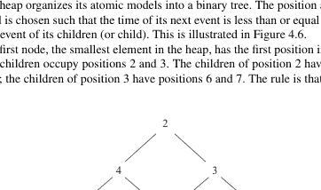

| -1 | 2 | 4 | 3 | 8 | 6 | 4 | 10 | 9 |
| --- | --- | --- | --- | --- | --- | --- | --- | --- |

**图 4.7** 图 4.6 中的二叉树存储在数组中。

堆支持四种操作：查找具有最小优先级的项目或项目、在堆中插入新项目、从堆中删除项目以及在堆内移动项目。后两种操作要求模型能够在数组内部快速找到。为此，在 Atomic 类中添加了变量 q_index。q_index 的值为零表示模型不在堆中，否则为模型的数组索引。

##### Schedule 类的实现

```cpp
#ifndef __adevs_schedule_h_
#define __adevs_schedule_h_
#include "adevs_models.h"
#include <cfloat>
#include <cstdlib>

namespace adevs
{

template <class X> class Schedule
{
  public:
    // Creates a scheduler with the default or specified initial capacity.
    Schedule(unsigned int capacity = 100):
      capacity(capacity),size(0),heap(new heap_element[capacity])
    {
      heap[0].priority = -1.0; // This is a sentinel value
    }
    // Get the model at the front of the queue.
    Atomic<X>* getMinimum() const { return heap[1].item; }
    // Get the time of the next event.
    double minPriority() const { return heap[1].priority; }
    // Get the imminent models and set their active flags to true.
    void getImminent(Bag<Atomic<X>*>* imm) const { getImminent(imm,1); }
    // Remove the model at the front of the queue.
    void removeMinimum();
    // Remove the imminent models from the queue.
    void removeImminent();
    // Add, remove, or move a model as required by its priority.
    void schedule(Atomic<X>* model, double priority);
    // Returns true if the queue is empty, and false otherwise.
    bool empty() const { return size == 0; }
    // Get the number of elements in the heap.
    unsigned int getSize() const { return size; }
    // Destructor.
    ~Schedule() { delete [] heap; }
  private:
    // Definition of an element in the heap.
    struct heap_element
    {
        Atomic<X>* item;
        double priority;
        // Constructor initializes the item and priority
        heap_element():item(NULL),priority(DBL_MAX){}
    };
    unsigned int capacity, size;
    heap_element* heap;
    // Double the schedule capacity
    void enlarge();
    // Move the item at index down and return its new position
    unsigned int percolate_down(unsigned int index, double priority);
    // Move the item at index up and return its new position
    unsigned int percolate_up(unsigned int index, double priority);
    // Construct the imminent set recursively
    void getImminent(Bag<Atomic<X>*>& imm, unsigned int root) const;
};

template <class X>
void Schedule<X>::getImminent(Bag<Atomic<X>*>& imm, unsigned int root) const
{
    // Stop at the bottom or where the next priority is not the minimum
    if (root > size || heap[1].priority < heap[root].priority) return;
    heap[root].item->active = true; // Put the model into the imminent set
    imm.insert(heap[root].item);
    getImminent(imm,root*2); // Look for imminent models in the left subtree
    getImminent(imm,root*2+1); // Look in the right subtree
}

template <class X>
void Schedule<X>::removeMinimum()
{
    if (size == 0) return; // Don't do anything if the heap is empty
    size--; // Otherwise reduce the size of the schedule
    // Set index to 0 to show that this model is not in the schedule
        return index;
}
template <class X>
void Schedule<X>::enlarge()
{
    heap_element* rheap = new heap_element[capacity*2];
    for (unsigned int i = 0; i < capacity; i++)
        rheap[i] = heap[i];
    capacity *= 2;
    delete [] heap;
    heap = rheap;
}
} // end of namespace
#endif
```

获取具有下一次事件时间的元素的有三种方法。前两种方法 getMinimum 和 minPriority 分别返回存储在数组第一个位置的项目或优先级。为了支持第三种方法 getImminent，在 Atomic 类中添加了变量 active。该变量由模拟器用于快速确定模型是否在紧迫模型集合中。getImminent 方法递归地遍历堆以找到下一次事件时间等于 minPriority 的模型，为这些模型设置 active 标志，并将它们放入紧迫模型的 Bag 中。沿树中任何分支的下降在找到下一次事件时间大于最小值的模型时停止。

使用 Bag 和 active 标志而不是 Set 来存储紧迫模型是一种优化，可以节省原本昂贵的成员资格测试的成本。Schedule 避免了这些测试，因为每个紧迫模型在堆中恰好出现一次。active 标志由模拟器用于快速测试紧迫集合中的成员资格。这很重要，因为紧迫集合中的成员资格是模拟算法的核心部分，而昂贵的成员资格测试会严重降低模拟器的性能。

有三种公共方法用于插入、删除和移动项目：schedule、removeImminent 和 removeMinimum。为了完成工作，这些方法依赖于一对私有方法，即数据结构的工作马：percolate_up 和 percolate_down。这些方法接受要调整的位置及其新优先级，并重新排列堆以在新优先级所属的位置创建空位。空位的位置将被返回，然后模型可以插入其中。

percolate_up 方法通过将其移向堆顶来减少模型的下一次事件时间。该方法将待调整模型的下一次事件时间与其父节点的下一次事件时间进行比较，如果待调整模型的下一次事件时间小于或等于父节点的时间，则父节点和子节点交换位置。这会重复进行，直到比较失败为止，并且我们找到了合适的

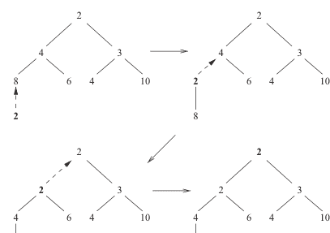

**图4.8** 使用 *percolate_up* 将模型向上移动；粗体的 **2** 正在被调整。

模型的位置。为避免对堆顶进行特殊测试，位置零处的哨兵被赋予下一个事件时间为 −1。*percolate_up* 方法的操作如图4.8所示。

*percolate_down* 方法通过将其向堆底部移动来增加模型的下一个事件时间。该方法将待调整位置的下一个事件时间与其子节点的下一个事件时间进行比较，如果这些事件时间中最小的一个小于父节点，则父节点与该子节点交换位置。重复此过程直到比较失败或到达堆底部，从而得到模型正确的位置。*percolate_down* 方法的操作如图4.9所示。

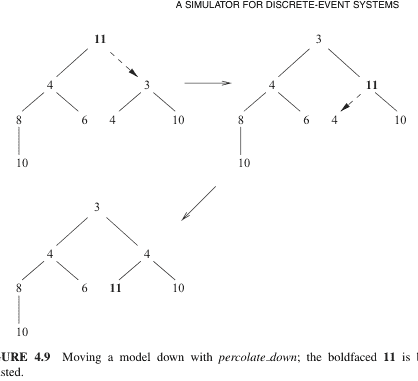

*removeMinimum* 方法通过用堆中最后一个元素替换堆中的第一个元素，然后将该元素向下渗透到其正确位置来移除堆中的第一个元素。最后一个元素（现在是第一个元素）会沉入堆中，并在其下一个事件时间小于其子节点且大于或等于其父节点的位置处稳定下来。旧的最小值，即被移除的元素，其 q_index 被设为零以表示它不再在调度中。新的最小值是被移除最小值的子节点中较小的一个，如果堆为空，则为 NULL（具有无限优先级）。

为移除所有即将发生的模型，*removeImminent* 方法会反复移除最小元素，直到堆为空或最小元素的下一个事件时间大于即将发生模型的下一个事件时间。

*schedule* 方法可以将模型插入堆中、从堆中移除模型并调整模型在堆中的位置。给定一个模型及其下一个事件时间时，它会执行四种操作之一。如果模型已在堆中，则（1）如果下一个事件时间处于无穷大，则将其移除，或（2）调整其位置以匹配下一个事件时间；如果模型不在堆中，则（3）如果其下一个事件时间不是无穷大，则将其插入——否则，（4）模型不在堆中且其下一个事件处于无穷大，因此调度不处理它。

将模型插入调度以及在调度中移动模型是使用 *enlarge*、*percolate_up* 和 *percolate_down* 方法完成的。模型插入分为两个步骤：（1）堆的大小增加 1，并在需要时分配额外的内存，以及（2）模型被放置在堆的最后一个位置并向上渗透，直到占据其正确位置。要调整已在调度中的模型的位置，如果下一个事件时间减少，则向上渗透；如果下一个事件时间增加，则向下渗透；如果下一个事件时间不变，则保持原位。

从堆中移除模型需要两个步骤：（1）将其向上渗透到第一个位置（即最小位置），然后（2）通过调用 *removeMinimum* 将其移除。必须仔细注意 *percolate_up* 方法的实现方式。诱人但错误的做法是在模型的下一个事件时间小于其父节点时停止向上移动模型。如果有多个具有相同优先级的模型，则可以节省几次交换和比较。然而，这可能会使我们想要删除的模型停留在树的根节点以下。因此，在比较子节点与父节点时，向上移动的测试必须小于或等于。许多（也许是全部）数据结构书籍中介绍的 *percolate_up* 算法使用 <，因此必须牢记我们事件调度这一特殊要求（参见例如 Weiss 的 *Data Structures and Algorithm Analysis in C* [145]）。⁵

⁵ 另一种解决方案是使用 −1 或其他无效的下一个事件时间来从堆中移除模型。这要求哨兵值小于 −1，或小于用于移除的任何其他值。

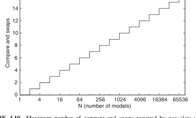

**图4.10** *percolate_up* 和 *percolate_down* 所需的最大比较次数和交换次数作为堆中模型数量的函数。x 轴采用对数刻度；堆管理大量模型的能力显而易见。

将模型放入堆或从堆中移除所需的时间主要由 *percolate_up* 和 *percolate_down* 方法决定。这些方法中 *for* 循环的迭代次数最多等于堆的高度。如果它包含 *N* 个原子模型，则高度最多为 ⌊log₂ *N*⌋。这是首先观察到高度为 *h* 的堆中的节点数介于 2^h 和 2^{h+1} − 1 之间得出的（单个元素的堆高度为零），即 *N* ∈ [2^h, 2^{h+1} − 1]。对于给定的 *N*，满足此表达式的最小整数 *h* 值是 ⌊log₂ *N*⌋，因此执行时间的界限。

在堆中插入或移动模型需要一次 *percolate_up* 或 *percolate_down* 调用，因此插入或调整的成本上限为 ⌊log₂ *N*⌋。移除模型需要一次 *percolate_up* 调用和第二次 *percolate_down* 调用，因此其成本是插入或调整的两倍。尽管如此，堆的操作总体上执行时间与 ⌊log₂ *N*⌋ 成比例，该比例已在图4.10中绘制。

此规则的唯一例外是 *enlarge* 方法。其时间主要花费在分配新数组、将旧数组复制到新数组，然后释放旧数组。内存分配本身就很慢，再加上传输数组内容所需的内存赋值。幸运的是，堆很少被放大。在长时间运行的模拟中，*enlarge* 在早期被调用以将堆增长到通常小于 *N* 的某个大小，而运行后期调用则极为罕见。因此，*enlarge* 方法不是大多数模拟运行时间的显著贡献者。

#### 4.3.2 袋

在整个仿真引擎中都使用小型、无序的对象集合，引擎对其执行三项操作：遍历元素、插入元素和移除元素。一个专门为此角色构建的轻量级类通过减少这些常见操作的执行时间来提高仿真引擎的性能。这个轻量级类是 *Bag*，它将元素存储在数组中。数组会增长以容纳放入袋中的最大数量的元素，但在元素被移除时不会缩小。随着袋在其生命周期中被重复使用，其大小与堆的大小一样趋于稳定，因此长时间运行的模拟中调整大小的总体成本很小。

元素通过将其放置在数组的末尾插入到袋中。如果数组太小，则在插入元素之前其大小会加倍。元素通过将袋中最后一个项目移动到被移除项目的<|message|> 位置来移除。要从数组中移除所有元素，只需将其大小设为 0 即可。这样，元素始终存储在连续的位置，可以轻松遍历。

下面显示了袋类的完整列表。它实现了 STL *multiple associative container* 接口的一部分，但对于其中一些方法的时间限制不满足。最常用的方法——*insert*、*remove* 和 *clear*——只需要简单的赋值操作，必要时还包括递增操作。*iterator* 同样简单，是底层数组的薄封装。只有两种方法不以恒定时间执行：（1）如果 *insert* 方法需要放大数组，则必须遍历整个集合以将旧数组的元素分配到新数组；以及（2）如果 *erase* 方法需要在数组中定位特定元素，则必须逐个元素搜索才能找到它。

##### Bag 类的实现

```cpp
#ifndef _adevs_bag_h
#define _adevs_bag_h
#include <cstdlib>

namespace adevs
{

// The Bag is (almost) a model of a STL Multiple Associative Container.
// The STL methods that are implemented conform to the standard except
// in regards to their computational complexity.
template <class T> class Bag
{
    public:
        // A bidirectional iterator for the Bag
        class iterator
```


```cpp
{
public:
    iterator(unsigned int start = 0, T* b = NULL):
        i(start),b(b){}
    iterator(const iterator& src):
        i(src.i),b(src.b){}
    const iterator& operator=(const iterator& src)
    {
        i = src.i;
        b = src.b;
        return *this;
    }
    bool operator==(const iterator& src) const {
        return i==src.i;
    }
    bool operator!=(const iterator& src) const {
        return i != src.i;
    }
    T& operator*() { return b[i]; }
    const T& operator*() const { return b[i]; }
    iterator& operator++() { ++i; return *this; }
    iterator& operator--() { i--; return *this; }
    iterator& operator++(int) { i++; return *this; }
    iterator& operator--(int) { --i; return *this; }
private:
    friend class Bag<T>;
    unsigned int i;
    T* b;
};
typedef iterator const_iterator;
// Create an empty bag with an initial capacity
Bag(unsigned int cap = 8):
    cap_(cap),size_(0),b(new T[cap]){}
// Copy constructor uses the = operator of T
Bag(const Bag<T>& src):cap_(src.cap_),size_(src.size_)
{
    b = new T[src.cap_];
    for (unsigned int i = 0; i < size_; i++)
        b[i] = src.b[i];
}
// Assignment operator uses the = operator of T
const Bag<T>& operator=(const Bag<T>& src)
{
    cap_ = src.cap_;
    size_ = src.size_;
    delete [] b;
    b = new T[src.cap_];
    for (unsigned int i = 0; i < size_; i++)
        b[i] = src.b[i];
    return *this;
}
// Count the instances of a stored in the bag
unsigned count(const T& a) const
{
    unsigned result = 0;
    for (unsigned i = 0; i < size_; i++)
        if (b[i] == a) result++;
    return result;
}
// Get the number of elements in the bag
unsigned size() const { return size_; }
// Same as size()==0
bool empty() const { return size_ == 0; }
// Get an iterator pointing to the first element in the bag
iterator begin() const { return iterator(0,b); }
// Get an iterator starting just after the last element
iterator end() const { return iterator(size_,b); }
// Erase the first instance of k
void erase(const T& k)
{
    iterator p = find(k);
    if (p != end()) erase(p);
}
// Erase the element pointed to by p
void erase(iterator p)
{
    size_--;
    b[p.i] = b[size_];
}
// Remove all of the elements from the bag
void clear() { size_ = 0; }
// Find the first instance of k, or end() if no instance is found.
// Uses == for comparing T.
iterator find(const T& k) const
{
    for (unsigned i = 0; i < size_; i++)
        if (b[i] == k) return iterator(i,b);
    return end();
}
// Put t into the bag
void insert(const T& t)
{
    if (cap_ == size_) enlarge(2*cap_);
    b[size_] = t;
    size_++;
}
~Bag() { delete [] b; }
private:
    unsigned cap_, size_;
    T* b;
    // Adds the specified capacity to the bag.
    void enlarge(unsigned adjustment)
    {
        cap_ = cap_ + adjustment;
        T* rb = new T[cap_];
        for (unsigned int i = 0; i < size_; i++)
            rb[i] = b[i];
        delete [] b;
        b = rb;
    }
};
} // end of namespace

#endif
```

实际上在任何时刻只需要很少的几个袋子，为每个原子模型创建单独的袋子以及在路由事件时创建和销毁袋子都是浪费的。模拟器可以通过拥有一个按需重用的袋子缓存来减少内存使用。

该缓存由 *ObjectPool* 类实现，它存储一组可重用对象。它有两个方法加上构造函数和析构函数。构造函数创建初始对象池。*make_obj* 方法从池中获取对象并返回它，如果池为空，则创建新对象。*destroy_obj* 方法将提供的对象放入池中。调用方有责任确保对象在被返回以供重用之前恢复到初始状态。析构函数删除池。*ObjectPool* 的代码如下所示。

##### ObjectPool 类的实现

```cpp
#ifndef __adevs_object_pool_h_
#define __adevs_object_pool_h_
#include "adevs_bag.h"

namespace adevs
{

template <class T> class object_pool
{
public:
    // Construct a pool with a specific initial population
    object_pool(unsigned int pop = 0):pool()
    {
        for (unsigned int i = 0; i < pop; i++)
            pool.insert(new T());
    }
    // Create an object
    T* make_obj()
    {
        T* obj;
        if (pool.empty()) obj = new T;
        else
        {
            obj = *(pool.end()--);
            pool.erase(pool.end()--);
        }
        return obj;
    }
    // Return an object to the pool
    void destroy_obj(T* obj) { pool.insert(obj); }
    // Delete all objects in the pool
    ~object_pool()
    {
        typename Bag<T*>::iterator iter = pool.begin();
        for (; iter != pool.end(); iter++) delete *iter;
    }
private:
    Bag<T*> pool;
};

} // end of namespace

#endif
```

#### 4.3.3 仿真引擎

前一个仿真引擎对原子模型所做的事情，这个仿真引擎对网络模型做：(1) 获取其下一次自主动作的时间，(2) 在该时间获取网络及其组件的输出，(3) 计算其下一次内部事件，(4) 在上一次状态变化和下一次自主动作所跨越的区间内注入输入。模拟器接受与之前相同的轨迹类型，将其应用于网络的结果以计算其下一个状态。

构成仿真引擎的类如图 4.11 所示。它们与第 3.3 节中构成离散时间模拟器的类非常相似。当然，时间从离散时间模拟器中的整数改为离散事件模拟器中的 double；模拟时钟的整数部分是隐含的。Dtns 类改为 Devs 类，表示离散事件系统，命名空间也相应改为 adevs，表示离散事件模拟器。Atomic 类需要一个现在已熟悉的新接口。最显著的变化在 Simulator 类中，其接口必须以小方式改变，而实现则大幅改变。

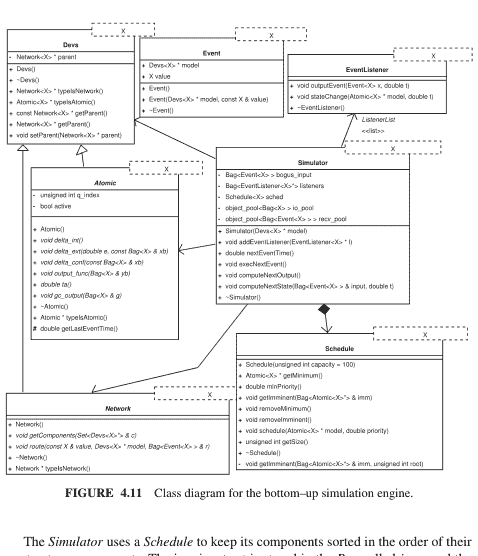

*Simulator* 使用 *Schedule* 按其下一次自主事件的顺序对组件进行排序。紧迫集合存储在名为 *imm* 的 *Bag* 中，而由输入激活的模型集合则存储在名为 *activated* 的 *Bag* 中。*Atomic* 模型的 active 标志用于测试这些袋子的成员资格。每个 *Atomic* 对象根据需要从对象池中分配一个 *Bag* 来存储其输入和输出，并且每个 *Atomic* 模型都维护一个初始为零的自身时间列表。

*Simulator* 的构造函数深度优先遍历网络，找到具有有限时间推进的原子模型并将其插入调度。私有 *schedule* 方法用于执行此操作。它设置模型上次事件的时间，并将下一次事件时间计算为上次事件时间加上时间推进。对无限时间推进的检查有助于避免将可表示的最大 double 与其他数字相加时可能出现的问题。例如，如果结果是 *not a number* (nan) 或 *infinity* (inf)，则 *Schedule* 很可能崩溃。GNU C++ 编译器（或至少版本 4.2.3）在其上加上正 double 时给出 DBL_MAX，但不能保证其他编译器会给出相同结果。因此额外的测试是必要的预防措施。一旦下一次事件时间已知，模型将被分配到事件调度中的适当位置。

*Network* 的下一次自主动作等于其紧迫组件的下一次事件时间，而这些组件是事件调度顶部的 *Atomic* 模型。因此，*nextEventTime* 方法只需返回 *Schedule* 中最小的事件时间。

*computeNextOutput* 方法假设在上一次事件和下一次自主事件之间不会有输入，并继续计算紧迫集合以及受紧迫组件影响的模型的输入。该方法首先测试紧迫集合是否为空；如果不为空，则必要的计算已完成，方法返回。否则，紧迫模型直接从 *Schedule* 获取，*Schedule* 将它们放入 *imm* 袋并将其 active 标志设为 true。紧迫模型的输出被计算并使用算法 3.6 路由到应接收它的模型。尚未在 *imm* 或 *activated* 袋中的接收者将被插入 *activated* 袋并将其 active 标志设为 true。*route* 方法调用已向 *Simulator* 注册的 *EventListeners* 的 *outputEvent* 方法。

*computeNextState* 方法将两种允许的轨迹应用于网络。如果输入袋为空且 *t* 等于下一次事件的时间，则这是以下一次自主动作结束的空轨迹。在这种情况下，调用 *computeNextOutput* 方法以确保紧迫和激活袋是最新的，并为这些模型计算新状态。否则，有必要撤销对紧迫和激活袋的推测性计算，然后将注入的输入路由到适当的组件。完成此操作后，为激活的模型计算新状态。最后，将紧迫（如有）和激活的模型重新调度，删除紧迫模型的输出，并将用于输入和输出计算的袋子返回到池中。

*Simulator* 利用 *ObjectPool* 类来最小化为处理输入和输出以及路由事件而创建的 *Bags* 数量。*route* 方法使用来自对象池的 *Bag*，而不是创建新 *Bag* 然后销毁它。*inject_input* 和 *clean_up* 方法相互补充，以便在需要时为原子模型分配输入袋，并在模型使用完毕后收回该袋。*clean_up* 方法同样补充 *computeNextOutput* 方法，通过给 *Atomic* 模型机会删除其输出对象，然后收回分配给该模型用于存储其输出的袋子。

*Simulator* 的代码如下所示。其实现仅需 275 行代码（按 UNIX 命令 *wc -l* 统计）。支持类（*Schedule*、*Bag*、*ObjectPool*、*Atomic*、*Network* 等）使离散事件仿真引擎的总代码行数达到 942。其中约三分之一，362 行，用于 *Bag*、*ObjectPool* 和 *Schedule*，这些都是优化。仿真引擎的核心相当简单。


##### Simulator 类的实现

```cpp
#ifndef __adevs_simple_simulator_h_
#define __adevs_simple_simulator_h_
#include "adevs_models.h"
#include "adevs_event_listener.h"
#include "adevs_sched.h"
#include "adevs_bag.h"
#include "adevs_set.h"
#include "object_pool.h"
#include <cassert>
#include <cstdlib>
#include <iostream>
#include <vector>

namespace adevs
{

// This class implements the bottom up simulation procedure
template <class X> class Simulator
{
  public:
    // Create a simulator for the model
    Simulator(Devs<X>* model);
    // Add an event listener
    void addEventListener(EventListener<X>* l) { listeners.insert(l); }
    // Get the time of the next event
    double nextEventTime() { return sched.minPriority(); }
    // Execute the simulation cycle at nextEventTime()
    void execNextEvent()
    {
      computeNextOutput();
      computeNextState(bogus_input,sched.minPriority());
    }
    // Compute the output values of the imminent models. This will
    // notify the EventListener of output events.
    void computeNextOutput();
    // Apply the input at time t and then compute the next state. This
    // will produce output too if t == nextEventTime().
    void computeNextState(Bag<Event<X> >& input, double t);
    // Deletes the simulator, but leaves the model intact.
    ~Simulator();
  private:

    Bag<Event<X> > bogus_input; // Empty bag for execNextEvent()
    Bag<EventListener<X>*> listeners; // Registered event listeners
    Schedule<X> sched; // The event schedule
    // Set of imminent models and models activated by input
    Bag<Atomic<X>*> imm, activated;
    // Pools of preallocated, commonly used objects
    object_pool<Bag<X> > io_pool;
    object_pool<Bag<Event<X> > > recv_pool;
    // Schedule an atomic model for t + ta()
    void schedule(Atomic<X>* model, double t);
    // Route an event from a source having the specified parent
    void route(Network<X>* parent, Devs<X>* src, X& x);
    // Add an event to the input bag for an atomic model. If the model's
    // active flag is false, then this method adds the model to the
    // activated bag and sets its active flag to true.
    void inject_event(Atomic<X>* model, X& value);
    // Set the model's active flag to false, delete the contents of
    // its output bag, and return the input and output bags to the pool
    void clean_up(Atomic<X>* model);
    // Notify listeners of an output event.
    void notify_output_listeners(Devs<X>* model,
        const X& value, double t);
    // Notify listeners of a change in state
    void notify_state_listeners(Atomic<X>* model, double t);
    // Put the atomic leaves of the network into the set s
    void getAllChildren(Network<X>* model, Set<Atomic<X>*>& s);
};

template <class X>
Simulator<X>::Simulator(Devs<X>* model)
{
    // Put an atomic model into the schedule
    if (model->typeIsAtomic() != NULL)
        schedule(model->typeIsAtomic(),0.0);
    // Otherwise find the set of atomic components and put those into
    // the schedule
    else {
        Set<Atomic<X>*> A;
        getAllChildren(model->typeIsNetwork(),A);
        for (typename Set<Atomic<X>*>::iterator iter = A.begin();
            iter != A.end(); iter++)
            schedule(*iter,0.0);
    }
}

template <class X>
void Simulator<X>::schedule(Atomic<X>* model, double t)
{
    model->tL = t; // Set the time of the last event
    double dt = model->ta(); // Compute the time advance
    // Schedule the model for activity at its time of next event
    if (dt == DBL_MAX) sched.schedule(model,DBL_MAX);
    else sched.schedule(model,t+dt);
}

template <class X>
void Simulator<X>::getAllChildren(Network<X>* model, Set<Atomic<X>*>& s)
{
    Set<Devs<X>*> tmp;
    model->getComponents(tmp); // Get the set of components
    // Put the atomic components into s and call getAllChildren for
    // the network components
    typename Set<Devs<X>*>::iterator iter;
    for (iter = tmp.begin(); iter != tmp.end(); iter++) {
        if ((*iter)->typeIsNetwork() != NULL)
            getAllChildren((*iter)->typeIsNetwork(),s);
        else
            s.insert((*iter)->typeIsAtomic());
    }
}


template <class X>
void Simulator<X>::computeNextOutput()
{
    // If the imminent set is up to date, then just return
    if (imm.empty() == false) return;
    // Get the imminent models from the schedule. This sets the active flags.
    sched.getImminent(imm);
    // Compute output functions and route the events. The bags of output
    // are held for garbage collection at a later time.
    for (typename Bag<Atomic<X>*>::iterator imm_iter = imm.begin();
         imm_iter != imm.end(); imm_iter++) {
        Atomic<X>* model = *imm_iter;
        // Don't recalculate the model's output if we already have it
        if (model->y == NULL) {
            model->y = io_pool.make_obj();
            model->output_func(*model->y);
            // Route each event in y
            for (typename Bag<X>::iterator y_iter = model->y->begin();
                 y_iter != model->y->end(); y_iter++)
                route(model->getParent(),model,*y_iter);
        }
    }
}


template <class X>
void Simulator<X>::computeNextState(Bag<Event<X> >& input, double t)
{
    // If t is less than the next event time, make sure that
    // computeNextOutput() has not been called
    if (t < sched.minPriority() && !imm.empty())
        throw exception("Input can not precede output");
    // If the output function needs to be computed, then do it
    else if (t == sched.minPriority() && !imm.empty())
        computeNextOutput();
    // Route the injected inputs
    for (typename Bag<Event<X> >::iterator iter = input.begin();
         iter != input.end(); iter++) {
        Atomic<X>* amodel = (*iter).model->typeIsAtomic();
        if (amodel != NULL) inject_event(amodel,(*iter).value);
        else route((*iter).model->getNetwork(),(*iter).model,
                (*iter).value);
    }
    // Compute the states of all atomic models.
    for (typename Bag<Atomic<X>*>::iterator iter = imm.begin();
         iter != imm.end(); iter++) {
        // Compute the new state
        if ((*iter)->x == NULL) (*iter)->delta_int();
        else (*iter)->delta_conf((*iter)->x);
        // Notify listeners of the change in state
        notify_state_listeners(*iter,t);
        // Adjust the position of the model in the schedule
        schedule(*iter,t);
    }
    for (typename Bag<Atomic<X>*>::iterator iter = activated.begin();
         iter != activated.end(); iter++) {
        // Compute the new state
        (*iter)->delta_ext(t-(*iter)->tL,(*iter)->x);
        // Notify listeners of the change in state
        notify_state_listeners(*iter,t);
        // Adjust the position of the model in the schedule
        schedule(*iter,t);
    }
    // Cleanup after the models that changed state in this iteration
    for (typename Bag<Atomic<X>*>::iterator iter = imm.begin();
         iter != imm.end(); iter++)
        clean_up(*iter);
    for (typename Bag<Atomic<X>*>::iterator iter = activated.begin();
         iter != activated.end(); iter++)
        clean_up(*iter);
    // Empty the bags
    imm.clear();
    activated.clear();
}

template <class X>
void Simulator<X>::clean_up(Atomic<X>* model)
{
    model->active = false;
    if (model->x != NULL) {
        model->x->clear();
        io_pool.destroy_obj(model->x);
    }
    if (model->y != NULL) {
        model->gc_output(*(model->y));
        model->y->clear();
        io_pool.destroy_obj(model->y);
    }
    model->x = model->y = NULL;
}

template <class X>
void Simulator<X>::inject_event(Atomic<X>* model, X& value)
{
    if (model->active == false) activated.insert(model);
    if (model->x == NULL) model->x = io_pool.make_obj();
    model->active = true;
    model->x->insert(value);
}

template <class X>
void Simulator<X>::route(Network<X>* parent, Devs<X>* src, X& x)
{
    // Notify event listeners if this is an output event
    if (parent != src) notify_output_listeners(src,x,sched.minPriority());
    // No one to do the routing, so return
    if (parent == NULL) return;
    // Compute the set of receivers for this value
    Bag<Event<X> >* recvs = recv_pool.make_obj();
    parent->route(x,src,recvs);
    // Deliver the event to each of its targets
    Atomic<X>* amodel = NULL;
    typename Bag<Event<X> >::iterator recv_iter = recvs->begin();
    for (; recv_iter != recvs->end(); recv_iter++) {
        // if the destination is an atomic model, then add the event to the
        // I/O bag for that model and put the model in the list of
        // activated models
        amodel = (*recv_iter).model->typeIsAtomic();
        if (amodel != NULL) inject_event(amodel,(*recv_iter).value);
        // if this is an external output from the parent model
        else if ((*recv_iter).model == parent)
            route(parent->getParent(),parent,(*recv_iter).value);
        // otherwise it is an input to a coupled model
        else route((*recv_iter).model->typeIsNetwork(),(*recv_iter).model,
                   (*recv_iter).value);
    }
    recvs->clear();
    recv_pool.destroy_obj(recvs);
}

template <class X>
```

```cpp
144    void Simulator<X>::notify_output_listeners(Devs<X>* model,
145        const X& value, double t)
146    {
147        Event<X> event(model,value);
148        typename Bag<EventListener<X>*>::iterator iter;
149        for (iter = listeners.begin(); iter != listeners.end(); iter++)
150            (*iter)->outputEvent(event,t);
151    }
152
153    template <class X>
154    void Simulator<X>::notify_state_listeners(Atomic<X>* model, double t)
155    {
156        typename Bag<EventListener<X>*>::iterator iter;
157        for (iter = listeners.begin(); iter != listeners.end(); iter++)
158            (*iter)->stateChange(model,t);
159    }
160
161    template <class X>
162    Simulator<X>::~Simulator()
163    {
164        // Clean up the models with stale IO
165        typename Bag<Atomic<X>*>::iterator imm_iter;
166        for (imm_iter = imm.begin(); imm_iter != imm.end(); imm_iter++)
167            clean_up(*imm_iter);
168        for (imm_iter = activated.begin(); imm_iter != activated.end();
169            imm_iter++)
170            clean_up(*imm_iter);
171    }
172
173    } // End of namespace
174
175    #endif
```

为了说明该仿真引擎的用法，再次考虑第 4.2.4 节中建模的装配线。*机器*（Machine）类在与新的仿真引擎一起使用时不需要任何改动。*装配线*（AssemblyLine）由于不再包含在*合成体*（Resultant）中，因此可以在其*路由*（route）方法中直接向自身发送事件并从自身接收事件。它还必须更改其*获取组件*（getComponents）和*路由*（route）方法的签名，以接受*Devs*对象而不是*Atomic*对象；最后，drill 和 press 的 parent 字段必须设置为*装配线*（AssemblyLine），这样路由算法才能工作。新的实现如下所示。

##### 新仿真引擎的 AssemblyLine 实现

```cpp
1    #ifndef _AssemblyLine_h_
2    #define _AssemblyLine_h_
3    #include "Machine.h"

class AssemblyLine: public adevs::Network<int>
{
  public:
    AssemblyLine():
      adevs::Network<int>(),
      press(1.0),drill(2.0) // Create the component models
    {
      // Remember to set their parent, otherwise the Simulator will
      // not be able to route their output events
      press.setParent(this);
      drill.setParent(this);
    }
    void getComponents(adevs::Set<adevs::Devs<int>*>& c)
    {
      c.insert(&press);
      c.insert(&drill);
    }
    void route(const int& value, adevs::Devs<int>* model,
               adevs::Bag<adevs::Event<int> >& r)
    {
      adevs::Event<int> x;
      x.value = value;
      // External input to the network goes to the press
      if (model == this) x.model = &press;
      // Output from the drill leaves the assembly line
      else if (model == &drill) x.model = this;
      // Output from the press goes to the drill
      else if (model == &press) x.model = &drill;
      r.insert(x);
    }
    Machine* getPress() { return &press; }
    Machine* getDrill() { return &drill; }
  private:
    Machine press, drill;
};

#endif
```

主仿真程序也必须更改，以适应新的接口。*装配线监听器*（AssemblyLineListener）过滤事件，只提取来自网络的输出，并分别打印 drill 和 press 的状态；*装配线*（AssemblyLine）不再出现在*状态变化*（stateChange）回调中。这会稍微改变程序的输出，因为*机器*（Machine）的状态只在它发生变化时打印，而不是在每个仿真事件时打印。最后的更改是输入注入仿真的位置；现在必须将其放入一个指向*装配线*（AssemblyLine）的*事件*（Event）中。新的实现如下所示。

##### 新装配线仿真的主函数

```cpp
#include "AssemblyLine_bottom_up.h"
#include <iostream>
using namespace std;
using namespace adevs;

// Listener for recording the state and output of the assembly line.
class AssemblyLineListener: public EventListener<int>
{
public:
    AssemblyLineListener(AssemblyLine* assembly_line):
        assembly_line(assembly_line) {}
    void outputEvent(Event<int> y, double t)
    {
        // Output from the AssemblyLine
        if (y.model == assembly_line)
            cout << "Output, t = " << t << ", y = " << y.value << endl;
    }
    void stateChange(Atomic<int>* model, double t)
    {
        // Get the model of the machine
        Machine* m = dynamic_cast<Machine*>(model);
        // Print the state of the machine
        cout << "State, t = " << t;
        if (model == assembly_line->getPress()) cout << ", press = (";
        else cout << ", drill = (";
        cout << m->getParts() << ", " << m->getSigma() << ")" << endl;
    }
private:
    AssemblyLine* assembly_line;
};

int main()
{
    // Create the model, event listener, and simulator
    AssemblyLine* assembly_line = new AssemblyLine();
    AssemblyLineListener* l = new AssemblyLineListener(assembly_line);
    Simulator<int>* sim = new Simulator<int>(assembly_line);
    sim->addEventListener(l);
    // Print the initial state of the model
    l->stateChange(assembly_line->getDrill(), 0);
    l->stateChange(assembly_line->getPress(), 0);
    // Run the simulation
    while (true) {
        // Bag for injecting the input
        Bag<Event<int> > input;
        // The value to inject
        int blanks;
        // Time to inject the input
        double t; int c;
        // Read the time and input values
        cin >> t >> c >> blanks;
        // If this is the end of the input, then quit
        if (cin.eof()) break;
        // Simulate until time t and then inject the input
        while (sim->nextEventTime() < t) {
            cout << endl;
            sim->execNextEvent();
        }
        // Simulate the transient events
        for (int i = 0; i < c && sim->nextEventTime() == t; i++) {
            cout << endl;
            sim->execNextEvent();
        }
        // Inject the input
        Event<int> input_event(assembly_line, blanks);
        input.insert(input_event);
        cout << endl;
        sim->computeNextState(input,t);
    }
    // Run until the simulation completes
    while (sim->nextEventTime() < DBL_MAX) {
        cout << endl;
        sim->execNextEvent();
    }
    // Clean up
    delete sim; delete l; delete assembly_line;
    return 0;
}
```

为了重复之前的计算，向该仿真器输入以下行

```text
0 0 1
2 1 2
```

其输出如下所示，与自顶向下版本的结果一致，但更为冗长。阅读输出时请记住，当时钟的整数部分在状态改变时会隐式推进。与每个离散时刻相关联的打印输出块由空行分隔：第一个块出现在时间 (0, 0)，第二个块出现在 (0, 1)，第三个块出现在 (1, 1)，第四个块出现在 (2, 2)（紧随 (2, 1) 处的输入之后），依此类推。

```text
$ ./a.out < input
State, t = 0, drill = (0,2)
State, t = 0, press = (0,1)

State, t = 0, press = (1,1)

State, t = 1, press = (0,1)
State, t = 1, drill = (1,2)

State, t = 2, press = (2,1)

Output, t = 3, y = 1
State, t = 3, press = (1,1)
State, t = 3, drill = (1,2)

State, t = 4, press = (0,1)
State, t = 4, drill = (2,1)

Output, t = 5, y = 1
State, t = 5, drill = (1,2)

Output, t = 7, y = 1
State, t = 7, drill = (0,2)
$
```

类似地，向该仿真输入包含以下内容的文件 input.a

```text
0 0 1
3 0 1
```

会产生

```text
$ ./a.out < input_a
State, t = 0, drill = (0,2)
State, t = 0, press = (0,1)

State, t = 0, press = (1,1)

State, t = 1, press = (0,1)
State, t = 1, drill = (1,2)

Output, t = 3, y = 1
State, t = 3, drill = (0,2)
State, t = 3, press = (1,1)

State, t = 4, press = (0,1)
State, t = 4, drill = (1,2)

Output, t = 6, y = 1
State, t = 6, drill = (0,2)
$
```

以及包含以下内容的文件 input_b

```text
0 0 1
3 1 1
```

会给出输出

```text
$ ./a.out < input_b
State, t = 0, drill = (0,2)
State, t = 0, press = (0,1)

State, t = 0, press = (1,1)

State, t = 1, press = (0,1)
State, t = 1, drill = (1,2)

Output, t = 3, y = 1
State, t = 3, drill = (0,2)

State, t = 3, press = (1,1)

State, t = 4, press = (0,1)
State, t = 4, drill = (1,2)

Output, t = 6, y = 1
State, t = 6, drill = (0,2)
$
```

二者都与第 4.2.4 节中的自顶向下仿真结果一致。

### 4.4 坦克中的计算机

有了用于离散事件系统的完整仿真引擎，我们就可以通过构建坦克计算机模型的其余部分，来完成第 4.1.8 节开始的工作。*包处理*（PacketProcessing）模型的阶段图如图 2.7 所示，它有三个状态变量：距离下一个内部事件剩余的 σ 时间、阶段，以及等待处理的数据包队列。数据包存储在一个先进先出队列中，该队列用列表实现。模型有两个阶段：中断和运行，并用一个布尔值记录模型当前处于哪个阶段。距离下一个内部事件的时间是一个正数，用 double 实现。

*包处理*（PacketProcessing）模型有两类输入：来自中断处理程序的中断，以及来自无线电的数据包。它们以两类*仿真事件*（SimEvent）对象的形式到达。*仿真中断*（SimInterrupt）事件来自中断处理程序。*仿真数据包*（SimPacket）事件包含左右电机的占空比和方向，来自无线电。


模型产生 *SimMotorOnTime* 事件，其中包含左右电机的开启时间和方向。*PacketProcessing* 模型的头文件如下所示。

#### *PacketProcessing* 模型的头文件

```cpp
#ifndef PACKET_PROCESSING_H_
#define PACKET_PROCESSING_H_

#include "adevs.h"
#include "SimEvents.h"
#include <list>

// This is the model of the computer's packet processing code.
// Input events must have the type SIM_PACKET or SIM_INTERRUPT.
// Output events have the type SIM_MOTOR_ON_TIME.
class PacketProcessing: public adevs::Atomic<SimEvent>
{
    public:
        PacketProcessing();
        // State transition functions
        void delta_int();
        void delta_ext(double e, const adevs::Bag<SimEvent>& xb);
        void delta_conf(const adevs::Bag<SimEvent>& xb);
        // Output function
        void output_func(adevs::Bag<SimEvent>& yb);
        // Time advance function
        double ta();
        void gc_output(adevs::Bag<SimEvent>&){}
    private:
        // Computer time needed to process one packet
        const double processing_time;
        // Time to process the next packet
        double sigma;
        // Are we interrupted?
        bool interrupt;
        // FIFO queue holding packets that need processing
        std::list<SimPacket> q;
};

#endif
```

内部、外部和汇合转移函数的定义；输出函数；以及时间推进函数可以从图 2.7 中的相位图推断出来。虚线弧 S4 定义了内部转移函数。弧 S0 至 S3 定义了外部转移函数，其可简要概括为三步过程：（1）如果模型未被中断，则递减处理当前数据包剩余的时间；（2）将新数据包放入队列末尾，并在接收到中断指示时切换模式；（3）如果模型处于空闲状态且现在有数据包可用，则开始处理它。外部转移函数的操作可以毫无歧义地推断出来，因为事件 S0 至 S3 无论以何种顺序应用都会产生相同的结果。

汇合转移函数必须解决 S4、S0、S3 或全部同时有资格激活的情况。相位图并未为此情况提供规则，因此我们必须创建一个规则以完成模型的状态空间描述。外部事件 S3 和 S0 的任何顺序都会产生相同的结果，因此问题在于 S4 应位于序列中的何处。相位图的意图是 S4 在模型处于 OPERATE 阶段时发生。由于中断可能会使模型移出此阶段，在参与任何外部事件之前应用 S4 似乎是合理的。这意味着汇合转移函数的计算方法是先应用内部转移函数，然后再应用外部转移函数。

输出函数和时间推进函数较为简单。模型仅在处于 OPERATE 阶段时才会产生输出，而输出是一个 *SimMotorOnTime* 事件，其中携带队列前端数据包中包含的开启时间和方向。如果模型正在运行，则下一个内部事件的时间为 σ。如果模型被中断，则下一个内部事件在无穷远处。*PacketProcessing* 模型实现如下所示。

#### *PacketProcessing* 模型实现

```cpp
#include "PacketProcessing.h"
#include <cmath>
using namespace std;
using namespace adevs;

PacketProcessing::PacketProcessing():
    Atomic<SimEvent>(),
    processing_time(0.0016),
    sigma(DBL_MAX),
    interrupt(false)
{
}

void PacketProcessing::delta_int()
{
    q.pop_front();
    if (q.empty()) sigma = DBL_MAX;
    else sigma = processing_time;
}

void PacketProcessing::delta_ext(double e, const Bag<SimEvent>& xb)
{
    // If we are not interrupted and are processing a packet, then
    // reduce the time remaining to finish with that packet
25  if (!interrupt && !q.empty()) sigma -= e;
26  // Process input events
27  for (Bag<SimEvent>::const_iterator iter = xb.begin();
28       iter != xb.end(); iter++)
29  {
30      if ((*iter).getType() == SIM_PACKET)
31          q.push_back((*iter).simPacket());
32      else if ((*iter).getType() == SIM_INTERRUPT)
33          interrupt = !interrupt;
34  }
35  // If we are idle and there are more packets, then start
36  // processing the next one
37  if (sigma == DBL_MAX && !q.empty()) sigma = processing_time;
38  }
39
40  void PacketProcessing::delta_conf(const Bag<SimEvent>& xb)
41  {
42      delta_int();
43      delta_ext(0.0,xb);
44  }
45
46  void PacketProcessing::output_func(Bag<SimEvent>& yb)
47  {
48      // Set the motor on times from the data in the completed packet
49      assert(!q.empty());
50      assert(!interrupt);
51      SimMotorOnTime on_time;
52      on_time.left = fabs(q.front().left_power)*255.0;
53      on_time.right = fabs(q.front().right_power)*255.0;
54      on_time.reverse_left = q.front().left_power < 0.0;
55      on_time.reverse_right = q.front().right_power < 0.0;
56      yb.insert(SimEvent(on_time));
57  }
58
59  double PacketProcessing::ta()
60  {
61      if (interrupt) return DBL_MAX; // No work while interrupted
62      else return sigma; // Otherwise continue processing the packet
63  }
```

为了构建计算机模型，*PacketProcessing* 和 *InterruptHandler* 模型按图 2.8 所示连接。送达计算机的数据包被路由到 *PacketProcessing* 模型；来自 *PacketProcessing* 模型的电机设置被发送到 *InterruptHandler*；来自 *InterruptHandler* 的电压信号成为计算机的输出，而中断则发送到 *PacketProcessing* 模型。实现该模型的 *Computer* 类如下所示。

#### 计算机模型的头文件

```cpp
#ifndef Computer_h_
#define Computer_h_
#include "PacketProcessing.h"
#include "InterruptHandler.h"

// This is a model of the computer. It contains an InterruptHandler
// and a PacketProcessing model.
class Computer:
    public adevs::Network<SimEvent>
{
  public:
    // Create a computer whose interrupt handler has the
    // specified frequency.
    Computer(double freq);
    // Get the components of the computer
    void getComponents(adevs::Set<adevs::Devs<SimEvent>* > &c);
    // Route events within the computer
    void route(const SimEvent& value, adevs::Devs<SimEvent>* model,
               adevs::Bag<adevs::Event<SimEvent> > &r);

  private:
    PacketProcessing p;
    InterruptHandler i;
};

#endif
```

#### 计算机模型源文件

```cpp
#include "Computer.h"
#include <cassert>
using namespace adevs;


Computer::Computer(double freq):
    Network<SimEvent>(),
    p(),
    i(freq)
{
    p.setParent(this);
    i.setParent(this);
}

void Computer::getComponents(Set<Devs<SimEvent>* > &c)
{
    c.insert(&i);
    c.insert(&p);
}

void Computer::route(const SimEvent& value, Devs<SimEvent>* model,
21 Bag<Event<SimEvent> > &r)
22 {
23   // Packets and interrupts go to the packet processing model
24   if (value.getType() == SIM_PACKET || value.getType() == SIM_INTERRUPT)
25     r.insert(Event<SimEvent>(&p,value));
26   // Motor on times go to the interrupt handler
27   else if (value.getType() == SIM_MOTOR_ON_TIME)
28     r.insert(Event<SimEvent>(&i,value));
29   // Motor voltages are external outputs
30   else if (value.getType() == SIM_MOTOR_VOLTAGE)
31     r.insert(Event<SimEvent>(this,value));
32   // Any other type is an error
33   else assert(false);
34 }
```

为了测试模型，我们可以编写一个仿真程序，通过向计算机发送数据包来设置电机的占空比和方向，然后记录其产生的电压信号。仿真器 main 函数的熟悉形式如下所示。它在仿真开始时注入一个数据包，并运行数个电压信号周期；图 4.12 绘制了左右电机的电压。两个信号均具有正幅值，但左电机开启的次数比右电机多，且坦克的响应为弧形、顺时针转向。

#### 计算机仿真器源文件

```cpp
1 #include "Computer.h"
2 #include "SimEvents.h"
3 #include <fstream>
4 using namespace std;
5 using namespace adevs;
6
7 class ComputerListener: public EventListener<SimEvent>
8 {
9   public:
10     ComputerListener(const Computer* computer):
11       EventListener<SimEvent>(),computer(computer),
12       vout("voltage.dat")
13     {
14       vout << 0 << " " << 0 << " " << 0 << endl; // Print volts @ t=0
15     }
16     void outputEvent(Event<SimEvent> y, double t)
17     {
18       if (y.model == computer) {
19         SimMotorVoltage event = y.value.simMotorVoltage();
20         vout << t << " " << event.el << " " << event.er << endl;
21       }
22     }
23     void stateChange(Atomic<SimEvent>*,double){
```

```cpp
private:
    const Computer* computer;
    ofstream vout;
};

int main(int argc, char** argv)
{
    // Get the parameters for the experiment from the command line
    if (argc != 4) {
        cout << "freq left_throttle right_throttle" << endl;
        return 0;
    }
    // Get the frequency of the voltage signal from the first argument
    double freq = atof(argv[1]);
    // Create a command from the driver that contains the duty ratios and
    // directions.
    SimPacket sim_command;
    sim_command.left_power = atof(argv[2]);
    sim_command.right_power = atof(argv[3]);
    // Create computer, simulator, and event listener.
    Computer* computer = new Computer(freq);
    Simulator<SimEvent>* sim = new Simulator<SimEvent>(computer);
    ComputerListener* l = new ComputerListener(computer);
    // Add an event listener to plot the voltage signals
    sim->addEventListener(l);
    // Inject the driver command into the simulation at time 0
    Bag<Event<SimEvent> > input;
    SimEvent cmd(sim_command);
    Event<SimEvent> event(computer, cmd);
    input.insert(event);
    sim->computeNextState(input, 0.0);
    // Run the simulation
    while (sim->nextEventTime() <= 0.004)
        sim->execNextEvent();
    // Clean up and exit
    delete sim; delete computer; delete l;
    return 0;
}
```

### 4.5 元胞自动机再探

本章开篇指出，离散事件仿真是离散时间系统的推广。3.5 节构建的元胞自动机将证明这一事实。令 T(l, c, r) 为元胞的转移规则，它将元胞的当前状态 c 以及其左邻居 l 和右邻居 r 的状态映射为一个新状态。

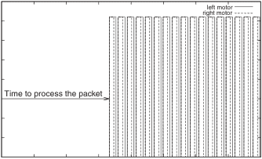

**图 4.12** 计算机响应一个数据包的输出，该数据包将右电机占空比设为 50%，左电机设为 75%。计算机时钟频率为 7.4 kHz。

考虑如下离散事件系统

$$S = \{0, 1\}$$

$$X = Y = S \times \mathbb{N}$$

$$\delta_{int}(s) = s$$

$$\delta_{ext}(s, e, \{(b_l, k - 1), (b_r, k + 1)\}) = T(b_l, s, b_r)$$

$$\delta_{con}(s, x^b) = \delta_{ext}(s, 0, x^b)$$

$$\lambda(s) = (s, k)$$

$$ta(s) = 1$$

它对位于位置 $k$ 的元胞建模。暂时假设每个元胞开始时的已用时间等于 1。如果将这 $N$ 个元胞连接到相同的邻居上，且彼此仅在 $k$ 上不同，以形成一个环，那么输出轨迹除在 $t = (m, 0)$（其中 $m \in \mathbb{N}$）处外都没有事件。同样，输入轨迹除在 $t = (m, 0)$ 处外均为 $\Phi$；在 $t = (m, 0)$ 处，对于 $k \in [1, N - 1]$，其值为 $\{(b_r, k + 1), (b_l, k - 1)\}$；对于位于 $k = 1$ 的元胞，输入值来自 $N$ 和 2；对于位于 $k = N$ 的元胞也类似。状态轨迹在输入之后的离散瞬间发生变化，即在 $t = (m, 0)$ 处从状态 $s$ 变为在 $(m, 1)$ 处的状态 $T(b_l, s, b_r)$。

离散时间元胞在形式上非常相似。它具有相同的状态、输入和输出集合；相同的输出函数；其状态转移函数为

$$\delta(s, \{(b_l, k - 1), (b_r, k + 1)\}) = T(b_l, s, b_r) \tag{4.21}$$

这正是 3.5 节中用代码实现的内容。

直观上很明显，离散事件元胞模仿了其离散时间对应物；现在我们以形式化的方式证明这一点。函数 $\bar g$ 将离散时间轨迹 $x_d[m,m+1)$ 映射为事件轨迹 $x_e((m,0),(m+1,0))$，其方式是令 $x_d(m) \to x_e((m,0))$，并对所有 $t \in ((m,1),(m+1,0))$ 令 $x_d(t) = \Phi$。函数 $\bar h$ 将离散事件系统的总状态 $(s,1)$ 映射为离散时间系统的状态 $s$。令 $\delta_d$ 和 $\delta_e$ 分别为离散时间模型和离散事件模型的单步状态转移函数（即如式 3.8 和 4.7 所示），并令 $\lambda$（见上文）和 $\Lambda$（式 4.10）分别为离散时间系统和离散事件系统的输出函数，则容易验证以下两个事实：

- 1. $\bar h(\delta_e((s,1), \bar g(x_d))) = \delta_d(\bar h((s,1)), x_d)$
- 2. $\Lambda((s,1)) = \lambda(\bar h((s,1)))$

这建立了从离散事件系统到离散时间系统的同态映射（这是一种 I/O 系统同态 [157]）。非正式地说，从总状态 $(s,1)$ 开始的离散事件系统具有从状态 $s$ 开始的离散时间系统的全部能力。此外，由于离散时间网络和离散事件网络的结构相同，离散事件元胞自动机是离散时间自动机的逐分量复现。然而，离散事件自动机所能做的事情远多于其离散时间对应物。已用时间不必在元胞空间上保持一致；如果允许一定的变化，就会产生异步元胞自动机，这是生物学和社会科学中相当受关注的主题（例如见参考文献 13、28、55、129 和 134）。

为说明这一点，考虑由下面列出的异步元胞组成的环所产生的轨迹。这些元胞是左视的（朝向左）；转移规则为 $T(b_l, s, b_r) = b_l$。此外，每个元胞允许有独立的时间推进量，因此它们必须记录左邻居先前的输出，以便在发生状态转移时能够使用该输出。按照仿真软件的要求，每个元胞的已用时间从零开始。元胞的初始状态在 0（染成黑色）和 1（染成白色）之间交替。注意，在图中元胞从上到下排列，时间从左向右推进；这不是 3.5 节所用的可视化排列。

#### 左视事件元胞

```cpp
#ifndef LookLeft_h_
#define LookLeft_h_
#include "adevs.h"

#define BLACK 0
#define WHITE 1

// A left looking event automaton. The CellEvent structure
// contains an integer that is the cell's position and
// another integer that has its state.
class LookLeft: public adevs::Atomic<adevs::CellEvent<int> >
{
public:
    // Constructor puts the cell into its initial state of
    // black if the location is even and white otherwise
    LookLeft(int width, int location, double P):
        adevs::Atomic<adevs::CellEvent<int> >(),
        location(location), width(width), P(P)
    {
        s = l = WHITE;
        // We have a state 0
        if (location % 2 == 0) s = BLACK;
        else l = BLACK; // or our neighbor does
        c = 0.0;
    }
    void delta_int() { c = 0.0; s = l; }
    void delta_ext(double e, const adevs::Bag<adevs::CellEvent<int> >& xb)
    {
        c += e;
        l = (*xb.begin()).value;
    }
    void delta_conf(const adevs::Bag<adevs::CellEvent<int> >& xb)
    {
        delta_int();
        delta_ext(0.0, xb);
    }
    double ta() { return P - c; }
    // Output function
    void output_func(adevs::Bag<adevs::CellEvent<int> >& yb)
    {
        adevs::CellEvent<int> y;
        y.x = (location + 1) % width;
        y.value = s;
        yb.insert(y);
    }
    // The gc method is not needed
    void gc_output(adevs::Bag<adevs::CellEvent<int> >&) {}
    // Get the location of the cell
    int getLocation() const { return location; }
    // Get the state of the cell
    int getState() const { return s; }
private:
    int s, l; // Own and left neighbor's discrete state
    double c; // Time spent in own, current discrete state
    const int location, width; // Our position in the space and its size
    const double P; // Time interval between changes of s
};

#endif
```

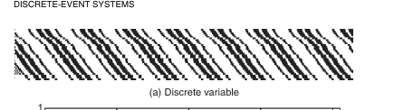

(a) 离散变量

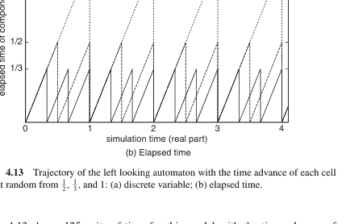

(b) 已用时间

**图 4.13** 左视自动机的轨迹，其中每个元胞的时间推进量从 1/2、1/3 和 1 中随机选取：(a) 离散变量；(b) 已用时间。

图 4.13 展示了该模型 125 个时间单位的情况，其中每个元胞的时间推进量从 1/2、1/3 和 1 中随机选取。该轨迹最初看起来不规则，但在第六组条带处稳定为可识别的模式。每个分量的已用时间也是周期性的。事实上，各个分量每经过一个实时单位就同时回到零。此外，离散状态的数量是有限的，因此也必然重复。由此可知，该网络所得结果的总状态轨迹是周期性的：观察到的离散状态重复会无限持续。

然而，如果时间推进量固定为 1，那么又会得到一个离散时间系统。由不规则时间推进量产生的初始混沌（但最终有序）消失了，取而代之的是一种简单排列：每一步都将颜色向左平移。图 4.14 展示了这种排列的 125 步。该元胞自动机的周期性一目了然，离散事件系统与离散时间系统之间的密切联系也得到了生动揭示。

### 4.6 小结

正如离散时间系统是通过将半群性质应用于序列而推导出来的，本章通过将半群性质应用于事件，推导出了离散事件系统


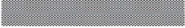

**图 4.14** 同步左视自动机的轨迹。

轨迹。确实，后者系统在最严格的意义上包含前者。这带来了一个能够同时处理两者的仿真框架的实际优势。这些类系统的共同渊源也反映在其仿真软件的共同方面。特别是，离散时间世界观中固有的对同时性的直观处理方式在这里找到了自然归宿。

将状态空间模型用作基本构建模块，也便于把连续系统纳入我们的离散事件模型（或反之）。实际上，求解微分方程的数值方法*就是*离散事件系统。没有概念鸿沟需要跨越；仿真问题完全是一个实现问题。该问题已在多种情境下得到成功处理（此处文献浩繁，但例如参见参考文献 11、30、34、66、67、77 和 110），而从我们当前的视角看，这些方法的共同要素很容易被把握和利用。重要的是，第 5 章采用的方法不需要对我们关于离散事件系统的概念作任何修改。在离散事件世界观的语境中，连续仿真被完整处理，而且容易得令人惊讶。

## 第 5 章
## 混合系统

混合系统由相互作用的连续子系统和离散事件子系统组成。与离散事件部分不同，连续部分不能按其原始形式进行仿真。取而代之的是，用适合计算机仿真的离散事件模型来近似连续模型。可以使用任意数量的近似系统，每个系统都以不同方式回答三个基本问题：

- 1. 在任意有限时间区间内，连续系统会经过无限多个状态，但只能对其中有限多个状态计算估计值（即离散系统必须是合法的）；选取哪些点？
- 2. 计算这些点需要知道它们之间的轨迹；假设了什么？
- 3. 系统与其环境交互；连续和离散的输入与输出如何处理？

暂时仅考虑与单个常微分方程有关的问题 1 和问题 2

$$\dot{x} = f(x)$$

该连续模型可通过以下方式近似：(1) 将时间离散为间隔时长为 *h* 的点，以及 (2) 假设 *x* 在这些区间内沿直线变化。由此得到离散时间系统

$$x(t_0 + (n + 1)h) = x(t_0 + nh) + h f(x(t_0 + nh))$$

该式估计 $x$ 在时刻 $t_0 + kh$ 的值，其中 $k = 0, 1, 2, \ldots$。确实，这就是用于常微分方程数值求解的欧拉法。

另一种方法是将 $x$ 离散为间隔长度为 $q$ 的点，从而得到一组离散状态 $x_0 + kq$，其中 $k = \ldots, -2, -1, 0, 1, 2, \ldots$。现在目标是确定 $x$ 何时取这些离散值。再次假设 $x$ 在计算点之间沿直线变化，则离散事件系统

$$t_a(k)=\begin{cases}\frac{q}{f(x_0+kq)}, & \text{if } f(x_0+kq)\neq 0 \\ \infty, & \text{otherwise}\end{cases}$$
$$\delta_{\text{int}}(k)=k+\frac{f(x_0+kq)}{|f(x_0+kq)|}$$
$$\lambda(k)=x_0+\delta_{\text{int}}(k)q$$

生成近似连续 $x$ 的输出轨迹。这是一阶量化状态系统（例如参见参考文献 70、100 和 158）。

具体而言，考虑一块从桥上落下的石头。其向下速度 $v$ 由常微分方程描述

$$\dot{v} = g - \frac{D}{m} v \tag{5.1}$$

其中 $m$ 是石头的质量，$g$ 是重力加速度，$D$ 是空气阻力系数。不必对该系统进行仿真；若已知石头的初速度 $v_0$，其速度可一次性写出。由此得到

$$v(t) = \frac{g}{D/m}\left(1 - \exp\left(-\frac{D}{m}t\right)\right) + v_0 \exp\left(-\frac{D}{m}t\right) \tag{5.2}$$

并且可以通过对其关于时间求导来验证这是式 5.1 的解。

应用欧拉法，我们选择时长为 $h$ 的区间，并用离散系统近似该连续模型

$$v_{k+1} = v_k + h\left(g - \frac{D}{m} v_k\right)$$

### 5.1 一个基本混合系统

考虑一个状态连续演化但输入为离散的系统；驱动坦克电机的不对称方波就是一个例子。输入信号 $u$ 在时刻 $t_0, t_1, \ldots, t_n$ 取值 $u_0, u_1, \ldots, u_n$。描述该系统的方程为

$$\dot{x}=f(x,u) \tag{5.3}$$

从状态 $x_0=x(t_0)$ 开始，并馈入输入轨迹 $u[t_0,t]$（其中 $t>t_n$），系统的状态轨迹是式 5.3 的解：

$$x(t)=x_0+\sum_{j=0}^{n-1}\int_{t_j}^{t_{j+1}}f(x(\tau),u_j)\,d\tau+\int_{t_n}^{t}f(x(\tau),u_n)\,d\tau \tag{5.4}$$

欧拉法按如下方式改造以近似该系统。使用固定步长 $h$ 在 $u$ 恒定的区间内计算 $x(t)$。$u$ 的变化是离散事件系统的输入。外部转移函数通过将已流逝时间用于积分步，然后存储 $u$ 的新值来响应这些输入。这确保积分端点被精确处理。该方法由以下无输出离散事件模型实现

$$\begin{aligned}
X &= \mathbb{R}\\
S &= \mathbb{R}\times\mathbb{R}\\
\delta_{int}((x,u)) &= (x+h f(x,u),u)\\
\delta_{ext}((x,u),e,u') &= (x+e f(x,u),u')\\
\delta_{con}((x,u),e,u') &= (x+h f(x,u),u')\\
t_a((x,u)) &= h
\end{aligned}$$

其状态轨迹近似连续 $x$。

一个空载电动机的简化模型将说明该方法。通过电动机的电流 $i$ 与其端子电压 $v$ 的关系为

$$\dot{i}=(v-iR)/L \tag{5.5}$$

其中 $R$ 是电动机绕组的电阻，$L$ 是其电感。为便于计算，取 $L=R=1$，这样将欧拉法应用于式 5.5 可得

$$i(t+h)=i(t)+h(v(t)-i(t))=(1-h)i(t)+hv(t) \tag{5.6}$$

其中 $i$ 和 $v$ 在时刻 $t$ 已知。注意，为使计算出的 $i$ 保持有界，必须有 $h<2$；而要计算出接近正确连续轨迹的结果，则需要 $h\ll 2$。任意选取 $h = 0.5$，并令 $v$ 为周期 0.75、幅值为 1 的方波，离散事件模型在时刻 0.5、0.75、1.25、1.5、2、2.25、…… 计算 $i$。这些离散时刻精确捕捉 $v$ 发生变化的时刻，并在中间区间近似 $i$。表 5.1 给出了该仿真的状态和输入轨迹。

#### 表 5.1 使用欧拉法对式 5.5 进行仿真

| 时间 | i, u | v | 事件 |
|---|---|---|---|
| (0, 0) | 0,0 | — | 初始化,0 |
| (0.5, 1) | 0,0 | — | 内部 |
| (0.75, 0) | — | 1 | 输入 |
| (0.75, 1) | 0,1 | — | 外部 |
| (1.25, 1) | 0.5,1 | — | 内部 |
| (1.5, 0) | — | 0 | 输入 |
| (1.5, 1) | 0.625,0 | — | 外部 |
| (2, 1) | 0.3125,0 | — | 内部 |
| (2.25,0) | — | 1 | 输入 |
| (2.25,1) | 0.234375,1 |  | 外部,最终,0 |

*其中 h = 0.5，v 是周期为 0.75、幅值为 1 的方波，v(0,0)=0，初始时 i = u = 0。输出事件已省略。

### 5.2 连续系统网络

用于离散系统的网络结构也适用于连续系统（例如参见参考文献 149 和 157），但它作为建模辅助工具最有价值，在仿真中很少使用。由于连续系统涉及实数，或更一般地涉及复数，代数运算可将每个网络化简为一组常微分方程；若不能如此，则表明该模型存在特殊困难。如果困难情形不是不适定的，那么它就是微分代数模型；Cellier 和 Kofman [20] 对这些系统的仿真算法作了很好的介绍。5.1 节中的表述可应用于任何可化简为一组常微分方程的网络。

连续输入 $u_c$ 按如下方式纳入模型的状态空间。如果 $u_c$ 仅是 $x$ 的函数，则将 $f(x, u_c(x))$ 替换为 $z(x) = f(x, u_c(x))$，并求解微分方程 $\dot{x} = z(x)$。如果 $u_c$ 也是 $t$ 的函数，则添加满足 $\dot{\tau} = 1$ 的新状态变量 $\tau$，定义新函数 $z(x, \tau) = f(x, u_c(x, \tau))$，并求解微分方程组

$$\dot{x} = z(x, \tau)$$
$$\dot{\tau} = 1$$

这是一个无输入系统。有了这个技巧，连续输入不需要仿真程序进行特殊处理。


### 5.3 将混合模型视为离散事件系统

采样数据系统的模型必须按固定间隔提供输出，而无论连续方程如何求解；类似地，阈值传感器的模型必须在阈值穿越的时刻提供输出，而无论积分所采用的时间步长如何。因此，混合系统的仿真方法必须协调离散事件与数值积分方案的时间步长。

处于状态空间形式的连续模型可以由一个原子离散事件模型近似，该模型封装了事件检测和数值积分方法。如果连续模型连接到离散组件，那么与这些组件的交互通过离散事件发生：离散传感器读数、方波等。这种将连续元素和离散事件元素分开的混合模型安排如图 5.2 所示。

混合模型有一个连续状态变量向量 \(x \in \mathbb{R}^m\) 和一个离散状态集合 \(Q\)，后者描述开关设置、运行模式等。支配模型连续演化的微分方程通常依赖于离散状态 \(q\)，因此具有如下形式

$$
\dot{x}=f(x,q) \tag{5.7}
$$

该系统中自主事件的发生以 \(q\) 和 \(x\) 二者为条件。正如在纯离散事件系统中一样，下一个内部事件发生前将要经过的实时时间是当前状态的函数。时间推进函数在混合系统中的对应形式为

$$
G : (\mathbb{R}^m \times Q) \to \mathbb{R}_0^\infty
$$

当 \(G((x,q))=0\) 时事件发生。

再次参考图 5.2，连续变量仅通过作为输出产生的事件轨迹展现。如果上一个事件发生在时刻 \(t_k\)，且该时刻 \(x\) 的值为 \(x_k\)，那么经过时间 \(h\) 后的下一个事件发生时，\(x\) 的值为

$$
x_{k+1}=x_k+\int_{t_k}^{t_k+h} f(x(t),q)\,dt \tag{5.8}
$$

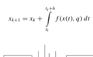

**图 5.2** 将模型分离为通过离散事件交互的离散事件组件和连续组件。

如果下一个事件是自主事件，则在上述表述中 \(h = G((x,q))\)。否则，系统被外部事件中断，且 \(h \leq G((x,q))\)。无论如何，事件发生时 \(x\) 的值都可以用任何合适的数值方法获得，因此式 5.8 并不构成特殊困难。

事件的影响则是另一回事：\(x\) 和 \(q\) 可以响应离散输入、内部事件的发生或二者而间断变化。正如离散事件系统一样，三个转移函数分别对应三种可能情况：

$$
\hat{\delta}_{\mathrm{int}} : (\mathbb{R}^{m} \times Q) \rightarrow (\mathbb{R}^{m} \times Q)
$$

$$
\hat{\delta}_{\mathrm{ext}} : (\mathbb{R}^{m} \times Q) \times \mathbb{R}_{0}^{\infty} \times X^{b} \rightarrow (\mathbb{R}^{m} \times Q)
$$

$$
\hat{\delta}_{\mathrm{con}} : (\mathbb{R}^{m} \times Q) \times X^{b} \rightarrow (\mathbb{R}^{m} \times Q)
$$

分别定义系统对内部事件、外部事件和合流事件的响应。类似地，输出函数

$$
\hat{\lambda} : (\mathbb{R}^{m} \times Q) \rightarrow Y^{b}
$$

在自主事件发生时产生离散输出。这些“带帽”函数是离散事件系统的一种简写描述

$$
\begin{aligned}
\delta_{\mathrm{int}}((x_k,q)) &= \hat{\delta}_{\mathrm{int}}((x_{k+1},q))\\
\delta_{\mathrm{ext}}((x_k,q),e,x_b) &= \hat{\delta}_{\mathrm{ext}}((x_{k+1},q),e,x_b)\\
\delta_{\mathrm{con}}((x_k,q),x_b) &= \hat{\delta}_{\mathrm{con}}((x_{k+1},q),x_b)\\
ta((x_k,q)) &= G((x_k,q))\\
\lambda((x_k,q)) &= \hat{\lambda}((x_{k+1},q))
\end{aligned} \tag{5.9}
$$

其中 \(x_{k+1}\) 由式 5.8 计算：对于内部事件、合流事件以及在输出函数中，取 \(h = ta((x_k,q))\)；对于外部事件，取 \(h = e\)。

一个简单模型将说明这些基本概念。考虑图 5.3 所示的系统，它具有一个受 0 和 1 处表面约束的连续变量。它沿一条线从 1 运动到 0，从该表面反弹，返回 1，再次反弹，如此永远重复。该系统有一个离散变量 \(d\)，取值范围为 \(\{1, -1\}\)，它决定连续变量 \(x\) 的方向。系统可随时被输入 \(u \in \{1, -1\}\) 中断，该输入会立即改变 \(d\) 的值。模型每次遇到约束表面时产生一个输出。

从 \(x \in [0,1]\) 开始，事件之间的连续轨迹由下式描述

$$
\dot{x} = d \tag{5.10}
$$

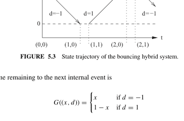

**图 5.3** 弹跳混合系统的状态轨迹。

距下一个内部事件的剩余时间为

$$
G((x, d)) = \begin{cases} x & \text{if } d = -1 \\ 1 - x & \text{if } d = 1 \end{cases}\tag{5.11}
$$

系统对离散事件的响应为

$$
\hat{\delta}_{\text{int}}((x, d)) = (x, -d)
$$

$$
\hat{\delta}_{\text{ext}}((x, d), e, u) = (x, u)
$$

$$
\hat{\delta}_{\text{con}}((x, d), u) = (x, u)
$$

$$
\hat{\lambda}((x, d)) = x
$$

对于该系统，求解式 5.8 很简单；求解后，将上述方程代入式 5.9，得到离散事件模型²

$$
\begin{aligned}
\delta_{\text{int}}((x, d)) &= \hat{\delta}_{\text{int}}((x_{k+1}, d)) = \left(\frac{d + 1}{2d}, -d\right)\\
\delta_{\text{ext}}((x, d), e, u) &= \hat{\delta}_{\text{ext}}((x_{k+1}, d), e, u) = (x + ed, u)\\
\delta_{\text{con}}((x, d), u) &= \hat{\delta}_{\text{con}}((x_{k+1}, d), u) = \left(\frac{d + 1}{2d}, u\right)\\
ta((x, d)) &= G(x, d) = \begin{cases} x & \text{if } d = -1 \\ 1 - x & \text{if } d = 1 \end{cases}\\
\lambda((x, d)) &= \hat{\lambda}((x_{k+1}, d)) = \frac{d + 1}{2d}
\end{aligned}
$$

²当 \(d = -1\) 且 \(x\) 正在下降时，方程 \((d + 1)/(2d)\) 为零。当 \(d = 1\) 且 \(x\) 正在上升时，它为一。

当该模型从状态 \((0, 1)\) 开始，并例如馈入输入轨迹 \(u(\{0, 0\}, (\infty, 0))\) 时，其输出为 \(y(\{0, 0\}, (\infty, 0))\)，其中

$$
u(t)=\begin{cases}
1 & \text{if } t=(1.5,0)\\
\Phi & \text{otherwise}
\end{cases}
$$

以及

$$
y(t)=\begin{cases}
1 & \text{if } t=(1,0) \text{ or } t=(2m,0),\ m\in\mathbb{N}\\
0 & \text{if } t=(2m+1,0),\ m\in\mathbb{N}\setminus\{0\}\\
\Phi & \text{otherwise}
\end{cases}
$$

这可以通过表驱动仿真或逻辑论证来确认（两者都是极好的练习）。

当然，连续轨迹仅在离散点处计算。如果需要对 \(x\) 进行更详细的采样，则必须重新表述 \(G\)，以便在更小的间隔处触发计算。这通过以下方式实现：

- 为 \(G\) 引入等于最大采样周期 \(h_{\max}\) 的上限
- 在 \(\tilde{\lambda}\) 和 \(\tilde{\delta}_{\mathrm{int}}\) 中增加检查，以满足条件 \(x = 1\) 和 \(x = 0\)。

重新表述后的方程为

$$
\begin{aligned}
G((x,d)) &= \begin{cases}
\min\{h_{\max}, x\} & \text{if } d=-1\\
\min\{h_{\max}, 1-x\} & \text{if } d=1
\end{cases}\\
\tilde{\delta}_{\mathrm{int}}((x,d)) &= \begin{cases}
(x,-d) & \text{if } x=1 \lor x=0\\
(x,d) & \text{otherwise}
\end{cases}\\
\tilde{\delta}_{\mathrm{ext}}((x,d), e, u) &= (x,u)\\
\tilde{\delta}_{\mathrm{con}}((x,d),u) &= \tilde{\delta}_{\mathrm{ext}}(\tilde{\delta}_{\mathrm{int}}((x,d)),0,u)\\
\tilde{\lambda}((x,d)) &= \begin{cases}
x & \text{if } x=1 \lor x=0\\
\Phi & \text{otherwise}
\end{cases}
\end{aligned}
$$

输出保持不变这一点很容易验证。然而，状态轨迹被更频繁地采样：在没有输入时，频率为 \(1/h_{\max}\)。

### 5.4 混合系统的数值仿真

上述表述假设 \(G\) 可以在不预知 \(x\) 未来的情况下计算。由于缺少事件在时间上位置的直接表达式，必须改为通过模型状态空间中的位置来定义事件。这让人联想到离散事件仿真的活动扫描方法（例如见参考文献 157），但事件条件同时依赖于连续变量和离散变量。具体而言，自主事件由一组阈值函数描述

$$
\begin{aligned}
g_1(x(t_k+h),q)&=0\\
g_2(x(t_k+h),q)&=0\\
&\vdots\\
g_p(x(t_k+h),q)&=0
\end{aligned}
$$

而 \(G(x(t_k),q)\) 被隐式定义为满足这些等式中至少一个的最小非负 \(h\)；如果不存在这样的 \(h\)，则定义为零。

为说明这种构造，考虑上一节所述弹跳系统的时间推进。式 5.11 由曲面隐式定义

$$
g(x(t_k+h),d)=x(t_k+h)-(d+1)/2=0
$$

并且，由于我们知道 \(x(t_k+h)=x_k+hd\)，可以直接求解该方程得到 \(G\)。

混合系统仿真需要两种方法：用于推进连续解的数值积分方法，以及用于在积分步之间定位事件的求根方法。大多数数值分析入门教材都涵盖这些主题（例如见参考文献 71、114 和 151），而在混合仿真的特定背景下，也有越来越多的文献讨论这些主题（例如见参考文献 20 和 36）。几乎任何方法都适用，但那些能够容易适应步长变化和状态变量离散调整的方法最为理想，因为离散事件经常会引起对这两者的需求。

为演示如何构造仿真器，这里考虑两种具体方法。数值积分采用带误差控制的修正欧拉法。该方法属于龙格–库塔族。给定步长 \(h\) 以及时刻 \(t_k\) 的当前值 \(x_k\)，时刻 \(t_k+h\) 的下一个值由两级规则计算

$$
\begin{aligned}
k_1&=hf(x_k)\\
k_2&=hf(x_k+k_1/2)\\
x_{k+1}&=x_k+k_2
\end{aligned}
$$


The magnitude of the error $\varepsilon$ incurred by a step is approximately

$$\varepsilon \approx |k_2 - k_1|$$

If after a step the error is too large, the step size is reduced and the integration retried. Conversely, if the error is very small, then the step size is increased to speed up the simulation. Having obtained the estimate $\varepsilon$ using the step size $h$, the adjusted step size $h_{\mathrm{tol}}$ that satisfies an error tolerance $\varepsilon_{\mathrm{tol}}$ is estimated by

$$h_{\mathrm{tol}} \approx h \frac{\varepsilon_{\mathrm{tol}}}{\varepsilon}$$

For our purposes, the step size will begin at some maximum value $h_{\max}$ after each event and then be reduced if necessary; in this case the new trial step is $0.8\min\{h_{\mathrm{tol}}, h\}$. Having selected a step size $h$ that satisfies the error criteria and then tentatively advancing the trajectory, we now look to see if an event threshold lies between the old state $x_k$ and the new, tentative state $x_{k+1}$. A simple, but often effective, method is to interpolate each $g_j$ in the interval $[t_k, t_k + h]$ and look for a root of the interpolating function. The two endpoints for the interpolation are

$$g_{j,k} = g_j(x_k, q)$$
$$g_{j,k+1} = g_j(x_{k+1}, q)$$

There are three possibilities for this pair of points:

- 1. If $g_{j,k} \approx 0$ or $g_{j,k+1} \approx 0$, then an event has been found and an internal transition occurs at time $t_k$ or $t_k + h$, respectively.
- 2. If both have the same sign, so that $g_{j,k} g_{j,k+1} > 0$, then $g_j$ does not cross zero and there is no event in the interval.
- 3. If the points have opposite signs, so that $g_{j,k} g_{j,k+1} < 0$, then there is an event in the interval.

In possibilities 1 and 2, the time of the next autonomous event is known: it occurs now or at the next integration step.

In possibility 3, the existence of an intermediate event is known, but its time of occurrence must still be found. A procedure for doing so is illustrated in Figure 5.4. To start, we take $t_k = 0$, which is possible because the system is time-invariant, and approximate the function $g_j(t)$ in the interval $[0, h]$ with the line

$$g_j(t) \approx \frac{g_{j,k}(h - t) + g_{j,k+1} t}{h}$$

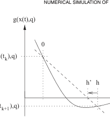

**FIGURE 5.4** Using linear interpolation to locate an event in time.

Setting this equal to zero and solving for $t$ gives the location of the event in time at

$$t \approx \frac{h g_{j,k}}{g_{j,k} - g_{j,k+1}}$$

Now the integration step is reduced to this estimate of the event time and a new $x_{i+1}$ is calculated. If this state satisfies condition 1 or 2 in the preceding paragraph, then the search ends; the event is found or the interval has shrunk so as not to include it. Otherwise, these steps are repeated.

To implement this procedure, the discrete-event model has, in addition to its discrete state $q$, two copies of the continuous state: the present value $x$ and tentative next value $x'$. For each $g_k$, there is a Boolean variable $e_k$ that is true if $g_k(x,q) \approx 0$ or $g_k(x',q) \approx 0$ and false otherwise. The variable $h$ keeps the time separating $x$ and $x'$. The model first looks ahead by a single integration step to calculate $x'$. Next, it looks for events at the ends of the interval $[0, h]$ and for events within it that might have been missed. There are four cases. The simplest is where the $g_k$ neither are zero at the ends of the interval nor change sign. In this case, there are no events and, barring external input, the state $h$ units of time later is $x'$.

The other three cases involve discrete-events. If at the left end of the interval any of the $g_k$ are within $\varepsilon_{\mathrm{tol}}$ of zero, then the $e_k$ are set accordingly and an internal event occurs immediately. Conversely, if this is true at the right end of the interval and none of the $g_k$ have otherwise changed sign, then an event occurs at $h$, with state $x'$, and the $e_k$ are again set accordingly. Otherwise, an event occurs inside the interval and must be located with greater precision—a new $h$ is estimated, a new $x'$ calculated, and the process repeated. Algorithm 5.1 shows this procedure in detail, using the corrected Euler and linear interpolation methods described above.

With Algorithm 5.1, the discrete-event model that simulates a hybrid system can be written compactly as follows. Let $s = (x, q, x', \tilde{e}, h)$ be the state of the model where $\tilde{e}$ is the vector of event flags $e_1, \ldots, e_p$. The error tolerance $\varepsilon_{\mathrm{tol}}$ and maximum integration step $h_{\max}$ are fixed parameters.

#### 算法 5.1 定位内部事件并暂定将 $x$ 推进到该事件。

```
Input: x, q, h_max, ε_tol
Output: x', \tilde{e}, e_1, ..., e_p

1. Tentatively advance x to satisfy the error criteria
2. h ← h_max
3. repeat
4.   k1 ← h f(x,q), k2 ← h f(x + 1/2 k1, q)
5.   x' ← x + k2, ε ← |k2 − k1|
6.   if ε_tol ≤ ε then h ← 0.8 min{h, h_tol}
7. until ε ≤ ε_tol
8. Look for events in [0,h]
9. foreach k ∈ [1,p] do g_k ← g_k(x,q), e_k ← (|g_k| ≤ ε_tol)
10. Found an event at the start of the interval
11. if (∃k)(e_k = true) then h ← 0, x' ← x, return
12. repeat
13.   foreach k ∈ [1,p] do
14.     g'_k ← g_k(x',q), e_k ← (|g'_k| ≤ ε_tol)
15.     if g'_k < 0 then h ← min{h, g_k/(g_k − g'_k)}
16.   end
17.   k1 ← h f(x,q), k2 ← h f(x + 1/2 k1, q)
18.   x' ← x + k2
19. until (∀k)(0 < g'_k ∨ e_k)
```

Let $F$ be a function that applies Algorithm 5.1 to the state; $F(x)$ is equal to $x$ except for $x'$, $\tilde{e}$, $h$ which the algorithm computes. Define also the function $I((x,q),\tau)=(x',q)$, where $x'$ is $x$ advanced by the step size $\tau$. The discrete-event model is

$$\delta_{int}(((x,q),x',\tilde{e},h))=\begin{cases}F((\delta_{int}((x,q)),x',\tilde{e},h)) & \text{if }(\exists e_k)(e_k=true)\\ F((x',q),\tilde{e},h) & \text{otherwise}\end{cases}$$

$$\delta_{ext}(((x,q),x',\tilde{e},h),e,u^b)=F((\delta_{ext}(I((x,q),e),e,u^b),x',\tilde{e},h))$$

$$\delta_{con}(((x,q),x',\tilde{e},h),u^b)=F((\delta_{con}((x',q),u^b),x',\tilde{e},h))$$

$$ta(s)=h$$

$$\lambda(s)=\begin{cases}\tilde{\lambda}((x',q)) & \text{if }(\exists e_k)(e_k=true)\\ \phi & \text{otherwise}\end{cases}$$

To summarize, at each event the continuous variable $x$ is advanced to the present time. If there is an input or if an event threshold is reached, then the discrete transition function of the hybrid system is applied and, in the latter case, an output is also produced. The time advance at each event is the smaller of the integration step size and the time to the next internal event of the hybrid system.

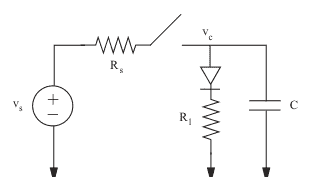

**FIGURE 5.5** A model of a circuit with two discrete elements.

The electric circuit shown in Figure 5.5 will illustrate the simulation procedure, and the outcome of the simulation is listed in Table 5.2. This circuit has a load that operates when the voltage $v_c$ is greater than the diode's threshold voltage. A capacitor stores energy to drive the load for short periods of time when the main power is disconnected. This capacitor charges rapidly when the load is disconnected, and it trickle-charges while the load is operating. The model has two discrete variables, $s \in \{0, 1\}$ for the switch with $s = 0$ open (not conducting) and $s = 1$ closed (conducting) and likewise for the diode; its state is indicated by $d$. The switch is an input to the system, and the diode state is determined by the capacitor voltage.

The voltage $v_c$ is the model's only continuous state variable. It evolves in each mode as follows:

$$\dot{v}_c = \begin{cases} 0 & \text{if } s=0,d=0 \\ -\frac{v_c}{C R_i} & \text{if } s=0,d=1 \\ \frac{v_s-v_c}{C R_s} & \text{if } s=1,d=0 \\ \frac{1}{C}\left(\frac{v_s-v_c}{R_s}-\frac{v_c}{R_i}\right) & \text{if } s=1,d=1 \end{cases} \quad (5.13)$$

The diode conducts when $v_c$ exceeds the threshold voltage $v_{op}$ and stops conducting when the voltage drops below $v_{cl}$, where $v_{op} > v_{cl}$. A single function defines both cases:

$$g(v_c,d) = \begin{cases} v_c-v_{op} & \text{if } d=0 \\ v_c-v_{cl} & \text{if } d=1 \end{cases}$$

Significantly, the diode does not open and close at the same voltage level. If this were the case, then the model would be illegitimate, switching endlessly between its two states when $v_c$ reached a threshold value. The model's output is the state of the diode.


#### 表 5.2 电路仿真中的离散事件

| r | v_c | (c, d) | z | h | x' | u | y | 事件 |
|---|---:|:---:|:---:|---:|---:|:---:|:---:|:---|
| (0, 0) | 0 | (0, 0) | 假 | 0.2 | 0.178 | 0 | Φ | 初始化, 0 |
| (0, 2, 1) | 0.178 | (0, 0) | 假 | 0.2 | 0.3276 | 0 | Φ | 内 |
| (0, 4, 1) | 0.3276 | (0, 0) | 假 | 0.2 | 0.448632 | 0 | Φ | 内 |
| (0, 4, 1) | 0.448632 | (0, 0) | 假 | 0.2 | 0.448632 | 0 | Φ | 内 |
| (0, 4, 1) | 0.448632 | (0, 0) | 真 | 0.1035162642 | 0.5027534314 | 0 | 1 | 输出 |
| (0.7035162642, 0) | 0.5027534314 | (0, 0) | 真 | 0.2 | 0.501872334 | 0 | Φ | 内 |
| (0.7035162642, 1) | 0.501872334 | (0, 0) | 假 | 0.2 | 0.501238167 | 1 | Φ | 内 |
| (0.9035162642, 1) | 0.501238167 | (0, 0) | 假 | 0.2 | 0.4112676327 | 0 | Φ | 外 |
| (1, 1, 0) | 0.4112676327 | (1, 1) | 假 | 0.2 | 0.3733294588 | 0 | Φ | 内 |
| (1, 2, 1) | 0.3733294588 | (1, 1) | 假 | 0.2 | 0.2765360526 | 0 | Φ | 内 |
| (1, 4, 1) | 0.2765360526 | (1, 1) | 真 | 0.1035163251 | 0.2499632016 | 0 | 1 | 输出 |
| (1, 4, 1) | 0.2499632016 | (1, 1) | 真 | 0.1035163251 | 0.2499632016 | 1 | 1 | 内 |
| (1.7035163251, 0) | 0.2499632016 | (1, 1) | 假 | 0.2 | 0.2499632016 | 0 | Φ | 内 |
| (1.9035163251, 1) | 0.2499632016 | (1, 1) | 假 | 0.2 | 0.2499632016 | 0 | Φ | 内, 最终, 0 |

内部事件在时间上的位置可以直接计算或使用算法 5.1 计算。输出事件中 y = Φ 的已被省略。

该电路的离散转移函数为

$$\hat{\delta}_{init}((v_c,s,d)) = (v_c,s,\neg d)$$

$$\hat{\delta}_{cell}((v_c,s,d),e,u) = (v_c,u,d)$$

$$\hat{\delta}_{cont}((v_c,s,d),u) = \hat{\delta}_{ext}(\hat{\delta}_{init}((v_c,s,d)),0,u)$$

$$\hat{\lambda}((v_c,s,d)) = \neg d$$

为了使数字保持简单，使用 $R_l = R_s = 1$, $C = 1$, $v_s = 1$, $v_{cl} = \frac{1}{4}$, 和 $v_{op} = \frac{1}{2}$ 并以 $d = 0$, $s = 1$, 和 $v_c = 0$ 开始。离散事件模型使用 $h_{\max} = 0.2$ 和 $\epsilon = 0.05$。电容器开始充电，并且在二极管闭合之前，模拟 $v_c$ 的离散方程（即校正的欧拉方程）为

$$v_{c,k+1} = v_{c,k}(1 - h + h^2/2) + h - h^2/2$$

每一步的误差为

$$\epsilon = |(1 - v_{c,k})h^2/2|$$

而 g 的插值函数求解时间为

$$t = \frac{(v_{c,k} - 0.5)h}{v_{c,k} - v_{c,k+1}}$$

导致离散事件模型经历表 5.2 中列出的前三个内部事件。

二极管在第四个事件时闭合，实际时间为大约 0.7。因为该内部事件与一个事件面重合，$\hat{\lambda}$ 和 $\hat{\delta}_{init}$ 决定了模型的输出和下一个状态。在其新的模式中，$v_c$ 用差分方程模拟

$$v_{c,k+1} = v_{c,k} + h(h - 1)(2v_{c,k} - 1)$$

每一步的误差为

$$\epsilon = |(1 - 2v_{c,k})h^2|$$

求解时间的插值 g 为

$$t = \frac{(v_{c,k} - 0.25)h}{v_{c,k} - v_{c,k+1}}$$

并且离散事件模型以这种方式演化，直到开关被打开。如果仿真在恰好 $v_c = 0.5$ 时闭合二极管，则实际系统及其

近似值将保持在该值。相反，模拟电压超过了标记并缓慢地回降到正确的解。

在 \(t = 1.0\) 时开关被打开。该外部事件按经过的时间推进 \(v\) 并调用混合系统的 \(\delta_{ext}\) 函数以改变其状态。在这种新配置中，离散事件系统通过以下方式模拟 \(v_c\)

$$v_{c,k+1} = (1 - h + h^2/2)v_{c,k}$$

每一步的误差为

$$\epsilon' = |h^2v_{c,k}/2|$$

而 \(g\) 的插值函数求解时间为同前。电容器在另经过三个事件后被放电至截止点，二极管在实际时间 \(t \approx 1.7\) 时打开。

现在开关和二极管都打开，模拟的控制方程为

$$v_{c,k+1} = v_{c,k}$$

$$\epsilon = 0$$

$$t = \infty$$

因此时间以 \(h = h_{max} = 0.2\) 推进，但直到开关再次闭合之前实际上没有任何变化。

通过这个例子，很快就变得显而易见，\(G\) 的显式公式节省了大量时间和精力。当 \(G\) 可以直接从系统的状态计算出来，从而下一个事件在时间上的位置是显式已知的时，这种变化通常被称为 *时间事件* 而 \(G\) 为 *时间事件函数*。如果下一个事件时间必须从状态空间中的事件面推断，则这种变化被称为 *状态事件* 而 \(g_k\) 为 *状态事件函数*。状态事件需要模拟器付出更多的计算努力，因此导致仿真运行更慢。当可以构造时，时间事件因此是优选的。

### 5.5 混合系统的仿真器

*Hybrid* 类扩展了第 4 章离散事件仿真器的 *Atomic* 类，以实现上面构造的近似系统。用于查找事件面在时间上的算法和求解微分方程的算法被封装在两个类中：*event_locator* 和 *ode_solver*。混合系统的微分函数、状态和时间事件函数以及离散转移函数

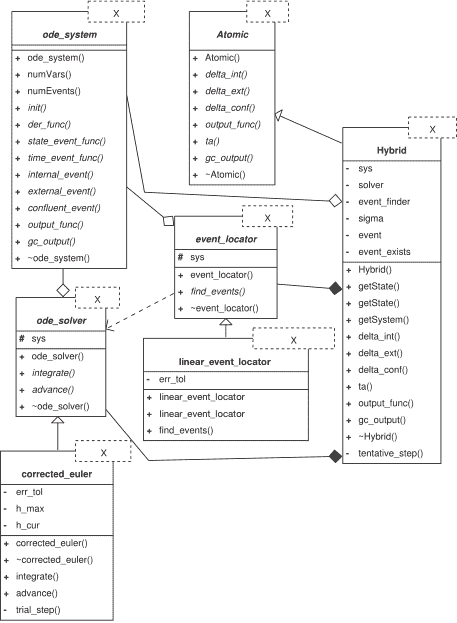

**图 5.6** 构成混合仿真器的类的 UML 图。

包含在第三个类中：`ode_system`。`Hybrid` 类使用这三个支持类来模拟一个混合模型。图 5.6 显示了它们彼此之间以及与仿真引擎的关系。

`event_locator` 使用单一方法 `find_events`，该方法在规定区间内查找状态事件。其参数是混合模型的连续状态 *q*，

要搜索的区间宽度 h，区间末端的 state q_end，以及用于计算区间内状态的积分方法。该方法如果找到事件则返回 true，否则返回 false。在正向情况下，事件的时间写入提供的 h，数组 events 的元素被设置为指示哪个阈值函数导致了事件，并且模型在事件时间的状态被写入 q_end。在负向情况下，events 数组的元素被设置为 false，但 h 和 q_end 保留调用者提供的值。

ode_solver 有两种方法来推进连续状态变量。integrate 方法将系统从时间 t 的状态 q 带到时间 t + h 的状态 q'，其中 h ≤ h_max。具有误差控制的积分方法可能使用小于 h_max 的值以满足其误差容差。该方法返回实际使用的步长，并且最终状态 q' 在返回前被复制到 q。advance 方法与 integrate 方法相同，只是它保证将连续轨迹推进到所请求区间的末端。

混合模型本身是通过扩展 ode_system 类实现的。它具有用于计算状态事件函数、时间事件函数和微分函数的方法。这些被 event_locator 和 ode_solver 类使用。还有四个用于实现离散动力学的方法：external_event、internal_event、confluent_event 和 output_func。这些对应于混合系统的停滞转移和输出函数。所有这些方法都接受一个数组 q，其中保存模型的连续状态。这由 Hybrid 类维护，根据需要将其提供给 ode_system。模型的离散状态 however 由其实现类的成员变量捕获。另请注意，离散转移函数和输出函数被提供一个布尔值数组；该数组保存 e_k 标志，外加最后一个数组位置中的一个额外项以指示时间事件。gc_output 方法用于回收由 output_func 创建的对象。

方程 5.12 由 Hybrid 类实现。其私有 tentative_step 方法实现了 F 函数，该函数代表离散事件模型定义中的算法 5.1。积分函数 I 由 ode_solver 实现，后者也由 event_locator 用于在进行试探步时查找状态事件（即 g_k 的根）。时间事件使用 ode_system 的 time_event_func 方法调度，该方法返回到最近的、显式已知的自治事件的剩余时间。tentative_step 方法选择的时间推进是 ode_solver 使用的最小时间步长、event_locator 找到的最接近的状态事件以及 ode_system 报告的下一个时间事件中的最小值。Hybrid 类的成员变量正是离散事件模型的状态变量，除了额外的布尔变量 event_exists，它通过在任何 e_k 为真时为真，否则为假，从而节省了对 e_k 的搜索。

#### Hybrid 类

```
#ifndef _adevs_hybrid_h_
#define _adevs_hybrid_h_
#include <algorithm>
```


```cpp
#include "adevs_models.h"

namespace adevs
{

template <typename X> class ode_system
{
  public:
    // Make a system with N state variables and M state event functions
    ode_system(int N_vars, int M_event_funcs):
      N(N_vars),M(M_event_funcs){}
    // Get the number of state variables
    int numVars() const { return N; }
    // Get the number of state events
    int numEvents() const { return M; }
    // Copy the initial state of the model to q
    virtual void init(double* q) = 0;
    // Compute the derivative for state q and put it in dq
    virtual void der_func(const double* q, double* dq) = 0;
    // Compute the state event functions for state q and put them in z
    virtual void state_event_func(const double* q, double* z) = 0;
    // Compute the time event function using state q
    virtual double time_event_func(const double* q) = 0;
    // The internal transition function
    virtual void internal_event(double* q,
      const bool* state_event) = 0;
    // The external transition function
    virtual void external_event(double* q, double e,
      const Bag<X>& xb) = 0;
    // The confluent transition function
    virtual void confluent_event(double *q, const bool* state_event,
      const Bag<X>& xb) = 0;
    // The output function
    virtual void output_func(const double *q, const bool* state_event,
      Bag<X>& yb) = 0;
    // Garbage collection function
    virtual void gc_output(Bag<X>& gb) = 0;
    // Destructor
    virtual ~ode_system(){}
  private:
    const int N, M;
};

template <typename X> class ode_solver
{
  public:
    ode_solver(ode_system<X>* sys):sys(sys){}
    // Take an integration step from state q of at most size h and
    // return the step size that was actually used. Copy the result of
    // the integration step to q.
virtual double integrate(double* q, double h_lim) = 0;
// Advance the system through exactly h units of time
virtual void advance(double* q, double h) = 0;
virtual ~ode_solver(){}
protected:
    ode_system<X>* sys;
};

template <typename X> class event_locator
{
    public:
        event_locator(ode_system<X>* sys): sys(sys){}
        // Find the first event in the time interval [0,h] starting from
        // state qstart. The method returns true if an event is found,
        // setting the events flags to true if the corresponding z entry in
        // the state_event_func above triggered the event. The value of
        // h is overwritten with the event time, and the state of the model
        // at that time is copied to qend.
        virtual bool find_events(bool* events, const double *qstart,
                double* qend, ode_solver<X>* solver, double& h) = 0;
        virtual ~event_locator(){}
    protected:
        ode_system<X>* sys;
};

template <typename X> class Hybrid: public Atomic<X>
{
    public:
        // Create and initialize a simulator for the system. All objects
        // are adopted by the Hybrid object and are deleted when it is.
        Hybrid(ode_system<X>* sys, ode_solver<X>* solver,
                event_locator<X>* event_finder):
                sys(sys),solver(solver),event_finder(event_finder)
        {
            q = new double[sys->numVars()];
            q_trial = new double[sys->numVars()];
            event = new bool[sys->numEvents()+1];
            event_exists = false;
            sys->init(q_trial); // Get the initial state of the model
            for (int i = 0; i < sys->numVars(); i++) q[i] = q_trial[i];
            tentative_step(); // Take the first tentative step
        }
        // Get the value of the kth state variable
        double getState(int k) const { return q[k]; }
        // Get the array of state variables
        const double* getState() const { return q; }
        // Get the system that this solver is operating on
        ode_system<X>* getSystem() { return sys; }
        void delta_int()
{
    if (event_exists) // Execute the internal event
        sys->internal_event(q_trial,event);
    // Copy the new state vector to q
    for (int i = 0; i < sys->numVars(); i++) q[i] = q_trial[i];
    tentative_step(); // Take a tentative step
}
void delta_ext(double e, const Bag<X>& xb)
{
    solver->advance(q,e); // Advance the state q by e
    sys->external_event(q, e, xb); // Compute the external event
    // Copy the new state to the tentative solution
    for (int i = 0; i < sys->numVars(); i++) q_trial[i] = q[i];
    tentative_step(); // Take a tentative step
}
void delta_conf(const Bag<X>& xb)
{
    if (event_exists) // Execute the confluent or external event
        sys->confluent_event(q_trial, event, xb);
    else sys->external_event(q_trial,ta(),xb);
    // Copy the new state vector to q
    for (int i = 0; i < sys->numVars(); i++) q[i] = q_trial[i];
    tentative_step(); // Take a tentative step
}
double ta() { return sigma; }
void output_func(Bag<X>& yb)
{
    if (event_exists) sys->output_func(q_trial,event,yb);
}
void gc_output(Bag<X>& gb) { sys->gc_output(gb); }
virtual ~Hybrid()
{
    delete [] q; delete [] q_trial; delete [] event;
    delete event_finder; delete solver; delete sys;
}
private:
    ode_system<X>* sys; // The ODE system
    ode_solver<X>* solver; // Integrator for the ode set
    event_locator<X>* event_finder; // Event locator
    double sigma; // Time to the next internal event
    double *q, *q_trial; // Current and tentative states
    bool* event; // Flags indicating the encountered event surfaces
    bool event_exists; // True if there is at least one event
    // Execute a tentative step and calculate the time advance function
    void tentative_step()
    {
        // Check for a time event
        double time_event = sys->time_event_func(q);
        // Integrate up to that time at most
double step_size = solver->integrate(q_trial,time_event);
// Look for state events inside of the interval [0,step_size]
bool state_event_exists =
    event_finder->find_events(event,q,q_trial,solver,step_size);
// Find the time advance and set the time event flag
sigma = std::min(step_size,time_event);
event[sys->numEvents()] = time_event < sigma;
event_exists = event[sys->numEvents()] || state_event_exists;
    }
  };

} // end of namespace

#endif
```

上一节中的校正欧拉法和线性插值法很容易适配到 `ode_solver` 和 `event_locator` 接口；代码如下所示。`corrected_euler` 类求解方程组。其构造函数接受一个误差容限，该容限应用于每个微分方程，并且接受一个最大步长，该步长应选择以确保稳定性。与之前的描述相比，该积分器略有修改：对象会记住上一步的步长，如果该步长是为控制积分误差而选择的，从而减少调用 `integrate` 时尝试的试探步数。这可以大幅加快仿真速度。

同样，事件定位器也是为方程组构建的。其实现基本如算法 5.1 所列，但有两个小的变化，可提高其计算效率。首先，当 h = 0 时，连续变量不会被不必要地积分；在这种情况下，`qstart` 仅在方法返回前复制到 `qend`。第二个调整比较棘手，即在算法最后循环中出现的 `%k` 位置使用 `event_in_interval` 标志。退出方法最内层的 for 循环时，此标志为真当且仅当最近的状态事件在 (0, h) 中被找到；如果事件在 0 处，则方法在不进一步查找的情况下返回；如果事件在 h 处，或根本未找到，则 `found_event` 和事件标志会被正确设置，但 `qend` 不会被不必要地重新计算。

#### 校正欧拉积分方法

```cpp
#ifndef _adevs_corrected_euler_h_
#define _adevs_corrected_euler_h_
#include <cmath>
#include "adevs_hybrid.h"

namespace adevs
{

template <typename X> class corrected_euler: public ode_solver<X>
```

```cpp
{
public:
    corrected_euler(ode_system<X>* sys, double err_tol, double h_max);
    ~corrected_euler();
    double integrate(double* q, double h_lim);
    void advance(double* q, double h);
private:
    double *dq, // derivative
           *qq, // trial solution
           *t,  // temporary variable for computing k2
           *k[2]; // k1 and k2
    const double err_tol; // Error tolerance
    const double h_max; // Maximum time step
    double h_cur; // Previous timestep that satisfied error constraint
    // Compute a step of size h, put it in qq, and return the error
    double trial_step(double h);
};

template <typename X>
corrected_euler<X>::corrected_euler(ode_system<X>* sys, double err_tol,
        double h_max):
    ode_solver<X>(sys),err_tol(err_tol),h_max(h_max),h_cur(h_max)
{
    for (int i = 0; i < 2; i++) k[i] = new double[sys->numVars()];
    dq = new double[sys->numVars()];
    qq = new double[sys->numVars()];
    t = new double[sys->numVars()];
}

template <typename X>
corrected_euler<X>::~corrected_euler()
{
    delete [] t; delete [] qq; delete [] dq;
    for (int i = 0; i < 2; i++) delete [] k[i];
}

template <typename X>
void corrected_euler<X>::advance(double* q, double h)
{
    double dt;
    while ((dt = integrate(q,h)) < h) h -= dt;
}

template <typename X>
double corrected_euler<X>::integrate(double* q, double h_lim)
{
    // Initial error estimate and step size
    double err = DMAX, h = std::min(h_cur*1.1,std::min(h_max,h_lim));
    for (;;) {
        // Copy q to the trial vector
        for (int i = 0; i < this->sys->numVars(); i++) qq[i] = q[i];
        // Make the trial step which will be stored in qq
        err = trial_step(h);
        // If the error is ok, then we have found the proper step size
        if (err <= err_tol) { // Keep h if shrunk to control the error
            if (h_lim >= h_cur) h_cur = h;
            break;
        }
        // Otherwise shrink the step size and try again
        else {
            double h_guess = 0.8*err_tol*h/fabs(err);
            if (h < h_guess) h *= 0.8;
            else h = h_guess;
        }
    }
    // Put the trial solution in q and return the selected step size
    for (int i = 0; i < this->sys->numVars(); i++) q[i] = qq[i];
    return h;
}

template <typename X>
double corrected_euler<X>::trial_step(double step)
{
    int j;
    // Compute k1
    this->sys->der_func(qq,dq);
    for (j = 0; j < this->sys->numVars(); j++) k[0][j] = step*dq[j];
    // Compute k2
    for (j = 0; j < this->sys->numVars(); j++) t[j] = qq[j] + 0.5*k[0][j];
    this->sys->der_func(t,dq);
    for (j = 0; j < this->sys->numVars(); j++) k[1][j] = step*dq[j];
    // Compute next state and approximate error
    double err = 0.0;
    for (j = 0; j < this->sys->numVars(); j++) {
        qq[j] += k[1][j]; // Next state
        err = std::max(err,fabs(k[0][j]-k[1][j])); // Maximum error
    }
    return err; // Return the error
}

} // end of namespace
#endif
```

#### 用于定位状态事件的线性插值法

```cpp
#ifndef _adevs_linear_event_locator_h_
#define _adevs_linear_event_locator_h_
#include "adevs_hybrid.h"
#include <cmath>

namespace adevs
{

template <typename X> class linear_event_locator: public event_locator<X>
{
	public:
		linear_event_locator(ode_system<X>* sys, double err_tol);
		~linear_event_locator();
		bool find_events(bool* events, const double* qstart, double* qend,
				ode_solver<X>* solver, double& h);
	private:
		double *z[2]; // State events at the start and end of [0,h]
		const double err_tol; // Error tolerance
};

template <typename X>
linear_event_locator<X>::linear_event_locator(ode_system<X>* sys,
		double err_tol):
	event_locator<X>(sys),err_tol(err_tol)
{
	z[0] = new double[sys->numEvents()];
	z[1] = new double[sys->numEvents()];
}

template <typename X>
linear_event_locator<X>::~linear_event_locator()
{
	delete [] z[0]; delete [] z[1];
}

template <typename X>
bool linear_event_locator<X>::find_events(bool* events,
		const double* qstart, double* qend, ode_solver<X>* solver, double& h)
{
	// Look for events at the start of the interval
	this->sys->state_event_func(qstart,z[0]);
	for (int i = 0; i < this->sys->numEvents(); i++) {
		events[i] = fabs(z[0][i]) <= err_tol;
		// If an event was found, the event time is zero
		if (events[i]) h = 0.0;
	}
	// If an event was found at zero, put qstart in qend and return
	if (h == 0.0) {
		for (int i = 0; i < this->sys->numVars(); i++) qend[i] = qstart[i];
		return true;
	}
	// Look for events inside of the interval [0,h]
	for (;;) {
		double tguess = h;
		bool event_in_interval = false, found_event = false;
		this->sys->state_event_func(qend,z[1]);
		for (int i = 0; i < this->sys->numEvents(); i++) {
			if ((events[i] = fabs(z[1][i]) < err_tol)) found_event = true;
			else if (z[0][i]*z[1][i] < 0.0) {
				double tcandidate = z[0][i]*h/(z[0][i]-z[1][i]);
				if (tcandidate < tguess) tguess = tcandidate;
				event_in_interval = true;
			}
		}
		// Calculate a new solution at tguess if an event was found
		if (event_in_interval) {
			h = tguess;
			for (int i = 0; i < this->sys->numVars(); i++)
				qend[i] = qstart[i];
			solver->advance(qend,h);
		}
		// Stop when an event is located or is not detected in the interval
		else return found_event;
	}
	// Will never reach this line
	return false;
}

} // end of namespace

#endif
```

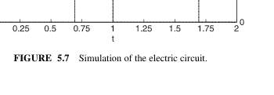

**图 5.7** 电路仿真。

对电路（来自第5.4节）的仿真演示了如何使用 *Hybrid* 类。完整的仿真程序列于下方。它打印电压以及开关和二极管状态随时间的变化，如图5.7所示。该图与表5.2中的数据非常吻合。

#### 第 5.4 节电路的仿真器

```cpp
#include "adevs.h"
#include <iostream>
using namespace std;
using namespace adevs;

class Circuit: public ode_system<bool>
{
  public:
    Circuit():
      ode_system<bool>(1,1), // one state variable and event function
      s(1),d(0), // diode and switch states
      vs(1.0),C(1.0),Rs(1.0),R1(1.0), // device parameters
      vop(0.5),vcl(0.25){}
    void init(double* q) { q[0] = 0.0; }; // vc = 0
    void der_func(const double* q, double* dq)
    {
      // ODE form of the differential equations
      if (!s && !d) dq[0] = 0.0;
      else if (!s && d) dq[0] = -q[0]/(C*R1);
      else if (s && !d) dq[0] = (vs-q[0])/(C*Rs);
      else dq[0] = (vs-q[0]-Rs*q[0]/R1)/(C*Rs);
    }
    void state_event_func(const double *q, double* z)
    {
      // This model uses the implicit form of the diode event
      if (d==0) z[0] = q[0]-vop;
      else z[0] = q[0]-vcl;
    }
    // As written here, this model does not have any time events
    double time_event_func(const double* q) { return DBL_MAX; }
    void internal_event(double* q, const bool* events)
    {
      assert(events[0]); // only one event type; make sure it fired
      d = !d;
    }
    void external_event(double*,double,const Bag<bool>& xb)
    {
      s = *(xb.begin());
    }
    void confluent_event(double* q,const bool* events,
                         const Bag<bool>& xb)
    {
        internal_event(q,events);
        external_event(q,0.0,xb);
    }
    void output_func(const double* q, const bool* events,
            Bag<bool>& yb)
    {
        assert(events[0]);
        yb.insert(!d);
    }
    void go_output(Bag<bool>&){}
    bool getDiode() const { return d; }
    bool getSwitch() const { return s; }
  private:
    bool s, d;
    const double vs, C, Rs, R1, vop, vcl;
};

class StateListener: public EventListener<bool>
{
    public:
        StateListener(Hybrid<bool>* c1, Circuit* c2): c1(c1),c2(c2){}
        void stateChange(Atomic<bool>*,double t)
        {
            cout << t << " " << c1->getState() << " " <<
                c2->getSwitch() << " " << c2->getDiode() << endl;
        }
        void outputEvent(Event<bool>,double){}
    private:
        Hybrid<bool>* c1; Circuit* c2;
};

int main()
{
    // Create the model
    Circuit* circuit = new Circuit();
    Hybrid<bool>* hybrid_model = new Hybrid<bool>(
        circuit,new coroutine_coupled_error<bool>(circuit,1E-5,0.01),
            new linear_event_locator<bool>(circuit,1E-5));
    // Create the simulator
    Simulator<bool>* sim = new Simulator<bool>(hybrid_model);
    sim->addEventListener(new StateListener(hybrid_model,circuit));
    // Simulate until the switch opens
    while (sim->nextEventTime() <= 1.0) sim->execNextEvent();
    // Open the switch
    Bag<Event<bool> > xb; xb.insert(Event<bool>(hybrid_model,0));
    sim->computeNextState(xb,1.0);
    // Simulate for another three seconds
    while (sim->nextEventTime() <= 4.0) sim->execNextEvent();
}
```


```text
91  delete sim; delete hybrid_model;
92  return 0;
93 }
```

### 5.6 机器人坦克的交互式仿真

在第4章中，机器人的计算机已经建模，现在可以将齿轮、履带、电机和运动方程与其连接起来。第2.2.3节给出了完整的方程组。

#### 5.6.1 修正转向动力学

通过重排式2.19得到过零函数，可以获得对启动和结束转向的事件条件的拐点描述

\[
g = \frac{B}{2}|F_l - F_r| - S_l \tag{5.14}
\]

当 $g$ 等于零时，离散变量 *turning* 切换其二进制值。稍加考虑就会发现，该模型无法开始或结束一次转向。在 *turning* 改变取值后，$g$ 仍为零，因此模型会永远在转向与不转向之间来回切换，产生非法的事件轨迹。

这种非法行为可以用迟滞值 $\epsilon$ 来修正，以区分启动和结束转向的转矩。如果 $\epsilon$ 很小，那么模型的行为应当非常接近式5.14所意图的行为。这一调整创建了一个在 *turning* 改变时移动的事件面：

\[
g = \begin{cases}
\frac{B}{2}|F_l - F_r| - (S_l - \epsilon) & \text{if } turning = \text{true} \\
\frac{B}{2}|F_l - F_r| - S_l & \text{if } turning = \text{false}
\end{cases}
\tag{5.15}
\]

这解决了非法性问题，但还希望 $g$ 是光滑的，以便线性插值给出合理的近似。通过创建两个事件面来去除绝对值，一个用于 $F_l - F_r > 0$，另一个用于 $F_l - F_r < 0$。函数

\[
g_r = \begin{cases}
\frac{B}{2}(F_l - F_r) - (S_l - \epsilon) & \text{if } turning = \text{true} \\
\frac{B}{2}(F_l - F_r) - S_l & \text{if } turning = \text{false}
\end{cases}
\tag{5.16}
\]

启动并结束顺时针（右转）转向，而

\[
g_l = \begin{cases}
\frac{B}{2}(F_r - F_l) - (S_l - \epsilon) & \text{if } turning = \text{true} \\
\frac{B}{2}(F_r - F_l) - S_l & \text{if } turning = \text{false}
\end{cases}
\tag{5.17}
\]

表示逆时针（左转）转向。这两个函数在离散事件之间都是连续的，并且可以由第5.4节所述的事件检测算法高效处理。

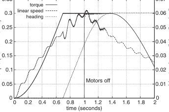
图5.8 左电机占空比为75%、右电机占空比为50%时，坦克在转向过程中发生抖动。

继续第4.4节的示例，我们现在可以仿真整个坦克对驾驶员一系列命令的响应。第一条命令将右电机的占空比设为50%，左电机设为75%（图5.12显示了计算机产生的电压信号）。坦克的响应是向前猛冲，并向右做出抖动转向。图5.8显示转矩增大，直到使履带脱离粘滞状态，坦克开始转向。随后，横向滑动履带的阻力从转向中消耗功率，降低转矩并使履带再次粘滞。这种模式迅速重复，使转矩保持在0.3附近，同时坦克蹒跚地完成其机动。一秒后，驾驶员发出的命令将占空比设为零，动量带着坦克完成剩余3.5°的转向。

当履带粘滞时，将 $\omega$ 瞬时切换为零会对模型产生奇特影响。这在图5.8中转矩峰值达到0.3时很明显，而在图5.9中更加明显；图5.9展示了左右电机以100%占空比反向工作时的原地转向。在 $t = 1$ 时，电机被关闭，摩擦和电阻使齿轮减速并使电机绕组断电，从而减小作用在坦克上的转矩。在履带粘滞前的一瞬间，粘性摩擦以约0.02 N的反作用力阻碍电机。履带粘滞之后，这种摩擦消失，反作用力也随之消失。电机和齿轮的能量并未因这一突然转变而减弱，此时它们施加足够大的转矩，再次克服履带的粘滞摩擦，使坦克转向。转向与不转向之间的高速切换持续0.75 s，直到电机、齿轮箱和履带中的阻力消耗足够能量，结束该循环。

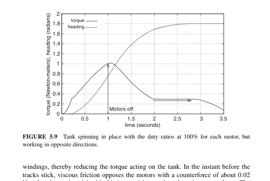
图5.9 每个电机的占空比均为100%，但以相反方向工作时，坦克原地旋转。

这种快速切换是对真实转向的准确刻画吗？大概不是。更全面的分析很可能在这方面揭示出更好的模型（参见，例如，Mosterman和Biswas对这一问题的讨论[90, 91]）。然而，模型的有效性并未因这一奇特现象而减弱。真实坦克及其模型响应如此迟缓，以至于转向的轻微延长对驾驶员来说无法察觉；而将电压频率与功率消耗联系起来的效率计算是针对直线运动进行的。不过，如果模型的使用范围在以后某个时候扩大，就必须重新审视该问题。

#### 5.6.2 电机的简化模型

修正后的欧拉积分器足以构建图2.12所示的功率-频率图，并足以仿真上述那样的单次机动。然而，即使采用10⁻²这样适度的误差容限，所需步长也跨越五个数量级，从坦克加速时的10⁻⁹到以恒定速度缓慢行驶时的10⁻⁴。机动所需的小步长使该仿真器不适用于交互式使用。

这个问题可以通过使用更复杂的数值积分方案或设计更简单的模型来解决。前者是一种可取的解决方案，实现它只需要构建一个新的 *ode_solver* 并将其提供给 *Hybrid* 类。合适的方法可以在任何数值分析教材中找到。

尽管如此，模型具有无法详细仿真的动力学并不罕见，原因可能是缺乏信息，也可能是缺乏计算能力。由此产生的简化往往产生混合动力学，这一事实已经在坦克中观察到：电机控制器中晶体管快速但连续的开关以及履带的突然滑动被离散跃迁替代。这里所追求的简化不会产生如此显著的结果，但看看如何从模型中移除快速速率以减少其执行时间同时保持其有效性，仍然是有启发性的。

为了隔离计算问题，我们将只关注两个电机的占空比均为100%的情形；这不需要离散事件，因为电机开关始终闭合，坦克沿直线运动。左右履带相同，因此四个方程足以对坦克的运动建模：

\[
\dot{v}=\frac{1}{m_t}\left(2F-B_rv\right) \tag{5.18}
\]

\[
\dot{i}=\frac{1}{L_m}\left(-e-iR_m-\alpha\omega\right) \tag{5.19}
\]

\[
\dot{\omega}=\frac{1}{J_g}\left(\alpha i-\omega B_g-\frac{r}{g}F\right) \tag{5.20}
\]

\[
\dot{F}=\frac{1}{K_l}\left(\frac{r}{g}\omega-v\right) \tag{5.21}
\]

式2.19–2.31中的一对相同力 $F_r$ 和 $F_l$ 已被单个力 $F$ 替代，描述转向的方程已被消除，坦克的位置被忽略。保留的是坦克的速度以及电机和齿轮箱的动态行为（注意，上述方程中的 $\omega$ 不是坦克的旋转速度，而是齿轮的角速度）；对于这些，只需要三个而不是六个方程，因为这一对的作用不可区分。

图5.10显示了四个状态变量 $v$、$i$、$\omega$ 和 $F$ 的轨迹。电压 $e$ 为恒定7.2 V。图5.11使用对数时间尺度来显示电池连接到电机时的初始电流涌流。采用每步 $10^{-2}$ 的误差容限时，步长选择范围从仿真开始时的 $10^{-9}$ 到初始瞬态衰减后的 $10^{-4}$。


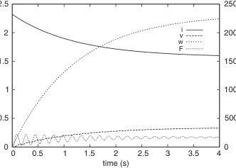

**图 5.10** 全油门下坦克加速至最大速度。

快速、瞬态的电流动态导致模拟开始时步长很小。这在查看决定导数 \(\dot{v}, \dot{\omega}, \dot{i},\) 和 \(\dot{F}\) 相对大小的比率后变得明显。对于加速度 \(\dot{v}\)，重要的比率是

$$\frac{2}{m_i}=2.5$$

$$\frac{B_i}{m_i}=1.25$$

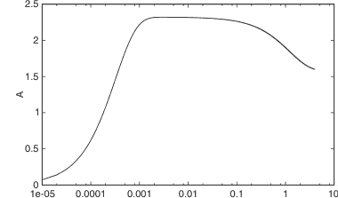

**图 5.11** 电池在 \(t=0\) 连接时电机中的初始电流涌入。

现在考虑一个忽略瞬态电流的简化模型。通过假设 \(i\) 是 \(\omega\) 的瞬时函数，我们可以设 \(\dot i = 0\) 并得到代数关系

$$i = \frac{\epsilon - \alpha\omega}{R_m} \tag{5.22}$$

将其代入方程 5.18–5.21 得到三变量模型

$$\dot v = \frac{1}{m_t}\left(2F - B_t v\right) \tag{5.23}$$

$$\dot \omega = \frac{1}{J_g}\left(\frac{\alpha\epsilon - \alpha^2\omega}{R_m} - \omega B_g - \frac{r}{g}F\right) \tag{5.24}$$

$$\dot F = \frac{1}{K_t}\left(\frac{r}{g}\omega - v\right) \tag{5.25}$$

这消除了 \(\dot i\) 的大比率，并将控制齿轮加速度 \(\dot \omega\) 的比率改为

$$\frac{\alpha^2/R_m + B_g}{J_g} = 0.827$$

$$\frac{(r/g)}{J_g} = 61.27$$

该简化模型的最大和最小特征值的大小分别为 50 和 0.8。这是对系统最大速率的显著降低，并带来相应更大的步长。

图 5.12 显示了该简化模型的轨迹。它与包含电机的图非常相似，因为电流涌入发生得非常快，其长期影响可以忽略不计。积分器选择的步长证实了预期的优势；误差容限为 \(10^{-2}\) 时，初始瞬态期间的步长约为 \(10^{-5}\)，坦克达到速度后为 \(10^{-2}\)。

该模型的重新表述在电机满功率时效果良好，但在较小占空比下运行则不充分。图 5.13 显示了原因；在 50% 占空比下，更精确模型中的电流保持为正。这是因为电机控制器切换足够快，使电感在电池断开时仍能维持电流。重新表述的模型没有电感，如果坦克移动时开关打开，电流实际上会反向。此问题通过在方程 5.22 中使用中断周期内的平均电压而不是瞬时电压来纠正。修正需要对 *InterruptHandler* 的内部转换函数进行少量更改，现在它计算 \(e_l\) 为

$$e_l = 7.2(\text{left motor on time}/255) \tag{5.26}$$

而 \(e_r\) 也是同样方式。图 5.13 显示了此更改的效果；简化模型中的电流现在与更详细模型中的时间平均电流一致。

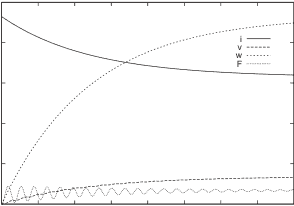

**图 5.12** 全油门下坦克加速至最大速度的简化模型。

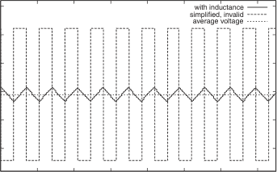

**图 5.13** 原始模型、简化模型及其修正中 50% 占空比下的电流比较。

#### 5.6.3 更新显示

坦克的驾驶员视觉显示需要以约 40 帧每秒（FPS）的速度更新；每一帧显示坦克的位置和方向以及其之前位置的轨迹。为此，状态变量必须每 25 毫秒采样并绘制一次。在第 5.6.2 节中我们看到，模拟器使用的步长范围为 \(10^{-5}\) 至 \(10^{-2}\) s，计算新状态的速度远快于所需；事实上，比显示器能够渲染的速度更快。

针对此问题的几种可能解决方案中，我们的方法是让模型以 25 毫秒的固定间隔产生 `SIM_TANK_POSITION` 事件。因此，由模拟程序主循环实时推进的模拟器将仅产生显示所需的输出。显示器反过来仅在接收到需要新图像的事件时才更新。

这是通过在坦克模型中添加一个时间事件来实现的。满足 \(\dot{\tau}_c = 1\) 的时钟变量 \(\tau_c\) 初始化为 \(\tau_c = 0.025\)。\(\tau_c = 0\) 处的事件面可轻松表示为在间隔 \(\tau_c\) 后发生的事件。当坦克发生内部事件时，它会生成用于显示的位置和方向，并将 \(\tau_c\) 重新初始化为 25 毫秒。

#### 5.6.4 实现坦克物理

*TankPhysics* 类派生自 *Hybrid* 类。它包含一个用于模拟模型连续轨迹的 *corrected_euler* 对象、一个用于检测转弯开始和结束的 *linear_event_locator* 对象，以及一个实现控制坦克运动的微分和离散方程的 *TankPhysicsEqns* 对象。*TankPhysicsEqns* 的代码列于下方；它包含完整的模型，用于效率实验，以及用于交互实验的简化模型。选择是通过传递给构造函数的布尔标志进行的。

将 *TankPhysics* 与第 4.4 节中的 *Computer* 耦合完成了坦克的模型。*Tank* 类的代码，其组件和耦合如图 2.10 所示，也列于下方。此模型通过 *Simulator* 用于推进时间、注入输入以及监听状态和输出事件的接口，由软件的其他主要部分 *SimControl* 和 *Display* 访问。

##### TankPhysicsEqns 的头文件

```cpp
#ifndef _TankPhysicsEqns_h_
#define _TankPhysicsEqns_h_
#include "adevs.h"
#include "adevs_hybrid.h"
#include "SimEvents.h"
#include <fstream>

class TankPhysicsEqns: public adevs::ode_system<SimEvent>
{
    public:
        // Create a tank at an initial position
        TankPhysicsEqns(double x0, double y0, double theta0,
                double cint, bool simple = false);
        // Initialize the continuous state variables
        void init(double* q);
        // Differential functions
17 void der_func (const double *q, double *dq);
18 // State event function that detects turning movements
19 void state_event_func (const double *q, double *z);
20 // Sample x, y, and theta periodically
21 double time_event_func (const double *q);
22 // Expiration of the timer and collision events are internal
23 void internal_event(double* q, const bool* events);
24 // Change in the motor voltage is an external event
25 void external_event(double *q, double e,
26                  const adevs::Bag<SimEvent> &xb);
27 // Confluent events
28 void confluent_event(double* q, const bool* events,
29                  const adevs::Bag<SimEvent> &xb);
30 // Output position events for the display when the timer expires
31 void output_func(const double *q, const bool* events,
32                  adevs::Bag<SimEvent> &yb);
33 // Garbage collection
34 void gc_output(adevs::Bag<SimEvent>&){}
35 // Get the resistance of the motor (left and right are the same)
36 double getMotorOhms() const { return Rm; }
37 // Is the tank turning?
38 bool isTurning() const { return turning; }
39 // Get the current in the motor
40 double getLeftCurrent(const double* q) const;
41 double getRightCurrent(const double* q) const;
42 // Index of the turning state events and timer time event
43 static const int TURNL, TURNR, TIMER_EXPIRE;
44 // Indices of the state variables
45 static const int WL, WR, FL, FR, IL, IR, X, Y, THETA, W, V, TIMER;
46 // Model parameters
47 const double mt, Jt, B, Br, Bs, Bl, Sl, Lm,
48                  Rm, Jg, Bg, g, alpha, r, Kt;
49 private:
50     // Initial conditions
51     const double x0, y0, theta0;
52     // Hysteresis value for stopping turns
53     const double Hs;
54     // Communication interval for the numerical integration algorithm
55     const double cint;
56     // Motor voltages
57     double el, er;
58     // Is the tank turning?
59     bool turning;
60     // Use simplified dynamics?
61     const bool simple;
62 };

#endif
```


##### 用于 TankPhysicsEqns 的源文件

```cpp
#include "TankPhysics.h"
using namespace std;
using namespace adevs;

// Indices for the state event array
const int TankPhysicsEqns::TURNL=0, TankPhysicsEqns::TURNR=1,
    TankPhysicsEqns::TIMER_EXPIRE=2;
// Indices for the state variable array
const int TankPhysicsEqns::WL=0, TankPhysicsEqns::FL=1,
    TankPhysicsEqns::IL=11, TankPhysicsEqns::WR=3, TankPhysicsEqns::FR=4,
    TankPhysicsEqns::IR=10, TankPhysicsEqns::X=6, TankPhysicsEqns::Y=7,
    TankPhysicsEqns::THETA=8, TankPhysicsEqns::V=9, TankPhysicsEqns::W=5,
    TankPhysicsEqns::TIMER=2;

TankPhysicsEqns::TankPhysicsEqns(double x0, double y0, double theta0,
    double cint, bool simple) :
    // The simple model has two fewer state variables
    ode_system<SimEvent>(12-simple*2,2),
    // Set the model parameters and initial conditions
    mt(0.8),Jt(5E-4),B(1.0),Br(1.0),Bs(14.0),Bl(0.7),Sl(0.3),
    Lm(1E-3),Rm(3.1),Jg(1.2E-6),Bg(6.7E-7),g(204.0),alpha(1E-3),
    r(0.015),k(0.001),x0(x0),y0(y0),theta0(theta0),
    Hs(1E-3),cint(cint),eL(0.0),eR(0.0),turning(false),
    simple(simple){}

void TankPhysicsEqns::init(double* q)
{
    q[W] = q[V] = q[FR] = q[FL] = q[WR] = q[WL] = 0.0;
    if (!simple) q[IL] = q[IR] = 0.0;
    q[X] = x0;
    q[Y] = y0;
    q[THETA] = theta0;
    q[TIMER] = cint;
}

void TankPhysicsEqns::der_func(const double *q, double *dq)
{
    double il = getLeftCurrent(q), ir = getRightCurrent(q);
    // Timer just counts down
    dq[TIMER] = -1.0;
    if (!simple) {
        dq[IL] = (eL-il*Rm-alpha*q[WL])/Lm;
        dq[IR] = (eR-ir*Rm-alpha*q[WR])/Lm;
    }
    dq[WL] = (alpha*il-q[WL]*Bg-(r/g)*q[FL])/Jg;
    dq[WR] = (alpha*ir-q[WR]*Bg-(r/g)*q[FR])/Jg;
    dq[FL] = ((r/g)*q[WL]-[q[V]+B*q[W]/2.0])/Kt;
    dq[FR] = ((r/g)*q[WR]-[q[V]-B*q[W]/2.0])/Kt;
    dq[X] = q[V]*sin(q[THETA]);
    dq[Y] = q[V]*cos(q[THETA]);
    assert(turning || q[W] == 0.0);
    dq[THETA] = q[W];
    // These equations change when the tank turns or does not turn
    dq[V] = (q[FL]+q[FR]-(B+r*B*(double)turning)*q[V])/mt;
    dq[W] = (double)turning*(B*(q[FL]-q[FR])/2.0-Bi*q[W])/Jt;
}

void TankPhysicsEqns::state_event_func(const double *q, double *z)
{
    double torque_l = B*(q[FL]-q[FR])/2.0;
    double torque_r = -torque_l;
    z[TURNL] = torque_l-(Sl-(double)turning*Hs);
    z[TURNR] = torque_r-(Sl-(double)turning*Hs);
}

double TankPhysicsEqns::time_event_func(const double *q)
{
    return std::max(0.0,q[TIMER]);
}

void TankPhysicsEqns::internal_event(double* q, const bool* events)
{
    // Start or end a turn; this produces an output so reset the timer
    if (events[TURNL] || events[TURNR]) {
        q[TIMER] = cint;
        q[W] = 0.0;
        turning = !turning;
    }
    // Otherwise is was a timer event, so just reset the timer
    else q[TIMER] = cint;
}

void TankPhysicsEqns::external_event(double *q, double e,
    const Bag<SimEvent> &xb)
{
    // Set the motor voltage
    Bag<SimEvent>::iterator iter = xb.begin();
    for (; iter != xb.end(); iter++) {
        assert((*iter).getType() == SIM_MOTOR_VOLTAGE);
        eL = (*iter).simMotorVoltage().el;
        eR = (*iter).simMotorVoltage().er;
    }
}

void TankPhysicsEqns::confluent_event(double *q, const bool* events,
    const Bag<SimEvent> &xb)
{
    internal_event(q,events);
    external_event(q,0,xb);
}

void TankPhysicsEqns::output_func(const double *q, const bool* events,
        Bag<SimEvent> &yb)
{
    // Produce a position event
    SimTankPosition pos;
    pos.x = q[X]; pos.y = q[Y]; pos.theta = q[THETA];
    yb.insert(SimEvent(pos));
}

double TankPhysicsEqns::getLeftCurrent(const double* q) const
{
    if (simple) return (eL-alpha*q[WL])/Rm;
    else return q[IL];
}

double TankPhysicsEqns::getRightCurrent(const double* q) const
{
    if (simple) return (eR-alpha*q[WR])/Rm;
    else return q[IR];
}
```

##### Tank 类的头文件

```cpp
#ifndef Tank_h_
#define Tank_h_
#include "Computer.h"
#include "TankPhysics.h"

// This is the complete model of the tank with the TankPhysics and Computer
class Tank:
    public adevs::Network<SimEvent>
{
public:
    // Tank has an interrupt handler with the specified frequency,
    // starts at the specified position, and generates events for
    // the display at the given interval
    Tank(double freq, double x0, double y0, double theta0, double cint);
    // Get the components of the tank
    void getComponents(adevs::Set<adevs::Devs<SimEvent> > &c);
    // Route events within the tank
    void route(const SimEvent& value, adevs::Devs<SimEvent>* model,
        adevs::Bag<adevs::Event<SimEvent> > &br);
    // Get the physics model
    const TankPhysics* getPhysics() const { return &physics; }
    // Get the computer
    const Computer* getComputer() const { return &computer; }
private:
    Computer computer;
    TankPhysics physics;
};
#endif
```

##### Tank 类的源文件

```cpp
#include "Tank.h"
#include <cassert>
#include <iostream>
using namespace std;
using namespace adevs;

Tank::Tank(double freq, double x0, double y0, double theta0, double cint):
Network<SimEvent>(),
computer(freq),
physics(new TankPhysicsEqns(x0,y0,theta0,cint,false))
{
computer.setParent(this);
physics.setParent(this);
}

void Tank::getComponents(Set<Devs<SimEvent>*> &c)
{
c.insert(&computer);
c.insert(&physics);
}

void Tank::route(const SimEvent& value, Devs<SimEvent>* model,
Bag<Event<SimEvent> > &r)
{
// Packets go to the computer
if (value.getType() == SIM_PACKET)
r.insert(Event<SimEvent>(&computer,value));
// Voltage events go to the tank physics model
else if (value.getType() == SIM_MOTOR_VOLTAGE)
r.insert(Event<SimEvent>(&physics,value));
// Position events are external output
else if (value.getType() == SIM_TANK_POSITION)
r.insert(Event<SimEvent>(this,value));
// Anything else is an error
else assert(false);
}
```

### 5.7 混合模型之间连续交互的近似

大多数数值积分方法都是为状态空间形式的模型设计的，因此将连续交互的组件放入单个原子单元中是可取的。然而，仿真软件设计中的其他考虑因素可能仍会反对这一点，因此用离散事件近似连续交互的方法是必不可少的。

一种广泛使用的方法，由 Giambiasi et al. [50] 以其最一般的形式描述，是在事件中编码一个近似连续输出的多项式。事件的接收方使用该多项式来近似原始的连续轨迹。该方法被广泛使用证明了其巨大的实用性：它被嵌入到 *IEEE 分布式交互仿真*（DIS）标准 [1] 的死算算法中，并在数值积分的基于事件的方法中被广泛使用 [70, 99, 142, 158]。

连续轨迹在事件中的编码如下。给定连续函数在时间 $t_1,\ldots,t_k$ 时的 $k$ 个样本 $x_1,\ldots,x_k$，以及可能的部分导数，将多项式拟合到数据上并将其系数发送到离散事件中。接收方保留这些系数并使用它们来计算连续轨迹的近似值。一般来说，事件越频繁，多项式中嵌入的信息越多，近似就越准确。

IEEE DIS 标准中的死算可能代表了多项式事件最熟悉和最突出的用途。其目的是减少分布式交互仿真中模拟对象的定位更新频率。每个模拟对象（飞机、坦克、船只等）通过任何适当的方式计算其时变位置 $x$ 和速度 $v$。它还维护最后在仿真网络上广播的位置 $x_o$ 和速度 $v_o$，以及发送该信息的时间 $t_o$ 时该信息被发送的时间。数据的接收方用直线近似对象在时间 $t$ 的位置

$$\tilde{x}=x_o+(t-t_o)v_o \tag{5.27}$$

数据的发起方在重新计算其实际位置时计算其估计位置，如果 $x$ 和 $\tilde{x}$ 偏离某个预定量，则发送 $x_o$、$v_o$ 和 $t_o$ 的新值。图 5.14 说明了此方法。

死算使用截断的泰勒级数来近似对象的位置，但一般可以使用任何多项式；具体选择将取决于可用的数据。例如，方程 5.27 可以通过使用时间 $t_o$ 和某个更早时间 $t'_o$ 处的两个速度点 $v_o$ 和 $v'_o$ 来扩展，以更准确地近似实际速度

$$\tilde{v}=\frac{t-t'_o}{t_o-t'_o}v_o+\frac{t-t_o}{t'_o-t_o}v'_o$$


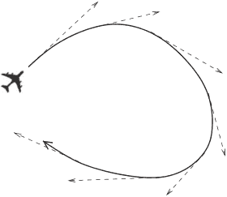

**图 5.14** *IEEE 分布式交互仿真标准* 中航位推算的说明。实线显示飞机的实际轨迹；虚线显示航位推算过程所通信的近似、分段多项式轨迹。

并使用 $x_o$、$v_o$ 和 $\tilde{v}$ 来通过以下方式估计位置

$$\tilde{x}=x_o+(t-t_o)\tilde{v}$$

这通过编码更多信息，往往能给出更好的结果。

尽管该技术非常有用，但必须谨慎使用。当出现困难时，它们无一例外都是由于多项式的创建者和接收者没有对同一信号采取行动所致。创建者拥有自身的准确数据，会更倾向于将其用于本地计算。显然，接收者没有这些原始数据，只能使用近似值。在分布式仿真中，通信网络中的传输延迟会加剧这种效应。对事件检测的后果是显而易见的，但也不免令人惊讶。

例如，图 5.15 说明了两架飞机在相撞航线上飞行并预计会相撞。飞机 A 以恒定速度沿直线飞行。飞机 B 正在转弯，但其位置由飞机 A 使用在转弯开始时接收到的信息进行航位推算。飞机 B 拥有对其自身路径的更准确视图，将会检测到空中相撞。飞机 A 不知道 B 正在转弯，将不会检测到。A 的仿真结果是错误的，而且更糟的是，相撞后 A 和 B 对世界的看法不一致。


**图 5.15** 由于航位推算位置的误差而导致世界观不一致的碰撞。

这种多项式的使用可以通过改变其稳定性特性对数值积分方法产生更具隐蔽性的影响。当存在多个状态变量时会出现此问题，这在一定程度上使分析复杂化；因此我们将考虑一个单一的说明性案例。考虑稳定的线性系统

$$\dot{x} = -x + y$$
$$\dot{y} = x - 2y$$

及其通过隐式欧拉方法进行的仿真，该方法使用近似系统

$$x_{n+1} = x_n + h(-x_{n+1} + y_{n+1})$$
$$y_{n+1} = y_n + h(x_{n+1} - 2y_{n+1})$$

对于稳定的仿真，矩阵

$$\begin{bmatrix}1 + h & -h\\ -h & 1 + 2h\end{bmatrix}^{-1}$$

必须只有模 ≤ 1 的特征值。此条件等价于多项式

$$p(\lambda)=\lambda^2-\left(\frac{2+3h}{1+3h+h^2}\right)\lambda+\frac{1}{1+3h+h^2}$$

的根的模严格小于 1。根为

$$\frac{2+3h\pm\sqrt{h(5h-6)}}{2+6h+2h^2}$$

并且当 $h=0$ 时，它们等于 1。当 $h\to\infty$ 时，分母中的 $h^2$占主导，导致根消失。事实上，对于所有 $h>0$，特征值的模都小于 1。此结果并不完全出乎意料：隐式欧拉方法对任何稳定的线性系统都是稳定的。

现在将此模型拆分为两个离散时间系统，如图 5.16 所示。系统 $x$ 和 $y$ 都使用步长为 $h$ 的隐式欧拉方法进行仿真，并在每个步骤交换状态和导数信息。系统 $x$ 用直线 $\tilde{y}(t)$ 近似 $y$，而 $y$ 用直线 $\tilde{x}(t)$ 近似 $x$。仿真可以写成差分方程对

$$\begin{aligned}
x_{n+1}&=x_n+h(-x_{n+1}+\tilde{y}(h))\\
y_{n+1}&=y_n+h(\tilde{x}(h)-2y_{n+1})\\
\tilde{x}(t)&=x_n+t(-x_n+y_n)\\
\tilde{y}(t)&=y_n+t(x_n-2y_n)
\end{aligned}$$

此仿真仅在矩阵

$$\begin{bmatrix}
(1+h^2)/(1+h) & h(1-2h)/(1+h)\\
h(1-h)/(1+2h) & (1+h^2)/(1+2h)
\end{bmatrix}$$

只有模 ≤ 1 的特征值时才稳定。麻烦的明显迹象是当 $h$ 变得很大时对角项会爆炸。代入 $h=2$，当隐式欧拉应用于整个系统时这是一个稳定的选择，会使此仿真不稳定，使其具有特征值对 0.38 和 2.3。当连续交互的 x 和 y 被分离为两个离散模块时，隐式欧拉格式的无条件稳定性就丧失了。


**图 5.16** 将具有状态变量 $x$ 和 $y$ 的原子模型分离为具有两个部分的网络模型。

在许多情况下，通过在仿真器设计早期仔细考虑这些问题，可以减轻这些问题。分布式交互仿真以及一般虚拟环境中的不一致性已被广泛研究，并且有许多技术可用于缓解由外推和通信延迟引起的问题（参见例如参考文献 16、44、118 和 162）。在混合仿真的特定背景下，审慎选择积分方案并仔细控制局部步长将避免数值问题（参见例如参考文献 69 和 155）。无论如何，对外推多项式可能带来的潜在困难的认识对于避免将其投入实际使用时出现不愉快的意外至关重要。

### 5.8 关于元胞自动机的最终评论

在第 4.5 节中，已证明异步元胞自动机包含熟悉的同步元胞自动机。异步（元胞）自动机现在被证明是更一般的一类系统的特例：微分自动机，它们被用作柔性制造系统的模型（参见例如参考文献 84）。异步自动机向微分自动机的转换是这样一个例子的说明：通过认识到看似不同的系统之间的等价性，仿真器的有用范围得以扩展。更一般地说，这里展示的转换类型是多形式主义建模的强大推动者。基于例如混合输入/输出自动机、Petri 网的众多变体之一、带标签转换系统或有限状态自动机等验证导向模型的自动化转换，为多学科仿真项目生成代码（参见例如参考文献 92）是一个活跃的研究领域。AtoM3 [33, 141]、CD++ [143]、Sarjoughian 和 Meyer 描述的可组合性框架 [85, 126] 以及 Ptolemy 和 Kepler 项目 [53] 等正在探索的计算模型概念，展示了该技术的巨大潜力。

#### 5.8.1 具有恒定导数的微分自动机

微分自动机是具有与每个离散状态相关联的一组微分方程的有限状态自动机。当自动机的连续轨迹遇到事件面时，就会发生改变系统离散状态的离散事件。通过改变离散状态，系统选择一组新的微分方程来控制其远离中断事件面的运动。

在此特定示例中，自动机的连续变量在事件之间沿直线变化。其速度取决于离散状态 q，其数量有限。连续状态向量 x 满足

$$\dot{x}(t) = v(q) \tag{5.28}$$

在 q 恒定的每个真实时间 $t$ 实例中。当 q 在时间 $(t,c)$ 发生变化时，其后续值取决于 $q((t,c))$ 和 $x((t,c))$；时间 $(t,c+1)$ 的新状态是³

$$q((t,c+1)) = \Theta(x((t,c)), q((t,c))) \tag{5.29}$$

微分函数的离散变化在时间 $(t,c+1)$ 生效，并且 $x$ 从其在转换时的值演化。由于 $x$ 不会不连续变化，满足方程 5.28 且是从 $\mathbb{R} \to \mathbb{R}^m$ 的函数的轨迹 $x(t)$，等于从 $\mathbb{R} \times \mathbb{N} \to \mathbb{R}^m$ 的函数 $x((t,c))$，对于所有 $c \in \mathbb{N}$，因此这两个在技术上不同的轨迹是可以互换的。

这些系统当然可以用微分函数、事件面和离散转换表示的平凡混合系统来建模。具体来说，它是输入/输出无关的系统，其中 $x$ 如上所述，$\dot{x}(t,x,q) = (x, \Theta(x,q))$，并且 $G$ 是 $\Theta$ 改变值之前剩余的时间。

#### 5.8.2 用微分自动机建模异步元胞自动机

元胞自动机的离散状态可以通过将其最左边的单元视为二进制数中的最高有效位，而最右边的单元视为最低有效位来进行编号。具有 $n$ 个单元的自动机有 $2^n$ 个离散状态。除了其二进制状态外，每个单元 $k$ 都有一个时钟 $\tau_k$，它以两种方式引发事件：从零开始，$\tau_k$ 增长直到达到单元的持续时间 $P_k$；从 $P_k$ 开始，$\tau_k$ 缩小直到达到零。时钟的方向是单元的第三个也是最后一个状态变量。

对 $(b_k,d_k)$ 是单元 $k$ 的离散状态，其中 $b_k \in \{0,1\}$ 是二进制状态，$d_k \in \{1,-1\}$ 是时钟的方向；离散状态集合为 $Q = \{0,1\} \times \{1,-1\}$。时钟 $\tau_k$ 开始并保持在区间 $[0,P_k]$ 内。建模单元的微分自动机是

$$\dot{\tau}_k = d_k \tag{5.30}$$

$$\Theta_k(\tau_k,(b_k,d_k)) = \begin{cases}(T(b_{k,l},b_{k,r}),-d_k) & \text{if }(\tau_k=0 \land d_k=-1) \\(b_k,-d_k) & \text{if }(\tau_k=P_k \land d_k=1) \\(b_k,d_k) & \text{otherwise}\end{cases} \tag{5.31}$$

其中 $T$ 如方程 4.21 所定义。

具有 $n$ 个单元的元胞自动机是一个微分自动机，其离散状态集合为 $Q^n$，连续状态向量为 $\tau = [\tau_1\ \tau_2\ \cdots\ \tau_n]$。动态方程

³符号 $\Phi$ 通常表示微分自动机的离散转换函数，但这与我们对无事件的用法冲突，因此使用 $\Theta$。


对于该模型，有

$$\tau = [d_1\ d_2\ \cdots\ d_n]\qquad(5.32)$$

$$\Theta(\tau, ((b_1,d_1),\ldots,(b_n,d_n))) = ((b'_1,d'_1),\ldots,(b'_n,d'_n))\qquad(5.33)$$

其中 $(b'_k,d'_k)=\Theta_k(\tau_k,(b_k,d_k))$。

恰好有两个具有单个元胞的元胞自动机，它们给出了上述构造的最简单演示。该元胞具有持续时间 $P$。它自身就是其左邻居和右邻居，因此 $T$ 完全由其在三元组 $(1,1,1)$ 和 $(0,0,0)$ 上的作用定义；为简洁起见，将 $T$ 写成单个值的函数。可以定义两个转移规则：

$$T_a(b)=b\qquad(5.34)$$

$$T_\beta(b)=\begin{cases}1 & \text{if } b=0;\\0 & \text{if } b=1.\end{cases}\qquad(5.35)$$

这两个自动机——第一个采用规则 $T_a$，第二个采用规则 $T_\beta$——都有一对周期轨迹。它们如图 5.17 所示。事件面是位于 $\tau=0$ 和 $\tau=P$ 的直线。从方向 $d=1$ 开始，时钟向上移动到 $P$，在那里发生一个离散事件并导致方向改变；然后它移动到 $0$，方向再次改变；于是该元胞在这两个约束面之间来回反弹。两个自动机都需要两次反弹才能回到初始状态，因此周期长度为 $2P$。


**图 5.17** 两个异步元胞自动机的事件面与周期轨迹，每个自动机均具有单个元胞；在图中，对于第一个自动机，$b'=T_a(b)$ 且 $b=T_a(b')$，对于第二个自动机，关于 $T_\beta$ 也类似。

#### 5.8.3 从微分自动机到异步元胞自动机的同态

每个异步元胞自动机都是某个微分自动机的同态像。这里我们只考虑第 4.5 节中的左视元胞自动机，并假设异步元胞自动机的状态集是仿真代码中从初始条件可达的那些状态。将该论证推广到涵盖所有异步元胞自动机是一项直接的练习。

微分自动机的状态按以下方式映射到异步元胞自动机的合成结果的状态。微分自动机中元胞的离散状态 $b$ 映射到异步元胞自动机中对应元胞的状态 $s$。微分自动机中该元胞左邻居的 $b$ 值映射到异步元胞自动机中该元胞的 $l$。参数 $P$ 在两个模型中相同。

图 5.18 描绘了微分自动机的 $d_k$ 和 $\tau_k$ 变量与异步元胞自动机的 $e$、$e_k$ 和 $c_k$ 之间的关系。异步元胞自动机合成结果的已流逝时间 $e$，是自微分自动机上一次转移以来流逝的时间：

$$e = \min_{k\in[1,n]}\left(\frac{(1-d_k)P_k}{2}+d_k\tau_k\right)\qquad(5.36)$$

第 $k$ 个分量的已流逝时间 $e_k$，是自其上一次内部、外部或汇合事件以来经过的时间。令 $I_k$ 为相邻元胞的索引集合（即 $k$ 的影响者集合），则 $e_k$ 为

$$e_k = -e+\min_{j\in I_k\cup\{k\}}\left(\frac{(1-d_j)P_j}{2}+d_j\tau_j\right)\qquad(5.37)$$


**图 5.18** 微分自动机和异步元胞自动机中元胞 2 到 5 的连续分量之间的关系。

其中 $e$ 是来自式 5.36 的已流逝时间。元胞 $k$ 处的消耗时间 $c_k$，是微分自动机中同一分量所经过的时间与异步元胞自动机中的已流逝时间之差

$$c_k = \frac{(1-d_k)P_k}{2}+d_k\tau_k-e_k-e\qquad(5.38)$$

其中 $e$ 和 $e_k$ 分别来自式 5.36 和式 5.37。至此完成了将微分自动机的状态转换为异步元胞自动机状态的规则。接下来将说明，这一映射实际上是一个同态。

首先，我们确定每个模型到下一次离散转移的时间是等价的。微分自动机在经过一个实区间后发生下一次离散状态变化

$$\min_{j\in[1,n]}\left(\frac{(1+d_j)P_j}{2}-d_j\tau_j\right)\qquad(5.39)$$

这是某个 $\tau_j$ 达到其（上限或下限）极限的最小时间。回顾式 4.13，异步元胞自动机的合成结果改变其离散状态所剩的时间为

$$\min_{j\in[1,n]}\left(P_j-c_j-e_j-e\right)\qquad(5.40)$$

将式 5.38 代入 $c_j$ 可得

$$\begin{aligned}
P_j-c_j-e_j-e
&=P_j-\left(\frac{(1-d_j)P_j}{2}+d_j\tau_j-e_j-e\right)-e_j-e\\
&=P_j-\frac{(1-d_j)P_j}{2}-d_j\tau_j\\
&=\frac{(1+d_j)P_j}{2}-d_j\tau_j\qquad(5.41)
\end{aligned}$$

再将式 5.41 代回式 5.40 便得到式 5.39。因此，微分自动机与其对应的异步元胞自动机的时间推进是相等的。

两个系统都是无输入的，并且不产生输出，因此只需考虑状态转移函数的三种情况：通过短于合成结果时间推进的区间进行仿真（即式 4.7 的情况 5）、在离散转移之前立即结束的仿真（即式 4.7 的情况 4），以及在离散转移处结束的仿真（即式 4.7 的情况 3）。我们依次考察每种情况。

情况 4 可直接由前面关于时间推进相等的论证得出。情况 5 类似。在实长度 $\epsilon$ 的区间上，微分自动机的 $\tau_i$ 变化量相等，尽管方向可能相反。在区间开始处应用从微分自动机到异步元胞自动机的映射，并将 $e$ 推进 $\epsilon$，得到最终值

$$e=\epsilon+\min_{k\in[1,n]}\left(\frac{(1-d_k)P_k}{2}+d_k\tau_k\right)$$

反过来，先推进 $\tau_k$，再应用该映射，得到

$$e=\min_{k\in[1,n]}\left(\frac{(1-d_k)P_k}{2}+d_k(\tau_k+d_k\epsilon)\right)=\min_{k\in[1,n]}\left(\frac{(1-d_k)P_k}{2}+d_k\tau_k+d_k^2\epsilon\right)$$

并且由于 $d_k^2=1$，这正好符合要求。还要注意，$e_k$ 和 $c_k$ 都没有改变；$e_k$ 中最小项的推进被 $e$ 的同等推进所抵消，对 $c_k$ 也是如此。

情况 3 同样可由时间推进相等这一事实、微分自动机的 $\theta$ 定义，以及异步元胞自动机转移函数的四个条件得出：内部事件、外部事件、汇合事件以及无事件的情形。很明显，每种情况下的离散变量都如预期那样变化，因此现在我们考虑每种情形中的连续变量。回顾式 4.17 以及异步元胞自动机每次转移后已流逝时间 $e$ 为零这一事实是有帮助的。还要注意，式 5.36 在微分自动机每次转移时为零。异步元胞自动机转移函数的四个条件如下：

- **内部事件。** 事件之后，异步元胞自动机中元胞 $k$ 有 $e_k=c_k=0$。类似地，微分自动机中该元胞的 $\tau_k$ 在 $d_k$ 从 $1$ 转移到 $-1$ 时为 $P_k$，在相反情况下为 $0$。在这两种情况下，式 5.37 为零，式 5.38 也为零。因此，无论从微分自动机到异步元胞自动机的映射是在转移之前还是之后应用，结果都相同。

- **无事件。** 元胞 $k$ 处的非事件将 $e_k$ 推进合成结果的已流逝时间 $e$；元胞 $k$ 不以其他方式改变。现在注意，在微分自动机中，该元胞及其邻居的 $\tau_k$ 不因该事件而改变，但异步元胞自动机的已流逝时间 $e$ 变为零。因此，式 5.37 确保 $e_k$ 按需推进 $e$。同理，式 5.38 确保 $c_k$ 不变。因此，无论从微分自动机到异步元胞自动机的映射是在转移之前还是之后应用，结果都相同。

- **外部事件。** 在元胞 $k$ 处发生外部事件之后，其消耗时间 $c_k$ 会增加转移前紧接着的 $e_k-e$ 值；随后 $e_k$ 和 $e$ 变为零。由于一个相邻元胞经历了内部事件，式 5.36 为零，因此式 5.37 也为零。当该量在以下过程之后变为零时，式 5.38 使 $c_k$ 增加 $e_k-e$：


## 第 6 章

## 应用

本章的应用突出了仿真框架的主要特性。第一个应用考察通过分组交换网络实现的闭环控制，展示了软件设计如何促进模型跨仿真框架的复用。第二个应用同样涉及控制；它研究利用负荷调节电力系统频率。该示例包含复杂的状态事件和计算量大的连续动态，并至少留下两个学生可能研究的有趣问题。

### 6.1 通过分组交换网络进行控制

网络化控制系统设计方面的近期工作，广泛关注会丢失信息的通信网络。最简单的模型使用伯努利过程描述丢包，并对成功送达的数据包施加固定延迟。控制过程对此类误差可能具有惊人的鲁棒性；并且，鉴于其后果相对容易分析，人们很容易选择行为与该模型密切近似的控制网络（Hespanha 等 [57] 概述了该领域的近期工作；另见 Feng-Li 等 [38] 的文章）。

相反，对分组交换网络上的控制的兴趣，是由数据处理应用中已有的相对廉价的通信技术所激发的。这种网络技术在设计上更倾向于容忍延迟和延迟变化，而不是信息丢失。在配置不足的网络中，丢包非常罕见。即使在紧张的网络中，也会先出现显著的延迟和延迟变化，然后丢包才会成为问题。

以太网是构建局域网最常用的技术之一，以太网总线能够以很高的利用率运行，而信息丢失极少。这是通过其媒体访问控制（MAC）机制实现的，其工作方式如下（例如参见参考文献137）。在传输之前和传输期间，网络接入设备监听网络上其他设备的同时传输。如果发生冲突传输，则信号被破坏，数据丢失，各方都会尝试重新传输。为避免第二次冲突，每个网络设备在尝试重发消息之前等待一段随机选择的时间。如果经过若干次尝试后，设备仍未能发送其信息，则数据被丢弃，并通知网络协议的上层发生了丢失；否则报告成功。

如果在协议栈的上层使用类UDP协议，则丢失的消息会被直接丢弃；不会进一步尝试传输它。因此，如果控制器和被控对象将其重试次数设为零，并且网络的背景利用率恒定，则以太网应能由伯努利丢包模型合理近似。此外，如果网络上的控制数据量相对于其他类型的数据可以忽略，则控制数据包丢失的概率大约为其他数据的到达率除以以太网的最大帧速率。

通过改变重试次数，可以在控制数据丢失与其延迟变化之间进行权衡。较大的重试次数可防止数据丢失，但可能相对于被控对象和控制器的时间常数造成较长延迟；较小的重试次数则产生相反效果。对于特定的被控对象、控制器和网络背景利用率，假设存在一个最佳重试次数设置似乎是合理的；也就是说，在数据丢失与其延迟之间存在最佳权衡。

我们将针对一个比例-积分-微分（PID）控制器探讨这个问题，该控制器的目的是使倒立摆保持直立；该问题的重要特征如图6.1所示（关于摆及其控制器的详细讨论，例如参见参考文献128）。摆由一个摆臂组成，该摆臂通过旋转关节连接到带轮小车上。小车安装在轨道上。传感器向控制器提供摆臂的角度测量值。小车中的电机使控制器能够在轨道上左右推动小车。通过仔细控制电机施加的力，PID控制器试图使摆臂保持直立（此处不考虑小车的位置）。

#### 6.1.1 摆及其PID控制器的模型

描述倒立摆运动的方程为

$$\begin{bmatrix} m_c + m_a & -L m_a \cos(\theta)/2 \\ -L m_a \cos(\theta)/2 & L^2 m_a/4 \end{bmatrix}\begin{bmatrix} \ddot{x} \\ \ddot{\theta} \end{bmatrix} = \begin{bmatrix} F - m_a L \dot{\theta}^{2}\sin(\theta)/2 - D_c\dot{x} \\ m_a g L \sin(\theta)/2 - D_a\dot{\theta} \end{bmatrix}$$


**图6.1** 倒立摆。

其中，\(m_a = 1\ \mathrm{kg}\)是摆臂的质量；\(m_c = 1\ \mathrm{kg}\)是小车的质量；\(D_a = D_c = 10^{-4}\)分别是摆臂关节和小车车轮的摩擦系数；\(g = 9.8\ \mathrm{m/s^2}\)是重力加速度；\(L = 0.5\ \mathrm{m}\)是摆臂长度。摆臂角度由10位模数转换器感测。该设备提供1024个测量点，这些测量点在其\(360^\circ\)运动范围内均匀分布。第\(k\)个传感器阈值\(\theta_k\)（单位为弧度）位于

$$\theta_k = 2k\pi/1024 \qquad (6.1)$$

如果上一次传感器读数为\(\theta_k\)，则后续传感器读数位于\(\theta_{k+1}\)和\(\theta_{k-1}\)。描述这些传感事件的曲面为

$$\theta - \theta_{k+1} = 0$$

$$\theta - \theta_{k-1} = 0$$

并且离散变量\(k\)包含在摆的状态空间中。

传感器仅在检测到\(\theta\)变化时才发送读数。这会将传感器的数据速率与摆的时间导数耦合起来。因此，当系统接近平衡时，传感器的数据速率相当小。然而，丢失的传感器读数无法由控制器恢复（例如，可能通过对摆臂角度进行周期采样来恢复）。

响应传感器读数时，手动整定的PID控制器计算电机力为

$$
\begin{aligned}
\epsilon_n &= -\theta_n \\
h_n &= t_n - t_{n-1} \\
F_n &= 50\epsilon_n + 5(\epsilon_n-\epsilon_{n-1})h_n + (\theta_n-\epsilon_{n-1})/h_n
\end{aligned}
$$

其中，\(\theta_n\)是通过网络接收的第\(n\)个样本，\(t_n\)是接收到该样本的时间，\(F_n\)是响应来自摆臂角度传感器的消息而立即发送的控制数据。忽略\(F\)的量化与饱和效应，并且仅响应新的传感器读数时才发送控制数据。实现这两个模型的代码列于下文。模型从平衡位置开始，\(\theta = 0\)、\(x = 0\)，且所有导数均为零。作用在小车上的力\(F\)由控制力\(F_n\)和初始轻推\(F_0\)组成，\(F_0\)由下式描述

$$F_0 = 10 \exp(-20r) \qquad (6.2)$$

因此\(F = F_n + F_0\)。

当控制器直接连接到小车和摆时，摆臂经历7.5°的初始角位移，然后进入覆盖3°弧度的摆动运动。这些持续振荡是由于摆臂角度的量化；控制器缺乏完全抑制摆运动所需的信息。图6.2显示了该响应以及摆臂角度传感器提供给控制器的相应数据。


**图6.2** 使用量化传感器时小车和摆对PID控制器的响应。


##### CartModel 类的头文件

```
    #ifndef CART_MODEL_H
    #define CART_MODEL_H
    #include "adevs.h"

    #define PI 3.1415926535897931
    #define RAD_TO_DEG (180.0/PI)
    // This is the dynamic model of the pendulum. The only input
    // is the force applied by the cart's motor and the only output
    // is the arm angle measurement.
    class CartModel: public adevs::ode_system<double>
    {
      public:
        CartModel();
        // Arm angle in degrees; zero degrees is straight down
        // and rotation is clockwise.
        double angle(const double* q) const { return RAD_TO_DEG*q[theta]; }
        void init(double* q);
        void der_func(const double *q, double *dq);
        void state_event_func(const double *q, double *z);
        void internal_event(double* q, const bool* state_event);
        void external_event(double* q, double e,
            const adevs::Bag<double>& xb);
        void confluent_event(double *q, const bool* state_event,
            const adevs::Bag<double>& xb);
        void output_func(const double *q, const bool* state_event,
            adevs::Bag<double>& yb);
        double time_event_func(const double*){ return DBL_MAX; }
        void gc_output(adevs::Bag<double>&){}
      private:
        // State variable indices
        const int x, theta, dx, dtheta, t;
        // Model parameters
        const double armMass, armFric, cartMass, cartFric,
            armLen, g, mAngle;
        int k; // Last output level for the quantized sensor
        // Constraint matrix and vector for A [ddx ddtheta]^T = B
        double A[4][4], B[2];
        double F; // Motor force
    };

    #endif
```

##### CartModel 类的源文件

```
    #include "CartModel.h"
    using namespace std;
    using namespace adevs;
```

```cpp
CartModel::CartModel():
  ode_system<double>(5,2), // five cont. states, two event surfaces
  x(0), // position index
  theta(1), // arm angle index
  dx(2), // cart velocity index
  dtheta(3), // arm angular velocity index
  t(4), // time
  armMass(1.0), // mass of the arm in kilograms
  armFric(1E-4), // resistance to rotation
  cartMass(1.0), // mass of the cart in kilograms
  cartFric(1E-4), // resistance to lateral motion
  armLen(0.5), // length of the arm in meters
  g(9.8), // acc. due to gravity in meters/second^2
  mAngle(2.0*PI/1024.0), // sensor thresholds
  k(0)
{
  k = 0; // Arm angle is initially zero
  F = 0.0; // No initial control force
  // Compute the entries of the constraint matrix that are fixed
  A[0][0] = cartMass*armMass;
  A[1][1] = armLen*armLen*armMass/4.0;
}

void CartModel::init(double* q)
{
  q[x] = 0.0; // Start at the middle of the track
  q[theta] = k*mAngle;
  q[dx] = q[dtheta] = 0.0; // No motion
  q[t] = 0.0;
}

void CartModel::der_func(const double* q, double* dq)
{
  dq[t] = 1.0; // Time
  dq[x] = q[dx]; // Velocities
  dq[theta] = q[dtheta];
  // Compute the constraint matrices
  double Ffudge = 10.0*exp(-20.0*q[t]);
  A[1][0] = A[0][1] = -armLen*armMass*cos(q[theta])/2.0;
  B[0] = (F+Ffudge)
      - armMass*armLen*q[dtheta]*q[dtheta]*sin(q[theta])/2.0
      - cartFric*q[dx];
  B[1] = armMass*armLen*sin(q[theta])/2.0 - armFric*q[dtheta];
  // Compute determinant of the constraint matrix
  double det = A[0][0]*A[1][1]-A[0][1]*A[1][0];
  // Solve for the accelerations
  dq[dx] = (A[1][1]*B[0]-A[0][1]*B[1])/det;
  dq[dtheta] = (A[0][0]*B[1]-A[1][0]*B[0])/det;
}
```

```cpp
54
55 void CartModel::state_event_func(const double* q, double* z)
56 {
57     z[0] = q[theta] - mAngle*(k-1);
58     z[1] = q[theta] - mAngle*(k+1);
59 }
60
61 void CartModel::internal_event(double *q, const bool *event_flags)
62 {
63     if (event_flags[0]) k--;
64     else k++;
65 }
66
67 void CartModel::external_event(double* q, double e, const Bag<double>& xb)
68 {
69     F = *(xb.begin());
70 }
71
72 void CartModel::confluent_event(double* q, const bool * event_flags,
73                                 const Bag<double>& xb)
74 {
75     internal_event(q,event_flags);
76     external_event(q,0.0,xb);
77 }
78
79 void CartModel::output_func(const double *q, const bool *event_flags,
80                             Bag<double> &yb)
81 {
82     if (event_flags[0]) yb.insert((k-1)*mAngle);
83     else yb.insert((k+1)*mAngle);
84 }
```

##### PIDControl 类

```cpp
1 #ifndef PIDCONTROL_H
2 #define PIDCONTROL_H
3 #include "adevs.h"
4
5 // This is a PID controller for the cart.
6 class PIDControl: public adevs::Atomic<double>
7 {
8   public:
9     PIDControl():adevs::Atomic<double>(),
10       err(0.0),err_int(0.0),
11       csignal(0.0),send_control(false){}
12     void delta_int() { send_control = false; }
13     void delta_ext(double e, const adevs::Bag<double>& xb)
14     {
15       // Error is the difference of the arm angle from zero
```

```cpp
double new_err = -(*(xb.begin())); // New error value
err_int += new_err*err; // Integral of the error
double derr = (new_err-err)/e; // Derivative of the error
err = new_err; // Value of the error
csignal = 50.0*err+5.0*err_int+1.0*derr; // Control signal
send_control = true; // Send a new control value
}
void delta_conf(const adevs::Bag<double>& xb)
{
    delta_int(); delta_ext(0.0,xb);
}
double ta() { if (send_control) return 0.0; return DBL_MAX; }
void output (const adevs::Bag<double>& yb) { yb.insert(csignal); }
void gc_output(adevs::Bag<double>&){}
private:
    double err, err_int, csignal;
    bool send_control;
};

#endif
```

#### 6.1.2 与以太网仿真器的集成

现在，小车及其控制器通过一条与其他若干台计算机共享的 10 Mbps（兆比特每秒）以太网分隔开来。这些其他计算机的行为并不重要，但会占用网络吞吐量的部分比例。从小车和控制器的角度看，额外的网络流量会引入延迟、延迟变化，某些情况下还会导致数据丢失，从而降低通信信道的性能。当其他用户向网络注入的数据很少时，他们对控制器性能的影响可以忽略不计。在其他用户消耗高达 40% 的网络容量之前，小车和摆锤的轨迹不会出现明显变化；但网络使用量继续增加时，控制器性能会下降。

该系统的仿真器由三部分组成：控制器和小车、以太网，以及后台流量源。第一部分使用我们的仿真框架构建。网络和流量生成器模型随 OMNeT++（面向对象的模块化网络测试平台）仿真工具及其 INET 扩展提供（该软件可从 http://www.omnetpp.org/ 下载）。要构建集成模型，需要把控制器和小车的仿真器嵌入到 OMNeT++ 组件中，该组件再连接到 OMNeT++ 的以太网帧封装器和 MAC 设备模型。网络其余部分使用 OMNeT++ 自带的图形化工具和 NED 语言构建。

图 6.3 展示了直接参与将小车与控制器模型集成到 OMNeT++ 仿真器中的类。*CartPID* 类把 *Simulator*、*PIDControl* 和 *CartModel* 类封装在单个 OMNeT++ 模块中。该模块做三件事：（1）它拦截来自


**图 6.3** 直接参与将小车和控制器集成到以太网网络 OMNeT++ 模型中的类。

OMNeT++ 网络的消息，并通过 *Simulator* 的 *computeNextState* 方法将其注入小车-控制器模型；（2）它根据从 *Simulator* 的 *nextEventTime* 方法获得的下一事件时间，为 OMNeT++ 仿真器调度自事件；（3）它拦截小车和控制器的输出，并将其转换为承载传感器和控制数据的以太网帧。下面列出了 *CartPID* 类的代码。其大部分特性与之前的示例相同：使用 *EventListener* 拦截输出事件和状态变化，并使用 *Simulator* 控制时间与注入输入。

它唯一不寻常之处，是在收到消息时取消自事件。这一步是必要的，因为 OMNeT++ 会把所有事件放入同一个未来事件列表中，只有事件时间到期或事件被显式删除时，才会从列表中移除。小车和控制器的下一事件时间一旦改变，原已调度的下一事件就会失效，因此必须将其从未来事件列表中移除，并插入新的有效时间。

##### CartPID 类的头文件

```
```cpp
#ifndef __CARTPID_H__
#define __CARTPID_H__
#include "omnetpp.h"
#include "CartModel.h"
#include "PIDControl.h"
#include "TrajRecorder.h"

class CartPID: public cSimpleModule, // From OMNET++
    public adevs::EventListener<double>
```


```cpp
{
public:
    void outputEvent(adevs::Event<double> y, double t);
    void stateChange(adevs::Atomic<double>*,double){};
    CartPID();
protected:
    // OMNeT++ method for model initialization
    void initialize();
    // Method for processing OMNeT++ events
    void handleMessage(cMessage *msg);
    void registerDSAP(const char* gate);
private:
    PIDControl *pid; // The PID controller
    adevs::Hybrid<double> *hysm; // Model of the cart and arm
    TrajRecorder *traj; // Listener for recording the cart trajectory
    adevs::SimpleDigraph<double> *top_model; // Holds the PID and cart
    adevs::Simulator<double> *sim; // Simulator for our model
    cMessage self_event; // OMNeT++ event for our internal events
    adevs::Bag<adevs::Event<double> > xbag; // Bag for OMNeT++ inputs
    std::ofstream sensor_rx_strm; // Records receipt of sensor msgs
};

#endif
```

##### CartPID 类的源文件

```cpp
#include "CartPID.h"
#include "ByteArrayMessage.h"
#include "MACAddress.h"
#include "Ieee802Ctrl_m.h"
#include <string>

// Network addresses for the OMNeT++ network model
static const MACAddress SENSOR_ADDR("999999999999"),
    CONTROL_ADDR("888888888888");
static const int SAP = 9999; // OMNeT++ application ID for the cart/PID
Define_Module(CartPID); // Make CartPID into an OMNeT++ module

// OMNeT++ calls this method at the start of the simulation
void CartPID::initialize()
{
    // Create the cart and controller
    pid = new PIDControl();
    CartModel *cart = new CartModel();
    hysm = new adevs::Hybrid<double>(
        cart,
        new adevs::corrected_euler<double>(cart,1E-8,0.001),
        new adevs::linear_event_locator<double>(cart,1E-10)
    );
    traj = new TrajRecorder(cart,hysm);
    top_model = new adevs::SimpleDigraph<double>();
    // Models are not coupled because communication is through the
    // OMNeT++ model of the Ethernet.
    top_model->add(hysm); top_model->add(pid);
    sim = new adevs::Simulator<double>(top_model);
    sim->addEventListener(traj);
    sim->addEventListener(hysm);
    // Schedule first internal event
    if (sim->nextEventTime() < DBL_MAX)
        scheduleAt(SimTime(sim->nextEventTime()), &self_event);
    // Register with the OMNeT++ LLC
    registerDSAP("sensorIn");
    registerDSAP("controlOut");
}

void CartPID::registerDSAP(const char* gate_name)
{
    Ieee802Ctrl *etherctrl = new Ieee802Ctrl();
    etherctrl->setDsap(SAP);
    cMessage *msg =
        new cMessage("register_DSAP", IEEE802CTRL_REGISTER_DSAP);
    msg->setControlInfo(etherctrl);
    send(msg,gate_name);
}

// OMNeT++ calls this method when an event occurs at the CartPID model.
// These can be self-scheduled events or the arrival of a message
// from the network.
void CartPID::handleMessage(cMessage *msg)
{
    SimTime simtime = sim->nextEventTime();
    // Internal event
    if (msg == &self_event) sim->execNextEvent();
    // External event
    else {
        // Cancel any pending self events
        if (self_event.isScheduled()) cancelEvent(&self_event);
        // Convert to the expected message type
        ByteArrayMessage *data = dynamic_cast<ByteArrayMessage*>(msg);
        assert(data != NULL);
        // Get the data from the message
        adevs::Event<double> x;
        data->copyDataToBuffer(&x.value(), sizeof(double));
        // Inject a sensor reading into the controller
        if (std::string(data->getArrivalGate()->getBaseName()) == "sensorIn")
            x.model = pid;
        // Control data goes to the cart
        else x.model = hysm;
        // Clean up the message
        delete data;
        // Inject the event into the simulator
        xbag.insert(x);
        sim->computeNextState(xbag, simTime().dbl());
        xbag.clear();
    }
    // Process instantaneous responses to the input
    while (SimTime(sim->nextEventTime()) <= simTime())
        sim->execNextEvent();
    // Schedule the next internal event
    if (sim->nextEventTime() < DBL_MAX)
        scheduleAt(SimTime(sim->nextEventTime()), &self_event);
}

// This method is called by our simulator whenever the cart or
// controller produces an output event.
void CartPID::outputEvent(adevs::Event<double> y, double t)
{
    Ieee802Ctrl *etherctrl = new Ieee802Ctrl();
    etherctrl->setSap(SAP);
    etherctrl->setDsap(SAP);
    // Sensor output; send it to the controller
    if (y.model == hysm) {
        etherctrl->setDest(CONTROL_ADDR);
        ByteArrayMessage *msg =
            new ByteArrayMessage("Sensor_data",IEEE802CTRL_DATA);
        msg->setControlInfo(etherctrl);
        msg->setDataFromBuffer(&(y.value),sizeof(double));
        send(msg,"sensorOut");
    }
    // Control output; send it to the sensor
    else {
        etherctrl->setDest(SENSOR_ADDR);
        ByteArrayMessage *msg =
            new ByteArrayMessage("Control_data",IEEE802CTRL_DATA);
        msg->setControlInfo(etherctrl);
        msg->setDataFromBuffer(&(y.value),sizeof(double));
        send(msg,"controlOut");
    }
}

CartPID::~CartPID()
{
    delete sim; delete top_model; delete traj;
}
```

其余的集成使用 OMNeT++ GUI（图形用户界面）完成。图 6.4 显示了网络的最终配置。*controlAndPlant* 组件包含 *CartPID* 模型，将其输出和输入连接到两个以太网协议栈：一个用于传感器，另一个用于控制器。网络的其余部分由现有组件构建。

网络有两个参数对我们的实验感兴趣。首先是 *CartPID* 的协议栈中 MAC 将为传输数据包所做的尝试次数。默认情况下，该数字为 16；该默认值被产生背景流量的模型的 MAC 使用。然而，通过减少控制器和小车的尝试次数，我们希望提高控制器对网络拥塞的鲁棒性。感兴趣的第二个参数是其他用户尝试发送数据的频率。这些用户的每个数据包大小固定为 1000 字节（8000 位），并且每个用户以指数分布的间隔产生数据包（即，数据包产生由泊松到达过程建模）。指数分布的均值决定了数据速率，因此决定了这些用户消耗了网络容量的多少。

#### 6.1.3 实验

当网络 10 Mbps 的 40% 被背景流量消耗时，控制器在默认的重传次数下仍然工作得非常好。然而，在 50% 时，出现了明显的恶化，如图 6.5 所示，而在 75% 时，控制器失效且摆锤倒下。因此，这两种情况是对减少重试次数可提高性能这一假设的良好测试。

最极端的情况是将最大重传尝试次数从 16 减少到 0，这样做能显著帮助控制器。图 6.6 显示了此调整对摆锤轨迹的影响，该轨迹与图 6.5 中所示的相同 50% 利用率场景相对应。将这些轨迹与图 6.2 进行比较，显著的效果立即显现。轨迹后期摆锤的大幅摆动已被抑制，振荡几乎保持在理想情况下看到的 3° 带内。

这种巨大改进的原因在于，来自控制器和臂角传感器的旧数据不会阻碍更新、更准确数据的传输。例如，假设传感器在 t = 1 时产生 1° 的测量值。该数据被插入到数据包中并发送到 MAC 设备进行传输。如果发生冲突，MAC 设备会暂时保留数据，然后尝试重新发送。在 MAC 设备等待的同时，传感器在 t = 1.1 时产生第二个测量值，例如 1.35°。然而，这些更新、更有用的数据必须等待，直到旧的、现在无用的数据被传输完毕。在 50% 利用率场景中，使用默认的重传尝试次数限制，小车和控制器平均交换总共 248.45 条消息，这些消息总体上平均受到 116 次退避的影响。因此，刚才描述的情况发生在大约一半的传输尝试中。通过不尝试重传旧数据，可以避免这种情况，并且控制器通过始终使用最新信息做得更好。


...[/content], no extra. Need translate all content, preserve markdown, math, images, figure captions etc. Need check example. Need not repeat original text in output? That instruction says output should contain [content] translation only. Need translate English into Chinese. Need preserve figure labels maybe plain "FIGURE" maybe keep? Fine.

We need be careful with all lines. Need include all images/figure captions. We should translate text including references? Formulas not translated. "Ref. 137" maybe "参见文献[137]"? Citation references maybe okay to translate "Ref." perhaps "见参考文献 137". Since inline? We can preserve. Need handle en dash, non-ASCII okay because Chinese. They ask output [content]. Need no extra around.

Need translate this large academic text. Need preserve inline code? no code except maybe none. Formulas use LaTeX. Links none.

Need ensure no missing lines. Let's translate.

Let's parse original sections.

Opening:
simnet


ControlAndPlant


FIGURE 6.4 Diagram of the CartPID protocol stack (below) and the Ethernet network (above).

Then Figure 6.5 caption and paragraphs.

Need translate technical terms:
protocol stack, Ethernet network. CartPID maybe keep.
"using a separate random-number stream" -> "各自使用独立的随机数流"
"network carrying 50% of its capacity" -> "网络承载能力为 50%"?
"maximum number of transmit attempts for the cart and controller is 16" -> "小车和控制器最大传输尝试次数为 16。"

Next paragraph: same experiment 75%. "When the number of attempts to retry a message are restricted the system is stabilized, but it performs poorly, with quantization-induced oscillations swinging as far as 10°." Translation.
"an average of 427.45 packets sent, nearly half of those, 212.68 on average, are lost to collisions." -> "平均发送 427.45 个数据包，其中近半数平均 212.68 个因碰撞而丢失。"
"Lost data are, in fact, the sole cause of this poor performance." keep one sentence.

Figure 6.6 caption.
Then "However, if the number of retransmission attempts is increased to one" Actually from max at most once to "increased to one" maybe retransmissions after initial? It says "increased to one" meaning retry attempts increased from zero to one. Since max transmit attempts at most twice. Translate as "然而，当重传尝试次数增加到 1 次后..." But maybe "retransmission attempts" exactly.
"initial deflection is dampened substantially and system oscillates through about 4°" -> "初始偏转得到大幅衰减，系统振荡幅度约为 4°。"
"average 75.45 packets of the 278.14 sent are lost, packet loss rate is 27%" -> "平均 278.14 个发送数据包中有 75.45 个丢失，丢包率为 27%". Note average of packets sent is average count not necessarily integer.
"number of backoffs correspondingly greater, however, at an average of 134.77, so nearly half of messages experience a delay due to collision and queuing."
Need place however: "不过，退避次数也相应增加，平均为 134.77，因此近半数的消息都会因碰撞和排队而产生延迟."

Next paragraph:
"These experiments support the notion of an optimal setting for the maximum number of attempts to transmit a packet that is conditional on the network utilization; that is, an optimal tradeoff between delay due to backoffs and data lost to collisions."
-> "这些实验支持这样一种观点：最大数据包传输尝试次数存在一个取决于网络利用率的最优设置；也就是说，要在退避造成的延迟和碰撞造成的丢包之间取得最优权衡。"

Next paragraph:
"We might even anticipate how controller will perform as retry limit varied around best choice, and consequently expect, not many, but a single optimal selection." -> "我们甚至可以预期，当在最佳选择附近改变重试限制时控制器会有怎样的表现，并由此预期最优选择不是多个，而是唯一一个。"
"Note first that number of lost packets increases as retry limit is shrunk, and decreases as it grows." "首先需要注意的是，丢失的数据包数量会随重试限制缩小而增加，随其增大而减少。"
Then formulas:
$\Delta\text{packet loss rate} \propto \Delta\text{retry limit}$
Need maybe leave text inside formulas; since formulas not translate? Could translate inside \text{}? They said formulas maybe code? No, but translating content maybe yes. "packet loss rate" can be "丢包率", "retry limit" = "重试限制". But LaTeX \text uses English, mathematical expression. Should we translate to Chinese inside \text? Since in source, formula content is text in English. A translation often should translate \text{packet loss rate} to \text{丢包率}. But mathematical notation with Chinese? It could be acceptable. However preserving formulas could be safer; but translation requires translate content except code. In formulas labels maybe not code. But user says "粗体/斜体 translate content and preserve symbols; inline code and code blocks no translation." Math not explicitly. Usually formulas should remain unchanged, except maybe textual descriptors inside formula could remain. But for coherent Chinese publication, translate \text parts. Yet examples? Given use \Delta\text{packet loss rate}. I think we can translate \text descriptors to Chinese and \text{retry limit}. Need be careful "packet delay" and "packet loss". We'll do. But maybe "propto" no issue.

Then:
"If the change in the performance metric $J$, which is to be minimized, is the product of these two effects, that is" -> "如果待最小化的性能指标 $J$ 的变化是这两种效应的乘积，即"
Then $\Delta J \propto ...$
"then about an optimal retry limit our measure of performance will be quadratic and therefore that optimum is unique. Indeed, experiments will bear this out." -> "那么在最优重试限制附近，性能度量将是二次的，因此该最优值是唯一的。实验确实证明了这一点。"

Next:
"To find optimum, 11 simulations are performed for each selection of retry limit and network utilization." "At each level..., performance ... quantified by total angular deflection over 5-s observation window."
$J(\text{retry limit}) = ...$ \hfill (6.3)
Need preserve "retry limit" maybe translate.
"and our goal is to determine the retry limit that minimizes J for a particular utilization."
Need perhaps replace formula's text as \text{重试限制}. Formula numbers unchanged.

Then Figure 6.9 caption:
"FIGURE 6.9 System performance as a function of the maximum number of transmit attempts: (a) 75%; (b) 50%. Bars show the 99% confidence interval for the mean value of J over 11 trials." -> "图 6.9 系统性能随最大传输尝试次数变化的函数关系：(a) 75%；(b) 50%。误差条显示 11 次试验中 J 均值的 99% 置信区间。" Or "条形图". The original uses Bars. Good.

Paragraph:
"Figure 6.9 shows average J and statistical certainty (99% confidence interval) for cases where network loaded to 50% and 75% of capacity. In each case, there is statistically significant decline of J as retry limit climbs from zero to some best selection and then J gradually increases. For 75% scenario, controller becomes unstable when retry limit is 8 or greater, and performance numbers for these cases not shown. For 50%, performance gradually becomes invariant to retry setting. In all cases, trends in J reflected in trend of statistical uncertainty; greater uncertainty indicates greater degree of variation ..."
Need translate accurately.

Then paragraph:
"We have just seen that performance improved by adapting network to controller. In this particular case, there is optimal selection of MAC's retry limit. In more complicated network there will be several parameters at each layer ... For example, sizes of send/receive buffers allocated by OS can affect queuing delays and packet losses. When using TCP, jitter and delay can be affected by adjusting the time that a packet's recipient waits to acknowledge its receipt and the time that sender will wait for an acknowledgment before retransmitting packet. In many TCP implementations, Nagle's algorithm can be disabled to prevent the bundling of data, which generally increases delays but reduces network utilization, and there are others (see, e.g., Ref. 137). Optimization ... need not be limited to network protocol params; controller can also be tuned to accommodate limits (again, see, e.g., Ref. 57). ..."

Need be careful "Nagle's algorithm can be disabled to prevent the bundling of data, which generally increases delays but reduces network utilization" Grammar: Disabling Nagle prevents bundling; this generally increases delays but reduces network utilization (actually increases utilization? Wait original says bundling generally increases delays? Let's read: "In many TCP implementations, Nagle’s algorithm can be disabled to prevent the bundling of data, which generally increases delays but reduces network utilization" Hm if disabling Nagle? It says can be disabled to prevent bundling; this usually increases network utilization but reduces delays? Actually Nagle's algorithm bundles data, reduces small-packet overhead and latency? But text says generally increases delays but reduces network utilization, referring to disabling? Wait original likely "Nagle’s algorithm can be disabled to prevent the bundling of data, which generally increases delays but reduces network utilization" No, disabling Nagle might reduce delays? Let's translate as written: "在 TCP 的许多实现中，可以禁用 Nagle 算法以防止数据捆绑，这通常会增加时延并降低网络利用率" Could be "which" refers to disabling. But "bundling of data" could generally increase delays? Hmm. Need not correct. Maybe use "这通常会增大时延并降低网络利用率". Fine.

"and there are others" maybe "还有其他参数". "Optimization of the system's performance need not be limited to adjusting parameters of network protocol; the controller can also be tuned to accommodate limits of network" -> "系统性能优化不必局限于调整网络协议参数；还可以调整控制器，使其适应网络的限制。"

Then section 6.2:
Heading "## 6.2 FREQUENCY REGULATION IN AN ELECTRICAL POWER SYSTEM" Translate: "## 6.2 电力系统中的频率调节" (electrical power system). Good.

Paragraph:
"Advances in communication and computing technology have reinvigorated interest in the use of electrical load for balancing supply and demand. Simulation has a central place in the evaluation of proposals to use electrical load for frequency regulation and to accommodate unexpected shortfalls in the supply of power (see refs). Before describing the solution, however, consider the problem. A mismatch in supply and demand causes the rotating machinery in the generators to change, accelerating if there is too much supply and decelerating if there is too much demand. The generator will be damaged if its rotational frequency is not maintained near nominal: 60 Hz in United States and 50 Hz in much of rest of world."

Need translate. "electrical load" maybe "电力负荷". "use electrical load for balancing supply and demand" -> "利用电力负荷来平衡供需". "reinivigorated interest" -> "重新激发了...兴趣".
"Simulation has central place in evaluation of proposals to use electrical load for frequency regulation and to accommodate unexpected shortfalls in supply of power" -> "在评估利用电力负荷进行频率调节以及应对意外供电缺口的方案时，仿真具有核心地位（参见...）。"
"Before describing solution, however, consider the problem." -> "不过，在描述解决方案之前，先考虑问题本身。"
"rotating machinery in the generators" -> "发电机中的旋转机械" or "发电机的旋转部件". "to change" -> "转速发生变化" maybe.
"accelerating if too much supply" -> "供大于求时加速，需大于供时减速".
"near nominal: 60 Hz..." Good.

Next:
"The generators themselves are primarily responsible for frequency control. If frequency begins to drop, automatic controls apply more mechanical power to turbine: steam, water, or whatever is used. This causes turbine to accelerate, bringing frequency back to normal, at which time power is reduced slightly to stop acceleration and maintain desired frequency. Same actions taken, but opposite direction, if frequency increases."
Need translation:
"发电机本身主要负责频率控制。当频率开始下降时，自动控制装置会向汽轮机施加更多机械功率，例如蒸汽、水力或其他所用能源。这会使汽轮机加速，使频率恢复正常；此时略微降低功率，以停止加速并维持期望频率。如果频率升高，则采取相同但方向相反的动作。"
Need "turbine" in electrical generators generally "涡轮机" or "汽轮机"? Since steam, water, whatever, maybe "涡轮机". But "turbine" generic. Use "涡轮机" maybe.

Next:
"A generator is a massive machine with a great deal of inertia, and this limits the rate at which its turbine's speed can be altered. Large, sudden changes in load can cause frequency to change too rapidly for automatic controllers to compensate. When this happens, frequency moves dangerously far from normal, and automatic protection devices disconnect generator from electrical network. Loss of generator exacerbates mismatch, causing remaining generators to accelerate still more quickly, overwhelming automatic controls and forcing them off network. If left unchecked, this dynamic causes widespread blackout."

Need translate:
"发电机是一种质量巨大、惯量很大的机器，这限制了其涡轮机转速可被改变的速度。" "负荷的大幅突变会导致频率变化过快，自动控制器来不及补偿。一旦发生这种情况，频率就会危险地偏离正常值，自动保护装置会将发电机从电网中断开。发电机脱网会加剧供需失配，使剩余发电机加速得更快，超过其自动控制能力，迫使它们也被切出电网。若不加以阻止，这种动态过程将导致大范围停电。"

Next:
"When supply cannot change quickly enough, demand can be adjusted instead. The idea is simple—if there is excess electrical load, then disconnect it. When frequency recovers, the load is quickly, but carefully, reconnected. If this is done automatically, then brief loss of power will be almost unnoticed by customers. This tactic has been employed for decades with cooperation of industrial consumers of power, with aluminum smelters, skyscrapers, and other facilities agreeing to reduce electricity usage on request in exchange for a reduction in price of electricity."

Need translate:
"当供应无法快速变化时，可以转而调整需求。其思路很简单：如果电力负荷过剩，就将其切除。当频率恢复后，再迅速但谨慎地重新接入负荷。如果这一过程自动完成，那么短暂的断电几乎不会被用户察觉。几十年来，这一策略一直在工业电力用户的配合下使用：铝冶炼厂、摩天大楼及其他设施同意按要求减少用电，以换取电价折扣。"
"price of electricity" -> "电价优惠/降低电价". Good.

Next:
"Modern communication technology has expanded possible scope of this idea. With millions of “smart” electrical meters installed in homes and small businesses," -> "现代通信技术拓展了这一思路的可能应用范围。随着数百万只“智能”电表安装到家庭和小型企业中，"
The sentence is intentionally unfinished due next page? We must not add completion. It ends with comma. Preserve.

Need maybe "ControlAndPlant" maybe buttons? It's image? Could translate? It is likely labels in figure. The instruction says translate text. But these might be source code / UI labels? We could keep or translate to "控制端与对象" or "控制与对象"? The original text just "simnet" and "ControlAndPlant" with images. "simnet" maybe software module name, keep. "ControlAndPlant" likely model name, maybe keep. Since not code exactly but identifiers. Better keep English? However "translate content" and captions. "ControlAndPlant" is a title/word in image maybe should translate? Could be a word in figure inserted in source. Since figure markup is empty. Maybe keep "ControlAndPlant" as proper identifier; translation doesn't change. "simnet" keep. But user may expect all English. Hmm.

Need include alt text? The original images "" no alt. We preserve.

"FIGURE 6.4" vs "图 6.4"? Since translating English, use "图 6.4". Need bold only for Figure 6.5 etc. Could translate "**图 6.5**". The original "FIGURE 6.4" not bold because maybe embedded image? We can write "图 6.4". Good.

Potential issue with formulas: "$\Delta\text{packet loss rate} \propto \Delta\text{retry limit}$" If translate text inside formula: "$\Delta\text{丢包率} \propto \Delta\text{重试限制}$". But source says "packet loss rate" and "retry limit"; "packet" is not code. The final should be Chinese as requested. Need maybe ensure Chinese letters in \text works in renderer. Usually yes. Could perhaps use \text{丢包率}. Fine. But maybe translator should not alter math. Let's examine user's general instructions only say inline code/code blocks no translation. Math is neither. They say formulas? They don't mention. In document translation, formulas often remain, including text labels if part of formula. Yet a highly readable Chinese publication could keep "packet loss rate" in formulas. Should we translate and risk less accurate? The exact wording "原文可能...不要漏掉任何一行" indicates content translation. I think translating \text inside formulas is okay and expected. But "code and code blocks need not translate" and math probably also "not translate" by convention? Hmm.

Let's search maybe no need. We need produce once.

Need output not too long? Could be around 2000 Chinese chars + formulas. Final answer maybe not over 70 lines? But the translation itself is long over 70 lines. User explicitly asks translation; okay. But final answer instructions say never overwhelm over 50-70 lines, but here content necessary. We can provide translation as one [content] block, likely many lines. The user asks exactly. We'll comply.

Need ensure final only content block, no introductory message. "译文：" maybe desired? Example output only [content]. We should output only that. Good.

Let's craft meticulously.

Let's count sections and ensure every original line included. Original after 6.2 middle ends with comma. Need include all.

Need maybe include "FIGURE" captions as original "FIGURE 6.5" or translate to "图 6.5". It is part of figure caption. We'll use "图 6.5". Same for 6.4/6.6-6.9. Fine.
"FIGURE 6.9 ... Fig. 6.7" in text reference "Figure 6.7" should translate to "图 6.7". "Figure 6.8" "图 6.8". "Figure 6.9" "图 6.9". Good.

Need "of this poor performance" maybe sentence starts "Lost data are, in fact, the sole cause" So "实际上，数据丢失正是这种较差性能的唯一原因。" Good.

Need preserve "50% of its capacity" as "达到其容量 50%" or "承载其 50% 的容量". In captions, use consistent.

Potential subtlety: "When number of attempts to retry a message are restricted" and figures: Figure 6.6 "attempting to transmit each packet at most once." Figure 6.8 "at most twice." We translate "最多尝试传输一次/两次". Good.

"if the number of retransmission attempts is increased to one" Since prior maximum one, then increased "to one" = additional retransmit. Could phrase "如果重传尝试次数增加到一次" but in Figure caption at most twice. Fine. Need avoid confusion: "如果最大传输尝试次数增加到两次" maybe more natural. Original says "number of retransmission attempts is increased to one", so if initial + one retry -> at most twice. We can translate "如果重传尝试次数增加到一次（即最多传输两次）". But that adds clarity. Is that acceptable? Maybe yes. But avoid altering. Let's translate as "然而，当重传尝试次数增加到一次后..." The text and caption suffice.

Need "it oscillates through about 4°" "振荡幅度约为 4°".
"quantization-induced oscillations swinging as far as 10°" -> "量化引起的振荡幅度甚至达到 10°。" The term "quantization" from control.
"network carrying 75% of capacity" with "at most once" - "the cart and controller attempting to transmit each packet at most once" captions.

Need "The number of backoffs is correspondingly greater, however" We can put "不过，退避次数也相应增多". Good.

Need "an optimal tradeoff between delay due to backoffs and data lost to collisions" Could be "退避延迟与碰撞丢包之间的最优权衡". Good.

Need "not many, but a single optimal selection" "不是多个最优选择，而只有一个。" Good.

Need "change in retry limit away from its optimum" formula: "Let us assume that the change in packet loss rate is proportional to the change in retry limit away from its optimum so that" -> "假设丢包率的变化与重试限制相对其最优值的变化成比例，即". Fine.

Need "If the change in performance metric J, which is to be minimized, is product..." -> "如果待最小化的性能指标 $J$ 的变化是这两种效应的乘积，即". Then formula. Good.

Need maybe "performance of the controller as a function of retry limit is quantified by total angular deflection over 5-s observation window." In equation J uses angular velocity omega not angular deflection; original says "total angular deflection" but formula with omega^2 (angular rate). Weird. Maybe "total angular deflection" is "总角偏转量". We'll translate.
"At each level of network utilization" "在每个网络利用率水平下".
"Thus the performance is" -> "因此性能为". Then equation.

Need "statistical certainty (99% confidence interval)" -> "统计确定性（99% 置信区间）". Later "bars show ... for mean value of J over 11 trials." "误差条表示 11 次试验中 $J$ 均值的 99% 置信区间。"
Maybe "统计不确定性" for "statistical uncertainty". Good.

Need "In all cases, trends in J are reflected in trend of the statistical uncertainty; greater uncertainty indicates a greater degree of variation in system performance and intrinsic lack of robustness." -> "在所有情况下，$J$ 的变化趋势都反映在统计不确定性的变化趋势中；不确定性越大，表明系统性能变化程度越大，且本质上缺乏鲁棒性。"

Need "The best choices have both a small J and small statistical uncertainty." -> "最佳选择同时具有较小的 $J$ 和较小的统计不确定性。"

Need "adapting the network to the controller" -> "使网络适应控制器".
"In this particular case, there is optimal selection of the MAC's retry limit." -> "在这个特定案例中，MAC 的重试限制存在一个最优选择。"
"there will be several parameters at each layer..." -> "网络协议栈的每一层都可能存在多个可调参数。"

Need section "6.2" heading. Good.

Need perhaps translate "smart" quotes to Chinese curly quotes? Original has “smart”; Chinese text use “智能”. Since non-ASCII okay. Use curly. Could use "智能" no need quotes? Better keep "“智能”". Note editing constraints default ASCII, but we are translating Chinese, clear reason. Fine.

Need no code blocks.

Let's draft final carefully.

Potential formatting: The user wants:
[content]
...
[/content]
No extra. Ensure starts and ends exactly.

Let's produce.[content]
simnet


ControlAndPlant


图 6.4 CartPID 协议栈（下方）与以太网（上方）的结构图。


**图 6.5** 网络承载容量为 50% 时，使用独立随机数流进行 11 次摆杆轨迹试验的曲线图。小车和控制器最大传输尝试次数为 16。

同一实验在网络承载容量为 75% 的情况下进行，结果如图 6.7 所示。当消息重试尝试次数受到限制时，系统得以稳定，但性能较差，量化引起的振荡幅度甚至达到 10°。网络拥塞导致大量数据丢失；平均发送的 427.45 个数据包中，近半数（平均 212.68 个）因碰撞而丢失。实际上，数据丢失正是这种较差性能的唯一原因


**图 6.6** 网络承载容量为 50%、小车和控制器对每个数据包最多尝试传输一次时，摆杆 11 次轨迹的曲线图。


**图 6.7** 网络承载容量为 75%、小车和控制器对每个数据包最多尝试传输一次时，摆杆 11 次轨迹的曲线图。

因为不存在退避，所以 MAC 协议也不会引入额外延迟。

然而，当重传尝试次数增加到一次后，性能再次显著提升；图 6.8 显示了相应结果。此时，初始偏转得到大幅衰减，系统振荡幅度约为 4°。在这种情况下，平均发送的 278.14 个数据包中有 75.45 个丢失，因此丢包率为 27%，远低于之前。不过，退避次数也相应增加，平均为 134.77，


**图 6.8** 网络承载容量为 75%、小车和控制器对每个数据包最多尝试传输两次时，摆杆 11 次轨迹的曲线图。

因此近半数消息都会因碰撞和排队而经历延迟。

这些实验支持这样一种观点：数据包最大传输尝试次数存在一个取决于网络利用率的最优设置；也就是说，需要在退避造成的延迟与碰撞造成的数据丢失之间取得最优权衡。

我们甚至可以预期，当重试限制在最佳选择附近变化时，控制器会表现出怎样的性能，并由此预期最优选择不是多个，而是唯一一个。首先要注意，丢失的数据包数量会随重试限制缩小而增加，并随其增大而减少。假设丢包率的变化与重试限制相对其最优值的变化成比例，即

$\Delta\text{丢包率} \propto \Delta\text{重试限制}$

类似地，每个成功传输的数据包所经历的延迟会随重试限制缩小而减少，并随其增大而增加。同样假设延迟的变化与重试限制的变化成比例，即

$\Delta\text{数据包延迟} \propto \Delta\text{重试限制}$

如果待最小化的性能指标 $J$ 的变化是这两种效应的乘积，即

$\Delta J \propto \Delta\text{数据包延迟} \times \Delta\text{丢包} \propto \Delta\text{重试限制}^2$

那么在最优重试限制附近，性能度量将是二次的，因此该最优值是唯一的。实验确实证明了这一点。

为找到最优值，对每一种重试限制和网络利用率组合各执行 11 次仿真。在每个网络利用率水平下，控制器性能以 5 秒观测窗口内的总角偏转量来量化。因此性能为

$J(\text{重试限制}) = \int_{0}^{5}[\omega(t)]^2\,dt$ \hfill (6.3)

我们的目标是针对特定利用率确定使 $J$ 最小的重试限制。

图 6.9 显示了网络承载容量分别为 50% 和 75% 时的平均 $J$ 与统计确定性（99% 置信区间）。在这两种情况下，随着重试限制从零上升到某个最佳选择，$J$ 出现统计上显著的下降，随后 $J$ 又逐渐上升。在 75% 场景中，当重试限制达到 8 或更大时控制器变得不稳定，因而未显示这些情况下的性能数值。在 50% 场景中，性能逐渐不再随重试设置变化。在所有情况下，$J$ 的变化趋势都反映在统计不确定性的变化趋势中；不确定性越大，表明系统性能的变化程度越大，也表明系统本质上越缺乏鲁棒性。最佳选择同时具有较小的 $J$ 和较小的统计不确定性。


图 6.9 系统性能随最大传输尝试次数变化的函数关系：(a) 75%；(b) 50%。误差条表示 11 次试验中 $J$ 均值的 99% 置信区间。

我们刚刚看到，通过使网络适应控制器，可以改善网络控制系统的性能。在这个特定案例中，MAC 的重试限制存在一个最优选择。在更复杂的网络中，网络协议栈的每一层都可能存在多个可调参数。例如，操作系统分配的发送和接收缓冲区大小会影响排队延迟和丢包。在使用传输控制协议（TCP）时，可以通过调整数据包接收方等待确认的时间、以及发送方在重传前等待确认的时间来影响抖动和延迟。在许多 TCP 实现中，可以禁用 Nagle 算法以防止数据捆绑，这通常会增大延迟并降低网络利用率，此外还有其他参数（例如参见文献 137）。系统性能优化不必局限于调整网络协议参数；还可以调整控制器，使其适应网络的限制（另见文献 57）。这类细致的优化是仿真技术的一种自然应用。

### 6.2 电力系统中的频率调节

通信与计算技术的进步重新激发了人们利用电力负荷来平衡供需的兴趣。在评估利用电力负荷进行频率调节、以及应对意外电力供应缺口的方案时，仿真具有核心地位（例如参见文献 3、39、56、59、65、98、108 和 135）。不过，在描述解决方案之前，先考虑问题本身。供需失配会导致发电机中的旋转机械转速发生变化：供应过多时加速，需求过多时减速。如果发电机的旋转频率不能保持在额定值附近，发电机就会损坏；美国为 60 Hz，世界其他大部分地区为 50 Hz。

发电机本身主要负责频率控制。当频率开始下降时，自动控制装置会向涡轮机施加更多机械功率，例如蒸汽、水力或其他所用能源。这会使涡轮机加速，将频率拉回正常值；随后略微降低功率，以停止加速并维持期望频率。如果频率升高，则采取相同但方向相反的动作。

发电机是惯量很大的大型机器，这限制了其涡轮机转速可被改变的速度。负荷的大幅突变会导致频率变化过快，自动控制器来不及补偿。一旦发生这种情况，频率就会危险地偏离正常值，自动保护装置会将发电机从电网中断开。发电机脱网会加剧供需失配，使剩余发电机加速得更快，超出其自动控制的承受能力，迫使它们也被切出电网。若不加以阻止，这种动态过程将导致大范围停电。

当供应无法快速变化时，可以转而调整需求。其思路很简单：如果电力负荷过剩，就将其切除。当频率恢复后，再快速但谨慎地重新接入负荷。如果这一过程自动完成，那么短暂的断电几乎不会被用户察觉。几十年来，这一策略一直依靠工业电力用户的配合实施：铝冶炼厂、摩天大楼及其他设施同意按要求减少用电，以换取电价降低。

现代通信技术拓展了这一思路的可能应用范围。随着数百万只“智能”电表安装到家庭和小型企业中，


原则上，大量相对较小负荷组成的聚合体可用于调节频率。本节考虑的一种机制如下：家庭和企业拥有两条电路，一条提供不间断供电，另一条可由电力公司，或由向电力公司提供调节服务的负荷聚合公司随时断开。可中断电路以优惠费率供电。例如，若热水器连接在该电路上，你支付的热水费用更低，但代价是让电力公司可将该热水器用作调节资源。

电力公司（或聚合商）与每个电表之间都有一条通信链路，可向电表发送接通或断开可中断电路的请求。支持这一功能的通信系统可能完全由电力公司拥有。许多公司已拥有广泛的光纤网络，而且到户的“最后一公里”可以用无线技术以可承受的成本接入。这项服务也可能从通信公司（例如电话、有线电视或互联网服务提供商）租赁。无论如何，完整系统都可能直接控制成千上万甚至数百万户家庭和企业的电力负荷。重要的是，这种电力负荷对扰动的响应可以比发电机组更快。例如，数千台热水器可以在瞬间关闭，为过剩负荷提供快速缓解。延迟的主要来源是通信网络；它必须能够在几分之一秒内将控制数据送达用于频率调节的负荷。

图 6.10 展示了与本研究相关的系统组成部分，本研究大致基于 Trudnowski 等人的一项类似研究 [139]。每台发电机组


**图 6.10** 电网及其负荷控制子系统的组成要素。

都向控制中心发送其频率测量值：测量值在偏离标称频率 `f_nom` 的 Δf 点处发送；也就是说，每当 f − f_nom 等于 k Δf（k = ..., −2, −1, 0, 1, 2, ...）时就发送新的测量值。控制中心保有来自所有发电机组的瞬时测量值，并指挥电力负荷实现等于 K_f Δf 的需求百分比变化，其中 K 是控制设计的一个参数。

最难建模的部分是通信网络，这里采用非常抽象的方法。数据从发电机组传送到控制中心再传送到负荷聚合商的过程，用先入先出服务器和无限队列建模。这个简单模型把控制中心和聚合商的数据处理能力合并成一个位于每个聚合商处的组件。进一步假设各聚合商相同，因此模型中又增加一个参数：通信和控制系统的数据速率 R。

这样自由参数总数变为三个：K、Δf 和 R。该模型的目的是确定，对于给定电网，在供应出现重大损失时，这些参数如何影响负荷削减量以及发电机组处的频率。系统的电气部分采用大体标准的方式建模；发电机组和输电线路的细节将在下文描述。这些描述很简要，只突出必要的数学要素。关于这些模型及其基础理论的优秀综述可见 Nilsson [97]（针对正弦稳态分析）、Glover 等人 [52] 以及 Arrillaga 和 Watson [6] 的教科书。

#### 6.2.1 发电

发电机组被建模为具有六个状态变量的同步电机：频率对标称值的偏差、相角、励磁电压、驱动电机的机械功率、机械功率控制信号以及频率保护断路器状态。¹ 该模型有一个输入变量和一个输出变量，它们决定了模型与输电系统的交互。

输入变量是电机接入输电网络处的电压。输出变量是它在同一节点注入网络的电流。图 6.11 展示了这些状态变量与它们所建模的物理电机的对应关系。该模型有 10 个参数，列于表 6.1。

涡轮的角速度 ω 以弧度/秒为单位；其频率（以赫兹为单位）为

\[
f = (2\pi)^{-1}\omega
\tag{6.4}
\]

同步电抗 X_d 是复阻抗，端电压 V 和励磁电压 E 是相量。² 发电机组的状态轨迹


**图 6.11** 同步电机模型中的状态变量。

由以下方程描述

$E = E_f \angle \theta$  （内部电机电压）  (6.5)

$I = \frac{E - V}{X_d}$  （流出电机的电流）  (6.6)

$P_e = \Re\{VI^*\}$  （实际电功率需求）  (6.7)

$\dot{\omega} = \frac{P_m - P_e}{M}$  （角加速度）  (6.8)

$\dot{\theta} = \omega$  （相角变化）  (6.9)

$\dot{c} = -T_1(c + R\omega + A_g\theta)$  （转速和相角控制）  (6.10)

$\dot{P}_m = T_2(c - P_m + P_s)$  （机械功率调整）  (6.11)

**表 6.1 同步电机参数**

| 参数 | 定义 |
|---|---|
| $T_1, T_2$ | 速度控制器的时间常数 |
| $T_e$ | 励磁控制器的时间常数 |
| $E_f$ | 最大励磁电压 |
| $M$ | 角动量 |
| $R$ | 下垂控制增益 |
| $A_g$ | 区域发电控制器的增益 |
| $f_r$ | 频率偏差容限（赫兹） |
| $X_d$ | 同步电抗 |
| $P_s$ | 输出功率设定值 |

$$E_f=\begin{cases}0,&\text{if }E_f\ge E_{\mathrm{lim}}\land |V|<1\\\dfrac{1-|V|}{T_e},&\text{otherwise}\end{cases}\qquad\text{(excitation control)}\tag{6.12}$$

$$\text{Breaker status}\leftarrow\begin{cases}\text{closed},&\text{if breaker status = closed}\land |f|<f_t\\\text{open},&\text{otherwise}\end{cases}\qquad\text{(breaker logic)}\tag{6.13}$$

发电机组输出变量为

$$I_{\mathrm{inj}}=\frac{E}{X_d}\tag{6.14}$$

#### 6.2.2 输电网络与电力负荷

输电网络连接发电机组和负荷。它用导纳矩阵 $Y$ 建模，该矩阵通过正弦稳态分析得到。连接在网络上的每个负荷都表示为诺顿等效电路：它由一个注入电流与一个导纳并联组成。无源负荷不注入电流，有源负荷可能具有负的或正的注入电流。发电机组也采用同样的方式建模，其注入电流由式 (6.14) 计算，导纳 $y$ 是电机同步电抗的倒数（即 $y=1/X_d$，见表 6.1）。

图 6.12 展示了具有发电、负荷和输电环节的模型的主要部分。双负荷、双线路、单发电机组系统的单线图


**图 6.12** 小型电力系统的电路图与单线图。

显示在其等效电路模型旁边。图中标注的节点电压和支路电流直接对应于第 6.2.1 节所述发电机组输入和输出变量。具体而言，节点电压 $V$ 出现在式 (6.6)、(6.7) 和 (6.12) 中；发电机组输出电流 $I$ 由其戴维南等效电路得出；电功率需求是输出电流 $I$ 与端电压 $V$ 的乘积。

给定网络导纳矩阵 $Y$、负荷和电机导纳 $y_1, \ldots, y_n$ 以及注入电流向量 $\bar{I}_{\mathrm{inj}}$，我们可以计算出现在负荷和发电机组端部的电压 $V_1, \ldots, V_n$，即

$$\left(Y + \operatorname{diag}(y_1\ y_2\ \ldots\ y_n)\right)^{-1}\bar{I}_{\mathrm{inj}} = [V_1\ V_2\ \ldots\ V_n]^T$$

下面用图 6.12 所示电力系统的向量和矩阵来说明这个公式：

$$\left(\begin{bmatrix} Y_{2g}+y_{1g} & -y_{1g} & -y_{2g} \\ -y_{1g} & y_{1g} & 0 \\ -y_{2g} & 0 & y_{2g} \end{bmatrix} + \begin{bmatrix} 1/X_d & 0 & 0 \\ 0 & 1/y_1 & 0 \\ 0 & 0 & 1/y_2 \end{bmatrix}\right)^{-1}\begin{bmatrix} I_{\mathrm{inj}} \\ I_1 \\ I_2 \end{bmatrix} = \begin{bmatrix} V \\ V_1 \\ V_2 \end{bmatrix}$$

如果发电机组处的断路器断开，则该发电机组的导纳为零（即 $X_d = \infty$），且 $I_{\mathrm{inj}}$ 为零。这会将该发电机组从输电网络上断开。负荷变化被建模为改变负荷导纳、负荷电流或两者同时改变的分立事件。

#### 6.2.3 频率监测与负荷调节

发电机组在阈值 $k\,\Delta f$（$k \in \mathbb{Z}$）处向控制中心报告其频率；这些阈值由位于 $f-k\Delta f=0$ 的事件曲面描述。来自发电机组的上报由控制中心处理，控制中心保存每台发电机组最近一次的上报值。在处理一次上报时，控制中心计算负荷的百分比调整量；如果新调整量与上一次不同，它会通知负荷相应地改变需求。百分比调整量 $\alpha$ 被限制在 $\pm 30\%$ 以内，但在该范围内，它由已上报频率的平均值乘以控制参数 $K$ 得到；换言之，如果有 $N$ 台发电机组连接到网络，则所请求的调整量为

$$\alpha = \frac{K}{N}\sum_{j=1}^{N} f_j \tag{6.15}$$

其中 $f_j$ 是第 $j$ 台发电机组最近上报的频率。新的 $\alpha$ 随后被放入每个负荷处的队列中等待处理。负荷在其基准需求 $L$ 的基础上进行调整，以实现实际需求 $(1+\alpha)L$。输电网络闭合控制回路；$Y$ 的对角元素发生变化。


离散地，当负荷处理来自控制中心的请求时，从而改变发电机端子处的电力需求。

#### 6.2.4 软件实现

输电网络和发电机被集中到一个称为 *ElectricalModel* 的单一模型中，该模型派生自 *ode_system* 类，并用 *Hybrid* 对象进行仿真。该模型由一组如下形式的微分代数方程组成

$\dot{x}=f(x,V)$　　　　　　　　　　　　　　　　　　　　　　　　　(6.16)

$V=Y^{-1}I$　　　　　　　　　　　　　　　　　　　　　　　　　(6.17)

其中 x 是每台发电机六个状态变量组成的向量，I 是每个节点注入网络的电流，V 是节点电压。矩阵 Y 中的元素在每次负荷调整其需求或发电机断开时都会变化，因此其逆必须在每个此类事件发生时重新计算。这可以用任何合适的数值软件包完成；本例中使用了 LAPACK。

除连续状态变量外，*ElectricalModel* 对每台发电机还有四个取决于频率的状态事件：一个用于 $f-f_i=0$ 处的过频断路器，一个用于 $f+f_i=0$ 处的欠频断路器，两个用于 $f-(k+1)\Delta f=0$ 和 $f-(k-1)\Delta f=0$ 处的频率传感器，其中 k 是上次传感器读数时 f 的离散水平。有一个事件取决于 $E_f$，但这更难处理。理想情况下，$E_f$ 攀升到 $E_{lim}$ 后停止，直到 $1-|V|$ 变为负值，从而使 $E_f$ 降到其限值以下。然而，如果用 $E_f-E_{lim}=0$ 来建模饱和，则该模型不合法；一旦达到 $E_{lim}$，事件条件就始终满足。同样的问题也困扰着允许 $E_f$ 在饱和时下降的 $1-|V|$ 条件。

这两个问题都可以通过一个小的滞回值 ε 来解决。饱和条件被设置在略高于 $E_{lim}$ 的 $E_{lim}+ε$ 处。达到该值后，$E_f$ 停止攀升，并将在 $|V|$ 达到 $1+ε$ 时开始下降。当 $E_f$ 保持在 $E_{lim}$ 以上且低于 $E_{lim}+ε$ 时，它只能下降；对于 $|V|>1$，$E_f$ 的导数为零。然而，一旦 $E_f<E_{lim}$，它就允许再次攀升。通过标记这三种不同模式，我们可以为励磁器构建状态转移图；如图6.13所示。在 *UNSAT* 状态下，励磁电压可以上升或下降。当 $E_f=E_{lim}+ε$ 时，状态从 *UNSAT* 变为 *SAT*。当 $|V|=1+ε$ 时，*SAT* 状态变为 *FALLING*。从 *FALLING* 出发，如果 $|V|=1$ 则回到 *SAT*，如果 $E_f=E_{lim}$ 则回到 *UNSAT*。

该模型的其他组件不那么复杂。*GenrFail* 模型通过为 *ElectricalModel* 产生一个使其断开发电机的输入来启动场景。*ElectricalModel* 的输出是传感器读数，这些读数被馈入 *LoadControl* 模型，该模型实现了第6.2.3节所述的控制逻辑。控制中心的输出被广播到 *Aggregator* 模型。电力系统中的每个负荷都有一个对应的 *Aggregator* 模型。该类将负荷聚合器建模为


**图6.13** 饱和励磁器的状态转移图。初始状态为 UNSAT，且 E_f < E_lim。

一个服务器，其服务时间为 1/R，并具有一个无限队列来保存待处理命令。聚合器的输出是 Y 的新对角值，因此成为 ElectricalModel 的输入，从而闭合控制回路。包含所有部分的模型如图6.14所示，该图展示了重要类；图6.15展示了各组件如何耦合形成完整系统。

#### 6.2.5 实验

这些实验基于 IEEE 118 节点测试系统³，如图6.16所示。该系统有34台发电机，假设它们完全相同。其参数列于表6.2。基础电力负荷被简单建模为复导纳；其值通过假设母线电压 V = 1∠0 从潮流数据中获得，使得母线导纳 y 等于其复功率 S 的倒数；y = 1/S。⁴ 母线处的同步调相机和电容器组同样用复导纳建模。模型从平衡状态开始，因此每台发电机的 ω = 0，其他初始条件按母线编号列于表6.3。

场景从母线79处的发电机在 t = 1 s 时故障开始。这移除了网络中最大的功率来源。此时需求超过供给，频率开始下降。如果没有发电机自身所提供的控制之外的其他控制，所有发电机都会失去，并在初始故障后0.5 s内跳闸离线。

³ IEEE 测试用例可在 http://www.ee.washington.edu/research/pstca/ 获取；本研究的数据于2009年9月检索。本研究中，发电列中有条目的母线带有发电机，负荷列中有条目的母线为负荷；负荷导纳由后一列数值计算。

⁴ 这不是电力负荷的严格模型（例如参见参考文献111），但对我们的目的而言足够。


##### 图 6.16

电力系统示意图。黑色方框表示带有发电机的母线。

**表6.2**  
**118 节点测试用例的同步电机参数**

| 参数 | 值 |
|---|---:|
| $T_1$ | 20 |
| $T_2$ | 20 |
| $T_e$ | 0.01 |
| $E_{lim}$ | 5 |
| $M$ | 3 |
| $R$ | 50 |
| $A_g$ | 200 |
| $f_t$ | 0.0025 |
| $X_d$ | $0.01 + j0.01$ |
| $P_s$ | 10 |

控制器所请求调整量的时间积分；具体而言，

$$J_l = \sum_{k=1}^{33} \left|\alpha_{k-1}(t_k-t_{k-1})\right|$$

其中 $t_k$ 是控制器发出 $\alpha_k$ 的时间。第四是控制器抑制发电机偏离额定频率运动的效果；这由积分和量化

$$J_f = \frac{1}{33}\sum_{k=1}^{33}\int_{0}^{10}(60\omega_k)^2\,dt$$

其中 $\omega_k$ 是第 $k$ 台发电机的转速（乘以60将标幺转速转换为在60 Hz为额定频率的系统中会看到的频率变化）。该指标仅在未失去额外发电机组时计算。

表6.4突出了系统的主要特征。首先，聚合器必须具备某种最低数据速率才能有效。该最小值由传感器的灵敏度以及频率偏移的幅度和速率共同决定。在情况3和4中，控制器的缓慢响应导致了较大的频率偏移，并且由于传感器的高灵敏度，队列中积压了大量任务。这些情况下的积压足以阻止控制系统及时动作，结果是停电，除一台发电机外所有发电机都失去，而该发电机无法在负荷处提供可接受的电压。

如果数据速率足够高，控制器始终能防止第二台发电机失去，代价是一小部分电力用户短暂中断。对用户而言最坏的情况是情况8，其中强响应与细粒度传感器相结合；控制器处于一触即发的状态，但在 $K = 12$ 时

##### 表 6.3 发电机初始条件

| 母线ID | E_f | θ | P_m | c |
|---:|---:|---:|---:|---:|
| 3 | 1.00497 | 0.0432421 | 1.35158 | -8.64842 |
| 7 | 1.00498 | 0.0460267 | 0.794661 | -9.20534 |
| 9 | 1.00004 | 0.0492664 | 0.146725 | -9.85327 |
| 11 | 1.01723 | 0.0366565 | 2.66869 | -7.33131 |
| 23 | 1.00262 | 0.0477939 | 0.441222 | -9.55878 |
| 24 | 1.00104 | 0.0484802 | 0.303956 | -9.69604 |
| 25 | 1.00201 | 0.0483618 | 0.327631 | -9.67237 |
| 26 | 1.00585 | 0.0437431 | 1.25137 | -8.74863 |
| 30 | 1.00659 | 0.0440512 | 1.18976 | -8.81024 |
| 39 | 1.00897 | 0.0431353 | 1.37295 | -8.62705 |
| 41 | 1.00288 | 0.046637 | 0.672594 | -9.32741 |
| 45 | 1.00404 | 0.0452297 | 0.954062 | -9.04594 |
| 48 | 1.00879 | 0.0414223 | 1.71553 | -8.28447 |
| 53 | 1.01405 | 0.0353373 | 2.93255 | -7.06745 |
| 58 | 1.0158 | 0.0365551 | 2.68898 | -7.31102 |
| 60 | 1.00331 | 0.0424173 | 1.51654 | -8.48346 |
| 64 | 1.00344 | 0.0458577 | 0.828469 | -9.17153 |
| 65 | 1.00278 | 0.0453248 | 0.935031 | -9.06497 |
| 68 | 1.00917 | 0.0423695 | 1.5261 | -8.4739 |
| 71 | 1.00069 | 0.0489407 | 0.211861 | -9.78814 |
| 72 | 1.00337 | 0.0467811 | 0.643779 | -9.35622 |
| 79 | 1.02359 | 0.0349618 | 3.00764 | -6.99236 |
| 86 | 1.00163 | 0.0485503 | 0.28993 | -9.71007 |
| 88 | 1.00904 | 0.0428412 | 1.43176 | -8.56824 |
| 89 | 1.00514 | 0.0457476 | 0.850475 | -9.14953 |
| 90 | 1.00054 | 0.0481395 | 0.372105 | -9.6279 |
| 98 | 0.999622 | 0.0482093 | 0.358144 | -9.64186 |
| 99 | 1.01192 | 0.0425017 | 1.49967 | -8.50033 |
| 102 | 1.00541 | 0.0456922 | 0.861567 | -9.13843 |
| 106 | 1.00428 | 0.046433 | 0.713403 | -9.2866 |
| 110 | 1.0017 | 0.0487104 | 0.257912 | -9.74209 |
| 111 | 1.00348 | 0.0473962 | 0.52075 | -9.47925 |
| 112 | 1.00691 | 0.0436271 | 1.27459 | -8.72541 |
| 115 | 1.00054 | 0.0465561 | 0.688782 | -9.31122 |

缺乏进行精确调整的灵活性，因此往往反应过度。然而，在情况7中，经过精细调整的快速调整对电力用户和发电方都给出了良好响应。尽管用户可能更偏好情况1的结果，因为它将供电中断损失降至最低，但情况7中对频率偏移更快速的抑制表明系统更稳健，并因此为各方带来最大收益。

情况7的控制信号如图6.17所示；它在小于1.5 s 的时间内断开约8%的负荷，随着扰动减弱，负荷迅速重新连接。


##### 表 6.4 八参数集的性能指标

| Case | R | K | Δf (×10⁻³) | Maximum Message Backlog | Jₗ (×10⁻²) | J_f (×10⁻²) |
|---:|---:|---:|---:|---:|---:|---:|
| 1 | 100 | 2 | 1.25 | 6 | 2.9 | 3.0 |
| 2 | 100 | 12 | 1.25 | 4 | 16 | 4.7 |
| 3ᵃ | 100 | 2 | 0.125 | 180 | — | — |
| 4 | 100 | 12 | 0.125 | 83 | — | — |
| 5 | 1000 | 2 | 1.25 | 2 | 3.9 | 3.1 |
| 6 | 1000 | 12 | 1.25 | 2 | 13 | 4.0 |
| 7 | 1000 | 2 | 0.125 | 24 | 4.8 | 2.4 |
| 8 | 1000 | 12 | 0.125 | 35 | 23 | 2.7 |

ᵃ 这两个案例以额外的发电损失结束，且不报告 Jₗ 或 J_f。

发电机组的频率和机械功率轨迹分别显示在图 6.18 和图 6.19 中。控制信号与频率偏移之间的对应关系显而易见。事故结束后，发电机能够向大多数负荷提供足够的电压，但断开的发电机附近的电压明显下降：图 6.20 显示了该场景开始时和结束时的母线电压。如果将该模型扩展以包含负荷处的电压调节变压器（参见例如 Ref. 58），这些变压器将通过要求发电机提供更大的功率需求（本例中为无功功率）而引发第二轮校正动作。反过来，这可能导致附近发电机达到其 E_f 极限，从而引发电压崩溃和额外的发电损失。该场景将是一个有趣的研究课题。


**FIGURE 6.17**　案例 7 中的控制信号。


**FIGURE 6.18**  案例 7 中的机械功率。

关于表 6.4 中的数据应作最后一点说明。首先，注意案例 7 的频率轨迹显示有一台发电机几乎避免了断开阈值。无法确定这是否是一个数值假象还是模型真实的方面。无论如何，模型参数的微小扰动都可能使该发电机越过临界点。模拟器所使用的浮点硬件和数值算法的变化也可能产生同样的影响。^5 对该模型的彻底分析必须包括考虑这两方面的灵敏度研究：这将是一个有趣且富有启发性的练习。


**FIGURE 6.19**  案例 7 中的频率。

^5 本节中的结果是使用 x87 FPU（浮点处理单元）指令进行浮点运算计算得出的。使用在 64 位计算机中常见的 SSE2 指令，在某些情况下可能会产生不同的结果。


**FIGURE 6.20**  案例 7 的初始和最终电压曲线。

### 6.3 小结

本章中的示例说明了第 5 章中开发的方法如何结合了两种流行且成功的混合系统仿真技术的最佳方面。首先，第 5 章的方法保留了模块化 DEVS&DESS [109] 和广义 DEVS [50] 方法的性能优势，更具体地说，保留了基于事件的积分器避免对连续状态变量进行不必要更新的能力（参见例如 Refs. 30, 69, 70, 93, 103, 142, 143, 155 和 158）。第 4.1.9 节和第 4.1.6 节中描述的（另见附录 A）水箱的中断处理程序具体说明了区分直接影响连续变量的事件与不影响的事件的重要性。事实上，摆的随机轨迹能够相对轻松地采样，正是由于以太网模型中事件的计算简单性；如果为每个事件增加一次积分步骤的成本，获得足够数量的样本将变得不切实际。

然而，计算效率并不是广义 DEVS 和 DEVS&DESS 方法的唯一优势。这两种方法都是 Zeigler 离散事件系统规范的衍生，见第 4 章，因此非常适合建模具有复杂离散事件动态的系统。正因如此，尽管其实现中基于事件的积分器引入了数值困难，广义 DEVS 和 DEVS&DESS 仍被应用于许多混合建模问题。

然而，一旦认识到大多数用于仿真连续模型的方法都可以表述为离散事件系统，就不难克服这些数值问题。建模者可以轻松地将几乎任何适用于其连续子系统的方法纳入复杂模型中。电力系统的示例证明了这样做的必要性：将发电机通过难以求逆且随时间变化的导纳矩阵耦合的连续变量分离为基于事件的积分器所需的独立组件是不切实际的。更重要的是，改进电气负荷的模型将导致非常复杂的微分代数模型，而对其进行仿真将需要仿真连续系统的工具中常见的算法，但离散事件仿真工具中却没有这些算法。

Lundvall et al. [78] 描述了例如 DASRT 算法如何被 OpenModelica 编译器和运行时系统用于仿真包含微分代数方程和离散事件的模型。值得注意的是，OpenModelica 避免了第 5.7 节中描述的数值困难，但它却承受着非模块化方法固有的长时间执行时间。^6 第 5 章的方法在保留 DASRT 算法的数值优势和适用于复杂离散事件系统的建模框架的同时，为长时间执行时间提供了解决方案。第 7 章讨论了这一重要可能性。

## 未来

随着计算机技术的进步，仿真的规模和范围不断扩大。仿真研究的成本也在增加，仿真作为一个独立学科的想法至少部分是经济力量推动的结果。正如软件复杂性在 20 世纪 60 年代（或更可能在此之前）达到危机，催生了如今广为人知的软件工程领域，大型仿真项目所带来的问题也在激发人们对超越具体问题的建模与仿真要素的兴趣。仿真软件架构就是其中一个主题。在本结语章节中，还简要讨论了另外三个主题；尽管不具结论性，但这项简短的调查包含了与仿真软件构建相关的技术，目前正在积极研究中，并且可能对建模与仿真的未来产生重大影响。

### 7.1 仿真编程语言

在 40 年的时间里，从 20 世纪 50 年代开始，到 20 世纪 90 年代逐渐减少，仿真编程语言一直是学术和工业研究的重点。一些用于离散事件仿真的语言仍被广泛使用，但它们主要作为商业产品的一部分出现：例如 SIMAN、MODL 和 SLAM 分别是 Arena（Rockwell Automation）、Extend（Imagine That!）和 Awesim 的核心（参见例如 Refs. 27, 62, 105 和 112）；Raczynsky 的 PASION（及其较新的变体 PSM++ 和 Bluesss [113]）以及久负盛名的 SIMSCRIPT（来自 CACI，现为 III 版 [116]）也同样存在。尽管如此，许多、可能大多数离散事件模型都是使用对象库（如本书中开发的）和通用面向对象编程语言构建的。

这一趋势始于 20 世纪 90 年代面向对象编程的广泛采用。这一转变并不令人惊讶。仿真编程语言中被认为理想的许多特性都体现在现代面向对象语言中。追溯 Nance 对仿真编程语言的历史 [95, 96]，我们发现了对象以及对集合、列表和随机数的内在支持的一些最早实例；这些现在已在 C++、Java 和大多数其他流行语言的标准对象库中司空见惯。数据的前处理和后处理，曾一度由仿真工具本身完成，现在则使用电子表格或 R、MATLAB、Scilab 等数值软件来完成。

一个显著的例外是用于连续系统建模和仿真的语言。Modelica 作为标准的确立或许减少了语言的多样性，但对该语言的扩展仍在积极开发中。Modelica 的持续相关性，而对离散事件语言的兴趣却在减弱，可以通过比较这两种技术所解决的问题来理解。

离散事件仿真往往对编程要求较高。抽象数据类型如列表、集合和关联容器在大多数应用中至关重要；面向对象的概念至关重要；离散事件系统的语言很大程度上专注于满足这些要求。当这些特性成为主流编程语言的固有属性时，专门语言的动力便消失了。

然而，在这方面连续仿真则相对简单。它们几乎完全处理实数（或复数）变量之间的关系。当方程形式正确且有合适的数值算法可用时，编程工作就很简单。将大量方程整理成正确形式是主要任务，当涉及数百或数千个方程时，这一任务必须自动化。这就是连续仿真语言的目的；给定一组微分方程、代数约束和状态事件函数，语言编译器执行必要的代数运算以将它们置于可仿真形式并生成必要的仿真代码。

混合系统日益增长的重要性正在促使历史的重演。一小部分但相当可观的研究人员正在寻找对 Modelica 语言的扩展，使其能够描述离散事件系统（参见例如 Refs. 11, 40, 44, 89, 110, 115 和 124）。这是试图重新创建 20 世纪 70 年代首次出现的用于组合离散事件和连续仿真的语言。近期工作的新方面是现代软件技术，自 20 世纪 70 年代以来发生了巨大变化。重新审视这一主题可能会产生重要见解，而且无疑这是一个智力和工程挑战，但历史表明，用于建模离散事件系统的新特性必须 culminate 成类似完整的编程语言才能具有广泛的实用价值。如果将这一发展推向结论，它将使原本简单且非常实用的 Modelica 语言（或任何其他用于连续

计算曾一度是大多数软件开发人员的兴趣所在，如今已成为获得更好性能的唯一手段。

用于利用并行计算机模拟离散事件模型的算法自20世纪70年代末以来一直是研究的热点。与并行计算总体情况类似，这在模拟研究中曾处于边缘地位，因为更大的模型是每代新计算机的自然结果；同样与并行计算总体情况类似，除了最微不足道的（按该领域的说法是“尴尬并行”）应用外，将并行计算机应用于模拟的所有应用都需要巨大的、甚至英雄式的努力。事实上，并行模拟器获得的性能与其对特定应用的专业化程度成正比。这种专业化远超实现特定模型动态所需的代码，使得软件更难构建、维护成本更高。

同时发生的事件是模型中最容易利用但效果最差的并行来源。这不需要超出模拟器已有的信息，因此并行化的模拟引擎易于使用。事实上，对模拟引擎所需的修改本身也相当简单；用于计算和路由输出以及用于计算状态转换的 for 循环被并行化。如果有大量模型同时发生状态变化，如果状态转换的计算非常耗时，或两者兼有，则并行计算可减少模拟器的运行时间。不幸的是，这种情况并不常见。在大多数离散事件模型中，同时发生的事件很少，因此这种方式几乎无法利用并行性。因此，尽管该方法简单易用，但仅对一小类模型有益（但这些益处可能很显著；参见例如 Ref. 63）。

在某些情况下，特定事件可能既难以计算又适合并行执行。例如，如果连续模型具有非常多的状态变量，则其微分函数可能可以有用地并行计算。模型的状态事件函数如果足够复杂或数量众多，也可能并行计算。更进一步地，将数值积分和事件检测算法的某些方面并行化是更好的选择；这一策略具有吸引力，因为同样易于利用。如果有合适的编译器的连续仿真语言可用，并行化甚至可以自动化。然而，模型中的大多数离散事件往往是细粒度的，需要很少的计算，因此不适合并行化。再次强调，该方法奏效的地方通常也易于应用，但这种情况是例外的。

并行离散事件模拟的学术研究产生了两类算法，即保守型和乐观型，它们可利用并行计算机模拟庞大而复杂的模型。两类算法面临不同的问题。

保守算法需要一种方法，即给定模型在时间 t 的状态，其输出可在时间 t + ε 计算得出，并且可以在不推进模型状态的情况下完成。ε 称为前瞻，较大的前瞻对良好性能至关重要。在许多情况下，前瞻原则上存在，但利用它需要精心设计、高度专业化的代码，难以维护。按 Fujimoto 的说法 [44]，软件变得脆弱，即使对模型逻辑进行细微更改也容易损坏。

乐观算法通过使用推测自动找到前瞻来克服这一问题。原则上，这些算法在两个方面是理想的：（1）它们不需要显式的同步点，因此具有高度可扩展性；（2）它们自动利用模型状态空间分解中固有的任何并行性，即其原子组件（按该领域的说法为逻辑进程）的组织。不幸的是，实现这些理想特性可能极其困难且耗时。

实践中最具挑战性的问题之一是高效地保存和恢复原子组件的状态。如果模型的状态是一个非常简单的数据结构，仅占用计算机内存中的几个字，那么这是一个容易解决的问题。在状态转换函数对大量状态变量施加小的增量变化的情况下，增量状态保存技术有时会派上用场（参见例如 Refs. 37 和 123）。然而，这更困难，需要深入了解组件的工作方式。在某些情况下，状态转换函数实际上是可逆的，至少在计算复杂性方面，近乎完美的解决方案是可能的（参见例如 Refs. 18 和 106）。然而，可行的实现可能难以构建和维护。对于具有复杂状态空间和不可逆动态的模型，乐观算法仍然是并行执行的不可行途径。

由于这些问题，并行离散事件模拟的最先进算法仍然是通用用途的不可行工具，这一状况在1993年被 Fujimoto [43] 抱怨，至今仍在持续。它们成功应用的地方，都是通过持续努力将特定系统的模拟并行化实现的；通信系统和数字电路的模拟是突出的例子（参见例如 Refs. 49 和 79 以及关于 VHDL 模拟的众多其他文献；另见 Refs. 45、76 和 117 作为并行计算机网络模拟庞大文献的例子）。然而，高性能计算并不是工程中使用的模拟的目标，而只是实现目标的手段。当预算受限且截止日期临近时，模型简化——降低执行时间的另一途径——更具吸引力。

因此，现有的并行模拟技术使建模与仿真领域陷入某种危机。顺序计算机不再变快，但过去这推动了基于模型的工程的发展。每代计算机解决了更大、更复杂的问题；然而，就终端用户而言，这些计算机的编程并没有发生根本性变化。在这种意义上，更好的性能只差一次购买。

然而，新计算机不一定比其近期前辈更强大，我们只是将更多处理器打包到单台机器中。因此，未来模型的大小和范围将取决于并行模拟能够以多大的成本效益实现。并行模拟算法的广泛采用将更少地取决于其扩展到庞大机器的能力——这是传统的成功衡量标准——而更多地取决于使用成本及其通用适用性。因此，后者是未来研究的重要课题。

### 7.3 离散系统及其模拟器的多种形式

Lackner [72] 常被归因于经典的事件调度、过程导向和活动扫描世界观 [35, 95]，是首批将离散事件系统视为与其在计算机程序中的体现不同的事物的人之一。然而，直到20世纪70年代，其他分析方法才得到持续关注，从这些思考中涌现出多种用于建模和推理离散事件动态的数学结构：Zeigler 的离散事件系统规范（DEVS）、众多类型的 Petri 网以及异步细胞自动机都是例子。

其中许多，如果不是大多数，这些数学结构都是独立发展的，而且同样经常，其开发者对相互强化的概念普遍缺乏了解。因此重复现象普遍存在，基本发现经常被重复，每当一个蓬勃发展的领域的范围超出笔纸分析的界限时，仿真技术就会被重新发明。这种思想和形式的多种多样对健康成长至关重要，但其益处只有在相互认知导致交叉授粉时才能实现。

不幸的是，碎片化的发展在某些情况下产生了误解，即大量的分析和编程工具代表了对离散事件系统研究的基本不同方法。在大多数情况下，这根本不成立。本书举例说明了两个具体案例：离散时间系统被离散事件系统普遍包含，以及异步细胞自动机作为混合自动机和作为 DEVS 模型的替代表示。对这些相似性的认识对于构建复杂系统模型至关重要，其中实际需要要求不同部分以不同形式表达。如果这些单独的表达确实不兼容，那么组合模型将无法构建。

模型表示之间关系的研究是一个相对未开发但至关重要的研究领域。其最实际的成果是构建建模方法和仿真工具，使具有不同形式的模型能够更有意义且更易于组合。是否最好通过组合仿真算法（例如 Ptolemy 项目 [34] 采用的方法）、通过将模型数学变换为通用结构（例如 AToM3 工具 [33, 92, 141] 采用的方法），或通过某种中间手段（例如参见 Refs. 85、126 和 148）来实现，仍是见仁见智的问题。

无论如何，可重复的组合建模方法以及对离散事件系统众多形式中共同点的更广泛理解都是必不可少的。特别是多样性必须通过对


共享要素；没有这一点，基本概念就会迷失在技术细节的泥沼中。因此，这个问题兼具学术意义和实践意义，破解它将对建模与仿真的理论与实践产生重大而变革性的影响。

### 7.4 建模与仿真的其他方面

建模与仿真有很多维度；软件设计和编程是其中两个维度，而且对于构建仿真器无疑很重要。上文讨论了另外两个方面：（1）仿真工具，其中包括专用编程语言；（2）许多离散事件系统理论，这些理论将仿真模型与其他分析方法联系起来。重要主题的清单并不止于此。Tuncer Ören [104]、Rogers [119] 和 Mielke 等人 [87] 在关于建模与仿真教育以及建模与仿真新兴知识体系（以缩写 MSBOK 指代）的论述中，确定了许多对该领域及其应用至关重要的主题，其中包括

- 1. 试验设计
- 2. 输入和输出数据的分析方法
- 3. 模型验证与确认的方法
- 4. 与理解和仿真动态系统相关的数值分析和数学主题
- 5. 工程项目管理
- 6. 计算机图形学、人工智能、计算机网络，以及与虚拟环境构建相关的其他主题
- 7. 建模方法

这个清单还可能包括系统理论、各种模型表示形式及其仿真技术（例如，为离散事件仿真的经典世界观编程的算法和数据结构），以及具有动态结构的系统（参见文献 89、140、154 和 156）。建模与仿真教材会涵盖其中许多方面（参见文献 19、41、42、73 和 143），但要积累所有这些基本技能，还需要更广泛的教育。

对这一事实的认识，在撰写本书时，已经催生了一些建模与仿真方向的博士和硕士项目。提供这些项目的机构包括中佛罗里达大学、海军研究生院的 MOVES 研究所，以及老道明大学的弗吉尼亚建模、分析与仿真中心（VMASC），该中心未来还可能开设本科专业。推动人们对建模与仿真教育产生兴趣的，至少部分原因是美国国防部在建模与仿真技术上投入巨大，随之而来的是人们认识到大型建模与仿真项目是重大的工程项目，以及经过艰难摸索才明白的成功经验：成功需要具备多样但特定技能组合的工程师团队。“仿真工程师”能否获得与电气、机械等成熟工程学科同等的认可，仍有待观察。无论如何，在可预见的未来，经济实惠的仿真与稳健的软件架构仍将密不可分。

## 仿真的设计与测试

仿真软件可以与其所仿真的系统一样长久存在，先支持设计，随后支持测试、运行、维护，以及系统替代品的设计。有些模型是为满足特定的短期需求而构建的，这些模型在设计、构建和测试时很少或根本不考虑长期维护。然而，大型模型或需要服务多年的模型族，必须像任何大型软件项目一样对待。选择合适的生命周期模型，并认真关注文档、测试和版本控制，是成功的基础。

开发团队的构成也很重要，每个仿真项目都必须在一定程度上配备两类角色。理解被建模系统的领域专家显然是必需的。还需要熟悉仿真技术的软件工程师，包括数值分析、离散事件仿真以及本书涉及的其他主题。工程模型通常还需要分析师来准备模型输入并处理模型输出，这也许令人意外，因为分析师不一定是领域专家；当模型含有大量随机元素，因此需要严格的统计学方法来有效使用时，这一点尤其重要。

软件工程师主要关心仿真程序的设计、构建和维护。我们所开发的模块化建模框架及其支撑仿真架构，鼓励对模型的设计与构建采用分阶段的方式。一旦建立了模块的接口，就可以隔离地设计、优化、测试和维护其内部实现。模块自下而上地组合，从而在每个阶段都将集成范围限制在少数经过充分测试的组件上。同样，当需求变化时，变更范围也能得到控制。

### A.1 模型分解

一般而言，原子组件应足够小，使其动态行为易于理解。简单模型可以通过检查来验证，其对输入的响应容易预期，而且可以手动仿真来构造测试用例。通常，设计从顶层开始，逐层向下进行。模型最初按最大组成部分及其相互连接来构思。建模者随后寻求这些部分的原子表示。

有时候，这样的原子表示可以很容易地构造出来。但更多时候，子系统的状态空间太大，或者动态过程过于复杂，原子表示并不现实。于是建模者寻找一种方法，将复杂子系统拆分成若干部分，使这些部分在交互时产生所需的行为。这个过程与前面一样，先按最大的组成部分来构思分解。为这些组成部分寻找原子模型，如果仍不可行，则进一步分解子系统。最终，找到足够细致的分解，并构建出原子模型。沿着分解后的系统层次逐级向上，依次组合越来越复杂的部分，从而实现最初的目标。

#### A.1.1 自底向上测试

从较简单的原子组件构建复杂模型的一个优点是，可以在组件集成过程中进行测试。代码检查、设计文档检查（状态转移图、相图、事件图等），以及可以通过手算验证的小型仿真，都是发现错误的有效方法。应特别重视小型仿真；保留这些小程序，并编写脚本运行它们、检查其输出。

随着模型不断开发，应积累一套频繁运行的测试用例，以帮助发现一系列问题，包括组件之间非预期的交互、代码优化过程中引入的问题，并确保为原子模型添加新行为不会以非预期方式改变其旧行为。随着模型演进，测试用例集也必须随之演进。

测试用例集还可以用调试器无法做到的方式来定位问题。当耦合模型表现出异常、意外且不期望的行为时，通常是由两个因素之一造成的：（1）组件互连编码不当，或（2）某个子组件的行为不符合预期。因素 1 可以通过检查网络的路径映射方法来验证。在很多情况下，如果把代码中表达的耦合关系画到纸上，问题来源就会变得清楚。复杂的路径映射函数可能需要仿真输出源-目标对的跟踪记录，然后（烦琐地）检查其中是否存在非预期的交互。首先尝试这些方法，只有在这些方法无效时，才求助于更激进的手段，例如用调试器单步执行代码。


较简单的技术无法识别耦合问题，而你又非常确定子组件的行为。

对子组件的信心主要通过大量测试获得。在分解大型模型时，设计者必然要设想其组件之间将会发生的交互。测试用例根据这些预期交互来构建：通过建立小型仿真，为组件提供可能的输入轨迹。最初，测试用例集很小：简单的轨迹以及设计者认为可能发生的少数棘手情况。新增轨迹用于处理新行为，或用于理解和修复实际使用中发现的问题。

可以利用半群性质为后一个目的构建测试用例。在常规仿真运行期间，会记录故障发生的时间、紧接其前的某一时刻的模型状态以及后续的输入轨迹。然后构建一个测试用例，使模型进入所记录的状态，并向其馈入所记录的输入轨迹。现在就可以调试该组件了。问题解决后，将这个新测试用例加入测试套件，并运行回归测试，以确保没有引入新问题。

#### A.1.2 不变量与断言

弹跳球不能穿过地板，封闭系统中的总能量是非增的，容器中的物料量必须非负且小于其容量；这些是正确仿真不会违反的不变量规则示例。当系统改变状态或产生输出时，可以检查这些不变量以确保它们得到满足。如果不满足，则说明某处出了问题。

机器人坦克有几个简单不变量的示例。PacketProcessing 模型（第 4.4 节）仅当其队列中有数据包时才产生输出；该约束由输出函数中的断言检查。同样，该模型在被中断时不产生输出；这一点也通过断言检查。另一个示例在 TankPhysicsEqns 中：如果坦克没有转向，则旋转速度必须为零；这在计算微分函数时进行检查。

输入和输出轨迹上的约束也可以用断言检查。例如，第 3.2.3 节中的 Xor 模型期望其输入袋中有两个值。其状态转移函数中的断言会检查该约束是否满足。TankPhysicsEqns 和 InterruptHandler 包含对其接收到的输入对象类型的类似检查。

### A.2 输入和输出对象

在仿真器设计的早期，必须决定如何实现输入和输出事件。解决方案在很大程度上取决于所使用的编程语言，而 C++ 提供的解决方案种类比许多其他语言更多。实践中有三种常见策略：使用简单结构和基本类型、构建事件类的层次结构，以及使用联合体类型创建可承载多种事件的简单结构。在大型模型中，这些策略不可避免地会混用，因此有必要将它们粘合在一起。针对这个问题也有一种有用的策略。

#### A.2.1 简单结构

对于输入和输出不需要太多变化性的模型，基本类型——double、int 和 char——是显而易见的选择。第 4.2.4 节中的 Machine 模型使用整数来传递给予机器和由机器生产的零件数量。使用基本类型是有利的，因为它们会在方法的栈空间中快速且自动地创建和销毁。这带来了良好的性能，并避免了内存管理问题：对于 Machine 类，gc_output 方法不执行任何操作。

简单数据结构比基本类型更进一步，允许模型交换更多数据，同时避免显式内存管理。如果数据结构不太复杂，这种方法效果很好。然而，它们会被仿真器反复复制和销毁；如果将这些对象塞入过多数据，可能会累积严重的性能损失。第 3.5 节中 CellularAutomaton 模型使用的 IO_Type 结构就是一个使用简单对象进行输入和输出的示例。

#### A.2.2 联合体

联合体可以将几种不同类型的事件塞入一个简单结构。机器人坦克的仿真器使用了这种方法。每个输入和输出都是一个 SimEvent 结构，其中包含两个字段：类型和事件数据。数据可以包含在五种结构之一中，每个结构都是联合体的一部分，因此在内存中相互重叠。SimEvent 的实现如下所示。

##### 坦克仿真器中所用仿真事件的定义

```cpp
#ifndef Events_h_
#define Events_h_

// Enumeration of simulation event types.
typedef enum {
SIM_MOTOR_VOLTAGE, // Tank motor voltage
SIM_TANK_POSITION, // Tank position
SIM_INTERRUPT, // Interrupt handler start/end
SIM_PACKET, // Packet from the network
SIM_MOTOR_ON_TIME, // Motor on time
SIM_NO_EVENT // No assigned type
} SimEventType;
// Motor voltage data
struct SimMotorVoltage { double el, er; };
// Tank position data
struct SimTankPosition { double x, y, theta; };
// On-time settings for the interrupt handler.
struct SimMotorOnTime
{
unsigned char left, right;
bool reverse_left, reverse_right;
};
// A network packet
struct SimPacket { float left_power, right_power; };
// The I/O type for all models in the tank simulator
class SimEvent
{
public:
SimEvent():type(SIM_NO_EVENT){}
// Create a specific type of event
SimEvent(SimEventType type):type(type){}
// Create a SIM_MOTOR_VOLTAGE event
SimEvent(SimMotorVoltage event):
type(SIM_MOTOR_VOLTAGE) { data.volts = event; }
// Create a SIM_TANK_POSITION event
SimEvent(SimTankPosition event):
type(SIM_TANK_POSITION) { data.pos = event; }
// Create an event to set the motor on-time counters
SimEvent(SimMotorOnTime event):
type(SIM_MOTOR_ON_TIME) { data.ontime = event; }
// Create a SIM_PACKET event
SimEvent(SimPacket event):type(SIM_PACKET) { data.packet = event; }
// Get the event type
SimEventType getType() const { return type; }
// Get the motor voltage data
const SimMotorVoltage& simMotorVoltage() const { return data.volts; }
// Get the tank position data
const SimTankPosition& simTankPosition() const { return data.pos; }
// Get the motor settings
const SimMotorOnTime& simMotorOnTime() const { return data.ontime; }
// Get the network packet
const SimPacket& simPacket() const { return data.packet; }
// The STL needs this operator
bool operator<(const SimEvent& b) const { return type < b.type; }
private:
SimEventType type;
union
{
SimMotorVoltage volts;
SimTankPosition pos;
SimMotorOnTime ontime;
SimPacket packet;
} data;
};
#endif
```

该解决方案保留了使用简单数据结构的优点并增加了灵活性；此外，它也引入了新的出错机会。要正确使用数据，数据接收方必须检查类型代码，然后以正确的方式访问数据。例如，如果类型是 SIM_MOTOR_VOLTAGE，则必须使用 simMotorVoltage 方法访问数据，以便将其正确解释为 SimMotorVoltage 结构。任何其他解释都会产生垃圾数据。TankPhysicsEqns 和 InterruptHandler 模型只能接受单一类型的事件，因此它们包含断言，以确保在使用数据之前类型正确。PacketProcessing 模型可以同时接受 SIM_PACKET 和 SIM_INTERRUPT 事件，并且它总是在解释和处理数据之前检查事件类型。在大型模型中，不兼容的组件可能会在不知不觉中被耦合在一起；如果省略了适当的检查和断言，那么错误可能无法被检测到，并导致神秘的故障。

#### A.2.3 指针与事件层次结构

当简单数据结构和联合体不够用时，设计者几乎总是求助于指针。现在，模型的输出可以是一个任意复杂的对象，而事件的接收者会收到指向该对象的指针。在许多方面，使用指针进行输入和输出是一种必要之恶；这一主题的所有变体都有相当大的缺点。显式内存管理的需求最为显而易见；这个问题以及用于解决它的 gc_output 方法已在第 3.1.5 节中讨论过。

指针还会对仿真器的设计产生其他更微妙、更深远的影响。事实上，这并不是使用指针本身的问题，而是使用间接方式将事件从源移动到目的地所引发的一个更普遍的困难。假设我们为仿真中的事件类型构建一个类层次结构，如图 A.1 所示。基类包含所有事件共有的信息：一个用于将事件数据打印到日志的虚方法、一个指向事件源的指针，以及可能还有一个有助于调试的类型代码。每个派生类包含与特定类型事件相关的信息。

Atomic、Network 和 Simulator 类的输入输出类型是指向基类 X 的指针。route 方法将此指针从发起模型的 output_func 传递到接收模型的 delta_ext 和 delta_conf 方法。然而，这些模型需要派生自 X 的 EventA 和 EventB 类。仿真器无法提供这些类，因为事件被路由时类型信息会丢失。

在事件的目的地使用运行时类型识别来恢复丢失的类型信息，并相应地向下转型对象。向下转型使用


**图 A.1** 用于输入和输出事件的记号类层次结构，它与 *Simulator* 和 *Network* 的关系，以及与派生自 *Atomic* 类的模型的关系。

dynamic_cast 运算符。¹ 给定一个指向类型 A 事件的指针，而我们希望将其转换为派生类型 B；如果转换成功，dynamic_cast 返回指向 B 的指针，否则返回 NULL。此操作通常出现在处理输入 bag 中各项的循环中；下面给出一个示例。

¹ *dynamic_cast* 运算符只能用于多态类型；也就是说，只能用于具有虚方法的类。虚析构函数就足够了。

##### 在具有多种事件类型的模型中使用 *dynamic_cast*

```cpp
void SomeModel::delta_ext(double e, const Bag<A*>& xb)
{
  Bag<A*>::const_iterator iter;
  for (iter = xb.begin(); iter != xb.end(); iter++) {
    B* x = dynamic_cast<B*>(*iter);
    if (x != NULL) {
      ...
    }
    ...
  }
}
```

该解决方案与上文所述的联合体（union）用法类似，但当仿真包含多种类型的事件时，它更加稳健。尽管如此，与联合体一样，通信组件之间存在一种隐式依赖；具体而言，生成事件的组件必须产生与接收方预期兼容的类型。违反这种隐式约定将导致错误。

交换指针的一个更隐蔽的问题是，输出对象由其生产者及所有接收者共享。如果其中任何一方在计算状态转移时修改该对象，那么该修改将对所有共享该对象的模型可见，并且在 *Simulator* 遍历 imminent 和 active 对象时，会对之后出现的模型可见。实际上，共享对象成为一条隐藏的通信通道，其影响可能不可预测，通常也不希望出现，而且很难确定根本原因。通过将输入对象视为只读，并且仅允许在创建该对象的模型的 *output_func* 作用域内修改该对象，可以避免此问题。

#### A.2.4 混合使用策略与模型包装器

有时需要连接两个模型，它们在其他方面兼容，但用于输入和输出的对象类型不同。图 A.2 说明了该问题，其中处理类型 A 事件的模型 $M_A$ 连接到处理类型 B 事件的模型 $M_B$。*Simulator* 被设计为可在更大模型中作为一个组件使用，它提供了一种简单的解决方案。图 A.3 说明了该方案。

其中一个模型（本例中为 $M_B$）及其仿真器包含在 *ModelWrapper* 中，该类派生自 Atomic 类并实现 *EventListener* 接口。*ModelWrapper* 的输入和输出类型与 $M_A$ 兼容，并且该类具有一个虚方法 *translateInput*，用于将类型 A 事件的 *Bag* 转换为类型 B 事件的 *Bag*。该方法由外部转移函数和合流转移函数调用，随后这些函数通过使用被封装的 *Simulator* 的 *computeNextState* 方法，将转换后的输入注入 $M_B$。*gc_input* 方法以与模型 $M_A$ 所用内存管理策略兼容的方式处置输入事件。

将 $M_B$ 的输出转换为 $M_A$ 可接受的类型更为复杂；关键步骤如图 A.4 所示。$M_B$ 的输出通过 *Simulator* 的 *computeNextOutput* 计算，该方法由 *ModelWrapper* 的 *output_func* 调用。输出事件由 *ModelWrapper* 的 *outputEvent* 方法截获，并存储在一个 bag 中，以便在 *computeNextOutput* 返回时使用。*translateOutput* 方法将这一组类型 B 的输出对象转换为类型 A 的对象集合，随后将这些对象复制到提供给 *ModelWrapper* 的 *output_func* 方法的输出 bag 中。

*ModelWrapper* 的时间推进量是其下一事件时间（由 *Simulator* 的 *nextEventTime* 方法确定）与其上一事件时间（作为状态变量维护）之差。最后，内部转移函数通过 *Simulator* 的 *computeNextState* 方法实现。

实现 *ModelWrapper* 的代码列于下面。它有两个模板参数：第一个是 $M_A$ 使用的对象类型，第二个是 $M_B$ 使用的类型。虚方法 *gc_input*、*translateOutput*、*translateInput* 和 *gc_output* 由派生类实现。

##### ModelWrapper 的实现

```cpp
#ifndef __adevs_wrapper_h_
#define __adevs_wrapper_h_
#include "adevs_models.h"

namespace adevs
{

template <typename ExternalType, typename InternalType>
class ModelWrapper:
public Atomic<ExternalType>, public EventListener<InternalType>
{
public:
    // Create a wrapper for the supplied model. The ModelWrapper
    // takes ownership of the model and deletes it when the
    // ModelWrapper itself is deleted.
    ModelWrapper(Devs<InternalType>* model);
    // This method is used to translate incoming input objects into
    // input objects for the wrapped model. Put these new input
    // objects into the internal_in bag. The external_in
    // bag contains the input values supplied to the wrapper's
    // transition function.
    virtual void translateInput(const Bag<Event<ExternalType> > & external_in,
        Bag<Event<InternalType> > & internal_in) = 0;
    // This method is used to translate output from the model
    // into objects that the ModelWrapper can produce. The
    // internal_out bag contains all the output events
    // produced by the wrapped model. The external_out bag
    // should be filled with objects of type ExternalType, and
    // these will become output from the ModelWrapper.
    virtual void translateOutput(
        const Bag<Event<InternalType> > & internal_out,
        Bag<Event<ExternalType> > & external_out) = 0;
    // This method is for garbage collection of input events created
    // by the wrapper for its model. It is called when the wrapper
    // is finished using the events created by the translateInput
    // method. The bag 'g' contains the objects to be cleaned up.
    virtual void gc_input(Bag<Event<InternalType> >& g) = 0;
    // Get the wrapped model
    Devs<InternalType>* getWrappedModel() { return model; }
    // These methods are inherited from the Atomic class
    void delta_int();
    void delta_ext(double e, const Bag<ExternalType>& xb);
    void delta_conf(const Bag<ExternalType>& xb);
    void output_func(Bag<ExternalType>& yb);
    double ta();
    void outputEvent(Event<InternalType> y, double t);
    // The destructor destroys the wrapped model too.
    ~ModelWrapper();
private:
    // Bag of events created by the input translation method
    Bag<Event<InternalType> > input;
    // Output from the wrapped model
    Bag<Event<InternalType> > output;
    // The wrapped model
    Devs<InternalType>* model;
    // Simulator for driving the wrapped model
    Simulator<InternalType>* sim;
    // The time of the last event
    double tL;
};

template <typename ExternalType, typename InternalType>
ModelWrapper<ExternalType,InternalType>::
ModelWrapper(Devs<InternalType>* model) :
    Atomic<ExternalType>(),EventListener<InternalType>(),
    model(model),tL(0.0)
{
    sim = new Simulator<InternalType>(model);
    sim->addEventListener(this);
}

template <typename ExternalType, typename InternalType>
void ModelWrapper<ExternalType,InternalType>::delta_int()
{
    // Update the internal clock
    tL = sim->nextEventTime();
    // Execute the next autonomous event for the wrapped model
    sim->execNextEvent();
}

template <typename ExternalType, typename InternalType>
void ModelWrapper<ExternalType,InternalType>::
delta_ext(double e, const Bag<ExternalType>& xb)
```


**图 A.2** 使用模型包装器耦合两个输入和输出类型不同的模型。


**图 A.3** 显示 ModelWrapper 及其与 Simulator 和 Atomic 类之间关系的类图。


**图 A.4** 显示 ModelWrapper 如何转换输出对象的序列图。


### A.3 缩短执行时间

代码优化会占用本该用于模型验证、模型细化与实验等活动的时间。此外，精心调优的代码仍可能无法达到足够的性能；不过，代码优化至少有一个明确目标。当代码优化失败时，模型简化是唯一可选的方案，但它是以信息换取执行时间，因此无论在技术挑战上，还是在目的取舍上，都很困难。

在把时间和精力投入构建更快的模拟器之前，先问自己模拟器是否已经足够快。如果它产生所有所需数据的速率已经能适应预期用途，就不必再做性能改进，时间可以用在更值得的地方。对于交互式模拟，数据速率以每秒帧数衡量；对于批处理模拟，通常以每小时运行次数或类似指标来衡量。无论采用哪种指标，是否进行优化的决策都应以该指标为依据，并应事先定义可接受的性能水平，以便达到目标后及时结束代码改进。²

²迈克尔·阿布拉什的文集《Graphics Programming Black Book》[2]虽然讨论的是已经过时的技术，但其中关于如何着手优化代码以缩短执行时间的建议仍然出色、实用且切题。

成功需要两样东西：一组测试用例和一个代码分析器（profiler）。测试用例应属于在代码每次变更时都要运行的测试套件。性能改进在很大程度上是反复试错的过程，随着调整被加入又撤销，代码会被改坏。除非经常运行测试，否则无法知道缺陷何时被引入，同样重要的是，也无法确定是哪一次修改造成了问题。

分析器会测量代码不同部分的执行时间。自动化分析器，例如 GNU 编译器套件中的 gprof 工具，能够给出程序中各个函数和方法所耗时间的测量结果。这些信息能表明代码的哪些部分占用了大部分执行时间，因此也最值得仔细关注性能。有时这种粗粒度信息已经足以实现显著改进。如果需要更高的精度，可以在被认为有问题的特定代码段周围手动放置计时器。

为了说明使用分析器的好处，再次考虑坦克中断处理程序造成的性能问题。该问题已在第 4.1.6 节中作过描述；当中断处理程序在每次中断时都生成一个新的电压值时，会促使坦克的连续运动以难以处理的速率被更新，并导致模型无法交互式使用。性能问题一目了然，但仍需要分析器来找出原因。此处的罪魁祸首是中断处理程序的输出函数。修改前的这段代码如下。

#### 有问题的 InterruptHandler 输出方法

```cpp
void InterruptHandler::output_func(Bag<SimEvent>* yb)
{
    // If this is the start of an interrupt, send the motor voltage
    // and an interrupt indicator
    if (phase == OUTPUT) {
        // Send the voltage
        SimMotorVoltage volts;
        volts.el = left_v;
        volts.er = right_v;
        yb.insert(SimEvent(volts));
        // Send the interrupt indicator
        yb.insert(SimEvent(SIM_INTERRUPT));
    }
    // If this is the start of an interrupt, then send an interrupt indicator
    else if (phase == WAIT) {
        yb.insert(SimEvent(SIM_INTERRUPT));
    }
}
```

注意，这个输出函数会在每次中断时发送电压值；当中断频率很高时，这种情况非常频繁。整体效果可以从第 2.4 节中描述的、用于确定电机功率损耗随中断频率变化规律的实验中看到。使用上述输出函数，生成图 2.12 所示数据需要 3 分 40 秒。使用优化后的输出函数进行同一实验，只需要 2 分 46 秒，这算得上大幅改进。

GNU C++ 编译器在向编译器和链接器传入 `-pg` 选项时，会自动对代码插桩。运行插桩后的代码时，它会生成一份剖析报告，其中显示了模拟中每个函数和方法所消耗的时间。表 A.1 和表 A.2 中的剖析数据来自以半油门、7000 Hz 信号频率运行的电功率损耗实验。

#### 表 A.1 由电功率损耗实验生成的扁平剖析报告（节选）

每个采样点计为 0.01 秒。

| 累计时间 | 调用次数 |
|---|---|
| 3.33 | 393837 |
| 3.76 | 393837 |
| 2.76 | 328244 |
| 2.26 | 328212 |
| 1.50 | 494035 |
| 1.50 | 494341 |
| 1.60 | 984188 |
| 1.00 | 164181 |
| 0.50 | 165001 |
| 0.75 | 198938 |
| 0.75 | 485244 |
| 0.75 | 495243 |
| 0.75 | 495093 |
| 0.75 | 328382 |

#### 表 A.2 由电功率损耗实验生成的调用图（节选）

| 索引 | % 时间 | 自身 | 子项 | 调用次数 |
|---|---|---|---|---|
| [3] | 85.7 | 0.00 | 0.00 | 1/164031 |
| | 0.52 | 0.02 | | 164031/164031 adves::HybridSimEvent::delta_t(double, adves::BagSimEvent<> const&) [3] |
| | 0.54 | 0.00 | | adves::rth45SimEvent::extra(double) [4] |
| | 0.61 | 0.00 | | adves::rth45SimEvent::advance(double) [6] |
| | 0.00 | 0.00 | | TankPhysics::initialize() [22] |
| | 0.00 | 0.00 | | TankPhysics::run() [38] |
| [4] | 0.00 | 0.00 | 0.02 | 1/164031 |
| | 0.02 | 0.02 | | TankPhysics::TankPhysics(TankPhysics const&) [22] |
| | 0.52 | 0.02 | | adves::rth45SimEvent::advance(double) [6] |
| | 0.54 | 0.61 | | adves::HybridSimEvent::delta_t(double, adves::BagSimEvent<> const&) [3] |
| | 0.05 | 0.61 | | adves::rth45SimEvent::integrate(double) [4] |
| | 0.43 | 0.61 | | adves::rth45SimEvent::step(double) [5] |

*Hybrid* 类如今清楚地成为一个性能问题点，其 *trial_step* 方法消耗了几乎一半的执行时间。

*trial_step* 方法只在 *Hybrid* 类中发生事件时被调用。进一步查看剖析报告，*Hybrid* 类的 *delta_ext* 方法出现在列表中第 9 位。这表明 *TankPhysics*（我们模拟中唯一的 *Hybrid* 对象）在收到大量输入事件后执行了大量试算步。*delta_ext* 方法的调用图似乎也证实了这一点。剖析报告的相关部分见上面的表。

*delta_ext* 方法及其子方法占用的累计时间达到总执行时间的 85.7%。它调用的方法中，最耗时的是 *integrate* 方法，占用了总执行时间的 82%；而 *integrate* 又调用了表 A.1 顶部的元凶 *trial_step*。*Hybrid* 模型每收到一个输入都会执行一次积分步，这导致模拟性能下降。

由此很容易推断，频繁来自 *InterruptHandler* 的电压事件是问题的根源。所幸，这些事件中的大多数实际上并不会改变电压值，因此这个性能问题有一种简单的解决办法。修改后的输出函数如下所示。它只在电压真正发生变化时生成事件。这把执行时间缩短了约三分之一，现在该模型作为交互式坦克模拟的一部分表现良好。如此简单的修改就能带来这么大的性能提升并不常见，但这次能轻松定位问题代码段，充分说明了使用分析器的巨大价值。

#### 优化后的 InterruptHandler 输出方法

```cpp
void InterruptHandler::output_func(Bag<SimEvent>& yb)
{
    // If this is the start of an interrupt, send the motor voltage
    // and an interrupt indicator
    if (phase == OUTPUT) {
        // If the voltage changed, then send the new values
        if (last_left_v != left_v || last_right_v != right_v) {
            SimMotorVoltage volts;
            volts.el = left_v;
            volts.er = right_v;
            yb.insert(SimEvent(volts));
        }
        // Send the interrupt indicator
        yb.insert(SimEvent(SIM_INTERRUPT));
    }
    // If this is the start of an interrupt, then send an indicator for it
    else if (phase == WAIT) {
        yb.insert(SimEvent(SIM_INTERRUPT));
    }
}
```

```cpp
{
    // Update the internal clock
    tL += e;
    // Convert the external inputs to internal inputs
    translateInput(xb, input);
    // Apply the input
    sim->computeNextState(input, tL);
    // Clean up
    gc_input(input);
    input.clear();
}

template <typename ExternalType, typename InternalType>
void ModelWrapper<ExternalType, InternalType>::delta_conf(const Bag<ExternalType>& xb)
{
    // Update the internal clock
    tL = sim->nextEventTime();
    // Convert the external inputs to internal inputs
    translateInput(xb, input);
    // Apply the input
    sim->computeNextState(input, tL);
    // Clean up
    gc_input(input);
    input.clear();
}

template <typename ExternalType, typename InternalType>
double ModelWrapper<ExternalType, InternalType>::ta()
{
    if (sim->nextEventTime() < DBL_MAX)
        return sim->nextEventTime() - tL;
    else
        return DBL_MAX;
}

template <typename ExternalType, typename InternalType>
void ModelWrapper<ExternalType, InternalType>::output_func(Bag<ExternalType>& yb)
{
    // Compute the output events; this causes the outputEvent method to be called
    sim->computeNextOutput();
    // Translate the internal outputs to external outputs
    translateOutput(output, yb);
    // Clean up; note that the contents of the output bag
    // are deleted by the wrapped model's gc_output method
    output.clear();
}

void ModelWrapper<ExternalType, InternalType>::outputEvent(Event<InternalType> y, double t)
{
    // Save the events for processing by the output_func
    output.insert(y);
}

template <typename ExternalType, typename InternalType>
ModelWrapper<ExternalType, InternalType>::~ModelWrapper()
{
    delete sim;
    delete model;
}
} // end of namespace
#endif
```


## 并行离散事件仿真

并行计算机在生成随机过程的大量统计独立样本时使用效果最好、难度最小。并行计算的这一应用对于从包含随机数的模型中得出有意义的结论至关重要，因此在实践中非常常见。

阿姆达尔定律解释了为什么并行计算机的这种用法如此有吸引力，也反过来解释了为什么其他用法会带来如此棘手的困难。假设我们必须把一列数相加。对一个人来说，这是一项简单但繁琐的任务。如果有两个人，每人先将一半的数相加，然后其中一人把两个和相加得到最终结果：最后这一步无法并行完成。如果这一列数很大，那么大概有足够的工作让两个人一直很忙，而合并结果所需的时间相对微不足道。如果增加第三个人，那么每个人的工作量都会减少，而用于合并其结果的时间相对更多。增加更多人会进一步减少个人工作量，同时增加协调他们劳动所需的努力。

每项工作都包含一些无法拆分的工作，因此能够有效使用的计算机数量（无论是人还是其他计算设备）是有限的。设 $T_s$ 为单台计算机完成一项工作所需的时间，$T_p$ 为用 $N$ 台计算机求解它所需的时间，$\alpha$ 为一项工作中可并行完成的比例。这些量由以下方程关联：

$$T_p = T_s(1 - \alpha + \alpha/N) \tag{B.1}$$


**图 B.1** α 取若干值时的阿姆达尔定律。

完美使用 N 台计算机所获得的加速比 S 为

$$S = \frac{T_s}{T_p} = \frac{N}{(1 - \alpha)N + \alpha}\tag{B.2}$$

式 B.2 即阿姆达尔定律。

如果我们想用仿真生成数量远大于 N 的独立数据集，那么 α ≈ 1，因为这些独立计算无需以任何方式协调。加速比是完美的：使用 N 台计算机得到结果的速度快 N 倍。随着 α 缩小，加速潜力随之消失：图 B.1 展示了收益递减。与此同时，代码变得更难并行化。这是并行计算一幅非常黯淡的图景，但它会使我们的期望有所收敛。

阿姆达尔定律表明，可用于解决某个问题的计算能力存在上限。然而，随着问题规模增大，可有效使用的计算机数量也会增加；这就是古斯塔夫森定律。它基于这样的观察：α 往往不是固定的，而是随问题规模增大而增大。假设某个问题由一个串行部分和一个并行部分组成，串行部分需要 $T_{seq}$ 个时间单位完成，N 台计算机在 $T_{par}$ 个时间单位内完成并行部分，因此总执行时间为 $T_{seq} + T_{par}$。由单台计算机执行同一项工作需要 $T_{seq} + N T_{par}$。和之前一样，$T_{seq}$ 占总时间的比例为 1 − α；但剩余比例 α 对应的是 $T_{par}$，而不是 $N T_{par}$。在这个模型中，α 随 $T_{par}$ 增大而增大；也就是说，工作规模越大，并行潜力越大。因此，N 台计算机获得的加速比为

$$S = \frac{T_{seq} + N T_{par}}{T_{seq} + T_{par}} = \frac{1 - \alpha + N \alpha}{(1 - \alpha) + \alpha} = 1 - \alpha(1 - N)\tag{B.3}$$

图 B.2 展示了古斯塔夫森定律。


**图 B.2** 计算机数量固定且 α 递减时的古斯塔夫森定律。

这两个定律表明，大型计算机用于解决大型问题；不要指望把小问题解决得稍快一点。这一教训对离散事件仿真尤为重要，因为后者以难以并行化而著称。[1] 尽管如此，只要模型具有足够的规模和复杂度，并行计算机就可以非常有效地用于缩短仿真的运行时间。Fujimoto [44] 对并行离散事件仿真这一非常广阔的领域作了出色的综述。本章聚焦于一种特定算法，它实现和使用起来相对简单，同时在多核和多处理器工作站上对许多模型进行仿真时仍表现良好。

### B.1 一种保守算法

使用并行计算机仿真离散事件模型的算法有三类。最简单但通常效果最差的一类算法并行计算同时发生的事件。对即将发生的模型集合，输出函数和事件路由计算可以并行完成；对即将发生和被激活的模型，下一状态的计算也可以并行完成。然而，阿姆达尔定律注定了这种方法不可行。一般来说，一次迭代中同时事件很少，而且处理得非常快。这使 α 保持很小；协调输入包访问、启动和汇合线程组以及其他任务的开销，超过了并行计算少量输出函数和状态转移函数所带来的微小收益。更糟的是，古斯塔夫森定律不成立，因为 α 往往保持不变；无论模型实际包含多少个组件，每次迭代中只有少数模型处于活动状态。

[1] Fujimoto 关于这一主题的论述富有洞见，至今仍具相关性 [43]。


**图 B.3** 一个具有并行性的离散事件模型，保守和乐观仿真算法可以利用该并行性。如果服务器的前瞻量至少为 1，则服务器和转换器可以并行处理其输入。

乐观算法和保守算法是另外两种选择。两者本质上基于相同的原理，图 B.3 对此作了说明。在此图中，有四个原子模型。第一个模型是无输入生成器，接下来两个是带队列和固定服务时间的服务器，最后一个测量系统的吞吐量、周转时间和其他性能统计量。生成器以 1 个时间单位为固定间隔为服务器产生作业。这些作业按轮询方式分配给服务器，服务器需要一到两个时间单位来完成工作。转换器无输出，仅收集作业并记录统计量。

每个模型被分配给并行计算机的一个处理器。承载生成器的处理器可以计算其输出轨迹，而无需关心系统中任何其他组件的活动。当它产生输出时，这些输出会被加上时间戳，并发送到承载服务器的处理器。服务器的仿真器按时间戳顺序保存来自生成器的输入，尽快处理事件，并将结果发送给转换器。两个服务器可以并行仿真。转换器和服务器一样，按排序顺序保存其输入事件，并尽快处理它们。

困难之处在于：在转换器将其状态推进到时间 t 之前，它必须知道两个服务器截至时间 t 的输出轨迹。在收到来自上方服务器的时间为 (5.5, 0) 的输入，以及来自下方服务器的时间为 (6, 0) 的输入后，转换器只能推进到时间 (5.5, 1)。否则，它就有遗漏来自上方服务器的、可能影响其演化的未来输入的风险。

这个问题的解决方案正是保守算法与乐观算法的区别所在。乐观算法保存转换器的状态，然后在假定已知输入完整且正确的前提下继续推进其状态。如果仿真器在推进到时间 t 后收到时间为 t' < t 的输入，则恢复已保存的状态，并从 t' 重新开始仿真。当这种方法奏效时，效果非常好；但乐观仿真实现起来极其困难，令人难以置信。每个原子模型都必须提供专门的代码来保存和恢复其状态，每个仿真进程都需要大量机制来取消错误输出并恢复已保存状态，而所有这些都必须快速高效地工作。

对高效状态保存与恢复的需求是实践中的最大障碍。虽然仿真引擎可以跨应用复用，但管理状态的代码对每个模型都是专用的；当模型状态包含列表、映射、优先队列和其他复杂数据结构时，几乎不可能快速保存和恢复。因此，乐观算法仍然主要是研究课题，尚未在实践中对建模与仿真产生显著影响。

保守算法利用每个模型特定的动态行为知识，来避免可能不正确且需要撤销的计算。再次参考图 B.3，如果我们知道上方服务器直到时间 (3.5 + ε1, 0) 才会产生下一个输出，下方服务器直到时间 (6 + ε2, 0) 才会产生下一个输出，那么转换器的状态可以推进到时间 (min{5.5 + ε1, 6 + ε2}, 1)，同时服务器推进到它们的下一个输出。如果服务器和转换器在这段时间内有很多工作要做，那么就可以进行大量有用的并行计算。

#### B.1.1 前瞻

因果系统的定义性特征是：其输出是当前状态以及过去和当前输入的函数。系统的响应函数 ρ 给出系统从初始状态 q 开始、并受到输入轨迹 x 刺激时的输出轨迹。状态转移函数和输出函数通过下式定义 ρ：

$$\rho(q, x|[t_i, t_f)) = y|[t_i, t_f) \iff (\forall \tau \in [t_i, t_f))(y(\tau) = \Lambda(\Delta(q, x|[\tau, \tau]))) \tag{B.4}$$

考虑两条输入轨迹 x1|[t_i, t_f) 和 x2|[t_i, t_f)，它们在时间 t' 之前相等；即 (∀t ∈ [t_i, t'))(x1(t) = x2(t))。因果系统由这两个输入产生的输出轨迹将在时间 t' 之前相等。具体而言，如果 y1 = ρ(q, x1) 且 y2 = ρ(q, x2)，那么 (∀t ∈ [t_i, t'))(y1(t) = y2(t))。当然，对于 t ≥ t'，轨迹不必一致。本文研究的所有系统以及所有具有实际意义的系统都是因果的。

如果存在某个时间 t'' > t'，使得即使输入不相同，截至 t'' 的输出也相同，则该系统是强因果的。具体而言，(∀t ∈ [t_i, t''))(y1(t) = y2(t))，其中 y1 和 y2 如前所述。在这种情况下，存在一个分隔 t' 和 t'' 的短时间 ε，在该时间内系统的输出似乎对其输入不敏感。这个 ε 称为前瞻量。

每个离散事件系统的前瞻量都为 0，正如每个离散时间系统的前瞻量都为 1。然而，这些前瞻量对并行计算并不是特别有用。相反，具有真实前瞻量 ε 的离散事件系统具有一个


**图 B.4** 串联组件（a）和并联组件（b）的预视。

响应函数满足 y₁(t′ ⊳ (ε, 0)) = y₂(t′ ⊳ (ε, 0))，其中 t′ 与上文所述相同。因此，如果输入轨迹已知到时刻 t，那么输出确定到（但不包括）时刻 t ⊳ (ε, 0)。[^3]

原子模型中的预视可以通过仔细研究其动态来确定。一个自动行为总是被某个正实数时间间隔隔开的原子模型，其预视等于该时间间隔。4.2.3 节中的机器模型具有这一性质；其预视等于处理时间。水箱的 *PacketProcessing* 模型也具有这一性质；其预视等于数据包处理时间。

网络模型的预视可以根据其组件的预视求出。串联连接的模型组合预视等于各自预视之和，这一事实可以从定义中很容易推导出来。参考图 B.4，第一个组件对 x|t, t′ 的响应已知到时刻 t′ ⊳ (ε₁, 0)。因此，第二个组件的输入已知到该时刻，于是其输出已知到时刻 (t′ ▷ (ε1, 0)) ▷ (ε2, 0)。令 t′ = (τ, c)，则有

((τ, c) ▷ (ε1, 0)) ▷ (ε2, 0) = (τ + ε1, 0) ▷ (ε2, 0) = (τ + ε1 + ε2, 0)

因此串联的预视为 ε1 + ε2。

并联模型的组合预视同样可以由图 B.4 所示的并联配置直接推导；结果模型的预视等于各组件预视中的较小者。这是因为结果模型在任意时刻 t 的输出是各组件在 t 时刻输出的多重集并集。

网络中的反馈连接不会对预视产生贡献，因为前馈连接是输入影响输出的最快途径。这一观察结果以及上述两条规则意味着，网络的预视是输入通过最短路径影响输出的时间。对于像图 B.5 所示的小型网络，可以通过观察直接求出预视。


图 B.5 通过观察求网络的预视。


图 B.6 将一个模型划分到两个处理器上并行仿真。条纹区域中的原子模型（显示为实心白色块）分配给处理器 1，其余分配给处理器 2。划分可以穿过网络模型的边界。

为了创建预视图，每个节点都标上自己的预视。串联连接的节点约简为单个节点，其预视等于各部分之和。并联连接的节点替换为单个节点，其预视为各组件预视中的最小值。这个过程一直持续到只剩下一个节点；该节点的预视就是网络的预视。

#### B.1.2 算法

模型的原子组件被分配给并行计算机的各个处理器。分配给每个处理器的组件构成一个单一网络模型，并将该网络约简为等效的原子模型。通过合理使用第 4 章开发的 Simulator，这种重组和约简实际会自动完成。因此，算法的运行可以针对原子组件网络这一相对简单的情况来考虑，如图 B.6 所示。

每个处理器有 5 项内容：模型本身、记为 eit 的最早输入时间、记为 eot 的最早输出时间、一个按时间排序的事件列表（即该模型的已知输入轨迹），以及一个尚未检查的接收消息队列。eit 和 eot 初始均为 (0, 0)。每个处理器执行一个非常简单的过程：

- 1. 推进模型状态，直到其下一个事件时间大于或等于 eit，并在推进过程中向模型的影响对象发送带时间戳的输出事件。这些输出事件被插入到接收方消息队列的末尾。
- 2. 如果下一个事件时间等于 *eit*，则发送该时刻的输出。
- 3. 求 *eit* ⊳ (0, ε)、以及在 *eit* 时刻发出了输出时的 *eit* ⊳ (0, 1)、未发出输出时的下一个自动事件时间这三者中的较小值。如果该计算值大于当前 *eot* 值，则用它计算最新的 *eot* 值，并将其作为消息发送给模型的影响对象。
- 4. 从前到后处理消息队列的内容。携带输入事件的消息被放入按时间排序的列表中。从各处理器收到的最大消息时间戳被保留为该处理器最早输出时间的本地估计值。
- 5. 将 *eit* 计算为所保存的最早输出时间中的较小者。
- 6. 重复这些步骤，直到仿真结束。

该算法允许某些组件组独立于其他组件组推进状态，从而从模型中提取并行性。例如，一个无输入模型的 *eit* = ∞，因此它独立于所有其他组件向前推进，即使那些组件是由它提供输入的。这些模型按供应方所能维持的速度推进。

然而，反馈结构可能具有很大限制性。尽管模型的输出对预视所覆盖时间区间内收到的输入不敏感，但状态并非如此，因此模型的输出需要推进其状态。因此，并行性被限制为：具有较小 *eot* 的模型同时产生输出，而具有较大 *eot* 的模型同时消费这些输出。

### B.2 使用 OpenMP 实现算法

OpenMP 由编译器编译指示和一个小型函数库组成，用于编写共享内存并行计算机程序（参见例如 Chapman 等人的 *Using OpenMP* [21]）。它是标准化的，可跨操作系统移植，并受到大多数现代 C 和 C++ 编译器支持。只需使用 OpenMP 的两个特性以及 C 语言中容易忽略但标准的 volatile 类型，就可以构建一个保守的并行仿真引擎。

#### B.2.1 编译指示、Volatile 和锁

OpenMP 使用编译器编译指示来指导程序的自动并行化。其中最重要的是 parallel 编译指示，它生成 N 个线程并行执行一个代码块的 N 个副本。该编译指示的形式为

```c
#pragma omp parallel
{
    // execute this code in parallel
}
```

```cpp
cout.flush();
omp_unset_lock(&lock); // Release the lock
} // Wait for all of the threads to finish executing
return 0;
}
```

将 OMP_NUM_THREADS 设置为 3 运行该程序，会得到如下结果。

```shell
$ export OMP_NUM_THREADS=3; ./a.out
Hello from thread 0
Hello from thread 1
Hello from thread 2
$
```

在这个示例中，parallel 块中的所有代码都由锁保护，因此线程不会并发执行任何操作。下一个示例去掉了共享的 thread_num 变量，从而展示了真正的并行性。这里，每个线程从 OpenMP 获取自己的线程 ID，并将其存储在局部（即非共享）变量中。一个只读的全局变量保存线程总数。每个线程轮流使用 cout 打印自己的线程 ID。代码如下。

##### 在 OpenMP 程序中使用线程局部变量

```cpp
#include <omp.h> // Include the OpenMP functions
#include <iostream>
using namespace std;

int main()
{
    // Store the number of threads used by OpenMP in a shared variable
    int max_threads = omp_get_max_threads();
    // Create a lock for controlling access to cout
    omp_lock_t lock;
    omp_init_lock(&lock);
    // Start a group of threads. Each will execute the block of code
    #pragma omp parallel
    {
        // Store the thread ID in a local variable. Every thread has its
        // own thread_num variable which is not shared
        int thread_num = omp_get_thread_num();
        omp_set_lock(&lock); // Acquire the lock
        // Print our message
        cout << "Hello from thread " << thread_num <<
            " of " << max_threads << endl;
        cout.flush();
        omp_unset_lock(&lock); // Release the lock
```

[^3]: 绝大多数关于保守并行仿真的文献采用了更严格的预视定义；例如，Fujimoto 的教科书 [44] 中给出了标准定义。我们的定义允许模型在预视所覆盖的时间区间内产生输出；其他定义仅在特殊情况下允许这样做。


```cpp
24 } // Wait for all of the threads to finish executing
25 return 0;
26 }
```

该程序在三个线程下运行，输出结果如下所示。

```text
$ ./a.out
Hello from thread 1 of 3
Hello from thread 2 of 3
Hello from thread 0 of 3
$
```

在第一个程序中，thread_num 变量由每个线程依次顺序递增，程序的输出是可预测的。在第二个程序中，线程以它们获得标准输出访问权限的任意顺序打印其标识符。

当一个线程修改共享变量时，其新值通常并不会立即对程序中的其他线程可用。修改线程可能会将变量保存在寄存器或其本地内存缓存中，在该新值迁移到主内存以及其他线程的内存缓存之前可能需要相当长的时间。因此，OpenMP 对在锁定代码段内修改的变量给予特殊处理。当调用 omp_set_lock 时，调用线程会同步其本地内存和全局共享内存，从而确保对任何共享变量的一致视图。当调用 omp_unset_lock 时也会再次执行此操作，以便线程对共享变量所做的更改变得全局可见。

由于这些及其他必要的操作，获取和释放锁可能需要很长时间。然而，在某些罕见情况下，共享变量可以在没有显式同步的情况下使用。volatile 类型在这些情况下是一个重要的工具。通过将变量声明为 volatile⁴，编译器会被告知它可能以程序无法控制的方式发生变化。因此，对该变量的访问不应被优化，例如将其存储在寄存器中或保留在快速内存缓存中。对 volatile 类型的更改几乎会立即对程序中的其他线程可见，从而避免了刷新线程本地内存的额外指令。

⁴ volatile 的这种用法特定于 C 和 C++。其他语言可能提供 volatile 类型，但不能保证其用法相同。

下面列出的代码使用 volatile 整数来实现共享令牌。令牌的值被设置为拥有它的线程的标识符。当线程获取令牌时，它会向屏幕打印一条消息。任何时候只能有一个线程拥有令牌，没有令牌的线程会自旋直到获取它。请注意，token 变量仅由拥有线程设置。所有其他线程将其视为只读。这确保了写入以不可变序列发生。

##### 使用 OpenMP 程序中的易变变量

```cpp
#include <omp.h> // Include the OpenMP functions
#include <iostream>
using namespace std;

int main()
{
    // These are shared variables
    int num_threads = omp_get_max_threads();
    volatile int token_owner = 0;
    // Start a group of threads
    #pragma omp parallel
    {
        // Get the ID of the thread
        int thread_num = omp_get_thread_num();
        // Pass the token around twice
        for (int i = 0; i < 2; i++)
        {
            while (token_owner != thread_num); // Wait for the token
            // Print our message
            cout << "Thread " << thread_num << " has the token" << endl;
            cout.flush();
            token_owner = (thread_num+1)%num_threads; // Pass the token
        }
    } // Wait for all of the threads to finish executing
    return 0;
}
```

执行此代码清楚地显示了线程如何轮流使用令牌。如果删除共享变量的 volatile 说明符，此代码在令牌交接时可能会死锁。

```text
$ ./a.out
Thread 0 has the token
Thread 1 has the token
Thread 2 has the token
Thread 0 has the token
Thread 1 has the token
Thread 2 has the token
$
```

#### B.2.2 仿真器的概述

使用第 4 章中的仿真器，可以将一组原子模型作为单一系统进行操作。computeNextState 方法计算集体状态转换函数；computeOutput 方法计算输出函数；nextEventTime 方法计算时间推进。为了适应模型在处理器之间的任意划分，仿真引擎以四种方式进行了修改：

- 1. 在 *Atomic* 类中添加了一个属性，以指示分配给它的线程。
- 2. 在 *Simulator* 中添加了一个指向 *LogicalProcess* 对象的指针，该对象处理线程间事件。*LogicalProcess* 具有其线程的 ID 以及向其他 *LogicalProcesses* 发送事件的方法。当 *Simulator* 的 route 方法遇到未分配给它的 *Atomic* 模型时，会使用此方法。
- 3. 在 *Simulator* 中添加了一个为其分配模型的方法。此方法将模型中的原子组件放入仿真器的调度中。
- 4. *Simulator* 从新的 *AbstractSimulator* 类派生而来，该类为并行和顺序仿真器定义了通用接口，并包含了两者共有的 *EventListener* 回调。

仿真引擎的新方法、属性和类在图 B.7 中显示。四个新类构成了并行仿真器：*MessageQ*、*LogicalProcess*、*ParSimulator* 和 *AbstractSimulator*。*AbstractSimulator* 具有两个目的：（1）它为 *Simulator* 和 *ParSimulator* 提供通用接口，这对仿真引擎的用户来说很方便；（2）它包含并公开 *EventListeners* 的管理，以便 *Simulator* 产生的 *outputEvent* 和 *stateChange* 回调可以被 *LogicalProcess* 拦截并传递给 *ParSimulator*，后者最终通知其已注册的监听器。

#### B.2.3 LogicalProcess

*LogicalProcess* 类协调跨越线程边界的事件与 *Simulator* 内部的事件。⁵ 并行仿真为每个线程有一个 *LogicalProcess*，为计算机上的每个物理处理器有一个线程。每个 *LogicalProcess* 执行第 B.1.2 节中描述的算法。

⁵ 关于并行离散事件仿真的文献主要集中于将顺序、事件导向的仿真程序转换为并行、事件导向的仿真程序。顺序程序本质上被视为一个原子模型，涵盖了被建模系统的全部内容。为了并行仿真该模型，有必要将系统的状态变量划分为模块化单元；这些单元称为 *logical processes*。*LogicalProcess* 类也充当此角色，管理进程本地的状态变量，在本例中包含在分配给本地 *Simulator* 的 *Atomic* 模型中。

*LogicalProcesses* 通过将消息放入彼此的 *MessageQ* 中进行通信，这些消息充当先进先出通信通道。交换两种类型的消息：EIT（最早输入时间）消息和 OUTPUT 消息。接收到任何类型消息时，*LogicalProcess* 会将消息时间戳存储在表中。该表记录了可能从相邻 LogicalProcesses 接收输入的最早时间。这些时间的最小值是模型的最早输入时间。EIT 消息在记录其时间戳后会被丢弃，而 OUTPUT 消息会被放入按时间排序的输入事件列表中。


图 B.7 支持并行执行的仿真引擎类图。

与顺序仿真器不同，并行仿真器不会在每个线程中协调仿真循环的迭代。因此，有必要将时间编码为显式对，在每个 *LogicalProcess* 中 *c* 在不推进实际时间 *t* 的仿真循环每次迭代后递增。线程之间的消息携带完整的时间戳 (*t*, *c*)。

*LogicalProcess* 可以执行发生在早于最早输入时间的时间的内部和外部事件。*Simulator* 的 *computeNextState* 方法用于推进模型的状态，注入输入并计算内部事件，只要其发生时间小于 *eit*。在每次内部事件时，*Simulator* 会在另一个线程中驻留的 *Atomic* 接收输入时调用其 *LogicalProcess* 的 *notifyInput* 方法。这些事件成为对应 *LogicalProcess* 的 OUTPUT 消息。

有一个特殊情况会发生，当下一个内部事件的时间等于最早输入时间时。回想一下，时间 (*t*, *c*) 处的输出完全由截至但不包括 (*t*, *c*) 的输入决定。因此，尽管在最早输入时间的状态转换必须被推迟，但输出可以安全地发送。

在将模型的状态推进到最早输入时间，并发送到该时间为止的输出轨迹后，*LogicalProcess* 更新其最早输出时间并将其发送给其影响者。现在仿真过程重复。*LogicalProcess* 从输入队列中提取其所有消息，更新其最早输入时间并将输入事件放入按时间排序的列表中。然后它再次推进其状态和输出轨迹。最终，状态轨迹将被推进到指定的停止时间，仿真过程返回。

在实现上述过程的过程中出现了三个问题：

- 1. 确定 *LogicalProcess* 的前瞻性，而它不知道分配给它的模型是如何连接的。保守但安全的做法是假设组件是并行连接的。*addModel* 方法正是这样做的，将前瞻性计算为分配组件的最小值。还请注意，如果将 *Network* 添加到 *LogicalProcess*，则其所有组件也将被采用；这是必要的，以确保从 *Network* 获得的前瞻性对将退出 *LogicalProcess* 的消息的时间戳给出有效的下界。
- 2. 确定逻辑进程如何连接的 related 问题。此信息以 *LpGraph* 对象提供给 *LogicalProcess*，该对象编码一个有向图。如果图中有边 (A,B)，则逻辑进程 A 向逻辑进程 B 发送输出；如果 (B,A) 也在图中，则 A 和 B 以反馈方式连接。*LpGraph* 的 *getI* 方法返回影响其参数的逻辑进程。类似地，*getE* 方法返回其参数影响的逻辑进程。
- 3. 特定于 C++（以及通常不提供垃圾回收的语言）的问题：确定如何释放跨越线程边界的输出对象。*Simulator* 将在 *computeNextState* 方法返回后立即调用对象的起源者的 *gc_output* 方法。然而，当这种情况发生时，该对象很可能仍驻留在另一个线程的输入队列中，等待处理。删除该对象因此会造成灾难。


解决此问题的一种方法是让模型构建器提供复制和删除输出对象的方法。当每个接收对象的线程都得到该对象的独立副本时，垃圾回收问题就仍保持在每个线程内部，因此可以像单线程情形那样处理。`MessageManager` 类正是用于此目的。它有两个虚方法：`clone` 复制其参数，`destroy` 释放副本占用的内存。对象会在 `LogicalProcess` 的 `notifyInput` 方法中、在发送到另一线程之前被克隆。克隆得到的对象在用于计算状态转移之后被删除。

实现 `LogicalProcess` 的代码如下。它之所以相对简短，是因为复用了 `Simulator`。这又是复用的一个例子：`Simulator` 通过提供一个接口，暴露模型 resultant 的状态转移函数和输出函数，使 `LogicalProcess` 可以被实现得仿佛它在操作一个原子模型。第 B.2.2 节中描述的对 `Simulator` 的必需修改很琐碎，并不会从根本上改变原有抽象；它们只是提供一种途径，将 resultant 状态空间的不同部分（即其中的原子模型）分配给不同的物理处理器。

##### LogicalProcess 的实现

```cpp
#include "adevs_time.h"
#include "adevs_message_q.h"
#include "adevs_msg_manager.h"
#include "adevs_abstract_simulator.h"
#include "object_pool.h"
#include "adevs_simulator.h"
#include <omp.h>
#include <iostream>
#include <vector>
#include <list>
#include <map>
#include <queue>
#include <limits.h>
#include <cassert>

namespace adevs
{

template <class X> class LogicalProcess: public EventListener<X>
{
public:
    // The constructor assigns 1) an ID, 2) the set I of influencers,
    // 3) the set E of influents, 4) an array of pointers to the other
    // logical processes in the simulator; the array is indexed by ID,
    // 5) a pointer to an AbstractSimulator that is used to notify
    // registered EventListeners, and 6) a MessageManager to manage
    // memory associated with events that leave the LogicalProcess.
    LogicalProcess(int ID, const std::vector<int>& I,
        const std::vector<int>& E, LogicalProcess<X>** all_lps,
        AbstractSimulator<X>* sim, MessageManager<X>* msg_manager);
    // Assign a model to this logical process.
    void addModel(Devs<X>* model);
    // Send a message to the logical process
    void sendMessage(Message<X>& msg) { input_q.insert(msg); }
    // Get the time of the next internal event for the logical process
    Time getNextEventTime() { return sim.nextEventTime(); }
    // Get the ID given to the logical process
    int getID() const { return ID; }
    // The destructor leaves the models intact.
    ~LogicalProcess();
    // Run the main simulation loop until time t_stop
    void run(double t_stop);
    // Notify EventListeners of output and changes in state
    void outputEvent(Event<X>* x, double t)
    {
        psim->notify_output_listeners(x.model,x.value,t);
    }
    void stateChange(Atomic<X>* model, double t)
    {
        psim->notify_state_listeners(model,t);
    }
    // The sequential simulator calls this method when an event
    // needs to be received by an atomic model attached to
    // a remote logical process (i.e. not this one)
    void notifyInput(Atomic<X>* model, X& value);
private:
    const int ID; // ID of this logical process
    const std::vector<int> E, I; // List of influencers and influents
    LogicalProcess<X>** all_lps; // All of the logical processes
    double lookahead; // Lookahead of this logical process
    std::map<int,Time> eit_map; // Earliest possible input times
    Bag<Message<X> > input_q; // Incoming messages
    std::priority_queue<Message<X> > xq; // Input sorted by timestamp
    Bag<Event<X> > xb; // Bag for injecting input into the Simulator
    // Earliest input and output times, and the time of the next
    // internal event
    Time eit, eot, tSelf;
    // Abstract simulator for notifying EventListeners
    AbstractSimulator<X>* psim;
    MessageManager<X>* msg_manager; // To manage inter-thread events
    // Simulator for computing local state transitions and outputs
    Simulator<X> sim;
    // Compute and send the logical processes earliest output time
    void sendEOT(Time tStop);
    // Update eit and move input events from input_q to xq
    void processInputMessages();
    // Attach a model to the sequential simulator
    void addToSimulator(Devs<X>* model);
    // Cleanup output messages that left the logical process
    void cleanup_xb();
};

template <typename X>
LogicalProcess<X>::LogicalProcess(int ID, const std::vector<int>& I,
    const std::vector<int>& E, LogicalProcess<X>** all_lps,
    AbstractSimulator<X>* psim, MessageManager<X>* msg_manager) :
    ID(ID), E(E), I(I), all_lps(all_lps), psim(psim),
    msg_manager(msg_manager), sim(this)
{
    tSelf = eot = eit = Time(0.0); // Safe guesses are 0
    all_lps[ID] = this; // Add ourselves to the set of logical processes
    lookahead = DBL_MAX; // No models, so infinite lookahead to start
    for (typename std::vector<int>::const_iterator iter = I.begin();
         iter != I.end(); iter++)
        if (*iter != ID) eit_map[*iter] = Time(0.0); // Safe guess
    // Register to receive output produced by the sequential simulator
    sim.addEventListener(this);
}

template <typename X>
void LogicalProcess<X>::addModel(Devs<X>* model)
{
    // Assume models are connected in parallel
    lookahead = std::min(model->lookahead(), lookahead);
    assert(lookahead > 0.0); // Better be positive, or something is wrong
    // Attach it to the sequential simulator and set the thread assignment
    addToSimulator(model);
}

template <typename X>
void LogicalProcess<X>::addToSimulator(Devs<X>* model)
{
    model->setProc(ID); // Assign the model to this process
    // Atomic models are attached directly to the sequential simulator
    // by inserting them into the event schedule
    Atomic<X>* a = model->typeIsAtomic();
    if (a != NULL)
    {
        sim.addModel(a); // Schedule the model
        // Get the time of the next internal event
        tSelf.t = sim.nextEventTime();
    }
    // Decompose a network model and assign its components to ourself
    else
    {
        // Get the set of components
        Set<Devs<X>*> components;
        model->typeIsNetwork()->getComponents(components);
        // Add them to ourselves
        typename Set<Devs<X>*>::iterator iter = components.begin();
        for (; iter != components.end(); iter++) addToSimulator(*iter);
    }
}

template <typename X>
void LogicalProcess<X>::notifyInput(Atomic<X>* model, X& value)
{
    assert(model->getProc() != ID); // This had better not be ours
    // Create a message carrying a copy of the event object
    Message<X> msg(msg_manager->clone(value));
    msg.t = tSelf; // Set the timestamp
    msg.src = this; // Note the process that produced the message
    msg.target = model; // The target is the atomic model getting the input
    msg.type = Message<X>::OUTPUT; // It is an OUTPUT from an atomic model
    all_lps[model->getProc()]->sendMessage(msg); // Send the message
}

template <typename X>
void LogicalProcess<X>::sendEOT(Time tStop)
{
    Message<X> msg; // Create a message to carry the EOT update
    msg.target = NULL; // This is not an input for an atomic model
    msg.type = Message<X>::EOT;
    msg.src = this; // Note the process that produced the message
    // Calculate our EOT estimate. Note that tStop contains the smaller
    // of the earliest input time and the simulation end time
    msg.t = tStop;
    msg.t.t += lookahead; msg.t.c = 0; // Add the lookahead
    // msg now carries the time to which our output is fixed. If this time
    // is larger than our next event time, then our next output will
    // actually occur sooner than this.
    if (tSelf <= msg.t)
    {
        msg.t = tSelf; // In this case, tSelf is our EOT
        // Recall that every discrete event model has a lookahead of (0,1)
        // and so if tSelf is actually at eit then we have already sent
        // the corresponding outputs. Hence, our next output can occur
        // at the earliest in the next discrete instant.
        if (tSelf == eit) msg.t.c += 1;
    }
    assert(msg.t.c >= 0); // c must not be negative
    // Our next event time can shrink, but EOT is strictly increasing. So
    // don't do anything if the calculated EOT is smaller than the last
    // eot that we transmitted.
    if (msg.t <= eot) return;
}
```


```cpp
else eot = msg.t; // Otherwise, save the new EOT
// Send it to all of our influences
for (std::vector<int>::const_iterator iter = E.begin();
    iter != E.end(); iter++)
    if (*iter != ID) all_lps[*iter]->sendMessage(msg);
}
```

```cpp
template <typename X>
void LogicalProcess<X>::processInputMessages()
{
    while (!input_q.empty()) // Process all pending messages
    {
        Message<X> msg(input_q.remove()); // Extract the message
        eit_map[msg.src->getID()] = msg.t; // Update eit for the source
        if (msg.type == Message<X>::OUTPUT) // Save input to the atomic models
            xq.push(msg);
    }
    // Update our earliest input time
    eit = Time::Inf();
    for (std::map<int,Time>::iterator iter = eit_map.begin();
        iter != eit_map.end(); iter++)
        eit = std::min((*iter).second,eit);
}
```

```cpp
template <typename X>
void LogicalProcess<X>::run(double t_stop)
{
    while (true)
    {
        bool tstop_reached = false;
        // Make sure we stop at t_stop
        Time tStop(eit);
        if (Time::Inf() <= tStop || tStop.t > t_stop)
        {
            tStop = Time(t_stop,UINT_MAX);
            tstop_reached = true;
        }
        // The main simulation loop runs until all pending events are
        // scheduled for after the simulation end time
        while (tSelf <= tStop || (!xq.empty() && xq.top().t <= tStop))
        {
            // Find the time of the next event
            Time tN(tSelf); // Time of the internal event
            // Is the next input event earlier than this?
            if (!xq.empty() && xq.top().t < tN) tN = xq.top().t;
            // if the next internal event is before or at the next event time,
            // then calculate and send the model's output
            if (tSelf == tN) sim.computeNextOutput();
            // If the next event is at EIT, then we don't have all of the
            // input for time tN and must wait to compute the next state
            // of the model
            if (tN == eit) { assert(!tstop_reached); break; }
            // Otherwise inject the input for time tN
            while (!xq.empty() && xq.top().t <= tN)
            {
                Message<X> msg(xq.top()); // Get the message
                xq.pop(); // Remove it from the pending queue
                assert(msg.target->getProc() == ID); // Better be for us
                // Add the input to the bag of events that will be injected
                // into the sequential simulator
                Event<X> input_event(msg.target,msg.value);
                xb.insert(input_event);
            }
            assert(tN.t < DBL_MAX); // The simulator should not be passive
            sim.computeNextState(xq,xb,tN.t); // Compute the state at tN
            // Use the message manager to delete input received from foreign
            // logical processes
            cleanup_xb();
            // Calculate the time of our next internal event
            tSelf = tN; // Set next event to the time of the last event
            if (tSelf.t < sim.nextEventTime()) // If it is in the real future
            {
                tSelf.t = sim.nextEventTime(); // Set the real part
                tSelf.c = 0; // The discrete part becomes zero
            }
            else tSelf.c++; // Otherwise just increment the discrete part
        }
        // Calculate and send our earliest output time
        sendEOT(tStop);
        if (tstop_reached) return; // Exit if we are done
        processInputMessages(); // Otherwise process any waiting messages
    }
}

template <class X>
void LogicalProcess<X>::cleanup_xb()
{
    // Use the MessageManager to delete the copied objects
    // that were received from foreign logical processes
    typename Bag<Event<X> >::iterator iter = xb.begin();
    for (; iter != xb.end(); iter++)
        msg_manager->destroy((*iter).value);
    xb.clear();
}

template <class X>
LogicalProcess<X>::~LogicalProcess()
{
    // Delete objects received from the other logical processes.
    // Note that the Simulator does not delete its models
    // and neither does this destructor, so they are still available
    // after the simulation ends
    while (!xq.empty())
    {
        Message<X> msg(xq.top());
        xq.pop();
        Event<X> input_event(msg.target,msg.value);
        xb.insert(input_event);
    }
    cleanup_xb();
}
} // end of namespace
```

#### B.2.4 MessageQ

MessageQ 用于线程间通信。它充当一个先进先出队列，可由多个发送方和单个接收方（即队列的所有者）同时访问。通过调用 insert 方法将消息插入队列尾部，通过调用 remove 方法移除队列前端的消息。通过调用 empty 方法可获知队列的状态（空或满）。在每个线程都忙于处理事件的并行仿真中，LogicalProcess 每次查看队列时都会找到一条消息。因此，没有提供在消息变为可用之前暂停的机制。相反，如果 LogicalProcess 在没有消息就无法继续推进，而消息尚未可用，则它在 empty 方法上自旋。

使用两个列表来实现 MessageQ。其中一个是安全列表，仅由拥有 MessageQ 的 LogicalProcess 访问。另一个是共享列表，消息被插入其中。共享列表的状态保存在一个 volatile 布尔变量中：若共享列表为空则为 true，否则为 false。由于多个线程可能同时尝试访问共享列表，因此它由锁保护。

要将消息插入 MessageQ，调用方获取锁，将消息压入共享列表尾部，将表示列表状态的布尔变量设置为 false（即非空），然后释放锁。

只有拥有该队列的 LogicalProcess 才能从 MessageQ 中取出消息。为此，它首先检查安全列表的状态。如果该列表非空，则从中取出第一条消息。否则，获取共享列表的锁，交换共享列表和安全列表，将共享列表的状态设置为 true（即空），然后释放锁。现在，安全列表（原先的共享列表）至少包含一条消息，并取出其中的第一条消息。或者（2）共享列表非空。如果这两个条件中的任意一个为真，则可以从 *MessageQ* 获取一条消息。*MessageQ* 的实现如下所示。

##### MessageQ 的实现

```cpp
#ifndef __adevs_message_q_h_
#define __adevs_message_q_h_
#include "adevs_models.h"
#include "adevs_time.h"
#include <omp.h>
#include <list>
#include <cassert>

namespace adevs
{

// Early declaration for use as the Message source.
// The LogicalProcess is defined elsewhere.
template <typename X> class LogicalProcess;
// These are the messages exchanged by LogicalProcesses
template <typename X> struct Message
{
    typedef enum { OUTPUT, EIT } msg_type_t;
    Time t; // Message timestamp
    LogicalProcess<X>* src; // Logical process that produced the message
    Devs<X>* target; // Model that is the target for the message's value
    X value; // Value of the input to the target
    msg_type_t type; // The type of the message (OUTPUT or EIT)
    Message(): value(){} // Default constructor
    // Create a message with a particular value
    Message(const X& value):value(value){}
    // Copy constructor
    Message(const Message& other):
        t(other.t),src(other.src),target(other.target),
        value(other.value),type(other.type){}
    // Assignment operator
    const Message<X>& operator=(const Message<X>& other)
    {
        t = other.t;
        src = other.src;
        target = other.target;
        value = other.value;
        type = other.type;
        return *this;
    }
    // Sort by timestamp, smallest timestamp first in the STL priority_queue
    bool operator<(const Message<X>& other) const { return other.t < t; }
};
```

```cpp
// This is the buffer used by LogicalProcesses for their incoming Messages
template <class X> class MessageQ
{
    public:
        // Create an empty message queue
        MessageQ()
        {
            omp_init_lock(&lock); // Create the lock that protects qshare
            qshare_empty = true; // qshare is initially empty
            qsafe = &q1; // Point to the shared and safe message lists
            qshare = &q2;
        }
        // Put a message at the back of the list
        void insert(const Message<X>& msg)
        {
            omp_set_lock(&lock); // Acquire the lock
            qshare->push_back(msg); // Message to the back of the shared list
            qshare_empty = false; // The shared list is not empty now
            omp_unset_lock(&lock); // Release the lock and return
        }
        // Is the message buffer empty? This works without a lock because
        // qsafe is accessed only by the owning LogicalProcess and
        // qshare_empty is volatile
        bool empty() const { return qsafe->empty() && qshare_empty; }
        // Get the message at the front of the list
        Message<X> remove()
        {
            // If the safe list is empty, then we must get the message
            // from the shared list
            if (qsafe->empty())
            {
                // Swap the shared and safe lists
                std::list<Message<X> > *tmp = qshare;
                omp_set_lock(&lock); // Get the lock
                qshare = qsafe; // Make the safe list into the shared list
                qshare_empty = true; // The shared list is now empty
                omp_unset_lock(&lock); // Release the lock
                qsafe = tmp; // Finish the swap
            }
            // There is a message in the safe list; extract the first one
            Message<X> msg(qsafe->front());
            qsafe->pop_front();
            return msg; // Return it
        }
        ~MessageQ()
        {
            // Just destroy the lock; the content of the messages are owned
            // by the LogicalProcess
            omp_destroy_lock(&lock);
        }
};
```


```cpp
}
private:
    omp_lock_t lock; // Lock to protect qshare and qshare_empty
    std::list<Message> *q1, *q2; // The lists themselves
    std::list<Message> **qsafe, **qshare; // Roles for q1 and q2
    volatile bool qshare_empty; // Is qshare empty?
};

} // end of namespace

#endif
```

#### B.2.5 *ParSimulator* 类

*ParSimulator* 类将并行仿真算法隐藏在一个与 *Simulator* 接口非常相似的接口之后。用户可以注册一个 *EventListener*，以便在组件模型产生输出以及组件模型发生状态变化时收到通知；构造函数接受一个 *Devs* 模型，其组件根据用户偏好被分配到特定的逻辑进程，而 *execUntil* 方法运行并行算法，直到指定的结束时间。该类的实现如下。

将组件分配给 *LogicalProcesses* 是 *ParSimulator* 的主要功能之一。每个 *Devs*（原子模型和网络模型）都有一个 *setProc* 方法，建模者用它将其分配到特定线程。有效分配范围为 0 到 *omp_get_max_threads*-1。默认情况下，模型未分配，这由线程号 -1 表示。模型按深度优先附加到处理器。具有有效分配的 *Network* 会被交给相应的 *LogicalProcess*，后者接纳它及其所有组件。如果 *Network* 没有有效分配，则 *ParSimulator* 查看其子项的分配。同样，具有有效分配的 *Networks* 会被交给相应的 *LogicalProcess*；没有有效分配的 *Networks* 会被展开。然而，*Atomic* 模型总是被分配给某个 *LogicalProcess*；如果原子模型具有无效分配，则随机选择一个 *LogicalProcess*。该分配过程如图 B.8 所示。


**图 B.8** 将一个网络模型分配给一组逻辑进程。树中的每个块是一个模型；叶子是原子模型，中间节点是网络。标签是处理器分配；下划线表示在分配过程中被修改的 -1。

##### *ParSimulator* 的实现

```cpp
#ifndef __adevs_par_simulator_h_
#define __adevs_par_simulator_h_
#include "adevs_abstract_simulator.h"
#include "adevs_msg_manager.h"
#include "adevs_lp.h"
#include "adevs_lp_graph.h"
#include <cassert>
#include <cstdlib>
#include <iostream>
#include <vector>

namespace adevs
{
template <class X> class ParSimulator: public AbstractSimulator<X>
{
public:
    // Create a simulator for the model. This constructor assumes that
    // the logical processes are all connected to each other
    ParSimulator(Devs<X>* model, MessageManager<X>* msg_mgr = NULL);
    // This constructor accepts a directed graph whose edges tell the
    // simulator which processes feed input to which other processes.
    ParSimulator(Devs<X>* model, LpGraph& g,
        MessageManager<X>* msg_mgr = NULL);
    // Get the model's next event time
    double nextEventTime();
    // Run the simulator until the next event time is greater
    // than the specified value.
    void execUntil(double stop_time);
    // Delete the simulator, but leave the model intact
    ~ParSimulator();
private:
    LogicalProcess<X>** lp; // Pointers to the logical processes
    int lp_count; // Number of logical processes in lp
    MessageManager<X>* msg_manager; // For managing inter-lp events
    void init(Devs<X>* model);
    void init_sim(Devs<X>* model, LpGraph& g);
};

template <class X>
ParSimulator<X>::ParSimulator(Devs<X>* model, MessageManager<X>* msg_mngr):
    AbstractSimulator<X>(),msg_manager(msg_mngr)
{
    // Create an all to all coupling of logical processes in place of
    // the LpGraph not provided by the user
    lp_count = omp_get_max_threads();
    LpGraph g;
    for (int i = 0; i < lp_count; i++)
    {
        for (int j = 0; j < lp_count; j++)
        {
            if (i != j)
            {
                g.addEdge(i,j);
                g.addEdge(j,i);
            }
        }
    }
    init_sim(model,g); // Initialize the simulator
}

template <class X>
ParSimulator<X>::ParSimulator(Devs<X>* model, LpGraph& g,
    MessageManager<X>* msg_mngr):
    AbstractSimulator<X>(),msg_manager(msg_mngr)
{
    init_sim(model,g); // Initialize the simulator
}

template <class X>
void ParSimulator<X>::init_sim(Devs<X>* model, LpGraph& g)
{
    // Create a default manager if one was not provided
    if (msg_manager == NULL) msg_manager = new NullMessageManager<X>();
    lp_count = omp_get_max_threads(); // One logical process per thread
    lp = new LogicalProcess<X>*[lp_count]; // Allocate the lp array
    // Create the logical processes; IDs are the array positions
    for (int i = 0; i < lp_count; i++)
        lp[i] = new LogicalProcess<X>(i,g.getE(i),g.getE(i),lp,
            this,msg_manager);
    init(model); // Partition the model for simulation by the processes
}

template <class X>
double ParSimulator<X>::nextEventTime()
{
    // Calculate the time of the next event as the smaller of the
    // next event times of the logical processes
    Time tN = Time::Inf();
    for (int i = 0; i < lp_count; i++)
    {
        if (lp[i]->getNextEventTime() < tN)
            tN = lp[i]->getNextEventTime();
    }
    return tN.t;
}

template <class X>
ParSimulator<X>::~ParSimulator()
{
    for (int i = 0; i < lp_count; i++)
        delete lp[i]; // Delete the logical processes
    delete [] lp; // Delete the array that held them
    delete msg_manager; // Delete the message manager
}

template <class X>
void ParSimulator<X>::execUntil(double tstop)
{
    // Create a separate thread for each logical process and execute
    // until the simulation stop time is reached
    #pragma omp parallel
    {
        lp[omp_get_thread_num()]->run(tstop);
    }
}

template <class X>
void ParSimulator<X>::init(Devs<X>* model)
{
    // If the model wants a process that exists, then do the assignment
    if (model->getProc() >= 0 && model->getProc() < lp_count)
    {
        lp[model->getProc()]->addModel(model);
        return;
    }
    // Otherwise, try to place it
    Atomic<X>* a = model->typeIsAtomic();
    if (a != NULL) // Atomic models are assigned at random
    {
        int lp_assgn = a->getProc();
        if (lp_assgn < 0 || lp_assgn >= lp_count)
            lp_assgn = ((long int)a)%lp_count;
        lp[lp_assgn]->addModel(a);
    }
    // The components of a network model are recursively assigned
    else
    {
        Set<Devs<X>*> components;
        model->typeIsNetwork()->getComponents(components);
        typename Set<Devs<X>*>::iterator iter = components.begin();
        for ( ; iter != components.end(); iter++) init(*iter);
    }
}
} // End of namespace
#endif
```

### B.3 古斯塔夫森定律与阿姆达尔定律的演示

当模型被划分得使信息向前流动时，保守算法效果最好。进程之间的连接理想情况下形成一棵树，数据从根节点产生并向下流向叶子节点。在这种安排下，树的每个分支都能以上游进程向其提供输入的速度执行。反馈（即树中较低层级的进程向其父进程提供信息）限制了在同时状态转换中可利用的并行性。

例如，仅考虑两个以反馈方式连接的模型。从时间零开始，假设第一个模型的前瞻量为 ε1、时间推进量为 Δt1，第二个模型分别为 ε2 和 Δt2。每个处理器的第一个动作是将其 Δt 和 ε 中较小的值发送给邻居，从而确定最早的输入时间。

首先考虑如果 ε1 < Δt1 且 ε2 < Δt2 会发生什么。两个进程都无法做任何有用的事情；每个进程仅用其邻居的 ε 更新对最早输入时间的估计。这种情况反复发生，直到累积的 ε 达到较小的 Δt，并且第一个事件最终发生。显然，没有并行完成任何有用工作，并且在处理器就下一个可执行事件的时间达成一致的过程中浪费了大量时间。这是最坏情况。

在最佳情况下，Δt1 < ε1 且 Δt2 < ε2。在这种情况下，进程交换它们的下一事件时间；如果例如 Δt2 < Δt1，则第二个处理器处的内部事件和第一个处理器处的外部事件并行执行。虽然利用了一定程度的并行性，但任何收益都可能被交换最早输出时间估计值及输出值本身所损失的时间所淹没。

考虑到这一点，基准模型体现了模型向前传递信息的理想情况。通过仔细关注如何为并行仿真划分模型，这种理想情况通常可以在实践中实现。制造问题提供了一个很好的例子。原材料进入工厂并分阶段加工。特定阶段可能会将缺陷零件送回重新加工，而通过反馈回路连接的阶段会被合并到单个逻辑进程中。这


图 B.9 九个服务器的三行基准模型及其在三个处理器上的划分。方框标签表示模型的类。

剩余阶段构成材料的串行或并行流。这样做必然限制了可以有效利用的处理器数量，而基准测试反映了这一事实。我们将考虑少量处理器和相对较大的问题，这是在多核工作站上运行的模拟中展示 Gustafson 定律的理想情况。

基准模型是由原子模型构成的排队网络，这些原子模型包含一个队列和一个采用先到先服务策略的服务器。服务器的处理时间为 1 + r 秒，其中 r 呈指数分布，均值为一秒。这些形成 N 个串行排列，每个排列有 Q 个服务器。服务器行由单个生成器馈送，该生成器每 2/N 秒产生一个新作业，并随机选择 N 条服务器行中的一条来处理它。这确保平均而言，每条队列行每两秒接收一个作业。服务器行的输出到达收集器，后者统计到达的已完成作业。模型如图 B.9 所示。

该模型对 P 个处理器进行划分的方式如下。生成器和 ⌊N/P⌋ 条服务器行分配给第一个处理器。处理器 2,..., P − 1 各自获得 ⌊N/P⌋ 条服务器行，而处理器 P 获得收集器和剩余的服务器行。通过这种划分，处理器 1 向 2,..., P 提供输入，而处理器 1,..., P − 1 向 P 提供输入。三条服务器行的划分如图 B.9 所示。生成器，其为无输入，以及收集器，其为无输出，各自具有无限前瞻。单个服务器的前瞻为 1，因此每条 Q 个服务器的行因此具有 Q 的前瞻。行是并行排列的，因此每个处理器可以保守地估计其前瞻为 Q。事实上，具有生成器的第一个处理器具有无限前瞻，同样包含收集器的最后一个处理器也是如此。


**图 B.10** 基准测试的执行时间作为规模和所用处理器数量的函数：（a）执行时间；（b）对（a）部分的特写，说明了 Gustafson 定律和 Amdahl 定律。

带队列的服务器、服务器行、生成器和收集器与我们迄今为止看到的离散事件模型仅有微小差异；它们分别由 *Sq*、*Q1*、*Genr* 和 *Collector* 类实现。连接这些组件并将它们分配给处理器的 *Qn* 类，以及创建并执行并行模拟器的 *main* 函数，展示了如何使用模拟引擎的新元素。代码如下所示。

该基准测试可以在三个维度上扩展：服务器行的数量 *N*、每行队列和服务器的数量 *Q*，以及模拟结束时间 *T*。在此实例中，模型设置为 N = Q 且 T = 3N；因此规模为 100 的问题具有 N = Q = 100 且 T = 300。选择 N = Q 是任意的。使用 T = 3N 确保在模拟终止之前，部分作业到达收集器。重要的是，正如 Gustafson 定律所要求的那样，随着其规模的增大，模拟的并行部分会增长，而串行部分基本保持不变。

因此，随着模型规模的增大，我们可以通过使用更大的计算机来保持合理的执行时间。

图 B.10 确认了我们的预期。这些结果是在四核 Intel 处理器上产生的。该图的一个关键特征是连接使用一个、两个、三个和四个核心的相等执行时间的水平线。程序的并行部分随着问题规模的增大而增长，Gustafson 定律预测的趋势是显而易见的：加速虽然不理想，但当处理器数量与问题规模相匹配时保持稳定。Amdahl 定律也可以在该图中看到：连接固定规模模拟的执行时间的垂直线显示出收益递减。这一实验强化了本章开始时提出的论点。并行计算机对于加速小问题来说用处有限，但对于在模拟增长时保持合理的执行时间非常有效。

#### 基准程序的主函数

```cpp
#include "Qn.h"
#include "adevs_par_simulator.h"
#include <iostream>

using namespace adevs;
using namespace std;

int main(int argc, char** argv)
{
    if (argc < 4) {
        cerr << "Need # queues, # lines, and end time" << endl;
        return 0;
    }
    if (argc == 5)
        cout << "Using " << omp_get_max_threads() << " threads" << endl;
    int queues = atoi(argv[1]);
    int lines = atoi(argv[2]);
    double tend = atof(argv[3]);
    LpGraph lpg;
    Qn* model = new Qn(queues,lines,lpg);
    AbstractSimulator<int>* sim;
    if (argc == 5) sim = new ParSimulator<int>(model,lpg);
    else sim = new Simulator<int>(model);
    sim->execUntil(tend);
    delete sim; delete model;
    return 0;
}
```

#### 基准程序的 Qn 类

```cpp
#ifndef _Qn_h_
#define _Qn_h_
#include "adevs.h"
#include "Genr.h"
#include "Sq.h"
#include <iostream>

class Qn: public adevs::Network<int>
{
public:
    // Create a model with s lines of q servers. The arrangement
    // of the logical processes is returned via the supplied LpGraph.
    Qn(int q, int s, adevs::LpGraph& lpg):
        adevs::Network<int>(qcount(s), ql(new Q1*[s]),
                            genr(double(s)/2.0), collect())
    {
        int thrds = omp_get_max_threads(); // Get the number of threads
        genr.setParent(this); // The generator goes to process zero
        genr.setProc(0);
        collect.setParent(this); // Collector goes on the last process
        collect.setProc(thrds-1);
        // The queues are split among all the processes
        for (int i = 0; i < qcount; i++)
        {
            ql[i] = new Q1(q);
            ql[i]->setParent(this);
            ql[i]->setProc(i%thrds);
        }
        // Add 0->[1,thrds) to the LpGraph. This connects the
        // generator to everyone.
        for (int i = 1; i < thrds; i++) lpg.addEdge(0,i);
        // Add [0,thrds-1]->thrds-1 to the LpGraph. This connects
        // everyone to the collector.
        for (int i = 0; i < thrds-1; i++) lpg.addEdge(i,thrds-1);
    }
    void getComponents(adevs::Set<adevs::Devs<int>*>& c)
    {
        for (int i = 0; i < qcount; i++) c.insert(ql[i]);
        c.insert(&genr); c.insert(&collect);
    }
    void route(const int &value, adevs::Devs<int> *model,
               adevs::Bag<adevs::Event<int> > &r)
    {
        if (model == &genr)
            r.insert(adevs::Event<int>(ql[value%qcount],value));
        else r.insert(adevs::Event<int>(&collect,value));
    }
    ~Qn()
    {
        // Delete the components of the model
        for (int i = 0; i < qcount; i++) delete ql[i];
        delete [] ql;
    }
private:
    const int qcount;
    Q1** ql;
    Genr genr;
    Collector collect;
};
#endif
```

## 附录 C

## 数学主题

### C.1 系统同态

同态映射是从一个系统到另一个系统的映射。当这种映射存在时，一个系统，即“大”系统，能够完成另一个系统，即“小”系统的所有基本工作。如果映射是可逆的，使得小系统和大系统可以互换位置，那么这两个系统实际上除了重命名之外是相同的，并且可能对其输入、输出和状态变量进行可逆的重组。同态是从大系统到小系统的映射，它丢失了大系统的一些信息。在这种情况下，小系统的工作少于大系统，且映射不可逆。如果映射是可逆的，则它是同构，涉及的系统可以互换。

一个平凡的例子将以直观的方式引入这一思想。首先考虑一个离散时间系统（参见第 3 章）具有单个状态、单个输入和单个输出；称此系统为 A。任何其他离散时间系统，称其为 B，都能够按如下方式模仿 A。让 B 的整个状态集合映射到 A 的单个状态，同样 B 的输出集合也如此。A 的单个输入映射到 B 的任意输入，这特别无关紧要。现在，A 的输入通过映射馈入 B。作为响应，B 改变状态并产生输出，这一动作，通过同态映射的镜头观察，看起来与 A 的响应完全相同：B 保持在其单个状态（通过映射观察）并产生其单个输出（同样，通过映射观察）。这是一个同态的平凡例子。如果 B 从一开始就只有一个状态、输入和输出，那么 A 和 B 就是平凡同构的。


更一般地，从状态集为 Q、输入为 X、输出为 Y、时基为 T、状态转移函数为 Δ、输出函数为 Λ 的大系统，到由 Q'、X'、Y'、T'、Δ' 和 Λ' 描述的小系统的系统态射包含三个函数

g : <X', T'> → <X, T>
h : Q̃ →_onto Q'，其中 Q̃ ⊆ Q
k : Y →_onto Y'

它们满足

h(Δ(q, g(x'))) = Δ'(h(q), x')   (C.1)
k(Λ(q)) = Λ'(h(q))   (C.2)

其中 q ∈ Q̃ 且 x' ∈ X'。函数 g 将小系统的输入轨迹变换为大系统的输入轨迹。函数 h 将大系统状态的一个子集变换为小系统的状态，使得小系统的所有状态都被覆盖（即函数 h 是满射）。函数 k 对输出集执行与 h 相同的操作。

方程 C.1–C.2 如图 C.1 所示。其思想是以下两个过程产生相同的结果：

- 1. 向大系统提供经适当变换的小系统输入，计算大系统得到的状态，并将该状态变换为小系统的状态。
- 2. 将大系统的初始状态变换为小系统的状态，并施加与上述相同的输入，以计算小系统的新状态。

一个有用的事实是，如果轨迹可分解为生成元片段，那么在该生成元集合上构造的同态蕴含完整系统的同态（例如，见参考文献 157）。离散时间和离散事件系统的原始片段满足这一要求。例如，离散时间系统的每条轨迹都可以通过拼接单位长度的轨迹来构造。因此，这些片段构成了系统的生成元。现在可以将函数 h 和 g 应用于单步转移函数 δ，如下所示，其中 x' 现在是生成元片段：

h(δ(q, g(x'))) = δ'(h(q), x')   (C.3)

方程 C.3 蕴含方程 C.1，并且通常是构造同态的一种更实用的工具。

### C.2 正弦稳态分析

发电机的转速、输出功率和励磁电压的变化，比输电导线、电容器组及其他电气设备中电压和电流的变化慢得多。因此，在分析发电机动态特性时，避免使用纯电气设备的动态模型而改用更简单的代数模型是方便的。为此，假设这些设备始终看到由 A sin(ωt + θ) 表征的正弦电压和电流。幅值 A 和相角 θ 可能随时间变化，但频率 ω 固定。这些假设的依据几乎可以在任何关于电力系统工程或电路分析的教科书中找到（例如，见参考文献 52 或 97）。该假设通过仅考虑幅值和相角的瞬时变化，简化了输电网络中电流和电压的计算。我们按如下步骤进行：

- 1. 每个正弦源都用*相量* A cos θ + jA sin θ 代替。稍微滥用符号，将其缩写为 A∠θ¹。
- 2. 电感 L、电阻 R 和电容 C 分别用复阻抗 jωL、(jωC)⁻¹ 和 R 代替。这产生一个仅包含复阻抗 Z 的网络，当电流 I 和电压 V 为相量时满足欧姆定律：V = IZ。设备处的复功率为 S = VI^\*。S 的实部称为*有功功率*，虚部称为*无功功率*。
- 3. 节点电压和支路电流使用网孔电流法或节点电压法计算。

¹ 事实上，A∠θ = A cos(ωt + θ)，而 A cos θ + jA sin θ 是该正弦量的相量变换。在大多数情况下，用 A∠θ 表示相量不会引起混淆。

当将这种分析方法与发电机的动态模型结合使用时，会出现轻微的不一致。输电系统模型是通过假设功率信号具有固定频率来构造的。然而，同步电机模型的频率是变化的。实际上，发电机的频率变化会出现在输电线路以及其他各处，但在计算线路电流和节点电压时它们被忽略。发电机频率的变化不能以类似方式消除，因为它会驱动电机相角的变化，而这些相角决定了功率如何从发电机流向负荷。尽管如此，这种计算方法非常实用且被广泛使用。

## 参考文献

- 1. *IEEE 分布式交互仿真标准——应用协议。* IEEE 标准 1278.1a-1998，1998 年 8 月。
- 2. M. Abrash，*Michael Abrash 图形编程黑皮书*，特别版，Coriolis Group Books，1997。
- 3. F. L. Alvarado，*系统控制完全依靠价格可行吗？* 第36届夏威夷国际系统科学年会论文集，2003 年 1 月，第 6–9 页。
- 4. A. Ames、A. Abate 和 S. Sastry，*芝诺行为存在的充分条件，* 第44届 IEEE 决策与控制会议暨欧洲控制会议（ECC 2005）论文集，2005 年 12 月。
- 5. A. D. Ames，*混合系统的范畴论，* 博士论文，加州大学伯克利分校电气工程与计算机科学系，2006。
- 6. J. Arrillaga 和 N. R. Watson，*电力系统计算机建模，* Wiley，2001。
- 7. W. R. Ashby，*控制论导论，* Chapman & Hall，1956。
- 8. F. J. Barros，*动态结构离散事件系统规范：动态结构建模与仿真的一种新形式化方法，* 第27届冬季仿真会议（WSC '95）论文集，1995，第 781–785 页。
- 9. F. J. Barros，*动态结构系统的建模形式化方法，* *ACM 建模与计算机仿真汇刊* 7(4):501–515 (1997)。
- 10. C. Barz、R. Göpfarth、P. Martini 和 A. Wenzel，*同时事件分析的新框架，* 2003 年夏季计算机仿真会议（SCSC'03）论文集，2003 年 7 月。
- 11. T. Beltrame，*基于 DEVS 方法的面向离散事件系统的 Dymola/Modelica 库设计与开发*，硕士论文，苏黎世联邦理工学院计算机科学系计算科学研究所，2006。
- 12. F. T. Bergmann 和 H. M. Sauro，比较支持 SBML 的仿真器的仿真结果，*生物信息学* 24(17):1963–1965 (2008)。
- 13. H. Bersini 和 V. Detour，异步性在基于元胞自动机的模型中诱导稳定性，载于 R. A. Brooks 和 P. Maes 编，*人工生命 IV*，MIT Press，1994，第 382–387 页。
- 14. F. P. Brooks，*人月神话及其他软件工程随笔*，北卡罗来纳大学教堂山分校计算机科学系，1975。
- 15. R. Brown，日历队列：针对仿真事件集问题的一种快速 O(1) 优先队列实现，*ACM 通讯* 31(10):1220–1227 (1988)。
- 16. W. Cai、F. B. S. Lee 和 L. Chen，一种用于分布式交互仿真的自适应航位推算算法，*第13届并行与分布式仿真研讨会（PADS '99）论文集*，1999，第 82–89 页。
- 17. L. P. Carloni、R. Passerone、A. Pinto 和 A. L. Sangiovanni-Vincentelli，混合系统设计的语言与工具，*电子设计自动化基础与趋势* 1(1/2):1–193 (2006)。
- 18. C. D. Carothers、K. S. Perumalla 和 R. M. Fujimoto，使用逆向计算的高效乐观并行仿真，*ACM 建模与计算机仿真汇刊* 9(3):224–253 (1999)。
- 19. F. E. Cellier，*连续系统建模*，Springer，1991。
- 20. F. E. Cellier 和 F. Kofman，*连续系统仿真*，Birkhauser，2005。
- 21. B. Chapman、G. Jost 和 R. van der Pas，*使用 OpenMP：可移植共享内存并行编程*，MIT Press，2007。
- 22. R. N. Charette，软件为何失败，*IEEE 频谱* 42(9):42–49 (2005 年 9 月)。
- 23. Y. K. Cho、B. P. Zeigler 和 H. S. Sarjoughian，分布式实时 DEVS/CORBA 的设计与实现，*2001 年 IEEE 国际系统、人与控制论会议论文集*，2001，第 5 卷，第 3081–3086 页。
- 24. Y. K. Cho、J. H. Kim 和 T. G. Kim，用于离散事件系统基于组件建模/仿真的 DEVS 框架，*2002 年夏季计算机仿真会议论文集*，2002 年 7 月，第 210–215 页。
- 25. A. C. Chow、B. P. Zeigler 和 D. H. Kim，并行 DEVS 形式化方法的抽象仿真器，*第5届高自治系统中人工智能、仿真与规划年会论文集*，1994，第 157–163 页。
- 26. A. Chung、H. Chow 和 B. P. Zeigler，并行 DEVS：一种并行、分层、模块化的建模形式化方法，*第26届冬季仿真会议论文集*，1994，第 716–722 页。
- 27. J. R. Clymer，*基于仿真的复杂系统工程*，第2版，Wiley，2009。
- 28. D. Cornforth、D. G. Green、D. Newth 和 M. Kirley，人工蚂蚁会同步行进吗？有序异步过程与生物系统中的模块性，载于 *人工生命 VIII*，MIT Press，2002，第 28–32 页。
- 29. B. A. Cota 和 R. G. Sargent，对进程交互世界观的修改，*ACM 建模与计算机仿真汇刊* 2(3):109–129 (1992)。
- 30. M. C. D'Abreu 和 G. A. Wainer，M/CD++：使用 Modelica 和 DEVS 对连续系统建模，*第13届 IEEE 计算机与电信系统建模、分析与仿真国际研讨会（MASCOTS '05）论文集*，2005，第 229–238 页。


- 31. T. Daum 和 R. G. Sargent，《现代建模与仿真系统中的实验框架》，IEEE Trans. 33(3)：181–192（2001年3月）。
- 32. P. K. Davis 和 R. H. Anderson，《提升国防部模型与仿真的可组合性》，兰德公司，2003年。
- 33. J. de Lara 和 H. Vangheluwe，《ATOM3：一种用于多形式化和元建模的工具》，第5届软件工程基础方法国际会议论文集（FASE ’02），2002年，第174–188页。
- 34. J. Eker、J. W. Janneck、E. A. Lee、J. Liu、X. Liu、J. Ludvig、S. Neuendorffer、S. Sachs 和 Y. Xiong，《驾驭异构性——Ptolemy 方法》，Proc. IEEE 91(1)：127–144（2003年1月）。
- 35. E. H. Page, Jr.，《仿真建模方法论：决策支持的原则与成因》，博士论文，弗吉尼亚理工学院计算机科学系，美国弗吉尼亚州布莱克斯堡，1994年。
- 36. J. M. Esposito 和 V. Kumar，《用于多智能体混合系统仿真的异步积分与事件检测算法》，ACM Trans. Model. Comput. Simulation 14(4)：363–388（2004年）。
- 37. T. H. Feng 和 E. A. Lee，《增量检查点及其在分布式离散事件仿真中的应用》，第38届冬季仿真会议论文集（WSC ’06），2006年，第1004–1011页。
- 38. L. Feng-Li、J. Moyne 和 D. Tilbury，《分布式控制系统的网络设计考虑因素》，IEEE Trans. Control Syst. Technol. 10(2)：297–307（2002年3月）。
- 39. 联邦能源监管委员会（FERC），《需求响应与高级计量评估》，工作人员报告，案卷号 AD06-2-000，2006年8月。
- 40. J. A. Ferreira 和 J. P. E. de Oliveira，《使用状态图和 Modelica 对混合系统建模》，第7届IEEE新兴技术与工厂自动化国际会议论文集，1999年，第2卷，第1063–1069页。
- 41. G. S. Fishman，《离散事件仿真：建模、编程与分析》，Springer，2001年。
- 42. P. A. Fishwick，《仿真模型设计与执行：构建数字世界》，Prentice Hall，1995年。
- 43. R. M. Fujimoto，《并行离散事件仿真：该领域能否存续？》，ORSA J. Comput. 5(3)：213–230（1993年）。
- 44. R. M. Fujimoto，《并行与分布式仿真系统》，Wiley-Interscience，1999年。
- 45. R. M. Fujimoto、K. S. Perumalla 和 G. F. Riley，《网络仿真》，Morgan & Claypool，2006年。
- 46. D. Färnqvist、K. Strandemar、K. H. Johansson 和 J. P. Hespanha，《使用 Modelica 对通信网络进行混合建模》，第2届国际 Modelica 会议论文集，2002年3月，第209–213页。
- 47. E. Gamma、R. Helm、R. Johnson 和 J. M. Vlissides，《设计模式：可复用面向对象软件的基础》，Addison-Wesley，1995年。
- 48. M. Gardner，《约翰·康威新单人游戏“Life”的奇妙组合》，科学美国人 223：120–123（1970年）。
- 49. S. Ghosh，《P2EDAS：用于在并行处理器上准确执行VHDL描述的、具有不一致事件抢占的异步分布式事件驱动仿真算法》，IEEE Trans. Comput. 50(1)：28–50（2001年）。
- 50. N. Giambiasi、Bruno Escude 和 S. Ghosh，《GDEVS：用于精确建模动态系统的广义离散事件规范》，Simulation 17(3)：120–134（2000年）。
- 51. E. Glinsky 和 G. Wainer，《CD++ 中 DEVS 与 Cell-DEVS 的新并行仿真技术》，第39届年度仿真研讨会论文集（ANSS ’06），2006年，第244–251页。
- 52. J. D. Glover、M. S. Sarma 和 T. Overbye，《电力系统分析与设计》，第4版，Cengage Learning，2008年。
- 53. A. Goderis、C. Brooks、I. Altintas、E. A. Lee 和 C. Gobel，《计算模型的异构组合》，Future Generation Comput. Syst. 25(5)：552–560（2009年5月）。
- 54. R. Siow、M. Goh 和 I. L.-J. Thng，《MLst：一种用于离散事件仿真的高效待处理事件集结构》，Int. J. Simulation 4(5–6)：66–77（2003年12月）。
- 55. D. Green、D. Newth、D. Cornforth 和 M. Kirley，《论自然与人工系统中的进化过程》，第5届澳大利亚—日本智能与进化系统联合研讨会论文集，2001年，第1–10页。
- 56. D. J. Hammerstrom、R. Ambrosio、T. A. Carlon、J. G. DeSteese、G. R. Horst、R. Kajfasz、L. Kiesling、P. Michie、R. G. Pratt、M. Yao、J. Brous、D. P. Chassin、R. T. Guttromson、O. M. Järvensen、S. Katipamula、N. T. Le 和 T. V. O. S. Thompson，《太平洋西北电网 GridWise 试验台示范项目》，技术报告 PNNL-17167，太平洋西北国家实验室，华盛顿州里奇兰，2007年10月。
- 57. J. P. Hespanha、P. Naghshtabrizi 和 Xu Yonggang，《网络控制系统近期成果综述》，Proc. IEEE 95(1)：138–162（2007年1月）。
- 58. I. A. Hiskens 和 M. A. Pai，《电力系统建模的混合系统视角》，2000年IEEE电路与系统国际研讨会论文集（ISCAS 2000），2000年5月，第2卷，第228–231页。
- 59. S. Hoffman、R. Renner、S. Drenker、L. Carmichael 和 J. Flood，《善用实时定价》，IEEE Power Eng. Rev. 17(9)：9–12（1997年9月）。
- 60. N. M. Josuttis，《C++ 标准库：教程与参考手册》，Addison-Wesley Professional，1999年。
- 61. D. C. Karnopp、D. L. Margolis 和 R. C. Rosenberg，《系统动力学：统一方法》，第2版，Wiley，1990年。
- 62. W. D. Kelton、R. P. Sadowski 和 D. T. Sturrock，《使用 ARENA 进行仿真》，第4版，McGraw-Hill，2007年。
- 63. D. H. Kim 和 B. P. Zeigler，《利用 DEVS 表示和高性能仿真实现数量级加速》，Enabling Technol. Simulation Sci. 3083(1)：232–243（1997年）。
- 64. Y. I. Kim 和 T. G. Kim，《基于 DEVS 总线与高层体系结构的异构仿真框架》，1998年冬季仿真会议论文集，1998年，第421–428页。
- 65. B. J. Kirby，《负荷响应从根本上契合电力系统可靠性要求》，2007年IEEE电力工程学会大会论文集，2007年6月，第1–6页。
- 66. J. F. Klingener，《ProModel for Windows 中的组合离散-连续仿真模型》，第27届冬季仿真会议论文集（WSC ’95），1995年，第445–450页。
- 67. J. F. Klingener，《面向性能的组合离散-连续仿真模型编程》，第28届冬季仿真会议论文集（WSC ’96），1996年，第833–839页。
- 68. G. J. Klir，《一般系统理论的一种方法》，Van Nostrand Reinhold，1969年。
- 69. E. Kofman、M. Lapadula 和 E. Pagliero，《PowerDEVS：基于DEVS的混合系统建模与仿真环境》，技术报告 LSD0306，国立罗萨里奥大学电子工程学院，阿根廷罗萨里奥，2003年。
- 70. E. Kofman，《混合系统的离散事件仿真》，SIAM J. Sci. Comput. 25(5)：1771–1797（2004年）。
- 71. E. Kreyszig，《高等工程数学》，第7版，Wiley，1993年。
- 72. M. R. Lacker，《数字仿真与系统理论》，技术报告 SDC SP-1612，System Development Corp.，加利福尼亚州圣莫尼卡，1964年4月。
- 73. A. M. Law，《仿真建模与分析》，第4版，McGraw-Hill，2001年。
- 74. A. T. Le，《履带式车辆的建模与控制》，博士论文，悉尼大学机械与机电工程系，1999年1月。
- 75. E. A. Lee 和 H. Zheng，《混合系统的操作语义》，《计算机科学讲义》第3414卷，Springer，柏林/海德堡，2005年，第25–53页。
- 76. S. Lee、J. Leaney、T. O’Neill 和 M. Hunter，《并行分布式网络仿真器的性能基准测试》，第19届高级与分布式仿真原理研讨会论文集（PADS ’05），2005年，第101–108页。
- 77. M. Lu、S.-C. Lau 和 E. K. Y. Chan，《使用简化离散事件仿真方法进行组合仿真建模：采矿业案例研究》，2007年夏季计算机仿真会议论文集（SCSC’07），2007年，第421–428页。
- 78. H. Lundvall、P. Fritzson 和 B. Bachmann，《OpenModelica 编译器与运行时系统中的事件处理》。技术报告2，林雪平大学计算机与信息科学系，2008年。
- 79. D. Lungeanu 和 C. J. R. Shi，《并行与分布式VHDL仿真》，欧洲设计、自动化与测试会议论文集（DATE ’00），2000年，第658–662页。
- 80. N. Lynch、R. Segala 和 F. Vaandrager，《混合I/O自动机》，Inform. Comput. 185(1)：105–157（2003年）。
- 81. R. Madhoun 和 G. Wainer，《研究 DEVS 与 Cell-DEVS 模型分布式仿真的 Web 服务实现的影响》，2007年春季仿真多会议论文集，2007年，第2卷，第267–278页。
- 82. O. Maler、Z. Manna 和 A. Pnueli，《从时间系统到混合系统》，REX 研讨会“实时：理论与实践”论文集，《计算机科学讲义》第600卷，Springer-Verlag，1992年，第447–484页。
- 83. Z. Manna 和 A. Pnueli，《验证混合系统》，载于《混合系统》，《计算机科学讲义》第736卷，Springer，1993年，第4–35页。
- 84. A. S. Matveev 和 A. V. Savkin，《混合动态系统的定性理论》，Birkhäuser，2000年。
- 85. G. R. Mayer 和 H. S. Sarjoughian，《使用多形式化可组合性仿真混合智能体-景观模型的复杂性》，2007年春季仿真多会议论文集（SpringSim ’07），2007年，第161–168页。
- 86. M. C. Mesarovic 和 Y. Takahara，《抽象系统理论》，Springer，1989年。
- 87. R. R. Mielke、M. W. Scrobo、K. T. Gautabz 和 G. S. Watson，《面向建模与仿真（M&S）研究生教育的多学科模型》，2008年春季仿真多会议论文集（SpringSim ’08），2008年，第763–769页。
- 88. S. Mittal、J. Risco 和 B. P. Zeigler，《面向网络中心测试与评估（T&E）的基于DEVS的仿真Web服务》，2007年夏季计算机仿真会议论文集，2007年，第357–366页。
- 89. P. Mosterman、M. Otter 和 H. Elmqvist，《使用Modelica将Petri网建模为混合系统的局部约束方程》，1998年夏季计算机仿真会议论文集，1998年7月。


- 90. P. J. Mosterman，动态物理系统的混合建模与仿真方法，*仿真* 78(1):5–17 (2002)。
- 91. P. J. Mosterman 和 G. Biswas，构建物理系统混合模型的综合方法，*人工智能* 121(1–2):171–209 (2000)。
- 92. P. J. Mosterman 和 H. Vangheluwe，计算机自动化多范式建模：导论，*仿真* 80(9):433–450 (2004)。
- 93. A. Muzy、A. Aiello、P.-A. Santoni、B. P. Zeigler、J. J. Nutaro 和 R. Jammalamadaka，大规模空间连续系统的离散事件仿真，*2005年IEEE国际系统、人与控制论会议论文集*，2005年10月，第4卷，第2991–2998页。
- 94. A. Muzy、E. Innocenti、A. Aiello、J.-F. Santucci 和 G. Wainer，火蔓延的离散事件模型规范，*仿真* 81(2):103–117 (2005)。
- 95. R. E. Nance，离散事件仿真编程语言史，*HOPL-II：第2届 ACM SIGPLAN 编程语言史会议论文集*，1993年，第149–175页。
- 96. R. E. Nance，仿真编程语言：简史，*第27届冬季仿真会议（WSC ’95）论文集*，1995年，第1307–1313页。
- 97. J. W. Nilsson，*电路*，第4版，Addison-Wesley，1993年。
- 98. J. Nutaro 和 V. Protopopescu，市场出清时间与价格信号延迟对电力市场稳定性的影响，*IEEE 电力系统汇刊* 24(3):1337–1345（2009年8月）。
- 99. J. Nutaro，一种二阶精确的 Adams-Bashforth 型离散事件积分方案，*第21届高级与分布式仿真原理国际研讨会（PADS’07）论文集*，2007年6月，第25–31页。
- 100. J. Nutaro，连续系统的离散事件仿真，见 P. A. Fishwick 编，*动态系统建模手册*，Chapman & Hall/CRC，2007年，第11章。
- 101. J. Nutaro 和 P. Hammonds，将模型/视图/控制设计模式与 DEVS 形式体系相结合，以实现分布式仿真的严谨性与可重用性，*国防建模与仿真杂志* 1(1):19–28（2004年4月）。
- 102. J. Nutaro、T. Kuruganti 和 M. Shankar，使用离散事件软件包对混合系统进行无缝仿真，*第40届年度仿真研讨会（ANSS ’07）论文集*，2007年，第81–87页。
- 103. J. J. Nutaro、B. P. Zeigler、R. Jammalamadaka 和 S. R. Akerkar，DEVS 框架内气体动力学的离散事件求解，见 P. M. A. Sloot、D. Abramson、A. V. Bogdanov、J. Dongarra、A. Y. Zomaya 和 Y. E. Gorbachev 编，*国际计算科学会议论文集*，*计算机科学讲义*第2660卷，Springer，2003年6月，第319–328页。
- 104. T. I. Ören，迈向建模与仿真的知识体系（M&SBOK），*跨军种/工业培训与仿真会议（I/ITSEC）论文集*，2005年11月，第1–19页。
- 105. C. D. Pegden、R. E. Shannon 和 R. P. Sadowski，*使用 SIMAN 进行仿真导论*，McGraw-Hill，1995年。
- 106. K. S. Perumalla，并行与分布式仿真：传统技术与最新进展，*第38届冬季仿真会议（WSC ’06）论文集*，2006年，第84–95页。
- 107. P. Peschlow 和 P. Martini，分布式仿真中同时事件的高效分析，*第11届IEEE国际分布式仿真与实时应用研讨会（DS-RT 2007）论文集*，2007年10月。
- 108. M. A. Piette，*大型设施中全自动需求响应的开发与评估*，技术报告 CEC-500-2005-013，劳伦斯伯克利国家实验室/加利福尼亚能源委员会/需求响应研究中心，加州伯克利，2005年1月。
- 109. H. Praehofer，*组合离散-连续系统仿真的系统理论形式体系*，*国际通用系统杂志* **19**(3):226–240 (1991)。
- 110. V. S. Prat、A. Urquia 和 S. Dormido，*ARENALib：用于离散事件系统仿真的 Modelica 库*，*第5届国际 Modelica 会议（Modelica 2006）论文集*，2006年9月，第2卷，第539–548页。
- 111. W. W. Price、H. D. Chiang、H. K. Clark、C. Concordia、D. C. Lee、J. C. Hsu、S. Ihara、C. A. King、C. J. Lin、Y. Mansour、K. Srinivasan、C. W. Taylor 和 E. Vaahedi，*用于动态性能分析的负荷表示[电力系统]*，*IEEE 电力系统汇刊* **8**(2):472–482（1993年5月）。
- 112. A. B. Pritzker 和 J. J. O’Reilly，*使用 Visual SLAM 和 AweSim 进行仿真*，Wiley，1999年。
- 113. S. Raczynski，*建模与仿真：幻觉的计算机科学*，Wiley，2006年。
- 114. A. Ralston 和 P. Rabinowitz，*数值分析初阶*，第2版，Dover Publications，2001年。
- 115. M. A. P. Remelhe，*结合离散事件模型与 Modelica——总体思考与一种特殊建模环境*，*第2届国际 Modelica 会议论文集*，2002年3月，第203–207页。
- 116. S. V. Rice、H. M. Markowitz、A. Marjanski 和 S. M. Bailey，*用于模块化面向对象仿真的 SIMSCRIPT III 编程语言*，*第37届冬季仿真会议（WSC ’05）论文集*，2005年，第621–630页。
- 117. G. F. Riley、M. H. Ammar、R. M. Fujimoto、A. Park、K. Perumalla 和 D. Xu，*分布式网络仿真的联邦式方法*，*ACM 建模与计算机仿真汇刊* **14**(2):116–148 (2004)。
- 118. D. J. Roberts 和 P. M. Sharkey，*在一致、因果的分布式虚拟现实系统中最大化并发性与可扩展性，同时最小化网络延迟的影响*，*第6届协作企业基础设施使能技术研讨会（WET-ICE ’97）论文集*，1997年，第161–166页。
- 119. R. V. Rogers，*什么使建模与仿真成为一门专业？来自一次研讨会的共识观点*，*第29届冬季仿真会议（WSC ’97）论文集*，1997年，第1375–1382页。
- 120. T. Rohlf，*回答“在 TINI 10BaseT 接口上使用套接字时，我能预期的最大传输速率（千字节/秒）是多少？”*（在线发布，2001年3月5日，见 http://www.jguru.com/faq/view.jsp?EID=344126）。
- 121. R. Rönngren、J. Riboe 和 R. Ayani，*惰性队列：待处理事件集的一种高效实现*，*第24届仿真年度研讨会论文集*，1991年，第194–204页。
- 122. R. Rönngren 和 M. Liljenstam，*论并行离散事件仿真中的事件排序*，*第13届并行与分布式仿真研讨会（PADS ’99）论文集*，1999年，第38–45页。
- 123. R. Rönngren、M. Liljenstam、R. Ayani 和 J. Montagnat，*时间扭曲并行离散事件仿真中的透明增量状态保存*，*第10届并行与分布式仿真研讨会（PADS ’96）论文集*，1996年，第70–77页。
- 124. V. Sanz、A. Urquia 和 S. Dormido，在 Modelica 中引入消息以促进离散事件系统建模，第2届基于方程的面向对象语言与工具国际研讨会论文集，2008年7月，第83–94页。
- 125. R. G. Sargent，过程世界观的一些最新进展，第36届冬季仿真会议（WSC '04）论文集，2004年，第293–299页。
- 126. H. S. Sarjoughian，模型可组合性，第38届冬季仿真会议（WSC '06）论文集，2006年，第149–158页。
- 127. H. S. Sarjoughian 和 B. P. Zeigler，DEVS 与 HLA：建模与仿真的互补范式，国际计算机仿真学会汇刊 17(4):187–197 (2000)。
- 128. R. J. Schilling，机器人学基础：分析与控制，Prentice-Hall，1990年。
- 129. B. Schönfisch 和 A. de Roos，元胞自动机中的同步与异步更新，生物系统 51(3)，1999年。
- 130. T. J. Schriber 和 D. T. Brunner，离散事件仿真软件内幕：它如何工作以及为何重要，第30届冬季仿真会议论文集，1998年，第77–86页。
- 131. L. Schruben，使用事件图进行仿真建模，ACM 通讯 26(11):957–963（1983年11月）。
- 132. S. Schulz、T. C. Ewing 和 J. W. Rozenblit，面向嵌入式系统建模的离散事件系统规范（DEVS）与 StateCharts 等价性，第7届IEEE基于计算机系统工程国际会议研讨会论文集，2000年4月，第308–316页。
- 133. R. A. Serway，面向科学家和工程师的物理学，第3版，更新版，Saunders College Publishing，1992年。
- 134. R. W. Stark 和 W. H. Hughes，异步不规则自动机网络：未选择之路，生物系统 55(1–3)（2000）。
- 135. R. H. Staunton、J. D. Kueck、B. J. Kirby 和 J. Eto，需求响应：使能技术综述，公共事业双周刊 139(20)（2001年11月）。
- 136. G. Strang，线性代数及其应用，第3版，Brooks Cole，1988年。
- 137. A. S. Tanenbaum，计算机网络，第3版，Prentice-Hall，1996年。
- 138. Y. Tang、K. Perumalla、R. Fujimoto、H. Karimabadi、J. Driscoll 和 Y. Omelchenko，使用反向计算的物理系统并行离散事件仿真，ACM/IEEE/SCS 高级与分布式仿真原理研讨会（PADS）论文集，2005年6月。
- 139. D. Trudnowski、M. Donnelly 和 E. Lightner，使用分散式智能负荷的电力系统频率与稳定性控制，2005/2006 IEEE PES 输配电会议与展览会论文集，2006年5月，第1453–1459页。
- 140. A. M. Uhrmacher，建模与仿真中的动态结构：一种反射式方法，ACM 建模与计算机仿真汇刊 11(2):206–232 (2001)。
- 141. H. Vangheluwe 和 I. de Lara，多范式建模与仿真的基础：计算机自动化多范式建模：元建模与图变换，第35届冬季仿真会议（WSC '03）论文集，2003年，第595–603页。
- 142. G. A. Wainer 和 N. Giambiasi，面向复杂连续系统的 Cell-DEVS/GDEVS，仿真 81(2):137–151（2005年2月）。
- 143. G. A. Wainer，离散事件建模与仿真：实践者方法（动态模型的计算分析、综合与设计），CRC Press，2009年。


- 144. Y.-H. Wang 和 B. P. Zeigler，扩展 DEVS 形式化以支持大规模并行仿真，《离散事件动态系统》3(2–3)（1993 年 7 月）。
- 145. M. A. Weiss，《数据结构与算法分析（C 语言版）》，Benjamin/Cummings，1992 年。
- 146. F. Wieland，事件同时性的阈值，《仿真》72(3):149（1999 年）。
- 147. S. Wolfram，《一种新科学》，Wolfram Media，2002 年。
- 148. T. Wutzler 和 H. S. Sarjoughian，并行 DEVS 仿真器与以多种编程语言实现的模型之间的互操作性，《仿真》83(6):473–490（2007 年）。
- 149. A. W. Wymore，《系统工程数学理论——基本要素》，Wiley，1967 年。
- 150. A. W. Wymore，《基于模型的系统工程》，CRC Press，1993 年。
- 151. S. Yakowitz 和 F. Szidarovszky，《数值计算导论》，第 2 版，Macmillan，1989 年。
- 152. B. P. Zeigler，《建模与仿真理论》，Wiley-Interscience，1976 年。
- 153. S. Mullen，面向智能电网开发的电力系统仿真器，硕士论文，明尼苏达大学，2006 年 5 月。
- 154. B. P. Zeigler，《多面建模与离散事件仿真》，Academic Press，1984 年。
- 155. B. P. Zeigler，将 DEV&DESS 嵌入 DEVS，《DEVS 集成建模与仿真研讨会会议录》（DEVS'06），2006 年 4 月。
- 156. B. P. Zeigler、T. G. Kim 和 C. Lee，可变结构建模方法：一个自适应计算机体系结构示例，《国际仿真学会汇刊》7(4):291–318（1990 年）。
- 157. B. P. Zeigler、T. G. Kim 和 H. Praehofer，《建模与仿真理论》，第 2 版，Academic Press，2000 年。
- 158. B. P. Zeigler、H. Sarjoughian 和 H. Praehofer，量化系统理论：感知主体的 DEVS 仿真，《控制论与系统》31(6):611–647（2000 年 9 月）。
- 159. B. P. Zeigler、H. S. Song、T. G. Kim 和 H. Praehofer，用于混合系统建模、仿真、分析与设计的 DEVS 框架，载于 HSAC 会议录，1996 年，第 529–551 页。
- 160. J. Zhang、K. H. Johansson、J. Lygeros 和 S. Sastry，芝诺混合系统，《国际鲁棒与非线性控制杂志》11:435–451（2001 年）。
- 161. H. Zheng，混合系统的操作语义，博士论文，加州大学伯克利分校，2007 年 5 月。
- 162. S. Zhou、W. Cai、B.-S. Lee 和 S. J. Turner，大规模分布式虚拟环境中的时空一致性，《ACM 建模与计算机仿真汇刊》14(1):31–47（2004 年）。

## 索引

- adevs，网站，5
- 导纳矩阵，259–260, 270
- 阿姆达尔定律，296–298, 327–328
  - 定义，296
- 装配线，129–131, 137–141, 165–168。另见“冲压与钻孔”
- 断言，281–282
- 异步元胞自动机，见“元胞自动机，异步”
- 原子模型（定义），8, 32–33, 39, 101
  - 仿真算法，38, 104–105
- 袋，40, 42, 63
  - 定义，40
  - 实现，153–156
  - 含袋的系统，42, 114
- 键合图，8, 13–15, 273
- 断路器（欠频和过频），257–261
- 小车，见“摆”
- 分类混合系统，236
- 因果系统，300
- CD++，229, 273
- 元胞自动机，6, 91, 93, 98–99, 273, 276
  - 异步，176–178, 276
  - 作为微分自动机，229–232
- 电路
  - 混合系统示例，195–197, 208–210
  - 电力系统的单线图，259
  - 电机调速，10, 14
- 代码审查，280
- 代码优化，280, 291
- 组合建模，276
- 通信网络，226, 237, 256–257
- 保守算法，274, 298–301, 304, 311, 325
  - 最早输入时间，303, 309–311, 315–316, 325
  - 最早输出时间，305–314, 311, 313, 317, 325
  - 反馈，302, 304, 311, 325
  - 划分，303, 309, 325–326
- 连续输入，186
- 控制中心，256–257, 260–261
- 航位推算，225–226
- 调试器，280
- DEVS，5, 101, 225, 269, 276
  - DEV&DESS，236, 269
  - 广义 DEVS（GDEVS，Giambiasi），225, 269
  - 图，21
- 微分自动机，229–230, 232, 236。另见“元胞自动机，作为微分自动机”
- ElectricalModel，261–263
- 以太网，18, 21, 238, 244–245, 247, 249–250, 269–270
  - 退避，249, 252–253
  - MAC（介质访问控制），238, 244, 249, 252
- 欧拉法，183–186, 191, 193, 197, 204–206, 210, 213, 219, 227–229, 246
  - 修正欧拉法，191, 193, 197, 204–206, 210, 213, 219, 246
  - 隐式欧拉法，227–229
- 事件调度
  - 显式，144
  - 实现，145–149
  - 上滤、下滤，146–152
  - 哨兵，145, 150, 152
  - 存储在数组中，144–145
- 事件类型（定义）
  - 汇合事件、内部事件和外部事件，104–106, 114, 127–128
  - 状态事件和时间事件，198
- 反馈，90, 302, 304, 311, 325
- 发电机（电力），255–257, 259–265, 267–268, 270, 333–334
- 古斯塔夫森定律，297–298, 326–328
  - 定义，297
- 堆，见“事件调度”
- 同态，178, 232–233, 235, 331–333
  - 定义，332–333
- 混合系统，98–99, 101, 182, 184, 187, 189, 191, 193–194, 198, 200, 230, 236, 269, 272
  - 编程语言，272
- IEEE 118 节点模型，262, 264–266
- 影响者，E_p 和 I_d 集合的定义，62–63
- 插值器、插值，192–193, 198, 204, 206, 211
- 同构，235, 331
  - 定义，331
- LAPACK，261
- 合法，102, 106–107, 182, 195, 211, 261。另见“芝诺”
  - 定义，106
- 负荷（电力），237, 255–257, 259–263, 266–267, 270
  - 聚合器，256–257, 261–263, 265
- 逻辑函数，56–57, 65, 72, 85
- 逻辑进程，275, 309, 311–314, 317–319, 321–325, 329
  - 实现，312–318
- 前瞻，274–275, 299–304, 311, 313–315, 325–326
- M/CD++，273
- Mealy 型系统，89–90
- Modelica，236, 270, 272–273
- Moore 型系统，89, 91, 105
- 多形式化建模，见“组合建模”
- 网络化控制系统，237, 254
- 网络模型（定义、算法）
  - 离散事件，125–126
  - 离散时间，8–9, 32, 53–56, 79
- ObjectPool，156, 159
- OMNeT++，244–247, 249
  - NED，244
  - 自事件，245–248
  - 网址，244
- OpenMP，304–308
  - 锁，305–307, 318, 320–321
  - OMP_NUM_THREADS，305–306
  - 并行 pragma，304–306, 308, 324
  - 共享变量，305–307
  - volatile，304, 307–308, 318, 320–321
- 输出函数，定义，8, 35, 38, 53, 55–56, 89, 105–106, 114, 126–127
  - 离散事件，105–106, 114, 126–127
  - 离散时间，35, 38, 53, 55–56, 89
- 并行离散事件仿真，101, 274–275, 298, 309
  - 保守，见“保守算法”
  - 乐观，274–275, 299–300
- 摆，238–241, 244, 249, 251–252, 273
  - 控制器，240
  - 方程，238–239
  - 实现，241–244
  - 传感器，239
- PID 控制，238, 240, 243, 246–247
  - 实现，243, 246–247
- 多项式，225–226, 228
- 冲压与钻孔，129, 137
- 基本段，100, 104–105, 109, 333
- 比例-积分-微分控制，见“PID 控制”
- Ptolemy，101, 229, 276
- 合成
  - imminents 集合，127
  - 输出函数，56, 127
  - 状态，55, 126
  - 状态转移函数，见“事件类型（定义）”
- 机器人
  - 框图，22
  - 电路，见“电路，电机调速”
  - 方程，18, 211–212, 217
  - 中断处理程序（事件图），20, 112
  - 数据包处理器（相图），21
  - 性能优化，125
  - 性能概况，292–294
- 路由算法，79
- 调度，见“事件调度”
- 半群性质，35–37, 40, 100, 180, 281
  - 定义，35
- 状态事件。*另见*“事件类型（定义）”
  - 查找算法，194
- 状态转移函数，系统的，8, 35–38, 42, 53, 55–56, 78, 100, 102–103, 105–106
  - 单步，56, 104–105
  - 完全，35, 37–38, 42, 105
- TCP 协议，254–255
- 时间推进函数，103–107, 125, 127–128
- 时不变，35–36, 192
- UDP 协议，18, 20, 23–24, 238
- 自动售货机，39, 41–43, 48, 99
- 芝诺，102, 107。*另见*“合法”

