# SAS Enterprise Guide 和 SAS Enterprise Miner 商业分析使用指南：初学者指南

## 关于本书

### 目的

本书是为刚接触 SAS Enterprise Guide 和 SAS Enterprise Miner 的数据分析师编写的教程。它通过使用强大的统计软件完成大多数行业常见的各类业务分析，提供宝贵的实践经验。书中以清晰、图文并茂的分步说明，引导你完成基于业务案例研究的示例。你将制定业务目标、管理数据，并执行可用于优化营销、风险与客户关系管理以及业务流程和人力资源的分析。

### 前提条件

如果你是一位精明的商务人士，渴望了解是什么驱动你的业务，那么本书可以帮助你入门。你需要能够使用 SAS Enterprise Guide 或 SAS Enterprise Miner 软件；我们提供了示例数据供你开始使用，但你需要有数据可供分析。了解基础统计学会有帮助，但并非必需。

### 组织结构

本书首先帮助你根据组织或部门的目标和目的，确定并构建分析目标。

第2章介绍用于分析的数据类型和数据来源。第3章概述常见的业务分析，涵盖描述性分析和预测性分析。第4章展示如何构建用于分析的数据集。第5章详细说明简单描述性分析的分步操作。第6章以同样的详细程度介绍典型的市场分析。第7章和第8章分别提供聚类分析和树分析的分步指南。每章都以标题为“现场笔记”的一节结尾，提供相关业务建议和领导力提示。

最后，第9章通过一个完整的、分步的案例研究将若干概念结合起来，用于构建和比较预测模型，并以最后的“现场笔记”收尾。

### 示例

SAS Institute 和 SAS Press 提供软件更新和作者的示例数据集，以便你练习本书中的示例。

### 使用的软件

本书编写过程中使用的软件包是 SAS Enterprise Guide 6.1 M1 和 SAS Enterprise Miner 13.1。尽管这些是出版时可获得的最新版本，但后续版本中会出现新功能。请访问 SAS 产品与解决方案网页，了解所有 SAS 系统软件的更新和增强功能：http://www.sas.com/en_us/solutions/software/all-products.html。

### 数据集

你可以通过链接到本书作者页面 http://support.sas.com/publishing/authors 访问作者示例中使用的数据。选择作者姓名。然后找到本书封面缩略图，选择 *示例数据* 以显示与本书关联的 SAS 数据集。

如需查看所有提供示例代码和数据集的书按字母顺序排列的列表，请参见 http://support.sas.com/bookcode。要显示某本书的示例代码，请选择其书名。

如果你无法通过网站访问数据集，请发送电子邮件至 saspress@sas.com。

### 其他帮助

尽管本书说明了各行业企业经常执行的许多分析，但你仍可能遇到与自身目标和问题相关的具体疑问。为了全面支持你，SAS Institute 和 SAS Press 提供以下帮助资源：

- 有关本书涵盖主题的问题，请通过 SAS Press 联系作者：
  - 通过电子邮件将问题发送至 saspress@sas.com；并在来信中注明书名。
  - 在作者页面 http://support.sas.com/author_feedback 提交反馈。
- 有关本书范围内或范围外主题的问题，请将查询发布到相关的 SAS 支持社区：https://communities.sas.com/welcome。
- SAS Institute 维护着一个包含最新信息的综合性网站。其中一个对 SAS 新手和资深用户都特别有用的页面是知识库。


在知识库的“示例和SAS笔记”部分中搜索相关笔记，请访问 [http://support.sas.com/resources](http://support.sas.com/resources)。

- 已注册的SAS用户或其组织可以访问 SAS 客户支持网站 [http://support.sas.com](http://support.sas.com)。在这里，您可以向 SAS 客户支持提出具体问题；在 *Support* 下，点击 *Submit a Problem*。您需要提供一个用于接收回复的电子邮件地址，说明您的组织，并提供客户站点编号或许可证信息。这些信息可以在您的 SAS 日志中找到。

## 保持联系

我们期待您的来信。我们欢迎您提出问题、评论和疑虑。如果您想就某本具体的书籍联系我们，请在通信中包含书名。要查看 SAS 提供的书籍完整列表，请访问 [http://support.sas.com/bookstore](http://support.sas.com/bookstore)。

## SAS 书籍

您可以通过电话、传真或电子邮件联系我们的书店：

- 电话：1-800-727-3228
- 传真：1-919-677-8166
- 电子邮件：sasbook@sas.com

## SAS 图书报告

通过订阅 SAS 图书报告月度电子新闻通讯，通过电子邮件接收有关所有新 SAS 出版物的最新信息。请访问 [http://support.sas.com/sbr](http://support.sas.com/sbr)。

## 关于作者


**Olivia Parr-Rud** 是预测分析、商业智能和创新领导力领域的国际公认专家，创立了 SAS 数据挖掘用户组，自 1991 年起便是 SAS 用户，并多年担任 SAS 讲师和会议演讲者。她主持广受欢迎的 VoiceAmerica 商业电台节目 *Quantum Business Insights* (http://www.voiceamerica.com/show/2240/quantum-business-insights)，并且是整合分析工具和领导力实践以优化绩效和组织敏捷性的思想领袖。她的预测分析研究促成了她的第一本书《数据挖掘食谱：营销、风险和客户关系管理建模》（Wiley 2000），该书揭示了全球经济与组织动态之间的联系，这一主题也在她的第二本书《商业智能成功因素：在全球化经济中调整业务的工具》（Wiley and SAS Institute Inc. 2009）中得到了深入探讨。她目前的研究将开发一个模型，用于追踪商业智能与人类智能的一致性。Parr-Rud 拥有数学学士学位和统计学硕士学位。除了公开演讲外，她还提供预测分析和商业领导力方面的培训和咨询，客户包括众多财富 500 强企业。更多信息，请访问 http://oliviarug.com。

通过访问作者页面 http://support.sas.com/publishing/authors/parr-rud.html 了解更多关于这位作者的信息。您可以在那里下载免费书籍节选、访问示例代码和数据、阅读最新评论、获取更新等。

## 第 1 章：定义业务目标

- 引言 ................................................................ 1
- 设定目标 ................................................................ 1
- 描述性分析 .................................................... 3
    - 客户画像 ................................................. 3
    - 客户忠诚度 ................................................ 4
    - 市场渗透率或钱包份额 ............................ 4
- 预测性分析 .................................................... 4
    - 营销模型 ................................................ 5
    - 风险与审批模型 ........................................ 6
    - 按行业划分的预测建模机会 ................. 9
- 实战笔记 ................................................... 13

### 引言

在当今竞争激烈的全球经济中，组织越来越依赖于其利用准确、可访问、可操作数据的能力。这种对数据依赖性的增强，需要一种新的愿景型领导力，聚焦于对企业数据管理系统的明智投资、利用该系统的合适的分析人才，以及支持“大数据”的文化。

大数据文化包括强大的分析工具。高级分析和报表软件平台，如 SAS Enterprise Guide 和 SAS Enterprise Miner，使用户能够从大数据及其底层模式中提取深刻洞察。本书旨在通过提供案例研究和日常示例，指导业务分析师或经理寻找这些洞察。

在本章中，您将学习明确定义任何数据分析项目目标的重要性。

### 设定目标

数据分析的使用如今在各行业的业务中已十分普遍。许多应用，如客户画像、响应模型或风险模型，都相当直接。然而，随着公司尝试开发处理更复杂指标（如客户留存率和生命周期价值）的模型，清晰目标的重要性被放大。未能正确定义目标可能导致资金浪费和机会错失。

任何数据分析项目的第一步也是最重要的一步，是建立一个清晰的目标——不是仅由数据或方法定义的目标，而是对整个业务有意义的目标。换句话说，分析的目标必须根据它将如何帮助业务实现其战略目标来定义。当您与利益相关者互动时，问题和分析方法可能包括以下内容：

- *您是否需要了解当前客户的特征？* 此目标可能涉及寻找平均值或对客户群进行细分并创建画像。
- *您是否需要吸引新客户？* 对客户获取活动的响应建模可以帮助您降低吸引更多客户的营销成本。
- *您是否需要规避高风险客户？* 风险或审批模型可以识别出有可能给公司造成损失的客户或潜在客户。例如，在金融服务领域，典型损失来自贷款违约。而保险损失则发生在被保险人提出的索赔超过计算出的损失准备金时。
- *您是否需要让不盈利的客户变得更有利可图？* 交叉销售和向上销售目标模型可用于增加现有客户的利润。
- *您是否需要留住盈利客户？* 留存模型或“流失”模型可以识别出有可能降低或停止当前活动水平的客户。在这些客户改变行为之前识别出他们，有助于制定保留他们的策略和行动。留住客户的成本通常低于赢回客户的成本。
- *您是否需要新客户实现盈利？* 生命周期价值模型可以识别出有可能成为长期盈利客户的潜在客户。结合多种指标，如响应、激活和流失，可以帮助您定位在产品或服务生命周期内价值最高的潜在客户。
- *您是否需要赢回流失的客户？* 赢回模型旨在针对老客户。
- *您是否需要提高客户满意度？* 在当今竞争激烈的市场中，客户满意度对成功至关重要。将市场研究与客户画像相结合是衡量客户满意度的有效方法。
- *您是否需要增加销售额？* 您可以通过多种方式增加销售额。新客户获取模型可以扩大客户群，从而带来销售额增长。交叉销售和向上销售模型也可用于增加销售额。
- *您是否需要确定捆绑销售或按顺序提供的产品或服务？* 关联分析可以识别出有很大概率被一起购买或在较短时间内购买的产品。
- *您是否需要降低成本？* 通过使用客户获取和客户关系管理模型进行更精准的定位，可以通过降低支出来提高营销活动的效率。


- *您是否需要确定最有效的渠道或渠道序列？* 通过购买行为分析，可以识别并衡量哪个渠道或渠道序列最为高效。
- *您是否需要优化营销活动的频率？* 基于频率测试的分析可以表明发送营销信息的最佳频率。这种频率策略在不同渠道之间，无论从成本还是效果来看，都可能存在很大差异。
- *您是否需要通过正确的渠道，在正确的时间，将正确的信息传递给正确的人？* 这一目标正是每位营销人员的总体目标，它涵盖了所有更具体的目标。

到目前为止，上述目标清单都围绕着销售产品或服务。数据分析的其他商业用途可以降低成本并提高利润，可能涉及回答以下相关问题：

- *您是否需要避免流程故障？* 许多行业的公司正在对从生产线、客户反馈、医院差错等类似来源收集的数据进行建模，以预测故障并采取纠正措施。
- *您是否需要分析医疗治疗方案？* 生命科学领域的预测模型既节省了资金，也挽救了生命。用于预测疾病暴发的模型被用来计算高风险地理区域的库存。
- *您是否需要优化库存？* 知道在特定地点应备有多少数量的哪些产品，可以节省时间和金钱。
- *您是否需要优化人员配置？* 需求是可以预测的，这使得商店、度假村和其他企业能够确切地知道该让哪些人员到场或随时待命工作。
- *您是否需要预测未来门店、餐厅或其他业务的最佳选址？* 通过对特定地理区域的销售额进行预测，可以促进增长规划的制定。

有关目标的其他大量示例，请参阅《预测分析》（Siegel and Davenport 2013）。

为了实现您的目标，您需要从各种分析中做出适当选择。分析的两大类别是*描述性分析*和*预测性分析*。

### 描述性分析

*描述性分析*是一种让您能够查看和衡量公司及客户特征的技术。分析结果可用于指导公司各个领域的决策。因此，描述性分析是管理业务的关键第一步。

#### 客户画像

由于最佳客户通常驱动着公司的盈利能力，分析客户群体是一个良好的开端。这样可以快速了解究竟是谁在购买您的产品或服务。

客户画像分析能够识别并衡量最具盈利能力的客户特征。从该分析中获得的洞察可用于增强和定制您的营销活动。客户画像分析涉及衡量目标群体中的共同特征。人口统计特征，如平均年龄、性别（男性百分比）、婚姻状况（已婚百分比、单身百分比等）以及平均居住时长，通常包含在画像分析中。其他衡量指标可能更具业务针对性，例如客户关系存续时长或平均风险水平。

此外，如果您发现能够界定某个特别有利可图的细分市场的独特特征，您可以将这些特征与其他数据库或外部名单上的姓名进行匹配，并购买新的姓名用于营销。同样，如果您识别出盈利最高和最低的客户，您就可以集中精力开展客户挽留工作，并提供不同层级的客户服务。

#### 客户忠诚度

忠诚度是客户画像的一个方面，通过关系存续时长、消费金额或两者相结合来衡量。与更偏向于对客户群体进行快照式描述的客户画像分析不同，客户忠诚度分析着眼于客户群体随时间的变化。历史告诉我们，平均而言，忠诚客户以更低的成本带来更多的收入。

#### 市场渗透率或钱包份额

市场渗透率分析和钱包份额分析是衡量客户群体表现与整个行业市场表现相比较的技术。这些分析通常考察所选人口统计特征或其他特征，或这些特征的组合。

公司的市场渗透率将客户群体中的客户数量与整个市场中的潜在客户进行比较。钱包份额则将您的收入与市场上可获得的收入进行比较。这对于确定特定细分市场（由人口统计或行为特征定义）蕴含多大潜力非常有用。

在客户有固定金额可分配给多家企业的行业（即他们的“钱包”）中，钱包份额分析可用于确定营销资金的优先投入方向。计算方法是将客户在贵公司的消费金额除以他们可在贵公司和竞争对手之间分配的总金额。

### 预测性分析

预测性分析利用统计学、机器学习或数据挖掘技术，基于当前或过去的数据开发模型，以预测未来事件。在商业领域，有许多常用模型。

#### 营销模型

*营销模型*是为特定目的而构建和使用的模型，旨在促进业务增长。

##### 响应

*响应模型*通常是公司寻求开发的第一个目标模型类型。如果过去未进行过目标客户筛选，响应模型可以通过提高响应率或降低费用来显著提升营销活动的效率。其目标是预测谁会响应产品或服务的营销信息。它可以基于类似群体的过往行为或某种合理的替代行为。有关建模数据的更多细节，请参见第2章。

##### 赢回

*赢回模型*用于邀请前客户重新考虑与企业的关系。这类模型可能非常有效，因为您已经拥有这些前客户的良好行为数据。在适当的时候，您应当考虑风险和挽留措施。

##### 激活

*激活模型*预测潜在客户是否会成为正式客户。它仅适用于某些行业，最常见的是信用卡和保险业。例如，对于信用卡潜在客户而言，要成为活跃客户，该潜在客户必须做出响应、通过信用审批并使用账户。如果客户从不使用该账户，那么他/她实际上给银行带来的成本比非客户还要高。大多数信用卡银行会提供低利率消费或余额转账等激励措施，以促使新客户激活账户。保险业的潜在客户也可以类似方式看待。潜在客户可以做出响应并通过审批，但如果他/她不支付首期保费，保单就永远不会被激活。

##### 收入

*收入模型*预测预期销售的金额。该模型有助于区分低价值和高价值的响应者或客户。例如，如果潜在客户在网上购买产品后成为客户，那么根据该次购买的金额，他/她就有特定的价值。

##### 使用量

*使用量模型*预测产品或服务被使用的量。该模型最适用于通过估算通话分钟数来确定利润的电信公司。生命科学公司则根据就诊人次、处方药销售和非处方药销售，预测特定地理位置疾病的暴发情况。

##### 交叉销售与追加销售

*交叉销售模型*用于预测现有客户从同一家公司购买不同产品或服务的概率或价值。*追加销售模型*预测客户购买更多同种产品或服务的概率或价值。

向现有客户销售附加产品或服务，正迅速取代获取新客户，成为增加利润的最简单途径之一。测试营销信息序列有助于确定下一个营销信息应该是什么以及何时发出。这种测试使公司能够谨慎管理营销信息，以避免过度推销，甚至可能惹恼客户。

#### 忠诚度、流失与客户流失

营销中的一句常言是：“留住一位客户的成本低于替换一位客户。”每家公司都能从忠诚客户中受益。*忠诚度*，也称*留存率*，可以被看作是*流失*的反面——即客户关系的丧失。对于市场竞争接近饱和的行业来说，这些概念尤其重要。依赖续约的行业，如保险、电信和出版业，都非常关注留存率和流失率。

*流失*被定义为对产品或服务使用量的减少。对于信用卡银行来说，流失是指产生利息的余额减少。这种情况发生在客户转换公司时，通常是为了获得更优惠的条件。多年来，信用卡银行通过提供低利率来吸引竞争对手的客户。电信公司也持续采用战略性营销策略来争夺竞争对手的客户。许多其他行业也花费大量精力来挽留客户，同时从竞争对手那里抢夺新客户。

几十年来，信用卡几乎向所有人群开放，导致市场趋于饱和。这一现实意味着，信用卡银行现在不得不主要通过吸引其他供应商的客户来扩大客户群。他们的策略是对新购买或从其他供应商转入的余额（或两者兼有）提供三至一年或更长时间的优惠初始利率。他们希望客户在利率恢复到正常水平后仍将余额留在本行。然而，许多客户很精明，他们会赶在利率恢复之前把余额从一张卡转到另一张卡，以保持低利率。这些行为带来了多种建模机会。其中一种模型可以预测客户在账户激活后减少或停止使用产品或服务的可能性。

在某些行业，流失会呈现周期性，被称为*客户流失*，其定义是客户在关闭一个账户的同时，为该产品或服务开设另一个账户，通常是为了享受更低的费用。公司已经认识到，让客户满意比替换客户成本更低。为此，留存和流失建模在某些行业已经变得非常流行。

企业利用社交网络分析来研究群体行为，从而预测客户流失。例如，通过衡量移动电话网络中连接的紧密程度，移动运营商能够预测流失模式，并主动采取措施留住客户。

#### 风险与审批模型

*风险模型*，或*审批模型*，是某些行业特有的，这些行业在提供产品或服务时承担潜在的损失风险。最常见的风险类型出现在银行业和保险业。


行业。然而，人们开始重新关注用于预测欺诈和安全漏洞形式风险的模型。随着数据和互联性的增长，与数据和技术相关的风险水平正呈指数级上升。

##### 违约
违约模型已被用于确定风险数十年。贷款机构或其他企业可以根据个人或企业的信用记录、财务状况、人口统计特征或类似数据，判断其申请人履行贷款义务的可能性。多年来，预测违约或破产的可能性一直是贷款行业的主要利润驱动因素。无论是抵押贷款、信用卡、汽车贷款，甚至公用事业服务，许多公司都依赖信用评分来决定是否批准以及合同条款。银行还使用预期损失的汇总来满足贷款准备金的监管要求。

##### 违约损失
在违约发生时，*违约损失模型*用于估计损失规模。某些贷款，如抵押贷款和汽车贷款，属于担保贷款，这意味着银行持有房屋或汽车的所有权作为抵押品。此时风险仅限于贷款金额减去房屋或汽车的转售价值。无担保贷款是贷款人没有持有担保资产的贷款，例如信用卡。

许多其他行业通过提供产品或以未来付款承诺提供服务来承担风险。这一类别包括电信公司、能源供应商、零售商以及许多其他机构。此类风险与银行业类似，因为它估计客户拖欠商品或服务款项的概率。

##### 索赔
对于保险行业而言，风险在于客户提出索赔。保险的基本概念是汇聚风险。保险公司在风险管理方面拥有数十年的经验。保险公司使用预测模型评分，根据人口统计特征、包括索赔历史在内的风险因素以及信用风险因素，来确定是否批准、优化定价，并确定人寿、健康、汽车和房主保险的准备金水平。由于政府对保险行业定价的严格监管，风险管理对保险公司的盈利能力至关重要。保修公司通常使用产品信息和安全记录来对索赔可能性进行建模。

##### 欺诈
随着电子交易和在线交易的增长，欺诈正以惊人的速度增加。根据2012年全球欺诈研究中的欺诈调查，调查参与者估计，各组织每年因欺诈平均损失其收入的5%（注册舞弊审查师协会，2012）。将此数据应用于2011年世界生产总值，意味着潜在的年欺诈损失预计超过3.5万亿美元。由于使用被盗信用卡进行欺诈性购物、虚假保险索赔（包括人寿、健康和汽车保险）、盗用蜂窝服务、虚假纳税申报、通过自动清算所进行账户欺诈以及洗钱，欺诈增加了企业和消费者的成本。

强大的模型正在被使用和开发，以阻止这些代价高昂的行为。

信用卡银行使用预测模型来识别通常使用被盗卡进行的购买类型。例如，如果该卡被用于购买昂贵珠宝、皮草或枪支，银行将冻结该卡，直到持卡人能够核实这些消费。

保险索赔欺诈也给保险公司和保单持有人带来高昂成本。过去，每项索赔都会接受人工欺诈检查。如今，预测模型可以根据以往欺诈性索赔的共同特征，估计某项索赔具有欺诈性的可能性。该模型使保险公司能够通过自动批准低风险索赔，并优先处理高欺诈可能性的索赔，从而降低费用。

政府机构，包括美国国税局以及联邦医疗保险和社会保障管理局等社会服务机构，使用预测模型来识别虚假纳税申报或福利申请。

#### 终身价值
终身价值（LTV）是潜在客户或客户在特定时间段内的预期价值，以今天的美元衡量。当使用一系列模型或其他估计值进行计算时，它使公司能够做出优化整体利润的决策。

LTV的衡量方式因行业而异，但基本上它代表未来收入减去管理费用和开支后的价值。它可以通过来自模型或其他来源的一系列估计值来估算，这些估计值可能考虑以下一项或多项：响应、激活、留存、风险、交叉销售、追加销售和收入。这种评估使公司能够根据客户价值或潜在客户价值来分配资源。

从历史上看，营销策略由单次营销活动的财务收益驱动。客户盈利能力通过首次销售的净利润来优化。随着获取客户成本的增加以及向现有客户扩展产品和服务，公司正在扩展其营销策略，以考虑潜在客户的LTV。

对客户组合进行LTV衡量可以量化公司或业务的长期财务健康状况。然而，如果公司使短期利润处于次优水平，那么关注长期目标可能会颇具挑战。

客户生命周期包括三个主要阶段（图1.1）：
- 潜在客户
- 新客户或既有客户
- 前客户或流失客户

在生命周期内存在许多开发预测模型的机会。

##### 图1.1：客户生命周期
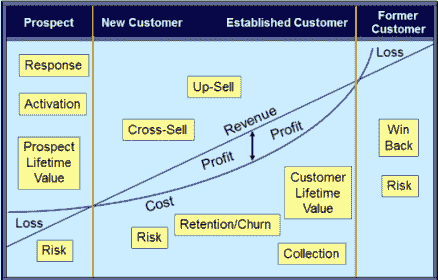

### 各行业的预测建模机会
在过去的几十年中，预测模型在各种行业中日益普及。统计学家和数据挖掘人员发现，金融服务行业开创的方法对大多数其他行业具有广泛的适用性。

对于本节列出的所有行业，盈利能力由多种因素共同驱动。这些因素的财务影响可以通过以下类型的模型来预测：

#### 银行：信用卡、零售、抵押贷款以及储蓄与贷款
- *响应模型*——用于定向推送贷款优惠
- *违约模型*——用于预测不付款或破产
- *收入模型*——用于估计购买金额和已赚利息
- *留存/忠诚/流失模型*——用于估计定价和服务的最佳组合
- *交叉销售/追加销售模型*——用于提高信用卡使用量，或购买额外产品和服务，例如投资产品、零售银行服务（储蓄和支票账户）、抵押贷款再融资等
- *欺诈模型*——用于检测丢失或被盗的卡或身份盗窃
- *催收模型*——用于在债务催收中优先配置资源

#### 保险公司：人寿、健康、汽车、财产和意外险
- *响应模型*——用于定向推送保险优惠
- *违约模型*——用于预测索赔可能性
- *留存/忠诚模型*——用于估计定价和服务的最佳组合
- *交叉销售/追加销售模型*——用于提高保险保障（人寿）或购买其他类型的保险
- *欺诈模型*——用于预测虚假保险申请或索赔的可能性

#### 零售商：目录公司和零售
- *响应模型*——用于定向推送商品和服务优惠
- *目录公司和线下零售商*——用于降低平邮成本
- *在线零售商*——用于改进定向营销
- *收入模型*——用于估计购买金额
- *留存/忠诚模型*——用于估计营销行动和激励措施的最佳组合
- *交叉销售/追加销售模型*——用于提高复购销售

#### 电信公司：有线电视、互联网、固话和移动电话
- *响应模型*——用于定向推送电话或互联网服务优惠
- *收入模型*——用于估计使用量
- *留存/忠诚模型*——用于估计取消或流失的可能性
- *违约模型*——用于预测拖欠付款的可能性
- *交叉销售/追加销售模型*——用于提高使用量并优化产品和服务捆绑
- *欺诈模型*——用于预测非法访问服务
- *流程故障模型*——用于预测电网或供应链故障

#### 娱乐与社交媒体行业：广播、电视、社交媒体和在线分享网站
- *响应模型*——用于根据广告内容、投放时间和投放位置的变化，提高点击率、浏览量和购买量


- *收入模型*——估计购买金额
- *留存/忠诚度模型*——估计营销行动和激励措施的最佳组合
- *故障模型*——预测互联网或媒体传输中断

#### 博彩业：赌场与在线博彩

- *响应模型*——优化广告投放位置和激励措施
- *留存/忠诚度模型*——估计营销行动和激励措施的最佳组合；例如，许多赌场拥有强大的忠诚度计划，其中包括餐饮、住宿和优先服务
- *交叉销售/追加销售模型*——提高使用量并优化产品和服务捆绑
- *欺诈模型*——预测虚假陈述的可能性，例如盗用信用卡或身份盗窃

#### 教育：学院、大学、技术学院和艺术学校

- *响应模型*——根据接受的可能性来定向推送优惠
- *留存模型*——估计毕业的可能性

#### 科技公司：计算机硬件与软件

- *响应模型*——针对产品或服务进行定向优惠
- *收入模型*——估计服务的使用量
- *留存/忠诚度模型*——估计重复购买的可能性
- *交叉销售/追加销售模型*——提高使用量并优化产品和服务捆绑
- *流程故障模型*——预测产品、运营或供应链故障

#### 公用事业：燃气、电力和水务

- *响应模型*——在放松管制的地区定向推送服务优惠
- *使用量模型*——估计使用量。
- *留存/忠诚度模型*——估计取消或流失的可能性
- *违约模型*——预测拖欠付款的可能性
- *交叉销售/追加销售模型*——提高使用量并优化产品和服务捆绑
- *欺诈模型*——预测非法访问服务的可能性
- *故障模型*——预测电网或供应链故障

#### 酒店与旅游业：酒店、度假村和餐厅

- *响应模型*——定向推送电话或互联网服务优惠
- *使用量模型*——估计潜在客户数量，以便规划人员配置和物资供应
- *收入模型*——估计收入金额
- *留存/忠诚度模型*——估计回头客的可能性
- *交叉销售/追加销售模型*——提高使用量并优化产品和服务捆绑
- *流程故障模型*——预测运营或供应链故障

#### 制造业：汽车、制药、生物技术、化工、食品等

- *响应模型*——预测销售额
- *使用模型*——预测产品过期、疾病暴发、中毒、过敏反应
- *收入模型*——预测生产需求
- *流程故障模型*——预测运营或供应链中断
- *产品故障模型*——预测产品故障或安全召回的可能性

#### 公共部门与非营利组织：政府、政治、宗教、社区、教育、医疗保健

- *响应模型*——预测谁会捐款或协助活动
- *收入模型*——估计捐款金额
- *目标模型*——预测某人会把票投给谁
- *欺诈模型*——检测服务虚假收费、身份盗窃或美国国税局（IRS）纳税申报欺诈
- *使用模型*——为医院、急救中心、急救人员或养老院规划人员配置和物资供应

#### 运输与航运：铁路、船舶、卡车和航空

- *使用量模型*——预测数量、销售额和燃料成本
- *地理使用模型*——优化路线和存储地点
- *流程故障模型*——预测运营或供应链故障

#### 体育

- *招募模型*——预测球员的统计数据是否适合球队
- *目标模型*——预测谁会参加活动

### 实践笔记

你正在阅读本书这一事实表明，你属于我们当中被大数据的力量与美感及其涌现出的洞察所吸引的人。然而，大数据也有阴暗面。人们很容易迷失在细枝末节中，忘记项目的主要目的——那个精心构思的业务目标。

在任何数据分析或建模项目中，退后一步、从领导者的视角审视你的工作都会让你受益。通常，CEO 没有技能或时间像你那样深入探究项目细节。因此，有时你必须在自己的业务领域中扮演 CEO 的角色。

使用 SAS Enterprise Guide 和 SAS Enterprise Miner 这样的强大工具，就像坐在法拉利的驾驶座上。这些工具能带你走得又快又远，但你会到达自己需要去的地方吗？

要安然抵达目的地，你必须知道目标是什么，并且必须有一张地图来指引你的进展。你还必须知道自己现在身处何处，以及你的资产有哪些：你的数据、工具、参考资料和支持资源。

如果你是管理者，在这一令人兴奋的过程中，纪律和专注将是你最好的工具。当你进行数据分析时，让你的商业敏锐度引导你。涌现出的洞察可以验证和增强你的知识，并为你的战略提供信息。

如果你是分析师，你在这里有真正的机会。让你走到这个岗位的技能在市场上备受重视。但要成为组织真正的资产，你必须了解业务——从战略到运营。你对业务的理解将帮助你不只基于数据做决策，还基于你的发现对业务意味着什么做决策。如果你正在开发分析和模型来指导战略，那么你会希望深入思考你的战略决策与业务目标相关的所有后果。

## 第 2 章：数据类型、类别和来源

- 引言 ........................................................ 15
- 数据的演变 .............................................. 16
- 数据类型 ....................................................... 17
    - 定类数据 ..................................................... 17
    - 定序数据 ...................................................... 17
    - 连续数据 .................................................. 18
- 数据类别 .................................................. 18
    - 人口统计或企业统计（firmographic）数据 ................................. 18
    - 行为数据 .................................................. 19
    - 心理特征数据 ............................................... 20
    - 数据类别比较 ........................................ 20
- 数据来源 ..................................................... 21
    - 内部来源 ................................................. 21
    - 数据存储 .................................................. 26
    - 外部来源 ................................................. 27
- 实践笔记 ............................................... 28

### 引言

数据正以越来越快的指数级速度产生。难怪在当今高科技、互联互通的全球经济中，数据已成为所有《财富》500强组织以及越来越多小型公司的基础性资产。

在本章中，你将了解可用于建模和分析的不同数据类型和数据来源。这些数据是你分析的基础。最终，你的最终交付物——无论是简单报告还是高级模型算法——其质量都取决于你的数据。

本章首先简要回顾商业领域大数据收集与使用演变的历史视角。这些基础知识不仅能为你开始构建建模与分析的基础提供所需内容，还会教你数据创建和使用的模式，使你能够留意新的数据类型和来源。


事件触发的峰值数据负载可能难以管理，当涉及非结构化数据时更是如此。

- **复杂性。** 当今数据来自多个来源，跨系统链接、匹配、清洗和转换数据仍是一项艰巨任务。然而，必须连接并关联关系、层级和多种数据链接，否则数据可能很快失控。

数字化和社交媒体产生的新型数据正在增加数据的“大”规模。非结构化数据似乎是下一个数据来源前沿。强大的软件现在能够解读和分析手写文本、音频、图像和视频。非结构化数据的转换及其与结构化数据的集成，预计将成为未来分析的主要数据来源。

充分利用任何数据源的第一步是理解数据的性质、数据如何收集以及如何管理。

### 数据类型

数据有三种基本类型：名义数据、定序数据和连续数据。

#### 名义数据

*名义数据*是具有离散值的定性或描述性数据。

包含名义数据的变量或数据列通常称为*类别变量*、*分类变量*或*离散变量*。名义数据可用于细分或分类。

当类别变量用作某类预测模型（如回归或神经网络模型）的输入时，必须将其转换为数值形式。例如，可以说性别的值为1和0，其中1=*男性*，0=*女性*。当值设为0和1时，它们也称为*指示变量*。这种转换可在SAS Enterprise Miner等建模软件中自动完成。

#### 定序数据

*定序数据*是具有相对重要性的类别的数据。这些类别可用于对强度或严重程度进行排序。例如，你可能熟悉“低、中、高”的排名。它们具有相对排名，但不能在数学上进行比较。

数值也可用于表示相对排名，而不具有数学关系。例如，一家名单公司分配1到5的值来表示财务风险。值1以无逾期付款为特征，被视为低风险。值5以破产为特征，被视为高风险。值2到4以各种既往拖欠为特征。风险排名为5的潜在客户肯定比排名为1的潜在客户风险更高，但其风险并不是后者的五倍。而且他们排名之差5 − 1 = 4没有意义。

#### 连续数据

*连续数据，或称比率数据，是用于开发预测模型的最常见数据。* 它可以支持所有基本算术运算：加法、减法、乘法和除法。大多数业务数据，如销售额、余额和分钟数，都是比率数据或连续数据。

### 数据类别

在决定要使用的数据类型时，应考虑数据的三个主要特征：效力、稳定性和成本。不过，首先你会想了解数据类别。

尽管数据可从众多来源获得且类型各异，但无论其来源如何，数据都属于三个基本类别之一：人口统计/企业特征、行为，或心理/态度。每个类别都有其优势和劣势。

#### 人口统计或企业特征数据

*人口统计数据通常描述个人或家庭特征。* 它通常包括以下特征：

- 性别
- 年龄
- 婚姻状况
- 收入
- 房屋所有权
- 住房类型
- 教育水平
- 族裔
- 是否有子女

人口统计数据有许多优势。它稳定，这使其在预测建模中具有吸引力。婚姻状况、房屋所有权、教育水平和住房类型等特征，不像银行余额等行为数据或最喜欢的政治候选人等态度特征那样频繁变化。而且人口统计数据通常比态度和行为数据便宜，尤其是在群体层面购买时。

人口统计数据的一个劣势是，很难在个人层面以高准确度收集。除非法律要求或作为产品或服务的回报而要求，否则许多人抵制分享此类信息，或者提供虚假信息。

*企业特征数据可以看作是企业的人口统计数据。* 它包括行业、年收入、员工数量、站点数量等特征，以及

#### 心理特征数据

心理特征数据也称为态度数据或生活方式数据。其特征是观点、时尚、风格、政治选择、个人价值观或它们的某种组合。传统上与市场研究相关，这类数据主要通过调查、民意测验和焦点小组收集。也可以通过订阅、购买和社交媒体行为推断。由于竞争加剧，这类数据正被整合到客户和潜在客户数据库中，以改进目标建模和分析。

心理特征数据为预测建模增加了维度。对于已从人口统计和行为数据中榨取所有可能预测能力的公司，心理特征数据可以带来一些改善。它还可用于确定客户或潜在客户的生命阶段。这类数据为围绕人生事件（如结婚、生育、大学费用和退休）开发产品和服务创造了许多机会。

心理特征数据的最大缺点是，它表示的是意图行为，而意图行为可能与实际行为高度相关、部分相关或仅边际相关。数据可通过调查或焦点小组收集，然后使用细分或预测建模应用于更大的名单群体，如客户群。如果使用这些方法应用数据，建议构建测试以验证相关性。

#### 数据类别比较

表2.1提供了三类主要数据的快速参考和比较。评级基于个人层面数据。如果在群体层面收集数据并在个人层面推断，通常预测性较低且成本较低。稳定性保持不变。

保留完整的客户历史记录。在任何数据库中，有效链接和跟踪针对单个客户所采取行动的行为至关重要。

- *家庭ID*是唯一的数字或字母数字代码，可在客户的整个客户生命周期中标识其家庭。在某些行业中，家庭中不止一个成员共享产品或服务，此标识符很有用。
- *账号*是与特定产品或服务相关的唯一数字或字母数字代码。一个客户可以有多个账号。
- *客户姓名*是个人或企业的名称。通常分为多个字段：姓氏、名字、中间名或中间名首字母、称呼。
- *实际地址*通常分为号码、街道、套房或公寓号、城市、州、邮政编码和国家等组成部分。一些客户数据库有一行用于邮政信箱。由于人口流动性约为每年10%，包含以前地址的附加字段有助于跟踪客户并将客户与其他文件匹配。
- *电话号码*包括区号、国家代码以及适用时的分机号。
- *电子邮件地址*也可作为唯一标识符。
- *人口统计信息*，如性别、年龄和收入，可存储用于画像和建模。
- *产品或服务*通常通过产品列表和产品标识号进行跟踪，这些编号可能因公司而异。保险公司可能列出其所有保险保单以及保单编号。银行可能列出其不同部门的所有产品，包括支票、储蓄、信用卡、投资、贷款等。如果产品数量和产品详细信息很多，此信息可存储在单独的数据库中，并带有客户和家庭标识符。
- *模型分数*，如响应、风险、保留、盈利能力分数或任何其他分数，可购买或在内部开发。这些分数可存放在由账号链接的单独数据库中。

### 客户数据库——企业对企业

面向企业（B2B）的客户数据库类似于面向消费者（B2C）的客户数据库。主要区别在于客户是企业而非个人。

整体结构也类似。主数据库通常为每个公司单位保留一条记录。每条记录或站点也可能是总部（HQ），或映射到另一个作为总部的站点。每条记录包含标识信息，可链接到其他数据库，例如交易数据库、营销数据库或其他跟踪过往绩效和公司有价值信息的数据库。

除了公司级数据库外，许多大型B2B公司还有联系人数据库，其中个人与客户数据库中的公司相关联。该数据库还可能包含为尚未成为客户的公司工作的其他联系人。


注意：有些公司同时面向消费者和企业客户销售产品。它们的数据库要么相互独立，要么是企业数据与消费者数据的混合体。

尽管不同公司和行业之间可能存在很大差异，但典型的客户数据库通常包含以下关键要素：

- **公司 ID** 是一个唯一的数字或字母数字代码，用于在整个生命周期中标识公司。
- **总部 ID** 是一个唯一的数字或字母数字代码，用于在整个生命周期中标识公司的总部（HQ）。
- **DUNS 编号（场所）** 是通过邓白氏（Dun and Bradstreet，D&B）获得的一个唯一 ID。该 ID 可用于映射 D&B 提供的企业特征数据。
- **DUNS 编号（其他）** 是一系列编号之一，可用于将每个场所与其总部、国内最终母公司（DU）或全球最终母公司（GU）进行匹配。如果该场所本身也是总部、DU 或 GU，则该编号可能与场所 ID 相同。
- **公司名称** 是企业的名称。对于独资经营者，公司名称可能是个人的姓名。
- **实体地址** 通常被拆分为多个组成部分，例如门牌号、街道、套房或公寓号、城市、州/省、邮政编码和国家/地区。企业地址比个人地址更稳定，尤其是员工众多的公司。
- **电话号码** 是组织的主要电话号码，通常包含区号和国家/地区代码。如果数据处于联系人层面，电话号码可能包含区号、国家/地区代码，以及适用的分机号。
- **公司 URL 或网址** 也可以用作唯一标识符。
- **企业特征数据** 类似于人口统计特征数据，但它是公司层面的数据，包括行业、员工人数、公司成立年限、年销售额、增长率、标准行业分类代码等。
- **产品或服务 ID** 通常由一组因公司而异的识别编号组成。产品或服务 ID 可能存储在单独的数据库中，并通过公司 ID 建立关联。
- **模型评分** 包括响应评分、风险评分、留存评分、盈利评分或其他评分，可以购买，也可以在内部开发。这些评分可能存储在单独的数据库中，并通过公司 ID 建立关联。

### 联系人数据库

联系人数据库包含公司数据库中公司员工的数据，具体如下：

- **联系人 ID** 是一个唯一的数字或字母数字代码，用于在整个生命周期中标识联系人。
- **联系人姓名** 是客户或潜在客户的姓名。它通常被拆分为多个字段：姓氏、名字、中间名或中间名缩写，以及称谓。

以下内容通常可以在一个或多个评分数据库中找到：

- *客户 ID* 或 *联系人 ID* 是一个唯一的数字或字母数字代码，用于在整个生命周期中标识客户。有些公司可能会使用账户号来完成这一功能。
- *购买概率* 是一个评分，表示客户购买特定产品或服务的可能性。该评分既可以针对新购买，也可以针对向同一家公司进行的追加购买。它可能涵盖一系列产品和服务。
- *期望价值* 是指如果发生响应，客户或公司预计购买或借入的金额，以美元或数字表示。
- *违约概率* 是指客户不偿还所欠金额的可能性。
- *违约损失率* 是指客户或公司在发生贷款违约时预计会存在的欠款余额金额。

### 营销数据库

营销数据库包含向潜在客户和既有客户提供的营销活动的详细信息。最有用的格式是每次营销活动针对每个客户或潜在客户都有一条唯一记录。

营销数据库应包含所有交叉销售、追加销售和留存营销活动。潜在客户营销数据库则应包含所有获客营销活动，以及来自外部来源的任何预测信息。

基于这类数据库创建的变量通常对目标模型具有最强的预测能力。从逻辑上看，如果一个人连续六个月都收到你的营销信息，那么他/她的响应可能性会比第一次看到你营销信息的人更低。随着竞争加剧，这类信息正变得越来越重要。

在平均数量的营销触达条件下，这类数据库可能会变得非常庞大。因此，你应该进行分析以制定业务规则，从而控制该数据库的维护。像 *首次营销日期* 这样的字段通常与响应行为相关。以下是营销数据库中的关键要素：

- *潜在客户 ID* 或 *客户 ID* 是一个唯一的数字或字母数字代码，用于在特定时间段内标识潜在客户。
- *营销活动详情* 包括日期、营销类型、营销文案、来源代码、定价、分发渠道（邮寄、电话营销、销售代表、电子邮件）以及营销活动的其他任何详细信息。
- *日期* 可以是首次营销日期（针对每种营销类型），也可以是其他营销日期（特定于产品或服务）。

### 数据存储

#### 数据仓库

*数据仓库* 是一种将来自两个或更多数据库的信息关联起来的结构。如图 2.1 所示，数据仓库将数据汇集到中央存储库中，执行一定的数据集成、清理和汇总工作，然后将信息分发到数据集市中。数据集市用于存放来自中央存储库的数据子集。数据集市中的数据是根据特定最终用户的需求选择和准备的。

**图 2.1：数据仓库**

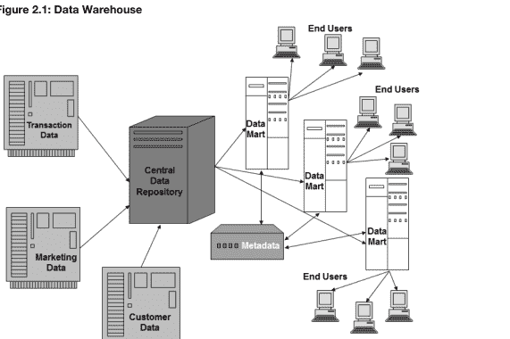

#### Hadoop

Apache™ Hadoop 正在推动大数据应用方式的变革。Hadoop 是一个数据平台，它的运作方式是将数据存储和处理分散到一大组服务器上。Hadoop 可以快速将数据处理能力从单台机器扩展到数千台机器。

传统的数据存储模式成本高昂，尤其是对于大型数据集而言。Hadoop 以低得多的成本构建，并使用商品化硬件。通过在 PB 级规模上运行，Hadoop 可以大幅降低成本。随着硬件成本持续下降，这种成本节约还将继续增加。

公司使用网络数据来了解客户行为并改进营销。但海量的网络数据可能使采集和存储工作变得极为昂贵。Hadoop 使公司能够以低得多的成本采集和存储网络数据，同时也让公司能够更长时间地保留历史数据。

Hadoop 还提供了分析海量数据的能力。由于采用分布式服务器，Hadoop 可以并行处理大量数据。

执行高级分析的能力是 Hadoop 的一个关键特性。Hadoop 还支持多种更高级的商业智能工具。

### 外部数据来源

许多公司面临着增加利润的压力，要么通过获取新客户，要么通过向现有客户增加销售额。你可以利用外部数据来源来推动这两方面的工作。

外部数据来源主要包括名单销售商和名单汇编商。然而，真正把名单销售作为唯一业务的公司很少。许多公司拥有主营业务，例如杂志销售或目录销售，而名单销售只是其副业。根据业务类型的不同，它们通常会收集和销售姓名、地址、电子邮件、电话号码，以及人口统计特征、行为特征和心理特征信息。有时它们还会执行名单“清洗”或清理，以提高名单的价值。其中许多公司通过名单汇编商或名单经纪人销售名单。

名单汇编商是销售各种单一名单和合并名单的公司。有些公司以电话簿或驾照登记数据等数据作为基础，然后购买名单、合并名单并填补缺失值。许多名单汇编商会使用调查研究来增强和验证其名单。

许多公司会销售包含联系信息和个人特征的姓名名单。有些公司专门从事特定类型的数据。征信机构以销售信用行为数据而闻名。它们通过收集并在成员之间共享信用行为数据来为金融机构服务。有数百家公司销售这类名单，范围从高度垂直细分的名单到覆盖全国范围的名单。

> **提示：** 通常，潜在客户数据会反复从同一来源购买。目标是购买新的姓名，或获取现有姓名的最新信息。无论属于哪种情况，你都应与数据销售商协商，为存储在销售商数据库中的每个潜在客户分配一个唯一标识符。这样，当购买更多姓名或刷新现有姓名时，匹配率会比不这样做时高得多。
>
> **注意：** 出于隐私原因，社交媒体数据主要是在各个社交媒体网站内部收集和使用的。部分社交媒体行为数据也可以购买。


### 来自一线的笔记

在本章中，你已经了解到用于分析的数据会以多种形式、来自多个来源。为分析准备数据的第一步，是理解所有数据集是如何、以及从哪里提取出来的。当数据是购买来的，或从陌生来源提取时，你应索取包含每个字段定义的数据字典。务必知道每个字段的含义及其推导方式（如适用）。此外，还要索取每个字段的计数、范围和简单统计量，例如均值、中位数、最小值、最大值和标准差。

与信息技术部门的人交朋友。他们可以成为宝贵的合作者。如果可能，他们能帮你获取负责创建数据的人员姓名。在你确定自己理解数据之前，不要犹豫，尽管提问。

数据可能具有诱惑力。如果你正在启动一个新项目，你可能会急于从尽可能多的来源收集尽可能多的数据。然而，面对可用于分析的数据量，好东西太多也可能让人无所适从。

最好的方法是分阶段推进。从第1章的问题开始：*你的目标是什么？* 如果你有很多目标，选择最重要的两三个。然后，与你的数据管理团队合作优化流程。如果运营或定价方面的考虑证明有必要收集大量数据，那么就聚焦于少数几个会产生最大影响的数据。记住，分析通常是独立完成的，但规划应与主要利益相关者和最终用户协同进行，以确保人才、时间和资金得到最优利用。

记住，归根结底，你的分析好坏取决于你的数据。无论是数据质量，还是数据与分析目标的一致程度，都是如此。

## 第 3 章：描述性分析与预测性分析概述

- 引言 ... 29
- 描述性分析 ... 30
  - 频数分布 ... 30
  - 聚类 ... 33
  - 决策树 ... 33
- 预测性分析 ... 35
  - 线性回归 ... 36
  - 逻辑回归 ... 39
  - 神经网络 ... 41
- 建模流程 ... 43
  - 定义目标 ... 43
  - 开发模型 ... 43
  - 实施模型 ... 48
  - 维护模型 ... 49
- 来自一线的笔记 ... 52

### 引言

在本章中，你将学习当今商业中常用的不同类型的描述性分析和预测性分析。一旦源数据集加载完毕，并且你拥有访问和理解数据所需的全部支持性文档，你就可以开始分析了。

描述性分析由表格、图表和图形组成，它们揭示数据模式、趋势和关系，可为你的策略、决策和行动提供信息。回归、决策树和神经网络等预测性分析工具，使你能够对广泛的营销、风险和流程决策进行优先级排序和优化。

你将看到每种分析类型的示例，以及用于确定何时使用描述性分析、何时使用预测性分析的指南。本章的目标是帮助你通过解读描述性分析和预测性分析并采取适当的业务行动，发现提升竞争优势的机会。

### 描述性分析

描述性分析的目的是揭示数据的特征。它可以描述单个时间点，也可以涵盖多个时间区间内的趋势。初次收到数据时，你应从简单的描述性分析开始，例如分类变量的频数，以及连续变量的分布分析。这两类结果都可以用表格和图形展示。

#### 频数分布

*频数分布*表示数据集中某个变量的基本形状或分布。频数分布可以用表格或图形展示。表格的组成部分会有所不同，具体取决于你查看的是分类变量还是连续变量。

本节中的示例基于汽车研究数据计算得出。

**分类变量**

分类变量的频数分布表通常显示计数和百分比。表3.1以表格形式展示了一个简单的频数分析，其中显示了变量 *汽车类型* 的频数和百分比。你可以很容易地看出，该数据所代表的汽车中有262辆，即61.2%，是 *轿车*。

**表3.1：分类变量“汽车类型”的频数分布表**

| 值 | 频数 | 总频率（%） |
| --- | --- | --- |
| 轿车 | 262 | 61.2150 |
| SUV | 60 | 14.0187 |
| 跑车 | 49 | 11.4486 |
| 旅行车 | 30 | 7.0093 |
| 卡车 | 24 | 5.6075 |
| 混合动力 | 3 | 0.7009 |

图3.1以柱状图展示了相同的信息。尽管你无法在柱状图中看到精确的百分比，但这种视图可能更便于快速比较。你可能想同时使用两者，因为有些人喜欢表格，而另一些人喜欢图表等数据可视化展示。

**图3.1：分类变量“汽车类型”的频数分布柱状图**

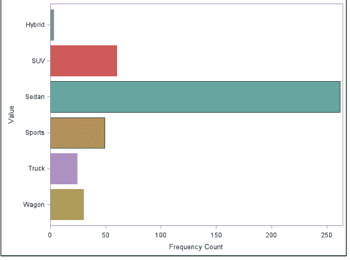

**连续变量**

连续变量的频数分布表通常显示总体度量，例如均值、中位数、最小值和最大值。表3.2显示了变量 *每加仑英里数（MPG）* 在高速公路上的取值。你可以看到数据中的总观测数（428）。没有缺失值。11,489这一总计是此处所代表的所有汽车 MPG 的总和。对于变量 *高速公路 MPG*，总计可能没有意义。另一方面，如果它是一个表示银行账户余额的变量，那么总和将代表总体的总余额。这一数值可能对金融机构有价值。表中还呈现了其他值，例如 MPG 的均值为26.84。最小值为12，最大值为66。

**表3.2：连续变量 MPG（高速公路）的频数分布**

| 类别 | 度量 |
|---|---|
| 数量（非缺失） | 428.00 |
| 缺失数量 | 0.00 |
| 总数 | 428.00 |
| 总和 | 11,489.00 |
| 最小值 | 12.00 |
| 均值 | 26.84 |
| 中位数 | 26.00 |
| 最大值 | 66.00 |
| 标准均值 | 0.28 |

图3.2以柱状图展示了频数分布。这些值被分桶，以显示数据的潜在性质。当你查看连续变量的频数分布柱状图时，你会了解到额外信息，例如分布的偏度。

**图3.2：连续变量每加仑英里数（高速公路）的频数分布柱状图**

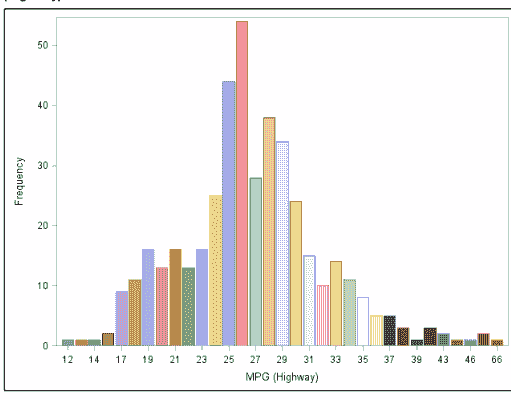


### 聚类

聚类分析（cluster analysis），或称聚类（clustering），是一种数据驱动过程，将观测值分组成簇，使每个簇内的相似性最高，而簇之间的差异性最大。计算相似性与差异性的具体方法会因分析目标的不同而有所变化。

图3.3展示的是并非互斥的簇。例如，一个观测值可以出现在多个簇中。该聚类分析按年龄和收入进行细分。注意这里形成了三个组：

-   低收入、低年龄
-   高收入、中等年龄
-   中等收入、高年龄

**图3.3：非互斥簇的聚类分析示例**

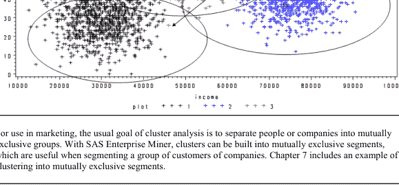

在营销应用中，聚类分析通常的目标是将人群或公司划分为互斥的群体。使用 SAS Enterprise Miner，可以将聚类构建为互斥的细分市场，这在划分客户群或公司群时非常有用。第7章包含一个将数据聚类为互斥细分市场的示例。

### 决策树

生成决策树是理解数据关系的另一种方法，既可用于描述性分析，也可用于预测性分析。树分析通过顺序划分数据，基于自变量使因变量之间的差异最大化。它也被称为*分类树*。树的真正目的是将数据*分类*为不同的组或分支，从而在因变量取值上形成最强的区分度。

决策树擅长识别具有目标行为的细分群体，例如回复行为或激活行为。当一家公司试图理解是什么在驱动市场行为时，这种识别非常有用。与回归相比，决策树的另一个优势在于它能够检测非线性关系，而这些关系有助于识别交互作用，从而为其他建模技术提供输入。

决策树通过一系列步骤和规则“生长”而成，这使其具有很大的灵活性。在图3.4中，该树区分了回复者与非回复者。顶层节点提供了整体营销活动的规模与绩效详情：该活动向10,000名潜在客户邮寄了报价，回复率为2.6%。查看结果时，你可以看到第一次分裂基于*性别*。这一分裂意味着回复者与非回复者之间最大的差异是性别。男性的回复率（3.2%）远高于女性（2.1%）。因此，你可以将男性回复者描述为明显更偏向男性的群体。从预测的角度看，经过一次分裂后，你会认为男性是更好的目标群体。为了获得更多描述性和预测性洞察，你可以在每个性别内部继续分裂决策树，以找出能够进一步区分回复者与非回复者的子群体。在接下来的分裂中，这两个性别组（即节点）会被分别考虑。

**图3.4：目标营销决策树示例**

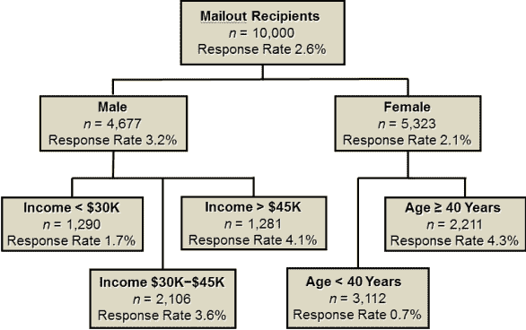

从男性节点进行的第二层分裂基于收入。这意味着，在男性客户中，收入水平在回复者与非回复者之间的差异最大。而在女性客户中，最大差异出现在年龄组之间。因此，你可以将高收入的男性描述为最佳回复者之一，也可以将40岁以上的女性描述为最佳回复者之一。在预测应用方面，假设你决定只对回复率超过3.5%的群体邮寄报价，那么报价将定向发送给年收入超过30,000美元的男性以及年龄超过40岁的女性。

与其他技术相比，决策树的一个明显优势是它能够解释结果。因此，如果你为评分开发了一个复杂的逻辑回归模型，却发现很难解释，那么树模型可能会有所帮助。使用复杂模型中的相同变量来构建树模型。尽管结果不会完全一致，但树确实能揭示市场中的关键驱动因素。由于适用范围广泛，决策树将继续成为各类目标建模中非常有价值的工具。

### 预测分析

如今，可用于开发预测模型的工具非常多。有些使用统计方法，例如线性回归和逻辑回归；另一些使用非统计方法或混合方法，例如

| 月份 | 广告成本 | 销售收入 |
|---|---:|---:|
| 1月 | 490 | 5,492 |
| 2月 | 550 | 4,398 |
| 3月 | 120 | 1,503 |

图3.5是表3.1中14个月数据的图形表示。它展示了Jake’s Web Design（杰克网页设计公司）的销售额以及用于广告的美元金额。你可以看到*销售额*与*广告支出*这两个变量之间存在明确的关系：当广告支出增加时，销售额也随之增加。

**图3.5：小型企业销售收入对广告支出（美元）的简单线性回归散点图示例**

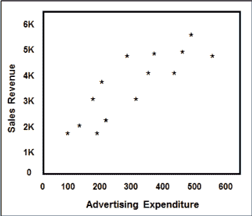

模型的目标是根据广告支出预测销售收入。该技术的原理是找到一条穿过数据的直线，使得各点到直线的平方误差最小（图3.6）。

**图3.6：小型企业销售收入对广告支出（美元）的简单线性回归散点图示例，包含回归线与误差距离**

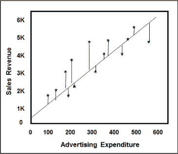

回归分析会得出一个方程，用来定义自变量与因变量之间的关系。在图3.6所示的示例中，方程*销售额* = 866.59 + 7.81 × *广告支出* 表示预期销售额等于866.59美元加上广告支出金额的7.81倍。衡量关系强度的关键指标是R²。它衡量的是模型中数据总变异中被解释的变异量。该特定回归分析的R²为70%，意味着在回归模型中，*销售收入*中70%的变异可由*广告支出*的变异来解释。

*多元线性回归*使用两个或更多自变量（即预测变量）来预测连续的结果变量。在图3.7中，*信用卡余额*是*付款金额*和*客户年龄*的函数。

**图3.7：信用卡余额对付款金额和客户年龄的多元线性回归示例**

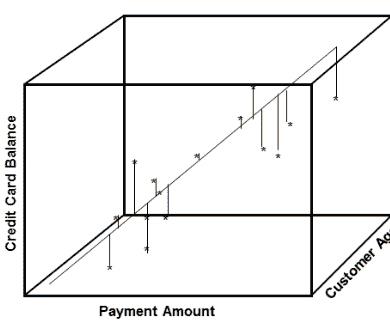

方程*信用卡余额* = 2.1774 + 9.4966 × *付款金额* + 1.2494 × *客户年龄* 描述了基于客户年龄和定期付款金额预测的信用卡余额。

#### 逻辑回归

*逻辑回归*与线性回归相似。关键区别在于因变量不是连续型的，而是离散型或分类型。因变量的离散性质使逻辑回归在营销中特别有用，因为营销人员通常要预测离散行为，例如对报价的回复或贷款违约。

从技术上讲，逻辑回归可用于预测两个或多个水平的结果。然而，在构建营销目标模型时，结果通常是二水平的。在这些模型中，你会预测其中一个水平的概率，且该概率必须介于0到1之间。然而，预测变量的线性函数取值范围是从负无穷到正无穷。由于逻辑回归是预测变量的线性函数，因此需要使用logit变换来校正这两个尺度之间的差异。

本节的目标是避免过多统计术语，但由于逻辑回归是一种流行且强大的预测分析方法，因此在此简要介绍该方法。请记住，在实际模型处理中，逻辑回归与线性回归十分相似。


图 3.8 显示了 *响应*（0/1）与 *潜在客户年龄* 之间的关系。目标是使用 *潜在客户年龄* 来预测对销售高端礼品的目录的响应概率。请注意，数据点对于 *响应* 的取值是 0 或 1。在 *潜在客户年龄* 轴上，*响应* 为 0 的值集中在 *潜在客户年龄* 的较低值附近。相反，*响应* 为 1 的值集中在 *潜在客户年龄* 的较高值附近。通过对每个 *潜在客户年龄* 值下的 0 和 1 取平均值，形成了 Sigmoid 函数，或 S 曲线。可以看出，年长的潜在客户响应率高于年轻的潜在客户。

**图 3.8：按潜在客户年龄（年）对销售目录响应（1 = 是，0 = 否）的简单逻辑回归示例**

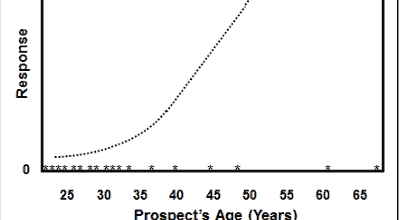

以下步骤以通俗的语言详细说明了 logit 函数的构建过程。此逻辑回归示例并未复制上图中表示的数据，但它传达了总体思路：

- 1. 对于每个 *潜在客户年龄* 值，通过对响应值取平均来计算概率（*p*）。
- 2. 对于每个 *潜在客户年龄* 值，使用公式 *p*/(1 − *p*) 计算赔率。
- 3. 最后的转换计算赔率的对数：log (*p*/(1 − *p*))。
- 4. 参数估计是通过最大似然估计得出的，该方法会产生在给定数据下最可能出现的参数估计。参数估计与赔率的对数关系如下：log (*p*/(1 − *p*)) = β0 + β1X1 + β2X2 + ... + βnXn，其中 β0 ... βn 为参数估计，X1 ... Xn 为预测变量。
- 5. 在得出参数估计（也称为系数或权重（βs））后，使用以下公式计算最终概率：P = exp(β0 + β1X1 + β2X2 + ... + βnXn)/(1 + exp(β0 + β1X1 + β2X2 + ... + βnXn))。该公式也可以写成更简单的形式如下：*p* = 1/(1 + exp(−(β0 + β1X1 + β2X2 + ... + βnXn)))。
- 6. 该过程以每个年龄值下的响应值开始。*p* 的取值范围限定在 0 和 1 之间。使用链接函数，您可利用最大似然法推导出模型。结果为 log (*p* / (1 − *p*)) = 1.233 + 6.39 × *潜在客户年龄* 且 *p* = 1/(1 + e^(−(1.233 + 6.39 × *潜在客户年龄*)))。

该公式使您能够根据潜在客户年龄的值来估计响应率。

这是一个简单的示例；逻辑回归模型通常具有众多的预测变量。

### 神经网络

神经网络处理与回归有很大不同，因为该过程不遵循任何统计分布。相反，神经网络是根据人类大脑的功能建模的。该过程是模式识别和误差最小化。您可以将其视为摄取信息并从每次体验中学习。

神经网络由排列在层中的节点组成。这种构造因神经网络的类型和复杂性而异。图 3.9 说明了一个具有一个隐藏层的简单神经网络。在过程开始之前，数据被分为 *训练* 和 *测试* 数据集。（有时会保留第三组用于最终验证。）然后为第一层中的每个节点分配权重或“输入”。在每次迭代中，输入通过系统处理并与实际值进行比较。误差被测量并通过系统反馈以调整权重。在大多数情况下，权重在预测实际值方面的能力会得到改善。该过程在达到预定的最小误差水平时结束。

**图 3.9：显示数据流的神经网络架构**

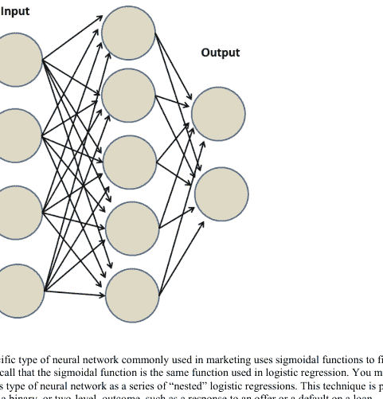

营销中常用的一种特定类型的神经网络使用 Sigmoid 函数来拟合每个节点。请记住，Sigmoid 函数与逻辑回归中使用的函数相同。您可以将这种类型的神经网络视为一系列“嵌套”的逻辑回归。这种技术在拟合二元或两级结果时非常有效，例如对优惠的响应或贷款违约。

神经网络的一个优点是其能够捕捉数据中的非线性关系。这种捕捉非线性关系的能力使用户能够拟合一些使用回归难以拟合的数据类型。然而，一个缺点是其倾向于过拟合数据。过拟合会导致模型在应用于新数据时更快地恶化。如果这是您选择的方法，请务必仔细验证您的数据。另一个需要考虑的缺点是，神经网络的结果通常难以解释。

### 建模过程

建模过程有四个主要阶段：

- 1. 定义目标。
- 2. 开发模型。
- 3. 实施模型。
- 4. 跟踪和监控模型。

#### 定义目标

定义目标是第 1 章的主要主题，因为它是模型构建过程中最重要的一步。您可以使用完美的数据开发出完美的模型。但如果它不能满足您的业务目标，那就是浪费时间和金钱。确保模型的<|message|> 目标与您的整体业务目标保持一致。

#### 开发模型

模型开发过程包括五个步骤。

- 1. 选择数据。
- 2. 探索数据。
- 3. 修改数据和变量。
- 4. 构建模型。
- 5. 评估模型。

如果您遵循此顺序，您在模型构建工作方面很可能会取得成功。

##### 步骤 1：选择数据

一旦您定义了目标，您就需要获取用于开发模型的数据。确保它与构建模型的业务目的相关。数据可以来自各种来源。在某些情况下，需要合并数据。数据选择的特定细节高度特定于项目。要了解有关数据构建的许多来源，请参阅第 4 章。

##### 步骤 2：探索数据

一旦您的数据可用于分析，您就可以使用可视化工具查看数据的分布和完整性。多个表格和图表可以显示数据值并向您展示数据不完整或缺失的位置。

##### 步骤 3：修改数据和变量

在此步骤中，您可以将数据划分为训练、测试和验证数据集。基于您在数据探索步骤中的发现，您可以插补缺失值并过滤异常值。

为了确保回归和神经网络模型的最佳拟合，您可能希望转换或分段连续变量。要在回归或神经网络模型中使用类别变量，您需要将其设为数值。最好的方法是对任何具有字符或非数值值的变量创建指示变量。有关此技术的示例，请参阅第 9 章。

对于连续变量，您可以选择某些转换以提供模型的更好拟合。SAS Enterprise Miner 允许您让软件选择最佳转换，如第 9 章所示。有关变量转换的更多详细信息，请参阅 *数据挖掘食谱*（Parr-Rud 2001，85–97）。

##### 步骤 4：构建模型

在 SAS Enterprise Miner 中，构建模型的过程大大简化。但仍然很好地了解底层过程，以便您做好准备以发现异常和错误。

##### 选择方法

本章前面，您了解了三种建模技术：决策树、回归和神经网络。这些技术在确定选择方法时各有独特的考虑因素。

对于决策树模型，变量被划分为离散组；因此，您无需进行变量转换或定义选择过程。如果您希望选择要进入模型的变量，可以交互式地构建树。有关交互式构建树的详细信息，请参阅 *使用 SAS Enterprise Miner 进行分析的决策树*（DeVille 和 Neville 2013）。

变量选择的顺序可能会影响模型的最终结果。存在许多选择方法。每种方法都有其优点和缺点。根据您特定的业务问题或资源情况，一种方法可能比另一种更受欢迎。

有关回归选择选项的更多详细信息，请参阅 *数据挖掘食谱*（Parr-Rud 2001，104–105）。

##### 最优变量数

与模型构建过程相关的常见问题是，最优的变量数是多少？

答案取决于情况。大多数预测良好的模型有 7 到 15 个变量。在某些情况下，使用每个变量可能是最优的。虽然模型可能很大且难以解释，但额外的变量不会削弱模型的功效或拟合度。在某些分析资源稀缺而 CPU 能力充足的企业中，使用每个变量通常是最好的选择。


你通过按得分或概率（从高到低）对文件排序，然后将其划分为10%的分组来创建十分位。每个十分位可以显示多种计算结果，包括数量、平均表现和提升度。

可以看到，表3.4提供了大量信息。下面的列表按从左到右的顺序描述每一列：

- 1. **十分位：** 从1到10排序，第1十分位是表现最好的十分位，第10十分位是表现最差的十分位（基于响应率）。
- 2. **记录数：** 记录数的值表示总体中的人数或其他数据点数量。每个十分位约占总体10%。
- 3. **平均预测响应率（%）：** 第3列显示模型预测的平均响应率。
- 4. **平均实际响应率（%）：** 第4列显示数据中反映的平均实际响应率。
- 5. **累计平均实际响应率（%）：** 数据中反映的平均实际响应率，按各十分位向下累计。
- 6. **响应者数量（占总数的百分比）：** 第6列显示每个十分位中的响应者数量。
- 7. **累计响应者总数（%）：** 第7列显示按各十分位向下累计的响应者数量。
- 8. **提升度：** 第8列显示每个十分位上的模型效率（下文进一步说明）。
- 9. **累计提升度：** 第9列显示按各十分位向下累计的模型效率（下文进一步说明）。

提升度衡量的是模型超越随机方法或平均表现的能力。提升度是描述模型效率的另一种方式。提升度越高，模型越强大。第1十分位的提升度为241。这意味着在最高的十分位中，模型表现是随机或平均水平的2.41倍。

累计提升度显示从最佳十分位开始的一组十分位的效率。例如，看前三个十分位：如果你随机邮寄文件中30%的名单，预期会获得30%的潜在响应者。查看前三个十分位的第6列，模型捕获了 (638 + 427 + 376) / 2649 = 54.40% 的潜在响应。因此累计提升度为 54.40/30*100 = 181。这一结果等价于说，在文件深度30%处，你获得的响应率比平均水平高81%，或者说在文件深度30%处，模型表现是平均水平的1.81倍。

### 增益图

增益图是一种图形化表示，展示在每个十分位（即文件的10%）处，目标群体的累计百分比与随机或平均结果的对比。它是展示模型能力的绝佳可视化工具（图3.10）。例如，在文件的50%处，你可以捕获71%的响应者，这表示响应量比随机选择增加了45%。

**图3.10：比较模型响应者百分比与一般人群随机选择百分比的增益图**

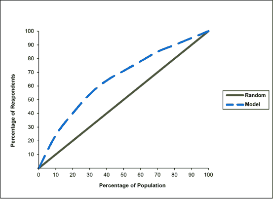

### C统计量

*C*统计量有助于快速评估模型拟合情况。它是一致百分比、不一致百分比、并列百分比和总对数的函数。它们的定义如下：

- *一致百分比：* 对于因变量取值不同（响应 = 1/0）的所有观测对，如果目标值（响应 = 1）的观测比非目标值（响应 = 0）的观测具有更高的预测事件概率，则该对是*一致的*。
- *不一致百分比：* 对于因变量取值不同（响应 = 1/0）的所有观测对，如果目标值（响应 = 1）的观测比非目标值（响应 = 0）的观测具有更低的预测事件概率，则该对是*不一致的*。
- *并列百分比：* 对于因变量取值不同（响应 = 1/0）的所有观测对，如果目标值（响应 = 1）的观测与非目标值（响应 = 0）的观测具有*相等*的预测事件概率，则该对是*并列的*。换句话说，它既不是一致的，也不是不一致的。
- 对数：该数字是因变量取值不同的所有可能配对组合的总数。C统计量定义为 (nc + 0.5(t − nc − nd))/t，其中 t = 响应值不同的配对总数，nc = 一致对的数量，nd = 不一致对的数量。

### 实施模型

模型实施本身并不是模型构建过程中的一个步骤，但讨论如何正确实施模型很重要，原因有一个：一个完美的模型如果实施不当，看起来就会像一个糟糕的模型。

在许多情况下，开发模型是为了替换现有模型。旧模型可能表现不佳，或者可能有某些新的预测信息可以纳入新模型。无论原因如何，你都会希望将新模型（即“挑战者”）与现有模型（即“冠军”）进行比较。同样，取决于你的目标，选择用于测试的名单组有多种方式。

在图3.11中，整个总体由矩形表示。椭圆表示每个模型选出的名单。如果你的“冠军”模型仍然表现良好，你可以决定邮寄“冠军”选出的全部名单，并从“挑战者”椭圆中未被“冠军”选中的部分邮寄一个名单样本。这种技术允许你对样本中的名单进行加权，以便跟踪和比较两个模型的表现。如果你想估计没有任何模型辅助时总体表现（用于比较目的），你应该邮寄一个两个模型都未选中的名单样本。

**图3.11：潜在客户筛选中的冠军与挑战者比较**

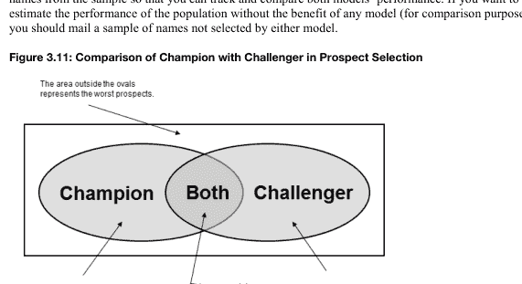

### 维护模型

至此，你已投入大量时间和资源来创建一个强大的模型。现在，你可以通过记录和跟踪模型来确保其使用寿命和实用性。自20世纪90年代中期以来，我与众多建模人员、营销人员和管理者合作开发并实施预测模型。令人震惊的是，企业内往往很少了解存在哪些模型、这些模型是如何构建的，以及它们迄今为止是如何使用的。在花费大量时间和精力开发和验证模型之后，额外投入精力记录并跟踪模型的来源和使用情况无疑是值得的。你首先要确定模型的预期寿命。

#### 模型寿命

模型的寿命取决于多个因素。主要因素之一是目标。如果你在对响应建模，可以在几个月内重新开发模型。如果目标是风险，那么你可能要过几年才知道模型表现如何。如果模型的预期寿命为几年，那么你或许能够在其运行过程中跟踪表现。

一些预测模型是在附加了表现数据的数据上开发的。如果表现窗口为三年，它应包含三年期间的所有活动。换句话说，如果你想预测三年期内的破产，你会选取在时间*T*时仍有效的所有名单。然后，表现将在*T* + 6到*T* + 36个月的时间段内衡量。因此，当模型在新文件上实施时，可以在每个六个月期间衡量或基准化表现。

如果模型表现不如预期，就必须做出选择：继续使用、重建还是刷新。

当模型开始退化时，必须决定是重建还是刷新模型。*重建*意味着从头开始。你会使用新数据、构建新变量，并重做整个过程。*刷新*意味着保留当前变量，并在新数据上重新运行模型。

刷新模型通常是合理的，除非出现了引入新预测信息的机会。例如，如果有了新的数据源，那么将这些信息纳入新模型可能是合理的。如果模型非常陈旧，测试构建一个新模型可能是明智的。最后，如果市场发生剧烈变化，那么可能有必要进行全面模型再开发，正如信用卡行业推出低初始优惠利率时所发生的那样。在那种情况下，响应和余额转移的关键驱动因素随着利率下降而变化。


### 模型日志

模型日志是一种记录，针对每个模型包含开发详情、关键特征和实施日志等信息。它通过以下详情对模型进行长期跟踪：

- *模型名称：* 选择一个能反映目标或产品的名称。将其与数字结合，可以跟踪重新开发的模型。如适用，请注明版本号。
- *模型开发时间：* 记录模型开发的时间范围，使你能够将整个模型开发过程与一般业务活动联系起来进行跟踪。当你在组织内跟踪数百个模型时，这会很有帮助。
- *模型开发者：* 由于模型开发既是一门科学，也是一门艺术，模型可能会因开发者的不同而具有某些特征。
- *总体目标：* 模型的理由或目的对于持续相关性和跟踪至关重要。
- *模型类型：* 用于构建模型的技术可以包括线性回归、逻辑回归、决策树、神经网络或集成模型。
- *特定目标：* 在模型部署和比较中关注的具体群体或评估资产。
- *模型开发活动数据：* 用于模型开发的活动数据根据活动特征识别模型详情。
- *模型实施活动数据：* 用于首次模型实施的活动数据根据活动特征识别模型详情。
- *模型实施启动日期：* 存储模型实施活动的首个日期。
- *得分分布（验证）：* 得分的均值、标准差、最小值和最大值刻画验证样本的结构。
- *得分分布（实施）：* 得分的均值、标准差、最小值和最大值刻画实施样本的结构。
- *筛选标准：* 得分截止值或文件深度代表筛选标准。
- *筛选业务逻辑：* 筛选标准的业务依据有助于定义模型。
- *预筛选：* 评分前的筛选对于准确的模型实施至关重要。
- *预期表现：* 注明目标变量的预期比率，例如响应、审批或其他目标行动，该变量与模型的特定目标相匹配。
- *实际表现：* 将目标变量的实际比率——例如响应、审批或其他目标行动——与预期表现进行比较。
- *模型详情：* 模型详情是关于模型开发的特征，可能独特或不寻常。
- *关键驱动因素：* 模型中的关键预测变量是模型中影响力最大的变量。

模型日志可节省大量时间和精力，因为它可作为管理者、营销人员和分析师的快速参考，让他们了解有哪些可用内容、模型是如何开发的、目标受众是谁等。

为获得最佳效果，请使用电子表格，并为每个模型单独设置一个工作表。一个工作表可能类似表3.5。每次使用模型时都应新增一个工作表。每个工作表应包含日志中的所有要素。如果一个模型是另一个模型的修改版，可以在版本号中注明。

#### 表3.5：用于组织重要跟踪详情的示例模型日志

| 日志项 | 详情 |
|---|---|
| 模型名称 | R2000 V1 |
| 模型开发时间 | MM/YY–MM/YY |
| 模型开发者 | 姓名 |
| 总体目标 | 提高响应 |
| 模型类型 | 逻辑回归 |
| 特定目标 | 购买金额 > $10 的响应者 |
| 模型开发活动（日期） | 春季活动（MM/YY） |
| 首次活动实施（日期） | 秋季活动 MM/YY |
| 模型实施启动日期 | MM/DD/YY |
| 得分分布（验证） | 均值 = .037，标准差 = .00059，最小值 = .0001，最大值 = .683 |
| 得分分布（实施） | 均值 = .034，标准差 = .00085，最小值 = .0001，最大值 = .462 |
| 筛选标准 | 第1至第5十分位 |
| 筛选业务逻辑 | 预期响应 > .06 |
| 预筛选 | 年龄25-65；最低风险筛查 |
| 预期表现 | $25,500 |
| 实际表现 | $26,243 |
| 执行详情 | 抽取较低十分位样本用于模型验证和重新开发 |
| 关键驱动因素 | 上次购买日期、人口密度 |

本文档将为你节省时间，并防止错误和重复工作。当与其他模型日志结合使用时，它可以作为你所在部门或公司内所有建模项目的参考库。

### 实践札记

大数据是当今商业的驱动力。它只会变得更大，因此利用大数据获得或保持竞争优势的压力只会增加。这一趋势及其带来的复杂性使得正确的分析至关重要。

当你初次接触一个数据集，或接到新的业务挑战或机会时，很容易急于构建那个花哨的预测模型。但你始终应先真正理解底层数据模式，以及不同数据特征之间如何相互关联。如果你的目标是开发预测模型，那么从描述性分析中获得的初步洞见将为构建变量和数据交互提供线索。描述性分析还可能让你在流程早期就注意到潜在的数据问题，例如缺失值和数据偏差。如果你正在与客户或团队合作，与可能拥有额外业务洞见或建议的利益相关者分享描述性分析的早期发现，可能会有所裨益。

## 第 4 章：用于分析的数据构建

- 引言 ........................................................... 53
- 描述性分析数据 ............................................... 53
- 预测性分析数据 ............................................... 54
  - 潜在客户模型 ....................................................... 55
  - 客户模型 ....................................................... 57
  - 风险模型 .......................................................... 59
- 外部数据来源 .................................................. 61
- 实践札记 ..................................................... 61

### 引言

选择最佳数据进行分析需要透彻理解你的业务目标和市场。数据是所有分析的基础。在这种情况下，那句老话确实没错：“垃圾进，垃圾出！”

寻找合适的分析数据通常从你自己的数据开始。根据你的目标，你可能在自己的数据库中拥有所需的全部数据。然而，在某些情况下，你可能需要从外部数据源购买数据来增强分析。这两种情形都需要一种大数据文化——一种支持各部门孤岛之间以及跨系统协作与数据共享的文化。这种大数据文化需要对数据获取、存储、管理和访问采取战略性方法。

在本章中，我们将介绍描述性分析和预测性分析的一些典型数据来源。这些示例为你开发自己的分析数据集提供了基本框架。

### 描述性分析数据

正如我们在第3章中所看到的，描述性分析有助于你理解数据中的底层特征和模式。你的数据可以来自任何来源。描述性分析可以分析一个

需要注意的是，来自同一产品、同一群体的既往活动数据，是任何定向模型中最佳的数据选择。它可以最准确地预测未来行为。在此情形下无法捕捉的唯一因素包括季节性、市场变化以及多重优惠的影响。

如果无法获得既往活动数据，次优选择是构建*倾向模型*。为此，请使用能够开发出针对与你的主要定向目标相似的产品或服务的模型的数据源。

越来越多的公司正在与其他公司建立亲和关系，以汇集资源并增加利润。例如，信用卡银行正在与航空公司、大学、俱乐部、零售商和能源公司建立合作关系。电信公司正在与航空公司、保险公司及其他公司结成联盟。此类安排的主要好处之一是共享对个人信息的访问权，这些信息可用于开发定向模型。

以下场景突出了创建建模数据集的一些常见方式。

#### 案例1：利用既往活动，向同一名单推广同一产品

1月，ABC 信用卡银行从 Experian 信用局购买了10万个随机抽取的姓名，用于一项以开发模型为目标的获客活动。除姓名外，ABC 还购买了300多个人口统计和信用属性。随后，ABC 邮寄了一份信用卡优惠，年化百分比利率（APR）为11.9%，且无年费。在接下来的12周内，ABC 从该活动中收到约1,000个响应。这些响应被匹配回原始邮寄文件，以创建建模数据集。

5月，ABC 信用卡银行使用最初优惠时购买的300个变量构建了一个响应模型。模型构建并验证后，ABC 使用模型算法对 Experian 信用局的5月客户文件进行评分（分配一个估计其响应可能性的概率）。6月初，它向基于模型预测响应率最高的30%客户发送了同样的优惠。为验证模型是否按预期表现，它还邮寄了评分较低姓名中的一个随机样本。

#### 案例2：利用既往活动，向新名单推广同一产品

接下来，ABC 信用卡银行希望为其标准的11.9% APR“无年费”优惠开发一个响应模型，该模型将最适合对 Equifax 信用局的姓名进行评分。所有其他条款和条件都与先前使用 Experian 数据的活动相同。ABC 获取模型开发数据的最具成本效益的选择，不是从随机样本开始，而是使用为 Experian 信用局开发的模型。ABC 计划使用 Experian 模型对 Equifax 数据进行评分。它将向模型选出的评分最高的40%姓名邮寄。为确保获得一个数据集，用于开发对 Equifax 信用局更准确的稳健响应模型，ABC 将抽取未被模型选中的姓名中的一个随机样本。


排名前 40% 的名单响应率为 2.1%。这一响应率低于 Experian 数据中的响应率。然而，ABC 能够确定该模型仍然表现良好；由于文件其余部分经过抽样，可以通过对样本加权来重建整个文件的表现，这允许样本中的每个成员被多次计数。总体响应率低于 1%，并且随着评分升高，总体中每增加 10% 的区段响应率都更高。重建后的总体文件仅使用 Equifax 数据来开发新模型。

#### 案例 3：向同一名单推广同一产品，使用带筛选标准的过往活动

Summit Sports 是一家通过在线和目录销售体育用品的公司。六个月前，Summit Sports 从 Power List Company 购买了一份潜在客户名单。该名单包含姓名、电子邮件地址以及 35 个人口统计和心理统计属性。Summit Sports 使用的标准仅筛选 30 至 55 岁的男性。它向该细分群体发送了一封以棒球产品为特色的目录电子邮件。经过三个月的表现活动后，响应和销售金额被追加到原始电子邮件文件中，从而创建建模数据集。

Summit Sports 计划使用这 35 个人口统计和心理统计属性开发一个预测模型，以定位销售额超过 20 美元的响应。模型构建并验证后，Summit Sports 将拥有一个稳健的工具，可对新的名单进行评分，以定位从棒球产品目录中购买金额超过 20 美元的客户。为获得最佳结果，名单将从 Power List Company 购买，并使用与第一个模型相同的筛选标准。

#### 案例 4：向同一名单推广类似产品，使用过往活动

几个月前，RST Cruise Line 决定从 TravelPro Publishing Company 购买一份旅游杂志订阅者名单。它随机选取了 10,000 个姓名，并向他们发送了加勒比海邮轮优惠。在表现窗口结束时，当收到大部分预期响应后，RST 开发了一个模型，用于定位未来的加勒比海邮轮优惠。

与此同时，阿拉斯加邮轮产品经理希望尝试同一份旅游杂志订阅者名单。RST 决定不使用随机样本从头开始，而是使用加勒比海模型对该文件进行评分，以定位阿拉斯加邮轮优惠。尽管阿拉斯加邮轮不如加勒比海邮轮受欢迎，但它认为至少这样能够定位喜欢乘坐邮轮的人。通过向名单中最好的 30% 邮寄，并对名单其余部分进行随机抽样，RST 验证了使用加勒比海模型比仅随机邮寄优惠更具成本效益。

### 客户模型

随着许多行业的市场逐渐成熟，吸引新客户变得越来越困难。例如，信用卡银行被迫提供低利率，以从竞争对手那里吸引客户。获取新客户的成本已变得如此高昂，以至于许多公司正在扩展产品线，以最大化现有客户关系的价值。信用卡银行正在提供保险或投资产品，或者与全能银行及其他金融机构合并，以提供全套金融服务。电信公司正在扩展其产品和服务线，或与有线电视和互联网公司合并。各行各业的许多公司都将客户视为其关键资产。

这些不断扩大的市场为目标建模创造了许多机会。已经与您有业务往来的客户，在购买额外产品和服务时，通常更可能选择您而不是竞争对手。这种可能性为交叉销售和向上销售的目标建模创造了许多机会。留存和续约模型对于定位可能希望终止关系的客户也至关重要。留住客户的简单措施可能相当具有成本效益。

来自过往活动的数据也是开发客户定位模型的最佳数据。尽管大多数客户模型是使用内部数据开发的，但有时会将来自外部来源的叠加数据追加到客户数据中，以增强定位模型的预测能力。

> **提示：** 许多名单公司会允许您免费测试其叠加数据。如果一家名单公司有兴趣建立关系，它通常愿意提供其完整的属性列表用于测试。最佳方法是选取一次过往活动，并叠加完整的属性列表。接下来，开发一个模型，以了解哪些属性对您的产品或服务具有预测作用。如果您发现少数几个非常强大的预测变量，可以协商价格，以便为未来的活动购买这些属性。

#### 案例 1：交叉销售

Sure Wire Communications 在过去 10 年中建立了稳固的长途电话客户基础。它现在正扩展到有线电视领域，并希望向现有客户群交叉销售这项服务。通过对 200 名客户的电话调查，Sure Wire 了解到约 25% 的客户有兴趣开通有线电视服务。为了开发定位有线电视客户的模型，它希望开展一次至少有 5,000 名响应者的活动。它计划向 25,000 名客户的随机样本邮寄优惠。该计划将确保即使响应率低至 20%，也能拥有足够的响应者来开发模型。

#### 案例 2：利用人生阶段细分进行向上销售

XYZ Life Insurance Company 希望开发一个模型，以定位最有可能增加人寿保险保额的客户。根据过往经验和常识，它知道刚刚开始组建家庭的客户是增加保额的良好候选者。但它也知道，其他人生事件可能触发对更多人寿保险的需求。

为了增强客户档案，XYZ 计划测试来自 Lifetime List Company 的叠加数据。Lifetime 专注于*人生阶段*细分。XYZ 认为这种额外的细分将增强其模型的能力。为了提高活动效果，XYZ Life 计划向所有处于人生阶段 3 的客户提供该优惠。这些客户很可能正处于开始组建家庭的过程中。XYZ Life 将从其余名单中抽取随机样本，以完成邮寄。一旦结果最终确定，它将拥有一个带有生命阶段增强信息的完整数据集，用于模型开发。

#### 案例 3：忠诚度、客户流失（Attrition）与客户流失（Churn）

Float Credit Card Bank 希望预测哪些客户将在未来三个月内还清余额。一旦识别出这些客户，Float 将进行风险评估，以确定是否可以降低其年利率（APR），从而努力保留其余额。通过分析，Float 已确定余额行为存在一定的季节性。例如，余额通常在 9 月和 10 月因开学购物而增加。它们也会在 11 月和 12 月因节日购物而上升。随着客户偿还 12 月余额，余额几乎总会在 1 月下降。另一个典型的下降发生在 4 月，此时客户收到退税。

为了捕捉季节性的影响，Float 决定查看两年的数据。它将分析限制在已结束初始优惠期至少四个月的客户。Float 的分析师对数据进行了结构化处理，以便将月份作为一个预测变量，并结合账户上的所有行为和人口统计特征。建模数据集由所有流失客户和现有客户的随机样本组成。

### 风险模型

在许多行业中，风险管理是维持盈利能力的关键组成部分。我们大多数人都熟悉银行和保险行业固有的常见风险。银行业的主要风险是借款人未能偿还贷款。在保险业，主要风险是客户提出索赔。银行和保险公司承担的另一个主要风险是欺诈风险。信用卡被盗每年使银行损失数百万美元。欺诈性保险索赔造成的损失同样惊人。

人们已经发现财务风险与某些类型的保险风险之间存在很强的关联。因此，保险公司使用财务风险模型来支持其索赔风险建模。财务风险与保险风险之间相关性的一个有趣例证是，信用还款行为可以预测汽车保险索赔的可能性。尽管它们看似无关，但这两种行为明显相互关联，并被有效地用于风险评估。

由于多种原因，风险模型的开发具有挑战性。表现窗口必须覆盖数年时间才能有效，这会使模型难以验证。信用风险对经济健康状况敏感，而保险索赔风险易受人口趋势影响。

信用数据很容易从三大征信局中的任何一家获取：Experian、Equifax 和 Trans Union。只是申请获取的费用高昂，并且只能用于提供信贷的要约。某些保险风险数据，例如人寿和健康保险索赔数据，相对容易获取，但获取汽车保险行业的索赔数据可能更加困难。


由于信用局提供信用数据，你可以针对潜在客户构建风险模型。信用风险数据的可获取性，为有兴趣开发自有专有风险评分的银行带来了相当大的优势。

#### 案例 1：潜在客户的违约风险

High Street Bank 过去一直较为保守。其产品仅限于支票账户、储蓄账户和担保贷款。为了吸引新客户，它有意提供无担保贷款。但首先，它希望开发一个预测模型，以识别可能违约的潜在客户。

为了创建建模和开发数据集，High Street Bank 决定从一家信用局购买数据。它希望预测潜在客户在三年期间内的破产风险。风险部门要求提供四年前的 12,000 份存档信用档案，其中 6,000 份显示过去三年内发生过破产，6,000 份没有破产。合并后的姓名文件将使其能够了解客户当时的信用及其他财务特征。

#### 案例 2：潜在客户的违约损失风险

Trustus Mortgage 希望在批准新抵押贷款之前估算其损失敞口。每位客户已经有一个估计违约概率的评分。下一步是在发生违约的情况下估算损失金额。合并评分可提供对整体风险水平的良好估计。

建模数据集通过合并两个样本构建。第一个是当前客户样本，这些客户的贷款已持有至少五年。第二个是客户样本，这些客户的贷款至少在五年前发起，并且已完成违约流程。预测信息根据其原始申请中的信息构建。损失信息包括与房产、位置（以符合州和地方法律）以及贷款性质相关的信息。例如，一些州有不同的止赎流程，一些贷款有抵押贷款保险，而当地房地产市场对最终损失金额有重要影响。

#### 案例 3：客户欺诈风险

Anchor Credit Card Bank 希望开发一个预测欺诈的模型。它在交易数据库中捕获每位客户的购买活动，包括金额、日期和消费类别。为了开发欺诈模型，它收集每位客户数周的购买数据，并计算每个类别中的日均消费。根据这些信息，它可以建立规则：如果客户的消费模式发生变化，就触发调查。

#### 案例 4：客户保险风险

CCC Insurance Company 希望开发一个模型，预测一年至四年期的综合汽车索赔。到目前为止，它一直使用基于客户数据库中人口统计变量的简单细分。它希望通过使用来自 Sure Target List Company 的叠加数据构建模型来改进预测。Sure Target 销售人口统计、心理特征以及名为 Sure Hits 的专有细分，这些细分是其通过聚类分析开发的。

为了构建用于叠加的文件，CCC 从客户中随机选择 5,000 个姓名，这些客户至少有五年客户关系，且在过去四年中至少提出过一次索赔。它又随机选择另外 5,000 名至少有五年客户关系且从未提出过索赔的客户。CCC 将这些文件发送给 Sure Target List Company，并要求将这些客户与五年前的存档文件进行匹配。人口统计、心理特征和专有细分代表五年前的客户画像。这些数据可用于开发预测模型，以锁定未来四年可能提出索赔的客户。

> **提示：** 为了在模型开发中获得最佳结果，应力求使抽取数据所来源的总体与将要评分的总体相似。

### 外部数据来源

基于自己公司内部数据构建的评分，几乎总是可用的最强大评分。但是，如上述一些示例所示，从外部来源购买的数据通常对测试和建模很有用。面向消费者和企业的一些主要数据来源是主要信用局 Experian、Equifax 和 TransUnion。其他销售评分的公司包括 Fair Isaac（FICO）、Dun & Bradstreet（企业数据）、InfoUSA 和 U.S. Data Corp.。稍作互联网检索，就会发现大量数据来源。

### 来自实践现场的笔记

如你所见，可用于建模和分析的数据来源和数据类型繁多。随着经验积累，你可能会发现更多来源。只需确保数据准确且对你的业务有意义。你在第2章学到，分析的好坏取决于数据，这一不言而喻的道理当然也适用于描述性分析和预测性分析。你可以基于糟糕的数据做出花哨的分析，但这种分析将毫无价值。同样，你可以基于糟糕的数据构建看似强大的模型，但该模型将毫无价值。

一旦你理解了数据及其来源，下一步就是执行探索性数据分析（EDA）。你可能想跳过这一步，但 EDA 是了解数据健康状况的重要步骤。它包括查看分类变量的频数和连续变量的分布，也称为描述性分析（第3章所述）。

如果你还记得那个法拉利比喻，SAS 技术使你能够在不知道数据好坏的情况下构建模型。因此，请务必运用常识和商业敏锐度来验证你的结果。

## 第 5 章：使用 SAS Enterprise Guide 进行描述性分析

- 引言 ............................................................ 63
- 项目概述 ........................................................ 63
- 项目启动 ....................................................... 64
- 探索性分析 ..................................................... 65
  - 导入数据 .................................................... 65
  - 查看数据 ....................................................... 66
  - 探索数据 ..................................................... 66
- 细分与画像分析 ....................................... 69
- 相关性分析 ..................................................... 76
- 来自实践现场的笔记 ..................................................... 77

### 引言

在第1章，你学习了设定明确目标的重要性。在第2章，你通过不同行业的示例，了解了数据的类型和来源。在第3章，向你介绍了描述性分析和预测性分析的概念。在第4章，你学习了如何为分析准备数据。现在，你已准备好开始让数据可付诸行动。除了画像和相关性分析之外，你还可以开始设计分析，以改进营销行动或产生新产品创意。带着业务目标探索数据，是发挥描述性分析能力的最佳方式之一。

在本章中，你将聚焦于出版行业的一个具体案例研究。稍作修改，这一流程便可适用于多种行业。因此，在完成本分析时，请思考如何将其调整用于你自己的行业。

### 项目概述

DMR Publishing Company 的领导团队有兴趣了解其业务收入的驱动因素。过去一年，它收集了美国客户数据，包括收入、杂志或期刊数量以及三个人口统计变量。本分析将使用 SAS Enterprise Guide 6.1。

该项目包含五个步骤：

- 1. 在 SAS Enterprise Guide 6.1 中启动项目。
- 2. 导入并查看数据。
- 3. 探索数据。
- 4. 对数据进行细分和画像。
- 5. 执行相关性分析。

### 项目启动

双击 SAS Enterprise Guide 图标打开项目（图5.1）。单击 **新建项目**。你会看到左侧有一个名为 **项目树** 的区域。**项目树**可用于跟踪项目中的每个过程和输出。右侧的 **过程流** 区域是你以流程图形式构建过程的地方。

**图 5.1：SAS Enterprise Guide 6.1 工作区**

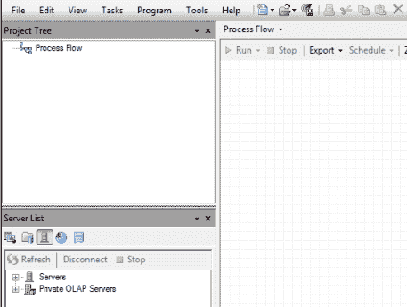


由于已有整本介绍 SAS Enterprise Guide 基础的书籍，本书聚焦于典型营销分析所需的内容。若需一份出色的通用参考书，请参阅 Lora D. Delwiche 和 Susan J. Slaughter（2010）所著的*《SAS Enterprise Guide 小书》*。

### 探索性分析

首先，导入包含客户数据的电子表格。

#### 导入数据

视你的系统和存储情况而定，你可能需要向 IT 部门寻求帮助以获取数据访问权限。在我们的示例中，DMR Publishing 的客户数据以 Microsoft Excel 电子表格的形式存储在 SASUSER 库中。如图 5.2 所示，点击 **文件 > 导入数据**。当输入数据窗口打开时，点击向上箭头浏览到存储电子表格 DMR Customer Base 的文件夹。突出显示该电子表格并点击 **打开**。

**图 5.2：将数据导入 SAS Enterprise Guide**

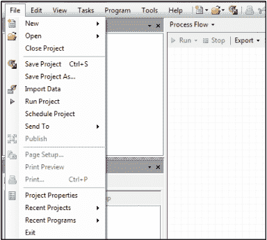

将打开一个菜单，让你管理数据的导入。关于步骤 1 到 4，在此过程中你不需要指定任何内容，因此点击 **完成**。电子表格导入后，将打开一个显示该数据集的窗口。

#### 查看数据

数据看起来状态良好且含义清楚。请注意，大多数数据都需要进行一些清理。有关这一重要过程的信息，请参阅 Ron Cody（2008）所著的*《Cody 的 SAS 数据清理技术》*。

你将看到七个变量，其中少数几个需要定义：

- CUSTOMER_ID 是唯一 ID 编号，可帮助公司跟踪客户。你在本分析中不会使用它。
- CUSTOMER_SUBSCRIPTION_COUNT 是该客户当前持有的杂志和期刊订阅总数。
- CUSTOMER_REVENUE 是去年的总收入。

> **提示：** 数据导入后，你应保存项目。在顶部菜单栏上找到该图标。第一次保存时，将打开一个菜单，要求你选择位置并为项目命名。项目命名后，你可以随时点击该图标，项目将以同一名称保存。

#### 探索数据

在你满意地查看数据后，点击屏幕右上角的 X 关闭数据集。你可以随时通过右键单击或双击项目树和主工作区中显示的数据集图标来重新打开它。

在创建报表之前，让我们看一个有用的 SAS Enterprise Guide 选项，它允许你将所有输出发送到富文本格式（RTF）文件。点击 **工具 ▶ 选项 ▶ 结果**。当“结果”部分打开时，你有多个输出数据格式选项，如图 5.3 所示。默认格式是 **SAS 报表**。该默认设置可能已经足够，但如果你的计算机上安装了 Microsoft Word，你可以点击靠近顶部的 RTF 旁边的复选框。此选项允许你以 Microsoft Word 格式共享文档，并采用适合大多数报表的所有默认设置。你还可以选择 **PDF**、**HTML** 或 **文本输出**。你可以探索这些选择，看看哪种最适合你的项目。

**图 5.3：结果的格式选项**

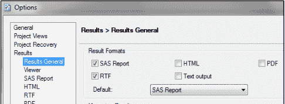

要查看数据特征，你有多个选项。最快、最简单的方法是将光标放在工作区中的数据集上，然后选择 **任务 ▶ 描述 ▶ 表征数据**（图 5.4）。此任务旨在以有用的格式为你提供数据集中每个变量的完整概览。

**图 5.4：SAS Enterprise Guide 中用于表征数据的任务菜单**

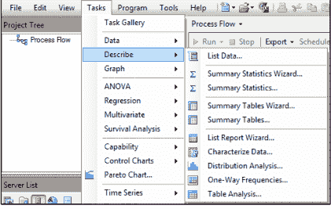

当第一个菜单出现时，点击 **完成**。

> **注意：** 如果你有一个水平数超过 30 的分类变量，例如*邮政编码*，Enterprise Guide 会将输出限制为出现最频繁的 30 个水平。此选项可以更改。

过程完成后，你可以点击工作区顶部的选项卡查看输出。如果你的计算机上安装了 Microsoft Word，那么你可以点击 Microsoft Word 图标访问 RTF 输出。它将在项目外部用 Microsoft Word 打开结果。

输出 5.1 是频数表中分类变量输出的一个示例。输出 5.2 中显示的结果相当清楚：男性计数为 9,372，占样本的 59%；女性计数为 6,140，占样本的 38%。文件中约 3% 的性别值为未知值（U）。

**输出 5.1：性别的分类数据分析**

| 变量 | 标签 | 值 | 频数 | 占总频数百分比 |
|---|---|---|---:|---:|
| GENDER |  | M | 9372 | 58.5055 |
|  |  | F | 6140 | 38.3295 |
|  |  | U | 507 | 3.1650 |

输出 5.2 提供了连续或区间变量 AGE 的结果。

**输出 5.2：年龄的区间或连续数据分析**

| 变量 | 标签 | N | NMiss | 总计 | 最小值 | 均值 | 中位数 | 最大值 | StdMean |
|---|---|---:|---:|---:|---:|---:|---:|---:|---:|
| AGE |  | 16019 | 0 | 579193 | 18 | 36.16 | 34 | 92 | 0.10 |

对于 AGE，可使用以下度量：

- *N* 是客户数量。
- *NMiss* 是年龄的缺失值数量。此处的值为零，因为我们的数据集中缺失值用值 ‘U’ 表示。
- *总计* 等于年龄求和后的值。它在我们的分析中没有意义。
- *最小值* 和 *最大值* 分别是最低值和最高值。
- *均值* 等于数学平均值或算术平均值（已剔除缺失值）。
- *中位数* 是按年龄排序后位于文件 50% 处的客户年龄；它是将观测值按顺序排列时的中间数值。
- *StdMean* 等于均值的标准误。

输出 5.3 中的图显示了客户群按年龄的一般分布。你可以看到，大多数客户较年轻，主要集中在 21 至 40 岁之间。此外，似乎还有一些离群值或极端值，由少数年龄超过 90 岁的客户代表。离群值可能会给某些类型的分析带来问题，尤其是回归模型。

**输出 5.3：公司客户群按年龄的一般分布**

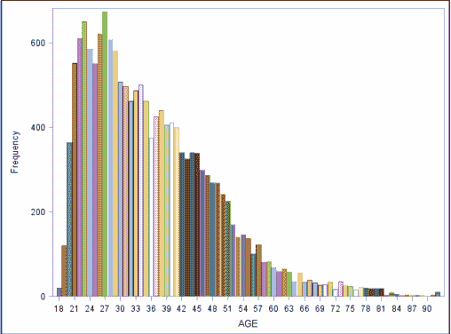

### 细分与画像分析

下一步是按 CUSTOMER_REVENUE 划分客户群，以比较收入最高的客户与其余客户的特征。

突出显示 DMR Customer Base 数据集，并选择 **任务 ▶ 描述 ▶ 分布分析**。将打开一个窗口，你可以在其中选择变量。点击 CUSTOMER_REVENUE 并将其移到“分析变量”下方的区域（图 5.5）。在左侧列中，选择 **表**。勾选 **分位数** 旁边的复选框。点击 **运行**。

**图 5.5：为客户收入分布分析选择变量**

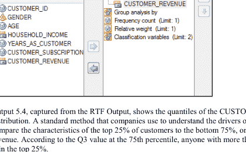

输出 5.4 截取自 RTF 输出，显示了 CUSTOMER_REVENUE 分布的分位数。公司用来理解收入驱动因素的一种标准方法是，根据收入将收入最高的 25% 客户的特征与其余 75% 客户进行比较。根据第 75 百分位数处的 Q3 值，任何收入超过 $100 的人都属于收入最高的 25%。

**输出 5.4：基于客户的收入分布的分位数**

分位数（定义 5）

| 水平 | 分位数 |
|---|---|
| 100% 最大值 | 1040 |
| 99% | 260 |
| 95% | 180 |
| 90% | 140 |
| 75% Q3 | 100 |
| 50% 中位数 | 60 |
| 25% Q1 | 30 |
| 10% | 15 |
| 5% | 15 |
| 1% | 15 |
| 0% 最小值 | 15 |

接下来，你将创建一个二值变量，以便在分析时将文件划分为收入最高的 25% 和其余 75%。

要创建新变量，请使用查询生成器中的高级表达式功能。右键单击 DMR Customer Base 数据集，然后选择查询生成器（图 5.6）。将光标放在数据集名称 t1（左侧列中的 DMR_CUSTOMER_BASE）上，并将其连同所有变量一起拖到右侧“选择数据”下方。


#### 图 5.6：使用查询构建器创建二值变量

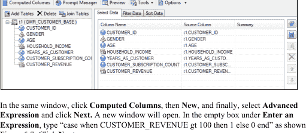

在同一窗口中，点击计算列，然后点击新建，最后选择高级表达式并点击下一步。将打开一个新窗口。在“输入表达式”下的空框中，输入“case when CUSTOMER_REVENUE gt 100 then 1 else 0 end”，如图 5.7 所示。点击下一步。

#### 图 5.7：在查询构建器中使用构建高级表达式 CR_TOP_25PCT

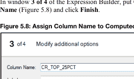

在表达式构建器的第 3 个窗口（共 4 个）中，将 CR_TOP_25PCT 放入列名旁边的空格中（图 5.8），然后点击完成。

#### 图 5.8：为计算变量 CR_TOP_25PCT 分配列名


该窗口关闭后，你会回到计算列窗口。点击**关闭**。点击**运行**完成任务。

CR_TOP_25PCT 是你的新二值变量，它使你能够按收入贡献将客户群划分为前 25% 和后 75%。

现在，你已准备好进行分析。将光标放在新数据集上，点击**任务 ▶ 描述 ▶ 汇总统计量**。

窗口打开后，将 AGE、HOUSEHOLD_INCOME 和 CUSTOMER_REVENUE 拖入**分析变量**下的槽位（图 5.9）。将新二值变量 CR_TOP_25PCT 拖入**分类变量**下的槽位。勾选**众数**和**总和**旁边的复选框。然后，在左侧选择**百分位数**，并勾选**中位数**旁边的复选框。点击**运行**。

#### 图 5.9：选择用于概况分析的连续变量

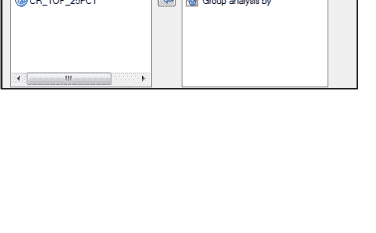

接下来，在左栏中查看**数据**下，并点击**统计量**（图 5.10）。在右侧的**基本**下，将**最大值**的小数位数设为 0。取消勾选**最小值**和**最大值**旁边的复选框。

#### 图 5.10：选择用于概况分析的变量基本统计量

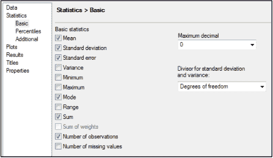

接下来，在左侧选择**百分位数**，并勾选**中位数**旁边的复选框（图 5.11）。点击**运行**。

#### 图 5.11：选择用于概况分析的变量百分位数

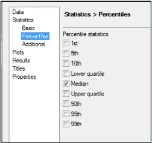

生成的表格为了解盈利驱动因素提供了许多洞见（输出 5.5）。

#### 输出 5.5：按收入组（前 25% 和后 75%）划分的连续变量概况

| CR_TOP_25PCT | 观测数 | 变量 | 均值 | 标准差 | 众数 | 总和 | N | 中位数 |
|---|---:|---|---:|---:|---:|---:|---:|---:|
| 0 | 12528 | AGE | 37 | 13 | 27 | 461415 | 12528 | 34 |
|  |  | HOUSEHOLD_INCOME | 49730 | 35213 | 36000 | 623015000 | 12528 | 44000 |
|  |  | CUSTOMER_REVENUE | 48 | 27 | 15 | 596735 | 12528 | 45 |
| 1 | 3491 | AGE | 34 | 92 | 20 | 111778 | 3491 | 31 |
|  |  | HOUSEHOLD_INCOME | 80307 | 49413 | 72000 | 280350000 | 3491 | 72000 |
|  |  | CUSTOMER_REVENUE | 161 | 93 | 120 | 561905 | 3491 | 140 |

根据结果，两个人口统计变量 AGE 和 HOUSEHOLD_INCOME 在两组之间存在差异：

- *年龄*——前 25% 收入创造者的平均年龄为 34 岁，而后 75% 为 37 岁。如显示内容右侧所示，中位数也以相似幅度变化，分别为 31 和 34。众数显示，年龄最常见的值甚至更低，分别为 27 和 20。
- *家庭收入*——从均值来看，前 25% 的收入似乎高出 60% 以上，为 8 万美元而非 4.9 万美元。中位数显示约相同的增长幅度，分别为 7.2 万美元和 4.4 万美元。前 25% 的众数值 7.2 万美元恰好是后 75% 众数值 3.6 万美元的两倍。
- *客户收入*——前 25% 中每位客户的平均年收入为 161 美元，而后 75% 为 48 美元。另一个值得关注的度量来自总和。我们想知道最佳 25% 客户群创造了多少比例的收入。结果显示，前 25% 客户带来的收入为 56.2 万美元，仅略低于后 75% 客户的 59.7 万美元。换言之，最佳 25% 的客户创造了总收入的近一半。

还可以对性别进行概况分析，以揭示前 25% 与其余客户群之间是否存在差异。由于它是分类变量，你将使用频数分析。将光标放在用于汇总统计量的同一数据集上。转到**任务 ▶ 描述 ▶ 表分析**。在第一个窗口中，将 GENDER 和 CR_TOP_25PCT 拖入**表变量**下的框中，如图 5.12 所示。

#### 图 5.12：选择用于分析性别和基于收入的前 25% 客户的分类变量

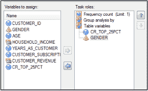

接下来，点击左上角菜单中的**表**（图 5.13）。将 CR_TOP_25PCT 拖到表格左侧的区域。将 GENDER 拖到表格顶部的区域（见图 5.12）。点击**表统计量 ▸ 关联**，然后点击**卡方检验**。点击**运行**。

#### 图 5.13：构建显示基于收入的前 25% 客户按性别分布的表

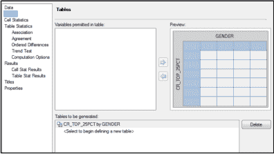

输出 5.6 中的结果表明，基于收入划分的前 25% 和后 75% 客户中，GENDER 确实存在差异。女性（F）进入前 25% 的比例（24%，相对于 76%）略高于男性（M；21%，相对于 79%）。未知性别（U）显示出男女比例，但数量很少。

#### 输出 5.6：按收入组（前 25% 和后 75%）划分的分类变量概况

##### CR_TOP_25PCT 按 GENDER 的表格

| CR_TOP_25PCT | 指标 | F | M | U | 合计 |
|---|---|---:|---:|---:|---:|
| 0 | 频数 | 4682 | 7449 | 397 | 12528 |
| 0 | 列百分比 | 76.25 | 79.48 | 78.30 | |
| 1 | 频数 | 1458 | 1923 | 110 | 3491 |
| 1 | 列百分比 | 23.75 | 20.52 | 21.70 | |
| 合计 | 频数 | 6140 | 9372 | 507 | 16019 |

##### CR_TOP_25PCT 按 GENDER 的表格统计量

| 统计量 | 自由度 | 值 | 概率 |
|---|---:|---:|---:|
| 卡方 | 2 | 22.6737 | <.0001 |
| 似然比卡方 | 2 | 22.5213 | <.0001 |
| Mantel-Haenszel 卡方 | 1 | 18.2286 | <.0001 |
| Phi 系数 |  | 0.0376 |  |
| 列联系数 |  | 0.0376 |  |
| Cramer's V |  | 0.0376 |  |

**样本量 = 16019**

统计显著性水平显示在输出 5.6 的底部表格中。对于**卡方**统计量，*p* < .0001。因此，GENDER 与 CUSTOMER_REVENUE 之间存在统计学显著关系。结论是，基于收入划分，女性比男性和未知性别更可能进入前 25%。

### 相关性分析

检查收入与连续人口统计变量（AGE 和 HOUSEHOLD_INCOME）之间关系的另一种简单而强大的方法是相关性分析。这项技术使你能够将 CUSTOMER_REVENUE 视为连续变量。

将光标放在数据集上，点击**任务 ▶ 多变量 ▶ 相关性**。在将打开的窗口中，将 AGE、HOUSEHOLD_INCOME 和 YEARS_AS_CUSTOMER 拖到右侧**分析变量**下的区域（图 5.14）。将 CUSTOMER_REVENUE 拖到**与……相关**下。点击**运行**。

#### 图 5.14：选择用于相关性分析的连续变量

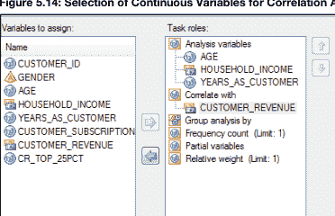

结果表明，CUSTOMER_REVENUE 与 HOUSEHOLD_INCOME 具有显著正相关，皮尔逊相关系数为 .38（输出 5.7）。

AGE 和 YEARS_AS_CUSTOMER 的 p 值也显示显著。然而，这些变量的皮尔逊相关系数均小于 .10。因此，显著性主要归因于大样本量。

#### 输出 5.7：客户收入与年龄、家庭收入及客户年限的相关性分析结果

皮尔逊相关系数，N = 16019
在 H0：Rho=0 下，Prob > |r|

| | AGE | HOUSEHOLD_INCOME | YEARS_AS_CUSTOMER |
|---|---|---|---|
| CUSTOMER_REVENUE | -0.08809 | 0.38130 | -0.08779 |
| | <.0001 | <.0001 | <.0001 |

### 实践笔记

查看数据频数和分布可以让你了解数据，有助于理解潜在趋势。相关性分析在发现早期关系方面非常强大，这些关系可为进一步的预测分析提供思路。

相关性分析也有助于发现数据问题。例如，如果两个变量显示出高相关系数（> 60%），它们可能以某种未知方式相关。


当描述性分析是更大项目中的第一步时，你可能希望与客户或利益相关者讨论初步发现。他们可能了解市场趋势、潜在数据问题及相关性，或对此有见解，这些信息可能有助于你将其纳入分析。

## 第 6 章：使用 SAS Enterprise Guide 进行市场分析

- 引言 ...... 79
- 项目概述 ...... 79
- 市场分析 ...... 80
  - 项目启动 ...... 80
  - 数据准备 ...... 80
  - 渗透率与钱包份额 ...... 89
  - 结果 ...... 90
- 现场笔记 ...... 91

### 引言

第1章至第5章侧重于通用知识与技术，为多种类型的数据分析奠定了基础。在本章中，你将探讨一个更具体的主题：竞争分析。

当你的公司制定战略时，首先需要回答以下问题：

- 与我们相比，主要竞争对手的优势和劣势是什么？
- 我们的市场份额是多少，如何提高？

对大多数行业而言，现有数据源使公司能够确定其在特定人群细分中的市场份额，即“钱包份额”。这种分析对于制定营销策略、指导研发以及为财务和预算分配提供依据很有价值。

### 项目概述

DMR Publishing Company 的领导团队希望了解其业务收入的驱动因素。公司收集了过去一年的美国客户数据，包括收入、出版物数量以及三个人口统计变量。在本分析中，你将使用 SAS Enterprise Guide。

该项目包括八个步骤：

- 1. 在 SAS Enterprise Guide 6.1 中启动项目。
- 2. 导入并查看市场数据。
- 3. 将 DMR Publishing 客户 SAS 数据集添加到项目中。
- 4. 使用查询工具构建新的年龄组变量。
- 5. 将 DMR Publishing 客户数据汇总到性别和年龄组级别。
- 6. 合并客户数据和市场数据。
- 7. 将合并后的数据汇总到年龄组级别。
- 8. 执行渗透率和“钱包份额”分析。

### 市场分析

到目前为止，在本分析中，我们的主要关注点是描述客户群的特征。如果可能，将客户数据库的特征与整体市场中的相同特征进行比较会很有用。这种比较可以支持第1章所定义的渗透率分析和钱包份额分析。

我们从 General List Company 购买了一个数据集，其中显示了美国整个出版市场的年度收入和订阅数量，并按性别和年龄组细分。我们的目标是比较 DMR Publishing 客户数据与从 General List Company 购买的整体市场数据在性别和年龄组层面的表现。

### 项目启动

与第5章中的过程类似，第一步是打开项目。双击 SAS Enterprise Guide 图标。选择“新建项目”。

### 数据准备

你的第一步是准备数据。

#### 导入数据

要访问数据，请转到“文件 ▶ 导入”，并选择 Publishing Market 数据集。第一个窗口打开后，单击“完成”。请注意，数据已经汇总，如输出 6.1 所示。

单击 **服务器** 左侧的加号。继续展开，直到到达 **SASUSER 库**，如图 6.2 所示。

**图 6.2：展开库以定位 DMR Publishing 客户数据**

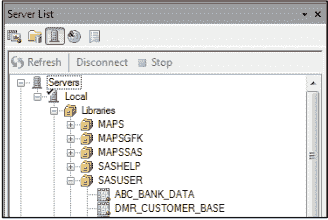

右键单击 DMR_CUSTOMER_BASE 数据，并选择 **打开**。该数据现已添加到项目中，并可在项目树中看到。你现在可以在 DMR Publishing 客户数据中创建 Age Group 变量。

#### 构建年龄组变量

右键单击 DMR Customer 数据集，并选择 **查询构建器**，如图 6.3 所示。将左侧的四个变量拖到右侧列中：GENDER、CUSTOMER_ID、CUSTOMER_SUBSCRIPTION_COUNT 和 CUSTOMER_REVENUE。

**图 6.3：在 DMR Publishing 客户数据上构建年龄组的查询**

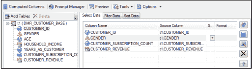

接下来，单击 **计算列** ▶ **新建** ▶ **高级表达式** ▶ **下一步**（图 6.4）。

**图 6.4：用于创建年龄组变量的表达式构建器**

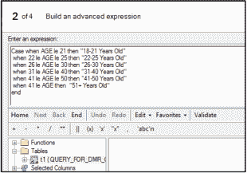

该窗口有一个用于输入表达式的区域。程序 6.1 显示了在查询构建器中构建该变量的语法；将其复制到 **输入表达式** 下的框中。

**程序 6.1：用于创建年龄组变量的表达式构建器**

```
Case when AGE le 21 then "18-21 Years Old"
     when 22 le AGE le 25 then "22-25 Years Old"
     when 26 le AGE le 30 then "26-30 Years Old"
     when 31 le AGE le 40 then "31-40 Years Old"
     when 41 le AGE le 50 then "41-50 Years Old"
     when 51 le AGE then "51+ Years Old"
end
```

单击 **下一步**。在下一个窗口的字段中，在 **列名** 旁边的顶部框中输入 AGE_GROUP。单击 **完成** ▶ **关闭**。

#### 汇总绩效变量

下一步是汇总绩效变量 CUSTOMER_ID、CUSTOMER_REVENUE 和 CUSTOMER_SUBSCRIPTION_COUNT（图 6.5）。在同一查询中，在右侧，将光标移到 Summary 列下的 CUSTOMER_ID 旁边。会出现一个箭头。向下滚动并选择 COUNT DISTINCT。为便于查看，你可以用光标调整列宽。接下来，右键单击 CUSTOMER_REVENUE 和 CUSTOMER_SUBSCRIPTION_COUNT 旁边的空白处，并选择 SUM。你会注意到窗口右下方出现一个 Summary groups 窗格。软件推测为 GENDER 和 CALCULATED AGE_GROUP，这是正确的。单击“运行”。

**图 6.5：按性别和年龄组汇总绩效变量**

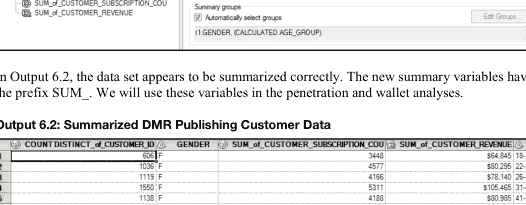

在输出 6.2 中，数据集似乎已正确汇总。新的汇总变量带有前缀 SUM_。我们将在渗透率和钱包分析中使用这些变量。

**输出 6.2：汇总后的 DMR Publishing 客户数据**


你还将按 AGE_GROUP 进行匹配。右键单击第一个数据集（t1）中的 AGE_GROUP。按照提示将其与第二个数据集（t2）中的 AGE_GROUP 匹配。

接下来，将出现一个窗口，提示会询问你要选择哪种连接（图 6.8）。按照使用 GENDER 的第一次连接中的指示，你希望匹配 DMR Publishing 客户数据中能在 Publishing Market 数据中找到匹配的记录；因此，选择 **在给定条件下右表中的所有行（右连接）**。另外，请注意圆圈下方询问是否希望 t2.AGE_GROUP 等于（=）t1.AGE_GROUP。默认设置是正确的。单击 **关闭**。

**图 6.8：DMR 客户数据集与市场数据集的合并**

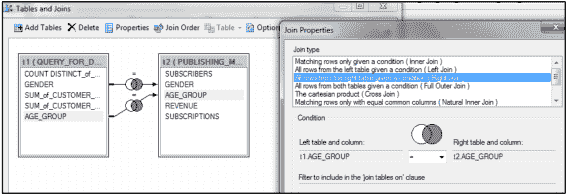

你将回到查询构建器的主界面。从左侧列中，将以下变量从 (t2) PUBLISHING_MARKET 拖到右侧的列名下：SUBSCRIBERS、REVENUE、SUBSCRIPTIONS（图 6.9）。

**图 6.9：从 Publishing Market 数据中添加变量**

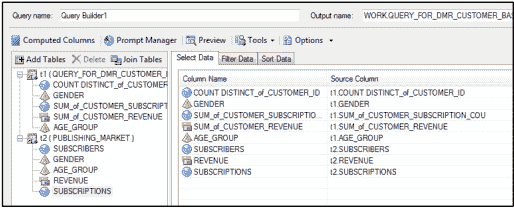

在运行查询之前，你可以更改列名（图 6.10）。

**图 6.10：将三个列重命名为与业务相关的名称**

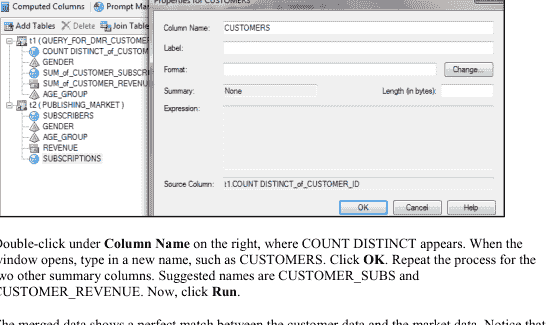

双击右侧 **列名** 下出现 COUNT DISTINCT 的位置。窗口打开后，输入新名称，例如 **CUSTOMERS**。单击 **确定**。对另外两个汇总列重复此过程。建议名称为 **CUSTOMER_SUBS** 和 **CUSTOMER_REVENUE**。现在，单击 **运行**。

合并后的数据显示客户数据与市场数据完全匹配。请注意，它处于 **GENDER-by-AGE_GROUP** 级别。

**输出 6.3：按性别和年龄组级别合并的数据**


对于当前分析，你希望按年龄组查看渗透率和钱包份额。因此，你将再次汇总数据。返回 **流程**，右键单击合并后的数据，并选择 **查询构建器**。


当窗口打开时，将除 GENDER 之外的每个变量拖到右侧，并将其放到“列名”下方。将光标置于“汇总”下的空白处，会出现一个下拉菜单，其中显示“无”（图 6.11）。单击并选择除 AGE_GROUP 之外的每个变量旁边的 SUM。

#### 图 6.11：将合并数据汇总到年龄组级别

| 列名 | 源列 | 汇总 |
|---|---|---|
| SUM_of_CUSTOMERS | 计算 | SUM |
| SUM_of_CUSTOMER_SUBS | 计算 | SUM |
| SUM_of_CUSTOMER_REVENUE | 计算 | SUM |
| AGE_GROUP | t1.AGE_GROUP |  |
| SUM_of_SUBSCRIBERS | 计算 | SUM |
| SUM_of_REVENUE | 计算 | SUM |
| SUM_of_SUBSCRIPTIONS | 计算 | SUM |

完成后，单击“运行”。此步骤将所有客户和市场值汇总到 AGE_GROUP 级别。查看并关闭数据视图。

### 计算钱包份额

下一步是使用查询工具计算客户、订阅和收入的钱包份额。将光标置于汇总数据上，右键单击，然后点击“查询生成器”。打开后，将所有变量拉入右侧窗格。您可以单独拉取每个变量，也可以通过拖动出现 t1 (QUERY_FOR_DMR) 的图标一次性移动整个数据集。为了方便查看，请将右侧的“列名”标题加宽，直到您能看到完整的列名。

接下来，转到“计算列”▶“新建”▶“高级表达式”▶“下一步”。在“高级表达式”下方的框中，输入 SUM_of_CUSTOMERS/SUM_of_SUBSCRIBERS，然后点击“下一步”（图 6.12）。在“列名”旁边输入 PCT_of_SUBSCRIBERS。在窗口底部的“格式”旁边，点击“更改”，然后选择“数值”和“Percent w.d.”。其他设置保持默认不变。点击“确定”▶“完成”。在剩余窗口中，点击“关闭”。

#### 图 6.12：创建百分比变量的计算列

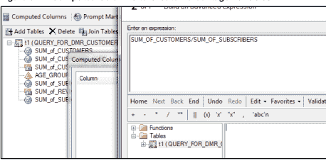

接下来，点击**新建**并输入 SUM_of_CUSTOMER_SUBS/SUM_of_SUBSCRIPTIONS。点击**下一步**，将该比例命名为 PCT_of_SUBSCRIPTIONS。创建相同的格式，点击**完成**。

使用相同的格式，在框中重复该过程，输入 SUM_of_CUSTOMER_REVENUE/SUM_of_REVENUE。点击**下一步**，将该比例命名为 PCT_of_REVENUE。点击**下一步** ▶ **完成**。点击**关闭** ▶ **运行**。

> > **注意：** 为避免错误，变量名必须与所述完全一致。

输出 6.4 显示了最终的百分比值。

#### 输出 6.4：最终的百分比变量，显示 DMR 订阅者指标占总市场的百分比

|  | PCT_OF_SUBSCRIBERS | PCT_OF_SUBSCRIPTIONS | PCT_OF_REVENUE |
|---|---|---|---|
| 1 | 5% | 28% | 14% |
| 2 | 8% | 32% | 10% |
| 3 | 10% | 38% | 10% |
| 4 | 11% | 39% | 10% |
| 5 | 11% | 42% | 9% |
| 6 | 9% | 30% | 6% |

### 渗透率与钱包份额

您的数据现在可以分析了。要按 `AGE_GROUP` 获得清晰的视图，请关闭数据并突出显示最后创建的数据集。点击**任务** ▶ **描述** ▶ **列出数据**。此过程允许您将选定的变量或列以报表格式打印出来。图 6.13 中的窗口允许您管理报表输出。

#### 图 6.13：创建报表

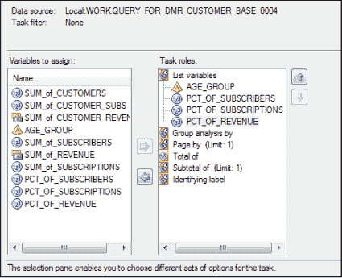

将 AGE_GROUP 和三个百分比（PCT）变量拖到右侧。点击“运行”。查找在 Microsoft Word 中创建的输出。

### 结果

报告结果是分析中最重要的步骤之一。如果您把所有事情都做对了并且能够传达结果，那么您的努力和见解就不会白费。

在输出 6.5 中，最终报告显示了按年龄组划分的市场渗透率分析和钱包份额。在评估订阅者百分比时，最低的市场渗透率出现在 18 至 21 岁年龄组。26 至 50 岁人群的比例更高，为 10% 至 11%。51 岁及以上人群的比例略降至 9%。

#### 输出 6.5：按年龄组划分的最终渗透率分析

| 行号 | AGE_GROUP | PCT_OF_SUBSCRIBERS | PCT_OF_SUBSCRIPTIONS | PCT_OF_REVENUE |
|---:|---|---:|---:|---:|
| 1 | 18-21 岁 | 5% | 28% | 14% |
| 2 | 22-25 岁 | 8% | 32% | 10% |
| 3 | 26-30 岁 | 10% | 38% | 10% |
| 4 | 31-40 岁 | 11% | 39% | 10% |
| 5 | 41-50 岁 | 11% | 42% | 9% |
| 6 | 51 岁及以上 | 9% | 30% | 6% |

订阅百分比则显示出不同的结果。18 至 21 岁的年轻人人均订阅数更高。因此，他们带来了最大比例的收入。他们的钱包份额为 14%，而 51 岁及以上人群仅为 6%。

从这一分析中可以得出几个结论。如果您正在寻找能够带来高平均收入的额外订阅者，那么 18 至 21 岁市场是重点所在。这些订阅者似乎对当前产品最满意，尽管仍有很大的增长空间。

另一方面，如果强调新产品，企业可能会在其他年龄组中涌现增长机会。22 岁及以上客户的钱包份额为 10% 或更低。这一结果表明，可以开发针对 21 岁以上人群的产品。

### 现场笔记

本案例研究为 DMR Publishing 提供了丰富的见解和潜在机会。公司如何利用这些信息，更多地取决于组织的能力。

请注意，这里识别出了两个新的机会。第一个机会是寻找与当前订阅者群体相似的额外订阅者。寻找额外订阅者的工作可能由市场营销部门负责。第二个机会是为市场中服务不足的领域创造新产品。这种对新产品的需求很可能会成为业务中产品开发部门的一个项目。最优解决方案可能是两个部门的结合。

由于当前业务的市场增长和产品开发都很重要，管理层必须决定如何分配资源。当公司培养了大数据文化，使各部门能够在分析结果的实施中协作和合作，从而优化整个公司的利润时，才能看到最佳结果。

## 第 7 章：使用 SAS Enterprise Miner 进行聚类分析

- 简介 ................................................................................................ 93
- 项目概述 .......................................................................................... 93
- 聚类分析 ............................................................................................ 94
  - 启动项目 .................................................................................... 94
  - 输入数据源并分配变量角色 .................................. 97
  - 转换变量 ................................................................................... 99
  - 筛选数据 ................................................................................................ 102
  - 构建聚类 ........................................................................................... 104
  - 构建细分画像 ............................................................................. 107
  - 分析聚类并推荐营销或产品开发行动 .. 109
- 现场笔记 ................................................................................... 109

### 简介

在第 5 章中，您探索了 DMR Publishing 的客户数据，以熟悉这些数据并寻找客户模式和趋势。在第 6 章中，您将 DMR Publishing 客户的表现与整个出版市场的表现进行了比较。在本章中，您的目标是通过将客户划分为具有相似特征的细分群体，更深入地了解您的客户群。通过揭示客户之间的异同，您可以设计与长期战略目标一致的营销计划和数据库增强策略。

### 项目概述

DMR Publishing Company 的领导团队请您帮助其更好地了解其客户群。团队想知道他们的客户是否都相似，或者是否自然地划分为不同的群体。该细分使用 SAS Enterprise Miner 执行。

该项目包含八个步骤：

- 1. 在 SAS Enterprise Miner 13.1 中启动项目。
- 2. 输入数据并分配变量角色。


图 7.3：查看 SAS Enterprise Miner 工作区

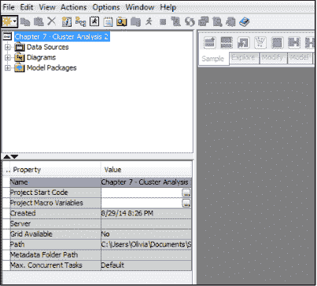

### 输入数据源并分配变量角色

接下来，双击数据来源图标（左上角菜单，直接位于 *操作* 词下方）。数据导入向导将打开，提示您创建 SAS 表（图 7.4）。

**图 7.4：定位数据源**

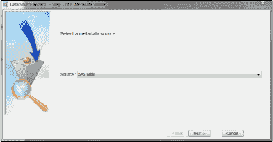

点击 **下一步** ▶ 并浏览在第 3 章中创建的 DMR_CUSTOMER_BASE 数据集。一旦找到数据，选择数据并点击 **确定**，然后点击 **下一步** ▶。下一个窗口显示摘要。点击 **下一步** ▶。对于元数据顾问选项，点击 **高级** 并点击 **下一步** ▶。会出现一个窗口，显示变量特征并提供探索分布的选项（图 7.5）。

**图 7.5：分配变量角色并探索变量**

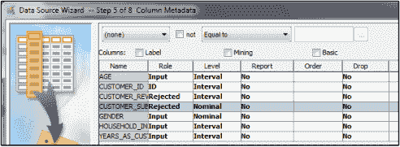

首先，您需要将 CUSTOMER_REVENUE 和 CUSTOMER_SUBSCRIPTION_COUNT 的角色更改为“Rejected”。这些是将在未来章节中使用的结果变量。但现在，您不希望将它们包含在分析中。

> **注意：** 聚类需要有一个 ID 变量来跟踪每个簇中的观测值。

突出显示 AGE 并点击 **探索**。一个大窗口打开并有四个象限。最大化左下方的象限以获取输出 7.1。

输出 7.1：查看年龄变量的分布

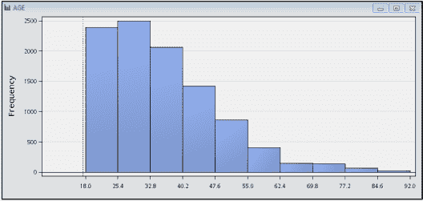

对于聚类，您希望变量具有代表正态分布的钟形曲线。因为 AGE 不是正态分布的，您可以使用 **转换** 函数。因为 AGE 右偏，或正偏，您应该在探索所有变量后使用对数转换。

> **注意：** 要在 SAS Enterprise Miner 中关闭 **结果** 窗口，请点击右上角的 **X**。它只会关闭结果窗口；主项目将保持打开状态。

通过遵循相同的流程，探索另外两个连续变量 HOUSEHOLD_INCOME 和 YEARS_AS_CUSTOMER。因为这两个变量都右偏，这些变量也需要使用对数转换进行转换。但首先，您必须完成导入过程。多次点击 **下一步** 然后点击 **完成**。

一旦 DMR_CUSTOMER_BASE 数据源创建完成，数据集名称将显示在上部图中的数据来源下，如图 7.6 所示。

图 7.6：打开包含数据源的聚类图中的项目视图

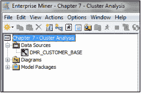

接下来，您想要为聚类分析创建一个工作区。转到顶部菜单并点击 **文件 > 新建 > 图表**。当框打开时，将图表命名为 Clustering 并点击 **确定**。右侧会出现一个工作区域。将光标放在数据集 DMR_CUSTOMER_BASE 上，并将其拖入右侧的聚类工作区域。

### 转换变量

接下来，查看图表上方的菜单并点击 **修改** 选项卡。行上最后一个图标是 **转换变量**。将 **转换变量** 图标拖到 **图表** 并用箭头将其连接到 DMR_CUSTOMER_BASE 数据集（图 7.7）。

图 7.7：使用转换变量图标

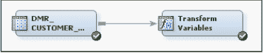

要将 DMR Customer 数据连接到转换变量节点，右键单击 **转换变量** 节点并选择 **运行**。当提示查看结果时，点击 **确定**。

转换变量节点仍处于突出显示状态时，查看图 7.8 所示的工作区域左下方。

**图 7.8：定位转换变量公式菜单**

| 属性 | 值 |
|---|---|
| **通用** | |
| 节点 ID | Trans |
| 导入数据 | |
| 导出数据 | |
| 注释 | |
| **训练** | |
| 变量 | |
| 公式 | |
| 交互 | |
| SAS 代码 | |
| **默认方法** | |
| 区间输入 | None |
| 区间目标 | None |
| 类别输入 | None |
| 类别目标 | None |
| 将缺失视为级别 | No |
| **样本属性** | |
| 方法 | First N |
| 大小 | Default |
| 随机种子 | 12345 |

在训练下，旁边是公式，点击右侧的三个点。将会打开一个窗口，显示所有变量和每个分布，具体取决于所选变量（图 7.9）。

图 7.9：查看转换概览

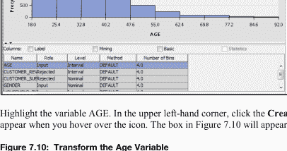

突出显示变量 AGE。在左上角，点击创建图标。将鼠标悬停在图标上时会显示“创建”字样。图 7.10 中的框将会出现。

图 7.10：转换年龄变量

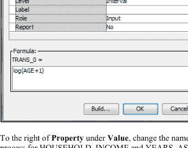

在值下，属性右侧，将名称从 TRANS_01 更改为 AGE_LOG。对 HOUSEHOLD_INCOME 和 YEARS_AS_CUSTOMER 重复此过程，使用基于图 7.10 中的公式的类似名称和对数转换。输入每个公式后，点击确定。请注意，HOUSEHOLD_INCOME 的对数变为 HH_INCOME_LOG 等于 log (HOUSEHOLD_INCOME+100)。YEARS_AS_CUSTOMER 对数的名称为 YEARS_AS_CUST_LOG。

转换公式出现在公式窗口底部，如图 7.11 所示。

**图 7.11：为年龄、家庭收入和作为客户年限创建转换公式**

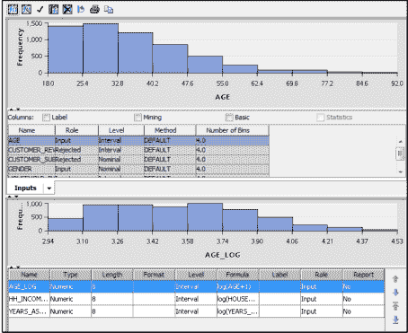

点击 **确定**。然后，右键单击 **转换变量** 图标并点击 **运行**。运行完成后，点击 **确定**。

### 过滤数据

因为聚类对异常值敏感，如果您运行变量通过过滤过程，您将获得更好的结果。在图表上方，点击样本选项卡并转到第四个图标，**过滤**。将其拖到图表上并用箭头连接（图 7.12）。

图 7.12：过滤数据

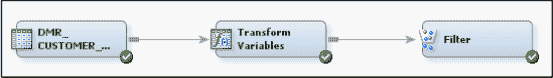

右键单击过滤节点并选择 **运行**。

为了寻找潜在的异常值，突出显示过滤图标，转到左下菜单，并点击 **区间变量** 右侧的三个点（图 7.13）。

图 7.13：定位过滤菜单

| 属性 | 值 |
|---|---|
| **通用** | |
| 节点 ID | Filter |
| 导入数据 | |
| 导出数据 | |
| 注释 | |
| **训练** | |
| 导出表 | Filtered |
| 过滤表 | Training Data |
| 分布数据集 | Yes |
| **类别变量** | |
| 类别变量 | |
| 默认过滤方法 | Rare Values (Percentage) |
| 保留缺失值 | Yes |
| 归一化值 | Yes |
| 最小频率截止 | 1 |
| 百分比最小截止 | 0.01 |
| 最大级别数 | 25 |
| **区间变量** | |
| 区间变量 | |
| 默认过滤方法 | Standard Deviations from ... |
| 保留缺失值 | Yes |

此下拉选项打开一个窗口，允许您查看每个分布（图 7.14）。对于 HH_INCOME_LOG，将 **过滤下限** 设置为 8 并点击 **应用过滤**。

**图 7.14：指定过滤变量**

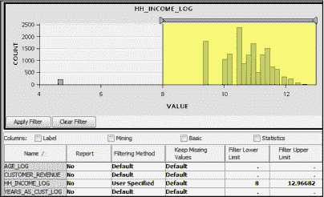

点击 **确定**。然后右键单击 **过滤** 图标并选择 **运行**。完成后，点击 **确定**。

### 构建聚类

在图表窗口上方，转到 **探索** 选项卡并选择第二个图标，**聚类**。将 **聚类** 图标拖到图表上并与 **过滤** 节点连接（图 7.15）。

**图 7.15：添加聚类过程**

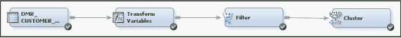

当您突出显示 **聚类** 图标时，属性菜单出现在左下方（图 7.16）。

图 7.16：查看添加聚类过程的属性菜单

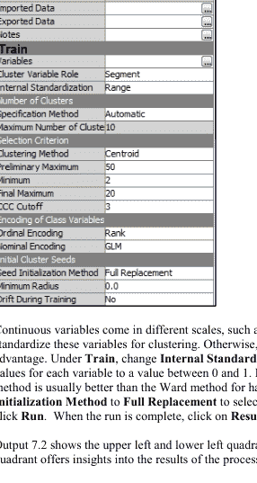

连续变量具有不同的尺度，例如计数、分钟和美元。您希望对这些变量进行标准化以进行聚类。否则，具有较高尺度的变量将具有优势。在训练下，将内部标准化更改为范围。此选项将每个变量的值标准化为 0 到 1 之间的值。对于聚类方法，选择质心。此方法通常比 Ward 方法更适合处理对比数据。将种子初始化方法更改为完全替换以选择分离良好的种子。右键单击，然后点击运行。运行完成后，点击结果。

输出 7.2 显示结果窗口四个象限中的左上和左下象限。每个象限根据定义提供对过程结果的见解：

- *分段图*——左上象限显示具有最高重要性的聚类变量的分段图。结果显示年龄、对数和性别的值如何在簇之间分布。要查看分段的值和其他统计信息，请将光标放在每个分段内的颜色上。


- **细分规模**——左下象限以饼图直观显示每个聚类的大小。要查看每个聚类中的客户数量，请将光标悬停在饼图的每个扇区上。

由于下一步是构建细分画像，因此这四个象限中最值得关注的是左下象限中显示的聚类数量。饼图显示总共有五个聚类。在构建细分画像时，四到八个聚类是比较合适的数量。

#### 输出 7.2：查看聚类结果

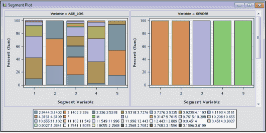


查看完聚类结果后，关闭“结果”窗口并返回图。

#### 构建细分画像

在图上方的菜单中，依次单击 **评估** 和 **细分画像**。将“细分画像”图标拖入图中，并用箭头连接（图 7.17）。

##### 图 7.17：添加细分画像流程


右键单击并选择 **运行**。出现结果窗口后，单击 **结果**。

初始的“结果”窗口显示四个象限。请重点关注右上象限，它显示每个细分的画像。将右上象限最大化以便更仔细地查看，如输出 7.3 中部分所示。

#### 输出 7.3：查看细分画像结果


将右上象限最大化以便更仔细地查看，如输出 7.4 所示。

此输出显示每个细分中客户的特征。各细分按规模大小排列。客户数量最多的细分列在最前。客户数量最少的细分列在最后：

细分 4 有 4,885 名客户。AGE_LOG 是最强的预测变量。实心条表示该细分内的分布。深红色轮廓表示总体人群。因此，这个聚类

#### 分析聚类并推荐营销或产品开发行动

这组结果告诉 DMR Publishing，它可以针对不同年龄群体聚焦营销和产品开发，同时考虑忠诚度（作为客户的年数）、性别和家庭收入。

由于细分 4 规模最大，因此它是分析的重点。不过，有一点需要注意：细分 4 与第三大细分（细分 1）很相似。两者都拥有忠诚客户（基于作为客户的年数），这些客户年龄高于平均水平，收入略高于平均水平。主要区别在于性别。细分 4 和细分 1 合计占 DMR Publishing 客户群的 50%。因此，您可能需要考虑一种两层方法：

- 考虑针对特定性别出版物（如男性健康或女性时尚杂志）采取单独的营销行动或产品开发。或者，您的做法也可以很简单，例如针对每种性别使用不同的杂志封面或广告。
- 考虑将这两个细分合并，用于非特定性别的出版物，例如烹饪和旅行杂志或商业期刊。

细分 5 是第二大聚类，提供了另一个机会。这个群体全部为男性、年龄低于平均水平，是吸引该人群的出版物的主要受众。如果 DMR Publishing 尚未提供一些体育或科技杂志，您可以建议他们将这些杂志加入出版物列表。

### 来自一线的笔记

细分画像用于描述聚类并使其可操作。正如您所见，所揭示的模式和由此产生的洞察可以指导创意营销决策以及产品或服务开发。一旦基于现有数据了解了客户，就可以考虑购买额外数据来丰富聚类、增强分析并扩大客户群。如第 2 章所述，有许多优质的外部数据来源。您可以购买兴趣爱好、购买模式以及社交或在线行为等特征，并将其附加到现有客户群中。客户数据丰富后，您可以重新运行聚类细分，并完善营销和产品开发策略。

在与利益相关者和最终用户分享结果或提出战略举措时，请从他们的业务目标出发进行表述，并将您的建议与公司的战略目标联系起来。

## 第 8 章：使用 SAS Enterprise Miner 进行树分析

- 引言 ........................................................ 111
- 项目概述 .................................................... 111
- 决策树分析 .............................................. 112
  - 启动项目 ............................................. 112
  - 输入数据源 ........................................... 114
  - 创建目标变量 .......................................... 115
  - 划分数据 .............................................. 117
  - 构建决策树 ......................................... 118
  - 查看决策树输出 ................................... 120
  - 解释发现 .......................................... 126
  - 树分析的其他用途 ................................ 128
- 来自一线的笔记 ................................................ 128

### 引言

在前面的几章中，我们重点了解了 DMR Publishing 的客户。理解客户始终是任何全面分析的良好第一步。在本章中，您将学习如何从过去行为和特征的组合中发现并度量模式，以预测未来行为。您在此过程中使用的主要技术是树分析。树分析的好处之一是，它除了是一种强大的预测技术外，还具有很强的描述性成分。树分析的描述性结果易于解释，这使该技术深受业务分析师和营销人员的青睐。

### 项目概述

DMR Publishing Company 的领导团队希望了解订阅不止一种杂志或期刊的客户与仅订阅一种的客户相比具有哪些特征。在本分析中，您将使用 SAS Enterprise Miner。

本项目有十个步骤：

- 1. 在 SAS Enterprise Miner 13.1 中启动项目。
- 2. 输入数据源。
- 3. 定义变量角色。
- 4. 定义目标变量。
- 5. 划分数据。
- 6. 设置树属性。
- 7. 构建决策树。
- 8. 调整图形属性。
- 9. 解释您的发现。
- 10. 显示节点规则。

### 决策树分析

决策树技术旨在根据一系列简单规则对数据进行细分。有关该过程的完整文档，请访问 SAS Enterprise Miner 的 **帮助** 部分。打开项目后，转到 **帮助 ▸ 目录**。窗口打开后，查找 **节点参考 ▸ 模型 ▸ 决策树节点**。

### 启动项目

要打开 SAS Enterprise Miner (EM)，请单击桌面或“开始”菜单中的节点。您的第一个选择是打开现有项目或创建新项目。突出显示并单击 **新建项目**（图 8.1）。

#### 图 8.1：初始化 SAS Enterprise Miner


将打开一个窗口，要求您为项目命名并选择 SAS 服务器目录（图 8.2）。根据您的设置，它可能需要额外连接。如果是这样，请联系您的 IT 部门。否则，请单击“浏览”，然后选择您希望保存项目文件的文件夹。

#### 图 8.2：创建并命名新项目


完成后，单击 **下一步 ▶**，您将看到一个显示您所做选择的窗口。单击 **完成**。现在您已进入 EM 工作区，如图 8.3 所示。


**图 8.3：SAS Enterprise Miner 工作区**


### 输入数据源

接下来，单击 **创建数据源** 节点（位于左上角菜单中“操作”一词的正下方）。数据源向导将打开，并要求你定位一个 SAS 表。单击 **下一步 ▶**，并在 SASUSER 库中浏览 **DRL_CUSTOMER_DATA** 数据集。找到数据后，选择该数据并单击 **确定**（图 8.4）。

**图 8.4：定位并输入数据源**


单击 **下一步**。下一个窗口会显示摘要。再次单击 **下一步**，然后选择 **高级**，以打开一个允许你更改数据各个方面的表格。

将 **CUSTOMER_REVENUE**、**CUSTOMER_SUBSCRIPTION_COUNT** 和 **YEARS_AS_CUSTOMER** 的 **角色** 更改为 **拒绝**（图 8.5）。这三个变量的角色被设置为 **拒绝**。

**图 8.9：使用元数据分配目标变量角色**

| 名称 | 隐藏 | 隐藏 | 角色 | 新角色 |
|---|---|---|---|---|
| AGE | N | 默认 | 输入 | 默认 |
| CUSTOMER_ID | N | 默认 | ID | 默认 |
| CUSTOMER_REVENUE |  | 默认 | 拒绝 | 默认 |
| CUSTOMER_SUBSCRIPTION_COUNT |  | 默认 | 拒绝 | 默认 |
| GENDER | N | 默认 | 输入 | 默认 |
| HOUSEHOLD_INCOME | N | 默认 | 输入 | 默认 |
| MULTI_SUBS | N | 默认 | 目标 | 默认 |
| YEARS_AS_CUSTOMER |  | 默认 | 拒绝 | 默认 |

下一步是划分数据。

### 划分数据

划分数据的目的是让你在一个数据子集上开发模型，并在另一个数据子集上验证模型。这些数据子集彼此互斥，因为它们不共享任何共同观测。

在决策树建模中，这些子集的使用方式如下：

- *训练：* 用于初始模型拟合的训练子集。
- *验证：* 验证数据集用于在树构建过程中评估模型并创建最佳子树。

在 **样本** 选项卡中，选择左起第二个图标 **数据划分**，并将其拖到图上。将其连接到 **元数据** 图标（图 8.10）。

**图 8.10：将数据划分附加到元数据图标**


在左下角的 **属性** 窗口中，查找 **训练** 下的 **数据集分配**。默认显示将文件的 40% 分配给 **训练**，并将 30% 分别分配给 **验证** 和 **测试**。对于树模型，你只需要 **训练** 和 **验证**。因此，将 **训练** 和 **验证** 各设置为 50%，并将 **测试** 设置为 0%（图 8.11）。

**图 8.11：重新分配数据分配百分比**

| 属性 | 值 |
|---|---|
| **常规** | |
| 节点 ID | Part |
| 导入的数据 | |
| 导出的数据 | |
| 备注 | |
| **训练** | |
| 变量 | |
| 输出类型 | 数据 |
| 划分方法 | 默认 |
| 随机种子 | 12345 |
| 数据集分配 | |
| 训练 | 50.0 |
| 验证 | 50.0 |
| 测试 | 0.0 |
| **报告** | |
| 区间目标 | 否 |
| 分类目标 | 是 |
| **状态** | |
| 创建时间 | 7/26/14 7:17 AM |
| 运行 ID | ac58a431-9599-48df-8d48-3 |
| 最后错误 | |
| 最后状态 | 完成 |
| 最后运行时间 | 7/26/14 7:20 AM |
| 运行持续时间 | 0 小时 0 分 1.90 秒。 |
| 网格主机 | |
| 用户添加的节点 | 否 |

右键单击 **数据划分** 图标并选择 **更新**。完成后，单击 **确定**。现在可以构建树了。

### 构建决策树

在图上方的 **模型** 菜单中，将 **决策树** 图标（左起第二个）拖到工作区，并将其连接到 **数据划分** 图标（图 8.12）。

**图 8.12：将决策树图标连接到元数据图标**


要更新到决策树节点的路径，请右键单击它并选择 **更新**。

突出显示决策树节点并转到左下角菜单（图 8.13）。默认设置很好，但你可能需要考虑几个设置。对于每个设置，单击你所选选项右侧的三个点：

- *变量：* 此设置提供了从决策树中排除变量的机会。要排除变量，请转到“使用”列并将值更改为 **否**。当前树不需要此设置，但它是探索其他选项的一种方式。
- *交互式：* 此设置允许你通过动态创建拆分和剪枝来手动构建树。这超出了本书的范围。但一旦掌握了基本步骤，你可能会想探索其中一些选项。
- *最大分支：* 虽然此演示中此设置保持为 2，但在实践中，通常可能会使用 4 或 5。
- *最大深度：* 通常，你可以将此设置保留为 6；本演示中将其设置为 3。

**图 8.13：分配决策树设置**


右键单击决策树节点，然后单击“运行”和“是”。当“运行完成”框打开时，单击“结果”。

**输出 8.2：查看初始树（右分支）**


### 图形属性

在开始分析结果之前，你可以根据自己的个人偏好选择更改视图。要探索树输出中的许多选项，请在输出 8.1 所示的屏幕上任意位置右键单击，然后选择 **图形属性**。窗口打开后，单击 **树**。将 **方向** 更改为 **水平**，然后单击 **确定**（图 8.14）。

**图 8.14：更改决策树输出的图形属性**


你也可以单击 **文本选项**，将字体更改为 **Arial Narrow**，并将字号更改为 **10 pt**。如果变量名较长，这样做很有用。单击 **应用** ► **确定**。现在树处于水平视图。

树的水平视图如输出 8.3 所示。树结果从左到右阅读。每个矩形框称为一个 *节点*。每个节点位置包含有关该节点内 DMR 客户组的信息。

**输出 8.3：查看水平树**


### 诊断

对于所有预测模型，都存在过拟合的风险。换句话说，你的模型可能对数据拟合得非常好，以至于在实施模型时无法很好地处理新数据。你可以通过查看子树序列图来检查过拟合。要查看子树序列图，请转到左上角菜单，选择“视图 ▸ 模型 ▸ 子树评估图”（图 8.15）。

**图 8.15：访问子树评估图**


子树评估图显示，随着叶节点数量的增加，平均平方误差持续下降（输出 8.4）。

**输出 8.4：查看子树评估图**


如果误差开始增加，你应限制叶节点数量或对树进行剪枝。有关决策树剪枝的更多信息，请参阅 Barry de Ville 和 Padraic Neville（2013）所著的 *《使用 SAS® Enterprise Miner 进行分析的决策树》*。

### 节点特征

树输出的三个维度可帮助你可视化解释结果：

- *阴影*：阴影越深，目标组 MULTI_SUBS > 1 的百分比越高。
- *线宽*：连接线的宽度或粗细表示进入该节点的记录量。
- *节点值*：每个节点显示该节点内模型数据子集和验证数据子集的记录值。
    - *节点 ID*：这个简单的标识符可以方便地识别确切节点。
    - *百分比*：目标变量的百分比表示拥有多个订阅的 DMR 客户所占比例。
    - *计数*：计数是该节点中 DMR 客户的数量。


### 节点解读

在输出 8.5 中，左侧最顶部的节点代表由 8,010 名 DMR 客户组成的整个样本。训练和验证数据子集都显示，约 73% 的 DMR 客户拥有不止一个订阅（MULTI_SUBS > 1），如输出 8.5 所示。

第一层拆分基于家庭收入（HOUSEHOLD INCOME），分割点为 $28,500。上方方框（节点 2）颜色较浅，代表收入低于 $28,500 的 2,185 名 DMR 客户。在节点 2 内，47.7% 的 DMR 客户拥有不止一个订阅。下方方框（节点 3）颜色较深，代表年收入高于 $28,500 的客户。拥有不止一个订阅（MULTI_SUBS > 1）的 DMR 客户比例为 82.5%。

第二层对第一层中的每个节点使用不同变量进行拆分。节点 2 按年龄（AGE）拆分为节点 4 和节点 5。节点 4 显示，年龄小于 22.5 岁的 DMR 客户中有 81.4% 拥有不止一个订阅。节点 5 显示，年龄大于 22.5 岁的 DMR 客户中只有 41.8% 拥有不止一个订阅。

第二层的第二次拆分（节点 3）基于家庭收入。节点 6 显示，年收入低于 $51,500 的 DMR 客户中有 75.1% 拥有不止一个订阅。节点 7 显示，收入高于 $51,500 的 DMR 客户中有 87.2% 拥有不止一个订阅。

在输出 8.4 中，最终节点显示拥有不止一个订阅的 DMR 客户比例范围很广。节点 10 的背景颜色最浅，拥有不止一个订阅的 DMR 客户比例最低（30.0%）。节点 12 和节点 14 颜色最深，拥有不止一个订阅的 DMR 客户比例最高（分别为 90.8% 和 97.9%）。

> **注意：** 无论是否存在缺失值，底部括号中都会显示“Or Missing”。在当前数据中，没有缺失值，因此在本解读中可以忽略“Or Missing”。

#### 输出 8.5：查看水平树端点


### 解读发现

本分析的结果为拥有不止一个订阅的 DMR 客户的人口统计特征提供了有意义的洞察。如果你将拥有多个订阅的 DMR 客户视为最佳客户，可以采取以下几种方法：

- *购买更多潜在客户名单：* 你可以决定从名单公司购买与表现最佳节点具有相同人口统计特征的名单。例如，节点 12 和节点 14 识别出表现最佳的客户。节点 13 和节点 15 识别出表现相当高的客户。因此，你会寻找购买具有节点 13 和节点 15 特征的名单。
- *瞄准你表现最差的客户：* 基于表现最差客户的已知人口统计特征，你可能想创建满足其需求的其他产品。节点 10 代表一组展现出尚未开发潜力的客户。开发和测试新产品可能被证明是一个良好的商业决策。
- *充分利用你的最佳客户：* 这些客户已经与你开展了大量业务。对他们的其他兴趣或偏好交付渠道进行简单调查，可能会开辟新的机会，以提高该客户群体内的利润。

#### 输出 8.7：查看节点规则——表现最差的节点

```
```
*---------------------------------------------------------------*
Node = 10
*---------------------------------------------------------------*
if HOUSEHOLD_INCOME < 17000
AND AGE >= 22.5 or MISSING
then
Tree Node Identifier = 10
Number of Observations = 820
Predicted: MULTI_SUBS = 0.3146341463
```
```

节点 10 是表现最差的组，多订阅率为 31.5%。这些订阅者的特征是低收入（每年低于 $17,000）且年龄大于 22.5 岁。针对该群体量身定制的一些新营销活动或产品可能会证明是有利可图的。

### 树分析的其他用途

树分析可用于多种目标。在本章中，树被用作描述性分析。在第 9 章中，你将使用树节点开发一个具有二值结果的预测模型。树分析的第三种用途是创建变量，作为回归或神经网络模型的输入。树还可用于诊断和解释神经网络及其他高级建模技术的含义。只需将树指向神经网络预测目标并生长一棵树。有关第三种用途的更多信息，请参见 Barry de Ville 和 Padraic Neville（2013）所著的《Decision Trees for Analytics Using SAS Enterprise Miner》。

### 现场笔记

随着大数据的涌入，对预测分析的需求在各行各业和各种应用中持续增长。从市场营销和风险到流程改进和人力资源，应用树模型的可能性无穷无尽。你构建强大树模型的能力，将使你能够为企业内各利益相关者提供有意义的洞察和方向。

作为掌握法拉利钥匙的人，你在塑造分析方面扮演着重要角色。换句话说，你可以使用 SAS 软件中的高级技术来分析大数据，并为客户和利益相关者提供洞察和方向。但是，由于大多数客户和利益相关者并不了解你做什么或如何做，你必须自始至终非常勤勉地对待你的流程。在每一步，问问自己，你所看到的内容从业务角度看是否合理。并且，记住要谨慎驾驶。

## 第 9 章：使用 SAS Enterprise Miner 进行预测分析

- **引言** ........................................................................ 129
- **选择** ................................................................................ 130
  - 启动项目 .......................................................... 130
  - 选择数据 .............................................................. 131
- **探索** ............................................................................... 133
  - StatExplore .................................................................... 133
  - MultiPlot ....................................................................... 136
- **修改** ................................................................................ 138
  - 通过插补替换缺失值 ................................... 138
  - 将数据划分为子样本 ........................................... 139
  - 管理离群值 ............................................................... 140
  - 变换变量 .................................................... 142
- **建模** ................................................................................. 145
  - 决策树 .................................................................. 145
  - 神经网络 ............................................................... 147
  - 回归 ..................................................................... 148
- **评估** ................................................................................ 151
- **现场笔记** ............................................................ 155

### 引言

在第 5 章至第 8 章中，你学习了查看和分析 DMR Publishing 数据，以了解过去和当前客户的特征与行为。在本章中，你将学习如何利用预测建模，从过去的行为和特征中发现并衡量模式，以预测未来行为。这是当今商业中最广泛使用的技术之一。

如第 1 章所述，预测建模在市场营销、风险、流程改进、客户留存等方面有众多用途。在本章中，你将使用信用风险数据构建一个模型，以预测贷款违约的可能性。

为实现目标，你将在 SAS Enterprise Miner 中启动一个项目，并逐步完成模型构建过程。你将探索和处理数据，为建模做准备。你将构建三种常见类型的模型：决策树、神经网络和回归模型。你将在评估节点中比较这三个模型。

模型开发的步骤如下：

- *选择：* 启动项目，并将建模数据集引入项目。确保它与构建模型的业务目的相关。
- *探索：* 使用可视化工具查看数据的分布和完整性。
- *修改：* 将数据划分为训练、测试和验证数据集。插补缺失值并过滤离群值。如有必要，变换或分段区间变量。为具有字符值或非顺序值的变量创建指示变量。
- *建模：* 开发三种不同的模型：决策树、神经网络和回归模型。
- *评估：* 使用增益表和提升图比较这三个模型。

> **注意：** 有关 SAS Enterprise Miner 各个方面的支持文档，请参见主菜单中“帮助”下的“目录”部分。

### 选择

在本节中，你将在 SAS Enterprise Miner 中启动项目，并为模型构建过程选择数据。

### 启动项目

ABC 银行提供了一份客户数据“快照”，其中包含贷款违约客户和未违约客户。客户还款、余额和若干人口统计变量是从征信机构追加的，时间范围为六个月前。因变量是一个名为 LOAN_DEFAULT 的字段。该模型的目标是探究你是否能预测谁最有可能在六个月后贷款违约。

打开 SAS Enterprise Miner，选择**新建项目**。为项目命名，并选择文件存储位置，如图 9.1 所示。点击**下一步 ▶ 完成**。


#### 图 9.1：启动新项目


### 选择数据

单击图 9.2 所示的 **创建数据源** 图标，打开数据源向导。我们正在 Sasuser 文件夹中查找 ABC Bank 数据。

#### 图 9.2：使用数据源向导


窗口打开后，单击 **下一步 ▶ 浏览**，并如图 9.3 所示选择 Sasuser。

#### 图 9.3：选择 SASUSER 文件夹


双击 Sasuser 文件夹并突出显示 ABC Bank Data。依次单击 **确定** ▶ **下一步** ▶ **下一步** ▶ **下一步**，随后将进入 **第 5 步（共 8 步）**。单击 **高级** 旁边的按钮，然后单击 **下一步**。在此步骤中，您将分配因变量。

该项目的目标是构建一个预测贷款违约的模型，因此 LOAN_DEFAULT 变量是该项目的因变量。接下来，在名称 LOAN_DEFAULT 中，将 **角色** 改为 **目标**，并将 **级别** 改为 **二元**（如果默认不是二元），如图 9.4 所示。

#### 图 9.4：分配因变量


依次单击 **下一步** ▶ **下一步** ▶ **下一步** ▶ **完成**。数据集现已准备好开始建模过程。接下来，创建一个新关系图。单击 **文件** ▶ **新建** ▶ **关系图**，并如图 9.5 所示输入名称。单击 **确定**。

#### 图 9.5：命名新关系图


关系图出现后，将 ABC Bank Data 拖入该关系图中，如图 9.6 所示。

图 9.6：在建模关系图中查看项目和数据源


### 探索

开发预测模型时，需要为建模准备数据，因此您可能需要采取措施处理缺失值和离群值。您还希望因变量与自变量之间的关系遵循某些分布。

要查看数据，请使用 StatExplore 和 MultiPlot 节点。这些节点允许您查看变量的分布及其与目标变量的关系。

#### StatExplore

要启动 StatExplore，请在“探索”选项卡中找到该图标（从右数第三个），将其拖到关系图上，并用箭头将其连接到 ABC_Bank_Data，如图 9.7 所示。

图 9.7：建模关系图中包含数据源的项目视图


右键单击 StatExplore 图标；单击 运行 ▶ 是。运行完成后，选择“结果”。

#### 输出 9.1：StatExplore 结果


上方图形是卡方图。它显示变量与因变量之间关系的强度。在这里，marital_status 与目标变量 LOAN_DEFAULT 的相关性最强。

变量价值图根据计算出的价值来度量并显示自变量。RISK_SCORE 的价值最高，marital_status 位居第二，tot_accts_paid_satis_last_24m 位居第三，依此类推。有关变量价值的更多信息，请参阅 SAS Enterprise Miner 中“目录”内决策树部分的变量重要性说明。您可以通过单击上方菜单中的 **帮助 ▶ 目录** 来访问“目录”。

“结果”窗口的右上方窗口提供了每个变量丰富的一组统计量。放大窗口并向下滚动，可查看变量的各种特征。在输出 9.2 中，您会看到显示分类变量的部分视图。请注意，marital_status 有 924 个缺失值。这些缺失值将在接下来的“修改”部分中使用插补过程进行插补。

#### 输出 9.2：StatExplore 统计量——分类变量

分类变量汇总统计  
（最多打印 500 个观测）  

数据角色=TRAIN

| 数据角色 | 变量名 | 角色 | 水平数 | 缺失值 | 众数 | 众数百分比 | 第二众数 | 第二众数百分比 |
|---|---|---:|---:|---|---:|---|---:|
| TRAIN | GEO_REGION | INPUT | 4 | 0 | West | 36.95 | Midwest | 27.59 |
| TRAIN | bankrupt_other_hn_number | INPUT | 2 | 0 | 0 | 99.74 | 1 | 0.26 |
| TRAIN | bankruptcy_prior | INPUT | 2 | 0 | 0 | 91.89 | 1 | 8.11 |
| TRAIN | current_accts_30day | INPUT | 8 | 0 | 0 | 88.91 | 1 | 7.77 |
| TRAIN | current_accts_60day | INPUT | 7 | 0 | 0 | 94.31 | 1 | 4.79 |
| TRAIN | current_accts_90day | INPUT | 14 | 0 | 0 | 89.01 | 1 | 7.80 |
| TRAIN | gender | INPUT | 3 | 0 | M | 52.23 | F | 43.98 |
| TRAIN | inq_bank_promo | INPUT | 17 | 0 | 0 | 42.73 | 1 | 21.58 |
| TRAIN | marital_status | INPUT | 5 | 924 | M | 32.53 | S | 30.03 |
| TRAIN | tot_accts_30d_pd_in_24m | INPUT | 13 | 0 | 0 | 76.55 | 1 | 15.07 |
| TRAIN | tot_accts_30days_ever | INPUT | 15 | 0 | 0 | 66.21 | 1 | 18.36 |
| TRAIN | tot_accts_60d_pd_in_24m | INPUT | 10 | 0 | 0 | 88.95 | 1 | 8.17 |
| TRAIN | tot_accts_60days_ever | INPUT | 10 | 0 | 0 | 82.38 | 1 | 12.19 |
| TRAIN | tot_accts_90d_pd_in_24m | INPUT | 16 | 0 | 0 | 85.33 | 1 | 9.48 |
| TRAIN | tot_accts_90days_ever | INPUT | 16 | 0 | 0 | 78.58 | 1 | 12.52 |
| TRAIN | worst_credit_rating | INPUT | 7 | 0 | 1 | 64.41 | 0 | 22.83 |
| TRAIN | LOAN_DEFAULT | TARGET | 2 | 0 | 0 | 95.84 | 1 | 4.16 |

输出 9.3 显示，自变量 “income” 有 549 个缺失值。我们将在接下来的“修改”部分中使用插补过程填充这些缺失值。

#### 输出 9.3：StatExplore 统计量——区间变量

| 变量 | 角色 | 均值 | 标准差 | 分箱 | 缺失值 | 最小值 | 中位数 | 最大值 | 偏度 | 峰度 |
|---|---:|---:|---:|---:|---:|---:|---:|---:|---:|---:|
| acq_act_cc_acq_fund | 0 | 5.742659 | 14.54792 | 28734 | 0 | 0 | 0 | 110 | 3.572218 | 14.41558 |
| acq_age_of_most_recent_log | 0 | 4.551681 | 5.751763 | 28734 | 0 | 0 | 2 | 24 | 1.527642 | 1.530631 |
| age_of_oldest_trade | 0 | 108.3721 | 90.67497 | 28734 | 0 | 0 | 66 | 119 | 1.488323 | 2.33665 |
| buy_pmt_due_invoices | 0 | 506.7336 | 7790.641 | 28734 | 0 | 0 | 0 | 11194.97 | 13.51266 | 179.91 |
| avg_moc_accts_open | 0 | 52.02311 | 36.16629 | 28734 | 0 | 0 | 46 | 460 | 15.75677 | 6.89383 |
| collection_trend | 0 | 0.480655 | 2.411677 | 28734 | 0 | 0 | 0 | 50 | 6.109127 | 59.09067 |
| current_accts_paid_bad | 0 | 0.848474 | 2.14293 | 28734 | 0 | 0 | 0 | 44 | 6.27806 | 29.9941 |
| current_bal_due | 0 | 3477.41 | 7255.259 | 28734 | 0 | 0 | 75 | 153271.8 | 1.532718 | 2.49097 |
| income | 0 | 11034.03 | 23446.74 | 28185 | 549 | 0 | 14246 | 325183 | 10.51158 | 49.8518 |
| inq_last_12m | 0 | 0.73708 | 1.722627 | 28734 | 0 | 0 | 0 | 38 | 5.21469 | 49.85728 |
| inq_last_6m | 0 | 1.648804 | 1.664064 | 28734 | 0 | 0 | 0 | 21 | 2.91921 | 29.51195 |
| inq_last_3m | 0 | 0.182092 | 0.709701 | 28734 | 0 | 0 | 0 | 3 | 5.273529 | 2.9697 |
| num_phn_accts | 0 | 1.293906 | 1.38265 | 28734 | 0 | 0 | 0 | 41 | 5.488327 | 61.82795 |
| num_bankcard_trades | 0 | 5.256486 | 6.494039 | 28734 | 0 | 0 | 0 | 54 | 2.401941 | 14.23482 |
| mth_bal_trades | 0 | 408.7528 | 155.6376 | 28734 | 0 | 0 | 222 | 863 | 6.421 | 45.78898 |
| tot_accts_paid_bad_6m | 0 | 0.463906 | 1.715359 | 28734 | 0 | 0 | 0 | 45 | 5.902255 | 43.57498 |
| total_accts_open | 0 | 4.181604 | 3.384055 | 28734 | 0 | 0 | 0 | 24 | 2.994678 | 25.11996 |
| tot_accts_open_dl_file | 0 | 11.10138 | 8.501877 | 28734 | 0 | 0 | 0 | 81 | 1.391721 | 8.725572 |
| tot_accts_open_dl_file | 0 | 2.72186 | 2.632564 | 28734 | 0 | 0 | 2 | 75 | 1.7403 | 6.644214 |
| tot_accts_open_dl_file | 0 | 5.849844 | 5.172128 | 28734 | 0 | 0 | 4 | 64 | 1.665114 | 4.289555 |
| tot_accts_paid_bad_12m | 0 | 11.08518 | 10.10831 | 28734 | 0 | 0 | 5988 | 3.251742 | 20.69761 |
| tot_oper_accts_on_file | 0 | 1.68235 | 2.49485 | 28734 | 0 | 0 | 0 | 35 | 3.88503 | 7.68173 |
| tot_oper_accts_on_file | 0 | 5.394428 | 4.139754 | 28734 | 0 | 0 | 0 | 51 | 1.54187 | 4.395503 |

单击右上角的 X 关闭 **结果** 窗口。

#### MultiPlot

MultiPlot 节点允许您检查变量之间的关系及其分布。此功能有助于确定单个自变量预测因变量的单变量能力。如有必要，它还可以帮助您确定最佳变换。

要启动 MultiPlot，请在“探索”选项卡中找到该图标（从左数第七个），将其拖到关系图上，并用箭头将其连接到 ABC_Bank_Data。

检查左侧的“属性”窗口，确保“图表类型”设置为“条形图”，如图 9.8 所示。


#### 图 9.8：Multiple Plots 属性窗口


右键单击该图标，单击“运行 ▶ 是”。运行完成后，单击“结果”。窗口打开后包含两个部分。展开顶部面板可查看条形图。

此过程为每个自变量按 LOAN_DEFAULT 创建频数条形图。tot_bal_open_accts 按 LOAN_DEFAULT 的条形图如输出 9.4 所示。图表底部的菜单让您可以查看所有自变量与 LOAN_DEFAULT 之间的关系。单击中间的箭头可开始播放不同频数的幻灯片。或者，使用左右箭头按自己的节奏查看。

#### 输出 9.4：按贷款违约状态划分的未结账户总余额 MultiPlot 条形图


这些图形提供了每个自变量相对于 LOAN_DEFAULT 分布的快速视图。该变量还高度右偏。在后续步骤中，您将清理 tot_bal_open_accts 变量的异常值，并对其进行转换，使其更接近正态分布。

### 修改

本节说明如何为建模准备数据。您将插补值以替换缺失值、分区数据、过滤异常值以及转换自变量。

#### 通过插补替换缺失值

下一步是为缺失或不正确的观测值插补值。回想一下，StatExplore 窗口显示婚姻状况和收入变量存在缺失值。

首先单击**修改**，然后将**插补**图标拖动到关系图上，如图 9.9 所示。

##### 图 9.9：插补缺失值


属性窗口已填充默认的缺失值插补方法。分类变量将替换为计数最高的值。最高计数值用作婚姻状况的替换值。回想一下，性别有一个值为 U，表示*未知*。您可以保持该值不变：有时性别未知这一事实本身具有预测性。如果该值缺失，则会设置为 M，因为性别 = M 的客户计数更高。

对于区间变量，默认方法是用均值替换缺失值。由于您的缺失值数量较少，此默认方法已足够。如果缺失值百分比更大，那么使用更高级的方法（如树）可能会更好。要了解有关树插补方法的更多信息，请参阅 Enterprise Miner 帮助部分中的目录。

右键单击**插补**图标，单击**运行 ▶ 是**。完成后，单击**结果**。输出 9.5 显示了插补值数量以及用于替换缺失值的值的部分视图。

#### 输出 9.5：插补缺失值结果

| 变量名 | 插补方法 | 插补后变量 | 插补值 |
|---|---|---|---|
| income | MEAN | IMP_income | 21034.032368 |
| marital_status | COUNT | IMP_marital_status | M |

#### 将数据分区为子样本

下一步是将数据划分为三个子样本：训练、验证和测试。在关系图中，单击**样本**选项卡，将**分区**图标拖到关系图上，并将其连接到**插补**图标，如图 9.10 所示。

##### 图 9.10：分区数据


对于每种建模技术，**训练**数据是基本数据集，用于在建模过程中构建多个中间模型和最终模型。**验证**数据用于在决策树、神经网络和逐步回归建模过程中微调每个模型并避免过拟合。**测试**数据用于在未参与建模过程的无偏数据上评估最终模型。最终模型是基于您预先选定的标准拟合最佳的模型。

您将构建三个模型，分别是决策树、神经网络和逐步回归。这些模型将单独评估，并使用**模型比较**节点进行比较。

请注意左侧属性窗口中**训练**下的分区方法设置为**默认**。选项为**简单、随机、聚类**和**分层**。您需要使用**分层**方法，由于您有一个二元目标变量，默认值就是**分层**。因此，您无需在此做任何更改。如果您确实将其更改为**分层**，结果将是相同的。

请注意**属性**窗口中的默认百分比。在**数据集分配**下，默认设置将 40% 分配给训练，30% 分配给验证，30% 分配给测试。只要总数等于 100%，就可以更改这些默认值。右键单击数据分区过程，单击**运行 ▶ 是**。您可以查看结果，以了解三个样本数据集中因变量的百分比是否接近。

#### 管理异常值

如第 5 章所述，异常值是相对于某个变量的其他值而言异常大或异常小的数据点。虽然没有精确的规则来识别异常值，但您可以查找距离均值超过 3、4 或 5 个标准差的值。

异常值也可能代表数据错误。或者，对于某些建模应用，异常值可能对您的分析非常有用。例如，在对欺诈等稀有事件进行建模时，您可能会发现异常值具有很强的预测性。对稀有事件建模的最佳方法是使用神经网络，因为神经网络对异常值不那么敏感。

当为不那么稀有的事件构建回归模型时，您需要采取措施管理异常值。根据数据集中观测数与异常值数量的比较，您可以选择不同的处理方式。处理异常值的四种最常见方法是：

- 1. 对变量进行封顶。
- 2. 剔除这些观测值。
- 3. 将它们视为错误或缺失值。
- 4. 将连续变量按四分位数、十分位数或百分位数分桶。

回归模型对异常值尤其敏感。如果您的数据包含异常值，调查数据来源是一种很好的做法。由于您当前的数据直接来自信用局，并且未针对异常值进行修正，因此通常会有一些异常值。在本案例研究中，您将过滤异常值。在实践中，使用 Filter（过滤）节点是简单的第一步。如果您有幸测试处理异常值的不同方法，您可以比较模型结果，并形成自己管理异常值的偏好。

要过滤异常值，请单击**样本**选项卡，并将**过滤**图标拖动到关系图中，如图 9.11 所示。在**属性**窗口中，将**要过滤的表**设置为**所有数据集**。**分类变量**的默认设置为**稀有值（百分比）**。保持此设置不变。对于**区间变量**，将方法设置为**极端百分位数**。**极端百分位数**方法会过滤掉前 5% 的值。可以通过单击**调节参数**右侧的三个点来更改此设置。

##### 图 9.11：过滤极端值


右键单击**过滤**图标，然后点击**运行 ▶ 是**。过滤结果概览如输出 9.6 所示。

#### 输出 9.6：过滤结果概览

|  |  |  |  |  |
|---|---|---|---|---|
|  | **观测数** |  |  |  |
|  |  |  |  |  |
|  |  |  |  |  |
|  | **数据** |  |  |  |
|  | **角色** | **已过滤** | **已排除** | **数据集** |
|  |  |  |  |  |
|  | TRAIN | 10044 | 1447 | 11491 |
|  | VALIDATE | 7487 | 1133 | 8620 |
|  | TEST | 7493 | 1130 | 8623 |
|  |  |  |  |  |

输出 9.7 显示了 TEST 数据集中 amt_past_due_balances 值的变更情况。请注意，amt_past_due_balances 的总记录数从 8,623 降到了 7,487。最大值从 1,119,197 降到了 18,022。


##### 输出 9.7：过滤结果——逾期余额金额

| 行 | 统计量 | 原始 | 过滤后 |
|---|---|---|---|
| 215 | 数据角色=TEST，变量=amt_past_due_balances | | |
| 216 | | | |
| 217 | 统计量 | 原始 | 过滤后 |
| 218 | | | |
| 219 | 非缺失 | 8623.00 | 7487.00 |
| 220 | 缺失 | 0.00 | 0.00 |
| 221 | 最小值 | 0.00 | 0.00 |
| 222 | 最大值 | 1119197.00 | 18022.00 |
| 223 | 均值 | 739.85 | 431.96 |
| 224 | 标准差 | 12351.61 | 1597.30 |
| 225 | 偏度 | 86.27 | 5.53 |
| 226 | 峰度 | 7801.03 | 36.35 |
| 227 | | | |

下一步是转换变量。

> **注意：** 如果你有数百个变量，可能想使用变量选择节点。有关如何使用变量选择节点的详细信息，请参阅 SAS Enterprise Miner 的“帮助”部分。

### 转换变量

在本节中，你将转换变量的分布，以便更好地拟合神经网络和回归模型。从**修改**选项卡中，将**转换变量**图标（最右侧）拖到图上，并将其连接到过滤图标。突出显示**转换变量**图标以显示属性窗口。

如**图 9.12**中的**属性**窗口所示，按如下方式更改默认方法：对于**区间输入**，选择**最佳**。该方法会尝试多种变换并选择最佳拟合。对于**分类输入**，选择**虚拟指示变量**。此选项为分类变量的每个水平赋予 0 和 1 值。

> **注意：** 图 9.12 中的图已重新排列以节省空间。如果要重新排列图，只需单击并拖动图标，将其排列成适合你的布局。

#### 图 9.12：转换变量属性窗口


右键单击转换变量图标，然后单击**运行** ▶ **是**。转换过程完成后，单击**结果**。

#### 输出 9.8：转换变量结果

**转换统计量**

| 源 | 方法 | 变量名 | 公式 | 水平数 | 非缺失 | 缺失 | 最小值 | 最大值 | 均值 |
|---|---|---|---|---|---|---|---|---|---|
| 输入 | 原始 | GEO_REGI... | | 4 | | 0 | | | |
| 输入 | 原始 | IMP_income | | | 10044 | 0 | 0 | 123548 | 18751.84 |
| 输入 | 原始 | IMP_marital_... | | 4 | | 0 | | | |
| 输入 | 原始 | age_most_... | | | 10044 | 0 | 0 | 83 | 5.139586 |
| 输入 | 原始 | age_of_mo... | | | 10044 | 0 | 0 | 23 | 4.420251 |
| 输入 | 原始 | age_of_old... | | | 10044 | 0 | 2 | 439 | 99.69219 |
| 输入 | 原始 | amt_past_... | | | 10044 | 0 | 0 | 18225 | 403.5374 |
| 输入 | 原始 | avg_mos_a... | | | 10044 | 0 | 0 | 212 | 48.8938 |
| 输入 | 原始 | bankrupt_... | | 1 | 2 | 0 | | | |
| 输入 | 原始 | bankruptcy_... | | 2 | | 0 | | | |
| 输入 | 原始 | collection_i... | | | 10044 | 0 | 0 | 16 | 0.700119 |
| 输入 | 原始 | current_acc... | | 2 | | 0 | | | |
| 输入 | 原始 | current_acc... | | 3 | | 0 | | | |
| 输入 | 原始 | current_acc... | | 3 | | 0 | | | |
| 输入 | 原始 | current_acc... | | | 10044 | 0 | 0 | 13 | 0.661987 |
| 输入 | 原始 | current_acc... | | | 10044 | 0 | 0 | 38 | 7.66818 |
| 输入 | 原始 | gender | | 3 | | 0 | | | |
| 输入 | 原始 | ing_bank_p... | | 7 | | 0 | | | |
| 输入 | 原始 | ing_past_1... | | | 10044 | 0 | 0 | 9 | 1.942413 |

**最佳变换 R 方**

| 原始变量 | 计算变量 | 公式 |
|---|---|---|
| tot_open_accs_on_file | INV_tot_open_accs_on_file | 1/(tot_open_accs_on_file + 1) |
| tot_open_accs_on_file | OPT_tot_open_accs_on_file | Optimal Binning(4) |
| tot_open_accs_on_file | LOG_tot_open_accs_on_file | log10(tot_open_accs_on_file + 1) |
| tot_open_accs_on_file | G10_tot_open_accs_on_file | log10(tot_open_accs_on_file + 1) |
| tot_open_accs_on_file | SQRT_tot_open_accs_on_file | Sqrt(tot_open_accs_on_file + 1) |
| tot_open_accs_on_file | STD_tot_open_accs_on_file | (tot_open_accs_on_file - 4.9193548387) / 3.6472547393 |
| tot_open_accs_on_file | CBNTR_tot_open_accs_on_file | (tot_open_accs_on_file - 4.9193548387) |
| tot_open_accs_on_file | RANGE_tot_open_accs_on_file | (tot_open_accs_on_file - 0) / (22-0) |
| tot_open_accs_on_file | SQR_tot_open_accs_on_file | (tot_open_accs_on_file)^2 |
| tot_open_accs_on_file | EXP_tot_open_accs_on_file | exp(tot_open_accs_on_file) |
| tot_open_accs_bal_gt_0 | INV_tot_open_accs_bal_gt_0 | 1/(tot_open_accs_bal_gt_0 + 1) |
| tot_open_accs_bal_gt_0 | OPT_tot_open_accs_bal_gt_0 | Optimal Binning(4) |
| tot_open_accs_bal_gt_0 | LOG_tot_open_accs_bal_gt_0 | log10(tot_open_accs_bal_gt_0 + 1) |
| tot_open_accs_bal_gt_0 | G10_tot_open_accs_bal_gt_0 | log10(tot_open_accs_bal_gt_0 + 1) |
| tot_open_accs_bal_gt_0 | SQRT_tot_open_accs_bal_gt_0 | Sqrt(tot_open_accs_bal_gt_0 + 1) |
| tot_open_accs_bal_gt_0 | CBNTR_tot_open_accs_bal_gt_0 | (tot_open_accs_bal_gt_0 - 3.2114695341) |
| tot_open_accs_bal_gt_0 | RANGE_tot_open_accs_bal_gt_0 | (tot_open_accs_bal_gt_0 - 0) / (16-0) |

下方窗口显示了为每个区间变量创建的所有变换。展开以查看完整列表。这些变换将作为神经网络和回归建模过程的输入。

现在你已准备好构建、验证和测试模型。

### 模型

现在真正有趣的部分开始了。第一个模型是决策树。由于决策树过程通过发现离散分组来构建模型，因此该建模过程不会使用转换后的变量。

#### 决策树

在第 8 章中，你构建了一棵决策树来描述数据。在本章中，你将构建一棵决策树来预测事件发生的可能性。该方法用途广泛，可用于多种方式。

> **注意：** 回想一下，你使用插补功能替换了数据中的缺失值。如果你没有替换这些值，决策树过程会将它们视为单独类别。有关更多信息，请参阅 Enterprise Guide 帮助内容。

在**模型**选项卡下，将**决策树**图标拖到图上，并将其连接到**过滤**节点，如图 9.13 所示。建议在**属性**窗口中做两处更改。在**拆分规则**下，将**最大分支数**改为 4。此选项你可以进一步探索，调高或调低。在**子树**下，将**方法**改为**评估**，将**评估度量**改为**提升**。右键单击**决策树**图标，然后单击**运行** ➤ **是**。

##### 图 9.13：决策树属性窗口


运行完成后，单击**结果**。输出窗口左上角的图显示了累积提升图，如输出 9.9 所示。该图显示，训练数据中的提升远好于验证数据中的提升。

##### 输出 9.9：决策树结果


**训练**数据似乎捕获了文件中前 10% 内 35% 的违约。**验证**数据捕获了文件中前 10% 内约 25% 的违约。模型在**训练**和**验证**数据上的表现均有所改善。你将在后续章节中比较决策树模型与神经网络和回归模型的结果。

输出 9.10 中显示的部分决策树视图表明，RISK_SCORE 是最强的预测变量。该结果与输出 9.1 中 StatExplore 结果中区间变量的结果一致。

##### 输出 9.10：决策树视图


由于决策树是为预测而构建的，实际的树节点值不如模型的预测能力重要。因此，在接下来的几个步骤中，你将构建神经网络和回归模型。在最终评估步骤中，你将使用模型比较节点，通过增益表和累积提升图来比较所有三个模型。

#### 神经网络

如第 3 章所述，神经网络是能够捕捉数据中许多非线性关系的模型。因此，尽管神经网络模型有时比决策树或回归模型拟合得更好，但它们在验证数据上的表现可能不如后者，或者可能无法随着时间的推移保持其准确预测的能力。神经网络模型的另一个缺点是，与决策树模型相比，营销人员更难解释它们。

在模型选项卡下，将神经网络图标（从右数第五个）拖到图上，并将其连接到转换变量节点。图 9.14 显示了该图和神经网络属性窗口。在训练部分中，在模型选择准则旁边，将值改为误分类。右键单击模型节点，然后单击运行 ▶ 是。窗口出现后，单击结果。

##### 图 9.14：神经网络属性窗口


如输出 9.11 所示，神经网络训练数据的累积提升远高于验证数据。


#### 输出 9.11：神经网络累积提升


**训练**数据似乎捕获了文件前 10% 中超过 45% 的违约案例。**验证**数据仅捕获了文件前 10% 中略多于 20% 的违约案例。与决策树模型一样，训练数据和验证数据之间的提升差异意味着该模型并不稳健。换句话说，它过度拟合了训练数据，并且在模型实施时可能无法达到预期的预测效果。在接下来的部分中，你将把决策树模型的结果与神经网络和回归模型的结果进行比较。

#### 回归

如第 3 章所述，回归模型使用一系列自变量或预测变量来预测结果。在预测建模中，你可以使用逻辑回归，它构建一个具有二元结果的模型。所得的方程为事件发生的概率赋值。在当前案例中，二元结果或事件是**贷款违约**。

在**模型**选项卡下，将**回归**图标（右起第三个）拖到图中，并将其连接到**变换变量**节点。图 9.15 显示了该图和**回归属性**窗口。由于目标变量 LOAN_DEFAULT 是二元的，**回归类型**默认为**逻辑**。

如第 3 章所述，每个选择选项都有利弊。对于此模型，将**选择模型**更改为**逐步**。将**使用选择默认值**更改为**否**（图 9.15）。

文件。**验证**数据仅捕获了文件前 10% 中约 25% 的违约案例，这是迄今为止**验证**数据的最佳表现。

#### 输出 9.12：逻辑回归累积提升


接下来，你将在模型比较节点中比较这三个模型。

### 评估

**模型比较**节点允许你直观地比较模型，并使用增益表执行十分位分析。从图顶部的菜单中，单击**评估**选项卡。选择**模型比较**图标并将其拖到图中，然后将其连接到所有三个模型，如图 9.17 所示。在**属性**窗口中，将**箱数**改为 10 以查看十分位结果，并将**选择统计量**改为**累积提升**。右键单击**模型比较**节点，单击**运行 ▶ 是**。当窗口出现时，单击**结果**。

#### 图 9.17：模型比较属性窗口


结果窗口的左下角显示累积提升图，如输出 9.13 所示。所有三个模型分别针对三个数据集进行比较：训练、验证和测试。所有三个数据集的模型表现均显示前 10% 的提升最大。正如预期，神经网络模型和决策树在训练数据上表现最佳。但神经网络模型在验证数据集中的表现有所下降，但在测试数据集中似乎略有恢复。

前 10% 的表现中，测试数据最为接近，决策树显示出最大的提升。逻辑回归在文件的 40% 及以后开始表现更好。

选择最佳模型是一个有趣的挑战。由于它们非常接近，你可以选择决策树模型，因为它最容易解释，并且在前 10% 中提供最大的提升。由于我们的贷款违约率约为 4%，因此选择在前 10% 中优化的模型是有意义的。另一方面，如果贷款违约率为 40%，你可能会选择逐步逻辑回归模型，因为它在文件的 40% 处表现更好。

#### 图 9.18：模型比较属性窗口


在输出 9.14 中，你看到了所有三个模型在所有三个数据集上的增益表的部分视图。因为我们在属性窗口中选择 10 个箱，所以值以十分位显示，与图 9.13 中所示相同。

#### 输出 9.14：增益表

表：得分排名叠加：LOAN_DEFAULT

| 前驱节点 | 模型节点 | 模型描述 | 数据角色 | 目标变量 | 目标标签 | 事件 | 累积响应百分比 |
|---|---|---|---|---|---|---|---|
| 树 | 树 | 决策树... | 训练 | LOAN_DEF... |  | 1 | 13.23926 |
| 树 | 树 | 决策树... | 训练 | LOAN_DEF... |  | 1 | 9.752745 |
| 树 | 树 | 决策树... | 训练 | LOAN_DEF... |  | 1 | 7.696946 |
| 树 | 树 | 决策树... | 训练 | LOAN_DEF... |  | 1 | 6.593571 |
| 树 | 树 | 决策树... | 训练 | LOAN_DEF... |  | 1 | 5.796509 |
| 树 | 树 | 决策树... | 训练 | LOAN_DEF... |  | 1 | 5.228133 |
| 树 | 树 | 决策树... | 训练 | LOAN_DEF... |  | 1 | 4.822565 |
| 树 | 树 | 决策树... | 训练 | LOAN_DEF... |  | 1 | 4.518087 |
| 树 | 树 | 决策树... | 训练 | LOAN_DEF... |  | 1 | 4.28151 |
| 树 | 树 | 决策树... | 训练 | LOAN_DEF... |  | 1 | 4.05217 |
| 树 | 树 | 决策树... | 验证 | LOAN_DEF... |  | 1 | 10.59936 |
| 树 | 树 | 决策树... | 验证 | LOAN_DEF... |  | 1 | 8.782934 |
| 树 | 树 | 决策树... | 验证 | LOAN_DEF... |  | 1 | 7.428662 |
| 树 | 树 | 决策树... | 验证 | LOAN_DEF... |  | 1 | 6.7179 |
| 树 | 树 | 决策树... | 验证 | LOAN_DEF... |  | 1 | 5.988182 |
| 树 | 树 | 决策树... | 验证 | LOAN_DEF... |  | 1 | 5.401544 |
| 树 | 树 | 决策树... | 验证 | LOAN_DEF... |  | 1 | 4.983028 |
| 树 | 树 | 决策树... | 验证 | LOAN_DEF... |  | 1 | 4.666886 |
| 树 | 树 | 决策树... | 验证 | LOAN_DEF... |  | 1 | 4.424219 |
| 树 | 树 | 决策树... | 验证 | LOAN_DEF... |  | 1 | 4.300788 |
| 树 | 树 | 决策树... | 测试 | LOAN_DEF... |  | 1 | 9.988095 |

如果滚动查看，你可以选择两个部分进行比较。首先，单击名为**数据角色**的列标题，按数据角色对数据进行排序，并将所有测试数据放入连续行。对于**测试**数据集，选择决策树和逻辑回归的结果。在“表得分排名”窗口中，你可以将要捕获的列重新排列在一起。将**基线累积捕获响应百分比**、**事件数（LOAN_DEFAULT）**、**平均后验概率**、**累积捕获响应百分比**和**累积提升**滑动到左侧，紧挨着**数据角色**列。单击**数据角色**列标题，按数据角色的字母顺序对行进行排序。这样做将两个感兴趣的表格——决策树测试数据和逻辑回归测试数据——放入前 20 行。结果捕获在输出 9.15 中。

#### 输出 9.15：增益表列标题

| 模型描述 | 数据角色 | 基线累积捕获响应百分比 | 事件数 | 平均后验概率 | 累积捕获响应百分比 | 累积提升 |
|---|---|---:|---:|---:|---:|---:|
| 决策树... | 测试 | 10 | 74.91071 | 0.132006 | 25.30767 | 2.528405 |
| 决策树... | 测试 | 20 | 57.03929 | 0.062442 | 44.5777 | 2.22829 |
| 决策树... | 测试 | 30 | 28.8446 | 0.034881 | 54.3233 | 1.81069 |
| 决策树... | 测试 | 40 | 25.52757 | 0.032812 | 62.94731 | 1.673269 |
| 决策树... | 测试 | 50 | 17.03925 | 0.025822 | 68.70381 | 1.373893 |
| 决策树... | 测试 | 60 | 14.52405 | 0.02388 | 73.61059 | 1.226789 |
| 决策树... | 测试 | 70 | 14.54345 | 0.02388 | 78.52391 | 1.121578 |
| 决策树... | 测试 | 80 | 14.52005 | 0.02388 | 83.43069 | 1.042779 |
| 决策树... | 测试 | 90 | 14.52405 | 0.02388 | 88.33746 | 0.981484 |
| 决策树... | 测试 | 100 | 34.52111 | 0.019751 | 100 | 1 |
| 回归 | 测试 | 10 | 71.40351 | 0.107348 | 24.12281 | 2.410029 |
| 回归 | 测试 | 20 | 47.41739 | 0.06226 | 40.14219 | 2.006574 |
| 回归 | 测试 | 30 | 38.07384 | 0.048572 | 53.00498 | 1.766754 |
| 回归 | 测试 | 40 | 35.35687 | 0.038908 | 64.95291 | 1.623389 |
| 回归 | 测试 | 50 | 29.7229 | 0.03092 | 74.99488 | 1.499688 |
| 回归 | 测试 | 60 | 14.92865 | 0.027071 | 80.03519 | 1.33836 |
| 回归 | 测试 | 70 | 15.77017 | 0.021753 | 85.36295 | 1.291261 |
| 回归 | 测试 | 80 | 15.74914 | 0.021753 | 90.68061 | 1.133432 |
| 回归 | 测试 | 90 | 16.45338 | 0.021358 | 96.24218 | 1.06931 |
| 回归 | 测试 | 100 | 11.12315 | 0.015999 | 100 | 1 |

通过比较这两个表，你可以看到结果非常相似。在比较**累积提升**时，你会看到决策树在前三个十分位中的每一个都优于逻辑回归模型。因此，根据这一表现，决策树模型是贷款违约的最佳预测器。

**累积提升**可以看作是在文件的任何给定深度上相对于随机选择的改进量。所以，它大约是**累积捕获响应百分比**除以**基线累积捕获响应百分比**，即不使用模型时的预期结果。在第一个十分位（前 10%）中，模型的贷款违约预测准确率大约是不使用模型时的 2.5 倍。对于预期


在损失高达数百万美元的情况下，能够避免潜在不良贷款，对贷款机构的利润大有裨益。

风险模型的一种常见策略是根据概率范围分配规则。例如，你可以自动批准平均违约概率低于指定值的任何申请。如果你查看决策树模型的**后验概率均值**，你可能会说，任何违约概率低于 3% 的贷款申请人都自动批准。任何违约概率高于 4% 的贷款申请人都自动拒绝，而违约概率在 3% 到 4% 之间的申请人则需要进一步调查。

事实证明，预测模型的好处可以为公司节省或赚取数百万美元。有关应用模型的更多信息，请参见*数据挖掘实战手册*（Parr-Rudd 2001）。有关常见建模问题与错误的信息，请参见*识别并克服常见的数据挖掘错误*（Wielenga 2007）。

> **注意：** 如果你负责构建风险模型，SAS Enterprise Miner 提供了一项高级功能，可用于构建评分卡。有关更多信息，请咨询你的 SAS 代表。

### 来自实践的经验

通过掌握本章中的技术，你已拥有强大的技能组合，可用于为客户和消费者提供战略性和战术性业务分析。能力越大，责任越大。请记住，你的客户可能不理解你如何得到结果，甚至不知道结果是否准确。因此，你必须进行尽职调查。如果你在团队中，也许可以与另一位分析师复核结果。或者，与在分析主题领域拥有深厚业务知识的人一起复核结果。

在展示分析结果时，始终要将你的发现与业务目标联系起来。用清晰的业务语言向利益相关者解释他们如何采取行动或从结果中获得洞察。避免使用*卡方*和对数似然等统计术语。他们会理解提升度，尤其是如果你能将其与增加节省或减少损失联系起来。

现在，你可以认为你的法拉利已经配置齐全；它的引擎盖下有充足动力，并且具备许多功能，使你能够穿越复杂地形并到达目的地。你可能不了解发动机或变速箱如何工作。你可能对悬架或电气系统一无所知。但是，你有仪表可以提醒你的进展，并在需要调整时发出警告。最重要的是，你有理由享受这段旅程。

## 参考文献

注册舞弊审查师协会。2012。*职业舞弊与滥用国家报告：2012 年全球舞弊研究。*  
http://www.acfe.com/uploadedFiles/ACFE_Website/Content/rttn/2012-report-to-nations.pdf。

科迪，罗恩。2008。*Cody 的《使用 SAS 的数据清洗技术》*，第 2 版。北卡罗来纳州卡里：SAS Institute Inc.

洛拉·D. 德尔维奇、苏珊·J. 斯劳特。2010。*Enterprise Guide 4.2 的 SAS 小书*。北卡罗来纳州卡里：SAS Institute Inc.

巴里·德维尔、帕特里夏·内维尔。2013。*使用 SAS Enterprise Miner 进行分析的决策树*。北卡罗来纳州卡里：SAS Institute Inc.

奥利维亚·帕尔-拉德。2001。*数据挖掘实战手册：为营销、风险和客户关系管理建模数据*。纽约：Wiley。

SAS Institute Inc. 2014。“大数据：它是什么以及为何重要。”SAS 洞察中心。  
http://www.sas.com/en_us/insights/big-data/what-is-big-data.html。

埃里克·西格尔、托马斯·H. 达文波特。2013。*预测分析：预测谁会点击、购买、说谎或死亡的力量*。纽约：Wiley。

道格·维伦加。2007。*识别并克服常见的数据挖掘错误*。SAS 全球论坛论文 073-2007。北卡罗来纳州卡里：SAS Institute Inc.  
http://www2.sas.com/proceedings/forum2007/073-2007.pdf。

## 索引

### A

账号
  在 B2C 客户数据库中 22
  在交易数据库中 24
激活模型 5
活动金额，在交易数据库中 24
活动日期，在交易数据库中 24
活动类型，在交易数据库中 24
实际表现，在模型日志中 50
高级表达式函数 70
年龄组变量 82–83
航空业中的预测建模机会 12
分析
另见数据
另见描述性分析
另见预测分析
分类数据 68
相关性 76–77
区间数据 68
线性回归 36–39
市场渗透 4
画像 69–76
Apache Hadoop 26–27
审批模型 6–9
艺术学校中的预测建模机会 11
模型开发中的评估步骤 130, 151–155
态度数据 20
流失 6, 59
另见留存/忠诚/流失模型
汽车行业中的预测建模机会 12
汽车保险公司中的预测建模机会 10
平均表现 45

### B

B2B（企业对企业）客户数据库 22–23
B2C（企业对消费者）客户数据库 21–22
银行中的预测建模机会 9–10
行为数据 19
“大数据：它是什么以及为何重要” 16–17
二元变量 70, 71
生物技术行业中的预测建模机会 12
业务目标
  概述 1
  描述性分析 3–4
  预测分析 4–12
  设定目标 1–3
企业对企业（B2B）客户数据库 22–23
企业对消费者（B2C）客户数据库 21–22

### C

C 统计量 47–48
有线电视公司中的预测建模机会 10
赌场中的预测建模机会 11
意外险公司中的预测建模机会 10
目录公司
  预测建模机会 10
  面向零售商 10
分类数据分析 68
分类变量 17, 74–76
移动电话公司中的预测建模机会 10
化工行业中的预测建模机会 12
流失 6, 59
索赔 7
类别变量 17, 30–31
分类树 34
聚类分析（聚类）33
  另见 SAS Enterprise Miner，使用聚类分析
聚类图标 104
聚类
  分析 109
  构建 104–106
科迪，罗恩
Cody 的《使用 SAS 的数据清洗技术》66
*Cody 的《使用 SAS 的数据清洗技术》*（Cody）66
银行的催收模型 10
学院中的预测建模机会 11
列，重命名 86–87
社区中的预测建模机会 12
公司 ID
  在 B2B 客户数据库中 23
  在联系人数据库中 24
公司名称
  在 B2B 客户数据库中 23
  在联系人数据库中 24
公司 URL，在 B2B 客户数据库中 23
数据的复杂性 17
计算机硬件/软件中的预测建模机会 11
联系人数据库 23–24
联系人 ID
  在联系人数据库中 23
  在评分数据库中 25
  在交易数据库中 24
联系人姓名，在联系人数据库中 23
连续数据 18, 68
连续数据分析 68
连续变量 31–32, 72–73, 76–77
相关性分析 76–77
计数，在节点中 124
创建数据源图标 131
创建图标 101, 115
信用卡银行中的预测建模机会 9–10
交叉销售/向上销售模型
  概述 5
  面向银行 10
  案例 57
  面向博彩行业 11
  面向酒店与旅游业 12
  面向保险公司 10
  面向零售商 10
  面向科技公司 11
  面向电信公司 10
  使用生命周期阶段细分 58–59
  面向公用事业公司 11
CR_TOP_25PCT 构建表达式 71–72
累积提升度 46
客户数据，与市场数据合并 85–88
客户 ID
  在 B2C 客户数据库中 21–22
  在营销数据库中 25
  在评分数据库中 25
  在交易数据库中 24
客户生命周期 8–9
客户模型 57–59
客户姓名，在 B2C 客户数据库中 22
客户
  欺诈风险 60
  保险风险 60–61
  利用最佳客户 126
  客户忠诚度 4
  客户画像 3–4
  定位最差客户 126

### D

数据
  概述 15, 53
  态度数据 20
  行为数据 19


### K
- 模型日志中的关键驱动因素 50

### L
- 人寿保险公司，预测建模机会 10
- 生命周期阶段细分，使用追加销售模型 58–59
- 生活方式数据 20
- 客户终身价值（LTV）8–9
- 提升度 46
- 节点的线宽 124
- 线性函数 39
- 线性回归分析 36–39
- 连接函数 41
- *SAS Enterprise Guide 小书*（Delwiche 与 Slaughter）65
- 逻辑回归 39–41
- logit 函数 40
- 违约损失模型 7，60
- 忠诚度
  - *另见* 留存/忠诚/流失模型
  - 概述 6
  - 案例 59
  - 客户 4
- LTV（客户终身价值）8–9

### M
- 制造业，预测建模机会 12
- 市场分析
  - *参见* SAS Enterprise Guide，市场分析的使用
- 市场数据，与客户数据合并 85–88
- 市场渗透分析 4
- 市场数据库 25
- 营销模型 5–6
- 最大分支设置（决策树分析）119
- 最大深度设置（决策树分析）119
- 合并查询，为其选择数据 85
- 合并客户与市场数据 85–88
- 元数据，附加到转换变量 116–117
- 元数据图标 116，117，118
- Microsoft Word 图标 68
- 缺失值，通过插补替换 138–139
- 模型比较图标 151
- 模型比较节点 151–155
- 模型详细信息，位于模型日志 50
- 模型开发者，位于模型日志 50
- 模型开发活动数据，位于模型日志 50
- 模型实施活动数据，位于模型日志 50
- 模型实施启动日期，位于模型日志 50
- 模型日志 50–51
- 模型名称，位于模型日志 50
- 生命模型 49
- 模型得分
  - 在 B2B 客户数据库中 23
  - 在 B2C 客户数据库中 22
  - 在联系人数据库中 24
- 模型步骤，在模型开发中 130，145–150
- 模型类型，位于模型日志 50
- 建模数据集 54
- 建模过程 43–51
- 模型
  - *另见* 特定模型
  - 在建模过程中开发 43–48
  - 在建模过程中实施 48
  - 在建模过程中维护 49–51
- 修改步骤，在模型开发中 130，138–144
- 抵押贷款银行，预测建模机会 9–10
- 多重共线性 45
- 多元线性回归 38–39
- MultiPlot 图标 136
- MultiPlot 节点 136–138

### N
- 神经网络图标 147
- 神经网络 41–42，147–148
- Neville, Padraic
  - 使用 SAS Enterprise Miner 进行分析的决策树 44
- 新客户/既有客户，属于客户生命周期 8–9
- 决策树的节点特征 124
- 节点 ID 124
- 决策树的节点解释 125–126
- 名义数据 17

### O
- 目标，在建模过程中定义 43
- 优惠详细信息，位于营销数据库 25
- 线下零售商 10
- 在线游戏，预测建模机会 11
- 在线零售商 10
- 在线分享网站，预测建模机会 10–11
- 有序数据 17
- 异常值，管理 140–142
- 总体目标，位于模型日志 50

### P
- 分区图标 139
- 分区
  - 数据 117–118，139–140
  - 将数据划分为子样本 139–140
- 渗透率，与钱包份额 89–90
- 百分比，在节点中 124
- 绩效变量 84
- 绩效窗口 54
- 制药行业，预测建模机会 12
- 电话号码
  - 在 B2B 客户数据库中 23
  - 在 B2C 客户数据库中 22
  - 在联系人数据库中 24
- 实际地址
  - 在 B2B 客户数据库中 23
  - 在 B2C 客户数据库中 22
  - 在联系人数据库中 24
- 政治，预测建模机会 12
- 预测分析
  - *另见* SAS Enterprise Miner，预测分析的使用
  - 概述 29，35–36，54–55
  - 客户模型 57–59
  - 数据 54–61
  - 线性回归分析 36–39
  - 逻辑回归 39–41
  - 营销模型 5–6
  - 建模过程 43–51
  - 神经网络 41–42
  - 潜在客户模型 55–57
  - 风险模型 59–61
- 预选择项，位于模型日志 50
- 购买概率，位于评分数据库 25
- 违约概率，位于评分数据库 25
- 流程故障模型
  - 适用于酒店与旅游行业 12
  - 适用于制造业 12
  - 适用于科技公司 11
  - 适用于电信公司 10
  - 适用于运输与航运行业 12
- 产品故障模型，适用于制造业 12
- 产品或服务 ID，位于 B2B 客户数据库 23
- 产品或服务，位于 B2C 客户数据库 22
- 画像分析 69–76
- 画像
  - 为其选择分类变量 74–76
  - 为其选择连续变量 72–73
- 财产保险公司，预测建模机会 10
- 属性菜单（添加聚类过程）104，105
- 潜在客户 ID，位于营销数据库 25
- 潜在客户模型 55–57
- 潜在客户阶段，属于客户生命周期 8–9
- 潜在客户
  - 购买更多 126
  - 其违约风险 60
  - 其违约损失风险 60
- 心理特征数据 20
- 公共部门与非营利行业，预测建模机会 12

### Q
- 查询生成器
  - 使用其构建年龄段变量 82–83
  - 使用其创建二元变量 70，71

### R
- 广播行业，预测建模机会 10–11
- 铁路行业，预测建模机会 12
- 比率数据 18
- 重建 49
- 招募模型，适用于体育行业 12
- 刷新 49
- 回归 148–150
- 回归图标 148
- 宗教，预测建模机会 12
- 度假村，预测建模机会 12
- 响应模型
  - 概述 5
  - 适用于银行 9
  - 适用于教育 11
  - 适用于娱乐与社交媒体行业 10
  - 适用于游戏行业 11
  - 适用于酒店与旅游行业 12
  - 适用于保险公司 10
  - 适用于制造业 12
  - 适用于公共部门与非营利组织 12
  - 适用于零售商 10
  - 适用于科技公司 11
  - 适用于电信公司 10
  - 适用于公用事业公司 11
- 餐厅，预测建模机会 12
- 零售银行，预测建模机会 9–10
- 零售公司，预测建模机会 10
- 零售商，预测建模机会 10
- 留存模型，适用于教育 11
- 留存/忠诚/流失模型
  - 适用于银行 10
  - 适用于娱乐与社交媒体行业 11
  - 适用于游戏行业 11
  - 适用于酒店与旅游行业 12
  - 适用于保险公司 10
  - 适用于零售商 10
  - 适用于科技公司 11
  - 适用于电信公司 10
  - 适用于公用事业公司 11
- 收入模型
  - 概述 5
  - 适用于银行 10
  - 适用于娱乐与社交媒体行业 11
  - 适用于酒店与旅游行业 12
  - 适用于制造业 12
  - 适用于公共部门与非营利组织 12
  - 适用于零售商 10
  - 适用于科技公司 11
  - 适用于电信公司 10
- 风险模型 6–9，59–61

### S
- SAS Enterprise Guide，描述性分析的使用
  - 概述 63
  - 相关分析 76–77
  - 探索性分析 65–69
  - 项目启动 64–65
  - 项目概述 63–64
- 细分与画像分析 69–76
- “任务”菜单 67
- SAS Enterprise Guide，市场分析的使用
  - 概述 79
  - 构建年龄段变量 82–83
  - 计算钱包份额 88–89
  - 数据准备 80–89
  - 导入数据 80–82
  - 市场分析 80–89
  - 合并客户与市场数据 85–88
  - 渗透率与钱包份额 89–90
  - 项目启动 80
  - 项目概述 79–80
  - 结果 90–91
  - 对绩效变量求和 84
- SAS Enterprise Guide 图标 64，80
- SAS Enterprise Miner，聚类分析的使用
  - 概述 93
  - 分析聚类 109
  - 分配变量角色 97–99
  - 构建聚类 104–106
  - 构建细分画像 107–108
  - 聚类分析 94–109
  - 筛选数据 102–104
  - 启动项目 94–96
  - 输入数据源 97–99
  - 项目概述 93–94
  - 转换变量 99–102
- SAS Enterprise Miner，预测分析的使用
  - 概述 129–130
  - 评估步骤 151–155
  - 决策树 145–147
  - 探索步骤 133–138
  - 启动项目 130–131
  - 管理异常值 140–142
  - 模型步骤 145–150
  - 修改步骤 138–144
  - MultiPlot 节点 136–138
  - 神经网络 147–148
  - 将数据划分为子样本 139–140
  - 回归 148–150
  - 通过插补替换缺失值 138–139
  - 选择步骤 130–133
  - 选择数据 131–133
  - StatExplore 节点 133–136
  - 转换变量 142–144
- SAS Enterprise Miner，树分析的使用
  - 概述 111
  - 构建决策树 118–119
  - 创建目标变量 115–117
  - 决策树分析 112–128
  - 启动项目 112–114
  - 输入数据源 114–115
  - 解释发现 126–128
  - 划分数据 117–118
  - 项目概述 111–112
  - 查看决策树输出 120–126
- SAS Enterprise Miner 图标 94
- 储蓄与贷款银行，预测建模机会 9–10
- 评分数据库 24–25
- 评分分布，位于模型日志 50
- 细分图 105–106
- 细分画像图标 107
- 细分画像，构建 107–108
- 细分规模 105–106
- 细分 69–76
- 选择步骤，在模型开发中 130–133
- 选择业务逻辑，位于模型日志 50
- 选择标准，位于模型日志 50
- 选择方法 44
- 节点的阴影 124
- 钱包份额
  - 计算 88–89
  - 渗透率与钱包份额 89–90
- 航运行业，预测建模机会 12
- S 形函数 40，42
- Slaughter, Susan J.
  - SAS Enterprise Guide 小书 65
- 社交媒体活动，作为行为数据的一种形式 19
- 社交媒体数据 27


- 社交媒体行业，预测建模机会 10–11
- 社交网络数据 19
- 特定目标，在模型日志中 50
- 体育行业，预测建模机会 12
- StatExplorer 图标 133
- StatExplorer 节点 133-136
- 数据存储 26-27
- 对性能变量求和 84

### T
- 表图标 152
- 目标模型
  - 针对公共部门和非营利组织 12
  - 针对体育行业 12
- 目标变量 115-117
- 任务菜单（SAS Enterprise Guide）67
- 技术学院，预测建模机会 11
- 科技公司，预测建模机会 11
- 电信公司，预测建模机会 10
- 电视行业，预测建模机会 10–11
- 模型开发时间，在模型日志中 50
- 事务数据库 24
- 转换函数 98
- 转换变量图标 99, 102, 115, 116, 142, 143
- 转换变量 99-102, 142-144
- 运输与航运行业，预测建模机会 12
- 树分析
  - 参见 SAS Enterprise Miner，使用树分析
- 趋势 19
- 卡车运输行业，预测建模机会 12

### U
- 唯一标识符 27
- 大学，预测建模机会 11
- 追加销售模型
  - 参见交叉销售/追加销售模型
- 使用模型
  - 概述 5
  - 针对酒店与旅游行业 12
  - 针对制造业 12
  - 针对公共部门和非营利组织 12
  - 针对运输与航运行业 12
  - 针对公用事业公司 11
- 公用事业公司，预测建模机会 11–12

### V
- 节点值 124
- 数据变异性 16-17
- 变量
  - 添加 86, 86f
  - 年龄组 82-83
  - 分配角色 97-99, 114-115
  - 将元数据附加到转换 116-117
  - 二元变量 70, 71
  - 分类变量 17, 74-76
  - 类变量 17, 30-31
  - 连续变量 31-32, 72-73, 76-77
  - 因变量 132
  - 离散变量 17
  - 指示变量 17
  - 最佳数量 44
  - 性能变量 84
  - 选择基本统计量进行概要分析 73
  - 选择用于分布分析 70
  - 选择百分位数进行概要分析 73
  - 目标变量 115-117
  - 转换 99-102, 142-144
- 变量设置（决策树分析）119

