# C 语言程序设计

> 纪念 Dennis Ritchie，  
> C 编程语言的创造者  
> 和 UNIX 操作系统的共同创造者。
>
> —— Paul 和 Harvey Deitel


本页有意留空

## 前言

欢迎进入 C 编程语言的世界，欢迎阅读 *C语言程序设计（第八版）*！本书为大学生、教师和软件开发专业人员呈现前沿计算技术。

本书的核心是 Deitel 标志性的“活代码方法”——我们在完整可运行程序的上下文中呈现概念，而不是用代码片段。每个代码示例后都有一到多个示例执行结果。请阅读在线“开始之前”部分：

http://www.deitel.com/books/chtp8/chtp8_BYP.pdf

了解如何设置计算机以运行数百个代码示例。所有源代码可在以下网址获取：

www.pearsonglobaleditions.com/deitel

学习时，请使用我们提供的源代码运行每个程序。

我们相信，本书及其配套材料将为你提供内容丰富、富有挑战性且引人入胜的 C 语言入门。阅读本书时，如有问题，请发送电子邮件至 deitel@deitel.com——我们会及时回复。如需本书更新，请访问 www.deitel.com/books/chtp8/，并加入我们的社交媒体社区：

- Facebook®——http://facebook.com/DeitelFan
- Twitter®——@deitel
- LinkedIn®——http://linkedin.com/company/deitel-&-associates
- YouTube™——http://youtube.com/DeitelTV
- Google+™——http://google.com/+DeitelFan

并注册 *Deitel® Buzz Online* 电子邮件新闻简报：

http://www.deitel.com/newsletter/subscribe.html

## 新增与更新特性

以下是 *C语言程序设计（第8版）* 的一些关键特性：

- *集成了 C11 和 C99 标准的更多功能。* 对 C11 和 C99 标准的支持因编译器而异。Microsoft Visual C++ 支持 C99 和 C11 中新增功能的一个子集——主要是 C++ 标准也要求的那些功能。我们已将若干得到广泛支持的 C11 和 C99 特性酌情纳入本书前面的章节，以适合入门介绍。
- *关注性能问题。* C 和 C++ 受到性能密集型系统设计者的青睐，例如操作系统、实时系统、嵌入式系统和通信系统，因此我们重点深入关注性能问题。
- *“有所作为”当代练习。* 我们鼓励你使用计算机和互联网来研究和解决重要问题。这些练习旨在增进对世界所面临重要问题的认识。我们希望你能以自己的价值观、政治立场和信念来对待它们。
- *排序：深入探讨。* 排序根据一个或多个排序键将数据按顺序排列。我们在第 6 章开始介绍排序时使用一个简单算法——在附录 D 中，我们进行更深入的探讨。我们考虑若干算法，并就其内存消耗和处理器需求进行比较。为此，我们友好地介绍大 O 表示法，它表示算法解决问题可能需要付出多大努力。通过示例和练习，附录 D 讨论选择排序、插入排序、递归归并排序、递归选择排序、桶排序和递归快速排序。排序是一个引人入胜的问题，因为不同的排序技术会得到相同的最终结果，但它们在内存、CPU 时间和其他系统资源消耗方面可能差异巨大。
- *带标题的编程练习。* 大多数编程练习都带有标题，以便教师方便地选择适合学生的作业。
- *求值顺序。* 我们提醒读者注意微妙的求值顺序问题。
- *C++ 风格的 // 注释。* 我们使用更新、更简洁的 C++ 风格 // 注释，而不是 C 较旧的 /*...*/ 注释。

## 关于安全的 C 编程的说明

在本书中，我们重点关注 C 编程的*基础知识*。在编写每本 *《How to Program》* 系列图书时，我们会在相应语言的标准文档中查找我们认为初学者在首门编程课程中需要学习的特性，以及专业程序员开始使用该语言工作时需要了解的特性。我们还会为初学者——我们的核心读者——介绍计算机科学和软件工程基础知识。

任何编程语言中的*工业级*编码技术都超出了入门教材的范围。因此，我们的“安全 C 编程”部分会介绍一些关键问题和技术，并提供链接和参考资料，以便你继续学习。

经验表明，构建能够抵御病毒、蠕虫等攻击的工业级系统十分困难。如今，通过互联网，此类攻击可能瞬间发生且范围遍及全球。软件漏洞往往来自简单的编程问题。在开发周期一开始就将安全性构建到软件中，可以大大降低成本和漏洞。

CERT® 协调中心（www.cert.org）的创建旨在分析攻击并迅速响应。CERT——计算机应急响应小组——发布并推广安全编码标准，帮助 C 程序员及其他人员实现工业级系统，避免那些使系统易受攻击的编程做法。随着新的安全问题出现，CERT 标准也会不断演进。


我们已将代码升级（已按入门教材的适当程度）以符合各项 CERT 建议。如果你将在业界构建 C 系统，建议阅读 *CERT C安全编码标准（第2版）*（Robert Seacord，Addison-Wesley Professional，2014）和 *C和C++安全编码（第2版）*（Robert Seacord，Addison-Wesley Professional，2013）。CERT 指南可在 https://www.securecoding.cert.org/confluence/display/seccode/CERT+C+Coding+Standard 免费在线获取。

Seacord 先生是本书上一版 C 语言部分的技术审阅者，他为我们每个“安全 C 编程”章节提供了具体建议。Seacord 先生是卡内基梅隆大学软件工程研究所（SEI）CERT 的安全编码经理，也是卡内基梅隆大学计算机科学学院的兼职教授。

第 2–13 章末尾的“安全 C 编程”章节讨论了许多重要主题，包括：

- 测试算术溢出
- 防止缓冲区溢出
- 使用无符号整数类型
- 输入验证
- C 标准附录 K 中更安全的函数
- 避免未定义行为
- 检查标准库函数返回的状态信息的重要性
- 选择返回状态信息的函数，还是使用不返回状态信息的类似函数
- 范围检查
- 确保指针始终为 NULL 或包含有效地址
- 安全随机数生成
- 使用 C 函数还是使用预处理器宏，等等。
- 数组边界检查

## 网络资源

本书的开放访问配套网站（http://www.pearsonglobaleditions.com/deitel）包含所有代码示例的源代码以及以下 PDF 格式附录：

- 附录 F，使用 Visual Studio 调试器
- 附录 G，使用 GNU gdb 调试器
- 附录 H，使用 Xcode 调试器

## 依赖关系图

接下来两页的图 1 和图 2 展示了各章之间的依赖关系，以帮助教师规划教学大纲。*C语言程序设计（第8版）* 适合 CS1 和许多 CS2 课程，也适合中级 C 和 C++ 编程课程。本书的 C++ 部分假定你已学习 C 语言第 1–10 章。

## 教学方法

*C语言程序设计（第8版）* 包含丰富的示例集。我们关注良好的软件工程、程序清晰性、预防常见错误、程序可移植性和性能问题。

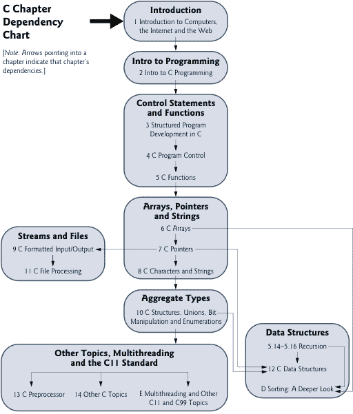

**图1 |** C语言各章依赖关系图

**语法着色。** 为便于阅读，我们对代码进行语法着色，类似于大多数 IDE 和代码编辑器给代码做语法配色的方式。我们的语法着色约定是：

```
comments appear like this in gray
keywords appear like this in dark blue
constants and literal values appear like this in light blue
all other code appears in black
```


## 性能提示

*这些提示强调让程序运行更快或尽量减少程序占用内存量的机会。*


## 可移植性提示

*这些可移植性提示帮助你编写可在多种平台上运行的代码。*


## 软件工程观察

*这些软件工程观察强调影响软件系统构建（尤其是大型系统）的架构和设计问题。*

**摘要要点。** 我们提供每章的详细逐节项目符号列表摘要，关键术语用**粗体**表示。为便于参考，大多数关键术语后面都跟有其定义出现处的页码。

**自测练习题与答案。** 包含大量自测练习题和答案，供自学使用。

**练习题。** 每章末尾都有大量练习题，包括：

- 简单回忆重要术语和概念
- 识别代码示例中的错误
- 编写单个程序语句
- 编写 C 函数（以及 C++ 成员函数和类）的小部分
- 编写完整程序
- 实现大型项目

**索引。** 我们提供了详尽的索引，当把本书作为参考书使用时尤其有帮助。关键术语的定义出现处在索引中以粗体彩色页码突出显示。

## *C语言程序设计（第8版）*中使用的软件

我们使用以下免费编译器测试了 *C语言程序设计（第8版）* 中的程序：

- GNU C 和 C++（http://gcc.gnu.org/install/binaries.html），它们已安装在大多数 Linux 系统上，也可安装在 OS X 和 Windows 系统上。
- 微软 Visual Studio 2013 Community 版中的 Visual C++，可从 http://go.microsoft.com/?linkid=9863608 下载
- Apple Xcode IDE 中的 LLVM，OS X 用户可从 Mac App Store 下载。

其他免费 C 和 C++ 编译器，请访问：

```
http://www.thefreecountry.com/compilers/cpp.shtml
http://www.compilers.net/Dir/Compilers/Cpp.htm
http://www.freebyte.com/programming/cpp/compilers
http://en.wikipedia.org/wiki/List_of_compilers#C.2B.2B_compilers
```

## 教师资源

以下补充材料*仅限合格教师*通过 Pearson Education 受密码保护的教师资源中心（www.pearsonglobaleditions.com/deitel）获取：

- *PowerPoint®幻灯片*，包含正文中的所有代码和插图，以及总结要点的项目符号条目。
- *测试题库*，包含多项选择题（大约每个书中顶级章节两道）
- *解答手册*，包含*大多数*（但不是全部）章末练习的解答。请查看教师资源中心以确定哪些练习有解答。

**请不要给我们写信**请求访问教师资源中心。访问权限仅限于使用本书授课的大学教师。教师只能通过其 Pearson 代表获得访问权限。如果你不是注册教师，请联系你的 Pearson 代表。

对于“项目”练习，*不提供*解答。请查看我们的编程项目资源中心，了解大量额外的练习和项目可能性（http://www.deitel.com/ProgrammingProjects/）。

## 致谢

我们感谢 Abbey Deitel 和 Barbara Deitel 为这个项目投入的长时间工作。Abbey 合著了第 1 章。我们很幸运能与 Pearson 敬业的出版专业团队合作。我们感谢计算机科学执行编辑 Tracy Johnson 的指导、专业见解和精力。Kelsey Loanes 和 Bob Engelhardt 分别出色地管理了评审和生产流程。

## *C语言程序设计（第8版）*审阅者

我们谨感谢审阅者们的努力。在紧迫的截止日期下，他们仔细审阅了正文和程序，并提供了无数改进呈现方式的建议：Brandon Invergo博士（GNU/欧洲生物信息研究所）、Danny Kalev（认证系统分析师、C专家、C++标准委员会前成员）、Jim Hogg（微软公司C/C++编译器团队项目经理）、José Antonio González Seco（安达卢西亚议会）、Sebnem Onsay（奥克兰大学工程与计算机科学学院特别讲师）、Alan Bunning（普渡大学）、Paul Clingan（俄亥俄州立大学）、Michael Geiger（马萨诸塞大学洛厄尔分校）、Jeonghwa Lee（希彭斯堡大学）、Susan Mengel（德克萨斯理工大学）、Judith O'Rourke（纽约州立大学奥尔巴尼分校）以及 Chen-Chih Radhord（河滨大学）。

## *其他近期版本的审阅者*

William Albrecht（南佛罗里达大学）、Ian Barland（拉德福德大学）、Ed James Beckham（Altera）、John Benito（Blue Pilot Consulting, Inc. 和 ISO WG14——负责C编程语言标准的工作组——召集人）、John F. Doyle博士（印第安纳大学东南分校）、Alireza Fazelpour（棕榈滩社区学院）、Mahesh Hariharan（微软）、Hemanth H.M.（SonicWALL软件工程师）、Kevin Mark Jones（惠普）、Lawrence Jones（UGS Corp.）、Don

Kostuch（独立顾问），Vytautas Leonavicius（Microsoft），Xiaolong Li（印第安纳州立大学），William Mike Miller（Edison Design Group, Inc.），Tom Rethard（德克萨斯大学阿灵顿分校），Robert Seacord（SEI/CERT 的安全编码经理，*CERT C 安全编码标准* 的作者以及 C 编程语言国际标准化工作组的专家），José Antonio González Seco（安达卢西亚议会），Benjamin Seyfarth（南密西西比大学），Gary Sibbitts（梅雷马克圣路易斯社区学院），William Smith（塔尔萨社区学院）和 Douglas Wells（高级员工工程师，C 编译器，Sun Microsystems——现为 Oracle 旗下）。

## 特别感谢 Brandon Invergo 和 Jim Hogg

我们很荣幸 Brandon Invergo（GNU/欧洲生物信息学研究所）和 Jim Hogg（Microsoft Corporation C/C++ 编译器团队项目经理）为全书进行了审阅。他们仔细审阅了书中关于 C 的部分，提供了许多见解和建设性意见。我们的大部分读者使用的是 GNU gcc 编译器或 Microsoft 的 Visual C++ 编译器（也可编译 C）。Brandon 和 Jim 帮助我们确保我们的内容分别对 GNU 和 Microsoft 编译器准确。他们的评论传达了我们共同拥有的对软件工程、计算机科学和教育的热爱。

好了，就这些！C 是一种功能强大的编程语言，可帮助您快速有效地编写高性能、可移植的程序。它很好地扩展到企业系统开发领域，帮助组织构建其业务关键型和任务关键型信息系统。在阅读本书时，我们真诚地希望您能提出评论、批评、更正和改进文本的建议。请将所有通信——包括问题——发送至：

deitel@deitel.com

我们会及时回复，并在以下位置发布更正和澄清：

www.deitel.com/books/chtp8/

我们希望您使用 *C 如何编程，第八版* 的体验与我们撰写它时的体验一样愉快！

*Paul Deitel*  
*Harvey Deitel*

## 关于作者

**Paul Deitel**，Deitel & Associates, Inc. 的首席执行官兼首席技术官，是麻省理工学院的毕业生，在那里他学习了信息技术。通过 Deitel & Associates, Inc.，他为包括 Cisco、IBM、Siemens、Sun Microsystems、Dell、Lucent Technologies、Fidelity、肯尼迪航天中心的 NASA、国家严重风暴实验室、白沙导弹靶场、Hospital Sisters Health System、Rogue Wave Software、Boeing、SunGard Higher Education、Stratus、Cambridge Technology Partners、One Wave、Hyperion Software、Adra Systems、Entergy、CableData Systems、Nortel Networks、Puma、iRobot、Invensys 等众多

## 计算机、互联网和网络简介


### 目标

在本章中你将学习：

- 基本计算机概念。
- 不同类型的编程语言。
- C 编程语言的历史。
- C 标准库的目的。
- 面向对象技术的基础。
- 典型的 C 程序开发环境。
- 在 Windows、Linux 和 Mac OS X 中试运行 C 应用程序。
- 互联网和万维网的一些基础知识。

### 大纲

- 1.1 引言
- 1.2 硬件和软件
  - 1.2.1 摩尔定律
  - 1.2.2 计算机组织
- 1.3 数据层次结构
- 1.4 机器语言、汇编语言和高层语言
- 1.5 C 编程语言
- 1.6 C 标准库
- 1.7 C++ 和其他基于 C 的语言
- 1.8 面向对象技术
  - 1.8.1 汽车作为对象
  - 1.8.2 方法与类
  - 1.8.3 实例化
  - 1.8.4 重用
  - 1.8.5 消息与方法调用
  - 1.8.6 属性与实例变量
  - 1.8.7 封装与信息隐藏
  - 1.8.8 继承
- 1.9 典型的 C 程序开发环境
  - 1.9.1 第 1 阶段：创建程序
  - 1.9.2 第 2 和 3 阶段：预处理和编译 C 程序
  - 1.9.3 第 4 阶段：链接
  - 1.9.4 第 5 阶段：加载
  - 1.9.5 第 6 阶段：执行
  - 1.9.6 执行时可能出现的问题
  - 1.9.7 标准输入、标准输出和标准错误流
- 1.10 在 Windows、Linux 和 Mac OS X 中试运行 C 应用程序
  - 1.10.1 从 Windows 命令提示符运行 C 应用程序
  - 1.10.2 使用 GNU C 在 Linux 中运行 C 应用程序
  - 1.10.3 在 Mac OS X 上使用终端运行 C 应用程序
- 1.11 操作系统
  - 1.11.1 Windows——专有操作系统
  - 1.11.2 Linux——开源操作系统
  - 1.11.3 苹果的 Mac OS X：苹果为 iPhone®、iPad® 和 iPod Touch® 设备提供的 iOS
  - 1.11.4 谷歌的 Android
- 1.12 互联网和万维网
  - 1.12.1 互联网：网络的网络
  - 1.12.2 万维网：让互联网更易于使用
  - 1.12.3 Web 服务
  - 1.12.4 Ajax
  - 1.12.5 物联网
- 1.13 一些关键软件技术
- 1.14 跟上信息技术的发展

自测练习 | 自测练习答案 | 练习 | 做出改变

## 1.1 引言

欢迎来到 C 和 C++！C 是一种简洁而强大的计算机编程语言，适合技术导向且编程经验少或没有编程经验的人，以及有经验的程序员用于构建大型软件系统。*C 如何编程，第八版* 是这两类读者的有效学习工具。

本书的核心强调通过 C 语言的 *结构化编程* 和 C++ 语言的 *面向对象编程* 的经过验证的方法论进行软件工程。本书展示了数百个完整的可用程序，并展示了这些程序在计算机上运行时产生的输出。我们称之为“实时代码方法”。所有这些示例程序均可从我们的网站 www.deitel.com/books/chtp8/ 下载。

大多数人熟悉计算机执行的有趣任务。使用本教材，您将学习指挥计算机执行这些任务。软件（即您编写的用于指挥计算机执行操作和做出决策的指令）控制着计算机（通常称为硬件）。

## 1.2 硬件和软件

计算机可以比人类快得多地执行计算并做出逻辑决策。今天的许多个人计算机每秒可以执行数十亿次计算——超过人类一生可以执行的计算量。*超级计算机* 已经能够每秒执行 *数千兆兆（千万亿）* 条指令！中国国防科技大学的天河-2 超级计算机每秒可执行超过 33 千万亿次计算（33.86 petaflops）！¹ 为了说明这一点，*天河-2 超级计算机在一秒钟内可为地球上的每一个人执行约 300 万次计算！* 而超级计算的“上限”正在迅速增长。

计算机在称为计算机程序的指令序列控制下处理数据。这些软件程序引导计算机执行由被称为计算机程序员的人指定的有序操作。

计算机由各种称为硬件的设备组成（例如键盘、屏幕、鼠标、硬盘、内存、DVD 驱动器和处理单元）。由于硬件和软件技术的快速发展，计算成本急剧下降。几十年前可能需要填满整个房间并花费数百万美元的计算机，现在被刻在比指甲还小的硅芯片上，每块成本可能只有几美元。具有讽刺意味的是，硅是地球上最丰富的材料之一——它是普通沙子的成分。硅芯片技术使计算如此经济，以至于计算机已成为一种商品。

### 1.2.1 摩尔定律

每年，您可能预计大多数产品和服务的费用至少会略有增加。在计算机和通信领域，尤其是与这些技术相关的硬件方面，情况恰恰相反。

许多年来，硬件成本一直在迅速下降。

每隔一年或两年，计算机的容量就会以低廉的成本大约 *翻倍*。这一显著趋势通常被称为摩尔定律，以 1960 年代首次提出该定律的人戈登·摩尔命名，他是英特尔的联合创始人——英特尔是当今计算机和嵌入式系统处理器的主要制造商。摩尔定律和 *相关* 观察结果尤其适用于计算机用于程序的内存量、它们用于在较长时间内保存程序和数据的辅助存储量（如磁盘存储），以及它们的处理器速度——它们 *执行* 程序的速度（即完成工作）。

在通信领域也出现了类似的增长——随着对通信 *带宽*（即信息承载能力）的巨大需求吸引了激烈的竞争，成本急剧下降。我们不知道还有其他哪个领域的科技进步如此迅速、成本下降如此快。如此惊人的改进确实正在推动 *信息革命。*


## 1.2.2 计算机组织

无论*物理*外观有何差异，计算机都可以被设想为划分为各种逻辑单元或部分（图1.1）。

| 逻辑单元 | 描述 |
|---|---|
| **输入单元** | 这个“接收”部分从输入设备获取信息（数据和计算机程序），并将其提供给其他单元处理。大多数用户输入通过键盘、触摸屏和鼠标设备输入计算机。其他输入形式包括接收语音命令、扫描图像和条形码、从辅助存储设备（如硬盘驱动器、DVD驱动器、蓝光光盘™驱动器和USB闪存驱动器——也称为“拇指驱动器”或“内存棒”）读取数据、从网络摄像头接收视频，以及让计算机从互联网接收信息（例如从YouTube®流式传输视频或从亚马逊下载电子书）。较新的输入形式包括GPS设备的位置数据，以及智能手机或游戏控制器（如Microsoft® Kinect® for Xbox®、Wii™ Remote和Sony® PlayStation® Move）中*加速度计*（一种响应上/下、左/右和前/后加速度的设备）提供的运动和方向信息。 |
| **输出单元** | 这个“发送”部分将计算机已处理的信息放到各种输出设备上，使其可在计算机外部使用。如今计算机输出的大多数信息显示在屏幕（包括触摸屏）上、打印在纸上（“走向绿色”不鼓励这样做）、在PC和媒体播放器（如Apple的iPod）以及体育场馆的巨幕上作为音频或视频播放、通过互联网传输，或用于控制其他设备，如机器人和“智能”家电。信息也常输出到辅助存储设备，如硬盘驱动器、DVD驱动器和USB闪存驱动器。最近流行的输出形式包括智能手机和游戏控制器的振动，以及像Oculus Rift这样的虚拟现实设备。 |
| **内存单元** | 这个快速访问、容量相对较低的“仓库”部分保留通过输入单元输入的信息，使其在需要时可立即用于处理。内存单元还保留已处理的信息，直到输出单元将其放到输出设备上。内存单元中的信息是*易失的*——当计算机关机时，这些信息通常会丢失。内存单元通常被称为内存、主存或RAM（随机存取存储器）。台式机和笔记本电脑的主内存容量可高达128 GB RAM，但最常见的是2到16 GB。GB代表吉字节；一吉字节约为十亿字节。一个字节是八位。一位是0或1。 |
| **算术与逻辑单元（ALU）** | 这个“制造”部分执行*计算*，如加、减、乘、除。它还包含允许计算机进行*判断*的机制，例如，比较内存单元中的两个项目以确定它们是否相等。在当今系统中，ALU作为下一个逻辑单元——CPU的一部分来实现。 |
| **中央处理单元（CPU）** | 这个“管理”部分协调并监督其他部分的运行。CPU告诉输入单元何时应将信息读入内存单元，告诉ALU何时应将内存单元中的信息用于计算，并告诉输出单元何时应将信息从内存单元发送到某些输出设备。当今许多计算机有多个CPU，因此可以同时执行许多操作。多核处理器在单个集成电路芯片上实现多个处理器——*双核处理器*有两个CPU，*四核处理器*有四个CPU。当今的台式电脑拥有每秒可执行数十亿条指令的处理器。 |
| **辅助存储单元** | 这是长期、大容量的“仓储”部分。其他单元当前未积极使用的程序或数据通常放置在辅助存储设备（例如，你的*硬盘驱动器*）上，直到再次需要它们，可能是几小时、几天、几个月甚至几年之后。辅助存储设备上的信息是*持久性的*——即使计算机关机，它也会保留。访问辅助存储信息所需的时间比访问主存信息长得多，但每单位的成本却低得多。辅助存储设备的示例包括硬盘驱动器、DVD驱动器和USB闪存驱动器，其中一些可存储超过2 TB（TB代表太字节；一太字节约为一万亿字节）。台式机和笔记本电脑上的典型硬盘驱动器容量高达2 TB，一些台式机硬盘容量可达6 TB。 |

**图1.1** | 计算机的逻辑单元。

## 1.3 数据层次结构

计算机处理的数据项构成一个**数据层次结构**，随着我们从最简单的数据项（称为“位”）到更丰富的数据项（如字符和字段），其结构变得越来越大、越来越复杂。图1.2展示了数据层次结构的一部分。

### 位

计算机中最小的数据项可以取值0或1。它被称为位（“二进制数字”的简称——可以取两个值之一的数字）。令人惊讶的是，计算机所执行的令人印象深刻的功能仅涉及对0和1的最简单操作——*检查位的值、设置位的值*和*反转位的值*（从1到0或从0到1）。

### 字符

人们以位的低级形式处理数据是乏味的。相反，他们更倾向于使用*十进制数字*（0–9）、*字母*（A–Z和a–z）和*特殊符号*（例如$、@、%、&、*、(、)、−、+、"、:、?和/）。数字、字母和特殊符号被称为**字符**。计算机的字符集是用于编写程序和表示数据项的所有字符的集合。计算机只处理1和0，因此计算机的字符集将每个字符表示为1和0的模式。C支持各种字符集（包括Unicode®），这些字符集由包含一、二或四字节（8、16或32位）的字符组成。Unicode包含世界上许多语言的字符。有关ASCII（美国信息交换标准代码）字符集的更多信息，请参见附录B——ASCII是Unicode的流行子集，表示大小写字母、数字和一些常见特殊字符。

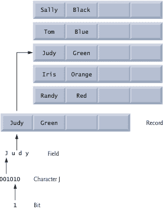

**图1.2** | 数据层次结构。

### 字段

正如字符由位组成，字段由字符或字节组成。字段是一组有意义的字符或字节。例如，一个由大小写字母组成的字段可以表示一个人的姓名，一个由十进制数字组成的字段可以表示一个人的年龄。

### 记录

几个相关字段可以组成一条记录。例如，在工资系统中，某位员工的记录可能包含以下字段（这些字段可能的类型在括号中显示）：

- 员工标识号（整数）
- 姓名（字符串）
- 地址（字符串）
- 时薪（带小数点的数字）
- 年初至今的收入（带小数点的数字）
- 预扣税款金额（带小数点的数字）

因此，记录是一组相关字段。在前面的示例中，所有字段属于同一位员工。一家公司可能有许多员工，并且每位员工都有一条工资记录。

### 文件

文件是一组相关记录。[*注：*更一般地，文件以任意格式包含任意数据。在某些操作系统中，文件仅被视为字节序列——文件中字节的任何组织方式，例如将数据组织成记录，都是应用程序程序员创建的一种视图。]一个组织拥有许多文件并不罕见，有些文件包含数十亿甚至数万亿字符的信息。

### 数据库

数据库是为便于访问和操作而组织的数据集合。最流行的模型是*关系数据库*，其中数据存储在简单的*表*中。表包含*记录*和*字段*。例如，学生表可能包含名字、姓氏、专业、年级、学生ID号和平均绩点字段。每位学生的数据是一条记录，每条记录中的各个信息片段是字段。你可以根据数据与多个表或数据库的关系对其进行*搜索、排序*和其他操作。例如，大学可能会将学生数据库中的数据与课程、校内住宿、膳食计划等数据库中的数据结合使用。

### 大数据

全球产生的数据量巨大且增长迅速。据IBM称，每天约有2.5万亿亿字节（2.5 *艾字节*）的数据被创建，并且世界上90%的数据是在过去两年中创建的。根据IDC的一项研究，到2020年，全球数据供应量将达到每年40 *泽字节*（相当于40万亿吉字节）。图1.3显示了一些常见的字节度量。大数据应用处理海量数据，这一领域正在快速增长，为软件开发人员创造了大量机会。根据Gartner Group的一项研究，到2015年，全球将有超过400万个IT工作岗位支持大数据。

| 单位 | 字节 | 近似值 |
|---|---|---|
| 1千字节（KB） | 1024字节 | 10³（恰好1024字节） |
| 1兆字节（MB） | 1024千字节 | 10⁶（1,000,000字节） |
| 1吉字节（GB） | 1024兆字节 | 10⁹（1,000,000,000字节） |
| 1太字节（TB） | 1024吉字节 | 10¹²（1,000,000,000,000字节） |
| 1拍字节（PB） | 1024太字节 | 10¹⁵（1,000,000,000,000,000字节） |
| 1艾字节（EB） | 1024拍字节 | 10¹⁸（1,000,000,000,000,000,000字节） |
| 1泽字节（ZB） | 1024艾字节 | 10²¹（1,000,000,000,000,000,000,000字节） |

**图1.3** | 字节度量。

- 2. http://www.ibm.com/smarterplanet/us/en/business_analytics/article/it_business_intelligence.html
- 3. http://recode.net/2014/01/10/stuffed-why-data-storage-is-hot-again-really/.
- 4. http://tech.fortune.cnn.com/2013/09/04/big-data-employment-boom/.


从程序员的角度来看，高级语言比机器语言和汇编语言更可取。C 是使用最广泛的高级编程语言之一。

### 解释器

将大型高级语言程序编译为机器语言可能耗费大量计算机时间。**解释器**程序旨在直接执行高级语言程序，避免了编译延迟，尽管它们比编译后的程序运行得慢。

## 1.5 C 编程语言

C 源自之前的两种语言：BCPL 和 B。BCPL 由 Martin Richards 于 1967 年开发，是一种用于编写操作系统和编译器的语言。Ken Thompson 在其 B 语言中仿照 BCPL 中的对应特性设计了许多特性，并于 1970 年在贝尔实验室使用 B 创建了 UNIX 操作系统的早期版本。

C 语言由贝尔实验室的 Dennis Ritchie 从 B 演变而来，最初于 1972 年实现。C 最初作为 UNIX 操作系统的开发语言而广为人知。当今许多主流操作系统都是用 C 和/或 C++ 编写的。C 在很大程度上与硬件无关——通过精心设计，可以编写出可移植到大多数计算机的 C 程序。

### 为性能而构建

C 被广泛用于开发对性能有要求的系统，例如操作系统、嵌入式系统、实时系统和通信系统（图1.4）。

| 应用 | 描述 |
|---|---|
| 操作系统 | C 的可移植性和性能使其适合实现操作系统，例如 Linux 以及微软 Windows 和谷歌 Android 的部分内容。苹果的 OS X 使用 Objective-C 构建，而 Objective-C 派生自 C。我们将在 1.11 节讨论一些主流的桌面/笔记本电脑操作系统和移动操作系统。 |
| 嵌入式系统 | 每年生产的绝大多数微处理器都嵌入在通用计算机以外的设备中。这些嵌入式系统包括导航系统、智能家电、家庭安全系统、智能手机、平板电脑、机器人、智能交通路口等。C 是开发嵌入式系统最流行的编程语言之一，嵌入式系统通常需要尽可能快地运行并节省内存。例如，汽车的防抱死制动系统必须立即响应，以使汽车减速或停车而不打滑；用于视频游戏的游戏控制器应即时响应，以防止控制器与游戏中的动作之间出现任何延迟，并确保动画流畅。 |

图 1.4 | 一些流行的面向性能的 C 应用。（第 1 部分，共 2 部分。）

| 应用 | 描述 |
|---|---|
| 实时系统 | 实时系统常用于“任务关键型”应用，这类应用需要近乎即时且可预测的响应时间。实时系统需要持续工作——例如，空中交通管制系统必须不断监视飞机的位置和速度，并将这些信息及时报告给空中交通管制员，以便在可能发生碰撞时提醒飞机改变航向。 |
| 通信系统 | 通信系统需要快速将大量数据路由到目的地，以确保音频和视频等内容顺畅且无延迟地传输。 |

**图 1.4** | 一些流行的面向性能的 C 应用。（第 2 部分，共 2 部分。）

到20世纪70年代末，C 已演变为现在所称的“传统 C”。1978 年，Kernighan 和 Ritchie 的书 *《C程序设计语言》* 出版，引起了人们对这门语言的广泛关注。这本书成为有史以来最成功的计算机科学书籍之一。

### 标准化

C 在各种类型的计算机（有时称为硬件平台）上迅速扩展，导致出现了许多相似但往往不兼容的变体。对于需要开发能在多个平台上运行的代码的程序员来说，这是一个严重问题。显然，需要一个标准版本的 C。1983 年，在美国国家标准计算机与信息处理委员会（X3）下成立了 X3J11 技术委员会，以“提供该语言明确且与机器无关的定义”。1989 年，该标准在美国通过美国国家标准学会（ANSI）批准为 ANSI X3.159-1989，随后通过国际标准化组织（ISO）成为世界性标准。我们将其简称为标准 C。该标准于 1999 年更新——其标准文件称为 INCITS/ISO/IEC 9899-1999，通常简称为 C99。副本可从美国国家标准学会（www.ansi.org）订购，网址为 webstore.ansi.org/ansidocstore。

### C11 标准

我们还将讨论最新的 C 标准（称为 C11），它于 2011 年获批。C11 完善并扩展了 C 的能力。我们已将主流 C 编译器中实现的许多新特性整合到正文和附录 E（以易于包含或省略的章节形式）中。

> **可移植性提示 1.1**
>
> 因为 C 是一种与硬件无关、广泛可用的语言，所以用 C 编写的应用通常只需很少修改或无需修改即可在多种计算机系统上运行。

## 1.6 C标准库

正如你将在第5章学到的，C 程序由称为函数的片段组成。你可以编写组成 C 程序所需的所有函数，但大多数 C 程序员会利用称为 C 标准库的丰富现有函数集合。因此，学习用 C 编程实际上分为两部分——学习 C 语言本身，以及学习如何使用 C 标准库中的函数。在本书中，我们讨论了许多这类函数。P. J. Plauger 的书 *《标准C库》* 对于需要深入理解库函数、如何实现这些函数以及如何使用它们编写可移植代码的程序员来说是必读之作。我们在本书中贯穿使用并解释了许多 C 库函数。

*《C语言程序设计（第8版）》* 鼓励采用 *积木式方法* 创建程序。避免“重新发明轮子”。相反，应使用现有组件——这称为 *软件复用*。用 C 编程时，你通常会使用以下构建块：

- C 标准库函数
- 你自己创建的函数
- 其他人（你信任的人）创建并提供给你的函数

创建自己的函数的优点是，你会确切知道它们如何工作。你将能够检查 C 代码。缺点在于设计、开发、调试和性能调优新函数需要耗费时间。

> **性能提示 1.1**
>
> *使用 C 标准库函数而不是编写自己的版本可以提高程序性能，因为这些函数经过精心编写以高效执行。*

> **可移植性提示 1.2**
>
> *使用 C 标准库函数而不是编写自己的同类版本可以提高程序可移植性，因为这些函数几乎用于所有标准 C 实现中。*

## 1.7 C++ 和其他基于 C 的语言

C++ 由贝尔实验室的 Bjarne Stroustrup 开发。它植根于 C，提供了许多“改进”C 语言的功能。更重要的是，它提供了面向对象编程的能力。对象本质上是可复用的软件组件，用于对现实世界中的事物建模。采用模块化、面向对象的设计与实现方法可以提高软件开发团队的生产效率。第15～23章呈现了选自我们的书 *《C++程序设计》* 的 C++ 精简讲解。图1.5 介绍了几种其他流行的基于 C 的编程语言。

| 编程语言 | 描述 |
|---|---|
| Objective-C | Objective-C 是一种基于 C 的面向对象语言。它于20世纪80年代初开发，后来被 NeXT 收购，而 NeXT 又被苹果收购。它已成为 OS X 操作系统和所有 iOS 设备（如 iPod、iPhone 和 iPad）的关键编程语言。 |

**图 1.5** | 流行的基于 C 的编程语言。（第 1 部分，共 2 部分。）


| 编程语言 | 描述 |
|---|---|
| Java | Sun Microsystems 在 1991 年资助了一个内部企业研究项目，该项目产生了名为 Java 的基于 C++ 的面向对象编程语言。Java 的一个关键目标是使程序能够在各种计算机系统和计算机控制设备上运行。这有时被称为“一次编写，到处运行”。Java 用于开发大规模企业应用程序、增强 Web 服务器（提供我们在 Web 浏览器中看到的内容的计算机）的功能、为消费设备（智能手机、电视机顶盒等）提供应用程序以及许多其他用途。Java 也是 Android 应用开发的语言。 |
| C# | Microsoft 的三大主要面向对象编程语言是 Visual Basic（基于原始 Basic）、Visual C++（基于 C++）和 Visual C#（基于 C++ 和 Java，并为将互联网和网络集成到计算机应用程序中而开发）。非 Microsoft 版本的 C# 也可获得。 |
| PHP | PHP 是一种面向对象、开源的脚本语言，由用户和开发者社区支持，被数百万网站使用。PHP 与平台无关——所有主要 UNIX、Linux、Mac 和 Windows 操作系统都存在实现。PHP 还支持许多数据库，包括流行的开源 MySQL。 |
| Python | Python 是一种另一种面向对象的脚本语言，于 1991 年公开发布。由阿姆斯特丹数学与计算机科学国家研究学院（CWI）的 Guido van Rossum 开发，Python 大量借鉴了 Modula-3——一种系统编程语言。Python 是“可扩展的”——它可以通过类和编程接口进行扩展。 |
| JavaScript | JavaScript 是使用最广泛的脚本语言。它主要用于为网页添加动态行为——例如动画和与用户的交互性改进。它随所有主要 Web 浏览器提供。 |
| Swift | Swift 是 Apple 用于开发 iOS 和 Mac 应用的新编程语言，于 2014 年 6 月在 Apple 全球开发者大会（WWDC）上宣布。尽管应用仍可使用 Objective-C 开发和维护，但 Swift 是 Apple 未来的应用开发语言。它是一种现代语言，消除了 Objective-C 的一些复杂性，使初学者以及从其他高级语言（如 Java、C#、C++ 和 C）转换过来的开发者更容易使用。Swift 强调性能和安全性，并可完全访问 iOS 和 Mac 编程功能。 |

**图 1.5** \| 流行的基于 C 的编程语言。（第 2 部分，共 2 部分。）

## 1.8 对象技术

本节面向将在本书后半部分学习 C++ 的读者。在对新软件和更强大的软件需求激增的时代，快速、正确且经济地构建软件仍然是一个难以捉摸的目标。对象，或更准确地说对象所属的类，本质上是可重用的软件组件。有日期对象、时间对象、音频对象、视频对象、汽车对象、人员对象等。几乎任何名词都可以合理地表示为软件对象，以属性（例如名称、颜色和大小）和 *行为*（例如计算、移动和通信）来表示。软件开发人员发现，使用模块化、面向对象的设计和实现方法可以使软件开发团队比使用早期技术时更具生产力——面向对象的程序通常更容易理解、纠正和修改。

### 1.8.1 汽车作为对象

为了帮助你理解对象及其内容，让我们从一个简单的类比开始。假设你想 *驾驶一辆汽车* 并通过踩下油门踏板使其加速。在此之前必须发生什么呢？好吧，在你能驾驶汽车之前，有人必须 *设计* 它。汽车通常始于工程图纸，类似于描述房屋设计的 *蓝图*。这些图纸包括油门踏板的设计。踏板 *隐藏* 了使汽车加速的复杂机制，驾驶员看不到这些机制，就像刹车踏板“隐藏”了使汽车减速的机制，方向盘“隐藏”了使汽车转弯的机制一样。这些机制被隐藏起来，几乎不需要了解发动机、制动和转向机制如何工作才能轻松驾驶汽车。

就像你不能在蓝图的厨房里做饭一样，你也不能驾驶汽车的工程图纸。在你能驾驶汽车之前，它必须根据描述它的工程图纸 *建造* 出来。一辆完工的汽车有一个 *实际的* 油门踏板来使其加速，但这还不够——汽车不会自行加速（希望如此！），因此驾驶员必须 *踩下* 踏板来加速汽车。

### 1.8.2 方法和类

让我们用汽车示例来介绍一些关键的面向对象编程概念。在程序中执行任务需要一个方法。方法包含实际执行其任务的程序语句。它将这些语句隐藏在其用户之外，就像汽车的油门踏板将使汽车加速的机制隐藏在驾驶员之外一样。在面向对象编程语言中，我们创建一个称为类的程序单元来容纳执行类任务的一组方法。例如，表示银行账户的类可能包含一个用于向账户 *存款* 的方法，一个用于从账户 *取款* 的方法，以及一个用于 *查询* 账户当前余额的第三个方法。类在概念上类似于汽车的工程图纸，其中包含油门踏板、方向盘等的设计。

### 1.8.3 实例化

就像有人必须根据工程图纸 *建造一辆汽车* 才能真正驾驶汽车一样，你必须在程序能够执行类的方法定义的任务之前 *构建一个类* 的 *对象*。这样做的过程称为 *实例化*。然后对象被称为其类的实例。

### 1.8.4 重用

就像汽车的工程图纸可以被 *重复使用* 多次来建造许多汽车一样，你可以多次 *重复使用* 一个类来构建许多对象。在构建新类和程序时重复使用现有类可以节省时间和精力。重复使用还有助于你构建更可靠的

## 1.9 典型的 C 程序开发环境

C 系统通常由几个部分组成：程序开发环境、语言和 C 标准库。以下讨论解释了图 1.6 所示的典型 C 开发环境。

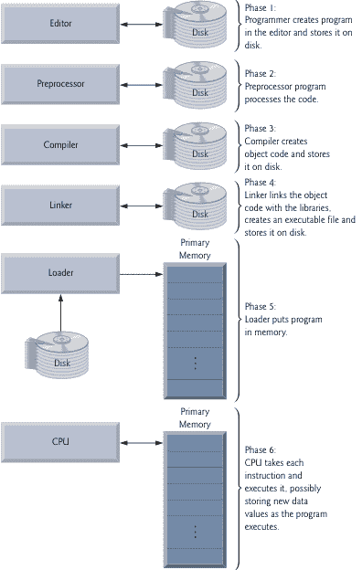

**图 1.6** 典型的 C 开发环境。

the appropriate case.] 如果程序编译和链接正确，则会生成一个名为 `a.out`（默认）的文件。这是我们的 `welcome.c` 程序的可执行映像。

### 1.9.4 第 5 阶段：加载

下一个阶段称为 *加载*。在程序可以执行之前，程序必须首先被放置在内存中。这是由 **装载器** 完成的，它从磁盘获取可执行映像并将其传输到内存。支持程序的共享库中的附加组件也会被加载。

### 1.9.5 第 6 阶段：执行

最后，计算机在 CPU 的控制下一次执行一条指令。要在 Linux 系统上加载和执行程序，请在 Linux 提示符下键入 `./a.out` 并按 Enter。

### 1.9.6 执行时可能出现的问题

程序并不总是第一次就能正常工作。前述每个阶段都可能因各种错误而失败，我们将讨论这些错误。例如，正在执行的程序可能尝试除以零（在计算机上就像在算术中一样是非法的操作）。这会导致计算机显示错误消息。然后你将返回编辑阶段，做出必要的更正并再次进行剩余阶段，以确定更正是否正常工作。


> **常见编程错误 1.1**
>
> *诸如除以零之类的错误在程序运行时发生，因此它们被称为运行时错误或执行时错误。除以零通常是致命错误，即导致程序立即终止而无法成功完成其工作。非致命错误允许程序运行完成，通常会产生不正确的结果。*

### 1.9.7 标准输入、标准输出和标准错误流

大多数 C 程序输入和/或输出数据。某些 C 函数从 `stdin`（标准输入流）获取输入，通常是键盘，但 stdin 可以重定向到另一个流。数据通常输出到 `stdout`（标准输出流），通常是计算机屏幕，但 stdout 也可以重定向到另一个流。当我们说程序打印结果时，我们通常是指结果显示在屏幕上。数据可以输出到磁盘和打印机等设备。还有一个称为 `stderr` 的标准错误流。stderr 流（通常连接到屏幕）用于显示错误消息。常见的做法是将常规输出数据，即 stdout，路由到除屏幕之外的设备，同时保持 stderr 分配给屏幕，以便用户能够立即获知错误。

## 1.10 在 Windows、Linux 和 Mac OS X 中试用 C 应用程序

在本节中，你将运行并与你的第一个 C 应用程序交互。你将从运行一个猜数字游戏开始，该游戏随机从 1 到 1000 中挑选一个数字并

提示你猜这个数。如果你的猜测正确，游戏结束。如果你的猜测不正确，应用程序会指出它比正确数字更高还是更低。猜测次数没有限制，但你应该能在 10 次或更少次数内正确猜出此范围内的任意数字。这个游戏背后有一些有趣的计算机科学——在第 6.10 节“搜索数组”中，你将探索*二分查找*技术。

仅用于本次试运行，我们修改了这个应用程序，它源自第 5 章要求你创建的练习。通常，这个应用程序会*随机地*选择正确答案。修改后的应用程序每次执行程序时都使用相同的正确答案序列（不过具体序列可能因编译器而异），因此你可以使用我们在本节中使用的相同猜测，并看到相同的结果。

我们将演示如何运行一个 C 应用程序：在 Windows 中使用命令提示符，在 Linux 中使用 *shell*，在 Mac OS X 中使用 *终端* 窗口。该应用程序在三个平台上的运行方式类似。完成你所在平台的试运行后，你可以尝试该游戏的 *randomized_version* 版本，我们已在每个试运行版本的示例中，将其放在名为 *randomized_version* 的子文件夹里。

有许多可用的开发环境，你可以在其中编译、构建和运行 C 应用程序，例如 GNU C、Dev C++、Microsoft Visual C++、CodeLite、NetBeans、Eclipse、Xcode 等。有关你特定开发环境的信息，请咨询你的教师。大多数 C++ 开发环境都可以编译 C 和 C++ 程序。

在以下步骤中，你将运行该应用程序并输入各种数字来猜正确数字。你在此应用程序中看到的元素和功能，是本书中你将学习编程的典型元素和功能。我们使用字体来区分屏幕上看到的功能（例如，**命令提示符**）和与屏幕不直接相关的元素。我们使用半粗体无衬线 Helvetica 字体来强调屏幕功能，如标题和菜单（例如，**文件菜单**），并使用无衬线 Lucida 字体来强调文件名、应用程序显示的文本以及你应输入到应用程序中的值（例如，GuessNumber 或 500）。正如你所注意到的，每个关键术语的定义性出现都设置为粗体蓝色字体。

对于本节中 Windows 版本的试运行，我们修改了 **命令提示符** 窗口的背景颜色，使 **命令提示符** 窗口更易阅读。要修改你系统上的 **命令提示符** 颜色，请通过选择“开始”>“所有程序”>“附件”>“命令提示符”打开一个 **命令提示符**，然后右键单击标题栏并选择 **属性**。在出现的“命令提示符”属性对话框中，单击 **颜色** 选项卡，然后选择你喜欢的文本和背景颜色。

### 1.10.1 从 Windows 命令提示符运行 C 应用程序

- **1. 检查你的设置。** 请务必阅读 www.deitel.com/books/cpphtp8/ 上的“开始之前”部分，以确保你已将本书的示例正确复制到硬盘。
- **2. 找到已完成的应用程序。** 打开一个命令提示符窗口。要切换到已完成的 GuessNumber 应用程序所在目录，请键入 `cd C:\examples\ch01\GuessNumber\Windows`，然后按 *Enter*（图 1.7）。命令 `cd` 用于更改目录。

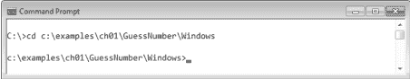

**图 1.7** | 打开命令提示符窗口并更改目录。

- **3. 运行 GuessNumber 应用程序。** 现在你已位于包含 GuessNumber 应用程序的目录中，请键入命令 GuessNumber（图 1.8）并按 *Enter*。*[注意：GuessNumber.exe 是应用程序的实际名称；不过，Windows 默认假定 .exe 扩展名。]*

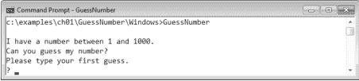

**图 1.8** | 运行 GuessNumber 应用程序。

- **4. 输入你的第一次猜测。** 应用程序显示“请输入你的第一次猜测。”，然后在下一行显示一个问号（?）作为提示（图 1.8）。在提示符处，输入 500（图 1.9）。

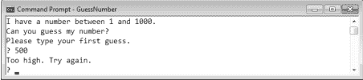

**图 1.9** | 输入你的第一次猜测。

- **5. 输入另一次猜测。** 应用程序显示“太高了。再试一次。”，这意味着你输入的值大于应用程序选作正确猜测的数字。因此，你应在下次猜测时输入一个更小的数字。在提示符处，输入 250（图 1.10）。应用程序再次显示“太高了。再试一次。”，因为你输入的值仍然大于应用程序所选的数字。

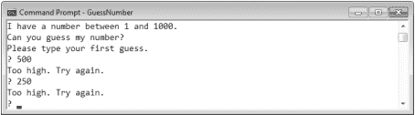

**图 1.10** | 输入第二次猜测并接收反馈。

- **6. 输入更多猜测。** 继续通过输入值来玩游戏，直到你猜出正确数字。应用程序将显示“太好了！你猜中了这个数字！”（图 1.11）。

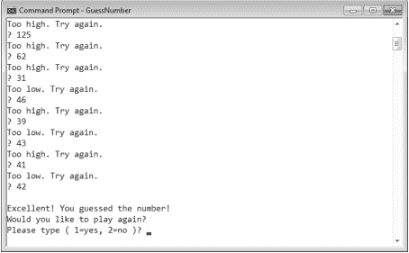

**图 1.11** | 输入更多猜测并猜出正确数字。

- **7. 再次玩游戏或退出应用程序。** 在你正确猜出后，应用程序会询问你是否想再玩一局（图 1.11）。在提示符处，输入 1 会使应用程序选择一个新数字，并显示消息“请输入你的第一次猜测。”，随后是一个问号提示（图 1.12），这样你就可以在新游戏中进行第一次猜测。输入 2 会结束应用程序，并让你返回到命令提示符处的应用程序目录（图 1.13）。每次从头执行此应用程序（即 *第 3 步*）时，它都会选择相同的数字供你猜测。
- **8. 关闭命令提示符窗口。**

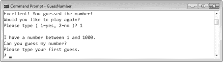

**图 1.12** | 再次玩游戏。

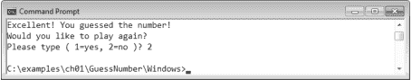

**图 1.13** | 退出游戏。

### 1.10.2 在 Linux 中使用 GNU C 运行 C 应用程序

对于本节中的图，我们使用粗体字体指出每个步骤所需的用户输入。在本次试运行中，我们假设你知道如何将示例复制到你的主目录。如果你对将文件复制到 Linux 系统有任何疑问，请咨询你的教师。此外，对于本节中的图，我们使用粗体字体指出每个步骤所需的用户输入。我们系统上 shell 中的提示符使用波浪号（~）字符表示主目录，每个提示符以美元符号（$）字符结尾。不同 Linux 系统上的提示符会有所不同。

- **1. 检查你的设置。** 请务必阅读 www.deitel.com/books/chtp8/ 上的“开始之前”部分，以确保你已将本书的示例正确复制到硬盘。
- **2. 找到已完成的应用程序。** 在 Linux shell 中，通过键入以下内容切换到已完成的 GuessNumber 应用程序目录（图 1.14）

```text
~$ cd examples/ch01/GuessNumber/GNU
~/examples/ch01/GuessNumber/GNU$
```

然后按 *Enter*。命令 `cd` 用于更改目录。

**图 1.14** | 切换到 **GuessNumber** 应用程序的目录。

- **3. 编译 GuessNumber 应用程序。** 要在 GNU C++ 编译器上运行应用程序，你必须先通过键入 `gcc GuessNumber.c -o GuessNumber` 来编译它，如图 1.15 所示。此命令编译该应用程序。-o 选项后面跟着你希望可执行文件具有的名称——GuessNumber。

```shell
~/examples/ch01/GuessNumber/GNU$ gcc -std=c11 GuessNumber.c -o GuessNumber
~/examples/ch01/GuessNumber/GNU$
```

**图 1.15** | 使用 gcc 命令编译 GuessNumber 应用程序。

- **4. 运行 GuessNumber 应用程序。** 要运行可执行文件 GuessNumber，请在下一个提示符处键入 `./GuessNumber`，然后按 *Enter*（图 1.16）。

```shell
~/examples/ch01/GuessNumber/GNU$ ./GuessNumber

I have a number between 1 and 1000.
Can you guess my number?
Please type your first guess.
?
```

**图 1.16** | 运行 GuessNumber 应用程序。

- **5. 输入你的第一次猜测。** 应用程序显示“请输入你的第一次猜测。”，然后在下一行显示一个问号（?）作为提示（图 1.16）。在提示符处，输入 500（图 1.17）。

```shell
~/examples/ch01/GuessNumber/GNU$ ./GuessNumber

I have a number between 1 and 1000.
Can you guess my number?
Please type your first guess.
? 500
Too high. Try again.
?
```

**图 1.17** | 输入初始猜测。

- **6. 输入另一次猜测。** 应用程序显示“太高了。再试一次。”，这意味着你输入的值大于应用程序选作正确猜测的数字（图 1.17）。在下一个提示符处，输入 250（图 1.18）。这次应用程序显示“太低了。再试一次。”，因为你输入的值小于正确猜测。


```text
~/examples/ch01/GuessNumber/GNU$ ./GuessNumber

I have a number between 1 and 1000.
Can you guess my number?
Please type your first guess.
? 500
Too high. Try again.
? 250
Too low. Try again.
?
```

图 1.18 | 输入第二次猜测并接收反馈。

- 7. *输入更多猜测。* 继续通过输入数值来玩这个游戏（图 1.19），直到你猜中正确的数字。当你猜对时，应用程序会显示“太棒了！你猜中了这个数字！”

```text
Too low. Try again.
? 375
Too low. Try again.
? 437
Too high. Try again.
? 406
Too high. Try again.
? 391
Too high. Try again.
? 383
Too low. Try again.
? 387
Too high. Try again.
? 385
Too high. Try again.
? 384

Excellent! You guessed the number!
Would you like to play again?
Please type ( 1=yes, 2=no )?
```

图 1.19 | 输入更多猜测并猜中正确数字。

- 8. *再次玩游戏或退出应用程序。* 在你猜中正确数字后，应用程序会询问你是否想再玩一局。在提示符处输入 1，会使应用程序选择一个新的数字，并显示消息“请输入你的第一次猜测。”，随后是一个问号提示符（图 1.20），以便你在新游戏中做出第一次猜测。输入 2 会结束应用程序，并让你返回到 shell 中该应用程序的目录（图 1.21）。每次你从头开始执行此应用程序（即第 4 步）时，它都会选择相同的数字供你猜测。

```text
Excellent! You guessed the number!
Would you like to play again?
Please type ( 1=yes, 2=no )? 1

I have a number between 1 and 1000.
Can you guess my number?
Please type your first guess.
?
```

**图 1.20** | 再次玩该游戏。

```text
Excellent! You guessed the number!
Would you like to play again?
Please type ( 1=yes, 2=no )? 2

~/examples/ch01/GuessNumber/GNU$
```

**图 1.21** | 退出游戏。

### 1.10.3 在 Mac OS X 上使用终端运行 C 应用程序

对于本节中的各图，我们使用**粗体**指出每一步所需的用户输入。你将使用 Mac OS X 的**终端**窗口进行试运行。要打开**终端**窗口，请点击屏幕右上角的 Spotlight 搜索图标，然后输入 Terminal 来定位“终端”应用程序。在 Spotlight 搜索结果中的“应用程序”下，选择**终端**以打开一个终端窗口。终端窗口中的提示符形式为 *hostName:~ userFolder$*，用于表示你的用户目录。对于本节中的各图，我们移除了 *hostName:* 部分，并使用通用名称 *userFolder* 来表示你的用户账户文件夹。

- 1. *检查你的设置。* 请务必阅读 www.deitel.com/books/chtp8/ 上的“Before You Begin”部分，以确保你已将书中的示例正确复制到硬盘上。我们假设这些示例位于你用户账户的 Documents/examples 文件夹中。
- 2. *定位已完成的应用程序。* 在终端窗口中，通过输入
  `cd Documents/examples/ch01/GuessNumber/GNU`
  然后按 Enter，切换到已完成的 GuessNumber 应用程序目录（图 1.22）。命令 cd 用于更改目录。

```text
hostName:~ userFolder$ cd Documents/examples/ch01/GuessNumber/GNU
hostName:GNU$
```

**图 1.22** | 切换到 GuessNumber 应用程序的目录。

- 3. *编译 GuessNumber 应用程序。* 要运行应用程序，你必须先通过输入
  `clang GuessNumber.c -o GuessNumber`
  来编译它，如图 1.23 所示。该命令会编译应用程序并生成一个名为 GuessNumber 的可执行文件。

```text
hostName:GNU$ clang GuessNumber.c -o GuessNumber
hostName:GNU$
```

**图 1.23** | 使用 clang 命令编译 GuessNumber 应用程序。

- 4. *运行 GuessNumber 应用程序。* 要运行可执行文件 GuessNumber，请在下一个提示符处输入 `./GuessNumber`，然后按 *Enter*（图 1.24）。

```text
hostName:GNU$ ./GuessNumber

I have a number between 1 and 1000.
Can you guess my number?
Please type your first guess.
?
```

**图 1.24** | 运行 GuessNumber 应用程序。

- 5. *输入你的第一次猜测。* 应用程序会显示“请输入你的第一次猜测。”，然后在下一行显示一个问号（`?`）作为提示符（图 1.24）。在提示符处输入 500（图 1.25）。

```text
hostName:GNU$ ./GuessNumber

I have a number between 1 and 1000.
Can you guess my number?
Please type your first guess.
? 500
Too low. Try again.
?
```

**图 1.25** | 输入初始猜测。

- 6. *输入另一次猜测。* 应用程序会显示“太低了。再试一次。”（图 1.25），这意味着你输入的值小于应用程序所选为正确猜测的数字。在下一个提示符处，输入 750（图 1.26）。应用程序再次显示“太低了。再试一次。”，因为你输入的值小于正确猜测值。
- 7. *输入更多猜测。* 继续通过输入数值来玩这个游戏（图 1.27），直到你猜中正确的数字。当你猜对时，应用程序会显示“太棒了！你猜中了这个数字！”

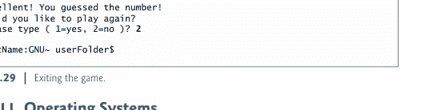

**图 1.29** | 退出游戏。

## 1.11 操作系统

操作系统是使计算机对用户、应用程序开发人员和系统管理员来说更加方便的软件系统。它们提供的服务允许每个应用程序安全、高效地与其他应用程序并发（即并行）执行。包含操作系统核心组件的软件是内核。流行的桌面操作系统包括 Linux、Windows 和 Mac OS X。智能手机和平板电脑中使用的流行移动操作系统包括 Google 的 Android、Apple 的 iOS（用于其 iPhone、iPad 和 iPod Touch 设备）、Windows Phone 和 BlackBerry OS。

### 1.11.1 Windows——专有操作系统

20 世纪 80 年代中期，Microsoft 开发了 Windows 操作系统，它由构建在 DOS 之上的图形用户界面组成——DOS 是一种极其流行的个人计算机操作系统，用户通过输入命令与其交互。Windows 借鉴了许多由早期 Apple Macintosh 操作系统普及、最初由 Xerox PARC 开发的概念（如图标、菜单和窗口）。Windows 8.1 是 Microsoft 最新的操作系统——其功能包括支持 PC 和平板电脑、基于磁贴的用户界面、安全增强、触摸屏和多点触控支持等。Windows 是专有操作系统——它完全由 Microsoft 控制。它是迄今为止世界上使用最广泛的操作系统。

### 1.11.2 Linux——开源操作系统

Linux 操作系统——它在服务器、个人计算机和嵌入式系统中很流行——也许是开源运动最伟大的成功。开源软件开发方式不同于专有开发方式（例如，Microsoft 的 Windows 和 Apple 的 Mac OS X 所采用的方式）。在开源开发中，个人和公司——通常遍布世界各地——贡献他们的力量来开发、维护和演进软件。任何人都可以出于自己的目的使用和定制它，通常免费。

开源社区中的一些组织包括 Eclipse 基金会（Eclipse 集成开发环境帮助程序员方便地开发软件）、Mozilla 基金会（Firefox Web 浏览器的创建者）、Apache 软件基金会（Apache Web 服务器的创建者，该服务器响应 Web 浏览器请求，通过 Internet 提供网页）以及 GitHub 和 SourceForge（它们提供管理开源项目的工具）。

计算和通信的快速改进、成本的降低以及开源软件，使得创建基于软件的商……

如今的企业比几十年前多得多。

Facebook 是在大学宿舍里创立的，使用开源软件构建。5

各种问题——例如 Microsoft 的市场力量、相对较少的用户友好型 Linux 应用程序以及 Linux 发行版的多样性（Red Hat Linux、Ubuntu Linux 和许多其他发行版）——阻碍了 Linux 在台式计算机上的广泛使用。但 Linux 在服务器和嵌入式系统（例如 Google 基于 Android 的智能手机）中已变得极其流行。

### 1.11.3 Apple 的 Mac OS X；用于 iPhone®、iPad® 和 iPod Touch® 设备的 Apple iOS

Apple 由史蒂夫·乔布斯和史蒂夫·沃兹尼亚克于 1976 年创立，迅速成为个人计算领域的领导者。1979 年，乔布斯和几名 Apple 员工参观了施乐 PARC（帕洛阿尔托研究中心），以了解施乐推出的具有图形用户界面（GUI）的台式计算机。该 GUI 为 Apple Macintosh 提供了灵感；Macintosh 于 1984 年在一则令人难忘的超级碗广告中大张旗鼓地推出。

Objective-C 编程语言由 Brad Cox 和 Tom Love 于 20 世纪 80 年代初在 Stepstone 创建，它为 C 编程语言增加了面向对象编程（OOP）能力。史蒂夫·乔布斯于 1985 年离开 Apple，并创立了 NeXT Inc.。1988 年，NeXT 从 StepStone 获得 Objective-C 许可，并开发了 Objective-C 编译器和库，它们被用作 NeXTSTEP 操作系统用户界面和 Interface Builder 的平台——Interface Builder 用于构建图形用户界面。

1996 年 Apple 收购 NeXT 时，乔布斯重返 Apple。Apple 的 Mac OS X 操作系统是 NeXTSTEP 的后代。Apple 的专有操作系统 iOS 衍生自 Apple 的 Mac OS X，并用于 iPhone、iPad 和 iPod Touch 设备。

### 1.11.4 Google 的 Android

Android——增长最快的平板电脑和智能手机操作系统——基于 Linux 内核，并以 Java 作为其主要编程语言。开发 Android 应用的一个好处是该平台的开放性。该操作系统是开源且免费的。

Android 操作系统由 Android, Inc. 开发，该公司于 2005 年被 Google 收购。2007 年，开放手机联盟™——在全球拥有 87 家公司成员——成立，以开发、维护和演进 Android，推动移动技术创新，并在降低成本的同时改善用户体验。截至 2013 年 4 月，全球每天激活的 Android 设备（智能手机、平板电脑等）超过 150 万台。6 如今 Android 设备包括智能手机、平板电脑、电子阅读器、机器人、喷气发动机、NASA 卫星、游戏机、冰箱、电视、相机、医疗保健设备、智能手表、汽车车载信息娱乐系统（用于控制收音机、GPS、电话、恒温器等）以及更多设备。7 Android 也可在台式机和笔记本电脑上运行。8

## 1.12 互联网与万维网

20 世纪 60 年代末，ARPA——美国国防部高级研究计划局——推出了将大约十几所由 ARPA 资助的大学和研究机构的主要计算机系统联网的计划。这些计算机将通过以约 50,000 比特/秒速度运行的通信线路连接起来；在当时，大多数人（或少数甚至能接入网络的人）通过电话线以 110 比特/秒的速度连接计算机，这是一个惊人的速率。学术研究即将向前迈出一大步。ARPA 接着实施了很快被称为 ARPANET 的网络，它是当今互联网的前身。如今最快的互联网速度约为每秒数十亿比特，而每秒万亿比特的速度已指日可待！

事情的发展与最初的计划不同。尽管 ARPANET 使研究人员能够将他们的计算机联网，但其主要益处被证明是通过后来被称为电子邮件（e-mail）的方式实现快速便捷通信的能力。即使在当今互联网上也是如此：电子邮件、即时消息、文件传输以及 Facebook 和 Twitter 等社交媒体使全球数十亿人能够快速便捷地通信。

用于在 ARPANET 上通信的协议（一组规则）被称为传输控制协议（TCP）。TCP 确保消息（由称为*数据包*的按顺序编号的片段组成）从发送方正确路由到接收方，完整到达并按正确顺序组装。

### 1.12.1 互联网：网络的网络

在互联网早期演进的同时，世界各地的组织正在实施自己的网络，用于组织内（即一个组织内部）和组织间（即组织之间）通信。出现了种类繁多的网络硬件和软件。一个挑战是使这些不同的网络能够相互通信。ARPA 通过开发互联网协议（IP）实现了这一点，该协议创建了真正的“网络的网络”，即互联网当前的体系结构。这套组合协议现在称为 TCP/IP。

企业迅速意识到，通过使用互联网，它们可以改进运营，并向客户提供新的、更好的服务。公司开始投入大量资金来发展和增强其在线业务。这引发了通信运营商以及硬件和软件供应商之间的激烈竞争，以满足不断增长的基础设施需求。结果，互联网上的带宽——通信线路的信息承载能力——大幅增加，而硬件成本急剧下降。

### 1.12.2 万维网：让互联网更易用

万维网（简称“Web”）是与互联网相关的一组硬件和软件，它使计算机用户能够查找和查看几乎任何主题的基于多媒体的文档（包含文本、图形、动画、音频和视频各种组合的文档）。Web 的推出是相对较近的事件。1989 年，CERN（欧洲核子研究组织）的蒂姆·伯纳斯-李开始开发一种通过“超链接”文本文档共享信息的技术。

| Web 服务来源 | 使用方式 |
| --- | --- |
| Microsoft Bing | 搜索 |
| Flickr | 照片分享 |
| Zillow | 房地产定价 |
| Yahoo Search | 搜索 |
| WeatherBug | 天气 |

**图 1.30** | 一些流行的 Web 服务（http://www.programmableweb.com/category/all/apis）。（第 2 部分，共 2 部分）

图 1.31 列出了目录，你可以在其中找到许多最流行的 Web 服务的信息。图 1.32 列出了几个流行的 Web 混搭应用。

| 目录 | URL |
| --- | --- |
| ProgrammableWeb | www.programmableweb.com |
| Google Code API 目录 | code.google.com/apis/gdata/docs/directory.html |

**图 1.31** | Web 服务目录。

| URL | 描述 |
| --- | --- |
| http://twikle.com/ | Twikle 使用 Twitter Web 服务聚合在线分享的热门新闻故事。 |
| http://trendsmap.com/ | TrendsMap 使用 Twitter 和 Google Maps。它允许你按位置跟踪推文，并在地图上实时查看这些推文。 |
| http://www.coindesk.com/price/bitcoin-price-ticker-widget/ | Bitcoin Price Ticker Widget 使用 CoinDesk 的 API 显示实时比特币价格、当日最高价和最低价，以及过去六十分钟的价格波动图。 |
| http://www.dutranslation.com/ | Double Translation 混搭应用允许你同时使用 Bing 和 Google 翻译服务，在 50 多种语言之间互译文本。然后你可以比较两者的结果。 |
| http://musicupdated.com/ | Music Updated 使用 Last.fm 和 YouTube Web 服务。用它来跟踪你最喜欢的艺术家的专辑发行、演唱会信息等。 |

**图 1.32** | 几个流行的 Web 混搭应用。

### 1.12.4 Ajax

Ajax 技术帮助基于互联网的应用程序像桌面应用程序一样运行——这是一项困难的任务，因为当数据在你的计算机与互联网上的服务器计算机之间来回传送时，此类应用程序会遭受传输延迟。使用 Ajax，像 Google Maps 这样的应用程序已取得出色性能，并接近桌面应用程序的外观和感觉。

### 1.12.5 物联网

互联网不再只是计算机的网络——它已成为物联网。*一个“物”* 是任何具有 IP 地址并能通过互联网自动发送数据的对象——例如，带有用于支付通行费应答器的汽车、植入人体的心脏监测器、报告能耗的智能电表、可跟踪你的移动和位置的移动应用，以及根据天气预报和家中活动调节室温的智能恒温器。

## 1.13 一些关键软件术语

图 1.33 列出了你会在软件开发社区听到的一些流行术语。

| 技术 | 描述 |
| --- | --- |
| 敏捷软件开发 | 敏捷软件开发是一组方法论，试图以更快的速度和更少的资源实现软件。请查看敏捷联盟（www.agilealliance.org）和敏捷宣言（www.agilemanifesto.org）。 |
| 重构 | 重构涉及重新加工程序，使其更清晰、更易于维护，同时保持其正确性和功能。它被广泛用于敏捷开发方法中。许多 IDE 包含*内置重构工具*，可自动完成大部分重新加工工作。 |
| 设计模式 | 设计模式是用于构建灵活且可维护的面向对象软件的经过验证的体系结构。设计模式领域试图列举那些反复出现的模式，鼓励软件设计人员*复用它们*，以更少的时间、金钱和精力开发更高质量的软件。 |
| LAMP | LAMP 是许多开发者用于低成本构建 Web 应用的开源技术的首字母缩写——它代表 *Linux、Apache、MySQL 和 PHP*（或 *Perl* 或 *Python*——另外两种流行的脚本语言）。MySQL 是一个开源数据库管理系统。PHP 是用于开发 Web 应用的最流行的开源服务器端“脚本”语言。Apache 是最流行的 Web 服务器软件。Windows 开发中的对应组合是 WAMP——*Windows、Apache、MySQL 和 PHP*。 |

**图 1.33** | 软件技术。（第 1 部分，共 2 部分。）


| 版本 | 描述 |
|---|---|
| Beta | *Beta* 版本在开发过程后期、大多数主要缺陷已修复且新功能接近完成之后，发布给更多开发者。Beta 软件更稳定，但仍可能发生变化。 |
| 候选发布版 | *候选发布版* 通常*功能完整*，（基本上）没有缺陷，并可供社区使用；社区提供了多样化的测试环境——软件被用于不同系统、受到不同限制并用于各种目的。 |
| 最终发布版 | 候选发布版中出现的任何缺陷都会被修正，最终产品随后向公众发布。软件公司通常通过互联网分发增量更新。 |
| 持续 Beta | 使用这种方法开发的软件（例如 Google 搜索或 Gmail）通常没有版本号。它托管在*云端*（不安装在你的计算机上），并不断演进，以便用户始终拥有最新版本。 |

**图 1.34**  |  软件产品发布术语。（第 2 部分，共 2 部分。）

## 1.14 紧跟信息技术发展

图 1.35 列出了重要的技术和商业出版物，它们将帮助你及时了解最新新闻、趋势和技术。你还可以在 www.deitel.com/ResourceCenters.html 找到不断增加的互联网和 Web 相关资源中心列表。

| 出版物 | 网址 |
|---|---|
| AllThingsD | allthingsd.com |
| Bloomberg BusinessWeek | www.businessweek.com |
| CNET | news.cnet.com |
| Communications of the ACM | cacm.acm.org |
| Computerworld | www.computerworld.com |
| Engadget | www.engadget.com |
| eWeek | www.eweek.com |
| Fast Company | www.fastcompany.com |
| Fortune | money.cnn.com/magazines/fortune |
| GigaOM | gigaom.com |
| Hacker News | news.ycombinator.com |
| IEEE Computer Magazine | www.computer.org/portal/web/computingnow/computer |
| InfoWorld | www.infoworld.com |
| Mashable | mashable.com |
| PCWorld | www.pcworld.com |
| SD Times | www.sdtimes.com |
| Slashdot | slashdot.org |
| Stack Overflow | stackoverflow.com |
| Technology Review | technologyreview.com |
| Techcrunch | techcrunch.com |
| The Next Web | thenextweb.com |
| The Verge | www.theverge.com |
| Wired | www.wired.com |

**图 1.35**  |  技术和商业出版物。（第 1 部分，共 2 部分。）
图 1.35 | 技术和商业出版物。（第 2 部分，共 2 部分。）

## 自测练习

### 1.1 填写下列各句中的空白：
- a) 计算机在称为________的指令集控制下处理数据。
- b) 计算机的关键逻辑单元是________、________、________、________、________和________。
- c) 本章讨论的三种语言是________、________和________。
- d) 将高级语言程序转换为机器语言的程序称为________。
- e) ________是一种基于 Linux 内核和 Java 的移动设备操作系统。
- f) ________软件通常功能完整、（据称）没有缺陷，并可供社区使用。
- g) Wii Remote 以及许多智能手机使用________，使设备能够响应运动。
- h) C 被广泛认为是________操作系统的开发语言。
- i) ________是用于开发 iOS 和 Mac 应用的新编程语言。

### 1.2 填写下列关于 C 环境的句子中的空白。
- a) C 程序通常使用________程序输入计算机。
- b) 在 C 系统中，________程序会在翻译阶段开始前自动执行。
- c) 两种最常见的预处理器指令是________和________。
- d) ________程序将编译器的输出与各种库函数组合起来，生成可执行映像。
- e) ________程序将可执行映像从磁盘传输到内存。

### 1.3 填写下列各句中的空白（基于第 1.8 节）：
- a) 对象具有________的特性——尽管对象可能知道如何通过定义良好的接口相互通信，但通常不允许它们知道其他对象是如何实现的。
- b) 在面向对象编程语言中，我们创建________来容纳执行任务的一组方法。
- c) 借助________，新对象类通过吸收现有类的特征，然后添加自己独有的特征而派生出来。
- d) 对象的大小、形状、颜色和重量被视为该对象所属类的________。

## 自测练习答案

### 1.1
- a) 程序。
- b) 输入单元、输出单元、存储单元、中央处理单元、算术逻辑单元、二级存储单元。
- c) 机器语言、汇编语言、高级语言。
- d) 编译器。
- e) Android。
- f) 候选发布版。
- g) 加速器。
- h) UNIX。
- i) Swift。

### 1.2
- a) 编辑器。
- b) 预处理器。
- c) 在待编译文件中包含其他文件，执行各种文本替换。
- d) 链接器。
- e) 加载器。

### 1.3
- a) 信息隐藏。
- b) 类。
- c) 继承。
- d) 属性。

## 练习

### 1.4 将下列各项归类为硬件或软件：
- a) 微处理器
- b) RAM
- c) Microsoft Visual Studio
- d) 预处理器
- e) 扫描仪
- f) 互联网浏览器

### 1.5 填写下列各句中的空白：
- a) 称为______的翻译程序将用高级语言编写的程序转换为机器语言。
- b) 多核处理器在单个集成电路芯片上实现多个______。
- c) ______将程序放入内存以便执行。
- d) ______中的程序通常由数字串组成，这些数字串指示计算机一次执行一个最基本的操作。
- e) ______是计算机中最小的数据项。
- f) ______由字符或字节组成。
- g) ______是为便于访问和操作而组织的数据集合。
- h) C 程序通常要经过六个阶段才能执行。这些阶段是______、______、______、______、______和______。
- i) ______通常允许包含其他文件并进行各种文本替换。
- j) ______和______本质上是可重用的软件组件。

### 1.6 填写下列各句中的空白：
- a) ______使软件、平台和基础设施能够按需托管在互联网上。
- b) ______是一种 Web 2.0 技术，可帮助基于互联网的应用程序像桌面应用程序一样运行。
- c) ______基于 Linux 内核和 Java，是增长最快的移动和智能手机操作系统。

### 1.7 讨论下列每个执行阶段的含义：
- a) 链接
- b) 加载
- c) 执行

### 1.8 什么是标准输入流、输出流和错误流？

**1.9　（互联网的负面影响）** 除了众多好处之外，互联网和 Web 也有若干缺点，例如隐私问题、身份盗用、垃圾邮件和恶意软件。研究互联网的一些负面方面。列出五个问题，并描述可以采取哪些措施来帮助解决每个问题。

**1.10　（以手表为对象）** 你的手腕上可能正戴着一种最常见的物品——手表。讨论下列每个术语和概念如何适用于手表这一概念：对象、属性、行为、类、继承（例如，考虑闹钟）、消息、封装和信息隐藏。

## 有所作为

在整本书中，我们设置了“有所作为”练习，要求你解决对个人、社区、国家和世界真正重要的问题。

**1.11　（试用：碳足迹计算器）** 一些科学家认为，碳排放，尤其是燃烧化石燃料产生的碳排放，会显著加剧全球变暖；如果个人采取措施限制碳基燃料的使用，就可以应对这一问题。组织和个人越来越关注自己的“碳足迹”。诸如 TerraPass

http://www.terrapass.com/carbon-footprint-calculator-2/

以及 Carbon Footprint

http://www.carbonfootprint.com/calculator.aspx

等网站提供碳足迹计算器。试用这些计算器来确定你的碳足迹。后续章节的练习将要求你编写自己的碳足迹计算器。为此做准备，请使用网络研究计算碳足迹的公式。

**1.12　（试用：身体质量指数计算器）** 肥胖会显著增加糖尿病和心脏病等疾病的发病率。要判断一个人是否超重或肥胖，可以使用一种称为身体质量指数（BMI）的指标。美国卫生与公众服务部在 http://www.nhlbi.nih.gov/guidelines/obesity/BMI/bmicalc.htm 提供了一个 BMI 计算器。用它计算你自己的 BMI。练习 2.32 中的一道习题将要求你编写自己的 BMI 计算器。为此做准备，请使用网络研究计算 BMI 的公式。

**1.13　（混合动力汽车的属性）** 本章你学习了一些类的基础知识。现在你将“充实”一个名为“混合动力汽车”的类的各个方面。混合动力汽车正变得越来越受欢迎，因为它们通常比纯汽油动力汽车有更好的燃油经济性。浏览网络，研究当今四五款流行混合动力汽车的特征，然后尽可能多地列出它们与混合动力相关的属性。一些常见属性包括城市每加仑英里数和高速公路每加仑英里数。还要列出电池的属性（类型、重量等）。

**1.14　（性别中立）** 许多人希望消除一切传播形式中的性别歧视。你被要求创建一个程序，该程序可以处理一段文本，并将特定性别的词语替换为性别中立的词语。假设已给你一份特定性别词语及其性别中立替换词的列表（例如，将“wife”替换为“spouse”，将“man”替换为“person”，将“daughter”替换为“child”等），解释你将用来通读一段文本并手动执行这些替换的过程。你的过程可能会如何生成像“woperrchild?”这样奇怪的词？在第 4 章中，你将学到“过程”的更正式术语是“算法”，并且算法指定要执行的步骤以及执行这些步骤的顺序。


- **1.15** *（隐私）* 有些在线电子邮件服务会将所有电子邮件通信保存一段时间。假设一名心怀不满的员工将数百万人的所有电子邮件通信（包括你的）发布到互联网上。讨论相关问题。

- **1.16** *（程序员的责任与义务）* 作为行业中的程序员，你开发的软件可能会影响人们的健康甚至生命。假设你某个程序中的软件缺陷导致一名癌症患者在放射治疗期间接受了过量剂量，该患者受到重伤或死亡。讨论相关问题。

- **1.17** *（2010 年“闪崩”）* 我们过度依赖计算机的后果之一是所谓的“闪崩”，发生于 2010 年 5 月 6 日，当时美国股市在几分钟内急剧下跌，蒸发了数万亿美元的投资，随后又在几分钟内回升。在线研究这次崩盘的原因，并讨论它引发的问题。

## 第 2 章 目录

- **2.1** 引言
- **2.2** 一个简单的 C 程序：打印一行文本
- **2.3** 另一个简单的 C 程序：两个整数相加
- **2.4** 内存概念
- **2.5** C 中的算术
- **2.6** 决策：相等运算符与关系运算符
- **2.7** 安全 C 编程

小结 | 自测练习 | 自测练习答案 | 练习 | 有所作为

### 2.1 引言

C 语言有助于采用结构化、有条理的方法进行计算机程序设计。在本章中，我们介绍 C 编程，并给出几个说明了 C 语言许多重要特性的示例。每个示例都逐语句进行分析。在第 3 章和第 4 章中，我们介绍 C 语言中结构化编程的入门知识。在本书 C 部分其余章节中，我们始终采用结构化方法。我们提供了众多“安全 C 编程”章节中的第一节。

### 2.2 一个简单的 C 程序：打印一行文本

C 语言使用的一些记号，对于没有编写过计算机程序的人来说可能显得陌生。我们先来看一个简单的 C 程序。我们的第一个示例打印一行文本。该程序及其屏幕输出如图 2.1 所示。

```c
// 图 2.1: fig02_01.c
// 第一个 C 程序。
#include <stdio.h>

// main 函数开始程序执行
int main( void )
{
    printf( "Welcome to C!\n" );
} // 结束 main 函数
```

```text
Welcome to C!
```

**图 2.1** 第一个 C 程序。

#### 注释

尽管这个程序很简单，但它展示了 C 语言的几个重要特性。第 1 行和第 2 行

```c
// 图 2.1: fig02_01.c
// 第一个 C 程序
```

以 `//` 开头，表示这两行是注释。插入注释是为了记录程序并提高程序的可读性。程序运行时，注释不会让计算机执行任何操作——它们会被 C 编译器忽略，并且*不会*生成任何机器语言目标代码。前面的注释只是描述了图号、文件名和程序的用途。注释还可以帮助其他人阅读和理解你的程序。

你也可以使用 `/*...*/` 多行注释，其中从第一行的 `/*` 到最后一行的 `*/` 之间的所有内容都是注释。我们更倾向于使用 `//` 注释，因为它们更简短，并且消除了使用 `/*...*/` 注释时常出现的编程错误，尤其是遗漏结尾 `*/` 的错误。

#### `#include` 预处理指令

第 3 行

```c
#include <stdio.h>
```

是给 C 预处理器的指令。以 `#` 开头的行会在*编译之前*由预处理器处理。第 3 行告诉预处理器将标准输入/输出头文件（`<stdio.h>`）的内容包含到程序中。该头文件包含编译器编译标准输入/输出库函数（如 `printf`（第 8 行））调用时所需的信息。我们将在第 5 章更详细地解释头文件的内容。

#### 空行与空白字符

第 4 行只是一个空行。使用空行、空格字符和制表符（即“tab”）可以使程序更易于阅读。这些字符统称为空白字符。空白字符通常会被编译器忽略。

#### main 函数

第 6 行

```c
int main( void )
```

是每个 C 程序的一部分。`main` 后面的圆括号表示 `main` 是一个称为函数的程序构建单元。C 程序包含一个或多个函数，其中一个必须是 `main`。每个 C 程序都从 `main` 函数开始执行。函数可以*返回*信息。`main` 左边的关键字 `int` 表示 `main` “返回”一个整数（整数值）。我们将在第 5 章演示如何创建自己的函数时解释“返回值”的含义。现在，只需在每个程序中的 `main` 左边加上关键字 `int`。

函数在被调用执行时也可以*接收*信息。此处圆括号中的 `void` 表示 `main` 不*接收*任何信息。在第 14 章中，我们将展示 `main` 接收信息的示例。

> **良好编程实践 2.1**
>
> *每个函数前面都应该有一条描述函数用途的注释。*

左花括号 `{` 开始每个函数的主体（第 7 行）。相应的右花括号结束每个函数（第 9 行）。这对花括号以及花括号之间的程序部分称为*块*。块是 C 语言中一个重要的程序单元。

#### 输出语句

第 8 行

```c
printf( "Welcome to C!\n" );
```

指示计算机执行一个动作，即在屏幕上打印引号内标记的字符串。字符串有时称为字符串、消息或字面量。整行，包括 `printf` 函数（“f”代表“格式化”）、圆括号内的参数以及分号（`;`），称为一条语句。每条语句都必须以分号结束（分号也称为语句终止符）。当执行上面的 `printf` 语句时，它会在屏幕上打印消息 Welcome to C!。这些字符通常按它们在 `printf` 语句中双引号之间呈现的形式原样打印。

#### 转义序列

注意 `\n` 字符并没有打印在屏幕上。这里使用的反斜杠（`\`）称为转义字符。它表示 `printf` 要做一些不寻常的事情。当编译器在字符串中遇到反斜杠时，会查看下一个字符，并将其与反斜杠结合组成转义序列。转义序列 `\n` 表示换行。当 `printf` 输出的字符串中出现换行符时，光标会移动到屏幕下一行的开头。一些常见的转义序列列于图 2.2 中。

| 转义序列 | 描述 |
|---|---|
| `\n` | 换行。将光标定位到下一行的开头。 |
| `\t` | 水平制表。将光标移动到下一个制表位。 |
| `\a` | 报警。产生声音或可见警报，不改变当前光标位置。 |
| `\\` | 反斜杠。在字符串中插入一个反斜杠字符。 |
| `\"` | 双引号。在字符串中插入一个双引号字符。 |

**图 2.2** | 一些常见的转义序列。

由于反斜杠在字符串中具有特殊含义，即编译器将其识别为转义字符，因此我们使用双反斜杠（`\\`）在字符串中放置一个反斜杠。打印双引号也有问题，因为双引号标记字符串的边界——这样的引号不会被打印。通过在 `printf` 要输出的字符串中使用转义序列 `\"`，我们表示 `printf` 应显示双引号。右花括号 `}`（第 9 行）表示 `main` 已结束。

> **良好编程实践 2.2**
>
> 在包含右花括号 `}` 的行（用于闭合每个函数，包括 `main`）上添加注释。

我们说过 `printf` 使计算机执行一个动作。程序在执行过程中会执行各种动作并进行决策。第 2.6 节讨论决策。第 3 章深入讨论这种动作/决策编程模型。

#### 链接器与可执行文件

标准库函数如 `printf` 和 `scanf` *不是* C 编程语言的一部分。例如，编译器*无法*发现 `printf` 或 `scanf` 中的拼写错误。当


编译器编译一条 `printf` 语句时，仅仅在目标程序中为对库函数的“调用”提供空间。但编译器*并不*知道库函数在哪里——*链接器*知道。当*链接器*运行时，它会定位库函数，并在目标程序中插入对这些库函数的正确调用。现在目标程序已完整，可以执行了。因此，链接后的程序称为*可执行文件*。如果函数名拼写错误，*链接器*会发现该错误，因为它无法将 C 程序中的名称与库中任何已知函数的名称匹配。

> **常见编程错误 2.1**
>
> *在程序中将输出函数 `printf` 的名称误拼为 `print`。*

> **良好编程实践 2.3**
>
> *在定义函数体的花括号内，将每个函数的整个函数体缩进一级（我们建议三个空格）。这种缩进强调程序的功能结构，并有助于使程序更易读。*

> **良好编程实践 2.4**
>
> *为你偏好的缩进大小设定一种约定，然后统一应用该约定。可以使用 Tab 键创建缩进，但制表位可能各不相同。专业风格指南通常建议使用空格而不是制表符。*

## 使用多个 printf

`printf` 函数可以用多种不同方式打印 `Welcome to C!`。例如，图 2.3 的程序产生与图 2.1 的程序相同的输出。这之所以可行，是因为每个 `printf` 都从上一个 `printf` 停止打印的位置继续打印。第一个 `printf`（第 8 行）打印 `Welcome`，后跟一个空格（但不换行），第二个 `printf`（第 9 行）紧接在空格之后在*同一行*开始打印。

```c
// Fig. 2.3: fig02_03.c
// Printing on one line with two printf statements.
#include <stdio.h>

// function main begins program execution
int main( void )
{
    printf( "Welcome " );
    printf( "to C!\n" );
} // end function main
```

```
Welcome to C!
```

**图 2.3** | 使用两条 `printf` 语句打印一行。

一个 `printf` 可以通过使用额外的换行符来打印*多*行，如图 2.4 所示。每次遇到 `\n`（换行）转义序列时，输出都会在下一行开头继续。

```c
// Fig. 2.4: fig02_04.c
// Printing multiple lines with a single printf.
#include <stdio.h>

// function main begins program execution
int main( void )
{
   printf( "Welcome\nto\nC!\n" );
} // end function main
```

```
Welcome
to
C!
```

**图 2.4** | 使用单个 `printf` 打印多行。

## 2.3 另一个简单的 C 程序：两个整数相加

下一个程序使用标准库函数 `scanf` 获取用户在键盘上输入的两个整数，计算这两个值的和，并使用 `printf` 打印结果。该程序及示例输出如图 2.5 所示。[在图 2.5 的输入/输出对话框中，我们用**粗体**强调用户输入的数字。]

```c
// Fig. 2.5: fig02_05.c
// Addition program.
#include <stdio.h>

// function main begins program execution
int main( void )
{
   int integer1; // first number to be entered by user
   int integer2; // second number to be entered by user

   printf( "Enter first integer\n" ); // prompt
   scanf( "%d", &integer1 ); // read an integer

   printf( "Enter second integer\n" ); // prompt
   scanf( "%d", &integer2 ); // read an integer

   int sum; // variable in which sum will be stored
   sum = integer1 + integer2; // assign total to sum

   printf( "Sum is %d\n", sum ); // print sum
} // end function main
```

```
Enter first integer
45
Enter second integer
72
Sum is 117
```

**图 2.5** | 加法程序。

第 1–2 行的注释说明了程序的目的。如前所述，每个程序都从 `main` 开始执行。左花括号 `{`（第 7 行）标记 `main` 函数体的开始，对应的右花括号 `}`（第 21 行）标记 `main` 的结束。

### 变量与变量定义

第 8–9 行

```c
int integer1; // first number to be entered by user
int integer2; // second number to be entered by user
```

是定义。名称 `integer1` 和 `integer2` 是变量名——内存中可存储值供程序使用的位置。这些定义指定变量 `integer1` 和 `integer2` 的类型为 `int`，这意味着它们将保存整数值，即诸如 7、–11、0、31914 等整数。

### 在使用变量之前定义变量

所有变量在程序中*使用之前*都必须定义名称和数据类型。C 标准允许将每个变量定义放在 `main` 中该变量在代码中首次使用之前的*任何位置*（不过一些较旧的编译器不允许这样做）。稍后你将明白为什么应把变量定义在*靠近*其首次使用的位置。

### 在一条语句中定义多个同类型变量

前面的定义可以合并为如下单条定义：

```c
int integer1, integer2;
```

但那样会难以像我们在第 8–9 行所做的那样，将注释与每个变量关联起来。

### 标识符与大小写敏感性

C 语言中的变量名可以是任何有效的标识符。标识符是由字母、数字和下划线（`_`）组成的一串字符，且*不能以*数字开头。C 语言区分大小写——在 C 中大写字母和小写字母不同，因此 `a1` 和 `A1` 是不同的标识符。

> **常见编程错误 2.2**
>
> 在本应使用小写字母的地方使用了大写字母（例如，输入 `Main` 而不是 `main`）。

> **错误预防提示 2.1**
>
> 避免让标识符以下划线字符（`_`）开头，以防止与编译器生成的标识符和标准库标识符发生冲突。

> **良好编程实践 2.5**
>
> 选择有意义的变量名有助于使程序具备自文档性——也就是说，需要的注释更少。

> **良好编程实践 2.6**
>
> 用作简单变量名的标识符的首字母应为小写字母。在本书后文，我们将对以大写字母开头的标识符以及全部使用大写字母的标识符赋予特殊含义。


### 良好编程实践 2.7

*多词变量名有助于提高程序的可读性。可以用下划线分隔单词，如 total_commissions；或者，如果把单词连在一起，则从第二个单词开始每个单词的首字母大写，如 totalCommissions。后一种风格——通常称为驼峰式命名法，因为大写和小写字母的模式类似骆驼的轮廓——更受推荐。*

### 提示消息

第 11 行

```c
printf("Enter first integer\n"); // prompt
```

显示字面量 "Enter first integer"，并将光标定位到下一行开头。这条消息称为提示，因为它告诉用户执行特定操作。

### `scanf` 函数与格式化输入

第 12 行

```c
scanf("%d", &integer1); // read an integer
```

使用 scanf（其中“f”代表“格式化”）从用户处获取一个值。该函数从标准输入读取，通常为键盘。

这个 scanf 有两个实参："%d" 和 &integer1。第一个是格式控制字符串，指示用户应输入的数据类型。%d 转换说明符表示数据应为整数（字母 d 代表“十进制整数”）。在此上下文中，% 被 scanf（以及 printf）视为开始一个转换说明符的特殊字符。

scanf 的第二个实参以 & 符号（&）开头——称为地址运算符——后跟变量名。& 与变量名结合时，会告诉 scanf 变量 integer1 在内存中存储的位置（或地址）。然后计算机将用户为 integer1 输入的值存储到该位置。使用 & 符号（&）常常令新手程序员或使用过不要求这种表示法的其他语言的人感到困惑。目前，只需记住在每次调用 scanf 时，在每个变量前加上 &。第 6 章和第 7 章将讨论此规则的一些例外情况。在学习了第 7 章中的指针之后，& 的用法将会变得清晰。


> **良好编程实践 2.8**
>
> *在每个逗号（,）后放置一个空格，以使程序更易读。*

当计算机执行前面的 scanf 时，它会等待用户为变量 integer1 输入一个值。用户通过输入一个整数，然后按下 Enter 键（有时标记为 Return 键）将数字发送给计算机来作出响应。然后计算机将这个数字（或值）赋给变量 integer1。此程序中对 integer1 的任何后续引用都将使用同一个值。函数 printf 和 scanf 促进用户与计算机之间的交互。这种交互类似于对话，通常称为交互式计算。


### 为第二个整数提示并输入

第 14 行

```c
printf( "Enter second integer\n" ); // prompt
```

显示消息 Enter second integer 在屏幕上，然后将光标定位到下一行的开头。此 printf 也提示用户采取行动。第 15 行

```c
scanf( "%d", &integer2 ); // read an integer
```

从用户获取变量 integer2 的值。

### 定义 sum 变量

第 17 行

```c
int sum; // variable in which sum will be stored
```

在第 18 行首次使用之前定义了类型为 int 的变量 sum。

### 赋值语句

第 18 行中的赋值语句

```c
sum = integer1 + integer2; // assign total to sum
```

计算变量 integer1 和 integer2 的总和，并使用赋值运算符 = 将结果赋给变量 sum。该语句读作，“sum 获取表达式 integer1 + integer2 的值。”大多数计算都在赋值中执行。= 运算符和 + 运算符被称为二元运算符，因为每个运算符都有两个操作数。+ 运算符的操作数是 integer1 和 integer2。= 运算符的两个操作数是 sum 和表达式 integer1 + integer2 的值。

> **良好的编程实践 2.9**
>
> 在二元运算符的两侧放置空格。这使得运算符更突出，使程序更易读。

> **常见的编程错误 2.3**
>
> 赋值语句中的计算必须位于 = 运算符的右侧。将计算放在赋值运算符左侧会导致编译错误。

### 使用格式控制字符串打印

第 20 行

```c
printf( "Sum is %d\n", sum ); // print sum
```

调用函数 printf 在屏幕上打印字面量 Sum is 后跟变量 sum 的数值。此 printf 有两个参数， "Sum is %d\n" 和 sum。第一个是格式控制字符串。它包含一些要显示的字面字符和转换说明符 %d，表示将打印一个整数。第二个参数指定要打印的值。printf 和 scanf 中整数的转换说明符相同——这对大多数 C 数据类型都是正确的。

### 结合变量定义和赋值语句

你可以在变量的定义中为其赋值——这称为初始化变量。例如，第 17–18 行可以合并为语句

```c
int sum = integer1 + integer2; // assign total to sum
```

它将 integer1 和 integer2 相加，然后将结果存储在变量 sum 中。

### printf 语句中的计算

计算也可以在 printf 语句内部执行。例如，第 17–20 行可以用语句替换

```c
printf( "Sum is %d\n", integer1 + integer2 );
```

在这种情况下，变量 sum 就不需要了。

> **常见的编程错误 2.4**
>
> 在 scanf 语句中忘记在变量前加上与号（&），而实际上该变量应该加上与号，会导致执行时错误。在许多系统上，这会导致“段错误”或“访问冲突”。此类错误发生在用户的程序尝试访问其没有访问权限的计算机内存部分时。该错误的精确原因将在第 7 章中解释。

> **常见的编程错误 2.5**
>
> 在 printf 语句中包含的变量前加上与号，而实际上该变量不应加上与号。

## 2.4 内存概念

变量名如 integer1、integer2 和 sum 实际上对应于计算机内存中的位置。每个变量都有一个名称、一个类型和一个值。

在图 2.5 的加法程序中，当语句（第 12 行）

```c
scanf( "%d", &integer1 ); // read an integer
```

执行时，用户输入的值会被放置到分配了名称 integer1 的内存位置中。假设用户输入数字 45 作为 integer1 的值。计算机将把 45 放入位置 integer1，如图 2.6 所示。每当一个值被放置到内存位置时，该值会替换该位置中的先前值，先前值会丢失；因此，该过程被称为破坏性的。


再次回到我们的加法程序，当语句（第 15 行）

```c
scanf( "%d", &integer2 ); // read an integer
```

执行时，假设用户输入值 72。该值被放置到位置 integer2，内存如图所示 2.7。这些位置在内存中不一定是相邻的。


**图 2.7.** 两个变量输入后的内存位置。

一旦程序获得了 integer1 和 integer2 的值，它就会将这些值相加并将总和放入变量 sum。语句（第 18 行）

```c
sum = integer1 + integer2;  // assign total to sum
```

执行加法也会 *替换* 存储在 sum 中的任何值。当 integer1 和 integer2 的计算总和被放入位置 sum 时就会发生这种情况（破坏 sum 中已有的值）。计算 sum 后，内存如图所示 2.8。integer1 和 integer2 的值与在计算中使用之前 *完全* 相同。它们被使用了，但没有被破坏，因为计算机执行了计算。因此，当从内存位置 *读取* 一个值时，该过程被称为 *非破坏性* 的。


**图 2.8.** 计算后的内存位置。

## 2.5 C 中的算术

大多数 C 程序使用 C 算术运算符（图 2.9）执行计算。

| C 操作 | 算术运算符 | 代数表达式 | C 表达式 |
|---|---|---|---|
| 加法 | + | f + 7 | f + 7 |
| 减法 | − | p − c | p - c |
| 乘法 | * | bm | b * m |
| 除法 | / | x / y or x ÷ y | x / y |
| 余数 | % | r mod s | r % s |

**图 2.9.** 算术运算符。

注意使用在代数中未使用的各种特殊符号。星号 (*) 表示 *乘法*，百分号 (%) 表示 *余数运算符*，将在下面介绍。在代数中，要将 a 乘以 b，我们只需将这些单字母变量名并排放置，如 `ab`。然而在 C 中，如果我们这样做，它将被解释为一个单独的、两个字母的名称（或标识符）。因此，C（以及许多其他编程语言）要求必须通过使用 `*` 运算符显式表示乘法，如 `a * b`。算术运算符都是 *二元* 运算符。例如，表达式 `3 + 7` 包含二元运算符 `+` 和操作数 `3` 和 `7`。

### 整数除法和余数运算符

整数除法产生整数结果。例如，表达式 `7 / 4` 的值为 1，表达式 `17 / 5` 的值为 3。C 提供了余数运算符 `%`，它在整数除法后产生 *余数*。余数运算符是整数运算符，只能与整数操作数一起使用。表达式 `x % y` 给出 `x` 除以 `y` 后的余数。因此，`7 % 4` 的结果为 3，`17 % 5` 的结果为 2。我们将讨论余数运算符的几个有趣应用。


> **常见的编程错误 2.6**
>
> 尝试除以零可能导致计算机系统上的未定义行为，通常会导致致命错误，使程序立即终止，而未成功完成其任务。非致命错误允许程序运行完成，通常会产生不正确的结果。

### 直线形式的算术表达式

C 中的算术表达式必须以直线形式编写，以便于将程序输入计算机。因此，像“a 除以 b”这样的表达式必须写成 `a/b`，以便所有运算符和操作数都出现在一条直线上。代数记法

$$\frac{a}{b}$$

通常不被编译器接受，尽管一些专用软件包确实支持更自然的复杂数学表达式记法。

### 用于分组子表达式的括号

括号在 C 表达式中与代数表达式中相同的方式使用。例如，要将 a 乘以 b + c，我们写成 `a * ( b + c )`。

### 运算符优先级规则

C 根据以下运算符优先级规则以精确的顺序应用算术表达式中的运算符，这些规则通常与代数中的相同：

- 包含在括号对内的表达式中的运算符首先被求值。括号被称为“最高优先级”。在嵌套或嵌入括号的情况下，例如
  `( ( a + b ) + c )`
  *最内层* 括号对中的运算符首先被应用。
- 接下来应用乘法、除法和余数运算。如果表达式包含多个乘法、除法和余数运算，则求值从左到右进行。乘法、除法和余数被认为在同一优先级级别。


3. 接下来计算加法和减法运算。如果一个表达式包含多个加法和减法运算，则从左到右依次计算。加法和减法也具有相同的优先级，该优先级低于乘法、除法和求余运算的优先级。

4. 赋值运算符（=）最后计算。

运算符优先级规则规定了 C 用于计算表达式的顺序。¹ 当我们说从左到右计算时，指的是运算符的结合性。我们将看到有些运算符从右到左结合。图 2.10 总结了目前为止我们见过的运算符的优先级规则。

| 运算符 | 运算 | 计算顺序（优先级） |
|---|---|---|
| ( ) | 圆括号 | 最先计算。如果括号嵌套，则最先计算最内层括号中的表达式。如果有多对“同一层级”的括号（即未嵌套），则从左到右计算。 |
| * | 乘法 | 第二计算。如果有多个，则从左到右计算。 |
| / | 除法 |  |
| % | 求余 |  |
| + | 加法 | 第三计算。如果有多个，则从左到右计算。 |
| - | 减法 |  |
| = | 赋值 | 最后计算。 |

图 2.10 | 算术运算符的优先级。

## 代数表达式与 C 表达式示例

现在，我们根据运算符优先级规则来考虑几个表达式。每个示例列出一个代数表达式及其对应的 C 表达式。下面的表达式计算五项算术平均值（平均数）。

代数：m = (a+b+c+d+e)/5
C：m = ( a + b + c + d + e ) / 5;

这里的圆括号是必需的，用于将加法分组，因为除法的优先级高于加法。整个量 (a + b + c + d + e) 应除以 5。如果错误地省略圆括号，我们得到 a + b + c + d + e / 5，其计算结果会错误地变成 a + b + c + d + e/5。

下面的表达式是直线方程：

```
Algebra: y = mx + b
C:       y = m * x + b;
```

不需要圆括号。乘法先计算，因为乘法的优先级高于加法。

下面的表达式包含求余（%）、乘法、除法、加法、减法和赋值运算：

```
Algebra: z = pr mod q + w/x - y
C:       z = p * r % q + w / x - y;
Circled order: 6 1 2 4 3 5
```

带圈数字表示 C 计算运算符的顺序。乘法、求余和除法最先按从左到右的顺序计算（即它们从左到右结合），因为它们的优先级高于加法和减法。接下来计算加法和减法。它们同样从左到右计算。最后，将结果赋给变量 z。

并非所有含有多对圆括号的表达式都包含嵌套括号。例如，下面的表达式不包含嵌套括号——相反，这些括号被称为“同一层级”。

```
a * (b + c) + c * (d + e)
```

## 二次多项式的求值

为了更好地理解运算符优先级规则，我们来看看 C 如何计算一个二次多项式。

```
y = a * x * x + b * x + c;
Circled order: 6 1 2 4 3 5
```

语句下方的带圈数字表示 C 执行运算的顺序。C 中没有用于幂运算的算术运算符，因此我们将 x² 表示为 x * x。C 标准库包含 pow（“power”）函数来执行幂运算。由于与 pow 所需数据类型相关的一些微妙问题，我们将 pow 的详细说明推迟到第 4 章。

假设前面二次多项式中的变量 a、b、c 和 x 初始化如下：a = 2、b = 3、c = 7 且 x = 5。图 2.11 展示了运算符的应用顺序。

## 使用圆括号提高清晰度

与代数中一样，可以在表达式中放置不必要的圆括号以使表达式更清晰。这些称为冗余圆括号。例如，前面的语句可以加圆括号如下：

```
y = (a * x * x) + (b * x) + c;
```

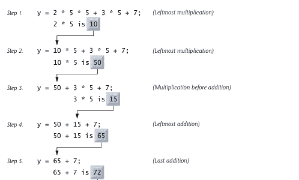

**图 2.11** | 二次多项式的求值顺序。

## 2.6 决策：相等运算符和关系运算符

可执行语句要么执行动作（例如计算或数据的输入输出），要么做出决策（我们很快就会看到几个这样的例子）。例如，我们可能在程序中做出决策，以确定某人在考试中的成绩是否大于或等于 60，以及程序是否应打印消息“恭喜！你通过了。”。本节介绍 C 的 *if* 语句的一个简单版本，它允许程序根据一个称为条件的陈述事实的真假来做出决策。如果条件为真（即满足条件），则执行 *if* 语句主体中的语句。如果条件为假（即不满足条件），则不执行主体语句。无论主体语句是否执行，在 *if* 语句完成后，执行都会继续按顺序进行到 *if* 语句之后的下一条语句。

*if* 语句中的条件通过使用图 2.12 中总结的相等运算符和关系运算符构成。关系运算符都具有相同的优先级，并且从左到右结合。相等运算符的优先级低于关系运算符，它们也从左到右结合。[注意：在 C 中，条件实际上可以是任何生成零（假）或非零（真）值的表达式。]

> > **常见编程错误 2.7**
> >
> > 如果运算符 ==、!=、>= 和 <= 中的两个符号被空格分隔，就会发生语法错误。


## 常见编程错误 2.8

将相等运算符 == 与赋值运算符混淆。为避免这种混淆，相等运算符应读作“双等号”，赋值运算符应读作“取得”或“被赋值为”。正如你将看到的，混淆这些运算符可能不会导致容易识别的编译错误，但可能导致极其微妙的逻辑错误。

| 代数相等或关系运算符 | C 相等或关系运算符 | C 条件示例 | C 条件含义 |
|---|---|---|---|
| *关系运算符* | | | |
| > | > | x > y | x 大于 y |
| < | < | x < y | x 小于 y |
| ≥ | >= | x >= y | x 大于或等于 y |
| ≤ | <= | x <= y | x 小于或等于 y |
| *相等运算符* | | | |
| = | == | x == y | x 等于 y |
| ≠ | != | x != y | x 不等于 y |

图 2.12 | 相等运算符和关系运算符。

图 2.13 使用六个 if 语句来比较用户输入的两个数字。如果这六个 if 语句中任一语句的条件为真，则执行与该 if 关联的 printf 语句。图中展示了该程序以及三个示例执行输出。

```c
1 // Fig. 2.13: fig02_13.c
2 // Using if statements, relational
3 // operators, and equality operators.
4 #include <stdio.h>
5 
6 // function main begins program execution
7 int main( void )
8 {
9 printf( "Enter two integers, and I will tell you\n" );
10 printf( "the relationships they satisfy: " );
11 
12 int num1; // first number to be read from user
13 int num2; // second number to be read from user
14 
15 scanf( "%d %d", &num1, &num2 ); // read two integers
16 
17 if ( num1 == num2 ) {
18 printf( "%d is equal to %d\n", num1, num2 );
19 } // end if
```

图 2.13 | 使用 if 语句、关系运算符和相等运算符。（第 1 部分，共 2 部分。）

> **常见编程错误 2.9**
> 
> *在 scanf 语句的格式控制字符串中，在转换说明符之间放置逗号（在不需要逗号时）。*

## 比较数字

第 17–19 行的 if 语句

```
~~~c
if ( num1 == num2 ) {
    printf( "%d is equal to %d\n", num1, num2 );
} // end if
~~~
```

比较变量 num1 和 num2 的值以测试是否相等。如果值相等，第 18 行的语句会显示一行文本，表明这两个数字相等。如果从第 21、25、29、33 和 37 行开始的 if 语句中有一个或多个条件为真，则相应的主体语句会显示一行适当的文本。对每个 if 语句的主体进行缩进，并在每个 if 语句上下放置空行，可以增强程序的可读性。

> **常见编程错误 2.10**
> 
> *在 if 语句中条件的右圆括号之后立即放置分号。*

左花括号 { 开始每个 if 语句的主体（例如第 17 行）。相应的右花括号 } 结束每个 if 语句的主体（例如第 19 行）。if 语句的主体中可以放置任意数量的语句。²

> **良好编程实践 2.11**
> 
> *一条冗长的语句可以分散在多行中。如果一条语句必须跨行拆分，请选择有意义的断点（例如在逗号分隔列表中逗号之后）。如果一条语句拆分为两行或更多行，请缩进所有后续行。拆分标识符是不正确的。*

图 2.14 从高到低列出了本章介绍的运算符的优先级。运算符按优先级递减的顺序从上到下显示。等号也是一个运算符。所有这些运算符，除了赋值运算符 = 之外，都从左到右结合。赋值运算符（=）从右到左结合。

> **良好编程实践 2.12**
> 
> *编写包含许多运算符的表达式时，请参考运算符优先级表。确认表达式中的运算符按正确顺序应用。如果你不确定复杂表达式中的求值顺序，请使用圆括号对表达式分组，或将该语句拆分为若干更简单的语句。务必注意，C 的某些运算符（例如赋值运算符 =）从右到左结合，而不是从左到右结合。*


| 运算符 | 结合性 |
|---|---|
| `()` | 从左到右 |
| `*` `/` `%` | 从左到右 |
| `+` `-` | 从左到右 |
| `<` `<=` `>` `>=` | 从左到右 |
| `==` `!=` | 从左到右 |
| `=` | 从右到左 |

*图 2.14* | 目前已讨论运算符的优先级和结合性。

本章C程序中使用的一些单词——特别是`int`、`if`和`void`——是语言的**关键字**或保留字。图2.15列出了C关键字。这些单词对C编译器具有特殊含义，因此必须注意不要将它们用作标识符（如变量名）。

在本章中，我们介绍了C编程语言的许多重要特性，包括在屏幕上显示数据、从用户输入数据、执行计算和做出决策。在下一章中，我们将在此基础上介绍结构化编程。你将更加熟悉缩进技术。我们将研究如何指定*语句的执行顺序*——这称为*控制流*。

| 关键字 |  |  |  |  |
|---|---|---|---|---|
| `auto` | `do` | `goto` | `signed` | `unsigned` |
| `break` | `double` | `if` | `sizeof` | `void` |
| `case` | `else` | `int` | `static` | `volatile` |
| `char` | `enum` | `long` | `struct` | `while` |
| `const` | `extern` | `register` | `switch` |  |
| `continue` | `float` | `return` | `typedef` |  |
| `default` | `for` | `short` | `union` |  |
| *C99标准新增关键字* |  |  |  |  |
| `_Bool` | `_Complex` | `_Imaginary` | `inline` | `restrict` |
| *C11标准新增关键字* |  |  |  |  |
| `_Alignas` | `_Alignof` | `_Atomic` | `_Generic` | `_Noreturn` `_Static_assert` `_Thread_local` |

*图 2.15* | C的关键字。

## 2.7 安全C编程

我们在前言中提到过*《CERT C安全编码标准》*，并表示我们将遵循某些指导原则，帮助你避免那些使系统容易受到攻击的编程实践。

### 避免单参数`printf`

其中一条指导原则是**避免使用带单个字符串参数的`printf`**。如果需要显示一个*以换行符结尾*的字符串，请使用`puts`函数，它会显示其字符串参数并随后输出一个换行符。例如，在图2.1中，第8行

```c
printf( "Welcome to C!\n" );
```

应改写为：

```c
puts( "Welcome to C!" );
```

我们在前面的字符串中没有包含`\n`，因为`puts`会自动添加它。

如果需要显示一个不带终止换行符的字符串，请使用带*两个*参数的`printf`——一个`"%s"`格式控制字符串和要显示的字符串。`%s`转换说明符用于显示字符串。例如，在图2.3中，第8行

```c
printf( "Welcome" );
```

应改写为：

```c
printf( "%s", "Welcome" );
```

尽管本章中按原样编写的`printf`实际上*并非*不安全，但这些更改是负责任的编码实践，将在我们深入学习C时消除某些安全漏洞——我们将在本书后面解释其原理。从现在开始，我们在章节示例中采用这些实践，你也应在练习解答中使用它们。

### `scanf`和`printf`、`scanf_s`和`printf_s`

我们在本章中介绍了`scanf`和`printf`。我们将在随后的安全C编码指导部分（从第3.13节开始）进一步讨论它们。我们还将讨论C11中引入的`scanf_s`和`printf_s`。

3. 更多信息，请参见CERT C安全编码规则FIO30-C（www.securecoding.cert.org/confluence/display/seccode/FIO30-C.+Exclude+user+input+from+format+strings）。在第6章的安全C编程部分，我们将解释该CERT指南所指的用户输入的概念。

## 摘要

### 第2.1节 引言

- C语言有助于采用结构化和纪律性的方法进行计算机程序设计。

### 第2.2节 一个简单的C程序：打印一行文本

- **注释**（第72页）以`//`开头。注释用于记录程序（第72页）并提高程序的可读性。C还支持以`/*`开头、以`*/`结尾的多行注释（第73页）。
- 注释在程序运行时不会导致计算机执行任何操作。它们被C编译器忽略，不会生成任何机器语言目标代码。
- 以`#`开头的行在程序编译前由**预处理器**处理。`#include`指令告诉预处理器（第73页）包含另一个文件的内容。
- **<stdio.h>**头文件（第73页）包含编译器在编译标准输入/输出库函数（如`printf`）调用时所需的信息。
- 函数**main**是每个C程序的一部分。main后面的圆括号表示main是一个称为函数的程序构建块（第73页）。C程序包含一个或多个函数，其中一个必须是main。每个C程序都从main函数开始执行。
- 函数可以返回信息。main左侧的关键字`int`表示main“返回”一个整数（整型）值。
- 函数在被调用执行时可以接收信息。main后面圆括号中的`void`表示main不接收任何信息。
- 左花括号`{`开始每个函数的主体（第73页）。相应的右花括号`}`结束每个函数。这对花括号及其之间的程序部分称为块。
- `printf`函数（第74页）指示计算机在屏幕上显示信息。
- 字符串有时称为字符串、消息或字面量（第74页）。
- 每条语句（第74页）必须以分号结束（也称为语句终止符；第74页）。
- 在`\n`（第74页）中，反斜杠（`\`）称为转义字符（第74页）。当编译器在字符串中遇到反斜杠时，它会查看下一个字符并将其与反斜杠组合形成转义序列（第74页）。转义序列`\n`表示换行。
- 当换行符出现在`printf`输出的字符串中时，换行符会使光标定位到屏幕下一行的开头。
- 双反斜杠（`\\`）转义序列可用于在字符串中放置单个反斜杠。
- 转义序列`\"`表示字面双引号字符。

### 第2.3节 分析一个简单的C程序：两个整数相加

- 变量（第77页）是内存中一个可以存储值供程序使用的位置。
- `int`类型的变量（第77页）保存整数值，即整数，如7、−11、0、31914。
- 所有变量在程序中使用之前，必须用名称和数据类型进行定义。
- C中的变量名是任何有效的标识符。标识符（第77页）是由字母、数字和下划线（_）组成的一系列字符，且不能以数字开头。
- C是区分大小写的（第77页）——在C中，大写字母和小写字母是不同的。
- 标准库函数`scanf`（第78页）可用于从标准输入（通常是键盘）获取输入。
- `scanf`的格式控制字符串（第78页）指示应输入的数据类型。
- `%d`转换说明符（第78页）表示数据应为整数（字母d代表“十进制整数”）。此上下文中的%被`scanf`（和`printf`）视为开始转换说明符的特殊字符。
- 跟在`scanf`格式控制字符串后面的参数以与号（&）开头——称为地址运算符（第78页）——后跟变量名。与号与变量名组合时，告诉`scanf`该变量在内存中的位置。然后计算机将该变量的值存储在该位置。
- 大多数计算在赋值语句中执行（第79页）。
- =运算符和+运算符是二元运算符——每个都有两个操作数（第79页）。
- 在将格式控制字符串作为第一个参数的`printf`中，转换说明符指示要输出数据的占位符。


## 第 2.4 节 内存概念
- 变量名对应于计算机内存中的位置。每个变量都有一个名称、一个类型和一个值。
- 每当一个值被放入某个内存位置时，该值会替换该位置中先前的值；因此，将新值放入内存位置被称为破坏性操作（第 80 页）。
- 当从某个内存位置读取一个值时，该过程被称为非破坏性操作（第 81 页）。

## 第 2.5 节 C 中的算术运算
- 在代数中，如果我们想将 a 乘以 b，只需将这些单字母变量名并排放置，如 ab。然而在 C 中，如果这样做，ab 会被解释为一个由两个字母组成的名称（或标识符）。因此，C（通常也像其他编程语言一样）要求使用 * 运算符显式表示乘法，如 a * b。
- C 中的算术表达式（第 81 页）必须写成直线形式（第 82 页），以便将程序输入计算机。因此，诸如“a 除以 b”的表达式必须写成 a/b，使所有运算符和操作数都出现在一条直线上。
- 圆括号用于在 C 表达式中将项分组，其方式与代数表达式大致相同。
- C 按照以下运算符优先级规则（第 82 页）所确定的精确顺序计算算术表达式，这些规则通常与代数中遵循的规则相同。
- 乘法、除法和求余运算首先应用。如果表达式包含多个乘法、除法和求余运算，则从左到右进行计算。乘法、除法和求余被认为处于同一优先级。
- 加法和减法运算接下来计算。如果表达式包含多个加法和减法运算，则从左到右进行计算。加法和减法也具有相同的优先级，该优先级低于乘法、除法和求余运算符的优先级。
- 运算符优先级规则规定了 C 用于计算表达式的顺序。运算符的结合性（第 83 页）规定了它们是从左到右还是从右到左计算。

## 第 2.6 节 决策：相等运算符和关系运算符
- 可执行的 C 语句要么执行操作，要么做出决策。
- C 的 if 语句（第 85 页）允许程序根据一个称为条件（第 85 页）的事实陈述的真假来做出决策。如果条件满足（即条件为真；第 85 页），则执行 if 语句主体中的语句。如果条件不满足（即条件为假；第 85 页），则不执行主体语句。无论主体语句是否执行，if 语句完成后，执行都会继续到 if 语句之后的下一语句。
- if 语句中的条件通过使用相等运算符和关系运算符（第 85 页）形成。
- 所有关系运算符都具有相同的优先级，并且从左到右结合。相等运算符的优先级低于关系运算符，它们也从左到右结合。
- 为避免混淆赋值（=）和相等（==），赋值运算符应读作“gets”，相等运算符应读作“double equals”。
- 在 C 程序中，制表符、换行符和空格等空白字符通常会被忽略。因此，语句可以分成多行。拆分标识符是不正确的。
- 关键字（第 89 页；或保留字）对 C 编译器具有特殊含义，因此不能将它们用作变量名等标识符。

## 第 2.7 节 安全的 C 编程
- 有助于避免系统暴露于攻击的一种做法是避免使用带单个字符串参数的 `printf`。
- 要显示字符串后跟换行符，请使用 `puts` 函数（第 90 页），它会显示其字符串参数后跟一个换行符。
- 要显示不带尾随换行符的字符串，可以使用 `printf`，将“%s”转换说明符（第 90 页）作为第一个参数，并将要显示的字符串作为第二个参数。

## 自测练习
### 2.1
- 填写下列各题中的空白。
  
  a) 每个 C 程序都从函数 ________ 开始执行。
  
  b) 每个函数体以 ________ 开始，并以 ________ 结束。
  
  c) 每条语句以 ________ 结束。
  
  d) ________ 标准库函数在屏幕上显示信息。
  
  e) 转义序列 `\\n` 表示 ________ 字符，它使光标定位到屏幕下一行的开头。
  
  f) ________ 标准库函数用于从键盘获取数据。
  
  g) 转换说明符 ________ 在 `scanf` 格式控制字符串中用于表示将输入一个整数，在 `printf` 格式控制字符串中用于表示将输出一个整数。
  
  h) 每当一个新值被放入某个内存位置时，该值会覆盖该位置中先前的值。这个过程被称为 ________。
  
  i) 当从某个内存位置读取一个值时，该位置中的值会被保留；这个过程被称为 ________。
  
  j) ________ 语句用于做出决策。

### 2.2
- 指出下列各项是**正确**还是**错误**。如果**错误**，请解释原因。
  
  a) 函数 `printf` 总是从新行的开头开始打印。
  
  b) 注释会导致程序执行时计算机在屏幕上显示 `//` 之后的文本。
  
  c) 转义序列 `\\n` 在 `printf` 格式控制字符串中使用时，会使光标定位到屏幕下一行的开头。
  
  d) 所有变量都必须在使用前定义。
  
  e) 所有变量在定义时都必须指定类型。
  
  f) C 认为变量 `number` 和 `NUMber` 是相同的。
  
  g) 定义可以出现在函数体中的任何位置。
  
  h) `printf` 函数中格式控制字符串之后的所有参数都必须以和号（`&`）开头。
  
  i) 求余运算符（`%`）只能用于整数操作数。
  
  j) 算术运算符 `*`、`/`、`%`、`+` 和 `-` 都具有相同的优先级。
  
  k) 打印三行输出的程序必须包含三个 `printf` 语句。

### 2.3
- 编写一条 C 语句来完成下列各项：
  
  a) 将变量 `c`、`thisVariable`、`q76354` 和 `number` 定义为 `int` 类型。
  
  b) 提示用户输入一个整数。提示消息以冒号（`:`）后跟一个空格结尾，并将光标留在该空格之后。
  
  c) 从键盘读取一个整数，并将输入的值存储到整型变量 `a` 中。
  
  d) 如果 `number` 不等于 7，则打印消息“变量 number 不等于 7。”
  
  e) 在一行上打印消息“这是一个 C 程序。”
  
  f) 在两行上打印消息“这是一个 C 程序。”，使第一行以 C 结尾。

- d) `a * (x * x * x) - b * (x * x) - 6;`
- e) `a * x * x * x - (b * x * x - 6);`
- f) `(a * x * x - b * x * 2 - 6);`

### 2.15
说明下列各 C 语句中运算符的求值顺序，并给出每条语句执行后 x 的值。
- a) `x = 8 + 15 * (6 - 2) - 1;`
- b) `x = 5 % 5 + 5 * 5 - 5 / 5;`
- c) `x = (5 * 7 * (5 + (7 * 5) / (7 ) ) );`

### 2.16
（*算术*）编写一个程序，要求用户输入两个数，从用户处获取这两个数，并打印它们的和、积、差、商和余数。

### 2.17
（*最终速度*）编写一个程序，要求用户输入一个物体的初速度和加速度，以及已经过的时间，将它们存入变量 u、a 和 t，并使用以下公式打印最终速度 v 和经过的距离 s。
- a) `v = u + at`
- b) `s = ut + (1/2)at^2`

### 2.18
（*比较值*）编写一个程序，要求用户输入某个国家有史以来单季最高降雨量，以及该国家当年的降雨量，从用户处获取这些值，检查当年降雨量是否超过最高降雨量，并在屏幕上打印适当的消息。如果当年降雨量更高，则将该值赋为有史以来的最高降雨量。仅使用本章学过的 if 语句的单分支形式。

### 2.19
（*算术、最大值和最小值*）编写一个程序，从键盘输入三个不同的整数，然后打印这些数的和、平均值、乘积、最小值和最大值。仅使用本章学过的 if 语句的单分支形式。屏幕对话应如下所示：
```
Enter three different integers: 13 27 14
Sum is 54
Average is 18
Product is 4914
Smallest is 13
Largest is 27
```

### 2.20
（*将秒转换为小时、分钟和秒*）编写一个程序，要求用户输入自某个事件以来经过的总时间（以秒为单位），并将该时间转换为小时、分钟和秒。时间应显示为小时:分钟:秒。[提示：使用求余运算符]

### 2.21
（*用星号组成的图形*）编写一个程序，用星号打印以下图形。
```
*********       ***         *           *
*       *      *   *       ***         * *
*       *     *     *     *****       *   *
*       *     *     *       *        *     *
*       *     *     *       *       *       *
*       *     *     *       *        *     *
*       *     *     *       *         *   *
*       *      *   *        *          * *
*********       ***         *           *
```

### 2.22
以下代码打印什么？
```c
printf( "%s\n%s\n%s\n%s\n" );
```


- **2.23** *（最大整数和最小整数）* 编写一个程序，读取三个整数，然后判断并打印这三个整数中最大和最小的整数。只使用本章学过的编程技术。

- **2.24** *（奇数还是偶数）* 编写一个程序，读取一个整数，判断它是奇数还是偶数，并打印结果。[*提示*：使用余数运算符。偶数是 2 的倍数。任何 2 的倍数除以 2 的余数都为 0。]

- **2.25** 在页面上从上到下用块状字母打印你的姓名首字母。每个块状字母都由它所代表的字母本身构成，如下一页顶部所示：

```
PPPPPPPPPP
P        P
P        P
P        P
P        P
  JJ
  J
  J
  J
JJJJJJJ

DDDDDDDDD
D       D
D       D
D       D
 DDDDD
```

- **2.26** *（倍数）* 编写一个程序，读取两个整数，判断并打印第一个整数是否是第二个整数的倍数。[*提示*：使用余数运算符。]

- **2.27** *（星号棋盘图案）* 使用八条 `printf` 语句显示下面的棋盘图案，然后再使用尽可能少的 `printf` 语句显示同一个图案。

```
* * * * * * * *
 * * * * * * * *
* * * * * * * *
 * * * * * * * *
* * * * * * * *
 * * * * * * * *
* * * * * * * *
 * * * * * * * *
```

- **2.28** 区分术语“致命错误”和“非致命错误”。为什么你可能更愿意遇到致命错误，而不是非致命错误？

- **2.29** *（字符的整数值）* 这里先睹为快：在本章中，你学习了整数和 `int` 类型。C 还可以表示大写字母、小写字母以及种类繁多的特殊符号。C 在内部使用小整数来表示每个不同的字符。计算机所使用的字符集合以及这些字符对应的整数表示称为该计算机的字符集。例如，执行下面的语句可以打印大写字母 A 的整数等价形式：

```c
printf( "%d", 'A' );
```

编写一个 C 程序，打印一些大写字母、小写字母、数字和特殊符号的整数等价形式。至少需要确定以下字符的整数等价形式：A B C a b c 0 1 2 $ * + / 以及空格字符。

- **2.30** *（拆分整数中的数字）* 编写一个程序，输入一个五位数，将该数拆分成单个数字，并打印各个数字，数字之间用三个空格分隔。[提示：使用整数除法和余数运算的组合。] 例如，如果用户输入 42139，程序应打印

```
4   2   1   3   9
```

- **2.31** *（平方和立方表）* 只使用本章学过的技术，编写一个程序，计算 0 到 10 这些数的平方和立方，并使用制表符打印下面的数值表：

| number | square | cube |
|---|---|---|
| 0 | 0 | 0 |
| 1 | 1 | 1 |
| 2 | 4 | 8 |
| 3 | 9 | 27 |
| 4 | 16 | 64 |
| 5 | 25 | 125 |
| 6 | 36 | 216 |
| 7 | 49 | 343 |
| 8 | 64 | 512 |
| 9 | 81 | 729 |
| 10 | 100 | 1000 |

### 有所作为

- **2.32** *（身体质量指数计算器）* 我们在练习 1.12 中介绍了身体质量指数（BMI）计算器。计算 BMI 的公式为

BMI = (weightInPounds × 703) / (heightInInches × heightInInches)

或

BMI = weightInKilograms / (heightInMeters × heightInMeters)

创建一个 BMI 计算器应用程序，读取用户的体重（以磅为单位）和身高（以英寸为单位）（或者，如果你更喜欢，读取用户的体重（以千克为单位）和身高（以米为单位）），然后计算并显示用户的身体质量指数。此外，应用程序还应显示美国卫生与公众服务部/美国国立卫生研究院提供的以下信息，以便用户评估其 BMI：

| BMI 值 | |
|---|---|
| 体重过轻： | 低于 18.5 |
| 正常： | 介于 18.5 和 24.9 之间 |
| 超重： | 介于 25 和 29.9 之间 |
| 肥胖： | 30 及以上 |

[注意：在本章中，你学习了使用 `int` 类型表示整数。使用 `int` 值进行 BMI 计算时，会得到整数结果。在第 4 章中，你将学习使用 `double` 类型表示带小数点的数。当使用 `double` 进行 BMI 计算时，会得到带小数点的结果，这些结果称为“浮点数”。]

- **2.33** *（拼车节省计算器）* 调研几个拼车网站。创建一个应用程序，计算你每天开车的成本，以便你估计通过拼车可以节省多少钱；拼车还有其他优点，例如减少碳排放和缓解交通拥堵。该应用程序应输入以下信息，并显示用户每天开车上班的成本：

  - a) 每天行驶的总英里数。
  - b) 每加仑汽油的价格。
  - c) 平均每加仑行驶的英里数。
  - d) 每天的停车费。
  - e) 每天的通行费。

## C 语言结构化程序开发


### 学习目标

- 使用基本的问题求解技巧。
- 通过自顶向下、逐步求精的过程开发算法。
- 使用 `if` 选择语句和 `if...else` 选择语句来选择操作。
- 使用 `while` 循环语句重复执行程序中的语句。
- 使用计数器控制循环和哨兵控制循环。
- 学习结构化程序设计。
- 使用自增、自减和赋值运算符。

伪代码程序不会在计算机上执行。相反，它们只是在尝试用 C 等编程语言编写程序之前，帮助你“构思”出程序。

伪代码完全由字符组成，因此你可以方便地使用文本编辑程序把伪代码程序输入计算机。一份精心编写的伪代码程序可以很容易地转换为对应的 C 程序。在许多情况下，只需把伪代码语句替换为对应的 C 语句即可完成。

伪代码只包含动作语句和判断语句，也就是在程序从伪代码转换为 C 并在 C 中运行时会被执行的语句。定义不是可执行语句，它们只是向编译器传递信息。例如，定义

```c
int i;
```

告诉编译器变量 `i` 的类型，并指示编译器在内存中为这个变量保留空间。但这个定义不会在程序执行时引起任何动作，比如输入、输出、计算或比较。有些程序员会选择在伪代码程序开头列出每个变量，并简要说明每个变量的用途。

### 3.4 控制结构

通常，程序中的语句会按照书写顺序一条接一条地执行。这称为顺序执行。我们即将讨论的各种 C 语句使你可以指定下一个要执行的语句不是顺序中的下一条。这称为控制转移。

在 20 世纪 60 年代，人们逐渐认识到，不加区分地使用控制转移是软件开发团队遭遇大量困难的根源。矛头指向了 `goto` 语句，它允许你在程序中指定转移到许多可能目标之一。所谓结构化程序设计的概念几乎成了“消除 goto”的同义词。

Böhm 和 Jacopini^1 的研究已经证明，程序可以完全不使用 goto 语句来编写。那个时代的挑战是让程序员将风格转向“无 goto 编程”。直到进入 20 世纪 70 年代相当长一段时间后，编程界才开始认真对待结构化程序设计。成果令人瞩目：软件开发团队报告开发时间缩短，系统按时交付更频繁，软件项目在预算内完成也更常见。使用结构化技术编写的程序更清晰，更易于调试和修改，而且从一开始就更有可能没有错误。^2

Böhm 和 Jacopini 的工作证明，所有程序都可以仅用三种控制结构编写，即顺序结构、选择结构和迭代结构。顺序结构很简单：除非另有指令，否则计算机按书写顺序逐条执行 C 语句。图 3.1 中的流程图片段说明了 C 的顺序结构。

- 1. C. Böhm 和 G. Jacopini，《流程图、图灵机以及仅含两种构成规则的语言》，《ACM 通讯》，第 9 卷，第 5 期，1966 年 5 月，第 366–371 页。
- 2. 正如你将在 14.10 节看到的，在某些特殊情况下 `goto` 语句是有用的。


## C 语言中的迭代语句

C 语言以语句的形式提供了三种*迭代结构*，分别是 `while`（3.7 节）、`do...while` 和 `for`（两者均在第四章讨论）。

仅此而已。C 语言只有七种控制语句：顺序结构、三种选择结构和三种迭代结构。每个 C 程序都是通过组合适当数量的各种控制语句而构成的，具体数量取决于程序所实现的算法。与图 3.1 的顺序结构一样，我们会看到每种控制语句的流程图表示都有两个流程线符号，一个位于控制语句的*入口点*，另一个位于*出口点*。这种单入口/单出口的控制语句使构建清晰的程序变得容易。我们可以将一个控制语句的出口点连接到下一个控制语句的入口点，从而将控制语句的流程图段彼此连接起来。这很像儿童堆叠积木的方式，因此我们称之为控制语句叠加。我们还将了解到，控制语句之间只有另一种连接方式，这种方法称为控制语句*嵌套*。因此，任何我们需要构建的 C 程序都可以仅由*七种*不同类型的控制语句以*两种*方式组合而成。这就是简洁性的本质。

## 3.5 `if` 选择语句

选择语句用于在备选行动方案中进行选择。例如，假设考试及格分数为 60。伪代码语句

```
如果学生的成绩大于或等于 60
    打印“Passed”
```

用于确定条件“学生的成绩大于或等于 60”为真还是假。如果条件为真，则打印“Passed”，并按顺序“执行”下一条伪代码语句（请记住，伪代码不是真正的编程语言）。如果条件为假，则忽略打印，并按顺序执行下一条伪代码语句。

前面的伪代码 *if* 语句可以用 C 语言编写为

```c
if ( grade >= 60 ) {
    puts( "Passed" );
} // end if
```

注意，C 代码与伪代码紧密对应（当然，你还需要声明 `int` 变量 `grade`）。这是伪代码使其成为如此有用的程序开发工具的特性之一。该选择语句的第二行是缩进的。这种缩进是可选的，但强烈推荐，因为它有助于强调结构化程序的内在结构。C 编译器会忽略用于缩进和垂直间距的空白字符，如空格、制表符和换行符。

图 3.2 的流程图说明了单选择 `if` 语句。该流程图包含了也许是最重要的流程图符号——菱形符号，也称为判断符号，它表示需要做出决策。判断符号中包含一个表达式，如条件，该表达式可以为真或假。判断符号有*两条*流程线从中引出。一条指示当符号中的表达式为真时应采取的方向，另一条指示当表达式为假时应采取的方向。决策可以基于包含关系运算符或相等运算符的条件。事实上，决策可以基于*任何*表达式，如果表达式的值为*零*，则视为假；如果值为*非零*，则视为真。

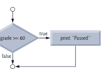

**图 3.2** | 单选择 `if` 语句的流程图。

`if` 语句也是一个*单入口/单出口*语句。我们很快就会知道，其余控制结构的流程图也可以（除了小圆圈符号和流程线之外）仅包含用于指示要执行操作的矩形符号和用于指示要做出决策的菱形符号。这就是我们一直强调的*操作/决策编程模型*。

我们可以设想七个箱子，每个箱子只包含七种类型中的一种控制语句流程图。这些流程图段是*空的*，矩形中没有任何内容，菱形中也没有任何内容。那么，你的任务就是根据算法的需求，从每种控制语句中选取适当数量，仅以*两种可能的方式*（*叠加*或*嵌套*）组合它们，然后以适合算法的方式填入*操作*和*决策*。我们将讨论编写操作和决策的各种方式。

## 3.6 `if...else` 选择语句

`if` 选择语句仅在条件为真时执行指定的操作；否则跳过该操作。`if...else` 选择语句允许你指定当条件为真和条件为假时执行*不同*的操作。例如，伪代码语句

```
如果学生的成绩大于或等于 60
    打印“Passed”
否则
    打印“Failed”
```

如果学生的成绩大于或等于 60，则打印 *Passed*;如果学生的成绩小于 60，则打印 *Failed*。无论哪种情况，在打印之后，按顺序的下一跳伪代码语句都会“执行”。`else` 的主体部分也缩进。

### 良好的编程实践 3.1

*在 `if...else` 语句中，将两个主体语句都缩进（在伪代码和 C 语言中都是如此）。*

### 良好的编程实践 3.2

*如果有多个缩进级别，每个级别应缩进相同的额外空格数。*

前面的伪代码 `if...else` 语句可以用 C 语言编写为

```c
if ( grade >= 60 ) {
    puts( "Passed" );
} // end if
else {
    puts( "Failed" );
} // end else
```

图 3.3 的流程图说明了 `if...else` 语句中的控制流。同样，除了小圆圈和箭头之外，流程图中仅有的符号是矩形（表示操作）和菱形（表示决策）。

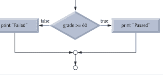

**图 3.3** | 双选择 `if...else` 语句的流程图。

C 语言提供了条件运算符（`?:`），它与 `if...else` 语句密切相关。条件运算符是 C 语言中唯一的三元运算符，它需要三个操作数。这三个操作数与条件运算符一起构成一个条件表达式。第一个操作数是条件。第二个操作数是当条件为真时整个条件表达式的值，第三个操作数是当条件为假时整个条件表达式的值。例如，`puts` 语句

```c
puts( grade >= 60 ? "Passed" : "Failed" );
```

其参数是一个条件表达式，如果条件 `grade >= 60` 为真，则表达式的值为字符串 "Passed";如果条件为假，则值为字符串 "Failed"。该 `puts` 语句的执行方式与前面的 `if...else` 语句基本相同。

条件表达式中的第二和第三个操作数也可以是要执行的操作。例如，条件表达式

```c
grade >= 60 ? puts( "Passed" ) : puts( "Failed" );
```

读作：“如果 grade 大于或等于 60，则 `puts("Passed")`，否则 `puts("Failed")`。”这也与前面的 `if...else` 语句相当。条件运算符可以用在 `if...else` 语句不能使用的地方，包括表达式和函数参数（如 `printf`）中。

### 错误预防提示 3.1

为条件运算符（`?:`）的第二个和第三个操作数使用相同类型的表达式，以避免细微的错误。

### 嵌套的 `if...else` 语句

嵌套的 `if...else` 语句通过在 `if...else` 语句内部放置 `if...else` 语句来测试多种情况。例如，下面的伪代码语句将打印：考试分数大于或等于 90 时打印 A，大于或等于 80（但小于 90）时打印 B，大于或等于 70（但小于 80）时打印 C，大于或等于 60（但小于 70）时打印 D，所有其他分数打印 F。

```
如果学生的成绩大于或等于 90
    打印“A”
否则
    如果学生的成绩大于或等于 80
        打印“B”
    否则
        如果学生的成绩大于或等于 70
            打印“C”
        否则
            如果学生的成绩大于或等于 60
                打印“D”
            否则
                打印“F”
```

该伪代码可以用 C 语言编写为

```c
if ( grade >= 90 ) {
    puts( "A" );
} // end if
else {
    if ( grade >= 80 ) {
        puts( "B" );
    } // end if
    else {
        if ( grade >= 70 ) {
            puts( "C" );
        } // end if
        else {
            if ( grade >= 60 ) {
                puts( "D" );
            } // end if
            else {
                puts( "F" );
            } // end else
        } // end else
    } // end else
} // end else
```


如果变量 grade 大于或等于 90，则四个条件都将为真，但只会执行第一个测试之后的 puts 语句。执行该 puts 语句后，“外层” if...else 语句的 else 部分会被跳过。

可以将前面的 if 语句写成

```c
if ( grade >= 90 ) {
    puts( "A" );
} // end if
else if ( grade >= 80 ) {
    puts( "B" );
} // end else if
else if ( grade >= 70 ) {
    puts( "C" );
} // end else if
else if ( grade >= 60 ) {
    puts( "D" );
} // end else if
else {
    puts( "F" );
} // end else
```

就 C 编译器而言，这两种形式是等价的。后一种形式很流行，因为它避免了代码向右的深度缩进。这种缩进常常使一行中留下的空间很小，迫使代码行被拆分，并降低程序可读性。

if 选择语句的主体只期望包含一条语句——如果 if 的主体中只有一条语句，就不需要将它括在花括号中。要在 if 的主体中包含多条语句，必须将这组语句括在花括号（{ 和 }）中。一对花括号内包含的一组语句称为复合语句或块。


### 软件工程观察 3.1

*复合语句可以放在程序中任何能够放置单条语句的位置。*

下面的示例在 if...else 语句的 else 部分包含一个复合语句。

```c
if ( grade >= 60 ) {
    puts( "Passed." );
} // end if
else {
    puts( "Failed." );
    puts( "You must take this course again." );
} // end else
```

在这种情况下，如果 grade 小于 60，程序会执行 else 主体中的两个 puts 语句，并打印

```
Failed.
You must take this course again.
```

else 子句中包围这两条语句的花括号很重要。没有它们，语句

```c
puts( "You must take this course again." );
```

就会位于 if 的 else 部分的主体之外，并且无论 grade 是否小于 60 都会执行，因此即使是通过的学生也不得不再次修这门课！

> **错误预防提示 3.2**
> 始终将控制语句的主体括在花括号（{ 和 }）中，即使这些主体只包含一条语句。这可以解决“悬空 else”问题，我们将在练习 3.30–3.31 中讨论该问题。

语法错误由编译器捕获。逻辑错误在执行时产生作用。致命逻辑错误会导致程序失败并提前终止。非致命逻辑错误允许程序继续执行，但会产生不正确的结果。

正如复合语句可以放在任何能够放置单条语句的位置一样，也完全可以没有任何语句，即空语句。空语句的表示方法是在通常应放语句的位置放置一个分号（;）。

> **常见编程错误 3.1**
> 在 if 语句的条件后放置分号（如 if ( grade >= 60 );）会导致单选择 if 语句中的逻辑错误，以及双选择 if 语句中的语法错误。

> **错误预防提示 3.3**
> 在输入花括号内的各条语句之前，先输入复合语句的起始和结束花括号，有助于避免遗漏一个或两个花括号，从而防止语法错误和逻辑错误（在这些情况下确实需要两个花括号）。

## 3.7 while 迭代语句

迭代语句（也称为重复语句或循环）允许你指定在某个条件保持为真时重复执行某个动作。伪代码语句

> 当我的购物清单上还有更多物品时
> 购买下一件物品并将其从清单上划掉

描述了购物过程中发生的迭代。条件“我的购物清单上还有更多物品”可能为真也可能为假。如果为真，则执行动作“购买下一件物品并将其从清单上划掉”。只要条件保持为真，这个动作就会被重复执行。while 迭代语句中包含的语句构成 while 的主体。while 语句主体可以是单条语句或复合语句。最终，条件会变为假（当购物清单上的最后一件物品已被购买并从清单上划掉时）。此时，迭代终止，并执行迭代结构之后的第一个伪代码语句。

> **常见编程错误 3.2**
> 未在 while 语句的主体中提供最终会使 while 中的条件变为假的动作。通常，这样的迭代结构永远不会终止——这种错误称为“无限循环”。

> **常见编程错误 3.3**
> *将关键字（如 while 或 if）拼写为任何大写字母（如 While 或 If）都是编译错误。请记住，C 区分大小写，关键字只包含小写字母。*

作为 while 语句的示例，考虑一个用于查找大于 100 的第一个 3 的幂的程序段。整数变量 product 已初始化为 3。当以下代码执行完毕时，product 将包含所需的答案：

```c
product = 3;
while ( product <= 100 ) {
    product = 3 * product;
}
```

图 3.4 的流程图说明了前面 while 迭代语句中的控制流。再次注意，（除了小圆圈和箭头之外）该流程图只包含一个矩形符号和一个菱形符号。该流程图清楚地显示了迭代。从矩形引出的流程线回绕到判定框，该判定在每次循环中都会进行测试，直到判定最终变为假。此时，退出 while 语句，控制权传递给程序中的下一条语句。

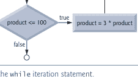

**图 3.4** | 绘制 while 迭代语句的流程图。

进入 while 语句时，product 的值为 3。变量 product 反复乘以 3，依次取值 9、27 和 81。当 product 变为 243 时，while 语句中的条件 product <= 100 变为假。这会终止迭代，product 的最终值为 243。程序继续执行 while 之后的下一条语句。

## 3.8 算法表述案例研究 1：计数器控制的迭代

为了说明算法是如何开发的，我们求解班级平均分问题的几个变体。考虑以下问题陈述：

> *一个班有十名学生参加了一次测验。该测验的成绩（0 到 100 范围内的整数）可供你使用。请确定该测验的班级平均分。*

班级平均分等于成绩总和除以学生人数。在计算机上求解该问题的算法必须输入每个成绩，执行平均分计算，并打印结果。

让我们使用伪代码列出要执行的动作，并指定这些动作应执行的顺序。我们使用计数器控制的迭代来一次输入一个成绩。这种技术使用一个称为计数器的变量来指定一组语句应执行的次数。在此示例中，当计数器超过 10 时迭代终止。在本案例研究中，我们只给出伪代码算法（图 3.5）和相应的 C 程序（图 3.6）。在下一个案例研究中，我们将展示如何开发伪代码算法。计数器控制的迭代通常称为确定性迭代，因为迭代次数在循环开始执行之前就已知。

- 1. 将 total 设为 0
- 2. 将 grade counter 设为 1
- 3. 当 grade counter 小于或等于 10
  - 输入下一个成绩
  - 将该成绩加到 total 中
  - 将 grade counter 加 1
- 4. 将班级平均分设为 total 除以 10
- 5. 打印班级平均分

**图 3.5** | 使用计数器控制的迭代求解班级平均分问题的伪代码算法。

```c
// Fig. 3.6: fig03_06.c
// Class average program with counter-controlled iteration.
#include <stdio.h>

// function main begins program execution
int main( void )
{
    unsigned int counter; // number of grades to be entered next
    int grade; // grade value
    int total; // sum of grades entered by user
    int average; // average of grades

    // initialization phase
    total = 0; // initialize total
    counter = 1; // initialize loop counter

    // processing phase
    while ( counter <= 10 ) { // loop 10 times
        printf( "%s", "Enter grade: " ); // prompt for input
        scanf( "%d", &grade ); // read grade from user
        total = total + grade; // add grade to total
        counter = counter + 1; // increment counter
    } // end while
```

**图 3.6** | 使用计数器控制的迭代的班级平均分问题。（第 1 部分，共 2 部分。）


```cpp
// termination phase
average = total / 10; // integer division

printf( "Class average is %d\n", average ); // display result
} // end function main
```

```text
Enter grade: 98
Enter grade: 76
Enter grade: 71
Enter grade: 87
Enter grade: 83
Enter grade: 90
Enter grade: 57
Enter grade: 79
Enter grade: 82
Enter grade: 94
Class average is 81
```

**图 3.6** | 使用计数器控制迭代的班级平均分问题。（第 2 部分，共 2 部分。）

该算法提到了一个总和和一个计数器。总和是一个用于累加一系列值之和的变量。计数器是一个变量（第 8 行），用于**计数**——在本例中，用于统计输入的成绩数量。由于本程序中的计数器变量用于从 1 计数到 10（所有值均为正数），我们将该变量声明为 unsigned int，它只能存储非负值（即 0 及更大的值）。用于存储总和的变量应在程序中使用**之前**初始化为零；否则，总和将包含该总和内存位置中先前存储的值。计数器变量通常初始化为零或一，具体取决于其用途——我们将分别给出示例。未初始化的变量包含一个“垃圾”值——即最后存储在为该变量保留的内存位置中的值。

### 常见编程错误 3.4

*如果计数器或总和未初始化，程序的结果很可能是错误的。*

*这是一个逻辑错误的示例。*

### 错误预防提示 3.4

*初始化所有计数器和总和。*

程序中的平均计算产生了整数结果 81。实际上，本例中成绩的总和是 817，除以 10 应得到 81.7，即一个带有**小数点**的数。我们将在下一节中了解如何处理这类数（称为*浮点数*）。

## 关于变量定义位置的重要说明

在第 2 章中，我们提到 C 标准允许将每个变量定义放在 main 中该变量在代码中首次使用之前的**任何位置**。在本章中，我们继续将变量定义集中放在 main 的开头，以强调简单程序的初始化阶段、处理阶段和终止阶段。从第 4 章开始，我们将把每个变量定义放在该变量首次使用之前。我们将看到

## 第二次细化

为了进入下一层细化，即第二次细化，我们确定具体的变量。我们需要一个数字的累计总和、一个已处理数字数量的计数、一个在输入时接收每个成绩值的变量，以及一个保存计算所得平均值的变量。伪代码语句

```
Initialize variables
```

可以细化为如下：

```
Initialize total to zero
Initialize counter to zero
```

只有 total 和 counter 需要初始化；变量 average 和 grade（分别用于计算所得的平均值和用户输入）不需要初始化，因为它们的值将分别由计算得到和由用户输入。伪代码语句

```
Input, sum, and count the quiz grades
```

需要一个迭代结构，依次输入每个成绩。由于我们事先不知道要处理多少个成绩，我们将使用哨兵控制迭代。用户将一次输入一个合法成绩。在输入最后一个合法成绩后，用户将输入哨兵值。程序将在每次输入成绩后测试该值，并在输入哨兵时终止循环。于是，前面伪代码语句的细化结果为

```
Input the first grade (possibly the sentinel)
While the user has not as yet entered the sentinel
    Add this grade into the running total
    Add one to the grade counter
    Input the next grade (possibly the sentinel)
```

请注意，在伪代码中，我们不用花括号括起构成 *while* 语句主体的语句集。我们只是将这些语句全部缩进到 *while* 之下，以表明它们都属于 *while*。再次说明，伪代码是一种非正式的程序开发辅助工具。

伪代码语句

```
Calculate and print the class average
```

可以细化为如下：

```
If the counter is not equal to zero
    Set the average to the total divided by the counter
    Print the average
else
    Print “No grades were entered”
```

请注意，我们在这里谨慎地测试除以零的可能性——这是一个致命错误，如果未被发现，将导致程序失败（通常称为“崩溃”）。完整的第二次细化如图 3.7 所示。

### 常见编程错误 3.5

*试图除以零会导致致命错误。*

### 良好编程实践 3.3

*当对一个值可能为零的表达式执行除法时，应显式测试这种情况并在程序中妥善处理（例如打印错误消息），而不是让致命错误发生。*

在图 3.5 和图 3.7 中，为了提高可读性，我们在伪代码中包含了一些完全空白的行。实际上，这些空白行将这些程序分隔成各个阶段。

```
1 Initialize total to zero
2 Initialize counter to zero
3
4 Input the first grade (possibly the sentinel)
5 While the user has not yet entered the sentinel
6 Add this grade into the running total
7 Add one to the grade counter
8 Input the next grade (possibly the sentinel)
9
10 If the counter is not equal to zero
11 Set the average to the total divided by the counter
12 Print the average
13 else
14 Print "No grades were entered"
```

**图 3.7** | 使用哨兵控制迭代解决班级平均分问题的伪代码算法。

### 软件工程观察 3.3

许多程序在逻辑上可以分为三个阶段：初始化阶段，用于初始化程序变量；处理阶段，用于输入数据值并相应地调整程序变量；以及终止阶段，用于计算并打印最终结果。

图 3.7 中的伪代码算法解决了更一般的班级平均分问题。该算法仅经过两层细化就开发出来了。有时需要更多层细化。

### 软件工程观察 3.4

当伪代码算法被详细到足以让你能够将伪代码转换为 C 程序时，你就终止自顶向下、逐步细化的过程。此后，实现 C 程序通常就很直接了。

C 程序和示例执行结果如图 3.8 所示。尽管只输入了整数成绩，但平均计算很可能产生带有小数点的数。int 类型不能表示这样的数。该程序引入了 float 数据类型来处理带有小数点的数（称为浮点数），并引入了一种称为强制类型转换运算符的特殊运算符来处理平均计算。这些特性将在展示程序之后进行解释。

```c
// Fig. 3.8: fig03_08.c
// Class-average program with sentinel-controlled iteration.
#include <stdio.h>

// function main begins program execution
int main( void )
{
    unsigned int counter; // number of grades entered
    int grade;            // grade value
    int total;            // sum of grades

    float average; // number with decimal point for average

    // initialization phase
    total = 0; // initialize total
    counter = 0; // initialize loop counter

    // processing phase
    // get first grade from user
    printf( "%s", "Enter grade, -1 to end: " ); // prompt for input
    scanf( "%d", &grade ); // read grade from user

    // loop while sentinel value not yet read from user
    while ( grade != -1 ) {
        total = total + grade; // add grade to total
        counter = counter + 1; // increment counter

        // get next grade from user
        printf( "%s", "Enter grade, -1 to end: " ); // prompt for input
        scanf( "%d", &grade ); // read next grade
    } // end while

    // termination phase
    // if user entered at least one grade
    if ( counter != 0 ) {

        // calculate average of all grades entered
        average = ( float ) total / counter; // avoid truncation

        // display average with two digits of precision
        printf( "Class average is %.2f\n", average );
    } // end if
    else { // if no grades were entered, output message
        puts( "No grades were entered" );
    } // end else
} // end function main
```

**图 3.8** | 使用哨兵控制迭代的班级平均分程序。（第 1 部分，共 2 部分。）


```
Enter grade, -1 to end: 75
Enter grade, -1 to end: 94
Enter grade, -1 to end: 97
Enter grade, -1 to end: 88
Enter grade, -1 to end: 70
Enter grade, -1 to end: 64
Enter grade, -1 to end: 83
Enter grade, -1 to end: 89
Enter grade, -1 to end: -1
Class average is 82.50
```

```
Enter grade, -1 to end: -1
No grades were entered
```

**图3.8** | 带哨兵控制迭代的班级平均成绩程序。（第2部分，共2部分。）

注意图3.8中 while 循环（第24行）中的复合语句。再次强调，花括号是*必要的*，以确保所有四条语句都在循环内执行。没有花括号，循环体中的最后三条语句将落到循环*之外*，导致计算机按如下方式错误地解释这段代码：

```
while ( grade != -1 )
    total = total + grade; // add grade to total
    counter = counter + 1; // increment counter
    printf( "%s", "Enter grade, -1 to end: " ); // prompt for input
    scanf( "%d", &grade ); // read next grade
```

如果用户没有为第一个成绩输入 -1，这将导致*无限循环*。

> **错误预防提示 3.5**
>
> *在哨兵控制循环中，在请求数据输入的提示中明确提醒用户哨兵值是什么。*

## 显式与隐式类型转换

平均值并不总是求值为整数值。通常，平均值是像 7.2 或 −93.5 这样包含小数部分的值。这些值称为浮点数，可以用数据类型 *float* 表示。变量 *average* 被定义为 *float* 类型（第12行），以保存我们计算的小数结果。然而，计算 *total* / *counter* 的结果是整数，因为 *total* 和 *counter* 都是整型变量。两个整数相除会得到整数除法，其中计算的任何小数部分都会被截断（即丢失）。由于先执行计算，因此在结果赋给 *average* *之前*，小数部分就已经丢失。要使用整数值产生浮点计算，我们必须创建浮点数类型的临时值。C 提供一元强制类型转换运算符来完成此任务。第38行

```
average = ( float ) total / counter;
```

其中包含强制类型转换运算符 *(float)*，它会创建其操作数 *total* 的一个*临时*浮点副本。存储在 *total* 中的值仍然是整数。以这种方式使用强制类型转换运算符称为显式转换。现在，计算由一个浮点值（`total` 的临时 `float` 版本）除以存储在 `counter` 中的 `unsigned int` 值组成。C 仅对操作数数据类型*相同*的算术表达式求值。为确保操作数属于*相同类型*，编译器会对选定的操作数执行一种称为隐式转换的操作。例如，在包含数据类型 `unsigned int` 和 `float` 的表达式中，会创建 `unsigned int` 操作数的副本并将其转换为 `float`。在我们的示例中，创建 `counter` 的副本并将其转换为 `float` 后，执行计算，并将浮点除法的结果赋给 *average*。C 提供了一组用于转换不同类型操作数的规则。我们将在第5章进一步讨论。

强制类型转换运算符适用于*大多数*数据类型——其形式是将类型名放在括号中。每个强制类型转换运算符都是一元运算符，即只接受一个操作数的运算符。第2章中，我们学习了二元算术运算符。C 还支持加（+）和减（-）运算符的一元版本，因此可以编写诸如 -7 或 +5 这样的表达式。强制类型转换运算符从右到左结合，并且与其他一元运算符（如一元 + 和一元 -）具有相同的优先级。该优先级比乘法运算符 `*`、`/` 和 `%` 的优先级高一级。

### 格式化浮点数

图3.8使用 `printf` 转换说明符 `%.2f`（第41行）打印 `average` 的值。`f` 指定将打印浮点值。`.2` 是显示该值时的精度——小数点右边2位数字。如果使用 `%f` 转换说明符（未指定精度），则使用默认精度6——完全就像使用了转换说明符 `%.6f` 一样。当以精度打印浮点值时，打印值会舍入到指定的小数位数。内存中的值不变。执行以下语句时，将打印值 3.45 和 3.4。

```c
printf( "%.2f\n", 3.446 ); // prints 3.45
printf( "%.1f\n", 3.446 ); // prints 3.4
```

> **常见编程错误 3.6**
>
> 在 `scanf` 语句的格式控制字符串中的转换规范里使用精度是错误的。精度只用于 `printf` 转换规范。

### 关于浮点数的说明

尽管浮点数并不总是“百分之百精确”，但它们有许多应用。例如，当我们说“正常”体温是华氏98.6度时，我们不需要精确到很多位数字。当我们看温度计上的温度并读作98.6时，它实际上可能是98.5999473210643。这里的要点是，对大多数应用来说，简单地把这个数称为98.6是可以的。稍后我们将进一步讨论这个问题。

浮点数产生的另一种方式是通过除法。当10除以3时，结果是3.3333333…，其中数字3的序列无限重复。计算机只分配*固定*大小的空间来保存这样的值，因此存储的浮点值只能是*近似值*。

> **常见编程错误 3.7**
>
> 以假定浮点数被精确表示的方式使用浮点数可能导致错误结果。大多数计算机只能近似表示浮点数。

> **错误预防提示 3.6**
>
> 不要比较浮点值是否相等。

## 3.10 用自顶向下、逐步求精的方法构造算法 案例研究3：嵌套控制语句

让我们再解决一个完整的问题。我们将再次使用伪代码和自顶向下、逐步求精的方法构造算法，并编写相应的C程序。我们已经看到，控制语句可以像孩子堆叠积木一样，一个接一个地（按顺序）堆叠起来。在本案例研究中，我们将看到C中连接控制语句的另一种唯一结构化方式，即通过将一个控制语句嵌套在另一个控制语句中。考虑以下问题陈述：

一所学院开设了一门课程，为学生参加房地产经纪人州执照考试做准备。去年，完成这门课程的10名学生参加了执照考试。学院自然想知道其学生考试表现如何。有人请你编写一个程序来汇总结果。你已获得这10名学生的名单。每个名字旁边，如果该学生通过了考试就写1，如果未通过就写2。

你的程序应按如下方式分析考试结果：

- 1. 输入每个考试结果（即1或2）。每次程序请求另一个考试结果时，显示提示消息“输入结果”。
- 2. 统计每种类型的考试结果数量。
- 3. 显示考试结果摘要，指出通过的学生人数和未通过的学生人数。
- 4. 如果超过八名学生通过了考试，则打印消息“给教师发奖金！”

仔细阅读问题陈述后，我们得出以下观察结果：

- 1. 程序必须处理10个考试结果。将使用计数器控制循环。
- 2. 每个考试结果都是一个数字——要么是1，要么是2。每次程序读取一个考试结果时，程序必须判断该数字是1还是2。我们的算法中测试是否为1。如果该数字不是1，我们假定它是2。（练习3.27要求你确保每个考试结果都是1或2。）
- 3. 使用两个计数器——一个统计通过考试的学生人数，一个统计未通过考试的学生人数。
- 4. 程序处理完所有结果后，必须判断是否有超过8名学生通过了考试。

让我们继续进行自顶向下、逐步求精。我们从顶层的伪代码表示开始：

*分析考试结果并判断教师是否应获得奖金*


完整的第二次细化如图3.9所示。我们使用空行将 `while` 语句分隔开，以提高程序的可读性。

这段伪代码现在已足够细化，可以转换为C语言。对应的C程序及两次示例执行结果如图3.10所示。我们利用了C语言的一个特性，即允许在定义变量时进行初始化（第9–11行）。这种初始化发生在编译时期。另外请注意，当输出 `unsigned int` 类型的值时，需要使用 `%u` 转换说明符（第33–34行）。

```
1  Initialize passes to zero
2  Initialize failures to zero
3  Initialize student to one
4
5  While student counter is less than or equal to ten
6      Input the next exam result
7
8      If the student passed
9          Add one to passes
10     else
11         Add one to failures
12
13     Add one to student counter
14
15  Print the number of passes
16  Print the number of failures
17  If more than eight students passed
18     Print "Bonus to instructor!"
```

图 3.9 | 考试结果问题的伪代码。


> **软件工程观察 3.5**
> 
> *经验表明，在计算机上解决问题最困难的部分是为解决方案设计算法。一旦正确的算法被确定下来，生成一个可工作的C程序的过程通常就变得 straightforward（直截了当）了。*


> **软件工程观察 3.6**
> 
> *许多程序员编写程序时从不使用伪代码之类的程序开发工具。他们认为自己的最终目标是在计算机上解决问题，而编写伪代码只会推迟最终输出的产生。*

```
1 // Fig. 3.10: fig03_10.c
2 // Analysis of examination results.
3 #include <stdio.h>
4
```

图 3.10 | 考试结果分析。（共3部分，第1部分）

```
// function main begins program execution
int main( void )
{
   // initialize variables in definitions
   unsigned int passes = 0; // number of passes
   unsigned int failures = 0; // number of failures
   unsigned int student = 1; // student counter
   int result; // one exam result

   // process 10 students using counter-controlled loop
   while ( student <= 10 ) {

      // prompt user for input and obtain value from user
      printf( "%s", "Enter result (1=pass,2=fail): " );
      scanf( "%d", &result );

      // if result 1, increment passes
      if ( result == 1 ) {
         passes = passes + 1;
      } // end if
      else { // otherwise, increment failures
         failures = failures + 1;
      } // end else

      student = student + 1; // increment student counter
   } // end while

   // termination phase; display number of passes and failures
   printf( "Passed %u\n", passes );
   printf( "Failed %u\n", failures );

   // if more than eight students passed, print "Bonus to instructor!"
   if ( passes > 8 ) {
      puts( "Bonus to instructor!" );
   } // end if
} // end function main
```

```
Enter Result (1=pass,2=fail): 1
Enter Result (1=pass,2=fail): 2
Enter Result (1=pass,2=fail): 2
Enter Result (1=pass,2=fail): 1
Enter Result (1=pass,2=fail): 1
Enter Result (1=pass,2=fail): 1
Enter Result (1=pass,2=fail): 2
Enter Result (1=pass,2=fail): 1
Enter Result (1=pass,2=fail): 1
Enter Result (1=pass,2=fail): 2
Passed 6
Failed 4
```

**图 3.10** | 考试结果分析。（共3部分，第2部分）

```
Enter Result (1=pass,2=fail): 1
Enter Result (1=pass,2=fail): 1
Enter Result (1=pass,2=fail): 1
Enter Result (1=pass,2=fail): 2
Enter Result (1=pass,2=fail): 1
Enter Result (1=pass,2=fail): 1
Enter Result (1=pass,2=fail): 1
Enter Result (1=pass,2=fail): 1
Enter Result (1=pass,2=fail): 1
Enter Result (1=pass,2=fail): 1
Passed 9
Failed 1
Bonus to instructor!
```

**图 3.10** | 考试结果分析。（共3部分，第3部分）

## 3.11 赋值运算符

C语言提供了几个赋值运算符，用于简化赋值表达式。例如，语句

```
c = c + 3;
```

可以使用加法赋值运算符 `+=` 缩写为：

```
c += 3;
```

`+=` 运算符将运算符**右侧**表达式的值加到运算符**左侧**变量的值上，并将结果存储在运算符左侧的变量中。任何形式为

```
variable = variable operator expression;
```

的语句，其中 *operator* 是二元运算符 +、-、*、/ 或 %（以及我们将在第10章讨论的其他运算符），都可以写成如下形式：

```
variable operator= expression;
```

因此，赋值语句 `c += 3` 将 3 加到 c 上。图3.11展示了算术赋值运算符、使用这些运算符的示例表达式及其解释。

| 赋值运算符 | 示例表达式 | 解释 | 赋值 |
|---|---|---|---|
| *假设：int c = 3, d = 5, e = 4, f = 6, g = 12;* |  |  |  |
| += | c += 7 | c = c + 7 | 将10赋给c |
| -= | d -= 4 | d = d - 4 | 将1赋给d |
| *= | e *= 5 | e = e * 5 | 将20赋给e |
| /= | f /= 3 | f = f / 3 | 将2赋给f |
| %= | g %= 9 | g = g % 9 | 将3赋给g |

**图 3.11** | 算术赋值运算符。

## 3.12 自增和自减运算符

C语言还提供了一元自增运算符 `++` 和一元自减运算符 `--`，其总结如图3.12所示。如果要将变量 c 加1，可以使用自增运算符 `++`，而不必写成 `c = c + 1` 或 `c += 1`。如果将自增或自减运算符放在变量之前（即前缀形式），它们分别称为前自增运算符或前自减运算符。如果将自增或自减运算符放在变量之后（即后缀形式），它们分别称为后自增运算符或后自减运算符。对变量进行前自增（前自减）会使变量先加1（减1），然后将其新值用于所在的表达式中。对变量进行后自增（后自减）会先将变量的当前值用于所在的表达式中，然后变量值再加1（减1）。

| 运算符 | 示例表达式 | 解释 |
| --- | --- | --- |
| `++` | `++a` | 将 a 加 1，然后使用 a 的新值于 a 所在的表达式中。 |
| `++` | `a++` | 使用 a 的当前值于 a 所在的表达式中，然后将 a 加 1。 |
| `--` | `--b` | 将 b 减 1，然后使用 b 的新值于 b 所在的表达式中。 |
| `--` | `b--` | 使用 b 的当前值于 b 所在的表达式中，然后将 b 减 1。 |

图 3.12 | 自增和自减运算符。

图3.13演示了 `++` 运算符的前自增和后自增版本之间的区别。对变量 c 进行后自增，会使其在 `printf` 语句中使用**之后**才被加1。对变量 c 进行前自增，会使其在 `printf` 语句中使用**之前**被加1。

```
1   // Fig. 3.13: fig03_13.c
2   // Preincrementing and postincrementing.
3   #include <stdio.h>
4
5   // function main begins program execution
6   int main( void )
7   {
8       int c; // define variable
9
10      // demonstrate postincrement
11      c = 5; // assign 5 to c
12      printf( "%d\n", c ); // print 5
13      printf( "%d\n", c++ ); // print 5 then postincrement
14      printf( "%d\n", c ); // print 6
```

图 3.13 | 前自增和后自增。（共2部分，第1部分）

```
15
16      // demonstrate preincrement
17      c = 5; // assign 5 to c
18      printf( "%d\n", c ); // print 5
19      printf( "%d\n", ++c ); // preincrement then print 6
20      printf( "%d\n", c ); // print 6
21   } // end function main
```

```
5
5
6

5
6
6
```

图 3.13 | 前自增和后自增。（共2部分，第2部分）

该程序显示了使用 `++` 运算符前后 c 的值。自减运算符（`--`）的工作方式类似。

## 良好编程实践 3.4

*一元运算符应直接紧邻其操作数，中间不要有空格。*

图3.10中的三条赋值语句

```
passes = passes + 1;
failures = failures + 1;
student = student + 1;
```

可以使用赋值运算符更简洁地写成：

```
passes += 1;
failures += 1;
student += 1;
```

也可以使用前自增运算符写成：

```
++passes;
++failures;
++student;
```

或者使用后自增运算符写成：

```
passes++;
failures++;
student++;
```

这里需要重点指出，当在一条语句中单独对变量进行自增或自减时，前自增形式和后自增形式的效果相同。只有当变量出现在更大的表达式中时，前自增与后自增才会产生不同的效果（前自减与后自减也是如此）。在我们目前研究过的表达式中，只有简单的变量名才能作为自增或自减运算符的操作数。


**常见编程错误 3.8**

*尝试对除简单变量名之外的表达式使用自增或自减运算符属于语法错误，例如编写 ++(x + 1)。*

**错误预防提示 3.7**

*C 语言通常不规定运算符操作数的求值顺序（不过我们将在第 4 章看到少数运算符的例外）。因此，你只应在某个变量自身进行自增或自减的语句中使用自增或自减运算符。*

图 3.14 列出了到目前为止介绍的运算符的优先级和结合性。运算符按优先级从高到低的顺序自上而下排列。第二列表示每个优先级层次上运算符的结合性。请注意，条件运算符 (?:)、一元运算符自增 (++)、自减 (--)、正号 (+)、负号 (-) 和强制类型转换，以及赋值运算符 =、+=、-=、*=、/= 和 %= 从右到左结合。第三列列出各种运算符组的名称。图 3.14 中所有其他运算符从左到右结合。

| 运算符 | 结合性 | 类型 |
| --- | --- | --- |
| ++ (postfix) -- (postfix) | 从右到左 | 后缀 |
| + - (type) ++ (prefix) -- (prefix) | 从右到左 | 一元 |
| * / % | 从左到右 | 乘法 |
| + - | 从左到右 | 加法 |
| < <= > >= | 从左到右 | 关系 |
| == != | 从左到右 | 相等 |
| ?: | 从右到左 | 条件 |
| = += -= *= /= %= | 从右到左 | 赋值 |

**图 3.14** | 本文到目前为止遇到的运算符的优先级和结合性。

## 3.13 安全的 C 编程

### 算术溢出

图 2.5 展示了一个加法程序，它用下面的语句计算两个 int 值之和（第 18 行）

```
sum = integer1 + integer2; // assign total to sum
```

即使这个简单语句也有潜在问题——将这些整数相加可能得到一个*过大*而无法存入 int 变量的值。这称为算术溢出，可能导致未定义行为，甚至可能使系统容易受到攻击。

可存入 int 变量的、平台相关的最大值和最小值分别由常量 `INT_MAX` 和 `INT_MIN` 表示，它们定义在头文件 `<limits.h>` 中。对于第 4 章将介绍的其他整数类型，也有类似的常量。你可以在文本编辑器中打开头文件 `<limits.h>` 来查看你的平台上这些常量的值。

一种良好做法是：在执行类似图 2.5 第 18 行那样的算术计算*之前*，确保这些计算*不会*溢出。实现这一点的代码显示在 CERT 网站 www.securecoding.cert.org 上——只需搜索指南“INT32-C”。该代码使用 &&（逻辑与）和 ||（逻辑或）运算符，我们将在第 4 章讨论它们。在工业级代码中，你应该对*所有*计算执行此类检查。后续章节将展示处理此类错误的其他编程技术。

### 无符号整数

在图 3.6 中，第 8 行将变量 counter 声明为 unsigned int，因为它用于*只统计非负值*。一般来说，应只存储非负值的计数器应在整数类型前用 `unsigned` 声明。`unsigned` 类型的变量可以表示从 0 到大约为相应有符号整数类型正范围两倍的值。你可以通过 `<limits.h>` 中的常量 `UINT_MAX` 确定你的平台上 `unsigned int` 的最大值。

图 3.6 中的班级平均分程序本可以将变量 `grade`、`total` 和 `average` 声明为 `unsigned int`。成绩通常是 0 到 100 的值，因此 `total` 和 `average` 各自都应大于或等于 0。我们将这些变量声明为 `ints`，因为我们无法控制用户实际输入的内容——用户可能输入*负值*。更糟的是，用户可能输入甚至不是数字的值。（我们将在本书后面展示如何处理此类输入。）

有时，哨兵控制循环使用无效值来终止循环。例如，图 3.8 的班级平均分程序在用户输入哨兵值 -1（一个无效成绩）时终止循环，因此将变量 `grade` 声明为 `unsigned int` 是不合适的。正如你将看到的，文件结束（EOF）指示符——它在下一章介绍，常用于终止哨兵控制循环——也是一个负数。更多信息请参见 Robert Seacord 的 *Secure Coding in C and C++* 第 2 版中的第 5 章“整数安全”。

### scanf_s 和 printf_s

C11 标准的附录 K 引入了 `printf` 和 `scanf` 的更安全版本，称为 `printf_s` 和 `scanf_s`——我们将在 6.13 节和 7.13 节讨论这些函数及相应的安全问题。附录 K 被指定为*可选*，因此并非每个 C 供应商都会实现它。Microsoft 在 C11 标准发布之前就实现了自己的 `printf_s` 和 `scanf_s` 版本，其编译器随即开始对每次 `scanf` 调用发出警告。这些警告指出 `scanf` 已*弃用*——不应再使用——并且你应考虑改用 `scanf_s`。

许多组织的编码标准要求代码*在编译时不产生警告消息*。有两种方法可以消除 Visual C++ 的 `scanf` 警告——你可以用 `scanf_s` 代替 `scanf`，或者禁用这些警告。对于到目前为止我们使用的输入语句，Visual C++ 用户只需将 `scanf` 替换为 `scanf_s`。你可以按如下方式在 Visual C++ 中禁用警告消息：

1. 键入 **Alt+F7** 以显示项目的 **属性页** 对话框。
2. 在左列中，展开 **配置属性 > C/C++**，然后选择 **预处理器**。
3. 在右列中，在 **预处理器定义** 的值末尾插入

```
; _CRT_SECURE_NO_WARNINGS
```

4. 单击“确定”保存更改。

你将不再收到关于 `scanf`（或 Microsoft 因类似原因弃用的任何其他函数）的警告。对于工业级编码，不鼓励禁用这些警告。我们将在后面的“安全 C 编码指南”一节中进一步说明如何使用 `scanf_s` 和 `printf_s`。

## 小结

### 3.1 节 简介

- 在编写程序解决特定问题之前，你必须彻底理解问题，并仔细规划解决问题的方法。

### 3.2 节 算法

- 任何计算问题的解决方案都涉及按特定顺序执行一系列动作（第 102 页）。
- 一种从要执行的动作（第 102 页）以及这些动作的执行顺序的角度来解决问题的过程（第 102 页），称为算法（第 102 页）。
- 动作的执行顺序很重要。

### 3.3 节 伪代码

- **伪代码**（第 102 页）是一种人工的、非正式的语言，可帮助你开发算法。
- 伪代码类似于日常英语；它不是实际的计算机编程语言。
- 伪代码程序帮助你“理清”一个程序。
- 伪代码完全由“字符”组成；你可以使用文本编辑器键入伪代码。
- 仔细编写的伪代码程序可以很容易地转换为相应的 C 程序。
- 伪代码只由动作语句组成。

### 3.4 节 控制结构

- 通常，程序中的语句按编写顺序依次执行。这称为顺序执行（第 103 页）。
- 各种 C 语句使你能够指定下一条要执行的语句可能不是序列中的下一条。这称为控制转移（第 103 页）。
- 结构化编程几乎已成为**“goto 消除”**（第 103 页）的同义词。
- 结构化程序更清晰、更易于调试和修改，并且更可能没有 bug。
- 所有程序都可以用顺序、选择和迭代控制结构（第 103 页）来编写。
- 除非另有指示，计算机自动按顺序执行 C 语句。
- 流程图（第 104 页）是算法的图形表示。流程图使用矩形、菱形、圆角矩形和小圆圈绘制，并由称为流程线（第 104 页）的箭头连接。
- 矩形（动作）符号（第 104 页）表示任何类型的动作，包括计算或输入/输出操作。
- 流程线指示动作的执行顺序。
- 绘制表示完整算法的流程图时，我们使用包含单词“Begin.”的圆角矩形作为第一个符号。我们使用圆角矩形作为最后一个符号


包含单词“End。”在绘制算法的一部分时，我们省略圆角矩形符号，转而使用小圆圈符号，也称为连接符符号（p. 104）。

-   菱形（决策）符号（p. 104）表示需要做出决策。
-   if 单选语句选择或忽略单个操作。
-   if...else 双选语句（p. 104）在两个不同的操作之间进行选择。
-   switch 多选语句（p. 104）根据表达式的值在许多不同的操作中进行选择。
-   C 提供了三种迭代语句（也称为重复语句），即 while、do...while 和 for。
-   控制语句流程图段可以通过控制语句堆叠（p. 105）相互连接——将一个控制语句的出口点连接到下一个控制语句的入口点。
-   控制语句连接的唯一其他方式是控制语句嵌套。

## Section 3.5 if 选择语句

-   选择结构用于在备选方案中进行选择。
-   决策符号包含一个表达式，例如条件，可以为真或假。决策符号有两个流线从中发出。一个表示表达式为真时应采取的方向；另一个表示表达式为假时的方向。
-   决策可以基于任何表达式——如果表达式求值为零，则视为假；如果求值为非零，则视为真。
-   if 语句是单入口/单出口结构（p. 105）。

## Section 3.6 if...else 选择语句

-   C 提供了条件运算符（?, :），它与 if...else 语句密切相关。
-   条件运算符是 C 中唯一的 ternary 运算符——它接受三个操作数。第一个操作数是条件。第二个操作数是条件为真时条件表达式的值（p. 107），第三个操作数是条件为假时条件表达式的值。
-   嵌套 if...else 语句（p. 108）通过将 if...else 语句放在 if...else 语句内部来测试多个情况。
-   if 选择语句在其主体中只期望一个语句。要在 if 的主体中包含多个语句，必须用大括号（{ 和 }）将语句集合括起来。
-   包含在一对大括号内的语句集合称为复合语句或块（p. 109）。
-   语法错误会被编译器捕获。逻辑错误在执行时产生影响。致命逻辑错误会导致程序失败并过早终止。非致命逻辑错误允许程序继续执行但产生错误结果。

## Section 3.7 while 迭代语句

-   while 迭代语句（p. 110）指定在条件为真时重复执行一个操作。最终，条件将变为假。此时迭代终止，并且迭代语句之后的第一个语句执行。

## Section 3.8 制定算法案例研究 1：计数器控制迭代

-   计数器控制迭代（p. 112）使用一个称为计数器（p. 112）的变量来指定语句集合应执行的次数。
-   计数器控制迭代通常称为确定迭代（p. 112），因为在循环开始执行之前迭代次数已知。
-   总和是一个用于累积一系列值之和的变量。用于存储总和的变量在使用前通常应初始化为零；否则总和将包含存储在总和内存位置中的先前值。
-   计数器是一个用于计数的变量。计数器变量通常初始化为零或一，具体取决于其用途。
-   未初始化的变量包含“垃圾”值（p. 113）——最后存储在为该变量保留的内存位置中的值。

## Section 3.9 使用自顶向下逐步细化制定算法案例研究 2：哨兵控制迭代

-   哨兵值（p. 114；也称为信号值、虚拟值或标志值）用于哨兵控制循环中以指示“数据输入结束”。
-   哨兵控制迭代通常称为不确定迭代（p. 114），因为在循环开始执行之前迭代次数未知。
-   哨兵值必须选择为不能与可接受的输入值混淆。
-   在自顶向下逐步细化（p. 114）中，顶层是一个传达程序整体功能的语句。它是程序的完整表示。在细化过程中，我们将顶层划分为更小的任务并按执行顺序列出这些任务。
-   类型 float（p. 117）表示带小数点的数字（称为浮点数）。
-   当两个整数相除时，结果的任何小数部分都会被截断（p. 118）。
-   要使用整数值进行浮点计算，必须将整数强制转换为浮点数。C 提供了 unary 强制转换运算符（float）来实现此任务。
-   强制转换运算符（p. 118）执行显式转换。
-   大多数计算机只能计算操作数数据类型相同的算术表达式。为确保这一点，编译器会对选定的操作数执行称为隐式转换（p. 119）的操作。
-   强制转换运算符是通过在类型名称周围放置括号形成的。强制转换运算符是 unary 运算符——它只接受一个操作数。
-   强制转换运算符从右到左结合，并与其他 unary 运算符（如 unary + 和 unary -）具有相同的优先级。此优先级比 *、/ 和 % 高一级。
-   printf 转换说明符 %.2f 指定浮点值将以小数点右侧两位数字显示。如果使用 %f 转换说明符（未指定精度），则使用默认精度（p. 119）6。
-   当浮点值以精度打印时，打印的值会四舍五入（p. 119）到指定的小数位数以用于显示目的。

## Section 3.11 赋值运算符

-   C 提供了多个赋值运算符用于缩写赋值表达式（p. 124）。
-   += 运算符将运算符右侧表达式的值加到运算符左侧变量的值上，并将结果存储在运算符左侧的变量中。
-   任何形式为  
  `variable = variable operator expression;`  
  其中 operator 是二元运算符 +、-、*、/ 或 % 中的一个（或我们在第 10 章讨论的其他运算符），  
  可以写成形式  
  `variable operator= expression;`

## Section 3.12 自增和自减运算符

-   C 提供了 unary 自增运算符 ++（p. 125）和 unary 自减运算符 --（p. 125），用于整数类型。
-   如果自增或自减运算符放在变量之前，则分别称为 preincrement 或 predecrement 运算符。如果自增或自减运算符放在变量之后，则分别称为 postincrement 或 postdecrement 运算符。
-   Preincrementing（predecrementing）一个变量会使其增加（减少）1，然后在该变量出现的表达式中使用变量的新值。
-   Postincrementing（postdecrementing）一个变量先在该变量出现的表达式中使用变量的当前值，然后将变量值增加（减少）1。
-   当单独在一条语句中对变量进行自增或自减时，preincrement 和 postincrement 形式具有相同的效果。当变量出现在较大表达式的上下文中时，preincrementing 和 postincrementing 具有不同的效果（predecrementing 和 postdecrementing 也是如此）。

## Section 3.13 安全的 C 编程

-   相加整数可能导致一个值过大而无法存储在 int 变量中。这称为算术溢出，可能导致不可预测的运行时行为，可能使系统暴露于攻击之下。
-   可以存储在 int 变量中的最大值和最小值分别由头文件 `<limits.h>` 中的常量 INT_MAX 和 INT_MIN 表示。
-   在执行计算之前确保算术计算不会溢出被认为是一种良好的实践。在工业级代码中，您应对可能导致溢出或下溢（p. 127）的所有计算进行检查。
-   通常，任何应仅存储非负值的整数变量都应在整数类型前声明为 unsigned。无符号类型变量可以表示从 0 到相应有符号整数类型正范围大约两倍的值。
-   您可以使用来自 `<limits.h>` 的常量 UINT_MAX 确定平台的最大 unsigned int 值。
-   C11 标准附录 K 引入了更安全的 printf 和 scanf 版本，称为 printf_s 和 scanf_s。附录 K 被指定为可选，因此并非每个 C 编译器厂商都会实现它。
-   Microsoft 在 C11 标准发布之前实现了自己的 printf_s 和 scanf_s 版本，并立即开始对每次 scanf 调用发出警告。警告说 scanf 已被弃用——不应再使用——并且您应考虑改用 scanf_s。
-   许多组织有编码标准要求代码在没有警告消息的情况下编译。有两种方法可以消除 Visual C++ 的 scanf 警告。您可以立即开始使用 scanf_s 或禁用此警告消息。

### 自评练习

**3.1** 填空以下每个问题。

-   a) 用待执行的操作及其执行顺序来解决问题的过程称为 ________。
-   b) 由计算机指定语句的执行顺序称为 ________。
-   c) 所有程序都可以用三种类型的控制语句来编写：________、________ 和 ________。


d) ______选择语句用于在条件为真时执行一个操作，而在条件为假时执行另一个操作。
e) 用花括号（{和}）括起来的多条语句称为______。
f) ______迭代语句规定，当某个条件保持为真时，重复执行一条语句或一组语句。
g) 对一组指令重复特定次数的迭代称为______迭代。
h) 当预先不知道一组语句将重复多少次时，可以使用一个______值来终止迭代。

### 3.2 编写四条不同的C语句，每条都将整数变量`x`加1。

### 3.3 编写一条C语句来完成以下各项任务：

a) 使用`*=`运算符将变量product乘以2。

b) 使用`=`和`*`运算符将变量product乘以2。

c) 测试变量count的值是否大于10。如果大于10，则打印"Count is greater than 10."。

d) 计算q除以divisor后的余数，并将结果赋给q。用两种不同的方式编写这条语句。

e) 以两位精度打印数值123.4567。打印出的值是什么？

f) 打印浮点值3.14159，小数部分保留三位。打印出的值是什么？

### 3.4 编写一条C语句来完成以下各项任务：

a) 将变量sum和x定义为int类型。

b) 将变量x设置为1。

c) 将变量sum设置为0。

d) 将变量x加到变量sum上，并将结果赋给变量sum。

e) 打印"The sum is: "，后跟变量sum的值。

### 3.5 将你在练习3.4中编写的语句组合成一个程序，该程序计算从1到10的整数之和。使用`while`语句循环执行计算和递增语句。当`x`的值变为11时，循环应终止。

### 3.6 编写单条C语句，用于：

a) 使用scanf输入无符号整数变量x。使用转换说明符`%u`。

b) 使用scanf输入无符号整数变量y。使用转换说明符`%u`。

c) 将无符号整数变量i设置为1。

d) 将无符号整数变量power设置为1。

e) 将无符号整数变量power乘以x，并将结果赋给power。

f) 将变量i递增1。

g) 在while语句的条件中测试i是否小于或等于y。

h) 使用printf输出无符号整数变量power。使用转换说明符`%u`。

### 3.7 编写一个C程序，使用练习3.6中的语句计算x的y次幂。该程序应包含一个while迭代控制语句。

### 3.8 识别并更正以下各项中的错误：

```
a)
while ( c <= 5 ) {
    product *= c;
    ++c;
```

```
b)
scanf( "%.4f", &value );
```

```
c)
if ( gender == 1 )
    puts( "Woman" );
else;
    puts( "Man" );
```

### 3.9 下面的while迭代语句有什么问题（假设z的值为100）？该语句本应计算从100到1的所有整数之和。

```c
while ( z >= 0 )
    sum += z;
```

## 自测练习答案

### 3.1
a) 算法。 b) 程序控制。 c) 顺序、选择、迭代。 d) `if...else`。 e) 复合语句或块。 f) `while`。 g) 计数器控制或确定性。 h) 哨兵。

### 3.2

```c
x = x + 1;
x += 1;
++x;
x++;
```

### 3.3

a) `product *= 2;`

b) `product = product * 2;`

c) `if ( count > 10 )`
   `puts( "Count is greater than 10." );`

d) `q %= divisor;`
   `q = q % divisor;`

e) `printf( "%.2f", 123.4567 );`
   `显示 123.46。`

f) `printf( "%.3f\n", 3.14159 );`
   `显示 3.142。`

### 3.4

a) `int sum, x;`

b) `x = 1;`

c) `sum = 0;`

d) `sum += x;` 或 `sum = sum + x;`

e) `printf( "The sum is: %d\n", sum );`

### 3.5 见下文。

```
/* 计算从1到10的整数之和 */
#include <stdio.h>

int main( void )
{
    unsigned int x = 1; // 设置 x
    unsigned int sum = 0; // 设置 sum

    while ( x <= 10 ) { // 当 x 小于或等于 10 时循环
        sum += x; // 将 x 加到 sum
        ++x; // 递增 x
    } // 结束 while

    printf( "The sum is: %u\n", sum ); // 显示 sum
} // 结束 main 函数
```

### 3.6

a) `scanf( "%u", &x );`

b) `scanf( "%u", &y );`

c) `i = 1;`

d) `power = 1;`

e) `power *= x;`

f) `++i;`

g) `while ( i <= y )`
h) `printf( "%u", power );`

### 3.7 见下文。

```c
// 计算 x 的 y 次幂
#include <stdio.h>

int main( void )
{
    printf( "%s", "输入第一个整数：" );
    unsigned int x;
    scanf( "%u", &x ); // 从用户读取 x 的值
    printf( "%s", "输入第二个整数：" );
    unsigned int y;
    scanf( "%u", &y ); // 从用户读取 y 的值

    unsigned int i = 1;
    unsigned int power = 1; // 设置 power

    while ( i <= y ) { // 当 i 小于或等于 y 时循环
        power *= x; // 将 power 乘以 x
        ++i; // 递增 i
    } // 结束 while

    printf( "%u\n", power ); // 显示 power
} // 结束 main 函数
```

### 3.8
a) 错误：缺少`while`体的右花括号。  
更正：在语句`++c;`之后添加右花括号。

b) 错误：在`scanf`转换说明中使用了精度。  
更正：从转换说明中删除`.4`。

c) 错误：`if...else`语句的`else`部分后出现分号会导致逻辑错误。  
第二个`puts`将始终被执行。  
更正：删除`else`后面的分号。

### 3.9
在`while`语句中，变量`z`的值从未改变。因此，创建了一个无限循环。为防止无限循环，必须递减`z`，使其最终变为`0`。

## 练习

### 3.10 识别并更正以下各项中的错误。[注意：每段代码中可能有多于一个错误。]

a) `if ( sales >= 5000 )`  
    `puts( "Sales are greater than or equal to $5000" );`  
   `else`  
    `puts( "Sales are less than $5000" )`

b) `int x = 1, product = 0;`

   `while ( x <= 10 ); {`  
       `product *= x;`  
       `++x;`  
   `}`

c) `while ( x <= 100 )`  
       `total += x;`  
       `++x;`

d) while ( y < 10 ) {
       printf( "%d\n", y );
   }

### 3.11 填空：

- a) 在_______中，语句按照编写的顺序一条接一条地执行。
- b) _______程序帮助你“构思”程序。
- c) 所有程序都可以用_______、_______、_______和_______控制结构来编写。
- d) 流程图使用_______、_______、_______和_______绘制，这些图形由称为流程线的箭头连接。
- e) 流程线指示执行操作的_______。
- f) _______多重选择语句根据表达式的值在多个选项中选择一个。
- g) _______运算符是C语言中唯一的三元运算符。它需要三个操作数：_______一个条件，条件为真时_______条件表达式的值，条件为假时_______条件表达式的值。
- h) if语句是一种_______结构。

### 3.12 以下程序打印什么？

```
1  #include <stdio.h>
2
3  int main( void )
4  {
5      int y;
6      int x = 1;
7      int total = 0;
8
9      while ( x <= 10 ) {
10         y = x * x * x;
11         printf( "%d\n", y );
12         total += y;
13         ++x;
14     } // 结束 while
15
16     printf( "The total is %d\n", total );
17 } // 结束 main
```

### 3.13 编写一条伪代码语句，表示以下各项：

- a) 显示消息"Enter your name:"
- b) 将变量a、b、c和d的乘积赋给变量p。
- c) 在条件语句中测试以下条件：如果x大于y，则将x的值设为10，否则将x的值设为20。
- d) 从键盘获取变量a、b、c和d的值。

### 3.14 为以下各项制定一个伪代码算法：

- a) 从键盘获取三个数字，计算它们的乘积并显示结果。
- b) 从键盘获取两个数字，确定并显示这两个数字中较小的一个（如果存在）。
- c) 从键盘获取一系列正数，确定并显示它们的平均值。假设用户输入哨兵值-1来表示“数据输入结束”。


### 3.15 判断以下哪些是 *true* 哪些是 *false*。如果陈述是 *false*，请解释原因。

- a) 算法是解决问题的步骤，描述要执行的动作，但不指定动作的顺序。
- b) 除非另有指示，计算机会自动按顺序执行 C 语句。
- c) if…else 双选择语句选择单个动作。
- d) 逻辑错误在程序编译时影响程序。它不会导致程序失败或过早终止。
- e) 你可以使用来自 `<limits.h>` 的常量 `UINT_MAX` 来确定平台的最大无符号 int 值。

*对于练习 3.16–3.20，请执行以下每个步骤：*

1. 阅读问题陈述。
2. 使用伪代码和自顶向下、逐步细化的方法制定算法。
3. 编写 C 程序。
4. 测试、调试并执行 C 程序。

### 3.16（销售税）

销售税由买方缴纳并上缴政府。零售商必须提交月度销售税报告，其中列出当月的销售额以及在县和州两个层面上征收的销售税总额。开发一个程序，输入一个月的总收款额，计算收款的销售税，并显示县税和州税。假设州销售税为 4%，县销售税为 5%。以下是示例输入/输出对话。

```text
Enter total amount collected (-1 to quit): 45678
Enter name of month: January
Total Collections: $ 45678.00
Sales: $ 41906.42
County Sales Tax: $ 2095.32
State Sales Tax: $ 1676.26
Total Sales Tax Collected: $ 3771.58

Enter total amount collected (-1 to quit): 98000
Enter name of month: February
Total Collections: $ 98000.00
Sales: $ 89908.26
County Sales Tax: $ 4495.41
State Sales Tax: $ 3596.33
Total Sales Tax Collected: $ 8091.74
Enter total amount collected (-1 to quit): -1
```

### 3.17（抵押贷款计算器）

开发一个 C 程序来计算银行客户抵押贷款的应计利息。对于每个客户，可获得以下事实：

- a) 账户号码
- b) 抵押贷款金额
- c) 抵押贷款期限
- d) 利率

程序应输入每个事实，计算应付总利息（ = *mortgage amount* × *interest rate* × *mortgage term*），并将其加到抵押贷款金额上得到应付总额。它应通过将应付总额除以抵押贷款期限中的月数来计算所需的月付款。程序应显示四舍五入到最接近美元的所需月付款。程序应一次处理每个客户的账户。以下是示例输入/输出对话：

```text
Enter account number (-1 to end): 100
Enter mortgage amount (in dollars): 6500
Enter mortgage term (in years): 3
Enter interest rate (as a decimal): 0.075
The monthly payable interest is $ 221

Enter account number (-1 to end): 200
Enter mortgage amount (in dollars): 12000
Enter mortgage term (in years): 10
Enter interest rate (as a decimal): 0.045
The monthly payable interest is $ 145

Enter account number (-1 to end): -1
```

### 3.18（销售佣金计算器）

一家大型化工公司按佣金制支付其销售人员的工资。销售人员每周领取 $200 外加当周毛销售额的 9%。例如，一名销售人员在一周内销售价值 $5000 的化工产品，将获得 $200 加上 $5000 的 9%，总计 $650。开发一个程序，输入每位销售人员上周的毛销售额，并计算并显示该销售人员的收入。一次处理一位销售人员的数据。以下是示例输入/输出对话：

```text
Enter sales in dollars (-1 to end): 5000.00
Salary is: $650.00

Enter sales in dollars (-1 to end): 1234.56
Salary is: $311.11

Enter sales in dollars (-1 to end): -1
```

### 3.19（利息计算器）

贷款的简单利息按以下公式计算

```text
interest = principal * rate * days / 365;
```

前述公式假设 rate 为年利率，因此包括除以 365（天）。开发一个程序，输入多笔贷款的本金、利率和天数，并使用前述公式计算并显示每笔贷款的简单利息。以下是示例输入/输出对话：

```text
Enter loan principal (-1 to end): 1000.00
Enter interest rate: .1
Enter term of the loan in days: 365
The interest charge is $100.00

Enter loan principal (-1 to end): 1000.00
Enter interest rate: .08375
Enter term of the loan in days: 224
The interest charge is $51.40

Enter loan principal (-1 to end): -1
```

### 3.20（工资计算器）

开发一个程序，用于确定多名员工的税前工资。公司对每位员工前 40 小时的工作支付“正常工时”，对超过 40 小时的工作支付“1.5 倍工时”。你得到公司员工名单，每位员工上周工作小时数以及每位员工的时薪。你的程序应为每位员工输入此信息并确定并显示员工的税前工资。以下是示例输入/输出对话：

```text
Enter # of hours worked (-1 to end): 39
Enter hourly rate of the worker ($00.00): 10.00
Salary is $390.00

Enter # of hours worked (-1 to end): 40
Enter hourly rate of the worker ($00.00): 10.00
Salary is $400.00

Enter # of hours worked (-1 to end): 41
Enter hourly rate of the worker ($00.00): 10.00
Salary is $415.00

Enter # of hours worked (-1 to end): -1
```

### 3.21（前置递增与后置递增）

编写一个程序，使用递增运算符 `++` 演示前置递增与后置递增之间的区别。

### 3.22（检查数字是否为质数）

质数是大于 1 的自然数，只能被 1 和它本身整除。编写一个 C 程序，读取一个整数并确定它是否为质数。

### 3.23（查找最大数）

查找最大数（即一组数的最大值）的过程在计算机应用中经常使用。例如，确定销售竞赛获胜者的程序会输入每位销售人员售出的单位数。售出单位数最多的销售人员赢得竞赛。编写一个伪代码程序，然后编写一个程序，输入 10 个非负数的序列并确定并打印其中最大的数。*[提示：你的程序应使用下面所示的三个变量。]*

- counter: 计数器，计数到 10（即跟踪已输入多少个数字并确定何时处理完全部 10 个数字）
- number: 输入到程序的当前数字
- largest: 迄今为止找到的最大数字

### 3.24（表格输出）

编写一个程序，使用循环打印以下值表。在 printf 语句中使用制表符转义序列 `\t` 用制表符分隔列。

| N | N² | N³ | N⁴ |
|---:|---:|---:|---:|
| 1 | 1 | 1 | 1 |
| 2 | 4 | 8 | 16 |
| 3 | 9 | 27 | 81 |
| 4 | 16 | 64 | 256 |
| 5 | 25 | 125 | 625 |
| 6 | 36 | 216 | 1296 |
| 7 | 49 | 343 | 2401 |
| 8 | 64 | 512 | 4096 |
| 9 | 81 | 729 | 6561 |
| 10 | 100 | 1000 | 10000 |

### 3.25（表格输出）

编写一个程序，利用循环生成以下值表：

| A | A+3 | A+6 | 9A |
|---:|---:|---:|---:|
| 7 | 10 | 13 | 63 |
| 14 | 17 | 20 | 126 |
| 21 | 24 | 27 | 189 |
| 28 | 31 | 34 | 252 |
| 35 | 38 | 41 | 315 |

### 3.26（查找两个最大数）

使用与练习 3.23 类似的方法，找到 10 个数字中的 **two** 最大值。*[注意：你只能输入每个数字一次。]*

### 3.27（验证用户输入）

修改图 3.10 中的程序以验证其输入。在任何输入中，如果输入的值不是 1 或 2，则保持循环直到用户输入正确的值。

### 3.28 以下程序打印什么？

```c
#include <stdio.h>

int main( void )
{
   int x = 1;
   int total = 0;

   while ( x <= 5 ) { // loop 5 times
      total += x; // perform calculation
      printf( "%d\n", x*x);
      ++x; // increment counter x
   } // end while

   printf( "Total is %d\n", total); // display result
} // end function main
```

### 3.29 以下程序打印什么？

```c
#include <stdio.h>

int main( void )
{
   int outer_count = 1; // initialize count
   while ( outer_count <= 10 ) { // loop 10 times
      int inner_count = 1;
      while ( inner_count <= outer_count ) {
         printf( "*" );
         inner_count++;
      } // end inner while
      printf( "\n" );
      outer_count++;
   } // end outer while
} // end main
```

### 3.30（悬空 else 问题）

确定当 x 为 9 且 y 为 11 时，以及当 x 为 11 且 y 为 9 时，以下每个的输出。编译器忽略 C 程序中的缩进。此外，编译器总是将 `else` 与前一个 `if` 关联，除非通过放置


花括号 {} 的使用。因为乍一看，你可能不确定一个 `else` 与哪个 `if` 匹配，这被称为“悬空 `else`”问题。我们取消了以下代码的缩进，以使问题更具挑战性。[提示：应用你学过的缩进约定。]

- a)
```c
if ( x < 10 )
    if ( y > 10 )
        puts( "@@@@@@" );
    else
        puts( "#####" );
puts( "$$$$$" );
```

- b)
```c
if ( x < 10 ) {
    if ( y > 10 )
        puts( "@@@@@@" );
}
else {
    puts( "#####" );
    puts( "$$$$$" );
}
```

### 3.31（另一个悬空 else 问题）

修改以下代码以产生所示的输出。使用适当的缩进技术。除了插入大括号外，你不能做任何更改。编译器会忽略程序中的缩进。我们取消了以下代码的缩进，以使问题更具挑战性。[注意：可能无需进行任何修改。]

```c
if ( y == 8 )
if ( x == 5 )
    puts( "@@@@@@" );
else
    puts( "#####" );
puts( "$$$$$" );
puts( "&&&&&" );
```

- a) 假设 x = 5 且 y = 8，将产生以下输出。

|  |
| --- |
| @@@@@@<br>$$$$$<br>&&&&& |

- b) 假设 x = 5 且 y = 8，将产生以下输出。

|  |
| --- |
| @@@@@ |

- c) 假设 x = 5 且 y = 8，将产生以下输出。

|  |
| --- |
| @@@@@<br>&&&&& |

- d) 假设 x = 5 且 y = 7，将产生以下输出。

|  |
| --- |
| #####<br>$$$$$<br>&&&&& |

### 3.32（星号正方形）

编写一个程序，读取正方形的边长，然后打印由星号组成的正方形。你的程序应适用于边长在 1 到 20 之间的所有正方形。例如，如果你的程序读取的大小为 4，它应该打印

```
****
****
****
****
```

### 3.33（空心星号正方形）

修改你在练习 3.32 中编写的程序，使其打印一个空心正方形。例如，如果你的程序读取的大小为 5，它应该打印

```
*****
*   *
*   *
*   *
*****
```

### 3.34（弗洛伊德三角形）

弗洛伊德三角形是一个由自然数组成的直角三角形阵列。它是通过用连续整数填充行来定义的。因此，第 1 行将有数字 1，第 2 行将有数字 2 和 3，依此类推。编写一个程序绘制 10 行的弗洛伊德三角形。一个外层循环可以控制要打印的行数，一个内层循环可以确保每行包含正确数量的整数。

### 3.35（打印二进制数的十进制等效值）

输入一个仅包含 0 和 1 的整数（5 位或更少）（即一个“二进制”整数），并打印其十进制等效值。*[提示：使用余数和除法运算符从右到左一次一位地取出“二进制”数的数字。就像在十进制数系统中，最右边的数字的位置值为 1，左边的下一个数字的位置值为 10，然后是 100，然后是 1000，依此类推；在二进制数系统中，最右边的数字的位置值为 1，左边的下一个数字的位置值为 2，然后是 4，然后是 8，依此类推。因此十进制数 234 可以解释为 4 * 1 + 3 * 10 + 2 * 100。二进制 1101 的十进制等效值是 1 * 1 + 0 * 2 + 1 * 4 + 1 * 8，即 1 + 0 + 4 + 8，或 13。]*

### 3.36（阿姆斯特朗数）

阿姆斯特朗数等于其各位数字的位数次幂之和。例如，数字 153 等于 1³ + 5³ + 3³。因此它是一个阿姆斯特朗数。编写一个程序来显示所有三位阿姆斯特朗数。

### 3.37（检测一个数的倍数）

编写一个程序，连续打印 500 个美元符号（$），每个符号之间用空格分隔。每打印五个美元符号后，程序应打印一个换行符。*[提示：从 1 数到 500。使用余数运算符来识别计数器何时达到 5 的倍数。]*

### 3.38（统计 9 的个数）

编写一个程序，读取一个整数（5 位或更少），确定并打印该整数中有多少个数字是 9。

### 3.39（星号棋盘图案）

编写一个程序显示以下棋盘图案：

```
 * * * * * * * * * *
* * * * * * * * * *
 * * * * * * * * * *
* * * * * * * * * *
 * * * * * * * * * *
* * * * * * * * * *
 * * * * * * * * * *
* * * * * * * * * *
```

你的程序必须只使用三个输出语句，分别是以下每种形式之一：

```c
printf( "%s", ... );
printf( "%s\n", ... );
puts( ... ); // outputs a newline
```

### 3.40（具有无限循环的 3 的幂）

编写一个程序，不断打印整数 3 的幂，即 3、9、27、81、243 等等。你的循环不应终止（即你应该创建一个无限循环）。当你运行这个程序时会发生什么？

### 3.41（圆的直径、周长和面积）

编写一个程序，读取圆的半径（作为浮点值），并计算和打印直径、周长和面积。π 使用值 3.14159。

### 3.42

下面的语句有什么问题？重写它以实现程序员可能试图完成的目标。

```c
printf( "%d", --(x * y) );
```

### 3.43（三角形的边）

编写一个程序，读取三个非零整数值，确定并打印它们是否能表示三角形的三条边。

### 3.44（直角三角形的边）

编写一个程序，读取三个非零整数，确定并打印它们是否能成为直角三角形的三条边。

### 3.45（阶乘）

非负整数 *n* 的阶乘写作 *n*!（读作“n 的阶乘”），定义如下：

*n*! = *n* · (*n* − 1) · (*n* − 2) · ⋯ · 1   （对于大于或等于 1 的 *n* 值）

*n*! = 1   （对于 *n* = 0）。

例如，5! = 5 · 4 · 3 · 2 · 1，即 120。

- a) 编写一个程序，读取一个非负整数并计算和打印它的阶乘。
- b) 编写一个程序，使用以下公式估算数学常数 *e* 的值：
  
  *e* = 1 + 1/1! + 1/2! + 1/3! + 1/4! + ⋯
- c) 编写一个程序，使用以下公式计算 *eˣ* 的值：
  
  *eˣ* = 1 + *x*/1! + *x²*/2! + *x³*/3! + ⋯

## 产生影响

### 3.46（世界人口增长计算器）

使用网络确定当前世界人口和世界人口年增长率。编写一个应用程序，输入这些值，然后显示一年、两年、三年、四年和五年后的估计世界人口。

### 3.47（目标心率计算器）

锻炼时，你可以使用心率监测器来确保你的心率保持在教练和医生建议的安全范围内。根据美国心脏协会（AHA）的说法，以每分钟心跳次数计算你的*最大心率*的公式是 220 减去你的年龄。你的*目标心率*是一个范围，即你最大心率的 50–85%。[**注意：** 这些公式是 AHA 提供的估算值。最大心率和目标心率可能因个人的健康、健身状况和性别而异。在开始或修改锻炼计划之前，请务必咨询医生或合格的专业医疗保健人员。]

创建一个程序，读取用户的生日和当前日期（每个都包含月、日和年）。你的程序应计算并显示该人的年龄（以岁为单位）、该人的最大心率和该人的目标心率范围。

### 3.48（使用密码学加强隐私）

互联网通信和联网计算机上的数据存储的爆炸式增长极大地增加了隐私问题。密码学领域涉及对数据进行编码，使未授权用户难以（希望——通过最先进的方案——不可能）阅读。在本练习中，你将研究一种简单的数据*加密*和*解密*方案。一家想通过互联网发送数据的公司要求你编写一个程序来加密数据，以便可以更安全地传输。所有数据都是以四位整数传输的。你的应用程序应读取用户输入的四位整数，并按如下方式进行*加密*：将每个数字替换为该数字加 7 后除以 10 所得的余数。然后交换第一位数字和第三位数字，并交换第二位数字和第四位数字。然后打印加密后的整数。编写另一个独立的应用程序，输入加密的四位整数并*解密*它（通过反转加密方案）以形成原始数字。[*可选阅读项目：* 在工业级应用中，你会希望使用比本练习中介绍的强得多的加密技术。研究一般的“公钥密码学”和特定的 PGP（Pretty Good Privacy）公钥方案。你可能还希望研究 RSA 方案，它广泛应用于工业级应用。]


## C 程序控制


### 目标

在本章中，你将学习：

- 计数器控制迭代的基本知识。
- 使用 `for` 和 `do...while` 迭代语句重复执行语句。
- 理解使用 `switch` 选择语句进行多重选择。
- 使用 `break` 和 `continue` 语句改变控制流。
- 使用逻辑运算符在控制语句中形成复杂的条件表达式。
- 避免混淆相等运算符和赋值运算符所带来的后果。


- 4.1 引言
- 4.2 迭代基础
- 4.3 计数器控制迭代
- 4.4 for 迭代语句
- 4.5 for 语句：注意事项与观察
- 4.6 使用 for 语句的示例
- 4.7 switch 多重选择语句
- 4.8 do...while 迭代语句
- 4.9 break 和 continue 语句
- 4.10 逻辑运算符
- 4.11 混淆相等（==）和赋值（=）运算符
- 4.12 结构化编程总结
- 4.13 安全的 C 编程
- 小结 | 自测练习 | 自测练习答案 | 练习 | 做出改变

### 4.1 引言

你现在应该能够熟练编写简单、完整的 C 程序了。本章将进一步深入探讨迭代，并介绍额外的迭代控制语句，即 `for` 和 `do...while`。同时引入 `switch` 多重选择语句。我们讨论用于从某些控制语句中立即退出的 `break` 语句，以及用于跳过迭代语句体剩余部分并继续循环下一次迭代的 `continue` 语句。本章还讨论了用于组合条件的逻辑运算符，并总结了第 3 章和本章所介绍的结构化编程原则。

### 4.2 迭代基础

大多数程序都涉及迭代或循环。循环是一组指令，计算机在某个循环继续条件保持为真时反复执行这些指令。我们已经讨论了两种迭代方式：

1. 计数器控制迭代
2. 哨兵控制迭代

计数器控制迭代有时称为*确定迭代*，因为我们*事先*确切知道循环将执行多少次。哨兵控制迭代有时称为*不确定迭代*，因为*事先不知道*循环将执行多少次。

在计数器控制迭代中，使用控制变量来计数迭代次数。每次执行这组指令时，控制变量递增（通常加 1）。当控制变量的值表明已执行了正确的迭代次数时，循环终止，并继续执行迭代语句之后的语句。

哨兵值用于在以下情况下控制迭代：

1. 事先不知道精确的迭代次数，并且
2. 循环包含每次循环执行时获取数据的语句。

哨兵值表示“数据结束”。在所有常规数据项都提供给程序之后，才输入哨兵值。哨兵值必须与常规数据项区分开。

### 4.3 计数器控制迭代

计数器控制迭代需要：

1. 控制变量（或循环计数器）的名称。
2. 控制变量的初始值。
3. 每次循环时控制变量的增量（或减量）。
4. 测试控制变量最终值的条件（即，是否应继续循环）。

考虑图 4.1 中所示的简单程序，该程序打印从 1 到 10 的数字。定义

```c
unsigned int counter = 1; // 初始化
```

命名控制变量（counter），将其定义为整数，为其保留内存空间，并将其初始值设置为 1。

```c
// Fig. 4.1: fig04_01.c
// Counter-controlled iteration.
#include <stdio.h>

int main(void)
{
    unsigned int counter = 1; // initialization

    while (counter <= 10) { // iteration condition
        printf("%u\n", counter);
        ++counter; // increment
    }
}
```


**图 4.1** | 计数器控制迭代。

counter 的定义和初始化也可以写成

```c
unsigned int counter;
counter = 1;
```

定义是*不可执行*的，但赋值是可执行的。我们将使用这两种方法来设置变量的值。

语句

```c
++counter; // 递增
```

每次循环执行时将循环计数器递增 1。while 语句中的循环继续条件测试控制变量的值是否小于或等于 10（即条件为真的最后一个值）。即使控制变量为 10，也会执行此 while 的循环体。当控制变量超过 10（即 counter 变为 11）时，循环终止。

你可以通过将 counter 初始化为 0 并将 while 语句替换为以下内容，使图 4.1 中的程序更简洁：

```c
while (++counter <= 10) {
    printf("%d\n", counter);
}
```

这段代码节省了一条语句，因为递增在条件测试之前直接在 while 条件中完成。以这种紧凑的方式编码需要一些练习。有些程序员认为这会使代码过于晦涩且容易出错。

> **常见编程错误 4.1**
> _浮点值可能是近似值，因此使用浮点值控制计数循环可能导致计数器值不精确和终止测试不准确。_

> **错误预防提示 4.1**
> _使用整数值控制计数循环。_

> **良好编程实践 4.1**
> _过多的嵌套层次会使程序难以理解。作为规则，尽量避免使用超过三层的嵌套。_

> **良好编程实践 4.2**
> _控制语句前后的垂直间距与控制语句体在控制语句头内的缩进相结合，使程序呈现二维外观，极大地提高了程序的可读性。_

### 4.4 for 迭代语句

for 迭代语句处理了计数器控制迭代的所有细节。为了说明其强大功能，让我们重写图 4.1 中的程序。结果如图 4.2 所示。该程序的操作如下。当 for 语句开始执行时，控制变量 counter 被定义并初始化为 1。然后，检查循环继续条件 counter <= 10。由于 counter 的初始值为 1，条件成立，因此 printf 语句（第 10 行）打印 counter 的值，即 1。然后通过表达式 ++counter 递增控制变量 counter，循环再次从循环继续测试开始。由于控制变量现在等于 2，未超过最终值，因此程序再次执行 printf 语句。此过程持续进行，直到控制变量 counter 递增到其最终值 11 —— 这导致循环继续测试失败，迭代终止。程序继续执行 for 语句之后的第一条语句（在这种情况下，程序只是结束）。

> **错误预防提示 4.2**
> 在 while 或 for 语句的条件中使用最终值并使用 <= 关系运算符有助于避免差一错误。例如，对于用于打印 1 到 10 的循环，循环继续条件应为 `counter <= 10` 而不是 `counter < 11` 或 `counter < 10`。


#### *for* 语句的一般格式

for 语句的一般格式为

```
for (初始化; 条件; 增量) {
    语句
}
```

其中 *初始化* 表达式初始化循环控制变量（并且可以像我们在图 4.2 中所做的那样定义它），*条件* 表达式是循环继续条件，*增量* 表达式递增控制变量。

#### 逗号分隔的表达式列表

通常，*初始化* 表达式和 *增量* 表达式是逗号分隔的表达式列表。这里使用的逗号实际上是逗号运算符，它保证表达式列表从左到右求值。逗号分隔的表达式列表的值和类型是列表中*最右侧*表达式的值和类型。逗号运算符最常用于 for 语句。其主要用途是使你能够使用多个初始化和/或多个增量表达式。例如，单个 for 语句中可能有两个控制变量需要初始化和递增。

> **软件工程观察 4.1**
> 在 for 语句的初始化和增量部分中，只放置涉及控制变量的表达式。对其他变量的操作应出现在循环之前（如果它们只执行一次，如初始化语句）或循环体中（如果它们每次迭代执行一次，如递增或递减语句）。


#### *for* 语句头中的表达式是可选的

for 语句中的三个表达式都是可选的。如果省略 *条件* 表达式，C 假定循环继续条件为真，从而产生*无限循环*。如果控制变量在 for 语句之前已被初始化，则可以省略 *初始化* 表达式。如果增量由 for 语句体中的语句计算，或者不需要增量，则可以省略 *增量* 表达式。

#### 增量表达式像独立语句一样起作用

for 语句中的 *增量* 表达式在 for 语句体的末尾像一个独立的 C 语句一样起作用。因此，表达式

```
counter = counter + 1
counter += 1
++counter
counter++
```


在 `for` 语句的增量部分都是等价的。一些 C 程序员更喜欢形式 `counter++`，因为递增发生在 *循环体执行之后*，并且后递增形式 *似乎* 更自然。因为这里被前递增或后递增的变量没有出现在更大的表达式中，所以两种递增形式具有 *相同* 的效果。`for` 语句中的两个分号是必需的。

**常见编程错误 4.3**

在 `for` 头中使用逗号代替分号是语法错误。

**错误预防提示 4.3**

当迭代语句中的循环继续条件永远不会变为 false 时就会产生无限循环。为了防止无限循环，请确保不在 `while` 语句的头部后立即放置分号。在计数控制循环中，确保在循环中递增（或递减）控制变量。在哨兵控制循环中，确保最终会输入哨兵值。

## 4.5 for 语句：注释和观察

- 1. 初始化、循环继续条件和增量可以包含算术表达式。例如，如果 `x = 2` 且 `y = 10`，则语句

```c
for (j = x; j <= 4 * x * y; j += y / x)
```

等价于语句

```c
for (j = 2; j <= 80; j += 5)
```

- 2. “增量”可能为负数（在这种情况下它实际上是 *递减*，并且循环实际上是 *向下* 计数）。

- 3. 如果循环继续条件初始为 *false*，则循环体 *不会* 执行。相反，执行将继续执行 `for` 语句之后的语句。

- 4. 控制变量经常在循环体中打印或用于计算，但并非必须如此。常见的做法是使用控制变量来控制迭代，而在循环体中从不提及它。

- 5. `for` 语句的流程图与 `while` 语句类似。例如，图 4.4 显示了 `for` 语句的流程图

```c
for (unsigned int counter = 1; counter <= 10; ++counter) {
    printf("%u", counter);
}
```

此流程图清楚地表明初始化只发生一次，并且递增在每次执行时都发生在 *主体语句之后*。

**错误预防提示 4.4**

尽管可以在 `for` 循环的主体中更改控制变量的值，但这可能导致细微的错误。最好不要更改它。

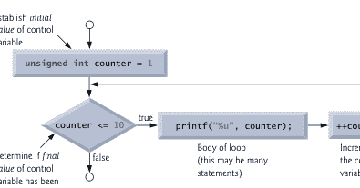

图 4.4 | 流程图化典型的迭代语句。

## 4.6 使用 for 语句的示例

以下示例展示了在 for 语句中改变控制变量的方法。

- 1. 以 1 为增量将控制变量从 1 变到 100。

```
for ( unsigned int i = 1; i <= 100; ++i )
```

- 2. 以 -1 为增量（即递减 1）将控制变量从 100 变到 1。

```
for ( unsigned int i = 100; i >= 1; --i )
```

- 3. 以 7 为增量将控制变量从 7 变到 77。

```
for ( unsigned int i = 7; i <= 77; i += 7 )
```

- 4. 以 -2 为增量将控制变量从 20 变到 2。

```
for ( unsigned int i = 20; i >= 2; i -= 2 )
```

- 5. 使控制变量在以下值序列上变化：2, 5, 8, 11, 14, 17。

```
for ( unsigned int j = 2; j <= 17; j += 3 )
```

- 6. 使控制变量在以下值序列上变化：44, 33, 22, 11, 0。

```
for ( unsigned int j = 44; j >= 0; j -= 11 )
```

### 应用：求 2 到 100 的偶数之和

图 4.5 使用 for 语句对 2 到 100 的所有偶数求和。循环的每次迭代（第 9–11 行）将控制变量 number 的值加到变量 sum 上。

**良好编程实践 4.3**
如果可能，将控制语句头的大小限制为单行。

```c
// Fig. 4.5: fig04_05.c
// Summation with for.
#include <stdio.h>

int main(void)
{
    unsigned int sum = 0; // initialize sum

    for (unsigned int number = 2; number <= 100; number += 2) {
        sum += number; // add number to sum
    }

    printf("Sum is %u\n", sum);
}
```

```
Sum is 2550
```

**图 4.5** | 使用 for 求和。

### 应用：复利计算

下一个示例使用 for 语句计算复利。考虑以下问题陈述：

某人将 $1000.00 投资于年利率为 5% 的储蓄账户。假设
所有利息都留在账户中，计算并打印在 10 年内每年末账户中的金额。使用以下公式
确定这些金额：

a = p(1 + r)^n

其中

- *p* 是投资的原始金额（即本金）
- *r* 是年利率（例如，5% 为 .05）
- *n* 是年数
- *a* 是第 *n* 年末的存款金额。

该问题涉及一个循环，对资金存入的 10 年中的每一年执行指示的计算。解决方案显示在图 4.6 中。

```c
// Fig. 4.6: fig04_06.c
// Calculating compound interest.
#include <stdio.h>
#include <math.h>

int main(void)
{
    double principal = 1000.0; // starting principal
    double rate = .05; // annual interest rate

    // output table column heads
    printf("%4s%21s\n", "Year", "Amount on deposit");
```

**图 4.6** | 计算复利。（第 1 部分，共 2 部分。）

```c
// calculate amount on deposit for each of ten years
for (unsigned int year = 1; year <= 10; ++year) {

// calculate new amount for specified year
double amount = principal * pow(1.0 + rate, year);

// output one table row
printf("%4u%21.2f\n", year, amount);
}
}
```

| 年 | 存款金额 |
| :--- | ---: |
| 1 | 1050.00 |
| 2 | 1102.50 |
| 3 | 1157.63 |
| 4 | 1215.51 |
| 5 | 1276.28 |
| 6 | 1340.10 |
| 7 | 1407.10 |
| 8 | 1477.46 |
| 9 | 1551.33 |
| 10 | 1628.89 |

图 4.6 | 计算复利。（第 2 部分，共 2 部分。）

`for` 语句执行循环体 10 次，将控制变量从 1 变到 10，增量为 1。尽管 C *不* 包含指数运算符，但我们可以使用标准库函数 `pow`（第 18 行）来实现此目的。函数 `pow(x, y)` 计算 `x` 的 `y` 次幂的值。它接受两个类型为 `double` 的参数并返回一个 `double` 值。

**软件工程观察 4.2**

*Type double* 是像 *float* 一样的浮点类型，但通常类型为 *double* 的变量可以存储比 *float* 大得多的值且精度更高。类型为 *double* 的变量占用的内存比类型为 *float* 的变量多。对于除最耗内存的应用之外的所有应用，专业程序员通常更喜欢 *double* 而不是 *float*。

头文件 `<math.h>`（第 4 行）在使用 `pow` 等数学函数时应包含。如果不包含 `math.h`，该程序将无法正常运行，因为链接器将无法找到 `pow` 函数。¹ 函数 `pow` 需要两个 `double` 参数，但变量 `year` 是一个 *整数*。`math.h` 文件包含信息，告诉编译器在调用函数 *之前* 将 `year` 的值转换为临时的 `double` 表示。此信息包含在 `pow` 的函数原型中。这些是

1. 在许多 Linux/UNIX C 编译器上，编译图 4.6 时必须包含 `-lm` 选项（例如，`gcc -lm fig04_06.c`）。这将数学库链接到程序。

在第 5 章中进行了解释，在那里我们还提供了 pow 函数和其他数学库函数的摘要。

### 使用类型 float 或 double 表示货币金额时的注意事项

请注意，我们将变量 amount、principal 和 rate 定义为类型 double。我们这样做是为了简化，因为我们处理的是美元的小数部分。

**错误预防提示 4.5**

*不要使用类型为 float 或 double 的变量来执行货币计算。浮点数的不精确性可能会导致错误，从而导致货币值不正确。[在练习 4.23 中，我们探讨了使用整数便士来执行精确货币计算。]*

这里有一个简单的解释，说明在使用 float 或 double 表示美元金额时可能出现什么问题。机器中存储的两个 float 美元金额可能是 14.234（使用 %.2f 打印为 14.23）和 18.673（使用 %.2f 打印为 18.67）。将这些金额相加时，它们产生和 32.907，使用 %.2f 打印为 32.91。因此你的打印输出可能如下所示

```
      14.23
    + 18.67
    --------
      32.91
```

显然，打印的各个数字之和应为 32.90！你已被警告！

### 格式化数字输出

转换说明符 %21.2f 用于在程序中打印变量 amount 的值。转换说明符中的 21 表示值将被打印的字段宽度。宽度为 21 指定打印的值将出现在 21 个打印位置。2 指定精度（即小数位数）。如果显示的字符数小于字段宽度，则该值将自动在字段中右对齐，并在前面加上空格。这对于对齐具有相同精度的浮点值特别有用（使其小数点垂直对齐）。要在字段中左对齐值，请在 % 和字段宽度之间放置一个 −（减号）。减号也可用于左对齐整数（例如 %-6d）和字符字符串（例如 %-8s）。我们将在第 9 章详细讨论 printf 和 scanf 的强大格式化功能。

## 4.7 switch 多重选择语句

在第 3 章中，我们讨论了 if 单选语句和 if…else 双选语句。有时，算法会包含一系列决策，其中变量或表达式针对其可能假设的每个常量整数值分别进行测试，并采取不同的操作。这称为多重选择。C 提供了 switch 多重选择语句来处理此类决策。

switch 语句由一系列 case 标签、可选的 default case 以及为每个 case 执行的语句组成。图 4.7 使用 switch 来统计学生在考试中获得的每种不同字母等级的数量。


```c
// Fig. 4.7: fig04_07.c
// Counting letter grades with switch.
#include <stdio.h>

int main(void)
{
    unsigned int aCount = 0;
    unsigned int bCount = 0;
    unsigned int cCount = 0;
    unsigned int dCount = 0;
    unsigned int fCount = 0;

    puts("Enter the letter grades.");
    puts("Enter the EOF character to end input.");
    int grade; // one grade

    // loop until user types end-of-file key sequence
    while ((grade = getchar()) != EOF) {

        // determine which grade was input
        switch (grade) { // switch nested in while

        case 'A': // grade was uppercase A
        case 'a': // or lowercase a
            ++aCount;
            break; // necessary to exit switch

        case 'B': // grade was uppercase B
        case 'b': // or lowercase b
            ++bCount;
            break;

        case 'C': // grade was uppercase C
        case 'c': // or lowercase c
            ++cCount;
            break;

        case 'D': // grade was uppercase D
        case 'd': // or lowercase d
            ++dCount;
            break;

        case 'F': // grade was uppercase F
        case 'f': // or lowercase f
            ++fCount;
            break;

        case '\n': // ignore newlines,
        case '\t': // tabs,
        case ' ': // and spaces in input
            break;

        default: // catch all other characters
            printf("%s", "Incorrect letter grade entered.");
            puts("Enter a new grade.");
            break; // optional; will exit switch anyway
        }
    } // end while

    // output summary of results
    puts("\nTotals for each letter grade are:");
    printf("A: %u\n", aCount);
    printf("B: %u\n", bCount);
    printf("C: %u\n", cCount);
    printf("D: %u\n", dCount);
    printf("F: %u\n", fCount);
}
```

图 4.7 | 使用 switch 计数字母等级。 (第 1 部分，共 2 部分。)

图 4.7 | 使用 switch 计数字母等级。 (第 2 部分，共 2 部分。)

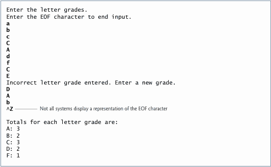

## 读取字符输入

在程序中，用户为一门课程输入字母等级。在 while 头部（第 18 行），

```c
while ((grade = getchar()) != EOF)
```

带括号的赋值 `(grade = getchar())` 首先执行。`getchar` 函数（来自 <stdio.h>）从键盘读取一个字符并将其存储在整数变量 grade 中。字符通常存储在类型为 char 的变量中。然而，C 的一个重要特性是字符可以存储在任何整数数据类型中，因为它们在计算机中通常表示为一字节整数。`getchar` 函数返回用户输入的作为 `int` 的字符。我们可以根据其用途将字符视为整数或字符。例如，语句

```c
printf("The character (%c) has the value %d.\n", 'a', 'a');
```

使用转换说明符 `%c` 和 `%d` 分别打印字符 `'a'` 及其整数值。结果是

The character (a) has the value 97.

### ASCII

整数 97 是计算机中字符的数值表示。今天许多计算机使用 ASCII（美国信息交换标准代码）字符集，其中 97 表示小写字母 'a'。附录 B 中列出了 ASCII 字符及其十进制值。字符可以使用转换说明符 `%c` 通过 scanf 读取。

### 赋值有值

赋值整体实际上有一个值。该值被赋给等号左侧的变量。赋值表达式 `grade = getchar()` 的值是 `getchar` 返回并赋给变量 grade 的字符。

赋值有值这一事实对于将多个变量设置为相同值很有用。例如，

```c
a = b = c = 0;
```

首先计算赋值 `c = 0`（因为 = 运算符从右到左结合）。然后变量 b 被赋值为赋值 `c = 0` 的值（即 0）。然后，变量 a 被赋值为赋值 `b = c = 0` 的值（也是 0）。在程序中，赋值 `grade = getchar()` 的值与 EOF 的值进行比较（EOF 这个符号的缩写代表“文件结束”）。我们使用 EOF（通常值为 –1）作为哨兵值。用户键入系统相关的键序列来表示“文件结束”——即“我没有更多数据要输入”。EOF 是在 `<stdio.h>` 头文件中定义的符号整数常量（我们将在第 6 章看到符号常量的定义方式）。如果赋给 grade 的值等于 EOF，程序即终止。我们选择在本程序中将字符表示为 ints，因为 EOF 有一个整数值（同样通常为 –1）。

> **可移植性提示 4.1**
>
> 输入 EOF（文件结束）的键组合是系统相关的。

> **可移植性提示 4.2**
>
> 测试符号常量 EOF（而不是 –1）使程序更具可移植性。C 标准规定 EOF 是一个负整数值（但不一定是 –1）。因此，EOF 在不同系统上可能有不同的值。

### 输入 EOF 指示符

在 Linux/UNIX/Mac OS X 系统上，EOF 指示符通过在单独一行键入

```
<Ctrl> d
```

来输入。这种记法 <Ctrl> d 表示同时按下 Ctrl 键和 d 键。在其他系统上，如 Microsoft Windows，EOF 指示符可以通过键入

```
<Ctrl> z
```

来输入。你还需要在 Windows 上按 *回车*。

用户在键盘上输入等级。当按下 *回车* 键时，字符由函数 `getchar` 一次一个地读取。如果输入的字符不等于 EOF，则进入 switch 语句（第 21–57 行）。

## switch 语句细节

关键字 *switch* 后跟放在括号中的变量名 *grade*。这称为控制表达式。该表达式的值与每个 *case* 标签进行比较。假设用户输入字母 C 作为等级。C 会自动与 *switch* 中的每个 case 进行比较。如果发生匹配（case `'C':`），则执行该 case 的语句。对于字母 C 的情况，`cCount` 增加 1（第 35 行），并且 *switch* 语句会立即通过 *break* 语句退出。

*break* 语句使程序控制继续执行 *switch* 语句之后的第一条语句。使用 *break* 语句是因为如果不使用，*switch* 语句中的 *cases* 就会连在一起。如果在 *switch* 语句中任何地方都不使用 *break*，那么每次发生匹配时，该语句中 *所有* 剩余 *cases* 的语句都将被执行。（这种特性称为贯穿， rarely 有用，尽管它非常适合编程练习 4.38——迭代歌曲“十二天的圣诞节”！）如果没有匹配发生，则执行 *default* case，并打印错误消息。

## switch 语句流程图

每个 *case* 可以有一个或多个操作。*switch* 语句与其他所有控制语句不同之处在于，在 *switch* 的一个 *case* 中，多个操作周围 *不需要* 大括号。一般的 *switch* 多选语句（在每个 *case* 中使用 *break*）在图 4.8 中进行了流程图。流程图清楚地表明，每个 *case* 末尾的 *break* 语句会立即使控制退出 *switch* 语句。

> **常见编程错误 4.4**
>
> 在 *switch* 语句中需要时忘记 *break* 语句是一个逻辑错误。

> **错误预防提示 4.6**
>
> 在 *switch* 语句中提供 *default* case。在 *switch* 中未明确测试的值通常会被忽略。*default* case 通过让你关注处理异常条件的需要来帮助防止这种情况。有时不需要 *default* 处理。

> **良好编程实践 4.4**
>
> 尽管 *switch* 语句中的 *case* 子句和 *default* case 子句可以按任何顺序出现，但通常将 *default* 子句放在最后。

> **良好编程实践 4.5**
>
> 在 *switch* 语句中，当 *default* 子句在最后时，*break* 语句不是必需的。你可能更喜欢为了清晰和与其他 case 的对称性而包含此 *break*。


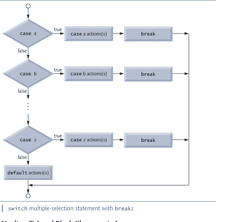

**图4.8** | 带break的switch多路选择语句。

### 忽略输入中的换行符、制表符和空白字符

在图4.7的switch语句中，以下代码行

```c
case '\n': // ignore newlines,
case '\t': // tabs,
case ' ': // and spaces in input
break;
```

使程序跳过换行符、制表符和空白字符。一次读取一个字符可能会导致问题。为了让程序读取字符，必须按Enter键将它们发送到计算机。这会导致换行符在要处理的字符之后被放入输入中。通常，必须特别忽略这个换行符才能使程序正常工作。我们switch语句中前面的这些case可以防止在输入中每次遇到换行符、制表符或空格时，default case都打印错误信息。因此，每次输入都会导致循环执行两次——第一次用于字母成绩，第二次用于'\n'。将几个case标签列在一起（例如图4.7中的case 'D': case 'd':）仅表示对于这些case中的每一个都要执行相同的操作集合。

> **错误预防提示 4.7**
> 在逐字符处理输入时，记得为输入中的换行符（以及可能的其他空白字符）提供处理能力。

### 常量整型表达式

使用switch语句时，请记住每个单独的case只能测试一个常量整型表达式——即字符常量和整数常量的任意组合，其计算结果为一个常量整数值。字符常量可以用单引号中的特定字符来表示，例如'A'。字符必须用单引号括起来才能被识别为字符常量——双引号中的字符被识别为字符串。整数常量就是整数值。在我们的示例中，我们使用了字符常量。请记住，字符内部是以较小的整数值来表示的。

### 整型类型说明

像C这样的可移植语言必须具有灵活的数据类型大小。不同的应用程序可能需要不同大小的整数。C提供了几种数据类型来表示整数。除了int和char之外，C还提供了short int（可缩写为short）和long int（可缩写为long）类型，以及所有整型类型的无符号变体。在第5.14节中，我们将看到C还提供了long long int类型。C标准规定了每种整数类型的最小取值范围，但实际范围可能更大，并且取决于具体实现。对于short int，最小范围是-32767到+32767。对于大多数整数计算，long int就足够了。long int的最小取值范围是-2147483647到+2147483647。int的取值范围大于或等于short int的取值范围，且小于或等于long int的取值范围。在当今的许多平台上，int和long int表示相同的取值范围。signed char数据类型可以用来表示-127到+127范围内的整数，或计算机字符集中的任意字符。有关有符号和无符号整数类型范围的完整列表，请参阅C标准文档的第5.2.4.2节。

## 4.8 do...while迭代语句

do...while迭代语句与while语句类似。在while语句中，循环继续条件在循环*开始*时、循环体执行*之前*进行测试。而do...while语句在循环体执行*之后*才测试循环继续条件。因此，循环体将总是执行*至少一次*。当do...while终止时，程序继续执行while子句之后的语句。do...while语句的写法如下：

```c
do {
    statements
} while (condition); // semicolon is required here
```

图4.9使用do...while语句打印从1到10的数字。我们选择在循环继续测试中对控制变量counter进行前增量（第11行）。

```c
1   // Fig. 4.9: fig04_09.c
2   // Using the do...while iteration statement.
3   #include <stdio.h>
4
5   int main(void)
6   {
7       unsigned int counter = 1; // initialize counter
8
9       do {
10          printf("%u  ", counter);
11      } while (++counter <= 10);
12  }
```

| 1 | 2 | 3 | 4 | 5 | 6 | 7 | 8 | 9 | 10 |
|---|---|---|---|---|---|---|---|---|---|

**图4.9** | 使用do...while迭代语句。

### do...while语句流程图

图4.10展示了do...while语句的流程图，该图清楚地表明循环继续条件在操作至少执行一次之后才进行测试。

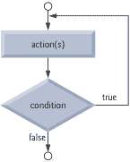

**图4.10** | do...while迭代语句的流程图。

## 4.9 break和continue语句

**break**和**continue**语句用于改变控制流。第4.7节展示了如何使用break终止switch语句的执行。本节讨论如何在迭代语句中使用break。

### break语句

当break语句在while、for、do...while或switch语句中执行时，会导致*立即退出*该语句。程序继续执行该while、for、do...while或switch之后的下一语句。break的常见用途包括提前退出循环或跳过switch的剩余部分（如图4.7所示）。图4.11演示了for迭代语句中的break语句（第14行）。当if语句检测到x变为5时，执行break。这会终止for语句，程序继续执行for之后的printf。循环实际只完整执行了四次。在此示例中，我们在循环之前声明了x，以便在循环终止后使用其最终值。回想一下，当你在for循环的*初始化*表达式中声明控制变量时，该变量在循环终止后不再存在。

```c
// Fig. 4.11: fig04_11.c
// Using the break statement in a for statement.
#include <stdio.h>

int main(void)
{
    unsigned int x; // declared here so it can be used after loop

    // loop 10 times
    for (x = 1; x <= 10; ++x) {

        // if x is 5, terminate loop
        if (x == 5) {
            break; // break loop only if x is 5
        }

        printf("%u ", x);
    }

    printf("\nBroke out of loop at x == %u\n", x);
}
```

```text
1 2 3 4
Broke out of loop at x == 5
```

**图4.11** | 在for语句中使用break语句。

### continue语句

当continue语句在while、for或do...while语句中执行时，会跳过该控制语句体中剩余的语句，并执行循环的下一次迭代。在while和do...while语句中，循环继续测试在continue语句执行后立即进行求值。在for语句中，先执行增量表达式，然后对循环继续测试进行求值。图4.12在for语句中使用continue（第12行）跳过printf语句并开始循环的下一次迭代。

```c
// Fig. 4.12: fig04_12.c
// Using the continue statement in a for statement.
#include <stdio.h>

int main(void)
{
    // loop 10 times
    for (unsigned int x = 1; x <= 10; ++x) {

        // if x is 5, continue with next iteration of loop
        if (x == 5) {
            continue; // skip remaining code in loop body
        }

        printf("%u ", x);
    }

    puts("\nUsed continue to skip printing the value 5");
}
```

```text
1 2 3 4 6 7 8 9 10
Used continue to skip printing the value 5
```

**图4.12** | 在`for`语句中使用`continue`语句。


> **软件工程观察 4.3**
>
> 一些程序员认为`break`和`continue`违反了结构化编程的规范。这些语句的效果可以通过我们即将讨论的结构化编程技术来实现，因此这些程序员不使用`break`和`continue`。


> **性能提示 4.1**
>
> 如果使用得当，`break`和`continue`语句比我们即将学习的相应结构化技术执行得更快。


> **软件工程观察 4.4**
>
> 在实现高质量软件工程和实现性能最佳的软件之间存在矛盾。通常，这两个目标中的一个是以另一个为代价来实现的。除了大多数对性能要求极高的情况外，请遵循以下准则：首先，让你的代码简单且正确；然后，只有在必要时才让它快速且简洁。

## 4.10 逻辑运算符

到目前为止，我们只研究了简单条件，例如`counter <= 10`、`total > 1000`和`number != sentinelValue`。我们使用关系运算符`>`、`>=`、`<`和`<=`以及相等运算符`==`和`!=`来表述这些条件。每个决策只测试一个条件。要在做出决策的过程中测试多个条件，我们必须分别在单独的语句或嵌套的`if`或`if...else`语句中执行这些测试。C提供了逻辑运算符，可以通过组合简单条件来形成更复杂的条件。逻辑运算符是`&&`（逻辑与）、`||`（逻辑或）和`!`（逻辑非，也称为逻辑否定）。我们将分别讨论这些运算符的示例。

### 逻辑与（&&）运算符

假设我们希望确保两个条件都为真时才选择某条执行路径。在这种情况下，我们可以如下使用逻辑运算符`&&`：

```c
if (gender == 1 && age >= 65) {
    ++seniorFemales;
}
```

这个`if`语句包含两个简单条件。例如，条件`gender == 1`可以用来判断一个人是否为女性。条件`age >= 65`用于判断一个人是否为老年人。由于`==`和`>=`的优先级均高于`&&`，因此首先对这两个简单条件进行求值。然后`if`语句包含组合条件`gender == 1 && age >= 65`，该条件为真。


当且仅当两个简单条件*两者都*为*真*时。最后，如果这个组合条件为真，则 `seniorFemales` 的计数加 1。如果简单条件中*任一*或*两者都*为*假*，则程序跳过递增，继续执行 if 之后的语句。

图 4.13 总结了 && 运算符。该表显示了 `expression1` 和 `expression2` 的零（假）和非零（真）值的所有四种可能组合。此类表通常称为**真值表**。C 会将所有包含关系运算符、相等运算符和/或逻辑运算符的表达式求值为 0 或 1。尽管 C 将真值设为 1，但它接受*任何*非零值作为真。

| expression1 | expression2 | expression1 && expression2 |
|---|---|---|
| 0 | 0 | 0 |
| 0 | 非零 | 0 |
| 非零 | 0 | 0 |
| 非零 | 非零 | 1 |

**图 4.13** | 逻辑与（&&）运算符的真值表。

## 逻辑或（||）运算符

现在让我们考虑 `||`（逻辑或）运算符。假设我们希望在程序中的某个时刻，在选择某条执行路径之前确保两个条件中*任一或两者都*为真。在这种情况下，我们使用 `||` 运算符，如下面的程序段所示：

```c
if (semesterAverage >= 90 || finalExam >= 90) {
    puts("Student grade is A");
}
```

该语句也包含两个简单条件。对条件 `semesterAverage >= 90` 求值，以确定该学生是否因整个学期表现扎实而应在课程中获得“A”。对条件 `finalExam >= 90` 求值，以确定该学生是否因期末考试表现优异而应在课程中获得“A”。然后 if 语句考虑组合条件

`semesterAverage >= 90 || finalExam >= 90`

并且如果简单条件中*任一或两者都*为*真*，则授予该学生“A”。仅当两个简单条件*两者都*为*假*（零）时，才*不*打印消息“Student grade is A”。图 4.14 是逻辑或（`||`）运算符的真值表。

| expression1 | expression2 | expression1 \|\| expression2 |
|---|---|---|
| 0 | 0 | 0 |
| 0 | 非零 | 1 |
| 非零 | 0 | 1 |
| 非零 | 非零 | 1 |

**图 4.14** | 逻辑或（`||`）运算符的真值表。

## 运算符优先级和结合性总结

图 4.16 显示了到目前为止介绍的运算符的优先级和结合性。运算符按优先级递减的顺序从上到下显示。

| 运算符 | 结合性 | 类型 |
| --- | --- | --- |
| ++ (postfix) -- (postfix) | 从右到左 | 后缀 |
| +  -  !  ++ (prefix)  -- (prefix)  (type) | 从右到左 | 一元 |
| *  /  % | 从左到右 | 乘法 |
| +  - | 从左到右 | 加法 |
| <  <=  >  >= | 从左到右 | 关系 |
| ==  != | 从左到右 | 相等 |
| && | 从左到右 | 逻辑与 |
| \|\| | 从左到右 | 逻辑或 |
| ?: | 从右到左 | 条件 |
| =  +=  -=  *=  /=  %= | 从右到左 | 赋值 |
| , | 从左到右 | 逗号 |

图 4.16 | 运算符优先级和结合性。

## `_Bool` 数据类型

C 标准包含一个布尔类型——由关键字 `_Bool` 表示——它只能保存值 `0` 或 `1`。回想 C 的惯例：用零和非零值表示假和真——条件中的值 `0` 求值为假，而任何非零值求值为真。将任何非零值赋给 `_Bool` 会将其设为 1。该标准还包含 `<stdbool.h>` 头文件，它将 `bool` 定义为类型 `_Bool` 的简写，并分别将 `true` 和 `false` 定义为 `1` 和 `0` 的具名表示。在预处理阶段，`bool`、`true` 和 `false` 被替换为 `_Bool`、`1` 和 `0`。第 E.4 节给出了一个使用 `bool`、`true` 和 `false` 的示例。该示例使用了程序员自定义函数，这是我们将在第 5 章介绍的概念。你现在可以学习该示例，但可能希望在阅读第 5 章后重新回顾它。

## 4.11 混淆相等（==）和赋值（=）运算符

有一类错误，C 程序员无论经验多么丰富都常常会犯，因此我们觉得值得单独用一节来讨论。这种错误就是意外地把运算符 `==`（相等）和 `=`（赋值）弄混。这些弄混之所以危害如此之大，是因为它们通常*不*会导致编译错误。相反，包含这些错误的语句通常能正确编译，使程序运行至完成，同时很可能通过运行时逻辑错误产生不正确的结果。

C 的两个方面导致了这些问题。其一是，任何产生值的表达式都可以用在任何控制语句的判断部分。如果值为 `0`，则被视为假；如果值为非零，则被视为真。其二是，C 中的赋值会产生一个值，即赋给赋值运算符左侧变量的那个值。

例如，假设我们打算写

```c
if (payCode == 4) {
    printf("%s", "You get a bonus!");
}
```

但意外写成了

```c
if (payCode = 4) {
    printf("%s", "You get a bonus!");
}
```

第一个 if 语句会正确地向 paycode 等于 4 的人发放奖金。第二个 if 语句——即带有错误的那个——会求值 if 条件中的赋值表达式。该表达式是一个简单赋值，其值为常量 4。由于任何非零值都被解释为“真”，这个 if 语句中的条件始终为真，不仅 payCode 的值会被无意中设为 4，而且无论实际 paycode 是什么，这个人总会收到奖金。

> **常见编程错误 4.5**
>
> 将运算符 == 用于赋值或将运算符 = 用于相等判断是一种逻辑错误。

### 左值和右值

你可能倾向于把诸如 x == 7 这样的条件写成变量名在左、常量在右。通过反转这些项，使常量在左、变量名在右，如 7 == x，那么如果你意外地把 == 运算符替换为 =，编译器会保护你。编译器会将其视为语法错误，因为只有变量名才能放在赋值表达式的左侧。这将防止运行时逻辑错误的潜在破坏。

变量名被称为左值（lvalues，即“left values”），因为它们可以用在赋值运算符的左侧。常量被称为右值（rvalues，即“right values”），因为它们只能用在赋值运算符的右侧。左值也可以用作右值，但反之不行。

> **错误预防提示 4.8**
>
> 当相等表达式包含变量和常量时，如 x == 7，你可能更愿意将其写成常量在左、变量名在右（即 7 == x），以防止意外将运算符 == 替换为 = 时发生的逻辑错误。

### 在独立语句中混淆 == 和 =

问题的另一面同样可能令人不快。假设你想用如下简单语句给变量赋值

```c
x = 1;
```

但反而写成了

```c
x == 1;
```

这里同样不是语法错误。相反，编译器只是求值该条件表达式。如果 x 等于 1，条件为真，表达式返回值 1。如果 x 不等于 1，条件为假，表达式返回值 0。无论返回什么值，由于没有赋值运算符，该值只是被*丢失*，而 x 的值保持*未改变*，这可能导致执行时逻辑错误。不幸的是，我们没有现成的技巧来帮你解决这个问题！不过，许多编译器会对这样的语句发出*警告*。

> **错误预防提示 4.9**
>
> *编写程序后，对每个 `=` 进行文本搜索，并检查其使用是否正确。这有助于你防止细微的错误。*

## 4.12 结构化编程总结

正如建筑师利用其行业的集体智慧设计建筑一样，程序员也应设计程序。我们这个领域比建筑学年轻，我们的集体智慧也稀疏得多。在仅仅八十年里，我们学到了很多东西。也许最重要的是，我们认识到结构化编程产生的程序（比非结构化程序）更容易理解，因此更容易测试、调试、修改，甚至在数学意义上证明其正确。

第 3 章和第 4 章集中讨论了 C 的控制语句。每个语句都已分别给出、绘制流程图并结合示例进行了讨论。现在，我们总结第 3 章和第 4 章的结果，并介绍一套关于结构化程序形成和特性的简单规则。

图 4.17 总结了第 3 章和第 4 章讨论的控制语句。图中使用小圆圈表示每个语句的*单一入口点*和*单一出口点*。任意连接各个流程图符号可能导致非结构化程序。因此，编程行业选择将流程图符号组合成有限的一组控制语句，并通过两种简单方式组合控制语句来仅构建适当结构化的程序。为简单起见，只使用*单入口/单出口*控制语句——每个控制语句只有一种进入方式和一种退出方式。按顺序连接控制语句以形成结构化程序很简单——一个控制语句的出口点连接到下一个控制语句的入口点——也就是说，控制语句只是在程序中一个接一个地放置——我们称之为“控制语句堆叠”。控制语句也可以嵌套。

图 4.18 显示了形成结构化程序的规则。这些规则假设矩形流程图符号可用于表示*任何*动作，包括输入/输出。图 4.19 显示了*最简单的流程图*。

应用图 4.18 的规则总是会得到具有整洁积木式外观的结构化流程图。对最简单的流程图（图 4.19）反复应用规则 2，会得到包含许多*按顺序*排列的矩形的结构化流程图（图 4.20）。规则 2 生成控制语句的堆叠；因此我们把规则 2 称为堆叠规则。


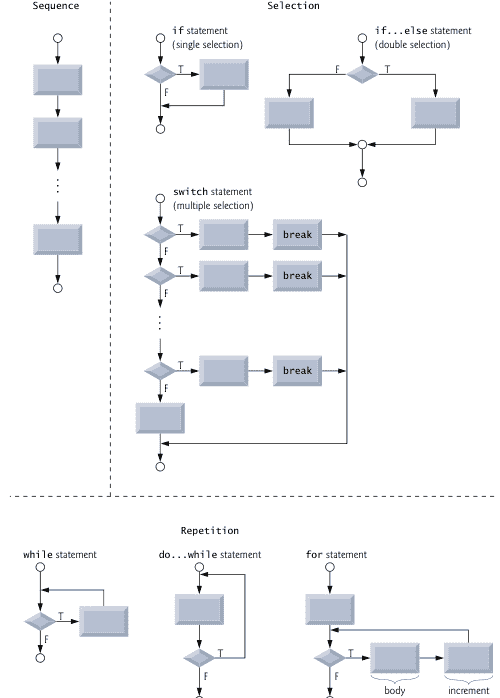

**图 4.17** | C 的单入口/单出口序列、选择和迭代语句。

| 形成结构化程序的规则 |
| --- |
| 1. 从“最简单的流程图”（图 4.19）开始。 |
| 2. （“堆叠”规则）任何矩形（动作）可以用 *两个矩形*（动作）按顺序替换。 |
| 3. （“嵌套”规则）任何矩形（动作）可以用 *任意* 控制语句（序列、if、if…else、switch、while、do…while 或 for）替换。 |
| 4. 规则 2 和 3 可以按你喜欢的次数以 *任意* 顺序应用。 |

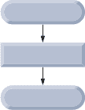

**图 4.19** | 最简单的流程图。

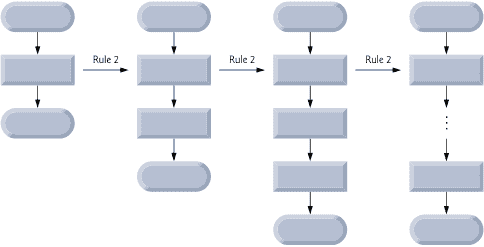

**图 4.20** | 对最简单的流程图反复应用图 4.18 的规则 2。

规则 3 称为 **嵌套规则**。反复对最简单的流程图应用规则 3 会得到一个具有整齐嵌套控制语句的流程图。例如，在图 4.21 中，最简单流程图中的矩形首先被双选择（*if…else*）语句替换。然后再次对双选择语句中的两个矩形应用规则 3，将每个矩形替换为双选择语句。每个双选择语句周围的虚线框代表原始流程图中被替换的矩形。

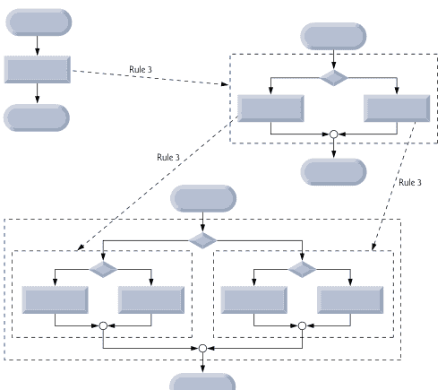

**图 4.21** | 对最简单的流程图应用图 4.18 的规则 3。

规则 4 生成更大、更复杂且嵌套更深的结构。应用图 4.18 中的规则产生的流程图构成了所有可能的<|message|> 结构化流程图的集合，因此也是所有可能的结构化程序的集合。

正是因为消除了 goto 语句，这些构建块永远不会相互重叠。结构化方法的美妙之处在于，我们只使用少量简单的 *单入口/单出口* 部件，并且仅以 *两种* 简单的方式组装它们。图 4.22 显示了应用规则 2 产生的堆叠构建块类型以及应用规则 3 产生的嵌套构建块类型。该图还显示了 *不能* 出现在结构化流程图中的重叠构建块类型（因为消除了 goto 语句）。

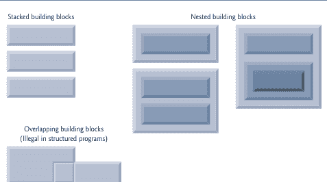

**图 4.22** | 堆叠、嵌套和重叠的构建块。

如果遵循图 4.18 中的规则，就 *不能* 创建非结构化流程图（如图 4.23 所示）。如果不确定某个流程图是否结构化，请反向应用图 4.18 的规则，尝试将流程图 *简化* 为最简单的流程图。如果成功，则原始流程图是结构化的；否则，不是。

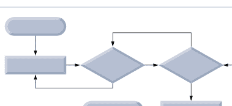

**图 4.23** | 一个非结构化流程图。

结构化编程促进简洁。Bohm 和 Jacopini 表明只需要三种控制形式：

- 序列
- 选择
- 迭代

序列很直接。选择以三种方式之一实现：

- if 语句（单选择）
- if...else 语句（双选择）
- switch 语句（多选择）

很容易证明简单的 if 语句足以提供任何形式的选 择——使用 if...else 语句和 switch 语句能完成的一切都可以用一个或多个 if 语句实现。

迭代以三种方式之一实现：

- while 语句
- do...while 语句
- for 语句

同样很容易证明 while 语句足以提供任何形式的迭代。do...while 语句和 for 语句能完成的一切都可以用 while 语句完成。

综合这些结果表明，C 程序中 ever 需要的任何控制形式都可以用仅三种控制形式表达：

- 序列
- if 语句（选择）
- while 语句（迭代）

这些控制语句只能以两种方式组合——堆叠和嵌套。的确，结构化编程促进简洁。

在第 3 章和第 4 章中，我们讨论了如何仅由动作和决策组成的控制语句来组合程序。在第 5 章中，我们将介绍另一个程序结构单元，称为函数。我们将学习通过组合函数来组合大型程序，而函数本身又可以由控制语句组成。我们还将讨论使用函数如何促进软件可重用性。

## 4.13 安全的 C 编程

### 检查函数 scanf 的返回值

图 4.6 使用了数学库函数 pow，该函数计算其第一个参数的第二个参数次幂的值，并将结果作为 double 值返回。然后在调用 pow 的语句中使用了该计算结果。

许多函数返回指示其是否成功执行的值。例如，函数 scanf 返回一个 int，指示输入操作是否成功。如果发生输入失败，scanf 返回值 EOF（在 <stdio.h> 中定义）；否则，它返回读取的项目数。如果该值与你打算读取的项目数不匹配，则 scanf 无法完成输入操作。

考虑图 3.6 中的以下语句：

```
scanf("%d", &grade); // read grade from user
```

它期望读取一个 int 值。如果用户输入一个整数，scanf 返回 1，表示确实读取了一个值。如果用户输入一个字符串，例如 "hello"，scanf 返回 0，表示它无法将输入读取为整数。在这种情况下，变量 grade *不会* 接收值。

函数 `scanf` 可以读取多个输入，如

```c
scanf("%d%d", &number1, &number2); // read two integers
```

如果输入成功，`scanf` 将返回 2，表示读取了两个值。如果用户为第一个值输入字符串，`scanf` 将返回 0，且 `number1` 和 `number2` 都不会接收值。如果用户输入一个整数后跟一个字符串，`scanf` 将返回 1，且只有 `number1` 会接收值。

> **错误预防提示 4.10**
>
> *为了使你的输入处理更健壮，请检查 `scanf` 的返回值，以确保读取的输入数量与预期的输入数量匹配。否则，你的程序将使用变量的值，就好像 `scanf` 成功完成一样。这可能导致逻辑错误、程序崩溃甚至攻击。*

### 范围检查

即使 `scanf` 成功运行，读取的值仍可能 *无效*。例如，成绩通常是 0–100 范围内的整数。在输入此类成绩的程序中，你应通过范围检查验证成绩，以确保它们是 0 到 100 的值。然后可以要求用户重新输入超出范围的任何值。如果程序需要来自特定值集的输入（例如，非顺序产品代码），你可以确保每个输入都与集合中的值匹配。更多信息，请参阅 Robert Seacord 的书 *Secure Coding in C and C++, 2/e* 的第 5 章“Integer Security”。

## 摘要

### 第 4.2 节 迭代基础

- 大多数程序涉及迭代或循环。循环是一组指令，计算机在某个循环继续条件（p. 146）保持为真时反复执行。
- 计数控制迭代有时称为确定性迭代（p. 146），因为我们事先确切知道循环将执行多少次。
- 哨兵控制迭代有时称为不确定性迭代（p. 146），因为事先不知道循环将执行多少次；循环包括每次执行循环时获取数据的语句。
- 在计数控制迭代中，使用控制变量（p. 146）来计数迭代次数。每次执行指令组时，控制变量都会递增（或递减）（p. 147）。当执行了正确次数的迭代后，循环终止，程序从迭代语句之后的语句继续执行。
- 哨兵值表示“数据结束”。在向程序提供所有常规数据项之后输入哨兵。哨兵必须与常规数据项不同。

### 第 4.3 节 计数控制迭代

- 计数控制迭代需要控制变量（或循环计数器）的名称（p. 147）、控制变量的初始值（p. 147）、每次循环遍历时修改控制变量的增量（或减量）以及测试控制变量的最终值（p. 147）的条件（即是否应继续循环）。


- **getchar 函数**（来自标准输入/输出库）从键盘读取一个字符，并将其作为 int 返回。
- 字符通常存储在类型为 **char** 的变量中（第157页）。字符可以存储在任何整数数据类型中，因为它们在计算机中通常表示为一个字节的整数。因此，我们可以根据用途将字符视为整数或字符。
- 如今许多计算机使用 **ASCII（美国信息交换标准代码；第158页）** 字符集，其中 97 表示小写字母 'a'。
- 使用转换说明符 `%c`，可以通过 **scanf** 读取字符。
- **赋值表达式**整体实际上有一个值。该值被赋给 `=` 左侧的变量。
- 赋值语句具有值这一事实，可用于将多个变量设置为相同的值，如 `a = b = c = 0;` 中所示。
- **EOF** 常用作哨兵值。EOF 是在 `<stdio.h>` 中定义的符号整数常量。
- 在 Linux/UNIX 系统及许多其他系统中，通过键入 `<Ctrl>d` 输入 EOF 指示符。在其他系统（如 Microsoft Windows）中，可以通过键入 `<Ctrl>z` 输入 EOF 指示符。
- 关键字 **switch** 后跟括号中的**控制表达式**（第159页）。该表达式的值会与每个 case 标签进行比较。如果发生匹配，则执行该 case 的语句。如果未发生匹配，则执行 default 分支。
- **break 语句**使程序控制继续执行 switch 之后的语句。break 语句防止 switch 语句中的各个 case 连续执行（贯穿）。
- 每个 case 可以有一个或多个操作。switch 语句与所有其他控制语句不同之处在于：在 switch 的某个 case 中，多个操作不需要用花括号括起来。
- 将多个 case 标签列在一起，只是表示这些 case 中的任何一个都将执行同一组操作。
- 记住，switch 语句只能用于测试**常量整型表达式**（第161页）——即字符常量和整数常量的任意组合，其求值结果为常量整数值。字符常量可以表示为单引号中的特定字符，如 'A'。字符必须括在单引号内才能被识别为字符常量。整数常量就是整数值。
- 除了整数类型 `int` 和 `char` 之外，C 还提供 **short int**（可缩写为 **short**）和 **long int**（可缩写为 **long**）类型，以及所有整型类型的 **unsigned** 版本。C 标准规定了每种类型的最小值范围，但实际范围可能更大，具体取决于实现。对于 short int，最小范围是 −32767 到 +32767。long int 的最小取值范围是 −2147483647 到 +2147483647。int 的取值范围大于或等于 short int 的取值范围，且小于或等于 long int 的取值范围。在当今许多平台上，int 和 long int 表示相同的取值范围。数据类型 `signed char` 可用于表示 −127 到 +127 范围内的整数，或计算机字符集中的任意字符。有关有符号和无符号整数范围的完整列表，请参见 C 标准文档的第 5.2.4.2 节。

## 第4.8节 **do...while 迭代语句**
- **do...while 语句**在循环体执行后测试循环继续条件。因此，循环体至少执行一次。当 do...while 终止时，执行继续执行 while 子句之后的语句。

## 第4.9节 **break 和 continue 语句**
- **break 语句**在 while、for、do...while 或 switch 语句中执行时，会导致立即退出该语句。程序执行继续执行下一条语句。
- **continue 语句**在 while、for 或 do...while 语句中执行时，会跳过循环体中剩余的语句，并执行下一次循环迭代。在 while 和 do...while 中，continue 语句执行后立即计算循环继续测试。在 for 中，先执行递增表达式，然后计算循环继续测试。

## 第4.10节 逻辑运算符
- 逻辑运算符可用于通过组合简单条件来形成复杂条件。逻辑运算符有 &&（逻辑与）、||（逻辑或）和 !（逻辑非，或逻辑取反）。
- 包含 &&（逻辑与；第164页）运算符的条件为真，当且仅当两个简单条件都为真。
- C 会将所有包含关系运算符、相等运算符和/或逻辑运算符的表达式求值为 0 或 1。尽管 C 将真值设为 1，但它接受任何非零值作为真。
- 包含 ||（逻辑或；第164页）运算符的条件为真，如果两个简单条件中有一个或两个为真。
- && 运算符的优先级高于 ||。这两个运算符都从左到右结合。
- 包含 && 或 || 的表达式只求值到能够确定真或假为止。
- C 提供 !（逻辑取反；第164页）运算符，使您能够“反转”条件的含义。与组合两个条件的二元运算符 && 和 || 不同，一元逻辑取反运算符只有一个条件作为操作数。
- 当我们希望在原始条件（不含逻辑取反运算符）为假时选择一条执行路径，可将逻辑取反运算符放在条件之前。
- 大多数情况下，可以通过使用适当的关系运算符以不同方式表达条件，从而避免使用逻辑取反。

## 第4.11节 混淆相等（==）和赋值（=）运算符
- 程序员经常意外地交换 ==（相等）和 =（赋值）运算符。这些交换之所以破坏性如此之大，是因为它们通常不会导致语法错误。相反，带有这些错误的语句通常能正确编译，使程序能够运行到完成，同时很可能通过运行时逻辑错误产生不正确的结果。
- 您可能倾向于将诸如 x == 7 的条件写成变量名在左、常量在右。通过反转这些项，使常量在左、变量名在右，如 7 == x，那么如果您意外地将 == 运算符替换为 =，编译器会保护您。编译器会将其视为语法错误，因为赋值语句的左侧只能放置变量名。
- 变量名被称为 *左值*（即“left values”；第168页），因为它们可以用在赋值运算符的左侧。
- 常量被称为 *右值*（即“right values”；第168页），因为它们只能用在赋值运算符的右侧。*左值* 也可以用作 *右值*，但反之不行。

## 自测练习
- 1. **填写下列各句中的空白。**
  - a) 计数器控制的迭代也称为 ______ 迭代，因为循环将执行多少次是预先已知的。
  - b) 哨兵控制的迭代也称为 ______ 迭代，因为循环将执行多少次事先未知。
  - c) 在计数器控制的迭代中，使用一个 ______ 来统计一组指令应重复的次数。
  - d) __________ 语句在迭代语句中执行时，会立即执行循环的下一次迭代。
  - e) __________ 语句在迭代语句或 switch 中执行时，会导致立即退出该语句。
  - f) __________ 用于针对某个特定变量或表达式可能采用的每个常量整型值进行测试。

### 4.2
说明下列说法是对还是错。如果答案是错，请解释原因。
- a) switch 选择语句中必须有 default 分支。
- b) switch 选择语句的 default 分支中必须要有 break 语句。
- c) 表达式 (x > y && a < b) 为真，如果 x > y 为真或 a < b 为真。
- d) 包含 || 运算符的表达式为真，如果它的一个或两个操作数为真。

### 4.3
编写一条语句或一组语句来完成以下各项任务：
- a) 使用 for 语句求 1 到 99 之间的奇数之和。使用无符号整数变量 sum 和 count。
- b) 以 15 个字符的字段宽度打印值 333.546372，精度分别为 1、2、3、4 和 5。将输出左对齐。打印出的五个值是什么？
- c) 使用 pow 函数计算 2.5 的 3 次方。以 10 个位置的字段宽度、精度 2 打印结果。打印出的值是什么？
- d) 使用 while 循环和计数器变量 i 打印 1 到 20 的整数。每行只打印五个整数。[提示：使用计算 x % 5。当该值为 0 时，打印换行符；否则打印制表符。]
- e) 使用 for 语句重复练习 4.3(d)。

### 4.4
找出以下每个代码段中的错误，并说明如何改正。

a)
```c
x = 1;
while (x <= 10);
    ++x;
}
```

b)
```c
for (double y = .1; y != 1.0; y += .1) {
    printf("%.f\n", y);
}
```

c)
```c
switch (n) {
    case 1:
        puts("The number is 1");
    case 2:
        puts("The number is 2");
        break;
    default:
        puts("The number is not 1 or 2");
        break;
}
```

d) 以下代码应打印值 1 到 10。

```c
n = 1;
while (n < 10) {
    printf("%d ", n++);
}
```

## 自测练习答案
**4.1**  a) 确定次数。  b) 不确定次数。  c) 控制变量或计数器。  d) continue。  e) break。  f) switch 选择语句。


c)

```c
for (unsigned int x = 1; x <= 20; ++x) {
   printf("%u", x);
   if (x % 5 == 0) {
      puts("");
   }
   else {
      printf("%s", "\t");
   }
}
```

或者

```c
for (unsigned int x = 1; x <= 20; ++x) {
   if (x % 5 == 0) {
      printf("%u\n", x);
   }
   else {
      printf("%u\t", x);
   }
}
```

**4.4**

- **a)** 错误：while 头部后的分号导致无限循环。
  改正：将分号替换为 {，或同时删除 ; 和 }。
- **b)** 错误：使用浮点数控制 for 迭代语句。
  改正：使用整数，并执行适当的计算以获得所需的值。

```c
for (int y = 1; y != 10; ++y) {
    printf("%f\n", (float) y / 10);
}
```

- **c)** 错误：第一个 case 的语句中缺少 break 语句。
  改正：在第一个 case 的语句末尾添加 break 语句。如果你希望每次执行 case 1: 的语句时都执行 case 2: 的语句，这未必是错误。
- **d)** 错误：while 迭代继续条件中使用了不恰当的关系运算符。
  改正：使用 <= 而不是 <。

## 练习

4.5 找出以下各项中的错误。（注意：可能存在不止一个错误。）

- **a)**

```c
for (a = 25, a <= 1, a--) {
    printf("%d\n", a);
}
```

- **b)** 以下代码应打印给定整数是奇数还是偶数：

```c
switch (value) {
    case (value % 2 == 0):
        puts("Even integer");
    case (value % 2 != 0):
        puts("Odd integer");
}
```

- **c)** 以下代码应计算 10 年后增加后的工资：

```c
for (int year = 1; year <= 10; ++year) {
    double salary += salary * 0.05;
}

printf("%4u%21.2f\n", year, salary);
```

- **d)**

```c
for (double y = 7.11; y != 7.20; y += .01)
    printf("%7.2f\n", y);
```

- **e)** 以下代码应输出 1 到 100 中所有 3 的倍数：

```c
for (int x = 3; x <= 100; x%3 == 0; x++ ) {
    printf("%d\n", x);
}
```

- **f)**

```c
x = 1;
while ( x <= 10 ) {
    printf("%d\n", x);
}
```

- **g)** 以下代码应计算 1 到 50 所有数字的平方和（假设 sum 已初始化为 0）：

```c
for (x = 1; x <= 50; ++x) {
    sum += x * x;
}
```

4.6 说明下列各 for 语句会打印控制变量 x 的哪些值：

- **a)**

```c
for (x = 20; x >= 3; x -= 3) {
    printf("%u\n", x);
}
```

- **b)**

```c
for (x = 7; x <= 27; x += 5) {
    printf("%u\n", x);
}
```

- **c)**

```c
for (x = 2; x <= 20; x += 4) {
    printf("%u\n", x);
}
```

- **d)**

```c
for (x = 30; x >= 15; x -= 6) {
    printf("%u\n", x);
}
```

- **e)**

```c
for (x = 22; x >= 2; x -= 5) {
    printf("%d\n", x);
}
```

4.7 编写 for 语句，打印以下数值序列：

- a) 1, 3, 5, 7, 9, 11, 13
- b) 2, 5, 8, 11, 14, 17
- c) 30, 20, 10, 0, -10, -20, -30
- d) 15, 23, 31, 39, 47, 55

### 4.8 以下程序做什么？

```c
#include <stdio.h>
int main(void)
{
    int x, i, j;
    // prompt user for input
    printf("%s", "Enter an integer in the range 1-20:");
    scanf("%d", &x); // read value for x
    for (i=1; i <= x; i++) { // count from 1 to x
        for (j=1; j <= i; j++) { // count from 1 to x
            if (j==i)
                printf("%c", '@'); // output @
            else
                printf(" ");
        } // end inner for
        printf("\n");
    } // end outer for
} // end of main
```

- 1. **4.9（整数求和与平均值）** 编写程序对一系列整数求和并计算它们的平均值。假设用 `scanf` 读取的第一个整数指定要输入的值的数量。程序每次执行 `scanf` 时只应读取一个值。一个典型的输入序列可能是

  ```text
  7 678 234 315 489 536 456 367
  ```

  其中 7 表示后续 7 个值需要求和。

- 2. **4.10（摄氏度转华氏度）** 编写程序将 30°C 到 50°C 的温度转换为华氏温标。程序应打印一张并排显示两种温标温度的表。*[提示：°F = 9/5 C + 32]*

- 3. **4.11（计算倍数之和）** 编写程序计算并打印 1 到 100 中所有 7 的倍数之和。

- 4. **4.12（素数）** 编写程序计算并打印 1 到 100 中所有素数的列表。

- 5. **4.13（自然数运算）** 编写程序，打印从 1 到用户输入任意数的所有自然数的和、平方和以及立方和。

- 6. **4.14（阶乘）** 阶乘函数在概率问题中经常使用。正整数 *n* 的阶乘（写作 *n*!，读作“n 的阶乘”）等于从 1 到 *n* 的正整数的乘积。编写程序计算 1 到 5 的整数的阶乘。以表格形式打印结果。什么困难可能会妨碍你计算 20 的阶乘？

- 7. **4.15（修改后的复利程序）** 修改 4.6 节的复利程序，使其对 5%、6%、7%、8%、9% 和 10% 的利率重复其步骤。使用 `for` 循环改变利率。

- 8. **4.16（三角形打印程序）** 编写程序分别打印以下图案，一个接一个地放在下面。使用 `for` 循环生成这些图案。所有星号（*）都应通过形式为 `printf("%s", "*");` 的单个 `printf` 语句打印（这会使星号并排打印）。[提示：最后两个图案要求每行开头有适当数量的空格。]

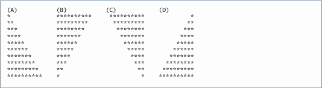

**4.17（计算信用额度）** 在经济衰退时期，收账变得越来越困难，因此公司可能会收紧信用额度，以防止应收账款（客户欠公司的钱）变得过大。为应对长期衰退，一家公司将其客户的信用额度削减了一半。因此，如果某位客户原来的信用额度为 $2000，现在是 $1000。如果客户原来的信用额度为 $5000，现在是 $2500。编写程序分析该公司三名客户的信用状况。对于每位客户，给定以下信息：

- a) 客户的账号。
- b) 客户在经济衰退前的信用额度。
- c) 客户的当前余额（即客户欠公司的金额）。

程序应计算并打印每位客户的新信用额度，并确定（并打印）哪些客户的当前余额超过其新信用额度。

**4.18（条形图打印程序）** 计算机一个有趣的应用是绘制图形和条形图。编写程序读取五个数字（每个在 1 到 30 之间）。对于读取的每个数字，程序应打印一行包含该数量相邻星号的内容。例如，如果程序读取数字七，应打印 `*******`。

**4.19（计算销售额）** 一家在线零售商销售五种不同产品，其零售价格如下表所示：

| 产品编号 | 零售价 |
|---:|---:|
| 1 | $ 2.98 |
| 2 | $ 4.50 |
| 3 | $ 9.98 |
| 4 | $ 4.49 |
| 5 | $ 6.87 |

编写程序读取一系列数字对，如下所示：

- a) 产品编号
- b) 一天售出的数量

程序应使用 switch 语句来帮助确定每种产品的零售价。

程序应计算并显示上周售出的所有产品的总零售额。

**4.20** *（真值表）* 通过在每个空白处填入 0 或 1 完成以下真值表。

| 条件1 | 条件2 | 条件1 && 条件2 |
|---|---|---|
| 0 | 0 | 0 |
| 0 | 非零 | 0 |
| 非零 | 0 | _____ |
| 非零 | 非零 | _____ |

| 条件1 | 条件2 | 条件1 \|\| 条件2 |
|---|---|---|
| 0 | 0 | 0 |
| 0 | 非零 | 1 |
| 非零 | 0 | _____ |
| 非零 | 非零 | _____ |

| 条件1 | !条件1 |
|---|---|
| 0 | 1 |
| 非零 | _____ |

**4.21** *（ASCII 值）* 编写程序转换并打印 ASCII 值 0 到 127 对应的字符。程序应每行打印 10 个字符。

**4.22** *（平均成绩）* 修改图 4.7 的程序，使其计算班级的平均成绩。

**4.23** *（用整数计算复利）* 修改图 4.6 的程序，使其仅使用整数计算复利。[提示：将所有货币金额视为以美分为单位的整数。然后分别使用除法和取余运算将结果“拆分”为美元部分和美分部分。插入一个小数点。]

**4.24** 假设 `i = 5`、`j = 7`、`k = 4` 且 `m = -2`。下列各语句分别打印什么？

- a) `printf("%d", i == 5);`
- b) `printf("%d", j != 5);`
- c) `printf("%d", i >= 5 && j < 4);`
- d) `printf("%d", !m && k > m);`
- e) `printf("%d", k || m);`
- f) `printf("%d", k - m || i < j);`
- g) `printf("%d", j + m < k && 10);`
- h) `printf("%d", !j < m);`
- i) `printf("%d", !(k > m));`
- j) `printf("%d", !(j > k));`

**4.25** *（十进制、二进制、八进制和十六进制等值表）* 编写程序，打印范围内十进制数的二进制、八进制和十六进制等值表。


重写这个新版本，将嵌套的 if...else 语句替换为一系列 if 语句；这里同样要小心正确处理默认情况（这比嵌套 if...else 版本更困难）。这个练习表明 switch 只是一种便利机制，任何 switch 语句都可以仅用单选择语句编写。

## 4.31（菱形打印程序）
编写一个程序，打印下面的菱形。你可以使用 printf 语句打印单个星号（*）或单个空格。尽量多使用迭代（使用嵌套 for 语句），并尽量减少 printf 语句的数量。

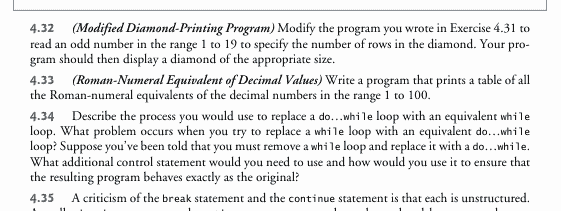

## 4.32（修改后的菱形打印程序）
修改你在练习 4.31 中编写的程序，使其读取 1 到 19 范围内的一个奇数，以指定菱形中的行数。然后程序应显示适当大小的菱形。

## 4.33（十进制值的罗马数字表示）
编写一个程序，打印一个表格，列出 1 到 100 范围内所有十进制数对应的罗马数字。

## 4.34
描述你会用来将 do...while 循环替换为等价 while 循环的过程。当你尝试将 while 循环替换为等价 do...while 循环时，会出现什么问题？假设有人告诉你必须移除一个 while 循环并将其替换为 do...while。你需要使用什么额外的控制语句，以及如何使用它来确保结果程序的行为与原始程序完全一致？

## 4.35
对 break 语句和 continue 语句的一种批评是，可以说它们都是非结构化的。实际上，break 语句和 continue 语句总是可以替换为结构化语句，尽管这样做可能很别扭。概括描述你会如何从程序中的循环里移除任意 break 语句，并用某种结构化等价物替换该语句。{提示：break 语句从循环体内部离开循环。另一种离开方式是不通过循环继续测试。考虑在循环继续测试中使用第二个测试，以指示“因‘break’条件而提前退出”。} 使用你在这里开发的技术，从图 4.11 的程序中移除 break 语句。

## 4.36
下面的程序段做什么？

```
1 int n = 4, a = 1;
2 int i, c;
3 for (i = 1; i <= n; i++) {
4
5     for (c = 1; c <= i; c++) {
6
7         printf("%d", a);
8         a++;
9     }
10 }
11 printf("\n");
```

## 4.37
概括描述你会如何从程序中的循环里移除任意 continue 语句，并用某种结构化等价物替换该语句。使用你在这里开发的技术，从图 4.12 的程序中移除 continue 语句。

## 4.38（“圣诞节的十二天”歌曲）
编写一个程序，使用迭代和 switch 语句打印歌曲《圣诞节的十二天》。应使用一个 switch 语句打印天数（即“第一”、“第二”等）。应使用另一个 switch 语句打印每段歌词的其余部分。

## 4.39（浮点数用于货币金额的局限性）
4.6 节提醒过在货币计算中使用浮点值的问题。试试这个实验：创建一个值为 1000000.00 的 float 变量。然后向该变量加上字面量浮点值 0.12f。使用 printf 和转换说明符 "%.2f" 显示结果。你会得到什么？

## 产生影响

## 4.40（世界人口增长）
几个世纪以来，世界人口已大幅增长。持续增长最终可能挑战可呼吸空气、可饮用水、可耕地和其他有限资源的极限。有证据表明，近年来增长一直在放缓，世界人口可能在本世纪某个时候达到峰值，然后开始下降。

对于这个练习，请在线研究世界人口增长问题。*务必调查各种观点。* 获取当前世界人口及其增长率的估计值（今年可能增加的百分比）。编写一个程序，计算未来 75 年每年世界人口的增长，使用当前增长率将保持不变的简化假设。将结果打印成表格。第一列应显示从第 1 年到第 75 年的年份。第二列应显示该年年底的预期世界人口。第三列应显示该年将发生的世界人口数值增量。根据你的结果，确定如果今年的增长率持续下去，人口将在哪一年达到今天的两倍。

## 4.41（税收方案替代方案；“公平税”）
有许多使税收更公平的提案。请查看美国的公平税（FairTax）倡议，网址为

www.fairtax.org

研究拟议的公平税如何运作。一项建议是取消所得税和大多数其他税，改为对你购买的所有产品和服务征收 23% 的消费税。一些公平税反对者质疑 23% 这个数字，并称由于税收计算方式，说税率是 30% 会更准确——请仔细核查这一点。编写一个程序，提示用户输入各个类别（例如住房、食品、服装、交通、教育、医疗保健、度假）的支出，然后打印该人估计需要缴纳的公平税。

## 5
## C 函数
### 目标
在本章中，你将：
- 用称为函数的小块模块化地构建程序。
- 使用 C 标准库中的常用数学函数。
- 创建新函数。
- 使用在函数之间传递信息的机制。
- 了解函数调用栈和栈帧如何支持函数调用/返回机制。
- 使用基于随机数生成的模拟技术。
- 编写并使用调用自身的函数。

- 5.1 引言
- 5.2 在 C 中模块化程序
- 5.3 数学库函数
- 5.4 函数
- 5.5 函数定义
  - 5.5.1 square 函数
  - 5.5.2 maximum 函数
- 5.6 函数原型：深入探讨
- 5.7 函数调用栈和栈帧
- 5.8 头文件
- 5.9 按值传递和按引用传递参数
- 5.10 随机数生成
- 5.11 示例：机会游戏；引入 `enum`
- 5.12 存储类
- 5.13 作用域规则
- 5.14 递归
- 5.15 使用递归的示例：斐波那契数列
- 5.16 递归与迭代
- 5.17 安全的 C 编程

小结 | 自测练习 | 自测练习答案 | 练习 | 产生影响

### 5.1 引言
大多数解决现实世界问题的计算机程序都比前几章中展示的程序大得多。经验表明，开发和维护大型程序的最佳方式是使用较小的部分来构建它，其中每一部分都比原程序更易于管理。这种技术称为分而治之。本章介绍 C 语言的一些关键特性，这些特性有助于大型程序的设计、实现、运行和维护。

### 5.2 在 C 中模块化程序
在 C 中，函数用于模块化程序。程序通常通过将你编写的新函数与 C 标准库中可用的预打包函数组合起来编写。本章讨论这两种函数。C 标准库提供了丰富的函数集合，用于执行常见的数学计算、字符串操作、字符操作、输入/输出以及许多其他有用的操作。这使你的工作更轻松，因为这些函数提供了你需要的许多能力。

> > **良好编程实践 5.1**
> >
> > 熟悉 C 标准库中丰富的函数集合。


> > **软件工程观察 5.1**
> >
> > 避免重复造轮子。尽可能使用 C 标准库函数，而不是编写新函数。这可以减少程序开发时间。这些函数由专家编写、经过充分测试且高效。


> > **可移植性提示 5.1**
> >
> > 使用 C 标准库中的函数有助于使程序更具可移植性。


C 语言和标准库*都*由 C 标准规定，并且它们都随标准 C 系统一起提供（例外情况是，其中一些库被指定为可选的）。我们在前面几章中使用过的函数 `printf`、`scanf` 和 `pow` 都是标准库函数。

你可以编写函数来定义特定任务，这些函数可能会在程序中的许多地方使用。这些函数有时称为程序员自定义函数。定义函数的实际语句只编写一次，并且这些语句对其他函数是隐藏的。

函数通过函数调用进行调用，函数调用指定函数名并提供函数执行其指定任务所需的信息（作为实参）。对此的一个常见类比是层级式管理形式。老板（调用函数或调用者）要求工人（被调用函数）执行一项任务，并在任务完成时报告回来（图 5.1）。例如，一个需要在屏幕上显示信息的函数会调用工人函数 `printf` 来执行该任务，然后 `printf` 显示信息，并在其任务完成时报告回来——或返回——给调用函数。老板函数不知道工人函数如何执行其指定任务。工人可以调用其他工人函数，而老板不会知道这一点。我们很快就会看到这种对实现细节的“隐藏”如何促进良好的软件工程。图 5.1 展示了一个老板函数以层级方式与多个工人函数通信。请注意，Worker1 对 Worker4 和 Worker5 来说充当老板函数。函数之间的关系可能不同于此图中所示的层级结构。

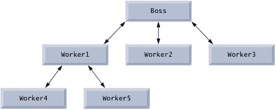

**图 5.1** | 层级式老板函数/工人函数关系。

## 5.3 数学库函数

数学库函数允许你执行某些常见的数学计算。我们在这里使用其中一些函数来介绍函数的概念。在本书后面，我们将讨论 C 标准库中的许多其他函数。

在程序中通常通过写出函数名，后跟左括号，再跟函数的实参（或以逗号分隔的实参列表），再跟右括号来使用函数。例如，要计算并打印 900.0 的平方根，你可以这样写

```c
printf("%.2f", sqrt(900.0));
```

当这条语句执行时，数学库函数 `sqrt` 被*调用*，以计算括号中数字的平方根（900.0）。数字 900.0 是 `sqrt` 函数的*实参*。前面的语句将打印 30.00。`sqrt` 函数接受一个 `double` 类型的实参，并返回一个 `double` 类型的结果。数学库中所有返回浮点值的函数都返回 `double` 类型。请注意，`double` 值，像 `float` 值一样，可以使用 `%f` 转换说明输出。你也可以将函数调用的结果存储在变量中，以便以后使用，如下所示：

```c
double result = sqrt(900.0);
```

> **错误预防提示 5.1**
>
> *使用数学库中的函数时，通过使用预处理指令 `#include <math.h>` 包含数学头文件。*

函数实参可以是常量、变量或表达式。如果 `c1 = 13.0`、`d = 3.0` 且 `f = 4.0`，那么语句

```c
printf("%.2f", sqrt(c1 + d * f));
```

会计算并打印 13.0 + 3.0 * 4.0 = 25.0 的平方根，即 5.00。

图 5.2 总结了 C 数学库函数的一小部分示例。在图中，变量 x 和 y 是 `double` 类型。C11 标准增加了广泛的浮点数和复数功能。

| 函数 | 描述 | 示例 |
|---|---|---|
| `sqrt(x)` | x 的平方根 | `sqrt(900.0)` 为 30.0<br>`sqrt(9.0)` 为 3.0 |
| `cbrt(x)` | x 的立方根（仅 C99 和 C11） | `cbrt(27.0)` 为 3.0<br>`cbrt(-8.0)` 为 -2.0 |
| `exp(x)` | 指数函数 e^x | `exp(1.0)` 为 2.718282<br>`exp(2.0)` 为 7.389056 |
| `log(x)` | x 的自然对数（以 e 为底） | `log(2.718282)` 为 1.0<br>`log(7.389056)` 为 2.0 |
| `log10(x)` | x 的对数（以 10 为底） | `log10(1.0)` 为 0.0<br>`log10(10.0)` 为 1.0<br>`log10(100.0)` 为 2.0 |
| `fabs(x)` | x 作为浮点数的绝对值 | `fabs(13.5)` 为 13.5<br>`fabs(0.0)` 为 0.0<br>`fabs(-13.5)` 为 13.5 |
| `ceil(x)` | 将 x 向上舍入到不小于 x 的最小整数 | `ceil(9.2)` 为 10.0<br>`ceil(-9.8)` 为 -9.0 |
| `floor(x)` | 将 x 向下舍入到不大于 x 的最大整数 | `floor(9.2)` 为 9.0<br>`floor(-9.8)` 为 -10.0 |
| `pow(x, y)` | x 的 y 次幂（x^y） | `pow(2, 7)` 为 128.0<br>`pow(9, .5)` 为 3.0 |
| `fmod(x, y)` | x/y 的余数，作为浮点数 | `fmod(13.657, 2.333)` 为 1.992 |
| `sin(x)` | x 的三角正弦（x 以弧度为单位） | `sin(0.0)` 为 0.0 |
| `cos(x)` | x 的三角余弦（x 以弧度为单位） | `cos(0.0)` 为 1.0 |
| `tan(x)` | x 的三角正切（x 以弧度为单位） | `tan(0.0)` 为 0.0 |

**图 5.2** | 常用数学库函数。

## 5.4 函数

函数允许你将程序模块化。在函数定义中定义的所有变量都是**局部变量**——它们*仅*可在定义它们的函数中访问。大多数函数都有一个**参数**列表，这些参数提供了在函数调用中通过实参在函数之间传递信息的手段。函数的参数也是该函数的*局部变量*。


> **软件工程观察 5.2**
>
> *在包含许多函数的程序中，main 通常实现为一组对函数的调用，这些函数执行程序的大部分工作。*

将程序“函数化”有几个动机。*分而治之*方法使程序开发更易于管理。另一个动机是**软件可重用性**——将现有函数用作*构建块*来创建新程序。软件可重用性是*面向对象编程*运动中的一个主要因素，当你学习派生自 C 的语言（如 C++、Objective-C、Java、C#（读作“C sharp”）和 Swift）时，你会了解更多相关内容。通过良好的函数命名和定义，程序可以由完成特定任务的标准化函数创建，而不是通过使用定制代码来构建。这称为**抽象**。每当我们使用像 printf、scanf 和 pow 这样的标准库函数时，我们都在使用抽象。第三个动机是避免在程序中重复代码。将代码打包为函数，使得只需调用该函数即可从程序中的其他位置执行它。


> **软件工程观察 5.3**
>
> *每个函数都应限于执行单个、定义明确的任务，并且函数名应表达该任务。这有助于抽象并促进软件可重用性。*


> **软件工程观察 5.4**
>
> *如果你无法选择一个能表达函数功能的名称，那么你的函数可能试图执行太多不同的任务。通常最好将这样的函数拆分为更小的函数——这有时称为分解。*

## 5.5 函数定义

我们目前展示的每个程序都由一个名为 main 的函数组成，它调用标准库函数来完成其任务。现在我们来考虑如何编写自定义函数。

### 5.5.1 square 函数

考虑一个程序，它使用函数 square 来计算并打印从 1 到 10 的整数的平方（图 5.3）。

```c
// Fig. 5.3: fig05_03.c
// Creating and using a programmer-defined function.
#include <stdio.h>

int square(int y); // function prototype

int main(void)
{
   // loop 10 times and calculate and output square of x each time
   for (int x = 1; x <= 10; ++x) {
      printf("%d ", square(x)); // function call
   }

   puts("");
}

// square function definition returns the square of its parameter
int square(int y) // y is a copy of the argument to the function
{
   return y * y; // returns the square of y as an int
}
```

| 1 | 4 | 9 | 16 | 25 | 36 | 49 | 64 | 81 | 100 |
|---|---|---|---|---|---|---|---|---|---|

**图 5.3** | 创建并使用程序员自定义函数。

**调用函数 square**

函数 square 在 main 中的 printf 语句（第 11 行）中被调用

```c
printf("%d ", square(x)); // function call
```

函数 square 在参数 y 中接收实参 x 的值的副本（第 18 行）。然后 square 计算 y * y，并将结果传回 main 中调用 square 的第 11 行（第 11 行）。第 11 行继续将 square 的结果传递给函数 printf，由它在屏幕上显示结果。此过程重复 10 次——for 语句的每次迭代一次。

**square 函数定义**

函数 square 的定义（第 18–21 行）表明 square 期望一个整数参数 y。函数名前的关键字 int（第 18 行）表示 square 返回一个整数结果。square 中的 return 语句将表达式 y * y 的值（即计算结果）传回调用函数。

**square 函数原型**

第 5 行

```c
int square(int y); // function prototype
```


是函数原型（也称为函数声明）。括号中的 int 通知编译器 square 预期从调用者接收一个整数值。函数名 square 左侧的 int 通知编译器 square 向调用者返回一个整数结果。编译器将对 square 的调用（第 11 行）与函数原型进行比较以确保：

- 参数数量正确，
- 参数类型正确，
- 参数类型顺序正确，且
- 返回类型与函数被调用的上下文一致。

函数原型在第 5.6 节中进行了详细讨论。

## 函数定义的格式

函数定义的格式为

```c
return-value-type function-name(parameter-list)
{
    statements
}
```

函数名是任何有效的标识符。返回值类型是返回给调用者的结果的数据类型。返回值类型 void 表示函数不返回值。返回值类型、函数名和参数列表合在一起有时被称为函数头。

> **错误预防提示 5.2**
> 
> *检查你的预期返回值的函数确实返回值。检查你的不预期返回值的函数确实不返回值。*

参数列表是用逗号分隔的列表，指定函数被调用时接收的参数。如果函数不接收任何值，则参数列表为 void。每个参数都必须显式列出其类型。

> **常见编程错误 5.1**
> 
> *将同一类型的函数参数指定为 double x, y 而不是 double x, double y 会导致编译错误。*

> **常见编程错误 5.2**
> 
> *在函数定义的参数列表右括号后放置分号是语法错误。*

> **常见编程错误 5.3**
> 
> *在函数中将参数重新定义为局部变量是编译错误。*

> **良好编程实践 5.2**
> 
> *虽然这样做并不错误，但不要对函数的参数和函数定义中对应的形参使用相同的名称。这有助于避免歧义。*

程序执行期间出现问题。有关如何报告程序失败的信息，请参阅特定操作系统环境的文档。

### 5.5.2 maximum 函数

我们的第二个示例使用程序员定义的函数 maximum 来确定并返回三个整数中的最大值（图 5.4）。整数通过 scanf 输入（第 14 行）。接下来，它们被传递给 maximum（第 18 行），后者确定最大整数。该值由 maximum 中的 return 语句（第 35 行）返回给 main。第 18 行的 printf 语句随后打印 maximum 返回的值。

```c
// Fig. 5.4: fig05_04.c
// Finding the maximum of three integers.
#include <stdio.h>

int maximum(int x, int y, int z); // function prototype

int main(void)
{
    int number1; // first integer entered by the user
    int number2; // second integer entered by the user
    int number3; // third integer entered by the user

    printf("%s", "Enter three integers: ");
    scanf("%d%d%d", &number1, &number2, &number3);

    // number1, number2 and number3 are arguments
    // to the maximum function call
    printf("Maximum is: %d\n", maximum(number1, number2, number3));

    return 0;
}

// Function maximum definition
// x, y and z are parameters
int maximum(int x, int y, int z)
{
    int max = x; // assume x is largest

    if (y > max) { // if y is larger than max,
        max = y; // assign y to max
    }

    if (z > max) { // if z is larger than max,
        max = z; // assign z to max
    }

    return max; // max is largest value
}
```

```
Enter three integers: 22 85 17
Maximum is: 85
```

图 5.4 | 求三个整数的最大值。（第 1 部分，共 2 部分。）

```
Enter three integers: 47 32 14
Maximum is: 47
```

```
Enter three integers: 35 8 79
Maximum is: 79
```

图 5.4 | 求三个整数的最大值。（第 2 部分，共 2 部分。）

该函数最初假设其第一个参数（存储在形参 x 中）是最大的，并将其赋给 max（第 25 行）。接下来，第 27–29 行的 if 语句判断 y 是否大于 max，如果是，则将 y 赋给 max。然后，第 31–33 行的 if 语句判断 z 是否大于 max，如果是，则将 z 赋给 max。最后，第 35 行将 max 返回给调用者。

## 5.6 函数原型：深入探讨

C 的一个重要特性是函数原型，它借鉴自 C++。编译器使用函数原型来验证函数调用。预标准 C 不执行这种检查，因此可以在不被编译器检测到错误的情况下错误地调用函数。这种调用可能导致致命的执行时错误或导致难以检测的微妙问题的非致命错误。函数原型纠正了这一缺陷。

**良好编程实践 5.4**

*为所有函数包含函数原型以利用 C 的类型检查功能。使用 #include 预处理器指令从相应库的头文件中获取标准库函数的函数原型，或获取包含由你和/或你的组成员开发的函数的函数原型的头文件。*

图 5.4（第 5 行）中 maximum 的函数原型为

```c
int maximum(int x, int y, int z); // function prototype
```

它说明 maximum 接受三个 int 类型的参数并返回 int 类型的结果。请注意，函数原型与 maximum 定义的第一行相同。

**良好编程实践 5.5**

*出于文档目的，在函数原型中包含参数名。编译器忽略这些名称，因此原型 int maximum(int, int, int); 是有效的。*

**常见编程错误 5.5**

*忘记在函数原型末尾加上分号是语法错误。*

## 编译错误

与函数原型不匹配的函数调用是编译错误。如果函数原型和函数定义不一致，也会生成错误。例如，在图 5.4 中，如果函数原型被写成

```c
void maximum(int x, int y, int z);
```

编译器会生成错误，因为函数原型的 `void` 返回类型与函数头中的 `int` 返回类型不同。

## 参数强制转换和“通常算术转换规则”

函数原型的另一个重要特性是参数的强制转换，即将参数强制为适当的类型。例如，数学库函数 `sqrt` 可以用整数参数调用，即使 `<math.h>` 中的函数原型指定了 `double` 参数，函数仍然能正确工作。语句

```c
printf("%.3f\n", sqrt(4));
```

正确计算 `sqrt(4)` 并打印 2.000。函数原型导致编译器在将副本传递给 `sqrt` 之前将 `int` 值 4 的副本转换为 `double` 值 4.0。一般来说，与函数原型中的参数类型不完全对应的参数值在函数被调用之前会被转换为适当的类型。这些转换可能导致错误结果，如果不遵循 C 的通常算术转换规则。这些规则指定了如何在不丢失数据的情况下将值转换为其他类型。在我们的示例中，`int` 会自动转换为 `double` 而不改变其值（因为 `double` 可以表示比 `int` 大得多的值范围）。然而，`double` 转换为 `int` 时会截断 double 的小数部分，从而改变原始值。将大整数类型转换为小整数类型（例如 `long` 到 `short`）也可能导致值发生变化。

通常算术转换规则自动适用于包含两种数据类型的值的表达式（也称为混合类型表达式），并由编译器处理。在混合类型表达式中，编译器会制作需要转换的值的临时副本，然后将副本转换为表达式中“最高”的类型——这称为提升。包含至少一个浮点值的混合类型表达式的通常算术转换规则为：

- 如果其中一个值是 `long double`，则另一个值转换为 `long double`。
- 如果其中一个值是 `double`，则另一个值转换为 `double`。
- 如果其中一个值是 `float`，则另一个值转换为 `float`。

如果混合类型表达式只包含整数类型，则通常算术转换指定了一组整数提升规则。在大多数情况下，图 5.5 中较低的整数类型会被转换为图中较高的类型。C 标准文档第 6.3.1 节规定了算术操作数和通常算术转换规则的完整细节。图 5.5 列出了浮点和整数数据类型以及每种类型的 `printf` 和 `scanf` 转换说明。

| 数据类型 | `printf` 转换说明 | `scanf` 转换说明 |
|---|---|---|
| *浮点类型* |  |  |
| `long double` | `%Lf` | `%Lf` |
| `double` | `%f` | `%lf` |
| `float` | `%f` | `%f` |

**图 5.5** 算术数据类型及其转换说明。（第 1 部分，共 2 部分。）


| 数据类型 | printf 转换说明符 | scanf 转换说明符 |
|---|---|---|
| *整数类型* |  |  |
| unsigned long long int | `%llu` | `%llu` |
| long long int | `%lld` | `%lld` |
| unsigned long int | `%lu` | `%lu` |
| long int | `%ld` | `%ld` |
| unsigned int | `%u` | `%u` |
| int | `%d` | `%d` |
| unsigned short | `%hu` | `%hu` |
| short | `%hd` | `%hd` |
| char | `%c` | `%c` |

**图 5.3** | 算术数据类型及其转换说明符。（第 2 部分，共 2 部分。）

一个值只能通过显式地将该值赋给较低类型变量或使用 *类型转换运算符* 来转换为 *较低类型*。函数调用中的参数会根据函数原型中指定的参数类型进行转换，就好像参数被直接赋给这些类型的变量一样。如果我们的 square 函数使用 int 参数（图 5.3）被浮点参数调用，则参数会被转换为 int（较低类型），并且 square 通常会返回错误的值。例如，square(4.5) 返回 16，而不是 20.25。

> **常见编程错误 5.6**
> 
> *从提升层级中的较高数据类型转换为较低类型可能会改变数据值。在这种情况下，许多编译器会发出警告。*


如果函数没有函数原型，编译器会使用函数的第一次出现——函数定义或对函数的调用——来形成自己的函数原型。这通常会导致警告或错误，具体取决于编译器。

> **错误预防提示 5.3**
> 
> *始终为程序中定义的或使用的函数包含函数原型，以帮助防止编译错误和警告。*


> **软件工程观察 5.9**
> 
> *放置在任何函数定义之外的函数原型适用于文件中函数原型之后出现的所有对该函数的调用。放置在函数体内的函数原型仅适用于该函数中进行的调用。*


## 5.7 函数调用栈和栈帧

为了理解 C 如何执行函数调用，我们首先需要考虑一种称为栈的数据结构（即相关数据项的集合）。可以将栈想象成一堆盘子。当一个盘子放在堆上时，它通常放在 *顶部*（称为将盘子推入栈）。同样，当一个盘子从堆上取下时，它通常是从 *顶部* 取下（称为将盘子从栈中弹出）。栈被称为后进先出（LIFO）数据结构——被推入（插入）栈的 *最后* 项是被弹出（移除）栈的 *第一* 项。

计算机科学学生需要理解的一个重要机制是函数调用栈（有时称为程序执行栈）。这种数据结构在“幕后”工作，支持函数调用/返回机制。它还支持每个被调用函数的局部变量（也称为 *自动变量*）的创建、维护和销毁。我们用盘子堆叠的例子解释了栈的后进先出（LIFO）行为。正如我们在图 5.7–5.9 中看到的，这种 LIFO 行为 *完全* 就是函数返回到调用它的函数时所做的。

每次调用一个函数时，它可能会调用其他函数，而这些函数又可能会调用其他函数——所有这些都在任何函数返回之前。每个函数最终必须将控制权返回给调用它的函数。因此，我们必须跟踪每个函数需要返回控制权给调用它的函数的返回地址。函数调用栈是处理此信息的完美数据结构。每次一个函数调用另一个函数时，一个条目就会被 *压入* 栈。该条目称为栈帧，包含被调用函数为了返回到调用函数所需的 *返回地址*。它还包含一些我们很快会讨论的额外信息。如果被调用函数返回，而不是在返回前调用另一个函数，则函数调用的栈帧会被 *弹出*，并且控制权转移到被弹出栈帧中的返回地址。

每个被调用函数 *总是* 在调用栈的 *顶部* 找到返回到其调用者所需的信息。而且，如果一个函数对另一个函数进行调用，则新函数调用的栈帧 simply 被推入调用栈。因此，新被调用函数返回到其调用者所需的返回地址现在位于栈的 *顶部*。

栈帧还有另一个重要职责。大多数函数都有局部（自动）变量——参数和一些或全部局部变量。自动变量需要在函数执行期间存在。如果函数对其他函数进行调用，它们需要保持活动。但当被调用函数返回到其调用者时，被调用函数的自动变量需要“消失”。被调用函数的栈帧是为自动变量保留内存的完美位置。该栈帧仅在被调用函数处于活动状态时存在。当该函数返回并且不再需要其局部自动变量时，其栈帧会从栈中 *弹出*，并且这些局部自动变量不再为程序所知。

当然，计算机中的内存是有限的，因此只能使用一定量的内存来存储函数调用栈上的栈帧。如果发生的函数调用多于函数调用栈上可以存储其栈帧的数量，就会发生称为栈溢出的 *致命错误*。

### 函数调用栈的实际操作

现在让我们考虑调用栈如何支持由 main 调用的 square 函数的操作（图 5.6 的第 8–13 行）。首先操作系统调用 main——这会将一个栈帧推入栈（图 5.7 所示）。该栈帧告诉 main 如何返回到操作系统（即转移到返回地址 R1）并包含 main 的自动变量的空间（即 a，初始化为 10）。

```c
1  // Fig. 5.6: fig05_06.c
2  // Demonstrating the function call stack
3  // and stack frames using a function square.
4  #include <stdio.h>
5
6  int square(int); // prototype for function square
7
8  int main()
9  {
10     int a = 10; // value to square (local automatic variable in main)
11
12     printf("%d squared: %d\n", a, square(a)); // display a squared
13  }
14
15  // returns the square of an integer
16  int square(int x) // x is a local variable
17  {
18     return x * x; // calculate square and return result
19  }
```

10 的平方：100

**图 5.6** | 使用函数 square 演示函数调用栈和栈帧。

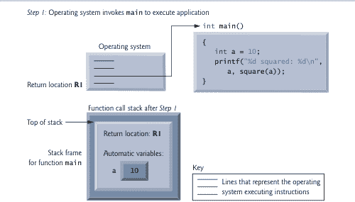

**图 5.7** | 操作系统调用 `main` 执行程序后的函数调用栈。

函数 main——在返回到操作系统之前——现在在图 5.6 的第 12 行调用函数 square。这会导致 square 的栈帧（第 16–19 行）被推入函数调用栈（图 5.8）。该栈帧包含 square 返回到 main 所需的返回地址（即 R2）以及 square 的自动变量（即 x）的内存。

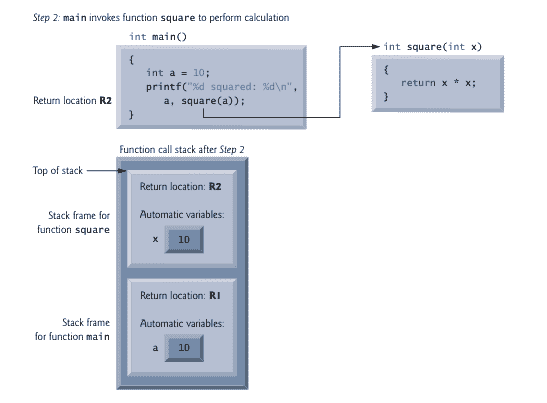

**图 5.8** | main 调用 square 执行计算后的函数调用栈。

在 square 计算其参数的平方后，它需要返回到 main——并且不再需要其自动变量 x 的内存。因此栈被弹出——给 square main 中的返回位置（即 R2）并丢失 square 的自动变量。图 5.9 显示了 square 的栈帧被弹出后的函数调用栈。

函数 main 现在显示调用 square 的结果（图 5.6 中的第 12 行）。到达 main 的右大括号结束处会导致其栈帧从栈中弹出，给 main 返回到操作系统的地址（即图 5.7 中的 R1）并导致 main 的自动变量（即 a）的内存变得不可用。

你现在已经看到了栈数据结构在实现支持程序执行的关键机制方面的价值。数据结构在计算机科学中有许多重要的应用。我们在第 12 章讨论栈、队列、列表、树和其他数据结构。


| 头文件 | 说明 |
|---|---|
| `<math.h>` | 包含数学库函数的函数原型。 |
| `<setjmp.h>` | 包含允许绕过通常的函数调用和返回序列的函数的函数原型。 |
| `<signal.h>` | 包含处理程序执行期间可能出现的各种条件的函数原型和宏。 |
| `<stdarg.h>` | 定义用于处理参数数量和类型未知函数的参数列表的宏。 |
| `<stddef.h>` | 包含 C 用于执行计算的常用类型定义。 |
| `<stdio.h>` | 包含标准输入/输出库函数的函数原型，以及它们使用到的信息。 |
| `<stdlib.h>` | 包含数字到文本和文本到数字的转换、内存分配、随机数和其他实用函数的函数原型。 |
| `<string.h>` | 包含字符串处理函数的函数原型。 |
| `<time.h>` | 包含用于操作时间和日期的函数原型和类型。 |

**图 5.10** | 一些标准库头文件。 (第 2 部分，共 2 部分。)

你可以创建自定义头文件。程序员定义的头文件也应使用 `.h` 文件扩展名。可以通过使用 `#include` 预处理指令来包含程序员定义的头文件。例如，如果我们的 square 函数的原型位于头文件 `square.h` 中，我们就可以通过在程序顶部使用以下指令来包含该头文件：

```c
#include "square.h"
```

第 13.2 节介绍了有关包含头文件的额外信息，例如为什么程序员定义的头文件用引号 (`" "`) 而不是尖括号 (`<>`) 括起来。

## 5.9 按值传递参数和按引用传递参数

在许多编程语言中，传递参数有两种方式——按值传递和按引用传递。当参数*按值传递*时，会复制参数的值并将其传递给被调用函数。对副本的更改不会影响调用方中原始变量的值。当参数*按引用传递*时，调用方允许被调用函数*修改*原始变量的值。

只要被调用函数不需要修改调用方原始变量的值，就应使用按值传递。这可以防止意外的副作用（变量修改），而这些副作用极大地阻碍了正确可靠的软件系统的开发。仅应在需要修改原始变量的*受信任*的被调用函数中使用按引用传递。

在 C 语言中，所有参数都是按值传递的。正如我们在第 7 章《C 指针》中将看到的那样，可以通过使用*地址运算符*和*间接运算符*来实现按引用传递。在第 6 章中，我们将看到出于性能原因，数组参数会自动按引用传递。我们将在第 7 章看到，这*不是*矛盾。目前，我们集中讨论按值传递。

## 5.10 随机数生成

我们现在进行一次简短的、希望是有趣的关于*模拟*和*游戏*的插曲。在本节和下一节中，我们将开发一个结构良好的游戏程序，其中包含多个函数。该程序使用了函数和我们已经学习过的几种控制语句。*随机性*可以通过使用来自 `<stdlib.h>` 头文件的 C 标准库函数 `rand` 引入到计算机应用中。

### 获取随机整数值

考虑以下语句：

```c
i = rand();
```

`rand` 函数生成 0 到 `RAND_MAX` 之间的整数（在 `<stdlib.h>` 头文件中定义的符号常量）。标准 C 规定 `RAND_MAX` 的值必须至少为 32767，这是两字节（即 16 位）整数的最大值。本节中的程序在 Microsoft Visual C++ 上进行了测试，最大 `RAND_MAX` 值为 32767，并在 GNU gcc 和 Xcode LLVM 上进行了测试，最大 `RAND_MAX` 值为 2147483647。如果 `rand` 真正*随机*产生整数，则 0 到 `RAND_MAX` 之间的每个数字在每次调用 `rand` 时都有相同的机会（或概率）被选中。

`rand` 直接产生的数字范围通常与特定应用程序的需求不同。例如，模拟抛硬币的程序可能只需要 0 表示“正面”和 1 表示“反面”。模拟六面骰子的掷骰程序需要 1 到 6 的随机整数。

### 掷六面骰子

为了演示 `rand`，让我们开发一个程序（图 5.11）来模拟六面骰子掷 20 次并打印每次掷出的值。

```c
// Fig. 5.11: fig05_11.c
// Shifted, scaled random integers produced by 1 + rand() % 6.
#include <stdio.h>
#include <stdlib.h>

int main(void)
{
   // loop 20 times
   for (unsigned int i = 1; i <= 20; ++i) {

      // pick random number from 1 to 6 and output it
      printf("%10d", 1 + (rand() % 6));

      // if counter is divisible by 5, begin new line of output
      if (i % 5 == 0) {
         puts("");
      }
   }
}
```

**图 5.11** | 由 `1 + rand() % 6` 产生的平移、缩放随机整数。 (第 1 部分，共 2 部分。)

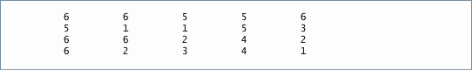

**图 5.11** | 由 1 + rand() % 6 产生的平移、缩放随机整数。 (第 2 部分，共 2 部分。)

函数 `rand` 的函数原型在 `<stdlib.h>` 中。我们将取余运算符 (%) 与 `rand` 结合使用，如下所示

```c
rand() % 6
```

以产生 0 到 5 范围内的整数。这称为缩放。数字 6 称为缩放因子。然后我们通过在之前的结果上加 1 来平移产生的数字范围。输出确认结果在 1 到 6 的范围内——实际选择的随机值可能会因编译器而异。

### 掷六面骰子 60,000,000 次

为了显示每个数字出现的可能性大致相等，让我们用图 5.12 的程序模拟掷骰子 60,000,000 次。1 到 6 的每个整数应大约出现 10,000,000 次。

```c
// Fig. 5.12: fig05_12.c
// Rolling a six-sided die 60,000,000 times.
#include <stdio.h>
#include <stdlib.h>

int main(void)
{
    unsigned int frequency1 = 0; // rolled 1 counter
    unsigned int frequency2 = 0; // rolled 2 counter
    unsigned int frequency3 = 0; // rolled 3 counter
    unsigned int frequency4 = 0; // rolled 4 counter
    unsigned int frequency5 = 0; // rolled 5 counter
    unsigned int frequency6 = 0; // rolled 6 counter

    // loop 60000000 times and summarize results
    for (unsigned int roll = 1; roll <= 60000000; ++roll) {
        int face = 1 + rand() % 6; // random number from 1 to 6

        // determine face value and increment appropriate counter
        switch (face) {

            case 1: // rolled 1
                ++frequency1;
                break;

            case 2: // rolled 2
                ++frequency2;
                break;

29
30            case 3:  // rolled 3
31                ++frequency3;
32                break;
33
34            case 4:  // rolled 4
35                ++frequency4;
36                break;
37
38            case 5:  // rolled 5
39                ++frequency5;
40                break;
41
42            case 6:  // rolled 6
43                ++frequency6;
44                break;  // optional
45        }
46
47
48        // display results in tabular format
49        printf("%s%13s\n", "Face", "Frequency");
50        printf("%13u\n", frequency1);
51        printf("%13u\n", frequency2);
52        printf("%13u\n", frequency3);
53        printf("%13u\n", frequency4);
54        printf("%13u\n", frequency5);
55        printf("%13u\n", frequency6);
56    }
}
```

**图 5.12** | 掷六面骰子 60,000,000 次。 (第 1 部分，共 2 部分。)

| 点数 | 频率 |
| --- | --- |
| 1 | 9999294 |
| 2 | 10002929 |
| 3 | 9995360 |
| 4 | 10000409 |
| 5 | 10005206 |
| 6 | 9996802 |

**图 5.12** | 掷六面骰子 60,000,000 次。 (第 2 部分，共 2 部分。)

正如程序输出所示，通过缩放和平移，我们已使用 rand 函数真实地模拟了六面骰子的掷骰。注意使用 %s 转换说明符将字符字符串 "Face" 和 "Frequency" 打印为列标题（第 49 行）。在第 6 章学习数组后，我们将展示如何优雅地用单行语句替换这 26 行 switch 语句。

### 随机化随机数生成器

再次执行图 5.11 的程序会产生

| | | | | |
|---|---|---|---|---|
| 6 | 6 | 5 | 5 | 6 |
| 5 | 1 | 1 | 5 | 3 |
| 6 | 6 | 2 | 4 | 2 |
| 6 | 2 | 3 | 4 | 1 |


请注意，打印出了*完全相同的值序列*。这些怎么会是*随机数*呢？具有讽刺意味的是，这种*可重复性*是函数 rand 的一个重要特性。在*调试*程序时，这种可重复性对于证明对程序的修正能够正常工作至关重要。

函数 rand 实际上生成的是伪随机数。重复调用 rand 会产生一个*看起来*随机的数字序列。然而，每次执行程序时，该序列都会重复自身。一旦程序经过彻底调试，就可以使其在每次执行时产生*不同的*随机数序列。这称为随机化，通过标准库函数 srand 实现。函数 srand 接受一个 unsigned int 参数，并为函数 rand 设置种子，以便在程序每次执行时产生不同的随机数序列。

我们在图 5.13 中演示函数 srand。转换说明符 %u 用于通过 scanf 读取 unsigned int 值。srand 的函数原型位于 `<stdlib.h>` 中。

```c
// Fig. 5.13: fig05_13.c
// Randomizing the die-rolling program.
#include <stdlib.h>
#include <stdio.h>

int main(void)
{
    unsigned int seed; // number used to seed the random number generator

    printf("%s", "Enter seed: ");
    scanf("%u", &seed); // note %u for unsigned int

    srand(seed); // seed the random number generator

    // loop 10 times
    for (unsigned int i = 1; i <= 10; ++i) {

        // pick a random number from 1 to 6 and output it
        printf("%d", 1 + (rand() % 6));

        // if counter is divisible by 5, begin a new line of output
        if (i % 5 == 0) {
            puts("");
        }
    }
}
```

```text
Enter seed: 67
        6       1       4       6       2
        1       6       1       6       4
```

```text
Enter seed: 867
        2       4       6       1       6
        1       1       3       6       2
```

**图 5.13** | 掷骰子程序的随机化。（第 1 部分，共 2 部分。）

```text
Enter seed: 67
       6       1       4       6       2
       1       6       1       6       4
```

图 5.13 | 掷骰子程序的随机化。（第 2 部分，共 2 部分）

让我们多次运行该程序并观察结果。请注意，只要提供不同的种子，每次运行程序时都会获得不同的随机数序列。第一个和最后一个输出使用相同的种子值，因此它们显示相同的结果。

要在不每次都输入种子的情况下进行随机化，可使用类似下面的语句

```
srand(time(NULL));
```

这会使计算机读取其时钟，以自动获取种子值。函数 time 返回自 1970 年 1 月 1 日午夜以来经过的秒数。该值被转换为无符号整数，并用作随机数生成器的种子。time 的函数原型位于 `<time.h>` 中。我们将在第 7 章进一步讨论 NULL。

### 随机数的广义缩放与平移

由 rand 直接生成的值始终在以下范围内：

```
0 <= rand() <= RAND_MAX
```

如你所知，下面的语句模拟掷一个六面骰子：

```
face = 1 + rand() % 6;
```

该语句总是将一个整数值（随机地）赋给变量 face，范围为 1 ≤ face ≤ 6。该范围的宽度（即范围内连续整数的个数）为 6，范围内的起始数字为 1。回顾前面的语句，我们看到范围的宽度由用于通过求余运算符缩放 rand 的数字（即 6）决定，而范围的起始数字等于加到 rand % 6 上的数字（即 1）。我们可以将这一结果推广如下：

```
n = a + rand() % b;
```

其中 a 是平移值（等于所需连续整数范围中的第一个数字），b 是缩放因子（等于所需连续整数范围的宽度）。在练习中，我们将看到可以从连续整数范围之外的值集合中随机选择整数。

## 5.11 示例：机会游戏；介绍 enum

最受欢迎的机会游戏之一是一种称为“craps”（双骰子）的骰子游戏，世界各地的赌场和小巷中都会玩这种游戏。该游戏的规则很简单：

> 玩家掷两个骰子。每个骰子有六个面。这些面分别有 1、2、3、4、5 和 6 个点。骰子停止后，计算两个朝上的面的点数之和。如果第一次投掷的点数之和为 7 或 11，则玩家获胜。如果第一次投掷的点数之和为 2、3 或 12（称为“craps”），则玩家输（即“庄家”赢）。如果第一次投掷的点数之和为 4、5、6、8、9 或 10，那么该和数成为玩家的“点数”。要获胜，你必须继续掷骰子，直到“掷出你的点数”。如果玩家在掷出点数之前掷出 7，则输。图 5.14 模拟了 craps 游戏，图 5.15 展示了几次示例执行。

```c
// Fig. 5.14: fig05_14.c
// Simulating the game of craps.
#include <stdio.h>
#include <stdlib.h>
#include <time.h> // contains prototype for function time

// enumeration constants represent game status
enum Status { CONTINUE, WON, LOST };

int rollDice(void); // function prototype

int main(void)
{
    // randomize random number generator using current time
    srand(time(NULL));

    int myPoint; // player must make this point to win
    enum Status gameStatus; // can contain CONTINUE, WON, or LOST
    int sum = rollDice(); // first roll of the dice

    // determine game status based on sum of dice
    switch(sum) {

        // win on first roll
        case 7: // 7 is a winner
        case 11: // 11 is a winner
            gameStatus = WON;
            break;

        // lose on first roll
        case 2: // 2 is a loser
        case 3: // 3 is a loser
        case 12: // 12 is a loser
            gameStatus = LOST;
            break;

        // remember point
        default:
            gameStatus = CONTINUE; // player should keep rolling
            myPoint = sum; // remember the point
            printf("Point is %d\n", myPoint);
            break; // optional
    }

45    // while game not complete
46    while (CONTINUE == gameStatus) { // player should keep rolling
47        sum = rollDice(); // roll dice again
48
49        // determine game status
50        if (sum == myPoint) { // win by making point
51            gameStatus = WON;
52        }
53        else {
54            if (7 == sum) { // lose by rolling 7
55                gameStatus = LOST;
56            }
57        }
58    }
59
60    // display won or lost message
61    if (WON == gameStatus) { // did player win?
62        puts("Player wins");
63    }
64    else { // player lost
65        puts("Player loses");
66    }
67 }
68
69 // roll dice, calculate sum and display results
70 int rollDice(void)
71 {
72     int die1 = 1 + (rand() % 6); // pick random die1 value
73     int die2 = 1 + (rand() % 6); // pick random die2 value
74
75     // display results of this roll
76     printf("Player rolled %d + %d = %d\n", die1, die2, die1 + die2);
77     return die1 + die2; // return sum of dice
78 }
```

图 5.14 | 模拟 craps 游戏。（第 1 部分，共 2 部分）。

图 5.14 | 模拟 craps 游戏。（第 2 部分，共 2 部分。）

玩家在第一次投掷中获胜

```text
Player rolled 5 + 6 = 11
Player wins
```

玩家在后续投掷中获胜

```text
Player rolled 4 + 1 = 5
Point is 5
Player rolled 6 + 2 = 8
Player rolled 2 + 1 = 3
Player rolled 3 + 2 = 5
Player wins
```

**图 5.15** | craps 游戏的示例运行。（第 1 部分，共 2 部分。）

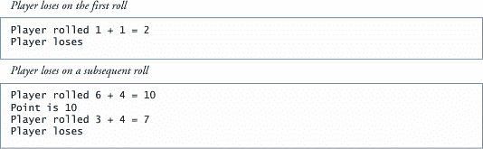

**图 5.15** | craps 游戏的示例运行。（第 2 部分，共 2 部分。）

在游戏规则中，请注意玩家在第一次投掷时必须掷*两个骰子*，并且在之后的所有后续投掷中也必须这样做。我们定义一个函数 `rollDice` 来掷骰子，并计算和打印它们的和。函数 `rollDice` 只定义*一次*，但它在程序中的*两个*位置（第 19 行和第 47 行）被调用。该函数不接受参数，因此我们在参数列表（第 70 行）和函数原型中指出了 `void`。函数 `rollDice` 确实返回两个骰子的和，因此在其函数头和函数原型中指出了返回类型 `int`。

### 枚举

这个游戏相当复杂。玩家可能在第一次投掷中获胜或失败，也可能在任何后续投掷中获胜或失败。变量 `gameStatus` 被定义为一种新类型——`enum Status`——用于存储当前状态。第 8 行创建了一个程序员定义的类型，称为枚举。枚举由关键字 `enum` 引入，是一组由标识符表示的整数常量。枚举常量有助于使程序更具可读性且更易于维护。`enum` 中的值从 0 开始，并以 1 递增。在第 8 行中，常量 `CONTINUE` 的值为 0，`WON` 的值为 1，`LOST` 的值为 2。也可以为 `enum` 中的每个标识符分配一个整数值（见第 10 章）。枚举中的*标识符*必须*唯一*，但*值*可以*重复*。

> **常见编程错误 5.7**
> 在枚举常量定义之后为其赋值是语法错误。

> **良好编程实践 5.6**
> 在枚举常量的名称中只使用大写字母，以使这些常量在程序中更醒目，并表明枚举常量不是变量。

当游戏获胜时，无论是在第一次投掷还是后续投掷中，`gameStatus` 都被设置为 `WON`。当游戏失败时，无论是在第一次投掷还是后续投掷中，`gameStatus` 都被设置为 `LOST`。否则，`gameStatus` 被设置为 `CONTINUE`，游戏继续。

### 游戏在第一次投掷后结束

第一次投掷后，如果游戏结束，则跳过 `while` 语句（第 46–58 行），因为 `gameStatus` 不是 `CONTINUE`。程序继续执行第 61–66 行的 `if...else` 语句；如果 `gameStatus` 为 `WON`，该语句打印 "Player wins"，否则打印 "Player loses"。


### 游戏在后续掷骰中结束

第一次掷骰后，如果游戏*尚未结束*，则*sum*被保存到*myPoint*中。由于`gameStatus`为`CONTINUE`，执行会继续进入`while`语句。每次执行`while`循环时，都会调用`rollDice`以生成新的点数之和。如果*sum*与*myPoint*匹配，则将`gameStatus`设置为`WON`，表示玩家获胜，`if`...`else`语句打印`"Player wins"`，然后执行终止。如果*sum*等于7（第54行），则将`gameStatus`设置为`LOST`，表示玩家失败，`while`测试失败，`if`...`else`语句打印`"Player loses"`，然后执行终止。

### 控制架构

注意该程序有趣的控制架构。我们使用了两个函数——`main`和`rollDice`——以及`switch`、`while`、`if`...`else`和嵌套的`if`语句。在本章练习中，我们将研究双骰子游戏的各种有趣特征。

## 5.12 存储类

在第2～4章中，我们使用标识符作为变量名。变量的属性包括*名称*、*类型*、*大小*和*值*。在本章中，我们还使用标识符作为用户定义函数的名称。实际上，程序中的每个标识符还有其他属性，包括存储类、存储期、作用域和链接。

C提供了存储类说明符`auto`、`register`^1、`extern`和`static`^2。标识符的存储类决定其存储期、作用域和链接。标识符的存储期是标识符*存在于内存中*的时期。有些短暂存在，有些被反复创建和销毁，还有一些则在整个程序执行期间存在。标识符的作用域是标识符在程序中可被引用的*位置*。有些可以在整个程序中引用，另一些只能在程序的某些部分引用。标识符的链接决定：对于多源文件程序，该标识符是仅在当前源文件中已知，还是在具有正确声明的*任何*源文件中已知。本节讨论存储类和存储期。5.13节讨论作用域。第14章讨论标识符链接以及多源文件编程。

存储类说明符可分为自动存储期和静态存储期两类。关键字`auto`用于声明自动存储期的变量。具有自动存储期的变量在程序控制进入定义它们的块时创建；它们在块活动期间存在，并在程序控制退出该块时销毁。

### 局部变量

只有变量可以具有自动存储期。函数的局部变量（在参数列表或函数体中声明的变量）通常具有自动存储期。关键字`auto`显式声明具有自动存储期的变量。局部变量*默认*具有自动存储期，因此关键字`auto`很少使用。在本书余下部分，我们将把具有自动存储期的变量简称为自动变量。

- 1. 关键字`register`已过时，不应使用。
- 2. C11标准增加了存储类说明符`_Thread_local`，这超出了本书的范围。

> **性能提示 5.1**
>
> *自动存储是节省内存的一种手段，因为自动变量仅在需要时存在。它们在进入函数时创建，在退出函数时销毁。*

### 静态存储类

关键字`extern`和`static`用于静态存储期的变量和函数的标识符声明中。静态存储期的标识符从程序开始执行时存在，直到程序终止。对于静态变量，存储空间*仅在程序开始执行前分配并初始化一次*。对于函数，函数名在程序开始执行时存在。然而，尽管变量名和函数名从程序执行开始时就存在，但这*不*意味着这些标识符可以在整个程序中被访问。存储期和作用域（名称可使用的位置）是彼此独立的问题，我们将在5.13节看到。

具有静态存储期的标识符有几种类型：*外部标识符*（如全局变量和函数名）以及用存储类说明符`static`声明的局部变量。全局变量和函数名默认属于`extern`存储类。全局变量通过将变量声明放在任何函数定义*之外*来创建，并在程序整个执行期间保留其值。全局变量和函数可以由文件中在其声明或定义之后的任何函数引用。这是使用函数原型的原因之一——当在调用`printf`的程序中包含`stdio.h`时，函数原型被放在文件开头，以使名称`printf`为文件其余部分所知。

> **软件工程观察 5.10**
>
> *将变量定义为全局变量而不是局部变量，会在不需要访问该变量的函数意外或恶意修改它时产生非预期的副作用。一般而言，应避免全局变量，除非在某些具有独特性能要求的情形中（如第14章所述）。*

> **软件工程观察 5.11**
>
> *仅在一个特定函数中使用的变量应定义为该函数中的局部变量，而不是外部变量。*

用关键字`static`声明的局部变量仍然*仅*在其所定义的函数中已知，但与自动变量不同，静态局部变量在函数退出时会*保留*其值。下次调用该函数时，静态局部变量包含函数上次退出时的值。下面的语句将局部变量`count`声明为静态，并将其初始化为1。

```
static int count = 1;
```

如果你没有显式初始化，所有具有静态存储期的数值变量默认都初始化为零。

当显式应用于外部标识符时，关键字`extern`和`static`具有特殊含义。第14章讨论显式将`extern`和`static`用于外部标识符以及多源文件程序。

## 5.13 作用域规则

标识符的作用域是程序中可以引用该标识符的部分。例如，当我们在一个块中定义局部变量时，*仅*能在该块中其定义之后或嵌套于该块的块中引用它。四种标识符作用域是函数作用域、文件作用域、块作用域和函数原型作用域。

标号（后跟冒号的标识符，如`start:`）是*唯一*具有函数作用域的标识符。标号可以在其出现的函数中的*任何地方*使用，但不能在函数体外部引用。标号用于`switch`语句（在`case`标号中）和`goto`语句（见第14章）。标号在其所定义的函数中是隐藏的。这种隐藏——更正式地称为信息隐藏——是实现最小权限原则的一种手段——最小权限原则是良好软件工程的一项基本原则。在应用程序的上下文中，该原则指出，代码应*仅*被授予完成其指定任务所需的特权和访问权，而不得授予更多。

在任何函数外部声明的标识符具有文件作用域。这种标识符从声明点起直到文件末尾，在所有函数中都是“已知的”（即可访问的）。放在函数外部的全局变量、函数定义和函数原型都具有文件作用域。

在块内定义的标识符具有块作用域。块作用域在块的结束右花括号（`}`）处结束。在函数开头定义的局部变量具有块作用域，函数参数也是如此，函数将这些参数视为局部变量。*任何块都可以包含变量定义。*当块嵌套，且外层块中的标识符与内层块中的标识符具有*相同*名称时，外层块中的标识符会被*隐藏*，直到内层块终止。这意味着在内层块中执行时，内层块看到的是其自身局部标识符的值，而*不*是外围块中同名标识符的值。声明为静态的局部变量仍然具有块作用域，即使它们从程序启动前就存在。因此，存储期*不*影响标识符的作用域。

具有函数原型作用域的*唯一*标识符是函数原型参数列表中使用的标识符。如前所述，原型*不*要求参数列表中有*名称*——只要求*类型*。如果在函数原型的参数列表中使用了名称，编译器会*忽略*该名称。函数原型中使用的标识符可以在程序的其他地方重用而不会产生歧义。

> **常见编程错误 5.8**
>
> *意外地让内层块中的标识符与外层块中的标识符同名，而实际上你希望外层块中的标识符在内层块的整个持续期间内处于活动状态。*

> **错误预防提示 5.4**
>
> *避免使用会隐藏外层作用域中名称的变量名。*

图5.16演示了全局变量、自动局部变量和静态局部变量的作用域问题。定义了一个全局变量x，并将其初始化为1（第9行）。这个全局变量在任何包含名为x的变量的块（或函数）中都会被隐藏。


已定义。在 main 中，定义了一个局部变量 x 并将其初始化为 5（第 13 行）。然后打印该变量，以表明全局 x 在 main 中被隐藏。接着，在 main 中定义了一个新块，其中另一个局部变量 x 被初始化为 7（第 18 行）。打印该变量以表明它隐藏了 main 外层块中的 x。当退出该块时，值为 7 的变量 x 会被自动销毁，并再次打印 main 外层块中的局部变量 x，以表明它不再被隐藏。

```c
// Fig. 5.16: fig05_16.c
// Scoping.
#include <stdio.h>

void useLocal(void); // function prototype
void useStaticLocal(void); // function prototype
void useGlobal(void); // function prototype

int x = 1; // global variable

int main(void)
{
    int x = 5; // local variable to main

    printf("local x in outer scope of main is %d\n", x);

    { // start new scope
       int x = 7; // local variable to new scope

       printf("local x in inner scope of main is %d\n", x);
    } // end new scope

    printf("local x in outer scope of main is %d\n", x);

    useLocal(); // useLocal has automatic local x
    useStaticLocal(); // useStaticLocal has static local x
    useGlobal(); // useGlobal uses global x
    useLocal(); // useLocal reinitializes automatic local x
    useStaticLocal(); // static local x retains its prior value
    useGlobal(); // global x also retains its value

    printf("\nlocal x in main is %d\n", x);
}

// useLocal reinitializes local variable x during each call
void useLocal(void)
{
    int x = 25; // initialized each time useLocal is called

    printf("\nlocal x in useLocal is %d after entering useLocal\n", x);
    ++x;
    printf("local x in useLocal is %d before exiting useLocal\n", x);
}

// useStaticLocal initializes static local variable x only the first time
// the function is called; value of x is saved between calls to
// the function
void useStaticLocal(void)
{
   // initialized once
   static int x = 50;

   printf("\nlocal static x is %d on entering useStaticLocal\n", x);
   ++x;
   printf("local static x is %d on exiting useStaticLocal\n", x);
}

// function useGlobal modifies global variable x during each call
void useGlobal(void)
{
   printf("\nglobal x is %d on entering useGlobal\n", x);
   x *= 10;
   printf("global x is %d on exiting useGlobal\n", x);
}
```

```text
local x in outer scope of main is 5
local x in inner scope of main is 7
local x in outer scope of main is 5

local x in useLocal is 25 after entering useLocal
local x in useLocal is 26 before exiting useLocal

local static x is 50 on entering useStaticLocal
local static x is 51 on exiting useStaticLocal

global x is 1 on entering useGlobal
global x is 10 on exiting useGlobal

local x in useLocal is 25 after entering useLocal
local x in useLocal is 26 before exiting useLocal

local static x is 51 on entering useStaticLocal
local static x is 52 on exiting useStaticLocal

global x is 10 on entering useGlobal
global x is 100 on exiting useGlobal

local x in main is 5
```

**图 5.16** | *作用域。*

该程序定义了三个不接受参数且不返回任何值的函数。函数 useLocal 定义了一个自动变量 x，并将其初始化为 25（第 38 行）。调用 useLocal 时，会打印该变量，将其递增，并在退出函数前再次打印。每次调用该函数时，自动变量 x 都会重新初始化为 25。

函数 useStaticLocal 定义了一个 static 变量 x，并在第 51 行将其初始化为 50（回忆一下，static 变量的存储空间只在程序开始执行前分配和初始化一次）。声明为 static 的局部变量会保留其值，即使

其中 1! 等于 1，0! 定义为 1。例如，5! 是乘积 5 * 4 * 3 * 2 * 1，等于 120。

大于或等于 0 的整数 *number* 的阶乘可以使用 *for* 语句以*迭代*（*非递归*）方式计算，如下所示：

```text
factorial = 1;
for (counter = number; counter >= 1; --counter)
    factorial *= counter;
```

通过观察以下关系，可以得出阶乘函数的*递归*定义：

$$n! = n \cdot (n - 1)!$$

例如，显然 5! 等于 5 * 4!，如下所示：

5! = 5 · 4 · 3 · 2 · 1
5! = 5 · (4 · 3 · 2 · 1)
5! = 5 · (4!)

5! 的求值过程如图 5.17 所示。图 5.17(a) 展示了递归调用的连续过程如何进行，直到 1! 被求值为 1（即*基本情况*），从而终止递归。图 5.17(b) 展示了每次递归调用返回给其调用者的值，直到计算出并返回最终值。

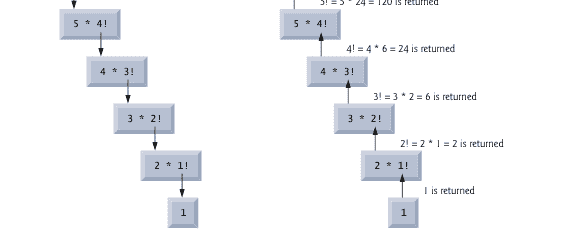

**图 5.17** | *5! 的递归求值。*

图 5.18 使用递归计算并打印整数 0–21 的阶乘（稍后将解释选择 `unsigned long long int` 类型的原因）。

```c
// Fig. 5.18: fig05_18.c
// Recursive factorial function.
#include <stdio.h>

unsigned long long int factorial(unsigned int number);

int main(void)
{
    // during each iteration, calculate
    // factorial(i) and display result
    for (unsigned int i = 0; i <= 21; ++i) {
        printf("%u! = %llu\n", i, factorial(i));
    }
}

// recursive definition of function factorial
unsigned long long int factorial(unsigned int number)
{
    // base
    if (number <= 1) {
        return 1;
    }
    else { // recursive step
        return (number * factorial(number - 1));
    }
}
```

```text
0! = 1
1! = 1
2! = 2
3! = 6
4! = 24
5! = 120
6! = 720
7! = 5040
8! = 40320
9! = 362880
10! = 3628800
11! = 39916800
12! = 479001600
13! = 6227020800
14! = 87178291200
15! = 1307674368000
16! = 20922789888000
17! = 355687428096000
18! = 6402373705728000
19! = 121645100408832000
20! = 2432902008176640000
21! = 14197454024290336768
```

**图 5.18** | 递归阶乘函数。

递归阶乘函数首先测试*终止条件*是否为真，即 number 是否小于或等于 1。如果 number 确实小于或等于 1，则 factorial 返回 1，无需进一步递归，程序终止。如果 number 大于 1，则语句

`return number * factorial(number - 1);`

将问题表示为 number 与对 factorial 的递归调用的乘积，该递归调用求 number - 1 的阶乘。调用 `factorial(number - 1)` 是比原始计算 `factorial(number)` 稍微简单一些的问题。

函数 `factorial`（第 17–26 行）接收一个 `unsigned int`，并返回 `unsigned long long int` 类型的结果。C 标准规定，`unsigned long long int` 类型的变量至少可以保存 18,446,744,073,709,551,615 这么大的值。从图 5.18 可以看出，阶乘值会迅速变大。我们选择数据类型 `unsigned long long int`，以便程序能够计算更大的阶乘值。转换说明符 `%llu` 用于打印 `unsigned long long int` 值。遗憾的是，`factorial` 函数产生大值的速度如此之快，以至于即使使用 `unsigned long long int`，在超过 `unsigned long long int` 变量的最大值之前，也无法帮助我们打印很多阶乘值。

即使使用 `unsigned long long int`，我们仍然无法计算超过 21! 的阶乘。这指出了 C（以及大多数其他过程式编程语言）的一个弱点——即该语言不易于*扩展*以处理各种应用程序的独特需求。正如我们将在本书后面看到的，C++ 是一种*可扩展*的语言，它通过“类”允许我们创建新的数据类型，包括如果我们愿意就可以保存任意大整数的类型。

**常见编程错误 5.9**

*忘记在需要时从递归函数返回值。*

**常见编程错误 5.10**

*要么省略基本情况，要么错误地编写递归步骤以致其不收敛于基本情况，都会导致无限递归，最终耗尽内存。这类似于迭代（非递归）解决方案中的无限循环问题。*

## 5.15 递归示例：斐波那契数列

斐波那契数列

0, 1, 1, 2, 3, 5, 8, 13, 21, …

以 0 和 1 开始，并且具有这样的性质：后续每个斐波那契数都是前两个斐波那契数之和。

该数列出现在自然界中，尤其描述了一种螺旋形式。连续斐波那契数的比值收敛于常数 1.618… 这个数也反复出现在自然界中，被称为黄金比例或黄金均值。人类往往觉得黄金均值具有审美愉悦感。建筑师常设计长宽比为黄金均值的窗户、房间和建筑。明信片常按黄金均值的长宽比设计。


斐波那契数列可以按如下方式递归定义：

\[
\begin{aligned}
fibonacci(0) &= 0 \\
fibonacci(1) &= 1 \\
fibonacci(n) &= fibonacci(n - 1) + fibonacci(n - 2)
\end{aligned}
\]

图 5.19 使用函数 `fibonacci` 递归地计算第 \(n\) 个斐波那契数。注意，斐波那契数往往会迅速变大。因此，我们在函数 `fibonacci` 中选择了 `unsigned int` 类型作为参数类型，选择 `unsigned long long int` 类型作为返回类型。在图 5.19 中，每两行输出对应程序的一次单独运行。

```c
// Fig. 5.19: fig05_19.c
// Recursive fibonacci function
#include <stdio.h>

unsigned long long int fibonacci(unsigned int n); // function prototype

int main(void)
{
    unsigned int number; // number input by user

    // obtain integer from user
    printf("%s", "Enter an integer: ");
    scanf("%u", &number);

    // calculate fibonacci value for number input by user
    unsigned long long int result = fibonacci(number);

    // display result
    printf("Fibonacci(%u) = %llu\n", number, result);
}

// Recursive definition of function fibonacci
unsigned long long int fibonacci(unsigned int n)
{
    // base case
    if (0 == n || 1 == n) {
        return n;
    }
    else { // recursive step
        return fibonacci(n - 1) + fibonacci(n - 2);
    }
}
```

```text
Enter an integer: 0
Fibonacci(0) = 0
```

```text
Enter an integer: 1
Fibonacci(1) = 1
```

**图 5.19** 递归斐波那契函数。（第 1 部分，共 2 部分。）

## 新时代公民道德建设实施纲要

### 一、总体要求

- 指导思想。以马克思列宁主义、毛泽东思想、邓小平理论、“三个代表”重要思想、科学发展观、习近平新时代中国特色社会主义思想为指导，坚持依法治国和以德治国相结合，坚持社会主义核心价值体系，坚持以人民为中心的发展思想，坚持马克思主义道德观、社会主义道德观，倡导讲道德、尊道德、守道德，不断提高人民思想觉悟、道德水准、文明素养，培养担当民族复兴大任的时代新人，促进社会全面进步、人的全面发展。
- 方针原则。坚持马克思主义道德观、社会主义道德观，坚持社会主义核心价值体系，坚持把社会公德、职业道德、家庭美德、个人品德建设作为着力点，坚持把立德树人贯穿学校教育全过程，坚持发挥社会主义法治的促进和保障作用，坚持积极引导青少年培育和践行社会主义核心价值观。
- 目标任务。在全社会大力弘扬社会主义核心价值观，积极传播中华民族传统美德，深入推进社会公德、职业道德、家庭美德、个人品德建设，不断提高公民道德素质和社会文明程度，为全面建成小康社会、全面建设社会主义现代化国家提供精神力量。

## *操作数的求值顺序*

图 5.20 引发了关于 C 编译器对运算符操作数求值顺序的一些有趣问题。这与运算符应用于其操作数的顺序不同，后者由运算符优先级和结合性规则决定。图 5.20 表明，在求值 `fibonacci(3)` 时，会进行两次递归调用，即 `fibonacci(2)` 和 `fibonacci(1)`。但这些调用按什么顺序执行呢？你可能想当然地认为操作数会从左到右求值。出于优化原因，C 并未指定大多数运算符（包括 `+`）操作数的求值顺序。因此，你不应对这些调用的执行顺序作任何假设。这些调用可能先执行 `fibonacci(2)`，再执行 `fibonacci(1)`；也可能以相反顺序执行，先 `fibonacci(1)`，后 `fibonacci(2)`。在这个程序以及大多数其他程序中，最终结果都是一样的。但在某些程序中，操作数的求值可能会产生*副作用*，从而影响表达式的最终结果。

C 只指定了四个运算符的操作数求值顺序：`&&`、`||`、逗号运算符（`,`）和 `?:`。前三个是二元运算符，其操作数保证按*从左到右*的顺序求值。[*注：*函数调用中用于分隔参数的逗号不是逗号运算符。] 最后一个运算符是 C 唯一的*三元*运算符。它的最左操作数*总是首先求值*；如果最左操作数求值为非零（真），则接下来求值中间操作数，并忽略最后一个操作数；如果最左操作数求值为零（假），则接下来求值第三个操作数，并忽略中间操作数。

> **常见编程错误 5.1**
>
> *编写依赖除 `&&`、`||`、`?:` 和逗号（`,`）运算符以外其他运算符操作数求值顺序的程序可能导致错误，因为编译器不一定按你期望的顺序对操作数求值。*


> **可移植性提示 5.2**
>
> *依赖除 `&&`、`||`、`?:` 和逗号（`,`）运算符以外其他运算符操作数求值顺序的程序，在不同编译器上可能产生不同的行为。*


## *指数复杂度*

对于像我们这里用来生成斐波那契数的递归程序，有必要提出告诫。`fibonacci` 函数中每一层递归都会使调用次数产生*加倍*效应——计算第 \(n\) 个斐波那契数所需执行的递归调用次数约为 \(2^n\)。这会迅速失控。仅计算第 20 个斐波那契数就需要约 \(2^{20}\) 次调用，即大约一百万次调用；计算第 30 个斐波那契数需要约 \(2^{30}\) 次调用，即大约十亿次调用；依此类推。计算机科学家称之为*指数复杂度*。这类问题甚至会让世界上最强大的计算机也感到无能为力！关于复杂度的总体问题，尤其是指数复杂度，通常会在计算机科学高级课程“算法”中详细讨论。

我们在本节展示的示例使用了一种直观上很有吸引力的解决方案来计算斐波那契数，但还有更好的方法。练习 5.48 要求你更深入地研究递归，并提出实现递归斐波那契算法的替代方法。

## 5.16 递归与迭代

在前几节中，我们研究了两个既可以很容易地用递归实现、也可以用迭代实现的函数。在本节中，我们比较这两种方法，并讨论在特定情况下为什么你可能选择其中一种而不是另一种。

- 迭代和递归都基于一种*控制语句*：迭代使用*迭代语句*；递归使用*选择语句*。
- 迭代和递归都涉及*重复*：迭代使用*迭代语句*；递归通过*重复函数调用*实现重复。
- 迭代和递归各自包含一个*终止测试*：迭代在*循环继续条件不满足*时终止；递归在*识别到基本情况*时终止。
- 对于计数器控制的迭代和递归，二者都会*逐渐接近终止*：迭代不断修改计数器，直到计数器取得一个使*循环继续条件不满足*的值；递归不断生成原问题的更简化版本，直到*达到基本情况*。
- 迭代和递归都可能*无限*发生：如果循环继续测试*永远*不为假，迭代就会产生无限循环；如果递归步骤不能每次都以一种*收敛于基本情况*的方式简化问题，就会产生*无限递归*。无限迭代和无限递归通常是程序员逻辑错误的结果。

递归有很多缺点。它*反复*调用机制，因此会产生*函数调用开销*。这在处理器时间和内存空间两方面都可能代价高昂。每次递归调用都会创建函数的*另一个副本*（实际上只是函数变量的副本）；这可能消耗*大量内存*。迭代通常发生在函数内部，因此省去了重复函数调用和额外内存分配的开销。那么为什么还要选择递归呢？


> **软件工程观察 5.12**
>
> *任何可以用递归解决的问题，也可以用迭代（非递归）方式解决。当递归方法更自然地反映问题，并且得到的程序更容易理解和调试时，通常会优先选择递归而不是迭代。选择递归解决方案的另一个原因是，迭代解决方案可能并不明显。*

大多数编程教材介绍递归的时间比我们这里要晚得多。我们认为递归是一个足够丰富和复杂的主题，最好更早引入，并把示例分散到本书其余部分。图 5.21 按章节总结了本书中的 30 个递归示例和练习。

让我们用一些在全书反复出现的观点来结束本章。良好的软件工程很重要。高性能也很重要。不幸的是，这两个目标常常相互矛盾。良好的软件工程是使开发我们所需的大型、更复杂的软件系统这项任务更加可行的关键。高性能是实现未来系统的关键，这些系统将对硬件提出越来越高的计算需求。函数在其中又扮演什么角色呢？


| 递归示例和练习 |  |
|---|---|
| *第 5 章*<br>阶乘函数<br>斐波那契函数<br>最大公约数<br>两个整数相乘<br>整数求整数次幂<br>汉诺塔<br>递归 main<br>递归可视化<br><br>*第 6 章*<br>对数组元素求和<br>打印数组<br>逆序打印数组<br>逆序打印字符串<br>检查字符串是否为回文<br>数组中的最小值<br>线性查找<br>二分查找<br>八皇后 | *第 7 章*<br>迷宫遍历<br><br>*第 8 章*<br>逆序打印键盘输入的字符串<br><br>*第 12 章*<br>在链表中查找<br>逆序打印链表<br>二叉树插入<br>二叉树前序遍历<br>二叉树中序遍历<br>二叉树后序遍历<br>打印树<br><br>*附录 D*<br>选择排序<br>快速排序<br><br>*附录 E*<br>斐波那契函数 |

**图 5.21** | 正文中的递归示例和练习。


**性能提示 5.2**

*将大型程序划分为多个函数有助于良好的软件工程。但这是有代价的。与没有函数的单体（即整体式）程序相比，大量函数化的程序可能会进行数量可观的函数调用，而这些调用会消耗计算机处理器上的执行时间。尽管单体程序可能性能更好，但它们更难以编程、测试、调试、维护和演进。*


**性能提示 5.3**

*当今的硬件架构经过调优，可使函数调用更高效；C 编译器有助于优化代码；当今的硬件处理器速度极快。对于你将构建的绝大多数应用和软件系统而言，专注于良好的软件工程比为了高性能而编程更重要。尽管如此，在许多 C 应用和系统中，例如游戏编程、实时系统、操作系统和嵌入式系统，性能至关重要，因此我们在全书中加入了性能提示。*

## 5.17 安全的 C 编程

### 安全的随机数

在第 5.10 节中，我们介绍了用于生成伪随机数的 rand 函数。C 标准库不提供安全的随机数生成器。根据 C 标准文档对函数 rand 的描述：“不保证所生成随机序列的质量，并且已知某些实现会产生低阶位*令人不安地*不随机的序列。”CERT 指南 *MSC30-C* 指出，必须使用特定于实现的随机数生成函数，以确保生成的随机数*不可预测*——这一点极其重要，例如在密码学和其他安全应用中。该指南给出了若干被认为安全的平台特定随机数生成器。例如，Microsoft Windows 提供 *CryptGenRandom* 函数，而基于 POSIX 的系统（如 Linux）提供 *random* 函数，可生成更安全的结果。更多信息请参见 https://www.securecoding.cert.org 上的指南 *MSC30-C*。如果你要构建需要随机数的工业级应用，应研究你的平台推荐使用的函数。

## 小结

### 5.1 节 引言

- 开发和维护大型程序的最佳方式是将其*划分*（第 190 页）为若干更小的部分，每一部分都比原程序更易于管理。

### 5.2 节 在 C 中模块化程序

- 函数（第 190 页）通过函数调用（第 191 页）来调用。函数调用通过名称指定函数，并提供被调用函数执行任务所需的信息（作为实参）。
- *信息隐藏*的目的是只让函数访问完成其任务所需的信息。这是实现*最小权限原则*的一种方式，而最小权限原则是良好软件工程最重要的原则之一。

### 5.3 节 数学库函数

- 在程序中调用函数通常先写函数名，后跟左括号，再跟该函数的实参（或以逗号分隔的实参列表），最后跟右括号。
- 函数的每个实参都可以是常量、变量或表达式。

### 5.4 节 函数

- *局部变量*（第 193 页）仅在函数定义中可见。其他函数不允许知道某个函数局部变量的名称，任何函数也不允许知道其他任何函数的实现细节。

### 5.5 节 函数定义

- 函数定义的一般格式为

  ```c
  return-value-type function-name(parameter-list)
  {
      statements
  }
  ```

- *返回值类型*说明了返回给调用函数的值的类型。如果函数不返回值，则*返回值类型*声明为 *void*。*函数名*是任何有效标识符。*参数列表*（第 195 页）是一个以逗号分隔的列表，包含将传递给函数的变量的定义。如果函数不接收任何值，则*参数列表*声明为 *void*。
- 传递给函数的实参在数量、类型和顺序上应与函数定义中的形参（第 193 页）匹配。
- 当程序遇到函数调用时，控制权从调用点转移到被调用函数，该函数中的语句执行，然后控制权返回调用者。
- 被调用函数可以通过以下三种方式之一将控制权返回给调用者。如果函数不返回值，则当到达函数结束的右花括号时，或通过执行以下语句返回控制权

  ```c
  return;
  ```

  如果函数确实返回值，则语句

  ```c
  return expression;
  ```

  返回 `expression` 的值。

### 5.6 节 函数原型：深入探讨

- 函数原型（第 195 页）声明函数名、返回类型，并声明函数期望接收的形参的数量、类型和顺序。
- 函数原型使编译器能够验证函数是否被正确调用。
- 编译器忽略函数原型中提到的变量名。
- 混合类型表达式（第 199 页）中的实参按照 C 标准的常规算术转换规则（第 199 页）转换为相同类型。

### 5.7 节 函数调用栈和栈帧

- 栈（第 201 页）被称为后进先出（LIFO；第 201 页）数据结构——最后压入（插入）栈的项是最先弹出（移除）栈的项。
- 被调用函数必须知道如何返回其调用者，因此调用函数时，调用函数的返回地址会被压入程序执行栈（第 201 页）。如果发生一系列函数调用，则相继的返回地址按后进先出顺序压入栈，以便最后执行的函数将最先返回其调用者。
- 程序执行栈包含程序执行期间每次调用函数时所使用的局部变量的内存。这些数据称为函数调用的栈帧（第 201 页）。进行函数调用时，该函数调用的栈帧被压入程序执行栈。当函数返回其调用者时，该函数调用的栈帧从栈中弹出，这些局部变量对程序不再可见。
- 计算机的内存量是有限的，因此只有一定量的内存可用于在程序执行栈上存储栈帧。如果函数调用的数量超过其栈帧能够存储在程序执行栈上的数量，就会发生称为栈溢出的错误。应用程序将正确编译，但其执行将因栈溢出而失败。

### 5.8 节 头文件

- 每个标准库都有一个对应的头文件（第 204 页），其中包含该库所有函数的函数原型，以及这些函数所需的各种符号常量的定义。
- 你可以创建并包含自己的头文件。

### 5.9 节 按值和按引用传递实参

- 当实参按值传递（第 205 页）时，会复制其值并将副本传递给被调用函数。在被调用函数中对副本的更改不会影响原始变量的值。


- 当参数*按引用*传递（第 205 页）时，调用者允许被调用函数修改原始变量的值。
- C 语言中的所有调用都是按值调用。
- 通过使用地址运算符和间接运算符，可以实现按引用调用。

### 5.10 节 随机数生成

- 函数 `rand` 生成一个介于 0 和 `RAND_MAX` 之间的整数，C 标准规定 `RAND_MAX` 至少为 32767。
- `rand` 生成的值可以通过缩放和移位来产生特定范围内的值（第 207 页）。
- 要对程序进行随机化，请使用 C 标准库函数 `srand`。
- `srand` 函数为随机数生成器*设定种子*（第 209 页）。通常只有在程序经过彻底调试后，才在程序中插入 `srand` 调用。在调试期间，最好省略 `srand`。这样可以确保可重复性，这对于证明随机数生成程序的修正是否正确至关重要。
- `rand` 和 `srand` 的函数原型包含在 `<stdlib.h>` 中。
- 为了在每次运行时无需输入种子即可进行随机化，我们使用 `srand(time(NULL))`。
- 缩放和移位随机数的通用公式是

  ```
  n = a + rand() % b;
  ```

其中 a 是移位值（即所需连续整数范围内的第一个数），b 是缩放因子（即所需连续整数范围的宽度）。

### 5.11 节 示例：机会游戏；引入 enum

- 枚举（第 213 页）由关键字 `enum` 引入，是一组由标识符表示的整数常量。`enum` 中的值从 0 开始，每次递增 1。也可以为 `enum` 中的每个标识符赋一个整数值。枚举中的标识符必须唯一，但值可以重复。

### 5.12 节 存储类别

- 程序中的每个标识符都具有*存储类别*、*存储持续时间*、*作用域*和*链接*（第 214 页）这些属性。
- C 语言提供了四种存储类别，由存储类别说明符表示：`auto`、`register`、`extern` 和 `static`（第 214 页）。
- 标识符的*存储持续时间*是指该标识符在内存中存在的时间。
- 标识符的*链接*（第 214 页）决定了在多源文件程序中，标识符是仅在当前源文件中可见，还是在任何具有适当声明的源文件中都可见。
- 具有*自动存储持续时间*（第 214 页）的变量在其所在块被进入时创建，在块处于活动状态期间存在，并在块退出时销毁。函数的局部变量通常具有自动存储持续时间。
- 关键字 `extern` 和 `static` 用于声明具有静态存储持续时间的变量和函数的标识符。
- *静态存储持续时间*（第 214 页）变量在程序开始执行之前被分配内存并初始化一次。
- 具有静态存储持续时间的标识符有两类：外部标识符（如全局变量和函数名）以及使用存储类别说明符 `static` 声明的局部变量。
- 全局变量通过将变量定义放置在任意函数定义之外来创建。全局变量在整个程序执行期间保持其值。
- 局部静态变量在其被定义的函数调用之间保持其值。
- 如果未显式初始化，所有静态存储持续时间的数值变量都会被初始化为零。

### 5.13 节 作用域规则

- 标识符的作用域（第 216 页）是指标识符在程序中可以被引用的位置。
- 标识符可以具有函数作用域、文件作用域、块作用域或函数原型作用域（第 216 页）。
- 标签是唯一具有函数作用域的标识符。标签可以在其出现的函数中的任何位置使用，但不能在函数体之外被引用。
- 在任意函数之外声明的标识符具有文件作用域。这样的标识符从声明点到文件末尾之间的所有函数中都是“已知的”。
- 在块内部定义的标识符具有块作用域。块作用域在块的终止右花括号（}）处结束。
- 在函数开头定义的局部变量具有块作用域，函数参数也是如此，函数参数被函数视为局部变量。
- 任何块都可以包含变量定义。当块嵌套时，如果外层块中的标识符与内层块中的标识符同名，则外层块中的标识符在内层块终止之前被“隐藏”。
- 唯一具有函数原型作用域的标识符是那些在函数原型的参数列表中使用的标识符。函数原型中使用的标识符可以在程序的其他地方复用，而不会产生歧义。

### 5.14 节 递归

- 递归函数（第 219 页）是直接或间接调用自身的函数。
- 如果递归函数以基本情况（第 219 页）调用，函数直接返回结果。如果以更复杂的问题调用，函数会将问题分为两个概念部分：一部分是函数知道如何解决的问题，另一部分是原始问题的一个稍小版本。由于这个新问题与原始问题类似，函数发起递归调用来处理较小的问题。
- 为了使递归终止，每次递归函数以原始问题的稍简单版本调用自身时，一系列越来越小的问题必须收敛于基本情况。当函数识别出基本情况时，结果返回给上一次函数调用，然后一系列返回逐级向上传递，直到函数的原始调用最终返回最终结果。

### 5.16 节 递归与迭代

- 迭代和递归都基于控制结构：迭代使用迭代语句；递归使用选择语句。
- 迭代和递归都涉及重复：迭代使用迭代语句；递归通过重复的函数调用来实现重复。
- 迭代和递归都涉及终止测试：迭代在循环继续条件失败时终止；递归在识别出基本情况时终止。
- 迭代和递归都可能无限进行：如果循环继续测试永远不为假，迭代就会产生无限循环；如果递归步骤没有以收敛于基本情况的方式简化问题，就会产生无限递归。
- 递归反复调用函数机制，因此会产生函数调用的开销。这在处理器时间和内存空间方面都可能代价高昂。

## 自测练习

5.1 回答下列各题：

- a) ______ 用于使程序模块化。
- b) 函数通过 ______ 被调用。
- c) 仅在其被定义的函数内已知的变量称为 ______。
- d) 被调用函数中的 ______ 语句用于将表达式的值传回调用函数。
- e) 关键字 ______ 在函数头中用于表示函数不返回值或表示函数不包含参数。
- f) 标识符的 ______ 是程序中可以使用该标识符的部分。
- g) 将被调用函数的控制权返回给调用者的三种方式是 ______、______ 和 ______。
- h) ______ 允许编译器检查传递给函数的参数的数量、类型和顺序。
- i) ______ 函数用于产生随机数。
- j) ______ 函数用于设置随机数种子以随机化程序。
- k) 存储类别说明符是 ______、______、______ 和 ______。
- l) 在块中或函数参数列表中声明的变量，除非另有指定，否则假定其存储类别为 ______。
- m) 在任何块或函数之外定义的非静态变量是 ______ 变量。
- n) 为了使函数中的局部变量在函数调用之间保持其值，必须使用 ______ 存储类别说明符来声明它。
- o) 标识符的四种可能作用域是 ______、______、______ 和 ______。
- p) 直接或间接调用自身的函数是 ______ 函数。
- q) 递归函数通常有两个组件：一个通过测试 ______ 情况来提供递归终止的方法，另一个将问题表示为对比原始调用稍简单的问题的递归调用。

5.2 对于以下程序，说明下列每个元素的作用域（函数作用域、文件作用域、块作用域或函数原型作用域）。

- a) main 中的变量 x。
- b) cube 中的变量 y。
- c) 函数 cube。
- d) 函数 main。
- e) cube 的函数原型。
- f) cube 函数原型中的标识符 y。


```c
#include <stdio.h>
int cube(int y);

int main(void)
{
    for (int x = 1; x <= 10; ++x)
        printf("%d\n", cube(x));
}

int cube(int y)
{
    return y * y * y;
}
```

- 5.3 编写一个程序，测试图 5.2 中所示的数学库函数调用示例是否确实产生指示的结果。

- 5.4 给出以下每个函数的函数头。
  - a) 函数原型，接受两个双精度浮点参数 side1 和 side2，并返回一个双精度浮点结果。
  - b) 函数 smallest，接受三个整数 x、y、z，并返回一个整数。
  - c) 函数 instructions，不接收任何参数也不返回值。 [注：此类函数通常用于向用户显示说明。]
  - d) 函数 intToFloat，接受一个整数参数 number，并返回一个浮点结果。

- 5.5 给出以下每个函数的函数原型：
  - a) 练习 5.4(a) 中描述的函数。
  - b) 练习 5.4(b) 中描述的函数。
  - c) 练习 5.4(c) 中描述的函数。
  - d) 练习 5.4(d) 中描述的函数。

- 5.6 编写浮点变量 lastVal 的声明，使其在定义它的函数被调用之间保留其值。

- 5.7 找出以下每个程序段中的错误并解释如何纠正错误（另见练习 5.6）：
  - a)
    ```c
    int g(void)
    {
        printf("%s", "Inside function g\n");
        int h(void)
        {
            printf("%s", "Inside function h\n");
        }
    }
    ```
  - b)
    ```c
    int sum(int x, int y)
    {
        int result = x + y;
    }
    ```
  - c)
    ```c
    void f(float a);
    {
        float a;
        printf("%f", a);
    }
    ```
  - d)
    ```c
    int sum(int n)
    {
       if (0 == n) {
          return 0; //
       }
       else {
          n + sum(n - 1);
       }
    }
    ```
  - e)
    ```c
    void product(void)
    {
       printf("%s", "Enter three integers: ");
       int a, b, c;
       scanf("%d%d%d", &a, &b, &c);
       int result = a * b * c;
       printf("Result is %d", result);
       return result;
    }
    ```

## Answers to Self-Review Exercises

**5.1** a) 函数。 b) 函数调用。 c) 局部变量。 d) 返回。 e) void。 f) 作用域。 g) return; 或 return 表达式; 或遇到函数的右大括号结束。 h) 函数原型。 i) rand。 j) srand。 k) auto。 l) register。 m) extern。 n) static。 o) 函数作用域、文件作用域、块作用域、函数原型作用域。 p) 递归。 q) 基。

**5.2** a) 块作用域。 b) 块作用域。 c) 文件作用域。 d) 文件作用域。 e) 文件作用域。 f) 函数原型作用域。

**5.3** 见下文。 *[注：在大多数 Linux 系统上，编译此程序时必须使用 -lm 选项。]*

```c
// ex05_03.c
// Testing the math library functions
#include <stdio.h>
#include <math.h>

int main(void)
{
   // calculates and outputs the square root
   printf("sqrt(%.1f) = %.1f\n", 900.0, sqrt(900.0));
   printf("sqrt(%.1f) = %.1f\n", 9.0, sqrt(9.0));

   // calculates and outputs the cube root
   printf("cbrt(%.1f) = %.1f\n", 27.0, cbrt(27.0));
   printf("cbrt(%.1f) = %.1f\n", -8.0, cbrt(-8.0));

   // calculates and outputs the exponential function e to the x
   printf("exp(%.1f) = %f\n", 1.0, exp(1.0));
   printf("exp(%.1f) = %f\n", 2.0, exp(2.0));

   // calculates and outputs the logarithm (base e)
   printf("log(%f) = %.1f\n", 2.718282, log(2.718282));
   printf("log(%f) = %.1f\n", 7.389056, log(7.389056));

   // calculates and outputs the logarithm (base 10)
   printf("log10(%.1f) = %.1f\n", 1.0, log10(1.0));
   printf("log10(%.1f) = %.1f\n", 10.0, log10(10.0));
   printf("log10(%.1f) = %.1f\n", 100.0, log10(100.0));

   // calculates and outputs the absolute value
   printf("fabs(%.1f) = %.1f\n", 13.5, fabs(13.5));
   printf("fabs(%.1f) = %.1f\n", 0.0, fabs(0.0));
   printf("fabs(%.1f) = %.1f\n", -13.5, fabs(-13.5));

   // calculates and outputs ceil(x)
   printf("ceil(%.1f) = %.1f\n", 9.2, ceil(9.2));
   printf("ceil(%.1f) = %.1f\n", -9.8, ceil(-9.8));

   // calculates and outputs floor(x)
   printf("floor(%.1f) = %.1f\n", 9.2, floor(9.2));
   printf("floor(%.1f) = %.1f\n", -9.8, floor(-9.8));

   // calculates and outputs pow(x, y)
   printf("pow(%.1f, %.1f) = %.1f\n", 2.0, 7.0, pow(2.0, 7.0));
   printf("pow(%.1f, %.1f) = %.1f\n", 9.0, 0.5, pow(9.0, 0.5));

   // calculates and outputs fmod(x, y)
   printf("fmod(%.3f,%.3f) = %.3f\n", 13.657, 2.333,
          fmod(13.657, 2.333));

   // calculates and outputs sin(x)
   printf("sin(%.1f) = %.1f\n", 0.0, sin(0.0));

   // calculates and outputs cos(x)
   printf("cos(%.1f) = %.1f\n", 0.0, cos(0.0));

   // calculates and outputs tan(x)
   printf("tan(%.1f) = %.1f\n", 0.0, tan(0.0));
}
```

```text
sqrt(900.0) = 30.0
sqrt(9.0) = 3.0
cbrt(27.0) = 3.0
cbrt(-8.0) = -2.0
exp(1.0) = 2.718282
exp(2.0) = 7.389056
log(2.718282) = 1.0
log(7.389056) = 2.0
log10(1.0) = 0.0
log10(10.0) = 1.0
log10(100.0) = 2.0
fabs(13.5) = 13.5
fabs(0.0) = 0.0
fabs(-13.5) = 13.5
ceil(9.2) = 10.0
ceil(-9.8) = -9.0
floor(9.2) = 9.0
floor(-9.8) = -10.0
pow(2.0, 7.0) = 128.0
pow(9.0, 0.5) = 3.0
fmod(13.657,2.333) = 1.992
sin(0.0) = 0.0
cos(0.0) = 1.0
tan(0.0) = 0.0
```

### 5.4

- a) double hypotenuse(double side1, double side2)
- b) int smallest(int x, int y, int z)
- c) void instructions(void)
- d) float intToFloat(int number)

### 5.5

- a) double hypotenuse(double side1, double side2);
- b) int smallest(int x, int y, int z);
- c) void instructions(void);
- d) float intToFloat(int number);

### 5.6

```c
static float lastVal;
```

### 5.7

- a) 错误：函数 h 在函数 g 中定义。
  纠正：把 h 的定义移出 g 的定义之外。
- b) 错误：函数体本应返回一个整数，但没有返回。
  纠正：用以下语句替换函数体中的语句：
  `return x + y;`
- c) 错误：参数列表右括号后有分号，并且在函数定义中重新定义了参数 a。
  纠正：删除参数列表右括号后的分号，并删除函数体中的声明 float a;。
- d) 错误：n + sum(n - 1) 的结果未被返回；sum 返回了不正确的结果。
  纠正：将 else 子句中的语句重写为
  `return n + sum(n - 1);`
- e) 错误：函数在不应该返回值时返回了值。
  纠正：删除 return 语句。

## Exercises

### 5.8

显示执行以下每个语句后 X 的值：

- a) x = fabs(10.85)
- b) x = floor(10.85)
- c) x = fabs(-0.678)
- d) x = ceil(9.234)
- e) x = fabs(0.0)
- f) x = ceil(-34.87)
- g) x = ceil(-fabs(-12 - floor(-9.5)))

### 5.9 (Car Rental Services)

一家汽车租赁服务收取最低 25.00 美元的费用租车 8 小时，并在 8 小时后每小时额外收取 5 美元。每天最高收费为 50 美元，不含服务税。公司额外收取每小时 0.50 美元的服务税。假设一次租车不超过 72 小时。如果租车超过 24 小时，则按日计算租金。编写一个程序，计算并打印昨天从该机构租车的三个客户的租金。你应输入每个客户租车的时间。你的程序应以整齐的表格格式打印结果，并计算并打印昨天的总收入。程序应使用函数 calculateCharges 来确定每个客户的费用。你的输出应如下所示：

| Car | Hours | Charge |
|---|---|---|
| 1 | 12 | 56.00 |
| 2 | 34 | 117.00 |
| 3 | 48 | 124.00 |
| TOTAL | 94 | 297.00 |

### 5.10 (Rounding Numbers)

函数 `ceil` 的一个应用是将值四舍五入到最接近的整数。语句

```c
y = ceil(x + .5);
```

将数字 `x` 四舍五入到最接近的整数并将结果赋给 `y`。编写一个程序，读取若干个数字并使用上述语句将每个数字四舍五入到最接近的整数。对处理的每个数字，打印原始数字和四舍五入后的数字。

### 5.11 (Rounding Numbers)

函数 `floor` 可用于将数字四舍五入到特定小数位。语句

```c
y = floor(x * 10 + .5) / 10;
```

将 `x` 四舍五入到十分位（小数点右边的第一位）。语句

```c
y = floor(x * 100 + .5) / 100;
```

将 `x` 四舍五入到百分位（小数点右边的第二位）。编写一个程序，定义四个函数以不同方式对数字 `x` 进行四舍五入

- a) `roundToInteger(number)`
- b) `roundToTenths(number)`
- c) `roundToHundredths(number)`
- d) `roundToThousandths(number)`

对读取的每个值，你的程序应打印原始值、四舍五入到最接近整数的数字、四舍五入到最接近十分位的数字、四舍五入到最接近百分位的数字以及四舍五入到最接近千分位的数字。

### 5.12

回答以下每个问题。

- a) 按值传递参数和按引用传递参数有什么区别？
- b) `rand` 函数生成什么值？
- c) 如何使程序随机化？如何缩放或平移 `rand` 函数产生的值？
- d) 什么是递归函数？什么是基例？

### 5.13

编写语句将随机整数赋给变量 `n`，范围如下：

- a) 1 ≤ n ≤ 6
- b) 100 ≤ n ≤ 1000
- c) 0 ≤ n ≤ 19
- d) 1000 ≤ n ≤ 2222
- e) -1 ≤ n ≤ 1
- f) -3 ≤ n ≤ 11

### 5.14

对于以下每组整数，编写单个语句以随机打印该组中的一个数字。

- a) 3, 6, 9, 12, 15, 18, 21, 24, 27, 30.
- b) 3, 5, 7, 9, 11, 13, 15, 17, 19.
- c) 3, 8, 13, 18, 23, 28, 33

### 5.15 (Hypotenuse Calculations)

定义一个名为 `hypotenuse` 的函数，计算直角三角形在已知另外两边时的斜边长度。该函数应接受两个 `double` 类型的参数并返回斜边作为 `double`。使用图 5.22 中指定的边值测试你的程序。

### 5.16 (Sides of a Triangle)

编写一个函数，读取三个非零 `double` 值作为三角形的边，并计算并返回三角形的面积作为 `double` 变量。它还应在计算面积之前检查这些数字是否代表三角形的边。在输入一系列数字集的程序中使用此函数。


| 三角形 | 边 1 | 边 2 |
|---|---|---|
| 1 | 3.0 | 4.0 |
| 2 | 5.0 | 12.0 |
| 3 | 8.0 | 15.0 |

**图 5.22** | 练习 5.15 的示例三角形边值。

### 5.17 (直角三角形的边)
编写一个函数，读取三个非零整数并判断它们是否为直角三角形的边。该函数应接受三个整数参数，如果参数构成直角三角形则返回 1（真），否则返回 0（假）。在输入一系列整数集合的程序中使用此函数。

### 5.18 (偶数或奇数)
编写一个程序，输入一系列整数并逐个传递给函数 isEven，该函数使用余数运算符判断整数是否为偶数。函数应接受一个整数参数，如果整数为偶数则返回 1，否则返回 0。

### 5.19 (星号矩形)
编写一个函数，显示一个实心星号矩形，其边长由整数参数 side1 和 side2 指定。例如，如果边长为 4 和 5，函数显示如下：

```
*****
*****
*****
*****
```

### 5.20 (显示任意字符的矩形)
修改练习 5.19 中创建的函数，使矩形由字符参数 fillCharacter 中包含的任意字符构成。因此如果边长为 5 和 4，且 fillCharacter 为 "@"，则函数应打印如下：

```
@@@@@
@@@@@
@@@@@
@@@@@
```

### 5.21 (项目：用字符绘制形状)
使用与练习 5.19–5.20 中开发类似的技术，编写一个程序绘制各种形状。

### 5.22 (分离数字)
编写程序段完成以下各项：
- a) 计算整数 a 除以整数 b 时商的整数部分。
- b) 计算整数 a 除以整数 b 时的整数余数。
- c) 使用 a) 和 b) 中开发的程序片段编写一个函数，输入 1 到 32767 之间的整数，并将其作为一系列数字打印，每个数字之间间隔两个空格。例如，整数 4562 应打印为：

```
4  5  6  2
```

### 5.23 (时间的秒数)
编写一个函数，以三个整数参数（小时、分钟和秒）作为时间输入，并返回自时钟上次“敲响 12 点”以来的秒数。使用此函数计算两个时间之间以秒为单位的时间量，两者均在时钟的 12 小时周期内。

### 5.24 (货币转换)
实现以下 double 函数：
- a) 函数 `toYen` 接受美元金额并返回日元等值。
- b) 函数 `toEuro` 接受美元金额并返回欧元等值
- c) 使用这些函数编写一个程序，打印显示一系列美元金额的日元和欧元等值的图表。以整洁的表格格式打印输出。使用汇率 1 USD = 118.87 日元 和 1 USD = 0.92 欧元。

### 5.25 (查找最大值)
编写一个函数，返回四个浮点数中的最大值。

### 5.26 (完全数)
如果一个整数的因子（包括 1 但不包括该数本身）之和等于该数，则称其为完全数。例如，6 是一个完全数，因为 6 = 1 + 2 + 3。编写一个函数 `isPerfect` 判断参数 number 是否为完全数。在一个程序中使用此函数确定并打印 1 到 1000 之间的所有完全数。打印每个完全数的因子以确认该数确实是完全数。通过测试远大于 1000 的数来挑战计算机的性能。

### 5.27 (二次方程的根)
二次方程是形如 \(ax^2 + bx + c = 0\) 的任意方程，其中 \(a\)、\(b\) 和 \(c\) 是 \(x\) 的系数。二次方程的根可由公式 \(x = \frac{-b \pm \sqrt{b^2 - 4ac}}{2a}\) 计算。如果表达式 \(b^2 - 4ac\)（也称为判别式）为正，则方程有实根。如果判别式为负，则方程有虚根（或复根）。编写一个函数以参数形式接受方程的系数，检查根是否为实数，并计算方程的根。编写一个程序来测试此函数。

### 5.28 (数字之和)
编写一个函数，接受一个整数并返回其各位数字之和。例如，给定数字 7631，函数应返回 17。

### 5.29 (最小公倍数)
两个整数的最小公倍数（LCM）是同时是这两个数的倍数的最小正整数。编写一个函数 `lcm` 返回两个数的最小公倍数。

### 5.30 (学生成绩的质量点)
编写一个函数 `toQualityPoints`，输入学生的平均分，如果为 90-100 返回 4，如果为 80-89 返回 3，如果为 70-79 返回 2，如果为 60-69 返回 1，如果平均分低于 60 则返回 0。

### 5.31 (抛硬币)
编写一个程序模拟抛硬币。每次抛硬币程序应打印 Heads 或 Tails。让程序抛硬币 100 次，并统计硬币每面出现的次数。打印结果。程序应调用一个单独的函数 `flip`，该函数不带参数并返回 0 表示反面和 1 表示正面。[注意：如果程序真实地模拟抛硬币，则硬币的每一面应大约出现一半的时间，总计大约 50 次正面和 50 次反面。]

### 5.32 (猜数字)
编写一个 C 程序玩“猜数字”游戏，方法如下：你的程序通过在 1 到 1000 范围内随机选择一个整数来选择要猜的数字。程序然后输入：

```text
I have a number between 1 and 1000.
Can you guess my number?
Please type your first guess.
```

玩家然后输入第一个猜测。程序用以下之一作出响应：
- 1. Excellent! You guessed the number!  
- Would you like to play again (y or n)?  
- 2. Too low. Try again.  
- 3. Too high. Try again.

如果玩家的猜测不正确，你的程序应循环直到玩家最终猜对为止。你的程序应不断告诉玩家 Too high 或 Too low 以帮助玩家“缩小”到正确答案。[注意：本问题中采用的搜索技术称为二分搜索。我们将在下一个问题中对此进行更多说明。]

### 5.33 (猜数字修改)
修改练习 5.32 的程序以统计玩家进行的猜测次数。如果次数为 10 次或更少，打印 Either you know the secret! 或 you got lucky! 如果玩家在 10 次尝试内猜中数字，则打印 Aha! You know the secret! 如果玩家猜测次数超过 10 次，则打印 You should be able to do better! 为什么不应超过 10 次猜测？好吧，每次“好猜测”玩家都应能够消除一半的数字。现在为什么任何 1 到 1000 的数字都可以在 10 次或更少的尝试中猜中。

### 5.34 (递归幂运算)
编写一个递归函数 `power(base, exponent)`，调用时返回

`base^exponent`

例如，`power(3, 4) = 3 * 3 * 3 * 3`。假设 exponent 是大于等于 1 的整数。**提示：** 递归步骤应使用关系

`base^exponent = base * base^(exponent−1)`

且终止条件在 exponent 等于 1 时发生，因为

`base^1 = base`

### 5.35 (Fibonacci)
Fibonacci 数列

`0, 1, 1, 2, 3, 5, 8, 13, 21, …`

以 0 和 1 开始，具有每个后续项是前两个项之和的性质。a) 编写一个 **非递归** 函数 `fibonacci(n)` 计算第 n 个 Fibonacci 数。使用 unsigned `int` 作为函数参数，使用 unsigned `long long int` 作为返回类型。b) 确定可在你的系统上打印的最大 Fibonacci 数。

### 5.36 (汉诺塔)
每个初出茅庐的计算机科学家都必须应对某些经典问题，而汉诺塔（见图 5.23）就是其中最著名的问题之一。传说在远东的一个寺庙里，僧侣们正试图将一堆圆盘从一个柱子移动到另一个柱子。初始堆叠有 64 个圆盘串在同一个柱子上，从下到上按递减大小排列。僧侣们正试图在以下约束条件下将圆盘堆从该柱子移动到第二个柱子：一次只能移动一个圆盘，并且在任何时候都不能将较大的圆盘放在较小的圆盘之上。第三个柱子可用于临时存放圆盘。据说当僧侣们完成任务时世界就会结束，因此我们没有动力来促进他们的努力。

假设僧侣们正试图将圆盘从柱子 1 移动到柱子 3。我们希望开发一个算法来打印精确的圆盘到圆盘柱子转移序列。

如果我们用常规方法来解决这个问题，我们很快就会在管理圆盘时陷入困境。相反，如果我们考虑到递归来攻击这个问题，它立即变得可行。将 n 个圆盘移动可以看作仅移动 n − 1 个圆盘（因此递归）如下：
- a) 将 n − 1 个圆盘从柱子 1 移动到柱子 2，以柱子 3 作为临时存放区。


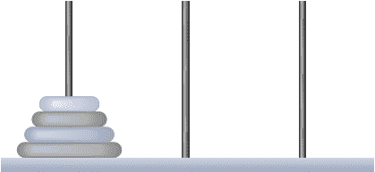

### 图 5.23 | 四个圆盘的汉诺塔问题

b) 将最后一个圆盘（最大）从 1 号柱移到 3 号柱。
c) 将 *n − 1* 个圆盘从 2 号柱移到 3 号柱，以 1 号柱作为临时存放区。

该过程在最后一次移动涉及移动 *n = 1* 个圆盘时结束，即基本情况。这是通过简单地移动圆盘而无需临时存放区来实现的。

编写一个程序来解决汉诺塔问题。使用一个具有四个参数的递归函数：

- a) 要移动的圆盘数量
- b) 这些圆盘最初串在的柱子
- c) 该堆圆盘要移动到的柱子
- d) 作为临时存放区使用的柱子

你的程序应打印将圆盘从起始柱移动到目标柱所需的精确指令。例如，要将三个圆盘的堆从 1 号柱移动到 3 号柱，你的程序应打印以下一系列移动：

- 1 ⟶ 3（这意味着将一个圆盘从 1 号柱移到 3 号柱。）
- 1 ⟶ 2
- 3 ⟶ 2
- 1 ⟶ 3
- 2 ⟶ 1
- 2 ⟶ 3
- 1 ⟶ 3

### 5.37 汉诺塔：迭代解法
任何可以用递归实现的程序都可以用迭代实现，尽管有时难度要大得多，清晰度也要低得多。尝试编写汉诺塔的迭代版本。如果成功，请将你的迭代版本与练习 5.36 中开发的递归版本进行比较。研究性能、清晰度以及你证明程序正确性的能力等方面的问题。

### 5.38 可视化递归
观察递归“实际运行”很有趣。修改图 5.18 中的阶乘函数，使其打印其局部变量和递归调用参数。对于每次递归调用，将输出显示在单独的行上并增加一级缩进。尽力使输出清晰、有趣且有意义。你此处的目标是设计和实现一种输出格式，帮助人们更好地理解递归。你可能希望将此类显示功能添加到文本中许多其他递归示例和练习中。

### 5.39 递归最大公约数
整数 x 和 y 的最大公约数是能同时整除 x 和 y 的最大整数。编写一个递归函数 gcd 返回 x 和 y 的最大公约数。x 和 y 的 gcd 递归定义如下：如果 y 等于 0，则 gcd(x, y) 为 x；否则 gcd(x, y) 为 gcd(y, x % y)，其中 % 是余数运算符。

### 5.40（递归 main）
main 能被递归调用吗？编写一个包含函数 main 的程序。包含一个初始化为 1 的静态局部变量 count。每次调用 main 时对其进行后递增并打印 count 的值。运行你的程序。会发生什么？

### 5.41（递归素数）
编写一个递归函数 isPrime 来判断给定的输入是否为素数。在程序中使用此函数。

### 5.42
下面的程序做什么？如果交换第 8 行和第 9 行会发生什么？

```c
#include <stdio.h>

int main(void)
{
    int c; // variable to hold character input by user

    if ((c = getchar()) != EOF) {
        main();
        printf("%c", c);
    }
}
```

### 5.43
下面的程序做什么？

```c
#include <stdio.h>

unsigned int mystery(unsigned int a, unsigned int b); // function prototype

int main(void)
{
    printf("%s", "Enter two positive integers: ");
    unsigned int x; // first integer
    unsigned int y; // second integer
    scanf("%u%u", &x, &y);

    printf("The result is %u\\n", mystery(x, y));
}

// Parameter b must be a positive integer
// to prevent infinite recursion
unsigned int mystery(unsigned int a, unsigned int b)
{
    // base case
    if (1 == b) {
        return a;
    }
    else { // recursive step
        return a + mystery(a, b - 1);
    }
}
```

### 5.44
在确定练习 5.43 的程序做什么之后，修改程序以在移除第二个参数为非负数的限制后仍能正常运行。

### 5.45（测试数学库函数）
编写一个程序来测试图 5.2 中的数学库函数。通过让你的程序对多种参数值打印返回值表来练习这些函数中的每一个。

### 5.46
找出以下每个程序段中的错误并解释如何纠正它：

```
a)  double cube(float);  // function prototype
    cube(float number)   // function definition
    {
        return number * number * number;
    }

b)  int randomNumber = srand();

c)  double y = 123.45678;
    int x;
    x = y;
    printf("%f\n", (double) x);

d)  double square(double number)
    {
        double number;
        return number * number;
    }

e)  int sum(int n)
    {
        if (0 == n) {
            return 0;
        }
        else {
            return n + sum(n);
        }
    }
```

### 5.47 掷骰子游戏修改
修改图 5.14 中的掷骰子程序以允许下注。将运行一次掷骰子游戏的程序部分打包为一个函数。将变量 bankBalance 初始化为 1000 美元。提示玩家输入赌注。使用 while 循环检查赌注是否小于或等于 bankBalance，如果不是，则提示用户重新输入赌注，直到输入有效赌注为止。在输入正确的赌注后，运行一次掷骰子游戏。如果玩家获胜，则将 bankBalance 增加赌注并打印新的 bankBalance。如果玩家输了，则将 bankBalance 减少赌注，打印新的 bankBalance，检查 bankBalance 是否变为零，如果是则打印消息 "Sorry. You busted!" 随着游戏的进行，打印各种消息以制造一些“闲聊”，例如 "Oh, you're going for broke, huh?" 或 "Aw come on, take a chance!" 或 "You're up big. Now's the time to cash in your chips!"

### 5.48 研究项目：改进递归斐波那契实现
在第 5.15 节中，我们用来计算斐波那契数的递归算法在直觉上很有吸引力。然而，请回忆该算法导致了递归函数调用的指数级爆炸。在网上研究递归斐波那契实现。研究各种方法，包括练习 5.35 中的迭代版本以及仅使用所谓的“尾递归”的版本。讨论各自的相对优点。

## 改变现状

### 5.49 全球变暖事实测验
有争议的全球变暖问题已被电影《难以忽视的真相》广泛宣传，该片由前副总统 Al Gore 主演，而联合国科学家网络政府间气候变化专门委员会则因“他们努力建立和传播关于人为气候变化的更多知识”而分享了 2007 年诺贝尔和平奖。在网上研究全球变暖问题的双方（你可能想搜索诸如“global warming skeptics”之类的短语）。创建一个关于全球变暖的五题多项选择测验，每个问题有四个可能的答案（编号为 1–4）。保持客观并尝试公平地代表问题的双方。接下来，编写一个应用程序来管理测验，计算正确答案的数量（零到五）并向用户返回一条消息。如果用户正确回答五个问题，打印“Excellent”；如果四个，打印“Very good”；如果三个或更少，打印“Time to brush up on your knowledge of global warming，”并列出你找到事实的一些网站。

## 计算机辅助教学

随着计算机成本的下降，无论经济状况如何，每个学生都拥有计算机并在学校使用变得可行。这为改善世界各地所有学生的教育体验创造了令人兴奋的可能性，正如接下来的五个练习所建议的那样。[注意：查看诸如 One Laptop Per Child Project（www.laptop.org）之类的倡议。另请研究“绿色”笔记本电脑——这些设备有哪些关键的“绿色”特性？请查阅电子产品环境评估工具（www.epeat.net），它可以帮助你评估台式机、笔记本电脑和显示器的“绿色”程度，以帮助你决定购买哪些产品。]

### 5.50 计算机辅助教学
在教育中使用计算机被称为计算机辅助教学（CAI）。编写一个程序帮助小学生学习乘法。使用 rand 函数生成两个正的一位数整数。然后程序应提示用户一个问题，例如

```
How much is 6 times 7?
```

然后学生输入答案。接下来，程序检查学生的答案。如果正确，显示消息 "Very good!" 并提出另一个乘法问题。如果答案错误，显示消息 "No. Please try again." 并让学生反复尝试同一个问题，直到学生最终答对为止。应使用单独的函数来生成每个新问题。该函数应在应用程序开始执行时调用一次，并在用户每次正确回答问题时调用。

### 5.51 计算机辅助教学：减轻学生疲劳
CAI 环境中的一个问题是学生疲劳。通过改变计算机的响应来保持学生的注意力可以减少疲劳。修改练习 5.50 的程序，以便对每个答案显示各种评论如下：

对正确答案的可能回应：
- Very good!
- Excellent!
- Nice work!
- Keep up the good work!

对错误答案的可能回应：
- No. Please try again.
- Wrong. Try once more.
- Don't give up!
- No. Keep trying.

使用随机数生成选择 1 到 4 之间的数字，用于为每个正确或错误答案选择四个适当回应之一。使用 switch 语句发出回应。

### 5.52 计算机辅助教学：监控学生表现
更复杂的计算机辅助教学系统会监控学生在一段时间内的表现。开始新主题的决定通常基于学生在先前主题上的成功。修改练习 5.51 的程序以统计学生输入的正确和错误回应的数量。在学生输入 10 个答案后，你的程序应计算百分比为

正确。如果百分比低于75%，显示“请向老师寻求额外帮助。”，然后重置程序，以便另一名学生可以尝试。如果百分比为75%或更高，显示“恭喜，你准备好进入下一级了！”，然后重置程序，以便另一名学生可以尝试。

**5.53** *(计算机辅助教学：难度等级)* 练习 5.50 到 5.52 开发了一个计算机辅助教学程序，帮助教授小学生乘法。修改该程序以允许用户输入难度等级。在难度等级为 1 时，程序应在问题中仅使用一位数字；在难度等级为 2 时，使用大到两位数的数字，以此类推。

**5.54** *(计算机辅助教学：变化的问题类型)* 修改练习 5.53 的程序，以允许用户选择要学习的一种算术问题类型。选项 1 表示仅加法问题，2 表示仅减法问题，3 表示仅乘法问题，4 表示所有这些类型的随机混合。

## 6 C 数组

### 目标

在本章中，你将：

- 使用数组数据结构表示值列表和表格。
- 定义数组、初始化数组并引用数组的各个元素。
- 定义符号常量。
- 将数组传递给函数。
- 使用数组存储、排序和搜索值列表和表格。
- 定义和操作多维数组。
- 创建在执行时确定大小的可变长度数组。
- 理解与使用 `scanf` 输入、`printf` 输出和数组相关的安全问题。


- **6.1** 引言
- **6.2** 数组
- **6.3** 定义数组
- **6.4** 数组示例
  - 6.4.1 定义数组并使用循环设置数组元素值
  - 6.4.2 使用初始化列表在定义中初始化数组
  - 6.4.3 使用符号常量指定数组大小并通过计算初始化数组元素
  - 6.4.4 求数组元素的和
  - 6.4.5 使用数组汇总调查结果
  - 6.4.6 使用直方图绘制数组元素值
  - 6.4.7 掷骰子 60,000,000 次并在数组中汇总结果
- **6.5** 使用字符数组存储和操作字符串
  - 6.5.1 使用字符串初始化字符数组
  - 6.5.2 使用字符初始化列表初始化字符数组
  - 6.5.3 访问字符串中的字符
  - 6.5.4 向字符数组输入
  - 6.5.5 输出表示字符串的字符数组
  - 6.5.6 演示字符数组
- **6.6** 静态局部数组和自动局部数组
- **6.7** 向函数传递数组
- **6.8** 排序数组
- **6.9** 案例研究：使用数组计算平均值、中位数和众数
- **6.10** 搜索数组
  - 6.10.1 使用线性搜索搜索数组
  - 6.10.2 使用二分搜索搜索数组
- **6.11** 多维数组
  - 6.11.1 说明双下标数组
  - 6.11.2 初始化双下标数组
  - 6.11.3 设置一行中的元素
  - 6.11.4 求二维数组中元素的总和
  - 6.11.5 二维数组操作
- **6.12** 可变长度数组
- **6.13** 安全的 C 编程

摘要 | 自测练习 | 自测练习答案 | 练习 | 递归练习

### 6.1 引言

本章介绍数据结构。数组是由相同类型相关数据项组成的数据结构。在第 10 章中，我们讨论 C 的 *结构体* 概念——一种由可能不同类型相关数据项组成的数据结构。数组和结构体是“静态”实体，因为它们在程序执行期间保持相同的大小（当然，它们可以是自动存储类别，因此每次进入和退出定义它们的块时都会被创建和销毁）。

### 6.2 数组

数组是一组 *连续的* 内存位置，它们都具有 *相同类型*。要引用数组中的特定位置或元素，我们指定数组的名称和该元素在数组中的位置编号。

图 6.1 显示了一个名为 c 的整数数组，包含 12 个元素。可以通过给出数组的名称后跟特定元素在方括号（[]）中的 *位置编号* 来引用这些元素中的任何一个。每个数组中的第一个元素都是零元素（即位置编号为 0 的元素）。数组名与其他标识符一样，只能包含字母、数字和下划线，且不能以数字开头。

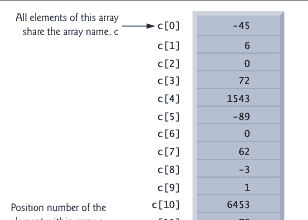

**图 6.1** | 12 个元素的数组。

方括号中的位置编号称为元素的 *索引* 或 *下标*。索引必须是整数或整数表达式。例如，语句

```
c[2] = 1000;
```

将 1000 分配给数组元素 c[2]。类似地，如果 a = 5 且 b = 6，则语句

```
c[a + b] += 2;
```

将 2 加到数组元素 c[11]。带索引的数组名是 *左值*——它可用于赋值的左侧。

让我们更仔细地检查数组 c（图 6.1）。数组的名称是 c。它的 12 个元素分别称为 c[0]、c[1]、c[2]、...、c[10] 和 c[11]。c[0] 中存储的值为 -45，c[1] 的值为 6，c[2] 为 0，c[7] 为 62，c[11] 为 78。要打印数组 c 的前三个元素中包含的值的总和，我们会写

```
printf("%d", c[0] + c[1] + c[2]);
```

要将数组 c 的第 6 个元素的值除以 2 并将结果赋给变量 x，写

```
x = c[6] / 2;
```

用于括住数组索引的方括号实际上在 C 中被视为一个 *运算符*。它们的优先级与 *函数调用运算符* 相同（即放置在函数名之后以调用该函数的括号）。图 6.2 显示了到目前为止在本文中介绍的运算符的优先级和结合性。

| 操作符 | 结合性 | 类型 |
|---|---|---|
| `[] () ++ (postfix) -- (postfix)` | 从左到右 | 最高 |
| `+ - ! ++ (prefix) -- (prefix) (type)` | 从右到左 | 一元 |
| `* / %` | 从左到右 | 乘法 |
| `+ -` | 从左到右 | 加法 |
| `< <= > >=` | 从左到右 | 关系 |
| `== !=` | 从左到右 | 相等 |
| `&&` | 从左到右 | 逻辑与 |
| `||` | 从左到右 | 逻辑或 |
| `?:` | 从右到左 | 条件 |
| `= += -= *= /= %=` | 从右到左 | 赋值 |
| `,` | 从左到右 | 逗号 |

**图 6.2** | 运算符优先级和结合性。

### 6.3 定义数组

数组占用内存空间。你指定每个元素的类型和每个数组所需的元素数量，以便计算机可以保留适当数量的内存。以下定义为整数数组 c 预留 12 个元素，其索引范围为 0–11。

```
int c[12];
```

定义

```
int b[100], x[27];
```

为整数数组 b 预留 100 个元素，为整数数组 x 预留 27 个元素。这些数组的索引范围分别为 0–99 和 0–26。虽然你可以一次定义多个数组，但每行只定义一个数组是首选的，这样你就可以添加注释来解释每个数组的目的。

数组可以包含其他数据类型。例如，类型为 char 的数组可以存储字符字符串。字符字符串及其与数组的相似性将在第 8 章中讨论。指针与数组之间的关系将在第 7 章中讨论。

### 6.4 数组示例

本节介绍了一些示例，演示如何定义和初始化数组，以及如何执行许多常见的数组操作。

#### 6.4.1 定义数组并使用循环设置数组元素值

与任何其他变量一样，未初始化的数组元素包含垃圾值。图 6.3 使用 for 语句将五元素整数数组 n 的元素设置为零（第 11–13 行）并以表格格式打印数组（第 18–20 行）。第一个 printf 语句（第 15 行）显示随后 for 语句中打印的两个列的列标题。


```c
1  // Fig. 6.3: fig06_03.c
2  // Initializing the elements of an array to zeros.
3  #include <stdio.h>
4
5  // function main begins program execution
6  int main(void)
7  {
8     int n[5]; // n is an array of five integers
9
10    // set elements of array n to 0
11    for (size_t i = 0; i < 5; ++i) {
12       n[i] = 0; // set element at location i to 0
13    }
14
15    printf("%s%13s\n", "Element", "Value");
16
17    // output contents of array n in tabular format
18    for (size_t i = 0; i < 5; ++i) {
19       printf("%7u%13d\n", i, n[i]);
20    }
21 }
```

| 元素 | 值 |
| --- | --- |
| 0 | 0 |
| 1 | 0 |
| 2 | 0 |
| 3 | 0 |
| 4 | 0 |

**图 6.3** | 将数组元素初始化为零。

注意，计数控制变量 i 在每个 for 语句（第 11 行和第 18 行）中都被声明为 size_t 类型，根据 C 标准，它表示一种无符号整型类型。<sup>1</sup> 这种类型推荐用于表示数组大小或索引的任何变量。类型 size_t 在头文件 `<stddef.h>` 中定义，该头文件通常由其他头文件（如 `<stdio.h>`）包含。 [注意：如果尝试编译图 6.3 并收到错误，只需在程序中包含 `<stddef.h>`。]

<sup>1</sup> 在某些编译器中，size_t 表示 unsigned int，在其他编译器中它表示 unsigned long。使用 unsigned long 的编译器通常在图 6.3 的第 19 行生成警告，因为 %u 用于显示 unsigned int，而不是 unsigned long。要消除此警告，请将格式说明符 %u 替换为 %lu。

## 6.4.2 使用初始化列表在定义中初始化数组

数组元素也可以在数组定义时通过在定义后跟等号和大括号 { }，其中包含逗号分隔的数组初始化器列表来进行初始化。图 6.4 使用五个值（第 9 行）初始化一个整数数组并以表格格式打印数组。

```c
// Fig. 6.4: fig06_04.c
// Initializing the elements of an array with an initializer list.
#include <stdio.h>

// function main begins program execution
int main(void)
{
   // use initializer list to initialize array n
   int n[5] = {32, 27, 64, 18, 95};

   printf("%s%13s\n", "Element", "Value");

   // output contents of array in tabular format
   for (size_t i = 0; i < 5; ++i) {
      printf("%7u%13d\n", i, n[i]);
   }
}
```

| 元素 | 值 |
| --- | --- |
| 0 | 32 |
| 1 | 27 |
| 2 | 64 |
| 3 | 18 |
| 4 | 95 |

**图 6.4** | 使用初始化列表初始化数组元素。

如果初始化器的数量 *更少* 于数组中的元素数量，则剩余元素初始化为零。例如，图 6.3 中数组 *n* 的元素可以按如下方式初始化为零：

```c
int n[10] = {0}; // initializes entire array to zeros
```

这显式地将第一个元素初始化为零，并将剩余的九个元素初始化为零，因为初始化器的数量少于数组中的元素数量。数组 *不* 会自动初始化为零。您必须至少将第一个元素初始化为零，以便剩余元素自动置零。数组元素在程序启动前对静态数组进行初始化，而对 *自动* 数组则在运行时进行初始化。

> **常见编程错误 6.1**
>
> *忘记初始化数组元素。*
>
> **常见编程错误 6.2**
>
> *在数组初始化器列表中提供比数组元素更多的初始化器是语法错误——例如，int n[3] = {32, 27, 64, 18}; 是语法错误，因为有四个初始化器但只有三个数组元素。*

如果在带有初始化器列表的定义中 *省略* 了数组大小，则数组中的元素数量将为初始化器列表中的元素数量。例如，

```c
int n[] = {1, 2, 3, 4, 5};
```

将创建一个用指示值初始化的五元素数组。

## 6.4.3 使用符号常量指定数组大小并通过计算初始化数组元素

图 6.5 将五元素数组 s 的元素初始化为值 2、4、6、...、10 并以表格格式打印数组。值是通过将循环计数器乘以 2 并加 2 生成的。

```c
1 // Fig. 6.5: fig06_05.c
2 // Initializing the elements of array s to the even integers from 2 to 10.
3 #include <stdio.h>
4 #define SIZE 5 // maximum size of array
5
6 // function main begins program execution
7 int main(void)
8 {
9     // symbolic constant SIZE can be used to specify array size
10    int s[SIZE]; // array s has SIZE elements
11
12    for (size_t j = 0; j < SIZE; ++j) { // set the values
13       s[j] = 2 + 2 * j;
14    }
15
16    printf("%s%13s\n", "Element", "Value");
17
18    // output contents of array s in tabular format
19    for (size_t j = 0; j < SIZE; ++j) {
20       printf("%7u%13d\n", j, s[j]);
21    }
22 }
```

| 元素 | 值 |
| --- | --- |
| 0 | 2 |
| 1 | 4 |
| 2 | 6 |
| 3 | 8 |
| 4 | 10 |

**图 6.5** | 将数组 s 的元素初始化为从 2 到 10 的偶整数。

在本程序中引入了 #define 预处理器指令。第 4 行

```c
#define SIZE 5
```

定义了一个符号常量 SIZE，其值为 5。符号常量是一个标识符，在程序编译前由 C 预处理器替换为替换文本。在程序预处理时，符号常量 SIZE 的所有出现都会被替换文本 5 替换。使用符号常量指定数组大小使程序更易于修改。在图 6.5 中，我们可以通过简单地将 #define 指令中的 SIZE 值从 5 改为 1000，使第一个 for 循环（第 12 行）填充一个 1000 元素数组。如果没有使用符号常量 SIZE，我们就必须更改程序中的第 10、12 和 19 行。随着程序变大，这种技术对于编写清晰、易读、可维护的程序变得更有用——符号常量（如 SIZE）比数字值 5 更容易理解，而数字值 5 在代码中可能有不同的含义。


**图 6.6** | 计算数组元素的和。 (第 2 部分，共 2 部分。)

## 6.4.5 使用数组汇总调查结果

我们的下一个示例使用数组来汇总收集的数据调查结果。考虑问题陈述。

*四十名学生被要求在 1 到 10 的范围内对学生食堂的食物质量进行评分（1 表示糟糕，10 表示优秀）。将 40 个响应放在一个整数数组中并总结民意调查结果。*

这是一个典型的数组应用（图 6.7）。我们希望汇总每种类型的响应数量（即 1 到 10）。40 元素数组 responses（第 14–16 行）包含学生的响应。我们使用 11 元素数组 frequency（第 11 行）来计算每个响应的出现次数。我们忽略 frequency[0]，因为逻辑上让响应 1 增加 frequency[1] 而不是 frequency[0] 更合理。这使我们能够直接使用每个响应作为 frequency 数组中的索引。

```c
// Fig. 6.7: fig06_07.c
// Analyzing a student poll
#include <stdio.h>
#define RESPONSES_SIZE 40 // define array sizes
#define FREQUENCY_SIZE 11

// function main begins program execution
int main(void)
{
   // initialize frequency counters to 0
   int frequency[FREQUENCY_SIZE] = {0};

   // place the survey responses in the responses array
   int responses[RESPONSES_SIZE] = {1, 2, 6, 4, 8, 5, 9, 7, 8, 10,
      1, 6, 3, 8, 6, 10, 3, 8, 2, 7, 6, 5, 7, 6, 8, 6, 7, 5, 6, 6,
      5, 6, 7, 5, 6, 4, 8, 8, 6, 10};

   // for each answer, select the actual value of an element of array responses
   // and use that value as an index in array frequency to
   // determine the element to increment
   for (size_t answer = 0; answer < RESPONSES_SIZE; ++answer) {
      ++frequency[responses[answer]];
   }

   // display results
   printf("%s%17s\n", "Rating", "Frequency");

   // output the frequencies in a tabular format
   for (size_t rating = 1; rating < FREQUENCY_SIZE; ++rating) {
      printf("%d%17d\n", rating, frequency[rating]);
   }
}
```

**图 6.7** | 分析学生民意调查。 (第 1 部分，共 2 部分。)


| 评分 | 频次 |
|---:|---:|
| 1 | 2 |
| 2 | 2 |
| 3 | 2 |
| 4 | 2 |
| 5 | 5 |
| 6 | 11 |
| 7 | 5 |
| 8 | 7 |
| 9 | 1 |
| 10 | 3 |

**图 6.7** 分析学生调查。 (第 2 部分，共 2 部分。)

> **良好编程实践 6.3**
>
> *力求程序清晰。有时为了编写更清晰的程序，牺牲内存或处理器时间的最高效率可能是值得的。*

> **性能提示 6.1**
>
> *有时性能考虑远重于清晰度考虑。*

for 循环（第 21–23 行）一次从数组 responses 中取出一个响应，并递增 frequency 数组中的 10 个计数器之一（frequency[1] 到 frequency[10]）。循环中的关键语句是第 22 行

```
++frequency[responses[answer]];
```

它根据表达式 `responses[answer]` 的值递增适当的频次计数器。当计数变量 `answer` 为 0 时，`responses[answer]` 为 1，因此 `++frequency[responses[answer]];` 被解释为

```
++frequency[1];
```

它递增数组元素 1。当 `answer` 为 1 时，`responses[answer]` 的值为 2，因此 `++frequency[responses[answer]];` 被解释为

```
++frequency[2];
```

它递增数组元素 2。当 `answer` 为 2 时，`responses[answer]` 的值为 6，因此 `++frequency[responses[answer]];` 被解释为

```
++frequency[6];
```

它递增数组元素 6，依此类推。无论调查中处理的响应数量如何，仅需要一个 11 个元素的数组（忽略元素零）即可汇总结果。如果数据包含 13 等无效值，程序将尝试向 frequency[13] 添加 1。这将超出数组的边界。C 没有数组边界检查来防止程序引用不存在的元素。因此，正在执行的程序可以在没有任何警告的情况下“走出”数组的两端——这是一个我们在第 6.13 节中讨论的安全问题。您应确保所有数组引用都保持在数组边界之内。

> **常见编程错误 6.5**
>
> *引用数组边界之外的元素。*

> **错误预防提示 6.1**
>
> *在遍历数组时，数组索引绝不能低于 0，并且应始终小于数组中的元素总数（size – 1）。确保循环继续条件可防止访问此范围之外的元素。*

> **错误预防提示 6.2**
>
> *程序应验证所有输入值的正确性，以防止错误信息影响程序的计算。*

### 6.4.6 使用直方图绘制数组元素值

我们的下一个示例（图 6.8）从数组读取数字并以条形图或直方图的形式绘制信息——每个数字都会打印，然后在其旁边打印由相同数量的星号组成的条形。嵌套的 for 语句（第 18–20 行）绘制条形。注意使用 `puts("")` 来结束每个直方图条形（第 22 行）。

```c
// Fig. 6.8: fig06_08.c
// Displaying a histogram.
#include <stdio.h>
#define SIZE 5

// function main begins program execution
int main(void)
{
   // use initializer list to initialize array n
   int n[SIZE] = {19, 3, 15, 7, 11};

   printf("%s%13s%17s\n", "Element", "Value", "Histogram");

   // for each element of array n, output a bar of the histogram
   for (size_t i = 0; i < SIZE; ++i) {
      printf("%7u%13d          ", i, n[i]);

      for (int j = 1; j <= n[i]; ++j) { // print one bar
         printf("%c", '*');
      }

      puts(""); // end a histogram bar with a newline
   }
}
```

| 元素 | 值 | 直方图 |
|---:|---:|:---|
| 0 | 19 | ******************* |
| 1 | 3 | *** |
| 2 | 15 | *************** |
| 3 | 7 | ******* |
| 4 | 11 | *********** |

**图 6.8** 显示直方图。

### 6.4.7 掷骰子 60,000,000 次并在数组中汇总结果

在第 5 章中，我们说过将展示一种更优雅的编写图 5.12 中掷骰子程序的方法。回想一下，该程序掷一个六面骰子 60,000,000 次，以测试随机数生成器是否真正产生随机数。该程序的数组版本显示在图 6.9 中。第 18 行取代了图 5.12 的整个 switch 语句。

```c
// Fig. 6.9: fig06_09.c
// Roll a six-sided die 60,000,000 times
#include <stdio.h>
#include <stdlib.h>
#include <time.h>
#define SIZE 7

// function main begins program execution
int main(void)
{
    unsigned int frequency[SIZE] = {0}; // clear counts

    srand(time(NULL)); // seed random number generator

    // roll die 60,000,000 times
    for (unsigned int roll = 1; roll <= 60000000; ++roll) {
        size_t face = 1 + rand() % 6;
        ++frequency[face]; // replaces entire switch of Fig. 5.12
    }

    printf("%s%17s\n", "Face", "Frequency");

    // output frequency elements 1-6 in tabular format
    for (size_t face = 1; face < SIZE; ++face) {
        printf("%4d%17d\n", face, frequency[face]);
    }
}
```

| 面 | 频次 |
|---:|---:|
| 1 | 9997167 |
| 2 | 10003506 |
| 3 | 10001940 |
| 4 | 9995833 |
| 5 | 10000843 |
| 6 | 10000711 |

**图 6.9** 掷六面骰子 60,000,000 次。

### 6.5 使用字符数组存储和操作字符串

我们只讨论过整数数组。然而，数组能够保存任何类型的数据。我们现在讨论在字符数组中存储字符串。到目前为止，我们唯一的字符串处理能力是使用 `printf` 输出字符串。诸如 "hello" 这样的字符串实际上在 C 中是一个由单个字符组成的数组。

### 6.5.1 使用字符串初始化字符数组

字符数组有几个独特的功能。字符数组可以使用字符串字面量进行初始化。例如，

```c
char string1[] = "first";
```

将数组 string1 的元素初始化为字符串字面量 "first" 中的各个字符。在这种情况下，数组 string1 的大小由编译器根据字符串的长度确定。字符串 "first" 包含五个字符加上一个特殊的 *字符串终止字符*，称为空字符。因此，数组 string1 实际上包含六个元素。表示空字符的转义序列是 `'\0'`。C 中的所有字符串都以此字符结尾。表示字符串的字符数组应始终定义得足够大，以容纳字符串中的字符数和终止空字符。

### 6.5.2 使用字符初始化列表初始化字符数组

字符数组也可以使用初始化列表中的单个字符常量进行初始化，但这可能很繁琐。前面的定义等价于

```c
char string1[] = {'f', 'i', 'r', 's', 't', '\0'};
```

### 6.5.3 访问字符串中的字符

由于字符串实际上是字符数组，因此我们可以使用数组索引表示法直接访问字符串中的单个字符。例如，`string1[0]` 是字符 'f'，而 `string1[3]` 是字符 's'。

### 6.5.4 向字符数组输入数据

我们也可以使用 scanf 和转换说明符 `%s` 直接从键盘向字符数组输入字符串。例如，

```c
char string2[20];
```

创建一个能够存储最多 19 个字符的字符串和一个 *终止空字符* 的字符数组。语句

```c
scanf("%19s", string2);
```

从键盘读取字符串到 string2。数组的名称传递给 scanf，而不使用与非字符串变量一起使用的前导 &。& 通常用于向 scanf 提供变量在内存中的 *位置*，以便在那里存储值。在第 6.7 节中，当我们讨论向函数传递数组时，我们将看到数组名称的值是 *数组起始地址*；因此，& 不是必需的。函数 scanf 将读取字符，直到遇到空格、制表符、换行符或文件结束指示符。字符串 string2 不应超过 19 个字符，以留出终止空字符的空间。如果用户输入 20 个或更多字符，您的程序可能会崩溃或创建称为缓冲区溢出的安全漏洞。出于这个原因，我们使用了转换说明符 `%19s`，以便 scanf 最多读取 19 个字符，并且不会将字符写入内存之外的

数组 string2 的末尾。（在 6.13 节中，我们重新审视向字符数组输入所引发的潜在安全问题，并讨论 C 标准的 `scanf_s` 函数。）

确保读入字符串的数组能够容纳用户在键盘上输入的任何字符串，这是你的责任。函数 scanf 不检查数组有多大。因此，scanf 可能写到数组末尾之后。

### 6.5.5 输出表示字符串的字符数组

表示字符串的字符数组可以用 printf 和 `%s` 转换说明符输出。数组 string2 通过以下语句打印

```c
printf("%s\n", string2);
```

函数 printf 与 scanf 一样，不检查字符数组有多大。字符串中的字符会被打印，直到遇到终止空字符为止。[考虑一下，如果由于某种原因缺少终止空字符，将会打印出什么。]

### 6.5.6 演示字符数组

图6.10演示了用字符串字面量初始化字符数组、将字符串读入字符数组、将字符数组作为字符串打印，以及访问字符串中的单个字符。程序使用 for 语句（第22–24行）遍历 string1 数组，并使用 %c 转换说明符打印以空格分隔的各个字符。for 语句中的条件在计数器小于数组大小且字符串中尚未遇到终止空字符时为真。在这个程序中，我们只读取不含空白字符的字符串。第8章将展示如何读取含空白字符的字符串。注意，第17–18行包含两个仅由空白分隔的字符串字面量。编译器会自动将这样的字符串字面量合并为一个——这有助于使长字符串字面量更具可读性。

```c
// Fig. 6.10: fig06_10.c
// Treating character arrays as strings.
#include <stdio.h>
#define SIZE 20

// function main begins program execution
int main(void)
{
   char string1[SIZE]; // reserves 20 characters
   char string2[] = "string literal"; // reserves 15 characters

   // read string from user into array string1
   printf("%s", "Enter a string (no longer than 19 characters): ");
   scanf("%19s", string1); // input no more than 19 characters

   // output strings
   printf("string1 is: %s\nstring2 is: %s\n"
          "string1 with spaces between characters is:\n",
          string1, string2);
}
```

**图 6.10** | 将字符数组作为字符串处理。（第 1 部分，共 2 部分。）

```c
// output characters until null character is reached
for (size_t i = 0; i < SIZE && string1[i] != '\0'; ++i) {
    printf("%c ", string1[i]);
}

puts("");
```

```text
Enter a string (no longer than 19 characters): Hello there
string1 is: Hello
string2 is: string literal
string1 with spaces between characters is:
H e l l o
```

**图 6.10** | 将字符数组作为字符串处理。（第 2 部分，共 2 部分。）

## 6.6 静态局部数组和自动局部数组

第5章讨论了存储类说明符 static。静态局部变量在程序运行期间一直存在，但只在函数体内可见。我们可以将 static 应用于局部数组定义，这样每次调用函数时就不会创建并初始化该数组，并且程序中每次退出函数时该数组也不会被销毁。这会减少程序执行时间，尤其是对于包含大型数组且函数被频繁调用的程序。


> **性能提示 6.2**
> 
> *在包含自动数组、且函数频繁进入和离开作用域的情况下，将数组声明为 static，这样每次调用函数时就不会创建该数组。*

静态数组在程序启动时只初始化一次。如果没有显式初始化静态数组，该数组的元素默认初始化为零。

图6.11演示了带有局部静态数组（第24行）的函数 staticArrayInit（第21–39行），以及带有局部自动数组（第45行）的函数 automaticArrayInit（第42–60行）。函数 staticArrayInit 被调用两次（第12行和第16行）。函数中的局部静态数组在程序启动前被初始化为零（第24行）。该函数打印数组，给每个元素加5，然后再次打印数组。第二次调用该函数时，静态数组包含第一次函数调用期间存储的值。

函数 automaticArrayInit 也被调用两次（第13行和第17行）。该函数中自动局部数组的元素被初始化为值1、2和3（第45行）。该函数打印数组，给每个元素加5，然后再次打印数组。第二次调用该函数时，数组元素再次被初始化为1、2和3，因为该数组具有自动存储期。


> **常见编程错误 6.6**
> 
> *假设每次调用定义局部静态数组的函数时，该局部静态数组的元素都会被初始化为零。*

```c
// Fig. 6.11: fig06_11.c
// Static arrays are initialized to zero if not explicitly initialized.
#include <stdio.h>

void staticArrayInit(void); // function prototype
void automaticArrayInit(void); // function prototype

// function main begins program execution
int main(void)
{
    puts("First call to each function:");
    staticArrayInit();
    automaticArrayInit();

    puts("\n\nSecond call to each function:");
    staticArrayInit();
    automaticArrayInit();
}

// function to demonstrate a static local array
void staticArrayInit(void)
{
    // initializes elements to 0 before the function is called
    static int array1[3];

    puts("\nValues on entering staticArrayInit:");

    // output contents of array1
    for (size_t i = 0; i < 3; ++i) {
        printf("array1[%zu] = %d ", i, array1[i]);
    }

    puts("\nValues on exiting staticArrayInit:");

    // modify and output contents of array1
    for (size_t i = 0; i < 3; ++i) {
        printf("array1[%zu] = %d ", i, array1[i] += 5);
    }
}

// function to demonstrate an automatic local array
void automaticArrayInit(void)
{
    // initializes elements each time function is called
    int array2[3] = {1, 2, 3};

    puts("\n\nValues on entering automaticArrayInit:");

    // output contents of array2
    for (size_t i = 0; i < 3; ++i) {
        printf("array2[%zu] = %d ", i, array2[i]);
    }

    puts("\nValues on exiting automaticArrayInit:");
    // modify and output contents of array2
    for (size_t i = 0; i <= 2; ++i) {
        printf("array2[%zu] = %d ", i, array2[i] += 5);
    }
}
```

```text
First call to each function:
Values on entering staticArrayInit:
array1[0] = 0 array1[1] = 0 array1[2] = 0
Values on exiting staticArrayInit:
array1[0] = 5 array1[1] = 5 array1[2] = 5

Values on entering automaticArrayInit:
array2[0] = 1 array2[1] = 2 array2[2] = 3
Values on exiting automaticArrayInit:
array2[0] = 6 array2[1] = 7 array2[2] = 8

Second call to each function:
Values on entering staticArrayInit:
array1[0] = 5 array1[1] = 5 array1[2] = 5 — values preserved from last call
Values on exiting staticArrayInit:
array1[0] = 10 array1[1] = 10 array1[2] = 10

Values on entering automaticArrayInit:
array2[0] = 1 array2[1] = 2 array2[2] = 3 — values reinitialized after last call
Values on exiting automaticArrayInit:
array2[0] = 6 array2[1] = 7 array2[2] = 8
```

**图 6.11** | 如果没有显式初始化，静态数组会被初始化为零。（第 2 部分，共 2 部分。）

## 6.7 将数组传递给函数

要将数组实参传递给函数，请指定数组名，不带任何方括号。例如，如果数组 hourlyTemperatures 已定义为

```c
int hourlyTemperatures[HOURS_IN_A_DAY];
```

函数调用

```c
modifyArray(hourlyTemperatures, HOURS_IN_A_DAY)
```

将数组 hourlyTemperatures 及其大小传递给函数 modifyArray。

回想一下，C 中的所有实参都是按值传递的。C 会自动按引用将数组传递给函数（同样，我们将在第7章看到这并不矛盾）——被调用的函数可以修改调用者原始数组中的元素值。数组名求值为数组第一个元素的地址。因为传递的是数组的起始地址，所以被调用的函数确切知道数组存储在哪里。因此，当被调用的函数在其函数体中修改数组元素时，它修改的是数组在其原始内存位置中的实际元素。

图6.12通过使用 %p 转换- 打印 array、&array[0] 和 &array，演示了“数组名的值”实际上就是数组第一个元素的地址

用于打印地址的转换说明符。%p 转换说明符通常以十六进制数字输出地址，但这取决于编译器。十六进制（基数 16）数字由 0 到 9 的数字和字母 A 到 F 组成（这些字母是十进制数字 10–15 的十六进制等价物）。附录 C 深入讨论了二进制（基数 2）、八进制（基数 8）、十进制（基数 10；标准整数）和十六进制整数之间的关系。输出显示 array、&array 和 &array[0] 具有相同的值，即 0031F930。此程序的输出取决于系统，但对于特定计算机上的特定程序执行，地址始终相同。

### 性能提示 6.3

*出于性能原因，按引用传递数组是有意义的。如果按值传递数组，则会传递每个元素的副本。对于大型、频繁传递的数组，这将耗时且会消耗存储空间来存放数组副本。*

```c
1 // Fig. 6.12: fig06_12.c
2 // Array name is the same as the address of the array's first element.
3 #include <stdio.h>
4
5 // function main begins program execution
6 int main(void)
7 {
8    char array[5]; // define an array of size 5
9
10   printf( "array = %p\n&array[0] = %p\n  &array = %p\n",
11           array, &array[0], &array );
12 }
```

```
array = 0031F930
&array[0] = 0031F930
&array = 0031F930
```

**图 6.12** | 数组名与数组第一个元素的地址相同。

### 软件工程观察 6.2

*可以通过值传递数组（将其放在结构体中，如我们在第 10 章《C Structures, Unions, Bit Manipulation and Enumerations》中所解释的那样）。*

虽然整个数组按引用传递，但单个数组元素按值传递，就像简单变量一样。诸如单个 ints、floats 和 chars 之类的简单数据被称为标量。

要将数组元素传递给函数，请在函数调用中使用数组元素的索引名称作为参数。在第 7 章中，我们将展示如何按引用将标量（即单个变量和数组元素）传递给函数。

为了使函数通过函数调用接收数组，函数的参数列表必须指定将接收数组。例如，我们在前面本节中调用的函数 modifyArray 的函数头可以写成

```c
void modifyArray(int b[], size_t size)
```

表示 modifyArray 预期在参数 b 中接收一个整数数组，在参数 size 中接收数组元素的数量。数组括号之间不需要数组的大小。如果包含，编译器会检查它是否大于零，然后忽略它。指定负大小是编译错误。因为数组会自动按引用传递，当被调用函数使用数组名 b 时，它将引用调用方中的数组（前一个调用中的数组 hourlyTemperatures）。在第 7 章中，我们将介绍表示函数正在接收数组的其他记法。正如我们将看到的，这些记法基于数组和指针之间密切的关系。

## 传递整个数组与传递数组元素之间的区别

图 6.13 演示了传递整个数组与传递单个数组元素之间的区别。该程序首先打印整数数组 a 的五个元素（第 19–21 行）。接下来，a 及其大小被传递给函数 modifyArray（第 25 行），其中 a 的每个元素都乘以 2（第 48–50 行）。然后在 main 中重新打印 a（第 29–31 行）。正如输出所示，a 的所有元素确实被 modifyArray 修改。现在程序打印 a[3] 的值（第 35 行）并将其传递给函数 modifyElement（第 37 行）。函数 modifyElement 将其参数乘以 2（第 58 行）并打印新值。当 a[3] 在 main 中重新打印时（第 40 行），它未被修改，因为单个数组元素按值传递。

```c
// Fig. 6.13: fig06_13.c
// Passing arrays and individual array elements to functions.
#include <stdio.h>
#define SIZE 5

// function prototypes
void modifyArray(int b[], size_t size);
void modifyElement(int e);

// function main begins program execution
int main(void)
{
   int a[SIZE] = {0, 1, 2, 3, 4}; // initialize array a

   puts("Effects of passing entire array by reference:\nThe "
        "values of the original array are:");

   // output original array
   for (size_t i = 0; i < SIZE; ++i) {
      printf("%3d", a[i]);
   }

   puts(""); // outputs a newline

   modifyArray(a, SIZE); // pass array a to modifyArray by reference
   puts("The values of the modified array are:");
28  // output modified array
29  for (size_t i = 0; i < SIZE; ++i) {
30      printf("%3d", a[i]);
31  }
32
33  // output value of a[3]
34  printf("\n\nEffects of passing array element "
35      "by value:\n\nThe value of a[3] is %d\n", a[3]);
36
37  modifyElement(a[3]); // pass array element a[3] by value
38
39  // output value of a[3]
40  printf("The value of a[3] is %d\n", a[3]);
41  }
42
43  // in function modifyArray, "b" points to the original array "a"
44  // in memory
45  void modifyArray(int b[], size_t size)
46  {
47      // multiply each array element by 2
48      for (size_t j = 0; j < size; ++j) {
49          b[j] *= 2; // actually modifies original array
50      }
51  }
52
53  // in function modifyElement, "e" is a local copy of array element
54  // a[3] passed from main
55  void modifyElement(int e)
56  {
57      // multiply parameter by 2
58      printf("Value in modifyElement is %d\n", e *= 2);
59  }
```

**图 6.13** | 传递数组和单个数组元素给函数。（第 1 部分，共 2 部分。）

```
Effects of passing entire array by reference:

The values of the original array are:
0 1 2 3 4
The values of the modified array are:
0 2 4 6 8

Effects of passing array element by value:

The value of a[3] is 6
Value in modifyElement is 12
The value of a[3] is 6
```

**图 6.13** | 传递数组和单个数组元素给函数。（第 2 部分，共 2 部分。）

在你的程序中可能存在函数不应被允许修改数组元素的情况。C 提供了类型限定符 const（表示“常量”），可用于防止在函数中修改数组值。当数组参数前面加上 const 限定符时，数组元素在函数体内变为常量——在函数体内尝试修改数组元素会导致编译时错误。

## 使用 const 限定符作为数组参数

图 6.14 显示了名为 tryToModifyArray 的函数的定义，该函数使用参数 const int b[] 定义（第 3 行）。这指定数组 b 是常量且不能被修改。函数对数组元素进行的每次修改尝试都会导致编译器错误。const 限定符在第 7 章的其他上下文中进行了讨论。

### 软件工程观察 6.3

> const 类型限定符可以应用于函数定义中的数组参数，以防止在函数体内修改调用方中的原始数组。这是最小权限原则的另一个例子。函数不应被赋予修改调用方中数组的能力，除非绝对必要。

```c
// in function tryToModifyArray, array b is const, so it cannot be
// used to modify its array argument in the caller
void tryToModifyArray(const int b[])
{
    b[0] /= 2; // error
    b[1] /= 2; // error
    b[2] /= 2; // error
}
```

**图 6.14** | 使用 const 类型限定符与数组。

## 6.8 排序数组

排序数据（即按升序或降序放置数据）是最重要的计算应用之一。银行按账号对所有支票进行排序，以便每月末准备个人银行对账单。电话公司按姓氏对其账户列表进行排序，并在其内部按名字排序，以便轻松查找电话号码。几乎每个组织都必须对某些数据进行排序，在许多情况下是大量数据。排序数据是一个有趣的问题，吸引了计算机科学领域最强烈的研究努力之一。在本章中我们讨论一种简单的排序方案。在第 12 章和附录 D 中，我们研究能产生更好性能的更复杂方案。

### 性能提示 6.4

> 通常，最简单的算法性能较差。它们的优点是易于编写、测试和调试。更复杂的算法通常是实现最大性能所必需的。

图 6.15 将 10 个元素数组 a（第 10 行）中的元素值按升序排序。我们使用的技术称为冒泡排序或下沉排序，因为较小的数值逐渐像水中的气泡上升一样“冒泡”到数组顶部，而较大的数值则沉到数组底部。该技术是通过对数组进行多次遍历来实现的。在每次遍历中，连续的元素对（元素 0 和元素 1，然后是元素 1 和元素 2，等等）进行比较。如果一对在

如果一对数值是递增顺序（或值相同），我们就保持原样。如果一对数值是递减顺序，则在数组中交换它们的值。

```c
// Fig. 6.15: fig06_15.c
// Sorting an array's values into ascending order.
#include <stdio.h>
#define SIZE 10

// function main begins program execution
int main(void)
{
    // initialize a
    int a[SIZE] = {2, 6, 4, 8, 10, 12, 89, 68, 45, 37};

    puts("Data items in original order");

    // output original array
    for (size_t i = 0; i < SIZE; ++i) {
        printf("%4d", a[i]);
    }

    // bubble sort
    // loop to control number of passes
    for (unsigned int pass = 1; pass < SIZE; ++pass) {
        // loop to control number of comparisons per pass
        for (size_t i = 0; i < SIZE - 1; ++i) {
            // compare adjacent elements and swap them if first
            // element is greater than second element
            if (a[i] > a[i + 1]) {
                int hold = a[i];
                a[i] = a[i + 1];
                a[i + 1] = hold;
            }
        }
    }

    puts("\nData items in ascending order");

    // output sorted array
    for (size_t i = 0; i < SIZE; ++i) {
        printf("%4d", a[i]);
    }

    puts("");
}
```

```
Data items in original order
2 6 4 8 10 12 89 68 45 37
Data items in ascending order
2 4 6 8 10 12 37 45 68 89
```

**图 6.15** | 将数组的值按升序排序。

程序首先比较 a[0] 与 a[1]，然后比较 a[1] 与 a[2]，再比较 a[2] 与 a[3]，以此类推，直到完成将 a[8] 与 a[9] 进行比较的这一轮。虽然数组有 10 个元素，但只执行了 9 次比较。由于逐次比较的方式，在一轮中，一个较大的值可能会在数组中向下移动多个位置，但一个较小的值每次只能向上移动一个位置。

在第一轮中，最大的值保证会下沉到数组的底部元素 a[9]。在第二轮中，第二大的值保证会下沉到 a[8]。在第九轮中，第九大的值会下沉到 a[1]。这样就把最小的值留在了 a[0]，因此即使数组有十个元素，也只需要对数组进行九轮排序。

排序由嵌套的 for 循环（第 21–34 行）执行。如果需要进行交换，则通过下面所示的三个赋值语句完成：

```c
hold = a[i];
a[i] = a[i + 1];
a[i + 1] = hold;
```

其中额外的变量 hold 临时存储两个被交换的值中的一个。仅用下面两个赋值语句是无法完成交换的：

```c
a[i] = a[i + 1];
a[i + 1] = a[i];
```

例如，如果 a[i] 是 7，a[i + 1] 是 5，执行第一个赋值语句后两个值都会变成 5，而值 7 将会丢失——因此需要额外的变量 hold。

冒泡排序的主要优点是易于编程。然而，它运行缓慢，因为每次交换只能将一个元素向最终目标位置移动一个位置。这在排序大型数组时变得很明显。在练习中，我们将开发更高效的冒泡排序版本。远比冒泡排序高效的排序算法已经被开发出来。我们将在附录 D 中研究其他算法。更高级的课程会深入研究排序和搜索。

### 6.9 案例研究：使用数组计算平均值、中位数和众数

现在我们考虑一个更大的例子。计算机常用于调查数据分析，以汇编和分析调查和民意测验的结果。图 6.16 使用数组 response 来存储一项调查的 99 个响应，该数组已用这些响应初始化。每个响应都是 1 到 9 之间的数字。该程序计算这 99 个值的平均值、中位数和众数。图 6.17 包含此程序的示例运行。此示例包含了数组问题中通常所需的大部分常见操作，包括将数组传递给函数。

```c
// Fig. 6.16: fig06_16.c
// Survey data analysis with arrays:
// computing the mean, median and mode of the data.
#include <stdio.h>
#define SIZE 99

// function prototypes
void mean(const unsigned int answer[]);
void median(unsigned int answer[]);
void mode(unsigned int freq[], const unsigned int answer[]);
void bubbleSort(unsigned int a[]);
void printArray(const unsigned int a[]);

// function main begins program execution
int main(void)
{
    unsigned int frequency[10] = {0}; // initialize array frequency

    // initialize array response
    unsigned int response[SIZE] =
        {6, 7, 8, 9, 8, 7, 8, 9, 8, 9,
         7, 8, 9, 5, 9, 8, 7, 8, 7, 8,
         6, 7, 8, 9, 3, 9, 8, 7, 8, 7,
         7, 8, 9, 8, 9, 8, 9, 7, 8, 9,
         6, 7, 8, 7, 8, 7, 9, 8, 9, 2,
         7, 8, 9, 8, 9, 8, 9, 7, 5, 3,
         5, 6, 7, 2, 5, 3, 9, 4, 6, 4,
         7, 8, 9, 6, 8, 7, 8, 9, 7, 8,
         7, 4, 4, 2, 5, 3, 8, 7, 5, 6,
         4, 5, 6, 1, 6, 5, 7, 8, 7};

    // process responses
    mean(response);
    median(response);
    mode(frequency, response);
}

// calculate average of all response values
void mean(const unsigned int answer[])
{
    printf("%s\n%s\n%s\n", "********", "  Mean", "********");

    unsigned int total = 0; // variable to hold sum of array elements

    // total response values
    for (size_t j = 0; j < SIZE; ++j) {
        total += answer[j];
    }

    printf("The mean is the average value of the data\n"
          "items. The mean is equal to the total of\n"
          "all the data items divided by the number of\n"
          "data items (%u). The mean value for\n"
          "this run is: %u / %u = %.4f\n\n",
          SIZE, total, SIZE, (double) total / SIZE);
}

// sort array and determine median element's value
void median(unsigned int answer[])
{
    printf("\n%s\n%s\n",
        "*********  Median  *********",
        "The unsorted array of responses is");

    printArray(answer); // output unsorted array

    bubbleSort(answer); // sort array

    printf("%s", "\nThe sorted array is");
    printArray(answer); // output sorted array

    // display median element
    printf("\n\nThe median is element %u of\n"
        "the sorted %u element array.\n"
        "For this run the median is %u\n",
        SIZE / 2, SIZE, answer[SIZE / 2]);
}

// determine most frequent response
void mode(unsigned int freq[], const unsigned int answer[])
{
    printf("\n%s\n%s\n%s\n", "***********", " Mode", "***********");

    // initialize frequencies to 0
    for (size_t rating = 1; rating <= 9; ++rating) {
        freq[rating] = 0;
    }

    // summarize frequencies
    for (size_t j = 0; j < SIZE; ++j) {
        ++freq[answer[j]];
    }

    // output headers for result columns
    printf("%s%11s%19s\n%54s\n%54s\n",
        "Response", "Frequency", "Histogram",
        "1   2   2", "5   0   5   0   5");

    // output results
    unsigned int largest = 0; // represents largest frequency
    unsigned int modeValue = 0; // represents most frequent response

    for (unsigned int rating = 1; rating <= 9; ++rating) {
        printf("%8u%11u", rating, freq[rating]);

        // keep track of mode value and largest frequency value
        if (freq[rating] > largest) {
            largest = freq[rating];
            modeValue = rating;
        }

        // output histogram bar representing frequency value
        for (unsigned int h = 1; h <= freq[rating]; ++h) {
            printf("%s", "*");
        }

        puts(""); // begin new line of output
    }

    // display the mode value
    printf("\nThe mode is the most frequent value.\n"
        "For this run the mode is %u which occurred"
        " %u times.\n", modeValue, largest);
}

// function that sorts an array with bubble sort algorithm
void bubbleSort(unsigned int a[])
{
    // loop to control number of passes
    for (unsigned int pass = 1; pass < SIZE; ++pass) {

        // loop to control number of comparisons per pass
        for (size_t j = 0; j < SIZE - 1; ++j) {

            // swap elements if out of order
            if (a[j] > a[j + 1]) {
                unsigned int hold = a[j];
                a[j] = a[j + 1];
                a[j + 1] = hold;
            }
        }
    }
}

// output array contents (20 values per row)
void printArray(const unsigned int a[])
{
    // output array contents
    for (size_t j = 0; j < SIZE; ++j) {

        if (j % 20 == 0) { // begin new line every 20 values
            puts("");
        }

        printf("%2u", a[j]);
    }
}
```

**图 6.16** | 使用数组进行调查数据分析：计算数据的平均值、中位数和众数。


**********
 均值
**********
均值是数据项的平均值。均值等于所有数据项的总和除以数据项的数量（99）。本次运行的均值为：681 / 99 = 6.8788

**********
 中位数
**********
未排序的响应数组为
6 7 8 9 8 7 8 9 8 9 7 8 9 5 9 8 7 8
6 7 8 9 3 9 8 7 7 8 9 8 9 8 7 8 9
6 7 8 7 8 9 9 9 2 7 8 9 8 9 7 8 9 3
5 6 7 2 5 3 9 4 6 4 8 9 6 8 7 8 9 7 8
7 4 4 2 5 3 8 7 5 6 4 5 6 1 6 5 7 8 7

排序后的数组为
1 2 2 2 3 3 3 4 4 4 4 5 5 5 5 5 5
5 6 6 6 6 6 6 6 7 7 7 7 7 7 7 7 7
7 7 7 7 7 7 7 7 7 7 7 8 8 8 8 8 8 8
8 8 8 8 8 8 8 8 8 8 8 8 8 8 8 8
9 9 9 9 9 9 9 9 9 9 9 9 9 9 9 9 9

中位数是排序后的 99 元素数组中的第 49 个元素。
本次运行的中位数为 7

**********
 众数
**********
响应  频率          直方图

                              1    1    2    2
                          5   0    5    0    5

  1             1          *
  2             3          ***
  3             4          ****
  4             5          *****
  5             8          ********
  6             9          *********
  7            23          ***********************
  8            27          ***************************
  9            19          *******************

众数是出现最频繁的值。
本次运行的众数为 8，它出现了 27 次。

**图 6.17**  调查数据分析程序的示例运行。

## 均值
均值是这 99 个值的算术平均值。函数 mean（图 6.16，第 39–56 行）通过将 99 个元素求和并将结果除以 99 来计算均值。

## 中位数
中位数是中间值。函数 median（第 59–77 行）通过调用函数 bubbleSort（定义于第 127–143 行）将响应数组按升序排序，然后选取排序后数组的 answer[SIZE / 2]（中间元素）来确定中位数。当元素个数为偶数时，中位数应计算为两个中间元素的均值。函数 median 目前不提供此能力。调用函数 printArray（第 146–157 行）输出响应数组。

## 众数
众数是 99 个响应中出现最频繁的值。函数 mode（第 80–124 行）通过统计每种响应的数量，然后选择计数最大的值来确定众数。此版本的函数 mode 不处理并列情况（见练习 6.14）。函数 mode 还会生成直方图，以帮助通过图形方式确定众数。

## 6.10 搜索数组
你经常需要处理存储在数组中的大量数据。可能需要确定数组是否包含与某个键值匹配的值。查找数组中特定元素的过程称为搜索。本节讨论两种搜索技术——简单的线性搜索技术和更高效（但也更复杂）的二分搜索技术。练习 6.32 和 6.33 要求你分别实现线性搜索和二分搜索的递归版本。

### 6.10.1 使用线性搜索搜索数组
线性搜索（图 6.18）将数组的每个元素与搜索键进行比较。由于数组未按任何特定顺序排列，值在第一个元素中找到的可能性与在最后一个元素中找到的可能性相同。因此，平均而言，程序必须将搜索键与数组的一半元素进行比较。

```c
// Fig. 6.18: fig06_18.c
// Linear search of an array.
#include <stdio.h>
#define SIZE 100

// function prototype
size_t linearSearch(const int array[], int key, size_t size);

// function main begins program execution
int main(void)
{
    int a[SIZE]; // create array a
```

**图 6.18** | 数组的线性搜索。（第 1 部分，共 2 部分。）

```c
// create some data
for (size_t x = 0; x < SIZE; ++x) {
    a[x] = 2 * x;
}

printf("Enter integer search key: ");
int searchKey; // value to locate in array a
scanf("%d", &searchKey);

// attempt to locate searchKey in array a
size_t index = linearSearch(a, searchKey, SIZE);

// display results
if (index != -1) {
    printf("Found value at index %d\n", index);
}
else {
    puts("Value not found");
}

// compare key to every element of array until the location is found
// or until the end of array is reached; return index of element
// if key is found or -1 if key is not found
size_t linearSearch(const int array[], int key, size_t size)
{
    // loop through array
    for (size_t n = 0; n < size; ++n) {

        if (array[n] == key) {
            return n; // return location of key
        }
    }

    return -1; // key not found
}
```

```text
Enter integer search key: 36
Found value at index 18
```

```text
Enter integer search key: 37
Value not found
```

**图 6.18** | 数组的线性搜索。（第 2 部分，共 2 部分。）

### 6.10.2 使用二分搜索搜索数组
线性搜索方法适用于*小型*或*未排序的数组*。然而，对于*大型*数组，线性搜索*效率低下*。如果数组已排序，则可以使用高速的二分搜索技术。

二分搜索算法在每次比较后从考虑范围中排除已排序数组的**一半**元素。该算法定位数组的**中间**元素，并将其与搜索键进行比较。如果它们相等，则找到搜索键，并返回该元素的数组索引。如果它们不相等，则问题简化为搜索数组的**一半**。如果搜索键小于数组的中间元素，则算法搜索数组的**前半部分**，否则算法搜索**后半部分**。如果搜索键不是指定子数组（原始数组的一部分）中的中间元素，则算法在原始数组的四分之一上重复。搜索持续进行，直到搜索键等于某个子数组的中间元素，或直到子数组仅包含一个不等于搜索键的元素（即未找到搜索键）。

在最坏情况下，使用二分搜索搜索一个包含 1023 个元素的已排序数组**只需** 10 次比较。将 1,024 反复除以 2 可得到值 512、256、128、64、32、16、8、4、2 和 1。数字 1,024（2¹⁰）只需除以 2 共 10 次即可得到值 1。在二分搜索算法中，除以 2 相当于一次比较。一个包含 1,048,576（2²⁰）个元素的数组最多需要**仅 20** 次比较即可找到搜索键。一个包含十亿个元素的已排序数组最多需要**仅 30** 次比较即可找到搜索键。与对已排序数组进行线性搜索相比，这是性能的巨大提升，因为线性搜索平均需要将搜索键与数组的一半元素进行比较。对于十亿元素的数组，这就是平均 5 亿次比较与最多 30 次比较之间的差异！任何数组的最大比较次数都可以通过找到大于数组元素数量的第一个 2 的幂来确定。

图 6.19 展示了函数 `binarySearch` 的*迭代*版本（第 40–68 行）。该函数接收四个参数——要搜索的整数数组 `b`、一个整数 `searchKey`、低数组索引和高数组索引（它们定义要搜索的数组部分）。如果搜索键*不*匹配子数组的中间元素，则修改低索引或高索引，以便可以搜索更小的子数组。如果搜索键*小于*中间元素，则将高索引设置为 `middle - 1`，并在从 low 到 middle - 1 的元素上继续搜索。如果搜索键*大于*中间元素，则将低索引设置为 `middle + 1`，并在从 middle + 1 到 high 的元素上继续搜索。该程序使用一个包含 15 个元素的数组。大于该数组元素数量的第一个 2 的幂是 16（2⁴），因此找到搜索键所需的比较次数不超过 4 次。该程序使用辅助函数 `printHeader`（第 71–88 行）输出数组索引，并使用函数 `printRow`（第 92–110 行）在二分搜索过程中输出每个子数组。每个子数组中的中间元素用星号（*）标记，以指示搜索键与其进行比较的元素。

```c
// Fig. 6.19: fig06_19.c
// Binary search of a sorted array.
#include <stdio.h>
#define SIZE 15

// function prototypes
size_t binarySearch(const int b[], int searchKey, size_t low, size_t high);
```

**图 6.19** | 已排序数组的二分搜索。（第 1 部分，共 4 部分）。


```c
void printHeader(void);
void printRow(const int b[], size_t low, size_t mid, size_t high);

// function main begins program execution
int main(void)
{
    int a[SIZE]; // create array a

    // create data
    for (size_t i = 0; i < SIZE; ++i) {
        a[i] = 2 * i;
    }

    printf("%s", "Enter a number between 0 and 28: ");
    int key; // value to locate in array a
    scanf("%d", &key);

    printHeader();

    // search for key in array a
    size_t result = binarySearch(a, key, 0, SIZE - 1);

    // display results
    if (result != -1) {
        printf("\n%d found at index %d\n", key, result);
    }
    else {
        printf("\n%d not found\n", key);
    }
}

// function to perform binary search of an array
size_t binarySearch(const int b[], int searchKey, size_t low, size_t high)
{
    // loop until low index is greater than high index
    while (low <= high) {

        // determine middle element of subarray being searched
        size_t middle = (low + high) / 2;

        // display subarray used in this loop iteration
        printRow(b, low, middle, high);

        // if searchKey matched middle element, return middle
        if (searchKey == b[middle]) {
            return middle;
        }

        // if searchKey is less than middle element, set new high
        else if (searchKey < b[middle]) {
            high = middle - 1; // search low end of array
        }
```
**图 6.19** | 有序数组的二分查找。（第 2 部分，共 4 部分。）

```cpp
// if searchKey is greater than middle element, set new low
else {
    low = middle + 1; // search high end of array
}
} // end while

return -1; // searchKey not found
}

// Print a header for the output
void printHeader(void)
{
    puts("\n");

    // output column head
    for (unsigned int i = 0; i < SIZE; ++i) {
        printf("%3u ", i);
    }

    puts(""); // start new line of output

    // output line of - characters
    for (unsigned int i = 1; i <= 4 * SIZE; ++i) {
        printf("%s", "-");
    }

    puts(""); // start new line of output
}

// Print one row of output showing the current
// part of the array being processed.
void printRow(const int b[], size_t low, size_t mid, size_t high)
{
    // loop through entire array
    for (size_t i = 0; i < SIZE; ++i) {

        // display spaces if outside current subarray range
        if (i < low || i > high) {
            printf("%s", "   ");
        }
        else if (i == mid) { // display middle element
            printf("%3d", b[i]); // mark middle value
        }
        else { // display other elements in subarray
            printf("%3d ", b[i]);
        }
    }

    puts(""); // start new line of output
}
```
图 6.19 | 有序数组的二分查找。（第 3 部分，共 4 部分。）

```
~~~
Enter a number between 0 and 28: 25

Indices:
 0  1  2  3  4  5  6  7  8  9 10 11 12 13 14
---------------------------------------------
 0  2  4  6  8 10 12 14* 16 18 20 22 24 26 28
                         16 18 20 22* 24 26 28
                                  24 26* 28
                                     24*
25 not found
~~~
```

```
~~~
Enter a number between 0 and 28: 8

Indices:
 0  1  2  3  4  5  6  7  8  9 10 11 12 13 14
---------------------------------------------
 0  2  4  6  8 10 12 14* 16 18 20 22 24 26 28
 0  2  4  6* 8 10 12
          8 10* 12
          8*
8 found at index 4
~~~
```

```
~~~
Enter a number between 0 and 28: 6

Indices:
 0  1  2  3  4  5  6  7  8  9 10 11 12 13 14
---------------------------------------------
 0  2  4  6  8 10 12 14* 16 18 20 22 24 26 28
 0  2  4  6* 8 10 12
6 found at index 3
~~~
```

图 6.19 | 有序数组的二分查找。（第 4 部分，共 4 部分。）

## 6.11 多维数组

C 中的数组可以有多个索引。多维数组的一种常见用途是表示由按行和列排列的信息组成的值表；C 标准将其称为多维数组。要标识某个特定的表元素，我们必须指定两个索引。第一个索引（按惯例）标识元素的行，第二个索引（按惯例）标识元素的列。需要两个索引来标识特定元素的表或数组称为二维数组。多维数组可以有两个以上的索引。

### 6.11.1 说明双下标数组

图 6.20 说明了一个二维数组 a。该数组包含三行四列，因此被称为 3×4 数组。一般来说，具有 m 行 n 列的数组称为 m×n 数组。

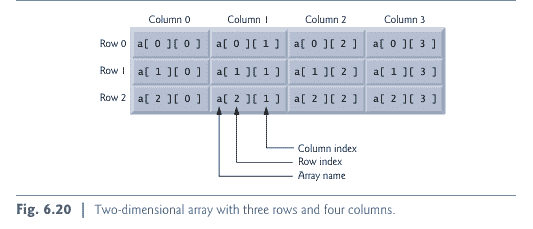

图 6.20 | 三行四列的二维数组。

图 6.20 中数组 a 的每个元素都用 a[i][j] 形式的元素名标识；a 是数组名，i 和 j 是唯一标识 a 中每个元素的索引。第 0 行中元素的名称的第一个索引均为 0；第 3 列中元素的名称的第二个索引均为 3。

**常见编程错误 6.7**
将二维数组元素引用为 a(x, y) 而不是 a[x][y] 是逻辑错误。C 会把 a(x, y) 解释为 a[y]（因为此上下文中的逗号被当作逗号运算符），因此这个程序员错误不是语法错误。

### 6.11.2 初始化双下标数组

多维数组可以在定义时初始化。例如，二维数组 int b[2][2] 可以这样定义并初始化：

```
int b[2][2] = {{1, 2}, {3, 4}};
```

这些值按行分组放在花括号中。第一组花括号中的值初始化第 0 行，第二组花括号中的值初始化第 1 行。因此，值 1 和 2 分别初始化元素 b[0][0] 和 b[0][1]，值 3 和 4 初始化元素 b[1][0] 和 b[1][1]。如果给定行的初始化器不足，该行剩余元素会被初始化为 0。因此，

```
int b[2][2] = {{}, {3, 4}};
```

会将 b[0][0] 初始化为 1，b[0][1] 初始化为 0，b[1][0] 初始化为 3，b[1][1] 初始化为 4。图 6.21 演示了二维数组的定义和初始化。

```
1 // Fig. 6.21: fig06_21.c
2 // Initializing multidimensional arrays.
3 #include <stdio.h>
4
5 void printArray(int a[][3]); // function prototype
6
```

图 6.21 | 初始化多维数组。（第 I 部分，共 2 部分。）

```c
// function main begins program execution
int main(void)
{
   int array1[2][3] = {{1, 2, 3}, {4, 5, 6}};
   puts("Values in array1 by row are:");
   printArray(array1);

   int array2[2][3] = {1, 2, 3, 4, 5};
   puts("Values in array2 by row are:");
   printArray(array2);

   int array3[2][3] = {{1, 2}, {4}};
   puts("Values in array3 by row are:");
   printArray(array3);
}

// function to output array with two rows and three columns
void printArray(int a[][3])
{
   // loop through rows
   for (size_t i = 0; i <= 1; ++i) {

      // output column values
      for (size_t j = 0; j <= 2; ++j) {
         printf("%d ", a[i][j]);
      }

      printf("\n"); // start new line of output
   }
}
```

```
Values in array1 by row are:
1 2 3
4 5 6
Values in array2 by row are:
1 2 3
4 5 0
Values in array3 by row are:
1 2 0
4 0 0
```

**图 6.21**  |  初始化多维数组。（第 2 部分，共 2 部分。）

### **array1 的定义**

该程序定义了三个两行三列（每个数组六个元素）的数组。array1 的定义（第 10 行）在两个子列表中提供了六个初始化器。第一个子列表将数组的第 0 行初始化为值 1、2 和 3；第二个子列表将数组的第 1 行初始化为值 4、5 和 6。

### **array2 的定义**

如果从 array1 的初始化器列表中移除每个子列表周围的花括号，编译器会先初始化第一行的元素，再初始化第二行的元素。array2 的定义（第 14 行）提供了五个初始化器。这些初始化器被依次赋给第一行，然后赋给第二行。任何没有显式初始化器的元素都会自动初始化为零，因此 `array2[1][2]` 被初始化为 0。

### array3 的定义

array3 的定义（第 18 行）在两个子列表中提供了三个初始化器。第一行的子列表将第一行的前两个元素显式初始化为 1 和 2。第三个元素初始化为零。第二行的子列表将第一个元素显式初始化为 4。最后两个元素初始化为零。

### printArray 函数

程序调用 printArray（第 24–36 行）来输出每个数组的元素。函数定义将数组参数指定为 `int a[][3]`。在一维数组参数中，数组方括号是空的。多维数组的第一个索引不是必需的，但所有后续索引都是必需的。编译器使用这些索引来确定多维数组中元素在内存中的位置。无论有多少个索引，所有数组元素都连续存储在内存中。在二维数组中，第一行先存储在内存中，随后是第二行。

在参数声明中提供索引值，使编译器能够告诉函数如何定位数组中的元素。在二维数组中，每一行基本上都是一个一维数组。要定位特定行中的元素，编译器必须知道每一行有多少个元素，以便在访问数组时跳过适当数量的内存位置。因此，在我们的示例中访问 `a[1][2]` 时，编译器知道要跳过第一行的三个元素以到达第二行（第 1 行）。然后，编译器访问该行的元素 2。

### 6.11.3 设置一行中的元素

许多常见的数组操作使用 for 迭代语句。例如，以下语句将图 6.20 中数组 a 的第 2 行所有元素设置为零：

```
for (column = 0; column <= 3; ++column) {
    a[2][column] = 0;
}
```

我们指定了第 2 行，因此第一个索引始终为 2。循环只改变第二个（列）索引。前面的 for 语句等价于以下赋值语句：

```
a[2][0] = 0;
a[2][1] = 0;
a[2][2] = 0;
a[2][3] = 0;
```

### 6.11.4 对二维数组中的元素求和

以下嵌套 for 语句计算数组 a 中所有元素的总和。

```
total = 0;
for (row = 0; row <= 2; ++row) {
    for (column = 0; column <= 3; ++column) {
        total += a[row][column];
    }
}
```


for 语句每次按一行累计数组的元素。外层 for 语句首先将 row（即行索引）设置为 0，以便内层 for 语句可以累计该行的元素。然后外层 for 语句将 row 递增为 1，以便累计该行的元素。接着，外层 for 语句将 row 递增为 2，以便累计第三行的元素。当嵌套的 for 语句终止时，total 包含数组 a 中所有元素的总和。

## 6.1.1.5 二维数组操作

图6.22 使用 for 语句对 3 行 4 列的数组 studentGrades 执行了其他几种常见的数组操作。数组的每一行代表一名学生，每一列代表该学生在学期中所参加的四次考试中某一次的成绩。这些数组操作由四个函数完成。函数 minimum（第39–56行）确定任何学生本学期的最低成绩。函数 maximum（第59–76行）确定任何学生本学期的最高成绩。函数 average（第79–89行）确定某位学生的学期平均成绩。函数 printArray（第92–108行）以整洁的表格格式输出该二维数组。

```c
// Fig. 6.22: fig06_22.c
// Two-dimensional array manipulations.
#include <stdio.h>
#define STUDENTS 3
#define EXAMS 4

// function prototypes
int minimum(const int grades[][EXAMS], size_t pupils, size_t tests);
int maximum(const int grades[][EXAMS], size_t pupils, size_t tests);
double average(const int setOfGrades[], size_t tests);
void printArray(const int grades[][EXAMS], size_t pupils, size_t tests);

// function main begins program execution
int main(void)
{
   // initialize student grades for three students (rows)
   int studentGrades[STUDENTS][EXAMS] =
   {
       { 77, 68, 86, 73 },
       { 96, 87, 89, 78 },
       { 70, 90, 86, 81 }
   };

   // output array studentGrades
   puts("The array is:");
   printArray(studentGrades, STUDENTS, EXAMS);

   // determine smallest and largest grade values
   printf("\nLowest grade: %d\nHighest grade: %d\n",
          minimum(studentGrades, STUDENTS, EXAMS),
          maximum(studentGrades, STUDENTS, EXAMS));

   // calculate average grade for each student
   for (size_t student = 0; student < STUDENTS; ++student) {
       printf("The average grade for student %u is %f\n",
              student, average(studentGrades[student], EXAMS));
   }
}

// Find the minimum grade
int minimum(const int grades[][EXAMS], size_t pupils, size_t tests)
{
    int lowGrade = 100; // initialize to highest possible grade

    // loop through rows of grades
    for (size_t i = 0; i < pupils; ++i) {

        // loop through columns of grades
        for (size_t j = 0; j < tests; ++j) {

            if (grades[i][j] < lowGrade) {
                lowGrade = grades[i][j];
            }
        }
    }

    return lowGrade; // return minimum grade
}

// Find the maximum grade
int maximum(const int grades[][EXAMS], size_t pupils, size_t tests)
{
    int highGrade = 0; // initialize to lowest possible grade

    // loop through rows of grades
    for (size_t i = 0; i < pupils; ++i) {

        // loop through columns of grades
        for (size_t j = 0; j < tests; ++j) {

            if (grades[i][j] > highGrade) {
                highGrade = grades[i][j];
            }
        }
    }

    return highGrade; // return maximum grade
}

// Determine the average grade for a particular student
double average(const int setOfGrades[], size_t tests)
{
    int total = 0; // sum of test grades

    // total all grades for one student
    for (size_t i = 0; i < tests; ++i) {
        total += setOfGrades[i];
    }

    return (double) total / tests; // average
}

// Print the array
void printArray(const int grades[][EXAMS], size_t pupils, size_t tests)
{
    // output column heads
    printf("%s", "[0]  [1]  [2]  [3]");

    // output grades in tabular format
    for (size_t i = 0; i < pupils; ++i) {

        // output label for row
        printf("\nstudentGrades[%u] ", i);

        // output grades for one student
        for (size_t j = 0; j < tests; ++j) {
            printf("%4d", grades[i][j]);
        }
    }
}
```

图6.22 | 二维数组操作。（第2部分，共3部分。）

数组为：

|  | [0] | [1] | [2] | [3] |
|---|---|---|---|---|
| studentGrades[0] | 77 | 68 | 86 | 73 |
| studentGrades[1] | 96 | 87 | 89 | 78 |
| studentGrades[2] | 70 | 90 | 86 | 81 |

```text
Lowest grade: 68
Highest grade: 96
The average grade for student 0 is 76.00
The average grade for student 1 is 87.50
The average grade for student 2 is 81.75
```

**图6.22** | 二维数组操作。（第3部分，共3部分。）

函数 minimum、maximum 和 printArray 各自接收三个参数——studentGrades 数组（在函数中称为 grades）、学生数量（数组的行数）和考试数量（数组的列数）。每个函数都使用嵌套的 for 语句遍历数组 grades。下面的嵌套 for 语句来自函数 minimum 的定义：

```c
// loop through rows of grades
for (i = 0; i < pupils; ++i) {
    // loop through columns of grades
    for (j = 0; j < tests; ++j) {
        if (grades[i][j] < lowGrade)
            lowGrade = grades[i][j];
    }
}
```

外层 `for` 语句首先将 `i`（即行索引）设置为 0，以便该行的元素（即第一名学生的成绩）可以与内层 `for` 语句体中的变量 lowGrade 进行比较。内层 `for` 语句循环遍历特定行的四个成绩，并将每个成绩与 lowGrade 比较。如果某个成绩小于 lowGrade，则将 lowGrade 设置为该成绩。然后外层 `for` 语句将行索引递增为 1。该行的元素与变量 lowGrade 比较。然后外层 `for` 语句将行索引递增为 2。该行的元素与变量 lowGrade 比较。当嵌套语句执行完毕时，lowGrade 包含该二维数组中的最低成绩。函数 maximum 的工作原理与 minimum 类似。

函数 average（第79–89行）接收两个参数——一个特定学生的测试结果二维数组 setOfGrades 和数组中测试结果的数量。调用 average 时，传递第一个参数 grades[student]。这导致二维数组中某一行的地址被传递给 average。参数 studentGrades[1] 是数组第 1 行的起始地址。请记住，二维数组基本上是一维数组的数组，而一维数组的名称就是该数组在内存中的地址。函数 average 计算数组元素的总和，将总和除以测试结果的数量，并返回浮点结果。

## 6.12 变长数组²

2. 此功能在 Microsoft Visual C++ 中不受支持。

到目前为止，你定义的每个数组都是在编译时指定其大小的。但如果你直到*执行时*才能确定数组的大小，那该怎么办？过去，处理这种情况需要使用动态内存分配（在第12章“C数据结构”中介绍）。对于数组大小在编译时未知的情况，C 提供了变长数组（VLA）——也就是说，数组的长度由*执行时*计算的表达式来定义。图6.23的程序声明并打印了几个 VLA。

```c
1   // Fig. 6.23: fig06_23.c
2   // Using variable-length arrays in C99
3   #include <stdio.h>
4
5   // function prototypes
6   void print1DArray(int array[], size_t size);

void print2DArray(int row, int col, int array[row][col]);

int main(void)
{
   printf("%s", "Enter size of a one-dimensional array: ");
   int arraySize; // size of 1-D array
   scanf("%d", &arraySize);

   int array[arraySize]; // declare 1-D variable-length array

   printf("%s", "Enter number of rows and columns in a 2-D array: ");
   int row1, col1; // number of rows and columns in a 2-D
   scanf("%d %d", &row1, &col1);

   int array2D1[row1][col1]; // declare 2-D variable-length array

   printf("%s",
      "Enter number of rows and columns in another 2-D array: ");
   int row2, col2; // number of rows and columns in another 2-D array
   scanf("%d %d", &row2, &col2);

   int array2D2[row2][col2]; // declare 2-D variable-length array

   // test sizeof operator on VLA
   printf("\nsizeof(array) yields array size of %d bytes\n",
      sizeof(array));

   // assign elements of 1-D VLA
   for (size_t i = 0; i < arraySize; ++i) {
      array[i] = i * i;
   }

   // assign elements of first 2-D VLA
   for (size_t i = 0; i < row1; ++i) {
      for (size_t j = 0; j < col1; ++j) {
         array2D1[i][j] = i + j;
      }
   }

   // assign elements of second 2-D VLA
   for (size_t i = 0; i < row2; ++i) {
      for (size_t j = 0; j < col2; ++j) {
         array2D2[i][j] = i + j;
      }
   }

   puts("\nOne-dimensional array:");
   print1DArray(array, arraySize); // pass 1-D VLA to function

   puts("\nFirst two-dimensional array:");
   print2DArray(row1, col1, array2D1); // pass 2-D VLA to function
}
```

**图6.23** | 在 C99 中使用变长数组。（第1部分，共3部分。）

**图6.23** | 在 C99 中使用变长数组。（第2部分，共3部分。）


```c
59  puts("\nSecond two-dimensional array:");
60  print2DArray(row2, col2, array2D2); // pass other 2-D VLA to function
61 }
62
63 void print1DArray(size_t size, int array[size])
64 {
65    // output contents of array
66    for (size_t i = 0; i < size; i++) {
67       printf("array[%d] = %d\n", i, array[i]);
68    }
69 }
70
71 void print2DArray(size_t row, size_t col, int array[row][col])
72 {
73    // output contents of array
74    for (size_t i = 0; i < row; ++i) {
75       for (size_t j = 0; j < col; ++j)
76          printf("%5d", array[i][j]);
77
78       puts("");
79    }
80 }
81 }
```

```text
Enter size of a one-dimensional array: 6
Enter number of rows and columns in a 2-D array: 2 5
Enter number of rows and columns in another 2-D array: 4 3

sizeof(array) yields array size of 24 bytes

One-dimensional array:
array[0] = 0
array[1] = 1
array[2] = 4
array[3] = 9
array[4] = 16
array[5] = 25

First two-dimensional array:
    0   1   2   3   4
    1   2   3   4   5

Second two-dimensional array:
    0   1   2
    1   2   3
    3   4   5
```

图 6.23 | 在 C99 中使用变长数组。（第 3 部分，共 3 部分。）

## 创建 VLA

第11–28行提示用户输入一个一维数组和两个二维数组所需的大小，并使用第15、21和28行中的输入值来创建VLA。只要表示数组大小的变量是整型，第15、21和28行就是有效的。

终止空字符（`'\0'`）——写到数组末尾之外。这可能覆盖其他变量的值。此外，如果程序写入那些其他变量，它可能会覆盖字符串的 `'\0'`。

函数通过查找字符串的终止 `'\0'` 字符来确定字符串在哪里结束。例如，回想一下，函数 `printf` 通过从内存中字符串的开头读取字符并持续到遇到字符串的 `'\0'` 来输出字符串。如果缺少 `'\0'`，`printf` 会继续从内存中读取，直到在内存中遇到后面的某个 `'\0'`。这可能导致奇怪的结果或使程序崩溃。

C11标准的可选附录K提供了许多字符串处理和输入/输出函数的新版本，这些版本更安全。当把字符串读入字符数组时，函数 `scanf_s` 会执行额外检查，以确保不会写到数组末尾之外。假设 `myString` 是一个20字符的数组，则语句

```c
scanf_s("%19s", myString, 20);
```

将字符串读入 `myString`。函数 `scanf_s` 对于格式字符串中的每个 `%s` 都要求两个参数：

- 用于放置输入字符串的字符数组；以及
- 数组的元素个数。

该函数使用元素个数来防止缓冲区溢出。例如，可能为 `%s` 提供的字段宽度对于底层字符数组来说太长，或者干脆完全省略字段宽度。使用 `scanf_s` 时，如果输入的字符数加上终止空字符大于指定的数组元素个数，则 `%s` 转换失败。对于前面的语句，它只包含一个转换说明符，`scanf_s` 将返回0，表示没有执行任何转换，并且数组 `myString` 将保持不变。

一般来说，如果你的编译器支持C标准可选附录K中的函数，就应该使用它们。我们将在后面的“安全C编程”部分讨论其他附录K函数。

> **可移植性提示 6.1**
>
> *并非所有编译器都支持C11标准的附录K函数。对于必须在多个平台和编译器上编译的程序，你可能需要编辑代码，以使用各平台上可用的 `scanf_s` 或 `scanf` 版本。你的编译器还可能要求进行特定设置，才能使用附录K函数。*

### 不要将用户读取的字符串用作格式控制字符串

你可能已经注意到，在本书中，我们不使用单参数 `printf` 语句。相反，我们使用以下形式之一：

- 当需要在字符串后输出 `'\n'` 时，我们使用函数 `puts`（它会自动在其单个字符串参数后输出 `'\n'`），如下所示：

  ```c
  puts("Welcome to C!");
  ```

- 当需要光标停留在与字符串同一行时，我们使用函数 `printf`，如下所示：

  ```c
  printf("%s", "Enter first integer: ");
  ```

因为我们显示的是*字符串字面量*，我们当然可以使用 `printf` 的单参数形式，如下所示：

```c
printf("Welcome to C!\n");
printf("Enter first integer: ");
```

当 `printf` 求其第一个（也可能是唯一的）参数中的格式控制字符串时，该函数会根据该字符串中的转换说明符执行格式化。如果格式控制字符串是从用户处获得的，攻击者就可能提供恶意转换说明符，这些说明符会被格式化输出函数“执行”。既然你已经知道如何将字符串读入*字符数组*，那么重要的是要注意，你**绝不能**将可能包含用户输入的字符数组用作 `printf` 的格式控制字符串。有关更多信息，请参阅 www.securecoding.cert.org 上的 CERT 指南 FIO30-C。

## 小结

### 6.1节 引言

- 数组（第247页）是由相同类型的相关数据项组成的数据结构。
- 数组是“静态”实体，因为它们在程序执行期间始终保持相同的大小。

### 6.2节 数组

- 数组是一组连续的内存位置，这些内存位置之所以相关，是因为它们都具有相同的名称和相同的类型。
- 要引用数组中的特定位置或元素（第247页），请指定数组的名称以及该特定元素在数组中的位置编号（第247页）。
- 每个数组的第一个元素是第0个元素（第247页），即位置编号为0的元素。因此，数组 c 的第一个元素称为 c[0]，第二个元素称为 c[1]，第七个元素称为 c[6]，一般来说，第 i 个元素称为 c[i − 1]。
- 数组名与其他变量名一样，只能包含字母、数字和下划线，并且不能以数字开头。
- 方括号内的位置编号更正式地称为索引或下标（第248页）。索引必须是整数或整数表达式。
- 用于括住数组索引的方括号在C中实际上被视为运算符。它们与函数调用运算符具有相同的优先级。

### 6.3节 定义数组

- 数组占用内存空间。你指定每个元素的类型以及数组中元素的数量，以便计算机可以保留适当数量的内存。
- `char` 类型的数组可用于存储字符串。

### 6.4节 数组示例

- 类型 `size_t` 表示无符号整型。对于任何表示数组大小或数组索引的变量，推荐使用此类型。头文件 `<stddef.h>` 定义了 `size_t`，并且经常被其他头文件（例如 `<stdio.h>`）包含。
- 数组元素可以在定义数组时初始化：在定义后跟一个等号和花括号 { }，其中包含以逗号分隔的初始化器列表（第250页）。如果初始化器少于数组中的元素，则其余元素被初始化为零。
- 语句 `int n[10] = {0};` 显式地将第一个元素初始化为零，并将其余九个元素初始化为零，因为初始化器少于数组中的元素。重要的是要记住，自动数组不会自动初始化为零。你至少必须将第一个元素初始化为零，其余元素才会被自动置零。这种将数组元素初始化为0的方法，对于*静态*数组在程序启动前执行，对于自动数组在运行时执行。
- 如果在带初始化器列表的定义中省略数组大小，则数组中的元素数量将是初始化器列表中的元素数量。
- **#define** 预处理指令可用于定义符号常量——一种标识符，预处理器在程序编译之前会将其替换为替换文本。当程序被预处理时，符号常量的所有出现都会被替换为替换文本（第252页）。使用符号常量指定数组大小可使程序更*易于修改*。
- C没有数组边界检查来防止程序引用不存在的元素。因此，正在执行的程序可能在毫无警告的情况下“走出”数组末尾。你应确保所有数组引用都保持在数组边界内。

### 6.5节 使用字符数组存储和操作字符串

- 诸如 "hello" 这样的字符串字面量在C中实际上是一个由单个字符组成的数组。
- 字符数组可以使用字符串字面量初始化。在这种情况下，数组的大小由编译器根据字符串的长度确定。
- 每个字符串都包含一个特殊的字符串终止字符，称为空字符（第258页）。表示空字符的字符常量是 `'\0'`。
- 表示字符串的字符数组应始终定义得足够大，以容纳字符串中的字符数以及终止空字符。
- 字符数组也可以使用初始化器列表中的各个字符常量来初始化。
- 因为字符串实际上是一个字符数组，所以我们可以使用数组索引表示法直接访问字符串中的各个字符。
- 你可以使用 `scanf` 和转换说明符 `%s` 从键盘直接将字符串输入到字符数组中。字符数组的名称传递给 `scanf` 时，不需要像非数组变量那样在前面加 `&`。
- 函数 `scanf` 从键盘读取字符，直到遇到第一个空白字符——它不检查数组大小。因此，`scanf` 可能写到数组末尾之外。
- 表示字符串的字符数组可以使用 `printf` 和 `%s` 转换说明符输出。字符串的字符会被打印，直到遇到终止空字符。

### 6.6节 静态局部数组和自动局部数组

- *静态*局部变量在程序整个运行期间存在，但仅在函数体内可见。我们可以将 *静态* 应用于局部数组定义，使得每次调用函数时不会创建和初始化该数组，并且程序中每次退出函数时不会销毁该数组。这可以减少程序执行时间，特别是对于包含大型数组且被频繁调用的函数的程序。
- *静态*数组会在程序启动前自动初始化一次。如果你没有显式初始化*静态*数组，该数组的元素会由编译器初始化为零。


## 6.7 节 将数组传递给函数

- 要将数组实参传递给函数，请指定数组名，不要带任何方括号。
- 与包含字符串的 char 数组不同，其他数组类型没有特殊的终止符。因此，要将数组的大小传递给函数，以便函数能够处理正确数量的元素。
- C 会自动按引用将数组传递给函数——被调用的函数可以修改调用方原始数组中的元素值。数组名求值结果为数组第一个元素的地址。由于传递的是数组的起始地址，被调用函数能够准确知道数组存储在哪里。因此，当被调用函数在其函数体中修改数组元素时，它修改的是数组中位于其原始内存位置的实际元素。
- 尽管整个数组是按引用传递的，但单个数组元素却完全像简单变量一样按值传递。
- 这种简单的单个数据项（例如单个 int、float 和 char）称为标量（第 263 页）。
- 要将数组的一个元素传递给函数，请在函数调用中使用该数组元素的带索引名称作为实参。
- 要使函数通过函数调用接收数组，函数的参数列表必须指明将接收一个数组。数组方括号之间不需要指定数组大小。如果指定了，编译器会检查它大于零，然后忽略它。
- 当数组参数前面带有 const 限定符（第 265 页）时，数组元素在函数体中变为常量，任何在函数体中修改数组元素的尝试都会导致编译时错误。

## 6.8 节 对数组排序

- 排序数据（即，将数据按特定顺序放置，如升序或降序）是最重要的计算应用之一。
- 一种排序技术称为冒泡排序（第 266 页）或下沉排序，因为较小的值会像水中升起的气泡一样逐渐“冒泡”到数组顶部，而较大的值则下沉到数组底部。该技术是对数组进行多趟遍历。每一趟都比较相邻的元素对。如果一对元素按递增顺序排列（或值相同），则保持这些值不变。如果一对元素按递减顺序排列，则在数组中交换它们的值。
- 由于连续比较的方式，一个大值可能在单趟中向下移动数组中的许多位置，而一个小值可能只向上移动一个位置。
- 冒泡排序的主要优点是易于编程。然而，冒泡排序运行缓慢。在对大型数组排序时，这一点会变得很明显。

## 6.9 节 案例研究：使用数组计算平均值、中位数和众数

- 平均值是一组值的算术平均数。
- 中位数是一组已排序值中的“中间值”。
- 众数是一组值中出现频率最高的值。

## 6.10 节 查找数组

- 在数组中寻找特定元素的过程称为查找（第 273 页）。
- 线性查找将数组的每个元素与查找键（第 273 页）进行比较。由于数组没有按任何特定顺序排列，因此该值在第一个元素中找到的可能性与在最后一个元素中找到的可能性相同。所以平均而言，查找键将与数组的一半元素进行比较。
- 线性查找算法（第 273 页）适用于小型或未排序的数组。对于已排序的数组，可以使用高速的二分查找算法。
- 二分查找算法（第 273 页）在每次比较后从考虑范围中排除已排序数组的一半元素。该算法定位数组的中间元素，并将其与查找键比较。如果相等，则找到查找键，并返回该元素的数组索引。如果不相等，则问题缩小为查找数组的一半。如果查找键小于数组的中间元素，则查找数组的前一半；否则查找后一半。如果在指定子数组（原始数组的一部分）中未找到查找键，则算法在原始数组的四分之一上重复。搜索会一直继续，直到查找键等于某个子数组的中间元素，或者直到子数组只包含一个不等于查找键的元素（即未找到查找键）。
- 使用二分查找时，任何数组所需的最大比较次数可以通过找出大于数组元素个数的最小 2 的幂来确定。

## 6.11 节 多维数组

- 多维数组（第 278 页）的一个常见用途是表示由按行和列排列的信息组成的值表。要标识特定的表元素，我们必须指定两个索引。第一个（按惯例）标识元素的行，第二个（按惯例）标识元素的列。
- 需要两个索引来标识特定元素的表或数组称为*二维数组*（第 278 页）。
- 多维数组可以有两个以上的索引。
- 多维数组可以在定义时初始化，很像一维数组。二维数组中的值按行分组放在花括号中。如果给定行的初始化器不足，该行的其余元素将初始化为 0。
- 多维数组参数声明的第一个索引不是必需的，但所有后续索引都是必需的。编译器使用这些索引来确定多维数组中元素在内存中的位置。无论索引数量多少，所有数组元素都在内存中连续存储。在二维数组中，第一行先存储在内存中，然后是第二行。
- 在参数声明中提供索引值，使编译器能够告诉函数如何定位数组元素。在二维数组中，每一行基本上都是一个一维数组。要定位特定行中的元素，编译器必须知道每一行有多少个元素，以便在访问数组时跳过适当数量的内存位置。

## 6.12 节 变长数组

- 变长数组（第 285 页）是其大小由执行时求值的表达式定义的数组。
- 当应用于变长数组时，`sizeof` 在运行时起作用。
- 与定长数组一样，对于变长数组，也没有防止越出数组边界的保护。
- 将变长数组作为参数传递给函数的语法与普通定长数组相同。

## 自测练习

- **6.1** 回答下列各题：
  - a) 值的列表和表格存储在 ________ 中。
  - b) 用于引用数组中特定元素的编号称为它的 ________。
  - c) 应使用一个 ________ 来指定数组的大小，因为它使程序更易于修改。
  - d) 将数组元素按顺序放置的过程称为 ________ 该数组。
  - e) 确定数组是否包含某个键值称为 ________ 该数组。
  - f) 使用两个索引的数组称为 ________ 数组。

- **6.2** 指出下列各题是*真*还是*假*。如果答案是*假*，请解释原因。
  - a) 数组可以存储许多不同类型的值。
  - b) 数组索引的数据类型可以是 double。
  - c) 如果初始化列表中的初始化器少于数组元素个数，C 会自动将剩余元素初始化为初始化器列表中的最后一个值。
  - d) 如果初始化列表包含的初始化器多于数组元素个数，则是错误。
  - e) 作为 `a[i]` 形式的实参传递给函数并在被调用函数中被修改的单个数组元素，在调用函数中将包含修改后的值。

- **6.3** 按照以下关于名为 fractions 的数组的说明操作。
  - a) 定义一个符号常量 SIZE，将其替换为替换文本 10。
  - b) 定义一个具有 SIZE 个 double 类型元素的数组，并将这些元素初始化为 0。
  - c) 引用数组元素 4。
  - d) 将值 1.667 赋给数组元素九。
  - e) 将值 3.333 赋给数组的第七个元素。
  - f) 打印数组元素 6 和 9，要求小数点右侧保留两位精度，并展示屏幕上显示的输出。
  - g) 使用 `for` 迭代语句打印数组的所有元素。假设已定义整型变量 `x` 作为循环的控制变量。显示输出。

- **6.4** 编写语句完成下列任务：
  - a) 将 `table` 定义为具有 3 行 3 列的整型数组。假设符号常量 SIZE 已定义为 3。
  - b) 数组 `table` 包含多少个元素？打印元素总数。
  - c) 使用 `for` 迭代语句将 `table` 的每个元素初始化为其索引之和。假设整型变量 `x` 和 `y` 已定义为控制变量。
  - d) 打印数组 `table` 每个元素的值。假设该数组已使用以下定义初始化：

    ```c
    int table[SIZE][SIZE] =
       { { 1, 8 }, { 2, 4, 6 }, { 5 } };
    ```

- **6.5** 找出下列每个程序段中的错误并改正错误。
  - a) `#define SIZE 100;`
  - b) `SIZE = 10;`
  - c) `Assume int b[10] = { 0 }, i;`

    ```c
    for (i = 0; i <= 10; ++i) {
       b[i] = 1;
    }
    ```

  - d) `#include <stdio.h>;`
  - e) `Assume int a[2][2] = { { 1, 2 }, { 3, 4 } };`

    `a[1, 1] = 5;`

  - f) `#define VALUE = 120`


## 自测练习答案

- **6.1** a) 数组。b) 索引。c) 符号常量。d) 排序。e) 搜索。f) 二维。

- **6.2**
  - a) 错误。数组只能存储相同类型的值。
  - b) 错误。数组索引必须是整数或整数表达式。
  - c) 错误。C 会自动将其余元素初始化为零。
  - d) 正确。
  - e) 错误。数组的单个元素按值传递。如果将整个数组传递给函数，则对元素的任何修改都会反映到原数组中。

- **6.3**
  - a) `#define SIZE 10`
  - b) `double fractions[SIZE] = { 0.0 };`
  - c) `fractions[4]`
  - d) `fractions[9] = 1.667;`
  - e) `fractions[6] = 3.333;`
  - f) `printf("%.2f %.2f\n", fractions[6], fractions[9]);`
    输出：3.33 1.67。
  - g)
    ```c
    for (x = 0; x < SIZE; ++x) {
        printf("fractions[%u] = %f\n", x, fractions[x]);
    }
    ```
    输出：
    ```
    fractions[0] = 0.000000
    fractions[1] = 0.000000
    fractions[2] = 0.000000
    fractions[3] = 0.000000
    fractions[4] = 0.000000
    fractions[5] = 0.000000
    fractions[6] = 3.333000
    fractions[7] = 0.000000
    fractions[8] = 0.000000
    fractions[9] = 1.667000
    ```

- **6.4**
  - a) `int table[SIZE][SIZE];`
  - b) 九个元素。`printf("%d\n", SIZE * SIZE);`
  - c)
    ```c
    for (x = 0; x < SIZE; ++x) {
        for (y = 0; y < SIZE; ++y) {
            table[x][y] = x + y;
        }
    }
    ```
  - d)
    ```c
    for (x = 0; x < SIZE; ++x) {
        for (y = 0; y < SIZE; ++y) {
            printf("table[%d][%d] = %d\n", x, y, table[x][y]);
        }
    }
    ```
    输出：
    ```
    table[0][0] = 1
    table[0][1] = 8
    table[0][2] = 0
    table[1][0] = 2
    table[1][1] = 4
    table[1][2] = 6
    table[2][0] = 5
    table[2][1] = 0
    table[2][2] = 0
    ```

- c) 将整型数组 numbers 的 50 个元素初始化为零。

- d) 以列格式打印整型数组 GPA 的 10 个值。

### **6.13** 找出下列各语句中的错误：

- a) 假设：`int a[5];`

    ```c
    scanf("%d", a[5]);
    ```

- b) 假设：`int a[3][5];`

    ```c
    printf("%d%d%d\n", a[0][1], a[0][2], a[0][3]);
    ```

- c) `double f[3] = {1.01; 10.01; 100.01};`

- d) 假设：`double d[3][5];`

    ```c
    d[2, 4] = 2.345;
    ```

### **6.14** *（集合的并集）* 使用一维数组解决以下问题。读入两组数字，每组有 10 个数字。读取所有值后，显示这两组数字的集合中的所有不重复元素。使用尽可能小的数组来解决此问题。

### **6.15** *（集合的交集）* 使用一维数组解决以下问题。读入两组数字，每组有 10 个数字。读取所有值后，显示两组数字共有的不重复元素。

### **6.16** 标记 3×5 二维数组 `sales` 的各元素，以指出下列程序段将它们置零的顺序：

```c
for (row = 0; row <= 2; ++row) {
    for (column = 0; column <= 4; ++column) {
        sales[row][column] = 0;
    }
}
```

### **6.17** 下列程序做什么？

```c
// ex06_17.c
// What does this program do?
#include <stdio.h>
#define SIZE 6

int whatIsThis(const int b[], size_t p);
// function prototype

// function main begins program execution
int main(void)
{
    int x; // holds return value of function whatIsThis
    // initialize array a
    int a[SIZE] = {1, 2, 3, 4, 5, 6};
    x = whatIsThis(a, SIZE);
    printf("Result is %d\n", x);
}

// what does this function do?
int whatIsThis(const int b[], size_t p)
{
    // base case
    if (1 == p) {
        return b[0];
    }
    else { // recursion step
        return b[p - 1] * whatIsThis(b, p - 1);
    }
}
```

### **6.18** 下列程序做什么？

```c
// ex06_18.c
// What does this program do?
#include <stdio.h>
#define MAX 10
// function prototype
void functionName(const int b[], size_t startSubscript, size_t size);
// function main begins program execution
int main(void)
{
    // initialize p
    int p[MAX] = { 5, 7, 2, 1, 0, 4, 3, 0, 6, 8 };

    puts("Answer is:");
    functionName(p, 0, MAX);
    puts("");
} // end main

// What does this function do?
void functionName(const int b[], size_t startSubscript, size_t size)
{
    if (startSubscript < size) {
        functionName(b, startSubscript + 1, size);
        printf("%d ", b[startSubscript] % 5);
    } // end if
} // end function functionName
```

### **6.19（掷骰子）** 编写一个程序，模拟掷两个骰子。

该程序应使用两次 rand，分别掷第一个骰子和第二个骰子。然后应计算这两个值之和。[**注意：** 因为每个骰子可以显示 1 到 6 的整数值，所以两个值之和将在 2 到 12 之间变化，其中 7 是最常见的和，2 和 12 是最不常见的和。] 图 6.24 显示了两个骰子的 36 种可能组合。你的程序应掷这两个骰子 36,000 次。使用一维数组统计每个可能和出现的次数。以表格格式打印结果。另外，判断总计是否合理；也就是说，掷出 7 有六种方式，因此所有投掷中大约六分之一应为 7。

| 骰子 1 \\ 骰子 2 | 1 | 2 | 3 | 4 | 5 | 6 |
|---:|---:|---:|---:|---:|---:|---:|
| 1 | 2 | 3 | 4 | 5 | 6 | 7 |
| 2 | 3 | 4 | 5 | 6 | 7 | 8 |
| 3 | 4 | 5 | 6 | 7 | 8 | 9 |
| 4 | 5 | 6 | 7 | 8 | 9 | 10 |
| 5 | 6 | 7 | 8 | 9 | 10 | 11 |
| 6 | 7 | 8 | 9 | 10 | 11 | 12 |

**图 6.24** | 掷骰子的结果。

### **6.20（双骰子游戏）** 编写一个程序，运行 1000 局双骰子游戏（无需人工干预），并回答以下每个问题：

- a) 在第一掷、第二掷、……、第二十掷以及第二十掷之后，分别有多少局获胜？

- b) 在第一掷、第二掷、……、第二十掷以及第二十掷之后，分别有多少局失败？

- c) 在双骰子游戏中获胜的概率是多少？[**注意：** 你会发现双骰子游戏是赌场中最公平的游戏之一。你认为这意味着什么？]

- d) 一局双骰子游戏的平均长度是多少？

- e) 获胜概率会随游戏长度增加而提高吗？

### **6.21** 一个 *n × m* 二维矩阵可以与另一个 *m × p* 矩阵相乘，得到一个新矩阵，其元素是第一个矩阵某一行中的元素与第二个矩阵某一列中对应元素的乘积之和。两个矩阵都应为方阵，或者第一个矩阵的列数应等于第二个矩阵的行数。

要计算结果矩阵的每个元素，将第一个矩阵给定行的第一个元素与第二个矩阵给定列的第一个元素相乘，再将所得结果与同一行第二个元素和同一列第二个元素的乘积相加，并继续这样做，直到该行和该列的最后一个元素都已相乘并加入总和。

编写一个程序计算两个矩阵的乘积，并将结果存储在第三个矩阵中。

### **6.22（总销售额）** 使用二维数组解决以下问题。一家公司有四名销售人员（1 到 4），他们销售五种不同的产品（1 到 5）。每天，每名销售人员都会为所销售的每种不同产品提交一张销售单。每张销售单包含：

- a) 销售人员编号

- b) 产品编号

- c) 当天售出的该产品的总金额（美元）

因此，每名销售人员每天提交 0 到 5 张销售单。假设上个月所有销售单的信息都可用。编写一个程序，读取上个月销售的所有这些信息，并按销售人员、按产品汇总总销售额。所有总计都应存储在二维数组 sales 中。处理完上个月的所有信息后，以表格格式打印结果，其中每列代表特定销售人员，每行代表特定产品。对每一行进行横向合计，得到上个月每种产品的总销售额；对每一列进行纵向合计，得到上个月每名销售人员的总销售额。表格打印输出应在合计行右侧和合计列底部包含这些交叉总计。

### **6.23（海龟绘图）** Logo 语言使 *海龟绘图* 的概念闻名。想象一只机械海龟在 C 程序的控制下在房间中行走。海龟将笔握在两种位置之一：抬起或放下。当笔放下时，海龟在移动时描绘出形状；当笔抬起时，海龟自由移动，不绘制任何内容。在这个问题中，你将模拟海龟的操作，并创建一个计算机化的画板。

使用一个初始化为零的 50×50 数组 floor。从包含命令的数组中读取命令。始终跟踪海龟的当前位置以及笔当前是否处于……

当前笔为抬起或放下。假设海龟总是从地板的 0,0 位置开始，笔抬起。

你的程序必须处理的海龟命令集合如 Fig. 6.25 所示。假设海龟位于地板的中心附近。以下'程序'将绘制并打印一个12×12的正方形：

```
2
5,12
3
5,12
3
5,12
3
5,12
1
6
9
```

当海龟落笔移动时，将数组 Floor 的相应元素设为1。当给出6命令（打印）时，数组中 wherever 有1的地方，显示一个星号，或你选择的其它字符。wherever 有0的地方，显示一个空白。编写一个程序来实现本文讨论的海龟图形功能。编写几个海龟图形程序来绘制有趣的形状。添加其它命令以增强你的海龟图形语言的功能。

| 命令 | 含义 |
|---|---|
| 1 | 抬笔 |
| 2 | 落笔 |
| 3 | 右转 |
| 4 | 左转 |
| 5, 10 | 前进10格（或其它数字） |
| 6 | 打印50×50数组 |
| 9 | 数据结束（哨兵） |

Fig. 6.25 | 海龟命令。

## 6.24（骑士巡游）

对于象棋爱好者来说，最有趣的谜题之一是骑士巡游问题，最初由数学家欧拉提出。问题是：被称为骑士的棋子能否在空棋盘上移动并恰好触及64个格子一次且仅一次？我们在此深入研究这个引人入胜的问题。

骑士走日字形（先在一个方向上走两格，然后在垂直方向上走一格）。因此，从空棋盘中间的一个格子出发，骑士可以做出八种不同的走法（编号为0到7），如图6.26所示。

大大提高了成功的几率。你可能已经注意到，外围的格子在某种程度上比靠近棋盘中心的格子更麻烦。事实上，最麻烦的或最难到达的格子是四个角。

直觉可能提示你应该先尝试将骑士移动到最麻烦的格子，并留下最容易到达的格子，以便在巡游接近尾声棋盘变得拥挤时，有更大的成功机会。

我们通过根据每个格子的可达性对其进行分类，并始终将骑士移动到（当然是在骑士的日字形走法范围内）最难到达的格子，从而开发出一种“可达性启发式”方法。我们用数字标记二维数组 accessibility，表示每个特定格子可以从多少个格子到达。在空白棋盘上，中心格子因此评为8，角格子评为2，其它格子的可达性数字为3、4或6，如下所示：

| 2 | 3 | 4 | 4 | 4 | 4 | 3 | 2 |
|---|---|---|---|---|---|---|---|
| 3 | 4 | 6 | 6 | 6 | 6 | 4 | 3 |
| 4 | 6 | 8 | 8 | 8 | 8 | 6 | 4 |
| 4 | 6 | 8 | 8 | 8 | 8 | 6 | 4 |
| 4 | 6 | 8 | 8 | 8 | 8 | 6 | 4 |
| 4 | 6 | 8 | 8 | 8 | 8 | 6 | 4 |
| 3 | 4 | 6 | 6 | 6 | 6 | 4 | 3 |
| 2 | 3 | 4 | 4 | 4 | 4 | 3 | 2 |

现在编写一个使用可达性启发式的骑士巡游程序版本。在任何时候，骑士都应移动到可达性数字最低的格子。如果出现平局，骑士可以移动到任意平局的格子。因此，巡游可以从四个角中的任何一个开始。[注意：随着骑士在棋盘上移动，你的程序应随着越来越多的格子被占据而减少可达性数字。这样，在巡游的任何给定时刻，每个可用格子的可达性数字将始终等于可以到达该格子的格子数。]运行你程序的这个版本。你得到了完整的巡游吗？（可选：修改程序以运行64次巡游，从棋盘的每个格子各一次。你得到了多少次完整巡游？）

- d) 编写一个骑士巡游程序版本，当遇到两个或多个格子之间的平局时，通过查看从“平局”格子可达的格子来决定选择哪个格子。你的程序应移动到下一个移动将到达可达性数字最低的格子的那个格子。

## 6.25（骑士巡游：暴力方法）

在练习6.24中，我们开发了解决骑士巡游问题的方案。所使用的方法称为“可达性启发式”，它能生成许多解并且执行高效。

随着计算机的不断增强，我们将能够用纯粹的计算能力和相对不复杂的算法解决许多问题。我们称这种方法为暴力问题求解。

- a) 使用随机数生成使骑士能够在棋盘上随机行走（当然是在合法的日字形走法内）。你的程序应运行一次巡游并打印最终棋盘。骑士走到了多远？
- b) 最有可能的是，前面的程序产生了一个相对较短的巡游。现在修改你的程序尝试1,000次巡游。使用一维数组来跟踪每种长度的巡游次数。当你的程序完成1,000次巡游尝试后，应以表格格式打印这些信息。最好的结果是什么？
- c) 最有可能的是，前面的程序给你了一些“体面”的巡游但没有完整的巡游。现在“全力以赴”，让你的程序一直运行直到产生一次完整巡游为止。[注意：这个版本的程序在强大的计算机上可能运行数小时。]再次记录每种长度的巡游次数，并在找到第一次完整巡游时打印该表。你的程序在产生完整巡游前尝试了多少次巡游？花费了多少时间？
d) 比较骑士巡游的暴力版本与可达性启发式版本。哪一个需要对问题进行更仔细的研究？哪个算法更难开发？哪个需要更多的计算机能力？我们能否事先确定使用可达性启发式方法就能得到完整巡游？我们能否事先确定使用暴力方法就能得到完整巡游？论述一般暴力问题求解的优缺点。

## 6.26（八皇后）

对于象棋爱好者来说，另一个谜题是八皇后问题。简单地说：是否可能在空棋盘上放置八个皇后，使得没有任何一个皇后“攻击”另一个——也就是说，没有两个皇后在同一行、同一列或同一对角线上？使用在练习6.24中开发的思路来为解决八皇后问题制定启发式方法。[提示：可以为棋盘的每个格子分配一个数值，表示一旦在该格子放置皇后，空棋盘上将被“消除”的格子数。例如，四个角中的每一个将被赋值为22，如图6.27所示。]

一旦这些“消除数”放置在全部64个格子中，一个合适的启发式可能是：将下一个皇后放置在消除数最小的格子中。为什么这种策略在直觉上很有吸引力？

## 6.27（八皇后：暴力方法）

在这个问题中，你将开发几种解决练习6.26中介绍的八皇后问题的暴力方法。

a) 使用练习6.25中开发的随机暴力技术解决八皇后问题。

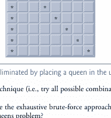

Fig. 6.27 | 将皇后放在左上角时被消除的22个格子。

- b) 使用穷举技术（即尝试棋盘上八个皇后的所有可能组合）。
- c) 你认为为什么穷举暴力方法可能不适合解决八皇后问题？
- d) 一般来说比较和对比随机暴力方法和穷举暴力方法。

## 6.28（重复消除）

在第12章，我们探讨高速二叉搜索树数据结构。二叉搜索树的一个特性是，在向树中插入时重复值会被丢弃。这被称为重复消除。编写一个程序生成1到20之间的20个随机数。程序应将所有不重复的值存储在数组中。使用尽可能小的数组来完成此任务。


- 6.29（骑士巡游：闭合巡游测试）在骑士巡游中，当骑士走完 64 步并恰好访问棋盘上每个方格一次且仅一次时，就形成完整巡游。当第 64 步距离骑士开始巡游的位置仅一步之遥时，就形成闭合巡游。修改你在练习 6.24 中编写的骑士巡游程序，以便在发生完整巡游时测试是否为闭合巡游。

- 6.30（埃拉托斯特尼筛法）素数是指大于 1 且只能被自身和 1 整除的整数。埃拉托斯特尼筛法是一种查找素数的方法。其工作原理如下：
  - a) 创建一个所有元素都初始化为 1（真）的数组。索引为素数的数组元素将保持为 1。所有其他数组元素最终将被置为 0。
  - b) 从数组索引 2 开始（索引 1 不是素数），每当发现一个值为 1 的数组元素时，遍历数组的其余部分，并将索引为该值为 1 的元素的索引的倍数的每个元素置为 0。对于数组索引 2，数组中 2 之后所有为 2 的倍数的元素都将被置为 0（索引 4、6、8、10 等）。对于数组索引 3，数组中 3 之后所有为 3 的倍数的元素都将被置为 0（索引 6、9、12、15 等）。

  当此过程完成时，仍被置为 1 的数组元素表示其索引是素数。编写一个使用 1,000 个元素的数组来确定并打印 1 到 999 之间素数的程序。忽略数组的元素 0。

### 递归练习

- 6.31（回文）回文是一种正向和反向拼写都相同的字符串。回文的一些例子包括：“radar”、“able was i ere i saw elba”，以及如果忽略空格，“a man a plan a canal panama”。编写一个递归函数 testPalindrome，如果数组中存储的字符串是回文则返回 1，否则返回 0。该函数应忽略字符串中的空格和标点符号。

- 6.32（线性查找）修改图 6.18 的程序，使用递归函数 linearSearch 对数组执行线性查找。该函数应接收一个整数数组、数组大小和搜索键作为参数。如果找到搜索键，则返回数组索引；否则返回 -1。

- 6.33（二分查找）修改图 6.19 的程序，使用递归函数 binarySearch 对数组执行二分查找。该函数应接收一个整数数组、起始索引、结束索引和搜索键作为参数。如果找到搜索键，则返回数组索引；否则返回 -1。

- 6.34（八皇后）修改你在练习 6.26 中创建的八皇后程序，以递归方式求解该问题。

- 6.35（打印数组）编写一个递归函数 printArray，接受一个数组和数组大小作为参数，打印该数组，并且不返回任何值。当接收到大小为 0 的数组时，该函数应停止处理并返回。

- 6.36（反向打印字符串）编写一个递归函数 stringReverse，接受一个字符数组作为参数，从后向前打印它，并且不返回任何值。当遇到字符串的终止空字符时，该函数应停止处理并返回。

- 6.37（查找数组中的最小值）编写一个递归函数 recursiveMinimum，接受一个整数数组和数组大小作为参数，并返回数组中的最小元素。当接收到一个只有一个元素的数组时，该函数应停止处理并返回。

## 7 C 指针

### 目标

本章中，你将：

- 使用指针和指针运算符。
- 使用指针以引用方式向函数传递参数。
- 理解 `const` 限定符的各种位置，以及它们如何影响你能对变量执行的操作。
- 对变量和类型使用 `sizeof` 运算符。
- 使用指针算术处理数组中的元素。
- 理解指针、数组和字符串之间的密切关系。
- 定义并使用字符串数组。
- 使用指向函数的指针。
- 了解与指针相关的安全 C 编程问题。


- 7.1 引言
- 7.2 指针变量的定义和初始化
- 7.3 指针运算符
- 7.4 使用指针以引用方式向函数传递参数
- 7.5 将 `const` 限定符与指针一起使用
  - 7.5.1 使用指向非常量数据的非常量指针将字符串转换为大写
  - 7.5.2 使用指向常量数据的非常量指针一次打印一个字符的字符串
  - 7.5.3 尝试修改指向非常量数据的常量指针
  - 7.5.4 尝试修改指向常量数据的常量指针
- 7.6 使用引用传递的冒泡排序
- 7.7 `sizeof` 运算符
- 7.8 指针表达式和指针算术
  - 7.8.1 指针算术允许的运算符
  - 7.8.2 让指针指向数组
  - 7.8.3 向指针加整数
  - 7.8.4 从指针减整数
  - 7.8.5 递增和递减指针
  - 7.8.6 从一个指针减去另一个指针
  - 7.8.7 将一个指针赋给另一个指针
  - 7.8.8 指向 `void` 的指针
  - 7.8.9 比较指针
- 7.9 指针与数组之间的关系
  - 7.9.1 指针/偏移量表示法
  - 7.9.2 指针/索引表示法
  - 7.9.3 不能用指针算术修改数组名
  - 7.9.4 演示指针索引和偏移量
  - 7.9.5 使用数组和指针复制字符串
- 7.10 指针数组
- 7.11 案例研究：洗牌和发牌模拟
- 7.12 指向函数的指针
  - 7.12.1 按升序或降序排序
  - 7.12.2 使用函数指针创建菜单驱动系统
- 7.13 安全 C 编程

*小结* | *自测练习* | *自测练习答案* | *练习*

*特别章节：构建你自己的计算机* | *函数指针数组练习* | *产生积极影响*

### 7.1 引言

本章讨论 C 编程语言最强大的特性之一——指针。¹ 指针是 C 中最难掌握的能力之一。指针使程序能够实现按引用传递、在函数之间传递函数，以及创建和操作动态数据结构——这些结构可以在执行时增长和缩小，例如链表、队列、栈和树。本章解释基本的指针概念。在 7.13 节中，我们讨论各种与指针相关的安全问题。第 10 章考察指针与结构体的使用。第 12 章介绍动态内存管理技术，并给出创建和使用动态数据结构的示例。

1. 指针以及数组和字符串等基于指针的实体，在有意或无意误用时，可能导致错误和安全漏洞。有关这一重要主题的文章、书籍、白皮书和论坛，请参阅我们的安全 C 编程资源中心（www.deitel.com/SecureC/）。

### 7.2 指针变量的定义和初始化

指针是其值为*内存地址*的变量。通常，变量直接包含一个特定的值。然而，指针包含一个变量的*地址*，该变量包含一个特定的值。从这个意义上说，变量名*直接*引用一个值，而指针*间接*引用一个值（图 7.1）。通过指针引用一个值称为间接引用。

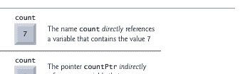

图 7.1 | 直接和间接引用变量。

#### 声明指针

指针和所有变量一样，必须先定义后使用。定义

```
int *countPtr, count;
```

指定变量 countPtr 的类型为 `int *`（即指向整数的指针），并从右向左读作“countPtr 是一个指向 int 的指针”或“countPtr 指向一个 int 类型的对象”。此外，变量 count 被定义为 int，而不是指向 int 的指针。在定义中，`*` 仅作用于 countPtr。当 `*` 在定义中以这种方式使用时，表示被定义的变量是一个指针。指针可以被定义为指向任何类型的对象。为避免像上面那样在同一声明中声明指针变量和非指针变量所造成的歧义，应始终每次声明只声明一个变量。

> **常见编程错误 7.1**
>
> *用于声明指针变量的星号（`*`）表示法不会分配到声明中的所有变量名。每个指针都必须在名称前加上 `*` 来声明；例如，如果希望将 xPtr 和 yPtr 声明为 int 指针，应使用 `int *xPtr, *yPtr;`。*

> **良好编程实践 7.1**
>
> *我们倾向于在指针变量名中包含字母 Ptr，以明确这些变量是指针并且需要适当处理。*

#### 初始化指针并向指针赋值

指针应在定义时初始化，也可以给它们赋值。指针可以初始化为 *NULL*、0 或一个地址。值为 *NULL* 的指针不指向任何对象。*NULL* 是在 `<stddef.h>` 头文件（以及 `<stdio.h>` 等其他几个头文件）中定义的*符号常量*。将指针初始化为 0 等价于将指针初始化为 *NULL*，但更推荐使用 *NULL*，因为它突出了该变量是一个指针这一事实。

2. 在 C 中，“对象”是一块可以保存值的内存区域。因此，C 中的对象包括 int、float、char 和 double 等基本类型，也包括数组和结构体等聚合类型（我们将在第 10 章讨论）。


类型。当将 0 分配时，它首先被转换为适当类型的指针。值 0 是唯一可以直接分配给指针变量的整数值。将变量的地址分配给指针在第 7.3 节中讨论。

> > **错误预防提示 7.1.**
> > *初始化指针以防止意外结果。*

## 7.3 指针运算符

在本节中，我们介绍地址 (&) 和间接 (*) 运算符，以及它们之间的关系。

### 地址 (&) 运算符

&，或地址运算符，是一个一元运算符，它返回其操作数的 *地址*。例如，假设以下定义

```
int y = 5;
int *yPtr;
```

语句

```
yPtr = &y;
```

将变量 y 的 *地址* 分配给指针变量 yPtr。然后称变量 yPtr “指向” y。图 7.2 显示了执行前述赋值后内存的示意表示。


**图 7.2** | 内存中指针指向整数变量的图形表示。

### 内存中的指针表示

图 7.3 显示了前述指针在内存中的表示，假设整数变量 y 存储在位置 600000，指针变量 yPtr 存储在位置 500000。地址运算符的操作数必须是变量；地址运算符 *不能* 应用于常量或表达式。


**图 7.3** | y 和 yPtr 在内存中的表示。

### 间接 (*) 运算符

一元 * 运算符，通常称为间接运算符或解引用运算符，返回其操作数（即指针）所指向对象的 *值*。例如，语句

```
printf("%d", *yPtr);
```

打印变量 y 的值（5）。以这种方式使用 * 称为解引用指针。

> **常见编程错误 7.2**
> 
> *解引用未正确初始化或未被分配指向内存中特定位置的指针是一个错误。这可能导致致命的执行时错误，或者意外修改重要数据并使程序以错误的结果运行完成。*

### 演示 & 和 * 运算符

图 7.4 演示了指针运算符 & 和 *。printf 转换说明符 %p 在大多数平台上将内存位置作为十六进制整数输出。（有关十六进制整数的更多信息，请参阅附录 C。）在程序的输出中，注意 a 的地址和 aPtr 的值在输出中是相同的，从而确认 a 的地址确实被分配给了指针变量 aPtr（第 8 行）。& 和 * 运算符互为补数——当它们以任一顺序连续应用于 aPtr 时（第 18 行），打印出相同的结果。输出中显示的地址在不同系统上会有所不同。图 7.5 列出了到目前为止介绍的运算符的优先级和结合性。

```
// Fig. 7.4: fig07_04.c
// Using the & and * pointer operators.
#include <stdio.h>

int main(void)
{
    int a = 7;
    int *aPtr = &a; // set aPtr to the address of a

    printf("The address of a is %p\nThe value of aPtr is %p", &a, aPtr);

    printf("\n\nThe value of a is %d\nThe value of *aPtr is %d", a, *aPtr);

    printf("\n\nShowing that * and & are complements of "
           "each other\n&aPtr = %p\n"
           "*&aPtr = %p\n", &aPtr, *&aPtr);
}
```

The address of a is 0028FECO
The value of aPtr is 0028FECO

The value of a is 7
The value of *aPtr is 7

Showing that * and & are complements of each other
&aPtr = 0028FECO
*&aPtr = 0028FECO

**图 7.4** | 使用 & 和 * 指针运算符。

| 操作符 | 结合性 | 类型 |
|---|---|---|
| `()` `[]` `++` *(postfix)* `--` *(postfix)* | 从左到右 | 后缀 |
| `+` `-` `++` `--` `!` `^` `&` *(type)* | 从右到左 | 一元 |
| `*` `/` `%` | 从左到右 | 乘法 |
| `+` `-` | 从左到右 | 加法 |
| `<` `<=` `>` `>=` | 从左到右 | 关系 |
| `==` `!=` | 从左到右 | 相等 |
| `&&` | 从左到右 | 逻辑与 |
| `||` | 从左到右 | 逻辑或 |
| `?:` | 从右到左 | 条件 |
| `=` `+=` `-=` `*=` `/=` `%=` | 从右到左 | 赋值 |
| `,` | 从左到右 | 逗号 |

**图 7.5**  到目前为止讨论的运算符的优先级和结合性。

## 7.4 通过引用向函数传递参数

有两种向函数传递参数的方式——**按值传递** 和 **按引用传递**。然而，C 中所有参数都是按值传递的。函数通常需要能够 *修改调用者中的变量* 或接收指向大型数据对象的指针，以避免按值接收对象带来的开销（这会产生复制对象所需的时间和内存开销）。正如我们在第 5 章中所见，return 可用于从被调用函数向调用者返回一个值（或在不返回值的情況下从被调用函数返回控制）。按引用传递还可用于使函数通过修改调用者中的变量来向其调用者“返回”多个值。

### 使用 & 和 * 实现按引用传递

在 C 中，你使用指针和间接运算符来实现按引用传递。当调用应修改参数的函数时，会传递参数的 *地址*。这通常通过对调用者中其值将被修改的变量应用地址运算符（&）来实现。正如我们在第 6 章中所见，数组 *不* 使用运算符 & 传递，因为 C 自动传递数组在内存中的起始位置（数组名等价于 `arrayName[0]`）。当变量的地址传递给函数时，函数中可以使用间接运算符 (*) 来修改调用者内存中该位置的值。

### 按值传递

图 7.6 和 7.7 中的程序展示了对整数进行立方运算的函数的两个版本——`cubeByValue` 和 `cubeByReference`。图 7.6 的第 14 行按值将变量 number 传递给函数 `cubeByValue`。`cubeByValue` 函数对其参数进行立方运算并使用 return 语句将新值传回 main。新的值在 main 中被赋给 number（第 14 行）。

```c
// Fig. 7.6: fig07_06.c
// Cube a variable using pass-by-value.
#include <stdio.h>

int cubeByValue(int n); // prototype

int main(void)
{
    int number = 5; // initialize number

    printf("The original value of number is %d", number);

    // pass number by value to cubeByValue
    number = cubeByValue(number);

    printf("\nThe new value of number is %d\n", number);
}

// calculate and return cube of integer argument
int cubeByValue(int n)
{
    return n * n * n; // cube local variable n and return result
}
```

```
The original value of number is 5
The new value of number is 125
```

**图 7.6** | 使用按值传递对变量进行立方。

### 按引用传递

图 7.7 按引用传递变量 number（第 15 行）——传递 number 的地址——给函数 cubeByReference。函数 cubeByReference 以一个名为 nPtr 的指向 int 的指针作为参数（第 21 行）。函数解引用该指针并对 nPtr 所指向的值进行立方运算（第 23 行），然后将结果赋给 *nPtr（实际上是 main 中的 number），从而改变 main 中 number 的值。图 7.8 和 7.9 分别以图形方式和逐步分析图 7.6 和 7.7 中的程序。

```c
// Fig. 7.7: fig07_07.c
// Cube a variable using pass-by-reference with a pointer argument.

#include <stdio.h>

void cubeByReference(int *nPtr); // function prototype

int main(void)
{
```

**图 7.7** | 使用指针参数通过引用对变量进行立方。（第 1 部分，共 2 部分。）

```
10  int number = 5; // initialize number
11
12  printf("The original value of number is %d", number);
13
14  // pass address of number to cubeByReference
15  cubeByReference(&number);
16
17  printf("\nThe new value of number is %d\n", number);
18 }
19
20  // calculate cube of *nPtr; actually modifies number in main
21 void cubeByReference(int *nPtr)
22 {
23   *nPtr = *nPtr * *nPtr * *nPtr; // cube *nPtr
24 }
```

The original value of number is 5
The new value of number is 125

**图 7.7** | 使用指针参数通过引用对变量进行立方。（第 2 部分，共 2 部分。）

### 使用指针参数接收地址

接收地址作为参数的函数必须定义指针参数来接收该地址。例如，在图 7.7 中，函数 cubeByReference 的头（第 21 行）为：

```
void cubeByReference(int *nPtr)
```

该头指定 cubeByReference 接收整数变量的地址作为参数，将地址本地存储在 nPtr 中且不返回值。

### 函数原型中的指针参数

cubeByReference 的函数原型（图 7.7，第 6 行）指定了一个 int * 参数。与其他变量类型一样，在函数原型中包含指针的名称不是必需的。为文档目的而包含的名称会被 C 编译器忽略。

### 接收一维数组的函数

对于期望一维数组作为参数的函数，函数的原型和头可以使用函数 cubeByReference 参数列表中所示的指针表示法（第 21 行）。编译器不会区分接收指针的函数和接收一维数组的函数。这当然意味着函数必须“知道”它是在接收数组还是仅接收一个要执行按引用传递的单个变量。当编译器遇到形如 int b[] 的一维数组函数参数时，编译器会将该参数转换为指针表示法 int *b。这两种形式可以互换。

### 错误预防提示 7.2

除非调用者明确要求被调用函数修改调用者环境中参数变量的值，否则使用按值传递向函数传递参数。这可以防止意外修改调用者的参数，也是最小权限原则的另一个例子。


**步骤 1：在 main 调用 cubeByValue 之前：**

```c
int main(void)
{
    int number = 5;

    number = cubeByValue(number);
}
// number: 5
```

```c
int cubeByValue(int n)
{
    return n * n * n;
}
// n: undefined
```

**步骤 2：cubeByValue 接收调用之后：**

```c
int main(void)
{
    int number = 5;

    number = cubeByValue(number);
}
// number: 5
```

```c
int cubeByValue(int n)
{
    return n * n * n;
}
// n: 5
```

**步骤 3：cubeByValue 对参数 n 进行立方之后且在返回 main 之前：**

```c
int main(void)
{
    int number = 5;

    number = cubeByValue(number);
}
// number: 5
```

```c
int cubeByValue(int n)
{
    return n * n * n;
}
// n: 5; n * n * n = 125
```

**步骤 4：cubeByValue 返回到 main 之后且在将结果赋给 number 之前：**

```c
int main(void)
{
    int number = 5;

    number = cubeByValue(number);
}
// number: 5; cubeByValue(number) returns 125
```

```c
int cubeByValue(int n)
{
    return n * n * n;
}
// n: undefined
```

**步骤 5：main 完成对 number 的赋值之后：**

```c
int main(void)
{
    int number = 5;

    number = cubeByValue(number);
}
// number: 125
```

```c
int cubeByValue(int n)
{
    return n * n * n;
}
// n: undefined
```

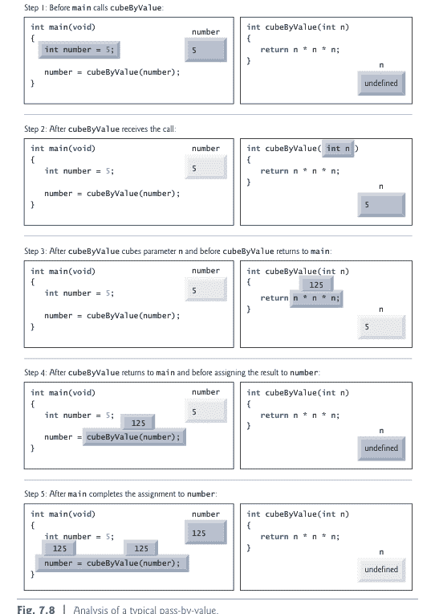

**图 7.8** | Analysis of a typical pass-by-value.

**步骤 1：在 main 调用 cubeByReference 之前。**

```c
int main(void)
{
    int number = 5;
    cubeByReference(&number);
}
```

```c
void cubeByReference(int *nPtr)
{
    *nPtr = *nPtr * *nPtr * *nPtr;
}
```

**步骤 2：cubeByReference 接收调用之后且在 *nPtr 被立方之前：**

```c
int main(void)
{
    int number = 5;
    cubeByReference(&number);
}
```

```c
void cubeByReference(int *nPtr)
{
    *nPtr = *nPtr * *nPtr * *nPtr;
}
```

**步骤 3：*nPtr 被立方之后且在程序控制返回 main 之前：**

```c
int main(void)
{
    int number = 5;
    cubeByReference(&number);
}
```

```c
void cubeByReference(int *nPtr)
{
    *nPtr = *nPtr * *nPtr * *nPtr;
}
```

Fig. 7.9 | Analysis of a typical pass-by-reference with a pointer argument.

## 7.5 使用 const 限定符与指针

The const qualifier enables you to inform the compiler that the value of a particular variable should not be modified.

> **Software Engineering Observation 7.1**
>
> The const qualifier can be used to enforce the principle of least privilege in software design. This can reduce debugging time and prevent unintentional side effects, making a program easier to modify and maintain.

Over the years, a large base of legacy code was written in early versions of C that did not use const because it was not available. For this reason, there are significant opportunities for improvement by reengineering old C code.

### *const* 值和参数

In Chapter 5, we explained that all function calls in C are *pass-by-value*—a copy of the argument in the function call is made and passed to the function. If the copy is modified in the function, the original value in the caller does *not* change. In many cases, a value passed to a function is modified so the function can accomplish its task. However, in some instances, the value should *not* be altered in the called function, even though it manipulates only a *copy* of the original value.

Consider a function that takes a one-dimensional array and its size as arguments and prints the array. Such a function should loop through the array and output each array element individually. The size of the array is used in the function body to determine when the loop should terminate. Neither the size of the array nor its contents should change in the function body.

> **Error-Prevention Tip 7.3**
>
> *If a variable does not (or should not) change in the body of a function to which it's passed, the variable should be declared const to ensure that it's not accidentally modified.*

If an attempt is made to modify a value that's declared const, the compiler catches it and issues either a warning or an error, depending on the particular compiler.

> **Common Programming Error 7.3**
>
> *Being unaware that a function is expecting pointers as arguments for pass-by-reference and passing arguments by value. Some compilers take the values assuming they're pointers and dereference the values as pointers. At runtime, memory-access violations or segmentation faults are often generated. Other compilers catch the mismatch in types between arguments and parameters and generate error messages.*

There are four ways to pass a pointer to a function:

- a non-constant pointer to non-constant data.
- a constant pointer to nonconstant data.
- a non-constant pointer to constant data.
- a constant pointer to constant data.

Each of the four combinations provides different access privileges and is discussed in the next several examples.

### 7.5.1 使用非常量指针指向非常量数据将字符串转换为大写

The highest level of data access is granted by a non-constant pointer to non-constant data. In this case, the data can be modified through the dereferenced pointer, and the pointer can be modified to point to other data items. A declaration for a non-constant pointer to non-constant data does not include const. Such a pointer might be used to receive a string as an argument to a function that processes (and possibly modifies) each character in the string. Function `convertToUppercase` of Fig. 7.10 declares its parameter, a non-constant pointer to non-constant data called `sPtr` (`char *sPtr`), in line 19. The function processes the array string (pointed to by `sPtr`) one character at a time. C standard library function `toupper` (line 22) from the `<ctype.h>` header is called to convert each character to its corresponding uppercase letter—if the original character is not a letter or is already uppercase, `toupper` returns the original character. Line 23 moves the pointer to the next character in the string. Chapter 8 presents many C standard library character- and string-processing functions.

```c
// Fig. 7.10: fig07_10.c
// Converting a string to uppercase using a
// non-constant pointer to non-constant data.
#include <stdio.h>
#include <ctype.h>

void convertToUppercase(char *sPtr); // prototype

int main(void)
{
    char string[] = "chARaCters and $32.98"; // initialize char array

    printf("The string before conversion is: %s", string);
    convertToUppercase(string);
    printf("\nThe string after conversion is: %s\n", string);
}

// convert string to uppercase letters
void convertToUppercase(char *sPtr)
{
    while (*sPtr != '\0') { // current character is not '\0'
        *sPtr = toupper(*sPtr); // convert to uppercase
        ++sPtr; // make sPtr point to the next character
    }
}
```

```
The string before conversion is: chARaCters and $32.98
The string after conversion is: CHARACTERS AND $32.98
```

Fig. 7.10 | Converting a string to uppercase using a non-constant pointer to non-constant data.

### 7.5.2 使用非常量指针指向常量数据逐字符打印字符串

A non-constant pointer to constant data can be modified to point to any data item of the appropriate type, but the data to which it points cannot be modified. Such a pointer might be used to receive an array argument to a function that will process each element without modifying that element. For example, function `printCharacters` (Fig. 7.11) declares parameter `sPtr` to be of type `const char *` (line 21). The declaration is read from right to left as "`sPtr` is a pointer to a character constant." The function uses a for statement to output each character in the string until the null character is encountered. After each character is printed, pointer `sPtr` is incremented—this makes the pointer move to the next character in the string.

```c
// Fig. 7.11: fig07_11.c
// Printing a string one character at a time using
// a non-constant pointer to constant data.

#include <stdio.h>

void printCharacters(const char *sPtr);

int main(void)
{
    // initialize char array
    char string[] = "print characters of a string";

    puts("The string is:");
    printCharacters(string);
    puts("");
}

// sPtr cannot be used to modify the character to which it points,
// i.e., sPtr is a "read-only" pointer
void printCharacters(const char *sPtr)
{
    // loop through entire string
    for ( ; *sPtr != '\0'; ++sPtr) { // no initialization
        printf("%c", *sPtr);
    }
}
```

```
The string is:
print characters of a string
```

Fig. 7.11 | Printing a string one character at a time using a non-constant pointer to constant data.

Figure 7.12 illustrates the attempt to compile a function that receives a non-constant pointer to constant data. This function attempts to modify the data pointed to by `xPtr` in line 18—which results in a compilation error. The error shown is from the Visual C++ compiler. The actual error message you receive (in this and other examples) is compiler specific—for example, Xcode's LLVM compiler reports the error:

`Read-only variable is not assignable`

and the GNU gcc compiler reports the error:

`error: assignment of read-only location '*xPtr'`

```c
// Fig. 7.12: fig07_12.c
// Attempting to modify data through a
// non-constant pointer to constant data.
```

Fig. 7.12 | Attempting to modify data through a non-constant pointer to constant data. (Part I of 2.)


```c
#include <stdio.h>
void f(const int *xPtr); // prototype

int main(void)
{
    int y; // define y

    f(&y); // f attempts illegal modification
}

// xPtr cannot be used to modify the
// value of the variable to which it points
void f(const int *xPtr)
{
    *xPtr = 100; // error: cannot modify a const object
}
```

`error C2166: l-value specifies const object`

**图 7.12** | 尝试通过指向常量数据的非常量指针修改数据。

正如你所知，数组是聚合数据类型，它在同一个名称下存储相关且类型相同的数据项。在第 10 章中，我们将讨论另一种聚合数据类型——结构（在其他语言中有时称为记录或元组）。结构能够在同一个名称下存储相关的数据项，这些数据项的类型可以相同也可以不同（例如，存储公司每个员工的信息）。当函数以数组作为参数被调用时，数组会自动按引用传递给函数。然而，结构总是按值传递——会传递整个结构的副本。这需要在执行时产生开销，即复制结构中的每个数据项并将其存储在计算机的函数调用栈上。当结构数据必须传递给函数时，我们可以使用指向常量的指针，以获得按引用传递的性能和按值传递的保护。当传递指向结构的指针时，只需要复制结构存储地址的副本。在地址为四字节的机器上，只复制四字节的内存，而不是可能很大的结构的副本。

> **性能提示 7.1**
> 使用指向常量的指针传递诸如结构之类的大对象，可以获得按引用传递的性能优势和按值传递的安全性。

如果内存有限且执行效率是关注点，请使用指针。如果内存充足且效率不是主要问题，则按值传递数据以强制执行最小权限原则。请记住，有些系统对 const 的强制执行不佳，因此按值传递仍然是防止数据被修改的最佳方式。

### 7.5.3 尝试修改指向非常量数据的常量指针

指向非常量数据的常量指针始终指向同一内存位置，并且可以通过该指针修改该位置的数据。这是数组名称的默认值。数组名称是指向数组开头的常量指针。数组中的所有数据都可以通过使用数组名称和数组索引来访问和更改。指向非常量数据的常量指针可用于接收数组作为函数参数，该函数仅使用数组索引表示法访问数组元素。声明为 const 的指针必须在定义时初始化（如果指针是函数参数，则它会用传递给函数的指针进行初始化）。图 7.13 尝试修改一个常量指针。指针 ptr 在第 12 行被定义为类型 `int * const`。该定义从 *right to left* 读作“ptr 是指向整数的常量指针”。指针在第 12 行用整数变量 x 的地址进行初始化。程序尝试将 y 的地址赋给 ptr（第 15 行），但编译器生成了错误信息。

```c
    1   // Fig. 7.13: fig07_13.c
    2   // Attempting to modify a constant pointer to non-constant data.
    3   #include <stdio.h>
    4
    5   int main(void)
    6   {
    7      int x; // define x
    8      int y; // define y
    9
    10     // ptr is a constant pointer to an integer that can be modified
    11     // through ptr, but ptr always points to the same memory location
    12     int * const ptr = &x;
    13
    14     *ptr = 7; // allowed: *ptr is not const
    15     ptr = &y; // error: ptr is const; cannot assign new address
    16  }
```

```text
c:\examples\ch07\fig07_13.c(15) : error C2166: l-value specifies const object
```

**图 7.13** | 尝试修改指向非常量数据的常量指针

### 7.5.4 尝试修改指向常量数据的常量指针

*最小访问权限* 由指向常量数据的常量指针授予。这样的指针始终指向 *相同* 的内存位置，并且该内存位置的数据 *不能被修改*。这就是应将数组传递给仅使用数组索引表示法查看数组且 *不* 修改数组的函数的方式。图 7.14 将指针变量 ptr（第 13 行）定义为类型 `const int *const`，从 *right to left* 读作“ptr 是指向整数常量的常量指针”。该图显示了当尝试 *modify* 的 *data* ptr 指向（第 16 行）以及当尝试 *modify* 指针变量中存储的 *address*（第 17 行）时生成的错误信息。

```c
    1   // Fig. 7.14: fig07_14.c
    2   // Attempting to modify a constant pointer to constant data.
    3   #include <stdio.h>
    4
    5   int main(void)
    6   {
    7       int x = 5; // initialize x
    8       int y; // define y
    9
    10      // ptr is a constant pointer to a constant integer. ptr always
    11      // points to the same location; the integer at that location
    12      // cannot be modified
    13      const int *const ptr = &x; // initialization is OK
    14
    15      printf("%d\n", *ptr);
    16      *ptr = 7; // error: *ptr is const; cannot assign new value
    17      ptr = &y; // error: ptr is const; cannot assign new address
    18  }
```

```text
c:\examples\ch07\fig07_14.c(16) : error C2166: l-value specifies const object
c:\examples\ch07\fig07_14.c(17) : error C2166: l-value specifies const object
```

**图 7.14** | 尝试修改指向常量数据的常量指针

## 7.6 冒泡排序[^3] 使用按引用传递

让我们改进图 6.15 中的冒泡排序程序，使用两个函数——bubbleSort 和 swap（图 7.15）。函数 bubbleSort 对数组进行排序。它调用函数 swap（第 46 行）来交换数组元素 array[j] 和 array[j + 1]。

```c
    1   // Fig. 7.15: fig07_15.c
    2   // Putting values into an array, sorting the values into
    3   // ascending order and printing the resulting array.
    4   #include <stdio.h>
    5   #define SIZE 10
    6
    7   void bubbleSort(int * const array, const size_t size); // prototype
    8
    9   int main(void)
   10  {
   11      // initialize array a
   12      int a[SIZE] = { 2, 6, 4, 8, 10, 12, 89, 68, 45, 37 };
   13
   14      puts("Data items in original order");
   15
   16      // loop through array a
   17      for (size_t i = 0; i < SIZE; ++i) {
   18          printf("%4d", a[i]);
   19      }
   20
   21      bubbleSort(a, SIZE); // sort the array
   22
   23      puts("\nData items in ascending order");
   24
   25      // loop through array a
   26      for (size_t i = 0; i < SIZE; ++i) {
   27          printf("%4d", a[i]);
   28      }
   29
   30      puts("");
   31  }
   32
   33  // sort an array of integers using bubble sort algorithm
   34  void bubbleSort(int * const array, const size_t size)
   35  {
   36      void swap(int *element1Ptr, int *element2Ptr); // prototype
   37
   38      // loop to control passes
   39      for (unsigned int pass = 0; pass < size - 1; ++pass) {
   40
   41          // loop to control comparisons during each pass
   42          for (size_t j = 0; j < size - 1; ++j) {
   43
   44              // swap adjacent elements if they're out of order
   45              if (array[j] > array[j + 1]) {
   46                  swap(&array[j], &array[j + 1]);
   47              }
   48          }
   49      }
   50  }
   51
   52  // swap values at memory locations to which element1Ptr and
   53  // element2Ptr point
   54  void swap(int *element1Ptr, int *element2Ptr)
   55  {
   56      int hold = *element1Ptr;
   57      *element1Ptr = *element2Ptr;
   58      *element2Ptr = hold;
   59  }
```

```text
Data items in original order
   2  6  4  8  10  12  89  68  45  37
Data items in ascending order
   2  4  6  8  10  12  37  45  68  89
```

**图 7.15** | 将值放入数组，按升序对值进行排序并打印结果数组

[^3]: 在第 12 章和附录 D 中，我们将研究性能更好的排序方案。


数组会自动按引用传递；单个数组元素是标量，通常按值传递。因此，bubbleSort 在 swap 调用（第 46 行）中使用地址运算符（&）对每个数组元素进行操作，以实现按引用传递，如下所示：

```c
swap(&array[j], &array[j + 1]);
```

函数 swap 在 element1Ptr（第 54 行）中接收 &array[j]。即使由于信息隐藏，swap 不被允许知道名称 array[j]，swap 仍可使用 *element1Ptr 作为 array[j] 的同义词——当 swap 访问 *element1Ptr 时，它实际上是在引用 bubbleSort 中的 array[j]。类似地，当 swap 访问 *element2Ptr 时，它实际上是在引用 bubbleSort 中的 array[j + 1]。即使 swap 不被允许写

```c
int hold = array[j];
array[j] = array[j + 1];
array[j + 1] = hold;
```

精确相同的效果由第 56 行至第 58 行实现：

```c
int hold = *element1Ptr;
*element1Ptr = *element2Ptr;
*element2Ptr = hold;
```

### 函数 bubbleSort 的数组参数

函数 bubbleSort 的几个特性应予注意。函数头（第 34 行）将 array 声明为 int * const array 而不是 int array[]，以表明 bubbleSort 接收一个一维数组作为参数（再次，这两种记法是可以互换的）。参数 size 被声明为 const 以强制执行最小权限原则。尽管参数 size 在 main 中接收一个值的副本，并且修改副本不能改变 main 中的值，但 bubbleSort 无需更改 size 即可完成其任务。数组的大小在函数 bubbleSort 执行期间保持固定。因此，size 被声明为 const 以确保它不会被修改。

### 函数 bubbleSort 体内的函数 swap 的原型

函数 swap 的原型（第 36 行）包含在函数 bubbleSort 的体内，因为 bubbleSort 是唯一调用 swap 的函数。将原型放在 bubbleSort 中将 swap 的正确调用限制为从 bubbleSort（或源代码中出现在 swap 之后的任何函数）发出的调用。在 swap 之前定义的尝试调用 swap 的其他函数无法访问正确的函数原型，因此编译器会自动生成一个原型。这通常会导致一个与函数头不匹配的原型（并生成编译警告或错误），因为编译器假定返回类型和参数类型为 int。

> **软件工程观察 7.2**
>
> 将函数原型放在其他函数的定义中，通过将正确的函数调用限制在原型出现的函数中来强制执行最小权限原则。

### 函数 bubbleSort 的 size 参数

函数 bubbleSort 将数组的大小作为参数接收（第 34 行）。该函数必须知道数组的大小才能对数组进行排序。当数组传递给函数时，函数的接收的是数组第一个元素的内存地址。地址，当然，*不* 传达数组中元素的数量。因此，你必须将数组大小传递给函数。另一种常见做法是传递指向数组开头的指针和指向数组末尾之后位置的指针——正如你在第 7.8 节中将要学习的那样，这两个指针之差是数组的长度，并且 resulting 代码更简单。

在程序中，数组的大小被显式传递给函数 bubbleSort。这种方法有两个主要好处——*软件可重用性* 和 *适当的软件工程*。通过定义函数以将数组大小作为参数接收，我们使该函数能够被任何对任意大小的一维整数数组进行排序的程序使用。

> **软件工程观察 7.3**
>
> *当将数组传递给函数时，也传递数组的大小。这有助于使函数在许多程序中可重用。*

我们本可以将数组的大小存储在对整个程序可访问的全局变量中。这会更高效，因为传递给函数的不是 size 的副本。然而，其他需要整数数组排序功能 的程序可能没有相同的全局变量，因此该函数无法在这些程序中使用。

> **软件工程观察 7.4**
>
> *全局变量通常违反最小权限原则，并可能导致糟糕的软件工程。全局变量应仅用于表示真正共享的资源，例如一天中的时间。*

数组的大小本可以直接编程到函数中。这将使用该函数的限制为特定大小的数组，并显著降低其可重用性。只有处理函数中编码的特定大小的一维整数数组的程序才能使用该函数。

## 7.7 `sizeof` 运算符

C 提供了特殊的 unary 运算符 `sizeof` 来确定数组（或任何其他数据类型）的字节大小。此运算符在编译时应用，除非其操作数是变长数组（第 6.12 节）。当应用于数组名称时，如图 7.16（第 15 行）所示，`sizeof` 运算符以类型 `size_t`⁴ 返回数组的总字节数。在这台计算机上，类型为 `float` 的变量占用 4 字节内存，而 array 被定义为有 20 个元素。因此，array 中共有 80 字节。

> **性能提示 7.2**
>
> *`sizeof` 是一个编译时运算符，因此不会产生任何执行时开销。*

```c
// Fig. 7.16: fig07_16.c
// Applying sizeof to an array name returns
// the number of bytes in the array.
#include <stdio.h>
#define SIZE 20

size_t getSize(float *ptr); // prototype

int main(void)
{
    float array[SIZE]; // create array

    printf("The number of bytes in the array is %u\n"
           "The number of bytes returned by getSize is %u\n",
           sizeof(array), getSize(array));
}

// return size of ptr
size_t getSize(float *ptr)
{
    return sizeof(ptr);
}
```

```text
The number of bytes in the array is 80
The number of bytes returned by getSize is 4
```

**图 7.16** | 将 sizeof 应用于数组名称会返回数组的字节数。

数组中的元素数量也可以用 sizeof 确定。例如，考虑以下数组定义：

```c
double real[22];
```

类型为 double 的变量通常占用 8 字节内存。因此，数组 real 包含总共 176 字节。要确定数组中的元素数量，可以使用以下表达式：

```c
sizeof(real) / sizeof(real[0])
```

该表达式确定数组 real 中的字节数，并将该值除以在内存中存储数组 real 的第一个元素（一个 double 值）所使用的字节数。

即使函数 getSize 作为参数接收一个包含 20 个元素的数组，函数的参数 ptr 只是指向数组第一个元素的指针。当你对参数使用 sizeof 时，它返回指针的大小，而不是它所指向项的大小。在我们的 Windows 和 Linux 测试系统上，指针的大小为 4 字节，因此 getSize 返回 4；在我们的 Mac 上，指针的大小为 8 字节，因此 getSize 返回 8。此外，使用 sizeof 确定数组元素数量的上述计算仅在使用实际数组时有效，而在使用指向数组的指针时无效。

### *确定标准类型、数组和指针的大小*

图 7.17 计算存储每种标准数据类型的字节数。此程序的结果是实现相关的，并且在不同平台上以及有时在同一平台上的不同编译器之间有所不同。输出显示了我们使用 Visual C++ 编译器的 Windows 系统的结果。在我们使用 GNU gcc 编译器的 Linux 系统上，long double 的大小为 12 字节。在我们使用 Xcode 的 LLVM 编译器的 Mac 系统上，long 的大小为 8 字节，long double 的大小为 16 字节。

```c
// Fig. 7.17: fig07_17.c
// Using operator sizeof to determine standard data type sizes.
#include <stdio.h>

int main(void)
{
    char c;
    short s;
    int i;
    long l;
    long long ll;
    float f;
    double d;
    long double ld;
    int array[20]; // create array of 20 int elements
    int *ptr = array; // create pointer to array

    printf("\n    sizeof c = %u\t sizeof(char) = %u"
    "\n    sizeof s = %u\t sizeof(short) = %u"
    "\n    sizeof i = %u\t sizeof(int) = %u"
    "\n    sizeof l = %u\t sizeof(long) = %u"
    "\n    sizeof ll = %u\t sizeof(long long) = %u"
    "\n    sizeof f = %u\t sizeof(float) = %u"
    "\n    sizeof d = %u\t sizeof(double) = %u"
    "\n    sizeof ld = %u\t sizeof(long double) = %u"
    "\n    sizeof array = %u"
    "\n    sizeof ptr = %u",
    sizeof c, sizeof(char), sizeof s, sizeof(short), sizeof i,
    sizeof(int), sizeof l, sizeof(long), sizeof ll,
    sizeof(long long), sizeof f, sizeof(float), sizeof d,
    sizeof(double), sizeof ld, sizeof(long double),
    sizeof array, sizeof ptr);
}
```

|  |  |
|---|---|
| sizeof c = 1 | sizeof(char) = 1 |
| sizeof s = 2 | sizeof(short) = 2 |
| sizeof i = 4 | sizeof(int) = 4 |
| sizeof l = 4 | sizeof(long) = 4 |
| sizeof ll = 8 | sizeof(long long) = 8 |
| sizeof f = 4 | sizeof(float) = 4 |
| sizeof d = 8 | sizeof(double) = 8 |
| sizeof ld = 8 | sizeof(long double) = 8 |
| sizeof array = 80 |  |
| sizeof ptr = 4 |  |

**图 7.17** | 使用 sizeof 运算符确定标准数据类型大小。


> **可移植性提示 7.1**
> *用于存储特定数据类型的字节数可能因系统而异。在编写依赖于数据类型大小且将在多台计算机系统上运行的程序时，使用 sizeof 来确定用于存储数据类型的字节数。*

sizeof 运算符可以应用于任何变量名、类型或值（包括表达式的值）。当应用于变量名（不是数组名）或常量时，会返回存储该特定类型变量或常量所使用的字节数。当作为 sizeof 的操作数提供类型时，需要使用括号。

## 7.8 指针表达式和指针算术

指针是算术表达式、赋值表达式和比较表达式中的有效操作数。然而，这些表达式中通常使用的并非所有运算符都可与指针变量一起使用。本节描述了可以以指针作为操作数的运算符，以及这些运算符的使用方法。

### 7.8.1 指针算术允许的操作符

指针可以递增（++）或递减（--），整数可以加到指针上（+ 或 +=），整数可以从指针中减去（- 或 -=），并且一个指针可以减去另一个指针——最后一种操作只有在两个指针都指向同一数组的元素时才有意义。

### 7.8.2 将指针指向数组

假设数组 `int v[5]` 已定义，其第一个元素在内存中的位置为 3000。假设指针变量 vPtr 已初始化为指向 v[0]——即 vPtr 的值为 3000。图 7.18 说明了在 4 字节整数机器上的这种情况。变量 vPtr 可以通过以下任一语句初始化为指向数组 v

```c
vPtr = v;
vPtr = &v[0];
```

> **可移植性提示 7.2**
> *由于指针算术的结果取决于指针指向对象的大小，因此指针算术依赖于机器和编译器。*


图 7.18 | 数组 v 和指向 v 的指针变量 vPtr。

### 7.8.3 向指针添加整数

在常规算术中，3000 + 2 的结果为 3002。在指针算术中，这通常 *不是* 这种情况。当整数被加到指针上或从指针中减去时，指针 *不是* 简单地按该整数递增或递减，而是按该整数乘以指针所引用对象的大小进行递增或递减。字节数取决于对象的数据类型。例如，语句

```c
vPtr += 2;
```

会产生 3008（3000 + 2 * 4），假设整数占用 4 字节内存。在数组 *v* 中，*vPtr* 现在将指向 *v[2]*（图 7.19）。如果整数占用 2 字节内存，则前述计算将得到内存位置 3004（3000 + 2 * 2）。如果数组是不同数据类型，则前述语句将使指针增加该数据类型对象存储所需字节数的两倍。在字符数组上执行指针算术时，结果将与常规算术一致，因为每个字符长 1 字节。

> **常见编程错误 7.4**
>
> *在不指向数组元素的指针上使用指针算术。*

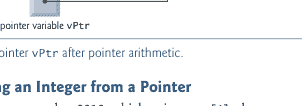

**图 7.19** | 指针算术后的指针 vPtr。

### 7.8.4 从指针中减去整数

如果 *vPtr* 已递增到 3016，指向 *v[4]*，则语句

```c
vPtr -= 4;
```

将把 *vPtr* 重新设为 3000——数组的开头。

> **常见编程错误 7.5**
>
> *使用指针算术时超出数组任一端的边界。*

### 7.8.5 递增和递减指针

如果指针按一递增或递减，则可以使用递增（++）和递减（--）运算符。以下任一语句

```c
++vPtr;
vPtr++;
```

将使指针指向数组中的 *下一个* 位置。以下任一语句

```c
--vPtr;
vPtr--;
```

将使指针指向数组的 *前一个* 元素。

### 7.8.6 减去一个指针

指针变量可以相互减去。例如，如果 vPtr 包含位置 3000，而 v2Ptr 包含地址 3008，则语句

```c
x = v2Ptr - vPtr;
```

将把从 vPtr 到 v2Ptr 的 *数组元素个数* 赋给 x，在本例中为 2（不是 8）。除非在数组上执行，否则指针算术是未定义的。我们不能假设相同类型的两个变量在内存中连续存储，除非它们是数组的相邻元素。


> **常见编程错误 7.6**
>
> *减去不指向同一数组元素的两个指针。*

### 7.8.7 将指针相互赋值

如果两者具有 *相同类型*，则可以将一个指针赋给另一个指针。此规则的例外是 void 指针（即 `void *`），它是一种通用指针，可以表示 *任何* 指针类型。所有指针类型都可以赋给 void 指针，而 void 指针也可以赋给任何类型的指针（包括另一个 void 指针）。在这两种情况下，都 *不需要* 类型转换操作。

### 7.8.8 void 指针

void 指针 *不能* 被解引用。考虑以下情况：编译器知道指向 int 的指针在 4 字节整数机器上引用 4 字节内存，但 void 指针仅包含一个 *未知* 数据类型的内存位置——指针所引用的确切字节数 *编译器* 不知道。编译器 *必须知道* 数据类型才能确定表示引用值的字节数。


> **常见编程错误 7.7**
>
> *如果两者都不是 `void *` 类型，将一种类型的指针赋给另一种类型的指针是语法错误。*


> **常见编程错误 7.8**
>
> *解引用 `void *` 指针是语法错误。*

### 7.8.9 比较指针

指针可以使用相等和关系运算符进行比较，但除非指针指向 *同一* 数组的元素，否则此类比较毫无意义。指针比较比较指针中存储的地址。两个指向同一数组元素的指针的比较可以显示，例如，一个指针指向的数组元素编号高于另一个指针。指针比较的常见用途是确定指针是否为 NULL。


> **常见编程错误 7.9**
>
> *比较不引用同一数组元素的两个指针。*

## 7.9 指针与数组的关系

在 C 语言中，数组和指针密切相关且通常可以互换使用。数组名可以被视为一个常量指针。指针可用于执行任何涉及数组索引的操作。

假设以下定义：

```c
int b[5];
int *bPtr;
```

因为数组名 b（不带索引）是指向数组第一个元素的指针，所以我们可以使用语句将 bPtr 设为数组 b 第一个元素的地址

```c
bPtr = b;
```

该语句等价于以下取数组 b 第一个元素的地址：

```c
bPtr = &b[0];
```

### 7.9.1 指针/偏移记法

数组元素 b[3] 也可以通过指针表达式引用

```c
*(bPtr + 3)
```

表达式中的 3 是指针的偏移量。当 bPtr 指向数组的第一个元素时，偏移量指示要引用的数组元素，且偏移量值与数组索引相同。这种记法称为指针/偏移记法。括号是必要的，因为 `*` 的优先级高于 `+` 的优先级。如果没有括号，上面的表达式将把 3 加到表达式 `*bPtr` 的值上（即 3 将被加到 b[0] 上，假设 bPtr 指向数组的开头）。正如数组元素可以用指针表达式引用一样，地址

```c
&b[3]
```

可以用指针表达式写成

```c
bPtr + 3
```

数组本身可以被视为指针并用于指针算术。例如，表达式

```c
*(b + 3)
```

也引用数组元素 b[3]。一般来说，所有带索引的数组表达式都可以用指针和偏移量表示。在这种情况下，使用了数组名作为指针的指针/偏移记法。前面的语句不会以任何方式修改数组名；b 仍然指向数组中的第一个元素。


## 7.9.2 指针/索引表示法

指针可以像数组一样被索引。如果 `bPtr` 的值为 `b`，则表达式 `bPtr[1]` 引用数组元素 `b[1]`。这称为指针/索引表示法。

## 7.9.3 不能用指针算术修改数组名

记住，数组名始终指向数组的开头，因此数组名就像常量指针。因此，表达式

```c
b += 3
```

无效，因为它试图用指针算术修改数组名的值。

> **常见编程错误 7.10**
> *试图用指针算术修改数组名的值是一种编译错误。*

## 7.9.4 演示指针索引和偏移量

图7.20使用我们讨论过的四种引用数组元素的方法——数组索引、以数组名作为指针的指针/偏移量、指针索引，以及使用指针的指针/偏移量——来打印整型数组 `b` 的四个元素。

```c
// Fig. 7.20: fig07_20.cpp
// Using indexing and pointer notations with arrays.
#include <stdio.h>
#define ARRAY_SIZE 4

int main(void)
{
    int b[] = {10, 20, 30, 40}; // create and initialize array b
    int *bPtr = b; // create bPtr and point it to array b

    // output array b using array index notation
    puts("Array b printed with:\nArray index notation");

    // loop through array b
    for (size_t i = 0; i < ARRAY_SIZE; ++i) {
        printf("b[%zu] = %d\n", i, b[i]);
    }

    // output array b using array name and pointer/offset notation
    puts("\nPointer/offset notation where\n"
        "the pointer is the array name");

    // loop through array b
    for (size_t offset = 0; offset < ARRAY_SIZE; ++offset) {
        printf("*(b + %zu) = %d\n", offset, *(b + offset));
    }

    // output array b using bPtr and array index notation
    puts("\nPointer index notation");

    // loop through array
    for (size_t i = 0; i < ARRAY_SIZE; ++i) {
        printf("bPtr[%zu] = %d\n", i, bPtr[i]);
    }

    // output array b using bPtr and pointer/offset notation
    puts("\nPointer/offset notation");

    // loop through array b
    for (size_t offset = 0; offset < ARRAY_SIZE; ++offset) {
        printf("*(bPtr + %zu) = %d\n", offset, *(bPtr + offset));
    }
}
```

```
Array b printed with:
Array index notation
b[0] = 10
b[1] = 20
b[2] = 30
b[3] = 40

Pointer/offset notation where
the pointer is the array name
*(b + 0) = 10
*(b + 1) = 20
*(b + 2) = 30
*(b + 3) = 40

Pointer index notation
bPtr[0] = 10
bPtr[1] = 20
bPtr[2] = 30
bPtr[3] = 40

Pointer/offset notation
*(bPtr + 0) = 10
*(bPtr + 1) = 20
*(bPtr + 2) = 30
*(bPtr + 3) = 40
```

**图 7.20** | 使用索引和指针表示法处理数组。

## 7.9.5 用数组和指针复制字符串

为了进一步说明数组和指针的可互换性，让我们看看图7.21程序中的两个字符串复制函数——`copy1`和`copy2`。两个函数都将字符串复制到字符数组中。比较`copy1`和`copy2`的函数原型后，这两个函数看起来完全相同。它们完成相同的任务，但实现方式不同。

```c
// Fig. 7.21: fig07_21.c
// Copying a string using array notation and pointer notation.
#include <stdio.h>
#define SIZE 10

void copy1(char * const s1, const char * const s2); // prototype
void copy2(char *s1, const char *s2); // prototype

int main(void)
{
    char string1[SIZE]; // create array string1
    char *string2 = "Hello"; // create a pointer to a string

    copy1(string1, string2);
    printf("string1 = %s\n", string1);

    char string3[SIZE]; // create array string3
    char string4[] = "Good Bye"; // create an array containing a string

    copy2(string3, string4);
    printf("string3 = %s\n", string3);
}

// copy s2 to s1 using array notation
void copy1(char * const s1, const char * const s2)
{
    // loop through strings
    for (size_t i = 0; (s1[i] = s2[i]) != '\0'; ++i) {
        ; // do nothing in body
    }
}

// copy s2 to s1 using pointer notation
void copy2(char *s1, const char *s2)
{
    // loop through strings
    for ( ; (*s1 = *s2) != '\0'; ++s1, ++s2) {
        ; // do nothing in body
    }
}
```

```
string1 = Hello
string3 = Good Bye
```

**图 7.21** | 使用数组表示法和指针表示法复制字符串。

### 使用数组索引表示法复制

函数`copy1`使用数组索引表示法将`s2`中的字符串复制到字符数组`s1`。该函数将计数器变量`i`定义为数组索引。`for`语句头（第28行）执行整个复制操作——其循环体是空语句。语句头指定`i`初始化为零，并在循环的每次迭代中加一。表达式`s1[i] = s2[i]`从`s2`复制一个字符到`s1`。当在`s2`中遇到空字符时，它被赋给`s1`，而赋值表达式的值变成赋给左操作数（`s1`）的值。当空字符从`s2`赋给`s1`时（假），循环终止。

### 使用指针和指针算术复制

函数`copy2`使用指针和指针算术将`s2`中的字符串复制到字符数组`s1`。同样，`for`语句头（第37行）执行整个复制操作。该语句头不包含任何变量初始化。与函数`copy1`一样，表达式`(*s1 = *s2)`执行复制操作。指针`s2`被解引用，得到的字符被赋给解引用后的指针`s1`。在条件中赋值之后，两个指针分别递增，以指向数组`s1`中的下一个字符和字符串`s2`中的下一个字符。当在`s2`中遇到空字符时，它被赋给解引用后的指针`s1`，循环终止。

### 关于函数 copy1 和 copy2 的说明

*`copy1`和`copy2`的第一个实参必须是一个足够大的数组，以容纳第二个实参中的字符串。* 否则，当试图写入不属于该数组的内存位置时，可能会发生错误。此外，每个函数的第二个形参都声明为`const char * const`（一个常量字符串）。在这两个函数中，第二个实参被复制到第一个实参中——一次从中读取一个字符，但从不修改这些字符。因此，第二个形参被声明为指向常量值，以便强制执行最小权限原则——这两个函数都不需要修改第二个实参中字符串的能力。

## 7.10 指针数组

数组可以包含指针。指针数组的一种常见用途是构成字符串数组，简称为字符串数组。数组中的每一项都是一个字符串，但在C中，字符串本质上是指向其第一个字符的指针。因此，字符串数组中的每一项实际上是指向某个字符串第一个字符的指针。考虑字符串数组`suit`的定义，它在表示一副扑克牌时可能有用。

```c
const char *suit[4] = {"Hearts", "Diamonds", "Clubs", "Spades"};
```

定义中的`suit[4]`部分表示一个包含4个元素的数组。声明中的`char *`部分表示数组`suit`的每个元素都是“指向char的指针”类型。限定符`const`表示每个元素所指向的字符串不会被修改。要放入数组的四个值是`"Hearts"`、`"Diamonds"`、`"Clubs"`和`"Spades"`。每个值在内存中都存储为*以空字符结尾的字符串*，它比引号之间的字符数多一个字符。这四个字符串的长度分别为7、9、6和7个字符。尽管看起来这些字符串被放入了`suit`数组，但实际上数组中只存储了指针（图7.22）。每个指针指向其对应字符串的第一个字符。因此，尽管`suit`数组的*大小固定*，它却提供了对*任意长度*字符的访问。这种灵活性是C强大的数据结构能力的一个例子。

这些花色本可以放在一个二维数组中，其中每一行表示一种花色，每一列表示花色名称中的一个字母。这样的数据结构每行必须有固定的列数，而这个数量


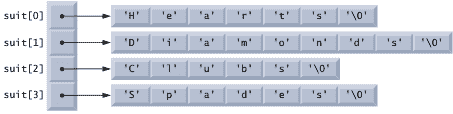

**图 7.22** `suit` 数组的图形表示。

必须与最长的字符串一样大。因此，在存储大量字符串时，如果大多数字符串都短于最长的字符串，则会浪费相当多的内存。我们在下一节中使用字符串数组来表示一副牌。

## 7.11 案例研究：洗牌和发牌模拟

本节中，我们使用随机数生成来开发洗牌和发牌模拟程序。此程序随后可用于实现玩特定纸牌游戏的程序。为了揭示一些微妙的性能问题，我们有意使用了次优的洗牌和发牌算法。在本章练习和第 10 章中，我们开发了更高效的算法。

使用自顶向下、逐步细化的方法，我们开发了一个程序，该程序将洗牌一副 52 张纸牌，然后发完这 52 张牌。自顶向下的方法在处理比前几章更复杂的问题时特别有用。

### 将牌组表示为二维数组

我们使用 4×13 的二维数组 `deck` 来表示纸牌组（图 7.23）。行对应花色——第 0 行对应红心，第 1 行对应方块，第 2 行对应梅花，第 3 行对应黑桃。列对应牌的面值——第 0 到 9 列分别对应 A 到 10，第 10 到 12 列对应 J、Q 和 K。我们将用表示四种花色的字符字符串加载字符串数组 `suit`，并用表示十三种面值的字符字符串加载字符串数组 `face`。

### 洗牌二维数组

这个模拟的牌组可以按如下方式洗牌。首先将数组 `deck` 清零。然后随机选择一行（0–3）和一列（0–12）。数字 1 插入到数组元素 `deck[row][column]` 中，表示这张牌将是洗牌后发出的第一张牌。此过程继续进行，数字 2、3、…、52 被随机插入到牌组数组中，以指示哪些牌应放在洗牌后的第二、第三、…、第五十二位。随着牌组数组开始填入牌号，可能会再次选中一张牌——即 `deck[row][column]` 在被选中时不为零。这种选择 simply 被忽略，并反复随机选择其他行和列，直到找到一张未被选中的牌。最终，数字 1 到 52 将占据牌组数组的 52 个槽位。此时，牌组已完全洗牌。

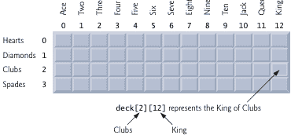

**图 7.23** 牌组的二维数组表示。

### 无限期推迟的可能性

如果已洗过的牌被反复随机选中，该洗牌算法可能会无限期执行。这种现象被称为无限期推迟。在本章练习中，我们讨论了一种更好的洗牌算法，可以消除无限期推迟的可能性。

> **性能提示 7.3**
> 
> *有时以“自然”方式出现的算法可能包含微妙的性能问题，例如无限期推迟。寻求避免无限期推迟的算法。*

### 从二维数组发牌

要发第一张牌，我们在数组中查找 `deck[row][column]` 等于 1。这是通过嵌套的 `for` 语句实现的，行从 0 变到 3，列从 0 变到 12。数组的该元素对应哪张牌？`suit` 数组已预先加载了四种花色，因此要获取花色，我们打印字符字符串 `suit[row]`。同样，要获取牌的面值，我们打印字符字符串 `face[column]`。我们还打印字符字符串 `" of "`。按正确顺序打印这些信息使我们能够以 `"King of Clubs"`、`"Ace of Diamonds"` 等形式打印每张牌。

### 使用自顶向下逐步细化法开发程序逻辑

让我们继续自顶向下逐步细化过程。顶部很简单

```
Shuffle and deal 52 cards
```

我们的第一次细化得到：

- 初始化 suit 数组
- 初始化 face 数组
- 初始化 deck 数组
- 洗牌
- 发 52 张牌

“Shuffle the deck”可扩展如下：

```
For each of the 52 cards
    Place card number in randomly selected unoccupied element of deck
```

“Deal 52 cards”可扩展如下：

```
For each of the 52 cards
    Find card number in deck array and print face and suit of card
```

结合这些扩展，我们得到完整的第二次细化：

```
Initialize the suit array
Initialize the face array
Initialize the deck array
For each of the 52 cards
    Place card number in randomly selected unoccupied slot of deck
For each of the 52 cards
    Find card number in deck array and print face and suit of card
```

“Place card number in randomly selected unoccupied slot of deck”可扩展为：

```
Choose slot of deck randomly
While chosen slot of deck has been previously chosen
    Choose slot of deck randomly
Place card number in chosen slot of deck
```

“Find card number in deck array and print face and suit of card”可扩展为：

```
For each slot of the deck array
    If slot contains card number
        Print the face and suit of the card
```

结合这些扩展，我们得到第三次细化：

```
Initialize the suit array
Initialize the face array
Initialize the deck array
For each of the 52 cards
    Choose slot of deck randomly
    While slot of deck has been previously chosen
        Choose slot of deck randomly
    Place card number in chosen slot of deck
For each of the 52 cards
    For each slot of the deck array
        If slot contains desired card number
            Print the face and suit of the card
```

这完成了细化过程。如果将洗牌和发牌部分合并，使每张牌在放入牌组时就被发出，该程序会更高效。我们选择将这些操作分开编程，因为通常牌是在洗牌后发出的（而不是在洗牌过程中发出）。

### 实现洗牌和发牌程序

洗牌和发牌程序如 图 7.24 所示，示例执行如 图 7.25 所示。在 `printf` 调用中使用转换说明符 `%s` 来打印字符字符串。`printf` 调用中对应的参数必须是 `char` 的指针（或 `char` 数组）。格式说明 `%5s of %-8s`（第 68 行）打印一个在宽为五字符的字段中右对齐的字符字符串，后跟 `" of "`，以及一个在宽为八字符的字段中左对齐的字符字符串。`%-8s` 中的减号表示左对齐。

发牌算法存在一个弱点。一旦找到匹配项，两个内部 `for` 语句会继续搜索牌组的剩余元素以寻找匹配项。我们在本章练习和第 10 章案例研究中纠正了这一缺陷。

```c
 1 // Fig. 7.24: fig07_24.c
 2 // Card shuffling and dealing.
 3 #include <stdio.h>
 4 #include <stdlib.h>
 5 #include <time.h>
 6
 7 #define SUITS 4
 8 #define FACES 13
 9 #define CARDS 52
10
11 // prototypes
12 void shuffle( unsigned int wDeck[][FACES] ); // shuffling modifies wDeck
13 void deal( unsigned int wDeck[][FACES], const char *wFace[],
14            const char *wSuit[] ); // dealing doesn't modify the arrays
15
16 int main( void )
17 {
18    // initialize deck array
19    unsigned int deck[SUITS][FACES] = { 0 };
20
21    srand( time(NULL) ); // seed random-number generator
22    shuffle( deck ); // shuffle the deck
23
24    // initialize suit array
25    const char *suit[SUITS] =
26       { "Hearts", "Diamonds", "Clubs", "Spades" };
27
28    // initialize face array
29    const char *face[FACES] =
30       { "Ace", "Deuce", "Three", "Four",
31         "Five", "Six", "Seven", "Eight",
32         "Nine", "Ten", "Jack", "Queen", "King" };
33
34    deal( deck, face, suit ); // deal the deck
35 }
36
```

**图 7.24** | 洗牌和发牌。（第 1 部分，共 2 部分。）


```c
// shuffle cards in deck
void shuffle(unsigned int wDeck[][FACES])
{
    // for each of the cards, choose slot of deck randomly
    for (size_t card = 1; card <= CARDS; ++card) {
        size_t row;    // row number
        size_t column; // column number

        // choose new random location until unoccupied slot found
        do {
            row = rand() % SUITS;
            column = rand() % FACES;
        } while (wDeck[row][column] != 0);

        // place card number in chosen slot of deck
        wDeck[row][column] = card;
    }
}

// deal cards in deck
void deal(unsigned int wDeck[][FACES], const char *wFace[],
    const char *wSuit[])
{
    // deal each of the cards
    for (size_t card = 1; card <= CARDS; ++card) {
        // loop through rows of wDeck
        for (size_t row = 0; row < SUITS; ++row) {
            // loop through columns of wDeck for current row
            for (size_t column = 0; column < FACES; ++column) {
                // if slot contains current card, display card
                if (wDeck[row][column] == card) {
                    printf("%5s of %-8s%s", wFace[column], wSuit[row],
                        card % 2 == 0 ? "\n" : "\t"); // 2-column format
                }
            }
        }
    }
}
```

**图 7.24** | 洗牌与发牌。（第 2 部分，共 2 部分。）

| | |
|---|---|
| 红桃九 | 梅花五 |
| 黑桃Q | 黑桃3 |
| 红桃Q | 梅花A |
| 红桃K | 黑桃6 |
| 方块J | 黑桃5 |
| 红桃7 | 梅花K |
| 梅花3 | 红桃8 |
| 方块3 | 方块4 |
| 方块Q | 方块5 |

**图 7.25** | 发牌程序的示例运行。（第 1 部分，共 2 部分。）

| | |
|---|---|
| 方块6 | 红桃5 |
| 黑桃A | 红桃6 |
| 方块9 | 梅花Q |
| 黑桃8 | 梅花9 |
| 梅花2 | 梅花6 |
| 梅花A | 梅花J |
| 梅花4 | 梅花8 |
| 黑桃4 | 黑桃7 |
| 方块7 | 梅花7 |
| 黑桃K | 方块10 |
| 红桃J | 红桃A |
| 黑桃J | 梅花10 |
| 方块8 | 方块2 |
| 方块A | 黑桃9 |
| 红桃4 | 红桃2 |
| 方块K | 黑桃10 |
| 红桃3 | 红桃10 |

**图 7.25** | 发牌程序的示例运行。（第 2 部分，共 2 部分。）

## 7.12 函数指针

函数指针包含函数在内存中的*地址*。在第 6 章中，我们看到数组名实际上是数组中第一个元素在内存中的地址。类似地，函数名实际上是执行该函数任务的代码在内存中的起始地址。函数指针可以*传递*给函数、从函数中*返回*、*存储*在数组中，并*赋值*给其他函数指针。

### 7.12.1 按升序或降序排序

为了说明函数指针的用法，图 7.26 给出了图 7.15 中冒泡排序程序的修改版本。新版本由 `main` 以及函数 `bubble`、`swap`、`ascending` 和 `descending` 组成。函数 `bubble` 除了接收一个整型数组和数组大小之外，还接收一个函数指针——函数 `ascending` 或函数 `descending`——作为*参数*。程序提示用户选择按*升序*还是按*降序*对数组排序。如果用户输入 1，则将指向函数 `ascending` 的指针传递给函数 `bubble`，从而使数组按*递增*顺序排序。如果用户输入 2，则将指向函数 `descending` 的指针传递给函数 `bubble`，从而使数组按*递减*顺序排序。程序的输出如图 7.27 所示。

```c
1  // Fig. 7.26: fig07_26.c
2  // Multipurpose sorting program using function pointers.
3  #include <stdio.h>
4  #define SIZE 10
5
```

**图 7.26** | 使用函数指针的多用途排序程序。（第 1 部分，共 3 部分。）

```c
6 // prototypes
7 void bubble(int work[], size_t size, int (*compare)(int a, int b) );
8 int ascending(int a, int b);
9 int descending(int a, int b);
10
11 int main(void)
12 {
13    // initialize unordered array a
14    int a[SIZE] = { 2, 6, 4, 8, 10, 12, 89, 68, 45, 37 };
15
16    printf("%s", "Enter 1 to sort in ascending order,\n"
17       "Enter 2 to sort in descending order: ");
18    int order; // 1 for ascending order or 2 for descending order
19    scanf("%d", &order);
20
21    puts("\nData items in original order");
22
23    // output original array
24    for (size_t counter = 0; counter < SIZE; ++counter) {
25       printf("%5d", a[counter]);
26    }
27
28    // sort array in ascending order; pass function ascending as an
29    // argument to specify ascending sorting order
30    if (order == 1) {
31       bubble(a, SIZE, ascending);
32       puts("\nData items in ascending order");
33    }
34    else { // pass function descending
35       bubble(a, SIZE, descending);
36       puts("\nData items in descending order");
37    }
38
39    // output sorted array
40    for (size_t counter = 0; counter < SIZE; ++counter) {
41       printf("%5d", a[counter]);
42    }
43
44    puts("\n");
45 }
46
47 // multipurpose bubble sort; parameter compare is a pointer to
48 // the comparison function that determines sorting order
49 void bubble(int work[], size_t size, int (*compare)(int a, int b))
50 {
51    void swap(int *element1Ptr, int *element2Ptr); // prototype
52
53    // loop to control passes
54    for (unsigned int pass = 1; pass < size; ++pass) {
55
56       // loop to control number of comparisons per pass
57       for (size_t count = 0; count < size - 1; ++count) {
58
            // if adjacent elements are out of order, swap them
            if ((*compare)(work[count], work[count + 1])) {
                swap(&work[count], &work[count + 1]);
            }
        }
    }
}

// swap values at memory locations to which element1Ptr and
// element2Ptr point
void swap(int *element1Ptr, int *element2Ptr)
{
    int hold = *element1Ptr;
    *element1Ptr = *element2Ptr;
    *element2Ptr = hold;
}

// determine whether elements are out of order for an ascending
// order sort
int ascending(int a, int b)
{
    return b < a; // should swap if b is less than a
}

// determine whether elements are out of order for a descending
// order sort
int descending(int a, int b)
{
    return b > a; // should swap if b is greater than a
}
```

**图 7.26** | 使用函数指针的多用途排序程序。（第 3 部分，共 3 部分。）

```text
Enter 1 to sort in ascending order,
Enter 2 to sort in descending order: 1

Data items in original order
    2   6   4   8   10   12   89   68   45   37
Data items in ascending order
    2   4   6   8   10   12   37   45   68   89
```

```text
Enter 1 to sort in ascending order,
Enter 2 to sort in descending order: 2

Data items in original order
    2   6   4   8   10   12   89   68   45   37
Data items in descending order
    89   68   45   37   12   10   8   6   4   2
```

**图 7.27** | 图 7.26 中冒泡排序程序的输出。

下列参数出现在 `bubble` 的函数头中（第 49 行）：

`int (*compare)(int a, int b)`

这告诉 `bubble` 应期待一个参数（`compare`），它是指向函数的指针，该函数接收两个整型参数并返回一个整型结果。`*compare` 两边需要加圆括号，以便将 `*` 与 `compare` 组合在一起，表明 `compare` 是一个指针。如果我们没有包含圆括号，声明就会变成

`int *compare(int a, int b)`

它声明的是一个接收两个整数作为参数并返回指向整数的指针的函数。

`bubble` 的函数原型如第 7 行所示。原型中的第三个参数可以写成

`int (*)(int, int);`

即省略函数指针名和参数名。

传递给 `bubble` 的函数在 `if` 语句（第 60 行）中按如下方式调用：

`if ((*compare)(work[count], work[count + 1]))`

正如对变量指针解引用以访问变量的值一样，对函数指针解引用以使用该函数。

也可以不对指针解引用而直接调用该函数，如下所示：

`if (compare(work[count], work[count + 1]))`

这会将指针直接用作函数名。我们更倾向于第一种通过指针调用函数的方法，因为它明确说明 `compare` 是一个函数指针，并对其解引用以调用该函数。第二种通过指针调用函数的方法会使其看起来好像 `compare` 是一个实际函数。这可能会使阅读代码的程序员感到困惑，因为其想查看函数 `compare` 的定义，却发现该文件中从未定义过它。

### 7.12.2 使用函数指针创建菜单驱动系统

函数指针的一个常见用途是在基于文本的菜单驱动系统中。系统提示用户通过输入菜单项编号来从菜单（可能为 1 到 5）中选择一个选项。每个选项由不同的函数处理。指向每个函数的指针存储在一个函数指针数组中。用户的选择被用作数组中的索引，数组中的指针用于调用函数。

图 7.28 提供了一个定义和使用函数指针数组的机制的通用示例。我们定义了三个函数——function1、function2 和 function3——它们各自接收一个整型实参并且不返回任何值。我们将指向这三个函数的指针存储在数组 f 中，该数组在第 14 行定义。这个定义从最左边的一组圆括号开始读：“f 是一个包含 3 个函数指针的数组，每个函数指针都接收一个 int 作为实参并返回 void。”该数组用这三个函数的名称初始化。当用户输入 0 到 2 之间的值时，该值被用作函数指针数组的索引。在函数调用（第 25 行）中，f[choice] 选择数组中位置 choice 处的指针。对该指针解引用以调用该函数。


tion，并将 choice 作为参数传递给该函数。每个函数都会打印其参数值和函数名，以证明该函数被正确调用。在本章的练习中，你将开发几个基于文本、菜单驱动的系统。

```c
// Fig. 7.28: fig07_28.c
// Demonstrating an array of pointers to functions.
#include <stdio.h>

// prototypes
void function1(int a);
void function2(int b);
void function3(int c);

int main(void)
{
   // initialize array of 3 pointers to functions that each take an
   // int argument and return void
   void (*f[3])(int) = { function1, function2, function3 };

   printf("%s", "Enter a number between 0 and 2, 3 to end: ");
   size_t choice; // variable to hold user’s choice
   scanf("%u", &choice);

   // process user's choice
   while (choice >= 0 && choice < 3) {
      // invoke function at location choice in array f and pass
      // choice as an argument
      (*f[choice])(choice);

      printf("%s", "Enter a number between 0 and 2, 3 to end: ");
      scanf("%u", &choice);
   }

   puts("Program execution completed.");
}

void function1(int a)
{
   printf("You entered %d so function1 was called\n\n", a);
}

void function2(int b)
{
   printf("You entered %d so function2 was called\n\n", b);
}

void function3(int c)
{
   printf("You entered %d so function3 was called\n\n", c);
}
```

图 7.28 | 演示指向函数的指针数组。（第 1 部分，共 2 部分。）

```text
Enter a number between 0 and 2, 3 to end: 0
You entered 0 so function1 was called

Enter a number between 0 and 2, 3 to end: 1
You entered 1 so function2 was called

Enter a number between 0 and 2, 3 to end: 2
You entered 2 so function3 was called

Enter a number between 0 and 2, 3 to end: 3
Program execution completed.
```

**图 7.28** | 演示指向函数的指针数组。（第 2 部分，共 2 部分。）

## 7.13 安全的 C 编程

### printf_s、scanf_s 和其他安全函数

前面的“安全的 C 编程”小节介绍了 `printf_s` 和 `scanf_s`，并提到了 C 标准附录 K 所述标准库函数的其他更安全版本。像 `printf_s` 和 `scanf_s` 这类函数使其更安全的一个关键特性是，它们具有*运行时约束*，要求其指针参数不为 `NULL`。这些函数在尝试使用指针*之前*检查这些*运行时约束*。任何 `NULL` 指针参数都被视为*约束违反*，并导致函数失败并返回状态通知。在 `scanf_s` 中，如果任何指针参数（包括格式控制字符串）为 `NULL`，函数返回 `EOF`。在 `printf_s` 中，如果格式控制字符串或任何对应于 `%s` 的参数为 `NULL`，函数停止输出数据并返回一个负数。有关附录 K 函数的完整详细信息，请参阅 C 标准文档或编译器的库文档。

### 关于指针的其他 CERT 指南

误用指针会导致当今系统中许多最常见的安全漏洞。CERT 提供了各种指南来帮助你防止此类问题。如果你正在构建工业级 C 系统，应熟悉位于 www.securecoding.cert.org 的 *CERT C 安全编码标准*。以下指南适用于本章介绍的指针编程技术：

- **EXP34-C：** 解引用 `NULL` 指针通常会导致程序崩溃，但 CERT 遇到过解引用 `NULL` 指针可让攻击者执行代码的情况。
- **DCL13-C：** 第 7.5 节讨论了 `const` 与指针的用法。如果函数参数指向的值不会被该函数更改，则应使用 `const` 表示该数据是常量。例如，要表示指向不会被修改的字符串的指针，请使用 `const char *` 作为指针参数的类型，如图 7.11 第 21 行所示。
- **MSC16-C：** 本指南讨论加密函数指针的技术，以帮助防止攻击者覆盖函数指针并执行攻击代码。

## 小结

### 第 7.2 节 指针变量的定义和初始化

- 指针（第 307 页）包含另一个变量的地址，该变量包含一个值。在这个意义上，变量名直接引用一个值，而指针间接引用一个值。
- 通过指针引用值称为间接引用（第 308 页）。
- 指针可以定义为指向任何类型的对象。
- 指针应在定义时或赋值语句中初始化。指针可以初始化为 `NULL`、`0` 或一个地址。值为 `NULL` 的指针不指向任何内容。将指针初始化为 0 等价于将指针初始化为 `NULL`，但为了清晰，首选 `NULL`。值 0 是唯一可以直接赋给指针变量的整数值。
- `NULL` 是定义在 `<stddef.h>` 头文件（以及其他几个头文件）中的符号常量。

### 第 7.3 节 指针运算符

- `&`（或取地址运算符，第 309 页）是一元运算符，返回其操作数的地址。
- 取地址运算符的操作数必须是变量。
- 间接运算符 `*`（第 309 页）返回其操作数所指向对象的值。
- `printf` 转换说明符 `%p` 在大多数平台上以十六进制整数形式输出内存位置。

### 第 7.4 节 通过引用向函数传递参数

- C 中的所有参数都按值传递（第 311 页）。
- C 程序通过使用指针和间接运算符（`*`）来实现按引用传递（第 311 页）。要按引用传递变量，请对该变量名应用取地址运算符（`&`）。
- 当变量的地址传递给函数时，可在函数中使用间接运算符（`*`）读取和/或修改调用者内存中该位置的值。
- 接收地址作为参数的函数必须定义指针参数来接收该地址。
- 编译器不区分接收指针的函数和接收一维数组的函数。函数必须“知道”自己接收的是数组还是按引用传递的单个变量。
- 当编译器遇到形式为 `int b[]` 的一维数组函数参数时，编译器会将该参数转换为指针表示法 `int *b`。

### 第 7.5 节 将 const 限定符与指针一起使用

- `const` 限定符（第 315 页）表示不应修改特定变量的值。
- 如果试图修改声明为 `const` 的值，编译器会捕获该操作，并根据具体编译器发出警告或错误。
- 将指针传递给函数有四种方式（第 316 页）：**指向非常量数据的非常量指针**、**指向非常量数据的常量指针**、**指向常量数据的非常量指针**和**指向常量数据的常量指针**。
- 使用指向非常量数据的非常量指针时，可以通过解引用后的指针修改数据，也可以修改指针使其指向其他数据项。
- 指向常量数据的非常量指针可以修改为指向适当类型的任何数据项，但它所指向的数据不能修改。
- 指向非常量数据的常量指针始终指向同一内存位置，并且可以通过该指针修改该位置的数据。这是数组名的默认行为。
- 指向常量数据的常量指针始终指向同一内存位置，并且不能修改该内存位置的数据。

### 第 7.7 节 *sizeof* 运算符

- 一元运算符 `sizeof`（第 324 页）在编译时确定变量或类型的大小（以字节为单位）。
- 当应用于数组名时，`sizeof` 返回数组中总字节数。
- 运算符 `sizeof` 可应用于任何变量名、类型或值。
- 如果提供类型名作为 `sizeof` 的操作数，则必须使用与 `sizeof` 一起使用的圆括号。

### 第 7.8 节 *指针表达式和指针算术*

- 可对指针执行有限的算术运算（第 328 页）。指针可以递增（`++`）或递减（`--`），整数可以加到指针上（`+` 或 `+=`），整数可以从指针中减去（`-` 或 `-=`），一个指针可以从另一个指针中减去。
- 当整数加到指针上或从指针中减去时，指针会按该整数乘以指针所引用对象的大小来递增或递减。
- 可以将指向同一数组元素的两个指针相减，以确定它们之间的元素个数。
- 如果两个指针类型相同，则可以将一个指针赋给另一个指针。例外是 `void *` 类型的指针（第 329 页），它可以表示任何指针类型。所有指针类型都可以赋给 `void *` 指针，`void *` 指针也可以赋给任何类型的指针。
- `void *` 指针不能解引用。
- 可以使用相等和关系运算符比较指针，但除非指针指向同一数组的元素，否则此类比较没有意义。指针比较比较的是指针中存储的地址。
- 指针比较的一个常见用途是确定指针是否为 NULL。

### 第 7.9 节 *指针和数组之间的关系*

- 在 C 中，数组和指针密切相关，并且通常可以互换使用。
- 数组名可以看作常量指针。
- 指针可用于执行任何涉及数组索引的操作。
- 当指针指向数组开头时，向指针添加偏移量（第 330 页）表示应引用数组的哪个元素，并且偏移量值与数组索引相同。这称为指针/偏移量表示法。
- 数组名可以当作指针处理，并用于不尝试修改指针地址的指针算术表达式中。
- 指针可以像数组一样进行索引（第 331 页）。这称为指针/索引表示法。
- `const char *` 类型的参数通常表示常量字符串。

### 第 7.10 节 *指针数组*

- 数组可以包含指针（第 334 页）。指针数组的一种常见用途是构成字符串数组（第 334 页）。数组中的每个条目都是一个字符串，但在 C 中，字符串本质上是指向其第一个字符的指针。因此，字符串数组中的每个条目实际上都是指向字符串第一个字符的指针。


## 7.12 节 函数的指针

- 函数指针（第 343 页）包含函数在内存中的地址。函数名实际上就是执行函数任务的代码在内存中的起始地址。
- 指向函数的指针可以传递给函数、从函数返回、存储在数组中，并可赋值给其他函数指针。
- 指向函数的指针通过解引用来调用函数。调用函数时，函数指针可以直接用作函数名。
- 函数指针的一个常见用途是基于文本、菜单驱动的系统。

## 自测练习

- **7.1** 回答以下问题：
  - a) 指针变量作为其值包含另一个变量的________。
  - b) 可用于初始化指针的三个值是________、________和________。
  - c) 唯一可以赋值给指针的整数是________。

- **7.2** 判断以下说法是*正确*还是*错误*。如果答案是*错误*，请说明原因。
  - a) 声明为 void 的指针可以被解引用。
  - b) 不同类型的指针在没有强制转换操作的情况下，不能相互赋值。

- **7.3** 回答以下问题。假设单精度浮点数占用 4 个字节，数组的起始地址位于内存中的 102500 处。适当的情况下，练习的每一部分都应使用前面部分的结果。
  - a) 定义一个名为 `numbers` 的 `float` 类型数组，包含 10 个元素，并将元素初始化为值 0.0、1.1、2.2、...、9.9。假设符号常量 SIZE 已被定义，且等于 10。
  - b) 定义一个指向 `float` 类型对象的指针 `nPtr`。
  - c) 使用数组下标表示法打印数组 numbers 的元素。使用 `for` 语句。每个数字打印到小数点后 1 位精度。
  - d) 给出两条单独的语句，把数组 numbers 的起始地址赋值给指针变量 `nPtr`。
  - e) 使用指针 `nPtr` 以指针/偏移量表示法打印数组 numbers 的元素。
  - f) 把数组名作为指针，使用指针/偏移量表示法打印数组 numbers 的元素。
  - g) 通过给指针 `nPtr` 加下标，打印数组 numbers 的元素。
  - h) 分别使用数组下标表示法、把数组名作为指针的指针/偏移量表示法、`nPtr` 的指针下标表示法和 `nPtr` 的指针/偏移量表示法，引用数组 numbers 的元素 4。
  - i) 假设 `nPtr` 指向数组 numbers 的开头，`nPtr + 8` 引用什么地址？该位置存储的值是什么？
  - j) 假设 `nPtr` 指向 `numbers[5]`，`nPtr -= 4` 引用什么地址？该位置存储的值是什么？

- **7.4** 对于以下各项，编写一条执行所述任务的语句。假设浮点变量 `number1` 和 `number2` 已定义，且 `number1` 初始化为 7.3。
  - a) 将变量 `fPtr` 定义为指向 `float` 类型对象的指针。
  - b) 将变量 `number1` 的地址赋值给指针变量 `fPtr`。
  - c) 打印 `fPtr` 所指向对象的值。
  - d) 将 `fPtr` 所指向对象的值赋值给变量 `number2`。
  - e) 打印 `number2` 的值。

```
f) for (size_t i = 0; i < SIZE; ++i) {
    printf("%.1f ", *(numbers + i));
}
```

```
g) for (size_t i = 0; i < SIZE; ++i) {
    printf("%.1f ", nPtr[i]);
}
```

```
h) numbers[4]
*(numbers + 4)
nPtr[4]
*(nPtr + 4)
```

i) 地址是 102500 + 8 * 4 = 102532。该值是 8.8。

j) `numbers[5]` 的地址是 102500 + 5 * 4 = 102520。  
执行 `nPtr -= 4` 后的地址是 102520 - 4 * 4 = 102504。  
该位置的值是 1.1。

### 7.4

- a) `float *fPtr;`
- b) `fPtr = &number1;`
- c) `printf("The value of *fPtr is %f\n", *fPtr);`
- d) `number2 = *fPtr;`
- e) `printf("The value of number2 is %f\n", number2);`
- f) `printf("The address of number1 is %p\n", &number1);`
- g) `printf("The address stored in fPtr is %p\n", fPtr);`  
  是，值相同。

### 7.5

- a) `void exchange(float *x, float *y)`
- b) `void exchange(float *x, float *y)`
- c) `int evaluate(int x, int (*poly)(int))`
- d) `int evaluate(int x, int (*poly)(int))`

### 7.6

- a) 错误：zPtr 尚未初始化。  
  改正：在执行指针算术之前，先用 `zPtr = z;` 初始化 zPtr。
- b) 错误：指针未被解引用。  
  改正：把语句改为 `number = *zPtr;`
- c) 错误：zPtr[2] 不是一个指针，不应被解引用。  
  改正：将 `*zPtr[2]` 改为 `zPtr[2]`。
- d) 错误：使用指针下标引用了数组边界之外的元素。  
  改正：将 for 条件中的运算符 <= 改为 <。
- e) 错误：解引用 void 指针。  
  改正：要解引用该指针，必须首先将其转换为整型指针。把语句改为 `number = *((int *) sPtr);`
- f) 错误：试图用指针算术修改数组名。  
  改正：使用指针变量而不是数组名来执行指针算术，或对数组名加下标以引用特定元素。

## 习题

### 7.7

回答以下问题：

- a) ______ 指针是泛型指针，可以保存任何类型的指针值。
- b) 数组名可以被认为是一个 ______ 指针。
- c) ______ 运算符是一元运算符，返回其操作数的地址；______ 运算符返回其操作数所指向对象的值。

### 7.8

判断以下说法是正确还是错误。如果错误，请说明原因。

- a) 算术运算不能在指针上执行。
- b) 指向函数的指针可用于调用它们所指向的函数，也可传递给函数、从函数返回、存储在数组中，并赋值给其他指针。

### 7.9

回答以下问题。假设整数占用 4 个字节，数组的起始地址位于内存中的 2003800 处。

- a) 定义一个名为 `oddNum` 的 `int` 类型数组，包含十个元素，并将 1 到 19 的奇数赋值给元素。假设符号常量 SIZE 已被定义，且等于 10。
- b) 定义一个指向 `int` 类型对象的指针 `iPtr`。
- c) 使用数组下标表示法打印数组 oddNum 的元素。使用 `for` 语句，并假设整型控制变量 `i` 已定义。
- d) 给出两条单独的语句，将数组 oddNum 的起始地址赋值给指针变量 `iPtr`。
- e) 使用指针/偏移量表示法打印数组 oddNum 的元素。
- f) 把数组名作为指针，使用指针/偏移量表示法打印数组 oddNum 的元素。
- g) 通过对指向数组的指针加下标来打印数组 oddNum 的元素。
- h) 分别使用数组下标表示法、把数组名作为指针的指针/偏移量表示法、指针下标表示法和指针/偏移量表示法，引用数组 oddNum 的元素 3。
- i) `iPtr + 5` 引用什么地址？该位置存储的值是什么？
- j) 假设 `iPtr` 指向 `oddNum[9]`，`iPtr -= 3` 引用什么地址？该位置存储的值是什么？

### 7.10

对于以下各项，编写一条执行所述任务的语句。假设双精度变量 `value1` 和 `value2` 已声明，且 `value1` 已初始化为 20.4568。

- a) 将变量 `dPtr` 声明为指向 `double` 类型对象的指针。
- b) 将变量 `value1` 的地址赋值给指针变量 `dPtr`。
- c) 打印 `dPtr` 所指向对象的值。
- d) 将 `dPtr` 所指向对象的值赋值给变量 `value2`。
- e) 打印 `value2` 的值。
- f) 打印 `value1` 的地址。
- g) 打印 `dPtr` 中存储的地址。打印的值是否与 `value1` 的地址相同？

### 7.11

完成以下各项。

- a) 编写函数 `addNumbers` 的函数头。该函数接受两个值：一个长整型数组参数 `numList` 和该数组的大小，并返回这些数字的总和。
- b) 为 (a) 中的函数编写函数原型。
- c) 编写函数 `sort` 的函数头。该函数接受三个参数：一个整型数组参数 `n`、一个常量整数 `size`，以及一个指向函数的指针 `f`，该函数接受两个整数并返回一个整数值；`sort` 不返回任何内容。
- d) 为 (c) 中描述的函数编写函数原型。

**注：习题 7.12–7.15 有一定难度。完成这些习题后，你应该能够轻松实现大多数流行的纸牌游戏。**

### 7.12

**（洗牌与发牌）** 修改图 7.24 中的程序，使发牌函数发一手五张牌的扑克手牌。然后编写以下附加函数：

- a) 判断一手牌是否包含一对。
- b) 判断一手牌是否包含两对。


- c) 判断手牌中是否包含三条（例如，三张 J）。
- d) 判断手牌中是否包含四条（例如，四张 A）。
- e) 判断手牌中是否包含同花（即五张牌花色相同）。
- f) 判断手牌中是否包含顺子（即五张牌面值连续）。

## 7.13（项目：洗牌与发牌）

使用练习 7.12 中开发的函数编写一个程序，发出两手五张牌的扑克手牌，评估每一手牌，并确定哪一手更好。

## 7.14（项目：洗牌与发牌）

修改练习 7.13 中开发的程序，使其能够模拟庄家。庄家的五张牌以“面朝下”的方式发出，因此玩家无法看到。然后程序应评估庄家的手牌，并根据手牌质量，庄家应再抽一张、两张或三张牌，以替换原手牌中相应数量的不需要的牌。程序随后应重新评估庄家的手牌。[注意：这是一道难题！]

## 7.15（项目：洗牌与发牌）

修改练习 7.14 中开发的程序，使其能够自动处理庄家的手牌，但允许玩家决定替换自己手牌中的哪些牌。程序随后应评估双方手牌并确定谁获胜。现在使用这个新程序与计算机进行 20 局游戏。谁赢得的局数更多，你还是计算机？让你的一个朋友与计算机进行 20 局游戏。谁赢得的局数更多？根据这些游戏的结果，进行适当的修改以完善你的扑克游戏程序（这同样是一道难题）。再玩 20 局。你修改后的程序玩得更好吗？

## 7.16（洗牌与发牌修改）

在图 7.24 的洗牌与发牌程序中，我们有意使用了一种低效的洗牌算法，它引入了无限期延迟的可能性。在这个问题中，你将创建一个高性能的洗牌算法，以避免无限期延迟。

按如下方式修改图 7.24 中的程序。首先如图 7.29 所示初始化牌组数组。修改 `shuffle` 函数，使其逐行逐列遍历该数组，每个元素只访问一次。每个元素都应与数组中随机选择的一个元素交换。打印结果数组，以判断牌组是否已充分洗牌（例如，如图 7.30 所示）。你可能希望程序多次调用 `shuffle` 函数，以确保洗牌效果令人满意。

|  | 0 | 1 | 2 | 3 | 4 | 5 | 6 | 7 | 8 | 9 | 10 | 11 | 12 |
|---|---|---|---|---|---|---|---|---|---|---|---|---|---|
| 0 | 1 | 2 | 3 | 4 | 5 | 6 | 7 | 8 | 9 | 10 | 11 | 12 | 13 |
| 1 | 14 | 15 | 16 | 17 | 18 | 19 | 20 | 21 | 22 | 23 | 24 | 25 | 26 |
| 2 | 27 | 28 | 29 | 30 | 31 | 32 | 33 | 34 | 35 | 36 | 37 | 38 | 39 |
| 3 | 40 | 41 | 42 | 43 | 44 | 45 | 46 | 47 | 48 | 49 | 50 | 51 | 52 |

未洗牌的牌组数组

图 7.29 | 未洗牌的牌组数组。

通过打印以下内容开始比赛

```
~~~
BANG !!!!!!
AND THEY'RE OFF !!!!!!
~~~
```

然后，对于时钟的每一拍（即循环的每次迭代），打印一行 70 个位置，在乌龟所在位置显示字母 T，在野兔所在位置显示字母 H。有时，参赛者会落在同一个方格上。在这种情况下，乌龟咬了野兔，你的程序应从该位置开始打印 OUCH!!!。除 T、H 或 OUCH!!!（若出现平局）之外的所有打印位置都应为空白。

每打印一行后，测试任一动物是否已到达或越过第 70 个方格。如果是，则打印获胜者并终止模拟。如果乌龟获胜，打印 TORTOISE WINS!!! YAY!!! 如果野兔获胜，打印 Hare wins. Yuch. 如果两只动物在同一时钟拍上获胜，你可能想偏袒乌龟（“弱者”），或者你可能想打印 It's a tie. 如果两只动物都未获胜，则再次执行循环以模拟下一时钟拍。当你准备好运行程序时，召集一群粉丝来观看比赛。你会惊讶于观众参与度之高！

## 7.18（洗牌与发牌修改）修改图 7.24 的洗牌与发牌程序，使洗牌和发牌操作由同一个函数（`shuffleAndDeal`）执行。该函数应包含一个嵌套循环结构，类似于图 7.24 中的 `shuffle` 函数。

## 7.19 假设用户输入两个长度相同的字符串，这个程序做什么？

```
~~~c
1   // ex07_19.c
2   // What does this program do?
3   #include <stdio.h>
4   #define SIZE 80
5
6   void mystery1(char *s1, const char *s2); // prototype
7
8   int main(void)
9   {
10      char string1[SIZE]; // create char array
11      char string2[SIZE]; // create char array
12
13      puts("Enter two strings: ");
14      scanf("%79s%79s", string1, string2);
15      mystery1(string1, string2);
16      printf("%s", string1);
17   }
18
19   // What does this function do?
20   void mystery1(char *s1, const char *s2)
21   {
22      while (*s1 != '\0') {
23          ++s1;
24      }
25
26      for (; *s1 = *s2; ++s1, ++s2) {
27          ; // empty statement
28      }
29   }
~~~
```

## 7.20 这个程序做什么？

```
```c
// ex07_20.c
// what does this program do?
#include <stdio.h>
#define SIZE 80

size_t mystery2(const char *s); // prototype

int main(void)
{
    char string[SIZE]; // create char array

    puts("Enter a string: ");
    scanf("%79s", string);
    printf("%d\n", mystery2(string));
}

// What does this function do?
size_t mystery2(const char *s)
{
    size_t x;

    // loop through string
    for (x = 0; *s != '\0'; ++s) {
        ++x;
    }

    return x;
}
```
```

## 7.21 找出以下各程序段中的错误。如果错误可以纠正，请说明如何纠正。

- a) int *number;
     printf("%d\n", *number);
   
- b) float *realPtr;
     long *integerPtr;
     integerPtr = realPtr;
   
- c) int *x, y;
     x = y;
   
- d) char s[] = "this is a character array";
     int count;
     for (; *s != '\0'; ++s)
         printf("%c ", *s);
   
- e) short *numPtr, result;
     void *genericPtr, numPtr;
     result = *genericPtr + 7;
   
- f) float x = 19.34;
     float xPtr = &x;
     printf("%f\n", xPtr);
   
- g) char *s;
     printf("%s\n", s);

## **7.22** *（迷宫遍历）* 以下网格是迷宫的二维数组表示。

```
```text
# # # # # # # # # # # # #
# . . . . . . . . . . . #
# . # # # # # # # . # . #
# . # . . . . . # . # . #
# . # . # # # . # . # . #
# . # . # . . # . # . . #
# . # . # . # # . # . # #
# . # . # . # . # . # . #
# . # . # . # . # . # . #
# . # . # . # . # . # . #
# . # . # . # . # . # . #
# . # . # . # . # . # . #
# . # . # . # . # . # . #
# . # . # . # . # . # . #
# # # # # # # # # # # # #
```
```

`#` 符号表示迷宫的墙壁，句点（`.`）表示迷宫中可能路径上的方格。

有一种简单的走迷宫算法，可保证找到出口（假设存在出口）。如果没有出口，你会再次回到起始位置。将右手放在右侧墙壁上，然后开始向前走。永远不要把手从墙上移开。如果迷宫向右转，你就沿着墙向右走。只要你不把手从墙上移开，最终就会到达迷宫出口。可能存在比你走过的路径更短的路径，但你保证能走出迷宫。

编写递归函数 `mazeTraverse` 来遍历迷宫。该函数应接收一个表示迷宫的 12×12 字符数组以及迷宫起始位置作为参数。当 `mazeTraverse` 尝试从迷宫中找到出口时，它应在路径上的每个方格中放置字符 x。该函数应在每次移动后显示迷宫，以便用户观看迷宫被解决的过程。

## **7.23** *（随机生成迷宫）* 编写一个函数 `mazeGenerator`，它接收一个二维 12×12 字符数组作为参数，并随机生成一个迷宫。该函数还应提供迷宫的起点和终点位置。使用几个随机生成的迷宫尝试练习 7.22 中的 `mazeTraverse` 函数。

## **7.24** *（任意大小的迷宫）* 将练习 7.22–7.23 中的 `mazeTraverse` 和 `mazeGenerator` 函数推广到可处理任意宽度和高度的迷宫。

## **7.25** *（函数指针数组）* 重写图 6.22 的程序，使其使用菜单驱动界面。程序应向用户提供四个选项，如下所示：

```
```text
Enter a choice:
  0  Print the array of grades
  1  Find the minimum grade
  2  Find the maximum grade
  3  Print the average on all tests for each student
  4  End program
```
```

使用函数指针数组的一个限制是，所有指针必须具有相同类型。这些指针必须指向返回类型相同、接收参数类型相同的函数。因此，必须修改图 6.22 中的函数，使它们各自返回相同类型并接受相同参数。修改 `minimum` 和 `maximum` 函数，使其打印最小值或最大值并返回空。对于选项 3，修改图 6.22 中的 `average` 函数，使其输出每个学生的平均分（而不是某个特定学生的平均分）。`average` 函数应返回空，并接受与 `printArray`、`minimum` 和 `maximum` 相同的参数。将这四个函数的指针存储在数组 `processGrades` 中，并使用用户做出的选择作为数组索引来调用每个函数。


## 7.26 假设用户输入两个长度相同的字符串，这个程序做什么？

// ex07_26.c
// What does this program do?
#include <stdio.h>
#define SIZE 80

int mystery3(const char *s1, const char *s2); // prototype

int main(void)
{
    char string1[SIZE]; // create char array
    char string2[SIZE]; // create char array

    puts("Enter two strings: ");
    scanf("%79s%79s", string1, string2);
    printf("The result is %d\n", mystery3(string1, string2));
}

int mystery3(const char *s1, const char *s2)
{
    int result = 1;

    for (; *s1 != '\0' && *s2 != '\0'; ++s1, ++s2) {
        if (*s1 != *s2) {
            result = 0;
        }
    }

    return result;
}

## 特殊章节：构建你自己的计算机

在接下来的几项练习中，我们暂时从高级语言编程的世界中转移开来。我们‘打开’一台计算机并查看其内部结构。我们介绍机器语言编程并编写若干机器语言程序。为了使这次经历更具价值，我们随后构建一台计算机（通过软件仿真技术），在上面你可以执行你的机器语言程序！

## 7.27 （机器语言编程）

让我们创建一个名为 Simpletron 的计算机。如其名所示，它是一台简单的机器，但正如我们很快会看到的，它也是一台功能强大的机器。Simpletron 运行用它唯一直接理解的语言编写的程序——即 Simpletron 机器语言，简称 SML。Simpletron 包含一个累加器——一个‘特殊寄存器’，信息在 Simpletron 在计算中使用该信息或以各种方式检查它之前会被放入其中。Simpletron 中的所有信息都是以字为单位处理的。一个字是一个带符号的四位十进制数，例如 +3364、-1293、+0007、-0001 等等。Simpletron 配备了 100 字内存，这些字由其位置编号 00、01、...、99 引用。在运行 SML 程序之前，我们必须将程序加载或放置到内存中。每个 SML 程序的第一个指令（或语句）始终放置在位置 00。SML 编写的每个指令占用 Simpletron 内存的一个字，因此指令是带符号的四位十进制数。我们假设 SML 指令的符号始终为正，但数据字的符号可以是正也可以是负。Simpletron 内存中的每个位置可能包含指令、程序使用的数据值或未使用（因此未定义）的内存区域。每个 SML 指令的前两位数字是操作码，它指定要执行的操作。SML 操作码总结在图 7.32 中。

| 操作码 | 含义 |
|---|---|
| *输入/输出操作：* | |
| `#define READ 10` | 从终端读取一个字到内存中的特定位置。 |
| `#define WRITE 11` | 将内存中特定位置的一个字写入终端。 |
| *加载/存储操作：* | |
| `#define LOAD 20` | 将内存中特定位置的一个字加载到累加器中。 |
| `#define STORE 21` | 将累加器中的一个字存储到内存中的特定位置。 |
| *算术操作：* | |
| `#define ADD 30` | 将内存中特定位置的一个字加到累加器中的字上（结果留在累加器中）。 |
| `#define SUBTRACT 31` | 从累加器中的字减去内存中特定位置的一个字（结果留在累加器中）。 |
| `#define DIVIDE 32` | 用内存中特定位置的一个字除累加器中的字（结果留在累加器中）。 |
| `#define MULTIPLY 33` | 用累加器中的字乘以内存中特定位置的一个字（结果留在累加器中）。 |
| *转移控制操作：* | |
| `#define BRANCH 40` | 分支到内存中的特定位置。 |
| `#define BRANCHNEG 41` | 如果累加器为负，则分支到内存中的特定位置。 |
| `#define BRANCHZERO 42` | 如果累加器为零，则分支到内存中的特定位置。 |
| `#define HALT 43` | 停止——即程序已完成其任务。 |

**图 7.32** | Simpletron 机器语言（SML）操作码。

SML 指令的最后两位数字是操作数，它是包含操作所应用的字的内存位置的地址。现在让我们考虑几个简单的 SML 程序。以下 SML 程序从键盘读取两个数字，并计算并打印它们的和。指令 +1007 从键盘读取第一个数字并将其放入位置 07（已初始化为零）。然后 +1008 将下一个数字读入位置 08。`load` 指令 +2007 将第一个数字加到累加器中，`add` 指令 +3008 将第二个数字加到累加器中的数字上。*所有 SML 算术指令都将结果留在累加器中。* `store` 指令 +2109 将结果放回内存位置 09，`write` 指令 +1109 从那里取出数字并打印它（作为带符号的四位十进制数）。`halt` 指令 +4300 终止执行。

| 示例 1 位置 | 数字 | 指令 |
|---|---:|---|
| 00 | +1007 | *(读取 A)* |
| 01 | +1008 | *(读取 B)* |
| 02 | +2007 | *(加载 A)* |
| 03 | +3008 | *(加 B)* |
| 04 | +2109 | *(存储 C)* |
| 05 | +1109 | *(写入 C)* |
| 06 | +4300 | *(停止)* |
| 07 | +0000 | *(变量 A)* |
| 08 | +0000 | *(变量 B)* |
| 09 | +0000 | *(结果 C)* |

以下 SML 程序从键盘读取两个数字，并确定并打印较大值。注意指令 +4107 作为条件转移控制的使用，与 C 的 `if` 语句非常相似。

| 示例 2 位置 | 数字 | 指令 |
|---|---:|---|
| 00 | +1009 | *(读取 A)* |
| 01 | +1010 | *(读取 B)* |
| 02 | +2009 | *(加载 A)* |
| 03 | +3110 | *(减 B)* |
| 04 | +4107 | *(分支负数到 07)* |
| 05 | +1109 | *(写入 A)* |
| 06 | +4300 | *(停止)* |
| 07 | +1110 | *(写入 B)* |
| 08 | +4300 | *(停止)* |
| 09 | +0000 | *(变量 A)* |
| 10 | +0000 | *(变量 B)* |

现在编写 SML 程序以完成以下各项任务。

- a) 使用哨兵控制循环读取正整数并计算并打印它们的和。
- b) 使用计数器控制循环读取七个数字，一些为正一些为负，并计算并打印它们的平均值。
- c) 读取一系列数字并确定并打印最大数字。读取的第一个数字表示应处理的数字数量。

## 7.28  *（计算机模拟器）*

乍一看似乎荒谬，但在这个问题中你要构建自己的计算机。不，你不会焊接组件。相反，你将使用软件仿真这一强大的技术来创建一个 Simpletron 的软件模型。你不会失望。你的 Simpletron 模拟器将把你正在使用的计算机变成 Simpletron，并且你实际上可以运行、测试和调试你在练习 7.27 中编写的 SML 程序。

当你运行 Simpletron 模拟器时，它应该开始打印：

```
    *** Welcome to Simpletron! ***
    *** Please enter your program one instruction ***
    *** (or data word) at a time. I will type the ***
    *** location number and a question mark (?).  ***
    *** You then type the word for that location. ***
    *** Type the sentinel -99999 to stop entering ***
    *** your program. ***
```

使用一个具有 100 个元素的一维数组 memory 来模拟 Simpletron 的内存。现在假设模拟器正在运行，让我们检查我们在练习 7.27 的示例 2 中输入程序时的对话：

```
    00 ? +1009
    01 ? +1010
    02 ? +2009
    03 ? +3110
    04 ? +4107
    05 ? +1109
    06 ? +4300
    07 ? +1110
    08 ? +4300
    09 ? +0000
    10 ? +0000
    11 ? -99999
    *** Program loading completed ***
    *** Program execution begins  ***
```

SML 程序现在已被放置（或加载）到数组内存中。现在 Simpletron 执行 SML 程序。它从位置 00 的指令开始并顺序继续，除非由控制转移引导到程序的其他部分。

使用变量 accumulator 表示累加器寄存器。使用变量 instructionCounter 跟踪包含正在执行的指令的内存位置。使用变量 operationCode 表示当前正在执行的操作——即指令字的左两位数字。使用变量 operand 表示当前指令操作的内存位置。因此，如果指令具有操作数，则为当前正在执行的指令的右两位数字。不要直接从内存执行指令。相反，将要执行的下一条指令从内存传输到名为 instructionRegister 的变量。然后“挑出”左两位数字并将其放入变量 operationCode 中，并“挑出”右两位数字并将其放入 operand 中。

当 Simpletron 开始执行时，特殊寄存器初始化如下：

```
    accumulator           +0000
    instructionCounter       00
    instructionRegister   +0000
    operationCode            00
    operand                  00
```

现在让我们“逐步走过”第一个 SML 指令的执行，内存位置 00 中的 +1009。这称为 *指令执行周期*。


指令计数器告诉我们下一个要执行的指令的位置。我们通过使用 C 语句 *获取* 该位置的内容从内存中获取

```c
instructionRegister = memory[instructionCounter];
```

操作码和操作数是通过以下语句从指令寄存器中提取的

```c
operationCode = instructionRegister / 100;
operand = instructionRegister % 100;
```

现在 Simpletron 必须确定操作码是否实际上是 *读*（与 *写*、*载入* 等相对）。一个 *switch* 在 SML 的十二种操作之间进行区分。

*switch* 语句模拟各种 SML 指令的行为如下（我们将其他指令留给读者）：

- `read:` `scanf("%d", &memory[operand]);`
- `load:` `accumulator = memory[operand];`
- `add:` `accumulator += memory[operand];`
- *各种分支指令：* 我们稍后会讨论这些。
- `halt:` 该指令打印消息

  ```
  *** Simpletron execution terminated ***
  ```

  然后打印每个寄存器的名称和内容以及内存的完整内容。这种打印通常称为 *计算机转储*。为了帮助你编写 dump 函数，图 7.33 中显示了一个示例转储格式。执行 Simpletron 程序后的转储将显示执行终止时刻指令和数据值的实际值。你可以通过在格式说明符中将 0 格式化标志放在字段宽度之前来在整数前面打印前导 0，如 `"%02d"` 所示。你可以使用 + 格式化标志在值前放置 + 或 - 号。因此，要生成形式为 +0000 的数字，可以使用格式说明符 `"%+05d"`。

REGISTERS:

| Register | Value |
|---|---|
| accumulator | +0000 |
| instructionCounter | 00 |
| instructionRegister | +0000 |
| operationCode | 00 |
| operand | 00 |

MEMORY:

| Address | 0 | 1 | 2 | 3 | 4 | 5 | 6 | 7 | 8 | 9 |
|---|---|---|---|---|---|---|---|---|---|---|
| 0 | +0000 | +0000 | +0000 | +0000 | +0000 | +0000 | +0000 | +0000 | +0000 | +0000 |
| 10 | +0000 | +0000 | +0000 | +0000 | +0000 | +0000 | +0000 | +0000 | +0000 | +0000 |
| 20 | +0000 | +0000 | +0000 | +0000 | +0000 | +0000 | +0000 | +0000 | +0000 | +0000 |
| 30 | +0000 | +0000 | +0000 | +0000 | +0000 | +0000 | +0000 | +0000 | +0000 | +0000 |
| 40 | +0000 | +0000 | +0000 | +0000 | +0000 | +0000 | +0000 | +0000 | +0000 | +0000 |
| 50 | +0000 | +0000 | +0000 | +0000 | +0000 | +0000 | +0000 | +0000 | +0000 | +0000 |
| 60 | +0000 | +0000 | +0000 | +0000 | +0000 | +0000 | +0000 | +0000 | +0000 | +0000 |
| 70 | +0000 | +0000 | +0000 | +0000 | +0000 | +0000 | +0000 | +0000 | +0000 | +0000 |
| 80 | +0000 | +0000 | +0000 | +0000 | +0000 | +0000 | +0000 | +0000 | +0000 | +0000 |
| 90 | +0000 | +0000 | +0000 | +0000 | +0000 | +0000 | +0000 | +0000 | +0000 | +0000 |

Fig. 7.33 | Simpletron dump format.

让我们继续执行我们程序的第一个指令，即位于 00 的 +1009。正如我们所指出的，*switch* 语句通过执行 C 语句来模拟这一点

```c
scanf("%d", &memory[operand]);
```

在执行 scanf 之前，应在屏幕上显示一个问号 (?) 以提示用户输入。Simpletron 等待用户键入一个值然后按下 *Return* 键。

该值随后被读入位置 09。

此时，第一个指令的模拟已完成。剩下的只是为 Simpletron 准备执行下一条指令。因为刚刚执行的指令不是控制转移，我们只需按如下方式递增指令计数器寄存器即可：

```
++instructionCounter;
```

这完成了第一个指令的模拟执行。整个过程（即指令执行周期）以获取下一个要执行的指令开始重新开始。

现在让我们考虑如何模拟分支指令——控制转移。我们需要做的只是适当调整指令计数器的值。因此，无条件分支指令（40）在 switch 中模拟为

```
instructionCounter = operand;
```

条件“分支如果累加器为零”指令模拟为

```
if ( accumulator == 0 ) {
    instructionCounter = operand;
}
```

此时，你应该实现你的 Simpletron 模拟器并运行你在练习 7.27 中编写的 SML 程序。你可以用额外的功能丰富 SML 并在你的模拟器中提供这些功能。

你的模拟器应检查各种类型的错误。例如，在程序加载阶段，用户键入到 Simpletron 内存中的每个数字必须在 -9999 到 +9999 范围内。你的模拟器应使用 while 循环来测试每个输入数字是否在此范围内，如果不是，则继续提示用户重新输入数字，直到输入正确的数字为止。

在执行阶段，你的模拟器应检查严重的错误，例如除以零的尝试、执行无效操作码的尝试以及累加器溢出（即算术运算导致的值大于 +9999 或小于 -9999）。此类严重错误称为致命错误。当检测到致命错误时，打印错误消息，例如：

```
*** Attempt to divide by zero ***
*** Simpletron execution abnormally terminated ***
```

并以我们之前讨论的格式打印完整的计算机转储。这将帮助用户在程序中定位错误。

*实现说明：当你实现 Simpletron 模拟器时，将内存数组和所有寄存器定义为主函数中的变量。程序应包含另外三个函数——load、execute 和 dump。函数 load 从键盘上的用户读取 SML 指令。（一旦你在第 11 章学习文件处理，你将能够从文件中读取 SML 指令。）函数 execute 执行当前加载在内存数组中的 SML 程序。函数 dump 显示存储在 main 变量中的内存和所有寄存器的内容。根据需要将内存数组和寄存器传递给其他函数以完成其任务。函数 load 和 execute 需要修改在 main 中定义变量，因此你需要通过引用使用指针将这些变量传递给函数。所以，你需要修改我们在本问题描述中展示的语句以使用适当的指针表示法。*

**7.29 (对 Simpletron 模拟器的修改)** 在练习 7.28 中，你编写了一个计算机的软件模拟，该计算机执行用 Simpletron 机器语言（SML）编写的程序。在本练习中，我们提出对 Simpletron 模拟器的若干修改和增强。在练习 12.25 和 12.26 中，我们提出构建一个编译器，将用高级编程语言（BASIC 的变体）编写的程序转换为 Simpletron 机器语言。以下一些修改和增强可能需要执行编译器生成的程序。

- a) 将 Simpletron 模拟器的内存扩展到包含 1000 个内存位置以使 Simpletron 能够处理更大的程序。
- b) 允许模拟器执行余数计算。这需要一条额外的 Simpletron 机器语言指令。
- c) 允许模拟器执行指数计算。这需要一条额外的 Simpletron 机器语言指令。
- d) 修改模拟器以使用十六进制值而不是整数值来表示 Simpletron 机器语言指令。
- e) 修改模拟器以允许输出换行符。这需要一条额外的 Simpletron 机器语言指令。
- f) 修改模拟器以处理浮点值以及整数值。
- g) 修改模拟器以处理字符串输入。*[提示：每个 Simpletron 字可以分为两组，每组保存一个两位整数。每个两位整数代表一个字符的 ASCII 十进制等价物。添加一条机器语言指令，该指令将输入一个字符串并将其存储在特定 Simpletron 内存位置开始处。该位置的字的第一半为字符串中字符的计数（即字符串的长度）。每个后续的半字包含一个用两位十进制数表示的 ASCII 字符。机器语言指令将每个字符转换为其 ASCII 等价物并将其分配给一个半字。]*
- h) 修改模拟器以处理以第 (g) 部分格式存储的字符串输出。*[提示：添加一条机器语言指令，该指令打印从指定 Simpletron 内存位置开始的字符串。该位置的字的第一半是字符串中字符的长度。每个后续的半字包含一个用两位十进制数表示的 ASCII 字符。机器语言指令检查长度并通过将每个两位数字转换为其等价字符来打印字符串。]*

## 函数指针数组练习

**7.30** *[使用函数指针计算圆周长、圆面积或球体积]*
使用你在图 7.28 中学到的技术，创建一个基于文本的菜单驱动程序，允许用户选择是否计算圆的周长、圆的面积或球的体积。程序随后应从用户输入半径，执行适当的计算并显示结果。使用一个函数指针数组，其中每个指针代表一个返回 void 并接收 double 参数的函数。相应的函数应各自显示消息，指示执行了哪个计算、半径的值以及计算结果。

**7.31** *[使用函数指针的计算器]*
使用你在图 7.28 中学到的技术，创建一个基于文本的菜单驱动程序，允许用户选择是否加、减、乘或除两个数字。程序随后应从用户输入两个 double 值，执行适当的计算并显示结果。使用一个函数指针数组，其中每个指针代表一个返回 void 并接收两个 double 参数的函数。相应的函数应各自显示消息，指示执行了哪个计算、参数的值以及计算结果。

## 有所作为

**7.32** *[民意调查]* 互联网和网络使更多人能够联网、加入事业、表达意见等等。2008 年的美国总统候选人大量使用互联网来传达信息并为竞选活动筹集资金。在本练习中，你将编写一个简单的民意调查程序，允许用户从 1（最不重要）到 10（最重要）对五个社会意识问题进行评分。选择五个对你重要的事业（例如政治问题、全球环境问题）。使用一维数组 topics（类型为 char *）来存储五个事业。为了总结调查回复，使用 5 行、10 列的二维数组 responses（类型为

int），每一行对应 topics 数组中的一个元素。程序运行时，应要求用户对每个议题进行评分。让你的朋友和家人回答该调查。然后让程序显示结果摘要，包括：

- a) 一份表格报告，左侧纵向列出五个议题，顶部横向列出 10 个评分，并在每一列中列出每个议题收到的评分数。
- b) 在每一行的右侧，显示该议题评分的平均值。
- c) 哪个议题获得的总分最高？同时显示该议题和总分。
- d) 哪个议题获得的总分最低？同时显示该议题和总分。

## 7.33 *（碳足迹计算器：函数指针数组）*

使用函数指针数组（如本章所学），你可以指定一组函数，这些函数以相同类型的参数被调用，并返回相同类型的数据。世界各国政府和企业越来越关注碳足迹（每年向大气中排放的二氧化碳），这些排放来自燃烧各种燃料供暖的建筑物、燃烧燃料提供动力的车辆等。许多科学家认为这些温室气体是造成所谓全球变暖现象的原因。分别创建三个函数，帮助计算建筑物、汽车和自行车的碳足迹。每个函数应从用户处输入适当的数据，然后计算并显示碳足迹。（查看一些解释如何计算碳足迹的网站。）每个函数不应接收参数，并返回 void。编写一个程序，提示用户输入要计算的碳足迹类型，然后调用函数指针数组中相应的函数。对于每种碳足迹类型，显示一些标识信息和该对象的碳足迹。

## 8

## C 字符与字符串

## 目标

在本章中，你将：

- 使用字符处理库（`<ctype.h>`）中的函数。
- 使用通用工具库（`<stdlib.h>`）中的字符串转换函数。
- 使用标准输入/输出库（`<stdio.h>`）中的字符串和字符输入/输出函数。
- 使用字符串处理库（`<string.h>`）中的字符串处理函数。
- 使用字符串处理库（`<string.h>`）中的内存处理函数。


## 大纲

- 8.1 引言
- 8.2 字符串和字符基础
- 8.3 字符处理库
  - 8.3.1 函数 isdigit、isalpha、isalnum 和 isxdigit
  - 8.3.2 函数 islower、isupper、isspace、iscntrl、ispunct、isprint 和 isgraph
- 8.4 字符串转换函数
  - 8.4.1 函数 strtod
  - 8.4.2 函数 strtol
  - 8.4.3 函数 strtoul
- 8.5 标准输入/输出库函数
  - 8.5.1 函数 fgets 和 putchar
  - 8.5.2 函数 getchar
  - 8.5.3 函数 sprintf
  - 8.5.4 函数 sscanf
- 8.6 字符串处理库的字符串操作函数
  - 8.6.1 函数 strcpy 和 strncpy
  - 8.6.2 函数 strcat 和 strncat
- 8.7 字符串处理库的比较函数
- 8.8 字符串处理库的搜索函数
  - 8.8.1 函数 strchr
  - 8.8.2 函数 strcspn
  - 8.8.3 函数 strpbrk
  - 8.8.4 函数 strrchr
  - 8.8.5 函数 strspn
  - 8.8.6 函数 strstr
  - 8.8.7 函数 strtok
- 8.9 字符串处理库的内存函数
  - 8.9.1 函数 memcpy
  - 8.9.2 函数 memmove
  - 8.9.3 函数 memcmp
  - 8.9.4 函数 memchr
  - 8.9.5 函数 memset
- 8.10 字符串处理库的其他函数
  - 8.10.1 函数 strerror
  - 8.10.2 函数 strlen
- 8.11 安全的 C 编程

*小结 | 自测练习 | 自测练习答案 | 练习 | 特别章节：高级字符串操作练习 | 一个具有挑战性的字符串操作项目 | 产生影响*

## 8.1 引言

本章介绍有助于我们处理字符串和字符的 C 标准库函数。这些函数使程序能够处理字符、字符串、文本行和内存块。本章讨论用于开发编辑器、文字处理器、页面排版软件、计算机排字系统和其他类型文本处理软件的技术。像 `printf` 和 `scanf` 这样的格式化输入/输出函数所执行的文本操作，可以使用本章讨论的函数来实现。

### C11 附录 K 函数

正如我们在 8.11 节中讨论的，C11 的可选附录 K 描述了本章介绍的许多函数的更安全版本。如同用 `printf_s` 和 `scanf_s` 替代 `printf` 和 `scanf` 一样，如果你的编译器支持，应使用更安全的附录 K 版本。

## 8.2 字符串和字符基础

字符是源程序的基本构建块。每个程序都由一个字符序列组成，当这些字符有意义地组合在一起时，计算机会将其解释为用于完成任务的系列指令。程序可以包含字符常量。字符常量是用单引号表示的一个 int 值。字符常量的值是字符在机器字符集中的整数值。例如，'z' 表示字母 z 的整数值，而 '\n' 表示换行符的整数值（在 ASCII 中分别为 122 和 10）。

字符串是被视为单个单元的一系列字符。字符串可以包含字母、数字以及各种特殊字符，例如 +、-、*、/ 和 $。在 C 中，字符串字面量（或称字符串常量）用双引号书写，如下所示：

- "John Q. Doe"（姓名）
- "99999 Main Street"（街道地址）
- "Waltham, Massachusetts"（城市和州）
- "(201) 555-1212"（电话号码）

在 C 中，字符串是一个以 null 字符（'\0'）结尾的字符数组。字符串通过指向其第一个字符的指针来访问。字符串的值是其第一个字符的地址。因此，在 C 中，可以说字符串就是一个指针——事实上，是指向字符串第一个字符的指针。这就像数组一样，因为字符串就是字符数组。

字符数组或 char * 类型的变量可以在定义中用字符串初始化。以下定义

```c
char color[] = "blue";
const char *colorPtr = "blue";
```

各自将一个变量初始化为字符串 "blue"。第一个定义创建一个包含字符 'b'、'l'、'u'、'e' 和 '\0' 的 5 元素数组 color。第二个定义创建指针变量 colorPtr，它指向只读内存中某处的字符串 "blue"。

> **可移植性提示 8.1** C 标准指出字符串字面量是不可变的（即不可修改），但有些编译器并不强制执行这一点。如果你可能需要修改字符串字面量，就必须将其存储在字符数组中。

前面的数组定义也可以写成

```c
char color[] = { 'b', 'l', 'u', 'e', '\0' };
```

在定义用于包含字符串的字符数组时，数组必须足够大，以存储该字符串及其终止 null 字符。前面的定义根据初始化列表中的初始化器数量（5）自动确定数组大小。

> **常见编程错误 8.1** 未在字符数组中分配足够空间来存储终止字符串的 null 字符，是一种错误。

> **常见编程错误 8.2** 打印一个不包含终止 null 字符的“字符串”是一种错误。打印会越过该“字符串”的末尾继续，直到遇到 null 字符。


### 错误预防提示 8.1

在字符数组中存储字符串时，请确保数组足够大，能够容纳将要存储的最长字符串。C 语言允许存储任意长度的字符串。如果要存储的字符串比存储它的字符数组更长，超出数组末尾的字符将覆盖数组中该数组之后的内存数据。

可以使用 `scanf` 将字符串存储到数组中。例如，下面的语句把字符串存储到字符数组 `word[20]` 中：

```c
scanf("%19s", word);
```

用户输入的字符串被存储在 `word` 中。变量 `word` 是数组，而数组名本质上是指针，因此实参 `word` 前不需要 `&`。回顾 6.5.4 节可知，函数 `scanf` 会一直读取字符，直到遇到空格、制表符、换行符或文件结束指示符为止。因此，如果在转换说明符 `%19s` 中没有字段宽度 19，用户输入就可能超过 19 个字符，程序甚至可能会崩溃！出于这个原因，使用 `scanf` 读入字符数组时，应始终指定字段宽度。上述语句中的字段宽度 19 可确保 `scanf` 最多读取 19 个字符，并保留数组中的最后一个位置用于存放字符串的终止空字符。这可以防止 `scanf` 把字符写入字符数组末尾之外的内存。（若要读取任意长度的输入行，可以使用非标准但被广泛支持的 `readline` 函数，它通常包含在 `stdio.h` 中。）字符数组若要按字符串正确打印，则必须包含终止空字符。

### 常见编程错误 8.3

把单个字符当作字符串处理。字符串是指针，通常可能是一个相当大的整数。然而，字符是一个较小的整数（ASCII 值的范围为 0–255）。在许多系统上，这会导致错误，因为低内存地址被保留用于特殊用途，例如操作系统中断处理程序，因此会发生“访问冲突”。

### 常见编程错误 8.4

将字符作为实参传递给期望字符串的函数（反之亦然）属于编译错误。

## 8.3 字符处理库

字符处理库 `<ctype.h>` 包含若干函数，它们可以对字符数据执行有用的测试和操作。每个函数都以 `unsigned char`（表示为 `int`）或 `EOF` 作为实参。正如第 4 章所述，字符经常作为整数来处理，因为在 C 语言中，字符是一个单字节整数。`EOF` 通常的值为 –1。图 8.1 汇总了字符处理库中的函数。

| 原型 | 函数说明 |
|---|---|
| `int isblank(int c);` | 如果 c 是划分文本行中单词的空白字符，则返回真值，否则返回 0（假）。[注意：此函数在 Microsoft Visual C++ 中不可用。] |
| `int isdigit(int c);` | 如果 c 是数字，则返回真值，否则返回 0（假）。 |
| `int isalpha(int c);` | 如果 c 是字母，则返回真值，否则返回 0（假）。 |
| `int isalnum(int c);` | 如果 c 是数字或字母，则返回真值，否则返回 0（假）。 |
| `int isxdigit(int c);` | 如果 c 是十六进制数字字符，则返回真值，否则返回 0（假）。（有关二进制数、八进制数、十进制数和十六进制数的详细解释，请参阅附录 C。） |
| `int islower(int c);` | 如果 c 是小写字母，则返回真值，否则返回 0（假）。 |
| `int isupper(int c);` | 如果 c 是大写字母，则返回真值，否则返回 0（假）。 |
| `int tolower(int c);` | 如果 c 是大写字母，则 `tolower` 返回对应的小写字母；否则，`tolower` 原样返回实参。 |
| `int toupper(int c);` | 如果 c 是小写字母，则 `toupper` 返回对应的大写字母；否则，`toupper` 原样返回实参。 |
| `int isspace(int c);` | 如果 c 是空白字符——换行符（`'\n'`）、空格（`' '`）、换页符（`'\f'`）、回车符（`'\r'`）、水平制表符（`'\t'`）或垂直制表符（`'\v'`）——则返回真值，否则返回 0（假）。 |
| `int iscntrl(int c);` | 如果 c 是控制字符——水平制表符（`'\t'`）、垂直制表符（`'\v'`）、换页符（`'\f'`）、响铃符（`'\a'`）、退格符（`'\b'`）、回车符（`'\r'`）、换行符（`'\n'`）等——则返回真值，否则返回 0（假）。 |
| `int ispunct(int c);` | 如果 c 是除空格、数字或字母之外的可打印字符——如 `$`、`#`、`(`、`)`、`[`、`]`、`{`、`}`、`:`、`;` 或 `%`——则返回真值，否则返回 0。 |
| `int isprint(int c);` | 如果 c 是可打印字符（即在屏幕上可见的字符），包括空格，则返回真值，否则返回 0（假）。 |
| `int isgraph(int c);` | 如果 c 是除空格之外的可打印字符，则返回真值，否则返回 0（假）。 |

**图 8.1** | 字符处理库（`<ctype.h>`）的函数。

### 8.3.1 函数 isdigit、isalpha、isalnum 和 isxdigit

图 8.2 演示了 `isdigit`、`isalpha`、`isalnum` 和 `isxdigit` 函数。函数 `isdigit` 确定其实参是否为数字（0–9）。函数 `isalpha` 确定其实参是否为大写字母（A–Z）或小写字母（a–z）。函数 `isalnum` 确定其实参是否为大写字母、小写字母或数字。函数 `isxdigit` 确定其实参是否为十六进制数字（A–F、a–f、0–9）。

```c
// Fig. 8.2: fig08_02.c
// Using functions isdigit, isalpha, isalnum, and isxdigit
#include <stdio.h>
#include <ctype.h>

int main(void)
{
    printf("%s\n%s%s\n%s%s\n", "According to isdigit: ",
        isdigit('8') ? "8 is a " : "8 is not a ", "digit",
        isdigit('#') ? "# is a " : "# is not a ", "digit");

    printf("%s\n%s%s\n%s%s\n%s%s\n%s%s\n",
        "According to isalpha:",
        isalpha('A') ? "A is a " : "A is not a ", "letter",
        isalpha('b') ? "b is a " : "b is not a ", "letter",
        isalpha('&') ? "& is a " : "& is not a ", "letter",
        isalpha('4') ? "4 is a " : "4 is not a ", "letter");

    printf("%s\n%s%s\n%s%s\n%s%s\n",
        "According to isalnum:",
        isalnum('A') ? "A is a " : "A is not a ",
        "digit or a letter",
        isalnum('8') ? "8 is a " : "8 is not a ",
        "digit or a letter",
        isalnum('#') ? "# is a " : "# is not a ",
        "digit or a letter");

    printf("%s\n%s%s\n%s%s\n%s%s\n%s%s\n%s%s\n",
        "According to isxdigit:",
        isxdigit('F') ? "F is a " : "F is not a ",
        "hexadecimal digit",
        isxdigit('J') ? "J is a " : "J is not a ",
        "hexadecimal digit",
        isxdigit('7') ? "7 is a " : "7 is not a ",
        "hexadecimal digit",
        isxdigit('$') ? "$ is a " : "$ is not a ",
        "hexadecimal digit",
        isxdigit('f') ? "f is a " : "f is not a ",
        "hexadecimal digit");
}
```

**图 8.2** | 使用函数 isdigit、isalpha、isalnum 和 isxdigit。（第 1 部分，共 2 部分。）

```text
According to isdigit:
8 is a digit
# is not a digit

According to isalpha:
A is a letter
b is a letter
& is not a letter
4 is not a letter

According to isalnum:
A is a digit or a letter
8 is a digit or a letter
# is not a digit or a letter

According to isxdigit:
F is a hexadecimal digit
J is not a hexadecimal digit
7 is a hexadecimal digit
$ is not a hexadecimal digit
f is a hexadecimal digit
```

**图 8.2** | 使用函数 isdigit、isalpha、isalnum 和 isxdigit。（第 2 部分，共 2 部分。）

图 8.2 使用条件运算符（?）确定在测试每个字符时，输出中应打印字符串 `" is a "` 还是 `" is not a "`。例如，表达式

```c
isdigit('8') ? "8 is a " : "8 is not a "
```

表示如果 `'8'` 是数字，则打印字符串 `"8 is a "`；如果 `'8'` 不是数字（即 `isdigit` 返回 0），则打印字符串 `"8 is not a "`。

### 8.3.2 函数 islower、isupper、tolower 和 toupper

图 8.3 演示了 `islower`、`isupper`、`tolower` 和 `toupper` 函数。函数 `islower` 确定其实参是否为小写字母（a–z）。函数 `isupper` 确定其实参是否为大写字母（A–Z）。函数 `tolower` 将大写字母转换为小写字母并返回该小写字母。如果实参不是大写字母，则 `tolower` 原样返回实参。函数 `toupper` 将小写字母转换为大写字母并返回该大写字母。如果实参不是小写字母，则 `toupper` 原样返回实参。

```c
// Fig. 8.3: fig08_03.c
// Using functions islower, isupper, tolower and toupper
#include <stdio.h>
#include <ctype.h>

int main(void)
{
    printf("%s\n%s%s\n%s%s\n%s%s\n%s%s\n\n",
        "According to islower:",
        islower('p') ? "p is a " : "p is not a ",
        "lowercase letter",
        islower('P') ? "P is a " : "P is not a ",
        "lowercase letter",
        islower('5') ? "5 is a " : "5 is not a ",
        "lowercase letter",
        islower('!') ? "! is a " : "! is not a ",
        "lowercase letter");

    printf("%s\n%s%s\n%s%s\n%s%s\n%s%s\n\n",
        "According to isupper:",
        isupper('D') ? "D is an " : "D is not an ",
        "uppercase letter",
        isupper('d') ? "d is an " : "d is not an ",
        "uppercase letter",
        isupper('8') ? "8 is an " : "8 is not an ",
        "uppercase letter",
        isupper('$') ? "$ is an " : "$ is not an ",
        "uppercase letter");

    printf("%s%c\n%s%c\n",
        "u converted to uppercase is ", toupper('u'),
        "7 converted to uppercase is ", toupper('7'));
}
```

**图 8.3** | 使用函数 islower、isupper、tolower 和 toupper。（第 1 部分，共 2 部分。）


```c
33        "$ converted to uppercase is ", toupper('$'),
34        "L converted to lowercase is ", tolower('L') );
35 }
```

根据 islower：
p 是小写字母
P 不是小写字母
5 不是小写字母
! 不是小写字母

根据 isupper：
D 是大写字母
d 不是大写字母
8 不是大写字母
$ 不是大写字母

u 转换为大写后是 U
7 转换为大写后是 7
$ 转换为大写后是 $
L 转换为小写后是 l

图 8.3 | 使用函数 islower、isupper、tolower 和 toupper。（第 2 部分，共 2 部分。）

### 8.3.3 函数 isspace、iscntrl、ispunct、isprint 和 isgraph

图 8.4 演示了函数 isspace、iscntrl、ispunct、isprint 和 isgraph。函数 isspace 判断一个字符是否为以下空白字符之一：空格（' '）、换页符（'\f'）、换行符（'\n'）、回车符（'\r'）、水平制表符（'\t'）或垂直制表符（'\v'）。函数 iscntrl 判断一个字符是否为以下控制字符之一：水平制表符（'\t'）、垂直制表符（'\v'）、换页符（'\f'）、警报符（'\a'）、退格符（'\b'）、回车符（'\r'）或换行符（'\n'）。函数 ispunct 判断一个字符是否为除空格、数字或字母之外的可打印字符，例如 $、#、(、)、[、]、{、}、;、: 或 %。函数 isprint 判断一个字符是否可显示在屏幕上（包括空格字符）。函数 isgraph 与 isprint 相同，只是不包括空格字符。

```c
1  // Fig. 8.4: fig08_04.c
2  // Using functions isspace, iscntrl, ispunct, isprint and isgraph
3  #include <stdio.h>
4  #include <ctype.h>
5
6  int main(void)
7  {
8     printf("%s\n%s%s%s\n%s%s%s\n%s\n",
9        "According to isspace:",
10       "Newline", isspace('\n') ? " is a " : " is not a",
11       "whitespace character", "Horizontal tab",
12       isspace('\t') ? " is a " : " is not a",
13       "whitespace character",
```

图 8.4 | 使用函数 isspace、iscntrl、ispunct、isprint 和 isgraph。（第 1 部分，共 2 部分。）

```c
14 isspace('%') ? "% is a " : "% is not a ",
15 "whitespace character");
16
17 printf("\n\n%s\n%s\n%s\n", "According to iscntrl:",
18 "Newline", iscntrl('\n') ? "is a " : "is not a ",
19 "control character", iscntrl('$') ? "$ is a " :
20 "$ is not a ", "control character");
21
22 printf("\n\n%s\n%s\n%s\n\n",
23 "According to ispunct:",
24 ispunct(';') ? "; is a " : "; is not a ",
25 "punctuation character",
26 ispunct('Y') ? "Y is a " : "Y is not a ",
27 "punctuation character",
28 ispunct('#') ? "# is a " : "# is not a ",
29 "punctuation character");
30
31 printf("\n%s\n%s\n%s\n", "According to isprint:",
32 isprint('$') ? "$ is a " : "$ is not a ",
33 "printing character",
34 "Alert", isprint('\a') ? " is a " : " is not a ",
35 "printing character");
36
37 printf("\n%s\n%s\n%s\n", "According to isgraph:",
38 isgraph('Q') ? "Q is a " : "Q is not a ",
39 "printing character other than a space",
40 "Space", isgraph(' ') ? " is a " : " is not a ",
41 "printing character other than a space");
42 }
```

根据 isspace：
换行符是空白字符
水平制表符是空白字符
% 不是空白字符

根据 iscntrl：
换行符是控制字符
$ 不是控制字符

根据 ispunct：
; 是标点字符
Y 不是标点字符
# 是标点字符

根据 isprint：
$ 是可打印字符
警报符不是可打印字符

根据 isgraph：
Q 是除空格外的可打印字符
空格不是除空格外的可打印字符

## 8.4 字符串转换函数

本节介绍通用工具库（<stdlib.h>）中的字符串转换函数。这些函数将数字字符串转换为整数和浮点值。图 8.5 总结了这些字符串转换函数。C 标准还包括 strtoll 和 strtoull，分别用于将字符串转换为 long long int 和 unsigned long long int。请注意函数头中使用 const 声明变量 nPtr（从右向左读作“nPtr 是指向字符常量的指针”）；const 指定参数值不会被修改。

| 函数原型 | 函数说明 |
|---|---|
| `double strtod(const char *nPtr, char **endPtr);` | 将字符串 nPtr 转换为 double。 |
| `long strtol(const char *nPtr, char **endPtr, int base);` | 将字符串 nPtr 转换为 long。 |
| `unsigned long strtoul(const char *nPtr, char **endPtr, int base);` | 将字符串 nPtr 转换为 unsigned long。 |

图 8.5 | 通用工具库的字符串转换函数。

### 8.4.1 函数 strtod

函数 strtod（图 8.6）将表示浮点值的一串字符转换为 double。如果无法将第一个参数的任何部分转换为 double，则该函数返回 0。该函数接收两个参数——一个字符串（char *）和一个指向字符串的指针（char **）。字符串参数包含要转换为 double 的字符序列——字符串开头的任何空白字符都会被忽略。该函数使用 char ** 参数修改调用函数中的 char *（stringPtr），使其指向字符串中已转换部分之后第一个字符的位置；如果无法转换任何部分，则指向整个字符串。第 11 行表明，d 被赋值为从 string 转换得到的 double 值，而 stringPtr 被赋值为 string 中已转换值（51.2）之后第一个字符的位置。

```c
// Fig. 8.6: fig08_06.c
// Using function strtod
#include <stdio.h>
#include <stdlib.h>

int main(void)
{
    const char *string = "51.2% are admitted"; // initialize string
    char *stringPtr; // create char pointer

    double d = strtod(string, &stringPtr);
}
```

图 8.6 | 使用函数 strtod。（第 1 部分，共 2 部分。）

```c
13      printf("The string \"%s\" is converted to the\n", string);
14      printf("double value %.2f and the string \"%s\"\n", d, stringPtr);
15   }
```

```text
The string "51.2% are admitted" is converted to the
double value 51.20 and the string "% are admitted"
```

图 8.6 | 使用函数 `strtod`。（第 2 部分，共 2 部分。）

### 8.4.2 函数 `strtol`

函数 `strtol`（图 8.7）将表示整数的一串字符转换为 `long int`。如果无法将第一个参数的任何部分转换为 `long int`，则该函数返回 0。该函数的三个参数是一个字符串 `char *`、一个指向字符串的指针和一个整数。该字符串包含要转换为 long 的字符序列——字符串开头的任何空白字符都会被忽略。该函数使用 `char **` 参数修改调用函数中的 `char *`（`remainderPtr`），使其指向字符串中已转换部分之后的*第一个字符的位置*；如果无法转换任何部分，则指向整个字符串。该整数指定要转换的值的*基数*。

```c
1    // Fig. 8.7: fig08_07.c
2    // Using function strtol
3    #include <stdio.h>
4    #include <stdlib.h>
5
6    int main(void)
7    {
8       const char *string = "-1234567abc"; // initialize string pointer
9       char *remainderPtr; // create char pointer
10
11      long x = strtol(string, &remainderPtr, 0);
12
13      printf("%s\n%s\n%s\n%s\n",
14         "The original string is ", string,
15         "The converted value is ", x,
16         "The remainder of the original string is ",
17         remainderPtr,
18         "The converted value plus 567 is ", x + 567);
19   }
```

```text
The original string is "-1234567abc"
The converted value is -1234567
The remainder of the original string is "abc"
The converted value plus 567 is -1234000
```

图 8.7 | 使用函数 `strtol`。

第 11 行表明，`x` 被赋值为从 `string` 转换得到的 `long` 值。第二个参数 `remainderPtr` 被赋值为转换后 `string` 的剩余部分。将 `NULL` 用作第二个参数会导致*字符串的剩余部分被忽略*。第三个

参数 0 表示要转换的值可以采用八进制（基数 8）、十进制（基数 10）或十六进制（基数 16）格式。基数可以指定为 0 或 2 到 36 之间的任意值。（参见附录 C，了解八进制、十进制和十六进制数系统的详细说明。）基数 11 到基数 36 的整数的数值表示使用字符 A–Z 表示值 10 到 35。例如，十六进制值可以由数字 0–9 和字符 A–F 组成。基数 11 的整数可以由数字 0–9 和字符 A 组成。基数 24 的整数可以由数字 0–9 和字符 A–N 组成。基数 36 的整数可以由数字 0–9 和字符 A–Z 组成。

## 8.4.3 Function strtoul

函数 strtoul（图 8.8）将表示 unsigned long int 值的字符序列转换为 unsigned long int。

该函数的工作方式与函数 strtol 完全相同。第 11 行表示 x 被赋值为从 string 转换而来的 unsigned long int 值。第二个参数，&remainderPtr，被赋值为转换后 string 的剩余部分。第三个参数，0，表示要转换的值可以采用八进制、十进制或十六进制格式。

```c
1 // Fig. 8.8: fig08_08.c
2 // Using function strtoul
3 #include <stdio.h>
4 #include <stdlib.h>
5
6 int main(void)
7 {
8     const char *string = "1234567abc"; // initialize string pointer
9     char *remainderPtr; // create char pointer
10
11     unsigned long int x = strtoul(string, &remainderPtr, 0);
12
13     printf("%s\n%s\n%s\n%s\n",
14            "The original string is ", string,
15            "The converted value is ", x,
16            "The remainder of the original string is ",
17            remainderPtr,
18            "The converted value minus 567 is ", x - 567);
19 }
```

原始字符串是 "1234567abc"
转换后的值是 1234567
原始字符串的剩余部分是 "abc"
转换后的值减去 567 是 1234000

图 8.8 | 使用函数 strtoul。

## 8.5 Standard Input/Output Library Functions

本节介绍标准输入/输出库（<stdio.h>）中用于操作字符和字符串数据的多个函数。图 8.9 总结了标准输入/输出库的字符和字符串输入/输出函数。

| Function prototype | Function description |
|---|---|
| `int getchar(void);` | 从标准输入输入下一个字符并将其作为整数返回。 |
| `char *fgets(char *s, int n, FILE *stream);` | 从指定的流向数组 `s` 输入字符，直到遇到 *newline* 或 *end-of-file* 字符，或读取 `n - 1` 个字节为止。在本章中，我们将流指定为 `stdin`——*standard input stream*，通常用于从键盘读取字符。会向数组追加一个 *terminating null character*。读入 `s` 的字符串。如果遇到换行符，则它包含在存储在 `s` 中的字符串中。 |
| `int putchar(int c);` | 打印存储在 c 中的字符并将其作为整数返回。 |
| `int puts(const char *s);` | 打印字符串 s 后跟一个 *newline* 字符。如果成功则返回非零整数，如果发生错误则返回 `EOF`。 |
| `int sprintf(char *s, const char *format, ...);` | 等同于 `printf`，只是输出存储在数组 s 中而不是打印在屏幕上。返回写入 s 的字符数，如果发生错误则返回 `EOF`。[*Note:* 我们在本章的 Secure C Programming 部分提到了更安全的相关函数。] |
| `int sscanf(char *s, const char *format, ...);` | 等同于 `scanf`，只是输入从数组 s 读取而不是从键盘读取。返回函数成功读取的项目数，如果发生错误则返回 `EOF`。[*Note:* 我们在本章的 Secure C Programming 部分提到了更安全的相关函数。] |

**图 8.9** | 标准输入/输出库字符和字符串函数。

### 8.5.1 Functions fgets and putchar

图 8.10 使用函数 *fgets* 和 *putchar* 从标准输入（键盘）读取一行文本并递归地以相反顺序输出该行的字符。函数 *fgets* 从 *standard input* 读取字符到其第一个参数——一个字符数组——直到遇到 *newline* 或 *end-of-file* 指示符，或读取最大数量的字符为止。最大字符数比 *fgets* 的第二个参数指定的值少一个。第三个参数指定要从中读取字符的流——在这种情况下，我们使用 *standard input stream*（`stdin`）。读取终止时会在数组后追加一个空字符（`'\0'`）。函数 *putchar* 打印其字符参数。程序调用 *recursive* 函数 `reverse` 以反向打印一行文本。如果 `reverse` 接收到的数组的第一个字符为空字符 `'\0'`，则 `reverse` 返回。否则，`reverse` 会再次被调用，并传入子数组 be-

1. 我们在这里使用递归是为了演示目的。通常使用循环从字符串的最后一个字符（位于字符串长度减一的位置）迭代到第一个字符（位于位置 0）会更高效。

ginning at element sPtr[1]，并且在递归调用完成后使用 putchar 输出字符 sPtr[0]。if 语句 else 部分中两个语句的顺序导致 reverse 在打印字符之前先遍历到字符串的终止空字符。随着递归调用的完成，字符会以相反顺序输出。

```c
// Fig. 8.10: fig08_10.c
// Using functions fgets and putchar
#include <stdio.h>
#define SIZE 80

void reverse(const char * const sPtr); // prototype

int main(void)
{
    char sentence[SIZE]; // create char array

    puts("Enter a line of text:");

    // use fgets to read line of text
    fgets(sentence, SIZE, stdin);

    printf("\n%s", "The line printed backward is:");
    reverse(sentence);
}

// recursively outputs characters in string in reverse order
void reverse(const char * const sPtr)
{
    // if end of the string
    if ('\0' == sPtr[0]) { // base case
        return;
    }
    else { // if not end of the string
        reverse(&sPtr[1]); // recursion step
        putchar(sPtr[0]); // use putchar to display character
    }
}
```

输入一行文本：
Characters and Strings

反向打印的行是：
sgnir tS dna sretcarahC

图 8.10 | 使用函数 fgets 和 putchar。

### 8.5.2 Function getchar

图 8.11 使用函数 getchar 和 puts 从标准输入读取字符到字符数组 sentence 并将字符作为字符串显示。函数 getchar 从标准输入读取一个字符并将其作为整数返回——请回忆第 4.7 节，整数的返回是为了支持 end-of-file 指示符。正如你所知，函数 puts 将字符串作为参数并显示该字符串后跟一个换行符。程序在读取 79 个字符或 getchar 读取用户输入以结束文本行的换行符时停止输入字符。空字符被追加到数组 sentence（第 20 行），以便该数组可被视为字符串。然后第 24 行使用 puts 显示 sentence 中包含的字符串。

```c
// Fig. 8.11: fig08_11.c
// Using function getchar.
#include <stdio.h>
#define SIZE 80

int main(void)
{
    int c; // variable to hold character input by user
    char sentence[SIZE]; // create char array
    int i = 0; // initialize counter i

    // prompt user to enter line of text
    puts("Enter a line of text:");

    // use getchar to read each character
    while ((i < SIZE - 1) && ((c = getchar()) != '\n')) {
        sentence[i++] = c;
    }

    sentence[i] = '\0'; // terminate string

    // use puts to display sentence
    puts("\nThe line entered was:");
    puts(sentence);
}
```

输入一行文本：
This is a test.

输入的行是：
This is a test.

图 8.11 | 使用函数 getchar。

### 8.5.3 Function sprintf

图 8.12 使用函数 sprintf 将格式化的<|message|>

```c
// Fig. 8.12: fig08_12.c
// Using function sprintf
#include <stdio.h>
#define SIZE 80

int main(void)
{
    int x; // x value to be input
    double y; // y value to be input

    puts("Enter an integer and a double:");
    scanf("%d%lf", &x, &y);

    char s[SIZE]; // create char array
    sprintf(s, "integer:%d\ndouble:%7.2f", x, y);
    printf("%s\n%s\n\n", "The formatted output stored in array s is:", s);
}
```

```text
Enter an integer and a double:
298 87.375
The formatted output stored in array s is:
integer:298
double:  87.38
```

**图 8.12** | 使用 sprintf 函数。

### 8.5.4 函数 sscanf

图 8.13 使用函数 sscanf 从字符数组 s 读取格式化数据。该函数使用与 scanf 相同的转换说明符。程序从数组 s 读取一个 int 和一个 double，并分别将值存储在 x 和 y 中。x 和 y 的值会被打印出来。数组 s 是 sscanf 的第一个参数。

```c
// Fig. 8.13: fig08_13.c
// Using function sscanf
#include <stdio.h>

int main(void)
{
    char s[] = "31298 87.375"; // initialize array s
    int x; // x value to be input
    double y; // y value to be input

    sscanf(s, "%d%lf", &x, &y);
    printf("%s\n%s%d\n%s%f\n",
           "The values stored in character array s are:",
           "integer:", x, "double:", y);
}
```

**图 8.13** | 使用函数 sscanf。 (第 1 部分，共 2 部分。)

```text
The values stored in character array s are:
integer:31298
double:87.375
```

**图 8.13** | 使用函数 sscanf。 (第 2 部分，共 2 部分。)

## 8.6 字符串处理库的字符串操作函数

字符串处理库 (`<string.h>`) 提供了许多用于操作字符串数据的有用函数（复制字符串和连接字符串）、比较字符串、搜索字符串中的字符和其他字符串、标记化字符串（将字符串分离为逻辑片段）以及确定字符串长度。本节介绍字符串处理库的字符串操作函数。这些函数在图 8.14 中进行了总结。每个函数——除了 `strncpy`——都会在其结果后附加空字符。 [注意：这些函数中的每一个都有在 C11 标准的可选附录 K 中描述的更安全的版本。我们在本章的 Secure C Programming 部分中提到了这些。]

| 函数原型 | 函数描述 |
|---|---|
| `char *strcpy(char *s1, const char *s2)` | 将字符串 s2 复制到数组 s1 中。返回 s1 的值。 |
| `char *strncpy(char *s1, const char *s2, size_t n)` | 最多复制字符串 s2 的 n 个字符到数组 s1 中并返回 s1。 |
| `char *strcat(char *s1, const char *s2)` | 将字符串 s2 追加到数组 s1。s2 的第一个字符会覆盖 s1 的终止空字符。返回 s1 的值。 |
| `char *strncat(char *s1, const char *s2, size_t n)` | 最多将字符串 s2 的 n 个字符追加到数组 s1。s2 的第一个字符会覆盖 s1 的终止空字符。返回 s1 的值。 |

**图 8.14** | 字符串处理库的字符串操作函数。

函数 `strncpy` 和 `strncat` 指定了类型为 `size_t` 的参数。函数 `strncpy` 将其第二个参数（一个字符串）复制到其第一个参数——一个字符数组，该数组 *你必须确保足够大* 以存储字符串及其终止空字符，后者也会被复制。函数 `strncpy` 等同于 `strcpy`，区别在于 `strncpy` 指定了从字符串复制到数组中的字符数。*函数 `strncat` 不一定会复制其第二个参数的终止空字符。* 这仅在要复制的字符数大于字符串长度时才会发生。例如，如果 "test" 是第二个参数，则只有当 `strncat` 的第三个参数至少为 5（"test" 中的四个字符加上一个终止空字符）时，才会写入 *终止空字符*。如果第三个参数大于 5，则某些实现会向数组追加空字符，直到写入第三个参数指定的总字符数，而其他实现则在写入第一个空字符后停止。

> **常见编程错误 8.5**
> 
> *在 `strncpy` 的第三个参数小于或等于第二个参数中字符串的长度时，未向第一个参数追加终止空字符。*


### 8.6.1 函数 strcpy 和 strncpy

图 8.15 使用 `strcpy` 将数组 x 中的整个字符串复制到数组 y，并使用 `strncpy` 将数组 x 的前 14 个字符复制到数组 z。空字符 (`'\0'`) 被追加到数组 z，因为程序中对 `strncpy` 的调用不会写入终止空字符（第三个参数小于第二个参数的字符串长度）。

```c
// Fig. 8.15: fig08_15.c
// Using functions strcpy and strncpy
#include <stdio.h>
#include <string.h>
#define SIZE1 25
#define SIZE2 15

int main(void)
{
    char x[] = "Happy Birthday to You"; // initialize char array x
    char y[SIZE1]; // create char array y
    char z[SIZE2]; // create char array z

    // copy contents of x into y
    printf("%s\n%s\n%s\n%s\n",
        "The string in array x is: ", x,
        "The string in array y is: ", strcpy(y, x));

    // copy first 14 characters of x into z. Does not copy null
    // character
    strncpy(z, x, SIZE2 - 1);

    z[SIZE2 - 1] = '\0'; // terminate string in z
    printf("The string in array z is: %s\n", z);
}
```

```text
The string in array x is: Happy Birthday to You
The string in array y is: Happy Birthday to You
The string in array z is: Happy Birthday
```

**图 8.15** | 使用函数 strcpy 和 strncpy。

### 8.6.2 函数 strcat 和 strncat

函数 `strcat` 将其第二个参数（一个字符串）追加到其第一个参数（包含字符串的字符数组）。第二个参数的第一个字符会替换终止第一个参数中字符串的空字符 (`'\0'`)。你必须确保用于存储第一个字符串的数组足够大，以存储第一个字符串、第二个字符串以及从第二个字符串复制的终止空字符。函数 `strncat` 将第二个字符串的指定数量的字符追加到第一个字符串。终止空字符会自动追加到结果中。图 8.16 演示了函数 `strcat` 和函数 `strncat`。

```c
// Fig. 8.16: fig08_16.c
// Using functions strcat and strncat
#include <stdio.h>
#include <string.h>

int main(void)
{
    char s1[20] = "Happy "; // initialize char array s1
    char s2[20] = "New Year "; // initialize char array s2
    char s3[40] = ""; // initialize char array s3 to empty

    printf("s1 = %s\ns2 = %s\n", s1, s2);

    // concatenate s2 to s1
    printf("strcat(s1, s2) = %s\n", strcat(s1, s2));

    // concatenate first 6 characters of s1 to s3. Place '\0'
    // after last character
    printf("strncat(s3, s1, 6) = %s\n", strncat(s3, s1, 6));

    // concatenate s1 to s3
    printf("strcat(s3, s1) = %s\n", strcat(s3, s1));
}
```

```text
s1 = Happy
s2 = New Year
strcat(s1, s2) = Happy New Year
strncat(s3, s1, 6) = Happy
strcat(s3, s1) = Happy Happy New Year
```

**图 8.16** | 使用函数 strcat 和 strncat。

## 8.7 字符串处理库的比较函数

本节介绍字符串处理库的字符串比较函数 `strcmp` 和 `strncmp`。图 8.17 包含它们的原型以及每个函数的简要描述。

| 函数原型 | 函数描述 |
|---|---|
| `int strcmp(const char *s1, const char *s2);` | 比较字符串 s1 与字符串 s2。函数如果 s1 等于、小于或大于 s2，则分别返回 0、小于 0 或大于 0。 |
| `int strncmp(const char *s1, const char *s2, size_t n);` | 比较字符串 s1 与字符串 s2 的前 n 个字符。函数如果 s1 等于、小于或大于 s2，则分别返回 0、小于 0 或大于 0。 |

**图 8.17** | 字符串处理库的字符串比较函数。


图 8.18 使用 strcmp 和 strncmp 比较三个字符串。函数 strcmp 将其第一个字符串实参与第二个字符串实参逐字符进行比较。如果字符串相等，该函数返回 0；如果第一个字符串小于第二个字符串，则返回负值；如果第一个字符串大于第二个字符串，则返回正值。函数 strncmp 与 strcmp 等价，不同之处在于 strncmp 最多比较指定数量的字符。函数 strncmp 不比较字符串中空字符之后的字符。该程序打印每次函数调用返回的整数值。

```c
// Fig. 8.18: fig08_18.c
// Using functions strcmp and strncmp
#include <stdio.h>
#include <string.h>

int main(void)
{
    const char *s1 = "Happy New Year"; // initialize char pointer
    const char *s2 = "Happy New Year"; // initialize char pointer
    const char *s3 = "Happy Holidays"; // initialize char pointer

    printf("%s\t%s\n%s\t%s\n%s\t%s\n\n%s\t%d\n%s\t%d\n%s\t%d\n\n",
        "s1 = ", s1, "s2 = ", s2, "s3 = ", s3,
        "strcmp(s1, s2) = ", strcmp(s1, s2) ,
        "strcmp(s1, s3) = ", strcmp(s1, s3) ,
        "strcmp(s3, s1) = ", strcmp(s3, s1) );

    printf("%s\t%d\n%s\t%d\n%s\t%d\n",
        "strncmp(s1, s3, 6) = ", strncmp(s1, s3, 6) ,
        "strncmp(s1, s3, 7) = ", strncmp(s1, s3, 7) ,
        "strncmp(s3, s1, 7) = ", strncmp(s3, s1, 7) );
}
```

```text
s1 = Happy New Year
s2 = Happy New Year
s3 = Happy Holidays

strcmp(s1, s2) = 0
strcmp(s1, s3) = 1
strcmp(s3, s1) = -1

strncmp(s1, s3, 6) = 0
strncmp(s1, s3, 7) = 1
strncmp(s3, s1, 7) = -1
```

**图 8.18** | 使用函数 strcmp 和 strncmp。

> **常见编程错误 8.6**
>
> 假定 strcmp 和 strncmp 在其实参相等时返回 1 是一种逻辑错误。这两个函数在相等时都返回 0（奇怪的是，这相当于 C 的假值）。因此，在比较两个字符串是否相等时，应将函数 strcmp 或 strncmp 的结果与 0 进行比较，以确定字符串是否相等。

要理解一个字符串“大于”或“小于”另一个字符串究竟意味着什么，可以考虑将一系列姓氏按字母顺序排列的过程。读者无疑会把 "Jones" 放在 "Smith" 之前，因为在字母表中 "Jones" 的第一个字母排在 "Smith" 的第一个字母之前。但字母表不仅仅是一个包含 26 个字母的列表——它是一个有序的字符列表。每个字母都出现在该列表中的特定位置。"Z" 不仅仅是字母表中的一个字母；"Z" 具体来说是字母表中的第 26 个字母。

字符串比较函数如何知道某个特定字母排在另一个字母之前？所有字符在计算机内部都以字符集（如 ASCII 和 Unicode）中的数字代码表示；当计算机比较两个字符串时，它实际上比较的是字符串中字符的数字代码——这称为字典序比较。ASCII 字符的数值参见附录 B。

函数 strcmp 和 strncmp 返回的负值和正值因编译器而异。对于某些编译器（例如 Visual C++ 和 GNU gcc），这些值为 -1 或 1（如图 8.18 所示）。对于其他编译器（例如 Xcode LLVM），返回的值表示每个字符串中第一个不同字符的数字代码之差。对于本程序中的比较，这就是 "New" 中的 "N" 与 "Happy" 中的 "H" 的数字代码之差（6 或 -6，取决于每次调用中哪个字符串是第一个实参）。

## 8.8 字符串处理库的搜索函数

本节介绍字符串处理库中用于在字符串中搜索字符和其他字符串的函数。这些函数总结在图 8.19 中。函数 strcspn 和 strspn 返回 size_t。[注意：函数 strtok 有一个更安全的版本，在 C11 标准的可选附录 K 中描述。我们在本章的“安全的C编程”章节中提到这一点。]

**函数原型和说明**

| 函数原型 | 说明 |
|---|---|
| `char *strchr(const char *s, int c);` | 在字符串 s 中定位字符 c 的第一次出现。如果找到 c，则返回指向 s 中 c 的指针。否则返回 NULL 指针。 |
| `size_t strcspn(const char *s1, const char *s2);` | 确定并返回字符串 s1 初始段的长度，该初始段由不包含在字符串 s2 中的字符组成。 |
| `size_t strspn(const char *s1, const char *s2);` | 确定并返回字符串 s1 初始段的长度，该初始段仅由字符串 s2 中包含的字符组成。 |
| `char *strpbrk(const char *s1, const char *s2);` | 在字符串 s1 中定位字符串 s2 中任意字符的第一次出现。如果找到来自字符串 s2 的字符，则返回指向字符串 s1 中该字符的指针。否则返回 NULL 指针。 |
| `char *strrchr(const char *s, int c);` | 在字符串 s 中定位 c 的最后一次出现。如果找到 c，则返回指向 s 中 c 的指针。否则返回 NULL 指针。 |
| `char *strstr(const char *s1, const char *s2);` | 在字符串 s1 中定位字符串 s2 的第一次出现。如果找到该字符串，则返回指向 s1 中该字符串的指针。否则返回 NULL 指针。 |
| `char *strtok(char *s1, const char *s2);` | 对 strtok 的一系列调用将字符串 s1 分解为标记（token）——例如一行文本中的单词等逻辑片段——这些标记由字符串 s2 中包含的字符分隔。第一次调用以 s1 作为第一个实参，后续继续对同一字符串进行标记化的调用以 NULL 作为第一个实参。每次调用返回指向当前标记的指针。如果调用函数时没有更多标记，则返回 NULL。 |

**图 8.19** | 字符串处理库的搜索函数。（第 2 部分，共 2 部分。）

### 8.8.1 函数 strchr

函数 `strchr` 搜索字符串中某个字符的*第一次出现*。如果找到该字符，`strchr` 返回指向字符串中该字符的指针；否则，`strchr` 返回 `NULL`。图 8.20 在 `"This is a test"` 中搜索 `'a'` 和 `'z'` 的第一次出现。

**图 8.20** | 使用函数 strchr。（第 1 部分，共 2 部分。）

```c
1  // Fig. 8.20: fig08_20.c
2  // Using function strchr
3  #include <stdio.h>
4  #include <string.h>
5
6  int main(void)
7  {
8     const char *string = "This is a test"; // initialize char pointer
9     char character1 = 'a'; // initialize character1
10    char character2 = 'z'; // initialize character2
11
12    // if character1 was found in string
13    if (strchr(string, character1) != NULL) { // can remove "!= NULL"
14       printf("'%c' was found in \"%s\".\n",
15          character1, string);
16    }
17    else { // if character1 was not found
18       printf("'%c' was not found in \"%s\".\n",
19          character1, string);
20    }
21
22    // if character2 was found in string
23    if (strchr(string, character2) != NULL) { // can remove "!= NULL"
24       printf("'%c' was found in \"%s\".\n",
25          character2, string);
26    }
27    else { // if character2 was not found
28       printf("'%c' was not found in \"%s\".\n",
29          character2, string);
30    }
31 }
```

```text
'a' was found in "This is a test".
'z' was not found in "This is a test".
```

**图 8.20** | 使用函数 strchr。（第 2 部分，共 2 部分。）

### 8.8.2 函数 strcspn

函数 strcspn（图 8.21）确定其第一个实参中字符串初始部分的长度，该部分*不*包含其第二个实参中字符串的任何字符。该函数返回该段的长度。

```c
1     // Fig. 8.21: fig08_21.c
2     // Using function strcspn
3     #include <stdio.h>
4     #include <string.h>
5
6     int main(void)
7     {
8         // initialize two char pointers
9         const char *string1 = "The value is 3.14159";
10        const char *string2 = "1234567890";
11
12        printf("%s%s\n%s%s\n%s\n%s%u\n",
13           "string1 = ", string1, "string2 = ", string2,
14           "The length of the initial segment of string1",
15           "containing no characters from string2 = ",
16           strcspn(string1, string2) );
17    }
```

```text
string1 = The value is 3.14159
string2 = 1234567890

The length of the initial segment of string1
containing no characters from string2 = 13
```

**图 8.21** | 使用函数 strcspn。

### 8.8.3 函数 strpbrk

函数 strpbrk 在其第一个字符串实参中搜索其第二个字符串实参中任意字符的*第一次出现*。如果找到来自第二个实参的字符，strpbrk 返回指向第一个实参中该字符的指针；否则，strpbrk 返回 NULL。图 8.22 展示了一个程序，它在 string1 中定位来自 string2 的任意字符的第一次出现。


### 8.8.4 函数 `strrchr`

函数 `strrchr` 在字符串中搜索指定字符的*最后一次出现*。如果找到该字符，`strrchr` 返回指向字符串中该字符的指针；否则，`strrchr` 返回 NULL。图 8.23 展示了一个程序，该程序在字符串 "A zoo has many animals including zebras" 中查找字符 'z' 的最后一次出现。

```c
// Fig. 8.23: fig08_23.c
// Using function strrchr
#include <stdio.h>
#include <string.h>

int main(void)
{
   // initialize char pointer
   const char *string1 = "A zoo has many animals including zebras";

   int c = 'z'; // character to search for

   printf("%s\n%s'%c'%s\"%s\"\n",
      "The remainder of string1 beginning with the",
      "last occurrence of character ", c,
      " is: ", strrchr(string1, c));
}
```

```text
The remainder of string1 beginning with the
last occurrence of character 'z' is: "zebras"
```

**图 8.23** | 使用函数 `strrchr`。

### 8.8.5 函数 `strspn`

函数 `strspn`（图 8.24）确定其第一个参数中字符串的*初始部分*的长度，该部分仅包含来自其第二个参数中字符串的字符。该函数返回该片段的长度。

```c
// Fig. 8.24: fig08_24.c
// Using function strspn
#include <stdio.h>
#include <string.h>

int main(void)
{
   // initialize two char pointers
   const char *string1 = "The value is 3.14159";
   const char *string2 = "aehi lsTuv";

   printf("%s%s\n%s%s\n\n%s\n%s%zu\n",
      "string1 = ", string1, "string2 = ", string2,
      "The length of the initial segment of string1",
      "containing only characters from string2 = ",
      strspn(string1, string2));
}
```

```text
string1 = The value is 3.14159
string2 = aehi lsTuv

The length of the initial segment of string1
containing only characters from string2 = 13
```

**图 8.24** | 使用函数 `strspn`。

### 8.8.6 函数 `strstr`

函数 `strstr` 在其第一个字符串参数中搜索其第二个字符串参数的*第一次出现*。如果在第一个字符串中找到第二个字符串，则返回指向第一个参数中该字符串位置的指针。图 8.25 使用 `strstr` 在字符串 "abcdefabcdef" 中查找字符串 "def"。

```c
// Fig. 8.25: fig08_25.c
// Using function strstr
#include <stdio.h>
#include <string.h>

int main(void)
{
   const char *string1 = "abcdefabcdef"; // string to search
   const char *string2 = "def"; // string to search for

   printf("%s%s\n%s%s\n\n%s\n%s%s\n",
      "string1 = ", string1, "string2 = ", string2,
      "The remainder of string1 beginning with the",
      "first occurrence of string2 is: ",
      strstr(string1, string2));
}
```

```text
string1 = abcdefabcdef
string2 = def

The remainder of string1 beginning with the
first occurrence of string2 is: defabcdef
```

**图 8.25** | 使用函数 `strstr`。（第 1 部分，共 2 部分。）

**图 8.25** | 使用函数 `strstr`。（第 2 部分，共 2 部分。）

### 8.8.7 函数 `strtok`

函数 `strtok`（图 8.26）用于将字符串分解成一系列标记。标记是由分隔符（通常是空格或标点符号，但分隔符可以是任何字符）分隔的字符序列。例如，在一行文本中，每个单词都可以视为一个标记，而分隔单词的空格和标点符号可以视为分隔符。

```c
// Fig. 8.26: fig08_26.c
// Using function strtok
#include <stdio.h>
#include <string.h>

int main(void)
{
   // initialize array string
   char string[] = "This is a sentence with 7 tokens";

   printf("%s\n%s\n%s\n",
      "The string to be tokenized is:", string,
      "The tokens are:");

   char *tokenPtr = strtok(string, " "); // begin tokenizing sentence

   // continue tokenizing sentence until tokenPtr becomes NULL
   while (tokenPtr != NULL) {
      printf("%s\n", tokenPtr);
      tokenPtr = strtok(NULL, " "); // get next token
   }
}
```

```text
The string to be tokenized is:
This is a sentence with 7 tokens
```

**图 8.26** | 使用函数 `strtok`。（第 1 部分，共 2 部分。）

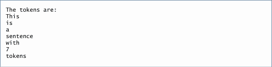

**图 8.26** | 使用函数 `strtok`。（第 2 部分，共 2 部分。）

需要多次调用 `strtok` 才能*将字符串标记化*——即将其分解为标记（假设该字符串包含多个标记）。第一次调用 `strtok`（第 15 行）包含两个参数：要标记化的字符串，以及包含分隔标记的字符的字符串。在第 15 行，语句

```c
char *tokenPtr = strtok(string, " "); // begin tokenizing sentence
```

将 `tokenPtr` 赋值为指向 `string` 中第一个标记的指针。第二个参数 `" "` 表示标记由空格分隔。函数 `strtok` 在 `string` 中搜索第一个不是分隔字符（空格）的字符。这开始了第一个标记。然后，该函数在字符串中找到下一个分隔字符，并将其替换为空字符（`'\0'`）以终止当前标记。函数 `strtok` 保存一个指向 `string` 中该标记之后的下一个字符的指针，并返回指向当前标记的指针。

第 20 行中后续的 `strtok` 调用继续标记化 `string`。这些调用*将 NULL 作为其第一个参数*。NULL 参数表示对 `strtok` 的调用应从上次调用 `strtok` 所保存的 `string` 中的位置继续标记化。如果调用 `strtok` 时没有剩余标记，`strtok` 返回 NULL。你可以在每次新的 `strtok` 调用中更改分隔符字符串。图 8.26 使用 `strtok` 标记化字符串 "This is a sentence with 7 tokens."。每个标记分别打印。函数 `strtok` 通过在每个标记末尾放置 `'\0'` 来*修改输入字符串*；因此，如果在调用 `strtok` 之后还要使用该字符串，则应制作该字符串的副本。[*注意：* 另请参阅 CERT 建议 STR06-C，其中讨论了假设 `strtok` 不修改其第一个参数中的字符串所存在的问题。]

## 8.9 字符串处理库的内存函数

本节介绍的字符串处理库函数用于操作、比较和搜索内存块。这些函数将内存块视为字符数组，并且可以操作任何数据块。图 8.27 总结了字符串处理库的内存函数。在函数讨论中，“对象”指一个数据块。[*注意：* 这些函数中的每一个都有一个更安全的版本，在 C11 标准的可选附录 K 中描述。我们将在本章的“安全 C 编程”小节中提到这些版本。]

指针参数声明为 `void *`，因此它们可用于操作任何数据类型的内存。回忆第 7 章：任何指针都可以直接赋值给 `void *` 类型的指针，而 `void *` 类型的指针也可以直接赋值给任何其他类型的指针。由于不能对 `void *` 指针进行解引用，每个函数都会接收一个大小参数，用于指定该函数将处理的字节数。对于

| 函数原型 | 函数描述 |
|---|---|
| `void *memcpy(void *s1, const void *s2, size_t n);` | 将 n 个字节从 s2 指向的对象复制到 s1 指向的对象中。返回指向结果对象的指针。 |
| `void *memmove(void *s1, const void *s2, size_t n);` | 将 n 个字节从 s2 指向的对象复制到 s1 指向的对象中。复制过程就好像先将这些字节从 s2 指向的对象复制到临时数组，再从临时数组复制到 s1 指向的对象中。返回指向结果对象的指针。 |
| `int memcmp(const void *s1, const void *s2, size_t n);` | 比较 s1 和 s2 指向的对象的前 n 个字节。如果 s1 等于、小于或大于 s2，函数分别返回 0、小于 0 或大于 0 的值。 |
| `void *memchr(const void *s, int c, size_t n);` | 在 s 指向的对象的前 n 个字节中定位 c（转换为 unsigned char）的第一次出现。如果找到 c，则返回指向对象中 c 的指针。否则返回 NULL。 |
| `void *memset(void *s, int c, size_t n);` | 将 c（转换为 unsigned char）复制到 s 指向的对象的前 n 个字节中。返回指向结果的指针。 |

**图 8.27** | 字符串处理库的内存函数。

为简单起见，本节中的示例操作字符数组（字符块）。图 8.27 中的函数不检查终止空字符，因为它们操作的内存块不一定是字符串。

### 8.9.1 函数 `memcpy`

函数 `memcpy` 将指定数量的字节从其第二个参数指向的对象复制到其第一个参数指向的对象中。该函数可以接收指向任何类型对象的指针。如果两个对象在内存中重叠（即它们是同一对象的一部分），则该函数的结果未定义——在这种情况下，应使用 `memmove`。图 8.28 使用 `memcpy` 将数组 s2 中的字符串复制到数组 s1 中。

### 性能提示 8.1

当你知道要复制的字符串大小时，`memcpy` 比 `strcpy` 更高效。

```c
// Fig. 8.28: fig08_28.c
// Using function memcpy
#include <stdio.h>
#include <string.h>
```

**图 8.28** | 使用函数 `memcpy`。（第 1 部分，共 2 部分。）


```c
int main(void)
{
    char s1[17]; // create char array s1
    char s2[] = "Copy this string"; // initialize char array s2

    memcpy(s1, s2, 17);
    printf("%s\n%s\n%s\n",
        "After s2 is copied into s1 with memcpy,",
        "s1 contains ", s1);
}
```

```
After s2 is copied into s1 with memcpy,
s1 contains "Copy this string"
```

**图 8.28** | 使用函数 memcpy。（第 2 部分，共 2 部分。）

### 8.9.2 函数 memmove

函数 memmove 与 memcpy 类似，从第二个参数所指向的对象中复制指定数量的字节到第一个参数所指向的对象中。复制过程就好像先把字节从第二个参数复制到一个临时数组，再从临时数组复制到第一个参数中。这样，即使字符串的两个部分重叠，也可以将字符串某一部分的字节复制到同一字符串的另一部分。图 8.29 使用 memmove 将数组 x 的最后 10 个字节复制到数组 x 的前 10 个字节中。

> **常见编程错误 8.7**
>
> 除 memmove 之外，其他复制字符的字符串处理函数在同一字符串的各个部分之间进行复制时，结果未定义。

```c
// Fig. 8.29: fig08_29.c
// Using function memmove
#include <stdio.h>
#include <string.h>

int main(void)
{
    char x[] = "Home Sweet Home"; // initialize char array x

    printf("%s%s\n", "The string in array x before memmove is: ", x);
    printf("%s%s\n", "The string in array x after memmove is: ",
        (char *) memmove(x, &x[5], 10));
}
```

```
The string in array x before memmove is: Home Sweet Home
The string in array x after memmove is: Sweet Home
```

**图 8.29** | 使用函数 memmove。

### 8.9.3 函数 memcmp

函数 `memcmp`（图 8.30）将第一个参数的指定字节数与第二个参数的对应字节进行比较。如果第一个参数大于第二个参数，函数返回大于 0 的值；如果两个参数相等，返回 0；如果第一个参数小于第二个参数，返回小于 0 的值。

```c
// Fig. 8.30: fig08_30.c
// Using function memcmp
#include <stdio.h>
#include <string.h>

int main(void)
{
   char s1[] = "ABCDEFG"; // initialize char array s1
   char s2[] = "ABCDXYZ"; // initialize char array s2

   printf("%s\n%s\n\n%2d\n%2d\n%2d\n%2d\n",
      "s1 = ", s1, "s2 = ", s2,
      "memcmp(s1, s2, 4) = ", memcmp(s1, s2, 4),
      "memcmp(s1, s2, 7) = ", memcmp(s1, s2, 7),
      "memcmp(s2, s1, 7) = ", memcmp(s2, s1, 7));
}
```

```
s1 = ABCDEFG
s2 = ABCDXYZ

memcmp(s1, s2, 4) = 0
memcmp(s1, s2, 7) = -1
memcmp(s2, s1, 7) = 1
```

**图 8.30** | 使用函数 `memcmp`。

### 8.9.4 函数 memchr

函数 `memchr` 在对象的指定字节数中搜索一个以 `unsigned char` 表示的字节的*第一次出现*。如果找到该字节，则返回指向对象中该字节的指针；否则返回 `NULL` 指针。图 8.31 在字符串 "This is a string" 中搜索包含 'r' 的字节。

```c
// Fig. 8.31: fig08_31.c
// Using function memchr
#include <stdio.h>
#include <string.h>

int main(void)
{
    const char *s = "This is a string"; // initialize char pointer

    printf("%s%s\"%s\"\n",
        "The remainder of s after character 'r'",
        " is found is ",
        (char *) memchr(s, 'r', 16));
}
```

```
The remainder of s after character 'r' is found is "ring"
```

**图 8.31** | 使用函数 memchr。（第 2 部分，共 2 部分。）

### 8.9.5 函数 memset

函数 memset 将第二个参数中的字节值复制到第一个参数所指向对象的前 n 个字节中，其中 n 由第三个参数指定。图 8.32 使用 memset 将 'b' 复制到 string1 的前 7 个字节中。

> 性能提示 8.2
>
> 使用 memset 将数组元素设置为 0，而不是遍历数组并为每个元素赋 0。例如，图 6.3 可以用 memset(n, 0, 5); 初始化五元素数组 n。许多硬件架构都有块复制或清除指令，编译器可利用这些指令优化 memset，以实现高性能的内存清零。

```c
// Fig. 8.32: fig08_32.c
// Using function memset
#include <stdio.h>
#include <string.h>

int main(void)
{
    char string1[15] = "BBBBBBBBBBBBB"; // initialize string1

    printf("string1 = %s\n", string1);
    printf("string1 after memset = %s\n",
        (char *) memset(string1, 'b', 7));
}
```

```
string1 = BBBBBBBBBBBBB
string1 after memset = bbbbbbbBBBBBB
```

**图 8.32** | 使用函数 memset。

## 8.10 字符串处理库的其他函数

字符串处理库剩下的两个函数是 strerror 和 strlen。图 8.33 总结了 strerror 和 strlen 函数。

| 函数原型 | 函数描述 |
|---|---|
| `char *strerror(int errnum);` | 以编译器和区域设置特定的方式将 errnum 映射为完整文本字符串（例如，消息可能会根据计算机的区域设置以不同的口头语言显示）。返回指向该字符串的指针。错误号定义在 errno.h 中。 |
| `size_t strlen(const char *s);` | 确定字符串 s 的长度。返回终止空字符之前的字符数。 |

**图 8.33** | 字符串处理库的其他函数。

### 8.10.1 函数 strerror

函数 strerror 接收一个错误号并创建一个错误消息字符串。返回指向该字符串的指针。图 8.34 演示了 strerror。

```c
// Fig. 8.34: fig08_34.c
// Using function strerror
#include <stdio.h>
#include <string.h>

int main(void)
{
    printf("%s\n", strerror(2));
}
```

```
No such file or directory
```

**图 8.34** | 使用函数 strerror。

### 8.10.2 函数 strlen

函数 strlen 接收一个字符串作为参数，并返回该字符串中的字符数——长度中不包括终止空字符。图 8.35 演示了函数 strlen。

```c
// Fig. 8.35: fig08_35.c
// Using function strlen
#include <stdio.h>
#include <string.h>

int main(void)
{
    // initialize 3 char pointers
    const char *string1 = "abcdefghijklmnopqrstuvwxyz";
    const char *string2 = "four";
    const char *string3 = "Boston";

    printf("%s%s%s%u\n%s%s%s%u\n%s%s%s%u\n",
        "The length of ", string1, " is ", strlen(string1),
        "The length of ", string2, " is ", strlen(string2),
        "The length of ", string3, " is ", strlen(string3));
}
```

```
The length of "abcdefghijklmnopqrstuvwxyz" is 26
The length of "four" is 4
The length of "Boston" is 6
```

**图 8.35** | 使用函数 strlen。（第 2 部分，共 2 部分。）

## 8.11 安全的 C 编程

### *安全的字符串处理函数*

本书前面“安全的 C 编程”章节介绍了 C11 中更安全的函数 printf_s 和 scanf_s。在本章中，我们介绍了函数 sprintf、strcpy、strncpy、strcat、strncat、strlen、memcpy、memmove 和 memset。C11 标准的*可选*附录 K 描述了这些函数以及许多其他字符串处理和输入/输出函数的更安全版本。如果你的 C 编译器支持附录 K，则应使用这些函数的安全版本。更安全的版本除其他作用外，还通过要求额外参数来指定目标数组中的元素数量，并确保指针参数非 NULL，从而帮助防止缓冲区溢出。

### *读取数值输入和输入验证*

验证输入到程序中的数据非常重要。例如，当你要求用户输入 1–100 范围内的 int，然后尝试使用 scanf 读取该 int 时，可能会出现几种问题。用户可能输入：

- 一个超出程序要求范围的 int（例如 102）。
- 一个超出该计算机上 int 允许范围的 int（例如在具有 32 位 int 的机器上输入 8,000,000,000）。
- 一个非整数的数值（例如 27.43）。
- 一个非数值（例如 FOVR）。

你可以使用在本章学到的各种函数来完整验证此类输入。例如，你可以

- 使用 fgets 将输入读取为一行文本，
- 使用 strtol 将字符串转换为数字，并确保转换成功，然后
- 确保该值在范围内。

有关将输入转换为数值的更多信息和技术，请参见 www.securecoding.cert.org 上的 CERT 指南 INT05-C。


## 摘要

### 第 8.2 节 字符串和字符基础
- **字符**是源程序的基本构建块。每个程序都由一系列字符组成，当这些字符有意义地组合在一起时，计算机将其解释为一系列用于完成任务的指令。
- 一个**字符常量** (*p. 367*) 是用单引号表示的 `int` 值。字符常量的值是该字符在机器字符集中的整数值 (*p. 367*)。
- 一个**字符串** (*p. 367*) 是一系列被视为单个单元的字符。字符串可以包含字母、数字和各种特殊字符 (*p. 367*)，例如 `+`、`-`、`*`、 `/` 和 `$`。C 语言中的字符串字面量或字符串常量用双引号书写。
- C 中的一个**字符串**是以 **空字符** 结尾的字符数组 (*p. 367*; `'\0'`)。
- 字符串通过指向其第一个字符的 **指针** 访问 (*p. 367*)。字符串的值是其第一个字符的 **地址**。
- 在定义中，字符数组或类型为 `char *` 的变量可以用字符串进行初始化。
- 当定义字符数组以包含字符串时，数组必须足够大以存储字符串及其终止空字符。
- 字符串可以使用 `scanf` 存储在数组中。函数 `scanf` 会读取字符，直到遇到空格、制表符、换行符或文件结束指示符。
- 要将字符数组作为字符串打印，数组必须包含终止空字符。

### 第 8.3 节 字符处理库
- 函数 `isdigit` (*p. 368*) 判断其参数是否为数字 (0-9)。
- 函数 `isalpha` (*p. 368*) 判断其参数是否为大写字母 (A-Z) 或小写字母 (a-z)。
- 函数 `isalnum` (*p. 368*) 判断其参数是否为大写字母 (A-Z)、小写字母 (a-z) 或数字 (0-9)。
- 函数 `isxdigit` (*p. 368*) 判断其参数是否为十六进制数字 (*p. 369*; A-F, a-f, 0-9)。
- 函数 `islower` (*p. 371*) 判断其参数是否为小写字母 (a-z)。
- 函数 `isupper` (*p. 371*) 判断其参数是否为大写字母 (A-Z)。
- 函数 `toupper` (*p. 371*) 将小写字母转换为大写并返回大写字母。
- 函数 `tolower` (*p. 371*) 将大写字母转换为小写并返回小写字母。
- 函数 `isspace` (*p. 372*) 判断其参数是否为以下空白字符之一：`' '` (空格)、`'\f'`、`'\n'`、`'\r'`、`'\t'` 或 `'\v'`。
- 函数 `iscntrl` (*p. 372*) 判断其参数是否为以下控制字符之一：`'\t'`、`'\v'`、`'\f'`、`'\a'`、`'\b'`、`'\r'` 或 `'\n'`。
- 函数 `ispunct` (*p. 372*) 判断其参数是否为除空格、数字或字母之外的可打印字符。
- 函数 `isprint` (*p. 372*) 判断其参数是否为任何可打印字符，包括空格字符。
- 函数 `isgraph` (*p. 372*) 判断其参数是否为除空格字符之外的可打印字符。

### 第 8.4 节 字符串转换函数
- 函数 strtod (p. 374) 将表示浮点值的字符序列转换为 double。函数接收两个参数——一个字符串 (char *) 和一个指向 char * 的指针。字符串包含要转换的字符序列，而指向 char * 的指针指定的位置会被赋值为转换后字符串剩余部分的地址，如果字符串的任何部分都无法转换，则为整个字符串的地址。
- 函数 strtol (p. 375) 将表示整数的字符序列转换为 long。函数接收三个参数——一个字符串 (char *)、一个指向 char * 的指针和一个整数。字符串包含要转换的字符序列，指向 char * 的指针指定的位置会被赋值为转换后字符串剩余部分的地址，如果字符串的任何部分都无法转换，则为整个字符串的地址。整数指定所转换值的进制。
- 函数 strtoul (p. 376) 将表示整数的字符序列转换为 unsigned long int。函数的工作方式与 strtol 完全相同。

### 第 8.5 节 标准输入/输出库函数
- 函数 fgets (p. 377) 读取字符，直到遇到换行字符或文件结束指示符。fgets 的参数为类型为 char 的数组、可以读取的最大字符数以及要读取的流。读取终止后会在数组后追加一个空字符 ('\0')。如果遇到换行符，则将其包含在输入字符串中。
- 函数 putchar (p. 377) 打印其字符参数。
- 函数 getchar (p. 378) 从标准输入读取单个字符并将其作为整数返回。如果遇到文件结束指示符，getchar 返回 EOF。
- 函数 puts (p. 379) 以字符串 (char *) 作为参数并打印该字符串后跟一个换行字符。
- 函数 sprintf (p. 379) 使用与函数 printf 相同的转换说明符将格式化数据打印到类型为 char 的数组中。
- 函数 sscanf (p. 380) 使用与函数 scanf 相同的转换说明符从字符串读取格式化数据。

### 第 8.6 节 字符串处理库的字符串操作函数
- 函数 strcpy 将其第二个参数（一个字符串）复制到其第一个参数（一个字符数组）中。必须确保数组足够大以存储字符串及其终止空字符。
- 函数 strncpy (p. 381) 等同于 strcpy，只是 strncpy 指定从字符串复制到数组中的最大字符数。只有当要复制的字符数比字符串长度多一个时，才会复制终止空字符。
- 函数 strcat (p. 382) 将其第二个字符串参数（包括终止空字符）附加到其第一个字符串参数。第二个字符串的第一个字符替换第一个字符串的空字符 ('\0')。必须确保用于存储第一个字符串的数组足够大以存储第一个字符串和第二个字符串。
- 函数 strncat (p. 381) 将第二个字符串的指定数量字符附加到第一个字符串。结果后会追加一个终止空字符。

### 第 8.7 节 字符串处理库的比较函数
- 函数 strcmp (p. 383) 按字符逐个比较其第一个字符串参数和第二个字符串参数。如果字符串相等则返回 0，如果第一个字符串小于第二个则返回负值，如果第一个字符串大于第二个则返回正值。
- 函数 strncmp (p. 383) 等同于 strcmp，只是 strncmp 比较指定数量的字符。如果其中一个字符串比指定的字符数短，strncmp 会比较字符直到在较短字符串中遇到空字符。

### 第 8.8 节 字符串处理库的搜索函数
- 函数 strchr (p. 386) 搜索字符串中字符的首次出现。如果找到该字符，strchr 返回指向字符串中该字符的指针；否则，strchr 返回 NULL。
- 函数 strcspn (p. 387) 确定其第一个参数中字符串的初始部分的长度，该部分不包含第二个参数中字符串的任何字符。函数返回该段的长度。
- 函数 strpbrk (p. 387) 在其第一个参数中搜索第二个参数中任何字符的首次出现。如果找到第二个参数中的字符，strpbrk 返回指向该字符的指针；否则，strpbrk 返回 NULL。
- 函数 strrchr (p. 388) 搜索字符串中字符的最后一次出现。如果找到该字符，strrchr 返回指向字符串中该字符的指针；否则，strrchr 返回 NULL。
- 函数 strspn (p. 389) 确定其第一个参数中字符串的初始部分的长度，该部分仅包含第二个参数中字符串的字符。函数返回该段的长度。
- 函数 strstr (p. 389) 在其第一个字符串参数中搜索第二个字符串参数的首次出现。如果在第一个字符串中找到第二个字符串，则返回指向第一个参数中该字符串位置的指针。
- 对 strtok (p. 390) 的一系列调用将第一个字符串 s1 分割为由第二个字符串 s2 中包含的字符分隔的标记 (p. 390)。第一次调用以 s1 作为第一个参数，后续调用以继续标记同一字符串时第一个参数为 NULL。每次调用都返回指向当前标记的指针。如果调用函数时没有更多标记，则返回空指针。

### 第 8.9 节 字符串处理库的内存函数
- 函数 memcpy (p. 392) 将其第二个参数指向的对象中的指定数量字节复制到其第一个参数指向的对象中。函数可以接收指向任何类型对象的指针。
- 函数 memmove (p. 393) 将其第二个参数指向的对象中的指定数量字节复制到其第一个参数指向的对象中。复制操作如同先将字节从第二个参数复制到临时数组，然后再从临时数组复制到第一个参数。
- 函数 memcmp (p. 394) 比较其第一个和第二个参数的指定数量字节。
- 函数 memchr (p. 394) 在对象的指定数量字节中搜索作为 unsigned char 表示的字节的首次出现。如果找到该字节，则返回指向该字节的指针；否则返回空指针。
- 函数 memset (p. 395) 将其第二个参数（作为 unsigned char 处理）复制到第一个参数指向的对象的指定数量字节中。

### 第 8.10 节 字符串处理库的其他函数
- 函数 strerror (p. 396) 以特定于区域设置的方式将整数错误号映射为完整文本字符串。返回指向该字符串的指针。
- 函数 strlen (p. 396) 以字符串作为参数并返回字符串中的字符数——终止空字符不计入字符串长度。


## 自测练习

8.1 编写一条语句完成以下各项。假设变量 `c`（存储一个字符）、`x`、`y` 和 `z` 为 `int` 类型，变量 `d`、`e` 和 `f` 为 `double` 类型，变量 `ptr` 为 `char *` 类型，数组 `s1[100]` 和 `s2[100]` 为 `char` 类型。

- a) 将变量 `c` 中存储的字符转换为大写字母。将结果赋给变量 `c`。
- b) 判断变量 `c` 的值是否为数字。使用图8.2–8.4所示的条件运算符，在显示结果时打印 `" is a "` 或 `" is not a "`。
- c) 判断变量 `c` 的值是否为控制字符。使用条件运算符在显示结果时打印 `" is a "` 或 `" is not a "`。
- d) 从键盘读取一行文本到数组 `s1` 中。不要使用 `scanf`。
- e) 打印存储在数组 `s1` 中的一行文本。不要使用 `printf`。
- f) 将 `ptr` 赋值为 `c` 在 `s1` 中最后一次出现的位置。
- g) 打印变量 `c` 的值。不要使用 `printf`。
- h) 判断 `c` 的值是否为字母。使用条件运算符在显示结果时打印 `" is a "` 或 `" is not a "`。
- i) 从键盘读取一个字符并存入变量 `c`。
- j) 将 `ptr` 赋值为 `s2` 在 `s1` 中第一次出现的位置。
- k) 判断变量 `c` 的值是否为打印字符。使用条件运算符在显示结果时打印 `" is a "` 或 `" is not a "`。
- l) 从字符串 `"1.27 10.3 9.432"` 中读取三个 double 值到变量 `d`、`e` 和 `f` 中。
- m) 将数组 `s2` 中存储的字符串复制到数组 `s1` 中。
- n) 将 `ptr` 赋值为 `s2` 中任一字符在 `s1` 中第一次出现的位置。
- o) 比较 `s1` 中的字符串与 `s2` 中的字符串。打印结果。
- p) 将 `ptr` 赋值为 `c` 在 `s1` 中第一次出现的位置。
- q) 使用 `sprintf` 将整数变量 `x`、`y` 和 `z` 的值打印到数组 `s1` 中。每个值应以字段宽度7打印。
- r) 将 `s2` 中字符串的10个字符追加到 `s1` 中的字符串后面。
- s) 确定 `s1` 中字符串的长度。打印结果。
- t) 将 `ptr` 赋值为 `s2` 中第一个标记的位置。字符串 `s2` 中的标记以逗号（`,`）分隔。

8.2 展示两种不同的方法，用元音字符串 `"AEIOU"` 初始化字符数组 `vowel`。

8.3 执行以下每条 C 语句时会打印什么（如果有的话）？如果语句包含错误，请描述错误并说明如何更正。假设有如下变量定义：

```c
char s1[50] = "jack", s2[30] = "jill", s3[50];
```

- a) `printf("%c%s", toupper(s1[0]), &s1[1]);`
- b) `printf("%s", strcpy(s3, s2));`
- c) `printf("%s", strcat(strcat(strcpy(s3, s1), " and "), s2));`
- d) `printf("%u", strlen(s1) + strlen(s2));`
- e) `printf("%u", strlen(s3)); // using s3 after part (c) executes`

8.4 找出以下每个程序段中的错误，并说明如何更正：

- a)

  ```c
  char s[10];
  strncpy(s, "hello", 5);
  printf("%s\n", s);
  ```

- b)

  ```c
  printf("%s", 'a');
  ```

- c)

  ```c
  char s[12];
  strcpy(s, "Welcome Home");
  ```

- d)

  ```c
  if (strcmp(string1, string2)) {
      puts("The strings are equal");
  }
  ```

## 自测练习答案

### 8.1

- a) `c = toupper(c);`
- b) `printf("%c%s digit\n", c, isdigit(c) ? " is a " : " is not a ");`
- c) `printf("%c%s character\n", c, iscntrl(c) ? " is a " : " is not a ");`
- d) `fgets(s1, 100, stdin);`
- e) `puts(s1);`
- f) `ptr = strrchr(s1, c);`
- g) `putchar(c);`
- h) `printf("%c%s letter\n", c, isalpha(c) ? " is a " : " is not a ");`
- i) `c = getchar();`
- j) `ptr = strstr(s1, s2);`
- k) `printf("%c%s printable character\n", c, isprint(c) ? " is a " : " is not a ");`
- l) `sscanf("1.27 10.3 9.432", "%lf%lf%lf", &d, &e, &f);`
- m) `strcpy(s1, s2);`
- n) `ptr = strpbrk(s1, s2);`
- o) `printf("strcmp(s1, s2) = %d\n", strcmp(s1, s2));`
- p) `ptr = strchr(s1, c);`
- q) `sprintf(s1, "%7d%7d%7d", x, y, z);`
- r) `strncat(s1, s2, 10);`
- s) `printf("strlen(s1) = %u\n", strlen(s1));`
- t) `ptr = strtok(s2, ",");`

### 8.2

- `char vowel[] = "AEIOU";`
- `char vowel[] = { 'A', 'E', 'I', 'O', 'U', '\0' };`

### 8.3

- a) Jack
- b) jill
- c) jack and jill
- d) 8
- e) 13

### 8.4

- a) **错误：** 函数 `strncpy` 不会向数组 `s` 写入终止空字符，因为它的第三个参数等于字符串 `"hello"` 的长度。
  **更正：** 将 `strncpy` 的第三个参数设为6，或将 `'\0'` 赋给 `s[5]`。
- b) **错误：** 试图将字符常量作为字符串打印。
  **更正：** 使用 `%c` 输出字符，或将 `'a'` 替换为 `"a"`。
- c) **错误：** 字符数组 `s` 不够大，无法存储终止空字符。
  **更正：** 声明具有更多元素的数组。
- d) **错误：** 如果字符串相等，函数 `strcmp` 返回0；因此，`if` 语句中的条件为假，`puts` 不会被执行。
  **更正：** 在条件中将 `strcmp` 的结果与0比较。

## 练习

### 8.5 *(字符测试)*

编写一个程序，从键盘输入一个字符，并用字符处理库中的每个函数测试它。程序应打印每个函数返回的值。

### 8.6 *(交替以大写和小写显示字符串)*

编写一个程序，将一行文本输入到字符数组 `s[100]` 中。以大写字母和小写字母交替的方式输出该行。

### 8.7 *(将字符串转换为整数以进行计算)*

编写一个程序，输入六个表示整数的字符串，将这些字符串转换为整数，并计算这六个值的和与平均值。

### 8.8 *(将字符串转换为浮点数以进行计算)*

编写一个程序，输入六个表示浮点值的字符串，将这些字符串转换为 double 值，将这些值存储到 double 数组中，并计算这些值的和与平均值。

### 8.9 *(拼接字符串)*

编写一个程序，使用函数 `strcat` 拼接用户提供的两个字符串。程序应在拼接之前和之后打印这些字符串，以及拼接后字符串的长度。

### 8.10 *(追加字符串的一部分)*

编写一个程序，使用函数 `strncat` 将字符串的一部分追加到另一个字符串。程序应输入这些字符串以及要追加的字符数，然后在追加第二个字符串后显示第一个字符串及其长度。

### 8.11 *(随机句子)*

编写一个程序，使用随机数生成来创建句子。程序应使用四个指向 `char` 的指针数组，分别称为 `article`、`noun`、`verb` 和 `preposition`。程序应按以下顺序从每个数组中随机选择一个单词来创建句子：`article`、`noun`、`verb`、`preposition`、`article` 和 `noun`。每选择一个单词，就应将其连接到数组中前面的单词之后，该数组要足够大以容纳整个句子。单词之间应以空格分隔。输出最终句子时，它应以大写字母开头并以句号结尾。程序应生成20个这样的句子。

数组应按如下方式填充：`article` 数组应包含冠词 `"a"`、`"one"`、`"some"` 和 `"any"`；`noun` 数组应包含名词 `"boy"`、`"girl"`、`"dog"`、`"town"` 和 `"car"`；`verb` 数组应包含动词 `"drove"`、`"jumped"`、`"ran"`、`"walked"` 和 `"skipped"`；`preposition` 数组应包含介词 `"to"`、`"from"`、`"over"`、`"under"` 和 `"on"`。

在编写并运行上述程序后，修改它，使其生成由其中几个句子组成的短篇故事。（随机生成学期论文写手的可能性如何？）

### 8.12 *(五行打油诗)*

五行打油诗是一种幽默的五句诗，其中第一行和第二行与第五行押韵，第三行与第四行押韵。使用与练习8.11中开发的技术类似的方法，编写一个程序来生成随机的五行打油诗。完善此程序以生成好的打油诗是一个具有挑战性的问题，但结果值得付出努力！

### 8.13 *(猪拉丁语)*

编写一个程序，将英语短语编码为猪拉丁语。猪拉丁语是一种常用于娱乐的编码语言。构成猪拉丁语短语的方法有许多变体。为简单起见，使用以下算法：要由英语短语构成猪拉丁语短语，使用函数 `strtok` 将该短语分词为单词。要将每个英语单词翻译为猪拉丁语单词，将英语单词的首字母放在该英语单词末尾，并添加字母 `"ay"`。因此，单词 `"jump"` 变为 `"umpjay"`，单词 `"the"` 变为 `"hetay"`，单词 `"computer"` 变为 `"omputercay"`。单词之间的空白仍为空白。

英语短语由以空格分隔的单词组成，没有标点符号，并且所有单词都有两个或更多字母。函数 `printLatinWord` 应显示每个单词。[提示：每次在调用 `strtok` 时找到一个标记，就将标记指针传递给函数 `printLatinWord` 并打印猪拉丁语单词。注意：我们在此提供了将单词转换为猪拉丁语的简化规则。有关更详细的规则和变体，请访问 en.wikipedia.org/wiki/Pig_Latin。]

### 8.14 *(对电话号码进行分词)*

编写一个程序，以字符串形式输入电话号码，格式为 `(555) 555-5555`。程序应使用函数 `strtok` 提取区号作为标记，提取电话号码的前三位数字作为标记，并提取电话号码的后四位数字作为标记。电话号码的七位数字应拼接成一个字符串。


8.27（编写你自己的字符串转换函数）编写你自己的函数版本，对应图 8.5 中用于将字符串转换为数字的函数。

8.28（编写你自己的字符串复制和字符串连接函数）编写图 8.14 中字符串复制和字符串连接函数各自的两种版本。第一种版本应使用数组下标，第二种版本应使用指针和指针算术。

8.29（编写你自己的字符串比较函数）编写图 8.17 中每个字符串比较函数的两种版本。第一种版本应使用数组下标，第二种版本应使用指针和指针算术。

8.30（编写你自己的字符串长度函数）编写图 8.33 中函数 strlen 的两种版本。第一种版本应使用数组下标，第二种版本应使用指针和指针算术。

## 专题：高级字符串处理练习

前面的练习与正文内容紧密对应，旨在测试读者对基本字符串处理概念的理解。本节包含中级和高级问题，既有挑战性又很有趣。这些问题难度差异很大。有些需要一两个小时的编程时间，有些则适合作为可能需花费两三周时间研究和实现的实验作业。还有一些是颇具挑战性的学期项目。

8.31（文本分析）具有字符串处理能力的计算机的出现，催生了一些相当有趣的分析伟大作家作品的方法。许多关注点集中在威廉·莎士比亚是否真的存在过。一些学者找到了大量证据，表明实际上克里斯托弗·马洛撰写了那些归于莎士比亚名下的杰作。研究人员利用计算机来寻找这两位作者作品之间的相似之处。本练习考察用计算机分析文本的三种方法。

- a) 编写一个程序，读取多行文本，并打印一个表格，指出文本中每个字母出现的次数。例如，短语

  To be, or not to be: that is the question:

  包含一个“a”，两个“b”，零个“c”，依此类推。
- b) 编写一个程序，读取多行文本，并打印一个表格，指出文本中出现的单字母单词、双字母单词、三字母单词等的数量。例如，短语

  Whether 'tis nobler in the mind to suffer

  包含

  | 单词长度 | 出现次数 |
  | --- | --- |
  | 1 | 0 |
  | 2 | 2 |
  | 3 | 1 |
  | 4 | 2（包括'tis） |
  | 5 | 0 |
  | 6 | 2 |
  | 7 | 1 |
- c) 编写一个程序，读取多行文本，并打印一个表格，指出文本中每个不同单词出现的次数。程序应按照单词在文本中出现的顺序将其包含在表格中。例如，这些行

  ```
  To be, or not to be: that is the question:
  Whether 'tis nobler in the mind to suffer
  ```

  包含单词“to”三次，“be”两次，“or”一次，依此类推。

8.32（以各种格式打印日期）

日期通常以几种不同格式打印。两种比较常见的格式是

```
07/21/2003 和 July 21, 2003
```

编写一个程序，读取第一种格式的日期，并以第二种格式打印。

8.33（支票保护）

计算机经常用于支票书写系统，例如工资发放和应付账款应用程序。许多关于周薪支票（因错误）被打印成超过100万美元金额的故事流传开来。由于人为错误和/或机器故障，计算机化支票书写系统会打印出奇怪的金额。系统设计者当然会尽一切努力在系统中建立控制机制，以防止错误支票被签发。

另一个严重的问题是有人故意篡改支票金额，意图欺诈性兑现。为了防止美元金额被篡改，大多数计算机化支票书写系统采用了一种称为支票保护的技术。

为计算机印刷而设计的支票包含固定数量的空格，计算机可以在其中打印金额。假设一张工资支票有九个空白位置，计算机应在这些位置打印周薪金额。如果金额较大，那么这九个位置都会被填满——例如：

```
11,230.60（支票金额）
_________
123456789（位置编号）
```

另一方面，如果金额小于1000美元，那么通常会有一些空格留空——例如：

```
99.87
_________
123456789
```

8.35（项目：公制转换程序）编写一个程序，帮助用户进行公制转换。你的程序应允许用户以字符串形式指定单位名称（即公制系统中的厘米、升、克等，以及英制系统中的英寸、夸脱、磅等），并应能回答诸如

> “2米等于多少英寸？”
> “10夸脱等于多少升？”

之类的简单问题。

你的程序应识别无效转换。例如，问题

> “5千克等于多少英尺？”

没有意义，因为“英尺”是长度单位，而“千克”是质量单位。

### 一个具有挑战性的字符串处理项目

8.36（项目：填字游戏生成器）大多数人都玩过填字游戏，但很少有人尝试过自己生成一个。生成填字游戏是一个困难的问题。这里建议将其作为一个需要相当高复杂度和精力的字符串处理项目。即使要让最简单的填字游戏生成程序运行起来，你也要解决许多问题。例如，如何在计算机内部表示填字游戏的网格？应该使用一系列字符串，还是使用二维数组？你需要一个可以被程序直接引用的单词来源（即计算机化词典）。这些单词应以什么形式存储，以便于程序所需的复杂操作？真正有雄心壮志的读者还会希望生成拼图的“线索”部分，即为拼图者打印每个“横向”单词和每个“纵向”单词的简要提示。仅仅打印空白拼图本身都不是一个简单的问题。

### 做出改变

8.37（用更健康的食材烹饪）美国的肥胖率正在以惊人的速度增长。请查看美国疾病控制与预防中心（CDC）的网页 www.cdc.gov/obesity/data/index.html，其中包含美国肥胖数据和事实。随着肥胖率的上升，相关问题（例如心脏病、高血压、高胆固醇、2型糖尿病）的发生率也在增加。编写一个程序，帮助用户在烹饪时选择更健康的食材，并帮助对某些食物（例如坚果、麸质）过敏的人寻找替代品。该程序应读取用户提供的食谱，并为某些食材建议更健康的替代品。为简单起见，你的程序应假设食谱中没有使用茶匙、杯、汤匙等计量单位的缩写，并使用数字表示数量（例如，1个鸡蛋、2杯），而不是拼写出来（一个鸡蛋、两杯）。一些常见的替代品如图 8.36 所示。你的程序应显示类似这样的警告：“在对饮食做出重大改变之前，请务必咨询医生。”

你的程序应考虑替代品并非总是一对一的。例如，如果一个蛋糕食谱需要三个鸡蛋，那么合理地可以使用六个蛋清来代替。计量单位和替代品的换算数据可以在以下网站获取：

- chinesefood.about.com/od/recipeconversions/f/usmetricrecipes.htm
- www.pioneerthinking.com/eggsub.html
- www.gourmetsleuth.com/conversions.htm

你的程序应考虑用户的健康问题，例如高胆固醇、高血压、减肥、麸质过敏等。对于高胆固醇，程序应建议鸡蛋和奶制品的替代品；如果用户希望减肥，则应建议糖等食材的低热量替代品。


| 配料 | 替代品 |
|---|---|
| 1 杯酸奶油 | 1 杯酸奶 |
| 1 杯牛奶 | 1/2 杯淡奶和 1/2 杯水 |
| 1 茶匙柠檬汁 | 1/2 茶匙醋 |
| 1 杯糖 | 1/2 杯蜂蜜、1 杯糖蜜<br>或 1/4 杯龙舌兰糖浆 |
| 1 杯黄油 | 1 杯人造黄油或酸奶 |
| 1 杯面粉 | 1 杯黑麦粉或米粉 |
| 1 杯蛋黄酱 | 1 杯白软干酪<br>或 1/8 杯蛋黄酱和 7/8 杯酸奶 |
| 1 个鸡蛋 | 2 汤匙玉米淀粉、竹芋粉<br>或土豆淀粉或 2 个蛋清<br>或 1/2 根大香蕉（捣碎） |
| 1 杯牛奶 | 1 杯豆奶 |
| 1/4 杯油 | 1/4 杯苹果酱 |
| 白面包 | 全麦面包 |

图 8.36 | 常见配料替代品。

- 8.38（垃圾邮件扫描器）垃圾邮件（或垃圾电子邮件）每年使美国组织在防垃圾邮件软件、设备、网络资源、带宽和生产力损失方面花费数十亿美元。在线研究一些最常见的垃圾电子邮件消息和词语，并检查你自己的垃圾邮件文件夹。创建一份包含垃圾邮件中常见的 30 个单词和短语的列表。编写一个程序，用户在其中输入一封电子邮件。将消息读入一个大型字符数组，并确保程序不会尝试在数组末尾之后插入字符。然后扫描消息中的 30 个关键词或短语中的每一个。对于这些关键词或短语在消息中每出现一次，就给该消息的“垃圾邮件分数”加一分。接下来，根据消息获得的分数评定它是垃圾邮件的可能性。
- 8.39（短信语言）短消息服务（SMS）是一种通信服务，允许在移动电话之间发送 160 个或更少字符的文本消息。随着移动电话在全球普及，SMS 在许多发展中国家被用于政治目的（例如表达意见和反对）、报道自然灾害新闻等。例如，查看 comuncia.org/radio/2.0/archives/87。由于 SMS 消息的长度有限，因此经常使用短信语言——移动文本消息、电子邮件、即时消息等中常见单词和短语的缩写。例如，“in my opinion”在短信语言中是“IMO”。在线研究短信语言。编写一个程序，让用户输入一条使用短信语言的消息，然后将其翻译成英语（或你自己的语言）。还提供一种机制，将用英语（或你自己的语言）编写的文本翻译成短信语言。一个潜在问题是，一个短信缩写可能扩展成多种短语。例如，IMO（如上所用）也可能代表“International Maritime Organization”（国际海事组织）、“in memory of”（纪念）等。
- 8.40（性别中立）在练习 1.14 中，你研究了在所有形式的交流中消除性别歧视。然后你描述了用于通读一段文本并将性别特定词语替换为性别中立对应词的算法。编写一个程序，读取一段文本，然后将性别特定词语替换为性别中立词语。显示生成的性别中立文本。

## 9 C 格式化输入/输出

### 目标

在本章中，你将：

- 使用输入和输出流。
- 使用打印格式化功能。
- 使用输入格式化功能。
- 打印整数、浮点数、字符串和字符。
- 使用字段宽度和精度进行打印。
- 在 `printf` 格式控制字符串中使用格式化标志。
- 输出字面量和转义序列。
- 使用 `scanf` 读取格式化输入。

- 9.1 简介
- 9.2 流
- 9.3 使用 printf 格式化输出
- 9.4 打印整数
- 9.5 打印浮点数
  - 9.5.1 转换说明符 e、E 和 f
  - 9.5.2 转换说明符 g 和 G
  - 9.5.3 演示浮点转换说明符
- 9.6 打印字符串和字符
- 9.7 其他转换说明符
- 9.8 使用字段宽度和精度打印
  - 9.8.1 为打印整数指定字段宽度
  - 9.8.2 为整数、浮点数和字符串指定精度
  - 9.8.3 组合字段宽度和精度
- 9.9 在 printf 格式控制字符串中使用标志
  - 9.9.1 右对齐和左对齐
  - 9.9.2 使用和不使用 + 标志打印正数和负数
  - 9.9.3 使用空格标志
  - 9.9.4 使用 # 标志
  - 9.9.5 使用 0 标志
- 9.10 打印字面量和转义序列
- 9.11 使用 scanf 读取格式化输入
  - 9.11.1 scanf 语法
  - 9.11.2 scanf 转换说明符
  - 9.11.3 使用 scanf 读取整数
  - 9.11.4 使用 scanf 读取浮点数
  - 9.11.5 使用 scanf 读取字符和字符串
  - 9.11.6 使用 scanf 的扫描集
  - 9.11.7 使用 scanf 的字段宽度
  - 9.11.8 跳过输入流中的字符
- 9.12 安全的 C 编程

小结 | 自测练习 | 自测练习答案 | 练习

### 9.1 简介

任何问题解决方案的重要组成部分是结果的呈现。在本章中，我们深入讨论 `printf` 和 `scanf` 的格式化功能，它们分别从标准输入流输入数据并将数据输出到标准输出流。在调用这些函数的程序中包含头文件 `<stdio.h>`。第 11 章讨论标准输入/输出（`<stdio.h>`）库中包含的另外几个函数。

### 9.2 流

所有输入和输出都通过流执行，流是字节序列。在输入操作中，字节从设备（例如键盘、硬盘、网络连接）流向主存。在输出操作中，字节从主存流向设备（例如显示屏、打印机、硬盘、网络连接等）。

程序开始执行时，会自动创建三个流。通常，标准输入流连接到键盘，标准输出流连接到屏幕。第三个流，即标准错误流，也连接到屏幕。操作系统通常允许将这些流重定向到其他设备。我们将在第 11 章展示如何将错误消息输出到标准错误流。第 11 章也会详细讨论流。

### 9.3 使用 printf 格式化输出

精确的输出格式化通过 `printf` 完成。每个 `printf` 调用都包含一个描述输出格式的格式控制字符串。格式控制字符串由转换说明符、标志、字段宽度、精度和字面字符组成。这些与百分号（%）一起构成转换规范。函数 `printf` 可以执行以下格式化功能，本章将逐一讨论：

- 1. 将浮点值舍入到指定的小数位数。
- 2. 使一列数字对齐，且小数点上下对齐。
- 3. 输出的右对齐和左对齐。
- 4. 在输出行的精确位置插入字面字符。
- 5. 以指数格式表示浮点数。
- 6. 以八进制和十六进制格式表示无符号整数。有关八进制和十六进制值的更多信息，请参见附录 C。
- 7. 以固定大小的字段宽度和精度显示所有类型的数据。

`printf` 函数的形式为

```
printf(format-control-string, other-arguments);
```

*格式控制字符串*描述输出格式，而*其他参数*（可选）对应于*格式控制字符串*中的每个转换规范。每个转换规范以百分号开始，并以转换说明符结束。一个格式控制字符串中可以有多个转换规范。

> **常见编程错误 9.1**
>
> 忘记将*格式控制字符串*用引号括起来是语法错误。

### 9.4 打印整数

整数是整数值，例如 776、0 或 –52。整数值以几种格式之一显示。图 9.1 描述了整数转换说明符。

| 转换说明符 | 描述 |
|---|---|
| **d** | 显示为*有符号十进制整数*。 |
| **i** | 显示为*有符号十进制整数*。[*注意*：当与 **scanf** 一起使用时，**i** 和 **d** 说明符是*不同的*。] |
| **o** | 显示为*无符号八进制整数*。 |
| **u** | 显示为*无符号十进制整数*。 |
| **x** 或 **X** | 显示为*无符号十六进制整数*。**X** 使显示中使用数字 0-9 和*大写*字母 A-F，而 **x** 使显示中使用数字 0-9 和*小写*字母 a-f。 |
| **h**、**l** 或 **ll**（字母“ell”） | 放在任何整数转换说明符*之前*，以分别表示显示 short、long 或 long long 整数。这些称为长度修饰符。 |

**图 9.1** | 整数转换说明符。


图9.2使用每种整数转换说明符打印一个整数。只有负号会打印出来；正号通常被抑制——我们稍后会看到如何强制打印正号。此外，数值−455在使用`%u`（第15行）打印时，会被解释为无符号值4294966841。

### 常见编程错误 9.2

*使用期望无符号值的转换说明符打印负值。*


```c
// Fig. 9.2: fig09_02.c
// Using the integer conversion specifiers
#include <stdio.h>

int main(void)
{
    printf("%d\n", 455);
    printf("%i\n", 455); // i same as d in printf
    printf("%d\n", +455); // plus sign does not print
    printf("%d\n", -455); // minus sign prints
    printf("%hd\n", 32000);
    printf("%ld\n", 2000000000L); // L suffix makes literal a long int
    printf("%o\n", 455); // octal
    printf("%u\n", 455);
    printf("%u\n", -455); // plus sign does not print
    printf("%x\n", 455); // hexadecimal with lowercase letters
    printf("%X\n", 455); // hexadecimal with uppercase letters
}
```

```text
455
455
455
-455
32000
2000000000
707
455
4294966841
1c7
1C7
```

**图 9.2** | 使用整数转换说明符。

## 9.5 打印浮点数

浮点值包含小数点，如33.5、0.0或−657.983。浮点值以一种或多种格式显示。图9.3描述了浮点转换说明符。转换说明符`e`和`E`以指数记数法显示浮点值——这是计算机中相当于数学中科学记数法的表示方式。例如，值150.4582以科学记数法表示为

$1.504582 \times 10^2$

在计算机中则以指数记数法表示为

1.504582E+02

这种记数法表示1.504582乘以10的2次方（E+02）。E代表“指数”（exponent）。

| 转换说明符 | 描述 |
|---|---|
| e 或 E | 以*指数记数法*显示浮点值。 |
| f 或 F | 以*定点记数法*显示浮点值（*f* 受Visual Studio 2015及更高版本中的Microsoft Visual C++编译器支持）。 |
| g 或 G | 根据数值的大小，以*浮点形式 f* 或*指数形式 e*（或*E*）显示浮点值。 |
| L | 放在任何浮点转换说明符之前，表示应显示一个 *long double* 浮点值。 |

**图 9.3** | 浮点转换说明符。

### 9.5.1 转换说明符 *e*、*E* 和 *f*

使用转换说明符 e、E 和 f 显示的值，默认情况下在小数点右侧显示*六位精度*（例如，1.045927）；也可以显式指定其他精度。转换说明符 *f* 总是至少在小数点*左侧*打印一位数字。转换说明符 e 和 E 分别在指数前打印*小写 e* 和*大写 E*，并在小数点左侧打印*恰好一位*数字。

### 9.5.2 转换说明符 *g* 和 *G*

转换说明符 *g*（或 *G*）以 *e*（*E*）或 *f* 格式打印，且*不含尾随零*（1.234000 打印为 1.234）。如果转换为指数记数法后，值的指数小于 -4，或指数大于或等于指定精度（g 和 G 默认的*有效数字*为六位），则使用 *e*（*E*）格式打印。否则，使用转换说明符 *f* 打印该值。输出小数点时至少需要一位小数数字。例如，值 0.0000875、8750000.0、8.75 和 87.50 使用转换说明符 *g* 分别打印为 8.75e-05、8.75E+06、8.75 和 87.5。值 0.0000875 使用 *e* 记数法，因为将其转换为指数记数法后，其指数（-5）小于 -4。值 8750000.0 使用 *e* 记数法，因为其指数（6）等于默认精度。

转换说明符 g 和 G 的精度表示打印的最大有效数字位数，*包括小数点左侧的数字*。值 1234567.0 使用转换说明符 %g 打印为 1.23457e+06（请记住所有浮点转换说明符的*默认精度为 6*）。结果中有六位有效数字。g 和 G 之间的区别与 e 和 E 之间的区别相同，当值以指数记数法打印时——*小写 g* 会输出*小写 e*，而*大写 G* 会输出*大写 E*。

> **错误预防提示 9.1**
>
> *在输出数据时，请确保用户了解由于格式化（例如，指定精度导致的舍入误差）而使数据可能不精确的情况。*

### 9.5.3 演示浮点转换说明符

图9.4演示了每种浮点转换说明符。%E、%e 和 %g 转换说明符会使输出中的值被*四舍五入*，而 %f 转换说明符则*不会*。

> **可移植性提示 9.1**
>
> *使用某些编译器时，输出中的指数会在 + 号右侧显示两位数字。*

```c
 1   // Fig. 9.4: fig09_04.c
 2   // Using the floating-point conversion specifiers
 3   #include <stdio.h>
 4
 5   int main(void)
 6   {
 7      printf("%e\n", 1234567.89);
 8      printf("%e\n", +1234567.89); // plus does not print
 9      printf("%e\n", -1234567.89); // minus prints
10      printf("%E\n", 1234567.89);
11      printf("%f\n", 1234567.89); // six digits to right of decimal point
12      printf("%g\n", 1234567.89); // prints with lowercase e
13      printf("%G\n", 1234567.89); // prints with uppercase E
14   }
```

```text
1.234568e+006
1.234568e+006
-1.234568e+006
1.234568E+006
1234567.890000
1.23457e+006
1.23457E+006
```

**图 9.4** | 使用浮点转换说明符。

## 9.6 打印字符串和字符

c 和 s 转换说明符分别用于打印单个字符和字符串。转换说明符 c 需要 char 参数。转换说明符 s 需要指向 char 的指针作为参数。转换说明符 s 会一直打印字符，直到遇到终止的空（'\0'）字符。如果由于某种原因要打印的字符串没有空终止符，printf 会继续打印，直到最终被一个零字节停止。图9.5中的程序使用 c 和 s 转换说明符显示字符和字符串。

```c
// Fig. 9.5: fig09_05.c
// Using the character and string conversion specifiers
#include <stdio.h>

int main(void)
{
    char character = 'A'; // initialize char
    printf("%c\n", character);

    printf("%s\n", "This is a string");

    char string[] = "This is a string"; // initialize char array
    printf("%s\n", string);

    const char *stringPtr = "This is also a string"; // char pointer
    printf("%s\n", stringPtr);
}
```

```text
A
This is a string
This is a string
This is also a string
```

**图 9.5** | 使用字符和字符串转换说明符。

大多数编译器不会捕获格式控制字符串中的错误，因此通常只有在程序运行时产生不正确的结果后，你才会意识到此类错误。

> **常见编程错误 9.3**
> 使用 %c 打印字符串是错误的。转换说明符 %c 期望一个 char 参数。字符串是指向 char 的指针（即 char *）。

> **常见编程错误 9.4**
> 使用 %s 打印 char 参数通常会导致致命的运行时错误，称为访问冲突。转换说明符 %s 期望一个指向 char 的指针类型的参数。

> **常见编程错误 9.5**
> 使用单引号括起要形成字符串的字符是语法错误。字符串必须用双引号括起来。

## 9.7 其他转换说明符

图9.6显示了 p 和 % 转换说明符。图9.7中的 %p 打印 ptr 的值和 x 的地址；这两个值是相同的，因为 ptr 被赋予了 x 的地址。最后一个 printf 语句使用 %% 在字符串中打印 % 字符。


## 可移植性提示 9.2

转换说明符 `p` 以实现定义的方式显示地址（在许多系统上，使用十六进制表示法而不是十进制表示法）。

## 常见编程错误 9.7

在格式控制字符串中试图使用 `%` 而不是 `%%` 来打印字面百分号字符——当 `%` 出现在格式控制字符串中时，它后面必须跟一个转换说明符。

| 转换说明符 | 描述 |
|---|---|
| p | 以实现定义的方式显示指针值。 |
| % | 显示百分号字符。 |

图 9.6 | 其他转换说明符。

```c
// 图 9.7：fig09_07.c
// 使用 p 和 % 转换说明符
#include <stdio.h>

int main(void)
{
    int x = 12345; // 初始化 int x
    int *ptr = &x; // 将 x 的地址赋给 ptr

    printf("The value of ptr is %p\n", ptr);
    printf("The address of x is %p\n\n", &x);

    printf("Printing a %% in a format control string\n");
}
```

ptr 的值是 002EF778
x 的地址是 002EF778

在格式控制字符串中打印一个 %

图 9.7 | 使用 p 和 % 转换说明符。

## 9.8 使用字段宽度和精度打印

数据打印字段的精确大小由字段宽度指定。如果字段宽度大于要打印的数据，数据通常会在该字段内右对齐。表示字段宽度的整数插入在百分号（%）和转换说明符之间（例如，`%4d`）。

### 9.8.1 为打印整数指定字段宽度

图 9.8 打印两组数字，每组五个，将位数少于字段宽度的数字右对齐。当打印的值宽于字段时，字段宽度会增大。注意，负值的减号在字段宽度中占用一个字符位置。字段宽度可用于所有转换说明符。

## 常见编程错误 9.8

> *未提供足够大的字段宽度来处理要打印的值，可能会使正在打印的其他数据偏移，从而产生令人困惑的输出。了解你的数据！*

```c
// 图 9.8：fig09_08.c
// 在字段中右对齐整数
#include <stdio.h>

int main(void)
{
    printf("%4d\n", 1);
    printf("%4d\n", 12);
    printf("%4d\n", 123);
    printf("%4d\n", 1234);
    printf("%4d\n", 12345);

    printf("%4d\n", -1);
    printf("%4d\n", -12);
    printf("%4d\n", -123);
    printf("%4d\n", -1234);
    printf("%4d\n", -12345);
}
```

1
12
123
1234
12345

-1
-12
-123
-1234
-12345

图 9.8 | 在字段中右对齐整数。

### 9.8.2 为整数、浮点数和字符串指定精度

函数 `printf` 还允许您指定打印数据的精度。精度对不同数据类型具有不同含义。当与整数转换说明符一起使用时，精度表示要打印的最小位数。如果打印的值包含的位数少于指定的精度，并且精度值带有前导零或小数点，则会在打印值前面补零，直到总位数等于精度。如果精度值中既没有零也没有小数点，则插入空格。整数的默认精度是 1。当与浮点转换说明符 `e`、`E` 和 `f` 一起使用时，精度是小数点后出现的位数。当与转换说明符 `g` 和 `G` 一起使用时，精度是要打印的最大有效位数。当与转换说明符 `s` 一起使用时，精度是从字符串开头写入的最大字符数。

要使用精度，请在百分号和转换说明符之间放置一个小数点（.），后面跟一个表示精度的整数。图 9.9 演示了在格式控制字符串中使用精度的情况。当浮点值以小于该值原始小数位数的精度打印时，该值会被四舍五入。

```c
// 图 9.9：fig09_09.c
// 使用精度打印整数、浮点数和字符串
#include <stdio.h>

int main(void)
{
    puts("Using precision for integers");
    int i = 873; // 初始化 int i
    printf("%4.4d\n%9.9d\n\n", i, i);

    puts("Using precision for floating-point numbers");
    double f = 123.94536; // 初始化 double f
    printf("%3.3f\n%3.3e\n%3.3g\n\n", f, f, f);

    puts("Using precision for strings");
    char s[] = "Happy Birthday"; // 初始化 char 数组 s
    printf("\t%.11s\n", s);
}
```

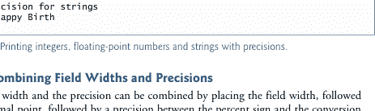

图 9.9 | 使用精度打印整数、浮点数和字符串。

### 9.8.3 结合字段宽度和精度

字段宽度和精度可以组合，方法是在百分号和转换说明符之间放置字段宽度，后跟小数点，再跟精度，如下面的语句所示：

```
printf("%9.3f", 123.456789);
```

它显示 123.457，小数点右边有三位数字，并在九位字段中右对齐。

```c
int main(void)
{
    puts("1234567890123456789012345678901234567890\n");
    printf("%10s%10d%10c%10f\n", "hello", 7, 'a', 1.23);
    printf("%-10s%-10d%-10c%-10f\n", "hello", 7, 'a', 1.23);
}
```

```
1234567890123456789012345678901234567890
     hello         7         a    1.230000
hello     7         a         1.230000
```

**图 9.11**  |  右对齐和左对齐值。（第 2 部分，共 2 部分。）

### 9.9.2 使用和不使用 + 标志打印正数和负数

图 9.12 打印一个正数和一个负数，每个都分别使用和不使用 + 标志。两种情况都显示减号，但只有在使用 + 标志时才显示加号。

```c
// 图 9.12：fig09_12.c
// 使用和不使用 + 标志打印正数和负数
#include <stdio.h>

int main(void)
{
    printf("%d\n%d\n", 786, -786);
    printf("%+d\n%+d\n", 786, -786);
}
```

```
786
-786
+786
-786
```

**图 9.12**  |  使用和不使用 + 标志打印正数和负数。

### 9.9.3 使用空格标志

图 9.13 使用空格标志为正数添加前导空格。这对于对齐位数相同的正数和负数非常有用。由于减号的存在，输出中的值 −547 前面没有空格。

```c
// 图 9.13：fig09_13.c
// 使用空格标志
// 前面没有 + 或 -
#include <stdio.h>
```

**图 9.13**  |  使用空格标志。（第 1 部分，共 2 部分。）

```c
int main(void)
{
    printf("% d\n% d\n", 547, -547);
}
```

547
-547

图 9.13 | 使用空格标志。（第 2 部分，共 2 部分。）

### 9.9.4 使用 # 标志

图 9.14 使用 # 标志为八进制值添加前缀 0，为十六进制值添加前缀 0x 和 0X，并强制在用 g 打印的值上显示小数点。

```c
// 图 9.14：fig09_14.c
// 将 # 标志与转换说明符
// o、x、X 以及任何浮点说明符一起使用
#include <stdio.h>

int main(void)
{
    int c = 1427; // 初始化 c
    printf("%#o\n", c);
    printf("%#x\n", c);
    printf("%#X\n", c);

    double p = 1427.0; // 初始化 p
    printf("%#f\n", p);
    printf("%#g\n", p);
}
```

02623
0x593
0X593

1427
1427.00

图 9.14 | 将 # 标志与转换说明符一起使用。

### 9.9.5 使用 0 标志

图 9.15 将 + 标志和 0（零）标志组合起来，在九位字段中打印 452，带 + 号并填充前导零，然后仅使用 0 标志和九位字段再次打印 452。

```c
// 图 9.15：fig09_15.c
// 使用 0（零）标志
#include <stdio.h>
```

图 9.15 | 使用 0（零）标志。（第 1 部分，共 2 部分。）

```
int main(void)
{
    printf("%+09d\n", 452);
    printf("%09d\n", 452);
}
```

```
+00000452
000000452
```

图 9.15 | 使用 0（零）标志。（第 2 部分，共 2 部分。）

## 9.10 打印字面量和转义序列

如您全书所见，格式控制字符串中包含的字面字符由 `printf` 直接输出。然而，有几个“问题”字符，例如界定格式控制字符串本身的引号（"）。各种控制字符（如换行符和制表符）必须用转义序列表示。转义序列由反斜杠（\）后跟特定的转义字符表示。图 9.16 列出了转义序列及其引起的动作。

| 转义序列 | 描述 |
|---|---|
| \'（单引号） | 输出单引号（'）字符。 |
| \"（双引号） | 输出双引号（"）字符。 |
| \?（问号） | 输出问号（?）字符。 |
| \\（反斜杠） | 输出反斜杠（\）字符。 |
| \a（警报或响铃） | 引起声音（响铃）或视觉警报（通常是闪烁程序正在运行的窗口）。 |
| \b（退格） | 将光标在当前行上向后移动一个位置。 |
| \f（换页或进纸） | 将光标移动到下一个逻辑页面的开头。 |
| \n（换行） | 将光标移动到下一行的开头。 |
| \r（回车） | 将光标移动到当前行的开头。 |
| \t（水平制表符） | 将光标移动到下一个水平制表位。 |
| \v（垂直制表符） | 将光标移动到下一个垂直制表位。 |

图 9.16 | 转义序列。

## 9.11 使用 scanf 读取格式化输入

使用 `scanf` 可以实现精确的输入格式设置。每个 `scanf` 语句都包含一个描述输入数据格式的格式控制字符串。该格式控制字符串由转换说明符和字面字符组成。函数 `scanf` 具有以下输入格式化功能：

- 1. 输入所有类型的数据。


- 2. 从输入流中输入特定字符。
- 3. 跳过输入流中的特定字符。

## 9.11.1 scanf 语法

函数 scanf 的书写形式如下：

```
scanf(format-control-string, other-arguments);
```

format-control-string 描述输入的格式，other-arguments 是指向变量的指针，输入的数据将存储在这些变量中。

> **良好编程实践 9.1**
> 输入数据时，每次提示用户输入一个或少数几个数据项。避免要求用户在单个提示下输入大量数据项。

> **良好编程实践 9.2**
> 始终考虑当（而非如果）输入了错误数据时，用户和你的程序将如何处理——例如，在程序上下文中无意义的整数值，或缺少标点或空格的字符串。

## 9.11.2 scanf 转换说明符

图 9.17 总结了用于输入所有类型数据的转换说明符。本节其余部分提供了演示如何通过各种 scanf 转换说明符读取数据的程序。请注意，d 和 i 转换说明符在 scanf 输入时具有不同的含义，而在 printf 输出时它们可以互换使用。

| 转换说明符 | 描述 |
|---|---|
| *整数* | |
| d | 读取一个可选带符号的十进制整数。对应的参数是一个指向 int 的指针。 |
| i | 读取一个可选带符号的十进制、八进制或十六进制整数。对应的参数是一个指向 int 的指针。 |
| o | 读取一个八进制整数。对应的参数是一个指向 unsigned int 的指针。 |
| u | 读取一个无符号十进制整数。对应的参数是一个指向 unsigned int 的指针。 |
| x 或 X | 读取一个十六进制整数。对应的参数是一个指向 unsigned int 的指针。 |
| h、l 和 ll | 放置在任何一个整数转换说明符之前，分别表示要输入 short、long 或 long long 整数。 |
| *浮点数* | |
| e、E、f、g 或 G | 读取一个浮点值。对应的参数是一个指向浮点变量的指针。 |
| `l` 或 `L` | 放置在任何一个浮点转换说明符之前，表示要输入 double 或 long double 值。对应的参数是一个指向 double 或 long double 变量的指针。 |
| *字符和字符串* | |
| `c` | 读取一个字符。对应的参数是一个指向 char 的指针；不添加空字符（`'\0'`）。 |
| `s` | 读取一个字符串。对应的参数是一个指向 char 类型数组的指针，该数组必须足够大以容纳字符串和自动添加的终止空字符（`'\0'`）。 |
| *扫描集* | |
| `[scan characters]` | 在输入流中扫描一个字符集合，并将其存储在数组中。 |
| *其他* | |
| `p` | 读取一个地址，其形式与在 `printf` 语句中使用 `%p` 输出地址时所产生的形式相同。 |
| `n` | 存储在本次 `scanf` 调用中到目前为止已输入的字符数。对应的参数必须是指向 int 的指针。 |
| `%` | 跳过输入中的百分号（`%`）。 |

**图 9.17** | scanf 的转换说明符。

## 9.11.3 使用 scanf 读取整数

图 9.18 使用各种整数转换说明符读取整数，并将这些整数以十进制数形式显示。转换说明符 `%i` 可以输入十进制、八进制和十六进制整数。

```c
// Fig. 9.18: fig09_18.c
// 使用整数转换说明符读取输入
#include <stdio.h>

int main(void)
{
   int a;
   int b;
   int c;
   int d;
   int e;
   int f;
   int g;

   puts("Enter seven integers: ");
   scanf("%i%i%i%i%i%i%i", &a, &b, &c, &d, &e, &f, &g);

   puts("\nThe input displayed as decimal integers is");
   printf("%d %d %d %d %d %d %d\n", a, b, c, d, e, f, g);
}
```

```
Enter seven integers:
-70 -70 070 0x70 70 70 70

The input displayed as decimal integers is:
-70 -70 56 112 56 70 112
```

**图 9.18** | 使用整数转换说明符读取输入。

## 9.11.4 使用 scanf 读取浮点数

输入浮点数时，可以使用浮点转换说明符 e、E、f、g 或 G 中的任意一个。图 9.19 读取三个浮点数，分别使用三种类型的浮点转换说明符，并使用转换说明符 f 显示所有三个数。

```c
// Fig. 9.19: fig09_19.c
// 使用浮点转换说明符读取输入
#include <stdio.h>

// 函数 main 开始程序执行
int main(void)
{
   double a;
   double b;
   double c;

   puts("Enter three floating-point numbers:");
   scanf("%le%lf%lg", &a, &b, &c);

   printf("\nHere are the numbers entered in plain:");
   puts("floating-point notation:\n");
   printf("%f\n%f\n%f\n", a, b, c);
}
```

```
Enter three floating-point numbers:
1.27987 1.27987e+03 3.38476e-06

Here are the numbers entered in plain floating-point notation:
1.279870
1279.870000
0.000003
```

**图 9.19** | 使用浮点转换说明符读取输入。

## 9.11.5 使用 scanf 读取字符和字符串

字符和字符串分别使用转换说明符 c 和 s 输入。图 9.20 提示用户输入一个字符串。程序使用 %c 输入字符串的第一个字符并将其存储在字符变量 x 中，然后使用 %s 输入字符串的其余部分并将其存储在字符数组 y 中。

```c
// Fig. 9.20: fig09_20.c
// 读取字符和字符串
#include <stdio.h>

int main(void)
{
    char x;
    char y[9];

    printf("%s", "Enter a string: ");
    scanf("%c%*s", &x, y);

    puts("The input was:\n");
    printf("the character \"%c\" and the string \"%s\"\n", x, y);
}
```

```
Enter a string: Sunday
The input was:
the character "S" and the string "unday"
```

**图 9.20** | 读取字符和字符串。

## 9.11.6 在 scanf 中使用扫描集

可以使用扫描集输入一个字符序列。扫描集是用方括号 [] 括起来的一组字符，并且在格式控制字符串中由百分号引导。扫描集扫描输入流中的字符时，只寻找与扫描集中包含的字符相匹配的字符。每当一个字符匹配时，它就被存储在扫描集对应的参数中——即指向字符数组的指针。当遇到一个不在扫描集中的字符时，扫描集停止输入字符。如果输入流中的第一个字符与扫描集中的字符不匹配，则数组不会被修改。图 9.21 使用扫描集 [aeiou] 扫描输入流中的元音。请注意，输入的前七个字母被读取。第八个字母（h）不在扫描集中，因此扫描终止。

```c
// Fig. 9.21: fig09_21.c
// 使用扫描集
#include <stdio.h>

// 函数 main 开始程序执行
int main(void)
{
    char z[9]; // 定义数组 z

    printf("%s", "Enter a string: ");
    scanf("%[aeiou]", z); // 搜索字符集合

    printf("The input was \"%s\"\n", z);
}
```

```
Enter a string: oeeooahah
The input was "oeeooa"
```

**图 9.21** | 使用扫描集。

扫描集也可以通过使用反向扫描集来扫描不在扫描集中的字符。要创建反向扫描集，请在方括号内、扫描字符之前放置一个脱字符（^）。这将导致存储不出现在扫描集中的字符。当遇到包含在反向扫描集中的字符时，输入终止。图 9.22 使用反向扫描集 [^aeiou] 来搜索辅音——更准确地说是搜索“非元音”。

```c
// Fig. 9.22: fig09_22.c
// 使用反向扫描集
#include <stdio.h>

int main(void)
{
    char z[9];

    printf("%s", "Enter a string: ");
    scanf("%[^aeiou]", z); // 反向扫描集

    printf("The input was \"%s\"\n", z);
}
```

```
Enter a string: String
The input was "Str"
```

**图 9.22** | 使用反向扫描集。

## 9.11.7 在 scanf 中使用字段宽度

可以在 scanf 转换说明符中使用字段宽度来从输入流中读取特定数量的字符。图 9.23 输入一系列连续的数字，前两位作为两位数整数，其余数字作为另一个整数。

```c
// Fig. 9.23: fig09_23.c
// 使用字段宽度输入数据
#include <stdio.h>

int main(void)
{
```

**图 9.23** | 使用字段宽度输入数据。


```c
7    int x;
8    int y;

10   printf("%s", "Enter a six digit integer: ");
11   scanf("%2d%d", &x, &y);

13   printf("The integers input were %d and %d\n", x, y);
14 }
```

```
Enter a six digit integer: 123456
The integers input were 12 and 3456
```

**图 9.23** | 使用字段宽度输入数据。 (第 2 部分，共 2 部分。)

### 9.11.8 在输入流中跳过字符

通常有必要在输入流中 *跳过* 某些字符。例如，日期可以输入为

`11-10-1999`

每个日期中的数字都需要存储，但分隔数字的破折号可以丢弃。为消除不必要的字符，将它们包含在 `scanf` 的格式控制字符串中；空白字符，如空格、换行符和制表符，会跳过所有前导空白。例如，要丢弃输入中的破折号，使用以下语句

```c
scanf("%d-%d-%d", &month, &day, &year);
```

尽管此 `scanf` 确实消除了前述输入中的破折号，但日期也可能输入为

`10/11/1999`

在这种情况下，前面的 `scanf` 将 *不* 消除不必要的字符。因此，`scanf` 提供了赋值抑制字符 `*`。该字符使 `scanf` 能够从输入中读取任何类型的数据并丢弃它，而不将其分配给变量。图 9.24 使用赋值抑制字符在 `%*c` 转换说明符中，以指示应读取并丢弃输入流中出现的字符。只有月份、日期和年份被存储。变量的值被打印出来，以证明 `%*c` 转换说明符实际上可以正确输入。每个 `scanf` 调用的参数列表不包含使用赋值抑制字符的转换说明符的变量。相应的字符 simply *丢弃*。

```c
1  // Fig. 9.24: Fig09_24.c
2  // Reading and discarding characters from the input stream
3  #include <stdio.h>
4
5  int main(void)
6  {
7      int month = 0;
8      int day = 0;
9      int year = 0;
10     printf("%s", "Enter a date in the form mm-dd-yyyy: ");
11     scanf("%d%*c%d%*c%d", &month, &day, &year);
12     printf("month = %d day = %d year = %d\n", month, day, year);
13
14     printf("%s", "Enter a date in the form mm/dd/yyyy: ");
15     scanf("%d%*c%d%*c%d", &month, &day, &year);
16     printf("month = %d day = %d year = %d\n", month, day, year);
17 }
```

```
Enter a date in the form mm-dd-yyyy: 11-18-2012
month = 11 day = 18 year = 2012

Enter a date in the form mm/dd/yyyy: 11/18/2012
month = 11 day = 18 year = 2012
```

**图 9.24** | 从输入流中读取并丢弃字符。 (第 2 部分，共 2 部分。)

## 9.12 安全的 C 编程

C 标准列出了许多使用不正确的库函数参数可能导致未定义行为的情况。这些可能导致安全漏洞，因此应避免。 当使用 `printf`（或其任何变体，如 `sprintf`、`fprintf`、`printf_s` 等）并带有格式不当的转换说明时，就可能出现此类问题。CERT 规则 FIO00-C (www.securecoding.cert.org) 讨论了这些问题，并提供了一张表格，显示可用于形成转换说明的格式标志、长度修饰符和转换说明符字符的有效组合。表格还显示了每个有效转换说明的正确参数类型。一般来说，在学习任何编程语言时，如果语言规范说做某事可能导致未定义行为，请避免这样做以防止安全漏洞。

## 总结

### 第 9.2 节 流

- 所有输入和输出都是通过流 (p. 410) 执行的，流是字节序列。
- 通常，标准输入流连接到键盘，标准输出和错误流连接到计算机屏幕 (p. 410)。
- 操作系统通常允许将标准输入和标准输出流重定向到其他设备。

### 第 9.3 节 使用 printf 格式化输出

- `0` 标志 (p. 421) 为未占据其整个字段宽度的值打印前导零。

### 第 9.10 节 打印字面量和转义序列

在 `printf` 语句中要打印的大多数字面字符可以直接包含在格式控制字符串中。然而，有几个“问题”字符，例如定界格式控制字符串本身的引号 (`"`, p. 422)。各种控制字符，如换行符和制表符，必须用转义序列表示。转义序列由反斜杠 (`\`) 表示，后跟特定的转义字符。

### 第 9.11 节 使用 scanf 读取格式化输入

- 输入格式化是通过 `scanf` 库函数完成的。
- 整数使用 `scanf` 输入，转换说明符为 `d` 和 `i` (p. 424) 用于可选符号整数，以及 `o`、`u`、`x` 或 `X` 用于无符号整数。修饰符 `h`、`l` 和 `ll` 置于整数转换说明符之前，分别用于输入 short、long 和 long long 整数。
- 浮点值使用 `scanf` 输入，转换说明符为 `e`、`E`、`f`、`g` 或 `G`。修饰符 `l` 和 `L` 置于浮点转换说明符之前，以指示输入值是 `double` 或 `long double` 值。
- 字符使用 `scanf` 输入，转换说明符为 `c` (p. 426)。
- 字符串使用 `scanf` 输入，转换说明符为 `s` (p. 426)。
- 使用扫描集的 `scanf` (p. 426) 扫描输入中的字符，仅查找与扫描集中包含的字符匹配的字符。当匹配字符时，它被存储在字符数组中。扫描集在遇到扫描集中不包含的字符时停止输入字符。
- 要创建反向扫描集 (p. 427)，在方括号中在扫描字符之前放置一个插入号 (`^`)。这会导致使用 `scanf` 输入且未出现在扫描集中的字符被存储，直到遇到包含在反向扫描集中的字符。
- 地址值使用 `scanf` 输入，转换说明符为 `p`。
- 转换说明符 `n` 存储当前 `scanf` 中迄今为止输入的字符数。相应的参数是指向 `int` 的指针。
- 赋值抑制字符 (`*`, p. 428) 从输入流读取数据并丢弃数据。
- `scanf` 中使用字段宽度来从输入流读取特定数量的字符。

## 自我复习练习

### 9.1 填空以下各题：

- a) 所有输入和输出都是以 _______ 的形式处理的。
- b) _______ 流通常连接到键盘。
- c) _______ 流通常连接到计算机屏幕。
- d) 精确输出格式化是通过 _______ 函数完成的。
- e) 格式控制字符串可能包含 _______、_______、_______、_______ 和 _______。
- f) 转换说明符 _______ 或 _______ 可用于输出有符号十进制整数。
- g) 转换说明符 _______、_______ 和 _______ 分别用于以八进制、十进制和十六进制形式显示无符号整数。
- h) 修饰符 _______ 和 _______ 置于整数转换说明符之前，以指示应显示 short 或 long 整数值。
- i) 转换说明符 ______ 用于以指数记数法显示浮点值。
- j) 修饰符 ______ 置于任何浮点转换说明符之前，以指示应显示 long double 值。
- k) 转换说明符 `e`、`E` 和 `f` 如果未指定精度，则以 ______ 位精度显示小数点右侧的数字。
- l) 转换说明符 ______ 和 ______ 分别用于打印字符串和字符。
- m) 所有字符串都以 ______ 字符结尾。
- n) `printf` 转换说明符中的字段宽度和精度可以通过用一个(n) ______ 替代字段宽度或精度，并在参数列表的相应参数中放置整数表达式来使用整数表达式控制。
- o) ______ 标志导致输出在字段中左对齐。
- p) ______ 标志导致值以加号或减号显示。
- q) 精确输入格式化是通过 ______ 函数完成的。
- r) 一个(n) ______ 用于扫描特定字符并将字符存储在数组中。
- s) 转换说明符 ______ 可用于输入可选符号的八进制、十进制和十六进制整数。
- t) 转换说明符 ______ 可用于输入 double 值。
- u) ______ 用于从输入流读取数据并丢弃它而不将其分配给变量。
- v) 一个(n) ______ 可用于 `scanf` 转换说明符中，以指示应从输入流读取特定数量的字符或数字。

### 9.2 找出以下每项中的错误并说明如何纠正。

- a) 以下语句应打印字符 `'e'`。

  ```c
  printf("%s\n", 'c');
  ```

- b) 以下语句应打印 `9.375%`。

  ```c
  printf("% .3f%", 9.375);
  ```

- c) 以下语句应打印字符串 "Monday" 的第一个字符。

  ```c
  printf("%c\n", "Monday");
  ```

- d) `puts("A string in quotes");`
- e) `printf("%6d%12", 20);`
- f) `printf("\%c", '*');`
- g) `printf("%s\n", 'Richard');`

### 9.3 为以下每项编写一条语句：

- a) 以 10 位数字字段右对齐打印 1234。
- b) 以指数记数法打印 123.456789，并带符号（+ 或 -）和 3 位精度。
- c) 将 double 值读入变量 `number`。
- d) 以八进制形式打印 100，并在前面加上 0。
- e) 将字符串读入字符数组 `string`。
- f) 将字符读入数组 `n`，直到遇到非数字字符。
- g) 使用整数变量 `x` 和 `y` 指定用于显示 double 值 87.4573 的字段宽度和精度。
- h) 读取形式为 `3.5%` 的值。将百分比存储在 float 变量 `percent` 中，并从输入流中消除 `%`。不要使用赋值抑制字符。
- i) 以 20 个字符的字段和 3 的精度打印 3.333333 作为 long double 值，并带符号（+ 或 -）。


## 自评练习答案

9.1 a) 流。 b) 标准输入。 c) 标准输出。 d) printf。 e) 转换说明符、标志、字段宽度、精度、字面字符。 f) d, i, g, o, u, x,（或 X）。 g) h, l, ll。 h) e（或 E）。 i) L。 j) G。 k) s, c。 l) NULL ('\0')。 m) 星号 (*)。 n) -（减号）。 o) +（加号）。 p) scanf。 q) 扫描集。 r) i。 s) l, L？ t) le, LE, lf, lg 或 lG。 u) 赋值抑制字符 (*)。 v) 字段宽度。

9.2 a) 错误：转换说明符 s 期望 char 指针类型的参数。更正：要打印字符 'c'，请使用转换说明符 %c 或将 'c' 改为 "c"。 b) 错误：尝试在不使用转换说明符 % 的情况下打印字面字符 %。更正：使用 %% 来打印字面 % 字符。 c) 错误：转换说明符 c 期望 char 类型的参数。更正：要打印 "Monday" 的第一个字符，请使用转换说明符 %1s。 d) 错误：尝试在不使用 \" 转义序列的情况下打印字面字符 "。更正：将内部引号集中的每个引号替换为 \"。 e) 错误：格式控制字符串未用双引号括起来。更正：将 %d%d 用双引号括起来。 f) 错误：字符 x 被双引号括起来。更正：用 %c 打印的字符常量必须用单引号括起来。 g) 错误：要打印的字符串被单引号括起来。更正：使用双引号而不是单引号来表示字符串。

```
9.3
a) printf("%10d\n", 1234);
b) printf("%+.3e\n", 123.456789);
c) scanf("%f", &number);
d) printf("%#o\n", 100);
e) scanf("%s", string);
f) scanf("%[0123456789]", n);
g) printf("%f\n%f\n%f", x, y, 87.4573);
h) scanf("%f%*f", &percent);
i) printf("%+20.3Lf\n", 3.333333);
```

## 练习

9.4 为以下每项编写一个 printf 或 scanf 语句： a) 在 15 位字段中左对齐打印无符号整数 40000，宽度为 8 位数字。 b) 将十六进制值读入变量 hex。 c) 有符号和无符号打印 200。 d) 以十六进制形式打印 100，前缀为 0x。 e) 读取字符到数组 s，直到遇到字母 p。 f) 在 9 位字段中打印 1.234，前导为零。 g) 读取形如 hh:mm:ss 的时间，将时间各部分存储在整数变量 hour、minute 和 second 中。在输入流中跳过冒号 (:)。使用赋值抑制字符。 h) 从标准输入读取形如 "characters" 的字符串。将字符串存储在字符数组 s 中。从输入流中消除引号。 i) 读取形如 hh:mm:ss 的时间，将时间各部分存储在整数变量 hour、minute 和 second 中。在输入流中跳过冒号 (:)。不要使用赋值抑制字符。

9.5 显示以下每个语句的打印内容。如果语句不正确，请说明原因。

- a) `printf("%-10d\n", 10000);`
- b) `printf("%s\n", "This is a string");`
- c) `printf("%.9f\n", 8, 3, 1024.987654);`
- d) `printf("%#o\n%#X\n%#e\n", 17, 17, 1008.83689);`
- e) `printf("% ld\n%+ld\n", 1000000, 1000000);`
- f) `printf("%10.2E\n", 444.93738);`
- g) `printf("%10.2g\n", 444.93738);`
- h) `printf("%d\n", 10.987);`

**9.6** 查找以下每个程序段中的错误（错误）。说明如何纠正每个错误。

- a) `printf("%s\n", 'Happy Birthday');`
- b) `printf("%s\n", 'Hello');`
- c) `printf("%s\n", "This is a string");`
- d) 下列语句应打印 "Bon Voyage":
  `printf("%s\n", 'Bon Voyage');`
- e) `char day[] = "Sunday";`
  `printf("%s\n", day[3]);`
- f) `puts("Enter your name: ");`
- g) `printf("%f", 123.456);`
- h) 下列语句应打印字符 'O' 和 'K':
  `printf("%s\n", 'O', 'K');`
- i) `char s[10];`
  `scanf("%s", s[7]);`

**9.7** *（%d 与 %i 之间的差异）* 编写一个程序来测试在使用 scanf 语句时 %d 和 %i 转换说明符之间的差异。提示用户输入由空格分隔的两个整数。使用语句

```
    scanf("%d%i", &x, &y);
    printf("%d %d\n", x, y);
```

来输入和打印值。使用以下输入数据集合测试程序：

|   |   |
|---|---|
| 10 | 10 |
| -10 | -10 |
| 010 | 010 |
| 0x10 | 0x10 |

**9.8** *（在各种字段宽度中打印数字）* 编写一个程序来测试打印整数值 12345 和浮点值 1.2345 在各种大小字段中的结果。当值在包含的位数少于值的字段中打印时会发生什么？

**9.9** *（舍入浮点数）* 编写一个程序，打印值 100.453627 四舍五入到最接近的数字、小数点后第一位、第二位、第三位和第四位。

**9.10** *（温度转换）* 编写一个程序，将 0 到 212 度之间的整数华氏温度转换为具有 3 位精度的浮点摄氏温度。使用公式执行计算

```
    celsius = 5.0 / 9.0 * (fahrenheit - 32);
```

输出应以每个 10 个字符的两个右对齐列打印，并且摄氏温度应对正值和负值都加上符号。

9.11 （转义序列）编写一个程序来测试转义序列 '\'、'\''、'\?'、'\a'、'\b'、'\n'、'\r' 和 '\t'。对于移动光标的转义序列，在打印转义序列之前和之后打印一个字符，以便清楚地显示光标已移动。

9.12 （打印问号）编写一个程序来确定是否可以将 ? 作为 printf 格式控制字符串的一部分作为字面字符打印，而不是使用 \? 转义序列。

9.13 （使用每个 scanf 转换说明符读取整数）编写一个程序，使用 scanf 整数转换说明符中的每一个输入值 437。使用所有整数转换说明符打印每个输入值。

9.14 （使用浮点转换说明符输出数字）编写一个程序，使用转换说明符 e、f 和 g 中的每一个输入值 1.2345。打印每个变量的值，以证明每个转换都可用于输入相同的值。

9.15 （在引号中读取字符串）在某些编程语言中，字符串在单引号或双引号包围的情况下输入。编写一个程序，读取三个字符串 suzy、"suzy" 和 'suzy'。单引号和双引号是否被 C 忽略或作为字符串的一部分读取？

9.16 （作为字符常量打印问号）编写一个程序来确定是否可以使用转换说明符 %c 在 printf 语句的格式控制字符串中将 ? 作为字符常量 '?' 打印，而不是字符常量转义序列 '\?'。

9.17 （使用各种精度使用 %g）编写一个程序，使用转换说明符 g 输出值 9876.12345。以 1 到 9 的精度范围打印该值。

## 10

## C 结构体、联合体、位操作和枚举

### 目标

在本章中，您将：

- 创建和使用 `structs`、`unions` 和 `enums`。
- 理解自引用 `structs`。
- 了解可在 `struct` 实例上执行的操作。
- 初始化 `struct` 成员。
- 访问 `struct` 成员。
- 按值和按引用将 `struct` 实例传递给函数。
- 使用 `typedefs` 为现有类型名创建别名。
- 了解可在 `unions` 上执行的操作。
- 初始化 `unions`。
- 使用按位运算符操作整数数据。
- 创建位字段以紧凑地存储数据。
- 使用 `enum` 常量。
- 考虑使用 `structs`、位操作和 `enums` 的安全问题。

### 章节大纲

- **10.1** 引言
- **10.2** 结构体定义
  - 10.2.1 自引用结构体
  - 10.2.2 定义结构体类型变量
  - 10.2.3 结构体标签名
  - 10.2.4 可对结构体执行的操作
- **10.3** 初始化结构体
- **10.4** 使用 `.` 和 `->` 访问结构体成员
- **10.5** 使用结构体与函数
- **10.6** `typedef`
- **10.7** 示例：高性能洗牌和发牌模拟
- **10.8** 联合体
  - 10.8.1 联合体声明
  - 10.8.2 可对联合体执行的操作
  - 10.8.3 在声明中初始化联合体
  - 10.8.4 演示联合体
- **10.9** 按位运算符
  - 10.9.1 以位形式显示无符号整数
  - 10.9.2 使函数显示更通用和可移植
  - 10.9.3 使用按位 AND、包含 OR、异或和补码运算符
  - 10.9.4 使用按位左移和右移运算符
  - 10.9.5 按位赋值运算符
- **10.10** 位字段
  - 10.10.1 定义位字段
  - 10.10.2 使用位字段表示牌的面值、花色和颜色
  - 10.10.3 未命名位字段
- **10.11** 枚举常量
- **10.12** 匿名结构体和联合体
- **10.13** 安全 C 编程

*摘要 | 自评练习 | 自评练习答案 | 练习 | 做出改变*

## 10.1 引言

结构体——有时在 C 标准中称为聚合——是在一个名称下相关变量的集合。结构体可能包含许多不同数据类型的大量不同变量——与数组形成对比，数组仅包含相同数据类型的元素。结构体通常用于定义要存储在文件中的记录（参见第 11 章）。指针和结构体促进了链表、队列、栈和树等更复杂数据结构的形成（参见第 12 章）。我们还将讨论：

- `typedef`s——用于为先前定义的数据类型创建别名。
- unions——类似于结构体，但成员共享相同的存储空间。
- 按位运算符——用于操作整数操作数的位。
- 位字段——结构体或联合体的 unsigned int 或 int 成员，您为其指定成员存储的位数，有助于紧密打包信息。
- 枚举——由标识符表示的整数常量集合。

## 10.2 结构体定义

结构体是派生数据类型——它们使用其他类型对象构造。考虑以下结构体定义：

```
struct card {
    char *face;
    char *suit;
};
```


## 10.2 结构定义

关键字 struct 引入结构定义。标识符 card 是结构标签，它命名结构定义并与 struct 一起用于声明结构类型变量——例如 struct card。结构定义大括号内声明的变量是结构成员。同一结构类型的成员必须具有唯一名称，但两个不同的结构类型可以包含同名成员而不会冲突（我们很快就会看到原因）。每个结构定义必须以分号结束。

> **常见编程错误 10.1**
>
> 忘记终止结构定义的分号是语法错误。

struct card 的定义包含成员 face 和 suit，每个成员的类型都是 char *。结构成员可以是原始数据类型的变量（例如 int、float 等），或聚合类型，如数组和其他结构。如我们在第 6 章所见，数组的每个元素必须为同一类型。然而，结构成员可以是不同类型。例如，下面的 struct 包含员工名字和姓氏的字符数组成员、员工年龄的 unsigned int 成员、包含员工性别 ‘M’ 或 ‘F’ 的 char 成员以及员工时薪的 double 成员：

```c
struct employee {
    char firstName[20];
    char lastName[20];
    unsigned int age;
    char gender;
    double hourlySalary;
};
```

### 10.2.1 自引用结构

不能在同一 struct 类型的定义中声明该 struct 类型的变量。然而，可以包含指向该 struct 类型的指针。例如，在 struct employee2：

```c
struct employee2 {
    char firstName[20];
    char lastName[20];
    unsigned int age;
    char gender;
    double hourlySalary;
    struct employee2 teamLeader; // ERROR
    struct employee2 *teamLeaderPtr; // pointer
};
```

它本身的实例（teamLeader）是错误的。因为 teamLeaderPtr 是一个指针（指向类型 struct employee2），所以在定义中是允许的。包含指向同一结构类型的指针成员的结构被称为自引用结构。自引用结构在第 12 章中使用，用于构建链表数据结构。

> **常见编程错误 10.2**
>
> 结构不能包含它自身的实例。

### 10.2.2 定义结构类型的变量

结构定义不会在内存中保留任何空间；相反，每个定义创建一个新的数据类型，用于定义变量——就像构建该 struct 实例的蓝图。结构变量的定义方式与其他类型的变量相同。定义

```c
struct card aCard, deck[52], *cardPtr;
```

声明 aCard 为 struct card 类型的变量，声明 deck 为包含 52 个 struct card 类型元素的数组，并声明 cardPtr 为指向 struct card 的指针。在前述语句之后，我们为名为 aCard 的一个 struct card 对象、deck 数组中的 52 个 struct card 对象以及一个未初始化的 struct card 类型指针保留了内存。给定结构类型的变量也可以通过在结构定义的闭合大括号与结束结构定义的分号之间放置以逗号分隔的变量名列表来声明。例如，前述定义本可以合并到 struct card 定义中，如下所示：

```c
struct card {
    char *face;
    char *suit;
} aCard, deck[52], *cardPtr;
```

### 10.2.3 结构标签名

结构标签名是可选的。如果结构定义不包含结构标签名，则结构类型的变量只能在结构定义中声明——不能在单独的声明中声明。

> **良好编程实践 10.1**
>
> *创建结构类型时始终提供结构标签名。结构标签名对于在程序后面声明该结构类型的新变量是必需的。*

### 10.2.4 可以对结构执行的操作

可以对结构执行的有效操作只有：

- 将 struct 变量赋给 *相同* 类型的 struct 变量（参见第 10.7 节）——对于指针成员，这仅复制指针中存储的地址。
- 获取 struct 变量的地址（&）（参见第 10.4 节）。
- 访问 struct 变量的成员（参见第 10.4 节）。
- 使用 sizeof 运算符确定 struct 变量的大小。

> **常见编程错误 10.3**
>
> *将一种类型的结构赋给另一种类型的结构是编译错误。*

结构不能使用运算符 == 和 != 进行比较，因为结构成员不一定存储在内存的连续字节中。有时结构中存在“空洞”，因为计算机可能仅在某些内存边界上存储特定数据类型，例如半字、字或双字边界。字是计算机中用于存储数据的内存单元——通常为 4 字节或 8 字节。考虑以下结构定义，其中声明了类型为 struct example 的 sample1 和 sample2：

```c
struct example {
    char c;
    int i;
} sample1, sample2;
```

具有 4 字节字的计算机可能要求 struct example 的每个成员都对齐到字边界，即字的开头——这取决于机器。图 10.1 显示了类型为 struct example 的变量的示例存储对齐，该变量被赋值为字符 'a' 和整数 97（值的位表示已显示）。如果成员从字边界开始存储，则类型为 struct example 的变量的存储中存在一个三字节空洞（图中字节 1–3）。三字节空洞中的值未定义。即使 sample1 和 sample2 的成员值实际上相等，结构也不一定相等，因为未定义的三字节空洞不太可能包含相同的值。

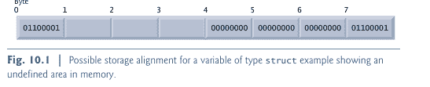

> **可移植性提示 10.1**
>
> 由于特定类型数据项的大小取决于机器，并且存储对齐考虑取决于机器，因此结构表示也取决于机器。

## 10.3 初始化结构

结构可以使用初始化列表进行初始化，如同数组一样。要初始化结构，请在定义中的变量名后跟等号和用大括号括起来的、以逗号分隔的初始化列表。例如，声明

```c
struct card aCard = { "Three", "Hearts" };
```

创建变量 aCard 使其为类型 struct card（在第 10.2 节中定义）并将成员 face 初始化为 "Three"，将成员 suit 初始化为 "Hearts"。如果列表中的初始化项少于结构中的成员，则剩余成员自动初始化为 0（如果成员是指针则为 NULL）。在函数定义外部（即外部）定义的 结构变量如果在外部定义中未显式初始化，则初始化为 0 或 NULL。结构变量也可以在赋值语句中通过赋相同类型的结构变量，或通过为结构的各个成员赋值来进行初始化。

## 10.4 使用 . 和 -> 访问结构成员

访问结构成员使用两个运算符：结构成员运算符（.）——也称为点运算符——以及结构指针运算符（->）——也称为箭头运算符。结构成员运算符通过结构变量名访问结构成员。例如，要打印第 10.3 节中定义的 aCard 结构变量的成员 suit，请使用语句

```c
printf("%s", aCard.suit);  // displays Hearts
```

结构指针运算符——由减号（-）和大于号（>）组成，中间没有空格——通过指向结构的指针访问结构成员。假设指针 cardPtr 已声明为指向 struct card，并且结构 aCard 的地址已赋给 cardPtr。要使用指针 cardPtr 打印结构 aCard 的成员 suit，请使用语句

```c
printf("%s", cardPtr->suit);  // displays Hearts
```

表达式 cardPtr->suit 等价于 (*cardPtr).suit，它取消引用指针并使用结构成员运算符访问成员 suit。这里需要括号，因为结构成员运算符（.）的优先级高于指针取消引用运算符（*）。结构指针运算符和结构成员运算符，连同用于调用函数的括号和用于数组索引的方括号 []，具有最高的运算符优先级，并从左到右结合。

> **良好编程实践 10.2**
>
> *不要在 -> 和 . 运算符周围放置空格。省略空格有助于强调运算符所包含的表达式本质上是单个变量名。*

> **常见编程错误 10.4**
>
> *在结构指针运算符的 - 和 > 组成部分之间插入空格，或在除 ?: 之外的任何其他多键击运算符的组成部分之间插入空格，是语法错误。*

> **常见编程错误 10.5**
>
> *尝试仅使用成员名引用结构成员是语法错误。*

> **常见编程错误 10.6**
>
> *在引用使用指针和结构成员运算符的结构成员时未使用括号（例如 `*cardPtr.suit`）是语法错误。为防止此问题请改用箭头（->）运算符。*

图 10.2 的程序演示了结构成员运算符和结构指针运算符的使用。使用结构成员运算符，结构 aCard 的成员分别被赋值为 "Ace" 和 "Spades"（第 17 行和第 18 行）。指针 cardPtr 被赋值为结构 aCard 的地址（第 20 行）。函数 printf 使用变量名 aCard 的结构成员运算符、指针 cardPtr 的结构指针运算符以及取消引用指针 cardPtr 的结构成员运算符打印结构变量 aCard 的成员（第 22–24 行）。

```c
1  // Fig. 10.2: fig10_02.c
2  // Structure member operator and
3  // Structure pointer operator
```

**图 10.2** | 结构成员运算符和结构指针运算符。（第 1 部分，共 2 部分。）


```c
#include <stdio.h>

// card structure definition
struct card {
    char *face; // define pointer face
    char *suit; // define pointer suit
};

int main(void)
{
    struct card aCard; // define one struct card variable

    // place strings into aCard
    aCard.face = "Ace";
    aCard.suit = "Spades";

    struct card *cardPtr = &aCard; // assign address of aCard to cardPtr

    printf("%s%s%s\n%s%s%s\n%s%s%s\n", aCard.face, " of ", aCard.suit,
        cardPtr->face, " of ", cardPtr->suit,
        (*cardPtr).face, " of ", (*cardPtr).suit);
}
```

```text
Ace of Spades
Ace of Spades
Ace of Spades
```

图 10.2 | 结构成员运算符和结构指针运算符。（第 2 部分，共 2 部分。）

## 10.5 将结构与函数一起使用

结构可以通过以下方式传递给函数：

- 传递单个结构成员。
- 传递整个结构。
- 传递指向结构的指针。

当结构或单个结构成员传递给函数时，它们按值传递。因此，被调用函数不能修改调用方结构的成员。要按引用传递结构，请传递结构变量的地址。结构数组——像所有其他数组一样——会自动按引用传递。

在第 6 章中，我们说过可以使用结构按值传递数组。为此，创建一个以该数组为成员的结构。结构按值传递，因此数组也按值传递。

> **常见编程错误 10.7**
>
> 假设结构像数组一样自动按引用传递，并试图在被调用函数中修改调用方的结构值，这是一种逻辑错误。

> **性能提示 10.1**
>
> 按引用传递结构比按值传递结构更高效（按值传递需要复制整个结构）。

## 10.6 typedef

关键字 typedef 提供了一种为先前定义的数据类型创建同义词（或别名）的机制。结构类型的名称通常用 typedef 定义，以创建更短的类型名。例如，语句

```c
typedef struct card Card;
```

将新类型名 Card 定义为类型 struct card 的同义词。C 程序员经常使用 typedef 定义结构类型，因此不需要结构标记。例如，下面的定义

```c
typedef struct {
    char *face;
    char *suit;
} Card;
```

创建结构类型 Card，而无需单独的 typedef 语句。


> **良好编程实践 10.3**
>
> *将 typedef 名称的首字母大写，以强调它们是其他类型名的同义词。*

现在可以使用 Card 声明 struct card 类型的变量。声明

```c
Card deck[52];
```

声明一个包含 52 个 Card 结构的数组（即 struct card 类型的变量）。用 typedef 创建新名称并不会创建新类型；typedef 只是创建一个新的类型名，可用作现有类型名的别名。有意义的名称有助于使程序具有自文档性。例如，当我们读到前面的声明时，就知道“deck 是一个包含 52 张牌的数组”。

通常，typedef 用于为基本数据类型创建同义词。例如，一个需要四字节整数的程序可能在一个系统上使用 int 类型，在另一个系统上使用 long 类型。为可移植性而设计的程序经常使用 typedef 为四字节整数创建别名，例如 Integer。只需在程序中更改一次别名 Integer，就能让程序在两个系统上工作。


> **可移植性提示 10.2**
>
> *使用 typedef 有助于使程序更具可移植性。*


> **良好编程实践 10.4**
>
> *使用 typedef 有助于使程序更具可读性和可维护性。*

## 10.7 示例：高性能纸牌洗牌和发牌模拟

图 10.3 中的程序基于第 7 章讨论的纸牌洗牌和发牌模拟。该程序将一副纸牌表示为结构数组，并使用高性能洗牌和发牌算法。程序输出如图 10.4 所示。

```c
// Fig. 10.3: fig10_03.c
// Card shuffling and dealing program using structures
#include <stdio.h>
#include <stdlib.h>
#include <time.h>

#define CARDS 52
#define FACES 13

// card structure definition
struct card {
    const char *face; // define pointer face
    const char *suit; // define pointer suit
};

typedef struct card Card; // new type name for struct card

// prototypes
void fillDeck(Card * const wDeck, const char * wFace[],
    const char * wSuit[]);
void shuffle(Card * const wDeck);
void deal(const Card * const wDeck);

int main(void)
{
    Card deck[CARDS]; // define array of Cards

    // initialize array of pointers
    const char *face[] = { "Ace", "Deuce", "Three", "Four", "Five",
        "Six", "Seven", "Eight", "Nine", "Ten",
        "Jack", "Queen", "King" };

    // initialize array of pointers
    const char *suit[] = { "Hearts", "Diamonds", "Clubs", "Spades" };

    srand(time(NULL)); // randomize

    fillDeck(deck, face, suit); // load the deck with Cards
    shuffle(deck); // put Cards in random order
    deal(deck); // deal all 52 Cards
}

// place strings into Card structures
void fillDeck(Card * const wDeck, const char * wFace[],
    const char * wSuit[])
{
    // loop through wDeck
    for (size_t i = 0; i < CARDS; ++i) {
        wDeck[i].face = wFace[i % FACES];
        wDeck[i].suit = wSuit[i / FACES];
    }
}

// shuffle cards
void shuffle(Card * const wDeck)
{
    // loop through wDeck randomly swapping Cards
    for (size_t i = 0; i < CARDS; ++i) {
        size_t j = rand() % CARDS;
        Card temp = wDeck[i];
        wDeck[i] = wDeck[j];
        wDeck[j] = temp;
    }
}

// deal cards
void deal(const Card * const wDeck)
{
    // loop through wDeck
    for (size_t i = 0; i < CARDS; ++i) {
        printf("%s of %-8s%s", wDeck[i].face, wDeck[i].suit,
            (i + 1) % 4 ? "  " : "\n");
    }
}
```

图 10.3 | 使用结构进行纸牌洗牌和发牌的程序。（第 1 和第 2 部分，共 2 部分。）

```text
Three of Hearts    Jack of Clubs    Three of Spades    Six of Diamonds
Five of Hearts    Eight of Spades    Three of Clubs    Deuce of Spades
Jack of Spades    Four of Hearts    Deuce of Hearts    Six of Clubs
Queen of Clubs    Three of Diamonds    Eight of Diamonds    King of Clubs
King of Hearts    Eight of Hearts    Queen of Hearts    Seven of Clubs
Seven of Diamonds    Nine of Spades    Five of Clubs    Eight of Clubs
Six of Hearts    Deuce of Diamonds    Five of Spades    Four of Clubs
Deuce of Clubs    Nine of Hearts    Seven of Hearts    Four of Spades
Ten of Spades    King of Diamonds    Ten of Hearts    Jack of Diamonds
Four of Diamonds    Six of Spades    Five of Diamonds    Ace of Diamonds
Ace of Clubs    Jack of Hearts    Ten of Clubs    Queen of Diamonds
Ace of Hearts    Ten of Diamonds    Nine of Clubs    King of Spades
Ace of Spades    Nine of Diamonds    Seven of Spades    Queen of Spades
```

图 10.4 | 高性能纸牌洗牌和发牌模拟的输出。

在该程序中，函数 fillDeck（第 44—52 行）按顺序用每种花色的“Ace”到“King”初始化 Card 数组。Card 数组（在第 39 行）被传递给函数 shuffle（第 55—64 行），高性能洗牌算法在该函数中实现。函数 shuffle 接受一个包含 52 张牌的数组作为参数。该函数遍历这 52 张牌（第 58—63 行）。对于每张牌，随机选取一个 0 到 51 之间的数。接着，在数组中交换当前牌与随机选中的牌（第 60—62 行）。在对整个数组的一趟遍历中总共进行 52 次交换，牌数组就被洗好了！该算法不会像

第7章介绍的洗牌算法。由于牌是在数组中就地交换的，函数 *deal*（第67–74行）中实现的高性能发牌算法只需*一次*遍历数组即可发出洗好的牌。

> **常见编程错误 10.8**
> *在引用结构体数组中的单个结构体时忘记包含数组下标，属于语法错误。*

### Fisher-Yates 洗牌算法

建议在真实纸牌游戏中使用所谓的*无偏*洗牌算法。这种算法确保所有可能的洗牌后牌序出现的概率相等。练习10.18要求你研究流行的无偏 Fisher-Yates 洗牌算法，并用它重新实现图10.3中 DeckOfCards 的方法 *shuffle*。

## 10.8 联合体

与结构体类似，联合体也是一种*派生数据类型*，但其成员*共享同一存储空间*。在程序的不同情形中，有些变量可能并不相关，而另一些变量则相关——因此联合体*共享*空间，而不是把存储浪费在未使用的变量上。联合体的成员可以是*任何*数据类型。用于存储联合体的字节数至少必须足以容纳*最大*的成员。大多数情况下，联合体包含两种或更多数据类型。同一时间只能引用一个成员，因而只能引用一种数据类型。你有责任确保使用正确的数据类型来引用联合体中的数据。

> **常见编程错误 10.9**
> *使用错误类型的变量引用联合体中的数据，属于逻辑错误。*

> **可移植性提示 10.3**
> *如果将数据以某种类型存储在联合体中，又以另一种类型引用它，则结果取决于具体实现。*

### 10.8.1 联合体声明

联合体定义与结构体定义的格式相同。联合体定义

```c
union number {
    int x;
    double y;
};
```

表明 *number* 是一个联合体类型，其成员为 `int x` 和 `double y`。联合体定义通常放在头文件中，并包含在所有使用该联合体类型的源文件中。

> **软件工程观察 10.1**
> *与结构体定义一样，联合体定义只是创建一种新类型。将联合体或 struct 定义放在任何函数之外并不会创建全局变量。*

### 10.8.2 可对联合体执行的操作

可对联合体执行的操作包括：

- 将联合体赋值给同一类型的另一个联合体。
- 获取联合体变量的地址（&）。
- 使用结构体成员运算符和结构体指针运算符访问联合体成员。

联合体不能使用运算符 == 和 != 进行比较，原因与结构体不能比较相同。

### 10.8.3 在声明中初始化联合体

在声明中，可以用与第一个联合体成员相同类型的值来初始化联合体。例如，对于 10.8.1 节中的联合体，语句

```c
union number value = { 10 };
```

是对联合体变量 value 的有效初始化，因为该联合体是用 int 初始化的；但下面的声明会截断初始化值的浮点部分（有些编译器会对此发出警告）：

```c
union number value = { 1.43 };
```

> **可移植性提示 10.4**
> 存储联合体所需的存储量取决于具体实现，但始终至少与联合体中最大成员一样大。

> **可移植性提示 10.5**
> 有些联合体可能不容易在计算机系统之间移植。联合体是否可移植，通常取决于给定系统上联合体成员数据类型的存储对齐要求。

### 10.8.4 演示联合体

图10.5中的程序使用类型为 union number（第6–9行）的变量 value（第13行），将联合体中存储的值分别以 int 和 double 显示。程序输出取决于具体实现。程序输出表明，double 值的内部表示可能与 int 的表示差别很大。

```c
1  // Fig. 10.5: fig10_05.c
2  // Displaying the value of a union in both member data types
3  #include <stdio.h>
4
5  // number union definition
6  union number {
7      int x;
8      double y;
9  };
```

**图 10.5** | 以两种成员数据类型显示联合体的值。（第 1 部分，共 2 部分。）

两个操作数中对应的位为 1。*按位包含 OR 运算符*在两个操作数中对应位之一（或两者）为 1 时，将结果中的对应位设置为 1。*按位异或运算符*在每个操作数中对应位不同时，将结果中的对应位设置为 1。*左移运算符*将其左操作数的位向左移动其右操作数指定的位数。*右移运算符*将其左操作数中的位向右移动其右操作数指定的位数。*按位求补运算符*将其操作数中所有为 0 的位在结果中设置为 1，并将所有为 1 的位在结果中设置为 0——这通常称为*翻转*位。后续示例详细讨论每个按位运算符。图10.6总结了按位运算符。

| 运算符 | 描述 |
|---|---|
| `&` 按位与 | 逐位比较其两个操作数。如果两个操作数中的对应位均为 1，则结果中的对应位设置为 1。 |
| `\|` 按位包含 OR | 逐位比较其两个操作数。如果两个操作数中对应位至少有一个为 1，则结果中的对应位设置为 1。 |
| `^` 按位异或（也称为按位 XOR） | 逐位比较其两个操作数。如果两个操作数中的对应位不同，则结果中的对应位设置为 1。 |
| `<<` 左移 | 将第一个操作数的位向左移动第二个操作数指定的位数；从右侧填充 0 位。 |
| `>>` 右移 | 将第一个操作数的位向右移动第二个操作数指定的位数；当左操作数为负数时，从左侧填充的方法取决于机器。 |
| `~` 求补 | 所有 0 位设置为 1，所有 1 位设置为 0。 |

**图 10.6** | 按位运算符。

本节中按位运算符的讨论展示了整数操作数的二进制表示。关于二进制（也称为基 2）数制的详细解释，请参见附录 C。由于按位操作具有依赖于机器的特性，这些程序在你的系统上可能无法正确运行，或者运行结果可能不同。

### 10.9.1 以位形式显示无符号整数

使用按位运算符时，以二进制形式显示值有助于展示这些运算符的精确效果。图10.7中的程序以二进制表示形式打印一个 unsigned int，为提高可读性，每八位分为一组。对于本节中的示例，我们假设一种实现，其中 unsigned int 存储在 4 字节（32 位）内存中。

```c
// Fig. 10.7: fig10_07.c
// Displaying an unsigned int in bits
#include <stdio.h>
```

**图 10.7** | 以位形式显示无符号整数。（第 1 部分，共 2 部分。）

```c
void displayBits(unsigned int value); // prototype

int main(void)
{
    unsigned int x; // variable to hold user input

    printf("%s", "Enter a nonnegative int: ");
    scanf("%u", &x);

    displayBits(x);
}

// display bits of an unsigned int value
void displayBits(unsigned int value)
{
    // define displayMask and left shift 31 bits
    unsigned int displayMask = 1 << 31;

    printf("%10u = ", value);

    // loop through bits
    for (unsigned int c = 1; c <= 32; ++c) {
        putchar(value & displayMask ? '1' : '0');
        value <<= 1; // shift value left by 1

        if (c % 8 == 0) { // output space after 8 bits
            putchar(' ');
        }
    }

    putchar('\n');
}
```

```text
Enter a nonnegative int: 65000
     65000 = 00000000 00000000 11111101 11101000
```

**图 10.7** | 以位形式显示无符号整数。（第 2 部分，共 2 部分。）

函数 `displayBits`（第18–36行）使用按位与运算符将变量 `value` 与变量 `displayMask`（第27行）组合。按位与运算符常与一个称为掩码的操作数一起使用——掩码是一个整数值，其中特定位置为 1。掩码用于*隐藏*值中的某些位，同时*选择*其他位。在函数 `displayBits` 中，掩码变量 `displayMask` 被赋值为

`1 << 31` `(10000000 00000000 00000000 00000000)`

左移运算符将值 1 从 `displayMask` 中的低位（最右位）移到高位（最左位），并从右侧填充 0 位。第27行

```c
putchar(value & displayMask ? '1' : '0');
```


确定是否应为变量 value 的当前最左位打印 1 或 0。当 value 和 displayMask 使用 & 组合时，变量 value 中除最高位之外的所有位都被“屏蔽”（隐藏），因为任何位“ANDed”与 0 的结果都是 0。如果最左位为 1，则 value & displayMask 的计算结果为非零（真）值并打印 1——否则，打印 0。变量 value 然后通过表达式 value <<= 1 左移一位（这等价于 value = value << 1）。这些步骤对 unsigned 变量 value 中的每一位重复执行。图 10.8 总结了使用按位 AND 运算符组合两个位的结果。

### 常见编程错误 10.10

使用逻辑 AND 运算符（&&）代替按位 AND 运算符（&）——反之亦然——是错误。

| 位 1 | 位 2 | 位 1 & 位 2 |
|---|---|---|
| 0 | 0 | 0 |
| 0 | 1 | 0 |
| 1 | 0 | 0 |
| 1 | 1 | 1 |

图 10.8 | 使用按位 AND 运算符 & 组合两个位的结果。

## 10.9.2 使函数 displayBits 更通用和可移植

在图 10.7 的第 21 行，我们将整数 31 硬编码为指示值 1 应左移到变量 displayMask 中的最左位。同样，在第 26 行，我们将整数 32 硬编码为指示循环应迭代 32 次——对变量 value 中的每一位一次。我们假设 unsigned int 总是以 32 位（四个字节）的内存存储。今天流行的计算机通常使用 32 位或 64 位字硬件架构。作为 C 程序员，你往往需要在多种硬件架构上工作，有时 unsigned int 会以更少或更多数量的位存储。

### 可移植性提示 10.7

图 10.7 可以通过用基于程序执行平台上 unsigned int 大小来计算这些整数的表达式替换整数 31（第 21 行）和 32（第 26 行）而变得更通用和可移植。符号常量 CHAR_BIT（在 `<limits.h>` 中定义）表示一个字节中的位数（通常为 8）。请回忆 sizeof 确定存储对象或类型所用的字节数。表达式 sizeof(unsigned int) 对 32 位 unsigned int 求值为 4，对 64 位 unsigned int 求值为 8。你可以用 CHAR_BIT * sizeof(unsigned int) - 1 替换 31，并用 CHAR_BIT * sizeof(unsigned int) 替换 32。对于 32 位 unsigned int，这些表达式分别求值为 31 和 32。对于 64 位 unsigned int，它们求值为 63 和 64。

## 10.9.3 使用按位 AND、包含 OR、异或和补码运算符

图 10.9 演示了按位 AND 运算符、按位包含 OR 运算符、按位异或运算符和按位补码运算符的使用。该程序使用函数 displayBits（第 46–64 行）打印 unsigned int 值。输出显示在图 10.10 中。

```c
// Fig. 10.9: fig10_09.c
// Using the bitwise AND, bitwise inclusive OR, bitwise
// exclusive OR and bitwise complement operators
#include <stdio.h>

void displayBits(unsigned int value); // prototype

int main(void)
{
    // demonstrate bitwise AND (&)
    unsigned int number1 = 65535;
    unsigned int mask = 1;
    puts("The result of combining the following");
    displayBits(number1);
    displayBits(mask);
    puts("using the bitwise AND operator & is");
    displayBits(number1 & mask);

    // demonstrate bitwise inclusive OR (|)
    number1 = 15;
    unsigned int setBits = 241;
    puts("\nThe result of combining the following");
    displayBits(number1);
    displayBits(setBits);
    puts("using the bitwise inclusive OR operator | is");
    displayBits(number1 | setBits);

    // demonstrate bitwise exclusive OR (^)
    number1 = 139;
    unsigned int number2 = 199;
    puts("\nThe result of combining the following");
    displayBits(number1);
    displayBits(number2);
    puts("using the bitwise exclusive OR operator ^ is");
    displayBits(number1 ^ number2);

    // demonstrate bitwise complement (~)
    number1 = 21845;
    puts("\nThe one's complement of");
    displayBits(number1);
    puts("is");
    displayBits(~number1);
}
```

图 10.9 | 使用按位 AND、按位包含 OR、按位异或和按位补码运算符。（第 1 部分，共 2 部分。）

```c
// display bits of an unsigned int value
void displayBits(unsigned int value)
{
    // declare displayMask and left shift 31 bits
    unsigned int displayMask = 1 << 31;

    printf("%10u = ", value);

    // loop through bits
    for (unsigned int c = 1; c <= 32; ++c) {
        putchar(value & displayMask ? '1' : '0');
        value <<= 1; // shift value left by 1

        if (c % 8 == 0) { // output a space after 8 bits
            putchar(' ');
        }
    }

    putchar('\n');
}
```

图 10.9 | 使用按位 AND、按位包含 OR、按位异或和按位补码运算符。（第 2 部分，共 2 部分。）

```text
The result of combining the following
65535 = 00000000 00000000 11111111 11111111
1 = 00000000 00000000 00000000 00000001
using the bitwise AND operator & is
1 = 00000000 00000000 00000000 00000001

The result of combining the following
15 = 00000000 00000000 00000000 00001111
241 = 00000000 00000000 00000000 11110001
using the bitwise inclusive OR operator | is
255 = 00000000 00000000 00000000 11111111

The result of combining the following
139 = 00000000 00000000 00000000 10001011
199 = 00000000 00000000 00000000 11000111
using the bitwise exclusive OR operator ^ is
76 = 00000000 00000000 00000000 01001100

The one's complement of
21845 = 00000000 00000000 01010101 01010101
is
4294945450 = 11111111 11111111 10101010 10101010
```

图 10.10 | 图 10.9 程序的输出。

### 按位 AND 运算符 (&)

在图 10.9 中，整数变量 number1 在第 11 行被赋值为 65535（00000000 00000000 11111111 11111111），变量 mask 在第 12 行被赋值为 1（00000000 00000000 00000000 00000001）。当 number1 和 mask 使用按位 AND 运算符（&）在表达式 number1 & mask（第 17 行）中组合时，结果为 00000000 00000000 00000000 00000001。变量 number1 中除低位之外的所有位都通过与变量 mask 进行“AND”操作而被“屏蔽”（隐藏）。

### 按位包含 OR 运算符 (|)

按位包含 OR 运算符（|）用于将操作数中的特定位设置为 1。在图 10.9 中，变量 number1 在第 20 行被赋值为 15（00000000 00000000 00000000 00001111），变量 setBits 在第 21 行被赋值为 241（00000000 00000000 00000000 11110001）。当 number1 和 setBits 使用按位包含 OR 运算符在表达式 number1 | setBits（第 26 行）中组合时，结果为 255（00000000 00000000 00000000 11111111）。图 10.11 总结了使用按位包含 OR 运算符组合两个位的结果。

| 位 1 | 位 2 | 位 1 | 位 2 |
|---|---|---|---|
| 0 | 0 | 0 |
| 0 | 1 | 1 |
| 1 | 0 | 1 |
| 1 | 1 | 1 |

图 10.11 | 使用按位包含 OR 运算符 | 组合两个位的结果。

### 按位异或运算符 (^)

按位异或运算符（^）将结果中的每个位设置为 1，如果其两个操作数中对应的位恰好有一个为 1。在图 10.9 中，变量 number1 和 number2 在第 29–30 行被赋值为 139（00000000 00000000 00000000 10001011）和 199（00000000 00000000 00000000 11000111）。当这些变量使用按位异或运算符在表达式 number1 ^ number2（第 35 行）中组合时，结果为 00000000 00000000 00000000 01001100。图 10.12 总结了使用按位异或运算符组合两个位的结果。

| 位 1 | 位 2 | 位 1 ^ 位 2 |
|---|---|---|
| 0 | 0 | 0 |
| 0 | 1 | 1 |
| 1 | 0 | 1 |
| 1 | 1 | 0 |

图 10.12 | 使用按位异或运算符 ^ 组合两个位的结果。

### 按位补码运算符 (~)

按位补码运算符（~）将操作数中的所有 1 位在结果中设置为 0，并将所有 0 位设置为 1——否则称为“取 one's complement”


“值。”在图 10.9 中，变量 `number1` 在第 38 行被赋值为 21845（00000000 00000000 01010101 01010101）。当计算表达式 `~number1`（第 42 行）时，结果为 11111111 11111111 10101010 10101010。

### 10.9.4 使用按位左移和右移运算符

图 10.13 的程序演示了*左移运算符*（`<<`）和*右移运算符*（`>>`）。函数 `displayBits` 用于打印 `unsigned int` 值。

```c
// Fig. 10.13: fig10_13.c
// Using the bitwise shift operators
#include <stdio.h>

void displayBits(unsigned int value); // prototype

int main(void)
{
    unsigned int number1 = 960; // initialize number1

    // demonstrate bitwise left shift
    puts("\nThe result of left shifting");
    displayBits(number1);
    puts("8 bit positions using the left shift operator << is");
    displayBits(number1 << 8);

    // demonstrate bitwise right shift
    puts("\nThe result of right shifting");
    displayBits(number1);
    puts("8 bit positions using the right shift operator >> is");
    displayBits(number1 >> 8);
}

// display bits of an unsigned int value
void displayBits(unsigned int value)
{
    // declare displayMask and left shift 31 bits
    unsigned int displayMask = 1 << 31;

    printf("%7u = ", value);

    // loop through bits
    for (unsigned int c = 1; c <= 32; ++c) {
        putchar(value & displayMask ? '1' : '0');
        value <<= 1; // shift value left by 1

        if (c % 8 == 0) { // output a space after 8 bits
            putchar(' ');
        }
    }

    putchar('\n');
}
```

**图 10.13** | 使用按位移位运算符。（第 1 部分，共 2 部分。）

```text
The result of left shifting
960 = 00000000 00000000 00000011 11000000
8 bit positions using the left shift operator << is
245760 = 00000000 00000011 11000000 00000000
The result of right shifting
960 = 00000000 00000000 00000011 11000000
8 bit positions using the right shift operator >> is
3 = 00000000 00000000 00000000 00000011
```

**图 10.13** | 使用按位移位运算符。（第 2 部分，共 2 部分。）

### 左移运算符（<<）

左移运算符（<<）将左操作数的位向左移动右操作数指定的位数。右侧空出的位用 0 填充；从左侧移出的位丢失。在图 10.13 中，变量 `number1` 被赋值为 960（第 9 行中为 00000000 00000000 00000011 11000000）。在表达式 `number1 << 8`（第 15 行）中将变量 `number1` 左移 8 位的结果为 245760（00000000 00000011 11000000 00000000）。

### 右移运算符（>>）

右移运算符（>>）将左操作数的位向右移动右操作数指定的位数。对 `unsigned int` 执行右移会使左侧空出的位用 0 替换；从右侧移出的位丢失。在图 10.13 中，表达式 `number1 >> 8`（第 21 行）中右移 `number1` 的结果为 3（00000000 00000000 00000000 00000011）。

> **常见编程错误 10.11**
> *如果右操作数为负，或右操作数大于存储左操作数所用的位数，则对值进行右移或左移的结果是未定义的。*

> **可移植性提示 10.8**
> *对负数进行右移的结果由实现定义。*

### 10.9.5 按位赋值运算符

每个二元按位运算符都有一个对应的赋值运算符。这些按位赋值运算符如图 10.14 所示，其用法类似于第 3 章介绍的算术赋值运算符。

**按位赋值运算符**

| 运算符 | 描述 |
|---|---|
| &= | 按位与赋值运算符。 |
| \|= | 按位包含或赋值运算符。 |
| ^= | 按位异或赋值运算符。 |
| <<= | 左移赋值运算符。 |
| >>= | 右移赋值运算符。 |

**图 10.14** | 按位赋值运算符。

图 10.15 显示了本文到目前为止介绍的各种运算符的优先级和结合性。它们按优先级从高到低从上到下排列。

| 运算符 | 结合性 | 类型 |
|---|---|---|
| () [] . -> ++（后缀） --（后缀） | 从左到右 | 最高 |
| + - ++ -- ! & * ~ sizeof（类型） | 从右到左 | 一元 |
| * / % | 从左到右 | 乘法 |
| + - | 从左到右 | 加法 |
| << >> | 从左到右 | 移位 |
| < <= > >= | 从左到右 | 关系 |
| == != | 从左到右 | 相等 |
| & | 从左到右 | 按位与 |
| ^ | 从左到右 | 按位异或 |
| \| | 从左到右 | 按位或 |
| && | 从左到右 | 逻辑与 |
| \|\| | 从左到右 | 逻辑或 |
| ?: | 从右到左 | 条件 |
| = += -= *= /= &= \|= ^= <<= >>= %= | 从右到左 | 赋值 |
| , | 从左到右 | 逗号 |

**图 10.15** | 运算符优先级和结合性。

## 10.10 位字段

C 语言允许指定结构或联合的无符号或有符号整型成员存储时使用的位数。这称为位字段。位字段通过以所需的最少位数存储数据来实现更好的内存利用率。位字段成员必须声明为 `int` 或 `unsigned int`。

### 10.10.1 定义位字段

考虑以下结构体定义：

```c
struct bitCard {
    unsigned int face : 4;
    unsigned int suit : 2;
    unsigned int color : 1;
};
```

其中包含三个 `unsigned int` 位字段——`face`、`suit` 和 `color`——用于表示一副 52 张牌中的一张牌。位字段的声明方式是在无符号或有符号整型成员名后跟一个冒号（`:`）以及一个表示字段宽度的整型常量（即存储该成员所用的位数）。表示宽度的常量必须是 0（将在 10.10.3 节讨论）到系统上用于存储 `int` 的总位数之间的整数（含端点）。我们的示例是在使用 4 字节（32 位）整数的计算机上测试的。

前面的结构体定义表明，成员 `face` 存储在 4 位中，成员 `suit` 存储在 2 位中，成员 `color` 存储在 1 位中。位数基于每个结构体成员所需的值范围。成员 `face` 存储从 0（A）到 12（K）的值——4 位可以存储 0–15 范围内的值。成员 `suit` 存储从 0 到 3 的值（0 = 红心，1 = 方块，2 = 梅花，3 = 黑桃）——2 位可以存储 0–3 范围内的值。最后，成员 `color` 存储 0（红色）或 1（黑色）——1 位可以存储 0 或 1。

### 10.10.2 使用位字段表示牌面、花色和颜色

图 10.16（输出如图 10.17 所示）在第 20 行创建了包含 52 个 `struct bitCard` 结构的数组 `deck`。函数 `fillDeck`（第 31–39 行）将 52 张牌插入 `deck` 数组，函数 `deal`（第 43–55 行）打印这 52 张牌。注意，结构体的位字段成员的访问方式与任何其他结构体成员完全相同。包含成员 `color` 是为了在支持彩色显示的系统上指示牌的颜色。

```c
1 // Fig. 10.16: fig10_16.c
2 // Representing cards with bit fields in a struct
3 #include <stdio.h>
4 #define CARDS 52
5
6 // bitCard structure definition with bit fields
7 struct bitCard {
8     unsigned int face : 4; // 4 bits; 0-15
9     unsigned int suit : 2; // 2 bits; 0-3
10    unsigned int color : 1; // 1 bit; 0-1
11 };
12
13 typedef struct bitCard Card; // new type name for struct bitCard
14
15 void fillDeck(Card * const wDeck); // prototype
16 void deal(const Card * const wDeck); // prototype
17
18 int main(void)
19 {
20     Card deck[CARDS]; // create array of Cards
21
22     fillDeck(deck);
23
24     puts("Card values 0-12 correspond to Ace through King");
25     puts("Suit values 0-3 correspond to Hearts, Diamonds, Clubs and Spades");
26     puts("Color values 0-1 correspond to red and black\n");
27     deal(deck);
28 }
29
30 // initialize Cards
31 void fillDeck(Card * const wDeck)
32 {
33     // loop through wDeck
34     for (size_t i = 0; i < CARDS; ++i) {
35         wDeck[i].face = i % (CARDS / 4);
```


```c
wDeck[i].suit = i / (CARDS / 4);
wDeck[i].color = i / (CARDS / 2);
}

// output cards in two-column format; cards 0-25 indexed with
// k1 (column 1); cards 26-51 indexed with k2 (column 2)
void deal(const Card * const wDeck)
{
    printf("%-6s%-6s%-15s%-6s%-6s\n", "Card", "Suit", "Color",
           "Card", "Suit", "Color");

    // loop through wDeck
    for (size_t k1 = 0, k2 = k1 + 26; k1 < CARDS / 2; ++k1, ++k2) {
        printf("Card:%3d  Suit:%2d  Color:%2d\n",
               wDeck[k1].face, wDeck[k1].suit, wDeck[k1].color);
        printf("Card:%3d  Suit:%2d  Color:%2d\n",
               wDeck[k2].face, wDeck[k2].suit, wDeck[k2].color);
    }
```

图 10.16 | 用结构体中的位字段表示纸牌。（第 2 部分，共 2 部分。）

牌面值 0–12 分别对应 A 到 K。花色值 0–3 分别对应红桃、方块、梅花和黑桃。颜色值 0–1 分别对应红色和黑色。

| 牌面 | 花色 | 颜色 | 牌面 | 花色 | 颜色 |
|---:|---:|---:|---:|---:|---:|
| 0 | 0 | 0 | 0 | 2 | 1 |
| 1 | 0 | 0 | 1 | 2 | 1 |
| 2 | 0 | 0 | 2 | 2 | 1 |
| 3 | 0 | 0 | 3 | 2 | 1 |
| 4 | 0 | 0 | 4 | 2 | 1 |
| 5 | 0 | 0 | 5 | 2 | 1 |
| 6 | 0 | 0 | 6 | 2 | 1 |
| 7 | 0 | 0 | 7 | 2 | 1 |
| 8 | 0 | 0 | 8 | 2 | 1 |
| 9 | 0 | 0 | 9 | 2 | 1 |
| 10 | 0 | 0 | 10 | 2 | 1 |
| 11 | 0 | 0 | 11 | 2 | 1 |
| 12 | 0 | 0 | 12 | 2 | 1 |
| 0 | 1 | 0 | 0 | 3 | 1 |
| 1 | 1 | 0 | 1 | 3 | 1 |
| 2 | 1 | 0 | 2 | 3 | 1 |
| 3 | 1 | 0 | 3 | 3 | 1 |
| 4 | 1 | 0 | 4 | 3 | 1 |
| 5 | 1 | 0 | 5 | 3 | 1 |
| 6 | 1 | 0 | 6 | 3 | 1 |
| 7 | 1 | 0 | 7 | 3 | 1 |
| 8 | 1 | 0 | 8 | 3 | 1 |
| 9 | 1 | 0 | 9 | 3 | 1 |
| 10 | 1 | 0 | 10 | 3 | 1 |
| 11 | 1 | 0 | 11 | 3 | 1 |
| 12 | 1 | 0 | 12 | 3 | 1 |

图 10.17 | 图 10.16 中程序的输出。

```c
enum months {
   JAN, FEB, MAR, APR, MAY, JUN, JUL, AUG, SEP, OCT, NOV, DEC
};
```

这会创建一个新类型 `enum months`，其中各*标识符*分别被设置为整数 0 到 11。若要将月份编号为 1 到 12，请使用：

```c
enum months {
   JAN = 1, FEB, MAR, APR, MAY, JUN, JUL, AUG, SEP, OCT, NOV, DEC
};
```

由于前一个枚举中的第一个值被显式设置为 1，其余值从 1 开始递增，最终得到值 1 到 12。在同一作用域内可访问的任何枚举中的*标识符*都*必须唯一*。枚举的每个枚举常量的值都可以在定义中通过给标识符赋值来显式设置。一个枚举的多个成员*可以具有相同的常量值*。在图 10.18 的程序中，枚举变量 *month* 用于 *for* 语句，从数组 *monthName* 中打印一年中的各个月份。我们已将 *monthName[0]* 设为空字符串 `""`。你可以将 *monthName[0]* 设置为诸如 `***ERROR***` 之类的值，以表示发生了逻辑错误。

> **常见编程错误 10.14**
> 在枚举常量定义之后再给它赋值是一种语法错误。

> **良好编程实践 10.5**
> 枚举常量名中只使用大写字母。这能使这些常量在程序中更加醒目，并提醒你枚举常量不是变量。

```c
1  // Fig. 10.18: fig10_18.c
2  // Using an enumeration
3  #include <stdio.h>
4
5  // enumeration constants represent months of the year
6  enum months {
7      JAN = 1, FEB, MAR, APR, MAY, JUN, JUL, AUG, SEP, OCT, NOV, DEC
8  };
9
10 int main(void)
11 {
12     // initialize array of pointers
13     const char *monthName[] = { "", "January", "February", "March",
14        "April", "May", "June", "July", "August", "September", "October",
15        "November", "December" };
16
17     // loop through months
18     for (enum months month = JAN; month <= DEC; ++month) {
19         printf("%2d%s\n", month, monthName[month]);
20     }
21 }
```

**图 10.18** | 使用枚举。（第 1 部分，共 2 部分。）

```text
1  January
2  February
3  March
4  April
5  May
6  June
7  July
8  August
9  September
10 October
11 November
12 December
```

图 10.18 | 使用枚举。（第 2 部分，共 2 部分。）

## 10.12 匿名结构体和联合体

本章前面介绍了结构体和联合体。C11 现在支持匿名结构体和联合体，它们可以嵌套在具名结构体和联合体中。嵌套的匿名结构体或联合体中的成员被视为外层结构体或联合体的成员，并且可以通过外层类型的对象直接访问。例如，考虑以下结构体声明：

```c
struct MyStruct {
    int member1;
    int member2;
    struct {
        int nestedMember1;
        int nestedMember2;
    }; // end nested struct
}; // end outer struct
```

对于类型为 struct MyStruct 的变量 myStruct，可以按如下方式访问其成员：

```c
myStruct.member1;
myStruct.member2;
myStruct.nestedMember1;
myStruct.nestedMember2;
```

## 10.13 安全的 C 编程

本章主题涉及多项 CERT 指南和规则。有关各项的更多信息，请访问 www.securecoding.cert.org。

### 关于结构体的 CERT 指南

正如我们在 10.2.4 节中讨论的，结构体成员的边界对齐要求可能会导致你创建的每个结构体变量中都出现包含未定义数据的额外字节。以下每条指南都与该问题相关：

- **EXP03-C：** 由于边界对齐要求，结构体变量的大小不一定是其各成员大小之和。应始终使用 sizeof 来确定结构体变量中的字节数。正如你将看到的，我们使用这种技术来处理第 11 章中写入文件和从文件读取的定长记录，并在第 12 章中创建所谓的动态数据结构。
- **EXP04-C：** 正如我们在 10.2.4 节中讨论的，不能对结构体变量进行相等或不相等比较，因为它们可能包含未定义数据的字节。因此，必须比较它们各自的成员。
- **DCL39-C：** 在结构体变量中，未定义的额外字节可能包含安全数据——这些数据是那些内存位置先前使用后遗留的——不应被访问。该 CERT 指南讨论了用于打包数据以消除这些额外字节的编译器特定机制。

### 关于 typedef 的 CERT 指南

- **DCL05-C：** 复杂类型声明（例如函数指针的声明）可能难以阅读。应使用 typedef 创建自文档化的类型名，使程序更具可读性。

### 关于位操作的 CERT 指南

- **INT02-C：** 由于整数提升规则（在 5.6 节中讨论），对小于 int 的整数类型执行按位操作可能会导致意外结果。需要显式强制转换以确保结果正确。
- **INT13-C：** 对有符号整数类型的某些按位操作是实现定义的——这意味着这些操作在不同的 C 编译器中可能产生不同的结果。因此，按位运算符应使用无符号整数类型。
- **EXP46-C：** 逻辑运算符 && 和 || 经常分别与按位运算符 & 和 | 混淆。在条件表达式（?:）的条件中使用 & 和 | 可能会导致意外行为，因为 & 和 | 运算符不会短路求值。

### 关于 enum 的 CERT 指南

- **INT09-C：** 允许多个枚举常量具有相同的值可能会导致难以发现的逻辑错误。在大多数情况下，一个 enum 的枚举常量应各自具有唯一值，以帮助防止此类逻辑错误。

## 小结

### 10.1 节 引言

- **结构体**（第 437 页）是相关变量以同一个名称组成的集合。它们可以包含许多不同数据类型的变量。
- 结构体通常用于定义要存储在文件中的记录。
- 指针和结构体有助于形成更复杂的数据结构，如链表、队列、栈和树。

### 10.2 节 结构体定义

- 关键字 **struct** 引入结构体定义（第 438 页）。


- 关键字 struct 后面的标识符是结构标记（第438页），它为结构定义命名。结构标记与关键字 struct 一起用于声明该结构类型的变量（第438页）。
- 在结构定义的花括号内声明的变量是结构的成员。
- 同一结构类型的成员必须具有唯一的名称。
- 每个结构定义必须以分号结尾。
- 结构成员可以具有基本数据类型或聚合数据类型。
- 结构不能包含自身的实例，但可以包含指向其类型的指针。
- 包含指向同一结构类型指针成员的结构称为自引用结构。自引用结构（第438页）用于构建链式数据结构。
- 结构定义创建用于定义变量的新数据类型。
- 给定结构类型的变量可以通过在结构定义的右花括号与其结束分号之间放置以逗号分隔的变量名列表来声明。
- 结构标记名是可选的。如果结构定义不包含结构标记名，则结构类型的变量只能在该结构定义中声明。
- 可对结构执行的唯一有效操作是：将结构变量赋给相同类型的变量、取结构变量的地址（&）、访问结构变量的成员，以及使用 sizeof 运算符确定结构变量的大小。

## 10.3 初始化结构
- 结构可以使用初始化列表进行初始化。
- 如果列表中的初始化器少于结构中的成员，则其余成员自动初始化为0（如果成员是指针，则初始化为 NULL）。
- 在函数定义之外定义的结构变量，如果未在外部定义中显式初始化，则其成员初始化为0或 NULL。
- 结构变量可以在赋值语句中通过赋予相同类型的结构变量，或通过为结构的各个成员赋值来初始化。

## 10.4 使用 . 和 -> 访问结构成员
- 结构成员运算符（.）和结构指针运算符（->）用于访问结构成员（第440页）。
- 结构成员运算符通过结构变量名访问结构成员。
- 结构指针运算符通过指向结构的指针访问结构成员（第441页）。

## 10.5 将结构与函数一起使用
- 可以通过传递单个结构成员、传递整个结构或传递指向结构的指针，将结构传递给函数。
- 结构变量默认按值传递。
- 要按引用传递结构，请传递其地址。结构数组——像所有其他数组一样——会自动按引用传递。
- 要按值传递数组，请创建一个以该数组为成员的结构。结构按值传递，因此该数组也按值传递。

## 10.6 typedef
- 关键字 typedef（第443页）提供了一种为先前定义的类型创建同义词的机制。
- 结构类型的名称通常使用 `typedef` 定义，以创建更短的类型名。
- 通常，`typedef` 用于为基本数据类型创建同义词。例如，需要4字节整数的程序可能在一个系统上使用 `int` 类型，在另一个系统上使用 `long` 类型。为可移植性设计的程序通常使用 `typedef` 为4字节整数创建别名，例如 `Integer`。别名 `Integer` 可以在程序中更改一次，使程序在两个系统上都能工作。

## 10.8 联合
- `union`（第446页）使用关键字 `union` 声明，其格式与结构相同。其成员共享同一存储空间。
- `union` 的成员可以是任何数据类型。存储 `union` 所用的字节数必须至少足以容纳最大的成员。
- 一次只能引用 `union` 的一个成员。您有责任确保使用正确的数据类型引用联合中的数据。
- 可对联合执行的操作包括：将一个联合赋给另一个相同类型的联合、取联合变量的地址（&），以及使用结构成员运算符和结构指针运算符访问联合成员。
- 可以在声明中使用与第一个联合成员相同类型的值来初始化联合。

## 10.9 按位运算符
- 计算机在内部将所有数据表示为值为0或1的位序列。
- 在大多数系统上，8位序列构成一个**字节**——`char` 类型变量的标准存储单元。其他数据类型以更多字节存储。
- 按位运算符用于操作整型操作数（`char`、`short`、`int` 和 `long`；包括有符号和无符号）的位。通常使用无符号整数。
- 按位运算符（第449页）包括按位与（`&`）、按位或（`|`）、按位异或（`^`）、左移（`<<`）、右移（`>>`）和按位求补（`~`）。
- 按位与、按位或和按位异或运算符逐位比较其两个操作数。如果两个操作数中的对应位均为1，则**按位与运算符**（第449页）将结果中的每一位设置为1。如果任一（或两个）操作数中的对应位为1，则**按位或运算符**（第449页）将结果中的每一位设置为1。如果两个操作数中的对应位不同，则**按位异或运算符**（第449页）将结果中的每一位设置为1。
- **左移运算符**（第449页）将左操作数的位向左移动右操作数指定的位数。右侧空出的位用0填充；从左侧移出的位丢失。
- **右移运算符**（第449页）将左操作数中的位向右移动右操作数指定的位数。对无符号 int 执行右移会使左侧空出的位用0替换；从右侧移出的位丢失。
- **按位求补运算符**（第449页）将其操作数中的所有0位设置为1，并将结果中的所有1位设置为0。
- 按位与运算符通常与一个称为**掩码**（第450页）的操作数一起使用——这是一个特定位置为1的整数值。掩码用于隐藏值中的某些位，同时选择其他位。
- 符号常量 `CHAR_BIT`（第451页；定义于 `<limits.h>` 中）表示一个字节中的位数（通常为8）。它可用于使位操作程序更通用、更可移植。
- 每个二元按位运算符都有一个对应的**按位赋值运算符**（第456页）。

## 10.10 位域
- C 允许您指定位域中用于存储结构或联合的无符号或有符号整型成员的位数。这称为**位域**（第457页）。位域通过以所需的最少位数存储数据，实现更好的内存利用率。
- 位域的声明方式是在无符号 `int` 或 `int` 成员名（第457页）后跟一个冒号（`:`）和一个表示该位域宽度的整数常量（第457页）。该常量必须是0到系统上用于存储 `int` 的总位数之间的整数（含端点）。
- 结构的位域成员完全像任何其他结构成员一样访问。
- 可以指定一个**无名位域**（第460页）用作结构中的**填充**（第460页）。
- 宽度为零的**无名位域**（第460页）会将下一个位域对齐到新的存储单元边界。

## 10.11 枚举常量
- `enum` 定义一组由标识符表示的整数常量（第460页）。除非另有指定，枚举中的值从0开始，并以1递增。
- 枚举中的标识符必须唯一。
- 枚举常量的值可以通过在枚举定义中赋值来显式设置。

## 自测练习
### 10.1 填写下列各题中的空白：
- a) ________ 是在一个名称下的一组相关变量。
- b) ________ 是在一个名称下的一组变量，其中这些变量共享同一存储空间。
- c) 在使用 ________ 运算符的表达式中，如果每个操作数中的对应位均为1，则结果中的位设置为1。否则，这些位设置为0。
- d) 在结构定义中声明的变量称为它的 ________。
- e) 在使用 ________ 运算符的表达式中，如果任一操作数中的对应位至少有一个为1，则位设置为1。否则，这些位设置为0。
- f) 关键字 ________ 引入结构声明。
- g) 关键字 ________ 用于为先前定义的数据类型创建同义词。
- h) 在使用 ________ 运算符的表达式中，如果任一操作数中的对应位恰好有一个为1，则位设置为1。否则，这些位设置为0。
- i) 按位与运算符（&）通常用于 ________ 位——即选择某些位，同时将其他位置零。
- j) 关键字 ________ 用于引入联合定义。
- k) 结构的名称称为结构 ________。
- l) 结构成员可使用 ________ 或 ________ 运算符访问。
- m) ________ 和 ________ 运算符分别用于将值的位向左或向右移动。
- n) ________ 是一组由标识符表示的整数。

### 10.2 判断下列说法是否正确。如果错误，请解释原因。
- a) 结构只能包含一种数据类型的变量。
- b) 两个联合可以（使用 `==`）比较以确定它们是否相等。
- c) 结构的标记名是可选的。
- d) 不同结构的成员必须具有唯一的名称。
- e) 关键字 `typedef` 用于定义新的数据类型。


- f) 结构总是按引用传递给函数。
- g) 结构不能使用运算符 == 和 != 进行比较。

10.3 编写代码完成下列各项：

a) 定义一个名为 part 的结构，其中包含 unsigned int 变量 partNumber 和 char 数组 partName，其值最长可达 25 个字符（包括终止空字符）。
b) 将 Part 定义为类型 struct part 的同义词。
c) 使用 Part 声明变量 a 为 struct part 类型、数组 b[10] 为 struct part 类型，以及变量 ptr 为指向 struct part 的指针类型。
d) 从键盘读取零件编号和零件名称，存入变量 a 的各个成员中。
e) 将变量 a 的成员值赋给数组 b 的元素 3。
f) 将数组 b 的地址赋给指针变量 ptr。
g) 使用变量 ptr 和结构指针运算符引用成员，打印数组 b 元素 3 的成员值。

10.4 找出下列各项中的错误：

a) 假设已定义 struct card，其中包含两个指向 char 类型的指针，即 face 和 suit。另外，已定义变量 c 为 struct card 类型，并定义变量 cPtr 为指向 struct card 的指针类型。变量 cPtr 已被赋予 c 的地址。
```c
printf("%s\n", *cPtr->face);
```
b) 假设已定义 struct card，其中包含两个指向 char 类型的指针，即 face 和 suit。另外，已定义数组 hearts[13] 为 struct card 类型。下面的语句应打印数组元素 10 的成员 face。
```c
printf("%s\n", hearts.face);
```
c)
```c
union values {
   char w;
   float x;
   double y;
};
union values v = { 1.27 };
```
d)
```c
struct person {
   char lastName[15];
   char firstName[15];
   unsigned int age;
}
```
e) 假设 struct person 已按 (d) 部分定义，但进行了适当的更正。
```c
person d;
```
f) 假设变量 p 已声明为 struct person 类型，变量 c 已声明为 struct card 类型。
```c
p = c;
```

## 自测题答案

10.1 a) 结构。b) 联合。c) 按位与 (&)。d) 成员。e) 按位或（|）。f) struct。g) typedef。h) 按位异或（^）。i) 掩码。j) 联合。k) 标记名。l) 结构成员、结构指针。m) 左移运算符 (<<)、右移运算符 (>>)。n) 枚举。

10.2 a) 假。结构可以包含多种数据类型的变量。
b) 假。联合不能进行比较，因为在其他方面相同的联合变量中，可能存在值不同的未定义数据字节。
c) 真。
d) 假。不同结构的成员可以同名，但同一结构的成员必须具有唯一名称。
e) 假。关键字 `typedef` 用于为先前定义的数据类型定义新名称（同义词）。
f) 假。结构总是按值传递给函数。
g) 真，因为存在对齐问题。

10.3 a)
```c
struct part {
    unsigned int partNumber;
    char partName[25];
};
```
b) `typedef struct part Part;`
c) `Part a, b[10], *ptr;`
d) `scanf("%d%24s", &a.partNumber, a.partName);`
e) `b[3] = a;`
f) `ptr = b;`
g) `printf("%d %s\n", (ptr + 3)->partNumber, (ptr + 3)->partName);`

10.4 a) 应包围 `*cPtr` 的圆括号被省略了，导致表达式的求值顺序不正确。表达式应为
```c
cPtr->face
```
或
```c
(*cPtr).face
```
b) 数组下标被省略了。表达式应为
```c
hearts[10].face
```
c) 联合只能用与联合的第一个成员类型相同的值初始化。
d) 结构定义末尾需要分号。
e) 变量声明中省略了关键字 `struct`。声明应为
```c
struct person d;
```
f) 不同结构类型的变量不能相互赋值。

## 练习

10.5 为下列每个结构和联合提供定义：
a) 结构 `inventory` 包含字符数组 `partName[30]`、整数 `partNumber`、浮点数 `price`、整数 `stock` 和整数 `reorder`。
b) 联合 `data` 包含 `char c`、`short s`、`long b`、`float f` 和 `double d`。
c) 一个名为 `address` 的结构，包含字符数组 `streetAddress[25]`、`city[20]`、`state[3]` 和 `zipCode[6]`。
d) 结构 `student`，包含数组 `firstName[15]` 和 `lastName[15]`，以及 (c) 部分中 `struct address` 类型的变量 `homeAddress`。
e) 结构 `test`，包含 16 个宽度为 1 位的位字段。这些位字段的名称是字母 `a` 到 `p`。

10.6 给定以下结构和变量定义，
```c
struct customer {
    char lastName[15];
    char firstName[15];
    unsigned int customerNumber;

    struct {
        char phoneNumber[11];
        char address[50];
        char city[5];
        char state[3];
        char zipCode[6];
    } personal;

} customerRecord, *customerPtr;

customerPtr = &customerRecord;
```
编写一个表达式，用于访问下列各部分中的结构成员：

a) 结构 customerRecord 的成员 lastName。
b) customerPtr 所指向结构的成员 lastName。
c) 结构 customerRecord 的成员 firstName。
d) customerPtr 所指向结构的成员 firstName。
e) 结构 customerRecord 的成员 customerNumber。
f) customerPtr 所指向结构的成员 customerNumber。
g) 结构 customerRecord 的成员 personal 的成员 phoneNumber。
h) customerPtr 所指向结构的成员 personal 的成员 phoneNumber。
i) 结构 customerRecord 的成员 personal 的成员 address。
j) customerPtr 所指向结构的成员 personal 的成员 address。
k) 结构 customerRecord 的成员 personal 的成员 city。
l) customerPtr 所指向结构的成员 personal 的成员 city。
m) 结构 customerRecord 的成员 personal 的成员 state。
n) customerPtr 所指向结构的成员 personal 的成员 state。
o) 结构 customerRecord 的成员 personal 的成员 zipCode。
p) customerPtr 所指向结构的成员 personal 的成员 zipCode。

10.7 (*纸牌洗牌与发牌修改*) 修改图 10.16 的程序，使用高性能洗牌（如图 10.3 所示）来洗牌。以两列格式打印生成的牌堆，并使用牌面值和花色名称。在每张牌前标出其颜色。

10.8 (*使用联合*) 创建联合 integer，其成员为 char c、short s、int i 和 long b。编写一个程序，输入 char、short、int 和 long 类型的值，并将这些值存储到 union integer 类型的联合变量中。每个联合变量应分别按 char、short、int 和 long 类型打印。这些值总是能正确打印吗？

10.9 (*使用联合*) 创建联合 floatingPoint，其成员为 float f、double d 和 long double x。编写一个程序，输入 float、double 和 long double 类型的值，并将这些值存储到 union floatingPoint 类型的联合变量中。每个联合变量应分别按 float、double 和 long double 类型打印。这些值总是能正确打印吗？

10.10 (*右移整数*) 编写一个程序，将一个整数变量右移 4 位。程序应分别以二进制位形式打印移位操作前后的整数。你的系统在空出的位中填入 0 还是 1？

10.11 (*左移整数*) 将 unsigned int 左移 1 位等价于将该值乘以 2。编写函数 power2，它接受两个整数参数 number 和 pow，并计算

        number * 2^pow

使用移位运算符计算结果。分别以整数和二进制位形式打印这些值。


## 10.12（将字符打包进整数）

左移运算符可用于将四个字符值打包进一个四字节 unsigned int 变量。编写一个程序，从键盘输入四个字符，并将它们传递给函数 packCharacters。要将四个字符打包进一个 unsigned int 变量，先将第一个字符赋给该 unsigned int 变量，将该 unsigned int 变量左移 8 个位位置，然后使用按位或运算符将该无符号变量与第二个字符合并。对第三个和第四个字符重复此过程。程序应输出字符在打包进 unsigned int 之前和之后的位格式，以证明字符确实被正确打包进 unsigned int 变量。

## 10.13（从整数中解包字符）

使用右移运算符、按位与运算符和掩码，编写函数 unpackCharacters，该函数接收练习 10.12 中的 unsigned int，并将其解包为四个字符。要从四字节 unsigned int 中解包字符，将该 unsigned int 与掩码 4278190080（11111111 00000000 00000000 00000000）进行按位与，然后将结果右移 8 位。将结果值赋给一个 char 变量。然后将该 unsigned int 与掩码 16711680（00000000 11111111 00000000 00000000）进行按位与。将结果赋给另一个 char 变量。对掩码 65280 和 255 继续此过程。程序应在解包前按位打印该 unsigned int，然后按位打印这些字符，以确认它们被正确解包。

## 10.14（反转整数的位顺序）

编写一个程序，反转 unsigned int 值中位的顺序。程序应从用户处输入该值，并调用函数 reverseBits 按相反顺序打印各位。在反转位之前和之后都按位打印该值，以确认位被正确反转。

## 10.15（可移植的 displayBits 函数）

修改图 10.7 中的函数 displayBits，使其在使用 2 字节整数的系统和使用 4 字节整数的系统之间可移植。[提示：使用 sizeof 运算符确定特定机器上整数的大小。]

## 10.16（X 的值是多少？）

下面的程序使用函数 multiple 判断从键盘输入的整数是否为某个整数 X 的倍数。检查函数 multiple，然后确定 X 的值。

```
1 // ex10_16.c
2 // This program determines whether a value is a multiple of X.
3 #include <stdio.h>
4
5 int multiple(int num); // prototype
6
7 int main(void)
8 {
9     int y; // y will hold an integer entered by the user
10
11     puts("Enter an integer between 1 and 32000: ");
12     scanf("%d", &y);
13
14     // if y is a multiple of X
15     if (multiple(y)) {
16         printf("%d is a multiple of X\n", y);
17     }
18     else {
19         printf("%d is not a multiple of X\n", y);
20     }
21 }
22
23 // determine whether num is a multiple of X
24 int multiple(int num)
25 {
26  int mask = 1; // initialize mask
27  int mult = 1; // initialize mult
28
29  for (int i = 1; i <= 10; ++i, mask <<= 1) {
30
31      if ((num & mask) != 0) {
32          mult = 0;
33          break;
34      }
35  }
36
37  return mult;
38  }
```

## 10.17 下面的程序做什么？

```
1  // ex10_17.c
2  #include <stdio.h>
3
4  int mystery(unsigned int bits); // prototype
5
6  int main(void)
7  {
8      unsigned int x; // x will hold an integer entered by the user
9
10     puts("Enter an integer: ");
11     scanf("%u", &x);
12
13     printf("The result is %d\n", mystery(x));
14 }
15
16 // What does this function do?
17 int mystery(unsigned int bits)
18 {
19     unsigned int mask = 1 << 31; // initialize mask
20     unsigned int total = 0; // initialize total
21
22     for (unsigned int i = 1; i <= 32; ++i, bits <<= 1) {
23
24         if ((bits & mask) == mask) {
25             ++total;
26         }
27     }
28
29     return !(total % 2) ? 1 : 0;
30  }
```

## 10.18（Fisher-Yates 洗牌算法）

在网上研究 Fisher-Yates 洗牌算法，然后用它重新实现图 10.3 中的 shuffle 方法。

## 有所作为

## 10.19（健康记录计算机化）

最近新闻中一直出现的一个医疗保健问题是健康记录的计算机化。由于敏感的隐私和安全问题等原因，人们对这种可能性持谨慎态度。健康记录计算机化可以使患者更容易在不同的医疗保健专业人员之间共享他们的健康档案和病史。这可以提高医疗保健质量，帮助避免药物冲突和错误处方，降低成本，并在紧急情况下挽救生命。在本练习中，你将为一个设计一个“入门”HealthProfile 结构。该结构的成员应包括此人的名、姓、性别、出生日期（由出生月、日和年分别作为属性组成）、身高（以英寸为单位）和体重（以磅为单位）。你的程序应有一个函数接收这些数据，并用它设置 HealthProfile 变量的成员。程序还应包括计算并返回用户年龄（以年为单位）、最大心率和目标心率范围（见练习 3.47）以及身体质量指数（BMI；见练习 2.32）的函数。程序应提示输入此人的信息，为该人创建 HealthProfile 变量，并显示该变量中的信息——包括此人的名、姓、性别、出生日期、身高和体重——然后计算并显示此人的年龄（以年为单位）、BMI、最大心率和目标心率范围。它还应显示练习 2.32 中的“BMI 值”图表。

## C 文件处理

### 目标

本章中，你将：

- 理解文件和流的概念。
- 使用顺序访问文件处理创建和读取数据。
- 使用随机访问文件处理创建、读取和更新数据。
- 开发一个大型事务处理程序。
- 在文件处理背景下学习安全 C 编程。

### 大纲

- 11.1 引言
- 11.2 文件和流
- 11.3 创建顺序访问文件
  - 11.3.1 指向 FILE 的指针
  - 11.3.2 使用 fopen 打开文件
  - 11.3.3 使用 feof 检查文件结束指示符
  - 11.3.4 使用 fprintf 向文件写入
  - 11.3.5 使用 fclose 关闭文件
  - 11.3.6 文件打开模式
- 11.4 从顺序访问文件读取数据
  - 11.4.1 重置文件位置指针
  - 11.4.2 信用查询程序
- 11.5 随机访问文件
- 11.6 创建随机访问文件
- 11.7 将数据随机写入随机访问文件
  - 11.7.1 使用 fseek 定位文件位置指针
  - 11.7.2 错误检查
- 11.8 从随机访问文件读取数据
- 11.9 案例研究：事务处理程序
- 11.10 安全 C 编程

*摘要* | *自测练习* | *自测练习答案* | *练习* | *有所作为*

## 11.1 引言

你在第 1 章学习了*数据层次结构*。变量和数组中数据的存储是*临时的*——程序终止时此类数据会丢失。文件用于长期保留数据。计算机将文件存储在辅助存储设备上，例如硬盘驱动器、固态驱动器、闪存驱动器和 DVD。本章解释 C 程序如何创建、更新和处理数据文件。我们考虑顺序访问和随机访问文件处理。

## 11.2 文件和流

C 将每个文件简单地视为*字节的顺序流*（图 11.1）。每个文件要么以文件结束标记结束，要么在系统维护的管理数据结构中记录的特定字节号处结束——这由各平台决定，并对你隐藏。

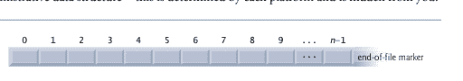

### 每个程序中的标准流

当文件被*打开*时，会有一个流与其关联。程序开始执行时会自动打开三个流：

- 标准输入（从键盘接收输入），
- 标准输出（在屏幕上显示输出）和
- 标准错误（在屏幕上显示错误消息）。


### 通信通道
流（Stream）在文件与程序之间提供通信通道。例如，标准输入流使程序能够从键盘读取数据，标准输出流使程序能够在屏幕上打印数据。

### FILE 结构
打开文件会返回一个指向 FILE 结构（定义在 `<stdio.h>` 中）的指针，该结构包含用于处理文件的信息。在某些操作系统中，该结构包含一个文件描述符，即操作系统数组（称为打开文件表）中的整数索引。每个数组元素包含一个文件控制块（FCB）——操作系统用于管理特定文件的信息。标准输入、标准输出和标准错误分别通过 `stdin`、`stdout` 和 `stderr` 进行操作。

### 文件处理函数 fgetc
标准库提供了许多用于从文件读取数据和向文件写入数据的函数。函数 `fgetc` 与 `getchar` 类似，从文件中读取一个字符。函数 `fgetc` 接收一个 FILE 指针作为参数，该指针指向要从中读取字符的文件。调用 `fgetc(stdin)` 从标准输入 `stdin` 读取一个字符。此调用等价于 `getchar()`。

### 文件处理函数 fputc
函数 `fputc` 与 `putchar` 类似，向文件写入一个字符。函数 `fputc` 接收两个参数：要写入的字符和指向要写入字符的文件的指针。函数调用 `fputc('a', stdout)` 将字符 `'a'` 写入标准输出 `stdout`。此调用等价于 `putchar('a')`。

### 其他文件处理函数
其他几个用于从标准输入读取数据和向标准输出写入数据的函数都有类似命名的文件处理函数。例如，`fgets` 和 `fputs` 函数可分别用于*从文件读取一行*和*向文件写入一行*。在接下来的几节中，我们将介绍函数 `scanf` 和 `printf` 的文件处理对应版本——`fscanf` 和 `fprintf`。在本章后面，我们将讨论函数 `fread` 和 `fwrite`。

## 11.3 创建顺序访问文件
*C 语言对文件不施加任何结构。因此，诸如文件记录之类的概念并不是 C 语言的一部分。下面的示例展示了如何将您自己的记录结构施加到文件上。*

图 11.2 创建了一个简单的顺序访问文件，该文件可用于应收账款系统，以跟踪公司信用客户所欠的金额。对于每个客户，程序获取一个账号、客户姓名和客户余额（即客户过去因收到的商品和服务而欠公司的金额）。为每个客户获取的数据构成了该客户的一条“记录”。在此应用程序中，账号用作记录键——文件将按账号顺序创建和维护。此程序假定用户按账号顺序输入记录。在一个完整的应收账款系统中，会提供排序功能，以便用户以任意顺序输入记录。然后记录将被排序并写入文件。[注意：图 11.6–11.7 使用图 11.2 中创建的数据文件，因此您必须先运行图 11.2 中的程序，然后再运行图 11.6–11.7 中的程序。]

```c
1 // Fig. 11.2: fig11_02.c
2 // Creating a sequential file
3 #include <stdio.h>
4
5 int main(void)
6 {
7    FILE *cfPtr; // cfPtr = clients.txt file pointer
8
9    // fopen opens file. Exit program if unable to create file
10   if ((cfPtr = fopen("clients.txt", "w")) == NULL) {
11      puts("File could not be opened");
12   }
13   else {
14      puts("Enter the account, name, and balance.");
15      puts("Enter EOF to end input.");
16      printf("%s", " ");
17
18      unsigned int account; // account number
19      char name[30]; // account name
20      double balance; // account balance
21
22      scanf("%d%29s%lf", &account, &name, &balance);
23
24      // write account, name and balance into file with fprintf
25      while (!feof(stdin)) {
26         fprintf(cfPtr, "%d %s %.2f\n", account, name, balance);
27         printf("%s", " ");
28         scanf("%d%29s%lf", &account, &name, &balance);
29      }
30
31      fclose(cfPtr); // fclose closes file
32   }
33 }
```

```text
Enter the account, name, and balance.
Enter EOF to end input.
? 100 Jones 24.98
? 200 Doe 345.67
? 300 White 0.00
? 400 Stone -42.16
? 500 Rich 224.62
? ^Z
```

图 11.2 | 创建顺序文件。

### 11.3.1 指向 FILE 的指针
现在让我们检查这个程序。第 7 行声明 `cfPtr` 是一个*指向 FILE 结构的指针*。C 程序使用单独的 FILE 结构来管理每个文件。每个打开的文件必须有一个单独声明的 `FILE` 类型指针，用于引用该文件。您不需要了解 FILE 结构的具体细节就可以使用文件，但如果您愿意，可以研究 `stdio.h` 中的声明。我们很快就会看到 FILE 结构究竟如何*间接地*引导到操作系统中该文件的文件控制块（FCB）。

### 11.3.2 使用 fopen 打开文件
第 10 行指定了程序将要使用的文件名——`"clients.txt"`，并建立与文件的“通信线路”。文件指针 `cfPtr` 被赋值为指向通过 `fopen` 打开的文件的 *FILE 结构的指针*。函数 `fopen` 接受两个参数：
- 文件名（可以包含指向文件位置的路径信息）和
- 文件打开模式。

文件打开模式 `"w"` 表示文件将以写入方式打开。如果文件*不存在*且以写入方式打开，`fopen` *会创建该文件*。如果以写入方式打开一个已存在的文件，文件的内容将*在无警告的情况下被丢弃*。在程序中，`if` 语句用于确定文件指针 `cfPtr` 是否为 `NULL`（即文件未打开，可能是因为文件不存在，或者用户没有打开该文件的权限）。如果它为 `NULL`，程序打印错误消息并终止。否则，程序处理输入并将其写入文件。

> **常见编程错误 11.1**
> 
> *当用户实际上想保留文件时，却以写入（"w"）方式打开现有文件，会在没有警告的情况下丢弃文件内容。*

> **常见编程错误 11.2**
> 
> *在程序中尝试引用文件之前忘记打开文件，这是一个逻辑错误。*

### 11.3.3 使用 feof 检查文件结束指示符
程序提示用户为每条记录输入各个字段，或者在数据输入完成时输入*文件结束符*。图 11.3 列出了各种计算机系统上输入文件结束符的按键组合。

| 操作系统 | 按键组合 |
|---|---|
| Linux/Mac OS X/UNIX | `<Ctrl> d` |
| Windows | `<Ctrl> z` 然后按 *Enter* |

**图 11.3**  |  各种常用操作系统的文件结束符按键组合。

第 25 行使用函数 `feof` 来确定 `stdin` 的文件结束指示符是否已被设置。文件结束指示符告知程序没有更多数据需要处理。在图 11.2 中，当用户输入文件结束符按键组合时，标准输入的文件结束指示符被设置。函数 `feof` 的参数是一个指向要测试文件结束指示符的文件的指针（本例中为 `stdin`）。当文件结束指示符已被设置时，该函数返回非零（真）值；否则，该函数返回零。本程序中包含 `feof` 调用的 `while` 语句在文件结束指示符未被设置时继续执行。

### 11.3.4 使用 `fprintf` 写入文件
第 26 行将数据写入文件 `clients.txt`。之后可以由一个设计用于读取该文件的程序检索这些数据（参见第 11.4 节）。函数 `fprintf` 与 `printf` 等价，只是 `fprintf` 还接收一个文件指针作为参数，该指针指向要写入数据的文件。函数 `fprintf` 可以通过使用 `stdout` 作为文件指针来向标准输出输出数据，如下所示：

```c
fprintf(stdout, "%d %s %.2f\n", account, name, balance);
```

### 11.3.5 使用 `fclose` 关闭文件
在用户输入文件结束符后，程序使用 `fclose`（第 31 行）关闭 `clients.txt` 文件并终止。函数 `fclose` 也接收文件指针（而不是文件名）作为参数。*如果没有显式调用函数 `fclose`，操作系统通常会在程序执行终止时关闭文件。* 这是操作系统“内务处理”的一个示例。

> **性能提示 11.1**
> 
> 关闭文件可以释放其他用户或程序可能正在等待的资源，因此应在不再需要文件时尽快关闭它，而不是等待操作系统在程序终止时关闭它。


在图 11.2 程序的示例执行中，用户输入了五个账户的信息，然后输入文件结束符以表示数据输入完成。示例执行并未显示数据记录在文件中的实际外观。为了验证文件已成功创建，在下一节中我们将提供一个程序，该程序读取该文件并打印其内容。

*FILE 指针、FILE 结构与 FCB 之间的关系*

图 11.4 说明了 FILE 指针、FILE 结构和 FCB 之间的关系。当文件 `"clients.txt"` 被打开时，该文件的 FCB 被复制到内存中。该图展示了 `fopen` 返回的文件指针与操作系统用于管理该文件的 FCB 之间的连接。程序可以处理零个、一个或多个文件。程序中使用的每个文件都将有一个由 `fopen` 返回的不同文件指针。*文件打开后的所有后续文件处理函数都必须使用相应的文件指针来引用该文件。*


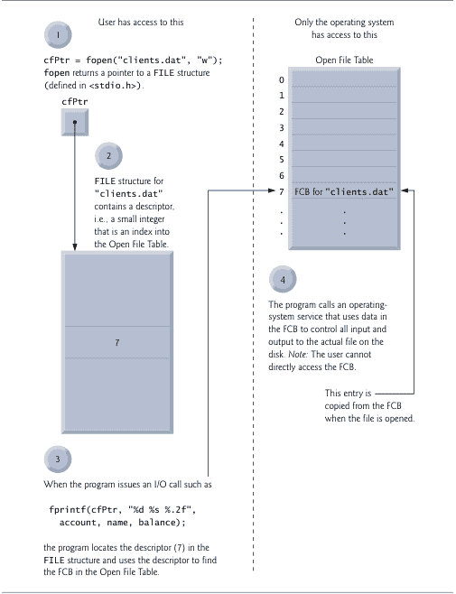

**图 11.4** | FILE 指针、FILE 结构与 FCB 之间的关系。

### 11.3.6 文件打开模式

文件可以以多种模式之一打开，这些模式总结在图 11.5 中。表中前半部分每个文件打开模式都有一个对应的 *二进制* 模式（包含字母 b）用于操作二进制文件。二进制模式在第 11.5–11.9 节中使用，我们在其中介绍随机访问文件。

| 模式 | 描述 |
|---|---|
| `r` | 打开现有文件进行读取。 |
| `w` | 创建文件用于写入。如果文件已存在，则丢弃当前内容。 |
| `a` | 打开或创建文件以在文件末尾写入——即写入操作将数据追加到文件。 |
| `r+` | 打开现有文件进行更新（读取和写入）。 |
| `w+` | 创建文件用于读取和写入。如果文件已存在，则丢弃当前内容。 |
| `a+` | 打开或创建文件用于读取和更新；所有写入都在文件末尾进行——即写入操作将数据追加到文件。 |
| `rb` | 以二进制模式打开现有文件进行读取。 |
| `wb` | 以二进制模式创建文件用于写入。如果文件已存在，则丢弃当前内容。 |
| `ab` | 追加：以二进制模式打开或创建文件以在文件末尾写入。 |
| `rb+` | 以二进制模式打开现有文件进行更新（读取和写入）。 |
| `wb+` | 以二进制模式创建文件用于更新。如果文件已存在，则丢弃当前内容。 |
| `ab+` | 以二进制模式打开或创建文件用于更新；写入在文件末尾进行。 |

**图 11.5**  文件打开模式。

#### C11 排他写入模式

此外，C11 提供了排他写入模式，你可以通过在 w、w+ 或 wb+ 模式末尾添加 x 来指示。在排他写入模式下，如果文件已存在或无法创建，`fopen` 将失败。如果以排他写入模式成功打开文件并且底层系统支持排他文件访问，则只有你的程序在文件打开期间可以访问该文件。（某些编译器和平台不支持排他写入模式。）如果在任何模式下打开文件时发生错误，`fopen` 返回 `NULL`。

> **常见编程错误 11.3**
>
> *打开不存在的文件进行读取是错误。*


> **常见编程错误 11.4**
>
> *在未获得文件适当访问权限的情况下打开文件进行读取或写入（这取决于操作系统）是错误。*


> **常见编程错误 11.5**
>
> *在没有可用空间时打开文件进行写入是运行时错误。*


> **常见编程错误 11.6**
>
> 在应以更新模式（`"r+"`）打开文件时以写入模式（`"w"`）打开文件会导致文件内容被丢弃。

> **错误预防提示 11.1**
>
> 仅当文件内容不应被修改时才以仅读取（而非更新）的方式打开文件。这可以防止文件内容被无意修改。这是最小权限原则的另一个例子。

## 11.4 从顺序访问文件读取数据

数据存储在文件中，以便在需要时检索进行处理。前一节演示了如何创建顺序访问文件。本节介绍如何从文件中顺序读取数据。

图 11.6 从图 11.2 程序创建的 "clients.txt" 文件中读取记录并打印其内容。第 7 行指出 cfPtr 是一个 *指向 FILE 的指针*。第 10 行尝试以读取模式（`"r"`）打开文件 "clients.txt"，并确定是否成功打开（即 `fopen` 不返回 `NULL`）。第 19 行从文件中读取一条“记录”。函数 `fscanf` 等同于函数 `scanf`，区别在于 `fscanf` 接收一个文件指针作为参数，用于从中读取数据的。执行此语句第一次后，account 将具有值 100，name 将具有值 "Jones"，balance 将具有值 24.98。每次执行第二个 `fscanf` 语句（第 24 行）时，程序都会从文件中读取另一条记录，account、name 和 balance 取得新值。当程序到达文件末尾时，文件被关闭（第 27 行）并且程序终止。函数 `feof` 仅在程序尝试读取最后一行之后不存在的数据时才返回 true。

```c
// Fig. 11.6: fig11_06.c
// Reading and printing a sequential file
#include <stdio.h>

int main(void)
{
    FILE *cfPtr; // cfPtr = clients.txt file pointer

    // fopen opens file; exits program if file cannot be opened
    if ((cfPtr = fopen("clients.txt", "r")) == NULL) {
        puts("File could not be opened");
    }
    else { // read account, name and balance from file
        unsigned int account; // account number
        char name[30]; // account name
        double balance; // account balance

        printf("%-10s%-13s%s\n", "Account", "Name", "Balance");
        fscanf(cfPtr, "%d%29s%lf", &account, name, &balance);

        // while not end of file
        while (!feof(cfPtr)) {
            printf("%-10d%-13s%7.2f\n", account, name, balance);
            fscanf(cfPtr, "%d%29s%lf", &account, name, &balance);
        }

        fclose(cfPtr); // fclose closes the file
    }
}
```

**图 11.6** | 读取并打印顺序文件。

| 账户 | 姓名 | 余额 |
|---|---|---|
| 100 | Jones | 24.98 |
| 200 | Doe | 345.67 |
| 300 | White | 0.00 |
| 400 | Stone | -42.16 |
| 500 | Rich | 224.62 |

### 11.4.1 重置文件位置指针

为了从文件中顺序检索数据，程序通常从文件开头开始读取，并连续读取所有数据直到找到所需数据。在程序执行期间，可能需要多次（从文件开头开始）顺序处理文件中的数据。语句

`rewind(cfPtr);`

会导致程序的文件位置指针——指示文件中下一次要读取或写入的字节数——重新定位到由 cfPtr 指向的文件开头（即字节 0）。文件位置指针并不是真正的指针，而是一个整数值，指定下一次读或写要在文件中发生的字节。这有时被称为文件偏移。文件位置指针是与每个文件关联的 FILE 结构的一个成员。

### 11.4.2 信用查询程序

图 11.7 的程序允许信用经理获取零余额客户的名单（即不欠任何钱的客户）、信用余额客户的名单（即公司欠钱的客户）以及借方余额客户的名单（即欠公司商品和服务款项的客户）。信用余额为负数；借方余额为正数。

程序显示一个菜单并允许信用经理输入四个选项之一：

- 选项 1 生成零余额账户的列表。
- 选项 2 生成信用余额账户的列表。
- 选项 3 生成借方余额账户的列表。
- 选项 4 终止程序执行。

示例输出显示在图 11.8 中。

```c
// Fig. 11.7: fig11_07.c
// Credit inquiry program
#include <stdio.h>

// function main begins program execution
int main(void)
{
    FILE *cfPtr; // clients.txt file pointer

    // fopen opens the file; exits program if file cannot be opened
    if ((cfPtr = fopen("clients.txt", "r")) == NULL) {
        puts("File could not be opened");
    }
    else {

        // display request options
        printf("%s", "Enter request\n"
            " 1 - List accounts with zero balances\n"
            " 2 - List accounts with credit balances\n"
            " 3 - List accounts with debit balances\n"
            " 4 - End run\n");
        unsigned int request; // request number
        scanf("%u", &request);

        // process user's request
        while (request != 4) {
            unsigned int account; // account number
            double balance; // account balance
            char name[30]; // account name

            // read account, name and balance from file
            fscanf(cfPtr, "%d%29s%lf", &account, name, &balance);

            switch (request) {
                case 1:
                    puts("\nAccounts with zero balances:");

                    // read file contents (until eof)
                    while (!feof(cfPtr)) {
                        // output only if balance is 0
                        if (balance == 0) {
                            printf("%-10d%-13s%7.2f\n",
                                account, name, balance);
                        }

                        // read account, name and balance from file
                        fscanf(cfPtr, "%d%29s%lf",
                            &account, name, &balance);
                    }
                    break;
```

**图 11.7** | 信用查询程序。（第 1 部分，共 2 部分。）


```c
case 2:
    puts("\nAccounts with credit balances:\n");
    // read file contents (until eof)
    while (!feof(cfPtr)) {
        // output only if balance is less than 0
        if (balance < 0) {
            printf("%-10d%-13s%7.2f\n",
                account, name, balance);
        }
        // read account, name and balance from file
        fscanf(cfPtr, "%d%29s%f",
            &account, name, &balance);
    }
    break;
case 3:
    puts("\nAccounts with debit balances:\n");
    // read file contents (until eof)
    while (!feof(cfPtr)) {
        // output only if balance is greater than 0
        if (balance > 0) {
            printf("%-10d%-13s%7.2f\n",
                account, name, balance);
        }
        // read account, name and balance from file
        fscanf(cfPtr, "%d%29s%f",
            &account, name, &balance);
    }
    break;
}
rewind(cfPtr); // return cfPtr to beginning of file
printf("%s", "\n? ");
scanf("%d", &request);
}
puts("End of run.");
fclose(cfPtr); // fclose closes the file
}
```

```
Enter request
 1 - List accounts with zero balances
 2 - List accounts with credit balances
 3 - List accounts with debit balances
 4 - End of run
? 1

Accounts with zero balances:
300        White             0.00

? 2

Accounts with credit balances:
400        Stone           -42.16

? 3

Accounts with debit balances:
100        Jones            24.98
200        Doe             345.67
500        Rich            224.62

? 4
End of run.
```

**图 11.8** | 图 11.7 信用查询程序的示例输出。

## 更新顺序文件

这类顺序文件中的数据在修改时可能会破坏其他数据。例如，如果需要将姓名“White”改为“Worthington”，不能简单地覆盖旧姓名。White 的记录按如下形式写入文件：

```text
300 White 0.00
```

如果使用新姓名从文件中的同一位置重写该记录，记录将变为

```text
300 Worthington 0.00
```

新记录比原记录更大（字符更多）。“Worthington”中第二个 0 之后的字符将覆盖文件中下一条顺序记录的开头。这里的问题在于，在使用 fprintf 和 fscanf 的格式化输入/输出模型中，字段——因而记录——的大小可以不同。例如，值 7、14、−117、2074 和 27383 在内部都作为 int 存储在相同字节数中，但它们在屏幕上显示或作为文本写入文件时是大小不同的字段。

因此，通常不使用 fprintf 和 fscanf 的顺序访问来就地更新记录。相反，通常会重写整个文件。要进行前面的姓名更改，在这种顺序访问文件中，300 White 0.00 之前的记录会被复制到新文件，写入新记录，然后将 300 White 0.00 之后的记录复制到新文件。这需要处理文件中的每条记录才能更新一条记录。

## 11.5 随机存取文件

如前所述，使用格式化输出函数 `fprintf` 创建的文件中的记录不一定长度相同。然而，写入随机存取文件并从其中读取的各个记录通常是*固定长度*的，可以直接访问（因而快速），无需搜索其他记录。这使得随机存取文件适用于航空订票系统、银行系统、销售点系统以及其他需要快速访问特定数据的事务处理系统。实现随机存取文件还有其他方式，但我们将讨论限制在这种使用固定长度记录的简单方法上。

由于随机存取文件中的每条记录通常长度相同，记录相对于文件开头的准确位置可以根据记录键计算出来。我们很快会看到，这如何有助于*立即*访问特定记录，即使在大文件中也是如此。

图 11.9 说明了实现随机存取文件的一种方式。这样的文件就像一列有许多车厢的货运列车——有些车厢是空的，有些载有货物。列车中的每节车厢长度相同。

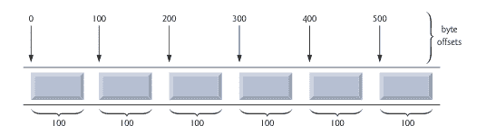

**图 11.9** | C 语言视角下的随机存取文件。

固定长度记录使数据能够插入随机存取文件中，*而不会破坏文件中的其他数据*。先前存储的数据也可以更新或删除，而无需重写整个文件。在以下各节中，我们将说明如何

- 创建随机存取文件，
- 输入数据，
- 以顺序和随机两种方式读取数据，
- 更新数据，
- 以及删除不再需要的数据。

## 11.6 创建随机存取文件

函数 `fwrite` 将内存中指定位置开始的指定字节数传输到文件。数据从文件位置指针所指示的文件位置开始写入。函数 `fread` 将文件位置指针所指定的文件位置处的指定字节数传输到内存中以指定地址开始的区域。现在，在写入一个四字节整数时，不再使用

```c
    fprintf(fPtr, "%d", number);
```

它可能打印一位数字或多达 11 位数字（10 位数字加一个符号，根据区域设置的字符集，每个字符至少需要一个字节的存储空间），而可以使用

```c
    fwrite(&number, sizeof(int), 1, fPtr);
```

在四字节整数的系统上，它总是从变量 number 向 fPtr 所表示的文件写入四个字节（我们稍后会解释参数 1）。之后，可以使用 fread 将那四个字节读入一个整数变量 number。尽管 fread 和 fwrite 以固定大小而非可变大小的格式读写数据（如整数），但它们处理的数据采用计算机“原始数据”格式（即数据字节），而不是 printf 和 scanf 的人类可读文本格式。由于数据的“原始”表示依赖于系统，因此“原始数据”可能无法在其他系统上读取，也可能无法由其他编译器生成的程序或使用其他编译器选项编译的程序读取。

### fwrite 和 fread 可以写入和读取数组

函数 fwrite 和 fread 能够从文件中读取数据数组以及向文件写入数据数组。fread 和 fwrite 的第三个参数是应从文件读取或写入文件的数组元素个数。前面的 fwrite 函数调用将一个整数写入文件，因此第三个参数是 1（就像写入数组的一个元素一样）。文件处理程序很少只向文件写入一个字段。通常，它们一次写入一个结构体，如下面的示例所示。

### 问题陈述

考虑以下问题陈述：

> *创建一个能够存储最多 100 条固定长度记录的事务处理系统。每条记录应由一个将用作记录键的账号、一个姓氏、一个名字和一个余额组成。生成的程序应能够更新账户、插入新的账户记录、删除账户，并将所有账户记录列在格式化的文本文件中以供打印。使用随机存取文件。*

接下来的几节将介绍创建事务处理程序所需的技术。图 11.10 展示了如何打开随机存取文件、使用结构体定义记录格式、向文件写入数据以及关闭文件。该程序使用函数 fwrite 用空结构体初始化文件“accounts.dat”的全部 100 条记录。每个空结构体包含账号 0、姓氏 ""（空字符串）、名字 "" 以及余额 0.0。以这种方式初始化文件，是为了创建将存储文件的空间，并使确定某条记录是否包含数据成为可能。

```c
    1 // Fig. 11.10: fig11_10.c
    2 // Creating a random-access file sequentially
    3 #include <stdio.h>
    4
```

**图 11.10** | 顺序创建随机存取文件。（第 1 部分，共 2 部分。）


```c
// clientData structure definition
struct clientData {
    unsigned int acctNum; // account number
    char lastName[15]; // account last name
    char firstName[10]; // account first name
    double balance; // account balance
};

int main(void)
{
    FILE *cfPtr; // accounts.dat file pointer

    // fopen opens the file; exits if file cannot be opened
    if ((cfPtr = fopen("accounts.dat", "wb")) == NULL) {
        puts("File could not be opened.");
    }
    else {
        // create clientData with default information
        struct clientData blankClient = {0, "", "", 0.0};

        // output 100 blank records to file
        for (unsigned int i = 1; i <= 100; ++i) {
            fwrite(&blankClient, sizeof(struct clientData), 1, cfPtr);
        }

        fclose(cfPtr); // fclose closes the file
    }
}
```

图 11.10 | 顺序创建随机存取文件。（第 2 部分，共 2 部分。）

函数 fwrite 将字节块写入文件。第 27 行使大小为 sizeof(struct clientData) 的结构体 blankClient 写入 cfPtr 所指向的文件。运算符 sizeof 返回其括号内操作数的字节大小（此处为 struct clientData）。

函数 fwrite 实际上可用于写入对象数组的多个元素。为此，在调用 fwrite 时，将指向数组的指针作为第一个实参提供，并将要写入的元素数量作为第三个实参提供。在前面的语句中，fwrite 用于写入一个不是数组元素的单个对象。写入单个对象等价于写入数组的一个元素，因此 fwrite 调用中为 1。

> [注意：图 11.11、11.14 和 11.15 使用图 11.10 中创建的数据文件，因此必须先运行图 11.10，再运行图 11.11、11.14 和 11.15。]

## 11.7 将数据随机写入随机存取文件

图 11.11 将数据写入文件 "accounts.dat"。它使用 fseek 和 fwrite 的组合将数据存储到文件中的特定位置。函数 fseek 将文件位置指针设置到文件中的特定位置，然后 fwrite 写入数据。示例执行如图 11.12 所示。

```c
// Fig. 11.11: fig11_11.c
// Writing data randomly to a random-access file
#include <stdio.h>

// clientData structure definition
struct clientData {
    unsigned int acctNum; // account number
    char lastName[15]; // account last name
    char firstName[10]; // account first name
    double balance; // account balance
}; // end structure clientData

int main(void)
{
    FILE *cfPtr; // accounts.dat file pointer

    // fopen opens the file; exits if file cannot be opened
    if ((cfPtr = fopen("accounts.dat", "rb+")) == NULL) {
        puts("File could not be opened.");
    }
    else {
        // create clientData with default information
        struct clientData client = {0, "", "", 0.0};

        // require user to specify account number
        printf("%s", "Enter account number"
            " (1 to 100, 0 to end input): ");
        scanf("%d", &client.acctNum);

        // user enters information, which is copied into file
        while (client.acctNum != 0) {
            // user enters last name, first name and balance
            printf("%s", "\nEnter lastname, firstname, balance: ");

            // set record lastName, firstName and balance value
            fscanf(stdin, "%14s%9s%lf", client.lastName,
                client.firstName, &client.balance);

            // seek position in file to user-specified record
            fseek(cfPtr, (client.acctNum - 1) *
                sizeof(struct clientData), SEEK_SET);

            // write user-specified information in file
            fwrite(&client, sizeof(struct clientData), 1, cfPtr);

            // enable user to input another account number
            printf("%s", "\nEnter account number: ");
            scanf("%d", &client.acctNum);
        }

        fclose(cfPtr); // fclose closes the file
    }
}
```

图 11.11 | 将数据随机写入随机存取文件。

```text
Enter account number (1 to 100, 0 to end input): 37
Enter lastname, firstname, balance: Barker Doug 0.00
Enter account number: 29
Enter lastname, firstname, balance: Brown Nancy -24.54
Enter account number: 96
Enter lastname, firstname, balance: Stone Sam 34.98
Enter account number: 88
Enter lastname, firstname, balance: Smith Dave 258.34
Enter account number: 33
Enter lastname, firstname, balance: Dunn Stacey 314.33
Enter account number: 0
```

**图 11.12** | 图 11.11 中程序的示例执行。

### 11.7.1 使用 fseek 定位文件位置指针

第 40–41 行将 `cfPtr` 所引用文件的文件位置指针定位到由 (`client.acctNum - 1`) * `sizeof(struct clientData)` 计算出的字节位置。该表达式的值称为偏移量或位移量。由于账号介于 1 到 100 之间，而文件中的字节位置从 0 开始，因此在计算记录的字节位置时要从账号中减去 1。因此，对于记录 1，文件位置指针被设置为文件的字节 0。符号常量 `SEEK_SET` 表示文件位置指针相对于文件开头按偏移量定位。如上述语句所示，在文件中查找账号 1 会将文件位置指针设置到文件开头，因为计算出的字节位置为 0。

图 11.13 展示了指向内存中 `FILE` 结构的文件指针。此图中的文件位置指针表明，下一个要读取或写入的字节位于距文件开头 5 个字节处。

#### fseek 函数原型

fseek 的函数原型为

```c
int fseek(FILE *stream, long int offset, int whence);
```

其中 `offset` 是在 `stream` 所指向的文件中从 `whence` 开始要查找的字节数——正偏移量向前查找，负偏移量向后查找。参数 `whence` 是 `SEEK_SET`、`SEEK_CUR` 或 `SEEK_END` 之一（均定义在 `<stdio.h>` 中），它们指示查找开始的位置。`SEEK_SET` 表示查找从文件*开头*开始；`SEEK_CUR` 表示查找从文件中的*当前位置*开始；`SEEK_END` 表示从文件*末尾*开始度量查找。

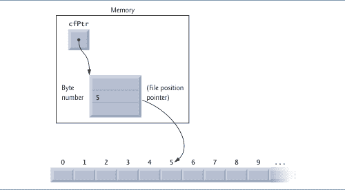

**图 11.13** | 文件位置指针指示距文件开头 5 个字节的偏移量

### 11.7.2 错误检查

为简单起见，本章中的程序**不**执行错误检查。工业级程序应通过检查返回值来确定 fscanf（图 11.11，第 36–37 行）、fseek（第 40–41 行）和 fread（第 44 行）等函数是否正常运行。函数 fscanf 返回成功读取的数据项数，若读取数据时发生问题则返回值 EOF。如果无法执行查找操作（例如尝试查找到文件开头之前的位置），函数 fseek 返回非零值。函数 fwrite 返回成功输出的项数。如果该数值小于函数调用中的*第三个实参*，则发生了写入错误。

## 11.8 从随机存取文件读取数据

函数 fread 从文件读取指定数量的字节到内存中。例如，

```c
fread(&client, sizeof(struct clientData), 1, cfPtr);
```

从 cfPtr 引用的文件中读取由 sizeof(struct clientData) 确定的字节数，将数据存储到 client 中，并返回读取的字节数。这些字节从文件位置指针所指定的位置读取。函数 fread 可以通过提供指向将要存储元素的数组的指针，并指明要读取的元素数量，来读取多个固定大小的数组元素。前面的语句读取一个元素。要读取*多个*元素，请将元素数量指定为 fread 的第三个实参。函数 fread 返回成功输入的项数。如果该数值小于函数调用中的第三个实参，则发生了读取错误。

图 11.14 顺序读取 "accounts.dat" 文件中的每条记录，确定每条记录是否包含有效的显示数据，并显示包含数据的记录的格式化数据。函数 feof 确定何时到达文件末尾，fread 函数将数据从文件传输到 clientData 结构体 client 中。


~~~c
1  // Fig. 11.14: fig11_14.c
2  // Reading a random-access file sequentially
3  #include <stdio.h>
4
5  // clientData structure definition
6  struct clientData {
7      unsigned int acctNum; // account number
8      char lastName[15]; // account last name
9      char firstName[10]; // account first name
10     double balance; // account balance
11 };
12
13 int main(void)
14 {
15     FILE *cfPtr; // accounts.dat file pointer
16
17     // fopen opens the file; exits if file cannot be opened
18     if ((cfPtr = fopen("credit.txt", "rb")) == NULL) {
19         puts("File could not be opened.");
20     }
21     else {
22         printf("%-6s%-16s%-11s%10s\n", "Acct", "Last Name",
23                "First Name", "Balance");
24
25         // read all records from file (until eof)
26         while (!feof(cfPtr)) {
27             // create clientData with default information
28             struct clientData client = {0, "", "", 0.0};
29
30             int result = fread(&client, sizeof(struct clientData), 1, cfPtr);
31
32             // display record
33             if (result != 0 && client.acctNum != 0) {
34                 printf("%-6d%-16s%-11s%10.2f\n",
35                        client.acctNum, client.lastName,
36                        client.firstName, client.balance);
37             }
38         }
39
40         fclose(cfPtr); // fclose closes the file
41     }
42 }
~~~

| 账号 | 姓氏 | 名字 | 余额 |
| --- | --- | --- | --- |
| 29 | Brown | Nancy | -24.54 |
| 33 | Dunn | Stacey | 314.33 |
| 37 | Barker | Doug | 0.00 |
| 88 | Smith | Dave | 258.34 |
| 96 | Stone | Sam | 34.98 |

**图 11.14** | 顺序读取随机访问文件。

## 11.9 案例研究：事务处理程序

我们现在介绍一个使用随机访问文件的实质性事务处理程序（图 11.15）。该程序维护银行的账户信息——更新现有账户、添加新账户、删除账户并将所有当前账户的清单存储到文本文件中以便打印。我们假设图 11.10 的程序已执行以创建文件 accounts.dat。

### 选项 1：创建格式化的账户列表

该程序有五个选项——选项 5 终止程序。选项 1 调用函数 textFile（第 64–94 行）将所有账户的格式化列表（通常称为报告）存储到名为 accounts.txt 的文本文件中，以便稍后打印。该函数使用 fread 以及图 11.14 程序中使用的顺序文件访问技术。选项 1 之后，accounts.txt 包含：

| 账号 | 姓氏 | 名字 | 余额 |
|------|-----------|------------|---------|
| 29 | Brown | Nancy | -24.54 |
| 33 | Dunn | Stacey | 314.33 |
| 37 | Barker | Doug | 0.00 |
| 88 | Smith | Dave | 258.34 |
| 96 | Stone | Sam | 34.98 |

### 选项 2：更新账户

选项 2 调用函数 updateRecord（第 97–140 行）来更新账户。该函数仅更新已存在的记录，因此函数首先检查用户指定的记录是否为空。记录通过 fread 读入结构 client，然后将成员 acctNum 与 0 进行比较。如果为 0，则记录不包含信息，并打印一条消息说明记录为空。然后显示菜单选项。如果记录包含信息，函数 updateRecord 会输入交易金额，计算新的余额并将记录写回文件。选项 2 的典型输出为

```
Enter account to update (1 - 100): 37
37      Barker      Doug          0.00
Enter charge (+) or payment (-): +87.99
37      Barker      Doug         87.99
```

### 选项 3：创建新账户

选项 3 调用函数 newRecord（第 177–215 行）向文件添加新账户。如果用户输入的是现有账户的账户号，newRecord 会显示错误消息，指出记录已包含信息，并再次打印菜单选项。此函数添加新账户的过程与图 11.11 中的程序相同。选项 3 的典型输出为

```
Enter new account number (1 - 100): 22
Enter lastname, firstname, balance
? Johnston Sarah 247.45
```

### 选项 4：删除账户

选项 4 调用函数 deleteRecord（第 143–174 行）从文件中删除记录。删除是通过询问用户账户号并重新初始化记录来完成的。如果账户不包含信息，deleteRecord 会显示错误消息，指出账户不存在。

## 代码 for the Transaction-Processing Program

该程序如图所示 11.15。文件 "accounts.dat" 使用 "rb+" 模式打开以进行更新（读写）。

```c
// Fig. 11.15: fig11_15.c
// Transaction-processing program reads a random-access file sequentially,
// updates data already written to the file, creates new data to
// be placed in the file, and deletes data previously stored in the file.
#include <stdio.h>

// clientData structure definition
struct clientData {
    unsigned int acctNum; // account number
    char lastName[15]; // account last name
    char firstName[10]; // account first name
    double balance; // account balance
};

// prototypes
unsigned int enterChoice(void);
void textFile(FILE *readPtr);
void updateRecord(FILE *fPtr);
void newRecord(FILE *fPtr);
void deleteRecord(FILE *fPtr);

int main(void)
{
    FILE *cfPtr; // accounts.dat file pointer

    // fopen opens the file; exits if file cannot be opened
    if ((cfPtr = fopen("accounts.dat", "rb+")) == NULL) {
        puts("File could not be opened.");
    }
    else {
        unsigned int choice; // user's choice

        // enable user to specify action
        while ((choice = enterChoice()) != 5) {
            switch (choice) {
                // create text file from record file
            case 1:
                textFile(cfPtr);
                break;
                // update record
            case 2:
                updateRecord(cfPtr);
                break;
                // create record
            case 3:
                newRecord(cfPtr);
                break;
                // delete existing record
            case 4:
                deleteRecord(cfPtr);
                break;
                // display message if user does not select valid choice
            default:
                puts("Incorrect choice");
                break;
            }
        }

        fclose(cfPtr); // fclose closes the file
    }
}

// create formatted text file for printing
void textFile(FILE *readPtr)
{
    FILE *writePtr; // accounts.txt file pointer

    // fopen opens the file; exits if file cannot be opened
    if ((writePtr = fopen("accounts.txt", "w")) == NULL) {
        puts("File could not be opened.");
    }
    else {
        rewind(readPtr); // sets pointer to beginning of file
        fprintf(writePtr, "%-6s%-16s%-11s%10s\n",
            "Acct", "Last Name", "First Name","Balance");

        // copy all records from random-access file into text file
        while (!feof(readPtr)) {
            // create clientData with default information
            struct clientData client = { 0, "", "", 0.0 };
            int result =
                fread(&client, sizeof(struct clientData), 1, readPtr);

            // write single record to text file
            if (result != 0 && client.acctNum != 0) {
                fprintf(writePtr, "%-6d%-16s%-11s%10.2f\n",
                    client.acctNum, client.lastName,
                    client.firstName, client.balance);
            }
        }
        fclose(writePtr); // fclose closes the file
    }
}
```

图 11.15 | 事务处理程序。（第 1 部分，共 5 部分。）

```c
91        fclose(writePtr); // fclose closes the file
92    }
93 }
94
95 // update balance in record
96 void updateRecord(FILE *fPtr)
97 {
98     // obtain number of account to update
99     printf("%s", "Enter account to update (1 - 100): ");
100    unsigned int account; // account number
101    scanf("%d", &account);
102
103    // move file pointer to correct record in file
104    fseek(fPtr, (account - 1) * sizeof(struct clientData),
105         SEEK_SET);
106
107    // create clientData with no information
108    struct clientData client = {0, "", "", 0.0};
109
110    // read record from file
111    fread(&client, sizeof(struct clientData), 1, fPtr);
112
113    // display error if account does not exist
114    if (client.acctNum == 0) {
115        printf("Account %d has no information.\n", account);
116    }
117    else { // update record
118        printf("%-6d%-16s%-11s%10.2f\n\n",
119               client.acctNum, client.lastName, client.firstName, client.balance);
120
121        // request transaction amount from user
122        printf("%s", "Enter charge (+) or payment (-): ");
123        double transaction; // transaction amount
124        scanf("%lf", &transaction);
125        client.balance += transaction; // update record balance
126
127        printf("%-6d%-16s%-11s%10.2f\n",
128               client.acctNum, client.lastName, client.firstName, client.balance);
129
130        // move file pointer to correct record in file
131        fseek(fPtr, (account - 1) * sizeof(struct clientData),
132             SEEK_SET);
133
134        // write updated record over old record in file
135        fwrite(&client, sizeof(struct clientData), 1, fPtr);
136    }
137 }
```


```c
// delete an existing record
void deleteRecord(FILE *fPtr)
{
    // obtain number of account to delete
    printf("%s", "Enter account number to delete (1 - 100): ");
    unsigned int accountNum; // account number
    scanf("%d", &accountNum);

    // move file pointer to correct record in file
    fseek(fPtr, (accountNum - 1) * sizeof(struct clientData),
        SEEK_SET);

    struct clientData client; // stores record read from file

    // read record from file
    fread(&client, sizeof(struct clientData), 1, fPtr);

    // display error if record does not exist
    if (client.acctNum == 0) {
        printf("Account %d does not exist.\n", accountNum);
    }
    else { // delete record
        // move file pointer to correct record in file
        fseek(fPtr, (accountNum - 1) * sizeof(struct clientData),
            SEEK_SET);

        struct clientData blankClient = {0, "", "", 0}; // blank client

        // replace existing record with blank record
        fwrite(&blankClient,
            sizeof(struct clientData), 1, fPtr);
    }
}

// create and insert record
void newRecord(FILE *fPtr)
{
    // obtain number of account to create
    printf("%s", "Enter new account number (1 - 100): ");
    unsigned int accountNum; // account number
    scanf("%d", &accountNum);

    // move file pointer to correct record in file
    fseek(fPtr, (accountNum - 1) * sizeof(struct clientData),
        SEEK_SET);

    // create clientData with default information
    struct clientData client = {0, "", "", 0.0};

    // read record from file
    fread(&client, sizeof(struct clientData), 1, fPtr);

194   // display error if account already exists
195   if (client.acctNum != 0) {
196      printf("Account #%d already contains information.\n",
197         client.acctNum);
198   }
199   else { // create record
200      // user enters last name, first name and balance
201      printf("%s", "Enter lastname, firstname, balance\n? ");
202      scanf("%14s%14s%lf", client.lastName, client.firstName,
203         &client.balance);
204
205      client.acctNum = accountNum;
206
207      // move file pointer to correct record in file
208      fseek(fPtr, (client.acctNum - 1) *
209         sizeof(struct clientData), SEEK_SET);
210
211      // insert record in file
212      fwrite(&client,
213         sizeof(struct clientData), 1, fPtr);
214
215   }
216
217   // enable user to input menu choice
218   unsigned int enterChoice(void)
219   {
220      // display available options
221      printf("%s", "\nEnter your choice\n"
222         " 1 - store a formatted text file of accounts called\n"
223         "     \"accounts.txt\" for printing\n"
224         " 2 - update an account\n"
225         " 3 - add a new account\n"
226         " 4 - delete an account\n"
227         " 5 - end program\n? ");
228
229      unsigned int menuChoice; // variable to store user's choice
230      scanf("%u", &menuChoice); // receive choice from user
231      return menuChoice;
232   }
```

**图 11.15** | 事务处理程序。（第 5 部分，共 5 部分。）

## 11.10 安全的 C 编程

### *fprintf_s 和 fscanf_s*

第 11.3～11.4 节中的示例分别使用函数 fprintf 和 fscanf 将文本写入文件以及从文件读取文本。新标准的附录 K 提供了这些函数的更安全版本，名为 fprintf_s 和 fscanf_s，它们与我们之前介绍的 printf_s 和 scanf_s 函数相同，只不过还需要指定一个 FILE 指针参数，指示要操作的文件。如果你的 C 编译器的标准库包含这些函数，则应使用它们而不是 fprintf 和 fscanf。与 scanf_s 和 printf_s 一样，Microsoft 版本的 fprintf_s 和 fscanf_s 与附录 K 中的版本不同。

### CERT 安全 C 编码标准第 9 章

CERT 安全 C 编码标准第 9 章专门给出输入/输出建议和规则——其中许多一般适用于文件处理，并且其中若干条适用于本章介绍的文件处理函数。要了解每条的更多信息，请访问 www.securecoding.cert.org。

- **FIO03-C:** 使用非独占文件打开模式（图 11.5）打开文件进行写入时，如果文件已存在，函数 fopen 会打开它并截断其内容，且不提示在调用 fopen 之前该文件是否存在。为确保不打开并截断现有文件，可以使用 C11 新的独占写入模式（在第 11.3 节讨论），该模式允许 fopen 仅在文件尚不存在时打开该文件。
- **FIO04-C:** 在工业级代码中，应始终检查返回错误指示的文件处理函数的返回值，以确保这些函数正确完成了任务。
- **FIO07-C:** 函数 rewind 不返回值，因此无法测试操作是否成功。建议改用函数 fseek，因为它在失败时返回非零值。
- **FIO09-C:** 本章演示了文本文件和二进制文件。由于不同平台之间二进制数据表示方式存在差异，以二进制格式写入的文件通常不可移植。为了获得更可移植的文件表示，可以考虑使用文本文件或能够处理不同平台间二进制文件表示差异的函数库。
- **FIO14-C:** 某些库函数对文本文件和二进制文件的操作并不完全相同。特别是，如果从 SEEK_END 进行定位，函数 fseek 不保证能正确处理二进制文件，因此应使用 SEEK_SET。
- **FIO42-C:** 在许多平台上，同时打开的文件数量有限。因此，只要程序不再需要某个文件，就应始终尽快关闭它。

## 小结

### 11.1 节 引言

- 文件（第 474 页）用于永久保留大量数据。
- 计算机将文件存储在辅助存储设备上，例如硬盘驱动器、固态硬盘、闪存驱动器和 DVD。

### 11.2 节 文件和流

- C 将每个文件视为顺序字节流（第 474 页）。打开文件时，会将一个流与该文件关联。
- 程序开始执行时会自动打开三个流——标准输入（第 474 页）、标准输出（第 474 页）和标准错误（第 474 页）。
- 流在文件和程序之间提供通信通道。
- 标准输入流使程序能够从键盘读取数据，标准输出流使程序能够在屏幕上打印数据。
- 打开文件会返回指向 FILE 结构的指针（定义于 `<stdio.h>`；第 475 页），该结构包含用于处理文件的信息。此结构包括文件描述符（第 475 页），即一个操作系统数组中的索引，该数组称为打开文件表（第 475 页）。每个数组元素包含一个文件控制块（FCB；第 475 页），操作系统使用它管理特定文件。
- 标准输入、标准输出和标准错误使用预定义文件指针 `stdin`、`stdout` 和 `stderr` 进行操作。
- 函数 `fgetc`（第 475 页）从文件中读取一个字符。它接收一个 FILE 指针作为参数，该指针指向要从中读取字符的文件。
- 函数 `fputc`（第 475 页）将一个字符写入文件。它接收要写入的字符和一个 FILE 指针作为参数，该指针指向要将字符写入的文件。
- 函数 `fgets` 和 `fputs`（第 475 页）分别从文件读取一行或将一行写入文件。

### 11.3 节 创建顺序访问文件

- C 不对文件强加任何结构。必须提供文件结构以满足特定应用的要求。
- C 程序用单独的 FILE 结构管理每个文件。
- 每个打开的文件都必须有一个单独声明的 FILE 类型指针，用于引用该文件。
- 函数 `fopen`（第 480 页）接收文件名和文件打开模式（第 477 页）作为参数，并返回指向已打开文件的 FILE 结构的指针。
- 文件打开模式 `"w"` 表示要打开文件进行写入。如果文件不存在，`fopen` 会创建它。如果文件存在，其内容将被丢弃且不发出警告。
- 如果无法打开文件，函数 `fopen` 返回 `NULL`。
- 函数 `feof`（第 478 页）接收一个指向 FILE 的指针，并在已设置文件结束指示符时返回非零（真）值；否则，该函数返回零。任何从 `feof` 返回真的文件读取的尝试都将失败。
- 函数 `fprintf`（第 475 页）等同于 `printf`，只不过 `fprintf` 还接收一个文件指针作为参数，该指针指向要将数据写入的文件。
- 函数 `fclose`（第 478 页）接收一个文件指针作为参数，并关闭指定的文件。
- 打开文件时，该文件的文件控制块（FCB）会被复制到内存中。操作系统使用 FCB 管理该文件。
- 要创建新文件，或在写入数据前丢弃现有文件的内容，请打开文件进行写入（`"w"`）。
- 要读取现有文件，请打开文件进行读取（`"r"`）。
- 要将记录添加到现有文件的末尾，请打开文件进行追加（`"a"`）。
- 要打开文件以便可写入和读取，请使用三种更新模式之一打开文件进行更新——`"r+"`、`"w+"` 或 `"a+"`。模式 `"r+"` 打开文件进行读取和写入。模式 `"w+"` 创建文件进行读取和写入。如果文件已存在，则打开它并丢弃其内容。模式 `"a+"` 打开文件进行读取和写入——所有写入都在文件末尾进行。如果文件不存在，则创建它。
- 每种文件打开模式都有一个对应的二进制模式（包含字母 `b`），用于操作二进制文件。
- C11 还支持独占写入模式，方法是在 `w`、`w+`、`wb` 和 `wb+` 模式后追加 `x`。


## 11.4 节 从顺序存取文件读取数据
- **函数 fscanf** (p. 475) 与函数 scanf 等价，只不过 fscanf 接收一个文件指针作为参数，该文件指针指向要读取数据的文件。
- 要从文件中顺序读取数据，程序通常从文件开头开始读取，并连续读取所有数据，直到找到所需数据。
- **函数 rewind** 会将其参数所指向文件的程序文件位置指针 (p. 482) 重新定位到文件开头（即字节 0）。
- 文件位置指针是一个整数值，用于指定文件中下一次读取或写入将发生的字节位置。这有时称为文件偏移量 (p. 482)。文件位置指针是与每个文件关联的 FILE 结构的成员。
- 顺序文件中的数据通常不能在不破坏文件中其他数据的风险下修改。

## 11.5 节 随机存取文件
- **随机存取文件** (p. 486) 的各个记录通常长度固定，可以直接访问（因而很快），无需搜索其他记录。
- 由于随机存取文件中的每条记录通常长度相同，因此记录相对于文件开头的准确位置可以按记录键的函数计算出来。
- 定长记录使数据能够插入随机存取文件而不破坏其他数据。先前存储的数据也可以更新或删除，而无需重写整个文件。

## 11.6 节 创建随机存取文件
- **函数 fwrite** (p. 486) 将内存中指定位置开始的指定字节数传送到文件。数据从文件位置指针所在位置开始写入。
- **函数 fread** (p. 486) 将文件位置指针所指定文件位置中的指定字节数传送到内存中以指定地址开始的区域。
- 函数 fwrite 和 fread 能够从文件读取数据数组以及向文件写入数据数组。fread 和 fwrite 的第三个参数都是要处理的元素个数。
- 文件处理程序通常一次写入一个 struct。
- 函数 fwrite 将一块（特定字节数）数据写入文件。
- 要写入多个数组元素，请在调用 fwrite 时提供一个指向数组的指针作为第一个参数，并提供要写入的元素个数作为第三个参数。

## 11.7 节 随机写入随机存取文件
- **函数 fseek** (p. 488) 将给定文件的文件位置指针设置到文件中的特定位置。其第二个参数表示要定位的字节数，第三个参数表示从何处开始定位。第三个参数可以是三个值之一——SEEK_SET、SEEK_CUR 或 SEEK_END（均定义在 <stdio.h> 中）。SEEK_SET (p. 490) 表示定位从文件开头开始；SEEK_CUR (p. 490) 表示定位从文件中的当前位置开始；SEEK_END (p. 490) 表示定位从文件末尾开始度量。
- 工业级程序应通过检查返回值来确定 fscanf、fseek 和 fwrite 等函数是否正常运行。
- 函数 fscanf 返回成功读取的字段数，如果在读取数据时出现问题，则返回值 EOF。
- 如果无法执行定位操作，函数 fseek 返回非零值。
- 函数 fwrite 返回成功输出的项数。如果该数小于函数调用中的第三个参数，则发生了写入错误。

## 11.8 节 从随机存取文件读取数据
- 函数 `fread` 从文件读取指定字节数到内存中。
- 通过提供指向将存储这些元素的数组的指针，并指出要读取的元素个数，函数 `fread` 可用于读取多个固定大小的数组元素。
- 函数 `fread` 返回成功输入的项数。如果该数小于函数调用中的第三个参数，则发生了读取错误。

## 自测练习
### 11.1 填写下列各题中的空白：
- a) 函数 ______ 关闭文件。
- b) ______ 函数以类似于 `scanf` 从 `stdin` 读取的方式从文件读取数据。
- c) 函数 ______ 从指定文件读取一个字符。
- d) 函数 ______ 从指定文件读取一行。
- e) 函数 ______ 打开文件。
- f) 在随机存取应用中从文件读取数据时，通常使用函数 ______。
- g) 函数 ______ 将文件位置指针重新定位到文件中的特定位置。

### 11.2 指出下列各项中哪些是*正确*的，哪些是*错误*的。如果是错误，请解释原因。
- a) 函数 `fscanf` 不能用于从标准输入读取数据。
- b) 必须显式使用 `fopen` 打开标准输入、标准输出和标准错误流。
- c) 程序必须显式调用函数 `fclose` 来关闭文件。
- d) 如果文件位置指针指向顺序文件中除文件开头之外的位置，则必须关闭并重新打开文件，才能从文件开头读取。
- e) 函数 `fprintf` 可以写入标准输出。
- f) 顺序存取文件中的数据总是可以在不覆盖其他数据的情况下更新。
- g) 无需搜索随机存取文件中的所有记录即可找到特定记录。
- h) 随机存取文件中的记录长度并不一致。
- i) 函数 `fseek` 只能相对于文件开头进行定位。

### 11.3 编写一条语句完成下列各项。假设这些语句都适用于同一个程序。
- a) 编写一条语句，打开文件 `"oldmast.dat"` 以供读取，并将返回的文件指针赋给 `ofPtr`。
- b) 编写一条语句，打开文件 `"trans.dat"` 以供读取，并将返回的文件指针赋给 `tfPtr`。
- c) 编写一条语句，打开文件 `"newmast.dat"` 以供写入（并创建），并将返回的文件指针赋给 `nfPtr`。
- d) 编写一条语句，从文件 `"oldmast.dat"` 读取一条记录。该记录由整数 `accountNum`、字符串 `name` 和浮点数 `currentBalance` 组成。
- e) 编写一条语句，从文件 `"trans.dat"` 读取一条记录。该记录由整数 `accountNum` 和浮点数 `dollarAmount` 组成。
- f) 编写一条语句，向文件 `"newmast.dat"` 写入一条记录。该记录由整数 `accountNum`、字符串 `name` 和浮点数 `currentBalance` 组成。

### 11.4 找出下列各程序段中的错误，并说明如何改正。
- a) `tfPtr` 所引用的文件（`"payables.dat"`）尚未打开。

```
printf(fPtr, "%d%s%f\n", account, company, amount);
```

- b) `open("receive.dat", "r+");`
- c) 下列语句应从文件 "payables.dat" 读取一条记录。文件指针 payPtr 指向该文件，而文件指针 recPtr 指向文件 "receive.dat"：
`scanf(recPtr, "%d%s\n", &account, company, &amount);`
- d) 应打开文件 "tools.dat" 以向该文件添加数据，而不丢弃当前数据。
  `if ((tfPtr = fopen("tools.dat", "w")) != NULL)`
- e) 应打开文件 "courses.dat" 以供追加，而不修改文件的当前内容。
  `if ((cfPtr = fopen("courses.dat", "w+")) != NULL)`

## 自测练习答案
### 11.1
- a) `fclose`
- b) `fscanf`
- c) `fgetc`
- d) `fgets`
- e) `fopen`
- f) `fread`
- g) `fseek`

### 11.2
- a) 错误。通过在 fscanf 的调用中包含指向标准输入流 stdin 的指针，函数 fscanf 可用于从标准输入读取。
- b) 错误。当程序开始执行时，C 会自动打开这三个流。
- c) 错误。程序执行终止时文件将关闭，但所有文件都应使用 fclose 显式关闭。
- d) 错误。函数 rewind 可用于将文件位置指针重新定位到文件开头。
- e) 正确。
- f) 错误。在大多数情况下，顺序文件记录长度不一致。因此，更新一条记录可能会导致其他数据被覆盖。
- g) 正确。
- h) 错误。随机存取文件中的记录通常长度一致。
- i) 错误。可以从文件开头、文件末尾以及文件中的当前位置进行定位。

### 11.3
- a) `ofPtr = fopen("oldmast.dat", "r");`
- b) `tfPtr = fopen("trans.dat", "r");`
- c) `nfPtr = fopen("newmast.dat", "w");`
- d) `fscanf(ofPtr, "%d %s %f", &accountNum, name, &currentBalance);`
- e) `fscanf(tfPtr, "%d %f", &accountNum, &dollarAmount);`
- f) `fprintf(nfPtr, "%d %s %.2f", accountNum, name, currentBalance);`

### 11.4
- a) 错误：在引用文件 "payables.dat" 的文件指针之前，尚未打开该文件。
  改正：使用 fopen 打开 "payables.dat" 以进行写入、追加或更新。
- b) 错误：函数 open 不是标准 C 函数。
  改正：使用函数 fopen。
- c) 错误：函数 scanf 应为 fscanf。函数 fscanf 使用了错误的文件指针来引用文件 "payables.dat"。
  改正：使用文件指针 payPtr 引用 "payables.dat"，并使用 fscanf。
- d) 错误：由于文件以写入模式（"w"）打开，文件内容被丢弃。
  改正：要向文件添加数据，可以打开文件进行更新（"r+"），或者打开文件进行追加（"a" 或 "a+"）。
- e) 错误：文件 "courses.dat" 以 "w+" 模式打开进行更新，这会丢弃文件的当前内容。
  改正：以 "a" 或 "a+" 模式打开该文件。


## 习题

### 11.5 填空：

- a) 计算机将大量数据以______形式存储在辅助存储设备上。
- b) 一个______由几个字段组成。
- c) 为了便于从文件中检索特定记录，每条记录中选择一个字段作为______。
- d) 一组相关字符，能够传达含义，称为______。
- e) 程序开始执行时自动打开的三个流的文件指针分别名为______、______和______。
- f) 函数______向指定文件写入一个字符。
- g) 函数______向指定文件写入一行。
- h) 函数______通常用于向随机存取文件写入数据。
- i) 函数______将文件位置指针重新定位到文件开头。

### 11.6 判断下列各题的正误。如果为假，请说明原因。

- a) 计算机所执行的令人印象深刻的功能本质上涉及对零和一的操纵。
- b) 人们更喜欢操作位而不是字符和字段，因为位更紧凑。
- c) 人们以字符形式指定程序和数据库项；计算机则以零和一组成的组来操纵和处理这些字符。
- d) 一个人的邮政编码是数字字段的一个示例。
- e) 计算机处理的数据项构成数据层次结构，其中数据项从字段到字符到位等逐步变得更大、更复杂。
- f) 记录键标识一条记录属于某个特定字段。
- g) 大多数公司将其信息存储在单个文件中，以方便计算机处理。
- h) 在 C 程序中，文件总是按名称引用。
- i) 当程序创建文件时，计算机会自动保留该文件以供将来参考。

### 11.7 （为文件匹配程序创建数据）

编写一个简单程序，创建一些测试数据，用于检验习题 11.8 的程序。使用以下示例账户数据：

| 主文件：账号 | 姓名 | 余额 |
|---|---|---|
| 100 | Alan Jones | 348.17 |
| 300 | Mary Smith | 27.19 |
| 500 | Sam Sharp | 0.00 |
| 700 | Suzy Green | -14.22 |

| 事务文件：账号 | 美元金额 |
|---|---|
| 100 | 27.14 |
| 300 | 62.11 |
| 400 | 100.56 |
| 900 | 82.17 |

### 11.8 （文件匹配）

习题 11.3 要求读者编写一系列单条语句。实际上，这些语句构成了一种重要的文件处理程序的核心，即文件匹配程序。在商业数据处理中，每个系统中通常都有多个文件。例如，在应收账款系统中，通常有一个主文件，其中包含每个客户的详细信息，如客户姓名、地址、电话号码、未结余额、信用额度、折扣条款、合同安排，以及可能的近期购买和现金付款的简要历史记录。

当交易发生时（即销售完成、现金付款通过邮件到达），它们被输入到一个文件中。在每个业务周期结束时（即某些公司为一个月，其他公司为一周，在某些情况下为一天），事务文件（在习题 11.3 中称为“trans.dat”）应用于主文件（在习题 11.3 中称为“oldmast.dat”），从而更新每个账户的购买和付款记录。在每次更新运行之后，主文件被重写为一个新文件（“newmast.dat”），然后在下一个业务周期结束时再次使用它来开始更新过程。

文件匹配程序必须处理单文件程序中不存在的一些问题。例如，匹配并不总是发生。主文件中的某个客户在当前业务周期内可能没有进行任何购买或现金付款，因此该客户在事务文件中不会出现记录。类似地，一个确实进行了一些购买或现金付款的客户可能刚刚搬到这个社区，公司可能还没有机会为这个客户创建主记录。

以习题 11.3 中编写的语句为基础，完成一个完整的文件匹配应收账款程序。将每个文件中的账号用作匹配目的的记录键。假设每个文件都是顺序文件，记录按账号递增顺序存储。

当发生匹配时（即主文件和事务文件上出现相同账号的记录），将事务文件上的美元金额加到主文件上的当前余额上，并写入“newmast.dat”记录。（假设购买以正金额表示，付款以负金额表示。）当某个特定账户有主记录但没有对应的事务记录时，只需将主记录写入“newmast.dat”。当有事务记录但没有对应的主记录时，打印消息“Unmatched transaction record for account number ...” （从事务记录中填入账号）。

### 11.9 （测试文件匹配习题）

使用习题 11.7 中创建的测试数据文件运行习题 11.8 的程序。仔细检查结果。

### 11.10 （多事务文件匹配）

可能存在多个具有相同记录键的事务记录，这是可能的（实际上是常见的）。发生这种情况是因为某个特定客户可能在一个业务周期内进行了多次购买和现金付款。重写习题 11.8 的应收账款文件匹配程序，以处理多个具有相同记录键的事务记录的可能性。修改习题 11.7 的测试数据，包含以下附加事务记录：

| 账号 | 美元金额 |
|---|---|
| 300 | 83.89 |
| 700 | 80.78 |
| 700 | 1.53 |

### 11.11 （编写完成任务的语句）

编写完成以下各项任务的语句。假设结构体

```c
struct person {
    char lastName[15];
    char firstName[15];
    char age[4];
};
```

已被定义，并且文件已经打开以便写入。

- a) 初始化文件“nameage.dat”，使其中有 100 条记录，lastName = "unassigned"，firstName = ""，age = "0"。
- b) 输入 10 个姓氏、名字、年龄，并将它们写入文件。
- c) 更新一条记录；如果记录中没有信息，告诉用户“No info”。
- d) 通过重新初始化该特定记录来删除有信息的记录。

### 11.12 （硬件库存）

你是一家五金店的老板，需要维护一个库存，以便了解你有哪些工具、每种工具的数量以及每种工具的成本。编写一个程序，将文件“hardware.dat”初始化为 100 条空记录，允许你输入每个工具的数据，使你能够列出所有工具，允许你删除不再拥有的工具的记录，并允许你更新文件中的任何信息。工具标识号应为记录号。使用以下信息开始你的文件：

| 记录 # | 工具名称 | 数量 | 成本 |
|---|---|---|---|
| 3 | Electric sander | 7 | 57.98 |
| 17 | Hammer | 76 | 11.99 |
| 24 | Jig saw | 21 | 11.00 |
| 39 | Lawn mower | 3 | 79.50 |
| 56 | Power saw | 18 | 99.99 |
| 68 | Screwdriver | 106 | 6.99 |
| 77 | Sledge hammer | 11 | 21.50 |
| 83 | Wrench | 34 | 7.50 |

### 11.13 （电话号码单词生成器）

标准电话键盘包含数字 0–9。数字 2–9 每个都有三个与之关联的字母，如下表所示：

| 数字 | 字母 | 数字 | 字母 |
|---|---|---|---|
| 2 | A B C | 6 | M N O |
| 3 | D E F | 7 | P R S |
| 4 | G H I | 8 | T U V |
| 5 | J K L | 9 | W X Y |

许多人觉得记住电话号码很困难，因此他们利用数字与字母之间的对应关系，生成与其电话号码对应的七个字母的单词。例如，电话号码为 686-2377 的人可能会使用上表所示的对应关系来生成七字母单词“NUMBERS”。


每个七位电话号码对应许多独立的七个字母单词。遗憾的是，其中大多数表示的是无法识别的字母组合。不过，理发店老板可能会很高兴地知道，店铺的电话号码 424-7288 对应“HAIRCUT”。酒类商店的老板无疑会惊喜地发现，店铺的电话号码 233-7226 对应“BEERCAN”。电话号码为 738-2273 的兽医会满意地得知该号码对应字母“PETCARE”。

编写一个 C 程序，给定一个七位数字后，将该数字对应的所有可能的七个字母单词写入一个文件。这样的单词共有 2187 个（3 的 7 次方）。请避免使用包含数字 0 和 1 的电话号码。

## 11.14（项目：电话号码单词生成器修改）

如果你有计算机化词典，请修改你在练习 11.13 中编写的程序，以便在词典中查找这些单词。该程序生成的某些七个字母组合由两个或多个单词组成（例如，电话号码 843-2677 生成“THEBOSS”）。

## 11.15（将文件处理函数用于标准输入/输出流）

修改图 8.11 中的示例，使用函数 fgetc 和 fputs 而不是 getchar 和 puts。程序应让用户选择是从标准输入读取并写入标准输出，还是从指定文件读取并写入指定文件。如果用户选择第二个选项，请让用户输入输入文件和输出文件的文件名。

## 11.16（将类型大小输出到文件）

编写一个程序，使用 sizeof 运算符确定计算机系统上各种数据类型的大小（以字节为单位）。将结果写入文件“data-size.dat”，以便稍后打印结果。文件中结果的格式应如下所示（你计算机上的类型大小可能与示例输出中显示的不同）：

| 数据类型 | 大小 |
|---|---|
| char | 1 |
| unsigned char | 1 |
| short int | 2 |
| unsigned short int | 2 |
| int | 4 |
| unsigned int | 4 |
| long int | 4 |
| unsigned long int | 4 |
| float | 4 |
| double | 8 |
| long double | 16 |

## 11.17（带文件处理的 Simpletron）

在练习 7.28 中，你编写了一个计算机软件模拟程序，该计算机使用一种称为 Simpletron 机器语言（SML）的特殊机器语言。在模拟中，每次运行 SML 程序时，都需要从键盘将程序输入模拟器。如果在输入 SML 程序时出错，就必须重新启动模拟器并重新输入 SML 代码。如果能够从文件读取 SML 程序，而不是每次手动输入，那将会很方便。这样可以减少准备运行 SML 程序时所花费的时间和犯下的错误。

- a) 修改你在练习 7.28 中编写的模拟器，使其从用户在键盘上指定的文件读取 SML 程序。
- b) 当 Simpletron 执行完毕后，它会在屏幕上输出其寄存器和内存的内容。如果能将输出捕获到文件中会更好，因此请修改模拟器，使其除了在屏幕上显示输出外，还将输出写入文件。

## 11.18（修改后的事务处理程序）

修改第 11.9 节的程序，加入一个在屏幕上显示账户列表的选项。考虑修改函数 textFile，使其根据一个指定输出位置的新增函数参数，使用标准输出或文本文件。

## 做出改变

### 11.19（项目：钓鱼邮件扫描器）

网络钓鱼是一种身份盗窃形式，在电子邮件中，发件人伪装成可信赖的来源，试图获取你的私人信息，例如用户名、密码、信用卡号码和社会安全号码。声称来自热门银行、信用卡公司、拍卖网站、社交网络和在线支付服务的钓鱼邮件可能看起来相当合法。这些欺诈性消息通常提供指向仿冒（虚假）网站的链接，并在此类网站上要求你输入敏感信息。

访问 http://www.snopes.com 和其他网站，查找热门网络钓鱼骗局的列表。还可以查看反网络钓鱼工作组（http://www.antiphishing.org/）以及 FBI 的网络安全调查网站（http://www.fbi.gov/about-us/investigate/cyber），你可以在那里找到有关最新骗局以及如何保护自己的信息。

创建一份包含 30 个常见于网络钓鱼消息中的单词、短语和公司名称的列表。根据你对每个词出现在网络钓鱼消息中可能性的估计，为其分配一个分值（例如，有点可能为 1 分，中度可能为 2 分，高度可能为 3 分）。编写一个程序扫描文本文件中的这些术语和短语。对于文本文件中每次出现的某个关键字或短语，将该分配的分值加到该单词或短语的总分中。对于找到的每个关键字或短语，输出一行，包含该单词或短语、出现次数和总分。然后显示整条消息的总分。你的程序是否会对某些你实际收到的网络钓鱼邮件分配较高的总分？它是否会对某些你收到的合法邮件分配较高的总分？

## 12 C 数据结构

### 目标

在本章中，你将：

- 为数据对象动态分配和释放内存。
- 使用指针、自引用结构和递归形成链接数据结构。
- 创建并操作链表、队列、栈和二叉树。
- 了解链接数据结构的重要应用。
- 学习有关指针和动态内存分配的安全 C 编程建议。
- 可选地在练习中构建你自己的编译器。


- **12.1** 引言
- **12.2** 自引用结构
- **12.3** 动态内存分配
- **12.4** 链表
  - 12.4.1 函数 `insert`
  - 12.4.2 函数 `delete`
  - 12.4.3 函数 `printList`
- **12.5** 栈
  - 12.5.1 函数 `push`
  - 12.5.2 函数 `pop`
  - 12.5.3 栈的应用
- **12.6** 队列
  - 12.6.1 函数 `enqueue`
  - 12.6.2 函数 `dequeue`
- **12.7** 树
  - 12.7.1 函数 `insertNode`
  - 12.7.2 遍历：函数 `inOrder`、`preOrder` 和 `postOrder`
  - 12.7.3 重复消除
  - 12.7.4 二叉搜索树
  - 12.7.5 二叉树的其他操作
- **12.8** 安全 C 编程
- *小结 | 自测练习 | 自测练习答案 | 练习*
- *专题：构建你自己的编译器*

### 12.1 引言

我们已经学习了固定大小的数据结构，如一维数组、二维数组和结构体。本章介绍可以在执行时增长和缩小的动态数据结构。

- 链表是“排成一排”的数据项集合——插入和删除可以在链表中的*任何位置*进行。
- 栈是数据项的集合——插入和删除*仅在栈的一端*（即栈顶）进行。
- 队列表示等待队列；插入*仅在队列的后面*（也称为尾部）进行，删除*仅从队列的前面*（也称为头部）进行。
- 二叉树有助于高速搜索和排序数据，高效地消除重复数据项，并将表达式编译为机器语言。

这些数据结构中的每一种都有许多其他有趣的应用。

我们将讨论每种主要类型的数据结构，并实现创建和操作它们的程序。在本书的 C++ 部分（介绍面向对象编程）中，我们将学习数据抽象。该技术将使我们能够以截然不同的方式构建这些数据结构，旨在生成更易于维护和复用的软件。

### 可选项目：构建你自己的编译器

我们希望你会尝试名为“构建你自己的编译器”的专题部分中所描述的可选重大项目。你一直在使用编译器将 C 程序转换为机器语言，以便在计算机上执行程序。在这个项目中，你将真正构建自己的编译器。它将读取一个用简单但功能强大的高级语言编写的语句文件。你的编译器将把这些语句转换为一个 Simpletron 机器语言（SML）指令文件。SML 是你在第 7 章专题部分“构建你自己的编译器”中学习的（Deitel 创建的）语言。然后，你的 Simpletron 模拟器程序将执行该 SML 程序。


由你的编译器生成！本项目将为你提供绝佳机会，练习本书中所学的大部分内容。特别章节会仔细引导你了解高级语言的规范，并描述将每种高级语言语句转换为机器语言指令所需的算法。如果你喜欢挑战，可以尝试练习中建议的对编译器和 Simpletron 模拟器的许多增强功能。

## 12.2 自引用结构

回想一下，自引用结构包含一个指针成员，该成员指向同一结构类型的结构。例如，以下定义

```c
struct node {
    int data;
    struct node *nextPtr;
};
```

定义了一个类型 struct node。struct node 类型的结构有两个成员：整数成员 data 和指针成员 nextPtr。成员 nextPtr 指向一个 struct node 类型的结构，即与这里声明的结构相同的类型，因此称为自引用结构。成员 nextPtr 称为链接，也就是说，它可用于将某个 struct node 类型的结构“系”（即链接）到另一个同类型的结构。自引用结构可以链接在一起，形成有用的数据结构，如列表、队列、栈和树。图 12.1 展示了两个链接在一起形成列表的自引用结构对象。第二个自引用结构的链接成员中放置一个斜杠，表示 NULL 指针，以表明该链接不指向另一个结构。[注意：斜杠仅用于说明；它不对应 C 中的反斜杠字符。] NULL 指针通常表示数据结构的结尾，正如空字符表示字符串的结尾一样。

> **常见编程错误 12.1**
>
> 未将列表中最后一个节点的链接设置为 NULL 可能导致运行时错误。

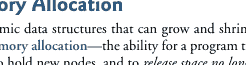

图 12.1 | 链接在一起的自引用结构。

## 12.3 动态内存分配

创建和维护能在程序运行时增长和收缩的动态数据结构，需要动态内存分配，即程序能够在执行时获取更多内存空间以保存新节点，并释放不再需要的空间。函数 malloc 和 free 以及运算符 sizeof 对动态内存分配至关重要。函数 malloc 接受要分配的字节数作为参数，并返回一个指向已分配内存的 void * 类型指针（指向 void 的指针）。回想一下，void * 指针可以赋给任何指针类型的变量。函数 malloc 通常与 sizeof 运算符一起使用。例如，以下语句

```c
newPtr = malloc(sizeof(struct node));
```

会计算 `sizeof(struct node)` 以确定结构 node 对象的字节大小，*在内存中分配一个新区域*，其大小为该字节数，并将指向已分配内存的指针存入 `newPtr`。该内存*不保证*已初始化，不过许多实现出于安全考虑会将其初始化。如果没有可用内存，`malloc` 返回 `NULL`。

函数 `free` 释放内存，即把内存*归还*给系统，以便将来可以重新分配。要*释放*前一次 `malloc` 调用动态分配的内存，请使用以下语句

```c
free(newPtr);
```

C 还提供函数 `calloc` 和 `realloc`，用于创建和修改*动态数组*。这些函数将在 14.9 节讨论。接下来的几节将讨论列表、栈、队列和树，它们都是通过动态内存分配和自引用结构来创建和维护的。

> **可移植性提示 12.1**
>
> *结构的大小不一定是其各成员大小的总和。这是因为存在各种依赖于机器的边界对齐要求（见第 10 章）。*

> **错误预防提示 12.1**
>
> *使用 `malloc` 时，应测试返回的 `NULL` 指针，它表示内存未分配。*

> **常见编程错误 12.2**
>
> *不再需要动态分配的内存时未释放它，可能导致系统过早耗尽内存。这有时称为“内存泄漏”。*

> **错误预防提示 12.2**
>
> *当动态分配的内存不再需要时，使用 `free` 立即将内存归还给系统。然后将指针设置为 `NULL`，以消除程序引用已被回收、且可能已分配给其他用途的内存的可能性。*

> **常见编程错误 12.3**
>
> *释放并非由 `malloc` 动态分配的内存是错误的。*

> **常见编程错误 12.4**
>
> *引用已释放的内存是一种错误，通常会导致程序崩溃。*

## 12.4 链表

链表是由称为节点的自引用结构组成的线性集合，这些节点通过指针链接连接起来，因此称为“链”表。链表通过指向列表*第一个*节点的指针来访问。后续节点通过每个节点中存储的*链接指针成员*来访问。按照惯例，列表中最后一个节点的链接指针设置为 `NULL`，以标记列表的结尾。数据动态存储在链表中，每个节点根据需要创建。节点可以包含任何类型的数据，包括其他结构。栈和队列也是线性数据结构，而且正如我们将看到的，它们是链表的受限版本。树是非线性数据结构。

数据列表可以存储在数组中，但链表具有若干优点。当数据结构中要表示的数据元素数量不可预测时，链表是合适的。链表是动态的，因此列表的长度可以在执行时根据需要增加或减少。然而，编译时创建的数组大小无法更改。数组可能会变满。链表只有在系统内存不足以满足动态存储分配请求时才会变满。

> **性能提示 12.1**
>
> *可以声明数组包含比预期数据项数量更多的元素，但这可能浪费内存。在这些情况下，链表可以提供更好的内存利用率。*

通过将每个新元素插入列表中的适当位置，可以按排序顺序维护链表。

> **性能提示 12.2**
>
> *在有序数组中进行插入和删除可能很耗时，插入或删除元素之后的所有元素都必须适当地移动。*

> **性能提示 12.3**
>
> *数组的元素在内存中连续存储。这允许立即访问任何数组元素，因为任何元素的地址都可以根据其相对于数组起始位置的位置直接计算出来。链表无法提供对其元素的这种立即访问。*

链表的节点通常不在内存中连续存储。然而，从逻辑上看，链表的节点似乎是连续的。图 12.2 展示了一个包含若干节点的链表。

> **性能提示 12.4**
>
> *对于在执行时增长和收缩的数据结构，使用动态内存分配（而不是数组）可以节省内存。但是请记住，指针会占用空间，而且动态内存分配会带来函数调用的开销。*


图 12.2 | 链表的图形表示。

图 12.3（输出如图 12.4 所示）操作一个字符列表。你可以按字母顺序将字符插入列表（函数 `insert`），或从列表中删除字符（函数 `delete`）。下面对该程序进行详细讨论。

```c
    // Fig. 12.3: fig12_03.c
    // Inserting and deleting nodes in a list
    #include <stdio.h>
    #include <stdlib.h>

    // self-referential structure
    struct listNode {
        char data; // each listNode contains a character
        struct listNode *nextPtr; // pointer to next node
    };

    typedef struct listNode ListNode; // synonym for struct listNode
    typedef ListNode *ListNodePtr; // synonym for ListNode*

    // prototypes
    void insert(ListNodePtr *sPtr, char value);
    char delete(ListNodePtr *sPtr, char value);
    int isEmpty(ListNodePtr sPtr);
    void printList(ListNodePtr currentPtr);
    void instructions(void);

    int main(void)
    {
        ListNodePtr startPtr = NULL; // initially there are no nodes
        char item; // char entered by user

        instructions(); // display the menu
        printf("%s", "? ");
        unsigned choice; // user's choice
        scanf("%u", &choice);

        // loop while user does not choose 3
        while (choice != 3) {

            switch (choice) {
                case 1:
                    printf("%s", "Enter a character: ");
                    scanf("\n%c", &item);
                    insert(&startPtr, item); // insert item in list
                    printList(startPtr);
                    break;
                case 2: // delete an element
                    // if list is not empty
                    if (!isEmpty(startPtr)) {
                        printf("%s", "Enter character to be deleted: ");
                        scanf("\n%c", &item);
```

**图 12.3** | 在列表中插入和删除节点。（第 1 部分，共 4 部分。）


```c
// if character is found, remove it
if (delete(&startPtr, item)) { // remove item
    printf("%s deleted.\n", item);
    printList(startPtr);
}
else {
    printf("%s not found.\n\n", item);
}
}
else {
    puts("List is empty.\n");
}

break;
default:
    puts("Invalid choice.\n");
    instructions();
    break;
}

printf("%s", "? ");
scanf("%u", &choice);
}

puts("End of run.");
}

// display program instructions to user
void instructions(void)
{
    puts("Enter your choice:\n"
         "  1 to insert an element into the list.\n"
         "  2 to delete an element from the list.\n"
         "  3 to end.\n");
}

// insert a new value into the list in sorted order
void insert(ListNodePtr *sPtr, char value)
{
    ListNodePtr newPtr = malloc(sizeof(ListNode)); // create node

    if (newPtr != NULL) { // is space available?
        newPtr->data = value; // place value in node
        newPtr->nextPtr = NULL; // node does not link to another node

        ListNodePtr previousPtr = NULL;
        ListNodePtr currentPtr = *sPtr;

        // loop to find the correct location in the list
        while (currentPtr != NULL && value > currentPtr->data) {
            previousPtr = currentPtr; // walk to ...
            currentPtr = currentPtr->nextPtr; // ... next node
        }
```

Fig. 12.3 | 在链表中插入和删除节点。（第 2 部分，共 4 部分。）

```c
// insert new node at beginning of list
if (previousPtr == NULL) {
    newPtr->nextPtr = *sPtr;
    *sPtr = newPtr;
}
else { // insert new node between previousPtr and currentPtr
    previousPtr->nextPtr = newPtr;
    newPtr->nextPtr = currentPtr;
}
}
else {
    printf("%c not inserted. No memory available.\n", value);
}
}

// delete a list element
char delete(ListNodePtr *sPtr, char value)
{
    // delete first node if a match is found
    if (value == (*sPtr)->data) {
        ListNodePtr tempPtr = *sPtr; // hold onto node being removed
        *sPtr = (*sPtr)->nextPtr; // de-thread the node
        free(tempPtr); // free the de-threaded node
        return value;
    }
    else {
        ListNodePtr previousPtr = *sPtr;
        ListNodePtr currentPtr = (*sPtr)->nextPtr;

        // loop to find the correct location in the list
        while (currentPtr != NULL && currentPtr->data != value) {
            previousPtr = currentPtr; // walk to ...
            currentPtr = currentPtr->nextPtr; // next node
        }

        // delete node at currentPtr
        if (currentPtr != NULL) {
            ListNodePtr tempPtr = currentPtr;
            previousPtr->nextPtr = currentPtr->nextPtr;
            free(tempPtr);
            return value;
        }
    }

    return '\0';
}

// return 1 if the list is empty, 0 otherwise
int isEmpty(ListNodePtr sPtr)
{
    return sPtr == NULL;
}
```

**Fig. 12.3** | 在链表中插入和删除节点。（第 3 部分，共 4 部分。）

```c
// print the list
void printList(ListNodePtr currentPtr)
{
   // if list is empty
   if (isEmpty(currentPtr)) {
      puts("List is empty.\n");
   }
   else {
      puts("The list is:");

      // while not the end of the list
      while (currentPtr != NULL) {
         printf("%c --> ", currentPtr->data);
         currentPtr = currentPtr->nextPtr;
      }

      puts("\nNULL\n");
   }
}
```

**Fig. 12.3** | 在链表中插入和删除节点。（第 4 部分，共 4 部分。）

```text
Enter your choice:
   1 to insert an element into the list.
   2 to delete an element from the list.
   3 to end.
? 1
Enter a character: B
The list is:
B --> NULL

? 1
Enter a character: A

The list is:
A --> B --> NULL

? 1
Enter a character: C
The list is:
A --> B --> C --> NULL

? 2
Enter character to be deleted: D
D not found.

? 2
Enter character to be deleted: B
B deleted.
The list is:
A --> C --> NULL
```

**Fig. 12.4** | Fig. 12.3 程序的示例输出。（第 1 部分，共 2 部分。）

```text
? 2
Enter character to be deleted: C
C deleted.
The list is:
A --> NULL

? 2
Enter character to be deleted: A
A deleted.
List is empty.

? 4
Invalid choice.

Enter your choice:
   1 to insert an element into the list.
   2 to delete an element from the list.
   3 to end.
? 3
End of run.
```

**Fig. 12.4** | Fig. 12.3 程序的示例输出。（第 2 部分，共 2 部分。）

链表的主要功能是插入（第 85–115 行）和删除（第 118–147 行）。函数 `isEmpty`（第 150–153 行）称为谓词函数——它不以任何方式修改链表；而是判断链表是否为空（即，指向链表第一个节点的指针是否为 `NULL`）。如果链表为空，则返回 1；否则返回 0。**[注意：** 如果你使用的编译器符合 C99 标准，可以使用 `_Bool` 类型（第 4.10 节）而不是 `int`。] 函数 `printList`（第 156–173 行）打印链表。

## 12.4.1 函数 insert

字符按*字母顺序*插入链表中。函数 `insert`（第 85–115 行）接收链表的地址和要插入的字符。当要在链表*开头*插入值时，链表的地址是必需的。提供地址使得可以通过引用调用修改链表（即，指向链表第一个节点的指针）。因为链表本身就是一个指针（指向其第一个元素），传递它的地址会创建一个指向指针的指针（即双重间接寻址）。这是一个复杂的概念，需要仔细编程。在链表中插入字符的步骤如下（见图 12.5）：

- 1. 通过调用 `malloc` 创建一个节点，将分配内存的地址赋给 `newPtr`（第 87 行），将要插入的字符赋给 `newPtr->data`（第 90 行），并将 `NULL` 赋给 `newPtr->nextPtr`（第 91 行）。
- 2. 将 `previousPtr` 初始化为 `NULL`（第 93 行），并将 `currentPtr` 初始化为 `*sPtr`（第 94 行）——即指向链表开头的指针。指针 `previousPtr` 和 `currentPtr` 分别存储插入点之前和之后的节点位置。
- 3. 当 `currentPtr` 不为 `NULL` 且要插入的值大于 `currentPtr->data`（第 97 行）时，将 `currentPtr` 赋给 `previousPtr`（第 98 行），并将 `currentPtr` 推进到链表中的下一个节点（第 99 行）。这样便定位了新节点的*插入点*。
- 4. 如果 `previousPtr` 为 `NULL`（第 103 行），则将新节点作为链表中的第一个节点插入（第 104–105 行）。将 `*sPtr` 赋给 `newPtr->nextPtr`（新节点的链接指向原……

- 1. 如果要删除的字符与链表*第一个*节点中的字符匹配（第 121 行），则将 `*sPtr` 赋给 `tempPtr`（`tempPtr` 将用于释放不需要的内存），将 `(*sPtr)->nextPtr` 赋给 `*sPtr`（`*sPtr` 现在指向链表中的*第二个*节点），释放 `tempPtr` 所指向的内存，并返回被删除的字符。
- 2. 否则，用 `*sPtr` 初始化 `previousPtr`，并用 `(*sPtr)->nextPtr` 初始化 `currentPtr`（第 128–129 行），以推进到第二个节点。
- 3. 当 `currentPtr` 不为 NULL 且要删除的值不等于 `currentPtr->data`（第 132 行）时，将 `currentPtr` 赋给 `previousPtr`（第 133 行），并将 `currentPtr->nextPtr` 赋给 `currentPtr`（第 134 行）。如果链表中包含要删除的字符，这样就定位到了该字符。
- 4. 如果 `currentPtr` 不为 NULL（第 138 行），则将 `currentPtr` 赋给 `tempPtr`（第 139 行），将 `currentPtr->nextPtr` 赋给 `previousPtr->nextPtr`（第 140 行），释放 `tempPtr` 所指向的节点（第 141 行），并返回从链表中删除的字符（第 142 行）。如果 `currentPtr` 为 NULL，则返回空字符（'\0'）以表示链表中未找到要删除的字符（第 146 行）。

图 12.6 说明了从链表中删除包含字符 'C' 的节点的过程。该图的 (a) 部分显示了先前插入操作后的链表。(b) 部分显示了对 `previousPtr` 的链接元素重新赋值，以及将 `currentPtr` 赋给 `tempPtr`。指针 `tempPtr` 用于*释放*分配给存储 'C' 的节点的内存。请注意，在第 124 行和第 141 行，我们确实释放了 `tempPtr`。回想一下，我们建议将已释放的指针设置为 NULL。在这两种情况下我们没有这样做，因为 `tempPtr` 是局部自动变量，并且函数会立即返回。


**Fig. 12.6** | *从链表中删除一个节点。*


### 12.4.3 函数 `printList`

函数 `printList`（第 156–173 行）接收指向链表起始位置的指针作为参数，并将该指针称为 `currentPtr`。该函数首先判断链表是否为*空*（第 159–161 行），如果为空，则打印 "List is empty." 并终止。否则，它打印链表中的数据（第 162–172 行）。当 `currentPtr` 不为 NULL 时，函数打印 `currentPtr->data` 的值，并将 `currentPtr->nextPtr` 赋给 `currentPtr`，以推进到下一个节点。如果链表中最后一个节点的链接不为 NULL，打印算法将试图打印超出链表末尾的内容，从而发生错误。对于链表、栈和队列，打印算法是相同的。

练习 12.20 要求你实现一个递归函数，以反向打印链表。练习 12.21 要求读者实现一个递归函数，在链表中搜索特定的数据项。

## 12.5 栈

栈可以实现为链表的一种受限版本。新节点可以加入栈中，也可以从栈中移除，但*只能在顶部*进行。因此，栈被称为后进先出（LIFO）数据结构。栈通过指向栈顶元素的指针来引用。栈中最后一个节点的链接成员被设置为 NULL，以表示栈底。

图 12.7 展示了一个包含若干节点的栈——`stackPtr` 指向栈顶元素。在这些图中，我们以相同的方式表示栈和链表。栈和链表的区别在于：在链表中，插入和删除可以发生在*任何位置*，但在栈中，插入和删除*只能在顶部*进行。

> **常见编程错误 12.5**
>
> *未将栈底节点中的链接设置为 NULL 可能导致运行时错误。*


**图 12.7** | 栈的图形表示。

### *主要的栈操作*

用于操作栈的主要函数是 push 和 pop。函数 push 创建一个新节点，并将其放在栈的*顶部*。函数 pop *从栈顶移除一个节点*，*释放*分配给被弹出节点的内存，并*返回被弹出的值*。

### *实现栈*

图 12.8（输出如图 12.9 所示）实现了一个简单的整数栈。程序提供三个选项：1）将一个值压入栈（函数 push），2）从栈中弹出一个值（函数 pop），3）终止程序。

```c
// Fig. 12.8: fig12_08.c
// A simple stack program
#include <stdio.h>
#include <stdlib.h>

// self-referential structure
struct stackNode {
    int data; // define data as an int
    struct stackNode *nextPtr; // stackNode pointer
};

typedef struct stackNode StackNode; // synonym for struct stackNode
typedef StackNode *StackNodePtr; // synonym for StackNode*

// prototypes
void push(StackNodePtr *topPtr, int info);
int pop(StackNodePtr *topPtr);
int isEmpty(StackNodePtr topPtr);
void printStack(StackNodePtr currentPtr);
void instructions(void);

// function main begins program execution
int main(void)
{
    StackNodePtr stackPtr = NULL; // points to stack top
    int value; // int input by user

    instructions(); // display the menu
    printf("%s", "\n");
    unsigned int choice; // user's menu choice
    scanf("%u", &choice);

    // while user does not enter 3
    while (choice != 3) {

        switch (choice) {

            // push value onto stack
            case 1:
                printf("%s", "Enter an integer: ");
                scanf("%d", &value);
                push(&stackPtr, value);
                printStack(stackPtr);
                break;
            // pop value off stack
            case 2:
                // if stack is not empty
                if (!isEmpty(stackPtr)) {
                    printf("The popped value is %d.\n", pop(&stackPtr));
                }

                printStack(stackPtr);
                break;
            default:
                puts("Invalid choice.\n");
                instructions();
                break;
        }

        printf("%s", "? ");
        scanf("%u", &choice);
    }

    puts("End of run.");
}

// display program instructions to user
void instructions(void)
{
    puts("Enter choice:\n"
        "1 to push a value on the stack\n"
        "2 to pop a value off the stack\n"
        "3 to end program");
}

// insert a node at the stack top
void push(StackNodePtr *topPtr, int info)
{
    StackNodePtr newPtr = malloc(sizeof(StackNode));

    // insert the node at stack top
    if (newPtr != NULL) {
        newPtr->data = info;
        newPtr->nextPtr = *topPtr;
        *topPtr = newPtr;
    }
    else { // no space available
        printf("%d not inserted. No memory available.\n", info);
    }
}

// remove a node from the stack top
int pop(StackNodePtr *topPtr)
{
    StackNodePtr tempPtr = *topPtr;
    int popValue = (*topPtr)->data;
    *topPtr = (*topPtr)->nextPtr;
    free(tempPtr);
    return popValue;
}

// print the stack
void printStack(StackNodePtr currentPtr)
{
    // if stack is empty
    if (currentPtr == NULL) {
        puts("The stack is empty.\n");
    }
    else {
        puts("The stack is:");

        // while not the end of the stack
        while (currentPtr != NULL) {
            printf("%d --> ", currentPtr->data);
            currentPtr = currentPtr->nextPtr;
        }

    }
    puts("NULL\n");
}

// return 1 if the stack is empty, 0 otherwise
int isEmpty(StackNodePtr topPtr)
{
    return topPtr == NULL;
}
```

**图 12.8** | 一个简单的栈程序。

```text
Enter choice:
1 to push a value on the stack
2 to pop a value off the stack
3 to end program
? 1
Enter an integer: 5
The stack is:
5 --> NULL

? 1
Enter an integer: 6
The stack is:
6 --> 5 --> NULL

? 1
Enter an integer: 4
The stack is:
4 --> 6 --> 5 --> NULL

? 2
The popped value is 4.
The stack is:
6 --> 5 --> NULL

? 2
The popped value is 6.
The stack is:
5 --> NULL

? 2
The popped value is 5.
The stack is empty.

? 2
The stack is empty.

? 4
Invalid choice.

Enter choice:
1 to push a value on the stack
2 to pop a value off the stack
3 to end program
? 3
End of run.
```

**图 12.9** | 图 12.8 程序的示例输出。

### 12.5.1 函数 push

函数 push（第 76–89 行）将一个新建节点放在栈顶。该函数由三个步骤组成：

- 1. 通过调用 `malloc` 创建一个*新节点*，并将分配内存的位置赋给 `newPtr`（第 78 行）。
- 2. 将要在栈中放置的值赋给 `newPtr->data`（第 82 行），并将 `*topPtr`（*栈顶指针*）赋给 `newPtr->nextPtr`（第 83 行）——`newPtr` 的*链接成员*现在指向*先前的栈顶节点*。
- 3. 将 `newPtr` 赋给 `*topPtr`（第 84 行）——`*topPtr` 现在指向*新的栈顶*。

涉及 `*topPtr` 的操作会改变 `main` 中 `stackPtr` 的值。图 12.10 说明了函数 push。该图的 (a) 部分显示了 push 操作之前的 `stackPtr` 和新节点。(b) 部分中的虚线箭头说明了 push 操作的*第 2 步和第 3 步*，这些步骤使包含 12 的节点成为新的栈顶。


**图 12.10** | push 操作。

### 12.5.2 函数 pop

函数 pop（第 92–99 行）移除栈顶的节点。函数 main 在调用 pop 之前判断栈是否为空。pop 操作由五个步骤组成：

- 1. 将 `*topPtr` 赋给 `tempPtr`（第 94 行）；`tempPtr` 将用于*释放*不需要的内存。
- 2. 将 `(*topPtr)->data` 赋给 `popValue`（第 95 行），以*保存*栈顶节点中的值。
- 3. 将 `(*topPtr)->nextPtr` 赋给 `*topPtr`（第 96 行），使 `*topPtr` 包含*新栈顶节点的地址*。
- 4. *释放* `tempPtr` 所指向的内存（第 97 行）。
- 5. *返回 popValue* 给调用者（第 98 行）。

图 12.11 说明了函数 pop。(a) 部分显示了上一次 push 操作之后的栈。(b) 部分显示 `tempPtr` 指向栈的*第一个节点*，而 `*topPtr` 指向栈的*第二个节点*。函数 free 用于*释放内存*，该内存由 `tempPtr` 指向。


### 12.5.3 栈的应用

栈有许多有趣的应用。例如，每当发生*函数调用*时，被调用的函数必须知道如何*返回*其调用者，因此*返回地址*被压入栈中（第 5.7 节）。在一系列函数调用中，连续的返回地址按*后进先出*顺序压入栈中，以便每个函数都能返回其调用者。栈以与传统非递归调用相同的方式支持递归函数调用。

栈包含每次调用函数时为*自动变量*创建的空间。当函数返回其调用者时，该函数自动变量的空间从栈中弹出，这些变量不再为程序所知。编译器在求值表达式和生成机器语言代码的过程中有时也会使用栈。练习题探讨了栈的几种应用。


## 12.6 队列

另一种常见的数据结构是队列。队列类似于杂货店的结账队伍——队伍中*第一个*人*首先被服务*，其他顾客只能在队尾加入并*等待*服务。队列节点*只能*从队头移除，*只能*在队尾插入。因此，队列被称为*先入先出*（FIFO）数据结构。*插入*和*移除*操作分别称为入队（enqueue，发音为“en-cue”）和出队（dequeue，发音为“dee-cue”）。

队列在计算机系统中有许多应用。对于只有单个处理器的计算机，每次只能为一个用户服务。其他用户的条目被放入队列中。随着用户获得服务，每个条目逐渐向队列前面移动。位于队列*前面*的条目是*下一个接受服务*的条目。类似地，在当今的多核系统中，用户数可能多于处理器数，因此当前未运行的用户会被放入队列中，直到某个当前忙碌的处理器变为可用。在附录 E 中，我们讨论了多线程。当用户的工作被划分为多个可以并行执行的线程时，线程数可能多于处理器数，因此当前未运行的线程需要在队列中等待。

队列还用于支持*打印假脱机*。多用户环境可能只有一台打印机。许多用户可能在生成要打印的输出。如果打印机正忙，其他输出仍可以继续生成。这些输出被*假脱机*（就像缝纫线缠绕在线轴上直到需要时再用一样）到磁盘上，在队列中*等待*，直到打印机可用为止。

数据包在计算机网络中也会排队等待。每当一个数据包到达某个网络节点时，它必须沿着通往最终目的地的路径被路由到网络上的下一个节点。路由节点一次只能路由一个数据包，因此额外的数据包会被加入队列，直到路由器可以路由它们。图 12.12 展示了一个包含多个节点的队列。注意指向队列头部和尾部的指针。

> **常见编程错误 12.6**
>
> *未将队列最后一个节点中的链接设置为 NULL 可能导致运行时错误。*

图 12.13（其输出见图 12.14）执行队列操作。该程序提供几个选项：在队列中*插入*一个节点（函数 *enqueue*）、从队列中*删除*一个节点（函数 *dequeue*）以及终止程序。


**图 12.12** | 队列的图形表示。

```c
// Fig. 12.13: fig12_13.c
// Operating and maintaining a queue
#include <stdio.h>
#include <stdlib.h>

// self-referential structure
struct QueueNode {
    char data; // define data as a char
    struct QueueNode *nextPtr; // queueNode pointer
};

typedef struct QueueNode QueueNode;
typedef QueueNode *QueueNodePtr;

// function prototypes
void printQueue(QueueNodePtr currentPtr);
int isEmpty(QueueNodePtr headPtr);
char dequeue(QueueNodePtr *headPtr, QueueNodePtr *tailPtr);
void enqueue(QueueNodePtr *headPtr, QueueNodePtr *tailPtr, char value);
void instructions(void);

// function main begins program execution
int main(void)
{
    QueueNodePtr headPtr = NULL; // initialize headPtr
    QueueNodePtr tailPtr = NULL; // initialize tailPtr
    char item; // char input by user

    instructions(); // display the menu
    printf("%s", "? ");
    unsigned int choice; // user's menu choice
    scanf("%u", &choice);

    // while user does not enter 3
    while (choice != 3) {

        switch(choice) {
            // enqueue value
            case 1:
                printf("%s", "Enter a character: ");
                scanf("%c", &item);
                enqueue(&headPtr, &tailPtr, item);
                printQueue(headPtr);
                break;
            // dequeue value
            case 2:
                // if queue is not empty
                if (!isEmpty(headPtr)) {
                    item = dequeue(&headPtr, &tailPtr);
                    printf("%c has been dequeued.\n", item);
                }
                printQueue(headPtr);
                break;
            default:
                puts("Invalid choice.\n");
                instructions();
                break;
        }

        printf("%s", "? ");
        scanf("%d", &choice);
    }

    puts("End of run.");
}

// display program instructions to user
void instructions(void)
{
    printf("Enter your choice:\n"
           "        1 to add an item to the queue\n"
           "        2 to remove an item from the queue\n"
           "        3 to end\n");
}

// insert a node at queue tail
void enqueue(QueueNodePtr *headPtr, QueueNodePtr *tailPtr, char value)
{
    QueueNodePtr newPtr = malloc(sizeof(QueueNode));

    if (newPtr != NULL) { // is space available?
        newPtr->data = value;
        newPtr->nextPtr = NULL;

        // if empty, insert node at head
        if (*headPtr == NULL) {
            *headPtr = newPtr;
        }
        else {
            (*tailPtr)->nextPtr = newPtr;
        }

        *tailPtr = newPtr;
    }
    else {
        printf("%c not inserted. No memory available.\n", value);
    }
}

// remove node from queue head
char dequeue(QueueNodePtr *headPtr, QueueNodePtr *tailPtr)
{
    char value = (*headPtr)->data;
    QueueNodePtr tempPtr = *headPtr;
    *headPtr = (*headPtr)->nextPtr;

    // if queue is empty
    if (*headPtr == NULL) {
        *tailPtr = NULL;
    }

    free(tempPtr);
    return value;
}

// return 1 if the queue is empty, 0 otherwise
int isEmpty(QueueNodePtr headPtr)
{
    return headPtr == NULL;
}

// print the queue
void printQueue(QueueNodePtr currentPtr)
{
    // if queue is empty
    if (currentPtr == NULL) {
        puts("Queue is empty.\n");
    }
    else {
        puts("The queue is:");

        // while not end of queue
        while (currentPtr != NULL) {
            printf("%c --> ", currentPtr->data);
            currentPtr = currentPtr->nextPtr;
        }

        puts("NULL\n");
    }
}
```

图 12.13 | 操作并维护一个队列（第 1 部分，共 3 部分）。
图 12.13 | 操作并维护一个队列（第 2 部分，共 3 部分）。
图 12.13 | 操作并维护一个队列（第 3 部分，共 3 部分）。

```text
Enter your choice:
  1 to add an item to the queue
  2 to remove an item from the queue
  3 to end

? 2
Enter a character: A
The queue is:
A --> NULL

? 1
Enter a character: B
The queue is:
A --> B --> NULL

? 1
Enter a character: C
The queue is:
A --> B --> C --> NULL

? 2
A has been dequeued.
The queue is:
B --> C --> NULL

? 2
B has been dequeued.
The queue is:
C --> NULL

? 2
C has been dequeued.
Queue is empty.

? 2
Queue is empty.

? 4
Invalid choice.

Enter your choice:
   1 to add an item to the queue
   2 to remove an item from the queue
   3 to end
? 3
End of run.
```

图 12.14 | 图 12.13 中程序的示例输出（第 1 部分，共 2 部分）。
图 12.14 | 图 12.13 中程序的示例输出（第 2 部分，共 2 部分）。

### 12.6.1 enqueue 函数

函数 enqueue（第 78-99 行）从 main 接收三个参数：队列头指针的地址、队列尾指针的地址以及要插入队列的值。该函数由三个步骤组成：

1. 创建一个新节点：调用 malloc，将分配到的内存位置赋给 newPtr（第 80 行），将要插入队列的值赋给 newPtr->data（第 83 行），并将 NULL 赋给 newPtr->nextPtr（第 84 行）。

2. 如果队列为空（第 87 行），则将 newPtr 赋给 *headPtr（第 88 行），因为新节点将同时成为队列的头和尾；否则，将指针 newPtr 赋给 (*tailPtr)->nextPtr（第 91 行），因为新节点将被放置在之前的尾节点之后。

3. 将 newPtr 赋给 *tailPtr（第 94 行），因为新节点是队列的尾部。

图 12.15 说明了入队操作。子图（a）显示了操作之前的队列和新节点。子图（b）中的虚线箭头说明了函数 enqueue 的第 2 步和第 3 步，使新节点能够添加到非空队列的末尾。


## 常见编程错误 12.7

*不将树中叶节点的链接设置为 NULL 可能导致运行时错误。*


**图 12.18** | 二叉搜索树。

图 12.19（输出如图 12.20 所示）创建一棵二叉搜索树，并以三种方式*遍历*它——中序、前序和后序。该程序生成 10 个随机数，并将每个数插入树中，但*重复*值会被*丢弃*。

```c
// Fig. 12.19: fig12_19.c
// Creating and traversing a binary tree
// preorder, inorder, and postorder
#include <stdio.h>
#include <stdlib.h>
#include <time.h>

// self-referential structure
struct treeNode {
   struct treeNode *leftPtr;  // pointer to left subtree
   int data;                  // node value
   struct treeNode *rightPtr; // pointer to right subtree
};

typedef struct treeNode TreeNode;   // synonym for struct treeNode
typedef TreeNode *TreeNodePtr;       // synonym for TreeNode*

// prototypes
void insertNode(TreeNodePtr *treePtr, int value);
void inOrder(TreeNodePtr treePtr);
void preOrder(TreeNodePtr treePtr);
void postOrder(TreeNodePtr treePtr);

// function main begins program execution
int main(void)
{
   TreeNodePtr rootPtr = NULL; // tree initially empty

   srand(time(NULL));
   puts("The numbers being placed in the tree are:");
```

**图 12.19** | 创建并遍历二叉树。（第 1 部分，共 3 部分。）

```c
32    // insert random values between 0 and 14 in the tree
33    for (unsigned int i = 1; i <= 10; ++i) {
34       int item = rand() % 15;
35       printf("%d", item);
36       insertNode(&rootPtr, item);
37    }

39    // traverse the tree preOrder
40    puts("\n\nThe preOrder traversal is:");
41    preOrder(rootPtr);

43    // traverse the tree inOrder
44    puts("\n\nThe inOrder traversal is:");
45    inOrder(rootPtr);

47    // traverse the tree postOrder
48    puts("\n\nThe postOrder traversal is:");
49    postOrder(rootPtr);
50    }

52    // insert node into tree
53    void insertNode(TreeNodePtr *treePtr, int value)
54    {
55       // if tree is empty
56       if (*treePtr == NULL) {
57          *treePtr = malloc(sizeof(TreeNode));

59          // if memory was allocated, then assign data
60          if (*treePtr != NULL) {
61             (*treePtr)->data = value;
62             (*treePtr)->leftPtr = NULL;
63             (*treePtr)->rightPtr = NULL;
64          }
65          else {
66             printf("%d not inserted. No memory available.\n", value);
67          }
68       }
69       else { // tree is not empty
70          // data to insert is less than data in current node
71          if (value < (*treePtr)->data) {
72             insertNode(&((*treePtr)->leftPtr), value);
73          }

75          // data to insert is greater than data in current node
76          else if (value > (*treePtr)->data) {
77             insertNode(&((*treePtr)->rightPtr), value);
78          }
79          else { // duplicate data value ignored
80             printf("%s", "dup");
81          }
82       }
83    }
```

图 12.19 | 创建并遍历二叉树。（第 2 部分，共 3 部分。）

```c
85  // begin inorder traversal of tree
86  void inOrder(TreeNodePtr treePtr)
87  {
88      // if tree is not empty, then traverse
89      if (treePtr != NULL) {
90          inOrder(treePtr->leftPtr);
91          printf("%3d", treePtr->data);
92          inOrder(treePtr->rightPtr);
93      }
94  }
95
96  // begin preorder traversal of tree
97  void preOrder(TreeNodePtr treePtr)
98  {
99      // if tree is not empty, then traverse
100     if (treePtr != NULL) {
101         printf("%3d", treePtr->data);
102         preOrder(treePtr->leftPtr);
103         preOrder(treePtr->rightPtr);
104     }
105 }
106
107 // begin postorder traversal of tree
108 void postOrder(TreeNodePtr treePtr)
109 {
110     // if tree is not empty, then traverse
111     if (treePtr != NULL) {
112         postOrder(treePtr->leftPtr);
113         postOrder(treePtr->rightPtr);
114         printf("%3d", treePtr->data);
115     }
116 }
```

图 12.19 | 创建并遍历二叉树。（第 3 部分，共 3 部分。）

```
The numbers being placed in the tree are:
  6  7  4 12  7dup  2  2dup  5  7dup 11

The preOrder traversal is:
  6  4  2  5  7 12 11

The inOrder traversal is:
  2  4  5  6  7 11 12

The postOrder traversal is:
  2  5  4 11 12  7  6
```

**图 12.20** | 图 12.19 程序的示例输出。

### 12.7.1 函数 insertNode

图 12.19 中用于创建二叉搜索树并遍历它的函数是*递归的*。函数 `insertNode`（第 53—83 行）接收*树的地址*和一个要存储在树中的整数作为参数。在二叉搜索树中，节点只能作为*叶节点*插入。在二叉搜索树中插入节点的步骤如下：

- 1. 如果 `*treePtr` 为 NULL（第 56 行），则创建一个新节点（第 57 行）。调用 `malloc`，将分配的内存赋给 `*treePtr`，将要存储的整数赋给 `(*treePtr)->data`（第 61 行），将 NULL 值赋给 `(*treePtr)->leftPtr` 和 `(*treePtr)->rightPtr`（第 62—63 行），并将控制权返回给调用者（`main` 或之前对 `insertNode` 的调用）。

- 2. 如果 `*treePtr` 的值不为 NULL，且要插入的值*小于* `(*treePtr)->data`，则用 `(*treePtr)->leftPtr` 的地址（第 72 行）调用函数 `insertNode`，以将该节点插入 `*treePtr` 所指向节点的*左*子树中。如果要插入的值*大于* `(*treePtr)->data`，则用 `(*treePtr)->rightPtr` 的地址（第 77 行）调用函数 `insertNode`，以将该节点插入 `*treePtr` 所指向节点的*右*子树中。

这些*递归*步骤会一直继续，直到找到 NULL 指针，然后由*步骤 1*插入新节点。

### 12.7.2 遍历：函数 inOrder、preOrder 和 postOrder

函数 `inOrder`（第 86—94 行）、`preOrder`（第 97—105 行）和 `postOrder`（第 108—116 行）各自接收一棵*树*（即*指向树根节点的指针*），并*遍历*该树。

- 1. 按 `inOrder` 遍历*左*子树。
- 2. 处理该节点中的值。
- 3. 按 `inOrder` 遍历*右*子树。

节点中的值要等到其*左*子树中的值处理完毕后才会被处理。图 12.21 中树的中序遍历结果为：

6 13 17 27 33 42 48

二叉搜索树的中序遍历会按*升序*打印节点值。创建二叉搜索树的过程实际上会对数据排序——因此该过程称为二叉树排序。

前序遍历的步骤如下：

- 1. 处理该节点中的值。
- 2. 按 `preOrder` 遍历*左*子树。
- 3. 按 `preOrder` 遍历*右*子树。


**图 12.21** | 包含七个节点的二叉搜索树。

- **MEM01-C/MEM30-C:** 指针不应保持未初始化状态。相反，应将它们赋值为 `NULL` 或内存中有效项的地址。当你使用 `free` 释放动态分配的内存时，传给 `free` 的指针不会被赋予新值，因此它仍然指向动态分配内存*曾经*所在的内存位置。使用这种“悬空”指针可能导致程序崩溃和安全漏洞。当你释放动态分配的内存时，应立即将该指针赋值为 `NULL` 或一个有效地址。对于在调用 `free` 后立即超出作用域的局部指针变量，我们选择不这样做。
- **MEM01-C:** 当你尝试使用 `free` 释放已经释放过的动态内存时，会发生未定义行为——这称为“双重释放漏洞”。为确保不会多次尝试释放同一内存，在调用 `free` 后立即将指针设置为 `NULL`——尝试释放 `NULL` 指针没有效果。
- **ERR33-C:** 大多数标准库函数会返回值，使你能够确定函数是否正确地完成了任务。例如，如果函数 `malloc` 无法分配请求的内存，则返回 `NULL`。在尝试使用存储 `malloc` 返回值的指针之前，你应*始终*确保 `malloc` 没有返回 `NULL`。

## 小结

### 第 12.1 节 引言

- 动态数据结构（第 510 页）在程序执行时增长和收缩。
- 链表（第 510 页）是“排成一行”的数据项集合——插入和删除可在链表中的任何位置进行。
- 对于栈（第 510 页），插入和删除只在栈顶（第 510 页）进行。
- 队列（第 510 页）表示等待队列；插入在队列的后端（也称为尾部；第 510 页）进行，删除从队列的前端（也称为头部；第 510 页）进行。
- 二叉树有助于高速搜索和排序数据、高效消除重复数据项、表示文件系统目录，以及将表达式编译为机器语言。

### 第 12.2 节 自引用结构

- 自引用结构（第 511 页）包含一个指向同类型结构的指针成员。
- 自引用结构可以链接在一起，形成链表、队列、栈和树。
- `NULL` 指针（第 511 页）通常表示数据结构的结束。

### 第 12.3 节 动态内存分配

- 创建和维护动态数据结构需要动态内存分配（第 511 页）。
- 函数 `malloc` 和 `free`，以及运算符 `sizeof`，对于动态内存分配至关重要。
- 函数 `malloc`（第 511 页）接收要分配的字节数，并返回指向所分配内存的 `void *` 指针。`void *` 指针可以赋给任何指针类型的变量。
- 函数 `malloc` 通常与 `sizeof` 运算符一起使用。


- `malloc` 分配的内存未初始化。
- 如果没有可用内存，`malloc` 返回 `NULL`。
- 函数 free（p. 511）释放内存，以便将来可以重新分配。
- C 还提供了函数 `calloc` 和 `realloc` 用于创建和修改动态数组。

## Section 12.4 链表
- 链表是由指针链接（p. 512）连接的自引用结构（称为节点（p. 512））的线性集合。
- 链表通过指向第一个节点的指针访问。后续节点通过存储在每个节点中的链接指针成员访问。
- 按惯例，列表最后一个节点的链接指针被设置为 NULL 以标记列表的结束。
- 数据以动态方式存储在链表中——每个节点在需要时创建。
- 节点可以包含任何类型的数据，包括其他结构体对象。
- 链表是动态的，因此列表的长度可以根据需要增加或减少。
- 链表节点通常不在内存中连续存储。然而，从逻辑上讲，链表的节点似乎是连续的。

## Section 12.5 栈
- 栈（p. 521）可以实现为链表的受限版本。新的节点只能在栈顶添加和从栈顶移除——称为后进先出（LIFO；p. 521）数据结构。
- 用于操作栈的主要函数是 push 和 pop。函数 push 创建一个新节点并将其放在栈顶。函数 pop 从栈顶移除一个节点，释放分配给弹出节点的内存并返回弹出值。
- 每当进行函数调用时，被调用函数必须知道如何返回到其调用者，因此返回地址被压入栈。如果发生一系列函数调用，连续的返回值以后进先出顺序压入栈，以便每个函数都能返回到其调用者。栈以与常规非递归调用相同的方式支持递归函数调用。
- 栈在编译器评估表达式和生成机器语言代码的过程中使用。

## Section 12.6 队列
- 队列节点只能从队列头部移除，只能在队列尾部插入——称为先进先出（FIFO；p. 527）数据结构。
- 队列的插入和移除操作称为 enqueue 和 dequeue（p. 527）。

## Section 12.7 树
- 树（p. 533）是一种非线性、二维数据结构。树节点包含两个或多个链接。
- 二叉树（p. 533）是节点都包含两个链接的树。
- 根节点（p. 533）是树中的第一个节点。二叉树根节点中的每个链接指向一个子节点（p. 533）。左子节点（p. 533）是左子树（p. 533）中的第一个节点，右子节点（p. 533）是右子树（p. 533）中的第一个节点。节点的子节点称为兄弟节点（p. 533）。
- 没有子节点的节点称为叶节点（p. 533）。

l) 树的第一个节点是 ______ 节点。
m) 树节点中的每个链接指向该节点的 ______ 或 ______。
n) 没有子节点的树节点称为 ______ 节点。
o) 二叉树的三种遍历算法（本章介绍）是 ______、______ 和 ______。

12.2 链表和栈之间有什么区别？

12.3 栈和队列之间有什么区别？

12.4 编写语句或语句集以完成以下每项。假设所有操作都在 main 中进行（因此不需要指针变量的地址），并假设以下定义：

```c
struct gradeNode {
    char lastName[ 20 ];
    double grade;
    struct gradeNode *nextPtr;
};

typedef struct gradeNode GradeNode;
typedef GradeNode *GradeNodePtr;
```

- a) 创建一个指向列表开始的指针，名为 startPtr。列表为空。
- b) 创建一个类型为 GradeNode 的新节点，由类型为 GradeNodePtr 的指针 newPtr 指向。将字符串 "Jones" 分配给成员 lastName，并将值 91.5 分配给成员 grade（使用 strcpy）。提供必要的声明和语句。
- c) 假设 startPtr 指向的列表当前由 2 个节点组成——一个包含 "Jones"，一个包含 "Smith"。节点按字母顺序排列。提供必要的语句，按顺序插入包含以下 lastName 和 grade 数据的节点：

```
"Adams"      85.0
"Thompson"   73.5
"Pritchard"  66.5
```

使用指针 previousPtr、currentPtr 和 newPtr 执行插入。说明每次插入前 previousPtr 和 currentPtr 指向什么。假设 newPtr 总是指向新节点，并且新节点已分配数据。
- d) 编写一个 while 循环，打印列表中每个节点的数据。使用指针 currentPtr 在列表中移动。
- e) 编写一个 while 循环，删除列表中的所有节点并释放每个节点关联的内存。使用指针 currentPtr 和指针 tempPtr 分别遍历列表和释放内存。

12.5（二叉搜索树遍历）提供图 12.22 的二叉搜索树的中序、前序和后序遍历。


## 自我复习练习答案
- **I2.1** a) 引用。 b) malloc。 c) 栈。 d) 谓词。 e) FIFO。 f) 链接。 g) free。 h) 队列。
- i) 树。 j) LIFO。 k) 二叉。 l) 根。 m) 子节点, 子树。 n) 叶。 o) 中序, 前序, 后序。

**I2.2** 可以在链表的任何位置插入节点并从链表的任何位置移除节点。然而，栈中的节点只能在栈顶插入，只能从栈顶移除。

**I2.3** 队列同时具有指向其头部和尾部的指针，以便节点可以在尾部插入并从头部删除。栈只有一个指向栈顶的指针，节点的插入和删除都在该处进行。

**I2.4**

a) `GradeNodePtr startPtr = NULL;`

b)
```c
GradeNodePtr newPtr;
newPtr = malloc(sizeof(GradeNode));
strcpy(newPtr->lastName, "Jones");
newPtr->grade = 91.5;
newPtr->nextPtr = NULL;
```

c) To insert "Adams":
```text
previousPtr is NULL, currentPtr points to the first element in the list.
newPtr->nextPtr = currentPtr;
startPtr = newPtr;
```
To insert "Thompson":
```text
previousPtr points to the last element in the list (containing "Smith")
currentPtr is NULL.
newPtr->nextPtr = currentPtr;
previousPtr->nextPtr = newPtr;
```
To insert "Pritchard":
```text
previousPtr points to the node containing "Jones"
currentPtr points to the node containing "Smith"
newPtr->nextPtr = currentPtr;
previousPtr->nextPtr = newPtr;
```

d)
```c
currentPtr = startPtr;
while (currentPtr != NULL) {
    printf("%s\nGrade = %.2f\n",
           currentPtr->lastName, currentPtr->grade);
    currentPtr = currentPtr->nextPtr;
}
```

e)
```c
currentPtr = startPtr;
while (currentPtr != NULL) {
    tempPtr = currentPtr;
    currentPtr = currentPtr->nextPtr;
    free(tempPtr);
}
startPtr = NULL;
```

**I2.5** *中序* 遍历是：

`11 18 28 32 40 44 49 69 71 72 83 92 97 99`

*前序* 遍历是：

`49 28 18 11 19 40 32 44 83 71 69 72 97 92 99`

后序遍历是：

```
11 19 18 32 44 40 28 69 72 71 92 99 97 83 49
```

## 练习
12.6（连接列表）编写一个程序，将两个字符链表连接起来。程序应包含函数 concatenate，该函数接受指向两个列表的指针作为参数，并将第二个列表连接到第一个列表。

12.7（合并有序列表）编写一个程序，将两个有序整数列表合并为一个有序整数列表。函数 merge 应接收待合并的每个列表的第一个节点的指针，并返回合并后列表的第一个节点的指针。

12.8（向有序列表插入）编写一个程序，按顺序将 25 个 0 到 100 的随机整数插入链表。程序应计算元素的总和和元素的浮点平均值。

12.9（创建链表，然后反转其元素）编写一个程序，创建包含 10 个字符的链表，然后按相反顺序创建列表的副本。

12.10（反转句子的单词）编写一个程序，输入一行文本并使用栈反向打印该行。

12.11（回文测试器）编写一个程序，使用栈确定一个字符串是否为回文（即字符串正向和反向拼写相同）。程序应忽略空格和标点符号。

12.12（中缀到后缀转换器）栈在编译器评估表达式和生成机器语言代码的过程中使用。在本练习和下一个练习中，我们研究编译器如何评估仅由常量、运算符和括号组成的算术表达式。

人们通常写 3 + 4 和 7 / 9 这样的表达式，其中运算符（此处为 + 或 /）写在操作数之间——这称为中缀表示法。计算机“更喜欢”后缀表示法，其中运算符写在两个操作数的右侧。上述中缀表达式在后缀表示法中分别显示为 3 4 + 和 7 9 /。

为了评估复杂的表达式，某些编译器首先将表达式转换为后缀表示法，然后评估后缀版本。这些算法中的每一个只需要对表达式进行一次从左到右的扫描。每个算法都使用栈来支持其操作，并且在每个算法中栈的使用目的不同。

在本练习中，您将编写中缀到后缀转换算法的一个版本。在下一个练习中，您将编写后缀表达式求值算法的一个版本。

编写一个程序，将普通的中缀算术表达式（假设输入的是有效表达式）转换为后缀表达式，例如单数字整数

```
(6 + 2) * 5 - 8 / 4
```

转换为后缀表达式。前述中缀表达式的后缀版本是

```
6 2 + 5 * 8 4 / -
```

程序应将表达式读入字符数组 infix，并使用本章实现的栈函数帮助创建字符数组 postfix 中的后缀表达式。创建后缀表达式的算法如下：

- 1) 将左括号 '(' 压入栈。
- 2) 在 infix 末尾附加右括号 ')'。


3. 当栈不为空时，从左到右读取中缀表达式，并执行以下操作：
   - 如果中缀表达式中的当前字符是数字，则将其复制到后缀表达式的下一个元素。
   - 如果中缀表达式中的当前字符是左括号，则将其压入栈中。
   - 如果中缀表达式中的当前字符是运算符，
     - 当栈顶运算符（如果有）的优先级等于或高于当前运算符时，将其弹出，并将弹出的运算符插入后缀表达式中。
     - 将中缀表达式中的当前字符压入栈中。
   - 如果中缀表达式中的当前字符是右括号
     - 从栈顶弹出运算符并插入后缀表达式中，直到栈顶为左括号。
     - 从栈中弹出（并丢弃）左括号。

表达式中允许以下算术运算：

- `+` 加法
- `-` 减法
- `*` 乘法
- `/` 除法
- `^` 幂运算
- `%` 取余

应使用以下声明维护栈：

```
struct stackNode {
    char data;
    struct stackNode *nextPtr;
};
typedef struct stackNode StackNode;
typedef StackNode *StackNodePtr;
```

程序应由 main 和另外八个函数组成，函数头如下：

```
void convertToPostfix(char infix[], char postfix[])
Convert the infix expression to postfix notation.

int isOperator(char c)
Determine whether c is an operator.

int precedence(char operator1, char operator2)
Determine whether the precedence of operator1 is less than, equal to, or greater than the precedence of operator2. The function returns -1, 0 and 1, respectively.

void push(StackNodePtr *topPtr, char value)
Push a value on the stack.

char pop(StackNodePtr *topPtr)
Pop a value off the stack.

char stackTop(StackNodePtr topPtr)
Return the top value of the stack without popping the stack.

int isEmpty(StackNodePtr topPtr)
Determine whether the stack is empty.

void printStack(StackNodePtr topPtr)
Print the stack.
```

## 12.13（后缀表达式求值器）

编写一个程序，对后缀表达式（假设其有效）求值，例如

```
6 2 + 5 * 8 4 / -
```

程序应将由单个数字和运算符组成的后缀表达式读入一个字符数组。使用本章前面实现的栈函数，程序应扫描该表达式并对其求值。算法如下：

1. 在后缀表达式的末尾追加空字符（`'\0'`）。当遇到空字符时，无需进一步处理。

2. 当尚未遇到 `'\0'` 时，从左到右读取表达式。
   - 如果当前字符是数字，则将其整数值压入栈中（数字字符的整数值等于其在计算机字符集中的值减去 `'0'` 在计算机字符集中的值）。
   - 否则，如果当前字符是运算符：
     - 从栈中弹出两个栈顶元素，分别存入变量 `x` 和 `y`。
     - 计算 `y operator x`。
     - 将计算结果压入栈中。

3. 当在表达式中遇到空字符时，弹出栈顶值。这就是后缀表达式的结果。

> [注意：在上面的第 2 步中，如果运算符是 `/`，栈顶为 2，栈中下一个元素为 8，则弹出 2 存入 x，弹出 8 存入 y，计算 8 / 2，并将结果 4 压回栈中。此说明同样适用于其他二元运算符。]

表达式中允许的算术运算有：

- `+` 加法
- `-` 减法
- `*` 乘法
- `/` 除法
- `^` 幂运算
- `%` 取余

应使用以下声明维护栈：

```
struct stackNode {
    int data;
    struct stackNode *nextPtr;
};

typedef struct stackNode StackNode;
typedef StackNode *StackNodePtr;
```

程序应由 main 和另外六个函数组成，函数头如下：

```
int evaluatePostfixExpression(char *expr)
Evaluate the postfix expression.

int calculate(int op1, int op2, char operator)
Evaluate the expression op1 operator op2.

void push(StackNodePtr *topPtr, int value)
Push a value on the stack.

int pop(StackNodePtr *topPtr)
Pop a value off the stack.

int isEmpty(StackNodePtr topPtr)
Determine whether the stack is empty.

void printStack(StackNodePtr topPtr)
Print the stack.
```

## 12.14（后缀表达式求值器修改）

修改练习 12.13 的后缀表达式求值器程序，使其能够处理大于 9 的整数操作数。

## 12.15（超市模拟）

编写一个程序，模拟超市的结账队列。该排队线是一个队列。顾客以 1 到 4 分钟的随机整数间隔到达。此外，每位顾客以 1 到 4 分钟的随机整数间隔接受服务。显然，这些速率需要平衡。如果平均到达率大于平均服务率，队列将无限增长。即使速率平衡，随机性仍可能导致长队。使用以下算法运行超市模拟，模拟 12 小时的一天（720 分钟）：

1. 选择 1 到 4 之间的随机整数，以确定第一位顾客到达的分钟。
2. 在第一位顾客到达时：
   - 确定顾客的服务时间（1 到 4 的随机整数）；
   - 开始为顾客服务；
   - 安排下一位顾客的到达时间（将 1 到 4 的随机整数加到当前时间上）。
3. 对于一天中的每一分钟：
   - 如果下一位顾客到达，
     - 输出相应提示；
     - 将该顾客入队；
     - 安排下一位顾客的到达时间。
   - 如果上一位顾客的服务已完成，
     - 输出相应提示；
     - 将下一位顾客出队以接受服务；
     - 确定顾客的服务完成时间（将 1 到 4 的随机整数加到当前时间上）。

现在运行模拟 720 分钟，并回答以下每个问题：

- a) 任意时刻队列中的最大顾客数是多少？
- b) 任意一位顾客经历的最长等待时间是多少？
- c) 当到达间隔从 1 到 4 分钟改为 1 到 3 分钟时会发生什么？

## 12.16（允许二叉树中包含重复值）

修改图 12.19 的程序，使二叉树能够包含重复值。

## 12.17（字符串二叉搜索树）

基于图 12.19 的程序编写一个程序，输入一行文本，将该句子分词为独立的单词，将这些单词插入二叉搜索树，并打印树的中序、前序和后序遍历。

[提示：将文本行读入数组。使用 strtok 对文本进行分词。找到标记时，为树创建一个新节点，将 strtok 返回的指针赋给新节点的 string 成员，并将该节点插入树中。]

## 12.18（重复消除）

我们已经看到，在创建二叉搜索树时，重复消除很直接。描述如何仅使用一维数组执行重复消除。比较基于数组的重复消除与基于二叉搜索树的重复消除的性能。

## 12.19（二叉树的深度）

编写一个函数 depth，接收一棵二叉树并确定它有多少层。

## 12.20（递归逆序打印链表）

编写一个函数 printListBackward，递归地按逆序输出链表中的项。在一个测试程序中使用该函数，该程序创建一个有序整数链表，并按逆序打印该链表。

## 12.21（递归搜索链表）

编写一个函数 searchList，递归地在链表中搜索指定值。如果找到该值，函数应返回指向该值的指针；否则应返回 NULL。在一个创建整数链表的测试程序中使用该函数。程序应提示用户输入要在链表中查找的值。

## 12.22（二叉树搜索）

编写函数 binaryTreeSearch，尝试在二叉搜索树中定位指定值。该函数应以指向二叉树根节点的指针和要定位的搜索键作为参数。如果找到包含搜索键的节点，函数应返回指向该节点的指针；否则，函数应返回 NULL 指针。

## 12.23（二叉树层序遍历）

图 12.19 的程序展示了三种遍历二叉树的递归方法：中序遍历、前序遍历和后序遍历。本练习介绍二叉树的层序遍历，其中节点值从根节点层开始逐层打印。每一层的节点从左到右打印。层序遍历不是递归算法。它使用队列数据结构来控制节点的输出。算法如下：

1. 将根节点插入队列
2. 当队列中还有节点时，
   - 获取队列中的下一个节点
   - 打印该节点的值
   - 如果指向该节点左孩子的指针不为 NULL
     - 将左孩子节点插入队列
   - 如果指向该节点右孩子的指针不为 NULL
     - 将右孩子节点插入队列

编写函数 levelOrder 以执行二叉树的层序遍历。该函数应以指向二叉树根节点的指针作为参数。修改图 12.19 的程序以使用该函数。将此函数的输出与其他遍历算法的输出进行比较，以确认其工作正确。

[注意：你还需要修改图 12.13 的队列处理函数，并将其整合到此程序中。]

## 12.24（打印树）

编写一个递归函数 outputTree，在屏幕上显示一棵二叉树。该函数应逐行输出树，树顶位于屏幕左侧，树底朝向屏幕右侧。每一行垂直输出。例如，图 12.22 中所示的二叉树输出如下：


注意，最右侧的叶子节点出现在输出最右列的最上方，根节点出现在输出的左侧。输出的每一列从向右五个空格处开始

上一列的内容。函数 `outputTree` 应接收两个参数：指向树根节点的指针，以及一个整数 `totalSpaces`，它表示输出该值之前应输入的空格数（该变量应从 0 开始，以便根节点显示在屏幕最左侧）。该函数使用修改后的中序遍历来输出树。算法如下：

- 当前节点的指针不为 NULL 时：
  - 使用当前节点的右子树和 `totalSpaces + 5` 递归调用 `outputTree`。
  - 使用 `for` 语句从 1 计数到 `totalSpaces`，并输出空格。
  - 输出当前节点的值。
  - 使用当前节点的左子树和 `totalSpaces + 5` 递归调用 `outputTree`。

## 专题：构建你自己的编译器

在练习 7.27–7.29 中，我们介绍了 Simpletron 机器语言（SML），并且你实现了一个用于执行 SML 程序的 Simpletron 计算机模拟器。在练习 12.25–12.29 中，我们构建了一个编译器，它能把用高级程序设计语言编写的程序转换为 SML。本节将整个编程过程“串联”起来。你将用这种新的高级语言编写程序，在你构建的编译器上编译它们，并在你在练习 7.28 中构建的模拟器上运行它们。*[注意：由于练习 12.25–12.29 的描述篇幅较长，我们将它们发布在位于 www.deitel.com/books/chtp8/ 的 PDF 文档中。]*

## 13 C 预处理器

## 目标

在本章中，你将：

- 使用 `#include` 开发大型程序。
- 使用 `#define` 创建带参数和不带参数的宏。
- 使用条件编译来指定程序中不需要始终编译的部分（例如帮助你调试的代码）。
- 在条件编译期间显示错误消息。
- 使用断言来测试表达式的值是否正确。

## 目录

- 13.1 引言
- 13.2 `#include` 预处理器指令
- 13.3 `#define` 预处理器指令：符号常量
- 13.4 `#define` 预处理器指令：宏
  - 13.4.1 带一个参数的宏
  - 13.4.2 带两个参数的宏
  - 13.4.3 宏的续行符
  - 13.4.4 `#undef` 预处理器指令
  - 13.4.5 标准库函数和宏
  - 13.4.6 不要在宏中放置带有副作用的表达式
- 13.5 条件编译
  - 13.5.1 `#if...#endif` 预处理器指令
  - 13.5.2 使用 `#if...#endif` 注释掉代码块
  - 13.5.3 条件编译调试代码
- 13.6 `#error` 和 `#pragma` 预处理器指令
- 13.7 `#` 和 `##` 运算符
- 13.8 行号
- 13.9 预定义符号常量
- 13.10 断言
- 13.11 安全的 C 编程

| 小结 | 自我复习练习 | 自我复习练习答案 | 练习 |
| --- | --- | --- | --- |

## 13.1 引言

C 预处理器在程序被编译 *之前* 执行。它执行的某些操作包括：

- 将其他文件包含到正在编译的文件中，
- 定义符号常量和宏，
- 对程序代码进行条件编译，以及
- 条件执行预处理器指令。

预处理器指令以 `#` 开头，在一行中，预处理器指令前面只能出现空白字符和由 `/*` 与 `*/` 定界的注释。

在所有现代编程语言中，C 语言也许是“遗留代码”安装基数最大的语言。它已经活跃使用了四十多年。作为一名专业的 C 程序员，你很可能会遇到多年前使用较旧编程技术编写的代码。为了帮助你做好准备，我们在本章中讨论了其中一些技术，并推荐了一些可以替代它们的新技术。

## 13.2 `#include` 预处理器指令

`#include` 预处理器指令在本书中一直有使用。它会把指定文件的 *副本* 包含到指令所在的位置。`#include` 指令的两种形式是：

```c
#include <filename>
#include "filename"
```

两者的区别在于预处理器开始搜索要包含的文件的位置。如果文件名用尖括号（`<` 和 `>`）括起来——用于标准库头文件——那么搜索以 *实现相关* 的方式进行，通常通过预先指定的编译器和系统目录进行。如果文件名用引号括起来，预处理器会从正在编译的文件所在的 *同一* 目录开始搜索要包含的文件。这种方法通常用于包含程序员定义的头文件。如果编译器无法在当前目录中找到该文件，则它会继续搜索预先指定的编译器和系统目录。

`#include` 指令用于包含标准库头文件，例如 `stdio.h` 和 `stdlib.h`（参见图 5.10），也用于包含由多个要一起编译的源文件组成的程序。通常创建一个包含各独立程序文件共有声明的头文件，并将其包含到文件中。这类声明的示例有：

- 结构体和联合体声明，
- 类型定义（typedef），
- 枚举，以及
- 函数原型。

## 13.3 `#define` 预处理器指令：符号常量

`#define` 指令会创建符号常量——用符号表示的常量——和宏——用符号定义的操作。`#define` 指令的格式是

```
#define identifier replacement-text
```

当这一行出现在文件中时，在程序被编译之前，文件中所有后续出现的、不在字符串字面量或注释中的 `identifier` 都会被自动替换为替换文本。例如，

```
#define PI 3.14159
```

会用数值常量 `3.14159` 替换之后出现的一切符号常量 `PI`。符号常量让你能够为常量创建名称，并在整个程序中使用该名称。

> **错误预防提示 13.1**
> 符号常量名称右侧的所有内容都会替换该符号常量。例如，`#define PI = 3.14159` 会使预处理器将每一次出现的标识符 `PI` 替换为 `= 3.14159`。这是许多细微逻辑错误和语法错误的根源。因此，你可能更愿意使用 `const` 变量声明（例如 `const double PI = 3.14159;`），而不是上面的 `#define`。

> **常见编程错误 13.1**
> 尝试使用新值重新定义符号常量是一种错误。

> **软件工程观察 13.1**
> 使用符号常量使程序更容易修改。你不需要在代码中查找每个值，只需在其 `#define` 指令中修改一次符号常量。程序重新编译后，程序中该常量的所有出现都会相应地被修改。

> **良好编程实践 13.1**
> 为符号常量使用有意义的名称有助于使程序具有自文档性。

> **良好编程实践 13.2**
> 按约定，符号常量只使用大写字母和下划线定义。

## 13.4 `#define` 预处理器指令：宏

宏是在 `#define` 预处理器指令中定义的标识符。与符号常量一样，宏标识符在程序编译前会被替换为替换文本。宏可以带参数定义，也可以不带参数定义。不带参数的宏按符号常量处理。对于带参数的宏，参数会被替换进替换文本，然后宏被展开——替换文本会替换程序中的标识符和参数列表。符号常量是宏的一种。

### 13.4.1 带一个参数的宏

考虑下面这个计算圆面积的一参数宏定义：

```
#define CIRCLE_AREA(x) ((PI) * (x) * (x))
```

### 展开带参数的宏

只要文件中出现 `CIRCLE_AREA(y)`，`y` 的值就会替换替换文本中的 `x`，符号常量 `PI` 会被替换为其（先前定义的）值，然后宏在程序中被展开。例如，语句

```
area = CIRCLE_AREA(4);
```

被展开为

```
area = ((3.14159) * (4) * (4));
```

然后在编译时，该表达式的值会被计算并赋给变量 `area`。

### 括号的重要性

替换文本中每个 `x` 周围的括号可以确保当宏参数是表达式时求值顺序正确。例如，语句

```
area = CIRCLE_AREA(c + 2);
```

被展开为

```
area = ((3.14159) * (c + 2) * (c + 2));
```

由于括号确保了正确的求值顺序，所以该表达式计算正确。如果省略宏定义中的括号，宏展开会是

```
area = 3.14159 * c + 2 * c + 2;
```

根据运算符优先级规则，它会错误地计算为

```
area = (3.14159 * c) + (2 * c) + 2;
```

> **错误预防提示 13.2**
> 在替换文本中用括号括起宏参数，以防产生逻辑错误。


getchar 的宏定义使用函数 getc 从标准输入流获取一个字符。`<stdio.h>` 头文件中的函数 putchar 以及 `<ctype.h>` 头文件中的字符处理函数也常常实现为宏。

### 13.4.6 不要将带副作用的表达式放在宏中

带副作用的表达式（例如变量值被修改）不应传给宏，因为宏实参可能被求值多次。我们将在 13.11 节展示一个示例。

## 13.5 条件编译

条件编译使你能控制预处理指令的执行和程序代码的编译。每个条件预处理指令求值一个常量整数表达式。强制类型转换表达式、sizeof 表达式和枚举常量不能在预处理指令中求值。

### 13.5.1 #if...#endif 预处理指令

条件预处理结构与 if 选择语句非常相似。考虑以下预处理代码：

```cpp
#if !defined(MY_CONSTANT)
#define MY_CONSTANT 0
#endif
```

它判断 `MY_CONSTANT` 是否已定义——即 `MY_CONSTANT` 是否已经出现在前面的 `#define` 指令中。如果 `MY_CONSTANT` 已定义，则表达式 `defined(MY_CONSTANT)` 求值为 1，否则为 0。如果结果为 0，则 `!defined(MY_CONSTANT)` 求值为 1，并定义 `MY_CONSTANT`。否则，跳过 `#define` 指令。每个 `#if` 结构都以 `#endif` 结束。指令 `#ifdef` 和 `#ifndef` 是 `#if defined(name)` 和 `#if !defined(name)` 的简写。多部分条件预处理结构可以使用 `#elif`（相当于 `if` 语句中的 `else if`）和 `#else`（相当于 `if` 语句中的 `else`）指令来测试。这些指令常用于防止头文件在同一源文件中被多次包含——我们在本书的 C++ 部分大量使用了这种技术。这些指令也常用于启用和禁用使软件兼容一系列平台的代码。

### 13.5.2 用 #if...#endif 注释掉代码块

在程序开发期间，将部分代码“注释掉”以防止其被编译通常很有用。如果代码包含多行注释，则不能使用 `/*` 和 `*/` 来完成此任务，因为此类注释不能嵌套。相反，你可以使用以下预处理结构：

```cpp
#if 0
   code prevented from compiling
#endif
```

要使代码能够被编译，请将上述结构中的 0 替换为 1。

### 13.5.3 有条件地编译调试代码

条件编译有时被用作调试辅助手段。调试器提供的功能比条件编译强大得多，但如果没有调试器可用，可以使用 `printf` 语句打印变量值并确认控制流。这些 `printf` 语句可以包含在条件预处理指令中，使这些语句仅在调试过程尚未完成时被编译。例如，

```c
#ifdef DEBUG
    printf("Variable x = %d\n", x);
#endif
```

如果符号常量 `DEBUG` 在 `#ifdef DEBUG` 之前已定义（`#define DEBUG`），则编译该 `printf` 语句。调试完成后，从源文件中删除或注释掉 `#define` 指令，为调试目的插入的 `printf` 语句在编译期间就会被忽略。在较大的程序中，可能需要在源文件的不同部分定义多个控制条件编译的符号常量。许多编译器允许你使用每次编译代码时提供的编译器标志来定义和取消定义像 `DEBUG` 这样的符号常量，这样你就不需要修改代码。

> **错误预防提示 13.3**
>
> *在 C 期望单个语句的位置（例如控制语句体）插入条件编译的 `printf` 语句时，确保条件编译的语句包含在块中。*

## 13.6 #error 和 #pragma 预处理指令

### #error 指令

```c
#error tokens
```

打印一条依赖于实现的错误消息，其中包含该指令中指定的*记号*。记号是由空格分隔的字符序列。例如，

```c
#error 1 - Out of range error
```

包含 6 个记号。当某些系统处理 `#error` 指令时，指令中的记号会作为错误消息显示，预处理停止，程序不会编译。

### #pragma 指令

```c
#pragma tokens
```

导致*实现定义的动作*。实现不认识的 pragma 会被忽略。有关 `#error` 和 `#pragma` 的更多信息，请参阅你的 C 实现的文档。

## 13.7 # 和 ## 运算符

# 运算符使替换文本记号转换为用引号包围的字符串。考虑以下宏定义：

```c
#define HELLO(x) puts("Hello, " #x);
```

| 符号常量 | 说明 |
|---|---|
| `__TIME__` | 源文件被编译的时间（形式为 "hh:mm:ss" 的字符串字面量）。 |
| `__STDC__` | 如果编译器支持标准 C，则该值为 1；否则为 0。在 Visual C++ 中需要编译器标志 /Za。 |

图 13.1 | 一些预定义符号常量。（第 2 部分，共 2 部分。）

## 13.10 断言

定义在 `<assert.h>` 中的 `assert` 宏在运行时测试表达式的值。如果值为假（0），`assert` 打印一条错误消息，并调用函数 `abort`（通用工具库——见 `<stdlib.h>`）来终止程序执行。这是测试变量是否具有正确值的有用调试工具。例如，假设程序中的变量 x 绝不应大于 10。可以使用断言测试 x 的值，并在 x 的值大于 10 时打印错误消息。该语句将是

```c
assert(x <= 10);
```

如果前述语句执行时 x 大于 10，程序会显示一条错误消息，其中包含 `assert` 语句所在的行号和文件名，然后终止。接着你可以集中检查代码中的这个区域来查找错误。

如果定义了符号常量 `NDEBUG`，后续断言将被忽略。因此，当不再需要断言时，你可以在代码文件中插入以下行，而不是手动删除每个断言：

```c
#define NDEBUG
```

许多编译器有调试模式和发布模式，分别自动定义和取消定义 `NDEBUG`。

> **软件工程观察 13.2**
>
> *断言不应作为正常运行时条件下错误处理的替代品。其使用应限于在程序开发期间查找逻辑错误。*

[注：新的 C 标准包含一种称为 `_Static_assert` 的能力，它本质上是 `assert` 的编译时版本，如果断言失败则产生编译错误。我们在附录 E 中讨论 `_Static_assert`。]

## 13.11 安全的 C 编程

第 13.4 节中定义的 `CIRCLE_AREA` 宏

```c
#define CIRCLE_AREA(x) ((PI) * (x) * (x))
```

被视为不安全的宏，因为它会多次求值其实参 x。这可能导致细微错误。如果宏实参包含副作用——例如递增变量或调用修改变量值的函数——这些副作用会被执行多次。

例如，如果我们如下调用 `CIRCLE_AREA`：

```c
result = CIRCLE_AREA(++radius);
```

则对宏 `CIRCLE_AREA` 的调用会展开为：

```c
result = ((3.14159) * (++radius) * (++radius));
```

这会在该语句中将 radius 递增*两次*。此外，前述语句的结果是*未定义*的，因为 C 允许变量在一条语句中*仅被修改一次*。在函数调用中，实参在传给函数*之前*只被求值*一次*。因此，函数总是优于不安全的宏。

## 小结

### 第 13.1 节 引言

- 预处理器（第 551 页）在程序编译之前执行。
- 所有预处理指令（第 551 页）都以 # 开头。
- 在一行中，预处理指令之前只能出现空白字符和注释。

### 第 13.2 节 #include 预处理指令

- #include 指令（第 551 页）包含指定文件的副本。如果文件名用引号括起，预处理器从正在编译的文件所在目录开始搜索要包含的文件。如果文件名用尖括号（< 和 >）括起，如 C 标准库头文件的情况，则搜索以实现定义的方式进行。

### 第 13.3 节 #define 预处理指令：符号常量

- #define 预处理指令（第 552 页）用于创建符号常量和宏。
- 符号常量（第 552 页）是常量的名称。

### 第 13.4 节 #define 预处理指令：宏

- 宏是在 #define 预处理指令中定义的操作。宏可以在有参数或无参数的情况下定义（第 553 页）。
- 替换文本（第 552 页）指定在符号常量的标识符之后，或宏参数列表的右括号之后。如果宏或符号常量的替换文本长于该行剩余部分，则在行末放置一个反斜杠（`\`，第 554 页），表示替换文本在下一行继续。
- 通过使用 #undef 预处理指令（第 554 页）可以丢弃符号常量和宏。指令 #undef“取消定义”符号常量或宏名。
- 符号常量或宏的作用域（第 554 页）从其定义开始，直到用 #undef 取消定义，或直到文件末尾。

### 第 13.5 节 条件编译

- 条件编译（第 555 页）使你能控制预处理指令的执行和程序代码的编译。
- 条件预处理指令求值常量整数表达式。强制类型转换表达式、sizeof 表达式和枚举常量不能在预处理指令中求值。
- 每个 #if 结构以 #endif 结束（第 555 页）。
- 指令 #ifdef 和 #ifndef（第 555 页）作为 #if defined(name) 和 #if !defined(name) 的简写提供。
- 多部分条件预处理结构可以用指令 #elif 和 #else（第 555 页）测试。


## 第13.6节 #error 和 #pragma 预处理器指令

- **#error** 指令（p. 556）打印一条实现相关的消息，其中包含指令中指定的标记。
- **#pragma** 指令（p. 556）会引发实现定义的操作。如果实现不识别该 pragma，则会忽略该 pragma。

## 第13.7节 # 和 ## 运算符

- **#** 运算符会将替换文本标记转换为用引号包围的字符串。
- **#** 运算符必须在带参数的宏中使用，因为 # 的操作数必须是宏的参数。
- **##** 运算符将两个标记连接起来。## 运算符必须有两个操作数。

## 第13.8节 行号

- **#line** 预处理器指令（p. 557）会使后续的源代码行重新编号，从指定的常量整数值开始。

## 第13.9节 预定义符号常量

- 常量 __LINE__（p. 557）是当前源代码行的行号（一个整数）。
- 常量 __FILE__（p. 557）是文件名称（一个字符串）。
- 常量 __DATE__（p. 557）是源文件被编译的日期（一个字符串）。
- 常量 __TIME__（p. 557）是源文件被编译的时间（一个字符串）。
- 常量 __STDC__（p. 557）指示编译器是否支持标准 C。
- 每个预定义符号常量都以两个下划线开头和结尾。

## 第13.10节 断言

- 宏 **assert**（p. 558；**<assert.h>** 头文件）测试表达式的值。如果值为 0（假），assert 会打印错误消息并调用函数 abort（p. 558）以终止程序执行。

## 自测练习

- **13.1** 填空以下每项：
  
  a) 每个预处理器指令必须以 ________ 开头。
  
  b) 条件编译结构可以通过使用 ________ 和 ________ 指令来扩展以测试多个情况。
  
  c) ________ 指令创建宏和符号常量。
  
  d) 在一行中，预处理器指令之前只能出现 ________ 字符。
  
  e) ________ 指令丢弃符号常量和宏名称。
  
  f) ________ 和 ________ 指令作为 #if defined(name) 和 #if !defined(name) 的简写表示法提供。
  
  g) ________ 使你能够控制预处理器指令的执行和程序代码的编译。
  
  h) ________ 宏如果宏计算的表达式的值为 0，则打印消息并终止程序执行。
  
  i) ________ 指令将一个文件插入到另一个文件中。
  
  j) ________ 运算符将它的两个参数连接起来。
  
  k) ________ 运算符将其操作数转换为字符串。
  
  l) 字符 ________ 表示符号常量或宏的替换文本在下一行继续。
  
  m) ________ 指令使源代码行从下一个源代码行开始按指示的值编号。

13.2 编写一个程序以打印图 13.1 中列出的预定义符号常量的值。

13.3 编写预处理器指令以完成以下各项：

- a) 将符号常量 YES 定义为值 1。
- b) 将符号常量 NO 定义为值 0。
- c) 包含头文件 common.h。头文件位于正在编译的文件同一目录中。
- d) 从行号 3000 开始重新编号文件中剩余的行。
- e) 如果符号常量 TRUE 已定义，则取消定义它并重新定义为 1。不要使用 #ifdef。
- f) 如果符号常量 TRUE 已定义，则取消定义它并重新定义为 1。使用 #ifdef 预处理器指令。
- g) 如果符号常量 TRUE 不等于 0，则将符号常量 FALSE 定义为 0。否则将 FALSE 定义为 1。
- h) 定义宏 CUBE_VOLUME 以计算立方体的体积。宏接受一个参数。

## 自测练习答案

13.1 a) #。 b) #elif。 c) #define。 d) 空白字符。 e) #undef。 f) #ifdef, #ifndef。 g) 条件编译。 h) assert。 i) #include。 j) #。 k) #。 l) \。 m) #line。

13.2 如下所示。[注意：`__STDC__` 仅在 Visual C++ 中使用 /Za 编译器标志时有效。]

```c
1   // Print the values of the predefined macros
2   #include <stdio.h>
3   int main(void)
4   {
5      printf("__LINE__ = %d\n", __LINE__);
6      printf("__FILE__ = %s\n", __FILE__);
7      printf("__DATE__ = %s\n", __DATE__);
8      printf("__TIME__ = %s\n", __TIME__);
9      printf("__STDC__ = %s\n", __STDC__);
10  }
```

```
__LINE__ = 5
__FILE__ = ex13_02.c
__DATE__ = Jan 5 2012
__TIME__ = 09:38:58
__STDC__ = 1
```

- a) `#define YES 1`
- b) `#define NO 0`
- c) `#include "common.h"`
- d) `#line 3000`
- e)
  ```c
  #if defined(TRUE)
      #undef TRUE
      #define TRUE 1
  #endif
  ```
- f)
  ```c
  #ifdef TRUE
      #undef TRUE
      #define TRUE 1
  #endif
  ```

g)  #if TRUE
        #define FALSE 0
        #else
            #define FALSE 1
        #endif
h)  #define CUBE_VOLUME(x)  ((x) * (x) * (x))

## 练习

**13.4**  _(_球的体积_)_ 编写一个程序定义一个带一个参数的宏来计算球的体积。程序应计算半径为 1 到 10 的球的体积并以表格格式打印结果。球的体积公式为

(4.0 / 3) * π * r³

其中 π 为 3.14159。

**13.5**  _(_加两个数_)_ 编写一个程序定义宏 SUM，带两个参数 x 和 y，并使用 SUM 生成以下输出：

```
The sum of x and y is 13
```

**13.6**  _(_两个数中的最小值_)_ 编写一个程序定义并使用宏 MINIMUM2 来确定两个数值中的最小值。从键盘输入值。

**13.7**  _(_三个数中的最小值_)_ 编写一个程序定义并使用宏 MINIMUM3 来确定三个数值中的最小值。宏 MINIMUM3 应使用练习 13.6 中定义的宏 MINIMUM2 来确定最小数。从键盘输入值。

**13.8**  _(_打印一个字符串_)_ 编写一个程序定义并使用宏 PRINT 来打印字符串值。

**13.9**  _(_打印一个数组_)_ 编写一个程序定义并使用宏 PRINTARRAY 来打印整数数组。宏应接收数组和数组中元素的数量作为参数。

**13.10**  _(_求数组内容的总和_)_ 编写一个程序定义并使用宏 SUMARRAY 来求数值数组中的值之和。宏应接收数组和数组中元素的数量作为参数。

## 其他 C 主题


## 目标

本章中，你将：

- 将程序输入重定向为来自文件。
- 将程序输出重定向到文件。
- 编写使用可变长度参数列表的函数。
- 处理命令行参数。
- 编译多源文件程序。
- 为数值常量分配特定类型。
- 使用 exit 和 atexit 终止程序。
- 处理程序中的外部异步事件。
- 动态分配数组并调整先前动态分配的内存大小。

- **14.1** 引言
- **14.2** 重定向 I/O
  - 14.2.1 使用 `<` 重定向输入
  - 14.2.2 使用 `<<` 重定向输入
  - 14.2.3 重定向输出
- **14.3** 可变长度参数列表
- **14.4** 使用命令行参数
- **14.5** 编译多源文件程序
  - 14.5.1 其他文件中全局变量的 `extern` 声明
  - 14.5.2 函数原型
  - 14.5.3 使用 `static` 限制作用域
  - 14.5.4 Makefile
- **14.6** 使用 `exit` 和 `atexit` 终止程序
- **14.7** 整数和浮点文字的后缀
- **14.8** 信号处理
- **14.9** 动态内存分配：函数 `calloc` 和 `realloc`
- **14.10** 使用 `goto` 进行无条件分支

*摘要 | 自测练习 | 自测练习答案 | 练习*

## 14.1 引言

本章介绍了一些在入门课程中通常不涵盖的额外主题。这里讨论的许多功能特定于特定的操作系统，尤其是 Linux/UNIX 和 Windows。

## 14.2 重定向 I/O

在命令行应用程序中，通常输入从 *键盘*（标准输入）接收，输出显示在 *屏幕*（标准输出）上。在大多数计算机系统上——尤其是 Linux/UNIX、Mac OS X 和 Windows 系统——可以将输入重定向为来自 *文件* 而非键盘，并将输出重定向到 *文件* 而非屏幕。两种重定向形式都可以在不使用标准库的文件处理功能的情况下完成（例如，通过将代码更改为使用 `fprintf` 而不是 `printf` 等）。学生们常常难以理解重定向是操作系统功能，而不是另一个 C 特性。

### 14.2.1 使用 < 重定向输入

有几种方法可以从命令行重定向输入和输出——即 Windows 中的命令提示符窗口、Linux 中的 shell 或 Mac OS X 中的终端窗口。考虑可执行文件 sum（在 Linux/UNIX 系统上），它一次输入一个整数并保持值的运行总和，直到设置结束文件指示符，然后打印结果。通常用户从键盘输入整数并输入结束文件键组合以指示不再输入值。通过输入重定向，输入可以从文件读取。例如，如果数据存储在文件 input 中，命令行

```shell
$ sum < input
```

执行程序 sum；重定向输入符号（<）表示文件 input 中的数据应用作程序的输入。在 Windows 系统上或在 OS X 的终端窗口中重定向输入的方式相同。上面行中显示的字符 $ 是典型的 Linux/UNIX 命令行提示符（某些系统使用 % 提示符或其他符号）。


### 14.2.2 使用 | 重定向输入

第二种重定向输入的方法是管道。管道 (|) 会将一个程序的输出重定向为另一个程序的输入。假设程序 random 输出一系列随机整数；random 的输出可以直接通过命令行“管道传输”给程序 sum

```
$ random | sum
```

这会计算出 random 所产生的整数之和。在 Linux/UNIX、Windows 和 OS X 中，管道操作是完全相同的。

### 14.2.3 重定向输出

可以通过使用重定向输出符号 (>) 将标准输出流重定向到文件。例如，要将程序 random 的输出重定向到文件 out，请使用

```
$ random > out
```

最后，可以通过使用追加输出符号 (>>) 将程序输出追加到现有文件的末尾。例如，要将前一条命令行中创建的文件 out 追加程序 random 的输出，请使用以下命令行

```
$ random >> out
```

### 14.3 可变长度参数列表

可以创建接收不确定数量参数的函数。文本中的大多数程序都使用了标准库函数 printf，正如你所知，它接受可变数量的参数。最少，printf 必须接收一个字符串作为其第一个参数，但 printf 可以接收任意数量的额外参数。printf 的函数原型为

```c
int printf(const char *format, ...);
```

函数原型中的省略号 (...) 表示函数接收任意类型的可变数量参数。省略号必须始终放在参数列表的末尾。

可变参数头文件 <stdarg.h>（图 14.1）中的宏和定义提供了构建具有可变长度参数列表的函数所需的功能。图 14.2 演示了接收可变数量参数的函数 average（第 25–39 行）。average 的第一个参数始终是要求平均值的数值个数。

图 14.1 | stdarg.h 可变长度参数列表类型和宏。（第 1 部分，共 2 部分。）

| 标识符 | 说明 |
|------------|-------------|
| va_list | 适合保存宏 va_start、va_arg 和 va_end 所需信息的类型。要访问可变长度参数列表中的参数，必须定义 va_list 类型的对象。 |
| va_start | 在可以访问可变长度参数列表的参数之前调用的宏。该宏初始化使用 va_list 声明的对象，以便由 va_arg 和 va_end 宏使用。 |
| va_arg | 宏展开为可变长度参数列表中下一个参数的值——该值具有作为宏第二个参数指定的类型。每次调用 va_arg 都会修改使用 va_list 声明的对象，使其指向列表中的下一个参数。 |
| va_end | 一个宏，用于促进从其可变长度参数列表已被 va_start 宏引用的函数正常返回。 |

图 14.1 | stdarg.h 可变长度参数列表类型和宏。（第 2 部分，共 2 部分。）

图 14.2 | 使用可变长度参数列表。（第 1 部分，共 2 部分。）

```c
// Fig. 14.2: fig14_02.c
// Using variable-length argument lists
#include <stdio.h>
#include <stdarg.h>

double average(int i, ...); // prototype

int main(void)
{
    double w = 37.5;
    double x = 22.5;
    double y = 1.7;
    double z = 10.2;

    printf("%s%5.1f\n%s%5.1f\n%s%5.1f\n%s%5.1f\n\n",
           "w = ", w, "x = ", x, "y = ", y, "z = ", z);
    printf("%s%5.3f\n%s%5.3f\n%s%5.3f\n",
           "The average of w and x is ", average(2, w, x),
           "The average of w, x, and y is ", average(3, w, x, y),
           "The average of w, x, y, and z is ",
           average(4, w, x, y, z));
}

// calculate average
double average(int i, ...)
{
    double total = 0; // initialize total
    va_list ap; // stores information needed by va_start and va_end

    va_start(ap, i); // initializes the va_list object

    // process variable-length argument list
    for (int j = 1; j <= i; j++) {
        total += va_arg(ap, double);
    }

    va_end(ap); // clean up variable-length argument list
    return total / i; // calculate average
}
```

```
w = 37.5
x = 22.5
y = 1.7
z = 10.2

The average of w and x is 30.000
The average of w, x, and y is 20.567
The average of w, x, y, and z is 17.975
```

图 14.2 | 使用可变长度参数列表。（第 2 部分，共 2 部分。）

函数 average（第 25–39 行）使用了头文件 <stdarg.h> 的所有定义和宏，除了在 C11 中添加的 va_copy（第 E.8.10 节）。类型为 va_list（第 28 行）的对象 ap 由宏 va_start、va_arg 和 va_end 使用来处理函数 average 的可变长度参数列表。该函数首先调用宏 va_start（第 30 行）来初始化对象 ap，以便在 va_arg 和 va_end 中使用。该宏接收两个参数——对象 ap 和省略号之前参数列表中最右边的参数的标识符——本例中为 i（va_start 在此处使用 i 来确定可变长度参数列表的开始位置）。接下来，函数 average 反复将可变长度参数列表中的参数添加到变量 total（第 33–35 行）。要添加到 total 的值是通过调用宏 va_arg 从参数列表中检索的。宏 va_arg 接收两个参数——对象 ap 和参数列表中期望的值的类型——本例中为 double。该宏返回参数的值。函数 average 调用宏 va_end（第 37 行），以对象 ap 作为参数，以便从 average 正常返回到 main。最后，平均值被计算并返回给 main。

> 常见编程错误 14.1
> 将省略号放在函数参数列表中间是语法错误——省略号只能放在参数列表的末尾。

你可能会想，具有可变长度参数列表的函数（如 printf 和函数 scanf）如何知道在每个 va_arg 宏中使用什么类型。答案是，在程序执行时，它们会扫描格式控制字符串中的格式转换说明符，以确定下一个要处理的参数的类型。

### 14.4 使用命令行参数

在许多系统上，可以通过在 main 的参数列表中包含参数 int argc 和 char *argv[] 从命令行向 main 传递参数。参数 argc 接收用户输入的命令行参数的数量。参数 argv 是一个字符串数组，其中存储了实际的命令行参数。命令行参数的常见用途包括向程序传递选项和向程序传递文件名。

图 14.3 将文件逐个字符复制到另一个文件。我们假设该程序的可执行文件名为 `mycopy`。在 Linux/UNIX 系统上，`mycopy` 程序的典型命令行是

```
$ mycopy input output
```

该命令行表示文件 input 要被复制到文件 output。当程序执行时，如果 argc 不是 3（mycopy 算作其中一个参数），程序会打印错误消息并终止。否则，argv 包含字符串 "mycopy"、"input" 和 "output"。命令行上的第二个和第三个参数被程序用作文件名。文件使用函数 fopen 打开。如果两个文件都成功打开，则从文件 input 读取字符并写入文件 output，直到为文件 input 设置了文件结束指示符。然后程序终止。结果是文件 input 的精确副本（如果处理过程中没有发生错误）。有关命令行参数的更多信息，请参阅系统文档。[注意：在 Visual C++ 中，你可以通过右键单击 Solution Explorer 中的项目名称并选择 Properties，然后展开 Configuration Properties，选择 Debugging 并在 Command Arguments 右侧的文本框中输入参数来指定命令行参数。]

```c
// Fig. 14.3: fig14_03.c
// Using command-line arguments
#include <stdio.h>

int main(int argc, char *argv[])
{
    // check number of command-line arguments
    if (argc != 3) {
        puts("Usage: mycopy infile outfile");
    }
    else {
        FILE *inFilePtr; // input file pointer

        // try to open the input file
        if ((inFilePtr = fopen(argv[1], "r")) != NULL) {
            FILE *outFilePtr; // output file pointer

            // try to open the output file
            if ((outFilePtr = fopen(argv[2], "w")) != NULL) {
                int c; // holds characters read from source file

                // read and output characters
                while ((c = fgetc(inFilePtr)) != EOF) {
                    fputc(c, outFilePtr);
                }

                fclose(outFilePtr); // close the output file
            }
            else { // output file could not be opened
                printf("File \"%s\" could not be opened\n", argv[2]);
            }
        }
    }
}
```

**图 14.3** | 使用命令行参数。（第 1 部分，共 2 部分。）


```c
} fclose(inFilePtr); // close the input file

else { // input file could not be opened
    printf("File \"%s\" could not be opened\n", argv[1]);
}
}
```

**图 14.3** | 使用命令行参数。 (第 2 部分，共 2 部分。)

## 14.5 编译多源文件程序

可以构建由多个源文件组成的程序。创建多文件程序时有几个需要考虑的问题。例如，函数的定义必须完全包含在一个文件中——它不能跨越两个或多个文件。

### 14.5.1 其他文件中全局变量的 extern 声明

在第 5 章中，我们介绍了存储类和作用域的概念。我们了解到，在任何函数定义之外声明的变量被称为全局变量。全局变量在变量声明之后可被同一文件中定义的任何函数访问。全局变量也可被其他文件中的函数访问。然而，全局变量必须在它们被使用的每个文件中声明。例如，要在另一个文件中引用全局整数变量 flag，可以使用声明

```c
extern int flag;
```

此声明使用存储类说明符 extern 来表示变量 flag 要么在同一文件中稍后定义，要么在不同的文件中定义。编译器会通知链接器，在该文件中出现了对变量 flag 的未解析引用。如果链接器找到了正确的全局定义，链接器会通过指出 flag 的位置来解析引用。如果链接器无法找到 flag 的定义，它会发出错误消息并且不生成可执行文件。任何在文件作用域中声明的标识符默认都是 extern。

> **软件工程观察 14.1**
>
> 除非应用程序性能至关重要，否则应避免使用全局变量，因为它们违反了最小权限原则。

### 14.5.2 函数原型

正如 extern 声明可用于向其他程序文件声明全局变量一样，函数原型也可以将函数的作用域扩展到定义它的文件之外。函数原型中不需要 extern 说明符。只需在每次调用该函数的文件中包含函数原型并一起编译这些文件即可（参见第 13.2 节）。函数原型向编译器表明，指定的函数要么在同一文件中稍后定义，要么在不同的文件中定义。同样，编译器不会尝试解析对此类函数的引用——该任务留给链接器。如果链接器无法找到正确的函数定义，链接器会发出错误消息。

作为使用函数原型扩展函数作用域的示例，考虑包含预处理器指令 `#include <stdio.h>` 的任何程序，该指令包含包含 `printf` 和 `scanf` 等函数的函数原型的文件。文件中的其他函数可以使用 `printf` 和 `scanf` 来完成其任务。`printf` 和 `scanf` 函数在其他文件中定义。我们不需要知道它们在哪里定义。我们只是在程序中重用它们的代码。链接器会自动解析我们对这些函数的引用。此过程使我们能够使用标准库中的函数。


> **软件工程观察 14.2**
>
> *在多个源文件中创建程序有利于软件可重用性和良好的软件工程。函数可能对许多应用程序通用。在这种情况下，这些函数应存储在其自己的源文件中，并且每个源文件应有一个包含函数原型的相应头文件。这使不同应用程序的程序员能够通过包含适当的头文件并使用相应的源文件编译其应用程序来重用相同的代码。*

### 14.5.3 使用 `static` 限制作用域

可以限制全局变量或函数的作用域，使其仅限于定义它的文件。存储类说明符 `static`，当应用于全局变量或函数时，会阻止它被在同一文件中未定义的任何函数使用。这称为内部链接。未在其定义前加上 `static` 的全局变量和函数具有外部链接——如果其他文件包含适当的声明和/或函数原型，它们可以在其他文件中访问。

全局变量声明

```c
static const double PI = 3.14159;
```

创建类型为 double 的常量变量 PI，将其初始化为 3.14159，并表示 PI 仅为定义它的文件中的函数所知。

static 说明符通常与仅由特定文件中的函数调用的实用函数一起使用。如果函数不需要在特定文件之外使用，则应通过将 static 应用于函数的定义和原型来强制执行最小权限原则。

### 14.5.4 Makefile

在多个源文件中构建大型程序时，如果对一个文件进行小改动而整个程序不必要地重新编译，编译程序就会变得繁琐。许多系统提供特殊实用程序，只重新编译修改过的程序文件。在 Linux/UNIX 系统上，该实用程序称为 make。make 实用程序读取一个名为 makefile 的文件，其中包含编译和链接程序的指令。Eclipse™ 和 Microsoft® Visual C++® 等产品提供类似的实用程序。

## 14.6 使用 `exit` 和 `atexit` 进行程序终止

通用实用程序库（`<stdlib.h>`）提供了通过除从函数 `main` 常规返回之外的其他方式终止程序执行的方法。函数 `exit` 会立即导致程序终止。该函数通常用于在检测到输入错误时终止程序，或当程序要处理的无法打开文件时。函数 `atexit` 注册一个函数，该函数应在程序通过到达 `main` 末尾或调用 `exit` 时终止时调用。

函数 `atexit` 以函数指针（即函数名）作为参数。作为程序终止调用的函数不能有参数也不能返回值。

函数 `exit` 接受一个参数。该参数通常是符号常量 `EXIT_SUCCESS` 或符号常量 `EXIT_FAILURE`。如果使用 `EXIT_SUCCESS` 调用 `exit`，则实现定义的成功终止值将返回给调用环境。如果使用 `EXIT_FAILURE` 调用 `exit`，则实现定义的不成功终止值将返回。当调用函数 `exit` 时，先前使用 `atexit` 注册的任何函数都将按其注册的相反顺序被调用。

图 14.4 测试函数 `exit` 和 `atexit`。该程序提示用户确定程序应使用 `exit` 终止还是通过到达 `main` 末尾终止。在每种情况下，函数 `print` 都将在程序终止时执行。

```c
// Fig. 14.4: fig14_04.c
// Using the exit and atexit functions
#include <stdio.h>
#include <stdlib.h>

void print(void); // prototype

int main(void)
{
    atexit(print); // register function print
    puts("Enter 1 to terminate program with function exit"
        "\nEnter 2 to terminate program normally");
    int answer; // user's menu choice
    scanf("%d", &answer);

    // call function exit if answer is 1
    if (answer == 1) {
        puts("\nTerminating program with function exit");
        exit(EXIT_SUCCESS);
    }

    puts("\nTerminating program by reaching the end of main");
}

// display message before termination
void print(void)
{
    puts("Executing function print at program "
        "termination\nProgram terminated");
}
```

```
Enter 1 to terminate program with function exit
Enter 2 to terminate program normally
1

Terminating program with function exit
Executing function print at program termination
Program terminated
```

```
Enter 1 to terminate program with function exit
Enter 2 to terminate program normally
2

Terminating program by reaching the end of main
Executing function print at program termination
Program terminated
```

**图 14.4** | 使用 exit 和 atexit 函数。 (第 2 部分，共 2 部分。)

## 14.7 整数和浮点字面量的后缀

C 提供了整数和浮点 *后缀*，用于显式指定整数和浮点字面量值的数据类型。 （C 标准将此类字面量值称为常量。）如果整数字面量未加后缀，其类型由能够存储该大小值的第一个类型决定（首先是 int，然后是 long int，然后是 unsigned long int 等）。未加后缀的浮点字面量自动为 double 类型。

整数后缀为：

- `u` 或 `U` 表示 `unsigned int`
- `l` 或 `L` 表示 `long int`
- `ll` 或 `LL` 表示 `long long int`

您可以将 `u` 或 `U` 与 `long int` 和 `long long int` 的后缀组合起来创建较大整数类型的无符号字面量。以下字面量分别属于 `unsigned int`、`long int`、`unsigned long int` 和 `unsigned long long int` 类型：

```c
174u
8358L
28373ul
9876543210llu
```

浮点后缀为：

- `f` 或 `F` 表示 `float`
- `l` 或 `L` 表示 `long double`

以下常量分别属于 `float` 和 `long double` 类型：

```c
1.28f
3.14159L
```

## 14.8 信号处理

*外部异步事件* 或 *信号* 可能导致程序过早终止。一些事件包括中断（在 Linux/UNIX 或 Windows 系统上键入 `<Ctrl> c` 或在 OS X 上键入 `<command> c`）以及来自操作系统的终止命令。信号处理库（`<signal.h>`）提供了使用函数 **signal** *捕获*意外事件的能力。函数 `signal` 接收两个参数——一个整数 *信号编号* 和指向 *信号处理函数* 的 *指针*。信号可以由函数 **raise** 生成，该函数

接受一个整数信号编号作为参数。图 14.5 总结了头文件 `<signal.h>` 中定义的*标准信号*。

| 信号 | 说明 |
|---|---|
| SIGABRT | 程序异常终止（例如调用函数 abort）。 |
| SIGFPE | 错误的算术运算，例如除零或导致溢出的运算。 |
| SIGILL | 检测到非法指令。 |
| SIGINT | 收到交互式注意信号（`<Ctrl> c` 或 `<command> c`）。 |
| SIGSEGV | 试图访问未分配给程序的内存。 |
| SIGTERM | 发送给程序的终止请求。 |

图 14.5 | `signal.h` 标准信号。

图 14.6 使用函数 `signal` 捕获 `SIGINT`。第 12 行使用 `SIGINT` 和指向函数 `signalHandler` 的指针调用 `signal`（请记住，函数名就是指向该函数的指针）。当发生 `SIGINT` 类型的信号时，控制权传递给函数 `signalHandler`，该函数打印一条消息，并让用户选择是否继续正常执行程序。如果用户希望继续执行，则通过再次调用 `signal` 重新初始化信号处理函数，控制权返回到程序中检测到该信号的位置。

在此程序中，函数 `raise`（第 21 行）用于模拟 `SIGINT`。选择一个 1 到 50 之间的随机数。如果该数字为 25，则调用 `raise` 生成该信号。通常，`SIGINT` 是在程序外部发起的。例如，在 Linux/UNIX 或 Windows 系统上执行程序时键入 `<Ctrl> c` 会生成一个 `SIGINT`，从而终止程序执行。信号处理可用于捕获 `SIGINT` 并防止程序被终止。

```c
1  // Fig. 14.6: fig14_06.c
2  // Using signal handling
3  #include <stdio.h>
4  #include <signal.h>
5  #include <stdlib.h>
6  #include <time.h>
7
8  void signalHandler(int signalValue); // prototype
9
10 int main(void)
11 {
12    signal(SIGINT, signalHandler); // register signal handler
13    srand(time(NULL));
14
15    // output numbers 1 to 100
16    for (int i = 1; i <= 100; ++i) {
17       int x = 1 + rand() % 50; // generate random number to raise SIGINT
```

图 14.6 | 使用信号处理。（第 1 部分，共 3 部分。）

```
94 95 96
Interrupt signal (2) received.
Do you wish to continue (1 = yes or 2 = no)? 2
```

**图 14.6** | 使用信号处理。（第 3 部分，共 3 部分。）

## 14.9 动态内存分配：函数 `calloc` 和 `realloc`

第 12 章介绍了使用函数 `malloc` 动态分配内存的概念。正如第 12 章所述，对于快速排序、搜索和数据访问，数组优于链表。然而，数组通常是静态数据结构。通用工具库（`stdlib.h`）还提供了另外两个用于动态内存分配的函数——`calloc` 和 `realloc`。这些函数可用于创建和修改动态数组。函数 `calloc` 动态地为数组分配内存。`calloc` 的原型为

```c
void *calloc(size_t nmemb, size_t size);
```

它的两个参数分别表示*元素个数*（`nmemb`）和*每个元素的大小*（`size`）。函数 `calloc` 还会将数组元素初始化为零。该函数返回指向已分配内存的指针；如果内存*未*分配，则返回 `NULL` 指针。`malloc` 与 `calloc` 的主要区别在于：`calloc` 会清除其分配的内存，而 `malloc` *不会*。

函数 `realloc` *改变*先前调用 `malloc`、`calloc` 或 `realloc` 所分配对象的大小。只要分配的内存量*大于*先前分配的量，原对象的内容就*不会被修改*。否则，内容在新对象大小范围内保持不变。`realloc` 的原型为

```c
void *realloc(void *ptr, size_t size);
```

这两个参数分别是指向原对象的指针（`ptr`）和对象的*新大小*（`size`）。如果 `ptr` 为 `NULL`，则 `realloc` 的工作方式与 `malloc` 完全相同。如果 `ptr` 不为 `NULL` 且 `size` 大于零，`realloc` 会尝试为该对象*分配一个新的内存块*。如果新空间*无法*分配，则 `ptr` 所指向的对象保持不变。函数 `realloc` 返回指向重新分配的内存的指针，或返回 `NULL` 指针以表示内存未被重新分配。

> **错误预防提示 14.1**
>
> *避免在调用 `malloc`、`calloc` 和 `realloc` 时进行零大小分配。*

## 14.10 使用 `goto` 进行无条件分支

我们已强调使用结构化编程技术来构建易于调试、维护和修改的可靠软件的重要性。在某些情况下，性能比严格遵循结构化编程技术更重要。在这些情况下，可能会使用一些非结构化编程技术。例如，我们可以在循环继续条件变为假之前使用 break 终止迭代语句的执行。如果在循环终止之前任务已完成，这可以节省不必要的循环迭代。

非结构化编程的另一个例子是 goto 语句——无条件分支。goto 语句的结果是控制流转移到 goto 语句中指定标签之后的第一个语句。标签是一个后跟冒号的标识符。标签必须与引用它的 goto 语句出现在同一函数中。标签在不同函数之间不必唯一。图 14.7 使用 goto 语句循环十次，并每次打印计数器值。将 count 初始化为 1 后，第 11 行测试 count 以确定它是否大于 10（跳过标签 start:，因为标签不执行任何操作）。如果是，则控制权从 goto 转移到标签 end: 之后的第一个语句（位于第 20 行）。否则，第 15–16 行打印并递增 count，控制权从 goto（第 18 行）转移到标签 start: 之后的第一个语句（位于第 9 行）。

```c
// Fig. 14.7: fig14_07.c
// Using the goto statement
#include <stdio.h>

int main(void)
{
    int count = 1; // initialize count

start: // label

    if (count > 10) {
        goto end;
    }

    printf("%d ", count);
    ++count;

    goto start; // goto start on line 9

end: // label
    putchar('\n');
}
```


**图 14.7** | 使用 goto 语句。

在第 3 章中，我们指出编写任何程序只需要三种控制结构——顺序、选择和迭代。遵循结构化编程规则时，可能会在函数内创建深层嵌套的控制结构，而从中高效退出可能很困难。一些程序员在这种情况下使用 goto 语句，以便快速退出深层嵌套结构。这样就不必为了退出控制结构而测试多个条件。还有一些额外情况实际上建议使用 goto——例如参见 CERT 建议 MEM12-C，“在使用和释放资源时，因错误离开函数可考虑使用 Goto 链。”

**性能提示 14.1**
使用 goto 语句可以高效地退出深层嵌套的控制结构。

**软件工程观察 14.3**
goto 语句是非结构化的，可能导致程序更难以调试、维护和修改。

## 小结

### 第 14.2 节 重定向 I/O
- 在许多计算机系统上，可以重定向程序的输入（p. 564）和输出。
- 使用重定向输入符号（<；p. 564）或管道（|；p. 565）从命令行重定向输入。
- 使用重定向输出符号（>；p. 565）或追加输出符号（>>；p. 565）从命令行重定向输出。重定向输出符号只是将程序输出存储到文件中，而追加输出符号将输出追加到文件末尾。

### 第 14.3 节 可变长度参数列表
- 可变参数头文件 <stdarg.h>（p. 565）中的宏和定义提供了构建具有可变长度参数列表（p. 565）的函数所需的能力。
- 函数原型中的省略号（...）（p. 565）表示可变数量的参数。
- 类型 va_list（p. 567）适合保存宏 va_start、va_arg 和 va_end 所需的信息。要访问可变长度参数列表中的参数，必须声明一个 va_list 类型的对象。
- 在访问可变长度参数列表的参数之前，调用宏 va_start（p. 567）。该宏初始化用 va_list 声明的对象，以供 va_arg 和 va_end 宏使用。
- 宏 va_arg（p. 567）展开为可变长度参数列表中下一个参数的值和类型的表达式。每次调用 va_arg 都会修改用 va_list 声明的对象，使该对象指向列表中的下一个参数。
- 宏 va_end（p. 567）使函数能够正常返回，该函数的可变长度参数列表曾由 va_start 宏引用。

### 第 14.4 节 使用命令行参数
- 在许多系统上，可以通过在 main 的参数列表中包含参数 int argc（p. 567）和 char *argv[]（p. 567），从命令行向 main 传递参数。参数 argc 接收命令行参数的数量。参数 argv 是一个字符串数组，其中存储实际的命令行参数。

### 第 14.5 节 编译多源文件程序


- 全局变量必须在每个使用它们的文件中声明。

- 函数原型可以将函数的作用域扩展到定义该函数的文件之外。实现方法是：在每个调用该函数的文件中包含该函数的原型（通常使用 `#include` 包含含有该原型的头文件），并将这些文件一起编译。

- 存储类说明符 `static` 用于全局变量或函数时，会阻止未在同一文件中定义的任何函数使用它。这称为内部链接（第 570 页）。在定义中前面没有 `static` 的全局变量和函数具有外部链接（第 570 页）——如果其他文件包含正确的声明或函数原型，就可以访问它们。

- `static` 说明符通常用于仅由特定文件中的函数调用的实用函数。如果某个函数不需要在特定文件之外使用，则应通过对该函数的定义和原型应用 `static` 来实施最小权限原则。

- 在多个源文件中构建大型程序时，如果对一个文件做了小改动就必须重新编译整个程序，那么编译会变得繁琐。许多系统提供特殊实用程序，只重新编译修改过的程序文件。在 Linux/UNIX 系统上，该实用程序称为 make。实用程序 make（第 570 页）读取一个名为 makefile（第 570 页）的文件，该文件包含编译和链接程序的指令，并且只重新编译自上次构建项目以来发生更改的那些文件。

## 第 14.6 节 使用 exit 和 atexit 终止程序

- 函数 `exit`（第 570 页）强制程序终止。

- 函数 `atexit`（第 571 页）注册一个函数，当程序通过到达 main 末尾而终止或调用 `exit` 时，将调用该函数。

- 函数 `atexit` 接受一个指向函数的指针作为参数。在程序终止时调用的函数不能有参数，也不能返回值。

- 函数 `exit` 接受一个参数。该参数通常是符号常量 `EXIT_SUCCESS`（第 571 页）或符号常量 `EXIT_FAILURE`（第 571 页）。

- 调用函数 `exit` 时，任何已通过 `atexit` 注册的函数将按其注册的逆序调用。

## 第 14.7 节 整数和浮点字面量的后缀

- C 提供整数和浮点后缀，用于指定整数常量和浮点常量的类型。整数后缀有：u 或 U 表示无符号整数，l 或 L 表示长整数，ul 或 UL 表示无符号长整数。如果整数常量没有后缀，其类型由能够存储该大小值的第一个类型决定（先是 int，然后是 long int，再是 unsigned long int，等等）。浮点后缀有：f 或 F 表示 float，l 或 L 表示 long double。没有后缀的浮点常量是 double 类型。

## 第 14.8 节 信号处理

- 信号处理库（`<signal.h>`，第 572 页）允许使用函数 `signal`（第 572 页）捕获意外事件。函数 `signal` 接收两个参数——一个整数信号编号和一个指向信号处理函数的指针。

- 信号也可以通过函数 `raise`（第 572 页）和整数参数生成。

## 第 14.9 节 动态内存分配：函数 calloc 和 realloc

- 通用工具库（`<stdlib.h>`，第 575 页）提供两个用于动态内存分配的函数——`calloc` 和 `realloc`。这些函数可用于创建动态数组（第 575 页）。

- **函数 calloc**（第 575 页）为数组分配内存。它接收两个参数——元素数量和每个元素的大小——并将数组的元素初始化为零。该函数返回指向已分配内存的指针；如果未分配内存，则返回 NULL 指针。

- **函数 realloc** 更改先前调用 malloc、calloc 或 realloc 所分配对象的大小。如果分配的内存量大于先前分配的量，则原始对象的内容不会被修改。

- **函数 realloc** 接收两个参数——指向原始对象的指针和对象的新大小。如果 ptr 为 NULL，则 realloc 的工作方式与 malloc 完全相同。否则，如果 ptr 不为 NULL 且 size 大于零，realloc 会尝试为该对象分配新的内存块。如果无法分配新空间，则 ptr 指向的对象保持不变。函数 realloc 返回指向重新分配的内存的指针，或返回 NULL 指针以表示内存未被重新分配。

## 第 14.10 节 使用 goto 进行无条件分支

- **goto** 语句（第 576 页）的结果是程序控制流发生变化。程序执行将在 goto 语句指定的标签（第 576 页）之后的第一个语句处继续。

- 标签是一个后跟冒号的标识符。标签必须与引用它的 goto 语句出现在同一函数中。

## 自测练习

- 14.1 填写下列各题中的空白：
  - a) ______ 符号将输入数据从文件重定向，而不是从键盘。
  - b) ______ 符号用于重定向屏幕输出，使其放入文件中。
  - c) ______ 符号用于将程序的输出追加到文件末尾。
  - d) ______ 将一个程序的输出定向为另一个程序的输入。
  - e) 函数参数列表中的 ______ 表示该函数可以接收可变数量的参数。
  - f) 在访问可变长度参数列表中的参数之前，必须调用宏 ______。
  - g) 宏 ______ 访问可变长度参数列表中的各个参数。
  - h) 宏 ______ 有助于从函数正常返回，该函数的可变长度参数列表已由宏 va_start 引用。
  - i) main 的参数 ______ 接收命令行中的参数数量。
  - j) main 的参数 ______ 将命令行参数存储为字符串。
  - k) Linux/UNIX 实用程序 ______ 读取一个名为 ______ 的文件，该文件包含编译和链接由多个源文件组成的程序的指令。
  - l) 函数 ______ 强制程序终止执行。
  - m) 函数 ______ 注册一个在程序正常终止时调用的函数。
  - n) 可以将整数或浮点 ______ 附加到整数或浮点常量，以指定该常量的确切类型。
  - o) 函数 ______ 可用于捕获意外事件。
  - p) 函数 ______ 从程序内部生成信号。
  - q) 函数 ______ 为数组动态分配内存，并将元素初始化为零。
  - r) 函数 ______ 更改先前分配的动态内存块的大小。

## 自测练习答案

**14.1** a) 重定向输入（`<`）。b) 重定向输出（`>`）。c) 追加输出（`>>`）。d) 管道（`|`）。e) 省略号（`...`）。f) `va_start`。g) `va_arg`。h) `va_end`。i) `argc`。j) `argv`。k) `make`、`makefile`。l) `exit`。m) `atexit`。n) 后缀。o) `signal`。p) `raise`。q) `calloc`。r) `realloc`。

## 练习

- **14.2** (*可变长度参数列表：计算乘积*) 编写一个程序，使用可变长度参数列表计算传递给函数 `product` 的一系列整数的乘积。用多次调用测试该函数，每次调用使用不同数量的参数。

- **14.3** (*打印命令行参数*) 编写一个程序，打印该程序的命令行参数。

- **14.4** (*对整数排序*) 编写一个程序，将整数数组按升序或降序排序。使用命令行参数传递参数 `-a` 表示升序，或 `-d` 表示降序。[*注意：* 这是在 UNIX 中向程序传递选项的标准格式。]

- **14.5** (*信号处理*) 阅读编译器的文档，以确定信号处理库（`<signal.h>`）支持哪些信号。编写一个程序，包含针对标准信号 SIGABRT 和 SIGTERM 的信号处理程序。该程序应通过调用函数 `abort` 生成 SIGABRT 类型的信号，以及让用户键入 <Ctrl>-C（或在 OS X 上键入 <control>-C）生成 SIGINT 类型的信号，来测试对这些信号的捕获。

- **14.6** (*动态数组分配*) 编写一个程序，动态分配一个整数数组。数组的大小应从键盘输入。数组的元素应被赋为从键盘输入的值。打印数组的值。接下来，将数组的内存重新分配为当前元素数量的一半。打印数组中剩余的值，以确认它们与原始数组中前半部分的值匹配。

- **14.7** (*命令行参数*) 编写一个程序，接受两个作为文件名的命令行参数，从第一个文件中一次读取一个字符，并将这些字符按相反顺序写入第二个文件。

- **14.8** (*goto 语句*) 编写一个程序，使用 goto 语句并且仅使用以下三个 `printf` 语句来模拟嵌套循环结构，打印如下所示的星号方阵：

  ```c
printf("%s", "*");
printf("%s", " ");
printf("%s", "\n");
  ```

  ```
*****
*   *
*   *
*****
  ```


## C++ 作为更好的 C；引入对象技术
## 15
### 目标

在本章中，你将：

- 学习 C++ 对 C 的关键增强。
- 学习 C++ 标准库的头文件。
- 使用 `inline` 函数提高性能。
- 使用引用按引用向函数传递实参。
- 使用默认实参：当函数调用中未提供相应实参时，编译器会将其传递给函数。
- 使用一元作用域解析运算符访问全局变量。
- 重载函数，以创建多个同名函数，它们执行相似任务，但处理不同类型的数据。
- 创建并使用函数模板，对不同的数据类型执行相同的操作。

| 15.1 引言 | 15.8.4 从函数返回引用 |
| 15.2 C++ | 15.8.5 未初始化引用的错误消息 |
| 15.3 一个简单程序：两个整数相加 | 15.9 空参数列表 |
| 15.3.1 C++ 中的加法程序 | 15.10 默认实参 |
| 15.3.2 <iostream> 头文件 | 15.11 一元作用域解析运算符 |
| 15.3.3 main 函数 | 15.12 函数重载 |
| 15.3.4 变量声明 | 15.13 函数模板 |
| 15.3.5 标准输出流和标准输入流对象 | 15.13.1 定义函数模板 |
| 15.3.6 std::endl 流操纵符 | 15.13.2 使用函数模板 |
| 15.3.7 std::cout 详解 | 15.14 对象技术与 UML 简介 |
| 15.3.8 串联流输出 | 15.14.1 基本对象技术概念 |
| 15.3.9 main 中不需要 return 语句 | 15.14.2 类、数据成员和成员函数 |
| 15.3.10 运算符重载 | 15.14.3 面向对象分析与设计 |
| 15.4 C++ 标准库 | 15.14.4 统一建模语言 |
| 15.5 头文件 | 15.15 C++ 标准库类模板 vector 简介 |
| 15.6 内联函数 | 15.15.1 与 C 风格基于指针的数组相关的问题 |
| 15.7 C++ 关键字 | 15.15.2 类模板 vector |
| 15.8 引用和引用形参 | 15.15.3 异常处理：处理越界索引 |
| 15.8.1 引用形参 | 15.16 小结 |
| 15.8.2 按值和按引用传递实参 |  |
| 15.8.3 函数内作为别名的引用 |  |
| 小结 | 自测练习 | 自测练习答案 | 练习 |

## 15.1 引言

我们现在开始这本独特教材的第二部分。前 14 章全面讲解了 C 的过程式编程和自顶向下程序设计。C++ 部分（第 15—23 章）介绍另外两种程序设计范式——面向对象编程（包括类、封装、对象、运算符重载、继承和多态）和泛型编程（包括函数模板和类模板）。这些章节强调“精心打造有价值的类”，以创建可复用的软件组件。

## 15.2 C++

C++ 改进了 C 的许多特性，并提供面向对象编程（OOP）能力，从而提高软件生产率、质量和可复用性。本章讨论 C++ 对 C 的许多增强。

C 的设计者和早期实现者从未预料到这种语言会成为一种如此现象级的存在。当一种程序设计语言像 C 一样根深蒂固时，新的需求要求该语言不断演进，而不是简单地被一种新语言取代。C++ 由贝尔实验室的 Bjarne Stroustrup 开发，最初称为“带类的 C”。“C++”这个名称包含 C 的自增运算符（++），表示 C++ 是 C 的增强版本。

第 15—23 章介绍 C++11 版本，该版本在美国通过美国国家标准学会（ANSI）标准化，在全球通过国际标准化组织（ISO）标准化。我们仔细通读了 ANSI/ISO C++ 标准文档，并对照该文档审核了本书的讲解，以确保完整性和准确性。然而，C++ 是一门丰富的语言，语言中还有一些细微之处以及一些我们尚未涉及的高级主题。如果你需要关于 C++ 的更多技术细节，我们建议你阅读 C++ 标准文档“Programming languages—C++”（文档编号 ISO/IEC 14882-2011），该文档可从 ANSI 和 ISO 等标准组织网站购买。该标准文档的接近最终版草案可在以下网址找到：

http://www.open-std.org/jtc1/sc22/wg21/docs/papers/2011/n3242.pdf

## 15.3 一个简单程序：两个整数相加

本节重新讨论图 2.5 的加法程序，并说明 C++ 语言的若干重要特性以及 C 与 C++ 之间的一些差异。C 文件名具有 .c（小写）扩展名。C++ 文件名可以具有多种扩展名之一，例如 .cpp、.cxx 或 .C（大写）。我们使用 .cpp 扩展名。

### 15.3.1 C++ 中的加法程序

图 15.1 使用 C++ 风格的输入和输出，获取用户在键盘上输入的两个整数，计算这两个值的和并输出结果。第 1 行和第 2 行均以 // 开头，表示每行剩余部分是注释。你也可以使用 /*...*/ 注释，这种注释可以跨越多行。

```cpp
// Fig. 15.1: fig15_01.cpp
// Addition program that displays the sum of two numbers.
#include <iostream> // allows program to perform input and output

int main()
{
    std::cout << "Enter first integer: "; // prompt user for data
    int number1;
    std::cin >> number1; // read first integer from user into number1

    std::cout << "Enter second integer: "; // prompt user for data
    int number2;
    std::cin >> number2; // read second integer from user into number2
    int sum = number1 + number2; // add the numbers; store result in sum
    std::cout << "Sum is " << sum << std::endl; // display sum; end line
}
```


**图 15.1** | 显示两个数之和的加法程序。

### 15.3.2 `<iostream>` 头文件

第 3 行中的 C++ 预处理指令展示了从标准库包含头文件的标准 C++ 风格。该行告诉 C++ 预处理器包含输入/输出流头文件 `<iostream>` 的内容。任何使用 C++ 风格流输入/输出向屏幕输出数据或从键盘输入数据的程序，都必须包含该文件。我们将在第 21 章“流输入/输出：深入探讨”中详细讨论流的许多特性。

### 15.3.3 main 函数

与 C 中一样，每个 C++ 程序都从函数 `main` 开始执行（第 5 行）。`main` 左侧的关键字 `int` 表示 main 返回一个整数值。C++ 要求你为所有函数指定返回类型，返回类型可以是 `void`。在 C++ 中，用空括号指定参数列表等价于在 C 中指定 `void` 参数列表。在 C 中，在函数定义或原型中使用空括号是危险的。它会禁用函数调用中的编译期实参检查，从而允许调用者向函数传递任意实参。这可能导致运行时错误。

> **常见编程错误 15.1**
> 
> *在 C++ 函数定义中省略返回类型是语法错误。*


### 15.3.4 变量声明

第 8、12 和 14 行是熟悉的变量声明。声明几乎可以放在 C++ 程序中的任何位置，但它们必须出现在程序中对应变量被使用之前。

### 15.3.5 标准输出流和标准输入流对象

第 7 行使用标准输出流对象——`std::cout`——和流插入运算符 `<<` 来显示字符串 "Enter first integer: "。C++ 中的输出和输入通过字符流完成。因此，当第 7 行执行时，它把字符流 "Enter first integer: " 发送给 `std::cout`，而 `std::cout` 通常“连接”到屏幕。我们喜欢把前面的语句读作“`std::cout` 获取字符串 "Enter first integer: ”。

第 9 行使用标准输入流对象——`std::cin`——和流提取运算符 `>>` 从键盘获取一个值。将流提取运算符与 `std::cin` 一起使用，会从标准输入流（通常是键盘）获取字符输入。我们喜欢把前面的语句读作“`std::cin` 将值赋给 number1”，或者简单读作“`std::cin` 赋予 number1”。

当计算机执行第 9 行中的语句时，它会等待用户为变量 `number1` 输入一个值。用户通过键入一个整数（作为字符）然后按 Enter 键来响应。计算机将该数字的字符表示转换为整数，并将该值赋给变量 `number1`。

第 11 行在屏幕上显示 "Enter second integer: "，提示用户进行操作。第 13 行从用户处获取变量 `number2` 的值。


### 15.4 C++ 标准库

C++ 程序由称为类和函数的片段组成。您可以自行编写所需的每个片段来构成 C++ 程序。相反，大多数 C++ 程序员利用 C++ 标准库中现有类和函数的丰富集合。因此，学习 C++“世界”实际上有两个部分。第一部分是学习 C++ 语言本身；第二部分是学习如何使用 C++ 标准库中的类和函数。在本书的 C++ 部分，我们讨论其中一些类和函数，并在我们的《C++ How to Program》第9版一书中涵盖更多内容。标准类库通常由编译器供应商提供。许多专用类库由独立软件供应商提供。

> **软件工程观察 15.1**
>
> 使用“积木式”方法创建程序。避免重新发明轮子。尽可能使用现有片段。这种做法称为软件复用，是面向对象编程的核心。

> **软件工程观察 15.2**
>
> 使用 C++ 编程时，通常将使用以下构建块：来自 C++ 标准库的类和函数、您和同事创建的类和函数，以及来自各种流行的第三方库的类和函数。

创建自己的函数和类的优势在于，您将确切知道它们如何工作。您将能够检查 C++ 代码。缺点在于，设计、开发和维护正确且高效运行的新函数和类需要耗费大量时间且过程复杂。

> **性能提示 15.1**
>
> 使用 C++ 标准库函数和类而不是编写自己的版本可以提高程序性能，因为它们是为高效执行而编写的。此技术还可缩短程序开发时间。

> **可移植性提示 15.1**
>
> 使用 C++ 标准库函数和类而不是编写自己的版本可以提高程序可移植性，因为它们包含在每个 C++ 实现中。

### 15.5 头文件

C++ 标准库分为许多部分，每个部分都有自己的头文件。头文件包含构成库每个部分的相关函数的函数原型。头文件还包含各种类类型和函数的定义，以及这些函数所需的常量。头文件“指示”编译器如何与库和用户编写的组件接口。

图15.2列出一些常见的 C++ 标准库头文件。以 .h 结尾的头文件名是“旧式”头文件，已被 C++ 标准库头文件取代。

| C++ 标准库头文件 | 说明 |
|---|---|
| `<iostream>` | 包含 C++ 标准输入和输出函数的函数原型，15.3节已介绍，第21章“流输入/输出：深入探讨”将更详细讨论。 |
| `<iomanip>` | 包含用于格式化数据流的流操纵器的函数原型。此头文件首次用于15.15节，并在第21章中更详细讨论。 |
| `<cmath>` | 包含数学库函数的函数原型。 |
| `<cstdlib>` | 包含数字转换为文本、文本转换为数字、内存分配、随机数以及各种其他实用函数的函数原型。该头文件的部分内容在第18章“运算符重载；类 string”和第22章“异常处理：深入探讨”中介绍。 |
| `<ctime>` | 包含用于操作时间和日期的函数原型和类型。 |
| `<array>`、`<vector>`、`<list>`、`<forward_list>`、`<deque>`、`<queue>`、`<stack>`、`<map>`、`<unordered_map>`、`<unordered_set>`、`<set>`、`<bitset>` | 这些头文件包含实现 C++ 标准库容器的类。容器在程序执行期间存储数据。`<vector>` 头文件首次在15.15节介绍。 |
| `<cctype>` | 包含测试字符某些属性（例如字符是数字还是标点符号）的函数的函数原型，以及可用于将小写字母转换为大写字母（反之亦然）的函数的函数原型。 |
| `<cstring>` | 包含 C 风格字符串处理函数的函数原型。此头文件在第18章使用。 |
| `<typeinfo>` | 包含用于运行时类型识别（在执行时确定数据类型）的类。此头文件在20.8节讨论。 |
| `<exception>`、`<stdexcept>` | 这些头文件包含用于异常处理的类（在第22章讨论）。 |
| `<memory>` | 包含 C++ 标准库用于向 C++ 标准库容器分配内存的类和函数。此头文件在第22章使用。 |
| `<fstream>` | 包含执行磁盘文件输入和输出操作的函数的函数原型。 |
| `<string>` | 包含 C++ 标准库中 string 类的定义。 |
| `<sstream>` | 包含执行内存中字符串输入和输出操作的函数的函数原型。 |
| `<functional>` | 包含 C++ 标准库算法使用的类和函数。 |
| `<iterator>` | 包含用于访问 C++ 标准库容器中数据的类。 |
| `<algorithm>` | 包含用于操作 C++ 标准库容器中数据的函数。 |
| `<cassert>` | 包含用于添加有助于程序调试的诊断信息的宏。 |
| `<cfloat>` | 包含系统的浮点大小限制。 |
| `<climits>` | 包含系统的整数大小限制。 |
| `<cstdio>` | 包含 C 标准 I/O 函数的函数原型。 |
| `<clocale>` | 包含流处理通常用于按不同语言的自然形式处理数据的类和函数（例如货币格式、字符串排序、字符表示等）。 |
| `<limits>` | 包含用于定义每个计算机平台上数值数据类型限制的类。 |
| `<utility>` | 包含许多 C++ 标准库头文件使用的类和函数。 |

**图 15.2** | *C++ 标准库头文件。*

您可以创建自定义头文件。程序员定义的头文件应以 .h 结尾。通过使用 `#include` 预处理指令，可以包含程序员定义的头文件。例如，通过在程序开头放置指令 `#include "square.h"`，可以将头文件 square.h 包含到程序中。

### 15.6 内联函数

从软件工程的角度来看，将程序实现为一组函数是好的，但函数调用会带来执行时开销。C++ 提供内联函数来帮助减少函数调用开销——尤其是对于小型函数。在函数定义中将限定符 `inline` 放在函数返回类型之前，“建议”编译器在适当位置生成函数代码的副本（在适当情况下），以避免函数调用。权衡之处在于，函数代码的多个副本被插入程序中（通常使程序更大），而不是在每次调用函数时将控制权传递给函数的单个副本。编译器可以忽略 `inline` 限定符，并且通常除最小的函数外都会这样做。

> **软件工程观察 15.3**
>
> *改为内联函数可能需要重新编译该函数的客户端。这在程序开发和维护情况下可能很重要。*

> **性能提示 15.2**
>
> *使用内联函数可以减少执行时间，但可能增加程序大小。*

> **软件工程观察 15.4**
>
> *内联限定符应仅用于小型且频繁使用的函数。*


## 定义内联函数

图 15.3 使用内联函数 cube（第 11～14 行）计算边长为 side 的立方体体积。函数 cube 参数列表中的关键字 const 告诉编译器，该函数不会修改变量 side。这确保在执行计算时，side 的值不会被该函数改变。注意，函数 cube 的完整定义出现在程序中使用它之前。这是必需的，以便编译器知道如何将 cube 函数调用展开为其内联代码。因此，可复用的内联函数通常放在头文件中，这样使用它们的每个源文件都可以包含其定义。


### 软件工程观察 15.5

> 应使用 const 限定符来贯彻最小权限原则。利用最小权限原则正确设计软件，可以大幅减少调试时间和不当副作用，并使程序更易于修改和维护。

第 4～6 行是 using 声明，帮助我们消除重复 std:: 前缀的需要。一旦包含这些 using 声明，在程序余下部分就可以写 cout 而不是 std::cout、写 cin 而不是 std::cin、写 endl 而不是 std::endl。从此以后，每个 C++ 示例都包含一个或多个 using 声明。

```cpp
// Fig. 15.3: fig15_03.cpp
// inline function that calculates the volume of a cube.
#include <iostream>
using std::cout;
using std::cin;
using std::endl;

// Definition of inline function cube. Definition of function appears
// before function is called, so a function prototype is not required.
// First line of function definition acts as the prototype.
inline double cube( const double side )
{
return side * side * side; // calculate the cube of side
}

int main()
{
double sideValue; // stores value entered by user

for ( int i = 1; i <= 3; i++ )
{
cout << "\nEnter the side length of your cube: ";
cin >> sideValue; // read value from user

// calculate cube of sideValue and display result
cout << "Volume of cube with side "
<< sideValue << " is " << cube( sideValue ) << endl;
}
}
```

```text
Enter the side length of your cube: 1.0
Volume of cube with side 1 is 1

Enter the side length of your cube: 2.3
Volume of cube with side 2.3 is 12.167

Enter the side length of your cube: 5.4
Volume of cube with side 5.4 is 157.464
```

**图 15.3** | 计算立方体体积的 `inline` 函数。（第 2 部分，共 2 部分。）

许多程序员更喜欢用以下声明代替第 4～6 行：

```cpp
using namespace std;
```

它使程序能够使用程序可能包含的任何标准 C++ 头文件（例如 `<iostream>`）中的所有名称。在本章接下来的内容中，我们将在程序中使用前面的声明。

for 语句的条件（第 20 行）求值为 0（false）或非零（true）。这与 C 一致。C++ 还提供 bool 类型来表示布尔（true/false）值。bool 的两个可能值是关键字 true 和 false。当 true 和 false 转换为整数时，它们分别成为值 1 和 0。当非布尔值转换为 bool 类型时，非零值变为 true，零或空指针值变为 false。

## 15.7 C++ 关键字

图 15.4 列出了 C 和 C++ 共有的关键字、C++ 独有的关键字，以及 C++11 标准中添加到 C++ 的关键字。

| C++ 关键字 |  |  |  |  |
|---|---|---|---|---|
| *C 和 C++ 编程语言共有的关键字* |  |  |  |  |
| auto | break | case | char | const |
| continue | default | do | double | else |
| enum | extern | float | for | goto |
| if | int | long | register | return |
| short | signed | sizeof | static | struct |
| switch | typedef | union | unsigned | void |
| volatile | while |  |  |  |
| *C++ 独有的关键字* |  |  |  |  |
| and | and_eq | asm | bitand | bitor |
| bool | catch | class | compl | const_cast |
| delete | dynamic_cast | explicit | export | false |

**图 15.4** | C++ 关键字。（第 1 部分，共 2 部分。）

引用参数是函数调用中对应实参的别名。要表明函数参数按引用传递，只需在函数原型和函数定义中参数类型后面加上与号（&）。例如，以下参数声明

```cpp
int &count
```

从右向左读作“count 是对 int 的引用”。在函数调用中，只需按名称提及变量即可按引用传递它。然后，在被调用函数体内用参数名提及该变量，实际上指的就是调用函数中的原始变量，并且被调用函数可以直接修改原始变量。

### 15.8.2 按值传递实参和按引用传递实参

图 15.5 比较了按值传递与使用引用参数的按引用传递。在调用函数 squareByValue（第 15 行）和函数 squareByReference（第 21 行）时，实参的“样式”完全相同——两个变量在函数调用中都只是按名称提及。如果不检查函数原型或函数定义，仅从调用本身无法判断其中任一函数是否能修改其实参。然而，由于函数原型是必需的，编译器可以轻松解决这一歧义。回顾一下，函数原型告诉编译器函数返回的数据类型、函数期望接收的参数个数、参数类型以及参数的期望顺序。编译器使用这些信息来验证函数调用。在 C 中，函数原型不是必需的。在 C++ 中强制要求函数原型可实现类型安全链接，从而确保实参的类型与形参的类型一致。否则，编译器会报告错误。在编译时定位此类错误，有助于防止在 C 中向函数传递错误数据类型的实参时可能发生的运行时错误。

```cpp
// Fig. 15.5: fig15_05.cpp
// Comparing pass-by-value and pass-by-reference with references.
#include <iostream>
using namespace std;

int squareByValue( int ); // function prototype (value pass)
void squareByReference( int & ); // function prototype (reference pass)

int main()
{
   // demonstrate squareByValue
   int x = 2;
   cout << "x = " << x << " before squareByValue\n";
   cout << "Value returned by squareByValue: "
        << squareByValue( x ) << endl;
   cout << "x = " << x << " after squareByValue\n" << endl;

   // demonstrate squareByReference
   int z = 4;
   cout << " z = " << z << " before squareByReference" << endl;
   squareByReference( z );
   cout << " z = " << z << " after squareByReference" << endl;
}

// squareByValue multiplies number by itself, stores the
// result in number and returns the new value of number
int squareByValue( int number )
{
   return number *= number; // caller's argument not modified
}

// squareByReference multiplies numberRef by itself and stores the result
// in the variable to which numberRef refers in the caller
void squareByReference( int &numberRef )
{
   numberRef *= numberRef; // caller's argument modified
}
```

**图 15.5** | 使用引用比较按值传递和按引用传递。（第 1 部分，共 2 部分。）

```text
x = 2 before squareByValue
Value returned by squareByValue: 4
x = 2 after squareByValue

z = 4 before squareByReference
z = 16 after squareByReference
```

**图 15.5** | 使用引用比较按值传递和按引用传递。（第 2 部分，共 2 部分。）


### 常见编程错误 15.2

由于引用参数在被调用函数体中仅按名称提及，你可能会不经意地把引用参数当作按值传递参数。如果函数改变了变量的原始副本，这可能会导致意外的副作用。


### 性能提示 15.5

为了高效传递大型对象，可使用常量引用参数来模拟按值传递的外观和安全性，并避免传递大型对象副本的开销。被调用函数将无法修改调用函数中的对象。


### 软件工程观察 15.7

许多程序员不把按值传递的参数声明为 const，即使被调用函数不应修改传入的实参。在此上下文中，关键字 const 只会保护原始实参的副本，而不会保护原始实参本身；按值传递时，原始实参不会被被调用函数修改。

要指定对常量的引用，请在参数声明中把 const 限定符放在类型说明符之前。注意图 15.5 第 34 行中，& 在函数 squareByReference 参数列表中的位置。一些 C++ 程序员更喜欢写成


```cpp
// Fig. 15.7: fig15_07.cpp
// Uninitialized reference is a syntax error.
#include <iostream>
using namespace std;

int main()
{
   int x = 3;
   int &y; // Error: y must be initialized

   cout << "x = " << x << endl << "y = " << y << endl;
   y = 7;
   cout << "x = " << x << endl << "y = " << y << endl;
}
```

*Microsoft Visual C++ 编译器错误消息：*

```text
fig15_07.cpp(9) : error C2530: 'y' :
    references must be initialized
```

*GNU C++ 编译器错误消息：*

```text
fig15_07.cpp:9: error: 'y' declared as a reference but not initialized
```

*Xcode LLVM 编译器错误消息：*

```text
Declaration of reference variable 'y' requires an initializer
```

**图 15.7** | 未初始化的引用是语法错误。

### 15.8.4 从函数返回引用

从函数返回引用可能很危险。当返回对调用函数中声明的变量的引用时，该变量应在该函数内声明为 static。否则，该引用将指向一个在函数终止时被丢弃的自动变量；这样的变量是“未定义的”，程序的行为将不可预测。对未定义变量的引用称为悬空引用。

> **常见编程错误 15.3**
>
> *声明引用变量时未对其进行初始化是编译错误，除非该声明是函数参数列表的一部分。引用参数在声明它们的函数被调用时初始化。*

> **常见编程错误 15.4**
>
> *试图将先前声明的引用重新赋值为另一个变量的别名是逻辑错误。另一个变量的值只是被赋给该引用已经是别名的变量。*

> **常见编程错误 15.5**
>
> *在被调用函数中返回对自动变量的引用是逻辑错误。有些编译器会在发生这种情况时发出警告。*

### 15.8.3 未初始化引用的错误消息

C++ 标准没有规定编译器用于指示特定错误的错误消息。因此，我们在图 15.7 中展示了当引用未初始化时，几种编译器产生的错误消息。

## 15.9 空参数列表

与 C 一样，C++ 允许你定义没有参数的函数。在 C++ 中，空参数列表可以通过在括号中写 void 或什么都不写来指定。原型

```cpp
void print();
void print( void );
```

都指定函数 print 不接受参数且不返回值。这些原型是等价的。

> **可移植性提示 15.2**
>
> *C++ 中空函数参数列表的含义与 C 中截然不同。在 C 中，它意味着所有参数检查都被禁用（即函数调用可以传递任意参数）。在 C++ 中，它意味着函数不接受任何参数。因此，使用此特性的 C 程序在编译为 C++ 时可能会导致编译错误。*

## 15.10 默认参数

一个程序反复以相同的参数值调用某个函数的情况并不少见。在这种情况下，你可以指定这样的参数具有默认参数，即传递给该参数的默认值。当程序在函数调用中省略具有默认参数的参数时，编译器会重写该函数调用，并插入该参数的默认值作为函数调用中的参数。

默认参数必须是函数参数列表中最右（尾随）的参数。当调用一个具有两个或更多默认参数的函数时，如果省略的参数不是参数列表中最右边的参数，那么该参数右侧的所有参数也必须被省略。默认参数应在函数名首次出现时指定——通常是在函数原型中。如果函数原型被省略，因为函数定义也充当原型，则默认参数应在函数头中指定。默认值可以是任何表达式，包括常量、全局变量或函数调用。默认参数也可以用于内联函数。

图 15.8 演示了在计算盒子体积时使用默认参数。boxVolume 的函数原型（第 7 行）指定了所有三个参数的默认值均为 1。我们在函数原型中提供了变量名以提高可读性，但这不是必需的。

> **常见编程错误 15.6**
>
> *在函数原型和函数头中同时指定默认参数是编译错误。*

```cpp
// Fig. 15.8: fig15_08.cpp
// Using default arguments.
#include <iostream>
using namespace std;

// function prototype that specifies default arguments
int boxVolume( int length = 1, int width = 1, int height = 1);

int main()
{
    // no arguments--use default values for all dimensions
    cout << "The default box volume is: " << boxVolume();

    // specify length; default width and height
    cout << "\n\nThe volume of a box with length 10,\n"
         << "width 1 and height 1 is: " << boxVolume( 10 );

    // specify length and width; default height
    cout << "\n\nThe volume of a box with length 10,\n"
         << "width 5 and height 1 is: " << boxVolume( 10, 5 );

    // specify all arguments
    cout << "\n\nThe volume of a box with length 10,\n"
         << "width 5 and height 2 is: " << boxVolume( 10, 5, 2 )
         << endl;
}

// function boxVolume calculates the volume of a box
int boxVolume( int length, int width, int height )
{
    return length * width * height;
}
```

```text
The default box volume is: 1

The volume of a box with length 10,
width 1 and height 1 is: 10

The volume of a box with length 10,
width 5 and height 1 is: 50

The volume of a box with length 10,
width 5 and height 2 is: 100
```

**图 15.8** | 使用默认参数。

第一次调用 boxVolume（第 12 行）未指定参数，因此使用所有三个默认值 1。第二次调用（第 16 行）传递了 length 参数，因此对 width 和 height 参数使用默认值 1。第三次调用（第 20 行）传递了 length 和 width 参数，因此对 height 参数使用默认值 1。最后一次调用（第 24 行）传递了 length、width 和 height 参数，因此不使用任何默认值。显式传递给函数的任何参数都从左到右分配给函数的参数。因此，当 boxVolume 接收一个参数时，函数将该参数的值赋给其 length 参数（即参数列表中最左边的参数）。当 boxVolume 接收两个参数时，函数按顺序将这些参数的值赋给其 length 和 width 参数。最后，当 boxVolume 接收所有三个参数时，函数将这些参数的值分别赋给其 length、width 和 height 参数。

> **良好编程实践 15.1**
>
> *使用默认参数可以简化函数调用的编写。然而，一些程序员认为显式指定所有参数更清晰。*

> **软件工程观察 15.9**
>
> *如果函数的默认值发生变化，所有客户端代码都必须重新编译。*

> **常见编程错误 15.7**
>
> *在函数定义中，指定并尝试使用不是最右（尾随）参数的默认参数（同时未将所有最右参数都设为默认参数）是语法错误。*

## 15.11 一元作用域解析运算符

有可能声明同名的局部变量和全局变量。这会导致全局变量在局部作用域中被局部变量“隐藏”。C++ 提供了一元作用域解析运算符（::）来在存在同名局部变量时访问全局变量。一元作用域解析运算符不能用于访问外部块中的同名局部变量。如果全局变量的名称与作用域中的局部变量名称不同，则可以直接访问全局变量，而无需使用一元作用域解析运算符。

图 15.9 演示了使用一元作用域解析运算符处理同名的全局变量和局部变量（分别为第 6 行和第 10 行）。为了强调变量 number 的局部版本和全局版本是不同的，程序声明了一个 int 类型的变量和一个 double 类型的变量。

```cpp
// Fig. 15.9: fig15_09.cpp
// Using the unary scope resolution operator.
#include <iostream>
using namespace std;

int number = 7; // global variable named number

int main()
{
    double number = 10.5; // local variable named number

    // display values of local and global variables
    cout << "Local double value of number = " << number
         << "\nGlobal int value of number = " << ::number << endl;
}
```

**图 15.9** | 使用一元作用域解析运算符。（第 1 部分，共 2 部分）


```
Local double value of number = 10.5
Global int value of number = 7
```

**图 15.9** | 使用一元作用域解析运算符。（第 2 部分，共 2 部分。）

当具有给定名称的唯一变量是全局变量时，对该变量名使用一元作用域解析运算符（::）是可选的。


> **常见编程错误 15.8**
>
> *试图使用一元作用域解析运算符（::）访问外层块中的非全局变量是错误的。如果不存在具有该名称的全局变量，则会发生编译错误。如果存在具有该名称的全局变量，则这是逻辑错误，因为当你打算访问外层块中的非全局变量时，程序将引用全局变量。*


> **良好编程实践 15.2**
>
> *始终使用一元作用域解析运算符（::）引用全局变量，可以清楚地表明你打算访问全局变量而不是非全局变量。*


> **软件工程观察 15.10**
>
> *始终使用一元作用域解析运算符（::）引用全局变量，可以通过降低与非全局变量发生名称冲突的风险，使程序更易于修改。*


> **错误预防提示 15.1**
>
> *始终使用一元作用域解析运算符（::）引用全局变量，可以消除因非全局变量隐藏全局变量而可能发生的逻辑错误。*


> **错误预防提示 15.2**
>
> *避免在程序中将同名变量用于不同目的。尽管在许多情况下这是允许的，但可能导致错误。*

## 15.12 函数重载

C++ 允许定义多个同名函数，只要这些函数具有不同的参数集合（至少就参数类型、参数个数或参数类型的顺序而言不同）。这种能力称为函数重载。调用重载函数时，C++ 编译器通过检查调用中实参的个数、类型和顺序来选择正确的函数。函数重载通常用于创建多个同名函数，这些函数执行类似的任务，但处理不同类型的数据。例如，数学库中的许多函数都针对不同的数值数据类型进行了重载。<sup>1</sup>


> **良好编程实践 15.3**
>
> *重载执行密切相关任务的函数可以使程序更易读、更易理解。*

### 重载的 square 函数

图 15.10 使用重载的 square 函数来计算 int 的平方（第 7—11 行）和 double 的平方（第 14—18 行）。第 22 行通过传递字面值 7 来调用 square 函数的 int 版本。C++ 默认将整数字面值视为 int 类型。类似地，第 24 行通过传递字面值 7.5 来调用 square 函数的 double 版本，C++ 默认将其视为 double 值。在每种情况下，编译器都会根据实参的类型选择要调用的正确函数。输出确认每种情况下都调用了正确的函数。

```cpp
// Fig. 15.10: fig15_10.cpp
// Overloaded square functions.
#include <iostream>
using namespace std;

// function square for int values
int square( int x )
{
    cout << "square of integer " << x << " is ";
    return x * x;
}

// function square for double values
double square( double y )
{
    cout << "square of double " << y << " is ";
    return y * y;
}

int main()
{
    cout << square( 7 ); // calls int version
    cout << endl;
    cout << square( 7.5 ); // calls double version
    cout << endl;
}
```

```
square of integer 7 is 49
square of double 7.5 is 56.25
```

图 15.10 | 重载的 square 函数。

### 编译器如何区分重载函数

重载函数通过其签名来区分——签名是函数名与其参数类型按顺序的组合（但不包括返回类型）。编译器用参数的个数和类型对每个函数标识符进行编码（有时称为名称修饰或名称装饰），以实现类型安全链接。这确保调用正确的重载函数，并确保实参类型符合形参类型。

- 1. C++ 标准要求第 5.3 节讨论的数学库函数具有 float、double 和 long double 的重载版本。

图 15.11 是用 GNU C++ 编译的。我们没有像通常那样显示程序的执行输出，而是显示 GNU C++ 在汇编语言中生成的经过名称修饰的函数名。每个经过名称修饰的名称（main 除外）都以两个下划线（__）开头，后跟字母 Z、一个数字和函数名。Z 后面的数字指定函数名中有多少个字符。例如，函数 square 的名称有 6 个字符，因此其经过名称修饰的名称前缀为 __Z6。

> **常见编程错误 15.9**
>
> *创建参数列表相同但返回类型不同的重载函数是编译错误。*

```cpp
// Fig. 15.11: fig15_11.cpp
// Name mangling to enable type-safe linkage.

// function square for int values
int square( int x )
{
    return x * x;
}

// function square for double values
double square( double y )
{
    return y * y;
}

// function that receives arguments of types
// int, float, char and int &
void nothing1( int a, float b, char c, int &d )
{
    // empty function body
}

// function that receives arguments of types
// char, int, float & and double &
int nothing2( char a, int b, float &c, double &d )
{
    return 0;
}

int main()
{
    return 0; // indicates successful termination
}
```

```
__Z6squarei
__Z6squared
__Z8nothing1fcRi
__Z8nothing2ciRFkd
__main
```

图 15.11 | 通过名称修饰实现类型安全链接。

函数名之后是其参数列表的编码。在函数 `nothing2` 的参数列表（第 25 行；见第四行输出）中，`c` 表示 char，`i` 表示 int，`Rf` 表示 float（即对 float 的引用），`Rd` 表示 double（即对 double 的引用）。在函数 `nothing1` 的参数列表中，`i` 表示 int，`f` 表示 float，`c` 表示 char，`Ri` 表示 int &。两个 square 函数通过其参数列表来区分；一个为 double 指定 `d`，另一个为 int 指定 `i`。

函数的返回类型没有在经过名称修饰的名称中指定。重载函数可以具有不同的返回类型，但如果不同，它们也必须具有不同的参数列表。同样，不能有两个签名相同但返回类型不同的函数。函数名的名称修饰是编译器相关的。此外，函数 main 不会被名称修饰，因为它不能被重载。

编译器仅使用参数列表来区分同名函数。重载函数不必具有相同数量的参数。程序员在重载带默认参数的函数时应谨慎，因为这可能导致歧义。

> **常见编程错误 15.10**
>
> *省略默认实参的函数可能与另一个重载函数被完全相同地调用；这是编译错误。例如，程序中同时存在一个显式不接受任何参数的函数和一个包含所有默认参数的同名函数时，尝试以无参数方式调用该函数会导致编译错误。编译器不知道应选择函数的哪个版本。*


### 重载运算符

第 18 章将讨论如何重载运算符，以定义它们应如何操作用户定义数据类型的对象。（事实上，我们一直在使用重载运算符，包括流插入运算符 `<<` 和流提取运算符 `>>`，这两个运算符都被重载以能够显示所有基本类型的数据。我们将在第 18 章进一步讨论重载 `<<` 和 `>>` 以处理用户定义类型的对象。）第 15.13 节介绍函数模板，用于自动生成对不同类型的数据执行相同任务的重载函数。

## 15.13 函数模板

重载函数通常用于执行类似的操作，这些操作可能涉及针对不同数据类型的不同的程序逻辑。如果对每种数据类型而言，程序逻辑和操作完全相同，那么使用函数模板可以更紧凑、更方便地执行重载。你只需编写一个函数模板定义。根据调用该函数时提供的实参类型，C++ 会自动生成单独的函数模板特化，以正确处理每种类型的调用。因此，定义单个函数模板实质上定义了一整族重载函数。

### 15.13.1 定义函数模板

图 15.12 包含一个函数模板的定义（第 4—18 行），该模板用于确定三个值中最大值的 maximum 函数。所有函数模板定义都必-


函数模板定义以关键字 template 开始（第 4 行），后面跟着用尖括号（< 和 >）括起来的函数模板的模板参数列表。模板参数列表中的每个参数（每个都称为形式类型参数）前面都有关键字 typename 或关键字 class（二者是同义词）。形式类型参数是基本类型或用户定义类型的占位符。这些占位符用于指定函数参数的类型（第 5 行）、指定函数的返回类型，以及在函数定义体内声明变量（第 7 行）。函数模板的定义方式与其他函数类似，但使用形式类型参数作为实际数据类型的占位符。

```cpp
// Fig. 15.12: maximum.h
// Function template maximum header file.

template < class T >  // or template< typename T >
T maximum( T value1, T value2, T value3 )
{
   T maximumValue = value1; // assume value1 is maximum

   // determine whether value2 is greater than maximumValue
   if ( value2 > maximumValue )
      maximumValue = value2;

   // determine whether value3 is greater than maximumValue
   if ( value3 > maximumValue )
      maximumValue = value3;

   return maximumValue;
}
```

**图 15.12** | *函数模板 maximum 头文件。*

图 15.12 中的函数模板声明了一个形式类型参数 T（第 4 行），作为函数 maximum 要测试的数据类型的占位符。对于特定的模板定义，类型参数的名称在模板参数列表中必须唯一。当编译器在程序源代码中检测到对 maximum 的调用时，传递给 maximum 的数据类型会在整个模板定义中替换 T，并且 C++ 会创建一个完整的源代码函数，用于确定指定数据类型的三个值中的最大值。然后编译新创建的函数。因此，模板是为一系列相似函数生成代码的手段。

> **常见编程错误 15.11**
> 
> *没有在函数模板的每个形式类型参数前放置关键字 class 或关键字 typename（例如，写成 `<class S, T>` 而不是 `<class S, class T>`）是语法错误。*

### 15.13.2 使用函数模板

图 15.13 使用 maximum 函数模板（第 18、28 和 38 行）来确定三个 int 值、三个 double 值和三个 char 值中的最大值。

```cpp
1 // Fig. 15.13: fig15_13.cpp
2 // Demonstrating function template maximum.
3 #include <iostream>
4 using namespace std;
5
6 #include "maximum.h" // include definition of function template maximum
7
8 int main()
9 {
10    // demonstrate maximum with int values
11    int int1, int2, int3;
12
13    cout << "Input three integer values: ";
14    cin >> int1 >> int2 >> int3;
15
16    // invoke int version of maximum
17    cout << "The maximum integer value is: "
18    << maximum( int1, int2, int3 );
19
20    // demonstrate maximum with double values
21    double double1, double2, double3;
22
23    cout << "\n\nInput three double values: ";
24    cin >> double1 >> double2 >> double3;
25
26    // invoke double version of maximum
27    cout << "The maximum double value is: "
28    << maximum( double1, double2, double3 );
29
30    // demonstrate maximum with char values
31    char char1, char2, char3;
32
33    cout << "\n\nInput three characters: ";
34    cin >> char1 >> char2 >> char3;
35
36    // invoke char version of maximum
37    cout << "The maximum character value is: "
38    << maximum( char1, char2, char3 ) << endl;
39 }
```

输入三个整数值：1 2 3
最大整数值为：3

输入三个双精度值：3.3 2.2 1.1
最大双精度值为：3.3

输入三个字符：A C B
最大字符值为：C

**图 15.13** | *演示函数模板 maximum。*

在图 15.13 中，第 18、28 和 38 行的调用分别创建了三个函数——分别期望三个 int 值、三个 double 值和三个 char 值。

例如，为 int 类型创建的函数模板特化会按如下方式将每次出现的 T 替换为 int：

```cpp
int maximum( int value1, int value2, int value3 )
{
    int maximumValue = value1; // assume value1 is maximum
    // determine whether value2 is greater than maximumValue
    if ( value2 > maximumValue )
        maximumValue = value2;
    // determine whether value3 is greater than maximumValue
    if ( value3 > maximumValue )
        maximumValue = value3;
    return maximumValue;
}
```

## 15.14 对象技术与 UML 简介

在本节中，我们讨论面向对象，这是一种思考世界和编写计算机程序的自然方式。这里的目标是帮助你培养面向对象的思维方式，并向你介绍统一建模语言™（UML™）——一种图形化语言，它允许设计面向对象软件系统的人使用行业标准表示法来表示这些系统。在这里，我们将首先回顾在 1.8 节中介绍的一些面向对象编程概念，然后介绍我们在 15.15 节以及第 16～23 章中使用的一些额外术语。

### 15.14.1 基本对象技术概念

在现实世界中，无论你看向哪里，都会看到对象——人、动物、植物、汽车、飞机、建筑物、计算机等等。人类以对象的方式思考。电话、房屋、交通信号灯、微波炉和饮水机只是我们每天在周围看到的另外几个对象。

### 属性和行为

对象有一些共同之处。它们都有属性（例如大小、形状、颜色和重量），并且都表现出行为（例如球会滚动、弹跳、充气和放气；婴儿会哭、睡觉、爬行、走路和眨眼；汽车会加速、刹车和转弯；毛巾会吸水）。人类通过研究现有对象的属性并观察它们的行为来了解这些对象。不同的对象可以具有相似的属性，并表现出相似的行为。例如，可以在婴儿与成人之间、人类与黑猩猩之间进行比较。我们将研究软件对象具有的属性和行为种类。

### 面向对象设计与继承

面向对象设计（OOD）用类似于人们描述现实世界对象的术语来为软件建模。它利用类关系，即某个类（例如车辆类）的对象具有相同的特征——汽车、卡车、红色小拖车和旱冰鞋有许多共同之处。OOD 利用继承关系，即通过吸收现有类的特征并添加自身独有的特征来派生新的对象类。类“convertible”（敞篷车）的对象

规范帮助 C++ 程序员确定这样一组类：从这些类创建出的对象协同工作以实现系统。

类之于对象，就像蓝图之于房屋——类是构建该类对象的“计划”。正如我们可以根据一张蓝图建造许多房屋，我们也可以从一个类实例化（创建）许多对象。你不能在蓝图的厨房里做饭；你可以在房屋的厨房里做饭。你不能在蓝图的卧室里睡觉；你可以在房屋的卧室里睡觉。

类可以与其他类建立关系。在银行的面向对象设计中，“银行柜员”类与“客户”类、“现金抽屉”类、“保险柜”类等其他类相关，等等。这些关系称为关联。将软件打包为类，使未来的软件系统能够重用这些类。

> **软件工程观察 15.11**
> 
> *在构建新类和程序时重用现有类可以节省时间、金钱和精力。重用还有助于构建更可靠、更有效的系统，因为现有类通常已经经过了大量测试、调试和性能调优。*


确实，借助对象技术，你可以通过组合现有类来构建所需的许多新软件，就像汽车制造商组合可互换零件一样。你创建的每个新类都可以成为宝贵的软件资产，你和其他人可以重用它来加速并提高未来软件开发工作的质量。

### 15.14.3 面向对象分析与设计

很快你将用 C++ 编写更大的程序。你将如何为程序创建代码？也许，像许多初学者程序员一样，你只会打开计算机然后开始输入。这种方法对小型程序可能有效，但如果你被要求为一家大型银行创建一个控制数千台自动取款机的软件系统，那会怎样？或者，如果你被要求加入一个由 1000 名软件开发人员组成的团队，构建下一代美国空中交通管制系统，那又会怎样？对于如此庞大而复杂的项目，你不能只是坐下来就开始编写程序。

为了创建最佳解决方案，你应该遵循一个详细的过程来分析项目需求（即确定系统应该做*什么*），并开发满足这些需求的设计（即决定系统应该*如何*做）。理想情况下，在编写任何代码之前，你会经历这个过程并仔细审查设计（或让其他软件专业人员审查你的设计）。如果这个过程涉及从面向对象的角度分析和设计系统，那么它称为面向对象分析与设计（OOAD）。经验丰富的程序员知道，分析与设计可以帮助避免采用计划不周的系统开发方法（这种方法可能不得不在实现中途放弃，从而可能浪费大量时间、金钱和精力），从而节省许多小时。

OOAD 是分析问题并开发解决问题方法的这一过程的通用术语。像接下来几章讨论的那些小问题不需要详尽的 OOAD 过程。

随着问题以及解决它们的人群规模增大，OOAD 方法很快变得比伪代码更合适。理想情况下，一个团队应该就解决其问题的严格定义的过程以及统一的沟通方式达成一致

将该过程的结果相互交流。尽管存在许多不同的 OOAD 过程，但一种用于交流任何 OOAD 过程结果的单一图形语言已得到广泛使用。这种语言称为统一建模语言（UML），于 20 世纪 90 年代中期在三位软件方法学家 Grady Booch、James Rumbaugh 和 Ivar Jacobson 的初步指导下开发出来。

### 15.14.4 统一建模语言

20 世纪 80 年代，越来越多的组织开始使用 OOP 构建应用程序，因此需要一种标准的 OOAD 过程。许多方法学家——包括 Booch、Rumbaugh 和 Jacobson——各自提出并推广了独立的过程来满足这一需求。每个过程都有自己的表示法，即“语言”（以图形图的形式），用来传达分析与设计的结果。

1994 年，James Rumbaugh 加入 Rational Software Corporation（现为 IBM 的一个部门）的 Grady Booch，两人开始着手统一他们流行的过程。很快，Ivar Jacobson 也加入了他们。1996 年，该小组向软件工程界发布了 UML 的早期版本并征求反馈。大约同一时间，一个名为对象管理组织™（OMG™）的组织征集通用建模语言的提案。OMG（www.omg.org）是一个非营利组织，通过发布指南和规范（如 UML）来促进面向对象技术的标准化。若干公司——包括 HP、IBM、Microsoft、Oracle 和 Rational Software——已经认识到需要一种通用建模语言。为响应 OMG 的提案请求，这些公司成立了 UML Partners——该联盟开发了 UML 1.1 版并将其提交给 OMG。OMG 接受了该提案，并于 1997 年承担起持续维护和修订 UML 的责任。我们在本书的 C++ 部分中介绍当前版本 UML——UML 第 2 版——的术语和表示法。

统一建模语言现在是用于为面向对象系统建模的最广泛使用的图形表示方案。设计系统的人使用该语言（以图的形式）为其系统建模，正如我们在本书 C++ 部分中所做的那样。UML 的一个吸引人的特性是灵活性。UML 是可扩展的（即能够通过新特性增强），并且独立于任何特定的 OOAD 过程。UML 建模者可以自由使用各种过程设计系统，但现在所有开发者都可以用一套标准图形表示法表达他们的设计。更多信息，请访问我们的 UML 资源中心 www.deitel.com/UML/。

## 15.15 C++ 标准库类模板 vector 简介

现在我们介绍 C++ 标准库类模板 vector，它表示一种更健壮的数组类型，具有许多附加功能。

### 15.15.1 与基于指针的 C 风格数组相关的问题

基于指针的 C 风格数组（即到目前为止介绍的数组类型）很容易出错。例如，如前所述，程序很容易“走出”数组的任一端，因为 C 和 C++ 都不检查索引是否超出数组范围。

不能用相等运算符或关系运算符有意义地比较两个数组。正如你在第 7 章所学，指针变量（更常称为指针）的值是内存地址。数组名只是指向数组在内存中起始位置的指针，当然，两个不同的数组总是位于不同的内存位置。

当把数组传递给设计用于处理任意大小数组的通用函数时，必须将数组大小作为附加参数传递。此外，不能用一个数组通过赋值运算符给另一个数组赋值——数组名是 const 指针，因此不能用在赋值运算符的左侧。

这些能力和其他能力对于处理数组来说当然似乎是“理所当然的”，但 C++ 并未提供此类能力。然而，C++ 标准库提供了类模板 vector，让你能够创建比数组更强大且更不易出错的替代品。在第 18 章中，我们将介绍实现 vector 所提供的这类数组功能的方法。你将学习如何为自己的类定制运算符（一种称为运算符重载的技术）。

### 15.15.2 使用类模板 vector

vector 类模板可供任何构建 C++ 应用程序的人使用。vector 示例使用的表示法对你来说可能不熟悉，因为 vector 使用模板表示法。在 15.13 节中，我们讨论了函数模板。在第 23 章中，我们将讨论创建自己的类模板。目前，你只需模仿本节所示示例中的语法，就应该能自如地使用类模板 vector。

图 15.14 的程序演示了 C++ 标准库类模板 vector 提供的、基于指针的 C 风格数组所不具备的能力。标准类模板 vector 提供了许多与我们在第 18 章构建的 Array 类相同的特性。标准类模板 vector 定义在头文件 <vector>（第 5 行）中，属于命名空间 std。在本节末尾，我们将演示类 vector 的边界检查能力，并介绍 C++ 的异常处理机制，该机制可用于检测和处理越界的 vector 索引。

```cpp
// Fig. 15.14: Fig15_14.cpp
// Demonstrating C++ Standard Library class template vector.
#include <iostream>
#include <iomanip>
#include <vector>
using namespace std;

void outputVector( const vector< int > & ); // display the vector
void inputVector( vector< int > & ); // input values into the vector

int main()
{
   vector< int > integers1( 7 ); // 7-element vector< int >
   vector< int > integers2( 10 ); // 10-element vector< int >
```

**图 15.14** | 演示 C++ 标准库类模板 vector。（第 1 部分，共 4 部分。）

```cpp
15
16   // print integers1 size and contents
17   cout << "Size of vector integers1 is " << integers1.size()
18        << "\nvector after initialization:" << endl;
19   outputVector( integers1 );
20
21   // print integers2 size and contents
22   cout << "\nSize of vector integers2 is " << integers2.size()
23        << "\nvector after initialization:" << endl;
24   outputVector( integers2 );
25
26   // input and print integers1 and integers2
27   cout << "\nEnter 17 integers:" << endl;
28   inputVector( integers1 );
29   inputVector( integers2 );
30
31   cout << "\nAfter input, the vectors contain:\n"
32        << "integers1:" << endl;
33   outputVector( integers1 );
34   cout << "integers2:" << endl;
35   outputVector( integers2 );
36
37   // use inequality (!=) operator with vector objects
38   cout << "\nEvaluating: integers1 != integers2" << endl;
39
40   if ( integers1 != integers2 )
41      cout << "integers1 and integers2 are not equal" << endl;
42
43   // create vector integers3 using integers1 as an
44   // initializer; print size and contents
45   vector< int > integers3( integers1 ); // copy constructor
46
47   cout << "\nSize of vector integers3 is " << integers3.size()
48        << "\nvector after initialization:" << endl;
49   outputVector( integers3 );
50
51   // use overloaded assignment (=) operator
52   cout << "\nAssigning integers2 to integers1:" << endl;
53   integers1 = integers2; // assign integers2 to integers1
54
55   cout << "integers1:" << endl;
56   outputVector( integers1 );
57   cout << "integers2:" << endl;
58   outputVector( integers2 );
59
60   // use equality (==) operator with vector objects
61   cout << "\nEvaluating: integers1 == integers2" << endl;
62
63   if ( integers1 == integers2 )
64      cout << "integers1 and integers2 are equal" << endl;
65
66   // use square brackets to create rvalue
67   cout << "integers1[5] is " << integers1[ 5 ];
```

**图 15.14** | 演示 C++ 标准库类模板 vector。（第 2 部分，共 4 部分。）


```cpp
// use square brackets to create lvalue
cout << "\n\nAssigning 1000 to integers1[5]" << endl;
integers1[ 5 ] = 1000;
cout << "integers1:" << endl;
outputVector( integers1 );

// attempt to use out-of-range index
try
{
    cout << "\nAttempt to display integers1.at( 15 )" << endl;
    cout << integers1.at( 15 ) << endl; // ERROR: out of range
}
catch ( out_of_range &ex )
{
    cout << "An exception occurred: " << ex.what() << endl;
}
}

// output vector contents
void outputVector( const vector< int > &array )
{
    size_t i; // declare control variable

    for ( i = 0; i < array.size(); ++i )
    {
        cout << setw( 12 ) << array[ i ];

        if ( ( i + 1 ) % 4 == 0 ) // 4 numbers per row of output
            cout << endl;
    }

    if ( i % 4 != 0 )
        cout << endl;
}

// input vector contents
void inputVector( vector< int > &array )
{
    for ( size_t i = 0; i < array.size(); ++i )
        cin >> array[ i ];
}
```

```text
Size of vector integers1 is 7
vector after initialization:
0       0       0       0
0       0       0

Size of vector integers2 is 10
vector after initialization:
0       0       0       0
0       0       0       0
0       0

Enter 17 integers:
1 2 3 4 5 6 7 8 9 10 11 12 13 14 15 16 17

After input, the vectors contain:
integers1:
   1       2       3       4
   5       6       7
integers2:
   8       9      10      11
  12      13      14      15
  16      17

Evaluating: integers1 != integers2
integers1 and integers2 are not equal

Size of vector integers3 is 7
vector after initialization:
   1       2       3       4
   5       6       7

Assigning integers2 to integers1:
integers1:
   8       9      10      11
  12      13      14      15
  16      17
integers2:
   8       9      10      11
  12      13      14      15
  16      17

Evaluating: integers1 == integers2
integers1 and integers2 are equal

integers1[5] is 13

Assigning 1000 to integers1[5]
integers1:
   8       9      10      11
  12    1000      14      15
  16      17

Attempt to display integers1.at( 15 )
An exception occurred: invalid vector<T> subscript
```

*图 15.14 | 演示 C++ 标准库类模板 vector。（第 4 部分，共 4 部分。）*

### 创建 vector 对象

第 13–14 行创建两个存储 int 类型值的 vector 对象——integers1 包含七个元素，integers2 有 10 个元素。默认情况下，每个 vector 对象的所有元素都被设置为 0。注意，可以通过将 vector<int> 中的 int 替换为适当的数据类型，将 vector 定义为存储任意数据类型。这种指定 vector 中所存储类型的表示法，类似于 15.13 节在函数模板中介绍的模板表示法。

### vector 成员函数 size；函数 outputVector

第 17 行使用 vector 成员函数 size 获取 integers1 的大小（即元素个数）。要调用成员函数，需使用点（.）运算符访问它，就像访问 struct 和 union 成员一样。第 19 行将 integers1 传递给函数 outputVector（第 88–102 行），该函数使用方括号 []（第 94 行）获取 vector 中每个元素的值以进行输出。注意这种表示法与用于访问数组元素值的表示法相似。第 22 和 24 行对 integers2 执行相同任务。类模板 vector 的成员函数 size 以 size_t 类型的值返回 vector 中的元素个数（在许多系统上，该类型表示 unsigned int）。因此，第 90 行也将控制变量 i 声明为 size_t 类型。在某些编译器上，将 i 声明为 int 会导致编译器发出警告消息，因为循环继续条件（第 92 行）会比较一个有符号值（即 int i）和一个无符号值（即函数 size 返回的 size_t 类型的值）。

### 函数 inputVector

第 28–29 行将 integers1 和 integers2 传递给函数 inputVector（第 105–109 行），以从用户处读取每个 vector 元素的值。该函数使用方括号 [] 构成左值，用于将输入值存储到每个 vector 元素中。

### 比较 vector 对象是否不相等

第 40 行演示了可以使用 != 运算符将一个 vector 对象与另一个 vector 对象进行比较。如果两个 vector 的内容不相等，该运算符返回 true；否则返回 false。

### 用一个 vector 的内容初始化另一个 vector

C++ 标准库类模板 vector 允许创建一个新的 vector 对象，并用现有 vector 的内容初始化它。第 45 行创建 vector 对象 integers3，并用 integers1 的副本初始化它。这会调用 vector 所谓的复制构造函数来执行复制操作。你将在第 18 章学习如何创建复制构造函数。第 47–49 行输出 integers3 的大小和内容，以证明它已被正确初始化。

### 赋值 vector 并比较是否相等

第 53 行将 integers2 赋给 integers1，演示赋值（=）运算符可用于 vector 对象。第 55–58 行输出两个对象的内容，以表明它们现在包含相同的值。第 63 行随后使用相等（==）运算符比较 integers1 和 integers2，以确定在第 53 行赋值后两个对象的内容是否相等（它们确实相等）。

### 使用 [] 运算符访问和修改 vector 元素

第 67 和 71 行分别使用方括号（[]）将 vector 元素作为右值和左值获取。右值不能被修改，但左值可以。与 C 风格基于指针的数组一样，当使用方括号访问 vector 元素时，C++ 不执行任何边界检查。因此，必须确保使用 [] 的操作不会意外尝试操作 vector 边界之外的元素。不过，标准类模板 vector 在其成员函数 at 中提供边界检查，我们在第 79 行使用了它，并很快会讨论。

### 15.15.3 异常处理：处理越界索引

异常表示程序执行期间发生的问题。“异常”这个名称暗示该问题不常发生——如果“规则”是某条语句 nor

### 本示例小结

在本节中，我们演示了 C++ 标准库类模板 vector，这是一个健壮、可复用的类，可以替代 C 风格基于指针的数组。在第 18 章中，你将看到 vector 通过“重载”C++ 的内置运算符来实现其许多能力，并且你将学习如何以类似方式为自己类自定义运算符。例如，我们创建一个 Array 类，它像类模板 vector 一样改进了基本数组的能力。我们的 Array 类还提供额外功能，例如能够分别使用运算符 `>>` 和 `<<` 输入和输出整个数组。

## 15.16 本章小结

本章中，你学习了 C++ 对 C 的若干增强。我们介绍了使用 cin 和 cout 的基本 C++ 风格输入和输出，并概述了 C++ 标准库头文件。我们讨论了内联函数，通过消除函数调用开销来提高性能。你学习了如何使用 C++ 的引用参数进行按引用传递，这些参数使你能够为现有变量创建别名。你学习了可以通过提供同名但签名不同的函数来重载多个函数；此类函数可用于使用不同类型或不同数量的参数执行相同或相似的任务。随后，我们演示了使用函数模板重载函数的一种更简单方法，其中函数只定义一次，但可用于多种不同类型。你学习了对象技术的基本术语，并接触了 UML——用于建模面向对象系统的最广泛使用的图形表示方案。在第 16 章中，你将学习如何实现自己的类，并在应用程序中使用这些类的对象。

## 总结

### 15.2 节 C++

-   C++ 改进了 C 的许多特性，并提供了面向对象编程（OOP；第 582 页）能力，从而提高软件生产力、质量和可复用性。
-   C++ 由贝尔实验室的 Bjarne Stroustrup 开发，最初称为“带类的 C”。

### 15.3 节 一个简单程序：两个整数相加

-   C++ 文件名可以具有几种扩展名之一，例如 `.cpp`、`.cxx` 或 `.C`（大写）。
-   C++ 允许你用 `//` 开始注释，并将该行剩余部分作为注释文本。C++ 程序员也可以使用由 `/* and */` 界定的注释。
-   对于使用 C++ 风格流输入/输出向屏幕输出数据或从键盘输入数据的任何程序，都必须包含输入/输出流头文件 `<iostream>`（第 584 页）。
-   与 C 一样，每个 C++ 程序都从函数 `main` 开始执行。`main` 左侧的关键字 `int` 表示 `main`“返回”一个整数值。
-   在 C 中，不必为函数指定返回类型。然而，C++ 要求为所有函数指定返回类型（可能是 `void`）；否则会发生语法错误。
-   声明几乎可以放在 C++ 程序中的任何位置，但它们必须出现在程序中对应变量被使用之前。
-   标准输出流对象（`std::cout`；第 584 页）和流插入运算符（`<<`；第 584 页）用于在屏幕上显示文本。


- 标准输入流对象（std::cin；p. 584）和流提取运算符（>>；p. 584）用于从键盘获取值。
- 流操纵符 std::endl（p. 585）输出一个换行符，然后“刷新输出缓冲区”。
- 记法 std::cout 指定 cout 属于“命名空间” std。
- 在单个语句中使用多个流插入运算符（<<）被称为连接、链式或级联流插入操作（p. 585）。

## 第 15.4 节 C++ 标准库
- C++ 程序由称为类和函数的部分组成。你可以为形成 C++ 程序所需的每个部分进行编程。然而，大多数 C++ 程序员利用 C++ 标准库（p. 586）中丰富的现有类和函数集合。

## 第 15.5 节 头文件
- C++ 标准库分为许多部分，每部分都有自己的头文件。头文件包含构成库各部分的关联函数的函数原型。头文件还包含各种类类型和函数的定义，以及这些函数所需的常量。
- 以 .h 结尾的头文件名是“旧式”头文件，已被 C++ 标准库头文件取代。

## 第 15.6 节 内联函数
- C++ 提供内联函数（p. 588）以帮助减少函数调用开销。在函数定义中将限定符 inline（p. 588）放在函数的返回类型之前，“建议”编译器就地生成函数代码的副本以避免函数调用。

## 第 15.8 节 引用和引用参数
- 在许多编程语言中，向函数传递参数的两种方式是按值传递和按引用传递。
- 当按值传递参数时，其值的副本会被制作并传递（在函数调用栈上）给被调用函数。对副本的更改不会影响调用方中的原始值。
- 使用按引用传递，调用方赋予被调用函数直接访问调用方数据的能力，并在被调用函数选择时对其进行修改。
- 引用参数（p. 591）是函数调用中其对应参数的别名。
- 类型安全链接确保调用正确的重载函数，并且参数的类型符合参数的类型。
- 要指示函数参数按引用传递，只需在函数原型中用一个与号（&）跟在参数的类型之后；在函数头中列出参数的类型时使用相同的记法。
- 一旦引用被声明为另一个变量的别名，对别名（即引用） supposedly 执行的所有操作实际上都是对原始变量执行的。别名只是原始变量的另一个名称。

## 第 15.9 节 空参数列表
- 在 C++ 中，空参数列表是通过在括号中写入 void 或什么都不写来指定的。

## 第 15.10 节 默认参数
- 程序反复调用函数并为特定参数使用相同的参数值的情况并不少见。在这种情况下，程序员可以指定该参数具有默认参数（p. 596），即要传递给该参数的默认值。
- 当程序省略具有默认参数的参数的参数时，编译器会插入该参数的默认值作为函数调用中的参数传递。
- 默认参数必须是函数参数列表中最右边的（尾部）参数。
- 默认参数应与函数名称的第一次出现一起指定——通常在函数原型中。

## 第 15.11 节 一元作用域解析运算符
- C++ 提供一元作用域解析运算符（::，p. 598），用于在同名局部变量处于作用域时访问全局变量。

## 第 15.12 节 函数重载
- C++ 允许定义多个同名函数，只要它们具有不同的参数集（按数量、类型和/或顺序）。此功能称为函数重载（p. 599）。
- 当重载函数被调用时，C++ 编译器通过检查调用中参数的数量、类型和顺序来选择适当的函数。
- 重载函数通过其签名（p. 600）区分。
- 编译器用参数的数量和类型对每个函数标识符进行编码以实现类型安全链接。

## 第 15.13 节 函数模板
- 重载函数用于执行可能涉及不同程序逻辑的相似操作，操作不同类型的数据。如果程序逻辑和操作对每种数据类型都相同，则可以使用函数模板（p. 602）更紧凑、更方便地执行重载。
- 程序员编写单个函数模板定义。给定对该函数调用提供的参数类型，C++ 会自动生成单独的函数模板特化（p. 602）以适当处理每种类型的调用。因此，定义单个函数模板本质上定义了一组重载函数。
- 所有函数模板定义都以 template 关键字开头，后跟用尖括号（< 和 >）括起来的函数模板的模板参数列表（p. 603）。
- 形式类型参数（p. 603）是基本类型或用户定义类型的占位符。这些占位符用于指定函数的参数类型、指定函数的返回类型以及在函数定义体内部声明变量。

## 第 15.14 节 面向对象技术和 UML 简介
- 统一建模语言（UML；p. 605）是一种图形语言，允许构建系统的人以通用记法表示其面向对象设计。
- 面向对象设计（OOD；p. 605）以现实世界对象为模型对软件组件进行建模。它利用类关系，其中某一类的对象（p. 605）具有相同的特征。它还利用继承关系，其中新创建的对象类通过吸收现有类的特征并添加自身独特的特征而派生。OOD 将数据（属性；p. 605）和函数（行为；p. 605）封装到对象中——对象的数据和函数紧密相连。
- 对象具有信息隐藏（p. 606）的属性——对象通常不允许知道其他对象的实现方式。
- 面向对象编程（OOP）允许程序员将面向对象设计实现为工作系统。
- C++ 程序员创建自己的用户定义类型称为类。每个类包含数据（称为 **数据成员**；p. 606）和操作该数据并向客户端提供服务的函数集（称为 **成员函数**；p. 606）。
- 类可以与其他类具有称为 **关联**（p. 607）的关系。
- 将软件打包为类使得未来的软件系统能够 **重用**（p. 607）这些类。相关的类组通常打包为可重用组件。
- 类的实例称为 **对象**。
- 借助对象技术，程序员可以通过组合称为类的标准化、可互换的部件来构建他们需要的许多软件。
- 从面向对象的角度分析并设计系统的过程称为 **面向对象分析与设计（OOAD）**；p. 607。

## 第 15.15 节 C++ 标准库类模板 vector 简介
- C++ 标准库 **class template vector**（p. 608）代表一种比数组更强大的替代方案，具有 C 风格指针数组所不提供的许多功能。
- 默认情况下，整数 vector 对象的所有元素都设置为 0。
- vector 可以使用以下形式的声明定义为存储任何数据类型
```
vector<type> name(size);
```
- 类模板 vector 的成员函数 **size**（p. 612）返回对其调用的 vector 中的元素数。
- vector 的元素的值可以使用 **方括号（[]）** 访问或修改。
- 标准类模板 vector 的对象可以直接使用相等（==）和不等（!=）运算符进行比较。赋值（=）运算符也可以与 vector 对象一起使用。
- **不可修改的左值** 是标识内存中对象（例如 vector 中的元素）的表达式，但不能用于修改该对象。**可修改的左值** 也标识内存中的对象，但可用于修改该对象。
- **异常**（p. 613）表示程序执行期间出现的问题。名称“异常”表明该问题很少发生——如果“规则”是语句通常正确执行，则该问题代表“规则的例外”。
- **异常处理**（p. 614）使你能够创建 **容错程序**（p. 614），以便解决异常。
- 要处理异常，请将可能 **抛出异常**（p. 614）的任何代码放在 try 语句中。
- **try 块**（p. 614）包含可能抛出异常的代码，而 **catch 块**（p. 614）包含如果发生异常则处理异常的代码。
- 当 try 块终止时，在 try 块中声明的任何变量都会超出作用域。
- catch 块声明一个类型和一个异常参数。在 catch 块内部，你可以使用参数的标识符与捕获的异常对象进行交互。
- 异常对象的 **what 方法**（p. 614）返回异常的错误消息。

## 自测练习
### 15.1 回答以下每个问题：
a) 在 C++ 中，可以有各种同名函数，它们在不同类型或不同数量的参数上操作。这称为函数 _______。


- b) The ________ 能够访问与当前作用域中变量同名的全局变量。
- c) 函数 ________ 使能够定义单个函数对多种不同类型的数据执行相同任务。
- d) ________ 是面向对象建模最广泛使用的图形表示方案。
- e) ________ 将软件组件建模为现实世界中的对象。
- f) C++ 程序员创建自己的用户定义类型，称为 ________。

- 15.2 为什么函数原型会包含类似 double & 的参数类型声明？
- 15.3 （真/假）C++ 中所有函数调用的参数都是按值传递的。
- 15.4 编写一个完整的程序，提示用户输入球体的半径，并计算并打印该球体的体积。使用内联函数 sphereVolume 返回以下表达式的结果：( 4.0 / 3.0 ) * 3.14159 * pow( radius, 3 )。

## 自测练习答案

- 15.1 a) 重载。 b) 一元作用域解析运算符 (::)。 c) 模板。 d) UML。 e) 面向对象设计 (OOD)。 f) 类。

15.2 这创建了一个类型为“reference to double”的引用参数，使函数能够修改调用函数中的原始变量。

15.3 错误。C++ 使用引用参数启用按引用传递。

15.4 请参阅以下程序：

```cpp
    1 // Exercise 15.4 Solution: Ex15_04.cpp
    2 // Inline function that calculates the volume of a sphere.
    3 #include <iostream>
    4 #include <cmath>
    5
    6 const double PI = 3.14159; // define global constant PI
    7
    8 // calculates volume of a sphere
    9 inline double sphereVolume( const double radius )
   10 {
   11     return 4.0 / 3.0 * PI * pow( radius, 3 );
   12 }
   13
   14 int main()
   15 {
   16     double radiusValue;
   17
   18     // prompt user for radius
   19     cout << "Enter the length of the radius of your sphere: ";
   20     cin >> radiusValue; // input radius
   21
   22     // use radiusValue to calculate volume of sphere and display result
   23     cout << "Volume of sphere with radius " << radiusValue
   24        << " is " << sphereVolume( radiusValue ) << endl;
   25 }
```

```
    Enter the length of the radius of your sphere: 2
    Volume of sphere with radius 2 is 33.5103
```

## 练习

- 15.5 编写一个 C++ 程序，提示用户输入矩形的长度和宽度，然后调用内联函数 rectArea 计算该矩形的面积。

- 15.6 编写一个完整的 C++ 程序，其中包含下面指定的两个备选函数，每个函数都将 main 中定义的变量 count 自乘。然后比较和对比这两种方法。这两个函数是

  - a) 函数 multipleByValue 按值传递 count 的副本，将副本自乘并返回新值，以及
  - b) 函数 multipleByReference 通过引用参数按引用传递 count，并通过其别名（即引用参数）将 count 的原始值自乘。

- 15.7 函数重载的目的是什么？

- 15.8 编写一个程序，使用名为 product 的函数模板来确定两个参数的乘积。使用整数和浮点数参数测试程序。

- 15.9 编写一个程序，使用名为 swap 的函数模板交换两个参数的内容。使用整数、字符和浮点数参数测试程序。

- 15.10 判断以下程序段是否包含错误。对于每个错误，说明如何纠正它。[注意：有可能某个段中不存在错误。]

  ```cpp
  a)
  template < A >
  A sum( A num1, A num2, A num3 )
  {
      return num1 + num2 + num3;
  }
  ```

  ```cpp
  b)
  void printResults( int x, int y )
  {
      cout >> "The sum is " >> x + y >> '\n';
  }
  ```

  ```cpp
  c)
  template < class T >
  int product( int num1, int num2 )
  {
      return num1*num2
  }
  ```

  ```cpp
  d)
  double multiply( int );
  int multiply( int );
  ```

## 类、对象和字符串简介

### 目标

在本章中你将学习：

- 如何定义类并使用它创建对象。
- 如何将类的行为实现为成员函数。
- 如何将类的属性实现为数据成员。
- 如何调用对象的成员函数来执行任务。
- 类的数据成员与函数局部变量之间的区别。
- 如何使用构造函数在对象创建时初始化对象的数据。
- 如何设计类以分离其接口和实现并鼓励重用。
- 如何使用类 `string` 的对象。

第 10 行包含关键字 `public`，它是一个访问说明符。第 12–15 行定义了成员函数 `displayMessage`。该成员函数出现在访问说明符 `public` *之后*；表示该函数“对公众可用”——也就是说，它可以被程序中的其他函数（如 `main`）调用，也可以被其他类的成员函数调用（如果有的话）。访问说明符始终后面跟着冒号 (:)。在剩余的文本中，当我们在文本中提到访问说明符 `public` 时，我们将省略冒号，就像在这句话中所做的那样。第 16.4 节介绍了访问说明符 `private`。本书后面我们将研究访问说明符 `protected`。

程序中的每个函数执行一个任务，并在完成任务时可能 *返回一个值*——例如，一个函数可能执行计算，然后返回该计算的结果。当你定义一个函数时，必须指定返回类型以指示函数在完成任务时返回的值的类型。在第 12 行，函数名 `displayMessage` 左侧的关键字 `void` 是函数的返回类型。返回类型 `void` 表示 `displayMessage` 在完成任务时将 *不* 向其调用函数（在本例中为 `main` 的第 22 行，如我们稍后将看到的那样）返回任何数据。在图 16.5 中，你将看到一个 *确实* 返回值的函数的示例。

成员函数名 `displayMessage` 位于返回类型之后（第 12 行）。按照惯例，我们的函数名使用 *camelCase* 风格，首字母小写。成员函数名后的括号表示这是一个 *函数*。如第 12 行所示的空括号集表示该成员函数执行任务 *不需要* 额外数据。你将在第 16.3 节看到一个 *确实* 需要额外数据的成员函数的示例。

我们在第 12 行将成员函数 `displayMessage` 声明为 `const`，因为在显示“Welcome to the GradeBook!”的过程中，该函数 *不会*，并且 *不应该*，修改其上调用的 `GradeBook` 对象。声明 `displayMessage` 为 `const` 会告诉编译器，“此函数 *不应该* 修改其上调用的对象”——如果它 *确实* 修改了，请发出编译错误。这可以帮助你定位错误，如果你在 `displayMessage` 中意外插入会 *会* 修改对象的代码。第 12 行通常被称为 *函数头*。

每个函数的 *主体* 由左大括号和右大括号 (`{` 和 `}`) 限定，如第 13 行和第 15 行所示。*函数主体* 包含执行函数任务的语句。在本例中，成员函数 `displayMessage` 包含一个语句（第 14 行），该语句显示消息“Welcome to the GradeBook!” 。执行完该语句后，函数已完成其任务。

### 测试类 GradeBook

接下来，我们想在程序中使用类 `GradeBook`。函数 `main`（第 19–23 行）开始程序的执行。在此程序中，我们想调用类 `GradeBook` 的 `displayMessage` 成员函数来显示欢迎消息。通常，在创建该类的 *对象* 之前，你不能调用类的成员函数。（正如你在第 17.14 节将学到的，`static` 成员函数是一个例外。）第 21 行创建了名为 `myGradeBook` 的类 `GradeBook` 的对象。变量的类型是 `GradeBook`——我们在第 8–16 行中定义的类。当我们声明类型为 `int` 的变量时，编译器知道 `int` 是什么——它是一个“内置”到 C++ 中的基本类型。然而在第 21 行，编译器并不知道 `GradeBook` 类型是什么——它是一个用户定义的类型。我们通过包含 *类定义*（第 8–16 行）来告诉编译器 `GradeBook` 是什么。如果我们省略

如果缺少这些行，编译器会发出错误消息。你创建的每个类都会成为一种新的**类型**（**type**），可用于创建对象。你可以根据需要定义新类；这也是 C++ 被称为可扩展编程语言的原因之一。

第 22 行使用变量 `myGradeBook` 后跟点运算符（`.`）、函数名 `displayMessage` 和一对空括号来调用成员函数 `displayMessage`。这会调用 `displayMessage` 函数来执行其任务。在第 22 行开头，“myGradeBook.”表示 `main` 应使用第 21 行创建的 `GradeBook` 对象。第 12 行的空括号表示成员函数 `displayMessage` 不需要额外数据来执行其任务，这就是为什么我们在第 22 行使用空括号调用该函数的原因。（在第 16.3 节中，你将看到如何向函数传递数据。）当 `displayMessage` 完成其任务后，程序到达 `main` 的末尾（第 23 行）并终止。

### 类 *GradeBook* 的 UML 类图

回顾第 15.13 节，UML 是软件开发人员用来表示其面向对象系统的标准化图形语言。在 UML 中，每个类都在 UML 类图中建模为一个*带有三个分隔栏的矩形*。图 16.2 展示了类 GradeBook（图 16.1）的类图。*顶部隔栏*包含类的名称，水平居中并以粗体显示。*中间隔栏*包含类的属性，这些属性对应于 C++ 中的数据成员。该隔栏当前为空，因为类 GradeBook 还没有任何属性。（第 16.4 节将展示带属性的 GradeBook 类版本。）*底部隔栏*包含类的操作，这些操作对应于 C++ 中的成员函数。UML 通过列出操作名称后跟一组括号来建模操作。类 GradeBook 只有一个成员函数 displayMessage，因此图 16.2 的底部隔栏列出了该名称的一个操作。成员函数 displayMessage 不需要额外信息来执行其任务，因此类图中 displayMessage 后面的括号是空的，就像图 16.1 第 12 行中成员函数头部一样。操作名称前面的加号（+）表示 displayMessage 在 UML 中是一个*公共*操作（即 C++ 中的公共成员函数）。


**图 16.2** | UML 类图，表明类 GradeBook 具有一个公共的 `displayMessage` 操作。

## 16.3 定义带参数的成员函数

在我们第 1.8 节的汽车类比中，我们提到踩下汽车的油门踏板会向汽车发送一条*消息*，让它执行一项任务——让汽车加速。但汽车应该加速*多快*？如你所知，踏板踩得越低，汽车加速越快。因此，向汽车发送的消息既包括*要执行的任务*，也包括*帮助汽车执行任务的附加信息*。这附加信息称为参数（parameter）——参数的值帮助汽车确定加速的快慢。类似地，成员函数可以要求一个或多个参数，这些参数表示它执行任务所需的额外数据。函数调用为函数的每个参数提供值，这些值称为实参（arguments）。例如，要向银行账户存款，假设 `Account` 类的 deposit 成员函数指定了一个表示*存款金额*的参数。当调用 deposit 成员函数时，表示存款金额的实参值被复制到成员函数的参数中。然后该成员函数将该金额加到账户余额中。

### 定义并测试类 GradeBook

我们的下一个示例（图 16.3）重新定义了类 GradeBook（第 9–18 行），其 displayMessage 成员函数（第 13–17 行）将课程名称作为欢迎消息的一部分显示。新版本的 displayMessage 需要一个*参数*（第 13 行的 courseName），该参数表示要输出的课程名称。

```cpp
// Fig. 16.3: fig16_03.cpp
// Define class GradeBook with a member function that takes a parameter,
// create a GradeBook object and call its displayMessage function.
#include <iostream>
#include <string> // program uses C++ standard string class
using namespace std;

// GradeBook class definition
class GradeBook
{
public:
   // function that displays a welcome message to the GradeBook user
   void displayMessage( string courseName ) const
   {
      cout << "Welcome to the grade book for\n" << courseName << "!"
           << endl;
   } // end function displayMessage
}; // end class GradeBook

// function main begins program execution
int main()
{
   string nameOfCourse; // string of characters to store the course name
   GradeBook myGradeBook; // create a GradeBook object named myGradeBook

   // prompt for and input course name
   cout << "Please enter the course name:" << endl;
   getline( cin, nameOfCourse ); // read a course name with blanks
   cout << endl; // output a blank line

   // call myGradeBook's displayMessage function
   // and pass nameOfCourse as an argument
   myGradeBook.displayMessage( nameOfCourse );
} // end main
```

**图 16.3** | 定义一个带参数的成员函数的类 GradeBook，创建一个 GradeBook 对象并调用其 displayMessage 函数。（第 1 部分，共 2 部分。）

### *关于实参和参数的更多内容*

为了在函数定义中指明函数需要数据来执行其任务，你在函数的参数列表中放置附加信息，参数列表位于函数名后面的括号中。参数列表可以包含任意数量的参数，包括*完全没有*（如图 16.1 第 12 行的空括号所示），以表示函数*不*需要任何参数。`displayMessage` 成员函数的参数列表（图 16.3 第 13 行）声明该函数需要一个参数。每个参数都指定一个*类型*和一个*标识符*。类型 `string` 和标识符 `courseName` 表明成员函数 `displayMessage` 需要一个字符串来执行其任务。成员函数体使用参数 `courseName` 来访问函数调用中传递给函数的值（`main` 中的第 33 行）。第 15–16 行将参数 `courseName` 的值作为欢迎消息的一部分显示。

一个函数可以通过逗号分隔多个参数来指定它们。函数调用中实参的数量和顺序必须与所调用成员函数头参数列表中参数的数量和顺序*匹配*。此外，函数调用中的实参类型必须与函数头中相应参数的类型一致。（正如你将在后续章节中学到的，实参的类型与其对应参数的类型不一定总*完全相同*，但必须“一致”。）在我们的示例中，函数调用中的一个字符串实参（即 `nameOfCourse`）与成员函数定义中的一个字符串参数（即 `courseName`）*完全匹配*。

### *更新后的类 GradeBook 的 UML 类图*

图 16.4 的 UML 类图对图 16.3 的类 GradeBook 进行建模。与图 16.1 中定义的类 GradeBook 一样，该 GradeBook 类包含公共成员函数 `displayMessage`。但是，此版本的 `displayMessage` 有一个*参数*。UML 通过在操作名称后面的括号中列出参数名、冒号和参数类型来对参数建模。UML 有*自己*的数据类型，*类似于* C++ 的数据类型。

UML 是*与语言无关的*——它用于许多不同的编程语言——因此其术语与 C++ 并不完全匹配。例如，UML 类型 `String` 对应于 C++ 类型 `string`。类 GradeBook 的成员函数 `displayMessage`（图 16.3 第 13–17 行）有一个名为 `courseName` 的字符串参数，因此图 16.4 在操作名 `displayMessage` 后面的括号中列出了 `courseName : String`。此版本的 GradeBook 类仍然*没有*任何数据成员。


**图 16.4** | *UML 类图，表明类 GradeBook 具有一个公共的* `displayMessage` *操作，该操作带有一个 UML 类型为* `String` *的 courseName 参数。*


## 16.4 数据成员、set 成员函数和 get 成员函数

如你所知，在函数定义体内声明的变量称为局部变量，只能从该函数中声明它们的行开始，到声明它们的块的右花括号 } 为止使用。局部变量必须先声明，然后才能在函数中使用。局部变量不能在声明它的函数之外访问。

一个类通常由一个或多个成员函数组成，这些成员函数操作属于该类特定对象的属性。属性在类定义中表示为变量。这样的变量称为数据成员，它们在类定义内声明，但在类成员函数定义的函数体之外声明。类的每个对象都在内存中维护自己的属性。这些属性在对象的整个生命周期内存在。本节的示例演示了一个 GradeBook 类，其中包含一个 courseName 数据成员，用于表示特定 GradeBook 对象的课程名称。如果创建多个 GradeBook 对象，每个对象都将拥有自己的 courseName 数据成员，并且这些数据成员可以包含不同的值。

### 带有数据成员以及 set 和 get 成员函数的 GradeBook 类

在下一个示例中，类 GradeBook（图 16.5）将课程名称作为数据成员进行维护，以便在程序执行期间可以使用或修改它。该类包含成员函数 setCourseName、getCourseName 和 displayMessage。成员函数 setCourseName 将课程名称存储在 GradeBook 的数据成员中。成员函数 getCourseName 从该数据成员中获取课程名称。成员函数 displayMessage——现在不指定任何参数——仍然显示包含课程名称的欢迎消息。然而，正如你将看到的，该函数现在通过调用同一类中的另一个函数——getCourseName——来获取课程名称。

```cpp
1 // Fig. 16.5: fig16_05.cpp
2 // Define class GradeBook that contains a courseName data member
3 // and member functions to set and get its value;
4 // Create and manipulate a GradeBook object with these functions.
5 #include <iostream>
6 #include <string> // program uses C++ standard string class
7 using namespace std;
8
9 // GradeBook class definition
10 class GradeBook
11 {
12 public:
13     // function that sets the course name
14     void setCourseName( string name )
15     {
16         courseName = name; // store the course name in the object
17     } // end function setCourseName
18
19     // function that gets the course name
20     string getCourseName() const
21     {
22         return courseName; // return the object's courseName
23     } // end function getCourseName
24
25     // function that displays a welcome message
26     void displayMessage() const
27     {
28         // this statement calls getCourseName to get the
29         // name of the course this GradeBook represents
30         cout << "Welcome to the grade book for\n" << getCourseName() << "!";
31         cout << endl;
32     } // end function displayMessage
33 private:
34     string courseName; // course name for this GradeBook
35 }; // end class GradeBook
36
37 // function main begins program execution
38 int main()
39 {
40     string nameOfCourse; // string of characters to store the course name
41     GradeBook myGradeBook; // create a GradeBook object named myGradeBook
42
43     // display initial value of courseName
44     cout << "Initial course name is: " << myGradeBook.getCourseName()
45         << endl;
46
47     // prompt for, input and set course name
48     cout << "\nPlease enter the course name:" << endl;
49     getline( cin, nameOfCourse ); // read a course name with blanks
50     myGradeBook.setCourseName( nameOfCourse ); // set the course name
51
52     cout << endl; // outputs a blank line
53     myGradeBook.displayMessage(); // display message with new course name
54 } // end main
```

图 16.5 | 定义并测试带有数据成员以及 set 和 get 成员函数的类 GradeBook。（第 1 部分，共 2 部分。）

```
Initial course name is:

Please enter the course name:
CS101 Introduction to C++ Programming

Welcome to the grade book for
CS101 Introduction to C++ Programming!
```

图 16.5 | 定义并测试带有数据成员以及 set 和 get 成员函数的类 GradeBook。（第 2 部分，共 2 部分。）

一位典型的教师教授多门课程，每门课程都有自己的课程名称。第 34 行声明 courseName 是 string 类型的变量。由于该变量在类定义（第 10–35 行）中声明，但在类成员函数定义的函数体（第 14–17、20–23 和 26–32 行）之外，因此该变量是数据成员。类 GradeBook 的每个实例（即对象）都包含该类的每个数据成员——如果有两个 GradeBook 对象，每个对象都有自己的 courseName（每个对象一个），正如你将在图 16.7 的示例中看到的。将 courseName 设为数据成员的一个好处是，该类的所有成员函数都可以操作类定义中出现的任何数据成员（在本例中为 courseName）。

### 访问说明符 public 和 private

大多数数据成员声明出现在 private 访问说明符之后。在访问说明符 private 之后（以及下一个访问说明符之前，如果存在的话）声明的变量或函数，只能被为其声明的类的成员函数访问（或被该类的“友元”访问，正如你将在第 17 章中看到的）。因此，数据成员 courseName 只能在类 GradeBook 的成员函数 setCourseName、getCourseName 和 displayMessage 中使用（或者被该类的“友元”使用，如果有的话）。

> **错误预防提示 16.1** 将类的数据成员设为 private，并将类的成员函数设为 public，有助于调试，因为数据操作方面的问题被限制在类的成员函数或类的友元中。

> **常见编程错误 16.2** 如果一个函数不是特定类的成员（或该类的友元），却试图访问该类的 private 成员，则会导致编译错误。

类成员的默认访问权限是 private，因此类头之后、第一个访问说明符之前（如果存在的话）的所有成员都是 private。访问说明符 public 和 private 可以重复出现，但这没有必要，而且可能造成混淆。使用访问说明符 private 声明数据成员称为数据隐藏。当程序创建 GradeBook 对象时，数据成员 courseName 被封装（隐藏）在对象中，只能由该对象所属类的成员函数访问。在类 GradeBook 中，成员函数 setCourseName 和 getCourseName 直接操作数据成员 courseName。

### 成员函数 setCourseName 和 getCourseName

成员函数 setCourseName（第 14–17 行）在完成任务时不返回任何数据，因此其返回类型为 void。该成员函数接收一个参数——name——它表示将作为实参传递给它的课程名称（正如我们将在 main 的第 50 行中看到的）。第 16 行将 name 赋给数据成员 courseName，从而修改对象——因此，我们不将 setCourseName 声明为 const。在这个示例中，setCourseName 不验证课程名称——也就是说，该函数不检查课程名称是否遵循任何特定格式，也不检查其是否遵循关于“有效”课程名称应是什么样子的任何其他规则。例如，假设某所大学打印的学生成绩单只能包含 25 个或更少字符的课程名称。在这种情况下，我们可能希望类 GradeBook 确保其数据成员 courseName 绝不超过 25 个字符。我们将在第 16.8 节讨论验证。

成员函数 getCourseName（第 20–23 行）返回特定 GradeBook 对象的 courseName，而不修改该对象——因此，我们将 getCourseName 声明为 const。该成员函数具有空参数列表，因此它不需要额外数据来执行任务。该函数指定它返回一个 string。当调用一个指定返回类型不是 `void` 的函数并完成其任务时，该函数使用 return 语句（如第 22 行）将*结果返回*给调用它的函数。例如，当你去自动取款机（ATM）并请求账户余额时，你期望 ATM 给你一个表示余额的值。类似地，当一条语句在 GradeBook 对象上调用成员函数 `getCourseName` 时，该语句期望收到该 GradeBook 的课程名称（在本例中为 string，如函数返回类型所指定）。

如果你有一个函数 square，它返回其参数的平方，那么语句

```
result = square( 2 );
```

从函数 square 返回 4，并将值 4 赋给变量 result。如果你有一个函数 maximum，它返回三个整数实参中的最大值，那么语句

```
biggest = maximum( 27, 114, 51 );
```

从函数 maximum 返回 114，并将该值赋给变量 biggest。

第 16 行和第 22 行中的语句都使用了变量 courseName（第 34 行），尽管它并*未*在任何成员函数中声明。我们可以看出这一点，因为 courseName 是该类的*数据成员*，而数据成员可以从类的成员函数访问。

### 成员函数 displayMessage

成员函数 displayMessage（第 26–32 行）在完成任务时*不*返回任何数据，因此其返回类型为 void。该函数*不*接收参数，因此其参数列表为空。第 30–31 行输出一条包含数据成员 courseName 值的欢迎消息。第 30 行调用成员函数 getCourseName 来获取 courseName 的值。成员函数 displayMessage 也可以像成员函数 setCourseName 和 getCourseName 那样直接访问数据成员 courseName。我们很快就会解释，为什么从软件工程的角度来看，调用成员函数 getCourseName 来获取 courseName 的值更可取。

### 测试类 GradeBook

main 函数（第 38–54 行）创建一个类 GradeBook 的对象，并使用它的每个成员函数。第 41 行创建一个名为 myGradeBook 的 GradeBook 对象。第 44–45 行通过调用该对象的 getCourseName 成员函数显示初始课程名称。输出的第一行没有显示课程名称，因为该对象的 courseName 数据成员（即一个 string）最初为空——默认情况下，string 的初始值是所谓的空字符串，即不包含任何字符的字符串。显示空字符串时，屏幕上不会出现任何内容。

第 48 行提示用户输入课程名称。局部 string 变量 nameOfCourse（在第 40 行声明）被设置为用户输入的课程名称，该名称通过调用 getline 函数（第 49 行）获得。第 50 行调用对象 myGradeBook 的 setCourseName 成员函数，并提供 nameOfCourse 作为该函数的实参。当调用该函数时，实参值被复制到成员函数 setCourseName 的参数 name（第 14 行）。然后，参数值被赋给数据成员 courseName（第 16 行）。第 52 行跳过一行；然后第 53 行调用对象 myGradeBook 的 displayMessage 成员函数，以显示包含课程名称的欢迎消息。


### 使用 set 和 get 函数的软件工程

类的私有数据成员只能由该类的成员函数（以及类的“友元”，如第17章所述）操作。因此，对象的客户端——即从对象外部调用该对象成员函数的任何语句——会调用类的公有成员函数，以请求类为特定对象提供服务。这就是 main 函数中的语句会在 GradeBook 对象上调用成员函数 setCourseName、getCourseName 和 displayMessage 的原因。类通常提供公有成员函数，使类的客户端能够设置（即赋值给）或获取（即取得其值）私有数据成员。这些成员函数的名字不必以 set 或 get 开头，但这种命名约定很常见。在本例中，设置 courseName 数据成员的成员函数名为 setCourseName，获取 courseName 数据成员值的成员函数名为 getCourseName。set 函数有时称为修改器（因为它们修改或改变值），get 函数也称为访问器（因为它们访问值）。

回顾一下，使用访问说明符 private 声明数据成员可强制实现数据隐藏。提供公有的 set 和 get 函数使类的客户端能够访问隐藏的数据，但只能间接访问。客户端知道自己试图修改或获取对象的数据，但不知道对象如何执行这些操作。在某些情况下，类可以在内部以一种方式表示某项数据，却以另一种方式向客户端公开该数据。例如，假设 Clock 类将一天中的时间表示为私有 int 数据成员 time，它存储自午夜以来的秒数。然而，当客户端调用 Clock 对象的 getTime 成员函数时，该对象可以按 "HH:MM:SS" 格式返回包含小时、分钟和秒的时间字符串。类似地，假设 Clock 类提供一个名为 setTime 的 set 函数，它接受 "HH:MM:SS" 格式的 string 参数。setTime 函数可以将此字符串转换为秒数，并将该秒数存入其私有数据成员。set 函数还可以检查接收到的值是否表示有效时间（例如，"12:30:45" 有效，而 "42:85:70" 无效）。set 和 get 函数允许客户端与对象交互，但对象的私有数据仍安全地封装（即隐藏）在对象本身之中。

类的 set 和 get 函数也应由类内的其他成员函数用来操作类的私有数据，即使这些成员函数可以直接访问私有数据。在图16.5中，成员函数 setCourseName 和 getCourseName 是公有成员函数，因此类的客户端和类本身都可以访问它们。成员函数 displayMessage 调用成员函数 getCourseName 来获取数据成员 courseName 的值以便显示，即使 displayMessage 可以直接访问 courseName——通过其 get 函数访问数据成员可以创建更好、更健壮的类（即更易于维护且更不容易出故障的类）。如果我们决定以某种方式更改数据成员 courseName，displayMessage 的定义将不需要修改——只有直接操作该数据成员的 get 和 set 函数体需要更改。例如，假设我们希望将课程名称表示为两个独立的数据成员——courseNumber（例如 "CS101"）和 courseTitle（例如 "Introduction to C++ Programming"）。成员函数 displayMessage 仍然可以只调用一次成员函数 getCourseName，以获取完整的课程名称并作为欢迎消息的一部分显示。在这种情况下，getCourseName 需要构建并返回一个包含 courseNumber 后跟 courseTitle 的字符串。成员函数 displayMessage 可以继续显示完整的课程标题 "CS101 Introduction to C++ Programming"。当我们在16.8节讨论验证时，从同一类的另一个成员函数调用 set 函数的好处将变得更加清楚。

> **良好编程实践 16.1**
> 始终通过相应的 get 和 set 函数访问和操作数据成员，以尽量将类数据成员更改的影响局部化。

> **软件工程观察 16.1**
> 编写清晰且易于维护的程序。变化是常态，而不是例外。你应当预料到代码会被修改，而且可能经常被修改。

### 带有数据成员以及 set 和 get 函数的 GradeBook UML 类图

图16.6包含图16.5中 GradeBook 类版本的更新 UML 类图。此图将 GradeBook 的数据成员 courseName 建模为中间分栏中的一个属性。UML 通过列出属性名、后跟冒号和属性类型，将数据成员表示为属性。属性 courseName 的 UML 类型是 String，对应于 C++ 中的 string。数据成员 courseName 在 C++ 中是私有的，因此类图在相应属性名前列出减号（–）。GradeBook 类包含三个公有成员函数，因此类图在第三个分栏中列出三个操作。操作 setCourseName 有一个名为 name 的 String 参数。UML 在操作名后的括号之后放置冒号和返回类型，以指示操作的返回类型。GradeBook 类的成员函数 getCourseName 在 C++ 中具有 string 返回类型，因此类图在 UML 中显示 String 返回类型。操作 setCourseName 和 displayMessage 不返回值（即它们在 C++ 中返回 void），因此 UML 类图在这些操作的括号后不指定返回类型。


**图16.6** | 带有私有 courseName 属性以及公有操作 setCourseName、getCourseName 和 displayMessage 的 GradeBook 类 UML 类图。

## 16.5 使用构造函数初始化对象

如16.4节所述，当创建 GradeBook 类（图16.5）的对象时，其数据成员 courseName 默认初始化为空字符串。如果希望在创建 GradeBook 对象时提供课程名称，该怎么办？你声明的每个类都可以提供一个或多个构造函数，用于在创建对象时初始化该类的对象。构造函数是一种特殊的成员函数，必须定义为与类同名，以便编译器将其与类的其他成员函数区分开。构造函数与其他函数的一个重要区别是，**构造函数不能返回值**，因此它们不能指定返回类型（甚至不能是 `void`）。通常，构造函数声明为公有。还可以使用**函数重载**创建具有多个构造函数的类。

C++ 会为创建的每个对象自动调用构造函数，这有助于确保对象在程序中使用之前得到正确初始化。构造函数调用发生在创建对象时。如果类没有显式包含构造函数，编译器会提供一个**无参数**的默认构造函数。例如，当图16.5的第41行创建 GradeBook 对象时，将调用默认构造函数。编译器提供的默认构造函数创建 GradeBook 对象时，不会为该对象的基本类型数据成员提供任何初始值。对于作为其他类对象的数据成员，默认构造函数会隐式调用每个数据成员的默认构造函数，以确保该数据成员得到正确初始化。这就是 string 数据成员 `courseName`（在图16.5中）被初始化为空字符串的原因——类 `string` 的默认构造函数将字符串的值设置为空字符串。

在图16.7的示例中，我们在创建 GradeBook 对象时为该对象指定课程名称（例如第47行）。在这种情况下，实参 `"CS101 Introduction to C++ Programming"` 被传递给 GradeBook 对象的构造函数（第14–18行），并用于初始化 `courseName`。图16.7定义了一个修改后的 GradeBook 类，其中包含一个带有 string 参数的构造函数，该参数接收初始课程名称。

```cpp
// Fig. 16.7: fig16_07.cpp
// Instantiating multiple objects of the GradeBook class and using
// the GradeBook constructor to specify the course name
// when each GradeBook object is created.
#include <iostream>
#include <string> // program uses C++ standard string class
using namespace std;

// GradeBook class definition
class GradeBook
{
public:
   // constructor initializes courseName with string supplied as argument
   explicit GradeBook( string name )
      : courseName( name ) // member initializer to initialize courseName
   {
      // empty body
   } // end GradeBook constructor

   // function to set the course name
   void setCourseName( string name )
   {
      courseName = name; // store the course name in the object
   } // end function setCourseName
```

**图16.7** | 实例化 GradeBook 类的多个对象，并在创建每个 GradeBook 对象时使用 GradeBook 构造函数指定课程名称。（第1部分，共2部分。）


```cpp
    25
    26    // function to get the course name
    27    string getCourseName() const
    28    {
    29       return courseName; // return object's courseName
    30    } // end function getCourseName
    31
    32    // display a welcome message to the GradeBook user
    33    void displayMessage() const
    34    {
    35       // call getCourseName to get the courseName
    36       cout << "Welcome to the grade book for\n" << getCourseName()
    37          << "!" << endl;
    38    } // end function displayMessage
    39 private:
    40    string courseName; // course name for this GradeBook
    41 }; // end class GradeBook
    42
    43 // function main begins program execution
    44 int main()
    45 {
    46    // create two GradeBook objects
    47    GradeBook gradeBook1( "CS101 Introduction to C++ Programming" );
    48    GradeBook gradeBook2( "CS102 Data Structures in C++" );
    49
    50    // display initial value of courseName for each GradeBook
    51    cout << "gradeBook1 created for course: " << gradeBook1.getCourseName()
    52       << "\ngradeBook2 created for course: " << gradeBook2.getCourseName()
    53       << endl;
    54 } // end main
```

```text
gradeBook1 created for course: CS101 Introduction to C++ Programming
gradeBook2 created for course: CS102 Data Structures in C++
```

**图 16.7** | 实例化 GradeBook 类的多个对象，并使用 GradeBook 构造函数在创建每个 GradeBook 对象时指定课程名。（共 2 部分，第 2 部分。）

## 定义构造函数

图 16.7 的第 14～18 行定义了类 GradeBook 的构造函数。该构造函数与其类 GradeBook 具有*相同*的名称。构造函数在其参数列表中指定执行任务所需的数据。创建新对象时，需将这些数据放在对象名后的圆括号中（如第 47～48 行所示）。第 14 行表明类 GradeBook 的构造函数有一个名为 name 的 string 参数。我们将此构造函数声明为 explicit，因为它只接受*一个*参数——这一点很重要，原因很微妙，你将在第 18.13 节学到。目前，只需将所有单参数构造函数都声明为 explicit。第 14 行没有指定返回类型，因为构造函数*不能*返回值（甚至不能返回 void）。此外，构造函数不能声明为 const（因为初始化对象会修改该对象）。

该构造函数使用成员初始化列表（第 15 行）将 courseName 数据成员初始化为构造函数参数 name 的值。*成员初始化器*出现在构造函数的参数列表与开始构造函数体的左花括号之间。成员初始化列表与参数列表之间用冒号（`:`）分隔。成员初始化器由数据成员的*变量名*后跟包含该成员*初始值*的圆括号组成。在此示例中，courseName 用参数 name 的值初始化。如果一个类包含多个数据成员，则每个数据成员的初始化器之间用逗号分隔。成员初始化列表在构造函数体执行*之前*执行。你可以在构造函数体中执行初始化，但稍后你会了解到，使用成员初始化器更高效，而且某些类型的数据成员必须用这种方式初始化。

注意，构造函数（第 14 行）和 setCourseName 函数（第 21 行）都使用了一个名为 name 的参数。你可以在*不同*函数中使用*相同*的参数名，因为这些参数是各函数的*局部*变量——它们*不会*相互干扰。

## 测试 GradeBook 类

图 16.7 的第 44～54 行定义了 main 函数，该函数测试类 GradeBook，并演示使用构造函数初始化 GradeBook 对象。第 47 行创建并初始化 GradeBook 对象 gradeBook1。执行该行时，会以实参 "CS101 Introduction to C++ Programming" 调用 GradeBook 构造函数（第 14～18 行），以初始化 gradeBook1 的课程名。第 48 行对 GradeBook 对象 gradeBook2 重复此过程，这次传入实参 "CS102 Data Structures in C++" 来初始化 gradeBook2 的课程名。第 51～52 行使用各对象的 getCourseName 成员函数获取课程名，并表明这些课程名确实在创建对象时已被初始化。输出确认每个 GradeBook 对象都维护自己的数据成员 courseName。

## 为类提供默认构造函数的方法

任何不接受*任何参数*的构造函数都称为默认构造函数。类可以通过以下几种方式之一获得默认构造函数：

1. 编译器会在每个*没有*任何用户定义构造函数的类中*隐式*创建默认构造函数。该默认构造函数*不会初始化*类的数据成员，但*会*为每个作为另一个类对象的数据成员调用默认构造函数。未初始化的变量包含未定义的（“垃圾”）值。

2. 你*显式*定义一个不接受参数的构造函数。这样的默认构造函数会为每个作为另一个类对象的数据成员调用默认构造函数，并执行你指定的额外初始化。

3. *如果你定义了任何带参数的构造函数，C++ 将不会为该类隐式创建默认构造函数。* 稍后我们会展示，C++11 允许你强制编译器创建默认构造函数，即使你已经定义了非默认构造函数。

对于图 16.1、图 16.3 和图 16.5 中类 GradeBook 的每个版本，编译器都*隐式*定义了默认构造函数。

> **错误预防提示 16.2**
>
> *除非类的数据成员不需要任何初始化（几乎从不如此），否则应提供构造函数，以确保在创建类的每个新对象时，类的数据成员都用有意义的值初始化。*


## 软件工程观察 16.2

数据成员可以在构造函数中初始化，也可以在其值在对象创建后稍后设置。然而，良好的软件工程实践是确保在客户端代码调用对象的成员函数之前，对象已完全初始化。你不应依赖客户端代码来确保对象得到正确初始化。

## 将构造函数添加到 GradeBook 类的 UML 类图

图 16.8 的 UML 类图对图 16.7 的 GradeBook 类建模，该类有一个构造函数，其 name 参数的类型为 string（在 UML 中由类型 String 表示）。与操作类似，UML 在类图的第三个隔间中为构造函数建模。为了将构造函数与类的操作区分开，UML 在构造函数名称前加上由法文引号（« 和 »）括起的单词 "constructor"。按照惯例，在第三个隔间中，应将类的构造函数列在其他操作之前。


图 16.8 | UML 类图，表明类 GradeBook 有一个构造函数，其 name 参数为 UML 类型 String。

## 16.6 将类放入单独文件以便复用

创建类定义的好处之一是，如果打包得当，你的类可以被其他程序员复用。例如，你可以在任何 C++ 程序中复用 C++ 标准库类型 string，方法是包含头文件 `<string>`（并且，正如你将会看到的，还能链接到该库的目标代码）。

希望使用我们的 GradeBook 类的程序员不能简单地将图 16.7 中的文件包含到另一个程序中。如你所知，函数 main 开始执行每个程序，并且每个程序必须恰好有一个 main 函数。如果其他程序员包含图 16.7 中的代码，他们就会得到额外的“包袱”——我们的 main 函数——然后他们的程序将有两个 main 函数。尝试编译包含两个 main 函数的程序会产生错误。因此，将 main 与类定义放在同一个文件中会阻止该类被其他程序复用。在本节中，我们演示如何通过将类 GradeBook 分离到另一个文件（与 main 函数分开）来使其可复用。

### 头文件

本章前面的每个示例都由单个 .cpp 文件（也称为源代码文件）组成，该文件包含 GradeBook 类定义和一个 main 函数。在构建面向对象的 C++ 程序时，通常将可复用的源代码（例如类）定义在一个按惯例具有 .h 文件扩展名的文件中——这种文件称为头文件。程序使用 #include 预处理指令来包含头文件并利用


可复用软件组件，例如 C++ 标准库中提供的类型 `string` 以及类 `GradeBook` 这样的用户定义类型。

我们的下一个示例将图 16.7 中的代码分成两个文件——`GradeBook.h`（图 16.9）和 `fig16_10.cpp`（图 16.10）。查看图 16.9 中的头文件时，请注意它只包含 `GradeBook` 类定义（第 7–38 行）以及该类所依赖的头文件。*使用*类 `GradeBook` 的 `main` 函数定义在源代码文件 `fig16_10.cpp`（图 16.10）的第 8–18 行中。为帮助你为本书后续以及工业界将会遇到的更大程序做好准备，我们经常使用一个包含函数 `main` 的单独源代码文件来测试我们的类（这称为驱动程序）。你很快就会了解，包含 `main` 的源代码文件如何使用头文件中的类定义来创建类的对象。

```cpp
1 // Fig. 16.9: GradeBook.h
2 // GradeBook class definition in a separate file from main.
3 #include <iostream>
4 #include <string> // class GradeBook uses C++ standard string class
5
6 // GradeBook class definition
7 class GradeBook
8 {
9 public:
10    // constructor initializes courseName with string supplied as argument
11    explicit GradeBook( std::string name )
12       : courseName( name ) // member initializer to initialize courseName
13    { // empty body
14    } // end GradeBook constructor
15
16    // function to set the course name
17    void setCourseName( std::string name )
18    {
19       courseName = name; // store the course name in the object
20    } // end function setCourseName
21
22    // function to get the course name
23    std::string getCourseName() const
24    {
25       return courseName; // return object's courseName
26    } // end function getCourseName
27
28    // display a welcome message to the GradeBook user
29    void displayMessage() const
30    {
31       // call getCourseName to get the courseName
32       std::cout << "Welcome to the grade book for\n" << getCourseName()
33          << "!" << std::endl;
34    } // end function displayMessage
35 private:
36    std::string courseName; // course name for this GradeBook
37 }; // end class GradeBook
```

**图 16.9** | 与 main 分离的文件中的 GradeBook 类定义。

```cpp
// Fig. 16.10: fig16_10.cpp
// Including class GradeBook from file GradeBook.h for use in main.
#include <iostream>
#include "GradeBook.h" // include definition of class GradeBook
using namespace std;

// function main begins program execution
int main()
{
   // create two GradeBook objects
   GradeBook gradeBook1( "CS101 Introduction to C++ Programming" );
   GradeBook gradeBook2( "CS102 Data Structures in C++" );

   // display initial value of courseName for each GradeBook
   cout << "gradeBook1 created for course: " << gradeBook1.getCourseName()
      << "\ngradeBook2 created for course: " << gradeBook2.getCourseName()
      << endl;
} // end main
```

```
gradeBook1 created for course: CS101 Introduction to C++ Programming
gradeBook2 created for course: CS102 Data Structures in C++
```

图 16.10 | 包含来自文件 GradeBook.h 的类 GradeBook，以供 main 使用。

## 在头文件中使用 std:: 访问标准库组件

在整个头文件（图 16.9）中，当引用 string（第 11、18、24 和 37 行）、cout（第 33 行）和 endl（第 34 行）时，我们都使用 std::。由于一些微妙的原因（我们将在后续章节解释），头文件中绝不应包含 using 指令或 using 声明。

## 包含用户定义类的头文件

像 `GradeBook.h`（图 16.9）这样的头文件不能作为完整程序使用，因为它不包含 `main` 函数。要测试类 `GradeBook`（定义于图 16.9），必须编写一个包含 `main` 函数的单独源代码文件（例如图 16.10），由它实例化并使用该类的对象。

编译器不知道 `GradeBook` 是什么，因为它是用户定义类型。事实上，编译器甚至不知道 C++ 标准库中的类。为了帮助它理解如何使用某个类，我们必须向编译器显式提供该类的定义——例如，这就是为什么程序要使用类型 string 时必须包含 `<string>` 头文件。这使编译器能够确定必须为每个 string 对象预留多少内存，并确保程序正确调用 string 的成员函数。

要在图 16.10 的第 11–12 行创建 GradeBook 对象 gradeBook1 和 gradeBook2，编译器必须知道 GradeBook 对象的大小。虽然从概念上说对象包含数据成员和成员函数，但 C++ 对象实际上只包含数据。编译器只创建该类成员函数的一份副本，并在该类的所有对象之间共享这份副本。当然，每个对象都需要有自己的数据成员，因为其内容可能因对象而异（例如两个不同的 BankAccount 对象具有两个不同的余额）。然而，成员函数的代码不可修改，因此可以在该类的所有对象之间共享。因此，对象的大小取决于存储该类数据成员所需的内存量。通过在第 4 行包含 `GradeBook.h`，我们让编译器能够访问所需信息（图 16.9 第 37 行），以确定 `GradeBook` 对象的大小，并判断该类的对象是否被正确使用（图 16.10 第 11–12 行和第 15–16 行）。

第 4 行指示 `C++` 预处理器在编译程序之前，用 `GradeBook.h` 内容（即 `GradeBook` 类定义）的副本替换该指令。当源代码文件 `fig16_10.cpp` 被编译时，它现在包含 `GradeBook` 类定义（因为 `#include`），编译器能够确定如何创建 `GradeBook` 对象，并确认其成员函数被正确调用。既然类定义位于头文件中（不包含 `main` 函数），我们就可以将该头文件包含到需要复用 `GradeBook` 类的*任何*程序中。

## 头文件的查找方式

注意，图 16.10 第 4 行中 `GradeBook.h` 头文件的名称用引号（`" "`）括起来，而不是尖括号（`< >`）。通常，程序的源代码文件和用户定义的头文件放在同一目录中。当预处理器遇到用引号括起来的头文件名时，它会尝试在出现 `#include` 指令的文件所在目录中查找该头文件。如果预处理器在该目录中找不到该头文件，它会在 `C++` 标准库头文件所在的相同位置查找。当预处理器遇到用尖括号括起来的头文件名（例如 `<iostream>`）时，它假定该头文件是 `C++` 标准库的一部分，而*不会*在正在预处理的程序所在目录中查找。

> **错误预防提示 16.3**
>
> 为确保预处理器能正确查找头文件，`#include` 预处理指令应将用户定义的头文件名放在引号中（例如 `"GradeBook.h"`），并将 `C++` 标准库头文件名放在尖括号中（例如 `<iostream>`）。

## 其他软件工程问题

既然类 `GradeBook` 已定义在头文件中，该类就是可复用的。遗憾的是，像图 16.9 那样将类定义放在头文件中，仍然会向该类的客户端暴露类的整个实现——`GradeBook.h` 只是一个任何人都能打开并阅读的文本文件。传统软件工程智慧认为，要使用某个类的对象，客户端代码只需知道要调用哪些成员函数、向每个成员函数提供什么参数，以及每个成员函数应返回什么返回类型。客户端代码不需要知道这些函数是如何实现的。

如果客户端代码确实知道某个类是如何实现的，程序员就可能根据类的实现细节编写客户端代码。理想情况下，如果该实现发生变化，类的客户端应该不必修改。隐藏类的实现细节可以更容易地修改类实现，同时尽量减少并有望消除对客户端代码的修改。

在第 16.7 节中，我们展示如何将 `GradeBook` 类拆分为两个文件，使得

- 1. 该类可复用，
- 2. 该类的客户端知道该类提供哪些成员函数、如何调用它们以及应预期什么返回类型，并且
- 3. 客户端*不*知道该类的成员函数是如何实现的。


## 16.7 将接口与实现分离

在前一节中，我们展示了如何通过将类定义与使用该类的客户端代码（如 main 函数）分离来提升软件可重用性。现在，我们介绍另一个良好软件工程的基本原则——将接口与实现分离。

### 类的接口

接口定义并标准化了人与系统等事物之间相互交互的方式。例如，收音机的控件充当收音机用户与其内部组件之间的接口。这些控件允许用户执行一组有限的操作（如更换电台、调节音量以及选择 AM 或 FM 波段）。不同的收音机可能以不同方式实现这些操作——有些提供按钮，有些提供旋钮，还有些支持语音命令。接口规定了收音机允许用户执行哪些操作，但并不规定这些操作在收音机内部是如何实现的。

类似地，类的接口描述了类的客户端可以使用哪些服务，以及如何请求这些服务，但并不描述类如何实现这些服务。类的公共接口由类的公共成员函数（也称为类的公共服务）组成。例如，GradeBook 类的接口（图16.9）包含一个构造函数和成员函数 setCourseName、getCourseName 和 displayMessage。GradeBook 的客户端（例如图16.10 中的 main）使用这些函数来请求该类的服务。正如你即将看到的，你可以通过编写一个类定义来指定类的接口，该类定义仅列出成员函数名、返回类型和参数类型。

### 将接口与实现分离

在我们之前的示例中，每个类定义都包含了类的公共成员函数的完整定义和私有数据成员的声明。然而，更好的软件工程做法是在类定义之外定义成员函数，这样它们的实现细节就可以对客户端代码隐藏。这种做法确保你不会编写依赖于类实现细节的客户端代码。

图16.11–16.13的程序通过将图16.9的类定义分成两个文件，将GradeBook类的接口与其实现分离：头文件 GradeBook.h（图16.11）中定义了类 GradeBook，源代码文件 GradeBook.cpp（图16.12）中定义了 GradeBook 的成员函数。按照惯例，成员函数定义放在与类头文件同基本名（如 GradeBook）的源代码文件中，但扩展名为 .cpp。源代码文件 fig16_13.cpp（图16.13）因此定义了 main 函数（客户端代码）。图16.13 的代码和输出与图16.10 的完全相同。图16.14 从 GradeBook 类程序员和客户端代码程序员的角度展示了这个三文件程序是如何编译的——我们将详细解释此图。

### GradeBook.h：用函数原型定义类的接口

头文件 GradeBook.h（图16.11）包含 GradeBook 类定义的另一个版本（第8–17行）。该版本与图16.9 中的版本类似，但图16.9 中的函数定义在这里被函数原型（第11–14行）所取代，这些原型描述了类的公共接口，而不会暴露类的成员函数实现。函数原型是函数的声明，告诉编译器函数的名称、返回类型和参数类型。此外，头文件仍然指定了类的私有数据成员（第16行）。同样，编译器必须知道类的数据成员，才能确定为类的每个对象预留多少内存。在客户端代码中包含头文件 GradeBook.h（图16.13 的第5行）为编译器提供了所需的信息，以确保客户端代码正确调用类 GradeBook 的成员函数。

```cpp
1  // Fig. 16.11: GradeBook.h
2  // GradeBook class definition. This file presents GradeBook's public
3  // interface without revealing the implementations of GradeBook's member
4  // functions, which are defined in GradeBook.cpp.
5  #include <string> // class GradeBook uses C++ standard string class
6
7  // GradeBook class definition
8  class GradeBook
9  {
10 public:
11    explicit GradeBook( std::string ); // constructor initializes courseName
12    void setCourseName( std::string ); // sets the course name
13    std::string getCourseName() const; // gets the course name
14    void displayMessage() const; // displays a welcome message
15 private:
16    std::string courseName; // course name for this GradeBook
17 }; // end class GradeBook
```

**图16.11** | 包含函数原型的 GradeBook 类定义，这些原型指定了类的接口。

图16.11 中第11行的函数原型表明构造函数需要一个 string 参数。回想一下，构造函数没有返回类型，因此函数原型中没有返回类型。成员函数 setCourseName 的函数原型表明 setCourseName 需要一个 string 参数且不返回任何值（即其返回类型为 void）。成员函数 getCourseName 的函数原型表明该函数不需要参数并返回一个 string。最后，成员函数 displayMessage 的函数原型（第14行）指定 displayMessage 不需要参数也不返回任何值。这些函数原型与图16.9 中相应函数定义的第一行相同，只是不包含参数名（参数名在原型中是可选的），并且每个函数原型必须以分号结尾。

> **良好编程实践 16.2**
>
> 尽管函数原型中的参数名是可选的（编译器会忽略它们），许多程序员仍会使用这些名称以达到文档化目的。

### GradeBook.cpp：在单独的源代码文件中定义成员函数

源代码文件 GradeBook.cpp（图16.12）定义了 GradeBook 类的成员函数，这些函数在图16.11 的第11–14行中声明。定义出现在第9–33行，与图16.9 中第11–35行的成员函数定义几乎相同。请注意，const 关键字必须同时出现在函数原型（图16.11 第13–14行）和函数 getCourseName 与 displayMessage 的函数定义中（第22行和第28行）。

```cpp
// Fig. 16.12: GradeBook.cpp
// GradeBook member-function definitions. This file contains
// implementations of the member functions prototyped in GradeBook.h.
#include <iostream>
#include "GradeBook.h" // include definition of class GradeBook
using namespace std;

// constructor initializes courseName with string supplied as argument
GradeBook::GradeBook( string name )
   : courseName( name ) // member initializer to initialize courseName
{
   // empty body
} // end GradeBook constructor

// function to set the course name
void GradeBook::setCourseName( string name )
{
   courseName = name; // store the course name in the object
} // end function setCourseName

// function to get the course name
string GradeBook::getCourseName() const
{
   return courseName; // return object's courseName
} // end function getCourseName

// display a welcome message to the GradeBook user
void GradeBook::displayMessage() const
{
   // call getCourseName to get the courseName
   cout << "Welcome to the grade book for\n" << getCourseName()
      << "!" << endl;
} // end function displayMessage
```

**图16.12** | GradeBook 成员函数定义代表了类 GradeBook 的实现。

每个成员函数名（第9、16、22和28行）前都带有类名和 ::，这被称为作用域解析运算符。这会将每个成员函数“绑定”到（现已分离的）GradeBook 类定义（图16.11），该类定义声明了类的成员函数和数据成员。如果每个函数名之前没有“GradeBook::”，编译器将不会把这些函数识别为类 GradeBook 的成员函数——编译器会将它们视为“自由”或“松散”函数，就像 main 一样。这些函数也被称为全局函数。如果不指定对象，这些函数无法访问 GradeBook 的私有数据，也无法调用该类的成员函数。因此，编译器将无法编译这些函数。例如，图16.12 中访问变量 courseName 的第18行和第24行会导致编译错误，因为 courseName 未被声明为


每个函数中的局部变量——编译器不会知道 courseName 已经是 GradeBook 类的数据成员。


> **常见编程错误 16.3**
> 
> *在类外定义类的成员函数时，省略函数名前面的类名和作用域解析运算符（`::`）会导致错误。*

为了表明 GradeBook.cpp 中的成员函数是 GradeBook 类的一部分，我们必须首先包含 GradeBook.h 头文件（图 16.12 的第 5 行）。这使我们能够在 GradeBook.cpp 文件中访问类名 GradeBook。编译 GradeBook.cpp 时，编译器使用 GradeBook.h 中的信息来确保：

- 1. 每个成员函数的第一行（第 9、16、22 和 28 行）与其在 GradeBook.h 文件中的原型匹配——例如，编译器确保 getCourseName 不接受参数并返回一个 string，并且
- 2. 每个成员函数都了解该类的数据成员和其他成员函数——例如，第 18 和 24 行可以访问变量 courseName，因为它在 GradeBook.h 中声明为 GradeBook 类的数据成员；第 31 行可以调用函数 getCourseName，因为它在 GradeBook.h 中声明为该类的成员函数（并且因为该调用符合相应的原型）。

## 测试 GradeBook 类

图 16.13 执行与图 16.10 相同的 GradeBook 对象操作。将 GradeBook 的接口与其成员函数的实现分离，不会影响此客户端代码使用该类的方式。它只影响程序的编译和链接方式，我们很快将详细讨论。

```cpp
// Fig. 16.13: fig16_13.cpp
// GradeBook class demonstration after separating
// its interface from its implementation.
#include <iostream>
#include "GradeBook.h" // include definition of class GradeBook
using namespace std;

// function main begins program execution
int main()
{
   // create two GradeBook objects
   GradeBook gradeBook1( "CS101 Introduction to C++ Programming" );
   GradeBook gradeBook2( "CS102 Data Structures in C++" );

   // display initial value of courseName for each GradeBook
   cout << "gradeBook1 created for course: " << gradeBook1.getCourseName()
        << "\ngradeBook2 created for course: " << gradeBook2.getCourseName()
        << endl;
} // end main
```

**图 16.13** 将 GradeBook 类的接口与其实现分离后的演示。（第 1 部分，共 2 部分。）

```
gradeBook1 created for course: CS101 Introduction to C++ Programming
gradeBook2 created for course: CS102 Data Structures in C++
```

**图 16.13** | 将 GradeBook 类的接口与其实现分离后的演示。（第 2 部分，共 2 部分。）

与图 16.10 中一样，图 16.13 的第 5 行包含 GradeBook.h 头文件，以便编译器能够确保在客户端代码中正确创建和操作 GradeBook 对象。在执行此程序之前，图 16.12 和图 16.13 中的源代码文件都必须先编译，然后链接在一起——也就是说，客户端代码中的成员函数调用需要与该类成员函数的实现绑定起来——这项工作由链接器完成。

## 编译和链接过程

图 16.14 中的示意图展示了生成可由教师使用的可执行 GradeBook 应用程序的编译和链接过程。通常，一个类的接口和实现由一位程序员创建并编译，而由另一位实现使用该类的客户端代码的程序员使用。因此，该图展示了类实现程序员和客户端代码程序员双方所需的内容。图中的虚线分别表示类实现程序员、客户端代码程序员和 GradeBook 应用程序用户所需的部分。[注意：图 16.14 不是 UML 图。]

负责创建可复用 GradeBook 类的类实现程序员会创建头文件 GradeBook.h 以及 #include 该头文件的源代码文件 GradeBook.cpp，然后编译该源代码文件以创建 GradeBook 的目标代码。为了隐藏该类成员函数的实现细节，类实现程序员会向客户端代码程序员提供头文件 GradeBook.h（它指定了该类的接口和数据成员）以及 GradeBook 目标代码（即表示 GradeBook 成员函数的机器码指令）。客户端代码程序员不会获得 GradeBook.cpp，因此客户端仍然不知道 GradeBook 的成员函数是如何实现的。

客户端代码程序员只需了解 GradeBook 的接口即可使用该类，并且必须能够链接其目标代码。由于该类的接口是 GradeBook.h 头文件中类定义的一部分，客户端代码程序员必须能够访问此文件，并且必须将其 #include 到客户端的源代码文件中。编译客户端代码时，编译器使用 GradeBook.h 中的类定义来确保 main 函数正确创建和操作 GradeBook 类的对象。

要创建可执行的 GradeBook 应用程序，最后一步是链接：

- 1. main 函数（即客户端代码）的目标代码，
- 2. GradeBook 类成员函数实现的目标代码，以及
- 3. 类实现程序员和客户端代码程序员所使用的 C++ 类（例如 string）的 C++ 标准库目标代码。

链接器的输出是教师可用于管理学生成绩的*可执行* GradeBook 应用程序。编译器和 IDE 通常会在编译代码后为你调用链接器。


**图 16.14** | 生成可执行应用程序的编译和链接过程。

有关编译多源代码文件程序的更多信息，请参阅编译器的文档。我们在 C++ 资源中心（www.deitel.com/cplusplus/）提供了各种 C++ 编译器的链接。

## 16.8 使用 set 函数验证数据

在第 16.4 节中，我们介绍了 *set* 函数，用于允许类的客户端修改私有数据成员的值。在图 16.5 中，类 GradeBook 定义了成员函数 setCourseName，它只是将形参 name 接收到的值赋给数据成员 courseName。该成员函数不确保课程名遵循任何特定格式，也不确保其遵循关于“有效”课程名应是什么样子的任何其他规则。假设某所大学只能打印包含不超过 25 个字符的课程名的学生成绩单。如果该大学使用包含 GradeBook 对象的系统来生成成绩单，我们可能希望 GradeBook 类确保其数据成员 courseName 包含的字符数从不超过 25 个。图 16.15–16.17 的程序增强了 GradeBook 类的成员函数 setCourseName，以执行此验证（也称为有效性检查）。

### GradeBook 类定义

GradeBook 的类定义（图 16.15）——因而其接口——与图 16.11 中的相同。由于接口保持不变，当成员函数 setCourseName 的定义被修改时，该类的客户端无需更改。这使客户端只需将客户端代码链接到更新后的 GradeBook 目标代码，即可利用改进后的 GradeBook 类。

```cpp
1   // Fig. 16.15: GradeBook.h
2   // GradeBook class definition presents the public interface of
3   // the class. Member-function definitions appear in GradeBook.cpp.
4   #include <string> // program uses C++ standard string class
5
6   // GradeBook class definition
7   class GradeBook
8   {
9   public:
10      explicit GradeBook( std::string ); // constructor initialize courseName
11      void setCourseName( std::string ); // sets the course name
12      std::string getCourseName() const; // gets the course name
13      void displayMessage() const; // displays a welcome message
14   private:
15      std::string courseName; // course name for this GradeBook
16   }; // end class GradeBook
```

**图 16.15** | GradeBook 类定义展示该类的公共接口。

### 使用 GradeBook 成员函数 setCourseName 验证课程名

GradeBook 类的更改在于构造函数（图 16.16，第 9–12 行）和 setCourseName（第 16–29 行）的定义。构造函数现在调用 setCourseName，而不是使用成员初始化器。一般来说，所有数据成员都应使用成员初始化器进行初始化。然而，有时构造函数还必须验证其参数——这通常是在构造函数体（第 11 行）中处理的。对 setCourseName 的调用会验证构造函数的参数并设置数据成员 courseName。最初，在构造函数体执行之前，courseName 的值将被设为空字符串，然后 setCourseName 将修改 courseName 的值。

在 setCourseName 中，第 18–19 行的 if 语句确定形参 name 是否包含有效的课程名（即不超过 25 个字符的字符串）。如果课程

名称有效，第 19 行将其存储在数据成员 courseName 中。请注意第 18 行的表达式 name.size()。这是一个成员函数调用，就像 myGradeBook.displayMessage() 一样。C++ 标准库的 string 类定义了一个成员函数 size，用于返回字符串对象中的字符数。参数 name 是一个字符串对象，因此调用 name.size() 返回 name 中的字符数。如果该值小于或等于 25，则 name 有效，第 19 行执行。

```cpp
 1   // Fig. 16.16: GradeBook.cpp
 2   // Implementations of the GradeBook member-function definitions.
 3   // The setCourseName function performs validation.
 4   #include <iostream>
 5   #include "GradeBook.h" // include definition of class GradeBook
 6   using namespace std;
 7
 8   // constructor initializes courseName with string supplied as argument
 9   GradeBook::GradeBook( string name )
10   {
11      setCourseName( name ); // validate and store courseName
12   } // end GradeBook constructor
13
14   // function that sets the course name;
15   // ensures that the course name has at most 25 characters
16   void GradeBook::setCourseName( string name )
17   {
18      if ( name.size() <= 25 ) // if name has 25 or fewer characters
19         courseName = name; // store the course name in the object
20
21      if ( name.size() > 25 ) // if name has more than 25 characters
22      {
23         // set courseName to first 25 characters of parameter name
24         courseName = name.substr( 0, 25 ); // start at 0, length of 25
25
26         cerr << "Name \"" << name << "\" exceeds maximum length (25).\n"
27            << "Limiting courseName to first 25 characters.\n" << endl;
28      } // end if
29   } // end function setCourseName
30
31   // function to get the course name
32   string GradeBook::getCourseName() const
33   {
34      return courseName; // return object's courseName
35   } // end function getCourseName
36
37   // display a welcome message to the GradeBook user
38   void GradeBook::displayMessage() const
39   {
40      // call getCourseName to get the course name
41      cout << "Welcome to the grade book for\n" << getCourseName()
42         << "!" << endl;
43   } // end function displayMessage
```

Fig. 16.16 | 类 GradeBook 的成员函数定义，其中包含一个用于验证数据成员 courseName 长度的 set 函数。

第 21–28 行的 if 语句处理 setCourseName 接收到 *无效* 的课程名称的情况（即长度超过 25 个字符的名称）。即使 *参数 name 过长*，我们仍然希望将 GradeBook 对象保持在 *一致状态*——即对象的 data member courseName 包含有效值（即长度为 25 个字符或更少的字符串）的状态。因此，我们截断指定的课程名称并将 name 的前 25 个字符赋给 courseName 数据成员（不幸的是，这可能会导致课程名称被不自然地截断）。标准类 string 提供了成员函数 *substr*（“substring”的缩写），它返回一个通过复制现有字符串对象的一部分而创建的新字符串对象。第 24 行的调用（即 name.substr(0, 25)）向 name 的成员函数 substr 传递两个整数（0 和 25）。这些参数指示 substr 应返回的 name 字符串的部分。第一个参数指定从原始字符串中复制字符的 *起始位置*——每个字符串中的第一个字符被视为位置 0。第二个参数指定要复制的字符的 *数量*。因此，第 24 行的调用返回从位置 0 开始的 name 的 25 个字符子字符串（即 name 中的前 25 个字符）。例如，如果 name 持有值 “CS101 Introduction to Programming in C++”，substr 返回 “CS101 Introduction to Pro”。在调用 substr 之后，第 24 行将 substr 返回的子字符串赋给数据成员 courseName。这样，setCourseName 确保 courseName 总是被赋值为包含 25 个或更少字符的字符串。如果成员函数必须截断课程名称以使其有效，则第 26–27 行使用 cerr 显示警告消息。

第 21–28 行的 if 语句包含两个主体语句——一个用于将 courseName 设置为参数 name 的前 25 个字符，另一个用于向用户打印相应的消息。

第 26–27 行的语句也可以不带第二行语句开头的流插入运算符出现，如下所示：

```cpp
cerr << "Name \"" << name << "\" exceeds maximum length (25).\n"
"Limiting courseName to first 25 characters.\n" << endl;
```

C++ 编译器会合并相邻的字符串字面量，即使它们出现在程序的不同行中。因此，在上面的语句中，C++ 编译器会将字符串字面量 "\" exceeds maximum length (25).\n" 和 "Limiting courseName to first 25 characters.\n" 合并为一个字符串字面量，其输出与图 16.16 中第 26–27 行的输出相同。这种行为允许你通过在程序中跨行拆分长字符串来打印它们，而无需包含额外的流插入操作。

## 测试 GradeBook 类

图 16.17 演示了具有验证功能的类 GradeBook 的修改版本（图 16.15–16.16）。第 12 行创建了一个名为 gradeBook1 的 GradeBook 对象。请回忆 GradeBook 构造函数调用 setCourseName 来初始化数据成员 courseName。在该类的早期版本中，在构造函数中调用 setCourseName 的好处并不明显。现在，构造函数利用了 setCourseName 提供的验证。构造函数只是调用 setCourseName，而不是重复其验证代码。当图 16.17 的第 12 行将初始课程名称 “CS101 Introduction to Programming in C++” 传递给 GradeBook 构造函数时，构造函数将此值传递给 setCourseName，在那里进行实际的初始化。由于该课程名称包含超过 25 个字符，因此第二个 if 语句的主体执行，导致 courseName 被初始化为截断的 25 个字符的课程名称 “CS101 Introduction to Pro”（第 12 行中突出显示了被截断的部分）。图 16.17 中的输出包含成员函数 setCourseName 中第 26–27 行输出的警告消息。第 13 行创建了另一个名为 gradeBook2 的 GradeBook 对象——传递给构造函数的有效课程名称正好为 25 个字符。

```cpp
1 // Fig. 16.17: fig16_17.cpp
2 // Create and manipulate a GradeBook object; illustrate validation.
3 #include <iostream>
4 #include "GradeBook.h" // include definition of class GradeBook
5 using namespace std;
6 
7 // function main begins program execution
8 int main()
9 {
10    // create two GradeBook objects:
11    // initial course name of gradeBook1 is too long
12    GradeBook gradeBook1("CS101 Introduction to Programming in C++");
13    GradeBook gradeBook2("CS102 C++ Data Structures");
14 
15    // display each GradeBook's courseName
16    cout << "gradeBook1's initial course name is: "
17         << gradeBook1.getCourseName()
18         << "\ngradeBook2's initial course name is: "
19         << gradeBook2.getCourseName() << endl;
20 
21    // modify gradeBook1's courseName (with a valid-length string)
22    gradeBook1.setCourseName("CS101 C++ Programming");
23 
24    // display each GradeBook's courseName
25    cout << "\ngradeBook1's course name is: "
26         << gradeBook1.getCourseName()
27         << "\ngradeBook2's course name is: "
28         << gradeBook2.getCourseName() << endl;
29 } // end main
```

```text
Name "CS101 Introduction to Programming in C++" exceeds maximum length (25).
Limiting courseName to first 25 characters.

gradeBook1's initial course name is: CS101 Introduction to Pro
gradeBook2's initial course name is: CS102 C++ Data Structures

gradeBook1's course name is: CS101 C++ Programming
gradeBook2's course name is: CS102 C++ Data Structures
```

Fig. 16.17 | 创建和操作一个 GradeBook 对象，其中课程名称的长度限制为 25 个字符。

图 16.17 中的第 16–19 行显示了 gradeBook1 的截断课程名称（我们在程序输出中用蓝色突出显示）和 gradeBook2 的课程名称。第 22 行直接调用 gradeBook1 的 setCourseName 成员函数，以更改课程

在 GradeBook 对象中将其重命名为一个不需要截断的更短名称。然后，第 25–28 行再次输出 GradeBook 对象的课程名称。

## 设置函数的附加说明

公共的 set 函数（如 setCourseName）应仔细审查任何修改数据成员（如 courseName）值的尝试，以确保新值适用于该数据项。例如，尝试将月份中的日期设置为 37 应被拒绝，尝试将某人的体重设置为零或负值应被拒绝，尝试将考试成绩设置为 185（正确范围为零到 100）应被拒绝，等等。


> **软件工程观察 16.3**
> 
> *使数据成员私有并通过公共成员函数控制对这些数据成员的访问，特别是写访问，有助于确保数据完整性。*


> **错误预防提示 16.4**
> 
> *数据完整性的好处并非仅仅因为数据成员设为私有就自动获得——你必须提供适当的有效性检查并报告错误。*

一个 set 函数可以返回一个值，指示尝试将无效数据分配给该类的对象。客户端随后可以测试 set 函数的返回值，以确定修改对象的尝试是否成功，并在不成功时采取适当的措施。我们将在介绍更多编程技术后在后面的章节中这样做。在 C++ 中，对象的客户端也可以通过异常处理机制被通知问题，我们将在第 17 章中深入介绍该机制。

## 16.9 小结

在本章中，你创建了用户定义的类，并创建和使用这些类的对象。我们声明了类的成员数据以维护每个对象的数据。我们还定义了操作这些数据的成员函数。你学习到不修改类数据的成员函数应声明为 const。我们展示了如何调用对象的成员函数以请求对象提供的服务，以及如何将数据作为参数传递给这些成员函数。我们讨论了成员函数的局部变量与类的成员数据之间的区别。我们还展示了如何使用构造函数和成员初始化列表来确保每个对象都被正确初始化。你学习到单参数构造函数应声明为 explicit，并且构造函数不能声明为 const，因为它修改正在初始化的对象。

我们演示了如何将类的接口与其实现分离以促进良好的软件工程。你学习到 using 指令和 using 声明绝不应放在头文件中。我们展示了一张图表，说明类实现程序员和客户端代码程序员在编译他们编写的代码时需要的文件。我们演示了如何使用 set 函数验证对象的数据并确保对象保持一致状态。UML 类图用于建模类及其构造函数、成员函数和数据成员。在下一章，我们开始对类进行更深入的处理。

## 摘要

### 第 16.2 节 使用成员函数定义类

- 类定义 (p. 625) 包含分别定义类的属性和行为的数据成员和成员函数。
- 类定义以关键字 class 开始，后面立即跟随类名。
- 按照惯例，用户定义类 (p. 624) 的名称以大写字母开头，并且为了可读性，类名中每个后续单词也以大写字母开头。
- 每个类的主体 (p. 623) 都用一对大括号 ({ 和 }) 括起来，并以分号结束。
- 在访问说明符 public (p. 624) 之后出现的成员函数可以被程序中的其他函数以及其他类的成员函数调用。
- 访问说明符总是后面跟着冒号 (:)。
- 关键字 void (p. 624) 是一种特殊的返回类型，表示函数将执行任务，但在完成任务时不会向调用它的函数返回任何数据。
- 按照惯例，函数名 (p. 624) 以小写字母开头，名称中所有后续单词以大写字母开头。
- 函数名后面的一组空括号表示该函数不需要额外数据来执行其任务。
- 一个不应该也不修改其被调用对象的函数应声明为 const。
- 通常，在创建其类的对象之前，你不能调用成员函数。
- 你创建的每个新类在 C++ 中都成为一种新类型。
- 在 UML 中，每个类在类图 (p. 625) 中被建模为一个矩形，包含三个隔间，自上而下分别包含类的名称、属性和操作。
- UML 将操作建模为操作名后跟括号。名称前面的加号 (+) 表示公共操作（即 C++ 中的公共成员函数）。

### 第 16.3 节 使用参数定义成员函数

- 成员函数可以需要一个或多个参数 (p. 625)，这些参数代表执行其任务所需的额外数据。函数调用为每个函数参数提供一个参数 (p. 626)。
- 成员函数是通过在对象名后跟点 (.) 运算符 (p. 625)、函数名以及包含函数参数的一组括号来调用的。
- C++ 标准库类 string (p. 627) 的变量表示一个字符序列。该类在头文件 `<string>` 中定义，名称 string 属于命名空间 std。
- 函数 getline（来自头文件 `<string>`，p. 627）从其第一个参数读取字符，直到遇到换行符，然后将字符（不包括换行符）放入作为其第二个参数指定的字符串变量中。换行符将被丢弃。
- 参数列表 (p. 628) 可以包含任意数量的参数，包括零个（用空括号表示）以表示函数不需要任何参数。
- 函数调用中的参数数量必须与被调用成员函数头中参数列表中的参数数量匹配。此外，函数调用中的参数类型必须与函数头中对应参数的类型一致。
- UML 通过在操作名后的括号之间列出参数名，后跟冒号和参数类型来建模操作的<|message|>参数。
- UML 有自己的数据类型。并非所有 UML 数据类型都与对应的 C++ 类型具有相同的名称。UML 类型 String 对应于 C++ 类型 string。

### 第 16.4 节 数据成员、set 成员函数和 get 成员函数

- 在函数体中声明的变量是局部变量 (p. 629)，只能从其声明点用到其所在块的闭合右大括号 (})。
- 局部变量必须在函数中使用之前声明。局部变量不能在其声明所在的函数之外访问。
- 数据成员 (p. 629) 通常是私有的 (p. 631)。声明为 private 的变量或函数只能由声明它们的类的成员函数或该类的友元访问。
- 当程序创建（实例化）一个对象时，其私有数据成员被封装（隐藏，p. 631）在对象中，只能由对象类的成员函数（或类的“友元”，如你在第 17 章中将看到）访问。
- 当指定返回类型不是 void 的函数被调用并完成其任务时，该函数会向其调用函数返回结果。
- 默认情况下，字符串的初始值为空字符串 (p. 632)——即不包含任何字符的字符串。当显示空字符串时，屏幕上不会出现任何内容。
- 一个类通常提供公共成员函数以允许类的客户端设置或获取 (p. 633) 私有数据成员。这些成员函数的名称通常以 set 或 get 开头。
- Set 和 get 函数允许类的客户端间接访问隐藏数据。客户端不知道对象如何执行这些操作。
- 类的 set 和 get 函数应由类的其他成员函数用来操作类的私有数据。如果类的数据表示发生变化，仅通过 set 和 get 函数访问数据的成员函数将不需要修改。
- 公共的 set 函数应仔细审查任何修改数据成员值的尝试，以确保新值适用于该数据项。
- UML 通过列出属性名，后跟冒号和属性类型来表示数据成员作为属性。私有属性在 UML 中前面加上减号 (-) 。
- UML 通过在操作名后的括号后放置冒号和返回类型来指示操作的返回类型。
- UML 类图不为不返回值的操作指定返回类型。

### 第 16.5 节 使用构造函数初始化对象

- 每个类应提供一个或多个构造函数 (p. 634)，以便在对象创建时初始化该类的对象。构造函数必须使用与类相同的名称定义。
- 构造函数与函数的区别在于构造函数不能返回值，因此不能指定返回类型（甚至不是 void）。通常，构造函数声明为 public。
- C++ 会为创建的每个对象自动调用构造函数，这有助于确保对象在使用前被正确初始化。
- 没有参数的构造函数是默认构造函数 (p. 635)。如果不提供构造函数，编译器会提供默认构造函数。你也可以显式定义默认构造函数。如果为类定义了任何构造函数，C++ 将不会创建默认构造函数。
- 单参数构造函数应声明为 explicit。
- 构造函数使用成员初始化列表来初始化类的数据成员。成员初始化器出现在构造函数的参数列表和开始构造函数的左大括号之间

body. 成员初始化列表与参数列表之间用冒号（:）分隔。成员初始化器由数据成员的变量名后跟包含该成员初始值的圆括号组成。你可以在构造函数体内执行初始化，但本书后面会讲到，使用成员初始化器进行初始化效率更高，而且某些类型的数据成员必须用这种方式初始化。

- UML 将构造函数建模为类图第三个分区中的操作，在构造函数名之前用«和»括起单词“constructor”。

## 第16.6节 将类放入单独文件以实现可复用性

- 类定义如果被正确打包，就可以被全世界的程序员复用。
- 按照惯例，类定义在具有 .h 文件扩展名的头文件（第638页）中。

## 第16.7节 将接口与实现分离

- 如果类的实现发生变化，不应要求类的客户端也随之改变。
- 接口定义并标准化人和系统等事物交互的方式。
- 类的公共接口（第642页）描述向类的客户端提供的公共成员函数。接口描述客户端可以使用哪些服务（第642页）以及如何请求这些服务，但不规定类如何执行这些服务。
- 将接口与实现分离（第642页）使程序更易于修改。只要类的接口保持不变，类实现的变化就不会影响客户端。
- 绝不应将 using 指令和 using 声明放在头文件中。
- 函数原型（第642页）包含函数名、返回类型以及函数期望接收的参数个数、类型和顺序。
- 一旦定义了类并声明了其成员函数（通过函数原型），就应该在单独的源代码文件中定义这些成员函数。
- 对于在相应类定义之外定义的每个成员函数，函数名前必须加上类名和作用域解析运算符（::，第644页）。

## 第16.8节 用 set 函数验证数据

- 类 string 的 size 成员函数（第649页）返回字符串中的字符数。
- 类 string 的成员函数 substr（第650页）返回一个新字符串，其中包含现有字符串一部分的副本。第一个参数指定原字符串中的起始位置。第二个参数指定要复制的字符数。

## 自测练习

### **16.1**
填写下列各题中的空白：

a) 每个类定义都包含关键字 ______，其后紧跟类名。

b) 类定义通常存储在具有 ______ 文件扩展名的文件中。

c) 函数头中的每个参数都指定一个 ______ 和一个 ______。

d) 当类的每个对象都维护自己版本的某个属性时，表示该属性的变量也称为 ______。

e) 关键字 public 是一种 ______。

f) 返回类型 ______ 表示函数将执行任务，但在完成任务时不返回任何信息。

g) <cstring> 库中的函数 ______ 读取字符，直到遇到换行符，然后将这些字符复制到指定字符串中。

h) 当成员函数在类定义之外定义时，函数头必须包含类名和 ______，后跟函数名，以将成员函数“绑定”到类定义。

i) 源代码文件以及使用类的任何其他文件都可以通过 ______ 预处理指令包含类的头文件。

## 16.2
判断下列各题的正误。如果错误，请解释原因。

a) 按照惯例，函数名以大写字母开头，名称中后续所有单词也以大写字母开头。

b) 函数原型中函数名后的空圆括号表示该函数执行任务不需要任何参数。

c) 用访问说明符 private 声明的数据成员或成员函数，可供声明它们的类的成员函数访问。

d) 在某个成员函数体内声明的变量称为数据成员，并且可以在该类的所有成员函数中使用。

e) 每个函数体都由左花括号和右花括号（ { 和 } ）界定。

f) 任何包含 int main() 的源代码文件都可用于执行程序。

g) 函数调用中实参的类型必须与函数原型参数列表中相应形参的类型一致。

### 16.3
局部变量和数据成员之间有什么区别？

### 16.4
解释函数形参的用途。形参和实参之间有什么区别？

## 自测练习答案

### **16.1**
a) class。 b) .h。 c) 类型，名称。 d) 数据成员。 e) 访问说明符。 f) void。 g) getline。 h) 作用域解析运算符（::）。 i) #include。

### **16.2**
a) 错误。函数名以小写字母开头，名称中后续所有单词以大写字母开头。 b) 正确。 c) 正确。 d) 错误。此类变量是局部变量，只能在声明它们的成员函数中使用。 e) 正确。 f) 正确。 g) 正确。

### **16.3**
局部变量在函数体中声明，只能从其声明处到声明它的块的右花括号处使用。数据成员在类中声明，但不在类的任何成员函数体中声明。类的每个对象都具有该类的每个数据成员。数据成员可由该类的所有成员函数访问。

### **16.4**
形参表示函数执行任务所需的附加信息。函数所需的每个形参都在函数头中指定。实参是函数调用中提供的值。调用函数时，实参值被传入函数形参，以便函数执行其任务。

## 练习题

### **16.5**
*（将接口与实现分离）* 什么是接口？接口如何与实现分离？

### **16.6**
*（用构造函数初始化对象）* 什么是构造函数？用构造函数初始化对象有哪些方式？

### **16.7**
*（数据隐藏）* 在 C++ 中如何实现数据隐藏？

### **16.8**
*（作用域解析运算符）* 作用域解析运算符（`::`）的用途是什么？什么时候会使用作用域解析运算符？

### **16.9**
*（类的可复用性）* 解释程序如何确保一个类可被其他程序复用。

### **16.10**
*（修改器和访问器）* 什么是修改器和访问器？它们在面向对象编程中如何实现？

- **16.11** *（修改 GradeBook 类）* 按如下方式修改 GradeBook 类（图16.11–16.12）：
  a) 包含第二个 string 数据成员，表示课程教师姓名。
  b) 提供一个 set 函数来更改教师姓名，并提供一个 get 函数来获取教师姓名。
  c) 修改构造函数，以指定课程名称和教师姓名参数。
  d) 修改函数 `displayMessage`，使其输出欢迎消息和课程名称，然后输出字符串 "本课程由以下教师讲授： "，后跟教师姓名。

在测试程序中使用修改后的类，演示该类的新功能。

### **16.12**
*（Inventory 类）* 创建一个 Inventory 类，仓库可以用它表示其产品和原材料库存。包含一个 string 类型的数据成员以提供产品描述，以及一个 int 类型的数据成员以表示结存库存。提供一个构造函数，接收一个初始产品并用它初始化数据成员。构造函数应验证初始产品，确保其库存大于 20，这是公司的最低库存水平。如果不是，则应显示错误消息。提供三个成员函数。成员函数 `Purchase` 应将产品加入当前库存。成员函数 `Sale` 应减少库存。确保每次销售后库存水平不低于 20。成员函数 `getStock` 应返回当前库存。创建一个程序，创建两个 Inventory 对象并测试该类的成员函数。

### **16.13**
*（Invoice 类）* 创建一个名为 Invoice 的类，五金店可以用它表示商店所售商品的发票。Invoice 应包含四个数据成员——零件编号（string 类型）、零件描述（string 类型）、所购商品数量（int 类型）和每件商品价格（int 类型）。你的类应有一个构造函数来初始化这四个数据成员。接收多个参数的构造函数定义形式为：

`ClassName( TypeName1 parameterName1, TypeName2 parameterName2, . . . )`

为每个数据成员提供一个 set 函数和一个 get 函数。此外，提供一个名为 `getInvoiceAmount` 的成员函数，计算发票金额（即数量乘以每件商品价格），然后以 int 值返回金额。如果数量不是正数，应将其设为 0。如果每件商品价格不是正数，应将其设为 0。编写一个测试程序，演示 Invoice 类的功能。

### **16.14**
*（Species 类）* 创建一个名为 Species 的类，国际自然保护联盟（IUCN）的研究小组可以用它表示全球每种濒危物种。物种应包含四个数据成员——名称（string 类型）、国家（string 类型）、种群数量（int 类型）和增长率（int 类型）。你的类应有一个构造函数来初始化这四个数据成员。为每个数据成员提供一个 set 函数和一个 get 函数。此外，提供一个名为 `calculatePopulation` 的成员函数，它接收一个 int 类型变量，并显示该物种经过那么多年后的种群数量。编写一个测试程序，演示该类的功能。

### **16.15**
*（Date 类）* 创建一个名为 Date 的类，包含三个信息数据成员——月份（int 类型）、日期（int 类型）和年份（int 类型）。你的类应有一个带三个参数的构造函数，用这些参数初始化三个数据成员。就本题而言，假设为年份和日期提供的值是正确的，但要确保月份值在 1–12 范围内；如果不在，则将月份设为 1。提供一个 set 函数和一个 get 函-

为每个数据成员提供函数。提供一个成员函数 displayDate，用正斜杠（/）分隔显示月份、日期和年份。编写一个测试程序以演示类 Date 的功能。

## 做出差异

16.16（目标心率计算器）锻炼时，您可以使用心率监测器来确保心率保持在教练和医生建议的安全范围内。根据美国心脏协会（AHA）（www.americanheart.org/presenter.jhtml?identifier=4736），计算最大心率（次/分钟）的公式为 220 减去您的年龄（岁）。您的目标心率范围是最大心率的 50–85%。*注意：这些公式是 AHA 提供的估算值。最大心率和目标心率可能因个人的健康状况、体能和性别而有所不同。在开始或修改锻炼计划之前，请务必咨询医生或合格的医疗保健专业人员。* 创建一个名为 HeartRates 的类。类属性应包括个人的名字、姓氏和出生日期（由出生月份、日期和年份的单独属性组成）。您的类应有一个构造函数，将此数据作为参数接收。对每个属性提供 set 和 get 函数。类还应包括一个函数 getAge，用于计算并返回个人的年龄（以年为单位），一个函数 getMaximumHeartRate，用于计算并返回个人的最大心率，以及一个函数 getTargetHeartRate，用于计算并返回个人的目标心率。由于您还不知道如何从计算机获取当前日期，函数 getAge 应在计算个人年龄之前提示用户输入当前月份、日期和年份。编写一个应用程序，提示输入个人信息，实例化 HeartRates 类的对象并打印该对象的信息——包括个人的名字、姓氏和出生日期——然后计算并打印个人的年龄（以年为单位）、最大心率和目标心率范围。

16.17（健康记录的计算机化）最近新闻中报道的一个医疗保健问题是健康记录的计算机化。由于敏感的隐私和安全问题等原因，这一可能性正被谨慎对待。计算机化健康记录可以使患者更容易在其各种医疗保健专业人员之间共享其健康档案和病史。这可以提高医疗保健质量，帮助避免药物冲突和错误的药物处方，降低成本，并在紧急情况下挽救生命。在本练习中，您将为一个人设计一个“入门”HealthProfile 类。类属性应包括个人的名字、姓氏、性别、出生日期（由出生月份、日期和年份的单独属性组成）、身高（以英寸为单位）和体重（以磅为单位）。您的类应有一个构造函数接收此数据。对每个属性提供 set 和 get 函数。类还应包括函数来计算并返回用户的年龄（以年为单位）、最大心率和目标心率范围（参见练习 16.16），以及身体质量指数（BMI；参见练习 2.32）。编写一个应用程序，提示输入个人信息，为该人实例化一个 HealthProfile 对象并打印该对象的信息——包括个人的名字、姓氏、性别、出生日期、身高和体重——然后计算并打印个人的年龄（以年为单位）、BMI、最大心率和目标心率范围。它还应显示练习 2.32 中的“BMI 值”图表。使用与练习 16.16 相同的技术来计算个人的年龄。

## 类：更深入的探讨；抛出异常

## 17

### 目标

本章您将：

- 使用包含守卫。
- 通过对象的名称、引用或指针访问类成员。
- 使用析构函数执行“终止清理”。
- 了解构造函数和析构函数调用的顺序。
- 了解返回对私有数据的引用的危险。
- 将一个对象的数据成员分配给另一个对象。
- 创建由其他对象组成的对象。
- 使用友元函数和友元类。
- 在成员函数中使用 `this` 指针来访问非静态类成员。
- 使用 `static` 数据成员和成员函数。


- 17.1 引言
- 17.2 Time 类案例研究
- 17.3 类作用域和访问类成员
- 17.4 访问函数和实用函数
- 17.5 Time 类案例研究：带默认参数的构造函数
- 17.6 析构函数
- 17.7 何时调用构造函数和析构函数
- 17.8 Time 类案例研究：一个微妙的陷阱——返回对私有数据成员的引用或指针
- 17.9 默认按成员赋值
- 17.10 `const` 对象和 `const` 成员函数
- 17.11 组合：对象作为类的成员
- 17.12 `friend` 函数和 `friend` 类
- 17.13 使用 `this` 指针
- 17.14 `static` 类成员
- 17.15 总结

摘要 | 自测练习 | 自测练习答案 | 练习 | 做出差异

### 17.1 引言

本章对类进行了更深入的探讨。我们使用集成的 Time 类案例研究和其他示例来演示几种类构造功能。我们从一个 Time 类开始，该类回顾了前几章中介绍的多个特性。该示例还演示了在头文件中使用 *include guard*，以防止头文件代码被多次包含到同一个源代码文件中。

我们演示了客户端代码如何通过对象的名称、对象的引用或对象的指针访问类的 public 成员。如您所见，对象名称和引用可与点（.）成员选择运算符一起使用以访问 public 成员，而指针可与箭头（->）成员选择运算符一起使用。

我们讨论了可以读取或写入对象数据成员的访问函数。访问函数的一种常见用途是测试条件的真假——此类函数被称为 *predicate functions*。我们还演示了实用函数（也称为 *helper function*）的概念——一个私有成员函数，它支持类的 public 成员函数的运行，但不 intended for use by clients of the class。

我们展示了如何向构造函数传递参数，并展示了如何在构造函数中使用默认参数，使客户端代码能够使用多种参数初始化对象。接下来，我们讨论一个特殊的成员函数，称为 *destructor*，它是每个类的组成部分，用于在对象被销毁之前对其执行“终止清理”。我们演示了构造函数和析构函数被调用的 *order*。

我们展示了返回对私有数据的引用或指针会 *breaks the encapsulation of a class*，允许客户端代码直接访问对象的数据。我们使用默认按成员赋值将一个类的对象赋给同一类的另一个对象。

我们使用 const 对象和 const 成员函数来防止对象被修改并强制执行最小权限原则。我们讨论 *composition*——一种重用形式，其中一个类可以有其他类的对象作为成员。接下来，我们使用 *friendship* 来指定非成员函数也可以访问类的非 public 成员——这是一种通常在运算符重载（第 18 章）中出于性能原因使用的技术。我们讨论 `this` 指针，它是调用类的非静态成员函数时所有调用中的 *implicit* 参数，使其能够访问正确对象的数据成员和非静态成员函数。我们说明了静态类成员的需求并展示了如何在自己的类中使用它们。

### 17.2 Time 类案例研究

我们的第一个示例创建类 Time 并测试该类。我们演示了一个重要的 C++ 软件工程概念——在头文件中使用 include guard，以防止头文件中的代码被多次包含到同一个源代码文件中。由于一个类只能定义一次，使用此类预处理指令可防止多次定义错误。

#### Time 类定义

类定义（图 17.1）包含成员函数 Time、setTime、printUniversal 和 printStandard 的原型（第 13–16 行），并包括私有 unsigned int 成员 hour、minute 和 second（第 18–20 行）。类 Time 的私有数据成员只能由其成员函数访问 *only*。第 19 章在我们研究继承及其在面向对象编程中的作用时引入了第三个访问说明符 *protected*。

> > **良好编程实践 17.1**
> >
> > 为清晰和可读性，在类定义中仅使用一次每个访问说明符。将 `public` 成员放在前面，便于查找。

> > **软件工程观察 17.1**
> >
> > 类的每个成员都应具有 *private* 可见性，除非可以证明该元素需要 *public* 可见性。这是最小权限原则的另一个示例。

```cpp
1  // Fig. 17.1: Time.h
2  // Time class definition.
3  // Member functions are defined in Time.cpp
4
5  // prevent multiple inclusions of header
6  #ifndef TIME_H
7  #define TIME_H
8
9  // Time class definition
10 class Time
11 {
12 public:
13    Time(); // constructor
14    void setTime( int, int, int ); // set hour, minute and second
15    void printUniversal() const; // print time in universal-time format
16    void printStandard() const; // print time in standard-time format
17 private:
18    unsigned int hour; // 0 - 23 (24-hour clock format)
19    unsigned int minute; // 0 - 59
20    unsigned int second; // 0 - 59
21 }; // end class Time
22
23 #endif
```

**图 17.1** | Time 类定义。


在图 17.1 中，类定义被包含在以下包含守卫中（第 6、7 和 23 行）：

```
// prevent multiple inclusions of header
#ifndef TIME_H
#define TIME_H
...
#endif
```

当我们构建更大的程序时，其他定义和声明也会放在头文件中。前面的包含守卫在名称 TIME_H 已定义时，阻止 #ifndef（意为“如果未定义”）与 #endif 之间的代码被包含。如果头文件之前尚未包含在文件中，则通过 #define 指令定义名称 TIME_H，并包含头文件语句。如果头文件之前已经包含，则 TIME_H 已经定义，头文件不会再次包含。多次（无意中）包含同一头文件的尝试通常出现在包含许多头文件的大型程序中，而这些头文件本身又可能包含其他头文件。

### 错误预防提示 17.1

使用 #ifndef、#define 和 #endif 预处理指令形成包含守卫，防止头文件在源代码文件中被包含多次。

### 良好编程实践 17.2

按照惯例，在头文件的 #ifndef 和 #define 预处理指令中，使用头文件名称的大写形式，并将句点替换为下划线。

## Time 类成员函数

在图 17.2 中，Time 构造函数（第 11—14 行）将数据成员初始化为 0——即 12 AM 的通用时间表示。无效值不能存储在 Time 对象的数据成员中，因为创建 Time 对象时会调用构造函数，而客户端随后修改数据成员的所有尝试都会受到函数 setTime（稍后讨论）的审查。最后，需要注意，可以为类定义重载构造函数——我们在第 15 章学习了重载函数。

```
1  // Fig. 17.2: Time.cpp
2  // Time class member-function definitions.
3  #include <iostream>
4  #include <iomanip>
5  #include <stdexcept> // for invalid_argument exception class
6  #include "Time.h" // include definition of class Time from Time.h
7  
8  using namespace std;
9  
10 // Time constructor initializes each data member to zero.
11 Time::Time()
12    : hour( 0 ), minute( 0 ), second( 0 )
13 {
14 } // end Time constructor

// set new Time value using universal time
void Time::setTime( int h, int m, int s )
{
    // validate hour, minute and second
    if ( ( h >= 0 && h < 24 ) && ( m >= 0 && m < 60 ) &&
         ( s >= 0 && s < 60 ) )
    {
        hour = h;
        minute = m;
        second = s;
    } // end if
    else
        throw invalid_argument(
            "hour, minute and/or second was out of range" );
} // end function setTime

// print Time in universal-time format (HH:MM:SS)
void Time::printUniversal() const
{
    cout << setfill('0') << setw(2) << hour << ":"
         << setw(2) << minute << ":" << setw(2) << second;
} // end function printUniversal

// print Time in standard-time format (HH:MM:SS AM or PM)
void Time::printStandard() const
{
    cout << ( ( hour == 0 || hour == 12 ) ? 12 : hour % 12 ) << ":"
         << setfill('0') << setw(2) << minute << ":" << setw(2)
         << second << ( hour < 12 ? " AM" : " PM" );
} // end function printStandard
```

图 17.2 | Time 类成员函数定义。（第 2 部分，共 2 部分。）

在 C++11 之前，只有 static const int 数据成员可以在类体内声明处初始化。因此，数据成员通常应由类的构造函数初始化，因为基本类型的数据成员没有默认初始化。从 C++11 开始，可以使用类内初始化器在类定义中声明任何数据成员时对其进行初始化。

### Time 类成员函数 setTime 与抛出异常

函数 setTime（第 17—30 行）是一个公共函数，声明三个 int 参数并用它们设置时间。第 20—21 行测试每个参数以确定值是否在范围内；如果是，则第 23—25 行将这些值赋给 hour、minute 和 second 数据成员。hour 值必须大于或等于 0 且小于 24，因为通用时间格式将小时表示为 0 到 23 的整数（例如，1 PM 为 13 时，11 PM 为 23 时；午夜为 0 时，正午为 12 时）。类似地，minute 和 second 都必须大于或等于 0 且小于 60。对于超出这些范围的值，setTime 会抛出 invalid_argument 类型的异常（第 28—29 行）（来自头文件 <stdexcept>），通知客户端代码收到了无效参数。可以使用 try...catch 捕获异常并尝试从中恢复，我们将在图 17.3 中这样做。throw 语句（第 28—29 行）创建一个 `invalid_argument` 类型的新对象。类名后的圆括号表示调用 `invalid_argument` 构造函数，该构造函数允许我们指定自定义错误消息字符串。异常对象创建后，throw 语句立即终止函数 `setTime`，异常被返回到尝试设置时间的代码。

### Time 类成员函数 printUniversal

函数 `printUniversal`（图 17.2 的第 33—37 行）不接受参数，并以通用时间格式输出时间，由三对以冒号分隔的数字组成。如果时间为 1:30:07 PM，则函数 `printUniversal` 将返回 13:30:07。第 35 行使用参数化流操纵器 `setfill` 来指定当整数输出到比该值的位数更宽的字段中时显示的填充字符。填充字符出现在数字的左侧，因为数字默认*右对齐*——对于*左对齐*的值，填充字符将出现在右侧。在此示例中，如果 minute 值为 2，则它将显示为 02，因为填充字符被设置为零（'0'）。如果输出的数字填满指定字段，则不会显示填充字符。一旦使用 `setfill` 指定了填充字符，它就会应用于*所有*后续在比所显示值更宽的字段中显示的值——`setfill` 是一个“粘性”设置。这与 `setw` 相反，`setw` *仅*应用于下一个显示的值——`setw` 是一个“非粘性”设置。


### 错误预防提示 17.2

*每个粘性设置（例如填充字符或浮点精度）在不再需要时应恢复为其先前的设置。否则可能导致程序后面输出的格式不正确。第 21 章“流输入/输出：深入探讨”讨论了如何重置填充字符和精度。*

### Time 类成员函数 printStandard

函数 `printStandard`（第 40—45 行）不接受参数，并以标准时间格式输出时间，由 hour、minute 和 second 值组成，这些值以冒号分隔，后跟 AM 或 PM 指示符（例如，1:27:06 PM）。与函数 `printUniversal` 一样，函数 `printStandard` 使用 `setfill('0')` 将 minute 和 second 格式化为两位数，必要时带前导零。第 42 行使用条件运算符（`?:`）确定要显示的 hour 值——如果 hour 为 0 或 12（AM 或 PM），则显示为 12；否则，hour 显示为 1 到 11 的值。第 44 行的条件运算符决定显示 AM 还是 PM。

### 在类定义之外定义成员函数；类作用域

即使类定义中声明的成员函数可以在该类定义之外定义（并通过*作用域解析运算符*与类“绑定”），该成员函数仍处于该类的类作用域内——也就是说，其名称对于通过类对象、类对象的引用、类对象的指针或作用域解析运算符引用的其他类成员来说是已知的。稍后我们将进一步讨论类作用域。

如果成员函数在类体内定义，则该成员函数被隐式声明为 *inline*。请记住，编译器保留不对任何函数进行内联的权利。


> **性能提示 17.1**
> 在类定义内部定义成员函数会将该成员函数内联（如果编译器选择这样做）。这可以提高性能。

> **软件工程观察 17.2**
> 只应在类头文件中定义最简单且最稳定的成员函数（即其实现不太可能发生变化的成员函数）。

## 成员函数与全局函数（也称自由函数）

`printUniversal` 和 `printStandard` 成员函数不接受参数，因为这些成员函数隐式地知道自己要打印的是调用它们的那个特定 `Time` 对象的数据成员。相比过程式编程中的常规函数调用，这可以使成员函数调用更简洁。

> **软件工程观察 17.3**
> 使用面向对象编程方法通常可以通过减少参数数量来简化函数调用。这一优势源于以下事实：将数据成员和成员函数封装在类中，使成员函数有权访问这些数据成员。

> **软件工程观察 17.4**
> 成员函数通常比非面向对象程序中的函数更短，因为数据成员中存储的数据理想情况下已经由构造函数或由存储新数据的成员函数验证过。由于数据已经在对象中，成员函数调用通常没有参数，或者参数比非面向对象语言中的函数调用更少。因此，调用、函数定义和函数原型都更短。这改善了程序开发的许多方面。

> **错误预防提示 17.3**
> 成员函数调用通常不接收参数，或者接收的参数比非面向对象语言中的常规函数调用少得多，这一事实降低了传递错误参数、错误参数类型或错误参数数量的可能性。

## 使用 Time 类

定义之后，`Time` 可以在声明中作为一种类型使用，如下所示：

```cpp
Time sunset; // object of type Time
array< Time, 5 > arrayOfTimes; // array of 5 Time objects
Time &dinnerTime = sunset; // reference to a Time object
Time *timePtr = &dinnerTime; // pointer to a Time object
```

图 17.3 使用了 `Time` 类。第 11 行实例化了一个名为 `t` 的 `Time` 类对象。实例化该对象时，会调用 `Time` 构造函数将每个私有数据成员初始化为 0。然后，第 15 行和第 17 行分别以通用格式和标准格式打印时间，以确认这些成员已被正确初始化。第 19 行通过调用成员函数 `setTime` 设置新时间，第 23 行和第 25 行再次以两种格式打印时间。

```cpp
1  // Fig. 17.3: fig17_03.cpp
2  // Program to test class Time.
3  // NOTE: This file must be compiled with Time.cpp.
4  #include <iostream>
5  #include <stdexcept> // for invalid_argument exception class
6  #include "Time.h" // include definition of class Time from Time.h
7  using namespace std;
8
9  int main()
10 {
11    Time t; // instantiate object t of class Time
12
13    // output Time object t's initial values
14    cout << "The initial universal time is ";
15    t.printUniversal(); // 00:00:00
16    cout << "\nThe initial standard time is ";
17    t.printStandard(); // 12:00:00 AM
18
19    t.setTime( 13, 27, 6 ); // change time
20
21    // output Time object t's new values
22    cout << "\n\nUniversal time after setTime is ";
23    t.printUniversal(); // 13:27:06
24    cout << "\nStandard time after setTime is ";
25    t.printStandard(); // 1:27:06 PM
26
27    // attempt to set the time with invalid values
28    try
29    {
30       t.setTime( 99, 99, 99 ); // all values out of range
31    } // end try
32    catch ( invalid_argument &e )
33    {
34       cout << "Exception: " << e.what() << endl;
35    } // end catch
36
37    // output t's values after specifying invalid values
38    cout << "\n\nAfter attempting invalid settings:"
39       << "\nUniversal time: ";
40    t.printUniversal(); // 13:27:06
41    cout << "\nStandard time: ";
42    t.printStandard(); // 1:27:06 PM
43    cout << endl;
44 } // end main
```

```text
The initial universal time is 00:00:00
The initial standard time is 12:00:00 AM

Universal time after setTime is 13:27:06
Standard time after setTime is 1:27:06 PM

Exception: hour, minute and/or second was out of range

After attempting invalid settings:
Universal time: 13:27:06
Standard time: 1:27:06 PM
```

**图 17.3** | 测试 Time 类的程序。（第 1 部分，共 2 部分。）
**图 17.3** | 测试 Time 类的程序。（第 2 部分，共 2 部分。）

### 使用无效值调用 setTime

为了说明成员函数 `setTime` 会验证其参数，第 30 行使用无效参数 99 作为小时、分钟和秒来调用 `setTime`。该语句放在 `try` 块中（第 28～31 行），以防 `setTime` 抛出 `invalid_argument` 异常；由于这些参数全都无效，它确实会抛出该异常。发生这种情况时，异常会在第 32～35 行被捕获，第 34 行通过调用异常对象的 `what` 成员函数显示其错误消息。第 38～42 行再次以两种格式输出时间，以确认在提供无效参数时 `setTime` 没有更改时间。

### 展望组合与继承

通常，类不必“从零开始”创建。相反，它们可以将其他类的对象作为成员包含，或者可以从其他类派生，这些类提供新类可以使用的属性和行为。这种软件复用可以极大提高生产率并简化代码维护。将类对象作为其他类的成员包含称为组合（或聚合），将在 17.11 节讨论。从现有类派生新类称为继承，将在第 19 章讨论。

### 对象大小

刚接触面向对象编程的人常常认为对象一定相当大，因为对象包含数据成员和成员函数。从逻辑上说，这是对的——你可能会认为对象包含数据和函数（而且我们的讨论确实鼓励这种观点）；然而，从物理上说，并非如此。


> **性能提示 17.2**
>
> 对象只包含数据，因此对象比同时包含成员函数时要小得多。编译器会为成员函数创建一份（仅一份）独立于该类所有对象的副本。该类的所有对象共享这一份副本。当然，每个对象都需要自己的一份类数据副本，因为数据可能因对象而异。函数代码不可修改，因此可以在一个类的所有对象之间共享。

## 17.3 类作用域与访问类成员

类的数据成员和成员函数属于该类的作用域。默认情况下，非成员函数定义在全局命名空间作用域中。

在类的作用域内，类成员可由该类的所有成员函数立即访问，并可按名称引用。在类的作用域外，公有类成员通过对象的某个句柄——对象名、对象的引用或对象的指针——来引用。对象、引用或指针的类型规定了客户端可访问的接口（例如成员函数）。[我们将在 17.13 节看到，在对象内部每次引用数据成员或成员函数时，编译器都会插入一个隐式句柄。]

### 类作用域与块作用域

在成员函数中声明的变量具有*块作用域*，并且只有该函数知道它们。如果成员函数定义了一个与具有类作用域的变量同名的变量，则该类作用域变量在该函数中会被块作用域变量*隐藏*。要访问这种被隐藏的变量，可以在变量名前面加上类名和作用域解析运算符（`::`）。被隐藏的全局变量可以使用作用域解析运算符访问，例如 `::globalVariableName`。

### 点（.）和箭头（->）成员选择运算符

点成员选择运算符（`.`）前面是对象名或对象的引用，用于访问该对象的成员。箭头成员选择运算符（`->`）前面是对象的指针，用于访问该对象的成员。

### 通过对象、引用和指针访问公有类成员

考虑一个 `Account` 类，它有一个公有的 `setBalance` 成员函数。给定以下声明：

```cpp
Account account; // an Account object
// accountRef refers to an Account object
Account &accountRef = account;
// accountPtr points to an Account object
Account *accountPtr = &account;
```

可以使用点（`.`）和箭头（`->`）成员选择运算符调用成员函数 `setBalance`，如下所示：

```cpp
// call setBalance via the Account object
account.setBalance( 123.45 );
// call setBalance via a reference to the Account object
accountRef.setBalance( 123.45 );
// call setBalance via a pointer to the Account object
accountPtr->setBalance( 123.45 );
```

## 17.4 访问函数与工具函数

### 访问函数

访问函数可以读取或显示数据。访问函数的另一个常见用途是测试条件的真或假——这类函数通常称为谓词函数。谓词函数的一个例子是任何容器类的 `isEmpty` 函数——容器类是一种能够容纳许多对象的类，例如 `vector`。程序可能先测试 `isEmpty`，再尝试从容器对象读取另一个项。`isFull` 谓词函数可以测试容器类对象，以确定它是否没有额外空间。对于我们的 `Time` 类，有用的谓词函数可能是 `isAM` 和 `isPM`。

### 工具函数

工具函数（也称为*辅助函数*）是一种 `private` 成员函数，用于支持类中其他成员函数的操作。工具函数被声明为 `private`，因为它们不打算供类的客户端使用。工具函数的一个常见用途是将某些公共代码放入一个函数中，否则这些代码会在其他几个成员函数中重复。


## 17.5 时间类案例研究：带默认参数的构造函数

图 17.4–17.6 的程序增强了 Time 类，以演示参数如何隐式传递给构造函数。图 17.2 中定义的构造函数将 hour、minute 和 second 初始化为 0（即通用时间的午夜）。与其他函数一样，构造函数可以指定默认参数。图 17.4 的第 13 行声明 Time 构造函数包含默认参数，为传递给构造函数的每个参数指定默认值零。构造函数被声明为 explicit，因为它可以用一个参数调用。我们将在第 18.13 节详细讨论 explicit 构造函数。

```cpp
// Fig. 17.4: Time.h
// Time class containing a constructor with default arguments.
// Member functions defined in Time.cpp.

// prevent multiple inclusions of header
#ifndef TIME_H
#define TIME_H

// Time class definition
class Time
{
public:
    explicit Time( int = 0, int = 0, int = 0 ); // default constructor

    // set functions
    void setTime( int, int, int ); // set hour, minute, second
    void setHour( int ); // set hour (after validation)
    void setMinute( int ); // set minute (after validation)
    void setSecond( int ); // set second (after validation)

    // get functions
    unsigned int getHour() const; // return hour
    unsigned int getMinute() const; // return minute
    unsigned int getSecond() const; // return second

    void printUniversal() const; // output time in universal-time format
    void printStandard() const; // output time in standard-time format
private:
    unsigned int hour; // 0 - 23 (24-hour clock format)
    unsigned int minute; // 0 - 59
    unsigned int second; // 0 - 59
}; // end class Time

#endif
```

图 17.4 | 包含带默认参数的构造函数的 Time 类。

在图 17.5 中，第 10–13 行定义了 Time 构造函数的新的版本，该版本接收参数 hour、minute 和 second 的值，分别用于初始化私有数据成员 hour、minute 和 second。构造函数的默认参数确保即使在构造函数调用中未提供值，构造函数仍会初始化数据成员。将所有参数设为默认的构造函数也是一个默认构造函数——即可以不带参数调用的构造函数。每个类最多只能有一个默认构造函数。本示例中 Time 类的版本为每个数据成员提供了 set 和 get 函数。Time 构造函数现在调用 setTime，而 setTime 调用 setHour、setMinute 和 setSecond 函数来验证并为数据成员赋值。

> **软件工程观察 17.5**
>
> *对函数的默认参数值进行的任何更改都需要重新编译客户端代码（以确保程序仍然正常运行）。*

```cpp
 1  // Fig. 17.5: Time.cpp
 2  // Member-function definitions for class Time.
 3  #include <iostream>
 4  #include <iomanip>
 5  #include <stdexcept>
 6  #include "Time.h" // include definition of class Time from Time.h
 7  using namespace std;
 8
 9  // Time constructor initializes each data member
10  Time::Time( int hour, int minute, int second )
11  {
12     setTime( hour, minute, second ); // validate and set time
13  } // end Time constructor
14
15  // set new Time value using universal time
16  void Time::setTime( int h, int m, int s )
17  {
18     setHour( h ); // set private field hour
19     setMinute( m ); // set private field minute
20     setSecond( s ); // set private field second
21  } // end function setTime
22
23  // set hour value
24  void Time::setHour( int h )
25  {
26     if ( h >= 0 && h < 24 )
27        hour = h;
28     else
29        throw invalid_argument( "hour must be 0-23" );
30  } // end function setHour
31
32  // set minute value
33  void Time::setMinute( int m )
34  {
35     if ( m >= 0 && m < 60 )
36        minute = m;
37     else
38        throw invalid_argument( "minute must be 0-59" );
39  } // end function setMinute
```

**图 17.5** | Time 类的成员函数定义。（第 1 部分，共 2 部分）。

```text
Constructed with:

t1: all arguments defaulted
   00:00:00
   12:00:00 AM

t2: hour specified; minute and second defaulted
   02:00:00
   2:00:00 AM

t3: hour and minute specified; second defaulted
   21:34:00
   9:34:00 PM

t4: hour, minute and second specified
   12:25:42
   12:25:42 PM

Exception while initializing t5: hour must be 0–23
```

**图 17.6** | 带默认参数的构造函数。（第 2 部分，共 2 部分。）

### 有关 Time 类的 Set 和 Get 函数及构造函数的说明

Time 的 set 和 get 函数在类的整个主体中被调用。特别是，函数 setTime（图 17.5 的第 16–21 行）调用函数 setHour、setMinute 和 setSecond，而函数 printUniversal 和 printStandard 在第 71–72 行和第 78–80 行调用函数 getHour、getMinute 和 getSecond。在每种情况下，这些函数本可以直接访问类的私有数据。然而，将时间的表示形式从三个 int 值（在四字节 int 的系统上需要 12 字节内存）更改为表示午夜以来经过的总秒数的单个 int 值（仅需要四字节内存）。如果我们做出这样的更改，则只有直接访问私有数据的函数的主体需要更改——特别是 hour、minute 和 second 的各个 set 和 get 函数。因为它们不直接访问数据，所以无需修改函数 setTime、printUniversal 或 printStandard 的主体。以这种方式设计类可以降低在更改类实现时出现编程错误的风险。

同样，Time 构造函数可以编写为包含函数 setTime 中适当语句的副本。这样做可能略微更高效，因为对 setTime 的额外调用被消除了。然而，在多个函数或构造函数中重复语句会使更改类的内部数据表示变得更加困难。让 Time 构造函数调用 setTime 并让 setTime 调用 setHour、setMinute 和 setSecond 使我们能够将对 hour、minute 或 second 进行验证的代码更改限制在相应的 set 函数中。这降低了在更改类实现时出现错误的可能性。

> **软件工程观察 17.6**
>
> 如果类的成员函数已经提供了类构造函数（或其他成员函数）所需的功能全部或部分，则应从构造函数（或其他成员函数）中调用该成员函数。这简化了代码的维护，并降低了在修改代码实现时出现错误的可能性。作为一般规则：避免重复代码。


> **常见编程错误 17.1**
>
> *构造函数可以调用类的其他成员函数，例如 set 或 get 函数，但由于构造函数正在初始化对象，数据成员可能尚未初始化。在数据成员被正确初始化之前使用它们可能会导致逻辑错误。*

### C++11：使用列表初始化器调用构造函数

C++11 现在提供了一种统一的初始化语法，称为列表初始化器，可用于初始化任何变量。图 17.6 的第 11–13 行可以使用列表初始化器写成如下形式：

```cpp
Time t2{ 2 }; // hour specified; minute and second defaulted
Time t3{ 21, 34 }; // hour and minute specified; second defaulted
Time t4{ 12, 25, 42 }; // hour, minute and second specified
```

或

```cpp
Time t2 = { 2 }; // hour specified; minute and second defaulted
Time t3 = { 21, 34 }; // hour and minute specified; second defaulted
Time t4 = { 12, 25, 42 }; // hour, minute and second specified
```

不带 = 的形式是首选。

### C++11：重载构造函数和委托构造函数

第 15 章展示了如何重载函数。类的构造函数和成员函数也可以被重载。重载构造函数通常允许使用不同类型和/或不同数量的参数初始化对象。要重载构造函数，请在类定义中为构造函数的每个版本提供原型，并为每个重载版本提供单独的构造函数定义。这也适用于类的成员函数。

```cpp
Time(); // default hour, minute and second to 0
Time( int ); // initialize hour; default minute and second to 0
Time( int, int ); // initialize hour and minute; default second to 0
Time( int, int, int ); // initialize hour, minute and second
```

就像构造函数可以调用类的其他成员函数来执行任务一样，C++11 现在允许构造函数在同一类中调用其他构造函数。被调用的构造函数称为委托构造函数——它将工作委托给另一个构造函数。当重载构造函数具有之前会在私有实用函数中定义并由所有构造函数调用的公共代码时，这很有用。

上面声明的四个 Time 构造函数中的前三个可以将工作委托给接受三个 int 参数的构造函数，将 0 作为额外参数的默认值传递。为此，您可以使用以下类名作为成员初始化器：

```cpp
Time::Time()
    : Time( 0, 0, 0 ) // delegate to Time( int, int, int )
{
} // end constructor with no arguments
```


函数 exit 会导致程序*立即*终止，而不允许调用任何对象的析构函数。函数 abort 通常用于表示程序的*异常终止*。

### 局部对象的构造函数和析构函数

局部对象的构造函数在执行到达定义该对象的位置时被调用——相应的析构函数在执行离开该对象的作用域（即定义该对象的块执行完毕）时被调用。每次执行进入和离开该对象的作用域时，都会调用局部对象的构造函数和析构函数。如果程序通过调用函数 exit 或函数 abort 终止，则不会调用局部对象的析构函数。

### *静态*局部对象的构造函数和析构函数

静态局部对象的构造函数只在执行首次到达定义该对象的位置时被调用*一次*——相应的析构函数在 main 终止或程序调用函数 exit 时被调用。全局对象和静态对象按创建顺序的*相反顺序*被销毁。如果程序通过调用函数 abort 终止，则*不会*调用静态对象的析构函数。

### 演示构造函数和析构函数何时被调用

图 17.7–17.9 的程序演示了在多个作用域中，不同存储类别的 CreateAndDestroy 类对象（图 17.7 和图 17.8）调用构造函数和析构函数的顺序。每个 CreateAndDestroy 类对象都包含一个整数（*objectID*）和一个字符串（*message*），它们在程序输出中用于标识该对象（图 17.7，第 16–17 行）。这个机械性的示例纯粹用于教学目的。因此，图 17.8 中析构函数的第 19 行判断正在销毁的对象是否具有 *objectID* 值 1 或 6（第 19 行），如果是，则输出一个换行符。这一行使程序输出更易于理解。

```cpp
 1   // Fig. 17.7: CreateAndDestroy.h
 2   // CreateAndDestroy class definition.
 3   // Member functions defined in CreateAndDestroy.cpp.
 4   #include <string>
 5   using namespace std;
 6
 7   #ifndef CREATE_H
 8   #define CREATE_H
 9
10   class CreateAndDestroy
11   {
12   public:
13       CreateAndDestroy( int, string ); // constructor
14       ~CreateAndDestroy(); // destructor
15   private:
16       int objectID; // ID number for object
17       string message; // message describing object
18   }; // end class CreateAndDestroy
19
20   #endif
```

**图 17.7** | CreateAndDestroy 类定义。

```cpp
// Fig. 17.8: CreateAndDestroy.cpp
// CreateAndDestroy class member-function definitions.
#include <iostream>
#include "CreateAndDestroy.h" // include CreateAndDestroy class definition
using namespace std;

// constructor sets object's ID number and descriptive message
CreateAndDestroy::CreateAndDestroy( int ID, string messageString )
  : objectID( ID ), message( messageString )
{
  cout << "Object " << objectID << "  constructor runs  "
       << message << endl;
} // end CreateAndDestroy constructor

// destructor
CreateAndDestroy::~CreateAndDestroy()
{
  // output newline for certain objects; helps readability
  cout << ( objectID == 1 || objectID == 6 ? "\n" : "" );

  cout << "Object " << objectID << "  destructor runs  "
       << message << endl;
} // end ~CreateAndDestroy destructor
```

**图 17.8** | CreateAndDestroy 类的成员函数定义。

图 17.9 在全局作用域中定义对象 first（第 10 行）。它的构造函数实际上在 main 中的任何语句执行之前就被调用，而其析构函数在程序终止时、所有具有自动存储期的对象的析构函数都运行之后才被调用。

```cpp
// Fig. 17.9: fig17_09.cpp
// Order in which constructors and
// destructors are called.
#include <iostream>
#include "CreateAndDestroy.h" // include CreateAndDestroy class definition
using namespace std;

void create( void ); // prototype

CreateAndDestroy first( 1, "(global before main)" ); // global object

int main()
{
  cout << "\nMAIN FUNCTION: EXECUTION BEGINS" << endl;
  CreateAndDestroy second( 2, "(local automatic in main)" );
  static CreateAndDestroy third( 3, "(local static in main)" );

  create(); // call function to create objects

  cout << "\nMAIN FUNCTION: EXECUTION RESUMES" << endl;
  CreateAndDestroy fourth( 4, "(local automatic in main)" );

  cout << "\nMAIN FUNCTION: EXECUTION ENDS" << endl;
} // end main

// function to create objects
void create( void )
{
  cout << "\nCREATE FUNCTION: EXECUTION BEGINS" << endl;
  CreateAndDestroy fifth( 5, "(local automatic in create)" );
  static CreateAndDestroy sixth( 6, "(local static in create)" );
  CreateAndDestroy seventh( 7, "(local automatic in create)" );
  cout << "\nCREATE FUNCTION: EXECUTION ENDS" << endl;
} // end function create
```

```text
Object 1    constructor runs    (global before main)

MAIN FUNCTION: EXECUTION BEGINS
Object 2    constructor runs    (local automatic in main)
Object 3    constructor runs    (local static in main)

CREATE FUNCTION: EXECUTION BEGINS
Object 5    constructor runs    (local automatic in create)
Object 6    constructor runs    (local static in create)
Object 7    constructor runs    (local automatic in create)

CREATE FUNCTION: EXECUTION ENDS
Object 7    destructor runs     (local automatic in create)
Object 5    destructor runs     (local automatic in create)

MAIN FUNCTION: EXECUTION RESUMES
Object 4    constructor runs    (local automatic in main)

MAIN FUNCTION: EXECUTION ENDS
Object 4    destructor runs     (local automatic in main)
Object 2    destructor runs     (local automatic in main)

Object 6    destructor runs     (local static in create)
Object 3    destructor runs     (local static in main)

Object 1    destructor runs     (global before main)
```

**图 17.9** | 构造函数和析构函数的调用顺序。

函数 main（第 12–23 行）声明了三个对象。对象 second（第 15 行）和 fourth（第 21 行）是局部对象，对象 third（第 16 行）是静态局部对象。当执行到达声明这些对象的位置时，会调用每个对象的构造函数。当执行到达 main 末尾时，会调用对象 fourth 然后 second 的析构函数——调用顺序与它们的构造函数被调用的顺序*相反*。因为对象 third 是静态的，所以它一直存在到程序终止。对象 third 的析构函数在全局对象 first 的析构函数*之前*被调用，但在所有其他对象被销毁*之后*被调用。

函数 create（第 26–33 行）声明了三个对象——fifth（第 29 行）和 seventh（第 31 行）是局部自动对象，sixth（第 30 行）是静态局部对象。当 create 终止时，会调用对象 seventh 然后 fifth 的析构函数——顺序与它们的构造函数被调用的顺序相反。因为 sixth 是静态的，所以它一直存在到程序终止。sixth 的析构函数在 third 和 first 的析构函数之前被调用，但在所有其他对象被销毁之后被调用。

## 17.8 Time 类案例研究：一个微妙的陷阱——返回指向私有数据成员的引用或指针

对对象的引用是该对象名称的别名，因此可用于赋值语句的左侧。在此上下文中，引用成为完全可以接受、能够接收值的左值。使用此能力的一种方式是让类的公有成员函数返回对该类私有数据成员的引用。如果函数返回声明为 const 的引用，则该引用是不可修改的左值，不能用于修改数据。

图 17.10–17.12 的程序使用一个简化的 Time 类（图 17.10 和图 17.11）来演示通过成员函数 badSetHour（在图 17.10 第 15 行声明，在图 17.11 第 37–45 行定义）返回对私有数据成员的引用。这样的引用返回实际上使对成员函数 badSetHour 的调用成为私有数据成员 hour 的别名！该函数调用可以以私有数据成员可用的任何方式使用，包括作为赋值语句中的左值，从而使类的客户能够随意篡改类的私有数据！如果函数返回指向私有数据的指针，也会出现类似问题。

```cpp
1  // Fig. 17.10: Time.h
2  // Time class declaration.
3  // Member functions defined in Time.cpp
4
5  // prevent multiple inclusions of header
6  #ifndef TIME_H
7  #define TIME_H
8
9  class Time
10 {
11 public:
12    explicit Time( int = 0, int = 0, int = 0 );
13    void setTime( int, int, int );
14    unsigned int getHour() const;
15    unsigned int &badSetHour( int ); // dangerous reference return
16 private:
17    unsigned int hour;
18    unsigned int minute;
19    unsigned int second;
20 }; // end class Time
21
22 #endif
```

**图 17.10** | Time 类声明。


```cpp
// Fig. 17.11: Time.cpp
// Time class member-function definitions.
#include <stdexcept>
#include "Time.h" // include definition of class Time
using namespace std;

// constructor function to initialize private data; calls member function
// setTime to set variables; default values are 0 (see class definition)
Time::Time( int hr, int min, int sec )
{
    setTime( hr, min, sec );
} // end Time constructor

// set values of hour, minute and second
void Time::setTime( int h, int m, int s )
{
    // validate hour, minute and second
    if ( ( h >= 0 && h < 24 ) && ( m >= 0 && m < 60 ) &&
         ( s >= 0 && s < 60 ) )
    {
        hour = h;
        minute = m;
        second = s;
    } // end if
    else
        throw invalid_argument(
            "hour, minute and/or second was out of range" );
} // end function setTime

// return hour value
unsigned int Time::getHour()
{
    return hour;
} // end function getHour

// poor practice: returning a reference to a private data member.
unsigned int &Time::badSetHour( int hh )
{
    if ( hh >= 0 && hh < 24 )
        hour = hh;
    else
        throw invalid_argument( "hour must be 0-23" );

    return hour; // dangerous reference return
} // end function badSetHour
```

图 17.11 | Time 类成员函数定义。

图 17.12 声明了 Time 对象 t（第 10 行）和引用 hourRef（第 13 行），该引用通过调用 t.badSetHour(20) 返回的引用进行初始化。第 15 行显示别名 hourRef 的值。这说明了 hourRef 如何破坏类的封装性——main 中的语句不应该能够访问类的私有数据。接下来，第 16 行使用别名将 hour 的值设置为 30（一个无效值），第 17 行显示函数 getHour 返回的值，以证明给 hourRef 赋值实际上修改了 Time 对象 t 中的私有数据。最后，第 21 行将 badSetHour 函数调用本身用作*左值*，并向函数返回的引用赋值 74（另一个无效值）。第 26 行再次显示函数 getHour 返回的值，以证明给第 21 行函数调用的结果赋值会修改 Time 对象 t 中的私有数据。


### 软件工程观察 17.7

> 返回指向私有数据成员的引用或指针会破坏类的封装性，并使客户端代码依赖于类数据的表示方式。在某些情况下这样做是合适的——我们将在第 18.10 节构建客户类时展示一个示例。

```cpp
// Fig. 17.12: fig17_12.cpp
// Demonstrating a public member function that
// returns a reference to a private data member.
#include <iostream>
#include "Time.h" // include definition of class Time
using namespace std;

int main()
{
   Time t; // create Time object

   // initialize hourRef with the reference returned by badSetHour
   int &hourRef = t.badSetHour( 20 ); // 20 is a valid hour

   cout << "Valid hour before modification: " << hourRef;
   hourRef = 30; // use hourRef to set value in Time object t
   cout << "\nInvalid hour after modification: " << t.getHour();

   // Dangerous: Function call that returns
   // a reference can be used as an lvalue!
   t.badSetHour( 12 ) = 74; // assign another invalid value to hour

   cout << "\n\n**********************************************\n"
        << "POOR PROGRAMMING PRACTICE!!!!!!!!!!\n"
        << "t.badSetHour( 12 ) as an lvalue, invalid hour: "
        << t.getHour()
        << "\n**********************************************" << endl;
} // end main
```

```
Valid hour before modification: 20
Invalid hour after modification: 30

**************************************************
POOR PROGRAMMING PRACTICE!!!!!!!!!!
t.badSetHour( 12 ) as an lvalue, invalid hour: 74
**************************************************
```

**图 17.12** — 返回私有数据成员引用的公有成员函数。

## 17.9 默认按成员赋值

赋值运算符（=）可用于给同类的对象赋值。默认情况下，这种赋值是通过按成员赋值（也称为复制赋值）执行的——赋值运算符右侧对象的每个数据成员会被单独赋值给赋值运算符左侧对象中对应的数据成员。图 17.13–17.14 定义了一个 Date 类。图 17.15 的第 18 行使用默认按成员赋值将 Date 对象 date1 的数据成员赋给 Date 对象 date2 中对应的数据成员。在这种情况下，date1 的 month 成员被赋给 date2 的 month 成员，date1 的 day 成员被赋给 date2 的 day 成员，date1 的 year 成员被赋给 date2 的 year 成员。[注意：当类的数据成员包含指向动态分配内存的指针时，按成员赋值可能会导致严重问题；我们将在第 18 章讨论这些问题并说明如何处理。]

```cpp
// Fig. 17.13: Date.h
// Date class declaration. Member functions are defined in Date.cpp.

// prevent multiple inclusions of header
#ifndef DATE_H
#define DATE_H

// class Date definition
class Date
{
public:
    explicit Date( int = 1, int = 1, int = 2000 ); // default constructor
    void print();
private:
    unsigned int month;
    unsigned int day;
    unsigned int year;
}; // end class Date

#endif
```

图 17.13 | Date 类声明。

```cpp
// Fig. 17.14: Date.cpp
// Date class member-function definitions.
#include <iostream>
#include "Date.h" // include definition of class Date from Date.h
using namespace std;

// Date constructor (should do range checking)
Date::Date( int m, int d, int y )
    : month( m ), day( d ), year( y )
{
} // end constructor Date
```

图 17.14 | Date 类成员函数定义。（第 1 部分，共 2 部分。）

~~~cpp
12
13 // print Date in the format mm/dd/yyyy
14 void Date::print()
15 {
16     cout << month << '/' << day << '/' << year;
17 } // end function print
~~~

**图 17.14** | Date 类成员函数定义。（第 2 部分，共 2 部分。）

~~~cpp
1 // Fig. 17.15: fig17_15.cpp
2 // Demonstrating that class objects can be assigned
3 // to each other using default memberwise assignment.
4 #include <iostream>
5 #include "Date.h" // include definition of class Date from Date.h
6 using namespace std;
7
8 int main()
9 {
10    Date date1( 7, 4, 2004 );
11    Date date2; // date2 defaults to 1/1/2000
12
13    cout << "date1 = ";
14    date1.print();
15    cout << "\ndate2 = ";
16    date2.print();
17
18    date2 = date1; // default memberwise assignment
19
20    cout << "\n\nAfter default memberwise assignment, date2 = ";
21    date2.print();
22    cout << endl;
23 } // end main
~~~

~~~
date1 = 7/4/2004
date2 = 1/1/2000

After default memberwise assignment, date2 = 7/4/2004
~~~

**图 17.15** | 类对象可以使用默认按成员赋值相互赋值。

对象可以作为函数参数传递，也可以从函数返回。默认情况下，这种传递和返回是按照传值方式执行的——传递或返回的是对象的副本。在这种情况下，C++ 会创建一个新对象，并使用复制构造函数将原始对象的值复制到新对象中。对于每个类，编译器都会提供一个默认复制构造函数，将原始对象的每个成员复制到新对象的对应成员中。与按成员赋值类似，当类的数据成员包含指向动态分配内存的指针时，复制构造函数可能会导致严重问题。第 18 章将讨论如何定义自定义的复制构造函数，以正确复制包含指向动态分配内存指针的对象。

图 17.16 中的第 20 行会产生编译错误，即使类 `Time` 的成员函数 `printStandard` *没有*修改其调用对象。成员函数不修改对象这一事实*并不*足以避免错误——该函数必须显式声明为 `const`。

## 17.11 组合：对象作为类的成员

AlarmClock（闹钟）对象需要知道什么时候应该响铃，那么为什么不把 Time 对象作为 AlarmClock 类的成员呢？这种能力称为组合（composition），有时也称为*has-a 关系*——一个类可以将其他类的对象作为成员。

> **软件工程观察 17.9**
> 
> *软件复用的一种常见形式是组合，即一个类拥有其他类型对象作为成员。*


之前，我们看到了如何向在 `main` 中创建的对象的构造函数传递参数。现在，我们展示类的构造函数如何通过成员初始化器向成员对象的构造函数传递参数。

> **软件工程观察 17.10**
> 
> *数据成员的构造顺序是按它们在类定义中声明的顺序（而不是按它们在构造函数的成员初始化列表中列出的顺序），并且先于其所在类的对象（有时称为宿主对象）的构造。*


下一个程序使用 Date 类（图 17.17–17.18）和 Employee 类（图 17.19–17.20）来演示组合。Employee 类的定义（图 17.19）包含私有数据成员 firstName、lastName、birthDate 和 hireDate。birthDate 和 hireDate 是类 Date 的 const 对象，类 Date 包含私有数据成员 month、day 和 year。Employee 构造函数的头部（图 17.20 第 10–11 行）指定构造函数有四个参数（first、last、dateOfBirth 和 dateOfHire）。前两个参数通过成员初始化器传递给 string 类构造函数，用于初始化 firstName 和 lastName 数据成员。后两个参数通过成员初始化器传递给 Date 类构造函数，用于初始化 birthDate 和 hireDate 数据成员。

```cpp
// Fig. 17.17: Date.h
// Date class definition; Member functions defined in Date.cpp
#ifndef DATE_H
#define DATE_H

class Date
{
public:
   static const unsigned int monthsPerYear = 12; // months in a year
   explicit Date( int = 1, int = 1, int = 1900 ); // default constructor
   void print() const; // print date in month/day/year format
   ~Date(); // provided to confirm destructor order
};
```

**图 17.17** | Date 类定义。（第 1 部分，共 2 部分。）


```cpp
private:
    unsigned int month; // 1-12 (January-December)
    unsigned int day; // 1-31 based on month
    unsigned int year; // any year

    // utility function to check if day is proper for month and year
    unsigned int checkDay( int ) const;
}; // end class Date

#endif
```

**图 17.17** | Date 类定义。（第 2 部分，共 2 部分。）

```cpp
// Fig. 17.18: Date.cpp
// Date class member-function definitions.
#include <array>
#include <iostream>
#include <stdexcept>
#include "Date.h" // include Date class definition
using namespace std;

// constructor confirms proper value for month; calls
// utility function checkDay to confirm proper value for day
Date::Date( int mn, int dy, int yr )
{
    if ( mn > 0 && mn <= monthsPerYear ) // validate the month
        month = mn;
    else
        throw invalid_argument( "month must be 1-12" );

    year = yr; // could validate yr
    day = checkDay( dy ); // validate the day

    // output Date object to show when its constructor is called
    cout << "Date object constructor for date ";
    print();
    cout << endl;
} // end Date constructor

// print Date object in form month/day/year
void Date::print() const
{
    cout << month << '/' << day << '/' << year;
} // end function print

// output Date object to show when its destructor is called
Date::~Date()
{
    cout << "Date object destructor for date ";
    print();
    cout << endl;
} // end ~Date destructor
```

**图 17.18** | Date 类成员函数定义。（第 1 部分，共 2 部分。）

```cpp
40
41  // utility function to confirm proper day value based on
42  // month and year; handles leap years, too
43  unsigned int Date::checkDay( int testDay ) const
44  {
45      static const array< int, monthsPerYear + 1 > daysPerMonth =
46          { 0, 31, 28, 31, 30, 31, 30, 31, 31, 30, 31, 30, 31 };
47
48      // determine whether testDay is valid for specified month
49      if ( testDay > 0 && testDay <= daysPerMonth[ month ] )
50          return testDay;
51
52      // February 29 check for leap year
53      if ( ( month == 2 && testDay == 29 && ( year % 400 == 0 ||
54          ( year % 4 == 0 && year % 100 != 0 ) ) ) )
55          return testDay;
56
57      throw invalid_argument( "Invalid day for current month and year" );
58  } // end function checkDay
```

**图 17.18** | Date 类成员函数定义。（第 2 部分，共 2 部分。）

```cpp
1   // Fig. 17.19: Employee.h
2   // Employee class definition showing composition.
3   // Member functions defined in Employee.cpp.
4   #ifndef EMPLOYEE_H
5   #define EMPLOYEE_H
6
7   #include <string>
8   #include "Date.h" // include Date class definition
9
10  class Employee
11  {
12  public:
13      Employee( const std::string &, const std::string &,
14          const Date &, const Date & );
15      void print() const;
16      ~Employee(); // provided to confirm destruction order
17  private:
18      std::string firstName; // composition: member object
19      std::string lastName; // composition: member object
20      const Date birthDate; // composition: member object
21      const Date hireDate; // composition: member object
22  }; // end class Employee
23
24  #endif
```

**图 17.19** | 展示组合的 Employee 类定义。

```cpp
// Fig. 17.20: Employee.cpp
// Employee class member-function definitions.
#include <iostream>
#include "Employee.h" // Employee class definition
#include "Date.h" // Date class definition
using namespace std;

// constructor uses member initializer list to pass initializer
// values to constructors of member objects
Employee::Employee( const string &first, const string &last,
    const Date &dateOfBirth, const Date &dateOfHire )
    : firstName( first ), // initialize firstName
      lastName( last ), // initialize lastName
      birthDate( dateOfBirth ), // initialize birthDate
      hireDate( dateOfHire ) // initialize hireDate
{
    // output Employee object to show when constructor is called
    cout << "Employee object constructor: "
         << firstName << ' ' << lastName << endl;
} // end Employee constructor

// print Employee object
void Employee::print() const
{
    cout << lastName << ", " << firstName << "  Hired: ";
    hireDate.print();
    cout << "  Birthday: ";
    birthDate.print();
    cout << endl;
} // end function print

// output Employee object to show when its destructor is called
Employee::~Employee()
{
    cout << "Employee object destructor: "
         << lastName << ", " << firstName << endl;
} // end ~Employee destructor
```

**图 17.20** | Employee 类成员函数定义。

### Employee 构造函数的成员初始化列表

构造函数头部（图 17.20 第 12 行）后的冒号（:）开始成员初始化列表。成员初始化器指定将 Employee 构造函数参数传递给 string 和 Date 数据成员的构造函数。参数 first、last、dateOfBirth 和 dateOfHire 分别被传递给对象 firstName（第 12 行）、lastName（第 13 行）、birthDate（第 14 行）和 hireDate（第 15 行）的构造函数。同样，成员初始化器之间用逗号分隔。成员初始化器的顺序无关紧要。它们按照成员对象在 Employee 类中声明的顺序执行。

### 良好编程实践 17.3

为清晰起见，请按类中数据成员的声明顺序列出成员初始化器。

### Date 类的默认复制构造函数

学习 Date 类（图 17.17）时，请注意该类*没有*提供接收 Date 类型参数的构造函数。那么，为什么 Employee 对象的成员初始化列表可以通过将 Date 对象传递给 birthDate 和 hireDate 的 Date 构造函数来初始化这两个对象呢？正如我们在 17.9 节提到的，编译器会为每个类提供一个*默认复制构造函数*，它将构造函数实参对象的每个数据成员复制到正在初始化的对象的对应成员中。第 18 章讨论如何定义*自定义*复制构造函数。

### 测试 Date 和 Employee 类

图 17.21 创建两个 Date 对象（第 10～11 行），并将它们作为实参传递给第 12 行创建的 Employee 对象的构造函数。第 15 行输出 Employee 对象的数据。当第 10～11 行创建每个 Date 对象时，图 17.18 第 11～25 行定义的 Date 构造函数会显示一行输出，表明构造函数已被调用（参见示例输出的前两行）。[注意：图 17.21 第 12 行会导致两次额外的 Date 构造函数调用，它们不会出现在程序输出中。当 Employee 的每个 Date 成员对象在 Employee 构造函数的成员初始化列表（图 17.20 第 14～15 行）中初始化时，会调用 Date 类的默认复制构造函数。由于该构造函数由编译器隐式定义，因此它不包含任何用于表明其何时被调用的输出语句。]

```cpp
1   // Fig. 17.21: fig17_21.cpp
2   // Demonstrating composition--an object with member objects.
3   #include <iostream>
4   #include "Date.h" // Date class definition
5   #include "Employee.h" // Employee class definition
6   using namespace std;
7
8   int main()
9   {
10      Date birth( 7, 24, 1949 );
11      Date hire( 3, 12, 1988 );
12      Employee manager( "Bob", "Blue", birth, hire );
13
14      cout << endl;
15      manager.print();
16  } // end main
```

|  |  |
|---|---|
| Date object constructor for date 7/24/1949<br>Date object constructor for date 3/12/1988<br>Employee object constructor: Bob Blue<br><br>Blue, Bob  Hired: 3/12/1988  Birthday: 7/24/1949<br>Employee object destructor: Blue, Bob<br>Date object destructor for date 3/12/1988<br>Date object destructor for date 7/24/1949<br>Date object destructor for date 3/12/1988<br>Date object destructor for date 7/24/1949 | 实际上，构造一个 Employee 时<br>共有五次构造函数调用——两次调用<br>string 类的构造函数（图 17.20<br>第 12～13 行），两次调用<br>Date 类的默认复制构造函数<br>（图 17.20 第 14～15 行），以及<br>一次调用 Employee 类的构造函数。 |

**图 17.21** | 演示组合——一个包含成员对象的对象。


Class Date 和 class Employee 各自包含一个析构函数（分别见图 17.18 的第 34–39 行和图 17.20 的第 33–37 行），在对象被析构时打印一条消息。这使我们能够在程序输出中确认对象是从内向外构造的，并且按相反顺序从外向内销毁（即包含它们的 Employee 对象的 Date 成员对象在 Employee 对象之后销毁）。

注意图 17.21 输出中的最后四行。最后两行分别是 Date 析构函数在 Date 对象 hire（图 17.21 第 11 行）和 birth（图 17.21 第 10 行）上运行的输出。这些输出证实了在 main 中创建的三个对象是按与构造顺序相反的顺序被析构的。Employee 析构函数输出位于倒数第五行。输出窗口倒数第四行和倒数第三行显示了 Employee 的成员对象 hireDate（图 17.19 第 21 行）和 birthDate（图 17.19 第 20 行）的析构函数正在运行。输出的最后两行对应于图 17.21 第 11 行和第 10 行创建的 Date 对象。

这些输出证实 Employee 对象是从外向内销毁的——即 Employee 析构函数先运行（输出显示在输出窗口倒数第五行），然后成员对象按与构造时相反的顺序被析构。类 string 的析构函数不包含输出语句，因此我们看不到 firstName 和 lastName 对象被析构。同样，图 17.21 的输出未显示成员对象 birthDate 和 hireDate 的构造函数运行，因为这些对象是用编译器提供的默认 Date 类拷贝构造函数初始化的。

### 不使用成员初始化列表时会发生什么？

如果成员对象未通过成员初始化器初始化，则成员对象的默认构造函数将被隐式调用。默认构造函数建立的任何值都可以通过 set 函数覆盖。然而，对于复杂初始化，这种方法可能需要大量额外的工作和时间。

**常见编程错误 17.5**

如果成员对象未使用成员初始化器初始化，并且成员对象的类未提供默认构造函数（即成员对象的类定义了一个或多个构造函数，但没有默认构造函数），则会发生编译错误。

**性能提示 17.4**

通过成员初始化器显式初始化成员对象。这消除了“双重初始化”成员对象的开销——一次是在调用成员对象的默认构造函数时，另一次是在构造函数体中（或之后）调用 set 函数以初始化成员对象时。

**软件工程观察 17.11**

如果一个数据成员是另一个类的对象，使该成员对象公开不会违反该成员对象私有成员的封装和隐藏。但它确实违反了包含类的实现的封装和隐藏，因此类类型的成员对象仍应为私有。

## 17.12 友元函数和友元类

类的友元函数是一个非成员函数，它有权访问公共和非公共类成员。独立函数、整个类或其他类的成员函数可以被声明为另一个类的友元。

本节通过一个机械示例展示友元函数的工作方式。在第 18 章我们将展示重载运算符以用于类对象的友元函数——正如你将看到的，有时成员函数不能用于某些重载运算符。

### 声明友元

要将函数声明为类的友元，请在类定义中的函数原型前加上关键字 friend。要将类 ClassTwo 的所有成员函数声明为类 ClassOne 的友元，请在类 ClassOne 的定义中放置如下形式的声明

```cpp
friend class ClassTwo;
```

在类 ClassOne 的定义中。

友情是授予的，而不是取得的——要使类 B 成为类 A 的友元，类 A 必须显式声明类 B 是其友元。友情不是对称的——如果类 A 是类 B 的友元，你不能推断类 B 是类 A 的友元。友情不是传递的——如果类 A 是类 B 的友元且类 B 是类 C 的友元，你不能推断类 A 是类 C 的友元。

### 使用友元函数修改类的私有数据

图 17.22 是一个机械示例，其中我们定义友元函数 setX 来设置类 Count 的私有数据成员 x。作为一种约定，我们将友元声明（第 9 行）放在类定义的最前面，甚至在声明 public 成员函数之前。同样，这个友元声明可以出现在类的任何位置。

函数 setX（第 29–32 行）是一个独立的（全局）函数——它不是类 Count 的成员函数。因此，当为对象 counter 调用 setX 时，第 41 行将 counter 作为参数传递给 setX，而不是使用句柄（如对象的名称）来调用函数，如

```cpp
counter.setX( 8 ); // error: setX not a member function
```

如果你删除第 9 行的友元声明，你将收到错误消息，指出函数 setX 无法修改类 Count 的私有数据成员 x。

**图 17.22 |** 友元可以访问类的私有成员。（第 1 部分，共 2 部分。）

```cpp
1  // Fig. 17.22: fig17_22.cpp
2  // Friends can access private members of a class.
3  #include <iostream>
4  using namespace std;
5
6  // Count class definition
7  class Count
8  {
9     friend void setX( Count &, int ); // friend declaration
10 public:
11    // constructor
12    Count()
13       : x( 0 ) // initialize x to 0
14    {      // empty body
15    } // end constructor Count
16
17    // output x
18    void print() const
19    {
20       cout << x << endl;
21    } // end function print
22 private:
23    int x; // data member
24 }; // end class Count
25
26
27 // function setX can modify private data of Count
28 // because setX is declared as a friend of Count (line 9)
29 void setX( Count &c, int val )
30 {
31    c.x = val; // allowed because setX is a friend of Count
32 } // end function setX
33
34
35 int main()
36 {
37    Count counter; // create Count object
38
39    cout << "counter.x after instantiation: ";
40    counter.print();
41
42    setX( counter, 8 ); // set x using a friend function
43    cout << "counter.x after call to setX friend function: ";
44    counter.print();
45 } // end main
```

```text
counter.x after instantiation: 0
counter.x after call to setX friend function: 8
```

**图 17.22 |** 友元可以访问类的私有成员。（第 2 部分，共 2 部分。）

正如我们提到的，图 17.22 是使用 friend 构造的机械示例。通常更合适将函数 setX 定义为类 Count 的成员函数。通常也更合适将图 17.22 的程序分离为三个文件：

1. 一个头文件（例如 Count.h），包含 Count 类定义，其中包含友元函数 setX 的原型
2. 一个实现文件（例如 Count.cpp），包含类 Count 成员函数的定义和友元函数 setX 的定义
3. 一个测试程序（例如 fig17_22.cpp），包含 main。

### 重载友元函数

可以将重载函数指定为类的友元。每个打算成为友元的函数必须在类定义中显式声明为该类的友元。

> **软件工程观察 17.12**
>
> *即使友元函数的原型出现在类定义中，友元也不是成员函数。*

> **软件工程观察 17.13**
>
> *private、protected 和 public 的成员访问概念与友元声明无关，因此友元声明可以放置在类定义的任何位置。*

> **良好编程实践 17.4**
>
> *将所有友情声明放在类定义体内的最前面，并且不要在它们前面加上任何访问说明符。*

## 17.13 使用 *this* 指针

我们已经看到对象的成员函数可以操作对象的数据。一个类可以有许多对象，那么成员函数如何知道要操作哪个对象的数据成员？每个对象都可以通过一个名为 *this* 的指针（C++ 关键字）访问自己的地址。*this* 指针不是对象本身的一部分——即 *this* 指针占用的内存不会反映在对对象进行 `sizeof` 操作的结果中。相反，*this* 指针由编译器作为一个 *implicit* 参数传递给对象的每个非静态成员函数。第 17.14 节介绍 *static* 类成员并解释为什么 *this* 指针不会隐式传递给 *static* 成员函数。

### 使用 *this* 指针避免命名冲突

成员函数使用 *this* 指针 *implicitly*（正如我们到目前为止所做的）或 *explicitly* 来引用对象的数据成员和其他成员函数。*this* 指针的一种常见 *explicit* 用法是避免类的数据成员与成员函数参数（或其他局部变量）之间的 *naming conflicts*。考虑图 17.4–17.5 中 `Time` 类的 `hour` 数据成员和 `setHour` 成员函数。我们本可以这样定义 `setHour`：

```cpp
// set hour value
void Time::setHour( int hour )
{
   if ( hour >= 0 && hour < 24 )
      this->hour = hour; // use this pointer to access data member
   else
      throw invalid_argument( "hour must be 0-23" );
} // end function setHour
```

在此函数定义中，`setHour` 的参数与数据成员 `hour` 具有 *same name*。在 `setHour` 的作用域中，参数 `hour` *hides* 数据成员。然而，你仍然可以通过用 `this->` 限定其名称来访问数据成员 `hour`。因此，以下语句将 `hour` 参数的值赋给数据成员 `hour`。

```cpp
this->hour = hour; // use this pointer to access data member
```


> **错误预防提示 17.4**
>
> *为了使代码更清晰、更易维护，并避免错误，切勿用局部变量名隐藏数据成员。*

### *this* 指针的类型

*this* 指针的类型取决于对象的类型，以及使用 *this* 的成员函数是否声明为 const。例如，在类 `Employee` 的非 const 成员函数中，*this* 指针的类型为 `Employee *`。在 const 成员函数中，*this* 指针的类型为 `const Employee *`。

### 隐式和显式使用 *this* 指针访问对象的数据成员

图 17.23 演示了隐式和显式使用 *this* 指针，使类 `Test` 的成员函数能够打印 `Test` 对象的私有数据 `x`。在下一个示例和第 18 章中，我们将展示一些使用 *this* 的重要且微妙的示例。

```cpp
1  // Fig. 17.23: fig17_23.cpp
2  // Using the this pointer to refer to object members.
3  #include <iostream>
4  using namespace std;
5
6  class Test
7  {
8  public:
9      explicit Test( int = 0 ); // default constructor
10     void print() const;
11 private:
12     int x;
13 }; // end class Test
14
15 // constructor
16 Test::Test( int value )
17     : x( value ) // initialize x to value
18 {
19     // empty body
20 } // end constructor Test
21
22 // print x using implicit and explicit this pointers;
23 // the parentheses around *this are required
24 void Test::print() const
25 {
26     // implicitly use the this pointer to access the member x
27     cout << "    x = " << x;
28
29     // explicitly use the this pointer and the arrow operator
30     // to access the member x
31     cout << "\n  this->x = " << this->x;
32
33     // explicitly use the dereferenced this pointer and
34     // the dot operator to access the member x
35     cout << "\n(*this).x = " << (*this).x << endl;
36 } // end of function print
37
38 int main()
39 {
40     Test testObject( 12 ); // instantiate and initialize testObject
41
42     testObject.print();
43 } // end main
```

```text
        x = 12
    this->x = 12
  (*this).x = 12
```

**图 17.23** | 使用 *this* 指针引用对象成员。（第 1 和第 2 部分，共 2 部分。）

为便于说明，成员函数 `print`（第 24—36 行）首先通过隐式使用 *this* 指针打印 `x`（第 27 行）——只指定数据成员的名称。然后 `print` 使用两种不同的表示法通过 *this* 指针访问 `x`——在 *this* 指针上使用箭头运算符（`->`）（第 31 行），以及在解引用的 *this* 指针上使用点运算符（`.`）（第 35 行）。注意第 35 行中，当 *this* 与点成员选择运算符（`.`）一起使用时，其周围的括号。这些括号是必需的，因为点运算符的优先级高于 `*` 运算符。没有括号时，表达式 `*this.x` 的求值会像是被加上括号的 `*(this.x)`，这会导致 *编译错误*，因为点运算符不能用于指针。

*this* 指针的一个有趣用途是防止对象被赋值给自身。正如我们将在第 18 章看到的，当对象包含指向动态分配存储区的指针时，*自赋值* 可能导致严重错误。

### 使用 *this* 指针实现级联函数调用

*this* 指针的另一个用途是实现级联成员函数调用——也就是说，在同一条语句中调用多个函数（如图 17.26 第 12 行所示）。图 17.24—17.26 的程序修改了类 `Time` 的设置函数 `setHour`、`setMinute` 和 `setSecond`，使每个函数都返回一个 `Time` 对象的引用，以实现级联成员函数调用。注意图 17.25 中，这些成员函数函数体中的最后一条语句都返回 *this*（第 23、34、45 和 56 行），返回类型为 `Time&`。

图 17.26 的程序创建 `Time` 对象 `t`（第 9 行），然后在级联成员函数调用中使用它（第 12 和 24 行）。为什么要求以引用形式返回 *this* 能够奏效？点运算符（`.`）从左到右结合，因此第 12 行首先计算 `t.setHour(18)`，然后返回对象 `t` 的引用作为该函数调用的值。剩余表达式随后被解释为

```cpp
t.setMinute( 30 ).setSecond( 22 );
```

`t.setMinute(30)` 调用执行并返回对象 `t` 的引用。剩余表达式被解释为

```cpp
t.setSecond( 22 );
```

```cpp
// Fig. 17.24: Time.h
// Cascading member function calls.

// Time class definition.
// Member functions defined in Time.cpp.
#ifndef TIME_H
#define TIME_H

class Time
{
public:
   explicit Time( int = 0, int = 0, int = 0 ); // default constructor

   // set functions (the Time class uses set functions to enable cascading)
   Time &setTime( int, int, int ); // set hour, minute, second
   Time &setHour( int ); // set hour
   Time &setMinute( int ); // set minute
   Time &setSecond( int ); // set second

   // get functions (normally declared const)
   unsigned int getHour() const; // return hour
   unsigned int getMinute() const; // return minute
   unsigned int getSecond() const; // return second

   // print functions (normally declared const)
   void printUniversal() const; // print universal time
   void printStandard() const; // print standard time
private:
   unsigned int hour; // 0 - 23 (24-hour clock format)
   unsigned int minute; // 0 - 59
   unsigned int second; // 0 - 59
}; // end class Time

#endif
```

**图 17.24** | 为支持级联成员函数调用而修改的 Time 类。

```cpp
1  // Fig. 17.25: Time.cpp
2  // Time class member-function definitions.
3  #include <iostream>
4  #include <iomanip>
5  #include <stdexcept>
6  #include "Time.h" // Time class definition
7  using namespace std;
8
9  // constructor function to initialize private data;
10 // calls member function setTime to set variables;
11 // default values are 0 (see class definition)
12 Time::Time( int hr, int min, int sec )
13 {
14     setTime( hr, min, sec );
15 } // end Time constructor
16
17 // set values of hour, minute, and second
18 Time &Time::setTime( int h, int m, int s ) // note Time & return
19 {
20     setHour( h );
21     setMinute( m );
22     setSecond( s );
23     return *this; // enables cascading
24 } // end function setTime
25
26 // set hour value
27 Time &Time::setHour( int h ) // note Time & return
28 {
29     if ( h >= 0 && h < 24 )
30         hour = h;
31     else
32         throw invalid_argument( "hour must be 0-23" );
33
34     return *this; // enables cascading
35 } // end function setHour
36
37 // set minute value
38 Time &Time::setMinute( int m ) // note Time & return
39 {
40     if ( m >= 0 && m < 60 )
41         minute = m;
42     else
43         throw invalid_argument( "minute must be 0-59" );
44
45     return *this; // enables cascading
46 } // end function setMinute
47
48 // set second value
49 Time &Time::setSecond( int s ) // note Time & return
50 {
51     if ( s >= 0 && s < 60 )
52         second = s;
53     else
54         throw invalid_argument( "second must be 0-59" );
55
56     return *this; // enables cascading
57 } // end function setSecond
58
59 // get hour value
60 unsigned int Time::getHour() const
61 {
62     return hour;
63 } // end function getHour
64
65 // get minute value
66 unsigned int Time::getMinute() const
67 {
68     return minute;
69 } // end function getMinute
70
71 // get second value
72 unsigned int Time::getSecond() const
73 {
74     return second;
75 } // end function getSecond
76
77 // print Time in universal-time format (HH:MM:SS)
78 void Time::printUniversal() const
79 {
80     cout << setfill('0') << setw(2) << hour << ":"
81         << setw(2) << minute << ":" << setw(2) << second;
82 } // end function printUniversal
83
84 // print Time in standard-time format (HH:MM:SS AM or PM)
85 void Time::printStandard() const
86 {
87     cout << ( ( hour == 0 || hour == 12 ) ? 12 : hour % 12 )
88         << ":" << setfill('0') << setw(2) << minute
89         << ":" << setw(2) << second << ( hour < 12 ? " AM" : " PM" );
90 } // end function printStandard
```

**图 17.25** | 为支持级联成员函数调用而修改的 Time 类成员函数定义。（第 1—3 部分，共 3 部分。）

第 24 行（图 17.26）也使用了级联。注意，这里不能在 `printStandard` 之后继续链式调用另一个成员函数，因为 `printStandard` 不返回 `t` 的引用。在第 24 行中，将对 `printStandard` 的调用放在对 `setTime` 的调用之前会导致编译错误。第 18 章给出了几个使用级联函数调用的实际示例。其中一个示例使用多个 `<<` 运算符与 `cout`，在一条语句中输出多个值。

```cpp
1  // Fig. 17.26: fig17_26.cpp
2  // Cascading member-function calls with the this pointer.
3  #include <iostream>
4  #include "Time.h" // Time class definition
5  using namespace std;
6
7  int main()
8  {
9      Time t; // create Time object
10
11     // cascaded function calls
12     t.setHour( 18 ).setMinute( 30 ).setSecond( 22 );
```

**图 17.26** | 使用 *this* 指针进行级联成员函数调用。（第 1 部分，共 2 部分。）


## 性能提示 17.5

当类中所有对象共用一份数据副本就足够时，使用 static 数据成员来节省存储空间。

## static 数据成员的作用域和初始化

类的 static 数据成员具有类作用域。static 数据成员必须恰好初始化一次。基本类型的 static 数据成员默认初始化为 0。在 C++11 之前，int 或枚举类型的 static const 数据成员可以在类定义中的声明处初始化，而所有其他 static 数据成员必须在全局命名空间作用域（即类定义体之外）定义并初始化。同样，C++11 的类内初始化器也允许在类定义中声明这些变量的地方初始化它们。如果 static 数据成员是提供默认构造函数的类的对象，则该 static 数据成员无需初始化，因为将调用其默认构造函数。

## 访问 static 数据成员

类的 private 和 protected static 成员通常通过类的 public 成员函数或友元访问。即使该类的对象不存在，类的 static 成员也存在。当类的对象不存在时，要访问 public static 类成员，只需在数据成员名称前加上类名和作用域解析运算符 (::)。例如，如果前面提到的变量 martianCount 是 public，则即使没有 Martian 对象，也可以用表达式 Martian::martianCount 访问它。（当然，不鼓励使用 public 数据。）

当类的对象不存在时，要访问 private 或 protected static 类成员，请提供一个 public static 成员函数，并在调用该函数时在其名称前加上类名和作用域解析运算符。static 成员函数是类提供的服务，而不是类的特定对象提供的服务。


## 软件工程观察 17.14

即使尚未实例化该类的任何对象，类的 static 数据成员和 static 成员函数也存在并且可以使用。

## 演示 static 数据成员

图 17.27–17.29 的程序演示了一个名为 count 的 private static 数据成员（图 17.27 第 24 行）和一个名为 getCount 的 public static 成员函数（图 17.27 第 18 行）。在图 17.28 中，第 8 行在全局命名空间作用域定义数据成员 count 并将其初始化为零，第 12–15 行定义 static 成员函数 getCount。注意，第 8 行和第 12 行都不包含关键字 static，但这两行都定义 static 类成员。static 关键字不能用于出现在类定义之外的成员定义。数据成员 count 维护已实例化的 Employee 类对象数量的计数。当 Employee 类的对象存在时，可以通过 Employee 对象的任何成员函数引用成员 count——在图 17.28 中，构造函数中的第 22 行和析构函数中的第 32 行都引用了 count。

```
// Fig. 17.27: Employee.h
// Employee class definition with a static data member to
// track the number of Employee objects in memory
#ifndef EMPLOYEE_H
#define EMPLOYEE_H

#include <string>

class Employee
{
public:
Employee( const std::string &, const std::string & ); // constructor
~Employee(); // destructor
std::string getFirstName() const; // return first name
std::string getLastName() const; // return last name

// static member function
static unsigned int getCount(); // return # of objects instantiated
private:
std::string firstName;
std::string lastName;

// static data
static unsigned int count; // number of objects instantiated
}; // end class Employee

#endif
```

图 17.27 | 带有 static 数据成员的 Employee 类定义，用于跟踪内存中 Employee 对象的数量。

```
// Fig. 17.28: Employee.cpp
// Employee class member-function definitions.
#include <iostream>
#include "Employee.h" // Employee class definition
using namespace std;

// define and initialize static data member at global namespace scope
unsigned int Employee::count = 0; // cannot include keyword static

// define static member function that returns number of
// Employee objects instantiated (declared static in Employee.h)
unsigned int Employee::getCount()
{
return count;
} // end static function getCount

// constructor initializes non-static data members and
// increments static data member count
Employee::Employee( const string &first, const string &last )
: firstName( first ), lastName( last )
{
```

图 17.28 | Employee 类成员函数定义。（第 1 部分，共 2 部分。）

```
13
14 // the following scope creates and destroys
15 // Employee objects before main terminates
16 {
17     Employee e1("Susan", "Baker");
18     Employee e2("Robert", "Jones");
19
20     // two objects exist; call static member function getCount again
21     // using the class name and the scope resolution operator
22     cout << "Number of employees after objects are instantiated is "
23         << Employee::getCount();
24
25     cout << "\n\nEmployee 1: "
26         << e1.getFirstName() << " " << e1.getLastName()
27         << "\nEmployee 2: "
28         << e2.getFirstName() << " " << e2.getLastName() << "\n\n";
29 } // end nested scope in main
30
31 // no objects exist, so call static member function getCount again
32 // using the class name and the scope resolution operator
33 cout << "\nNumber of employees after objects are deleted is "
34     << Employee::getCount() << endl;
35 } // end main
```

```
Number of employees before instantiation of any objects is 0
Employee constructor for Susan Baker called.
Employee constructor for Robert Jones called.
Number of employees after objects are instantiated is 2
Employee 1: Susan Baker
Employee 2: Robert Jones
~Employee() called for Robert Jones
~Employee() called for Susan Baker
Number of employees after objects are deleted is 0
```

图 17.29 | 跟踪某个类的对象数量的 static 数据成员。（第 2 部分，共 2 部分。）

如果成员函数不访问类的非 static 数据成员或非 static 成员函数，则应将其声明为 static。与非 static 成员函数不同，static 成员函数没有 this 指针，因为 static 数据成员和 static 成员函数独立于类的任何对象而存在。this 指针必须指向类的特定对象，而调用 static 成员函数时，内存中可能没有任何该类的对象。

**常见编程错误 17.6**
在 static 成员函数中使用 this 指针是编译错误。

**常见编程错误 17.7**
将 static 成员函数声明为 const 是编译错误。const 限定符表示函数不能修改其操作对象的内容，但 static 成员函数独立于类的任何对象而存在和操作。

## 17.15 小结

本章加深了对类的讲解，并通过 Time 类案例研究介绍了若干新特性。我们使用包含防护来防止头文件（.h）中的代码在同一源代码（.cpp）文件中被多次包含。你学习了如何使用箭头运算符通过对象类类型的指针访问对象的成员。你学习了成员函数具有类作用域——除非类的客户端通过对象名、对类对象的引用、指向类对象的指针或作用域解析运算符来引用成员函数名，否则该名称只对该类的其他成员可见。我们还讨论了访问函数（通常用于获取数据成员的值或测试条件的真伪）和工具函数（支持类的 public 成员函数操作的 private 成员函数）。

你学习了构造函数可以指定默认实参，使其能够以多种方式被调用。你还学习了任何可以在不带参数的情况下调用的构造函数都是默认构造函数，并且每个类最多只能有一个默认构造函数。我们讨论了用于在类的对象被销毁之前对该对象执行终止清理的构造函数，并演示了对象的构造函数和析构函数的调用顺序。

我们演示了当成员函数返回对 private 数据成员的引用或指针时可能发生的问题，这会破坏类的封装。我们还展示了同一类型的对象可以使用默认的逐成员赋值相互赋值——在第 18 章中，我们将讨论当对象包含指针成员时这如何导致问题。

你学习了如何指定 const 对象和 const 成员函数以防止修改对象，从而实施最小权限原则。你还学习了通过组合，一个类可以将其他类的对象作为成员。我们演示了如何使用友元函数。

你学习了 this 指针作为隐式实参传递给类的每个非 static 成员函数，使它们能够访问正确对象的数据成员和其他非 static 成员函数。我们显式使用 this 指针访问类的成员并支持级联成员函数调用。我们说明了 static 数据成员和成员函数的概念，并演示了如何在自己的类中声明和使用它们。

在第 18 章中，我们将通过展示如何使 C++ 的运算符能够处理类类型对象来继续学习类和对象——这一过程称为运算符重载。例如，你将看到如何重载 << 运算符，使其可用于输出完整数组，而无需显式使用重复语句。

## 总结

*17.2 节 Time 类案例研究*

### 17.2 节 Time 类案例研究
- 预处理指令 #ifndef（意为“如果未定义”；第 662 页）和 #endif（第 662 页）用于防止头文件被多次包含。如果这些指令之间的代码之前尚未包含在应用程序中，则 #define（第 662 页）定义一个可用于防止将来再次包含的名称，并且该代码会被包含到源代码文件中。
- C++11 之前，只有 static const int 数据成员可以在类体内的声明处初始化。因此，数据成员通常应由类的


构造函数。从C++11起，现在可以使用类内初始化器，在类定义中声明任何数据成员的位置对其进行初始化。

- 类的函数可以抛出（第663页）异常（如`invalid_argument`；第663页），以表示无效数据。
- 流操纵符`setfill`（第664页）指定填充字符（第664页），当整数输出到宽度大于该值位数的字段中时显示该填充字符。
- 如果成员函数定义的变量与具有类作用域（第664页）的变量同名，则块作用域变量会在该函数中隐藏类作用域变量。
- 默认情况下，填充字符出现在数字的各位数字之前。
- 流操纵符`setfill`是“粘性”设置，这意味着一旦设置了填充字符，它就会应用于之后打印的所有字段。
- 即使在类定义中声明的成员函数可以在该定义之外定义（并通过作用域解析运算符“绑定”到该类），该成员函数仍然处于该类的作用域内。
- 如果成员函数在类定义的函数体内定义，则该成员函数被隐式声明为内联。
- 类可以将其他类的对象作为成员包含，也可以派生（第667页）自其他类，这些类提供新类可以使用的属性和行为。

## 17.3节 类作用域和访问类成员

- 类的数据成员和成员函数属于该类的作用域。
- 非成员函数定义在全局命名空间作用域中。
- 在类的作用域内，该类的所有成员函数都可以立即访问类成员，并可按名称引用它们。
- 在类的作用域外，类成员通过对象的句柄之一来引用——对象名、对象的引用或对象的指针。
- 在成员函数中声明的变量具有块作用域，并且只有该函数知道它们。
- 点成员选择运算符（`.`）前面是对象名或对象的引用，用于访问该对象的公有成员。
- 箭头成员选择运算符（`->`；第668页）前面是指向对象的指针，用于访问该对象的公有成员。

## 17.4节 访问函数和工具函数

- 访问函数（第668页）读取或显示数据。它们还可用于测试条件的真或假——这类函数通常称为谓词函数。
- 工具函数（第668页）是私有成员函数，用于支持类的公有成员函数的操作。工具函数不打算供类的客户使用。

## 17.5节 时间类案例研究：带默认实参的构造函数

- 与其他函数一样，构造函数可以指定默认实参。

## 17.6节 析构函数

- 当类的对象被销毁时，会隐式调用该类的析构函数（第675页）。
- 类的析构函数名是波浪号（`~`）字符后跟类名。
- 析构函数不释放对象的存储空间——它在系统回收对象内存之前执行终止清理工作（第675页），因此该内存可被重新用于存放新对象。
- 析构函数不接收参数，也不返回值。一个类只能有一个析构函数。
- 如果未显式提供析构函数，编译器会创建一个“空”析构函数，因此每个类都恰好有一个析构函数。

## 17.7节 构造函数和析构函数何时被调用

- 构造函数和析构函数的调用顺序取决于执行进入和离开对象被实例化的作用域的顺序。
- 通常，析构函数调用按对应构造函数调用的相反顺序进行，但对象的存储类可能改变析构函数的调用顺序。

## 17.8节 时间类案例研究：一个微妙的陷阱——返回私有数据成员的引用或指针

- 对象的引用是对象名的别名，因此可用于赋值语句的左侧。在此上下文中，该引用构成一个完全可以接受的*左值*，可以接收值。
- 如果函数返回const数据的引用，则该引用不能用作可修改的*左值*。

## 17.9节 默认的逐成员赋值

- 赋值运算符（=）可用于将一个对象赋值给同一类型的另一个对象。默认情况下，这种赋值通过逐成员赋值（第682页）执行。
- 对象可以按值传递给函数，也可以从函数按值返回。C++会创建一个新对象，并使用复制构造函数（第683页）将原对象的值复制到新对象中。
- 对于每个类，编译器提供一个默认复制构造函数，它将原对象的每个成员复制到新对象的对应成员中。

## 17.10节 const对象和const成员函数

- 关键字const可用于指定对象不可修改，并且任何修改该对象的尝试都应导致编译错误。
- C++编译器不允许在const对象上调用非const成员函数。
- const成员函数尝试修改其所属类的对象会导致编译错误。
- 成员函数在其原型和定义中都要指定为const。
- const对象必须初始化。
- 构造函数和析构函数不能声明为const。

## 17.11节 组合：对象作为类的成员

- 类可以将其他类的对象作为成员——这个概念称为组合。
- 成员对象按其在类定义中声明的顺序构造，并且先于其外围类对象构造。
- 如果没有为成员对象提供成员初始化器，则会隐式调用该成员对象的默认构造函数（第686页）。

## 17.12节 友元函数和友元类

- 类的友元函数（第692页）定义在该类的作用域之外，但有权访问该类的所有成员。独立函数或整个类都可以声明为友元。
- 友元声明可以出现在类中的任何位置。
- 友元关系既不是对称的，也不是传递的。

## 17.13节 使用*this*指针

- 每个对象都可以通过this指针（第694页）访问自己的地址。
- 对象的this指针不是对象本身的一部分——也就是说，this指针占用的内存大小不会反映在对该对象执行sizeof运算的结果中。
- this指针作为隐式实参传递给每个非静态成员函数。
- 对象隐式地（如我们到目前为止所做的那样）或显式地使用this指针来引用其数据成员和成员函数。
- this指针支持级联成员函数调用（第696页），即在同一条语句中调用多个函数。

## 17.14节 static类成员

- static数据成员（第700页）表示“类范围”的信息（即由所有实例共享的类属性，而不是类的特定对象的属性）。
- static数据成员具有类作用域，并可声明为public、private或protected。
- 即使该类的对象不存在，类的static成员也存在。
- 当类的对象不存在时，要访问public static类成员，只需在数据成员名之前加上类名和作用域解析运算符（::）。
- static关键字不能应用于出现在类定义之外的成员定义。
- 如果成员函数不访问类的非static数据成员或非static成员函数，则应将其声明为static（第701页）。与非static成员函数不同，static成员函数没有this指针，因为static数据成员和static成员函数独立于类的任何对象存在。

## 自测练习

### 17.1 填写下列各题中的空白：

- a) 类成员通过______运算符与类的对象名（或对象的引用）结合来访问，或者通过______运算符与指向该类对象的指针结合来访问。
- b) 指定为______的类成员只能由该类的成员函数和该类的友元访问。
- c) ______类成员在该类对象处于作用域内的任何位置都可访问。
- d) ______可用于将一个类的对象赋值给同一类的另一个对象。
- e) 非成员函数必须声明为类的______，才能访问该类的私有数据成员。
- f) 常量对象必须被______；它在创建后不能被修改。
- g) ______数据成员表示类范围的信息。
- h) 对象的非static成员函数可以访问指向该对象的“自指针”，称为______指针。
- i) 关键字______指定对象或变量不可修改。
- j) 如果没有为类的成员对象提供成员初始化器，则会调用该对象的______。
- k) 如果成员函数不访问______类成员，则它应声明为static。
- l) 成员对象在其外围类对象______构造。

### 17.2 找出下列各项中的错误，并说明如何更正：

- a) 假设在类Time中声明了以下原型：

```cpp
void ~Time( int );
```


### 17.5 (Complex 类)

创建一个名为 Complex 的类，用于执行复数的算术运算。编写一个程序来测试你的类。复数的形式为

realPart + imaginaryPart * i

其中 *i* 为

√−1

使用 double 变量表示该类的私有数据。提供一个构造函数，使该类的对象在声明时能够被初始化。构造函数应包含默认值，以防未提供初始化值。提供公共成员函数以执行以下任务：

- a) 将两个 Complex 数相加。实部相加，虚部相加。
- b) 将两个 Complex 数相减。从左操作数的实部中减去右操作数的实部，并从左操作数的虚部中减去右操作数的虚部。
- c) 以 (a, b) 的形式打印 Complex 数，其中 a 是实部，b 是虚部。

### 17.6 (Rational 类)

创建一个名为 Rational 的类，用于执行分数的算术运算。编写一个程序来测试你的类。使用整数变量表示该类的私有数据——分子和分母。提供一个构造函数，使该类的对象在声明时能够被初始化。构造函数应包含默认值，以防未提供初始化值，并应以约简形式存储分数。例如，分数

2/4

在对象中将存储为分子 1、分母 2。提供公共成员函数以执行以下各项任务：

- a) 将两个 Rational 数相加。结果应以约简形式存储。
- b) 将两个 Rational 数相减。结果应以约简形式存储。
- c) 将两个 Rational 数相乘。结果应以约简形式存储。
- d) 将两个 Rational 数相除。结果应以约简形式存储。
- e) 以 a/b 的形式打印 Rational 数，其中 a 是分子，b 是分母。
- f) 以浮点格式打印 Rational 数。

### 17.7 (增强 Time 类)

修改图 17.4–17.5 中的 Time 类，加入一个 `tick` 成员函数，将 Time 对象中存储的时间增加一秒。编写一个程序，在循环中测试 `tick` 成员函数，并在循环的每次迭代中以标准格式打印时间，以说明 `tick` 成员函数工作正常。务必测试以下情况：

- a) 递增到下一分钟。
- b) 递增到下一小时。
- c) 递增到第二天（即 11:59:59 PM 到 12:00:00 AM）。

### 17.8 (增强 Date 类)

修改图 17.13–17.14 中的 Date 类，对数据成员 month、day 和 year 的初始化值执行错误检查。另外，提供一个成员函数 `nextDay`，将日期增加一天。编写一个程序，在循环中测试函数 `nextDay`，并在每次迭代中打印日期，以说明 `nextDay` 工作正常。务必测试以下情况：

- a) 递增到下一个月。
- b) 递增到下一年。

### 17.9 (合并 Time 类和 Date 类)

将练习 17.7 中修改后的 `Time` 类和练习 17.8 中修改后的 `Date` 类合并为一个名为 `DateAndTime` 的类。（在第 19 章中，我们将讨论继承，它将使我们能够快速完成此任务，而无需修改现有的类定义。）修改 `tick` 函数，使时间递增到第二天时调用 `nextDay` 函数。修改函数 `printStandard` 和 `printUniversal`，以输出日期和时间。编写一个程序来测试新类 `DateAndTime`。具体来说，测试将时间递增到第二天。

### 17.10 (从 Time 类的 set 函数返回错误指示)

修改图 17.4–17.5 中 `Time` 类的 `set` 函数，使得如果试图将 `Time` 类对象的数据成员设置为无效值，则返回适当的错误值。编写一个程序来测试新版本的 `Time` 类。当 `set` 函数返回错误值时，显示错误消息。

### 17.11 (Rectangle 类)

创建一个类 `Rectangle`，具有属性 `length` 和 `width`，二者默认值均为 1。提供计算矩形周长和面积的成员函数。另外，为 `length` 和 `width` 属性提供 `set` 和 `get` 函数。`set` 函数应验证 `length` 和 `width` 均为大于 0.0 且小于 20.0 的浮点数。

### 17.12 (增强 Rectangle 类)

创建一个比练习 17.11 中创建的 `Rectangle` 类更复杂的 `Rectangle` 类。这个类只存储矩形四个角的笛卡尔坐标。构造函数调用一个 `set` 函数，该函数接受四组坐标，并验证每组坐标都位于第一象限，且没有任何单个 x 或 y 坐标大于 20.0。`set` 函数还验证所提供的坐标确实能指定一个矩形。提供计算长度、宽度、周长和面积的成员函数。长度是两个维度中较大的那个。包含一个谓词函数 `square`，用于判断该矩形是否为正方形。

### 17.13 (增强 Rectangle 类)

修改练习 17.12 中的 `Rectangle` 类，加入一个 `draw` 函数，在一个 25×25 的框内显示该矩形，该框包围矩形所在的第一象限部分。加入一个 `setFillCharacter` 函数，用于指定绘制矩形主体所用的字符。加入一个 `setPerimeterCharacter` 函数，用于指定绘制矩形边框所用的字符。如果你有更高追求，还可以加入函数来缩放矩形大小、旋转矩形，并在第一象限的指定区域内移动它。

### 17.14 (HugeInteger 类)

创建一个类 `HugeInteger`，使用一个包含 40 个数字元素的数组来存储最大可达 40 位的整数。提供成员函数 `input`、`output`、`add` 和 `subtract`。为了比较 `HugeInteger` 对象，提供函数 `isEqualTo`、`isNotEqualTo`、`isGreaterThan`、`isLessThan`、`isGreaterThanOrEqualTo` 和 `isLessThanOrEqualTo`——其中每个都是“谓词”函数，如果两个 HugeInteger 之间的关系成立，就简单地返回 true；如果关系不成立，则返回 false。另外，提供一个谓词函数 `isZero`。如果你有更高追求，还可以提供成员函数 `multiply`、`divide` 和 `modulus`。

### 17.15 (TicTacToe 类)

创建一个类 `TicTacToe`，使你能够编写一个完整的程序来玩井字棋游戏。该类包含一个 3×3 的整数二维数组作为私有数据。构造函数应将空棋盘初始化为全零。允许两名人类玩家。第一位玩家走棋时，在指定方格中放置 1。第二位玩家走棋时，在相应位置放置 2。每次走棋都必须走到空方格。每次走棋后，判断游戏是获胜还是平局。如果你有更高追求，可以修改程序，让计算机为其中一位玩家走棋。另外，允许玩家指定自己希望先走还是后走。如果你有特别高的追求，可以开发一个在 4×4×4 棋盘上玩三维井字棋的程序。[注意：这是一个极具挑战性的项目，可能需要数周的努力！]

### 17.16 (友元关系)

解释友元关系的概念。解释正文中描述的友元关系的负面方面。

- d) 提供一个 `printSet` 成员函数，以空格分隔的数字列表形式打印一个集合。只打印集合中存在的元素（即它们在 vector 中的位置值为 true）。对于空集合，打印 ---。
- e) 提供一个 `isEqualTo` 成员函数，用于判断两个集合是否相等。
- f) 提供一个额外的构造函数，接收一个整数数组和该数组的大小，并使用该数组初始化集合对象。

现在编写一个驱动程序来测试你的 IntegerSet 类。实例化几个 IntegerSet 对象。测试你的所有成员函数是否都能正常工作。

### 17.22 (Time 类修改)

图 17.4–17.5 中的 Time 类完全可以在内部将时间表示为自午夜以来的秒数，而不是用 hour、minute 和 second 三个整数值表示。客户端可以使用相同的公共方法并得到相同的结果。修改图 17.4 中的 Time 类，将时间实现为自午夜以来的秒数，并说明该类的客户端在功能上不会看到明显变化。

[注意：这个练习很好地展示了实现隐藏的优点。]

### 17.23 (洗牌与发牌)

创建一个程序来洗牌并发放一副牌。该程序应由 Card 类、DeckOfCards 类和一个驱动程序组成。Card 类应提供：

- a) 类型为 int 的数据成员 face 和 suit。
- b) 一个构造函数，接收两个表示点数和花色的 int，并用它们初始化数据成员。
- c) 两个静态字符串数组，分别表示点数和花色。
- d) 一个 `toString` 函数，以 “face of suit” 的形式将 Card 作为字符串返回。你可以使用 + 运算符连接字符串。

DeckOfCards 类应包含：

- a) 一个名为 deck 的 Card 数组，用于存储牌。
- b) 一个整数 `currentCard`，表示下一张要发的牌。
- c) 一个默认构造函数，用于初始化牌组中的牌。
- d) 一个洗牌函数，用于洗牌组中的牌。洗牌算法应遍历 Card 数组。对于每张牌，随机选择牌组中的另一张牌，并交换这两张牌。
- e) 一个 `dealCard` 函数，返回牌组中的下一张 Card 对象。
- f) 一个 `moreCards` 函数，返回一个 bool 值，指示是否还有更多牌可发。

驱动程序应创建一个 DeckOfCards 对象，洗牌，然后发放 52 张牌。

### 17.24 (洗牌与发牌)

修改你在练习 17.23 中开发的程序，使其发放一手五张牌的扑克牌。然后编写函数完成以下各项：

- a) 判断这手牌是否包含一对。
- b) 判断这手牌是否包含两对。
- c) 判断这手牌是否包含三条（例如三张 J）。
- d) 判断这手牌是否包含四条（例如四张 A）。
- e) 判断这手牌是否包含同花（即五张牌的花色相同）。
- f) 判断这手牌是否包含顺子（即五张牌的点数连续）。

### 17.25 (项目：洗牌与发牌)

使用练习 17.24 中的函数编写一个程序，发放两手五张牌的扑克牌，评估每手牌并判断哪手牌更好。

### 17.26 (项目：洗牌与发牌)

修改你在练习 17.25 中开发的程序，使其能够模拟庄家。庄家的五张牌以“面朝下”的方式发放，因此

玩家无法看到它。程序随后应评估庄家的手牌，并根据手牌的质量，庄家应抽取一张、两张或三张额外的牌，以替换原始手牌中相应数量不需要的牌。程序随后应重新评估庄家的手牌。

- **17.27** *(项目：洗牌和发牌)* 修改你在练习 17.26 中开发的程序，使其处理庄家的手牌，但允许玩家决定玩家手牌中要替换哪些牌。程序随后应评估两副手牌并确定谁获胜。现在使用这个新程序与计算机对战 20 局。你或计算机赢得的局数更多？让你的朋友与计算机对战 20 局。谁赢得的局数更多？根据这些游戏的结果，对你的扑克程序进行适当的修改以改进它。再玩 20 局。你修改后的程序是否玩得更好？

### 改变现状

- **17.28** *(项目：应急响应类)* 北美应急响应服务 *9-1-1* 将呼叫者连接到 *本地* 公共服务应答点（PSAP）。传统上，PSAP 会要求呼叫者提供身份识别信息——包括呼叫者的地址、电话号码和紧急情况的性质，然后派遣适当的应急响应人员（如警察、救护车或消防部门）。*增强型 9-1-1（或 E9-1-1）* 使用计算机和数据库确定呼叫者的物理地址，将呼叫转接到最近的 PSAP，并向接线员显示呼叫者的电话号码和地址。*无线增强型 9-1-1* 为无线呼叫提供呼叫者的身份识别信息。分两阶段推出，第一阶段要求运营商提供无线电话号码和传输呼叫的蜂窝站点或基站的位置。第二阶段要求运营商提供呼叫者的位置（使用 GPS 等技术）。要了解有关 9-1-1 的更多信息，请访问 www.fcc.gov/pshs/services/911-services/welcome.html 和 people.howstuffworks.com/9-1-1.htm。
  
  创建类的重要部分是确定类的属性（实例变量）。对于这个类设计练习，在互联网上研究 9-1-1 服务。然后，设计一个可能在面向对象的 9-1-1 应急响应系统中使用的名为 Emergency 的类。列出该类的对象可能用来表示紧急情况的属性。例如，该类可能包括谁报告了紧急情况的信息（包括其电话号码）、紧急情况的位置、报告的时间、紧急情况的性质、响应的类型和响应的状态。类属性应完全描述问题的性质以及为解决该问题正在发生的事情。

## 运算符重载；类 string

### 目标

本章中你将：

- 学习运算符重载如何帮助你构建有价值的类。
- 重载一元和二元运算符。
- 将对象从一个类转换为另一个类。
- 使用重载运算符和 string 类的附加功能。
- 创建提供重载运算符的 PhoneNumber、Date 和 Array 类。
- 使用 new 和 delete 进行动态内存分配。
- 使用关键字 explicit 指示构造函数不能用于隐式转换。
- 体验“顿悟时刻”，当你真正欣赏类概念的优雅和美妙时。

- 18.1 引言
- 18.2 使用标准库类 `string` 的重载运算符
- 18.3 运算符重载的基础
- 18.4 重载二元运算符
- 18.5 重载二元流插入和流提取运算符
- 18.6 重载一元运算符
- 18.7 重载一元前缀和后缀 `++` 和 `--` 运算符
- 18.8 案例研究：日期类
- 18.9 动态内存管理
- 18.10 案例研究：数组类
  - 18.10.1 使用数组类
  - 18.10.2 数组类定义
- 18.11 运算符作为成员与非成员函数
- 18.12 在类型之间转换
- 18.13 `explicit` 构造函数和转换运算符
- 18.14 重载函数调用运算符 `()`
- 18.15 总结

*摘要* | *自我复习练习* | *自我复习练习答案* | *练习*

### 18.1 引言

本章展示如何使 C++ 的运算符能够与类对象一起工作——该过程称为运算符重载。C++ 内置的一个重载运算符示例是 `<<`，它既用作流插入运算符，也用作位左移运算符（我们在第 10 章中讨论过）。同样，`>>` 也被重载；它既用作流提取运算符，也用作位右移运算符。这两个运算符都在 C++ 标准库中被重载。你已经在使用重载运算符。重载内置于基础 C++ 语言本身。例如，C++ 重载加法运算符（`+`）和减法运算符（`−`），以便根据它们在整数、浮点数和指针算术中的上下文，对基本类型的数据执行不同的操作。

你可以重载 *大多数* 运算符以与类对象一起使用——编译器根据操作数的 *类型* 生成适当的代码。重载运算符执行的任务也可以通过显式函数调用来执行，但运算符记法通常更自然。

我们的示例首先演示 C++ 标准库的类 `string`，它具有大量重载运算符。这使你可以在实现自己的重载运算符之前先看到重载运算符的使用。接下来，我们创建一个 `PhoneNumber` 类，使我们能够使用重载运算符 `<<` 和 `>>` 方便地输出和输入完全格式化的 10 位电话号码。然后，我们介绍一个 `Date` 类，它重载前缀和后缀递增（`++`）运算符以将一天添加到 Date 的值。类还重载 `+=` 运算符，允许程序将 Date 增加右侧运算符指定的天数。

接下来，我们介绍一个综合案例研究——一个 Array 类，它使用重载运算符和其他功能来解决指针数组的各种问题。这是本书中最重要的案例研究之一。我们的许多学生表示，Array 案例研究是他们真正理解类和对象技术时“顿悟时刻”。作为这个类的一个部分，我们将重载流插入、流提取、赋值、相等、关系和下标运算符。一旦你掌握了这个 Array 类，你将真正理解对象技术的本质——构建、使用和重用有价值的类。

本章以关于如何可在类型之间转换（包括类类型）的讨论结束，讨论某些隐式转换的问题以及如何防止这些问题。

### 18.2 使用标准库类 string 的重载运算符

图 18.1 演示了类 string 的许多重载运算符以及其他有用的成员函数，包括 `empty`、`substr` 和 `at`。函数 `empty` 确定字符串是否为空，函数 `substr` 返回表示现有字符串的一部分的字符串，而函数 `at` 返回字符串中特定索引处的字符（在检查索引是否在范围内之后）。

```cpp
// Fig. 18.1: fig18_01.cpp
// Standard Library string class test program.
#include <iostream>
#include <string>
using namespace std;

int main()
{
   string s1( "happy" );
   string s2( "birthday" );
   string s3;

   // test overloaded equality and relational operators
   cout << "s1 is \"" << s1 << "\", s2 is \"" << s2
      << "\", s3 is \"" << s3 << "\"";
   cout << "\n\nResults of comparing s2 and s1:"
      << "\n\ns2 == s1 yields " << ( s2 == s1 ? "true" : "false" )
      << "\n\ns2 != s1 yields " << ( s2 != s1 ? "true" : "false" )
      << "\n\ns2 > s1 yields " << ( s2 > s1 ? "true" : "false" )
      << "\n\ns2 < s1 yields " << ( s2 < s1 ? "true" : "false" )
      << "\n\ns2 >= s1 yields " << ( s2 >= s1 ? "true" : "false" )
      << "\n\ns2 <= s1 yields " << ( s2 <= s1 ? "true" : "false" );

   // test string member-function empty
   cout << "\n\nTesting s3.empty()" << endl;

   if ( s3.empty() )
   {
      cout << "s3 is empty; assigning s1 to s3;" << endl;
      s3 = s1; // assign s1 to s3
      cout << "s3 is \"" << s3 << "\"";
   } // end if

   // test overloaded string concatenation operator
   cout << "\n\ns1 + s2 yields s1 = "
      << s1 + s2 << endl;
}
```

**图 18.1** | 标准库 string 类测试程序。（第 1 部分，共 3 部分。）


```
s1 += s2; // test overloaded concatenation
cout << s1;

// test overloaded string concatenation operator with a C string
cout << "\ns1 += \" to you\" yields" << endl;
s1 += " to you";
cout << "s1 += " << s1 << "\n\n";

// test string member function substr
cout << "The substring of s1 starting at location 0 for\n"
     << "14 characters, s1.substr(0, 14), is:\n"
     << s1.substr(0, 14) << "\n\n";

// test substring "to-end-of-string" option
cout << "The substring of s1 starting at\n"
     << "location 15, s1.substr(15), is:\n"
     << s1.substr(15) << endl;

// test copy constructor
string s4( s1 );
cout << "\ns4 = " << s4 << "\n\n";

// test overloaded copy assignment (=) operator with self-assignment
cout << "assigning s4 to s4" << endl;
s4 = s4;
cout << "s4 = " << s4 << endl;

// test using overloaded subscript operator to create lvalue
s1[ 0 ] = 'H';
s1[ 6 ] = 'B';
cout << "\ns1 after s1[0] = 'H' and s1[6] = 'B' is: "
     << s1 << "\n\n";

// test subscript out of range with string member function "at"
try
{
   cout << "Attempt to assign 'd' to s1.at( 30 ) yields:" << endl;
   s1.at( 30 ) = 'd'; // ERROR: subscript out of range
} // end try
catch ( out_of_range &ex )
{
   cout << "An exception occurred: " << ex.what() << endl;
} // end catch
} // end main
```

```
s1 is "happy"; s2 is "birthday"; s3 is ""

The results of comparing s2 and s1:
s2 == s1 yields false
s2 != s1 yields true
s2 > s1 yields false
s2 < s1 yields true
```

图 18.1 | 标准库 string 类测试程序。（第 2 部分，共 3 部分。）

```
s2 >= s1 yields false
s2 <= s1 yields true
Testing s3.empty():
s3 is empty; assigning s1 to s3;
s3 is "happy"
s1 += s2 yields s1 = happy birthday
s1 += " to you" yields
s1 = happy birthday to you
The substring of s1 starting at location 0 for
14 characters, s1.substr(0, 14), is:
happy birthday
The substring of s1 starting at
location 15, s1.substr(15), is:
to you
s4 = happy birthday to you
assigning s4 to s4
s4 = happy birthday to you
s1 after s1[0] = 'H' and s1[6] = 'B' is: Happy Birthday to you
Attempt to assign 'd' to s1.at( 30 ) yields:
An exception occurred: invalid string position
```

图 18.1 | 标准库 string 类测试程序。（第 3 部分，共 3 部分。）

第 9–11 行创建三个 string 对象——s1 用字面量 "happy" 初始化，s2 用字面量 "birthday" 初始化，s3 使用默认 string 构造函数创建一个空字符串。第 14–15 行使用 cout 和运算符 << 输出这三个对象，string 类的设计者重载了该运算符以处理 string 对象。然后第 16–22 行展示使用 string 类重载的相等和关系运算符比较 s2 与 s1 的结果，这些运算符使用每个字符串中字符的数值（参见附录 B，ASCII 字符集）进行字典序比较（即类似字典排序）。

string 类提供成员函数 empty 来判断字符串是否为空，我们在第 27 行演示这一点。如果字符串为空，成员函数 empty 返回 true；否则返回 false。

第 30 行通过将 s1 赋给 s3 演示 string 类重载的拷贝赋值运算符。第 31 行输出 s3 以演示赋值正确工作。

第 36 行演示 string 类用于字符串连接的重载 += 运算符。在此例中，s2 的内容被追加到 s1。然后第 37 行输出存储在 s1 中的结果字符串。第 41 行演示可以使用运算符 += 将字符串字面量追加到 string 对象。第 42 行显示结果。

string 类提供成员函数 substr（第 47 行和第 52 行），以 string 对象形式返回字符串的一部分。第 47 行对 substr 的调用获取 s1 中从位置 0（由第一个实参指定）开始的 14 个字符的子串（由第二个实参指定）。第 52 行对 substr 的调用获取从 s1 的位置 15 开始的子串。当未指定第二个实参时，substr 返回在其上调用该函数的字符串的剩余部分。

第 55 行创建 string 对象 s4，并用 s1 的副本初始化它。这会调用 string 类的拷贝构造函数。第 60 行使用 string 类重载的拷贝赋值（=）运算符演示它能正确处理自赋值——本章后面构建 Array 类时我们将看到自赋值可能很危险，并展示如何处理这些问题。

第 64–65 行使用 string 类重载的 [] 运算符创建左值，使新字符能够替换 s1 中的现有字符。第 67 行输出 s1 的新值。string 类重载的 [] 运算符不执行任何边界检查。因此，必须确保使用标准 string 类重载的 [] 运算符的操作不会意外操作字符串边界之外的元素。string 类确实在其成员函数 at 中提供边界检查，如果其实参是无效下标，则抛出异常。如果下标有效，函数 at 将指定位置的字符作为可修改左值或不可修改左值（例如 const 引用）返回，具体取决于调用出现的上下文。第 73 行演示使用无效下标调用函数 at；这会抛出 out_of_range 异常。

## 18.3 运算符重载基础

正如你在图 18.1 中所见，运算符为操作 string 对象提供了简洁的表示法。你也可以将运算符用于自己的用户定义类型。尽管 C++ 不允许创建新运算符，但它允许重载大多数现有运算符，以便当它们与对象一起使用时，具有适合这些对象的含义。

运算符重载不是自动的——必须编写运算符重载函数来执行所需操作。重载运算符的方法是像平常一样编写非静态成员函数定义或非成员函数定义，只是函数名以关键字 operator 开头，后跟要重载的运算符符号。例如，函数名 operator+ 将用于重载加法运算符（+），以便与特定类（或枚举）的对象一起使用。当运算符重载为成员函数时，它们必须是非静态的，因为它们必须在类的对象上调用并操作该对象。

要在类的对象上使用运算符，必须为该类定义重载的运算符函数——但有以下三个例外：

- 赋值运算符（=）可用于大多数类，以执行数据成员的逐成员赋值——每个数据成员都从赋值运算的“源”对象（右侧）赋给“目标”对象（左侧）。对于含指针成员的类，逐成员赋值很危险，因此我们将为此类类显式重载赋值运算符。
- 地址（&）运算符返回指向对象的指针；该运算符也可以重载。
- 逗号运算符先计算其左侧表达式，再计算其右侧表达式，并返回后一个表达式的值。该运算符也可以重载。

### 不能重载的运算符

C++ 的大多数运算符都可以重载。图 18.2 显示了不能重载的运算符。[^1]

| 不能重载的运算符 |
|---|
| `.*`（指向成员的指针） `::` `?:` |

**图 18.2** 不能重载的运算符。

### 运算符重载的规则和限制

在为自定义类准备重载运算符时，应牢记以下几条规则和限制：

- *运算符的优先级不能通过重载改变。* 不过，可以使用圆括号强制表达式中重载运算符的求值顺序。
- *运算符的结合性不能通过重载改变*——如果一个运算符通常从左到右结合，那么其所有重载版本也是如此。
- *不能改变运算符的“元数”*（即运算符接受的运算对象数量）——重载的一元运算符仍然是一元运算符；重载的二元运算符仍然是二元运算符。运算符 &、*、+ 和 - 都有一元和二元版本；这些一元和二元版本可以分别重载。
- *不能创建新运算符；只能重载现有运算符。*
- 运算符作用于基本类型值时的含义不能通过运算符重载改变。例如，不能让 + 运算符对两个 int 执行减法。运算符重载只适用于*用户定义类型的对象*或*用户定义类型对象与基本类型对象的混合*。
- 相关运算符（如 + 和 +=）必须分别重载。
- 重载 ()、[]、-> 或任何赋值运算符时，运算符重载函数必须声明为类成员。对于所有其他可重载运算符，运算符重载函数可以是成员函数或非成员函数。

> **软件工程观察 18.1**
>
> > 为类重载运算符时，应使其工作方式尽可能接近内置运算符作用于基本类型的方式。

## 18.4 重载二元运算符

二元运算符可以重载为带一个参数的非静态成员函数，或重载为带两个参数的非成员函数（其中一个参数必须是类

[^1]: 尽管可以重载地址（&）、逗号（,）、&& 和 || 运算符，但应避免这样做，以避免细微错误。有关见解，请参见 CERT 指南 DCL10-CPP。


```cpp
friend std::ostream &operator<<( std::ostream &, const PhoneNumber & );
friend std::istream &operator>>( std::istream &, PhoneNumber & );
private:
std::string areaCode; // 3-digit area code
std::string exchange; // 3-digit exchange
std::string line; // 4-digit line
}; // end class PhoneNumber

#endif
```

图 18.3 | PhoneNumber 类，其中重载的流插入和流提取运算符作为友元函数。（第 2 部分，共 2 部分。）

```cpp
// Fig. 18.4: PhoneNumber.cpp
// Overloaded stream insertion and stream extraction operators
// for class PhoneNumber.
#include <iostream>
#include "PhoneNumber.h"
using namespace std;

// overloaded stream insertion operator; cannot be
// a member function if we would like to invoke it with
// cout << somePhoneNumber;
ostream &operator<<( ostream &output, const PhoneNumber &number )
{
    output << "(" << number.areaCode << ") ";
    output << number.exchange << "-" << number.line;
    return output; // enables cout << a << b << c;
} // end function operator<<

// overloaded stream extraction operator; cannot be
// a member function if we would like to invoke it with
// cin >> somePhoneNumber;
istream &operator>>( istream &input, PhoneNumber &number )
{
    input.ignore(); // skip (
    input >> setw(3) >> number.areaCode; // input area code
    input.ignore(2); // skip ) and space
    input >> setw(3) >> number.exchange; // input exchange
    input.ignore(); // skip dash (-)
    input >> setw(4) >> number.line; // input line
    return input; // enables cin >> a >> b >> c;
} // end function operator>>
```

图 18.4 | PhoneNumber 类的重载流插入和流提取运算符。

```cpp
// Fig. 18.5: fig18_05.cpp
// Demonstrating class PhoneNumber's overloaded stream insertion
// and stream extraction operators.
#include <iostream>
```

图 18.5 | 重载的流插入和流提取运算符。（第 1 部分，共 2 部分。）

```cpp
5 #include "PhoneNumber.h"
6 using namespace std;
7
8 int main()
9 {
10     PhoneNumber phone; // create object phone
11
12     cout << "Enter phone number in the form (123) 456-7890:" << endl;
13
14     // cin >> phone invokes operator>> by implicitly issuing
15     // the non-member function call operator>>( cin, phone )
16     cin >> phone;
17
18     cout << "The phone number entered was: ";
19
20     // cout << phone invokes operator<< by implicitly issuing
21     // the non-member function call operator<<( cout, phone )
22     cout << phone << endl;
23 } // end main
```

```text
Enter phone number in the form (123) 456-7890:
(800) 555-1212
The phone number entered was: (800) 555-1212
```

图 18.5 | 重载的流插入和流提取运算符。（第 2 部分，共 2 部分。）

## 重载流提取（>>）运算符

流提取运算符函数 operator>>（图 18.4，第 21—30 行）接受 istream 引用 input 和 PhoneNumber 引用 number 作为参数，并返回一个 istream 引用。运算符函数 operator>> 将如下形式的电话号码输入到 PhoneNumber 类的对象中：

```text
(800) 555-1212
```

当编译器看到图 18.5 第 16 行中的表达式

```cpp
cin >> phone
```

时，编译器会生成非成员函数调用

```cpp
operator>>( cin, phone );
```

当这个调用执行时，引用参数 input（图 18.4，第 21 行）成为 cin 的别名，引用参数 number 成为 phone 的别名。该运算符函数将电话号码的三个部分作为字符串读入由参数 number 引用的 PhoneNumber 对象的 areaCode（第 24 行）、exchange（第 26 行）和 line（第 28 行）成员中。流操纵符 setw 限制读入每个字符串的字符数。当与 cin 和字符串一起使用时，setw 将读取的字符数限制为其参数指定的字符数（即 setw(3) 允许读取三个字符）。通过调用 istream 成员函数 ignore（图 18.4，第 23、25 和 27 行）跳过括号、空格和破折号字符，该函数丢弃输入流中指定数量的字符（默认一个字符）。函数 operator>> 返回 istream 引用 input（即 cin）。这使得对 PhoneNumber 对象的输入操作可以与对其他 PhoneNumber 对象或其他数据类型的输入操作级联。例如，程序可以在一条语句中输入两个 PhoneNumber 对象，如下所示：

```cpp
cin >> phone1 >> phone2;
```

首先，表达式 cin >> phone1 通过进行非成员函数调用

```cpp
operator>>( cin, phone1 );
```

来执行。这个调用随后返回 cin 的引用作为 cin >> phone1 的值，因此表达式的剩余部分被简单地解释为 cin >> phone2。这通过进行非成员函数调用

```cpp
operator>>( cin, phone2 );
```

来执行。

### 良好的编程习惯 18.1

重载运算符应模仿其内置对应运算符的功能——例如，+ 运算符应执行加法，而不是减法。避免过度或不一致地使用运算符重载，因为这会使程序晦涩且难以阅读。

## 重载流插入（<<）运算符

流插入运算符函数（图 18.4，第 11—16 行）接受一个 ostream 引用（output）和一个 const PhoneNumber 引用（number）作为参数，并返回一个 ostream 引用。函数 operator<< 显示 PhoneNumber 类型的对象。当编译器看到图 18.5 第 22 行中的表达式

```cpp
cout << phone
```

时，编译器会生成非成员函数调用

```cpp
operator<<( cout, phone );
```

函数 operator<< 将电话号码的各个部分作为字符串显示，因为它们存储为 string 对象。

## 作为非成员友元函数的重载运算符

函数 operator>> 和 operator<< 在 PhoneNumber 中声明为非成员友元函数（图 18.3，第 11—12 行）。它们是非成员函数，因为 PhoneNumber 类的对象必须是运算符的右操作数。如果这些函数要成为 PhoneNumber 的成员函数，则必须使用以下别扭的语句来输出和输入 PhoneNumber：

```cpp
phone << cout;
phone >> cin;
```

这样的语句会让大多数 C++ 程序员感到困惑，因为他们熟悉 cout 和 cin 分别作为 << 和 >> 的左操作数出现。

二元运算符的重载运算符函数只有在左操作数是该函数所属类的对象时，才能作为成员函数。重载的输入和输出运算符如果需要直接访问非公有类成员，或者因为类可能不提供合适的 get 函数，则声明为友元。此外，函数 operator<< 的参数列表中的 PhoneNumber 引用（图 18.4，第 11 行）是 const，因为 PhoneNumber 只是被输出；而函数 operator>> 的参数列表中的 PhoneNumber 引用（第 21 行）是非 const，因为必须修改 PhoneNumber 对象，以将输入的电话号码存储到该对象中。

### 软件工程观察 18.2

> *为用户定义类型新增的输入/输出能力被添加到 C++ 中，而无需修改标准输入/输出库类。这是 C++ 可扩展性的另一个例子。*

## 为什么重载的流插入和流提取运算符要重载为非成员函数

重载的流插入运算符（<<）用于左操作数类型为 ostream & 的表达式中，例如 cout << classObject。要以这种方式在右操作数为用户定义类对象的情况下使用该运算符，必须将其重载为非成员函数。若要成为成员函数，operator<< 就必须是 ostream 类的成员。对于用户定义类来说这是不可能的，因为我们不允许修改 C++ 标准库类。类似地，重载的流提取运算符（>>）用于左操作数类型为 istream & 的表达式中，例如 cin >> classObject，而右操作数是用户定义类的对象，因此它也必须是非成员函数。此外，这些重载运算符函数中的每一个都可能需要访问被输出或输入类对象的私有数据成员，因此出于性能原因，这些重载运算符函数可以设为该类的友元函数。

## 18.6 重载一元运算符

类的一元运算符可以重载为不带参数的非静态成员函数，或重载为带一个参数的非成员函数，该参数必须是该类的对象（或对象的引用）。实现重载运算符的成员函数必须是非静态的，以便它们能够访问类中每个对象的非静态数据。

### 作为成员函数的一元重载运算符

考虑重载一元运算符 !，以测试你自己定义的 String 类的对象是否为空。这样的函数将返回 bool 结果。当 ! 这样的一元运算符被重载为不带参数的成员函数，并且编译器看到表达式 !s（其中 s 是 String 类的对象）时，编译器会生成函数调用 s.operator!( )。操作数 s 是 String 对象，正在对其调用 String 类成员函数 operator!。该函数声明如下：

```cpp
class String
{
public:
    bool operator!() const;
    ...;
}; // end class String
```

### 作为非成员函数的一元重载运算符

像 ! 这样的一元运算符可以重载为带一个参数的非成员函数。如果 s 是 String 类对象（或 String 类对象的引用），那么 !s 会被视为已编写调用 operator!(s)，从而调用声明如下的非成员 operator! 函数：

```cpp
bool operator!( const String & );
```


## 18.7 重载一元前缀和后缀 ++ 和 -- 运算符

自增和自减运算符的前缀版本和后缀版本都可以重载。我们将了解编译器如何区分自增或自减运算符的前缀版本和后缀版本。

*要重载前缀和后缀自增运算符，每个重载的运算符函数都必须具有不同的签名，以便编译器能够确定意图使用的是哪个版本的 ++。* 前缀版本的重载方式与任何其他前缀一元运算符完全相同。本节中关于重载前缀和后缀自增运算符的所有陈述，也适用于重载前自增和后自减运算符。下一节中，我们将研究一个重载了前缀和后缀自增运算符的 Date 类。

### 重载前缀自增运算符

假设我们希望将 Date 对象 d1 中的日加 1。当编译器看到前自增表达式 ++d1 时，会生成成员函数调用

```cpp
d1.operator++()
```

该运算符成员函数的原型将是

```cpp
Date &operator++();
```

如果前缀自增运算符实现为*非成员函数*，那么当编译器看到表达式 ++d1 时，会生成函数调用

```cpp
operator++( d1 );
```

该非成员运算符函数的原型将声明为

```cpp
Date &operator++( Date & );
```

### 重载后缀自增运算符

重载后缀自增运算符带来一个挑战，因为编译器必须能够区分重载的前缀和后缀自增运算符函数的签名。已采用的约定是，当编译器看到后自增表达式 d1++ 时，会生成*成员函数调用*

```cpp
d1.operator++( 0 )
```

该运算符成员函数的原型是

```cpp
Date operator++( int );
```

参数 0 严格来说是一个*哑值*，使编译器能够区分前缀和后缀自增运算符函数。同样的语法也用于区分前缀和后缀自减运算符函数。

如果后缀自增实现为*非成员函数*，那么当编译器看到表达式 d1++ 时，会生成函数调用

```cpp
operator++( d1, 0 )
```

该函数的原型将是

```cpp
Date operator++( Date &, int );
```

同样，编译器使用 0 参数来区分实现为非成员函数的前缀和后缀自增运算符。请注意，后缀自增运算符按值返回 Date 对象，而前缀自增运算符按引用返回 Date 对象——后缀自增运算符通常返回一个临时对象，其中包含自增发生前对象的原始值。C++ 将此类对象视为右值，不能用于赋值语句的左侧。前缀自增运算符返回实际已自增的对象及其新值。此类对象可在连续表达式中用作左值。

> **性能提示 18.1**
> 
> *后缀自增（或自减）运算符创建的额外对象可能导致性能问题——尤其是当该运算符在循环中使用时。因此，应优先使用重载的前缀自增和自减运算符。*

## 18.8 案例研究：Date 类

图 18.6–18.8 中的程序演示了一个 Date 类，它使用重载的前缀和后缀自增运算符将 Date 对象中的日加 1，同时在必要时对月份和年份进行适当的递增。Date 头文件（图 18.6）指明，Date 的公共接口包括重载的流插入运算符（第 11 行）、默认构造函数（第 13 行）、setDate 函数（第 14 行）、重载的前缀自增运算符（第 15 行）、重载的后缀自增运算符（第 16 行）、重载的 += 加法赋值运算符（第 17 行）、测试是否为闰年的函数（第 18 行）以及判断某日是否为其所在月份最后一天的功能（第 19 行）。

```cpp
// Fig. 18.6: Date.h
// Date class definition with overloaded increment operators.
#ifndef DATE_H
#define DATE_H

#include <array>
#include <iostream>

class Date
{
    friend std::ostream &operator<<( std::ostream &, const Date & );
public:
    Date( int m = 1, int d = 1, int y = 1900 ); // default constructor
    void setDate( int, int, int ); // set month, day, year
    Date &operator++(); // prefix increment operator
    Date operator++( int ); // postfix increment operator
    Date operator+=( unsigned int ); // add days, modify object
    static bool leapYear( int ); // is date in a leap year?
    bool endOfMonth( int ) const; // is date at the end of month?
private:
    unsigned int month;
    unsigned int day;
    unsigned int year;
    static const std::array< unsigned int, 13 > days; // days per month
    void helpIncrement(); // utility function for incrementing date
}; // end class Date

#endif
```

**图 18.6** | 带重载自增运算符的 Date 类定义。（第 1 部分，共 2 部分。）

**图 18.6** | 带重载自增运算符的 Date 类定义。（第 2 部分，共 2 部分。）

```cpp
// Fig. 18.7: Date.cpp
// Date class member- and friend-function definitions.
#include <iostream>
#include <string>
#include "Date.h"
using namespace std;

// initialize static member; one classwide copy
const array< unsigned int, 13 > Date::days =
{ 0, 31, 28, 31, 30, 31, 30, 31, 31, 30, 31, 30, 31 };

// Date constructor
Date::Date( int month, int day, int year )
{
   setDate( month, day, year );
} // end Date constructor

// set month, day and year
void Date::setDate( int mm, int dd, int yy )
{
   if ( mm >= 1 && mm <= 12 )
      month = mm;
   else
      throw invalid_argument( "Month must be 1-12" );

   if ( yy >= 1900 && yy <= 2100 )
      year = yy;
   else
      throw invalid_argument( "Year must be >= 1900 and <= 2100" );

   // test for a leap year
   if ( ( month == 2 && leapYear( year ) && dd >= 1 && dd <= 29 ) ||
        ( dd >= 1 && dd <= days[ month ] ) )
      day = dd;
   else
      throw invalid_argument(
         "Day is out of range for current month and year" );
} // end function setDate

// overloaded prefix increment operator
Date &Date::operator++()
{
    helpIncrement(); // increment date
    return *this; // reference return to create an lvalue
} // end function operator++

// overloaded postfix increment operator; note that the
// dummy integer parameter does not have a parameter name
Date Date::operator++( int )
{
    Date temp = *this; // hold current state of object
    helpIncrement();

    // return unincremented, saved, temporary object
    return temp; // value return; not a reference return
} // end function operator++

// add specified number of days to date
Date &Date::operator+=( unsigned int additionalDays )
{
    for ( int i = 0; i < additionalDays; ++i )
        helpIncrement();

    return *this; // enables cascading
} // end function operator+=

// if the year is a leap year, return true; otherwise, return false
bool Date::leapYear( int testYear )
{
    if ( testYear % 400 == 0 ||
         ( testYear % 100 != 0 && testYear % 4 == 0 ) )
        return true; // a leap year
    else
        return false; // not a leap year
} // end function leapYear

// determine whether the day is the last day of the month
bool Date::endOfMonth( int testDay ) const
{
    if ( month == 2 && leapYear( year ) )
        return testDay == 29; // last day of Feb. in leap year
    else
        return testDay == days[ month ];
} // end function endOfMonth

// function to help increment the date
void Date::helpIncrement()
{
    // day is not end of month
    if ( !endOfMonth( day ) )
        ++day; // increment day
    else
        if ( month < 12 ) // day is end of month and month < 12
        {
            ++month; // increment month
```

**图 18.7** | Date 类的成员函数和友元函数定义。（第 1 部分，共 3 部分。）

**图 18.7** | Date 类的成员函数和友元函数定义。（第 2 部分，共 3 部分。）


```
d1 is December 27, 2010
d2 is January 1, 1900

d1 += 7 is January 3, 2011

d2 is February 28, 2008
++d2 is February 29, 2008 (leap year allows 29th)

Testing the prefix increment operator:
d3 is July 13, 2010
++d3 is July 14, 2010
d3 is July 14, 2010

Testing the postfix increment operator:
d3 is July 14, 2010
d3++ is July 14, 2010
d3 is July 15, 2010
```

图 18.8 | Date 类测试程序。（第 2 部分，共 2 部分。）

函数 main（图 18.8）创建两个 Date 对象（第 9–10 行）——d1 初始化为 2010 年 12 月 27 日，d2 默认初始化为 1900 年 1 月 1 日。Date 构造函数（定义于图 18.7 第 13–16 行）调用 setDate（定义于图 18.7 第 19–38 行）来验证指定的月、日和年。月、日或年的无效值会导致 invalid_argument 异常。

main 的第 12 行（图 18.8）使用重载的流插入运算符（定义于图 18.7 第 107–114 行）输出每个 Date 对象。main 的第 13 行使用重载的 operator +=（定义于图 18.7 第 59–65 行）给 d1 增加七天。图 18.8 中的第 15 行使用函数 setDate 将 d2 设置为 2008 年 2 月 28 日，该年是闰年。然后，第 17 行对 d2 进行前置递增，以表明日期正确地递增到 2 月 29 日。接下来，第 19 行创建一个 Date 对象 d3，并用日期 2010 年 7 月 13 日初始化它。然后第 23 行使用重载的前缀递增运算符将 d3 增加 1。第 21–24 行在前置递增操作之前和之后输出 d3，以确认其工作正确。最后，第 28 行使用重载的后缀递增运算符递增 d3。第 26–29 行在后置递增操作之前和之后输出 d3，以确认其工作正确。

## Date 类前缀递增运算符

重载前缀递增运算符很直接。前缀递增运算符（定义于图 18.7 第 41–45 行）调用工具函数 helpIncrement（定义于图 18.7 第 87–104 行）来递增日期。该函数处理当我们递增月份最后一天时出现的“回绕”或“进位”。这些进位需要递增月份。如果月份已经是 12，则年份也必须递增，并且月份必须设置为 1。函数 helpIncrement 使用函数 endOfMonth 判断是否已到达月末并正确地递增日。

重载的前缀递增运算符返回对当前 Date 对象的引用（即刚刚被递增的对象）。这是因为当前对象 *this 作为 Date & 返回。这使得前置递增后的 Date 对象可用作左值，这正是内置前缀递增运算符对基本类型的工作方式。

## Date 类后缀递增运算符

重载后缀递增运算符（定义于图 18.7 第 49–56 行）更棘手。为了模拟后置递增的效果，我们必须返回 Date 对象的*未递增副本*。例如，如果 `int` 变量 `x` 的值为 7，语句

```
```cpp
cout << x++ << endl;
```
```

输出变量 `x` 的*原始*值。因此，我们希望后缀递增运算符对 `Date` 对象以相同方式操作。在进入 `operator++` 时，我们将当前对象（`*this`）保存在 `temp` 中（第 51 行）。接下来，我们调用 `helpIncrement` 来递增当前 `Date` 对象。然后，第 55 行返回先前存储在 `temp` 中的对象的*未递增副本*。该函数*不能*返回对局部 `Date` 对象 `temp` 的引用，因为局部变量在声明它的函数退出时会被销毁。因此，将该函数的返回类型声明为 `Date&` 将返回对一个已不存在对象的引用。

> > **常见编程错误 18.1**
> >
> > *返回对局部变量的引用（或指针）是一种常见错误，大多数编译器会对此发出警告。*

## 18.9 动态内存管理

你可以控制程序中对象以及任何内置类型或用户定义类型的数组的内存的*分配*和*释放*。这称为动态内存管理，通过运算符 `new` 和 `delete` 执行。下一节中，我们将使用这些能力来实现我们的 `Array` 类。

你可以使用 `new` 运算符在运行时动态分配（即预留）保存一个对象或内置数组所需的确切内存量。该对象或内置数组创建在自由存储区（也称为堆）中——*分配给每个程序用于存储动态分配对象的一块内存区域。*² 一旦在自由存储区中分配了内存，就可以通过 `operator new` 返回的指针访问它。当你不再需要该内存时，可以使用 `delete` 运算符来解除分配（即*释放*）该内存，将其*返回*给自由存储区，之后未来的 `new` 操作可以*重用*它。³

### 使用 `new` 获取动态内存

考虑以下语句：

```
```cpp
Time *timePtr = new Time();
```
```

`new` 运算符为 `Time` 类型的对象分配适当大小的存储空间，调用默认构造函数初始化该对象，并返回指向 `new` 运算符右侧指定类型的指针（即 `Time *`）。如果 `new` 无法在内存中找到足够的空间来容纳该对象，它会通过抛出异常来指示发生了错误。

+   2. 运算符 `new` 可能无法获得所需内存，此时将发生 `bad_alloc` 异常。第 22 章展示了在使用 `new` 时如何处理失败。
+   3. 运算符 `new` 和 `delete` 可以重载，但这超出了本书的范围。如果你确实重载了 `new`，那么应在同一作用域中重载 `delete`，以避免细微的动态内存管理错误。

### 使用 delete 释放动态内存

要销毁动态分配的对象并释放该对象占用的空间，请按如下方式使用 delete 运算符：

```
delete timePtr;
```

该语句首先调用 timePtr 所指向对象的析构函数，然后解除分配与该对象关联的内存，将内存返回给自由存储区。


### 常见编程错误 18.2

不再需要动态分配的内存时未释放它，可能导致系统过早耗尽内存。这有时称为“内存泄漏”。


### 错误预防提示 18.1

不要删除不是由 new 分配的内存。这样做会导致未定义行为。


### 错误预防提示 18.2

删除一块动态分配的内存后，务必不要再次删除同一块内存。防止这种情况的一种方法是立即将指针设置为 nullptr。删除 nullptr 没有效果。

### 初始化动态内存

你可以为新创建的基本类型变量提供初始化器，如下所示：

```
double *ptr = new double( 3.14159 );
```

它将新创建的 double 初始化为 3.14159，并将结果指针赋给 ptr。同样的语法可用于为对象的构造函数指定以逗号分隔的参数列表。例如，

```
Time *timePtr = new Time( 12, 45, 0 );
```

### 使用 new [] 动态分配内置数组

你也可以使用 new 运算符动态分配内置数组。例如，可以按如下方式分配一个包含 10 个元素的整数数组并将其赋给 gradesArray：

```
int *gradesArray = new int[ 10 ]();
```


### C++11：对动态分配的内置数组使用列表初始化器

在 C++11 之前，动态分配对象的内置数组时，不能向每个对象的构造函数传递参数——每个对象都由其默认构造

-   当把内置数组传递给设计用于处理任意大小数组的通用函数时，必须将数组的*大小*作为附加参数传递。
-   不能使用赋值运算符将一个内置数组*赋值*给另一个。

类开发是一项有趣、富有创造性且具有智力挑战性的活动——始终以*打造有价值的类*为目标。借助 C++，你可以通过类和运算符重载实现更健壮的数组功能，正如 C++ 标准库中的类模板 array 和 vector 所做的那样。在本节中，我们将开发自己的自定义数组类，它比内置数组更可取。在本案例研究中提到“数组”时，我们指的是内置数组。

在本例中，我们创建一个功能强大的 Array 类，它执行范围检查以确保下标保持在 Array 的边界内。该类允许使用赋值运算符将一个 Array 对象赋值给另一个。Array 对象知道自己的大小，因此不需要将大小单独传递给接收 Array 参数的函数。整个 Array 可以分别使用流提取和流插入运算符进行输入或输出。你可以使用相等运算符 == 和 != 比较 Array。

### 18.10.1 使用 Array 类

图 18.9–18.11 的程序演示了类 Array 及其重载运算符。首先我们逐步讲解 main（图 18.9）和程序的输出，然后考虑类定义（图 18.10）及其每个成员函数定义（图 18.11）。

```
~~~cpp
 1   // Fig. 18.9: fig18_09.cpp
 2   // Array class test program.
 3   #include <iostream>
 4   #include <stdexcept>
 5   #include "Array.h"
 6   using namespace std;
 7
 8   int main()
 9   {
10      Array integers1( 7 ); // seven-element Array
11      Array integers2; // 10-element Array by default
12
13      // print integers1 size and contents
14      cout << "Size of Array integers1 is "
15         << integers1.getSize()
16         << "\nArray after initialization:\n" << integers1;
17
18      // print integers2 size and contents
19      cout << "\nSize of Array integers2 is "
20         << integers2.getSize()
21         << "\nArray after initialization:\n" << integers2;
22
23      // input and print integers1 and integers2
24      cout << "\nEnter 17 integers:" << endl;
25      cin >> integers1 >> integers2;
~~~
```

**图 18.9** | Array 类测试程序。（第 1 部分，共 3 部分。）


```cpp
26 cout << "\nAfter input, the Arrays contain:\n"
27      << "integers1:\n" << integers1
28      << "integers2:\n" << integers2;
29
30 // use overloaded inequality (!=) operator
31 cout << "\nEvaluating: integers1 != integers2" << endl;
32
33 if ( integers1 != integers2 )
34     cout << "integers1 and integers2 are not equal" << endl;
35
36
37 // create Array integers3 using integers1 as an
38 // initializer; print size and contents
39 Array integers3( integers1 ); // invokes copy constructor
40
41 cout << "\nSize of Array integers3 is "
42      << integers3.getSize()
43      << "\nArray after initialization:\n" << integers3;
44
45 // use overloaded assignment (=) operator
46 cout << "\nAssigning integers2 to integers1:" << endl;
47 integers1 = integers2; // note target Array is smaller
48
49 cout << "integers1:\n" << integers1
50      << "integers2:\n" << integers2;
51
52 // use overloaded equality (==) operator
53 cout << "\nEvaluating: integers1 == integers2" << endl;
54
55 if ( integers1 == integers2 )
56     cout << "integers1 and integers2 are equal" << endl;
57
58 // use overloaded subscript operator to create rvalue
59 cout << "\nintegers1[5] is " << integers1[ 5 ];
60
61 // use overloaded subscript operator to create lvalue
62 cout << "\n\nAssigning 1000 to integers1[5]" << endl;
63 integers1[ 5 ] = 1000;
64 cout << "integers1:\n" << integers1;
65
66 // attempt to use out-of-range subscript
67 try
68 {
69     cout << "\nAttempt to assign 1000 to integers1[15]" << endl;
70     integers1[ 15 ] = 1000; // ERROR: subscript out of range
71 } // end try
72 catch ( out_of_range &ex )
73 {
74     cout << "An exception occurred: " << ex.what() << endl;
75 } // end catch
76 } // end main
```

**图 18.9** | Array 类测试程序。(第 2 部分，共 3 部分。)

```
Size of Array integers1 is 7
Array after initialization:
0       0       0       0
0       0       0

Size of Array integers2 is 10
Array after initialization:
0       0       0       0
0       0       0       0
0       0

Enter 17 integers:
1 2 3 4 5 6 7 8 9 10 11 12 13 14 15 16 17

After input, the Arrays contain:
integers1:
1       2       3       4
5       6       7
integers2:
8       9       10      11
12      13      14      15
16      17

Evaluating: integers1 != integers2
integers1 and integers2 are not equal

Size of Array integers3 is 7
Array after initialization:
1       2       3       4
5       6       7

Assigning integers2 to integers1:
integers1:
8       9       10      11
12      13      14      15
16      17

integers2:
8       9       10      11
12      13      14      15
16      17

Evaluating: integers1 == integers2
integers1 and integers2 are equal

integers1[5] is 13

Assigning 1000 to integers1[5]
integers1:
8       9       10      11
12      1000    14      15
16      17

Attempt to assign 1000 to integers1[15]
An exception occurred: Subscript out of range
```

### 使用重载的下标运算符

第 59 行使用重载的下标运算符来引用 integers1[5]——integers1 中的一个在范围内的元素。这个下标名称被用作 rvalue 来打印 integers1[5] 中存储的值。第 63 行将 integers1[5] 用作赋值语句左侧的可修改 lvalue，以将新值 1000 分配给 integers1 的元素 5。我们将看到 operator[] 返回一个引用，以便在运算符确认 5 是 integers1 的有效下标后用作可修改的 lvalue。

第 70 行尝试将值 1000 分配给 integers1[15]——一个超出范围的元素。在此示例中，operator[] 确定下标超出范围并抛出 out_of_range 异常。

有趣的是，数组下标运算符 [] 并不限于仅用于数组；它也可以用于例如从其他类型的容器类（如字符串和字典）中选择元素。此外，当重载 operator[] 函数被定义时，下标不再必须是整数——字符、字符串甚至用户定义类的对象也可以被使用。

### 18.10.2 Array 类定义

现在我们已经了解了该程序的运行方式，让我们逐步查看类头文件（图 18.10）。在我们引用头文件中的每个成员函数时，我们将在图 18.11 中讨论该函数的实现。在图 18.10 中，第 34–35 行表示类 Array 的私有数据成员。每个 Array 对象都包含一个 size 成员，表示 Array 中元素的数量，以及一个 int 指针——ptr——它指向由 Array 对象管理的动态分配的基于指针的整数数组。

```cpp
// Fig. 18.10: Array.h
// Array class definition with overloaded operators.
#ifndef ARRAY_H
#define ARRAY_H

#include <iostream>

class Array
{
   friend std::ostream &operator<<( std::ostream &, const Array & );
   friend std::istream &operator>>( std::istream &, Array & );

public:
   explicit Array( int = 10 ); // default constructor
   Array( const Array & ); // copy constructor
   ~Array(); // destructor
   size_t getSize() const; // return size

   const Array &operator=( const Array & ); // assignment operator
   bool operator==( const Array & ) const; // equality operator

// inequality operator; returns opposite of == operator
bool operator!=( const Array &right ) const
{
    return ! ( *this == right ); // invokes Array::operator==
} // end function operator!=

// subscript operator for non-const objects returns modifiable lvalue
int &operator[]( int );

// subscript operator for const objects returns rvalue
int operator[]( int ) const;
private:
    size_t size; // pointer-based array size
    int *ptr; // pointer to first element of pointer-based array
}; // end class Array

#endif
```

**图 18.10** | 带有重载运算符的 Array 类定义。(第 1 部分，共 2 部分。)

**图 18.10** | 带有重载运算符的 Array 类定义。(第 2 部分，共 2 部分。)

```cpp
// Fig. 18.11: Array.cpp
// Array class member- and friend-function definitions.
#include <iostream>
#include <iomanip>
#include <stdexcept>

#include "Array.h" // Array class definition
using namespace std;

// default constructor for class Array (default size 10)
Array::Array( int arraySize )
    : size( arraySize > 0 ? arraySize : throw invalid_argument( "Array size must be greater than 0" ) ),
      ptr( new int[ size ] )
{
    for ( size_t i = 0; i < size; ++i )
        ptr[ i ] = 0; // set pointer-based array element
} // end Array default constructor

// copy constructor for class Array;
// must receive a reference to an Array
Array::Array( const Array &arrayToCopy )
    : size( arrayToCopy.size ),
      ptr( new int[ size ] )
{
    for ( size_t i = 0; i < size; ++i )
        ptr[ i ] = arrayToCopy.ptr[ i ]; // copy into object
} // end Array copy constructor

// destructor for class Array
Array::~Array()
{
33      delete [] ptr; // release pointer-based array space
34 } // end destructor
35
36 // return number of elements of Array
37 size_t Array::getSize() const
38 {
39     return size; // number of elements in Array
40 } // end function getSize
41
42 // overloaded assignment operator;
43 // const return avoids: ( a1 = a2 ) = a3
44 const Array &Array::operator=( const Array &right )
45 {
46     if ( &right != this ) // avoid self-assignment
47     {
48         // for Arrays of different sizes, deallocate original
49         // left-side Array, then allocate new left-side Array
50         if ( size != right.size )
51         {
52             delete [] ptr; // release space
53             size = right.size; // resize this object
54             ptr = new int[ size ]; // create space for Array copy
55         } // end inner if
56
57         for ( size_t i = 0; i < size; ++i )
58             ptr[ i ] = right.ptr[ i ]; // copy array into object
59     } // end outer if
60
61     return *this; // enables x = y = z, for example
62 } // end function operator=
63
64 // determine if two Arrays are equal and
65 // return true, otherwise return false
66 bool Array::operator==( const Array &right ) const
67 {
68     if ( size != right.size )
69         return false; // arrays of different number of elements
70
71     for ( size_t i = 0; i < size; ++i )
72         if ( ptr[ i ] != right.ptr[ i ] )
73             return false; // Array contents are not equal
74
75     return true; // Arrays are equal
76 } // end function operator==
77
78 // overloaded subscript operator for non-const Arrays;
79 // reference return creates a modifiable lvalue
80 int &Array::operator[]( int subscript )
81 {
82     // check for subscript out-of-range error
83     if ( subscript < 0 || subscript >= size )
84         throw out_of_range( "Subscript out of range" );
85
```

**图 18.11** | Array 类成员和友元函数定义。(第 1 部分，共 3 部分。)


```cpp
86      return ptr[ subscript ]; // reference return
87   } // end function operator[]
88
89   // overloaded subscript operator for const Arrays
90   // const reference return creates an rvalue
91   int Array::operator[]( int subscript ) const
92   {
93      // check for subscript out-of-range error
94      if ( subscript < 0 || subscript >= size )
95         throw out_of_range( "Subscript out of range" );
96
97      return ptr[ subscript ]; // returns copy of this element
98   } // end function operator[]
99
100   // overloaded input operator for class Array;
101   // inputs values for entire Array
102   istream &operator>>( istream &input, Array &a )
103   {
104      for ( size_t i = 0; i < a.size; ++i )
105         input >> a.ptr[ i ];
106
107      return input; // enables cin >> x >> y;
108   } // end function
109
110   // overloaded output operator for class Array
111   ostream &operator<<( ostream &output, const Array &a )
112   {
113      // output private ptr-based array
114      for ( size_t i = 0; i < a.size; ++i )
115      {
116         output << setw( 12 ) << a.ptr[ i ];
117
118         if ( ( i + 1 ) % 4 == 0 ) // 4 numbers per row of output
119            output << endl;
120      } // end for
121
122      if ( a.size % 4 != 0 ) // end last line of output
123         output << endl;
124
125      return output; // enables cout << x << y;
126   } // end function operator<<
```

**图 18.11** | Array 类的成员函数和友元函数定义。（第 3 部分，共 3 部分。）

### 将流插入运算符和流提取运算符重载为友元

图 18.10 的第 10–11 行将重载的流插入运算符和重载的流提取运算符声明为 Array 类的友元。当编译器看到像 `cout << arrayObject` 这样的表达式时，它会调用*非成员函数 operator<<*，调用形式为

```cpp
operator<<( cout, arrayObject )
```

当编译器看到像 `cin >> arrayObject` 这样的表达式时，它会调用*非成员函数 operator>>*，调用形式为

```cpp
operator>>( cin, arrayObject )
```

> **软件工程观察 18.3**
> 
> *复制构造函数的参数应为 const 引用，以便允许复制 const 对象。*

> **常见编程错误 18.4**
> 
> *如果复制构造函数只是将源对象中的指针复制到目标对象的指针，那么两者都将指向同一块动态分配的内存。第一个执行的析构函数将删除该动态分配的内存，而另一个对象的 ptr 将指向不再分配的内存，这种情况称为悬空指针——当使用该指针时，很可能导致严重的运行时错误（例如程序提前终止）。*

## Array 析构函数

图 18.10 的第 16 行声明了该类的析构函数（定义在图 18.11 的第 31–34 行）。当 Array 类的对象离开作用域时，析构函数会被调用。析构函数使用 delete [] 释放构造函数中由 new 动态分配的内存。

> **错误预防提示 18.3**
> 
> *如果在删除动态分配的内存后，该指针仍将存在于内存中，请将该指针的值设为 nullptr，以表明该指针不再指向自由存储区中的内存。通过将指针设为 nullptr，程序就失去了对那块自由存储空间的访问权，而该空间可能会被重新分配用于其他目的。如果不将指针设为 nullptr，代码可能会无意中访问重新分配的内存，从而导致隐蔽的、不可重复的逻辑错误。我们在图 18.11 的第 33 行没有将 ptr 设为 nullptr，因为析构函数执行后，Array 对象就不再存在于内存中。*

## getSize 成员函数

图 18.10 的第 17 行声明了函数 getSize（定义在图 18.11 的第 37–40 行），它返回 Array 中元素的数量。

## 重载赋值运算符

图 18.10 的第 19 行声明了该类的重载赋值运算符函数。当编译器看到图 18.9 第 47 行中的表达式 integers1 = integers2 时，编译器会调用成员函数 operator=，调用形式为

```cpp
integers1.operator=( integers2 )
```

成员函数 operator= 的实现（图 18.11，第 44–62 行）会测试自赋值（第 46 行），即一个 Array 对象被赋值给自身。当 this 等于右操作数的地址时，说明正在尝试自赋值，因此会跳过赋值（即该对象已经是它自身；稍后我们会说明为什么自赋值是危险的）。如果不是自赋值，那么该函数会判断两个 Array 的大小是否相同（第 50 行）；在这种情况下，左侧 Array 对象中原有的整数数组不会被重新分配。否则，operator= 使用 delete []（第 52 行）释放最初分配给目标 Array 的内存，将源 Array 的大小复制到目标 Array 的大小（第 53 行），使用 new 为目标 Array 分配内存，并将 new 返回的指针放入 Array 的 ptr 成员中。然后，第 57–58 行的 for 语句将元素从源 Array 复制到目标 Array。无论是否为自赋值，该成员函数都会以常量引用的形式返回当前对象（即第 61 行的 *this）；这样既可以实现级联的 Array 赋值，例如 x = y = z，又可以阻止像 (x = y) = z 这样的赋值，因为不能将 z 赋给 (x = y) 返回的 const Array 引用。如果发生自赋值，而函数 operator= 没有测试这种情况，那么 operator= 就会不必要地将 Array 的元素复制到自身中。

> **软件工程观察 18.4**
> 
> 对于任何使用动态分配内存的类，通常应成组提供复制构造函数、析构函数和重载赋值运算符。随着 C++11 中移动语义的加入，还应提供其他函数，正如我们在《C++ How to Program, 9/e》一书的第 24 章中所讨论的那样。

> **常见编程错误 18.5**
> 
> 当类的对象包含指向动态分配内存的指针时，如果为该类不提供复制构造函数和重载赋值运算符，就可能产生逻辑错误。

## C++11：移动构造函数和移动赋值运算符

C++11 增加了移动构造函数和移动赋值运算符的概念。我们在《C++ How to Program, 9/e》一书的第 24 章“C++11：附加特性”中讨论这些新函数。

## C++11：从类中删除不需要的成员函数

在 C++11 之前，可以通过将类的复制构造函数和重载赋值运算符声明为 private，来防止类对象被复制或赋值。从 C++11 开始，可以直接从类中删除这些函数。要在 Array 类中这样做，请将图 18.10 第 15 行和第 19 行中的原型替换为：

```cpp
Array( const Array & ) = delete;
const Array &operator=( const Array & ) = delete;
```

尽管可以删除任何成员函数，但它最常用于编译器可以自动生成的成员函数——默认构造函数、复制构造函数、赋值运算符，以及在 C++11 中的移动构造函数和移动赋值运算符。

## 重载相等运算符和不相等运算符

图 18.10 的第 20 行声明了该类的重载相等运算符（==）。当编译器看到图 18.9 第 55 行中的表达式 integers1 == integers2 时，编译器会调用成员函数 operator==，调用形式为

```cpp
integers1.operator==( integers2 )
```

这段代码必须写在类中。另外，operator!= 的完整函数定义位于 Array 头文件中。这样编译器就可以内联 operator!= 的定义。

## 重载下标运算符

图 18.10 的第 29 行和第 32 行声明了两个重载下标运算符（分别定义在图 18.11 的第 80–87 行和第 91–98 行）。当编译器看到表达式 integers1[5]（图 18.9 第 59 行）时，它会通过生成以下调用来调用合适的重载 operator[] 成员函数：

```cpp
integers1.operator[]( 5 )
```

当对 const Array 对象使用下标运算符时，编译器会创建对 operator[] 的 const 版本（图 18.11，第 91–98 行）的调用。例如，如果将 Array 传递给一个以名为 z 的 const Array & 接收该 Array 的函数，那么要执行如下语句，就需要 operator[] 的 const 版本：

```cpp
cout << z[ 3 ] << endl;
```

请记住，程序只能调用 const 对象的 const 成员函数。

operator[] 的每个定义都会判断它作为参数接收的下标是否在范围内——如果不在范围内，则每个定义都会抛出 out_of_range 异常。如果下标在范围内，operator[] 的非 const 版本会将相应的 Array 元素作为引用返回，以便它可以作为可修改的左值使用（例如，用在赋值语句的左侧）。如果下标在范围内，operator[] 的 const 版本会返回 Array 相应元素的副本。

## C++11：使用 unique_ptr 管理动态分配的内存

在本案例研究中，Array 类的析构函数使用 delete [] 将动态分配的内置数组归还给自由存储区。如你所记得的，C++11 允许使用 unique_ptr 来确保当 Array 对象离开作用域时，这块动态分配的内存会被删除。在第 22 章中，我们将介绍 unique_ptr，并展示如何使用它来管理动态分配的对象或动态分配的内置数组。

## C++11：将列表初始化器传递给构造函数

可以使用花括号中逗号分隔的初始化器列表来初始化数组对象，例如

```cpp
array< int, 5 > n = { 32, 27, 64, 18, 95 };
```

C++11 实际上允许用列表初始化器初始化任何对象。此外，前面的语句也可以不写 =，例如

```cpp
array< int, 5 > n{ 32, 27, 64, 18, 95 };
```

C++11 还允许在声明自己类的对象时使用列表初始化器。例如，现在可以提供这样一个 Array 构造函数，使以下声明成为可能：

```cpp
Array integers = { 1, 2, 3, 4, 5 };
```

或

```cpp
Array integers{ 1, 2, 3, 4, 5 };
```

这两种写法都会创建一个包含五个元素的 Array 对象，其中包含从 1 到 5 的整数。


为了支持列表初始化，你可以定义一个接收类模板 `initializer_list` 的对象的构造函数。对于类 `Array`，你需要包含 `<initializer_list>` 头文件。然后，你可以定义一个构造函数，其第一行为：

```cpp
Array::Array( initializer_list< int > list )
```

你可以通过调用其 `size` 成员函数来确定列表参数中的元素数量。为了获取每个初始化项并将其复制到 `Array` 对象的动态分配内置数组中，你可以使用基于范围的 for 循环如下：

```cpp
size_t i = 0;
for ( int item : list )
    ptr[ i++ ] = item;
```

## 18.11 作为成员函数与非成员函数的运算符

无论运算符函数是作为 *member function* 实现还是作为 *non-member function* 实现，运算符在表达式中的使用方式仍然相同。那么哪种更好？

当运算符函数作为 *member function* 实现时，*leftmost*（或唯一）的操作数必须是运算符类的对象（或对象的引用）。如果左操作数必须是不同类的对象或基本类型，则此运算符函数 *必须* 作为 *non-member function* 实现（如我们在第 18.5 节中所做的那样，将 `<<` 和 `>>` 重载为流插入和流提取运算符）。如果该函数必须直接访问类的私有或受保护成员，则可以使 *non-member operator function* 成为该类的友元。

特定类的 *Operator member functions* 仅在二元运算符的 *left* 操作数 specifically 是该类的对象时，或一元运算符的 *single* 操作数是该类的对象时才会被编译器 (*implicitly* 调用)。

### 可交换运算符

选择非成员函数重载运算符的另一个原因是使运算符能够 *commutative*。例如，假设我们有一个 *fundamental type variable*，`number`，类型为 `long int`，以及一个 *object* `bigInteger1`，属于类 `HugeInt`（一个整数可以任意大而不受底层硬件机器字大小限制的类；类 `HugeInt` 在章节练习中开发）。加法运算符 (+) 会生成一个 *temporary HugeInt object*，作为 `HugeInt` 和 `long int` 的和（如表达式 `bigInteger1 + number` 中），或作为 `long int` 和 `HugeInt` 的和（如表达式 `number + bigInteger1` 中）。因此，我们要求加法运算符是 *commutative*（正如它在两个基本类型操作数时一样）。问题在于，如果要将该运算符重载为 *member function*，则类对象 *必须出现在* 加法运算符的 *left*。因此，我们还将运算符重载为 *non-member function*，以允许 `HugeInt` 出现在加法的 *right*。处理 *left* 上的 `HugeInt` 的 `operator+` 函数仍然可以是 *member function*。*non-member function* 只需交换其参数并调用 *member function* 即可。

## 18.12 在类型之间转换

大多数程序处理多种类型的信息。有时所有操作都“stay within a type”。例如，将 `int` 加到 `int` 上会产生一个 `int`。然而，通常有必要将一种类型的数据转换为另一种类型的数据。这可能发生在赋值中、在计算中、在向函数传递值时以及从函数返回值时。编译器知道如何在基本类型之间执行某些转换。你可以使用 *cast operators* 来 *force* 基本类型之间的转换。

但对于用户定义的类型呢？编译器无法预先知道如何在用户定义类型之间以及用户定义类型与基本类型之间进行转换，因此你必须指定如何执行此操作。这种转换可以使用转换构造函数来执行——可以带单个参数调用的构造函数（我们将这些称为 *single-argument constructors*）。这样的构造函数可以将其他类型（包括基本类型）的对象转换为特定类的对象。

### 转换运算符

转换运算符（也称为 *cast operator*）可用于将一个类的对象转换为另一种类型。这样的转换运算符必须是 *non-static member function*。函数原型

```cpp
MyClass::operator char *() const;
```

声明了一个重载的转换运算符函数，用于将类 `MyClass` 的对象转换为临时的 `char *` 对象。运算符函数被声明为 `const`，因为它 does *not* 修改原始对象。重载转换运算符函数的返回类型 *implicitly* 为对象正在被转换成的类型。如果 `s` 是一个类对象，当编译器看到表达式 `static_cast<char *>(s)` 时，编译器会生成调用

```cpp
s.operator char *()
```

以将操作数 `s` 转换为 `char *`。

### 重载的转换运算符函数

可以定义重载的转换运算符函数来将用户定义类型对象的对象转换为基本类型或转换为其他用户定义类型的对象。原型

```cpp
MyClass::operator int() const;
MyClass::operator OtherClass() const;
```

声明了重载的转换运算符函数，可分别将用户定义类型 `MyClass` 的对象转换为整数或转换为用户定义类型 `OtherClass` 的对象。

### 对转换运算符和转换构造函数的隐式调用

转换运算符和转换构造函数的优点之一是，在必要时，编译器可以 *implicitly* 调用这些函数以创建 *temporary* 对象。例如，如果用户定义的 `String` 类的对象 `s` 在程序中出现在期望普通 `char *` 的位置，例如

```cpp
cout << s;
```

编译器可以调用重载的转换运算符函数 `operator char *` 将对象转换为 `char *` 并在表达式中使用结果的 `char *`。有了为 `String` 类提供的此转换运算符，流插入运算符就不必重载以使用 `cout` 输出 `String`。

> **Software Engineering Observation 18.5**
>
> 当转换构造函数或转换运算符用于执行隐式转换时，C++ 只能应用一次隐式构造函数或运算符函数调用（即一次用户定义转换）来尝试匹配另一个重载运算符的需求。编译器不会通过执行一系列隐式用户定义转换来满足重载运算符的需求。

## 18.13 explicit 构造函数和转换运算符

回想一下，我们将每个可以用一个参数调用的构造函数都声明为 `explicit`。除拷贝构造函数外，任何可以用单个参数调用且未声明为 `explicit` 的构造函数都可由编译器用于执行隐式转换。构造函数的参数被转换为构造函数所在类的对象。转换是自动的，你无需使用转换运算符。在某些情况下，隐式转换是不期望的或容易出错的。例如，我们在图 18.10 中的 `Array` 类定义了一个接受单个 `int` 参数的构造函数。此构造函数的意图是创建包含 `int` 参数指定的元素数量的 `Array` 对象。然而，如果此构造函数未声明为 `explicit`，编译器可能会将其误用以执行隐式转换。

> **Common Programming Error 18.6**
>
> 不幸的是，编译器可能会在你不期望的情况下使用隐式转换，导致产生编译错误或执行时逻辑错误的模糊表达式。

### 意外地将单参数构造函数用作转换构造函数

程序（图 18.12）使用图 18.10–18.11 的 `Array` 类来演示不当的隐式转换。为了允许此隐式转换，我们移除了 `Array.h`（图 18.10）第 14 行中的 `explicit` 关键字。

`main` 中的第 11 行实例化 `Array` 对象 `integers1` 并调用单参数构造函数，使用 `int` 值 7 指定 `Array` 中的元素数量。回想图 18.11，接收 `int` 参数的 `Array` 构造函数将所有 `Array` 元素初始化为 0。第 12 行调用函数 `outputArray`（定义在第 17–21 行），其参数为指向 `Array` 的 `const Array&`。该函数输出其 `Array` 参数中的元素数量和 `Array` 的内容。在此情况下，`Array` 的大小为 7，因此输出七个 0。

第 13 行使用 `int` 值 3 作为参数调用函数 `outputArray`。然而，此程序不包含接受 `int` 参数的名为 `outputArray` 的函数。因此，编译器确定类 `Array` 是否提供可将 `int` 转换为 `Array` 的转换构造函数。由于 `Array` 构造函数接收一个 `int` 参数，编译器假定构造函数是转换构造函数，可用于将参数 3 转换为包含三个元素的临时 `Array` 对象。然后，编译器将临时 `Array` 对象传递给函数 `outputArray` 以输出 `Array` 的内容。因此，即使我们没有显式提供接收 `int` 参数的 `outputArray` 函数，编译器仍能编译第 13 行。输出显示包含 0 的三元素 `Array` 的内容。


~~~cpp
1 // Fig. 18.12: fig18_12.cpp
2 // Single-argument constructors and implicit conversions.
3 #include <iostream>
4 #include "Array.h"
5 using namespace std;
6
7 void outputArray( const Array & ); // prototype
8
9 int main()
10 {
11    Array integers1( 7 ); // 7-element Array
12    outputArray( integers1 ); // output Array integers1
13    outputArray( 3 ); // convert 3 to an Array and output Array's contents
14 } // end main
15
16 // print Array contents
17 void outputArray( const Array &arrayToOutput )
18 {
19    cout << "The Array received has " << arrayToOutput.getSize()
20       << " elements. The contents are:\n" << arrayToOutput << endl;
21 } // end outputArray
~~~

~~~
The Array received has 7 elements. The contents are:
   0       0       0       0
   0       0       0
The Array received has 3 elements. The contents are:
   0       0       0
~~~

**图 18.12** | 单参数构造函数与隐式转换。

## *使用单参数构造函数防止隐式转换*

我们一直在每个单参数构造函数前声明关键字 *explicit*，原因是在不允许进行此类转换时，*抑制通过转换构造函数进行的隐式转换*。声明为 `explicit` 的构造函数不能用于*隐式*转换。在图 18.13 的示例中，我们使用图 18.10 中 `Array.h` 的原始版本，其中第 14 行的*单参数构造函数*声明包含关键字 `explicit`

~~~cpp
explicit Array( int = 10 ); // default constructor
~~~

图 18.13 给出了图 18.12 中程序的一个稍作修改的版本。编译图 18.13 中的这个程序时，编译器会产生一条错误消息，指出第 13 行传递给 `outputArray` 的整数值*不能*转换为 `const Array&`。编译器错误消息（来自 Visual C++）显示在 `output window` 中。第 14 行演示了如何使用 `explicit` 构造函数创建一个包含 3 个元素的临时 Array，并将其传递给函数 `outputArray`。

> > **错误预防提示 18.4**
> >
> > *除非单参数构造函数打算用作转换构造函数，否则始终对其使用 `explicit` 关键字。*

```cpp
// Fig. 18.13: fig18_13.cpp
// Demonstrating an explicit constructor.
#include <iostream>
#include "Array.h"
using namespace std;

void outputArray( const Array & ); // prototype

int main()
{
    Array integers1( 7 ); // 7-element Array
    outputArray( integers1 ); // output Array integers1
    outputArray( 3 ); // convert 3 to an Array and output Array's contents
    outputArray( Array( 3 ) ); // explicit single-argument constructor call
} // end main

// print Array contents
void outputArray( const Array &arrayToOutput )
{
    cout << "The Array received has " << arrayToOutput.getSize()
        << " elements. The contents are:\n" << arrayToOutput << endl;
} // end outputArray
```

> c:\examples\ch18\fig18_13\fig18_13.cpp(13): error C2664: 'outputArray' : 无法将参数 1 从 'int' 转换为 'const Array &'
> 原因: 无法从 'int' 转换为 'const Array'
> 类 'Array' 的构造函数声明为 'explicit'

图 18.13 | 演示显式构造函数。


## C++11：显式转换运算符

从 C++11 起，与将单参数构造函数声明为 explicit 类似，你可以将转换运算符声明为 explicit，以防止编译器使用它们执行隐式转换。例如，原型：

```cpp
explicit MyClass::operator char *() const;
```

将 MyClass 的 `char *` 强制转换运算符声明为 explicit。

## 18.14 重载函数调用运算符 ()

重载函数调用运算符 () 很强大，因为函数可以接受任意数量的逗号分隔参数。例如，在自定义的 String 类中，你可以重载这个运算符来从 String 中选择一个子串——该运算符的两个整数参数可以指定要选择的子串的起始位置和长度。operator() 函数可以检查此类错误，例如起始位置超出范围或子串长度为负。

重载的函数调用运算符必须是非静态成员函数，并可以用以下首行定义：

```cpp
String String::operator()( size_t index, size_t length ) const
```

在这种情况下，它应该是 const 成员函数，因为获取子串不应修改原始 String 对象。

假设 `string1` 是包含字符串 "AEIOU" 的 String 对象。当编译器遇到表达式 `string1(2, 3)` 时，它会生成成员函数调用

```
string1.operator()(2, 3)
```

它返回包含 "IOU" 的 String。

函数调用运算符的另一种可能用途是启用另一种 Array 下标表示法。你可以不使用 C++ 的双方括号表示法（例如 `chessBoard[row][column]`），而是更愿意重载函数调用运算符以启用 `chessBoard(row, column)` 表示法，其中 chessBoard 是修改后的二维 Array 类的对象。练习 18.7 要求你构建这个类。函数调用运算符的主要用途是定义函数对象（在我们的书 *C++ How to Program, 9/e* 第 16 章中讨论）。

## 18.15 本章小结

在本章中，你学习了如何重载运算符以用于类对象。我们演示了标准 C++ 类 String，它大量使用重载运算符来创建一个健壮、可复用的类，可以替代 C 字符串。接下来，我们讨论了 C++ 标准对重载运算符施加的若干限制。然后，我们介绍了一个 PhoneNumber 类，它重载了运算符 << 和 >>，以便方便地输出和输入电话号码。你还看到了一个 Date 类，它重载了前缀和后缀自增（++）运算符，并展示了区分自增（++）运算符前缀版本和后缀版本所需的特殊语法。

接下来，我们介绍了动态内存管理的概念。你了解到可以分别使用 new 和 delete 运算符动态创建和销毁对象。然后，我们展示了一个综合性的 Array 类案例研究，它使用重载运算符和其他能力来解决基于指针的数组的各种问题。这个案例研究帮助你真正理解类和对象技术的全部内容——创建、使用和复用有价值的类。作为这个类的一部分，你看到了重载的流插入、流提取、赋值、相等和下标运算符。

你学习了将重载运算符实现为成员函数或非成员函数的理由。本章最后讨论了类型之间（包括类类型）的转换、单参数构造函数定义的某些隐式转换所带来的问题，以及如何通过使用显式构造函数来防止这些问题。

在下一章中，我们将通过介绍一种称为继承的软件复用形式来继续讨论类。我们将看到，当类共享公共属性和行为时，可以在一个公共“基”类中定义这些属性和行为，并将这些能力“继承”到新的类定义中，从而使你能够用最少的代码创建新类。

## 总结

### *18.1 节 简介*

- C++ 使你能够重载大多数运算符，使其对使用上下文敏感——编译器根据操作数的类型生成适当的代码。
- C++ 内置的重载运算符的一个例子是运算符 `<<`，它既用作流插入运算符，也用作按位左移运算符。类似地，`>>` 也被重载；它既用作流提取运算符，也用作按位右移运算符。这两个运算符都在 C++ 标准库中被重载。
- C++ 重载了 `+` 和 `-`，使其在整数算术、浮点算术和指针算术中根据上下文执行不同的操作。
- 重载运算符执行的工作也可以通过显式函数调用来完成，但运算符表示法通常更自然。

### 18.2 节 使用标准库类 string 的重载运算符

- 标准类 `string` 定义在头文件 `<string>` 中，属于命名空间 `std`。
- 类 `string` 提供了许多重载运算符，包括相等、关系、赋值、加法、加法赋值（用于连接）和下标运算符。
- 类 `string` 提供了成员函数 `empty`（第719页），如果字符串为空则返回 true；否则返回 false。
- 标准类 `string` 的成员函数 `substr`（第719页）从第一个参数指定的位置开始，获取第二个参数指定长度的子串。当未指定第二个参数时，`substr` 返回调用它的字符串的剩余部分。
- 类 `string` 的重载 `[]` 运算符不执行任何边界检查。因此，你必须确保使用标准类 `string` 的重载 `[]` 运算符的操作不会意外操作字符串边界之外的元素。
- 标准类 `string` 通过成员函数 `at`（第720页）提供边界检查，如果其参数是无效下标，则“抛出异常”。默认情况下，这会导致程序终止。如果下标有效，函数 `at` 会根据上下文返回指定位置字符的引用或 const 引用。

### 18.3 节 运算符重载基础

- 通过编写非静态成员函数定义或非成员函数定义来重载运算符，其中函数名是关键字 `operator` 后跟要重载的运算符符号。
- 当运算符作为成员函数重载时，它们必须是非静态的，因为它们必须在类的对象上调用并对该对象进行操作。
- 要在类对象上使用运算符，必须定义重载的运算符函数，但有三个例外——赋值运算符（`=`）、地址运算符（`&`）和逗号运算符（`,`）。
- 不能通过重载改变运算符的优先级和结合性。
- 不能改变运算符的“元数”（即运算符接受的操作数个数）。
- 不能创建新运算符——只能重载已有运算符。
- 不能改变运算符作用于基本类型对象时的含义。
- 为类重载赋值运算符和加法运算符并不意味着 `+=` 也被重载。必须为该类显式重载 `operator +=`。
- 重载的 `()`、`[]`、`->` 和赋值运算符必须声明为类成员。对于其他运算符，重载的运算符函数可以是类成员或非成员函数。

### 18.4 节 重载二元运算符

- 二元运算符可以重载为带一个参数的非静态成员函数，或重载为带两个参数的非成员函数（其中一个参数必须是类对象或类对象的引用）。


### 第 18.5 节 重载二进制流插入和流提取运算符
- 重载的流插入运算符（`<<`）用于左操作数为 `ostream &` 类型的表达式中。因此，它必须作为非成员函数重载。同样，重载的流提取运算符（`>>`）也必须是非成员函数。
- 另一个选择非成员函数重载运算符的原因是使运算符能够交换。
- 与 `cin` 一起使用时，`setw` 将读取的字符数限制为其参数指定的字符数。
- `istream` 成员函数 `ignore` 丢弃输入流中指定的字符数（默认为一个字符）。
- 如果出于性能原因需要直接访问非公共类成员，则重载的输入和输出运算符声明为友元。

### 第 18.6 节 重载一元运算符
- 类的一个一元运算符可以作为无参数的非静态成员函数重载，也可作为有一个参数的非成员函数重载；该参数必须是该类的对象或该类对象的引用。
- 实现重载运算符的成员函数必须是非静态的，以便它们可以访问该类的每个对象中的非静态数据。

### 第 18.7 节 重载一元前缀和后缀 ++ 和 -- 运算符
- 前缀和后缀递增及递减运算符都可以被重载。
- 要重载前缀和后缀递增运算符，每个重载的运算符函数必须具有不同的签名。前缀版本像其他任何一元运算符一样被重载。后缀递增运算符的唯一签名是通过提供第二个参数实现的，该参数必须是 `int` 类型。此参数不会在客户端代码中提供。它由编译器隐式使用，以区分递增运算符的前缀和后缀版本。相同的语法用于区分前缀和后缀递减运算符函数。

### 第 18.9 节 动态内存管理
- 动态内存管理（p. 733）使你能够控制程序中任何内置类型或用户定义类型的内存分配和释放。
- 自由存储区（有时称为堆；p. 733）是分配给每个程序的内存区域，用于存储在执行时动态分配的对象。
- `new` 运算符（p. 733）为对象分配适当大小的存储空间，运行对象的构造函数并返回正确类型的指针。如果 `new` 无法在内存中找到对象的空间，它会通过“抛出”异常来表示发生了错误。这通常会导致程序立即终止，除非异常被处理。
- 要销毁动态分配的对象并释放其空间，请使用 `delete` 运算符（p. 733）。
- 可以像下面这样使用 `new` 动态分配内置对象数组

```
int *ptr = new int[ 100 ];
```

它分配一个包含 100 个整数的内置数组，用值初始化将每个元素初始化为 0，并将内置数组的起始位置赋给 `ptr`。前述的内置数组使用以下语句删除（p. 735）

```
delete [] ptr;
```

### 第 18.10 节 案例研究：数组类
- 拷贝构造函数通过复制现有对象的成员来初始化类的新对象。包含动态分配内存的类通常提供拷贝构造函数、析构函数和重载的赋值运算符。
- 成员函数 operator= 的实现应测试自赋值（p. 745），即对象被赋给自身的情况。
- 当下标运算符用于 const 对象时，编译器调用 operator[] 的 const 版本；当它用于非 const 对象时，调用运算符的非 const 版本。
- 下标运算符（[ ]）可用于从其他类型的容器中选择元素。此外，通过重载，索引值不再需要是整数。

### 第 18.11 节 运算符作为成员与非成员函数
- 运算符函数可以是成员函数或非成员函数——出于性能原因，非成员函数通常被设为友元。成员函数隐式使用 this 指针来获取其类对象参数之一（二元运算符的左操作数）。二元运算符两个操作数的参数必须在非成员函数调用中显式列出。
- 当运算符函数作为成员函数实现时，最左边的（或唯一的）操作数必须是运算符类的对象（或对象的引用）。
- 如果左操作数必须是不同类的对象或基本类型，则此运算符函数必须作为非成员函数实现。
- 如果非成员运算符函数必须直接访问该类的私有或受保护成员，则它可以被设为该类的友元。

### 第 18.12 节 在类型之间转换
- 编译器事先无法知道如何在用户定义类型之间以及用户定义类型与基本类型之间进行转换，因此你必须指定如何执行此操作。此类转换可以使用转换构造函数（p.749）执行——单参数构造函数，它将其他类型（包括基本类型）的对象转换为特定类的对象。
- 可以用单个参数调用的构造函数可以用作转换构造函数。
- 转换运算符（p. 749）必须是非静态成员函数。可以定义重载的强制转换运算符函数（p. 749）用于将用户定义类型的对象转换为基本类型或转换为其他用户定义类型的对象。
- 重载的强制转换运算符函数不指定返回类型——返回类型是对象正在被转换成的类型。
- 必要时，编译器可以隐式调用强制转换运算符和转换构造函数。

### 第 18.13 节 explicit 构造函数和转换运算符
- 声明为 explicit（p. 751）的构造函数不能用于隐式转换。

### 第 18.14 节 重载函数调用运算符 ()
- 重载函数调用运算符 ()（p. 752）功能强大，因为函数可以具有任意数量的参数。

## 自复习练习
18.1 填空以下各题；
a) 假设 a 和 b 是整数变量，我们形成和 a + b。现在假设 c 和 d 是浮点变量，我们形成和 c + d。这里的两个 + 运算符显然被用于不同的目的。这是一个 _______ 的例子。

b) 关键字 ______ 引入重载运算符函数定义。
c) 要对类对象使用运算符，必须重载它们，除了运算符 ______、______ 和 ______。
d) 运算符的 ______、______ 和 ______ 不能通过重载运算符来改变。
e) 不能被重载的运算符是 ______、______、______ 和 ______。
f) ______ 运算符回收由 new 之前分配的内存。
g) ______ 运算符为指定类型的对象动态分配内存并返回指向该类型的 ______。

18.2 解释运算符 << 和 >> 的多重含义。

18.3 在什么上下文中可能会使用名称 operator/？

18.4 （真/假）只能重载现有运算符。

18.5 重载运算符的优先级与原始运算符的优先级相比如何？

## 自复习练习答案
18.1 a) 运算符重载。 b) operator。 c) 赋值 (=)、取地址 (&)、逗号 (、)。 d) 优先级、结合性、目数。 e) .、::、?: 和 sizeof。 f) delete。 g) new、指针。

18.2 运算符 >> 既是右移运算符，也是流提取运算符，具体取决于其上下文。运算符 << 既是左移运算符，也是流插入运算符，具体取决于其上下文。

18.3 对于运算符重载：它将是提供特定类的 / 运算符的重载版本的函数的名称。

18.4 真。

18.5 优先级是相同的。

## 练习
18.6 （内存分配和释放运算符）比较和对比动态内存分配和释放运算符 new、new []、delete 和 delete []。

18.7 （重载括号运算符）重载函数调用运算符 () 的一个很好的例子是允许在某些编程语言中流行的另一种形式的双数组下标。不是说

```
chessBoard[ row ][ column ]
```

对于对象数组，重载函数调用运算符以允许另一种形式

```
chessBoard( row, column )
```

创建一个类 DoubleSubscriptedArray，其功能类似于图 18.10–18.11 中的类 Array。在构造时，该类应能够创建任意行数和列数的 DoubleSubscriptedArray。该类应提供 operator() 来执行双下标操作。例如，在一个名为 chessBoard 的 3×5 DoubleSubscriptedArray 中，用户可以写 chessBoard(1, 3) 来访问第 1 行第 3 列的元素。请记住 operator() 可以接收任意数量的参数。DoubleSubscriptedArray 的底层表示可以是一个包含 rows * columns 个元素的一维整数数组。函数 operator() 应执行适当的指针运算来访问底层数组的每个元素。应有两个版本的 operator()——一个返回 int &（以便可以访问一个


DoubleSubscriptedArray 可用作一个*索引*，也可用作一个返回 int 的索引。该类还应提供以下运算符：==、!=、<<（用于按行和列格式输出 DoubleSubscriptedArray）和 >>（用于输入整个 DoubleSubscriptedArray 内容）。

## 18.8（Complex 类）

考虑图 18.14–18.16 所示的 Complex 类。该类支持对所谓的复数进行运算。复数是形如 realPart + imaginaryPart * i 的数，其中 i 的值为 √-1

- a) 修改该类，使复数的输入和输出分别通过重载的 >> 和 << 运算符实现（应从该类中删除 print 函数）。
- b) 重载乘法运算符，以便像代数中那样将两个复数相乘。
- c) 重载 == 和 != 运算符，以允许比较复数。

完成本练习后，你或许想阅读标准库的 complex 类（来自头文件 <complex>）。

```cpp
// Fig. 18.14: Complex.h
// Complex class definition.
#ifndef COMPLEX_H
#define COMPLEX_H

class Complex
{
public:
    explicit Complex( double = 0.0, double = 0.0 ); // constructor
    Complex operator+( const Complex & ) const; // addition
    Complex operator-( const Complex & ) const; // subtraction
    void print() const; // output
private:
    double real; // real part
    double imaginary; // imaginary part
}; // end class Complex
#endif
```

**图 18.14** | Complex 类定义。

```cpp
// Fig. 18.15: Complex.cpp
// Complex class member-function definitions.
#include <iostream>
#include "Complex.h" // Complex class definition
using namespace std;

// Constructor
Complex::Complex( double realPart, double imaginaryPart )
    : real( realPart ),
      imaginary( imaginaryPart )
{
    // empty body
} // end Complex constructor

// addition operator
Complex Complex::operator+( const Complex &operand2 ) const
{
   return Complex( real + operand2.real,
                   imaginary + operand2.imaginary );
} // end function operator+

// subtraction operator
Complex Complex::operator-( const Complex &operand2 ) const
{
   return Complex( real - operand2.real,
                   imaginary - operand2.imaginary );
} // end function operator-

// display a Complex object in the form: (a, b)
void Complex::print() const
{
   cout << '(' << real << ", " << imaginary << ')';
} // end function print
```

**图 18.15** | *Complex 类成员函数定义。*（第 1 部分，共 2 部分。）

**图 18.15** | *Complex 类成员函数定义。*（第 2 部分，共 2 部分。）

```cpp
// Fig. 18.16: fig18_16.cpp
// Complex class test program.
#include <iostream>
#include "Complex.h"
using namespace std;

int main()
{
   Complex x;
   Complex y( 4.3, 8.2 );
   Complex z( 3.3, 1.1 );

   cout << "x: ";
   x.print();
   cout << "\ny: ";
   y.print();
   cout << "\nz: ";
   z.print();

   x = y + z;
   cout << "\n\nx = y + z:" << endl;
   x.print();
   cout << "  ";
   y.print();
   cout << " + ";
   z.print();

   x = y - z;
   cout << "\n\nx = y - z:" << endl;
   x.print();
   cout << "  ";
   y.print();
   cout << " - ";
   z.print();
   cout << endl;
} // end main
```

**图 18.16** | *Complex 类测试程序。*（第 1 部分，共 2 部分。）

```text
x: (0, 0)
y: (4.3, 8.2)
z: (3.3, 1.1)

x = y + z:
(7.6, 9.3) = (4.3, 8.2) + (3.3, 1.1)

x = y - z:
(1, 7.1) = (4.3, 8.2) - (3.3, 1.1)
```

**图 18.16** | Complex 类测试程序。（第 2 部分，共 2 部分。）

## 18.9（HugeInt 类）

一台使用 32 位整数的机器可以表示大约 −20 亿到 +20 亿范围内的整数。这种固定大小的限制很少带来麻烦，但在有些应用中，我们希望能够使用范围大得多的整数。这正是 C++ 的用武之地，即创建强大的新数据类型。考虑图 18.17–18.19 中的 HugeInt 类。仔细研究该类，然后回答以下问题：

- a) 精确描述它如何工作。
- b) 该类有哪些限制？
- c) 重载 * 乘法运算符。
- d) 重载 / 除法运算符。
- e) 重载所有关系运算符和相等运算符。

> [注意：我们不为 HugeInt 类指定赋值运算符或复制构造函数，因为编译器提供的赋值运算符和复制构造函数能够正确地复制整个数组成员。]

```cpp
1  // Fig. 18.17: HugeInt.h
2  // HugeInt class definition.
3  #ifndef HUGEINT_H
4  #define HUGEINT_H
5  
6  #include <array>
7  #include <iostream>
8  #include <string>
9  
10 class HugeInt
11 {
12    friend std::ostream &operator<<( std::ostream &, const HugeInt & );
13 public:
14    static const int digits = 30; // maximum digits in a HugeInt
15 
16    HugeInt( long = 0 ); // conversion/default constructor
17    HugeInt( const std::string & ); // conversion constructor
18 
19    // addition operator; HugeInt + HugeInt
20    HugeInt operator+( const HugeInt & ) const;
21 
22    // addition operator; HugeInt + int
23    HugeInt operator+( int ) const;
24 
25    // addition operator;
26    // HugeInt + string that represents large integer value
27    HugeInt operator+( const std::string & ) const;

private:
   std::array< short, digits > integer;
}; // end class HugeInt

#endif
```

**图 18.17** | HugeInt 类定义。（第 1 部分，共 2 部分。）

**图 18.17** | HugeInt 类定义。（第 2 部分，共 2 部分。）

```cpp
// Fig. 18.18: HugeInt.cpp
// HugeInt member-function and friend-function definitions.
#include <cctype> // isdigit function prototype
#include "HugeInt.h" // HugeInt class definition
using namespace std;

// default constructor; conversion constructor that converts
// a long integer into a HugeInt object
HugeInt::HugeInt( long value )
{
   // initialize array to zero
   for ( short &element : integer )
      element = 0;

   // place digits of argument into array
   for ( size_t i = digits - 1; value != 0 && i >= 0; i-- )
   {
      integer[ i ] = value % 10;
      value /= 10;
   } // end for
} // end HugeInt default/conversion constructor

// conversion constructor that converts a character string
// representing a large integer into a HugeInt object
HugeInt::HugeInt( const string &number )
{
   // initialize array to zero
   for ( short &element : integer )
      element = 0;

   // place digits of argument into array
   size_t length = number.size();

   for ( size_t i = digits - length, k = 0; i < digits; ++i, ++k )
      if ( isdigit( number[ k ] ) ) // ensure that character is a digit
         integer[ i ] = number[ k ] - '0';
} // end HugeInt conversion constructor

// addition operator; HugeInt + HugeInt
HugeInt HugeInt::operator+( const HugeInt &op2 ) const
{
   HugeInt temp; // temporary result
   int carry = 0;

   for ( int i = digits - 1; i >= 0; i-- )
   {
      temp.integer[ i ] = integer[ i ] + op2.integer[ i ] + carry;

      // determine whether to carry a 1
      if ( temp.integer[ i ] > 9 )
      {
         temp.integer[ i ] %= 10; // reduce to 0-9
         carry = 1;
      } // end if
      else // no carry
         carry = 0;
   } // end for

   return temp; // return copy of temporary object
} // end function operator+

// addition operator; HugeInt + int
HugeInt HugeInt::operator+( int op2 ) const
{
   // convert op2 to a HugeInt, then invoke
   // operator+ for two HugeInt objects
   return *this + HugeInt( op2 );
} // end of function operator+

// addition operator;
// HugeInt + string that represents large integer value
HugeInt HugeInt::operator+( const string &op2 ) const
{
   // convert op2 to a HugeInt, then invoke
   // operator+ for two HugeInt objects
   return *this + HugeInt( op2 );
} // end of function operator+

// overloaded output operator
ostream& operator<<( ostream &output, const HugeInt &num )
{
   int i;

   for ( i = 0; i < HugeInt::digits && ( 0 == num.integer[ i ] ); ++i )
      ; // skip leading zeros

   if ( i == HugeInt::digits )
      output << 0;
   else
      for ( ; i < HugeInt::digits; ++i )
         output << num.integer[ i ];

   return output;
} // end function operator<<
```

**图 18.18** | HugeInt 成员函数和友元函数定义。（第 1 部分，共 2 部分。）

**图 18.18** | HugeInt 成员函数和友元函数定义。（第 2 部分，共 2 部分。）

```cpp
// Fig. 18.19: fig18_19.cpp
// HugeInt test program.
#include <iostream>
#include "HugeInt.h"
using namespace std;

int main()
{
```

**图 18.19** | HugeInt 测试程序。（第 1 部分，共 2 部分。）


```cpp
9  HugeInt n1( 7654321 );
10 HugeInt n2( 7891234 );
11 HugeInt n3( "9999999999999999999999999" );
12 HugeInt n4( "1" );
13 HugeInt n5;

14
15 cout << "n1 is " << n1 << "\n\n" << "n2 is " << n2
16     << "\n\n" << "n3 is " << n3 << "\n\n" << "n4 is " << n4
17     << "\n\n" << "n5 is " << n5 << "\n\n";

18 n5 = n1 + n2;

19
20 cout << n1 << " + " << n2 << " = " << n5 << "\n\n";
21
22 cout << n3 << " + " << n4 << " = " << ( n3 + n4 ) << "\n\n";
23
24 n5 = n1 + 9;
25 cout << n1 << " + " << 9 << " = " << n5 << "\n\n";
26
27 n5 = n2 + "10000";
28 cout << n2 << " + " << "10000" << " = " << n5 << endl;
29 } // end main
```

```text
n1 is 7654321
n2 is 7891234
n3 is 9999999999999999999999999
n4 is 1
n5 is 0

7654321 + 7891234 = 15545555

9999999999999999999999999 + 1
= 10000000000000000000000000

7654321 + 9 = 7654330

7891234 + 10000 = 7901234
```

**图 18.19** | HugeInt 测试程序。（第 2 部分，共 2 部分。）

### 18.10（RationalNumber 类）

创建一个具有以下能力的 RationalNumber 类（分数）：

- a) 创建一个构造函数，防止分数中分母为 0，约分或化简未处于最简形式的分数，并避免负分母。
- b) 为该类重载加法、减法、乘法和除法运算符。
- c) 为该类重载关系运算符和相等运算符。

### 18.11（Polynomial 类）

开发 Polynomial 类。

Polynomial 的内部表示是由项组成的数组。每一项包含一个系数和一个指数，例如项 2x⁴ 的系数为 2，指数为 4。开发一个完整的类，包含适当的构造函数和析构函数以及 set 和 get 函数。该类还应提供以下重载运算符能力：

- a) 重载加法运算符（+），以将两个 Polynomial 相加。
- b) 重载减法运算符（-），以将两个 Polynomial 相减。
- c) 重载赋值运算符（=），以将一个 Polynomial 赋给另一个 Polynomial。
- d) 重载乘法运算符（*），以将两个 Polynomial 相乘。
- e) 重载加法赋值运算符（+=）、减法赋值运算符（-=）和乘法赋值运算符（*=）。

## 19 面向对象编程：继承

### 目标

本章中你将学习：

- 什么是继承，以及它如何促进软件复用。
- 基类和派生类的概念以及它们之间的关系。
- protected 成员访问说明符。
- 构造函数和析构函数在继承层次结构中的使用。
- 在继承层次结构中调用构造函数和析构函数的顺序。
- `public`、`protected` 和 `private` 继承之间的区别。
- 使用继承来自定义现有软件。

### 大纲

- 19.1 引言
- 19.2 基类和派生类
- 19.3 基类和派生类之间的关系
  - 19.3.1 创建和使用 CommissionEmployee 类
  - 19.3.2 创建不使用继承的 BasePlusCommissionEmployee 类
  - 19.3.3 创建 CommissionEmployee-BasePlusCommissionEmployee 继承层次结构
  - 19.3.4 使用 protected 数据的 CommissionEmployee-BasePlusCommissionEmployee 继承层次结构
  - 19.3.5 使用 private 数据的 CommissionEmployee-BasePlusCommissionEmployee 继承层次结构
- 19.4 派生类中的构造函数和析构函数
- 19.5 public、protected 和 private 继承
- 19.6 使用继承的软件工程
- 19.7 总结

小结 | 自测练习 | 自测练习答案 | 练习题

### 19.1 引言

本章通过介绍继承来继续讨论面向对象编程（OOP）——继承是一种软件复用形式，你创建一个类，吸收现有类的功能，然后自定义或增强这些功能。软件复用利用经过验证的高质量软件，在程序开发期间节省时间。

创建类时，不必编写全新的数据成员和成员函数，你可以指定新类应继承现有类的成员。这个现有类称为基类，新类称为派生类。其他编程语言（如 Java 和 C#）将基类称为超类，将派生类称为子类。派生类表示一组更专门化的对象。

C++ 提供 public、protected 和 private 继承。本章我们重点讨论 public 继承，并简要解释另外两种。使用 public 继承时，派生类的每个对象也是该派生类基类的对象。然而，基类对象不是其派生类的对象。例如，如果我们有基类 Vehicle 和派生类 Car，那么所有 Car 都是 Vehicle，但并非所有 Vehicle 都是 Car——例如，Vehicle 也可能是 Truck 或 Boat。

我们区分 is-a 关系和 has-a 关系。在 is-a 关系中，派生类的对象也可以被当作其基类的对象来处理——例如，Car 是 Vehicle，因此 Vehicle 的任何属性和行为也是 Car 的属性和行为。相比之下，has-a 关系表示组合，这已在第 17 章讨论。在 has-a 关系中，一个对象包含一个或多个其他类的对象作为成员。例如，Car 有许多组件——它有方向盘、有制动踏板、有变速器等。

### 19.2 基类和派生类

图 19.1 列出了一些基类和派生类的简单示例。基类往往更通用，派生类往往更具体。

| 基类 | 派生类 |
|---|---|
| Student | GraduateStudent, UndergraduateStudent |
| Shape | Circle, Triangle, Rectangle, Sphere, Cube |
| Loan | CarLoan, HomeImprovementLoan, MortgageLoan |
| Employee | Faculty, Staff |
| Account | CheckingAccount, SavingsAccount |

**图 19.1** | 继承示例。

因为每个派生类对象都是其基类的对象，而且一个基类可以有许多派生类，所以基类所表示的对象集合通常大于其任何派生类所表示的对象集合。例如，基类 Vehicle 表示所有车辆，包括汽车、卡车、船、飞机、自行车等。相比之下，派生类 Car 表示所有车辆中一个更小、更具体的子集。

继承关系形成类层次结构。基类与其派生类之间存在着层次关系。尽管类可以独立存在，但一旦它们用于继承关系，就会与其他类关联。一个类会成为以下之一：基类——向其他类提供成员；派生类——从其他类继承其成员；或两者兼有。

**CommunityMember 类层次结构**

让我们开发一个具有五个层次的简单继承层次结构（由图 19.2 中的 UML 类图表示）。一所大学社区有成千上万个 CommunityMember 对象。

这些 CommunityMember 由 Employee、Student 和校友（每个都是 Alumnus 类）组成。Employee 是 Faculty 或 Staff。Faculty 是 Administrator 或 Teacher。然而，一些 Administrator 也是 Teacher。我们使用了*多重继承*来形成 AdministratorTeacher 类。使用单继承时，类派生自*一个*基类。使用多重继承时，派生类同时继承自*两个或更多*（可能不相关的）基类。通常不鼓励使用多重继承。


**图 19.2** | 大学 CommunityMembers 的继承层次结构。

层次结构（图 19.2）中的每个箭头都表示一种 *是-a* 关系。例如，沿着这个类层次结构中的箭头，我们可以说“Employee 是 CommunityMember”，以及“Teacher 是 Faculty 成员”。CommunityMember 是 Employee、Student 和 Alumnus 的直接基类。此外，CommunityMember 是图中所有其他类的间接基类。间接基类是从类层次结构中向上两级或更多级继承而来的。

从图的底部开始，你可以沿箭头向上，并将 *是-a* 关系应用到最顶层的基类。例如，AdministratorTeacher 是 Administrator，是 Faculty 成员，是 Employee，并且是 CommunityMember。

**Shape 类层次结构**

现在考虑图 19.3 中的 Shape 继承层次结构。该层次结构从基类 Shape 开始。类 TwoDimensionalShape 和 ThreeDimensionalShape 派生自基类 Shape——一个 Shape *是一个* TwoDimensionalShape 或 *是一个* ThreeDimensionalShape。该层次结构的第三层包含更具体的 TwoDimensionalShape 和 ThreeDimensionalShape 类型。如图 19.2 中那样，我们可以从图的底部沿箭头向上到该层次结构中最顶层的基类，以识别若干 *是-a* 关系。例如，Triangle *是一个* TwoDimensionalShape，并且 *是一个* Shape；而 Sphere *是一个* ThreeDimensionalShape，并且 *是一个* Shape。


**图 19.3** | Shape 的继承层次结构。

要指定类 TwoDimensionalShape（图 19.3）派生自（或继承自）类 Shape，类 TwoDimensionalShape 的定义可以如下开始：

```
class TwoDimensionalShape : public Shape
```

这是 public 继承的一个示例，也是最常用的形式。我们还将讨论 private 继承和 protected 继承（19.5 节）。在所有形式的继承中，基类的 private 成员*不能*从该类的派生类直接访问，但这些基类 private 成员仍会被继承（即，它们仍被视为派生类的一部分）。使用 public 继承时，所有其他基类成员在成为派生类成员时保留其原来的成员访问权限。


（例如，基类的 public 成员会变成派生类的 public 成员，并且，正如我们很快会看到的，基类的 protected 成员会变成派生类的 protected 成员）。通过继承的基类成员函数，派生类可以操作基类的私有成员（如果这些继承的成员函数在基类中提供了此类功能）。请注意，友元函数不会被继承。

继承并不适用于每种类关系。在第 17 章中，我们讨论了 has-a 关系，其中类拥有其他类的对象作为成员。此类关系通过组合现有类来创建类。例如，给定类 Employee、BirthDate 和 TelephoneNumber，说一个 Employee 是一个 BirthDate 或一个 Employee 是一个 TelephoneNumber 是不合适的。然而，说一个 Employee 有一个 BirthDate 以及一个 Employee 有一个 TelephoneNumber 是合适的。

可以类似地处理基类对象和派生类对象；它们的共同点体现在基类的成员中。所有从同一基类派生的类的对象都可以被视为该基类的对象（即，这些对象与基类具有 is-a 关系）。在第 20 章中，我们将考虑许多利用这种关系的示例。

## 19.3 基类与派生类之间的关系

在本节中，我们使用包含公司工资应用程序中员工类型的继承层次结构来讨论基类与派生类之间的关系。佣金员工（将由基类的对象表示）按其销售额的百分比获得报酬，而底薪加佣金员工（将由派生类的对象表示）则获得基本工资加上其销售额的百分比。我们将佣金员工与底薪加佣金员工之间关系的讨论分为一系列精心安排的五个示例。

### 19.3.1 创建和使用 CommissionEmployee 类

让我们检查 CommissionEmployee 的类定义（图 19.4–19.5）。CommissionEmployee 头文件（图 19.4）指定了类 CommissionEmployee 的公共服务，其中包括构造函数（第 11–12 行）以及成员函数 earnings（第 29 行）和 print（第 30 行）。第 14–27 行声明了公共的 get 和 set 函数，用于操作类的成员数据（在第 32–36 行声明）firstName、lastName、socialSecurityNumber、grossSales 和 commissionRate。例如，成员函数 setGrossSales（在图 19.5 的第 57–63 行定义）和 setCommissionRate（在图 19.5 的第 72–78 行定义）在将值赋给数据成员 grossSales 和 commissionRate 之前会验证其参数。

```cpp
1 // Fig. 19.4: CommissionEmployee.h
2 // CommissionEmployee class definition represents a commission employee.
3 #ifndef COMMISSION_H
4 #define COMMISSION_H
5 
6 #include <string> // C++ standard string class
```

图 19.4 | CommissionEmployee 类头文件。 (第 1 部分，共 2 部分。)

```cpp
class CommissionEmployee
{
public:
   CommissionEmployee( const std::string &, const std::string &,
      const std::string &, double = 0.0, double = 0.0 );

   void setFirstName( const std::string & ); // set first name
   std::string getFirstName() const; // return first name

   void setLastName( const std::string & ); // set last name
   std::string getLastName() const; // return last name

   void setSocialSecurityNumber( const std::string & ); // set SSN
   std::string getSocialSecurityNumber() const; // return SSN

   void setGrossSales( double ); // set gross sales amount
   double getGrossSales() const; // return gross sales amount

   void setCommissionRate( double ); // set commission rate (percentage)
   double getCommissionRate() const; // return commission rate

   double earnings() const; // calculate earnings
   void print() const; // print CommissionEmployee object
private:
   std::string firstName;
   std::string lastName;
   std::string socialSecurityNumber;
   double grossSales; // gross weekly sales
   double commissionRate; // commission percentage
}; // end class CommissionEmployee

#endif
```

**图 19.4** | *CommissionEmployee* 类头文件。 (第 2 部分，共 2 部分。)

```cpp
// Fig. 19.5: CommissionEmployee.cpp
// Class CommissionEmployee member-function definitions.
#include <iostream>
#include <stdexcept>
#include "CommissionEmployee.h" // CommissionEmployee class definition
using namespace std;

// constructor
CommissionEmployee::CommissionEmployee(
   const string &first, const string &last, const string &ssn,
   double sales, double rate )
{
   firstName = first; // should validate
   lastName = last; // should validate
   socialSecurityNumber = ssn; // should validate
   setGrossSales( sales ); // validate and store gross sales
```

**图 19.5** | *CommissionEmployee* 类的实现文件，该类表示按销售额百分比获得报酬的员工。 (第 1 部分，共 3 部分。)

```cpp
17    setCommissionRate( rate ); // validate and store commission rate
18 } // end CommissionEmployee constructor
19
20 // set first name
21 void CommissionEmployee::setFirstName( const string &first )
22 {
23     firstName = first; // should validate
24 } // end function setFirstName
25
26 // return first name
27 string CommissionEmployee::getFirstName() const
28 {
29     return firstName;
30 } // end function getFirstName
31
32 // set last name
33 void CommissionEmployee::setLastName( const string &last )
34 {
35     lastName = last; // should validate
36 } // end function setLastName
37
38 // return last name
39 string CommissionEmployee::getLastName() const
40 {
41     return lastName;
42 } // end function getLastName
43
44 // set social security number
45 void CommissionEmployee::setSocialSecurityNumber( const string &ssn )
46 {
47     socialSecurityNumber = ssn; // should validate
48 } // end function setSocialSecurityNumber
49
50 // return social security number
51 string CommissionEmployee::getSocialSecurityNumber() const
52 {
53     return socialSecurityNumber;
54 } // end function getSocialSecurityNumber
55
56 // set gross sales amount
57 void CommissionEmployee::setGrossSales( double sales )
58 {
59     if ( sales >= 0.0 )
60         grossSales = sales;
61     else
62         throw invalid_argument( "Gross sales must be >= 0.0" );
63 } // end function setGrossSales
64
65 // return gross sales amount
66 double CommissionEmployee::getGrossSales() const
67 {
```

图 19.5 | CommissionEmployee 类的实现文件，该类表示按销售额百分比获得报酬的员工。 (第 2 部分，共 3 部分。)

```cpp
return grossSales;
} // end function getGrossSales

// set commission rate
void CommissionEmployee::setCommissionRate( double rate )
{
   if ( rate > 0.0 && rate < 1.0 )
      commissionRate = rate;
   else
      throw invalid_argument( "Commission rate must be > 0.0 and < 1.0" );
} // end function setCommissionRate

// return commission rate
double CommissionEmployee::getCommissionRate() const
{
   return commissionRate;
} // end function getCommissionRate

// calculate earnings
double CommissionEmployee::earnings() const
{
   return commissionRate * grossSales;
} // end function earnings

// print CommissionEmployee object
void CommissionEmployee::print() const
{
   cout << "\ncommission employee: " << firstName << ' ' << lastName
        << "\n social security number: " << socialSecurityNumber
        << "\n gross sales: " << grossSales
        << "\n commission rate: " << commissionRate;
} // end function print
```

**图 19.5** | *CommissionEmployee* 类的实现文件，该类表示按销售额百分比获得报酬的员工。 (第 3 部分，共 3 部分。)

## CommissionEmployee 构造函数

CommissionEmployee 构造函数定义在 *本节的前几个示例中故意不使用成员初始化器语法*，以便我们可以演示私有和受保护说明符如何影响派生类中的成员访问。如图 19.5 所示，第 13–15 行，我们在构造函数体中为数据成员 firstName、lastName 和 socialSecurityNumber 分配值。本节后面，我们将恢复在构造函数中使用成员初始化器列表。

我们在将它们赋给相应的数据成员之前，并未验证构造函数参数 first、last 和 ssn 的值。我们当然可以验证名字和姓氏——也许通过确保它们的长度合理。同样，社会安全号码也可以被验证以确保它包含九位数字，有破折号或没有（例如，123-45-6789 或 123456789）。

## CommissionEmployee 成员函数 earnings 和 print

成员函数 earnings（第 87–90 行）计算 CommissionEmployee 的收入。第 89 行将 commissionRate 乘以 grossSales 并返回结果。成员

function print（第 93–99 行）显示 CommissionEmployee 对象的数据成员的值。

## 测试 CommissionEmployee 类

图 19.6 测试类 CommissionEmployee。第 11–12 行实例化 CommissionEmployee 对象 employee 并调用构造函数，用 "Sue" 作为名字，"Jones" 作为姓氏，"222-22-2222" 作为社会安全号码，10000 作为毛销售额和 .06 作为佣金率来初始化对象。第 19–24 行使用 employee 的 get 函数显示其数据成员的值。第 26–27 行调用对象的成员函数 setGrossSales 和 setCommissionRate 分别更改数据成员 grossSales 和 commissionRate 的值。第 31 行随后调用 employee 的 print 成员函数输出更新后的 CommissionEmployee 信息。最后，第 34 行显示 CommissionEmployee 的收入，该收入由对象的 earnings 成员函数使用数据成员 grossSales 和 commissionRate 的更新值计算得出。

```cpp
// Fig. 19.6: fig19_06.cpp
// CommissionEmployee class test program.
#include <iostream>
#include <iomanip>
#include "CommissionEmployee.h" // CommissionEmployee class definition
using namespace std;

int main()
{
   // instantiate a CommissionEmployee object
   CommissionEmployee employee{
      "Sue", "Jones", "222-22-2222", 10000, .06 };

   // set floating-point output formatting
   cout << fixed << setprecision( 2 );

   // get commission employee data
   cout << "Employee information obtained by get functions:\n"
      << "\nFirst name is " << employee.getFirstName()
      << "\nLast name is " << employee.getLastName()
      << "\nSocial Security number is "
      << employee.getSocialSecurityNumber()
      << "\nGross sales is " << employee.getGrossSales()
      << "\nCommission rate is " << employee.getCommissionRate() << endl;

   employee.setGrossSales( 8000 ); // set gross sales
   employee.setCommissionRate( .1 ); // set commission rate

   cout << "\nUpdated employee information output by print function:\n"
      << endl;
   employee.print(); // display the new employee information

   // display the employee's earnings
   cout << "\n\nEmployee's earnings: $" << employee.earnings() << endl;
} // end main
```

**图 19.6** | CommissionEmployee 类测试程序。(第 1 部分，共 2 部分。)

通过 get 函数获取的员工信息：
名字是 Sue
姓氏是 Jones
社会安全号码是 222-22-2222
毛销售额是 10000.00
佣金率是 0.06

print 函数输出的更新后员工信息：
佣金员工：Sue Jones
社会安全号码：222-22-2222
毛销售额：8000.00
佣金率：0.10

员工收入：$800.00

图 19.6 | CommissionEmployee 类测试程序。(第 2 部分，共 2 部分。)

## 19.3.2 不使用继承创建 BasePlusCommissionEmployee 类

我们现在通过创建和测试（一个完全新且独立的）类 BasePlusCommissionEmployee（图 19.7–19.8）来讨论我们对继承介绍的第二部分，该类包含名字、姓氏、社会安全号码、毛销售额、佣金率和基本工资。

```cpp
// Fig. 19.7: BasePlusCommissionEmployee.h
// BasePlusCommissionEmployee class definition represents an employee
// that receives a base salary in addition to commission.
#ifndef BASEPLUS_H
#define BASEPLUS_H

#include <string> // C++ standard string class

class BasePlusCommissionEmployee
{
public:
    BasePlusCommissionEmployee( const std::string &, const std::string &,
        const std::string &, double = 0.0, double = 0.0, double = 0.0 );

    void setFirstName( const std::string & ); // set first name
    std::string getFirstName() const; // return first name

    void setLastName( const std::string & ); // set last name
    std::string getLastName() const; // return last name

    void setSocialSecurityNumber( const std::string & ); // set SSN
    std::string getSocialSecurityNumber() const; // return SSN

    void setGrossSales( double ); // set gross sales amount
    double getGrossSales() const; // return gross sales amount
```

图 19.7 | BasePlusCommissionEmployee 类头文件。(第 I 部分，共 2 部分。)

```cpp
void setCommissionRate( double ); // set commission rate
double getCommissionRate() const; // return commission rate
void setBaseSalary( double ); // set base salary
double getBaseSalary() const; // return base salary
double earnings() const; // calculate earnings
void print() const; // print BasePlusCommissionEmployee object
private:
std::string firstName;
std::string lastName;
std::string socialSecurityNumber;
double grossSales; // gross weekly sales
double commissionRate; // commission percentage
double baseSalary; // base salary
}; // end class BasePlusCommissionEmployee
#endif
```

图 19.7 | BasePlusCommissionEmployee 类头文件。(第 2 部分，共 2 部分。)

```cpp
// Fig. 19.8: BasePlusCommissionEmployee.cpp
// Class BasePlusCommissionEmployee member-function definitions.
#include <iostream>
#include <stdexcept>
#include "BasePlusCommissionEmployee.h"
using namespace std;

// constructor
BasePlusCommissionEmployee::BasePlusCommissionEmployee(
const string &first, const string &last, const string &ssn,
double sales, double rate, double salary )
{
firstName = first; // should validate
lastName = last; // should validate
socialSecurityNumber = ssn; // should validate
setGrossSales( sales ); // validate and store gross sales
setCommissionRate( rate ); // validate and store commission rate
setBaseSalary( salary ); // validate and store base salary
} // end BasePlusCommissionEmployee constructor

// set first name
void BasePlusCommissionEmployee::setFirstName( const string &first )
{
firstName = first; // should validate
} // end function setFirstName

// return first name
string BasePlusCommissionEmployee::getFirstName() const
{
```

图 19.8 | BasePlusCommissionEmployee 类表示一个除佣金外还获得基本工资的员工。(第 1 部分，共 3 部分。)

```cpp
// return commission rate
double BasePlusCommissionEmployee::getCommissionRate() const
{
   return commissionRate;
} // end function getCommissionRate

// set base salary
void BasePlusCommissionEmployee::setBaseSalary( double salary )
{
   if ( salary >= 0.0 )
      baseSalary = salary;
   else
      throw invalid_argument( "Salary must be >= 0.0" );
} // end function setBaseSalary

// return base salary
double BasePlusCommissionEmployee::getBaseSalary() const
{
   return baseSalary;
} // end function getBaseSalary

// calculate earnings
double BasePlusCommissionEmployee::earnings() const
{
   return baseSalary + ( commissionRate * grossSales );
} // end function earnings

// print BasePlusCommissionEmployee object
void BasePlusCommissionEmployee::print() const
{
   cout << "base-salaried commission employee: " << firstName
      << " " << lastName << "\nsocial security number: " << socialSecurityNumber
      << "\ngross sales: " << grossSales
      << "\ncommission rate: " << commissionRate
      << "\nbase salary: " << baseSalary;
} // end function print
```

**图 19.8** | BasePlusCommissionEmployee 类表示一个除佣金外还获得基本工资的员工。(第 3 部分，共 3 部分。)

## 定义 BasePlusCommissionEmployee 类

BasePlusCommissionEmployee 头文件（图 19.7）指定了类 BasePlusCommissionEmployee 的公共服务，其中包括 BasePlusCommissionEmployee 构造函数（第 12–13 行）以及成员函数 earnings（第 33 行）和 print（第 34 行）。第 15–31 行为类的私有数据成员（在第 36–41 行声明）声明了公共 get 和 set 函数，以及 firstName、lastName、socialSecurityNumber、grossSales、commissionRate 和 baseSalary。这些变量和成员函数封装了基本工资佣金员工所需的所有功能。请注意此类与类 CommissionEmployee（图 19.4–19.5）之间的相似性——在此示例中，我们尚未利用这种相似性。

类 BasePlusCommissionEmployee 的 earnings 成员函数（在图 19.8 的第 104–107 行定义）计算基本工资佣金员工的收入。


第 106 行返回员工底薪加上佣金率与员工总销售额的乘积所得的结果。

## 测试 BasePlusCommissionEmployee 类

图 19.9 测试 BasePlusCommissionEmployee 类。第 11—12 行实例化 BasePlusCommissionEmployee 类的对象 employee，将 "Bob"、"Lewis"、"333-33-3333"、5000、.04 和 300 分别作为名字、姓氏、社会保险号、总销售额、佣金率和底薪传递给构造函数。第 19—25 行使用 BasePlusCommissionEmployee 的 get 函数获取该对象数据成员的值以便输出。第 27 行调用该对象的 setBaseSalary 成员函数来更改底薪。成员函数 setBaseSalary（图 19.8，第 89—95 行）确保数据成员 baseSalary 不会被赋予负值，因为员工的底薪不能为负。图 19.9 的第 31 行调用该对象的 print 成员函数输出更新后的 BasePlusCommissionEmployee 信息，第 34 行调用成员函数 earnings 显示 BasePlusCommissionEmployee 的收入。

```cpp
// Fig. 19.9: fig19_09.cpp
// BasePlusCommissionEmployee class test program.
#include <iostream>
#include <iomanip>
#include "BasePlusCommissionEmployee.h"
using namespace std;

int main()
{
   // instantiate BasePlusCommissionEmployee object
   BasePlusCommissionEmployee
      employee( "Bob", "Lewis", "333-33-3333", 5000, .04, 300 );

   // set floating-point output formatting
   cout << fixed << setprecision( 2 );

   // get commission employee data
   cout << "Employee information obtained by get functions:\n"
      << "\nFirst name is " << employee.getFirstName()
      << "\nLast name is " << employee.getLastName()
      << "\nSocial security number is "
      << employee.getSocialSecurityNumber()
      << "\nGross sales is " << employee.getGrossSales()
      << "\nCommission rate is " << employee.getCommissionRate()
      << "\nBase salary is " << employee.getBaseSalary() << endl;

   employee.setBaseSalary( 1000 ); // set base salary

   cout << "\nUpdated employee information output by print function: \n"
      << endl;
   employee.print(); // display the new employee information

   // display the employee's earnings
   cout << "\nEmployee's earnings: $" << employee.earnings() << endl;
} // end main
```

**图 19.9** | BasePlusCommissionEmployee 类测试程序。（第 1 部分，共 2 部分。）

```
Employee information obtained by get functions:

First name is Bob
Last name is Lewis
Social security number is 333-33-3333
Gross sales is 5000.00
Commission rate is 0.04
Base salary is 300.00

Updated employee information output by print function:

base-salaried commission employee: Bob Lewis
social security number: 333-33-3333
gross sales: 5000.00
commission rate: 0.04
base salary: 1000.00

Employee's earnings: $1200.00
```

**图 19.9** | BasePlusCommissionEmployee 类测试程序。（第 2 部分，共 2 部分。）

## 探索 BasePlusCommissionEmployee 类与 CommissionEmployee 类的相似之处

BasePlusCommissionEmployee 类（图 19.7—19.8）的大部分代码与 CommissionEmployee 类（图 19.4—19.5）的代码相似，甚至完全相同。例如，在 BasePlusCommissionEmployee 类中，私有数据成员 firstName 和 lastName 以及成员函数 setFirstName、getFirstName、setLastName 和 getLastName 与 CommissionEmployee 类中的相应内容完全相同。CommissionEmployee 类和 BasePlusCommissionEmployee 类也都包含私有数据成员 socialSecurityNumber、commissionRate 和 grossSales，以及用于操作这些成员的 get 和 set 函数。此外，BasePlusCommissionEmployee 的构造函数与 CommissionEmployee 类的构造函数几乎相同，只是 BasePlusCommissionEmployee 的构造函数还会设置 baseSalary。BasePlusCommissionEmployee 类的其他新增内容是私有数据成员 baseSalary 以及成员函数 setBaseSalary 和 getBaseSalary。BasePlusCommissionEmployee 类的 print 成员函数与 CommissionEmployee 类的 print 成员函数几乎相同，只是 BasePlusCommissionEmployee 的 print 还会输出数据成员 baseSalary 的值。

我们实际上从 CommissionEmployee 类复制代码并粘贴到 BasePlusCommissionEmployee 类中，然后修改 BasePlusCommissionEmployee 类，使其包含底薪以及操作底薪的成员函数。这种复制粘贴方法容易出错且耗时。

### 软件工程观察 19.1

> 从一个类复制代码并粘贴到另一个类，可能散布同一代码的许多物理副本，并可能使错误扩散到整个系统，造成代码维护噩梦。若要避免重复代码（以及可能的错误），当希望一个类“吸收”另一个类的数据成员和成员函数时，应使用继承，而不是“复制粘贴”方法。

### 软件工程观察 19.2

> 使用继承时，层次结构中所有类的公共数据成员和成员函数都在基类中声明。当需要修改这些公共特性时，只需在基类中进行修改——派生类随后会继承这些更改。如果不使用继承，则需要对所有包含相关代码副本的源代码文件进行修改。


### 19.3.3 创建 CommissionEmployee–BasePlusCommissionEmployee 继承层次结构

现在我们创建并测试一个新的 BasePlusCommissionEmployee 类（图 19.10—19.11），它派生自 CommissionEmployee 类（图 19.4—19.5）。在此示例中，BasePlusCommissionEmployee 对象也是一个 CommissionEmployee（它具备 CommissionEmployee 类的能力），但 BasePlusCommissionEmployee 类还具有数据成员 baseSalary（图 19.10，第 22 行）。类定义第 10 行中的冒号（:）表示继承。关键字 public 表示继承类型。作为派生类（通过公有继承形成），BasePlusCommissionEmployee 继承 CommissionEmployee 类的所有成员，但构造函数除外——每个类都提供自己特有的构造函数。（析构函数也不被继承。）因此，BasePlusCommissionEmployee 的公有服务包括其构造函数（第 13—14 行）以及从 CommissionEmployee 类继承的公有成员函数——尽管在 BasePlusCommissionEmployee 的源代码中看不到这些继承来的成员函数，但它们仍然是派生类 BasePlusCommissionEmployee 的一部分。派生类的公有服务还包括成员函数 setBaseSalary、getBaseSalary、earnings 和 print（第 16—20 行）。

```cpp
// Fig. 19.10: BasePlusCommissionEmployee.h
// BasePlusCommissionEmployee class derived from class
// CommissionEmployee.
#ifndef BASEPLUS_H
#define BASEPLUS_H

#include <string> // C++ standard string class
#include "CommissionEmployee.h" // CommissionEmployee class declaration

class BasePlusCommissionEmployee : public CommissionEmployee
{
public:
   BasePlusCommissionEmployee( const std::string &, const std::string &,
      const std::string &, double = 0.0, double = 0.0, double = 0.0 );

   void setBaseSalary( double ); // set base salary
   double getBaseSalary() const; // return base salary

   double earnings() const; // calculate earnings
   void print() const; // print BasePlusCommissionEmployee object
private:
   double baseSalary; // base salary
}; // end class BasePlusCommissionEmployee

#endif
```

**图 19.10** | `BasePlusCommissionEmployee` 类定义，表明与 `CommissionEmployee` 类的继承关系。

```cpp
// Fig. 19.11: BasePlusCommissionEmployee.cpp
// Class BasePlusCommissionEmployee member-function definitions.
#include <iostream>
#include <stdexcept>
#include "BasePlusCommissionEmployee.h"
using namespace std;

// constructor
BasePlusCommissionEmployee::BasePlusCommissionEmployee(
   const string &first, const string &last, const string &ssn,
   double sales, double rate, double salary
)
   // explicitly call base-class constructor
   : CommissionEmployee( first, last, ssn, sales, rate )
{
   setBaseSalary( salary ); // validate and store base salary
} // end BasePlusCommissionEmployee constructor

// set base salary
void BasePlusCommissionEmployee::setBaseSalary( double salary )
{
   if ( salary >= 0.0 )
      baseSalary = salary;
   else
      throw invalid_argument( "Salary must be >= 0.0" );
} // end function setBaseSalary

// return base salary
double BasePlusCommissionEmployee::getBaseSalary() const
{
   return baseSalary;
} // end function getBaseSalary

// calculate earnings
double BasePlusCommissionEmployee::earnings() const
{
   // derived class cannot access the base class's private data
   return baseSalary + ( commissionRate * grossSales );
} // end function earnings
```

**图 19.11** | `BasePlusCommissionEmployee` 实现文件：派生类无法访问基类的私有数据。（第 1 部分，共 2 部分。）


```cpp
40 // print BasePlusCommissionEmployee object
41 void BasePlusCommissionEmployee::print() const
42 {
43    // derived class cannot access the base class's private data
44    cout << "base-salaried commission employee: " << firstName << ' '
45         << lastName << "\nsocial security number: " << socialSecurityNumber
46         << "\ngross sales: " << grossSales
47         << "\ncommission rate: " << commissionRate
48         << "\nbase salary: " << baseSalary;
49 } // end function print
```

*Xcode 中 LLVM 编译器产生的编译错误*

```text
BasePlusCommissionEmployee.cpp:37:26:
    'commissionRate' is a private member of 'CommissionEmployee'
BasePlusCommissionEmployee.cpp:37:49:
    'grossSales' is a private member of 'CommissionEmployee'
BasePlusCommissionEmployee.cpp:44:53:
    'firstName' is a private member of 'CommissionEmployee'
BasePlusCommissionEmployee.cpp:45:10:
    'lastName' is a private member of 'CommissionEmployee'
BasePlusCommissionEmployee.cpp:45:54:
    'socialSecurityNumber' is a private member of 'CommissionEmployee'
BasePlusCommissionEmployee.cpp:46:31:
    'grossSales' is a private member of 'CommissionEmployee'
BasePlusCommissionEmployee.cpp:47:35:
    'commissionRate' is a private member of 'CommissionEmployee'
```

**图 19.11 |** BasePlusCommissionEmployee 实现文件。派生类无法访问基类的 private 数据。（第 2 部分，共 2 部分。）

图 19.11 展示了 BasePlusCommissionEmployee 的成员函数实现。构造函数（第 9–16 行）引入了基类初始化器语法（第 13 行），它使用成员初始化器将实参传递给基类（CommissionEmployee）构造函数。C++ 要求派生类构造函数调用其基类构造函数，以初始化继承到派生类中的基类数据成员。第 13 行通过按名称显式调用 CommissionEmployee 构造函数来完成这一点，将构造函数的参数 first、last、ssn、sales 和 rate 作为实参传递，以分别初始化基类数据成员 firstName、lastName、socialSecurityNumber、grossSales 和 commissionRate。如果 BasePlusCommissionEmployee 的构造函数没有显式调用 CommissionEmployee 类的构造函数，C++ 会尝试隐式调用 CommissionEmployee 类的默认构造函数——但该类没有这样的构造函数，因此编译器会报错。回顾第 16 章，对于任何未显式包含构造函数的类，编译器都会提供一个无参数的默认构造函数。然而，CommissionEmployee 确实显式包含了一个构造函数，因此不会提供默认构造函数。

### **常见编程错误 19.1**

当派生类构造函数调用基类构造函数时，传递给基类构造函数的实参必须与某个基类构造函数中指定的参数数量和类型一致；否则会发生编译错误。

### 性能提示 19.1

在派生类构造函数中，在成员初始化器列表中显式调用基类构造函数并初始化成员对象，可以防止重复初始化，即先调用默认构造函数，然后在派生类构造函数体中再次修改数据成员。

### 访问基类 private 成员导致的编译错误

编译器针对图 19.11 的第 37 行产生错误，因为基类 CommissionEmployee 的数据成员 commissionRate 和 grossSales 是 private——派生类 BasePlusCommissionEmployee 的成员函数不允许访问基类 CommissionEmployee 的 private 数据。出于同样的原因，编译器还在 BasePlusCommissionEmployee 的 print 成员函数的第 44–47 行发出其他错误。如你所见，C++ 严格强制执行对 private 数据成员的访问限制，因此即使是派生类（它与基类关系密切）也不能访问基类的 private 数据。

### 防止 BasePlusCommissionEmployee 中的错误

我们特意在图 19.11 中包含了错误代码，以强调派生类的成员函数不能访问其基类的 private 数据。BasePlusCommissionEmployee 中的错误本可以通过使用继承自 CommissionEmployee 类的 get 成员函数来防止。例如，第 37 行本可以调用 getCommissionRate 和 getGrossSales 来分别访问 CommissionEmployee 的 private 数据成员 commissionRate 和 grossSales。同样，第 44–47 行本可以使用适当的 get 成员函数来获取基类数据成员的值。在下一个示例中，我们将展示使用 protected 数据如何也能让我们避免本示例中遇到的错误。

### 使用 #include 在派生类头文件中包含基类头文件

注意，我们在派生类的头文件中 #include 了基类的头文件（图 19.10 的第 8 行）。这样做有三个原因。第一，为了让派生类在第 10 行使用基类的名称，我们必须告诉编译器该基类存在——CommissionEmployee.h 中的类定义正是这样做的。

第二个原因是，编译器使用类定义来确定该类对象的大小（如第 16.6 节所述）。创建某个类对象的客户端程序会 #include 该类定义，以便编译器为该对象预留适当大小的内存。使用继承时，派生类对象的大小取决于其类定义中显式声明的数据成员，以及从直接和间接基类继承的数据成员。在第 8 行包含基类定义，使编译器能够确定基类数据成员的内存需求，这些数据成员会成为派生类对象的一部分，从而影响派生类对象的总大小。

第 8 行的最后一个原因是让编译器能够确定派生类是否正确使用了基类的继承成员。例如，在图 19.10–19.11 的程序中，编译器使用基类头文件确定派生类正在访问的数据成员在基类中是 private。由于派生类无法访问这些成员，编译器会生成错误。编译器还使用基类的函数原型来验证派生类对继承的基类函数所做的调用。

## 继承层次结构中的链接过程

在第 16.7 节中，我们讨论了创建可执行 GradeBook 应用程序的链接过程。在该示例中，你看到客户端的目标代码与 GradeBook 类的目标代码，以及客户端代码或 GradeBook 类中使用的任何 C++ 标准库类的目标代码链接在一起。

对于使用继承层次结构中类的程序，链接过程类似。该过程需要程序中使用的所有类的目标代码，以及程序使用的任何派生类的直接和间接基类的目标代码。假设客户端想要创建一个使用 BasePlusCommissionEmployee 类的应用程序，该类是 CommissionEmployee 的派生类（我们将在第 19.3.4 节看到一个示例）。编译客户端应用程序时，客户端的目标代码必须与 BasePlusCommissionEmployee 类和 CommissionEmployee 类的目标代码链接，因为 BasePlusCommissionEmployee 从其基类 CommissionEmployee 继承成员函数。代码还会与 CommissionEmployee 类、BasePlusCommissionEmployee 类或客户端代码中使用的任何 C++ 标准库类的目标代码链接。这使程序能够访问程序可能使用的所有功能的实现。

## 19.3.4 使用 protected 数据的 CommissionEmployee–BasePlusCommissionEmployee 继承层次结构

第 16 章介绍了 public 和 private 访问说明符。基类的 public 成员可在其类体内访问，也可在程序持有该类或其某个派生类对象的句柄（即名称、引用或指针）的任何位置访问。基类的 private 成员只能在其类体内以及该基类的友元中访问。在本节中，我们介绍 protected 访问说明符。

使用 protected 访问提供了介于 public 和 private 访问之间的中间保护级别。为了让 BasePlusCommissionEmployee 类能够直接访问 CommissionEmployee 的数据成员 firstName、lastName、socialSecurityNumber、grossSales 和 commissionRate，我们可以在基类中将这些成员声明为 protected。基类的 protected 成员可在该基类的类体内访问，也可由该基类的成员和友元访问，还可由从该基类派生的任何类的成员和友元访问。

### 定义带有 protected 数据的基类 CommissionEmployee

CommissionEmployee 类（图 19.12）现在将数据成员 firstName、lastName、socialSecurityNumber、grossSales 和 commissionRate 声明为 protected（第 31–36 行），而不是 private。成员函数实现与图 19.5 中的相同，因此这里不展示 CommissionEmployee.cpp。

```cpp
// Fig. 19.12: CommissionEmployee.h
// CommissionEmployee class definition with protected data.
#ifndef COMMISSION_H
#define COMMISSION_H
```

**图 19.12** | 声明 protected 数据以允许派生类访问的 CommissionEmployee 类定义。（第 1 部分，共 2 部分。）


```cpp
6  #include <string> // C++ standard string class
7
8  class CommissionEmployee
9  {
10 public:
11    CommissionEmployee( const std::string &,
12       const std::string &, double = 0.0, double = 0.0 );
13
14    void setFirstName( const std::string & ); // set first name
15    std::string getFirstName() const; // return first name
16
17    void setLastName( const std::string & ); // set last name
18    std::string getLastName() const; // return last name
19
20    void setSocialSecurityNumber( const std::string & ); // set SSN
21    std::string getSocialSecurityNumber() const; // return SSN
22
23    void setGrossSales( double ); // set gross sales amount
24    double getGrossSales() const; // return gross sales amount
25
26    void setCommissionRate( double ); // set commission rate
27    double getCommissionRate() const; // return commission rate
28
29    double earnings() const; // calculate earnings
30    void print() const; // print CommissionEmployee object
31 protected:
32    std::string firstName;
33    std::string lastName;
34    std::string socialSecurityNumber;
35    double grossSales; // gross weekly sales
36    double commissionRate; // commission percentage
37 }; // end class CommissionEmployee
38
39 #endif
```

**图 19.12** | CommissionEmployee 类定义，其中声明 protected 数据以允许派生类访问。（第 2 部分，共 2 部分。）

## 类 BasePlusCommissionEmployee

图 19.10–19.11 中类 BasePlusCommissionEmployee 的定义保持不变，因此这里不再重复展示。现在 BasePlusCommissionEmployee 继承自更新后的类 CommissionEmployee（图 19.12），BasePlusCommissionEmployee 对象可以访问类 CommissionEmployee 中声明为 protected 的继承数据成员（即数据成员 firstName、lastName、socialSecurityNumber、grossSales 和 commissionRate）。因此，编译图 19.11 中 BasePlusCommissionEmployee 的 earnings 和 print 成员函数定义（分别为第 34–38 行和第 41–49 行）时，编译器不会产生错误。这体现了派生类被授予访问 protected 基类数据成员的特殊权限。派生类的对象也可以访问该派生类的任意间接基类中的 protected 成员。

类 BasePlusCommissionEmployee 不继承类 CommissionEmployee 的构造函数。但是，类 BasePlusCommissionEmployee 的构造函数（图 19.11，第 9–16 行）使用成员初始化器语法（第 13 行）显式调用类 CommissionEmployee 的构造函数。回想一下，BasePlusCommissionEmployee 的构造函数必须显式调用类 CommissionEmployee 的构造函数，因为 CommissionEmployee 不包含可被隐式调用的默认构造函数。

## 测试修改后的 BasePlusCommissionEmployee 类

为了测试更新后的类层次结构，我们复用了图 19.9 中的测试程序。如图 19.13 所示，输出与图 19.9 的输出完全相同。我们创建第一个类 BasePlusCommissionEmployee 时没有使用继承，而创建这个版本的 BasePlusCommissionEmployee 时使用了继承；不过，这两个类提供相同的功能。类 BasePlusCommissionEmployee 的代码（即头文件和实现文件）有 74 行，比该类的非继承版本代码（有 161 行）短得多，因为继承版本从 CommissionEmployee 吸收了部分功能，而非继承版本没有吸收任何功能。此外，现在 CommissionEmployee 的功能只有一份副本，在类 CommissionEmployee 中声明和定义。这使得源代码更易于维护、修改和调试，因为与 CommissionEmployee 相关的源代码仅存在于文件 CommissionEmployee.h 和 CommissionEmployee.cpp 中。

```
Employee information obtained by get functions:

First name is Bob
Last name is Lewis
Social security number is 333-33-3333
Gross sales is 5000.00
Commission rate is 0.04
Base salary is 300.00

Updated employee information output by print function:

base-salaried commission employee: Bob Lewis
social security number: 333-33-3333
gross sales: 5000.00
commission rate: 0.04
base salary: 1000.00

Employee's earnings: $1200.00
```

图 19.13 | 可从派生类访问 protected 基类数据。

## 使用 protected 数据的注意事项

在此示例中，我们将基类数据成员声明为 protected，因此派生类可以直接修改这些数据。继承 protected 数据成员会略微提高性能，因为我们可以直接访问这些成员，而无需承担调用 set 或 get 成员函数的开销。

> **软件工程观察 19.3**
> 在大多数情况下，最好使用 private 数据成员来促进良好的软件工程实践，并将代码优化问题留给编译器。这样你的代码将更易于维护、修改和调试。

使用 protected 数据成员会带来两个严重问题。第一，派生类对象不必使用成员函数来设置基类 protected 数据成员的值。无效值很容易被赋给 protected 数据成员，从而使对象处于不一致状态——例如，当 `CommissionEmployee` 的数据成员 `grossSales` 声明为 protected 时，派生类对象可以将负值赋给 `grossSales`。使用 protected 数据成员的第二个问题是，派生类成员函数更可能被编写成依赖于基类实现。派生类应只依赖于基类服务（即非 private 成员函数），而不依赖于基类实现。如果基类中含有 protected 数据成员，那么当基类实现发生变化时，我们可能需要修改该基类的所有派生类。例如，如果由于某种原因我们要将数据成员 `firstName` 和 `lastName` 的名称改为 `first` 和 `last`，那么对于派生类直接引用这些基类数据成员的所有位置，我们都必须进行相应修改。这样的软件被称为脆弱或易碎的，因为基类中的一个小改动就可能“破坏”派生类实现。应当能够更改基类实现，同时仍向派生类提供相同的服务。当然，如果基类服务发生变化，我们必须重新实现派生类——良好的面向对象设计会尽量避免这种情况。


> **软件工程观察 19.4**
> 
> *当基类应仅向其派生类和友元提供服务（即非 private 成员函数）时，使用 protected 访问说明符是合适的。*


> **软件工程观察 19.5**
> 
> *将基类数据成员声明为 private（而不是声明为 protected）使你能够更改基类实现，而不必更改派生类实现。*

## 19.3.5 使用 private 数据的 CommissionEmployee–BasePlusCommissionEmployee 继承层次结构

现在，我们再次审视我们的层次结构，这次使用*最佳软件工程实践*。类 `CommissionEmployee` 现在将数据成员 `firstName`、`lastName`、`socialSecurityNumber`、`grossSales` 和 `commissionRate` 声明为 private，如前面图 19.4 第 31–36 行所示。

### 对 CommissionEmployee 类成员函数定义的修改

在 `CommissionEmployee` 构造函数实现（图 19.14，第 9–16 行）中，我们使用成员初始化器（第 12 行）设置成员 `firstName`、`lastName` 和 `socialSecurityNumber` 的值。我们展示派生类 `BasePlusCommissionEmployee`（图 19.15）如何调用非 private 基类成员函数（`setFirstName`、`getFirstName`、`setLastName`、`getLastName`、`setSocialSecurityNumber` 和 `getSocialSecurityNumber`）来操作这些数据成员。

在构造函数体中，以及在成员函数 `earnings`（图 19.14，第 85–88 行）和 `print`（第 91–98 行）的函数体中，我们调用该类的 `set` 和 `get` 成员函数来访问该类的 private 数据成员。如果我们决定更改数据成员名称，`earnings` 和 `print` 的定义将不需要修改——只有定义

直接操作数据成员的 get 和 set 成员函数的实现将需要修改。这些修改仅发生在基类中——派生类无需更改。像这样将修改的影响局部化是一种良好的软件工程实践。

```cpp
1 // Fig. 19.14: CommissionEmployee.cpp
2 // Class CommissionEmployee member-function definitions.
3 #include <iostream>
4 #include <stdexcept>
5 #include "CommissionEmployee.h" // CommissionEmployee class definition
6 using namespace std;
7
8 // constructor
9 CommissionEmployee::CommissionEmployee(
10 const string &first, const string &last, const string &ssn,
11 double sales, double rate )
12 : firstName( first ), lastName( last ), socialSecurityNumber( ssn )
13 {
14 setGrossSales( sales ); // validate and store gross sales
15 setCommissionRate( rate ); // validate and store commission rate
16 } // end CommissionEmployee constructor
17
18 // set first name
19 void CommissionEmployee::setFirstName( const string &first )
20 {
21 firstName = first; // should validate
22 } // end function setFirstName
23
24 // return first name
25 string CommissionEmployee::getFirstName() const
26 {
27 return firstName;
28 } // end function getFirstName
29
30 // set last name
31 void CommissionEmployee::setLastName( const string &last )
32 {
33 lastName = last; // should validate
34 } // end function setLastName
35
36 // return last name
37 string CommissionEmployee::getLastName() const
38 {
39 return lastName;
40 } // end function getLastName
41
42 // set social security number
43 void CommissionEmployee::setSocialSecurityNumber( const string &ssn )
44 {
45 socialSecurityNumber = ssn; // should validate
46 } // end function setSocialSecurityNumber
47 
48 // return social security number
49 string CommissionEmployee::getSocialSecurityNumber() const
50 {
51     return socialSecurityNumber;
52 } // end function getSocialSecurityNumber
53
54 // set gross sales amount
55 void CommissionEmployee::setGrossSales( double sales )
56 {
57     if ( sales >= 0.0 )
58         grossSales = sales;
59     else
60         throw invalid_argument( "Gross sales must be >= 0.0" );
61 } // end function setGrossSales
62
63 // return gross sales amount
64 double CommissionEmployee::getGrossSales() const
65 {
66     return grossSales;
67 } // end function getGrossSales
68
69 // set commission rate
70 void CommissionEmployee::setCommissionRate( double rate )
71 {
72     if ( rate > 0.0 && rate < 1.0 )
73         commissionRate = rate;
74     else
75         throw invalid_argument( "Commission rate must be > 0.0 and < 1.0" );
76 } // end function setCommissionRate
77
78 // return commission rate
79 double CommissionEmployee::getCommissionRate() const
80 {
81     return commissionRate;
82 } // end function getCommissionRate
83
84 // calculate earnings
85 double CommissionEmployee::earnings() const
86 {
87     return getCommissionRate() * getGrossSales();
88 } // end function earnings
89
90 // print CommissionEmployee object
91 void CommissionEmployee::print() const
92 {
93     cout << "commission employee: ";
94     cout << getFirstName() << ' ' << getLastName()
95         << "\n social security number: " << getSocialSecurityNumber()
96         << "\n gross sales: " << getGrossSales()
97         << "\n commission rate: " << getCommissionRate();
98 } // end function print
```

**图 19.14** | CommissionEmployee 类实现文件：CommissionEmployee 类使用成员函数操作其私有数据。（第 1 部分，共 2 部分。）

**图 19.14** | CommissionEmployee 类实现文件：CommissionEmployee 类使用成员函数操作其私有数据。（第 2 部分，共 2 部分。）


## 性能提示 19.2

使用成员函数访问数据成员的值可能比直接访问数据稍慢。然而，当今的优化编译器经过精心设计，会隐式执行许多优化（例如内联 set 和 get 成员函数调用）。你应编写遵循良好软件工程原则的代码，并将优化留给编译器。一条好的准则是：“不要质疑编译器。”

## BasePlusCommissionEmployee 类成员函数定义的更改

BasePlusCommissionEmployee 类继承 CommissionEmployee 的公有成员函数，并可通过继承的成员函数访问基类的私有成员。该类的头文件与图 19.10 相同，未作更改。该类对其成员函数实现做了若干更改（图 19.15），这些更改使其有别于该类的先前版本（图 19.10–19.11）。成员函数 earnings（图 19.15，第 34–37 行）和 print（第 40–48 行）各自调用成员函数 getBaseSalary 来获取基本工资值，而不是直接访问 baseSalary。这使 earnings 和 print 免受数据成员 baseSalary 实现潜在更改的影响。例如，如果我们决定重命名数据成员 baseSalary 或更改其类型，则只需更改成员函数 setBaseSalary 和 getBaseSalary。

```cpp
1 // Fig. 19.15: BasePlusCommissionEmployee.cpp
2 // Class BasePlusCommissionEmployee member-function definitions.
3 #include <iostream>
4 #include <stdexcept>
5 #include "BasePlusCommissionEmployee.h"
6 using namespace std;
7
8 // constructor
9 BasePlusCommissionEmployee::BasePlusCommissionEmployee(
10    const string &first, const string &last, const string &ssn,
11    double sales, double rate, double salary)
12    // explicitly call base-class constructor
13    : CommissionEmployee( first, last, ssn, sales, rate )
14 {
15    setBaseSalary( salary ); // validate and store base salary
16 } // end BasePlusCommissionEmployee constructor
17
18 // set base salary
19 void BasePlusCommissionEmployee::setBaseSalary( double salary )
20 {
21    if ( salary >= 0.0 )
22       baseSalary = salary;
23    else
24       throw invalid_argument( "Salary must be >= 0.0" );
25 } // end function setBaseSalary
26
27 // return base salary
28 double BasePlusCommissionEmployee::getBaseSalary() const
29 {
30    return baseSalary;
31 } // end function getBaseSalary
32
33 // calculate earnings
34 double BasePlusCommissionEmployee::earnings() const
35 {
36     return getBaseSalary() + CommissionEmployee::earnings();
37 } // end function earnings
38
39 // print BasePlusCommissionEmployee object
40 void BasePlusCommissionEmployee::print() const
41 {
42     cout << "base-salaried ";
43
44     // invoke CommissionEmployee's print function
45     CommissionEmployee::print();
46
47     cout << "\nbase salary: " << getBaseSalary();
48 } // end function print
```

**图 19.15** | 继承自 CommissionEmployee 类但不能直接访问该类私有数据的 BasePlusCommissionEmployee 类。（第 1 部分，共 2 部分。）

**图 19.15** | 继承自 CommissionEmployee 类但不能直接访问该类私有数据的 BasePlusCommissionEmployee 类。（第 2 部分，共 2 部分。）

### BasePlusCommissionEmployee 成员函数 earnings

BasePlusCommissionEmployee 类的 earnings 函数（图 19.15，第 34–37 行）重新定义了 CommissionEmployee 类的 earnings 成员函数（图 19.14，第 85–88 行），以计算带基本工资的佣金制员工的收入。BasePlusCommissionEmployee 类版本的 earnings 通过表达式 CommissionEmployee::earnings() 调用基类 CommissionEmployee 的 earnings 函数（图 19.15，第 36 行），从而仅根据佣金获取该员工收入中的佣金部分。随后，BasePlusCommissionEmployee 的 earnings 函数将基本工资加到该值上，以计算该员工的总收入。注意从派生类调用被重新定义的基类成员函数所用的语法——将基类名和作用域解析运算符（::）放在基类成员函数名之前。这种成员函数调用是一种良好的软件工程实践：回顾第 17 章，如果一个对象的成员函数执行另一个对象所需的操作，我们应调用该成员函数，而不是复制其代码体。通过让 BasePlusCommissionEmployee 的 earnings 函数调用 CommissionEmployee 的 earnings 函数来计算 BasePlusCommissionEmployee 对象收入的一部分，我们避免了代码重复并减少了代码维护问题。

### 常见编程错误 19.2

当在派生类中重新定义基类成员函数时，派生类版本通常会调用基类版本以完成额外工作。在引用基类成员函数时，如果未使用以基类名称为前缀的 :: 运算符，就会导致无限递归，因为派生类成员函数随后会调用自身。

### BasePlusCommissionEmployee 成员函数 print

类似地，BasePlusCommissionEmployee 的 print 函数（图 19.15，第 40–48 行）重新定义了 CommissionEmployee 类的 print 函数（图 19.14，第 91–98 行），以输出 ap-

相应的带底薪佣金员工信息。新版本通过使用限定名 CommissionEmployee::print() 调用 CommissionEmployee 的 print 成员函数（图 19.15 第 45 行），显示 BasePlusCommissionEmployee 对象的部分信息（即字符串“commission employee”以及类 CommissionEmployee 私有数据成员的值）。随后，BasePlusCommissionEmployee 的 print 函数输出 BasePlusCommissionEmployee 对象其余的信息（即类 BasePlusCommissionEmployee 的底薪值）。

### 测试修改后的类层次结构

这个示例再次使用图 19.9 中的 BasePlusCommissionEmployee 测试程序，并产生相同的输出。尽管每个“带底薪佣金员工”类的行为都相同，但本示例中的版本是工程化程度最高的。通过使用继承，并调用能够隐藏数据并确保一致性的成员函数，我们高效且有效地构造了一个设计良好的类。

### CommissionEmployee–BasePlusCommissionEmployee 示例总结

本节中，你看到了一组逐步演进的示例，它们经过精心设计，用于讲授使用继承进行良好软件工程的关键能力。你学习了如何使用继承创建派生类、如何使用 protected 基类成员使派生类能够访问继承的基类数据成员，以及如何重定义基类函数以提供更适合派生类对象的版本。此外，你还学习了如何应用第 17 章和本章中的软件工程技术来创建易于维护、修改和调试的类。

## 19.4 派生类中的构造函数和析构函数

正如上一节所解释的，实例化派生类对象会开始一串构造函数调用链；在这个调用链中，派生类构造函数在执行自身任务之前，会显式地（通过基类成员初始化器）或隐式地（调用基类的默认构造函数）调用其直接基类的构造函数。类似地，如果基类又派生自另一个类，则基类构造函数需要调用层次结构中上一层类的构造函数，依此类推。这个调用链中最后被调用的构造函数是层次结构最底层类的构造函数，而它的函数体实际上最先执行完毕。

最派生类的构造函数体最后执行完毕。每个基类构造函数初始化派生类对象所继承的基类数据成员。在我们一直在研究的 CommissionEmployee/BasePlusCommissionEmployee 层次结构中，当程序创建 BasePlusCommissionEmployee 对象时，会调用 CommissionEmployee 构造函数。由于类 CommissionEmployee 位于层次结构的底部，它的构造函数会执行，初始化属于 BasePlusCommissionEmployee 对象的 CommissionEmployee 私有数据成员。当 CommissionEmployee 的构造函数执行完毕时，它将控制权返回给 BasePlusCommissionEmployee 的构造函数，后者初始化 BasePlusCommissionEmployee 对象的 baseSalary。


### 软件工程观察 19.6

> 当程序创建派生类对象时，派生类构造函数会立即调用基类构造函数，随后执行基类构造函数体，然后执行派生类的成员初始化器，最后执行派生类构造函数体。如果层次结构包含两个以上层级，此过程会沿层次结构向上级联。

当派生类对象被销毁时，程序会调用该对象的析构函数。这会开始一串（或级联的）析构函数调用；其中，派生类析构函数、直接和间接基类的析构函数以及各成员的析构函数，按照与构造函数执行顺序相反的顺序执行。当调用派生类对象的析构函数时，该析构函数执行其任务，然后调用层次结构中上一层基类的析构函数。此过程重复进行，直到调用层次结构最顶层最终基类的析构函数。然后，该对象从内存中移除。

### 软件工程观察 19.7

> *假设我们创建派生类的对象，并且该派生类的基类和派生类都（通过组合）包含其他类的对象。当创建该派生类的对象时，首先执行基类成员对象的构造函数，然后执行基类构造函数体，接着执行派生类成员对象的构造函数，最后执行派生类构造函数体。派生类对象的析构函数调用顺序与其对应构造函数的调用顺序相反。*

基类的构造函数、析构函数和重载赋值运算符（第 18 章）不会被派生类继承。然而，派生类的构造函数、析构函数和重载赋值运算符可以调用基类版本。

### C++11：继承基类构造函数

有时，派生类的构造函数只是模仿基类的构造函数。C++11 中一项经常被请求的便利特性是能够继承基类的构造函数。现在，你可以通过显式包含如下形式的 using 声明来实现这一点

```
using BaseClass::BaseClass;
```

在派生类定义中的任意位置。在前面的声明中，BaseClass 是基类的名称。除少数例外（如下所列）外，对于基类中的每个构造函数，编译器都会生成一个调用对应基类构造函数的派生类构造函数。生成的构造函数仅对派生类的额外数据成员执行默认初始化。当你继承构造函数时：

- 默认情况下，每个继承的构造函数都具有与其对应基类构造函数相同的访问级别（public、protected 或 private）。
- 默认构造函数、拷贝构造函数和移动构造函数不会被继承。
- 如果通过在基类构造函数原型中放置 `= delete` 删除了某个构造函数，则派生类中对应的构造函数也会被删除。
- 如果派生类未显式定义构造函数，则编译器会在派生类中生成一个默认构造函数——即使它从基类继承了其他构造函数。
- 如果你在派生类中显式定义的构造函数与某个基类构造函数具有相同的参数列表，则该基类构造函数不会被继承。
- 基类构造函数的默认实参不会被继承。相反，编译器会在派生类中生成重载构造函数。例如，如果基类为

```
BaseClass( int = 0, double = 0.0 );
```

当使用 protected 继承派生类时，基类的 public 和 protected 成员会成为派生类的 protected 成员。当使用 private 继承派生类时，基类的 public 和 protected 成员会成为派生类的 private 成员（例如，这些函数会成为实用函数）。private 和 protected 继承不是 *is-a* 关系。

## 19.6 使用继承的软件工程

有时，学生很难体会从事工业界大型软件项目的设计人员所面临问题的范围。有此类项目经验的人说，有效的软件复用可以改进软件开发过程。面向对象编程促进了软件复用，从而缩短开发时间并提高软件质量。

当我们使用继承从现有类创建新类时，新类会继承现有类的数据成员和成员函数，如图 19.16 所述。我们可以通过重定义基类成员并包含额外成员来定制新类，以满足我们的需求。派生类程序员在 C++ 中完成此操作时*无需*访问基类的源代码（派生类必须能够*链接*到基类的目标代码）。这种强大的能力对软件开发人员很有吸引力。他们可以开发专有类用于销售或授权，并以目标代码格式向用户提供这些类。然后，用户可以从这些库类中快速派生新类，而无需访问专有源代码。软件开发者需要随目标代码一起提供头文件。

大量且有用的类库的可用性，能通过继承带来软件复用的最大收益。标准 C++ 库往往通用且范围有限。全世界都在致力于为各种应用领域开发类库。


### 软件工程观察 19.8

> *在面向对象系统的设计阶段，设计人员常常会确定某些类密切相关。设计人员应“提取出”共同的属性和行为，将它们放入一个基类，然后使用继承形成派生类。*


### 软件工程观察 19.9

> *创建派生类不会影响其基类的源代码。继承保持了基类的完整性。*

## 19.7 小结

本章介绍了继承——通过吸收现有类的数据成员和成员函数并用新能力对其加以扩展来创建类的能力。通过一系列使用员工继承层次结构的示例，你学习了基类和派生类的概念，并使用 public 继承创建了一个从基类继承成员的派生类。本章介绍了访问说明符 protected——派生类的成员函数可以访问基类的 protected 成员。你学习了如何通过用基类名和作用域解析运算符（::）限定重定义基类成员的名称来访问它们。你还了解了构造函数的调用顺序

并且，对于属于继承层次结构的类的对象，会调用析构函数。最后，我们解释了三种继承方式——公有、受保护和私有——以及在使用每种方式时，基类成员在派生类中的可访问性。

在第20章“面向对象编程：多态性”中，我们将基于对继承的讨论，介绍多态——这是一种面向对象概念，使我们能够编写程序，以更通用的方式处理由继承关联的各种类的对象。学习完第20章后，你将熟悉类、对象、封装、继承和多态——面向对象编程的基本概念。

## 摘要

### 第19.1节 引言
-   软件复用减少了程序开发时间和成本。
-   继承（p. 765）是一种软件复用形式，你创建一个类，吸收现有类的能力，然后对它们进行定制或增强。现有类称为基类（p. 765），新类称为派生类（p. 765）。
-   派生类的每个对象也是该派生类基类的对象。然而，基类对象不是该基类派生类的对象。
-   *is-a* 关系（p. 765）表示继承。在 *is-a* 关系中，派生类的对象也可以被当作其基类的对象处理。
-   *has-a* 关系（p. 765）表示组合——一个对象包含一个或多个其他类的对象作为成员，但不直接在其接口中公开它们的行为。

### 第19.2节 基类和派生类
-   直接基类（p. 767）是派生类显式继承的类。间接基类（p. 767）是从类层次结构（p. 766）中向上两级或更多级继承而来的类。
-   使用单继承（p. 767）时，一个类派生自一个基类。使用多继承（p. 767）时，一个类继承自多个（可能互不相关的）基类。
-   派生类表示一组更专门化的对象。
-   继承关系形成类层次结构。
-   可以类似地处理基类对象和派生类对象；对象类型之间共享的共性在基类的数据成员和成员函数中表达。

### 第19.4节 派生类中的构造函数和析构函数
-   当实例化派生类的对象时，会立即调用基类的构造函数来初始化派生类对象中的基类数据成员，然后派生类构造函数初始化额外的派生类数据成员。
-   当销毁派生类对象时，析构函数的调用顺序与构造函数相反——首先调用派生类析构函数，然后调用基类析构函数。
-   基类的公有成员可以在程序能够访问该基类对象或该基类某个派生类对象的任何地方访问——或者在使用作用域解析运算符时，只要类名在作用域内即可访问。
-   基类的私有成员只能在该基类内部或从其友元访问。
-   基类的受保护成员可以由该基类的成员和友元访问，也可以由从该基类派生的任何类的成员和友元访问。
-   在 C++11 中，派生类可以通过在派生类定义中的任意位置包含如下形式的 `using` 声明，从其基类继承构造函数：
```cpp
using BaseClass::BaseClass;
```

### 第19.5节 公有、受保护和私有继承
-   将数据成员声明为私有，同时提供非私有成员函数来操作这些数据并对其执行有效性检查，可以贯彻良好的软件工程实践。
-   派生类时，基类可以声明为公有、受保护或私有。
-   当使用公有继承（p. 793）派生类时，基类的公有成员成为派生类的公有成员，基类的受保护成员成为派生类的受保护成员。
-   当使用受保护继承（p. 794）派生类时，基类的公有成员和受保护成员成为派生类的受保护成员。
-   当使用私有继承（p. 794）派生类时，基类的公有成员和受保护成员成为派生类的私有成员。

## 自测练习

**19.1** 填空：
a) `__________` 是一种软件复用形式，其中新类吸收现有类的数据和行为，并用新能力来扩充这些类。

b) 基类的 `__________` 成员可以在基类定义中、派生类定义中，以及基类及其派生类的友元中访问。

c) 在 `__________` 关系中，派生类的对象也可以被当作其基类的对象处理。

d) 在 `__________` 关系中，一个类对象拥有一个或多个其他类的对象作为成员。

e) 在单继承中，一个类与其派生类之间存在 `__________` 关系。

f) 基类的 `__________` 成员可以在该基类内部，以及程序能够访问该类或其某个派生类对象的任何地方访问。

g) 基类的受保护访问成员的保护级别介于公有访问和 `__________` 访问之间。

h) C++ 提供了 `__________`，允许一个派生类继承多个基类，即使这些基类互不相关。

i) 当实例化派生类的对象时，会隐式或显式调用基类的 `__________`，以对派生类对象中的基类数据成员进行任何必要的初始化。

j) 当使用公有继承派生类时，基类的公有成员成为派生类的 `__________` 成员，基类的受保护成员成为派生类的 `__________` 成员。

k) 当使用受保护继承派生类时，基类的公有成员成为派生类的 `__________` 成员，基类的受保护成员成为派生类的 `__________` 成员。

**19.2** 判断下列说法是否正确。如果错误，请解释原因。
a) 基类构造函数不会被派生类继承。

b) has-a 关系通过继承实现。

c) Car 类与 Steeringwheel 类和 Brakes 类具有 is-a 关系。

d) 继承鼓励复用经过验证的高质量软件。

e) 当销毁派生类对象时，析构函数的调用顺序与构造函数相反。

## 自测练习答案

19.1 a) 继承。b) 受保护。c) is-a 或继承（对于公有继承）。d) has-a 或组合或聚合。e) 层次。f) 公有。g) 私有。h) 多继承。i) 构造函数。j) 公有、受保护。k) 受保护、受保护。

19.2 a) 正确。b) 错误。has-a 关系通过组合实现。is-a 关系通过继承实现。c) 错误。这是 has-a 关系的例子。Car 类与 Vehicle 类具有 is-a 关系。d) 正确。e) 正确。

## 练习

19.3（作为继承替代方案的组合）许多用继承编写的程序也可以改用组合编写，反之亦然。重写 CommissionEmployee-BasePlusCommissionEmployee 层次结构中的 BasePlusCommissionEmployee 类，使其使用组合而不是继承。完成此操作后，评估这两种方法在设计 CommissionEmployee 类和 BasePlusCommissionEmployee 类以及一般面向对象程序时的相对优点。哪种方法更自然？为什么？

19.4（继承的优点）讨论继承促进软件复用、节省程序开发时间并帮助防止错误的方式。

19.5（受保护基类与私有基类）有些程序员不愿使用受保护访问，因为他们认为这会破坏基类的封装。讨论在基类中使用受保护访问与使用私有访问的相对优点。

19.6（学生继承层次结构）为大学学生绘制一个继承层次结构，类似于图19.2所示的层次结构。使用 Student 作为层次结构的基类，然后包含从 Student 派生的 UndergraduateStudent 和 GraduateStudent 类。继续尽可能深地（即尽可能多层地）扩展层次结构。例如，Freshman、Sophomore、Junior 和 Senior 可以派生自 UndergraduateStudent，而 DoctoralStudent 和 Master'sStudent 可以派生自 GraduateStudent。绘制层次结构后，讨论类之间存在的关系。[注：本练习不需要编写任何代码。]

19.7（更丰富的形状层次结构）形状世界比图19.3继承层次结构中包含的形状丰富得多。写下你能想到的所有形状——包括二维和三维形状——并将它们组织成一个更完整的 Shape 层次结构，尽可能多层。你的层次结构应具有基类 Shape，并从中派生 TwoDimensionalShape 类和 ThreeDimensionalShape 类。[注：本练习不需要编写任何代码。] 我们将在第20章的练习中使用此层次结构，将一组不同的形状作为基类 Shape 的对象处理。（这种技术称为多态，是第20章的主题。）

19.8（四边形继承层次结构）为 Quadrilateral、Trapezoid、Parallelogram、Rectangle 和 Square 类绘制一个继承层次结构。使用 Quadrilateral 作为层次结构的基类。使层次结构尽可能深。

19.9（包裹继承层次结构）包裹递送服务，如 FedEx®、DHL® 和 UPS®，提供多种不同的运输选项，每种选项都有相关的特定费用。创建一个继承层次结构来表示各种类型的包裹。使用 Package 类作为层次结构的基类，然后包含从 Package 派生的 TwoDayPackage 和 OvernightPackage 类。基类 Package 应包含表示包裹发送者和接收者的姓名、地址、城市、州和邮政编码的数据成员，此外还应包含存储包裹重量（以盎司为单位）和每盎司运输费用的数据成员。Package 的构造函数应初始化这些数据成员。确保重量和每盎司费用包含正值。Package 应提供一个公有成员函数 calculateCost，返回一个 double 值表示费用


## 19.10 （账户继承层次结构）

与包裹运输相关。`Package` 的 `calculateCost` 函数应通过将重量乘以每盎司成本来确定费用。派生类 `TwoDayPackage` 应继承基类 `Package` 的功能，但同时包含一个数据成员，表示运输公司对两日送达服务收取的固定费用。`TwoDayPackage` 的构造函数应接收一个值来初始化该数据成员。`TwoDayPackage` 应重新定义成员函数 `calculateCost`，使其通过将固定费用与基类 `Package` 的 `calculateCost` 函数计算出的基于重量的成本相加来计算运输费用。类 `OvernightPackage` 应直接继承自类 `Package`，并包含一个额外的数据成员，表示隔夜送达服务每盎司的额外费用。`OvernightPackage` 应重新定义成员函数 `calculateCost`，使其在计算运输费用之前将每盎司的额外费用加到标准每盎司成本上。编写一个测试程序，创建每种 `Package` 类型的对象并测试成员函数 `calculateCost`。

创建一个银行可能用于表示客户银行账户的继承层次结构。这家银行的所有客户都可以向账户存款（即贷记）和从账户取款（即借记）。还存在更具体的账户类型。例如，储蓄账户会对持有的资金赚取利息。另一方面，支票账户会按每笔交易（即贷记或借记）收取费用。

创建一个继承层次结构，包含基类 `Account` 和从类 `Account` 继承的派生类 `SavingsAccount` 和 `CheckingAccount`。基类 `Account` 应包含一个 `double` 类型的数据成员来表示账户余额。该类应提供一个接收初始余额的构造函数，并使用该余额初始化数据成员。构造函数应验证初始余额，确保其大于或等于 0.0。如果不是，则应将余额设置为 0.0，并且构造函数应显示一条错误消息，指示初始余额无效。该类应提供三个成员函数。成员函数 `credit` 应将金额加到当前余额。成员函数 `debit` 应从 `Account` 中取款，并确保借记金额不超过 `Account` 的余额。如果超过，余额应保持不变，并且函数应打印消息“借记金额超过账户余额。”成员函数 `getBalance` 应返回当前余额。

派生类 `SavingsAccount` 应继承 `Account` 的功能，但同时包含一个 `double` 类型的数据成员，指示分配给 `Account` 的利率（百分比）。`SavingsAccount` 的构造函数应接收初始余额以及 `SavingsAccount` 利率的初始值。`SavingsAccount` 应提供一个公共成员函数 `calculateInterest`，返回一个 `double`，指示账户赚取的利息金额。成员函数 `calculateInterest` 应通过将利率乘以账户余额来确定该金额。[注意：`SavingsAccount` 应按原样继承成员函数 `credit` 和 `debit`，而不重新定义它们。]

派生类 `CheckingAccount` 应继承自基类 `Account`，并包含一个额外的 `double` 类型数据成员，表示每笔交易收取的费用。`CheckingAccount` 的构造函数应接收初始余额以及一个指示费用金额的参数。类 `CheckingAccount` 应重新定义成员函数 `credit` 和 `debit`，以便在每次交易成功执行时从账户余额中减去费用。`CheckingAccount` 的这些函数版本应调用基类 `Account` 版本来执行对账户余额的更新。`CheckingAccount` 的 `debit` 函数只应在实际取款时（即借记金额不超过账户余额）收取费用。[提示：定义 `Account` 的 `debit` 函数，使其返回一个 `bool`，指示是否取款。然后使用返回值来确定是否应收取费用。]

在定义了该层次结构中的类之后，编写一个程序，创建每个类的对象并测试它们的成员函数。首先调用 `SavingsAccount` 对象的 `calculateInterest` 函数，然后将返回的利息金额传给对象的 `credit` 函数，从而向 `SavingsAccount` 对象添加利息。

## 20 面向对象编程：多态性

### 目标

在本章中，你将学习：

- 多态性如何使编程更方便，系统更易扩展。
- 抽象类与具体类之间的区别，以及如何创建抽象类。
- 使用运行时类型信息（RTTI）。
- C++ 如何实现虚函数和动态绑定。
- 虚析构函数如何确保对象上所有适当的析构函数都能运行。

- 20.1 引言
- 20.2 多态性简介：多态视频游戏
- 20.3 继承层次结构中对象之间的关系
  - 20.3.1 从派生类对象调用基类函数
  - 20.3.2 将派生类指针指向基类对象
  - 20.3.3 通过基类指针调用派生类成员函数
  - 20.3.4 虚函数与虚析构函数
- 20.4 类型字段与 switch 语句
- 20.5 抽象类与纯虚函数
- 20.6 案例研究：使用多态性的工资系统
  - 20.6.1 创建抽象基类 Employee
  - 20.6.2 创建具体派生类 SalariedEmployee
  - 20.6.3 创建具体派生类 CommissionEmployee
  - 20.6.4 创建间接具体派生类 BasePlusCommissionEmployee
  - 20.6.5 演示多态处理
- 20.7 （可选）多态性、虚函数和动态绑定“底层实现”
- 20.8 案例研究：使用多态性和运行时类型信息（包含向下转换、dynamic_cast、typeid 和 type_info）的工资系统
- 20.9 总结
- 摘要 | 自测练习 | 自测练习答案 | 练习 | 做出改变

### 20.1 引言

我们现在继续 OOP 的学习，通过解释和演示继承层次结构中的多态性。多态性使你能够“针对一般情况进行编程”，而不是“针对具体情况进行编程”。特别是，多态性使你能够编写程序，将属于同一类层次结构中的类的对象视为该层次结构基类的对象来处理。正如我们将很快看到的，多态性通过基类指针句柄和基类引用句柄起作用，而不是通过名称句柄。

### 为实现可扩展性而设计

利用多态性，你可以设计和实现易于扩展的系统——只要新类属于程序一般化处理的继承层次结构，就可以在很少或不需要修改程序一般部分的情况下添加新类。程序中唯一必须修改以适应新类的部分，是那些需要直接了解你添加到层次结构中的新类的部分。例如，如果我们创建从类 `Animal` 继承的类 `Tortoise`（`Animal` 可能通过爬行一英寸来响应移动消息），我们只需要编写 `Tortoise` 类和模拟中实例化 `Tortoise` 对象的部分。模拟中一般化处理每个 `Animal` 的部分可以保持不变。

### （可选）多态性“底层实现”的讨论

本章的一个关键特性是其（可选的）关于多态性、虚函数和动态绑定“底层实现”的详细讨论，该讨论使用详细图表解释如何在 C++ 中实现多态性。

### 20.2 多态性简介：多态视频游戏

假设我们设计一个视频游戏，它操作许多*不同类型*的对象，包括 Martian、Venutian、Plutonian、SpaceShip 和 LaserBeam 类的对象。想象这些类都继承自公共基类 `SpaceObject`，该类包含成员函数 `draw`。每个派生类都以适合该类的方实现此函数。屏幕管理器程序维护一个容器（例如，一个 `vector`），其中保存指向各种类对象的 `SpaceObject` *指针*。为了刷新屏幕，屏幕管理器定期向每个对象发送相同的消息——即 `draw`。每种类型的对象都以独特的方式响应。例如，一个 Martian 对象可能以红色绘制自身，并带有适当数量的触角；一个 SpaceShip 对象可能将自身绘制成一艘银色飞碟；而一个 LaserBeam 对象可能将自身绘制成一道明亮的红色光束横穿屏幕。*相同*的消息（本例中为 `draw`）发送给*不同种类*的对象会产生*多种形式*的结果——因此称为多态性。

多态屏幕管理器有助于以最小的代码修改将新类添加到系统中。假设我们想要将 Mercurian 类的对象添加到我们的视频游戏中。为此，我们必须构建一个继承自 `SpaceObject` 的 Mercurian 类，但提供成员函数 `draw` 自己的定义。然后，当指向 Mercurian 类对象的*指针*出现在容器中时，你无需修改屏幕管理器的代码。屏幕管理器对容器中的*每个*对象调用成员函数 `draw`，无论对象的类型如何，因此新的 Mercurian 对象只是“直接插入”。因此，无需修改系统（除了构建和包含类本身之外），你就可以使用多态性来容纳额外的类，包括那些在系统创建时*甚至未曾设想*的类。


> **软件工程观察 20.1**
> 
> *多态性使你能够处理一般情况，并让执行时环境自行处理具体情况。只要这些对象属于同一个继承层次结构，并且通过公共基类指针或公共基类引用进行访问，你就可以引导各种对象以适合这些对象的方式行为，甚至无需知道它们的类型。*


> **软件工程观察 20.2**
> 
> *多态性促进了可扩展性：为调用多态行为而编写的软件，是独立于向其发送消息的对象的具体类型而编写的。因此，能够响应现有消息的新类型对象可以被纳入这样的系统，而无需修改基础系统。只有实例化新对象的客户端代码必须修改以适应新类型。*

### 20.3 继承层次结构中对象之间的关系

第 19.3 节创建了一个员工类层次结构，其中类 `BasePlusCommissionEmployee` 继承自类 `CommissionEmployee`。第 19 章的示例通过使用


对象的名称用于调用它们的成员函数。我们现在更仔细地研究层次结构中类之间的关系。接下来的几节将展示一系列示例，演示如何将基类和派生类指针指向基类和派生类对象，以及如何使用这些指针调用操作这些对象的成员函数。

-   在20.3.1节中，我们将派生类对象的地址赋给基类指针，然后说明通过基类指针调用函数会调用派生类对象中的基类功能——即句柄的类型决定调用哪个函数。
-   在20.3.2节中，我们将基类对象的地址赋给派生类指针，这会导致编译错误。我们将讨论错误信息并调查为什么编译器不允许这样的赋值。
-   在20.3.3节中，我们将派生类对象的地址赋给基类指针，然后研究如何使用基类指针仅调用基类功能——当我们尝试通过基类指针调用派生类成员函数时，会发生编译错误。
-   最后，在20.3.4节中，我们演示如何从指向派生类对象的基类指针获得多态行为。我们通过将基类函数声明为虚函数来引入虚函数和多态性。然后我们将派生类对象的地址赋给基类指针，并使用该指针调用派生类功能——这正是我们实现多态行为所需的能力。

这些示例中的一个关键概念是演示，使用公有继承时，派生类对象可以被视为其基类的对象。这实现了各种有趣的操纵。例如，程序可以创建一个基类指针数组，这些指针指向许多派生类类型的对象。尽管派生类对象类型不同，编译器允许这样做，因为每个派生类对象都是其基类的对象。然而，我们不能将基类对象视为其任何派生类的对象。例如，在第19章定义的层次结构中，CommissionEmployee不是BasePlusCommissionEmployee——CommissionEmployee没有baseSalary数据成员，也没有setBaseSalary和getBaseSalary成员函数。is-a关系仅适用于从派生类到其直接和间接基类。

## 20.3.1 从派生类对象调用基类函数

图20.1中的示例复用了第19.3.5节中类CommissionEmployee和BasePlusCommissionEmployee的最终版本。该示例演示了将基类和派生类指针指向基类和派生类对象的三种方式。前两种是自然且直接的——我们将基类指针指向基类对象并调用基类功能，将派生类指针指向派生类对象并调用派生类功能。然后，我们通过将基类指针指向派生类对象，并展示基类功能确实在派生类对象中可用，来演示派生类和基类之间的关系（即继承的is-a关系）。

```cpp
// Fig. 20.1: fig20_01.cpp
// Aiming base-class and derived-class pointers at base-class
// and derived-class objects, respectively.
#include <iostream>
#include <iomanip>
#include "CommissionEmployee.h"
#include "BasePlusCommissionEmployee.h"
using namespace std;

int main()
{
    // create base-class object
    CommissionEmployee commissionEmployee(
        "Sue", "Jones", "222-22-2222", 10000, .06 );

    // create base-class pointer
    CommissionEmployee *commissionEmployeePtr = nullptr;

    // create derived-class object
    BasePlusCommissionEmployee basePlusCommissionEmployee(
        "Bob", "Lewis", "333-33-3333", 5000, .04, 300 );

    // create derived-class pointer
    BasePlusCommissionEmployee *basePlusCommissionEmployeePtr = nullptr;

    // set floating-point output formatting
    cout << fixed << setprecision( 2 );

    // output objects commissionEmployee and basePlusCommissionEmployee
    cout << "Print base-class and derived-class objects:\n\n";
    commissionEmployee.print(); // invokes base-class print
    cout << "\n\n";
    basePlusCommissionEmployee.print(); // invokes derived-class print

    // aim base-class pointer at base-class object and print
    commissionEmployeePtr = &commissionEmployee; // perfectly natural
    cout << "\n\nCalling print with base-class pointer to "
         << "base-class object invokes base-class print function:\n\n";
    commissionEmployeePtr->print(); // invokes base-class print

    // aim derived-class pointer at derived-class object and print
    basePlusCommissionEmployeePtr = &basePlusCommissionEmployee; // natural
    cout << "\n\nCalling print with derived-class pointer to "
         << "derived-class object invokes derived-class "
         << "print function:\n";
    basePlusCommissionEmployeePtr->print(); // invokes derived-class print

    // aim base-class pointer at derived-class object and print
    commissionEmployeePtr = &basePlusCommissionEmployee;
    cout << "\n\nCalling print with base-class pointer to "
         << "derived-class object\ninvokes base-class print "
         << "function on that derived-class object:\n\n";
    commissionEmployeePtr->print(); // invokes base-class print
    cout << endl;
} // end main
```

图20.1 | 将基类和派生类对象的地址赋给基类和派生类指针。（第1部分，共2部分。）

图20.1 | 将基类和派生类对象的地址赋给基类和派生类指针。（第2部分，共2部分。）

Print base-class and derived-class objects:

commission employee: Sue Jones
social security number: 222-22-2222
gross sales: 10000.00
commission rate: 0.06

base-salaried commission employee: Bob Lewis
social security number: 333-33-3333
gross sales: 5000.00
commission rate: 0.04
base salary: 300.00

Calling print with base-class pointer to
base-class object invokes base-class print function:

commission employee: Sue Jones
social security number: 222-22-2222
gross sales: 10000.00
commission rate: 0.06

Calling print with derived-class pointer to derived-class object invokes derived-class print function:

base-salaried commission employee: Bob Lewis
social security number: 333-33-3333
gross sales: 5000.00
commission rate: 0.04
base salary: 300.00

Calling print with base-class pointer to derived-class object
invokes base-class print function on that derived-class object:

commission employee: Bob Lewis
social security number: 333-33-3333
gross sales: 5000.00
commission rate: 0.04 ² 注意，基本工资未显示

回想一下，每个BasePlusCommissionEmployee对象都是一个CommissionEmployee，它*同时*具有基本工资。BasePlusCommissionEmployee类的earnings成员函数（图19.15的第34–37行）重新定义了CommissionEmployee的earnings成员函数（图19.14的第85–88行），以包含对象的基本工资。BasePlusCommissionEmployee类的print成员函数（图19.15的第40–48行）重新定义了CommissionEmployee类的版本（图19.14的第91–98行），以显示相同的信息*以及*员工的基本工资。

CommissionEmployee对象不提供setBaseSalary成员函数，也不提供要设置的baseSalary数据成员。这可能会导致问题，因为成员函数setBaseSalary会假定在BasePlusCommissionEmployee对象的“通常位置”有一个要设置的baseSalary数据成员。该内存不属于CommissionEmployee对象，因此成员函数setBaseSalary可能会覆盖内存中其他重要的数据，可能是属于另一个对象的数据。

```cpp
// Fig. 20.2: fig20_02.cpp
// Aiming a derived-class pointer at a base-class object.
#include "CommissionEmployee.h"
#include "BasePlusCommissionEmployee.h"

int main()
{
  CommissionEmployee commissionEmployee(
    "Sue", "Jones", "222-22-2222", 10000, .06);
  BasePlusCommissionEmployee *basePlusCommissionEmployeePtr = nullptr;

  // aim derived-class pointer at base-class object
  // Error: a CommissionEmployee is not a BasePlusCommissionEmployee
  basePlusCommissionEmployeePtr = &commissionEmployee;
} // end main
```

> Microsoft Visual C++ 编译器错误信息：
>
> C:\examples\ch20\Fig20_02\fig20_02.cpp(14): error C2440: '=' : cannot convert from 'CommissionEmployee *' to 'BasePlusCommissionEmployee *'
> Cast from base to derived requires dynamic_cast or static_cast

图20.2 | 将派生类指针指向基类对象。

## 20.3.3 通过基类指针调用派生类成员函数

通过基类指针，编译器只允许我们调用基类成员函数。因此，如果基类指针指向派生类对象，并且试图访问仅由派生类定义的成员函数，则会发生编译错误。

图20.3展示了通过基类指针尝试调用派生类成员函数的后果。[注意：我们再次使用第19.3.5节中类CommissionEmployee和BasePlusCommissionEmployee的版本。]第11行创建了commissionEmployeePtr——一个指向CommissionEmployee对象的指针——第12–13行创建了一个BasePlusCommissionEmployee对象。第16行将基类指针commissionEmployeePtr指向派生类对象basePlusCommissionEmployee。回想20.3.1节，这是允许的，因为BasePlusCommissionEmployee是CommissionEmployee（从BasePlusCommissionEmployee对象包含CommissionEmployee对象的所有功能这个意义上说）。第20–24行通过基类指针调用基类成员函数getFirstName、getLastName、getSocialSecurityNumber、getGrossSales和getCommissionRate。所有这些调用都是允许的，因为BasePlusCommissionEmployee从CommissionEmployee继承了这些成员函数。我们知道commissionEmployeePtr指向一个BasePlusCommissionEmployee对象，所以在第28–29行，我们尝试调用BasePlusCommissionEmployee成员


函数 getBaseSalary 和 setBaseSalary。编译器对这两个调用都会生成错误，因为它们不是基类 CommissionEmployee 的成员函数。该句柄只能用于调用属于该句柄关联类类型的那些函数。（在本例中，通过一个 CommissionEmployee *，我们只能调用 CommissionEmployee 的成员函数 setFirstName、getFirstName、setLastName、getLastName、setSocialSecurityNumber、getSocialSecurityNumber、setGrossSales、getGrossSales、setCommissionRate、getCommissionRate、earnings 和 print。）

```
// Fig. 20.3: fig20_03.cpp
// Attempting to invoke derived-class-only member functions
// via a base-class pointer.
#include <string>
#include "CommissionEmployee.h"
#include "BasePlusCommissionEmployee.h"
using namespace std;

int main()
{
    CommissionEmployee *commissionEmployeePtr = nullptr; // base class ptr
    BasePlusCommissionEmployee basePlusCommissionEmployee(
        "Bob",
        "Lewis", "333-33-3333", 5000, .04, 300 ); // derived class

    // aim base-class pointer at derived-class object (allowed)
    commissionEmployeePtr = &basePlusCommissionEmployee;

    // invoke base-class member functions on derived-class
    // object through base-class pointer (allowed)
    string firstName = commissionEmployeePtr->getFirstName();
    string lastName = commissionEmployeePtr->getLastName();
    string ssn = commissionEmployeePtr->getSocialSecurityNumber();
    double grossSales = commissionEmployeePtr->getGrossSales();
    double commissionRate = commissionEmployeePtr->getCommissionRate();

    // attempt to invoke derived-class-only member functions
    // on derived-class object through base-class pointer (disallowed)
    double baseSalary = commissionEmployeePtr->getBaseSalary();
    commissionEmployeePtr->setBaseSalary( 500 );
} // end main
```

GNU C++ 编译器错误消息：

```
fig20_03.cpp:28:47: error: 'class CommissionEmployee' has no member named 'getBaseSalary'
fig20_03.cpp:29:27: error: 'class CommissionEmployee' has no member named 'setBaseSalary'
```

图 20.3 | 尝试通过基类指针调用仅派生类才有的函数。

## 向下转型

如果我们显式地将基类指针强制转换为派生类指针，编译器将允许通过指向派生类对象的基类指针访问仅派生类才有的成员——这称为向下转型。如你所知，可以让基类指针指向派生类对象。然而，正如我们在图 20.3 中演示的那样，基类指针*只能*用于调用基类中声明的函数。向下转型允许对基类指针所指向的派生类对象执行派生类特有的操作。向下转型后，程序*可以*调用基类中不存在的派生类函数。向下转型是一种潜在危险的操作。20.8 节演示如何*安全地*使用向下转型。

> **软件工程观察 20.3**
>
> *如果派生类对象的地址已赋给其某个直接或间接基类的指针，那么将该基类指针强制转换回派生类类型的指针是可以接受的。事实上，要调用基类中不出现的派生类成员函数，必须这样做。*

## 20.3.4 虚函数与虚析构函数

在 20.3.1 节中，我们让一个基类 CommissionEmployee 指针指向派生类 BasePlusCommissionEmployee 对象，然后通过该指针调用成员函数 print。回想一下，是*句柄的类型*决定了调用哪个类的功能。在那种情况下，CommissionEmployee 指针在 BasePlusCommissionEmployee 对象上调用了 CommissionEmployee 的成员函数 print，尽管该指针指向的是一个拥有自己自定义 print 函数的 BasePlusCommissionEmployee 对象。

> **软件工程观察 20.4**
>
> *使用虚函数时，决定调用虚函数的哪个版本的是对象的类型，而不是用于调用该成员函数的句柄类型。*

### 虚函数为什么有用

首先，我们考虑虚函数为什么有用。假设 Circle、Triangle、Rectangle 和 Square 等形状类都派生自基类 Shape。这些类中的每一个都可能通过成员函数 draw 具备绘制自身的能力，但每个形状的函数相当不同。在绘制一组形状的程序中，如果能够将所有形状一般地视为基类 Shape 的对象，那将很有用。然后，要绘制任何形状，我们只需使用基类 Shape 指针调用函数 draw，并让程序根据基类 Shape 指针在任意给定时刻所指向的对象的类型，*动态地*（即在运行时）确定使用哪个派生类的 draw 函数。这就是多态行为。

### 声明虚函数

为启用这种行为，我们在基类中将 draw 声明为虚函数，并在每个派生类中重写 draw 以绘制相应的形状。从实现的角度看，重写函数与重新定义函数没有区别（这是我们迄今为止一直采用的方法）。派生类中被重写的函数具有与其在基类中被重写的函数*相同的签名和返回类型*（即*原型*）。如果我们不将基类函数声明为 `virtual`，我们可以重新定义该函数。相比之下，如果我们将基类函数声明为 `virtual`，我们就可以重写该函数以启用多态行为。在基类中，我们通过在该函数原型前加上关键字 `virtual` 来声明虚函数。例如，

```
virtual void draw() const;
```

将出现在基类 Shape 中。前面的原型声明函数 draw 是一个不接受参数且不返回任何值的虚函数。该函数被声明为 const，因为 draw 函数通常不会修改调用它的 Shape 对象——虚函数不必是 const 函数。

> **软件工程观察 20.5**
>
> *一旦某个函数被声明为 virtual，那么从该点开始沿继承层次向下，它始终保持为 virtual，即使派生类在重写它时没有显式声明为 virtual。*

> **良好编程实践 20.1**
>
> *即使某些函数由于类层次结构中较高位置的声明而隐式成为虚函数，也应在类层次结构的每一层显式地将这些函数声明为 virtual，以提高程序的清晰度。*

> **软件工程观察 20.6**
>
> *当派生类选择不重写其基类的虚函数时，该派生类只是继承其基类的虚函数实现。*

### 通过基类指针或引用调用虚函数

如果程序通过指向派生类对象的基类指针（例如 shapePtr->draw()）或指向派生类对象的基类引用（例如 shapeRef.draw()）调用虚函数，程序将根据对象类型——而不是指针或引用类型——动态地（即在执行时）选择正确的派生类 draw 函数。在执行时（而不是编译时）选择要调用的适当函数称为动态绑定或后期绑定。

### 通过对象名调用虚函数

当通过按名称引用特定对象并使用点成员选择运算符（例如 squareObject.draw()）来调用虚函数时，函数调用在编译时解析（这称为静态绑定），并且所调用的虚函数是为该特定对象的类定义（或由该类继承）的那个——这不是多态行为。因此，虚函数的动态绑定只通过指针（以及我们很快会看到的引用）发生。

### CommissionEmployee 层次结构中的虚函数

现在让我们看看虚函数如何能在我们的雇员层次结构中启用多态行为。图 20.4–20.5 分别是类 CommissionEmployee 和 BasePlusCommissionEmployee 的头文件。我们修改了这些头文件，将每个类的 earnings 和 print 成员函数声明为 virtual（图 20.4 的第 29–30 行和图 20.5 的第 19–20 行）。由于函数 earnings 和 print 在类 CommissionEmployee 中是虚函数，类 BasePlusCommissionEmployee 的 earnings 和 print 函数重写了类 CommissionEmployee 的对应函数。此外，类 BasePlusCommissionEmployee 的 earnings 和 print 函数被声明为 override


## 错误预防提示 20.1

对派生类中每个被重写的函数应用 C++11 的 override 关键字。这会强制编译器检查基类是否具有同名且参数列表相同（即签名相同）的成员函数。如果没有，编译器将生成错误。

现在，如果我们让一个基类 CommissionEmployee 指针指向派生类 BasePlusCommissionEmployee 对象，并且程序使用该指针调用函数 earnings 或 print，则将调用 BasePlusCommissionEmployee 对象的相应函数。类 CommissionEmployee 和 BasePlusCommissionEmployee 的成员函数实现没有变化，因此我们复用图 19.14 和图 19.15 中的版本。

```cpp
// Fig. 20.4: CommissionEmployee.h
// CommissionEmployee class header declares earnings and print as virtual.
#ifndef COMMISSION_H
#define COMMISSION_H

#include <string> // C++ standard string class

class CommissionEmployee
{
public:
    CommissionEmployee( const std::string &, const std::string &,
        const std::string &, double = 0.0, double = 0.0 );

    void setFirstName( const std::string & ); // set first name
    std::string getFirstName() const; // return first name

    void setLastName( const std::string & ); // set last name
    std::string getLastName() const; // return last name

    void setSocialSecurityNumber( const std::string & ); // set SSN
    std::string getSocialSecurityNumber() const; // return SSN

    void setGrossSales( double ); // set gross sales amount
    double getGrossSales() const; // return gross sales amount

    void setCommissionRate( double ); // set commission rate
    double getCommissionRate() const; // return commission rate

    virtual double earnings() const; // calculate earnings
    virtual void print() const; // print object
private:
    std::string firstName;
    std::string lastName;
    std::string socialSecurityNumber;
    double grossSales; // gross weekly sales
    double commissionRate; // commission percentage
}; // end class CommissionEmployee

#endif
```

图 20.4 | CommissionEmployee 类头文件将 earnings 和 print 声明为 virtual。

```cpp
// Fig. 20.5: BasePlusCommissionEmployee.h
// BasePlusCommissionEmployee class derived from class
// CommissionEmployee.
#ifndef BASEPLUS_H
#define BASEPLUS_H

#include <string> // C++ standard string class
#include "CommissionEmployee.h" // CommissionEmployee class declaration

class BasePlusCommissionEmployee : public CommissionEmployee
{
public:
    BasePlusCommissionEmployee( const std::string &, const std::string &,
        const std::string &, double = 0.0, double = 0.0, double = 0.0 );

    void setBaseSalary( double ); // set base salary
    double getBaseSalary() const; // return base salary

    virtual double earnings() const override; // calculate earnings
    virtual void print() const override; // print object
private:
    double baseSalary; // base salary
}; // end class BasePlusCommissionEmployee

#endif
```

图 20.5 | BasePlusCommissionEmployee 类头文件将 earnings 和 print 函数声明为 virtual 和 override。

我们修改了图 20.1 以创建图 20.6 的程序。图 20.6 的第 40–51 行再次演示：指向 CommissionEmployee 对象的 CommissionEmployee 指针可用于调用 CommissionEmployee 功能，而指向 BasePlusCommissionEmployee 对象的 BasePlusCommissionEmployee 指针可用于调用 BasePlusCommissionEmployee 功能。第 54 行将基类指针 commissionEmployeePtr 指向派生类对象 basePlusCommissionEmployee。请注意，当第 61 行通过基类指针调用成员函数 print 时，将调用派生类 BasePlusCommissionEmployee 的 print 成员函数，因此第 61 行输出的文本与图 20.1 中第 53 行不同（当时成员函数 print 未声明为 virtual）。我们看到，将成员函数声明为 virtual 会使程序根据句柄所指向对象的类型（而不是句柄的类型）动态确定要调用哪个函数。再次注意，当 commissionEmployeePtr 指向 CommissionEmployee 对象时，会调用类 CommissionEmployee 的 print 函数（图 20.6 第 40 行）；当 commissionEmployeePtr 指向 BasePlusCommissionEmployee 对象时，会调用类 BasePlusCommissionEmployee 的 print 函数（第 61 行）。因此，同一条消息——在本例中为 print——通过基类指针发送给与该基类存在继承关系的各种对象时，会呈现多种形式——这就是多态行为。

```cpp
// Fig. 20.6: fig20_06.cpp
// Introducing polymorphism, virtual functions and dynamic binding.
#include <iostream>
#include <iomanip>
#include "CommissionEmployee.h"
#include "BasePlusCommissionEmployee.h"
using namespace std;

int main()
{
    // create base-class object
    CommissionEmployee commissionEmployee(
        "Sue", "Jones", "222-22-2222", 10000, .06 );

    // create base-class pointer
    CommissionEmployee *commissionEmployeePtr = nullptr;

    // create derived-class object
    BasePlusCommissionEmployee basePlusCommissionEmployee(
        "Bob", "Lewis", "333-33-3333", 5000, .04, 300 );

    // create derived-class pointer
    BasePlusCommissionEmployee *basePlusCommissionEmployeePtr = nullptr;

    // set floating-point output formatting
    cout << fixed << setprecision( 2 );

    // output objects using static binding
    cout << "Invoking print function on base-class and "
         << "derived-class objects with static binding\n\n";
    commissionEmployee.print(); // static binding
    cout << "\n\n";
    basePlusCommissionEmployee.print(); // static binding

    // output objects using dynamic binding
    cout << "\n\nInvoking print function on base-class and "
         << "derived-class objects with dynamic binding";

    // aim base-class pointer at base-class object and print
    commissionEmployeePtr = &commissionEmployee;
    cout << "\n\nCalling virtual function print with base-class pointer"
         << "\nto base-class object invokes base-class "
         << "print function:\n\n";
    commissionEmployeePtr->print(); // invokes base-class print

    // aim derived-class pointer at derived-class object and print
    basePlusCommissionEmployeePtr = &basePlusCommissionEmployee;
    cout << "\n\nCalling virtual function print with derived-class "
         << "pointer\nto derived-class object invokes derived-class "
         << "print function:\n\n";
    basePlusCommissionEmployeePtr->print(); // invokes derived-class print

    // aim base-class pointer at derived-class object and print
    commissionEmployeePtr = &basePlusCommissionEmployee;
    cout << "\nCalling virtual function print with base-class pointer"
         << "\nto derived-class object invokes derived-class "
         << "print function:\n";
    // polymorphism; invokes BasePlusCommissionEmployee's print;
    // base-class pointer to derived-class object
    commissionEmployeePtr->print();
    cout << endl;
} // end main
```

```text
Invoking print function on base-class and derived-class objects with static binding
commission employee: Sue Jones
social security number: 222-22-2222
gross sales: 10000.00
commission rate: 0.06

base-salaried commission employee: Bob Lewis
social security number: 333-33-3333
gross sales: 5000.00
commission rate: 0.04
base salary: 300.00

Invoking print function on base-class and derived-class objects with dynamic binding
Calling virtual function print with base-class pointer
to base-class object invokes base-class print function:
commission employee: Sue Jones
social security number: 222-22-2222
gross sales: 10000.00
commission rate: 0.06

Calling virtual function print with derived-class pointer
to derived-class object invokes derived-class print function:
base-salaried commission employee: Bob Lewis
social security number: 333-33-3333
gross sales: 5000.00
commission rate: 0.04
base salary: 300.00

Calling virtual function print with base-class pointer
to derived-class object invokes derived-class print function:
base-salaried commission employee: Bob Lewis
social security number: 333-33-3333
gross sales: 5000.00
commission rate: 0.04
base salary: 300.00
```

注意，现在显示了基本工资。

图 20.6 | 通过指向派生类对象的基类指针调用派生类虚函数来演示多态。


## 虚析构函数

当使用多态处理类层次结构中动态分配的对象时，可能会出现问题。到目前为止，你看到的析构函数都没有使用关键字 virtual 声明。如果通过将 delete 运算符应用于指向某对象的基类指针，来销毁一个具有非虚析构函数的派生类对象，那么 C++ 标准规定该行为是未定义的。

这个问题的简单解决方案是在基类中创建一个公共虚析构函数。如果基类析构函数被声明为 virtual，那么任何派生类的析构函数也都是 virtual，并且它们会覆盖基类析构函数。例如，在类 CommissionEmployee 的定义中，我们可以如下定义虚析构函数：

```
virtual ~CommissionEmployee() { }
```

现在，如果通过将 delete 运算符应用于基类指针来显式销毁层次结构中的某个对象，那么将根据基类指针所指向的对象调用相应类的析构函数。请记住，当销毁派生类对象时，该派生类对象中的基类部分也会被销毁，因此派生类和基类的析构函数都必须执行，这一点很重要。基类析构函数会在派生类析构函数之后自动执行。从这里开始，我们将在每个包含虚函数的类中都包含一个虚析构函数。


### 错误预防提示 20.2

> 如果一个类有虚函数，就始终提供一个虚析构函数，即使该类并不需要虚析构函数。这可以确保当通过基类指针删除派生类对象时，会调用自定义的派生类析构函数（如果有的话）。


### 常见编程错误 20.1

> 构造函数不能是 virtual。将构造函数声明为 virtual 会导致编译错误。


## C++11：final 成员函数和类

在 C++11 之前，派生类可以覆盖其基类的任何虚函数。在 C++11 中，如果在基类虚函数的原型中将其声明为 final，如下所示：

```
virtual someFunction( parameters ) final;
```

那么该函数不能在任何派生类中被覆盖——这保证基类的 final 成员函数定义将被所有基类对象以及该基类直接和间接派生类的所有对象使用。同样，在 C++11 之前，任何现有类都可以在层次结构中用作基类。从 C++11 起，可以将类声明为 final，以阻止其被用作基类，如下所示：

```
class MyClass final // this class cannot be a base class
{
    // class body
};
```

尝试覆盖 final 成员函数或从 final 基类继承，都会导致编译错误。

## 20.4 类型字段与 switch 语句

确定对象类型的一种方法是使用 switch 语句检查对象中某个字段的值。这样我们就可以区分不同的对象类型，然后对特定对象调用适当的操作。例如，在形状层次结构中，每个形状对象都有一个 shapeType 属性，switch 语句可以检查对象的 shapeType，以确定要调用哪个打印函数。

使用 switch 逻辑会使程序面临各种潜在问题。例如，你可能在需要类型测试时忘记加入测试，或者可能忘记测试 switch 语句中的所有可能情况。当通过添加新类型来修改基于 switch 的系统时，你可能忘记在所有相关的 switch 语句中插入新情况。每添加或删除一个类，都需要修改系统中的每个 switch 语句；追踪这些语句可能既耗时又容易出错。

> 软件工程观察 20.7
> 多态编程可以消除对 switch 逻辑的需求。通过使用多态机制执行等效逻辑，可以避免通常与 switch 逻辑相关的各种错误。

> 软件工程观察 20.8
> 使用多态的一个有趣结果是，程序呈现出更简洁的外观。它们包含更少的分支逻辑和更简单的顺序代码。

## 20.5 抽象类与纯虚函数

当我们把类视为一种类型时，我们假定程序会创建该类型的对象。然而，在某些情况下，定义一些你从不打算从中实例化任何对象的类是有用的。这样的类称为抽象类。由于这些类通常用作继承层次结构中的基类，我们称它们为抽象基类。这些类不能用于实例化对象，因为正如我们很快会看到的，抽象类是不完整的——派生类必须先定义“缺失的部分”，然后才能实例化这些类的对象。我们将在 20.6 节中构建使用抽象类的程序。

抽象类是一个可供其他类继承的基类。可用于实例化对象的类称为具体类。这样的类为其声明的每个成员函数定义或继承实现。我们可以有一个抽象基类 TwoDimensionalShape，并派生 Square、Circle 和 Triangle 等具体类。我们也可以有一个抽象基类 ThreeDimensionalShape，并派生 Cube、Sphere 和 Cylinder 等具体类。抽象基类过于通用，无法定义真实对象；我们需要更加具体，才能考虑实例化对象。例如，如果有人让你“画出这个二维形状”，你会画什么形状？具体类提供了使对象实例化成为可能的细节。继承层次结构不需要包含任何抽象类，但许多面向对象系统的类层次结构以抽象基类为首。在某些情况下，抽象类构成层次结构的最上面几层。一个很好的例子是图 19.3 中的形状层次结构，它以抽象基类 Shape 开始。在层次结构的下一层，我们还有两个抽象基类——TwoDimensionalShape 和 ThreeDimensionalShape。层次结构的再下一层为二维形状（即 Circle、Square 和 Triangle）和三维形状（即 Sphere、Cube 和 Tetrahedron）定义具体类。

### 纯虚函数

通过将其一个或多个虚函数声明为“纯”，可以使类成为抽象类。纯虚函数通过在声明中放置“= 0”来指定，如下所示：

```
virtual void draw() const = 0; // pure virtual function
```

其中的“= 0”是纯说明符。纯虚函数通常不提供实现，尽管它们可以提供实现。每个具体派生类都必须用这些函数的具体实现来覆盖所有基类纯虚函数；否则，该派生类也是抽象类。虚函数与纯虚函数的区别在于：虚函数有实现，并让派生类可以选择是否覆盖该函数；相比之下，纯虚函数没有实现，并要求派生类覆盖该函数，才能使该派生类成为具体类；否则该派生类仍是抽象类。

当基类提供某个函数的实现没有意义，但你希望所有具体派生类都实现该函数时，就使用纯虚函数。回到我们之前关于太空对象的例子，基类 SpaceObject 为函数 draw 提供实现是没有意义的（因为在不知道正在绘制何种太空对象的更多信息时，无法绘制一个通用太空对象）。一个应定义为 virtual（而不是纯虚）的函数的例子，是返回对象名称的函数。我们可以为通用 SpaceObject 命名（例如命名为“space object”），因此可以为该函数提供默认实现，而该函数不需要是纯虚函数。不过，该函数仍然声明为 virtual，因为预期派生类会覆盖该函数，为派生类对象提供更具体的名称。

> **软件工程观察 20.9**
> 抽象类为类层次结构中的各个类定义公共接口。抽象类包含一个或多个纯虚函数，具体派生类必须覆盖它们。

> **常见编程错误 20.2**
> 在派生类中未能覆盖纯虚函数会使该类成为抽象类。尝试实例化抽象类的对象会导致编译错误。

> **软件工程观察 20.10**
> 抽象类至少有一个纯虚函数。抽象类还可以有数据成员和具体函数（包括构造函数和析构函数），这些成员和函数受派生类正常继承规则的约束。

尽管我们不能实例化抽象基类的对象，但可以使用抽象基类声明指针和引用，这些指针和引用可以指向或引用任何具体类的对象。


源自抽象类。程序通常使用此类指针和引用以多态方式操作派生类对象。

### Device Drivers and Polymorphism

多态性特别适用于实现分层软件系统。例如，在操作系统中，每种物理设备可能与其他设备完全不同。即使如此，从设备读取或写入数据的命令 `read` 或 `write` 可能具有一定的统一性。发送到设备驱动程序对象的 `write` 消息需要在该设备驱动程序的上下文中以及该设备驱动程序如何操作特定类型设备的上下文中进行具体解释。然而，`write` 调用本身与系统中的任何其他设备的 `write` 并无不同——将一定数量的 `bytes` 从内存放置到该设备上。面向对象的操作系统可以使用抽象基类为所有设备驱动程序提供适当的接口。然后，通过从该抽象基类继承，形成派生类，它们都以类似的方式操作。设备驱动程序提供的功能（即 `public` 函数）作为抽象基类中的纯 `virtual` 函数提供。这些纯 `virtual` 函数的实现在对应于特定类型设备驱动程序的派生类中提供。此架构还允许轻松地将新设备添加到系统中。用户只需插入设备并安装其新的设备驱动程序即可。操作系统通过其设备驱动程序“对话”与此新设备，该设备驱动程序具有与所有其他设备驱动程序相同的 `public` 成员函数——这些函数在设备驱动程序抽象基类中定义。

## 20.6 Case Study: Payroll System Using Polymorphism

本节重新审视我们在第 19.3 节中探讨的 `CommissionEmployee–BasePlusCommissionEmployee` 层次结构。在此示例中，我们使用抽象类和多态性根据员工类型执行工资计算。我们创建增强的员工层次结构来解决以下问题：

> 公司每周向其员工支付工资。员工有三种类型：薪资员工无论工作小时数如何均按固定周薪支付，佣金员工按其销售额的百分比支付，底薪加佣金员工获得底薪加上其销售额的百分比。对于当前工资期，公司决定通过将其底薪增加 10% 来奖励底薪加佣金员工。公司希望实现一个 C++ 程序，以多态方式执行其工资计算。

我们使用抽象类 `Employee` 表示员工的一般概念。直接从 `Employee` 派生的类是 `SalariedEmployee` 和 `CommissionEmployee`。类 `BasePlusCommissionEmployee`——派生自 `CommissionEmployee`——表示最后一种员工类型。图 20.7 中的 UML 类图显示了我们多态员工工资应用程序的继承层次结构。根据 UML 惯例，抽象类名 *Employee* 为斜体。

抽象基类 `Employee` 声明层次结构的“接口”——即程序可以对所有 `Employee` 对象调用的成员函数集合。每个员工，无论其收入计算方式如何，都有名字、姓氏和社会安全号码，因此私有数据成员 `firstName`、`lastName` 和 `socialSecurityNumber` 出现在抽象基类 `Employee` 中。


**图 20.7** | Employee hierarchy UML class diagram.

### Software Engineering Observation 20.11

> 派生类可以从基类继承接口和/或实现。为实现继承而设计的层次结构倾向于将功能置于层次结构的高层——每个新的派生类继承基类中设计的一个或多个成员函数，并且派生类使用基类定义。为接口继承而设计的层次结构倾向于将功能置于层次结构较低层——基类指定应为层次结构中每个类定义的一个或多个函数（即它们具有相同的原型），但各个派生类提供函数（s）的自己的实现。

以下各节实现 Employee 类层次结构。前五个每个实现一个抽象或具体类。最后一节实现一个测试程序，构建所有这些类的对象并以多态方式处理对象。

### 20.6.1 Creating Abstract Base Class Employee

类 Employee（图 20.9–20.10，稍后将更详细讨论）提供函数 earnings 和 print，以及各种 get 和 set 函数来操作 Employee 的数据成员。earnings 函数当然普遍适用于所有员工，但每个 earnings 计算都取决于员工的类。因此我们在基类 Employee 中将 earnings 声明为纯虚函数，因为该函数的默认实现没有意义——没有足够的信息来确定 earnings 应返回多少金额。每个派生类都用适当的实现重写 earnings。

为计算员工的收入，程序将员工对象的地址分配给基类 Employee 指针，然后在该对象上调用 earnings 函数。我们维护一个 Employee 指针的 vector，每个指针都指向一个 Employee 对象。当然，不能存在 Employee 对象，因为 Employee 是一个抽象类——然而，由于继承，所有 Employee 的所有具体派生类的对象仍然可以被视为 Employee 对象。程序遍历 vector 并为每个 Employee 对象调用 earnings 函数。C++ 以多态方式处理这些函数调用。将 earnings 作为 Employee 中的纯虚函数包括在内，迫使每个希望成为具体类的 Employee 的直接派生类重写 earnings。

类 Employee 中的函数 print 显示员工的名字、姓氏和社会安全号码。正如我们将看到的，Employee 的每个派生类都重写函数 print 以输出员工的类型（例如，"salaried employee:"），然后是员工的其他信息。派生类中的函数 `print` 也可以调用 earnings，即使 earnings 是基类 Employee 中的纯虚函数。

图 20.8 中的图表在左侧显示层次结构中的四个类，在顶部显示函数 earnings 和 print。对于每个类，图表显示每个函数的期望结果。斜体文本表示对象的值在 earnings 和 print 函数中使用的位置。类 Employee 为函数 earnings 指定“= 0”以指示这是一个纯虚函数，因此没有实现。每个派生类重写此函数以提供适当的实现。我们不列出基类 Employee 的 `get` 和 `set` 函数，因为它们在任何派生类中都没有被重写——每个派生类都继承并“原样”使用这些函数。

|  | earnings | print |
|---|---|---|
| **Employee** | = 0 | *firstName lastName*<br>*社会安全号码：SSN* |
| **SalariedEmployee** | *weeklySalary* | 薪资员工：*firstName lastName*<br>社会安全号码：*SSN*<br>周薪：*weeklySalary* |
| **CommissionEmployee** | *commissionRate* × *grossSales* | 佣金员工：*firstName lastName*<br>社会安全号码：*SSN*<br>销售额：*grossSales*<br>佣金率：*commissionRate* |
| **BasePlusCommissionEmployee** | (*commissionRate* × *grossSales*) + *baseSalary* | 底薪佣金员工：*firstName lastName*<br>社会安全号码：*SSN*<br>销售额：*grossSales*<br>佣金率：*commissionRate*<br>底薪：*baseSalary* |

**图 20.8** | Polymorphic interface for the Employee hierarchy classes.

### Employee Class Header

让我们考虑类 Employee 的头文件（图 20.9）。公共成员函数包括一个以名字、姓氏和社会安全号码作为参数的构造函数（第 11–12 行）；一个虚析构函数（第 13 行）；设置名字、姓氏和社会安全号码的 `set` 函数（分别第 15、18 和 21 行）；返回名字、姓氏和社会安全号码的 `get` 函数（分别第 16、19 和 22 行）；纯虚函数 `earnings`（第 25 行）和虚函数 `print`（第 26 行）。

```cpp
// Fig. 20.9: Employee.h
// Employee abstract base class.
#ifndef EMPLOYEE_H
```

**图 20.9** | Employee abstract base class. (Part 1 of 2.)


```
#define EMPLOYEE_H

#include <string> // C++ standard string class

class Employee
{
public:
    Employee( const std::string &, const std::string &,
        const std::string & );
    virtual ~Employee() { } // virtual destructor

    void setFirstName( const std::string & ); // set first name
    std::string getFirstName() const; // return first name

    void setLastName( const std::string & ); // set last name
    std::string getLastName() const; // return last name

    void setSocialSecurityNumber( const std::string & ); // set SSN
    std::string getSocialSecurityNumber() const; // return SSN

    // pure virtual function makes Employee an abstract base class
    virtual double earnings() const = 0; // pure virtual
    virtual void print() const; // virtual
private:
    std::string firstName;
    std::string lastName;
    std::string socialSecurityNumber;
}; // end class Employee

#endif // EMPLOYEE_H
```

图 20.9 | Employee 抽象基类。 (第 2 部分，共 2 部分。)

请注意，我们将 earnings 声明为纯虚函数，因为首先必须知道具体的 Employee 类型才能确定适当的 earnings 计算。将此函数声明为纯虚函数表明每个具体的派生类必须提供 earnings 实现，并且程序可以使用基类 Employee 指针以多态方式为任何类型的 Employee 调用 earnings 函数。

## Employee 类成员函数定义

图 20.10 包含类 Employee 的成员函数定义。虚函数 earnings 未提供实现。Employee 构造函数（第 9–14 行）未验证社会安全号码。通常应提供此类验证。

```
// Fig. 20.10: Employee.cpp
// Abstract-base-class Employee member-function definitions.
// Note: No definitions are given for pure virtual functions.
#include <iostream>
#include "Employee.h" // Employee class definition
using namespace std;
```

图 20.10 | Employee 类实现文件。 (第 1 部分，共 2 部分。)

// constructor
Employee::Employee( const string &first, const string &last,
const string &ssn )
: firstName( first ), lastName( last ), socialSecurityNumber( ssn )
{
    // empty body
} // end Employee constructor

// set first name
void Employee::setFirstName( const string &first )
{
    firstName = first;
} // end function setFirstName

// return first name
string Employee::getFirstName() const
{
    return firstName;
} // end function getFirstName

// set last name
void Employee::setLastName( const string &last )
{
    lastName = last;
} // end function setLastName

// return last name
string Employee::getLastName() const
{
    return lastName;
} // end function getLastName

// set social security number
void Employee::setSocialSecurityNumber( const string &ssn )
{
    socialSecurityNumber = ssn; // should validate
} // end function setSocialSecurityNumber

// return social security number
string Employee::getSocialSecurityNumber() const
{
    return socialSecurityNumber;
} // end function getSocialSecurityNumber

// print Employee's information (virtual, but not pure virtual)
void Employee::print() const
{
    cout << getFirstName() << ' ' << getLastName()
         << "\n social security number: " << getSocialSecurityNumber();
} // end function print

虚函数 `print`（第 53–57 行）提供了 *实现*，该实现将在每个派生类中被 *重写*。然而，这些函数仍将使用抽象类的 `print` 版本来打印 `Employee` 层次结构中所有类 *共有的* 信息。

## 20.6.2 创建具体派生类 SalariedEmployee

类 `SalariedEmployee`（图 20.11–20.12）派生自类 `Employee`（图 20.11 第 9 行）。`public` 成员函数包括一个构造函数，该构造函数接收名字、姓氏、社会安全号码和每周工资作为参数（第 12–13 行）；一个虚析构函数（第 14 行）；一个 `set` 函数，用于将数据成员 `weeklySalary` 分配为新的非负值（第 16 行）；一个 `get` 函数，用于返回 `weeklySalary` 的值（第 17 行）；一个虚函数 `earnings`，用于计算 `SalariedEmployee` 的收益（第 20 行）以及一个虚函数 `print`（第 21 行），该函数输出员工类型，即 “salaried employee,”，随后是基类 `Employee` 的 `print` 函数和 `SalariedEmployee` 的 `getWeeklySalary` 函数产生的人员特定信息。

```
~~~cpp
1  // Fig. 20.11: SalariedEmployee.h
2  // SalariedEmployee class derived from Employee.
3  #ifndef SALARIED_H
4  #define SALARIED_H
5  
6  #include <string> // C++ standard string class
7  #include "Employee.h" // Employee class definition
8  
9  class SalariedEmployee : public Employee
10 {
11 public:
12    SalariedEmployee( const std::string &, const std::string &,
13       const std::string &, double = 0.0 );
14    virtual ~SalariedEmployee() { } // virtual destructor
15  
16    void setWeeklySalary( double ); // set weekly salary
17    double getWeeklySalary() const; // return weekly salary
18  
19    // keyword virtual signals intent to override
20    virtual double earnings() const override; // calculate earnings
21    virtual void print() const override; // print object
22 private:
23    double weeklySalary; // salary per week
24 }; // end class SalariedEmployee
25  
26 #endif // SALARIED_H
~~~
```

**图 20.11** | SalariedEmployee 类头文件。

## *SalariedEmployee 类成员函数定义*

图 20.12 包含 `SalariedEmployee` 的成员函数定义。该类的构造函数将名字、姓氏和社会安全号码传递给 `Employee` 构造函数（第 11 行），以初始化从基类继承但在派生类中无法直接访问的私有数据成员。函数 `earnings`

（第 33-36 行）重写 Employee 中的纯虚函数 earnings，以提供具体的实现，返回 SalariedEmployee 的每周工资。如果我们未定义 earnings，类 SalariedEmployee 将成为抽象类，任何尝试实例化 SalariedEmployee 对象的操作都会导致编译错误。在类 SalariedEmployee 的头文件中，我们将成员函数 earnings 和 print 声明为 virtual（图 20.11 第 20-21 行）——实际上，在这些成员函数前放置 virtual 关键字是多余的。我们已在基类 Employee 中将它们定义为 virtual，因此它们在整个类层次结构中仍为虚函数。在层次结构的每个级别上显式声明此类函数为 virtual 有助于提高程序的清晰度。不将 earnings 声明为纯虚表明我们有意在此具体类中提供实现。

```
```cpp
1 // Fig. 20.12: SalariedEmployee.cpp
2 // SalariedEmployee class member-function definitions.
3 #include <iostream>
4 #include <stdexcept>
5 #include "SalariedEmployee.h" // SalariedEmployee class definition
6 using namespace std;
7
8 // constructor
9 SalariedEmployee::SalariedEmployee( const string &first,
10 const string &last, const string &ssn, double salary )
11 : Employee( first, last, ssn )
12 {
13
14 setWeeklySalary( salary );
15 } // end SalariedEmployee constructor
16
17 // set salary
18 void SalariedEmployee::setWeeklySalary( double salary )
19 {
20 if ( salary >= 0.0 )
21 weeklySalary = salary;
22 else
23 throw invalid_argument( "Weekly salary must be >= 0.0" );
24 } // end function setWeeklySalary
25
26 // return salary
27 double SalariedEmployee::getWeeklySalary() const
28 {
29 return weeklySalary;
30 } // end function getWeeklySalary
31
32 // calculate earnings;
33 // override pure virtual function earnings in Employee
34 double SalariedEmployee::earnings() const
35 {
36 return getWeeklySalary();
37 } // end function earnings
38
39 // print SalariedEmployee's information
40 void SalariedEmployee::print() const
```

```
~~~cpp
41     cout << "salaried employee: ";
42     Employee::print(); // reuse abstract base-class print function
43     cout << "\nweekly salary: " << getWeeklySalary();
44  } // end function print
~~~
```

图 20.12 | SalariedEmployee 类实现文件。 (第 2 部分，共 2 部分。)

类 *SalariedEmployee* 的函数 *print*（图 20.12 第 39–44 行）重写了 *Employee* 函数 *print*。如果类 *SalariedEmployee* 未重写 *print*，*SalariedEmployee* 将继承 *Employee* 版本的 *print*。在这种情况下，*SalariedEmployee* 的 *print* 函数将仅返回员工的全名和社会安全号码，这不足以代表 *SalariedEmployee*。为了打印 *SalariedEmployee* 的完整信息，派生类的 *print* 函数输出 “salaried employee: ”，随后是基类 *Employee* 特定信息（即名字、姓氏和社会安全号码），该信息由 *调用基类 print 函数* 使用作用域解析运算符（第 42 行）打印——这是一个很好的代码复用示例。如果没有作用域解析运算符，*print* 调用将导致 *无限递归*。*SalariedEmployee* 的 *print* 函数产生的输出还包含通过调用类的 *getWeeklySalary* 函数获得的员工每周工资。

### 20.6.3 创建具体派生类 CommissionEmployee

类 *CommissionEmployee*（图 20.13–20.14）派生自 *Employee*（图 20.13 第 9 行）。成员函数实现（图 20.14）包括一个构造函数（第 9–15 行），接收名字、姓氏、社会安全号码、销售额和佣金率；*set* 函数（第 18–24 行和第 33–39 行）分别为数据成员 *commissionRate* 和 *grossSales* 分配新值；*get* 函数（第 27–30 行和第 42–45 行）检索其值；函数 *earnings*（第 48–51 行）计算 *CommissionEmployee* 的收益；以及函数 *print*（第 54–60 行）输出员工类型，即 “commission employee: ” 和员工特定信息。构造函数将名字、姓氏和社会安全号码传递给 *Employee* 构造函数（第 11 行）以初始化 *Employee* 的私有数据成员。函数 *print* 调用基类函数 *print*（第 57 行）以显示 *Employee* 特定信息。

```
~~~cpp
1   // Fig. 20.13: CommissionEmployee.h
2   // CommissionEmployee class derived from Employee.
3   #ifndef COMMISSION_H
4   #define COMMISSION_H
5
6   #include <string> // C++ standard string class
7   #include "Employee.h" // Employee class definition
8
9   class CommissionEmployee : public Employee
10  {
11  public:
12      CommissionEmployee( const std::string &, const std::string &,
13          const std::string &, double = 0.0, double = 0.0 );
```

图 20.13 | CommissionEmployee 类头文件。 (第 1 部分，共 2 部分。)


```cpp
virtual ~CommissionEmployee() { } // virtual destructor

void setCommissionRate( double ); // set commission rate
double getCommissionRate() const; // return commission rate

void setGrossSales( double ); // set gross sales amount
double getGrossSales() const; // return gross sales amount

// keyword virtual signals intent to override
virtual double earnings() const override; // calculate earnings
virtual void print() const override; // print object
private:
double grossSales; // gross weekly sales
double commissionRate; // commission percentage
}; // end class CommissionEmployee

#endif // COMMISSION_H
```

图 20.13 | CommissionEmployee 类头文件。（第 2 部分，共 2 部分。）

```cpp
// Fig. 20.14: CommissionEmployee.cpp
// CommissionEmployee class member-function definitions.
#include <iostream>
#include <stdexcept>
#include "CommissionEmployee.h" // CommissionEmployee class definition
using namespace std;

// constructor
CommissionEmployee::CommissionEmployee( const string &first,
const string &last, const string &ssn, double sales, double rate )
: Employee( first, last, ssn )
{
setGrossSales( sales );
setCommissionRate( rate );
} // end CommissionEmployee constructor

// set gross sales amount
void CommissionEmployee::setGrossSales( double sales )
{
if ( sales >= 0.0 )
grossSales = sales;
else
throw invalid_argument( "Gross sales must be >= 0.0" );
} // end function setGrossSales

// return gross sales amount
double CommissionEmployee::getGrossSales() const
{
return grossSales;
} // end function getGrossSales

// set commission rate
void CommissionEmployee::setCommissionRate( double rate )
{
   if ( rate > 0.0 && rate < 1.0 )
      commissionRate = rate;
   else
      throw invalid_argument( "Commission rate must be > 0.0 and < 1.0" );
} // end function setCommissionRate

// return commission rate
double CommissionEmployee::getCommissionRate() const
{
   return commissionRate;
} // end function getCommissionRate

// calculate earnings; override pure virtual function earnings in Employee
double CommissionEmployee::earnings() const
{
   return getCommissionRate() * getGrossSales();
} // end function earnings

// print CommissionEmployee's information
void CommissionEmployee::print() const
{
   cout << "commission employee: ";
   Employee::print(); // code reuse
   cout << "\n gross sales: " << getGrossSales()
      << "\n commission rate: " << getCommissionRate();
} // end function print
```

图 20.14 | CommissionEmployee 类实现文件。（第 1 部分，共 2 部分。）
图 20.14 | CommissionEmployee 类实现文件。（第 2 部分，共 2 部分。）

### 20.6.4 创建间接具体派生类 BasePlusCommissionEmployee

类 BasePlusCommissionEmployee（图 20.15–20.16）直接继承自类 CommissionEmployee（图 20.15 的第 9 行），因此是类 Employee 的间接派生类。类 BasePlusCommissionEmployee 的成员函数实现包括一个构造函数（图 20.16 的第 9–15 行），它接受名、姓、社会安全号码、销售额、佣金率和基本工资作为参数。然后，它将名、姓、社会安全号码、销售额和佣金率传递给 CommissionEmployee 构造函数（第 12 行），以初始化继承的成员。BasePlusCommissionEmployee 还包含一个 set 函数（第 18–24 行），用于为数据成员 baseSalary 赋新值；以及一个 get 函数（第 27–30 行），用于返回 baseSalary 的值。函数 earnings（第 34–37 行）计算 BasePlusCommissionEmployee 的收入。函数 earnings 中的第 36 行调用基类 CommissionEmployee 的 earnings 函数，以计算员工收入中基于佣金的部分。这是代码复用的又一个很好的例子。BasePlusCommissionEmployee 的 print 函数（第 40–45 行）输出 "base-salaried"，随后输出基类 CommissionEmployee 的 print 函数的结果（代码复用的另一个例子），然后输出基本工资。最终输出以 "base-salaried commission employee: " 开头，随后是 BasePlusCommissionEmployee 的其余信息。回想一下，CommissionEmployee 的 print 通过调用其基类（即 Employee）的 print 函数来显示员工的名、姓和社会安全号码——这又是代码复用的一个例子。BasePlusCommissionEmployee 的 print 启动了一个函数调用链，该调用链贯穿 Employee 继承体系的所有三个层次。

```cpp
// Fig. 20.15: BasePlusCommissionEmployee.h
// BasePlusCommissionEmployee class derived from CommissionEmployee.
#ifndef BASEPLUS_H
#define BASEPLUS_H

#include <string> // C++ standard string class
#include "CommissionEmployee.h" // CommissionEmployee class definition

class BasePlusCommissionEmployee : public CommissionEmployee
{
public:
    BasePlusCommissionEmployee( const std::string &, const std::string &,
        const std::string &, double = 0.0, double = 0.0, double = 0.0 );
    virtual ~BasePlusCommissionEmployee() { } // virtual destructor

    void setBaseSalary( double ); // set base salary
    double getBaseSalary() const; // return base salary

    // keyword virtual signals intent to override
    virtual double earnings() const override; // calculate earnings
    virtual void print() const override; // print object
private:
    double baseSalary; // base salary per week
}; // end class BasePlusCommissionEmployee

#endif // BASEPLUS_H
```

**图 20.15** | BasePlusCommissionEmployee 类头文件。

```cpp
// Fig. 20.16: BasePlusCommissionEmployee.cpp
// BasePlusCommissionEmployee member-function definitions.
#include <iostream>
#include <iomanip>
#include "BasePlusCommissionEmployee.h"
using namespace std;

// constructor
BasePlusCommissionEmployee::BasePlusCommissionEmployee(
    const string &first, const string &last, const string &ssn,
    double sales, double rate, double salary )
    : CommissionEmployee( first, last, ssn, sales, rate )
{
    setBaseSalary( salary ); // validate and store base salary
} // end BasePlusCommissionEmployee constructor

17 // set base salary
18 void BasePlusCommissionEmployee::setBaseSalary( double salary )
19 {
20     if ( salary >= 0.0 )
21         baseSalary = salary;
22     else
23         throw invalid_argument( "Salary must be >= 0.0" );
24 } // end function setBaseSalary

26 // return base salary
27 double BasePlusCommissionEmployee::getBaseSalary() const
28 {
29     return baseSalary;
30 } // end function getBaseSalary

32 // calculate earnings;
33 // override virtual function earnings in CommissionEmployee
34 double BasePlusCommissionEmployee::earnings() const
35 {
36     return getBaseSalary() + CommissionEmployee::earnings();
37 } // end function earnings

39 // print BasePlusCommissionEmployee's information
40 void BasePlusCommissionEmployee::print() const
41 {
42     cout << "base-salaried ";
43     CommissionEmployee::print(); // code reuse
44     cout << "; base salary: " << getBaseSalary();
45 } // end function print
```

**图 20.16** | BasePlusCommissionEmployee 类实现文件。（第 1 部分，共 2 部分。）
图 20.16 | BasePlusCommissionEmployee 类实现文件。（第 2 部分，共 2 部分。）

### 20.6.5 演示多态处理

为了测试我们的 Employee 继承体系，图 20.17 中的程序创建了三个具体类 SalariedEmployee、CommissionEmployee 和 BasePlusCommissionEmployee 各自的一个对象。该程序先通过静态绑定，再通过多态方式，使用一个 Employee 指针的 vector 来操作这些对象。第 22-27 行创建了三个具体 Employee 派生类各自的对象。第 32-38 行输出每个 Employee 的信息和收入。第 32-37 行中的每次成员函数调用都是静态绑定的例子——在编译时，因为我们使用的是命名句柄（而不是可能在执行时设置的指针或引用），编译器能够识别每个对象的类型，以确定调用哪个 print 和 earnings 函数。

```cpp
1 // Fig. 20.17: fig20_17.cpp
2 // Processing Employee derived-class objects individually
3 // and polymorphically using dynamic binding.
4 #include <iostream>
5 #include <iomanip>
6 #include <vector>
```

图 20.17 | Employee 类继承体系驱动程序。（第 1 部分，共 4 部分。）


```cpp
#include "Employee.h"
#include "SalariedEmployee.h"
#include "CommissionEmployee.h"
#include "BasePlusCommissionEmployee.h"
using namespace std;

void virtualViaPointer( const Employee * const ); // prototype
void virtualViaReference( const Employee & ); // prototype

int main()
{
   // set floating-point output formatting
   cout << fixed << setprecision( 2 );

   // create derived-class objects
   SalariedEmployee salariedEmployee(
      "John", "Smith", "111-11-1111", 800 );
   CommissionEmployee commissionEmployee(
      "Sue", "Jones", "333-33-3333", 10000, .06 );
   BasePlusCommissionEmployee basePlusCommissionEmployee(
      "Bob", "Lewis", "444-44-4444", 5000, .04, 300 );

   cout << "Employees processed using static binding:\n\n";

   // output each Employee’s information and earnings using static binding
   salariedEmployee.print();
   cout << "\nearned $" << salariedEmployee.earnings() << "\n\n";
   commissionEmployee.print();
   cout << "\nearned $" << commissionEmployee.earnings() << "\n\n";
   basePlusCommissionEmployee.print();
   cout << "\nearned $" << basePlusCommissionEmployee.earnings()
      << "\n\n";

   // create vector of three base-class pointers
   vector< Employee * > employees( 3 );

   // initialize vector with pointers to Employees
   employees[ 0 ] = &salariedEmployee;
   employees[ 1 ] = &commissionEmployee;
   employees[ 2 ] = &basePlusCommissionEmployee;

   cout << "Employees processed polymorphically via dynamic binding:\n\n";

   // call virtualViaPointer to print each Employee's information
   // and earnings using dynamic binding
   cout << "Virtual function calls made off base-class pointers:\n\n";

   for ( const Employee *employeePtr : employees )
      virtualViaPointer( employeePtr );

   // call virtualViaReference to print each Employee's information
   // and earnings using dynamic binding
   cout << "Virtual function calls made off base-class references:\n\n";

   for ( const Employee *employeePtr : employees )
      virtualViaReference( *employeePtr ); // note dereferencing
} // end main

// call Employee virtual functions print and earnings off a
// base-class pointer using dynamic binding
void virtualViaPointer( const Employee * const baseClassPtr )
{
   baseClassPtr->print();
   cout << "\nearned $" << baseClassPtr->earnings() << "\n\n";
} // end function virtualViaPointer

// call Employee virtual functions print and earnings off a
// base-class reference using dynamic binding
void virtualViaReference( const Employee &baseClassRef )
{
   baseClassRef.print();
   cout << "\nearned $" << baseClassRef.earnings() << "\n\n";
} // end function virtualViaReference
```

图 20.17 | 员工类层次结构驱动程序。（第 2 部分，共 4 部分。）

```text
Employees processed individually using static binding:

salaried employee: John Smith
social security number: 111-11-1111
weekly salary: 800.00
earned $800.00

commission employee: Sue Jones
social security number: 333-33-3333
gross sales: 10000.00; commission rate: 0.06
earned $600.00

base-salaried commission employee: Bob Lewis
social security number: 444-44-4444
gross sales: 5000.00; commission rate: 0.04; base salary: 300.00
earned $500.00

Employees processed polymorphically using dynamic binding:

Virtual function calls made off base-class pointers:

salaried employee: John Smith
social security number: 111-11-1111
weekly salary: 800.00
earned $800.00

commission employee: Sue Jones
social security number: 333-33-3333
gross sales: 10000.00; commission rate: 0.06
earned $600.00

base-salaried commission employee: Bob Lewis
social security number: 444-44-4444
gross sales: 5000.00; commission rate: 0.04; base salary: 300.00
earned $500.00

Virtual function calls made off base-class references:

salaried employee: John Smith
social security number: 111-11-1111
weekly salary: 800.00
earned $800.00

commission employee: Sue Jones
social security number: 333-33-3333
gross sales: 10000.00; commission rate: 0.06
earned $600.00

base-salaried commission employee: Bob Lewis
social security number: 444-44-4444
gross sales: 5000.00; commission rate: 0.04; base salary: 300.00
earned $500.00
```

图 20.17 | 员工类层次结构驱动程序。（第 3 部分，共 4 部分。）

图 20.17 | 员工类层次结构驱动程序（第 4 部分，共 4 部分）

第 41 行创建了 vector employees，其中包含三个 Employee 指针。第 44 行将 employees[0] 指向对象 salariedEmployee。第 45 行将 employees[1] 指向对象 commissionEmployee。第 46 行将 employees[2] 指向对象 basePlusCommissionEmployee。编译器允许这些赋值，因为 SalariedEmployee 是一个 Employee，CommissionEmployee 是一个 Employee，而 BasePlusCommissionEmployee 也是一个 Employee。因此，即使 Employee 是一个抽象类，我们也可以将 SalariedEmployee、CommissionEmployee 和 BasePlusCommissionEmployee 对象的地址赋给基类 Employee 指针。

第 54–55 行遍历 vector employees，并对 employees 中的每个元素调用函数 virtualViaPointer（第 67–71 行）。函数 virtualViaPointer 在参数 baseClassPtr 中接收 employees 元素中存储的地址。每次调用 virtualViaPointer 都使用 baseClassPtr 调用虚函数 print（第 69 行）和 earnings（第 70 行）。函数 virtualViaPointer 不包含任何 SalariedEmployee、CommissionEmployee 或 BasePlusCommissionEmployee 类型信息。该函数仅知道基类类型 Employee。因此，编译器无法知道通过 baseClassPtr 调用哪个具体类的函数。然而在执行时，每个虚函数调用都会正确地调用 baseClassPtr 当前指向的对象的函数。输出说明每个类的适当函数确实被调用，并且每个对象的正确信息都被显示。例如，SalariedEmployee 显示周薪，CommissionEmployee 和 BasePlusCommissionEmployee 显示销售额。此外，第 70 行以多态方式获取每个 Employee 的 earnings 所产生的结果与第 33、35 和 37 行通过静态绑定获取这些员工 earnings 的结果相同。所有对 print 和 earnings 的虚函数调用都在运行时通过动态绑定解析。

最后，第 61–62 行遍历 employees，并对每个 vector 元素调用函数 virtualViaReference（第 75–79 行）。函数 virtualViaReference 在其参数 baseClassRef（类型为 const Employee &）中接收通过解引用每个 employees 元素中存储的指针（第 62 行）获得的对象的引用。每次调用 virtualViaReference 都通过 baseClassRef 调用虚函数 print（第 77 行）和 earnings（第 78 行），以证明多态处理也适用于基类引用。

每个虚函数调用都在运行时调用 baseClassRef 所引用的对象的函数。这是动态绑定的另一个例子。使用基类引用产生的输出与使用基类指针产生的输出相同。

## 20.7（可选）多态、虚函数和动态绑定“内部实现”

C++ 使多态编程变得简单。在 C 等非面向对象的语言中实现多态当然是可能的，但这样做需要复杂且可能危险的指针操作。本节讨论 C++ 如何在内部实现多态、虚函数和动态绑定。这将使你对这些功能如何真正工作有坚实的理解。更重要的是，它将帮助你认识到多态的开销——以额外的内存消耗和处理器时间为代价。这可以帮助你确定何时使用多态以及何时避免使用。C++ 标准库中的类如 array 和 vector 是在没有多态和虚函数的情况下实现的，以避免相关的执行时间开销并实现最佳性能。

首先，我们将解释编译器在编译时构建以支持执行时多态的数据结构。你会看到多态是通过三级指针实现的，即三重间接。然后我们将展示执行中的程序如何使用这些数据结构来执行虚函数并实现与多态相关的动态绑定。我们的讨论解释了一种可能实现；这不是语言要求。

当 C++ 编译一个具有一个或多个虚函数的类时，它会为该类构建一个虚函数表（vtable）。vtable 包含指向该类虚函数的指针。正如内置数组的名称包含数组第一个元素在内存中的地址一样，函数指针包含执行函数任务的代码在内存中的起始地址。执行中的程序使用 vtable 在每次调用该类的虚函数时选择适当的函数实现。图 20.18 最左边的列说明了类 Employee、SalariedEmployee、CommissionEmployee 和 BasePlusCommissionEmployee 的 vtables。

### Employee 类虚函数表

在 Employee 类的 vtable 中，第一个函数指针被设置为 0（即 nullptr），因为函数 earnings 是一个纯虚函数，因此没有实现。第二个函数指针指向函数 print，该函数显示员工的姓名和社会安全号码。[注意：我们在此图中缩写了每个 print 函数的输出以节省空间。] 任何在其 vtable 中有一个或多个空指针的类都是抽象类。没有空 vtable 指针的类（如 SalariedEmployee、CommissionEmployee 和 BasePlusCommissionEmployee）是具体类。

### SalariedEmployee 类虚函数表

类 SalariedEmployee 重写函数 earnings 以返回员工的周薪，因此函数指针指向类 SalariedEmployee 的 earnings 函数。SalariedEmployee 也重写了 print，因此相应的函数指针指向 SalariedEmployee 成员函数，该函数打印 "salaried employee: "，后跟员工的姓名、社会安全号码和周薪。


**图 20.18** | 虚函数调用如何工作。

### CommissionEmployee 类的*虚函数表*

CommissionEmployee 类的*虚函数表*中的 earnings 函数指针指向 CommissionEmployee 的 earnings 函数，该函数返回员工的总销售额乘以佣金率。print 函数指针指向该函数的 CommissionEmployee 版本，它打印员工的类型、姓名、社会保险号、佣金率和总销售额。与 HourlyEmployee 类中一样，这两个函数都重写了 Employee 类中的函数。

### BasePlusCommissionEmployee 类的虚函数表

BasePlusCommissionEmployee 类虚函数表中的 earnings 函数指针指向 BasePlusCommissionEmployee 的 earnings 函数，该函数返回员工的基本工资加上总销售额乘以佣金率。print 函数指针指向该函数的 BasePlusCommissionEmployee 版本，它打印员工的基本工资以及类型、姓名、社会保险号、佣金率和总销售额。这两个函数都重写了 CommissionEmployee 类中的函数。

### 继承具体虚函数

在我们的 Employee 案例研究中，每个具体类都为虚函数 earnings 和 print 提供了自己的实现。你已经了解到，直接继承抽象基类 Employee 的每个类都必须实现 earnings 才能成为具体类，因为 earnings 是纯虚函数。然而，这些类不需要实现 print 函数就可以被视为具体类——print 不是纯虚函数，派生类可以继承 Employee 对 print 的实现。此外，BasePlusCommissionEmployee 类不必实现 print 或 earnings 中的任何一个函数——两个函数的实现都可以从具体类 CommissionEmployee 继承。如果我们层次结构中的某个类以这种方式继承函数实现，那么这些函数的虚函数表指针将直接指向被继承的函数实现。例如，如果 BasePlusCommissionEmployee 没有重写 earnings，那么 BasePlusCommissionEmployee 类虚函数表中的 earnings 函数指针将指向 CommissionEmployee 类虚函数表所指向的同一个 earnings 函数。

### 实现多态的三个指针层级

多态通过一个涉及三个指针层级的优雅数据结构实现。我们已经讨论了一个层级——虚函数表中的函数指针。它们指向调用虚函数时执行的实际函数。

现在我们考虑第二层指针。每当实例化一个具有一个或多个虚函数的类的对象时，编译器会在该对象中附加一个指向该类虚函数表的指针。这个指针通常位于对象的前端，但实现上并不要求如此。在图 20.18 中，这些指针与图 20.17 中创建的对象相关联（SalariedEmployee、CommissionEmployee 和 BasePlusCommissionEmployee 每种类型各一个对象）。该图显示了每个对象的数据成员值。例如，salariedEmployee 对象包含一个指向 SalariedEmployee 虚函数表的指针；该对象还包含值 John Smith、111-11-1111 和 $800.00。

第三层指针只包含指向接收虚函数调用的对象的句柄。这一层中的句柄也可以是引用。图 20.18 展示了包含 Employee 指针的 vector employees。现在我们来看看一个典型的虚函数调用如何执行。考虑函数 virtualViaPointer 中的调用 baseClassPtr->print()（图 20.17 第 69 行）。假设 baseClassPtr 包含 employees[1]（即 employees 中对象 commissionEmployee 的地址）。当编译器编译这条语句时，它会确定该调用确实是通过基类指针进行的，并且 print 是一个虚函数。编译器确定 print 是每个虚函数表中的第二个条目。为了定位这个条目，编译器注意到它需要跳过第一个条目。因此，编译器会将一个偏移量或位移量编译到机器语言目标代码指针表中，以找到将执行该虚函数调用的代码。偏移量的大小（以字节为单位）取决于各个平台上用于表示函数指针的字节数。例如，在 32 位平台上，一个指针通常存储为四个字节，而在 64 位平台上，一个指针通常存储为八个字节。本讨论中我们假设为四个字节。

编译器生成执行以下操作的代码 [注意：列表中的编号对应于图 20.18 中的带圈数字]：

- 1. 选择 employees 的第 i 个条目（在本例中，是对象 commissionEmployee 的地址），并将其作为参数传递给函数 virtualViaPointer。这会将参数 baseClassPtr 设置为指向 commissionEmployee。
- 2. 解引用该指针以到达 commissionEmployee 对象——如你所记得的，该对象以一个指向 CommissionEmployee 虚函数表的指针开始。
- 3. 解引用 commissionEmployee 的虚函数表指针以到达 CommissionEmployee 虚函数表。
- 4. 跳过四字节的偏移量以选择 print 函数指针。
- 5. 解引用 print 函数指针以形成要执行的实际函数的“名称”，并使用函数调用运算符 () 执行相应的 print 函数，在本例中该函数打印员工的类型、姓名、社会保险号、总销售额和佣金率。

图 20.18 的数据结构可能看起来很复杂，但这种复杂性由编译器管理，并对你隐藏，从而使多态编程变得简单直接。每次虚函数调用时发生的指针解引用操作和内存访问需要一些额外的执行时间。虚函数表以及添加到对象中的虚函数表指针需要一些额外的内存。

**性能提示 20.1**

多态（通常通过 C++ 中的虚函数和动态绑定实现）是高效的。你可以使用这些能力，而对性能的影响很小。

**性能提示 20.2**

虚函数和动态绑定使多态编程成为 switch 逻辑编程的一种替代方案。优化编译器通常生成的多态代码几乎与手工编写的基于 switch 的逻辑一样高效。对于大多数应用来说，多态的开销是可以接受的。在某些情况下——例如具有严格性能要求的实时应用——多态的开销可能过高。

## 20.8 案例研究：使用多态、运行时类型信息、向下转型、dynamic_cast、typeid 和 type_info 的工资系统

回顾第 20.6 节开头的问题陈述，在当前发薪周期，我们虚构的公司决定通过给 BasePlusCommissionEmployee 员工的基本工资增加 10% 来奖励他们。在第 20.6.5 节中以多态方式处理 Employee 对象时，我们不需要担心“具体细节”。然而现在，为了调整 BasePlusCommissionEmployee 员工的基本工资，我们必须在执行时确定每个 Employee 对象的具体类型，然后采取适当的操作。本节演示运行时类型信息（RTTI）和动态转换的强大能力，它们使程序能够在执行时确定对象的类型，并据此对该对象进行操作。

图 20.19 使用第 20.6 节中开发的 Employee 层次结构，并将每个 BasePlusCommissionEmployee 的基本工资增加 10%。第 21 行声明了一个包含三个元素的 vector employees，它存储指向 Employee 对象的指针。第 24–29 行用动态分配的 SalariedEmployee 类（图 20.11–20.12）、CommissionEmployee 类（图 20.13–20.14）和 BasePlusCommissionEmployee 类（图 20.15–20.16）对象的地址填充该 vector。第 32–52 行遍历 employees vector，并通过调用成员函数 print（第 34 行）显示每个 Employee 的信息。回想一下，由于 print 在基类 Employee 中被声明为虚函数，系统会调用相应派生类对象的 print 函数。

```cpp
1  // Fig. 20.19: fig20_19.cpp
2  // Demonstrating downcasting and runtime type information.
3  // NOTE: You may need to enable RTTI on your compiler
4  // before you can compile this application.
5  #include <iostream>
6  #include <iomanip>
7  #include <vector>
8  
9  #include <typeinfo>
10 #include "Employee.h"
11 #include "SalariedEmployee.h"
12 #include "CommissionEmployee.h"
13 #include "BasePlusCommissionEmployee.h"
14 using namespace std;
15 
16 int main()
17 {
18     // set floating-point output formatting
19     cout << fixed << setprecision( 2 );
20 
21     // create vector of three base-class pointers
22     vector < Employee * > employees( 3 );
23 
24     // initialize vector with various kinds of Employees
25     employees[ 0 ] = new SalariedEmployee(
26         "John", "Smith", "111-11-1111", 800 );
27     employees[ 1 ] = new CommissionEmployee(
28         "Sue", "Jones", "333-33-3333", 10000, .06 );
29     employees[ 2 ] = new BasePlusCommissionEmployee(
30         "Bob", "Lewis", "444-44-4444", 5000, .04, 300 );
```

**图 20.19** | 演示向下转型和运行时类型信息。（第 1 部分，共 2 部分。）

1. 某些编译器要求先在程序中启用 RTTI，然后才能使用它。我们用于测试本书 C++ 示例的编译器——GNU C++、Visual C++ 和 Xcode LLVM——默认都启用 RTTI。


```cpp
31 // polymorphically process each element in vector employees
32 for ( Employee *employeePtr : employees )
33 {
34     employeePtr->print(); // output employee information
35     cout << endl;
36
37     // attempt to downcast pointer
38     BasePlusCommissionEmployee *derivedPtr =
39         dynamic_cast < BasePlusCommissionEmployee * > ( employeePtr );
40
41     // determine whether element points to a BasePlusCommissionEmployee
42     if ( derivedPtr != nullptr ) // true for "is a" relationship
43     {
44         double oldBaseSalary = derivedPtr->getBaseSalary();
45         cout << "old base salary: $" << oldBaseSalary << endl;
46         derivedPtr->setBaseSalary( 1.10 * oldBaseSalary );
47         cout << "new base salary with 10% increase is: $"
48             << derivedPtr->getBaseSalary() << endl;
49     } // end if
50
51     cout << "earned $" << employeePtr->earnings() << "\n\n";
52 } // end for
53
54 // release objects pointed to by vector's elements
55 for ( const Employee *employeePtr : employees )
56 {
57     // output class name
58     cout << "deleting object of "
59         << typeid( *employeePtr ).name() << endl;
60
61     delete employeePtr;
62 } // end for
63 } // end main
```

```text
salaried employee: John Smith
social security number: 111-11-1111
weekly salary: 800.00
 earned $800.00

commission employee: Sue Jones
social security number: 333-33-3333
gross sales: 10000.00; commission rate: 0.06
 earned $600.00

base-salaried commission employee: Bob Lewis
social security number: 444-44-4444
gross sales: 5000.00; commission rate: 0.04; base salary: 300.00
old base salary: $300.00
new base salary with 10% increase is: $330.00
 earned $530.00

deleting object of class SalariedEmployee
deleting object of class CommissionEmployee
deleting object of class BasePlusCommissionEmployee
```

- 借助多态，我们可以设计和实现易于扩展的系统——添加新类时，只需对程序的通用部分做很少修改，甚至无需修改。程序中必须修改以容纳新类的部分，只有那些需要直接了解你添加到继承层次中的新类的部分。

## 第20.2节 多态简介：多态视频游戏

- 借助多态，一次函数调用可以根据调用该函数的对象类型触发不同的操作。
- 这使得设计和实现更易扩展的系统成为可能。可以编写程序来处理那些在程序开发时尚不存在的类型的对象。

## 第20.3节 继承层次中对象之间的关系

- C++ 支持多态——即通过继承相关联的不同类的对象能够对同一成员函数调用做出不同响应。
- 多态通过虚函数（p. 808）和动态绑定（p. 809）实现。
- 当使用基类指针或引用调用虚函数时，C++ 会选择与该对象相关联的相应派生类中正确的覆盖函数。
- 如果通过按名称引用特定对象并使用点成员选择运算符来调用虚函数，则该引用在编译时解析（这称为静态绑定；p. 809）；所调用的虚函数是为该特定对象的类定义的那个函数。
- 派生类可以在必要时覆盖基类的虚函数；但如果它们不覆盖，则使用基类的实现。
- 如果类包含虚函数，请将基类析构函数声明为虚函数（p. 814）。这会使所有派生类析构函数都成为虚函数，即使它们的名称与基类析构函数不同。如果通过对指向派生类对象的基类指针应用 delete 运算符来显式销毁层次中的对象，则会调用相应类的析构函数。在派生类析构函数运行后，该类的所有基类的析构函数会沿继承层次一路向上运行。

## 第20.4节 类型字段与 switch 语句

- 使用虚函数进行多态编程可以消除对 switch 逻辑的需要。你可以使用虚函数机制自动执行等效逻辑，从而避免通常与 switch 逻辑相关的各类错误。

## 第20.5节 抽象类与纯虚函数

- 抽象类（p. 815）通常用作基类，因此我们将其称为抽象基类（p. 815）。不能实例化抽象类的对象。
- 可以从中实例化对象的类称为具体类（p. 815）。
- 通过在声明中使用纯说明符（= 0）声明一个或多个纯虚函数（p. 816），即可创建抽象类。
- 如果一个类派生自含有纯虚函数的类，而该派生类没有为该纯虚函数提供定义，那么该虚函数在派生类中仍然是纯虚函数。因此，该派生类也是抽象类。
- 尽管我们不能实例化抽象基类的对象，但可以声明指向抽象基类对象的指针和引用。此类指针和引用可用于对由具体派生类实例化的派生类对象进行多态操作。

## 第20.7节（可选）多态、虚函数与动态绑定的“底层原理”

- 动态绑定要求在运行时将对虚成员函数的调用路由到适合该类的虚函数版本。称为 vtable（p. 832）的虚函数表实现为包含函数指针的数组。每个含有虚函数的类都有一个 vtable。对于类中的每个虚函数，vtable 都有一个条目，其中包含指向该类的对象应使用的虚函数版本的函数指针。特定类要使用的虚函数可以是在该类中定义的函数，也可以是从层次中更高层的基类直接或间接继承的函数。
- 当基类提供虚成员函数时，派生类可以覆盖该虚函数，但不必覆盖它。
- 含有虚函数的类的每个对象都包含一个指向该类的 vtable 的指针。当通过指向派生类对象的基类指针进行函数调用时，会获取 vtable 中相应的函数指针并解引用它，以在执行时完成调用。
- 任何 vtable 中有一个或多个 nullptr 指针的类都是抽象类。没有任何 nullptr vtable 指针的类是具体类。
- 新类型的类会经常被添加到系统中，并由动态绑定加以支持。

## 第20.8节 案例分析：使用多态与运行时类型信息（含向下转型、dynamic_cast、typeid 和 type_info）的工资系统

- 运算符 dynamic_cast（p. 836）检查指针所指向对象的类型，然后判断该类型与指针要转换成的类型之间是否具有 is-a 关系。如果是，dynamic_cast 返回该对象的地址。如果不是，dynamic_cast 返回 nullptr。
- 运算符 typeid（p. 838）返回对 type_info 对象（p. 838）的引用，该对象包含有关操作数类型的信息，包括类型名称。要使用 typeid，程序必须包含头文件 <typeinfo>（p. 838）。
- 调用时，type_info 的成员函数 name（p. 838）返回一个基于指针的字符串，其中包含该 type_info 对象所表示的类型名称。
- 运算符 dynamic_cast 和 typeid 是 C++ 运行时类型信息（RTTI；p. 836）特性的一部分，该特性允许程序在运行时确定对象的类型。

## 自测练习

### 20.1 填空：下列各句的空白处：

- a) 将基类对象当作 ______ 处理可能导致错误。
- b) 多态有助于消除 ______ 逻辑。
- c) 如果一个类至少包含一个纯虚函数，那么它是 ______ 类。
- d) 可以从中实例化对象的类称为 ______ 类。
- e) 运算符 ______ 可用于安全地将基类指针向下转型。
- f) 运算符 typeid 返回对 ______ 对象的引用。
- g) ______ 涉及使用基类指针或引用来对基类对象和派生类对象调用虚函数。
- h) 可覆盖函数使用关键字 ______ 声明。
- i) 将基类指针转换为派生类指针称为 ______。

### 20.2 判断下列各题是否正确。如果错误，请解释原因。

- a) 抽象基类中的所有虚函数都必须声明为纯虚函数。
- b) 使用基类句柄引用派生类对象是危险的。
- c) 通过将该类声明为 virtual 来使类成为抽象类。


d) 如果基类声明了纯虚函数，则派生类必须实现该函数才能成为具体类。

e) 多态编程可以消除对 switch 逻辑的需要。

## 自测练习答案

20.1 a) 派生类对象。b) switch。c) 抽象。d) 具体。e) dynamic_cast。f) type_info。g) 多态。h) 虚。i) 向下转型。

20.2 a) 错误。抽象基类可以包含带实现的虚函数。b) 错误。用派生类句柄引用基类对象是危险的。c) 错误。类永远不会被声明为 virtual。相反，类通过包含至少一个纯虚函数而成为抽象类。d) 正确。e) 正确。

## 练习题

20.3（通用编程）多态如何使你能够“面向一般”而不是“面向具体”编程？讨论“面向一般”编程的主要优点。

20.4（多态与 switch 逻辑）讨论使用 switch 逻辑编程的问题。解释为什么多态可以成为使用 switch 逻辑的有效替代方案。

20.5（继承接口与继承实现）区分继承接口和继承实现。为继承接口而设计的继承层次结构与为继承实现而设计的继承层次结构有何不同？

20.6（虚函数）什么是虚函数？描述一种适合使用虚函数的情形。

20.7（动态绑定与静态绑定）区分静态绑定和动态绑定。解释虚函数和 vtable 在动态绑定中的用途。

20.8（虚函数）区分虚函数和纯虚函数。

20.9（抽象基类）为本章讨论并在图 19.3 中展示的 Shape 层次结构建议一个或多个抽象基类层次。（第一层是 Shape，第二层由 TwoDimensionalShape 和 ThreeDimensionalShape 类组成。）

20.10（多态与可扩展性）多态如何促进可扩展性？

20.11（多态应用）你被要求开发一个具有精细图形输出的飞行模拟器。解释为什么多态编程对这类问题可能特别有效。

20.12（工资系统修改）修改图 20.9–20.17 的工资系统，在 Employee 类中包含私有数据成员 birthDate。使用图 18.6–18.7 中的 Date 类表示员工的生日。假设工资每月处理一次。创建一个 Employee 引用的 vector 来存储各种员工对象。在循环中（以多态方式）计算每个 Employee 的工资，如果当前月份是该 Employee 生日所在月份，则向该人的工资金额添加 100.00 美元奖金。

20.13（Package 继承层次结构）使用练习 19.9 中创建的 Package 继承层次结构，创建一个程序，显示地址信息并计算若干 Package 的运费。该程序应包含一个 Package 指针的 vector，指向 TwoDayPackage 和 OvernightPackage 类的对象。循环遍历该 vector，以多态方式处理这些 Package。对于每个 Package，调用 get 函数获取发送者和收件人的地址信息，然后按邮件标签上的显示方式打印这两个地址。还要调用每个 Package 的 calculateCost 成员函数并打印结果。跟踪 vector 中所有 Package 的总运费，并在循环终止时显示该总计。

## 有所作为

**20.14（使用 Account 层次结构的多态银行程序）** 使用练习 19.10 中创建的 Account 层次结构开发一个多态银行程序。创建一个 Account 指针的 vector，指向 SavingsAccount 和 CheckingAccount 对象。对于 vector 中的每个 Account，允许用户使用成员函数 debit 指定要从该 Account 取出的金额，并使用成员函数 credit 指定要存入该 Account 的金额。在处理每个 Account 时，确定其类型。如果某个 Account 是 SavingsAccount，则使用成员函数 calculateInterest 计算该 Account 应得的利息，然后使用成员函数 credit 将利息加到账户余额中。处理完一个 Account 后，通过调用基类成员函数 getBalance 获取并打印更新后的账户余额。

**20.15（工资系统修改）** 修改图 20.9–20.17 的工资系统，加入额外的 Employee 子类 Pieceworker 和 HourlyWorker。Pieceworker 表示工资基于所生产商品件数的员工。HourlyWorker 表示工资基于小时工资和工作小时数的员工。对于超过 40 小时的所有工作时间，小时工获得加班费（小时工资的 1.5 倍）。

Pieceworker 类应包含私有实例变量 wage（用于存储员工每件工资）和 pieces（用于存储生产的件数）。HourlyWorker 类应包含私有实例变量 wage（用于存储员工每小时工资）和 hours（用于存储工作小时数）。在 Pieceworker 类中，提供方法 earnings 的具体实现，通过将生产件数乘以每件工资来计算员工收入。在 HourlyWorker 类中，提供方法 earnings 的具体实现，通过将工作小时数乘以每小时工资来计算员工收入。如果工作小时数超过 40，确保为 HourlyWorker 支付加班小时工资。在 main 中的 Employee 指针 vector 中加入指向每个新类对象的指针。对于每个 Employee，显示其字符串表示和收入。

**20.16（CarbonFootprint 抽象类：多态）** 使用仅包含纯虚函数的抽象类，你可以为可能互不相关的类指定相似行为。世界各地的政府和公司越来越关注碳足迹（每年向大气中排放的二氧化碳），其来源包括燃烧各种燃料取暖的建筑物、燃烧燃料提供动力的车辆等。许多科学家将这些温室气体归咎于所谓的全球变暖现象。创建三个没有继承关系的小类——Building、Car 和 Bicycle。为每个类提供一些它与其他类不共有的独特且合适的属性和行为。编写一个抽象类 CarbonFootprint，其中仅包含一个纯虚方法 getCarbonFootprint。让每个类都继承该抽象类，并实现 getCarbonFootprint 方法，以计算适合该类的碳足迹（查看几个解释如何计算碳足迹的网站）。编写一个应用程序，创建这三个类各自的对象，将这些对象的指针放入 CarbonFootprint 指针的 vector 中，然后遍历该 vector，以多态方式调用每个对象的 getCarbonFootprint 方法。对于每个对象，打印一些标识信息和该对象的碳足迹。

## 21 流输入/输出：深入探索

### 目标

本章将学习：
- 使用 C++ 面向对象的流输入/输出。
- 格式化输入和输出。
- 流 I/O 类层次结构。
- 使用流操纵器。
- 控制对齐和填充。
- 判断输入/输出操作成功还是失败。
- 将输出流与输入流绑定。

- 21.1 引言
- 21.2 流
- 21.2.1 经典流与标准流
- 21.2.2 iostream 库头文件
- 21.2.3 流输入/输出类与对象
- 21.3 流输出
- 21.3.1 char * 变量的输出
- 21.3.2 使用成员函数 put 输出字符
- 21.4 流输入
- 21.4.1 get 和 getline 成员函数
- 21.4.2 istream 成员函数 peek、putback 和 ignore
- 21.4.3 类型安全的 I/O
- 21.5 使用 read、write 和 gcount 进行无格式 I/O
- 21.6 流操纵器简介
- 21.6.1 整数流基数：dec、oct、hex 和 setbase
- 21.6.2 浮点精度（precision、setprecision）
- 21.6.3 字段宽度（width、setw）
- 21.6.4 用户自定义输出流操纵器
- 21.7 流格式状态与流操纵器
- 21.7.1 尾随零和小数点（showpoint）
- 21.7.2 对齐（left、right 和 internal）
- 21.7.3 填充（fill、setfill）
- 21.7.4 整数流基数（dec、oct、hex、showbase）
- 21.7.5 浮点数：科学计数法和精确表示法（scientific、fixed）
- 21.7.6 大写/小写控制（uppercase）
- 21.7.7 指定布尔格式（boolalpha）
- 21.7.8 通过成员函数 flags 设置和重置格式状态
- 21.8 流错误状态
- 21.9 将输出流绑定到输入流
- 21.10 小结

### 21.1 引言

本章讨论一系列足以执行大多数常见 I/O 操作的功能，并概述其余功能。我们在本书前面已经讨论过其中一些特性；现在提供更完整的讲解。我们将讨论的许多 I/O 特性都是面向对象的。这种 I/O 风格利用了 C++ 的其他特性，例如引用、函数重载和运算符重载。

C++ 使用类型安全的 I/O。每个 I/O 操作都以对数据类型敏感的方式执行。如果已定义某个 I/O 函数来处理特定数据类型，则调用该成员函数来处理该数据类型。如果实际数据的类型与处理该数据类型的函数之间不匹配，编译器将生成错误。因此，不正确的数据无法“偷偷”通过系统（这种情况可能在 C 中发生，从而导致一些隐蔽而离奇的错误）。

用户可以通过重载流插入运算符（<<）和流提取运算符（>>）来指定如何为用户定义类型的对象执行 I/O。这种可扩展性是 C++ 最有价值的特性之一。

> 软件工程观察 21.1
> 在 C++ 程序中只使用 C++ 风格的 I/O，即使 C++ 程序员可以使用 C 风格的 I/O。


> **错误预防提示 21.1**
> *C++ 的 I/O 是类型安全的。*

> **软件工程观察 21.2**
> *C++ 能够以统一方式处理预定义类型和用户定义类型的 I/O。这种统一性有助于软件开发和复用。*

## 21.2 流

C++ 的 I/O 以流的形式进行，流是字节序列。在输入操作中，字节从设备（例如键盘、磁盘驱动器、网络连接等）流向主存。在输出操作中，字节从主存流向设备（例如显示屏、打印机、磁盘驱动器、网络连接等）。

应用程序为字节赋予含义。这些字节可以表示字符、原始数据、图形图像、数字语音、数字视频或应用程序可能需要的任何其他信息。系统 I/O 机制应一致且可靠地将字节从设备传输到内存（反之亦然）。此类传输通常涉及某种机械运动，例如磁盘或磁带的旋转，或在键盘上敲击按键。这些传输所花费的时间通常远大于处理器在内部处理数据所需的时间。因此，I/O 操作需要仔细规划和调优，以确保最佳性能。

C++ 同时提供“低级”和“高级” I/O 能力。低级 I/O 能力（即无格式 I/O）指定应将一定数量的字节从设备传输到内存，或从内存传输到设备。在此类传输中，单个字节才是关注的对象。此类低级能力提供高速、大批量传输，但并不是特别方便。

程序员通常更喜欢较高层次的 I/O 视图（即格式化 I/O），其中字节被分组为有意义的单位，例如整数、浮点数、字符、字符串和用户定义类型。对于除大批量文件处理之外的大多数 I/O，这些面向类型的能力是令人满意的。

> **性能提示 21.1**
> *在大批量文件处理中，使用无格式 I/O 以获得最佳性能。*

> **可移植性提示 21.1**
> *无格式 I/O 并非在所有平台之间都可移植。*

### 21.2.1 经典流与标准流

过去，C++ 经典流库支持 char 的输入和输出。由于 char 通常占用一个字节，因此它只能表示有限的一组字符（例如本书大多数读者使用的 ASCII 字符集中的字符，或其他常用字符集）。然而，许多语言使用的字母表包含的字符数量超过单字节 char 所能表示的范围。ASCII 字符集不提供这些字符；Unicode® 字符集则提供。Unicode 是一种广泛的国际字符集，表示世界上大多数“具有商业可行性”的语言、数学符号以及更多内容。有关 Unicode 的更多信息，请访问 www.unicode.org。

C++ 包含标准流库，使开发者能够构建可对 Unicode 字符执行 I/O 操作的系统。为此，C++ 包含类型 `wchar_t`，除其他用途外，它可以存储 Unicode 字符。C++ 标准还将仅处理 char 的经典 C++ 流类重新设计为类模板，并分别针对处理 `char` 和 `wchar_t` 类型的字符提供特化。我们使用 char 特化。`wchar_t` 类型的大小并未由标准规定。C++11 新增了用于表示 Unicode 字符的 `char16_t` 和 `char32_t` 类型，以提供大小明确规定的字符类型。

### 21.2.2 iostream 库头文件

C++ iostream 库提供数百种 I/O 能力。多个头文件包含该库接口的各个部分。

大多数 C++ 程序包含 `<iostream>` 头文件，它声明所有流 I/O 操作所需的基本服务。`<iostream>` 头文件定义 `cin`、`cout`、`cerr` 和 `clog` 对象，它们分别对应标准输入流、标准输出流、无缓冲标准错误流和有缓冲标准错误流。（`cerr` 和 `clog` 将在 21.2.3 节讨论。）该头文件同时提供无格式 I/O 和格式化 I/O 服务。

`<iomanip>` 头文件声明一些服务，这些服务有助于使用所谓的参数化流操纵符（如 `setw` 和 `setprecision`）执行格式化 I/O。`<fstream>` 头文件声明用于文件处理的服务。

### 21.2.3 流输入/输出类与对象

iostream 库提供许多用于处理常见 I/O 操作的模板。例如，类模板 `basic_istream` 支持流输入操作，类模板 `basic_ostream` 支持流输出操作，类模板 `basic_iostream` 同时支持流输入和流输出操作。每个模板都有一个预定义的模板特化，用于支持 char I/O。此外，iostream 库还提供一组 typedef，为这些模板特化提供别名。typedef 说明符为数据类型声明同义词（别名）。有时你会使用 `typedef` 创建更短或更具可读性的类型名。例如，语句

```cpp
typedef Card *CardPtr;
```

将附加类型名 `CardPtr` 定义为类型 `Card *` 的同义词。使用 typedef 创建名称并不会创建数据类型；它只创建一个新的类型名。10.6 节详细讨论 typedef。typedef `istream` 表示支持 char 输入的 `basic_istream<char>`。类似地，typedef `ostream` 表示支持 char 输出的 `basic_ostream<char>`。此外，typedef `iostream` 表示同时支持 char 输入和输出的 `basic_iostream<char>`。本章通篇使用这些 typedef。

### 流 I/O 模板层次结构与运算符重载

模板 `basic_istream` 和 `basic_ostream` 都通过单继承从基模板 `basic_ios` 派生。¹ 模板 `basic_iostream` 通过多继承从模板 `basic_istream` 和 `basic_ostream` 派生。


图 21.1 的 UML 类图总结了这些继承关系。


**图 21.1** | 流 I/O 模板层次结构的一部分。

运算符重载为执行输入/输出提供了一种方便的表示法。左移运算符（`<<`）被重载以表示流输出，并称为*流插入运算符*。右移运算符（`>>`）被重载以表示流输入，并称为*流提取运算符*。这些运算符与标准流对象 `cin`、`cout`、`cerr` 和 `clog` 一起使用，并且通常也与你自己的代码中创建的流对象一起使用。

### 标准流对象 `cin`、`cout`、`cerr` 和 `clog`

预定义对象 `cin` 是 `istream` 实例，并被称为“连接到”（或附加到）*标准输入设备*，该设备通常是键盘。如下列语句中使用的流提取运算符（`>>`）会使整数变量 `grade` 的值（假设 `grade` 已声明为 `int` 变量）从 `cin` 输入到内存：

```cpp
cin >> grade; // data "flows" in the direction of the arrows
```

编译器确定 `grade` 的数据类型，并选择合适的重载流提取运算符。假设 `grade` 已正确声明，则流提取运算符不需要额外的类型信息（例如，在 C 风格 I/O 中就是这种情况）。`>>` 运算符被重载以输入基本类型、字符串和指针值的数据项。

预定义对象 `cout` 是 `ostream` 实例，并被称为“连接到”*标准输出设备*，该设备通常是显示屏。如下列语句中使用的流插入运算符（`<<`）会使变量 `grade` 的值从内存输出到标准输出设备：

```cpp
cout << grade; // data "flows" in the direction of the arrows
```

编译器确定 `grade` 的数据类型（假设 `grade` 已正确声明），并选择合适的流插入运算符。`<<` 运算符被重载以输出基本类型、字符串和指针值的数据项。

¹ 本章仅在针对 `char` I/O 的模板特化这一背景下讨论模板。


格式化；以十进制、八进制和十六进制格式输出整数；以各种精度输出浮点值，强制小数点，以科学记数法和定点记数法输出；在指定宽度的字段中输出对齐的数据；在填充指定字符的字段中输出数据；以及以科学记数法和十六进制记数法输出大写字母。

### 21.3.1 char * 变量的输出

C++ 会自动确定数据类型——这是相对 C 的一项改进，但这一特性有时会“碍事”。例如，假设我们想打印存储在 char * 指针中的地址。<< 运算符已被重载，用于将 char * 输出为以空字符结尾的 C 风格字符串。要输出地址，可以将 char * 强制转换为 void *（这可以对任何指针变量进行）。图 21.3 演示了以字符串格式和地址格式打印 char * 变量。这里的地址以十六进制（基数为 16）数打印——一般来说，地址的打印方式取决于实现。要了解有关十六进制数的更多信息，请参见附录 C。关于控制数字的基数，我们将在第 21.6.1 节和第 21.7.4 节进一步说明。

```cpp
// Fig. 21.3: fig21_03.cpp
// Printing the address stored in a char * variable.
#include <iostream>
using namespace std;

int main()
{
    const char *const word = "again";

    // display value of char *, then display value of char *
    // after a static_cast to void *
    cout << "Value of word is: " << word << endl
         << "Value of static_cast< const void * >( word ) is: "
         << static_cast< const void * >( word ) << endl;
} // end main
```

Value of word is: again
Value of static_cast< const void * >( word ) is: 0135CC70

图 21.3 | 打印存储在 char * 变量中的地址。

### 21.3.2 使用成员函数 put 输出字符

我们可以使用 put 成员函数输出字符。例如，语句 `cout.put( 'A' );` 显示单个字符 A。对 put 的调用可以级联，如语句 `cout.put( 'A' ).put( '\n' );` 所示，它输出字母 A，后跟一个换行字符。与 << 一样，前一条语句按这种方式执行，因为点运算符（.）从左到右结合，并且 put 成员函数返回对接收 put 调用的流对象（cout）的引用。put 函数也可以用一个表示 ASCII 值的数值表达式调用，如下面的语句所示，该语句同样输出 A：

```
cout.put(65);
```

## 21.4 流输入

现在让我们考虑流输入。istream 提供了格式化和非格式化输入功能。流提取运算符（>>）通常会跳过输入流中的空白字符（如空格、制表符和换行符）；稍后我们将看到如何改变这种行为。每次输入后，流提取运算符返回对接收提取消息的流对象的引用（例如表达式 cin >> grade 中的 cin）。如果将该引用用作条件（例如，在 while 语句的循环继续条件中），则会隐式调用流重载的 void * 转换运算符函数，根据上一次输入操作的成功或失败，将该引用转换为非空指针值或空指针。非空指针转换为 bool 值 true 表示成功，空指针转换为 bool 值 false 表示失败。当尝试读取超过流末尾的位置时，流重载的 void * 转换运算符返回空指针，以表示文件结束。

每个流对象都包含一组状态位，用于控制流的状态（即格式化、设置错误状态等）。流重载的 void * 转换运算符使用这些位来确定返回非空指针还是空指针。如果输入了错误类型的数据，流提取会设置流的 failbit；如果操作失败，则会设置流的 badbit。第 21.7 节和第 21.8 节详细讨论流状态位，然后展示在 I/O 操作后如何测试这些位。

### 21.4.1 get 和 getline 成员函数

不带参数的 get 成员函数从指定流中输入一个字符（包括空白字符和其他非图形字符，例如表示文件结束的键序列），并将其作为函数调用的值返回。当在流上遇到文件结束时，这个版本的 get 返回 EOF。

*使用成员函数 eof、get 和 put*

图 21.4 演示了在输入流 cin 上使用成员函数 eof 和 get，以及在输出流 cout 上使用成员函数 put。回想第 4 章，EOF 表示为 int。该程序一次读取一个字符到 character 中，以便测试输入的每个字符是否为 EOF。程序首先打印 cin.eof() 的值——即 false（输出中为 0）——以表明 cin 上尚未发生文件结束。用户输入一行文本并按 Enter，然后按文件结束键（在 Microsoft Windows 系统上为 <Ctrl> z，在 Linux 和 Mac 系统上为 <Ctrl> d）。第 15 行读取每个字符，而第 16 行使用成员函数 put 输出到 cout。遇到文件结束时，while 语句结束，第 20 行显示 cin.eof() 的值，此时为 true（输出中为 1），以表明 cin 上已设置文件结束。该程序使用 istream 成员函数 get 的无参数版本，它返回正在输入的字符（第 15 行）。函数 eof 仅当程序尝试读取超过流中最后一个字符的位置后才返回 true。

```cpp
1 // Fig. 21.4: fig21_04.cpp
2 // get, put and eof member functions.
3 #include <iostream>
4 using namespace std;
5
6 int main()
7 {
8     int character; // use int, because char cannot represent EOF
9
10    // prompt user to enter line of text
11    cout << "Before input, cin.eof() is " << cin.eof() << endl
12         << "Enter a sentence followed by end-of-file:" << endl;
13
14    // use get to read each character; use put to display it
15    while ( ( character = cin.get() ) != EOF )
16        cout.put( character );
17
18    // display end-of-file character
19    cout << "\nEOF in this system is: " << character << endl;
20    cout << "After input of EOF, cin.eof() is " << cin.eof() << endl;
21 } // end main
```

```
Before input, cin.eof() is 0
Enter a sentence followed by end-of-file:
Testing the get and put member functions
Testing the get and put member functions
A-Z
EOF in this system is: -1
After input of EOF, cin.eof() is 1
```

图 21.4 | get、put 和 eof 成员函数。

带字符引用参数的 get 成员函数从输入流中输入下一个字符（即使它是空白字符），并将其存储在字符参数中。这个版本的 get 返回对调用 get 成员函数的 istream 对象的引用。

get 的第三个版本接受三个参数——一个内置 char 数组、一个大小限制和一个分隔符（默认值为 '\n'）。这个版本从输入流中读取字符。它要么读取比指定最大字符数少一个的字符后终止，要么在读到分隔符时立即终止。会插入一个空字符，以终止程序用作缓冲区的字符数组中的输入字符串。分隔符不会被放入字符数组，但仍保留在输入流中（分隔符将是下一个被读取的字符）。因此，连续第二次调用 get 的结果是一个空行，除非从输入流中移除分隔符字符（可能使用 cin.ignore()）。

### 比较 cin 和 cin.get

图 21.5 比较了使用流提取与 cin 的输入（它会读取字符直到遇到空白字符）和使用 cin.get 的输入。对 cin.get 的调用（第 22 行）未指定分隔符，因此使用默认的 '\n' 字符。


// Fig. 21.5: fig21_05.cpp
// Contrasting input of a string via cin and cin.get.
#include <iostream>
using namespace std;

int main()
{
    // create two char arrays, each with 80 elements
    const int SIZE = 80;
    char buffer1[ SIZE ];
    char buffer2[ SIZE ];

    // use cin to input characters into buffer1
    cout << "Enter a sentence:" << endl;
    cin >> buffer1;

    // display buffer1 contents
    cout << "\nThe string read with cin was:" << endl
         << buffer1 << endl << endl;

    // use cin.get to input characters into buffer2
    cin.get( buffer2, SIZE );

    // display buffer2 contents
    cout << "\nThe string read with cin.get was:" << endl
         << buffer2 << endl;
} // end main

Enter a sentence:
Contrasting string input with cin and cin.get

The string read with cin was:
Contrasting

The string read with cin.get was:
string input with cin and cin.get

图 21.5 | 对比使用 cin 和 cin.get 输入字符串。

## 使用成员函数 getline

成员函数 getline 的操作与 get 成员函数的第三个版本类似，并在内置 char 数组中该行之后插入一个空字符。getline 函数从流中移除分隔符（即读取该字符并丢弃它），但不将其存储到字符数组中。图 21.6 的程序演示了使用 getline 成员函数输入一行文本（第 13 行）。

// Fig. 21.6: fig21_06.cpp
// Inputting characters using cin member function getline.
#include <iostream>
using namespace std;

int main()
{
   const int SIZE = 80;
   char buffer[ SIZE ]; // create array of 80 characters

   // input characters in buffer via cin function getline
   cout << "Enter a sentence:" << endl;
   cin.getline( buffer, SIZE );

   // display buffer contents
   cout << "\nThe sentence entered is:" << endl << buffer << endl;
} // end main

图 21.6 | 使用 cin 成员函数 getline 输入字符。（第 I 部分，共 2 部分。）

Enter a sentence:
Using the getline member function

The sentence entered is:
Using the getline member function

**图 21.6**  |  使用 cin 成员函数 getline 输入字符。（第 2 部分，共 2 部分。）

### 21.4.2 istream 成员函数 peek、putback 和 ignore

istream 的 **ignore** 成员函数读取并丢弃指定数量的字符（默认为 *一个*），或在遇到指定分隔符时终止（默认为 EOF；当从文件读取时，这会使 ignore 跳到文件末尾）。

**putback** 成员函数将由 get 从输入流获得的前一个字符放回该流中。此函数对于扫描输入流以查找以特定字符开头的字段的应用程序很有用。当该字符被输入时，应用程序将该字符返回到流中，因此该字符可以包含在输入数据中。

**peek** 成员函数返回输入流中的下一个字符，但不从流中移除该字符。

### 21.4.3 类型安全的 I/O

C++ 提供类型安全的 I/O。<< 和 >> 运算符被重载以接受 *特定类型* 的数据项。如果处理了意外数据，就会设置各种错误位，用户可以测试这些错误位以确定 I/O 操作是成功还是失败。如果运算符 << 和 >> 未针对用户定义类型进行重载，而你试图输入或输出该用户定义类型对象的内容，编译器会报告错误。这使程序能够“保持控制”。我们将在 21.8 节讨论这些错误状态。

## 21.5 无格式 I/O（使用 read、write 和 gcount）

无格式输入/输出分别使用 istream 和 ostream 的 read 和 write 成员函数执行。成员函数 read 将 *字节* 输入到内存中的内置 char 数组；函数 write 从内置 char 数组输出字节。这些字节不以任何方式 *格式化*。它们作为原始字节输入或输出。例如，调用

char buffer[] = "HAPPY BIRTHDAY";
cout.write( buffer, 10 );

会输出 buffer 的前 10 个字节（包括空字符，如果有的话；这些空字符会导致使用 cout 和 << 的输出终止）。调用

cout.write( "ABCDEFGHIJKLMNOPQRSTUVWXYZ", 10 );

会显示字母表的前 10 个字符。

read 成员函数将指定数量的字符输入到内置 char 数组。如果读取的字符数少于指定数量，则设置 failbit。21.8 节说明如何确定 failbit 是否已设置。成员函数 gcount 报告最后一次输入操作读取的字符数。

图 21.7 演示了 istream 成员函数 read 和 gcount，以及 ostream 成员函数 write。该程序使用 read 将 20 个字符（来自更长的输入序列）输入到数组 buffer 中（第 13 行），使用 gcount 确定输入的字符数（第 17 行），并使用 write 输出 buffer 中的字符（第 17 行）。

// Fig. 21.7: fig21_07.cpp
// Unformatted I/O using read, gcount and write.
#include <iostream>
using namespace std;

int main()
{
   const int SIZE = 80;
   char buffer[ SIZE ]; // create array of 80 characters

   // use function read to input characters into buffer
   cout << "Enter a sentence:" << endl;
   cin.read( buffer, 20 );

   // use functions write and gcount to display buffer characters
   cout << endl << "The sentence entered was:" << endl;
   cout.write( buffer, cin.gcount() );
   cout << endl;
} // end main

Enter a sentence:
Using the read, write, and gcount member functions
The sentence entered was:
Using the read, writ

图 21.7 | 使用 read、gcount 和 write 的无格式 I/O。

## 21.6 流操纵器简介

C++ 提供各种执行格式化任务的流操纵器。流操纵器提供诸如设置字段宽度、设置精度、设置和取消设置格式状态、设置字段中的填充字符、刷新流、在输出流中插入换行符（并刷新流）、在输出流中插入空字符以及跳过输入流中的空白等功能。以下各节将描述这些特性。

### 21.6.1 整数流基数：dec、oct、hex 和 setbase

整数通常被解释为十进制（基数为 10）值。要更改流中整数的解释基数，可插入 hex 操纵器将基数设置为十六进制（基数为 16），或插入 oct 操纵器将基数设置为八进制（基数为 8）。插入 dec 操纵器可将流基数重置为十进制。这些都是粘性操纵器。

流基数也可以通过 setbase 流操纵器更改，它接受一个为 10、8 或 16 的 int 参数，分别将基数设置为十进制、八进制或十六进制。因为 setbase 接受一个参数，所以它被称为参数化流操纵器。像 setbase 这样的参数化流操纵器需要头文件 <iomanip>。流基数值保持不变，直到被显式更改；setbase 设置是粘性的。图 21.8 演示了流操纵器 hex、oct、dec 和 setbase。有关十进制、八进制和十六进制数的更多信息，请参见附录 C。

```cpp
// Fig. 21.8: fig21_08.cpp
// Using stream manipulators hex, oct, dec and setbase.
#include <iostream>
#include <iomanip>
using namespace std;

int main()
{
    int number;

    cout << "Enter a decimal number: ";
    cin >> number; // input number

    // use hex stream manipulator to show hexadecimal number
    cout << " number " << " in hexadecimal is: " << hex
         << number << endl;

    // use oct stream manipulator to show octal number
    cout << dec << number << " in octal is: "
         << oct << number << endl;

    // use setbase stream manipulator to show decimal number
    cout << setbase( 10 ) << number << " in decimal is: "
         << number << endl;
} // end main
```

Enter a decimal number: 20
20 in hexadecimal is: 14
20 in octal is: 24
20 in decimal is: 20

图 21.8 | 使用流操纵器 hex、oct、dec 和 setbase。

### 21.6.2 浮点精度（precision、setprecision）

我们可以通过使用 setprecision 流操纵器或 ios_base 的 precision 成员函数来控制浮点数的精度（即小数点右侧的位数）。调用其中任何一个都会为所有

后续输出操作，直到下一次精度设置调用为止。不带实参调用成员函数 precision 会返回当前精度设置（这正是你需要使用的，以便在不再需要某个粘性设置后最终*恢复原始精度*）。图 21.9 的程序同时使用成员函数 precision（第 22 行）和 setprecision 操纵符（第 31 行）打印一个表格，显示 2 的平方根，精度从 0 变化到 9。

```
    1  // Fig. 21.9: fig21_09.cpp
    2  // Controlling precision of floating-point values.
    3  #include <iostream>
    4  #include <iomanip>
    5  #include <cmath>
    6  using namespace std;
    7
    8  int main()
    9  {
    10    double root2 = sqrt( 2.0 ); // calculate square root of 2
    11    int places; // precision, vary from 0-9
    12
    13    cout << "Square root of 2 with precisions 0-9." << endl
    14       << "Precision set by ios_base member function "
    15       << "precision:" << endl;
    16
    17    cout << fixed; // use fixed-point notation
    18
    19    // display square root using ios_base function precision
    20    for ( places = 0; places <= 9; ++places )
    21    {
    22       cout.precision( places );
    23       cout << root2 << endl;
    24    } // end for
    25
    26    cout << "\nPrecision set by stream manipulator "
    27       << "setprecision:" << endl;
    28
    29    // set precision for each digit, then display square root
    30    for ( places = 0; places <= 9; ++places )
    31       cout << setprecision( places ) << root2 << endl;
    32  } // end main
```

```
    Square root of 2 with precisions 0-9.
    Precision set by ios_base member function precision:
    1
    1.4
    1.41
    1.414
    1.4142
    1.41421
    1.414214
    1.4142136
    1.41421356
    1.414213562
```

图 21.9 | 控制浮点值的精度。（第 1 部分，共 2 部分。）

```
Precision set by stream manipulator setprecision:
1
1.4
1.41
1.414
1.4142
1.41421
1.414214
1.4142136
1.41421356
1.414213562
```

图 21.9 | 控制浮点值的精度。（第 2 部分，共 2 部分。）

## 21.6.3 字段宽度（width、setw）

width 成员函数（属于基类 ios_base）设置字段宽度（即一个值应输出时占用的字符位置数，或应输入的最大字符数），并返回先前的宽度。如果输出的值比字段宽度窄，则插入填充字符作为填充。比指定宽度更宽的值不会被截断——完整的数字将被打印。不带实参的 width 函数返回当前设置。

> > **常见编程错误 21.1**
> > width 设置仅适用于下一次插入或提取（即 width 设置不是粘性的）；之后，宽度被隐式设置为 0（也就是说，输入和输出将使用默认设置执行）。假设 width 设置适用于所有后续输出是一种逻辑错误。

> > **常见编程错误 21.2**
> > 当字段不够宽以处理输出时，输出将按所需宽度打印，这可能产生令人困惑的输出。

图 21.10 演示了 width 成员函数在输入和输出上的使用。向 char 数组输入时，最多会读取比宽度少一个的字符，因为要为放入输入字符串中的空字符留出位置。请记住，当遇到非前导空白时，流提取会终止。setw 流操纵符也可用于设置字段宽度。[注意：当图 21.10 提示输入时，用户应输入一行文本并按 Enter，然后按文件结束符（Microsoft Windows 系统上为 <Ctrl> z，Linux 和 OS X 系统上为 <Ctrl> d）。]

```cpp
// Fig. 21.10: fig21_10.cpp
// width member function of class ios_base.
#include <iostream>
using namespace std;

int main()
{
    int widthValue = 4;
    char sentence[10 ];

    cout << "Enter a sentence:" << endl;
    cin.width(5); // input only 5 characters from sentence

    // set field width, then display characters based on that width
    while ( cin >> sentence )
    {
        cout.width( widthValue++ );
        cout << sentence << endl;
        cin.width(5); // input 5 more characters from sentence
    } // end while
} // end main
```

Enter a sentence:
This is a test of the width member function
This
    is
    a
    test
    of
    the
    wid
    h
    memb
    er
    func
    tion

图 21.10 | 类 ios_base 的 width 成员函数。（第 2 部分，共 2 部分。）

## 21.6.4 用户定义的输出流操纵符

你可以创建自己的流操纵符。图 21.11 展示了如何创建和使用新的无参数流操纵符 bell（第 8—11 行）、carriageReturn（第 14—17 行）、tab（第 20—23 行）和 endLine（第 27—30 行）。对于输出流操纵符，返回类型和参数必须是 ostream & 类型。当第 35 行将 endLine 操纵符插入输出流时，会调用函数 endLine，并且第 29 行将转义序列 \n 和 flush 操纵符（刷新输出缓冲区）输出到标准输出流 cout。类似地，当第 35—44 行将操纵符 tab、bell 和 carriageReturn 插入输出流时，会调用它们对应的函数——tab（第 20 行）、bell（第 8 行）和 carriageReturn（第 14 行），这些函数又输出各种转义序列。

```cpp
// Fig. 21.11: fig21_11.cpp
// Creating and testing user-defined, nonparameterized
// stream manipulators.
#include <iostream>
using namespace std;
// bell manipulator (using escape sequence \a)
ostream& bell( ostream& output )
{
  return output << '\a'; // issue system beep
} // end bell manipulator

// carriageReturn manipulator (using escape sequence \r)
ostream& carriageReturn( ostream& output )
{
  return output << '\r'; // issue carriage return
} // end carriageReturn manipulator

// tab manipulator (using escape sequence \t)
ostream& tab( ostream& output )
{
  return output << '\t'; // issue tab
} // end tab manipulator


// endLine manipulator (using escape sequence \n and flush stream
manipulator to simulate endl)
ostream& endLine( ostream& output )
{
  return output << '\n' << flush; // issue endl-like end of line
} // end endLine manipulator

int main()
{
  // use tab and endLine manipulators
  cout << "Testing the tab manipulator:" << endLine
  << 'a' << tab << 'b' << tab << 'c' << endLine;

  cout << "Testing the carriageReturn and bell manipulators:"
  << endLine << ".........;"

  cout << bell; // use bell manipulator

  // use carriageReturn and endLine manipulators
  cout << carriageReturn << "------" << endLine;
} // end main
```

Testing the tab manipulator:
a       b       c
Testing the carriageReturn and bell manipulators:
------.....

图 21.11 | 用户定义的无参数流操纵符。（第 2 部分，共 2 部分。）

## 21.7 流格式状态和流操纵符

各种流操纵符可用于指定在流 I/O 操作期间要执行的格式种类。流操纵符控制输出的格式设置。图 21.12 列出了控制给定流格式状态的每个流操纵符。所有这些操纵符都属于类 ios_base。我们将在接下来的几节中展示其中大多数流操纵符的示例。

| 操纵符 | 描述 |
|---|---|
| skipws | 跳过输入流上的空白字符。此设置由流操纵符 noskipws 重置。 |
| left | 在字段中左对齐输出。如有必要，填充字符出现在右侧。 |
| right | 在字段中右对齐输出。如有必要，填充字符出现在左侧。 |
| internal | 指示数字的符号应在字段中左对齐，数字的数值应在同一字段中右对齐（即填充字符出现在符号和数字之间）。 |
| boolalpha | 指定 bool 值应显示为单词 true 或 false。操纵符 noboolalpha 将流恢复为将 bool 值显示为 1（true）和 0（false）。 |
| dec | 指定整数应被视为十进制（基 10）值。 |
| oct | 指定整数应被视为八进制（基 8）值。 |
| hex | 指定整数应被视为十六进制（基 16）值。 |
| showbase | 指定数字的基数应输出在数字之前（八进制为前导 0；十六进制为前导 0x 或 0X）。此设置由流操纵符 noshowbase 重置。 |
| showpoint | 指定浮点数应带小数点输出。这通常与 fixed 一起使用，以保证小数点右侧有特定位数，即使这些位是零。此设置由流操纵符 noshowpoint 重置。 |
| uppercase | 指定十六进制整数中应使用大写字母（即 X 和 A 到 F），并且以科学记数法表示浮点值时应使用大写 E。此设置由流操纵符 nouppercase 重置。 |
| showpos | 指定正数前应加上加号（+）。此设置由流操纵符 noshowpos 重置。 |
| scientific | 指定以科学记数法输出浮点值。 |
| fixed | 指定以定点记数法输出浮点值，并在小数点右侧具有特定位数。 |

图 21.12 | 来自 <iostream> 的格式状态流操纵符。

### 21.7.1 尾随零和小数点（showpoint）

流操纵符 showpoint 是一种粘性设置，它强制浮点数输出时带有小数点和尾随零。例如，浮点值 79.0 在不使用 showpoint 时打印为 79，在使用 showpoint 时打印为 79.000000（或按当前精度指定数量的尾随零）。要重置 showpoint 设置，请输出流操纵符 noshowpoint。图 21.13 中的程序展示了如何使用流操纵符 showpoint 控制浮点值的尾随零和小数点的打印。回想一下，浮点数的默认精度

精度为 6。当既未使用 fixed 流操纵符也未使用 scientific 流操纵符时，精度表示要显示的有效数字位数（即要显示的总位数），而不是小数点后要显示的位数。

```cpp
// Fig. 21.13: fig21_13.cpp
// Controlling the printing of trailing zeros and
// decimal points in floating-point values.
#include <iostream>
using namespace std;

int main()
{
   // display double values with default stream format
   cout << "Before using showpoint" << endl;
   cout << "9.9900 prints as: " << 9.9900 << endl;
   cout << "9.9000 prints as: " << 9.9000 << endl;
   cout << "9.0000 prints as: " << 9.0000 << endl << endl;

   // display double value after showpoint
   cout << showpoint << endl;
   cout << "After using showpoint" << endl;
   cout << "9.9900 prints as: " << 9.9900 << endl;
   cout << "9.9000 prints as: " << 9.9000 << endl;
   cout << "9.0000 prints as: " << 9.0000 << endl;
} // end main
```

Before using showpoint
9.9900 prints as: 9.99
9.9000 prints as: 9.9
9.0000 prints as: 9

After using showpoint
9.9900 prints as: 9.99000
9.9000 prints as: 9.90000
9.0000 prints as: 9.00000

图 21.13 | 控制浮点值中尾随零和小数点的打印。

## 21.7.2 对齐（left、right 和 internal）

流操纵符 left 和 right 分别使字段左对齐并在右侧填充字符，或右对齐并在左侧填充字符。填充字符由成员函数 fill 或带参数的流操纵符 setfill 指定（我们将在 21.7.3 节讨论）。图 21.14 使用 setw、left 和 right 操纵符在字段中对整数数据进行左对齐和右对齐。

```cpp
// Fig. 21.14: fig21_14.cpp
// Left and right justification with stream manipulators left and right.
#include <iostream>
#include <iomanip>
using namespace std;
int main()
{
    int x = 12345;
    // display x right justified (default)
    cout << "Default is right justified:" << endl
         << setw(10) << x;
    // use manipulator to display x left justified
    cout << "\n\nUse std::left to left justify x:\n"
         << left << setw(10) << x;
    // use manipulator to display x right justified
    cout << "\n\nUse std::right to right justify x:\n"
         << right << setw(10) << x << endl;
} // end main
```

Default is right justified:
    12345

Use std::left to left justify x:
12345

Use std::right to right justify x:
    12345

图 21.14 | 使用流操纵符 left 和 right 进行左对齐和右对齐。（第 2 部分，共 2 部分。）

流操纵符 internal 表示数字的符号（或使用流操纵符 showbase 时的基数）应在字段内左对齐，数字的数值大小应右对齐，并且中间的空格应使用填充字符填充。图 21.15 展示了使用 internal 流操纵符指定内部间距（第 10 行）。注意 showpos 会强制打印加号（第 10 行）。要重置 showpos 设置，请输出流操纵符 noshowpos。

```cpp
// Fig. 21.15: fig21_15.cpp
// Printing an integer with internal spacing and plus sign.
#include <iostream>
#include <iomanip>
using namespace std;

int main()
{
    // display value with internal spacing and plus sign
    cout << internal << showpos << setw(10) << 123 << endl;
} // end main
```

图 21.15 | 打印带内部间距和加号的整数。（第 1 部分，共 2 部分。）


图 21.15 | 打印带内部间距和加号的整数。（第 2 部分，共 2 部分。）

## 21.7.3 填充（fill、setfill）

`fill` 成员函数指定用于对齐字段的*填充字符*；*空格*是*默认*用于填充的字符。该函数返回先前的填充字符。`setfill` 操纵符也可设置*填充字符*。图 21.16 演示了使用函数 `fill`（第 30 行）和流操纵符 `setfill`（第 34 行和第 37 行）设置填充字符。

```cpp
// Fig. 21.16: fig21_16.cpp
// Using member function fill and stream manipulator setfill to change
// the padding character for fields larger than the printed value.
#include <iostream>
#include <iomanip>
using namespace std;

int main()
{
    int x = 10000;

    // display x
    cout << x << " printed as int right and left justified\n"
         << " and as hex with internal justification.\n"
         << "Using the default pad character (space):" << endl;

    // display x with base
    cout << showbase << setw( 10 ) << x << endl;

    // display x with left justification
    cout << left << setw( 10 ) << x << endl;

    // display x as hex with internal justification
    cout << internal << setw( 10 ) << hex << x << endl << endl;

    cout << "Using various padding characters:" << endl;

    // display x using padded characters (right justification)
    cout << right;
    cout.fill( '%' );
    cout << setw( 10 ) << dec << x << endl;

    // display x using padded characters (left justification)
    cout << left << setw( 10 ) << setfill( '%' ) << x << endl;

    // display x using padded characters (internal justification)
    cout << internal << setw( 10 ) << setfill( '^' ) << hex
         << x << endl;
} // end main
```

图 21.16 | 使用成员函数 fill 和流操纵符 setfill 更改字段大于打印值时的填充字符。（第 1 部分，共 2 部分。）

10000 printed as int right and left justified
and as hex with internal justification.
Using the default pad character (space):
    10000
0x     2710

Using various padding characters:
****10000
10000%%%%%
0x^^^^2710

图 21.16 | 使用成员函数 fill 和流操纵符 setfill 更改字段大于打印值时的填充字符。（第 2 部分，共 2 部分）

## 21.7.4 整数流基数（dec、oct、hex、showbase）

C++ 提供了流操纵符 dec、hex 和 oct，以分别指定整数显示为十进制、十六进制和八进制值。如果未使用这些操纵符中的任何一个，流插入默认采用十进制。使用流提取时，以 0（零）为前缀的整数被视为八进制值，以 0x 或 0X 为前缀的整数被视为十六进制值，所有其他整数被视为十进制值。一旦为某个流指定了特定基数，该流上的所有整数都将使用该基数处理，直到指定了不同的基数或程序终止。

流操纵符 showbase 强制输出整数值的基数。十进制数默认输出，八进制数输出时带前导 0，十六进制数输出时带前导 0x 或前导 0X（正如我们在 21.7.6 节讨论的，流操纵符 uppercase 决定选择哪种形式）。图 21.17 演示了使用流操纵符 showbase 强制整数以十进制、八进制和十六进制格式打印。要重置 showbase 设置，请输出流操纵符 noshowbase。

```cpp
// Fig. 21.17: fig21_17.cpp
// Stream manipulator showbase.
#include <iostream>
using namespace std;

int main()
{
    int x = 100;

   // use showbase to show number base
   cout << "Printing integers preceded by their base:" << endl
   << showbase;

   cout << x << endl; // print decimal value
   cout << oct << x << endl; // print octal value
   cout << hex << x << endl; // print hexadecimal value
} // end main
```

图 21.17 | 流操纵符 showbase。（第 1 部分，共 2 部分。）

Printing integers preceded by their base:
100
0144
0x64

图 21.17 | 流操纵符 showbase。（第 2 部分，共 2 部分。）

## 21.7.5 浮点数；科学记数法和定点记数法（scientific、fixed）

粘性流操纵符 scientific 和 fixed 控制浮点数的输出格式。流操纵符 scientific 强制浮点数输出以科学记数法格式显示。流操纵符 fixed 强制浮点数在小数点右侧显示特定数量的数字（由成员函数 precision 或流操纵符 setprecision 指定）。如果不使用其他操纵符，浮点数值将决定输出格式。

图 21.18 演示了使用流操纵符 scientific（第 18 行）和 fixed（第 22 行）以定点格式和科学记数法格式显示浮点数。科学记数法中的指数格式可能因编译器不同而有所差异。

```cpp
// Fig. 21.18: fig21_18.cpp
// Floating-point values displayed in system default,
// scientific and fixed formats.
#include <iostream>
using namespace std;

int main()
{
   double x = 0.001234567;
   double y = 1.946e9;

   // display x and y in default format
   cout << "Displayed in default format:" << endl
      << x << '\t' << y << endl;

   // display x and y in scientific format
   cout << "\nDisplayed in scientific format:" << endl
      << scientific << x << '\t' << y << endl;

   // display x and y in fixed format
   cout << "\nDisplayed in fixed format:" << endl
      << fixed << x << '\t' << y << endl;
} // end main
```

Displayed in default format:
0.00123457      1.946e+009

Displayed in scientific format:
1.234567e-003   1.946000e+009

图 21.18 | 以默认、科学记数法和定点格式显示的浮点值。（第 1 部分，共 2 部分。）


## 良好的编程实践 21.1

显示布尔值时使用 true 或 false，而不是非零或 0，分别表示，能使程序输出更清晰。

```cpp
// Fig. 21.20: fig21_20.cpp
// Stream manipulators boolalpha and noboolalpha.
#include <iostream>
using namespace std;

int main()
{
    bool booleanValue = true;

    // display default true booleanValue
    cout << "booleanValue is " << booleanValue << endl;

    // display booleanValue after using boolalpha
    cout << "booleanValue (after using boolalpha) is "
         << boolalpha << booleanValue << endl << endl;

    cout << "switch booleanValue and use noboolalpha" << endl;
    booleanValue = false; // change booleanValue
    cout << noboolalpha << endl; // use noboolalpha

    // display default false booleanValue after using noboolalpha
    cout << "booleanValue is " << booleanValue << endl;

    // display booleanValue after using boolalpha again
    cout << "booleanValue (after using boolalpha) is "
         << boolalpha << booleanValue << endl;
} // end main
```

```text
booleanValue is 1
booleanValue (after using boolalpha) is true

switch booleanValue and use noboolalpha

booleanValue is 0
booleanValue (after using boolalpha) is false
```

**Fig. 21.20** | 流操纵符 boolalpha 和 noboolalpha.

## 21.7.8 通过成员函数 flags 设置和重置格式状态

在整个第 21.7 节中，我们一直使用流操纵符来更改输出格式特性。现在我们讨论在应用了多个操纵之后如何将输出流的格式恢复到其默认状态。无参数的成员函数 flags 将当前格式设置作为一个 fmtflags 数据类型（属于类 ios_base）返回，该类型表示格式状态。带有一个 fmtflags 参数的成员函数 flags 根据参数指定的方式设置格式状态，并返回先前的状态设置。flags 返回的值的初始设置在不同系统之间可能有所不同。图 21.21 的程序使用成员函数 flags 保存流的原始格式状态（第 17 行），然后恢复原始格式设置（第 25 行）。

```cpp
// Fig. 21.21: fig21_21.cpp
// flags member function.
#include <iostream>
using namespace std;
int main()
{
    int integerValue = 1000;
    double doubleValue = 0.0947628;

    // display flags value, int and double values (original format)
    cout << "The value of the flags variable is: " << cout.flags()
         << "\nPrint int and double in original format:\n";
    cout << integerValue << '\t' << doubleValue << endl;

    // use cout flags function to save original format
    ios_base::fmtflags originalFormat = cout.flags();
    cout << showbase << oct << scientific; // change format

    // display flags value, int and double values (new format)
    cout << "The value of the flags variable is: " << cout.flags()
         << "\nPrint int and double in a new format:\n";
    cout << integerValue << '\t' << doubleValue << endl;

    cout.flags( originalFormat ); // restore format

    // display flags value, int and double values (original format)
    cout << "The restored value of the flags variable is: "
         << cout.flags()
         << "\nPrint values in original format again:\n";
    cout << integerValue << '\t' << doubleValue << endl;
} // end main
```

```text
The value of the flags variable is: 513
Print int and double in original format:
1000 0.0947628
The value of the flags variable is: 012011
Print int and double in a new format:
01750 9.47628e-002
The restored value of the flags variable is: 513
Print values in original format again:
1000 0.0947628
```

**Fig. 21.21** | flags 成员函数.

## 21.8 流错误状态

流的状态可以通过类 ios_base 中的位来测试。在本书前面，我们指出例如可以测试输入是否成功。图 21.22 显示了如何测试这些状态位。在工业级代码中，您希望对 I/O 操作执行类似的测试。

```cpp
// Fig. 21.22: fig21_22.cpp
// Testing error states.
#include <iostream>
using namespace std;

int main()
{
   int integerValue;

   // display results of cin functions
   cout << "Before a bad input operation:"
        << "\n   cin.rdstate(): " << cin.rdstate()
        << "\n      cin.eof(): " << cin.eof()
        << "\n     cin.fail(): " << cin.fail()
        << "\n      cin.bad(): " << cin.bad()
        << "\n     cin.good(): " << cin.good()
        << "\n\nExpects an integer, but enter a character: ";

   cin >> integerValue; // enter character value
   cout << endl;

   // display results of cin functions after bad input
   cout << "After a bad input operation:"
        << "\n   cin.rdstate(): " << cin.rdstate()
        << "\n      cin.eof(): " << cin.eof()
        << "\n     cin.fail(): " << cin.fail()
        << "\n      cin.bad(): " << cin.bad()
        << "\n     cin.good(): " << cin.good() << endl << endl;

   cin.clear(); // clear stream

   // display results of cin functions after clearing cin
   cout << "After cin.clear()" << "\ncin.fail(): " << cin.fail()
        << "\ncin.good(): " << cin.good() << endl;
} // end main
```

```text
Before a bad input operation:
   cin.rdstate(): 0
      cin.eof(): 0
     cin.fail(): 0
      cin.bad(): 0
     cin.good(): 1

Expects an integer, but enter a character: A

After a bad input operation:
   cin.rdstate(): 2
      cin.eof(): 0
     cin.fail(): 1
      cin.bad(): 0
     cin.good(): 0

After cin.clear()
cin.fail(): 0
cin.good(): 1
```

**Fig. 21.22** | 测试错误状态.

`eofbit` 在遇到 *文件结束* 后为输入流设置。程序可以使用成员函数 `eof` 来确定在尝试从流中提取数据 *超出* 流末尾后是否已遇到文件结束。调用 `cin.eof()` 如果在 `cin` 上遇到文件结束则返回 `true`，否则返回 `false`。

`failbit` 当流上发生 *格式错误* 且未输入任何字符时为流设置（例如，当您尝试读取一个 *数字* 而用户输入一个 *字符串* 时）。当此类错误发生时，字符 *不会* 丢失。`fail` 成员函数报告流操作是否失败。通常可以从此类错误中恢复。

`badbit` 当发生导致 *数据丢失* 的错误时为流设置。`bad` 成员函数报告流操作是否 *失败*。通常，此类严重故障无法恢复。

`goodbit` 如果流的 `eofbit`、`failbit` 或 `badbit` 位 *无* 一个被设置，则为流设置。

`good` 成员函数如果 `bad`、`fail` 和 `eof` 函数 *全部* 返回 `false` 则返回 `true`。I/O 操作应仅在“good”流上执行。

`rdstate` 成员函数返回流的 *错误状态*。例如，调用 `cout.rdstate` 将返回流的状态，然后可以通过检查 `eofbit`、`badbit`、`failbit` 和 `goodbit` 的 `switch` 语句来测试该状态。测试流状态的 *首选* 方法是使用成员函数 `eof`、`bad`、`fail` 和 `good`——使用这些函数不需要您熟悉特定的状态位。

`clear` 成员函数用于将流的状态 *恢复* 为“good”，以便可以在该流上进行 I/O。`clear` 的默认参数是 `goodbit`，因此语句 `cin.clear();` 清除 `cin` 并为流设置 `goodbit`。语句 `cin.clear( ios::failbit )` 设置 `failbit`。当使用用户定义类型对 `cin` 执行输入并遇到问题时，您可能希望这样做。名称 `clear` 在这种情况下可能显得不合适，但它是正确的。

图 21.22 的程序演示了成员函数 `rdstate`、`eof`、`fail`、`bad`、`good` 和 `clear`。实际输出的值在不同编译器之间可能有所不同。

`basic_ios` 的 `operator!` 成员函数如果设置了 `badbit`、设置了 `failbit` 或 *两者都* 设置，则返回 `true`。`operator void *` 成员函数如果设置了 `badbit`、设置了 `failbit` 或两者都设置，则返回 `false` (0)。当在选择语句或重复语句的控制下测试 `true`/`false` 条件时，这些函数在文件处理中很有用。


## 21.9 将输出流绑定到输入流

交互式应用程序通常使用一个 istream 进行输入，使用一个 ostream 进行输出。当提示消息出现在屏幕上时，用户通过输入适当的数据来响应。显然，提示必须在输入操作继续之前出现。使用输出缓冲时，输出仅在缓冲区满时、程序显式刷新输出时或程序结束时自动刷新时才会出现。C++ 提供成员函数 tie，用于同步（即“绑定在一起”）istream 和 ostream 的操作，以确保输出在其后续输入之前出现。调用 `cin.tie( &cout );` 将 cout（一个 ostream）绑定到 cin（一个 istream）。实际上，这个特定调用是多余的，因为 C++ 会自动执行此操作以创建用户的标准输入/输出环境。但是，用户会显式绑定其他 istream/ostream 对。要将输入流 inputStream 与输出流解除绑定，请使用调用 `inputStream.tie( 0 );`。

## 21.10 小结

本章总结了 C++ 如何使用流执行输入/输出。你学习了流 I/O 类和对象，以及流 I/O 模板类层次结构。我们讨论了 ostream 的格式化输出和非格式化输出能力，这些能力由 put 和 write 函数执行。你学习了 istream 的格式化输入和非格式化输入能力，这些能力由 eof、get、getline、peek、putback、ignore 和 read 函数执行。我们讨论了执行格式化任务的流操纵器和成员函数——用于显示整数的 dec、oct、hex 和 setbase；用于控制浮点精度的 precision 和 setprecision；以及用于设置字段宽度的 width 和 setw。你还学习了其他格式化 iostream 操纵器和成员函数——showpoint 用于显示小数点和尾随零；left、right 和 internal 用于对齐；fill 和 setfill 用于填充；scientific 和 fixed 用于以科学计数法和定点表示法显示浮点数；uppercase 用于大写/小写控制；boolalpha 用于指定布尔格式；以及 flags 和 fmtflags 用于重置格式状态。在下一章中，我们将更深入地了解 C++ 丰富的异常处理功能集。

## 总结

### 21.1 节 引言

- I/O 操作以对数据类型敏感的方式执行。

### 21.2 节 流

- C++ I/O 以流的形式发生（第 846 页）。流是字节序列。
- 低级 I/O 能力指定字节应在设备与内存之间或内存与设备之间传输。高级 I/O 通过将字节分组为有意义的单位（如整数、字符串和用户定义类型）来执行。
- C++ 同时提供非格式化 I/O 和格式化 I/O 操作。非格式化 I/O（第 846 页）传输速度快，但处理的是人们难以使用的原始数据。格式化 I/O 以有意义的单位处理数据，但需要额外的处理时间，可能降低性能。
- `<iostream>` 头文件声明所有流 I/O 操作（第 847 页）。
- `<iomanip>` 头文件声明参数化流操纵器（第 847 页）。
- `<fstream>` 头文件声明文件处理操作（第 849 页）。
- basic_istream 模板（第 847 页）支持流输入操作。
- basic_ostream 模板（第 847 页）支持流输出操作。
- basic_iostream 模板同时支持流输入和流输出操作。
- 模板 basic_istream 和 basic_ostream 均派生自 basic_ios（第 847 页）模板。
- 模板 basic_iostream 同时派生自 basic_istream 和 basic_ostream 模板。
- istream 对象 cin 绑定到标准输入设备，通常是键盘。
- ostream 对象 cout 绑定到标准输出设备，通常是屏幕。
- ostream 对象 cerr 绑定到标准错误设备，通常是屏幕。输出到 cerr 是无缓冲的（第 849 页）——每次插入到 cerr 都会立即出现。
- ostream 对象 clog 绑定到标准错误设备，通常是屏幕。输出到 clog 是有缓冲的（第 849 页）。
- C++ 编译器会自动确定输入和输出的数据类型。

### 21.3 节 流输出

- 地址默认以十六进制格式显示。
- 要打印指针变量中的地址，请将指针强制转换为 void *。
- 成员函数 put 输出一个字符。对 put 的调用可以级联。

### 21.4 节 流输入

- 流输入通过流提取运算符 >> 执行，它会自动跳过输入流中的空白字符（第 851 页），并在遇到文件结束符后返回 false。
- 流提取在输入不正确时会导致设置 failbit（第 851 页），如果操作失败则会导致设置 badbit（第 851 页）。
- 可以在 while 循环头中使用流提取操作输入一系列值。遇到文件结束符或发生错误时，提取返回 0。
- 不带参数的 get 成员函数（第 851 页）输入一个字符并返回该字符；如果流上遇到文件结束符，则返回 EOF。
- 带字符引用参数的成员函数 get 从输入流输入下一个字符，并将其存储到字符参数中。此版本的 get 返回对其调用 get 成员函数的 istream 对象（第 851 页）的引用。
- 带三个参数的成员函数 get——一个字符数组、一个大小限制和一个分隔符（默认值为换行符）——从输入流读取字符，最多读取 limit − 1 个字符，或直到读取到分隔符。输入字符串以空字符终止。分隔符不会放入字符数组，而是保留在输入流中。
- 成员函数 getline（第 853 页）的操作类似于三参数 get 成员函数。getline 函数从输入流中移除分隔符，但不将其存储到字符串中。
- 成员函数 ignore（第 854 页）跳过输入流中指定数量的字符（默认值为 1）；如果遇到指定分隔符（默认分隔符为 EOF），则终止。
- putback 成员函数（第 854 页）将由 get 从流中获取的前一个字符放回该流。
- peek 成员函数（第 854 页）返回输入流中的下一个字符，但不从流中提取（移除）该字符。
- C++ 提供类型安全的 I/O（第 854 页）。如果 << 和 >> 运算符处理了意外数据，则会设置各种错误位，可以测试这些错误位以确定 I/O 操作是成功还是失败。如果尚未为用户定义类型重载 operator <<，则会报告编译器错误。

### 21.5 节 使用 read、write 和 gcount 进行非格式化 I/O

- 非格式化 I/O 通过成员函数 read 和 write（第 854 页）执行。这些函数从指定内存地址开始，向内存或从内存输入或输出字节。
- gcount 成员函数（第 855 页）返回该流上一次 read 操作输入的字符数。
- 成员函数 read 将指定数量的字符输入到字符数组中。如果读取的字符数少于指定数量，则设置 failbit。

### 21.6 节 流操纵器简介

- 要更改整数输出的基数，请使用操纵器 hex（第 856 页）将基数设置为十六进制（基数为 16），或使用 oct（第 856 页）将基数设置为八进制（基数为 8）。使用操纵器 dec（第 856 页）将基数重置为十进制。基数在显式更改之前保持不变。
- 参数化流操纵器 setbase（第 856 页）也可设置整数输出的基数。setbase 接受一个整数参数 10、8 或 16 来设置基数。
- 浮点精度可以通过 setprecision 流操纵器或 precision 成员函数（第 856 页）控制。两者都会为所有后续输出操作设置精度，直到下一次设置精度调用。不带参数的 precision 成员函数返回当前精度值。
- 参数化操纵器需要包含 `<iomanip>` 头文件。
- 成员函数 width（第 858 页）设置字段宽度并返回先前的宽度。比字段窄的值会用填充字符（第 858 页）填充。字段宽度设置仅适用于下一次插入或提取，之后输入将使用默认设置执行。比字段宽的值会完整打印。不带参数的函数 width 返回当前宽度设置。操纵器 setw 也可设置宽度。
- 对于输入，setw 流操纵器建立最大字符串大小；如果输入的字符串更大，则较大的一行会被分成不大于指定大小的片段。
- 你可以创建自己的流操纵器。

### 21.7 节 流格式状态和流操纵器

- 流操纵器 showpoint（第 861 页）强制浮点数输出时带有小数点，并按 precision 指定的有效数字位数输出。
- 流操纵器 left 和 right（第 862 页）使字段左对齐并用填充字符填充右侧，或右对齐并用填充字符填充左侧。
- 流操纵器 internal（第 863 页）表示数字的符号（或使用流操纵器 showbase 时的基数，第 865 页）应在字段内左对齐，其数值应右对齐，并且中间空格应使用填充字符填充。
- 成员函数 fill（第 864 页）指定与流操纵器 left、right 和 internal 一起使用的填充字符（默认是空格）；返回先前的填充字符。流操纵器 setfill（第 864 页）也可设置填充字符。


- 流操纵符 oct、hex 和 dec 分别指定将整数视为八进制、十六进制或十进制值。如果未设置其中任何一个，整数输出默认为十进制；流提取按所提供数据的形式处理数据。
- 流操纵符 showbase 强制输出整数值的基数。
- 流操纵符 scientific（第 866 页）用于以科学记数法格式输出浮点数。流操纵符 fixed（第 866 页）用于按 precision 成员函数指定的精度输出浮点数。
- 流操纵符 uppercase（第 867 页）分别对十六进制整数和科学记数法浮点值输出大写 X 或 E。十六进制值以全大写形式出现。
- 不带参数的成员函数 flags（第 868 页）以 long 值返回当前格式状态（第 868 页）。带 long 参数的成员函数 flags 设置由该参数指定的格式状态。

## 21.8 节 流错误状态

- 流的状态可通过类 ios_base 中的位来测试。
- 在输入操作期间遇到文件结束符后，输入流的 eofbit（第 871 页）会被设置。eof 成员函数（第 871 页）报告 eofbit 是否已被设置。
- 发生格式错误时，流的 failbit 会被设置。fail 成员函数（第 871 页）报告流错误操作是否已失败；通常可以从这类错误中恢复。
- 发生导致数据丢失的错误时，流的 badbit 会被设置。成员函数 bad 报告流操作是否失败。这类严重失败通常不可恢复。
- 如果 bad、fail 和 eof 函数都将返回 false，则 good 成员函数（第 871 页）返回 true。只应对“良好”流执行 I/O 操作。
- rdstate 成员函数（第 871 页）返回流的错误状态。
- 成员函数 clear（第 871 页）将流的状态恢复为“良好”，以便 I/O 可以继续。

## 21.9 节 将输出流绑定到输入流

- C++ 提供 tie 成员函数（第 872 页）来同步 istream 和 ostream 操作，以确保输出出现在后续输入之前。

## 自测练习

### 21.1（填空题）回答以下各题：

- a) C++ 中的输入/输出以字节的 ________ 形式发生。
- b) 用于对齐的流操纵符是 ________、________ 和 ________。
- c) 成员函数 ________ 可用于设置和重置格式状态。
- d) 大多数执行 I/O 的 C++ 程序应包含 ________ 头文件，该头文件包含所有流 I/O 操作所需的声明。
- e) 使用参数化操纵符时，必须包含头文件 ________。
- f) 头文件 ________ 包含文件处理所需的声明。
- g) ostream 成员函数 ________ 用于执行无格式输出。
- h) 输入操作由类 ________ 支持。
- i) 标准错误流输出被定向到流对象 ________ 或 ________。
- j) 输出操作由类 ________ 支持。
- k) 流插入运算符的符号是 ________。
- l) 与系统上标准设备对应的四个对象包括 ________、________、________ 和 ________。
- m) 流提取运算符的符号是 ________。
- n) 流操纵符 _____、_____、_____ 和 _____ 分别指定整数应以八进制、十六进制和十进制格式显示。
- o) ______ 流操纵符使正数显示时带有加号。

### 21.2（判断对错）判断以下各项是对还是错。如果答案为错，请解释原因。

- a) 带 long 参数的流成员函数 flags 将 flags 状态变量设置为其参数，并返回其先前值。
- b) 流插入运算符 << 和流提取运算符 >> 被重载以处理所有标准数据类型——包括字符串和内存地址（仅流插入）——以及所有用户定义数据类型。
- c) 不带参数的流成员函数 flags 重置流的格式状态。
- d) 流提取运算符 >> 可以用一个运算符函数重载，该函数以 istream 引用和用户定义类型的引用为参数，并返回 istream 引用。
- e) 流插入运算符 << 可以用一个运算符函数重载，该函数以 istream 引用和用户定义类型的引用为参数，并返回 istream 引用。
- f) 使用流提取运算符 >> 的输入默认总是跳过输入流中的前导空白字符。
- g) 流成员函数 rdstate 返回流的当前状态。
- h) cout 流通常连接到显示屏。
- i) 如果 bad、fail 和 eof 成员函数都返回 false，则流成员函数 good 返回 true。
- j) cin 流通常连接到显示屏。
- k) 如果在流操作期间发生不可恢复的错误，bad 成员函数将返回 true。
- l) 输出到 cerr 是无缓冲的，而输出到 clog 是有缓冲的。
- m) 流操纵符 showpoint 强制浮点值以默认六位精度打印，除非精度值已被更改；在后一种情况下，浮点值以指定精度打印。
- n) ostream 成员函数 put 输出指定数量的字符。
- o) 流操纵符 dec、oct 和 hex 只影响下一次整数输出操作。

### 21.3（编写 C++ 语句）对于以下各项，编写一条执行指定任务的语句。

- a) 输出字符串 "Enter your name: "。
- b) 使用一个流操纵符，使科学记数法中的指数和十六进制值中的字母以大写字母打印。
- c) 输出 char * 类型变量 myString 的地址。
- d) 使用流操纵符确保浮点值以科学记数法打印。
- e) 输出 int * 类型变量 integerPtr 中的地址。
- f) 使用一个流操纵符，使得输出整数值时，显示八进制和十六进制值的整数基数。
- g) 输出 float * 类型 floatPtr 所指向的值。
- h) 使用流成员函数将填充字符设置为 '*'，以便在字段宽度大于所输出值时进行打印。用流操纵符重复此语句。
- i) 用 ostream 函数 put 在一条语句中输出字符 '0' 和 'K'。
- j) 获取下一个要输入的字符的值，但不将其从流中提取出来。
- k) 使用 istream 成员函数 get 以两种不同方式将单个字符输入到 char 类型变量 charValue 中。
- l) 输入并丢弃输入流中的接下来六个字符。

### 21.2

当前格式设置作为 `fmtflags` 数据类型，它表示格式状态。

- d) 真。
- e) 假。要重载流插入运算符 <<，重载的运算符函数必须以 ostream 引用和用户定义类型的引用为参数，并返回 ostream 引用。
- f) 真。
- g) 真。
- h) 真。
- i) 真。
- j) 假。cin 流连接到计算机的标准输入，通常为键盘。
- k) 真。
- l) 真。
- m) 真。
- n) 假。ostream 成员函数 put 输出其单字符参数。
- o) 假。流操纵符 dec、oct 和 hex 将整数的输出格式状态设置为指定基数，直到基数再次更改或程序终止。

### 21.3

- a) `cout << "Enter your name: ";`
- b) `cout << uppercase;`
- c) `cout << static_cast<void *>(myString);`
- d) `cout << scientific;`
- e) `cout << integerPtr;`
- f) `cout << showbase;`
- g) `cout << *floatPtr;`
- h) `cout.fill('*');`
  `cout << setfill('*');`
- i) `cout.put('0').put('K');`
- j) `cin.peek();`
- k) `charValue = cin.get();`
  `cin.get(charValue);`
- l) `cin.ignore( 6 );`
- m) `cin.read( line, 50 );`
- n) `cin.get( name, 10, ',' );`
  `cin.getline( name, 10 );`
- o) `cout.write( line, cin.gcount() );`
- p) `cout << 124 << ' ' << 18.376 << ' ' << "Z " << 1000000 << " String";`
- q) `cout << cout.precision();`
- r) `cin >> months >> percentageRate;`
- s) `cout << setprecision( 3 ) << 1.92 << '\t' << 1.925 << '\t' << 1.9258;`
- t) `cout << oct << 100 << '\t' << hex << 100 << '\t' << dec << 100;`
- u) `cout << 100 << '\t' << setbase( 8 ) << 100 << '\t' << setbase( 16 ) << 100;`
- v) `cout << setw( 10 ) << 1234;`
- w) `cin.get( line, 20, 'z' );`
- x) `cout << setw( x ) << setprecision( y ) << 87.4573;`

### 21.4

- a) 错误：<< 运算符的优先级高于 ==，这会导致语句被错误求值，并导致编译器错误。
  更正：在表达式 x == y 周围加上括号。
- b) 错误：在 C++ 中，字符不像在 C 中那样被当作小整数处理。
  更正：要打印计算机字符集中字符的数值，必须将字符强制转换为整数值，如下所示：
  `cout << static_cast<int>( 'c' );`
- c) 错误：除非使用转义序列，否则不能在字符串中打印引号字符。
  更正：打印该字符串：
  `cout << "\"A string in quotes\"";`

### 21.5

- a)
  ```text
  12345
  **123
  123
  ```
- b) `$$$$$10000`
- c) `1024.988`


- d) 0143  
  0x63
- e) 100000  
  +100000
- f) 4.45e+002

## 练习

### 21.6（编写 C++ 语句）为以下每项编写一条语句：

- a) 在 15 位字段中左对齐打印整数 40000。
- b) 读取一个字符串到字符数组变量 state 中。
- c) 打印 200，有符号和无符号。
- d) 以十六进制形式打印十进制值 100，并在前面加上 0x。
- e) 读取字符到数组 charArray 中，直到遇到字符 'p' 为止，最多 10 个字符（包括终止的空字符）。从输入流中提取分隔符并丢弃它。
- f) 在 9 位字段中打印 1.234，前缀为零。

### 21.7（输入十进制、八进制和十六进制值）编写一个程序来测试以十进制、八进制和十六进制格式输入整数值。输出程序读取的每个整数的三种格式。用以下输入数据测试程序：10、010、0x10。

### 21.8（将指针值作为整数打印）编写一个程序，使用强制转换为所有整数数据类型来打印指针值。哪些会打印奇怪的值？哪些会导致错误？

### 21.9（使用字段宽度打印）编写一个程序来测试打印整数值 12345 和浮点值 1.2345 在各种大小字段中的结果。当值打印在包含的位数少于值的字段中时会发生什么？

### 21.10（舍入）编写一个程序，将值 100.453627 分别四舍五入到最接近的个位、十分位、百分位、千分位和万分位。

### 21.11（字符串长度）编写一个程序，从键盘输入一个字符串并确定字符串的长度。以宽度为字符串长度两倍的字段打印该字符串。

### 21.12（华氏温度转摄氏温度）编写一个程序，将 0 到 212 度之间的整数华氏温度转换为具有 3 位精度的浮点摄氏温度。使用公式

```
celsius = 5.0 / 9.0 * ( fahrenheit - 32 );
```

执行计算。输出应打印在两个右对齐的列中，并且摄氏温度应为正值和负值都加上符号。

### 21.13 在某些编程语言中，字符串是以单引号或双引号包围输入的。编写一个程序读取三个字符串 suzy、"suzy" 和 'suzy'。单引号和双引号是被忽略还是作为字符串的一部分读取？

### 21.14（使用重载的流提取运算符读取电话号码）在图 18.5 中，流提取和流插入运算符已为 PhoneNumber 类对象的输入和输出进行了重载。重写流提取运算符以对输入执行以下错误检查。operator>> 函数需要重新实现。

- a) 将整个电话号码输入到一个数组中。测试是否输入了正确数量的字符。对于形如 (800) 555-1222 的电话号码，应读取总共 14 个字符。使用 ios_base 成员函数 clear 为不正确的输入设置 failbit。
- b) 区域码和交换码不以 0 或 1 开头。测试电话号码的区域码部分和交换码部分的首位数字，确保两者都不以 0 或 1 开头。使用 ios_base 成员函数 clear 为不正确的输入设置 failbit。
- c) 区域码的中间数字过去曾限制为 0 或 1（尽管现在已更改）。测试中间数字是否为 0 或 1 的值。使用 ios_base 成员函数 clear 为不正确的输入设置 failbit。

如果上述任何操作都没有为不正确的输入设置 failbit，则将电话号码的各部分复制到 PhoneNumber 对象的 areaCode、exchange 和 line 成员中。如果输入上已设置 failbit，则让程序打印错误消息并结束，而不是打印电话号码。

### 21.15（Point 类）编写一个程序完成以下各项：

- a) 创建一个用户定义类 Point，包含私有整数数据成员 xCoordinate 和 yCoordinate，并将流插入和流提取重载运算符函数声明为该类的友元。
- b) 定义流插入和流提取运算符函数。流提取运算符函数应确定输入的数据是否有效，如果无效，则应设置 failbit 以指示输入不当。流插入运算符在输入错误发生后不应能够显示点。
- c) 编写一个 main 函数，使用重载的流提取和流插入运算符测试用户定义类 Point 的输入和输出。

### 21.16（Complex 类）编写一个程序完成以下各项：

- a) 创建一个用户定义类 Complex，包含私有整数数据成员 real 和 imaginary，并将流插入和流提取重载运算符函数声明为该类的友元。
- b) 定义流插入和流提取运算符函数。流提取运算符函数应确定输入的数据是否有效，如果无效，则应设置 failbit 以指示输入不当。输入应为 3 + 8i 的形式。
- c) 值可以为负或正，并且可能其中一个值未提供，在这种情况下，适当的数据成员应设置为 0。流插入运算符在输入错误发生后不应能够显示点。对于负虚数值，应打印减号而不是加号。
- d) 编写一个 main 函数，使用重载的流提取和流插入运算符测试用户定义类 Complex 的输入和输出。

### 21.17（打印 ASCII 值表）编写一个程序，使用 for 语句打印 ASCII 字符集中从 33 到 126 的字符的 ASCII 值表。程序应为每个字符打印十进制值、八进制值、十六进制值和字符值。使用流操纵符 dec、oct 和 hex 打印整数值。

### 21.18（字符串终止空字符）编写一个程序以显示 getline 和三参数 get istream 成员函数都以字符串终止空字符结束输入字符串。还显示 get 将分隔符字符留在输入流中，而 getline 提取分隔符字符并丢弃它。流中未读取的字符会怎样？

- 22.1 引言
- 22.2 示例：处理除零尝试
- 22.3 重新抛出异常
- 22.4 栈展开
- 22.5 何时使用异常处理
- 22.6 构造函数、析构函数和异常处理
- 22.7 异常和继承
- 22.8 处理 new 失败
- 22.9 类 unique_ptr 和动态内存分配
- 22.10 标准库异常层次结构
- 22.11 总结

摘要 | 自测练习 | 自测练习答案 | 练习

## 22.1 引言

异常是在程序执行期间发生问题的指示。异常处理使您能够创建可以解决（或处理）异常的应用程序。在许多情况下，这允许程序继续执行，就好像没有遇到问题一样。本章介绍的功能使您能够编写健壮且容错的程序，可以处理问题并继续执行或优雅地终止。

我们首先通过一个示例回顾异常处理概念，该示例演示了处理函数尝试除以零时发生的异常。我们展示了如何处理在构造函数或析构函数中发生的异常，以及 operator new 无法为对象分配内存时发生的异常。我们介绍几个 C++ 标准库异常处理类，并向您展示如何创建自己的类。

> **软件工程观察 22.1**
> 异常处理提供了一种处理错误的标准化机制。这在与大型编程团队合作的项目中尤其重要。

> **软件工程观察 22.2**
> 从系统开始就将异常处理策略纳入其中。在系统实现后添加有效的异常处理可能很困难。

> **错误预防提示 22.1**
> 没有异常处理，函数通常在成功时计算并返回一个值，在失败时返回一个错误指示符。这种架构的一个常见问题是在未先检查该值是否为错误指示符的情况下在后续计算中使用返回值。异常处理消除了这个问题。

## 22.2 示例：处理除零尝试

让我们考虑一个异常处理的简单示例（图 22.1–22.2）。我们展示了如何处理一个常见的算术问题——除以零。使用整数算术进行除零通常会导致程序过早终止。在浮点算术中，许多 C++ 实现允许除以零，在这种情况下，结果显示为正无穷或负无穷，分别显示为 INF 或 -INF。


In this example, we define a function named `quotient` that receives two integers input by the user and divides its first int parameter by its second int parameter. Before performing the division, the function casts the first int parameter’s value to type double. Then, the second int parameter’s value is (implicitly) promoted to type double for the calculation. So function `quotient` actually performs the division using two double values and returns a double result.

Although division by zero is often allowed in floating-point arithmetic, for the purpose of this example we treat any attempt to divide by zero as an error. Thus, function `quotient` tests its second parameter to ensure that it isn’t zero before allowing the division to proceed. If the second parameter is zero, the function throws an exception to indicate to the caller that a problem occurred. The caller (main in this example) can then process the exception and allow the user to type two new values before calling function `quotient` again. In this way, the program can continue executing even after an improper value is entered, thus making the program more robust.

The example consists of two files. DivideByZeroException.h (Fig. 22.1) defines an exception class that represents the type of the problem that might occur in the example, and fig22_02.cpp (Fig. 22.2) defines the quotient function and the main function that calls it. Function main in Fig. 22.2 contains the code that demonstrates exception handling.

## 定义表示可能出现的问题类型的异常类

Figure 22.1 defines class DivideByZeroException as a derived class of Standard Library class `runtime_error` (from header `<stdexcept>`). Class runtime_error—a derived class of exception (from header `<exception>`)—is the C++ standard class for representing run-time errors. Class exception is the standard C++ base class for exception in the C++ Standard Library. (Section 22.10 discusses class exception and its derived classes in detail.) A typical exception class that derives from the runtime_error class defines only a constructor (e.g., lines 11–12) that passes an error-message string to the base-class runtime_error constructor. Every exception class that derives directly or indirectly from exception contains the virtual function what, which returns an exception object’s error message. You’re not required to derive a custom exception class, such as DivideByZeroException, from the standard exception classes provided by C++. However, doing so allows you to use the virtual function what to obtain an appropriate error message. We use an object of this DivideByZeroException class in Fig. 22.2 to indicate when an attempt is made to divide by zero.

```cpp
// Fig. 22.1: DivideByZeroException.h
// Class DivideByZeroException definition.
#include <stdexcept> // stdexcept header contains runtime_error

// DivideByZeroException objects should be thrown by functions
// upon detecting division-by-zero exceptions
class DivideByZeroException : public std::runtime_error
{
public:
   // constructor specifies default error message
   DivideByZeroException()
      : std::runtime_error("attempted to divide by zero") {}
}; // end class DivideByZeroException
```

**Fig. 22.1**  |  类 DivideByZeroException 定义。

## 演示异常处理

Figure 22.2 uses exception handling to wrap code that might throw a DivideByZeroException and to handle that exception, should one occur. The user enters two integers, which are passed as arguments to function quotient (lines 10-18). This function divides its first parameter (numerator) by its second parameter (denominator). Assuming that the user does not specify 0 as the denominator for the division, function quotient returns the division result. If the user inputs 0 for the denominator, quotient throws an exception. In the sample output, the first two lines show a successful calculation, and the next two show a failure due to an attempt to divide by zero. When the exception occurs, the program informs the user of the mistake and prompts the user to input two new integers. After we discuss the code, we'll consider the user inputs and flow of program control that yield these outputs.

```cpp
// Fig. 22.2: fig22_02.cpp
// Example that throws exceptions on
// attempts to divide by zero.
#include <iostream>
#include "DivideByZeroException.h" // DivideByZeroException class
using namespace std;

// perform division and throw DivideByZeroException object if
// divide-by-zero exception occurs
double quotient( int numerator, int denominator )
{
    // throw DivideByZeroException if trying to divide by zero
    if ( denominator == 0 )
        throw DivideByZeroException(); // terminate function

    // return division result
    return static_cast< double >( numerator ) / denominator;
} // end function quotient

int main()
{
    int number1; // user-specified numerator
    int number2; // user-specified denominator

    cout << "Enter two integers (end-of-file to end): ";

    // enable user to enter two integers to divide
    while ( cin >> number1 >> number2 )
    {
        // try block contains code that might throw exception
        // and code that will not execute if an exception occurs
        try
        {
            double result = quotient( number1, number2 );
            cout << "The quotient is: " << result << endl;
        } // end try
        catch ( DivideByZeroException &divideByZeroException )
```

Fig. 22.2 | 示例在尝试除零时抛出异常。（第 1 部分，共 2 部分。）

```cpp
        cout << "Exception occurred: "
            << divideByZeroException.what() << endl;
    } // end catch

    cout << "\nEnter two integers (end-of-file to end): ";

    } // end while
    cout << endl;
} // end main
```

```
Enter two integers (end-of-file to end): 100 7
The quotient is: 14.2857

Enter two integers (end-of-file to end): 100 0
Exception occurred: attempted to divide by zero

Enter two integers (end-of-file to end): ^Z
```

Fig. 22.2 | 示例在尝试除零时 *抛出* 异常。（第 2 部分，共 2 部分。）

## 将代码封闭在 try 块中

The program begins by prompting the user to enter two integers. The integers are input in the condition of the *while* loop (line 28). Line 34 passes the values to function *quotient* (lines 10–18), which either divides the integers and returns a result, or *throws* an exception (i.e., indicates that an error occurred) on an attempt to divide by zero. Exception handling is geared to situations in which the function that detects an error is unable to handle it.

As you learned in Chapter 15, *try* blocks enable exception handling, enclosing statements that might cause exceptions and statements that should be skipped if an exception occurs. The *try* block in lines 32–36 encloses the invocation of function *quotient* and the statement that displays the division result. In this example, because the invocation of function *quotient* (line 34) can *throw* an exception, we enclose this function invocation in a *try* block. Enclosing the output statement (line 35) in the *try* block ensures that the output will occur *only if* function *quotient* returns a result.

> **软件工程观察 22.3**
> 
> Exceptions may surface through explicitly mentioned code in a *try* block, through calls to other functions and through deeply nested function calls initiated by code in a *try* block.

## 定义 catch 处理程序以处理 DivideByZeroException

You saw in Chapter 15 that exceptions are processed by *catch* handlers. At least one *catch* handler (lines 37–41) must immediately follow each *try* block. An exception parameter should *always* be declared as a reference to the type of exception the *catch* handler can process (DivideByZeroException in this case)—this prevents copying the exception object when it's caught and allows a *catch* handler to properly catch derived-class exceptions as well. When an exception occurs in a *try* block, the *catch* handler that executes is the first one whose type *matches* the type of the exception that occurred (i.e., the type in the *catch* block matches the thrown exception type exactly or is a direct or indirect base class of it). If an exception parameter includes an *optional* parameter name, the *catch* handler can use that parameter name to interact with the caught exception in the *body* of the *catch* handler, which is delimited by braces ({ and }). A *catch* handler typically reports the error to


用户，将其记录到文件，优雅地终止程序，或尝试另一种策略来完成失败的任务。在此示例中，catch 处理程序只是报告用户试图除以零。然后程序提示用户输入两个新的整数值。

> **常见编程错误 22.1**
>
> 在 try 块与其对应的 catch 处理程序之间，或在各 catch 处理程序之间放置代码，属于语法错误。

> **常见编程错误 22.2**
>
> 每个 catch 处理程序只能有一个参数——指定逗号分隔的异常参数列表属于语法错误。

> **常见编程错误 22.3**
>
> 在单个 try 块之后的多个 catch 处理程序中捕获同一类型，属于编译错误。

## 异常处理的终止模型

如果 try 块中的某条语句导致异常发生，则该 try 块到期（即立即终止）。接下来，程序搜索第一个能够处理所发生异常类型的 catch 处理程序。程序通过将抛出的异常类型与每个 catch 的异常参数类型进行比较，直到找到匹配项，从而定位匹配的 catch。如果类型相同，或者抛出的异常类型是异常参数类型的派生类，则发生匹配。匹配发生时，匹配的 catch 处理程序中的代码执行。当 catch 处理程序执行到其右花括号（}）而完成处理时，异常被视为已处理，且 catch 处理程序内定义的局部变量（包括 catch 参数）离开作用域。程序控制不会返回到异常发生的位置（称为抛出点），因为 try 块已到期。相反，控制从 try 块之后最后一个 catch 处理程序之后的第一条语句（第43行）继续。这称为异常处理的终止模型。有些语言使用异常处理的恢复模型，其中，异常被处理后，控制从抛出点之后继续。与任何其他代码块一样，当 try 块终止时，该块中定义的局部变量离开作用域。

> **常见编程错误 22.4**
>
> 如果你假设异常被处理后控制将返回到抛出点之后的第一条语句，则可能发生逻辑错误。

> **错误预防提示 22.2**
>
> 借助异常处理，程序可以在处理问题后继续执行（而不是终止）。这有助于确保构建出健壮的应用程序，从而有助于实现所谓的任务关键型计算或业务关键型计算。

如果 try 块成功完成执行（即 try 块中没有发生异常），则程序忽略 catch 处理程序，程序控制继续执行该 try 块之后最后一个 catch 之后的第一条语句。

如果 try 块中发生的异常没有匹配的 catch 处理程序，或者异常发生在不在 try 块中的语句中，则包含该语句的函数立即终止，程序尝试在调用函数中定位外层 try 块。此过程称为栈展开，将在第22.4节讨论。

### 用户输入非零分母时的程序控制流程

考虑用户输入分子 100 和分母 7 时的程序控制流程。在第13行，函数 quotient 确定分母不为零，因此第17行执行除法，并将结果（14.2857）作为 double 返回到第34行。程序控制随后从第34行顺序继续，因此第35行显示除法结果——第36行结束 try 块。由于 try 块成功完成且未抛出异常，程序不执行 catch 处理程序中包含的语句（第37–41行），控制继续到第43行（catch 处理程序之后的第一行代码），该行提示用户再输入两个整数。

### 用户输入分母为零时的程序控制流程

现在考虑用户输入分子 100 和分母 0 的情况。在第13行，quotient 确定分母为零，这表明试图除以零。第14行抛出一个异常，我们将其表示为 DivideByZeroException 类的对象（图22.1）。

为了抛出异常，图22.2中的第14行使用关键字 throw，后跟要抛出的异常类型的操作数。通常，throw 语句指定一个操作数。（在第22.3节中，我们讨论如何使用不带操作数的 throw 语句。）throw 的操作数可以是任何类型（但必须可复制构造）。如果操作数是对象，我们称其为异常对象——在此示例中，异常对象的类型为 DivideByZeroException。然而，throw 操作数也可以采用其他值，例如不会产生类对象的表达式的值（例如，throw x > 5）或 int 的值（例如，throw 5）。本章示例仅关注抛出异常类的对象。


> **错误预防提示 22.3**
>
> 一般来说，你应该只抛出异常类类型的对象。

作为抛出异常的一部分，throw 操作数会被创建，并用于初始化 catch 处理程序中的参数，我们稍后讨论这一点。第14行中的 throw 语句创建一个 DivideByZeroException 对象。当第14行抛出异常时，函数 quotient 立即退出。因此，第14行在函数 quotient 能够执行第17行中的除法之前抛出异常。这是异常处理的一个核心特征：如果你的程序显式抛出异常，它应在错误有机会发生之前这样做。

因为我们将对 quotient 的调用（第34行）包含在 try 块中，程序控制进入紧跟在 try 块之后的 catch 处理程序（第37–41行）。此 catch 处理程序充当除零异常的异常处理程序。通常，当在 try 块内抛出异常时，该异常由指定了与所抛出异常匹配的类型的 catch 处理程序捕获。在此程序中，catch 处理程序指定它捕获 DivideByZeroException 对象——该类型与函数 quotient 中抛出的对象类型匹配。实际上，catch 处理程序捕获的是对函数 quotient 的 throw 语句（第14行）所创建的 DivideByZeroException 对象的引用，因此 catch 处理程序不会复制异常对象。

catch 的主体（第39–40行）打印基类 runtime_error 的函数 what() 返回的错误消息——即 DivideByZeroException 构造函数（图22.1中的第11–12行）传递给 runtime_error 基类构造函数的字符串。

> **良好编程实践 22.1**
>
> 将每种运行时错误与命名恰当的异常类型关联起来，可以提高程序的清晰度。

## 22.3 重新抛出异常

函数可能使用资源——比如文件——并且可能希望在发生异常时释放资源（即关闭文件）。异常处理程序在收到异常时，可以释放资源，然后通过以下语句重新抛出该异常，以通知其调用者发生了异常

```
throw;
```

无论处理程序能否处理异常，处理程序都可以重新抛出该异常，以便在处理程序之外进一步处理。下一个外层 try 块会检测到重新抛出的异常，该外层 try 块之后列出的 catch 处理程序会尝试处理它。

> **常见编程错误 22.5**
>
> 在 catch 处理程序之外执行空 throw 语句会放弃异常处理并立即终止程序。

图22.3的程序演示了重新抛出异常。在 main 的 try 块（第29–34行）中，第32行调用函数 throwException（第8–24行）。throwException 函数也包含一个 try 块（第11–15行），其中第14行的 throw 语句抛出标准库类 exception 的一个实例。函数 throwException 的 catch 处理程序（第16–21行）捕获此异常，打印错误消息（第18–19行）并重新抛出该异常（第20行）。这会终止函数 throwException，并将控制返回到 main 中 try...catch 块的第32行。try 块终止（因此第33行不执行），main 中的 catch 处理程序（第35–38行）捕获此异常并打印错误消息（第37行）。由于本示例的 catch 处理程序中未使用异常参数，我们省略异常参数名，仅指定要捕获的异常类型（第16行和第35行）。

```
1 // Fig. 22.3: fig22_03.cpp
2 // Rethrowing an exception.
3 #include <iostream>
4 #include <exception>
5 using namespace std;
```


```cpp
// throw, catch and rethrow exception
void throwException()
{
    // throw exception and catch it immediately
    try
    {
        cout << "  Function throwException throws an exception\n";
        throw exception(); // generate exception
    } // end try
    catch ( exception & ) // handle exception
    {
        cout << "  Exception handled in function throwException"
             << "\n Function throwException rethrows exception";
        throw; // rethrow exception for further processing
    } // end catch

    cout << "This also should not print\n";
} // end function throwException

int main()
{
    // throw exception
    try
    {
        cout << "\nmain invokes function throwException\n";
        throwException();
        cout << "This should not print\n";
    } // end try
    catch ( exception & ) // handle exception
    {
        cout << "\n\nException handled in main\n";
    } // end catch

    cout << "Program control continues after catch in main\n";
} // end main
```

main invokes function throwException
Function throwException throws an exception
Exception handled in function throwException
Function throwException rethrows exception

Exception handled in main
Program control continues after catch in main

图22.3 | 重新抛出异常。（第2部分，共2部分。）

## 22.4 栈展开

当异常在特定作用域内抛出但未被捕获时，函数调用栈会“展开”，并尝试在下一个外层try...catch块中捕获该异常。展开函数调用栈意味着未捕获异常的函数终止，该函数中所有已完成初始化的局部变量被销毁，控制权返回到最初调用该函数的语句。如果try块包围了该语句，则会尝试捕获异常。如果try块未包围该语句，则再次发生栈展开。如果没有捕获处理程序最终捕获此异常，程序将终止。图22.4的程序演示了栈展开。

```cpp
// Fig. 22.4: fig22_04.cpp
// Demonstrating stack unwinding.
#include <iostream>
#include <stdexcept>
using namespace std;

// function3 throws runtime error
void function3()
{
    cout << "In function 3" << endl;

    // no try block, stack unwinding occurs, return control to function2
    throw runtime_error( "runtime_error in function3" ); // no print
} // end function3

// function2 invokes function3
void function2()
{
    cout << "function3 is called inside function2" << endl;
    function3(); // stack unwinding occurs, return control to function1
} // end function2

// function1 invokes function2
void function1()
{
    cout << "function2 is called inside function1" << endl;
    function2(); // stack unwinding occurs, return control to main
} // end function1

// demonstrate stack unwinding
int main()
{
    // invoke function1
    try
    {
        cout << "function1 is called inside main" << endl;
        function1(); // call function1 which throws runtime_error
    } // end try
    catch ( runtime_error &error ) // handle runtime error
    {
        cout << "Exception occurred: " << error.what() << endl;
        cout << "Exception handled in main" << endl;
    } // end catch
} // end main
```

```
function1 is called inside main
function2 is called inside function1
function3 is called inside function2
In function 3
Exception occurred: runtime_error in function3
Exception handled in main
```

图22.4 | 栈展开。（第2部分，共2部分。）

在main中，try块（第34–38行）调用function1（第24–28行）。接下来，function1调用function2（第17–21行），function2又调用function3（第8–14行）。function3的第13行抛出一个runtime_error对象。然而，由于没有try块包围第13行的throw语句，发生栈展开——function3在第13行终止，然后将控制权返回到function2中调用function3的语句（即第20行）。由于没有try块包围第20行，再次发生栈展开——function2在第20行终止，并将控制权返回到function1中调用function2的语句（即第27行）。由于没有try块包围第27行，再次发生栈展开——function1在第27行终止，并将控制权返回到main中调用function1的语句（即第37行）。第34–38行的try块包围了该语句，因此该try块之后的第一个匹配的catch处理程序（第39–43行）捕获并处理该异常。第41行使用what函数显示异常消息。

## 22.5 何时使用异常处理

异常处理专为处理同步错误而设计，此类错误在语句执行时发生，例如数组下标越界、算术溢出（即数值超出可表示的范围）、除以零、无效的函数参数以及内存分配失败（由于内存不足）。异常处理并非为处理与异步事件相关的错误而设计（例如磁盘I/O完成、网络消息到达、鼠标点击和按键），这些事件与程序的控制流并行发生且独立于控制流。

> 软件工程观察 22.4
> 异常处理提供了一种单一、统一的问题处理技术。这有助于大型项目中的程序员理解彼此的出错处理代码。

> 软件工程观察 22.5
> 异常处理使预定义的软件组件能够将问题传达给特定于应用的组件，然后后者可以以特定于应用的方式处理这些问题。

异常处理对于处理程序与软件元素（如成员函数、构造函数、析构函数和类）交互时出现的问题也很有用。此类软件元素通常使用异常在问题发生时通知程序。这使您可以为每个应用实现定制的错误处理。

### 软件工程观察 22.6

具有常见错误条件的函数应返回nullPtr、0或其他适当值（如bool），而不是抛出异常。调用此类函数的程序可以检查返回值以确定函数调用是成功还是失败。

复杂应用程序通常由预定义的软件组件和使用这些预定义组件的特定于应用的组件组成。当预定义组件遇到问题时，该组件需要一种机制将问题传达给特定于应用的组件——预定义组件无法预先知道每个应用如何处理出现的问题。

### C++11：声明不抛出异常的函数

从C++11开始，如果函数不抛出任何异常，也不调用任何会抛出异常的函数，则应明确声明该函数不抛出异常。这向客户端代码程序员表明，无需将对该函数的调用放入try块中。只需在原型和定义中的函数参数列表右侧添加noexcept。对于const成员函数，将noexcept放在const之后。如果声明为noexcept的函数调用了抛出异常或执行throw语句的另一个函数，则程序终止。我们在《C++程序设计教程（第9版）》的第24章中会进一步讨论noexcept。

## 22.6 构造函数、析构函数与异常处理

首先，让我们讨论一个我们已经提到但尚未满意解决的问题：在构造函数中检测到错误时会发生什么？例如，当构造函数接收到无效数据时，它应如何响应？由于构造函数无法返回值来指示错误，我们必须选择另一种方式来表示对象未被正确构造。一种方案是返回构造不当的对象，并希望使用它的人会进行适当的测试以确定其处于不一致状态。另一种方案是在构造函数之外设置某个变量。更可取的方案是要求构造函数抛出包含错误信息的异常，从而为程序处理该失败提供机会。

在构造函数抛出异常之前，对于作为正在构造对象的一部分且其构造函数已运行完毕的任何成员对象，会调用其析构函数。在捕获异常之前，会为try块中构造的每个自动对象调用析构函数。在异常处理程序开始执行时，保证栈展开已完成。如果因栈展开而调用的析构函数抛出异常，则程序终止。这与各种安全攻击有关。

### 错误预防提示 22.4

析构函数应捕获异常以防止程序终止。

### 错误预防提示 22.5

不要从具有静态存储期限的对象的构造函数中抛出异常。此类异常无法被捕获。


如果一个对象拥有成员对象，并且在外层对象完全构造之前抛出了异常，那么对于在异常发生之前已经构造完成的成员对象，将执行其析构函数。如果异常发生时对象数组只被部分构造，那么只会调用数组中已构造对象的析构函数。

> **错误预防提示 22.6**
> *当在 new 表达式中创建的对象，其构造函数抛出异常时，为该对象动态分配的内存会被释放。*

> **错误预防提示 22.7**
> *如果在初始化对象时发生问题，构造函数应抛出异常。在抛出异常之前，构造函数应释放其动态分配的任何内存。*

### 初始化局部对象以获取资源

异常可能会阻止通常用于释放资源（如内存或文件）的代码执行，从而造成资源泄漏，使其他程序无法获取该资源。解决此问题的一种技术是初始化一个局部对象来获取资源。当异常发生时，该对象的析构函数将被调用，并可以释放该资源。

## 22.7 异常与继承

各种异常类可以派生自一个共同的基类，正如我们在 22.2 节中讨论的那样：当时我们创建了类 DivideByZeroException，将其作为类 exception 的派生类。如果某个 catch 处理程序捕获的是对基类类型异常对象的引用，那么它也可以捕获对从该基类公有派生出的所有类的对象的引用——这允许对相关异常进行多态处理。

> **错误预防提示 22.8**
> *将继承与异常结合使用，使异常处理程序能够以简洁的表示法捕获相关错误。一种方法是分别捕获每一种指向派生类异常对象的引用类型，但更简洁的方法是改为捕获指向基类异常对象的指针或引用。此外，分别捕获指向派生类异常对象的指针或引用容易出错，尤其是当你忘记显式测试一种或多种派生类引用类型时。*

## 22.8 处理 new 失败

当运算符 new 失败时，它会抛出 bad_alloc 异常（定义在头文件 <new> 中）。在本节中，我们给出两个 new 失败的示例。第一个示例使用当 new 失败时抛出 bad_alloc 异常的 new 版本。第二个示例使用函数 set_new_handler 来处理 new 失败。[注意：图 22.5–22.6 中的示例会分配大量动态内存，这可能导致你的计算机变得迟缓。]

### new 在失败时抛出 bad_alloc

图 22.5 演示了 new 在无法分配所请求的内存时隐式抛出 bad_alloc。try 块内的 for 语句（第 16–20 行）应循环 50 次，并且在每一轮中分配一个包含 50,000,000 个 double 值的数组。如果 new 失败并抛出 bad_alloc 异常，循环终止，程序继续执行第 22 行，在那里 catch 处理程序捕获并处理该异常。第 24–25 行打印消息 "Exception occurred: "，随后是函数 what 的基类异常版本返回的消息（即由实现定义的、特定于异常的消息，例如 Microsoft Visual C++ 中的 "bad allocation"）。输出表明，程序在 new 失败并抛出 bad_alloc 异常之前只执行了四次循环迭代。根据你系统中的物理内存、可用于虚拟内存的磁盘空间以及所使用的编译器，你的输出可能有所不同。

```cpp
// Fig. 22.5: fig22_05.cpp
// Demonstrating standard new throwing bad_alloc when memory
// cannot be allocated.
#include <iostream>
#include <new> // bad_alloc class is defined here
using namespace std;

int main()
{
   double *ptr[ 50 ];

   // aim each ptr[i] at a big block of memory
   try
   {
      // allocate memory for ptr[ i ]; new throws bad_alloc on failure
      for ( size_t i = 0; i < 50; ++i )
      {
         ptr[ i ] = new double[ 50000000 ]; // may throw exception
         cout << "ptr[" << i << "] points to 50,000,000 new doubles\n";
      } // end for
   } // end try
   catch ( bad_alloc &memoryAllocationException )
   {
      cerr << "Exception occurred: "
           << memoryAllocationException.what() << endl;
   } // end catch
} // end main
```

```text
ptr[0] points to 50,000,000 new doubles
ptr[1] points to 50,000,000 new doubles
ptr[2] points to 50,000,000 new doubles
ptr[3] points to 50,000,000 new doubles
Exception occurred: bad allocation
```

**图 22.5** | new 在失败时抛出 bad_alloc。

### new 在失败时返回 nullptr

C++ 标准规定，程序员可以使用一个较旧版本的 new，它在失败时返回 `nullptr`。为此，头文件 `<new>` 定义了运算符 new（类型为 `nothrow_t`），其用法如下：

```cpp
double *ptr = new( nothrow ) double[ 50000000 ];
```

前面的语句使用不抛出 `bad_alloc` 异常（即 `nothrow`）的 new 版本，来分配一个包含 50,000,000 个 int 的数组。


### 使用函数 set_new_handler 处理 new 失败

处理 new 失败的另一个特性是函数 `set_new_handler`（原型位于标准头文件 `<new>` 中）。该函数接受一个指向函数的指针作为参数，该函数不接受任何参数并返回 void。这个指针指向在 new 失败时将被调用的函数。这为你提供了一种统一的方法来处理所有 new 失败，无论失败发生在程序中的何处。一旦 `set_new_handler` 在程序中注册了新的处理程序，运算符 new 在失败时就不会抛出 bad_alloc；相反，它会将错误处理推迟到 new 处理函数。

如果 new 成功分配内存，它会返回指向该内存的指针。如果 new 分配内存失败，并且 `set_new_handler` 没有注册 new 处理函数，那么 new 会抛出 `bad_alloc` 异常。如果 new 分配内存失败，并且已经注册了 new 处理函数，那么会调用该 new 处理函数。new 处理函数应执行以下任务之一：

- 1. 通过删除其他动态分配的内存（或告诉用户关闭其他应用程序）来提供更多可用内存，并返回到运算符 new 以再次尝试分配内存。
- 2. 抛出类型为 `bad_alloc` 的异常。
- 3. 调用函数 `abort` 或 `exit`（二者都位于头文件 `<cstdlib>` 中）来终止程序。这些内容已在 17.7 节中介绍。

图 22.6 演示了 `set_new_handler`。函数 `customNewHandler`（第 9–13 行）打印一条错误消息（第 11 行），然后调用 `abort`（第 12 行）来终止程序。输出表明，在 new 失败并调用函数 `customNewHandler` 之前，循环迭代了四次。根据你系统中的物理内存、可用于虚拟内存的磁盘空间以及你的编译器，你的输出可能有所不同。

```cpp
1 // Fig. 22.6: fig22_06.cpp
2 // Demonstrating set_new_handler
3 #include <iostream>
4 #include <new> // set_new_handler function prototype
5 #include <cstdlib> // abort function prototype
6 using namespace std;
7
8 // handle memory allocation failure
9 void customNewHandler()
10 {
11     cerr << "customNewHandler was called";
12     abort();
13 } // end function customNewHandler
14
15 // using set_new_handler to handle failed memory allocation
16 int main()
17 {
18     double *ptr[ 50 ];
19
20     // specify that customNewHandler should be called on
21     // memory allocation failure
22     set_new_handler( customNewHandler );
23
24     // aim each ptr[i] at a big block of memory; customNewHandler will be
25     // called on failed memory allocation
26     for ( size_t i = 0; i < 50; ++i )
27     {
28         ptr[ i ] = new double[ 50000000 ]; // may throw exception
29         cout << "ptr[" << i << "] points to 50,000,000 new doubles\n";
30     } // end for
31 } // end main
```

**图 22.6** | `set_new_handler` 指定 new 失败时要调用的函数。（第 1 部分，共 2 部分。）

```text
ptr[0] points to 50,000,000 new doubles
ptr[1] points to 50,000,000 new doubles
ptr[2] points to 50,000,000 new doubles
ptr[3] points to 50,000,000 new doubles
customNewHandler was called
```

**图 22.6** | `set_new_handler` 指定 new 失败时要调用的函数。（第 2 部分，共 2 部分。）

## 22.9 类 unique_ptr 与动态内存分配

一种常见的编程做法是：分配动态内存，将该内存的地址赋给一个指针，使用该指针操作内存，并在不再需要该内存时用 delete 释放它。如果在成功分配内存之后、delete 语句执行之前发生异常，就可能发生内存泄漏。C++11 在头文件 <memory> 中提供了类模板 unique_ptr 来处理这种情况。

类 unique_ptr 的对象维护一个指向动态分配内存的指针。当调用 unique_ptr 对象的析构函数时（例如，当 unique_ptr 对象离开作用域时），它会对其指针数据成员执行 delete 操作。类模板 unique_ptr 提供了重载运算符 * 和 ->，因此 unique_ptr 对象可以像普通指针变量一样使用。图 22.9 演示了一个 unique_ptr 对象，它指向一个动态分配的 Integer 类对象（图 22.7–22.8）。

```cpp
1 // Fig. 22.7: Integer.h
2 // Integer class definition.
3
4 class Integer
5 {
```

**图 22.7** | Integer 类定义。（第 1 部分，共 2 部分。）


## 图 22.7 | Integer 类定义。（第 2 部分，共 2 部分。）

```
6 public:
7 Integer( int i = 0 ); // Integer default constructor
8 ~Integer(); // Integer destructor
9 void setInteger( int i ); // set Integer value
10 int getInteger() const; // return Integer value
11 private:
12 int value;
13 }; // end class Integer
```

## 图 22.8 | Integer 类的成员函数定义。

```
1 // Fig. 22.8: Integer.cpp
2 // Integer member function definitions.
3 #include <iostream>
4 #include "Integer.h"
5 using namespace std;
6 
7 // Integer default constructor
8 Integer::Integer( int i )
9 : value( i )
10 {
11 cout << "Constructor for Integer " << value << endl;
12 } // end Integer constructor
13 
14 // Integer destructor
15 Integer::~Integer()
16 {
17 cout << "Destructor for Integer " << value << endl;
18 } // end Integer destructor
19 
20 // set Integer value
21 void Integer::setInteger( int i )
22 {
23 value = i;
24 } // end function setInteger
25 
26 // return Integer value
27 int Integer::getInteger() const
28 {
29 return value;
30 } // end function getInteger
```

图 22.9 的第 15 行创建 unique_ptr 对象 ptrToInteger，并用一个指向动态分配的 Integer 对象的指针初始化它，该对象包含值 7。第 18 行使用 unique_ptr 重载的 -> 运算符，在 ptrToInteger 管理的 Integer 对象上调用函数 setInteger。第 21 行使用 unique_ptr 重载的 * 运算符解引用 ptrToInteger，然后使用点（.）运算符在 Integer 对象上调用函数 getInteger。与常规指针一样，unique_ptr 的 -> 和 * 重载运算符可用于访问 unique_ptr 所指向的对象。

```cpp
// Fig. 22.9: fig22_09.cpp
// Demonstrating unique_ptr.
#include <iostream>
#include <memory>
using namespace std;

#include "Integer.h"

// use unique_ptr to manipulate Integer object
int main()
{
    cout << "Creating a unique_ptr object that points to an Integer\n";

    // "aim" unique_ptr at Integer object
    unique_ptr < Integer > ptrToInteger( new Integer( 7 ) );

    cout << "\nUsing the unique_ptr to manipulate the Integer\n";
    ptrToInteger->setInteger( 99 ); // use unique_ptr to set Integer value

    // use unique_ptr to get Integer value
    cout << "Integer after setInteger: " << ( *ptrToInteger ).getInteger()
         << "\n\nTerminating program" << endl;
} // end main
```

Creating a unique_ptr object that points to an Integer
Constructor for Integer 7

Using the unique_ptr to manipulate the Integer
Integer after setInteger: 99

Terminating program
Destructor for Integer 99

图 22.9 | unique_ptr 对象管理动态分配的内存。

由于 ptrToInteger 是 main 中的局部自动变量，所以当 main 终止时 ptrToInteger 会被销毁。unique_ptr 析构函数会强制删除 ptrToInteger 所指向的 Integer 对象，这又会调用 Integer 类的析构函数。无论控制流如何离开该块（例如通过 return 语句或通过异常），Integer 占用的内存都会被释放。最重要的是，使用这种技术可以防止内存泄漏。例如，假设一个函数返回一个指向某个对象的指针。不幸的是，接收该指针的函数调用者可能不会删除该对象，从而导致内存泄漏。然而，如果函数返回指向该对象的 unique_ptr，那么当 unique_ptr 对象的析构函数被调用时，该对象将被自动删除。

## unique_ptr 说明

该类之所以称为 unique_ptr，是因为同一时间只能有一个 unique_ptr 拥有一个动态分配的对象。通过使用其重载的赋值运算符或复制构造函数，unique_ptr 可以转移其所管理的动态内存的所有权。最后一个持有指向该动态内存的指针的 unique_ptr 对象将删除该内存。这使 unique_ptr 成为将动态分配的内存返回给客户端代码的理想机制。当 unique_ptr 在客户端代码中离开作用域时，unique_ptr 的析构函数会销毁动态分配的对象并删除其内存。

## 指向内置数组的 unique_ptr

你也可以使用 unique_ptr 来管理动态分配的内置数组。例如，考虑以下语句

```
unique_ptr< string[] > ptr( new string[ 10 ] );
```

它动态分配一个由 ptr 管理的、包含 10 个 string 的数组。类型 string[] 表示所管理的内存是包含 string 的内置数组。当管理数组的 unique_ptr 离开作用域时，它会使用 delete [] 删除内存，以便对数组的每个元素调用析构函数。

管理数组的 unique_ptr 提供重载的 [] 运算符来访问数组元素。例如，以下语句

```
ptr[ 2 ] = "hello";
```

将 "hello" 赋给 ptr[2] 处的 string，而以下语句

```
cout << ptr[ 2 ] << endl;
```

显示该 string。

## 22.10 标准库异常层次结构

经验表明，异常可以很好地归入若干类别。C++ 标准库包含一个异常类层次结构，其中一些如图 22.10 所示。正如我们在 22.2 节中首次讨论的那样，该层次结构以基类 exception（定义在头文件 <exception> 中）为首，它包含虚函数 what，派生类可以重写该函数以发出适当的错误消息。

基类 exception 的直接派生类包括 runtime_error 和 logic_error（二者都定义在头文件 <stdexcept> 中），它们各自都有若干派生类。同样派生自 exception 的还有 C++ 运算符抛出的异常——例如，new 抛出 bad_alloc（22.8 节），dynamic_cast 抛出 bad_cast（第 20 章），typeid 抛出 bad_typeid（第 20 章）。


类 logic_error 是若干标准异常类的基类，这些异常类表示程序逻辑中的错误。例如，类 invalid_argument 表示函数收到了无效实参。（当然，正确的编码可以防止无效实参到达函数。）类 length_error 表示对某个对象使用了大于该对象允许的最大大小的长度。类 out_of_range 表示某个值（例如数组下标）超出了其允许范围。

类 runtime_error（我们在 22.4 节中简要使用过）是另外若干标准异常类的基类，这些异常类表示执行时错误。例如，


图 22.10 | 标准库中的一些异常类。

overflow_error 描述算术溢出错误（即算术运算的结果大于计算机所能存储的最大数），而类 underflow_error 描述算术下溢错误（即算术运算的结果小于计算机所能存储的最小数）。

> > **常见编程错误 22.7**
> >
> > 异常类不必派生自类 exception，因此捕获 exception 类型并不能保证捕获程序可能遇到的所有异常。

> > **错误预防提示 22.9**
> >
> > 要捕获 try 块中可能抛出的所有异常，请使用 catch(...)。以这种方式捕获异常的一个缺点是，被捕获异常的类型未知。另一个缺点是，如果没有命名参数，就无法在异常处理程序内部引用异常对象。

> > **软件工程观察 22.8**
> >
> > 标准异常层次结构是创建异常的良好起点。你可以构建这样的程序：它可以抛出标准异常、抛出派生自标准异常的异常，或抛出不派生自标准异常的自己的异常。

> > **软件工程观察 22.9**
> >
> > 使用 catch(...) 执行不依赖于异常类型的恢复（例如，释放公共资源）。可以重新抛出该异常，以通知更具体的外层 catch 处理程序。

## 22.11 小结

在本章中，你学习了如何使用异常处理来处理程序中的错误。你了解到，异常处理使你能够从程序执行的“主线”中移除错误处理代码。我们在以下内容中演示了异常处理

除零示例的背景。我们回顾了如何使用 try 块包围可能抛出异常的代码，以及如何使用 catch 处理程序处理可能出现的异常。你学习了如何抛出和重新抛出异常，以及如何处理构造函数中发生的异常。本章接着讨论了处理 new 失败、使用类 unique_ptr 进行动态内存分配以及标准库异常层次结构。在下一章中，你将学习如何构建自己的自定义类模板。

## 小结

### 22.1 节 引言

-   异常（第 882 页）表示程序执行期间发生的问题。
-   异常处理（第 882 页）使你能够创建可以解决执行时发生的问题的程序——通常允许程序继续执行，就像没有遇到问题一样。更严重的问题可能要求程序在以受控方式终止之前通知用户该问题。

### 22.2 节 示例：处理除零尝试

-   类 exception 是异常类的标准基类（第 883 页）。它提供虚函数 what（第 883 页），该函数返回适当的错误消息，并可在派生类中重写。
-   类 runtime_error（第 883 页）定义在头文件 <stdexcept>（第 883 页）中，是 C++ 标准中用于表示运行时错误的基类。
-   C++ 使用异常处理的终止模型（第 886 页）。
-   try 块由关键字 try 后跟花括号（{}）组成，这些花括号定义了一个可能发生异常的代码块。try 块包含可能引发异常的语句以及如果发生异常就不应执行的语句。
-   try 块后必须至少紧跟一个 catch 处理程序。每个 catch 处理程序指定一个异常参数，表示该 catch 处理程序可以处理的异常类型。
-   如果异常参数包含可选参数名，则 catch 处理程序可以使用该参数名与被捕获的异常对象（第 887 页）交互。
-   程序中发生异常的位置称为抛出点（第 886 页）。
-   如果 try 块中发生异常，该 try 块结束，程序控制转移到异常参数类型与所抛出异常类型匹配的第一个 catch。
-   当 try 块终止时，块中定义的局部变量离开作用域。
-   当 try 块因异常而终止时，程序会搜索第一个与所发生异常类型匹配的 catch 处理程序。如果类型相同，或者所抛出异常的类型是异常参数类型的派生类，则发生匹配。当发生匹配时，匹配的 catch 处理程序中包含的代码将执行。
-   当 catch 处理程序完成处理后，catch 参数以及 catch 处理程序中定义的局部变量离开作用域。与该 try 块对应的任何剩余 catch 处理程序都会被忽略，执行从 try...catch 序列之后的第一行代码恢复。

-   函数 set_new_handler（第 893 页）接受一个指向函数的指针作为参数，该函数不接受参数并返回 void。这个指针指向在 new 失败时将调用的函数。
-   一旦 set_new_handler 在程序中注册了新处理程序（第 895 页），运算符 new 在失败时不会抛出 bad_alloc；相反，它将错误处理推迟给新处理程序函数。
-   如果 new 成功分配内存，则返回指向该内存的指针。

### 22.9 节 类 unique_ptr 与动态内存分配

-   如果在成功分配内存之后、delete 语句执行之前发生异常，则可能发生内存泄漏。
-   C++ 标准库提供类模板 unique_ptr（第 896 页）来处理内存泄漏。
-   类 unique_ptr 的对象维护一个指向动态分配内存的指针。unique_ptr 的析构函数对 unique_ptr 的指针数据成员执行 delete 操作。
-   类模板 unique_ptr 提供重载运算符 * 和 ->，因此 unique_ptr 对象可以像普通指针变量一样使用。unique_ptr 还通过其复制构造函数和重载赋值运算符转移其所管理的动态内存的所有权。

### 22.10 节 标准库异常层次结构

-   C++ 标准库包含异常类的层次结构。该层次结构以基类 exception 为首。
-   基类 exception 的直接派生类包括 runtime_error 和 logic_error（二者均定义在头文件 <stdexcept> 中），它们各自都有若干派生类。
-   若干运算符会抛出标准异常——运算符 new 抛出 bad_alloc，运算符 dynamic_cast 抛出 bad_cast（第 899 页），运算符 typeid 抛出 bad_typeid（第 899 页）。

## 自测练习

22.1 列出五个常见的异常示例。
22.2 给出若干理由，说明为什么异常处理技术不应用于常规程序控制。
22.3 为什么异常适合处理库函数产生的错误？
22.4 什么是“资源泄漏”？
22.5 如果 try 块中没有抛出异常，那么 try 块执行完毕后控制权转到哪里？
22.6 如果在 try 块之外抛出异常会发生什么？
22.7 给出使用 catch(...) 的一个关键优点和一个关键缺点。
22.8 如果没有 catch 处理程序匹配所抛出对象的类型，会发生什么？
22.9 如果有多个处理程序匹配所抛出对象的类型，会发生什么？
22.10 为什么你会将基类类型指定为 catch 处理程序的类型，然后抛出派生类类型的对象？
22.11 假设存在一个与异常对象类型精确匹配的 catch 处理程序。在什么情况下，对于该类型的异常对象可能会执行不同的处理程序？
22.12 抛出异常必须导致程序终止吗？
22.13 当 catch 处理程序抛出异常时会发生什么？
22.14 语句 throw; 的作用是什么？

## 自测练习答案

22.1 内存不足以满足 new 请求、数组下标越界、算术溢出、除零、无效函数参数。

22.2 （a）异常处理旨在处理不常发生且通常会导致程序终止的情况，因此不要求编译器编写者以实现最佳性能的方式实现异常处理。（b）使用常规控制结构的控制流通常比使用异常更清晰、更高效。（c）可能会出现问题，因为发生异常时栈会展开，而异常发生之前分配的资源可能不会被释放。（d）“额外的”异常使你更难处理数量更多的异常情况。

22.3 库函数不太可能执行能满足所有用户独特需求的错误处理。

22.4 突然终止的程序可能使资源处于其他程序无法获取该资源的状态，或者程序本身可能无法重新获取“泄漏的”资源。

22.5 该 try 块的异常处理程序（位于 catch 处理程序中）会被跳过，程序在最后一个 catch 处理程序之后恢复执行。

22.6 在 try 块之外抛出的异常会导致调用 terminate。

22.7 形式 catch(...) 可捕获 try 块中抛出的任何类型的异常。优点是所有可能的异常都会被捕获。缺点是 catch 没有参数，因此无法引用所抛出对象中的信息，也无法知道异常的原因。

22.8 这会导致在下一个外层 try 块（如果存在）中继续搜索匹配项。随着此过程继续，最终可能确定程序中没有处理程序匹配所抛出对象的类型；在这种情况下，程序终止。

22.9 执行 try 块之后的第一个匹配的异常处理程序。

22.10 这是捕获相关类型异常的一种好方法。

22.11 基类处理程序会捕获所有派生类类型的对象。

22.12 不，但它会终止抛出异常所在的块。

22.13 该异常将由一个 catch 处理程序（如果存在）处理，该处理程序与包围导致该异常的 catch 处理程序的 try 块（如果存在）相关联。

22.14 如果它出现在 catch 处理程序中，则重新抛出该异常；否则，程序终止。

## 练习

22.15 （异常情况）列出本文中出现的各种异常情况。尽可能多地列出额外的异常情况。对于这些异常中的每一个，使用本章讨论的异常处理技术，简要描述程序通常将如何处理该异常。一些典型异常包括除零、算术溢出、数组下标越界、自由存储区耗尽等。

22.16 （catch 参数）在什么情况下，你在定义处理程序将要捕获的对象的类型时不会提供参数名？

22.17 （throw 语句）一个程序包含语句

```
throw;
```

你通常会在哪里找到这样的语句？如果该语句出现在程序的不同部分，会怎样？


### 22.18 *(异常处理与其它方案的比较)*
比较并对比异常处理与文本中讨论的各种其它错误处理方案。

### 22.19 *(异常处理与程序控制)*
为什么不应该将异常用作程序控制的替代形式？

### 22.20 *(处理相关异常)*
描述一种处理相关异常的技术。

### 22.21 *(从 catch 中抛出异常)*
假设程序抛出异常且适当的异常处理器开始执行。现在假设异常处理器本身抛出相同的异常。这会造成无限递归吗？编写一个程序来验证你的观察。

### 22.22 *(捕获派生类异常)*
使用继承创建 `runtime_error` 的各种派生类。然后展示指定基类的 catch 处理器可以捕获派生类异常。

### 22.23 *(抛出条件表达式的结果)*
抛出条件表达式的结果，该表达式返回 double 或 int。提供一个 int catch 处理器和一个 double catch 处理器。证明无论返回 int 还是 double，只有 double catch 处理器会执行。

### 22.24 *(局部变量析构函数)*
编写一个程序，说明在块中构造的所有对象的析构函数在从该块抛出异常之前都会被调用。

### 22.25 *(成员对象析构函数)*
编写一个程序，说明只有在异常发生前已构造的成员对象的析构函数才会被调用。

### 22.26 *(捕获所有异常)*
编写一个程序，演示使用 `catch(...)` 异常处理器捕获多种异常类型。

### 22.27 *(异常处理器的顺序)*
编写一个程序，说明异常处理器的顺序很重要。第一个匹配的处理程序会被执行。尝试以两种不同的方式编译和运行你的程序，以显示两种不同的处理器会以两种不同的效果执行。

### 22.28 *(抛出异常的构造函数)*
编写一个程序，展示构造函数在 try 块之后将构造函数失败的信息传递给异常处理器。

### 22.29 *(重新抛出异常)*
编写一个程序，说明重新抛出异常。

### 22.30 *(未捕获的异常)*
编写一个程序，说明具有自己 try 块的函数不必捕获 try 中产生的每一种可能的错误。某些异常可以传递到 `main`，并在外部作用域中处理。

### 22.31 *(栈展开)*
编写一个程序，从深层嵌套的函数抛出异常，但仍能让 main 中包围初始调用的 try 块之后的 catch 处理器捕获该异常。

## 23

## 自定义模板简介

## 目标

本章你将：

- 使用类模板创建一组相关类。
- 区分类模板与类模板特化。
- 了解非类型模板参数。
- 了解默认模板参数。
- 了解函数模板的重载。

## 常见编程错误 23.1

要创建使用用户定义类型的模板特化，用户定义类型必须满足模板的要求。例如，模板可能使用 < 比较用户定义类型的对象以确定排序顺序，或者模板可能在用户定义类型的对象上调用特定的成员函数。如果用户定义类型未重载所需的运算符或提供所需函数，将发生编译错误。

## 创建类模板 Stack<T>

图 23.1 中的 Stack 类模板定义看起来像一个常规的类定义，但有几个关键区别。首先，它前面有第 7 行

```
template< typename T >
```

所有类模板都以关键字 template 开头，后跟用尖括号 (< 和 >) 括起来的模板参数列表；每个代表类型的模板参数必须前面加上可互换的关键字 typename 或 class。类型参数 T 充当 Stack 元素类型的占位符。模板定义内部的类型参数名称必须唯一。你不必特意使用标识符 T——任何有效标识符都可以使用。元素类型在 Stack 类模板定义中以 T 的形式通用提及（第 12、18 和 42 行）。当你使用类模板创建对象时，类型参数会与特定类型关联——此时，编译器会生成类模板的副本，其中类型参数的所有出现都被替换为指定的类型。另一个关键区别是我们没有将类模板的接口与其实现分开。

## 软件工程观察 23.2

模板通常定义在头文件中，然后在适当的客户端源代码文件中 #include。对于类模板而言，这意味着成员函数也定义在头文件中——通常在类定义的体内，如图 23.1 所示。

```
1  // Fig. 23.1: Stack.h
2  // Stack class template.
3  #ifndef STACK_H
4  #define STACK_H
5  #include <deque>
6
7  template< typename T >
8  class Stack
9  {
10 public:
11     // return the top element of the Stack
12     T& top()
13     {
14         return stack.front();
15     } // end function template top
```

图 23.1 | Stack 类模板。 (第 1 部分，共 2 部分。)

```cpp
// push an element onto the Stack
void push( const T &pushValue )
{
    stack.push_front( pushValue );
} // end function template push

// pop an element from the stack
void pop()
{
    stack.pop_front();
} // end function template pop

// determine whether Stack is empty
bool isEmpty() const
{
    return stack.empty();
} // end function template isEmpty

// return size of Stack
size_t size() const
{
    return stack.size();
} // end function template size

private:
    std::deque< T > stack; // internal representation of the Stack
}; // end class template Stack

#endif
```

图 23.1 | Stack 类模板。 (第 2 部分，共 2 部分。)

## 类模板 Stack<T> 的数据表示

C++ 标准库的预包装栈适配器类可以使用各种容器来存储其元素。当然，栈只需要在其顶部进行插入和删除。因此，例如，vector 或 deque 可用于存储栈的元素。vector 支持在末尾快速插入和删除。deque 支持在前端和后端快速插入和删除。deque 是标准库栈适配器的默认表示，因为 deque 比 vector 更高效地增长。vector 以连续的内存块维护——当该块已满且添加新元素时，vector 会分配更大的连续内存块并将旧元素复制到该新块中。另一方面，deque 通常实现为固定大小内置数组的列表——根据需要添加新的固定大小内置数组，并且在前端或后端添加新项目时不会复制任何现有元素。出于这些原因，我们使用 deque（第 42 行）作为 Stack 类的底层容器。

## 类模板 Stack<T> 的成员函数

类模板的成员函数定义是函数模板，但在类模板体内定义时，并不以 template 关键字和尖括号 (< 和 >) 中的模板参数为前缀。然而，正如你所见，它们确实

```cpp
using namespace std;

int main()
{
    Stack< double > doubleStack; // create a Stack of double
    const size_t doubleStackSize = 5; // stack size
    double doubleValue = 1.1; // first value to push

    cout << "Pushing elements onto doubleStack\n";

    // push 5 doubles onto doubleStack
    for ( size_t i = 0; i < doubleStackSize; ++i )
    {
        doubleStack.push( doubleValue );
        cout << doubleValue << ' ';
        doubleValue += 1.1;
    } // end while

    cout << "\n\nPopping elements from doubleStack\n";

    // pop elements from doubleStack
    while ( !doubleStack.isEmpty() ) // loop while Stack is not empty
    {
        cout << doubleStack.top() << ' '; // display top element
        doubleStack.pop(); // remove top element
    } // end while

    cout << "\n\nStack is empty, cannot pop.\n";

    Stack< int > intStack; // create a Stack of int
    const size_t intStackSize = 10; // stack size
    int intValue = 1; // first value to push

    cout << "\n\nPushing elements onto intStack\n";

    // push 10 integers onto intStack
    for ( size_t i = 0; i < intStackSize; ++i )
    {
        intStack.push( intValue );
        cout << intValue++ << ' ';
    } // end while

    cout << "\n\nPopping elements from intStack\n";

    // pop elements from intStack
    while ( !intStack.isEmpty() ) // loop while Stack is not empty
    {
        cout << intStack.top() << ' '; // display top element
        intStack.pop(); // remove top element
    } // end while

    cout << "\n\nStack is empty, cannot pop." << endl;
} // end main
```


```
Pushing elements onto doubleStack
1.1 2.2 3.3 4.4 5.5
Popping elements from doubleStack
5.5 4.4 3.3 2.2 1.1
Stack is empty, cannot pop
Pushing elements onto intStack
1 2 3 4 5 6 7 8 9 10
Popping elements from intStack
10 9 8 7 6 5 4 3 2 1
Stack is empty, cannot pop
```

图 23.2 | 栈类模板测试程序。（第 3 部分，共 3 部分。）

第 34 行使用以下声明实例化 intStack

```
Stack< int > intStack;
```

（读作“intStack 是 int 的 Stack”）。第 41–45 行反复调用 push（第 43 行）将值放置到 intStack 上，然后第 50–54 行反复调用 top 和 pop 从 intStack 中移除值，直到为空。再次注意，输出中值以后进先出顺序弹出。

## 23.3 用于操作类模板特化对象的函数模板

请注意，图 23.2 中函数 main 的代码对于第 9–32 行的 doubleStack 操作和第 34–56 行的 intStack 操作几乎完全相同。这又提供了一个使用函数模板的机会。图 23.3 定义了函数模板 testStack（第 10–39 行），用于执行与图 23.2 中 main 相同的任务——将一系列值推入 Stack<T> 并从 Stack<T> 中弹出这些值。

```cpp
// Fig. 23.3: fig23_03.cpp
// Passing a Stack template object
// to a function template.
#include <iostream>
#include <string>
#include "Stack.h" // Stack class template definition
using namespace std;

// function template to manipulate Stack< T >
template< typename T >
void testStack(
Stack< T > &theStack, // reference to Stack< T >
const T &value, // initial value to push
const T &increment, // increment for subsequent values
size_t size, // number of items to push
const string &stackName ) // name of the Stack< T > object
{
18  cout << "\nPushing elements onto " << stackName << '\n';
19  T pushValue = value;
20  // push element onto Stack
21  for ( size_t i = 0; i < size; ++i )
22  {
23      theStack.push( pushValue ); // push element onto Stack
24      cout << pushValue << ' ';
25      pushValue += increment;
26  } // end for
27
28  cout << "\n\nPopping elements from " << stackName << '\n';
29
30  // pop elements from Stack
31  while ( !theStack.isEmpty() ) // loop while Stack is not empty
32  {
33      cout << theStack.top() << ' ';
34      theStack.pop(); // remove top element
35  } // end while
36
37  cout << "\nStack is empty, cannot pop" << endl;
38  } // end function template testStack
39
40
41  int main()
42  {
43      Stack< double > doubleStack;
44      const size_t doubleStackSize = 5;
45      testStack( doubleStack, 1.1, 1.1, doubleStackSize, "doubleStack" );
46
47      Stack< int > intStack;
48      const size_t intStackSize = 10;
49      testStack( intStack, 1, 1, intStackSize, "intStack" );
50  } // end main
```

```
Pushing elements onto doubleStack
1.1 2.2 3.3 4.4 5.5

Popping elements from doubleStack
5.5 4.4 3.3 2.2 1.1
Stack is empty, cannot pop

Pushing elements onto intStack
1 2 3 4 5 6 7 8 9 10

Popping elements from intStack
10 9 8 7 6 5 4 3 2 1
Stack is empty, cannot pop
```

图 23.3 | 将 Stack 模板对象传递给函数模板。（第 2 部分，共 2 部分。）

函数模板 testStack 使用 T（在第 10 行指定）表示存储在 Stack<T> 中的数据类型。函数模板接受五个参数（第 12–16 行）：

- 要操作的 Stack<T>
- 将被推入 Stack<T> 的第一个值，类型为 T
- 用于递增推入 Stack<T> 的值的类型为 T 的值
- 要推入 Stack<T> 的元素数量
- 表示 Stack<T> 对象名称的字符串，用于输出目的

函数 main（第 41–50 行）在第 43 行实例化一个名为 doubleStack 的类型为 Stack<double> 的对象，并在第 47 行实例化一个名为 intStack 的类型为 Stack<int> 的对象，并在第 45 行和第 49 行使用这些对象。编译器根据用于实例化函数第一个参数的类型（即用于实例化 doubleStack 或 intStack 的类型）推断 testStack 的 T 的类型。

## 23.4 非类型参数

第 23.2 节的类模板 Stack 在其模板声明中仅使用了一个类型参数（图 23.1，第 7 行）。也可以使用非类型模板参数，它们可以有默认参数并被视为常量。例如，C++ 标准中的 array 类模板以模板声明开始：

```
template < class T, size_t N >
```

（请记住，在模板声明中关键字 class 和 typename 是可以互换的。）因此，像这样的声明

```
array< double, 100 > salesFigures;
```

创建了一个 100 个元素的 double 数组类模板特化，然后用它实例化对象 salesFigures。array 类模板封装了一个内置数组。当你创建一个数组类模板特化时，数组的内置数组数据成员具有声明中指定的类型和大小——在前面的示例中，它将是一个包含 100 个元素的 double 值内置数组。

## 23.5 模板类型参数的默认参数

此外，类型参数可以指定默认类型参数。例如，C++ 标准中的 stack 容器适配器类模板以以下内容开始：

```
template < class T, class Container = deque< T > >
```

它指定栈默认使用 deque 来存储类型为 T 的栈元素。声明

```
stack< int > values;
```

在幕后创建了一个 int 栈的类模板特化，并用它实例化名为 values 的对象。栈的元素存储在 deque<int> 中。

默认类型参数必须是模板类型参数列表中最右边的（尾部）参数。当你实例化一个具有两个或多个默认参数的模板时，如果省略的参数不是最右边的，则其右侧的所有类型参数也必须省略。自 C++11 起，你现在可以在函数模板中使用模板类型参数的默认类型参数。

## 23.6 重载函数模板

函数模板和重载密切相关。在第 15 章中，你了解到当重载函数对不同类型的数据执行相同的操作时，它们可以用函数模板更紧凑、更方便地表达。然后你可以使用不同类型的参数编写函数调用，让编译器生成单独的函数模板特化来适当处理每个函数调用。从给定的函数模板生成的函数模板特化都具有相同的名称，因此编译器使用重载解析来调用适当的函数。

你也可以重载函数模板。例如，你可以提供其他函数模板，指定相同的函数名但不同的函数参数。函数模板也可以通过提供具有相同函数名但不同函数参数的非模板函数来重载。

### 重载函数的匹配过程

编译器执行匹配过程以确定在调用函数时调用哪个函数。它同时查看现有函数和函数模板，以定位一个函数或生成一个函数模板特化，其函数名和参数类型与函数调用一致。如果没有匹配项，编译器会发出错误消息。如果函数调用有多个匹配项，编译器会尝试确定最佳匹配。如果有不止一个最佳匹配，则调用不明确，编译器会发出错误消息。

## 23.7 小结

本章讨论了类模板和类模板特化。我们使用类模板创建了一组相关的类模板特化，每个特化对不同数据类型执行相同的处理。我们讨论了非类型模板参数。我们还讨论了如何重载函数模板以创建定制版本，该版本以与其他函数模板特化不同的方式处理特定数据类型的处理。

1. 编译器解析函数调用的过程很复杂。完整细节在 C++ 标准的第 13.3.3 节中讨论。


-   类模板称为参数化类型（第907页）；它们需要类型参数来指定如何定制泛型类模板，以形成特定的类模板特化。
-   要使用类模板特化，你只需编写一个类模板。当你需要一个新的特定于类型的类时，编译器会为该类模板特化编写源代码。
-   类模板定义（第907页）看起来像常规类定义，但前面有 `template<typename T>`（或 `template<class T>`）以表明这是一个类模板定义。T 是一个类型参数，充当要创建的类的类型的占位符。类型 T 在整个类定义和成员函数定义中作为泛型类型名称出现。
-   模板参数的名称在模板定义内必须唯一。
-   类模板外部的成员函数定义都以与其类相同的模板声明开始。然后，每个函数定义都类似于常规函数定义，不同之处在于类中的泛型数据始终以类型参数 T 的形式泛型列出。二元作用域解析运算符与类模板名一起使用，将每个成员函数定义绑定到类模板的作用域。

### 第23.4节 非类型参数

-   可以在类模板或函数模板声明中使用非类型参数（第914页）。

### 第23.5节 模板类型参数的默认实参

-   可以在类型参数列表中为类型参数指定默认类型实参（第914页）。

### 第23.6节 重载函数模板

-   函数模板可以通过多种方式重载。我们可以提供其他函数模板，这些模板指定相同的函数名但不同的函数参数。函数模板也可以通过提供其他非模板函数来重载，这些函数具有相同的函数名但不同的函数参数。如果模板版本和非模板版本都匹配某个调用，则将使用非模板版本。

### 自测练习

**23.1** 指出以下各项中哪些是*真*，哪些是*假*。如果是*假*，请解释原因。

-   a) 关键字 `typename` 和 `class` 与模板类型参数一起使用，专门表示“任何用户定义的类类型”。
-   b) 一个函数模板可以由另一个具有相同函数名的函数模板重载。
-   c) 模板定义之间的模板参数名称必须唯一。
-   d) 每个位于其对应类模板定义外部的成员函数定义，都必须以 `template` 和与其类模板相同的相应参数列表开始。

**23.2** 填写以下各题中的空白：

-   a) 模板用于通过单个代码段指定一整组相关函数，称为________；或指定一整组相关类，称为________。
-   b) 所有模板定义都以关键字________开头，后跟一个用________括起来的模板参数列表。
-   c) 由函数模板生成的相关函数都具有相同的名称，因此编译器使用________解析来调用正确的函数。
-   d) 类模板称为________类型。
-   e) ________运算符与类模板名一起使用，将每个成员函数定义绑定到类模板的作用域。

### 自测练习答案

23.1 a) 假。在此上下文中，关键字 typename 和 class 也允许基本类型的类型参数。b) 真。c) 假。函数模板之间的模板参数名称不必唯一。d) 真。

23.2 a) 函数模板特化、类模板特化。b) template、尖括号（< 和 >）。c) 重载。d) 参数化。e) 作用域解析。

### 练习题

23.3（模板中的运算符重载）为谓词函数 isEqualTo 编写一个简单的函数模板，该函数使用相等运算符（==）比较其两个相同类型的实参，如果相等则返回 true，否则返回 false。在一个仅使用各种基本类型调用 isEqualTo 的程序中使用此函数模板。现在编写该程序的另一个版本，使用用户定义的类类型调用 isEqualTo，但不重载相等运算符。当你尝试运行此程序时会发生什么？现在重载相等运算符（使用运算符函数）operator==。现在当你尝试运行此程序时会发生什么？

23.4（数组类模板）将图 18.10–18.11 中的 Array 类重新实现为类模板。在一个程序中演示新的 Array 类模板。

23.5 区分术语“函数模板”和“函数模板特化”。

23.6 解释哪一个更像一个镂空模板——类模板还是类模板特化？

23.7 函数模板与重载之间是什么关系？

23.8 当调用函数时，编译器执行匹配过程以确定要调用哪个函数模板特化。在什么情况下，尝试进行匹配会导致编译错误？

23.9 为什么将类模板称为参数化类型是合适的？

23.10 解释为什么 C++ 程序会使用以下语句

`Array< Employee > workerList( 100 );`

23.11 回顾你对练习 23.10 的答案。解释为什么 C++ 程序可能会使用以下语句

`Array< Employee > workerList;`

23.12 解释以下表示法在 C++ 程序中的用途：

`template< typename T > Array< T > :: Array( int s )`

23.13 为什么你可能会为数组或栈之类的容器类模板使用非类型参数？

图 A.1 | C 运算符优先级表。（第 2 部分，共 2 部分。）

| C 运算符 | 类型 | 结合性 |
|---|---|---|
| `==` | 关系：等于 | 从左到右 |
| `!=` | 关系：不等于 |  |
| `&` | 按位与 | 从左到右 |
| `^` | 按位异或 | 从左到右 |
| `\|` | 按位或（包含） | 从左到右 |
| `&&` | 逻辑与 | 从左到右 |
| `\|\|` | 逻辑或 | 从左到右 |
| `?:` | 三元条件 | 从右到左 |
| `=` | 赋值 | 从右到左 |
| `+=` | 加法赋值 |  |
| `-=` | 减法赋值 |  |
| `*=` | 乘法赋值 |  |
| `/=` | 除法赋值 |  |
| `%=` | 模赋值 |  |
| `&=` | 按位与赋值 |  |
| `^=` | 按位异或赋值 |  |
| `\|=` | 按位或（包含）赋值 |  |
| `<<=` | 按位左移赋值 |  |
| `>>=` | 带符号按位右移赋值 |  |
| `,` | 逗号 | 从左到右 |

图 A.2 | C++ 运算符优先级表。（第 1 部分，共 3 部分。）

| C++ 运算符 | 类型 | 结合性 |
|---|---|---|
| `::` | 二元作用域解析 | 从左到右 |
| `::` | 一元作用域解析 |  |
| `()` | 圆括号（函数调用运算符） | 从左到右 |
| `[]` | 数组下标 |  |
| `.` | 通过对象选择成员 |  |
| `->` | 通过指针选择成员 |  |
| `++` | 一元后置递增 |  |
| `--` | 一元后置递减 |  |
| `typeid` | 运行时类型信息 |  |
| `dynamic_cast<type>` | 运行时类型检查转换 |  |
| `static_cast<type>` | 编译时类型检查转换 |  |
| `reinterpret_cast<type>` | 非标准转换的强制转换 |  |
| `const_cast<type>` | 去除 const 属性的转换 |  |

| C++ 运算符 | 类型 | 结合性 |
|---|---|---|
| `++` | 一元前置递增 | 从右到左 |
| `--` | 一元前置递减 |  |
| `+` | 一元加 |  |
| `-` | 一元减 |  |
| `!` | 一元逻辑非 |  |
| `~` | 一元按位取反 |  |
| `(type)` | C 风格一元强制转换 |  |
| `sizeof` | 确定字节大小 |  |
| `&` | 取地址 |  |
| `*` | 解引用 |  |
| `new` | 动态内存分配 |  |
| `new[]` | 动态数组分配 |  |
| `delete` | 动态内存释放 |  |
| `delete[]` | 动态数组释放 |  |
| `.*` | 通过对象使用成员指针 | 从左到右 |
| `->*` | 通过指针使用成员指针 |  |
| `*` | 乘法 | 从左到右 |
| `/` | 除法 |  |
| `%` | 取模 |  |
| `+` | 加法 | 从左到右 |
| `-` | 减法 |  |
| `<<` | 按位左移 | 从左到右 |
| `>>` | 按位右移 |  |
| `<` | 关系：小于 | 从左到右 |
| `<=` | 关系：小于或等于 |  |
| `>` | 关系：大于 |  |
| `>=` | 关系：大于或等于 |  |
| `==` | 关系：等于 | 从左到右 |
| `!=` | 关系：不等于 |  |
| `&` | 按位与 | 从左到右 |
| `^` | 按位异或 | 从左到右 |
| `\|` | 按位或（包含） | 从左到右 |
| `&&` | 逻辑与 | 从左到右 |
| `\|\|` | 逻辑或 | 从左到右 |
| `?:` | 三元条件 | 从右到左 |

图 A.2 | C++ 运算符优先级表。（第 2 部分，共 3 部分。）


| C++ 运算符 | 类型 | 结合性 |
|---|---|---|
| `=` | 赋值 | 从右到左 |
| `+=` | 加法赋值 | 从右到左 |
| `-=` | 减法赋值 | 从右到左 |
| `*=` | 乘法赋值 | 从右到左 |
| `/=` | 除法赋值 | 从右到左 |
| `%=` | 取模赋值 | 从右到左 |
| `&=` | 按位与赋值 | 从右到左 |
| `^=` | 按位异或赋值 | 从右到左 |
| `\|=` | 按位或赋值 | 从右到左 |
| `<<=` | 按位左移赋值 | 从右到左 |
| `>>=` | 按位右移赋值 | 从右到左 |
| `,` | 逗号 | 从左到右 |

**图 A.2** | C++ 运算符优先级表。（第 3 部分，共 3 部分。）

## 数制

### 目标

在本附录中，你将学习：

- 理解基本的数制概念，例如基数、位值和符号值。
- 理解如何处理用二进制、八进制和十六进制数制表示的数。
- 能够将二进制数简写为八进制数或十六进制数。
- 能够将八进制数和十六进制数转换为二进制数。
- 能够在十进制数与其二进制、八进制和十六进制等价值之间来回转换。
- 理解二进制算术，以及如何使用补码表示法表示负二进制数。

| 二进制数字 | 八进制数字 | 十进制数字 | 十六进制数字 |
|---|---|---|---|
| 0 | 0 | 0 | 0 |
| 1 | 1 | 1 | 1 |
|  | 2 | 2 | 2 |
|  | 3 | 3 | 3 |
|  | 4 | 4 | 4 |
|  | 5 | 5 | 5 |
|  | 6 | 6 | 6 |
|  | 7 | 7 | 7 |
|  |  | 8 | 8 |
|  |  | 9 | 9 |
|  |  |  | A（十进制值为 10） |
|  |  |  | B（十进制值为 11） |
|  |  |  | C（十进制值为 12） |
|  |  |  | D（十进制值为 13） |
|  |  |  | E（十进制值为 14） |
|  |  |  | F（十进制值为 15） |

**图 C.1** | 二进制、八进制、十进制和十六进制数制的数字。

| 属性 | 二进制 | 八进制 | 十进制 | 十六进制 |
|---|---:|---:|---:|---:|
| 基数 | 2 | 8 | 10 | 16 |
| 最低位数字 | 0 | 0 | 0 | 0 |
| 最高位数字 | 1 | 7 | 9 | F |

**图 C.2** | 比较二进制、八进制、十进制和十六进制数制。

**图 C.3** | 十进制数制中的位值。

| 十进制数字 | 9 | 3 | 7 |
|---|---:|---:|---:|
| 位名称 | 百位 | 十位 | 个位 |
| 位值 | 100 | 10 | 1 |
| 以基数（10）的幂表示的位值 | 10² | 10¹ | 10⁰ |

对于更长的十进制数，向左的下一个位置将是千位（10 的 3 次幂）、万位（10 的 4 次幂）、十万位（10 的 5 次幂）、百万位（10 的 6 次幂）、千万位（10 的 7 次幂），依此类推。

在二进制数 101 中，最右边的 1 写在个位，0 写在二位，最左边的 1 写在四位。每个位置都是基数（基数 2）的幂，这些幂从 0 开始，并随着我们在数字中向左移动而每次增加 1（图 C.4）。因此，101 = 1 × 2² + 0 × 2¹ + 1 × 2⁰ = 4 + 0 + 1 = 5。

**图 C.4** | 二进制数制中的位值。

| 二进制数字 | 1 | 0 | 1 |
|---|---:|---:|---:|
| 位名称 | 四位 | 二位 | 个位 |
| 位值 | 4 | 2 | 1 |
| 以基数（2）的幂表示的位值 | 2² | 2¹ | 2⁰ |

对于更长的二进制数，向左的下一个位置将是八位（2 的 3 次幂）、十六位（2 的 4 次幂）、三十二位（2 的 5 次幂）、六十四位（2 的 6 次幂），依此类推。

在八进制数 425 中，我们说 5 写在个位，2 写在八位，4 写在六十四位。这些位置中的每一个都是基数（基数 8）的幂，这些幂从 0 开始，并随着我们在数字中向左移动而每次增加 1（图 C.5）。

**图 C.5** | 八进制数制中的位值。

| 八进制数字 | 4 | 2 | 5 |
|---|---:|---:|---:|
| 位名称 | 六十四位 | 八位 | 个位 |
| 位值 | 64 | 8 | 1 |
| 以基数（8）的幂表示的位值 | 8² | 8¹ | 8⁰ |

对于更长的八进制数，向左的下一个位置将是五百一十二位（8 的 3 次幂）、四千零九十六位（8 的 4 次幂）、三万二千七百六十八位（8 的 5 次幂），依此类推。

在十六进制数 3DA 中，我们说 A 写在个位，D 写在十六位，3 写在二百五十六位。这些位置中的每一个都是基数（基数 16）的幂，这些幂从 0 开始，并随着我们在数字中向左移动而每次增加 1（图 C.6）。

对于更长的十六进制数，向左的下一个位置将是四千零九十六位（16 的 3 次幂）、六万五千五百三十六位（16 的 4 次幂），依此类推。

**图 C.6** | 十六进制数制中的位值。

| 十六进制数字 | 3 | D | A |
|---|---:|---:|---:|
| 位名称 | 二百五十六位 | 十六位 | 个位 |
| 位值 | 256 | 16 | 1 |
| 以基数（16）的幂表示的位值 | 16² | 16¹ | 16⁰ |

### C.2 将二进制数简写为八进制数和十六进制数

在计算中，八进制数和十六进制数的主要用途是简写冗长的二进制表示。图 C.7 强调了这样一个事实：冗长的二进制数可以用基数高于二进制数制的数制简洁地表示。

| 十进制数 | 二进制表示 | 八进制表示 | 十六进制表示 |
|---:|---:|---:|---:|
| 0 | 0 | 0 | 0 |
| 1 | 1 | 1 | 1 |
| 2 | 10 | 2 | 2 |
| 3 | 11 | 3 | 3 |
| 4 | 100 | 4 | 4 |
| 5 | 101 | 5 | 5 |
| 6 | 110 | 6 | 6 |
| 7 | 111 | 7 | 7 |
| 8 | 1000 | 10 | 8 |
| 9 | 1001 | 11 | 9 |
| 10 | 1010 | 12 | A |
| 11 | 1011 | 13 | B |
| 12 | 1100 | 14 | C |
| 13 | 1101 | 15 | D |
| 14 | 1110 | 16 | E |
| 15 | 1111 | 17 | F |
| 16 | 10000 | 20 | 10 |

**图 C.7** | 十进制、二进制、八进制和十六进制对应值。

八进制数系统和十六进制数系统与二进制系统都具有的一个特别重要的关系是，八进制和十六进制的基数（分别为 8 和 16）是二进制数制的基数（基数 2）的幂。

考虑以下 12 位二进制数及其八进制和十六进制等价值。看看你能否确定这种关系如何使以八进制或十六进制简写二进制数变得方便。答案在这些数字之后。

| 二进制数 | 八进制等价值 | 十六进制等价值 |
|---|---|---|
| 100011010001 | 4321 | 8D1 |

要了解二进制数如何轻松转换为八进制，只需将 12 位二进制数分成每组三个连续位的组，并将这些组写在八进制数的对应数字上方，如下所示：

| 100 | 011 | 010 | 001 |
|---|---|---|---|
| 4 | 3 | 2 | 1 |

你在每组三位下方写出的八进制数字，恰好对应于该 3 位二进制数的八进制等价值，如图 C.7 所示。

在从二进制转换为十六进制时，也可以观察到同样的关系。将 12 位二进制数分成每组四个连续位的组，并将这些组写在十六进制数的对应数字上方，如下所示：

| 1000 | 1101 | 0001 |
|---|---|---|
| 8 | D | 1 |

你在每组四位下方写出的十六进制数字，恰好对应于该 4 位二进制数的十六进制等价值，如图 C.7 所示。

### C.3 将八进制数和十六进制数转换为二进制数

在上一节中，我们了解了如何通过将二进制数字分组，并简单地将它们重写为等价的八进制数字值或十六进制数字值，来将二进制数转换为其八进制和十六进制等价值。这个过程可以反向使用，以生成给定八进制数或十六进制数的二进制等价值。

例如，将八进制数 653 转换为二进制，只需将 6 写为其 3 位二进制等价值 110，将 5 写为其 3 位二进制等价值 101，将 3 写为其 3 位二进制等价值 011，从而形成 9 位二进制数 110101011。

将十六进制数 FAD5 转换为二进制，只需将 F 写为其 4 位二进制等价值 1111，将 A 写为其 4 位二进制等价值 1010，将 D 写为其 4 位二进制等价值 1101，将 5 写为其 4 位二进制等价值 0101，从而形成 16 位数 1111101011010101。

### C.4 从二进制、八进制或十六进制转换为十进制

我们习惯于用十进制进行计算，因此通常很方便将二进制、八进制或十六进制数转换为十进制，以了解这个数“真正”的价值。C.1 节中的表格以十进制表示位值。要将一个数从其他基数转换为十进制，请将每个数字的十进制等价值乘以其位值，然后求这些乘积之和。例如，二进制数 110101 转换为十进制 53，如图 C.8 所示。


**将二进制数转换为十进制**

| | | | | | | |
|---|---|---|---|---|---|---|
| 位值 | 32 | 16 | 8 | 4 | 2 | 1 |
| 符号值 | 1 | 1 | 0 | 1 | 0 | 1 |
| 乘积 | 1*32=32 | 1*16=16 | 0*8=0 | 1*4=4 | 0*2=0 | 1*1=1 |
| 和： | = 32 + 16 + 0 + 4 + 0 + 1 = 53 | | | | | |

图 C.8 | 将二进制数转换为十进制。

要将八进制 7614 转换为十进制 3980，我们使用相同的方法，这次使用适当的八进制位值，如图 C.9 所示。

**将八进制数转换为十进制**

| | | | | |
|---|---|---|---|---|
| 位值 | 512 | 64 | 8 | 1 |
| 符号值 | 7 | 6 | 1 | 4 |
| 乘积 | 7*512=3584 | 6*64=384 | 1*8=8 | 4*1=4 |
| 和： | = 3584 + 384 + 8 + 4 = 3980 | | | |

图 C.9 | 将八进制数转换为十进制。

要将十六进制 AD3B 转换为十进制 44347，我们使用相同的方法，这次使用适当的十六进制位值，如图 C.10 所示。

**将十六进制数转换为十进制**

| | | | | |
|---|---|---|---|---|
| 位值 | 4096 | 256 | 16 | 1 |
| 符号值 | A | D | 3 | B |
| 乘积 | A*4096=40960 | D*256=3328 | 3*16=48 | B*1=11 |
| 和： | = 40960 + 3328 + 48 + 11 = 44347 | | | |

图 C.10 | 将十六进制数转换为十进制。

## C.5 从十进制转换为二进制、八进制或十六进制

第 C.4 节中的转换自然遵循位置记数法约定。从十进制转换为二进制、八进制或十六进制也遵循这些约定。

假设我们希望将十进制 57 转换为二进制。我们首先从右到左写出各列的位值，直到到达一个位值大于该十进制数的列。我们不需要那一列，因此将其舍弃。于是，我们首先写出：位值：64 32 16 8 4 2 1

## C.6 负二进制数：补码表示法

到目前为止，本附录的讨论主要关注正数。在本节中，我们将解释计算机如何使用补码表示法表示负数。首先解释二进制数的补码是如何形成的，然后说明为什么它表示给定二进制数的负值。

考虑一台使用 32 位整数的机器。假设

```
int value = 13;
```

value 的 32 位表示是

```
00000000 00000000 00000000 00001101
```

要形成 value 的负值，我们首先通过应用 C 的按位取反运算符（~）形成它的反码：

```
onesComplementOfValue = ~value;
```

在内部，~value 现在是 value 的每一位都反转后的结果——1 变为 0，0 变为 1，如下所示：

```
value:
00000000 00000000 00000000 00001101
~value (i.e., value's one's complement):
11111111 11111111 11111111 11110010
```

要形成 value 的补码，我们只需在 value 的反码上加 1。因此

```
Two's complement of value:
11111111 11111111 11111111 11110011
```

现在，如果这实际上等于 −13，我们应该能够将它加到二进制 13 上并得到结果 0。让我们试试：

```
00000000 00000000 00000000 00001101
+11111111 11111111 11111111 11110011
--------------------------------
00000000 00000000 00000000 00000000
```

最左列产生的进位位被丢弃，我们确实得到结果 0。如果将某个数的反码加到该数上，结果将全为 1。得到全零结果的关键在于补码比反码多 1。加 1 使每一列相加为 0 并产生进位 1。进位不断向左移动，直到从最左位被丢弃，因此结果数全为零。

计算机实际上执行减法，例如

```
x = a - value;
```

通过将 value 的补码加到 a 上，如下所示：

```
x = a + (~value + 1);
```

假设 a 为 27，value 和之前一样为 13。如果 value 的补码实际上是 value 的负值，那么将 value 的补码加到 a 上应产生结果 14。让我们试试：

```
a (i.e., 27)          00000000 00000000 00000000 00011011
+(~value + 1)        +11111111 11111111 11111111 11100101
                     -------------------------------
                     00000000 00000000 00000000 00001110
```

这确实等于 14。

## 小结

- 程序中的整数（如 19、227 或 −63）假定采用十进制（基 10；第 924 页）数系。十进制数系中的数字是 0、1、2、3、4、5、6、7、8 和 9。最低位数字是 0，最高位数字是 9——比基数 10 小 1。
- 在内部，计算机使用二进制（基 2；第 924 页）数系。二进制数系只有两个数字，即 0 和 1。其最低位数字是 0，最高位数字是 1——比基数 2 小 1。
- 八进制数系（基 8；第 924 页）和十六进制数系（基 16；第 924 页）之所以流行，主要是因为它们便于缩写二进制数。
- 八进制数系的数字范围为 0 到 7。
- 十六进制数系（第 924 页）带来一个问题，因为它需要 16 个数字——最低位数字为 0，最高位数字的值相当于十进制 15（比基数 16 小 1）。按照惯例，我们使用字母 A 到 F 来表示对应十进制值 10 到 15 的十六进制数字。
- 每种数系都使用位置记数法（第 924 页）——写入数字的每个位置都有不同的位值。
- 八进制数系和十六进制数系与二进制数系的一个特别重要的关系是，八进制和十六进制的基数（分别为 8 和 16）是二进制数系基数（基 2）的幂。
- 要将（第 929 页）八进制数转换为二进制数，请将每个八进制数字替换为其三位二进制等价值。
- 要将十六进制数转换为二进制数，只需将每个十六进制数字替换为其四位二进制等价值。
- 因为我们习惯于使用十进制，所以将二进制、八进制或十六进制数转换为十进制以便了解该数的“真实”价值是很方便的。
- 要将一个数从其他基数转换为十进制，请将每个数字的十进制等价值乘以其位值，然后对乘积求和。
- 计算机使用补码表示法表示负数。
- 要在二进制中形成某个值的负值，首先通过应用 C 的按位取反运算符（~；第 931 页）形成其反码。这会反转该值的各位。要形成某个值的补码（第 931 页），只需在该值的反码上加 1。

## 自测练习

- **C.1** 填写下列各句中的空白：
  - a) 十进制、二进制、八进制和十六进制数系的基数分别是 ________、________、________ 和 ________。
  - b) 二进制、八进制、十进制或十六进制中任何数的最右位数字的位值总是 ________。
  - c) 二进制、八进制、十进制或十六进制中任何数的最右位数字左边一位的位值总是等于 ________。
- **C.2** 判断下列各项是*正确*还是*错误*。如果*错误*，请解释原因。
  - a) 使用十进制数系的一个常见原因是，它通过每四位二进制位用一个十进制数字替换，形成了一种便于缩写二进制数的记数法。
  - b) 任何基数中的最高位数字比基数大 1。
  - c) 任何基数中的最低位数字比基数小 1。
- **C.3** 一般来说，给定二进制数的十进制、八进制和十六进制表示所包含的数字比该二进制数包含的数字（更多/更少）。
- **C.4** 一个较大二进制值的（八进制/十六进制/十进制）表示是（给定选项中）最简洁的。
- **C.5** 填写下表中指定数系各自最右四个位置的位值缺失值：

| 数系 | 1000 | 100 | 10 | 1 |
|---|---:|---:|---:|---:|
| 十进制 | 1000 | 100 | 10 | 1 |
| 十六进制 | ... | 256 | ... | ... |
| 二进制 | ... | ... | ... | ... |
| 八进制 | 512 | ... | 8 | ... |

- **C.6** 将二进制 110101101100 转换为八进制和十六进制。
- **C.7** 将十六进制 FACE 转换为二进制。
- **C.8** 将八进制 7316 转换为二进制。
- **C.9** 将十六进制 4FEC 转换为八进制。*[提示：首先将 4FEC 转换为二进制，然后将该二进制数转换为八进制。]*
- **C.10** 将二进制 1101110 转换为十进制。
- **C.11** 将八进制 317 转换为十进制。
- **C.12** 将十六进制 EFD4 转换为十进制。
- **C.13** 将十进制 177 转换为二进制、八进制和十六进制。
- **C.14** 显示十进制 417 的二进制表示。然后显示 417 的反码和 417 的补码。
- **C.15** 当一个数与其补码相加时，结果是什么？

## 自测练习答案

- **C.1** a) 10、2、8、16。b) 1（基数的零次幂）。c) 该数系的基数。
- **C.2** a) 错误。十六进制这样做。b) 错误。任何基数中的最高位数字比基数小 1。c) 错误。任何基数中的最低位数字是零。
- **C.3** 更少。


### C.4 十六进制。

### C.5

| | 1000 | 100 | 10 | 1 |
|---|---:|---:|---:|---:|
| 十进制 | 1000 | 100 | 10 | 1 |
| 十六进制 | 4096 | 256 | 16 | 1 |
| 二进制 | 8 | 4 | 2 | 1 |
| 八进制 | 512 | 64 | 8 | 1 |

### C.6 八进制 6530；十六进制 D58。

### C.7 二进制 1111 1010 1100 1110。

### C.8 二进制 111 011 001 110。

### C.9 二进制 0 100 111 111 101 100；八进制 47754。

### C.10 十进制 2 + 4 + 8 + 32 + 64 = 110。

### C.11 十进制 7 + 1 * 8 + 3 * 64 = 7 + 8 + 192 = 207。

### C.12 十进制 4 + 13 * 16 + 15 * 256 + 14 * 4096 = 61396。

### C.13 十进制 177

转换为二进制：

```text
256 128 64 32 16 8 4 2 1
128 64 32 16 8 4 2 1
(1*128)+(0*64)+(1*32)+(1*16)+(0*8)+(0*4)+(0*2)+(1*1)
10110001
```

转换为八进制：

```text
512 64 8 1
64 8 1
(2*64)+(6*8)+(1*1)
261
```

转换为十六进制：

```text
256 16 1
16 1
(11*16)+(1*1)
(B*16)+(1*1)
B1
```

### C.14 二进制：

```text
512 256 128 64 32 16 8 4 2 1
256 128 64 32 16 8 4 2 1
(1*256)+(1*128)+(0*64)+(1*32)+(0*16)+(0*8)+(0*4)+(0*2)+(1*1)
110100001
One's complement: 001011110
Two's complement: 001011111
Check: Original binary number + its two's complement
110100001
001011111
------------
000000000
```

### C.15 零。

## 练习

**C.16** 有些人认为，许多计算在十二进制数制中会更容易，因为 12 能被比 10（十进制）多得多的数整除。在十二进制中，最小的数字是什么？在十二进制中，最大的数字符号是什么？在十二进制数制中，任意数最右边四个位置的位权分别是多少？

**C.17** 完成下表中各指定数制最右边四个位置的位权表：

| 数制 | 1000 | 100 | 10 | 1 |
|---|---:|---:|---:|---:|
| 十进制 | 1000 | 100 | 10 | 1 |
| 六进制 | ... | ... | 6 | ... |
| 十三进制 | ... | 169 | ... | ... |
| 三进制 | 27 | ... | ... | ... |

**C.18** 将二进制数 100101111010 转换为八进制和十六进制。

**C.19** 将十六进制数 3A7D 转换为二进制。

**C.20** 将十六进制数 765F 转换为八进制。*（提示：先将 765F 转换为二进制，然后将该二进制数转换为八进制。）*

**C.21** 将二进制数 10111110 转换为十进制。

**C.22** 将八进制数 426 转换为十进制。

**C.23** 将十六进制数 FFFF 转换为十进制。

**C.24** 将十进制数 299 转换为二进制、八进制和十六进制。

**C.25** 写出十进制数 779 的二进制表示。然后写出 779 的反码和 779 的补码。

**C.26** 在采用 32 位整数的机器上，写出整数值 −1 的补码。


## 排序：深入探讨

### 目标

在本附录中，你将：

- 使用选择排序算法对数组进行排序。
- 使用插入排序算法对数组进行排序。
- 使用递归归并排序算法对数组进行排序。
- 了解搜索和排序算法的效率，并用“大 O”表示法表达。
- （在练习中）探索其他递归排序，包括快速排序和递归选择排序。
- （在练习中）探索高性能的桶排序。

### 目录

- D.1 简介
- D.2 大 O 表示法
- D.3 选择排序
- D.4 插入排序
- D.5 归并排序

小结 | 自测练习 | 自测练习答案 | 练习

### D.1 简介

如你在第 6 章中所学到的，排序根据一个或多个排序键将数据按顺序排列，通常是升序或降序。本附录介绍选择排序和插入排序算法，以及效率更高但也更复杂的归并排序。我们引入大 O 表示法，它用于估计算法的最坏情况运行时间——也就是说，算法要解决问题可能需要付出的工作量。

关于排序，需要理解的一个重要点是：无论使用哪种排序算法，最终结果——排序后的数据数组——都是相同的。算法的选择只影响程序的运行时间和内存使用。我们这里研究的头两种排序算法——选择排序和插入排序——易于编程，但效率较低。第三种算法——递归归并排序——效率更高，但编程难度更大。

练习中还会介绍另外两种递归排序——快速排序和递归版选择排序。另一个练习介绍桶排序，它巧妙地使用比我们所讨论的其他排序多很多的额外内存，从而实现高性能。

### D.2 大 O 表示法

假设某个算法被设计用来判断数组的第一个元素是否等于第二个元素。如果数组有 10 个元素，该算法需要进行一次比较。如果数组有 1,000 个元素，该算法仍然只需要一次比较。事实上，该算法与数组中的元素数量完全无关。这种算法被称为具有常量运行时间，在大 O 表示法中记为 O(1)，读作“1 阶”。O(1) 的算法不一定只需要一次比较。O(1) 仅表示比较次数是常量——它不会随着数组规模的增大而增长。一个测试数组第一个元素是否等于接下来三个元素中任意一个的算法仍然是 O(1)，尽管它需要三次比较。

一个测试数组第一个元素是否等于数组中任何其他元素的算法，最多需要 n – 1 次比较，其中 n 是数组中的元素数量。如果数组有 10 个元素，该算法最多需要 9 次比较。如果数组有 1,000 个元素，该算法最多需要 999 次比较。随着 n 不断增大，表达式中的 n 部分“占主导地位”，减去 1 就变得无关紧要了。大 O 表示法旨在突出这些主导项，并忽略那些随着 n 增大而变得不重要的项。因此，总共需要 n – 1 次比较的算法（比如我们前面描述的那个）被称为 O(n)。O(n) 算法被称为具有线性运行时间。O(n) 通常读作“n 的数量级”，或者更简单地说“n 阶”。

假设你有一个算法，用来测试数组中*任意*一个元素是否在数组中的其他位置重复出现。第一个元素必须与数组中的每个其他元素进行比较。第二个元素必须与除第一个以外的所有其他元素进行比较——它已经与第一个比较过了。第三个元素必须与除前两个以外的所有其他元素进行比较。最终，该算法将进行 (n−1) + (n−2) + ... + 2 + 1 次比较，即 n²/2 − n/2 次比较。随着 n 增大，n² 项占主导地位，n 项变得无足轻重。大 O 表示法再次突出了 n² 项，留下 n²/2。但正如我们很快会看到的，常数因子在大 O 表示法中会被省略。

大 O 表示法关注的是算法的运行时间如何随所处理的项目数量而增长。假设某个算法需要 n² 次比较。对于 4 个元素，该算法需要 16 次比较；对于 8 个元素，该算法需要 64 次比较。对于这个算法，元素数量翻倍会使比较次数变为原来的四倍。再考虑一个类似的算法，它需要 n²/2 次比较。对于 4 个元素，该算法需要 8 次比较；对于 8 个元素，该算法需要 32 次比较。同样，元素数量翻倍会使比较次数变为原来的四倍。这两种算法的增长都与 n 的平方成正比，因此大 O 表示法忽略常数，两种算法都被视为 O(n²)，这被称为二次运行时间，读作“n 平方的数量级”，或更简单地说“n 平方阶”。

当 n 较小时，O(n²) 算法（在当今每秒执行十亿次操作的个人计算机上运行）不会对性能产生明显影响。但随着 n 增大，你会开始注意到性能的下降。一个 O(n²) 算法在包含一百万元素的数组上运行，将需要一万亿次“操作”（其中每次操作实际上可能需要执行几条机器指令）。这可能需要几个小时才能执行完毕。一个包含十亿个元素的数组将需要一百亿亿次操作，这个数字如此之大，以至于该算法可能需要几十年才能完成！不幸的是，O(n²) 算法很容易编写，你将在本附录中看到这一点。你还会看到一个大 O 度量更优的算法。高效的算法往往需要更多的巧思和努力才能创建，但它们卓越的性能值得付出额外的努力，尤其是当 n 变大以及算法被组合到更大的程序中时。

### D.3 选择排序

选择排序是一种简单但低效的排序算法。算法的第一次迭代选择数组中最小的元素，并将其与第一个元素交换。第二次迭代选择第二小的元素（即剩余元素中最小的那个），并将其与第二个元素交换。算法继续进行，直到最后一次迭代选择第二大的元素，并将其与倒数第二个元素交换，使最大的元素留在最后。在第 *i* 次迭代之后，数组中最小的 *i* 个元素将按递增顺序排列在数组的前 *i* 个位置。

例如，考虑数组

```text
34  56  4  10  77  51  93  30  5  52
```

实现选择排序的程序首先确定该数组中最小的元素（4），它位于数组的第三个元素中（即下标为 2 的元素，因为数组下标从 0 开始计算）。程序将 4 与 34 交换，得到

```text
4  56  34  10  77  51  93  30  5  52
```


随后，程序确定剩余元素（除 4 之外的所有元素）中的最小元素，即位于数组下标 8 处的 5。程序将 5 与 56 交换，得到

4  5  34  10  77  51  93  30  56  52

在第三次迭代中，程序确定下一个最小值（10），并将其与 34 交换。

4  5  10  34  77  51  93  30  56  52

该过程持续进行，直到九次迭代后数组完全有序。

4  5  10  30  34  51  52  56  77  93

第一次迭代后，最小元素位于第一个位置。第二次迭代后，两个最小元素按顺序位于前两个位置。第三次迭代后，三个最小元素按顺序位于前三个位置。

图 D.1 在数组 array 上实现选择排序算法，该数组用 10 个随机整数（可能重复）初始化。main 函数打印未排序数组，对数组调用函数 sort，然后在排序后再次打印该数组。

```c
// Fig. D.1: figD_01.c
// The selection sort algorithm.
#define SIZE 10
#include <stdio.h>
#include <stdlib.h>
#include <time.h>

// function prototypes
void selectionSort(int array[], size_t length);
void swap(int array[], size_t first, size_t second);
void printPass(int array[], size_t length, unsigned int pass, size_t index);

int main(void)
{
    int array[SIZE]; // declare the array of ints to be sorted

    srand(time(NULL)); // seed the rand function

    for (size_t i = 0; i < SIZE; i++) {
        array[i] = rand() % 90 + 10; // give each element a value
    }

    puts("Unsorted array:");

    for (size_t i = 0; i < SIZE; i++) { // print the array
        printf("%d ", array[i]);
    }

    puts("\n");
    selectionSort(array, SIZE);
    puts("Sorted array:");

    for (size_t i = 0; i < SIZE; i++) { // print the array
        printf("%d ", array[i]);
    }
}

// function that selection sorts the array
void selectionSort(int array[], size_t length)
{
    // loop over length - 1 elements
    for (size_t i = 0; i < length - 1; i++) {
        size_t smallest = i; // first index of remaining array

        // loop to find index of smallest element
        for (size_t j = i + 1; j < length; j++) {
            if (array[j] < array[smallest]) {
                smallest = j;
            }
        }

        swap(array, i, smallest); // swap smallest element
        printPass(array, length, i + 1, smallest); // output pass
    }
}

// function that swaps two elements in the array
void swap(int array[], size_t first, size_t second)
{
    int temp = array[first];
    array[first] = array[second];
    array[second] = temp;
}

// function that prints a pass of the algorithm
void printPass(int array[], size_t length, unsigned int pass, size_t index)
{
    printf("After pass %2d: ", pass);

    // output elements till selected item
    for (size_t i = 0; i < index; i++) {
        printf("%d ", array[i]);
    }

    printf("%d* ", array[index]); // indicate swap

    // finish outputting array
    for (size_t i = index + 1; i < length; i++) {
        printf("%d ", array[i]);
    }

    printf("%s", "\n"); // for alignment

    // indicate amount of array that is sorted
    for (unsigned int i = 0; i < pass; i++) {
        printf("%s", "-- ");
    }

    puts(""); // add newline
}
```

```text
Unsorted array:
72 34 88 14 32 12 34 77 56 83

After pass 1: 12 34 88 14 32 72* 34 77 56 83
              -- 
After pass 2: 12 14 88 34* 32 72 34 77 56 83
              -- -- 
After pass 3: 12 14 32 34 88* 72 34 77 56 83
              -- -- -- 
After pass 4: 12 14 32 34* 88 72 34 77 56 83
              -- -- -- -- 
After pass 5: 12 14 32 34 34 72 88* 77 56 83
              -- -- -- -- -- 
After pass 6: 12 14 32 34 34 56 88 77 72* 83
              -- -- -- -- -- -- 
After pass 7: 12 14 32 34 34 56 72 77 88* 83
              -- -- -- -- -- -- -- 
After pass 8: 12 14 32 34 34 56 72 77* 88 83
              -- -- -- -- -- -- -- -- 
After pass 9: 12 14 32 34 34 56 72 77 83 88*
              -- -- -- -- -- -- -- -- -- 
After pass 10: 12 14 32 34 34 56 72 77 83 88*
              -- -- -- -- -- -- -- -- -- -- 

Sorted array:
12 14 32 34 34 56 72 77 83 88
```

**图 D.1** | *选择排序算法。（第 3 部分，共 3 部分。）*

第 39–55 行定义 selectionSort 函数。第 43 行声明变量 smallest，它存储剩余数组中最小元素的下标。第 42–54 行循环 length - 1 次。第 43 行将下标 i 赋给 smallest——表示数组未排序部分的首个下标。第 46–50 行遍历数组中剩余元素。对于这些元素中的每一个，第 47 行将当前元素的值与下标 smallest 处元素的值进行比较。如果当前元素更小，第 48 行将当前元素的下标赋给 smallest。当该循环结束时，smallest 包含剩余数组中最小元素的下标。第 52 行调用函数 swap（第 58–63 行），将剩余最小元素放到数组中的下一个位置。

该程序的输出使用短横线表示每一趟后数组中保证已排序的部分。星号放在该趟中与最小元素交换的元素位置旁边。每一趟中，星号左侧的元素和最右侧一组短横线上方的元素就是被交换的两个值。

### 选择排序的效率

选择排序算法运行时间为 O(n²)。*图 D.1* 中实现该算法的 selectionSort 方法包含两个 for 循环。外层 for 循环（第 42–54 行）遍历数组中的前 n − 1 个元素，将剩余最小项交换到其已排序位置。内层 for 循环（第 46–50 行）遍历剩余数组中的每一项，寻找最小元素。该循环在外层循环第一次迭代时执行 n − 1 次，第二次迭代时执行 n − 2 次，然后 n − 3、……、3、2、1 次。该内层循环总共迭代 n(n − 1) / 2 或 (n² − n)/2 次。在大 O 记号中，较小项被舍去，常数被忽略，最终得到大 O 为 O(n²)。

## D.4 插入排序

插入排序是另一种简单但低效的排序算法。该算法的第一次迭代取数组中的第二个元素，如果它小于第一个元素，就将其与第一个元素交换。第二次迭代查看第三个元素，并相对于前两个元素将其插入正确位置，从而使三个元素都有序。在该算法的第 i 次迭代时，原数组中的前 i 个元素将是有序的。

以下面的数组为例 [注意：该数组与选择排序和归并排序讨论中使用的数组相同。]

34  56  4  10  77  51  93  30  5  52

实现插入排序算法的程序将首先查看数组的前两个元素 34 和 56。这两个元素已经有序，因此程序继续（如果它们无序，程序会将它们交换）。

在下一次迭代中，程序查看第三个值 4。该值小于 56，因此程序将 4 存入临时变量，并将 56 向右移动一个元素。程序随后检查并确定 4 小于 34，因此将 34 向右移动一个元素。程序现在已到达数组开头，因此将 4 放入元素 0。数组现在为

4  34  56  10  77  51  93  30  5  52

在下一次迭代中，程序将值 10 存入临时变量。然后程序将 10 与 56 比较，因为 56 大于 10，所以将 56 向右移动一个元素。程序随后将 10 与 34 比较，将 34 向右移动一个元素。当程序将 10 与 4 比较时，它观察到 10 大于 4，并将 10 放入元素 1。数组现在为

4  10  34  56  77  51  93  30  5  52

使用该算法，在第 i 次迭代后，原数组的前 i + 1 个元素彼此之间已排序。然而，它们可能不在最终位置，因为更小的值可能位于数组后面。

图 D.2 实现插入排序算法。第 38–55 行定义 `insertionSort` 函数。变量 `insert`（第 43 行）保存你在移动其他元素时要插入的元素。第 41–54 行从下标 1 到末尾遍历数组中的各项。在每次迭代中，第 42 行初始化变量 `moveItem`，它跟踪应插入元素的位置；第 43 行将将要插入数组已排序部分的值存入 `insert`。第 46–50 行循环以定位应插入元素的位置。当程序到达数组前端，或到达一个小于要插入的值的元素时，循环终止。


插入。第 48 行将元素向右移动，第 49 行递减下一次插入元素的位置。循环结束后，第 52 行将元素插入到位。该程序的输出使用短横线表示每趟后数组中已排序的部分。星号放在该趟中插入到位的元素旁边。

```c
// Fig. D.2: figD_02.c
// The insertion sort algorithm.
#define SIZE 10
#include <stdio.h>
#include <stdlib.h>
#include <time.h>

// function prototypes
void insertionSort(int array[], size_t length);
void printPass(int array[], size_t length, unsigned int pass, size_t index);

int main(void)
{
    int array[SIZE]; // declare the array of ints to be sorted

    srand(time(NULL)); // seed the rand function

    for (size_t i = 0; i < SIZE; i++) {
        array[i] = rand() % 90 + 10; // give each element a value
    }

    puts("Unsorted array:");

    for (size_t i = 0; i < SIZE; i++) { // print the array
        printf("%d  ", array[i]);
    }

    puts("\n");
    insertionSort(array, SIZE);
    puts("Sorted array:");

    for (size_t i = 0; i < SIZE; i++) { // print the array
        printf("%d  ", array[i]);
    }
}

// function that sorts the array
void insertionSort(int array[], size_t length)
{
    // loop over length - 1 elements
    for (size_t i = 1; i < length; i++) {
        size_t moveItem = i; // initialize location to place element
        int insert = array[i]; // holds element to insert
```

**图 D.2** | 插入排序算法。（第 1 部分，共 3 部分。）

```c
45 // search for place to put current element
46 while (moveItem > 0 && array[moveItem - 1] > insert) {
47 // shift element right one slot
48 array[moveItem] = array[moveItem - 1];
49 --moveItem;
50 }

52 array[moveItem] = insert; // place inserted element
53 printPass(array, length, i, moveItem);
54 }

56 // function that prints a pass of the algorithm
57 void printPass(int array[], size_t length, unsigned int pass, size_t index)
58 {
59 printf("After pass %2d: ", pass);

61 // output elements till selected item
62 for (size_t i = 0; i < index; i++) {
63 printf("%4d ", array[i]);
64 }

66 printf("%4d* ", array[index]); // indicate swap

68 // finish outputting array
69 for (size_t i = index + 1; i < length; i++) {
70 printf("%4d ", array[i]);
71 }

73 printf("%s", "\n"); // for alignment

75 // indicate amount of array that is sorted
76 for (size_t i = 0; i <= pass; i++) {
77 printf("%s", "-- ");
78 }

80 puts(""); // add newline
81 }
```

未排序数组：
72 16 11 92 63 99 59 82 99 30

第 1 趟后：16* 72 11 92 63 99 59 82 99 30
--

第 2 趟后：11* 16 72 92 63 99 59 82 99 30
-- --

第 3 趟后：11 -- 16 72 92* 63 99 59 82 99 30
-- -- --

第 4 趟后：11 16 63* 72 -- 92 99 59 82 99 30
-- -- -- --

第 5 趟后：11 16 63 72 99* 59 82 99 30
-- -- -- -- --

第 6 趟后：11  16  59* 63  72  92  99  82  99  30
                 --  --  --  --  --  --  --
第 7 趟后：11  16  59  63  72  82* 92  99  99  30
                 --  --  --  --  --  --  --  --
第 8 趟后：11  16  59  63  72  82  92  99  99* 30
                 --  --  --  --  --  --  --  --
第 9 趟后：11  16  30* 59  63  72  82  92  99  99
                 --  --  --  --  --  --  --  --
排序后的数组：
11  16  30  59  63  72  82  92  99  99

**图 D.2** | 插入排序算法。（第 3 部分，共 3 部分。）

## 插入排序的效率

插入排序算法同样在 $O(n^2)$ 时间内运行。与选择排序一样，插入排序函数使用嵌套循环。for 循环（第 41—54 行）迭代 SIZE - 1 次，将一个元素插入到目前已排序元素中的适当位置。对于本应用而言，SIZE - 1 等价于 $n - 1$（因为 SIZE 是数组的大小）。while 循环（第 46—50 行）遍历数组中前面的元素。最坏情况下，这将需要 $n - 1$ 次比较。每个单独的循环都在 $O(n)$ 时间内运行。在大 O 记法中，嵌套循环意味着必须将每个循环的迭代次数相乘。对于外层循环的每次迭代，内层循环都会有一定数量的迭代。在该算法中，对于外层循环的每次 $O(n)$ 迭代，内层循环都会有 $O(n)$ 次迭代。将这些值相乘，得到的大 O 为 $O(n^2)$。

## D.5 归并排序

归并排序算法很高效，但在概念上比选择排序和插入排序更复杂。归并排序算法通过将数组拆分为两个大小相等的子数组、对每个子数组排序，然后将它们合并为一个更大的数组来排序。当元素个数为奇数时，该算法创建两个子数组，使其中一个比另一个多一个元素。

本示例中归并排序的实现是递归的。基准情形是只有一个元素的数组。只有一个元素的数组当然已经排好序，因此当以单元素数组调用归并排序时，它会立即返回。递归步骤将包含两个或更多元素的数组拆分为两个大小相等的子数组，递归地对每个子数组排序，然后将它们合并为一个更大的已排序数组。[同样，如果元素个数为奇数，则一个子数组比另一个多一个元素。]

假设该算法已经合并了较小的数组，创建了已排序数组 A：

```
4   10   34   56   77
```

以及 B：

```
5   30   51   52   93
```

归并排序将这两个数组合并为一个更大的已排序数组。A 中最小的元素是 4（位于 A 的索引 0 处）。B 中最小的元素是 5（位于 B 的索引 0 处）。为了确定较大数组中的最小元素，该算法比较 4 和 5。来自 A 的值更小，因此 4 成为合并后数组的第一个元素。该算法继续比较 10（A 中的第二个元素）与 5（B 中的第一个元素）。来自 B 的值更小，因此 5 成为较大数组的第二个元素。该算法继续比较 10 与 30，10 成为数组的第三个元素，依此类推。

图 D.3 实现了归并排序算法，第 35—38 行定义了归并排序函数。第 37 行调用函数 sortSubArray，参数为 0 和 length − 1（length 是数组的大小）。这些参数对应于要排序数组的起始索引和结束索引，使 sortSubArray 作用于整个数组。函数 sortSubArray 定义在第 41—64 行。第 44 行测试基准情形。如果数组大小为 1，则数组已排序，因此函数将立即返回。如果数组大小大于 1，函数将数组一分为二，递归调用函数 sortSubArray 对两个子数组排序，然后合并它们。第 58 行递归调用函数 sortSubArray 处理数组的前半部分，第 59 行递归调用函数 sortSubArray 处理数组的后半部分。当这两个函数调用返回时，数组的每一半都已排序。第 62 行对数组的两半调用函数 merge（第 67—114 行），将两个已排序数组合并为一个更大的已排序数组。

```c
// Fig. D.3: FigD_03.c
// The merge sort algorithm.
#define SIZE 10
#include <stdio.h>
#include <stdlib.h>
#include <time.h>

// Function prototypes
void mergeSort(int array[], size_t length);
void sortSubArray(int array[], size_t low, size_t high);
void merge(int array[], size_t left, size_t middle,
    size_t middle2, size_t right);
void displayElements(int array[], size_t length);
void displaySubArray(int array[], size_t left, size_t right);

int main(void)
{
    int array[SIZE]; // declare the array of ints to be sorted

    srand(time(NULL)); // seed the rand function

    for (size_t i = 0; i < SIZE; i++) {
        array[i] = rand() % 90 + 10; // give each element a value
    }

    puts("Unsorted array:");
    displayElements(array, SIZE); // print the array
    puts("\\n");
    mergeSort(array, SIZE); // merge sort the array
    puts("Sorted array:");
```

**图 D.3** | 归并排序算法。（第 1 部分，共 5 部分。）


```c
displayElements(array, SIZE); // print the array
}

// function that merge sorts the array
void mergeSort(int array[], size_t length)
{
   sortSubArray(array, 0, length - 1);
}

// function that sorts a piece of the array
void sortSubArray(int array[], size_t low, size_t high)
{
   // test base case: size of array is 1
   if ((high - low) >= 1) { // if not base case...
      size_t middle1 = (low + high) / 2;
      size_t middle2 = middle1 + 1;

      // output split step
      printf("%s", "split:   ");
      displaySubArray(array, low, high);
      printf("%s", "       ");
      displaySubArray(array, low, middle1);
      printf("%s", "       ");
      displaySubArray(array, middle2, high);
      puts("\n");

      // split array in half and sort each half recursively
      sortSubArray(array, low, middle1); // first half
      sortSubArray(array, middle2, high); // second half

      // merge the two sorted arrays
      merge(array, low, middle1, middle2, high);
   }
}

// merge two sorted subarrays into one sorted subarray
void merge(int array[], size_t left, size_t middle1,
   size_t middle2, size_t right)
{
   size_t leftIndex = left; // index into left subarray
   size_t rightIndex = middle2; // index into right subarray
   size_t combinedIndex = left; // index into temporary array
   int tempArray[SIZE]; // temporary array

   // output two subarrays before merging
   printf("%s", "merge:   ");
   displaySubArray(array, left, middle1);
   printf("%s", "       ");
   displaySubArray(array, middle2, right);
   puts("\n");
```

**图 D.3** | 归并排序算法。（第2部分，共5部分。）

```c
// merge the subarrays until the end of one is reached
while (leftIndex <= middle1 && rightIndex <= right) {
    // place the smaller of the two current elements in result
    // and move to the next location in the subarray
    if (array[leftIndex] <= array[rightIndex]) {
        tempArray[combinedIndex++] = array[leftIndex++];
    }
    else {
        tempArray[combinedIndex++] = array[rightIndex++];
    }
}

if (leftIndex == middle2) { // if at end of left subarray ...
    while (rightIndex <= right) { // copy the right subarray
        tempArray[combinedIndex++] = array[rightIndex++];
    }
}
else { // if at end of right subarray...
    while (leftIndex <= middle1) { // copy the left subarray
        tempArray[combinedIndex++] = array[leftIndex++];
    }
}

// copy values back into original array
for (size_t i = left; i <= right; i++) {
    array[i] = tempArray[i];
}

// output merged subarray
printf("%s", " ");
displaySubArray(array, left, right);
puts("\n");
}
// display elements in array
void displayElements(int array[], size_t length)
{
    displaySubArray(array, 0, length - 1);
}

// display certain elements in array
void displaySubArray(int array[], size_t left, size_t right)
{
    // output spaces for alignment
    for (size_t i = 0; i < left; i++) {
        printf("%s", " ");
    }

    // output elements left in array
    for (size_t i = left; i <= right; i++) {
        printf("%d", array[i]);
    }
}
```

**图 D.3** | 归并排序算法。（第3部分，共5部分。）

```text
merge:                  44 71
                        88
                        44 71 88
split:                                58 23
                                      58
                                      23
merge:                                58
                                      23
                                      23 58
merge:                  44 71 88
                                      23 58
                                      23 44 58 71 88
merge:      60 76 79 79 86
                                      23 44 58 71 88
            23 44 58 60 71 76 79 79 86 88
Sorted array:
23 44 58 60 71 76 79 79 86 88
```

**图 D.3** | 归并排序算法。（第5部分，共5部分。）

merge 函数中的第83–92行循环，直到程序到达任一子数组末尾。第86行测试数组开头哪个元素更小。如果左数组中的元素更小，第87行将其放入合并数组中的相应位置。如果右数组中的元素更小，第90行将其放入合并数组中的相应位置。当 while 循环完成时，一个完整子数组已放入合并数组，但另一个子数组仍包含数据。第94行测试左数组是否已到达末尾。如果是，则第95–97行用右数组的元素填充合并数组。如果左数组尚未到达末尾，那么右数组一定已到达末尾，第100–102行用左数组的元素填充合并数组。最后，第106–108行将合并数组复制到原数组。该程序的输出显示归并排序执行的拆分和合并，展示算法每一步的排序进度。

### 归并排序的效率

归并排序是比插入排序或选择排序高效得多的算法（尽管查看相当繁杂的图 D.3 时可能难以相信）。考虑对函数 sortSubArray 的第一次（非递归）调用。这导致两次对函数 sortSubArray 的递归调用，子数组大小各约为原数组的一半，并导致一次对函数 merge 的调用。这次对函数 merge 的调用在最坏情况下需要 n – 1 次比较来填充原数组，即 O(n)。（回忆一下，数组中的每个元素都是通过比较两个子数组各一个元素来选择的。）两次对函数 sortSubArray 的调用又导致四次对函数 sortSubArray 的递归调用，每个子数组大小约为原数组的四分之一，并导致两次对函数 merge 的调用。这两次对函数 merge 的调用在最坏情况下各需要 n/2 – 1 次比较，总比较次数为 O(n)。此过程继续，每次对 sortSubArray 的调用都会生成两次额外的 sortSubArray 调用和一次 merge 调用，直到算法将数组拆分为单元素子数组。在每一层，合并子数组需要 O(n) 次比较。每一层将数组大小减半，因此数组大小翻倍需要多一层。数组大小变为四倍需要多两层。这种模式是对数的，产生 log₂ n 层。因此总效率为 O(n log n)。

图 D.4 总结了本书涵盖的许多查找和排序算法，并列出每种算法的大O。图 D.5 列出了本附录中介绍的大O值，以及若干 n 值，以突出增长率差异。

| 算法 | 大O |
|---|---|
| 插入排序 | O(n²) |
| 选择排序 | O(n²) |
| 归并排序 | O(n log n) |
| 冒泡排序 | O(n²) |
| 快速排序 | 最坏情况：O(n²)<br>平均情况：O(n log n) |

**图 D.4** 查找和排序算法及其大O值。

| n | 近似十进制值 | O(log n) | O(n) | O(n log n) | O(n²) |
|---|---:|---:|---:|---:|---:|
| 2¹⁰ | 1000 | 10 | 2¹⁰ | 10 · 2¹⁰ | 2²⁰ |
| 2²⁰ | 1,000,000 | 20 | 2²⁰ | 20 · 2²⁰ | 2⁴⁰ |
| 2³⁰ | 1,000,000,000 | 30 | 2³⁰ | 30 · 2³⁰ | 2⁶⁰ |

**图 D.5** 常见大O表示法的近似比较次数。

## 小结

- **D.1节 引言**
  - 排序涉及将数据按顺序排列。
- **D.2节 大O表示法**
  - 描述算法效率的一种方式是用**大O表示法**（O；第937页），它表示算法解决问题可能需要做多少工作。
  - 对于查找和排序算法，大O描述特定算法的工作量如何随数据中元素数量而变化。
  - 如果一个算法是 O(1)，则称其具有**常量运行时间**（第937页）。这并不意味着该算法只需要一次比较。它只是意味着比较次数不会随着数组大小的增加而增长。
  - O(n) 算法被称为具有线性运行时间（第937页）。


- Big O 的设计目的是突出主导因素并忽略随着 n 值增大而变得不重要的项。

- Big O 表示法关注的是算法运行时间的增长速率，因此常数被忽略。

### 第 D.3 节 选择排序
- 选择排序（p. 938）是一种简单但效率低下的排序算法。
- 选择排序的第一次迭代选择数组中最小的元素并将其与第一个元素交换。选择排序的第二次迭代选择第二小的元素（即剩余元素中最小的）并将其与第二个元素交换。选择排序继续进行，直到最后一次迭代选择第二大的元素并将其与倒数第二个交换，使最大元素留在最后。在选择排序的第 i 次迭代中，整个数组中最小的 i 个元素会被排序到数组的前 i 个位置。
- 选择排序算法的运行时间为 O(n²)（p. 941）。

### 第 D.4 节 插入排序
- 插入排序（p. 942）的第一次迭代取数组中的第二个元素，如果它小于第一个元素，则将其与第一个元素交换。插入排序的第二次迭代查看第三个元素，并将其相对于前两个元素插入到正确的位置。插入排序的第 i 次迭代后，原数组中的前 i 个元素已排序。只需要 n − 1 次迭代。
- 插入排序算法的运行时间为 O(n²)（p. 945）。

### 第 D.5 节 归并排序
- 归并排序算法（p. 945）比选择排序和插入排序更快，但实现更复杂。
- 归并排序算法通过将数组 *拆分* 为两个大小相等的子数组，对每个子数组进行排序并将子数组 *合并* 为一个更大的数组来对数组进行排序。
- 归并排序的基本情况是一个只有一个元素的数组，它已经是有序的，因此当用一个单元素数组调用归并排序时，它会立即返回。归并排序的合并部分取两个已排序的数组（这些可以是单元素数组）并将它们合并为一个更大的已排序数组。
- 归并排序通过查看每个数组中的第一个元素（它也是最小的元素）来执行合并。归并排序取其中较小的那个并将其放在更大的已排序数组的第一个元素中。如果子数组中仍有元素，归并排序会查看该子数组中的第二个元素（现在是剩余的最小元素）并将其与另一个子数组中的第一个元素进行比较。归并排序继续此过程，直到较大的数组被填满。
- 在最坏情况下，归并排序的第一次调用必须进行 O(n) 次比较才能填满最终数组中的 n 个位置。
- 归并排序算法的合并部分在两个子数组上执行，每个子数组的大小约为 n/2。创建每个子数组需要 n/2 − 1 次比较，每个子数组，或总共 O(n) 次比较。这种模式继续，因为每个工作层级处理两倍数量的数组，但每个数组的大小是前一个数组的一半。
- 这种减半导致 log n 个层级，每个层级需要 O(n) 次比较，总效率为 O(n log n)（p. 951），这比 O(n²) 高效得多。

## 自评练习
**D.1** 填补以下每条陈述中的空白：
- a) 选择排序应用程序在 128 个元素的数组上运行所需时间大约是 32 个元素数组的 ______ 倍。
- b) 归并排序的效率是 ______。

**D.2** 线性搜索的 Big O 为 *O(n)*，二分搜索的 Big O 为 *O(log n)*。二分搜索（第 6 章）和归并排序的哪个关键方面解释了它们各自 Big O 中的对数部分？

**D.3** 在什么意义上插入排序优于归并排序？在什么意义上归并排序优于插入排序？

**D.4** 在文中，我们说归并排序将数组拆分为两个子数组后，然后对这两个子数组进行排序并合并它们。为什么有人会对我们“然后对这两个子数组进行排序”的说法感到困惑？

## 自评练习答案
**D.1** a) 16，因为一个 *O(n²)* 算法对四倍数据进行排序所需时间是 16 倍。  b) *O(n log n)*。

**D.2** 这两种算法都包含“减半”——在每次遍历中以某种方式将某物减半。二分搜索在每次比较后将数组的一半排除在考虑之外。归并排序每次被调用时都会将数组一分为二。

**D.3** 插入排序比归并排序更容易理解和实现。归并排序的效率远高于插入排序—*O(n log n)*—而插入排序为 *O(n²)*。

**D.4** 从某种意义上说，它实际上并没有对这两个子数组进行排序。它只是不断将原始数组一分为二，直到得到一个单元素子数组，而该子数组当然是有序的。然后它通过合并这些单元素数组来构建原始的两个子数组，形成更大的子数组，然后再合并，依此类推。

## 练习
**D.5** *(递归选择排序)* 选择排序在数组中搜索最小元素。当找到该元素时，它会与数组的第一个元素交换。然后该过程对子数组重复，从第二个元素开始。数组的每次遍历都会使一个元素放置在其正确位置。这种排序需要与冒泡排序类似的处理能力—对于包含 *n* 个元素的数组，必须进行 *n − 1* 次遍历，并且对于每个子数组，必须进行 *n − 1* 次比较才能找到最小值。当正在处理的子数组包含一个元素时，数组已排序。编写一个递归函数 selectionSort 来执行此算法。

**D.6** *(桶排序)* 桶排序从一个要排序的正整数一维数组开始，以及一个整数的二维数组，其行下标从 0 到 9，列下标从 0 到 *n − 1*，其中 *n* 是要排序的数组中的值数。二维数组的每一行称为一个桶。编写一个函数 bucketSort，接受整数数组和数组大小作为参数。

算法如下：
- a) 遍历一维数组，并根据其个位数字将每个值放入桶数组的一行中。例如，97 放在第 7 行，3 放在第 3 行，100 放在第 0 行。
- b) 遍历桶数组并将值复制回原始数组。上述值在该一维数组中的新顺序为 100、3 和 97。
- c) 对每个后续数字位置（十位、百位、千位等）重复此过程，并在处理完最大数的最左位数字时停止。

在数组的第二次遍历中，100 放在第 0 行，3 放在第 0 行（它只有一个数字，所以我们将其视为 03）并且 97 放在第 9 行。一维数组中值的顺序为 100、3 和 97。在第三次遍历中，100 放在第 1 行，3（003）放在第零行并且 97
（097）放在第零行（在 3 之后）。在处理完最大数的最左位数字后，桶排序保证所有值都已正确排序。桶排序现在重复它’s done when all the values are copied into row zero of the two-dimensional array。

桶的二维数组的大小是正在排序的整数数组的十倍。这种排序技术比冒泡排序提供更好的性能，但需要更大的存储容量。冒泡排序仅需要一个用于排序数据的额外内存位置。桶排序是空间–时间权衡的一个例子。它使用更多内存但性能更好。桶排序的这个版本需要在每次遍历时将所有数据复制回原始数组。另一种可能性是创建第二个二维桶数组并反复在两个桶数组之间移动数据，直到所有数据都被复制到其中一个数组的第零行。第零行然后包含已排序的数组。

## D.7 *(快速排序)*
在第 6 章和本附录的示例和练习中，我们讨论了各种排序技术。现在我们介绍一种递归排序技术，称为 Quicksort。一维数组值的基本算法如下：
- a) **Partitioning Step:** 取未排序数组的第一个元素并确定其在已排序数组中的最终位置（即数组中该元素左侧的所有值都小于该元素，右侧的所有值都大于该元素）。我们现在有一个元素处于其正确位置，并且有两个未排序的子数组。
- b) **Recursive Step:** 对每个未排序的子数组执行步骤 a。

每次对子数组执行步骤 a 时，都会有另一个元素被放置在其已排序数组的最终位置，并且会创建两个未排序的子数组。当子数组由一个元素组成时，它必须已排序；因此，该元素位于其最终位置。

基本算法似乎很简单，但我们如何确定每个子数组的第一个元素的最终位置？例如，考虑以下一组值（粗体中的元素是分区元素——它将被放置在其已排序数组中的最终位置）：

37    2    6    4    89    8    10    12    68    45

- a) 从数组的最右端元素开始，将每个元素与 **37** 进行比较，直到找到小于 **37** 的元素。然后交换 **37** 和该元素。第一个小于 **37** 的元素是 12，所以 37 和 12 被交换。新的数组是
  `12    2    6    4    89    8    10    37    68    45`
  元素 12 用斜体表示以指示它刚刚与 **37** 交换。
- b) 从数组左侧开始，但从 12 之后的元素开始，将每个元素与 **37** 进行比较，直到找到大于 **37** 的元素。交换 37 和该元素。第一个大于 **37** 的元素是 89，所以 37 和 89 被交换。新的数组是
  `12    2    6    4    37    8    10    89    68    45`
- c) 从右侧开始，但从 89 之前的元素开始，将每个元素与 **37** 进行比较，直到找到小于 **37** 的元素。然后交换 37 和该元素。第一个小于 37 的元素是 10，所以 37 和 10 被交换。新的数组是
  `12    2    6    4    10    37    8    89    68    45`
- d) 从左侧开始，但从 10 之后的元素开始，将每个元素与 **37** 进行比较，直到找到大于 **37** 的元素。然后交换 37 和该元素。没有更多大于 37 的元素，所以当我们将 37 与其自身进行比较时，我们知道 37 已被放置在其已排序数组中的最终位置。

一旦分区应用于数组，就有两个未排序的子数组。小于 37 的值的子数组包含 12、2、6、4、10 和 8。大于 37 的值的子数组包含 con-

包含 89、68 和 45。排序继续以与原始数组相同的方式对两个子数组进行分区。

编写递归函数 quicksort 来对一维整型数组排序。该函数应接收一个整型数组、起始下标和结束下标作为参数。quicksort 应调用函数 partition 来执行分区步骤。


## 多线程及其他 C11 和 C99 主题

## 目标

在本附录中，你将：

- 学习各种额外的 C99 和 C11 特性。
- 使用指定初始化器初始化数组和结构体。
- 使用数据类型 bool 创建数据值可为 true 或 false 的布尔变量。
- 对复数变量执行算术运算。
- 了解预处理器增强功能。
- 了解哪些头文件是 C99 和 C11 中新增的。
- 使用 C11 的多线程特性提升当今多核系统上的性能。

- E.1 引言
- E.2 新增的 C99 头文件
- E.3 指定初始化器与复合字面量
- E.4 bool 类型
- E.5 函数声明中的隐式 int
- E.6 复数
- E.7 预处理器的新增功能
- E.8 其他 C99 特性
  - E.8.1 编译器最小资源限制
  - E.8.2 restrict 关键字
  - E.8.3 可靠的整数除法
  - E.8.4 柔性数组成员
  - E.8.5 放宽的聚合初始化约束
- E.8.6 类型泛型数学
- E.8.7 内联函数
- E.8.8 无表达式返回
- E.8.9 __func__ 预定义标识符
- E.8.10 va_copy 宏
- E.9 C11 标准中的新特性
  - E.9.1 新增的 C11 头文件
  - E.9.2 多线程支持
  - E.9.3 quick_exit 函数
  - E.9.4 Unicode 支持
  - E.9.5 _Noreturn 函数说明符
  - E.9.6 类型泛型表达式
  - E.9.7 附录 L：可分析性与未定义行为
  - E.9.8 内存对齐控制
  - E.9.9 静态断言
  - E.9.10 浮点类型
- E.10 Web 资源

## E.1 引言

C99（1999）和 C11（2011）是 C 编程语言的修订标准，它们完善并扩展了标准 C 的能力。并非每个 C 编译器都实现所有 C99 和 C11 特性。在使用本附录展示的特性之前，请检查你的编译器是否支持它们。我们的目标是介绍这些能力，并提供进一步阅读的资源。

我们讨论编译器支持，并包含若干免费编译器和 IDE 的链接，这些编译器和 IDE 提供不同级别的 C99 和 C11 支持。我们通过完整可运行的代码示例和代码片段解释正文中未讨论的一些关键特性，包括指定初始化器、复合字面量、bool 类型、函数原型和函数定义中的隐式 int 返回类型（C11 中不允许）以及复数。

我们还对额外的关键 C99 特性提供简要说明，包括受限指针、可靠整数除法、柔性数组成员、泛型数学、内联函数和无表达式返回。另一个重要的 C99 特性是，在 <math.h> 中为大多数数学函数增加了 float 和 long double 版本。

## 多线程

本附录的一个关键特性是介绍多线程（E.9.2 节）。在当今的多核系统中，硬件可以让多个处理器处理你任务的不同部分，从而使任务（以及程序）更快完成。要从 C 程序利用多核架构，你需要编写多线程应用程序。当程序将任务拆分到不同线程中时，多核系统可以并行运行这些线程。E.9.2 节首先演示按顺序执行的长耗时计算，然后展示通过将这些计算分离到多个线程中，我们可以显著提高多核系统上的性能。

## Linux 上 GNU gcc 的 C99 和 C11 编译器标志

GNU 支持许多 C99 和 C11 特性（但不支持 C11 的多线程）。要针对 C99 编译，必须使用编译器标志 -std=c99，如下所示

```
gcc -std=c99 YourProgram.c -o YourExecutableName
```

类似地，对于 C11，必须使用标志 -std=c11（如 1.10.2 节所示）：

```
gcc -std=c11 YourProgram.c -o YourExecutableName
```

在 Windows 上，你可以通过下载 Cygwin（www.cygwin.com）或 MinGW（sourceforge.net/projects/mingw）来安装 GCC，以运行 C99 或 C11 程序。Cygwin 是面向 Windows 的完整 Linux 风格环境，而 MinGW（Minimalist GNU for Windows）是该编译器及相关工具的原生 Windows 移植版。

## E.2 新增的 C99 头文件

图 E.1 按字母顺序列出了 C99 中新增的标准库头文件（其中三个是在 C95 中新增的）。所有这些在 C11 中仍然可用。我们将在 E.9.1 节稍后讨论新增的 C11 头文件。

| 标准库头文件 | 说明 |
|---|---|
| `<complex.h>` | 包含用于支持复数的宏和函数原型（见 E.6 节）。[C99 特性。] |
| `<fenv.h>` | 提供有关 C 实现的浮点环境和能力的信息。[C99 特性。] |
| `<inttypes.h>` | 定义若干新的可移植整数类型，并为已定义类型提供格式说明符。[C99 特性。] |
| `<iso646.h>` | 定义表示相等、关系及位运算符的宏；是三字符序列的替代方案。[C95 特性。] |
| `<stdbool.h>` | 包含定义 bool、true 和 false 的宏，用于布尔变量（见 E.4 节）。[C99 特性。] |
| `<stdint.h>` | 定义扩展整数类型及相关宏。[C99 特性。] |
| `<tgmath.h>` | 提供类型泛型宏，使 <math.h> 中的函数可用于多种参数类型（见 E.8 节）。[C99 特性。] |
| `<wchar.h>` | 与 <wctype.h> 一起，提供多字节和宽字符输入输出支持。[C95 特性。] |
| `<wctype.h>` | 与 <wchar.h> 一起，提供宽字符库支持。[C95 特性。] |

图 E.1 | C99 和 C95 中新增的标准库头文件。

## E.3 指定初始化器与复合字面量

**[本节可在 10.3.1 节之后阅读。]**
指定初始化器允许你按下标或名称显式初始化数组、联合体或结构体的元素。图 E.2 展示了我们可能如何为数组的第一个和最后一个元素赋值。

```c
1  // Fig. E.2: figE_02.c
2  // Assigning elements of an array prior to C99
3  #include <stdio.h>
4
5  int main(void)
6  {
7      int a[5]; // array declaration
8
9      a[0] = 1; // explicitly assign values to array elements...
10     a[4] = 2; // after the declaration of the array
11
12     // assign zero to all elements but the first and last
13     for (size_t i = 1; i < 4; ++i) {
14         a[i] = 0;
15     }
16
17     // output array contents
18     printf("The array is\\n");
19
20     for (size_t i = 0; i < 5; ++i) {
21         printf("%d\\n", a[i]);
22     }
23 }
```

```text
The array is
1
0
0
0
2
```

图 E.2 | 在 C99 之前为数组元素赋值。

在图 E.3 中，我们再次展示该程序，但不是*为数组的第一个和最后一个元素赋值*，而是使用指定初始化器按下标显式地*初始化*它们。

```c
1  // Fig. E.3: figE_03.c
2  // Using designated initializers
3  // to initialize the elements of an array in C99
4  #include <stdio.h>
5
```

图 E.3 | 在 C99 中使用指定初始化器初始化数组元素。（第 1 部分，共 2 部分。）

```c
6 int main(void)
7 {
8   int a[5] =
9   {
10    [0] = 1, // initialize elements with designated initializers...
11    [4] = 2 // within the declaration of the array
12  }; // semicolon is required
13
14  // output array contents
15  printf("The array is \n");
16
17  for (size_t i = 0; i < 5; ++i) {
18    printf("%d\n", a[i]);
19  }
20 }
```

```
The array is
1
0
0
0
2
```

图 E.3 | 在 C99 中使用指定初始化器初始化数组元素。（第 2 部分，共 2 部分。）

第 8–12 行声明数组，并在花括号内初始化指定的元素。注意语法。初始化器列表中的每个初始化器（第 10–11 行）与下一个之间用逗号分隔，结束花括号后跟一个分号。未显式初始化的元素会隐式初始化为零（类型正确）。C99 之前不允许这种语法。

除了使用初始化器列表声明变量外，还可以使用初始化器列表创建未命名的数组、结构体或联合体。这称为复合字面量。例如，如果你想把与图 E.3 中 a 等价的数组传递给函数，而不必事先声明它，可以使用

```
demoFunction((int []){[0] = 1, [4] = 2});
```

考虑图 E.4 中更详细的示例，其中我们为结构体数组使用指定初始化器

```c
1 // Fig. E.4: fig_E04.c
2 // Using designated initializers to initialize an array of structs in C99
3 #include <stdio.h>
4
5 struct twoInt // declare a struct of two integers
6 {
7   int x;
8   int y;
9 };
```

图 E.4 | 在 C99 中使用指定初始化器初始化结构体数组。（第 1 部分，共 2 部分。）


将 true 替换为 1，将 false 替换为 0，并将 bool 替换为关键字 `_Bool`。图 E.5 使用了一个名为 isEven 的函数（第 29–37 行），如果该函数的实参为偶数，则返回 bool 值 true；如果为奇数，则返回 false。

```c
// Fig. E.5: figE_05.c
// Using the type bool and the values true and false in C99.
#include <stdio.h>
#include <stdbool.h> // allows the use of bool, true, and false

bool isEven(int number); // function prototype

int main(void)
{
    // loop for 2 inputs
    for (int i = 0; i < 2; ++i) {
        printf("Enter an integer: ");
        int input; // value entered by user
        scanf("%d", &input);

        bool valueIsEven = isEven(input); // determine if input is even

        // determine whether input is even
        if (valueIsEven) {
            printf("%d is even \n\n", input);
        }
        else {
            printf("%d is odd \n\n", input);
        }
    }
}

// isEven returns true if number is even
bool isEven(int number)
{
    if (number % 2 == 0) { // is number divisible by 2?
        return true;
    }
    else {
        return false;
    }
}
```

```text
Enter an integer: 34
34 is even

Enter an integer: 23
23 is odd
```

**图 E.5** | 在 C99 中使用 bool 类型以及 true 和 false 值。

第 16 行声明了一个名为 valueIsEven 的 bool 变量。循环中的第 13–14 行提示并获取下一个整数。第 16 行将输入传递给函数 isEven（第 29–37 行）。函数 isEven 返回一个 bool 类型的值。第 31 行判断实参是否能被 2 整除。如果是，第 32 行返回 true（即该数为偶数）；否则，第 35 行返回 false（即该数为奇数）。结果在第 16 行赋给 bool 变量 valueIsEven。如果 valueIsEven 为 true，第 20 行显示一个表示该值为偶数的字符串。如果 valueIsEven 为 false，第 23 行显示一个表示该值为奇数的字符串。

## E.5 函数声明中的隐式 int

[本节可在第 5.5 节之后阅读。]

在 C99 之前，如果函数没有显式返回类型，则隐式假定其返回 int。此外，如果函数未指定参数类型，则该类型隐式变为 int。请考虑图 E.6 中的程序。

```c
// Fig. E.6: figE_06.c
// Using implicit int prior to C99
#include <stdio.h>

returnImplicitInt(); // prototype with unspecified return type
int demoImplicitInt(x); // prototype with unspecified parameter type

int main(void)
{
    // assign data of unspecified return type to int
    int x = returnImplicitInt();

    // pass an int to a function with an unspecified type
    int y = demoImplicitInt(82);

    printf("x is %d\n", x);
    printf("y is %d\n", y);
}

returnImplicitInt()
{
    return 77; // returning an int when return type is not specified
}

demoImplicitInt(x)
{
    return x;
}
```

**图 E.6** | 在 C99 之前使用隐式 int。

当该程序在不符合 C99 的编译器中运行时，不会出现编译错误或警告消息，并且程序会正确执行。C99 不允许使用隐式 int，要求符合 C99 的编译器发出警告或错误。在符合 C99 的编译器上，该程序会生成警告或错误。图 E.7 显示了 GNU gcc 4.9.2 产生的警告消息。

```text
test.c:5:1: warning: data definition has no type or storage class
returnImplicitInt(); // prototype with unspecified return type
^
test.c:5:1: warning: type defaults to 'int' in declaration of 'returnImplicitInt'
test.c:6:1: warning: parameter names (without types) in function declaration
int demoImplicitInt(x); // prototype with unspecified parameter type
^
test.c:20:1: warning: return type defaults to 'int'
returnImplicitInt()
^
test.c: In function 'demoImplicitInt':
test.c:25:5: warning: type of 'x' defaults to 'int'
demoImplicitInt(x)
^
```

**图 E.7** | gcc 针对隐式 int 产生的警告消息。

## E.6 复数

[本节可在第 5.3 节之后阅读。]

C99 标准引入了对复数和复数算术的支持。图 E.8 中的程序对复数执行基本操作。我们在 Apple 的 Xcode 6 中的 LLVM 编译器上编译并运行了该程序：

```c
// Fig. E.8: figE_08.c
// Using complex numbers in C99
#include <stdio.h>
#include <complex.h> // for complex type and math functions

int main(void)
{
    double complex a = 32.123 + 24.456 * I; // a is 32.123 + 24.456i
    double complex b = 23.789 + 42.987 * I; // b is 23.789 + 42.987i
    double complex c = 3.0 + 2.0 * I; // c is 3.0 + 2.0i

    double complex sum = a + b; // perform complex addition
    double complex pwr = cpow(a, c); // perform complex exponentiation

    printf("a is %f + %fi\n", creal(a), cimag(a));
    printf("b is %f + %fi\n", creal(b), cimag(b));
    printf("a + b is: %f + %fi\n", creal(sum), cimag(sum));
    printf("a - b is: %f + %fi\n", creal(a - b), cimag(a - b));
    printf("a * b is: %f + %fi\n", creal(a * b), cimag(a * b));
    printf("a / b is: %f + %fi\n", creal(a / b), cimag(a / b));
    printf("a ^ b is: %f + %fi\n", creal(pwr), cimag(pwr));
}
```

**图 E.8** | 在 C99 中使用复数。（第 1 部分，共 2 部分。）

2. 在 GNU gcc 中，不支持函数 cpow（图 E.8 中的第 13 行）。Microsoft Visual C++ 支持由 C++ 标准定义的复数特性，而不是 C99 中的那些特性。

```text
a is 32.123000 + 24.456000i
b is 23.789000 + 42.987000i
a + b is: 55.912000 + 67.443000i
a - b is: 8.334000 - 18.531000i
a * b is: -302.822025 + 2198.639851i
a / b is: 0.752119 - 0.331050i
a ^ b is: -17857.051995 + 1365.613958i
```

**图 E.8** | 在 C99 中使用复数。（第 2 部分，共 2 部分。）

为了让 C99 识别 complex，我们包含 `<complex.h>` 头文件（第 4 行）。这会将宏 `complex` 展开为关键字 `_Complex`——该类型保留一个恰好包含两个元素的数组，分别对应复数的*实部*和*虚部*。

在第 4 行包含该头文件后，我们可以像第 8–10 行和第 12–13 行那样定义变量。我们将变量 *a*、*b*、*c*、*sum* 和 *pwr* 分别定义为 `double complex` 类型。我们也可以使用 `float complex` 或 `long double complex`。

算术运算符也适用于复数。`<complex.h>` 头文件还定义了几个数学函数，例如第 13 行中的 `cpow`。你还可以对复数使用运算符 `!`、`++`、`--`、`&&`、`||`、`==`、`!=` 以及一元 `&`。

第 17–21 行输出各种算术运算的结果。复数的*实部*和*虚部*可以分别通过函数 `creal` 和 `cimag` 访问，如第 15–21 行所示。在第 21 行的输出字符串中，我们使用符号 `^` 表示幂运算。

## E.7 预处理器的新增功能

[本节可在第 13 章之后阅读。]

C99 为 C 预处理器增加了功能。第一个是 `_Pragma` 运算符，其作用类似于第 13.6 节介绍的 `#pragma` 指令。`_Pragma ("tokens")` 与 `#pragma tokens` 效果相同，但更灵活，因为它可以在宏定义内部使用。因此，不必用 `#if` 指令包围编译器特定 pragma 的每次使用，你只需使用 `_Pragma` 运算符定义一次宏，即可在程序中的任何位置使用它。

其次，C99 规定了三个标准 pragma，用于处理浮点运算的行为。这些标准 pragma 中的第一个标记始终是 `STDC`；第二个是 `FENV_ACCESS`、`FP_CONTRACT` 或 `CX_LIMITED_RANGE` 之一；第三个是 `ON`、`OFF` 或 `DEFAULT`，分别表示应启用、禁用给定 pragma，还是将其设为默认值。`FENV_ACCESS` pragma 用于告知编译器哪些代码部分将使用 C99 `<fenv.h>` 头文件中的函数。在现代桌面系统中，浮点处理使用 80 位浮点值完成。如果启用 `FP_CONTRACT`，编译器可以以此精度执行一系列运算，并将最终结果存储到精度较低的 `float` 或 `double` 中，而不是在每次运算后都降低精度。最后，如果启用 `CX_LIMITED_RANGE`，则允许编译器对复数运算（例如乘法或除法）使用标准数学公式。由于浮点数*并非*精确存储，使用常规数学定义可能导致*溢出*，即数值变得大于浮点类型所能表示的范围，即使操作数和结果都低于该限制。


第三，C99 预处理器允许向宏调用传递空参数——在之前的版本中，空参数的行为是未定义的，尽管 gcc 即使在 C89 模式下也按照 C99 标准行事。在许多情况下，这会导致语法错误，但在某些情况下它是有用的。例如，考虑一个宏 PTR(type, cv, name) 定义为 type * cv name（其中 cv 表示 const 或 volatile）。在某些情况下，指针上没有 const 或 volatile 声明，因此第二个参数将为空。当空的宏参数与 # 或 ## 运算符（第 13.7 节）一起使用时，结果分别是空字符串或标识符被连接。

关键的预处理器新增功能是宏的可变长度参数列表。这允许为 printf 之类的函数创建宏包装器——例如，要自动将当前文件名称添加到调试语句中，可以按如下方式定义宏：

```c
#define DEBUG(...) printf(__FILE__ ": " __VA_ARGS__)
```

DEBUG 宏接受可变数量的参数，如参数列表中的 ... 所示。与函数一样，... 必须是最后一个参数；与函数不同，它可以是唯一的参数。标识符 __VA_ARGS__，其开头和结尾各有两个下划线，是可变长度参数列表的占位符。当如下调用时

```c
DEBUG("x = %d, y = %d\n", x, y);
```

预处理后，它被替换为

```c
printf("file.c" ": " "x = %d, y = %d\n", x, y);
```

如第 13.7 节所述，预处理期间用空白分隔的字符串会被连接，因此这三个字符串字面量将被合并以形成 printf 的第一个参数。

## E.8 其他 C99 特性

这里我们简要概述了一些额外的 C99 特性。这些包括关键字、语言功能和标准库新增内容。

### E.8.1 编译器最小资源限制

[本节可在第 14.5 节之后阅读。]

在 C99 之前，标准要求语言实现支持内部链接标识符（仅在正在编译的文件内有效）不少于 31 个字符，以及外部链接标识符（在其他文件中也有效）不少于六个字符。有关内部链接和外部链接的更多信息，请参阅第 14.5 节。C99 标准将这些限制提高到内部链接标识符 63 个字符，外部链接标识符 31 个字符。这些只是下限。编译器可以自由支持超过这些限制的字符数标识符。标识符现在允许通过通用字符名（C99 标准，第 6.4.3 节）包含国家语言字符，并且如果实现选择，也可以直接包含（C99 标准，第 6.4.2.1 节）。[有关更多信息，请参阅 C99 标准第 5.2.4.1 节。]

除了增加编译器必须支持的标识符长度外，C99 标准还对许多语言特性设定了最低限制。例如，编译器必须支持 struct、enum 或 union 中至少 1,023 个成员，以及函数至少 127 个参数。有关 C99 标准设定的其他限制的更多信息，请参阅 C99 标准第 5.2.4.1 节。

### E.8.2 restrict 关键字

[本节可在第 7.5 节之后阅读。]

关键字 *restrict* 用于声明 *受限指针*。当该指针应具有对内存区域的 *独占* 访问权限时，我们声明一个受限指针。通过受限指针访问的对象不能被其他指针访问，除非这些指针的值是从受限指针的值派生而来。我们可以按如下方式声明指向 int 的受限指针：

```c
int *restrict ptr;
```

受限指针允许编译器 *优化* 程序访问内存的方式。例如，标准库函数 memcpy 在 C99 标准中定义如下：

```c
void *memcpy(void *restrict s1, const void *restrict s2, size_t n);
```

memcpy 函数的规范指出，不应将其用于在 *重叠* 的内存区域之间复制。使用受限指针允许编译器看到该要求，并且它可以通过一次复制多个字节来 *优化* 复制操作，这更高效。当另一个指针指向同一内存区域时错误地将指针声明为受限可能会导致 *未定义行为*。[有关更多信息，请参阅 C99 标准第 6.7.3.1 节。]

### E.8.3 可靠的整数除法

[本节可在第 2.5 节之后阅读。]

在 C99 之前的编译器中，整数除法的行为因实现而异。某些实现会 *将负商向负无穷取整*，而其他实现则 *向零取整*。当整数操作数之一为负时，这可能导致不同的答案。考虑将 −28 除以 5。精确答案是 −5.6。如果我们将商向零取整，则得到整数结果 −5。如果我们将 −5.6 向负无穷取整，则得到整数结果 −6。C99 消除了这种歧义，并 *始终* 通过 *将商向零取整* 来执行整数除法（和整数取模）。这使得整数除法可靠——符合 C99 的平台都以相同的方式处理整数除法。[有关更多信息，请参阅 C99 标准第 6.5.5 节。]

### E.8.4 灵活数组成员

[本节可在第 10.3 节之后阅读。]

C99 允许我们将 *长度未指定的数组* 声明为 struct 的 *最后一个* 成员。考虑以下内容：

```c
struct s {
    int arraySize;
    int array[];
};
```

灵活数组成员通过指定空方括号（[]）来声明。要分配包含灵活数组成员的 struct，请使用如下代码：

```c
int desiredSize = 5;
struct s *ptr;
ptr = malloc(sizeof(struct s) + sizeof(int) * desiredSize);
```

sizeof 运算符忽略灵活数组成员。sizeof(struct s) 表达式被计算为 struct s 中除灵活数组之外的所有成员的大小。我们使用 sizeof(int) * desiredSize 分配的额外空间就是我们灵活数组的大小。

灵活数组成员的使用有许多限制。灵活数组成员只能声明为 struct 的最后一个成员——因此每个 struct 最多只能包含一个灵活数组成员。此外，灵活数组不能是 struct 的唯一成员。struct 还必须有一个或多个固定成员。此外，包含灵活数组成员的任何 struct 都不能是另一个 struct 的成员。最后，包含灵活数组成员的 struct 不能静态初始化——它必须动态分配。你不能在编译时固定灵活数组成员的大小。[有关更多信息，请参阅 C99 标准第 6.7.2.1 节。]

### E.8.5 聚合初始化的宽松约束

[本节可在第 10.3 节之后阅读。]

在 C99 中，不再要求数组、struct 和 union 等聚合必须由常量表达式初始化。这使得可以使用更简洁的初始化列表，而不是使用许多单独的语句来初始化聚合的成员。

### E.8.6 类型通用数学

[本节可在第 5.3 节之后阅读。]

`<tgmath.h>` 头文件在 C99 中是新的。它为 `<math.h>` 中的许多数学函数提供类型通用宏。例如，在包含 `<tgmath.h>` 之后，如果 x 是 float，则表达式 sin(x) 将调用 sinf（sin 的 float 版本）；如果 x 是 double，则 sin(x) 将调用 sin（接受 double 参数）；如果 x 是 long double，则 sin(x) 将调用 sinl（sin 的 long double 版本）；如果 x 是复数，则 sin(x) 将调用该复数类型的 sin 函数的适当版本（csin、csinf 或 csinl）。C11 包含我们将在本附录后面提到的额外的泛型功能。

### E.8.7 内联函数

[本节可在第 5.5 节之后阅读。]

C99 允许通过在函数声明前放置关键字 inline 来声明内联函数（如 C++ 所做），例如：

```c
inline void randomFunction();
```

从用户角度来看，这对程序的逻辑没有影响，但可以提高性能。函数调用需要时间。当我们将函数声明为内联时，程序可能不再调用该函数。相反，编译器可以选择用该内联函数的代码体副本替换对内联函数的每次调用。这提高了运行时性能，但可能会增加程序的大小。仅当函数很短且被频繁调用时才将其声明为内联。inline 声明只是对编译器的建议，编译器可以决定忽略它。[有关更多信息，请参阅 C99 标准第 6.7.4 节。]


## E.8.8 无表达式返回

[本节可在阅读第 5.5 节之后阅读。]

C99 对从函数返回增加了更严格的限制。在返回非 void 值的函数中，我们不再允许使用语句

```
return;
```

在 C99 之前的编译器中，这是允许的，但如果调用者试图使用函数的返回值，则会导致未定义行为。同样，在不返回值的函数中，我们不再允许返回一个值。诸如以下语句：

```
void returnInt() {return 1;}
```

不再被允许。C99 要求兼容的编译器在上述每种情况下生成警告消息或编译错误。[更多信息，请参见 C99 标准第 6.8.6.4 节。]

## E.8.9 __func__ 预定义标识符

[本节可在阅读第 13.9 节之后阅读。]

__func__ 预定义标识符类似于 __FILE__ 和 __LINE__ 预处理宏——它是一个保存当前函数名的字符串。与 __FILE__ 不同，它不是字符串字面量，而是一个真正的变量，因此不能与其他字面量连接。这是因为字符串字面量连接是在预处理期间执行的，而预处理器并不了解 C 语言本身的语义。

## E.8.10 va_copy 宏

[本节可在阅读第 14.3 节之后阅读。]

第 14.3 节介绍了 <stdarg.h> 头文件以及用于处理可变长度参数列表的工具。C99 增加了 va_copy 宏，它接受两个 va_list，并将其第二个参数复制到第一个参数中。这允许对可变长度参数列表进行多次遍历，而无需每次都从头开始。

## E.9 C11 标准中的新特性

C11 改进并扩展了 C 的能力。在撰写本文时，大多数支持 C11 的 C 编译器只实现了新特性的一部分。此外，C11 标准将各种新特性视为可选的。Microsoft Visual C++ 仅部分支持 C99 和 C11 中新增的特性。图 E.9 列出了已纳入各种 C11 特性的 C 编译器。

| 编译器 | URL |
|---|---|
| GNU GCC | https://gcc.gnu.org/gcc-4.9/ |
| Clang/LLVM | clang.llvm.org/docs/ReleaseNotes.html |
| IBM XL C | http://www.ibm.com/software/products/en/ccompfam |
| Pelles C | www.smorgasbordet.com/pellesc/ |

图 E.9 | 符合 C11 的编译器。

标准文档的预最终草案可在
www.open-std.org/jtc1/sc22/wg14/www/docs/n1570.pdf
找到，最终标准文档可在
webstore.ansi.org/RecordDetail.aspx?sku=INCITS%2FISO%2FIEC+9899-2012
购买

### E.9.1 新的 C11 头文件

图 E.10 列出了新的 C11 标准库头文件。

| 标准库头文件 | 说明 |
|---|---|
| `<stdalign.h>` | 提供类型对齐控制。 |
| `<stdatomic.h>` | 提供对对象的不可中断访问，用于多线程。 |
| `<stdnoreturn.h>` | 不返回的函数 |
| `<threads.h>` | 线程库 |
| `<uchar.h>` | UTF-16 和 UTF-32 字符工具 |

**图 E.10** | 新的 C11 标准库头文件

### E.9.2 多线程支持

多线程是 C11 标准中最重要的改进之一。尽管多线程已经存在了几十年，但由于多核系统的普及，人们对它的兴趣正在迅速上升——甚至智能手机和平板电脑现在通常也是多核的。如今大多数新处理器至少有两个核心，三核、四核和八核现在很常见。核心数量将继续增长。在多核系统中，硬件可以让多个核心处理任务的不同部分，从而使任务（以及程序）更快完成。要充分利用多核架构，你需要编写多线程应用程序。当程序将任务拆分为单独的线程时，多核系统可以并行运行这些线程。

#### *标准多线程实现*

以前，C 多线程库是非标准的、特定于平台的扩展。C 程序员通常希望他们的代码可跨平台移植。这是标准化多线程的一个关键优势。C11 的 `<threads.h>` 头文件声明了新的（可选的）多线程能力，使你能够编写更具可移植性的多线程 C 代码。在撰写本文时，很少有 C 编译器提供 C11 多线程支持。对于本节中的示例，我们使用了 *Pelles C 编译器*（仅限 Windows），你可以从 www.smorgasbordet.com/pellesc/ 下载。在本节中，我们介绍使你能够创建和执行线程的基本多线程特性。在本节末尾，我们介绍 C11 支持的其他几个多线程特性。

#### *运行多线程程序*

当你在现代计算机系统上运行程序时，你的程序任务会与操作系统、其他程序以及操作系统代表你运行的其他活动竞争处理器（一个或多个）的注意力。各种任务通常都在你的系统后台运行。当你执行本节中的示例时，执行每次计算的时间将根据你计算机的处理器速度、处理器核心数量以及计算机上正在运行的内容而变化。这与开车去超市并无不同——所需时间可能因交通状况、天气和其他因素而变化。有些日子开车可能需要 10 分钟，但在高峰时段或恶劣天气下可能需要更长时间。在计算机系统上执行应用程序也是如此。

多线程本身也存在固有开销。简单地将一个任务分成两个线程并在双核系统上运行，并不会使其运行速度提高一倍，尽管它通常会比按顺序执行该线程的任务更快。


**性能提示 E.1**
*如你将看到的，在单核处理器上执行多线程应用程序实际上可能比简单按顺序执行该线程的任务花费更长时间。*

## 本节示例概述

为了令人信服地演示多线程在多核系统上的强大能力，本节给出两个程序：

- 1. 一个顺序执行两个计算密集型计算。
- 2. 另一个在并行线程中执行相同的计算密集型计算。

我们在单核和双核 Windows 计算机上执行每个程序，以演示每个程序在每种场景下的性能。我们记录了两个程序中每次计算和总计算的时间。程序输出显示了多线程程序在多核系统上执行时的时间改进。

## 示例：顺序执行两个计算密集型任务

图 E.11 使用了我们在第 5 节中介绍过的递归 fibonacci 函数（第 37–46 行）。回想一下，对于较大的 Fibonacci 值，递归实现可能需要大量计算时间。该示例顺序执行 fibonacci(50)（第 16 行）和 fibonacci(49)（第 25 行）的计算。在每次 fibonacci 调用之前和之后，我们捕获时间，以便计算该计算所需的总时间。我们还用它来计算两次计算所需的总时间。第 21、30 和 33 行使用函数 difftime（来自头文件 <time.h>）计算两个时间之间的秒数。

```c
// Fig. E.11: figE_11.c
// Fibonacci calculations performed sequentially
#include <stdio.h>
#include <time.h>

unsigned long long int fibonacci(unsigned int n); // function prototype
```

**图 E.11** | 顺序执行的 Fibonacci 计算。（第 1 部分，共 3 部分。）

```c
8  // function main begins program execution
9  int main(void)
10 {
11     puts("Sequential calls to fibonacci(50) and fibonacci(49)");
12
13     // calculate fibonacci value for 50
14     time_t startTime1 = time(NULL);
15     puts("Calculating fibonacci(50)");
16     unsigned long long int result1 = fibonacci(50);
17     time_t endTime1 = time(NULL);
18
19     printf("fibonacci(%u) = %llu\n", 50, result1);
20     printf("Calculation time = %f minutes\n\n",
21         difftime(endTime1, startTime1) / 60.0);
22
23     time_t startTime2 = time(NULL);
24     puts("Calculating fibonacci(49)");
25     unsigned long long int result2 = fibonacci(49);
26     time_t endTime2 = time(NULL);
27
28     printf("fibonacci(%u) = %llu\n", 49, result2);
29     printf("Calculation time = %f minutes\n\n",
30         difftime(endTime2, startTime2) / 60.0);
31
32     printf("Total calculation time = %f minutes\n",
33         difftime(endTime2, startTime1) / 60.0);
34 }
35
36 // Recursively calculates fibonacci numbers
37 unsigned long long int fibonacci(unsigned int n)
38 {
39     // base case
40     if (0 == n || 1 == n) {
41         return n;
42     }
43     else { // recursive step
44         return fibonacci(n - 1) + fibonacci(n - 2);
45     }
46 }
```

a) 在双核 Windows 计算机上的输出

```
Sequential calls to fibonacci(50) and fibonacci(49)
Calculating fibonacci(50)
fibonacci(50) = 12586269025
Calculation time = 1.366667 minutes

Calculating fibonacci(49)
fibonacci(49) = 7778742049
Calculation time = 0.883333 minutes

Total calculation time = 2.250000 minutes
```

**图 E.11** 顺序执行的 Fibonacci 计算。（第 2 部分，共 3 部分。）


### b) 单核 Windows 计算机上的输出

```text
    Sequential calls to fibonacci(50) and fibonacci(49)
    Calculating fibonacci(50)
    fibonacci(50) = 12586269025
    Calculation time = 1.566667 minutes

    Calculating fibonacci(49)
    fibonacci(49) = 7778742049
    Calculation time = 0.883333 minutes

    Total calculation time = 2.450000 minutes
```

### c) 单核 Windows 计算机上的输出

```text
    Sequential calls to fibonacci(50) and fibonacci(49)
    Calculating fibonacci(50)
    fibonacci(50) = 12586269025
    Calculation time = 1.450000 minutes

    Calculating fibonacci(49)
    fibonacci(49) = 7778742049
    Calculation time = 0.883333 minutes

    Total calculation time = 2.333333 minutes
```

**图 E.11** | 顺序执行的斐波那契计算。（第 3 部分，共 3 部分）

第一个输出展示了在双核 Windows 计算机上执行该程序的结果，在这台计算机上每次执行都产生相同的结果，尽管这并不保证。第二个和第三个输出展示了在单核 Windows 计算机上执行该程序的结果，在这台计算机上结果有所变化，但执行总是耗时更长，因为处理器要在这个程序与当时恰好在计算机上执行的所有其他程序之间共享。

## 示例：两个计算密集型任务的多线程执行

图 E.12 也使用递归 fibonacci 函数，但将每次对它的调用放在单独的线程中执行。前两个输出展示了多线程斐波那契示例在双核计算机上执行的情况。尽管执行时间有所变化，但在我们的测试中，执行两个斐波那契计算的总时间总是少于图 E.11 中顺序执行的时间——因为我们的程序分成两个线程并使用两个核心，而不是只使用一个核心。后两个输出展示了该示例在一台速度与双核计算机相同的单核计算机上执行的情况。同样，每次执行的时间有所不同，但由于要在程序的线程与当时在计算机上执行的其他程序之间共享一个处理器，总时间比顺序执行更长。

```c
1  // Fig. E.12: figE_12.c
2  // Fibonacci calculations performed in separate threads
3  #include <stdio.h>
4 #include <threads.h>
5 #include <time.h>
6
7  #define NUMBER_OF_THREADS 2
8
9 int startFibonacci(void *nPtr);
10 unsigned long long int fibonacci(unsigned int n);
11
12 typedef struct ThreadData {
13     time_t startTime; // time thread starts processing
14     time_t endTime; // time thread finishes processing
15     unsigned int number; // fibonacci number to calculate
16 } ThreadData; // end struct ThreadData
17
18 int main(void)
19 {
20     // data passed to the threads; uses designated initializers
21     ThreadData data[NUMBER_OF_THREADS] =
22         { [0] = {.number = 50},
23         [1] = {.number = 49}};
24
25     // each thread needs a thread identifier of type thrd_t
26     thrd_t threads[NUMBER_OF_THREADS];
27
28     puts("fibonacci(50) and fibonacci(49) in separate threads");
29
30     // create and start the threads
31     for (size_t i = 0; i < NUMBER_OF_THREADS; ++i) {
32         printf("Starting thread to calculate fibonacci(%d)\n",
33             data[i].number);
34
35         // create a thread and check whether creation was successful
36         if (thrd_create(&threads[i], startFibonacci, &data[i]) !=
37             thrd_success) {
38
39         puts("Failed to create thread");
40         }
41     }
42
43     // wait for each of the calculations to complete
44     for (size_t i = 0; i < NUMBER_OF_THREADS; ++i)
45         thrd_join(threads[i], NULL);
46
47     // determine time that first thread started
48     time_t startTime = (data[0].startTime < data[1].startTime) ?
49         data[0].startTime : data[1].startTime;
50
51     // determine time that last thread terminated
52     time_t endTime = (data[0].endTime > data[1].endTime) ?
53         data[0].endTime : data[1].endTime;

// display total time for calculations
printf("Total calculation time = %f minutes\n",
       difftime(endTime, startTime) / 60.0);
}

// Called by a thread to begin recursive Fibonacci calculation
int startFibonacci(void *ptr)
{
    // Cast ptr to ThreadData * so we can access arguments
    ThreadData *dataPtr = (ThreadData *) ptr;

    dataPtr->startTime = time(NULL); // time before calculation

    printf("Calculating fibonacci(%d)\n", dataPtr->number);
    printf("fibonacci(%d) = %lld\n",
           dataPtr->number, fibonacci(dataPtr->number));

    dataPtr->endTime = time(NULL); // time after calculation

    printf("Calculation time = %f minutes\n\n",
           difftime(dataPtr->endTime, dataPtr->startTime) / 60.0);
    return thrd_success;
}

// Recursively calculates fibonacci numbers
unsigned long long int fibonacci(unsigned int n)
{
    // base case
    if (0 == n || 1 == n) {
        return n;
    }
    else { // recursive step
        return fibonacci(n - 1) + fibonacci(n - 2);
    }
}
```

**图 E.12** | 在单独线程中执行的斐波那契计算。（第 1 部分，共 4 部分）

### a) 双核 Windows 计算机上的输出

```text
fibonacci(50) and fibonacci(49) in separate threads
Starting thread to calculate fibonacci(50)
Starting thread to calculate fibonacci(49)
Calculating fibonacci(50)
Calculating fibonacci(49)
fibonacci(49) = 7778742049
Calculation time = 0.866667 minutes

fibonacci(50) = 12586269025
Calculation time = 1.466667 minutes

Total calculation time = 1.466667 minutes
```

**图 E.12** | 在单独线程中执行的斐波那契计算。（第 3 部分，共 4 部分）

### b) 双核 Windows 计算机上的输出

```text
fibonacci(50) and fibonacci(49) in separate threads
Starting thread to calculate fibonacci(50)
Starting thread to calculate fibonacci(49)
Calculating fibonacci(50)
Calculating fibonacci(49)
fibonacci(49) = 7778742049
Calculation time = 0.783333 minutes

fibonacci(50) = 12586269025
Calculation time = 1.266667 minutes

Total calculation time = 1.266667 minutes
```

### c) 单核 Windows 计算机上的输出

```text
fibonacci(50) and fibonacci(49) in separate threads
Starting thread to calculate fibonacci(50)
Starting thread to calculate fibonacci(49)
Calculating fibonacci(50)
Calculating fibonacci(49)
fibonacci(49) = 7778742049
Calculation time = 1.683333 minutes

fibonacci(50) = 12586269025
Calculation time = 2.183333 minutes

Total calculation time = 2.183333 minutes
```

### d) 单核 Windows 计算机上的输出

```text
fibonacci(50) and fibonacci(49) in separate threads
Starting thread to calculate fibonacci(50)
Starting thread to calculate fibonacci(49)
Calculating fibonacci(50)
Calculating fibonacci(49)
fibonacci(49) = 7778742049
Calculation time = 1.600000 minutes

fibonacci(50) = 12586269025
Calculation time = 2.083333 minutes

Total calculation time = 2.083333 minutes
```

**图 E.12** | 在单独线程中执行的斐波那契计算。（第 4 部分，共 4 部分）

## struct ThreadData

本示例中每个线程执行的函数都接收一个 ThreadData 对象作为其参数。该对象包含将传递给 fibonacci 的数字，以及两个 time_t 成员，用于存储每个线程调用 fibonacci 之前和之后的时间。第 21–23 行创建包含两个 ThreadData 对象的数组，并使用指定初始化器将其 number 成员分别设置为 50 和 49。

## thrd_t

第 26 行创建一个 thrd_t 对象数组。创建线程时，多线程库会创建一个线程 ID 并将其存储在 thrd_t 对象中。然后，该线程的 ID 可与各种多线程函数一起使用。

## 创建并执行线程

第 31–41 行通过调用函数 thrd_create（第 36 行）创建两个线程。该函数的三个参数是：

- 一个 thrd_t 指针，thrd_create 用它来存储线程的 ID。
- 一个指向函数（startFibonacci）的指针，该函数指定在线程中要执行的任务。该函数必须返回 int，并接收一个表示函数参数的 void 指针（在本例中，是指向 ThreadData 对象的指针）。该 int 表示线程终止时的状态（例如 thrd_success 或 thrd_error）。
- 一个 void 指针，指向应传递给第二个参数中函数的参数。

如果线程创建成功，函数 thrd_create 返回 thrd_success；如果没有足够内存分配线程，则返回 thrd_nomem；否则返回 thrd_error。如果线程创建成功，则作为第二个参数指定的函数开始在新线程中执行。

## 连接线程

为确保程序在线程终止之前不会终止，第 44–45 行对我们创建的每个线程调用 thrd_join。这会使程序等待线程完成执行后，再执行 main 中的其余代码。函数 thrd_join 接收表示要连接的线程 ID 的 thrd_t，以及一个 int 指针，thrd_join 可在其中存储线程返回的状态。线程终止后，第 48–57 行通过确定第一个线程开始时间与第二个线程结束时间之间的时间差，计算并显示总执行时间。

## 函数 startFibonacci

函数 startFibonacci（第 61–77 行）指定要执行的任务——在本例中，是调用 fibonacci 递归执行计算、为计算计时、显示计算结果，并显示计算所花时间（正如我们在图 E.11 中所做的那样）。线程会一直执行，直到 startFibonacci 返回线程状态（thrd_success，第 76 行），此时线程终止。

## 其他 C11 多线程功能

除本节展示的基本多线程支持外，C11 还包括其他功能，例如 _Atomic 变量和原子操作、线程局部存储、条件和互斥量。有关这些主题的更多信息，请参阅标准的第 6.7.2.4、6.7.3、7.17 和 7.26 节，以及以下博客文章和文章：
http://blog.smartbear.com/software-quality/bid/173187/C11-A-New-C-Standard-Aiming-at-Safer-Programming
http://lwn.net/Articles/508220/


## E.9.3 `quick_exit` 函数

除 `exit`（第 14.6 节）和 `abort` 外，C11 现在还支持用于终止程序的函数 `quick_exit`（头文件 `<stdlib.h>`）。与 `exit` 类似，你调用 `quick_exit` 并向其传递一个退出状态作为参数——通常是 `EXIT_SUCCESS` 或 `EXIT_FAILURE`，但也可能有其他平台特定的值。退出状态值会从程序返回到调用环境，以指示程序是否成功终止或发生了错误。调用时，`quick_exit` 反过来可以调用多达至少 32 个其他函数来执行清理任务。你使用 `at_quick_exit` 函数（类似于第 14.6 节中的 `atexit`）注册这些函数，并且它们会按与注册顺序相反的顺序被调用。每个已注册的函数必须返回 `void` 并且具有 `void` 参数列表。函数 `quick_exit` 和 `at_quick_exit` 的动机在以下位置进行了说明：

http://www.open-std.org/jtc1/sc22/wg14/www/docs/n1327.htm

## E.9.4 Unicode® 支持

*国际化与本地化* 是创建支持多种口语语言和特定于区域的要求的软件的过程——例如显示货币格式。Unicode® 字符集包含世界上许多语言和符号的字符。C11 现在包含对 16 位（UTF-16）和 32 位（UTF-32）Unicode 字符集的支持，这使得国际化和本地化你的应用程序变得更容易。C11 标准中的第 6.4.5 节讨论了如何创建 Unicode 字符串字面量。标准中的第 7.28 节讨论了新的 Unicode 实用程序头文件 `<uchar.h>` 的特性，其中包括用于 UTF-16 和 UTF-32 字符的新类型 `char16_t` 和 `char32_t`。在撰写本文时，新的 Unicode 特性在 C 编译器中尚未得到广泛支持。

## E.9.5 `_Noreturn` 函数说明符

`_Noreturn` 函数说明符表示函数不会返回给其调用者。例如，函数 `exit`（第 14.6 节）会终止程序，因此不会返回给其调用者。C 标准库中此类函数现在使用 `_Noreturn` 声明。例如，C11 标准将函数 `exit` 的原型显示为：

```
_Noreturn void exit(int status);
```

如果编译器知道某个函数不会返回，它可以执行各种优化。它还可以发出错误消息，如果一个 `_Noreturn` 函数意外地被写成返回。

## E.9.6 类型通用表达式

C11 的新 `_Generic` 关键字提供了一种机制，你可以使用它来创建一个宏（第 13 章），该宏可以根据宏的参数类型调用不同类型的函数版本。在 C11 中，这现在用于实现类型通用数学头文件（`<tgmath.h>`）的特性。许多数学函数提供单独的版本，其参数为 `float`、`double` 或 `long double`。在这种情况下，有一个宏会自动调用相应的特定类型版本。例如，宏 `ceil` 在参数为 `float` 时调用函数 `ceilf`，参数为 `double` 时调用函数 `ceil`，参数为 `long double` 时调用函数 `ceill`。C11 标准第 6.5.1.1 节讨论了使用 `_Generic` 的细节。

## E.9.10 浮点类型

C11 现在与 IEC 60559 浮点算术标准兼容，尽管此支持是可选的。其特性之一，IEC 60559 定义了应如何执行浮点算术，以确保无论计算是在硬件、软件还是两者上执行，以及在不同实现（无论是 C 还是支持该标准的其他语言）中，你始终获得相同的结果。你可以在以下位置了解有关此标准的更多信息：

```
http://www.iso.org/iso/iso_catalogue/catalogue_tc/catalogue_detail.htm?csnumber=57469
```

## E.10 Web 资源

### C99 资源

- http://www.open-std.org/jtc1/sc22/wg14/ — C 标准委员会的官方网站。包括缺陷报告、工作草案、项目和里程碑、C99 标准的制定理由、联系方式等。
- http://blogs.msdn.com/b/vcblog/archive/2007/11/05/c-standard-update.aspx — Arjun Bijanki 的博客文章，他是 Visual C++ 编译器的测试负责人。讨论了为什么 Visual Studio 不支持 C99。
- http://www.ibm.com/developerworks/linux/library/l-c99/index.html — 文章：“使用 C99 进行开源开发”，作者 Peter Seebach。讨论了 Linux 和 BSD 上的 C99 库特性。
- http://www.informit.com/guides/content.aspx?g=cplusplus&seqNum=215 — 文章：“C99 之旅”，作者 Danny Kalev。总结了 C99 标准中的一些新特性。

### C11 标准

- http://webstore.ansi.org/RecordDetail.aspx?sku=INCITS%2FISO%2FIEC+9899-2012 — 购买 C11 标准的 ANSI 版本。
- http://www.open-std.org/jtc1/sc22/wg14/www/docs/n1570.pdf — 这是 C11 标准在获批和发布前的最后一个免费草案。

### C11 的新内容

- http://en.wikipedia.org/wiki/C11_(C_standard_revision) — 新 C11 标准的维基百科页面描述了自 C99 以来的新内容。
- http://propopedia.com/dialect/c11/ — 此页面包含 C11 新特性的简要列表。
- http://www.informit.com/articles/article.aspx?p=1843894 — 文章，“C11 的新特性”，作者 David Chisnall。
- http://www.drdobbs.com/cpp/c-c-finally-gets-a-new-standard/232800444 — 文章，“C 最终获得新标准”，作者 Tom Plum。讨论了并发、关键字、thread_local 存储类、可选线程等。
- http://www.drdobbs.com/cpp/cpp-now-ease-of-use-and-how-the-language/240001401 — 文章，“C 的新易用性以及该语言与 C++ 的比较”，作者 Tom Plum。讨论了一些与 C++ 特性相匹配的新 C11 特性，以及 C11 中没有对应 C++ 特性的几个关键差异。
- http://www.1-programmer.info/news/98-languages/3546-new-iso-c-standard-c1x.html — 文章，“新 ISO C 标准—C11”，作者 Mike James。简要讨论了一些新特性。
- http://www.drdobbs.com/cpp/the-new-c-standard-explored/232901670 — 文章，“探索新的 C 标准”，作者 Tom Plum。讨论了 C11 附录 K 函数、fopen() 安全、修复 tmpnam、%n 格式化漏洞、安全改进等。
- http://www.sdtimes.com/link/36892 — 文章，“C11 背后的思考”，作者 John Benito，ISO C 编程语言标准工作组的召集人。该文章讨论了 C 编程语言标准委员会对新 C11 标准制定的指导原则。

### 改进的安全性

- http://blog.smartbear.com/software-quality/bid/173187/C11-A-New-C-Standard-Aiming-at-Safer-Programming — 博客，“C11：一个旨在更安全编程的新 C 标准”，作者 Danny Kalev。讨论了 C99 标准的问题以及 C11 标准在安全性方面的新希望。
- http://www.amazon.com/exec/obidos/ASIN/0321822137/deitelassociation — 书籍，《C 和 C++ 安全编码》，第二版，作者 Robert Seacord。讨论了附录 K 库的安全优势。
- http://blog.sei.cmu.edu/post.cfm/improving-security-in-the-latest-c-programming-language-standard-1 — 博客，“改进最新 C 编程语言标准中的安全性”，作者卡内基梅隆大学软件工程研究所 CERT 安全编码计划的 David Keaton。讨论了边界检查接口和分析性。
- http://blog.sei.cmu.edu/post.cfm/helping-developers-address-security-with-the-cert-c-secure-coding-standard — 博客，“帮助开发人员使用 CERT C 安全编码标准解决安全问题”，作者 David Keaton。讨论了 C 多年来如何处理安全问题以及 CERT C 安全编码规则。

### 边界检查

- http://www.securecoding.cert.org/confluence/display/seccode/ERR03-C.+Use+runtime-constraint+handlers+when+calling+the+bounds-checking+interfaces — 卡内基梅隆大学软件工程研究所的文章，“ERR03-C. 调用边界检查接口时使用运行时约束处理程序”，作者 David Svoboda。提供了不合规和合规代码的示例。

### 多线程

- http://stackoverflow.com/questions/8876043/multi-threading-support-in-c11 — 论坛讨论，“C11 中的多线程支持”。讨论了 C11 与 C99 中改进的内存排序模型。
- http://www.t-dose.org/2012/talks/multithreaded-programming-new-c11-and-c11-standards — 幻灯片演示，“使用新 C11 和 C++11 标准进行多线程编程”，作者 Klass van Gend。介绍了 C11 和 C++11 语言的新特性，并讨论了 gcc 和 clang 实现新标准的程度。
- http://www.youtube.com/watch?v=UqTfRXe8vw — 视频，“使用 Posix 在 C 语言和 Ubuntu 中进行多线程”，主讲人 Ahmad Naser。


http://fileadmin.cs.lth.se/cs/Education/EDAN25/F06.pdf

由 Jonas Skeppstedt 所作的幻灯片演示“下一版 C 标准中的线程”。

http://www.youtube.com/watch?v=gRe62h2M3zs

Klaas van Gend 讨论使用新的 C11 和 C++11 标准进行多线程编程的视频。

## 编译器支持

http://www.ibm.com/developerworks/rational/library/support-iso-c11/support-iso-c11-pdf.pdf

白皮书《IBM XL C/C++ 编译器新增对 ISO C11 的支持：第一阶段引入的新特性》概述了该编译器支持的新特性，包括复数值初始化、静态断言和不返回的函数。

## 网络附录

以下附录可从本书配套网站（www.pearsonglobaleditions.com/deitel）以 PDF 文档形式获取：

- 附录 F，使用 Visual Studio 调试器
- 附录 G，使用 GNU gdb 调试器
- 附录 H，使用 Xcode 调试器

这些文件可在 Adobe® Reader®（get.adobe.com/reader）中查看。

## 索引

### 符号

- \t 水平制表符转义序列 74
- ^ 按位异或运算符 449
- ^ 反转扫描集 426
- ^= 按位异或赋值运算符 456
- __func__ 预定义标识符 969
- __VA_ARGS__ 966
- _Pragma 运算符 965
- ,（逗号运算符）150
- ::（二元作用域解析运算符）701
- ::（作用域解析运算符）644
- :: 一元作用域解析运算符 598
- ! 逻辑非（NOT）运算符 164, 166
- != 不等运算符 86
- ? 107
- ?: 条件运算符 107, 127, 225
- . 点运算符 440, 441
- * 赋值抑制字符 428
- * 乘法运算符 81, 119
- *= 乘法赋值运算符 127
- / 除法运算符 119
- /* */ 多行注释 73
- // 单行注释 583
- /= 除法赋值运算符 127
- \\ 反斜杠字符转义序列 74
- \' 转义序列 422
- \' 单引号字符转义序列 422
- \" 双引号字符转义序列 422
- \\ 反斜杠字符转义序列 422
- \0 空字符转义序列 258
- \a 警报转义序列 74, 422
- \b 转义序列 422
- \f 转义序列 369
- \f 换页转义序列 422
- \n 换行转义序列 74, 369, 422
- \r 回车转义序列 369, 422
- \t 水平制表符转义序列 422
- \v 垂直制表符转义序列 369, 422
- & 取地址运算符 78
- & 和 * 指针运算符 310
- & 按位与运算符 449
- & 声明引用 592
- & 在参数列表中 593
- && 逻辑与运算符 164, 225
- &= 按位与赋值运算符 456
- # 格式标志 421
- # 预处理器运算符 73, 556
- ## 预处理器运算符 557
- % 转换说明符中的字符 119, 411
- % 求余运算符 81, 207
- %% 转换说明符 416
- %= 求余赋值运算符 127
- %c 转换说明符 200, 415, 426
- %d 转换说明符 200
- %e 转换说明符 414, 425
- %E 转换说明符 414, 425
- %f 转换说明符 119, 199
- %g 转换说明符 425
- %G 转换说明符 425
- %h 转换说明符 200
- %i 转换说明符 200
- %ld 转换说明符 200
- %Lf 转换说明符 199
- %lf 转换说明符 199
- %lu 转换说明符 200
- %o 转换说明符 200
- %p 转换说明符 200, 415
- %s 转换说明符 90, 338, 415, 426
- %u 转换说明符 200
- %x 转换说明符 122, 200, 412
- %X 转换说明符 423
- + 标志 419, 420
- - 一元减运算符 127
- + 一元加运算符 127
- ++ 运算符 125, 127, 328
- ++ 运算符 125, 127, 328
- += 加法赋值运算符 124, 127
- < 小于运算符 86
- < 重定向输入符号 564
- << 左移运算符 449
- << 流插入运算符 585
- <<= 左移赋值运算符 456
- <= 小于等于运算符 85
- `<string.h>` 381
- = 682, 720
- =（赋值运算符）79
- = 赋值运算符 127
- -= 减法赋值运算符 127
- == 相等运算符 85, 168
- > 大于运算符 86
- > 重定向输出符号 565
- -> 结构体指针运算符 440
- >= 大于等于运算符 85
- >> 追加输出符号 565
- >> 右移运算符 449
- >>= 右移赋值运算符 456
- | 按位或运算符 449
- | 管道 565
- |= 按位或赋值运算符 456
- || 逻辑或运算符 164, 225
- ~ 按位取反运算符 449

### 数字

- 0 转换说明符 78, 79, 424, 425
- 0X 861
- 0x 421, 861
- 100 Destinations 62

### A

- a 文件打开模式 480
- a.out 49
- a+ 文件打开模式 480
- ab 文件打开模式 480
- a+b 文件打开模式 480
- 程序异常终止 573
- abort 函数 558, 675, 895
- 绝对值 192
- 抽象基类 815, 816, 842
- 抽象类 815, 816, 817, 832
- 抽象 193
- 加速度计 36
- 访问函数 668
- 访问全局变量 598
- 访问非静态类数据成员和成员函数 704
- 访问类的私有成员 631
- 访问权限 316
- 访问说明符 624, 631, 694
  - private 631
  - protected 661
  - public 631
- 访问调用者的数据 591
- 访问冲突 80, 368, 415
- 可访问性启发式 303
- 访问器 633
- Account 类练习 657
- Account 继承层次练习 798
- 应收账款 184
- 累积输出 585
- 累加器 357, 358, 362
- 动作 74, 74, 85, 102, 103, 110
- 面向动作 606
- 动作语句 103
- 动作符号 104
- 动作/决策模型 74, 106
- 动作（计算机执行）34
- 将整数加到指针 327
- 加法 36
- 加法赋值运算符（+=）124
- 加法程序 76
- 显示两数之和的加法程序 583
- 地址 518
- 位字段的地址 460
- 取地址运算符（&）78, 205, 258, 309, 311, 323, 720
- 计算机的“管理”部分 37
- 高级字符串操作练习 405
- 聚合数据类型 319, 437
- 聚合 667
- 敏捷联盟（www.agilealliance.org）64
- 敏捷宣言（www.agilemanifesto.org）64
- 敏捷软件开发 64
- 将派生类指针指向基类对象 806
- 飞机订票系统 300
- Ajax（异步 JavaScript 和 XML）64
- 警报（!）74
- 算法 81
- 算法 102, 113
  - 插入排序 942
  - 归并排序 945
  - 选择排序 938
- `<a href>` 到 header 588
- 别名 594
  - 用于变量（引用）594
  - 用于对象名称 679
- 对齐 411
- 分配 752
- 分配动态内存 896
- 分配内存 587, 733
- alpha 软件 65
- ALU（算术逻辑单元）36
- 美国计算机与信息处理国家标准委员会 42
- 美国国家标准学会（ANSI）42
- 和号（&）78, 80
- 考试成绩分析 122
- 分析需求文档 607
- AND 449
- Android 44, 60
  - 操作系统 59, 60
  - 智能手机 60
- 模板中的尖括号（< 和 >）603
- 模板中的尖括号（< 和 >）908
- 附录 K 289
- ANSI 42
- Apache 软件基金会 59
- 追加输出符号 >> 565
- 苹果公司 60
- Apple Macintosh 60
- 圆的面积 143
- argc 567
- 参数 74, 78
- 参数（函数的）191
- 传给函数的参数 626
- 参数 553
- 传递给成员对象构造函数的参数 686
- argv 567
- 算术 49
- 算术逻辑单元（ALU）36
- 算术赋值运算符 124
  - +=、-=、*=、/= 和 %= 124
- 算术转换规则 199
- 算术表达式 327
- 算术平均值 83
- 算术运算 358
- 算术运算符 81, 81
  - 优先级 83
- 算术溢出 127, 891
- 算术溢出错误 900
- 算术下溢错误 900
- 运算符的“元数”721
- ARPANET 61
- 数组头文件 387
- 数组 247, 248
  - 边界检查 255, 288
- array 类 736
- 带重载运算符的 array 类定义 740
- array 类成员函数和友元函数定义 741
- array 类测试程序 736
- 数组索引表示法 320, 333
- 数组初始化器 250, 251
- 数组表示法 333
- 指针数组 334, 343
  - 指向函数的 356
- 字符串数组 334
- 数组下标表示法 258
- 数组下标运算符 [] 740
- 箭头运算符（->）440, 668, 696
- ASCII（美国信息交换标准代码）38, 158, 851
- 汇编器 40
- 汇编语言 40
- assert 宏 558
- `<cassert>` 204, 558
- 将基类和派生类对象的地址赋给基类和派生类指针 803
- 赋值类对象 682
- 在 C89 中赋值数组元素 959
- 赋值表达式 327
- 赋值运算符 = 79, 86
- 赋值运算符函数 745
- 赋值运算符 682, 720
  - +=、-=、*=、/= 和 %= 124
- 赋值语句 79


- 从右到左结合 88, 119
- 关联（在 UML 中） 607
- 结合性 83, 89, 127, 248, 310, 457
- 重载不改变结合性 721
- 星号 (*) 81
- 异步事件 891
- 在成员函数中
  - string 类 720
- 在 vector 的成员函数中 614
- atexit 函数 571
- 属性 606, 629
  - 在 UML 中 605, 625
- 类的属性 46, 46
- 可听见的（铃） 422
- auto 存储类说明符 214
- auto_ptr 对象管理
  - 动态分配的内存 898
- 自动数组 251
- 自动局部变量 595
- 自动对象 892
- 自动存储 214, 247, 260
- 自动变量 201, 214, 215
- 平均值 83
- 避免命名冲突 694
- 避免重复代码 673

## B
- B 语言 41
- 反斜杠 (\\ ) 74, 422, 554
- bad 成员函数 871
- bad_alloc 异常 893, 895, 899
- bad_cast 异常 899
- bad_typeid 异常 899
- 流的 badbit 851, 871
- 带宽 61
- 银行账户程序 494
- 条形图 184, 256
- 基 924
- 基数 10 数制 376
- 基数 16 数制 376
- 基数 8 数制 376
- 基本情况 219
- 基类 765, 767
- 基类捕获 899
- 基类构造函数 792
- 基类异常 899
- 派生类中基类成员的可访问性 793
- 指向派生类对象的基类指针 814
- 基类的私有成员 783
- 为流指定的基数 865
- 基数-10 数制 861
- 基数-16 数制 861
- 基数-8 数制 861
- 基类初始化器语法 781
- 基类成员函数
  - 在派生类中重新定义 790
- BasePlusCommissionEmployee 类
  - 头文件 827
- BasePlusCommissionEmployee 类
  - 实现文件 827
- BasePlusCommissionEmployee 类
  - 表示除佣金外还领取基本工资的员工 774
- BasePlusCommissionEmployee 类
  - 测试程序 777
- BasePlusCommissionEmployee 类
  - 继承自 CommissionEmployee 类（该类不提供受保护的数据） 789
- basic_fstream 类模板 849
- basic_fstream 类模板 849
- basic_istream 类模板 847
- basic_istream 类模板 847
- basic_ostream 类模板 849
- basic_ostream 类模板 849
- 行为
  - 类的 45
- 对象的行为 606
- UML 中的行为 605
- 贝尔实验室 41, 43
- 测试版软件 66
- 大数据 39
- 大 O 表示法 937, 941
- 二进制 369
- 二进制（基数 2）数制 924
- 二进制算术运算符 119
- 二进制位（位） 373
- 二进制数 185
- 二元运算符 79, 82
- 二分查找 227, 240, 273, 275, 305
- 二叉搜索树 533, 537, 538, 547
- 二进制到十进制转换问题 142
- 二叉树 533
- 二叉树插入 227
- 二叉树排序 537
- 位（二进制位） 37
- 位域 457, 458
- 位域成员名 457
- 位操作 460
- <bitset> 头文件 587
- 按位与（&）运算符 449, 454, 470
- 按位与、按位包含或、按位异或和按位补码运算符 452
- 按位赋值运算符 456
- 按位补码运算符（~） 452, 454, 951
- 按位数据操作 449
- 按位异或（^）运算符 449, 454
- 按位包含或（|）运算符 449, 454
- 按位左移运算符（<<） 716
- 按位运算符 448, 449
- 按位右移运算符（>>） 716
- 按位移位运算符 455
- 按位异或 449
- 空白 105
- 空白插入 98
- 块 73, 109, 196, 629
- 块数据 391
- 块作用域 216, 668
  - 变量 668
- 体重指数（BMI） 69
- 体重指数计算器（试用） 69
- 类定义的体 623
- 函数的体 73, 88, 624
- while 的体 110
- Bohn, C. 103
- Booch, Grady 608
- Bool 362
- _Bool 数据类型 167
- bool 原始类型（C++） 590
- boolalpha 流操纵符 861, 867
- 布尔类型 167, 961
- 边界检查 255, 288
- 大括号（{}） 109
- 分支指令 362
- break 159, 162, 164, 187
- 脆弱软件 786
- 冒泡排序 266, 273, 297, 321, 323, 340
  - 使用引用传递 321
- 桶排序 953
- 缓冲区已填满 849
- 缓冲区已刷新 849
- 缓冲区溢出 288
- 缓冲输出 849
- 缓冲标准错误流 847
- 缓冲 872
- 构建块方法 43, 46, 586, 606
- 业务关键型计算 886
- 商业出版物 66
- 字节 36, 37, 448

## C
- C 编译器 72
- C 开发环境 47
- C 环境 47
- C 语言 41
- C 预处理器 48, 73, 551
- 带计数控制迭代的类平均值问题的 C 程序及示例执行 112
- 带哨兵控制迭代的类平均值问题的 C 程序及示例执行 117
- 考试结果问题的 C 程序及示例执行 122
- C 资源中心 48
- C 标准文档（INCITS/ISO/IEC 9899-1999） 42
- C 标准库 43, 47, 190, 206, 316
- C# 编程语言 44
- C++ 198
- C++ 标准库 586
  - `<string>` 文件 627
  - 类模板 vector 609
  - 头文件 586
  - 头文件位置 641
  - 字符串类 627
- C++11
  - 函数模板参数的默认类型参数 914
  - 委托构造函数 674
  - 类内初始化器 663
  - 列表初始化器 674
  - noexcept 892
  - override 809
  - unique_ptr 类模板 896, 899
- C11 957
- C11 头文件 970
- C95 958
- C95 头文件 958
- C99 42, 957
- C99 头文件 958
- 计算 37, 79, 89
- 调用函数 191, 194, 626
- 传引用调用 442
- 传值调用 442
- 调用者 191
- 调用函数（调用者） 191, 624, 632
- calloc 575
- 驼峰命名法 623
- 大写字母 177
- 碳足迹计算器 69
  - 试用 69
- 纸牌游戏 351
- 洗牌和发牌 335, 338, 443, 713, 714
- 插入符号（^） 427
- 回车（\r） 369
- 进位位 931
- 级联成员函数调用 696, 697, 699
- 级联流插入操作 585
- case 标签 159, 160, 216
- 区分大小写 77, 113
- 赌场 210
- `<cassert>` 头文件 588
- 强制转换 555
  - 向下转换 807
- 强制转换运算符 117, 118, 200, 749, 750
  - (float) 118
- 强制转换运算符函数 749
- 捕获基类对象 899
- 捕获所有异常 900
- catch 块 614
- catch 子句（或处理器） 887, 891
- catch 处理器 885
- 捕获相关错误 893
- catch(...) 900
- 捕获所有异常 905
- 捕获派生类异常 905
- cbrt 函数 192
- `<cctype>` 头文件 587
- ceil 函数 192
- 摄氏度 434
- 中央处理器（CPU） 37
- cerr（标准错误流） 650, 847, 848
- `<cfloat>` 头文件 588
- 链式流插入操作 585
- char * 415
- char ** 374
- char 原始类型 157, 200, 367
- CHAR_BIT 符号常量 451
- char16_t 847
- char32_t 847
- 字符 37
- 字符和字符串转换说明符 415
- 字符数组 258, 259
- 字符常量 317, 369
- 字符处理库 368, 369
- 字符表示 588
- 字符集 79, 158, 367
- 字符字符串 74, 249
- 检查字符串是否为回文 227
- 检查保护 406
- 棋盘 98, 142
- 国际象棋 301
- 子节点 535
- chrono 库 712
- cin（标准输入流） 584, 847, 848
- cin.clear 871
- cin.eof 851, 871
- cin.get 函数 852
- cin.tie 函数 872
- 圆的周长 143
- 类 45, 586, 605, 606
  - 属性 629
  - 客户端代码程序员 646
  - 构造函数 634
  - 数据成员 629
  - 默认构造函数 635, 637
  - 定义构造函数 636
  - 定义成员函数 622
  - 就地构造程序员 646
  - 实例 630
  - 实例变量 46
  - 接口 642
  - 由函数原型描述的接口 642
  - 成员函数 622
  - 在单独的源代码文件中实现的成员函数 643
  - 命名约定 623
  - 对象 630
  - 公共服务 642
  - 服务 633
- 类平均值问题 111, 116, 117
- 类定义 623
- 类开发 736
- 类图（UML） 625
- 类层次结构 766, 814, 816
- 类实现程序员 646
- class 关键字 603, 908
- 类作用域 664, 667
- 类作用域变量被隐藏 668
- 类模板 907
  - auto_ptr 896
  - 定义 907
  - 作用域 910
  - 特化 907
- Stack 908, 910


- 计数控制迭代的班级平均值问题 112
- 哨兵控制迭代的班级平均值程序 117
- 类
  - 数组 736
  - 复数 758
  - 异常 883
  - HugeInt 760
  - invalid_argument 899
  - out_of_range 异常类 614
  - 多项式 763
  - 有理数 763
  - runtime_error 883, 891
  - 字符串 965
  - unique_ptr 896
  - 向量 608
- 经典流库 846
- ios_base 的 clear 函数 871
- 客户端代码 801
- 客户端代码程序员 646
- 类的客户端 606
- 对象的客户端 633
- `<cinttypes>` 头文件 588
- 时钟 210
- clog（标准错误缓冲）847, 848
- 云计算 65
- `<cmath>` 头文件 587
- 系数 765
- 参数强制转换 199
- 抛硬币 239
- 冒号 (:) 689
- 列 278
- 结合 Class Time 和 Class Date 练习 711
- 逗号运算符 (,) 150, 225
- 逗号分隔列表 150
- 命令行参数 567, 568
- 注释 73, 583
- 佣金 138, 297
- CommissionEmployee 类头文件 824
- CommissionEmployee 类实现文件 825
- CommissionEmployee 类表示按销售额百分比领取报酬的员工 769
- CommissionEmployee 类测试程序 772
- CommissionEmployee 类使用成员函数操作其私有数据 787
- 常见编程错误概述 28
- Communications of the ACM 103
- 交换操作 748
- 比较字符串 381
- 比较表达式 327
- 编译 48
- 编译错误 48, 167
- 编译 48
- 编译阶段 48
- 编译时错误 48
- 编译器 40, 48, 72, 73, 74
- 编译
  - 多源文件程序 647
- 补码运算符 (~) 449
- 完整算法 104
- `_complex` 965
- Complex 965
- Complex 类 710, 758, 880
  - 练习 710
  - 成员函数定义 758
- 复数 710, 758, 964
- `complex.h` 965
- 组件（软件）43, 64
- 组合 667, 686, 690, 765, 768
  - 继承的替代方案 797
- 复利 153, 183
- 复合字面量 960
- 复合语句 109
- 计算机转储 361
- 计算机程序 35
- 计算机模拟器 360
- 计算机辅助教学 (CAI) 244, 245
- 计算机辅助教学 (CAI)：难度等级 245
- 计算机辅助教学 (CAI)：监控学生表现 244
- 计算机辅助教学 (CAI)：减少学生疲劳 244
- 计算机辅助教学 (CAI)：变化问题类型 245
- 健康记录计算机化 471, 658
- 教育中的计算机 244
- 计算数组元素的和 253
- 串联流插入操作 585
- 连接字符串 381
- 具体类 815
- 具体派生类 820
- 条件 85, 164
- 条件编译 551, 555
- 预处理器指令的条件执行 551
- 条件表达式 107
- 条件运算符 (?:) 107, 127
- 连接符 104
- 一致状态 650
- const 316, 319, 323, 334, 684, 725
- const 关键字 265, 589
- const 成员函数 624, 684
- const 对象上的 const 成员函数 685
- 非 const 对象上的 const 成员函数 685
- const 对象 685
- const 对象和 const 成员函数 685
- const 指针 609
- const 限定符 315
- 参数声明中类型说明符前的 const 限定符 593
- const 类型限定符 266
- operator[] 的 const 版本 747
- 常量 944
- 常量整数表达式 161
- 常量指针 320, 330
- 指向常量数据的常量指针 316, 320
- 指向非常量数据的常量指针 316, 319, 320
- 常量引用参数 593
- 常量运行时间 937
- 常量字符串 354
- 由内而外构造 691
- 构造函数 634
  - 调用顺序 677
  - 转换 749, 751
  - 拷贝 744
  - 默认 637
  - 默认参数 672
  - 定义 636
  - 显式 751
  - 函数原型 643
  - 在 UML 类图中 638
  - 继承 792
  - 命名 636
  - 参数列表 636
  - 单参数 751, 752
- 构造函数
  - 从基类继承 792
- 构造函数和析构函数自动调用 675
- 构造函数不能是虚函数 814
- 构造函数不能指定返回类型 635
- 抛出异常的构造函数 905
- 容器 587
- 容器类 668, 740
- continue 162, 164, 187
- 持续 Beta 66
- 控制字符 372
- 控制语句 106
- 控制语句嵌套 105
- 控制语句堆叠 105, 106
- 控制结构 103
- 控制变量 146, 152
  - 递增 147
  - 初始值 147
  - 名称 147
- switch 中的控制表达式 159
- 转换 929
- 转换构造函数 749, 751
- 转换运算符 749
  - 显式 752
- 转换规则 199
- 转换说明 411
- 转换说明符 78, 411
  - % 122
  - %X 423
  - 0（零）标志 421
  - c 414
  - e 和 E 412
  - f 413
  - 用于 scanf 423
  - g（或 G）413
  - s 414
  - scanf 423
- 基本类型之间的转换
  - 通过强制转换 749
- 转换说明符
  - %s 90
- 转换
  - 二进制数到十进制 929
  - 十六进制数到十进制 929
  - 八进制数到十进制 929
  - 在类型之间 749
  - 小写字母到大写字母 204, 587
  - 在用户定义类型和内置类型之间 749
- 将华氏度转换为摄氏度 879
- 用更健康的食材烹饪 407
- 拷贝 205
- 拷贝赋值 682
- 拷贝构造函数 683, 690, 739, 744, 746, 792
- 复制粘贴方法 778
- 拷贝字符串 381
- 纠正 49
- cos 函数 193
- 余弦 193
- 计数器 112, 139
- 计数控制迭代 112, 147, 148
- 计数控制循环 120, 121
- 统计字母等级 159
- 计数循环 148
- cout (<<)（标准输出流）584, 847, 848
- cout.put 850
- cout.write 855
- CPU（中央处理器）37, 49
- craps（赌场游戏）210, 243
- “崩溃” 115
- 创建一个对象（实例）624
- 创建新数据类型 585
- 创建句子 403
- CreateAndDestroy 类
  - 定义 676
  - 成员函数定义 677
- 创建和遍历二叉树 534
- 信用额度问题 137
- 信用额度 184
- 填字游戏生成器 407
- `<cstdint>` 头文件 588
- `<cstdlib>` 头文件 895
- `<cstring>` 头文件 587
- `<ctime>` 头文件 587
- `<Curl>` c 572
- `<Curl>` d 858
- `<ctype.h>` 858
- `<ctype.h>` 头文件 368, 204, 555
- 使用传引用对变量求立方 312
- 使用传值对变量求立方 312
- 立方根函数 192
- 自定义头文件 205
- Cygwin 958
## D
- 危险的指针操作 832
- 悬空 else 问题 140
- 悬空指针 745
- 悬空引用 595
- 悬空 else 问题 141
- 数据 35
- 数据隐藏 631, 633
- 数据层次结构 37, 38
- 数据成员 606, 622, 629, 630
- 数据结构 510
- UML 中的数据类型 628
- 数据库 39
- 日期 205
- Date 类 686, 710, 728
- Date 类练习 657
- Date 类定义 668
- 带重载增量运算符的 Date 类定义 728
- Date 类成员函数定义 687
- Date 类成员函数和友元函数定义 729
- Date 类修改 712
- Date 类测试程序 731
- `__DATE__`，预定义符号常量 557
- 释放分配 733
- 释放内存 512, 733, 896
- 调试 103
- dec 流操纵符 856, 861, 865
- 十进制 187, 369, 376
- 十进制（基数 10）数制 924
- 十进制（基数 10）数制 861
- 十进制数字 37
- 十进制数 865
- 小数点 850, 861
- 决策 74, 85, 89, 111
- 决策符号 104, 105
- 决策（由计算机做出）34
- 一副牌 334, 336
- 函数声明 643
- 声明 const 静态成员函数 704
- 分解 193
- 递减 147, 151, 328
- 递减指针 327
- 递减运算符 (--) 125, 727
- 解密 144
- 类的默认访问模式为 private 631
- 默认参数 596, 598, 669
- 构造函数中的默认参数 669
- 默认情况 159, 160
- 默认构造函数 635, 637, 670, 691, 728, 739, 744, 792
  - 由编译器提供 637
  - 由程序员提供 637
- 默认拷贝构造函数 690
- 默认分隔符 854
- 默认逐成员赋值 682
- 默认逐成员拷贝 744
- 默认精度 119, 413
- 默认十进制 865
- 类型参数的默认类型参数 914, 914
- 定义构造函数 636
- 定义类的成员函数 622
- 定义 GradeBook 类，包含 `displayMessage` 成员函数，创建 GradeBook 对象并调用其 `displayMessage` 函数 622
- 定义 GradeBook 类，包含带参数的成员函数，创建 GradeBook 对象并调用其 `displayMessage` 函数 626
- `#define` 预处理器指令 252, 552, 662
- 定义出现 50
- 确定迭代 112, 146
- 定义 77
- Deitel 资源中心 66
- 委托构造函数 674
- delete 745, 896, 898
- `delete []`（动态数组释放）735
- delete 运算符 733, 814
- 从列表中删除节点 520
- 删除动态分配的内存 745
- 分隔符（默认值 '\n'）852
- 分隔字符 390
- DeMorgan 定律 186
- 二叉树的深度 547
- `<deque>` 头文件 587
- 出队 527
- 解引用指针 310
- 解引用 void * 指针 329
- 解引用运算符 (*) 309, 441
- 从一个类派生另一个类 667
- 派生类 765, 767, 794
  - 间接 826
- 派生类捕获 899
- 派生数据类型 437
- 设计系统 607
- 设计模式 64
- 指定初始化器 959, 961
- 破坏性 80
- 析构函数 675, 779
  - 调用顺序 675, 777
  - 按构造函数的相反顺序调用 675
- 派生类中的析构函数 792
  - 析构函数按相反顺序调用 792
- 确定字符串长度 381
- 设备 48, 49
- 诊断 204
  - 有助于程序调试的诊断 588
- 圆的直径 143
- 菱形符号 104, 105, 106, 111
- 骰子游戏 210
- 掷骰子 207, 210, 257
  - 使用数组代替 switch 257
- 字典 507
- 数字 99, 924
- 直接基类 767
- 直接引用值 308
- 磁盘 35, 49
- 磁盘驱动器 846
- 磁盘 I/O 完成 891
- 磁盘空间 894, 895
- 位移 490, 835
- 显示二叉树 548
- 显示屏 846, 848
- 显示
  - 无符号整数的位 449
  - 联合在两种成员数据类型中的值 447
- 两点之间的距离 242
- 分而治之 190, 193
- 除零 49
- DivideByZeroException 887
- 除法 36, 81
- 除零 115
- do...while 迭代语句 105
- do...while 语句示例 161
- 记录程序 72
- 点 (.) 运算符 625
- double 199
- 双数组下标 757
- 双反斜杠 (\) 74
- double complex 965
- 双重间接（指针到指针）518
- double 原始类型 154
- 双引号字符 (") 74
- 双引号 415
- 双选择语句 104, 121
- “双重初始化”成员对象 691
- 向下转型 807
- 绘制图表 184
- 驱动程序 639
- 双核处理器 37
- 哑值 114
- 转储 361
- 重复消除 298, 304, 538, 547
- 时长 214, 216
- 动态数组 575
- 动态绑定 809, 831, 832, 835
- 动态转换 836
- 动态数据结构 307, 510
- 动态内存 896
- 动态内存分配 511, 575, 682, 683, 744, 745, 814, 896
  - 分配和释放存储 675
  - 整数数组 740
- 动态内存管理 307, 733
- `dynamic_cast` 838, 899
- 动态确定要执行的函数 808
## E
- Eclipse 48
- Eclipse Foundation 59
- 编辑阶段 48, 49
- 编辑器 48, 366
- 效率
  - 插入排序 945
  - 归并排序 950
  - 选择排序 941
- 八皇后 227, 304, 305
- 八皇后：暴力方法 304
- 电子邮件 (e-mail) 61
- 数组元素 247
- `#elif` 555
- 函数原型中的省略号 (...) 565
- emacs 48
- 电子邮件 (electronic mail) 61
- 嵌入式括号 82
- 嵌入式系统 41, 59


员工类 686
展示组合的定义 688
定义带有一个静态数据成员以跟踪内存中 Employee 对象的数量 702
练习 657
头文件 819
实现文件 820
成员函数定义 689, 702
员工识别号 38
string 的空成员函数 719
空参数列表 596
空括号 624, 625, 628
空语句 110
空字符串 632
封装 46, 606, 631, 633, 665, 681, 691
加密 144
结束行 585
"数据输入结束" 114
文件结束 158, 368, 377, 474, 478, 487
键组合 564
#end if 555
#end if 预处理器指令 662
end if 流操纵符 385
用密码学强制执行隐私 144
类英语缩写 40
增强类 Date 练习 710
增强类 Rectangle 练习 711
增强类 Time 练习 709, 710
入队 527
Enter 键 48, 78, 160, 584
enum 213, 460
枚举 213, 461
枚举常量 213, 460, 555
枚举示例 461
环境 47
EOF 158, 368, 851, 854
eof 成员函数 851, 871
流的 eofbit 871
相等和关系运算符 329
相等运算符 (==) 85, 736
<errno.h> 204
错误位 854
错误检查（在文件处理中） 491
错误条件 204
构造函数中检测到的错误 892
错误消息 49
#error 预处理器指令 556
流的错误状态 851, 869, 870
错误 49
转义字符 74, 422
转义序列 74, 422, 435
欧拉 301
事件 572
考试成绩分析 122
考试成绩问题 122
<exception> 头文件 587
异常 613, 614, 882
处理程序 614
处理 587, 609, 882
out_of_range 异常类 614
参数 614
异常对象的 what 成员函数 614
异常类 883, 899
what 虚函数 883
派生自公共基类的异常类 899
<exception> 头文件 883, 899
异常对象 687
异常参数 885
异常
bad_alloc 893
bad_cast 899
bad_typeid 899
length_error 899
logic_error 899
out_of_range 899
overflow_error 899
underflow_error 900
独占写模式 480
可执行映像 48
可执行程序 75
执行 49
执行阶段 48
执行 49
执行时错误 49
执行时开销 832
exit 函数 570, 675, 676, 895
atexit 函数 571
EXIT_FAILURE 571
EXIT_SUCCESS 571
exp 函数 192
展开宏 553
显式构造函数 751
显式转换 119
explicit 关键字 636, 751
转换运算符 752
指数 763
指数复杂度 225
指数格式 411
指数函数 192
指数记法 412, 413
幂运算 84
幂运算符 154
表达式 155, 196
可扩展性 801
C++ 的可扩展性 726
可扩展编程语言 608, 625
extern 214, 569
外部链接 570
外部变量 215
## F
f 或 F 表示 float 572
fabs 函数 192
Facebook 60
阶乘 143, 183
阶乘函数 219, 220, 227
华氏温度 434
fail 成员函数 871
流的 failbit 851, 855, 871
false 布尔值 85
false 布尔值 590
false 布尔值 867
致命错误 49, 98, 115, 362
致命逻辑错误 110
容错程序 614, 882
FCB 475, 477
fclose 函数 478
功能完整 66
fenv.h 958
feof 函数 478, 491
获取 361
fgetc 函数 475, 507
fgets 函数 377, 475
Fibonacci 函数 225, 227
Fibonacci 数列 223, 240
字段 38
类的字段 39
字段宽度 155, 411, 416, 419, 427, 855, 858
输入数据 427
字段大于打印的值 864
FIFO（先进先出） 527
文件 39, 474
文件控制块（FCB） 475, 477
文件描述符 475
文件匹配程序 505
文件名 48
文件偏移量 482
文件打开模式 477, 480
FILE 指针 475, 481
文件位置指针 482, 491
__FILE__ 预定义符号常量 557
文件处理 846, 849
错误检查 491
文件作用域 216, 667
FILE* 结构 475
文件名扩展名 .h 638
文件处理类 849
填充字符 664, 855, 858, 863, 864
fill 成员函数 862, 864, 871
f1s1a1
类 814
成员函数 814
最终发布 66
最终值 147
控制变量的最终值 150, 152
在数组中找到最小值 527
先进先出（FIFO） 527
第一次细化 114, 121
Fisher-Yates 洗牌算法 446
五张牌扑克 352
定点记法 850, 861, 866
fixed 流操纵符 861, 862, 866
标志值 114
标志 411, 419
ios_base 的 flags 成员函数 868
灵活数组成员 967
飞行模拟器 842
float 117, 118, 119, 199
(float) 强制转换运算符 118
浮点 414, 861, 866
浮点算术 716
浮点转换说明符 413, 417, 424 使用 414
浮点数 113, 117, 119
科学格式的浮点数 866
浮点大小限制 204, 588
浮点后缀
f 或 F 表示 float 572
l 或 L 表示 long double 572
floor 函数 192
控制流 89
虚函数调用的控制流 833
流程图 103, 105
if 选择语句 106
顺序结构 104
while 迭代语句 111
双选择 if/else 语句 107
绘制 C 的顺序结构的流程图 104
绘制 do...while 迭代语句的流程图 162
绘制单选择 if 语句的流程图 106
绘制 while 迭代语句的流程图 111
流程线 104, 106
刷新缓冲区 585, 872
刷新流 855
fmod 函数 193
floats 数据类型 868
fopen 函数 480
for 头部组件 149
for 迭代语句 105, 152
强制小数点 850
强制加号 866
形式类型参数 603
格式控制字符串 78, 410, 411, 418, 425
格式控制字符串标志 419
格式错误 871
科学格式浮点数的格式 866
格式状态 855, 868
格式状态流操纵符 861
格式化 I/O 846
格式化输入/输出模型 485
换页字符 (\f) 369
<forward_list> 头文件 587
fprintf 函数 475
fprintf_s 函数 498
fputc 函数 475
fputs 函数 475
小数部分 118
片段 763
脆弱软件 786
fread 函数 475, 486
自由函数 511, 526
自由函数（全局函数） 665
自由存储区 733
友元函数 692, 768
友元不是成员函数 694
友元可以访问类的私有成员 692
友情是授予的，不是取得的 692
队列的前端 510
fscanf 函数 475
fscanf_s 函数 498
fseek 函数 488
<fstream> 头文件 587
函数 42, 48, 73, 174, 190, 586, 606
参数 191, 626
体 196
调用 191, 196
调用和返回 205
调用者 191
空参数列表 596
空括号 624, 625, 628
头 195, 196, 323, 343, 624
调用 191, 194
局部变量 629
多个参数 628
名称 194, 215, 227, 340
重载 599
参数 194, 313, 315, 320, 625, 628
参数列表 628
指针 340, 343
原型 154, 195, 196, 198, 215, 313, 325, 592, 642
原型作用域 215, 216
返回结果 632
返回 191, 192
作用域 216
函数体 624
函数调用 626
开销 588
栈 201, 319
函数调用运算符 () 752, 835
函数声明（原型） 195
函数重载 845
函数指针 832, 835
函数原型 642, 692
参数名可选 643
函数模板 602, 907, 915
max 620
min 620
特化 602
<functional> 头文件 587
用于操作标准库容器中数据的函数 588
函数模板特化 907
fwrite 475, 486, 488
## G
craps 游戏 211, 300
- 游戏 206
- “垃圾值” 113
- gcc 编译命令 48
- istream 的 gcount 函数 855
- 性别中立 69, 408
- 通用工具库（std::tb） 374
- 生成器 801
- 随机生成迷宫 356
- 泛型指针 329
- 泛型编程 582, 907
- 获取值 633
- get 和 set 函数 633
- get 成员函数 851, 852
- getc 555
- getchar 378, 379, 507, 555
- cin 的 getline 函数 853
- string 头文件的 getline 函数 627, 632
- 千兆字节 36
- GitHub 59
- 全局 644
- 全局命名空间作用域 675, 701
- 全局对象构造函数 675
- 全局作用域 675, 677
- 全局变量 215, 216, 324, 446, 569, 598
- 全球变暖事实测验 243
- 黄金分割 222
- 黄金比例 222
- ios_base 的 good 函数 871
- 良好编程实践概述 28
- 流的 goodbit 871
- Google Maps 62
- goto 消除 103
- 无 goto 编程 103
- goto 语句 103, 216, 575, 576
- GPS 设备 36
- 图形用户界面（GUI） 60
- 最大公约数 227
- 猜数字练习 239
- GUI（图形用户界面） 60
- UML 中的引号（« 和 »） 638
## H
- .h 文件名扩展名 638
- .h 头文件 588
- 一半 361
- 对象的句柄 667
- 硬盘 35, 37, 48
- 硬拷贝打印机 49
- 硬件 34, 35, 40
- 硬件无关 41
- 硬件平台 42
- has-a 关系 765, 786
- 队列的头部 510, 527
- 头文件 638, 662
- 头文件（像 173, 164, 204, 552, 586, 588, 646, 794
- <cctype> 883
- <exception> 883
- <memory> 896
- <stdexcept> 883, 899
- <stdlib.h> 376
- <stddef.h> 374
- <string> 381
- <string> 627
- <typeinfo> 838
- <vector> 609
- complex.h 965
- fenv.h 958
- 如何定位 641
- inttypes.h 958
- iso646.h 958
- 名称用尖括号（< >）括起来 641
- 名称用引号（" "）括起来 641
- stdbool.h 961
- stdint.h 958
- tgmath.h 958
- wchar.h 958
- 头文件
- wctype.h 958
- 堆 733
- 辅助函数 668
- 启发式 302
- hex 流操纵符 856, 861, 863
- 十六进制 185, 369, 376, 411, 416
- 十六进制（基数 16）数系统 924
- 十六进制（基数-16）数 850, 856, 861, 865
- 十六进制整数 310
- 十六进制表示法 850
- 隐藏实现细节 691
- 层次基函数/工作函数关系 191
- 异常类层次结构 899
- 形状层次结构 815
- 高级语言 40
- 最高优先级级别 82
- 高级 I/O 846
- 高性能洗牌和发牌模拟 444
- 直方图 256
- 直方图打印 256
- 水平制表符 (\t) 74, 369
- 主对象 686
- HTML（超文本标记语言） 62
- HTTP（超文本传输协议） 62
- 巨大整数 762
- HugeInt 类 760
- HugeInteger 类练习 711
- 超文本标记语言（HTML） 62
- 超文本传输协议（HTTP） 62
- 直角三角形的斜边 237
## I
- 标识符 77, 552
- #if 555
- if 选择语句 85, 106, 109
- if 语句、关系运算符和相等运算符 86
- if...else 选择语句 104, 106, 121
- 流程图 107
- #ifdef 预处理器指令 555
- #ifndef 预处理器指令 662, 555
- #? 555
- istream 的 ignore 函数 854
- 映像 48
- 实现继承 818
- 成员函数实现更改 673
- 隐式转换 119, 750, 751
- 通过转换构造函数 751
- 隐式第一个参数 694
- 隐式句柄 667
- 隐式、用户定义转换 750
- 隐式虚 809
- 不当的隐式转换 750
- 类内初始化器 663
- INCITS/ISO/IEC 9899-1999（C 标准文档） 42
- 包含守卫 660, 662
- #include 预处理器指令 253, 551, 588
- 多次包含头文件 662
- 包含头文件 205
- 递增 151
- 递增控制变量 147, 150, 152
- 递增指针 327
- 递增运算符 (++) 125, 727
- 已递增 328
- 不定迭代 114, 146


## I

- 无限期推迟 336, 352
- 缩进 105, 109
- 独立软件供应商（ISV）586
- 索引 256
- 索引（下标）248
- 索引表示法 420
- 间接基类 767
- 间接派生类 826
- 间接引用 308, 311, 832
- 间接运算符（*）205, 309, 311
- 间接引用一个值 308
- 不等运算符（!=）736
- 无限循环 110, 118, 150
- 无限递归 222
- 中缀表示法 544
- 中缀到后缀转换 544
- 信息隐藏 46, 216, 322, 606
- 从基类继承构造函数 792
- 继承实现 842
- 继承接口 815, 842
- 继承现有类的成员 765
- 继承 46, 605, 661, 667, 765, 767
  - 示例 766
  - 层次结构 809
  - 大学 CommunityMembers 的层次结构 766
  - 实现继承与接口继承 818
  - I/O 相关类中的关系 849
- 继承接口与实现实现 842
- 控制变量的初始值 147, 152
- 初始化阶段 116
- 初始化变量 79
- 初始化列表 258
- initializer_list 类模板 748
- 初始化引用 594
- 初始化多维数组 279
- 初始化结构体 440
- 将数组元素初始化为零 250
- 用初始化列表初始化数组元素 751
- 内联函数 588, 589, 747, 968
  - 计算立方体的体积 589
- 内层块 216
- 最内层圆括号 82
- 二叉树的中序遍历 227, 534, 557
- 输入一行文本 853
- 输入设备 36
- 从内存中的字符串输入 587
- 输入流 851, 852
- 输入单元 36
- 输入/输出运算符 358
- 输入/输出流头文件 <iostream> 584
- 按字段宽度输入数据 427
- 输入十进制、八进制和十六进制值 879
- 插入字面字符 411
- 插入排序算法 942, 943, 945
- 实例 45
- 类的实例 630
- 实例变量 46
- 实例化类的对象 606
- 指令 49
- 指令执行周期 360
- int 类型 75, 77, 200
- 整数 73, 77
- 整数运算 716
- 整数数组 247
- 整数类定义 896
- 整数常量 320
- 整数转换说明符 411
  - 使用 412
- 整数除法 82, 118
- 整数提升 199
- 整数和
  - 长类型的 l 或 L 572
  - 长长类型的 ll 或 LL 572
  - 无符号 int 类型的 u 或 U 572
- 以 0 为前缀的整数（八进制）865
- 以 0x 或 0X 为前缀的整数（十六进制）865
- IntegerSet 类 712
- 整型大小限制 204, 588
- 交互式注意信号 573
- 交互式计算 78
- 接口 606, 642
- 接口继承 818
- 类的接口 642
- 内部链接 570
- 内部间距 863
- 内部流操纵符 861, 863
- 国际标准化组织（ISO）42
- 互联网 61
- 物联网（IoT）64
- 解释器 41
- 中断 572
- inttypes.h 958
- invalid_argument 类 899
- invalid_argument 异常类 663
- 库存 506
- 反向扫描集 427
- Invoke 类（练习）657
- 调用函数 191, 194
- 在 const 对象上调用非 const 成员函数 684
- <iostream> 头文件 587, 847, 856
- iOS 59
- ios_base 类 869
  - 精度函数 856
  - 宽度成员函数 858
- <istream> 头文件 584, 587, 847, 848
- iPod Touch 60
- is-a 关系（继承）765, 794
- isatty 函数 368, 369
- isalpha 函数 368, 369
- isblank 函数 369
- iscntrl 函数 369, 372
- isdigit 函数 368, 369
- isgraph 函数 369, 372
- islower 函数 369, 371
- ISO（国际标准化组织）42
- iso646.h 头文件 958
- ispunct 函数 369, 373
- isspace 函数 369, 372
- istream 类 849, 872
- istream_iterator 369
  - peek 函数 854
- istream 成员函数 ignore 724
- isupper 函数 371
- ISV（独立软件供应商）586
- isxdigit 函数 368, 369
- 迭代 226
- 迭代语句 103, 110
- 迭代函数 275
- <iterator> 头文件 587

## J

- Jacobson, Ivar 608
- Jacopini, G. 103
- Java 编程语言 44, 60
- 史蒂夫·乔布斯 60
- 对齐字段 864

## K

- 内核 59
- Kernighan, B. W. 42
- 键值 273
- 键盘 35, 76, 78, 377, 584, 846, 848
- 关键字 89
  - 在 C99 中新增 89
  - 关键字表 590
- 骑士巡游 301
  - 暴力方法 303
  - 闭合巡游测试 305

## L

- 长双精度字面量的 l 或 L 后缀 572
- 长整型字面量的 l 或 L 后缀 572
- 标签 216, 576
- LAMP 64
- 大对象 593
- 两个数中的较大者 136
- 最大数问题 97
- 后进先出（LIFO）201, 521
  - 顺序 907, 910
- 晚期绑定 809
- 前导 865
- 前导 0x 和前导 0X 861, 865
- 前导星号 406
- 叶节点 533
- 最小访问权限 320
- 左孩子 533
- 左对齐 153, 138, 411, 863
  - 字段中的字符串 419
- 左移运算符（<<）449, 470, 716, 848
- 赋值左侧 679, 740
- 左流操纵符 861, 862
- 左子树 533
- 遗留代码 315
- 长度修饰符 411
- 子串长度 752
- _length_error 异常 899
- 字母 37
- 二叉树的层序遍历 548
- 库函数 43
- 后进先出（LIFO）201, 521
  - 顺序 907, 910
- 五行打油诗练习 403
- <limits> 头文件 588
- <limits.h> 头文件 204, 451
- 一行文本 853
- __LINE__ 预定义符号常量 557
- #line 预处理指令 557
- 线性数据结构 513, 533
- 线性运行时间 937
- 线性查找 227, 273, 305
- 链接（自引用结构中的指针）511
- 链接阶段 48
- 链接 214
- 标识符的链接 214
- 链表 307, 437, 510, 512
- 链接器 48, 75, 569
- 链接器错误 569
- 链接 48
- 链接 512
- Linux 48, 59, 564
  - shell 提示符 50
- Linux 操作系统 59
- <list> 头文件 587
- 列表初始化器 674
  - 动态分配的数组 734
- 字面量 74, 79
- 字面字符 411
- 实时编码方法 34
- 长长整型字面量的 ll 或 LL 后缀 572
- 将程序加载到内存 557
- 加载阶段 48
- 加载/存储操作 358
- 加载器 49
- 加载 49
- 局部自动对象 679
- 局部变量 193, 214, 215, 260, 629
  - 析构函数 905
- <locale> 头文件 588
- 区域设置 204
- <locale.h> 头文件 204
- 位置 80
- log 函数 192
- log10 函数 192
- log2 比较次数 538
- 逻辑错误 110, 113, 149, 168, 253, 446
- logic_error 异常 899
- 逻辑与运算符（&&）164, 451
- 逻辑判定 35
- 逻辑非（NOT）运算符（!）164, 166
- 逻辑或运算符（||）164
- 逻辑页 422
- 逻辑单元 36
- Logo 语言 300
- 长整型 161
- 长双精度 199
- 长整型 200
- 长长整型 200
- 循环 114, 148
- 循环继续条件 146, 148, 150, 151, 161
- 循环 148
- 数据丢失 871
- 小写字母 38, 98, 204
- 低级 I/O 能力 846
- 左值（"left value"）168, 248, 594, 679, 740, 747

## M

- Mac OS X 59, 60
- 机器相关 40, 449
- 机器无关 41
- 机器语言 40, 48
  - 编程 357
- Macintosh 60
- 宏 204, 551, 553
  - 复数 965
  - 定义于 565
  - 定义 553
  - 展开 553
  - 标识符 553
  - 带参数 553
- 数量 863
- 数值右对齐 861
- main 73, 584
- make 570
- makefile 570
- malloc 函数 511, 575
- 经过名称修饰的函数名 601
- 计算机的“制造”部分 36
- <map> 头文件 587
- 混搭 62
- 掩码 450, 451
- 主文件 505
- 匹配的 catch 块 885
- 数学库 154, 587
- 数学库函数 205, 242
- <math.h> 头文件 154, 192, 205
- 最大值 139, 197
- 迷宫遍历 227, 356
- 任意大小的迷宫 356
- m×n 数组 278
- 平均值 268
- 中位数 268
- 中位数函数 606, 622, 623
  - 实参 626
  - 在单独的源代码文件中实现 643
  - 形参 625
- 成员函数自动内联 664
- const 对象的成员函数调用 684
- 成员函数调用通常简洁 665
- 在类定义中定义的成员函数 664
- Integer 类的成员函数定义 827
- 成员函数 622
- 不接受参数的成员函数 665
- 成员初始化列表 636, 686, 689
- 成员名（位字段）457
- 成员对象
  - 默认构造函数 691
  - 析构函数 905
  - 初始化器 690
- 结构体的成员 438
- 成员选择运算符（.）668, 696, 809, 897
- 成员 438
- 逐成员赋值 682, 720
- 逐成员复制 744
- memchr 函数 392, 394
- memcpy 函数 392, 394
- memmove 函数 393
- 内存 35, 36, 49
- 内存访问违规 316
- 内存地址 308
- 内存分配 205
- 内存消耗 832
- 字符串处理库的内存函数 391, 392
- <memory> 头文件 587, 896
- 内存泄漏 734, 896, 898
- 内存单元 36
- 内存利用率 457
- memset 函数 392, 395
- 菜单驱动系统 343
- 归并排序算法 945, 946, 950
- 合并两个数组 945
- 消息 74, 606
- 方法 45, 606
- 方法调用 46
- 公制转换程序 407
- Microsoft Visual Studio 48
- meg? 问题 137
- MinGW（Minimalist GNU for Windows）958
- 数组中的最小值 227
- 减号，−（− UML）634
- 关键任务计算 886
- 混合类型表达式 199
- 众数 268, 298
- 可修改的 252
- 可修改左值 720, 740, 747
- 对 simpleton 模拟器的修改 362
- 货币计算 155
- 货币格式 588
- 摩尔定律 35
- 运动信息 36
- 鼠标 35
- 移动赋值运算符 746
- 移动构造函数 746, 792
- 移动语义 746
- Mozilla 基金会 59
- 多核处理器 57
- 多维数组 278, 279, 281
- 多重继承 767, 847
- 函数的多个参数 628
- 多路选择语句 104, 159
- 多源文件程序 214, 215
  - 编译和链接过程 646
- 多个源文件 569, 570
- 多词变量名 78
- 整数的倍数 142
- 乘法 81
- 乘法运算符 119
- 两个整数相乘 227
- 多线程 527
- 修改器 633
- MySQL 64

## N

- n 的阶乘（n!）219
- 名称 147, 248
- 名称修饰 600
- type_info 类的 name 函数 838
- 名称句柄 667
- 命名对象 667
- 名称改编 600
  - 以启用类型安全的链接 601
- 控制变量的名称 147
- 用户定义类的名称 623
- 变量的名称 80
- 数组的名称 247
- 命名冲突 694
- 自然对数 192
- 负二进制数 923
- 嵌套 121
- 嵌套构建块 172
- 嵌套控制语句 120
- 嵌套 if...else 语句 108, 109
- 嵌套圆括号 82, 84
- 嵌套 120
- 嵌套（语句的）148
- 嵌套规则 171
- 网络连接 846
- 网络消息到达 891
- new 744
- new 调用构造函数 733
- new 失败处理程序 895
- <new> 头文件 893
- new 运算符 733
- 失败时 new 返回 0 894
- 新流操纵符 859
- 失败时 new 抛出 bad_alloc 893, 894
- 换行（'\n'）转义序列 850
- 换行（\n）74, 105, 257, 367, 368, 369, 428, 585
- NeXTSTEP 操作系统 60
- noboolalpha 流操纵符 867
- 节点 511, 512
- noexcept 关键字 892
- 非 const 成员函数 685
- 在 const 对象上调用非 const 成员函数 685
- 在非 const 对象上调用非 const 成员函数 685
- 指向常量数据的非常量指针 316, 318
- 指向非常量数据的非常量指针 316
- 非破坏性的 81
- 非致命错误 49, 98, 110, 198
- 非成员友元函数 725
- 重载运算符的非成员函数 748
- 不可修改的函数代码 667
- 不可修改左值 720
- 不可恢复的故障 871
- 非递归函数 240
- 非静态成员函数 694, 704, 749
- 非类型模板参数 914
- noshowbase 流操纵符 861, 865
- noshowpoint 流操纵符 861
- noshowpos 流操纵符 861
- nostripws 流操纵符 861
- nothrow 对象 894


- `nothrow_t` 类型 894
- 系统规范中的名词 606
- `nouppercase` 流操纵符 861, 867
- `NULL` 308, 330, 334, 477, 511, 518
- 空字符 ('\\0') 258, 317, 333, 367, 546, 855
- `NULL` 指针 575
- 以空字符结尾的字符串 850, 334
- 数制系统附录 923
- 数字代码 385
- 数值数据类型限制 588

## O
- `O(1)` 937
- `O(n log n)` 时间 951
- `O(n)` 时间 937
- `O(n²)` 时间 938, 941, 945
- 对象 43, 44
- 对象（或实例） 605
- 目标代码 48, 646
- 对象离开作用域 675
- 对象管理组（OMG） 608
- 派生类的对象 802, 805
- 派生类的对象被实例化 791
- 面向对象 605
- 面向对象分析与设计（OOAD） 608, 707
- 面向对象设计（OOD） 43, 605
- 面向对象语言 606
- 面向对象编程（OOP） 60, 193, 582, 606, 608, 661, 765
- 对象程序 75
- 对象的 vtable 指针 835
- Objective-C 43, 60
- 对象仅包含数据 667
- oct 流操纵符 856, 861, 865
- 八进制（基数-8）数制 856, 861, 924
- 八进制数 185, 369, 376, 411, 850, 865
- 差一错误 149
- 偏移量 330, 490, 835
- “旧式”头文件 586
- OMG（对象管理组） 608
- 一维数组 316, 323, 335
- 一维数组问题 300
- 反码 454, 531
- 开放位置 924
- OOAD（面向对象分析与设计） 607, 608
- OOD（面向对象设计） 605
- OOP（面向对象编程） 606, 608, 765
- 打开一个文件 477
- 打开文件表 475
- 开放手机联盟 60
- 开源 59, 60
- 操作数 79, 358
- 操作系统 41, 59, 60
- 操作（UML） 625
- UML 中的操作 606, 625
- UML 中的操作参数 628
- 操作数的值 720
- 运算符重载 585, 602, 716, 845
  - 递减运算符 727
  - 自增 917
  - 自增运算符 727
- 运算符优先级 88
- 运算符 `sizeof` 当应用于数组名时返回数组中的字节数 325
- 运算符 `void*` 成员函数 871
- 运算符 `?` 成员函数 726, 871
- `operator!=` 746
- `operator()` 757
- `operator[]`
  - const 版本 747
  - non-const 版本 747
- `operator+` 720
- `operator++` 727, 733
- `operator+=(int)` 727
- `operator<<` 725, 743
- `operator=` 745
- `operator-=` 746
- `operator->` 724, 743
- 运算符 124
  - 箭头成员选择 (`->`) 668
  - delete 733
  - 点 (`.`) 625
  - 成员选择 (`.`) 668
  - new 733
  - 作用域解析 (`::`) 644
- 流插入运算符，`<<` 585
- typedef 838
- 一元作用域解析，`::` 598
- 常量的优化 684
- 顺序 102, 103
- 操作数的求值顺序 225
- 异常处理程序的顺序 905
- 运算符操作数的顺序 225
- 方向信息 36
- 原始格式设置 869
- OS X 60
- ostream 类 847
- 越界数组下标 891
- 越界元素 740
- `out_of_range` 异常 747, 899
- `<stdexcept>` 包含以防止 GNU C++ 中的错误 614
- `out_of_range` 异常类 614
- 外层块 216
- 越界数组元素 288
- 输出一个浮点值 861
- 输出缓冲 872
- 内置类型的输出数据项 848
- 输出设备 36
- 浮点数的输出格式 866
- `char*` 变量的输出 850
- 字符的输出 849
- 浮点值的输出 850
- 整数的输出 850
- 标准数据类型的输出 849
- 输出大写字母 850
- 输出到内存中的字符串 587
- 输出单元 36
- 椭圆符号 104
- 溢出 573, 891
- `overflow_error` 异常 899
- 重载加法运算符 (+) 720
- 重载一元运算符 `?` 726
- 重载的 `[]` 运算符 740
- 重载的 `=` 运算符 726
- 重载的加法赋值运算符 (+=) 728
- 重载的赋值 (-=) 运算符 739, 745
- 重载的二元运算符 721
- 重载的类型转换运算符函数 749
- 重载的构造函数 792
- 重载的相等运算符 (==) 739, 746
- 重载的函数 915
- 重载的函数调用运算符 () 752
- 重载的自增运算符 728
- 重载的不等运算符 739, 746
- 重载的运算符 += 732
- 重载的运算符 [] 成员函数 747
- 重载的后缀自增运算符 728, 732
- 重载的前缀自增运算符 728, 732
- 重载的流插入和流提取运算符 723
- 重载的下标运算符 740, 747*
- 重载 585, 599
  - << 和 >> 602
  - 构造函数 674
  - 函数定义 600
  - 运算符 602
- 重载 + 721
- 重载二元运算符 < 722
- 重载二元运算符 721
- 重载函数调用运算符 () 752, 757
- 重载后缀自增运算符 727, 733
- 重载前缀和后缀自减运算符 727
- 重载前缀和后缀自增运算符 727
- 重载解析 915
- 重载流插入和流提取运算符 722, 728, 732, 739, 743
- 重载模板函数 915
- 重写一个函数 808
- override 关键字 809
- 加班工资问题 139

## P
- π 97, 186
- PaaS（平台即服务） 65, 65
- 包继承层次结构 797, 842
- 计算机网络中的数据包 527
- 用指定字符填充 850
- 填充 460
- 填充字符 858, 861, 862, 864
- 页面布局软件 366
- 回文 305
- 回文问题 142
- 参数 193, 625, 628
- UML 中的参数 628
- 参数列表 195, 228, 628, 636
- 函数的参数 194
- 参数传递 315
- 参数类型 323
- 参数化流操纵符 847, 856
- 参数化类型 907, 917
- 父节点 533
- 括号 () 82, 88
- 快速排序的划分步骤 954
- Pascal 大小写 625
- 按引用传递 262, 265, 307, 311, 313, 315, 319, 322, 591
  - 使用引用参数 992
- 按值传递 311, 314, 315, 319, 591
- 传递一个数组 264
- 传递一个数组元素 264
- 按值和按引用传递参数 592
- 向函数传递数组和单个数组元素 264
- 传递大型对象 593
- 1 和 0 的模式 37
- 工资系统修改 842
  - 练习 842, 843
- istream 的 peek 函数 854
- 百分号 (%) 81
- 完美数 239
- 执行一项任务 624
- 性能 43, 586
- 性能要求 215
- 持久的 37
- 钓鱼扫描器 508
- PHP 44, 64
- 猪拉丁语练习 403
- 管道符号 (|) 565
- 平台即服务（PaaS） 65
- 加号，+（UML） 625
- Point 类 880
- 指针 307, 309, 311
- 指针算术 327, 328, 330, 405
- 指针箭头 (->) 运算符 440
- 指针比较 329
- 指针表达式 330
- 指针句柄 667
- 指针索引 331
- 指针操作 832
- 指针表示法 313, 330, 333
- 指针参数 313
- 指向函数的指针 340, 832
- 指向指针的指针（双重间接） 518
- 指向结构体的指针 441
- 指向 void 的指针（void *） 329, 511
- 指针变量 320, 896
- 指针/索引表示法 331
- 指针/偏移表示法 330
- 指向动态分配存储的指针 696, 746
- 扑克 351, 714
- 投票 254
- 使用账户层次结构的多态银行程序练习 843
- 多态异常处理 893
- 多态编程 815, 835
- 多态屏幕管理器 801
- 多态性 795, 800
- 多态性与引用 832
- 多态性作为 switch 逻辑的替代方案 842
- 多项式 84, 85
- Polynomial 类 763
- pop 521, 910, 912
- 从栈中弹出 201
- 可移植性 43
- Portable 提示概述 29
- 可移植的 43
- 可移植代码 41, 43
- 位置编号 247
- 位置记数法 924
- 位置值 924, 925
- 十进制数制中的位置值 925
- 后自减 125
- 后缀自增和自减运算符 125
- 后缀记法 544
- 后自增 125, 126, 732
- 后序遍历 534, 537, 538
- 二叉树的后序遍历 227
- pow（幂）函数 84, 154, 192
- 幂 192
- #pragma 预处理器指令 556
- 优先级 82, 248, 310
- 优先级不受重载影响 721
- 算术运算符的优先级 83, 88
- 精度 119, 155, 411, 413, 850, 855
- 整数、浮点数和字符串的精度 418
- ios_base 的 precision 函数 856
- 浮点数的精度 856
- 精度设置 857
- 预定义运算符 125
- 预定义符号常量 557


- 谓词函数 518, 668
- 前缀递增和递减运算符 125
- 前缀递增 125, 732
  - 运算符 125
- 二叉树的先序遍历 227, 534, 537
- 预处理阶段 48
- 预处理器 48, 205
- 预处理器指令 48, 551, 554, 584
  - #ifndef 662
  - #define 662
  - #endif 662
- 防止内存泄漏 898
- 防止头文件被多次包含 662
- 主存储器 56
- 质数 239
- 原始类型
  - bool (C++) 590
- 最小权限原则 216, 266, 315, 319, 323, 324, 684
- 打印空心正方形 142
- 反向打印链表 227
- 打印正方形 142
- 反向打印字符串 227, 305
- 打印数组 227, 305
- 反向打印数组 227
- 打印字符 371
- 打印模式 183
- printf 846
- printf 410
- printf 函数 74
- 反向打印键盘输入的字符串 227
- 使用指向常量数据的非常量指针一次打印一个字符的字符串 318
- 打印字符 372
- 以各种格式打印日期 406
- 使用单个 printf 打印多行 76
- 使用两个 printf 语句打印一行 75
- 使用和不使用 + 标志打印正负数 420
- 打印树 548
- 私有
  - 访问说明符 631
  - 基类 794
  - 基类数据不能从派生类访问 780
- 私有 (续)
  - 继承 767
  - 作为组合替代方案的继承 793
  - 基类的成员 767
  - 静态数据成员 701
- 私有基类 797
- 概率 206
- 过程式编程语言 606
- 过程 102
- 处理阶段 115, 116
- 处理单元 35
- 乘积 95
- 程序 37
- 程序控制 102
- 程序执行栈 201
- 一般意义上的程序 900, 842
- 特定意义上的程序 800
- 程序终止 678, 679
- 模拟克雷普斯游戏的程序 211
- 可编程 62
- 程序员定义的函数 191
- 程序员定义的头文件 388
- 程序员定义的最大值函数 197
- 提升 199
- 提示 78
- 提示信息 872
- 专有类 794
- 受保护的 783
- protected 访问说明符 661
- protected 基类 794, 797
  - 数据可以从派生类访问 785
- protected 继承 767, 794
- 伪随机数 209
- 伪代码 102, 104, 122
- 公共
  - 方法 663
- public 访问说明符 624
- public 基类 795
- public 继承 765, 767
- public 关键字 624
- 派生类的 public 成员 768
- 类的 public 服务 642
- public 静态类成员 701
- public 静态成员函数 701
- 纯说明符 816
- 纯虚函数 816, 832
- push 521, 525, 912
- 压入栈 201
- put 成员函数 849, 850, 851
- istream 的 putback 函数 854
- putchar 377
- puts 378, 507
- puts 函数 90
- 毕达哥拉斯三元组 186
- Python 44

## Q

- 四核处理器 37
- 二次运行时间 938
- 四边形继承层次结构 797
- 限定名 791
- `<queue>` 头文件 587
- 队列 307, 437, 510, 527, 528
- 快速排序 227, 954

## R

- r+ 文件打开模式 480
- r+* 文件打开模式 480, 481
- 弧度 193
- 半径 143
- raise 572
- 将整数提高到整数次幂 227
- RAM（随机存取存储器） 36
- rand 206
- RAND_MAX 206, 210
- 随机数 205
- 随机数生成 335, 403
- 随机访问文件 486, 489
- 随机化 209
- 范围检查 175, 736
- Rational 类练习 710
- RationalNumber 类 763
- rb+ 文件打开模式 480
- 读取一行文本 627
- 使用 getline 读取字符 627
- istream 的 read 函数 854
- read 成员函数 855
- 可读性 88, 121, 148
- 从输入流读取并丢弃字符 428
- 读取字符和字符串 426
- 使用浮点转换说明符读取输入 425
- 使用整数转换说明符读取输入 424
- realloc 575
- 重新分配引用 595
- scientific 流操纵符 861, 866
- 作用域 554
- 标识符的作用域 214, 215, 216
- 作用域解析运算符 (::) 644, 701, 910
- 作用域示例 217
- 屏幕 35, 36, 49
- 屏幕管理器程序 801
- 审查数据 862
- SDK（软件开发工具包） 65
- 搜索链表 227
- 字符串处理库的搜索函数 385
- 搜索键 273
- 搜索 273, 274
- 搜索二叉树 538
- 搜索字符串 381
- 二次多项式 85
- 第二次细化 115, 122
- 次要存储 35
- 次要存储设备 48
- 次要存储单元 37
- *C和C++安全编码，第2版* 175
- 种子 210
- 为 rand 函数播种 209
- SEEK_CUR 490
- SEEK_END 490
- SEEK_SET 490
- 段错误 80, 316
- 选择子字符串 732
- 选择排序 227, 953
  - 递归 953
- 选择排序算法 938, 939, 941
- 选择语句 105, 106
- 选择结构 103
- 自调整 696, 745
- 自文档化 77
- 自引用结构 438, 511
- 分号 (;) 74, 88
- 向对象发送消息 46
- 哨兵控制迭代 115, 116, 146
- 哨兵值 114, 115, 118, 136
- 将接口与实现分离 642
- 顺序结构 103, 105
- 顺序访问文件 475
- 顺序执行 103
- 顺序文件 476
- 类的服务 633
- `<set>` 头文件 587
- 设置值 633
- set 和 get 函数 633
- set 函数 691
- set_new_handler 函数 893, 895
- 指定 new 失败时调用的函数的 set_new_handler 895
- setbase 流操纵符 856
- setfill 流操纵符 664, 862, 864
- setjmp.h 205
- setprecision 流操纵符 856
- setw 724
- setw 流操纵符 858, 862
- Shape 类层次结构 767, 797
- Linux 上的 shell 提示符 50
- shift 207
- 由 1 + rand() % 6 产生的平移、缩放整数 206
- 移位值 210
- 计算机的运输部分 36
- short 161, 199
- 短路求值 166
- showbase 流操纵符 861, 865
- showpoint 流操纵符 861
- showpos 流操纵符 861, 863
- 兄弟节点 533
- 副作用 205, 215, 225, 591
- 埃拉托斯特尼筛法 305
- SIGABRT 575
- SIGFPE 575
- SIGILL 575
- SIGINT 575
- 符号位/左对齐 861
- signal 572
- 信号处理 573
- signed 572
- 有符号值 114
- signal.h 205, 572
- 重载的前缀和后缀递增运算符的签名 727
- 有符号十进制整数 411
- 有效数字 862
- SIGSEGV 573
- SIGTERM 573
- 简单条件 165
- 单利问题 138
- 最简单的流程图 169
- 最简单的作业 507
- Simpletron 机器语言 (SML) 357, 358, 362
- Simpletron 模拟器 357, 360, 362
- 模拟 206, 335
- sin 函数 193
- 正弦 193
- 单参数构造函数 751, 752
- 单入口/单出口控制语句 105, 106, 172
- 单继承 767
- 单引号 (') 字符 415
- 单选语句 104
- 下沉排序 266
- string 类的 size 成员函数 649
- vector 的 size 成员函数 612
- size_t 250, 381, 385
- sizeof 运算符 324, 439, 507, 511, 555, 694
- 跳过空白字符 855, 861
- skipws 流操纵符 861
- 小圆圈符号 104, 106
- 最小数问题 97
- SML 357, 360, 362
- SMS 语言 408
- 软件 34
- 软件即服务 (SaaS) 65
- 软件资产 607
- 基于软件的模拟 357, 360
- 软件开发工具包 (SDK) 65
- 软件工程 164, 216, 324, 642
  - 数据隐藏 631, 633
  - 封装 633
  - 重用 638, 641
  - 将接口与实现分离 642
- 软件工程观察 23
- 软件模型 360
- 软件重用 43, 46, 193, 324, 570, 586, 765, 907
- 排序算法
  - 桶排序 953
  - 插入排序 942
  - 归并排序 945
  - 快速排序 954
  - 递归选择排序 953
  - 选择排序 938
- 排序键 937
- 排序 266, 937
  - 字符串 588
- 源代码 638, 794
- SourceForge 59
- 空格 428
- 空格标志 420
- 用于填充的空格 864
- 垃圾邮件扫描器 408
- 与计算机对话 36
- 特殊字符 367
- 特别章节：高级字符串操作练习 405
- 特别章节：构建自己的编译器 549
- 特殊符号 37
- 在归并排序中分割数组 945
- sprintf 377, 379
- sqrt 函数 192
- 方括号 [ ] 247
- 平方根 192, 857
- srand 209
- sscanf 377, 380
- std::streams 头文件 587
- stack 头文件 587
- 栈 200, 307, 457, 510, 521, 907
- Stack 类模板 907, 914
- 栈帧 201
- 栈溢出 201
- 栈程序 722
- 栈展开 887, 890, 892, 905
- Stack<...> 910, 914
- Stack<T> 914
- Stack<T> 912
- 堆叠的构建块 172
- 堆叠规则 169
- 标准 C++
- 标准数据类型 325
- 标准错误流 (stderr) 49, 410, 474
- 标准异常类 899
- 标准输入 78, 376, 564
- 标准输入对象 (cin) 584, 847
- 标准输入流 (stdin) 49, 474, 477
- 标准输入/输出头文件 (iostream) 73
- 标准输入/输出库 (iostream) 476
- 标准库 48
- 标准库
  - string 类 717
  - 异常类 900
  - 异常层次结构 899
  - 头文件 204, 204, 551, 588
- 标准输出对象 (cout) 584, 847
- 标准输出流 (stdout) 49, 410, 474, 564
- 标准流库 847
- C++ 的标准版本
- "标准化、可互换的部件" 607
- 计算机的 "仓库" 部分 37
- 状态位 851
- 语句 74, 103, 624
- 语句终止符 (;) 74
- 语句
  - return 194
  - throw 664
  - try 614
- static 214
- static 215, 216, 260
- 静态数组 251
- 静态数组如果未由程序员显式初始化，则自动初始化为零 261
- static_assert 558
- 静态绑定 809
- 静态数据成员 700, 701
- 跟踪类对象数量的静态数据成员 703
- 静态数据成员节省存储 701
- 静态数据结构 575
- 静态局部对象 676, 678, 679
- 静态成员 701
- 静态成员函数 701
- 静态存储期 214
- 状态位 871
- std::cin（标准输入流对象） 584
- std::cout（标准输出流对象） 584
- std::endl 流操纵符 585
- std::get 367
- std::ifstream 495
- std::map 205, 308
- std::ostringstream 498
- std::cerr（标准错误流） 49
- std::set 205, 308
- std::string 498
- std::string 类 498
- std::vector 577, 875
- std::vector<int> 49
- stdin 49, 473, 475, 477
- stdout 49
- stderr 49
- step 49
- StepStone 60
- 逐步细化 335
- 逐步细化 114
- "粘性" 设置 664
- 存储类 214
- 标识符的存储类 214
- 存储类说明符 214
- 存储期 214, 260
- 标识符的存储期 214
- 存储单元边界 460
- Store 358
- 存储数组 513
- 直线形式 82
- strcat 函数 382
- strchr 函数 386
- strcmp 函数 383, 384
- strcpy 函数 381, 382
- strcspn 函数 385, 387
- 流 410, 474
- 流基 856
- 流提取运算符 >>（"获取"） 584, 602, 716, 722, 744, 848, 851
- 流输入 848, 851
- 流插入运算符 (<< "放入") 584, 585, 602, 716, 722, 744, 848, 849
- 流操纵符 585, 855, 863
  - end（换行） 585
- 流操纵符
  - boolalpha 867
  - dec 856
  - fixed 866
  - hex 856
  - internal 863
  - left 862
  - noboolalpha 867
  - noshowbase 865
  - noshowpoint 861
  - noshowpos 861, 863
  - nouppercase 861, 867
  - oct 856
  - right 862
  - scientific 866
  - setbase 856
  - setfill 864, 864
  - setprecision 856
  - setw 858
  - showbase 865
  - showpoint 861
  - showpos 863
- 字节流 846
- 流操作失败 871
- 流输出 848
- streambuf 846
- strerror 396
- 字符串 49, 67
- 字符串类 67, 716, 719
- 字符串字面量 84
- 字符串成员函数 720
- string 成员函数 find 649
- 下标成员函数 650, 719


-   标准库中的 string 类 587
-   字符串比较函数 383
-   字符串连接 405
-   字符串常量 367
-   字符串转换函数 374
-   字符串复制 405
-   cstring 头文件 627, 640
-   字符串是指针 367
-   字符串字面量 259, 367
-   仅由空白分隔的字符串字面量 259
-   字符串处理库的字符串操作函数 381, 385
-   字符串对象
  -   空字符串 632
  -   初始值 632
-   字符串处理 205, 257
-   cstring 头文件 205
-   strlen 函数 395, 396
-   strncat 函数 381, 382, 383
-   strncmp 函数 383, 384
-   strncpy 函数 381
-   Stroustrup, Bjarne 43
-   strpbrk 387
-   strpbrk 函数 385, 388
-   strrchr 函数 385, 388
-   strspn 函数 385, 389
-   strstr 函数 386, 389
-   strtod 函数 374
-   strtof 函数 386, 390
-   strtol 函数 374, 375
-   strtoul 函数 374, 376
-   结构体 247, 438
-   结构 319, 437
-   结构定义 439
-   结构成员 () 运算符 440, 441, 447
-   结构成员运算符和结构指针运算符 441
-   结构指针 (->) 运算符 440, 441, 447
-   结构标签名 438, 439
-   结构类型 438
-   结构化编程 34, 72, 89, 102, 103, 575
-   结构化编程概要 169
-   结构 437
-   学生继承层次结构 797
-   学生投票分析程序 254
-   子类 46, 765
-   下标 248
-   作为右值的下标名称 740
-   类 string 的 substr 成员函数 650
-   string 的 substr 成员函数 719
-   子字符串 752
-   子字符串长度 752
-   从指针中减去一个整数 327
-   指针相减 327
-   减去两个指针 329
-   减法 36
-   后缀
  -   浮点数 572
  -   整数 572
-   和 96
-   数字之和 136
-   数组元素的和 227, 253
-   超类 46, 765
-   超市模拟 547
-   调查数据分析 268, 272
-   调查数据分析程序 268
-   交换值 938, 942
-   Swift 44
-   switch 逻辑 815
-   switch 多选语句 104, 156, 159
  -   带 break 160
-   符号 98, 104
-   符号值 924
-   符号常量 158, 252, 551, 553
-   同步 istream 和 ostream 的操作 872
-   同步错误 891
-   语法错误 48, 110, 127, 169

## T

-   制表符 74, 99, 105, 422, 428
-   值表 278
-   表格式 249
-   队列尾部 510, 527
-   tan 193
-   正切 193
-   目标心率计算器 143, 658
-   税收计划替代方案 188
-   TCP（传输控制协议）61
-   TCP/IP 61
-   技术出版物 66
-   电话号码程序 403
-   电话号码文字问题 506
-   模板
  -   类型参数的默认类型参数 914
  -   定义 603
  -   函数 603
  -   参数列表 603
-   template 关键字 603, 908
-   模板参数 908
-   临时拷贝 119
-   临时双精度表示 154
-   临时对象 749
-   太字节 37
-   终止 49
-   终止程序 895
-   终止空字符 258, 367, 368, 378, 414
-   终止清理 675
-   异常处理的终止模型 886
-   终止阶段 116
-   终止请求 573
-   三元运算符 107, 225
-   测试字符 587
-   I/O 操作后测试状态位 831
-   试用：身体质量指数计算器 69
-   试用：碳足迹计算器 69
-   文本分析 403
-   文本处理 366
-   `<tgmath.h>` 578
-   《圣诞十二天》 159
-   this 指针 694, 696, 704, 746
-   this 指针显式使用 694
-   this 指针隐式和显式用于访问对象成员 695
-   Thompson, Ken 41
-   Thread_local 存储类说明符 214
-   抛出异常 614, 663, 664, 885
-   抛出派生自标准异常的表达式 900
-   抛出未派生自标准异常的异常 900
-   throw 关键字 887
-   抛出点 886
-   从 catch 中抛出异常 905
-   抛出条件表达式的结果 905
-   井字棋类练习 711
-   将输入流绑定到输出流 872
-   波浪号字符 (~) 675
-   时间 205
-   Time 类 710
-   包含默认参数构造函数的 Time 类 669
-   Time 类定义 661
-   修改后的 Time 类定义以启用级联成员函数调用 697
-   Time 类成员函数定义 662
-   Time 类成员函数定义，包括带参数的构造函数 670
-   Time 类修改 713
-   `__STDC__`，预定义符号常量 558
-   `__TIME__`，预定义符号常量 558
-   `<time.h>` 205
-   记号 386, 557
-   字符串标记化 381
-   标记 390
-   反向标记 404
-   tolower 函数 371
-   顶部 114
-   自顶向下逐步细化 114, 116, 120, 121
-   栈顶 510
-   自顶向下逐步细化 335, 336
-   龟兔赛跑 353
-   toupper 函数 317, 371
-   汉诺塔 227, 240
-   尾随零 413, 861
-   事务文件 505
-   事务处理程序 486, 493
-   控制转移 103, 358, 362
-   翻译 40
-   翻译程序 40
-   传输控制协议（TCP）61
-   陷阱 572
-   捕获 SIGINT 573
-   遍历二叉树 534
-   树 84, 307, 437, 533
-   三角余弦 193
-   三角正弦 193
-   三角正切 193
-   tripleByReference 620
-   tripleCallByValue 620
-   真布尔值 85, 590
-   被截断 118
-   真值 165
-   真值表 165
-   try 块 614, 885, 888, 891, 892
  -   过期 886
-   try 语句 614
-   海龟图形 300
-   Twitter 62
-   二维数组 278, 282, 334
  -   一副牌的表示 336
-   二进制补码 931, 931
-   twos 位置 926
-   将输出流绑定到输入流 872
-   类型 80
-   类型检查 198
-   类型不匹配 316
-   this 指针的类型 695
-   类型参数 603, 908, 914
-   类型安全链接 592, 600
-   type_info 类 838
-   typedef 443, 847
  -   ifstream 849
  -   istringstream 849
  -   iostream 847
  -   ostream 847
  -   stringstream 847
  -   fstream 849
-   typename 关键字 603, 908
-   类型安全 I/O 854
-   排版系统 366

## U

-   u 或 U 表示无符号 int 572
-   UML（统一建模语言）605, 608, 625
  -   属性 625
  -   类图 625
  -   类图中的构造函数 638
  -   数据类型 628
  -   指南（< 和 >）638
  -   减号（−）634
  -   加号（+）625
  -   公共操作 625
  -   String 类型 628
-   一元运算符 119, 127, 309
  -   重载 721, 726
  -   sizeof 324
-   一元作用域解析运算符（::）598
-   无偏洗牌算法 446
-   无缓冲输出 849
-   无缓冲标准错误流 847
-   未捕获异常 905
-   无条件分支 575
-   #undef 预处理器指令 554, 557
-   underflow_error 异常 900
-   下划线（_）77
-   未格式化 I/O 846, 847, 849, 851, 854
-   Unicode 字符集 37, 846
-   统一建模语言（UML）605, 608
-   未递增的对象拷贝 733
-   未初始化的局部引用导致语法错误 595
-   联合体 446, 447, 469
-   unique_ptr 类 896
  -   内置数组 899
-   通用时间格式 663
-   UNIX 41, 158, 564
-   未命名位域 460
-   宽度为零的未命名位域 460
-   `<unordered_map>` 头文件 587
-   `<unordered_set>` 头文件 587
-   未解析引用 569
-   不安全宏 585
-   无符号十进制整数 411
-   无符号十六进制整数 411
-   unsigned int 200
-   无符号整数 448
-   unsigned long int 376
-   unsigned long long int 220, 222
-   无符号八进制整数 411
-   unsigned short 200
-   非结构化流程图 173
-   解绑输入流与输出流 872
-   解开函数调用栈 889
-   大写字母 98, 204, 587
-   大写流操纵符 861, 865, 867
-   用户定义类名 623
-   用户定义类型 606, 624, 749
-   使用函数模板 603
-   using 声明
  -   在头文件中 640
-   using 指令
  -   在头文件中 640


- 在 421 中使用 # 标志
- 常规算术转换规则 199
- 实用工具头文件 588
- 实用工具函数 205, 668

## V
- va_arg 567
- va_copy 宏 969
- va_end 567
- va_list 567
- va_start 567
- 验证数据 175
- 验证 648
- 有效性检查 648
- 值 248
- 变量的值 80
- van Rossum, Guido 44
- 变量 77
- 可变参数头文件 stdarg.h 565
- 变量初始化 334
- 可变长参数列表 565, 566
- 变长数组（VLA）285
- <vector> 头文件 587
- vector 类 608
- <vector> 头文件 609
- 系统规范中的动词 606
- 垂直间距 148
- 垂直制表符（'\v'）369
- vi 48
- 虚析构函数 814
- 虚函数 800, 808, 832, 834
  - 调用 834
  - 调用图示 833
  - 表（vtable）832
- 虚拟内存 894, 895
- Visual C# 编程语言 44
- Visual C++ 编程语言 44
- Visual Studio 48
- 递归可视化 227, 241, 511
- void *（指向 void 的指针）329, 391, 511
- void 关键字 624, 632
- volatile 信息 36
- 立方体的体积 589
- vtable 832, 834, 835
- vtable 指针 835

## W
- w 文件打开模式 480
- w+ 文件打开模式 480
- W3C（万维网联盟）62
- 从数组任一端“走出”735
- 警告消息 650
- wb 文件打开模式 480
- wb+ 文件打开模式 480
- wchar_t 字符类型 847
- wchar.h 958
- wctype.h 958
- Web 服务 62
- 异常对象的 what 成员函数 614
- exception 类的 what 虚函数 883, 888, 894
- while 迭代语句 110, 111, 115, 122
  - 流程图 111
- 空白字符 73, 105, 851, 852, 855
  - 分隔字符串字面量 259
- 宽度隐式设置为 0 858
- ios_base 类的 width 成员函数 858
- 位字段的宽度 457, 460
- 宽度设置 858
- Windows 59, 564, 572
- Windows 操作系统 59
- 世界人口增长 188
- 万维网 61, 62
- 算法的最坏情况运行时间 937
- Wozniak, Steve 60
- 回绕 732
- ostream 的 write 函数 849, 854
- 写入文件 478

## X
- 施乐 PARC（帕洛阿尔托研究中心）60

## Z
- 0（零）标志 421
- 第 0 个元素 247

