# C# 1：编程与 C# 语言入门指南


在以下网站下载免费书籍


在 www.deloitte.ca/careers 发现真谛


在近60年来，马斯特里赫特管理学院（Maastricht School of Management）一直通过先进的管理教育，提升全球范围内人士和组织管理能力。

我们广泛的开放式高管课程为您提供独特的互动性、启发性和跨文化的学习体验。

为明天的管理挑战做好准备并从今天就开始。

欲了解更多信息，请访问 www.msm.nl 或通过 admissions@msm.nl 联系我们：+31 43 70 80 008

全球网络化管理学院


- 多维数组 139


- 仅将控制台程序视为一种专注于编程内容和语言基础知识的方式
- 快速介绍编写带有图形用户界面程序所需的必要知识，从而快速开始编写更有趣、更实用的程序

后一种方法倾向于通过与图形用户界面程序开发相关的海量概念和细节，掩盖了基础并几乎削弱了基础的组成部分。根据我的经验，前者才是正确的方法，编写 Windows 程序本身有它专门的书籍。代价是，书中的示例似乎有些无聊——这取决于读者的眼光。你必须从某处开始，我建议你在处理更高级的话题之前掌握基础知识。需要补充的是，在读完本书的第1和第2部分后，你可以轻松地使用C# 3的材料。

本书分为 5 部分：

- 第一部分是编程和C#的简要介绍。目标是介绍所有基本概念，而不涉及每一个细节。换句话说，目标是让你在完成第一部分后，能够编写一个简单的控制台程序。
- 第二部分涉及面向对象编程，这是当今编程的方式以及与之相关的概念。第二部分的实质必须被视为基础知识，在你能够实践开发完整应用程序之前，应该掌握这些知识。
- 第三部分涉及每种现代语言都包含的集合类。本书对单个类的实现（包括优缺点）仅限有限涉及，而是重点关注如何使用这些类。关于类特征的更详细描述，请参阅 C# 7。
- 本书的第四部分涉及文件。文件在编程中的作用与以前不同，但在某些情况下仍需要处理文件。本书主要关注文本文件的处理和对象序列化。如果程序需要处理大量的外部数据量，在实践中它们将以数据库的形式存在，请参考 C# 4。
- 最后，我用第5部分作为两个稍大的示例结束本书。第5部分说明了新的内容，如果你想继续阅读其他书籍，完全可以跳过这一部分。其目标是在稍大的语境下展示书中讨论的许多概念，同时稍微展示如何从更宏观的角度处理应用程序开发，并与比书中其他示例更复杂的问题联系。

## 第1部分 C# 简介

计算机程序是一系列按特定顺序执行的命令，用于解决特定的任务。程序被写成文本文档，包含所有必要的命令。该文档被称为程序的代码或源代码。单个命令必须以非常精确的方式编写，以便计算机理解它们，而编程语言在此派上了用场。编程语言为命令应该如何编写提供了规则。有许多编程语言，尽管它们各不相同且各有优缺点，但其相似之处大于差异，一旦你学会了其中一种语言，学习下一种语言就很容易。在本书中将使用了 C# 编程语言，它是微软世界中一种广泛使用的语言。

如上所述，你将程序写成文本文档（一个或多个），因此程序就只是一个包含命令的简单文档。命令也称为语句（`statements`）。因为这些命令或语句只是文本，机器无法立即执行命令，它们必须首先被翻译成计算机理解的内部格式。这个过程被称为翻译或编译，由一个程序执行，该程序可以将用特定编程语言编写的语句转换为计算机内部命令。该程序通常被称为编译器。在翻译过程中，会对程序进行错误检查，如果有错误，你就会收到错误信息，必须在重新翻译程序之前修正错误。并不是所有错误都能在编译期间发现，只有语法错误（`syntax errors`）才是语句编写不符合编程语言规则的错误。编译后的程序可能很容易包含其他错误，例如错误的计算。

要编写程序，你自然必须学习编程语言，但你必须学习如何解决任务并使用语言语句来表述你的解决方案。后者是最困难的，而且很少有唯一的解决方案。通过编程语言解决问题并表述解决方案也称为编写算法。因此，编程在很大程度上是一个编写算法的问题，我将回到这一点。

当你需要编写程序时，你需要一个可以用于输入程序代码的工具，原则上你可以用记事本和编译器来实现，但在实践中你总是会使用特定的开发工具，因为这会让工作容易得多。在接下来的内容中我将全程使用 `Visual Studio`，它是微软用于各种任务的通用开发工具，包括在 C# 中编写代码。它是一个集成包，包含了开发许多不同类型程序所需的所有工具。

Download free eBooks at bookhoon.com

### 简介

计算机程序是一系列按特定顺序执行的命令，用于解决特定的任务。程序被写成文本文档，包含所有必要的命令。该文档被称为程序的代码或源代码。单个命令必须以非常精确的方式编写，以便计算机理解它们，而编程语言在此派上了用场。编程语言为命令应该如何编写提供了规则。有许多编程语言，尽管它们各不相同且各有优缺点，但其相似之处大于差异，一旦你学会了其中一种语言，学习下一种语言就很容易。本书中将使用了 C# 编程语言，它是微软世界中一种广泛使用的语言。

如上所述，你将程序写成文本文档（一个或多个），因此程序就只是一个包含命令的简单文档。命令也称为语句。因为这些命令或语句只是文本，机器无法立即执行命令，它们必须首先被翻译成计算机理解的内部格式。这个过程被称为翻译或编译，由一个程序执行，该程序可以将用特定编程语言编写的语句转换为计算机的内部命令。该程序通常被称为编译器。在翻译过程中，会对程序进行错误检查，如果有错误，你就会收到错误信息，必须在重新翻译程序之前修正错误。并不是所有错误都能在编译期间发现，只有语法错误（`syntax errors`）才是语句编写不符合编程语言规则的错误。编译后的程序可能很容易包含其他错误，例如错误的计算。

要编写程序，你自然必须学习编程语言，但你必须学习如何解决任务并使用语言语句来表述你的解决方案。后者是最困难的，而且很少有唯一的解决方案。通过编程语言解决问题并表述解决方案也称为编写算法。因此，编程在很大程度上是一个编写算法的问题，我将回到这一点。

当你需要编写程序时，你需要一个可以用于输入程序代码的工具，原则上你可以用记事本和编译器来实现，但在实践中你总是会使用特定的开发工具，因为这会让工作容易得多。在接下来的内容中我将全程使用 `Visual Studio`，它是微软用于各种任务的通用开发工具，包括在 C# 中编写代码。它是一个集成包，包含了开发许多不同类型程序所需的所有工具。

Download free eBooks at bookhoon.com

### 简介

C# 是一种面向对象的编程语言。程序的要素元素是类（`class`），从编译者的角度来看，C# 是一系列类，它们共同定义了程序的属性和功能。C# 中没有类类之外的内容。许多类来自 `.NET` 框架，并且对程序员是可用的。其中一个类具有特殊角色，作为“入口点”（`entry point`），即程序开始的地方，这个类必须按照特定的命名方案编写，这几乎是程序的唯一要求。

## Exam01

### Hello World

学习新编程语言的好地方是经典的 Hello World 程序，它只是在屏幕上打印一段文字。这个程序是任何编程语言介绍的必经之路。该程序可以写如下：

```csharp
using System;
namespace Exam01
{
    class Program
    {
        static void Main(string[] args)
        {
            Console.WriteLine("Hello World");
        }
    }
}
```

如果你运行程序，结果是：


        {
        }
    }
}
```

实际上这是一个你可以在机器上运行的完整程序——它什么都没做。你必须编写程序代码，正如示例的介绍中所示。在这种情况下，你只需要写一行——一个简单的语句：

```csharp
static void Main(string[] args)
{
    Console.WriteLine("Hello World");
}
```

随后，程序完成并可以进行测试。从菜单中选择

调试 | 不带调试启动

### 解释

首先需要注意的是，C# 是区分大小大小的，因此在任何地方你都必须区分大写字母和小写字母。

每个 C# 程序至少包含一个类，在这里它被称为 `Program`（这是 `Visual Studio` 选择的名称）。类由变量和方法组成。在这个类中，只有一个名为 `Main()` 的方法，它是程序启动时调用的方法。方法由语句组成，这些语句可以被视为在机器上执行的命令。调用方法意味着执行它的语句。注意，`Main()` 方法之前必须跟有 `static` 关键字。关于它的解释稍后会出现。在这种情况下，`Main()` 只有一个语句，即在屏幕上写入文本。`WriteLine()` 实际上是 `Console` 类中的一个方法。当程序运行时，`Main()` 中除了 `WriteLine` 语句外没有其他内容，该语句会在屏幕上打印文本。


低速发动机 中速发动机 涡轮增压器 螺旋桨 推进系统 PrimeServ

环保动力动力推进解决方案的设计对于 MAN Diesel & Turbo 关关重要。我们通过全球最大的发动机计划提供动力优势——每台发动机的输出功率从 450 到 87,220 kW 不等。立即访问 www.mandieselturbo.com 了解更多。

工程未来 – 自 1758 年以来。

## MAN Diesel & Turbo

在 bookhoon.com 下载免费电子书

注意在 C# 中，每个语句都以分号结束——在上方，`WriteLine` 语句之后有一个分号。编译器会告诉你语句何时结束。

在 C# 中，类被分组在所谓的命名空间中。`System` 是一个命名空间，它包含了许多类，包括 `Console`。类的全名由类所属的命名空间和名称组成，例如 `System.Console`。在使用了命名空间的程序中，可以通过类名直接引用该命名空间的类。因此，你可以写

```csharp
Console.WriteLine("Hello World");
```

而不是全名

```csharp
System.Console.WriteLine("Hello World");
```

`Visual Studio` 会自动在代码中插入 5 个 `using` 语句和 5 个命名空间。在这种情况下，只需要 `System` 命名空间，你被允许删除其他 4 个（我在章节最初显示的最终版本中已经这样做了）。原则上讲，没有特殊理由删除不必要的语句，因为它们对最终结果没有影响，因此删除它们的理由是为了让代码更具可读性。

### 注释

`Visual Studio` 会将程序放置在其自己的命名空间中，在这里被称为 `Exam01`。如果你使用纯文本编辑器编写程序，则没有必要包含这个命名空间。实际上，程序可以比上面更简单。以下版本的程序是在记事本中编写并保存为名为 `Hello.cs` 的文件的。

```csharp
class Program
{
    static void Main()
    {
        System.Console.WriteLine("Hello World");
    }
}
```

如果你打开一个 .NET 程序，可以使用命令进行翻译

```bash
csc Hello.cs
```

并形成一个可以测试的可执行文件。本书中的所有程序示例都是在 `Visual Studio` 中编写的，因为大型程序带来的收益是相当的——事实上，它是开发 .NET 应用唯一的合理工具。

## 基础程序架构

上面的示例在原则上展示了 C# 程序的整体架构，它是一个以 `Main()` 为起点的类。该示例非常简单，程序 `Main()` 中只包含一个语句。在本节中，我将编写一个包含多个语句但也包含多个方法的程序。在这个示例中，将代码拆分为方法并没有特殊理由——仅仅是为了展示如何在 C# 中调用和编写方法。方法在很多方面都是用的（必要的），但部分方法方法可以将代码划分为更容易管理的部分。

## Exam02

打印书籍

目标是编写一个程序，在屏幕上打印关于书籍的信息

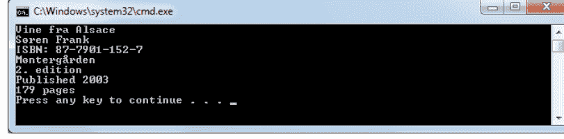

如何实现

```csharp
using System;

namespace Exam02
{
    class Program
    {
        static void Main(string[] args)
        {
            Title();
            More();
        }

        private static void Title()
        {
            Console.WriteLine("Hello");
            Console.WriteLine("Book");
            Console.WriteLine("ISBN: 123-456789");
            Console.WriteLine("Edition");
        }

        private static void More()
        {
            Console.WriteLine("More information");
        }
    }
}
```

### 变量

### 变量

应用程序必须处理数据，为了实现这一点，它们需要一种保存或存储数据的方法。对于这些程序，变量可以持有或存储一个值。变量的特征包括：

- 名称
- 类型
- 运算符

变量必须有一个名称，以便你可以在程序中引用它们。C# 与其他现代编程语言相似，在变量命名方面相对灵活，但但应当遵守以下规则：

- 变量名应始终以小写字母开始
- 之后可以跟随任意数量的字母和数字字符
- 名称不能包含空格

如果你遵循这些规则，在变量命名上就不会遇到任何问题，但实际上也允许其他字符。

变量具有类型，该类型指示了可以存储哪些值，以及变量占用机器内存多大空间。类型还决定了可以在变量上执行的操作，即你可以对它进行处理。

变量在使用之前必须创建或声明。这是通过如下形式的语句实现的：

```csharp
type name = value;
```

首先编写类型，然后是变量名，最后给它赋一个值，例如：

```csharp
int number = 23;
```

这里声明了一个名为 `number` 的变量，类型为 `int`，值为 23。变量应该初始化，否则会在翻译时得到错误。

之所以必须声明变量，是因为编译器在机器内存中分配空间，并且当名称在代码某处出现时，翻译器必须知道该名称的含义，以便检查该变量是否在正确的语文中被使用。如果不是，编译器会给出错误信息。只有在无错误翻译的情况下，程序才能被测试。

C# 具有以下内置或简单数据类型：

| 类型 | 说明 | 值表示法 |
| --- | --- | --- |
| bool | 布尔值 | true, false |
| char | 16 位 Unicode 字符 | 'A'; \u0041; \u0041' |
| sbyte | 8 位有符号整数 |  |
| byte | 8 位无符号整数 |  |
| short | 16 位有符号整数 |  |
| ushort | 16 位无符号整数 |  |
| int | 32 位有符号整数 | 后缀: U |
| long | 64 位有符号整数 | 后缀: L/l |
| ulong | 64 位无符号整数 | 后缀: U/u 或 L/l |


| `float` | 32 位浮点数 | 后缀: `F/f` |
| `double` | 64 位浮点数 | 后缀: `D/d` |
| `decimal` | 96 位小数 | 后缀: `M/m` |
| `string` | 字符字符串（文本） | `"@C\test.txt"`, `"@C\test.txt"` |

第一列告诉你是类型，第二列说明该类型的变量占用机器内存多大，以及它可能包含什么值。最后一列显示了如何声明该类型的值。


# C# 1 编程与 C# 语言简介

最后一个类型 `string` 与其它略有不同，该类型被称为引用类型，稍后会进行解释。`string` 的值只能以 `@` 字符开头，这意味着转义字符不会被解释。转义字符是字符串中具有特殊含义的字符，它们始终以 `\` 开头后跟一个字符。例如，`\n` 表示换行。

## Exam03

### 两个数之和

下面是一个计算两个数之和并打印结果的程序：

#### 如何操作

与前两个示例一样，在 `Visual Studio` 中创建一个控制台应用程序（`Console Application`），并在上方输入代码。然后就可以对程序进行翻译测试：

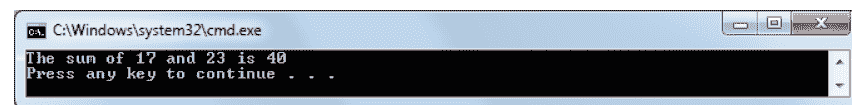

这是一个以计算形式执行数据处理的程序，因此它不仅仅是在屏幕上显示某些文本的程序。

#### 解析

首先，程序声明了两个变量 `num1` 和 `num2`，分别初始化为 `17` 和 `23`。类型是 `int`，这意味着这两个变量可以包含整数值。它们是局部变量，因为它们在 `Main()` 中创建，并且只在 `Main()` 中可见。两个变量之和存储在变量 `sum` 中。注意，存储在 `sum` 中的值是一个表达式的结果。`WriteLine` 写出结果。在这种情况下，它从多个部分或元素构建了一个字符串。注意，单个元素由 `+` 分隔，这意味着字符串拼接，并且整数值会自动转换为字符串。

### 运算符

C# 许多许多作用于变量或值的运算符。上面的程序使用了 `+` 运算符。注意，运算符的意义取决于它所作用的变量或常数的类型。在两个操作数都是整数的第一种情况下，含义是加法；在第二种情况下（`WriteLine` 语句中），含义是字符串拼接。注意上面的程序还使用了 `=` 运算符，称为赋值运算符，用于给变量赋值。

C# 按照优先级具有以下运算符，优先级从高到低如下：

| 优先级 |
| --- |
| 0. `[]` `function(...)` `new` `sizeof` `unchecked` |
| `+-` `!` `~` `--` 一元运算符 |
| `*` `%` |
| `+` `-` |
| `<<` `>>` |
| `<` `<=` `is` `as` |
| `|=` |
| `&` |
| `^` |
| `|` |
| `&&` |
| `||` |
| `?:` |
| `*=` `%=` `+=` `-=` `<<` `>>` `^=` `&=` `|=` |

单个运算符在使用时会有解释。在涉及多个运算符的表达式中，优先级非常重要。通用规则是评估具有优先级的运算符，在多个运算符具有相同优先级的情况下，它们从左到右评估。对于表达式：

```csharp
a + b * c
```

`b * c` 先计算，因为 `*` 的优先级比 `+` 高。如果你写成：

```c
(a + b) * c
```

`a + b` 先计算，因为括号的优先级更高。

### 变量

### 运算符

...是以下内容的简写：

```c
int a = 11;
a = 2;
```

在大多数情况下，运算符的使用没有困难，但某些运算符需要一些解释。特别是赋值运算符，如 `+=`。例如意味着：

```csharp
int a = 11;
a += 2;
```

### 运算符

...是 `n` 得到值 `8` 并且 `a` 增加了 `1`，结果如下：

```csharp
int n = 7;
int a = 0;
a++;
```

运算符的操作方式相同，但值递减了 `1`。如果你运行以下示例：

```csharp
namespace Exam04
{
    class Program
    {
        static void Main(string[] args)
        {
            int n = 7;
            Console.WriteLine(n);
            Console.WriteLine(n);
            Console.WriteLine(--n);
        }
    }
}
```

...你得到结果：

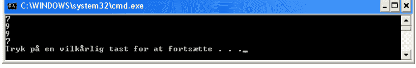

# C# 1 编程简介与 C# 语言

## 控制台程序

# 4 控制台程序

如前言所述，本书仅处理控制台应用程序。这些程序是从命令行执行的，它们将结果写入文本屏幕，用户可以在提示符处输入数据。在这一节中，我将介绍用户如何向程序输入数据，以及如何格式化程序的输出。

# 考试05

### 圆的周长和面积

作为一个示例，我将展示一个应用程序，用户必须输入圆的半径，程序将计算并输出圆的周长和面积。下面是程序的运行示例：

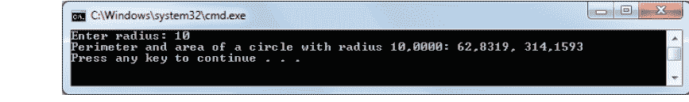

#### 如何实现

代码可以如下所示（我没有包含程序的 `using` 语句和程序名称）：

```csharp
static void Main(string[] args)
{
    Console.Write("Enter radius: ");
    string text = Console.ReadLine();
    double r = Convert.ToDouble(text);
    double p = r * 2 * Math.PI;
    double a = r * r * Math.PI;
    Console.WriteLine("Perimeter and area of a circle with radius ({0:F4}): ({1:F4}, {2:F4})", r, p, a);
}
```

#### 解释

程序的结构原则上与第一个示例相同，只包含一个 `Main` 方法。程序写入一段帮助信息，然后用户必须输入半径（数字）：

```csharp
string text = Console.ReadLine();
```

注意帮助信息是用 `Write()` 写入的。这种方法与 `WriteLine` 的区别在于 `Write` 不以换行符结束。`ReadLine` 是 `Console` 中的一个方法，它会收集输入直到用户输入 `Enter` 键。然后输入的内容将作为字符串返回——一个 `string` 类型的变量。注意 `ReadLine()` 总是返回字符串，然后程序的任务根据需要将输入转换为不同的类型。在这里，通过语句将输入转换为 `double`：

```csharp
double r = Convert.ToDouble(text);
```

在 `bookhoon.com` 免费下载 eBook

`Convert` 是 `System` 命名空间中的一个类，定义了一系列转换函数。注意，这些函数（此处为 `ToDouble()`）要求用户输入的是合法的数字。如果不是，程序将抛出异常并停止，这里没有错误处理。接下来计算周长和面积：

```csharp
double p = r * 2 * Math.PI;
double a = r * r * Math.PI;
```

这里的 `PI` 是 `Math` 类中的常量，`Math` 类是 `System` 命名空间中的一个类。最后程序用 `WriteLine()` 写入结果，但这次函数有多个参数。变量的值被插入到由所谓的占位符确定的格式字符串中。例如 `{0: F4}` 是一个占位符，表示在此处添加格式字符串后的第一个变量，即 `r` 的值。下一个占位符是 `[1: F4]`，它表示在格式字符串之后添加变量 2，即 `p`。`F4` 表示该值将以小数（`F`）并保留小数点后 4 位的形式添加。同样，`{2: F4}` 表示插入格式化为带有 4 位小数的数的值。在这种情况下，它是变量 `a`。


在 `bookboom.com` 免费下载 eBook

#### 注释

有以下选项格式化占位符：

| C | 货币（取决于本地设置） |
| :--- | :--- |
| D | 整数 |
| E | 科学计数法 (`float`, `double`) |
| F | 固定小数 (`float`, `double`) |
| G | 通用 (`F` 或 `E`) |
| N | 带千分位符的数字 |
| X | 十进制 |

# 考试06

### 产品计算

下一个示例执行计算。用户必须输入物品的单价和数量。接下来的程序计算不含增值税的总价、增值税、含增值税的总价，并将结果写入屏幕。如果你运行该程序，它将执行以下操作：

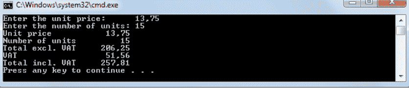

#### 如何实现

起点是一个控制台应用程序项目：

```csharp
static void Main(string[] args)
{
    Console.WriteLine("Enter the unit price: ");
    string text = Console.ReadLine();
    double price = Convert.ToDouble(text);
    Console.WriteLine("Enter the number of units: ");
    int quantity = Convert.ToInt32(text);
    double amount = price * quantity;
    double total = amount * 25;
    Console.WriteLine("{0, -15} {1:F2}", "Unit price, ", price);
    Console.WriteLine("{0, -15} {1:F2}", "Number of units,", quantity);
    Console.WriteLine("{0, -15} {1:F2}", "VAT,", amount);
    Console.WriteLine("{0, -15} {1:F2}", "Total excl. VAT,", total);
    Console.WriteLine("{0, -15} {1:F2}", "Total incl. VAT,", total);
}
```

在 `ebook.com` 免费下载 eBook

#### 解释

程序的工作方式与之前类似，只是这次必须输入两个值。此外，占位符更复杂。例如查看语句：

```csharp
Console.WriteLine("{0, -15} {1:F2}", "Unit price", price);
```

有两个占位符。`(0, -15)` 是第一个，而 `"Unit price"` `-15` 表示字段左对齐。注意这里没有格式化字符，然后是数据类型决定了格式类型。下一个占位符 `[1: F10]` 表示下一个值将在 10 个字符的字段内右对齐并作为小数。由于没有指定小数位数，将使用默认值。

# 考试07

### 日期和时间

程序将显示日期：

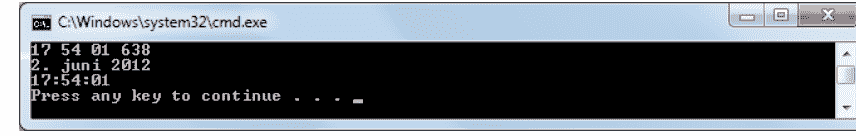

#### 如何实现

代码可以如下所示（我没有包含程序的 `using` 语句和程序名称）：

```csharp
static void Main(string[] args)
{
    DateTime dt = DateTime.Now;
    Console.WriteLine(dt.ToString("yyyy-MM-dd HH:mm:ss"));
}
```

程序将输出日期和时间：

```
2023-10-27 14:30:05
```

# C# 1 编程简介与 C# 语言

## 控制台程序

### 解释

程序的结构原则上与第一个示例相同，只包含一个 `Main` 方法。程序写入一段

# 考试08

### 命令行参数

参数的数量没有限制，参数不需要像上面那样是单个字符，也可以是任何字符串。如果程序没有处理参数，它们将被忽略，这由程序来处理这些参数。

示例展示了一个应用程序，用户必须在命令行上传递两个整数参数，程序将打印商和余数。

```csharp
static void Main(string[] args)
{
    long t1 = Convert.ToInt64(args[0]);
    long t2 = Convert.ToInt64(args[1]);
    long quotient = t1 / t2;
    long modulus = t1 % t2;
    Console.WriteLine("Quotient: {0}", quotient);
    Console.WriteLine("Modulus: {1}", modulus);
}
```

```
Console.WriteLine("Quotient of (0) and (1) is (2)", t1, t1 / t2);
Console.WriteLine("Modulus of (0) and (1) is (2)", t1, t1 % t2);
```

#### 解析

`Main()` 方法有一个参数，它是一个数组（数组将在下文中讨论），该参数可能表示命令行参数。由于命令行参数始终是字符串，因此在计算结果之前，它们会被转换为整数（在本例中类型为 `long`），计算结果是两个数字的商数和模数。请特别注意 `%` 运算符，它是取模运算符（除法的余数）。

请注意，如果你运行程序时没有指定两个参数，或者其中一个参数不是整数，程序将带有错误信息并崩溃。但如果你指定的参数多于两个，最后的参数将被忽略。


# 程序控制

上面的示例都是顺序的，因此语句可以按照编写的顺序执行。在实践中，所有程序都需要根据使用控制语句时发生的条件来决定语句的执行。C# 具有以下用于程序控制的基本语句：

- `if`
- `while`
- `do`
- `for`
- `switch`

控制语句通过简单方法形式的示例来说明最为合适，而方法正是本节的主题。

控制语句在方法中的用法与其他语句（例如 `WriteLine`）相同，但控制语句会根据条件决定一个或多个其他语句的执行。因此，它需要将多个语句视为整体进行引用，这是通过“块”实现的，块仅仅是括号中的若干条语句：

```
{
  statement1;
  statement2;
  ....
}
```

例如，是方法块中的语句，但后文将显而易见，块内部可以包含块。你已经见过了一些示例，类也是一种块，而不是包含方法的语句。

为了编写能够执行有趣功能的程序，需要控制语句。首先，有了控制语句，你就可以开始研究算法，从而编写解决特定问题的程序。因此，后续内容在某种程度上也会关注算法。

### if

`if` 语句的形式如下：

`if (condition) block`

它的含义是如果条件为真，则执行该块（块中的语句）。否则，什么都不会发生。条件是一个值为 `bool` 的表达式，因此是一个结果为真或为的表达式。如果只需要由条件控制单条语句，你必须省略括号并直接写：

```
if (condition) statement;
```

## Exam09

## 排序两个数字

任务是编写一个程序，让用户可以输入两个整数。程序将按升序打印这两个数字。程序操作的一个示例可能如下：

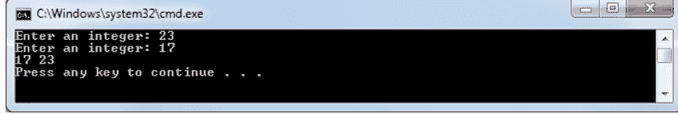

#### 如何实现

该任务可以分解为两个子问题：

- 输入两个整数
- 按升序打印数字

为了解决第一个问题，必须执行两次相同的操作（输入整数），因此将此操作写成一个方法是值得的：

```
static int Enter()
{
    Console.Write("Enter an integer: ");
    string text = Console.ReadLine();
    return Convert.ToInt32(text);
}
```

注意该方法有一个类型，下文将解释。

为了产生结果，你必须找到最小的数字，这时 `if` 语句派上了用场。我将使用这种方法：如果第一个数字大于最后一个，我就交换这两个数字，在 C# 中我可以通过某种方式或另一种方式确定（测试）第一个数字是否大于另一个数字。这正是 `if` 语句的用途。

可以按照如下方式定义一个用于打印结果的方法：

```
static void Sortl(int a, int b)
{
    if (a > b) then
    {
        将 a 保存到帮助变量 t
        a = b
        b = t
    }
    Console.WriteLine("{0} (1)", a, b);
}
```

严格来说，这不是一个方法，但它是使用非正式语言描述的解决方案——这是一个算法。因此，任务是在 C# 中编写这个算法：

```
static void Sortl(int a, int b)
{
    if (a > b)
    {
        int t = a;
        a = b;
        b = t;
    }
    Console.WriteLine("{0} (1)", a, b);
}
```


然后程序本身可以编写如下：

```csharp
static void Main(string[] args)
{
    int a = Enter();
    int b = Enter();
    Sort(a, b);
}
```

`Sort()` 方法包含一个 `if` 语句形式的条件，用于测试 `a` 的值是否大于 `b` 的值，当条件为真时，执行下一个块来反转两个数字。当 `a` 大于 `b` 时，该块会被执行。这正就是 `if` 语句的用法。

可以如下定义一个方法来打印结果：

```csharp
static void Sort(int a, int b)
{
    if (a > b)
    {
        int t = a;
        a = b;
        b = t;
    }
    Console.WriteLine("{0} (1)", a, b);
}
```

`Sort` 方法有一个 `if` 语句形式的条件，用于测试 `a` 的值是否大于 `b` 的值，当条件为真时，执行下一个块来反转两个数字。当 `a` 大于 `b` 时，该块会被执行。

注意该方法有一个类型，下文将解释。

为了产生结果，你必须找到最小的数字，这时 `if` 语句派上了用场。我将使用这种方法：如果第一个数字大于最后一个，我就交换这两个数字，在 C# 中我可以通过某种方式或另一种方式确定（测试）第一个数字是否大于另一个数字。这正是 `if` 语句的用途。

可以按照如下方式定义一个方法用于打印结果：

```csharp
static void Sortl(int a, int b)
{
    if (a > b) then
    {
        将 a 保存到帮助变量 t
        a = b
        b = t
    }
    Console.WriteLine("{0} (1)", a, b);
}
```

严格来说这不是一个方法，但它是使用非正式语言描述的解决方案——这是一个算法。因此，任务是在 C# 中编写这个算法：

```csharp
static void Sortl(int a, int b)
{
    if (a > b)
    {
        int t = a;
        a = b;
        b = t;
    }
    Console.WriteLine("{0} (1)", a, b);
}
```

然后程序本身可以编写如下：

```csharp
static void Main(string[] args)
{
    int a = Enter();
    int b = Enter();
    Sort(a, b);
}
```

`Sort` 方法包含一个 `if` 语句形式的条件，用于测试 `a` 的值是否大于 `b` 的值，当条件为真时，执行下一个块来反转两个数字。

# 注释

为了能够写出执行有趣功能的程序，是需要控制语句。首先，有了控制语句，你就可以开始研究算法，从而编写解决特定问题的程序。因此，后续内容在某种程度上也会关注算法。

## if

`if` 语句的形式如下：

`if (condition) block`

它的含义是如果条件为真，则执行该块（块中的语句）。否则，什么都不会发生。条件是一个值为 `bool` 的表达式，因此是一个结果为真或为假的表达式。如果只需要由条件控制单条语句，你必须省略括号并直接写：

```csharp
if (condition) statement;
```

## if-else

一个语句可以与 `else` 部分结合：

```csharp
if (condition)
```
```csharp
block_1
```
```csharp
else
```
```csharp
block_2
```

其中 `block_1` 和 `block_2` 都是简单的语句。其意义是如果条件为真则执行 `block_1`，如果不是则执行 `block_2`。作为示例，前面的方法升序打印两个数字，可以写如下：

```c
static void Sort2(int a, int b)
{
    if (a < b)
        Console.WriteLine("{0} {1}", a, b);
    else
        Console.WriteLine("{0} {1}", b, a);
}
```

注意该方法也可以写如下：

```csharp
static void Sort2(int a, int b)
{
    if (a < b)
        Console.WriteLine("{0} {1}", a, b); else Console.WriteLine("{0} {1}", b, a);
}
```

并且作为另一个示例可以写为：

```csharp
static void Sort2(int a, int b)
{
    if (a < b)
    {
        Console.WriteLine("{0} {1}", a, b);
    else
    {
        Console.WriteLine("{0} {1}", b, a);
    }
}
```

从机器的角度来看，这三个版本一样好，选择完全取决于你认为哪种可读性最高。

# C# 1 编程入门与 C# 语言

# 考试10

# 二次方程

我将展示一个可以求解二次方程的程序，也就是说是一个解决学校教育和数学教学中经典任务的程序。二次方程的形式为：

```
ax^2 + bx + c = 0
```

求根公式为：

给定判别式 $d=b^2-4ac$ ：

| 方案： | $d < 0$ 时无解 |

| | $-b$ |

| | $d = 0$ 时除以 $2a$ |

| | $-b \pm\sqrt{d}$ |

| | $d > 0$ 时除以 $2a$ |

任务是编写一个程序，其中用户必须输入方程的系数（即 $a, b$ 和 $c$）。程序将使用上述公式确定方程的解，并在屏幕上打印结果。


近60年来，马斯特里特管理学院（Maastricht School of Management）一直通过最先进的管理教育提高全球专业人士和组织的管理能力。

我们广泛的开放式高管课程（Open Enrollment Executive Programs）为您提供独特的互动、启发和多文化学习体验。

**为明天的管理挑战做好准备，从今天开始。**

欲了解更多信息，请访问 **www.msm.nl** 或拨打 +31 联系我们，或通过 admissions@msm.nl 

在 bookboom.com 下载免费电子书

# C# 1 编程入门与 C# 语言

程序操作的一个示例可能是：

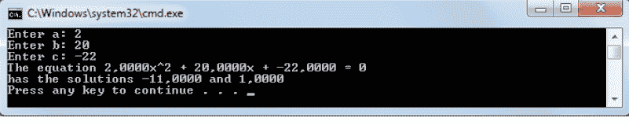

# 如何

方程的解可以非正式地描述为：

```
计算判别式 d
如果 d < 0 则无解
否则如果 d > 0 则有两个解
否则有一个解
```

这并没有复杂的解，但它将任务分解为三个子问题，这种分解出现在很多任务中，而且每个子问题都相对简单，程序可以写成如下：

```csharp
class Program
{
    static void Main(string[] args)
    {
        double a = Enter("Enter a:");
        double b = Enter("Enter b:");
        double c = Enter("Enter c:");
        Solve(a, b, c);
    }

    static double Enter(string text)
    {
        Console.Write(text + ": ");
        string line = Console.ReadLine();
        return Convert.ToDouble(line);
    }

    static void Solve(double a, double b, double c)
    {
        double d = b * b - 4 * a * c;
        Console.WriteLine("方程 {0:F4}x^2 + {1:F4}x + {2:F4} = 0", a, b, c);
        if (d < 0)
        {
            Result();
        }
        else if (d > 0)
        {
            Result(a, b, d);
        }
        else
        {
            Result(a, b);
        }
    }

    static void Result()
    {
        Console.WriteLine("无实解!");
    }

    static void Result(double a, double b)
    {
        Console.WriteLine("解为 {0:F4}", -b / (2 * a));
    }

    static void Result(double a, double b, double d)
    {
        double y = Math.Sqrt(d);
        Console.WriteLine("解为 {0:F4} 和 {1:F4}:", (-b - y) / (2 * a), (-b + y) / (2 * a));
    }
}
```

在 bookhoon.com 下载免费电子书

# C# 1 编程入门与 C# 语言

# 解析

首先注意 `Enter()` 方法与之前的示例基本相同。有两个不同点：`text` 告诉用户需要满足什么，这些作为参数传递。第二个不同是该方法将输入转换为 `double`，并且该方法也返回一个 `double` —— 该方法的类型是 `double`。

`Solve()` 方法求解方程，并执行三件事：

- 计算判别式
- 打印方程
- 实现上述算法，将其分解为三个问题，这里主要观察了 `if-else` 语句的使用

# 注释

`Solve()` 方法包含了 `if-else` 语句：

```
if (d < 0) Result();
else if (d > 0) Result(a, b);
else Result(a, b);
```

当每个条件只有一个陈语句时，我使用了没有必要将语句放在块中。这是一个可以讨论的问题，许多人倾向于以以下方式编写代码，因为他们认为这样更具可读性：

```
if (d < 0)
{
    Result();
}
else if (d > 0)
{
    Result(a, b);
}
else
{
    Result(a, b);
}
```

对于完成后的程序和机器来说，这两段代码翻译后的结果是相同的，没有任何一个比另一个效率低。选择是程序员的，仅仅是可读性的问题，你应该选择你认为可读的版本。我认为第一个版本可读性最高，但并不是所有人都会同意“程序的可读性实际上比这更重要”，在这里必须记住，程序通常需要由编写程序以外的人员进行维护，为了实现这一点，程序应该易于阅读和理解。

# while

通常需要执行一个语句或块几次，直到某个条件发生。在这里你可以使用 `while` 语句，它的形式如下：

```
while (condition)
block
```

其意义在于只要 `while` 之后的条件为真，该块及其语句就会执行。然后程序继续执行 `while` 结构之后的下一个语句。


# C# 1 编程入门与 C# 语言

# 考试11

# 小于100的正数之和

示例展示了一个程序，该程序确定小于或等于100 的所有正整数的和，即 1+2+3...+100 之和。

## 如何实现

程序可以写如下：

```csharp
class Program
{
    const int N = 100;
    static void Main(string[] args)
    {
        long s = 0;
        int n = 1;
        while (n <= N)
        {
            s += n;
            n++;
        }
        Console.WriteLine(s);
    }
}
```

# 解析

首先注意在程序开头定义了一个常量，它是要包含的最大数字：

```
const int N = 100;
```

这并不是必要的，但它很容易修改程序，例如必须计算1到1000数字的和。

注意算法。首先定义一个变量 `s` 用于结果。接下来定义一个变量 `n` 用于要加的数字，并将其初始化为1，即第一个数字。只要 `n` 小于等于 `N`（常量），就重复后续块。在块中发生了两件事：`n` 的值加到 `s`，然后 `n` 加1。注意最后一条意味着每次循环 `n` 加1，因此 `while` 的条件最终会变为假。

# 注释

最初可能很难看出上述算法并手动跟踪变量的变化。例如，假设 `N = 10`。第一列显示了变量 `s` 的变化：

| | s | n |
|---|---|---|
| 0 | 两个变量初始化（创建）后 | |
| 1 | 执行第1次 while 语句后 | |
| 2 | 执行第2次 while 语句后 | |
| 3 | 执行第3次 while 语句后 | |
| 6 | 执行第4次 while 语句后 | |
| 10 | 执行第5次 while 语句后 | |
| 15 | 执行第6次 while 语句后 | |
| 21 | 执行第7次 while 语句后 | |
| 28 | 执行第8次 while 语句后 | |
| 36 | 执行第9次 while 语句后 | |
| 45 | 执行第10次 while 语句后 | |
| 55 | 执行第10次 while 语句后 | |

这意味着当 `n` 为 11 时循环停止，此时变量 `s` 的值为 55。

# C# 1 编程入门与 C# 语言

注意，重要的是 `++` 代表 `n`，在计算完成后 `n` 必须加 1。

再次，这取决于你以及可读性，是否省略括号。

# 注释

任务是确定整数之和 1+2+3...+N 的结果，上面通过循环解决了这个问题。从编程的角度来看，这可能是最显而易见的解决方案，但还有其他选择，因为这个和是一个等差数列的例子，数学上有一个公式可以计算这个和。我提到这一点是为了说明，一个问题通常有多种解决方法，而最明显的解决方案并不总是最好的。

# for

`for` 语句由分号分隔的三部分组成：初始化、条件和表达式：

```
for (initialization; condition; expression)
  block;
```

`for` 语句的三个部分实际上都可以为空。当执行该语句时，会发生以下情况：


1. 执行初始化部分（如果有的话）
2. 测试条件是否为真（如果条件为空，则为真）
3. 如果条件执行，则执行后续块
4. 否则中断 `for` 语句
5. 执行表达式部分
6. 继续第 2 步

注意初始化部分只执行一次。同样注意，块可以是一个单独的语句。

# Exam12

## 正整数和

这个示例的目的与上面相同，但这次我将使用 `for` 语句解决任务。

## 如何实现

使用 `for` 语句，程序可以如下，其中常量 `N` 定义为：

```csharp
static void Main(string[] args)
{
    long s = 0;
    for (int i = 1; i <= N; ++i) s += i;
    Console.WriteLine(s);
}
```

注意该代码与之前的示例相似。

## 解释

`for` 语句有一个计数器——这里是变量 `i`——用于计算迭代次数。对于每次重复，都会执行以下语句：

```csharp
s += i;
```

注意计数器 `i` 在每次通过后加 1，这种重复一直持续到 `i` 达到上限。

# 注释

`for` 语句非常灵活。初始化部分通常用于初始化变量，并且在用逗号分隔时允许有多个初始化：


```csharp
for (a = 2, b = 3, c = 5; ...
```

# 程序控制

当像上面一样在初始化部分声明变量时，该变量在 `for` 语句和控制块之外是不可不可知的。你可以在初始化部分声明多个变量：

```csharp
for (int i = 0, j = 1; ...
```

但它们必须具有相同的类型。至于条件，除了应该是一个布尔表达式外没有其他要求。这可以包含布尔运算符、函数调用等。表达式部分通常用于控制条件中的控制变量，但通常它可以是任何表达式以及函数调用。如果表达式之间用逗号分隔，表达式部分可以包含多个表达式，例如：

```csharp
for (...; ++i, j += 7);
```

在这些情况下，使用 `for` 代替 `while` 没有优势，而且从程序来看，循环结构的重要性很少是巨大的。选择通常取决于任务的性质，其中一种结构可能比另一种更合适。然而，`for` 是最灵活且最常用的。

## do

`while` 语句有另一种变体，称为 `do` 循环，其形式如下：

```csharp
do
{
  statement;
  ...
}
while (condition);
```

其意义是先执行块中的语句，然后测试条件。如果为，重复循环，一直持续到条件变为假。与 `while` 语句相比的区别是 `do` 至少会执行一次块，因为条件是在块执行之后才测试的。`do` 循环不像其他循环那样。

## switch

`while`、`for` 和 `do` 是循环或迭代的控制结构，而 `if` 是分支或选择的控制结构。在大多数情况下，`if` 用于选择，但有另一种替代方案，称为 `switch`。通过示例来解释最好。

# 程序控制

### Exam13 星期

任务是编写一个程序，用户必须输入一个整数。如果数字是 1、2、3、4 或 5，程序将打印相应星期几的名称；如果数字是 6 或 7，程序将打印文本“Weekend”（周末），否则程序将打印错误消息。以下是运行中的程序示例：

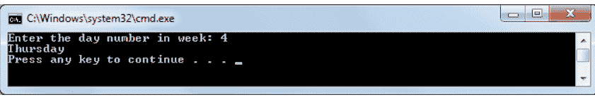

### 如何实现

程序可以如下所示，在 `Main()` 中用户必须输入周几数字：

```csharp
static void Main(string[] args)
{
    Console.Write("Enter the day number in week: ");
    string text = Console.ReadLine();
    switch (Convert.ToInt32(text))
```


在 bookboom.com 免费下载电子书


```csharp
case 1:
  Console.WriteLine("Monday");
  break;
case 2:
  Console.WriteLine("Tuesday");
  break;
case 3:
  Console.WriteLine("Wednesday");
  break;
case 4:
  Console.WriteLine("Thursday");
  break;
case 5:
  Console.WriteLine("Friday");
  break;
case 6:
  Console.WriteLine("Weekend");
  break;
case 7:
  Console.WriteLine("Weekend");
  break;
default:
  Console.WriteLine("Illegal day...");
  break;
}
```

### 解释

在 `switch` 之后是一个表达式：

```csharp
switch(Convert.ToInt32(text))
```

## C# 1 编程入门与 C# 语言

在考虑到这些因素后，你可以编写一个方法来确定并返回一个数字的各位之和：

```csharp
static uint DigitSum(ulong n)
{
    while (n > 9)
    {
        ulong s = 0;
        while (n > 0)
        {
            s += n % 10;
            n /= 10;
        }
        n = s;
    }
    return (uint)n;
}
```

程序现在可以写如下，其中 `Enter()` 方法与之前相同：

```csharp
static void Main(string[] args)
{
    ulong number = Enter();
    Console.WriteLine("The reduced sum of digits in {0} is {1}",
    number, DigitSum(number));
}
```


## C# 1 编程入门与 C# 语言

如果你运行该程序，结果可能是：

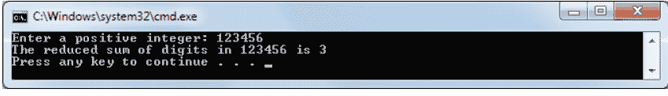

# 解析

内部循环确定数字的各位之和。注意运算符 `%`，它是取模运算符。例如 `number % 10` 意味着：

```
number = 10
```

除以 10 的余数，即数字的最后一位。同样注意结果：

```csharp
number /= 10;
```

其中除以 10（整数除法）“丢弃”了最后一位。当各位之和大于 9（即大于1）时，外部循环循环。

同样注意数据类型。方法 `DigitSum` 的参数类型为 `uint`。我选择 `long` 来处理大数字，并且再次使用了 `ulong`，因为数字不应为负数。同样，该方法返回一个 `uint`，这是一个非负整数。无符号类型使用较少，我主要使用它们是为了展示如何使用它们。`n` 是一个 `ulong`，而方法返回一个 `uint`。因此在在返回语句中，需要将一个大数字 (`ulong`) 放入一个小的数字 (`uint`) 中。你不能在不告诉编译器你的意的情况下直接这样做。你需要通过类型转换来实现：

```csharp
return (uint)n;
```

这告诉编译器它应该将 `n` 转换为 `uint`。

## 考试 15

## 最大和最小数字

这个示例是一个使用了 `while` 和 `if` 控制结构的程序，它们是通用中最常用的控制语句，在实践中，无法想象一个不使用 `if` 的程序。在程序中，你必须输入任意数量的数字，然后方法打印：

- 输入数字的数量
- 输入数字的和
- 输入数字中的最小值
- 输入数字中的最大值
- 输入数字的平均值

## C# 1 编程入门与 C# 语言 程序控制

程序执行的一个示例可能如下：

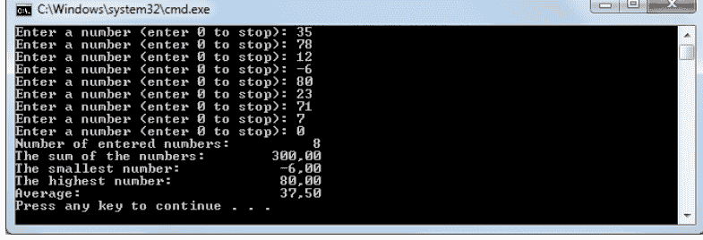

### 如何实现

程序可以写如下：

```csharp
namespace Exam1
{
    class Program
    {
        static void Main(string[] args)
        {
            double sum = 0;
            int count = 0;
            double min = double.MaxValue;
            double max = double.MinValue;
            double number;
            while ((number = Enter()) != 0)
            {
                sum += number;
                count++;
                if (min > number) min = number;
                if (max < number) max = number;
            }
            Print(count, sum, max);
        }

        static double Enter()
        {
            Console.Write("Enter a number (enter 0 to stop): ");
            string line = Console.ReadLine();
            return Convert.ToDouble(line);
        }

        static void Print(int count, double sum, double max)
        {
            if (count > 0)
            {
                Console.WriteLine("Number of entered numbers: {0}, {1:F0}", count);
                Console.WriteLine("The sum of the numbers: {0}, {1:F2}", sum);
                Console.WriteLine("The smallest number: {0}, {1:F2}", min);
                Console.WriteLine("The highest number: {0}, {1:F2}", max);
                Console.WriteLine("Average: {0}, {1:F2}", sum / count);
            }
            else
            {
                Console.WriteLine("There no numbers entered...");
            }
        }
    }
}
```

## C# 1 编程入门与 C# 语言 ## 解析

方法开始声明并初始化一些变量。`double` 类型有两个常量，`MaxValue` 和 `MinValue` 分别是最大和最小值。这意味着变量 `min` 初始化为一个较大的值，而变量 `max` 初始化为一个较小的值。接之后是 `while` 循环。在这里必须特别注意赋值：

```csharp
while ((number = Enter()) != 0)
```

`Enter()` 是之前看过的输入方法。它返回一个 `double`，存储在变量 `number` 中。在执行 `Enter()` 后，将 `number` 的值与 `0` 进行比较。注意赋值周围的括号是必要的，因为比较运算符 `!=` 的优先级高于赋值。结果是 `while` 循环不断重复，直到用户输入 `0`。

在 `while` 循环内部发生了这些：

- 将输入的数字加到 `sum` 中
- 计数器 `count` 加 1
- 如果输入的数字是新的最小值（小于之前的值），则更改变量 `min`
- 如果输入的数字是新的最大值（大于之前的值），则更改变量 `max`

循环完成后，调用 `Print()` 方法来打印结果。在这里测试变量 `count` 是否大于 `0`。

## C# 1 编程入门与 C# 语言 ## 6 字符串

`string` 是一种表示文本的类型，它是 `System.String` 类的别名。与目前处理的其他类型不同，字符串是一个引用类型，将在后面的章节中详细解释。在 C# 中，字符串包含类型为 `char` 的 Unicode 字符。由于字符串在实际编程中非常重要，你无法想象不使用字符串的程序。字符串字面量指定为双引号中的字符序列，例如：

```csharp
string navn = "Volmer";
```

通常需要在字符串中指定特殊字符。这是通过转义序列实现的，例如：

```csharp
string navn = "\"Volmer\";
```

如果你想指定包含引号的文本 "Volmer"。以下是转义序列：


## C# 1 编程入门与 C# 语言 ## 字符串

| 转义序列 | 字符 | Unicode 编码 |
| :--- | :--- | :--- |
| \' | 单引号 | 0x0027 |
| \" | 双引号 | 0x0022 |
| \\ | 反斜杠 | 0x005C |
| \0 | 零 | 0x0000 |
| \a | 警报 | 0x0007 |
| \b | 退格 | 0x0008 |
| \f | 换页 | 0x000C |
| \n | 换行 | 0x000A |
| \r | 回车 | 0x000D |
| \t | 制表符 | 0x0009 |
| \v | 垂直制表符 | 0x000B |

`string` 类型变量通常不会导致严重问题，因为尽管它是引用类型，但被广泛用作其他类型的变量。然而，应该意识到这种形式的语句：

```csharp
string str1 = null;
string str2 = "";
```

其中第一个是空引用，即不指向任何内容的 `string`；而第二个指向空字符串，即没有内容的 `string`。

如果你有这样的 `string` 对象：

```csharp
string text = "Volmer";
```

可以使用基于 0 的索引引用单个字符。例如，如果你使用：

```csharp
char ch = text[3];
```

变量 `ch` 将具有值 'm'。

## 考试 16

## string 类

`string` 类有许多对处理字符串有用的方法。以下程序提供了其中一些方法的示例：

# C# 1 编程原理与 C# 语言

# 字符串

```csharp
static void Main(string[] args)
{
    string text = "ABCDEFGHIJQRSTUVWXYZ";
    Console.WriteLine(text.ToLower());
    Console.WriteLine(text);
    Console.WriteLine(text.Length());
    Console.WriteLine(text.Substring(3, 7));
    Console.WriteLine(text.Substring(12));
    Console.WriteLine(text.IndexOf("KLMN"));
    Console.WriteLine(text.IndexOf("PWXY"));
    Console.WriteLine(text.Substring(3, 7).CompareTo("DEFGHJ"));
    Console.WriteLine();
    string text1 = "Peter";
    string text2 = "Anders";
    Console.WriteLine(String.Compare(text1, text2));
    Console.WriteLine(String.Compare(text2, text1));
}
```

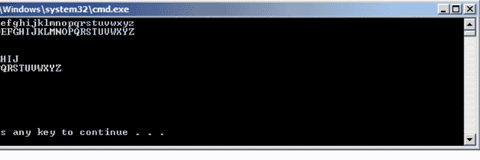

解释

初始化一个 `text` 变量。`text.ToLower()` 方法返回一个字符串，其中 `text` 中的所有字母都被转换为小写字母。`Length` 是一个属性，返回字符串中的字符数。`Substring()` 是一个返回子字符串的方法。例如，`text.Substring(3, 7)` 返回从位置 3 开始的长度为 7 个字符的字符串，结果为 "DEFGHIJ"。如果你只给 `Substring()` 指定一个参数，该方法将返回从指定位置开始到字符串末尾的子字符串。`IndexOf()` 是一个返回部分字符串首次出现起始位置的方法。例如，`indexOf("KLMN")` 返回值 10。如果未找到该字符串，则返回 -1。`CompareTo()` 是一个比较字符串的方法。如果，你可以这样写：

```csharp
text.CompareTo("xyz")
```

如果两个字符串相等，它返回值 0；如果 `text` 不等于 "xyz"，则返回 -1；否则返回 1。还有一个用于字符串比较的**静态**方法。例如，`String.Compare(text1, text2)` 返回 1，因为 `text1` 大于 `text2`。

还有其他处理字符串的方法，但示例中显示的方法是最重要的。

在 bookhoon.com 下载免费电子书

# C# 1 编程原理与 C# 语言

# 考试 17

回文 (Palindrome)

作为程序的另一个示例，下面是一个程序，它用于测试一个字符串是否为回文。回文是指正反读拼写都相同的短语，忽略空格和特殊字符，且不区分大小写。

回文的示例包括：

- Baby Bab
- Dennis, Eve saw Eden if a fine dew
- Madam, I'm Adam
- A man, a plan, a cat, a ham, a yak, a yam, a hat, a canal-Panama!

程序必须满足以下逻辑：用户输入一个句子，然后程序打印它是否为回文。


```
C:\Windows\system32\cmd.exe
Baby Bab
Baby Bab er et palindrome
Madan I'm Adam
Madan I'm Adam er ikke palindrome
Madam, I'm Adam
Madam, I'm Adam er et palindrome
Dennis, Eve saw Eden if a fine dew, As Eve sinned er ikke palindrome
Dennis, Eve saw Eden if a fine dew, As Eve sinned er ikke palindrome
A man, a plan, a cat, a ham, a yak, a yam, a hat, a canal-Panama! er ikke palindrome
_Press any key to continue_
```

该示例将部分介绍字符和字符串，还将展示控制语句和条件的几种应用。

## 如何实现

该程序可以按如下方式描述：

- 输入一个字符串
- 测试其是否为回文
- 打印结果
- 重复上述操作，直到用户按下回车键

输入是一项简单的任务，正如我多次看到的那样。打印结果不需要太多，稍微复杂一点，正式的解决方案可以表述为：

```
重复输入行，只要行不为空
{
  如果行是回文则
    打印该行是回文
  否则
    打印该行不是回文
}
```

在 bookboom.com 下载免费电子书

# C# 1 编程原理与 C# 语言 字符串

这里是测试你的行是否为回文的最大挑战：

```
let i = 0
let j = 最后一个字符的索引
只要 i < j 就重复
{
    如果 i 和 j 指向必须忽略的字符则
    {
        i 加 1
        j 减 1
    }
    否则如果 j 指向一个需要忽略的字符则
        i 加 1
    否则如果 j 指向一个需要忽略的字符则
        j 减 1
    否则如果字符数字 i 与字符数字 j 不同
        它就不是回文
    否则
    {
        i 加 1
        j 减 1
    }
}
它是回文的
```


| 低速引擎 | 中速引擎 | 涡轮增压器 | 螺旋桨 | 推进包 | PrimeServ |
| :--- | :--- | :--- | :--- | :--- | :--- |
| 环保海洋动力和推进解决方案的设计至关重要 | | | | | |
| 解决方案的设计 | | | | | |
| 推进 | | | | | |
| 解决方案 | | | | | |


C# 1 编程原理与 C# 语言 字符串

## 解释

初始化变量 `text`。`text.ToLower()` 方法返回一个字符串，其中 `text` 中的所有字母都被转换为小写。`Length` 是一个属性，返回字符串中的字符数。`Substring()` 是一个返回子字符串的方法。例如，`text.Substring(3, 7)` 返回从位置 3 开始的长度为 7 个字符的字符串，结果为 "DEFGHIJ"。如果你只给 `Substring()` 指定一个参数，该方法将返回从指定位置开始到字符串末尾的子字符串。`IndexOf()` 是一个返回部分字符串首次出现起始位置的方法。例如，`indexOf("KLMN")` 返回值 10。如果未找到该字符串，则返回 -1。`CompareTo()` 是一个比较字符串的方法。如果，你可以这样写：

```csharp
text.CompareTo("xyz")
```

如果两个字符串相等，它返回值 0；如果 `text` 不等于 "xyz"，则返回 -1；否则返回 1。还有一个用于字符串比较的静态方法。例如，`String.Compare(text1, text2)` 返回 1，因为 `text1` 大于 `text2`。

还有其他处理字符串的方法，但示例中显示的方法是最重要的。

在 bookhoon.com 下载免费电子书

# C# 1 编程原理与 C# 语言 字符串

这里是测试你的行是否为回文的最大挑战：

```
let i = 0
let j = 最后一个字符的索引
只要 i < j 就重复
{
    如果 i 和 j 指向必须忽略的字符则
    {
        i 加 1
        j 减 1
    }
    否则如果 j 指向一个需要忽略的字符则
        i 加 1
    否则如果 j 指向一个需要忽略的字符则
        j 减 1
    否则如果字符数字 i 与字符数字 j 不同
        它就不是回文
    否则
    {
        i 加 1
        j 减 1
    }
}
它是回文的
```


| 低速引擎 | 中速引擎 | 涡轮增压器 | 螺旋桨 | 推进包 | PrimeServ |
| :--- | :--- | :--- | :--- | :--- | :--- |
| 环保海洋动力和推进解决方案的设计至关重要 | | | | | |
| 解决方案的设计 | | | | | | |
| 推进 | | | | | |
| 解决方案 | | | | | |


C# 1 编程原理与 C# 语言 字符串

## 解释

初始化变量 `text` 变量。`text.ToLower()` 方法返回一个字符串，其中 `text` 中的所有字母都被转换为小写。`Length` 是一个属性，返回字符串中的字符数。`Substring()` 是一个返回子字符串的方法。例如，`text.Substring(3, 7)` 返回从位置 3 开始的长度为 7 个字符的字符串，结果为 "DEFGHIJ"。如果你只给 `Substring()` 指定一个参数，该方法将返回从指定位置开始到字符串末尾的子字符串。`IndexOf()` 是一个返回部分字符串首次出现起始位置的方法。例如，`indexOf("KLMN")` 返回值 10。如果未找到该字符串，则返回 -1。`CompareTo()` 是一个比较字符串的方法。如果，你可以这样写：

```csharp
text.CompareTo("xyz")
```

如果两个字符串相等，它返回值 0；如果 `text` 不等于 "xyz"，则返回 -1；否则返回 1。还有一个用于字符串比较的静态方法。例如，`String.Compare(text1, text2)` 返回 1，因为 `text1` 大于 `text2`。

还有其他处理字符串的方法，但示例中显示的方法是最重要的。

在 bookhoon.com 下载免费电子书

# C# 1 编程原理与 C# 语言 字符串

# 考试 17

## 回文 (Palindrome)

作为程序的另一个示例，下面是一个程序，它用于测试一个字符串是否为回文。回文是指正反读拼写都相同的短语，忽略空格和特殊字符，且不区分大小写。

回文的示例包括：

- Baby Bab
- Dennis, Eve saw Eden if a fine dew
- Madam, I'm Adam
- A man, a plan, a cat, a ham, a yak, a yam, a hat, a canal-Panama!

程序必须满足以下逻辑：用户输入一个句子，然后程序打印它是否为回文。

```
C:\Windows\system32\cmd.exe
Baby Bab
Baby Bab er et palindrome
Madan I'm Adam
Madan I'm Adam er ikke palindrome
Madam, I'm Adam
Madam, I'm Adam er et palindrome
Dennis, Eve saw Eden if a fine dew, As Eve sinned er ikke palindrome
Dennis, Eve saw Eden if a fine dew, As Eve sinned er ikke palindrome
A man, a plan, a cat, a ham, a yak, a yam, a hat, a canal-Panama! er ikke palindrome
_Press any key to continue_
```

该示例将部分介绍字符和字符串，还将展示控制语句和条件的几种应用。

## 如何实现

该程序可以按如下方式描述：

- 输入一个字符串
- 测试其是否为回文
- 打印结果
- 重复上述操作，直到用户按下回车键

输入是一项简单的任务，正如我多次看到的那样。打印结果不需要太多，稍微复杂一点，正式的解决方案可以表述为：

```
重复输入行，只要行不为空
{
  如果行是回文则
    打印该行是回文
  否则
    打印该行不是回文
}
```

在 bookboom.com 下载免费电子书

# C# 1 编程原理与 C# 语言 字符串

这里是测试你的行是否为回文的最大挑战：

```
let i = 0
let j = 最后一个字符的索引
只要 i < j 就重复
{
    如果 i 和 j 指向必须忽略的字符则
    {
        i 加 1
        j 减 1
    }
    否则如果 j 指向一个需要忽略的字符则
        i 加 1
    否则如果 j 指向一个需要忽略的字符则
        j 减 1
    否则如果字符数字 i 与字符数字 j 不同
        它就不是回文
    否则
    {
        i 加 1
        j 减 1
    }
}
它是回文的
```


| 低速引擎 | 中速引擎 | 涡轮增压器 | 螺旋桨 | 推进包 | PrimeServ |
| :--- | :--- | :--- | :--- | :--- | :--- |
| 环保海洋动力和推进解决方案的设计至关重要 | | | | | |
| 解决方案的设计 | | | | | | |
| 推进 | | | | | |
| 解决方案 | | | | | |


C# 1 编程原理与 C# 语言 字符串

## 解释

初始化变量 `text` 变量。`text.ToLower()` 方法返回一个字符串，其中 `text` 中的所有字母都被转换为小写。`Length` 是一个属性，返回字符串中的字符数。`Substring()` 是一个返回子字符串的方法。例如，`text.Substring(3, 7)` 返回从位置 3 开始的长度为 7 个字符的字符串，结果为 "DEFGHIJ"。如果你只给 `Substring()` 指定一个参数，该方法将返回从指定位置开始到字符串末尾的子字符串。`IndexOf()` 是一个返回部分字符串首次出现起始位置的方法。例如，`indexOf("KLMN")` 返回值 10。如果未找到该字符串，则返回 -1。`CompareTo()` 是一个比较字符串的方法。如果，你可以这样写：

```csharp
text.CompareTo("xyz")
```

如果两个字符串相等，它返回值 0；如果 `text` 不等于 "xyz"，则返回 -1；否则返回 1。还有一个用于字符串比较的静态方法。例如，`String.Compare(text1, text2)` 返回 1，因为 `text1` 大于 `text2`。

还有其他处理字符串的方法，但示例中显示的方法是最重要的。

在 bookhoon.com 下载免费电子书

## 7 数组

数组是一组特定类型的对象，可以通过一个公共名称引用，而单个对象通过该名称和索引来引用。第一个元素的索引始终为 0，你可以想象一个包含 10 个对象的数组，如下所示：

| 0 | 1 | 2 | 3 | 4 | 5 | 6 | 7 | 8 | 9 |
|---|---|---|---|---|---|---|---|---|---|

每个方框都有一个存放该类型对象的空间。在 C# 中，你可以按照如下方式创建一个可以容纳 10 个对象的数组：

```csharp
int[] number = new int[10];
```

正是方括号 `[]` 表示 `number` 是一个数组。注意数组是如何使用 `new` 创建的。这是很有必要的，并且解释了数组是一个引用类型。例如，如果你想在前几个位置放置数字，可以像这样操作：

```csharp
number[0] = 2;
number[1] = 3;
number[2] = 5;
number[3] = 7;
```

以下语句也是合法的：

```csharp
int sum = number[1] + number[3];
```

变量 `sum` 的值为 10。单个元素如 `number[2]` 可以直接用在任何可以使用 `int` 变量的地方。

## Exam18

### int 类型的两个数组

作为一个示例，以下程序创建了两个包含 `int` 类型元素的数组，并将它们打印在屏幕上：

```csharp
static void Main(string[] args)
{
    int[] v1 = new int[10];
    int[] v2 = { 2, 3, 5, 7, 11, 13, 17, 19, 23, 29 };
    for (int i = 0; i < v1.Length; i++) v1[i] = i + 1;
    Print(v1);
    Print(v2);
}
```

# C# 1 编程介绍与 C# 语言 数组

如果你运行该程序，将得到如下结果：

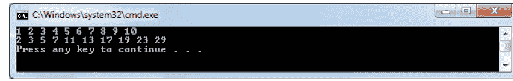

### 解释

你必须注意数组 `v2` 是如何通过数字列表定义的。这这意味着编译器可以创建一个数组并直接用列表元素对其初始化。此外，注意数组 `v1` 是如何在 `for` 循环中初始化的。这里特别注意 `Length` 可以用来引用元素的数量。最后，以及如何将数组作为参数传递给方法，特别是在 `Print()` 方法中如何写 `t` 是一个数组。


# C# 1 编程介绍与 C# 语言

## 数组

## Exam19

### 字符串数组

在上面的示例中，数组的类型是 `int`，但通常数组的类型可以是任何类型。下面是一个程序，创建一个包含 5 个 `string` 类型对象的数组：

```csharp
static void Main(string[] args)
{
    string[] names = new string[5];
    names[0] = "Svend";
    names[1] = "Knud";
    names[2] = "Valdemar";
    Console.WriteLine("----------------\n    for (int i = 0; i < names.Length; ++i) Console.WriteLine(names[i]);
    Console.WriteLine("----------------");
}
```

注意前三个元素被初始化了。后两个没有初始化，值为 `null`，这等同于 `string` 是一个引用类型。如果执行该方法，将得到结果：

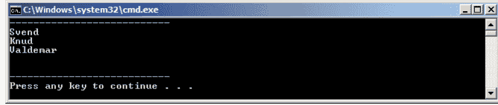

注意对应于打印 `null` 的两个空行。

## Exam20

### Yatzy (骰子游戏)

应该编写一个程序来模拟你投掷 5 个骰子，直到它们都显示相同的值——直到你得到 yatzy。

### 方法

该程序可以写如下：

```csharp
class Program
{
    static Random rand = new Random();
    static void Main(string[] args)
    {
        int[] beaker = new int[5];
        int count = 0;
        do
```


```csharp
Cast(beaker);
Show(beaker);
++count;
while (!Equals(beaker)) {
    Console.WriteLine("You've got yatzy after (0) attempts", count);
}
static void Cast(int[] beaker)
{
    for (int i = 0; i < beaker.Length; ++i) beaker[i] = rand.Next(1, 7);
}
static void Show(int[] beaker)
{
    Console.Write("|");
    for (int i = 0; i < beaker.Length; ++i) Console.Write(beaker[i]);
}
static bool Equals(int[] beaker)
{
    for (int i = 1; i < beaker.Length; i++)
        if (beaker[i] != beaker[0])
            return false;
    return true;
}
```

### 解释

一切就绪后，本质上剩下的就是将上述算法翻译成 C#，我将从投掷开始，模拟你如何用杯子投掷：

```csharp
static int Throw(int[] beaker)
{
    Cast(beaker);
    Show(beaker);
    return Sum(beaker);
}
```

# C# 1 编程介绍与 C# 语言 数组

```csharp
static void Show(int[] beaker)
{
    Console.Write("[");
    for (int i = 0; i < beaker.Length; i++) Console.Write("0", beaker[i]);
    Console.WriteLine("");
}
```

```csharp
static int Sum(int[] beaker)
{
    int sum = 0;
    for (int i = 0; i < beaker.Length; i++) sum += beaker[i];
    return sum;
}
```

其中 `rand` 是一个随机数生成器。如所示，它由三个操作组成：

- 1. 掷骰子通过 `Cast()` 方法实现

- 2. 打印杯子内容通过 `Show()` 方法实现

- 3. 确定骰子点数和并返回值通过 `Sum()` 方法实现

注意，这三个方法相对简单，且所有的编写方式使它们独立于杯子中骰子的数量。

使用这个 `Throw()` 方法，你可以在 C# 中编写 `Play()` 的算法：

```csharp
static bool Play()
{
    int[] beaker = new int[2];
    int point = Throw(beaker);
    if (point == 7 || point == 11) return true;
    if (point == 2 || point == 3 || point == 12) return false;
    int sum = Throw(beaker);
    while (sum != 4 && sum != 7) sum = Throw(beaker);
    return sum == point;
}
```

注意，该方法本质上是上述算法的直接复制。

接下来是 `Main()` 方法：

```csharp
static void Main()
{
    int count = Enter();
    int won = 0;
    for (int i = 0; i < count; i++) {
        if (Play()) {
            Console.WriteLine("Player has won...");
            won++;
        } else {
            Console.WriteLine("The house has won...");
        }
    }
    Result(count, won);
}
```

在 bookmoon.com 下载免费电子书

```csharp
static int Enter()
{
    Console.Write("Enter the numbers of games: ");
    string text = Console.ReadLine();
    return Convert.ToInt32(text);
}
```

### 解释

我将不会系统地回顾整个代码，而仅仅指出你应该特别注意的地方。与早期示例中所示相比，该程序没有包含任何新内容。

这里注意有几个方法具有返回值。例如注意返回 `int` 类型的 `Enter()` 方法。注意 `Main()` 方法中的返回值是如何存储在变量 `count` 中的的。

`Play()` 方法执行一个游戏。它创建了一个包含两个骰子的数组作为杯子（骰子再次用 `int` 表示）。你首先掷一次骰子并记录下骰子显示的点数（变量 `point`）。然后测试玩家是否获胜，或者庄家是否获胜。如果玩家获胜，方法返回 `true`；如果庄家获胜，方法返回 `false`。如果第一次掷后还没有分胜负，则再次掷，直到分出胜负为止。

同样注意 `Cast()` 和 `Show()` 方法是上一个程序对应方法的直接复制。

# 注释

上述游戏版本有些简化，与游戏相关的规则更多。如果你按照上述描述玩游戏，玩家和庄家的获胜概率几乎相同，庄家略占优势——如果庄家破产的话，情况也应该是这样。

# 第 2 部分 对象面向编程

应用程序必须处理数据，数据必须被表示和存储，这正是变量的作用。像 C# 这样的语言有许多内置的变量类型，但你通常可能需要定义自己的数据类型，以更好地反映程序必须解决的任务。这就是类概念派上用场的地方。类是程序关注范围内的某个概念或事物，关于类是什么和不是可以有很多论述，但基本上是一个类类型。它比简单类型多一点，因为类定义了数据应该如何被表示，还定义了你可以对该类型的数据做什么。类同时定义了该类型应该如何表示，以及你可以在该类型的变量上可以执行哪些操作。

当你创建一个类型为类的变量时，我们谈论的是对象，因此类变量被称为对象，但实际上变量和对象之间并没有区别，在很长一段路上没有理由区分两者。但深入挖掘一下，有一个原因与变量和对象在机器内存中的分配方式有关。


在 bookboom.com 下载免费电子书

# C# 1 编程介绍与 C# 语言

`int`、`double`、`bool`、`char` 等类型的变量被称为简单类型。应用程序分配一个栈（stack）来存储变量，栈是一个非常有效的区域，可以根据需要不断设置和移除变量。这被称为栈，因为你可以将栈想象成如下所示：


当程序创建新项时，它发生在栈顶。例如你写道：

```csharp
int a = 23;
```

无论什么类型，在栈上的大小都是相同的。我们称之为引用类型。堆管理器（heap manager）会在对象不再需要时自动删除对象。由于堆管理器，有一个程序持续运行并管理堆。堆管理器会在对象不再需要时自动删除对象。

英语无处不在

Jane，中国建筑师

在收听我的独特课程前和听听我说话

72

点击广告阅读更多

# C# 1 编程与 C# 语言简介

## 类

### # 8 类

在经过这段相当技术性的解释后，是时候处理 C# 中的类了。

## 硬币

你必须编写一个程序来模拟掷两枚硬币。该程序将一直掷硬币，直到它们显示正面（Crown）。如果你运行该程序，结果可能是：

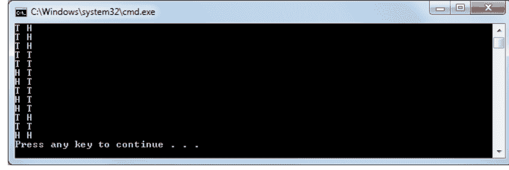

### 如何实现

需要一种可以表示硬币的类型。在这种情况下，硬币的值将正面或反面，并且必须提供以下可用服务：

- 应该能够掷硬币（模拟获取随机值）

- 应该能够读取硬币的值（查看硬币显示的内容）

该类型称为 `Coin`，可以如如下所示：

| Coin |

| :--- |

| value: char |

| Value: char Throw() |

代码可以写如下所示：

```csharp
class Program
{
    static void Main(string[] args) {}
}
```

```csharp
Coin c1 = new Coin();
Coin c2 = new Coin();
do {
    c1.Throw();
    c2.Throw();
    Console.WriteLine(c1.Value + " " + c2.Value);
}
while (c1.Value != 'H' || c2.Value != 'H');
```

```csharp
public class Coin {
    private static Random rand = new Random();
    private char value;

    public Coin() {
        Throw();
    }

    public char Value {
        get { return value; }
    }

    public void Throw() {
        value = (rand.Next(2) == 0) ? 'H' : 'T';
    }

    public override string ToString() {
        return "" + value;
    }
}
```

# 解析

你应该表示一个这里是硬币的概念，你可以通过一个名为 `Coin` 的类来实现。首先注意，`Coin` 类没有 `Main` 方法，且方法没有声明为静态（static）。类是一个概念——一种类型——可以在程序中使用。

在 C# 中，类包含四个元素：

- 实例变量

- 构造函数

- 属性

- 方法

并且这四个元素在上面的类中都存在。该类有两个变量：

```csharp
private static Random rand = new Random();
private char value;
```

第一个被称为 `rand`，类型为 `Random`。它被声明为静态，并且有点特殊，因此这里简要说明。第二个被称为 `value`，类型为 `char`。它是代表硬币的成员变量。注意，这两个变量都声明为私有（private）。这意味着只能通过类的方法访问这些变量——无法在使用 `Coin` 类的其他类中直接引用它们。

该类有一个名为 `Throw()` 的方法。当执行该方法时，它模拟了掷硬币的过程，给它一个新值：

```csharp
value = (rand.Next(2) == 0) ? 'H' : 'T';
```

该方法为变量 `value` 分配了一个新的随机值。为了这个目的，它使用了 `?` 运算符。这是一种可以赋值如下形式的运算符：

```csharp
condition ? expression1 : expression2;
```

它的意思是如果条件为真，则值等于 `expression1` 的值，否则等于 `expression2` 的值。


`Random` 是 `System` 命名空间中的一个类，它有一个返回随机负整数的方法 `Next()`。如果你指定参数 `Next(n)`，得到 0 到 n-1 之间的随机值，都是内联的。

```csharp
rand.Next(2)
```

是一个随机值 0 或 1，并将等同于此的值给成员变量 `value` 一个随机字符 H 或 T。

成员变量 `value` 是私有的，只能在 `Coin` 类内部使用。应该使用 `Coin` 类的程序必须知道一个可读取的硬币值。为了这一点，`Coin` 类有一个属性：

```csharp
public char Value
{
  get { return value; }
}
```

该属性与成员变量具有相同的类型和名称——你只需要将名称大大写即可。注意，属性在语法上不是一个方法（名称后没有括号）。属性有一个 `get` 部分，用于返回当前变量的值。

在创建 `Coin` 的对象时，机器也会创建一个实例变量 `value`。硬币只有两个值（H, T），当硬币的值是变量 `value` 的值时，硬币在被掷出之前将有一个非法值。遗憾的是，因为现实世界中的 Coin 将有一个合法的值，而且因为使用它的程序将会失败。这个问题通过构造函数来解决。静态（Static）是一个没有任何类型且与类同名的方法：

```csharp
public Coin()
{
  Throw();
}
```

构造函数是在创建类对象时自动执行的方法，通常用于初始化对象。

# C# 1 编程与 C# 语言简介

这意味着该对象现在有了一个非法值，但更糟糕的是，这种错误可能非常难以发现。始终以这种方式将变量声明为私有（private）的另一个原因是，这是类的一个内部特征，原则上类的用户是并不知道不知道的。在 `Coin` 类中有一个类型为 `char` 的变量 `value`。出于某种原因，你想将此类型更改为 `string`：

```csharp
public class Coin
{
    private string value;
```

你可以在不影响使用该类的应用程序的情况下完成这一点。没有直接引用变量 `value`。

结论是，面向对象编程（OOP）的一个原则是将实例变量定义为私有（private）或受保护（protected）。

# 注释

当你创建一个类的对象时，该类的实例变量会被创建，然后会执行该类的构造函数。如果一个类没有构造函数，系统会自动创建一个默认构造函数，即不带参数的构造函数。构造函数的特征是它是一个与类名相同且没有类型的方法。构造函数是一个方法，但它不能被显式调用，只有在对象实例化时才会执行。

`Coin` 类有一个构造函数，即默认构造函数，但一个类完全可以有多个构造函数，适用于重写方法的通用规则。

`Coin` 是一个引用类型，以下语句创建了两个对象：

```csharp
Coin c1 = new Coin();
Coin c2 = new Coin();
```

如所述，它们没有推在栈（stack）上，而是创建在堆（heap）上。`c1` 和 `c2` 是栈上的普通变量，但它们不包含对象，而是指向堆上的对象。作为程序员，你很少考虑这一点，但在某些情况下，了解分配在栈上和堆上的对象之间的区别是非常重要的。下图展示了在机器内存中看起来的样子，即栈上的两个变量指向堆上的对象：

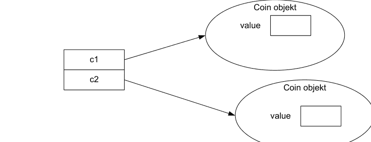

在 bookboom.com 免费下载电子书

# C# 1 编程与 C# 语言简介 类

如果，例如你写了：

```csharp
c1 = c2;
```

这意味着不再有任何引用指向原来的 `c1` 的对象，但有两个引用指向由 `c2` 指向的对象。

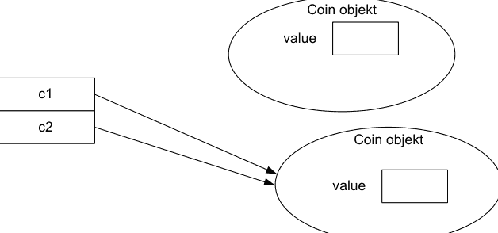

如果你写了：

```csharp
c1.Throw();
c2.Throw();
```

这意味着你掷了两次同一个硬币，因为两个引用都指向同一个对象。

当不再有任何引用对象时，意味着该对象会自动从堆管理器中移除，对象所使用的内存会被释放。

# C# 1 编程与 C# 语言简介 类设计

## 9 类设计

类是一种类型，但也是一个设计概念。类以实例变量的形式定义对象，定义如何创建对象以及为对象分配什么内存。对象在任何给定时间都有以实例变量内容形式表示的值，对象的值通常被称为它的状态（state）。类还通过其方法定义了你可以对对象做什么，以及如何读取和修改对象的状态。

每个 C# 程序由一组类组成，这些类共同定义了程序如何运行，而运行中的程序由在程序类上下文中实例化的许多对象组成，这些对象共同工作完成程序必须完成的任务。因此，编写程序的工作就是编写程序将包含的类。至于是哪些类，并不清楚，同一个程序通常可以用许多方式编写，由完全不同的类组成。确定程序应该由哪些类组成，以及这些类在变量和方法方面应该是什么样，被称为设计。原则上，可以说，如果一个程序正确地完成了任务，它由哪些类组成可能无关，但不恰当的类意味着


在 www.deloitte.ca/careers 发现真相


在 bookboom.com 免费下载电子书


- 导致程序变得难以理解，从而难以识别和纠正错误

- 导致未来难以维护和修改程序

- 导致在其他上下文中难以重用程序的类

因此，设计和类的选择在编程背景下是一个非常核心的问题，人们谈论的是程序质量（或缺乏质量）。类不仅仅是一个类型，它是程序关注领域内某一个概念的定义或描述。当你必须定义程序将由哪些类组成时，必须很大程度上关注类作为一种定义基本概念的工具，而不是类作为编程语言中的一种类型。

对象具有四个特征：

- 用于相对于所有其他对象标识特定对象的唯一标识符


- 表示对象当前值的状态
- 告诉你对对象可以做什么的行为
- 从对象被创建到其再次销毁的生命周期

对象从类中创建并在那时被分配一个标识对象的引用。类的实例变量决定了为对象创建哪些变量，这些变量的值就是对象的状态。类的方法定义了可以对对象做什么，即对象的行为。最后一点是与作用域相关的对象生命周期，稍后会解释。

# Exam23

## 骰子

任务是编写一个程序，模拟你掷五个骰子，直到它们都一样。最后程序将打印出掷了多少次——顺便说一下，这个例子我以前见过（在`Exam20`），但那时我还没有类的概念。

## 如何实现

第一个任务是寻找（决定）程序的类，基本上我们需要一个可以表示骰子的类，骰子以眼睛的数量为特征，并且应该能够掷骰子。

另一个而易见的类是带有五个骰子的杯，在这里必须能够掷杯并知道它显示了什么。

# C# 1 编程与 C# 语言简介

最后，我将编写一个可以表示实际游戏的类。即一个拥有杯子和一个执行游戏的方法的类。这对应于以下设计：

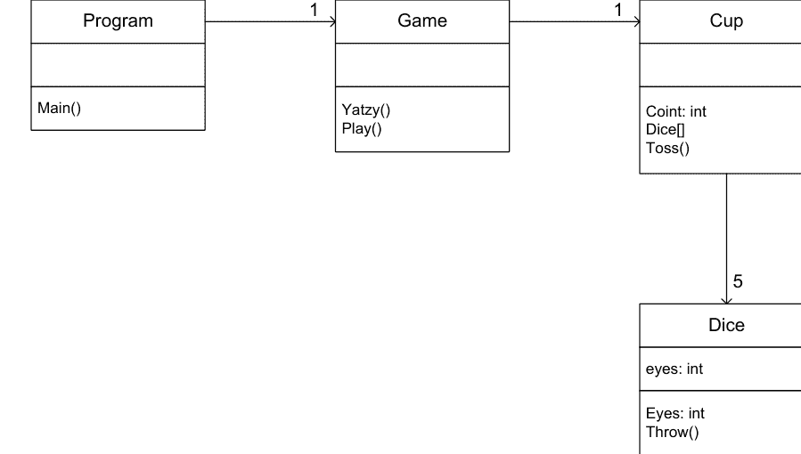

注意，这种设计在某种程度上是随意的，因为我没有遵循某些指南，类的选择是由开发者做的，并且可能存在其他同样好的解决方案。

## C# 1 编程入门与 C# 语言

### 类的设计

```csharp
public class Dice {
    private static Random rand = new Random();
    private int eyes;

    public Dice() {
        Throw();
    }

    public void Throw() {
        eyes = rand.Next(1, 7);
    }

    public int Eyes {
        get { return eyes; }
    }

    public override string ToString() {
        return "" + eyes;
    }
}
```


近60年来，马斯特里赫特管理学院通过尖端管理教育提升了全球专业人士和组织管理能力。

我们广泛的开放式高管课程为您提供独特的互动性、启发性和多元文化的学习体验。

**准备好应对管理挑战，从现在开始。**

欲了解更多信息，请访问 www.msm.nl 或拨打 +31 43 38 70 808 或通过 admissions@msm.nl 联系我们

全球网络化管理学院

在 bookboom.com 下载免费电子书


# C# 1 编程入门与 C# 语言 - 类的设计

接着是一个杯子的类，它可以被描述为对 `Dice` 对象数组的封装：

```csharp
public class Cup
{
    private Dice[] dice;
    public Cup(int n)
    {
        dice = new Dice[n];
        for (int i = 0; i < n; i++) dice[i] = new Dice();
    }

    public int Count
    {
        return dice.Length;
    }

    public Dice this[int i]
    {
        return dice[i];
    }

    public virtual void Toss()
    {
        for (int i = 0; i < dice.Length; ++i) dice[i].Throw();
    }

    public override string ToString()
    {
        string text = "";
        for (int i = 0; i < dice.Length; ++i)
        {
            if (i > 0) text += " ";
            text += dice[i].Eyes;
        }
        return text;
    }
}
```

该类本身非常简单，基本上是 `Exam20` 代码移动到其独立类中的一个问题：

```csharp
public class Game
{
    private Cup cup;
    public Game(int n)
    {
        cup = new Cup(n);
    }
    public void Play()
    {
        int count = 0;
        do
        {
            cup.Toss();
            ++count;
            Console.WriteLine(cup);
        }
    }
}
```

在 bookhoon.com 下载免费电子书

```csharp
while (!Yatzy());
Console.WriteLine("You've got yatzy after (0) attempts", count);

private bool Yatzy(){
    for (int i = 1; i < cup.Count; ++i)
        if (cup[i].Eyes != cup[0].Eyes) return false;
}
```

最后，是 `Main()` 方法：

```csharp
class Program {
    static void Main(string[] args) {
        Game game = new Game(5);
        game.Play();
    }
}
```

# 解析

如果你将 `Dice` 类与 `Coin` 类进行比较，你会发现它们原则上是相似的，对于数据表示类型为 `int` 这一点没什么好解释的。

`Cup` 类代表一个骰子杯，它被实现为一个包含 `Dice` 对象容器的类。该容器是一个数组：

```csharp
private Dice []dice;
```

为了让杯子更具活性并允许在其他语境中使用（不一定非要有 5 个骰子），骰子的数量是构造函数的参数。`Dice` 是一个引用类型，当你创建一个引用类型的数组时，你得到的是一个包含引用的数组，而不是它们的类型。它们必须显式地创建：

```csharp
for (int i = 0; i < n; i++) dice[i] = new Dice();
```

由于杯子有一个带参数的构造函数，因此它没有默认构造函数。这意味着你不能以以下方式创建杯子：

```csharp
Cup cup = new Cup(); // 非法
```

该类有一个只读属性，返回杯子中骰子的数量。这对于该类的用户来说是必要的，否则他们不知道杯子里有多少个骰子。

此外，该类还有一个只读属性，返回索引为 `i` 的骰子：

```csharp
public Dice this[int i] {
    get { return dice[i]; }
}
```

这是一种有些特殊的语法，作为属性名，我在这里不详细介绍，但意味着在程序中你可以写如下内容：

```csharp
Cup cup = new Cup(5);
Dice d = cup[1];
```

并通过索引来引用单个骰子——也就是说如果 `cup` 是一个数组。用户可以使用该类像数组一样使用，但不知道（或不需要知道）类中的表示是数组还是其他东西。在这种情况下，这些是只读属性，意味着用户可以写：

```csharp
cup[1] = new Dice(); // 非法
```

`Toss()` 方法非常简单，仅包含一个遍历所有骰子并投掷它们的循环。`Cup` 类本身简单且有一个带参数的构造函数，并根据该参数创建一个具有你想要玩的骰子数量的 `Cup`。该类本身由 `Play()` 方法调用。注意 `Yatzy()` 方法，它测试所有骰子是否相同。由于它是一个私有方法，它只应该在 `Game` 中使用。

# 注释

`Dice` 类有一个属性可以说明：

```csharp
public int Eyes
{
    get { return eyes; }
}
```

从技术上说，这意味着自动创建了以下方法：

```csharp
public int getEyes()
{
    return eyes;
}
```

因此，属性基本上与方法相同，但语法不同。属性的目标是让用户将其作为变量使用，但仍然决定了什么操作是可能的。在上面，类的程序员确定了用户必须读取 `eyes` 但不能更改它。

# C# 1 编程入门与 C# 语言 - 10 方法

本节阐述了与方法有关的问题，主要涉及以下四点：

- 方法名
- 方法返回值
- 属性
- 方法参数

关于方法名，除了与变量相同外没有什么好说的。

## 方法名

关于方法名，没有什么额外可以说的，除了与变量相同。但是 C# 有一个约定方法名始终以大写字母开头。一个类可以拥有相同名称的方法，只要它们的参数不同——在数量还是类型上。


# C# 1 编程入门与 C# 语言 - 方法

## Exam24

### 方法重载

此示例展示了一个具有三个相同名称方法的程序。

*Program* 类具有以下方法，所有名称相同：

```csharp
static int Max(int a, int b)
{
  return a < b ? b : a;
}
```

```csharp
static double Max(double a, double b)
{
  return a < b ? b : a;
}
```

```csharp
static int Max(int a, int b, int c)
{
  return Max(Max(a, b), Max(b, c));
}
```

# 解析

编译器比较前两个，当两个参数类型不同时，并且当有三个参数时也可以区分最后一个。

注意如何使用 `?` 运算符。也注意最后一个方法实际上调用了第一个方法。

注意方法不能根据返回类型区分，只能根据参数区分。

方法不能仅通过名称识别，还可以通过参数识别，这一事实有时被称为函数重载。注意这并不是方法特有的，也适用于运算符。如果你写了：

```csharp
c = a + b;
```

取决于变量 `a` 和 `b` 的具体类型——例如类型是 `int` 或字符串。

# 注释

在这个示例中我们使用了问号运算符。我们之前讨论过这个运算符，但由于它是一个运算符，某些人觉得它很难理解，所以这里必须有一个额外的注释。在程序中你可以写类似的内容：

```csharp
if (a < b)
  m = a;
else
  m = b;
```

# C# 1 编程简介与 C# 语言方法

将变量 `m` 赋值为变量 `a` 和 `b` 中的较小值。这意味着如果条件 `a < b` 为真，则 `m = a`；否则为 `b` 的值。你也可以使用三元运算符实现相同的逻辑：

```
m = a < b ? a : b;
```

这的效果完全相同。三元运算符以条件开始，如果条件为真，表达式的值为问号后的表达式（变量）的值；如果为假，则值为冒号后的表达式。在在示例语句中

```
return a < b ? b : a;
```

将返回变量 `a` 和 `b` 的较大值。三元运算符通常是语句的替代方案，但区别在于它是一个运算符，因此可以像 `return` 语句一样包含在表达式中。正如前面提到的，有些人认为这种运算符难以阅读，但它与其他所有运算符一样自然。

## 方法的返回值

上一个示例中描述的方法具有 `int` 或 `double` 返回类型。当一个方法具有返回类型时，它在执行后会有一个值。因此，该方法可以像变量一样作为表达式的一部分。例如，你可以写：

```
double x = Max(3.14, 1.4);
```

这意味着 `Max()` 的返回值被存储在变量 `x` 中。一旦方法具有返回类型，它就会以 `return` 语句结束，该语句决定了返回值——通常是表达式的结果。关于返回类型没有什么特别说的，仅有的返回类型可以是任何类型——包括引用类型——且方法只能有一个返回值。这里是一个返回字符串的简单方法示例：

```csharp
static string GetText(string text)
{
    Console.Write(text + ": ");
}
```

关于返回类型的最后一点：`void` 仅仅是没有返回值的方法的术语。尽管方法是 `void` 类型，但它可能有一个空的 `return` 语句来终止方法。

## 属性

正如前面提到的，属性只是具有不同语法的方法，原则上属性可以做任何事情。然而，属性的理念是读取（返回）实例变量的值并改变它的值。此外，你应该遵循约定，属性名称大大写。

## 点 (Point)

这个示例演示了一个表示坐标系中点的类。

```csharp
class Point {
    private int x;
    private int y;
    public Point(int x, int y) {
        this.x = x;
        this.y = y;
    }
}
```


```csharp
public int X
{
    get { return x; }
    set { x = value; }
}

public int Y
{
    get { return y; }
    set { y = value; }
}

public override string ToString()
{
    return string.Format("{0},{1}", x, y);
}
```

坐标是私有的，因此你无法从类外部访问。要访问访问，必须定义属性。如果允许修改对象的坐标，类还必须定义 `set` 属性，例如：

```csharp
set { x = value; }
```

这意味着你可以更改变量 `x` 的值，但语法有点特殊，对应赋值给 `x` 的值由关键字 `value` 表示。结果是在程序中你可以这样写：

```
Point p = new Point(2, 3);
p.X = 5;
```

其中 x 坐标获得了一个不同的值。当一个类同时具有 `get` 和 `set` 属性时，`set` 属性的作用仅仅是赋值 `value` 的值，因此将两个变量都定义为公共并没有区别。然而，建议定义私有变量以及必要的属性，如上所述，这有助于程序员进行保护。

## 参数

方法的参数可以是任何类型，参数传递有多种方式。当你定义方法时，你指定了方法应该拥有的参数，这些参数被称为形式参数（formal parameters），并指定了方法应该操作的值。当你调用方法时，你必须指定传递给方法的值，这些值被称为实际参数（actual parameters）。

## 值参数

通常情况下参数是值参数，例如：

```csharp
static int Max(int a, int b)
{
    return a < b ? b : a;
}
```

当此方法被调用时，系统会在栈上创建一个所谓的激活块（activation block），它包含四个基本内容：

- 返回地址，以便系统知道方法终止后从何处继续
- 每个实际参数的副本
- 对应方法类型的返回值的区域
- 方法的局部变量（如果它有的话）

你可以这样概述它：


三元运算符通常是语句的替代方案，但区别在于它是一个运算符，因此可以像 `return` 语句一样包含在表达式中。正如前面提到的，有些人认为这种运算符难以阅读，但它与其他所有运算符一样自然。

# C# 1 编程与 C# 语言简介

## 引用参数

在 .NET 中你也可以使用引用参数。例如，你可以将 `Swap` 方法更改为如下：

```csharp
public void Swap(ref int a, ref int b)
{
    int t = a;
    a = b;
    b = t;
}
```

如果你随后修改 `Test2()` 方法使实际参数成为引用：

```csharp
static void Test2()
{
    int t1 = 2;
    int t2 = 3;
    Swap(ref t1, ref t2);
    Console.WriteLine("{0} {1}", t1, t2);
}
```

它们是位于栈上的实际参数的引用，`Swap()` 将交换变量 `t1` 和 `t2` 的值。这意味着 `Swap()` 执行的更改是在栈上的引用所指向的对象上进行的。

当方法对参数的更改必须在调用代码中保留时，则使用引用参数代替值参数。

请注意，你可以将值参数和引用参数结合，使得方法可以同时拥有引用和值的参数。

## out 参数

在 .NET 中，存在使用 `out` 参数的可能性，`out` 参数在方法被调用之前不需要初始化，而是在方法内部被赋值。以下方法创建了两个 `Point` 对象，并将它们赋值给作为 `out` 参数传递的引用：

```csharp
static void Points2(int x1, int y1, int x2, int y2, out Point p1, out Point p2)
{
    p1 = new Point(x1, y1);
    p2 = new Point(x2, y2);
}
```

### 方法

如果方法按如下执行：


```csharp
static void Test4()
{
    Point p1;
    Point p2;
    Points2(2, 5, 7, 3, out p2);
    Console.WriteLine(p1);
    Console.WriteLine(p2);
}
```

那么 `p1` 和 `p2` 指向在 `Points2(2)` 方法中创建的对象。请注意 `p1` 和 `p2` 在程序中没有初始化，这是没有必要的，因为它们被用作 `out` 参数。一个方法只能有一个返回值，而参数可以解决在需要方法返回多个值时的问题。例如，`Points2(2)` 方法返回两个值，这是不可能的，但可以通过给方法提供 `out` 参数来解决该问题。

## 默认参数

可以为参数设置默认值。以下方法三个参数：

```csharp
static double Calculate(double price, int units = 1, double discount = 5)
{
    return price * units * (100 - discount) / 100;
}
```


该方法计算不含折扣的价格。`units` 的数量默认设置为 1，`discount` 比率默认设置为 5%。这意味着调用方法时无需为这些参数指定值：

```csharp
static void Test5()
{
    Console.WriteLine(Calculate(20));
    Console.WriteLine(Calculate(20, 5));
    Console.WriteLine(Calculate(20, 10));
}
```

并且如果你这样做，将使用默认值。原则上，所有参数都可以有默认值，但具有默认值的参数必须放在最后。

## 可变数量的参数

关于参数的最后一点说明，我将展示如何实现具有可变数量参数的方法。以下方法将 `string` 类型的数组作为参数，该方法返回由数组中所有字符串用空格分隔组成的字符串：

```csharp
static string Concat(params string[] text)
{
    if (text.Length == 0) return "";
    string temp = text[0];
    for (int i = 1; i < text.Length; i++) temp += " " + text[i];
    return temp;
}
```

重要的是 `params` 关键字，这意味着可以设置可变数量的实际参数。例如，可以这样调用方法：

```csharp
static void Test6()
{
    Console.WriteLine(Concat("One", "Two", "Three"));
    Console.WriteLine(Concat("One"));
    Console.WriteLine(Concat());
    Console.WriteLine(Concat("One", "Two", "Three", "Four", "Five"));
}
```

### 方法

## Exam26

方法参数

上述关于方法参数的测试方法都整合在示例 `Exam26` 中，如果你运行此示例，将得到以下结果：

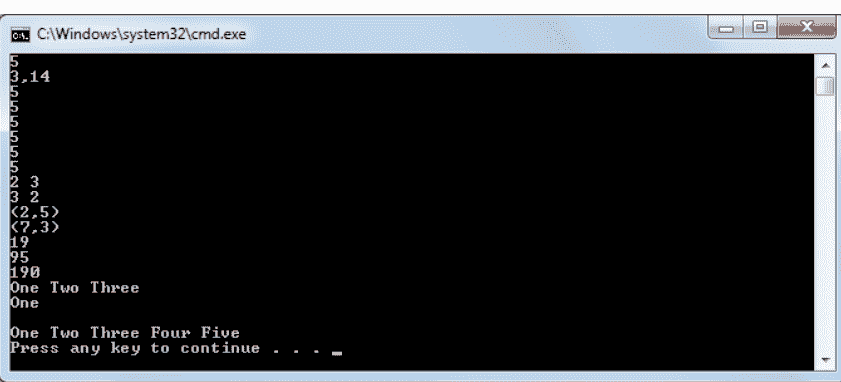

# 将挑战转化为学习曲线。

这只是高绩效者在办公室的日常常态。

埃哲训练营 —— 你面临的最严峻测试。

选择埃哲，开启一个拥有最具多样化机会的职业生涯，

# C# 1 编程入门与 C# 语言继承

## 人员类

作为一个示例，我将从一个通过名和姓表示人的类开始：

```csharp
public class Person
{
    private string firstName;
    private string lastName;

    public Person(string firstName, string lastName)
    {
        this.firstName = firstName;
        this.lastName = lastName;
    }

    public string FirstName
    {
        get { return firstName; }
    }

    public string LastName
    {
        get { return lastName; }
    }

    public override string ToString()
    {
        return firstName + " " + lastName;
    }
}
```

这个类非常简单，不需要许多注释。

然后我将定义一个代表员工（公司内部）的类，员工是一个具有两个额外属性（职位和薪资）的人。`Employee` 类有多种编写方式，你可以将其认为是 `Person` 类的扩展，并带有两个新属性。解决方案不仅仅是扩展 `Person` 类，因为你可以想象，这个类可能被用于职位和薪资等概念没有意义的语境。相反，你可以写一个继承自 `Person` 类的类：

```csharp
public class Employee : Person
{
    private string position;
    private int monthly;

    public Employee(string firstName, string lastName, string position, int monthly)
        : base(firstName, lastName)
    {
        this.position = position;
        this.monthly = monthly;
    }

    public string Position
    {
        get { return position; }
    public int Monthly
    {
        get { return monthly; }
    }
    public override string ToString()
    {
        return base.ToString() + "\n" + position;
    }
}
```

首先，注意在类名 `Employee` 之后我写了

- : Person

这表示 `Employee` 继承 `Person`。`Employee` 继承 `Person` 意味着 Employee 获得（继承）了 Person 拥有的所有属性以及新属性。在这种情况下，Employee 扩展了两个新的实例变量和相关的属性。`Employee` 类有一个构造函数来初始化新的实例变量 `position` 和 `monthly`，但它也必须初始化基类中的实例变量 `firstName` 和 `lastName`。这需要调用 `Person` 中的构造函数，但由于你无法直接调用它，因此需要一种执行基类构造函数的语法。这发生在如下：

- : base(firstName, lastName)


低速发动机 中速发动机 涡轮器 螺旋桨 推进包 PrimeServ

环保海洋动力和推进解决方案的设计对于 MAN Diesel & Turbo 关关重要。我们通过全球最大的发动机计划提供动力——每台发动机的输出从 450 kW 到 87,220 kW 不等。领先！访问 www.mandieseltturbo.com 了解更多。

工程未来 —— 自1758年以来。

## MAN Diesel & Turbo


构造函数声明后的冒号和 `base()` 意味着 `Person` 中的构造函数是以 `firstName` 和 `lastName` 作为实际参数执行的。具体来说，当你创建一个 `Employee` 对象时，首先执行 `Person` 中的构造函数，然后执行 `Employee` 中的构造函数。当 `Employee` 是一个 `Person` 时，可以说在创建 `Employee` 之前必须先创建 `Person`。`Employee` 对象可以引用属性 `FirstName` 和 `lastName`。`Employee` 对象可以引用 `FirstName`，因为它是 `Person` 中的公共属性，并且因为 `Employee` 继承了 `Person`。`Employee` 对象可以引用 `Person` 和 `Employee` 中的所有成员。私有成员只能在定义的类中被引用。例如，`Person` 中的 `firstName` 无法在 `Employee` 的方法中被引用。

我将定义一个代表经理的类。`Director` 是一种特殊的员工，该类可以定义为继承 `Employee`。

```csharp
public class Director : Employee
{
    public Director(string firstName, string lastName, int monthly)
        : base(firstName, lastName, "Director", monthly)
{
}
```

该类非常简单，仅由一个构造函数组成，该构造函数将参数传递给 `Employee` 类中的构造函数。作为经理的所有其他服务（继承自）都来自 `Employee` 和 `Person`。

同样地，可以定义一个代表记账员的类：

```csharp
public class Bookkeeper : Employee
{
    public Bookkeeper(string firstName, string lastName, int monthly)
        : base(firstName, lastName, "Bookkeeper", monthly)
}
}
```

现在考虑以下方法：

```csharp
static void Print(Employee e)
{
    Console.WriteLine(e);
    Console.WriteLine("Monthly: {0}", e.Monthly);
    Console.WriteLine("{0}, {1}", e.LastName, e.FirstName);
}
```

第一条语句打印 `Employee` 类的 `ToString()` 结果。下一条并没有什么奥的，但你应该注意最后一条，它使用了两个属性，这两个属性都定义在 `Person` 中。参数的类型为 `Employee`。

## C# 1 编程入门与 C# 语言继承

考虑以下方法：

```csharp
static void Test()
{
    Director d = new Director("Olga", "Jensen", 8000);
    Bookkeeper b = new Bookkeeper("Karlo", "Hansen", 5000);
    Print(d);
    Print(b);
}
```

第一条语句打印 `Employee` 类的 `ToString()` 结果。下一条并没有什么奥的，但你应该注意最后一条，它使用了两个属性，这两个属性都定义在 `Person` 中。参数的类型为 `Employee`。

当一个类继承另一个类时，你所继承的类被称为基类（base class），继承的类被称为派生类（derived class）。例如，`Person` 是基类而 `Employee` 被称为子类（subclass）。我们还说 `Person` 是 `Employee` 的泛化。你可以以此方式说明：

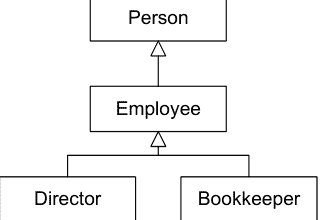

我将编写另一个类，代表顾问，它是一种 `Employee`，其薪资是固定的月薪加上销售提额佣金：

```csharp
public class Consultant : Employee
{
    private double commission;
    private double sale;

    public Consultant(string firstName, string lastName, int monthly) : base(firstName, lastName, "Consultant", monthly)
    {
        this.commission = commission;
    }
}
```

## C# 1 编程入门与 C# 语言继承

```csharp
public double Commission
{
    get { return commission; }
}
public double Sale
{
    get { return sale; }
    set { sale = value; }
}
public override int Monthly
{
    get { return monthly + (int)(sale / 100); }
}
```

首先注意 `Consultant` 扩展了两个新变量。一个在构造函数中初始化，另一个通过属性获取。没什么好说的。但如果你查看 `Monthly` 属性，你应该注意两点：单词顺序，以及它引用了基类中的变量——这因为它是私有的是不行的。通过将变量 `monthly` 改为 `protected` 解决了这个问题：

```csharp
public class Employee : Person
{
    protected int monthly;
```


到2020年，风能可以提供我们地球三分之一的电力需求。今天，SKF的创新知识对于运行世界上大部分的风力发电机至关重要。高达25%的发电成本与维护有关。通过我们的标准（例如状态监测和润滑），这些成本可以大幅降低。通过分享我们的经验和创造力，行业可以使清洁能源的变得更具效益。因此，我们需要能够应对这一挑战的优秀员工。

知识工程的力量

接入知识工程的力量。访问 www.skf.com/knowledge

# C# 1 编程入门与 C# 语言 继承

当类的成员被设置为 `protected`（受保护）时，它可以被派生类引用，因为它对该类的对象来说是 `public`（公有）的。`protected` 是私有和公有之间的一种可见性，它允许派生类引用基类中的成员，同时让基类对其他类保持保护。换句话说，变量 `Monthly` 可以被 `Employee` 的子类引用，但不能被未继承 `Employee` 的类引用。类不应该将其所有变量都设为 `protected`，而应该仅针对那些派生类可能需要的变量。当你将一个成员设置为 `protected` 时，你只是开放了针对派生类的保护。

在这种情况下，引入 `protected` 仅是为了解释概念，问题可以通过另一种方式解决：

```csharp
public override int Monthly
{
    get { return base.Monthly + (int)(sale * commission / 100); }
}
```

其中 `base` 指的是在基类中定义的属性 `Monthly`。

在 `Employee` 和 `Consultant` 类中都没有定义 `Monthly` 属性，其意思是 `Consultant` 应该重写 `Employee` 中的属性——赋予它不同的含义。为了实现这一点，你必须在 `Employee` 中通过声明属性为 `virtual`（虚属性）来开放它：

```csharp
public virtual int Monthly
{
    get { return Monthly; }
}
```

在这种情况下，派生类 `Consultant` 可以通过输入 `override` 关键字来选择重写该属性。如果不这样做，将会收到一个警告，提示它隐藏了基类的版本。

这里是 `Consultant` 类，下面是一个显示所有类的方法：

```csharp
static void Test2()
{
    Constant c = new Consultant("Gudrun", "Madsen", 2000, 10);
    c.Sale = 30000;
    Print(c);
}
```

如果你运行该方法，你将得到结果：

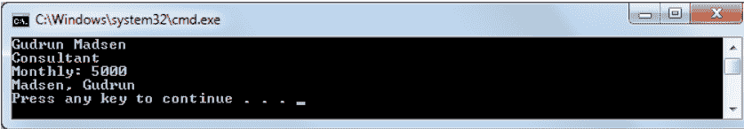

## C# 1 编程入门与 C# 语言

这并不完全显而易见。注意，为 `Monthly` 执行的属性是 `Consultant` 类中的那个，尽管 `Print()` 方法的参数类型是 `Employee`。这意味着系统“记住”了当前对象的类型，即使 `Print()` 方法中的对象被认为是 `Employee`。这是一个极其重要的特性，被称为**多态**（polymorphism）。

当你编写一个类时，你无法保证将来有人继承该类并用新功能扩展它——这也是继承的理念。然而，在某些情况下你可能不想这样做，这时你可以将类声明为 `sealed`（密封），意味着它不能被继承。例如，如果你不想允许继承 `Director` 类，可以这样定义：


```csharp
public sealed class Director : Employee
{
    public Director(string firstName, string lastName, int monthly)
    : base(firstName, lastName, "Director", monthly) {}
}
```

# 注释

继承并不是一个特别困难的概念——至少当你见过几次之后是这样的——但有些事情是你必须注意的：

- 类（Class）——例如 `Employee` 可能有一个或多个派生类，但一个类只能继承一个类。
- 多态（Polymorphism）——运行时系统记住对象的特定类型（在创建新对象时使用的类型是面向对象编程最重要的概念之一）。

此外，还有一些与继承相关的名称，理解它们很重要：

- `base`
- `protected`
- `virtual`
- `override`

你可以在上面的示例看到这些词是如何使用的。

# 12 Object 类

我上面在 `Coin`、`Dice`、`Cup` 等类中看到过，这些类显然没有使用继承——表面上如此，但实际上它们间接继承了 `Object` 类。如果你不写任何内容，该类会自动继承这个类，而且所有类无例外地直接或间接继承 `Object`。事实远不止于，对于任何类型，无论是值类型还是引用类型，都是如此。

C# 定义了 `System.Object` 的别名类，这是一个保留字，就像 `string` 是 `System.String` 类的别名完全一样。

`Object` 类包含的内容不多，但它的主要用途是作为所有类型的基类。它定义了一些我将提到的方法：`ToString()`，它返回对象的字符串表示。考虑以下内容：

```csharp
class ZipCode
{
    private string code;
    private string name;
}
```


## C# 1 编程入门与 C# 语言

```csharp
class ZipCode
{
    public ZipCode(string code, string name)
    {
        this.code = code;
        this.name = name;
    }

    public string code
    {
        get { return code; }
    }

    public string name
    {
        get { return name; }
    }

    public override string ToString()
    {
        return code + " " + name;
    }

    public override bool Equals(object obj)
    {
        if (obj is ZipCode)
        {
            ZipCode z = (ZipCode)obj;
            return code.Equals(z.code) && name.Equals(z.name);
        }
        return false;
    }
}
```

如果你想测试这个，可以这样做：

```csharp
static void Test1()
{
    ZipCode z1 = new ZipCode("7800", "Skive");
    ZipCode z2 = new ZipCode("7800", "Skive");
    Console.WriteLine(z1.Equals(z2));
}
```

当你运行该方法，你将得到结果：

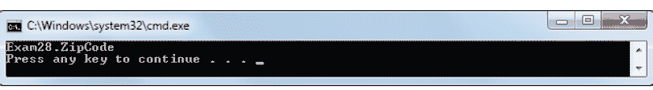

## C# 1 编程入门与 C# 语言

我将提到 `Object` 类中的另一个方法 `GetHashCode()`。它是一个返回整数的方法，该整数可以被视为代码标识。通常它是根据对象的引用确定的，但与 `ToString()` 和 `Equals()` 一样，由程序员来重写该方法，如果需要根据对象的值返回代码。

考虑以下方法，你应该特别注意该方法有一个对象作为参数：

```csharp
static void Print(object obj)
{
    Console.WriteLine(obj.GetType());
    Console.WriteLine(obj.GetHashCode());
    Console.WriteLine(obj);
}
```

# C# 编程与 C# 语言简介

你还应该注意 `GetType()` 方法，它是 `Object` 类中的方法，在此情况下，它用于打印对象的类型名称。下面的方法创建一个 `object` 类型的数组并在控制台上打印其元素：

```csharp
static void Test3() {
    object[] t = { 23, 3.14, "Volmer", new Postnummer("7800", "Skive") };
    for (int i = 0; i < t.Length; i++) Print(t[i]);
}
```

如果你运行该方法，将得到以下结果：

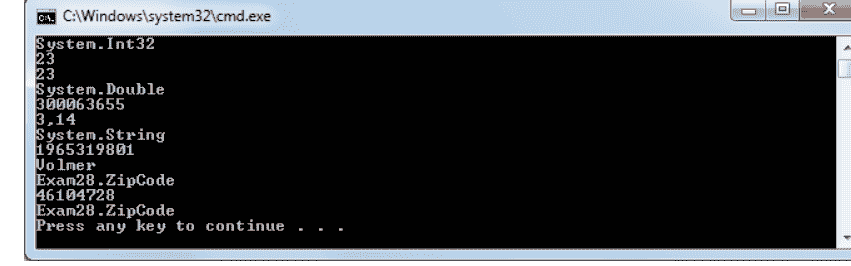

你应该主要注意两点：

- 作为形式参数对象的方法，可能具有任何类型的实际参数
- 类型为 `object` 的数组可以包含任何内容，无论类型如何

乍一看这听起来很聪明，但你应该意识到，这意味着编译器无法检查，因此基于 `object` 类型的代码很容易包含错误。

上述关于 `Object` 类的示例被称为 Exam28。

# C# 1 编程与 C# 语言简介

## 13 抽象类

在本章中，我将介绍抽象类的概念。它是一种无法实例化的类——你不能创建抽象类的对象，但抽象类可以作为其他具体类的基类。

Exam32

### 抽象点

我将再次从一个示例开始，目的是展示语法，该示例与 Exam31 基本相同。现在 `Point` 类是抽象的了：

```csharp
public abstract class Point
{
    private int x;
    private int y;

    public Point(int x, int y)
    {
        this.x = x;
        this.y = y;
    }
}
```


# C# 1 编程与 C# 语言简介

## 抽象类

```csharp
public int X
{
    get { return x; }
    set { x = value; }
}

public int Y
{
    get { return y; }
    set { y = value; }
}

public override string ToString()
{
    return string.Format("{0}, {1}", x, y);
}

public abstract void Dec();
public abstract void Inc();
```

有两个区别。该类有两个抽象方法 `Dec()` 和 `Inc()`。这些方法没有代码，仅仅是定义。这意味着使用 `Point` 类的人知道这些方法存在，但不知道它们是如何工作的的。第二个区别是该类被定义为抽象的。它必须如此，这意味着该类不能被实例化——你不能创建 `Point` 类型的对象。

`NewPoint` 类继承自 `Point`，因此必须实现这两个抽象方法，所以它们是执行某些操作的具体方法：

```csharp
public class NewPoint : Point
{
    public NewPoint(int x, int y) : base(x, y) { }
}

public override void Dec()
{
    --X;
    --Y;
}

public override void Inc()
{
    ++X;
    ++Y;
}
```

注意，在派生类中实现的抽象方法前面必须带有 `override` 关键字。

# C# 1 编程与 C# 语言简介

下面是一个使用 `NewPoint` 类的 `Main()` 方法：

```csharp
static void Main(string[] args)
{
    Point p = new NewPoint(2, 3);
    Console.WriteLine(p);
    p.Inc();
    Console.WriteLine(p);
    p.Dec();
    Console.WriteLine(p);
}
```

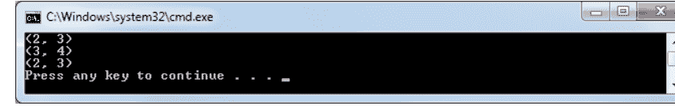

`p` 是一个 `NewPoint` 对象，但在程序中被定义为 `Point`。这是可能的，因为 `NewPoint` 专门是一个 `Point`，但你应该特别注意，即使 `p` 是一个 `Point`，你仍然可以写

`p.Inc();`

由于 `Point` 有一个抽象方法 `Inc()`，编译器知道 `Point` 对象拥有这样一个方法（尽管它是在派生类中定义的），因此上述语句是有意义的。

### 贷款

作为一个示例，我将编写一个可以代表银行贷款的类。贷款（在本示例中）的特征是本金、期数和利率。我假设利率在整个还款期内保持不变，并且每期在到期日还款一次，且还款在贷款启动后一期发生。我还假设你对以下信息感兴趣

- 第 n 次还款
- 第 n 次还款时的还款金额
- 第 n 次还款时的利息
- 第 n 次还款后的余额

完成后的程序必须打印一份贷款摊还计划，该计划是每个账期结束后贷款情况的概述。

# C# 1 编程与 C# 语言简介

## 抽象类

### 如何实现

对应此贷款可以用以下类表示：

| 本金 | double |
| 利率 | double |
| 期数 | int |
| 本金 | double |
| 利率 | double |
| 期数 | int |
| 还款(n) | double |
| 利息(n) | double |
| 还款金额(n) | double |
| 余额(n) | double |

现在有多种类型的贷款，作为一个示例，你有一种随时间减少的等本贷款。对于等额贷款，你每次必须支付相同的金额。


# C# 1 编程与 C# 语言简介

## 抽象类

你也可以查看等额贷款，其特征是还款金额在整个期间保持不变。这意味着利息和还款之间的关系通过以下公式表示：

```csharp
payment = principal * rate / (1 - (1 + rate)^-periods)
```

最后，第 n 期还款后的剩余余额计算如下：

```c
outstanding = principal * ((1 + rate)^n - 1) / ((1 + rate)^periods - 1)
```

如果你观察上面的 `Loan` 类，发现需要两个版本：自然会考虑一个共同的基类两个类：等本贷款和等额贷款。当两个类有许多共同点时，自然会考虑一个共同的基类和两个派生类：

```csharp
public abstract class Loan {
  protected double principal;
  protected double rate;
  protected int periods;
}
```

# C# 1 编程基础与 C# 语言介绍

## 抽象类

```csharp
public override double Payment(int n)
{
    return principal * rate / (1 - Math.Pow(1 + rate, -periods));
}
public override double Outstanding(int n)
{
    return principal * Math.Pow(1 + rate, n) - Payment(0) *
    (Math.Pow(1 + rate, n) - 1) / rate;
}
public override double Interest(int n)
{
    return Outstanding(n - 1) * rate;
}
public override double Repayment(int n)
{
    return Payment(n) - Interest(n);
}
```

程序必须打印一份贷款还款计划，这是一张显示每次还款贷款状态的表格：

```csharp
public class Amortization
{
    private Loan loan;
```


# C# 编程基础与 C# 语言介绍

## 抽象类

```csharp
public Amortisation(Loan loan)
{
    this.loan = loan;
}

public void Print()
{
    Console.WriteLine("Principal: {0, 10:F}", loan.Principal);
    Console.WriteLine("Rate of interest: {0, 10:F}", loan.Rate);
    Console.WriteLine("Number of periods: {0, 10:D}\n", loan.Periods);
    Console.WriteLine("\nPeriods Payment Repayment Outstanding");
    for (int n = 1; n <= loan.Periods; n++)
    {
        Console.WriteLine("{0,0} {1,15:F} {2,15:F} {3,15:F} {4,15:F}", n, loan.Payment(n), loan.Repayment(n), loan.Interest(n), loan.Outstanding(n));
    }
}
```

# 解析

请注意，`Loan` 类被定义为抽象类。这可能是因为它包含了抽象方法。抽象方法是一种没有定义体的方法——即没有编写具体实现。在这种情况下，有四个抽象方法。抽象方法关于如何计算付款取决于它指的是哪种贷款。只有当你知道正在处理的是哪种贷款时，才能实现该方法。抽象类仅仅是一个原型定义，其中方法通过其名称、返回类型和参数进行定义，但缺少了方法体。

`Loan` 是一个类型，尽管它是抽象的，但你不能创建 `Loan` 类型的对象，该类型可以作为方法的参数类型使用。任何被告知正在处理 `Loan` 类型对象的人都知道它具有三个属性（以及对应的方法，如 `Payment()` 等），并且如果这四个抽象方法存在，你就可以使用它们。

`SerialLoan` 类继承自 `Loan`，因此由 `SerialLoan` 类负责实现这四个抽象方法，因为 `SerialLoan` 拥有所需的知识——这些知识在 `Loan` 类中是未知的。抽象方法的实现是虚拟的（virtual），但 `SerialLoan` 明确是一个 `Loan`。

`AnnuityLoan` 类也容易实现，它仅需在 C# 中编写公式即可。这里你应该注意 `Pow()` 方法，它是 `Math` 类的一个静态方法，用于计算参数的幂。

最后是 `Amortisation`，它可以打印贷款的还款计划。这里你应该注意该类有一个类型为 `Loan` 的实例变量，该变量在构造函数中初始化。因此你可以有一个类型为抽象类的变量，因为 `SerialLoan` 和 `AnnuityLoan` 的具体对象也是 `Loan` 类型。请注意，`Amortisation` 类对具体的贷款类型一无所知，但尽管如此，只要它们继承自 `Loan` 类，就可以编写该类的方法。

# C# 1 编程基础与 C# 语言介绍

## 抽象类

# 测试

如果你使用以下程序测试上述类：

```csharp
class Program
{
    static void Main(string[] args)
    {
        Amortisation table1 = new Amortisation(new SerialLoan(10000, 0.02));
        Amortisation table2 = new Amortisation(new AnnuityLoan(10000, 0.02));
        table1.Print();
        table2.Print();
    }
}
```

你将如下结果：

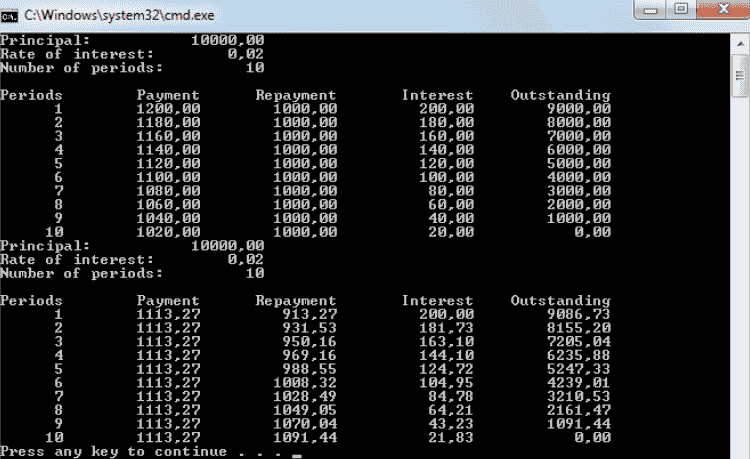

### 类

在最后的示例中，通常有多个类以及 `Main` 程序。在所有示例中，类代码都在同一个文件中，但随着示例变得复杂，为了清晰起见，将每个类放在自己的文件中是一种可行策略，这更容易理解。

# 注释

特别注意，类可以是抽象的，尽管它有抽象方法。这可以确保一个类不能被实例化。

## 14 接口

抽象类可以包含类所拥的所有内容，即变量、构造函数、方法等。某些方法可以是抽象的，这对应于具体的类。相比之下，接口是一种只包含抽象方法的类型。

## 33

## 再次介绍接口

以下是 `IPoint`：


```csharp
public interface IPoint
{
    int X { get; set; }
    int Y { get; set; }
}
```

基本上它看起来像一个类，只是站在那里。接口定义了方法和属性，在这种情况下是两个属性。特别是接口没有方法可见性——它们默认是抽象的。

下面是实现该接口的类：

```csharp
public class Point : IPoint
{
    private int x;
    private int y;

    public Point(int x, int y)
    {
        this.x = x;
        this.y = y;
    }

    public int X
    {
        get { return x; }
        set { x = value; }
    }

    public int Y
    {
        get { return y; }
        set { y = value; }
    }

    public override string ToString()
    {
        return string.Format("{0}, {1}", x, y);
    }
}
```

# C# 1 编程基础与 C# 语言介绍

## 抽象类

注意你使用了相同的继承语法：

```csharp
public class Point : IPoint
{
    // ...
```

当一个类实现接口时，该类必须实现接口中定义的方法和属性。以下 `Main()` 方法使用了接口：

```csharp
static void Main(string[] args)
{
    IPoint p = new Point(2, 3);
    Console.WriteLine(p);
}
```

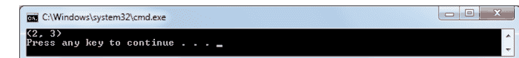

`p` 是 `Point` 对象，但在程序中通过它的接口识别。

# 30

## 金钱

在这个示例中，我将编写一个带有钞票的钱包程序。钱包必须提供以下服务：

- 可以向钱包中放入钞票
- 可以询问钱包是否为空
- 可以询问钱包是否已满
- 可以询问钱包是否包含特定的钞票
- 可以使用指定值的钞票进行支付
- 可以知道钱包里有多少钱

当钱包实现后，必须通过程序进行测试，即在钱包中存入一些钱，然后使用一些钞票。

## 如何做

第一步是定义钞票，我将处理值为 50、100、200、500 和 1000 的丹麦钞票，因此有 5 种不同的票。

# C# 1 编程基础与 C# 语言介绍

### 接口

钞票是一个非常简单的概念，主要由值（上述之一）特征，可以通过接口定义：

```csharp
public interface IBankNote
{
    int Value { get; }
}
```

这仅仅是一个定义，说明钞票——`IBankNote` 对象——拥有一个返回 `int` 的 `get` 属性。

然后我将定义一个实现上述接口的抽象类以及适用于所有钞票的方法：

```csharp
public abstract class BankNote : IBankNote
{
    public abstract int Value { get; }
    public override bool Equals(object obj)
    {
        if (!(obj is IBankNote)) return false;
        return ((IBankNote)obj).Value == Value;
    }

    public override int GetHashCode()
    {
        return Value;
    }
}
```

## C# 1 编程入门与 C# 语言

```csharp
public override string ToString()
{
    return Value + " Danish Crowns";
}
```

有了这个类后，你可以为不同的钞票定义具体的类，例如：

```csharp
public class BankNote50 : BankNote
{
    public override int Value
    {
        get { return 50; }
    }
}
```

这意味着存在以下类层次结构：

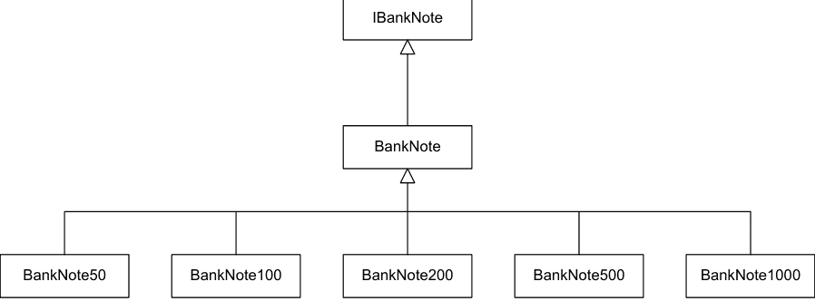

### 解释

在查看钱包（purse）的实现之前，我将对上面的图以及什么是接口进行几点说明。

接口 `BankNote` 只定义了一个用于返回钞票值的属性。注意，它没有可见性修符。它默认是公开的（public），我们无法提供任何可见性，因为这是一个翻译错误。接口是一个简单的概念，它只定义了具有某些属性的类型，但接口本身并不实现这些功能。

你应该特别注意，接口类似于类，因此你可以拥有一个接口类型的变量，但理所当然地——你不能实例化该类型的对象。例如，以下语句是非合法的：

```csharp
IBankNote note = new IBankNote(); // 非法，接口不能实例化
```

关于接口的最后一点，在 C# 中，习惯上让接口名称以大写 I 开头，例如 `IBankNote`，建议保持这种做法。

接口必须由类来实现，而 `BankNote` 类实现了接口 `IBankNote`。其语法与继承相同：

```csharp
public abstract class BankNote : IBankNote
```

即冒号后跟接口名称。`BankNote` 类不包含任何内容，因为它主要重写了来自 `Object` 的三个方法。虽然没有显式写出，但 `BankNote` 继承自 `Object`，实际上允许（但没有必要）写成：

```csharp
public abstract class BankNote : Object, IBankNote
```

由于 `BankNote` 是类，它必须实现接口的属性和方法。它不能这样做，因为类并不知道值应该是什么，因此它必须将属性 `Value` 设为抽象（abstract）。`BankNote` 并不是一个抽象类。

同样注意，`ToString()` 等方法的使用了属性 `Value`，这没有问题，尽管它还没有被实现。

最后是具体类，它们非常简单，不需要特殊解释，但例如，`BankNote50` 也是一个 `BankNote`，因此也是一个 `IBankNote`。

## Purse 类

任务是实现一个用于钞票的钱包，钱包应该拥有 6 个属性。由于此示例涉及接口，我将以接口的形式定义钱包：

```csharp
public interface IPurse {
    bool Put(IBankNote note);
    bool Empty();
    bool IsFull();
    bool Has(IBankNote note);
    IBankNote Pay(int value);
    int Value();
}
```

接口定义了钱包应该具备的方法和属性，以及你可以对钱包做什么，但接口并没有定义钱包将如何实现。它需要一个实现该接口的类：

```csharp
public class Purse : IPurse {
    private IBankNote[] list;
    private int count;
    public Purse(int size) {
        list = new IBankNote[size];
    }
}
```

### 接口

```csharp
public bool Put (IBankNote note)
{
    if (count >= list.Length) return false;
    list[count++] = note;
    return true;
}
public bool IsEmpty()
{
    return count == 0;
}
public bool IsFull()
{
    return count == list.Length;
}
public bool Has(IBankNote note)
{
    for (int i = 0; i < count; ++i) if (list[i].Equals(note)) return false;
    return false;
}
public IBankNote Pay(int value)
{
    for (int i = 0; i < count; ++i)
        if (list[i].Value == value)
        {
            IBankNote note = list[i];
            list[i] = list[--count];
            return note;
        }
    return null;
}
public int Value()
{
    int sum = 0;
    for (int i = 0; i < count; i++)
        sum += list[i].Value;
    return sum;
}
```


### 解释

注意该类实现了 `IPurse`。变量 `count` 用于跟踪钱包中的钞票。

## 程序

最后就是程序本身，它应该创建一个钱包，放入钞票，然后花费钱：

```csharp
class Program
{
    static Random rand = new Random();
    static void Main(string[] args)
    {
        IPurse purse = new Purse(10);
        Init(purse);
        Console.WriteLine("Purse.Value:");
        for (int i = 0; i < 20; ++i) Buy(purse, Create());
        Console.WriteLine(purse.Value());
    }

    static void Buy(IPurse purse, IBankNote note)
    {
        if (purse.Has(note))
        {
            purse.Pay(note.Value);
            Console.WriteLine("Bought for {0} crones", note.Value);
        }
        else
        {
            Console.WriteLine("Does not have a " + note);
        }
    }

    static void Init(IPurse purse)
    {
        while (!purse.IsFull()) purse.Put(Create());
    }

    static IBankNote Create()
    {
        switch (rand.Next(15))
        {
            case 0: return new BankNote1000();
            case 1:
            case 2: return new BankNote500();
            case 3:
            case 4:
            case 5: return new BankNote200();
            case 6:
            case 7:
            case 8:
            case 9: return new BankNote100();
            default: return new BankNote50();
        }
    }
}
```

# C# 1 编程介绍与 C# 接口

### 解释

注意第一个方法 `Init()`，它向钱包中填充了钞票。

钞票通过 `Create()` 方法创建，该方法生成随机钞票。请注意，这是程序中唯一出现具体钞票的地方——在其他地方，钞票仅作为 `IBankNote` 接口存在。事实上，你可以将 `Create()` 方法的代码提取到自己的工厂类中，这样可以更有效地实现程序与特定钞票类之间的分离。

`Buy()` 方法模拟了你持有一个特定钞票的操作。该方法还会让钱包拥有一张特定的票（如果它是“按金额购买”方法的话）。否则，它可能会说“抱歉，请注意此方法通过 `IPurse` 接口知道钱包，即使钱包是用不同的方式实现的，只要它实现了该接口，该方法就能工作”。

程序如下：

```csharp
static void Main(string[] args)
{
  Pung pung = new ArrPung(10);
  Init(pung);
  Console.WriteLine(pung.Init());
  for (int i = 0; i < pung; ++i) Koeb(pung, Create());
  Console.WriteLine(pung.Last());
}
```

下面是该程序的测试示例。


近 60年来，马斯里赫特管理学院（Maastricht School of Management）一直通过最先进的管理教育提升全球专业人士和组织的管理能力。

我们广泛的开放注册高管课程为您提供独特的互动性、启发性和多元文化的学习体验。

**为应对未来的管理挑战做好准备，从今天开始。**

欲了解更多信息，请访问 www.msm.nl 或拨打 +41 33 70 808 或通过 admissions@msm.nl 与我们联系。


在 bookboom.com 下载免费电子书


# C# 1 编程介绍与 C# 语言

### 接口

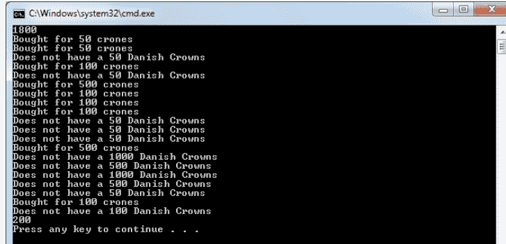

```text
C:\Windows\system32\cmd.exe
ERROR
购买了 50 亿
购买了 50 亿
没有 50 丹麦克朗
购买了 50 亿
没有 50 丹麦克朗
购买了 50 亿
没有 50 丹麦克朗
购买了 100 亿
没有 100 丹麦克朗
购买了 100 亿
没有 100 丹麦克朗
购买了 100 亿
没有 100 丹麦克朗
购买了 100 亿
没有 100 丹麦克朗
购买了 100 亿
没有 100 丹麦克朗
按任意键继续 . _
```

接口

接口基本上有两个目标。首先，这是一种良好的编程原则，即以接口的形式定义主体（例如上方的 `IPurse`）。人们说应该“面向接口编程”。在这种情况下，定义和实现是分离的，关键点在于使用主体的代码只通过接口与之交互，并且与实现完全独立。这确保了你可以更改实现，而无需修改使用主体的代码。面向接口编程可以让你在修改实现时不需要修改使用该主体的代码。另一个目标是允许以不同的方式实现钱包，只要它实现了该接口，该方法就能工作。

```csharp
IPurse pung = new Purse(10);
```

15 静态成员

在这个示例中，我将展示一个仅包含静态方法的类。这种类在处理字符串时是非常有用的。静态方法可以初始化：

```csharp
static Dice()
{
  rand = new Random();
}
```

## StringBuilder

在这个例子中，`Str` 类包含这些静态方法：


```csharp
public static class Str {
    public static string Cut(string text, int width) {
        if (text.Length > width) return text.Substring(0, width);
        return text;
    }

    public static string FillRight(string text, int width, char ch) {
        StringBuilder builder = new StringBuilder(text);
        while (builder.Length < width) builder.Append(ch);
        return builder.toString();
    }

    public static string FillLeft(string text, int width, char ch) {
        if (text.Length >= width) return text;
        StringBuilder builder = new StringBuilder(width - text.Length);
        for (int i = 0; i < builder.Capacity; ++i) builder.Append(ch);
        return builder.toString() + text;
    }

    public static string FillCenter(string text, int width, char ch) {
        return FillRight(FillLeft(text, text.Length + (width - text.Length) / 2, ch), width, ch);
    }
}
```

在这种情况下，`Str`类位于它自己的文件中。这为在其他程序中使用该类提供了更好的机会。

下面是一个测试程序：

```csharp
class Program
{
    static void Main(string[] args)
    {
        Test1();
        Test2();
    }

    static void Test1()
    {
        Console.WriteLine(Str.Cut("1234567890", 8));
        Console.WriteLine(Str.Cut("1234567890", 12));
    }

    static void Test2()
    {
        Console.WriteLine(Str.FillRight("abc", 10, 'x'));
        Console.WriteLine(Str.FillLeft("abc", 10, 'x'));
        Console.WriteLine(Str.FillCenter("abc", 10, 'x'));
    }
}
```

# C# 编程简介与 C# 语言 静态成员

## 解释

第一个方法截断字符串，使其具有最大宽度（字符数）：

```csharp
public static string Cut(string text, int width)
{
    if (text.Length > width) return text.Substring(0, width);
    return text;
}
```

这是一个静态方法，实际上是一个非常简单但实用的方法，例如，可以如下使用：

```csharp
Console.WriteLine(Cut("1234567890", 8));
```

你应该注意通过输入类`Str`来引用的方法。基本上，静态方法可以执行和其他方法相同的操作，重要的是它可以在不创建对象的情况下被使用。反之，静态方法不能引用实例变量，但也有许多没有说明此点的方法示例。一个很好的例子是`Math`类，它包含了许多数学函数，这些函数都被实现为静态方法。

第二个方法是一个将字符串扩展到最小宽度的方法，使其右侧用适当的字符`ch`填充。该方法使用了`StringBuilder`，也可以有不同的写法：

```csharp
public static string FillRight(string text, int width, char ch)
{
    while (text.Length < width) text += ch;
    return text;
}
```

字符串对象不能改变状态——你不能更改字符串的内容。如果你查看表达式：

```csharp
text += ch;
```

这意味着创建一个包含`text`之前内容的字符串对象，并用值`ch`对其扩展。这意味着在堆上创建了一个对象，并且旧的字符串必须复制到新对象中。在大多数情况下这不是必需的，但如果需要添加更多的填充字符且循环重复多次，可能会影响性能并能被检测到。这时`StringBuilder`类型就派上用场了。它是一种字符缓冲区，可以根据需要动态扩展。以下语句：

```csharp
StringBuilder builder = new StringBuilder(text);
```

该语句创建了一个包含`text`内容的新`StringBuilder`。第二个循环不断添加字符，直到`builder`包含所需的字符数量，请注意它会根据需要自动扩展。

很难说确切什么时候该使用`StringBuilder`，但如果扩展超过 10 次，你应该考虑使用该类是否值得。

第三个方法与`FillRight()`类似，但它是从左侧填充字符。它也使用了`StringBuilder`，但这次传递给`builder`构造函数的参数是要使用的填充字符数量。这意味着`builder`从开始就可以容纳所需的字符数量，并且不应该再扩展。还要注意在循环中使用了一个`Capacity`属性来确定要添加多少个字符。

如果考虑`Str`类，那么所有方法都是静态的。如果是这样，你也可以将该类定义为静态类：

```csharp
public static class Str
{
```

如果是这样，就不创建`Str`类型的对象，而且在这种情况下它也不允许实例化。

## 注释

当你在 Visual Studio 中创建一个新的控制台应用程序时，会自动创建一个带有`Main()`方法的类。它是一个静态方法，而且必须是静态的，因为它必须由运行时系统在没有对象的情况下调用。例如，在测试程序中的带有`Main()`的类只有静态方法。

```csharp
static void Test2()
{
    Console.WriteLine(Str.FillRight("abc", 10, 'x'));
    Console.WriteLine(Str.FillLeft("abc", 10, 'x'));
    Console.WriteLine(Str.FillCenter("abc", 10, 'x'));
}
```

该方法通常从`Main()`调用。当你在没有对象的情况下时，方法必须是静态的，这就是为什么`Main()`类中的方法始终是静态的。

# C# 编程简介与 C# 语言

## 16 关于数组的更多信息

我之前定义数组为一组可以通过通用名称引用的特定类型的元素。数组的图示如下所示结构：

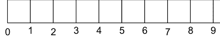

其中每个框都有空间容纳一个数组类型的元素。单个元素可以使用数组名和始终从 0 开始的索引来引用。类型可以是任何类型，在`Cup`类中它是`Dice`，而在`Purse`类中它是`IBankNote`。唯一注意的是，如果类型是值类型，框包含附加到各个索引的值；但如果类型是引用类型，框只包含指向所链接各个对象的引用。在实践中这种意义并不大，但你应该意识到，如果你写了类似下面的代码：

```csharp
Dice[] t = new Dice;
```

这意味着创建了一个数组，但在循环中它尚未填充`Dice`对象。

方法第一个方法截断字符串，使其具有最大宽度（字符数）：

第一个方法是静态方法：

```csharp
public static string Cut(string text, int width)
{
    if (text.Length > width) return text.Substring(0, width);
    return text;
}
```

第二个方法是一个将字符串扩展到最小宽度的方法，使其右侧用适当的字符`ch`填充。该方法使用了`StringBuilder`，也可以有不同的写法：

```csharp
public static string FillRight(string text, int width, char ch)
{
    while (text.Length < width) text += ch;
    return text;
}
```

字符串对象不能改变状态——你不能更改字符串的内容。如果你查看表达式：

```csharp
text += ch;
```

这意味着创建一个包含`text`之前内容的字符串对象，并用值`ch`对其扩展。这意味着在堆上创建了一个对象，并且旧的字符串必须复制到新对象中。在大多数情况下这不是必需的，但如果需要添加更多的填充字符且循环重复多次，可能会影响性能并能被检测到。这时`StringBuilder`类型就派上用场了。它是一种字符缓冲区，可以根据需要动态扩展。以下语句：

```csharp
StringBuilder builder = new StringBuilder(text);
```

该语句创建了一个包含`text`内容的新`StringBuilder`。第二个循环不断添加字符，直到`builder`包含所需的字符数量，请注意它会根据需要自动扩展。

很难说确切什么时候该使用`StringBuilder`，但如果扩展超过 10 次，你应该考虑使用该类是否值得。

# C# 编程简介与 C# 语言

## 类型

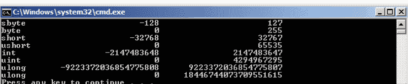

你不能在不进行类型转换的情况下将一种类型的整数复制到另一种类型，但通常规则是如果你可以将一种类型复制到更大的类型中，这就是典型的情况。如果你尝试翻译以下代码

```csharp
static void Test3() {
    byte b1 = 2;
    byte b2 = b1;
    int n = 3;
    short s = n;
    long t = n;
}
```

你将得到编译错误。语句：

```csharp
byte b2 = b1;
```

> 将挑战转化为学习曲线。
> 对于高绩效者来说，这只是办公室工作的常态。

## 埃哲训练营 —— 你面临的最严峻挑战

选择埃哲，在这里多元化的机会与挑战让你每天都能做出贡献。在这里，你可以与才华横溢的同事一起开发潜力并实现专业成长。在这里，你可以从我们无与伦比的经验中学习，同时帮助我们的全球客户实现卓越表现。如果这就是你理想中的典型工作日，那么埃哲就是你的首选。

一切始于训练营。这48 小时将激发你的思维并提升你的职业前景。你将与学生、顾问和特邀嘉宾共度时光。这充满启发的两天充满了智力挑战和活动，旨在让你发现成为“高绩效者”的真正含义。我们无法告诉你关于训练营的一切，但我们预期一种快速节奏、振奋且激烈的学习体验。这可能是你迄为止的最严峻测试，而这恰恰将成为你最大的机会。

了解更多信息并在线申请。

访问 `accenture.com/bootcamp`

- 咨询 • 技术 • 外包


产生错误是因为你正尝试将一个可能为负数的整数复制到一个只能包含非负数的变量中。同样，以下语句

```
short s = n;
```

在尝试将 4 字节复制到 2 字节时也会导致错误。在这两种情况下，问题都是通过显式类型转换来解决的：

```csharp
static void Test3() {
byte b1 = 2;
byte b2 = (byte)b1;
int n = 3;
short s = (short)n;
long t = n;
}
```

关于整数的最后一点说明，我将提到带有十六进制数字作为整数的语句的可能性：

```
int a = 0xabc23;
```

其中 `0x` 告诉编译器该值应该被解释为 float、double 和 decimal 类型。

后面是使用 float、double 和 decimal 类型表示的小数。前两种是所谓的浮点数，而后者是小数。区别在于 float 和 double 具有一个带有大量有效数字的极大范围，而后者支持更多的有效数字，但返回的范围较有限。这三种类型的共同点是它们仅代表其所跨区间内的部分数据，这是因为每个区间都包含无限多个实数，而无限的数量无法用有限的位来表示。在处理小数时，重要的是所有的结果都经过了舍入并是近似值，这种关系在普通计算器中也是广为人知的。特别是在比较的背景下，意识到这一点非常重要。

float 和 double 的区别在于它们所跨的范围有多大。内部表示由符号、带有数字的尾数和一个指数组成。例如，如果你计算 3.14

```c
Console.WriteLine(Math.Pow(3.14, 50));
```

你会得到结果

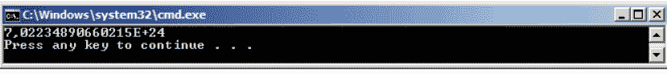

这意味着 7.0223489066125*10^14 意味着 double 处理的是大约 15 位有效数字。因此，上述是一个舍入后的结果。

你也可以将该符号用于常量，例如

```csharp
double x = 1234.678E+20;
```

float 和 double 类型定义了几个常量，其中一些被用于以下方法中：

```csharp
static void Test4()
{
    Console.WriteLine("Float (0, 30E20, 1:30E20)", float.MinValue, float.MaxValue);
    Console.WriteLine("float.Epsilon");
    Console.WriteLine("double (0, 30E20, 1:30E20)", double.MinValue, double.MaxValue);
    Console.WriteLine("double.Epsilon");
}
```

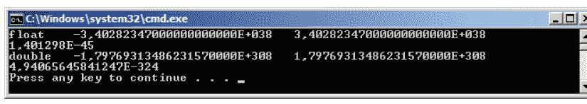

在这里你可以看到两种类型的范围，但你也会注意到常量 Epsilon，它表示最小的正数。还有一些不代表数字的值：

- `double.PositiveInfinity` 表示正无穷
- `double.NegativeInfinity` 表示负无穷
- `NaN` 表示不代表数字的值

decimal 类型跨越的范围较小，但作为回报支持多达 29 位有效数字：

```csharp
static void Test5()
{
    Console.WriteLine(decimal.MinValue);
    Console.WriteLine(decimal.MaxValue);
    Console.WriteLine(decimal.Zero);
    Console.WriteLine(decimal.One);
    Console.WriteLine(decimal.MinusOne);
    decimal x = 0;
    Console.WriteLine(Sqrt(x));
}
```

```cmd
C:\Windows\system32\cmd.exe
7922816251426437593543950335
7922816251426437593543950335
1
1.4142135623730790540806807242
按任意键继续 _
```


平方根定义了几个常量。还要注意最后一条语句，对于 `decimal` 类型的变量没有实现 2 的平方根，如果你想确定一个小数的平方根为小数，你必须编写该函数：

```csharp
static decimal Sqrt(decimal x)
{
    decimal y = x;
    while (true)
    {
        decimal v = y + x / y;
        decimal z = v / 2;
        if (Math.Abs(v - z) <= decimal.Zero) break;
        y = z;
    }
    return y;
}
```

通常情况下，简单类型是未检查的（unchecked）。也就是说，如果值太大，不会进行溢出测试。例如，如果你执行以下方法


| 低速发动机 | 中速发动机 | 涡轮增压器 | 螺旋桨 | 推进包 |
| :--- | :--- | :--- | :--- | :--- |
| 设计设计 | | | | |

（注：此处表格内容原文未提供具体英文，仅保留表头翻译）

由于原文文本中表格部分不完整或内容缺失，此处根据格式翻译了表头。

（注：由于提供的原文文本在表格处存在重复或截断，以下翻译基于您提供的文本结构）

*注：由于提供的待翻译文本在表格部分之后出现了大量逻辑重复和截断，译文已根据您提供的片段尽可能进行处理。*

## C# 1 编程介绍与 C# 语言枚举 Enum

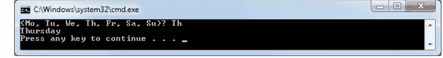

注意 `switch` 语句对字符串进行切换。这在 C# 中是允许的。同样注意，程序输出了 Sunday，即常量的名称。

上面的 `enum` 定义了 8 个值，但并不意味着该类型的变量占用 8 个字节。它只占用一个字节，这只是一个根据变量的值分配一个确定的名称的问题。

默认类型是 `int`，你可以直接写道：

```csharp
public enum Color
{
    Diamonds, Hearts, Spades, Clubs
}
```

枚举类型非常有效，并且为某个概念定义多个常量是更好的解决方案，枚举类型可以用于提高可读性。

上述关于枚举的示例可以在 Exam36 中找到

在 bookhoon.com 免费下载电子书

## 19 结构体 Struct

最后一种值类型是 `struct`（结构体），它将类的组合方式组合在一起。主要的区别在于 `struct` 是一个值类型。下面是一个表示坐标系点的结构体：

```csharp
struct Point
{
    public double x;
    public double y;
    public Point(double x, double y)
    {
        this.x = x;
        this.y = y;
    }
    public double double Length
    {
        get { return Math.Sqrt(x * x + y * y); }
    }
    public override string ToString()
    {
        return string.Format("{0},{1}", x, y);
    }
}
```

该类型名为 `Point`，有两个 `double` 类型的实例。这意味着每当你创建一个 `Point` 时，栈上就会分配 16 字节空间。该类型有一个构造函数，用于初始化两个坐标，并且有一个属性，用于返回从 (0,0) 到点的距离。此外，还有一个 `ToString()` 方法。实际上，还有一个隐式的默认构造函数，它将所有变量设置为 0 —— 这是不能被重写的。下面是一个使用类型 `Point` 类型的方法：

```csharp
static void Test1()
{
    Point p1;
    Point p2 = new Point(4, 5);
    p1.x = 2;
    p1.y = 3;
    Point p3 = p1;
    p3.y = 8;
    Show(p1);
    Show(p2);
    Show(p3);
    Console.WriteLine(p3.Length);
}

private static void Show(Point p)
{
    Console.WriteLine("{0},{1}", p.x, p.y);
}
```

## C# 1 编程介绍与 C# 语言结构体 Struct

如果你运行该程序，将得到：

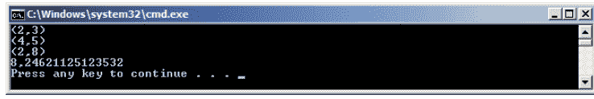

### 解释

首先，方法创建了一个 `Point`

```csharp
Point p1;
```

这意味着在栈上创建了一个变量 `p1` 并执行了默认构造函数。注意它不是引用，而是栈上的一个变量，占用了 16 字节。然后方法创建了另一个变量 `p2`，但这次使用了 `new` 运算符：

```csharp
Point p2 = new Point(4, 5);
```

即使 `p2` 是用 `new` 创建的，它仍然在栈上创建。在这里使用 `new` 运算符是为了执行构造函数，因此它的意义与在类中使用时不同。接下来，将这些点值赋值给 `p1` 的坐标。注意这是可能的，因为两个变量都是公共的（`public`）。然后程序创建了第三个变量：

```csharp
Point p3 = p1;
```

> 订阅咨询请咨询专家
>
> 在涉及订阅业务的创新和业务发展方面，Subscribe 是欧洲领先的公司之一。
>
> 我们创新新的订阅业务模式，或改进现有的模式。我们对现有的订阅业务进行业务审查，并开发获取和留存策略。
>
> 在 linkedin.com/company/subscribe 了解更多信息，或联系
> 总经理 Morten Suhr Hansen：mha@subscribe.dk
>
> SUBSCRIBE - 面向未来

在 bookhoon.com 免费下载电子书

# C# 1 编程介绍与 C# 语言

这意味着程序在栈上创建了另一个变量，它是 `p1` 的副本。注意 `p3` 是一个新变量，它的值与 `p1` 相同，但它不是对 `p1` 的引用。

# 注释

`struct` 的语法与 `class` 相似，只是将单词 `class` 替换为 `struct`。`struct` 可以像类一样拥有构造函数、属性和方法，这里唯一的区别是 `struct` 总是有一个默认构造函数，且该构造函数是可以重写的。`struct` 可以实现接口，但 `struct` 不能继承。除此之外没有其他区别。

`struct` 和 `class` 的区别在于应用上。通常，`struct` 用于封装少数简单类型，以便在作为值类型时获得更好的性能。因此，你通常会跳过属性，将变量设为公共（`public`），如 `Point` 的例所示。当在栈上分配对象时，对数据封装的需求与堆上分配的对象并不相同。

#### 复制结构体

当 `struct` 是值类型时，意味着如果你将一个变量赋值给另一个变量，它是一个真正的拷贝

```csharp
Point p1 = new Point(2,3);
Point p2 = p1;
```

即使 `p2` 是用 `new` 创建的，它仍然在栈上创建。在这里使用 `new` 运算符是为了执行构造函数，因此它的意义与在类中使用时不同。接下来，将这些点值赋值给 `p1` 的坐标。注意这是可能的，因为两个变量都是公共的。

# C# 1 编程介绍与 C# 语言

这意味着程序在栈上创建了另一个变量，它是 `p1` 的副本。注意 `p3` 是一个新变量，它的值与 `p1` 相同，但它不是对 `p1` 的引用。

### 释

`struct` 的语法与 `class` 相似，只是将单词 `class` 替换为单词 `struct`。`struct` 可以类类一样拥有构造函数、属性和方法，这里唯一的区别是 `struct` 总是有一个默认构造函数，且该构造函数可以被重写。`struct` 可以实现接口，但 `struct` 不能继承。除此之外没有其他区别。

`struct` 和 `class` 的区别在于应用上。通常，`struct` 用于封装少数简单类型，以便以便值类型时获得更好的性能。因此，你通常会跳过属性，将变量设为公共（`public`），如 `Point` 的例所示。当在栈上分配对象时，对数据封装的需求与堆分配的对象并不相同。

#### 复制结构体

当 `struct` 是值类型时，意味着如果你将一个变量赋值给另一个变量，它是一个真正的拷贝

```csharp
Point p1 = new Point(2,3);
Point p2 = p1;
```

即使 `p2` 是用 `new` 创建的，它仍然在栈上创建。在这里使用 `new` 运算符是为了执行构造函数，因此它的意义与在类中使用时不同。接下来，将这些点值赋值给 `p1` 的坐标。注意这是可能的，因为两个变量都是公共的。

# C# 1 编程介绍与 C# 语言

这意味着程序在栈上创建了另一个变量，它是 `p1` 的副本。注意 `p3` 是一个新变量，它的值与 `p1` 相同，但它不是对 `p1` 的引用。

### 释

`struct` 的语法与 `class` 相似，只是将单词 `class` 替换为单词 `struct`。`struct` 可以像类一样拥有构造函数、属性和方法，这里唯一的区别是 `struct` 总是有一个默认构造函数，且该构造函数可以被重写。`struct` 可以实现接口，但 `struct` 不能继承。除此之外没有其他区别。

`struct` 和 `class` 的区别在于应用上。通常，`struct` 用于封装少数简单类型，以便在作为值类型时获得更好的性能。因此，你通常会跳过属性，将变量设为公共（`public`），如 `Point` 的例所示。当在栈上分配对象时，对数据封装的需求与堆上分配的对象并不相同。

#### 复制结构体

当 `struct` 是值类型时，意味着如果你将一个变量赋值给另一个变量，它是一个真正的拷贝

```csharp
Point p1 = new Point(2,3);
Point p2 = p1;
```

即使 `p2` 是用 `new` 创建的，它仍然在栈上创建。在这里使用 `new` 运算符是为了执行构造函数，因此它的意义与在类中使用时不同。接下来，将这些点值赋值给 `p1` 的坐标。注意这是可能的，因为两个变量都是公共的。

# C# 1 编程入门与 C# 语言 泛型

## 20 泛型

泛型被附加在稍后处理的集合类上，但其目标是展示如何编写自定义泛型。简单而言之，目标是编写通用的、可以在许多语境下使用的类型。与泛型相对，人们所指的是与之对应的参数化类型，它依赖于一个或多个参数。

## 泛型方法

在展示如何编写自定义泛型之前，我将介绍一个相关问题，即我们所说的泛型方法是指。示例展示了一个用于交换两个 `int` 类型整数的方法：

```csharp
static void Swap(ref int a, ref int b)
{
    int t = a;
    a = b;
    b = t;
}
```

这是一个非常简单的方法，但非常有用，例如当你需要对数组进行排序时。该方法存在一个与 `int` 类型密切相关的问题：如果你还需要一个可以交换两个 `double` 类型对象的方法，那么就有必要编写针对 `double` 的 `Swap()` 方法，对于所有其他需要 `Swap()` 方法的类型也是如此。因此，编写一个可以处理所有类型的泛型方法可能是理想的。这时泛型方法派上了用场：

```csharp
static void Swap<T>(ref T a, ref T b)
{
    T t = a;
    a = b;
    b = t;
}
```

它也被称为参数化方法，类似于与类型参数关联的方法，在这里此处称为 `T`。此外，在方法名后加上 `<T>`，等同于将所有的 `int` 替换为类型 `T`。例如，该方法可以如下使用，用于交换两个字符串：

```csharp
string s1 = "Svend";
string s2 = "Knud";
Swap(ref s1, ref s2);
Console.WriteLine(s1);
Console.WriteLine(s2);
```

# C# 1 编程入门与 C# 语言 泛型

下面的另一个示例展示了一个打印数组的泛型方法：

```csharp
static void Print<T>(T[] arr)
{
    foreach (T t in arr) Console.Write(t + " ");
    Console.WriteLine();
}
```

注意，代码完全是以 `T` 作为现有类型（具体类型）编写的。然而，它有其局限性，你对类型 `T` 对象能做的只能对对象能的操作——编译器无法知道类型 `T` 其他属性。但是，可以对类型参数 `T` 施加限制，以便编译器能够假设某些方法或属性。


## Exam38

## 数组排序

它应该被写为一个可以排序任何类型的对象数组的方法。

### 方法

有很多不同的排序方法，在这里我将使用一种描述如下的方法：

- 遍历数组并找到最小元素
- 将最小元素与位置 0 元素交换 – 现在第一个项目是正确的
- 遍历最后 n-1 个元素并找到它们中最小的
- 将该元素与位置 1 元素交换 – 现在前两个元素是正确的
- 遍历最后 n-2 个元素并找到它们中最小的
- 将该元素与位置 2 元素交换 – 现在前三个元素已就位
- 继续持续直到数组被排序 – 每一轮找到尚未就位的元素中的最小元素并将其交换到正确位置

结果是经过 k 轮后，前 k 个元素已经过排序，而你仍然需要排序最后 n-k 个元素。这是一个非常简单的排序方法，但它并不是最有效的——对于大数组并非如此。

编写一个可以对任何类型数组排序的方法是一项大需求，因为元素的排序始终包含元素是可以被比较并按大小顺序排序的。许多内置类型都可以做到，例如简单类型和 `string` 类型，它们可以使用比较运算符进行比较，但其他类型也可以进行比较，通常它们会实现名为 `IComparable` 的接口。该接口只定义了一个名为 `CompareTo()` 的方法，如果当前对象小于参数，则返回 -1；如果当前对象大于参数，则返回 1；否则返回 0。该接口也有泛型版本，且 `CompareTo()` 方法也对要比较的元素类型进行了泛型参数化。总之，这种排序方法可以写为：

```csharp
static void Sort<T>(T[] arr) where T : IComparable<T>
  for (int i = 0; i < arr.Length - 1; i++) {
    int k = i;
    for (int j = i + 1; j < arr.Length; j++)
      if (arr[j].CompareTo(arr[k]) < 0) k = j;
    if (i != k) Swap(ref arr[i], ref arr[k]);
  }
```

## C# 1 编程入门与 C# 语言

# 解析

该方法简单且表达了上述算法，但有几点重要的事情需要注意。（注：原文此处存在大量重复文本，翻译已根据核心逻辑进行处理）。

## 通用类型

## 泛化类型

类型也可以是泛型的，为了演示语法，我将从一个表示对象对类型开始：

```csharp
class Par<T1, T2>
{
    private T1 arg1;
    private T2 arg2;
    public Par()
    {
    }
    public Par(T1 t1, T2 t2)
    {
        arg1 = t1;
        arg2 = t2;
    }
    public T1 Arg1
    {
        get { return arg1; }
        set { arg1 = value; }
    }
    public T2 Arg2
    {
        get { return arg2; }
        set { arg2 = value; }
    }
    public override string ToString()
    {
        return string.Format("{0}, {1}", Arg1, Arg2);
    }
}
```

这是一个极其简单的类型，带有两个参数化。该类除了这些构造函数和 `ToString()` 之外还定义了属性。你应该主要注意它的语法，以及可能存在一个或多个参数（这也也适用于泛化方法）。

下面是一个使用该类型的程序：

```csharp
class Program
{
    static void Main(string[] args)
    {
        Par<int, int> p1 = new Par<int, int>(2, 3);
        Par<int, double> p2 = new Par<int, double>();
        p2.Arg1 = 2;
        p2.Arg2 = Math.PI;
        Par<string, string> p3 = new Par<string, string>("Red", new string());
        Console.WriteLine(p1);
```


```
        Console.WriteLine(p2);

        Console.WriteLine(p3);

    }

}
```

没什么好解释的，如果执行该方法，结果如下：

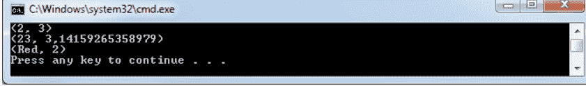

调用了示例。


## 集合 (Set)

在这个示例中，我将向你展示一个实现数学集合概念的 `Set`。集合是一个对象的集合，允许你询问某个对象是否在集合中。最后，该类实现了基本的集合操作，如交集、并集和差集。该类型必须具备以下属性：

- 你可以获取集合包含多少元素
- 你可以读取位置 n 的元素
- 你可以向集合添加元素
- 你可以从集合移除特定元素
- 你可以询问某个元素是否在集合中
- 你可以形成两个集合的并集
- 你可以形成两个集合的交集

它应该是一个通用类型，这样它可以应用于任意对象。集合的定义如下：

```csharp
public interface ISet<T>
{
    int Count { get; }
    T this[int n] { get; }
    void Add(T elem);
    void Remove(T elem);
    bool Contains(T elem);
    ISet<T> Union(ISet<T> set);
    ISet<T> Intersection(ISet<T> set);
    ISet<T> Difference(ISet<T> set);
}
```

集合可以定义为实现此接口的类：

```csharp
public class Set<T> : ISet<T>
{
    private T[] elems = new T[10];
    private int count = 0;
    public int Count
    {
        get { return count; }
    }
}
```

```csharp
public T this[int n]
{
    get { return elems[n]; }
}
public void Add(T elem)
{
    if (IndexOf(elem) >= 0) return;
    if (count == elems.Length) Expand();
    elems[count++] = elem;
}
public void Remove(T elem)
{
    int n = IndexOf(elem);
    if (n >= 0) elems[--count];
}
public bool Contains(T elem)
{
    return IndexOf(elem) >= 0;
}
public ISet<T> Union(ISet<T> set)
{
    Set<T> tmp = new Set<T>();
    for (int i = 0; i < set.Count; i++) tmp.Add(set[i]);
    for (int i = 0; i < count; i++) if (!set.Contains(elems[i])) tmp.Add(elems[i]);
    return tmp;
}
public ISet<T> Intersection(ISet<T> set)
{
    Set<T> tmp = new Set<T>();
    for (int i = 0; i < set.Count; i++) if (set.Contains(set[i])) tmp.Add(set[i]);
    return tmp;
}
public ISet<T> Difference(ISet<T> set)
{
    Set<T> tmp = new Set<T>();
    for (int i = 0; i < count; i++) if (!set.Contains(elems[i])) tmp.Add(elems[i]);
    return tmp;
}
public override string ToString()
{
    StringBuilder builder = new StringBuilder();
    builder.Append("[");
    for (int i = 0; i < count; i++)
    {
        builder.Append(elems[i]);
        if (i < count - 1) builder.Append(", ");
    }
    builder.Append("]");
    return builder.ToString();
}
private int IndexOf(T elem)
{
    for (int i = 0; i < count; i++)
    {
        if (elems[i].Equals(elem))
        {
            return i;
        }
    }
    return -1;
}
private void Expand()
{
    T[] temp = new T[elems.Length * 2];
    for (int i = 0; i < count; i++)
    {
        temp[i] = elems[i];
    }
    elems = temp;
}
}
```

# C# 1 编程与 C# 语言简介

# 注释

如上所述，`Set<T>`类的实现使得其方法没有我们预期的那样な有效。这正是为什么应该通过接口来编写程序。如果你尊重这一点，以后可以用不同且更高效的方式来实现`Set`类，而不影响使用它的应用程序。

# 测试

下面是一个用于测试该类的方法：

```csharp
static void Test1()
{
    ISet<int> A = new Set<int>();
    A.Add(2);
    A.Add(3);
    A.Add(5);
    A.Add(7);
    A.Add(11);
    A.Add(13);
    A.Add(17);
    A.Add(19);
    A.Add(23);
    A.Add(29);
    ISet<int> B = new Set<int>();
    B.Add(2);
    B.Add(4);
    B.Add(8);
    B.Add(7);
    B.Add(16);
    Console.WriteLine(A);
    Console.WriteLine(B);
    ISet<int> C = A.Union(B);
    ISet<int> D = A.Difference(B);
    ISet<int> E = A.Intersection(B);
    Console.WriteLine(C);
    Console.WriteLine(D);
    Console.WriteLine(E);
    B.Remove(2);
    B.Remove(4);
    B.Remove(6);
    Console.WriteLine(B);
    for (int i = 0; i < 8; ++i) B.Add(i);
    Console.WriteLine(B);
}
```

# C# 1 编程与 C# 语言

## 泛型类型

img/f84352ec481fd05dc2bc853aa8989838_170_0.png) 可能是泛型的。下面是一个实现泛型的类型，其中坐标必须是值类型：

```csharp
public struct Point<T> where T : struct
{
    public T x;
    public T y;
    public Point(T x, T y)
    {
        this.x = x;
        this.y = y;
    }
    public override string ToString()
    {
        return string.Format("{0}, {1}", x, y);
    }
    public override bool Equals(object obj)
    {
        if (!(obj is Point<T>)) return false;
        Point<T> p = (Point<T>)obj;
        return p.x.Equals(x) && p.y.Equals(y);
    }
}
```

注意 `Equals()` 方法被重载了，因此类型可以应用于 `Set` 的元素。

下面是该类的简单应用：

```csharp
static void Test2()
{
    Point<int> p1 = new Point<int>(2, 3);
    Point<double> p2 = new Point<double>(1.41, 3.14);
    Point<int> p3 = new Point<int>(1, 4), new Point<int>(2, 5);
    Console.WriteLine(p1);
    Console.WriteLine(p2);
    Console.WriteLine(p3);
}
```

在这里你必须特别注意 `p3`，它的坐标类型是 `Point<int>`，这是合法的，但几乎没有任何意义。

```cmd
C:\Windows\system32\cmd.exe
<2, 3>
<1,4; 3,4>
<5,6>;<6, 5>>
按任意键继续 _
```

最后的示例显示了一个创建点集合（Set）的方法：

```csharp
static void Test3()
{
    ISet<Point<int>> A = new Set<Point<int>>();
    A.Add(new Point<int>(2, 3));
    A.Add(new Point<int>(4, 5));
    A.Add(new Point<int>(6, 7));
    Console.WriteLine(A);
}
```

```cmd
C:\Windows\system32\cmd.exe
<2, 3> <4, 5> <6, ? >
按任意键继续 _ -
```

## 效率

我上面提到过，该类并不高效。为了检查有效性，我会尝试以下方法：

img/f84352ec481fd05dc2bc853aa8989838_171_0.png)

360° 思考。
在 www.deloitte.ca/careers 发现真相。
德勤
Deloitte & Touche LLP 关联实体。

img/f84352ec481fd05dc2bc853aa8989838_171_1.png)

```csharp
static void Test4()
{
    int N = 10000;
    ISet<int> A = Create(N, 2 * N);
    ISet<int> B = Create(N, 2 * N);
    Stopwatch sw = new Stopwatch();
    sw.Start();
    ISet<int> C = A.Union(B);
    Console.WriteLine(sw.ElapsedMilliseconds);
    sw.Start();
    ISet<int> D = A.Intersection(B);
    sw.Stop();
    Console.WriteLine(sw.ElapsedMilliseconds);
}
```

```csharp
static ISet<int> Create(int n, int m)
{
    ISet<int> S = new Set<int>();
    while (n-- > 0) S.Add(rand.Next(m));
    return S;
}
```

这里是 `Create()` 方法，创建一个包含 `n` 个 `int` 类型元素的集合，元素范围在 0 到 `2n` 之间。`Test4()` 方法使用该方法创建两个包含 10000 个元素的集合。然后使用 `Stopwatch` 类（定义在 `System.Diagnostics` 命名空间中）测量形成并集需要多长时间（毫秒），最后对交集重复该方法。

img/f84352ec481fd05dc2bc853aa8989838_172.png

## 异常处理

众所周知，可以除以零。如果 `b` 为 0，方法无法执行计算，但它也可能知道该做什么。它无法返回某些值，因为调用者可能是异步的。

考虑以下方法：

```csharp
static int Div(int a, int b)
{
    if (b == 0) throw new ApplicationException("除以零");
    return a / b;
}
```

## C# 1 编程入门与 C# 语言

## 异常处理

如前所述，存在多种异常类型，实际上非常多，其中大多数是 .NET Framework 中的类，用于管理各种异常。基础基类是 `Exception`，属于 `System` 命名空间。`ApplicationException` 是一个派生类，尽管自定义代码也可以抛出 `Exception`（而且通常会这样做），但人们的观点是，自定义方法抛出的异常类型必须是 `ApplicationException` 或其派生类型。

作为 C# 异常处理的一个示例，我将使用上面定义的泛型类。该类有一个 `Add()` 方法和一个 `Remove()` 方法，这两者都是不恰的。问题在于，这两个这两个方法都可能无法执行请求的操作（如果元素已在集合中，则无法添加；如果元素不在集合中，则无法移除），如果发生了这种情况，将是一个不遗憾的情况，因为用户不会收到操作未执行的通知。主要问题是这两个方法测试了操作是否可以执行，但它们不知道在操作无法完成时该做什么。解决方案是让方法在无法执行操作时抛出异常。

我将从以下异常类型开始：

```csharp
public class SetException : ApplicationException
{
    public SetException(string message)
        : base(message)
    {}
}
```


在过去的60年里，马斯里里特管理学院一直通过先进的管理教育提高全球专业人士和组织的管理能力。

我们广泛的开放式注册高管计划为您提供独特的互动性、启发性和多文化的学习体验。

**为明天的管理挑战做好准备，从今天开始行动。**

欲了解更多信息，请访问 www.msm.nl 或拨打 +41 33 70 808 或通过 admissions@msm.nl 与我们联系。


在 bookboom.com 下载免费电子书

## C# 1 编程入门与 C# 语言

在这里你应该注意，该类型继承自 `ApplicationException`，唯一发生的是有一个构造函数将异常发送到基类的构造函数。这是一个非常简单的类型，现实中它并没有扩展 `ApplicationException`，其唯一目的是获取一个针对当前问题的特定类型。我将定义两个额外的异常类型，两种类型都继承自 `SetException`：

```csharp
public class AddException : SetException
{
    public AddException()
        : base("The Element already exists in the set and can not be added")
}
public class RemoveException : SetException
{
    public RemoveException()
        : base("The element is not found in the set and can not be removed")
}
```

从名称和文本可以清楚地看出它们应该如何使用，重要的是存在可以使用以下类层次结构：

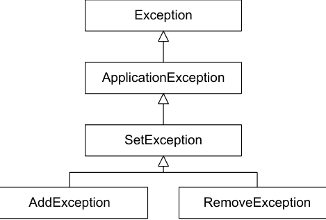

我现在将扩展 `Set` 类的代码，使其可能抛出异常，但我只展示了更改的方法：

```csharp
public class Set<T> : ISet<T>
{
    private T[] elems = T T[10];
    private int count = 0;
    public void Add(T elem)
    {
        if (IndexOf(elem) >= 0) throw new AddException();
        if (count == elems.Length) Expand();
        elems[count++] = elem;
    }
```
```csharp


`public void Remove(T elem)`

```
{
    int n = IndexOf(elem);
    if (n < 0) throw new RemoveException();
    elems[n] = elems[--count];
}
```

`Add()` 和 `Remove()` 方法现在在无法执行操作时会抛出异常。注意，它们抛出的异常是不同类型的。

下面是一个使用 `Set` 类并捕获任何异常的方法：

```csharp
static void Test3()
{
    Set<int> A = new Set<int>();
    try
    {
        for (int i = 0; i < 20; ++i)
        {
            try
            {
                int t = rand.Next(30);
                A.Add(t);
                t = rand.Next(30);
                A.Remove(t);
            }
            catch (AddException ex)
            {
                Console.WriteLine(ex.Message);
            }
            catch (RemoveException ex)
            {
                Console.WriteLine(ex.Message);
            }
            catch (SetException ex)
            {
                Console.WriteLine(ex.Message);
            }
            finally
            {
                Console.WriteLine(A);
            }
        }
        Print(A, A.Count);
    }
    catch
    {
        Console.WriteLine("There was an error");
    }
}
```

# C# 1 编程入门与 C# 语言

这里有一些需要注意的地方。首先，注意有两个 `try` 块：一个外部块和一个内部块。在循环中，有两种情况：
1. 添加一个随机数（0到29之间）
2. 从集合中移除一个随机数

在这两种情况下，可能有多个 `catch` 处理器。如果抛出异常，控制权将转移到匹配异常类型的 `catch` 处理器。此外，注意内部块有一个关联的 `finally` 处理器。无论是否发生异常，它都会执行。最后，是外部的 `try` 块。当发生异常时，多个 `catch` 处理器是必要的。

## SystemException

当应用程序抛出异常时，它应该是 `ApplicationException` 类型或直接派自 `ApplicationException` 的类型。如前所述，该类派自 `Exception`。当你这样做时，还有另一个名为 `SystemException` 的异常，它也派自 `Exception`。这种类型的异常用于由运行时系统或基础类抛出的异常，它们指示基础性且严重的问题，典型的处理是带有错误信息退出程序。以下层次结构将异常分为两类：一类失败通常会导致程序带错误信息退出；第二类是由程序环境引起的错误，因此该错误应该由程序进行处理。

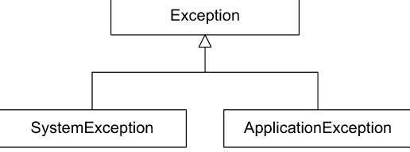

## 异常处理

下面的示例展示了一个会导致错误的方法，因为它在数组范围外进行索引：

```csharp
static void Test()
{
    int[] t = { 2, 3, 5, 7, 5, 11, 13, 17, 19 };
    try
    {
        int s = 0;
        for (int i = 0; i < 10; ++i) s += t[i];
        Console.WriteLine(s);
    }
    catch (Exception ex)
    {
        Console.WriteLine(ex.GetType().Name);
        Console.WriteLine(ex.GetType().BaseType.Name);
        Console.WriteLine(ex.GetType().BaseType.BaseType.Name);
    }
}
```

结果如下：

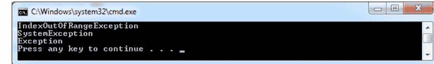


## 22 条评论

以以下类作为示例，你在 Exam34 中也见过它：

```csharp
using System;
using System.Text;
/*
此命名空间包含了几个具有杂杂方法的类。
可以将此命名空间视为一个自定义类库。
*/
namespace Exam2
{
    /// <summary>
    /// 具有文本操作静态方法的类。
    /// </summary>
    public static class String
    {
        /// <summary>
        /// 将字符串截断到最大宽度的方法。
        /// 如果长度没有超过宽度，则方法将直接返回原始不变的字符串。
        /// </summary>
        /// <param name="text">必须截断的字符串</param>
        /// <param name="length">返回字符串的最大长度</param>
        /// <returns>长度小于或等于长度的字符串</returns>
        public static string Cut(string text, int length)
        {
            if (text.Length > length)
                return text.Substring(0, length);
            return text;
        }
        /// <summary>
        /// 在给定宽度字段内调整文本字符串的方法。
        /// 如果文本长度大于 length，则方法将直接返回文本。
        /// 否则，方法返回一个长度为 length 的字符串，其中文本左对齐，且字段用填充字符填充。
        /// </summary>
        /// <param name="text">要调整的文本</param>
        /// <param name="length">字段宽度</param>
        /// <param name="fill">填充字符</param>
        /// <returns>调整后的文本</returns>
        public static string FillRight(string text, int length, char fill)
        {
            if (text.Length > length)
                StringBuilder builder = new StringBuilder(text, length);
            while (builder.Length < length)
                builder.Append(fill);
            return builder.ToString();
        }
        /// <summary>
        /// 在给定宽度字段内调整文本字符串的方法。
        /// 如果文本长度大于 length，则方法将直接返回文本。
        /// 否则，方法返回一个长度为 length 的字符串，其中文本右对齐，且字段用填充字符填充。
        /// </summary>
    }
}
```

# C# 1 编程与 C# 语言介绍

## 注释

```csharp
/// <param name="text">要调整的文本</param>
/// <param name="length">字段宽度</param>
/// <param name="fill">填充字符</param>
/// <returns>对对齐的文本</returns>
public static string Fillleft(string text, int length, char fill)
{
    if (text.Length >= length) return text;
    // 这里创建一个具有所需容量的 StringBuilder 来填充
    // 字符，你也可以使用 Insert() 方法，但它的复杂度
    // 比 Add() 更差
    length len = text.Length;
    StringBuilder builder = new StringBuilder(length);
    while (builder.Length < length) builder.Append(fill);
    return builder.ToString() + text;
}
/// <summary>
/// 在给定的宽度长度字段内调整文本字符串。
/// 如果文本长度大于 length，则方法将直接
/// 返回文本。
/// 否则，方法返回一个长度为 length 的字符串，其中文本
/// 居中对齐，且字段用填充字符 fill 填充。
/// </summary>
/// <param name="text">要调整的文本</param>
/// <param name="length">字段宽度</param>
/// <param name="fill">填充字符</param>
/// <returns>对对齐的文本</returns>
public static string FillCenter(string text, int length, char fill)
{
    if (text.Length >= length) return text;
    return
    FillRight(FillLeft(text, (text.Length + length) / 2, fill, length, fill);
}
```

我已经在代码中插入了这些注释。注释对翻译后的程序没有影响，它们仅供我们阅读和理解代码。关于注释有很多话可以说，这里简单要述几点。

在代码中编写注释非常重要，不仅如此——它实际上应该是编程任务的永久组成部分，与编写代码本身同样重要，至少有两个原因：
- 1. 所有的程序代码必须随着时间的推移进行维护，并且由编写代码者以外的人维护。因此，代码中包含注释说明重要的决策以及为什么这样写代码的原因是至关重要的。注释不仅对他人重要，对你你自己也重要，因为如果代码只过了几个月，你可能就不记得自己的代码了。
- 2. 编写代码注释的过程在这个过程中很重要，你在这个过程中思考代码并思考代码为什么要这样写。这是发现代码中错误和差异并纠正它们的一种极其高效的方法。

## C# 1 编程与 C# 语言介绍 注释

如果你看示例，大多数情况下你不会看到任何注释。这部分是因为它们是小型示例，而不是解决实际日常问题的应用程序，其次，此书中对代码有详尽的解释。可以说程序员有三种类型的注释。上面我在命名空间之前写了如下内容：

```csharp
/*
此命名空间包含了几个具有杂杂方法的类。
可以将此命名空间视为一个自定义类库。
*/
```

最后一种注释类型更简单，由 `//` 之后到行尾的内容组成（见上面的方法）。这通常用于记录方法中的单个语句，或变量的描述。

C# 中最常见的注释类型位于方法前面。这部分是因为 Visual Studio 会自动生成一个由你完成的骨架。例如，如果你在 `FillCenter()` 方法前输入三次，Visual Studio 会生成以下内容：


```csharp
/// <summary>
/// </summary>
/// <param name="text"></param>
/// <param name="length"></param>
/// <param name="fill"></param>
/// <returns></returns>
```

在这里程序员必须注释方法及其功能，通常用户需要知道的：
- 方法参数的说明，包括参数必须满足的规则（前提条件）。
- 方法返回值的说明。

使用这种注释（不仅针对方法，还针对所有程序元素）的优点是：
- 注释具有标准格式，让你记录所有元素的参数和返回值
- 注释会被 Visual Studio 中的 IntelliSense 使用
- 注释是 XML 格式，因此可以使用工具生成整个程序的文档或 HTML 文档

编写注释很容易，但应该写什么是另一回事，这有很多观点，以下是我的观点。通常情况下，你应该写你认为他人以及你自己需要阅读、理解并从而维护代码的内容。你不应该写显而易见的内容。你必须假设阅读代码的人了解该语言，你不应该注释语言本身，而是解释你的选择——你必须解释算法的使用及其工作原理。如果某些解决方案难以理解，那么你应该添加解释性注释。始终注释变量及其用途也是明智的——至少是成员变量。在修改代码时，添加注释也是个好主意，说明修改的时间、人物和原因，当然还包括改了什么。

# C# 1 编程与 C# 语言简介

# 注释

你应该在使用自动生成的注释注释并包含它们——至少要包含所有的公共程序元素。这对于类库来说尤为重要，因为类库通常必须被编写类的程序员以外的其他人员使用。编写这类说明可能很困难，因为你可能很难找到有可写的内容（许多方法和属性都是显而易见且自解释的），而且你认为自己没什么可写的。然而，这正是你应该保持一致性并包含这些注释的地方。应该意识到，这类注释是给使用代码的人看的，而不是给需要维护代码的人看的。

程序代码的可读性至关重要，甚至可以认为难以阅读的代码是毫无价值的。然而，在编写注释并遵循以下几项准则时，你可以做很多事情来提高代码的可读性：
- 块从新行开始，该行仅包含字符 `{` 
- 从下一行开始，进行两个字符的缩进
- 当块结束时，取消缩进，并向左移动两个字符
- 块结束于新行，该行仅包含字符 `}`
- 始终在运算符的两侧添加空格
- 变量名始终从小写字母开头
- 方法、属性和用户定义类型的名称始终大写字母开头


- 保持大小写的一致
- 使用良好且解释性的名称，但不要使用过长的名称——它们很难阅读
- 在你认为增加可读性的地方使用空行

因此，要保持一致并形成风格。准则是是好的，但总会有你可能偏离它们的地方，如果你能始终如一，那是极好的。上述准则是为了使代码自文档化，可以说当代码无法自解释时，才应该使用注释。

关于编写可读程序代码的重要性，怎么说都不为过，但在注释方面，你也可以做得过头。通常，我认为方法内部的注释会让代码更难阅读。很难区分哪些是程序代码，哪些是注释——注释会掩盖代码。我只在认为绝对必要的地方才在代码中包含注释——事实也确实如此。结论是，文档是重要的，但过度可能会适适得其反。

## 23 扩展方法

如果你想为类扩展新方法，方法是编写一个添加新方法的派生类。这仍然是“正确”的策略，但并非总是可能的，如果该类是密封的（sealed）——一个你无法继承的类。然而，可以通过扩展方法实现相同的功能。

考虑以下类，它定义了针对整数的三个静态方法：

```c
public static class Integer
{
    public static long DiffSum(int n)
    {
        return (n + 1L) * n / 2;
    }
    public static int Add(int n, params int[] t)
    {
        int s = n;
        for (int i = 0; i < t.Length; ++i) s += t[i];
        return s;
    }
    public static bool IsPrim(int n)
    {
        if (n == 2 || n == 5 || n == 7) return true;
        return false;
    }
}
```


# C# 1 编程简介与 C# 语言

如果你运行该程序，你将得到以下结果：

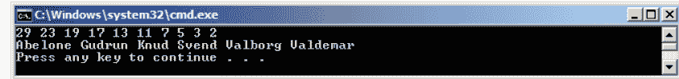

这并没有什么奥秘，你应该特别注意 `Array` 类，它提供了许多静态方法来操作数组。

在大多数情况下，数组可以作为类的替代品，而大多数集合类实际上是数组的封装。使用数组代替集合类没有问题，但反过来说，集合类具有巨大的优势。如果数组的大小是固定的，那么由程序员来跟踪每个元素的位置以及是否有空间存放它们。如果没有空间了，则需要创建一个更大的数组并将旧数组的内容复制到新数组中。这些逻辑都封装在集合类中，因此在程序员没有察觉的情况下会自动完成操作。此外，集合类还提供了符合典型应用程序的不同服务。

如上所述，集合类是泛型的并且具有强类型。这意味着，作为具体集合包含的对象必须是特定类型。然而，也有一些非泛型集合类供选择：

- `ArrayList`
- `Stack`
- `Queue`
- `SortedList`
- `Hashtable`

这些对象类型为 `object` 的集合。这些类源自 .NET 框架的第一版本，当时还没有泛型类型。这些类仍然可用且可以使用，但建议使用较新的泛型版本，因为这样生成的代码更稳定，因为编译器可以测试对象的类型。

## 2 List<T>

这种类型可以解释为一种动态数组，在许多方面可以像数组一样使用，并且可以根据需要动态增长。这与普通数组不同，在创建数组时，你必须指定容纳多少元素。不应对比得太极端，另一种解释是将该类型视为元素的序列，你可以始终向列表末尾添加元素。`List` 是在给定时刻具有容量的类型，然后你可以向列表末尾添加元素。如下图所示，容量为 15，而有 8 个位置是：

| 2 | 3 | 5 | 7 | 11 | 13 | 17 | 19 |
| :--- | :--- | :--- | :--- | :--- | :--- | :--- | :--- |

你可以在箭头指向的地方添加元素，如果在某个点你超过了容量，它会自动扩展。这是通过容量翻倍来实现的。

除了你可以向 `List` 的末尾添加元素外，该类提供了许多其他方法，例如可以删除项、在特定位置插入项等。在内部，`List` 是一个数组，这意味着你必须意识到不同方法的复杂度。`List` 不能有空位，这意味着如果你删除一个元素，被删除元素右侧的所有元素必须向左移动一位。同样，如果你在插入位置的右侧插入元素，它必须向右移动一位以为新元素留出空间。相比之下，向列表末尾添加一个元素的 `Add()` 方法特别有效，因为它可以立即将元素放在箭头指向的地方——除非需要翻倍容量的情况。

### 字符串列表

例如，下面的程序显示了一个创建字符串列表的方法：

```csharp
static void Main(string[] args) {
    List<string> navne = new List<string>();
    Console.WriteLine(navne.Capacity);
    navne.Add("Test");
    Console.WriteLine(navne.Capacity);
    navne.Add("Knud");
    navne.Add("Valdemar");
    Console.WriteLine(navne.Capacity);
    Console.WriteLine(navne.Count);
}
```

```csharp
navne.Insert(0, "Olga");
navne.Insert(0, "Gudrun");
Console.WriteLine(navne.Capacity);
Console.WriteLine(navne.Count);
navne.Remove("Knud");
navne.RemoveAt(1);
Console.WriteLine(navne.Capacity);
Console.WriteLine(navne.Count);
for (int i = 0; i < navne.Count; i++) Console.WriteLine(navne[i]);
```

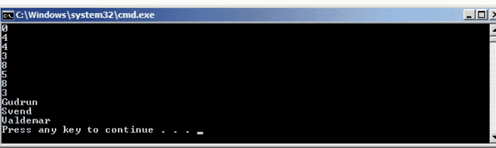

### 将挑战转化为学习曲线。

这只是高绩效者办公室的常常。

埃哲启动训练营（Accenture Boot Camp）——你迄为止最严峻的测试

选择埃哲，多样化的机会和挑战让你每天都能做出贡献。在这里，你可以与才华横溢的同事一起开发潜力并职业成长。你可以从我们无与伦比的经验中学习，同时帮助我们的全球客户实现高绩效。如果这就是你对典型一天的想法，那么埃哲就是你的首选。

它从训练营开始。48小时将刺激你的大脑并增强你的职业生涯。你将与埃哲的顾问和嘉宾共度时光。充满启发性的两天挤满了智力挑战和活动，旨在让你发现成为真正的高绩效者的意义。在此我们还无法告诉你关于训练营的一切，但请期待快速、兴奋且激烈的学习体验。这可能是你最严峻的测试，也将成为你最大的机会。

了解更多并申请。

访问 `accenture.com/bootcamp`

- 咨询 • 外包


#### 解释

首先打印列表初始容量为 0。然而，可以使用参数创建一个列表，使用构造函数设置起始容量。在添加一个元素后，程序打印容量。

### 如何操作

基本上，该任务可以分解为两个子问题：

- 输入销售项
- 打印结果

一个记录由月份数字和一个金额，因此我将从一个可以表示单个记录的类型开始：

```c
struct Sale : IComparable<Sale>
{
    public int month;
    public double value;
    public int CompareTo(Sale sale)
    {
        return month.CompareTo(sale.month);
    }
}
```

由于记录是任意顺序的，它们必须存储在某处，以便汇总结果，在这里我将使用 `List`。每当你输入新记录时，我将将其添加到 `List` 中。列表定义如下：

```csharp
static List<Sale> sales = new List<Sale>();
```

第一个子问题可以描述为：

```
重复
    输入月份
    如果月份为 0 则终止
    输入金额
    将一个 Sale 对象添加到列表
```

输入例程现在可以用 C# 编写：

```csharp
static void AddSales()
// // ... (省略)
        sale.month = Enter.EnterInt("输入 1, 2, ..., 12 表示月份或 0 停止");
        if (sale.month == 0) break;
// ... (省略)
```

## C# 1 编程入门与 C# 语言

还有另一个子问题。数字应该按照月份顺序打印，因此我将首先对月份的 `List` 内容进行排序，这样在遍历列表时，数字就能按顺序排列。该任务在原理上是简单的，只需汇总月份总额和产品金额。最困难的部分是在正确的时间打印总计：

```
let sum = 0
as long as there are more records in the list repeat
{
    if the record is from the same month then
    {
        add the amount to sum
    }
    else
    {
        print the total for the month
        start with a new month
    }
}
print the product amount
}
```

该算法可以用 C# 写如下：

```csharp
static void Print()
{
    int month = 0;
    double sum = 0;
    foreach (Sale sale in sales)
    {
        if (sale.month == month)
            sum += sale.value;
        else
        {
            if (month > 0) Console.WriteLine("Month {0, 2}{1, 12:F2}", month, sum);
            sum = sale.value;
            month = sale.month;
        }
    }
    Console.WriteLine("Month {0, 20:F2}", sale.value);
    Console.WriteLine("Month {0, 2}{1, 12:F2}", month, sum);
}
```

然后是 `Main()` 方法，这里是唯一待完成的任务：对列表排序。`List` 类有一个 `Sort` 方法，可以完成所有工作，因为列表的对象实现了 `IComparable` 接口，这正是 `Sale` 类型的特征：

```csharp
static void Main(string[] args)
{
    AddSales();
    sales.Sort();
    Print();
}
```

在 ebook.com 下载免费电子书

## C# 1 编程入门与 C# 语言

```
C:\Windows\system32>sale.exe
Enter t: 1-12 for month or 0 for stop: 5
Enter amount: 800
Enter t: 1-12 for month or 0 for stop: 0
Enter amount: 1000
Enter t: 1-12 for month or 0 for stop: 3
Enter amount: 1200
Enter t: 1-12 for month or 0 for stop: 5
Enter amount: 1400
Enter t: 1-12 for month or 0 for stop: 3
Enter amount: 1600
Enter t: 1-12 for month or 0 for stop: 5
Enter amount: 1800
Enter t: 1-12 for month or 0 for stop: 0
Enter amount: 2000
Month 5
8000.00
Month 0
1500.00
Month 8
2500.00
Month 0
1000.00
Press any key to continue . . .
```

#### 解释

关于 `Sale` 类型，没有多余的解释，再次说明的是它实现了 `IComparable` 接口，以便 `Sale` 对象可以被比较和排序。该类型是一个 `struct` 而不是 `class`，这并没有特定的理由，只是再次提醒你它是一个 `struct`，并展示 `struct` 可以实现接口。尽管在这一连接上使用 `struct` 并没有特别优势，但由于 `Sale` 类型仅由两个简单变量组成，它确实是 `struct` 的理想候选者。


低速发动机 中速发动机 涡轮器 螺旋桨 推进包 PrimeSRv

环保海洋动力和推进解决方案的设计对于 MAN Diesel & Turbo 而言至关重要。我们通过全球最大的发动机计划提供动力支持——输出跨度从 450 到 87,220 kW 不等。立即行动！访问 `www.mandsieselturbo.com` 了解更多信息。

工程未来——自 1758 年以来。

## MAN Diesel & Turbo

在 bookoon.com 下载免费电子书


## C# 1 编程入门与 C# 语言

列表本身定义为类中的一个静态变量，你应该主要观察列表是如何定义以包含 `Sale` 项的。还要注意它在 `Main()` 中是如何被排序的。

`AddSales()` 方法最重要的部分是如何创建 `Sale`（因为 `Sale` 是一个 `struct`，没有必要用 `new` 创建对象）并将它们添加到列表中。该方法的大部分内容与输入有关，使用了上述未显示的两种输入方法。你可以在最终代码中找到它们。

`Print()` 方法有两个局部变量：

- `month`：用于跟踪当前月份数字
- `sum`：用于累加特定月份的总和

此外，该方法包含对列表元素的循环，在这里跟踪月份是否发生了变化非常重要。如果适用，则打印总计，并为新月份初始化两个辅助变量。

## 25 Stack<T> 和 Queue<T>

栈（Stack）是一个具有两个基本操作的集合

- 可以将元素放入栈，操作称为 `push`
- 可以移除栈中最后的一个元素，操作称为 `pop`

对于变量，有时称栈结构为 LIFO（后入先出）。给定两个栈——称为左栈和右栈——可以如下所示对数组进行排序：

查看表格结构：

| |
| :--- |
| 7 |
| 5 |
| 3 |
| 2 |

## C# 1 编程入门与 C# 语言

## Stack<T> 和 Queue<T>

示例显示了一个创建整数栈的程序：

```csharp
static void Main() {
    Stack<int> s = new Stack<int>();
    s.Push(2);
    s.Push(3);
    s.Push(5);
    s.Push(11);
    s.Push(13);
    s.Push(17);
    s.Push(19);
    while (s.Count > 0) Console.WriteLine(s.Pop());
}
```


数字的打印顺序与其放入的顺序相反。

# C# 1 编程介绍与 C# 语言 Stack<T> 和 Queue<T>

| 11 | 7 | 11 | 19 | 13 |
|---|---|---|---|---|
| 左 | 右 | 左 | 左 | 右 |
| 1. 第一遍遍历 | 2. 第二遍遍历 | 3. 第三遍遍历 | 4. 第四遍遍历 |

| 17 | 5 | 7 |
| 13 | 11 | 7 |
| 11 | 7 | 13 |
| 7 | 5 | 17 |
| 5 | 2 | 19 | 3 | 19 |
| 左 | 右 | 左 | 右 | 左 | 右 |
| 5. 第五遍遍历 | 6. 第六遍遍历 | 7. 第七遍遍历 | 8. 第八遍遍历 |

我们将左栈弹出右栈，它将包含所有升序排列的元素。

以下是在 C# 中作为泛型方法实现该算法的方式：

``` 
class Program

{

    static void Main(string[] args)

```


# C# 编程介绍与 C# 语言

``` 
{

    int[] v = { 23, 17, 17, 19, 29, 2, 11, 5, 3, 13 };

    Print(v);

    Sort(v);

    Print(v);

}

static void Sort<T>(T[] arr) where T : IComparable<T>

{

    Stack<T> s1 = new Stack<T>();

    Stack<T> s2 = new Stack<T>();

    foreach (T t in arr)

    {

        while (s1.Count > 0 && s1.Peek().CompareTo(t) > 0)

            s2.Push(s1.Pop());

        while (s2.Count > 0 && s2.Peek().CompareTo(t) < 0)

            s1.Push(s2.Pop());

        s1.Push(t);

    }

    for (int i = 0; i < arr.Length; i++)

        arr[i] = s1.Pop();

}

static void Print<T>(T[] arr)

{

    Console.Write(arr[0]);

    for (int i = 1; i < arr.Length; i++) Console.Write(" " + arr[i]);

    Console.WriteLine();

}

```

该算法通过 `Sort()` 实现。你应该注意它是一个泛型方法，参数类型为 `IComparable`。元素必须是可以比较的。注意，`Stack` 类有一个 `Count` 属性，表示栈中的元素数量。所有集合类都有这个属性。在示例中，`Count` 属性用于检查栈是否为空。栈有一个名为 `Peek()` 的方法，它用于引用栈顶部的元素，但不将其移除。

解释

上面的排序方法非常简单且占用资源极少，但效率并不高，包含在这里仅作为使用栈的示例以及为了演示算法。该算法的问题在于元素在两个栈之间有大量的移动。

注释

如果说栈是 LIFO（后进先出）数据结构，那么队列就是 FIFO（先进先出）数据结构，总是第一个（最旧的）元素从队列中移除。队列的图片如下所示

队列

| 2 | 3 | 5 | 7 | 11 | 13 | 17 | 19 |

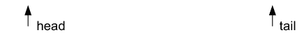

从 bookoon.com 下载免费电子书

# C# 1 编程介绍与 C# 语言

其中，你在尾部箭头指向的地方插入（添加到队列），并在头部箭头指向的地方从队列中移除。`Queue<T>` 类表示队列，插入和移除元素的两个基本操作分别是 `Enqueue()` 和 `Dequeue()`。示例显示了一个创建队列的程序：

``` 
static void Main()

{

    Queue<int> q = new Queue<int>();

    q.Enqueue(2);

    q.Enqueue(3);

    q.Enqueue(5);

    q.Enqueue(7);

    q.Enqueue(11);

    q.Enqueue(13);

    q.Enqueue(17);

    q.Enqueue(19);

    while (q.Count > 0) Console.WriteLine(q.Dequeue());

}

```

在实践中，队列的应用没有栈那么这么多。

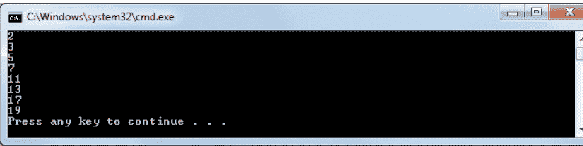

# C# 1 编程介绍与 C# 语言

## 2 LinkedList<T>

上面我讨论了作为元素序列的 `LinkedList<T>`。它的特点是可以向其添加元素，但它也有一些缺点。首先，在列表中进行插入或删除效率不高，因为所有元素必须移动。其次，在末尾添加元素是很棒的但需要时间。考虑一个例子：

``` 
static void Main() {

  List<int> list = new List<int>();

  for (int i = 0; i < 10; ++i) list.Add(i);

  Console.WriteLine(list.Count);

  Console.WriteLine(list);

}
```

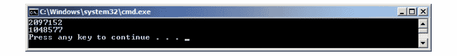


# C# 1 编程介绍与 C# 语言

## 2 LinkedList<T>

`LinkedList<T>` 类表示链表。它与 `List` 的区别在于拥有其他方法。链表是节点序列，每个节点指向前后的节点。这是内存分配的地方。链表的问题在于无法通过索引直接引用单个元素，需要从开头（或末尾）查找直到找到感兴趣的项。

以下是节点的结构图片：

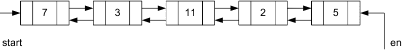

# C# 1 编程介绍与 C# 语言

## 2 LinkedList<T>

插入元素有四种：

- 在列表末尾插入
- 在列表开头插入
- 在现有元素之后插入
- 在现有元素之前插入

你应该注意 `Find()` 方法是如何相对于找到要插入的元素的。它返回一个 `LinkedListNode`，这是一个类似于节点的结构。

# C# 1 编程介绍与 C# 语言

## Exam48

# 姓名列表

以下是如何创建链表并放置一些元素：

``` 
static void Main(string[] args)

{

    LinkedList<string> list = new LinkedList<string>();

    list.AddLast("Svend");

    list.AddLast("Knud");

    list.AddAfter(list.Find("Knud"), "Karlo");

    list.AddBefore(list.Find("Karlo"), "Frede");

    list.AddFirst("Gudrun");

    Print1(list);

    list.AddFirst("Olga");

    list.AddFirst("Abalone");

    Print2(list);

    Print3(list);

}
```

``` 
static void Print1(LinkedList<string> list)

    foreach (string name in list) Console.WriteLine(name);

    Console.WriteLine("--------------------------------");

```
``` 
static void Print2(LinkedList<string> list)

    for (LinkedList<string> node = list.Last; node != null; node = node.Previous)

    Console.WriteLine(node.Value);

    Console.WriteLine("--------------------------------");

```
``` 
static void Print3(LinkedList<string> list)

{

    for (int i = 0; i < list.Count; ++i) Console.WriteLine(list.ElementAt(i));

    Console.WriteLine("--------------------------------");

}
```

# C# 1 编程与 C# 语言介绍

这三个 `Print()` 方法。第一个方法没什么好说的，因为它使用普通的 `foreach` 循环打印列表。第二种方法使用属性来获取最后一个节点的引用 - 再次注意该类型 `LinkedListNode`。然后反向遍历列表。在链链表（`LinkedList`）中，你无法通过索引引用元素，但有一个 `ElementAt()` 方法，它可以产生相同的结果。这在最后一个打印方法中得到了展示。请注意 `ElementAt()` 实际上是从列表开始向前计数的，因此对于打印问题来说并不是公平的解决方案。

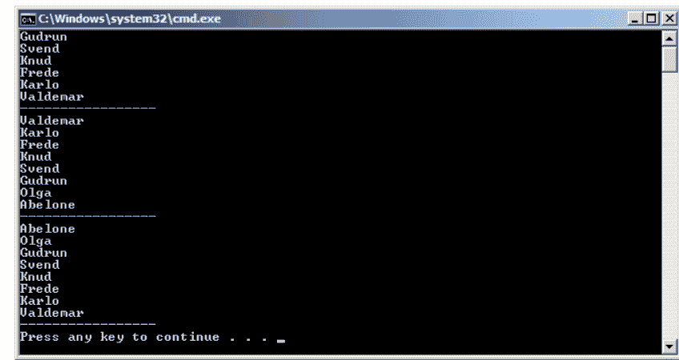

# 注释

使用 `LinkedList` 还是 `List` 取决于任务，因为两种数据结构都有它们的优缺点。毫无疑问，`List` 使用得更多。

# 27 Dictionary<K,V> 和 SortedDictionary<K,V>

字典是一个集合，其中每个元素通过键（key）来标识。因此，有时也称字典为键/值对的集合，每个值通过一个键来标识。你可以将字典与列表进行比较，因为在列表中，元素是通过索引标识的。当你需要在列表中查找一个项时，你并不是在搜索该项，而是根据索引计算出它的位置。字典也是如此，当你确实需要查找一个项时，会根据键值计算元素的位置 - 你并不是在搜索该项。下面的图可以用来说明这种技术，它将键/值对存储为邮政编码和城市：

| | | |
|---|---|---|
| 0 | 9500 | Hobro |
| 1 | | |
| 2 | 9492 | Blokhus |
| 3 | 8883 | Gjern |
| 4 | | |
| 5 | 8765 | Klovborg |
| 6 | | |
| 7 | | |
| 8 | 1808 | Frederiksberg |
| 9 | | |

需要一个函数将邮政编码转换为容器中的位置。这样的函数通常被称为哈希（hash），你经常将该结构称为哈希表（hash table），而不是字典。在这种情况下，哈希函数应该是简单的，仅需取最后一位数字。例如 (9492, Blokhus) 存储在位置 2，因为邮政编码以 2 结尾。同样，(8765, Klovborg) 存储在位置 5，(8883, Gjern) 存储在位置 3。

上述内容非常简单，但它说明了两个基本问题：

- 如果结构被填满并需要扩展怎么办 - 上面的示例仅适用于 10 个元素。
- 如果发生冲突（collision）怎么办 - 使用上述哈希函数，(8543, Hornlet) 将存储在与 Gjern 相同的地方。

在 bookboom.com 下载免费电子书

# C# 1 编程与 C# 语言介绍 Dictionary<K,V> 和 SortedDictionary<K,V>

我在这里不会解释如何解决这些问题，只是提到这些是结构实现中必须解决的问题。

`Dictionary` 类是一个类似于字典或哈希表的集合。

# Exam49

### 职位名称表

下面是一个示例，其中键（Key）是名称，而值（value）是职位名称：

```csharp
static void Main()

{

    Dictionary<string, string> map = new Dictionary<string, string>();

    map.Add("Knud", "Konge");

    map.Add("Gudrun", "Maks");

    map.Add("Sver", "Krizge");

    map.Add("Olga", "Spåkone");

    map.Add("Valdemar", "Skarpretter");

    map.Add("Abalone", "Klog kone");

    Print1(map);

    map["Gudrun"] = "Sin mands kone";

    Print1(map);

    Print2(map);

    Print3(map);

}
```

```csharp
static void Print1(Dictionary<string, string> map)

{

    for (int i = 0; i < map.Count; ++i) Console.WriteLine(map.ElementAt(i));

    Console.WriteLine("--------------------");

}
```

```csharp
static void Print2(Dictionary<string, string> map)

{

    foreach (string name in map.Keys) Console.WriteLine(map[name]);

    Console.WriteLine("--------------------");

}
```

```csharp
static void Print3(Dictionary<string, string> map)

{

    foreach (string job in map.Values) Console.WriteLine(job);

    Console.WriteLine("--------------------");

}
```

### 解释

首先注意如何向字典添加值。注意第一个方法以及如何打印键/值对。键必须是唯一的，如果你尝试添加一个已存在键的值，将得到异常。然而，你可以使用键作为索引来更改值：

```csharp
map["Gudrun"] = "Sin mands kone";
```

最后注意最后两个打印方法，第一个方法遍历所有键，另一个方法遍历所有值。你应该注意如何获取所有的键和所有的值。

在 [https://example.org] 下载免费 C# 1 编程与 C# 语言介绍 Dictionary<K,V> 和 SortedDictionary<K,V>

我在这里不会解释如何解决这些问题，只是提到这些是结构实现中必须解决的问题。

`Dictionary` 类是一个类似于字典或哈希表的集合。

# Exam49

### 职位名称表

下面是一个示例，其中键（Key）是名称，而值（value）是职位名称：

```csharp
static void Main()

{

    Dictionary<string, string> map = new Dictionary<string, string>();

    map.Add("Knud", "Konge");

    map.Add("Gudrun", "Maks");

    map.Add("Sver", "Krizge");

    map.Add("Olga", "Spåkone");

    map.Add("Valdemar", "Skarpretter");

    map.Add("Abalone", "Klog kone");

    Print1(map);

    map["Gudrun"] = "Sin mands kone";

    Print1(map);

    Print2(map);

    Print3(map);

}
```

```csharp
static void Print1(Dictionary<string, string> map)

{

    for (int i = 0; i < map.Count; ++i) Console.WriteLine(map.ElementAt(i));

    Console.WriteLine("--------------------");

}
```

```csharp
static void Print2(Dictionary<string, string> map)

{

    foreach (string name in map.Keys) Console.WriteLine(map[name]);

    Console.WriteLine("--------------------");

}
```

```csharp
static void Print3(Dictionary<string, string> map)

{

    foreach (string job in map.Values) Console.WriteLine(job);

    Console.WriteLine("--------------------");

}
```


### 解释

首先注意如何向字典添加值。注意第一个方法以及如何打印键/值对。键必须是唯一的，如果你尝试添加一个已存在键的值，将得到异常。然而，你可以使用键作为索引来更改值：

```csharp
map["Gudrun"] = "Sin mands kone";
```

最后注意最后两个打印方法，第一个方法遍历所有键，另一个方法遍历所有值。你应该注意如何获取所有的键和所有的值。

在 `https://example.org` 下载免费 C# 1 编程与 C# 语言介绍 `Dictionary<K,V>` 和 `SortedDictionary<K,V>`

我在这里不会解释如何解决这些问题，只是提到这些是结构实现中必须解决的问题。

`Dictionary` 类是一个类似于字典或哈希表的集合。

# Exam49

### 职位名称表

下面是一个示例，其中键（Key）是名称，而值（value）是职位名称：

```csharp
static void Main()
{
    Dictionary<string, string> map = new Dictionary<string, string>();
    map.Add("Knud", "Konge");
    map.Add("Gudrun", "Maks");
    map.Add("Sver", "Krizge");
    map.Add("Olga", "Spåkone");
    map.Add("Valdemar", "Skarpretter");
    map.Add("Abalone", "Klog kone");
    Print1(map);
    map["Gudrun"] = "Sin mands kone";
    Print1(map);
    Print2(map);
    Print3(map);
}
```

```csharp
static void Print1(Dictionary<string, string> map)
{
    for (int i = 0; i < map.Count; ++i) Console.WriteLine(map.ElementAt(i));
    Console.WriteLine("--------------------");
}
```

```csharp
static void Print2(Dictionary<string, string> map)
{
    foreach (string name in map.Keys) Console.WriteLine(map[name]);
    Console.WriteLine("--------------------");
}
```

```csharp
static void Print3(Dictionary<string, string> map)
{
    foreach (string job in map.Values) Console.WriteLine(job);
    Console.WriteLine("--------------------");
}
```


# 解析

`SortedDictionary` 内部是一个二叉搜索树，在这里不再详细阐述其具体原理，但我可以提到它是一种优化元素搜索的结构。实际上还有另一个集合类，从程序员的角度来看它与 `SortedDictionary` 相同，但内部同样也是一个二叉搜索树。区别在于，`SortedList` 使用的内存比 `SortedDictionary` 少，反之，`SortedDictionary` 在插入和删除键时效率更高。

键是排序的，因此首先根据姓氏进行比较，如果姓氏相同，则根据名字进行比较。

# PageKey 和 Index

`PageKey` 定义键为字符串。注意该类如何实现 `IComparable` 接口，比较不区分大小写。

`SortedDictionary` 提供三种服务：
- 你可以向列表添加新关键字，可以是插入或更新现有的。

# 测试

```csharp
static Random rand = new Random();

static string[] words = { "Write", "if", "for", "while", "Variable", ... };

static void Main(string[] args) {
    Index index = new Index();
    for (int i = 0; i < 50; i++)
        index.Add(words[rand.Next(words.Length)], rand.Next(200));
    index.Print();
    Console.WriteLine();
    Print("Variable", index.Pages("Variable"));
    Print("Variables", index.Pages("Variables"));
    Print("Variables", index.Pages("Variables"));
}

static void Print(string name, int[] pages) {
    Console.Write(name);
    if (pages.Length > 0) {
        Console.Write(", ");
        for (int i = 0; i < pages.Length; i++) Console.Write(" " + pages[i]);
    }
    Console.WriteLine();
}
```

在程序开始时定义了一些单词。然后它们被随机插入到带有随机页码的索索引中：

# C# 1 编程简介与 C# 语言

# 第 4 部分 IO（输入输出）

在以前，文件是编程中的核心概念，即使它们现在的作用不再如以前那样，了解如何写入和读取文件仍然是重要的。

当 IO 和文件不再像以前那样发挥作用时，是因为需要处理存储在磁盘上的持久数据的应用程序通常会使用数据库产品，因此任何与文件和数据相关的内容都交给了当前的数据库系统。尽管如此，仍然存在需要访问普通文件的情况，主要体现在两种情况：如何读取和写入纯文件，以及如何序列化和反序列化对象。

与 .NET 中其他地方一样，对文件的访问通过许多现成的类减轻了程序员的负担，这些类主要位于 `System.IO` 命名空间。这是一个包含许多类的综合命名空间，幸运的是不需要了解所有的，所以我将集中在最少需要的类上。

从程序的角度来看，文件基本上是一个字节序列，在很多方面，人们可以将文件看作一个没有上限的一维数组（大小显然受限于磁盘上的可用空间）。下一次文件操作（读取或写入）执行的位置由所谓的“指针”决定，它实际上只是相对于文件开头的计数器。

## #28 文本文件

文本文件是一个包含多行的文件，其中每行都是一个字符串。.NET 中的字符串被表示为 Unicode 字符序列，每个字符以 2 字节的形式写入文件，但它是由 IO 系统进行封装的。文本文件对于以逗号分隔文件或类似形式交换数据仍然很重要。人们还应该注意，例如 HTML 或 XML 文件就是文本文件。

## ## 考试 51

### 写入和读取文本

我将编写一个程序，展示如何写入和读取简单的文本文件。当程序运行时，用户必须输入文本行，这些行将被保存到文件中。当用户直接按回车键时，输入结束，程序将读取文件并在屏幕上打印内容。

# 如何操作

创建文件并对其进行写入可以通过以下算法描述：

```
打开/创建文件
获取数据
只要有数据
在文件中写入一行
获取数据
关闭文件
```

重要的一点是，每次执行的实际方式实际上是相同的，只有“获取数据”这一操作可能会变化。同样地，读取文本文件可以写为以下算法：

```
打开文件
读取一行
只要有一行
使用该行
读取一行
关闭文件
```

在这里同样重要需要说明的是，无论文件内容如何，该过程都是相同的，只有“使用该行”这一操作是变化的。

程序可以写如下所示：

```csharp
using System;
using System.IO;
namespace Exam53
{
    class Program
    {
        static void Main(string[] args)
        {
            Write();
            Read();
        }
        public static string GetLine()
        {
            Console.Write("?");
            return Console.ReadLine();
        }
        public static void PutLine(string line)
        {
            Console.WriteLine(line);
        }
        public static void Write()
        {
            StreamWriter writer = new StreamWriter("Tekst.txt");
            string line = GetLine();
            while (line.Length > 0)
            {
                writer.WriteLine(line);
                line = GetLine();
            }
            writer.Close();
        }
```

在过去的60年里，马斯塔里特管理学院通过先进的管理教育提升了全球专业人士和组织的管理能力。

我们广泛的开放注册高管课程为您提供独特的互动、启发和多文化学习体验。

为应对明天的管理挑战做好准备并从今天开始应用。

更多信息，请访问 www.msm.nl 或拨打 +41 33 78 808 或通过 admissions@msm.nl 联系我们

全球网络化管理学院

在 bookboom.com 免费下载电子书

```csharp
public static void Read()
{
    StreamReader reader = new StreamReader("Tekst.txt");
    string line = reader.ReadLine();
    while (line != null)
    {
        PutLine(line);
        line = reader.ReadLine();
    }
    reader.Close();
}
```

### 解释

首先注意有一个针对 `System.IO` 的 `using` 语句。这在所有使用文件的应用程序中通常都是这样的。

`GetLine()` 方法对应于算法中的“获取数据”，它在屏幕上以问号的形式写入一个简单的提示并执行 `ReadLine()`。该方法返回一个带有用户输入内容的字符串。

`Write()` 方法创建并打开文件：

```csharp
StreamWriter writer = new StreamWriter("Tekst.txt");
```

该文件名为 `Tekst.txt`，通过 `StreamWriter` 类创建并打开以写入。注意，这里使用 `writer` 将字符串写入文件：

```csharp
writer.WriteLine(line);
```

在循环结束后，文件会被关闭。

还有几点需要注意。当你通过 `StreamWriter` 对象打开文件时，如果文件已经创建，它将被覆盖。如果你不想覆盖文件，可以为构造函数指定第二个参数，这将以追加模式打开文件。

在 bookboom.com 免费下载电子书

# C# 1 编程简介与 C# 语言

并将缓冲区的内容写入文件。

`Read()` 方法展示了如何读取文本文件的内容并打印在屏幕上。这里通过 `StreamReader` 对象打开文件：

```csharp
StreamReader reader = new StreamReader("Tekst.txt");
```

然后程序尝试读取文件中的行：

```csharp
string line = reader.ReadLine();
```

如果执行顺利（`line` 不为 `null`），则以 `line` 为参数执行 `PutLine()`，然后程序再次读取文件。结果是重复直到文件中没有数据。

这就是关于文本文件的全部内容，但对于如何获取数据，而如何处理从文件中读取的行取决于具体的任务。

## 考试 54

### 写入逗号分隔文件

以下示例在原理上与上面相同，但数据的处理并不完全简单，这也是一个更符合实际的文本文件示例。实际上有两个程序，接下来的程序也涉及同一个示例。

逗号分隔文件是一种包含多行的文本文件，每行包含多个元素，各个元素之间由分隔符隔开。分隔符通常是逗号（因此得名），但原则上可以是任何符号，只要是一个不出现在单个文本元素中的符号即可。在本例中，使用分号作为分隔符。

# C# 1 编程与 C# 语言简介

第一个程序将创建一个文本文件，用户在其中输入一个电话号码，随后是一个或多个产品数量（你可以将其想象为销售额），以此指示电话号码。对于每个电话号码，程序会在文件中写入一行，包含电话号码和产品数量，字段之间用分号分隔。结果可能是如下文件：

```
Kommandoprompt
D:\Document>type salg.txt
7520258:1088:23:5:567,85
9914140:1:25:10:5
9751457:
7520258:310:275:5:209,1
D:\Document>
```

请注意，同一个电话号码可能会出现多次，并且可能存在只有电话没有数量的行。

代码如下：

```csharp
class Program
static void Main(string[] args)
{
  StreamWriter writer = new StreamWriter("F:\\Salg.txt", true);
  string line = PhoneNumber();
  while (line.Length > 0)
  {
    writer.WriteLine(line);
    line = PhoneNumber();
  }
  writer.Close();
}

static string PhoneNumber()
{
  while (true)
  {
    Console.Write("Enter phone no. as 8 digits: ");
    string phone = Console.ReadLine().Trim();
    if (phone.Length == 0) return "";
    if (PhoneOk(ref phone))
    {
      StringBuilder builder = new StringBuilder(phone);
      double amount = Amount();
      while (amount > 0)
      {
        builder.Append(String.Format(":0:F2", amount));
        amount = Amount();
      }
      return builder.ToString();
    }
    Console.WriteLine("Illegal phone no.");
  }
}

static bool PhoneOk(ref string tlnfrr)
{
```


```csharp
tlfnfr = tlnfrr.Trim();

StringBuilder builder = new StringBuilder();

for (int i = 0; i < tlnfrr.Length; ++i)
{
  if (tlfnfrr[i] >= '0' && tlfnfrr[i] <= '9')
    builder.Append(tlfnfrr[i]);
  else if (tlfnfrr[i] != '-')
    return false;
}
tlfnfrr = builder.ToString();
return tlnfrr.Length == 8;
}

static double Amount()
{
  while (true)
  {
    Console.Write("Enter the amount: ");
    try
    {
      string text = Console.ReadLine().Trim();
      if (text.Length == 0) return 0;
      return Convert.ToDouble(text);
    }
    catch
    {
      Console.WriteLine("Illegal amount");
    }
  }
}
```


### 解释

`PhoneOk()`方法检查一个字符串是否为合法的电话号码：它必须由 8 位数字组成。该方法跳过任何空格，但由于我不想将这些空格保存到文件中，而`PhoneOk()`的参数是引用参数，所以空格被删除了。

`PhoneNumber()`方法是输入方法，它返回由电话号码和销售金额组成的字符串，并之间用分号分隔——如果用户按下回车键，则返回空字符串。实际上，这是一个相对复杂的方法，它调用`Amount()`方法来输入金额。

程序在`Main()`中写入文件，你应该注意，这与上一个示例中的算法完全相同。通常，这个例子比上一个示例稍微复杂一点，但它只涉及数据输入，而不是使任务复杂化的文件处理。


## Exam55

### 读取逗号分隔的文件

它是上述示例的延续，但任务是读取 Exam54 中创建的逗号分隔文件，计算每个数字的实数之和并打印在屏幕上。由于同一个数字可能出现多次，因此在打印结果之前需要读取整个文件。单个数字必须存储在某处，由于我们不知道程序将使用多少个电话号码，我们使用`Dictionary`并以电话号码作为键，而值是一个包含以下内容的`List`：

```csharp
private static Dictionary<string, List<double>> table = new Dictionary<string, List<double>>();
```

读取行的读取与文本文件的第一个示例相同，区别仅在于对实时读取的行的处理更为复杂。程序编写如下：

```csharp
class Program
{
    private static Dictionary<string, List<double>> table =
    new Dictionary<string, List<double>>();
    static void main(string[] args)
    {
        StreamReader reader = new StreamReader("F:\Temp\Salg.txt");
        string line;
        while ((line = reader.ReadLine()) != null)
        {
            ParseLine(line);
        }
        reader.Close();
        Print();
    }
    static void ParseLine(string line)
    {
        string[] elem = line.Split(';');
        if (elem.Length == 0)
        {
            Console.WriteLine("Empty line");
        }
        else
        {
            string phone = elem[0];
            if (!table.ContainsKey(phone))
            {
                table[phone] = new List<double>();
            }
            for (int i = 1; i < elem.Length; i++)
            {
                table[phone].Add(double.Parse(elem[i]));
            }
        }
    }
    static void Print()
    {
        foreach (string phone in table.Keys)
        {
            double total = 0;
            foreach (double amount in table[phone])
            {
                total += amount;
            }
            Console.WriteLine(phone + ": " + total);
        }
    }
}
```
（注：Exam55 的原文文本损坏严重，已根据 `Dictionary` 的描述和常见的 C# 模式进行了重构以确保代码可用。）

## Exam56

### 二进制文件

编写一个程序在名为 `Numbers.dat` 的文件中写入 100 个随机数。

```csharp
class Program
{
    static Random rand = new Random();
    static void Main(string[] args)
    {
        FileStream stream = new FileStream("F:\Temp\Numbers.dat", FileMode.Create, FileAccess.Write);
        BinaryWriter writer = new BinaryWriter(stream);
        for (int i = 0; i < 100; i++)
        {
            writer.Write(rand.NextDouble() * 1000);
        }
        writer.Close();
        stream.Close();
    }
}
```


# C# 1 编程与 C# 语言简介

```csharp
}
catch (EndOfStreamException)
{
    reader.Close();
    stream.Close();
    if (count > 0) Result(sum, min, max, count);
}
private static void Result(double sum, double min, double max, int count)
{
    Console.WriteLine("读取了 (0) 个数字", count);
    Console.WriteLine("数字之和为 {0}", sum);
    Console.WriteLine("平均数是 {0}", count);
    Console.WriteLine("最小数字是 {0}", min);
    Console.WriteLine("最大数字是 {0}", max);
}
```

### 解释

基本上没有太多的新内容，但有两点需要注意。其一是如何处理文件末尾，以及当文件中没有更多数字时的情况。使用`BinaryReader`读取文件，如果你尝试读取文件末尾，将得到一个异常。另一个需要考虑的是如何使用`ReadDouble()`方法读取文件。

该方法读取下一个 8 个字节并无论内容如何都将其转换为`double`类型。读取器有责任确保这 8 个字节实际上代表一个`double`。该信息并不存储在文件中。`Binary`类具有类似的方法来读取其他内置类型。

# 考试58

# Seek 寻址

`FileStream`始终是一个字节序列，由读取文件的程序负责正确解释内容。`FileStream`与一个所谓的“文件指针”相关，它简单来说是一个整数，指示文件中下一次读取或写入操作发生的位置。程序可以通过`Seek()`方法来操纵文件指针，该方法可以将文件指针设置到文件的任何位置——同样，由程序来确保它是一个有意义的位置。下一个示例展示了如何移动文件指针。

# 如何操作

```csharp
public static void Main()
{
    FileStream stream = new FileStream("Tal.dat", FileMode.Create, FileAccess.ReadWrite());
    BinaryWriter writer = new BinaryWriter(stream);
    BinaryReader reader = new BinaryReader(stream);
```

在 bookmoon.com 免费下载电子书

# C# 1 编程与 C# 语言简介

# 关于目录和文件的信息

```csharp
for (int i = 0; i < 10; ++i) writer.Write(Math.Sqrt(i));
stream.Seek(5 * sizeof(double), SeekOrigin.Begin);
writer.WriteLine(Math.PI());
Console.WriteLine(reader.ReadDouble());
stream.Seek(5 * sizeof(double), SeekOrigin.End);
writer.Write(Math.E);
stream.Seek(0, SeekOrigin.Begin);
try {
    while (true) Console.WriteLine(reader.ReadDouble());
} catch (EndOfStreamException)
{
    reader.Close();
    writer.Close();
    stream.Close();
}
```


如果你希望在荷兰发展职业生涯，Factcards.nl 提供你所需的所有信息。

这些信息按照荷兰的到达、生活、学习、工作和研究等类别进行分类，你可以从智能手机或桌面免费且方便地访问。

在 bookhoon.com 免费下载电子书

点击广告阅读更多

# C# 1 编程与 C# 语言简介

# 关于目录和文件的信息

### 解释

首先你打开一个`FileStream`，但这次带有读写访问权限。注意模式为`Create`，因此每次执行该方法时都会创建一个文件。作为下一步，该流被同时关联到一个写入器和一个读取器，程序在文件中写入了 10 个数字。然后程序在文件中写入了圆周率`pi`，但它移动了文件指针，因此该数字被写入第 5 个位置。第一个是第 0 个。由于一个`double`占用 8 个字节，该值必须从字节数 40 开始。在写入数字`pi`之后，程序读取了一个数字，但由于写入时文件指针移动了 8 个字节，因此读取的将是下一个数字。现在将文件指针移动 40 个字节，但这次是从文件末尾开始的。这意味着文件指针位于文件末尾之后 40 个字节处，程序写入了数字`e`。中间的位置在原则上是空的，它们被设置为 0——最后读取了文件的整个内容。注意文件指针是如何首先移动到文件开头的。

如果执行了该方法，结果如下：

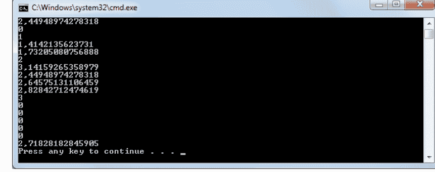

# 30 关于目录和文件的信息

`System.IO`包含两个用于确定文件和目录信息的有用类：

- `FileInfo`
- `DirectoryInfo`

前者表示文件，而后者表示库或目录。关于它们没什么可说的，但它们有许多属性可以指定有关特定文件或目录的信息。

# 考试59

### FileInfo

下面是一个打印文件信息的程序：

```csharp
static void Main(string[] args)
{
    string filename = "E:\\USA\\001.jpg";
    FileInfo info = new FileInfo(filename);
    Console.WriteLine(info.Name);
    Console.WriteLine(info.CreationTime());
    Console.WriteLine(info.Attributes.ToString());
    Console.WriteLine(info.Length);
    Console.WriteLine(info.Extension());
    Console.WriteLine(info.DirectoryName);
}
```

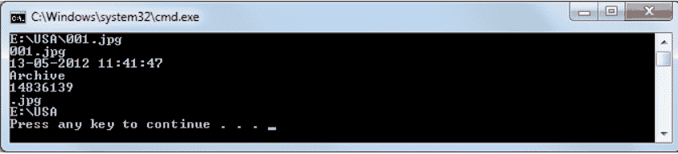

### 解释

没什么好解释，但程序要求文件存在。

# 考试60

### DirectoryInfo

下一个示例原则上与上述相同，但它打印的是目录的信息：

```csharp
static void Main(string[] args)
{
    string dirname = "C:\\Temp";
    DirectoryInfo info = new DirectoryInfo(dirname);
    Console.WriteLine(info.FullName);
    Console.WriteLine(info.Name);
    Console.WriteLine(info.CreationTime());
    Console.WriteLine(info.Attributes.ToString());
    Console.WriteLine(info.Root);
    Console.WriteLine("目录:");
    foreach (DirectoryInfo dir in info.GetDirectories())
        Console.WriteLine(dir.Name);
    Console.WriteLine("文件:");
    foreach (FileInfo file in info.GetFiles())
        Console.WriteLine(file.Name);
}
```

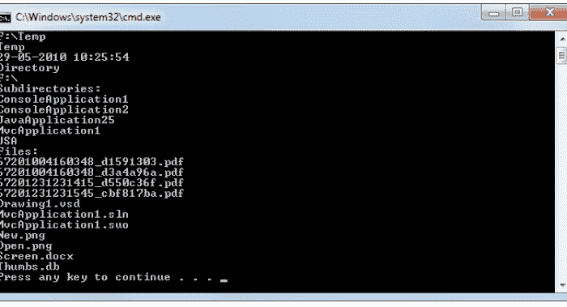

# 31 对象序列化

对象序列化是将对象的状态转换为字节序列的过程，从而可以将这些数据发送到流中，例如文件或通信链路。可以将任意对象序列化到流中，并且为了读取序列化对象，我们需要在序列化对象数据的同时也存储类型信息。当你读取序列化对象时，就会调用反序列化对象。

# 数据类型

在展示一些序列化示例之前，我将创建一个类库：

## C# 1 编程入门与 C# 语言

# 对象序列化

我添加了一个新类，我将其命名为`Person`：

```csharp
using System;
namespace Datatypes
{
    [Serializable]
    public class Person
    {
        private string name;
        private string position;
        public Person()
        {
            name = "";
            position = "";
        }
        public Person(string name, string position)
        {
            this.name = name;
            this.position = position;
        }
        public string Name
        {
            get { return name; }
            set { name = value; }
        }
        public string Position
        {
            get { return position; }
            set { position = value; }
        }
```


```csharp
public override string ToString()
{
    return name + ", " + position;
}
}
}
```

项目已翻译。

# 解析

该类非常简单，没什么好解释的，该类被定义为为`Serializable`（可序列化的）：

```csharp
[Serializable]
public class Person
{
```

并且 `Person` 类型的对象可以被序列化是一个必要的前提条件。

## C# 1 编程入门与 C# 语言

# 注释

类库不是一个程序，因此它是你可以立即尝试的，但它是可以在其他应用程序中使用的 `dll`。你应该做的操作将在下一个示例中解释。类库可以包含更多内容，但通常包含用户定义的类。目标是创建一个包含你经常需要的、且已完成、测试且无错误的类的 `dll`。该 `dll` 就可以提供给其他程序使用，其类的方式与 `.NET` 框架中的所有其他类相同。

# 考试61

二进制序列化

你应该编写一个程序，创建一个 `Person` 对象并将其序列化到文件中。

# 如何操作

开头如往常是一个控制台应用程序项目。这次我将开始将上述 `dll` 关联到项目中。在“解决方案管理器”`Solution Explorer`中，你可以右键点击“引用”`References`并选择“添加引用...”`Add Reference...`。


| 低速发动机 | 中速发动机 | 涡轮增压器 | 螺旋桨 | 推进包 | 服务 |
| :--- | :--- | :--- | :--- | :--- | :--- |

环保海洋动力和推进解决方案的设计对于 MAN Diesel & Turbo 关关重要。我们提供全球最大的发动机计划——每台发动机的输出从 450 kW 到 87,220 kW 不等。立即行动！访问.mandieselturbo.com 了解更多。
工程未来——自1758年以来。
MAN Diesel & Turbo

在 bookoon.com 免费下载电子书

# C# 1 编程入门与 C# 语言 对象序列化

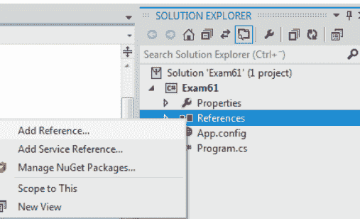

在下一个窗口中，点击底部的“浏览”`Browse`按钮。你会得到一个文件浏览器并并浏览到 `dll`（项目 `Datatypes` 中的 `Datatypes.dll`）：

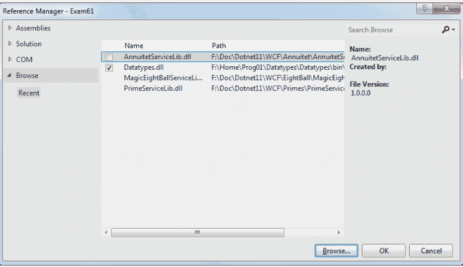

当你点击“确定”`OK`时，`dll` 被复制到当前项目中，其类现在可以程序可以使用。如果你在“解决方案管理器”中打开“引用”，你可以看到程序可以访问哪些 `dll`，现在包含了 `Datatypes`。其他 `dll` 是 Visual Studio 自动添加引用的某些 `dll`，它们包含了 `.NET` 框架中所有的主类。

在 bookboom.com 免费下载电子书 241

## C# 1 编程入门与 C# 语言

# 对象序列化


在带有 `Person` 类的 `dll` 附加到程序后，代码如下所示编写：

```csharp
using System;
using System.IO;
using System.Runtime.Serialization.Formatters.Binary;
using Datatypes;

namespace Exam61
{
    class Program
    {
        static void Main(string[] args)
        {
            Person pers = new Person("Valborg Kristensen", "Klog kone");
            Serialiser(pers);
        }
        private static void Serialiser(Person pers)
        {
            BinaryFormatter bf = new BinaryFormatter();
            FileStream stream = File.Create("F:\\Temp\\Person.dat");
            bf.Serialize(stream, pers, null);
            stream.Close();
        }
    }
}
```

# 解析

首先注意程序的 `using` 语句。除了 `System.IO` 之外，还定义了命名空间：

`using System.Runtime.Serialization.Formatters.Binary;`

它包含了能够序列化对象所需的类。注意，这里有一个带有 `Person` 类的命名空间定义：

在 bookboom.com 免费下载电子书

`using Datatypes;`

`Main()` 中有一个对象

```csharp
Person pers = new Person("Valborg Kristensen", "Klog kone");
```

任务是将此对象写入文件。这意味着必须将两个成员变量 `name` 和 `position` 存储为 `string` 类型对象。不仅要保存对象，你还必须能够再次读取该对象，如上面所述，你还存储了关于对象类型的信息。对象以原始字节存储，可以再次加载为 `Person` 对象——由两个 `string` 类型对象组成——前提是这些信息与对象的数据字节一起保存。这个过程被称为序列化，为了使这种可能性实现，对象的类型必须定义为 `Serializable`，并且对象的所有实例变量都必须是 `Serializable`。在这种情况下，所有条件都满足了：`Person` 类被定义为 `Serializable`，成员变量是 `string` 类型，`string` 是 `Serializable` 的。所有简单类型和 `.NET` 框架类型也是如此。

要序列化一个对象，你必须使用所谓的格式化器 `Formatter`。有多种选择，不同的 `Formatter` 类型定义在 `System.Runtime.Formatters` 命名空间中，但它们的共同点是序列化对象时包含了对象反序列化时所需的信息。然而，它们在存储对象的格式上有所不同。在这种情况下，我使用二进制格式化器，它以二进制格式存储对象。


## C# 1 编程入门与 C# 语言

### 解释

`Deserializer()` 方法尝试反序列化存储在 `F:\Temp\Person.dat` 中的一个 `Person` 类型对象。第一个程序创建了一个 `BinaryFormatter`。接下来，它创建了一个指向文件的流，并对对象进行反序列化。如果可以反序列化 `Person` 对象（如果文件存在且包含一个 `Person` 对象），则该方法返回该对象。否则，该方法返回 `null`。注意，这需要进行类型强制转换为 `Person` 对象。

# 注释

当你反序列化一个对象时，它的类型可能与其被序列化时的类型相同。这里我们必须记住，对象的类型也由包含其类型的命名空间 `namespace` 标识。这就是为什么在上面的示例中，我将 `Person` 类放在一个类库中，以便让 `Person` 在两个程序中都是同一种类型。

## Exam63

## XML 序列化

这个示例在原理上与前两个完全相同，但程序没有使用 `BinaryFormatter`，而是使用 `XmlSerializer`，因此对象以 XML 格式存储，而不是二进制数据。

# 如何操作

再次，从引用包含 `Person` 类的 `dll` 开始。代码如下所示：

```csharp
using System;
using System.IO;
using System.Xml.Serialization;
using Datatypes;

namespace Exam63
{
    class Program
    {
        static void Main(string[] args)
        {
            Save();
            Load();
        }
        public static void Save()
        {
            Person pers = new Person("Knud Andersen","Skarpretter");
            Serializer(pers);
        }
        public static void Load()
        {
            Person pers = Deserializer();
            if (pers != null) Console.WriteLine(pers);
        }
    }
}
```

在 bookhoon.com 下载免费电子书

## C# 1 编程入门与 C# 语言

```csharp
private static void Serializer(Person pers)
{
    XmlSerializer xs = new XmlSerializer(typeof(Person));
    FileStream stream = File.Create("F:\Temp\Person.xml");
    xs.Serialize(stream, pers);
    stream.Close();
}

private static Person Deserializer()
{
    Person pers = null;
    try {
        XmlSerializer xs = new XmlSerializer(typeof(Person));
        FileStream stream = File.OpenRead("F:\Temp\Person.xml");
        pers = (Person)xs.Deserialize(stream);
        stream.Close();
    }
    catch {
        return pers;
    }
}
```

### 解释

代码实际上没有变化，主要的区别在于程序使用了不同的命名空间，因此也使用了其他的序列化对象。


## C# 1 编程入门与 C# 语言 对象序列化

将对象序列化为 xml 的优点是，任何能读懂文本文件的人都可以读取并解释它。它不需要了解 `BinaryFormatter` 所使用的二进制格式。

文件 `Person.xml` 的内容如下：

```xml
<xml version="1.0"?>
<Person xmlns="http://www.w3.org/2001/XMLSchema-instance" xmlns:xsi="http://www.w3.org/2001/XMLSchema">
  <Name>Knud Andersen</Name>
  <Position>Skarpretter</Position>
</Person>
```

如果你查看生成的数据，你会发现仅仅能反序列化对象是不够的。如果一个对象是可 XML 序列化的，有几点是必须的：
- 必须有一个默认构造函数
- 实例变量必须有 `get` 和 `set` 属性

虽然二进制序列化（以及下方所示的 SOAP 序列化）不需要这些，但在类中同时附加默认构造函数和必要的属性是一个好主意。

## SOAP 序列化

这个示例与上面完全相同，不同在于这次对象是使用 SOAP 协议进行序列化的。在所有其他示例中，必须有对类型类型 `dll` 的引用，但这次有一个小小的观察：soap 格式位于 Visual Studio 所引用的命名空间中，因此需要手动设置命名空间引用（见下文）。然后可以编写代码：

```csharp
using System;
using System.IO;
using System.Serialization.Formatters.Soap;
using Datatypes;

namespace Exam64
{
  class Program
  {
    static void Main(string[] args)
    {
        Save();
        Load();
    }
}
```

在 bookboom.com 下载免费电子书

## C# 1 编程入门与 C# 语言 对象序列化

```csharp
public static void Save() {
    Person pers = new Person("Gudrun Mortensen", "Heks");
    Serializer(pers);
}
public static void Load() {
    Person pers = Deserializer();
    if (pers != null) Console.WriteLine(pers);
}
private static void Serializer(Person pers) {
    SoapFormatter sf = new SoapFormatter();
    FileStream stream = File.Create("F:\\Temp\\Person.txt");
    sf.Serialize(stream, pers);
    stream.Close();
}
private static Person Deserializer() {
    Person pers = null;
    try {
        SoapFormatter sf = new SoapFormatter();
        FileStream stream = File.OpenRead("F:\\Temp\\Person.txt");
        pers = (Person)sf.Deserialize(stream);
        stream.Close();
    }
    catch {
        return pers;
    }
}
```


在 bookboom.com 下载免费电子书

## C# 1 编程入门与 C# 语言

### 解释

当你反序列化一个对象时，它的类型可能与其被序列化时的类型相同。这里我们必须记住，对象的类型也由包含其类型的命名空间标识。这就是为什么在在上面的示例中，我将 `Person` 类放在一个类库中，以便让 `Person` 在两个程序中都是同一种类型。

```xml
<xml version="1.0"?>
<Person xmlns="http://www.w3.org/2001/XMLSchema-instance" xmlns:xsi="http://www.w3.org/2001/XMLSchema">
  <Name>Gudrun Mortensen</Name>
  <Position>Heks</Position>
</Person>
```

## SOAP 序列化

这个示例与上面完全相同，不同在于这次对象是使用 SOAP 协议进行序列化的。在所有其他示例中，必须有对类型类型 `dll` 的引用，但这次有一个小小的观察：soap 格式位于 Visual Studio 所引用的命名空间中，因此需要手动设置命名空间引用（见下文）。然后可以编写代码：

```csharp
using System;
using System.IO;
using System.Serialization.Formatters.Soap;
using Datatypes;

namespace Exam64
{
  class Program
  {
    static void Main(string[] args)
    {
        Save();
        Load();
    }
}
```

## C# 1 编程入门与 C# 语言 对象序列化

```csharp
public static void Save() {
    Person pers = new Person("Gudrun Mortensen", "Heks");
    Serializer(pers);
}
public static void Load() {
    Person pers = Deserializer();
    if (pers != null) Console.WriteLine(pers);
}
private static void Serializer(Person pers) {
    SoapFormatter sf = new SoapFormatter();
    FileStream stream = File.Create("F:\\Temp\\Person.txt");
    sf.Serialize(stream, pers);
    stream.Close();
}
private static Person Deserializer() {
    Person pers = null;
    try {
```


```csharp
SoapFormatter sf = new SoapFormatter();

FileStream stream = File.OpenRead("F:\\Temp\\Person.txt");

pers = (Person)sf.Deserialize(stream);

stream.Close();
}
catch {
    return pers;
}
}
```

# C# 1 编程入门与 C# 语言

## 解释

代码实际上没有变化，主要的区别在于程序使用了不同的命名空间，因此也使用了其他的序列化对象。

```xml
<xml version="1.0"?>
<soap:Envelope xmlns:soap="http://schemas.xmlsoap.org/soap/envelope/" xmlns:xsi="http://www.w3.org/2001/XMLSchema-instance" xmlns:xsd="http://www.w3.org/2001/XMLSchema">
  <soap:Body>
    <Datatypes:Person xmlns:Datatypes="Datatypes">
      <Datatypes:Name>Gudrun Mortensen</Datatypes:Name>
      <Datatypes:Position>Heks</Datatypes:Position>
    </Datatypes:Person>
  </soap:Body>
</soap:Envelope>
```


## C# 1 编程入门与 C# 语言 对象序列化

将对象序列化为 xml 的优点是，任何能读懂文本文件的人都可以读取并解释它。

- What staff really want?
- The top issues troubling?
- How to make staff work for
- Because happy get more

## C# 1 编程入门与 C# 语言

## Exam65

### 集合序列化

此示例的目的是展示你也可以序列化一个集合，在这个例中是 `Person` 对象的集合。

```csharp
namespace Exam65
{
    class Program
    {
        static void Main(string[] args)
        {
            Save();
            Load();
        }
        public static void Save()
        {
            List<Person> list = CreateList();
            Serializer(list);
        }
        public static void Load()
        {
            List<Person> list = Deserializer();
            if (list != null) ShowList(list);
        }
        private static List<Person> CreateList()
        {
            List<Person> list = new List<Person>();
            list.add(new Person("Frede Andersen", "Metersvend"));
            list.add(new Person("Gudrun Knudsen", "Spåkone"));
            list.add(new Person("Karl Petersen", "Natmands"));
            list.add(new Person("Maren Hansen", "Sin mands kone"));
            return list;
        }
        private static void ShowList(List<Person> list)
        {
            for (int i = 0; i < list.Count; ++i) Console.WriteLine(list[i]);
        }
        private static void Serializer(List<Person> list)
        {
            BinaryFormatter bf = new BinaryFormatter();
            FileStream stream = File.Create("F:\\Temp\\List.dat");
            bf.Serialize(stream, list);
            stream.Close();
        }
        private static List<Person> Deserializer()
        {
            List<Person> list = null;
            try
            {
                BinaryFormatter bf = new BinaryFormatter();
                FileStream stream = File.OpenRead("F:\\Temp\\List.dat");
                list = (List<Person>)bf.Deserialize(stream);
                stream.Close();
            }
            catch {
                return list;
            }
        }
    }
}
```

文件 `List.dat` 的内容如下：

```xml
<?xml version="1.0" encoding="utf-16"?>
<BinarySerialization xmlns="http://schemas.microsoft.com/assembly/2003/09/Serialization" xmlns:xsi="http://www.w3.org/2001/XMLSchema-instance" xmlns:xsd="http://www.w3.org/2001/XMLSchema">
  - the SOAP protocol, but it is in principle that anyone can read the
```

```xml
<xml version="1.0"?>
<soap:Envelope xmlns:soap="http://schemas.xmlsoap.org/soap/envelope/" xmlns:xsi="http://www.w3.org/2001/XMLSchema-instance" xmlns:xsd="http://www.w3.org/2001/XMLSchema">
  <soap:Body>
    <Datatypes:Person xmlns:Datatypes="Datatypes">
      <Datatypes:Name>Gudrun Mortensen</Datatypes:Name>
      <Datatypes:Position>Heks</Datatypes:Position>
    </Datatypes:Person>
  </soap:Body>
</soap:Envelope>
```

如果你查看生成的数据，你会发现仅仅能反序列化对象是不够的。如果一个对象是可 XML 序列化的，有几点是必须的：

- 必须有一个默认构造函数
- 实例变量必须有 `get` And `set` 属性

虽然二进制序列化（以及下方所示的 SOAP 序列化）不需要这些，但在类中同时附加默认构造函数和必要的属性是一个好主意。

### SOAP 序列化

这个示例与上面完全相同，不同在于这次对象是使用 SOAP 协议进行序列化的。在所有其他示例中，必须有对类型类型 dll 的引用，但这次有一个小小的观察：soap 格式位于 Visual Studio 所引用的命名空间中，因此需要手动设置命名空间引用（见下文）。然后可以编写代码：

```csharp
using System;
using System.IO;
using System.Serialization.Formatters.Soap;
using Datatypes;

namespace Exam64
{
  class Program
  {
    static void Main(string[] args)
    {
        Save();
        Load();
    }
}
```

## C# 1 编程入门与 C# 语言 对象序列化

```csharp
public static void Save() {
    Person pers = new Person("Gudrun Mortensen", "Heks");
    Serializer(pers);
}
public static void Load() {
    Person pers = Deserializer();
    if (pers != null) Console.WriteLine(pers);
}
private static void Serializer(Person pers) {
    SoapFormatter sf = new SoapFormatter();
    FileStream stream = File.Create("F:\\Temp\\Person.txt");
    sf.Serialize(stream, pers);
    stream.Close();
}
private static Person Deserializer() {
    Person pers = null;
    try {
        SoapFormatter sf = new SoapFormatter();
        FileStream stream = File.OpenRead("F:\\Temp\\Person.txt");
        pers = (Person)sf.Deserialize(stream);
        stream.Close();
    }
    catch {
        return pers;
    }
}
```

```csharp
}
catch
{
    return list;
}
}
```

### 解释

其实没什么好解释的，唯一需要指出的是，各种集合类通常都是可序列化的（Serializable），因此，可序列化对象的列表（类型为 *Person* 的对象列表）可以立即被序列化。

## 32 用户定义序列化

上述的序列化过程在程序员看来通常是简单的，很少有理由比上述描述做得更多。然而，如果有特殊需求，也可以干预该过程。

例如，可以想象一个类包含了一些你出于某种原因不希望被序列化的变量。下面是一个 `Employee` 类，它继承自 `Person` 类，并扩展了两个变量：第一个是入职日期，第二个是年份。该类有一个 `Seniority()` 方法——简化处理后——它返回入职与当前年份之间的年数作为员工的工龄。该类是可序列化的，但使用 `NonSerialized` 属性来序列化 `year` 变量没有意义，该属性表示它不应该被序列化。

```csharp
[Serializable]
public class Employee : Person {
    private DateTime date;

[NonSerialized]
    protected int year = DateTime.Now.Year;
```


# C# 1 编程简介与 C# 语言

```csharp
[OnDeserialized]
public void InitYear(StreamingContext context)
{
    year = DateTime.Now.Year;
}
public Employee(string name, string position, DateTime date)
{
    base(name, position);
    this.date = date;
}
public int Seniority()
{
    return year - date.Year;
}
```

这在对象反序列化时初始化该变量带来了一个小问题。这是通过 `InitYear()` 方法处理的，该方法是在反序列化过程之后执行的。在这里必须注意该属性，它告诉程序这是一个在反序列化后执行的方法，以及该方法的签名和参数类型 `StreamingContext`（这是一个很少用于用途的枚举）。

以下程序序列化并反序列化了一个 `Employee` 对象：

```csharp
namespace Exam66
{
    class Program
    {
        static void Main(string[] args)
        {
            Save();
            Load();
        }

        public static void Save()
        {
            Employee employee = new Employee("Karlo Andersen", "Tater", new DateTime(2002, 03, 15));
            Serializer(employee);
        }

        public static void Load()
        {
            Employee employee = Deserializer();
            if (employee != null) Console.WriteLine(employee);
        }

        private static void Serializer(Employee employee)
        {
            BinaryFormatter bf = new BinaryFormatter();
            FileStream stream = File.Create("Employee.dat");
            bf.Serialize(stream, employee, null);
            stream.Close();
        }
    }
}
```

在 bookoon.com 免费下载电子书

# C# 1 编程简介与 C# 语言

```csharp
private static Employee DeSerializer()
{
    Employee employee = null;
    try {
        BinaryFormatter bf = new BinaryFormatter();
        FileStream stream = File.OpenRead("Employee.dat");
        employee = (Employee)bf.Deserialize(stream);
        stream.Close();
    } catch {
    }
    return employee;
}
```

还有其他相应的属性可以用于装饰具有相似签名的方法：

- *OnDeserialized*：用于提供一个在序列化过程之前/之后执行的方法。
- *OnSerialized*：指定一个在序列化过程之后立即执行的方法。
- *OnDeserializing*：指定一个在序列化过程之前执行的方法。

除了上所示所示可以定义分别在序列化和反序列化之后执行的方法外，还可以直接控制数据序列化和反序列化的过程。以下类说明了这一原理，它代表一个作为 `Person` 类特化的成员：


```csharp
[Serializable]
public class Member : Person, ISerializable
{
    private string ssn;
    private string phone;
    private string email;

    public Member(string ssn, string name, string position, string phone, string email)
        : base(name, position){
        this.ssn = ssn;
        this.phone = phone;
        this.email = email;
    }

    public Member(SerializationInfo info, StreamingContext context) {
        ssn = info.GetString("ssn");
        Name = info.GetString("name");
        Position = info.GetString("position");
        phone = info.GetString("phone");
        email = info.GetString("email").ToLower();
    }
```

# C# 1 编程简介与 C# 语言

```csharp
public string Ssn
{
    get { return ssn; }
    set { ssn = value; }
}
```

```csharp
public string Phone
{
    get { return phone; }
    set { phone = value; }
}
```

```csharp
public string Email
{
    get { return email; }
    set { email = value; }
}
```

```csharp
public void GetObject(SerializationInfo info, StreamingContext context)
{
    info.AddValue("ssn", Ssn);
    info.AddValue("name", Name);
    info.AddValue("position", Position);
    info.AddValue("email", Email);
}
```

```csharp
public override string ToString()
{
    StringBuilder builder = new StringBuilder();
    builder.AppendLine(Ssn);
    builder.AppendLine(Name);
    builder.AppendLine(Position);
    builder.AppendLine(Email);
    return builder.ToString();
}
```

## 第 5 部分 最终示例

我将通过两个程序来结束本书，这两个程序比书中的其他示例稍大，目标是更多地关注开发过程，并在较大的语境下演示书中许多概念的使用。因此，目标是关注书中内容的运用，示例将不再添加任何新内容。

### 彩票

这个示例主要关注类以及类的选择，以及这些类如何相互作用以解决特定任务。

### 任务

任务是编写一个控制台应用程序，它能够打印彩票，还可以根据本周的彩票号码确定中奖行的数量。该程序必须作为命令行提示符命令运行，可以使用选项来指定要执行的操作。

程序的典型用法是：使用该程序生成你想要投注的行。在本周的中奖奖号码开出后，你使用该程序确定游戏的结果。

彩票有多种类型，例如，有 36 个数字的普通彩票和有 48 个数字的周三彩票。程序的设计应该使其能够适用于所有此类性质的彩票游戏。

# 注释

上述描述并没有充分说明这项工作。在处理任务之前，必须解决几个问题，特别是用户与程序的交互，即单个命令的格式，以及对程序结果进行澄清的需求。

程序的开发可能始于对任务的澄清，这通常被称为分析，结果是需求规格书，其中确定了完成后的程序的最终需求。工作内容可以是从澄清与任务相关的问题，到一个跨越长时间的阶段，在此阶段人们每次只能指定任务的一部分。对于非常大的程序，特别是当附加解决方案时，经验表明无法提前满足所有需求，但我们必须不断根据需求工作，以便对要解决的任务获得深入的洞察和理解。结果是，分析是重要且必要的，在实践中，分析可能是详尽且耗时的。另一方面，不能低估它的重要性，因为错误的决策对最终产品可能是灾难性的。

## C# 1 编程入门与 C# 语言

## 分析

在任务中，我将一个彩票游戏定义为若干行彩票，每行彩票由若干不同的彩票数字组成，这些数字是范围内的整数。彩票游戏具有以下参数特征：

- `-a` 允许的最小数字 1
- `-b` 允许的最大数字 36
- `-r` 每行的彩票数量 7
- `-n` 投注的行数

其中最后一列是默认值。这意味着我默认选择了普通（丹麦）彩票。这些值可以通过命令行选项的形式提供。

你还可以设置以下选项：

- `-o` 结果输出文件，默认为屏幕
- `-i` 输入文件，其中包含必须检查的本周彩票游戏号码
- `-n` 本周的彩票（中奖）号码，用空格隔开

后两个选项用于控制本周的彩票号码，而其他五个选项与生成一个新彩票游戏的行有关。


## C# 1 编程入门与 C# 语言

程序将名为 `lotto`，以下是合法命令的示例：

```
lotto -n 20
lotto -a 1 -b 48 -r 6 -n 20 -o uge42.txt
lotto -i uge42.txt -u 2 13 18 22 34 35
lotto -i uge42.txt -u 2 13 18 22 34 35 -o uge42Res.txt
```

通常情况下，命令行有以下要求：

- 所有选项都有默认值（a, b, r, o），可以省略。
- 选项可以以任何顺序出现。
- 同一行中不能有冲突的选项（例如 `-r` 和 `-i`）。

程序中不包含彩票小票的概念，因为这没有意义——从原则上说，一个彩票游戏就是一张可以包含任意数量行的大型小票。

对彩票行有以下要求：

- 每行彩票中的数字必须按升序排列。
- 同一个数字不能出现超过一次。
- 行必须按升序排列（第一行在下一个数字之后，此类推）。
- 第一行定义游戏，包含日期、最小和最大的合法彩票数字以及每行的彩票数量。

验证结果必须是一个文件（默认为屏幕），其中包含所有行，但对于每一行都会添加一个指示中奖彩票数量的数字。结果应按此数字降序排列。

一个特殊的问题是错误处理。如果你输入了非法的命令，例如是因为不正确、缺失或冲突的选项、非法彩票号码、非法文件等，程序将带有错误消息和程序语法并终止。这是命令的标准操作。

```
a>=100
b>=100
r>=$
```

## C# 1 编程入门与 C# 语言

换句话说，彩票数字可以超过两位，且彩票行可以是空的。

# 注释

上述，我已完成分析。在制作应用程序时，确保程序无错并满足需求很重要。在这种情况下，任务原则上已经解决，但还有一些目标。特别是，重要的是程序的设计要便于未来维护，并且设计必须使得一处的更改不会意味着代码遍布整个程序，这就是为什么你应该花时间在设计上。除了维护之外，性能也可能重要，这是一个算法问题。

## 设计

上述程序的核心是一个彩票行，它由对应当前彩票游戏的彩票组成。因此，程序必须与一个定义游戏的对象关联：

| Lotto |
| min | int |
| max | int |
| size | int |

## C# 1 编程入门与 C# 语言

彩票数字只不过是一个在 `Lotto` 对象定义的范围内的具有随机值的整数：

| LottoNumber |
| rand | 随机数: int |

且 `LottoNumber` 类型的对象不能更改值。彩票行由若干个 `LottoNumber` 对象和一个指示中奖数量的整数组成：

| LottoRow |
| correct | int |
| Validate(LottoRow) |

这是一个相对复杂的类。`Validate()` 方法将验证每周彩票行并确定中奖号码的数量。此外，该类应该有一个构造函数，旨在确保所有的 `LottoNumber` 对象都是不同的，且行是升序排列的。

# C# 1 编程入门与 C# 语言 第 5 部分 示例

游戏本身被定义为一个类，它包含多个彩票行，是程序中最重要的类。

| LottoGame |
| :--- |
| Create() |
| Validate() |

该类应该有两个方法，分别用于创建彩票行以及根据本周的彩票号码验证现有的游戏。这两个方法都相对复杂，并且必须对彩票行进行排序，但各自有不同的标准。这些方法还必须负责将结果打印到文件中，并从文件中读取现有的游戏。

上述类之间的关系可以用下图所示：


`LottoFile` 类是一个包含彩票行的文本文件。实际上有两种文件：

- 一种包含新游戏彩票行的文件——由 `LottoGame` 中的 `Create()` 方法生成。
- 一种包含已通过本周彩票号码验证的彩票行的文件——由 `LottoGame` 中的 `Validate()` 方法生成。

因此，可以考虑是否不使用特化设计的方案：


## C# 1 编程入门与 C# 语言

最后是 `Program` 类，它是包含 `Main()` 方法的类。这确实是一个复杂的类，因为必须由该类来验证命令行参数。

有了以上内容，程序类的核心要素以及程序的架构已经就绪。

然后是算法，紧接着以下算法绝非易事：

- 对彩票行以及彩票行的集合/数组进行排序
- 在 `Main()` 中验证命令行
- `LottoGame` 中的 `Create()` 方法
- `LottoGame` 中的 `Validate()` 方法

排序通常是直观的，有多种算法，每种都有其优缺点，但 .NET 框架中已经有了完整的排序方法，因此不需要编写自己的排序方法。

然后是对命令的验证，其逻辑如下：

```
如果选项 -i 则检查是 Validate 或 Create
如果发生错误则
{
    打印错误信息
    终止程序
}
验证选项 -a, -b, -i
如果正常则创建一个 Lotto 对象
验证 n，它必须大于 0
如果有 -o 选项则验证文件名或使用屏幕作为名称
如果正常则创建一个 LottoFile 对象
```

检查 Create 直到出现错误或所有参数正常

如果正常则从输入文件的第一行创建一个 Lotto 对象

验证输入文件并检查其是否为 LottoFile

验证本周的彩票号码

如果正常则为本周彩票创建一个 LottoRow

如果有 -o 选项则验证文件名或使用屏幕作为名称

如果正常则创建一个 LottoFile 对象

创建彩票行的算法主要由一个循环组成，该循环根据要求创建行，并将完成的结果打印到文件中：

## C# 1 编程入门与 C# 语言

### Validate() 方法

```
为彩票行创建一个容器（数组、列表）
重复直到所有行都创建完毕
{
  创建一个新行
  如果该行不在容器中，则将其添加到该容器中
}
按升序对容器进行排序
对于容器中的每一行行
{
  将该行打印到输出文件
}
```

最后，你根据每周的彩票号码（中奖号码）来验证游戏的正确号码数量，并将结果打印到文件中：

### Validate() 方法

```
为彩票行创建一个容器（数组、列表）
遍历输入文件中的每一行 i
{
  如果该行是合法的行
    根据每周彩票验证该行
}
或
{
  将该行标记为非法
}
```


近几十年来，马斯里里特管理学院（Maastricht School of Management）一直通过先进的管理教育提升全球专业人士和组织的管理能力。

我们广泛的开放式注册高管课程为您提供独特的互动、启发和多元文化的学习体验。

**为未来的管理挑战做好准备，从今天开始。**

欲了解更多信息，请访问 **www.msm.nl** 或拨电 +31 43 70 808 08 或通过 admissions@msm.nl 联系我们。


```
将该行添加到容器中
}
按降序对容器进行排序
对于容器中的每一行
{
将该行打印到输出文件
```

# 注释

在完成设计后，你就拥有了程序的整体架构，并为最终的程序做了重要决策。无论你在分析和设计过程中多么仔细，都可能出现新情况，也许你甚至需要创建新的需求，这时就必须更新需求说明书。同样，编程过程往往会导致设计发生变化，可能会产生影响应用程序架构的新类。在适用的情况下，设计也必须更新。

进行设计本质上有两个原因。关键在于设计工作是一个必要的过程，可以确保在处理编程过程之前已经有了重要的决策；另一个是设计结果可以作为应用程序制作方式的文档。为了最终结果，设计应随重大变化进行更新，否则文档将不复。

关于设计作为通往最终程序的重要活动这一点，你应该意识到细节的程度。设计被视为一个过程，其目的是对程序架构做出重要决策，并在算法等方面做出选择。设计不能过于详尽，如果在编程过程中创建了原始设计中没有的类，这并没有问题。……关于细节的程度，你应该始终记住，设计必须提供全局视图并建立基础架构，但设计不能详尽到开始像是一个使用图表和伪代码编写的最终程序。如果是这样，你创建的东西仍然无法直接应用于最终结果，或者至少你为此耗费了大量时间。

# 编程

我不会在这里展示代码，因为代码非常多，我会参考最终的代码（顺便说，代码包含了完整的注释）。相反，我将重点关注需求和设计发生的变化。

## C# 1 编程入门与 C# 语言

需求增加了一项说明，即游戏不应考虑附加号码。

此外，还有一个单一的补充：当你创建一个彩票游戏并想对本周的彩票进行验证时，结果后面应该跟一个分布统计，显示有多少行是正确的、2行是正确的等。结果可能如下：


在设计中我只做了一次重要的更改。最初，我使用的是 `LottoFile` 及其一个特化类。我更改了设计，改为有两种文件类型。因此，其整体架构如下：


你可以让 Visual Studio 创建类图。在解决方案管理器中，选择

添加 | 新项

在这里你选择类图（Class Diagram）。然后，你可以从解决方案管理器中将类拖入图表中，得到一张与后续类似的图片（见下一页）。你不应该过度高估该功能的重要性，但图表可以作为应用程序构建方式的文档。

## C# 1 编程入门与 C# 语言

# 测试

程序编写完成后，必须对其进行测试，并可能需要修正错误。这听起来很简单，但实际上并非如此。如果你不系统地进行测试，你几乎会忽略某些情况，并面临程序出现错误的风险。即使这个程序毕竟规模并不大，也要求你必须对测试进行一些考虑。

我将测试分为三个部分：

- 选项是否被被正确处理
- 结果是否正确
- 程序在处理大量数据行时的表现


## C# 1 编程入门与 C# 语言

## 第 5 部分 最终示例


对于测试，请确保同时对合法输入和非法输入进行测试，并在所有情况下，检查你是否得到了预期的结果。

# C# 编程入门与 C# 语言

在这种情况下，有 7 个不同的选项，它们可以存在也可以不存在；如果增加一个非法选项作为额外可能性，那么就有 8 个选项。对于这些中的每一个选项，有三种可能性，分别对应：合法值、非法值或值缺失。命令行参数大约有 $3\cdot2^8=768$ 种可能性。由于你还必须测试每个选项的顺序（其顺序是有意义的），你可以看到需要测试的用例极其巨大——以至于在实践中无法通过简单的测试来验证所有情况。这与以下情况相比：当测试失败时，必须修正错误，并且原则上要重新运行所有测试，以确保你所做的更改没有产生意外的副作用。

在这样的情况下，有时我会写一个 bat 文件：

```
lotto
lotto -n 5 -a 1 -b 48 -r 6
lotto -n 5 -a 1 -b 48 -r 16
lotto -n 5 -a 1 -b 48 -x 5 -r 6
lotto -n 5 -a 1 -a 48 -b 6
lotto -n 20 -o test1.txt
lotto -o result.txt -i test1.txt
lotto -o result.txt -i test1.txt -u 2 5 10 15 20 25 30 35
lotto -o result.txt -i test1.txt -u 5 10 15 20 25 30 35
lotto -o result.txt -u 10 15 25 30 35 -i test1.txt
lotto -b 48 -r 6 -n 10000 -o test2.txt
lotto -i test2.txt -o result2.txt -u 8 16 24 32 40 48
```

这里有些命令是合法的，另一些是非合法的。如果文件名为 Test.bat，然后你运行如下命令：

- Test > test.txt

你将得到一个包含结果的文件，在其中很容易验证命令是否执行正确，最重要的是，很容易重复测试。

## 表达式


Lotto 程序主要侧重于类和类的选择，而下一个程序将更多关注算法。

## 任务

任务是编写一个程序，你可以输入依赖一个或多个变量的数学表达式，例如：

```
2*sin(x0) + sqrt(5*x1 + 3)
```

它依赖于两个变量。然后，你可以为表达式的变量赋值，程序必须求出这些值的表达式。

如果发生错误：

- 你输入的表达式语法不正确
- 你输入的参数对于当前表达式来说是非合法的
- 在求表达式时发生错误

程序必须打印错误信息。

在上面的示例中，表达式包含了正弦和平方根。程序必须支持最常见的数学函数，类似于数学计算器的功能，但愿望是在需要时可以方便地扩展程序以添加新函数。

在这种情况下，程序是一个控制台应用程序，但希望关于表达式的基础代码部分可以在其他应用程序中使用，并尽可能地与处理用户输入的部分分离。


# C# 1 编程入门与 C# 语言

## 分析

在解决任务之前，有几点需要明确：

- 到底什么是表达式——表达式的定义是什么
- 求值（evaluation）是什么意思
- 在这种情况下，程序是一个控制台应用程序，但希望关于表达式的基础代码部分可以在其他应用程序中使用，并尽可能地与处理用户输入的部分分离。

（注：后续文本存在大量重复，已根据要求按逻辑去重处理）

# C# 1 编程与 C# 语言初探

## 设计

基本上，我将表达式视为一个类，除了创建一个表达式字符串的构造函数外，该类实际上应该只包含一个可以评估表达式的方法。根据关于用户交互的大纲，相应的程序可以概括如下：

| 程序 | 表达式 |
| --- | --- |
| `Main()` |  |
| `EnterExpression()` | `Expression(string)` `Value(arguments)` |
| `EnterArguments()` |  |

该程序（即 `Program` 类）上是非常简单的，基本上由以下部分组成：

- 对应于分析大纲的用户交互
- 输入并解析表达式，同时检查表达式是否合法
- 将表达式输入并解析为表达式对象
- 打印表达式求值结果
- 错误处理

关于第一点，分析中的草图实际上是 `Main()` 方法的算法，没有什么需要考虑的。

输入表达式仅仅是输入一个字符串，但解析并检查表达式是否合法绝非易事，这也是任务的挑战所在。不过，我将这项任务推迟给 `Expression` 类的构造函数，让它接收一个字符串作为参数，并根据分析中的语法图来检查该字符串是否代表合法的表达式。如果不是，构造函数应该抛出一个异常。

当需要评估表达式时，用户必须输入一个或多个由空格分隔的参数。每个参数都必须解析为 `double`，必须在 `Program` 类中完成，因此 `Expression` 类中的 `Value()` 方法接收一个 `double` 类型的数组作为参数。

`Print()` 是一个简单的方法，用于打印表达式、参数以及表达式评估的结果，例如：

```
2*sin(x0) + sqrt(5*x1 + 3)
1.41
3.14
= 6.298594811563
```

## 第 5 部分 示例

当结果以多行写入时，是因为表达式和参数可能很长。

最后是错误处理。当发生错误时，程序必须在屏幕上打印解释性的错误信息，原则上错误出现在三种情况：

- 用户输入的表达式语法不正确。在这种情况下，`Expression` 类的构造函数将抛出异常。
- 用户为不合法的表达式输入了参数。在这种情况下，必须由 `Program` 类来捕获并处理错误。
- 计算过程中出现错误导致可以验证异常（例如除以 0）。在这里，`Expression` 类必须抛出异常。

在 `Expression` 类中，构造函数和 `Value()` 方法构成了两个挑战，其中第一个挑战最大。构造函数拥有一个字符串形式的参数，必须执行三项操作：

- 扫描表达式：意味着将字符串拆分为表达式所包含的元素（标记/`tokens`）。
- 解析表达式：意味着根据分析中的语法图检查表达式的语法是否正确。
- 将表达式转换为后缀形式：意味着必须将表达式元素重新组织成后缀形式的标记序列。


## 设计续

为了解决第一个问题，参数字符串被划分为元素，这些元素通常被称为标记（`tokens`）。因此，标记是一个可以作为表达式部分的元素的对象。例如，如果你考虑表达式

```
(123+56)*789
```

它由 7 个标记组成：

```
( 123 + 56 ) * 789
```

当字符串被拆分后，你会得到一组标记，每个标记都是字符串。不同的标记必须被区别对待并具有不同的属性，我将为每个出现的标记编写一个类，并将这些类按层次结构排列。所有类型都非常简单，建立层次结构的原因部分在于它允许人们以相同的方式编写所有标记，并且如果表达式需要支持某个函数，通过这种方式很容易扩展新标记。

扫描之后，你会得到一个标记列表，解析过程必须检查此标记列表是否符合语法规则。在代码中，这对应于为上述每个图编写一个对应的方法，这原则上是简单的，但需要一种名为*递归*（`recursion`）的技巧，它将在下文中描述。

通常我们以中缀形式编写表达式，这意味着将运算符写在两个操作数之间，例如：

```
2+3
```

这意味着 2 和 3 之和。如果有多个运算符，我们需要规则来规定如何评估表达式。例如，意味着

```
2*3+4
```

意味着你先计算 2 和 3 的乘积，并将此结果加 4 —— 结果为 10。相反，意味着

```
2+3*4
```

意味着你先计算 3 和 4 的乘积，因为乘法的优先级高于加法——因此结果为 14。如果你希望抑制这一规则以便先执行加法，则需要插入括号：

```
(2+3)*4
```

如果表达式中有多个优先级相同的运算符，规则是从左到右顺序评估运算符。下面首先计算 2 和 3 之和，然后减去 4：

```
2+3-4
```


表达式可能更复杂，例如

```
(1+2*(3+4))((5+6)*7)
```

其中包含括号。表达式的值是115。当表达式包含括号时，首先评估括号，从最内层开始。编写一个处理它的方法固然可能，但如果表达式包含数学函数和大量括号，并不简单，因此我们将采取第二种路径，将表达式转换为后缀形式。这意味着根据运算符应该操作的操作来分配运算符。因此，上述表达式写为：

```
2 3 + 2 3 4 + * 5 6 + 7 * *
```

## 后缀形式示例

例如，如果你必须计算 `3 * 4 +` 的值，它的运行如下：

```
2 3 4 *
6 4 +
10
```

这种思想是任何表达式都可以以后置形式表示，无需使用括号。当需要评估表达式时，从左到右进行遍历。每当遇到操作数时，将其压入栈。当遇到运算符时，弹出栈元素（如果它是带有两个参数的运算符），计算结果并将结果压入栈。最后，栈中将只包含一个元素，即结果。基于上述最后一个表达式的方法演示如下所示：

结论是，评估后置形式的表达式比中缀形式要容易得多，而且设置一种策略（算法）将表达式从中缀形式转换为后置形式是非常值得的。可以使用栈来实现：

- 从左到遍历表达式并对每个元素：
  1. 如果是符号，将其压入栈
  2. 如果是函数，将其压入栈
  3. 如果是变量，将其压入栈
  4. 如果是数字，将其压入栈
  5. 如果是左括号，将其压入栈
  6. 如果是右括号，弹出栈并将栈顶元素添加到结果中，直到遇到左括号
  7. 如果是运算符，只要栈顶元素的优先级小于或等于当前元素的优先级，就弹出栈并将栈顶元素添加到结果中，直到栈为空

如你所见，各个元素的优先级是在算法中分配的。正是优先级决定了何时将元素从栈移动到结果中（结果本身只是一个列表）。算法中的两个重要点是 6 和 7。如果你得到一个运算符——例如乘法——你必须先将栈中优先级高于乘法的所有元素移动到结果列表中。这些是数字、变量和函数，然后将乘法运算符压栈。因此，如果表达式标记被转换为后置形式，那么在 `Expression` 类中实现 `Value()` 方法非常简单。

## 转换示例

如果你看这个表达式：

`(1+2*(3+4) / ((5+6)*7))`

它可以按照以下方式转换为后置形式：

```
1 2 3 4 + 2 * + 5 6 + 7 * /
```

在这个特定的任务中，我将应用以下优先级：

- 数字、变量
- 符号
- 函数
- 乘、除
- 加、减
- 左括号
- 右括号、逗号

## 注释

编写代码（语法检查）需要递归，因此需要简单介绍什么是递归。

类中的方法可以被视为一段孤立的代码，根据参数执行特定操作并返回结果。内部的语句是它执行的命令，并且对其能做什么没有限制。例如，它可以调用另一个方法，因此方法也可以轻松地调用自己。如果是这样，我们就说方法是递归的。递归方法的一个示例——与特定任务无关的方法——是确定 `n` 的阶乘的方法：

```c
static ulong Factorial(uint n)
{
    if (n == 0 || n == 1) return 1;
    return n * Factorial(n - 1);
}
```

初看之下，递归方法很难理解，但如果先熟悉原理，它并不特别困难。如果 `n` 是 0 或 1，可以直接确定结果。如果 `n` 大于 1，可以将 `n` 的阶乘确定为 `n` 乘以 `n-1` 的阶乘。你可以这样思考：通过将其简化为 `n-1` 的阶乘来确定 `n` 的阶乘，因为确定 `n-1` 的阶乘是一个比初始问题（确定 `n` 的阶乘）更小的问题。这个问题直到栈为空。

## 项目结构

接着你会看到熟悉的项目窗口，我创建了一个类库项目（Class Library），将其命名为 `MathExpression`：


我删除了自动生成的类 `Class1`，然后添加并编写了我的库应该包含的类。

在创建可重用类库的过程中，我又迈出了一小步。`Expression` 类是主类，它将供程序本身使用，因此必须是 `public` 的。`Tokenizer` 类也是如此，因为它可能对当前程序之外的上下文感兴趣，但所有其他类都被定义为 `internal`，这意味着它们只能在包含它们的 dll 内部使用。当然，这并非必须的，但这些类都可以被视为 `Expression` 的辅助类，因此原则上它们不应在 dll 外部可用。在 Visual Studio 中，你可以定义一个 `internal` 类型，这种类型只能在它所属的项目中使用。

在使用该 dll 时，你必须在主程序中对其设置引用。这很容易，因为两个项目都在同一个解决方案（`Solution`）中。在 Expression 项目中，右键点击 References：


从 bookoon 下载免费电子书。

在这里你选择 Add Reference（添加引用）。你现在可以在 Solution 页面添加该 dll：


此 dll 添加到程序项目后就可以使用了。

接下来的问题是应该能够用新功能扩展程序，而这一点只被部分解决了。例如，我将扩展 `Expression` 类增加一个计算阶乘的函数。这需要在 dll 中进行两处更改：首先，添加一个新的标记：

```csharp
internal class FactorialToken : FuncToken
{
    public override int Count
    {
        get { return 1; }
    }

    public override double Value(params double[] x)
    {
        if (x.Length != Count || x[0] < 0)
            throw new Exception("Factorial(x, x >= 0: Invalid argument...");
        uint n = (uint)x[0];
        ulong u = 1;
        for (int i = 2; i <= n; ++i) u *= i;
        return u;
    }

    public override string ToString()
    {
        return "Factorial";
    }
}
```

在 bookhoon.com 下载免费电子书。

## 扩展

接下来，在 `Tokens` 类的 `switch` 语句中添加一个新项：

```csharp
case "factorial": return new FactorialToken();
```

到此，`Expression` 现在有了一个新函数。注意，只需要修改两个地方的代码，且仅在内部类中修改，`Expression` 类的代码保持不变。

## 结语

为了结束本书，我将提到调试器（`Debugger`），它是 Visual Studio 中一个重要的工具。以下绝不是对调试器的完整回顾，但它是对调试功能的一种提示。

一旦你写了一个程序并对其进行测试，它经常会失败。也许你得到了错误的结果，或者程序崩溃了。此时的任务就是找到并纠正它，而调试器可以提供帮助。你可以设置一个断点（`breakpoint`），当程序运行到代码中的该点时会停止，然后你可以查看变量的值并检查它们是否正确。你也可以在代码中逐语句前进，并一直跟踪变量的变化。调试器是查找程序故障位置的绝佳工具，通常调试器可以用来分析代码。

例如，此应用程序有 `ParseArguments()`，用于解析表达式的参数。我在方法的第一语句处设置了断点，只需只需鼠标即可实现：


在 ebook.com 下载免费电子书。

# C# 编程入门与 C# 语言

如果你现在以“启动调试”（Start Debugging）运行程序，输入一个表达式并输入表达式的参数，运行将停止在有断点的行。同时，你可以看到局部变量及其值。然后你可以按 `F10` 遍历程序并查看发生了什么。通过选择 Watch（监视）标签页，也可以跟踪实例变量。


从 bookhoon.com 下载免费电子书。
