# C++：二合一——精通 C++ 终极初学者指南

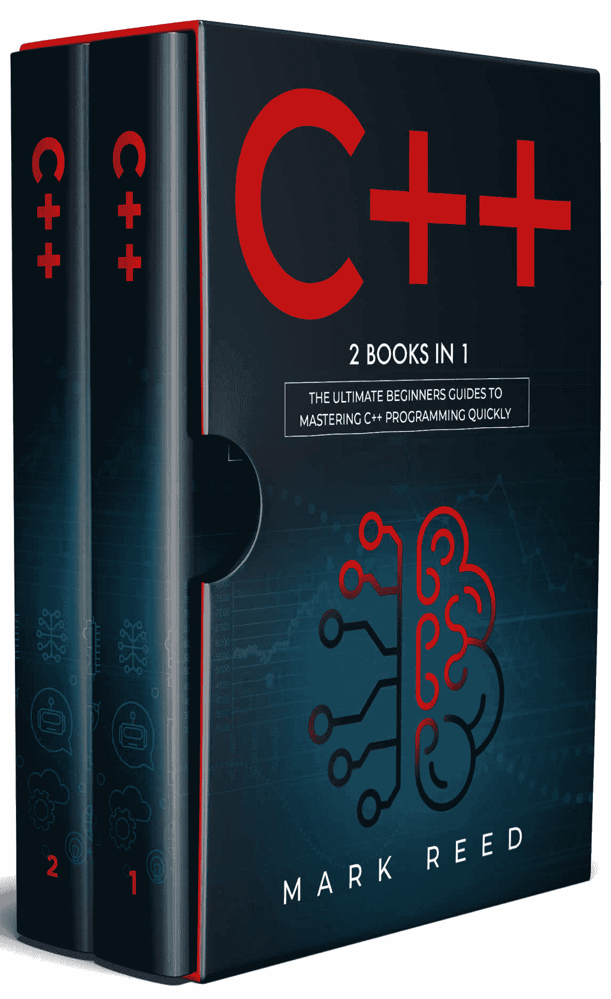

C++ 因为其处理开销极小，经常被用作大数据的后端语言。Spotify、Adobe、YouTube 和 Amazon 等公司使用 C++ 驱动它们的后端，你很快就会明白原因了。

C++ 也是强大的游戏引擎之后。游戏引擎允许程序员在无需从零开始编写所有代码的情况下构建游戏，并有效地渲染内容。`Unity Game Engine` 和 `Unreal Engine` 是运行在 C++ 之上的游戏引擎示例。

C++ 是一门美丽且高效的语言，因为它具有极佳的性能/硬件比例：对于它带提供的性能，它消耗的硬件很少。这就是为什么学习它的人热爱它的原因。

在本书中，我们将涵盖以下主题：

- 编程中的编程术语和原理
- 设置 C++ 环境
- 入门：语法、数据类型和变量
- C++ 的威力：操作、循环、分支（Switches）和决策
- 在 C++ 中创建自定义函数

你还会在末尾找到一个实用的术语表，这样在你开始学习后就可以将这本书作为参考了。

# 第 1 章：设置 C++ 开发环境

从最基础的定义来说，编程是用代码编写机器可以理解的指令列表。代码存在于可执行文件中。这些文件带有文件扩展名，告诉编译器文件是用什么语言编写的。这些扩展是你经常在文件末尾看到的，如 `.js`、`.cpp` 或 `.hpp`。

要编写代码并保存到可执行文件中，你需要以下物品：

1. 文本编辑器：这将允许你编写和编辑代码。
2. 语言编译器：此程序将你编写的代码翻译成计算机可以理解并遵循的机器语言。

所有的编程语言都是这样工作的，`HTML`、`CSS` 和 `JavaScript` 除外——这些程序由浏览器解释并执行（“Introduction,” n.d.）。这意味着像 `JavaScript` 浏览器语言是基于软件，而 C++ 是经过编译后直接运行在你的机器上的，而不是在软件环境中运行。

这意味着 C++ 是一种汇编语言。汇编语言是低级编程语言，需要编译器才能在机器上运行（Lithmee, 2018）。在这种语境下，“低级”一词并不带有负面含义；它是描述性的，意味着这种语言更接近机器，或者与机器仅一步之遥。

正如你可能猜到的，C++ 是一门通用语言，几乎可以运行任何地方。这意味着它可以以几种不同的方式进行汇和和编译。这很大程度上取决于你的操作系统以及你正在使用的创建工具。

我们的 C++ 练习将在在线 IDE 上编译。IDE 代表集成开发环境，它用于编辑和编译代码。我敢打赌这个描述听起来很熟悉。是的，IDE 是文本编辑器的一个示例，但与普通的文本编辑器不同，它具有对编程过程非常重要的额外功能。IDE 可以执行编译代码、调试代码、高亮代码、警告你语法错误等操作。


**Geeks for Geeks IDE：基于 Web 的程序编译器**

此 IDE 可以在 [`ide.geeksforgeeks.org/`](https://ide.geeksforgeeks.org/) 找到，并支持多种编程语言。我们将专注于 C++。此 IDE 拥有许多编码工具：一个标签页工作空间、一个输入框和一个代码管理器。这个代码管理器包含了左侧高亮的两个底部按钮。这些代码管理器按钮允许你作为带有相应扩展名的文件下载和上传代码。此 IDE 还允许你运行并生成一个保存结果的 URL。我们将使用这些生成的 URL 来管理我们的课程。

在本书中，我们将使用 Geeks for Geeks 的 Web 端 IDE，但你应该学习如何设置本地 IDE。在你编程生涯的大部分时间内，那将是你工作的地方。此外，你可以自定义 IDE 以适应你的需求并美化你的代码。

## 设置你的文本编辑器

专注于编程的 IDE 环境内部始终包含一个文本编辑器和一个编译器。非 IDE 环境将编译器和纯文本编辑器分离开。在非 IDE 设置中，文本编辑器充当编程接口；这简单意味着文本编辑器将是你修改代码的地方。

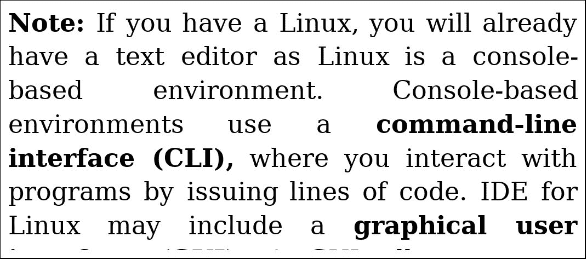

在寻找文本编辑器时，你需要一个具有语法高亮和缩进功能的，因为所有的编程语言都遵循其语法。这是因为你希望能够轻松阅读代码，也希望合作者也能这样做。这些文本编辑器通过提高可读性提供了帮助。这尤其重要，因为编码不再是、也从不是一项孤独的任务。没有电影里那种单人天才。

`Github` 和 `Pastebin` 是启用了语法高亮插件的代码聚合器。`Github` 允许你在他们的网站上托管整个项目，而 `Pastebin` 只允许存储代码片段。在这些平台上，你可以保存各种语言的代码。

它们对程序员来说非常有用，因为它们允许程序员共享代码、协作、测试等等。学习如何将项目部署到 `Github` 是编程中最重要的事情之一，因为它已经变得非常标准化。因此，维护一个 `Github` 个人资料也变得重要了，因为它包含了你正在进行、曾经做过的项目以及你的活动（Peshev, 2017）。对于潜在的雇主或合作者来说，这些信息是无价的。

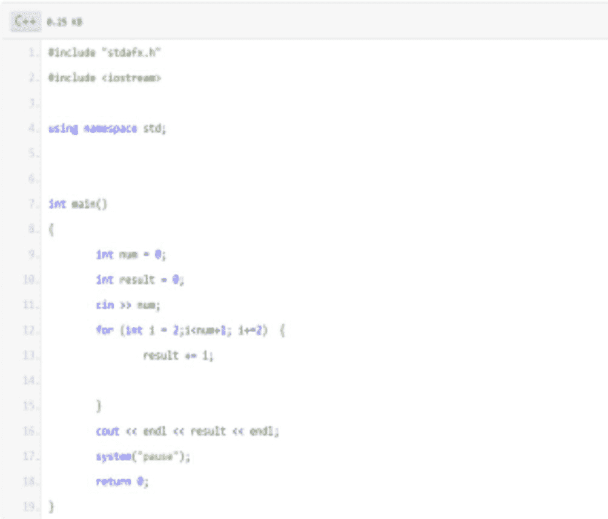

**C++ 代码语法示例**

这是开启了语法高亮的 Paste Bin 截图[(“C++ Code,” 2015)](https://www.zotero.org/google-docs/?MBr1L)。语法高亮和标签页缩进有助于理解代码。所有具有语法高亮的文本编辑器都会使用此方案：库为绿色，函数和数据类型为蓝色。字符串将显示为红色。

尽管它们具备功能，但这两个程序缺乏语法高亮等关键的文本编辑器功能。你可能认为这没什么大，但事实如此；代码中相同的单词因为它们出现的方式和时间而具有不同的含义，因此高亮有助于我们区分它们所指的内容。所以，如果一切都是纯粹的黑白，你就必须花费更多精力来理解这段代码指的是什么。这现在听起来很复杂，一旦你开始编写代码，就会变得而易见且必要。

`Notepad++`（不要与 Windows 的记事本混淆）具有高亮功能，但你必须如下所示激活它们：

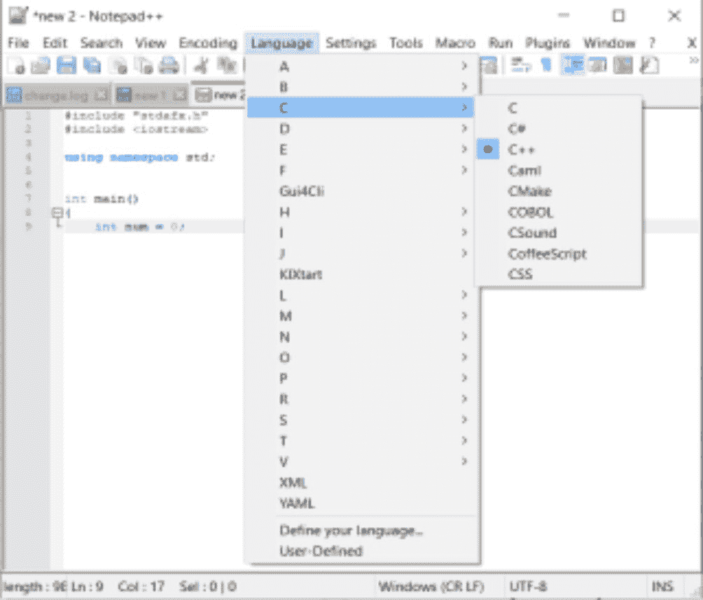

**带 C++ 语法的 Notepad++ 截图**

`Notepad++` 是免费的，正如名称所示，它是用 C++ 的。此截图说明了如何启用语言支持。可以通过 `language` > `"C"` > 导航到 `C++` 来启用 C++ 语法。`Notepad++` 适用于 Windows 平台。

`Bluefish` 是一个更高级的文本编辑器，带有更多功能（与 `Notepad++` 不同，`Bluefish` 适用于 Windows 以外的平台）。但我不建议初学者使用 `Bluefish`，因为它许多功能会让初学者感到无从。如果你是编程新手，可以尝试一下；你会发现它具有许多 GUI 功能。在文本编辑器中，你必须选择一个编译器。现在让我向你展示如何在 Windows、Linux 和 Mac 三个平台上设置本地环境。

## Windows IDE 安装与设置

你需要做的就是安装一个 `IDE`。记住它包含一个文本编辑器和一个编译器。`Code::Blocks` 是一个为了 C++ 设计的有用开源 IDE，轻松适配各种编译器。安装 `Code::Block` 非常简单。你只需要访问 [`www.codeblocks.org/downloads/26`](http://www.codeblocks.org/downloads/26) 下载页面并选择最新版本。

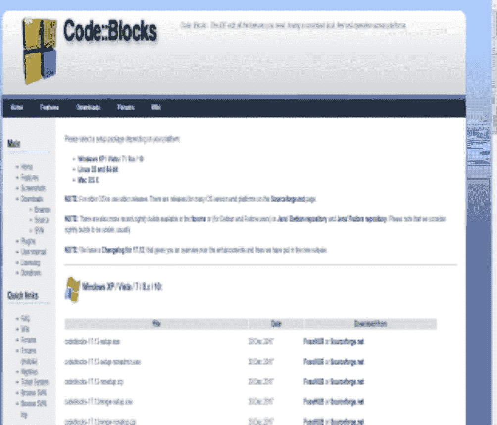

**Code::Blocks 下载页面**

目前 `Code::Blocks` 有适用于 Windows 和 Linux 的 20.03 版本。页面还包含帮助说明。

程序安装完成后，你就设置好了。可以使用它来编写 C++ 程序。为此你需要遵循三个步骤：创建文件、构建程序和运行程序。

创建一个新文件稍微复杂一些。你需要执行的是：

1. 进入 `File` > `New`。
2. 选择“Create an empty file”并输入你的代码。
3. 以 `.cpp` 扩展保存文件。

不用说，在运行它之前必须构建程序。你可以通过进入菜单中的 `Build` > `"Build and Run"` 来完成。

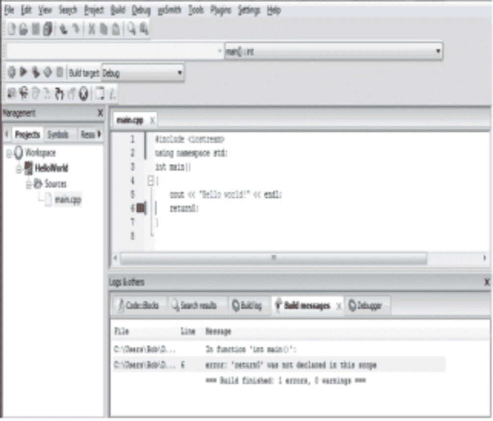

**Code::Blocks 中的“Hello World”**

这是 `Code::Blocks` 中“Hello World”程序的实时截图。在此程序运行后，`Build Messages` 中会出现错误。`Code::Blocks` 高亮了第 6 行。根据你对 C++ 语法的了解，你应该知道如何修复代码。提示：数据和函数应该显示为蓝色。

该程序对于它允许的工作量来说非常轻量。`Code::Block` 支持 Windows 和 Linux，但没有 Mac 版本。

## Mac IDE 安装与设置

对于 Mac，你需要获取 `Xcode`。它是适用于 macOS 的免费 IDE 软件套件。你可以在 Mac App Store 获取。`Xcode` 支持 Java、Python 和 Ruby 等其他语言。

它面向 macOS 系统的开发；这可以是用于 AppleTV 的 `tvOS`、用于 Apple 手表的 `watchOS` 以及用于 iPad 平板的 `iPadOS`（Xcode 9 新功能）。`Xcode` 为不同的 MacOS 平台提供了软件开发包（SDKs），帮助程序员通过 Apple 的私有方案进行开发。`SDKs` 是硬件软件供应商提供的工具集，用于为特定平台开发应用程序（Xcode 9 新功能）。`SDKs` 允许开发者完全集成到 Apple 或 Android 等开发社区中。

Mac 使用适用于 `Xcode` 的私有编译器，因此如果你在 Mac 上，你只能使用 `Xcode` 开发 C++。可以通过此链接下载并安装 `Xcode`：

[`apps.apple.com/us/app/xcode/id49779835?mt=12`](https://apps.apple.com/us/app/xcode/id49779835?mt=12)

文件下载并安装后，打开 `Xcode` 并点击“Create a new Xcode Project”图标。然后在初始窗口中选择“New Project”。


**Xcode 初始界面：选择新项目**

这些截图来自版本 8.3.3 的 `Xcode` 构建（Patel, 2017）。因此，我们的示例可能与更新的版本有所不同。截至本文，最新版本是 12.1，主要包含对各种 `SDKs` 的更新。

完成后，指南将允许你选择一个模板。此窗口将继续帮助你完成剩下的设置。

一旦我们指定了标识符，指南允许我们进入下一步。选择 `macOS` 部分并进入 `Application` 部分；在其中选择 `Command Line Tool`。

它看起来像这样：


**1. 项目选择：`macOS` > `Application` > `Command Line Tool`**

`Xcode` 有许多内置代码工具用于运行程序。因此，要运行测试程序，你必须为其选择 `macOS`。

选择模板后，指南将呈现命令行工具的选项。在这里，你可以为项目命名、添加你的组织名称、使用包标识符并选择编程语言。


**2. 命令行工具选项：`Language` > 选择 `C++`**

`Xcode` 的命令行工具可以处理 Swift 等私有语言。

在同一窗口中，你需要添加一个组织标识符。记住 `Xcode` 的命令行工具是私有 macOS 操作系统的模板，因此组织标识符用于在 Apple 数据库中创建一个唯一的想法。


**3. 命令行工具选项：组织标识符 > `"cpp"`**

组织标识符是一种命名规范，帮助程序员将项目集成到 Apple 的私有软件开发方案中。在这里，我们使用 `"cpp"` 作为标识符，生成 `"cpp.HelloWorld"` 作为我们的包标识符。

现在将项目保存到你选择的目录。在左侧边格中，`Xcode` 可以打开文件。你必须选择 `main.cpp` 以访问 `Xcode` 程序中的全局 C++ 文件。

### 3. Xcode 命令行工具：“main.cpp”

此截图展示了 IDE 风格的 `Xcode` 命令行工具工作空间。在文本编辑器中打开了 `main.cpp`。

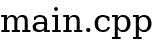

一旦你写了一些代码并想要运行它，选择 `Product` 并点击 `Run`。此外，你也可以通过选择该按钮来运行和构建程序。

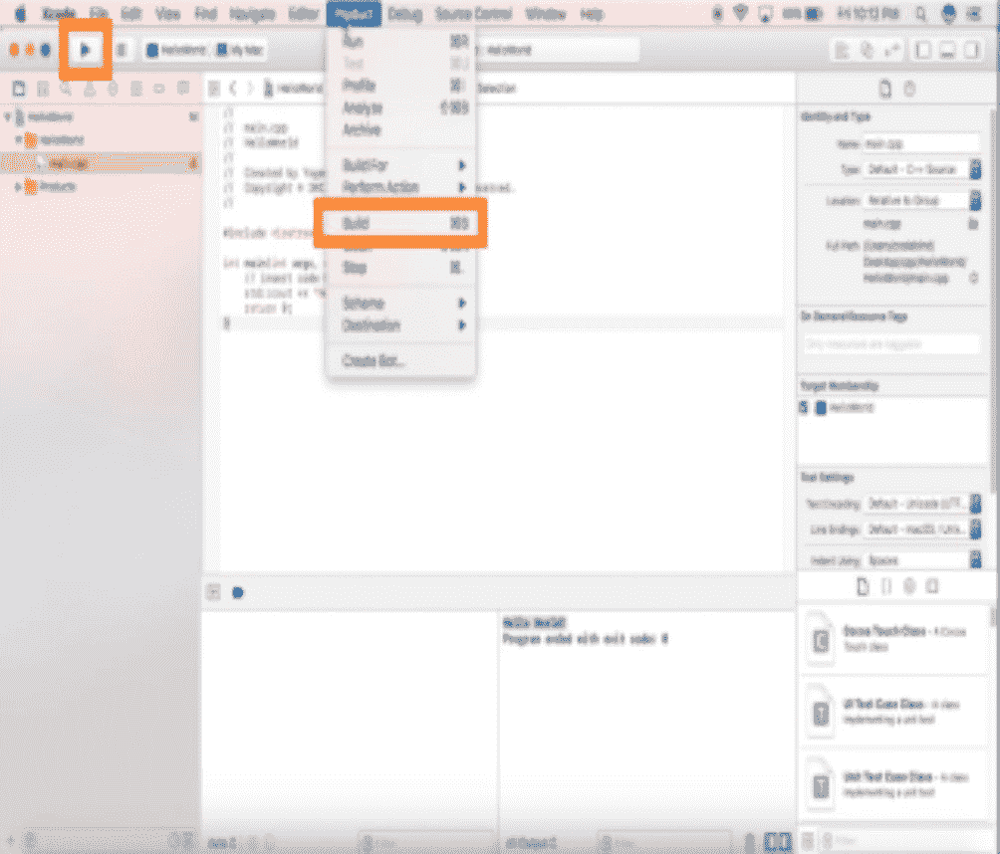

### 4. Xcode 命令行工具：“Hello World”的编译与运行

与 `Code::Blocks` IDE 类似，你必须先编译后运行程序。此截图还展示了“Hello World”的运行和返回值（Patel, 2017）。

如果你是一名认为自己将来会在 Apple 设备上工作的程序员，那么在 `Xcode` 中工作和实践是一项明智的投资。例如，Apple 在流媒体服务和设备等各种消费品和服务中占据着健康的市场份额。尽管如此，你应该记住 C++ 主要被用作服务端语言。服务端编程是控制内容如何传输到像 YouTube 动态网站的代码。大多数服务端编程是在 `Linux` 上完成的。

## Linux 编译器安装

`Linux` 是一个基于控制台的操作系统，因此它不需要文本编辑器。相反，我们将专注于安装和设置编程编译器。`Mac` 和 `Windows` 会在 IDE 中自动初始化编译器，但在 `Linux` 中，需要更具实践性的方法。你需要执行后端初始化。这看起来有很多工作要做，但从大局来看，它允许使用 `Linux` 的人员完全控制开发过程，并释放出更多的计算能力。

由于 `Linux` 是一个使用控制台界面的操作系统，对于初学者或习惯于 `Windows` 或 `Mac` 的人来说会很奇怪。这是因为用户通常习惯于 GUI（图形用户界面）。`Linux` 的无 GUI 特性可以释放更多的计算能力用于编程——生成和维护 GUI 需要消耗计算。这就是为什么许多编程环境使用 `Linux` 发行版的原因。

`Linux` 发行版（`distro`）是基于 Linux 内核的软件集合和用于安装额外软件的包管理系统的操作系统。

以下是安装和初始化编译器的指令。这适用于 `Ubuntu`，这是一个深受初学者流行的 `Linux` 发行版。这些安装过程在你将使用的任何 `Linux` 发行版中都是相似的。

注意：有许多 `Linux` 发行版提供了许多用户喜爱的基于 GUI 的桌面体验。其中大多数是开源的并可以免费下载和安装。你可以探索这些发行版并创建控制台界面进行练习。一个值得考虑的免费发行版是 `CentOS`，它基于 `Red Hat` 用于服务器管理 [(Centos-faq | Open Source Community,” n.d.)](https://www.zotero.org/google-docs/?xc5bIM)。`Red Hat Enterprise Linux`（`RHEL`）用于许多服务器管理设置且不是免费的。然而，`CentOS` 使用了它的许多组件，是准备在 `Red Hat` 环境中工作的极佳发行版。

在示例中，我们将在 `Linux` 上使用 `GNU Collection Compiler`。`GNU Collection Compiler` 是一个基于 `Linux` 的编译器，支持 C++ 以及其他如 `Fortran`、`Ada` 和 `Java` 等各种语言（“GCC 7 Release Series—Changes, New Features, and Fixes—GNU Project—Free Software Foundation (FSF),” n.d.）。要安装 `GNU GCC`，请遵循以下步骤：

1. 在控制台中，输入以下命令：

   首先通过输入命令 `gcc –v` 检查你的机器上是否已经安装了版本：

   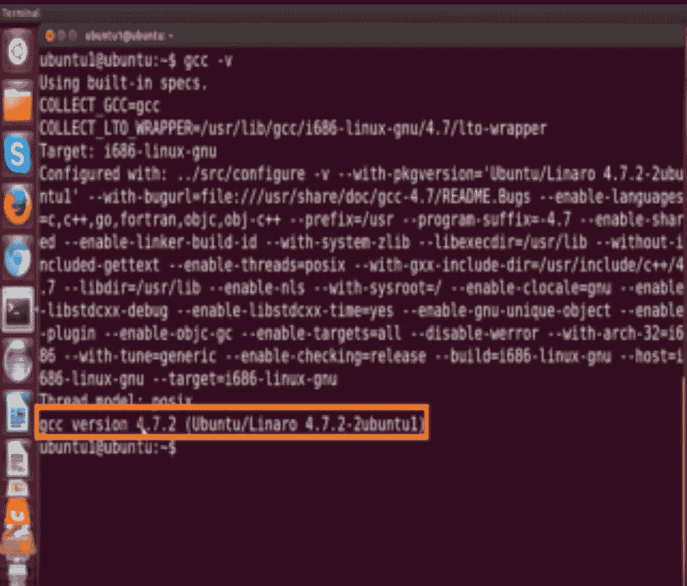

   ### 1. 在 Ubuntu 控制台中检查 GNU GCC

   你应该检查你的系统是否已有一个 `GCC` 副本。此截图展示了一个已经安装了 `GCC` 的系统 [(Patel, 2014)](https://www.zotero.org/google-docs/?Bxua2v)。在使用该命令后，如果你的系统中没有 `GCC` 副本，将缺少这一行。如果有副本，它将有一行类似的内容。很可能你的版本会更近。

   以下命令将在你的系统上安装 `GCC`（Agarwal, 2017b）：

   ```bash
   sudo apt-get update
   sudo apt-get install GCC
   ```

   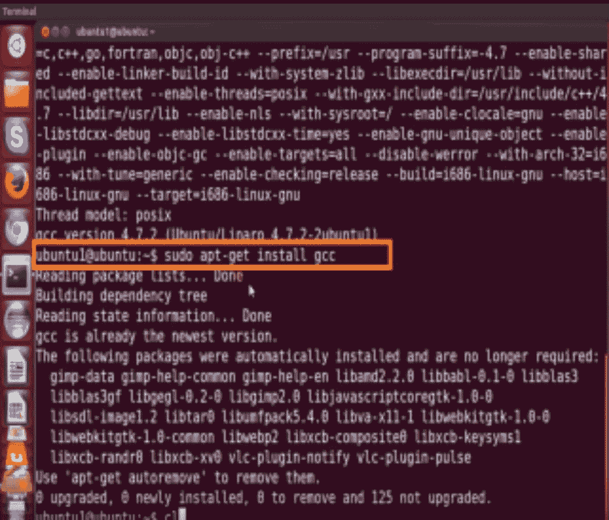

   ### 1. 在 Ubuntu 控制台中安装 GNU GCC

   在截图中，已经存在 `GNC GCC`。如果系统中不存在，运行高亮显示的命令将在你的系统上安装 `GNU GCC`（Patel, 2014）。控制台将提示你输入“Y”以开始安装。你还获得了包管理功能，例如终端可以清理过时或不必要的包。它还会建议让你的系统更高效的命令。这解释了为什么 `Linux` 在程序员中很流行；虽然冗长，但它允许他们轻松地排除故障，给予他们更多控制权，并且与 GUI 相比更容易导航。这是因为程序员更有可能记住一行代码，而不是某物在 GUI 中的位置。

以下命令将安装编译代码并最终运行 C++ 所需的所有库：

```bash
sudo apt-get install build-essential
```


### 1. 在 Ubuntu 控制台中安装 GNU GCC

此截图显示系统已安装了 `build-essential` 库，并输入了高亮显示的安装命令 (Patel, 2014)。就像安装 `GCC` 一样，它会提示你输入“Y”来安装库。

2. 使用以下命令检查安装情况：

```bash
g++ --version
```

如果一切顺利，它会告诉你安装了哪个版本的 `GCC`。因为 `Linux` 有内置的文本编辑器，你必须使用以下命令访问 GUI：

```bash
gedit
```

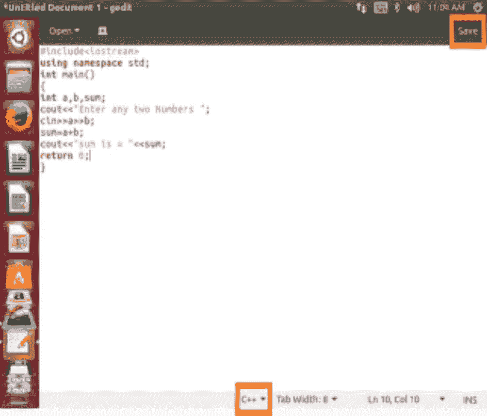

### Ubuntu 中的 Gedit

此截图展示了 Linux 内置的文本编辑器 `gedit` (Ubuntu Tutorial for Beginners, n.d.)。`gedit` 是一种 Linux 编程文本编辑器程序，具有多种语言的语法高亮和标签间距功能。确保从高亮显示的下拉菜单中选择“C++”。你可以点击“保存”按钮在 GUI 中保存你的程序文件。记住使用 `.cpp` 扩展名保存程序，以便它们被编译。

要测试并运行代码，必须遵循以下指令：

1. 将终端引导文件目录

使用此命令：

```bash
ls
```

2. 编译并测试程序文件

使用这些命令操作：

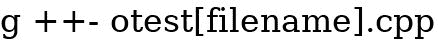

如果有任何错误，此命令将告诉你是哪一行包含错误，就像你在 IDE 中预期的那样。然后你可以通过 `gedit [filename.cpp]` 打开程序文件并修复该行代码。

3. 运行程序文件

编译器将创建一个名为 `test` 的可执行文件来运行程序。你可以通过在终端输入 `./test` 来执行它。

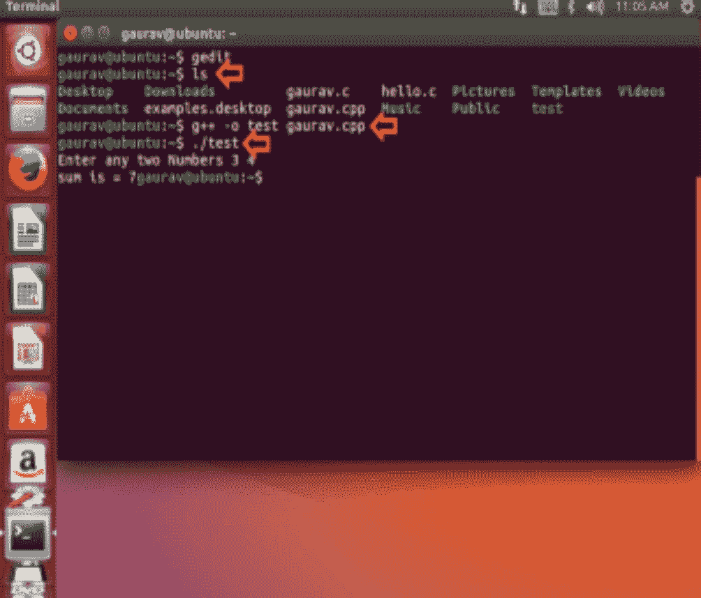

### 在 Ubuntu 中测试、编译和运行 .cpp 文件

此截图展示了终端测试、编译和运行在 `gedit` 中编写的示例代码。

`Linux` 发行版是冗长的基于控制台系统，它们中的大多数可以通过终端处理任何语言的编程。

注意：在 `CentOs` 上安装 `GCC` 并进行编译的过程类似的。要进行安装，你只需改用 `Images/image00533.jpeg`。该命令也会自动安装所需的库。编写、编译、测试和运行程序的步骤都是相同的。

创建你自己的编程环境可以帮助你应对现实世界的场景，这是在线编程空间无法做到的。在本书中，我们将使用在线 IDE。这是因为每个人都将拥有相同的输出和界面的学习环境。这简化了问题。

# 第 2 章：C++ 基础、编程原理

编程语言与其他任何人类语言一样：它们有结构、语法和规则。仅仅知道另一种人类语言的词汇是不够的。了解如何使用这些词汇以及它们在该语言中如何运作，是在该语言中进行有效交流不可或缺的一部分。编程语言的工作方式相同，但它们试图帮助的通信是人与机器之间的。虽然机器（至少在今天）永远不会像我们这样聪明和能干，但它们可以以一种我们无法理解的速度和效率理解很多内容。所有的编程都是一组指令。这些指令可以是规则，也可以是你想要机器执行的操作，或者是其他东西。但这一切通信之所以可能，是因为我们遵循了编程语言的规则。

编程规则，或 `syntax`（语法），是一系列用于通信程序各个方面的边界符号，如 `functions`（函数）和 `variables`（变量）。语法对于编译器来说非常重要，因为它告诉编译器应该向机器发出什么指令。

在我们开始之前，值得记住几点。与 `Python` 或其他高级编程语言不同，`C++` 并不容易类似于人类语言。像 `JS`、`Python` 和 `C#` 等高级语言设计成这样是因为它们更易于阅读和管理。`C++` 尽管如此，但它对机器来说更容易被理解，恰恰是因为它没有那么抽象。这就是为什么在使用 `C++` 工作时，你只需要一个编译器和一个文本编辑器，而像 `Python` 这样的语言需要安装它们的环境。

## 编程原理

`C++` 有许多方法可以完成同一个任务。就像人类语言一样，有许多方式表达相同的意思，但某些方式最适合某些场合，而另一些则不然。`C++`也是如此；某些方法非常好，是因为它们减少了程序的开销。许多开发者都会希望这样做，因为这提高了整个应用程序的性能，这就是编程的第一条原理：用尽可能少的 `functions`（函数）完成任务。不要让事情变得比需要的更复杂。在大多数情况下，这意味着节约地使用 `loop`（循环）或 `switch` 语句。

实现此点的最佳方法是首先理解问题的本质以及如何最好实现解决方案。换句话说，你需要编写一个算法——一组你希望机器遵循以解决问题的指令。

你的设计应该始终从你想让程序执行的事情开始。这也包括你的算法，或者至少是算法将解决的问题。算法总是像这样：

1. `Input`（输入）：传入的数据（如适用）
2. `Processing`（处理）：对数据的操作以及 `variables`（变量）的声明
3. `Output`（输出）：结果或你想要执行的操作。

这是一个显示“Hello World”的 `C++` 程序的详细示例。这是为了说明 `C++` 程序是如何构建的：

```cpp
// 显示 "Hello World" 的简单 C++ 程序

// 输入输出输出的头文件

#include<iostream>

using namespace std;

// main 函数 -

// 程序执行开始的地方

int main()

{

// 打印 hello world

cout<<"Hello World";

return 0;

}
```


这里是其结构：

1. 调用输入输出的头文件。
2. 调用执行发生的 `main()` 函数。
3. 打印“Hello World”。
4. 表明机器状态的终止语句。

我们可以看到 `C++` 是多么冗长，因为大多数步骤涉及执行代码所需的 `C++` 后端方面，例如调用库文件。在大多数情况下，你的算法不需要这么详细。

尽管看起来很简单，但这个算法说明了开发人员如何获取任务并将其翻译成代码。在下一章中，我们将使用这个算法来编写我们的程序。

正如你在示例中注意到的那样，代码中有注释解释了代码的每个部分的作用。这些注释的前面是 `//`。编译器不会读取任何以 `//` 开头的代码行，因为它们不起任何作用，只是帮助其他编写代码的人阅读代码的功能。在代码中包含注释是一个良好的习惯，这样人们就知道每行代码的作用。

## C++ 语法概述

我们已经讨论了 `syntax`（语法）对编译器的重要性，但理解编程语言的 `syntax`（语法）同样重要，因为它将允许你调试代码。就像人类语言一样，如果你知道语言的规则，当你出错时可以很容易地纠正自己。调试是发现并移除代码中错误和异常的过程，也称为“bugs”（“什么是调试？”n.d.）。这是一个纠正的过程。

`IDEs` 具有调试工具，可以突出显示代码中出现错误的地方，但这些功能并不总是可靠。例如，漏掉分号来结束一行代码是一个常见的错误，但调试器会在 `.h` 文件中突出显示错误，而不是程序文件 `.cpp` 中发生错误的地方。

### 注释

正如我所说，这些是编译器将忽略的代码行。它们用于注释代码，并为其他程序员留下有帮助的解释。这非常棒，因为通常我们在编写代码时会与他人协作。建议你在你的算法中留下注释，以便于他人理解。在大多数平台上，注释会高亮为绿色。注释总是以 `//` 开头。

### 头文件库

以 `#` 开头的行被编译器用于调用库函数。这些行至关重要，因此它们出现在每个程序中。在“Hello World”示例中，我们调用了一个用于管理字符串的库。这些代码行在不同平台上会显示为不同的颜色。在 GeeksforGeeks 中，颜色是紫色。

## 语句

语句通过编译器识别的指令来描述代码行的开头。这包括声明处理指令，例如我们在 Hello World 程序中的 `using…` 或 `return...`。它们在多个平台上同样会以不同的颜色进行高亮显示。在 GeeksForGeeks 上，它们被高亮为紫色。

### 函数

这是封装了指令的代码。它可以接收输入并输出结果。每个函数的写法如下：`[function_name]() ()`，后面跟着大括号 `{}`。大括号中的任何内容都是将执行的指令集。在我们的示例中，`main()` 是启动通过 `cout <<` 输出“Hello World”指令的函数。在 `.cpp` 程序中，必须出现 `int main()` 程序才能运行。

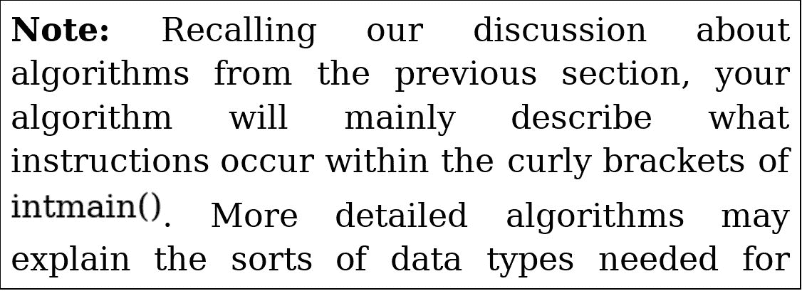

### 数据

这些是变量和其他类型的数据、函数和语句。在 GeeksforGeeks IDE 中，它们被高亮为蓝色。

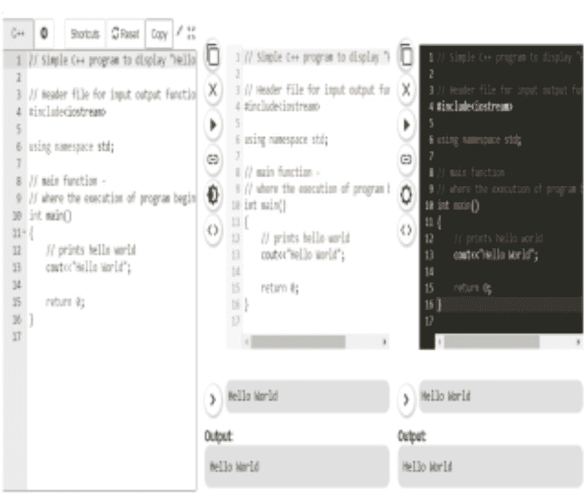

GeeksforGeeks IDE 中的“Hello World”程序与 GeeksforGeeks 嵌入式程序对比。此截图显示了“Hello World”的成功运行，以及运行程序所占的内存。此 IDE 具有基础的语法高亮功能，主要关注注释、语句和操作数数据。与 GeeksforGeeks 文章中的嵌入式代码相比，他们的嵌入式代码要详细得多 [(“编写第一个 C++ 程序，”2017)](https://www.zotero.org/google-docs/?z2pVlz)。右侧的两张截图展示了嵌入在文章中的相同代码的“浅色模式”和“深色模式”视图。这些视图更详细，高亮了注释、函数并区分不同的语句。例如，数据类型如 。此外，嵌入视图与 IDE 不同，会将字符串与其他数据区分开。这是语法高亮如何在不同平台变化的完美示例。

我们之前看到了一个带有错误的 Code::Block 示例。下面是完全相同的代码与修正后的代码的对比。你立即就能开始体会语法以及 Code::Block 示例中哪里出了问题。

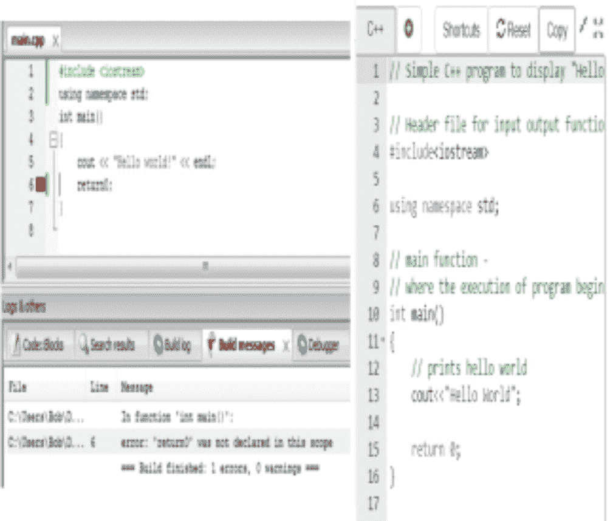

Code::Blocks 中的“Hello World”与 GeeksforGeeks IDE 的对比。此截图侧边对比了上一个示例：在 Code::Blocks 中带有错误的“Hello World”，以及 GeeksforGeeks IDE 中相同的修正后代码。在学习了这两者后，你应该能够看到  语句中的最后一条指令。

我承认，在这样的几行代码中这并不那么印象深刻，但能够注意到错误并解释它们是程序员最重要的技能之一。在这一点上，你不必担心自己是否能做到。你编写代码和学习得越多，就越有能力发现并修复错误。软件和网络开发是一个失败率很高的行业，因为如此。要成为一名成功的开发者，你需要快速解决问题，更高效地找到 `bug` 并修复它们。这也适用于管理端，因为能够发现、修复和解释 `bug` 是桌面服务水平协议（`SLA`）的重要部分。

在技术领域，服务水平协议（`SLAs`）是服务提供商与客户之间的协议。他们就服务的方面达成一致，如支持、质量、可用性和责任（Wieder, Butler, Theilmann, & Yahyapour, 2011）。全面的 `SLA` 提供调试汇报，每个错误都会被记录并列出其原因、变通方法和解决方案。这是技术管理公司和开发阶段此类工作的最佳方式。然而，管理员比开发者本身拥有更多资源投入调试。他们的薪水也更高。例如，美国 Web 开发人员每年约为 60,000 美元；而负责 `SLA` 的 Web 管理员高出约 1/3，达到 90,000 美元（“15-1199.03—Web Administrators,” n.d.）。这种水平的专业知识非常有价值，因为它理解编译器是如何翻译 `C++` 的。

## 第一个程序：输出和基础字符串

“Hello World”是每个编程语言的入门项目；其目的是向学习者展示程序的基本语法及其工作原理。随着你学习更多语言，你将编写许多“Hello World”程序。在上一节中，我们用它来探索算法、语法和 `C++` 编程环境。在本节中，我们将更进一步：操作代码。

`C++` 使用来自 `iostream` 库的 `cout` 对象。对象是计算机用于管理数据的方法。在我们的示例中，`cout` 用于告诉编译器通过 `>>` 运算符打印“Hello World”。不要惊慌；我们将在后面的章节中讨论操作符和对象。

现在，让我们通过更改 `print` 输出来查看“Hello World”并使用 `cout` 对象。`iostream` 已经声明。你可以在此处找到原始代码，可以作为参考：

[`ide.geeksforgeeks.org/e8ZKiDO`](https://ide.geeksforgeeks.org/e8ZKiDO)

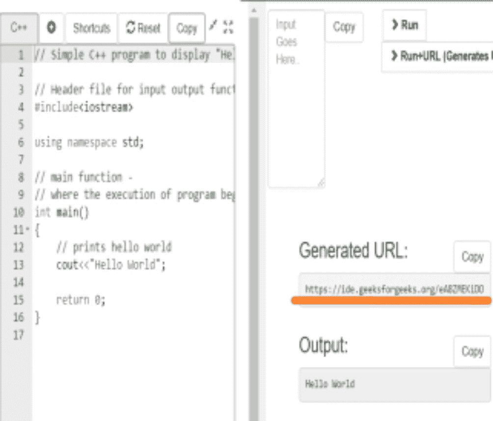

GeeksforGeeks IDE 中的“Hello World”程序。此截图显示了“Hello World”在分屏模式下的成功运行。当我们开始使用 IDE 编码时，注意输入输出框。虽然此程序没有输入，但在程序提示时你会在“输入此处...”框中输入数据。你可以在保存的 IDE 中访问此程序：[`ide.geeksforgeeks.org/e8ZKiDO`](https://ide.geeksforgeeks.org/e8ZKiDO)。你也可以在索引中查看副本。

### 使用 `cout`

`cout` 对象使用 `<<` 运算符打印值和文本，我们可以根据需要使用任意数量。在浏览器中使用 IDE，更改代码以打印：

```text
Hello World

I am learning C++
```

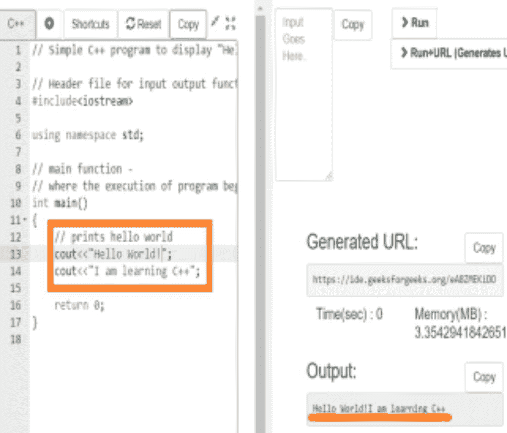

添加 `cout` 对象。此截图显示了我们编辑后的“Hello World”程序在分屏模式下的成功运行。虽然程序运行没有任何错误，但并没有产生我们想要的结果。观察输出，打印的文本缺少换行。我们需要指示编译器添加换行以获得想要的结果。

添加行可以通过多种方式实现：我们可以在字符串内部添加分隔符，也可以使用 `iostream` 库中的另一个操作符对象。

### 使用转义字符

虽然在 `cout` 中编写字符串并直接换行看起来很有吸引力，但它行不通。它会破坏代码并导致无法运行。不相信吗？试一下吧！

## 使用字符串内转义序列来分隔和操作输出

此截图显示了我们在分屏模式下编辑后的“Hello World”程序成功运行的结果。通过使用 ``，我们成功获得了预期的输出。

观察代码时，你可以看到其中使用了双引号。因此，如果你想在字符串中添加双引号，就必须使用转义序列，这样编译器才知道它不是代码的一部分。这样做可能会导致意料之外的错误或漏洞。这就是为什么转义序列非常重要。以下是可以使用它们的许多用例列表（参考“转义序列—Cppreference.com,” n.d.）：

- `\'`（“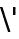”）：用于单引号。
- `\"`（“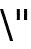”）：用于双引号。
- `\?`（“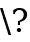”）：用于问号。
- `\\`（“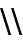”）：用于反斜杠。
- `\f`（“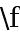”）：代表“换页”，用于跳到下一“页”。
- `\n`（“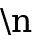”）：代表“换行”，用于跳到下一行。
- `\t`（“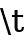”）：代表“水平制表符”，水平添加 5 个空格。
- `\v`（“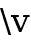”）：代表“垂直制表符”，用于垂直语言中的间距。

注意：如果你决定尝试不同的转义序列作为文本分隔符，请务必仅使用 ``、`` 和 ``。按下按钮将工作保存到另一个 URL 以便稍后返回。要返回我们的练习，可以使用我们保存的 IDE 工作空间 URL（[`ide.geeksforgeeks.org/PsgBLSHE4h`](https://ide.geeksforgeeks.org/PsgBLSHE4h)）。

你也可以在索引中访问此代码。

### 使用 `endl`：输入/输出操纵符

正如我们所说，编程语言像人类语言一样灵活。你可以用许多方式表达一条指令，终止字符串也不例外。转义序列与 `endl` 之间的区别在于，`endl` 会刷新并更新用于存储字符串的缓冲区。程序员在打印大量文本后使用 `endl` 清内存。你可以看到这在内存管理中很有用。`endl` 是输入/输出操纵符的一个示例。输入/输出操纵符是允许你使用 `<<` 运算符或 `>>` 运算符控制输入/输出流的函数（“输入输出操纵符—Cppreference.com,” n.d.）。

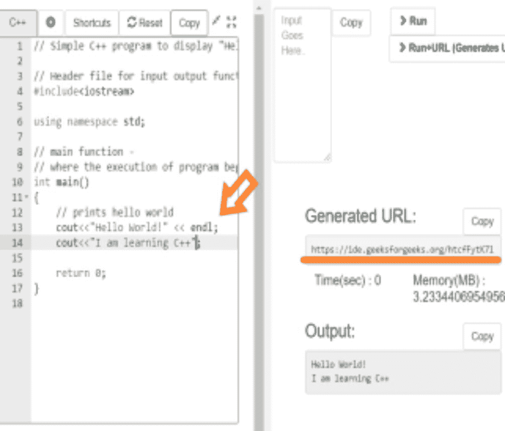

使用输入/输出操纵符来分隔和操作输出。此截图显示了我们在分屏模式下编辑后的“Hello World”程序成功运行的结果。通过使用 ``，我们获得了预期的输出。在如此小的程序中，很难看出使用内存操纵符的效果。只有在调用函数中使用操纵符时才会产生差异。你可以在此 URL 访问代码：[`ide.geeksforgeeks.org/htcfFytK71`](https://ide.geeksforgeeks.org/htcfFytK71)。

和转义序列一样，还有许多输入/输出操纵符可以使程序员对数据类型或字符串有更多控制。一旦我们讨论到数据类型和类结构化，其中许多将变得有意义。以下是其中一些（“输入输出操纵符—Cppreference.com,” n.d.）：

- `boolalpha`（“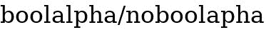”）：在布尔值的“0/1”和“false/true”之间切换。
- `showbase`（“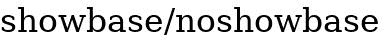”）：用于数学输出，控制是否使用前缀来表示数字进制。
- `fixed`（“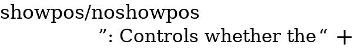”）：符号表示非负数。
- `uppercase`（“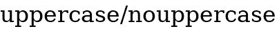”）：控制特定输出格式中大写字母的使用。
- `setw`（“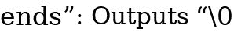”）。
- `flush`（“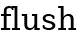”）：刷新输出流。
- `endl`（“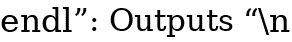”）：刷新输出流。
- `getmoney`（“”）：以货币值接收输入。
- `putmoney`（“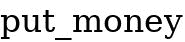”）：格式化并输出货币值。
- `gettime`（“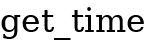”）：根据指定格式以日期/时间值接收输入。
- `puttime`（“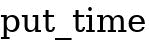”）：根据指定格式输出日期/时间值。

注意：回想我们关于 `C++11` 和 `C++14` 的对话。到目前为止，大多数编程 IDE 都使用 `C++11` 作为默认版本。`get/put…` 函数都在 `C++11` 中。如果你在尝试使用这些操纵符时遇到错误，请检查你的设置是否在使用 `C++11`。

此外，`ww`（“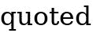”）是一个仅限 `C++14` 的操纵符。该操纵符允许插入带有空格的字符串（“输入输出操纵符—Cppreference.com,” n.d.）。

### 省略命名空间

我们已经讨论过 `using namespace`。当你使用 `using namespace std;` 时，不需要为标准函数使用 `std::` 前缀。但在大型项目中，这会导致命名冲突。最好使用前缀或只导入特定的函数，如 `using std::cout;`。

### 测试：使用注释

此截图显示了如何注释代码。通过使用 `//`，我们可以告诉编译器忽略某些部分，这对于调试或测试特定功能很有用。

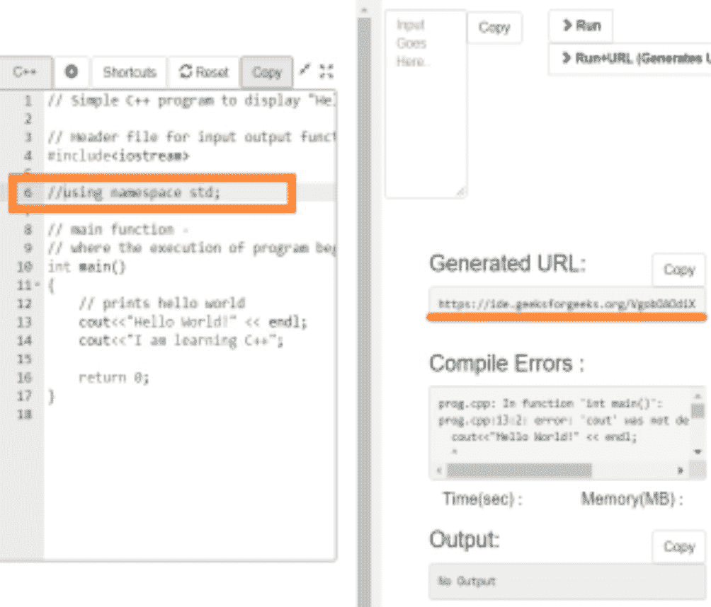

你移除 `using namespace` 时会发生以下错误：

```text
.cpp: 在函数 'int main()' 中:

.cpp:13 此行未注释

    cout << "Hello World!" << endl;

    |             ^

.cpp:13:2: 错误: 在作用域内未声明 'cout'

.cpp:13:2: 注意: 建议的替代方案:

在包含文件 .cpp:4:0 中

/usr/include/c++/5/iostream:61:18: 注意: 'std::cout'

    extern ostream cout; /// 连接到标准输出

.cpp:13:26: 错误: 在作用域内未声明 'endl'

.cpp:13:26: 注意: 建议的替代方案:

在包含文件 .cpp:4:0 中

/usr/include/c++/5/ostream:590:5: 注意: 'std::endl'

    endl(basic_ostream<_CharT, _Traits>& __os)
```


仔细观察，编译器告诉我们需要声明 `cout` 和 `endl`。它甚至给出了建议，将它们声明为 `std`。让我们按照编译器的要求看看会发生什么。

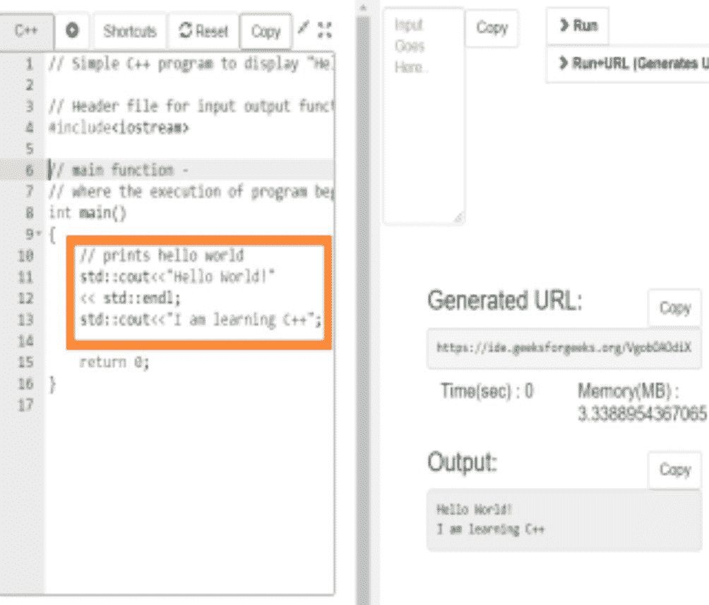

声明 `iostream` 对象和操纵符在删除了 `` 后，“Hello World”程序的成功运行。一旦成功声明了 `iostream` 对象和操纵符，就删除了不需要的行。

如果你想进行练习，可以使用这个 URL：[`ide.geeksforgeeks.org/VgobOAOdiX`](https://ide.geeksforgeeks.org/VgobOAOdiX)。

注意：如果在练习过程中遇到多个错误，我们将始终提供一个程序运行成功的已保存 IDE 工作区，以帮助你排除故障。要开始排除故障，请打开另一个窗口并导航到成功运行的界面。将你当前的工作区与成功运行的工作区进行比较。你可以在此链接找到“声明 `iostream` 对象和操纵符”的成功运行：[`ide.geeksforgeeks.org/a5zOdSWoQU`](https://ide.geeksforgeeks.org/a5zOdSWoQU)。

# 第 3 章：变量与数据类型

我们已经讨论过低级编程如何类似于机器语言，但它们之间的不同之处在于它们仍然使用了让人联想到人类语言的元素，如语法、结构和变量。变量是人类用来向机器传递含义的数学概念。计算机科学的很大一部分在于识别语言是一系列数学概念。这包括 AND 和 OR 门，它们允许机器在单个数据位层面上做出决策。在非常小的规模上，位运算函数可以帮助许多计算过程，从控制显示器到切换服务器上的流量。我们将在第 4 章中讨论这些高级主题。现在，让我们通过观察变量来深化对 C++ 的理解。

变量是任何编程语言中最重要的方面之一——编程语言的函数和其他操作通常在变量上运行。我们提到过，并不是所有程序都需要输入或输出，但所有程序都会有一些它们正在处理的变量，否则无事可做。函数的结果始终是一个状态改变。状态改变是指机器从一个决策或操作阶段变为另一个阶段。这个术语曾用于描述旧主机计算机中的操作，但我们仍然在计算机科学中使用它来描述程序的工作原理。在我们的示例中，IDE 在程序运行之前从一个初始化的 `main()` 状态开始。然后切换状态以执行输出命令。

低级语言经常讨论状态改变，因为它们与机器语言非常接近。低级语言也被称为编译语言，因为它们被编译成机器语言。这与 Python 等高级语言形成对比。如果你还记得，我们讨论过由于内置库的存在，高级语言不需要为其数据类型来声明变量。例如，Python 使用 Python 环境来识别变量及其数据类型。在 C++ 中，变量和数据类型必须被声明。数据类型告诉编译器如何处理数据。当你考虑到数学中的向量时，数据类型就更有意义；与整数（传达数量）不同，向量告诉我们空间的大小和方向。因此，向量是与整数不同的数据类型。这类属性被用于 Photoshop 等软件中以帮助渲染。

注意：基于向量的图像可以在不丢失图像质量的情况下进行处理。这是因为像 `.jpeg` 或 `.png` 等文件将图像的像素位置存储为网格上的整数。而像 `.svg` 或 `.pdf` 等矢量文件使用向量来描述它们的像素位置。因此，当图像放大时，向量会指示颜色应该如何扩展，而普通的图像文件则不会。这就是为什么在处理非向量图像文件时会导致像素化和失真的根源。

## 输入与输出：声明变量

在前一章中，我们在学习如何使用 `cout` 时，声明了一些内容。在这一节中，我们将查看数据类型的示例以及它们是如何声明的。下面是变量声明示例及其含义（“C++ 变量”，n.d.）。请记住，变量本质上存储的是特定类型的数据：

- ``：关键字是“integer”（整数）的缩写，存储没有小数的整数。该关键字包括正整数和负整数。
- ``：带有小数的数字，包括正数和负数。
- ``：关键字是“character”（字符）的缩写，存储单个字符，无论大小写。`Char` 值用单引号。
- ``：存储文本，例如我们的“Hello World”示例。`String` 值用双引号。
- ``：关键字是“Boolean”（布尔）的缩写，存储具有两种状态的值：真或假。如之前讨论的，这些值可以表示为“0/1”或“false/true”。

在下一节中，我们将详细讨论它们。现在让我们来看看这些示例。要创建一个变量，你必须在 `=` 运算符之后给它赋值。它们的语法看起来如下：

```cpp
[Datatype][Variable_name] = [value];
```

注意：每个 `` 在你的函数中必须是唯一的。否则，它会导致错误。

现在让我们创建一个名为 `myNum` 的变量，数据类型为 `int`，值为 10，然后让我们的程序打印出来。

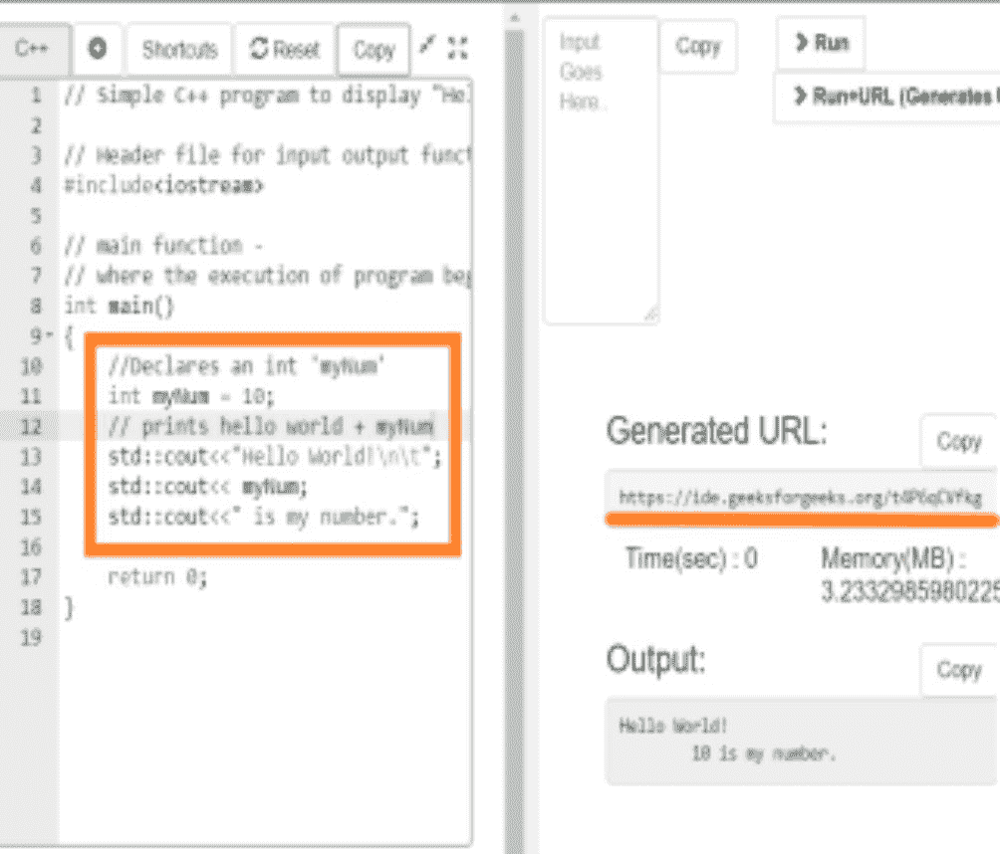

声明 `int` 数字。此截图是 `myNum` 程序的成功测试运行。你可以通过以下 URL 保存的 IDE 工作区：[`ide.geeksforgeeks.org/t4P6qCVfkg`](https://ide.geeksforgeeks.org/t4P6qCVfkg)。这段代码是在没有 `` 的情况下实现的。它是最佳实践。你应该使用命名空间成功实现相同的代码。通过 URL 将工作区重置为成功状态。

我们有了 `cout` 的示例。让我们使用右上角的 `cin` 对象，以便我们的程序接收输入并处理它们。

我们可以通过编写接收两个数字并相加的程序来实现。这样做，我们需要声明用于程序处理的变量：

1. 名为 `x` 和 `y` 的两个 `int` 变量。
2. 一个名为 `sum` 的 `int` 变量。

我们还可以让程序提示用户给出输入。

注意：在我们的 IDE 中，你必须在运行程序之前输入。每个输入应单独占一行。

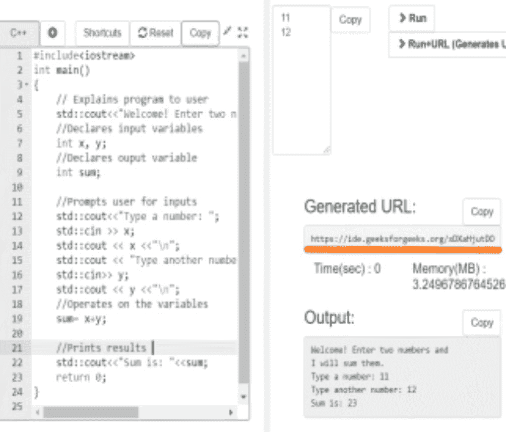

输入并打印结果。此截图是“求和”程序的成功测试运行。你可以通过以下 URL 保存的 IDE 工作区：[`ide.geeksforgeeks.org/xDXaHDO`](https://ide.geeksforgeeks.org/xDXaHDO)。这个练习为了我们的输入系统进行了修改。因此，我们包含了额外的 `` 行来确认我们的输入。

## 基础数据类型

数据类型指定了存储在变量中的信息的大小和类型。每种类型都有自己的关键字和关联的大小（“C++ 数据类型”，n.d.）：

- ``：关键字是“integer”（整数）的缩写，存储整数。大小为 4 字节。
- ``：存储带有 7 位小数的数字。大小为 4 字节。
- ``：存储带有 15 位小数的数字。大小为 8 字节。
- ``：关键字是“character”（字符）的缩写，存储单个字符，无论大小写。大小为 1 字节。
- ``：关键字是“boolean”（布尔）的缩写，存储具有真或假状态的值。大小为 1 字节。

注意：记住 `` 数据类型。我们已经广泛处理过这种特殊数据类型。字符串值的大小各不相同。因此，它们在 `iostream` 库中被处理，以提高文本处理提供更大的灵活性。我们将在下一节中回到字符串，并讨论一些高级主题。

这些大小对数据处理至关重要。例如，当你使用 `int` 配合 `float`/`double` 时，所有数字都将转换为 `int`。这是因为编译器使用 `4 bytes` 来计算整数，而整数没有为小数分配空间。程序仍然会运行，但你的计算将是不准确的。让我们修改程序并查看结果来进一步探索。我们将使用一个广受欢迎的小数（`pi`）：

``。它将测试 `float` 和 `double` 的极限。

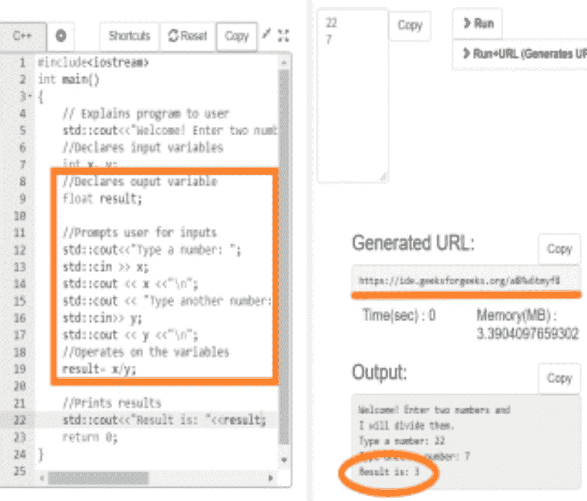

在 `Float` 或 `Double` 中使用 `Int`。此截图是我们修改后的程序成功运行的结果，该程序计算 ``，但为了存储小数并未对其进行修改。结果是结果丢失了小数。

为了得到我们想要的结果，最好更改变量数据类型。使用 `float` 数据类型会与 `double` 数据类型不同吗？我们可以预期不同的结果吗？记住，你可以通过 URL 返回工作区的成功状态来重置。

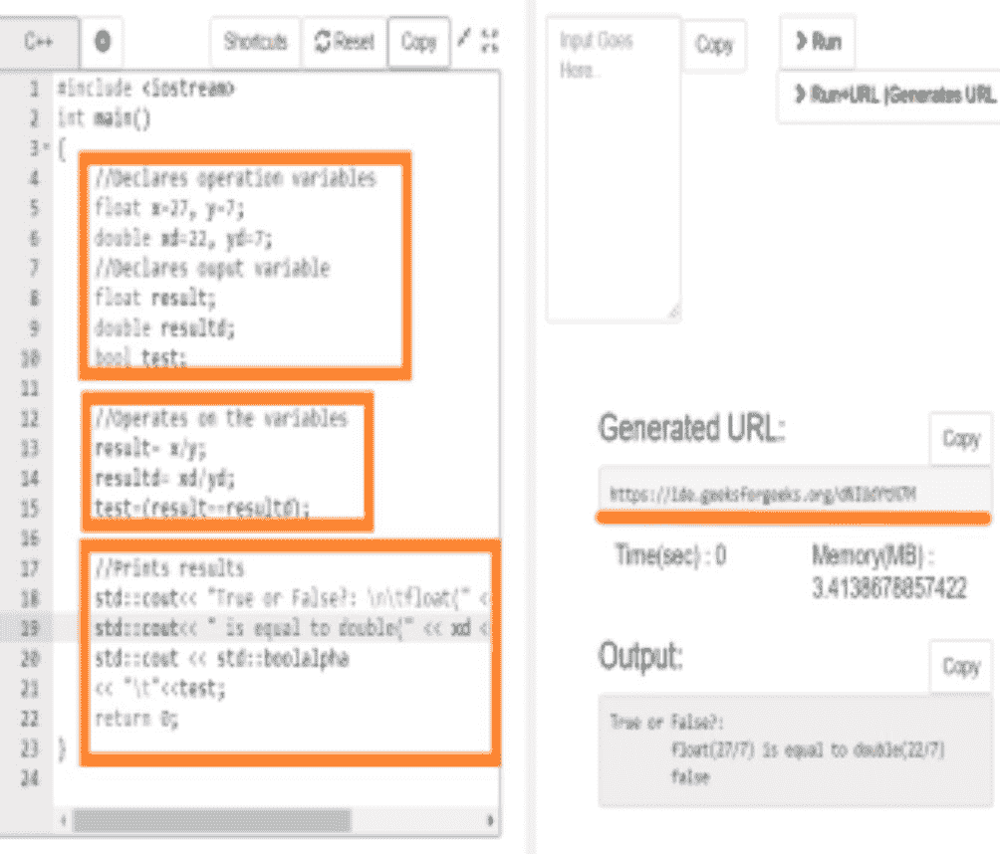

`Float`、`Float` 和 `Double`。此截图是我们修改后的程序成功运行的结果，该程序计算 ``，我们删除了输入语句并重新排列了数据类型。我们强烈建议你使用此 URL 之前的程序自己创建这个程序：[`ide.geeksforgeeks.org/a8Mw6tmyf8`](https://ide.geeksforgeeks.org/a8Mw6tmyf8)。这项练习将让你练习我们讨论的一些之前的编码主题，包括：

1. `` 数据类型关键字。
2. `` 输入输出操纵符。

它还将让你获得一些逻辑运算符的经验。我们将在下一章详细讨论逻辑运算符。一旦你操作了程序，打开一个新窗口，并与上方截图的成功运行进行比较。你可以在此 URL 找到带有成功运行 IDE 工作区：[`ide.geeksforgeeks.org/dNIUdYtN7M`](https://ide.geeksforgeeks.org/dNIUdYtN7M)。

## C++ 力量：高级字符串

我们将查看的另一个数据类型是字符串。字符串是计算机科学中最流行的数据类型之一；它们是字符序列。将它们想象成句子可能会有用，但并不是每个句子都代表一个字符串。我们已经在“Hello World”应用程序中看到它们是如何工作的了。字符串是一个独立的数据类型，拥有自己的库。为了操作和使用它们，程序需要适当的头文件——`string` 库。这些库具有允许程序操作字符串的方法和特性。

### 操作：字符串拼接

字符串拼接是将不同的字符串组合成一个字符串。这在组合字符串时很有用，是程序最常见的功能之一。例如，当你在网站或游戏中输入姓名，然后切换到另一个页面，屏幕问候你“Hello, [your_name]!”时，程序就使用了拼接来实现。它将“Hello,”与你的名字以及最后的!”组合在了一起。

在 C++ 中，字符串拼接通过 `+` 运算符执行。让我们通过创建一个打印带有问候的输入字符串的程序来查看其操作。为了使之工作，我们必须包含 `<string>` 库，它包含了处理字符串所需的对象和语句。

打开我们一直在使用的 IDE 的新实例并按照以下步骤操作：

1. 除了 `` 库之外。
2. 省略 ``。
3. 清除 `` 内的当前填充代码。
4. 声明并设置变量 ``。
5. 声明并计算 `` 运算符。
6. 将结果打印为“Hello John Doe.”

它看起来应该这样：

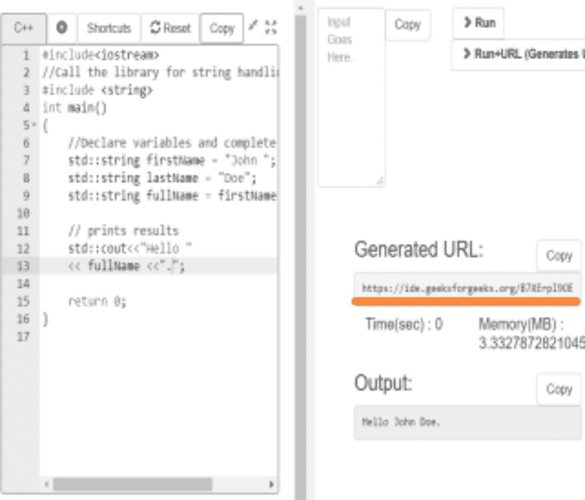

字符串拼接。此截图是我们字符串拼接程序的成功运行结果。我们鼓励你在另一个窗口中打开此程序，并与你的程序进行比较。你可以在此 URL 访问成功运行：[`ide.geeksforgeeks.org/B7XErpI9OE`](https://ide.geeksforgeeks.org/B7XErpI9OE)。

注意：务必对你的代码进行注释。你可以简化指令并将它们作为即兴算法来注释你的代码。这将帮助你保持程序有序。

通常，在论坛中，拼接的文本输入尽可能小，格式由程序完成。在示例中，我们必须手动在“Hello”和“John”之后添加空格，但程序会自动添加空格。现在你已经看到 `+` 运算符是如何工作的，你如何添加空格呢？尝试通过在编辑器中修改代码看看是否能弄出来。如果情况出现问题，你始终可以使用 URL 返回工作区的成功状态。

### 字符串对象：`length()` 属性

我们从现实经验中知道字符串像许多事物一样，大小不一。这与我们目前探索的数据类型不同。C++ 使这成为可能，因为它将字符串构造为具有属性的对象。正如你预期的那样，要访问长度，字符串必须附加到变量，并且你必须使用 `.` 语法。它看起来应该这样：

```cpp
string_name.length()
```

让我们回到程序并获取 `fullName` 的长度。

...

### 字符串索引和数组

回顾我们对对象的讨论。向量数组也是一种特殊的数学现象，具有自己的特殊属性。数组是对象的有序排列——通常是行、列或矩阵——每个对象都有特定的位置。字符串存储在由字符组成的数组中。因此，字符串数组是字符的有序排列，字符串中的每个字符都有索引。通过使用 `[ ]` 访问数组中的字符或任何其他项。字符串索引从 `[0]` 开始。让我们通过修改程序打印 `fullName` 的第 3 个字符来查看其操作。

注意：记住索引从 `[0]` 开始。因此字符串数组中的第 3 个字符位于 `[2]`，而不是 3。

我们将使用这种语法来实现：

```cpp
fullName[x]
```


`x` 代表我们想要打印的字符索引。请记住也要修改 `cout` 以正确打印该字母。你还需要使用像这样的转义序列：

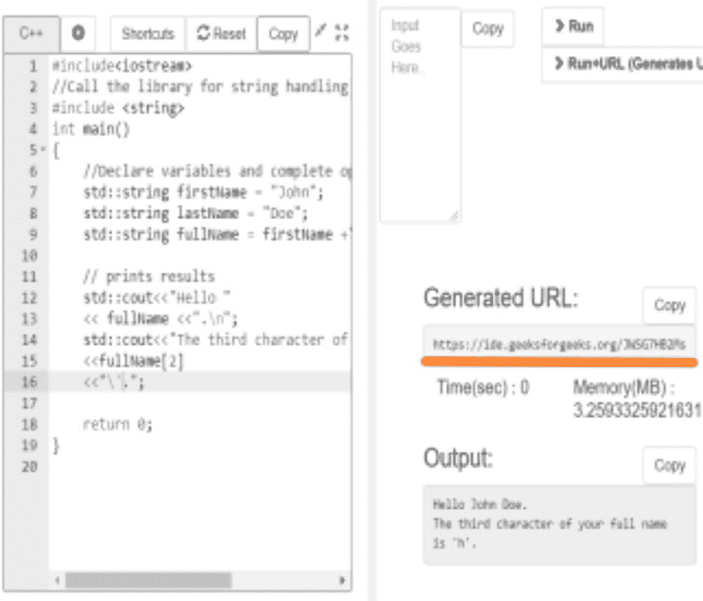

> **访问 `fullName` 字符串数组**  
> 此截图是我们修改后的字符串属性程序的成功测试运行。我们鼓励你在该 URL 上修改程序：[https://ide.geeksforgeeks.org/xbjO6Pg3Nh](https://ide.geeksforgeeks.org/xbjO6Pg3Nh)。一旦你修改了程序，你可以在另一个窗口中打开它，并与此成功的测试运行进行比较。你可以通过以下 URL 访问此保存的 IDE 窗口：[https://ide.geeksforgeeks.org/JWSG7HB2Ms](https://ide.geeksforgeeks.org/JWSG7HB2Ms)。

在我们的示例中，我们非常依赖于 `cout` 的功能，但正如我所提到的，程序员还使用其他字符串处理能力来从不同来源获取字段内容。这些是 `cin` 对象和 `getline()` 函数。

## `cin` 和 `getline()` 函数

在上一个章节的示例中，我们使用了 `cin`。与 `cout` 一样，`cin` 是 `<iostream>` 库中的一个对象，它允许程序使用 `>>` 运算符接收输入。与 `cout` 一样，`cin` 对象必须用 `std` 数据类型定义。让我们修改我们的拼接程序，使其接收“John Doe”的输入。如果你喜欢，可以使用你自己的名字，因为这样做可能很有趣。你需要遵循以下指令：

1. 导航到以下 URL 的字符串拼接程序：[https://ide.geeksforgeeks.org/B7XErpI9OE](https://ide.geeksforgeeks.org/B7XErpI9OE)
2. 声明变量。
3. 提示用户输入姓名。
4. 使用以下代码段计算操作：

   

5. 打印结果。

如果你发现自己卡住了，这里是它应该的样子：

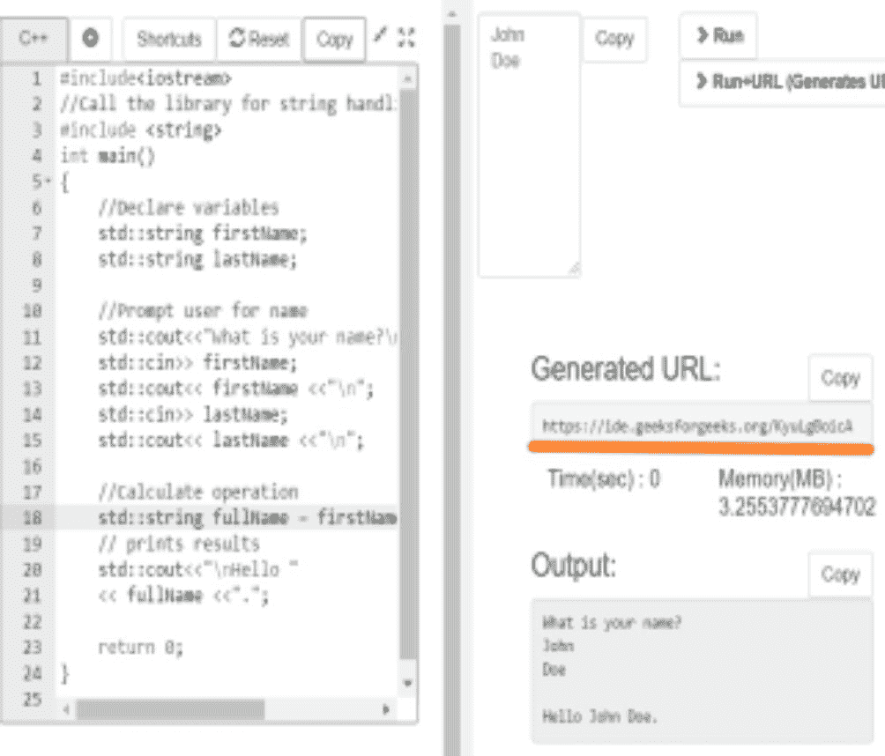

> **使用 `cin` 进行字符串拼接**  
> 此截图是我们使用 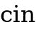 修改后的字符串拼接程序的成功测试运行。我们鼓励你在另一个窗口中打开此程序，并将其与你的程序进行比较。你可以在此 URL 访问成功运行：[https://ide.geeksforgeeks.org/KyuLgBoicA](https://ide.geeksforgeeks.org/KyuLgBoicA)。  
> 注意：务必为你的代码添加注释。你可以简写指令并将它们作为即兴算法来注释你的代码。这将帮助你保持程序有序。

只有当用户分别输入名和姓时，程序才能运行。但大多数人的姓名被存储或输入为单个字符串。让我们更改程序，以便在用户输入全名时欢迎他们。你需要遵循以下步骤：

1. 如果那里还没有，或者你需要重置工作区，请前往以下 URL 之前的工作区：[https://ide.geeksforgeeks.org/KyuLgBoicA](https://ide.geeksforgeeks.org/KyuLgBoicA)
2. 仅声明 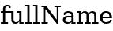。
3. 使用 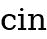 提示用户输入全名。
4. 使用  欢迎用户。


> **使用 `cin` 的字符串终止**  
> 此截图是使用  修改后的字符串拼接程序的失败测试运行。虽然程序无错误地完成，但我们没有得到预期的结果。如果你的程序在修改后出现错误或没有得到类似的结果，我们鼓励使用我们的成功运行来排查工作区的问题。在另一个窗口中打开此成功运行，并与你的程序进行比较。你可以在此 URL 访问成功运行：[https://ide.geeksforgeeks.org/aU6GZpAxwn](https://ide.geeksforgeeks.org/aU6GZpAxwn)。

你见证了典型的 `cin` 行为。当 `cin` 遇到空格时，它将其视为字符串终止符并停止。这就是为什么“Doe”没有添加到输出中。为了让它读取包含空格的整个字符串，我们必须使用 `<string>` 库中的 `getline()` 函数；它从输入中提取所有字符并将它们转换为字符串数组。

**注意：**

通常优选使用 `getline()` 以确保程序可以从次要来源读取字段文本，特别是 `getline()` 可以读取并聚合不同类型的字符而不会产生错误。

这是一个正确使用 `getline()` 函数的示例：[https://www.geeksforgeeks.org/getline-string-c/](https://www.geeksforgeeks.org/getline-string-c/)。

在本章中，我们做了很多。我们查看了特殊函数、访问对象、文本操纵符和运算符。我们将在后续章节中更详细地介绍它们。我希望你已经看到了运算符在引导数据和赋予程序功能方面的作用。在下一章节中，我们将研究运算符以及它们如何赋予程序决策能力。

# 第 4 章：C++ 中的操作

我们讨论了 C++ 主要是一个后端、服务器端语言，非常适合这类工作。在接下来的章节中，我们将研究运算符以及它们如何赋予程序决策能力。（重复以提供上下文）

**注意：**“操作数”（Operand）描述被操作的值。“运算符”（Operator）描述指示正在执行的操作的符号。

## 二元运算符

二元运算符是你 C++ 中发现的大多数操作数。它们包含了 6 种运算符中的 5 种。这使得它们成为完美的起点。正如名称所示，二元运算符比较两个操作数。它们非常适用于决策和控制切换。

### 算术运算符

它们是所有运算符中最常见且最易理解的，因为即使在编程之外我们也经常使用它们，由于它们主要是数学性的。我们使用它们来执行数学操作。

**注意：**在字符串拼接示例中，用于拼接的  不是算术函数。相反，它是 `Images/image00603.jpeg` 库的一个函数，负责处理拼接。

此类别中的大多数运算符都需要两个操作数。唯一的例外是一元 `++` 和 `--` 运算符，我们通常在循环中使用它们来增加或减少值。二元运算符如下（Jaggi, 2015a）：

- “”：加法运算符，用于将两个操作数相加。
- “”：减法运算符，用于从一个操作数中减去另一个操作数。
- “”：乘法运算符，用于将两个操作数相乘。
- “”：除法“斜杠”运算符，用于将第一个操作数除以第二个操作数。
- “”：取模运算符，返回第一个操作数除以第二个操作数后的余数。

让我们编写一个 `cout` 程序来演示这 5 种算术操作数。在 IDE 中创建一个新的 C++ 工作空间，并按照以下指令操作：

1. 两个变量  为整数。
2. 声明一个变量，。
3. 打印变量 。
4. 相加  并打印结果。
5. 减去  并打印结果。
6. 乘法  并打印结果。
7. 除以  并打印结果。
8. 计算  除法的余数并打印结果。

其效果如下所示。

`!`

> **算术例程序**  
> 此截图是算术例程序的成功运行，显示了所有算术功能。你可以在索引中访问原始代码的副本。

如果你遇到错误，我鼓励你使用我们的成功运行案例来排查工作空间的问题。打开它并对比代码。可以在这里找到：

[`ide.geeksforgeeks.org/vDcCH7f5EQ`](https://ide.geeksforgeeks.org/vDcCH7f5EQ)

## 关系运算符

大多数程序（不仅仅是 C++）都使用条件和循环来控制执行流。本节中的运算符用于执行条件切换。例如，在游戏中，游戏引擎会根据玩家与游戏交互的方式进行调整。这为玩家提供了更具参与感且动态体验。

如果玩家快速完成挑战，可能意味着他们觉得游戏太简单了。结果是游戏通过增加难度来调整，但程度不会太大。如果游戏太难，引擎可能会通过让游戏变得简单一点来响应。这被称为动态游戏，它的发生是因为编程语言具有条件切换功能。条件切换（适应）是通过比较两个值的关系运算符实现的。所有的关系运算符都是二元的（Jaggi, 2015b）。它们如下：

- “”：“等于”运算符，用于检查两个给定的操作数是否相等。如果操作数相等，它返回布尔值 `true`；否则返回 `false`。
- “”：“不等于”运算符，也检查两个给定的操作数是否相等。然而，如果操作数不相等，该运算符返回布尔值 `true`，如果操作数相等则返回 `false`。
- “”：“大于”运算符，用于检查左侧操作数是否大于右侧操作数。如果是，该运算符返回布尔值 `true`。否则返回 `false`。
- “”：“小于”运算符，用于检查左侧操作数是否小于右侧操作数。如果是，该运算符返回布尔值 `true`。否则返回布尔 `false`。
- “”：大于等于运算符，用于检查左侧操作数是否大于或等于右侧操作数。如果是，该操作数返回布尔值 `true`。如果不是，它返回布尔值 `false`。
- “”：小于等于运算符，用于检查左侧操作数是否小于或等于右侧操作数。如果是，该操作数返回布尔值 `true`。如果不是，则返回 `false`。

就像我们处理算术运算符一样，让我们创建一个演示关系运算符的 `cout` 程序。我们将在代码中使用条件 `if()` 语句。`if()` 语句在满足指定条件时执行其大括号内的代码。如果条件不满足，它将执行 `else{}` 语句中的代码。`else` 没有需要检查的条件；它在 `if()` 中的指定条件不满足时执行。条件语句始终使用关系运算符来测试条件。

**注意：**

`if(string)` 和 `else` 语句对大小写敏感。`if` 和 `else` 必须全小写。此外，虽然 `if()` 可以在没有 `else` 的情况下执行，但如果条件为假，缺失的 `else` 语句会导致错误。`else` 语句无法在没有 `if()` 语句的情况下实现。我们将在稍后详细描述 `if()...`

为了创建我们的程序，我们需要遵循以下步骤：

1. 使用此 URL 打开并编辑算术例程序：[`ide.geeksforgeeks.org/vDcCH7f5EQ`](https://ide.geeksforgeeks.org/vDcCH7f5EQ)
2. 使用算术例中相同的变量。确保清理掉不需要的。
3. 打印算术例的说明。
4. 测试  并打印结果。
   - 创建 `if` 语句打印大于结果。
   - 创建嵌套的 `else` 语句在假时打印结果。

   **注意：**对于  我们的简单程序，只有两种可能。
5. 测试  并打印结果。
6. 测试  并打印结果。
7. 测试  并打印结果。
8. 测试  并打印结果。
9. 测试  并打印结果。

`!`

> **关系例程序**  
> 此截图是关系例程序的成功运行，显示了所有关系功能。

如果你没有得到相似的结果，请查看我们的代码：[`ide.geeksforgeeks.org/dFD3cEk85y`](https://ide.geeksforgeeks.org/dFD3cEk85y)。对比并找出哪里错了。这样的练习将让你具备调试技能。

### 逻辑运算符

逻辑运算符为关系运算符增加了复杂性。这些运算符类似于人类的“和”或“或”的概念。它们还具有改变关系运算符含义的属性。逻辑运算符与关系运算符结合使用，组合或多个条件来描述约束。它们让我们通过条件判断捕捉并处理更多内容。三个逻辑运算符（Jaggi, 2015b）：

- `""`：逻辑“与”运算符在两个条件都满足时返回布尔值 `true`，在不满足时返回 `false`。
- “”：逻辑“或”运算符在一个（或两个）条件都满足时返回布尔值 `true`，在所有条件都不满足时返回 `false`。
- “”：逻辑“非”运算符在所考虑的条件不满足时返回布尔值 `true`。如果其中一个条件为真，则它返回布尔 `false`。

逻辑运算符在机器中被广泛使用。想象银行安全系统中有一个“NOT”（非）运算符。假设锁闭的门为“0”[false]，未锁闭的门为“1”。因为银行必须保持安全，我们的默认值是“0”。这被称为“失效闭合系统”（fail-closed system），因为一旦发生故障，门将会关闭（处于默认状态）。所有发往门的信号都由“NOT”信号控制：如果没有发生异常，门应该保持锁闭状态；如果发生抢劫，它们也应该保持锁闭。在抢劫期间打开的门将收到一个“NOT”信号以失效关闭。但在火灾期间，这些门应该打开，因此失效关闭的“NOT”信号将返回真以打开门。

让我们通过构建一个逻辑例程序来探索逻辑运算符。遵循以下指令：

1. 使用此 URL 打开并编辑关系例程序：[`ide.geeksforgeeks.org/dFD3cEk85y`](https://ide.geeksforgeeks.org/dFD3cEk85y)
2. 编辑这些额外的变量来测试逻辑运算符：
3. 打印程序的解释。
4. 测试 `if(a>b && c==d)` 并打印结果：
   1. 创建一个 `if` 语句，在大于时打印结果。
   2. 创建一个嵌套的 `else` 语句，在为假时打印结果。
5. 测试 `(a>b || c==d)` 并打印结果。
6. 测试 `(!b)` 并打印结果。
7. 清理代码中不需要的行。

它看起来如下：


> **逻辑例程序**  
> 此截图是逻辑例程序的成功运行，显示了所有逻辑函数的示例。你可以通过此 URL 访问此工作空间：[`ide.geeksforgeeks.org/x9ixjUYDBG`](https://ide.geeksforgeeks.org/x9ixjUYDBG)。正如你所看到的，“AND”（与）函数可能很难通过一个  。

让我们从程序中休息一下，探索我们使用逻辑运算符的其他方式。逻辑运算符基于机器逻辑，特别是逻辑门。逻辑门是具有一个或多个输入和一个输出的电子电路。逻辑门的功能与逻辑运算符相同。“AND”门只有在所有输入都为“1”时才通过“1”；“OR”（或）门在从任何一个输入接收到“1”时通过“1”；“NOT”门在接收到“0”作为输入时通过“1”。

逻辑门可以控制电路中的数据流，与我们的逻辑操作与条件语句结合时一样。这在逻辑运算符中被称为“条件短路”。

### 短路求值

逻辑 `AND` 运算符和 `OR` 运算符会短路。回想逻辑 `AND` 在两个关系运算符条件都为真时如何返回真布尔值。此外，关系运算符是按照它们在条件语句中出现的顺序进行评估的——如果第一个为假，第二个将不会被评估，因此发生了短路。

`OR` 运算符的处理方式不同。只需一个关系运算符返回真，它就会通过一个真布尔值。所以，如果第一个关系运算符返回真，它就不会检查下一个。

这非常有用，因为我们可以告诉程序在什么情况下如何执行更复杂的指令。`OR` 和 `AND` 是短路的相反面。让我们利用这一点写一个程序，告诉。

遵循以下指令：

1. 打开一个新的 IDE 工作空间。
2. 声明两个  变量。
3. `resAND = ((a == b) && std::cout << "OR circuit shorted")`
4. `resOR = ((a == b) || std::cout << "AND circuit shorted")`

它看起来如下：


> **短路检测程序**  
> 此截图是我们的短路检测程序的成功运行。利用对逻辑 AND、逻辑 OR 以及它们之间关系的知识，我们开发了一种检测短路的方法。你可以通过此 URL 访问此工作空间：[`ide.geeksforgeeks.org/uBLGtLbnnY`](https://ide.geeksforgeeks.org/uBLGtLbnnY)。尝试不同的  值，看看是否可以触发不同的“电路”。

考虑一个短路检测程序。我们在现实世界中如何使用它？我曾提到过这类系统在银行安全中起着作用。问题是它如何实现这些功能的？

### 位运算符

在电路层面，机器通过 AND 和 OR 门进行通信。这赋予了它们单位上的决策能力。坦率地说，使用运行在计算机原生层面的位运算符可以提高速度和性能，因为跳过了目标编程到机器语言的翻译。

要使用它们，你需要了解二进制。人类使用十进制（也称为十制）来概念化数字。例如，像 543 这样的数字被理解为五百、三十和 4 个单单位。在十进制中它看起来像这样：

在二进制中，同一个数字看起来像 `0b1000011011`，`0b` 只是让我们人类理解它是二进制数。二进制数是二进制，它们看起来不同。所有二进制数都以位流的形式呈现。就像十进制一样，数字的位置决定了它的值。534 示例显示了一个 10 位的二进制数。仔细观察 534 流，我们可以看到第 2、3、4 和 10 位是开启的（从右向左），所有其他位都是关闭的。在二进制中我们将其计算为：

- “&”：位与（AND）接收两个数字（操作数），并对这两个数字流中的每个位执行 AND 操作。如果两者都为 1，则 AND 流的结果位为 1。
- “”：位或（OR）接收两个数字（操作数），并对这两个数字流中的每个位执行 OR 操作。如果其中任一个为 1，则 OR 流的结果位为 1。
- “”：位异或（XOR）接收两个数字作为操作数，并对这两个数字流中的每个位执行 XOR 操作。如果两个对应的位不同，则 XOR 结果流的结果为 1。
- “”：左移运算符接收两个数字，并将第一个操作数的位向左移动。第二个操作数用于确定移动的位数。
- “”：右移运算符接收两个数字，并将第一个操作数的位向右移动。第二个操作数用于确定移动的位数。
- “”：位取反（NOT）运算符接收一个数字，并切换所有位的状态（1 变 0，0 变 1）。

**注意：**机器使用寄存器和缓冲区来存储用于计算的位。寄存器仅仅是一个存储数组，每个位在数组中都有自己的位置。如果你将这些数据流看作数组，将有助于你理解许多位运算符，特别是位移运算符。

让我们写一个位运算例程程序。首先，我们需要创建一个位寄存器并研究位流。这需要 `<bitset>` 库中的 `bitset<x>()` 函数。它允许你打印长度为 `<x>` 的二进制流。请按照以下说明操作：

1. 打开一个新的 IDE C++ 工作空间。
2. 此外还需要包含  库。
3. 声明操作数变量及其值。

     
   

4. 为计算声明寄存器 `c`。

   

5. 打印操作数的值及其对应的寄存器：

     
     
     
   

**注意：**由于所有数字都小于 255，我们将在整个练习中使用 。

7. 在  中打印结果和寄存器。

**注意：**由于我们正在使用位运算函数，使用  来结束行更好。这是因为这个函数会清除缓冲区并防止溢出。这会让程序运行慢一点，但它确保了我们的寄存器是清的。速度差异可以通过使用位运算函数来弥补。

8. 为 。
9. 在  中打印结果值和寄存器。
10. 为 。
11. 在 。
13. 在 。
16. 在 。
18. 在 。

> **带有寄存器打印的位运算**  
> 此截图是我们位运算例程程序的成功运行。输出展示了  寄存器数组的可视化。这将让你看到每个位运算是如何计算的，以及它是如何改变寄存器的。这是一个输出非常长的程序。要完全研究它，可以通过此 URL 访问我们保存的工作空间：[`ide.geeksforgeeks.org/JgnAlVwONe`](https://ide.geeksforgeeks.org/JgnAlVwONe)。

**注意：**

此程序使用了 `using namespace std;` 来简化程序。省略命名空间并声明每个 `cout` 和位运算是一个良好的习惯。

这些二进制赋值运算符将赋值和算术函数结合。它们在控制循环和条件语句时运行良好。原子赋值运算符与一元算术运算符密切相关。两者经常用于控制循环。让我们来看看一元运算。

## 一元运算

在讨论一元运算之前，让我们看看使用它们的代码。


## 带有一元运算符的 `while`

这张截图是一个打印计数器值的简单 `while` 循环， 会导致错误，因为 `while` 循环无法步进。我们将在[决策章节](https://docs.google.com/document/d/1rfTukE008PScFE0mgrN2m-UKMEAv4Y8VYrXHB3BjvOU/edit#heading=h.4bvk7pj)中详细讨论循环。为了充分学习它，您可以通过此 URL 访问我们的保存工作空间：[`ide.geeksforgeeks.org/MgMUtZdlpb`](https://ide.geeksforgeeks.org/MgMUtZdlpb)。

`i = 1 + i` 等同于 `i++`。使用一元形式会让代码更整洁，因为它消除了 `+` 算术运算符和 `=` 赋值运算符。我们也可以使用原子加法运算符来完成代码：`i+=1` 等同于 `i++`。但那种格式需要编译器来存储和操作额外的操作数。一元运算符的作用是通过只使用一个操作数来简化代码。记住，一元运算符是那些使用一个操作数的运算符。这里是一些其他一元运算符的示例（Kumar, 2017）：

- “”：增运算符，用于将整数的值增加 1。它可以放在变量前面立即增加值，也可以放在后面，在增加之前临时保存该值。
- “”：减运算符，用于将整数的值减少 1。与递增类似，程序员也可以实现前递减和后递减指令。
- “”：一元负号运算符，用于改变变量或参数的符号。对负整数执行一元负操作将使其变为正数，反之亦然。
- `!`：非逻辑运算符，用于反转操作数的布尔逻辑状态。例如，如果一个变量 。
- `&`：取地址运算符，用于指向变量的地址。

让我们编写一个一元运算符程序，查看前置和后置指令是如何工作的。按照以下步骤：

1. 打开一个新的 IDE 工作空间。
2. 声明并初始化我们的变量和缓冲区。

```cpp


`int a = 10, buf`

```
3. 打印程序的解释和初始值
4. 计算一个等于缓冲区的后递增并打印结果
5. 计算一个等于缓冲区的后递减并打印结果
8. 计算一个等于缓冲区的前递增并打印结果
9. 计算一个等于缓冲区的前递减并打印结果
```

|  |

## 带有后置和前置操作的一元运算符程序

这张截图是我们的一元运算符程序。为了充分学习它，您可以通过此 URL 访问我们的保存工作空间：[`ide.geeksforgeeks.org/mvcYtky6C4`](https://ide.geeksforgeeks.org/mvcYtky6C4)

程序对`a`进行操作并在计算时，它将值存储在我们可以观察的缓冲区中。将`a`与缓冲区比较，后置操作延迟改变`a`的值；相比之下，前置操作会立即改变值。

在所有这一切之上，我们还有`sizeof()`运算符。它看起来像一个函数，但被归类为运算符。它检查对象的大小并以字节返回大小。

回想关于位流的对话。我没说的是它们通常被分为一组 8。一个字节是一个 8 位流，可以表示 255 个数字。在我们的位运算程序中，我们的寄存器长度为 1 字节，是因为我们处理的数字小于 255。

让我们写一个使用`sizeof()`获取数组大小的程序。开始吧：

1. 打开一个新的 C++ IDE 工作空间
2. 声明并初始化我们的数组

3. 打印程序的解释和数组
注意：打印数组你需要创建一个`for()`循环。我们将在下一章讨论`for()`循环。现在，只需使用这些代码：

```


```

4. 计算数组的大小

5. 打印数组的大小

|  |

## 数组大小报告程序

这张截图是我们数组大小报告程序。我们鼓励您将结果与我们的进行对比。为了充分学习它，您可以通过此 URL 访问我们的保存工作空间：[`ide.geeksforgeeks.org/HwpcLYB4P0`](https://ide.geeksforgeeks.org/HwpcLYB4P0)。

这是一个两个一元操作的好例子：`sizeof()`和地址指针`&`。我们用于打印数组的`for()`循环被称为拷贝构造函数调用。构造拷贝调用由一个带有索引变量的`for()`循环、取地址运算符和一个容器对象组成。

## 三元运算符

C++ 只有一个三元运算符。三元运算符，也称为条件运算符，接受 3 个或更多操作数——结果始终取决于第一个表达式是否为真，如果是，则评估第二个；如果第一个表达式为假，则评估第三个。如果你还记得我们在关系程序中的`if()…else`语句，它有三个部分：函数评估的初始表达式、当初始表达式为真时评估的表达式，以及当初始表达式为假时评估的`else`语句。条件运算符的组件与`if()…else`相同。它们只是更紧凑。

让我们写一个程序来说这些相似之处：

1. 打开一个新的 C IDE 工作空间
2. 要使用条件运算符你需要调用  库
3. 打印条件运算符的解释
此程序将使用两种方法选出最大的：条件运算符和  语句

我们预期结果为 5。

4. 声明变量并执行三元运算符
```cpp
int arsize=sizeof(arr)/sizeof(arr[0]);
```
5. 打印  然后打印 2
 然后打印 5

|  |

## 条件操作演示

这张截图我们的条件操作演示。这个程序没有实际应用功能。但对于我们的目的，它确实展示了条件运算符和  语句之间的相似之处。

我们将讨论决策函数；这些是类似于`if-else`循环的函数。编程很大程度上依赖于决策，而决策是基于我们在第 4 章中看到的涉及运算符的逻辑表达式提供的。决策函数与逻辑表达式相结合，赋予了机器根据程序员选择的标准来做出决策的能力。

在第 4 章的`sizeof()`练习中，我们在拷贝构造函数中使用了一个`for()`循环来处理数组，打印了所有索引。带有`auto`数据类型的一元运算符`Addressof`允许我们实现`for()`循环，而无需为循环设置额外的计数器。如果你从未有过自己初始化和实现循环的经验，那么拷贝构造函数的简单性就并不显而易见。

### 循环

程序员花费大量时间通过脚本和例程来自动化处理单调、重复的任务。让脚本和例程实现这一点的就是循环。正如名称所示，只要满足特定条件，循环就会重复相同的指令（“C++ While 循环”，n.d.）。循环通常用于通过数组和向量等索引遍历聚合对象。例如，你可能会编写一个循环，不断搜索数组直到找到特定项目为止。循环有两种类型：入口控制循环和退出循环。

在我们的一元算术示例中，我们有一个带有计数器的`while()`循环。计数器是一个任意变量，与一元运算符配合用于增加指定的表达式。它是入口控制循环的一个示例——它在执行代码之前测试条件。让我们将该示例修改为`while()`循环以探索它的组件。我们将使用它打印 10 次“Hello World”。请遵循以下指令：

1. 打开以下 IDE C++ 工作空间：
[`ide.geeksforgeeks.org/MgMUtZdlpb`](https://ide.geeksforgeeks.org/MgMUtZdlpb)
2. 打印程序解释
此程序将编号并打印 10 行--
3. 将条件测试更改为 
4. 带有行号打印 10 次“Hello World”

|  |

| While 循环演示此截图是我们的 while 循环演示。你可以使用此 URL 访问我们保存的工作空间的副本：[`ide.geeksforgeeks.org/0WjOL6TSh4`](https://ide.geeksforgeeks.org/0WjOL6TSh4)。 |

此程序向我们展示了增量计数器是如何工作的。为了使其工作，数字必须从 1 开始，而不是 0。大多数人习惯了数字那样工作。为了做到这一点，我们将计数器初始化为 1。然而，如果我们将条件设置为 10，它将给我们 9 次输出。要得到 10 次，我们必须将数字增加到 11。

另一个控制循环示例是`for()`循环函数；它需要三个表达式作为输入（Agarwal, 2017a）：

1. 初始化表达式，用于声明数据类型和变量。该变量可以是计数器也可以是索引变量。
2. 测试表达式，产生布尔值 。如果条件为真，则`for`循环将继续循环其指定的代码块。
3. 更新表达式，增加计数器或索引变量

让我们通过编写一个与我们的`while()`循环示例相似的程序来看看它们是如何工作的。请遵循以下指令：

1. 打开以下 IDE C++ 工作空间：
[`ide.geeksforgeeks.org/0WjOL6TSh4`](https://ide.geeksforgeeks.org/0WjOL6TSh4)
2. 打印程序解释
此程序将编号并打印 10 行 Hello World
3. 实现`for()`循环

4. 带有行号打印 10 次“Hello World”
5. 清理数据中任何不需要的代码和注释

|  |

| For 循环演示此截图是我们的 for 循环演示。你可以使用此 URL 访问我们保存的工作空间的副本：[`ide.geeksforgeeks.org/Dj2gyW02av`](https://ide.geeksforgeeks.org/Dj2gyW02av)。注意：确保清理你代码中不必要的行并更新你的注释。虽然这不会影响你代码的性能，但可能会让你团队中必须实现你代码的其他程序员感到困惑。你在这里看到一个错误了吗？ |

现在我们已经看到了`for()`循环是如何工作的以及是如何构造的，让我们看看之前使用的拷贝构造函数。用于拷贝构造函数调用的表达式是：


“E”是索引变量，“arr”是变量数组。我们看到`for()`循环需要三个表达式才能工作：初始化、测试表达式和更新表达式。

拷贝构造函数有一个初始化函数（`const auto& e`）。当你仔细观察时，你可以发现这个表达式也可以作为测试表达式工作，因为`&`是一个指向`e`的`Addressof`运算符，`e`代表`arr`数组中的索引。`:`是一个进入类的运算符。它允许容器`arr`数组的属性传递给变量`e`。`for()`循环将打印`e`直到到达数组末尾。

拷贝构造函数的调用适用于大小未知的情况。`for()`循环将打印`e`直到数组末尾。拷贝构造函数的调用适用于大小未知的情况。`for()`循环将打印`e`直到数组末尾。拷贝构造函数的调用适用于大小未知的情况。`for()`循环将打印`e`直到数组末尾。拷贝构造函数的调用适用于大小未知的情况。`for()`循环将打印`e`直到数组末尾。拷贝构造函数的调用适用于大小未知的情况。`for()`循环将打印`e`直到数组末尾。直到检测到错误。让我们通过修改`while()`程序来编写第一个`do while`循环。请遵循以下指令：

1. 打开以下 IDE C++ 工作空间：
[`ide.geeksforgeeks.org/0WjOL6TSh4`](https://ide.geeksforgeeks.org/0WjOL6TSh4)
2. 将计数器设置为 

| 显示退出控制循环的 Do 循环此截图是我们的 while 循环演示。你应该注意到尽管 。 |

## If()…Else

到为止，我们在示例中使用了`if()…else`函数。它们很容易理解，结构也非常直白易见。`if()…else`语句测试一个条件，并根据结果执行一个代码块或另一个。它们是两个独立的语句的组合。

你可以单独执行`if()`函数，但编译器期望有一个`else`语句。`else`语句包含与`if()`表达式关联的代码。如果没有`if()`语句，`else`语句永远不会执行。

`else if()`语句指定了另一个要测试的条件。它创建了一个被称为“嵌套 if-else 语句”的语句链。如果你正在测试很多条件，最好使用`switch`，我们将在下一节中讨论它。让我们来编写第一个嵌套 if-else 语句。请遵循以下说明（“C++ | 嵌套三元运算符，”，2018）：

1. 打开一个新的 IDE C++ 工作空间
2. 打印条件运算符的解释
此程序将遍历从 2 到 4 的顺序数字列表，并使用嵌套语句选出最大的一个。
我们预期结果为 4。
3. 实现一个嵌套 if-else
 然后打印 2
 然后打印 3
 打印 4

|  |

| 嵌套 If-Else 演示这是我们嵌套 if-else 演示的截图。与与其他演示一样，这个程序没有实际功能。但是，对于我们的目的，这是一个实现和理解 的极佳练习。每个语句仍然需要代码块。代码块也应该与条件对应，以便创建一个满足既定目的的功能程序。你可以通过此 URL 访问我们保存的工作空间的副本：[`ide.geeksforgeeks.org/89MlNvRWYU`](https://ide.geeksforgeeks.org/89MlNvRWYU)。 |

让我们进一步研究这个练习。嵌套 if-else 可以分为两部分：`if()`以及包含条件和执行代码的`else – if()`语句。你注意到代码块在逻辑上遵循程序的状态目标，即找到最大的数字。按升序打印数字是有意义的，以防我们更改条件语句。`if()`语句内部的条件及其包含的代码块的排列方式允许程序流向答案。例如，如果`(2 > 3)`被硬编码到下一个嵌套语句。该结构刻意遵循了嵌套三元运算符。

### 嵌套三元运算符 if-else 运算符

在上一章中，我们讨论了条件运算符，即测试条件并根据结果执行表达式的三元运算符。我们说它所使用的结构类似于`if()...else`语句，但更简洁。例如，`if()`语句测试一个条件，并根据测试结果执行两个代码块之一。`if ()…else`语句可以嵌套，三元运算符也可以嵌套。让我们比较一下两者的结构。遵循以下步骤参与（“C++ | 嵌套三元运算符，”，2018）：

1. 如果你已经关闭了嵌套 if-else 演示，请通过此 URL 打开带有我们程序的已保存 IDE C++ 工作空间：[`ide.geeksforgeeks.org/89MlNvRWYU`](https://ide.geeksforgeeks.org/89MlNvRWYU)
2. 打印程序的解释
   1. 此程序将遍历从 2 到 4 的顺序数字列表，并使用两种方法选出最大的一个：条件运算符和嵌套语句
   2. 我们预期结果为 4。
3. 添加嵌套 if-else 的打印通知
4. 打印条件语句的通知
5. 添加条件运算符代码：声明变量并执行条件运算符

```cpp
int a = 2 > 3 ? 2 : 3 > 4 ? 3 : 4;
```

6. 清理代码中不必要的行并修正任何注释

|  |

| 嵌套 If-Else 和嵌套三元运算符操作比较这是我们修改后的嵌套 if-else 演示的截图。我们通过实现嵌套三元运算符修改了演示，以便进行并排比较。正如你可能经历过的，三元运算符实现起来更容易，使用的语句更少。你可以通过此 URL 访问我们保存的工作空间的副本：[`ide.geeksforgeeks.org/BdfgWVg8uc`](https://ide.geeksforgeeks.org/BdfgWVg8uc)。 |

让我们谈谈刚才所做的内容。在之前的讨论中，我们将嵌套 if-else 语句拆解为它的组件和可能的结果列表。即使在“2”和“3”是任意值的情况下，if-else 语句也必须列出所有可能的结果以确保无论条件语句的结果如何都具有良好的功能。

要查看嵌套 if-else 的条件语句结果如何匹配三元运算符的组件，我们必须仔细观察三元运算符。语法如下：

`Var`是用于打印结果的变量。嵌套 if-else 的匹配表达式位于运算符的`?`指示符之前。第二个表达式在第一个表达式为假时执行，对应于嵌套 if-else 中的`else if ()`。你已经可以看到三元运算符紧凑性的优势，但根据其性质，三元运算符不适用于代码块。

### switch

正如我所说的，程序员需要追求高效、易于理解的代码。使用`switch`代替`if().else`是实现这一点的方法，特别是在处理多个表达式的情况下。三元运算符减少了代码行，正因为如此，它们不适用于代码跨行的情况。`switch`语句为这两个问题提供了解决方案。`switch`语句是多分支语句，提供了一种在单个变量上执行不同代码块的整洁方法。`switch`语句提供了在单个变量上执行不同代码块的整洁方法。语法如下（Awasthi, n.d.)：

```

{


}
```

注意：`switch`只能将整数与`case`数字进行比较。要添加条件组件，必须通过操作更改变量。运算符必须产生整数。

让我们创建一个 switch 演示练习 switch 的组件：

1. 打开一个新的 IDE C++ 工作空间
2. 初始化变量

3. 打印程序的解释
4. 初始化 switch

5. 对于 case 1 打印“Choice is 1”
6. 对于 case 2 打印“Choice is 2”
7. 对于 case 3 打印“Choice is 3”
8. 对于 default 打印“Program Exit”；

|  |

| switch 演示这是我们的 switch 演示。 |

我们讨论了算法作为一种理解问题以及规划代码如何工作以修复问题的方法。算法接收输入，执行操作，然后给出一个结果，从而导致状态更改。函数是一个代码块，你可以多次调用它而无需重新编写代码。该代码通常是执行某个所需任务并具有高重用性的内容。函数由头部和函数体组成。以下是函数的语法格式：

```

{


}
```


正如你所看到的，正如许多其他编程语言一样，`C++` 大部分仅仅是一系列函数、语句和运算符，中间穿插着对象和其他数据存储元素。我们到目前为止所写的所有内容都使用了 `main()` 函数，其语法与上面类似。因此，函数对你来说并不陌生。

每个函数必须返回一个数据类型，就像 `main()` 函数返回 `int 0` 一样。如果函数没有这样做，则使用 `(void)` 作为参数返回类型。正如你可能猜到的，返回语句是终止函数的语句。

函数接收的输入被称为参数或变量。并不是所有函数都会接收输入，正如我们在 `main()` 中看到的那；尽管如此，你仍然可以将参数传递给函数以便其运行。这就是库将对象传递到 `main()` 的方式。

## 创建和调用函数

要开始调用函数，你必须在 `main()` 之前对其进行声明和定义。这是因为 `C++` 是顺序执行的。`C++` 规范具有优先性，函数也具有优先级。这就是为什么你必须在 `main()` 之前声明它们以便调用它们。它们之所以被这样命名，是因为它们让代码更有组织。一旦函数被声明，我们可以在 `main()` 之外的任何地方定义它。

让我们写一个简单的打印函数，以便我们更好地理解它们。请遵循以下指令：

1. 打开一个新的 IDE `C++` 工作空间

2. 声明你的函数：

```
void myFunction();
```

3. 在 `main()` 中调用你的函数：

```
myFunction()
```

4. 在 `main` 之外定义你的函数


|  |

| 函数演示这张截图是我们的函数演示。你可以通过此 URL 访问我们保存的工作空间的副本：[`ide.geeksforgeeks.org/b9iSDihApZ`](https://ide.geeksforgeeks.org/b9iSDihApZ)。如果你想进行更多练习，我们建议使用此练习作为模板，将我们过去的某个练习转换为函数！考虑我们使用  的练习即可。 |

将声明和定义分离属于良好的编程规范。这让你知道代码中所有可调用的已定义函数。将定义放在底部便于解析函数内部的错误。现在让我们把注意力转移到参数传递上。

## 参数传递

函数是提供给编译器的脚本。为了完成任务并发挥作用，这些函数需要输入来进行计算。提醒你一下，这些输入被称为参数或变量。程序员根据参数的来源或出现的位置对参数进行不同的描述。进入定义函数的参数被称为实际参数。例如，如果你有一个名为 `mySum(x,y)` 的求和函数，当 `main()` 将 `2` 和 `3` 传递给函数时，这些参数就是实际参数。相反，`x` 和 `y` 是形式参数，因为它们是数据将要绑定的变量。这适用于实际参数传递之前的所有参数。将参数传递给函数有两种（“Functions in C/C++,” 2015）：

- **按值传递 (Pass by Value)**：实际参数的值被复制并存储函数的形式参数中。在 `main()` 中进行的任何更改都不会影响传递的实际参数。

- **按引用传递 (Pass by Reference)**：实际参数和形式参数指向同一个位置。因此，在 `main()` 函数内部进行的任何更改都会影响传递的实际参数。

让我们通过编写自己的代码来练习参数传递。请遵循以下指令：

1. 打开一个新的 IDE `C++` 工作空间

2. 声明你的函数：

```
int max( int x, int y)
```

3. 在 `main()` 中调用你的函数

4. 初始化两个实际变量


5. 初始化变量并调用函数：

```
int m = max(a, b);
```

6. 打印结果

7. 结束 `main()`

8. 在 `main` 之外定义你的函数

    1. 此函数应该使用 `if()` 语句检查 `x` 是否大于 `y`。

    2. 如果 `x` 大于 `y`，则返回 `x`

    3. 否则，返回 `y`。

|  |

| 带参数传递的函数这张截图是我们的函数演示。你可以通过此 URL 访问我们保存的工作空间的副本：[`ide.geeksforgeeks.org/NnsZczhX15`](https://ide.geeksforgeeks.org/NnsZczhX5)。如果你想进行更多练习，我们建议使用此练习作为模板，将我们过去的某个练习转换为函数！考虑我们使用 的练习并向其传递参数。我们将在下一节讨论如何传递参数，但先尝试一下会有帮助。 |

在我们的示例中，使用了值传递。`main (a,b)` 使用的变量与 `max(), (x, y)` 不同。你可以看到这在较大的项目中非常有用。传递值是为了确保实际变量在函数调用期间保持存在。

使用引用传递参数有其自己的优点，特别是在较大的项目中。传递非必要的值可能会加快程序并提高响应速度。自动化函数的脚本更有可能使用引用，因为自动化过程可能会重复且快速地发生。这些是基于引用的结构。让我们现在关注代码的压缩和优化。

### 函数重载

所有定义的对象和类必须具有唯一的名称。你不能运行具有两个相同变量的程序，否则将抛出错误我们在我们在处理程和演示时可能已经见过这种情况，特别是当我们必须修改程序时。所以记住：声明两次变量会导致错误。但奇怪的是，只要参数不同，多个函数可以具有相同的名称。这在函数返回不同数据类型的情况下是允许的。鉴于此，重载函数以返回多个数据类型更好。这就是函数重载；程序员组合函数以接收多个数据类型的过程。为什么？因为它简化并整合了代码。看看以下代码（“C++ Function Overloading,” n.d）：

|  | 无函数重载的程序你可以通过此 URL 访问我们保存的工作空间的副本：[`ide.geeksforgeeks.org/qkpHhZsqq5`](https://ide.geeksforgeeks.org/qkpHhZsqq5)。函数在文件顶部声明和定义，以便我们更好地观察。你将使用此文件独立进行函数重载。记住，如果编辑过程中代码损坏，你可以随时返回此工作空间。

上面的程序声明了两个执行相似计算的独立函数。在大型程序中，这不仅浪费空间而且效率低下。它还让代码编辑变得更加困难，因为在更大的程序，这两个中的任何一个都不可能出现在同一个位置。为了提高效率，我们应该将这些函数合并到一个名称下，并“堆叠”数据类型。以下是实现方法：

1. 在以下 URL 打开保存的 IDE 工作空间：[`ide.geeksforgeeks.org/qkpHhZsqq5`](https://ide.geeksforgeeks.org/qkpHhZsqq5)

2. 将`double plusFuncdouble...` 更改为 `double plusFunc...`

3. 用 `double plusFunc...` 替换 `double plusFuncdouble...`

|  |

| 程序函数重载你可以通过此 URL 访问我们保存的工作空间的副本：[`ide.geeksforgeeks.org/e1qLzi3aGo`](https://ide.geeksforgeeks.org/e1qLzi3aGo)。我们将函数放在文件顶部以便于编辑。这个重载练习需要对文件进行一些细微的修改才能使其运行。如果你遇到任何持久性错误，请使用我们的工作空间来对比你的文件。记住，如果在编辑过程中代码损坏，你可以随时返回原始工作空间。你可以在此 URL 访问原始工作空间：[`ide.geeksforgeeks.org/qkpHhZsqq5`](https://ide.geeksforgeeks.org/qkpHhZsqq5)。 |

当你合并相似的函数时，你就清理了代码。这非常重要，尤其是当你需要调试代码时，因为当发生错误时，编译器可能会指向函数。编译器这样做是因为它正指向 `C++` 代码中的多个库。合并和重载函数可以确保编译器需要引用的函数更少，让你更容易调试。请记住，`C++` 正在不断更新，使其工作变得变得更加容易。新功能不断不断添加，库也被精简并进一步组织。因此，`C++7` 中的错误看起来会与 `C++14` 中的错误不同。更新带来了执行日常任务的新简单方法。例如，拷贝构造函数的调用组合在索引数组等容器时被认为更加现代。为了跟上进度并获得新 `C++` 开发带来的收益，你必须不断练习、自我测试并提问。

## 结论与最后注意事项

学习编程是一段认知之旅，是一段激发人心、令人兴奋且有时令人沮丧的旅程。当我们到达这本书的末尾时，回顾我们学到的一些重要课程是非常重要的。这些课程还将伴随着一些最终的想法和建议，旨在为你提供在这一领域继续成长所需的所有知识。

## 扩展你的练习：准备你的编码环境

我们使用了在线 IDE，让每个人都有相同的体验。如果你想保存工作成果，可以使用 `Run+URL` 按钮将其保存到另一个 URL 中。你也可以使用书中列出的保存的 IDE 工作空间和 URL 收藏这些内容，以备日后参考。将它们作为参考或修复损坏的代码。我已经尽力在所进行的所有练习向你展示了最佳编码实践。你已经看到在 `C++` 中有许多实现某功能的方法，所以请利用这一点。不要害怕实验和尝试新事物，并阅读关于你感兴趣的其他事情的方法。书中的练习并不是标准答案，编程中并不存在这种东西。所以，请参考这本书并探索实现某功能的其他方法。我们在电子书的索引中提供了代码，以便快速参考。

有很多编程环境和文本编辑器可以支持 `C++`。其中一些会有多个版本的 `C++`。在编写本文时，`C++` 的最新版本是 `17`，但支持最好的是 `C++14`。`C++14` 是 `C++` 的演进版本，它具有更易理解的语言特性。`C++14` 比其前身更符合人类习惯，你可以预计这种趋势将持续下去。在大多数编程环境中，旧且广泛使用的 `C++` 版本是 `C++11`。

我鼓励你搭建一个本地 IDE 并在上面工作。它将让你成长得更快，并习惯真实世界的场景。我们提到过适用于 Windows 的 `Code::Blocks` 和适用于 Mac 的 `Xcode`。如果你使用 Linux，有跨所有发行版的标准化选项可以使用。`Linux` 是一个基于控制台的环境，深受软件开发者的青睐，因为控制台环境拥有许多内置功能，这些功能可以直接与程序交互。

有很多发行版提供了基于 GUI 的桌面，这更受许多用户的青睐。它们大多数是开源的，免费下载和安装。我们强烈推荐 `CentOS`，一个免费的 `Linux` 服务器管理发行版。`CentOS` 使用了许多 Red Hat Enterprise Linux (`RHEL`) 的组件。它是准备在 Red Hat 服务器管理环境中工作的最佳发行版。

与他人合作也会加速你的成长。在与他人一起编码时，你能够从他们的经验和知识中学习。正如我们所说，`C++` 拥有各种库对象、语句和其他工具。它就像人类语言词汇一样丰富，因为实现同一目标有许多方法。你解决问题的方法取决于你发现高效方法的能力。但归结底，所有的编程和软件开发都是创造性活动。与他人合作将增加你的编程“词汇量”——你将学习他们如何创造性地解决问题，并在过程中发现你自己的见解。你应该始终记住，每个人都能贡献力量，而他们贡献的内容受其经验多少的影响很大。因此，即使你是 `C++` 的新手，你仍然拥有别人不具备的独特经验和解决问题的方法，因为你的思考方式不同。这本身对任何团队都是有价值，特别是当你学会了良好地表达自己的观点时。我强烈建议你将术语表作为帮助你清晰交流的途径之一。

除了注释之外，保持代码尽可能整洁也是一种良好的习惯。我已经演示了如何注释代码行以防止在编辑期间破坏代码。在练习中，当你把代码弄到无法修复时，你可以随时从我们保存的 IDE 重开始，或者简单刷新浏览器重新开始（这取决于你运行和生成代码的状态）。只有在需要保存代码时才生成 URL，而不是在开发过程中。

我们还强调了代码结构的重要性。例如，我们讨论了声明和定义函数的重要性：最佳实践是在顶部声明函数，并在 `main()` 函数之后定义它们。这与声明整数类似。这些技术确保你从一开始就拥有一个函数、变量和对象的清单。它的作用像索引一样，可以帮助你避免定义错误。

格式化代码并删除不必要的行可以减少开发过程中出现错误的可能性。当你做出更改时，应该始终更新注释。未格式化的代码不会影响性能，但代码的逻辑会。格式化代码是一种协作中的礼貌，更不用说这能让你的工作变得轻松得多。你团队中的其他程序员能够实现你的代码，甚至对其进行改进，并会留下注释。

但这些实践不仅对你个人有好处。随着世界的发展，它变得越来越复杂，因此程序能够向用户解释自身将是一件好事。如果你的程序有打印输出，请确保它是易读的。我们已经在书中展示了如何做到。使用像 `\n` 这样的转义序列来创建新行，使用 `\t` 创建水平制表，以便为代码留出足够的空白。但作为一名与服务器和其他设备工作的后端程序员，你可能不需要像为客户端提供内容的前端程序员那样频繁地打印。唯一可能需要看到你打印输出的用户是通过终端管理这些机器的其他技术人员和管理员。格式化实践在后端编程中经常未充分利用，但仍然是一种良好的做法。对于管理员和技术人员来说这非常有价值，因为他们没有资源去处理程序员在调试时那些晦涩的编译器生成的错误。因此，一个格式良好并在终端或控制台中清晰提供这些信息的程序是非常重要的。

## 核心收获：C++ 中的计算机科学概念

除了编程，我们还探索了一些基础计算机科学概念。我们观察了机器的行为及其语言。我们讨论了学习编程就像学习一种新语言：两者都有确保通信成为可能的语法和规则。`C++` 是一种后端服务器语言，用于管理控制海量数据的服务器。与诸如 `Python` 这种更符合人类习惯的高级语言不同，`C++` 要求程序员在代码中更加详尽。函数中的每个变量必须是唯一的，否则将报错。所有函数和语句都是区分大小写的，并受特定规则的约束。我们实现了许多 `if()`…else 语句并制作了嵌套的 `if-else` 语句。我们看到像 `if()` 这样的条件语句可以在没有 `else` 的情况下执行，但如果条件为假，缺少 `else` 语句会导致错误。正如缺少动词表示句子不完整一样，没有 `if()` 就无法实现 `else` 语句。

我们看到了计算机如何使用逻辑数学通过二进制数进行通信。我们看到了位运算函数如何在位级上工作，完成诸如 `AND`、`OR` 和 `NOT` 等逻辑数学计算。所有其他基于对象的 `C++` 函数必须由编译器翻译成机器语言。但位运算函数更快，因为它们跳过了那一步并直接与机器通信。它们经常被部署竞争性编程中，以创建高度敏捷的程序和程序。在竞争性编程之外，位运算函数在管理大数据方面也有一些功能。

位运算函数的挑战在于它们对人类来说很难理解，因为是二进制的。为了看到计算机所看到的，我们进行了一次关于二进制和二进制数学的短期计算机科学课。我们用位运算程序创建了一个“字节大小”的寄存器流，并创建了动态缓冲区来存储位运算的位。那些虚拟缓冲区和寄存器就是服务器管理 TB 数据的方式。想一下；我们的缓冲区和寄存器都是一个字节长，但一个 TB 是 字节。它提供了超过 32.5 亿小时的内容（“YouTube 存储了多少数据？- Quora,” 未标记）。位运算函数赋予了这些服务器无中断或无大规模延迟处理这种负载的能力。这是 `C++` 力量及其处理大型复杂系统能力的最佳示例之一。它是程序员学习的一门非常有用的语言。如果你将这些数据流可视化为具有 8 个槽位的数组，你将更容易理解许多位运算符，特别是移位运算符。

除了二进制编程，我们还处理了不同类型的数据并探索了对象编程的各个方面。例如，我们做了大量的处理字符串的练习。事实上，我们在每一个练习中都使用了部署了字符串。我们看到字符串也是数据数组，除了少数方式外，它们可以像对象一样被操作。字符串有长度、大小，并可以使用 `<string>` 库中的各种对象进行解析。回想我们学过的构造函数调用组合。要解析任何类型的容器（向量或数组），你需要一个带有元素地址操作符的 `for()` 循环。该任务在 `<string>` 库中有专门的函数，你只需要要解析的项的索引即可。

我们还学习并讨论了功能和设计考虑因素。例如，我们讨论了何时以及如何使用循环。我们的银行安全示例通过“故障关闭（fail-close）”系统中的退出控制循环示例得到了最好的说明。正如我们所说，银行应该始终保持门锁锁定并关闭；它们是故障关闭的。银行的大多数事件都需要门和出口在发生故障时关闭，只有在火灾时才应该打开。系统应该保持一切受控，即在例程**之后**测试条件。退出控制循环在其他领域也有用，例如数据控制。YouTube 将正常操作的次要程序执行数据修正。这确保了系统始终运行，而不会被重发数据请求所阻塞。

由于 `C++` 是一种后端语言，它必须处理和操作多种类型的数据。当我们讨论作为对象类的基于向量的图像及其其他对象属性时，已经进行了简要讨论。像 Photoshop 这样的图像处理软件是用 `C++` 编写的，图像处理等方面充分利用了程序的性能。矢量允许在不损失质量的情况下进行图像处理，不像作为像素数组的 `.jped` 或 `.png`。像 `.svg` 或 `.pdf` 这样的矢量使用矢量容器来描述它们的像素位置，这在 `C++` 中具有更多的类特征，允许保留图像。


本书也旨在作为参考，因此我鼓励你使用术语表和索引来回顾主题。术语表包含了所有加粗的术语以及我们看过的一些代码段。它还包含了更详细讨论术语的章节。

## 术语表

| 术语 | 定义 | 章节 |
| :--- | :--- | :--- |
| `+` | 二元算术运算，对两个变量求和。也用于 `<string>` 库中连接字符串。 | 操作：字符串拼接 |
| `++` | 递增运算符，用于将整数的值加 1。这个一元运算符通常用于增加循环内变量的值。 | 一元运算符 |
| `--` | 递减运算符，用于减少循环内变量的值。这个一元运算符通常用于增加循环内变量的值。 | 一元运算符 |
| `-`, 算术运算符 | 二元运算符，从其中一个操作数中减去另一个 | 算术运算符 |
| `-`, 一元运算符 | 一元负运算符，用于改变变量或参数的符号。对负整数执行一元负操作将使其变为正数，反之亦然。 | 一元运算符 |
| `-=` | 用于结合 `-` 和 `=` 运算符的原子减法。该运算符首先从右侧的值减去左侧变量当前值，然后将结果赋值给左侧变量。例如，`x-=y` 是编写 `x=x-y` 的简便方法，无需使用单独的算术运算符。 | 赋值运算符 |
| `!`, 二元运算符 | 二元逻辑“非”运算符，如果考虑的条件不满足，则返回布尔真。如果其中一个条件为真，则返回布尔假。 | 逻辑运算符 |
| `!` | 非 运算符，用于反转操作数的布尔逻辑状态。例如，如果变量 `x` 的布尔值为假，则 `!x` 将为真。 | 一元运算符 |
| `!=` | “不等于”运算符，还会检查两个给定的操作数是否相等。然而，如果操作数不相等，该运算符返回布尔真；如果操作数相等，则返回假。 | 关系运算符 |
| `*` | 乘以两个操作数的二元运算符。操作数的顺序不重要。 | 算术运算符 |
| `*=` | 原子乘法运算符，用于结合 `*` 和 `=` 运算符。该运算符首先将左侧变量当前值乘以右侧的值，然后将结果赋值给左侧变量。例如，`x*=y` 是编写 `x=x*y` 的简便方法，无需使用单独的算术运算符。 | 赋值运算符 |
| `/` | 二元除法“正斜杠”运算符，将第一个操作数除以第二个操作数。 | 算术运算符 |
| `/=` | 原子除法运算符是 `/` 和 `=` 运算符的组合。该运算符首先将左侧变量当前值除以右侧的值，然后将结果赋值给左侧变量。例如，`x/=y` 是编写 `x=x/y` 的简便方法，无需使用单独的算术运算符。 | 赋值运算符 |
| `\?` 转义序列 | 用于问号。 | 使用转义序列 |
| `\'` 转义序列 | 用于单引号。 | 使用转义序列 |
| `\"` 转义序列 | 用于双引号。 | 使用转义序列 |
| `\\` 转义序列 | 用于反斜杠。 | 使用转义序列 |
| `\f` 转义序列 | 代表“换页”，用于跳转到下一“页”。 | 使用转义序列 |
| `\n` 转义序列 | 代表“换行”，用于跳转到下一行。 | 使用转义序列 |
| `\t` 转义序列 | 代表“水平制表符”，水平方向添加 5 个空格。 | 使用转义序列 |
| `\v` 转义序列 | 代表“垂直制表符”，用于垂直语言中的间距。 | 使用转义序列 |
| `&` 一元运算符 | 地址运算符，用于指向变量的地址。 | 一元运算符 |
| `&`, 二元运算符 | 位与运算，接收两个数字作为操作数，并对两个数流中的每一位执行 AND 运算。只有当两个位都为 1 时，AND 的结果流才为 1。 | 位运算运算符 |
| `&&` | 二元逻辑“与”运算符，当考虑的条件满足时返回布尔真。否则返回假。 | 逻辑运算符 |
| `%` | 模运算，将第一个操作数除以第二个操作数得到的余数。 | 算术运算符 |
| `^` | 位异或运算，接收两个数字作为操作数，并对两个数流中的每一位执行 XOR 运算。当两个位不同时，结果流为 1。 | 位运算运算符 |
| `+=` | 原子加运算符，用于结合 `+` 和 `=` 运算符。该运算符首先将右侧的值加上左侧变量的值，然后将结果存储到左侧变量。例如，`x+=y` 是编写 `x=x+y` 的简便方法，无需使用单独的算术运算符。 | 赋值运算符 |
| `<` | “小于”运算符，检查第一个操作数是否小于第二个操作数。如果是，该运算符返回布尔真。否则返回假。 | 关系运算符 |
| `<<` | 左移运算符，接收两个数字并将第一个操作数的位左移。第二个操作数用于确定移动位数。 | 位运算运算符 |
| `<=` | “小于等于”运算符，检查第一个操作数是否小于或等于第二个操作数。如果是，该操作返回布尔真。否则返回假。 | 关系运算符 |
| `=` | 等于赋值运算符，用于将右侧的值赋值给左侧变量。 | 赋值运算符 |
| `==` | “等于”运算符，检查两个给定的操作数是否相等。如果操作数相等，返回布尔“真”；否则返回假。 | 关系运算符 |
| `>` | “大于”运算符，检查第一个操作数是否大于第二个操作数。如果是，该运算符返回布尔真。否则返回假。 | 关系运算符 |
| `>=` | “大于等于”运算符，检查第一个操作数是否大于或等于第二个操作数。如果是，该操作返回布尔真。否则返回布尔假。 | 关系运算符 |
| 算符 | 描述 | 类别 |
| :--- | :--- | :--- |
| `>>` | 右移运算符，接收两个数字并将第一个操作数的位向右移动。第二个操作数用于确定移动的位数。 | 位运算运算符 |
| `\|` | 按位或运算符，接收两个数字作为操作数，并对两个数字流中的每个位进行或运算。如果两个位中任一位为 1，则结果流位为 1。 | 位运算运算符 |
| `||` | 二进制逻辑“或”运算符，当考虑的条件其中一个（或两个）满足时，返回布尔值 true。如果没有任何条件被满足，则返回 false。 | 逻辑运算符 |
| `~` | 按位非运算符，接收一个数字并切换所有位的状态（1 变 0，0 变 1）。 | 位运算运算符 |
| `bool` 关键字 | 数据类型关键字，是“Boolean”的缩写，存储具有两种状态的值：true 或 false。大小为 1 字节。这些值可以通过操纵符表示为“0/1”或“false/true”。 | 基础数据类型 |
| `boolalpha/noboolapha` 操纵符 | 输入输出操纵符，在用于布尔值的“0/1”和“false/true”之间切换。 | 使用 endl：输入/输出操纵符 |
| `char` 关键字 | 数据类型关键字，是“character”的缩写，存储单个字符，无论大小写。大小为 1 字节。char 值用单引号括起来。 | 基础数据类型 |
| `cout` 对象 | C++ 编程对象，属于 `<iostream>` 库，允许程序使用 `<<` 运算符打印值和文本。此对象必须用数据类型定义，通常为 "std"。 | 使用 cout |
| `double` 关键字 | 数据类型关键字，用于存储带有 15 位小数的数字。大小为 8 字节。此数据类型可以包含更多的小数，是数学计算的首选。 | 基础数据类型 |
| `else` | 语句用于在其伴随的 `if()` 表达式为假时指定代码。没有 `if ()` 的情况下不能使用 else。 | 循环 |
| `endl` 操纵符 | 输入输出操纵符，输出 `\n` 并刷新输出流。 | 使用 endl：输入/输出操纵符 |
| `ends` 操纵符 | 输入输出操纵符，输出 `\0` [零]。 | 使用 endl：输入/输出操纵符 |
| `float` 关键字 | 关键字数据类型，存储带有 7 位小数的数字。大小为 4 字节。此数据类型优用于存储货币数字。 | 基础数据类型 |
| `flush` 操纵符 | 输入输出操纵符，刷新输出流。 | 使用 endl：输入/输出操纵符 |
| `get_money` 操纵符 | 输入输出操纵符，将输入作为货币值接收。此操纵符仅在 C++11 中工作，在过时的 C++ 编程环境中可能会导致错误。 | 使用 endl：输入/输出操纵符 |
| `get_time` 操纵符 | 输入输出操纵符，根据指定的格式接收输入作为日期/时间值。此操纵符仅在 C++11 中工作，在过时的 C++ 编程环境中可能会导致错误。 | 使用 endl：输入/输出操纵符 |
| `int` 关键字 | 数据类型关键字，是“integer”的缩写，存储整数。大小为 4 字节。此关键字包括正整数负整数。 | 基础数据类型 |
| `put_money` 操纵符 | 输入输出操纵符，格式化并输出货币值。此操纵符仅在 C++11 中工作，在过时的 C++ 编程环境中可能会导致错误。 | 使用 endl：输入/输出操纵符 |
| `put_time` 操纵符 | 输入输出操纵符，根据指定的格式接收输入作为日期/时间值。此操纵符仅在 C++11 中工作，在过时的 C++ 编程环境中可能会导致错误。 | 使用 endl：输入/输出操纵符 |
| `quoted` 操纵符 | 输入输出操纵符允许你插入和提取带有空格的引用字符串。此操纵符仅在 C++14 中工作。 | 使用 endl：输入/输出操纵符 |
| `showbase/noshowbase` 操纵符 | 专门用于数学输出的输入输出操纵符，控制是否使用前缀来指示数值基。 | 使用 endl：输入/输出操纵符 |
| `showpos/noshowpos` 操纵符 | 输入输出操纵符，控制是否使用“+”符号来指示非负数。 | 使用 endl：输入/输出操纵符 |
| `uppercase/nouppercase` 操纵符 | 输入输出操纵符，控制在某些输出格式是否使用大写字母。 | 使用 endl：输入/输出操纵符 |
| `using namespace std;` 语句 | 常用代码行，用于单方面为 iostream 库对象和操纵符声明 "std" 数据类型。这种单方面声明使代码更容易查看。然而，在实践中不建议这样做，因为这可能导致程序中的字符串处理变得定义不明，从而引起难以缓解的错误。本书中的练习将避免使用此语句。 | 省略命名空间 |
| `[string_name].length()` 属性 | 调用 "length" 字符串对象属性的代码语法。 | 字符串对象：Length( ) 属性 |
| 实参 | 进入定义函数的参数。 | 参数传递 |
| 算法 | 一种组织工具，用于规划程序的各个方面，包括 (1) 输入数据（如果适用），(2) 对声明变量执行的操作，以及 (3) 程序运行的结果。 | 编程原理 |
| 算术运算符 | 用于执行常用数学运算的二进制和一元运算符。 | 算术运算符 |
| 汇编语言 | 描述一种底层编程语言，需要编译器转换为机器码。 | 第一章：设置 C++ 开发环境 |
| 赋值运算符 | 用于为变量赋值并动态更改值，减少程序中的指令数量。 | 赋值运算符 |
| 原子操作 | 将赋值与其他操作结合的操作。原子操作允许程序员操作存储在变量中的值。 | 赋值运算符 |
| 十进制 | 人类使用的数字系统，赋予数字位值。进制也称为小数制，因为数字在数字中的值取决于其相对于小数点的位置。该值乘以基 10 的幂，其中距离小数点左侧每一点是 10^(n+1)，距离小数点右侧每一点是 10^(n-1)。 | 位运算运算符 |
| 二进制系统 | 参见 Base-2 | 位运算运算符 |
| 二元运算符 | 使用两个操作数执行的运算符分类。 | 第四章：C++ 中的操作 |
| 位运算运算符 | 在二进制位上操作数字的逻辑运算符。 | 位运算运算符 |
| Bluefish | 一种免费软件文本编辑器，带有通用编程和动态网站开发的多种工具。 | 设置文本编辑器 |
| 字节 | 由 8 位组成的数据测量。一个字节可以表示多达 225 个数字 (0b 1111111)。 | 一元运算符 |
| C++14 | C++ 的高级版本，使该版本对人类编程来说更易理解。“标准 C++”通常指 C++11，也称为 C++0x。 | 第一章：设置 C++ 开发环境。 |
| CentOS | 一种免费、社区支持的 Linux 发行版操作系统，功能上与红帽企业 Linux (RHEL) 。 | Linux 编译器安装 |
| 代码 | 参见 可执行文件 | 第一章：设置 C++ 开发环境 |
| Code::Blocks | 为 C++ 设计的免费 IDE。支持许多 C++ 编译器，包括 GCC、Clang 和 Microsoft 的 Visual C++。此 IDE 可以使用 C++、C 和 Fortran 进行编程。 | Windows IDE 安装 |

# C++ 语法概览

## 命令行界面 (CLI)

与计算机程序交互的方法，用户通过输入代码行来控制程序。

## 设置文本编辑器

### 注释

被编译器忽略的代码行，在 C++ 中通过行首的双斜杠 `//` 表示。注释用于对代码进行说明并留下笔记以指导其他程序员研究你的代码。

## 第 3 章

## 编译型语言

参见 `低级语言`

## 第 3 章

### 操作：字符串拼接

### 拼接，字符串

一种常见的编程功能，允许程序员通过从源头获取内容并在程序中提供它来动态控制文本。在 C++ 中，字符串拼接是通过算术运算符 `"+"` 完成的。

## 三元运算符

### 条件运算符

基于三个操作数表达式的布尔逻辑运算符。条件运算符的结果取决于第一个表达式。

### 逻辑运算符

### 条件短路

当程序开发者使用逻辑运算符和条件语句来控制程序的行为时。

## 一元运算符

### 拷贝构造函数调用

搜索和打印索引的方法。它由一个带有索引变量和 `Addressoof` 运算符的 `for()` 循环，以及一个带有索引的数组容器对象组成。

### 循环

### 计数器

任意变量，与算术一元运算符配合用于增量循环指定的表达式。

## 语法概览

### 数据

操作数，或函数和语句作用的各种类型的数据

## 第 3 章

### 数据类型

变量的属性，告诉编译器或解释器程序员打算如何使用数据。常见的数据类型包括实数、整数和“真/假”布尔变量。

## 语法概览

### 调试

定位并移除计算机程序错误和异常的过程，也称为“bugs”。根据一般规则，调用函数的较小、模块化的代码比大文件更容易调试。

## 位运算运算符

### 十进制计数系统

参见 `Base-10`

### 循环

### `do {}...while()` 循环

退出控制循环，测试单个条件并循环执行代码块，直到满足条件。

### `else if()`

条件语句组合，用于嵌套条件 `if()... else` 语句。如果有许多需要测试的条件，建议程序员使用 `switch`。

## 使用转义序列

### 转义序列

字符串中的特殊字符组合，用于表示字符串和字符流中的某些特殊字符。转义序列允许程序员在字符串中包含符号而不混淆编译器。

## 第 1 章

## 可执行文件

用于执行程序操作的指令列表。

### 文件扩展名

告知代码编译器可执行文件使用什么语言的文件后缀。C++ 语言由 `.cpp` 或 `.hpp` 扩展名表示。

## 编程原理

### 编程第一原则

程序必须设计为以尽可能少的函数完成任务。这一原则减少了开销并提高了程序的性能。

### 循环

### `for()` 循环

入口控制循环，具有三个输入：初始化表达式、测试表达式和更新表达式。`for` 循环将一直执行其代码块，直到测试表达式报告假。

## 参数传递

### 形式参数

用于定义初始参数的变量，以及在实际参数传递之前函数中的任何参数。

## 第 6 章：创建...

### 函数

一个接收输入以执行某操作并在被调用时运行的代码块。

### 函数重载

### 函数重载

一种编程技术，通过将多个数据类型堆叠到同一个函数上来整合代码。

# 第 4 章：C++ 中的操作

### 功能性

如何在代码中实现程序功能和工具以实现特定结果。

## 语法概览

### 函数

封装了可能接收输入并输出某些结果指令的代码。每个函数 `[function-name]()`（其中 `[function_name]` 是任意函数）后面总是跟着大括号 `{}`，大括号内的每个显式声明的指令都将由编译器执行。

## Linux 编译器安装

### Gedit

免费、开源、通用的文本编辑器，包含编辑源代码和结构化文本（如标记语言）的工具。

### GNU 集合编译器 (GCC)

由 GNU 项目生产的开源编译器系统，支持多种编程语言。`GCC` 是 GNU 工具链的核心组件，也是大多数 Linux 项目的标准编译器。

## 设置文本

### 图形用户界面 (GUI)

一种与计算机程序交互的方法，允许用户通过图形图标和视觉指示（如次要符号）进行交互，而不是输入命令。

## 语法概览

### 头文件库

以井号 (`#`) 开头的行，供编译器用于调用库函数。

### 循环

### `if() .... else` 语句

条件语句功能组合，测试单个条件并根据测试结果显式执行代码块。

## 关系运算符

### `if()... else` 语句

一种嵌套函数，在满足指定条件时执行其大括号 `{}` 内的所有指令。否则，它将执行包含在内的 `else {}` 语句中的项。这些语句始终部署关系操作数来测试条件。

## 第 1 章

## 集成开发环境 (IDE)

用于编写代码、测试错误和翻译程序的编程环境。

## Linux 编译器安装

### Linux 发行版 (distro)

一种基于 Linux 内核软件集合和用于安装额外软件的包管理系统的操作系统。

### 逻辑运算符

### 逻辑门

物理电子电路，具有一个或多个输入但只有一个输出。与门仅在所有输入都为“1”时才通过“1”；或门在接收到任何一个输入的“1”时将“1”作为输出；非门在接收到输入为“0”时通过“1”。

### 逻辑运算符

与关系运算符结合使用的二元运算符，结合两个或多个条件以描述特定的约束。

### 循环

### 循环

只要指定的条件达到，就会执行代码块的函数。

## 第 2 章

## 低级语言

一种紧随计算机指令集架构的编程语言——语言中的命令或函数对应处理器指令。这减少了运行程序的开销，因为编译器将低级语言转换为机器码所需的资源较少。

## 第 1 章

## 机器语言


由 CPU 直接编译和执行的编码语言。参见`汇编语言`

## Cin 和 getline() 函数

### `getline()` 函数

来自`<string>`库的 C++ 函数，从输入字符串提取所有字符到字符串数组。

## 使用 `endl`：输入输出操纵符

## 对象

描述计算机管理数据的通用术语。

## 设置文本

### Notepad++

用于 Microsoft Windows 的文本编辑器和源代码编辑器。

## 第一个程序：输出和基本字符串

### 操纵符，输入输出

C++ iostream 库中的辅助函数，可以使用`<<`运算符或`>>`运算符控制输入输出流。

## 注意：操作数...

### 操作数

描述被操作的值、对象或变量的操作组件。

# 术语表与索引

| 术语 | 说明 | 参考 |

| :--- | :--- | :--- |

| 操作 (Operations) | 实现程序中决策逻辑的功能。 | 第 4 章：C++ 中的操作 |

| 运算符 (Operator) | 描述指示操作类型符号的操作组件。运算符根据其同时可以操作的操作数数量进行描述：一元、二元和三元。 | 注意：操作数... |

| 组织标识符 (Organization Identifier) | Apple 特有的命名规范，用于在各种 Apple 数据库中创建唯一 ID：Apple 开发者网站以及 iCloud 容器、App Store 中的 iTunes Connect 门户。组织标识符用作“反域名”的第一参数，确保所有开发的项目都能无缝集成到特定的 macOS 框架中。 | Mac IDE 安装 |

| 参数引用 (Parameter Pass by Reference) | 实际参数和形式参数均指向相同的位置。因此，`main()` 函数内部进行的任何更改都会影响所传递的实际参数。 | 参数传递 |

| 参数值传递 (Parameter Pass by Value) | 实际参数的值复制并存储在函数的形式参数中。`main()` 中进行的任何更改都不会影响所传递的实际参数。 | 参数传递 |

| 红帽企业级 Linux (RHEL) | 红帽为商业市场开发的商业 Linux 发行版。 | Linux 编译器安装> 注意：有许多发行版… |

| 寄存器 (Register) | 二进制存储数组，其中每个位在数组中都有自己的位置。寄存器用于计算位运算符。 | 位运算符 |

| 关系运算符 (Relational Operators) | 用于比较两个值并返回布尔响应的二元运算符。 | 关系运算符 |

| 脚本 (Script) | 由某些程序或脚本引擎执行的命令补充列表。 | 第 6 章：创建... |

| 二进制 (See Base-2) | 机器用于计算的数制。也称为二进制系统。二进制数字表示为位流，其中每个位可以是两种状态之一：1 或 0。位流中 1 位的位置决定了数值的值。 | 位运算符 |

| 服务端编程 (Server-side programming) | 编写代码为动态或不断更改的网站协商并交付内容。C++ 很大程度上是一种服务器端语言。 | Mac IDE 安装 |

| 服务水平协议 (SLA) | IT 管理中的术语，描述技术管理员（服务提供者）与客户之间的承诺。 | 语法概述 |

| `sizeof()` | 查询对象大小并交付其字节大小的一元操作。 | 一元运算符 |

| 软件开发工具包 (SDK) | 由硬件和软件供应商提供的用于开发应用程序的工具集。 | Mac IDE 安装 |

| 语句 (Statements) | 描述在函数外编译器识别的具有特定指令的代码起始行的通用术语。这些语句在语言语法环境中的显示方式取决于语句类型和编程环境的规范。 | 语法概述 |

| 字符串数组 (String Array) | 字符的有序排列，字符串的每个字符都按自己的数字位置索引。 | 字符串索引与数组 |

| 字符串 (Strings) | 计算机编程数据类型，表示字符序列，可以是字面量常量或某种变量。 | 高级字符串 |

| `switch()` 语句 | 用于根据评估表达式的值执行不同代码块的多分支语句。 | 循环 |

| 三元运算符 (Ternary Operator) | 接受 2 个以上操作数的运算符分类，或带有多个参数的条件运算符。 | 三元运算符 |

| 文本编辑器 (Text Editor) | 用于编辑代码的程序。 | 第 1 章 |

| 一元运算符 (Unary Operator) | 使用单个操作数执行的运算符分类。 | 一元运算符 |

| 变量 (Variables) | 借自数学的概念，描述一个关联值可以更改和操作的符号值。变量用于通过操作函数控制程序。 | 第 3 章 |

| `while()` 循环 | 入口控制循环，测试单个条件并在满足条件前循环执行代码块。 | 循环 |

| Xcode | 适用于 macOS 的免费 IDE 开发套件。该 IDE 具有用于开发面向 Apple TV 的 tvOS、Apple watch 的 watchOS 以及 iPad 的 iPadOS 等 macOS 系统的 C++ 程序的工具。 | Mac IDE 安装 |

## 索引

为了方便起见，所有的编程练习题已发布在此处。

### GeeksforGeeks IDE 中的“Hello World”程序

```cpp
// 显示 "Hello World" 的简单 C++ 程序
// 输入输出函数的头文件
#include<iostream>
using namespace std;

// main 函数 -
// 程序执行开始的地方
int main()
{
    // 打印 hello world
    cout<<"Hello World";
    return 0;
}
```

### 使用字符串内转义序列界定和处理输出

```cpp
// 显示 "Hello World" 的简单 C++ 程序
// 输入输出函数的头文件
#include<iostream>
using namespace std;

// main 函数 -
// 程序执行开始的地方
int main()
{
    // 打印 hello world
    cout<<"Hello World!\n";
    cout<<"I am learning C++";
    return 0;
}
```

### 使用输入/输出操纵符界定和处理输出

```cpp
// 显示 "Hello World" 的简单 C++ 程序
// 输入输出函数的头文件
#include<iostream>
using namespace std;

// main 函数 -
// 程序执行开始的地方
int main()
{
    // 打印 hello world
    cout<<"Hello World!\n";
    cout<<"I am learning C++";
    return 0;
}
```

### 测试稳定性：使用注释移除“using namespace”

```cpp
// 显示 "Hello World" 的简单 C++ 程序
// 输入输出函数的头文件
#include<iostream>
//using namespace std;

// main 函数 -
// 程序执行开始的地方
int main()
{
    // 打印 hello world
    cout<<"Hello World";
    return 0;
}
```

### 声明 iostream 对象和操纵符

### 使用命名空间

```cpp
// 显示 "Hello World" 的简单 C++ 程序
// 输入输出函数的头文件
#include<iostream>
// main 函数 -
// 程序执行开始的地方
int main()
{
    // 打印 hello world
    std::cout<<"Hello World!"
    << std::endl;
    std::cout<<"I am learning C++";
    return 0;
}
```

#### 不使用命名空间

```cpp
// 显示 "Hello World" 的简单 C++ 程序
// 输入输出函数的头文件
#include<iostream>
using namespace std;

// main 函数 -
// 程序执行开始的地方
int main()
{
    // 打印 hello world
    cout<<"Hello World!" << endl;
    cout<<"I am learning C++";
    return 0;
}
```

### 声明 int 变量

```cpp
// 显示 "Hello World" 的简单 C++ 程序
// 输入输出函数的头文件
#include<iostream>
// main 函数 -
// 程序执行开始的地方
int main()
{
    // 声明一个 int 'myNum'
    int myNum = 10;
    // 打印 hello world + myNum
    std::cout<<"Hello World!\n\t";
    std::cout<< myNum;
    std::cout<<" is my number.";
    return 0;
}
```

### 求加输入并打印结果

```cpp
#include<iostream>
int main()
{
    // 向用户解释程序
    std::cout<<"Welcome! 输入两个数字\n 我会为它们求和。\n";
    // 声明输入变量
    int x, y;
    // 声明输出变量
    int sum;
    // 提示用户输入
    std::cout<<"Type a number: ";
    std::cin >> x;
    std::cout << x <<"\n";
    std::cout << "Type another number: ";
    std::cin>> y;
    std::cout << y <<"\n";
    // 对变量进行操作
    sum= x+y;
    // 打印结果
    std::cout<<"Sum is: "<<sum;
    return 0;
}
```

### 在 int 中使用浮点或双精度

```cpp
#include<iostream>
int main()
{
    // 向用户解释程序
    std::cout<<"Welcome! 输入两个数字\n 我会为它们相除。\n";
    // 声明输入变量
    int x, y;
}
```

```cpp
    // 声明输出变量
    float result;
    // 提示用户输入
    std::cout<<"Type a number: ";
    std::cin >> x;
    std::cout << x <<"\n";
    std::cout << "Type another number: ";
    std::cin>> y;
    std::cout << y <<"\n";
    // 对变量进行操作
    result= x/y;
    // 打印结果
    std::cout<<"Result is: "<<result;
    return 0;
    }
```

# Float Float 和 Double

```cpp
#include <iostream>

int main()
{
    // 声明操作变量
    float x=27, y=7;
    double xd=22, yd=7;
    // 声明输出变量
    float result;
    double resultd;
    bool test;
    // 对变量进行操作
    result= x/y;
    resultd= xd/yd;
    test=(result==resultd);
    // 打印结果
    std::cout<< "True or False?: \n\tfloat(" << x << "/" << y <<")";
    std::cout<< " is equal to double(" << xd << "/" << yd <<")\n";
    //std::cout<<"Is Float is Equal to Double?: ";
    std::cout << std::boolalpha
    << "\t"<<test;
    return 0;
}
```

# 字符串拼接 (String Concatenation)

```cpp
#include<iostream>
// 调用字符串处理库
#include <string>
int main()
{
// 声明变量并完成操作
std::string firstName = "John ";
    std::string lastName = "Doe";
    std::string fullName = firstName + lastName;
// 打印结果
std::cout<<"Hello "
<< fullName <<".";
return 0;
}
```

# 打印 `fullName.length()`

```cpp
#include<iostream>
// 调用字符串处理库
#include <string>
int main()
{
// 声明变量并完成操作
std::string firstName = "John";
    std::string lastName = "Doe";
    std::string fullName = firstName +" "+lastName;
// 打印结果
std::cout<<"Hello "
<< fullName <<".\n";
std::cout<<"Your full name is "
<<fullName.length()
<<" characters long.";
return 0;
}
```

# 访问 `fullName` 字符串数组

```cpp
#include<iostream>
// 调用字符串处理库
#include <string>
int main()
{
// 声明变量并完成操作
std::string firstName = "John";
    std::string lastName = "Doe";
    std::string fullName = firstName +" "+lastName;
// 打印结果
std::cout<<"Hello "
<< fullName <<".\n";
std::cout<<"The third character of your full name \nis \'"
<<fullName[2]
<<"\'.";
return 0;
}
```

# 使用 `cin` 进行字符串拼接

## 输入

John

Doe

### 代码

```cpp
#include<iostream>
// 调用字符串处理库
#include <string>
int main()
{
// 声明变量
std::string firstName;
    std::string lastName;
    // 提示用户输入姓名
    std::cout<<"What is your name?\n";
std::cin>> firstName;
std::cout<< firstName <<"\n";
std::cin>> lastName;
std::cout<< lastName <<"\n";
// 计算操作
    std::string fullName = firstName + " "+ lastName;          
// 打印结果
std::cout<<"\nHello "
<< fullName <<".";
return 0;
}
```

# 使用 `cin` 进行字符串终止

## 输入

John Doe

### 代码

```cpp
#include<iostream>
// 调用字符串处理库
#include <string>
int main()
{
// 声明变量
std::string fullName;
    // 提示用户输入全名
    std::cout<<"What is your full name?\n";
std::cin>> fullName;
// 候用户
std::cout<<"\nHello "
<< fullName <<".";
return 0;
}
```

# 算术例程程序 (Arithmetic Routine Program)


## 算术例程程序（Arithmetic Routine Program）

```cpp
#include<iostream>
int main()
{
// 声明变量
int a=25, b=3;
int result;
    // 打印 a 和 b 
    std::cout<< "This program will go through an\narithmetic routine with the following\nvariables where: "
    <<"a is "<<a<<" and b is "<<b<<"\n"; 
    // 加法
    result = a + b;  
    std::cout << "\ta+b is: "<< result << "\n"; 
    // 减法
    result = a - b;  
    std::cout << "\ta-b is: << result << "\n"; 
    // 乘法
    result = a * b;  
    std::cout << "\ta*b is: << result << "\n"; 
    // 除法
    result = a / b;  
    std::cout << "\ta/b is: << result << "\n"; 
    // 取模
    result = a % b;  
    std::cout << "\ta%b is: << result << "\n";
return 0;
}
```

## 关系关系例程程序（Relational Routine Program）

```cpp
#include<iostream>
int main()
{
// 声明变量
int a=25, b=3;
    // 打印关系 
    // explanation of the program
    std::cout<< "This program will go through an\nrelational routine with the following\nvariables where: "
    // print a and b
    <<"a is "<<a<<" and b is "<<b<<"\n"; 
    // 大于
    if (a > b)
      std::cout << "is greater than\n"; 
    else
      std::cout << "is not greater than\n";
    // 大于等于
    if (a >= b)
      std::cout << "is greater than or equal to\n";
    else
      std::cout << "is less than\n";
    // 小于
    if (a < b)
      std::cout << "is less than\n"; 
    else
      std::cout << "is not less than\n";
    // 小于等于
    if (a <= b)
      std::cout << "is less or equal to\n";
    else
      std::cout << "is greater than\n";
    // 等于
    if (a == b)
      std::cout << "is equal to\n"; 
    else
      std::cout << "is not equal to\n";
    // 不等于
    if (a != b)
      std::cout << "is not equal to\n"; 
    else
      std::cout << "is equal to\n";
return 0;
}
```

## 逻辑例程程序（Logical Routine Program）

```cpp
#include<iostream>
int main()
{
// 声明变量
int a=5, b=0, c=12, d=24;
// explanation of the program
std::cout<<"This program will go through an\nlogical routine with the following\nvariables where: "
// print a and b
<<"a is "<<a<<" and b is "<<b<<"\n";
// 逻辑与 (AND)
if (a > b && c < d)
  std::cout << "condition satisfied\n";
else
  std::cout << "condition not satisfied\n";
// 逻辑或 (OR)
if (a > b || c > d)
  std::cout << "condition satisfied\n";
else
  std::cout << "condition not satisfied\n";
// 逻辑非 (NOT)
if (!b)
  std::cout << "b is zero\n";
else
  std::cout << "b is not zero\n";
return 0;
}
```

## 短路检测（Short Circuit Detection）

```cpp
#include<iostream>
#include <bitset>
using namespace std;

int main()
{
// 声明数字
    unsigned int a = 60; // 0111100
    unsigned int b = 13; // 00001101
// 声明寄存器 c 进行计算
    int c = 0;
    // 打印寄存器 a 和 b
    cout << "a: " << a
    << " b: " << b
    << "\na: " << bitset<8>(a)
    << "\nb: " << bitset<8>(b);

    // 位与 (AND)
    c = a & b; // 12 = 00001100
    cout << "\nLine 1 - Value of c is : " << c
    cout << "\nAND a&b: " << bitset<8>(c);

    // 位或 (OR)
    c = a | b; // 61 = 00111101
    cout << "\nLine 2 - Value of c is: " << c
    cout << "\nOR a|b: " << bitset<8>(c);

    // 位异异 (XOR)
    c = a ^ b; // 49 = 00110001
    cout << "\nLine 3 - Value of c is: " << c
    cout << "\nXOR a^b: " << bitset<8>(c);

    // 位非 (NOT)
    c = ~a; // -61 = 11000011
    cout << "\nLine 4 - Value of c is: " << c
    cout << "\nNOT ~a: " << bitset<8>(c);
}
```

### 位运算与比较

```cpp
cout << "\n\t 寄存器 a: -0b " << bitset<8>(a) << endl;

// 左移
c = a << 2; // 240 = 1111 0000
cout << "Line 5 - c 的值为: " << c

// 打印寄存器
cout << "\n\t 左移寄存器 a<<2: -0b " << bitset<8>(c) << endl;

// 右移
c = a >> 2; // 15 = 0000 1111
cout << "Line 6 - c 的值为: " << c;

// 打印寄存器
cout << "\n\t 右移寄存器 a>>2: -0b " << bitset<8>(c) << endl;

return 0;
}
```

## 赋值例例

```cpp
#include <iostream>
using namespace std;

int main() {
    // 将值 10 赋值给 a
    // 使用 "=" 运算符
    int a = 10;
    cout << "此程序将原子地操作 a 的值"
         << "\n\ta 的值为 " << a;

    // 通过给 a 加上 10 来赋值
    // 使用 "+=" 运算符
    a += 10;
    cout << "\n 原子性 + 10: a 的值现在是 " << a;

    // 通过从 a 减去 10 来赋值
    // 使用 "-=" 运算符
    a -= 10;
    cout << "\n 原子性 a - 10: a 的值现在是 " << a;

    // 通过将 a 乘以 10 来赋值
    // 使用 "*=" 运算符
    a *= 10;
    cout << "\n 原子性 * 10: a 的值现在是 " << a;

    // 通过将 a 除以 10 来赋值
    // 使用 "/=" 运算符
    a /= 10;
    cout << "\n 原子性除以 10: a 的值现在是 " << a;

    return 0;
}
```

## 带有一元运算符的循环

```cpp
#include <iostream>
using namespace std;

int main() {
    // 初始化计数器 i
    int i = 0;
    // 当 i 小于五时，打印 i
    while (i < 5) {
        cout << i << "\n";
        i++; // 一元计数器 i
    }
    return 0;
}
```

### 带有后置和前置操作的一元运算符程序

```cpp
#include <iostream>
using namespace std;

int main() {
    int a = 10, buf;
    cout << "此程序将使用一元运算符来增减变量 a 和一个缓冲区"
         << "\n\ta 的值为 " << a;

    // 后置自增
    buf = a++;
    // 现在 a 变为 11
    cout << "\n 后置自增: a 为 " << a << " buf 为 " << buf;

    // 后置自减示例:
    buf = a--;
    // 现在 a 变为 10
    cout << "\n 后置自减:a 为 " << a << " buf 为 " << buf;

    // 前置自增示例:
    // 因为 a 在这里被更新，buf 现在赋值为 11
    buf = ++a;
    // a 和 buf 的值相同 = 11
    cout << "\n 前置自增:a 为 " << a << " buf 为 " << buf;

    // 前置自减示例:
    // 因为 a 在这里被更新，buf 现在赋值为 10
    buf = --a;
    // a 和 buf 的值相同 = 10
    cout << "\n 前置自减:a 为 " << a << " buf 为 " << buf;

    return 0;
}
```

## 条件运算演示

```cpp
#include <bits/stdc++.h>
using namespace std;

int main() {
    cout << "此程序将使用两个 "
         << "条件运算符和一个 \nif()... else 语句来选出最大值。\n\t 预期结果为 5.";
    cout << "\n 使用三元运算符执行表达式: ";
    int a = 2 > 5 ? 2 : 5;
    cout << a << endl;
    cout << "\n 使用 if else 执行表达式: ";
    if (2 > 5)
        cout << "2";
    else
        cout << "5";
}
```

## 控制流：循环

### While 循环

```cpp
#include <iostream>
using namespace std;

int main() {
    // 初始化计数器 i
    int i = 1;
    // 打印程序说明
    cout << "此程序将编号并打印 10 行";
    // 当 i 小于 1 时，打印 "Hello World"
    while (i < 1) {
        cout << "\n\t" << i << " Hello World";
        i++; // 一元计数器 i
    }
    return 0;
}
```

### For 循环

```cpp
#include <iostream>
using namespace std;

int main() {
    // 打印程序说明
    cout << "此程序将编号并打印 10 行";
    // 当 i 小于 1 时，打印 "Hello World"
    for (int i = 1; i < 1; i++) {
        cout << "\n\t" << i << " Hello World";
    }
    return 0;
}
```

### Do 循环（控制）

```cpp
#include <iostream>
using namespace std;

int main() {
    // 初始化计数器 i
    int i = 1;
    // 打印程序说明
    cout << "此程序可能不打印 \"Hello World\"";
    // 当 i 小于 1 时，打印 "Hello World"
    do {
        cout << "\n\t" << i << " Hello World";
        i++; // 一元计数器 i
    } while (i < 1);
    return 0;
}
```

## 条件逻辑

### 嵌套 If-Else 演示

```cpp
#include <iostream>
using namespace std;

int main() {
    cout << "此程序将遍历 2 到 4 的数字并使用嵌套 if-else 语句选出最大值。\n 最大值:\n\t";
    if (2 > 3)
        cout << "2";
    else if (3 > 4)
        cout << "3";
    else
        cout << "4";
    return 0;
}
```

### 嵌套 If-Else 与三元运算符比较

```cpp
#include <iostream>
using namespace std;

int main() {
    cout << "此程序将遍历 2 到 4 的数字并使用两种方法选出最大值：na 嵌套 if-else 和嵌套三元运算符"
         << "\n 嵌套 If-else 最大值:\n\t";
    if (2 > 3)
        cout << "2";
    else if (3 > 4)
        cout << "3";
    else
        cout << "4";

    cout << "\n 嵌套三元运算符最大值:\n\t";
    int a = 2 > 3 ? 2 : 3 > 4 ? 3 : 4;
    cout << a;
    return 0;
}
```

### Switch 演示

```cpp
#include <iostream>
using namespace std;

int main() {
    // 初始化变量
    int x = 2;
    // 打印说明
    cout << "此程序根据 x 打印选项。\n 变量 x 等于: " << x << "\n\t";
    // 程序 switch
    switch (x) {
        case 1:
            cout << "选项 1";
            break;
        case 2:
            cout << "选项 2";
            break;
        case 3:
            cout << "选项 3";
            break;
        default:
            cout << "程序退出";
            break;
    }
    return 0;
}
```

## 参考资料

- [15-1199.03—Web 管理员. (n.d.). 检索于 2019 年 10 月 1 日，取自 https://www.onetonline.org/link/summary/15-1199.03](https://www.onetonline.org/link/summary/15-1199.03)
- [Agarwal, H. (2017a, 1 月 13 日). C 和 C++ 中的循环。检索于 2019 年 8 月 28 日，取自 GeeksforGeeks 网站：https://www.geeksforgeeks.org/loops-in-c-and-cpp/](https://www.geeksforgeeks.org/loops-in-c-and-cpp/)
- [Agarwal, H. (2017b, 5 月 16 日). 设置 C++ 开发环境。检索于 2019 年 8 月 13 日，取自 GeeksforGeeks 网站：https://www.geeksforgeeks.org/setting-c-development-environment/](https://www.geeksforgeeks.org/setting-c-development-environment/)


- Awasthi, S. (n.d.). C/C++ 中的 Switch 语句—GeeksforGeeks。检索于 2019 年 10 月 3 日，取自 https://www.geeksforgeeks.org/switch-statement-cc/
- Bluefish Editor: 特性. (n.d.). 检索于 2019 年 8 月 28 日，取自 Bluefish Editor: Features 网站：http://bluefish.openoffice.nl/features.html
- C++ | 嵌套三元运算符. (2018, 10 月 15 日). 检索于 2019 年 10 月 3 日，取自 GeeksforGeeks 网站：https://www.geeksforgeeks.org/c-nested-ternary-operator/
- C++ 代码 [粘贴站点]. (2015, 12 月 5 日). 检索于 2019 年 8 月 28 日，取自 Pastebin.com 网站：https://pastebin.com/f7KKzVyf
- C++ 函数重载. (n.d.). 检索于 2019 年 10 月 4 日，取自 https://www.w3schools.com/cpp/cpp_function_overloading.asp
- C++ 函数. (n.d.). 检索于 2019 年 10 月 3 日，取自 https://www.w3schools.com/cpp/cpp_functions.asp
- C++ 运算符. (n.d.). 检索于 2019 年 8 月 28 日，取自 https://www.w3schools.com/cpp/cpp_operators.asp
- C++ 变量. (n.d.). 检索于 2019 年 8 月 28 日，取自 https://www.w3schools.com/cpp/cpp_variables.asp
- C++ While 循环. (n.d.). 检索于 2019 年 10 月 3 日，取自 https://www.w3schools.com/cpp/cpp_while_loop.asp
- Centos-faq | 开源社区. (n.d.). 检索于 2019 年 9 月 30 日，取自 https://community.redhat.com/centos-faq/
- Deb, R. (n.d.). 什么是十进制系统？检索于 2019 年 10 月 2 日，取自 ThoughtCo 网站：https://www.thoughtco.com/definition-of-base-10-2312365
- 转义序列—Cppreference.com. (n.d.). 检索于 2019 年 10 月 1 日，取自 https://en.cppreference.com/w/cpp/language/escape
- GCC 7 发布系列—更改、新功能与修复—GNU 项目—自由软件基金会 (FSF). (n.d.). 检索于 2019 年 9 月 30 日，取自 https://gcc.gnu.org/gcc-7/changes.html
- YouTube 存储了多少数据？- Quora. (n.d.). 检索于 2019 年 10 月 4 日，取自 https://www.quora.com/How-much-data-does-YouTube-store
- 输入/输出操纵符—Cppreference.com. (n.d.). 检索于 2019 年 10 月 1 日，取自 https://en.cppreference.com/w/cpp/io/manipulators
- 引言. (n.d.). 检索于 2019 年 8 月 28 日，取自 https://web.stanford.edu/class/cs8si/slides/overview
- Jaggi, A. (2015a, 7 月 28 日). C 中的运算符 | 集合 1 (算术运算符)。检索于 2019 年 8 月 28 日，取自 GeeksforGeeks 网站：https://www.geeksforgeeks.org/operators-in-c-set-1-arithmetic-operators/
- Jaggi, A. (2015b, 7 月 29 日). C 中的运算符 | 集合 2 (关系运算符与逻辑运算符)。检索于 2019 年 8 月 28 日，取自 GeeksforGeeks 网站：https://www.geeksforgeeks.org/operators-in-c-set-2-relational-and-logical-operators/
- Killian, J. (2012). 理解位运算符。检索于 2019 年 8 月 28 日，取自 https://code.tutsplus.com/articles/bitwise-operators--active-1301
- Kitowska, K. (2019, 4 月 23 日). C++ 有什么用？10 个用 C++ 编写的极其强大的应用博客。检索于 2019 年 8 月 28 日，取自 BoostHigh 开发公司：https://boosthigh.com/10-extremely-powerful-apps-written-in-cpp
- Kumar, H. (2017, 6 月). C/C++ 中的单元运算符。检索于 2019 年 8 月 28 日，取自 GeeksforGeeks：https://www.geeksforgeeks.org/unary-operators/
- 游戏引擎列表. (2019). 维基百科。取自 https://en.wikipedia.org/index.php?title=List_of_game_engines&oldid=91135
- Lithmee. (2018, 10 月 18 日). 机器码与汇编语言的区别。检索于 2019 年 9 月 11 日，取自 Pediaa.com：https://pediaa.com/what-is-the-difference-between-machine-code-and-assembly-language
- Manideep, P. (2017, 10 月 26 日). 服务端客户端编程。检索于 2019 年 9 月 30 日，取自 GeeksforGeeks：https://www.geeksforgeeks.org/server-side-client-side/
- Prabhu, R. (2018, 12 月 11 日). C/C++ 中的赋值运算符。检索于 2019 年 8 月 28 日，取自 GeeksforGeeks 网站：https://www.geeksforgeeks.org/assignment-operators-in-c/
- Python 对比 C++—找出 9 个重要差异. (2018, 7 月 1 日). 检索于 2019 年 9 月 30 日，取自 EDUCBA 网站：https://www.educba.com/python-vs-c-plus-plus/
- 编程软件与 IDE - 复习 1—GCSE 计算机科学. (n.d.). 检索于 2019 年 9 月 11 日，取自 BBC Bitesize：https://www.bbc.co.uk/bitesize/guides/zgmpr82/revision/1

## 参考文献

- 什么是调试？- 来自 Techopedia 的定义. (n.d.). 检索于 2019 年 9 月 28 日，来自 Techopedia.com 网站：https://www.techopedia.com/definition/16373/debugging
- Xcode 9 的新特性. (n.d.). 检索于 2019 年 9 月 28 日，来自 https://developer.apple.com/library/archive/documentation/DeveloperTools/Conceptual/WhatsNewXcode/xcode_9/xcode_9.html
- Wieder, P., Butler, J. M., Theilmann, W., & Yahyapour, R. (2011). 云计算服务水平协议. Springer Science & Business Media.
- 编写第一个 C++ 程序：Hello World 示例. (2017 年 5 月 17 日). 检索于 2019 年 10 月 1 日，来自 GeeksforGeeks 网站：https://www.geeksforgeeks.org/writing-first-c-program-hello-world-example/
- Xcode. (n.d.). 检索于 2019 年 9 月 29 日，来自 Mac App Store 网站：https://apps.apple.com/us/app/xcode/id497799835?mt=12

# C++ 编程

## 零基础手步有效设计、开发和实现健壮程序的终极学者指南

### MARK REED

## 引言

这门使用 `C++` 语言的面向对象编程课程为学习者提供了有效设计、开发和实现健壮程序模型所需的概念和技术。作为学习者，你将掌握如何应用面向对象分析与设计的基本概念的实用知识，并解决你日常活动中的各种问题。

你将学习如何在创建对象时应用数据抽象、封装、继承和多态的概念。你将能够创建定义对象及其行为的 `classes`，从 `class` 定义中创建对象，并能够建立对象之间的通信。你还将学习如何在执行各种任务时应用面向对象的概念，以及这样做的益处。

本书将帮助你理解函数的定义和声明、如何向函数传递参数，以及如何调用内联函数和成员函数。`Class` 和 `objects` 是 `C++` 编程中的重要特性，知道如何创建 `class` 定义并声明对象为 `class` 的实例将使你的程序开发过程变得简单。

我们将教你理解继承和多态的概念。你将理解代码复用的重要性以及它如何让你的工作更高效。在相关章节中，你将学习实现继承的各种方式，以及如何在 `class` 中声明私有、公共和保护成员。通过继承特性，你将能够实现多态的概念。

`Constructors` 和 `destructors` 是 `C++` 开发框架中的另一个重要概念。本教程将使你理解如何声明 `constructors` 和 `destructors`。你还将能够利用 `constructors` 和 `destructors` 的概念处理函数加载和管理动态数据。

创建的所有程序都存储在磁盘驱动中，知道如何管理文件操作和处理输入输出系统将使你的工作更有效。在课程中，你将学习如何使用各种 `C++` 流、`class streams`，以及如何使用操纵符管理输入输出数据。你还将能够打开现有文件、向文件写入内容以及从文件中读取。

你能够使用各种错误处理函数检测文件错误。在课程结束时，你将学习异常处理机制以及如何使用 `throw` 和 `catch` 错误技术。

## 第一章：开始 C++ 编程

`C++` 是市场上最具竞争力的通用编程语言之一。它具有命令式式范范式的特征，并可以在任何平台上运行。

## 面向对象基础

`C++` 语言中的面向对象编程 (`OOP`) 围绕着使用对象创建的数据展开。对象是真实的实体，代表数据以及用于操纵数据的方法或函数。

`C++` 语言使用对象来执行程序。随着程序的执行，对象通过传递消息相互通信。每个对象不需要了解另一个对象的实现细节。

`C++` 利用 `OOP` 的特性来执行程序。主要特性包括：

- 对象
- 类
- 数据抽象和封装
- 继承
- 多态

真正的 `OOP` 语言使用对象来表示任何程序中的数据。虽然 `C++` 支持所有的 `OOP` 特性，但由于以下三个原因，它被认为是一种部分 `OOP` 语言：

1. **使用全局变量**

   `C++` 支持全局变量的概念。你可以在 `class` 外部声明全局变量，以便程序的其他实体可以访问这些变量。尽管声明全局变量违反了封装概念，但 `C++` 可以通过使用 `classes` 和 `objects` 支持封装。

2. **可选创建类或对象**

   `main` 函数是任何 `C++` 程序的强制性特征，且它应该在类之外创建。因此，只要有 `main` 函数，就没有必要创建 `classes` 或 `objects`。遗漏类或对象违反了 `OOP` 语言概念，即数据应该以对象的形式表示。

3. **支持友元函数**

   `C++` 允许你创建 `friend class` 或 `friend function`，这让你能够访问特定 `class` 的保护成员或私有成员。这违反了 `OOP` 的特性。

尽管 `C++` 支持上述特性，但由于有时会违背这些特性，它被称为部分面向对象语言。

## 编程范式

编程范式是一种编程模型，使用不同的概念来塑造程序员设计、组织和编写程序。编程范式旨在使用各种编程语言解决特定问题。编程范式有多种类型，每种根据编程语言实现特定的功能。这些范式分为两种：声明式编程范式和命令式编程范式。

### 声明式编程范式

声明式编程范式分为三个部分：逻辑、函数和数据库或数据驱动。声明式编程表达程序逻辑，而不关注程序的控制流。开发的程序关注做什么，而不是怎么做。这些范式强调需要执行的操作并声明要实现的结果。

#### 逻辑编程范式

这种编程范式专注于解决逻辑计算问题，例如解决谜题或系列数据的程序。逻辑编程范式依赖于已知知识库并将其传递给机器学习工具以产生结果。逻辑范式依赖人工智能和机器学习来解决问题。

#### 函数编程范式

这是一种与语言无关的程序，源于数学函数。该范式的原理是执行数学函数。数据与函数耦合，从而隐藏了实现细节。函数可以被值替换，这不会改变程序的含义。

#### 数据库或数据驱动编程范式

这种编程范式侧重于数据和移动。所有的程序语句都使用数据来定义。它是事件驱动的，并提供了数据操作机制，如创建文件、写入文件、更新文件和数据库、生成查询和报告。有许多为数据库应用程序开发的程序，例如结构化查询语言 (`SQL`) 等。

## 命令式编程范式

命令式编程范式使用逐步步进的过程来实现特定目标。它强调“如何做”某项任务，例如如何执行若干语句并存储结果。该范式通过赋值语句来改变程序状态来工作。

**优点：**

- 简单简单
- 使用循环、`variables`、`functions` 和结构来执行程序语句

**缺点：**

- 复杂的程序会增加该范式的复杂性
- 该范式下无法进行并行编程
- 效率和生产率较低

命令式范式大分为三类：过程式；并行处理和 `OOP`。

### 过程式范式

顾如名，该范式侧重于执行特定功能的逐步步进过程。它允许代码重用且非常易于实现。它用于解决简单的问题。

### 并行处理范式

在此类范式中，程序指令使用多个处理器进行处理。并行处理范式拥有多个处理器，旨在尽可能快地运行程序。一些 `C++` 库函数支持这种技术。

### 面向对象编程 (OOP)

这使用 `classes` 和 `objects` 的集合来编写程序。对象是所有计算发生的最小实体。该范式侧重于使用数据而非过程来解决现实世界的问题。`OOP` 将问题拆分为若干由 `objects` 表示的实体，然后基于这些对象构建数据和函数。它可以解决有关现实生活场景的复杂问题。`C++` 是 `OOP` 的一个很好的例子，试图消除传统编程语言的某些缺点。


每个对象独立工作，并且它们被封装在模块中。对象之间通过“消息传递技术”进行通信。这些对象被组织成若干 `classes`，在这些类中它们可以继承执行某些功能所需的方法和变量，例如：

- 优点
- 提高数据安全性
- 代码重用
- 使用继承的能力
- 数据抽象

## 面向对象开发框架

### 面向对象范式

面向对象范式高度依赖系统理论作为其概念背景的一部分。系统代表了一个组相互作用以实现共同目标的实体集合。这些实体可能包括个人、对象或设备，以及数据文件和函数等抽象实体。

面向对象范式侧重于封装数据和过程的 `objects`。这些对象在软件开发过程中起着主要作用。

### 面向对象分析

面向对象分析 (`OAA`) 涉及用于确定对象的软件需求、其行为和交互的技术。面向对象设计将软件 `OOA` 需求转换为对象的规范，并为对象的创建生成 `class hierarchy`。面向对象编程 (`OOP`) 使用 `C++` 等 `OOP` 语言通过对象来实现程序。

开发程序规范可以确保对项目问题有清晰且良好的陈述。

### 面向对象记法和图

图形记法在项目设计和开发过程中非常重要。这些记法表示了 `objects`、`classes`、`subclasses` 以及它们相互关系。常见的图形记法包括：

- 对象实例
- 类内对象之间的消息通信
- 继承关系
- 层级图
- 客户端-服务器关系
- 分类关系

面向对象分析为我们提供了强大的机制来识别用作软件开发构建块的对象。分析涉及将软件问题分解分解为各种组成部分。然后它建立一个评估系统功能的逻辑模型。

#### 面向对象分析的步骤

1. 识别项目问题。
2. 为用户和软件本身创建需求规格文档。
3. 识别项目对象及其属性。
4. 识别每个对象应执行的业务。
5. 建立对象之间的通信。对象应该能够相互连接并交换消息。


### 问题定义

这是系统开发生命周期中的第一步。它涉及理解用户面临的问题并编写问题陈述。应该使用计算机系统工程对问题陈述进行精炼和重新定义。定义良好的问题陈述使程序员能够为用户和软件制定需求规格文档。

### 需求规范

在清晰定义问题后，你需要理解所提系统的目标以及它应该做什么。这将帮助你生成所提系统中的系统需求和用户需求。

需求规格文档应该说明：

- 需要的输出
- 为了产生这些输出而将使用的过程
- 需要的输入
- 达到所需结果所需的资源

### 对象识别


这一步涉及识别现实世界对象和抽象对象。这些对象可以在应用程序中找到，并通过使用数据流图（`DFD`）和文本分析（`TA`）进行分析。

## 数据流图

数据流图使用各种符号表示数据，它们用于指示数据从一个点到另一个点的流动。`DFD` 有输入/输出符号、决策符号和作为所有对象数据存储的过程符号。

## 文本分析

这包括对问题的详细文本描述，根据问题的复杂性分为一两个段或几个句子。

1. 识别对象服务：一旦确定了对象，下一步是确定每个对象应该执行的服务集。

2. 建立对象之间的连接：在确定了每个对象将提供的服务后，根据每个对象提供和接收的服务建立对象之间的通信。你可以使用实体关系图或信息流图列出每个对象通信的信息。

## 面向对象设计

设计过程涉及映射对象并创建系统的概念模型。这使用自底而上的方法构建系统结构，或者通过设计提供服务的`class member function`使用自顶而下的方法。

在设计对象时，重要的是产生`class hierarchies`，识别任何`abstract class`以及对象之间简单的消息传递过程。

在映射内容时，考虑到如果有之前的设计，类的重用性，以及将对象分类为子系统。

### 面向对象设计的步骤：

1. 评估分析阶段创建的对象。

评估问题空间中识别的对象允许你根据其属性和操作对其进行精炼。它还能让你识别帮助你获取更多解决方案的其他对象。

2. 指定类依赖关系。

类之间的关系分析非常重要，因为它能让你确定用合适的类来表示对象，并建立对象之间的关系。设计阶段主要的关系包括：

- 继承关系（Inheritance relationship）：允许一个类继承另一个类的属性和行为。在这种情况下，对象可以从另一个类继承某些成员。

- 包含关系（Containment relationship）：在这种关系中，`Class A` 的对象被用 `Class B` 的成员。

- 使用关系（Use relationship）：这种关系提供了关于特定类所使用的各种类以及它如何使用这些类的信息。例如，`Class A` 可以通过以下方式使用 `Class B` 和 `Class C`：

    - `Class A` 读取 `Class B` 的成员。

    - `Class A` 调用 `Class C` 中的成员。

    - `Class A` 使用 `new` 运算符创建 `Class B`。

如果你计划重写某些属性或函数，建议使用继承关系。

### 3. 将类组织成层次结构。

在对象之间建立继承关系后，你必须重新检查这些关系并创建类层次结构。这允许你重用已经建立的数据和函数。在一组相关类中识别相似的属性和函数有助于将类组织成层次结构。可以从相关类形成一个新的类，它被称为超类（super class）。其他类是子类（subordinate classes）。如果通过组合所有类属性创建一个对象，那么它被称为抽象类（abstract class）。

### 4. 设计类。

这一步定义了用于所创建类的方法，使其更有用。类中某些函数包括：

- 管理函数：如何创建对象以及如何销毁对象。

- 实现函数：对类数据类型执行的操作。

- 访问函数：访问类内部变量的函数。

- 工具函数：涉及如何处理错误和访问控制。

### 5. 设计类成员函数。

成员函数定义了在对象上执行的一些任务。这些函数的工作方式与其他普通函数一样。你可以使用自顶下的函数分解方法来设计成员函数。

### 6. 确定驱动程序。

`main()` 函数是标准的 C++ 驱动程序。所有的函数调用都在 `main()` 函数中完成。驱动程序负责：

- 接收用户输入。

- 从类定义创建对象。

- 根据用户需求显示程序输出。

- 调用成员函数。

## 程序实现

这个过程涉及对开发的程序进行编码和测试。程序代码使用类成员函数和驱动程序编写。一旦你完成程序编码，就必须对其进行错误测试，并确定其功能是否符合预期。

程序测试是软件开发过程中的一项基本特性。你应该制定一个详细的测试计划，说明要测试什么以及如何进行测试。测试所有类依赖和接口是否存在错误。程序测试的最终目标是确保程序按预期执行其功能。

# C++ 编程构建模块

## C++ 中的内置数据类型

在声明变量时，你必须为每个变量定义数据类型。数据类型指示变量中存储什么类型的数据。在 C++ 编程中，编译器根据数据类型为创建的每个变量分配内存空间。不同的数据类型需要不同的内存大小。

## 数据类型

有 C++ 数据类型：

1. 原生数据类型（Primitive data types）

2. 派生数据类型（Derived data types）

3. 抽象或用户定义数据类型（Abstract or user defined data types）

### 原生数据类型/内置数据类型

原生数据类型是预定义的或内置的数据类型，直接用于声明变量。最常见的内置数据类型包括：

| 数据类型 | 关键字 | 范围 |
| :--- | :--- | :--- |
| 字符 | `Char` | -127 到 127 以及 0 到 255 |
| 整数 | `Int` | -2147483648 到 2147483647 |
| 浮点数 | `Float` | +-3.4e +/-38(7 位数字) |
| 布尔表达式 | `Bool` | 存储值为 true 或 false |
| 双精度浮点 | `Double` | +/-1.7e +-308(15 位数字) |
| 空 | `Void` | 表示无类型 |
| 宽字符 | `Wchar_t` | 1 个宽字符 |

字符和整数数据类型可以使用以下 C++ 修饰符进一步修改：

- `Signed`（符号）

- `Unsigned`（无符号）

- `Short`（短型）

- `Long`（长型）

这些修饰符指示存储这些变量需要多少内存空间。

为创建的所有变量指定数据类型会告诉编译器为每个变量分配多少空间。任何变量定义都指定了数据类型和变量列表。

语法

```
Datatype Variable_list;
```

示例：

```
int a, b, c;
char y, n;
float salary;
```

### 派生数据类型

正如名称所示，这种数据类型派自内置数据类型。它们包括：

- 数组（Arrays）。

- 指针（Pointers）。

- 函数（Functions）。

- 引用（Reference）。

### 抽象数据类型

这是由用户定义的数据，因此被称为用户定义类型。这些数据类型包括：

- 枚举（Enumeration）。

- 结构（Structure）。

- 联合体（Union）。

- 类（Class）。

### 枚举类型

枚举数据类型使用`enum`变量来声明可选的数据类型以及显示数据类型值的标识符列表。

```
enum enum_name {values}
```

其中，`enum_name` 是枚举类型名称。你可以有多个用逗号分隔的名称。

例如，我们可以为`rectangle`定义一个枚举并将其命名为`l`。

`Enum rectangle {length, width} l`

## 变量作用域

变量定义在函数内部（局部变量）或外部（全局变量）。

局部变量：定义在块或函数内部变量被称为局部变量。一旦声明，只有函数内部可以执行或访问这些变量。

示例：

```cpp
#include <iostream>
using namespace std;

int main () {
    // 声明局部变量：
    int x, y;
    int Z;
    // 初始化变量
    x = 20;
    y = 15;
    Z = x - y;
    cout << Z;
    return 0;
}
```

全局变量：定义在函数外部，可以被任何函数调用或访问。变量通常在程序的顶部声明，从而在整个程序中可用。

示例：

```cpp
#include <iostream>
using namespace std;

// 声明全局变量
int m;

int main () {
    // 声明局部变量：
    int x, y;
    // 初始化变量
    x = 5;
    y = 10;
    m= x + y;
    cout << m;
    return 0;
}
```

## C++ 数组

如果你有多个变量要存储值，可以创建一个数组，允许你声明单个变量而不是为每个值声明单独的变量。数组是存储相同类型变量集合的数据结构。

数组通过索引访问。每个数组元素由连续内存组成，最低内存地址分配给数组的第一个元素，最高内存地址分配给最后一个元素。

声明数组时，你必须指定数据类型、数组变量名以及存储在该数组变量中的元素数量。

语法

```
Type ArrayName [ArraySize]
```

这种类型的数组是单维数组。`Type` 是数组元素的数据类型，`ArraySize` 必须是一个大于 0 的整数。例如，声明一个具有 3 个元素的数组，可以这样写：

```
String cars [3];
```

### 数组初始化

你可以通过为数组元素分配值来初始化创建的数组。这些值添加在大括号`{ }`内部，且数量不应大于方括号`[ ]`之间声明的元素数量。

### 语法

`Type ArrayName [size] = {Values}`

### 示例

```cpp
String cars [3] = {"BMW”, “RAV4”, “Volvo”};
```

如果你想为整数创建一个数组，可以这样写：

```cpp
int num[5] = {5, 10, 25, 20, 35};
```

声明数组大小会告诉编译器创建一个内存分配来存储 5 个元素。如果不指定数组大小，将创建一个巨大的内存块来存储初始化的变量。

数组使用索引来表示变量，索引 0 表示第一个元素。你可以按照如下方式表示上述数组：

| 索引 | 0 | 1 | 2 | 3 | 4 |
| :--- | :--- | :--- | :--- | :--- | :--- |
| num | 5 | 10 | 25 | 20 | 35 |

### 访问数组

你可以通过索引数组名来访问数组元素。这可以通过在数组名后的方括号内放入你想要访问的元素的索引数字来实现。

### 示例

```cpp
int num[5] = {5, 10, 25, 20, 35};
cout<< num[1];
// 输出 10
```

### 在数组中使用循环

你可以使用`for`循环来执行数组元素。

### 示例

```cpp
#include <iostream>
#include <string>
using namespace std;

int main()
{
  string cars[3] = {"BMW", "RAV4", "Volvo"};
  for(int a = 0; a < 4; a++)
  {
    cout << cars[a] << "\n";
  }
  return 0;
}
// 输出
BMW
RAV4
Volvo
```

### 多维数组

多维数组是数组的数组，它以具有行和列的表格形式（`rows*columns`）存储数据，也称为矩阵。它可以可以是二维数组也可以是三维数组。

### 语法

`Type ArrayName [Size1] [Size2] … [SizeN];`

### 示例

```cpp
Int M [5] [12];
Int N [2] [2] [3];
```

要获取多维数组中存储的元素数量，将所有数组维度的大小相乘。在数组`int M [5] [12]`中，你可以存储`(5*12) = 60`个元素。

### 二维数组

二维数组是最简单的数组格式。这种数组格式使用‘r’行和‘s’列来形成一个表格。表格的行范围从 0 到`r-1`，列号范围则从 0 到`s-1`。

`DataType ArrayName [r] [s];`

数组中的二维元素通过`r[x] [y]`表示，其中‘x’是行号，而‘y’是列号。

下表显示了一个具有三行五列的二维数组。


### 二维数组示例：

```cpp
int x [2] [3];
```

你可以通过如下方式向数组元素传递值来初始化数组：

```cpp
int x [2] [3] = {0, 2, 3, 5, 8, 12}
```

该数组也可以如下方式初始化：

```cpp
Int x [2] [3] =
{
  {0, 2, 3},
  {5, 8, 12}
};
```

### 示例

```cpp
#include <iostream>
using namespace std;

int main()
{
  int testingarray[3][3] =
  {
    {2, 3, 4},
    {4, 6, 8},
    {6, 4, 6}
  };
  for(int a = 0; a < 3; ++a)
  {
    for(int b = 0; b < 3; ++b)
    {
      cout<< testingarray[a][b]<<" ";
    }
    cout<<"\n";
  }
  return 0;
}
// 输出
2 3 4
4 6 8
6 4 6
```

### 指针

指针在 C++ 程序的实现中非常重要。它们有助于内存空间的动态分配，从而使程序能够高效地执行。

当你声明一个变量时，会创建一个内存位置来存储值。每个分配的内存都有一个定义的地址，这使得访问变量变得容易。指针通过持有所存储变量的内存地址来简化程序的执行。

指针变量指向变量的数据类型，并使用星号`*`运算符创建。因此，在使用指针之前，你必须先声明它们。

### 语法

`Type *variable-name;`

其中，

`type` 是有效的 C++ 数据类型，`variable-name` 是指针变量名。

### 示例 1：让我们创建一个名为`ptr`的指针，指向一个整数变量。

```cpp
int *ptr;
```

在为指针变量分配内存地址时，使用取地址符`&`。

```cpp
int *ptr = &variable-name.
```

### 示例 2：创建一个定义了指针变量并为其分配内存地址的程序。添加代码允许编译器访问分配地址中指针变量的值。

```cpp
#include <iostream>
using namespace std;

int main()
{
  int variable-name = 10;
  int *ptr = &variable-name;
  cout << *ptr;
  return 0;
}
```

# 函数体/语句

}

## 这里的说明

`Type` 是函数返回的数据类型。如果函数在执行后没有任何需要返回的值，则使用`void`作为函数的返回类型。

`Function_name` 是执行的函数的实际名称。

`Arguments`（参数）或`parameter`（参数）是传递给函数的值。参数是可选的，因为函数可以传递参数列表也可以不传递。

`Statements`（语句）或`body`（体）是函数的一组解释函数作用的语句块。

### 示例：

```cpp
//function call
float sum (float a, float b)
{
  float sum;
  sum= a+b;
  return sum;
}
```

在上面的示例中，调用函数时为其传递了两个参数（`float a` 和 `float b`）。

### 调用函数

在声明函数时，你必须说明函数在语句块上将执行的操作。要使用声明的函数，你必须对函数进行调用。当程序调用函数时，程序的完全控制权将转移给该函数。因此，函数将在其函数体下执行定义的任务，直到函数结束然后将控制权交回主程序。

调用函数时，你可以传递执行函数所需的参数。

### 示例：


```text
// output
Enter two numbers: 10 6
Sum = 16
```

### 函数原型

如果你想定义自己的函数（用户定义函数），你必须在`main()`之外完成定义，否则编译器将生成错误。编译器不识别用户定义函数以及通过`main`函数传递的参数。

为了解决这个问题，你可以在`main()`之外声明函数原型。函数原型的声明不带函数体，以便让编译器了解程序中的用户定义函数。在上面的示例中，函数原型被声明为：

```cpp
float add (float, float);
```

因此，如果程序中存在用户定义函数，定义函数原型是非常重要的，并且它们应该在`main()`函数之前定义。

### 值传递和引用传递

你可以通过值传递或引用传递将数据传递给函数。在值传递中，函数参数的原始值不会被修改，而在引用传递中，它的原始值会被修改。

### 值传递

在值传递中，传递的值被局部存储在栈内存中。如果你更改了参数，更改仅适用于当前函数。当调用函数时，`main()`函数内部变量的值不会改变。

值传递是调用函数最常用的方法，对函数参数的任何更改都不会对该调用产生任何影响。

在值传递中，只将值的副本传递给函数。

### 引用传递

当你通过引用传递参数时，变量的原始值会发生。通过引用传递参数会修改变量的原始地址。变量的原始地址通过传递给函数的新变量进行修改。

当在函数更改参数的值时，它会改变`main()`函数内部和外部变量的值。

### 内联函数

当你调用函数时，函数需要一些时间执行语句块，并将函数返回值存储在预定义的内存分配中，然后将控制权交回程序。程序控制在函数调用和函数执行之间切换。

有时，函数调用的时间比执行任务所需的时间长。函数调用和函数执行时间之间的切换时间会产生开销。为了解决这个问题，C++ 编程实现了使用内联函数来减少开销时间。

内联函数减少了小型函数的调用时间。每当对函数进行调用时，编译器都会展开函数并用相应的代码替换函数，以减少函数调用的开销时间。

### 语法


```cpp
Inline return-type function-name (parameters)
{
  Function body
}
```

在函数之前插入`inline`关键字时，它是在向编译器发送请求，而不是一个命令。编译器可以根据以下条件拒绝该请求：

- 函数具有静态变量。
- 你正在使用递归函数。
- 函数使用了如`for`、`while`和`do-while`等循环控制结构。
- 你在函数中使用了`switch`或`go-to`语句。
- 没有返回语句且函数返回类型不是`void`。

### 示例

```cpp
#include <iostream>
using namespace std;

//declaring inline function
inline int area(int l, int w)
{
  return l*w;
}

int main()
{
  cout << "The area of rectangle is: " << area(3, 5) << "\n";
  return 0;
}
```

内联函数可以在类内部使用。一旦你在类内部定义了函数，它会自动成为内联函数，内联函数的所有限制也适用于类内部的函数。

在类中定义内联函数时，你必须在类内部声明函数，然后在类外部使用`inline`关键字定义它。

```cpp
Class Rectangle
{
  Public:
  int area (int l, int w)
};

Inline int Rectangle:: area(int l, int w)
{
  Return l*w;
}
```

## 数据结构

数据结构是单个单元内元素和变量的集合。不同类型的数据元素需要处理并存储在一个名称下。例如，学生信息应该包含姓名、学号、联系方式、课程、成绩。结构的工作方式与数组相似，不同在于结构将不同类型的变量组合到一个名称。

要声明结构，使用`struct`关键字后跟结构名称（称为“标签”）。然后在大括号`{}`内定义数据成员或变量。在闭括号后输入对象名称（结构变量），这是可选的。

### 语法

```cpp
Struct StructureName
{
  Type Member1;
  Type Member2;
  Type Member3;
  .
} ObjectName;
```

`struct`关键字告诉编译器正在定义一个结构。`object_name`允许用户直接实例化结构类型，即在一个对象中实例化不同的对象。

### 示例 1

```cpp
Struct Person
{
  Char FName[15], LName[15];
  Int age, code;
  Float salary;
} Samuel, Anthony, Paul;
```

上面的示例定义了一个名为`person`的结构标签，并将不同类型的变量存储在一起。

#### 示例 2：创建一个包含 10 个对象的结构

```cpp
Struct Products
{
  Char ProdName [20];
  Int weight;
  Float price;
} items [10];
```

### 如何访问结构内存

一旦定义并声明了结构变量，就可以直接操作它们的成员。访问结构内存使用点运算符（`.`），称为访问运算符。

访问运算符插入在`object_name`和`member_name`之间。

`Mango.Price`

### 初始化结构元素

你可以通过给元素赋值来初始化结构。你可以使用单独的赋值语句或使用数组符号来初始化元素。

例如，如果你想给芒果的价格赋值为 50，可以这样操作：

```cpp
Mango.price = 50;
```

当使用数组符号时，你可以如下方式初始化元素：

```cpp
Type Student = {10, 15.6, 50.0, 'B'};
```

数组类型的初始化只有在结构体变量已经定义的情况下才有效。上述语句中的类型是结构体`student`的数据类型标识符，它被同时声明和初始化。所有赋值给结构体成员的值都应该包含在大括号中。

示例：

```cpp
#include<iostream.h>
#include<conio.h>
#include<stdio.h>

struct student
{
    int StudNo;
    char StudName[30], Course [20], class [2];
    float marks[4];
    char grade;
}student_var;

void main()
{
    float sum = 0;
    float average;
    cout<<"Enter student's number: ";
    cin>>student_var.StudNo;
    cout<<"Enter student's name: ";
    cin>>student_var.StudName;
    cout<<"Enter student’s course: ";
    cin>>student_var.Course;
    cout<<"Enter student's class: ";
    cin>>student_var.Class;
    cout<<"Enter student’s marks on 4 subjects:\n";
    for(int m=0; m<4; m++)
    {
        cout<<"Subject "<<m+1<<": ";
        cin>>student_var.marks[m];
        sum = sum + student_var.marks[m];
    }
    average = sum / 4;
    if(average<50)
    {
        student_var.grade = 'Fail';
    }
    else if(average<65)
    {
        student_var.grade = 'pass';
    }
    else if(average<80)
    {
        student_var.grade = 'Credit';
    }
    else
    {
        student_var.grade = 'Distinction';
    }
    cout<<"\nStudent Result:\n";
    cout<<"\nStudNo: "<<student_var.StudNo<<"\t\t\t Student Name: "<<student_var.StudName;
    cout<<"\nCourse: "<<student_var.Course<<"\t\t\t Class: "<<student_var.Class;
    cout<<"\nTotal Marks: "<<sum<<"\tGrade: "<<student_var.grade;
    Return 0;
}

// output
Enter student’s number: 05
Enter student's name: Sebastian Monroe
Enter student’s course: Economics
Enter Student’s Class: B2
Enter student’s marks on 4 subjects:
Subject 1: 68
Subject 2: 74
Subject 3: 86
Subject 4: 94
Students Result:
StudNo: 05 Student Name: Sebastian Monroe
Course: Economics Class: B2
Total Marks: 322 Grade: Distinction
```

## C++ 中的引用

C++ 引用是分配给现有变量的别名。一旦用引用初始化了变量名，你就可以使用变量名或引用来调用变量。

C++ 编程语言支持三种类型的引用。它们包括：

- 非常量引用：这些简单称为引用，声明为非常量值。
- 常量引用：由常量值组成。
- 右值引用：有助于避免重复复制并辅助转发函数。

在非常量引用中，变量使用取地址符号（`&`）运算符声明为引用，该符号位于变量名和引用类型之间。

`Int &ref = {};`

在非常量引用中，变量使用取地址符号（`&`）运算符声明为引用，该符号位于变量名和引用类型之间。

`Int &ref = {};`

在非常量引用中，变量使用取地址符号（`&`）运算符声明为引用，该符号位于变量名和引用类型之间。

`Int &ref = {};`

## 成员函数

成员函数描述了用于操作这些数据变量的函数原型。它指定了类操作，这种操作也被称为类的实例。

成员函数和数据成员共同定义了类中对象的属性和行为。

类成员分为三种访问权限：公共（`public`）、私有（`private`）和保护（`protected`）。

- 公共成员（`Public`）：此类中的数据成员可以被每个类成员访问，只要该类可见。
- 私有成员（`Private`）：在此类中，数据成员只能由类成员或同一类的其他成员访问。
- 保护成员（`Protected`）：这些成员只能在类成员以及派生类的成员中被访问。

### 语法

```cpp
Class ClassName
{
    Access Specifier:
    Member(s);

    Access Specifier 2:
    Members(s);

    Access Specifier n:
    Member(s);
};
```

其中：

- `Class`是表示类声明的关键字。
- `ClassName`是类的有效名称标识符。
- `Access Specifier`是授予该类的访问权限：`private`、`public`或`protected`。
- `Members`定义了类的类成员和成员函数。

### 示例

```cpp
Class Cars
{
    Char CarName[30], brand[30];
    Float SpeedLimit, Mileage;

    Public:
    Void getdata(void);
    Void display(void);
};
```

在此示例中，数据成员将是`CarName`、`brand`、`SpeedLimit`和`Mileage`。成员函数是`getdata`、`display`，用于制动甚至增加汽车速度的函数。

从以上数据中推断出`Class`是定义一组具有相似属性和行为对象的蓝图。

## 对象

在 C++ 中，对象是拥有某些特性和行为的实体或变量。它代表类的实例。也就是说，当你定义一个类时，没有内存分配；但如果类被实例化（声明变量），就会创建内存并分配给创建的特定对象。

对象可以代表一个人、一辆汽车或银行账户。对象包括数据成员及其相关的成员函数（称为方法）。

创建类时，你必须确定要创建的对象的属性，通常称为类的数据成员。例如，`Class Cars`（对象）具有汽车型号、制造年份、引擎功率和颜色等属性。其相关的成员函数或方法包括：`start()`、`stop()`和`move()`。

你可能创建了多个对象实例。汽车对象包括：`Toyota`、`Rav4`、`Fielder`、`Land Rover`等。

实例是在运行时创建的实际对象。例如，`Toyota`是`Class Cars`的实例。

为了确定对象的行为组件，你必须确定对象可以接收什么消息以及需要执行什么操作。类类型对象的行为组件描述了一个成员函数集合，这些函数向对象发送消息并提示执行某些动作。

**注意**：所有消息都是通过调用或触发成员函数从一个对象发送到另一个。

### 语法

```text
Identifier. Message ([arg1, arg2])
```

其中：

- `Identifier`是对象名。
- `.`代表成员访问运算符。
- `Message`是发送的消息类型。
- `Arg`是可选的返回参数列表或消息内容。

在标识符和消息类型之间的点是成员访问运算符，用于识别对象的数据成员和成员函数。

### 示例

```cpp
Class Person
{
    Char FName [25], LName[25];
    Int age;
    Public:
    Void getdetails()
    Void display()
};

Void Person :: getdetails()
{
    Cout<<”Enter your first name and last name”;
    Cin>>FName, Lname;
    Cout<<”enter your age”;
    Cin>>age;
}

Void Person :: display()
{
    Cout<<”Your name is:”<<FName<<LName<<aged”<<age;
}

Int main()
{
    Person P; //P 是一个对象
    p.getdetails(); //调用输入姓名和年龄函数
    p.display(); // 调用显示姓名和年龄
    Return 0;
}
```

创建的对象生成了存储数据的内存空间。当你运行上述程序时，对象通过消息传递技术向彼此发送消息进行交互。

每个对象都有数据以及操作数据所需的代码。对象之间可以互相发送消息，而无需知道对方的数据内容或执行代码。

`Class Person`有两个私有成员属性（姓名和年龄）以及公共成员函数（`getdetails()`和`display()`）。这些函数在类内部声明为原型。

函数名后跟着双冒号，它标识了`getdetails()`和`display()`是`Class Person`的函数成员。

如果创建了一个类，类名定义了一个名为对象`p`的新数据类型。

从上面的示例来看，`Person P`是由`Class Person`创建的对象，`P`向函数`getdetails`发出调用（`P.getdetails();`）。

当你调用此函数时，编译器提示你输入人的名、姓和年龄，并将它们存储在类的私有成员中。

`P.display()`是检索存储的姓名和数据的调用。

## 数据抽象

数据抽象是 C++ 的另一个重要特性。数据抽象提供必要的信息而不呈现所有细节。它只显示需要的而隐藏背景。

类有助于在 C++ 中实现抽象。通过访问权限，你可以根据成员函数和数据成员对类进行分组。这有助于了解哪些数据成员是可见的以及剩余数据。

抽象也可以应用于头文件。例如，在使用`pow()`计算某个数字的幂时，你只需要调用头文件中的`pow()`函数，而不需要知道这些函数是如何工作的。

## 数据封装

数据封装是将数据和函数封装在一个称为类的单一单元中的过程。也就是说，将数据与其操作方法或函数封装在一起。

在封装中，你无法直接访问数据。只能通过类内部的函数访问。这使得数据隐藏成为可能。

例如，如果你是一个会计，并想要获得一周的销售数据，你无法访问销售部门的所有数据。你可以联系销售部门经理并要求他检索特定周的销售情况。销售数据和经理被封装在一个名为销售部门的单一类中。

## 多态

多态是数据以多种形式表示。它允许在不同时间使用不同类型的函数和变量。也就是说，变量或函数可以在不同实例中表现出不同的行为。

在执行操作时，简单的函数调用可以根据传递的数据类型产生不同的结果。多态允许运算符表现出不同的行为。

多态有两种：

- 运算符重载
- 函数重载

运算符重载：这是运算符在不同实例中显示不同结果。

函数重载：这是同一个函数名执行不同类型的任务。

示例：你可以编写一个函数来计算不同参数的数字和。创建函数`1`和`2`，并向第一个函数传递两个整数类型的参数，同时为第二个求和函数提供三个整数类型的参数。当你调用求和函数时，它将产生不同的实例。因此，多态允许你使用相同的方法并对其传递不同的参数。


## 继承

这是一个从现有类或基类开发出一个新类的概念。派生出的新类将具有基类的特征。基类将作为父类或超类，而派生类将作为子类或子子类。

子类继承超类（父类）的所有属性和特征。

继承支持代码复用的概念。这非常重要，因为有助于减少执行特定任务时所编写的总体代码，从而使其成为面向对象编程中的一项极佳特性。如果你想创建一个使用另一个类中部分代码的新类，可以从现有类派生出一个新类。这允许你重用现有类中的变量和方法。

## 其他特性

### 动态绑定

当你调用一个函数时，该函数的代码会在运行时执行。这一过程被称为动态绑定。C++ 使用虚函数来支持动态绑定。

### 消息传递

消息传递是对象之间相互通信的技术。对象向另一个对象发送消息，请求执行某个过程。这会触发接收对象中的一个函数并返回所需的结果。

当一个对象与另一个对象通信时，它必须指定它的名称、函数名以及要发送的消息。

C++ 语言支持静态消息传递，即当你调用对象的方法时，目标对象也应该拥有被调用的方法。否则，编译器将生成错误信息。消息传递是通过`vtables`实现的。

要在对象上使用动态消息传递，你应该：

- 声明一个全局函数，作为对象之间传递的消息的签名。
- 从`dmp::object`继承对象属性。
- 创建类构造函数，并使用`add_message`方法向对象添加单个或多个消息。
- 使用`invoke(signature, ...parameters)`向对象发送消息。

### 消息传递的工作原理

每个 C++ 对象都拥有一个指向特定映射（map）的`shared_ptr`。也就是说，映射的键作为指向消息签名的指针。它的值指向一个内部消息结构，该结构持有要调用的消息方法的指针。

一旦对象方法被调用，它会从映射中检索适当的消息结构。结果，它使用该结构作为对象目标来调用对象方法。


对象之间共享消息映射以提高它们之间的效率。如果映射不是唯一的，则在修改消息映射后它将重复一份。

## 章节总结

在本章中，你学习了面向对象编程的基本概念，包括：

- 学习如何与 `C++` 对象工作并初始化它们。
- 如何创建类以及类定义。
- 应用数据抽象和封装的概念来扩展编程语言的能力。
- 学习程序员如何创建用户定义数据类型，以及封装和抽象是如何运作的，以便在向用户提供所需信息时，无需展示程序细节。
- 学习如何通过封装使数据隐藏成为可能。
- 如何使用 `OOP` 多态特性创建具有多一个数据类型或形式的对象。
- 如何在多态中使用函数重载和重载运算符。
- 学习 `C++` 如何通过支持继承特性，即允许一个类（基类）的属性和特征被用于构建另一个类（派生类）。
- 动态绑定特性以及消息传递的工作原理。

在下一章中，你将学习如何构建基类和派生类，以及如何与数据成员和成员函数工作。

# 第三章：类与对象的操作

在上一章中，你学习了类作为用户定义的数据类型，它是创建对象的蓝图。类扩展了数据结构的概念，就像数据结构一样，它们拥有数据成员和额外的成员函数。

## 使用类

在处理复杂的类函数时，在类内部定义成员函数会使类的管理变得困难。

### 类头文件和类体

`C++` 编程语言允许通过将类定义放在头文件中来实现代码复用。这促进了多个文件或项目中的代码复用。正如同在头文件中声明函数以便在多个项目中使用该函数一样，类定义被放在与类名同名的头文件中。

此类类的成员函数定义在类之外，并存储在与类名同名的 `.cpp` 文件中。

类头文件由类定义及其包含的数据成员和成员函数原型组成。

注意：将所有成员函数放在头文件中可能会导致你的类定义变得杂乱。在类内部定义的所有函数都是隐式内联的（`inline`），如果你正在处理一个被频繁调用的复杂函数，它将减慢函数代码的执行时间。

如果你更改了头文件中某些函数代码，你必须在包含该头文件的每个文件中进行相同的更改。否则，这将影响项目的重新编译过程。

但如果你更改了 `.cpp` 文件中的某些函数代码，只需要重新编译该 `.cpp` 文件。

### 类定义与声明

在 `C++` 中，类由相关的函数和数据组成。类中的数据和函数结合形成一个数据类型，用于创建该类型的对象。创建的类代表了由各种数据类型属性组成的真实世界实体。

```cpp
Syntax
Class class-name {
Access-specifier 1:
Member1;
Access-specifier 2:
Member 2;
…
} object-names;
```

其中：

- `class` 关键字指示新的数据类型，后面跟着标识该类的特定名称 `class-name`。
- 类体由私有和公共访问说明符组成。

### 私有

私有访问说明符有助于实现数据隐藏概念。这通过在声明成员值时使用 `private` 关键字来实现。在 `private` 关键字下声明的数据成员和函数只能从类内部访问。

数据隐藏概念是一种安全技术，防止未经授权的用户执行任何数据操作，如读写操作或修改数据。因此，`private` 数据声明可以隐藏未经授权用户的数据并防止任何意外操作。

### 公共

在公共访问说明符中，数据和函数都可以在类外部访问。类中声明的成员函数通常是公共的，结果是你可以从类外部访问它们。

下面显示了私有和公共成员的类定义。

```cpp
Class class-name
{
Private:
int x;
double y;
string *name;
void getX () {x=25;}
…;
Public:
int count;
void getY () {y=15;}
…;
};
```

- 在此示例中，`x`、`y` 和名称被定义在类内部，因此它们是私有成员，可以在类内部访问。
- `Count` 是一个公共数据成员，可以在类外部任何地方访问。

## 数据成员与成员函数定义

数据成员是指在类中通过标准数据类型（如 `char`、`int`、`float`、`double` 等）或派生数据类型（如 `class`、指针和结构体）声明的任何变量。

类成员函数由类内部的函数定义或原型组成。函数原型作用于该类的任何对象，并且可以访问类中的所有其他数据成员。成员函数定义有两种类型：`class` 类和 `class method` 类方法。

### 类定义

这描述了类的数据成员和成员函数。

### 类方法定义

这描述了程序如何执行特定任务。它展示了成员函数是如何编码的。成员函数代码可以用两种方式编写：

- 使用类内定义。
- 使用作用域解析运算符 `::` 使用类外定义。

在这种情况下，函数代码是相同的，但函数头在两种情况下是不同的。

### 类内定义

如果你在类内部定义成员函数，则不需要在函数名中放置成员性标签。为了方便实现这一点，你可以使用内联函数。

当你使用内联函数时，编译器会将函数体代码插入到调用或执行该函数的特定点。这确保了程序的快速执行。

示例：创建类 `rectangle` 以使用成员函数访问类成员，而不是直接访问成员。

语法：

```cpp
Class Rectangle
{
  Public:
    Float length;
    Float width;
    Float getArea (void)
    {
      Return length*width;
    }
};
```

#### 使用作用域解析运算符 `::` 类外定义

在此类定义中，函数在类外声明如下所示。

语法：

```cpp
Type class-name::function-name(parameters)
{
    Function body
}
```

`::` 运算符允许你在类外定义成员函数。该运算符此前用于在全局变量与局部变量同名的情况下标识全局变量。

示例：

```cpp
Class Rectangle
{
  Public:
    Float length;
    Float width;
    Float getArea (void)
};

Float Rectangle::getArea (void)
{
  Return length*width;
}
```

要调用成员函数，你必须像我们在上一章中那样使用点运算符 `.`。点运算符允许你操作对象的数据并对对象进行函数调用。

语法：

```cpp
Rectangle rect; // 创建一个 rectangle 对象
Rect.getArea (); // 调用对象的成员函数调用
```

示例：

```cpp
#include<iostream.h>
#include<string>
using namespace std;

class product
{
  string prd_name;
  float weight, price;

public:
  void mgetdata()
  void mfdisplay ()
} item;

void product::mgetdata()
{
  cout<<"Enter name";
}

void product::mfdisplay()
{
  cout<<"price is"<<price;
}

int main()
{
  item.mgetdata();
  item.mfdisplay();
  return 0;
}
```

### 使用保护成员

在上面的示例中，函数在类外声明如下所示。（注意：提供的文本此处包含重复/碎片化的逻辑；保持源的核心结构）。

`Static` 函数与类相关而不是与特定对象相关。要创建一个函数，请使用类名。

`const` 关键字用于声明常量变量。一旦变量被定义为常量，其值无法更改。当 `const` 与成员函数一起使用时，这些函数不能修改数据对象或相关的数据成员。（参考源文中提供的逻辑）。

## 类成员函数的类型

有几种成员函数可以用于在 `C++` 中操作数据。这些成员函数包括：

1. 简单函数。
2. 静态函数。
3. `Const` 函数。
4. 内联函数。
5. 友元函数。

### 简单成员函数

这些是在 `C++` 中声明的基础成员函数。它们不使用任何如 `static` 等关键字。简单成员函数的通用格式所示。

语法：

```cpp
Type function_name(arguments)
{
    Function body
}
```

### 静态成员函数

这些成员函数使用 `static` 关键字并与类相关。要使函数成为静态，请使用 `static` 关键字后跟函数名。静态函数适用于整个类而不是特定对象。它们通过类名和作用域解析运算符调用。

语法：

```cpp
Class S
{
 Public:
  Static void fxn ()
};

int main() {
 // 使用类名直接调用成员函数
 S::fxn ()
}
```

上述函数只能访问静态数据成员和静态成员函数。普通的数据成员或函数不能。

### 内联函数

当你在特定类内部定义成员函数时，该函数会自动成为内联函数。

### 友元函数

友元函数为非类函数提供私有访问。这些函数不是类成员函数。友元函数允许你将全局函数声明为另一个类的友元，或者将另一个类的成员函数声明为友元。

语法：

```cpp
Class friendclass
{
 int x;
 Public:
  Friend void fn() // 将全局函数设置为友元
};

void fn()
{
    friendclass fc;
    // 访问私有数据成员
    fc.x=10;
    cout<<fc.x;
}

Int main() {
    fn ()
}
```

友元函数可以通过创建类对象来访问私有成员函数。你也可以将整个类设为友类。如果你将一个类设为友类，那么所有的成员函数都会自动成为友元函数。

示例：

```cpp
class anotherfriendclass
{
    void fn();
};

class Friendclass
{
    private:
    int x;
    public:
    void getdata();  
    // 将该类的成员函数设置为友元
    friend void anotherfriendclass::fn(); 
    // 将整个类设为友类
    friend class anotherfriendclass;
};
```

# 构建类

在创建类时，你可以创建两种类：基类和派生类。

## 基类与派生类

基类是一种允许在其基础上构建其他类。也就是说，它允许其他类派生自它。基类有助于创建一个重用从原始基类继承而来的代码的新类。派生类继承基类的所有属性和方法。你可以通过在派生类中重写成员来扩展基类的功能。

基类也称为父类或超类，而派生类被称为子类。

任何从基类构建的类都会继承基类的数据和行为。

基类的属性：

- 基类在构建派生类之前会自动实例化。
- 在实例化期间，派生类通过调用具有相似参数列表的基类构造函数与基类进行通信。
- 派生类通过显式类型转换来访问基类的成员。
- 在基类中定义抽象方法，使得该类自动成为抽象类。派生类中的非抽象类可以重写抽象类中的数据成员。

基类成员具有私有（`private`）、公共（`public`）和受保护（`protected`）访问修饰符，其中私有成员在类内部可访问。公共成员在类外访问，而受保护成员在类内或通过派生类访问。

派生类只能访问基类的公共和受保护成员。私有成员是不可访问的。

## 章节总结

在本章中，你学习了如何使用类来解决各种问题，包括：

- 在定义对象时如何使用类头文件和类体，以及如何定义和声明类。
- 如何区分数据成员和成员函数。
- 如何声明数据成员和成员函数，并确定它们应该声明为私有、公共还是受保护成员。
- 如何访问类中的私有、公共和受保护成员，以及如何进行成员函数的调用。
- 在调用特定函数时如何处理不同的类成员函数。
- 如何使用基类和派生类构建类。从基类或父类中，你可以派生出一个继承基类行为和属性的子类。
- 在下一章中，你将能够了解更多关于派生类如何继承这些属性的详细信息。

在下一章中，你将学习类继承，包括派生类如何继承属性。在章节结束时，你将能够从现有类派生出新类，学习如何应用不同类型的继承来解决问题，识别类与类之间的关系，学习如何在构造函数和析构函数中使用继承，最后能够管理动态数据。

# 第四章：通过继承扩展类

## 从现有类派生新类

继承是一种面向对象的编程特性，允许一个类借用其他类的成员而不重复其成员。它允许一个类（派生类或子类）获取另一个类（基类或超类）的属性和方法。被继承属性的类被称为基类、父类或超类，而继承这些属性的类被称为派生类或子类。

当一个类继承另一个类的属性时，基类的变量和函数对新类可用，从而促进了代码的重用。派生类继承除私有成员以外的所有成员。

继承的重要性：

1. 支持代码重用。
2. 支持方法重写。
3. 使用 `virtual` 关键字。

### 基类与派生类

在继承另一个类的成员时，超类的公共成员将保持为公共，而受保护成员将保持为受保护。在私有继承中，超类的公共和受保护成员在子类中将保持为私有。

### 语法

```cpp
Class subclass: access_mode superclass
```

应该先声明超类，即在定义子类之前声明它。访问模式（`private`、`public` 或 `protected`）指定了子类要继承哪些超类属性。

例如，假设你有一个 `employee` 类和一个 `manager` 类，其中 `manager` 也是一个具有额外职责的 `employee`。你可以应用继承概念，避免在 `manager` 类中重复 `employee` 类中的数据成员和成员函数。

`manager` 类可以如下所示。

```cpp
Class Manager: Public Employee
{
Public:
// 额外的 manager 成员组件
…
};
```

继承帮助你声明 `manager` 类，而无需在 `employee` 类内部重复那些成员组件。`Employee` 是基类，而 `manager` 是派生类。

```cpp
class student
  {
  char* studname, course;
  int age;
  char* department;
  Protected:
     student(char* studname);
  void display();
  };

  class HOD : Protected student
  { };
```

### 继承类型

#### 单继承

单继承是最简单的继承类型之一，一个类派生自一个类。派生类仅从一个类继承成员。例如，类 `B` 继承自类 `A`。类 `B` 继承类 `A` 的公共和受保护成员。

##### 语法

```cpp
Class B: public A
```

或：

```cpp
Class B: Protected A
```

#### 多重继承

在多重继承中，一个类可以从两个或多个基类继承成员。例如，你可以从类 `A` 和 `B` 基类派生出类 `C`。

##### 语法

```cpp
Class C: public A, public B
```

示例：

```cpp
#include<iostream.h>

Class Polygon
{
protected:
int width, height;

Public:
 void setvalues (int w, int h)
 {
 width=w, height=h;
 }
};

Class output
{
public:
void output (int);
};

void output::output (int i)
{
cout<<'i'<<endl;
}

class rectangle:public polygon, public output
{
public:
int area()
{
 return width*height;
}
};

class triangle: public polygon, public output
{
int area()
{return (width*height/2);}
};

int main()
{
rectangle rect;
triangle tri;

rect.setvalues (6,4);
tri.setvalues (6,4);

cout<< "Area of rectangle is:"<<rect.output(rect.area());
cout<< "Area of triangle is:"<<tri.output (tri.area());

return 0;
}
```

#### 多级继承

这是一种派生类继承自一个也继承了另一个基类属性的类。例如，如果 `A` 是 `B` 的基类，而类 `B` 是 `C` 的基类，那么 `C` 是 `B` 的派生类，而 `B` 是 `A` 的派生类。

#### 混合继承/虚继承

混合继承是多种继承类型的组合。例如，类 `B` 和 `C` 是基类 `A` 的派生类。从派生类 `B` 和 `C`，你可以创建一个新的派生类 `D`。这形成了混合继承，因为它结合了多种继承类型形成了一个新类。


## 层级继承

层级继承具有多个子类，这些类继承自同一个基类的属性。类 `B`、`C` 和 `D` 继承了单一类 `A` 的属性。


## 关系

`C++` 支持封装，将数据与操作数据的特定函数封装在一起，从而形成一个单元。这一过程确保了数据只能通过操作它的函数进行访问，而不能在类外部访问。这保护了类成员函数不被类外部访问。

要在类外部访问 `private` 和 `protected` 成员，你必须使用称为 `friend` 函数或类的特殊特性来访问这些私有成员。`friend` 函数允许你访问类的非公有成员。也就是说，一个类可以通过将其他非成员函数和其他类设为朋友，允许它们访问其私有成员。


为了使`private`和`protected`类可访问，你必须声明外部类的原型，允许其获得另一个类私有成员的访问权限。`friend`关键字放在`friend`函数的声明中，而不是函数定义中。调用`friend`函数时不需要任何对象，因为该函数有自己的参数作为对象。

### 语法

```cpp
Class class-name
{
    ...
    ...
    Friend Type Function_name (arguments)
}
```

### 示例

```cpp
#include<iostream.h>

class square;

class rectangle
{
    int length, width;
public:
    int area()
    {
        return (length*width);
    }
    void convert (square s);
};

class square
{
private:
    int side;
public:
    void setsize (int a)
    {
        size= a;
    }
    friend class rectangle
};

void rectangle::convert (square s)
{
    length= s.length;
    width=s.side;
}

int main()
{
    rectangle rect;
    square sqr;
    sqr.setvalues (a);
    rect. convert (sqr);
    cout<<rect.area();
    return 0;
}
```

### 示例 2

```cpp
#include <iostream.h>

class XYZ
{
private:
    int x, y;
public:
    void text()
    {
        x=50, y=75;
    }
    friend int compute (XYZ E1,E2);
};

int compute (XYZ E1)
{
    return int (E1.x+E2.y)-5;
}

int main()
{
    XYZ E;
    E.test;
    cout<< "The result is:"<<compute(E);
    return 0;
}
```

## 派生对象的构造与析构

构造函数和析构函数是 C++ 用于创建对象的工具。构造函数初始化对象中的成员变量，而析构函数用于销毁该对象。当类的实例被创建时，就会调用构造方法。

构造函数的名称与类相同且没有返回类型，而析构函数的命名形式与类相同，但在类声明的开头有一个`~`符号。

在程序执行期间，编译器会自动调用构造函数和析构函数。如果基类没有传递任何参数，那么派生类就不需要任何构造函数。如果基类有参数列表，则派生类应该有一个构造函数。

派生类的构造函数会将参数传递给基类构造函数。在使用继承概念时，可以使用派生类声明对象。一旦在派生类中声明了对象，基类和派生类的构造函数会自动执行。

### 基类和派生类中的构造函数和析构函数

析构对象的继承在执行过程中反向执行。当对象超出作用范围时，会执行析构函数。见下文使用多重继承的构造和析构程序的示例。

### 语法

```cpp
#include<iostream.h>
#include<constream.h>

class Base1
{
public:
    base()//带零参数的构造函数
    {
        cout<<"Zero arguments constructor /n";
    }
    ~base()
    {
        cout<<"Destructor of base1 class/n";
    }
};

class Base2
{
public:
    base2()
    {
        cout<< "Zero argument constructor for base2 class/n";
    }
    ~base3()
    {
        cout<< "Destructor of base2 class/n";
    }
};

class Base3: Public Base1, Public Base2   
{
public:
    base3()
    {
        cout<<"Zero argument constructor for base3";
    }
    ~base3()
    {
        cout<<"Destructor of base3 class/n";
    }
};

int main()
{
    Base3 obj;
    return 0;
}
```

**输出：**

```
Zero arguments constructor /n
Zero argument constructor for base2 class/n
Zero argument constructor for base3
Destructor of base3 class/n
Destructor of base2 class/n
Destructor of base1 class/n
```

在下转型（downcasting）中，基类的引用或指针被转换为派生类的引用或其指针。

注意：构造函数和析构函数是不被继承的。赋值运算符（`=`）可以重载，但它不能被子类继承。

## 继承与静态函数

1. 静态函数可以继承到派生类中。
2. 如果在派生类中重定义了静态成员函数，那么父类中的其他重载函数会被隐藏。
3. 所有静态成员函数都不能是虚函数。

## 混合继承与虚类

当一个派生类继承自多个基类的属性时，会导致多重继承。见下例所示。

### 语法

```cpp
class BaseA
{
void print();
};

class BaseB:public BaseA
{
// 派生类定义
};

class BaseC:public BaseA
{
// 派生类定义
};

class BaseD:public BaseB, public BaseC
{
// 类定义
};

int main()
{
D obj;
obj.print();
}
```

`BaseB`和`BaseC`继承了`BaseA`类中的`print()`函数。`BaseD`类继承了两份`print()`函数副本。当你在`main()`函数中调用`print()`时，会导致歧义，因为编译器不知道调用哪一个`print()`函数。为了避免这个问题，使用了虚函数。这是通过在类继承时插入`virtual`关键字来实现。

```cpp
class BaseB: virtual public BaseA
{
// 派生类定义
};

class BaseC: virtual public BaseA
{
// 派生类定义
};

class BaseD:public BaseB, public BaseC
{
// 类定义
};
```

`virtual`关键字告诉编译器调用这两个函数中的任何一个。

## 管理动态数据

C++ 允许你为程序动态分配内存空间。最初，程序员可以通过在程序执行之前定义变量来确定程序的内存空间。在某些情况下，内存只能在运行时确定或根据用户输入决定。在这种情况下，内存被动态分配给程序。动态内存决定了数据如何处理和存储。

指针也用于内存分配，并持有变量的内存地址。当你声明一个变量时，它包含两个部分：

- 变量的地址。
- 存储在变量中的值。例如：`int y= 200`。

上面的示例告诉编译器：

1. 在内存中创建一个空间来存储变量的值。
2. 将变量`y`与预留的内存位置关联。
3. 在预留的内存位置存储值`200`。

指针是 C++ 语言有用特性之一，一旦在程序中使用，它可以实现：

1. 对内存位置的直接访问和操作。
2. 将动态内存分配到变量中。
3. 提高某些例行程序的效率。

## 使用`new`和`delete`运算符分配和释放内存

C++ 程序集成了`new`和`delete`运算符来动态分配内存。`new`运算符后跟数据类型指定符可以动态分配程序的内存。

如果用户输入包含一个多个元素的序列，则需要使用`new[]`运算符来分配一块内存。

### 语法

```text
Pointer = new return-type
or
Pointer = new return-type [size]
```

`new`运算符在内存堆上为单个元素分配内存。

`new[]`运算符为数组或元素块分配内存，其大小是一个整数值，代表返回对象的数量。

### 语法

```cpp
int *mem;
mem = new int [4];
```

当你运行程序时，系统会动态分配 4 个整数类型元素的内存空间，并返回一个分配给指针`mem`的元素数组。因此，`mem`直接指向具有 4 个整数（`int`）元素的内存块。

你可以通过调用`mem[0]`访问数组中的第一个元素，而通过`mem[1]`访问第二个元素。

你也可以使用`new`运算符初始化内存，如下所示。

### 语法

```text
Pointer-variable= new return-type (value);
```

### 示例

```cpp
int *ptr = new int (30);
float *r = new float (15)
```

普通数组与使用`new`运算符动态分配的内存块之间存在差异。在普通数组中，数组大小是在变量声明期间（程序运行之前）确定的常量表达式，而动态内存分配是使用`new`运算符执行的，它在运行时为程序分配内存空间。它使用任何变量值作为元素块的大小。

系统从内存堆中为程序动态分配内存。非静态和局部变量在栈上分配内存。

对于任何动态分配的内存（`int *mem= new int[4]`），程序员必须在程序执行后释放内存。否则，如果没有释放内存空间，将导致内存泄漏。应该在程序执行结束后释放内存。

## `delete`运算符

在 C++ 中，`delete`运算符释放已分配给程序的内存空间。这使得内存可以供下一次动态分配空间的请求。

### 语法

```text
delete pointer-variable;
or
delete [] pointer-variable;
```

如果你使用`new`运算符为单个元素动态分配了空间，则使用`delete pointer-variable`来释放内存。要释放分配给内存块的内存，请使用`delete[]`。

如果发生内存泄漏，内存占用就会增加。这使得有限的内存资源变得昂贵，从而在以后产生更多问题。下面的示例是一个显示内存泄漏的程序。

```cpp
#include <iostream.h>

using namespace std;

void memory_leak()
{
    int *p = new int(4);
    return; // 返回方法时没有释放指针变量 p
}

int main()
{
    // 调用函数
    // 获取内存泄漏的函数
    memory_leak();
    return 0;
}
```

也可以使用智能指针来释放内存。你不需要手动管理内存。与其声明`char*`，你不如可以使用可以管理内部内存的`std::string`。与手动管理内存相比，这速度更快且经过了良好的优化。

你还可以通过减少`new`/`delete`的调用次数来减少内存泄漏。

## 章节总结

继承是面向对象编程的重要特性之一。它允许程序员重用代码，而不是重新编写相同的代码。在此情况下，一个类继承另一个类（基类）的属性和方法。在本章中，你学习了：

- 如何从现有类派生新类以提高代码的可用性。
- 如何使用继承来支持方法重写，并学习如何同时处理基类和派生类。
- 如何使用访问模式指定子类要继承哪些属性。这要求你在定义子类之前先定义基类。
- 关于不同类型的继承以及如何在创建对象时使用每个类型。
- 如何在派生对象中使用构造函数和析构函数。
- 如何使用基类和派生构造函数访问类。
- 如何在派生类构造中调用基类构造函数。当你从现有基类创建派生类对象时，基类默认成为构造函数，并首先执行，然后是派生类。
- 如何在派生类构造函数内部调用带有基类构造函数相同的参数。
- 如何使用 C++ 中的上转型功能允许你引用你的基类。
- 如何使用指针直接指向子类。
- 如何在运行时为你的程序动态分配内存空间。
- 如何使用`new`和`delete`运算符在不需要时分配和释放空内存。
- 如何使用`delete`或`delete[]`运算符帮助你避免程序中的内存泄漏。
- 如何使用`try catch`异常测试内存分配是否成功或失败。

在下一章中，你将学习多态。在章节结束时，你将了解什么是多态，以及如何在编译和运行时应用不同类型的多态。你还将学习如何创建抽象类和虚函数。

# 第五章：多态

多态是一种 OOP 特性，允许对象具有多种形式。如果你有多个通过继承相互关联的类，那么这些类就正在使用多态概念。在使用继承时，多态是通过使用重写函数来实现的。也就是说，父类和子类都具有相同的声明成员函数，但函数定义不同。

在之前的一个章节中，继承特性允许我们创建一个新的派生类，该类继承另一个类的属性和属性。多态使用类似的方法来执行不同的任务。它允许你使用不同的形式执行同一个任务。例如，女性可以根据情况具有不同的特征，比如妻子、母亲和员工。

多态分为两类：

- 运行时多态
- 编译时多态


## 编译时多态

编译时多态也称为静态多态，它表示实体存在于多个物理形式中。在静态多态中，函数根据其签名（数据类型和存在的参数数量）进行绑定。函数调用代表早期绑定，因为它们是基于数据类型和传递的参数顺序得出的。

编译时多态通过重写函数和运算符重载来实现。

### 函数重载

函数重载是指你有多个名称相同但参数不同的函数。这些函数的参数具有不同的数据类型，或者传递的参数数量发生了变化。

### 语法

```cpp
int area (int x);
int area (int x, int y);
```

见下例。

```cpp
#include <iostream.h>

using namespace std;

class Addition {
public: 
    float sum(float x, float y){
        return x+y;
    }
    float sum(float x, float y, float z){
        return x+y+z;
    }
};

int main() {
    Addition obj;
    // 调用带有两个参数的 sum 函数
    cout<<"Total Sum: "<<obj.sum(8.80, 15.20)<<endl;
    // 调用带有三个参数的第二个函数
    cout<<"Total Sum: "<<obj.sum(18.5, 26.4, 30.0);
    return 0;
}
// 输出
Total sum: 24.0
Total sum: 74.9
```

如所示，函数重载提高了代码的可读性和代码的重用性。你可以对不同参数列表的函数执行相同的任务。

### 运算符重载

运算符重载允许你重载运算符。例如，你可以使用`+`来连接两个字符串。如果你在两个整数之间使用加法运算符，会将它们相加。

要重载运算符，你需要声明一个类成员函数，其名称为`operator`，然后跟上你想使用的符号。

```text
类型 operator-sign (parameters)
```

例如`xyz operator (xyz)`。

```cpp
#include<iostream.h>

using namespace std;

class xyz {
private:
    int a,b;
public:
    xyz()
    void getvalues() {
        cout<<"Enter value of a and b";
        cin>>a>>b;
    }
    void setvalues(float x, float y) {
        x=a;
        y=b;
    }
    void setvalues(double num1, double num2) {
        num1=a;
        num2=b;
    }
    void display() {
        cout<<"The value for a is:"<<a<<"The value for b is:"<<b<<endl;
    }
    Double addition();
};

xyz xyz::operator +(xyz) {
    return (a+b)
}

int main() {
    xyz x1,x2,x3;
    x1.getvalues();
    x2.setvalues(6,8);
    x3.setvalues(12,8);
    cout<<x1.addition();
    cout<<x2.addition();
    cout<<x3.addition();
    return 0;
}
```

## 运行时多态

运行时多态也称为动态多态。在这种多态类型中，函数根据情况改变其形式。如果一个函数以不同的形式存在并响应运行时动态进行的不同函数调用，那么就形成了动态多态。

运行时多态支持动态绑定，并在程序执行时更具灵活性。

在某些情况下，静态绑定比动态绑定更高效。如果你有一个静态函数，就不需要运行时搜索，而动态函数调用则需要运行时搜索。动态绑定中的大多数函数调用是在执行时解析的。

动态多态是通过重写函数和虚函数实现的。

### 函数重写（Overriding Function）


函数重写允许你在父类和子类中使用相同的函数名。子类继承父类中的数据成员和成员函数。你可以通过创建具有相同参数列表的成员函数，在子类中创建一个重写函数。

函数重写仅在派生类中进行，并在运行时实现。重写函数是在派生类内部重新定义具有相同返回类型和参数的基类。

**语法**

```cpp
class Super
{
public:
    void print()
    {
        cout << "This is a base class";
    }
};

class Subclass: public Super
{
public:
void print()
{
        cout << "This is a Derived Class";
    }
};
```

基类中的`print()`在派生类中被重写了。

### 如何调用重写函数

你可以在`main()`函数中对重写函数的调用。函数调用和函数体通过绑定过程连接。如果连接发生在运行时之前，则被称为早期绑定、静态绑定或编译时绑定。

**语法**

```cpp
class Super
{
public:
    void print()
    {
        cout << "This is a base class";
    }
};

class Subclass: public Super
{
public:
void print()
{
        cout << "This is a Derived Class";
    }
};

int main ()
{
  Super b; //为基类创建对象
  Subclass d; //为派生类创建对象
  b.print(); //静态绑定
  d.print();
  return 0;
}
```

**output**

```
This is a base class
This is a derived class
```

见下文关于使用指针调用上述基函数的示例。

```cpp
int main ()
{
  Super *b; //为基类创建对象指针
  Subclass d; // 为派生类创建对象
  b = &d;
  b -> print (); //静态绑定
}
```

在上面的示例中，我们使用基对象和派生对象对重写函数进行了调用。`b.print()`对象将调用基函数，而`d.print()`对象将调用派生类函数。

### 虚函数 (Virtual Functions)

虚函数是基类的成员函数，在派生类中被重写。函数调用会导致晚绑定。也就是说，它指示编译器对重写函数执行晚绑定。

要使基类的成员函数成为虚函数，在声明函数时使用`virtual`关键字。晚绑定调用在运行时进行。因此，编译器在运行时确定对象类型并进行函数调用。

```cpp
virtual void function-name()
{//函数体}
```

**示例：**

```cpp
#include <iostream.h>
    class car
    {
    public:
        virtual void make()
        {
            cout<<"member function of the car base class is accessed";
        }
    };
    class 4wheel: public car
    {
    public:
        void make()
        {
            cout<<"Accessing virtual member function of the 4wheel derived class";
        }
    };
    void main()
    {
        car *a, *b;
        a = new car();
        a -> make(); //一个等于 *a.make(); 的对象指针
        b = new car();
        b -> make();
    }
```

如果类的成员在派生类内部被重新定义，则它被称为虚成员。在上面的示例中，函数`make()`是基类内部的虚函数。`4wheeler`是基类`car`的派生类。

如果成员函数没有声明为虚函数，则它将导致静态绑定，即函数调用在编译时进行绑定。但如果函数被声明为虚函数，则函数地址在运行时绑定，使其成为动态绑定。

为了实现动态绑定概念，编译器每当声明一个虚函数时都会创建一个`v-table`。`v-table`包含有关来自派生类中每个对象的函数指针和其他函数类的信息。每当对虚函数进行调用时，这些信息就会可用。

### 如何使用派生类在派生类中访问私有成员函数

你可以在`main()`函数中对重写函数的调用。函数调用和函数体通过绑定过程连接。如果连接发生在运行时之前，则被称为早期绑定、静态绑定或编译时绑定。

**语法**

```cpp
class Super
{
public:
    void print()
    {
        cout << "This is a base class";
    }
};

class Subclass: public Super
{
public:
void print()
{
        cout << "This is a Derived Class";
    }
};

int main ()
{
  Super b;
  Subclass d;
  b.print();
  d.print();
  return 0
}
```

**output**

```
This is a base class
This is a derived class
```

**注意：**

1. 只有基类被声明为`virtual`。

2. 如果你将函数声明为`virtual`，则派生类将自动是虚的。

## 抽象类 (Abstract Classes)

抽象类是一种至少包含虚函数的类类型。抽象类为派生类提供了接口。

**抽象类的特征：**

1. 尽管可以在抽象类中创建指针和引用，但它无法被实例化。

2. 抽象类具有变量、函数和纯虚函数。

3. 抽象类适用于向上转型，以便允许子类使用其接口。

4. 所有继承抽象类的类都必须实现纯虚函数。

### 纯虚函数 (Pure Virtual Function)

没有定义的虚函数被称为纯虚函数。纯虚函数没有体，它在开头使用`virtual`关键字，并以`=0`结束。

```cpp
virtual void function-name ();
```

虚函数和纯虚函数的工作方式相同，只是纯虚函数没有定义。下面的示例演示了抽象类。

```cpp
class BPolygon
{
protected:
float width, height;
public:
void setvalues(float x, float y)
{
 width=x; height=y;
}
virtual float area()=0;
};

class BRectangle:public BPolygon
{
public:
float area()
{
return (width*height);
}
};

class BTriangle:public BPolygon
{
public:
float area()
{
return ((width*height)/2);
}
};

int main()
{
BRectangle rect;
BTriangle tri;
BPolygon *p1=&rect;
BPolygon *p2=&tri;
p1 -> setvalues(8,6);
*p2.setvalues(8,6);
cout<<p1 ->area()endl;
cout<<p2 ->area()endl;
return 0;
}
```

## 本章总结

在本章中，你学习了什么是多态以及不同类型的多态。你现在能够：

- 通过示例区分编译时多态和运行时多态。

- 使用静态绑定或早期绑定对成员函数进行系统调用，以及如何使用动态绑定在程序执行期间进行函数调用。

- 使用函数重载和运算符重载来增加程序效率。

- 使用重写函数和虚函数进行函数调用，以及在派生类内部重写函数。

- 在程序中声明虚函数并了解如何使用抽象类。

- 使用`virtual`关键字访问私有成员函数，并区分虚函数和纯虚函数。

在下一章中，你将学习构造函数和析构函数。在本章结束，你将能够声明类构造函数和析构函数，并知道如何使用不同类型的构造函数。

# 第六章

## 构造函数与析构函数

## 概述

构造函数是一个初始化类型对象的成员函数，其名称与类名相同。构造函数可以接受参数也可以不接受，并为类对象分配内存空间。

构造函数的成员函数执行构造工作。即通过自动初始化在对象中构建值。每当创建类的实例时，构造函数就会自动调用。你可以手动定义类的参数，也可以不留留任何参数。

构造函数的名称始终与类名相同，且构造函数没有返回值。

```cpp
Class ConstructorName
{// class body};
```

另一方面，析构函数是与构造函数互补的成员函数。析构函数在对象销毁后对其进行反初始化。当类中的对象离开范围，或者使用`delete`运算符释放其内存空间时，就会调用析构函数。

析构函数为对象释放内存空间。析构函数没有任何参数，因此不能被重载。它通常以构造函数的反逆顺序调用。如果一个类（派生类）继承另一个类（基类）的属性且两个类都有析构函数，则先调用派生类的析构函数。

析构函数的名称与类相同，并在前面有一个波浪号 (`~`)。

```cpp
~ Class Name
{// class body};
```

### 构造函数的定义与声明

构造函数的定义就像类中的其他成员函数一样。定义可以在类内部，也可以使用类名加上作用域解析运算符`::`在类外部。

### 语法

```cpp
Class Base
{
  double a, b;
  Protected:
  Base (double, double); // 构造函数
  Void print ()
};
```

类`base`有一个成员构造函数`Base()`，其名称与类`Base`相同。该成员函数是类的构造函数，可以用于为对象`class`创建值。在调用该函数时，你可以通过声明对象向函数传递值。

```cpp
Base b; // 对象声明
B= Base (35, 58);
```

在这种情况下，从`Base`类创建了一个对象`b`并触发了构造函数调用。参见下方的构造函数演示示例。

```cpp
#include <iostream>
#include <conio.h>

Class Triangle
{
private:
  double length, height;
public:
  length = 15.2;
  height = 20.5;
  double area()
  {
    return (length*height/2);
  }
};

int main()
{
  clrscr();
  Triangle tri;
  cout<<"The area of triangle is:" <<tri.area<<"sq.units\n";
  getch();
}
// output
The area of triangle is: 155.8 sq.units
```

### 构造函数的特性

1. 它们应该始终声明在`public`访问修符下。

2. 构造函数没有返回值，甚至没有空 (`void`) 返回类型。

3. 创建新对象会导致构造函数函数的自动调用。

4. 派生类不能继承构造函数，但它可以调用基类的的构造函数。

5. 构造函数可以像其他函数一样具有默认参数。

6. 构造函数永远不能作为虚函数使用。

7. 你不能引用构造函数的地址。

### 构造函数的类型

C++ 编程语言有多种类型的构造函数来扩展其功能。这些构造函数包括：默认、带参数、重载和拷贝。

### 默认构造函数

默认构造函数没有任何参数或成员。参见下方的示例。

```cpp
Class Cube
{
  Public:
  int x;
  Cube()
  {
    X= 5;
  }
};

int main ()
{
  Cube c;
  Cout<< c.x;
}
```

一旦创建对象，就会立即调用构造函数，从而初始化数据成员。默认构造函数初始化对象成员。如果你没有定义构造函数，编译器会隐式地为类分配默认构造函数。

如果编译器返回默认构造函数，它将用默认值（初始为 0 或任何随机整数值）初始化对象数据成员。

### 参数构造函数

这是带有参数的构造函数。你可以为不同对象的数据成员提供不同的参数或值。

构造函数的初始值在声明构造函数时作为参数传递。这通过以下方式实现：

* 显式调用构造函数。

* 隐式调用构造函数。

参见下方的示例。

```cpp
Class Cube
{
  Public:
  int val;
  Cube( int x)
  {
    val= x;
  }
};

int main ()
{
  Cube c (5);
  Cube c1 (10);
  Cube c2 (15);
  cout<< c.val;
  cout<< c1.val;
  cout<< c2.val;
}
```

### 重载构造函数

构造函数不仅初始化数据成员，它们与其他成员函数没有区别。它们也像多态中一样执行函数重载。默认构造函数和参数构造函数可以充当重载构造函数，其中一个没有参数，而另一个有参数。

重载构造函数允许你在类中拥有多个构造函数，每个构造函数具有不同的参数列表。

参见下例。

```cpp
#include <iostream>
using namespace std;

class overload
{
public:
double area;
overload()
{
 area = 0;
}
overload(float num1, float num2)
{
 area = num1 * num2;
}
void display()
{
 cout<< area<< endl;
}
};

int main()
{
  overload c1;
  overload c2(8.6, 6.2);
  c1.display();
  c2.display();
}
// output
0
53.2
```

### 拷贝构造函数

C++ 提供了一种特殊的构造函数，将对象作为参数传递给函数，并将数据成员值从一个对象拷贝到另一个对象。拷贝构造函数。

拷贝构造函数有两种：

* 拷贝构造函数：如果用户或程序员没有定义构造函数，编译器会自动定义这种类型的构造函数。

* 用户定义的构造函数：由程序员定义的构造函数。

语法：`Class_name (const class_name & object_name);`

示例 1：

```cpp
Class Copy
{
Copy (Copy &y) // 构造函数函数```

在上面的示例中调用拷贝构造函数，必须初始化对象。可以通过以下任何方式实现：

* `Copy c2 (c1);`

* `Copy c2=c1`

其中`c1`初始化了`c2`对象。

示例 2：

```cpp
#include <iostream>
using namespace std;

class Copy
{
 public:
 float i;
 Copy(float x) //参数构造函数。
 {
 i=x;
 }
 Copy(Copy &y) // 拷贝构造函数定义
 {
 i = y.i;
 }
};

int main()
{
 Copy c1(35); // 调用参数构造函数。
 Copy c2(c1); // 调用拷贝构造函数。
 cout<<c2.i;
 return 0;
}
// output
35
```

调用构造函数时产生两个拷贝：

* 浅拷贝

* 深拷贝

### 浅拷贝

编译器创建的默认拷贝构造只能产生浅拷贝。它是浅拷贝，因为对象是通过将对象的所有数据变量拷贝到另一个对象来创建的。

参见示例：

```cpp
class Example
{
int num1;
int num2;
int *ptr;

public:
Example()
{
 ptr=new int;
}
void setdata(int a,int b,int c)
{
 num1=a;
 num2=b;
 *ptr=c;
}
};
```

```cpp
void printdata()
{
  std::cout << "Num1 value is : " <<num1<< std::endl;
  std::cout << "Num2 value is : " <<num2<< std::endl;
  std::cout << "*ptr value is : " <<*ptr<< std::endl;
}

};

int main()
{
  Example e1;
  e1.setdata (8, 9, 12);
  Example e2 = e1;
  e2.printdata();
return 0;
}
```

// 输出

```
Num1 value is: 8
Num2 value is: 9
*ptr value is: 12
```

在上面的示例中，没有定义构造函数，因此编译器通过调用默认拷贝构造函数来分配`e2= e1`。在这种情况下，编译器会创建现有对象的相似副本。指针`ptr`在两个对象上指向同一个内存位置。

如果其中一个对象的内存被释放，另一个对象的内存也会被自动释放，因为两个字段都指向同一个内存。为了避免这个问题，你可以定义一个使用深拷贝技术的（用户定义的）构造函数。

### 深拷贝

深拷贝是一种为副本动态分配内存，然后复制实际值的技术。源对象和副本对象具有不同的特征，且不会共享同一个内存位置。

在深拷贝中，程序员必须编写一个用户定义的构造函数。

### 语法


进入`/path/to/xxx`目录，找到`xxx.json`。

在表达式`cvar = avar + bvar`中，加法运算符（`+`）将`avar`与`bvar`相加，得到它们的和`cvar`。

在`List.of(arg0, arg1, arg2)`中，`List`接口的工厂方法`of()`接受一系列的元素，返回包含它们的只读列表。

之后我们这样调用`cmd`命令：`cmd arg0 arg1 arg2`。

```
if (condVar > someVal) {console.log("xxx")}
```

## 类示例与拷贝构造函数

```cpp
class Example
{
public:
    int num1;
    int num2;
    int *ptr;

    Example()
    {
        ptr = new int;
    }

    Example(Example &y)
    {
        num1 = y.num1;
        num2 = y.num2;
        ptr = new int;
        *ptr = *(y.ptr);
    }

    void setdata(int a, int b, int c)
    {
        num1 = a;
        num2 = b;
        *ptr = c;
    }

    void printdata()
    {
        std::cout << "Num1 value is : " << num1 << std::endl;
        std::cout << "Num2 value is : " << num2 << std::endl;
        std::cout << "*ptr value is : " << *ptr << std::endl;
    }
};

int main()
{
    Example e1;
    e1.setdata(5, 7, 9);
    Example e2 = e1;
    e2.printdata();
    return 0;
}
```

输出：

```
Num1 value is: 5
Num2 value is: 7
*ptr value is: 9
```

由于程序员定义了构造函数，因此`e2 = e1`调用了用户定义的拷贝构造函数。这导致了对`*ptr`指向的对象以及所有类型数据成员变量的值的精确拷贝。

## 类析构函数

析构函数是一个特殊的成员函数，当在类的对象上调用`delete`操作或当类中的对象离开作用域时会执行。

析构函数的名称与类名相同，但有一个波浪号运算符`~`前缀。它没有返回值，且你不能向它传递任何参数。析构函数是一个重要的C++特性，它在内存不再需要时释放内存空间。

示例：下面的示例解释了如何在程序中使用构造函数和析构函数。

### 语法

```cpp
// 构造函数 & 析构函数
class CRectangle
{
    int *len, *wid;
public:
    CRectangle(int, int); // 构造函数
    ~CRectangle(); // 析构函数
    int area()
    {
        return (*len * *wid);
    }
};

CRectangle::CRectangle(int c, int d)
{
    *len = c;
    *wid = d;
}

// 释放内存的析构函数
CRectangle::~CRectangle()
{
    delete len;
    delete wid;
}

int main()
{
    CRectangle rect_a(c, d);
    CRectangle rect_b(c, d);
    cout << "Area of a rectangle is: " << rect_a.area();
    cout << "Area of a rectangle is: " << rect_b.area();
    cout << endl;
}
```

### 析构函数的特殊性质

1. 当对象被销毁时，会自动调用析构函数。

2. 与成员函数一样，析构函数遵循相同的访问规则。

3. 析构函数在对象离开作用域之前对其进行去初始化。

4. 析构函数没有返回类型，甚至不支持`void`。

5. 析构函数永远无法被继承。

6. 析构函数不允许使用静态析构函数。

7. 析构函数可以调用其类的成员函数。

8. 如果类中的对象有析构函数，那么该对象不能是联合（union）的成员。

## 章总结

在本章中，你学习了构造函数、析构函数和函数重载。构造函数在C++语言中非常本质，因为它们通过自动初始化帮助构建对象的值。具体来说，你学习了：

- 如何声明和初始化构造函数。
- 构造函数如何初始化类类型的对象。
- 析构函数执行后如何对对象进行去初始化。析构函数通过在对象销毁后进行去初始化来帮助释放内存空间。
- 关于带参数的构造函数。你可以向不同对象的数据成员传递不同的参数和值。
- 构造函数的类型。
- 浅拷贝和深拷贝。

在下一章中你将学习模板。

# 第七章 模板

## 模板简介

模板是C++语言中的一项重要特性，因为它们允许函数和类使用泛型。它们通过允许定义不同类型对函数起着至关重要的作用。使用模板，你可以编写适用于任何数据类型的通用代码。例如，如果你使用`sort()`函数对数据排序，你可以传递不同的数据类型作为参数。根据传递的数据类型，你的数据会被排序。因此，模板用于需要代码被多种数据类型复用的情况。

## 模板的类型

模板通过两种方式实现：

- 函数模板
- 类模板

模板可以定义为宏。也就是说，当你定义一个特定类型的对象时，该类型的模板定义会替换它。模板通常被称为参数化类或函数，因为指定的类型会在执行期间替换定义的参数。

### 类模板

类模板提供了根据参数创建类的规范。类模板接受参数类型的成员。也就是说，你可以通过向其参数列表传递一组数据类型来实例化类模板。

### 语法

```cpp
template <class identifier>
class class-name
{
    // 类成员规范
};
```

类模板定义与普通类定义相似，只是在模板中，你添加了`template <class M>`前缀，其中`M`是类型。模板前缀告诉编译器声明了一个类模板，该模板中使用`M`作为类型名。在这种情况下，`vector`类是一个使用`M`作为参数的参数化类。类型`M`可以被任何数据类型或用户定义的数据类型所替换。

如果一个类派生自类模板，那么它被称为模板类。模板类的对象定义如下：

```cpp
Classname<type> objectname(arglist);
```

从类模板创建派生类被称为实例化过程。在创建模板类之前，你必须在将其转换为模板类之前对类模板进行调试。编译器在实例化发生后检查模板类中的错误。

示例：类模板

```cpp
template <class TT>
class Rectangle
{
    TT width;
    TT height;
public:
    void setvalues(TT num1, TT num2);
    TT area()
    {
        TT A;
        A = width * height;
        return A;
    }
};

void Rectangle<TT>::setvalues(TT num1, TT num2)
{
    width = num1;
    height = num2;
}

int main()
{
    Rectangle<int> obj1(5, 6);
    Rectangle<float> obj2(5.6, 4);
    cout << obj1.area() << endl;
    cout << obj2.area() << endl;
    return 0;
}
```

输出：

```
30
22.4
```

上述程序创建了一个类型为`TT`的类。在`void Rectangle<TT>::setvalues(TT num1, TT num2)`语句中，函数参数也是类模板参数，在调用类时应始终包含它。

### 多个参数的类模板

你还可以在类中拥有多个泛型数据类型。你可以在模板规格符内部用逗号分隔的列表声明泛型类型类。

语法：

```
Template <Class xy, Class xyz, …>
Class class-name
{
    // 函数体
};
```

示例：带有两个泛型类型的类

```cpp
template<class f1, class f2>
class numbers
{
    f1 j;
    f2 k;
public:
    numbers(f1 x, f2 y)
    {
        j = x;
        k = y;
    }
    void print()
    {
        cout << j << " and " << k << "\n";
    }
};

int main()
{
    numbers<float, int> numbers1(2.53, 253);
    numbers<int, char> numbers2(50, 'Z');
    numbers1.print();
    numbers2.print();
    return 0;
}
```

输出：

```
2.53 and 253
50 and Z
```

### 函数模板

函数模板的作用与普通函数类似，不同之处是普通函数只与单一数据类型工作，而模板可以适应多种数据类型。通过模板，你可以重载普通函数，使其与不同的数据类型工作。

这使得函数模板更有用，因为你只需要编写一个适用于所有数据类型的单一程序。

模板始终在编译时进行展开。

就像类模板一样，你可以创建一个具有不同参数类型的函数模板。

语法：

```
Template <class type>
Return-type function-name(arguments)
{
    Function body;
};
```

在定义函数模板时，必要时你必须在函数体和参数列表中都包含模板类型。

示例1：交换值的函数

```cpp
Template <class T1>
void swap(T1 &num1, T1 &num2)
{
    T1 val = num1;
    num1 = num2;
    num2 = val;
}
```

调用模板函数的方法与普通函数调用相同。

示例2：函数模板的实现

```cpp
template <class test>
test max(test x, test y)
{
    test results;
    results = x > y ? x : y;
    return results;
}

int main()
{
    int a = 5, b = 6, c;
    double l = 4, m = 6, n;
    c = max<int>(a, b);
    n = max<double>(l, m);
    cout << c << endl;
    cout << n << endl;
    return 0;
}
```

在这个示例中，`test`是模板参数。函数`max`用不同的参数类型（`int`和`double`）调用两次。当编译器实例化时，它每次都会根据类型调用函数。

产生的输出对象（在用特定类型实例化模板后）将与参数`x`和`y`类型相同。

上述程序将根据值的大小对值进行排序。如果使用数字数组，将应用排序算法对数字从小到大进行排序。

### 多个参数的函数模板

与类模板一样，你可以拥有多个由逗号分隔的泛型数据类型。

```
template <class T1, class T2, ...>
```

## 概述

- 如何使用非类型参数来定义和声明函数模板。

在下一章中，你将学习输入输出流以及各种文件操作方法。在章节结束时，你将能够使用`ios`格式化函数、使用操作符管理输出、设计你自己的操作符、执行文件操作、判断文件结束、文件打开模式、使用`put()`、`get()`函数以及文件流类。

# 第八章：C++ 输入输出流

## 引言

C++编程语言带有许多库，有助于执行输入输出函数。输入输出概念通过一系列通常称为“流”的字节来实现。它支持两种类型的输入/输出流：一种继承自C语言，另一种继承自面向对象的输入输出系统。就像C语言中的I/O流一样，C++语言中的I/O系统是完全集成的。

每个开发的程序都接收数据作为输入，处理数据然后作为输出显示。这是基于输入输出处理周期或取指-执行周期。C++支持C语言中找到的所有I/O函数。C++中的I/O方法支持面向对象的编程概念和用户定义数据类型。

在C++中实现I/O操作是通过使用流的概念，而流类通过控制台和磁盘文件实现。

输入流和输出流都用于类定义。

## C++ 流

流充当逻辑设备，接收输入数据并生成信息。它通过I/O系统连接到物理设备。尽管连接到流的设备工作方式相同，但这些设备之间可能有所不同。

由于流的行为相同，它们的I/O函数可以在任何设备上运行。例如，你可以使用同一个函数向文件、打印机、扫描仪和显示单元写入内容。

流既是源也是目的。源流向程序提供数据，通常被称为输入流。另一方面，目的流接收信息作为输出，被称为输出流。

**输入流**：这涉及字节从键盘等输入设备流向主内存进行处理的过程。

**输出流**：这是字节或处理后的数据从主内存流向输出设备（如显示器）的过程。

C++在其标准库中都有`cin`和`cout`作为预定义流。这些流在程序开始执行时自动触发。`cin`流是一个连接到标准输入设备的输入流，允许用户向系统内存输入新数据，而`cout`代表连接到输出设备的输出流，用于显示信息。

## C++ 流类

C++中的I/O系统由类层次结构组成，定义了处理系统控制台和磁盘文件的流。流类层次结构在控制单元内执行输入和输出操作。I/O流类在头文件`iostream`中声明。每个与控制台通信的程序都应该包含该头文件。

`ios`作为输入流（`istream`）的基类，`ostream`（输出流）作为`iostream`（输入输出流）的基类。`ios`被声明为虚基类，结果是`iostream`（输入输出流）只会继承其数据成员的一个拷贝。

`ios`类为格式化流和非格式化流的I/O操作提供基本支持。它支持输入和输出流的处理。`istream`类负责格式化和非格式化输入，而`ostream`类通过继承概念负责格式化输出。

### 使用流类进行控制台操作

| 类名 | 特性 |
| :--- | :--- |
| `ios`（基本输入输出流） | 具有可以被其他输入输出类使用的基本属性。具有用于缓冲对象的指针。声明了执行格式化输入输出操作所需的函数和常量。 |
| `istream`（输入流） | 继承自`ios`属性。用于声明`get()`、`getline()`和`read()`输入函数。由重载的提取运算符`>>`组成。 |
| `ostream`（输出流） | 继承自`ios`属性。允许声明如`put()`和`write()`等输出函数。使用重载的插入运算符`<<`。 |
| `iostream`（输入输出流） | 通过多重继承继承`ios`流和`ostream`的所有特征。它同时具有这两个类的输入和输出函数。 |
| `strebuf` | 通过缓冲区提供所有物理设备的接口。它作为`ios`文件中可用`filebuf`的基类。 |

## 非格式化输入/输出操作

### 重载运算符`>>`和`<<`

C++`cin`和`cout`标准库的输入输出函数分别使用重载的运算符`>>`和`<<`。`>>`运算符在`istream`类中被重载，而`<<`运算符在`ostream`类中被重载。

要从键盘读取输入数据，你使用`>>`运算符：

```
cin >> variable1 >> ... >> variableN;
```

输入变量`variable1`到`variableN`是已经在类内部声明的变量名。`cin`标准告诉计算机从键盘等输入设备搜索输入数据。

数据被逐个字符读取，并通过`>>`运算符赋值给指定位置。数据输入由空白符分隔，如果编译器在读取变量时遇到空白符，或遇到与目标数据类型不匹配的字符，它将终止。

假设你有一个类，其中声明了一个整数变量，你可以使用输入设备输入数据：

```
int num;
cin >> num;
```

`cin`语句后跟`>>`运算符会提示输入数据。要在屏幕上显示数据，你使用`cout`语句：

```
cout << data1 << dataN;
```

`data1`可以是任何类型的变量或常量。

### Put 和 Get 函数

`istream`和`ostream`类定义了两种成员函数`get()`和`put()`，用于处理单个字符的输入/输出操作。

`get()`函数有两种形式的原型，即`get(char*)`和`get(void)`。这些函数原型获取新字符、空格、换行符甚至是制表符。`get(char*)`原型将输入字符赋值给函数参数，而`get(void)`只返回输入字符。

函数原型代表输入输出流的方法，应该通过适当的对象调用。

示例：

```
char i;
cin.get(i); // 这允许从键盘获取字符并赋值给变量i
{
    cout << i; // 在屏幕上显示变量
}
```

上述代码读取并显示一行文本。`cout`语句中的`>>`运算符逐个字符读取并跳过任何空白符或换行符。

`cin >> i`可以代替`cin.get(i)`。

其中：

```
i = cin.get();
```

在此处，成员函数`get()`的值被赋值给变量`i`。

`put()`是`ostream`类的成员函数，它可以输出单行语句或逐个字符。例如：

```
cout.put(i);
```

此代码显示单个字符`i`，而`cout.put(ch)`将值显示给变量`ch`。你可以将任何数字变量作为参数传递给`put()`成员函数。

示例：

```
char x;
cin.get(x);
while (x != '\n')
{
    cout.put(x);
    cin.get(x);
}
```

一个使用`get()`和`put()`表示I/O数据的程序：

```cpp
#include <iostream>
using namespace std;

int main()
{
    char ch;
    cout << "Enter a line of text: ";
    cin.get(ch);
    while (ch != '\n')
    {
        cout.put(ch);
        cin.get(ch);
    }
    cout << endl;
    return 0;
}
```


```cpp
int main()
{
  int m=0;
  char n;
  cout<<"enter input text";
  cin.get(n);
  while (n1=\n)
  {
  cout.put(n);
  m++;cin.get(n);
  }
  cout<<\n Number of characters="<m<< "\n";
  return 0;
}
```

## 输入

C++ 编程语言。

## 输出

C++ 编程语言。

Number of characters = 22

### `getline()` 和 `write()` 函数

`getline()` 和 `write()` 函数负责高效地读取或显示一行文本。`getline()` 读取整行包含换行符“`\n`”的文本。当编译器遇到换行符时，程序将执行。通过以下方式调用该函数：

`cin.getline (line, size);`

该函数调用触发了 `getline()` 函数，读取通过键盘输入系统的字符。一旦遇到 `size-1` 或 `\n` 字符，读取将结束。

示例：

```cpp
char EmpName [30];
cin.getline(EmpName, 30);
```

示例：

```cpp
#include <iostream>

using namespace std;

int main()
{
  int size=30;
  char country[30];
  cout<<”enter the name of the country:\n “;
  cin>>country;
  cout<<”country name is:”<<country<<”\n\n”; cout<<”enter another country name again: \n”;
  cin.getline(country,size);
  cout<<”The current country name is:”<<country<<”\n\n”;
  return 0;
}
```

//输出

```
enter the name of the country: Kenya
enter another country name again: Uganda
the current country name is: Uganda
```

`write()` 函数显示整行并使用以下形式：

`cout.write(line, size)`

`line` 参数表示要显示的字符串名称，而 `size` 参数显示字符的数量。如果变量 `size` 大于程序的行长度，则会显示超出行边界的内容。

## 格式化控制台 I/O 操作

C++ 支持多种帮助格式化输出的特性。这些特性包括：

* `ios` 类函数和标志。

* 用户定义的输出函数。

* 操纵符（Manipulators）。

### `ios` 格式函数

`ios` 类具有许多函数，可以用多种方式格式化输出。这些成员函数包括：

| 成员函数 | 操纵符 | 操作 |

| :--- | :--- | :--- |

| `Width()` | `Setw()` | 该函数指示显示输出值所需的字段宽度。 |

| `fill()` | `Setfill()` | 它指定用于填充字段未用部分的字符。 |

| `Precision()` | `Setprecision()` | 指定浮点数值在小数点后要显示的位数。 |

| `Setf()` | `Setioflags()` | 它指定用于控制显示何种形式输出的格式标志。 |

| `Unsetf()` | `Resetiosflags()` | 清除任何指定的标志 |

当包含在 I/O 语句中，这些操纵符会更改流的参数格式。要在程序中访问操纵符函数，你必须包含 `ianp` 文件。

### 定义字段宽度

`width()` 函数决定了对象输出所需的宽度字段。你可以通过以下方式调用函数：

`cout.width(w);`

其中，

`w` 是宽度字段，它将在宽度为 `w` 个字符的字段中打印。该函数指定单个对象的字段宽度。在打印单个对象的输出细节后，它会恢复默认设置。

例如：

```cpp
cout.width(7);
cout<<6543<<12<<”\n”; // 以 6, 5, 4, 3 和 1, 2 的格式打印
```

这将产生以下输出：

| | 6 | 5 | 4 | 3 | 1 | 2 |

| --- | --- | --- | --- | --- | --- | --- |

### 设置精度 (`Precision ()`)

在处理浮点数时，它们会在小数点后打印六位。为了避免打印所有六位，你可以指定小数点后打印的位数。这可以通过使用 `precision ()` 成员函数轻松实现。

`cout.precision (d);`

其中，

`d` 是小数点后要打印的位数。与 `width ()` 不同，该函数在重置之前会保持其设置。

示例：

```cpp
cout.precision (3)
```

### 填充与填充

字段宽度的未用部分始终用空白符填充。`fill()` 函数用于用任何字符填充这些未用的空白符。

`Cout.fill (ch);`

其中，

`ch` 用于填充未用空白符的字符。

示例：

```cpp
Count.fill (‘*’)
```

在这种情况下，空白符将用 ‘*’ 运算符填充。例如，银行等机构会使用这种填充空白的形式，特别是在打印支票时。

### 格式标志、位域和 `Setf()`

`setf ()` 是 `ios` 类中用于对齐答案的成员函数。

`cout.setf (arg1, arg2)`

其中，

`arg1` 是 `ios` 类中定义的格式标志。该标志指示输出的格式要求。`Arg2` 是一个 `ios` 常量，指定格式标志所属的格式组。

示例：

```cpp
cout.setf (ios::left, ios::adjustfield);
cout.setf (ios::scientific, ios::floatfield);
```

上述示例中的第一个语句：

```cpp
cout.setf (ios::left, ios::adjustfield);
```

第二个语句：

```cpp
cout.setf (ios::scientific, ios::floatfield);
```

### 使用操纵符输出

`ianp` 头文件有一组用于操作输出的操纵符。这些操纵符的工作方式与 `ios` 成员函数相同。你可以在单条语句中使用多个操纵符。

示例：

`Cout<<manip a<< b`

文件流类是

` the the`.

## 文件类概述

| 类 | 描述 |

| :--- | :--- |

| `filebuf` | 此类为读写操作设置文件缓冲区。该类具有 `Openprot` 常量，用于通过 `open()` 函数打开文件。它还同时包含 `open()` 和 `close()` 成员函数。 |

| `fstreambase` | `fstreambase` 类提供了文件流常用的各种文件操作。`fstreambase` 作为 `fstream`、`ifstream` 和 `ofstream` 文件操作基类或超类。它也包含 `open()` 和 `close()` 函数。 |

| `ifstream` | 负责输入操作，并将 `open()` 作为默认输入模式。`ifstream` 从 `istream` I/O 系统继承了 `get()`、`getline()`、`read()`、`tellg()` 和 `seekg()` 函数。 |

| `ofstream` | `ofstream` 负责输出操作，并使用带有默认输出模式的 `open()`。该类从 `ostream` 继承了 `put()`、`write()`、`seekp()` 和 `tellp()` 等函数属性。 |

| `fstream` | 负责提供同步 I/O 操作支持。它使用带有默认输入模式的 `open()`。`fstream` 通过 `iostream` 继承了 `istream` 和 `ostream` 类属性。 |

## 文件名与文件流

文件名由一组字符组成，构成一个有效的文件。文件名分为两个部分：主名和扩展名。例如，`file.doc`、`test.txt` 和 `input.cpp` 等扩展名。

要打开任何文件，你必须先创建一个文件流，然后将其链接到文件名。文件流使用包含在 `fstream` 头文件中 `ifstream`、`ofstream` 和 `fstream` 类声明。

创建的文件类取决于创建目的。即是向文件读取数据还是将数据写入文件。

创建文件后，你可以使用以下方式打开它：

1. 类中的构造函数。

2. 类中的成员函数 `open()`。

使用构造函数打开文件仅适用于在流中使用单个文件的情况，而 `open()` 函数方法用于在使用单个流打开多个文件时。

### 使用构造函数打开文件

如果使用构造函数打开文件，文件名将初始化文件流对象。可以通过以下方式实现：

1. 创建文件流对象以使用适当类管理流。在这种情况下，你可以使用 `ofstream` 类创建输出流，而使用 `ifstream` 类创建输入流。

2. 使用所需的文件名来初始化文件对象。例如，以下代码用于打开一个名为 `performance` 的文件作为输出：

```cpp
ofstream outfile("performance"); // 用于输出。
```

`outfile` 被创建为一个 `ofstream` 对象，其主要目的是管理输出流。你也可以创建一个作为 `ifstream` 对象的 `infile`，将其与文件数据关联以读取文件输入。

```cpp
ifstream infile("data"); // 一个输入文件
```

你可以使用相同的文件向文件中读取或写入数据。

当对象终止时，它会自动关闭与该文件的连接。在上述关于 `performance` 文件的示例中，当程序终止时，`performance` 文件将与 `outfile` 流断开连接。`infile` 流也是如此。

### 示例：一个从文件中写入和读取数据的程序

```cpp
#include <iostream.h>
#include <fstream.h>

int main()
{
    char Prodname[20];
    float price;
    ofstream outfile("product");
    cout <<"enter product's name:";
    cin >>Prodname; outfile <<Prodname<<"\n";
    cout <<"enter the product's price:";
    cin >>price; outfile <<price <<"\n";
    outfile.close();
    ifstream infile("product");
    infile >> Prodname;
    infile >> price;
    cout <<"\n";
    cout <<"Product name is : " << Prodname <<"\n";
    cout <<"Product price: " << price <<"\n";
    infile.close();
    return 0;
}
```

**输出：**

```
Product name is: Mango
Product price: 25
```

此程序通过键盘等输入设备获取数据并将其写入文件。写入过程完成后，文件被关闭。然后打开文件以读取文件中已写入的信息，随后显示在屏幕上供用户查看。

### 示例 2：写入文件。

```cpp
#include <iostream>
#include <fstream>
using namespace std;

int main () {
  ofstream samplefile;
  samplefile.open ("sample.doc");
  samplefile << "Writing data to the sample.doc file.\n";
  samplefile.close();
  return 0;
}
```

### 使用 Open() 函数打开文件

`open()` 函数用于打开使用同一对象流的多个文件。如果需要顺序处理一组文件，则创建一个单对象流以启用打开每个文件。

**语法：**

```cpp
void open (const char* filename, ios::mode);
// 或
open (filename, mode);
```

第一个参数表示文件名和格式及其地址，而参数的部分表示访问模式。

打开文件有不同的访问模式，包括：

| 文件模式 | 描述 |

| :--- | :--- |

| `in` | `ifstream` 的默认模式。用于打开文件读取。 |

| `out` | `ofstream` 的默认模式。用于向文件写入数据。 |

| `binary` | 以二进制形式或模式打开文件。 |

| `app` | `app` 模式适用于打开文件并在文件末尾追加内容。 |

| `ate` | 该模式负责打开文件并将控制转移到文件末尾。 |

| `trunc` | 用于删除现有文件的数据。 |

| `nocreate` | 它测试文件是否存在，如果存在则打开它。 |

| `noreplace` | 如果文件不存在，`noreplace` 会打开一个新文件。 |

**示例：**

```cpp
fstream example_file;
example_file.open("example.txt", ios::out);
```

为了访问 `fstream` 类的成员函数，你必须创建该类。`example_file` 是 `fstream` 类型的对象。调用 `open()` 函数允许你打开文件并向其写入数据。

文件的默认打开模式为：

- `ifstream ios::in`

- `ofstream ios::out`

- `fstream ios::in | ios::out`

符号 `|` 用于组合不同的模式。例如：

```cpp
example_file.open("example.txt", ios::out | ios::ate);
```

组合输入模式和控制模式以确保文件用于写入。

当程序终止时，分配的内存将被释放，所有打开的文件将被关闭。使用 `close()` 函数确保执行完成后关闭所有文件。

通过流插入运算符 `<<`，你可以向文件中写入信息并使用流提取运算符 `>>` 从文件中读取信息。

### 示例：使用 open() 打开文件并写入文件

```cpp
#include<iostream>
#include <fstream>
using namespace std;

int main()
{
    fstream example_file;
    example_file.open("example.doc", ios::out);
    if(!example_file)
    {
        cout<<" File creation has failed";
    }
    else
    {
        cout<<"The new file was successfully created";
        example_file<< “This is a new file created”; // 写入文件
        example_file.close(); // 关闭文件以释放内存
    }
    return 0;
}
```

`C:\users\Faith\Documents>notepad++ example.cpp –o example.exe`

`C:\users\Faith\Documents\example.doc`

文件创建成功

`C:\users\Faith\Documents>`


在上面的程序中，我们创建了一个名为 `example_file` 的对象用于 `fstream` 类。然后，我们使用 `open()` 函数打开该对象，并创建一个名为 `example` 的新文件写入数据。该文件被分配为 `out` 模式，允许向文件中写入数据。`if` 语句测试文件是否存在；如果文件不可用，则显示“file creation has failed”，否则屏幕上将显示“The new file was successfully created”消息。

### 示例 2：从文件中读取信息

```cpp
#include<iostream>
#include <fstream>

using namespace std;

int main()
{
    fstream example_file;
    example_file.open("example.doc", ios::in);
    if(!example_file)
    {
        cout<<" The file doesn’t exist";
    }
    else
    {
        Char ch;
        While (!example.eof())
        {
            example_file>>ch;
            cout<<ch;
        }
        example_file.close(); // 关闭文件以释放内存
    }
    return 0;
}
```

上面的程序读取了我们在上一个示例中创建的 `example.doc` 文件。要读取文件，使用了“in”模式（`ios::in`）。使用提取运算符 `>>` 来打印文件的内容。

### 寻找文件结束 (EOF)

在读取文件时，确定文件结束是非常重要的，否则如果检测不到文件结束，程序将陷入无限循环。程序员应该为程序提供适当的指令，以便能够检测文件结束。


当确定了文件结束后，在读取所有数据后可以轻松终止读取数据过程。如果确定了文件结束，当文件操作发生错误时，`ifstream` 对象将返回零值。

当 `fin` 在到达文件末尾后返回 0 时，`while` 循环将终止。你也可以使用 `eof()` 函数检测文件结束。

```cpp
if(example.eof()!=0)
  {
    exit file
}
```

如果检测到文件结束，则返回非零值；否则，如果未检测到文件结束，则返回 0 值。程序到达文件末尾后会自动终止。

## 文件指针和操作符

每个 C++ 文件都有两个指针：输入指针和输出指针。输入指针读取特定文件位置的内容，而输出指针将数据写入给定的文件位置。每当发生输入或输出文件操作时，相应的指针都会自动更新。

### 默认文件操作

当你以只读模式打开文件时，输入指针被设置为文件的开头，以便从该文件的开头开始读取。如果以只写模式打开文件，所有文件内容将被删除，并且输出指针被放置在文件的开头。这确保了你从起始点写入文件。

要向现有文件添加更多数据，应以“追加”（append）模式打开文件。这会自动将指针移动到文件的末尾。

### 指针函数与操作

所有使用指针的操作和文件操作默认都会发生。为了控制文件指针的移动操作，可以使用各种文件流类。其中一些文件流类的成员函数包括：

- `seekg()`：此函数将（输入）get 指针移动到特定位置。
- `Seekp()`：此函数将（输出）put 指针移动到特定位置。
- `Tellg()`：此函数指示 get 指针的当前位置。
- `Tellp()`：它指示 put 指针的当前位置。

示例：

```cpp
infile.seekg(5);
```

此函数将指针移动到标记为 5 的字节，因为文件字节是从 0 开始编号的。指针随后指向第 6 个字节，即文件的当前位置。

示例 2：

```cpp
ofstream myfile;
myfile.open("Welcome”, ios::app);
int ppt=myfile.tellp();
```

当执行上述语句时，输出指针移动到文件“welcome”的末尾，`ppt` 值表示文件中的字节数。

### 指定偏移量函数

`seekg()` 和 `seekp()` 函数接受两个参数：

- `seekg(offset, refposition)`
- `seekp(offset,refposition)`

`offset` 参数表示从由 `refposition` 参数指定的的位置移动文件指针的字节数。

`refposition` 采用的形式如下：

- `ios::beg`：这表示文件的开头。
- `ios::cur`：这表示指针的当前位置。
- `ios::end`：这表示文件的结束。

`seekg()` 函数移动所有与 get 指针关联的文件。`seekp()` 使用 put 指针移动文件及其关联文件。

### 指针偏移量调用


## 顺序输入和输出操作

文件流类支持许多执行输入和输出文件操作的成员函数。成员函数 `put()` 和 `get()` 每次处理单个字符操作。`write()` 和 `read()` 函数向二进制数据块写入和从其读取数据。

### `Put()` 和 `get()` 函数

你可以使用 `put()` 函数向关联的流写入单个字符。`get()` 函数从关联的流读取单个字符。让我们写一个程序来说明这些函数是如何工作的。


上面的程序请求一个字符串，一旦收到字符串，它就会使用 `put()` 函数逐字符地写入文件。当字符串长度结束时，`for` 循环终止。

从文件中读取的数据使用 `<<` 显示在屏幕上。

### `Write()` 和 `Read()` 函数

`write()` 和 `read()` 函数可以处理二进制形式的数据。数据值存储在磁盘上的格式与其存储在内部内存中的格式相同。例如，`int` 字符可以存储 2 字节的数据值，而 4 位整数值可以用字符形式存储 4 字节。

二进制输入和输出的形式为：


该函数接收两个参数：变量 `Var` 的地址以及以字节形式表示的变量长度。变量的地址用 `char*` 表示。

示例：


## 文件操作中的错误处理

在执行各种文件操作时，会遇到各种错误。这些这些问题包括：

- 尝试访问的文件不存在。
- 用于创建新文件的文件名已存在。
- 尝试无效的文件操作，如尝试读取文件末尾之后的数据。
- 磁盘驱动没有足够的内存存储更多数据。
- 处理无效的文件名。

这些是在处理和操作文件时可能会遇到的常见文件操作问题。C++ 语言中的文件操作流继承自 `ios` 类的 `stream-state` 成员。`stream-state` 成员保留了当前打开文件的状态信息。`ios` 类支持许多成员函数用于读取流上记录的文件状态。

### 错误处理函数

| 函数 | 含义及其返回值 |
| :--- | :--- |
| `Eof()` | 如果在读取文件时成功检测到文件结束，`Eof()` 返回真值或非零值，否则它将返回零值。 |
| `Fail()` | 此函数在输入和输出操作失败后返回真值。 |
| `Bad()` | 如果遇到无效操作尝试或不可恢复的错误，它返回 true。如果错误可以恢复且文件操作继续，则返回 false 值。 |
| `Good()` | 如果没有遇到任何错误，它将返回 true。如果 `file.good()` 函数返回 true，则你可以继续其他 I/O 操作。如果它返回 false，则不再进行任何后续操作。 |

## 本章总结

输入/输出流是 C++ 编程语言中的一项重要特性。流有助于类定义，并提供了一系列执行特定任务的库函数。在本章中，你学习了 C++ 流的概念以及如何使用输入和输出流来执行程序。你还学习了在处理各种流输入和输出时可以使用各种设备。C++ 流类将使能够：

- 定义一个类层次结构，该层次结构定义了流、控制台单元和磁盘文件的使用。
- 学习如何在头文件中声明 I/O 流类，并学习使用流类进行各种控制台操作。
- 学习不同类型的类名及其属性和功能。
- 学习 `ios` 类如何为基础的非格式化 I/O 操作和格式化 I/O 操作提供基本支持。
- 使用用于数据输入输出的重载运算符（`>>` 和 `<<`）。`cin` 标准库函数使用重载运算符 `>>` 从输入设备读取数据。而 `cout` 标准库函数运算符 `<<` 用于将数据显示在屏幕或输出设备上。
- 使用非格式化 I/O 操作，如 `put()` 和 `get()` 函数。`put()` 函数是 `ostream` 类的成员，用于逐字符输出数据，而 `get()` 函数则作为输入流工作。
- 学习如何使用 `getline()` 和 `write()` 函数。
- 学习 C++ 语言支持的各种格式化控制台 I/O 操作以格式化输出。
- 使用 `ios` 类函数和标志格式化数据输入。
- 如何使用用户定义的输出函数或使用输出操作符以及 `ios` 类其他格式化功能来格式化输出。
- 学习如何使用用户定义的函数格式化输出。
- 学习如何使用操作符管理输出。
- 执行各种文件操作并了解如何处理流类。
- 了解如何使用构造函数和 `open()` 函数打开文件，创建新文件以及如何向文件中写入。
- 使用 C++ 编写打开文件的代码、向现有文件写入或创建新文件的代码，以及编写从文件中读取信息的代码。
- 使用添加到每个文件代码中的 `close()` 成员函数来关闭文件。
- 学习如何通过类来控制输入输出流。`istream` 和 `ostream` 都控制输入和输出函数。
- 通过工作示例，从 `istream` 和 `ostream` 类派生出 `iostream` 类。在 I/O 流中派生的其他类包括：`istream_withassigh`、`ostream_withassign` 和 `iostream_withassign`。这些类分别派生自 `istream`、`ostream` 和 `iostream` 类的属性。
- 使用 `eof()` 函数测试是否到达文件末尾，如果检测到则返回值 1。你可以编写代码判断文件末尾，学习如何使用 `close()` 函数终止程序，以及使用指针操作文件。
- 使用 `seekg()` 函数链接关联的文件指针（包括输入和输出文件指针）。
- 使用 `put()` 和 `get()` 函数编写代码，这些函数在文件中读取和写入单个字符，而 `write()` 和 `read()` 用于写入和读取块状二进制数据。
- 了解如何在文件操作期间处理错误。

在下一章中，你将学习异常处理。在本章结束时，你将理解异常处理的概念和原理、异常处理机制，以及 `throw` 和 `catch` 异常机制的使用。

# 第九章：异常处理

## 引言

异常处理为你提供了一种创建和处理程序开发过程中发生的错误（例如运行时错误）的方法。通过将程序的控制权转移到称为处理器（handlers）的特殊函数来实现。

在程序开发过程中，存在某些情况，由于资源分配限制或超出范围错误等运行时错误，程序员不确定某些代码是否能成功运行。

为了解决这个问题，你必须将该代码放在异常检查之下。这是通过将代码封装在 `try` 块中实现的。当该代码块出现异常情况时，就会抛出一个异常，并将控制权转移到异常处理器。

如果没有检测到或抛出异常，则程序代码将继续正常执行，并且创建的处理器将被忽略。

当程序代码遇到异常状况时，识别异常并有效处理它至关重要。异常是对象的一部分，每当程序的该部分遇到错误时就会发生。

## 异常处理原理

异常处理是一种检测和报告程序中异常情况的机制，以确保实施适当的措施。异常处理机制涉及：

1. 检测异常（问题）。
2. 抛出异常（确认错误已发生）。
3. 捕获异常（接收有关错误的详细信息）。
4. 处理异常（采取纠正措施解决问题）。

异常处理机制应包含两个部分：一个部分用于检测错误并抛出异常，另一部分将捕获异常并采取适当措施处理错误。

异常分为两种：同步异常和异步异常。同步异常在程序运行时由于程序异常遇到，包括超出范围错误和溢出错误。超出程序控制的事件会导致异步异常。异步异常的示例是键盘中断。

### 异常处理机制

异常处理基于三个关键字构建：

1. `Try`
2. `Throw`
3. `Catch`

`try` 关键字引导用于生成异常的代码块。该代码块被称为 `try` 块。一旦检测到异常，就会在 `try` 块内部使用 `throw` 关键字抛出。异常处理器通过使用 `catch` 关键字定义，用于捕获 `try` 块中抛出的异常。`catch` 语句必须紧跟在 `try` 块之后。

语法：

```cpp
Try
{
    //要尝试的代码块
    Throw exception
}
Catch (type arguments)
{
    // 异常时执行的代码
}
```

当 `try` 块中抛出异常时，程序控制从 `try` 块转移到 `catch` 语句。如果抛出的对象类型匹配 `catch` 块中的参数类型，则执行处理异常的 `catch` 语句。

如果对象参数不匹配，程序将使用 `abort()` 函数终止。如果没有检测到或抛出异常，控制权立即返回 `catch` 块。

示例：

```cpp
#include <iostream.h>

using namespace std;

int main()
{
    try
    {
        throw 15;
    }
    catch(int a)
    {
        cout<< "发生了一个异常"; <<endl;
    }
    return 0;
}
```

如果没有抛出异常，`catch` 语句将不会执行。

示例：


// 输出


### 抛出机制

当检测到异常时，使用以下命令抛出异常：


抛出的异常对象可以是任何形式，甚至是常量。也可以抛出其他并非设计用于错误处理的对象。如果抛出了异常，`catch` 语句将能够捕获它。程序控制将从 `try` 块转移到 `catch` 块。

### 捕获机制

异常处理程序在 `catch` 块中有一段代码。`catch` 块本身就是一个函数，用于管理异常。


类型用于指示由 `catch` 块所处理的异常类型。参数是可选的。`catch` 语句会捕获类型与 `catch` 参数匹配的异常。在捕获异常后，将执行 `catch` 块内部的代码块。当处理程序执行时，控制权将立即传递。如果 `catch` 语句没有捕获到异常，则将跳过 `catch` 块语句。

[/content]

[content]

## 章节总结

异常是程序在运行期间可能遇到的各种错误。C++ 编程语言具有内置的语言函数来捕获所有程序错误和控制异常。最新的 C++ 编译器支持此功能，使用户可以轻松调试程序。

- 异常充当对象，从发生错误的程序部分发送到控制该错误的程序部分。
- 异常方法通过使用三个关键字实现：`try`、`throw` 和 `catch`。`try` 关键字用于检测文件中的异常，被称为 `try` 块的异常语句包含在大括号内。
- `catch` 块接收由 `try` 块内部抛出块发送的异常。
- 你可以在程序中创建多个 `catch` 块，甚至将异常传递给另一个异常处理程序。
- 指定的异常非常适合绑定函数，仅针对特定异常抛出条件。

[/content]

[content]

# 结语

C++ 编程语言是一种具有竞争力的通用程序，它借用了命令式编程范式的某些特性，并可以在任何平台上运行。它被称为命令式编程语言，因为它使用分步执行的过程来实现其目标。程序使用面向对象编程的概念来设计和实现复杂程序。

程序围绕使用对象创建的数据展开。这些对象通过传递消息相互通信。对象之间交换数据时不需要了解另一个对象的详细信息。它们只需要建立彼此之间的连接并交换信息。

C++ 编程语言利用 OOP 范式的特性来开发和执行程序。其中一些特性包括：对象的使用、类、数据抽象和封装、继承和多态。

程序侧重于使用数据而非过程来解决现实世界的问题。程序通过提高程序的数据安全性、代码的可用性以及使用继承特性创建有效程序，试图消除其他传统编程语言的缺点。

就像许多其他 OOP 语言一样，C++ 支持各种构建模块。在本教程中，你学习了在处理从简单到复杂的程序时如何使用各种内置数据类型。数据类型分为基本数据类型、派生数据类型和抽象数据类型。你不仅学习了如何使用基本或标准数据类型，还学习了如何定义自己的自定义数据类型。

你学习了如何创建数组来存储值，以及如何访问使用数组创建的变量。你学习了如何初始化数组以及如何处理不同类型的数组。

指针在为用户程序分配内存空间方面起着重要作用。在声明变量时，会为变量分配内存空间。每个变量都有一个定义的内存地址。因此，在本教程中，你学习了如何创建将内存地址分配给指针变量的程序。你还学习了如何使用 `new` 和 `delete` 运算符等动态存储运算符来分配和释放内存空间。计算机内存是有限资源，因此，当程序不再需要内存时，你必须释放内存并将内存空间分配给需要的其他程序。

你还学习了在开发程序时使用库函数和自定义函数。库函数是执行许多任务的预定义或内置 C++ 函数。C++ 还允许用户定义自己的函数并编写在调用函数时执行的语句块。在本教程中，你学习了如何创建自己的函数、函数定义和声明。你还能够学习如何调用函数并向函数传递参数。你可以了解如何使用函数原型，并在程序中使用内联函数。

你学习的另一个重要特性是如何使用结构体（structures）将不同的数据元素和变量组织到单个单元中。你学习了如何初始化结构体元素、如何访问结构体内存以及如何使用引用。

在第二和第三章，你学习了 OOP 的基本概念以及如何处理类和对象。你现在可以定义类并声明 `private`、`public` 或 `protected` 类成员。定义类头文件将允许你在多个文件中重用代码。类定义放在与类同名的头文件中。成员函数存储在类外部，并以类相同的名称存储。

你现在可以创建类对象并定义 `private` 和 `public` 访问限定符，定义数据成员和成员函数，并使用 `protected` 数据成员。C++ 提供了不同类型的类成员函数，可用于操作数据。学习如何使用每个数据成员将修改数据文件和调用成员函数变得简单。

在 C++ 编程语言中可以用两种形式创建类：使用基类或使用派生类。基类允许你从它构建其他类，而派生类继承基类的属性和特性。你现在可以创建基类和派生类，并使用重写成员扩展类功能。

在第四章中，我们讨论了继承。即如何从现有类派生新类。在继承中，类借用其他类的成员以避免重复。继承成员时，基类的 `public` 成员将保持为公共，`protected` 成员将保持为保护，而 `private` 成员在派生类中保持为私有。

用户可以定义不同的继承，这些包括：单继承、多重继承、层次继承、多级继承和混合继承。

你现在可以使用派生对象的构造函数和析构函数创建对象。构造函数有助于初始化成员变量，而析构函数将销对象并释放内存空间。

在程序执行期间，编译器会自动调用构造和析构变量。构造函数和析构函数可以在基类中使用也可以在派生类中使用。当派生类使用构造函数时，参数将传递给基类。

向上转换另一个特性，它利用基类引用或指针直接指向子类。在本章中，你能够学习如何使用向上和向下转换特性来创建基类。

# C++ 动态内存管理

C++ 允许你为程序动态分配内存空间。你可以在程序执行之前通过定义程序变量来为程序分配内存空间。在这种情况下，内存是在运行时或根据用户输入确定的。动态分配是通过使用 `new` 和 `delete` 运算符来实现的。


`new`运算符后跟数据类型指定符会自动为文件分配内存空间。它允许你使用`new[]`运算符为元素数组分配内存。`delete`运算符会释放内存，从而使内存可供其他程序使用。在处理多个元素时，使用`delete []`运算符来释放内存空间。如果你创建了内存但忘记删除，就会导致内存泄漏。因此，堆上创建的任何内在不再使用时都应该释放，以避免内存泄漏。

# 面向对象（OOP）中的多态

多态是一项 OOP 特性，它允许你拥有具有多种形式的对象。在类中创建多重继承会导致多态。多态分为两种：运行时多态和编译时多态。运行时多态通过使用函数重载和虚拟函数实现，而编译时多态则通过函数重写和运算符重载实现。

你现在掌握了关于创建虚拟函数、函数重载和函数重写的实用知识。你还学习了如何使用`virtual`关键字访问派生类私有成员函数，以及如何创建抽象类和纯虚拟函数。

在第六章中，我们讨论了构造函数和析构函数的工作原理、构造函数的特性、如何定义和声明构造类，以及处理不同类型的构造函数。我们还在课堂上讨论了析构函数以及如何声明类析构函数。

# 模板与泛型编程

模板允许函数和类使用泛型。通过允许用户无需重写代码即可定义不同的数据类型，这对函数和类的工作起着重要作用。模板允许你创建一个支持任何数据类型的泛型类。模板主要有两种类型：函数模板和类模板。

## 类模板

类模板的作用类似于普通类，但在前缀`template`后跟类标识符。类模板接受任何类型参数的成员。这些模板主要用于实现容器。

你也可以通过被称为“实例化”的过程从类模板创建派生类。派生类被称为模板类。你也可以向类模板传递多个参数。多参数类模板支持多个泛型数据类型。泛型类型类用逗号分隔。

## 函数模板

与仅容纳单一数据类型的普通函数相比，函数模板可以适应多种数据类型。模板允许你使用不同的数据类型重载普通函数。这使得它们更有用，因为你只需要编写一个可以处理所有数据类型的程序。在本教程中，你学习了如何创建带有多个参数的模板、如何使用重载模板函数以及如何创建成员函数模板。

# 输入/输出流

这种编程语言支持许多用于执行输入输出函数的库。输入输出操作是通过一组被称为“流”的字节序列执行的。本章讨论了用于有效运行程序的输入输出流。流充当字节序列，构成了输入输出数据的源和目的地。源流通过输入设备向程序提供数据，而目的流则用于接收来自程序的输出。

输入输出操作通过使用流的概念和流类来实现。这些流类声明在`iostream`头文件中。C++ 流类充当逻辑设备，接受数据输入并显示输出。流是可以在任何设备上工作的 I/O 操作。流既是源也是目的地。

## 流的层次结构

流类由类层次结构组成，定义了处理系统控制台单元和磁盘文件的流。流类执行输入和输出操作。`ios`类是输入流的基类，而`ostream`作为输出流。你可以使用不同的类流来操作你的文件。

重载运算符`>>`和`<<`用于输入和输出操作。输入运算符`>>`使用标准`cin`库来访问输入数据。输出运算符`<<`与`cout`一起用于显示内容。`>>`运算符在`istream`中被重载，而`<<`在`ostream`中被重载。

## 流函数

你可以定义`put()`和`get()`函数来处理单个字符的输入输出操作。其他可用于处理类流包括使用`getline()`和`write()`函数。行 I/O 函数如`getline()`和`write()`帮助你轻松地读写一行文本。

`iomanip`头文件提供了一系列标准格式操纵符，用于操作输出格式。还有各种格式控制台可以用于格式化数据输出。这些格式控制台包括使用`ios`类函数和标志，或使用用户定义的函数。你还学习了各种文件操作和使用文件流类。

# 文件操作

文件操作的工作原理与控制台 I/O 操作类似。你现在理解的一些文件操作包括打开文件、写文件、从文件读取和关闭文件。打开文件时，你可以使用构造函数或使用`open()`函数。文件`open()`函数在`fstreambase`、`ifstream`和`ofstream`等文件流类中工作。`eof()`函数用于检测文件末尾。当检测到文件结束时，程序将终止。

每个创建的文件都有类型的指针：输入指针和输出指针。输入文件指针读取文件内容，而输出指针用于写入文件。每当发生 I/O 操作时，特定的文件指针就会自动激活。你还可以使用各种函数来操作文件指针，例如`seekg()`函数。其他用于操作文件的函数包括`write()`和`read()`函数，用于写入和读取块二进制数据，而`put()`和`get()`函数用于读写单个字符。

- [函数重写](https://www.studytonight.com/cpp/function-overriding.php)
- [构造函数调用顺序](https://www.studytonight.com/cpp/order-of-constructor-call.php)
- [成员函数类型](https://www.studytonight.com/cpp/types-of-member-function.php)
- [C++ 数组](https://www.tutorialspoint.com/cplusplus/cpp_arrays.htm)
- [构造函数与析构函数](https://www.w3schools.in/cplusplus-tutorial/constructors-destructors/)

图片来源：geeksforgeeks.com

图片来源：studytonight.com
