# C# 2008 程序员参考手册


## 提升你的知识
拓展你的事业

## 《Visual Studio 2008 高级编程》

978-0-470-22988-0

在这些页面中，你将学会驾驭 Visual Studio 的每一项关键功能。开篇部分将让你熟悉 IDE 的结构和布局、各种选项和设置，以及 Visual Studio 2008 的其他核心方面。随后，你将逐一考察构成 Visual Studio 2008 功能的九大类别。每一章都相互参照，因此你可以全面理解每项功能，以及所有元素如何协同工作，从而构建高效的编程环境。

## 《Visual Studio 扩展性高级编程》

978-0-470-23084-8

无论你想集成优化构建、增强的编程工具，还是其他快速应用开发功能，这本独特的资源都会向你展示如何使用 C# 开发自定义加载项。

## 《C# 2008 程序员参考手册》

978-0-470-28581-7

《C# 2008 程序员参考手册》提供了关于该语言各方面的简明而全面的参考。每一章都包含详细的代码示例，提供快速简便的方法来理解所涵盖的关键概念。

## 《C# 2008 高级编程》

978-0-470-19137-8

本书针对 .NET 3.5 和 Visual Studio® 2008 进行了更新，是 C# 2008 及其环境的终极指南。由杰出作者组成的团队解释了为什么不能孤立地看待 C# 语言，而必须将其与 .NET Framework 并行考虑。

## 《Microsoft Visual C# 2008 入门经典》

978-0-470-19135-4

本书面向希望使用 C# 和 .NET Framework 学习编程的初学者，从绝对的编程基础开始，然后转向 Web 和 Windows 编程、数据访问（数据库和 XML）以及更高级的技术。

## 《C# 3.0 入门：面向对象编程导论》

978-0-470-26129-3

本书写给那些没有编程经验的读者，他们想要一份全面但易于理解的 C# 和面向对象编程入门。


## 作者简介

Wei-Meng Lee 是 Microsoft MVP、技术专家，也是 Developer Learning Solutions（www.learn2develop.net）的创始人，这是一家专注于最新 Microsoft 和 Apple 技术实践培训的技术公司。

Wei-Meng 为 DevX.com 和 O'Reilly Network 等在线出版物，以及 CoDe Magazine 和 asp.netPRO magazine 等杂志撰写大量文章，主题涵盖从 .NET 到 Mac OS X。他还是 *《Windows Vista 小工具编程高级教程》*（Wrox）和 *《.NET 2.0 网络项目实践》*（Apress）的作者。

你可以通过 weimenglee@learn2develop.net 联系 Wei-Meng。

## 技术编辑简介

Andrew Moore 毕业于印第安纳州哈蒙德市的普渡大学卡鲁梅特分校，自 1998 年以来一直使用 C、C++、C# 和 Java 在 Windows、UNIX 和 Linux 平台上为雷达系统、空中交通管理、离散事件仿真和商业通信应用开发软件。Andrew 是 Wrox Blox 文章“使用 WPF、C# 和 XAML 在 .NET 3.0 中创建出色的自定义用户界面”、“.NET 3.5 CD 音频播放器”和“使用 ReSharper 进行高效编程”的作者。他目前是 Interactive Intelligence, Inc. 的高级软件工程师，在印第安纳波利斯开发基于 Microsoft 的商业通信应用程序。Andrew 与妻子 Barbara 和孩子们 Sophia、Andrew 住在印第安纳州。

## 制作人员

**组稿编辑**  
Katie Mohr

**开发编辑**  
Maryann Steinhart

**技术编辑**  
Andrew Moore

**制作编辑**  
Christine O'Connor

**文字编辑**  
Foxe Editorial Services

**编辑经理**  
Mary Beth Wakefield

**生产经理**  
Tim Tate

**副总裁兼执行集团出版人**  
Richard Swadley

**副总裁兼执行出版人**  
Joseph B. Wikert

**项目协调员（封面）**  
Lynsey Stanford

**校对**  
C.M. Jones

**索引编制**  
Robert Swanson

## 致谢

写一本书就像跑一场长跑——你需要耐力、训练和毅力。但这些并不是确保你到达终点的最重要因素。最重要的因素是让你坚持下去的动力，即使你可能已经筋疲力尽，觉得自己再也无法前进。虽然这不是我写的第一本书，但每当我开始一个新的图书项目时，总是非常兴奋。兴奋之后是大量的艰苦工作——应对错过的截止日期、不断变化的工作安排、写作障碍等等。

对于这本书，我非常幸运能与两位非常重要的人合作——我的组稿编辑 Katie Mohr 和开发编辑 Maryann Steinhart。在艰难的时候，Katie 和 Maryann 都对我非常有耐心。Katie 一直鼓励我，并提出了许多建议，把这本书的范围塑造成今天的样子。Maryann 一直是勤奋的计时员，用温和但坚定的声音告诉我在错过截止日期时要向前推进。Maryann 还煞费苦心地一遍又一遍读我写的每一个句子，我总是对她对细节的关注感到惊讶，这无疑使这本书变得更好。我衷心感谢他们两位！

我还要感谢技术编辑 Andrew Moore，他给了我许多改进这本书的建议。写这本书让我学到了很多我以前不知道的东西。谢谢，Andrew！

最后但同样重要的是，我想借此机会感谢我的父母和我的妻子 Shihua，感谢他们在我不得不抽出时间写这本书时给予的理解和支持。谢谢！


## 引言

自 2000 年 7 月 Microsoft .NET Framework 发布以来，C# 编程语言经历了几次迭代，发展到最新的 3.0 版本。多年来，C# 语言获得了大量追随者，部分原因是其语法对 Java 和 C 程序员来说很熟悉。语言清晰的语法使其易于学习，是初学者的热门选择。此外，C# 语言在 Visual Basic 阵营中也获得了很大关注，尤其是在 VB6 程序员中，他们需要迁移到 .NET，但又不想学习 Visual Basic 语言的完全新变体——Visual Basic .NET。

C# 3.0 的最新版本随 .NET Framework 3.5 提供。它包含许多新功能，使语言更直观、更强大。结合 Microsoft 的旗舰开发环境 Visual Studio 2008，使用 C# 开发应用程序现在面向更广泛的受众。

在撰写本书时，我采用了我认为学习新语言最简单的方法——通过示例。书籍和文章经常陷入过多理论，而没有向读者展示概念在代码中的样子。对于每个主题，我尝试提供大量示例来说明概念，并鼓励你对程序进行修改以进一步探索。如果你是有经验的程序员，可以直接跳转到特定章节，因为每个章节都附带独立的示例。

## 本书适合谁

本书适合所有水平的程序员。初学者应能通过每个章节提供的众多代码示例轻松学习 C# 语言。有经验的程序员可以直接跳转到涵盖他们感兴趣主题的各个章节。

我们有意识地使用独立的代码示例来说明每个主题，这样读者在需要澄清某个主题时无需通读整个章节。

本书非常适合在职程序员以及学习 C# 编程学期课程的学生。第 16 到 20 章涵盖的示例项目提供了众多项目思路，并为读者开始从事更大项目提供了动力。

## 本书涵盖内容

本书分为三个部分。第一部分涵盖 C# 语言基础；第二部分涵盖使用 C# 进行应用程序开发；第三部分提供三个附录，涵盖 C# 关键字列表、.NET 类库以及使用 Sandcastle 实用工具生成文档。

## 第一部分：C# 基础

- 第 1 章介绍 .NET Framework。它检查 .NET Framework 中的关键组件以及每个组件所扮演的角色。此外，它还讨论了框架各个版本之间的关系，从 1.0 版到最新的 3.5 版。
- 第 2 章介绍将 Microsoft Visual Studio 2008 用作 C# 开发工具。Visual Studio 2008 是开发 .NET 应用程序的极其多功能且强大的环境。本章探讨了你在开发工作中可能会使用的一些常见功能。
- 第 3 章介绍 C# 语言的语法并涵盖所有重要主题：C# 关键字、变量、常量、注释、XML 文档、数据类型、流程控制、循环、运算符和预处理器指令。
- 第 4 章处理 C# 编程中最重要的主题之一——类和对象。类本质上是创建对象的模板。在 C# .NET 编程中，你处理的一切都涉及类和对象。本章为代码重用中类的使用和创建提供了坚实的基础。
- 第 5 章解释如何使用接口来定义类的契约。它还讨论了接口与抽象类之间的差异。
- 第 6 章介绍继承如何促进代码重用，使你能够扩展已编写的代码的功能。本书解释了不同类型的继承以及如何定义重载方法和运算符。
- 第 7 章介绍面向对象编程中使用的委托和事件的概念，并讨论委托是什么以及委托如何用于实现事件。
- 第 8 章检查 C# 中的字符串处理以及操作的各种方式。对于更复杂的字符串模式匹配，可以使用正则表达式。本章还涵盖了格式化字符串数据的各种方式。
- 第 9 章介绍泛型的基础知识以及如何使用它们来增强应用程序的效率和类型安全。泛型使开发人员能够在设计时不绑定到特定固定数据类型的情况下定义类型安全的数据结构。
- 第 10 章解释如何使用 .NET Framework 中的 Thread 类编写多线程应用程序。它还向你展示如何创建和同步线程以及如何编写线程安全的 Windows 应用程序。
- 第 11 章深入探讨 .NET 中的文件和流概念。有了流，你可以执行各种任务，包括压缩和解压缩数据、序列化和反序列化数据以及加密和解密数据。本章涵盖了操作文件和 .NET 中各种流对象的各种方式。
- 第 12 章处理异常处理。异常是在程序在运行时遇到未预期的错误时发生的情况。了解如何处理异常使你的程序更健壮、更具弹性。
- 第 13 章检查数组和集合。它讨论了可在 .NET 中用于表示数据组的许多集合类。


- 第14章介绍 .NET 3.5 中的一项新功能：语言集成查询（LINQ）。它涵盖了 LINQ 的所有重要实现——LINQ to Objects、LINQ to XML、LINQ to Dataset 和 LINQ to SQL。

- 第15章探讨程序集的概念。在 .NET 中，可部署的基本单元称为程序集。程序集在开发过程中起着重要作用，理解它们的工作方式有助于你开发可缩放且高效的 .NET 应用程序。

## 第二部分：使用 C# 进行应用程序开发

- 第16章演示如何使用 C# 语言构建 Windows 应用程序。示例应用程序说明如何使用 .NET Framework 中可用的类执行 FTP。你还将了解如何在 .NET 应用程序中执行打印，以及如何使用 ClickOnce 技术部署 Windows 应用程序。

- 第17章带你构建一个使用 C# 的 ASP.NET Web 应用程序。你使用新的 LinqDataSource 控件执行数据绑定，并了解如何让网页支持 AJAX。

- 第18章说明如何使用 .NET Compact Framework（.NET Framework 的一个子集）进行 Windows Mobile 开发。它考察 Windows Mobile 开发的基础知识，并构建一个示例 RSS 阅读器应用程序。最后，它展示如何为你的应用程序创建专业的安装包，以便分发给你的读者进行安装。

- 第19章帮助你开始使用 Silverlight，并让你有机会体验 Silverlight 开发的工作方式。它涵盖 Silverlight 1.0 和 2，并包含若干示例展示 Silverlight 的能力，包括动画、媒体和 .NET 集成。

- 第20章简要介绍新的 Windows Communication Foundation（WCF）技术，并说明它如何解决当今 Web 服务技术的一些局限性。虽然大多数书籍和会议非常注重 WCF 背后的理论，但本章展示如何构建 WCF 服务，然后解释其背后的理论。本章最后给出一个创建票务应用程序的示例，允许多个客户端实时获取更新的座位信息。

## 第三部分：附录

- 附录A列出 C# 中各种预定义且对编译器有特殊意义的关键字。

- 附录B总结 .NET Framework 各个版本的功能，并说明如何使用 Visual Studio 2008 中的对象浏览器功能浏览 .NET Framework 中可用的命名空间和类。

- 附录C展示如何使用 Visual Studio 2008 和第三方文档生成工具 Sandcastle 为你的项目生成 MSDN 风格的文档。

## 使用本书所需的条件

对于本书演示的所有示例，我使用的是 Microsoft Visual Studio Team System 2008。不过，Microsoft 已经发布了大量 Visual Studio 版本，旨在满足不同类型的 C# 开发人员的需要：

- [ ] Visual Web Developer 2008 Express Edition
- [ ] Visual C# 2008 Express Edition
- [ ] Visual Studio 2008 Standard Edition
- [ ] Visual Studio 2008 Professional Edition
- [ ] Visual Studio 2008 Team System Architecture Edition
- [ ] Visual Studio 2008 Team System Database Edition
- [ ] Visual Studio 2008 Team System Development Edition
- [ ] Visual Studio 2008 Team System Test Edition
- [ ] Visual Studio 2008 Team System Team Suite

*有关每个版本中可用功能的详细讨论，请查看以下 URL：*
http://msdn.microsoft.com/en-us/vs2008/products/cc149003.aspx。

Express 版专为爱好者设计，可免费下载。这是开始使用 Visual Studio 2008 的好方法，非常适合学生和初级程序员。但是，如果你是一名专业开发人员，则应购买 Standard 版或 Professional 版。如果你要开发 Windows Mobile 应用程序，则需要 Professional 版（或更高版本）。如果你在大型开发环境中工作，并且需要在大型项目中与其他开发人员协作开发，请查看 Team System 版本。

*如果你还没有准备好购买 Visual Studio 2008，可以随时从* http://msdn.microsoft.com/en-us/vs2008/products/cc268305.aspx 下载 Visual Studio 2008 Professional 的90天试用版。

根据你使用的 Visual Studio 版本，本书中演示的某些步骤在你的屏幕上可能不完全相同。不过，这些差异很小，按照每章概述的步骤操作应该不会有任何问题。

此外，使用 Windows Vista 的读者应以管理员模式启动 Visual Studio 2008（以及命令提示符窗口）。具体操作如下：

- [ ] 单击 Vista“开始”按钮。
- [ ] 找到要启动的程序（Visual Studio 2008 或命令提示符）。
- [ ] 右键单击该程序，然后选择“以管理员身份运行”。

## 约定

本书通篇使用若干约定，以帮助你充分利用正文并跟踪正在发生的事情。

像这样的方框包含与周围正文直接相关的重要且不可忘记的信息。

*提示、技巧、窍门以及与当前讨论相关的题外话会单独列出，并像这样以斜体显示。*

至于正文中的样式：

- 新术语和重要词语会被突出显示并加以介绍。
- 键盘按键如下所示：Ctrl+A。
- 正文中的文件名、URL 和代码如下所示：`persistence.properties`。
- 代码以两种不同方式呈现：

```
Code examples nearly always look like this.
```

灰色高亮用于显示在现有代码中添加新代码的位置，或指出正文中正在解释的特定代码段。

## 源代码

在学习本书中的示例时，你可以选择手动输入所有代码，也可以使用本书附带的源代码文件。本书使用的所有源代码均可在 www.wrox.com 下载。进入该网站后，只需找到本书的书名（通过使用搜索框或使用其中一个标题列表），然后单击图书详情页上的 Download Code 链接，即可获取本书的所有源代码。

## 勘误

我们尽一切努力确保正文或代码中没有错误。然而，人无完人，错误确实会发生。如果你在我们的一本书中发现错误，例如拼写错误或代码缺陷，我们将非常感谢你的反馈。通过提交勘误，你可能会为另一位读者节省数小时的烦恼，同时也会帮助我们提供更高质量的信息。

## 引言

要查找本书的勘误页面，请访问 www.wrox.com，并使用搜索框或其中一个标题列表找到书名。然后，在图书详情页上单击 Book Errata 链接。在此页面上，你可以查看已为本书提交并由 Wrox 编辑发布的所有勘误。包含每本书勘误链接的完整图书列表也可在 www.wrox.com/misc-pages/booklist.shtml 获取。

如果你在 Book Errata 页面上没有发现“你的”错误，请访问 www.wrox.com/contact/techsupport.shtml，并填写那里的表单，将你发现的错误发送给我们。我们将检查这些信息，并在适当的情况下将消息发布到本书的勘误页面，并在本书的后续版本中修复该问题。

## p2p.wrox.com

如需与作者和同行讨论，请加入 p2p.wrox.com 上的 P2P 论坛。这些论坛是一个基于 Web 的系统，供你发布与 Wrox 图书及相关技术有关的消息，并与其他读者和技术用户互动。论坛提供订阅功能，可在论坛有新帖子发布时，通过电子邮件向你发送你所选择感兴趣的主题。Wrox 作者、编辑、其他行业专家以及你的读者同伴都会出现在这些论坛中。

在 http://p2p.wrox.com 上，你会发现许多不同的论坛，它们不仅在你阅读本书时对你有所帮助，而且在你开发自己的应用程序时也会有所帮助。要加入论坛，只需按照以下步骤操作：

1. 访问 p2p.wrox.com，然后单击 Register 链接。
2. 阅读使用条款，然后单击“同意”。
3. 填写加入所需的必填信息以及你希望提供的任何可选信息，然后单击“提交”。
4. 你将收到一封电子邮件，其中说明如何验证账户并完成加入流程。

> > 你无需加入 P2P 即可阅读论坛中的消息，但要发布自己的消息，必须加入。

加入后，你可以发布新消息并回复其他用户发布的消息。你可以随时在 Web 上阅读消息。如果你希望将特定论坛的新消息通过电子邮件发送给你，请单击论坛列表中论坛名称旁的 Subscribe to this Forum 图标。

有关如何使用 Wrox P2P 的更多信息，请务必阅读 P2P FAQs，以获取有关论坛软件工作原理的问题的答案，以及许多针对 P2P 和 Wrox 图书的常见问题。要阅读 FAQs，请单击任何 P2P 页面上的 FAQ 链接。


## 第一部分

## C# 基础

- **第 1 章：** .NET Framework
- **第 2 章：** Visual Studio 2008 入门
- **第 3 章：** C# 语言基础
- **第 4 章：** 类和对象
- **第 5 章：** 接口
- **第 6 章：** 继承
- **第 7 章：** 委托和事件
- **第 8 章：** 字符串和正则表达式
- **第 9 章：** 泛型
- **第 10 章：** 线程处理
- **第 11 章：** 文件和流
- **第 12 章：** 异常处理
- **第 13 章：** 数组和集合
- **第 14 章：** 语言集成查询（LINQ）
- **第 15 章：** 程序集和版本控制

## 1 .NET Framework

.NET Framework 是 Microsoft 创建的开发框架，使开发者能够构建在 Microsoft（及其他）平台上运行的应用程序。理解 .NET Framework 的基础知识至关重要，因为 C# 开发的很大一部分都围绕着使用该框架中的类展开。

本章介绍 .NET Framework 中的关键组件以及每个组件所扮演的角色。此外，还考察从 1.0 版到最新 3.5 版各个 Framework 版本之间的关系。

### 什么是 .NET Framework？

.NET Framework 有两个组件：

- 公共语言运行时
- .NET Framework 类库

公共语言运行时（CLR）是在执行时管理 .NET 应用程序的代理。它提供内存、线程和资源管理等核心服务。在 CLR 之上运行的应用程序称为*托管代码*；其他所有应用程序称为*非托管代码*。

.NET Framework 类库是一套全面的可重用类，提供应用程序所需的所有功能。该库使你能够开发从桌面 Windows 应用程序到 ASP.NET Web 应用程序，以及运行在 Pocket PC 上的 Windows Mobile 应用程序。

### 公共语言运行时

公共语言运行时（CLR）是 .NET Framework 中的虚拟机。它位于 Windows 操作系统（Windows XP、Windows Vista、Windows Server 2008 等）之上。.NET 应用程序被编译成一种称为 MSIL（Microsoft 中间语言）的字节码格式。执行期间，CLR 的 JIT（实时）编译器将字节码编译为处理器的本机代码并执行应用程序。或者，MSIL 代码可以预编译为本机代码，这样就不再需要 JIT 编译；这会加快应用程序的执行时间。

CLR 还提供以下服务：

- 内存管理/垃圾回收
- 线程管理
- 异常处理
- 安全性

.NET 开发者使用 C#、VB.NET 或 C++ 等 .NET 语言编写应用程序。MSIL 字节码使 .NET 应用程序能够（至少在理论上）移植到其他平台，因为应用程序仅在运行时才编译为本机代码。

> 在撰写本书时，Microsoft 的 .NET Framework 实现只能在 Windows 操作系统上运行。不过，有一个名为“Mono”的 .NET Framework 开源实现，可在 Mac 和 Linux 上运行。

图 1-1 展示了 CLR、非托管代码和托管代码之间的关系。


### .NET Framework 类库

.NET Framework 类库包含的类允许你开发以下类型的应用程序：

- 控制台应用程序
- Windows 应用程序
- Windows 服务
- ASP.NET Web 应用程序
- Web 服务
- Windows Communication Foundation（WCF）应用程序
- Windows Presentation Foundation（WPF）应用程序
- Windows Workflow Foundation（WF）应用程序

该类库的类通过命名空间层次结构组织。例如，所有执行 I/O 操作的类都位于 `System.IO` 命名空间中，而操作正则表达式的类位于 `System.Text.RegularExpressions` 命名空间中。

.NET Framework 类库分为两部分：

- * 框架类库（FCL）
- * 基类库（BCL）

BCL 是整个类库的子集，包含为应用程序提供核心功能的一组类。BCL 中的一些类包含在 `mscorlib.dll`、`System.dll` 和 `System.core.dll` 程序集中。BCL 可供使用 .NET Framework 的所有语言使用。它封装了所有常见功能，例如文件处理、数据库访问、图形操作和 XML 文档操作。

FCL 是整个类库，它提供的类可用于开发前面列出的所有不同类型的应用程序。

图 1-2 展示了构成 .NET Framework 的关键组件。

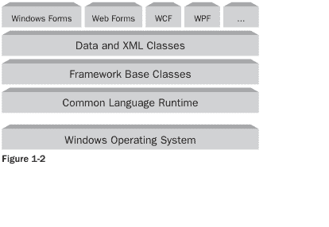

### 程序集与 Microsoft 中间语言（MSIL）

在 .NET 中，编译为 MSIL 字节码的应用程序存储在程序集中。程序集包含在一个或多个 PE（可移植可执行）文件中，并可能以 EXE 或 DLL 扩展名结尾。

程序集中包含的一些信息包括：

- **清单** — 有关程序集的信息，例如标识、名称、版本等。
- **版本控制** — 程序集的版本号。
- **元数据** — 描述程序集的类型和方法的信息。

> *程序集将在第 15 章中更详细地讨论。*

为了更好地了解 MSIL 文件及其内容，请看下面的示例，其中有两个控制台应用程序——一个用 C# 编写，另一个用 VB.NET 编写。

以下 C# 代码在控制台窗口中显示“Hello, World”字符串：

```csharp
using System;
using System.Collections.Generic;
using System.Linq;
using System.Text;

namespace HelloWorldCS
{
    class Program
    {
        static void Main(string[] args)
        {
            Console.WriteLine("Hello, World!");
            Console.ReadLine();
        }
    }
}
```

同样，以下 VB.NET 代码在控制台窗口中显示“Hello, World”字符串：

```vbnet
Module Module1

    Sub Main()
        Console.WriteLine("Hello, World!")
        Console.ReadLine()
    End Sub

End Module
```

两个程序编译后，每个程序的程序集都具有 .exe 扩展名。要查看每个程序集的内容，可以使用 il_dasm（MSIL 反汇编器）工具。

从 Visual Studio 2008 命令提示符窗口（开始 ⇨ 程序 ⇨ Microsoft Visual Studio 2008 ⇨ Visual Studio Tools ⇨ Visual Studio 2008 Command Prompt）启动 il_dasm 工具。

以下命令使用 il_dasm 工具查看 C# 和 VB.NET 程序的程序集：

```
C:\MSIL>il_dasm HelloWorldCS.exe
C:\MSIL>il_dasm HelloWorldVB.exe
```

图 1-3 分别展示了 C# 和 VB.NET 程序集的内容。

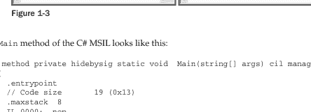

图 1-3

C# MSIL 的 Main 方法如下所示：

```
.method private hidebysig static void Main(string[] args) cil managed
{
.entrypoint
// Code size      19 (0x13)
.maxstack  8
IL_0000:  nop
IL_0001:  ldstr      "Hello, World!"
IL_0006:  call       void [mscorlib]System.Console::WriteLine(string)
IL_000b:  nop
IL_000c:  call       string [mscorlib]System.Console::ReadLine()
IL_0011:  pop
IL_0012:  ret
} // end of method Program::Main
```

.NET Framework 3.5 构建在 .NET Framework 2.0 和 3.0 版之上，因此它本质上包含以下组件：

- .NET Framework 2.0 和 .NET Framework 2.0 Service Pack 1
- .NET Framework 3.0 和 .NET Framework 3.0 Service Pack 1
- .NET 3.5 中的新功能

> .NET Framework 3.5 版依赖于 .NET 2.0 和 3.0。如果你的计算机安装了 .NET 1.0、1.1 和 2.0，那么这三个版本彼此完全独立。当你在一台未安装 .NET Framework 的计算机上安装 .NET 3.5 时，它会先安装 .NET 2.0，然后安装 .NET 3.0，最后安装 .NET 3.5 中新增的程序集。

图 1-4 总结了 .NET 2.0、3.0 和 3.5 之间的关系。

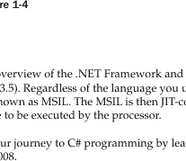

## 小结

本章简要概述了 .NET Framework 以及构成最新 .NET Framework（3.5）的各个版本。无论使用哪种语言，所有 .NET 应用程序都会编译为一种称为 MSIL 的字节码格式。然后，MSIL 在运行时由 CLR 进行 JIT 编译，以生成由处理器执行的本机代码。

在下一章中，你将通过学习使用 Visual Studio 2008 的开发环境，开始你的 C# 编程之旅。


## Visual Studio 2008 入门
Microsoft Visual Studio 2008 是一个极其通用且强大的 .NET 应用程序开发环境。本章将探讨你在开发工作中可能会用到的一些常用功能。由于自定义 Visual Studio 2008 的方式实际上有成百上千种，因此本章主要只能探讨 Visual Studio 中的默认设置。虽然其中涉及的某些主题会在后续章节中更详细地讨论，但你仍会希望快速浏览本章，以全面了解这个版本的 Visual Studio。

本章将探讨：
- IDE 的组成部分（菜单栏、工具栏、工具箱等）
- 代码和文本编辑器及其包含的功能，包括 IntelliSense 和重构支持
- 在 Visual Studio 2008 中使用调试器
- 在 Visual Studio 2008 中进行单元测试

## Visual Studio 2008 概述
2008 年初，Microsoft 发布了 Visual Studio 的最新版本——Visual Studio 2008。随之而来的还有众多针对不同类型开发人员设计的版本：
- Visual Web Developer 2008 Express Edition
- Visual Basic 2008 Express Edition
- Visual C# 2008 Express Edition
- Visual C++ 2008 Express Edition
- Visual Studio 2008 Standard Edition

## 第一部分：C# 基础
- Visual Studio 2008 Professional Edition
- Visual Studio 2008 Team System 2008 Architecture Edition
- Visual Studio 2008 Team System 2008 Database Edition
- Visual Studio 2008 Team System 2008 Development Edition
- Visual Studio 2008 Team System 2008 Test Edition
- Visual Studio 2008 Team System 2008 Team Suite

*有关各版本所提供功能的详细讨论，请查看以下 URL：http://msdn.microsoft.com/en-us/vs2008/products/cc149003.aspx。*

Express 版专为爱好者设计，可免费下载。这是开始使用 Visual Studio 2008 的绝佳方式，非常适合学生和初学者。不过，如果你是专业开发人员，则应购买标准版或专业版。请注意，如果你要开发 Windows Mobile 应用程序，则需要专业版（或更高版本）。如果你在大型开发环境中工作，并且需要在大型项目上与其他开发人员协作开发，请查看 Team System 版。

> *如果你还没有准备好购买 Visual Studio 2008，可以随时从 http://msdn.microsoft.com/en-us/vs2008/products/cc268305.aspx 下载 Visual Studio 2008 Professional 的 90 天试用版。*

## 选择开发设置
首次启动 Visual Studio 2008 时，需要选择默认环境设置。如果你大部分时间都将使用 C# 语言，请选择 Visual C# 开发设置（参见图 2-1）。选择此选项并不意味着你不能使用其他语言（例如 Visual Basic）；它只是意味着创建新项目时，C# 将列为默认项目类型。

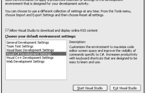

图 2-1

## 第一部分：C# 基础
- [ ] 将设置导出到文件，以便将其导出到另一台计算机
- [ ] 导入已保存的设置
- [ ] 重置所有设置

要重置为另一设置，请选中“重置所有设置”选项，然后单击“下一步”。在下一步中，你可以选择保存当前设置，或仅重置设置而不保存。选择该选项后，单击“下一步”，即可选择另一设置（参见图 2-4）。

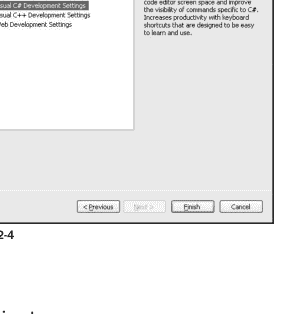

图 2-4

## 创建新项目
选择默认设置后，Visual Studio 2008 需要几分钟进行初始化。完成后，你将看到如图 2-5 所示的内容。

## 第 2 章：Visual Studio 2008 入门
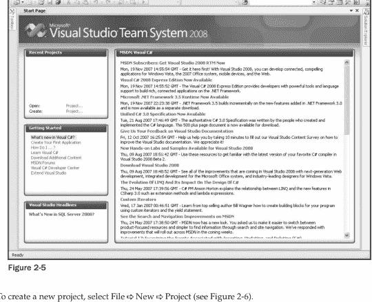

图 2-5

要创建新项目，请选择 文件 ⇨ 新建 ⇨ 项目（参见图 2-6）。

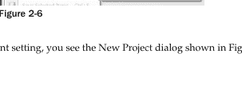

图 2-6

在 Visual C# 开发设置中，你将看到如图 2-7 所示的“新建项目”对话框。

## 第一部分：C# 基础
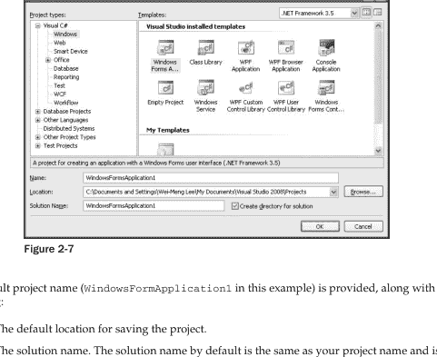

图 2-7

系统会提供默认项目名称（本例中为 WindowsFormApplication1），以及以下内容：
- 保存项目的默认位置。
- 解决方案名称。默认情况下，解决方案名称与项目名称相同，并会自动更改为与项目名称相同。不过，如果你希望解决方案名称与项目名称不同，也可以修改解决方案名称。
- 用于存储解决方案的单独目录；如果取消选中“为解决方案创建目录”复选框，则不会为项目创建解决方案。

你可以从“新建项目”对话框右上角的下拉列表中选择其他版本，以面向不同版本的 .NET Framework（参见图 2-8）。

> 记住：一个解决方案包含一个或多个项目。

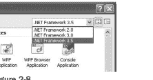

图 2-8

## IDE 的组成部分
图 2-9 显示了 Visual Studio 2008 开发环境的各个部分。

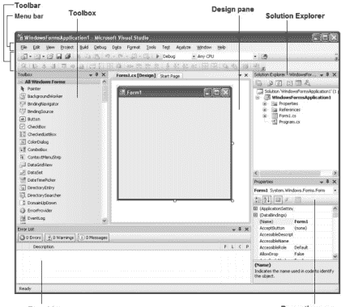

图 2-9

以下各节将介绍这些部分。

### 菜单栏
菜单栏包含标准的 Visual Studio 命令。例如，图 2-10 显示，“文件”菜单（参见图 2-10）包含可用于创建新项目、打开现有项目、保存当前窗体等的命令。

## 第一部分：C# 基础
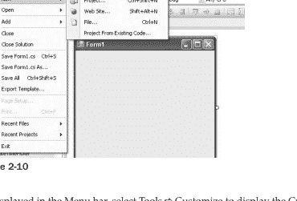

图 2-10

要自定义菜单栏中显示的项，请选择 工具 -> 自定义，以显示“自定义”对话框（参见图 2-11）。单击“命令”选项卡；左侧是主菜单项列表（操作、外接程序、分析等）。选择某个主菜单项后，右侧会显示可用的子菜单项列表。你可以通过将子菜单项拖放到所需的主菜单项上来重新排列它们。

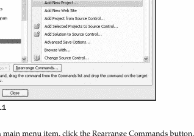

图 2-11

要向某个主菜单项添加新的子菜单项，请单击“重新排列命令”按钮。在“重新排列命令”对话框（参见图 2-12）中，选择要自定义的菜单，然后单击“添加”按钮。然后，你可以从不同类别中选择各种子菜单项添加到该菜单中。

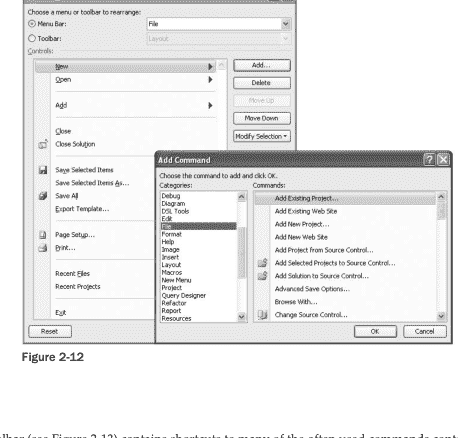

图 2-12

### 工具栏
工具栏（参见图 2-13）包含菜单栏中许多常用命令的快捷方式。


图 2-13

与菜单栏一样，工具栏也可以自定义。要添加其他工具栏，只需右键单击任何现有工具栏，然后从可用工具栏列表中选中要添加到 Visual Studio 的工具栏（参见图 2-14）。

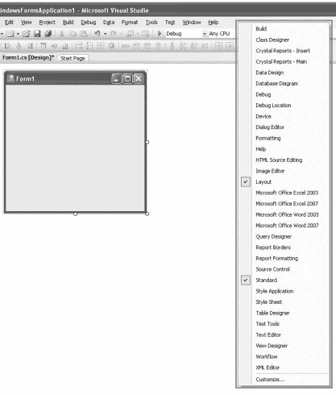

图 2-14

要自定义工具栏，请选择 工具 ➔ 自定义。在“自定义”对话框的“工具栏”选项卡（参见图 2-15）中，选中要添加到 Visual Studio 的工具栏。你可以通过单击“新建”按钮创建自己的自定义工具栏。

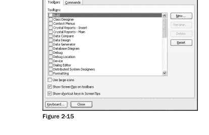

图 2-15

与菜单栏一样，你也可以重新排列每个工具栏中显示的项。要自定义工具栏中显示的项，请选择 工具 -> 自定义 打开“自定义”对话框，然后单击“重新排列命令”按钮。“重新排列命令”对话框允许你从每个工具栏中添加/删除项（参见图 2-16）。

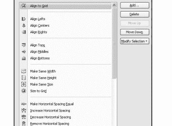

图 2-16


## 第一部分：C# 基础

工具栏区域中的每个工具栏也可以在 Visual Studio 中通过拖动工具栏左边缘的四点线（见图 2-17）并将其重新放置到所需的新位置来进行实际重新排列。

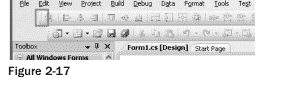

## 工具箱

工具箱（见图 2-18）包含可在应用程序中使用的所有控件。你可以将控件从工具箱拖放到应用程序的设计图面上。

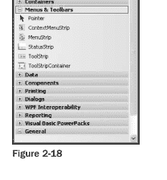

工具箱中的每个选项卡都包含与特定用途相关的控件。你可以创建自己的选项卡来容纳自己的控件。为此，请右键单击工具箱并选择“添加选项卡”。为新建的选项卡命名（见图 2-19）。

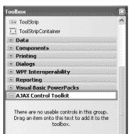

图 2-19

要向工具箱添加控件，请右键单击要将控件添加到的选项卡，然后选择“选择项”。此时将打开“选择工具箱项”对话框（见图 2-20）。

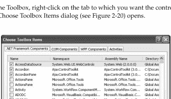

图 2-20

可以向工具箱添加以下类型的控件：

- .NET Framework 组件
- COM 组件
- WPF 组件
- 工作流活动

你也可以单击“浏览”按钮，找到包含你自己的自定义控件的 .dll 文件。

## 第一部分：C# 基础

向工具箱添加控件的另一种方法是，直接将包含控件的 DLL 拖放到工具箱上。

你可以通过拖动工具箱并将其重新放置到屏幕上的各个锚点来移动工具箱。图 2-21 显示了在 Visual Studio 2008 中拖动工具箱时显示的锚点。

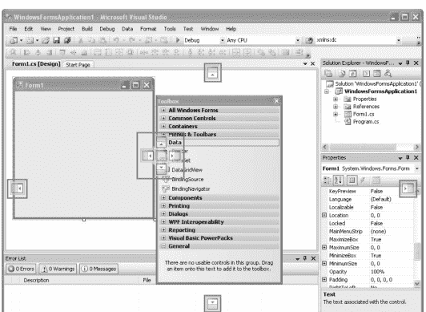

图 2-21

如果屏幕空间有限，你可能希望通过单击“自动隐藏”按钮来自动隐藏工具箱（见图 2-22）。

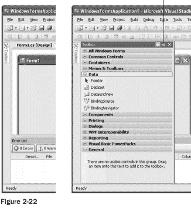

## 工具箱中缺少控件

有时，由于某些未知原因，工具箱中的控件可能会突然消失。通常的解决办法是右键单击工具箱并选择“重置工具箱”。大多数情况下这样都能奏效。但是，如果这样做不起作用，你可能需要执行以下操作：

导航到 `C:\Documents and Settings\<user_name>\Local Settings\Application Data\Microsoft\VisualStudio\9.0.`

此文件夹中有一些隐藏文件。只需删除以下文件：toolbox.tbd、toolboxIndex.tbd、toolbox_reset.tbd 和 toolboxIndex_reset.tbd。

然后重新启动 Visual Studio 2008。现在你的控件应该会恢复！

## 第一部分：C# 基础

### 解决方案资源管理器

“解决方案资源管理器”窗口包含项目中使用的所有文件和资源。一个解决方案包含一个或多个项目。图 2-23 显示了“解决方案资源管理器”中可用的各种按钮。

> “解决方案资源管理器”窗口中的按钮是上下文相关的，这意味着选择某些项时，部分按钮将不可见。例如，如果选择项目名称，则不会显示“查看代码”和“查看设计器”按钮。

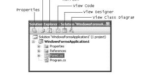

**图 2-23**

要向当前项目添加其他项（例如 Windows 窗体或类），请在“解决方案资源管理器”中右键单击项目名称，选择“添加”（见图 2-24），然后从列表中选择要添加的项。

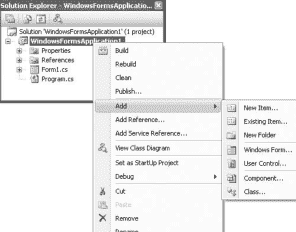

**图 2-24**

你还可以向当前解决方案添加新项目（或现有项目）。为此，请在“解决方案资源管理器”中右键单击解决方案名称，选择“添加”（见图 2-25），然后选择要添加的内容。

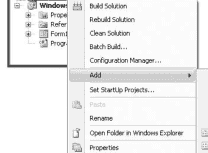

**图 2-25**

当解决方案中有多个项目时，其中一个项目将被设为启动项目（在“解决方案资源管理器”中以粗体显示的项目名称就是启动项目）。也就是说，当你按 F5 调试应用程序时，被设为启动项目的项目将被调试。要更改启动项目，请右键单击要设为启动项目的项目，然后选择“设为启动项目”（见图 2-26）。

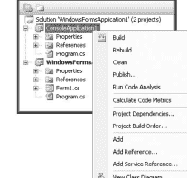

**图 2-26**

要在按 F5 键时同时调试多个项目，请将多个项目设为启动项目。为此，请在“解决方案资源管理器”中右键单击解决方案名称，然后选择“属性”。

选择“多个启动项目”选项（见图 2-27），并为每个项目设置适当的操作（“无”、“启动”或“启动而不调试”）。

## 第 I 部分：C# 基础

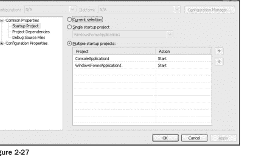

图 2-27

然后，当你按 F5 时，配置为启动的项目将同时启动。

## 属性

“属性”窗口显示与项目中的各种项（Windows 窗体、控件、项目、解决方案等）关联的属性列表。

图 2-28 显示了“属性”窗口正在显示一个 Windows 窗体（在此示例中为 Form1）的属性列表。默认情况下，属性以“分类视图”显示，但你可以将其更改为“字母顺序视图”，该视图按字母顺序列出所有属性。

分类视图

字母顺序视图

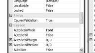


图 2-28

所有默认属性值都以常规字体显示，而非默认值以粗体显示。此功能对于调试非常有用，因为它使你能够快速追踪已更改的属性值。

除了显示项的属性外，“属性”窗口还显示事件。当“属性”窗口显示支持事件的项（例如 Windows 窗体或控件）时，你可以单击“事件”图标（见图 2-29 左侧）查看该项支持的事件列表。要为某个事件创建事件处理程序存根，只需双击该事件名称，Visual Studio 2008 就会自动为你创建一个事件处理程序（见图 2-29 右侧）。

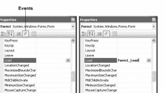

图 2-29

### 错误列表

“错误列表”窗口（见图 2-30）用于显示：

- 编辑和编译代码时产生的错误、警告和消息。
- IntelliSense 指出的语法错误。


图 2-30

## 第 I 部分：C# 基础

要显示“错误列表”窗口，请选择“视图” ⇔ “错误列表”。

你可以双击错误消息以打开源文件并定位错误的位置。

定位到错误后，按 F1 获取帮助。

## 输出窗口

“输出”窗口（“视图” ⇔ “输出”）在你在 Visual Studio 2008 中调试时显示应用程序的状态消息。“输出”窗口可用于显示应用程序中的调试消息。例如，你可以使用 Console.WriteLine() 语句向“输出”窗口显示消息：

```
Console.WriteLine(DateTime.Now.ToString());
```

图 2-31 显示了“输出”窗口中显示的消息。

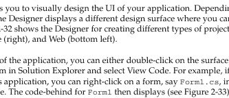

图 2-31

## 设计器窗口

“设计器”窗口使你能够以可视化方式设计应用程序的 UI。根据你创建的项目类型，“设计器”会显示不同的设计图面，你可以将控件拖放到该图面上。图 2-32 显示了用于创建不同类型项目的设计器——Windows 窗体（左）、Windows Mobile（右）和 Web（左下）。

要切换到应用程序的代码隐藏，你可以双击设计器图面，或在“解决方案资源管理器”中右键单击该项并选择“查看代码”。例如，如果你正在开发 Windows Forms 应用程序，可以在“解决方案资源管理器”中右键单击某个窗体（例如 Form1.cs），然后选择“查看代码”。随后将显示 Form1 的代码隐藏（见图 2-33）。


## 第 2 章：开始使用 Visual Studio 2008

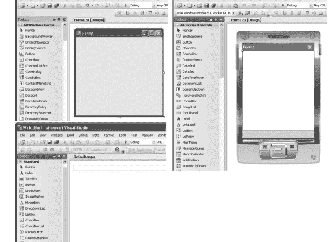

图 2-32

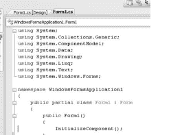

图 2-33

### 代码视图

代码视图是您编写应用程序代码的地方。您可以通过单击相关选项卡在设计视图和代码视图之间切换（参见图 2-34）。

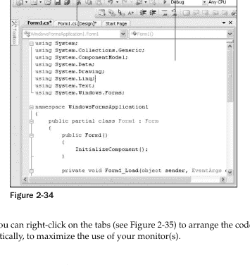

图 2-34

在 Visual Studio 中，您可以右键单击选项卡（参见图 2-35）以水平或垂直排列代码视图，以最大化使用您的显示器。


图 2-35

## 第 2 章：开始使用 Visual Studio 2008

图 2-36 显示代码视图和设计视图水平显示。

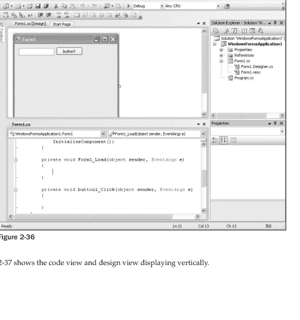

图 2-36

图 2-37 显示代码视图和设计视图垂直显示。

## 第 I 部分：C# 基础

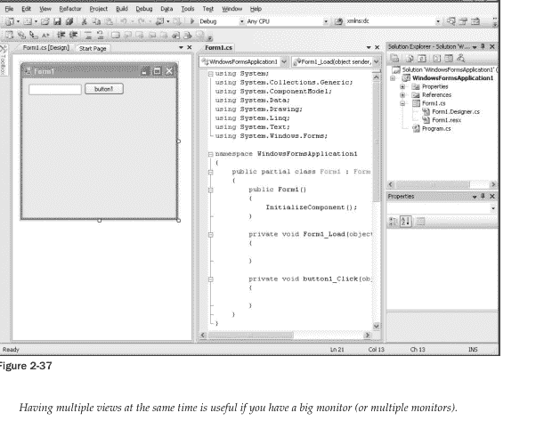

图 2-37

*同时拥有多个视图在您有大显示器（或多个显示器）时很有用。*

### 代码和文本编辑器

在 Visual Studio 2008 的代码视图中是代码和文本编辑器，它提供了多个丰富的特性，使编辑代码变得简单高效，包括：

- 代码片段
- IntelliSense 语句完成
- IntelliSense 对对象属性、方法和事件的支持
- 重构支持

### 代码片段

Visual Studio 2008 中的代码片段功能使您能够将常用的代码块插入到项目中，从而提高开发过程的效率。要插入代码片段，请在代码编辑器中右键单击要插入代码片段的位置，并选择插入片段（参见图 2-38）。

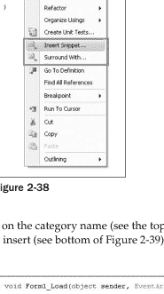

通过单击类别名称选择片段类别（参见图 2-39 顶部），然后选择要插入的代码片段（参见图 2-39 底部）。

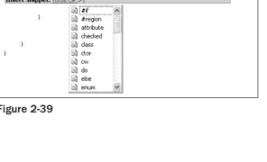

例如，假设您选择了 try 代码片段。以下代码块将被自动插入：

```
private void Form1_Load(object sender, EventArgs e)
{
    try
    {
    }
    catch (Exception)
    {
        throw;
    }
}
```

您还可以使用“使用...环绕”代码片段功能。假设您有以下语句：

```
private void Form1_Load(object sender, EventArgs e)
{
    int num1 = 5;
    int num2 = 0;
    int result = num1 / num2;
}
```

第三条语句很危险，因为它可能导致除零运行时错误，因此最好将代码包装在 try-catch 块中。为此，您可以突出显示要放入 try-catch 块中的代码块并右键单击它。选择“使用...环绕”（参见图 2-40），然后选择 try 代码片段。


图 2-40

您的代码现在如下所示：

```csharp
private void Form1_Load(object sender, EventArgs e)
{
    try
    {
        int num1 = 5;
        int num2 = 0;
        int result = num1 / num2;
    }
    catch (Exception)
    {
        throw;
    }
}
```

### IntelliSense

IntelliSense 是 Visual Studio 2008 中最有用的工具之一。IntelliSense 会在您在代码编辑器中输入时自动检测对象的属性、方法、事件等。您无需记住对象的确切成员名称，因为 IntelliSense 会通过动态为您提供相关成员列表来帮助您输入代码。

例如，当您在代码编辑器中输入单词 Console 后跟 . 时，IntelliSense 会显示与 Console 类相关的成员列表（参见图 2-41）。

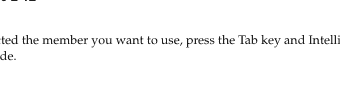

图 2-41

当您选择要使用的成员时，按 Tab 键，IntelliSense 将把该成员插入到您的代码中。

## 第 I 部分：C# 基础

Visual Studio 2008 中的 IntelliSense 有一些很好的增强功能。例如，IntelliSense 下拉列表在弹出时通常会遮挡后面的代码。现在，您可以通过按 Control 键使下拉列表暂时消失。图 2-42 显示了 IntelliSense 下拉列表遮挡其后面的代码（顶部）以及通过按 Control 键使其半透明（底部）。

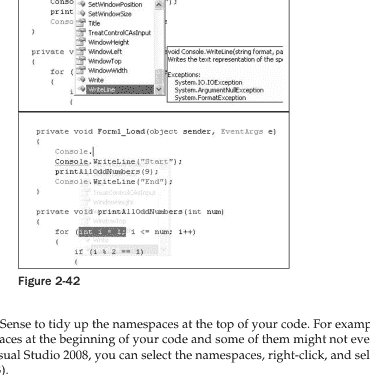

图 2-42

您还可以使用 IntelliSense 来整理代码顶部的命名空间。例如，您通常会在代码开头导入大量命名空间，其中一些可能永远不会被应用程序使用。在 Visual Studio 2008 中，您可以选择命名空间，右键单击并选择组织使用（参见图 2-43）。

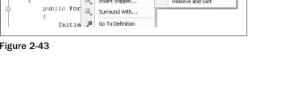

图 2-43

## 第 I 部分：C# 基础

您可以在更改应用于代码之前预览更改（参见图 2-46）。

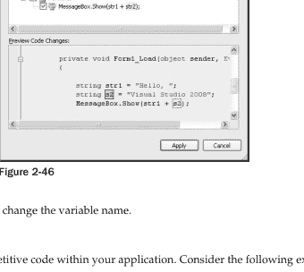

图 2-46

单击“应用”按钮以更改变量名称。

### 提取方法

通常，您会在应用程序中编写重复的代码。请考虑以下示例：

```
private void Form1_Load(object sender, EventArgs e)
{
    int num = 10, sum = 0;
    for (int i = 1; i <= num; i++)
    {
        sum += i;
    }
}
```

在这里，您将从 1 到 num 的所有数字相加，这是一个常见的操作。最好将此代码块打包成一个函数。因此，突出显示代码（参见图 2-47），右键单击它，并选择重构 ⇒ 提取方法。

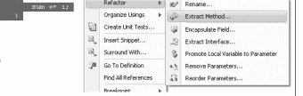

图 2-47

## 第 I 部分：C# 基础

如果在重构中排除变量 height 的声明（而不是选择全部三行；参见图 2-49）并将新方法命名为 VolumeofCylinder，则会创建一个具有两个参数的方法：

```
private void Form1_Load(object sender, EventArgs e)
{
    Single radius = 3.5f;
    Single height = 5;
    double volume = VolumeofCylinder(radius, height);
}
```

```
private static double VolumeofCylinder(Single radius, Single height)
{
    return Math.PI * Math.Pow(radius, 2) * height;
}
```

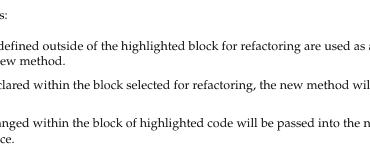

图 2-49

以下是一些观察结果：

- 在重构中突出显示的块之外定义的变量将用作新方法中的输入参数。
- 如果变量在选定用于重构的块内声明，则新方法将没有签名。
- 在突出显示的代码块内更改的值将通过引用传递到新方法中。

### 重新排序和删除参数

您可以使用代码重构来重新排序函数中的参数。请考虑来自前一个示例的以下函数：

```
private static double VolumeofCylinder(Single radius, Single height)
{
    return Math.PI * Math.Pow(radius, 2) * height;
}
```

突出显示函数签名，右键单击它，并选择重构 ⇒ 重新排序参数（参见图 2-50）。

## 第 2 章：开始使用 Visual Studio 2008

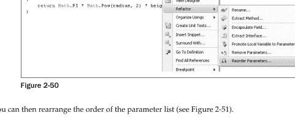

图 2-50

然后您可以重新排列参数列表的顺序（参见图 2-51）。

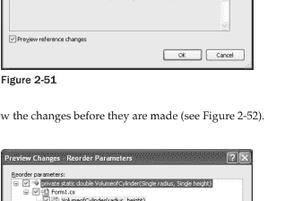

图 2-51

单击“确定”。您可以在更改之前预览更改（参见图 2-52）。

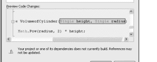

图 2-52

## 第 I 部分：C# 基础

一旦单击“应用”按钮，您的代码就会自动更改：

```csharp
private void Form1_Load(object sender, EventArgs e)
{
    Single radius = 3.5f;
    Single height = 5;
    double volume = VolumeofCylinder(height, radius);
}
```

```csharp
private static double VolumeofCylinder(Single height, Single radius)
{
    return Math.PI * Math.Pow(radius, 2) * height;
}
```

所有调用已修改函数的语句都将自动更改其参数顺序。

您还可以通过突出显示函数签名、右键单击并选择重构 ⇨ 删除参数来从函数中删除参数。然后删除您想要删除的参数（参见图 2-53）。所有调用已修改函数的语句都将自动更改其调用。

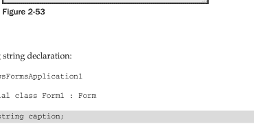

图 2-53

### 封装字段

请考虑以下字符串声明：

```csharp
namespace WindowsFormsApplication1
{
    public partial class Form1 : Form
    {
        public string caption;

        private void Form1_Load(object sender, EventArgs e)
        {
            //...
        }
    }
}
```


## 第 2 章：开始使用 Visual Studio 2008

相对于将 caption 变量公开为 public，更好的做法是将其封装为属性并使用 set 和 get 访问器来访问它。为此，右键单击 caption 变量并选择 Refactor ⇔ Encapsulate Field（参见图 2-54）。

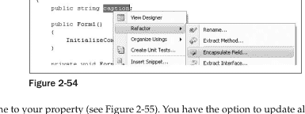

图 2-54

为您的属性指定一个名称（参见图 2-55）。您可以选择更新所有外部引用或所有引用（包括类内部的引用），并且可以选择预览引用更改。准备就绪后，单击“确定”。

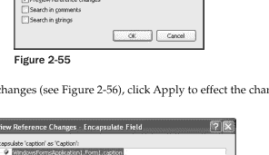

图 2-55

在预览更改（参见图 2-56）后，单击“应用”以使更改生效。

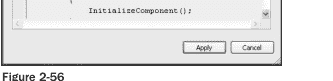

图 2-56

## 第 I 部分：C# 基础

应用更改后的结果如下：

```csharp
namespace WindowsFormsApplication1
{
    public partial class Form1 : Form
    {
        private string caption;

        public string Caption
        {
            get { return caption; }
            set { caption = value; }
        }

        private void Form1_Load(object sender, EventArgs e)
        {
            //...
        }
    }
}
```

## 提取接口

您可以使用重构引擎从类定义中提取接口。请考虑以下 Contact 类：

```csharp
namespace WindowsFormsApplication1
{
    class Contact
    {
        public string FirstName
        {
            get;
            set;
        }
        public string LastName
        {
            get;
            set;
        }
        public string Email
        {
            get;
            set;
        }
        public DateTime DOB
        {
            get;
            set;
        }
    }
}
```

## 第 2 章：开始使用 Visual Studio 2008

右键单击 Contact 类名并选择 Refactor ⇒ Extract Interface（参见图 2-57）。


图 2-57

提取接口对话框打开，您可以选择各个公共成员来形成接口（参见图 2-58）。


图 2-58

新接口保存在新的 .cs 文件中。在此示例中，文件名是 IContact.cs：

```csharp
using System;
namespace WindowsFormsApplication1
{
    interface IContact
    {
        DateTime DOB { get; set; }
        string Email { get; set; }
        string FirstName { get; set; }
        string LastName { get; set; }
    }
}
```

## 第 I 部分：C# 基础

原始 Contact 类定义现已更改为实现新创建的接口：

```
class Contact : WindowsFormsApplication1.IContact
{
    public string FirstName
    ...
}
```

## 提升局部变量为参数

您可以将局部变量提升为参数。以下是一个示例：

```
private void Form1_Load(object sender, EventArgs e)
{
    LogError("File not found.");
}

private void LogError(string message)
{
    string SourceFile = "Form1.cs";
    Console.WriteLine(SourceFile + ": " + message);
}
```

您希望将变量 SourceFile 提升为参数，以便此函数的调用者可以通过参数传递其值。为此，选择变量 SourceFile，右键单击，然后选择 Refactor -> Promote Local Variable to Parameter（参见图 2-59）。


图 2-59

请注意，要提升的局部变量必须已初始化，否则会发生错误。提升后的变量现在位于参数列表中，并且对其的调用也相应更新：

```
private void Form1_Load(object sender, EventArgs e)
{
    LogError("File not found.", "Form1.cs");
}
```

```
private void LogError(string message, string SourceFile)
{
    Console.WriteLine(SourceFile + ": " + message);
}
```

## 调试

调试是开发周期中的重要部分。自然地，Visual Studio 2008 包含调试工具，可让您观察程序的运行时行为。本节将介绍这些工具。

假设您有以下程序：

```csharp
using System;
using System.Windows.Forms;

namespace WindowsFormsApplication1
{
    public partial class Form1 : Form
    {
        public Form1()
        {
            InitializeComponent();
        }

        private void Form1_Load(object sender, EventArgs e)
        {
            Console.WriteLine("Start");
            printAllOddNumbers(9);
            Console.WriteLine("End");
        }

        private void printAllOddNumbers(int num)
        {
            for (int i = 1; i <= num; i++)
            {
                if (i % 2 == 1)
                {
                    Console.WriteLine(i);
                }
            }
        }
    }
}
```

以下各节展示了如何向应用程序插入断点，以便在运行时调试应用程序。

## 设置断点

若要在应用程序中设置断点，在 Visual Studio 2008 代码编辑器中，单击要在其处设置断点的语句旁边的左侧列（参见图 2-60）。

## 第 I 部分：C# 基础


图 2-60

按 F5 调试应用程序。当执行到达设置了断点的语句时，Visual Studio 2008 会暂停应用程序并显示断点（参见图 2-61）。


图 2-61

## 逐步执行代码

当应用程序在断点处停止时，您可以选择执行以下操作：

- **Step Into** — 按 F11（参见图 2-62）。逐步进入代码意味着如果断点语句是函数调用，则执行将转移到函数中的第一条语句，您可以一次逐步执行一条语句。
- **Step Over** — 按 F10。逐步执行代码意味着如果断点语句是函数调用，则整个函数将被执行，控制权将转移到函数之后的下一条语句。
- **Step Out** — 按 Shift+F11 逐步退出代码（Step Out）。如果断点处的语句是函数的一部分，则执行将恢复直到函数退出。控制权将转移到调用函数中的返回点。

Step Into 和 Step Over 基本上是相同的，只是执行函数时有所不同。


当您在断点处逐步执行代码（使用 F10 或 F11）时，您还可以通过将鼠标悬停在要检查的对象上来检查变量的值。图 2-63 显示了当鼠标悬停在 i 上时 i 的值。


## 监视

您还可以右键单击要监视的对象并选择“添加监视”或“快速监视”（参见图 2-64）。


图 2-64

当您使用“添加监视”功能时，您正在监视的变量将显示在“监视”窗口中（参见图 2-65）。在逐步执行代码时，变量的变化会反映在“监视”窗口中。此外，您还可以直接在“监视”窗口中更改变量的值。


图 2-65

“快速监视”功能也使您能够监视变量的值，只是执行不能继续，直到您关闭“快速监视”窗口（参见图 2-66）。您还可以输入要计算的表达式，同时将变量添加到“添加监视”窗口。


图 2-66

## 第 I 部分：C# 基础

本节演示如何在 Visual Studio 2008 中执行单元测试。使用位于类库项目中的以下 Point 类定义：

```csharp
using System;
using System.Collections.Generic;
using System.Linq;
using System.Text;

namespace UnitTesting
{
    class Point
    {
        public Point() { }
        public Point(int x, int y)
        {
            this.x = x;
            this.y = y;
        }

        public int x { get; set; }
        public int y { get; set; }

        //---calculates the length between 2 points
        public double length(Point pointOne)
        {
            return Math.Sqrt(
                Math.Pow(this.x - pointOne.x, 2) +
                Math.Pow(this.y - pointOne.y, 2));
        }
    }
}
```

## 创建测试

对于此示例，创建一个单元测试来测试 length() 方法。为此，右键单击 length() 方法并选择“创建单元测试”（参见图 2-69）。


图 2-69


在“创建单元测试”对话框中，选择要测试的任何其他附加成员，然后单击“确定”（见图 2-70）。


图 2-70

系统会提示你为测试项目命名。使用默认的 TestProject1，然后单击“创建”。可能还会弹出图 2-71 所示的对话框。单击“是”。


图 2-71

TestProject1 被添加到解决方案资源管理器（见图 2-72）。


图 2-72

## 第一部分：C# 基础

现在，PointTest.cs 类的内容显示在 Visual Studio 2008 中。该类包含可用于测试 Point 类的各种方法。请特别注意 lengthTest() 方法：

```csharp
/// <summary>
/// A test for length
/// </summary>
[TestMethod()]
public void lengthTest()
{
    Point target = new Point(); // TODO: Initialize to an appropriate value
    Point pointOne = null; // TODO: Initialize to an appropriate value
    double expected = 0F; // TODO: Initialize to an appropriate value
    double actual;
    actual = target.length(pointOne);
    Assert.AreEqual(expected, actual);
    Assert.Inconclusive("Verify the correctness of this test method.");
}
```

lengthTest() 方法前面有 [TestMethod] 特性。带有该特性的方法称为测试方法。

现在修改 lengthTest() 方法的实现，基本上就是创建并初始化两个 Point 对象，然后调用 Point 类的 length() 方法计算两点之间的距离：

```csharp
/// <summary>
/// A test for length
/// </summary>
[TestMethod()]
public void lengthTest()
{
    int x = 3;
    int y = 4;
    
    Point target = new Point(x, y);
    Point pointOne = new Point(0,0);
    double expected = 5F;
    double actual;
    actual = target.length(pointOne);
    Assert.AreEqual(expected, actual, "UnitTesting.Point.length did not return the expected value.");
}
```

当 length() 方法返回结果后，使用 Assert 类的 AreEqual() 方法将返回值与预期值进行比较。如果预期值与返回结果不匹配，则显示在 AreEqual() 方法中设置的错误消息。

### 运行测试

在运行单元测试之前，请查看 Visual Studio 2008 中自动显示的“测试工具”工具栏（见图 2-73）。


图 2-73

要运行单元测试，请单击工具栏中的“运行解决方案中的所有测试”按钮。在本例中，lengthTest() 方法通过了测试。两点 (3,4) 和 (0,0) 之间的距离确实是 5（见图 2-74）。


图 2-74

可以修改 lengthTest() 方法来测试其他参数。在“测试结果”窗口中，可以选择查看以前的测试结果（见图 2-75）。


图 2-75

### 使用浮点数测试

当测试涉及比较浮点数时，需要特别注意。请考虑以下示例：

```csharp
[TestMethod()]
public void lengthTest()
{
    int x = 4;
    int y = 5;

    Point target = new Point(x, y);
    Point pointOne = new Point(1,2);
    double expected = 4.24264F;
    double actual;
    actual = target.length(pointOne);
    Assert.AreEqual(expected, actual,
        "UnitTesting.Point.length did not return the expected value.");
}
```

运行测试时，测试将失败（见图 2-76）。


为什么会这样？原因是浮点数（例如 `Single` 和 `Double`）并不完全按照赋给它们的值存储。例如，在本例中，4.24264 的值在内部存储为 4.2426400184631348，而 `length()` 方法返回的结果实际是 4.2426406871192848。如果直接比较它们，`AreEqual()` 方法实际上会失败。

为解决此问题，`AreEqual()` 方法支持第三个参数——`delta`——它指定所比较两个数允许的最大差值。在本例中，两个数之间的差值为 0.00000066865615。因此，以下代码将通过测试：

```csharp
Assert.AreEqual(expected, actual, 0.00000066865616,
    "UnitTesting.Point.length did not return the expected value.");
```

但以下代码将失败：

```csharp
Assert.AreEqual(expected, actual, 0.00000066865615,
    "UnitTesting.Point.length did not return the expected value.");

Assert.AreEqual(expected, actual, 0.00000066865614,
    "UnitTesting.Point.length did not return the expected value.");
```

尽管文档说 delta 指定两个数允许的最大差值，但在实际测试中，差值应小于 delta，Assert.AreEqual() 方法才能通过。这就解释了为什么第一条语句会失败。

### 添加其他测试方法

你可以通过向 PointTest.cs 文件添加新的子例程，并在其前面加上 [TestMethod] 特性，来插入其他测试方法。例如，以下测试方法使用 Assert 类的 AreSame() 方法检查两个对象是否指向同一引用：

```csharp
[TestMethod()]
public void objectTest()
{
    Point point1 = new Point(4, 5);
    Point point2 = new Point() { x = 4, y = 5 };
    Point point3 = point2;

    //---Failed---
    Assert.AreSame(point1, point2, "point1 is not the same as point2");

    //---Passed---
    Assert.AreSame(point2, point3, "point2 is not the same as point3");
}
```

图 2-77 显示了测试结果。


图 2-77

### 小结

本章简要概述了 Visual Studio 2008 中可用的常用功能和工具。Visual Studio 2008 具有高度可配置性，因此你需要花些时间熟悉环境。如果你完全不了解 C#，像代码重构和单元测试这样的某些 Visual Studio 功能现在可能对你来说没那么重要，但一旦你掌握了一些 C# 知识，就会想再仔细看看这些功能。

当你准备好后，下一章将带你开始用 C# 编写代码。

## C# 语言基础

开始学习一门新编程语言的最佳方法是创建一个简单程序，然后检查组成它的各个部分。基于这一原则，你将创建一个简单的 C# 程序——首先使用 Visual Studio 2008，然后使用纯文本编辑器。

本章将使用 Visual Studio 2008 以及命令行构建并运行 HelloWorld 应用程序。之后，你将处理 C# 语言的语法和所有重要主题，例如：

- C# 关键字
- 变量
- 常量
- 注释
- XML 文档
- 数据类型
- 流程控制
- 循环
- 运算符
- 预处理器指令

### 使用 Visual Studio 2008

创建第一个 C# 程序最简单的方法是使用 Visual Studio 2008。

### Visual Studio 2008 的版本

可以使用以下任一版本的 Visual Studio 2008 创建 C# 程序：

- Visual C# 2008 速成版
- Visual Studio 2008 标准版
- Visual Studio 2008 专业版
- Visual Studio 2008 团队套件版

本书中显示的所有代码示例和屏幕截图均使用 Visual Studio 2008 专业版测试。

- 1. 启动 Visual Studio 2008。
- 2. 选择“文件”⇒“新建”⇒“项目”，创建一个新的控制台应用程序项目。
- 3. 展开对话框左侧的“Visual C#”项，然后选择“Windows”。接着，在右侧选择“控制台应用程序”模板（见图 3-1）。将项目命名为 HelloWorld。


图 3-1


## 第3章：C# 语言基础

- 4. 单击“确定”。图3-2显示了控制台应用程序的骨架。


图3-2

- 5. 将以下突出显示的代码键入 Main() 方法，如下所示：

```csharp
using System;
using System.Collections.Generic;
using System.Linq;
using System.Text;

namespace HelloWorld
{
    class Program
    {
        static void Main(string[] args)
        {
            Console.WriteLine("Hello, world! This is my first C# program!");
            Console.ReadLine();
            return;
        }
    }
}
```

- 6. 若要调试应用程序并查看其执行时的样子，请在 Visual Studio 2008 中按 F5。图3-3显示了控制台窗口中的输出。


图3-3

要返回 Visual Studio 2008，请按 Enter 键，控制台窗口将消失。

### 使用 C# 编译器 (csc.exe)

除了使用 Visual Studio 2008 编译并运行应用程序之外，你还可以使用 Visual Studio 2008 生成应用程序，并使用 C# 编译器 (csc.exe) 手动编译，然后运行应用程序。对于由一组程序员处理应用程序不同部分的大型项目，此选项很有用。

或者，如果你更喜欢使用文本编辑器编写 C# 程序，可以使用每台 Windows 计算机都包含的记事本（程序 ⇒ 附件 ⇒ 记事本）应用程序。（但请注意，使用记事本无法访问 IntelliSense 功能，该功能仅在 Visual Studio 2008 中可用。）

- 1. 使用记事本创建一个文本文件，将其命名为 HelloWorld.cs，并保存到硬盘上的某个文件夹中，例如 C:\C#。
- 2. 用以下内容填充 HelloWorld.cs：

```csharp
using System;
using System.Collections.Generic;
using System.Linq;
using System.Text;

namespace HelloWorld
{
    class Program
    {
        static void Main(string[] args)
        {
            Console.WriteLine("Hello, world! This is my first C# program!");
            Console.ReadLine();
            return;
        }
    }
}
```

- 3. 使用随 Visual Studio 2008 提供的命令行 C# 编译器 (csc.exe) 编译程序。调用 csc.exe 最简单的方法是使用 Visual Studio 2008 命令提示符，它已为你添加所有路径引用。
- 4. 要启动 Visual Studio 2008 命令提示符，请选择 开始 ⇒ 程序 ⇒ Microsoft Visual Studio 2008 ⇒ Visual Studio 工具 ⇒ Visual Studio 2008 命令提示符。
- 5. 在命令提示符中，切换到包含该 C# 程序的目录（本例中为 C:\C#），然后键入以下命令（见图3-4）：

```
C:\C#> csc HelloWorld.cs
```


图3-4

- 6. 程序编译完成后，你会在同一目录 (C:\C#) 中找到 HelloWorld.exe 可执行文件。键入以下内容以执行应用程序（见图3-5）：

```
C:\C#> HelloWorld
```


图3-5

- 7. 要返回命令提示符，请按 Enter 键。

### 剖析程序

既然你已经编写了第一个 C# 程序，让我们花点时间剖析它，并理解其中一些重要的部分。

前几行指定了各种命名空间：

```
using System;
using System.Collections.Generic;
using System.Linq;
using System.Text;
```

如第1章所述，.NET Framework 中的所有类库都使用命名空间进行分组。在 C# 中，使用 using 关键字来指示你将使用指定命名空间中的库类。在本例中，你使用 Console 类的 WriteLine() 方法将消息写入控制台。Console 类属于 System 命名空间，如果程序顶部没有 using System 语句，则需要指定 Console 的完全限定名，即：

```
System.Console.WriteLine("Hello, world! This is my first C# program!");
```

下一个需要关注的关键字是 namespace。它允许你为类分配命名空间，在本例中是 HelloWorld：

```
namespace HelloWorld
{
    class Program
    {
        static void Main(string[] args)
        {
            Console.WriteLine("Hello, world! This is my first C# program!");
            Console.ReadLine();
            return;
        }
    }
}
```

接下来，你将类名定义为 Program：

```
class Program
{
    static void Main(string[] args)
    {
        Console.WriteLine("Hello, world! This is my first C# program!");
        Console.ReadLine();
        return;
    }
}
```

所有 C# 代码都必须包含在类中。由于这个类位于 HelloWorld 命名空间中，它的完全限定名是 HelloWorld.Program。

*类和对象将在第4章详细讨论。*

在 Program 类中，有 Main() 方法：

```csharp
class Program
{
    static void Main(string[] args)
    {
        Console.WriteLine("Hello, world! This is my first C# program!");
        Console.ReadLine();
        return;
    }
}
```

每个 C# 程序都必须有一个入口点，在本例中是 Main()。入口点是应用程序启动时最先执行的方法。static 关键字表示无需创建类的实例即可调用此方法。

*第4章和第5章将提供有关面向对象编程的更多信息。*

与 VB.NET 等语言不同（在那些语言中，方法可以是函数或子例程：函数返回值；子例程不返回值），C# 仅支持函数。如果函数不返回结果，只需在函数名前加上 void 关键字；否则，通过指定类型来指示返回类型。

*你将在第4章了解更多关于函数的内容。*

最后，你在 Main() 方法中编写语句：

```csharp
static void Main(string[] args)
{
    Console.WriteLine("Hello, world! This is my first C# program!");
    Console.ReadLine();
    return;
}
```

Console 类的 WriteLine() 方法将字符串写入命令提示符。请注意，在 C# 中，每条语句都以分号 (;) 结尾，这向编译器指示每条语句的结束。因此，你可以像这样重写 WriteLine() 语句：

```csharp
Console.WriteLine(
    "Hello, world! This is my first C# program!"
);
```

当语句很长，并且需要将其格式化以适应多行以便阅读时，这很有用。

ReadLine() 语句用于接受用户输入。这里使用该语句主要是为了保持命令窗口可见。如果在 Visual Studio 2008 中运行此程序而不使用 ReadLine() 方法，程序将打印 hello world 语句，然后立即关闭窗口。

### 向 Main() 传递参数

如果像本章前面所述那样在命令提示符中运行程序，你可以向应用程序传入参数。例如，你可能希望程序显示你的名字。为此，像这样传入名字：

```
C:\C#> HelloWorld Wei-Meng Lee
```

传入程序的参数可以通过 Main() 方法中定义的 args 参数（一个字符串数组）访问。因此，你需要修改程序以显示 args 字符串数组中包含的值，如下所示：

```csharp
using System;
using System.Collections.Generic;
using System.Linq;
using System.Text;

namespace HelloWorld
{
    class Program
    {
        static void Main(string[] args)
        {
            Console.Write("Hello, ");
            for (int i = 0; i < args.Length; i++)
                Console.Write("{0} ",args[i]);
            Console.Write("! This is my first C# program!");

            Console.ReadLine();
            return;
        }
    }
}
```

*第8章将深入介绍字符串数组。*

### 语言语法

C# 是一种区分大小写的语言，极具表现力，而且易学易用。以下各节描述该语言的各种语法。

### 关键字

在任何编程语言中，总有一组对编译器具有特殊含义的标识符。这些标识符称为关键字，你不应将它们用作程序中的标识符。


以下是 C# 2008 中的关键字列表：

| | | | |
|---|---|---|---|
| abstract | event | new | struct |
| as | explicit | null | switch |
| base | extern | object | this |
| bool | false | operator | throw |
| break | finally | out | true |
| byte | fixed | override | try |
| case | float | params | typeof |
| catch | for | private | uint |
| char | foreach | protected | ulong |
| checked | goto | public | unchecked |
| class | if | readonly | unsafe |
| const | implicit | ref | ushort |
| continue | in | return | using |
| decimal | int | sbyte | virtual |
| default | interface | sealed | volatile |
| delegate | internal | short | void |
| do | is | sizeof | while |
| double | lock | stackalloc | |
| else | long | static | |
| enum | namespace | string | |

## 变量

在 C# 中，你使用以下格式声明变量：

```
datatype identifier;
```

以下示例声明并使用了四个变量：

```
class Program
{
    static void Main(string[] args)
    {
        //---declare the variables---
        int num1;
        int num2 = 5;
        float num3, num4;

        //---assign values to the variables---
        num1 = 4;
        num3 = num4 = 6.2f;

        //---print out the values of the variables---
        Console.WriteLine("{0} {1} {2} {3}", num1, num2, num3, num4);
        Console.ReadLine();
        return;
    }
}
```

## 第一部分：C# 基础

请注意以下事项：

- num1 被声明为 int（整数）。
- num2 被声明为 int 并同时赋了一个值。
- num3 和 num4 被声明为 float（浮点数）
- 你需要在使用变量之前声明它。否则，C# 编译器会将其标记为错误。
- 你可以在同一语句中为多个变量赋值，正如 num3 和 num4 的赋值所示。

此示例将输出以下内容：

```
4 5 6.2 6.2
```

以下声明也是允许的：

```
//--declares both num5 and num6 to be float
// and assigns 3.4 to num5--
float num5 = 3.4f, num6;
```

但以下声明是不允许的：

```
//--cannot mix different types in a declaration statement--
int num7, float num8;
```

变量名不能是 C# 关键字之一。如果必须使用关键字作为变量名，则需要用 @ 字符作为前缀，如以下示例所示：

```
int @new = 4;
Console.WriteLine(@new);
```

## 变量的作用域

在 C# 中声明的变量的作用域（即其可见性和可访问性）受变量声明位置的影响。考虑以下示例，其中变量 num 在 Program 类中声明：

```
using System;
using System.Collections.Generic;
using System.Linq;
using System.Text;

namespace HelloWorld
{
    class Program
    {
        static int num = 7;

        static void Main(string[] args)
        {
            Console.WriteLine("num in Main() is {0}", num); //---7---
            HelloWorld.Program.Method1();

            Console.ReadLine();
            return;
        }
        static private void Method1()
        {
            Console.WriteLine("num in Method1() is {0}", num); //---7---
        }
    }
}
```

因为 num 变量在类中声明，所以它对类中声明的所有方法都是可见的（即全局的），你会看到以下输出：

```
num in Main() is 7
num in Method1() is 7
```

## 第一部分：C# 基础

然而，如果你在 Main() 和 Method1() 中声明另一个同名变量（num），如下所示：

```csharp
using System;
using System.Collections.Generic;
using System.Linq;
using System.Text;

namespace HelloWorld
{
    class Program
    {
        static int num = 7;

        static void Main(string[] args)
        {
            int num = 5;
            Console.WriteLine("num in Main() is {0}", num); //---5---
            HelloWorld.Program.Method1();

            Console.ReadLine();
            return;
        }

        static private void Method1()
        {
            int num = 10;
            Console.WriteLine("num in Method1() is {0}", num); //---10---
        }
    }
}
```

你会得到完全不同的输出：

num in Main() is 5
num in Method1() is 10

这是因为 Main() 和 Method1() 中的 num 变量有效地隐藏了 Program 类中的 num 变量。在这种情况下，Program 类中的 num 被称为全局变量，而 Main 和 Method1 中的 num 变量被称为局部变量。Main() 中的 num 变量仅在 Main() 内可见。同样，这也适用于 Method1() 中的 num 变量。

如果你需要访问在 Program 类中声明的 num 呢？在这种情况下，你只需指定其全名：

```
Console.WriteLine("num in Program is {0}", HelloWorld.Program.num); //---7---
```

虽然局部变量可以隐藏全局变量的作用域，但你不能有两个作用域相同且名称相同的变量。以下内容对此进行了说明：

```csharp
static void Main(string[] args)
{
    int num = 5;
    Console.WriteLine("num in Main() is {0}", num); //---5---
    int num = 6; //---error: num is already declared---
    return;
}
```

然而，不同作用域中名称相同的两个变量是合法的，如下所示：

```csharp
static void Main(string[] args)
{
    for (int i = 0; i < 5; i++)
    { //---i is visible within this loop only---
        Console.WriteLine(i);
    } //---i goes out of scope here---
    for (int i = 0; i < 3; i++)
    { //---i is visible within this loop only---
        Console.WriteLine(i);
    } //---i goes out of scope here---
    Console.ReadLine();
    return;
}
```

这里，变量 i 出现在两个 for 循环中（循环将在本章后面介绍）。每个 i 的作用域仅限于循环内部，因此作用域之间没有冲突，这是允许的。

在循环外部或内部声明另一个名为 i 的变量将导致编译错误，如以下示例所示：

```csharp
static void Main(string[] args)
{
    int i = 4; //---error---
    for (int i = 0; i < 5; i++)
    {
        int i = 6; //---error---
        Console.WriteLine(i);
    }
    for (int i = 0; i < 3; i++)
    {
        Console.WriteLine(i);
    }
    Console.ReadLine();
    return;
}
```

## 第一部分：C# 基础

这段代码会导致错误：“在此作用域中无法声明名为 ‘i’ 的局部变量，因为它会给 ‘i’ 一个不同的含义，而 ‘i’ 已在‘父级或当前’作用域中用于表示其他内容。”

## 常量

要在 C# 中声明常量，你使用 const 关键字，如下所示：

```
//---declared the PI constant---
const float PI=3.14f;
```

一旦常量被声明并赋了值（在运行时），你就不能更改其值。

作为良好的编程实践，只要使用在运行时不会改变的值，就应始终使用常量。

## 注释

在 C# 中，你可以使用 // 或成对的 /* 和 */ 在程序中插入注释。
以下示例展示了如何使用 // 在程序中插入注释：

```
//---declare the variables---
int num1;                  //---num1 variable---
int num2 = 5;              //---num2 variable---
float num3, num4;          //---num3 and num4 variables---
```

以下是如何在程序中插入多行注释块的示例：

/*
    Declares the following variables:
    num1, num2, num3, num4
*/

int num1;
int num2 = 5;
float num3, num4;
```
通常，使用 // 进行简短的单行注释，使用 /* */ 进行多行注释。

## XML 文档

Visual Studio 2008 中非常酷的功能之一是对 XML 文档的支持。
此功能使你能够使用 XML 元素向代码中插入注释，然后生成包含所有文档的单独 XML 文件。然后你可以将 XML 文件转换为代码的专业外观文档。


## 第3章：C# 语言基础

要将 XML 注释插入代码中，请将光标置于类名或方法名之前，然后键入三个 / 字符（图 3-6 中的左窗口）。系统会自动为你插入 XML 模板（参见图 3-6 中的右窗口）。


图 3-6

以下代码展示了为 Program 类、Main() 方法和 AddNumbers() 方法创建的 XML 文档模板（你需要为每个元素填写描述）：

```csharp
using System;
using System.Collections.Generic;
using System.Linq;
using System.Text;

namespace HelloWorld
{
    /// <summary>
    /// This is my first C# program.
    /// </summary>
    class Program
    {
        /// <summary>
        /// The entry point for the program
        /// </summary>
        /// <param name="args">Argument(s) from the command line</param>
        static void Main(string[] args)
        {
            Console.Write("Hello, ");
            for (int i = 0; i < args.Length; i++)
            {
                Console.Write("{0} ", args[i]);
            }
            Console.Write("! This is my first C# program!");
            Console.ReadLine();
            return;
        }

        /// <summary>
        /// Adds two numbers and returns the result
        /// </summary>
        /// <param name="num1">Number 1</param>
        /// <param name="num2">Number 2</param>
        /// <returns>Sum of Number 1 and 2</returns>
        private int AddNumbers(int num1, int num2)
        {
            //---implementations here---
        }
```

要启用生成包含 XML 注释的 XML 文档，请在解决方案资源管理器中右键单击项目名称，然后选择“属性”。

> 你也可以在命令提示符下使用 csc.exe 编译器并通过 /doc 选项生成 XML 文档文件：
>
> csc Program.cs /doc:HelloWorld.xml

在“生成”选项卡中，勾选“XML 文档文件”复选框，并使用建议的默认路径：bin\Debug\HelloWorld.XML（参见图 3-7）。


图 3-7

在解决方案资源管理器中右键单击项目名称并选择“生成”来生成项目。

现在，你会在项目的 bin\Debug\ 文件夹中找到 HelloWorld.xml 文件（参见图 3-8）。


图 3-8

你现在可以将此 XML 文件转换为 MSDN 风格的文档文件。附录 C 介绍了如何使用 SandCastle 工具完成此操作。

### 数据类型

C# 是一种强类型语言，因此所有变量和对象都必须具有声明的数据类型。数据类型可以是以下类型之一：

- 值类型
- 引用类型
- 用户定义类型
- 匿名类型

*你将在第 4 章找到有关用户定义类型的更多信息，并在第 14 章找到有关匿名类型的更多信息。*

### 值类型

值类型变量包含分配给它的数据。例如，当你声明一个 int（整数）变量并为其赋值时，该变量直接包含该值。而当你将一个值类型变量赋给另一个变量时，你会创建它的一个副本。以下示例清楚地说明了这一点：

```csharp
class Program
{
    static void Main(string[] args)
    {
        int num1, num2;
        num1 = 5;
        num2 = num1;
        Console.WriteLine("num1 is {0}, num2 is {1}", num1, num2);
        
        num2 = 3;
        Console.WriteLine("num1 is {0}, num2 is {1}", num1, num2);
        Console.ReadLine();
        return;
    }
}
```

该程序的输出为：

```text
num1 is 5, num2 is 5
num1 is 5, num2 is 3
```

正如你所看到的，num2 最初被赋值为 num1 的值（即 5）。当稍后将 num2 修改为 3 时，num1 的值保持不变（仍然是 5）。这证明 num1 和 num2 各自包含自己值的副本。

下面是值类型的另一个示例。Point 是一个结构，表示由整数 x 和 y 坐标组成的有序对，用于定义二维平面中的一个点（结构是值类型的另一个示例）。Point 类位于 System.Drawing 命名空间中，因此要测试以下语句，你需要导入 System.Drawing 命名空间。

*第 4 章将更详细地讨论结构。*

```csharp
Point pointA, pointB;
pointA = new Point(3, 4);
pointB = pointA;
Console.WriteLine("point A is {0}, point B is {1}",
    pointA.ToString(), pointB.ToString());

pointB.X = 5;
pointB.Y = 6;
Console.WriteLine("point A is {0}, point B is {1}",
    pointA.ToString(), pointB.ToString());
```

这些语句产生以下输出：

```text
point A is (X=3,Y=4). point B is (X=3,Y=4)
point A is (X=3,Y=4). point B is (X=5,Y=6)
```

与前面的示例一样，更改 pointB 的值不会更改 pointA 的值。

### 预定义值类型

.NET Framework 附带了一组预定义的 C# 和 .NET 值类型。下表对它们进行了描述。

| C# 类型 | .NET Framework 类型 | 位数 | 范围 |
|---|---|---|---|
| bool | System.Boolean |  | true 或 false |
| byte | System.Byte | 8 | 无符号 8 位整数值，从 0 到 255 |
| sbyte | System.SByte | 8 | 有符号 8 位整数值，从 −128 到 127 |
| char | System.Char | 16 | 16 位 Unicode 字符，从 U+0000 到 U+FFFF |
| decimal | System.Decimal | 128 | 有符号 128 位数字，从 ±1.0 × 10^-28 到 ±7.9 × 10^28 |
| double | System.Double | 64 | 有符号 64 位浮点数；大约从 ±5.0 × 10^-324 到 ±1.7 × 10^308 |
| float | System.Single | 32 | 有符号 32 位浮点数；大约从 ±1.5 × 10^-45 到 ±3.4 × 10^38 |
| int | System.Int32 | 32 | 有符号 32 位整数，从 −2,147,483,648 到 2,147,483,647 |
| uint | System.UInt32 | 32 | 无符号 32 位整数，从 0 到 4,294,967,295 |
| long | System.Int64 | 64 | 有符号 64 位整数，从 −9,223,372,036,854,775,808 到 9,223,372,036,854,775,807 |
| ulong | System.UInt64 | 64 | 无符号 64 位整数，从 0 到 18,446,744,073,709,551,615 |
| short | System.Int16 |  | 有符号 16 位整数，从 −32,768 到 32,767 |
| ushort | System.UInt16 | 16 | 无符号 16 位整数，从 0 到 65,535 |

要声明预定义类型的变量，你可以使用 C# 类型或 .NET Framework 类型。例如，要声明一个整数变量，你可以使用 int 或 System.Int32 类型，如下所示：

```csharp
int num1 = 5;
//---or---
System.Int32 num2 = 5;
```

要获取变量的类型，请使用 GetType() 方法：

```csharp
Console.WriteLine(num1.GetType()); //---System.Int32---
```

要获取 C# 类型对应的 .NET 类型，请使用 typeof() 方法。例如，要了解 C# 的 float 类型对应的 .NET 类型，你可以使用以下语句：

```csharp
Type t = typeof(float);
Console.WriteLine(t.ToString()); //---System.Single---
```

要获取类型的大小，请使用 sizeof() 方法：

```csharp
Console.WriteLine("{0} bytes", sizeof(int)); //---4 bytes---
```

在 C# 中，所有非整数数字总是被视为 double。因此，如果你要将像 3.99 这样的非整数赋给 float 变量，需要为其追加 F（或 f）后缀，如下所示：

```csharp
float price = 3.99F;
```

如果不这样做，编译器将发出错误消息：“double 类型的字面量无法隐式转换为类型‘float’，请使用‘F’后缀创建此类型的字面量。”

同样，要将非整数赋给 decimal 变量，需要使用 M 后缀：

```csharp
decimal d = 4.56M; //---suffix M to convert to decimal---
float f = 1.23F; //---suffix F to convert to float---
```

你还可以使用十六进制表示法为整数赋值。只需在十六进制数字前加上 0x，如下所示：

```csharp
int num1 = 0xA;
Console.WriteLine(num1); //---10---
```

### 可空类型

C# 中的所有值类型在声明时都有一个默认值。例如，以下声明声明了一个 Boolean 变量和一个 int 变量：

```csharp
Boolean married; //---default value is false---
int age; //--- default value is 0---
```


## 第一部分：C# 基础

要学习值类型的默认值，请使用 default 关键字，如下所示：

```
object x;
x = default(int);
Console.WriteLine(x); //---0---
x = default(bool);
Console.WriteLine(x); //---false---
```

然而，如果没有显式初始化变量，C# 禁止使用它。例如，以下语句会使编译器报错：

```
Boolean married;
//---error: Use of unassigned local variable 'married'---
Console.WriteLine(married);
```

要使用该变量，首先需要用值对其进行初始化：

```
Boolean married = false;
Console.WriteLine(married); //---now OK---
```

现在 married 的默认值为 false。不过，有时你并不知道某人的婚姻状况，变量应既不是 true 也不是 false。在 C# 中，你可以声明值类型为可空，表示它们尚未有值。

要使 married 变量可空，上述声明可以用两种不同的方式重写（两者等价）：

```
Boolean? married = null;
//---or---
Nullable<Boolean> married = null;
```

语法 T?（例如 Boolean?）是 Nullable<T>（例如 Nullable<Boolean>）的简写，其中 T 为类型。

> 你可以把这个语句读作“Boolean 的可空类型”。<> 表示泛型类型，将在第 9 章中更详细地讨论。

在这种情况下，married 可以取三个值之一：true、false 或 null。

以下代码片段会打印“Not Married”：

那是因为 if 语句求值为 false（married 目前为 null），因此 else 块被执行。更好的检查方式是使用以下片段：

```
if (married == true)
    Console.WriteLine("Married");
else if (married==false)
    Console.WriteLine("Not Married");
else
    Console.WriteLine("Not Sure"); //---this will be printed---
```

一旦可空类型变量被赋值为某个值，你就可以使用 null 将其重新设为空，如以下示例所示：

```
married = true;    //---set it to True---
married = null;    //---reset it back to nothing---
```

要检查可空变量的值，请使用 HasValue 属性，如下所示：

```
if (married.HasValue)
{
    //---this line will be executed only
    // if married is either true or false---
    Console.WriteLine(married.Value);
}
```

你也可以使用 == 运算符来测试是否为空，如下所示：

```
if (married == null)
{
    //---causes a runtime error---
    Console.WriteLine(married.Value);
}
```

但这会导致错误，因为尝试使用 Value 属性打印空变量的值会引发异常。因此，在尝试打印可空变量的值之前，始终使用 HasValue 属性进行检查。

在处理可空类型时，你可能想将一个可空变量赋给另一个变量，如下所示：

```
int? num1 = null;
int num2 = num1;
```

在这种情况下，编译器会报错，因为 num1 是可空类型而 num2 不是（默认情况下，除非声明为可空，否则 num2 不能取 null 值）。为了解决这个问题，你可以使用空合并运算符（??）。请考虑以下示例：

```
int? num1 = null;
int num2 = num1 ?? 0;
Console.WriteLine(num2); //---0---
```

## 第一部分：C# 基础

在此语句中，如果 num1 为 null，则 0 将被赋给 num2。如果 num1 不为 null，则 num1 的值将被赋给 num2，如以下几条语句所示：

```
num1 = 5;
num2 = num1 ?? 0;
Console.WriteLine(num2); //---5---
```

## 引用类型

对于引用类型，变量存储的是对数据的引用而不是实际数据。请考虑以下示例：

```
Button btn1, btn2;
btn1 = new Button();
btn1.Text = "OK";

btn2 = btn1;
Console.WriteLine("{0} {1}", btn1.Text, btn2.Text);

btn2.Text = "Cancel";
Console.WriteLine("{0} {1}", btn1.Text, btn2.Text);
```

这里，你首先声明了两个 Button 控件——btn1 和 btn2。btn1 的 Text 属性被设为 "OK"，然后 btn2 被赋值为 btn1。第一个输出将是：

OK OK

当你将 btn2 的 Text 属性更改为 "Cancel" 时，你不可避免地也会更改 btn1 的 Text 属性，如第二个输出所示：

Cancel Cancel

那是因为 btn1 和 btn2 都指向同一个 Button 对象。它们都包含对该对象的引用，而不是存储对象的值。声明语句（Button btn1, btn2;）只是创建了两个包含对 Button 对象引用的变量（在示例中，这两个变量指向同一个对象）。

要移除引用类型中对对象的引用，只需使用 null 关键字：

```
btn2 = null;
```

当引用类型被设为 null 时，尝试访问其成员会导致运行时错误。

### 值类型与引用类型

对于值类型和引用类型的任何讨论，了解 .NET Framework 如何在内存中管理数据非常重要。

基本上，内存分为两部分——栈和堆。栈是用于存储值类型变量的数据结构。当你创建一个 `int` 变量时，值存储在栈上。此外，对函数（方法）的任何调用都会被添加到栈顶，并在函数返回时移除。

相反，堆用于存储引用类型变量。当你创建一个类的实例时，对象被分配在堆上，其地址被返回并存储在位于栈上的变量中。

栈上的内存分配和释放比堆上快得多，因此如果要存储的数据大小较小，使用值类型变量比引用类型变量更好。相反，如果数据大小较大，使用引用类型变量更好。

C# 支持两种预定义的引用类型——`object` 和 `string`——它们在下表中进行了描述。

| C# 类型 | .NET Framework 类型 | 描述 |
|---|---|---|
| `object` | `System.Object` | 所有 CTS（通用类型系统）中的类型都派生的根类型 |
| `string` | `System.String` | Unicode 字符字符串 |

第 4 章探讨了 `System.Object` 类型，第 8 章更详细地介绍了字符串。

## 枚举

你可以使用枚举创建自己的命名常量集合。在 C# 中，你使用 `enum` 关键字定义枚举。例如，假设你需要一个变量来存储一周中的某一天（Monday、Tuesday、Wednesday 等）：

```
```csharp
    static void Main(string[] args)
    {
        int day = 1; //---1 to represent Monday---
        //...
        Console.ReadLine();
        return;
    }
```
```

## 第一部分：C# 基础

在这种情况下，与其使用数字表示一周中的某一天，不如让用户从代表一周中各天的可能命名值列表中进行选择。以下代码示例声明了一个名为 Days 的枚举，它包含七个名称（Sun、Mon、Tue 等）。每个名称都被赋予一个值（Sun 为 0，Mon 为 1，以此类推）：

```
```csharp
namespace HelloWorld
{
    public enum Days
    {
        Sun = 0,
        Mon = 1,
        Tue = 2,
        Wed = 3,
        Thur = 4,
        Fri = 5,
        Sat = 6
    }

    class Program
    {
        static void Main(string[] args)
        {
            Days day = Days.Mon;
            Console.WriteLine(day);    //---Mon---
            Console.WriteLine((int) day);  //---1---
            Console.ReadLine();
            return;
        }
    }
}
```
```

与其使用 int 变量表示一周中的某一天，你可以创建类型为 Days 的变量。Visual Studio 2008 的 IntelliSense 会自动显示 Days 枚举中允许的值列表（参见图 3-9）。

```
```csharp
static void Main(string[] args)
{
    Days day = Days.
}
```
```


图 3-9

默认情况下，枚举类型中的第一个值为零。然而，你可以指定不同的初始值，例如：

```
public enum Ranking
{
    First = 100,
    Second = 50,
    Third = 25
}
```

要打印枚举类型的值，你可以使用 ToString() 方法打印其名称，或将枚举类型强制转换为 int 以获取其值：

```
Console.WriteLine(day);                 //---Mon---
Console.WriteLine(day.ToString());      //---Mon---
Console.WriteLine((int)day);            //---1---
```

为枚举类型赋值时，你可以直接使用名称或将值强制转换为枚举类型：

```
Days day;
day = (Days)3;  //---Wed---
day = Days.Wed; //---Wed---
```

## 数组

数组是一种包含多个相同类型变量的数据结构。例如，你可能有一个整数值数组，如下所示：

```
int[] nums;
```

在这种情况下，nums 是一个尚未包含任何元素（类型为 int）的数组。要使 nums 成为包含 10 个元素的数组，你可以使用 new 关键字，后跟类型名称，然后是数组的大小来实例化它：

```
nums = new int[10];
```

数组中每个元素的索引从 0 开始，到 n-1 结束（其中 n 为数组的大小）。要为数组的每个元素赋值，你可以按如下方式指定其索引：

```
nums[0] = 0;
nums[1] = 1;
//...
nums[9] = 9;
```

数组是引用类型，但数组元素可以是任何类型。

不必单独为数组中的每个元素赋值，你可以将其合并为一条语句，如下所示：

```
int[] nums = { 0, 1, 2, 3, 4, 5, 6, 7, 8, 9 };
```


## 第一部分：C# 基础

数组可以是单维的（到目前为止你看到的）、多维的，也可以是交错数组。你将在第13章关于集合的讨论中了解更多关于数组的内容。

## 隐式类型

在之前版本的C#中，所有变量都必须显式声明类型。例如，如果你想声明一个字符串变量，你必须这样做：

```
string str = "Hello World";
```

在C# 3.0中，这不是强制性的——你可以使用新的`var`关键字来隐式声明变量。示例如下：

```
var str = "Hello world!";
```

在这里，`str`被隐式声明为一个字符串变量。所声明变量的类型取决于初始化它的值。这种变量声明方法称为隐式类型。隐式类型变量在声明时必须初始化。以下语句将无法编译：

```
var str; //---缺少初始化器---
```

另请注意，IntelliSense会自动知道所声明变量的类型，如图3-10所示。


图3-10

你也可以在数组上使用隐式类型。例如，以下语句声明`points`为包含两个Point对象的数组：

```
var points = new[] { new Point(1, 2), new Point(3, 4) };
```

声明为Object类型的变量在运行时需要强制转换，并且IntelliSense在开发时不知道它们的类型。另一方面，隐式类型变量在设计时是静态类型的，IntelliSense能够提供关于该类型的详细信息。在性能方面，隐式类型变量与普通类型变量没有区别。

*在使用LINQ查询时，隐式类型非常有用。第14章将更详细地讨论LINQ。*

## 类型转换

C#是一种强类型语言，因此当你将变量值从一种类型赋值给另一种类型时，必须格外小心以确保赋值是兼容的。考虑以下语句，其中有两个变量——一个类型为`int`，另一个类型为`short`：

```
int num;
short sNum = 20;
```

以下语句将`sNum`的值赋给`num`：

```
num = sNum; //--正确--
```

这条语句之所以有效，是因为你赋值的类型（`short`）的范围小于目标类型（`int`）的范围。在这种情况下，C#允许赋值发生，这称为隐式转换。

*将值从较小的范围转换为较大的范围称为拓宽。*

下表显示了C#支持的不同内置类型之间的隐式转换。

| 转换自（类型） | 转换为（类型） |
|---|---|
| sbyte | short、int、long、float、double 或 decimal |
| byte | short、ushort、int、uint、long、ulong、float、double 或 decimal |
| short | int、long、float、double 或 decimal |
| ushort | int、uint、long、ulong、float、double 或 decimal |
| int | long、float、double 或 decimal |
| uint | long、ulong、float、double 或 decimal |
| long | float、double 或 decimal |
| char | ushort、int、uint、long、ulong、float、double 或 decimal |
| float | double |
| ulong | float、double 或 decimal |

## 第一部分：C# 基础

如果你尝试将范围大于目标类型的值赋给目标类型，C#将引发错误。考虑以下示例：

```
num = 5;
sNum = num; //---不允许---
```

在这种情况下，`num`是`int`类型，可能包含很大的数（例如40,000）。将其赋值给`short`类型的变量可能导致数据丢失。为了允许赋值进行，C#要求你显式地将值强制转换（转换）为目标类型。此过程称为显式转换。

> 将值从较大的范围转换为较小的范围称为收窄。收窄可能导致数据丢失，因此执行收窄操作时要小心。

当你通过将目标类型放在括号中作为前缀来执行类型转换操作时，前面的语句可以变为有效：

```
num = 5;
sNum = (short) num; //---sNum 现在是 5---
```

在执行类型转换时，你完全负责确保目标变量能够包含所赋的值，并且不会发生数据丢失。在以下示例中，赋值将导致溢出，将`num`的值更改为 -25536，这不是预期的值：

> 默认情况下，Visual Studio 2008 会在编译时检查涉及常量赋值的语句是否发生溢出。但是，对于运行时无法确定值的语句，此检查不会强制执行。

```
int num = 40000;
short sNum;
sNum = (short) num; //--- -25536；不会引发异常---
```

为了确保在运行时发生溢出时抛出异常，你可以使用`checked`关键字，该关键字用于显式启用整型算术运算和转换的溢出检查：

```
try
{
    sNum = checked((short)num); //---溢出异常---
}
catch (OverflowException ex)
{
    Console.WriteLine(ex.Message);
}
```

如果你尝试使用超过其范围的值来初始化变量，Visual Studio 2008 会在编译时引发错误，如下所示：

```
int num = 400000 * 400000;
//---在受检模式下编译时溢出
```

要关闭自动检查模式，请使用`unchecked`关键字，如下所示：

```
unchecked
{
    int num = 400000 * 400000;
}
```

编译器现在将忽略错误并继续编译。

另一种执行转换的方法是使用`System.Convert`类来为你执行转换。`System.Convert`类将变量的值从一种类型转换为另一种类型。它可以将值转换为以下类型之一：

|  |  |  |  |
|---|---|---|---|
| Boolean | Int16 | UInt32 | Decimal |
| Char | Int32 | UInt64 | DateTime |
| SByte | Int64 | Single | String |
| Byte | UInt16 | Double |  |

使用前面的示例，你可以使用以下语句将值转换为Int16：

```
sNum = Convert.ToInt16(num);
```

如果一个数字太大（或太小）而无法转换为特定类型，则会抛出溢出异常，你需要捕获该异常：

```
int num = 40000;
short sNum;
try
{
    sNum = Convert.ToInt16(num); //---溢出异常---
}
catch (OverflowException ex)
{
    Console.WriteLine(ex.Message);
}
```

将浮点数转换为整数值时，你需要注意类型转换和使用Convert类之间的一个细微差异。当你对浮点数执行类型转换时，它会截断小数部分，但Convert类会为你执行数值舍入，如下例所示：

```csharp
int num;
float price = 5.99f;
num = (int)price;    //---num 是 5---
num = Convert.ToInt16(price); //---num 是 6---
```

## 第一部分：C# 基础

将字符串值类型转换为数值类型时，你可以使用所有内置数值类型（如`int`、`float`、`double`等）均可使用的`Parse()`方法。以下演示如何将`str`变量中存储的值转换为整数：

```csharp
string str = "5";
int num = int.Parse(str);
```

请注意，使用`Parse()`方法可能会触发异常，如下所示：

```csharp
string str = "5a";
int num = int.Parse(str); //---格式异常---
```

此语句在运行时会导致格式异常，因为`Parse()`方法无法执行转换。更安全的方法是使用`TryParse()`方法，它会尝试执行转换。如果转换失败，则返回`false`，否则通过`out`参数返回转换后的值：

```csharp
int num;
string str = "5a";
if (int.TryParse(str, out num))
    Console.WriteLine(num);
else
    Console.WriteLine("Cannot convert");
```

## 流程控制

在C#中，有两种方法可以确定要执行的语句的选择：

- if-else语句
- switch语句

## if-else语句

最常见的流程控制语句是if-else语句。它计算一个布尔表达式，并使用结果来确定要执行的代码块。示例如下：

```csharp
int num = 9;
if (num % 2 == 0)
    Console.WriteLine("{0} is even", num);
else
    Console.WriteLine("{0} is odd", num);
```


在此示例中，如果 num 对 2 取模等于 0，则打印语句“9 是偶数”；否则（else），打印“9 是奇数”。

> 使用 if 语句时，请记住将布尔表达式用一对括号括起来。

如果要在 if-else 表达式后执行多个语句，请将它们用 { } 括起来，如下所示：

```
int num = 9;
if (num % 2 == 0)
{
    Console.WriteLine("{0} is even", num);
    Console.WriteLine("Print something here...");
}
else
{
    Console.WriteLine("{0} is odd", num);
    Console.WriteLine("Print something here...");
}
```

这里是另一个 if-else 语句的示例：

```
int num = 9;
string str = string.Empty;

if (num % 2 == 0)
    str = "even";
else
    str = "odd";
```

你可以使用条件运算符 (?:) 重写这些语句，如下所示：

```
str = (num % 2 == 0) ? "even" : "odd";
Console.WriteLine(str); //---odd---
```

*?: 也被称为三元运算符。*

条件运算符的格式如下：

```
condition ? first_expression : second_expression;
```

如果条件为真，则计算第一个表达式并成为结果；如果为假，则计算第二个表达式并成为结果。

## switch 语句

你可以通过使用 if-else 语句来评估多个表达式并有条件地执行代码块。考虑以下示例：

```
string symbol = "YHOO";
if (symbol == "MSFT")
{
    Console.WriteLine(27.96);
}
else if (symbol == "GOOG")
{
    Console.WriteLine(437.55);
}
else if (symbol == "YHOO")
{
    Console.WriteLine(27.15);
}
else
    Console.WriteLine("Stock symbol not recognized");
```

此问题之一是多个 if 和 else-if 条件使代码难以维护——当需要检查的条件很多时情况会更糟。更好的方法是使用 switch 关键字：

```
switch (symbol)
{
    case "MSFT": Console.WriteLine(27.96);
    break;
    case "GOOG": Console.WriteLine(437.55);
    break;
    case "YHOO": Console.WriteLine(27.15);
    break;
    default: Console.WriteLine("Stock symbol not recognized");
    break;
}
```

switch 关键字处理多个选择并使用 case 关键字匹配条件。每个 case 语句必须包含一个唯一的值以及其后跟随的语句或语句，这些语句是执行的块。每个 case 语句必须以 break 关键字结束以跳出 switch 块。default 关键字定义了如果前面的条件都不满足时将执行的块。

以下示例展示了 case 语句中的多个语句：

```
string symbol = "MSFT";
switch (symbol)
{
    case "MSFT":
        Console.Write("Stock price for MSFT: ");
        Console.WriteLine(27.96);
        break;
    case "GOOG":
        Console.Write("Stock price for GOOG: ");
        Console.WriteLine(437.55);
        break;
    case "YHOO":
        Console.Write("Stock price for YHOO: ");
        Console.WriteLine(27.15);
        break;
    default: Console.WriteLine("Stock symbol not recognized");
    break;
}
```

在 C# 中，不允许出现贯穿（fall-through）；也就是说，每个 case 代码块必须包含 break 关键字，以便将执行转移出 switch 块（而不是“贯穿”其余的 case 语句）。然而，此规则有一个例外——当 case 块为空时。以下是示例：

```
string symbol = "INTC";
switch (symbol)
{
case "MSFT": Console.WriteLine(27.96);
break;
case "GOOG": Console.WriteLine(437.55);
break;
case "INTC":
case "YHOO": Console.WriteLine(27.15);
break;
default: Console.WriteLine("Stock symbol not recognized");
break;
}
```

“INTC”的 case 没有执行块/语句，因此执行会贯穿到“YHOO”的 case 中，这将错误地打印输出“27.15”。在这种情况下，你需要在“INTC” case 后插入 break 语句以防止贯穿：

```
switch (symbol)
{
case "MSFT": Console.WriteLine(27.96);
break;
case "GOOG": Console.WriteLine(437.55);
break;
case "INTC":
break;
case "YHOO": Console.WriteLine(27.15);
break;
default: Console.WriteLine("Stock symbol not recognized");
break;
}
```

## 循环

循环是重复执行指定次数或直到满足某个条件为止的语句或一组语句。C# 支持以下循环结构：

- for
- foreach
- while and do-while

### for 循环

for 循环会执行语句（或一组语句），直到指定的表达式求值为 false。for 循环的格式如下：

```
for (statement; expression; statement(s))
{
    //---statement(s)
}
```

for 循环内的表达式会在循环执行之前先求值。

考虑以下示例：

```
int[] nums = { 1, 2, 3, 4, 5, 6, 7, 8, 9 };
for (int i = 0; i < 9; i++)
{
    Console.WriteLine(nums[i].ToString());
}
```

这里，nums 是一个包含九个成员的整数数组。i 的初始值为 0，每次迭代后递增 1。只要 i 小于 9，循环就会继续。循环打印出数组中的数字：

```
1
2
3
4
5
6
7
8
9
```

这里是另一个示例：

```
string[] words = { "C#", "3.0", "Programming", "is", "fun" };
for (int j = 2; j <= 4; ++j) {
    Console.WriteLine(words[j]);
}
```

此代码打印 words 数组中从索引 2 到 4 的字符串。输出为：

```
Programming
is
fun
```

你也可以省略 for 循环内的语句和表达式，如以下示例所示：

```
for (; ; )
{
    Console.Write("*");
}
```

在这种情况下，for 循环会连续打印出一系列 * 字符（无限循环）。

### 嵌套 for 循环

通常将两个或多个 for 循环彼此嵌套。以下示例打印出从 1 到 10 的乘法表：

```
for (int i = 1; i <= 10; i++)
{
    Console.WriteLine("Times table for {0}", i);
    Console.WriteLine("=================");
    for (int j = 1; j <= 10; j++)
    {
        Console.WriteLine ("{0} x {1} = {2}", i, j, i*j);
    }
}
```

图 3-11 显示了输出。


图 3-11

第一部分：C# 基础

这里，一个 for 循环嵌套在另一个 for 循环中。外部循环（本示例中用 i 表示）的第一次遍历会触发内部循环（用 j 表示）。内部循环会执行到完成，然后外部循环会进入第二次遍历，再次触发内部循环。这会重复，直到外部循环执行完毕。

### foreach

for 循环的一个常见用途是遍历集合中的一系列对象。在 C# 中，还有另一种循环结构非常适合此目的——foreach 语句，它遍历集合中的每个元素。看一个示例：

```
int[] nums = { 1, 2, 3, 4, 5, 6, 7, 8, 9 };
foreach (int i in nums)
{
    Console.WriteLine(i);
}
```

此代码块打印出 nums 数组中的所有数字（从 1 到 9）。在每次迭代期间，i 的值会取数组中每个单独成员的值。然而，你不能在循环内更改 i 的值，如以下示例所示：

```
int[] nums = { 1, 2, 3, 4, 5, 6, 7, 8, 9 };
foreach (int i in nums)
{
    i += 4; //---error: cannot change the value of i---
    Console.WriteLine(i);
}
```

以下是 foreach 循环的另一个示例：

```
string[] words = { "C#", "3.0", "Programming", "is", "fun" };
foreach (string w in words)
{
    Console.WriteLine(w);
}
```

此代码块打印出：

```
C#
3.0
Programming
is
fun
```

在此示例中，你在无限的 do-while 循环中递增 counter 的值。要跳出循环，你使用 if 语句检查 counter 的值。如果值超过 100，你使用 break 关键字退出 do-while 循环。

你也可以在 while、for 和 foreach 循环中使用 break 关键字。

### return

return 关键字允许你终止方法的执行并将控制权返回给调用方法。当你在循环中使用它时，它也会退出循环。在以下示例中，FindWord() 函数在给定数组中搜索指定的单词（"car"）。一旦找到匹配项，它就会退出循环并将控制权返回给调用方法：

```
class Program
{
    static string FindWord(string[] arr, string word)
    {
        foreach (string w in arr)
        {
            //---if word is found, exit the loop and return back to the
            // calling function---
            if (w.StartsWith(word))
                return w;
        }
        return string.Empty;
    }

    static void Main(string[] args)
    {
        string[] words = {
            "-online", "4u", "adipex", "adviser", "baccarat", "blackjack",
            "blogspot", "booker", "bycb", "car-rental-e-site",
            "car-rentals-e-site", "carisoprodol", "casino", "casinos",
            "chatroom", "cialis", "coolcolhu", "coolhu", "credit-card-debt",
            "credit-report-4u"
        };

        Console.WriteLine(FindWord(words, "car")); //---car-rental-e-site---
    }
}
```

### throw

throw 关键字通常与 try-catch-finally 语句一起使用来抛出异常。然而，你也可以使用它来提前退出循环。考虑以下包含 Sums() 函数的代码块，该函数对数组执行一些加法和除法操作：

```
class Program
{
    static double Sums(int[] nums, int num)
    {
        double sum = 0;
        foreach (double n in nums)
```

```csharp
{
    if (n == 0)
        throw new Exception("Nums contains zero!");
    sum += num / n;
}
return sum;
}
static void Main(string[] args)
{
    int[] nums = { 1, 2, 3, 4, 0, 6, 7, 8, 9 };
    try
    {
        Console.WriteLine(Sums(nums, 2));
    }
    catch (Exception e)
    {
        Console.WriteLine(e.Message);
    }
}
```

当 foreach 循环到达数组的第五个元素（0）时，它会抛出异常并退出循环。然后该异常会被 Main() 方法中的 try-catch 块捕获。

## goto

goto 关键字会将程序控制直接转移到带标签的语句。使用 goto 不被视为最佳实践，因为它会使程序难以阅读。尽管如此，你仍需要了解它的作用，因此以下示例展示了其用法：

```csharp
string[] words = {
    "-online", "4u", "adipex", "adviser", "baccarrat", "blackjack",
    "blogspot", "booker", "byob", "car-rental-e-site",
    "car-rentals-e-site", "carisoprodol", "casino", "casinos",
    "chatroom", "cialis", "coolcolhu", "coolhu", "credit-card-debt",
    "credit-report-4u"
};

foreach (string word in words)
{
    if (word == "casino")
        goto Found;
}

goto Resume;

Found:
    Console.WriteLine("Word found!");

Resume:
    //---other statements here---
```

在此示例中，如果在 words 数组中找到单词 casino，则控制会转移到名为 Found: 的标签并从那里继续执行。如果未找到该单词，则控制会转移到名为 Resume: 的标签。

## 跳过一次迭代

要跳到循环中的下一次迭代，可以使用 continue 关键字。请考虑以下代码块：

```
for (int i = 0; i < 9; i++)
{
    if (i % 2 == 0)
    {
        //---print i if it is even---
        Console.WriteLine(i);
        continue;
    }
    //---print this when i is odd---
    Console.WriteLine("******");
}
```

当 i 为偶数时，此代码块会打印出该数字并跳到下一个数字。结果如下：

0
******
2
******
4
******
6
******
8

## 运算符

C# 提供了大量运算符，可让你指定在表达式中执行的操作。这些运算符可以大致分为以下几类：

- 赋值
- 关系
- 逻辑（也称为条件）
- 数学

## 赋值运算符

你已经见过赋值运算符（=）的用法。它将左侧表达式的结果赋给右侧的变量：

```
string str = "Hello, world!";  //---str is now "Hello, world!"---
int num1 = 5;
int result = num1 * 6;         //---result is now 30---
```

你也可以在声明时为变量赋值。但是，如果在同一行声明多个变量，只有带有等号运算符的变量会被赋值，如以下示例所示：

```
int num1, num2, num3 = 5;  //---num1 and num2 are unassigned; num3 is 5---
int i, j = 5, k;  //---i and k are unassigned; j is 5---
```

你还可以在同一行使用多个赋值运算符，将一个变量的值赋给两个或多个变量：

```
num1 = num2 = num3;
Console.WriteLine(num1);  //---5---
Console.WriteLine(num2);  //---5---
Console.WriteLine(num3);  //---5---
```

如果每个变量都有唯一的值，则必须为其单独一行：

```
int num1 = 4;
int num2 = 3;
int num3 = 5;
```

## 自赋值运算符

编程中的常见任务是更改变量的值然后再次将其重新赋给自身。例如，你可以使用以下代码来增加员工的薪水：

```
double salary = 5000;
salary = salary + 1000;  //---salary is now 6000---
```

同样，要减少薪水，可以使用以下代码：

```
double salary = 5000;
salary = salary - 1000;  //---salary is now 4000---
```

要将薪水减半，可以使用以下代码：

```
double salary = 5000;
salary = salary / 2;  //---salary is now 2500---
```

要加倍他的工资，可以使用以下代码：

```
double salary = 5000;
salary = salary * 2;  //---salary is now 10000---
```

所有这些语句都可以使用自赋值运算符重写如下：

```csharp
salary += 1000;    //---same as salary = salary + 1000---
salary -= 1000;    //---same as salary = salary - 1000---
salary /= 2;       //---same as salary = salary / 2---
salary *= 2;       //---same as salary = salary * 2---
```

自赋值运算符在将其更改后的值重新赋给自身之前会先更改自身的值。在此示例中，+=、-=、/= 和 *= 都是自赋值运算符。

你也可以像这样使用取模自赋值运算符：

```csharp
int num = 5;
num %= 2; //---num is now 1---
```

## 前缀和后缀运算符

上一节描述了自赋值运算符的用法。例如，要将变量的值增加 1，你会这样写语句：

```csharp
int num = 5;
num += 1; //---num is now 6---
```

在 C# 中，你可以使用前缀或后缀运算符将变量的值增加/减少 1。上述语句可以使用前缀运算符重写如下：

```csharp
++num;
```

或者，它也可以使用后缀运算符重写如下：

```csharp
num++;
```

要递减变量，可以使用前缀或后缀运算符，如下所示：

```csharp
--num;
//---or---
num--;
```

那么前缀运算符和后缀运算符有什么区别？以下示例使其清晰明了：

```csharp
int num1 = 5;
int num2 = 5;
int result;

result = num1++;
Console.WriteLine(num1); //---6---
Console.WriteLine(result); //---5---

result = ++num2;
Console.WriteLine(num2); //---6---
Console.WriteLine(result); //---6---
```

## 第 3 章：C# 语言基础

如你所见，如果使用后缀运算符（num1++），则 num1 的值会在 num1 的值增加 1 之前被赋给 result。相比之下，前缀运算符（++num2）会先将 num2 的值增加 1，然后再将 num2 的新值（现在为 6）赋给 result。

以下是另一个示例：

```csharp
int num1 = 5;
int num2 = 5;
int result;

result = num1++ + ++num2;
Console.WriteLine(num1); //---6---
Console.WriteLine(num2); //---6---
Console.WriteLine(result); //---11---
```

在这种情况下，num1 和 num2 最初都为 5。由于 num1 使用了后缀运算符，因此其初始值 5 用于加法。而由于 num2 使用了前缀运算符，其值在加法前被递增，因此使用值 6 进行加法。这两者相加为 11（5 + 6）。在第一条语句之后，num1 和 num2 的值都将为 6。

## 关系运算符

你使用关系运算符来比较两个值，比较的结果是一个布尔值——true 或 false。下表列出了 C# 中所有可用的关系运算符。

| 运算符 | 描述 |
|---|---|
| == | 相等 |
| != | 不相等 |
| > | 大于 |
| >= | 大于或等于 |
| < | 小于 |
| <= | 小于或等于 |

以下语句使用各种关系运算符比较 num 的值与数字 5：

```csharp
int num = 5;
Console.WriteLine(num == 5); //---True---
Console.WriteLine(num != 5); //---False---
Console.WriteLine(num > 5); //---False---
Console.WriteLine(num >= 5); //---True---
Console.WriteLine(num < 5); //---False---
Console.WriteLine(num <= 5); //---True---
```

## 第一部分：C# 基础

使用相等关系运算符时常见的错误是省略第二个 = 号。例如，以下语句会输出数字 5 而不是 True：

```
Console.WriteLine(num = 5);
```

单个 = 是赋值运算符。

C 程序员常犯的错误是使用单个 = 来测试两个数字的相等性：

```
if (num = 5) //---use == for testing equality---
{
    Console.WriteLine("num is 5");
}
```

幸运的是，C# 编译器会检查此错误并发出“Cannot implicitly convert type ‘int’ to ‘bool’”错误。

## 逻辑运算符

C# 支持使用逻辑运算符，以便你可以评估多个表达式。下表列出了 C# 支持的逻辑运算符。

| 运算符 | 描述 |
|---|---|
| && | And |
| || | Or |
| ! | Not |

例如，考虑以下代码示例：

```
if (age < 12 || height < 120)
{
    Console.WriteLine("Student price applies");
}
```

在这种情况下，如果年龄小于 12 或身高小于 120cm，则适用学生价格。只要至少有一个条件求值为 true，该语句即为 true。以下是 Or (||) 运算符的真值表。

| 操作数 A | 操作数 B | 结果 |
|---|---|---|
| false | false | false |
| false | true | true |
| true | false | true |
| true | true | true |

However, if the condition is changed such that student price applies only if a person is less than 12 years old and with height less than 120cm, the statement would be rewritten as:

```
if (age < 12 && height < 120)
{
    Console.WriteLine("Student price applies");
}
```

The truth table for the And (&&) operator follows.

| 操作数 A | 操作数 B | 结果 |
|---|---|---|
| false | false | false |
| false | true | false |
| true | false | false |
| true | true | true |

The Not operator (!) negates the result of an expression. For example, if student price does not apply to those more than 12 years old, you could write the expression like this:

```
if (!(age <= 12))
    Console.WriteLine("Student price does not apply");
```

Following is the truth table for the Not operator.

| 操作数 A | 结果 |
|---|---|
| false | true |
| true | false |

## 短路求值

C# uses short-circuiting when evaluating logical operators. In short-circuiting, the second argument in a condition is evaluated only when the first argument is not sufficient to determine the value of the entire condition. Consider the following example:

```
int div = 0;
int num = 5;
if ((div == 0) || (num / div == 1))
{
    Console.WriteLine(num); //---5---
}
```

Here the first expression evaluates to true, so there is no need to evaluate the second expression (because an Or expression evaluates to true as long as at least one expression evaluates to true). The second expression, if evaluated, will result in a division-by-zero error. In this case, it won't, and the number 5 is printed.

## 第一部分：C# 基础

If you reverse the placement of the expressions, as in the following example, a division-by-zero error occurs:

```
if ((num / div == 1) || (div == 0))
{
    Console.WriteLine(num);
}
```

Short-circuiting also applies to the && operator — if the first expression evaluates to false, the second expression will not be evaluated because the final evaluation is already known.

## 数学运算符

C# supports five mathematical operators, shown in the following table.

| 运算符 | 描述 |
|---|---|
| + | 加法 |
| - | 减法 |
| / | 除法 |
| * | 乘法 |
| % | 取模 |

One interesting thing about the division operator (/) is that when you divide two integers, the fractional part is discarded:

```
int num1 = 6;
int num2 = 4;
double result = num1 / num2;
Console.WriteLine(result); //---1---
```

Here both num1 and num2 are integers and hence after the division result only contains the integer portion of the division. To divide correctly, one of the operands must be a noninteger, as the following shows:

```
int num1 = 6;
double num2 = 4;
double result = num1 / num2;
Console.WriteLine(result); //---1.5---
```

Alternatively, you can use type casting to force one of the operands to be of type double so that you can divide correctly:

```
int num1 = 6;
int num2 = 4;
double result = (double) num1 / num2;
Console.WriteLine(result); //---1.5---
```

The modulus operator (%) returns the remainder of a division:

```
int num1 = 6;
int num2 = 4;
int remainder = num1 % num2;
Console.WriteLine(remainder);  //---2---
```

The % operator is commonly used for testing whether a number is odd or even, like this:

```
if (num1 % 2 == 0)
    Console.WriteLine("Even");
else
    Console.WriteLine("Odd");
```

## 运算符优先级

When you use multiple operators in the same statement, you need to be aware of the precedence of each operator (that is, which operator will evaluate first). The following table shows the various C# operators grouped in the order of precedence. Operators within the same group have equal precedence (operators include some keywords).

| 类别 | 运算符 |
|---|---|
| 主 | x.y f(x) a[x] x++ x-- new typeof checked unchecked |
| 一元 | + - ! ~ ++x --x (T) x |
| 乘法 | * / % |
| 加法 | + - |
| 移位 | << >> |
| 关系和类型测试 | < > <= >= is as |
| 相等 | == != |
| 逻辑与 | & |
| 逻辑异或 | ^ |
| 逻辑或 | \| |
| 条件与 | && |
| 条件或 | \|\| |
| 条件 | ? : |
| 赋值 | = *= /= %= += -= <<= >>= &= ^= |= |

When you are in doubt of the precedence of two operators, always use parentheses to force the compiler to evaluate the expression first. For example, the formula to convert a temperature from Fahrenheit to Celsius is:

```
Tc = (5/9)*(TF-32);
```

When implemented in C#, the formula looks like this:

```csharp
double fahrenheit = 100;
double celcius = 5.0 / 9.0 * fahrenheit - 32;
Console.WriteLine("{0:##.##} degrees C",celcius);  //---23.56 degrees C---
```

But this produces a wrong answer because 5.0 / 9.0 and fahrenheit - 32 must be evaluated separately before the results are added to get the final answer. What's happened is that, according to the precedence table, 5.0 / 9.0 * fahrenheit is evaluated first and then 32 is subtracted from the result. This gives the incorrect answer of 23.56 degrees C.

To correct this, you use parentheses to group all the expressions that need to be evaluated first, like this:

```csharp
double fahrenheit = 100;
double celcius = (5.0 / 9.0) * (fahrenheit - 32);
Console.WriteLine("{0:##.##} degrees C",celcius);  //---37.78 degrees C---
```

This code gives the correct answer of 37.78 degrees C.

## 预处理器指令

So far the programs you have seen in this chapter are pretty straightforward; you compile the entire program and run it from beginning until end. However, there are times when you want to inject debugging statements into your program — generally using methods such as Console.WriteLine() or MessageBox.Show() — and then remove them when the program is ready for deployment. But one common mistake is that programmers often forget to remove all those statements after debugging. The end result is that production code often contains many redundant code statements.

A better way is to instruct the C# compiler to conditionally omit some of the code during compilation. For example, you can delineate some parts of your code as debugging statements that should not be present in the production code. To do so, you can use preprocessor directives, which are special instructions to a special program (known as the processor) that will prepare your code before sending it to the compiler. C# supports the following preprocessor directives, most of which are discussed in the following sections:

| #define | #elif | #line | #pragma warning |
|---|---|---|---|
| #undef | #endif | #region | #pragma checksum |
| #if | #warning | #endregion |  |
| #else | #error | #pragma |  |

## #define 和 #undef

The #define preprocessor directive allows you to define a symbol so that you can use the #if preprocessor directive to evaluate and then make conditional compilation. To see how the #define preprocessor directive works, assume that you have a console application named TestDefine (saved in C:\ ) created using Visual Studio 2008 (see Figure 3-12).


Figure 3-12

The Main() method is located in the Program.cs file. The program basically asks the user to enter a number and then sums up all the odd number from 1 to that number:

```csharp
using System;
using System.Collections.Generic;
using System.Linq;
using System.Text;

namespace TestDefine
{
    class Program
    {
        static void Main(string[] args)
        {
            Console.Write("Please enter a number: ");
            int num = int.Parse(Console.ReadLine());
            int sum = 0;
            for (int i = 1; i <= num; i++)
            {
                //--- sum up all odd numbers---
                if (i % 2 == 1)
                    sum += i;
            }
            Console.WriteLine(
                "Sum of all odd numbers from 1 to {0} is {1}",
                num, sum);
            Console.ReadLine();
        }
    }
}
```

## 第一部分：C# 基础

Suppose that you want to add some debugging statements to the program so that you can print out the intermediate results. The additional lines of code are highlighted:

```csharp
using System;
using System.Collections.Generic;
using System.Linq;
using System.Text;

namespace TestDefine
{
    class Program
    {
        static void Main(string[] args)
        {
            Console.Write("Please enter a number: ");
            int num = int.Parse(Console.ReadLine());
            int sum = 0;
            for (int i = 1; i <= num; i++)
            {
                //---sum up all odd numbers---
                if (i % 2 == 1)
                {
                    sum += i;
                    Console.WriteLine("i={0}, sum={1}", i, sum);
                }
            }
            Console.WriteLine(
                "Sum of all odd numbers from 1 to {0} is {1}",
                num, sum);
            Console.ReadLine();
        }
    }
}
```

You do not want the debugging statements to be included in the production code so you first define a symbol (such as DEBUG) using the #define preprocessor directive and wrap the debugging statements with the #if and #endif preprocessor directives:

```csharp
#define DEBUG
using System;
using System.Collections.Generic;
using System.Linq;
using System.Text;

namespace TestDefine
{
    class Program
    {
        static void Main(string[] args)
        {
```


```csharp
Console.Write("Please enter a number: ");
int num = int.Parse(Console.ReadLine());
int sum = 0;
for (int i = 1; i <= num; i++)
{
    //---sum up all odd numbers---
    if (i % 2 == 1)
    {
        sum += i;
#if DEBUG
        Console.WriteLine("i={0}, sum={1}", i, sum);
#endif
    }
    Console.WriteLine(
        "Sum of all odd numbers from 1 to {0} is {1}",
        num, sum);
    Console.ReadLine();
}
```

*DEBUG 是一个开发者常用的符号，用来表示调试语句，这也是大多数书籍在示例中使用它的原因。然而，你可以使用 #define 预处理器指令定义任何你想要的符号。*

在编译之前，预处理器会评估 #if 预处理器指令，以查看是否已定义 DEBUG 符号。如果已定义，则 #if 和 #endif 预处理器指令之间包裹的语句（们）将被包含进编译。如果 DEBUG 符号未被定义，则 #if 和 #endif 预处理器之间包裹的语句 — 该语句（们） — 将从编译中省略。

要测试 TestDefine 程序，请按照以下步骤操作：

- 1. 启动 Visual Studio 2008 命令提示符（开始 ⇨ 程序 ⇨ Microsoft Visual Studio 2008 ⇨ Visual Studio 工具 ⇨ Visual Studio 2008 命令提示符）。
- 2. 切换到包含程序的路径（C:\TestDefine）。
- 3. 通过发出以下命令编译应用程序：
```
csc Program.cs.
```
- 4. 通过发出以下命令运行程序：
```
Program.exe.
```

图 3-13 显示了应用程序的输出。如你所见，调试语句打印出了中间结果。


图 3-13

要取消定义一个符号，你可以使用 #undef 预处理器指令，如下所示：

```
#undef DEBUG
using System;
using System.Collections.Generic;
using System.Linq;
using System.Text;
...
```

如果你现在重新编译程序，调试语句将被省略。

使用 #define 预处理器指令的另一种流行方式是省略符号的定义并在编译时注入它。例如，如果你从程序中删除 #define 预处理器指令，你可以使用 /define 编译器选项来定义它：

- 1. 在 Visual Studio 2008 命令提示符中，使用以下命令编译程序：
`csc Program.cs /define:DEBUG.`
- 2. 通过发出以下命令运行程序：
`Program.exe.`

输出与你在图 3-13 中看到的完全相同 — 调试语句打印出了中间结果。

如果你现在通过定义另一个符号（而不是 DEBUG）重新编译程序，你会发现调试输出不会出现（参见图 3-14）。

## 第一部分：C# 基础

（续）

```
}
Console.WriteLine(
"Sum of all odd numbers from 1 to {0} is {1}",
num, sum);

Console.ReadLine();
}
}
```

图 3-15 显示了在定义不同符号时不同的输出。顶部屏幕显示的是定义了 DEBUG 符号时的输出。中间屏幕显示的是定义了 NORMAL 符号时的输出。底部屏幕显示的是未定义任何符号时的输出。


图 3-15

#if 预处理器指令也可以使用逻辑运算符测试多个条件。以下是一些示例：

```
#if (DEBUG || NORMAL)  //---either DEBUG or NORMAL is defined---
#if (DEBUG && NORMAL)  //---both DEBUG and NORMAL are defined---
#if (!(DEBUG && NORMAL))  //---DEBUG is not defined AND NORMAL is defined---
```

## #warning 和 #error

#warning 预处理器指令允许你从代码的特定位置生成警告。以下示例展示了如何在编译时显示警告消息的方式。

```
for (int i = 1; i <= num; i++)
{
    //---sum up all odd numbers---
    if (i % 2 == 1)
    {
        sum += i;
#if DEBUG
#warning Debugging mode is on
        Console.WriteLine("i={0}, sum={1}", i, sum);
#elif NORMAL
#warning Normal mode is on
        Console.WriteLine("sum={0}", sum);
#else
#warning Default mode is on
        Console.WriteLine(".");
#endif
    }
}
```

图 3-16 显示了使用 /define 编译器选项定义 DEBUG 符号时的输出。


图 3-16

## 第一部分：C# 基础

#error 预处理器指令允许你生成一个错误。请考虑以下示例：

```
for (int i = 1; i <= num; i++)
{
    //--sum up all odd numbers---
    if (i % 2 == 1)
    {
        sum += i;
    }
#if DEBUG
#warning Debugging mode is on
    Console.WriteLine("i={0}, sum={1}", i, sum);
#elif NORMAL
#error This mode is obsolete.
    Console.WriteLine("sum={0}", sum);
#else
#warning Default mode is on
    Console.WriteLine("...");
#endif
}
```

这里，如果定义了 NORMAL 符号，则会显示错误消息，并且条件指令中定义的语句将被忽略。图 3-17 显示，当你定义 NORMAL 符号时，错误消息会被显示并且编译被中止。


图 3-17

## #line

#line 预处理器指令允许你修改编译器的行号以及（可选的）错误和警告的输出文件名。

#line 预处理器指令在以下示例中被注入。突出显示的代码表示会导致调试器发出警告消息的语句：

- 1. using System;
- 2. using System.Collections.Generic;
- 3. using System.Linq;
- 4. using System.Text;
- 5.
- 6. namespace TestDefine
- 7. {
- 8.     class Program
- 9.     {
- 10.         static void Main(string[] args)

```
11.
12. #line 25
13.     int i;                 //---treated as line 25---
14.     char c;                //---treated as line 26---
15.     Console.WriteLine("Line 1");   //---treated as line 27---
16. #line hidden
17.     Console.WriteLine("Line 2");   //---treated as line 28---
18.     Console.WriteLine("Line 3");   //---treated as line 30---
19. #line default
20.     double d;              //---treated as line 20---
21.     Console.WriteLine("Line 4");   //---treated as line 21---
22. #line 45 "Program1.cs"
23.     Single s;              //---treated as line 45---
24.     Console.WriteLine("Line 5");   //---treated as line 46---
25.     Console.ReadLine();    //---treated as line 47---
26. }
27. }
28. }
```

*行号仅用于说明目的，并不是程序的一部分。*

四个突出显示的行编号为 13、14、20 和 23。当你在 Visual Studio 2008 中构建程序时，报告的行是 25、26、20 和 45（参见图 3-18）。


图 3-18

## 第一部分：C# 基础

让我们看看示例程序中的 #line 指令：

- `#line 25` 意味着你想要修改行号，使用指定的行号（本例中为 25）而不是错误语句的实际行号。这在你需要为代码的特定部分分配固定行号以便轻松追踪时很有用。有趣的是，下一行会从 25 继续，即下一行现在是第 26 行。这可以从 `char c;` 行的警告消息中看出。
- `#line default` 意味着编译器将报告实际的行号。
- `#line 45 "Program1.cs"` 意味着你想要将行号固定在 45 并指定出错的文件名（本例中为 `Program1.cs`）。一个示例用法是，出错的语句可能是对外部 DLL 的调用，通过在此处指定 DLL 的文件名，就更清楚地表明错误可能来自该 DLL。

那么 #line hidden 语句呢？该预处理器指令指示调试器跳过从 #line hidden 预处理器指令开始的代码块。调试器将跳过该行（们），直到找到下一个 #line 预处理器指令为止。这对于跳过你不感兴趣的方法调用（例如非你编写的）很有用。

> *有趣的是，你可以用 #line 16707566 (0xFeeFee) 替换 #line hidden 预处理器指令，它仍然能正确工作。*

## #region 和 #endregion

#region 和 #endregion 预处理器指令与 Visual Studio 的代码编辑器一起使用。让我们使用以下示例进行操作：

```
using System;
using System.Collections.Generic;
using System.Linq;
using System.Text;

namespace TestDefine
{
    class Program
    {
        static void Main(string[] args)
        {
            //---implementations here---
        }

        private void Method1()
        {
            //---implementations here---
        }

        private void Method2()
        {
            //---implementations here---
        }
    }
}
```


```csharp
private void Method3()
{
    //---implementation here---
}
}
```

通常情况下，你会有很多执行特定任务的函数。在这种情况下，最好将它们组织到区域中，以便在需要时折叠和展开。使用此示例，你可以使用 `#region` 和 `#endregion` 预处理指令将所有方法 —— Method1()、Method2() 和 Method3() —— 分组到一个区域中：

```csharp
using System;
using System.Collections.Generic;
using System.Linq;
using System.Text;

namespace TestDefine
{
    class Program
    {
        static void Main(string[] args)
        {
        }

        #region "Helper functions"

        private void Method1()
        {
            //---implementation here---
        }

        private void Method2()
        {
            //---implementation here---
        }

        private void Method3()
        {
            //---implementation here---
        }

        #endregion
    }
}
```

在 Visual Studio 2008 中，现在可以将所有方法折叠到名为“Helper functions”的组中。图 3-19 显示了区域折叠前后代码编辑器的状态。


图 3-19

`#region` 和 `#endregion` 预处理指令不会影响代码的逻辑。它们仅在 Visual Studio 2008 中用于更好地组织代码。

### #pragma warning

`#pragma warning` 指令用于启用或禁用编译器警告消息。例如，考虑以下程序：

```csharp
using System;
using System.Collections.Generic;
using System.Linq;
using System.Text;

namespace TestDefine
{
    class Program
    {
        int num = 5;
        static void Main(string[] args)
        {
        }
    }
}
```

在此程序中，变量 `num` 已定义但从未使用。编译应用程序时，C# 编译器将显示一条警告消息（见图 3-20）。


图 3-20

要抑制该警告消息，可以将 `#pragma warning` 指令与要抑制的消息的警告编号一起使用：

```csharp
using System;
using System.Collections.Generic;
using System.Linq;
using System.Text;

#pragma warning disable 414
namespace TestDefine
{
    class Program
    {
        int num = 5;
        static void Main(string[] args)
        {
        }
    }
}
```

此示例抑制了警告消息编号 414（“私有字段‘field’已赋值，但其值从未被使用。”）。使用 `#pragma warning` 指令后，编译器将不再显示该警告消息（见图 3-21）。


图 3-21

你可以通过用逗号（,）分隔消息编号来抑制多条警告消息，如下所示：

```csharp
#pragma warning disable 414, 3021, 1959
```

### 小结

在本章中，你探讨了 C# 语言的基本语法，并了解了如何使用 Visual Studio 2008 编译和运行一个可用的 C# 应用程序。你检查了 .NET Framework 中可用的不同数据类型，以及如何将一种类型转换为另一种类型。你还了解了执行循环的各种方式，以及可以用来改变程序编译方式的各种预处理指令。

## 类与对象

在 C# 编程中，最重要的话题之一 —— 事实上，.NET 开发的基石 —— 就是类与对象。

类本质上是你用来创建对象的模板。在 C# .NET 编程中，你处理的一切都涉及类和对象。本章假定你已经对面向对象编程有基本的了解。它涵盖：

- 如何定义类
- 如何从类创建对象
- 类中不同类型的成员
- 所有对象的根源 —— System.Object

### 类

你在 .NET 中遇到的一切都基于类。例如，你有一个 Windows 窗体应用程序，其中包含一个名为 Form1 的默认窗体。Form1 本身是一个继承自基类 System.Windows.Forms.Form 的类，该类定义了 Windows 窗体应表现出的基本行为：

```csharp
using System.Data;
using System.Drawing;
using System.Linq;
using System.Text;
using System.Windows.Forms;

namespace Project1
{
    public partial class Form1 : Form
    {
        public Form1()
        {
            InitializeComponent();
        }
    }
}
```

第一部分：C# 基础

在 Form1 类中，你在方法中编写代码。例如，要在加载窗体时显示“Hello World”消息，请在 `Form1_Load()` 方法中添加以下语句：

```csharp
public partial class Form1 : Form
{
    public Form1()
    {
        InitializeComponent();
    }

    protected override void OnLoad(EventArgs e)
    {
        MessageBox.Show("Hello World!");
    }
}
```

以下各节将引导你了解定义自己的类的基础知识以及类中可以包含的各种成员。

### 定义类

你使用 `class` 关键字来定义类。以下示例是一个名为 `Contact` 的类的定义：

```csharp
public class Contact
{
    public int ID;
    public string FirstName;
    public string LastName;
    public string Email;
}
```

这个 `Contact` 类有四个公共成员 —— `ID`、`FirstName`、`LastName` 和 `Email`。类定义的语法是：

```csharp
<access_modifiers> class Class_Name
{
    //---Fields, properties, methods, and events---
}
```

### 使用分部类

你可以不用 `class` 关键字定义整个类，而是使用 `partial` 关键字将定义拆分为多个类。例如，上一节中定义的 `Contact` 类可以拆分为两个分部类，如下所示：

```csharp
public partial class Contact
{
    public int ID;
    public string Email;
}

public partial class Contact
{
    public string FirstName;
    public string LastName;
}
```

编译应用程序时，C# 编译器会将所有分部类组合在一起，并将它们视为一个类。

### 分部类的用途

使用分部类有几个很好的理由。首先，使用分部类可以让团队中的程序员在不共享同一物理文件的情况下处理类的不同部分。虽然这对于涉及大型类文件的项目很有用，但要注意：一个巨大的类文件可能表明设计存在缺陷，可能需要进行重构。

其次，也是最有说服力的一点，你可以使用分部类将应用程序业务逻辑与设计器生成的代码分离。例如，Visual Studio 2008 为 Windows 窗体生成的代码与你的业务逻辑是分开的。这可以防止开发人员干扰用于用户界面的代码。同时，当你更改用户界面时，也不会丢失对设计器生成代码所做的更改。

### 创建类的实例（对象实例化）

类的作用类似于模板。要做任何有用的事情，你需要使用模板来创建一个实际的对象，以便对其进行操作。从类创建对象的过程称为实例化。

要实例化前面定义的 `Contact` 类，你首先创建一个 `Contact` 类型的变量：

```csharp
Contact contact1;
```

在此阶段，`contact1` 是 `Contact` 类型，但实际上还不包含对象数据。要使其包含对象数据，你需要使用 `new` 关键字创建 `Contact` 类的新实例，这一过程称为对象实例化：

```csharp
contact1 = new Contact();
```

或者，你可以将这两个步骤合并为一个，如下所示：

```csharp
Contact contact1 = new Contact();
```

对象实例化后，你可以设置对象的各个成员。下面是一个示例：

```csharp
contact1.ID = 12;
contact1.FirstName = "Wei-Meng";
contact1.LastName = "Lee";
contact1.Email = "weimenglee@learn2develop.net";
```

你也可以将一个对象赋值给另一个对象，如下所示：

```csharp
Contact contact1 = new Contact();
Contact contact2 = contact1;
```

在这些语句中，`contact2` 和 `contact1` 现在都指向同一个对象。对一个对象所做的任何更改都会反映在另一个对象中，如下例所示：

```csharp
Contact contact1 = new Contact();
Contact contact2 = contact1;

contact1.FirstName = "Wei-Meng";
contact2.FirstName = "Jackson";

//---prints out "Jackson"---
Console.WriteLine(contact1.FirstName);
```

它输出“Jackson”，因为 `contact1` 和 `contact2` 指向同一个对象，当你将“Jackson”赋值给 `contact2` 的 `FirstName` 属性时，`contact1` 的 `FirstName` 属性也会看到“Jackson”。

### 匿名类型（C# 3.0）

C# 3.0 引入了一个新特性，称为匿名类型。匿名类型使你无需正式定义类即可定义数据类型。考虑以下示例：

```csharp
var book1 = new
{
    ISBN = "978-0-470-17661-0",
    Title="Professional Windows Vista Gadgets Programming",
    Author = "Wei-Meng Lee",
    Publisher="Wrox"
};
```

*第 3 章讨论了新的 C# 3.0 关键字 var。*

在这里，`book1` 是一个具有 4 个属性的对象：ISBN、Title、Author 和 Publisher（见图 4-1）。


Figure 4-1

在此示例中，您无需定义一个包含四个属性的类。相反，对象会被创建，并且其属性会使用各自的值进行初始化。

> C# 匿名类型是不可变的，这意味着所有属性都是只读的——一旦初始化，其值就无法更改。

您可以在匿名类型中为属性赋值时使用变量名；例如：

```
var Title = "Professional Windows Vista Gadgets Programming";
var Author = "Wei-Meng Lee";
var Publisher = "Wrox";

var book1 = new
{
    ISBN = "978-0-470-17661-0",
    Title,
    Author,
    Publisher
};
```

在这种情况下，属性的名称将采用变量的名称，如图 4-2 所示。

## 第 I 部分：C# 基础


Figure 4-2

然而，您不能使用字面量创建匿名类型，如以下示例所示：

```
//---error---
var book1 = new {
    "978-0-470-17661-0",
    "Professional Windows Vista Gadgets Programming",
    "Wei-Meng Lee",
    "Wrox"
};
```

在匿名类型中为属性分配字面值时，您必须使用标识符，如下所示：

```
var book1 = new {
    ISBN = "978-0-470-17661-0",
    Title = "Professional Windows Vista Gadgets Programming",
    Author = "Wei-Meng Lee",
    Publisher = "Wrox"
};
```

那么，匿名类型对您的应用程序有何用处呢？它们使您能够将数据从一种类型塑造成另一种类型。您将在第 14 章中更深入地了解这一点，该章涉及 LINQ。

## 类成员

在类中定义的变量和函数称为类的成员。例如，Contact 类的定义有四个成员，在实例化对象后您可以访问它们：

```
public class Contact
{
    public int ID;
    public string FirstName;
    public string LastName;
    public string Email;
}
```

类的成员分为两种类型：

| 类型 | 描述 |
|------|-------------|
| 数据 | 存储对象所需的数据的成员，以便函数可以使用它们执行工作。例如，您可以使用 FirstName 和 LastName 成员存储一个人的姓名。 |
| 函数 | 类内的代码块。函数成员使类能够执行其工作。例如，类中包含的函数（如 Contact 类）可以验证存储在 Email 成员中的人员的电子邮件，以查看它是否是有效的电子邮件地址。 |

数据成员可以进一步分为实例成员和静态成员。

## 实例成员

默认情况下，所有数据成员都是实例成员，除非它们是常量或以 static 关键字为前缀（下一节将详细介绍）。Contact 类中定义的变量是实例成员：

```
public int ID;
public string FirstName;
public string LastName;
public string Email;
```

实例成员只能通过类的实例访问，并且类的每个实例（对象）都有自己的一份数据副本。请考虑以下示例：

```
Contact contact1 = new Contact();
contact1.ID = 12;
contact1.FirstName = "Wei-Meng";
contact1.LastName = "Lee";
contact1.Email = "weimenglee@learn2develop.net";

Contact contact2 = new Contact();
contact2.ID = 35;
contact2.FirstName = "Jason";
contact2.LastName = "Will";
contact2.Email = "JasonWill@company.net";
```

## 访问修饰符

*访问修饰符* 是您可以添加到类的成员的关键字，以限制其访问。请考虑以下 *Contact* 类的定义：

```
public class Contact
{
    public const ushort MAX_EMAIL = 5;
    public static int count;
    public int ID;
    public string FirstName;
    public string LastName;
    private string _Email;
}
```

与其他数据成员不同，*_Email* 数据成员是用 *private* 关键字定义的。*public* 关键字表示数据成员在类外部可见，而 *private* 关键字表示数据成员仅在类内部可见。

*按照惯例，您可以通过在其名称开头加上下划线（_）字符来表示私有变量。这是可以推荐的，但不是强制性的。*

例如，您可以通过 *Contact* 类的实例访问 *FirstName* 数据成员：

```
//---this is OK---
contact1.FirstName = "Wei-Meng";
```

但是，您无法在类外部访问 *_Email* 数据成员，如以下语句所示：

```
//---error: _Email is inaccessible---
contact1._Email = "weimenglee@learn2develop.net";
```

*C# 有四个访问修饰符——private、public、protected 和 internal。后两者将在下一章与继承一起讨论。*

如果数据成员在没有 *public* 关键字的情况下声明，其作用域（或访问权限）默认为 *private*。因此，*_Email* 也可以这样声明：

```
public class Contact
{
    public const ushort MAX_EMAIL = 5;
    public static int count;
    public int ID;
    public string FirstName;
    public string LastName;
    string _Email;
}
```

## 函数成员

函数成员包含可执行代码，为类执行工作。以下是 C# 中函数成员的示例：

- 方法
- 属性
- 事件
- 索引器
- 用户定义运算符
- 构造函数
- 析构函数

事件和索引器在第 7 章和第 13 章中进行了详细介绍。

## 方法

在 C# 中，每个函数都必须与一个类相关联。用类定义的函数称为方法。在 C# 中，方法使用以下语法定义：

```
[access_modifiers] return_type method_name(parameters)
{
    //---Method body---
}
```

这是一个示例——在 Contact 类中定义的 ValidateEmail() 方法：

```
public class Contact
{
    public static ushort MAX_EMAIL;
    public int ID;
    public string FirstName;
    public string LastName;
    public string Email;

    public Boolean ValidateEmail() {
        //---implementation here---
        Boolean valid=true;
        return valid;
    }
}
```

如果方法不返回值，则需要将返回类型指定为 void，如下面的 PrintName() 方法所示：

```
public class Contact
{
    public static ushort MAX_EMAIL;
    public int ID;
    public string FirstName;
    public string LastName;
    public string Email;

    public Boolean ValidateEmail() {
        //---implementation here---
        //...
        Boolean valid=true;
        return valid;
    }

    public void PrintName()
    {
        Console.WriteLine("{0} {1}", this.FirstName, this.LastName);
    }
}
```

## 向方法传递参数

您可以使用参数向方法传递值。parameter 和 argument 这两个词经常可以互换使用，但它们的含义不同。parameter 是您用来定义方法的东西。argument 是您实际用来调用方法的东西。

在以下示例中，x 和 y 是参数的示例：

```
public int AddNumbers(int x, int y) {}
```

当您调用方法时，您会传入值/变量。在以下示例中，num1 和 num2 是参数的示例：

```
Console.WriteLine(AddNumbers(num1, num2));
```

考虑名为 AddNumbers() 的方法，它有两个参数 x 和 y：

```
public int AddNumbers(int x, int y)
{
    x++;
    y++;
    return x + y;
}
```

## 第 I 部分：C# 基础

当您调用此方法时，您还需要传递两个整数参数（num1 和 num2），如下例所示：

```csharp
int num1 = 4, num2 = 5;
//---prints out 11---
Console.WriteLine(AddNumbers(num1, num2));
Console.WriteLine(num1); //---4---
Console.WriteLine(num2); //---5---
```

在 C# 中，所有参数默认按值传递。换句话说，被调用的方法会获得传入参数值的副本。例如，在前面的示例中，即使在方法内部 x 和 y 的值都被递增，这也不会影响 num1 和 num2 的值。

如果您想按引用向方法传递参数，则需要用 ref 关键字为参数加上前缀。按引用传入的变量的值如果在方法中被更改，则会被修改。请考虑以下对 AddNumbers() 函数的重写：

> *由于 C# 函数只能返回单个值，因此当您需要方法返回多个值时，按引用传递参数很有用。*

```csharp
public int AddNumbers(ref int x, ref int y)
{
    x++;
    y++;
    return x + y;
}
```

在这种情况下，传入此函数的变量的值将被修改，如以下示例所示：

```csharp
int num1 = 4, num2 = 5;
//---prints out 11---
Console.WriteLine(AddNumbers(ref num1, ref num2));
Console.WriteLine(num1); //---5---
Console.WriteLine(num2); //---6---
```

调用 AddNumbers() 函数后，num1 变为 5，num2 变为 6。请注意，在调用函数时，您需要用 ref 关键字为参数加上前缀。此外，您不能将字面值作为参数传递给要求按引用传递参数的方法：

```csharp
//---invalid arguments---
Console.WriteLine(AddNumbers(4, 5));
```

还请注意，ref 关键字要求所有变量首先被初始化。以下是一个示例：

```csharp
public void GetDate(ref int day, ref int month, ref int year)
{
    day = DateTime.Now.Day;
    month = DateTime.Now.Month;
    year = DateTime.Now.Year;
}
```


GetDate() 方法接受三个引用参数，并使用它们返回日、月和年。

如果传入 day、month 和 year 引用变量而未初始化它们，则会发生错误：

```
//---Error: day, month, and year not initialized---
int day, month, year;
GetDate(ref day, ref month, ref year);
```

如果您的意图只是使用这些变量从方法中获取一些返回值，则可以使用 out 关键字；它与 ref 关键字相同，区别在于它不要求传入的变量先初始化：

```
public void GetDate(out int day, out int month, out int year)
{
    day = DateTime.Now.Day;
    month = DateTime.Now.Month;
    year = DateTime.Now.Year;
}
```

此外，函数中的 out 参数必须在函数返回之前赋值。如果没有赋值，就会导致编译器错误。

与 ref 关键字一样，在调用函数时需要在参数前加上 out 关键字：

```
int day, month, year;
GetDate(out day, out month, out year);
```

## this 关键字

this 关键字引用对象的当前实例（在非静态类中；稍后将在“静态类”一节中讨论）。在前面关于方法的一节中，您看到了 this 的用法：

```
Console.WriteLine("{0} {1}", this.FirstName, this.LastName);
```

虽然 FirstName 和 LastName 变量可以在不使用 this 关键字的情况下引用，但在它们前面加上 this 可以使代码更具可读性，表明您引用的是实例成员。

但是，如果实例成员与参数同名，使用 this 可以让您解决这种歧义：

```
public void SetName(string FirstName, string LastName)
{
    this.FirstName = FirstName;
    this.LastName = LastName;
}
```

## 第 I 部分：C# 基础

this 关键字的另一个用途是将当前对象作为参数传递给另一个方法。例如：

```
public class AddressBook
{
    public void AddContact(Contact c)
    {
        Console.WriteLine(c.ID);
        Console.WriteLine(c.FirstName);
        Console.WriteLine(c.LastName);
        Console.WriteLine(c.Email);
        //---other implementations here---
        //...
    }
}
```

AddContact() 方法接受一个 Contact 对象并打印该联系人的详细信息。假设 Contact 类有一个 AddToAddressBook() 方法，它接受一个 AddressBook 对象。该方法将 Contact 对象添加到 AddressBook 对象中：

```
public class Contact
{
    public int ID;
    public string FirstName;
    public string LastName;
    public string Email;

    public void AddToAddressBook(AddressBook addBook)
    {
        addBook.AddContact(this);
    }
}
```

在这种情况下，您使用 this 关键字将 Contact 对象的当前实例传入 AddressBook 对象。要测试该代码，请使用以下语句：

```
Contact contact1 = new Contact();
contact1.ID = 12;
contact1.FirstName = "Wei-Meng";
contact1.LastName = "Lee";
contact1.Email = "weimenglee@learn2develop.net";

AddressBook addBook1 = new AddressBook();
contact1.AddToAddressBook(addBook1);
```

```csharp
public string FirstName
{
    get
    {
        return _FirstName;
    }
    set
    {
        _FirstName = value;
    }
}
public string LastName
{
    get
    {
        return _LastName;
    }
    set
    {
        _LastName = value;
    }
}
public string Email
{
    get
    {
        return _Email;
    }
    set
    {
        _Email = value;
    }
}
```

请注意，公共成员（ID、FirstName、LastName 和 Email）已被具有 set 和 get 访问器的属性所替代。

set 访问器设置属性的值。使用此示例，您可以实例化 Contact 类，然后设置 ID 属性的值，如下所示：

```csharp
Contact c = new Contact();
c.ID = 1234;
```

在这种情况下，会调用 set 访问器：

```csharp
public int ID
{
    get
    {
        return _ID;
    }
    set
    {
        _ID = value;
    }
}
```

value 关键字包含由 set 访问器赋的值。通常会将属性的值赋给私有成员，以便类外部的代码不可见；在本例中，该私有成员是 _ID。

当您检索属性的值时，会调用 get 访问器：

```csharp
public int ID
{
    get
    {
        return _ID;
    }
    set
    {
        _ID = value;
    }
}
```

以下语句展示了一个检索属性值的示例：

```csharp
Console.WriteLine(c.ID); //---prints out 1234---
```

属性真正有用的部分是，您可以对赋给属性的值执行检查。例如，在设置 ID 属性之前，您希望确保该值介于 1 和 9999 之间，因此可在 set 访问器中执行检查，如下所示：

```csharp
public int ID
{
    get
    {
        return _ID;
    }
    set
    {
        if (value > 0 && value <= 9999)
        {
            _ID = value;
        }
        else
        {
            _ID = 0;
        };
    }
}
```

使用属性，您现在可以防止用户设置无效值。

## 第 I 部分：C# 基础

### 只读和只写属性

当属性定义包含 get 和 set 访问器时，该属性既可读也可写。要使属性成为只读属性，只需省略 set 访问器，如下所示：

```csharp
public int ID
{
    get
    {
        return _ID;
    }
}
```

现在您可以读取 ID 属性，但不能向其中写入值：

```csharp
Console.WriteLine(c.ID);   //---OK---
c.ID = 1234;               //---Error---
```

同样，要使属性成为只写属性，只需省略 get 访问器：

```csharp
public int ID
{
    set
    {
        _ID = value;
    }
}
```

现在您可以写入 ID 属性，但不能从中读取：

```csharp
Console.WriteLine(c.ID);   //---Error---
c.ID = 1234;               //---OK---
```

您还可以限制 get 和 set 访问器的可见性。例如，可以将公共属性的 set 访问器设为私有，以便只有该类的成员才能调用 set 访问器，而任何类都可以调用 get 访问器。以下示例演示了这一点：

```csharp
public int ID
{
    get
    {
        return _ID;
    }
    private set
    {
        _ID = value;
    }
}
```

在此代码中，ID 属性的 set 访问器前面加上了 private 关键字，以限制其可见性。这意味着您现在不能向 ID 属性赋值，但可以访问它：

```csharp
c.ID = 1234;                //---error---
Console.WriteLine(c.ID);    //---OK---
```

不过，您可以在 Contact 类本身内部的任何位置访问 ID 属性，例如在 Email 属性中：

```csharp
public string Email
{
    get
    {
        //...
        this.ID = 1234;
        //...
    }
    //...
}
```

## 分部方法（C# 3.0）

前面您已经看到，类定义可以拆分为一个或多个类定义。在 C# 3.0 中，这一概念扩展到了方法——您现在可以使用分部方法。要了解分部方法如何工作，请考虑 Contact 分部类：

```csharp
public partial class Contact
{
    //...
    private string _Email;
    public string Email
    {
        get
        {
            return _Email;
        }
        set
        {
            _Email = value;
        }
    }
}
```

假设您希望允许此分部类的用户在选择设置 Email 属性时可选地记录每个联系人的电子邮件地址。在这种情况下，您可以定义一个分部方法——本例中为 LogEmail()——如下所示：

```csharp
public partial class Contact
{
    //...
}

public partial class Contact
{
    //...
```


## 第一部分：C# 基础

（续）

```csharp
private string _Email;
public string Email
{
    get
    {
        return _Email;
    }
    set
    {
        _Email = value;
        LogEmail();
    }
}

//---partial methods are private---
partial void LogEmail();
```

当通过 Email 属性设置联系人的电子邮件时，会调用分部方法 LogEmail()。注意，此方法没有实现。实现在哪里？它可以选择性地在另一个分部类中实现。例如，如果另一位开发者决定使用 Contact 分部类，他或她可以定义另一个分部类，其中包含 LogEmail() 方法的实现：

```csharp
public partial class Contact
{
    partial void LogEmail()
    {
        //---code to send email to contact---
        Console.WriteLine("Email set: {0}", _Email);
    }
}
```

因此，当你现在实例化 Contact 类的一个实例时，可以如下设置其 Email 属性，输出窗口中将打印一行：

```csharp
Contact contact1 = new Contact();
contact1.Email = "weimenglee@learn2develop.net";
```

如果没有 LogEmail() 方法的实现会怎样？嗯，在这种情况下，编译器会直接移除对该方法的调用，你的代码不会有任何变化。

在处理生成的代码时，分部方法很有用。例如，假设 Contact 类由代码生成器生成。分部方法的签名在类中定义，但是否需要实现它完全由你决定。

> 分部方法必须在分部类或分部结构中声明。

分部方法必须遵循以下规则：

- 必须以 `partial` 关键字开头，并且方法必须返回 void
- 可以有 `ref` 参数，但不能有 `out` 参数
- 它们隐式私有，因此不能是虚方法（虚方法将在下一章讨论）
- 在实现声明和定义声明中，参数名和类型参数名不必相同

### 自动属性（C# 3.0）

在上一节定义的 `Contact` 类中，除了 `ID` 属性之外，其他属性实际上除了将其值赋给私有成员之外，并没有做太多事情：

```csharp
public string FirstName
{
    get
    {
        return _FirstName;
    }
    set
    {
        _FirstName = value;
    }
}
public string LastName
{
    get
    {
        return _LastName;
    }
    set
    {
        _LastName = value;
    }
}
public string Email
{
    get
    {
        return _Email;
    }
    set
    {
        _Email = value;
    }
}
```

换句话说，在赋值之前你实际上没有进行任何检查。在 C# 3.0 中，你可以使用称为自动属性的特性来缩短那些没有筛选（检查）规则的属性。Contact 类可以重写为：

```csharp
public class Contact
{
    int _ID;
    public int ID
    {
        get
        {
            return _ID;
        }
        set
        {
            if (value > 0 && value <= 9999)
            {
                _ID = value;
            }
            else
            {
                _ID = 0;
            }
        }
    }
    public string FirstName { get; set; }
    public string LastName { get; set; }
    public string Email { get; set; }
}
```

现在你无需定义私有成员来存储属性的值。相反，你只需使用 get 和 set 关键字，编译器就会自动创建用于存储属性值的私有成员。如果你以后决定为属性添加筛选规则，只需实现每个属性的 set 和 get 访问器即可。

在使用自动属性特性时，若要限制 get 和 set 访问器的可见性，只需在 get 或 set 访问器前加上 private 关键字，如下所示：

```csharp
public string FirstName { get; private set; }
```

此语句将 FirstName 属性设置为只读。

你可能会想直接将这几个属性（FirstName、LastName 和 Email）转换为公共数据成员。但如果你这样做，并且之后决定将这些公共成员转换回属性，那么你需要重新编译所有针对旧类编译的程序集。

### 构造函数

与其在对象实例化之后初始化对象的各个属性，有时在实例化时初始化它们会很有用。构造函数是在对象实例化时执行的类方法。

以 Contact 类为例，下面的构造函数每次实例化对象时都会将 ID 属性初始化为 9999：

```csharp
public class Contact
{
    int _ID;
    public int ID
    {
        get
        {
            return _ID;
        }
        set
        {
            if (value > 0 && value <= 9999)
            {
                _ID = value;
            }
            else
            {
                _ID = 0;
            }
        }
    }
    public string FirstName { get; set; }
    public string LastName { get; set; }
    public string Email { get; set; }

    public Contact()
    {
        this.ID = 9999;
    }
}
```

下面的语句证明构造函数被调用了：

```csharp
Contact c = new Contact();
//---prints out 9999---
Console.WriteLine(c.ID);
```

构造函数与类同名，并且不返回任何值。在此示例中，构造函数定义为不带任何参数。不接受任何参数的构造函数称为默认构造函数。当你实例化对象且不提供任何参数时，就会调用它，如下所示：

```csharp
Contact c = new Contact();
```

> 如果你没有在类中定义默认构造函数，编译器会自动创建一个隐式默认构造函数。

你可以根据需要拥有任意多个构造函数，只要每个构造函数的签名（参数）不同即可。现在让我们向 Contact 类再添加两个构造函数：

```csharp
public class Contact
{
    //...
    public Contact()
    {
        this.ID = 9999;
    }

    public Contact(int ID)
    {
        this.ID = ID;
    }

    public Contact(int ID, string FirstName, string LastName,
        string Email)
    {
        this.ID = ID;
        this.FirstName = FirstName;
        this.LastName = LastName;
        this.Email = Email;
    }
}
```

当你有多个同名但签名不同的方法（本例中为构造函数）时，这些方法称为重载方法。当你尝试实例化 Contact 对象时，IntelliSense 会显示可用的不同签名（见图 4-3）。


图 4-3

你可以使用不同的构造函数创建 Contact 类的实例：

```csharp
//---first constructor is called---
Contact c1 = new Contact();

//---second constructor is called---
Contact c2 = new Contact(1234);

//---third constructor is called---
Contact c3 = new Contact(1234, "Wei-Meng", "Lee", "weimenglee@learn2develop.net");
```

### 构造函数链

假设 Contact 类有以下四个构造函数：

```csharp
public class Contact
{
    //...
    public Contact()
    {
        this.ID = 9999;
    }

    public Contact(int ID)
    {
        this.ID = ID;
    }

    public Contact(int ID, string FirstName, string LastName)
    {
        this.ID = ID;
        this.FirstName = FirstName;
        this.LastName = LastName;
    }

    public Contact(int ID, string FirstName, string LastName, string Email)
    {
        this.ID = ID;
        this.FirstName = FirstName;
        this.LastName = LastName;
        this.Email = Email;
    }
}
```

与其在每个构造函数中单独设置属性，不如让每个构造函数自身为其他构造函数设置一些属性。更高效的方式是让某些构造函数调用其他构造函数来设置部分属性。这样可以避免重复执行相同功能的代码。Contact 类可以重写为如下形式：

```csharp
public class Contact
{
    //...
    //---first constructor---
    public Contact()
    {
        this.ID = 9999;
    }

    //---second constructor---
    public Contact(int ID)
    {


## 第一部分：C# 基础

(续)

```
this.ID = ID;
}

//---third constructor---
public Contact(int ID, string FirstName, string LastName)
    : this(ID)
{
    this.FirstName = FirstName;
    this.LastName = LastName;
}

//---fourth constructor---
public Contact(int ID, string FirstName, string LastName, string Email)
    : this(ID,FirstName, LastName)
{
    this.Email = Email;
}
```

在这种情况下，第四个构造函数使用 this 关键字调用第三个构造函数。此外，它还传递了第三个构造函数所需的参数。第三个构造函数反过来调用第二个构造函数。一个构造函数调用另一个构造函数的这个过程称为构造函数链式调用。

证明构造函数链式调用有效，请使用以下语句：

```
Contact c1 = new Contact(1234, "Wei-Meng", "Lee", "weimenglee@learn2develop.net");
Console.WriteLine(c1.ID);        //---1234---
Console.WriteLine(c1.FirstName); //---Wei-Meng---
Console.WriteLine(c1.LastName);  //---Lee---
Console.WriteLine(c1.Email);     //--- weimenglee@learn2develop.net---
```

要了解调用的构造函数的顺序，请插入以下突出显示的语句：

```
class Contact
{
    //...

    //---first constructor---
    public Contact()
    {
        this.ID = 9999;
        Console.WriteLine("First constructor");
    }

    //---second constructor---
    public Contact(int ID)
    {
        this.ID = ID;
        Console.WriteLine("Second constructor");
    }

    //---third constructor---
    public Contact(int ID, string FirstName, string LastName)
        : this(ID)
    {
        this.FirstName = FirstName;
        this.LastName = LastName;
        Console.WriteLine("Third constructor");
    }

    //---fourth constructor---
    public Contact(int ID, string FirstName, string LastName, string Email)
        : this(ID, FirstName, LastName)
    {
        this.Email = Email;
        Console.WriteLine("Fourth constructor");
    }
}
```

语句：

```
Contact c1 = new Contact(1234, "Wei-Meng", "Lee", "weimenglee@learn2develop.net");
```

打印以下输出：

```
Second constructor
Third constructor
Fourth constructor
```

### 静态构造函数

如果你的类具有静态成员，有时需要在创建和使用对象之前对其进行初始化。在这种情况下，你可以向类添加静态构造函数。例如，假设 Contact 类有一个公共静态成员 count 来记录创建的 Contact 对象的数量。你可以添加一个静态构造函数来初始化静态成员，如下所示：

```
public class Contact
{
    //...
    public static int count;

    static Contact()
    {
        count = 0;
        Console.WriteLine("Static constructor");
    }

    //---first constructor---
    public Contact()
    {
        count++;
        Console.WriteLine("First constructor");
    }
}
```

当你现在创建 Contact 类的实例，如下所示：

```
Contact c1 = new Contact();
Contact c2 = new Contact();
Console.WriteLine(Contact.count);
```

静态构造函数只会被调用一次，这在以下输出中可见：

```
Static constructor
First constructor
First constructor
2
```

注意静态构造函数的行为：

- 静态构造函数不接受访问修饰符也没有参数。
- 静态构造函数会在创建第一个实例或引用任何静态成员之前自动调用以初始化类。
- 静态构造函数不能直接调用。
- 用户无法控制静态构造函数在程序中执行的时机。

### 拷贝构造函数

C# 语言不提供拷贝构造函数，无法在创建新对象时将现有对象的值复制到新对象中。相反，你必须自己编写。

以下 Contact 类中的拷贝构造函数将现有对象（通过 otherContact 参数）的属性值复制到新对象中：

```
class Contact
{
    //...
    //---a copy constructor---
    public Contact(Contact otherContact)
    {
        this.ID = otherContact.ID;
        this.FirstName = otherContact.FirstName;
        this.LastName = otherContact.LastName;
        this.Email = otherContact.Email;
    }
}
```

要使用拷贝构造函数，首先创建一个 Contact 对象：

```
Contact c1 = new Contact(1234, "Wei-Meng", "Lee",
"weimenglee@learn2develop.net");
```

然后，实例化另一个 Contact 对象并将第一个对象作为参数传入：

```
Contact c2 = new Contact(c1);
Console.WriteLine(c2.ID);    //---1234---
Console.WriteLine(c2.FirstName);    //---Wei-Meng---
Console.WriteLine(c2.LastName);    //---Lee---
Console.WriteLine(c2.Email);    //---weimenglee@learn2develop.net---
```

### 对象初始化器（C# 3.0）

通常，有两种方法可以初始化对象——在实例化期间通过其构造函数，或在实例化后单独设置其属性。 使用上一节中定义的 Contact 类，以下是使用其构造函数初始化 Contact 对象的示例：

```
Contact c1 = new Contact(1234, "Wei-Meng", "Lee", "weimenglee@learn2develop.net");
```

你也可以显式设置对象的属性：

```
Contact c1 = new Contact();
c1.ID = 1234;
c1.FirstName = "Wei-Meng";
c1.LastName = "Lee";
c1.Email = "weimenglee@learn2develop.net";
```

在 C# 3.0 中，你有第三种初始化对象的方法——在实例化时。 此功能称为对象初始化器。 以下语句显示了一个示例：

```
Contact c1 = new Contact()
{
    ID = 1234,
    FirstName = "Wei-Meng",
    LastName = "Lee",
    Email = "weimenglee@learn2develop.net"
};
```

在这里，实例化 Contact 类时，你还使用 {} 块直接设置其属性。 要使用对象初始化器，你使用 new 关键字实例化一个对象，然后将要初始化的属性用 {} 块括起来。 你使用逗号分隔属性。

不要将对象初始化器与类的构造函数混淆。 你应该继续使用构造函数（如果有的话）来初始化对象。 以下示例显示你使用 Contact 的构造函数初始化 ID 属性，然后使用对象初始化器初始化其余属性：

```csharp
Contact c2 = new Contact(1234)
{
    FirstName = "Wei-Meng",
    LastName = "Lee",
    Email = "weimenglee@learn2develop.net"
};
```

### 析构函数

在 C# 中，对象实例化时构造函数会自动调用。 当你使用完对象后，公共语言运行时（CLR）会自动销毁它们，因此你不必担心清理它们。 但是，如果你使用的是非托管资源，则需要手动释放它们。

当对象被 CLR 销毁和清理时，对象的析构函数会被调用。 C# 析构函数通过使用波浪号（~）后跟类名来声明：

```csharp
class Contact : Object
{
    //---constructor---
    public Contact()
    {
        //...
    }

    //---destructor---
    ~Contact()
    {
        //---release unmanaged resources here---
    }
    //...
}
```

析构函数是放置释放非托管资源（如 COM 对象或数据库句柄）的代码的好地方。 一个重要点是，你不能显式调用析构函数——它将由垃圾回收器自动调用。

为了在不等待垃圾回收器的情况下手动释放非托管资源，你可以实现 IDisposable 接口和 Dispose() 方法。

*第 5 章更详细地讨论了接口的概念。*

以下显示了 Contact 类实现 IDisposable 类并实现 Dispose() 方法：

```
class Contact : IDisposable
{
    //...
    ~Contact()
    {
        //---call the Dispose() method---
        Dispose();
    }

    public void Dispose()
    {
        //---release unmanaged resources here---
    }
}
```

你现在可以通过直接调用 Dispose() 方法手动释放非托管资源：

```
Contact c1 = new Contact();
//...
//---done with c1 and want to dispose it---
c1.Dispose();
```

现在析构函数中调用了 Dispose() 方法，因此你必须确保该方法中的代码可以安全地被多次调用——由用户手动调用，也由垃圾回收器自动调用。

### using 语句

C# 使用 using 关键字提供了一种方便的语法来自动调用 Dispose() 方法。 在以下示例中，conn 对象仅在 using 块内有效，并在块执行后自动释放。

```
using System.Data.SqlClient;
...
using (SqlConnection conn = new SqlConnection())
{
    conn.ConnectionString = "...";
    //...
}
```

使用 using 关键字是确保资源（尤其是 COM 对象和非托管代码，CLR 中的垃圾回收器不会自动卸载）在不再需要时得到正确释放的好方法。


## 静态类

你也可以将 static 关键字应用于类定义。请考虑以下 FilesUtil 类定义：

```csharp
public class FilesUtil
{
    public static string ReadFile(string Filename)
    {
        //---implementation---
        return "file content...";
    }

    public static void WriteFile(string Filename, string content)
    {
        //---implementation---
    }
}
```

此类中包含两个静态方法——ReadFile() 和 WriteFile()。由于此类仅包含静态方法，创建该类的实例并无太大用处，如图 4-4 所示。


图 4-4

如图 4-4 所示，FilesUtil 类的实例不会公开其中定义的任何静态方法。因此，如果一个类仅包含静态方法和属性，你可以简单地将其声明为静态类，如下所示：

```csharp
public static class FilesUtil
{
    public static string ReadFile(string Filename)
    {
        //---implementation---
        return "file content...";
    }

    public static void WriteFile(string Filename, string content)
    {
        //---implementation---
    }
}
```

以下语句展示了如何使用静态类：

```
//---this is not allowed for static classes---
FilesUtil f = new FilesUtil();
```

```
//---these are OK---
Console.WriteLine(FilesUtil.ReadFile(@"C:\TextFile.txt"));
FilesUtil.WriteFile(@"C:\TextFile.txt", "Some text content to be written");
```

当某个类中的方法与特定对象无关时，使用静态类。在使用之前无需创建静态类的实例。

## System.Object 类

在 C# 中，所有类都继承自 System.Object 基类（继承将在下一章讨论）。这意味着所有类都包含 System.Object 类中定义的方法。

所有未继承其他类的类定义默认直接继承自 System.Object 类。之前的 Contact 类定义：

```
public class Contact
```

例如，等价于：

```
public class Contact: Object
```

如果你愿意，可以创建 System.Object 类的实例，但它本身用处不大：

```
Object o = new object();
```

System.Object 类公开了四个实例方法（见图 4-5）：


图 4-5

- Equals() — 检查当前对象的值是否等于另一个对象的值。默认情况下，Equals() 方法检查引用相等性（即两个对象是否指向同一对象）。你应该为自己的类重写此方法。
- GetHashCode() — 返回类的哈希码。GetHashCode() 方法适用于哈希算法和数据结构，例如哈希表。有关哈希的更多内容将在第 11 章介绍
- GetType() — 返回当前对象的类型
- ToString() — 返回对象的字符串表示形式

此外，System.Object 类还具有两个静态方法（见图 4-6）：


图 4-6

- Equals() — 如果两个对象相等则返回 true（详见下一节）
- ReferenceEquals() — 如果两个对象来自同一实例则返回 true

所有继承自 System.Object 的类也继承了全部四个实例方法，其中一些将在以下章节中更详细地介绍。

## 测试相等性

请考虑以下 Contact 类的三个实例，该类隐式继承自 System.Object 类：

```csharp
Contact c1 = new Contact()
{
    ID = 1234,
    FirstName = "Wei-Meng",
    LastName = "Lee",
    Email = "weimenglee@learn2develop.net"
};

Contact c2 = new Contact()
{
    ID = 1234,
    FirstName = "Wei-Meng",
    LastName = "Lee",
    Email = "weimenglee@learn2develop.net"
};

Contact c3 = new Contact()
{
    ID = 4321,
    FirstName = "Lee",
    LastName = "Wei-Meng",
    Email = "weimenglee@gmail.com"
};
```

如你所见，c1 和 c2 在数据成员值上完全相同，而 c3 则不同。现在，让我们使用以下语句来看看 Equals() 和 ReferenceEquals() 方法的工作方式：

```
Console.WriteLine(c1.Equals(c2)); //---False---
Console.WriteLine(c1.Equals(c3)); //---False---
c3 = c1;
Console.WriteLine(c1.Equals(c3)); //---True---

Console.WriteLine(Object.ReferenceEquals(c1, c2)); //---False---
Console.WriteLine(Object.ReferenceEquals(c1, c3)); //---True---
```

第一个语句可能让你有点惊讶；我不是刚提到可以用 Equals() 方法来测试值相等性吗？

```
Console.WriteLine(c1.Equals(c2)); //---False---
```

在这种情况下，c1 和 c2 的成员值完全相同，为什么 Equals() 方法在此返回 False？事实证明，Equals() 方法必须在 Contact 类定义中被重写。因为 System.Object 类本身不知道如何测试自定义类的相等性；Equals() 方法是一个虚方法，需要在派生类中重写。默认情况下，Equals() 方法测试引用相等性。

第二个语句很直接，因为 c1 和 c3 是两个不同的对象：

```
Console.WriteLine(c1.Equals(c3)); //---False---
```

第三和第四个语句将 c1 赋给 c3，这意味着 c1 和 c3 现在是两个指向同一对象的不同变量。因此，Equals() 返回 True：

```
c3 = c1;
Console.WriteLine(c1.Equals(c3)); //---True---
```

第五个和第六个语句测试 c1 与 c2 的引用相等性，然后测试 c1 与 c3 的引用相等性：

```
Console.WriteLine(Object.ReferenceEquals(c1, c2)); //---False---
Console.WriteLine(Object.ReferenceEquals(c1, c3)); //---True---
```

如果两个对象具有引用相等性，它们也具有值相等性，但反之不一定成立。

## 实现 Equals

默认情况下 Equals() 方法测试引用相等性。为了确保它测试值相等性而非引用相等性，你需要重写 Equals() 虚方法。

## 第一部分：C# 基础

使用上一节中使用的相同 Contact 类，添加以下代码中突出显示的方法：

```
public class Contact
{
    public int ID;
    public string FirstName;
    public string LastName;
    public string Email;

    public override bool Equals(object obj)
    {
        //---check for null obj---
        if (obj == null) return false;

        //---see if obj can be cast to Contact---
        Contact c = obj as Contact;
        if ((System.Object)c == null) return false;

        //---check individual fields---
        return (ID == c.ID) && (FirstName == c.FirstName) &&
            (LastName == c.LastName) && (Email == c.Email);
    }

    public bool Equals(Contact c)
    {
        //---check for null obj---
        if (c == null) return false;

        //---check individual fields---
        return (ID == c.ID) && (FirstName == c.FirstName) &&
            (LastName == c.LastName) && (Email == c.Email);
    }

    public override int GetHashCode()
    {
        return ID;
    }
}
```

本质上，你添加了以下内容：

- [ ] Equals(object obj) 方法，用于重写 System.Object 类中的 Equals() 虚方法。此方法接受一个通用对象（System.Object）作为参数。
- [ ] Equals(Contact c) 方法，用于测试值相等性。此方法与第一个方法类似，但它接受一个 Contact 对象作为参数。
- [ ] GetHashCode() 方法，用于重写 System.Object 类中的 GetHashCode() 虚方法。

## as 关键字

在 Equals(object obj) 方法中你看到了 as 关键字的用法：

```
Contact c = obj as Contact;
```

as 运算符在兼容类型之间执行转换。在此情况下，它尝试将 obj 对象转换为 Contact 对象。as 关键字的详细讨论见第 5 章。

请注意，Equals() 方法本质上执行以下操作来确定两个对象的值是否相等：

- 它检查传入的对象是否为 null。如果是，则返回 false。
- 它检查传入的对象是否为 Contact 对象（第二个 Equals() 方法无需检查此项）。如果不是，则返回 false。
- 最后，它检查传入的 Contact 对象的各个成员的值是否与当前对象的成员值相同。只有当所有成员的值都相同（要测试哪些成员由你决定）时，Equals() 方法才返回 true。在此情况下，四个成员的值都必须等于传入的 Contact 对象。

以下语句现在将打印出 True：

```
Console.WriteLine(c1.Equals(c2)); //---True---
```

## ToString() 方法

C# 中的所有对象都继承 ToString() 方法，它返回对象的字符串表示形式。例如，DateTime 类的 ToString() 方法返回包含日期和时间的字符串，如下所示：

```
DateTime dt = new DateTime(2008, 2, 29);
//---returns 2/29/2008 12:00:00 AM---
Console.WriteLine(dt.ToString());
```

对于自定义类，你需要重写 ToString() 方法以返回适当的字符串。以 Contact 类为例，Contact 类实例的 ToString() 方法仅返回字符串 "Contact"：

```
Contact c1 = new Contact()
{
    ID = 1234,
    FirstName = "Wei-Meng",
    LastName = "Lee",
    Email = "weimenglee@learn2develop.net"
};

//---returns "Contact"---
Console.WriteLine(c1.ToString());
```


## 第一部分：C# 基础

这是因为 Contact 类中的 ToString() 方法继承自 System.Object 类，而后者仅返回类的名称。

为确保 ToString() 方法返回适当的内容，你需要重写它：

```
class Contact
{
    public int ID;
    public string FirstName;
    public string LastName;
    public string Email;

    public override string ToString()
    {
        return ID + "," + FirstName + "," +
            LastName + "," + Email;
    }
    //...
}
```

在此 ToString() 方法的实现中，你返回各个数据成员的连接，如以下代码的输出所示：

```
Contact c1 = new Contact()
{
    ID = 1234,
    FirstName = "Wei-Meng",
    LastName = "Lee",
    Email = "weimenglee@learn2develop.net"
};

//---returns "1234,Wei-Meng,Lee,weimenglee@learn2develop.net"---
Console.WriteLine(c1.ToString());
```

## 属性

属性是描述性标签，可用于为类型（类）、成员和属性提供额外信息。.NET 可在应用程序运行时使用属性来决定如何处理对象。

有两种类型的属性：

- CLR 中定义的属性。
- 你可以在代码中定义的自定义属性。

## CLR 属性

请考虑以下 Contact 类定义：

```
class Contact
{
    public string FirstName;
    public string LastName;

    public void PrintName()
    {
        Console.WriteLine("{0} {1}", this.FirstName, this.LastName);
    }

    [Obsolete("This method is obsolete. Please use PrintName()")]
    public void PrintName(string FirstName, string LastName)
    {
        Console.WriteLine("{0} {1}", FirstName, LastName);
    }
}
```

这里，PrintName() 方法被重载——一次无参数，另一次有两个输入参数。请注意，第二个 PrintName() 方法前面加上了 Obsolete 属性：

```
[Obsolete("This method is obsolete. Please use PrintName()")]
```

这基本上将该方法标记为不推荐使用的方法。类仍会编译，但当你尝试使用此方法时，会出现警告（见图 4-7）。


图 4-7

Obsolete 属性被重载——如果你为第二个参数传入 true，则第一个参数中设置的消息将作为错误显示（默认情况下消息作为警告显示）：

```
[Obsolete("This method is obsolete. Please use PrintName()", true)]
```

图 4-8 显示了当你使用第二个参数设置为 true 的 Obsolete 属性标记的 PrintName() 方法时显示的错误消息。


图 4-8

属性也可以应用于类。在以下示例中，过时属性应用于 Contact 类：

```
[Obsolete("This class is obsolete. Please use NewContact")]
class Contact
{
    //...
}
```

## 自定义属性

你也可以定义自己的自定义属性。为此，你只需定义一个直接继承自 System.Attribute 的类。以下 Programmer 类就是自定义属性的一个示例：

```
public class Programmer : System.Attribute
{
    private string _Name;
    public double Version;
    public string Dept { get; set; }
    public Programmer (string Name)
    {
        this._Name = Name;
    }
}
```

在此属性中，有：

- [ ] 一个私有成员 (_Name)
- [ ] 一个公共成员 (Version)
- [ ] 一个构造函数，接受一个字符串参数

以下是如何将 Programmer 属性应用于类的示例：

```
[Programmer("Wei-Meng Lee", Dept="IT", Version=1.5)]
class Contact
{
    //...
}
```

你也可以将 Programmer 属性应用于方法（如以下代码所示）、属性、结构等：

```
[Programmer("Wei-Meng Lee", Dept="IT", Version=1.5)]
class Contact
{
    [Programmer("Jason", Dept = "CS", Version = 1.6)]
    public void PrintName()
    {
        Console.WriteLine("{0} {1}", this.FirstName, this.LastName);
    }
    //...
}
```

使用 AttributeUsage 属性可将任何属性的使用限制为特定类型：

```
[System.AttributeUsage(System.AttributeTargets.Class |
                      System.AttributeTargets.Method |
                      System.AttributeTargets.Property)]
public class Programmer : System.Attribute
{
    private string _Name;
    public double Version;
    public string Dept { get; set; }
    public Programmer(string Name)
    {
        this._Name = Name;
    }
}
```

在此示例中，Programmer 属性只能用于类定义、方法和属性。

## 结构体

作为使用类的替代方案，可以使用 struct（结构）。结构体是一种轻量级用户定义类型，与类非常相似，但有一些例外：

- 结构体不支持继承或析构函数。
- 结构体是值类型（类是引用类型）。
- 结构体不能声明默认构造函数。

## 第一部分：C# 基础

结构体隐式派生自 *object*，与类不同，结构体是值类型。这意味着当从结构体创建对象并将其分配给另一个变量时，该变量将包含结构体对象的副本。

与类一样，结构体支持构造函数、属性和方法。以下代码显示了 *Coordinate* 结构体的定义：

```
```csharp
using System;
using System.Collections.Generic;
using System.ComponentModel;
using System.Data;
using System.Drawing;
using System.Linq;
using System.Text;
using System.Windows.Forms;

namespace WindowsFormsApplication1
{
    public partial class Form1 : Form
    {
        public Form1()
        {
            InitializeComponent();
        }
    }
}
```
```

```
```csharp
public struct Coordinate
{
    public double latitude { get; set; }
    public double longitude { get; set; }
}
```
```

*Coordinate* 结构体包含两个属性（使用自动属性功能定义）。如果你愿意，可以为结构体添加构造函数：

```
```csharp
public struct Coordinate
{
    public double latitude { get; set; }
    public double longitude { get; set; }
}

public Coordinate(double lat, double lng)
{
    latitude = lat;
    longitude = lng;
}
```
```

> **记住，结构体不能有默认构造函数。**

请注意，当你尝试编译此应用程序时，编译器会抱怨信息“Backing field for automatically implemented property ‘Coordinate.latitude’ must be fully assigned before control is returned to the caller”。此限制仅适用于结构体（类不会有此问题）。要解决此问题，你需要调用结构体的默认构造函数，如下所示：

```
public struct Coordinate
{
    public double latitude { get; set; }
    public double longitude { get; set; }

    public Coordinate(double lat, double lng)
        : this()
    {
        latitude = lat;
        longitude = lng;
    }
}
```

你也可以向结构体添加方法。以下显示了在 Coordinate 结构体中定义的 ToString() 方法：

```
public struct Coordinate
{
    public double latitude { get; set; }
    public double longitude { get; set; }

    public Coordinate(double lat, double lng)
        : this()
    {
        latitude = lat;
        longitude = lng;
    }

    public override string ToString()
    {
        return latitude + "," + longitude;
    }
}
```

要使用 Coordinate 结构体，使用 new 关键字创建一个新实例，然后初始化其各个属性：

```
public partial class Form1 : Form
{
    public Form1()
    {
        InitializeComponent();
    }

    private void Form1_Load(object sender, EventArgs e)
    {
        Coordinate pt1 = new Coordinate();
        pt1.latitude = 1.33463167;
        pt1.longitude = 103.74697;
    }
}
```

或者你可以使用对象初始化器功能：

```
private void Form1_Load(object sender, EventArgs e)
{
    //...
    Coordinate pt2 = new Coordinate()
    {
        latitude = 1.33463167,
        longitude = 101.74697
    };
}
```

由于结构体是值类型，将一个结构体分配给另一个结构体时会复制其值，如以下代码示例所示：

```
private void Form1_Load(object sender, EventArgs e)
{
    //...
    Coordinate pt2 = new Coordinate()
    {
        latitude = 1.33463167,
        longitude = 101.74697
    };

    Coordinate pt3;
    pt3 = pt2;
    Console.WriteLine("After assigning pt2 to pt3");
    Console.WriteLine("pt2: {0}", pt2.ToString());
    Console.WriteLine("pt3: {0}", pt3.ToString());

    pt3.latitude = 1.45631234;
    pt3.longitude = 101.32355;

    Console.WriteLine("After changing pt3");
    Console.WriteLine("pt2: {0}", pt2.ToString());
    Console.WriteLine("pt3: {0}", pt3.ToString());
}
```

以下是程序的输出：

```
After assigning pt2 to pt3
pt2: 1.33463167,103.74697
pt3: 1.33463167,103.74697
After changing pt3
pt2: 1.33463167,103.74697
pt3: 1.45631234,101.32355
```


请注意，在更改了`pt3`的属性后，`pt2`和`pt3`的`latitude`和`longitude`属性变得不同。

## 内存分配

当你使用`new`关键字创建类的实例时，对象将被分配到堆上。而使用结构体时，结构体对象则在栈上创建。因此，使用结构体可以获得更好的性能提升。此外，将结构体传递给方法时，请注意它是按值传递而非按引用传递。

一般来说，处理大型数据集合时使用类；处理较小数据集时，使用结构体更高效。

## 总结

本章介绍了如何定义类以及构成类的各种组件——属性、方法、构造函数和析构函数。此外，还探讨了C# 3.0中的新特性——对象初始化器、匿名类型和自动属性。虽然你需要使用`new`关键字来实例化新对象，但你也可以创建无需实例化即可使用的静态类。最后，你了解了如何使用结构体，它是类的轻量级替代方案，行为与类非常相似，但属于值类型。

## 接口

在定义类时，你必须为所有的方法和属性提供实现。然而，有时你不希望提供类实际工作方式的实现，而是希望描述类的功能。这一系列描述就像一份契约，规定类将做什么、需要哪些参数类型以及返回结果的类型。在面向对象编程中，这种契约被称为接口。

接口定义了类及其成员，但不提供任何实现。在编程中使用接口时，通常涉及三方：

-   接口定义——接口定义类的构成，如方法、属性等。然而，接口不提供这些成员的任何实现。
-   实现类——实现特定接口的类为该接口中定义的所有成员提供实现。
-   客户端——从实现类实例化得到的对象称为客户端。客户端调用接口中定义的方法，而这些方法的实现由实现类提供。

### 接口与抽象基类的区别

从概念上讲，抽象类与接口相似；但它们确实存在一些细微差别：

-   抽象类可以包含具体方法（已实现）和抽象方法的混合（抽象类至少需要一个抽象方法）；接口不包含任何方法实现。
-   抽象类可以包含构造函数和析构函数；接口不能。
-   一个类可以实现多个接口，但只能继承一个抽象类。

本章将介绍如何定义接口以及如何使用类实现接口。

### 定义接口

定义接口与定义类类似——你使用`interface`关键字，后跟一个标识符（接口的名称），然后指定接口体。例如：

```
interface IPerson
{
    string Name { get; set; }
    DateTime DateOfBirth { get; set; }
    ushort Age();
}
```

在这里，你定义了包含三个成员的`IPerson`接口——两个属性和一个函数。你不能在接口成员上使用任何访问修饰符——它们隐式是`public`的。这是因为接口的真正用途是定义类的公开可访问成员（如方法和属性），以便所有实现类具有相同的公共成员。每个成员的具体实现留给实现类去完成。

Name属性的声明只包含get和set访问器，没有实现：

```
string Name { get; set; }
```

而Age()方法仅包含其返回类型（以及输入参数，如果有），但没有实现：

```
ushort Age();
```

需要注意的是，你不能直接创建接口的实例；只能实例化实现了该接口的类：

```
//---error---
IPerson person = new IPerson();
```

### 接口命名约定

按照约定，接口名称以大写字母I开头（如IPerson、IManager、IEmployee等），以便清楚地表明你正在处理的是一个接口。

### 实现接口

一旦定义了接口，你就可以创建一个新类来实现它。实现该特定接口的类必须为该接口中定义的所有成员提供实现。

例如，下面是一个实现IPerson接口的Employee类：

```csharp
public class Employee : IPerson
{
    public string Name { get; set; }
    public DateTime DateofBirth { get; set; }
    public ushort Age()
    {
        return (ushort)(DateTime.Now.Year - this.DateofBirth.Year);
    }
}
```

要实现接口，你需要定义类并添加冒号（:），后跟接口名称：

```csharp
public class Employee : IPerson
```

然后为各个成员提供实现：

```csharp
{
    public string Name { get; set; }
    public DateTime DateofBirth { get; set; }
    public ushort Age()
    {
        return (ushort)(DateTime.Now.Year - this.DateofBirth.Year);
    }
}
```

*请注意，我使用的是C# 3.0中新的自动属性特性（在第4章中讨论）来实现Name和DateofBirth属性。因此，实现看起来与接口中的声明相同。*

如前所述，所有已实现的成员必须具有public访问修饰符。

现在你可以像使用普通类一样使用该类：

```csharp
Employee e1 = new Employee();
e1.DateofBirth = new DateTime(1980, 7, 28);
e1.Name = "Janet";
Console.WriteLine(e1.Age()); //---prints out 28---
```

这可以使用C# 3.0中新的对象初始化器特性（同样在第4章中讨论）重写：

```csharp
Employee e1 = new Employee() {
    DateofBirth = new DateTime(1980, 7, 28), Name = "Janet"
};
Console.WriteLine(e1.Age()); //---prints out 28---
```

### 实现多个接口

一个类可以实现任意数量的接口。这是合理的，因为不同的接口可以定义不同的行为集合（即成员），而一个类可以同时表现出所有这些不同的行为。

例如，IPerson接口定义了用户的基本信息，如姓名和出生日期，而另一个接口如IAddress可以定义一个人的地址信息，如街道名称和邮政编码：

```csharp
interface IAddress
{
    string Street { get; set; }
    uint Zip { get; set; }
    string State();
}
```

在公司工作的员工既拥有个人信息，也拥有个人地址信息，你可以定义一个实现这两个接口的Employee类，如下所示：

```csharp
public class Employee : IPerson, IAddress
{
    //---implementation here---
}
```

Employee类的完整实现如下所示：

```csharp
public class Employee : IPerson, IAddress
{
    //---IPerson---
    public string Name { get; set; }
    public DateTime DateOfBirth { get; set; }
    public ushort Age()
    {
        return (ushort)(DateTime.Now.Year - this.DateOfBirth.Year);
    }

    //---IAddress---
    public string Street { get; set; }
    public uint Zip { get; set; }
    public string State()
    {
        //---some implementation here---
        return "CA";
    }
}
```

现在你可以像这样使用Employee类：

Employee e1 = new Employee()
{
    DateofBirth = new DateTime(1980, 7, 28),
    Name = "Janet",
    Zip = 123456,
    Street = "Kingston Street"
};
Console.WriteLine(e1.Age());
Console.WriteLine(e1.State());

### 扩展接口

如果需要向现有接口添加新成员，可以扩展接口。例如，你可能想定义另一个名为IManager的接口来存储经理的信息。基本上，经理使用IPerson接口中定义的相同成员，可能只需再增加一个属性——Dept。在这种情况下，你可以通过扩展IPerson接口来定义IManager接口，如下所示：

```
interface IPerson
{
    string Name { get; set; }
    DateTime DateofBirth { get; set; }
    ushort Age();
}
```

```
interface IManager : IPerson
{
    string Dept { get; set; }
}
```

要使用IManager接口，你需要定义一个实现IManager接口的Manager类，如下所示：

```
public class Manager : IManager
{
    //---IPerson---
    public string Name { get; set; }
    public DateTime DateofBirth { get; set; }
    public ushort Age()
    {
        return (ushort)(DateTime.Now.Year - this.DateofBirth.Year);
    }

    //---IManager---
    public string Dept { get; set; }
}
```


## 第一部分：C# 基础

Manager 类现在实现了 IPerson 接口中定义的所有成员，以及 IManager 接口中定义的额外成员。你可以这样使用 Manager 类：

```
Manager m1 = new Manager()
{
    Name = "John",
    DateofBirth = new DateTime(1970, 7, 28),
    Dept = "IT"
};
Console.WriteLine(m1.Age());
```

你也可以同时扩展多个接口。下面的示例展示了 IManager 接口同时扩展 IPerson 和 IAddress 接口：

```
interface IManager : IPerson, IAddress
{
    string Dept { get; set; }
}
```

Manager 类现在需要实现 IAddress 接口中定义的额外成员：

```
public class Manager : IManager
{
    //---IPerson---
    public string Name { get; set; }
    public DateTime DateofBirth { get; set; }
    public ushort Age()
    {
        return (ushort)(DateTime.Now.Year - this.DateofBirth.Year);
    }

    //---IManager---
    public string Dept { get; set; }

    //---IAddress---
    public string Street { get; set; }
    public uint Zip { get; set; }
    public string State()
    {
        //---some implementation here---
        return "CA";
    }
}
```

你现在可以这样访问 Manager 类：

```
Manager m1 = new Manager()
{
    Name = "John",
    DateofBirth = new DateTime(1970, 7, 28),
    Dept = "IT",
    Street = "Kingston Street",
    Zip = 12345
};
Console.WriteLine(m1.Age());
Console.WriteLine(m1.State());
```

### 接口转换

在前面的示例中，IManager 接口同时扩展了 IPerson 和 IAddress 接口。因此，Manager 类的实例（实现了 IManager 接口）将包含 IPerson 和 IAddress 接口中定义的成员：

```
Manager m1 = new Manager()
{
    Name = "John",                 //---from IPerson---
    DateofBirth = new DateTime(1970, 7, 28),  //---from IPerson---
    Dept = "IT",                   //---from IManager---
    Street = "Kingston Street",    //---from IAddress---
    Zip = 12345                     //---from IAddress---
};
Console.WriteLine(m1.Age());       //---from IPerson---
Console.WriteLine(m1.State());     //---from IAddress---
```

除了通过其实例（这里是 m1）访问 Manager 类的成员外，你还可以通过它实现的接口访问成员。例如，由于 m1 是一个实现了 IPerson 和 IAddress 接口的 Manager 对象，你可以将 m1 转换为 IPerson 接口，然后将其赋给 IPerson 类型的变量，如下所示：

```
//---cast to IPerson---
IPerson p = (IPerson) m1;
```

这被称为接口转换。接口转换允许你将对象转换为其实现的其中一个接口，然后通过该接口访问其成员。

你现在可以通过 p 访问成员（Age() 方法以及 Name 和 DateofBirth 属性）：

```
Console.WriteLine(p.Age());
Console.WriteLine(p.Name);
Console.WriteLine(p.DateofBirth);
```

同理，你可以将 m1 转换为 IAddress 接口，然后将其赋给 IAddress 类型的变量：

```
//---cast to IAddress---
IAddress a = (IAddress) m1;
Console.WriteLine(a.Street);
Console.WriteLine(a.Zip);
Console.WriteLine(a.State());
```

请注意，与其先创建类的实例然后再将其类型转换为接口，如下所示：

```
Manager m2 = new Manager();
IPerson p = (IPerson) m2;
```

你可以将它们合并为一条语句：

```
IPerson p = (IPerson) new Manager();
```

### is 和 as 运算符

只有当你完全确定要转换的对象实现了你要赋值的特定接口时，直接转换才是安全的。考虑以下具有 Employee 类实例的情况：

```
Employee e1 = new Employee();
```

Employee 类实现了 IPerson 和 IAddress 接口。因此，如果你尝试将其转换为 IManager 接口的实例，将会得到运行时错误：

```
//---Error: Invalid cast exception---
IManager m = (IManager) e1;
```

为了确保转换安全地进行，使用 is 运算符。is 运算符检查对象是否与给定类型兼容。它使你能够将转换重写为：

```
if (m1 is IPerson)
{
    IPerson p = (IPerson) m1;
    Console.WriteLine(p.Age());
    Console.WriteLine(p.Name);
    Console.WriteLine(p.DateofBirth);
}

if (m1 is IAddress)
{
    IAddress a = (IAddress) m1;
    Console.WriteLine(a.Street);
    Console.WriteLine(a.Zip);
    Console.WriteLine(a.State());
}

if (e1 is IManager)
{
    IManager m = (IManager) e1;
}
```

使用 is 运算符意味着编译器会检查类型两次——一次在 is 语句中，再次在执行实际转换时。因此这实际上并不高效。更好的方法是使用 as 运算符。

as 运算符在兼容类型之间执行转换。以下是使用 as 运算符重写的上述转换：

```
IPerson p = m1 as IPerson;
if (p != null)
{
    Console.WriteLine(p.Age());
    Console.WriteLine(p.Name);
    Console.WriteLine(p.DateofBirth);
}
```

```
IAddress a = m1 as IAddress;
if (a != null)
{
    Console.WriteLine(a.Street);
    Console.WriteLine(a.Zip);
    Console.WriteLine(a.State());
}
```

```
Employee e1 = new Employee();
//---m is null after this statement---
IManager m = e1 as IManager;
if (m != null)
{
    //...
}
```

如果转换失败，as 运算符将返回 null，因此在使用接口实例之前需要检查 null。

### 重写接口实现

在实现接口时，你可以将接口中的任何方法标记为 virtual。例如，你可以将 Employee 类的 Age() 方法设为 virtual，以便继承自 Employee 类的其他类可以重写其实现：

```
public interface IPerson
{
    string Name { get; set; }
    DateTime DateofBirth { get; set; }
    ushort Age();
}

public class Employee : IPerson
{
    public string Name { get; set; }
    public DateTime DateofBirth { get; set; }
    public virtual ushort Age()
    {
        return (ushort)(DateTime.Now.Year - this.DateofBirth.Year);
    }
}
```

## 第一部分：C# 基础

假设有一个名为 Director 的新类，它继承自 Employee 类。Director 类可以重写 Age() 方法，如下所示：

```
```csharp
public class Director : Employee
{
    public override ushort Age()
    {
        return base.Age() + 1;
    }
}
```
```

请注意，Age() 方法将基类返回的年龄递增 1。要使用 Director 类，创建其实例并按如下方式设置出生日期：

```
```csharp
Director d = new Director();
d.DateofBirth = new DateTime(1970, 7, 28);
```
```

当你使用 Age() 方法打印年龄时，得到 39（2008 - 1970 = 38；递增 1 后结果为 39）：

```
```csharp
Console.WriteLine(d.Age()); //---39---
```
```

这证明了 Age() 方法中的重写方法被调用。如果将 d 类型转换为 IPerson 接口，将其赋给 IPerson 接口的实例并调用 Age() 方法，它仍然会打印出 39：

```
```csharp
IPerson p = d as IPerson;
Console.WriteLine(p.Age());  //---39---
```
```

如果不是在 Director 类中重写 Age() 方法，而是使用 new 关键字创建一个新的 Age() 类，会发生有趣的事情：

```
```csharp
public class Director : Employee
{
    public new ushort Age()
    {
        return (ushort)(base.Age() + 1);
    }
}
```
```

创建 Director 类的实例并调用其 Age() 方法；它返回 39，如以下语句所示：

```
```csharp
Director d = new Director();
d.DateofBirth = new DateTime(1970, 7, 28);
Console.WriteLine(d.Age()); //---39---
```
```

然而，如果你将 d 类型转换为 IPerson 接口的实例，然后使用该接口调用 Age() 方法，你会得到 38 而不是：

```
IPerson p = d as IPerson;
Console.WriteLine(p.Age()); //---38---
```

发生的情况是，IPerson 接口的实例（p）使用了 Employee 类中定义的 Age() 方法。

### 总结

接口定义了类的契约——类必须具有的各种成员、每个方法返回的结果等等。然而，接口并不为类提供实现；实际实现留给实现类。本章介绍了使用接口的不同方法——实现多个接口、扩展接口、转换为接口等等。


## 继承

继承是面向对象编程中的基本概念之一。继承促进代码重用，并允许你扩展已编写代码的功能。本章介绍以下内容：

-   继承的工作原理
-   在 C# 中实现继承
-   定义抽象方法和类
-   密封类和方法
-   定义重载方法
-   在继承中可使用的不同类型的访问修饰符
-   在接口中使用继承

## 在 C# 中理解继承

以下 Employee 类包含公司员工的信息：

```
public class Employee
{
    public string Name { get; set; }
    public DateTime DateOfBirth { get; set; }
    public ushort Age()
    {
        return (ushort)(DateTime.Now.Year - this.DateOfBirth.Year);
    }
}
```

## 第一部分：C# 基础

Manager 类包含有关管理者的信息：

```
public class Manager
{
    public string Name { get; set; }
    public DateTime DateOfBirth { get; set; }
    public ushort Age()
    {
        return (ushort)(DateTime.Now.Year - this.DateOfBirth.Year);
    }
    public Employee[] subordinates { get; set; }
}
```

Manager 类与 Employee 类之间的关键区别在于，Manager 具有一个额外的属性 subordinates，其中包含受某位经理监督的员工数组。实际上，经理实际上是一名员工，只是他承担了一些额外的角色。在此示例中，Manager 类可以继承自 Employee 类，然后添加其所需的额外 subordinates 属性，如下所示：

```
public class Manager: Employee
{
    public Employee[] subordinates { get; set; }
}
```

通过继承 Employee 类，Manager 类可以使用 Employee 类中定义的所有成员。Employee 类与 Manager 类之间的关系可以用类图表示，如图 6-1 所示。


Employee 被称为基类，而 Manager 是派生类。在面向对象编程中，继承分为两种类型：实现和接口。本章将探讨这两种类型。

## 实现继承

实现继承是指一个类从另一个基类派生，继承基类的所有成员。若要向类添加新成员，可以定义另一个从现有基类派生的类。使用实现继承，新派生类继承基类提供的所有实现。

为了理解 C# 中继承的工作原理，按如下方式定义一个简单的类：

```
public class Shape
{
    //---properties---
    public double length { get; set; }
    public double width { get; set; }
    //---method---
    public double Perimeter()
    {
        return 2 * (this.length + this.width);
    }
}
```

这里，Shape 类包含两个属性和一个方法。单独来看，该类并未指定特定形状，但它假设基本形状包含长度和宽度。它还假设形状的周长只是其长度和宽度之和的两倍。

使用此基类，可以定义其他形状，例如正方形、矩形和圆形。让我们从矩形形状开始。使用 Shape 作为基类，可以通过继承 Shape 类来定义 Rectangle 类（派生类，因为它派生自 Shape 类），如下所示：

```
public class Rectangle : Shape
{
}
```

在 C# 中，使用冒号 (:) 运算符表示一个类继承自另一个类（称为基类）。此示例的含义是：“Rectangle 类继承自 Shape 类。”这意味着 Shape 类拥有的任何成员都将被 Rectangle 类继承。（在此示例中，Rectangle 类没有实现；将在接下来的几节中添加。）

C# 仅支持单类继承，这意味着一个类只能直接从一个基类继承。如果未指定基类，C# 编译器假定它继承自 System.Object 类。因为 Shape 类未指定它继承自谁，所以等效于：

```
public class Shape : Object
{
    //---properties---
    public double length { get; set; }
    public double width { get; set; }
    //---method---
    public double Perimeter()
    {
        return 2 * (this.length + this.width);
    }
}
```

要使用 Rectangle 类，可以像使用其他类一样实例化它：

```
Rectangle r = new Rectangle();
```

## 第一部分：C# 基础

因为 Rectangle 类继承了 Shape 类的所有成员，所以可以像在 Rectangle 类本身中定义一样访问其成员：

```
r.length = 4;
r.width = 5;
Console.WriteLine(r.Perimeter()); //---18---
```

## 抽象类

Shape 类未指定特定形状，因此直接实例化它（如下面所示）真的没有意义：

```
Shape someShape = new Shape();
```

相反，所有其他形状都应继承自此基类。为了确保无法直接实例化 Shape 类，可以使用 abstract 关键字将其设为抽象类：

```
public abstract class Shape
{
    //---properties---
    public double length { get; set; }
    public double width { get; set; }

    //---method---
    public double Perimeter()
    {
        return 2 * (this.length + this.width);
    }
}
```

一旦将类定义为抽象类，就不能再直接实例化它；以下内容现在不被允许：

```
//---cannot instantiate directly---
Shape someShape = new Shape();
```

abstract 关键字表示该类仅为继承目的而定义；其他类需要继承它才能拥有此基类型的对象。

## 抽象方法

除了使用 abstract 关键字使类抽象外，还可以创建抽象方法。抽象方法没有实现，其实现留给继承定义它的类的类。以 Shape 类为例，现在可以定义一个名为 Area() 的抽象方法来计算形状的面积：

```
public abstract class Shape
{
    //---properties---
    public double length { get; set; }
    public double width { get; set; }

    //---method---
    public double Perimeter()
    {
        return 2 * (this.length + this.width);
    }

    //---abstract method---
    public abstract double Area();
}
```

将 Area() 方法设为抽象是有道理的，因为此时你并不知道正在处理的形状是什么（例如圆形、正方形或三角形），因此不知道如何计算其面积。

抽象方法与普通方法一样定义，只是没有普通的方法块 ({})。继承包含抽象方法的类的类必须为这些方法提供实现。

先前定义的 Rectangle 类现在必须使用 override 关键字实现 Area() 抽象方法：

```
public class Rectangle : Shape
{
    //---provide the implementation for the abstract method---
    public override double Area()
    {
        return this.length * this.width;
    }
}
```

而不是使用 this 关键字访问 length 和 width 属性，也可以使用 base 关键字：

```
public class Rectangle : Shape
{
    public override double Area()
    {
        return base.length * base.width;
    }
}
```

base 关键字用于从派生类内部访问基类的成员（例如属性和变量）。你也可以使用 base 关键字访问基类的方法；下面是一个示例：

```
public class Rectangle : Shape
{
    public override sealed double Area()
    {
        return this.length * this.width;
    }
}
```

//return base.length * base.width;
}
    public override double Perimeter()
    {
        //---invokes the Perimeter() method in the Shape class---
        return base.Perimeter();
    }
}

现在你可以使用 Rectangle 类，如下所示：

```
Rectangle r = new Rectangle();
r.length = 4;
r.width = 5;
Console.WriteLine(r.Perimeter());  //---18---
Console.WriteLine(r.Area());       //---20---
```

*抽象方法只能在抽象类中定义。*

base 关键字指的是派生类的父类，而不是根类。考虑以下示例，其中有三个类——Class3 继承自 Class2，而 Class2 又继承自 Class1：

```
public class Class1
{
    public virtual void PrintString()
    {
        Console.WriteLine("Class1");
    }
}

public class Class2: Class1
{
    public override void PrintString()
    {
        Console.WriteLine("Class2");
    }
}

public class Class3 : Class2
{
    public override void PrintString()
    {
        base.PrintString();
    }
}
```

在 Class3 中，base.PrintString() 语句调用其父类 Class2 中定义的 PrintString() 方法。以下语句验证了这一点：

```
Class3 c3 = new Class3();
//---prints out "Class2"---
c3.PrintString();
```

## 虚拟方法

使用 Rectangle 类，你可以使用 Perimeter() 和 Area() 方法分别求出矩形的周长和面积。但如果想要定义一个 Circle 类怎么办？显然，圆的周长（圆周）不是长度乘以宽度。不过，为了简单起见，我们假设圆的直径可以用 Length 属性表示。

Circle 的定义如下所示：

```
public class Circle : Shape
{
}
```

然而，Perimeter() 方法应该被重新实现，因为圆的周长定义为 2*π*radius（或 π*diameter）。但 Perimeter() 方法已经在基类 Shape 中定义。在这种情况下，你需要告诉编译器 Shape 类中的 Perimeter() 方法可以由其派生类重新实现。为此，你需要使用 virtual 关键字作为 Perimeter() 方法的前缀，以表示所有派生类都有更改其实现的选项：

```
public abstract class Shape
{
    //---properties---
    public double length { get; set; }
    public double width { get; set; }

    //---make this method as virtual---
    public virtual double Perimeter()
    {
        return 2 * (this.length + this.width);
    }

    //---abstract method---
    public abstract double Area();
}
```

Circle 类现在必须为 Perimeter() 和 Area() 方法提供实现（注意 override 关键字的用法）：

```
public class Circle : Shape
{
    //---provide the implementation for the abstract method---
    public override double Perimeter()
{
    return Math.PI * (this.length);
}

//---provide the implementation for the virtual method---
public override double Area()
{
    return Math.PI * Math.Pow(this.length /2 ,2);
}
```

请记住，在重写基类中的方法时，新方法必须与被重写方法具有相同的签名（参数）。例如，以下是不允许的，因为新的 Perimeter() 方法有一个输入参数，但此签名与基类（Shape）中定义的 Perimeter() 方法不匹配：

```
public class Circle : Shape
{
    //---signature does not match Perimeter() in base class---
    public override double Perimeter(int Diameter)
    {
        //...
    }
}
```

如果需要在 Circle 类中实现另一个也称为 Perimeter() 的新方法但签名不同，请使用 new 关键字，如下所示：

```
public class Circle : Shape
{
    //---a new Perimeter() method---
    public new double Perimeter(int diameter)
    {
        //...
    }
}
```

当一个类有多个名称相同但签名（参数）不同的方法时，这些方法称为重载。Circle 类的 Perimeter() 方法现在是重载的（参见图 6-2）。请注意，IntelliSense 显示第一个方法来自 Shape 基类，而第二个方法来自 Circle 类。


请参阅本章后面的“重载方法”部分。

## 密封类和方法

到目前为止，你已经看到了 Shape、Rectangle 和 Circle 的类定义。现在让我们为形状 Square 定义一个类。如你所知，正方形只是矩形的一种特殊版本；它只是恰好具有相同的长度和宽度。在这种情况下，Square 类可以简单地继承自 Rectangle 类：

```
public class Square : Rectangle
{
}
```

你可以像往常一样实例化 Square 类，并且 Rectangle 中可用的所有成员都将对它可用：

```
Square s = new Square();
s.length = 5;
s.width = 5;
Console.WriteLine(s.Perimeter());    //---20---
Console.WriteLine(s.Area());         //---25---
```

为了确保没有其他类可以从 Square 类派生，你可以使用 sealed 关键字将其密封。用 sealed 关键字前缀的类会阻止其他类继承它。例如，如果你像这样密封 Square 类：

```
public sealed class Square : Rectangle
{
}
```

以下将导致错误：

//---Error: Square is sealed---
public class Rhombus : Square
{
}
```

密封类不能包含虚拟方法。在以下示例中，Square 类是密封的，因此它不能包含名为 Diagonal() 的虚拟方法：

```
public sealed class Square : Rectangle
{
    //---Error: sealed class cannot contain virtual methods---
    public virtual Single Diagonal()
    {
        //---implementation here---
    }
}
```

这是合乎逻辑的，因为密封类没有为派生类实现其虚拟方法提供机会。基于同样的论点，密封类也不能包含抽象方法：

```
public sealed class Square : Rectangle
{
    //---Error: sealed class cannot contain abstract method---
    public abstract Single Diagonal();
}
```

你也可以密封方法，以便其他派生类无法覆盖你在当前类中提供的实现。例如，请回忆 Rectangle 类为 Shape 类中定义的抽象 Area() 方法提供了实现：

```csharp
public class Rectangle : Shape
{
    public override double Area()
    {
        return this.length * this.width;
    }
}
```

为了防止 Rectangle 的派生类（如 Square）修改 Area() 实现，请使用 sealed 关键字作为方法的前缀：

```csharp
public class Rectangle : Shape
{
    public override sealed double Area()
    {
        return this.length * this.width;
    }
}
```

现在，如果你尝试在 Square 类中重写 Area() 方法，你会得到一个错误：

```csharp
public sealed class Square : Rectangle
{
    //---Error: Area() is sealed in Rectangle class---
    public override double Area()
    {
        //---implementation here---
    }
}
```

## 重载方法

当一个类中有多个名称相同但签名（参数）不同的方法时，它们被称为重载方法。请考虑以下类定义：

```csharp
public class BaseClass
{
    public void Method(int num)
    {
        Console.WriteLine("Number in BaseClass is " + num);
    }

    public void Method(string st)
    {
        Console.WriteLine("String in BaseClass is " + st);
    }
}
```

这里，BaseClass 有两个名为 Method() 的方法，具有两个不同的签名——一个是整数，另一个是字符串。

当你创建 BaseClass 的实例时，你可以用整数或字符串参数调用 Method()，编译器将自动调用适当的方法：

```csharp
BaseClass b = new BaseClass();

//---prints out: Number in BaseClass is 5---
b.Method(5);

//---prints out: String in BaseClass is This is a string---
b.Method("This is a string");
```

假设你有另一个继承自 BaseClass 的类，其中 Method() 方法具有不同的签名，如下所示：

```csharp
public class DerivedClass : BaseClass
{
    //---overloads the method---
    public void Method(char ch)
    {
        Console.WriteLine("Character in DerivedClass is " + ch);
    }
}
```

然后，DerivedClass 现在有三个重载的 Method() 方法，如图 6-3 所示。


现在你可以将三种不同类型的参数传递给 Method()——字符、整数和字符串：

```csharp
DerivedClass d = new DerivedClass();

//---prints out: Character in DerivedClass is C---
d.Method('C');

//---prints out: Number in BaseClass is 5---
d.Method(5);

//---prints out: String in BaseClass is This is a string---
d.Method("This is a string");
```


## 第一部分：C# 基础

如果你有一个 Method() 具有与基类中另一个方法相同的签名，会发生什么情况，如下所示？

```
public class DerivedClass : BaseClass
{
    //---overloads the method with the same parameter list---
    public void Method(int num)
    {
        Console.WriteLine("Number in DerivedClass is " + num);
    }

    //---overloads the method
    public void Method(char ch)
    {
        Console.WriteLine("Character in DerivedClass is " + ch);
    }
}
```

在这种情况下，DerivedClass 中的 Method(int num) 将隐藏基类中的相同方法，如下打印结果所证明的：

```
DerivedClass d = new DerivedClass();

//---prints out: Number in DerivedClass is 5---
d.Method(5);

//---prints out: String in BaseClass is This is a string---
d.Method("This is a string");

//---prints out: Character in DerivedClass is C---
d.Method('C');
```

如果隐藏基类中的 Method(int num) 是你的真实意图，请使用 new 关键字按如下方式表示（否则编译器会发出警告）：

```
//---overloads the method with the same parameter list
public new void Method(int num)
{
    Console.WriteLine("Number in DerivedClass is " + num);
}
```

> 在 C# 中，你使用 new 关键字通过签名来隐藏基类中的方法。C# 不支持通过名称隐藏方法，如 VB.NET 中使用 Shadows 关键字所能实现的那样。

下表总结了用于继承的不同关键字。

| 修饰符 | 描述 |
|---|---|
| new | 隐藏具有相同签名的继承方法。 |
| static | 属于类型本身而非特定对象的成员。 |
| virtual | 可以被派生类重写的方法。 |
| abstract | 提供方法/类的签名但不包含任何实现。 |
| override | 重写继承的 virtual 或 abstract 方法。 |
| sealed | 不能被派生类重写的方法；不能被其他类继承的类。 |
| extern | “extern” 方法是指其实现在其他地方提供的方法，最常用于提供使用 .NET 互操作调用的方法的定义。 |

## 运算符重载

除了重载方法之外，C# 还支持运算符重载（例如 +、-、/ 和 *）。运算符重载允许你为特定类型提供自己的运算符实现。要了解运算符重载的工作原理，请考虑以下包含 Point 类的程序，该类表示坐标系中的一个点：

```
using System;
using System.Collections.Generic;
using System.Linq;
using System.Text;

namespace OperatorOverloading
{
    class Program
    {
        static void Main(string[] args)
        {
        }
    }
}
```

```
class Point
{
    public Single X { get; set; }
    public Single Y { get; set; }

    public Point(Single X, Single Y)
    {
        this.X = X;
        this.Y = Y;
    }
}
```

(继续)

```
public double DistanceFromOrigin()
{
    return (Math.Sqrt(Math.Pow(this.X, 2) + Math.Pow(this.Y, 2)));
}
}
```

Point 类包含两个公共属性（X 和 Y）、一个构造函数和一个方法——DistanceFromOrigin()。

如果你经常执行需要相加两个点（从原点）的距离的计算，你的代码可能如下所示：

```
static void Main(string[] args)
{
    Point ptA = new Point(4, 5);
    Point ptB = new Point(2, 7);
    double distanceA, distanceB;
    distanceA = ptA.DistanceFromOrigin(); //---6.40312423743285---
    distanceB = ptB.DistanceFromOrigin(); //---7.28010988928052---
    Console.WriteLine(distanceA + distanceB); //---13.6832341267134---
    Console.ReadLine();
}
```

更好的实现是为 Point 类重载 + 运算符。要重载 + 运算符，请在 Point 类中按如下方式定义一个 public static operator：

```
class Point
{
    public Single X { get; set; }
    public Single Y { get; set; }
    public Point(Single X, Single Y)
    {
        this.X = X;
        this.Y = Y;
    }
    public double DistanceFromOrigin()
    {
        return (Math.Sqrt(Math.Pow(this.X, 2) + Math.Pow(this.Y, 2)));
    }
    public static double operator +(Point A, Point B)
    {
        return (A.DistanceFromOrigin() + B.DistanceFromOrigin());
    }
}
```

operator 关键字重载内置运算符。在此示例中，重载的 + 运算符允许它通过添加它们的 DistanceFromOrigin() 方法的结果来“添加”两个 Point 对象：

```csharp
static void Main(string[] args)
{
    Point ptA = new Point(4, 5);
    Point ptB = new Point(2, 7);

    Console.WriteLine(ptA + ptB); //---13.6832341267134---
    Console.ReadLine();
}
```

你也可以使用 operator 关键字来定义转换运算符，如以下示例所示：

```csharp
class Point
{
    public Single X { get; set; }
    public Single Y { get; set; }

    public Point(Single X, Single Y)
    {
        this.X = X;
        this.Y = Y;
    }
    public double DistanceFromOrigin()
    {
        return (Math.Sqrt(Math.Pow(this.X, 2) + Math.Pow(this.Y, 2)));
    }

    public static double operator +(Point A, Point B)
    {
        return (A.DistanceFromOrigin() + B.DistanceFromOrigin());
    }

    public static implicit operator double(Point pt)
    {
        return (pt.X / pt.Y);
    }
}
```

这里，implicit 关键字表示你希望隐式地将 Point 类转换为 double 值（该值被定义为 X 和 Y 坐标的比率）。

现在，当你将 Point 对象分配给 double 变量时，X 和 Y 坐标的比率会自动分配，如以下语句所证明的：

```csharp
static void Main(string[] args)
{
    Point ptA = new Point(4, 5);
    Point ptB = new Point(2, 7);

    double ratio = ptA; //---implicitly convert to a double type---
}
```

(继续)

```
ptB = ptA;            //---assign to another Point object---
Console.WriteLine(ratio);    //---0.8---
Console.WriteLine((double)ptB); //---0.8---

    Console.ReadLine();
```

## 扩展方法（C# 3.0）

在 C# 的早期版本中，每当你向类添加额外方法时，你需要对其进行子类化然后添加所需的方法。例如，考虑以下预定义（意味着你无法修改它）的类：

```
public abstract class Shape
{
    //---properties---
    public double length { get; set; }
    public double width { get; set; }

    //---make this method as virtual---
    public virtual double Perimeter()
    {
        return 2 * (this.length + this.width);
    }

    //---abstract method---
    public abstract double Area();
}

public class Rectangle : Shape
{
    public override sealed double Area()
    {
        return this.length * this.width;
    }
}
```

向 Rectangle 类添加新方法 Diagonal() 的唯一方法是从它派生出一个新类，如下所示：

```
public class NewRectangle : Rectangle
{
    public double Diagonal()
    {
        return Math.Sqrt(Math.Pow(this.length, 2) + Math.Pow(this.width, 2));
    }
}
```

在 C# 3.0 中，你只需使用新的扩展方法功能向现有类型添加新方法。要向现有 Rectangle 类添加 Diagonal() 方法，请定义一个新的静态类并在其中定义扩展方法（静态方法），如下所示：

```
public static class MethodsExtensions
{
    public static double Diagonal(this Rectangle rect)
    {
        return Math.Sqrt(Math.Pow(rect.length, 2) + Math.Pow(rect.width, 2));
    }
}
```

在此示例中，Diagonal() 是添加到 Rectangle 类的扩展方法。你可以像使用 Rectangle 类的方法一样使用 Diagonal() 方法：

```
Rectangle r = new Rectangle();
r.length = 4;
r.width = 5;
//---prints out: 6.40312423743285---
Console.WriteLine(r.Diagonal());
```

扩展方法的第一个参数以 this 关键字为前缀，后跟它所扩展的类型（在此示例中为 Rectangle，表示编译器此扩展方法必须添加到 Rectangle 类）。然后参数列表的其余部分（如果有）就是扩展方法的签名。例如，要向 Diagonal() 扩展方法传递额外参数，你可以将其声明为：

```
public static double Diagonal(this Rectangle rect, int x, int y)
{
    //---additional implementation here---
    return Math.Sqrt(Math.Pow(rect.length, 2) + Math.Pow(rect.width, 2));
}
```

要调用此修改后的扩展方法，只需传入两个参数，如下所示：

```
Console.WriteLine(r.Diagonal(3,4));
```

图 6-4 显示了 IntelliSense 在参数列表上提供提示。


尽管扩展方法是 C# 语言中有用的新功能，但应谨慎使用。如果扩展方法与它试图扩展的类中的另一个方法具有相同的签名，则类中的方法将优先，扩展方法将被忽略。


## 访问修饰符

第 4 章讨论了两种主要的访问修饰符——`public` 和 `private`，并介绍了另外两种：`protected` 和 `internal`。下面来看看后两种是如何使用的。考虑以下类定义：

```csharp
public class A
{
    private int v;
    public int w;
    protected int x;
    internal int y;
    protected internal int z;
}
```

A 类有四个数据成员，每个都有不同的访问修饰符。第五个数据成员 `z` 组合了两种访问修饰符——`protected` 和 `internal`。为了查看所有这些修饰符之间的区别，可以创建一个 A 的实例，并观察 IntelliSense 显示的成员。

图 6-5 显示，只有变量 `w`、`y` 和 `z` 是可访问的。


此时，你可以得出以下结论：

- [ ] `private` 关键字表示该成员在类型（类）外部不可见。
- [ ] `public` 关键字表示该成员在类型（类）外部可见。
- [ ] `protected` 关键字表示该成员在类型（类）外部不可见。
- [ ] `internal` 关键字表示该成员在类型（类）外部可见。
- [ ] `protected internal` 关键字组合表示该成员在类型（类）外部可见。

现在定义第二个类 B，它继承自类 A：

```csharp
public class B : A
{
    public void Method()
    {
    }
}
```

尝试在 `Method()` 方法中访问类 A 的变量。在图 6-6 中，IntelliSense 显示了可访问的变量。

```csharp
public class A
{
    private int v;
    public int w;
    protected int x;
    internal int y;
    protected internal int z;
}

public class B : A
{
    public void Method()
    {
        base.
    }
}
```


如你所见，成员 `x` 现在变为可见（除了 `w`、`y` 和 `z` 之外），因此你可以得出以下结论：

- `private` 关键字表示该成员在类型（类）外部或任何派生类中均不可见。
- `public` 关键字表示该成员在类型（类）外部以及所有派生类中均可见。
- `protected` 关键字表示该成员在类型（类）外部不可见，但对任何派生类可见。
- `internal` 关键字表示该成员在类型（类）外部以及所有派生类中均可见。
- `protected internal` 关键字组合表示该成员在类型（类）外部以及所有派生类中均可见。

从这些结论中，`private`、`public` 和 `protected` 之间的区别显而易见。然而，`internal` 和 `protected internal` 之间却没有明显的区别。`internal` 访问修饰符表示该成员仅在其所属程序集内可见。`protected internal` 关键字组合表示该成员对其所属程序集中的任何代码以及派生类型均可见。

除了将访问修饰符应用于数据成员之外，还可以将其用于类型定义。但是，对于类定义，只能使用 `private` 和 `public` 访问修饰符。

## 继承与构造函数

考虑以下只包含一个默认构造函数的 BaseClass 定义：

```csharp
public class BaseClass
{
    //---default constructor---
    public BaseClass()
    {
        Console.WriteLine("Constructor in BaseClass");
    }
}
```

另一个类 DerivedClass 继承自 BaseClass，也包含一个默认构造函数：

```csharp
public class DerivedClass : BaseClass
{
    //---default constructor---
    public DerivedClass()
    {
        Console.WriteLine("Constructor in DerivedClass");
    }
}
```

那么，当实例化一个 DerivedClass 对象时，哪个构造函数会首先被调用？下面的语句表明，基类中的构造函数会先于当前类中的构造函数被调用：

```csharp
DerivedClass dc = new DerivedClass();
```

输出为：

```
Constructor in BaseClass
Constructor in DerivedClass
```

如果基类中没有默认构造函数，但可能有一个如下所示的有参构造函数，会发生什么？

```csharp
public class BaseClass
{
    //---constructor---
    public BaseClass(int x)
    {
        Console.WriteLine("Constructor in BaseClass");
    }
}
```

在这种情况下，编译器会报错，提示 BaseClass 不包含默认构造函数。

> 请记住，如果基类包含构造函数，那么其中一个必须是默认构造函数。

## 调用基类构造函数

假设 BaseClass 包含两个构造函数——一个是默认构造函数，一个是带参构造函数：

```csharp
public class BaseClass
{
    //---default constructor---
    public BaseClass()
    {
        Console.WriteLine("Default constructor in BaseClass");
    }

    //---parameterized constructor---
    public BaseClass(int x)
    {
        Console.WriteLine("Parameterized Constructor in BaseClass");
    }
}
```

而 DerivedClass 只包含一个默认构造函数：

```csharp
public class DerivedClass : BaseClass
{
    //---default constructor---
    public DerivedClass()
    {
        Console.WriteLine("Constructor in DerivedClass");
    }
}
```

当按如下方式创建 DerivedClass 的实例时：

```csharp
DerivedClass dc = new DerivedClass();
```

首先调用 BaseClass 中的默认构造函数，然后调用 DerivedClass 中的构造函数。不过，你可以通过在 DerivedClass 的默认构造函数中使用 `base` 关键字，选择要调用 BaseClass 中的哪个构造函数，如下所示：

```csharp
public class DerivedClass : BaseClass
{
    //---default constructor---
    public DerivedClass() : base(4)
    {
        Console.WriteLine("Constructor in DerivedClass");
    }
}
```

在此示例中，创建 DerivedClass 的实例时，会先调用 BaseClass 中的带参构造函数（传入参数 4），然后再调用 DerivedClass 中的默认构造函数。这一点从输出中可以看出：

```csharp
DerivedClass dc = new DerivedClass();
//---prints out:---
//Parameterized Constructor in BaseClass
//Constructor in DerivedClass
```

图 6-7 显示了 IntelliSense 列出 BaseClass 中重载构造函数的情况。

```csharp
public class DerivedClass : BaseClass
{
    //---default constructor---
    public DerivedClass() : base
    {
        Console.WriteLine("Constructor in DerivedClass");
    }
}
```

图 6-7

## 接口继承

当接口继承自基接口时，它会继承基接口所有函数的签名（但不包含实现）。

让我们通过本章前面定义的各种类的层次结构来探讨接口继承的概念。该层次结构以根类 Shape 为起点，Circle 和 Rectangle 类继承自它（Square 类又继承自 Rectangle 类），如图 6-8 所示。


图 6-8

这个类层次结构的一个问题是，对于 Circle 类，使用继承来的 `length` 属性来表示直径有点笨拙。同样，对于 Square 类，`width` 属性不应可见，因为正方形的 `length` 和 `width` 是相同的。因此，这些类可以更好地重新组织。

回顾第 5 章，你可以使用接口来定义类成员的签名。同样，你也可以使用接口来定义一组类的层次结构。如果这样做，实现这组类的开发人员就必须遵循接口中定义的规则。

可以使用接口来重新定义这些已有的类，如图 6-9 所示。


图 6-9

这里，IShape 接口包含两个方法——`Area()` 和 `Perimeter()`：

```csharp
public interface IShape
{
    //---methods---
    double Perimeter();
    double Area();
}
```

请记住，接口只是定义类中的成员，并不包含任何实现。此外，这里的函数成员前面没有任何修饰符（如 `virtual` 或 `abstract`），因此你无需担心 `Perimeter()` 和 `Area()` 方法的实现——它们可以由其他派生类来实现。

ICircle 接口继承自 IShape 接口，并定义了一个额外的 `radius` 属性：

```csharp
public interface ICircle : IShape
{
    //---property---
    double radius { get; set; }
}
```


ISquare 接口继承自 IShape 接口，并额外定义了一个 length 属性：

```
public interface ISquare : IShape
{
    //---property---
    double length { get; set; }
}
```

IRectangle 接口同时继承自 IShape 和 ISquare 接口。此外，它还定义了一个 width 属性：

```
public interface IRectangle : IShape, ISquare
{
    //---property---
    double width { get; set; }
}
```

那么这些接口的实现是什么样的？首先，像这样实现 ISquare 接口：

```
public class Square : ISquare
{
    //---property---
    public double length { get; set; }

    //---methods---
    public double Perimeter()
    {
        return 4 * (this.length);
    }
    public double Area()
    {
        return (Math.Pow(this.length, 2));
    }
}
```

在这里，你为 length 属性以及两个方法——Perimeter() 和 Area()——提供了实现。

> 你不需要实现 IShape 接口，因为你无法在这里为 Area() 和 Perimeter() 方法提供任何有意义的实现。

由于 IRectangle 接口同时继承自 ISquare 和 IShape 接口，并且 ISquare 接口已经被（Square 类）实现了，因此你可以直接继承 Square 类并实现 IRectangle 接口，像这样：

```
public class Rectangle : Square, IRectangle
{
    //---property---
    public double width { get; set; }
}
```

## 显式接口成员实现

一个类可以实现一个或多个接口。要实现接口中的成员，你只需要将成员名称及其签名与接口中定义的相匹配即可。然而，有时两个接口可能具有相同的成员名称和签名。这里有一个例子：

```
public interface IFileLogging
{
    void LogError(string str);
}

public interface IConsoleLogging
{
    void LogError(string str);
}
```

在此示例中，IFileLogging 和 IConsoleLogging 都具有相同的 LogError() 方法。假设你有一个名为 Calculation 的类实现了这两个接口：

```
public class Calculation : IFileLogging, IConsoleLogging
{
}
```

LogError() 方法的实现可能如下所示：

```
public class Calculation : IFileLogging, IConsoleLogging
{
    //---common to both interfaces---
    public void LogError(string str)
    {
        Console.WriteLine(str);
    }
}
```

在这种情况下，LogError() 方法的实现对两个接口是通用的，你可以通过 Calculation 类的实例来调用它：

```
Calculation c = new Calculation();
    //---prints out: Some error message here---
    c.LogError("Some error message here");
```

在某些情况下，你需要区分两个接口中的两个方法。例如，IFileLogging 接口中的 LogError() 方法可以将错误消息写入文本文件，而 IConsoleLogging 接口中的 LogError() 方法则可以将错误消息写入控制台窗口。在这种情况下，你必须显式地实现这两个接口中的各自 LogError() 方法。如下所示：

```
public class Calculation : IFileLogging, IConsoleLogging
{
    //---common to both interfaces---
    public void LogError(string str)
    {
        Console.WriteLine(str);
    }
///---only available to the IFileLogging interface---
void IFileLogging.LogError(string str)
{
    Console.WriteLine("In IFileLogging: " + str);
}
///---only available to the IConsoleLogging interface---
void IConsoleLogging.LogError(string str)
{
    Console.WriteLine("In IConsoleLogging: " + str);
}
}
```

此示例包含三个 LogError() 方法的实现：

- 一个对两个接口通用的实现，可通过 `Calculation` 类的实例访问。
- 一个特定于 `IFileLogging` 接口的实现，只能通过 `IFileLogging` 接口的实例访问。
- 一个特定于 `IConsoleLogging` 接口的实现，只能通过 `IConsoleLogging` 接口的实例访问。

> 你不能在显式接口方法的实现上使用 public 访问修饰符。

要调用这些 LogError() 方法的实现，请使用以下语句：

```
//---create an instance of Calculation---
Calculation c = new Calculation();

//---prints out: Some error message here---
c.LogError("Some error message here");

//---create an instance of IFileLogging---
IFileLogging f = c;
//---prints out: In IFileLogging: Some error message here---
f.LogError("Some error message here");

//---create an instance of IConsoleLogging---
IConsoleLogging l = c;
//---prints out: In IConsoleLogging: Some error message here---
l.LogError("Some error message here");
```

## 第一部分：C# 基础

显式接口成员实现的另一个用途是当两个接口具有相同的方法名但签名不同时。例如：

```
public interface IFileLogging
{
    void LogError(string str);
}

public interface IConsoleLogging
{
    void LogError();
}
```

这里，IFileLogging 接口中的 LogError() 方法有一个字符串输入参数，而 IConsoleLogging 接口中没有参数。当你现在实现这两个接口时，你可以提供两个重载的 LogError() 方法，并加上每个接口特定的实现，如下所示：

```
public class Calculation : IFileLogging, IConsoleLogging
{
    //---common to both interfaces---
    public void LogError(string str)
    {
        Console.WriteLine("In LogError(str): " + str);
    }
    public void LogError()
    {
        Console.WriteLine("In LogError()");
    }

    //---only available to the IFileLogging interface---
    void IFileLogging.LogError(string str)
    {
        Console.WriteLine("In IFileLogging: " + str);
    }

    //---only available to the IConsoleLogging interface---
    void IConsoleLogging.LogError()
    {
        Console.WriteLine("In IConsoleLogging");
    }
}
```

正如你所看到的，前两个 LogError() 方法被重载，且对两个接口通用。这意味着你可以通过 Calculation 类的实例访问它们。接下来的两个实现特定于 IFileLogging 和 IConsoleLogging 接口，只能通过各自接口的实例访问：

```
//---create an instance of Calculation---
Calculation c = new Calculation();

//---prints out: In LogError()---
c.LogError();

//---prints out: In LogError(str)---
c.LogError("Some error message here");

//---create an instance of IFileLogging---
IFileLogging f = c;
//---prints out: In IFileLogging: Some error message here---
f.LogError("Some error message here");

//---create an instance of IConsoleLogging---
IConsoleLogging l = c;
//---prints out: In IConsoleLogging---
l.LogError();
```

## 抽象类与接口

抽象类定义成员，并可选地提供每个成员的实现。抽象类中未实现的成员必须由继承它的类来实现。

另一方面，接口定义成员的签名但不提供任何实现。所有实现都必须由实现该接口的类来提供。

那么你应该使用哪一个？这里没有硬性规定，但有几点需要注意：

- 你可以根据需要随时向类添加额外的成员。相比之下，一旦定义了接口（并被类实现），添加额外的成员将会破坏现有代码。
- 类只支持单一继承，但可以实现多个接口。因此，如果你需要为一个类型定义多个契约（规则），使用接口总是更好的选择。

## 总结

本章解释了 C# 中继承的工作方式以及可用的继承类型——实现继承和接口继承。本章涵盖的一个重要主题是抽象类与接口的对比，两者在 C# 中都有自己的用途。

本章还介绍了如何提供重载方法和运算符，以及如何通过 C# 3.0 中新增的扩展方法特性在不派生类的情况下为类添加功能。


## 委托与事件

面向对象编程中两个最重要的方面是委托和事件。委托基本上使你能够引用函数，而无需直接调用该函数。委托常用于实现称为回调的技术，这意味着在函数执行完毕后，会调用一个特定函数来通知它执行已完成。此外，委托还用于事件处理。尽管委托很有用，但并非所有 .NET 程序员都熟悉这一主题。另一方面，事件由类用于在发生感兴趣的事情时通知客户端。例如，`Button` 控件具有 `Click` 事件，它允许你的程序在有人单击按钮时收到通知。

本章探讨以下内容：

- 什么是委托？
- 使用委托
- 使用委托实现回调
- 什么是事件？
- 如何在程序中处理和实现事件

## 委托

在 C# 中，委托是一种引用类型，它包含对方法的引用。可以将委托视为指向函数的指针。你不直接调用函数，而是使用委托指向它，然后通过调用委托来调用该方法。以下各节说明如何使用委托，以及它如何帮助提高应用程序的响应能力。

## 创建委托

要理解委托的用途，首先看看调用函数的传统方式。考虑以下程序：

```
using System;
using System.Collections.Generic;
using System.Linq;
using System.Text;

namespace Delegates
{
    class Program
    {
        static void Main(string[] args)
        {
            int num1 = 5;
            int num2 = 3;
            Console.WriteLine(Add(num1, num2).ToString());
            Console.WriteLine(Subtract(num1, num2).ToString());
            Console.ReadLine();
        }

        static int Add(int num1, int num2)
        {
            return (num1 + num2);
        }

        static int Subtract(int num1, int num2)
        {
            return (num1 - num2);
        }
    }
}
```

该程序包含三个方法：Main()、Add() 和 Subtract()。注意，Add() 和 Subtract() 方法具有相同的签名。在 Main() 方法中，你通过直接调用 Add() 和 Subtract() 方法来调用它们，如下所示：

```
Console.WriteLine(Add(num1, num2).ToString());
Console.WriteLine(Subtract(num1, num2).ToString());
```

现在创建一个与 Add() 方法具有相同签名的委托类型：

```
namespace Delegates
{
    class Program
    {
        delegate int MethodDelegate(int num1, int num2);

        static void Main(string[] args)
        {
            ...
        }
    }
}
```

你使用 delegate 关键字定义委托类型，其声明与函数声明类似，不同之处在于委托没有函数体。

要使委托对象指向某个函数，你创建该委托类型的对象（本例中为 MethodDelegate），并用你想要指向的方法实例化它，如下所示：

```
static void Main(string[] args)
{
    int num1 = 5;
    int num2 = 3;
    MethodDelegate method = new MethodDelegate(Add);
}
```

或者，你也可以直接将函数名赋给它，如下所示：

```
MethodDelegate method = Add;
```

此语句声明 method 是一个指向 Add() 方法的委托。因此，你现在不必直接调用 Add() 方法，而是可以使用 method 委托来调用它：

```
//---Console.WriteLine(Add(num1, num2).ToString());---
Console.WriteLine(method(num1, num2).ToString());
```

委托的美妙之处在于，你可以让委托调用它所引用的任何函数，而在运行时之前无需确切知道它调用的是哪个函数。只要函数的签名与委托的签名匹配，任何函数都可以由该委托指向。

例如，以下语句在决定 method 委托指向哪个方法之前，会检查 Operation 变量的值：

```
char Operation = 'A';
MethodDelegate method = null;
switch (Operation)
{
    case 'A': method = new MethodDelegate(Add);
        break;
    case 'S': method = new MethodDelegate(Subtract);
        break;
}
if (method != null)
    Console.WriteLine(method(num1, num2).ToString());
```

## 第 I 部分：C# 基础

你还可以将委托作为参数传递给方法，如下例所示：

```
using System;
using System.Collections.Generic;
using System.Linq;
using System.Text;

namespace Delegates
{
    class Program
    {
        delegate int MethodDelegate(int num1, int num2);

        static void PerformMathOps(MethodDelegate method, int num1, int num2)
        {
            Console.WriteLine(method(num1, num2).ToString());
        }

        static void Main(string[] args)
        {
            int num1 = 5;
            int num2 = 3;
            char Operation = 'A';

            MethodDelegate method = null;
            switch (Operation)
            {
                case 'A': method = new MethodDelegate(Add);
                    break;
                case 'S': method = new MethodDelegate(Subtract);
                    break;
            }
            if (method != null)
                PerformMathOps(method, num1, num2);

            Console.ReadLine();
        }

        static int Add(int num1, int num2)
        {
            return (num1 + num2);
        }

        static int Subtract(int num1, int num2)
        {
            return (num1 - num2);
        }
    }
}
```

在此示例中，PerformMathOps() 函数接受三个参数——一个 MethodDelegate 类型的委托和两个整数值。要调用哪个方法由 Operation 变量决定。一旦委托被分配为指向某个方法（Add() 或 Subtract()），它就会被传递给 PerformMathOps() 方法。

## 委托链（多播委托）

在上一节中，委托指向单个函数。事实上，你可以让委托指向多个函数。这称为委托链。指向多个函数的委托称为多播委托。

考虑以下示例：

```
using System;
using System.Collections.Generic;
using System.Linq;
using System.Text;

namespace Delegates
{
    class Program
    {
        delegate void MethodsDelegate();

        static void Main(string[] args)
        {
            MethodsDelegate methods = Method1;
            methods += Method2;
            methods += Method3;

            //---call the delegated method(s)---
            methods();
            Console.ReadLine();
        }

        static private void Method1()
        {
            Console.WriteLine("Method 1");
        }

        static private void Method2()
        {
            Console.WriteLine("Method 2");
        }

        static private void Method3()
        {
            Console.WriteLine("Method 3");
        }
    }
}
```

## 第 I 部分：C# 基础

该程序有三个方法：Method1()、Method2() 和 Method3()。methods 委托首先被分配为指向 Method1()。接下来的两条语句使用 += 运算符将 Method2() 和 Method3() 添加到该委托：

```
MethodsDelegate methods = Method1;
methods += Method2;
methods += Method3;
```

当调用 methods 委托变量时，将产生以下输出：

Method 1
Method 2
Method 3

输出显示，这三个方法按照它们被添加的顺序依次被调用。

当你的每个方法都返回一个值，并且你使用多播委托调用它们时，会发生什么？以下示例中，三个方法各自返回一个整数值：

```
class Program
{
    delegate int MethodsDelegate(ref int num1, ref int num2);

    static void Main(string[] args)
    {
        int num1 = 0, num2 = 0;
        MethodsDelegate methods = Method1;
        methods += Method2;
        methods += Method3;

        //---call the delegated method(s)---
        Console.WriteLine(methods(ref num1, ref num2));
        Console.WriteLine("num1: {0} num2: {1}", num1, num2);
        Console.ReadLine();
    }

    static private int Method1(ref int num1, ref int num2)
    {
        Console.WriteLine("Method 1*");
        num1 = 1;
        num2 = 1;
        return 1;
    }

    static private int Method2(ref int num1, ref int num2)
    {
        Console.WriteLine("Method 2*");
        num1 = 2;
        num2 = 2;
        return 2;
    }

    static private int Method3(ref int num1, ref int num2)
```


```
{
    Console.WriteLine("Method 3");
    num1 = 3;
    num2 = 3;
    return 3;
}
```

当调用 methods 委托时，Method1()、Method2() 和 Method3() 会依次被调用。不过，如输出所示，只有最后一个方法（Method3()）会将值返回给 Main() 函数：

```
Method 1
Method 2
Method 3
3
num1: 3 num2: 3
```

如果委托所指向的某个方法引发异常，则不会返回任何结果。下面是对前述程序的修改，它表明 Method2() 抛出异常，并被 Try-Catch 块捕获：

```
class Program
{
    delegate int MethodsDelegate(ref int num1, ref int num2);
    static void Main(string[] args)
    {
        int num1 = 0, num2 = 0;
        MethodsDelegate methods = Method1;
        methods += Method2;
        methods += Method3;
```

```
try
{
    //---call the delegated method(s)---
    Console.WriteLine(methods(ref num1, ref num2));
    Console.WriteLine("num1: {0} num2: {1}", num1, num2);
}
catch (Exception ex)
{
    Console.WriteLine(ex.Message);
}

Console.WriteLine("*num1: {0} num2: {1}", num1, num2);
Console.ReadLine();
```

```
static private int Method1(ref int num1, ref int num2)
{
    Console.WriteLine("Method 1");
    num1 = 1;
    num2 = 1;
```

```
    return 1;
}
    static private int Method2(ref int num1, ref int num2)
    {
        throw new Exception();
        Console.WriteLine("Method 2");
        num1 = 2;
        num2 = 2;
        return 2;
    }

    static private int Method3(ref int num1, ref int num2)
    {
        Console.WriteLine("Method 3");
        num1 = 3;
        num2 = 3;
        return 3;
    }
}
```

以下输出表明，num1 和 num2 保留委托成功调用的最后一个方法所设置的值：

```
Method 1
Exception of type 'System.Exception' was thrown.
num1: 1 num2: 1
```

正如使用 += 运算符向委托添加方法一样，可以使用 -= 运算符从委托中移除方法：

```
static void Main(string[] args)
{
    int num1 = 0, num2 = 0;
    MethodsDelegate methods = Method1;
    methods += Method2;
    methods += Method3;
    //...
    //...
    //---removes Method3---
    methods -= Method3;
}
```

## 使用委托实现回调

使用委托可以做的一件有用的事情是实现回调。回调是传入函数中的方法，当该函数执行完毕时会被调用。例如，你有一个执行一系列数学运算的函数。调用该函数时，还要向它传递一个回调方法，以便当该函数完成计算时，调用回调方法来通知你计算结果。

以下示例演示如何使用委托实现回调：

```csharp
class Program
{
    delegate void callbackDelegate(string Message);

    static void Main(string[] args)
    {
        callbackDelegate result = ResultCallback;
        AddTwoNumbers(5, 3, result);
        Console.ReadLine();
    }

    static private void AddTwoNumbers(
        int num1, int num2, callbackDelegate callback)
    {
        int result = num1 + num2;
        callback("The result is: " + result.ToString());
    }

    static private void ResultCallback(string Message)
    {
        Console.WriteLine(Message);
    }
}
```

首先，声明两个方法：

- AddTwoNumbers() — 接收两个整数参数和一个 callbackDelegate 类型的委托
- ResultCallback() — 接收一个字符串参数，并在控制台窗口中显示该字符串

然后声明一个委托类型：

```csharp
delegate void callbackDelegate(string Message);
```

在调用 AddTwoNumbers() 函数之前，创建一个 callbackDelegate 类型的委托，并让它指向 ResultCallback() 方法。然后使用两个整数参数和结果回调委托来调用 AddTwoNumbers() 函数：

```csharp
callbackDelegate result = ResultCallback;
AddTwoNumbers(5, 3, result);
```

在 AddTwoNumbers() 函数中，计算完成后，调用回调委托并向其传递一个字符串：

```csharp
static private void AddTwoNumbers(
    int num1, int num2, callbackDelegate callback)
{
    int result = num1 + num2;
    callback("The result is: " + result.ToString());
}
```

## 异步回调

回调委托调用 ResultCallback() 函数，该函数将结果打印到控制台。输出为：

```
The result is: 8
```

回调在异步执行时最有用。上一示例中演示的回调是同步的，也就是说，这些函数按顺序调用。如果 AddTwoNumbers() 函数需要很长时间执行，则其后的所有语句都会被阻塞。图 7-1 显示了回调为同步时的执行流程。


图 7-1

更好的程序组织方式是异步调用 AddTwoNumbers() 方法，如图 7-2 所示。异步调用函数可以让主程序继续执行，而不必等待该函数返回。


图 7-2

在这种异步模型中，调用 AddTwoNumbers() 函数时，其后的语句可以继续执行。当该函数执行完毕后，它会调用 ResultCallback() 函数。

以下是使用异步回调重写的前述程序：

```
using System;
using System.Collections.Generic;
using System.Linq;
using System.Text;
using System.Runtime.Remoting.Messaging;

namespace Delegates
{
    class Program
    {
        //---delegate to the AddTwoNumbers() method---
        delegate int MethodDelegate(int num1, int num2);

        static void Main(string[] args)
```

```
```csharp
{
    //---assign the delegate to point to AddTwoNumbers()---
    MethodDelegate del = AddTwoNumbers;
    //---creates a AsyncCallback delegate---
    AsyncCallback callback = new AsyncCallback(ResultCallback);
    //---invoke the method asynchronously---
    Console.WriteLine("Invoking the method asynchronously...");
    IAsyncResult result = del.BeginInvoke(5, 3, callback, null);
    Console.WriteLine("Continuing with the execution...");
}
Console.ReadLine();
}
//---method to add two numbers---
static private int AddTwoNumbers(int num1, int num2)
{
    //---simulate long execution---
    System.Threading.Thread.Sleep(5000);
    return num1 + num2;
}
static private void ResultCallback(IAsyncResult ar)
{
    MethodDelegate del = (MethodDelegate)((AsyncResult)ar).AsyncDelegate;
    //---get the result---
    int result = del.EndInvoke(ar);
    Console.WriteLine("Result of addition is: " + result);
}
```
```

首先，定义一个委托类型，以便能够指向 AddTwoNumbers() 方法：

```csharp
delegate int MethodDelegate(int num1, int num2);
```

然后创建一个委托，并让它指向 AddTwoNumbers() 方法：

```csharp
//---assign the delegate to point to AddTwoNumbers()---
MethodDelegate del = AddTwoNumbers;
```

接下来，定义一个 AsyncCallback 类型的委托：

```csharp
//---creates a AsyncCallback delegate---
AsyncCallback callback = new AsyncCallback(ResultCallback);
```

AsyncCallback 是一个委托，它引用异步操作完成时要调用的方法。这里，将其设置为指向 ResultCallback（稍后将定义它）。

## 第 I 部分：C# 基础

要异步调用 AddTwoNumbers() 方法，需要使用 del 委托的 BeginInvoke() 方法，向它传递两个整数值（AddTwoNumbers() 方法需要这些值），以及一个在该方法执行完毕时回调的委托：

```
//--invoke the method asynchronously--
Console.WriteLine("Invoking the method asynchronously...");
IAsyncResult result = del.BeginInvoke(5, 3, callback, null);
Console.WriteLine("Continuing with the execution...");
```

BeginInvoke() 方法会异步调用委托，在异步委托被调用后，下一条语句继续执行。该方法返回一个 IAsyncResult 类型的变量，用于表示异步操作的状态。

要获取计算结果，需要定义 ResultCallback() 方法，该方法接收一个 IAsyncResult 类型的参数：

```
static private void ResultCallback(IAsyncResult ar)
{
    MethodDelegate del =
        (MethodDelegate)((AsyncResult)ar).AsyncDelegate;
    //--get the result--
    int result = del.EndInvoke(ar);
    Console.WriteLine("Result of addition is: " + result);
}
```

在 ResultCallback() 方法中，首先使用 AsyncDelegate 属性获取指向 AddTwoNumbers() 方法的委托，该属性返回在其上调用异步调用的委托。然后使用 EndInvoke() 方法获取异步调用的结果，并向它传递 IAsyncResult 变量（ar）。

最后，为了演示 AddTwoNumbers() 方法的异步调用，可以插入一个 Sleep() 语句来延迟执行（模拟长时间执行）：

```
static private int AddTwoNumbers(int num1, int num2)
{
    //--simulate long execution--
    System.Threading.Thread.Sleep(5000);
    return num1 + num2;
}
```

图 7-3 显示了该程序的输出。


图 7-3


使用异步回调时，可以通过在不同线程中执行程序的不同部分，使程序更具响应性。

*第10章更详细地讨论了线程。*

## 匿名方法和 Lambda 表达式

从 C# 2.0 开始，您可以使用称为匿名方法的特性来定义委托。
匿名方法是一个“内联”的语句或表达式，可用作委托参数。
要了解其工作原理，请看以下示例：

```csharp
class Program
{
    delegate void MethodsDelegate(string Message);

    static void Main(string[] args)
    {
        MethodsDelegate method = Method1;

        //---call the delegated method---
        method("Using delegate.");
        Console.ReadLine();
    }

    static private void Method1(string Message)
    {
        Console.WriteLine(Message);
    }
}
```

而不是定义一个单独的方法然后使用委托变量指向它，您可以使用匿名方法来缩短代码：

```csharp
class Program
{
    delegate void MethodsDelegate(string Message);

    static void Main(string[] args)
    {
        MethodsDelegate method = delegate(string Message)
        {
            Console.WriteLine(Message);
        };

        //---call the delegated method---
        method("Using anonymous method.");
        Console.ReadLine();
    }
}
```

## 第一部分：C# 基础

在此表达式中，方法委托是一个匿名方法：

```csharp
MethodsDelegate method = delegate(string Message)
{
    Console.WriteLine(Message);
};
```

匿名方法在使用委托时消除了定义单独方法的需要。如果委托方法只包含几条简单语句并且不被其他代码使用，这很有用，因为您无需创建单独的方法，从而减少了实例化委托的编码开销。

在 C# 3.0 中，匿名方法可使用称为 lambda 表达式的新特性进一步缩短。Lambda 表达式是 .NET 3.5 中的新特性，它为编写匿名方法提供了更简洁、函数式的语法。

上述使用匿名方法的代码可使用 lambda 表达式重写：

```csharp
class Program
{
    delegate void MethodsDelegate(string Message);

    static void Main(string[] args)
    {
        MethodsDelegate method = (Message) => { Console.WriteLine(Message); };

        //--call the delegated method--
        method("Using Lambda Expression.");

        Console.ReadLine();
    }
}
```

Lambda 表达式将在第 14 章中更详细地讨论。

## 事件

计算机科学中最重要的技术之一，它使得当今的图形用户界面操作系统（如 Windows、Mac OS X、Linux 等）成为可能，就是事件驱动编程。事件驱动编程让操作系统能够对用户做出的不同点击做出适当反应。典型的 Windows 应用程序具有各种小部件，如按钮、单选按钮和复选框，当用户点击它们时可以引发事件。程序员只需编写代码来处理特定事件。事件的好处在于，您无需知道这些事件何时会被引发——您只需为将处理事件的事件处理程序提供实现，操作系统就会负责适当地调用必要的事件处理程序。

在 .NET 中，事件使用委托实现。具有事件的对象称为发布者。订阅事件（换句话说，处理事件）的对象称为订阅者。当对象公开事件时，它会定义一个委托，以便任何想要处理此事件的对象都必须

为此委托提供一个函数。此委托称为事件，而处理此委托的函数称为事件处理程序。事件是每个 Windows 应用程序不可或缺的一部分。例如，使用 Visual Studio 2008 您可以创建一个包含 Button 控件的 Windows 应用程序（见图 7-4）。


当您双击 Button 控件时，会自动为您添加一个事件处理程序：

```csharp
public partial class Form1 : Form
{
    public Form1()
    {
        InitializeComponent();
    }

    private void button1_Click(object sender, EventArgs e)
    {
    }
}
```

但您的应用程序如何知道哪个事件处理程序对应哪个事件？事实证明，Visual Studio 2008 会在窗体的代码隐藏文件（FormName.Designer.cs；见图 7-5）中自动连接事件处理程序，该文件位于名为 InitializeComponent() 的函数中：

```csharp
this.button1.Location = new System.Drawing.Point(12, 12);
this.button1.Name = "button1";
this.button1.Size = new System.Drawing.Size(75, 23);
this.button1.TabIndex = 0;
this.button1.Text = "button1";
this.button1.UseVisualStyleBackColor = true;
this.button1.Click += new System.EventHandler(this.button1_Click);
```


## 第一部分：C# 基础

请注意，将事件处理程序连接到处理 Click 事件的方式与将方法名分配给委托的方式类似。

或者，您可以手动创建 Button 控件的 Click 事件的事件处理程序。在 Form() 构造函数中，在 Click 事件后输入 += 并按 Tab 键。Visual Studio 2008 会自动完成该语句（见图 7-6）。


图 7-6

再按一次 Tab 键，Visual Studio 2008 会为您插入事件处理程序的存根（见图 7-7）。


图 7-7

完成的代码如下所示：

```csharp
public Form1()
{
    InitializeComponent();
    this.button1.Click += new EventHandler(button1_Click);
}

void button1_Click(object sender, EventArgs e)
{
}
```

请注意，Click 是事件，事件处理程序必须与事件所需的签名匹配（在这种情况下，Click 事件的事件处理程序必须有两个参数——object 和 EventArgs）。按照惯例，.NET Framework 中的事件处理程序返回 void 并有两个参数。第一个是事件的来源（即引发此事件的对象），第二个是从 EventArgs 派生的对象。EventArgs 参数允许数据从事件传递到事件处理程序。EventArgs 类将在本章后面进一步讨论。

使用 C# 3.0 中的新 lambda 表达式，前面的事件处理程序也可以这样写：

```csharp
public Form1()
{
    InitializeComponent();
    this.button1.Click += (object sender, EventArgs e) =>
    {
        MessageBox.Show("Button clicked!");
    };
}
```

## 处理事件

让我们通过几个简单示例来看看如何处理事件。Timer 类（位于 System.Timers 命名空间中）是一个在固定间隔生成一系列重复事件的类。您通常使用 Timer 类执行一些后台任务，例如在从服务器下载文件时更新 ProgressBar 控件，或显示当前时间。

Timer 类有一个您需要处理的重要事件——Elapsed。每次设定的时间间隔过去时，Elapsed 事件就会被触发。

以下程序展示了如何使用 Timer 类在控制台窗口中显示当前时间：

```csharp
using System;
using System.Collections.Generic;
using System.Linq;
using System.Text;
using System.Runtime.Remoting.Messaging;
using System.Timers;
namespace Events
{
    class Program
    {
        static void Main(string[] args)
        {
            Timer t = new Timer(1000);
            t.Elapsed += new ElapsedEventHandler(t_Elapsed);
            t.Start();
            Console.ReadLine();
        }

        static void t_Elapsed(object sender, ElapsedEventArgs e)
        {
            Console.SetCursorPosition(0, 0);
            Console.WriteLine(DateTime.Now);
        }
    }
}
```


## 第 I 部分：C# 基础

首先，通过向 Timer 类传递一个值来实例化该类。该值是 Timer 类触发（引发）其 Elapsed 事件之间的时间间隔（以毫秒为单位）。接着，将 Elapsed 事件与事件处理程序 t_Elapsed 关联，该处理程序在控制台窗口中显示当前时间。Timer 类的 Start() 方法会激活 Timer 对象，使其可以开始触发 Elapsed 事件。由于该事件每秒触发一次，控制台实际上每秒更新一次时间（见图 7-8）。


图 7-8

.NET Framework 类库中另一个有用的类是 FileSystemWatcher 类（位于 System.IO 命名空间中）。它监视文件系统的更改，并通过引发事件使你能够监视这些更改。例如，可以使用 FileSystemWatcher 类监视硬盘驱动器上的更改，例如文件/目录被删除、被创建或其内容发生更改时。

要了解 FileSystemWatcher 类如何工作，请考虑以下程序：

```csharp
using System;
using System.Collections.Generic;
using System.Linq;
using System.Text;
using System.Runtime.Remoting.Messaging;
using System.IO;

namespace Events
{
    class Program
    {
        static void Main(string[] args)
        {
            FileSystemWatcher fileWatcher = new FileSystemWatcher()
            {
                Path = @"c:\",
                Filter = "*.txt"
            };

            //--wire up the event handlers--
            fileWatcher.Deleted += new FileSystemEventHandler(fileWatcher_Deleted);
            fileWatcher.Renamed += new RenamedEventHandler(fileWatcher_Renamed);
            fileWatcher.Changed += new FileSystemEventHandler(fileWatcher_Changed);
            fileWatcher.Created += new FileSystemEventHandler(fileWatcher_Created);

            //--begin watching--
            fileWatcher.EnableRaisingEvents = true;
            Console.ReadLine();
        }

        static void fileWatcher_Created(object sender, FileSystemEventArgs e)
{
    Console.WriteLine("File created: " + e.FullPath);
}

static void fileWatcher_Changed(object sender, FileSystemEventArgs e)
{
    Console.WriteLine("File changed: " + e.FullPath);
}

static void fileWatcher_Renamed(object sender, RenamedEventArgs e)
{
    Console.WriteLine("File renamed: " + e.FullPath);
}

static void fileWatcher_Deleted(object sender, FileSystemEventArgs e)
{
    Console.WriteLine("File deleted: " + e.FullPath);
}
}
```

首先，通过初始化 FileSystemWatcher 类的 Path 和 Filter 属性来创建该类的实例：

```
FileSystemWatcher fileWatcher = new FileSystemWatcher()
{
    Path = @"C:\",
    Filter = "*.txt"
};
```

这里，你正在监视 C:\ 驱动器及其所有以 .txt 扩展名结尾的文件。

然后，将所有事件与其各自的事件处理程序关联：

```
//---wire up the event handlers---
fileWatcher.Deleted += new FileSystemEventHandler(fileWatcher_Deleted);
fileWatcher.Renamed += new RenamedEventHandler(fileWatcher_Renamed);
fileWatcher.Changed += new FileSystemEventHandler(fileWatcher_Changed);
fileWatcher.Created += new FileSystemEventHandler(fileWatcher_Created);
```

这些语句处理四个事件：

- Deleted — 当文件被删除时触发
- Renamed — 当文件被重命名时触发
- Changed — 当文件内容发生更改时触发
- Created — 当文件被创建时触发

## 第 I 部分：C# 基础

最后，为这四个事件定义事件处理程序：

```
static void fileWatcher_Created(object sender, FileSystemEventArgs e)
{
    Console.WriteLine("File created: " + e.FullPath);
}

static void fileWatcher_Changed(object sender, FileSystemEventArgs e)
{
    Console.WriteLine("File changed: " + e.FullPath);
}

static void fileWatcher_Renamed(object sender, RenamedEventArgs e)
{
    Console.WriteLine("File renamed: " + e.FullPath);
}

static void fileWatcher_Deleted(object sender, FileSystemEventArgs e)
{
    Console.WriteLine("File deleted: " + e.FullPath);
}
```

要测试该程序，可以在 C:\ 驱动器中新建一个文本文件，对其内容做一些更改，重命名它，然后删除它。输出窗口将如图 7-9 所示。


图 7-9

## 实现事件

到目前为止，你一直通过编写事件处理程序来订阅事件。现在，你将在自己的类中实现事件。对于此示例，创建一个名为 AlarmClock 的类。AlarmClock 允许你设置特定的日期和时间，以便在时间到时（通过事件）收到通知。为此，你使用 Timer 类。

首先，按如下方式定义 AlarmClock 类：

```
using System;
using System.Collections.Generic;
using System.Linq;
using System.Text;
using System.Timers;

class AlarmClock
{
}
```

声明一个 Timer 变量，并定义 AlarmTime 属性，以允许该类的用户设置日期和时间：

```
class AlarmClock
{
    Timer t;
    public DateTime AlarmTime { get; set; }
}
```

接下来，定义 Start() 方法，以便用户可以通过启动 Timer 对象来开始监视：

```
class AlarmClock
{
    //...
    public void Start()
    {
        t.Start();
    }
}
```

接下来，在 AlarmClock 类中定义一个公共事件成员：

```
public event EventHandler TimesUp;
```

EventHandler 是一个预定义委托，该语句将 TimesUp 定义为你的类的事件。

在 AlarmClock 类中定义一个受保护的虚方法，该类将在内部使用它来引发 TimesUp 事件：

```
protected virtual void onTimesUp(EventArgs e)
{
    if (TimesUp != null)
        TimesUp(this, e);
}
```

EventArgs 类是包含事件数据的类的基类。该类不会将任何数据传回事件处理程序。

*下一节将说明如何创建另一个从该 EventArgs 基类派生的类，以便将信息传回事件处理程序。*

定义 AlarmClock 类的构造函数，使 Timer 对象 (t) 每 100 毫秒触发其 Elapsed 事件。此外，将 Elapsed 事件与事件处理程序关联。该事件
## 第 I 部分：C# 基础
处理程序将检查当前时间与该类用户设置的时间。如果时间等于或超过用户设置的时间，事件处理程序将调用你在上一步中定义的 onTimesUp() 方法：

```csharp
public AlarmClock()
{
    t = new Timer(100);
    t.Elapsed += new ElapsedEventHandler(t_Elapsed);
}

void t_Elapsed(object sender, ElapsedEventArgs e)
{
    if (DateTime.Now >= this.AlarmTime)
    {
        onTimesUp(new EventArgs());
        t.Stop();
    }
}
```

就是这样！完整的 AlarmClock 类如下：

```csharp
using System;
using System.Collections.Generic;
using System.Linq;
using System.Text;

using System.Timers;

class AlarmClock
{
    Timer t;
    public DateTime AlarmTime { get; set; }

    public void Start()
    {
        t.Start();
    }

    public AlarmClock()
    {
        t = new Timer(100);
        t.Elapsed += new ElapsedEventHandler(t_Elapsed);
    }

    void t_Elapsed(object sender, ElapsedEventArgs e)
    {
        if (DateTime.Now >= this.AlarmTime)
        {
            onTimesUp(new EventArgs());
```
```
t.Stop();
}

public event EventHandler TimesUp;
protected virtual void onTimesUp(EventArgs e)
{
    if (TimesUp != null)
        TimesUp(this, e);
}
```

要使用 AlarmClock 类，首先创建 AlarmClock 类的实例，然后使用 AlarmTime 属性设置闹钟时间。接着，将 TimesUp 事件与事件处理程序关联，以便在设定时间到时打印一条消息：

```
class Program
{
    static void Main(string[] args)
    {
        AlarmClock c = new AlarmClock()
        {
            //---alarm to sound off at 16 May 08, 9.50am---
            AlarmTime = new DateTime(2008, 5, 16, 09, 50, 0, 0),
        };
        c.Start();
        c.TimesUp += new EventHandler(c_TimesUp);

        Console.ReadLine();
    }

    static void c_TimesUp(object sender, EventArgs e)
    {
        Console.WriteLine("Times up!");
    }
}
```

## 事件与委托的区别

事件是使用委托实现的，那么事件与委托之间有什么区别？区别在于，对于事件，不能使用 = 运算符直接为其分配委托；必须使用 += 运算符。


为了理解其中的区别，请考虑以下类定义——Class1 和 Class2：

```csharp
namespace DelegatesVsEvents
{
    class Program
    {
        static void Main(string[] args)
        {
        }
    }

    class Class1
    {
        public delegate void Class1Delegate();
        public Class1Delegate del;
    }

    class Class2
    {
        public delegate void Class2Delegate();
        public event Class2Delegate evt;
    }
}
```

在这段代码中，Class1 公开了一个公共委托 del，其类型为 Class1Delegate。Class2 与 Class1 类似，只不过它公开了一个事件 evt，其类型为 Class2Delegate。del 和 evt 都期望一个委托，区别在于 evt 前面带有 event 关键字。

要使用 Class1，需要创建 Class1 的实例，然后使用“=”运算符将委托分配给 del 委托：

```csharp
static void Main(string[] args)
{
    //---create a delegate---
    Class1Delegate d1 =
        new Class1.Class1Delegate(DoSomething);

    Class1 c1 = new Class1();

    //---assign a delegate to del of c1---
    c1.del = new Class1.Class1Delegate(d1);
}

static private void DoSomething()
{
    //...
}
```

接下来，定义一个名为 AlarmClockEventHandler 的委托，其签名如下：

```csharp
public delegate void AlarmClockEventHandler(object sender, AlarmClockEventArgs e);
```

将原来的 TimesUp 事件语句替换为以下语句，该语句使用 AlarmClockEventHandler 类：

```csharp
//---public event EventHandler TimesUp;---
public event AlarmClockEventHandler TimesUp;
```

向该类添加一个 Message 属性，以便该类的用户可以设置一条消息，当时间到时该事件将返回这条消息：

```csharp
public string Message { get; set; }
```

修改 onTimesUp 虚方法，将其参数类型改为新的 AlarmClockEventArgs 类：

```csharp
protected virtual void onTimesUp(AlarmClockEventArgs e)
{
    if (TimesUp != null)
        TimesUp(this, e);
}
```

最后，修改 t_Elapsed 事件处理程序，以便现在调用 onTimesUp() 方法时，传入一个 AlarmClockEventArgs 类的实例，其中包含你想要传回给事件处理程序的消息：

```csharp
void t_Elapsed(object sender, ElapsedEventArgs e)
{
    if (DateTime.Now >= this.AlarmTime)
    {
        onTimesUp(new AlarmClockEventArgs(this.Message));
        t.Stop();
    }
}
```

下面是完整的程序：

```csharp
using System;
using System.Collections.Generic;
using System.Linq;
using System.Text;
using System.Timers;

public class AlarmClockEventArgs : EventArgs
{
    public AlarmClockEventArgs(string Message)
    {
        this.Message = Message;
    }
    public string Message { get; set; }
}

public delegate void AlarmClockEventHandler(object sender, AlarmClockEventArgs e);

class AlarmClock
{
    Timer t;

    public event AlarmClockEventHandler TimesUp;
    protected virtual void onTimesUp(AlarmClockEventArgs e)
    {
        if (TimesUp != null)
            TimesUp(this, e);
    }

    public DateTime AlarmTime { get; set; }
    public string Message { get; set; }

    public AlarmClock()
    {
        t = new Timer(100);
        t.Elapsed += new ElapsedEventHandler(t_Elapsed);
    }

    public void Start()
    {
        t.Start();
    }

    void t_Elapsed(object sender, ElapsedEventArgs e)
    {
        if (DateTime.Now >= this.AlarmTime)
        {
            onTimesUp(new AlarmClockEventArgs(this.Message));
            t.Stop();
        }
    }
}
```

使用修改后的 AlarmClock 类，你的程序现在如下所示：

```csharp
namespace Events
{
    class Program
    {
        static void c_TimesUp(object sender, AlarmClockEventArgs e)
        {
            Console.WriteLine(DateTime.Now.ToShortTimeString() + ": " + e.Message);
        }

        static void Main(string[] args)
        {
            AlarmClock c = new AlarmClock()
            {
                //---alarm to sound off at 16 May 08, 9.50am---
                AlarmTime = new DateTime(2008, 5, 16, 09, 50, 0, 0),
                Message = "Meeting with customer."
            };
            c.TimesUp += new AlarmClockEventHandler(c_TimesUp);
            c.Start();
            Console.ReadLine();
        }
    }
}
```

图 7-10 显示了 AlarmClock 触发 TimesUp 事件时的输出。


图 7-10

### 摘要

本章讨论了什么是委托，以及如何使用委托调用其他函数，还讨论了如何使用委托实现回调，从而使应用程序更高效、响应更及时。委托的一个直接应用是事件，正是事件使 Windows 等 GUI 操作系统成为可能。委托与事件的一个重要区别是，不能使用 = 运算符将委托分配给事件。

## 字符串和正则表达式

编程中最常用的数据类型之一是字符串。在 C# 中，字符串是使用 string 关键字声明的一个或多个字符组成的组。字符串在编程中起着重要作用，也是我们生活中不可或缺的一部分——我们的姓名、地址、公司名称、电子邮件地址、网站 URL、航班号等等都由字符串组成。为了帮助操作这些字符串并进行模式匹配，你可以使用正则表达式，即定义字符串模式的字符序列。那么，在本章中，你将：

- 探索 System.String 类
- 学习如何在字符串变量中表示特殊字符
- 使用各种方法操作字符串
- 格式化字符串
- 使用 StringBuilder 类创建和操作字符串
- 使用正则表达式匹配字符串模式

### System.String 类

.NET Framework 包含用于字符串操作的 System.String 类。要创建 String 类的实例并为其分配一个字符串，可以使用以下语句：

```csharp
String str1;
str1 = "This is a string";
```

C# 还为 String 类提供了一个别名：string（小写“s”）。前面的语句可以重写为：

```csharp
string str1; //---equivalent to String str1;---
str1 = "This is a string";
```

下面是这段代码的输出：

```
T
h
i
s

i
s

a

s
t
r
i
n
g
```

### 转义字符

某些字符在字符串中具有特殊含义。例如，字符串总是用双引号括起来；如果你想在字符串中使用实际的雙引号字符，就需要通过“转义”该字符的特殊含义来告知 C# 编译器。例如，假设你需要在字符串中表示以下内容：

“我并不一定同意我所说的一切。”马歇尔·麦克卢汉

由于该句子包含双引号字符，简单地用一对双引号将其括起来会导致错误：

```csharp
//---error---
string quotation;
quotation = ""I don't necessarily agree with everything I say." Marshall McLuhan";
```

要在字符串中表示双引号字符，可以使用反斜杠（`\`）字符来关闭其特殊含义，如下所示：

```csharp
string quotation =
    "\"I don't necessarily agree with everything I say.\" Marshall McLuhan";
Console.WriteLine(quotation);
```

输出如图 8-1 所示。


图 8-1

因此，反斜杠是另一个特殊字符。例如，要表示 `C:\Windows` 路径，需要使用另一个 `\` 来关闭 `\` 的特殊含义，如下所示：

```csharp
string path = "C:\\Windows";
```

如果你确实需要在字符串中使用两个反斜杠字符，如下所示，该怎么办？

```
"\\servername\\path"
```

在这种情况下，你需要使用两次反斜杠字符，每要关闭一个反斜杠字符的特殊含义就使用一次，如下所示：

```csharp
string UNC = "\\\\servername\\path";
```

除了使用 `\` 字符关闭双引号（`"`）和反斜杠（`\`）等字符的特殊含义外，字符串中还可以使用其他转义字符。

一种常见的转义字符是 `\n`。示例如下：

```csharp
string lines = "Line 1\nLine 2\nLine 3\nLine 4\nLine 5";
Console.WriteLine (lines);
```

`\n` 转义字符会创建换行，如图 8-2 所示。


图 8-2

还可以使用 `\t` 在字符串中插入制表符，如下例所示（另请参见图 8-3）：

```csharp
string column1 = "Column 1\tColumn 2\tColumn 3\tColumn 4";
string column2 = "\t5\t25\t125";
Console.WriteLine(column1);
Console.WriteLine(column2);
```


图 8-3


## 第 I 部分：C# 基础

> > 默认情况下，当你使用 \n 插入新行时，光标会自动返回到该行的开头。然而，某些旧式应用程序仍然要求你在字符串中插入换行符和回车符。


下表总结了你在本节中见过的不同转义序列：

| 序列 | 用途 |
| --- | --- |
| \n | 换行 |
| \r | 回车 |
| \r\n | 回车、换行 |
| \" | 双引号 |
| \\ | 反斜杠字符 |
| \t | 制表符 |

在 C# 中，字符串也可以采用 @ 引号形式。前面你已经看到，要在字符串中包含特殊字符（例如双引号、反斜杠等），需要使用反斜杠字符来关闭其特殊含义：

```csharp
string path="C:\\Windows";
```

实际上你可以使用 @ 字符，并将其作为字符串的前缀，像这样：

```csharp
string path=@"C:\Windows";
```

使用 @ 字符可使字符串更易读。基本上，编译器会逐字处理以 @ 字符为前缀的字符串——也就是说，它只是接受字符串（引号内）的所有字符。为了更好地理解这一点，请考虑以下示例，其中包含 XML 片段的字符串被分成多行（每行以回车结尾）：

```csharp
string XML = @"
    <Books>
        <title>C# 3.0 Programmers' Reference</title>
    </Books>";
Console.WriteLine(XML);
```

图 8-7 显示了输出。`WriteLine()` 方法会逐字打印该行。


图 8-7

为了说明在双引号字符串中使用 @ 字符的情况，以下代码：

```
string quotation =
    "\"I don't necessarily agree with everything I say.\" Marshall McLuhan";
Console.WriteLine(quotation);
```

可以改写为：

```
string quotation =
    @"""I don't necessarily agree with everything I say."" Marshall McLuhan";
Console.WriteLine(quotation);
```

### Unicode 转义码

C# 支持使用转义码表示 Unicode 字符。四位转义码格式为：`\udddd`。例如，以下语句打印出 £ 符号：

```csharp
string symbol = "\u00A3";
Console.WriteLine(symbol);
```

有关 Unicode 的更多信息，请访问 http://unicode.org/Public/UNIDATA/NamesList.txt。

## 字符串操作

通常，将值存储在字符串变量中后，你需要对它们执行各种操作，例如比较两个字符串的值、在现有字符串中插入和删除字符串、连接多个字符串等。.NET Framework 中的 `String` 类提供了大量用于操作字符串的方法，其中一些重要方法将在以下各节中说明。

*你可以在 www.msdn.com 上了解所有 String 类方法。*

## 第 8 章：字符串和正则表达式

可以使用 `String.Compare()` 静态方法比较两个字符串：

```
Console.WriteLine(string.Compare(str1, str2));    // 1; str1 is greater than str2
Console.WriteLine(string.Compare(str2, str1));    // -1; str2 is less than str1
Console.WriteLine(string.Compare(str1, str2, true)); // 0; str1 equals str2
```

小写字符“m”排在大写“M”之前，因此 str1 被认为大于 str2。第三条语句在不考虑大小写（即不区分大小写）的情况下比较两个字符串；正是第三个参数表明比较应忽略所涉及字符串的大小写。

`String.Compare()` 静态方法已重载；除了刚才展示的两个重载方法（前两条语句和第三条语句）之外，下表中还描述了其他重载方法。

| 方法 | 描述 |
|---|---|
| `Compare(String, String)` | 比较两个指定的 String 对象。 |
| `Compare(String, String, Boolean)` | 比较两个指定的 String 对象，忽略或考虑其大小写。 |
| `Compare(String, String, StringComparison)` | 比较两个指定的 String 对象。还指定比较使用当前区域性还是固定区域性、遵循或考虑大小写，以及使用单词排序规则还是序号排序规则。 |
| `Compare(String, String, Boolean, CultureInfo)` | 比较两个指定的 String 对象，忽略或考虑其大小写，并使用区域性特定信息进行比较。 |
| `Compare(String, Int32, String, Int32, Int32)` | 比较两个指定 String 对象的子字符串。 |
| `Compare(String, Int32, String, Int32, Int32, Boolean)` | 比较两个指定 String 对象的子字符串，忽略或考虑其大小写。 |
| `Compare(String, Int32, String, Int32, Int32, StringComparison)` | 比较两个指定 String 对象的子字符串。 |
| `Compare(String, Int32, String, Int32, Int32, Boolean, CultureInfo)` | 比较两个指定 String 对象的子字符串，忽略或考虑其大小写，并使用区域性特定信息进行比较。 |

或者，你可以使用 `CompareTo()` 实例方法，像这样：

```
Console.WriteLine(str1.CompareTo(str2)); // 1; str1 is greater than str2
Console.WriteLine(str2.CompareTo(str1)); // -1; str2 is less than str1
```

注意，由 `CompareTo()` 实例方法进行的比较始终区分大小写。

## 创建和连接字符串

.NET Framework 中的 `String` 类提供了许多方法，使你能够创建或连接字符串。

连接两个字符串最直接的方法是使用“+”运算符，像这样：

```
    string str1 = "Hello ";
    string str2 = "world!";
    string str3 = str1 + str2;
    Console.WriteLine(str3); //---Hello world!---
```

`String.Format()` 静态方法接收多个对象的输入并创建一个新字符串。请考虑以下示例：

```
    string Name = "Wei-Meng Lee";
    int age = 18;
    string str1 = string.Format("My name is {0} and I am {1} years old",
                            Name, age);

    //---str1 is now "My name is Wei-Meng Lee and I am 18 years old"---
    Console.WriteLine(str1);
```

注意，你提供了 `string` 和 `int` 类型的两个变量，`Format()` 方法会自动将它们组合起来返回一个新字符串。

前面的示例可以使用 `String.Concat()` 静态方法改写，像这样：

```
    string str1 = string.Concat("My name is ", Name, " and I am ", age ,
                            " years old");
    //---str1 is now "My name is Wei-Meng Lee and I am 18 years old"---
    Console.WriteLine(str1);
```

> > **字符串是不可变的**
> >
> > 在 .NET 中，所有字符串对象都是*不可变的*。这意味着一旦字符串变量被初始化，它的值就不能更改。而当你修改字符串的值时，会创建该字符串的新副本，并丢弃旧副本。因此，所有处理字符串的方法都会返回修改后字符串的副本——原始字符串保持不变。
> >
> > 例如，`Insert()` 实例方法将字符串插入当前字符串并返回修改后的字符串：
> >
> >     str1 = str1.Insert(10, "modified ");
> >
> > 在此语句中，必须将返回的结果赋给原始字符串，以确保新字符串被修改。

要查找某个单词出现的位置，请使用 IndexOf() 和 LastIndexOf() 实例方法。IndexOf() 返回字符串中特定单词第一次出现的位置，而 LastIndexOf() 返回该单词最后一次出现的位置。下面是一个示例：

```
string str1 = "This is a long long long string...";
Console.WriteLine(str1.IndexOf("long")); //---10---
Console.WriteLine(str1.LastIndexOf("long")); //---20---
```

要查找某个单词的所有出现位置，可以使用 IndexOf() 方法编写一个简单的循环，像这样：

```
int position = -1;
string str1 = "This is a long long long string...";
do
{
    position = str1.IndexOf("long", ++position);
    if (position > 0)
        Console.WriteLine(position);
} while (position > 0);
```

这会打印出以下内容：

10
15
20

要搜索特定字符的出现位置，请使用 IndexOfAny() 实例方法。以下语句在 str1 字符串中搜索 char 数组中指定的 a、b、c、d 或 e 中的任意字符：

```
char[] anyof = "abcde".ToCharArray();
Console.WriteLine(str1.IndexOfAny(anyof)); //---8---
```

要从字符串中获取子字符串，请使用 Substring() 实例方法，如下例所示：

```
string str1 = "This is a long string...";
string str2;
Console.WriteLine(str1.Substring(10)); //---long string...---
Console.WriteLine(str1.Substring(10, 4)); //---long---
```

要判断字符串是否以特定字符串开头，请使用 StartsWith() 实例方法。同样，要判断字符串是否以特定字符串结尾，请使用 EndsWith() 实例方法。以下语句说明了这一点：

```
Console.WriteLine(str1.StartsWith("This")); //---True---
Console.WriteLine(str1.EndsWith("...")); //---True---
```


要从字符串中删除从特定索引开始的子字符串，请使用 `Remove()` 实例方法：

```csharp
str2 = str1.Remove(10);
Console.WriteLine(str2); //---"This is a"---
```

此语句删除从索引位置 10 开始的字符串。若要删除特定数量的字符，需要在第二个参数中指定要删除的字符数：

```csharp
str2 = str1.Remove(10,5);  //---remove 5 characters from index 10---
Console.WriteLine(str2);  //---"This is a string.."---
```

要用另一个子字符串替换某个子字符串，请使用 `Replace()` 实例方法：

```csharp
str2 = str1.Replace("long", "short");
Console.WriteLine(str2); //---"This is a short string.."---
```

要在不指定确切长度的情况下从字符串中删除子字符串，请使用 `Replace()` 方法，如下所示：

```csharp
str2 = str1.Replace("long ", string.Empty);
Console.WriteLine(str2); //---"This is a string.."---
```

## 更改大小写

要更改字符串的大小写，请使用 `ToUpper()` 或 `ToLower()` 实例方法。以下语句演示了它们的用法：

```csharp
string str1 = "This is a string";
string str2;

str2 = str1.ToUpper();
Console.WriteLine(str2); //---"THIS IS A STRING"---

str2 = str1.ToLower();
Console.WriteLine(str2); //---"this is a string"---
```

## 字符串格式设置

你已经看到使用 `Console.WriteLine()` 方法将输出打印到控制台。例如，以下语句将 `num1` 的值打印到控制台：

```csharp
int num1 = 5;
Console.WriteLine(num1); //---5---
```

也可以像这样打印多个变量的值：

```csharp
int num1 = 5;
int num2 = 12345;
Console.WriteLine(num1 + " and " + num2); //---5 and 12345---
```

但是，如果要打印的变量太多（比如超过五个），代码很快就会变得很乱。更好的方法是使用格式说明符，如下所示：

```
Console.WriteLine("{0} and {1}", num1, num2); //---5 and 12345---
```

格式说明符（{0}、{1} 等）会自动将所有数据类型转换为字符串。格式说明符按顺序标记（{0}、{1}、{2} 等）。然后，每个格式说明符都会替换为要打印的变量的值。编译器查看格式说明符中的数字，取出参数列表中具有相同索引的参数，并进行替换。在前面的示例中，num1 和 num2 是格式说明符的参数。

如果希望打印用 {} 字符括起来的数字值，会发生什么？例如，假设当 num1 的值为 5 时，你想打印字符串 {5}。可以这样做：

```
num1 = 5;
Console.WriteLine("{{0}}", num1); //---{5}---
```

为什么格式说明符要有两对额外的 {} 字符？因为如果只有一对额外的 {} 字符，编译器会将其解释为你想打印字符串字面量 {0}，如下所示：

```
num1 = 5;
Console.WriteLine("{{0}}", num1); //---{0}---
```

这两对额外的 {} 字符向编译器表明，你希望指定一个格式说明符，同时用一对 {} 字符将值括起来。

正如前面所演示的，String 类包含 Format() 静态方法，它使你可以创建新字符串（以及对字符串数据执行格式设置）。前面的语句可以使用以下语句重写：

```
string formattedString = string.Format("{{0}}", num1);
Console.WriteLine(formattedString); //---{5}---
```

要格式化数字，可以使用如下所示的格式说明符：

```
num1=5;
Console.WriteLine("{0:N}", num1);        //---5.00---
Console.WriteLine("{0:00000}", num1);    //---00005---
//---OR---
Console.WriteLine("{0:d5}", num1);       //---00005---
Console.WriteLine("{0:d4}", num1);       //---0005---
Console.WriteLine("{0,5:G}", num1);      //---    5 (4 spaces on left)---
```

有关可用于格式设置字符串的格式说明符的详细列表，请参阅 MSDN 文档中的“标准数字格式字符串”和“自定义数字格式字符串”主题。

还可以根据数字的值打印特定字符串。考虑以下示例：

```csharp
num1 = 0;
Console.WriteLine("{0:yes;;no}", num1); //---no---
num1 = 1;
Console.WriteLine("{0:yes;;no}", num1); //---yes---
num1 = 5;
Console.WriteLine("{0:yes;;no}", num1); //---yes---
```

在这种情况下，格式说明符包含两个字符串：yes 和 no。如果变量（num）的值非零，将返回第一个字符串（yes）。如果值为 0，则返回第二个字符串（no）。下面是另一个示例：

```csharp
num1 = 0;
Console.WriteLine("{0:OK;;Cancel}", num1); //---Cancel---
num1 = 1;
Console.WriteLine("{0:OK;;Cancel}", num1); //---OK---
num1 = 5;
Console.WriteLine("{0:OK;;Cancel}", num1); //---OK---
```

对于十进制数字格式设置，请使用以下格式说明符：

```csharp
double val1 = 3.5;
Console.WriteLine("{0:#.##00}", val1); //---3.50---
Console.WriteLine("{0:#.###00}", val1); //---3.500---
Console.WriteLine("{0:000.###}", val1); //---003.500---
```

有时数字会以字符串形式表示。例如，值 9876 可能在字符串中用逗号表示千位。在这种情况下，不能像这样简单地从 int 类使用 Parse() 方法：

```csharp
string str2 = "9,876";
int num3 = int.Parse(str2); //---error---
```

要正确解析该字符串，请使用以下语句：

```csharp
int num3 = int.Parse(
    str2,
    System.Globalization.NumberStyles.AllowThousands);
Console.WriteLine(num3); //---9876---
```

下面是另一个示例：

```csharp
string str3 = "1,239,876";
num3 = int.Parse(
    str3,
    System.Globalization.NumberStyles.AllowThousands);
Console.WriteLine(num3); //---1239876---
```

反过来——使用逗号分隔符格式化数字呢？解决方案如下：

```csharp
num3 = 9876;
Console.WriteLine("{0:#,0}", num3); //---9,876---
```

```csharp
num3 = 1239876;
Console.WriteLine("{0:#,0}", num3); //---1,239,876---
```

最后，要格式化特殊数字（例如电话号码），请使用以下格式说明符：

```csharp
long phoneNumber = 1234567890;
Console.WriteLine("{0:###-###-####}", phoneNumber); //---123-456-7890---
```

## StringBuilder 类

在本章前面，你已经看到如何使用 + 运算符轻松连接两个字符串。如果要连接的字符串数量较少，这没问题，但不建议用于大量字符串。原因在于 .NET 中的 `String` 对象是*不可变的*，这意味着一旦字符串变量被初始化，其值就不能更改。当你将另一个字符串连接到现有字符串时，实际上会丢弃其旧值，并创建一个包含连接结果的新字符串对象。当你多次重复此过程时，由于会创建新的临时对象并丢弃旧对象，因此会造成性能损失。

> > **`StringBuilder` 类的一个重要应用是在 .NET 与接受字符串参数并修改字符串的本机 C/C++ API 进行互操作时使用。其中一个示例是 Windows API 函数 `GetWindowText()`。此函数有一个接受 `TCHAR*` 参数的第二个参数。要在 .NET 代码中使用此函数，需要传递一个 `StringBuilder` 对象作为此参数。**

考虑以下示例，其中连接从 0 到 9999 的所有数字：

```csharp
int counter = 9999;
string s = string.Empty;
for (int i = 0; i <= counter; i++) {
    s += i.ToString();
}
Console.WriteLine(s);
```

## 第 I 部分：C# 基础知识

乍一看，这段代码似乎没有问题。但让我们使用 Stopwatch 对象来为操作计时。如下所示修改代码：

```csharp
int counter = 9999;
System.Diagnostics.Stopwatch sw = new System.Diagnostics.Stopwatch();
sw.Start();
```

```csharp
string s = string.Empty;
for (int i = 0; i <= counter; i++) {
    s += i.ToString();
}
```

```csharp
sw.Stop();
Console.WriteLine("Took {0} ms", sw.ElapsedMilliseconds);
Console.WriteLine(s);
```

在我的计算机上，运行此操作平均大约耗时 374 ms。现在让我们使用 .NET 中的 StringBuilder 类，通过其 Append() 方法执行字符串连接：

```csharp
System.Diagnostics.Stopwatch sw = new System.Diagnostics.Stopwatch();
sw.Start();
```

```csharp
StringBuilder sb = new StringBuilder();
for (int i = 0; i <= 9999; i++) {
    sb.Append(i.ToString());
}
```

```csharp
sw.Stop();
Console.WriteLine("Took {0} ms", sw.ElapsedMilliseconds);
Console.WriteLine(sb.ToString());
```

在我的计算机上，执行此操作平均大约耗时 6 ms。正如你可以推断出的，改进非常显著——98%（(374-6)/374）。如果增大循环变量（counter）的值，你会发现改进甚至更加显著。

StringBuilder 类表示可变的字符字符串。其行为类似于 String 对象，不同之处在于它的值在创建后可以修改。

StringBuilder 类还包含一些其他重要方法，下表对它们进行了描述。


| 方法 | 描述 |
|---|---|
| Append | 将指定对象的字符串表示形式追加到此实例的末尾。 |
| AppendFormat | 将包含零个或多个格式说明符的格式化字符串追加到此实例。每个格式规范都被对应的对象参数的字符串表示形式替换。 |
| AppendLine | 将默认的行终止符，或指定字符串的副本和默认的行终止符，追加到此实例的末尾。 |
| CopyTo | 将此实例中指定段的字符复制到目标 Char 数组的指定段。 |
| Insert | 在此实例的指定字符位置插入指定对象的字符串表示形式。 |
| Remove | 从此实例中移除指定的字符范围。 |
| Replace | 用另一个指定的字符或字符串替换此实例中指定字符或字符串的所有出现。 |
| ToString | 将 StringBuilder 的值转换为 String。 |

## 正则表达式

处理字符串时，您经常需要对其进行检查，以查看它们是否匹配某些模式。例如，如果您的应用程序要求用户输入电子邮件地址，以便稍后向他们发送确认邮件，那么至少验证用户是否输入了格式正确的电子邮件地址是很重要的。为了进行检查，您可以使用本章前面学到的技术，通过手动查找电子邮件地址中的特定模式。然而，这是一项繁琐且枯燥的任务。

更好的方法是使用正则表达式——一种用于描述和操作文本的语言。使用正则表达式，您可以定义文本的模式并将其与字符串匹配。在 .NET Framework 中，System.Text.RegularExpressions 命名空间包含用于操作正则表达式的 RegEx 类。

## 搜索匹配项

要使用 RegEx 类，首先需要导入 System.Text.RegularExpressions 命名空间：

```
using System.Text.RegularExpressions;
```

## 第一部分：C# 基础

以下语句展示了如何创建 Regex 类的实例，指定要搜索的模式，并将其与字符串匹配：

```
string s = "This is a string";
Regex r = new Regex("string");
if (r.IsMatch(s))
{
    Console.WriteLine("Matches.");
}
```

在此示例中，Regex 类接受一个字符串构造函数，即您要搜索的模式。在此情况下，您正在搜索单词“string”，并将其与 s 字符串变量进行匹配。IsMatch() 方法如果存在匹配项则返回 True（即字符串 s 包含单词“string”）。

要查找变量中文本“string”的确切位置，您可以使用 Regex 类的 Match() 方法。它返回一个 Match 对象，您可以使用其 Index 属性获取与搜索模式匹配的文本的位置：

```
string s = "This is a string";
Regex r = new Regex("string");
if (r.IsMatch(s))
{
    Console.WriteLine("Matches.");
}
```

```
Match m = r.Match(s);
if (m.Success)
{
    Console.WriteLine("Match found at " + m.Index);
    //---Match found at 10---
}
```

如果字符串中有多个匹配项怎么办？在这种情况下，您可以使用 Regex 类的 Matches() 方法。此方法返回一个 MatchCollection 对象，您可以迭代遍历它以获取每个单独匹配项的索引位置：

```
string s = "This is a string and a long string indeed";
Regex r = new Regex("string");
```

```
MatchCollection mc = r.Matches(s);
foreach (Match m1 in mc)
{
    Console.WriteLine("Match found at " + m1.Index);
    //---Match found at 10---
    //---Match found at 28---
}
```

### 更复杂的模式匹配

您可以使用 *正则表达式运算符* 指定更复杂的搜索。例如，要知道字符串是否包含单词 "Mr" 或 "Mrs"，您可以使用运算符 |，如下所示：

```
string gender = "Mr Wei-Meng Lee";
Regex r = new Regex("Mr|Mrs");
if (r.IsMatch(gender))
{
    Console.WriteLine("Matches.");
}
```

下表描述了在搜索模式中常用的正则表达式运算符。

| 操作符 | 描述 |
| --- | --- |
| . | 匹配任意一个字符 |
| [ ] | 匹配方括号之间列出的任意一个字符 |
| [^ ] | 匹配方括号之间未列出的任意一个字符 |
| ? | 如果存在则匹配任意字符一次 |
| * | 如果存在则多次匹配已声明的元素 |
| + | 匹配已声明的元素一次或多次 |
| {n} | 精确匹配已声明的元素 n 次 |
| {n,} | 至少匹配已声明的元素 n 次 |
| {n,N} | 至少匹配已声明的元素 n 次，但不超过 N 次 |
| ^ | 匹配行开头 |
| $ | 匹配行结尾 |
| \< | 匹配单词开头 |
| \> | 匹配单词结尾 |
| \b | 匹配单词开头或结尾 |
| \B | 匹配单词中间 |
| \d | 数字（0-9）的简写 |
| \w | 单词字符（字母和数字）的简写 |
| \s | 空白字符的简写 |

## 第一部分：C# 基础

另一个常见的搜索模式是验证包含日期的字符串。例如，如果字符串包含格式为 "yyyy/mm/dd" 的日期，您将按如下方式指定搜索模式："[19|20]\d\d[- /.]{0[1-9]|1[012]}[- /.]{0[1-9]|1[012]}"。此模式将匹配从 1900-01-01 到 2099-12-31 的日期。

```
string date = "2007/03/10";
Regex r = new Regex(@"[19|20]\d\d[- /.]{0[1-9]|1[012]}[- /.]{0[1-9]|1[012]}");
if (r.IsMatch(date))
{
    Console.WriteLine("Matches.");
}
```

您可以使用以下日期分隔符与上面指定的模式一起使用：

```
string date = "2007/03/10";
string date = "2007-03-10";
string date = "2007 03 10";
string date = "2007.03.10";
```

一些常用的搜索模式在下表中描述。

| 模式 | 描述 |
|---|---|
| [0-9] | 数字 |
| [A-Fa-f0-9] | 十六进制数字 |
| [A-Za-z0-9] | 字母数字字符 |
| [A-Za-z] | 字母字符 |
| [a-z] | 小写字母 |
| [A-Z] | 大写字母 |
| [ \t] | 空格和制表符 |
| [\x00-\x1F\x7F] | 控制字符 |
| [\x21-\x7E] | 可见字符 |
| [\x20-\x7E] | 可见字符和空格 |
| [!"#$%&'()*+,-./:;<=>?@\[\]_`{|}~] | 标点字符 |
| [ \t\r\n\v\f] | 空白字符 |
| \w+([.-+]?\w+)*@\w+([.-]\w+)*\.\w+([.-]\w+)* | 电子邮件地址 |
| http(s)?://([\w-]+\.)+([\w-]+)(/[\w- ./?%&=]*)? | 互联网 URL |
| \(\(\d{3}\)\s?\)?\|\d{3}-\)?\d{3}-\d{3} | 美国电话号码 |
| \d{3}-\d{2}-\d{4} | 美国社会安全号码 |
| \d{5}(-\d{4})? | 美国邮政编码 |

要验证电子邮件地址是否格式正确，您可以使用以下语句与指定的正则表达式一起使用：

```
string email = "weimenglee@learn2develop.net";
Regex r = new Regex(@"^[\w\.-]+@[\w-]+\.[\w-]{2,4}$");
if (r.IsMatch(email))
    Console.WriteLine("Email address is correct.");
else
    Console.WriteLine("Email address is incorrect.");
```

您可以使用许多不同的正则表达式来验证电子邮件地址。然而，没有完美的正则表达式可以验证所有电子邮件地址。有关使用正则表达式验证电子邮件地址的更多信息，请查看以下网站：http://regular-expressions.info/email.html 和 http://fightingforalostcause.net/misc/2006/compare-email-regex.php。

## 摘要

字符串操作是常见的操作，因此了解它们的工作原理以及处理它们的各种方法和类非常重要。本章提供了大量关于 C# 中字符串表示以及使用正则表达式对字符串进行匹配的信息。

## 泛型

.NET Framework（从 2.0 版本开始）中的新功能之一是对 Microsoft Intermediate Language（MSIL）中泛型的支持。泛型使用类型参数，允许您设计类和方法，将一个或多个类型的指定推迟到客户端代码声明和实例化该类或方法时。泛型使开发人员能够在设计时不绑定到特定固定数据类型的情况下定义类型安全的数据结构。

泛型是 IL 的特性，而非仅限于 C#，因此 C# 和 VB.NET 等语言可以利用它们。

本章讨论泛型的基础知识以及如何使用它们来提高应用程序的效率和类型安全性。具体来说，您将学习：
- 使用泛型的优点
- 如何在泛型类型中指定约束
- 泛型接口、结构体、方法、运算符和委托
- .NET Framework 类库中支持泛型的各种类

## 理解泛型

让我们看一个例子来了解泛型的工作原理。假设您需要实现自己的自定义栈类。栈是一种后进先出（LIFO）数据结构，使您能够将项目推入栈并从栈中弹出项目。一个可能的实现是：

```
public class MyStack
{
    private int[] _elements;
    private int _pointer;

    public MyStack(int size)
    {
        _elements = new int[size];
```

```csharp
_pointer = 0;
}
public void Push(int item)
{
    if (_pointer > _elements.Length - 1)
    {
        throw new Exception("Stack is full.");
    }
    _elements[_pointer] = item;
    _pointer++;
}
public int Pop()
{
    _pointer--;
    if (_pointer < 0)
    {
        throw new Exception("Stack is empty.");
    }
    return _elements[_pointer];
}
```

在这种情况下，MyStack 类允许将 int 类型的数据压入栈并从栈中弹出。

以下语句展示了如何使用 MyStack 类：

```csharp
MyStack stack = new MyStack(3);
stack.Push(1);
stack.Push(2);
stack.Push(3);

Console.WriteLine(stack.Pop()); //---3---
Console.WriteLine(stack.Pop()); //---2---
Console.WriteLine(stack.Pop()); //---1---
```

如你所见，此栈实现接受 int 数据类型的栈项。要将此实现用于另一种数据类型，例如 String，你需要创建一个使用 string 类型的另一个类。显然，这并不是编写类定义的一种非常高效的方式，因为你现在需要维护本质上相同的类的多个版本。

解决此问题的常见方法是使用 Object 数据类型，以便编译器在运行时使用后期绑定：

```csharp
public class MyStack
{
    private object[] _elements;
    private int _pointer;

    public MyStack(int size)
    {
        _elements = new object[size];
        _pointer = 0;
    }

    public void Push(object item)
    {
        if (_pointer > _elements.Length - 1)
        {
            throw new Exception("Stack is full.");
        }
        _elements[_pointer] = item;
        _pointer++;
    }

    public object Pop()
    {
        _pointer--;
        if (_pointer < 0)
        {
            throw new Exception("Stack is empty.");
        }
        return _elements[_pointer];
    }
}
```

这种方法的一个问题是，当你使用栈类时，你可能会无意中弹出错误的数据类型，如以下突出显示的代码所示：

```csharp
MyStack stack = new MyStack(3);
stack.Push(1);
stack.Push(2);
stack.Push("A");

//---invalid cast---
int num = (int) stack.Pop();
```

由于 Pop() 方法返回 Object 类型的变量，IntelliSense 在设计时无法检测此代码是否正确。只有在运行时，当你尝试弹出 string 类型并尝试将其类型转换为 int 类型时才会出现错误。此外，运行时中的类型转换（装箱和拆箱）会带来性能损失。

为了解决这种不灵活性，你可以使用泛型。

## 泛型类

使用泛型，你无需固定栈类所使用项的数据类型。相反，你使用泛型类型参数（`<T>`），它标识类、结构、接口、委托或过程上的数据类型参数。以下是 MyStack 类使用泛型的重写示例：

```csharp
public class MyStack<T>
{
    private T[] _elements;
    private int _pointer;

    public MyStack(int size)
    {
        _elements = new T[size];
        _pointer = 0;
    }

    public void Push(T item)
    {
        if (_pointer > _elements.Length - 1)
        {
            throw new Exception("Stack is full.");
        }
        _elements[_pointer] = item;
        _pointer++;
    }

    public T Pop()
    {
        _pointer--;
        if (_pointer < 0)
        {
            throw new Exception("Stack is empty.");
        }
        return _elements[_pointer];
    }
}
```

如突出显示的那样，你使用类型 T 作为占位符，表示你希望为该类使用的最终数据类型。换句话说，在该类的设计阶段，你不指定 MyStack 类将处理的实际数据类型。MyStack 类现在被称为泛型类型。

在声明私有成员数组 `_elements` 时，你使用泛型参数 T 而不是特定的类型，如 int 或 string：

```csharp
private T[] _elements;
```

简而言之，你用泛型参数 T 替换所有特定数据类型。

> 你可以使用任何变量名来表示泛型参数。T 是出于示例目的而选择的泛型参数。

如果你希望 `MyStack` 类操作 `int` 类型的项，请在实例化阶段指定（`int` 称为类型参数）：

```csharp
MyStack<int> stack = new MyStack<int>(3);
```

栈对象现在被称为 *构造类型*，并且你可以正常使用 `MyStack` 类：

```csharp
stack.Push(1);
stack.Push(2);
stack.Push(3);
```

*构造类型是至少包含一个类型参数的泛型类型。*

在图 9-1 中，IntelliSense 显示 `Push()` 方法现在接受 `int` 类型的参数。


**图 9-1**

尝试像这样将字符串值压入栈：

```csharp
stack.Push("A");   //---Error---
```

会生成编译时错误。这是因为编译器在编译时检查 `MyStack` 类使用的数据类型。这是 C# 中使用泛型的关键优势之一。

要将 `MyStack` 类用于 `String` 数据类型，只需这样做：

```csharp
MyStack<string> stack = new MyStack<string>(3);
stack.Push("A");
stack.Push("B");
stack.Push("C");
```

图 9-2 总结了泛型类型中使用的术语。


**图 9-2**

### 在泛型中使用 default 关键字

在前面泛型 MyStack 类的实现中，每当栈为空时调用 Pop() 方法时，它会抛出异常：

```csharp
public T Pop()
{
    _pointer--;
    if (_pointer < 0)
    {
        throw new Exception("Stack is empty.");
    }
    return _elements[_pointer];
}
```

与其抛出异常，你可能希望返回类中使用的类型的默认值。如果栈处理的是 int 值，它应返回 0；如果栈处理的是 string，它应返回空字符串。在这种情况下，你可以使用 default 关键字返回类型的默认值：

```csharp
public T Pop()
{
    _pointer--;
    if (_pointer < 0)
    {
        return default(T);
    }
    return _elements[_pointer];
}
```

例如，如果栈处理 int 值，对空栈调用 Pop() 方法将返回 0：

```csharp
MyStack<int> stack = new MyStack<int>(3);
stack.Push(1);
stack.Push(2);
stack.Push(3);

Console.WriteLine(stack.Pop()); //---3---
Console.WriteLine(stack.Pop()); //---2---
Console.WriteLine(stack.Pop()); //---1---
Console.WriteLine(stack.Pop()); //---0---
```

同样，如果栈处理 string 类型，对空栈调用 Pop() 将返回空字符串：

```csharp
MyStack<string> stack = new MyStack<string>(3);
stack.Push("A");
stack.Push("B");
stack.Push("C");

Console.WriteLine(stack.Pop()); //---"C"---
Console.WriteLine(stack.Pop()); //---"B"---
Console.WriteLine(stack.Pop()); //---"A"---
Console.WriteLine(stack.Pop()); //---""---
```

`default` 关键字对引用类型返回 `null`（即如果 `T` 是引用类型），对数值类型返回 `0`。如果类型是 `struct`，它将返回 `struct` 的每个成员初始化为 `0`（对于数值类型）或 `null`（对于引用类型）。

### 泛型的优势

使用泛型的优势显而易见：

- **类型安全** — 泛型类型在编译时而非运行时（在使用 `Object` 的情况下）强制执行类型合规性。这减少了运行时数据类型冲突的可能性。
- **性能** — 泛型类中使用的数据类型在编译时确定，因此无需在运行时执行类型转换，而类型转换是一个计算成本高昂的过程。
- **代码重用** — 因为你只需编写一次类，然后将其定制用于各种数据类型，因此代码重用量很大。

### 在泛型类型中使用约束

使用 MyStack 类，假设你想添加一个名为 Find() 的方法，允许用户检查栈是否包含特定项。你可以这样实现 Find() 方法：

```csharp
public class MyStack<T>
{
    private T[] _elements;
    private int _pointer;

    public MyStack(int size)
    {
        _elements = new T[size];
        _pointer = 0;
    }

    public void Push(T item)
    {
        if (_pointer > _elements.Length - 1)
        {
            throw new Exception("Stack is full.");
        }
        _elements[_pointer] = item;
        _pointer++;
    }

    public T Pop()
    {
        _pointer--;
        if (_pointer < 0)
        {
            return default(T);
            //throw new Exception("Stack is empty.");
        }
    }
}
```


```
return _elements[_pointer];
}
public bool Find(T keyword)
{
    bool found = false;
    for (int i=0; i<_pointer; i++)
    {
        if (_elements[i] == keyword)
        {
            found = true;
            break;
        }
    }
    return found;
}
```

但是代码无法编译。这是因为以下语句：

```
if (_elements[i] == keyword)
```

这是因为编译器无法得知项目和关键字（类型 T）的实际类型是否支持此运算符（参见图 9-3）。例如，默认情况下无法比较两个结构体对象。


图 9-3

解决此问题的更好方法是为泛型类应用约束，以便只能使用某些数据类型。在本例中，因为你希望在 Find() 方法中执行比较，泛型类使用的数据类型必须实现 IComparable<T> 接口。这是通过使用 where 关键字强制执行的：

```
public class MyStack<T> where T : IComparable<T>
{
    private T[] _elements;
    private int _pointer;

    public MyStack(int size)
    {
        _elements = new T[size];
        _pointer = 0;
    }

    public void Push(T item)
{
    if (_pointer > _elements.Length - 1)
    {
        throw new Exception("Stack is full.");
    }
    _elements[_pointer] = item;
    _pointer++;
}
public T Pop()
{
    _pointer--;
    if (_pointer < 0)
    {
        return default(T);
    }
    return _elements[_pointer];
}
public bool Find(T keyword)
{
    bool found = false;
    for (int i=0; i<_pointer; i++)
    {
        if (_elements[i].CompareTo(keyword) == 0)
        {
            found = true;
            break;
        }
    }
    return found;
}
```

对于比较，你使用 CompareTo() 方法来比较两个类型为 T 的项目（必须实现 IComparable 接口）。CompareTo() 方法在两个对象相等时返回 0。你现在可以使用 Find() 方法来搜索项目：

```
MyStack<string> stack = new MyStack<string>(3);
stack.Push("A");
stack.Push("B");
stack.Push("C");

if (stack.Find("B"))
    Console.WriteLine("Contains B");
```

在本例中，代码可以工作，因为 string 类型实现了 IComparable 接口。假设你有以下 Employee 类定义：

```
public class Employee
{
    public string ID { get; set; }
    public string Name { get; set; }
}
```

## 第一部分：C# 基础

当你尝试使用 Employee 类与 MyStack 类时，会出现错误：

```
MyStack<Employee> stack = new MyStack<Employee>(3); //---Error---
```

这是因为 Employee 类没有实现 IComparable<T> 接口。为了解决此问题，只需在 Employee 类中实现 IComparable<Employee> 接口并实现 CompareTo() 方法：

```
public class Employee : IComparable<Employee>
{
    public string ID { get; set; }
    public string Name { get; set; }

    public int CompareTo(Employee obj)
    {
        return this.ID.CompareTo(obj.ID);
    }
}
```

你现在可以使用 Employee 类与泛型 MyStack 类：

```
MyStack<Employee> stack = new MyStack<Employee>(2);
stack.Push(new Employee() { ID = "123", Name = "John" });
stack.Push(new Employee() { ID = "456", Name = "Margaret" });

Employee e1 = new Employee() { ID = "123", Name = "John" };

if (stack.Find(e1))
    Console.WriteLine("Employee found.");
```

## 指定多个约束

你可以在泛型类型中指定多个约束。例如，如果你希望 MyStack 类操作 Employee 类型对象并且还实现 IComparable 接口，可以将泛型类型声明为：

```
public class MyStack<T> where T : Employee, IComparable<T>
{
    //...
}
```

这里，你限制 MyStack 类必须使用派生自 Employee 的类型，并且它们还必须实现 IComparable 接口。

> 基类约束必须始终先指定，然后再指定接口。

假设你有以下派生自 Employee 类的 Manager 类：

```
```csharp
public class Manager : Employee, IComparable<Manager>
{
    public int CompareTo(Manager obj)
    {
        return base.CompareTo(obj);
    }
}
```
```

以下语句现在有效：

```
```csharp
MyStack<Manager> stackM = new MyStack<Manager>(3);
```
```

## 多个类型参数

到目前为止，你只看到泛型类型中使用了一个类型参数，但你可以有多个类型参数。例如，以下 MyDictionary 类使用两个泛型类型参数——K 和 V：

```
```csharp
public class MyDictionary<K, V>
{
    //...
}
```
```

要在多个类型参数上应用约束，多次使用 where 关键字：

```
```csharp
public class MyDictionary<K, V>
    where K : IComparable<K>
    where V : ICloneable
{
    //...
}
```
```

## 泛型接口

泛型也可以应用于接口。以下示例定义了 IMyStack 接口：

```
```csharp
interface IMyStack<T> where T : IComparable<T>
{
    void Push(T item);
    T Pop();
    bool Find(T keyword);
}
```
```

实现泛型接口的类必须提供相同的类型参数并满足接口施加的约束。

以下显示了实现泛型 IMyStack 接口的泛型 MyStack 类：

```
```csharp
public class MyStack<T> : IMyStack<T> where T : IComparable<T>
{
    //...
}
```
```

图 9-4 显示了如果泛型 MyStack 类未提供泛型接口施加的约束，Visual Studio 2008 报告的错误。


## 泛型结构体

泛型也可以应用于结构体。例如，假设你有如下定义的 Coordinate 结构体：

```
```csharp
public struct Coordinate
{
    public int x, y, z;
}
```
```

Coordinate 结构体的坐标接受 int 值。

你可以在 Coordinate 结构体上使用泛型，如下所示：

```
```csharp
public struct Coordinate<T>
{
    public T x, y, z;
}
```
```

要为 Coordinate 结构体使用 int 值，可以通过以下语句实现：

```
```csharp
Coordinate<int> pt1;
pt1.x = 5;
pt1.y = 6;
pt1.z = 7;
```
```

要为 Coordinate 结构体使用 float 值，请使用以下语句：

```
```csharp
Coordinate<float> pt2;
pt2.x = 2.0F;
pt2.y = 6.3F;
pt2.z = 2.9F;
```
```

## 泛型方法

除了泛型类和接口之外，你还可以定义泛型方法。考虑以下类定义及其包含的方法：

```
```csharp
public class SomeClass
{
    public void DoSomething<T>(T t)
    {
    }
}
```
```

这里，DoSomething() 是一个泛型方法。要使用泛型方法，你需要在调用时提供类型：

```
```csharp
SomeClass sc = new SomeClass();
sc.DoSomething<int>(3);
```
```

但是，C# 编译器足够智能，可以根据传递给方法参数推断类型，因此以下语句会自动推断 T 为 String 类型：

```
```csharp
sc.DoSomething("This is a string");  //--T is String---
```
```

此功能称为泛型类型推断。

你也可以像这样在方法中为泛型类型定义约束：

```
```csharp
public class SomeClass
{
    public void DoSomething<T>(T t) where T : IComparable<T>
    {
    }
}
```
```

如果需要泛型类型适用于整个类，请在类级别定义类型 T：

```
```csharp
public class SomeClass<T> where T : IComparable<T>
{
    public void DoSomething(T t)
    {
    }
}
```
```

在这种情况下，你在实例化 SomeClass 时指定类型：

```
```csharp
SomeClass<int> sc = new SomeClass<int>();
sc.DoSomething(3);
```
```

除了前面描述的实例方法之外，你还可以在静态方法上使用泛型。例如，之前的 DoSomething() 方法可以修改为静态方法：

```
```csharp
public class SomeClass
{
    public static void DoSomething<T>(T t) where T : IComparable<T>
    {
    }
}
```
```


## 第一部分：C# 基础

要调用此静态泛型方法，您可以显式指定类型或使用泛型类型推断：

```csharp
SomeClass.DoSomething(3);
//---or---
SomeClass.DoSomething<int>(3);
```

### 泛型运算符

泛型也可以应用于运算符。请考虑本章前面讨论过的泛型 MyStack 类。假设您希望能够将两个 MyStack 对象合并在一起，如下所示：

```csharp
MyStack<string> stack1 = new MyStack<string>(4);
stack1.Push('A');
stack1.Push('B');

MyStack<string> stack2 = new MyStack<string>(2);
stack2.Push('C');
stack2.Push('D');
```

```csharp
stack1 += stack2;
```

在这种情况下，您可以重载 + 运算符，如以下代码中突出显示的那样：

```csharp
public class MyStack<T> where T : IComparable<T>
{
    private T[] _elements;
    private int _pointer;

    public MyStack(int size)
    {
        _elements = new T[size];
        _pointer = 0;
    }

    public void Push(T item)
    {
        if (_pointer > _elements.Length - 1)
        {
            throw new Exception("Stack is full.");
        }
        _elements[_pointer] = item;
        _pointer++;
    }

    public T Pop()
    {
        _pointer--;
        if (_pointer < 0)
        {
            return default(T);
        }
        return _elements[_pointer];
    }

    public bool Find(T keyword)
    {
        bool found = false;
        for (int i = 0; i < _pointer; i++)
        {
            if (_elements[i].CompareTo(keyword) == 0)
            {
                found = true;
                break;
            }
        }
        return found;
    }

    public bool Empty
    {
        get
        {
            return (_pointer <= 0);
        }
    }

    public static MyStack<T> operator +
        (MyStack<T> stackA, MyStack<T> stackB)
    {
        while (!stackB.Empty)
        {
            T item = stackB.Pop();
            stackA.Push(item);
        }
        return stackA;
    }
}
```

+ 运算符接收两个操作数——泛型 *MyStack* 对象。内部，您将第二个栈中的每个元素弹出并推入第一个栈中。*Empty* 属性可让您知道栈是否为空。

要在合并后打印 *stack1* 的元素，请使用以下语句：

```csharp
stack1 += stack2;
while (!stack1.Empty)
    Console.WriteLine(stack1.Pop());
```

输出如下：

```
C
D
B
A
```

### 泛型委托

您也可以在委托上使用泛型。以下类定义包含一个泛型委托，MethodDelegate：

```csharp
public class SomeClass<T>
{
    public delegate void MethodDelegate(T t);
    public void DoSomething(T t)
    {
    }
}
```

当您为类指定类型时，也需要为委托指定类型：

```csharp
SomeClass<int> sc = new SomeClass<int>();
SomeClass<int>.MethodDelegate del;
del = new SomeClass<int>.MethodDelegate(sc.DoSomething);
```

您可以使用称为委托推断的功能直接将委托赋值，如以下代码所示：

```csharp
del = sc.DoSomething;
```

### 泛型与 .NET Framework 类库

.NET Framework 类库包含许多泛型类，可让用户创建强类型集合。这些类被分组在 System.Collections.Generic 命名空间下（这些类的非泛型版本包含在 System.Collections 命名空间中）。以下表格显示了此命名空间中包含的各种类、结构和接口。

下表展示了 System.Collections.Generic 命名空间中包含的类。

| 类 | 描述 |
|---|---|
| `Comparer<T>` | 提供 `IComparer<T>` 泛型接口实现的基类。 |
| `Dictionary<TKey, TValue>` | 表示键和值的集合。 |
| `Dictionary<TKey, TValue>.KeyCollection` | 表示 `Dictionary<TKey, TValue>` 中的键集合。此类不能被继承。 |
| `Dictionary<TKey, TValue>.ValueCollection` | 表示 `Dictionary<TKey, TValue>` 中的值集合。此类不能被继承。 |
| `EqualityComparer<T>` | 提供 `IEqualityComparer<T>` 泛型接口实现的基类。 |
| `HashSet<T>` | 表示一组值。 |
| `KeyedByTypeCollection<TItem>` | 提供其项目为用作键的类型集合。 |
| `KeyNotFoundException` | 当用于访问集合中元素的键与集合中的任何键都不匹配时抛出的异常。 |
| `LinkedList<T>` | 表示双向链表。 |
| `LinkedListNode<T>` | 表示 `LinkedList<T>` 中的节点。此类不能被继承。 |
| `List<T>` | 表示可通过索引访问的强类型对象列表。提供搜索、排序和操作列表的方法。 |
| `Queue<T>` | 表示先进先出对象集合。 |
| `SortedDictionary<TKey, TValue>` | 表示按键排序的键/值对集合。 |
| `SortedDictionary<TKey, TValue>.KeyCollection` | 表示 `SortedDictionary<TKey, TValue>` 中的键集合。此类不能被继承。 |
| `SortedDictionary<TKey, TValue>.ValueCollection` | 表示 `SortedDictionary<TKey, TValue>` 中的值集合。此类不能被继承。 |
| `SortedList<TKey, TValue>` | 表示根据关联的 `IComparer<T>` 实现按键排序的键/值对集合。 |
| `Stack<T>` | 表示同一任意类型的可变大小后进先出（LIFO）实例集合。 |
| `SynchronizedCollection<T>` | 提供一个线程安全的集合，其中包含由泛型参数指定的类型的对象作为元素。 |
| `SynchronizedKeyedCollection<K, T>` | 提供一个线程安全的集合，其中包含由泛型参数指定的类型的对象，并按键分组。 |
| `SynchronizedReadOnlyCollection<T>` | 提供一个线程安全的只读集合，其中包含由泛型参数指定的类型的对象作为元素。 |

System.Collections.Generic 命名空间中包含的结构在下表中进行了描述。

| 结构 | 描述 |
|---|---|
| `Dictionary<TKey, TValue>.Enumerator` | 枚举 `Dictionary<TKey, TValue>` 的元素 |
| `Dictionary<TKey, TValue>.KeyCollection.Enumerator` | 枚举 `Dictionary<TKey, TValue>.KeyCollection` 的元素 |
| `Dictionary<TKey, TValue>.ValueCollection.Enumerator` | 枚举 `Dictionary<TKey, TValue>.ValueCollection` 的元素 |
| `HashSet<T>.Enumerator` | 枚举 `HashSet<T>` 对象的元素 |
| `KeyValuePair<TKey, TValue>` | 定义可设置或检索的键/值对 |
| `LinkedList<T>.Enumerator` | 枚举 `LinkedList<T>` 的元素 |
| `List<T>.Enumerator` | 枚举 `List<T>` 的元素 |
| `Queue<T>.Enumerator` | 枚举 `Queue<T>` 的元素 |
| `SortedDictionary<TKey, TValue>.Enumerator` | 枚举 `SortedDictionary<TKey, TValue>` 的元素 |
| `SortedDictionary<TKey, TValue>.KeyCollection.Enumerator` | 枚举 `SortedDictionary<TKey, TValue>.KeyCollection` 的元素 |
| `SortedDictionary<TKey, TValue>.ValueCollection.Enumerator` | 枚举 `SortedDictionary<TKey, TValue>.ValueCollection` 的元素 |
| `Stack<T>.Enumerator` | 枚举 `Stack<T>` 的元素 |

以下是 System.Collections.Generic 命名空间中包含的接口的描述。

| 接口 | 描述 |
|---|---|
| `ICollection<T>` | 定义操作泛型集合的方法 |
| `IComparer<T>` | 定义类型实现以比较两个对象的方法 |
| `IDictionary<TKey, TValue>` | 表示泛型键/值对集合 |
| `IEnumerable<T>` | 公开枚举器，支持对指定类型的集合进行简单迭代 |
| `IEnumerator<T>` | 支持对泛型集合进行简单迭代 |
| `IEqualityComparer<T>` | 定义支持对象相等比较的方法 |
| `IList<T>` | 表示可通过索引单独访问对象的集合 |

在 .NET 2.0 之前，System.Collections 命名空间中包含的所有数据结构都是基于对象的。随着 .NET 2.0 的发布，Microsoft 发布了一些这些类的泛型等效项。下表显示了这两个命名空间中这些类的映射。

| System.Collections | System.Collections.Generic |
|---|---|
| Comparer | Comparer<T> |
| HashTable | Dictionary<K, T> |
| - | LinkedList<T> |
| ArrayList | List<T> |
| Queue | Queue<T> |
| SortedList | SortedDictionary<K, T> |
| Stack | Stack<T> |
| ICollection | ICollection<T> |
| System.IComparable | IComparable<T> |
| IDictionary | IDictionary<K, T> |
| IEnumerable | IEnumerable<T> |
| IEnumerator | IEnumerator<T> |
| IList | IList<T> |


*第 13 章“集合”会更详细地讨论 Stack<T>、Queue<T> 和 Dictionary<K, T> 泛型类。*

## 使用 LinkedList<T> 泛型类

System.Collections.Generic 命名空间中的新类之一是 LinkedList<T> 泛型类。链表是一种包含一系列相互连接节点的数据结构。链表在计算机科学中用途广泛，常用于存储相关数据。

链表有几种类型：

- 单链表
- 双向链表
- 循环链表

图 9-5 展示了一个单链表。每个节点都有一个“指向”下一个节点的字段。要从一个节点移动到另一个节点（称为链表遍历），需从第一个节点开始，沿着指向下一个节点的链接前进。


图 9-6 展示了一个双向链表。双向链表节点包含一个额外的字段，用于指向前一个节点。你可以沿任一方向遍历双向链表。LinkedList<T> 类实现的是双向链表。


图 9-7 展示了一个循环链表。循环链表将其首节点和尾节点连接在一起。循环链表既可以是单链表（如图 9-5 所示），也可以是双向链表。


下一个示例展示如何使用 .NET Framework 中提供的 LinkedList<T> 类来存储一组随机数。每生成一个随机数，就按数值排序顺序（从小到大）将其插入链表。最终结果是一个已排序的随机数列表。具体来说，该示例使用了下表中所示的 LinkedList<T> 类成员。

| 成员 | 描述 |
| --- | --- |
| AddAfter() | 在现有节点之后添加一个新节点 |
| AddBefore() | 在现有节点之前添加一个新节点 |
| First | 获取第一个节点 |
| Last | 获取最后一个节点 |

LinkedList<T> 类中的每个节点都是 LinkedListNode<T> 类型的对象。下表显示了本示例中使用的 LinkedListNode<T> 中的属性。

| 属性 | 描述 |
| --- | --- |
| Next | 获取下一个节点 |
| Previous | 获取上一个节点 |
| Value | 获取节点中包含的值 |

现在来看示例，首先使用 int 类型创建 LinkedList<T> 类的实例：

```csharp
LinkedList<int> Numbers = new LinkedList<int>();
```

定义 InsertNumber() 函数，它接受一个 int 参数：

```csharp
private void InsertNumber(int number)
{
    //--start from first node---
    LinkedListNode<int> currNode = Numbers.First;
    LinkedListNode<int> newNode = new LinkedListNode<int>(number);

    if (currNode == null)
    {
        Numbers.AddFirst(newNode);
        return;
    }
    while (currNode != null)
    {
        if (currNode.Value > number)
        {
            if (currNode.Previous != null)
                //--Case 1 - add the node to the previous node---
                Numbers.AddAfter(currNode.Previous, newNode);
            else
                //--- Case 2 - the current node is the first node---
                Numbers.AddBefore(currNode, newNode);
            break;
        }
        else if (currNode.Next == null)
        {
            //--- Case 3 - if last node has been reached---
            Numbers.AddAfter(currNode, newNode);
            break;
        }
        //---traverse to the next node---
        currNode = currNode.Next;
    }
}
```

## 第 I 部分：C# 基础

（续）

InsertNumber() 函数最初创建一个新节点，用于包含生成的随机数。然后它遍历链表，找到插入该数字的正确位置。来看看将数字插入链表时可能出现的不同情况。

图 9-8 展示了要插入的节点（11）位于两个节点（9 和 15，即当前节点）之间的情况。在这种情况下，必须将其添加到节点 9 之后。


图 9-8

图 9-9 展示了要插入的节点（11）小于链表中第一个节点（当前节点）的情况。在这种情况下，必须将其添加到当前节点之前。


图 9-9

图 9-10 展示了要插入的节点大于链表中最后一个节点（当前节点）的情况。在这种情况下，必须将其添加到当前节点之后。


图 9-10

要将一组随机数插入链表，可以使用以下语句：

```csharp
Random rnd = new Random();
for (int i = 0; i < 20; i++)
    InsertNumber(rnd.Next(100)); //---random number from 0 to 100---
```

要打印链表中包含的所有数字，请从第一个节点开始遍历链接：

```csharp
//---traverse forward---
LinkedListNode<int> node = Numbers.First;
while (node != null)
{
    Console.WriteLine(node.Value);
    node = node.Next;
}
```

结果是按排序顺序排列的 20 个随机数列表。

或者，你可以从最后一个节点开始反向遍历链表：

```csharp
//---traverse backward---
LinkedListNode<int> node = Numbers.Last;
while (node != null)
{
    Console.WriteLine(node.Value);
    node = node.Previous;
}
```

结果将是一个按反向排序顺序排列的随机数列表。

## System.Collections.ObjectModel

.NET 类库中的 System.Collections.ObjectModel 命名空间包含若干处理集合的泛型类。下表描述了这些类。

| 泛型类 | 描述 |
|---|---|
| Collection<T> | 为泛型集合提供基类。 |
| KeyedCollection<TKey,TItem> | 为其键嵌入在值中的集合提供抽象基类。 |
| ObservableCollection<T> | 表示动态数据集合，在项被添加、移除或整个列表被刷新时提供通知。 |
| ReadOnlyCollection<T> | 为泛型只读集合提供基类。 |
| ReadOnlyObservableCollection<T> | 表示只读的 ObservableCollection<T>。 |

我们来看看可用的类之一 Collection<T>。它类似于泛型 List<T> 类。Collection<T> 和 List<T> 都实现 IList<T> 和 ICollection<T> 接口。两者之间的主要区别在于，Collection<T> 包含可重写的虚方法，而 List<T> 没有任何虚方法。

*第 13 章会详细讨论 List<T> 泛型类。*

以下代码示例展示了如何使用泛型 Collection<T> 类：

```csharp
using System;
using System.Collections.Generic;
using System.Linq;
using System.Text;
using System.Collections.ObjectModel;

namespace CollectionEx1
{
    class Program
    {
        static void Main(string[] args)
        {
            Collection<string> names = new Collection<string>();
            names.Add("Johnny");
            names.Add("Michael");
            names.Add("Wellington");
            foreach (string name in names)
            {
                Console.WriteLine(name);
            }
            Console.ReadLine();
        }
    }
}
```

示例的输出如下：

Johnny
Michael
Wellington

要理解泛型 Collection<T> 类的用处，请考虑以下示例：你需要编写一个类，用来包含公司所有分支机构的名称：

```csharp
using System;
using System.Collections.Generic;
using System.Linq;
using System.Text;

using System.Collections.ObjectModel;

namespace CollectionEx2
{
    class Program
    {
        static void Main(string[] args)
        {
        }
    }
}
```

```csharp
public class Branch
{
    private List<string> _branchNames = new List<string>();
    public List<string> BranchNames
    {
        get
        {
            return _branchNames;
        }
    }
}
```

在此示例中，Branch 类公开了一个名为 BranchNames 的公共只读属性，其类型为 List<T>。要向 Branch 对象添加分支机构名称，首先创建 Branch 类的实例，然后使用 List<T> 类的 Add() 方法将各个分支机构名称添加到 BranchNames 属性：

```csharp
static void Main(string[] args)
{
    Branch b = new Branch();
    b.BranchNames.Add("ABC");
    b.BranchNames.Add("XYZ");
}
```

现在假设你的客户要求为 Branch 类提供一个事件，以便每次删除分支机构名称时都会触发该事件，从而可以通知 Branch 类的客户端。泛型 List<T> 类的问题在于，当某项被移除时，你无法收到通知。


解决此问题的更好方法是将 BranchName 作为类型为 `Collection<T>` 而不是 `List<T>` 的属性公开。这是因为泛型 `Collection<T>` 类型提供了四个可重写的方法 — ClearItems()、InsertItem()、RemoveItem() 和 SetItem() — 允许派生类在集合被修改时收到通知。

以下是使用泛型 `Collection<T>` 类型重写 Branch 类的方式：

```csharp
public class Branch
{
    public Branch()
    {
        _branchNames = new BranchNamesCollection(this);
    }

    private BranchNamesCollection _branchNames;
    public Collection<string> BranchNames
    {
        get
        {
            return _branchNames;
        }
    }

    //---event raised when an item is removed---
    public event EventHandler ItemRemoved;

    //---called from within the BranchNamesCollection class---
    protected virtual void RaiseItemRemovedEvent(EventArgs e)
    {
        if (ItemRemoved != null)
        {
            ItemRemoved(this, e);
        }
    }

    private class BranchNamesCollection : Collection<string>
    {
        private Branch _b;
        public BranchNamesCollection(Branch b)
        {
            _b = b;
        }

        //---fired when an item is removed---
        protected override void RemoveItem(int index)
        {
            base.RemoveItem(index);
            _b.RaiseItemRemovedEvent(EventArgs.Empty);
        }
    }
}
```

现在 Branch 类内部有一个名为 BranchNamesCollection 的类。BranchNamesCollection 类的类型为 `Collection<string>`。它重写了 `Collection<T>` 类中存在的 RemoveItem() 方法。当从集合中删除一项时，它会通过调用 base RemoveItem() 方法来删除该项，然后调用在 Branch 类中定义的一个函数：RaiseItemRemovedEvent()。RaiseItemRemovedEvent() 函数随后触发 ItemRemoved 事件以通知客户端已删除一项。

要在 Branch 类中处理 ItemRemoved 事件，请按如下方式修改代码：

```csharp
static void Main(string[] args)
{
    Branch b = new Branch();
    b.ItemRemoved += new EventHandler(b_ItemRemoved);

    b.BranchNames.Add("ABC");
    b.BranchNames.Add("XYZ");
    b.BranchNames.Remove("XYZ");

    foreach (string branchName in b.BranchNames)
    {
        Console.WriteLine(branchName);
    }
    Console.ReadLine();
}
```

```csharp
static void b_ItemRemoved(object sender, EventArgs e)
{
    Console.WriteLine("Item removed!");
}
```

以下是代码的输出：

```text
Item removed!
```

> 作为经验法则，使用泛型 `Collection<T>` 类（因为它更具可扩展性）作为公共方法的返回类型，并使用泛型 `List<T>` 类进行内部实现。

### Summary

泛型允许您在设计时不绑定到特定固定数据类型的情况下定义类型安全的数据结构。最终结果是您的代码变得更安全，而不会牺牲性能。除了展示如何定义自己的泛型类之外，本章还研究了 .NET Framework 类库中提供的一些泛型类，例如泛型 `LinkedList<T>` 和 `Collection<T>` 类。

## 10 Threading

今天的计算机运行速度超过 2GHz，与几年前相比速度提升惊人。几乎所有现代操作系统都是多任务的，这意味着您可以同时运行多个应用程序。然而，如果您的应用程序仍按顺序执行代码，您实际上并没有利用最新处理器的速度提升。您有多少次看到无响应的应用程序在完成诸如执行数学计算或网络传输之类的后台任务后重新恢复？为了充分利用计算机的强大处理能力并编写响应迅速的应用程序，了解和使用线程非常重要。

> **线程是程序内的顺序执行流。程序可以由多个执行线程组成，每个线程都能够独立执行。**

本章解释了如何使用 .NET Framework 中的 `Thread` 类编写多线程应用程序。它向您展示如何：

- 创建新的执行线程并停止它
- 使用各种可用的线程类同步不同的线程
- 编写线程安全的 Windows 应用程序
- 在 Windows Forms 中使用 `BackgroundWorker` 组件来编程后台任务。

### The Need for Multithreading

多线程是编程中最强大的概念之一。使用多线程，您可以将单个应用程序中的复杂任务分解为多个相互独立执行的线程。多线程的一个特别好的用途是在同步性质的任务中，例如 Web 服务调用。默认情况下，Web 服务调用是阻塞调用 — 即调用方代码不会继续，直到 Web 服务返回结果。由于 Web 服务调用通常很慢，这可能导致客户端性能迟缓，除非您采取特殊措施使调用变为异步。

### Part I: C# Fundamentals

为了了解多线程的工作原理，首先来看以下示例：

```csharp
class Program
{
    static void Main(string[] args)
    {
        DoSomething();
        Console.WriteLine("Continuing with the execution...");
        Console.ReadLine();
    }

    static void DoSomething()
    {
        while (true)
        {
            Console.WriteLine("Doing something...");
        }
    }
}
```

这是一个简单的应用程序，它调用 DoSomething() 函数来打印一系列字符串（事实上，它是一个无限循环，永远不会停止；参见图 10-1）。在调用 DoSomething() 函数后，您尝试向控制台窗口打印一个字符串（"Continuing with the execution..."）。然而，由于 DoSomething() 函数正忙于打印自己的输出，"Console.WriteLine("Continuing with the execution...");" 语句永远没有机会执行。


图 10-1

此示例说明了应用程序的顺序性质 — 语句按顺序执行。DoSomething() 函数类似于使用 Web 服务，只要 Web 服务不向您返回值（例如由于网络延迟或 Web 服务器繁忙），您的应用程序其余部分就会被阻塞（即无法继续）。

### Starting a Thread

您可以使用线程将应用程序中的语句分解为更小的块，以便它们可以并行执行。例如，您可以使用单独的线程调用前例中的 DoSomething() 函数，让剩余的代码继续执行。

*每个应用程序都包含一个主执行线程。多线程应用程序包含两个或更多执行线程。*

在 C# 中，您可以使用 System.Threading 命名空间中的 Thread 类创建新的执行线程。Thread 类创建并控制线程。Thread 类的构造函数接收一个 ThreadStart 委托，该委托包装您想要作为单独线程运行的函数。以下代码展示了如何使用 Thread 类将 DoSomething() 函数作为单独线程运行：

> 使用 Thread 类时导入 System.Threading 命名空间。

```csharp
class Program
{
    static void Main(string[] args)
    {
        Thread t = new Thread(new ThreadStart(DoSomething));
        t.Start();

        Console.WriteLine("Continuing with the execution...");
        Console.ReadLine();
    }

    static void DoSomething()
    {
        while (true)
        {
            Console.WriteLine("Doing something...");
        }
    }
}
```

请注意，直到您显式调用 Start() 方法，线程才会被启动。当调用 Start() 方法时，DoSomething() 函数会被调用，并且控制立即返回到 Main() 函数。图 10-2 显示了示例应用程序的输出。


## 第一部分：C# 基础


图 10-2

图 10-3 以图形方式展示了两个不同的执行线程。


图 10-3

如 图 10-2 所示，恰好在 DoSomething() 方法获得执行机会之前，主线程已经继续执行其下一条语句。因此，输出显示主线程在 DoSomething() 方法之前执行。实际上，两个线程都有平等的执行机会，其中一种可能的输出可能是：

```
Doing something...
Doing something...
Continuing with the execution...
Doing something...
Doing something...
...
```

线程执行直到：

- [ ] 它到达生命终点（方法退出），或
- [ ] 你过早地终止（中止）它。

### 中止线程

你可以使用 Thread 类的 Abort() 方法在线程开始执行后中止该线程。
这里有一个示例：

```
class Program
{
    static void Main(string[] args)
    {
        Thread t = new Thread(new ThreadStart(DoSomething));
        t.Start();
        Console.WriteLine("Continuing with the execution...");

        while (!t.IsAlive) ;

        Thread.Sleep(1);
        t.Abort();

        Console.ReadLine();
    }

    static void DoSomething()
    {
        try
        {
            while (true)
            {
                Console.WriteLine("Doing something...");
            }
        }
        catch (ThreadAbortException ex)
        {
            Console.WriteLine(ex.Message);
        }
    }
}
```

当线程启动时，你继续执行下一条语句并打印出消息 "Continuing with the execution..." 。你随后使用 Thread 类的 IsAlive 属性来了解线程的执行状态，并通过 while 语句阻塞 Main() 函数的执行，直到线程有机会启动。Thread 类的 Sleep() 方法会阻塞当前线程（Main()）指定的毫秒数。使用此语句，本质上是给 DoSomething() 函数一个执行的机会。最后，你使用 Thread 类的 Abort() 方法来终止线程。

## 第一部分：C# 基础

ThreadAbortException 异常会在你终止的任何线程上触发。理想情况下，你应该在此异常处理程序中清理资源（通过 finally 语句）：

```csharp
static void DoSomething()
{
    try
    {
        while (true)
        {
            Console.WriteLine("Doing something...");
        }
    }
    catch (ThreadAbortException ex)
    {
        Console.WriteLine(ex.Message);
    }
    finally {
        //---clean up your resources here---
    }
}
```

前述程序的输出可能如下所示：

```
Continuing with the execution...
Doing something...
Doing something...
Doing something...
Doing something...
Doing something...
Doing something...
Doing something...
Thread was being aborted.
```

请注意我说程序可能如下所示。当你的应用程序中有多个线程运行时，你无法控制哪个线程先执行。操作系统决定实际的执行顺序，这取决于 CPU 利用率、内存使用等多个因素。因此，输出也可能如下所示：

```
Doing something...
Continuing with the execution...
Doing something...
Doing something...
Doing something...
Doing something...
Doing something...
Doing something...
Thread was being aborted.
```

虽然你可以使用 Abort() 方法来终止线程，但只要有可能，优雅地退出总是更好的选择。

以下是前述程序的重写：

```
class Program
{
    private static volatile bool _stopThread = false;

    static void Main(string[] args)
    {
        Thread t = new Thread(new ThreadStart(DoSomething));
        t.Start();

        Console.WriteLine("Continuing with the execution...");

        while (!t.IsAlive) ;
        Thread.Sleep(1);
        _stopThread = true;
        Console.WriteLine("Thread ended.");
        Console.ReadLine();
    }

    static void DoSomething()
    {
        try
        {
            while (! _stopThread)
            {
                Console.WriteLine("Doing something...");
            }
        }
        catch (ThreadAbortException ex)
        {
            Console.WriteLine(ex.Message);
        }
        finally {
            //---clean up your resources here---
        }
    }
}
```

首先，你声明一个名为 _stopThread 的静态 Boolean 变量：

```
private static volatile bool _stopThread = false;
```

请注意你在声明前加上了 volatile 关键字，它用作编译器的提示，表明该变量将被多个线程访问。然后该变量不会受到编译器优化的影响，并且始终具有最新的值。

要使用 _stopThread 变量来停止线程，你可以像这样修改 DoSomething() 函数：

```
while (! _stopThread)
{
    Console.WriteLine("Doing something...");
}
```

## 第一部分：C# 基础

最后，要在 `Main()` 函数中停止线程，你只需将 `_stopThread` 变量设置为 `true`：

```
_stopThread = true;
Console.WriteLine("Thread ended.");
```

此程序的输出 *可能* 如下所示：

```
Continuing with the execution.
Doing something...
Doing something...
Doing something...
Doing something...
Doing something...
Doing something...
Thread ended.
Doing something...
```

在 `"Thread ended."` 消息之后，`DoSomething()` 函数可能会再打印一条消息。这是因为线程可能不会立即结束。为了确保 `"Thread ended."` 消息仅在 `DoSomething()` 函数结束后再打印，你可以使用 Thread 类的 `Join()` 方法将两个线程连接起来：

```
static void Main(string[] args)
{
    Thread t = new Thread(new ThreadStart(DoSomething));
    t.Start();

    Console.WriteLine("Continuing with the execution...");

    while (!t.IsAlive) ;

    Thread.Sleep(1);
    _stopThread = true;

    //---joins the current thread (Main()) to t---
    t.Join();
    Console.WriteLine("Thread ended.");
    Console.ReadLine();
}
```

`Join()` 方法本质上会阻塞调用线程，直到线程终止。在这种情况下，Thread ended 消息将被阻塞，直到线程（`t`）终止。

程序的输出现在如下所示：

```
Continuing with the execution.
Doing something...
Doing something...
Doing something...
Doing something...
Doing something...
Doing something...
Thread ended.
```

图 10-4 以图形方式展示了两个不同的执行线程。


图 10-4

### 向线程传递参数

在之前的几个示例中，你已经看到如何使用 ThreadStart 委托指向一个方法来创建线程。不过，到目前为止，你指向的方法没有任何参数：

```csharp
static void DoSomething()
{
    ...
    ...
}
```

如果要作为线程调用的函数有一个参数呢？在这种情况下，你有两个选择：

- 将函数封装在类中，并通过属性传入参数。
- 改用 ParameterizedThreadStart 委托而不是 ThreadStart 委托。

使用相同的示例，第一种选择是将 DoSomething() 方法封装为一个类，然后公开一个属性来接收参数值：

```csharp
class Program
{
    static void Main(string[] args)
    {
        SomeClass sc = new SomeClass();
        sc.msg = "useful";
        Thread t = new Thread(new ThreadStart(sc.DoSomething));
        t.Start();
    }
}

class SomeClass
```

(continued)

```
{
    public string msg { get; set; }
    public void DoSomething()
    {
        try
        {
            while (true)
            {
                Console.WriteLine("Doing something... {0}", msg);
            }
        }
        catch (ThreadAbortException ex)
        {
            Console.WriteLine(ex.Message);
        }
        finally
        {
            //---clean up your resources here---
        }
    }
}
```

在此示例中，你通过创建 SomeClass 类的新实例来为 DoSomething() 方法创建线程，然后通过 msg 属性传入值。

对于第二种选择，你使用 ParameterizedThreadStart 委托而不是 ThreadStart 委托。ParameterizedThreadStart 委托接受一个 object 类型的参数，因此如果要作为线程调用的函数有一个参数，该参数必须是 object 类型。

要了解如何使用 ParameterizedThreadStart 委托，请通过添加参数来修改 DoSomething() 函数：

```csharp
static void DoSomething(object msg)
{
    try
    {
        while (true)
        {
            Console.WriteLine("Doing something... {0}", msg);
        }
    }
    catch (ThreadAbortException ex)
    {
        Console.WriteLine(ex.Message);
    }
    finally {
        //---clean up your resources here---
    }
}
```

要以线程形式调用 DoSomething() 并传递参数，可以按如下方式使用 ParameterizedThreadStart 委托：

```
static void Main(string[] args)
{
    Thread t = new Thread(new ParameterizedThreadStart(DoSomething));
    t.Start("useful");
    Console.WriteLine("Continuing with the execution...");
    ...
```

传递给函数的参数在 Start() 方法中传入。

## 线程同步

多线程使你能够同时运行多个执行线程。然而，当多个不同线程同时运行时，它们都会竞争同一组资源，因此必须有一种机制来确保线程之间的同步和通信。

多线程的一个关键问题是线程安全。考虑以下子例程：

```
static void IncrementVar()
{
    _value += 1;
}
```

如果两个线程同时执行相同的例程，_value 变量可能不会被正确递增。一个线程可能会读取 _value 的值并将其递增 1。在递增后的值被更新之前，另一个线程可能会读取旧值并对其进行递增。最终，_value 只被递增了一次。对于这种情况，在递增 _value 时，必须确保没有其他线程可以访问正在进行递增的代码区域。你可以通过在递增期间锁定所有其他线程来实现这一点。

在 C# 中，你可以使用以下方法来同步线程：

- The `Interlocked` class
- The C# `lock` keyword
- The `Monitor` class

以下各节将讨论这些内容。

### 使用 Interlocked 类

由于递增和递减是编程中非常常见的操作，.NET Framework 类库提供了 `Interlocked` 类，用于对多个线程共享的变量执行原子操作。你可以使用静态 `Interlocked` 类中的 `Increment()` 方法重写前面的示例：

```csharp
static void IncrementVar()
{
    Interlocked.Increment(ref _value);
}
```

你需要通过引用将要递增的变量传递给 `Increment()` 方法。当一个线程遇到 `Increment()` 语句时，所有执行同一语句的其他线程必须等待直到递增完成。

`Interlocked` 类还包含 `Decrement()` 方法，其名称所示，会将指定变量递减一。

### 使用 C# Lock

`Interlocked` 类在执行原子递增或递减操作时很有用。如果需要原子执行的语句不止一条会怎样？请看以下程序：

```csharp
class Program
{
    //---initial balance amount---
    static int balance = 500;

    static void Main(string[] args)
    {
        Thread t1 = new Thread(new ThreadStart(Debit));
        t1.Start();

        Thread t2 = new Thread(new ThreadStart(Credit));
        t2.Start();

        Console.ReadLine();
    }

    static void Credit()
    {
        //---credit 1500---
        for (int i = 0; i < 15; i++)
        {
            balance += 100;
            Console.WriteLine("After crediting, balance is {0}", balance);
        }
    }

    static void Debit()
{
    //---debit 1000---
    for (int i = 0; i < 10; i++)
    {
        balance -= 100;
        Console.WriteLine("After debiting, balance is {0}", balance);
    }
}
```

这里有两个独立的线程试图修改 balance 的值。Credit() 函数以每次 100 的 15 步将 balance 递增 1500，而 Debit() 函数以每次 100 的 10 步将 balance 递减 1000。每次存入或取出后，你还会打印出 balance 的值。当两个线程并行执行时，不同线程很可能同时执行函数中的不同部分，导致 balance 变量的值不一致。

图 10-5 显示了执行的一种可能结果。请注意，显示余额金额的某些行不一致——前两行显示在存入两次后，余额仍为 500，而更下方余额从 1800 跳到 400 然后又回到 1700。在正常工作的情况下，余额金额始终反映存入或取出的金额。例如，如果余额为 500，存入 100 后，余额应为 600。为了确保存入和取出操作正确进行，你需要在执行存入或取出操作的代码块上获得互斥锁。互斥锁意味着一旦一个线程正在执行被锁定的代码块，其他也想执行该代码块的线程必须等待。


Figure 10-5

为了让你能够在代码块上创建互斥锁（被锁定的代码称为临界区），C# 提供了 lock 关键字。使用它可以确保代码块在没有其他线程中断的情况下运行完成。

## 第一部分：C# 基础

要锁定一段代码，请将 lock 语句的参数设为一个对象。前面代码可以写成如下形式：

```csharp
class Program
{
    //---used for locking---
    static object obj = new object();

    //---initial balance amount---
    static int balance = 500;

    static void Main(string[] args)
    {
        Thread t1 = new Thread(new ThreadStart(Debit));
        t1.Start();

        Thread t2 = new Thread(new ThreadStart(Credit));
        t2.Start();

        Console.ReadLine();
    }

    static void Credit()
    {
        //---credit 1500---
        for (int i = 0; i < 15; i++)
        {
            lock (obj)
            {
                balance += 100;
                Console.WriteLine("After crediting, balance is {0}", balance);
            }
        }
    }

    static void Debit()
    {
        //---debit 1000---
        for (int i = 0; i < 10; i++)
        {
            lock (obj)
            {
                balance -= 100;
                Console.WriteLine("After debiting, balance is {0}", balance);
            }
        }
    }
}
```

请注意，你首先创建了一个将用于锁定目的的对象实例：

```csharp
//---used for locking---
static object obj = new object();
```

> 通常，最好避免使用公共对象用于锁定目的。这可以防止线程都在等待一个公共对象的情况，而该对象本身可能已被其他代码锁定。

要划定要锁定的代码块，请用 lock 语句将语句括起来：

```
lock (obj)
{
    //---place code here---
}
```

只要一个线程正在执行块内的语句，所有其他线程都必须等待语句完成后再执行这些语句。

图 10-6 显示了执行的一种可能结果。


Figure 10-6

请注意，在每次存入/取出操作后，balance 的值现在是一致的。

## Monitor 类

lock 语句的局限性在于你无法在临界区中途释放锁。这很重要，因为存在一种情况，一个线程需要释放锁，以便其他线程在第一个线程恢复执行之前有机会继续执行。

例如，你在图 10-6 中看到第五行余额变为负值。在现实生活中这可能不可接受。银行可能不允许你的账户出现负余额，因此你需要在进行更多取款之前确保余额为正。因此，你需要检查 balance 的值。如果它为 0，则应释放锁，让存入线程有机会在你进行更多取款之前增加余额。


```
lock (obj)
{
    balance -= 100;
    Console.WriteLine("After debiting, balance is {0}", balance);
}
```

等价于以下 Monitor 类的使用：

```
Monitor.Enter(obj);
try
{
    balance -= 100;
    Console.WriteLine("After debiting, balance is {0}", balance);
}
finally
{
    Monitor.Exit(obj);
}
```

现在代码看起来很有希望，但扣款仍可能导致余额为负。为了解决这个问题，你需要进行一些检查，以确保在余额为正之前不进行扣款。方法如下：

```
static void Debit()
{
    //==debit 1000==
    for (int i = 0; i < 10; i++)
    {
        Monitor.Enter(obj);
        if (balance == 0)
            Monitor.Wait(obj);
        balance -= 100;
        Console.WriteLine("After debiting, balance is {0}", balance);
        Monitor.Exit(obj);
    }
}
```

当你使用 Monitor 类的 Wait() 方法时，你会释放对象上的锁并进入对象的等待队列。下一个等待该对象的线程将获取锁。如果余额为 0，扣款线程将放弃控制权，让存款线程获得锁。

然而，这种代码修改可能会导致图 10-7 所示的情况，其中扣款五次后余额变为 0。第六次时，扣款线程持有的锁被释放给存款线程。存款线程将余额存款 15 次。此时程序冻结。事实证明存款线程已执行完毕，但扣款线程仍在等待锁被明确归还给它。

## 第一部分：C# 基础


图 10-7

为了解决这个问题，你在存款线程中调用 Monitor 类的 Pulse() 方法，以便向等待线程发送信号，表明锁现在已释放并且将传回给它。Credit() 函数的修改后代码现在如下所示：

```
static void Credit()
{
    //---credit 1500---
    for (int i = 0; i < 15; i++)
    {
        Monitor.Enter(obj);
        balance += 100;

        if (balance > 0)
            Monitor.Pulse(obj);

        Console.WriteLine("After crediting, balance is {0}", balance);
        Monitor.Exit(obj);
    }
}
```

图 10-8 显示序列现在是正确的。


图 10-8

完整的程序如下：

```
class Program
{
    //---used for locking---
    static object obj = new object();

    //---initial balance amount---
    static int balance = 500;

    static void Main(string[] args)
    {
        Thread t1 = new Thread(new ThreadStart(Debit));
        t1.Start();

        Thread t2 = new Thread(new ThreadStart(Credit));
        t2.Start();

        Console.ReadLine();
    }

    static void Credit()
    {
        //---credit 1500---
        for (int i = 0; i < 15; i++)
        {
            Monitor.Enter(obj);

            balance += 100;

            if (balance > 0)
                Monitor.Pulse(obj);

            Console.WriteLine("After crediting, balance is {0}", balance);
            Monitor.Exit(obj);
        }
    }

    static void Debit()
    {
        //---debit 1000---
        for (int i = 0; i < 10; i++)
        {
            Monitor.Enter(obj);

            if (balance == 0)
                Monitor.Wait(obj);

            balance -= 100;
            Console.WriteLine("After debiting, balance is {0}", balance);
            Monitor.Exit(obj);
        }
    }
}
```

## Windows Forms 中的线程安全

Windows 程序员面临的常见问题之一是在多线程情况下更新 UI。为了提高应用程序的效率，Windows 开发人员经常使用线程并行执行不同的任务。一个线程可能正在使用 Web 服务，另一个执行文件 I/O，另一个执行一些数学计算，等等。随着每个线程的完成，开发人员可能希望在 Windows 窗体本身上显示结果。

然而，需要注意的是，Windows Forms 中的控件绑定到特定线程，因此不是线程安全的；这意味着如果从另一个线程更新控件，则不应直接调用控件的成员。图 10-9 显示了概念图示。


图 10-9

要从另一个线程更新 Windows Forms 控件，请使用该特定控件的以下成员的组合：

- InvokeRequired 属性 — 返回一个布尔值，指示如果调用者在与控件不同的线程上，则在调用控件时调用者是否必须使用 Invoke() 方法。InvokeRequired 属性在调用线程不是创建控件的线程或该控件的窗口句柄尚未创建时返回 true。
- Invoke() 方法 — 在拥有控件底层窗口句柄的线程上执行委托。
- BeginInvoke() 方法 — 异步调用 Invoke() 方法。
- EndInvoke() 方法 — 检索由 BeginInvoke() 方法启动的异步操作的返回值。

要了解如何使用这些成员，请在 Visual Studio 2008 中创建一个 Windows 应用程序项目。在默认的 Form1 中，将 Label 控件拖放到窗体上，并使用其默认名称 Label1。图 10-10 显示了窗体上的控件。


图 10-10

双击窗体以切换到其代码隐藏。Form1_Load 事件处理程序已自动为你创建。

添加以下突出显示的代码：

```csharp
private void Form1_Load(object sender, EventArgs e)
{
    if (label1.InvokeRequired)
    {
        MessageBox.Show("Need to use Invoke()");
    }
    else
    {
        MessageBox.Show("No need to use Invoke()");
    }
}
```

此代码检查 InvokeRequired 属性以确定是否需要在调用 Label 控件的成员时调用 Invoke()。由于代码与 Label 控件在同一线程中，因此 InvokeRequired 属性的值为 false，消息框将打印消息 无需使用 Invoke()。

现在编写一些代码以在 Label 控件上显示当前时间并每秒更新时间，使其看起来像时钟。按如下方式定义 PrintTime() 函数：

```csharp
private void PrintTime()
{
    try
    {
        while (true)
        {
            if (label1.InvokeRequired)
            {
                label1.Invoke(myDelegate, new object[]
                {
                    label1, DateTime.Now.ToString()
                });
                Thread.Sleep(1000);
            }
            else
                label1.Text = DateTime.Now.ToString();
        }
    }
    catch (Exception ex)
    {
        Console.WriteLine(ex.Message);
    }
}
```

由于 PrintTime() 函数将在单独的线程上执行（你稍后会看到），你需要使用 Invoke() 方法调用委托（myDelegate，你将很快定义它），以便时间可以在 Label 控件中显示。你还插入一秒的延迟，以便时间每秒刷新一次。

定义 updateLabel 函数，以便你可以将 Label 控件的 Text 属性设置为特定字符串：

```
private void updateLabel(Control ctrl, string str)
{
    ctrl.Text = str;
}
```

此函数接收两个参数——要更新的控件，以及要在控件中显示的字符串。由于此函数位于 UI 线程中，因此不能直接从 PrintTime() 函数调用它；相反，你需要使用委托指向它。因此下一步是为此函数定义委托类型，然后创建委托：

```
public partial class Form1 : Form
{
    //---delegate type for the updateLabel() function---
    private delegate void delUpdateControl(Control ctrl, string str);
    //---a delegate---
    private delUpdateControl myDelegate;
}
```

最后，在 Form1_Load 事件处理程序中为 PrintTime() 方法创建一个线程并启动它：

```
private void Form1_Load(object sender, EventArgs e)
{
    //...
    //...
    myDelegate = new delUpdateControl(updateLabel);
    Thread t = new Thread(PrintTime);
    t.Start();
}
```

就这样！运行应用程序时，时间会在 Label 控件上显示并每秒更新（参见图 10-11）。同时，你可以移动窗体、调整其大小等等，它仍然响应迅速。


图 10-11


## 使用 BackgroundWorker 控件

因为线程是在 Windows 编程中非常常见的编程任务，Microsoft 提供了一个方便的解决方案来实现线程：用于 Windows 应用程序的 BackgroundWorker 控件。BackgroundWorker 控件使您能够运行长时间的后台任务，例如网络访问、文件访问等，并持续接收任务进度的反馈。它在单独的线程上运行。

本节创建一个简单的 Windows 应用程序，展示 BackgroundWorker 组件如何帮助使您的应用程序更具响应性。

首先，启动 Visual Studio 2008 并创建一个新的 Windows 应用程序。用以下控件填充默认的 Windows 窗体（见图 10-12）。

| 控制 | 名称 | 文本 |
|---|---|---|
| 标签 |  | 数字 |
| 标签 | lblResult | label2 |
| 标签 |  | 进度 |
| 文本框 | txtNum |  |
| 按钮 | btnStart | 开始 |
| 按钮 | btnCancel | 取消 |
| 进度条 | ProgressBar1 |  |


图 10-12

从工具箱拖放 BackgroundWorker 组件到窗体上。BackgroundWorker 是一个非可视控件，因此它出现在窗体下方的组件区域中（见图 10-13）。

第一部分：C# 基础


图 10-13

右键单击 BackgroundWorker 组件并选择属性。将 WorkerReportsProgress 和 WorkerSupportsCancellation 属性设置为 True，以便组件可以报告线程的进度并且可以在线程进行到一半时被中止（见图 10-14）。


图 10-14

以下是应用程序的工作方式。用户在 TextBox 控件（txtNum）中输入一个数字并单击开始按钮。然后应用程序将从 0 到该数字的所有数字求和。页面底部的进度条显示求和的进度。进度条更新的速度取决于输入的数字。对于较小的数字，进度条会非常快速地填满。为了真正看到求和在后台线程中如何工作，请尝试一个大数字并观察进度条自行更新。请注意，求和进行时窗口仍然有响应。要中止求和过程，请单击取消按钮。求和完成后，结果会打印在标签控件（lblResult）上。

```csharp
{
    int percentDone = (int)((i / number) * 100);
    //---update the progress bar if there is a change---
    if (percentDone > lastPercent)
    {
        worker.ReportProgress(percentDone);
        lastPercent = percentDone;
    }
}
    return sum;
}
```

它接收三个参数——要求和到的数字、BackgroundWorker 组件和 DoWorkEventArgs。在 for 循环中，您通过检查 CancellationPending 属性的值来检查用户是否单击了取消按钮（该事件在本章稍后定义）。如果用户已取消进程，请将 e.Cancel 设置为 True。每隔 10 次迭代，您就会计算到目前为止完成的进度。如果有进度（当当前进度百分比大于上次记录的进度时），您将通过调用 BackgroundWorker 组件的 ReportProgress() 方法来更新进度条。请不要不必要地调用 ReportProgress() 方法，因为频繁调用会冻结应用程序的 UI。

需要注意的是，在此方法中（由 DoWork 事件调用），您不能直接访问 Windows 控件，因为它们不是线程安全的。尝试这样做会触发运行时错误，这是 Visual Studio 2008 中的一个有用功能。

每当调用 ReportProgress() 方法时，就会调用 ProgressChanged 事件。在此情况下，您使用它来更新进度条。要为 ProgressChanged 事件生成事件处理程序，请切换到设计视图并查看 BackgroundWorker 组件的属性。在属性窗口中，选择事件图标并双击 ProgressChanged 事件（见图 10-15）。


图 10-15

按如下方式为 ProgressChanged 事件编码事件处理程序：

```csharp
private void backgroundWorker1_ProgressChanged(
    object sender, ProgressChangedEventArgs e
)
{
    //---updates the progress bar and label control---
    progressBar1.Value = e.ProgressPercentage;
    lblResult.Text = e.ProgressPercentage.ToString() + "%";
}
```

现在双击 RunWorkerCompleted 事件以生成其事件处理程序：

```csharp
private void backgroundWorker1_RunWorkerCompleted(
    object sender, RunWorkerCompletedEventArgs e
)
{
    if (e.Error != null)
        MessageBox.Show(e.Error.Message);
    else if (e.Cancelled)
        MessageBox.Show("Cancelled");
    else
    {
        lblResult.Text = "Sum of 1 to " +
            txtNum.Text + " is " + e.Result;
    }
    btnStart.Enabled = true;
    btnCancel.Enabled = false;
}
```

当线程（在此情况下为 SumNumbers()）完成运行时，会触发 RunWorkerCompleted 事件。在这里您相应地打印结果。

最后，当用户单击取消按钮时，您通过调用 CancelAsync() 方法来取消进程：

```csharp
private void btnCancel_Click(object sender, EventArgs e)
{
    //---Cancel the asynchronous operation---
    backgroundWorker1.CancelAsync();
    btnCancel.Enabled = false;
}
```

### 测试应用程序

要测试应用程序，请按 F5，输入一个大数字（例如 9999999），然后单击开始按钮。进度条应开始更新。进程完成后，结果会打印在标签控件中（见图 10-16）。


图 10-16

## 摘要

本章解释了线程的理由以及它如何提高应用程序的响应性。线程是一个复杂的话题，在应用程序中使用线程之前需要仔细规划。例如，您必须识别关键区域，以便确保访问关键区域的不同线程是同步的。最后，您看到 Windows Forms 控件不是线程安全的，并且在从另一个线程更新 UI 控件时需要使用委托。

## 文件和流

在开发周期的某个阶段，您需要将数据存储在某种持久介质上，以便在计算机重新启动后数据仍然可用。在大多数情况下，您要么将数据存储在数据库中，要么存储在文件中。文件基本上是存储在存储介质（如硬盘、U盘等）上的字符序列。当谈到文件时，您需要了解另一个相关的术语——流。流是数据从一个点传递到另一个点的通道。在 .NET 中，流分为各种类型：用于永久存储上文件的 file 流、用于跨网络传输数据的 network 流、用于内部存储中数据的 memory 流等。

使用流，您可以执行各种任务，包括压缩和解压缩数据、序列化和反序列化数据以及加密和解密数据。本章将讨论：

- 操作文件和目录
- 如何快速读写文件数据
- 流的概念
- 使用 BufferedStream 类提高从流中读取数据的应用程序性能
- 使用 FileStream 类读写文件
- 使用 MemoryStream 类将内部内存存储用作缓冲区
- 使用 NetworkStream 类进行网络编程
- .NET 中可用的各种加密类
- 对流进行压缩和解压缩
- 将对象序列化为二进制和 XML 数据并反序列化

### 使用文件和目录

.NET Framework 中的 System.IO 命名空间包含大量允许同步和异步读写流和文件数据的类。在以下各节中，您将探索用于处理文件和目录的各种类。


> 使用 `System.IO` 命名空间中的各种类时，请记得导入 `System.IO` 命名空间。

### 处理目录

.NET Framework 类库提供了两个用于操作目录的类：

- `DirectoryInfo` 类
- `Directory` 类

`DirectoryInfo` 类公开用于处理目录的实例方法，而 `Directory` 类公开静态方法。

## DirectoryInfo 类

`DirectoryInfo` 类提供了各种实例方法和属性，用于创建、删除和操作目录。下表介绍了一些可用于以编程方式操作目录的常用方法。

| 方法 | 描述 |
|---|---|
| `Create` | 创建目录。 |
| `CreateSubdirectory` | 创建子目录。 |
| `Delete` | 删除目录。 |
| `GetDirectories` | 获取当前目录的子目录。 |
| `GetFiles` | 获取目录中的文件列表。 |

以下是一些常用属性：

| 属性 | 描述 |
|---|---|
| `Exists` | 指示目录是否存在。 |
| `Parent` | 获取当前目录的父目录。 |
| `FullName` | 获取目录的完整路径名。 |
| `CreationTime` | 获取或设置当前目录的创建时间。 |

> *请参阅 MSDN 文档以获取方法和属性的完整列表。*

要了解如何使用 DirectoryInfo 类，请考虑以下示例：

```csharp
static void Main(string[] args)
{
    string path = @"C:\My Folder";
    DirectoryInfo di = new DirectoryInfo(path);

    try
    {
        //---if directory does not exists---
        if (!di.Exists)
        {
            //---create the directory---
            di.Create();  //---c:\My Folder---

            //---creates subdirectories---
            di.CreateSubdirectory("Subdir1");  //---c:\My Folder\Subdir1---
            di.CreateSubdirectory("Subdir2");  //---c:\My Folder\Subdir2---
        }

        //---print out some info about the directory---
        Console.WriteLine(di.FullName);
        Console.WriteLine(di.CreationTime);

        //---get and print all the subdirectories---
        DirectoryInfo[] subDirs = di.GetDirectories();
        foreach (DirectoryInfo subDir in subDirs)
            Console.WriteLine(subDir.FullName);

        //---get the parent of C:\My folder---
        DirectoryInfo parent = di.Parent;
        if (parent.Exists)
        {
            //---prints out C:\---
            Console.WriteLine(parent.FullName);
        }

        //---creates C:\My Folder\Subdir3---
        DirectoryInfo newlyCreatedFolder =
            di.CreateSubdirectory("Subdir3");

        //---deletes C:\My Folder\Subdir3---
        newlyCreatedFolder.Delete();
    }
    catch (IOException ex)
    {
        Console.WriteLine(ex.Message);
    }
    catch (Exception ex)
    {
        Console.WriteLine(ex.Message);
    }

    Console.ReadLine();
}
```

在此示例中，首先通过使用路径（`C:\My Folder`）实例化 DirectoryInfo 类来创建该类的一个实例。使用 `Exists` 属性检查该路径是否存在。如果它不存在，则创建文件夹（`C:\My Folder`），然后在其下创建两个子目录（`Subdir1` 和 `Subdir2`）。

接下来，输出该文件夹的完整路径名（使用 `FullName` 属性）及其创建日期（使用 `CreationTime` 属性）。然后获取 `C:\My Folder` 下的所有子目录，并显示它们的完整路径名。可以使用 `Parent` 属性获取 `C:\My Folder` 的父目录。

最后，在 `C:\My Folder` 下创建一个名为 `Subdir3` 的子目录，并将对新创建子目录的引用传递给 `newlyCreatedFolder` 对象。然后使用 `Delete()` 方法删除该文件夹。

## Directory 类

`Directory` 类与 `DirectoryInfo` 类相似。它们之间的关键区别在于，`Directory` 公开的是静态成员，而不是实例成员。`Directory` 类也只公开方法——没有属性。下表描述了一些常用方法。

| 方法 | 描述 |
| --- | --- |
| `CreateDirectory` | 创建子目录。 |
| `Delete` | 删除指定的目录。 |
| `Exists` | 指示指定路径是否存在。 |
| `GetCurrentDirectory` | 获取当前工作目录。 |
| `GetDirectories` | 获取指定路径的子目录。 |
| `GetFiles` | 获取指定目录中的文件列表。 |
| `SetCurrentDirectory` | 设置当前工作目录。 |

> 请参阅 MSDN 文档以获取方法和属性的完整列表。

以下是将前面使用 `DirectoryInfo` 类的程序改写为使用 `Directory` 类的版本：

```csharp
static void Main(string[] args)
{
    string path = @"C:\My Folder";
    try
    {
        //---if directory does not exists---
        if (!Directory.Exists(path))
        {
            //---create the directory---
            Directory.CreateDirectory(path);

            //---set the current directory to C:\My Folder---
            Directory.SetCurrentDirectory(path);

            //---creates subdirectories---
            //---c:\My Folder\Subdir1---
            Directory.CreateDirectory("Subdir1");
            //---c:\My Folder\Subdir2---
            Directory.CreateDirectory("Subdir2");
        }

        //---set the current directory to C:\My Folder---
        Directory.SetCurrentDirectory(path);

        //---print out some info about the directory---
        Console.WriteLine(Directory.GetCurrentDirectory());
        Console.WriteLine(Directory.GetCreationTime(path));

        //---get and print all the subdirectories---
        string[] subDirs = Directory.GetDirectories(path);
        foreach (string subDir in subDirs)
            Console.WriteLine(subDir);

        //---get the parent of C:\My Folder---
        DirectoryInfo parent = Directory.GetParent(path);
        if (parent.Exists)
        {
            //---prints out C:\---
            Console.WriteLine(parent.FullName);
        }

        //---creates C:\My Folder\Subdir3---
        Directory.CreateDirectory("Subdir3");

        //---deletes C:\My Folder\Subdir3---
        Directory.Delete("Subdir3");
    }
    catch (IOException ex)
    {
        Console.WriteLine(ex.Message);
    }
    catch (Exception ex)
    {
        Console.WriteLine(ex.Message);
    }
    Console.ReadLine();
}
```

如你所见，`Directory` 类中的大多数方法都要求指定你正在处理的目录。如果你想使用相对路径名来指定目录路径，则需要使用 `SetCurrentDirectory()` 方法设置当前工作目录；否则，默认的当前目录始终是程序所在的位置。另外请注意，某些方法（例如 `GetParent()`）仍然返回 `DirectoryInfo` 对象。

> 通常，如果你要对目录执行大量操作，请使用 `DirectoryInfo` 类。该对象一旦实例化，就包含有关你当前正在处理的目录的详细信息。相比之下，`Directory` 类要简单得多，适合偶尔处理目录的情况。

### 使用 File 和 FileInfo 类处理文件

.NET Framework 类库包含两个用于处理文件的相似类——`FileInfo` 和 `File`。

`File` 类提供用于创建、删除和操作文件的静态方法，而 `FileInfo` 类公开用于文件操作的实例成员。

与 `Directory` 类一样，`File` 类只公开静态方法，不包含任何属性。

考虑以下程序，它使用 `File` 类创建、删除、复制、重命名文件，并设置文件属性。

```csharp
static void Main(string[] args)
{
    string filePath = @"C:\temp\textfile.txt";
    string fileCopyPath = @"C:\temp\textfile_copy.txt";
    string newFileName = @"C:\temp\textfile_newcopy.txt";

    try
    {
        //---if file already existed---
        if (File.Exists(filePath))
        {
            //---delete the file---
            File.Delete(filePath);
        }

        //---create the file again---
        FileStream fs = File.Create(filePath);
        fs.Close();

        //---make a copy of the file---
        File.Copy(filePath, fileCopyPath);

        //---rename the file---
        File.Move(fileCopyPath, newFileName);

        //---display the creation time---
        Console.WriteLine(File.GetCreationTime(newFileName));

        //---make the file read-only and hidden---
        File.SetAttributes(newFileName, FileAttributes.ReadOnly);
        File.SetAttributes(newFileName, FileAttributes.Hidden);
    }
    catch (IOException ex)
    {
        Console.WriteLine(ex.Message);
    }
    catch (Exception ex)
    {
        Console.WriteLine(ex.Message);
    }
    Console.ReadLine();
}
```


此程序首先使用 Exists() 方法检查文件是否存在。如果文件存在，程序将使用 Delete() 方法删除它。然后它使用 Create() 方法创建文件，该方法返回一个 FileStream 对象（将在后续章节详细介绍）。要复制文件，可以使用 Copy() 方法。Move() 方法将文件从一个位置移动到另一个位置。基本上，可以使用 Move() 方法重命名文件。最后，程序将 ReadOnly 和 Hidden 属性设置为新复制的文件。

除了 File 类之外，还有提供用于处理文件的实例成员的 FileInfo 类。创建 FileInfo 类的实例后，可以使用其成员获取有关特定文件的更多信息。图 11-1 显示了 FileInfo 类实例公开的不同方法和属性，例如检索文件属性的 Attributes 属性、允许删除文件的 Delete() 方法等。


Figure 11-1

## 读取和写入文件

File 类包含四个用于向文件写入内容的方法：

- WriteAllText() — 创建文件，将字符串写入其中并关闭文件
- AppendAllText() — 将字符串追加到现有文件
- WriteAllLines() — 创建文件，将字符串数组写入其中并关闭文件
- WriteAllBytes() — 创建文件，将字节数组写入其中并关闭文件

以下语句展示了如何使用各种方法向文件写入一些内容：

```csharp
string filePath = @"C:\temp\textfile.txt";
string strTextToWrite = "This is a string";
string[] strLinesToWrite = new string[] { "Line1", "Line2" };
byte[] bytesToWrite =
    ASCIIEncoding.ASCII.GetBytes("This is a string");

File.WriteAllText(filePath, strTextToWrite);
File.AppendAllText(filePath, strTextToWrite);
File.WriteAllLines(filePath, strLinesToWrite);
File.WriteAllBytes(filePath, bytesToWrite);
```

File 类还包含三个用于从文件读取内容的方法：

- ReadAllText() — 打开文件，将其中的所有文本读入字符串并关闭文件
- ReadAllLines() — 打开文件，将其中的所有文本读入字符串数组并关闭文件
- ReadAllBytes() — 打开文件，将其中的所有内容读入字节数组并关闭文件

以下语句展示了如何使用各种方法从文件读取内容：

```csharp
string filePath = @"C:\temp\textfile.txt";
string strTextToRead = File.ReadAllText(filePath);
string[] strLinesToRead = File.ReadAllLines(filePath);
byte[] bytesToRead = File.ReadAllBytes(filePath);
```

这些方法的优点是，您无需担心在读写后打开和关闭文件；它们在完成后会自动关闭文件。

## StreamReader 和 StreamWriter 类

处理文本文件时，您可能还想使用 StreamReader 和 StreamWriter 类。StreamReader 派生自 TextReader 类，这是一个抽象类，表示可以读取字符序列的读取器。

> 您将在本章后面的“Stream 类”部分了解更多关于流的信息。

以下代码片段使用 StreamReader 类从文本文件读取行：

```csharp
try
{
    using (StreamReader sr = new StreamReader(filePath))
    {
        string line;
        while ((line = sr.ReadLine()) != null)
        {
            Console.WriteLine(line);
        }
    }
    catch (Exception ex)
    {
        Console.WriteLine(ex.ToString());
    }
}
```

除了 ReadLine() 方法之外，StreamReader 类还支持以下方法：

- Read() — 从输入流读取下一个字符
- ReadBlock() — 读取最多指定数量的字符
- ReadToEnd() — 从当前位置读取到流末尾

StreamWriter 类派生自抽象的 TextWriter 类，用于向流写入字符。以下代码片段使用 StreamWriter 类向文本文件写入行：

```csharp
try
{
    using (StreamWriter sw = new StreamWriter(filePath))
    {
        sw.Write("Hello, ");
        sw.WriteLine("World!");
    }
}
catch (Exception ex)
{
    Console.WriteLine(ex.ToString());
}
```

## BinaryReader 和 BinaryWriter 类

如果处理的是二进制文件，可以使用 BinaryReader 和 BinaryWriter 类。以下示例从一个文件读取二进制数据并写入另一个文件，本质上是复制文件：

```csharp
string filePath = @"C:\temp\VS2008Pro.png";
string filePathCopy = @"C:\temp\VS2008Pro_copy.png";

//---open files for reading and writing---
FileStream fs1 = File.OpenRead(filePath);
FileStream fs2 = File.OpenWrite(filePathCopy);

BinaryReader br = new BinaryReader(fs1);
BinaryWriter bw = new BinaryWriter(fs2);

//---read and write individual bytes---
for (int i = 0; i <= br.BaseStream.Length - 1; i++)
    bw.Write(br.ReadByte());

//---close the reader and writer---
br.Close();
bw.Close();
```

此程序首先使用 File 类打开两个文件——一个用于读取，一个用于写入。然后使用 BinaryReader 类从 FileStream 读取二进制数据，并使用 BinaryWriter 类将二进制数据写入文件。

BinaryReader 类包含许多不同的读取方法，用于读取不同类型的数据——Read()、Read7BitEncodedInt()、ReadBoolean()、ReadByte()、ReadBytes()、ReadChar()、ReadChars()、ReadDecimal()、ReadDouble()、ReadInt16()、ReadInt32()、ReadInt64()、ReadSByte()、ReadSingle()、ReadString()、ReadUInt16()、ReadUInt32() 和 ReadUInt64()。

## 创建 FileExplorer

现在您已经了解了如何使用各种类来操作文件和目录，让我们通过构建一个简单的文件资源管理器来充分利用它们，该资源管理器显示指定目录中的所有子目录和文件。

## 第一部分：C# 基础

以下程序包含 PrintFoldersinCurrentDirectory() 函数，该函数递归遍历目录的子目录并打印其内容：

```
class Program
{
    static string path = @"C:\Program Files\Microsoft Visual Studio 9.0\VC#";
    static void Main(string[] args)
    {
        DirectoryInfo di = new DirectoryInfo(path);
        Console.WriteLine(di.FullName);
        PrintFoldersinCurrentDirectory(di, -1);
        Console.ReadLine();
    }

    private static void PrintFoldersinCurrentDirectory(
        DirectoryInfo directory, int level)
    {
        level++;

        //---print all the subdirectories in the current directory---
        foreach (DirectoryInfo subDir in directory.GetDirectories())
        {
            for (int i = 0; i <= level * 3; i++)
                Console.Write(" ");
            Console.Write("|__");
            //---display subdirectory name---
            Console.WriteLine(subDir.Name);

            //---display all the files in the subdirectory---
            FileInfo[] files = subDir.GetFiles();
            foreach (FileInfo file in files)
            {
                //---display the spaces---
                for (int i = 0; i <= (level+1) * 3; i++)
                    Console.Write(" ");

                //---display filename---
                Console.WriteLine("* " + file.Name);
            }

            //---explore its subdirectories recursively---
            PrintFoldersinCurrentDirectory(subDir, level);
        }
    }
}
```

图 11-2 显示了程序的输出。

## 第一部分：C# 基础

以下代码使用 Stream 类将一个二进制文件的内容复制并写入另一个文件：

```csharp
try
{
    const int BUFFER_SIZE = 8192;
    byte[] buffer = new byte[BUFFER_SIZE];
    int bytesRead;

    string filePath = @"C:\temp\VS2008Pro.png";
    string filePath_backup = @"C:\temp\VS2008Pro_bak.png";

    Stream s_in = File.OpenRead(filePath);
    Stream s_out = File.OpenWrite(filePath_backup);

    while ((bytesRead = s_in.Read(buffer, 0, BUFFER_SIZE)) > 0)
    {
        s_out.Write(buffer, 0, bytesRead);
    }
    s_in.Close();
    s_out.Close();
}
catch (Exception ex)
{
    Console.WriteLine(ex.ToString());
}
```

这首先使用 File 类中的静态 OpenRead() 方法打开一个文件进行读取。此外，它还使用静态 OpenWrite() 方法打开一个文件进行写入。这两个方法都返回一个 FileStream 对象。

> 虽然 OpenRead() 和 OpenWrite() 方法返回 FileStream 对象，但您可以将返回类型实际分配给 Stream 对象，因为 FileStream 对象继承自 Stream 对象。

要将一个文件的内容复制到另一个文件，您使用 Stream 类的 Read() 方法并将文件内容读入字节数组。Read() 返回从流（在这种情况下为文件）读取的字节数，如果没有更多字节可读则返回 0。Stream 类的 Write() 方法将字节数组中存储的数据写入流（在这种情况下为另一个文件）。最后，您关闭两个 Stream 对象。

除了 Read() 和 Write() 方法之外，Stream 对象还支持以下方法：

- ReadByte() — 从流中读取一个字节并使流中的位置向前移动一个字节，如果在流末尾则返回 -1
- WriteByte() — 将字节写入流中的当前位置并使流中的位置向前移动 1 个字节
- Seek() — 设置当前流中的位置


下面的示例将一些文本写入文本文件，关闭文件，重新打开文件，定位到文件中的第四个位置，并读取接下来的六个字节：

```csharp
try
{
    const int BUFFER_SIZE = 8192;
    string text = "The Stream class is defined in the System.IO namespace.";
    byte[] data = ASCIIEncoding.ASCII.GetBytes(text);
    byte[] buffer = new byte[BUFFER_SIZE];
    string filePath = @"C:\temp\textfile.txt";

    //---writes some text to file---
    Stream s_out = File.OpenWrite(filePath);
    s_out.Write(data, 0, data.Length);
    s_out.Close();

    //---opens the file for reading---
    Stream s_in = File.OpenRead(filePath);

    //---seek to the fourth position---
    s_in.Seek(4, SeekOrigin.Begin);

    //---read the next 6 bytes---
    int bytesRead = s_in.Read(buffer, 0, 6);
    Console.WriteLine(ASCIIEncoding.ASCII.GetString(buffer, 0, bytesRead));

    s_in.Close();
    s_out.Close();
}
catch (Exception ex)
{
    Console.WriteLine(ex.ToString());
}
```

## BufferedStream

为了提升性能，BufferedStream 类与另一个 Stream 对象一起工作。例如，之前的示例在读取文本文件时使用了 8192 字节的缓冲区大小。然而，该大小可能不是让计算机获得最佳性能的理想大小。你可以使用 BufferedStream 类让操作系统为你确定最佳缓冲区大小。虽然你仍然可以在读取数据时指定缓冲区大小来填充缓冲区，但现在你的缓冲区将由 BufferedStream 类填充，而不是直接从流中填充（在示例中，该流来自文件）。BufferedStream 类会按照它认为最有效的大小来填充其内部内存存储。

## 第一部分：C# 基础

BufferedStream 类非常适合处理大型流。下面展示了如何使用 BufferedStream 类来加速之前的示例：

```csharp
try
{
    const int BUFFER_SIZE = 8192;
    byte[] buffer = new byte[BUFFER_SIZE];
    int bytesRead;

    string filePath = @"C:\temp\VS2008Pro.png";
    string filePath_backup = @"C:\temp\VS2008Pro_bak.png";

    Stream s_in = File.OpenRead(filePath);
    Stream s_out = File.OpenWrite(filePath_backup);

    BufferedStream bs_in = new BufferedStream(s_in);
    BufferedStream bs_out = new BufferedStream(s_out);

    while ((bytesRead = bs_in.Read(buffer, 0, BUFFER_SIZE)) > 0)
    {
        bs_out.Write(buffer, 0, bytesRead);
    }
    bs_out.Flush();
    bs_in.Close();
    bs_out.Close();
}
catch (Exception ex)
{
    Console.WriteLine(ex.ToString());
}
```

你可以在 Stream 对象之上使用 BufferedStream 对象，所有读写随后都通过 BufferedStream 对象完成。

## FileStream 类

FileStream 类专为处理文件而设计，它支持同步和异步的读写操作。前面，你看到了使用 Stream 对象读写文件。下面是使用 FileStream 类的相同示例：

```csharp
try
{
    const int BUFFER_SIZE = 8192;
    byte[] buffer = new byte[BUFFER_SIZE];
    int bytesRead;

    string filePath = @"C:\temp\VS2008Pro.png";
    string filePath_backup = @"C:\temp\VS2008Pro_bak.png";

    FileStream fs_in = File.OpenRead(filePath);
    FileStream fs_out = File.OpenWrite(filePath_backup);
        while ((bytesRead = fs_in.Read(buffer, 0, BUFFER_SIZE)) > 0)
        {
            fs_out.Write(buffer, 0, bytesRead);
        }

        fs_in.Dispose();
        fs_out.Dispose();
        fs_in.Close();
        fs_out.Close();
    }
    catch (Exception ex)
    {
        Console.WriteLine(ex.ToString());
    }
}
```

如果文件很大，这个程序将花费很长时间，因为它使用了阻塞式 Read() 方法。更好的方法是使用异步读取方法 BeginRead() 和 EndRead()。

BeginRead() 从 FileStream 对象开始异步读取。每次调用的 BeginRead() 方法都必须与 EndRead() 方法配对，后者会等待挂起的异步读取操作完成。要从流中读取数据，你可以像平常一样调用 BeginRead() 方法，并向其提供要读取的缓冲区、开始读取的偏移量、缓冲区大小，以及读取操作完成时要调用的回调委托。你还可以提供自定义对象来区分不同的异步操作（为简单起见，此处直接传入 null）：

```csharp
IAsyncResult result =
    fs_in.BeginRead(buffer, 0, BUFFER_SIZE,
        new AsyncCallback(readCompleted), null);
```

以下程序演示了如何异步地将一个文件的内容复制到另一个文件：

```csharp
class Program
{
    static FileStream fs_in;
    static FileStream fs_out;
    const int BUFFER_SIZE = 8192;
    static byte[] buffer = new byte[BUFFER_SIZE];

    static void Main(string[] args)
    {
        try
        {
            string filePath = @"C:\temp\VS2008Pro.png";
            string filePath_backup = @"C:\temp\VS2008Pro_bak.png";

            //--open the files for reading and writing--
            fs_in = File.OpenRead(filePath);
            fs_out = File.OpenWrite(filePath_backup);

            Console.WriteLine("Copying file...");
//---begin to read asynchronously---
IAsyncResult result =
    fs_in.BeginRead(buffer, 0, BUFFER_SIZE,
        new AsyncCallback(readCompleted), null);

//---continue with the execution---
for (int i = 0; i < 100; i++)
{
    Console.WriteLine("Continuing with the execution...{0}", i);
    System.Threading.Thread.Sleep(250);
}
catch (Exception ex)
{
    Console.WriteLine(ex.ToString());
}
Console.ReadLine();
}
```

```csharp
//---when a block of data is read---
static void readCompleted(IAsyncResult result)
{
    //---simulate slow reading---
    System.Threading.Thread.Sleep(500);

    //---reads the data---
    int bytesRead = fs_in.EndRead(result);

    //---writes to another file---
    fs_out.Write(buffer, 0, bytesRead);

    if (bytesRead > 0)
    {
        //---continue reading---
        result =
            fs_in.BeginRead(buffer, 0, BUFFER_SIZE,
                new AsyncCallback(readCompleted), null);
    }
    else
    {
        //---reading is done!---
        fs_in.Dispose();
        fs_out.Dispose();
        fs_in.Close();
        fs_out.Close();
        Console.WriteLine("File copy done!");
    }
}
```

由于小文件的读取可能发生得非常快，你可以插入 Sleep() 语句来模拟读取大文件。图 11-3 显示了输出。


图 11-3

## MemoryStream

有时你需要操作内存中的数据，而不必将其保存到文件中。一个很好的例子是 Windows 窗体中的 PictureBox 控件。例如，你有一个显示在 PictureBox 控件中的图片，并希望将该图片发送到远程服务器（比如 Web 服务）。PictureBox 控件有一个 Save() 方法，允许你将图像保存到 Stream 对象。

与其将图像保存到 FileStream 对象，然后从文件中将数据重新加载到字节数组，更好的方法是使用 MemoryStream 对象，该对象使用内存作为后备存储（与执行文件 I/O 相比更高效；文件 I/O 相对较慢）。

以下代码展示了如何将 PictureBox 控件中的图像保存到 MemoryStream 对象：

```csharp
//---create a MemoryStream object---
MemoryStream ms1 = new MemoryStream();

//---save the image into a MemoryStream object---
pictureBox1.Image.Save(ms1, System.Drawing.Imaging.ImageFormat.Jpeg);
```

要将存储在 MemoryStream 对象中的图像提取出来并保存到字节数组，请使用 MemoryStream 对象的 Read() 方法：

```csharp
//---read the data in ms1 and write to buffer---
ms1.Position = 0;
byte[] buffer = new byte[ms1.Length];
int bytesRead = ms1.Read(buffer, 0, (int)ms1.Length);
```


使用字节数组中的数据后，你现在可以继续将数据发送到 Web 服务。为了验证存储在字节数组中的数据确实是 PictureBox 控件中的图像，你可以将其加载回另一个 MemoryStream 对象，然后在另一个 PictureBox 控件中显示它，如下所示：

```csharp
//--read the data in buffer and write to ms2---
MemoryStream ms2 = new MemoryStream();
ms2.Write(buffer, 0, bytesRead);

//--load it in another PictureBox control---
pictureBox2.Image = new Bitmap(ms2);
```

## NetworkStream 类

NetworkStream 类提供了在阻塞模式下通过 Stream 套接字发送和接收数据的方法。使用 NetworkStream 类比使用大多数其他 Stream 实现更为受限。例如，NetworkStream 类的 CanSeek() 属性不受支持并且始终返回 false。同样，Length() 和 Position() 属性会抛出 NotSupportedException。不可能执行 Seek() 操作，并且 SetLength() 方法也会抛出 NotSupportedException。

尽管存在这些限制，NetworkStream 类使网络编程变得非常容易，并封装了套接字编程的大部分复杂性。熟悉流编程的开发人员可以轻松使用 NetworkStream 类。

本节将指导你创建一对套接字应用程序，以说明 NetworkStream 类的工作原理。服务器将监听传入的 TCP 客户端，并将收到的内容原样发送回客户端。

### 构建客户端-服务器应用程序

以下代码用于服务器应用程序：

```csharp
using System;
using System.Collections.Generic;
using System.Linq;
using System.Text;
using System.Net;
using System.Net.Sockets;

namespace Server
{
    class Program
    {
        const int PORT_NO = 5000;
        const string SERVER_IP = "127.0.0.1";

        static void Main(string[] args)
        {
            //--listen at the specified IP and port no.---
            IPAddress localAdd = IPAddress.Parse(SERVER_IP);
            TcpListener listener = new TcpListener(localAdd, PORT_NO);
            Console.WriteLine("Listening...");
```

```csharp
listener.Start();

//---incoming client connected---
TcpClient client = listener.AcceptTcpClient();

//---get the incoming data through a network stream---
NetworkStream nwStream = client.GetStream();
byte[] buffer = new byte[client.ReceiveBufferSize];

//---read incoming stream---
int bytesRead = nwStream.Read(buffer, 0, client.ReceiveBufferSize);

//---convert the data received into a string---
string dataReceived = Encoding.ASCII.GetString(buffer, 0, bytesRead);
Console.WriteLine("Received : " + dataReceived);

//---write back the text to the client---
Console.WriteLine("Sending back : " + dataReceived);
nwStream.Write(buffer, 0, bytesRead);

client.Close();
listener.Stop();
Console.ReadLine();

}
}
```

基本上，你使用 TcpListener 类来监听传入的 TCP 连接。一旦建立连接，你使用 NetworkStream 对象通过 Read() 方法从客户端读取数据，并通过 Write() 方法向客户端写入数据。

对于客户端，你使用 TcpClient 类通过 TCP 连接到服务器，并且与服务器一样，你使用 NetworkStream 对象在客户端之间写入和读取数据：

```csharp
using System;
using System.Collections.Generic;
using System.Linq;
using System.Text;
using System.Net;
using System.Net.Sockets;

namespace Client
{
    class Program
    {
        const int PORT_NO = 5000;
        const string SERVER_IP = "127.0.0.1";

        static void Main(string[] args)
        {
            //---data to send to the server---
            string textToSend = DateTime.Now.ToString();

            //---create a TCPClient object at the IP and port no.---
```

```csharp
TcpClient client = new TcpClient(SERVER_IP, PORT_NO);
NetworkStream nwStream = client.GetStream();
byte[] bytesToSend = ASCIIEncoding.ASCII.GetBytes(textToSend);

//--send the text--
Console.WriteLine("Sending : " + textToSend);
nwStream.Write(bytesToSend, 0, bytesToSend.Length);

//--read back the text--
byte[] bytesToRead = new byte[client.ReceiveBufferSize];
int bytesRead = nwStream.Read(bytesToRead, 0, client.ReceiveBufferSize);
Console.WriteLine("Received : " + Encoding.ASCII.GetString(bytesToRead, 0, bytesRead));
Console.ReadLine();

client.Close();
}
}
```

图 11-4 显示了同时运行这两个应用程序时服务器和客户端的外观。


图 11-4

## 构建多用户服务器应用程序

前一节构建的客户端-服务器应用程序只能接受单个客户端。客户端连接并向服务器发送一些数据；服务器接收它，将数据发回客户端，然后退出。虽然这是一个简单的客户端-服务器应用程序演示，但它并不是一个非常实用的应用程序，因为通常服务器应该能够同时处理多个客户端并无限期运行。因此，让我们看看如何扩展之前的服务器，使其能够同时处理多个客户端。

为此，你可以创建一个名为 Client 的类并按如下方式编码：

```csharp
using System;
using System.Collections.Generic;
using System.Linq;
using System.Text;
using System.Net.Sockets;

namespace Server
{
    class Client
    {
        //---create a TCPclient object---
        TcpClient _client = null;

        //---for sending/receiving data---
        byte[] buffer;

        //---called when a client has connected---
        public Client(TcpClient client)
        {
            _client = client;
            //---start reading data asynchronously from the client---
            buffer = new byte[_client.ReceiveBufferSize];
            _client.GetStream().BeginRead(
                buffer, 0, _client.ReceiveBufferSize,
                receiveMessage, null);
        }

        public void receiveMessage(IAsyncResult ar)
        {
            int bytesRead;
            try
            {
                lock (_client.GetStream())
                {
                    //---read from client---
                    bytesRead = _client.GetStream().EndRead(ar);
                }

                //---if client has disconnected---
                if (bytesRead < 1)
                    return;
                else
                {
                    //---get the message sent---
                    string messageReceived =
                        ASCIIEncoding.ASCII.GetString(buffer, 0, bytesRead);
                    Console.WriteLine("Received : " + messageReceived);
                }
```

```csharp
//---write back the text to the client---
Console.WriteLine("Sending back : " + messageReceived);
byte[] dataToSend =
    ASCIIEncoding.ASCII.GetBytes(messageReceived);
_client.GetStream().Write(dataToSend, 0, dataToSend.Length);
}

//---continue reading from client---
lock (_client.GetStream())
{
    _client.GetStream().BeginRead(
        buffer, 0, _client.ReceiveBufferSize,
        receiveMessage, null);
}
catch (Exception ex)
{
    Console.WriteLine(ex.ToString());
}
}
}
```

在这里，Client 类的构造函数接收一个 TcpClient 对象，并使用 receiveMessage() 方法（通过 NetworkStream 对象的 BeginRead() 方法）异步从中读取数据。一旦读取到传入数据，构造函数将继续等待更多数据。

为了确保服务器支持多用户，你使用 TcpListener 类监听传入的客户端连接，然后使用无限循环接受新连接。一旦客户端连接，你创建一个新的 Client 对象实例并继续等待下一个客户端。因此，你的应用程序的 Main() 函数现在看起来像这样：

```csharp
using System;
using System.Collections.Generic;
using System.Linq;
using System.Text;
using System.Net;
using System.Net.Sockets;

namespace Server
{
    class Program
    {
        const int PORT_NO = 5000;
        const string SERVER_IP = "127.0.0.1";

        static void Main(string[] args)
        {
            //---listen at the specified IP and port no.---
            IPAddress localAddress = IPAddress.Parse(SERVER_IP);
            TcpListener listener = new TcpListener(localAddress, PORT_NO);
            Console.WriteLine("Listening...");
            listener.Start();


```
while (true)
{
    //---incoming client connected---
    Client user = new Client(listener.AcceptTcpClient());
}
}
}
```

图11-5展示了连接到服务器的两个客户端。


图11-5

## 密码学

.NET Framework 包含许多密码学服务，使你能够将安全服务集成到 .NET 应用程序中。这些库位于 System.Security.Cryptography 命名空间下，提供各种功能，例如数据的加密和解密，以及哈希和随机数生成等其他操作。支持这些密码学服务的核心类之一是 CryptoStream 类，它将数据流与密码学转换关联起来。

本节探讨如何使用一些常见的安全 API 来使你的 .NET 应用程序更加安全。

### 哈希

你将执行的最常见的安全功能是哈希。考虑这样一种情况：你需要构建一个函数，在用户可以使用你的应用程序之前对他们进行身份验证。你会要求用户提供一组登录凭据，通常包含用户名和密码。这些登录信息需要持久化到数据库中。非常常见的是，开发人员会将用户的密码原样存储在数据库中。这是一个很大的安全风险，因为有机会瞥见用户数据库的黑客将能够获取你用户的密码。更好的方法是存储用户密码的哈希值，而不是密码本身。哈希算法具有以下特性：

- 它将任意长度的字符串映射为固定长度的小型二进制值，称为哈希值。
- 字符串的哈希值是唯一的，原始字符串的微小变化将产生不同的哈希值。
- 你不太可能找到两个产生相同哈希值的不同字符串。
- 不可能使用哈希值找到原始字符串。

然后，当用户登录到你的应用程序时，将所提供的密码的哈希值与存储在数据库中的哈希值进行比较。这样，即使黑客实际窃取了用户数据库，实际密码也不会暴露。存储用户密码哈希值的一个缺点是，如果用户丢失了密码，就无法找回。你需要为用户生成一个新密码，并要求她立即更改。但这种不便与应用程序的安全性相比，只是很小的代价。

.NET 中有许多可用的哈希算法，但最常用的是 SHA1 和 MD5 实现。让我们看看它们在 .NET 中如何工作。

使用 Visual Studio 2008，创建一个新的控制台应用程序项目。导入以下命名空间：

```
using System.IO;
using System.Security.Cryptography;
```

定义以下函数：

```
static void Hashing_SHA1()
{
    //---ask the user to enter a password---
    Console.Write("Please enter a password: ");
    string password = Console.ReadLine();

    //---hash the password---
    byte[] data = ASCIIEncoding.ASCII.GetBytes(password);
    byte[] passwordHash;
    SHA1CryptoServiceProvider sha = new SHA1CryptoServiceProvider();
    passwordHash = sha.ComputeHash(data);

    //---ask the user to enter the same password again---
    Console.Write("Please enter password again: ");
    password = Console.ReadLine();

    //---hash the second password and compare it with the first---
    data = System.Text.Encoding.ASCII.GetBytes(password);
    if (ASCIIEncoding.ASCII.GetString(passwordHash) ==
        ASCIIEncoding.ASCII.GetString(sha.ComputeHash(data)))
        Console.WriteLine("Same password");
    else
        Console.WriteLine("Incorrect password");
}
```

首先要求用户输入密码，然后使用 SHA1 实现对其进行哈希。接着要求用户再次输入相同的密码。为了验证第二个密码与第一个密码匹配，你对第二个密码进行哈希，然后比较两个哈希值。对于 SHA1 实现，生成的哈希值长度为 160 位（字节数组 passwordHash 有 20 个成员：8 位 × 20 = 160 位）。在此示例中，你将哈希值转换为字符串并进行比较。或者，你也可以使用两个哈希值的字节数组，逐字节进行比较。一旦某个字节不同，就可以断定两个哈希值不相同。

要测试该函数，只需在 Main() 中调用 Hashing_SHA1() 函数：

```
static void Main(string[] args)
{
    Hashing_SHA1();
    Console.Read();
}
```

图11-6展示了运行中的程序。


图11-6

你也可以使用 MD5 实现来执行哈希，如下面的函数所示：

```
static void Hashing_MD5()
{
    //---ask the user to enter a password---
    Console.Write("Please enter a password: ");
    string password = Console.ReadLine();

    //---hash the password---
    byte[] data = ASCIIEncoding.ASCII.GetBytes(password);
    byte[] passwordHash;
    MD5CryptoServiceProvider md5 = new MD5CryptoServiceProvider();
    passwordHash = md5.ComputeHash(data);

    //---ask the user to enter the same password again---
    Console.Write("Please enter password again: ");
    password = Console.ReadLine();

    //---hash the second password and compare it with the first---
    data = System.Text.Encoding.ASCII.GetBytes(password);
    if (ASCIIEncoding.ASCII.GetString(passwordHash) ==
        ASCIIEncoding.ASCII.GetString(md5.ComputeHash(data)))
        Console.WriteLine("Same password");
    else
        Console.WriteLine("Incorrect password");
}
```

主要区别在于 MD5 的哈希值长度为 128 位。

### 加盐哈希

使用哈希时，你只需将用户密码的哈希值存储在数据库中。然而，如果两个用户使用相同的密码，这两个密码的哈希值也将相同。想象一下，黑客看到两个哈希值相同；他不难猜出这两个密码必定相同。例如，用户经常喜欢使用自己的姓名、出生日期或字典中的常见单词作为密码。因此，黑客经常喜欢使用字典攻击来正确猜测用户的密码。为了减少字典攻击的机会，你可以在哈希过程中添加“盐”，这样任何两个相同的密码都不会生成相同的哈希值。例如，与其对用户密码进行哈希，不如将他的密码与其他信息（例如电子邮件地址、出生日期、姓氏、名字等）一起进行哈希。其思路是确保每个用户都有唯一的密码哈希值。虽然使用用户信息作为哈希过程的盐的想法听起来不错，但黑客很容易猜到。更好的方法是随机生成一个数字用作盐，然后将其与用户密码一起进行哈希。

以下函数 Salted_Hashing_SHA1() 使用 RNGCryptoServiceProvider 类生成一个随机数，该类返回随机生成的字节列表（盐）。然后它将盐与原始密码组合，并对其进行哈希。

```
static void Salted_Hashing_SHA1()
{
    //--Random Number Generator--
    byte[] salt = new byte[8];

    RNGCryptoServiceProvider rng = new RNGCryptoServiceProvider();
    rng.GetBytes(salt);

    //--ask the user to enter a password--
    Console.Write("Please enter a password: ");
    string password = Console.ReadLine();

    //---add the salt to the password---
    password += ASCIIEncoding.ASCII.GetString(salt);

    //---hash the password---
    byte[] data = ASCIIEncoding.ASCII.GetBytes(password);
    SHA1CryptoServiceProvider sha = new SHA1CryptoServiceProvider();
    byte[] passwordHash;
    passwordHash = sha.ComputeHash(data);

    //---ask the user to enter the same password again---
    Console.Write("Please enter password again: ");
    password = Console.ReadLine();
    Console.WriteLine(ASCIIEncoding.ASCII.GetString(salt));

    //---adding the salt to the second password---
    password += ASCIIEncoding.ASCII.GetString(salt);

    //---hash the second password and compare it with the first---
    data = ASCIIEncoding.ASCII.GetBytes(password);
    if (ASCIIEncoding.ASCII.GetString(passwordHash) ==
        ASCIIEncoding.ASCII.GetString(sha.ComputeHash(data)))
        Console.WriteLine("Same password");
    else
        Console.WriteLine("Incorrect password");
}
```

如果使用加盐哈希来存储密码，则每个密码所使用的盐应与主哈希数据库分开存储，以便黑客没有机会轻易获取它。

### 加密和解密

哈希是一种单向过程，这意味着一旦对某个值进行了哈希，你就无法通过逆转该过程来获得其原始值。这一特性特别适用于身份验证以及对文档进行数字签名。

实际上，在许多情况下需要对信息进行双向处理。例如，要向接收者发送秘密消息，你需要将其“打乱”，以便只有接收者才能看到它。这种打乱过程称为加密。撤销打乱过程以获得原始消息称为解密。加密主要有两种类型：对称加密和非对称加密。

### 对称加密

对称加密有时也称为私钥加密。你使用只有你知道的密钥对秘密消息进行加密。要解密该消息，你需要使用相同的密钥。私钥加密只有在密钥能够保密时才有效。如果太多人知道该密钥，其有效性就会降低；如果密钥的保密性以某种方式受到破坏，那么消息就不再安全。

尽管私钥加密存在潜在弱点，但它非常容易实现，并且在计算上不会占用太多资源。

对于私钥加密（对称加密），.NET Framework 支持 DES、RC2、Rijndael 和 TripleDES 算法。


## 第一部分：C# 基础

为了了解对称加密的工作原理，您将在下面的 SymmetricEncryption() 函数中使用 RijndaelManaged 类。需要三个参数——要加密的字符串、私钥和初始化向量（IV）。IV 是加密过程中使用的随机数，用于确保加密后没有两个字符串会产生相同的密文（加密后的文本）。在解密密文时，您稍后需要使用相同的 IV。

为了执行实际加密，您使用 MemoryStream 对象、对流执行的加密转换以及流的模式（加密时为 Write，解密时为 Read）初始化 CryptoStream 类的一个实例：

```csharp
static string SymmetricEncryption(string str, byte[] key, byte[] IV)
{
    MemoryStream ms = new MemoryStream();
    try
    {
        //---creates a new instance of the RijndaelManaged class---
        RijndaelManaged RMCrypto = new RijndaelManaged();

        //---creates a new instance of the CryptoStream class---
        CryptoStream cryptStream =
            new CryptoStream(
                ms, RMCrypto.CreateEncryptor(key, IV),
                CryptoStreamMode.Write);

        StreamWriter sWriter = new StreamWriter(cryptStream);

        //---encrypting the string---
        sWriter.Write(str);
        sWriter.Close();
        cryptStream.Close();

        //---return the encrypted data as a string---
        return System.Convert.ToBase64String(ms.ToArray());
    }
    catch (Exception ex)
    {
        Console.WriteLine(ex.ToString());
        return (String.Empty);
    }
}
```

加密后的字符串以 Base64 编码的字符串形式返回。您可以使用以下代码检查 RijndaelManaged 类允许的密钥大小：

```csharp
KeySizes[] ks;
RijndaelManaged RMCrypto = new RijndaelManaged();
ks = RMCrypto.LegalKeySizes;

//---print out the various key sizes---
Console.WriteLine(ks[0].MaxSize);   // 256
Console.WriteLine(ks[0].MinSize);   // 128
Console.WriteLine(ks[0].SkipSize);  // 64
```

有效的密钥大小为：16 字节（128 位）、24 字节（128 位 + 64 位）和 32 字节（256 位）。

您可以让系统自动生成随机密钥和 IV（您需要在当前示例中提供）：

```csharp
//---generate key---
RMCrypto.GenerateKey();
byte[] key = RMCrypto.Key;
Console.WriteLine("Key : " + System.Convert.ToBase64String(key));

//---generate IV---
RMCrypto.GenerateIV();
byte[] IV = RMCrypto.IV;
Console.WriteLine("IV : " + System.Convert.ToBase64String(IV));
```

如果使用时 IV 为 null，则会自动调用 GenerateIV() 方法。IV 的有效大小为 16 字节。

要解密使用 RijndaelManaged 类加密的字符串，您可以使用以下 SymmetricDecryption() 函数：

```csharp
static string SymmetricDecryption(string str, byte[] key, byte[] IV)
{
    try
    {
        //---converts the encrypted string into a byte array---
        byte[] b = System.Convert.FromBase64String(str);

        //---converts the byte array into a memory stream for decryption---
        MemoryStream ms = new MemoryStream(b);

        //---creates a new instance of the RijndaelManaged class---
        RijndaelManaged RMCrypto = new RijndaelManaged();

        //---creates a new instance of the CryptoStream class---
        CryptoStream cryptStream =
            new CryptoStream(
                ms,
                RMCrypto.CreateDecryptor(key, IV),
                CryptoStreamMode.Read);

        //---decrypting the stream---
        StreamReader sReader = new StreamReader(cryptStream);

        //---converts the decrypted stream into a string---
        String s = sReader.ReadToEnd();
        sReader.Close();
        return s;
    }
    catch (Exception ex)
    {
        Console.WriteLine(ex.ToString());
        return String.Empty;
    }
}
```

以下代码片段展示了如何使用 SymmetricEncryption() 和 SymmetricDecryption() 函数来加密和解密字符串：

```csharp
RijndaelManaged RMCrypto = new RijndaelManaged();

//---generate key---
RMCrypto.GenerateKey();
byte[] key = RMCrypto.Key;
Console.WriteLine("Key: " + System.Convert.ToBase64String(key));

//---generate IV---
RMCrypto.GenerateIV();
byte[] IV = RMCrypto.IV;
Console.WriteLine("IV: " + System.Convert.ToBase64String(IV));

//---encrypt the string---
string cipherText =
    SymmetricEncryption("This is a test string.", key, IV);
Console.WriteLine("Ciphertext: " + cipherText);

//---decrypt the string---
Console.WriteLine("Original string: " +
    SymmetricDecryption(cipherText, key, IV));
```

图 11-7 显示了输出。


图 11-7

### 非对称加密

私钥加密要求加密过程中使用的密钥保持秘密。一种更有效的向预期收件人传输秘密消息的方式是使用非对称加密（也称为公钥加密），它涉及一对密钥。这对密钥由私钥和公钥组成，在数学上相关，使得使用公钥加密的消息只能用相应的私钥解密。反之亦然；使用私钥加密的消息只能用公钥解密。让我们看一下每个场景的示例。

在您向朋友 Susan 发送消息之前，Susan 需要生成包含私钥和公钥的密钥对。Susan 然后自由地将公钥分发给您（以及她所有的其他朋友），但将私钥保留给自己。当您想向 Susan 发送消息时，您使用她的公钥加密消息。收到加密消息后，Susan 用她的私钥对其进行解密。Susan 是唯一可以解密消息的人，因为密钥对的工作方式是只有使用公钥加密的消息才能用私钥解密。而且无需交换密钥，从而消除了密钥保密性受损的风险。

```csharp
//---Decrypts the string---
byte[] DecryptedStr =
    RSA.Decrypt(System.Convert.FromBase64String(str), false);

//---Converts the decrypted byte array to string---
return ASCIIEncoding.ASCII.GetString(DecryptedStr);
}
catch (Exception ex)
{
    Console.WriteLine(ex.ToString());
    return String.Empty;
}
```

以下代码片段展示了如何使用 AsymmetricEncryption() 和 AsymmetricDecryption() 函数来加密和解密字符串：

```csharp
string publicKey, privateKey;
RSACryptoServiceProvider RSA =
    new RSACryptoServiceProvider();

//---get public key---
publicKey = RSA.ToXmlString(false);
Console.WriteLine("Public key: " + publicKey);
Console.WriteLine();

//---get private and public key---
privateKey = RSA.ToXmlString(true);
Console.WriteLine("Private key: " + privateKey);
Console.WriteLine();

//---encrypt the string---
string cipherText =
    AsymmetricEncryption("C# 2008 Programmer's Reference", publicKey);
Console.WriteLine("Ciphertext: " + cipherText);
Console.WriteLine();

//---decrypt the string---
Console.WriteLine("Original string: " +
    AsymmetricDecryption(cipherText, privateKey));
Console.WriteLine();
```

您可以使用 RSACryptoServiceProvider 类中的 ToXmlString() 方法获取 RSA 算法生成的公钥和私钥。此方法接受一个 bool 变量，如果提供的值为 false，则返回公钥。如果提供的值为 true，则返回私钥和公钥。

图 11-8 显示了输出。


图 11-8

### 流对象的压缩

System.IO.Compression 命名空间包含提供流基本压缩和解压缩服务的类。此命名空间包含两个用于数据压缩的类：DeflateStream 和 GZipStream。两者都支持无损压缩和解压缩，并设计用于处理流。

压缩对于减小数据大小很有用。例如，如果您有大量数据要存储在 SQL 数据库中，您可以在将其保存到表中之前压缩数据，从而节省磁盘空间。此外，由于您现在将较小的數據块保存到数据库中，执行磁盘 I/O 所花费的时间显著减少。压缩的缺点是它会占用机器的额外处理能力（并需要额外的处理时间），在决定在应用程序中使用压缩之前，您需要考虑这额外的時間。

在需要通过网络传输数据的情况下，压缩非常有用，尤其是通过通用分组无线服务 (GPRS) 等缓慢且昂贵的网络连接时。在这种情况下，使用压缩可以大幅减少数据大小并降低整体通信成本。Web Services 是另一个可以使用压缩获得巨大优势的领域，因为 XML 数据可以高度压缩。

但一旦您决定性能成本是值得的，您就需要帮助来解读这两个压缩类的使用方法，这正是本节要介绍的内容。

### 压缩

压缩类从字节数组读取数据（待压缩），对其进行压缩，并将结果存储在 Stream 对象中。对于解压缩，存储在 Stream 对象中的压缩数据将被解压缩，然后存储到另一个 Stream 对象中。

让我们看看如何执行压缩。首先，定义 Compress() 函数，它接受两个参数：algo 和 data。第一个参数指定要使用的算法（GZip 或 Deflate），

第二个参数是包含待压缩数据的字节数组。将使用一个 MemoryStream 对象来存储压缩后的数据。随后，存储在 MemoryStream 中的压缩数据会被复制到另一个字节数组中，并返回给调用函数。Compress() 函数的定义如下：

```csharp
static byte[] Compress(string algo, byte[] data)
{
    try
    {
        //---the ms is used for storing the compressed data---
        MemoryStream ms = new MemoryStream();
        Stream zipStream = null;
        switch (algo)
        {
            case "Gzip": zipStream =
                new GZipStream(ms, CompressionMode.Compress, true);
                break;
            case "Deflate": zipStream =
                new DeflateStream(ms, CompressionMode.Compress, true);
                break;
            default: return null;
        }

        //---compress the data stored in the data byte array---
        zipStream.Write(data, 0, data.Length);
        zipStream.Close();

        //---store the compressed data into a byte array---
        ms.Position = 0;
        byte[] c_data = new byte[ms.Length];

        //---read the content of the memory stream into the byte array---
        ms.Read(c_data, 0, (int)ms.Length);
        return c_data;
    }
    catch (Exception ex)
    {
        Console.WriteLine(ex.ToString());
        return null;
    }
}
```

### 解压缩

下面的 Decompress() 函数用于解压缩由 Compress() 函数压缩的数据。第一个参数指定要使用的算法，而包含压缩数据的字节数组作为第二个参数传入，随后它会被复制到一个 MemoryStream 对象中。

```csharp
static byte[] Decompress(string algo, byte[] data)
{
    try
    {
        //---copy the data (compressed) into ms---
        MemoryStream ms = new MemoryStream(data);
        Stream zipStream = null;
        //---decompressing using data stored in ms---
        switch (algo)
        {
            case "Gzip": zipStream =
                new GZipStream(ms, CompressionMode.Decompress, true);
                break;
            case "Deflate": zipStream =
                new DeflateStream(ms, CompressionMode.Decompress, true);
                break;
            default: return null;
        }

        //---used to store the de-compressed data---
        byte[] dc_data;

        //---the de-compressed data is stored in zipStream;
        // extract them out into a byte array---
        dc_data = RetrieveBytesFromStream(zipStream, data.Length);

        return dc_data;
    }
    catch (Exception ex)
    {
        Console.WriteLine(ex.ToString());
        return null;
    }
}
```

然后，这些压缩类会解压缩存储在内存流中的数据，并将解压后的数据存储到另一个 Stream 对象中。要获取解压后的数据，需要从该 Stream 对象中读取数据。这由 RetrieveBytesFromStream() 函数完成，其定义如下：

```csharp
static byte[] RetrieveBytesFromStream(Stream stream, int bytesblock)
{
    //---retrieve the bytes from a stream object---
    byte[] data = null;
    int totalCount = 0;
    try
    {
        while (true)
        {
            //---progressively increase the size of the data byte array---
            Array.Resize(ref data, totalCount + bytesblock);
            int bytesRead = stream.Read(data, totalCount, bytesblock);
            if (bytesRead == 0)
            {
                break;
            }
            totalCount += bytesRead;
        }

        //---make sure the byte array contains exactly the number
        // of bytes extracted---
        Array.Resize(ref data, totalCount);
        return data;
    }
    catch (Exception ex)
    {
        Console.WriteLine(ex.ToString());
        return null;
    }
}
```

RetrieveBytesFromStream() 函数接收两个参数——一个 Stream 对象和一个整数——并返回一个包含解压后数据的字节数组。整数参数用于确定每次从 Stream 对象读取多少字节到字节数组中。这是必要的，因为无法预先知道 Stream 对象中解压后数据的确切大小。因此，需要在运行时按块动态扩展字节数组，以容纳解压后的数据。预留过大的块会浪费内存，而预留过小的块则会在不断扩展字节数组的过程中浪费宝贵时间。因此，应由调用例程决定要读取的最佳块大小。

块大小就是压缩数据的大小（data.Length）：

```csharp
//---the de-compressed data is stored in zipStream;
// extract them out into a byte array---
dc_data = RetrieveBytesFromStream(zipStream, data.Length);
```

在大多数情况下，未压缩数据会比压缩数据大几倍，因此在运行时最多只会动态扩展字节数组几次。例如，假设压缩率为 20%，压缩数据的大小为 2MB。在这种情况下，未压缩数据将是 10MB，而字节数组会在运行时动态扩展五次。理想情况下，运行时不应过于频繁地扩展字节数组，因为这会严重降低应用程序的速度。使用压缩数据的大小作为块大小是一种很好的折中方案。

使用以下语句测试 Compress() 和 Decompress() 函数：

```csharp
static void Main(string[] args)
{
    byte[] compressedData = Compress("Gzip",
        System.Text.Encoding.ASCII.GetBytes(
            "This is a uncompressed string"));
    Console.WriteLine("Compressed: {0}",
        ASCIIEncoding.ASCII.GetString(compressedData));
    Console.WriteLine("Uncompressed: {0}",
        ASCIIEncoding.ASCII.GetString(Decompress("Gzip", compressedData)));
    Console.ReadLine();
}
```

输出如图 11-9 所示。


图 11-9

压缩后的数据包含一些不可打印字符，因此打印时可能会听到一些蜂鸣声。要使用可打印字符显示压缩数据，可以定义两个辅助函数——byteArrayToString() 和 stringToByteArray()。

```csharp
//---converts a byte array to a string---
static string byteArrayToString(byte[] data)
{
    //---copy the compressed data into a string for presentation---
    System.Text.StringBuilder s = new System.Text.StringBuilder();
    for (int i = 0; i <= data.Length - 1; i++)
    {
        if (i != data.Length - 1)
            s.Append(data[i] + " ");
        else
            s.Append(data[i]);
    }
    return s.ToString();
}

//---converts a string into a byte array---
static byte[] stringToByteArray(string str)
{
    //---format the compressed string into a byte array---
    string[] eachByte = str.Split(' ');
    byte[] data = new byte[eachByte.Length];
    for (int i = 0; i <= eachByte.Length - 1; i++)
        data[i] = Convert.ToByte(eachByte[i]);
    return data;
}
```

## 第 I 部分：C# 基础

要使用这两个辅助函数，请对语句进行以下修改：

```csharp
static void Main(string[] args)
{
    byte[] compressedData = Compress("Gzip",
        System.Text.Encoding.ASCII.GetBytes(
        "This is a uncompressed string"));

    string compressedDataStr = byteArrayToString(compressedData);
    Console.WriteLine("Compressed: {0}", compressedDataStr);

    byte[] data = stringToByteArray(compressedDataStr);
    Console.WriteLine("Uncompressed: {0}",
        ASCIIEncoding.ASCII.GetString(Decompress("Gzip", data)));

    Console.ReadLine();
}
```

图 11-10 显示了使用这两个辅助函数时的输出。


图 11-10

或者，也可以将压缩数据转换为 Base64 编码字符串，如下所示：

```csharp
byte[] compressedData = Compress("Gzip",
    System.Text.Encoding.ASCII.GetBytes(
    "This is a uncompressed string"));

string compressedDataStr = Convert.ToBase64String(compressedData);
Console.WriteLine("Compressed: {0}", compressedDataStr);

byte[] data = Convert.FromBase64String(compressedDataStr);
Console.WriteLine("Uncompressed: {0}",
    ASCIIEncoding.ASCII.GetString(Decompress("Gzip", data)));
```

图 11-11 显示了使用 Base64 编码时的输出。


图 11-11


## 序列化
很多时候你可能需要将对象的值持久化到二级存储。例如，你可能想要保存几个代表屏幕上项目位置的 Point 对象的数值到二级存储。将对象“展平”为序列化形式的过程称为序列化。.NET Framework 支持二进制和 XML 序列化。

## 二进制序列化
考虑以下类 BookMark，它用于存储网页地址及其描述的信息：

```csharp
using System;
using System.Collections.Generic;
using System.Linq;
using System.Text;
using System.IO;
using System.Runtime.Serialization.Formatters.Binary;
```

```csharp
namespace Serialization
{
    class Program
    {
        static void Main(string[] args)
        {
        }
    }
}
```

```csharp
class BookMark
{
    private DateTime _dateCreated;
    public BookMark()
    {
        _dateCreated = DateTime.Now;
    }
    public DateTime GetDateCreated()
    {
        return _dateCreated;
    }
    public string URL { get; set; }
    public string Description { get; set; }
    public BookMark NextURL { get; set; }
}
```

## 第 I 部分：C# 基础
BookMark 类包含属性以及私有变量。NextURL 属性链接多个 BookMark 对象，很像一个链表。现在让我们创建两个 BookMark 对象并将它们链接起来：

```csharp
static void Main(string[] args)
{
    BookMark bm1, bm2;

    bm1 = new BookMark
    {
        URL = "http://www.amazon.com",
        Description = "Amazon.com Web site"
    };

    bm2 = new BookMark()
    {
        URL = "http://www.wrox.com",
        Description = "Wrox.com Web site",
        NextURL = null
    };

    //---link the first BookMark to the next---
    bm1.NextURL = bm2;
}
```

你可以通过编写 Serialize() 函数将对象序列化到二进制流中：

```csharp
static void Main(string[] args)
{
    //...
}
```

```csharp
static MemoryStream Serialize(BookMark bookMark)
{
    MemoryStream ms = new MemoryStream();
    FileStream fs = new FileStream(
        @"C:\Books.dat",
        FileMode.Create,
        FileAccess.Write);

    BinaryFormatter formatter = new BinaryFormatter();
    //---serialize to memory stream---
    formatter.Serialize(ms, bookMark);
    ms.Position = 0;

    //---serialize to file stream---
    formatter.Serialize(fs, bookMark);
    return ms;
}
```

对于二进制序列化，你需要导入 System.Runtime.Serialization.Formatters.Binary 命名空间。

Serialize() 函数接收一个参数（要序列化的 BookMark 对象）并返回一个表示已序列化 BookMark 对象的 MemoryStream 对象。你使用来自 System.Runtime.Serialization.Formatters.Binary 命名空间的 BinaryFormatter 类来序列化对象。此函数的一个副作用是它还使用 FileStream 类将 BookMark 对象序列化到文件。

在序列化对象之前，你需要用 [Serializable] 属性为想要序列化的类名加上前缀：

```csharp
[Serializable]
class BookMark
{
    private DateTime _dateCreated;
    public BookMark()
    {
        _dateCreated = DateTime.Now;
    }
    public DateTime GetDateCreated()
    {
        return _dateCreated;
    }
    public string URL { get; set; }
    public string Description { get; set; }
    public BookMark NextURL { get; set; }
}
```

以下语句使用 Serialize() 函数序列化 bm1 BookMark 对象：

```csharp
static void Main(string[] args)
{
    BookMark bm1, bm2;

    bm1 = new BookMark
    {
        URL = "http://www.amazon.com",
        Description = "Amazon.com Web site"
    };

    bm2 = new BookMark
    {
        URL = "http://www.wrox.com",
        Description = "Wrox.com Web site",
        NextURL = null
    };

    //---link the first BookMark to the next---
    bm1.NextURL = bm2;

    //==========Binary Serialization==========
    //---serializing an object graph into a memory stream---
    MemoryStream ms = Serialize(bm1);
}
```

## 第 I 部分：C# 基础
为了证明对象已正确序列化，你反序列化内存流（即“展开”数据）并将其重新赋给一个 BookMark 对象：

```csharp
static void Main(string[] args)
{
    BookMark bm1, bm2;

    bm1 = new BookMark
    {
        URL = "http://www.amazon.com",
        Description = "Amazon.com Web site"
    };

    bm2 = new BookMark()
    {
        URL = "http://www.wrox.com",
        Description = "Wrox.com Web site",
        NextURL = null
    };

    //---link the first BookMark to the next---
    bm1.NextURL = bm2;

    //==========Binary Serialization==========
    //---serializing an object graph into a memory stream---
    MemoryStream ms = Serialize(bm1);

    //---deserializing a memory stream into an object graph---
    BookMark bm3 = Deserialize(ms);
}
```

以下是 Deserialize() 函数的定义：

```csharp
static void Main(string[] args)
{
    //...
}
```

```csharp
static MemoryStream Serialize(BookMark bookMark)
{
    //...
}
```

```csharp
static BookMark Deserialize(MemoryStream ms)
{
    BinaryFormatter formatter = new BinaryFormatter();
    return (BookMark)formatter.Deserialize(ms);
}
```

要显示反序列化的 BookMark 对象的值，你可以像这样打印出来：

```csharp
static void Main(string[] args)
{
    BookMark bm1, bm2;
    
    bm1 = new BookMark
    {
        URL = "http://www.amazon.com",
        Description = "Amazon.com Web site"
    };
    
    bm2 = new BookMark()
    {
        URL = "http://www.wrox.com",
        Description = "Wrox.com Web site",
        NextURL = null
    };
    
    //---link the first BookMark to the next---
    bm1.NextURL = bm2;
    
    //========Binary Serialization========
    //---serializing an object graph into a memory stream---
    MemoryStream ms = Serialize(bm1);
    
    //---deserializing a memory stream into an object graph---
    BookMark bm3 = Deserialize(ms);
    
    //---print out all the bookmarks---
    BookMark tempBookMark = bm3;
    do
    {
        Console.WriteLine(tempBookMark.URL);
        Console.WriteLine(tempBookMark.Description);
        Console.WriteLine(tempBookMark.GetDateCreated());
        Console.WriteLine("---");
        tempBookMark = tempBookMark.NextURL;
    } while (tempBookMark != null);
    
    Console.ReadLine();
}
```

如果对象已正确序列化和反序列化，输出如图所示 11-12 所示。


## 第 I 部分：C# 基础
但二进制流看起来是什么样的？要回答这个问题，请查看你在过程中创建的 c:\BookMarks.dat 文件。要查看二进制文件，只需将 BookMarks.dat 文件拖放到 Visual Studio 2008 中。你应该会看到类似于图 11-13 的内容。


图 11-13

此时值得注意几点：

- 私有变量和属性都会被序列化。在二进制序列化中，私有变量和属性都会被序列化。这被称为 *深度序列化*，与 XML 序列化中的 *浅层序列化* 相反（XML 序列化仅序列化公共变量和属性）。下一节讨论 XML 序列化。
- 对象图会被序列化并保留。在此示例中，两个 BookMark 对象被链接，序列化过程会处理这两个对象之间的关系。

有时你可能不希望序列化对象中的所有数据。例如，如果你不想持久化 BookMark 对象创建的日期和时间，你可以为不想序列化的变量名加上 [NonSerialized] 属性前缀：

```csharp
[Serializable]
class BookMark
{
    [NonSerialized]
    private DateTime _dateCreated;
    public BookMark()
    {
        _dateCreated = DateTime.Now;
    }
    public DateTime GetDateCreated()
```


```
{
    return _dateCreated;
}
public string URL { get; set; }
public string Description { get; set; }
public BookMark NextURL { get; set; }
}
```

dateCreated 变量不会被序列化。图 11-14 显示，当 dateCreated 变量未被序列化时，其值在对象反序列化时会被设置为默认日期。


## XML 序列化

你还可以将对象序列化为 XML 文档。XML 序列化有许多优点。例如，XML 文档与平台无关，因为它们采用纯文本格式，这使得跨平台通信非常容易。XML 文档也易于阅读和修改，这使 XML 成为一种非常灵活的数据表示格式。

以下示例说明了 XML 序列化，并向你展示它的一些用途。

## 定义示例类

让我们定义一个类，以便你了解 XML 序列化如何工作。对于此示例，你定义三个类，用于存储有关某个人的信息，例如姓名、地址和出生日期。以下是类定义：

```
using System;
using System.Collections.Generic;
using System.Linq;
using System.Text;
using Microsoft.VisualBasic;
using System.IO;
using System.Xml.Serialization;
using System.Xml;
```

```
namespace Serialization
{
    class Program
    {
        static void Main(string[] args)
```

## 第 I 部分：C# 基础

*(续)*

```csharp
{
}
public class Member
{
    private int age;
    public MemberName Name;
    public MemberAddress[] Addresses;
    public DateTime DOB;
    public int currentAge
    {
        get
        {
            //---add a reference to Microsoft.VisualBasic.dll---
            age = (int)DateAndTime.DateDiff(
                DateInterval.Year, DOB,
                DateTime.Now,
                FirstDayOfWeek.System,
                FirstWeekOfYear.System);
            return age;
        }
    }
}

public class MemberName
{
    public string FirstName { get; set; }
    public string LastName { get; set; }
}

public class MemberAddress
{
    public string Line1;
    public string Line2;
    public string City;
    public string Country;
    public string Postal;
}
}
```

> 这些类经过特意设计，用于说明 XML 序列化的各个方面。它们可能并不遵循定义类的最佳实践。

以下是这些类的具体说明：

- Member 类同时包含私有成员和公共成员。它还包含一个只读属性。
- Member 类包含一个公共数组，其中存放 Member 的地址。
- Member 类包含一个 Date 数据类型的变量。
- MemberName 类包含两个属性。
- MemberAddress 类只包含公共成员。

## 序列化类

要将 Member 对象序列化为 XML 文档，可以使用 System.Xml.Serialization 命名空间中的 XMLSerializer 类：

```csharp
static void Main(string[] args)
{
}
```

```csharp
//=======XML.Serialization========
static void XMLSerialize(Member mem)
{
    StreamWriter sw = new StreamWriter(@"c:\Members.xml");
    try
    {
        XmlSerializer s = new XmlSerializer(typeof(Member));
        s.Serialize(sw, mem);
    }
    catch (Exception ex)
    {
        Console.WriteLine(ex.ToString());
    }
    finally
    {
        sw.Close();
    }
}
```

对于 XML 序列化，你需要导入 System.Xml.Serialization 命名空间。

在 XMLSerialize() 函数中，首先创建一个新的 StreamWriter 对象，以便将序列化后的 XML 字符串保存到文件中。XMLSerializer 类的 Serialize() 方法将 Member 对象序列化为 XML 字符串，然后使用 StreamWriter 类将其写入文件。

## 第 I 部分：C# 基础

要测试 XMLSerialize() 函数，假设你有以下对象声明：

```csharp
static void Main(string[] args)
{
    MemberAddress address1 = new MemberAddress()
    {
        Line1 = "One Way Street",
        Line2 = "Infinite Loop",
        Country = "SINGAPORE",
        Postal = "456123"
    };
    MemberAddress address2 = new MemberAddress()
    {
        Line1 = "Two Way Street",
        Country = "SINGAPORE",
        Postal = "456123"
    };
    Member m1 = new Member()
    {
        Name = new MemberName()
        {
            FirstName = "Wei-Meng",
            LastName = "Lee"
        },
        DOB = Convert.ToDateTime(@"5/1/1972"),
        Addresses = new MemberAddress[] { address1, address2 }
    };
}
```

要序列化 Member 对象，请像这样调用 XMLSerialize() 方法：

```csharp
static void Main(string[] args)
{
    MemberAddress address1 = new MemberAddress()
    {
        Line1 = "One Way Street",
        Line2 = "Infinite Loop",
        Country = "SINGAPORE",
        Postal = "456123"
    };
    MemberAddress address2 = new MemberAddress()
    {
        Line1 = "Two Way Street",
        Country = "SINGAPORE",
        Postal = "456123"
    };
    Member m1 = new Member()
    {
        Name = new MemberName()
        {
```

```csharp
FirstName = "Wei-Meng",
LastName = "Lee"
},
DOB = Convert.ToDateTime(@"5/1/1972"),
Addresses = new MemberAddress[] { address1, address2 }
};

XMLSerialize(m1);
}
```

图 11-15 显示了由 XMLSerialize() 函数生成的 XML 文档。


图 11-15

如你所见，该对象被序列化为一个 XML 文档，其格式与对象的结构相对应。以下是一些需要注意的要点：

- City 信息没有持久化到 XML 文档中（第二个 Address 元素中的 line2 也没有），因为它们在对象中未被赋值。稍后你将看到如何持久化空元素，即使没有赋值。
- 对象中所有读/写属性都会持久化到 XML 文档中，但 Member 类中的只读 currentAge 属性除外。
- 只有公共变量会被持久化；私有变量在 XML 序列化中不会被持久化。
- XML 文档中每个元素的默认名称取自变量（或类）名称。在大多数情况下这是理想的，但有时元素名称可能并不直观。

## 反序列化类

要反序列化 XML 文档，只需使用 XMLSerializer 类的 Deserialize() 方法。按如下方式定义 XMLDeserialize() 函数：

```csharp
static void Main(string[] args)
{
    //...
}
```

```csharp
//=======XML Serialization========
static Member XMLDeserialize(string xmlFile)
{
    Member obj;
    XmlReader xr = XmlReader.Create(xmlFile);
    try
    {
        XmlSerializer s = new XmlSerializer(typeof(Member));
        obj = (Member)s.Deserialize(xr);
    }
    catch (Exception ex)
    {
        Console.WriteLine(ex.ToString());
        obj = null;
    }
    finally
    {
        xr.Close();
    }

    return obj;
}
```

这里，你可以使用 XmlReader 类的 Create() 方法打开一个 XML 文件进行读取。XmlReader 类用于从 XML 文件中读取数据。然后，反序列化后的对象会返回给调用函数。

> 请记住为 XmlReader 类导入 System.Xml 命名空间。

要测试 XMLDeserialize() 函数，请在对象被序列化后直接调用它，如下所示：

```csharp
static void Main(string[] args)
{
    MemberAddress address1 = new MemberAddress()
    {
        Line1 = "One Way Street",
        Line2 = "Infinite Loop",
        Country = "SINGAPORE",
        Postal = "456123"
    };
```

```csharp
};
MemberAddress address2 = new MemberAddress()
{
    Line1 = "Two Way Street",
    Country = "SINGAPORE",
    Postal = "456123"
};

Member m1 = new Member()
{
    Name = new MemberName()
    {
        FirstName = "Wei-Meng",
        LastName = "Lee"
    },
    DOB = Convert.ToDateTime("5/1/1972"),
    Addresses = new MemberAddress[] { address1, address2 }
};

XMLSerialize(m1);
```

```csharp
Member m2 = XMLDeserialize(@"c:\Members.xml");

Console.WriteLine("{0}, {1}", m2.Name.FirstName, m2.Name.LastName);
Console.WriteLine("{0}", m2.currentAge);
foreach (MemberAddress a in m2.Addresses)
{
    Console.WriteLine("{0}", a.Line1);
    Console.WriteLine("{0}", a.Line2);
    Console.WriteLine("{0}", a.Country);
    Console.WriteLine("{0}", a.Postal);
    Console.WriteLine();
}
Console.ReadLine();
}
```

这些语句的输出如图 11-16 所示。


图 11-16


```csharp
[XmlAttributeAttribute()]
public string Postal;
}
```

当该类再次被序列化时，XML 文档将如图 11-17 所示。


注意，XML 文档的根元素现在是 <MemberInformation>。另外，<MemberAddress> 现在已更改为 <Address>，而 <Country> 和 <Postal> 元素现在表示为特性。最后，无论 <City> 元素是否已被赋值，它都会始终持久化。

下面是每个特性的用途：

```csharp
[XmlRoot("MemberInformation",
    Namespace = "http://www.learn2develop.net",
    IsNullable = true)]
public class Member
{
    ...
}
```

将 XML 文档的根元素名称设置为 MemberInformation（默认元素名称为 Member，它遵循类名），并指定特定命名空间。IsNullable 特性指示是否必须显示空元素。

//---specify the element name to be MemberName---
[XmlElement("MemberName")]
public MemberName Name;
...

指定元素名称 MemberName 用于替代当前变量名（在类中定义为 Name）。

//---specify the sub-element(s) of Addresses to be Address---
[XmlArrayItem("Address")]
public MemberAddress[] Addresses;
...

指定以下变量是重复的（一个数组），并且每个重复元素都命名为 Address。

//---empty element if city is not specified---
[XmlElement(IsNullable = true)]
public string City;
...

指示即使 City 元素为空，文档也必须包含该元素。

//---specify country and postal as attribute---
[XmlAttributeAttribute()]
public string Country;

[XmlAttributeAttribute()]
public string Postal;
...

指示将 Country 和 Postal 属性表示为特性。

## XML 序列化需要默认构造函数

在进行 XML 序列化时，还有一件事需要注意。如果你的类有构造函数（如下例所示），你还需要一个默认构造函数：

```csharp
[XmlRoot("MemberInformation",
Namespace = "http://www.learn2develop.net",
IsNullable = true)]
public class Member
{
    private int age;
    public Member(MemberName Name)
    {
        this.Name = Name;
    }
}
```

//---specify the element name to be MemberName---
[XmlElement("MemberName")]
public MemberName Name;
...

此示例在尝试对其执行 XML 序列化时会导致错误。要解决此问题，只需在类定义中添加一个默认构造函数：

```csharp
[XmlRoot("MemberInformation",
    Namespace = "http://www.learn2develop.net",
    IsNullable = true)]
public class Member
{
    private int age;

    public Member() { }

    public Member(MemberName Name)
    {
        this.Name = Name;
    }
    ...
}
```

## XML 序列化的用途

XML 序列化可以帮助你保留对象的状态（就像你在上一节看到的二进制序列化一样），并且使传输变得容易。更重要的是，你可以使用 XML 序列化来管理配置文件。你可以定义一个类来存储配置信息，并使用 XML 序列化将其持久化到文件中。这样做，你可以灵活地轻松修改配置信息，因为信息现在以 XML 表示；同时，你可以通过访问对象的属性和方法以编程方式操作配置信息。

## 总结

在本章中，你探索了文件和流的基础知识，以及如何使用 Stream 对象执行各种任务，包括网络通信、加密和压缩。此外，你还了解了如何使用 XML 和二进制序列化来保留对象的状态。在 .NET Framework 中，Stream 对象极其通用，其大量派生类旨在处理特定任务，例如文件 I/O、内存 I/O、网络 I/O 等。

## 异常处理

异常是程序在运行时遇到未预期错误时发生的情况。异常的示例包括尝试将数字除以零、尝试写入只读文件、尝试删除不存在的文件，以及尝试访问数组中超过其实际容纳数量的成员。异常是应用程序不可或缺的一部分，作为程序员，你需要通过处理可能发生的各种异常来留意它们。这意味着你的程序必须能够通过提供一些补救问题的方法来响应异常，而不是在程序中途退出（也就是崩溃）。

## 处理异常

为了理解处理异常的重要性，请考虑以下情况，这是一个除以两个数字的经典示例：

```csharp
using System;
using System.Collections.Generic;
using System.Linq;
using System.Text;

namespace ConsoleApp
{
    class Program
    {
        static void Main(string[] args)
        {
            int num1, num2, result;

            Console.Write("Please enter the first number:");
            num1 = int.Parse(Console.ReadLine());
            Console.Write("Please enter the second number:");
            num2 = int.Parse(Console.ReadLine());

            result = num1 / num2;
```
（续）

```csharp
Console.WriteLine("The result of {0}/{1} is {2}", num1, num2, result);
Console.ReadLine();
}
}
```

在这个示例中，有几种可能发生异常的情况：

- 如果用户为 num1 或 num2 输入非整数值。
- 如果用户为 num1 和 num2 输入非数字值。
- 如果 num2 为零，导致除零错误。

图 12-1 显示了当用户为 num1 输入 3.5 时程序突然中止。


图 12-1

因此，你需要预见所有可能的情况并优雅地处理异常。

## 使用 try-catch 语句处理异常

在 C# 中，你可以使用 try-catch 语句包含可能引发异常的代码语句块。将这些语句包含在 try 块中，并使用 catch 块捕获可能发生的不同类型的异常。

使用前面的示例，你可以将要求用户输入 num1 和 num2 然后执行除法的语句包含在 try 块中。然后使用 catch 块捕获可能的异常，如下所示：

```csharp
static void Main(string[] args)
{
    int num1, num2, result;
    try
    {
Console.Write("Please enter the first number:");
num1 = int.Parse(Console.ReadLine());

Console.Write("Please enter the second number:");
num2 = int.Parse(Console.ReadLine());

result = num1 / num2;
Console.WriteLine("The result of {0}/{1} is {2}",
    num1, num2, result);
}
catch (Exception ex)
{
    Console.WriteLine(ex.Message);
}

Console.ReadLine();
}
```

Exception 类是所有异常的基类；也就是说，它捕获所有各种类型的异常。该类包含所发生异常的详细信息，并包括许多属性，有助于标识代码位置、类型、帮助文件和异常原因。下表描述了这些属性。

| 属性 | 描述 |
|---|---|
| Data | 获取键/值对的集合，这些键/值对提供关于异常的额外用户定义信息。 |
| HelpLink | 获取或设置指向与此异常关联的帮助文件的链接。 |
| HResult | 获取或设置 HRESULT，这是一个分配给特定异常的有编码数值。 |
| InnerException | 获取导致当前异常的 Exception 实例。 |
| Message | 获取描述当前异常的消息。 |
| Source | 获取或设置导致错误的应用程序或对象的名称。 |
| StackTrace | 获取当前异常抛出时调用堆栈上的帧的字符串表示形式。 |
| TargetSite | 获取抛出当前异常的方法。 |

在前面的程序中，如果你为 num1 输入数字值，然后为 num2 输入字母字符，则会捕获并显示异常，如下所示：

```
Please enter the first number: 6
Please enter the second number:a
Input string was not in a correct format.
```


```
num2 = int.Parse(Console.ReadLine());
    result = num1 / num2;
    Console.WriteLine("The result of {0}/{1} is {2}",
        num1, num2, result);
}
catch (DivideByZeroException ex)
{
    Console.WriteLine(ex.Message);
}
    Console.ReadLine();
}
```

如果发生除零异常（为 num2 输入 0），异常将被捕获。然而，如果为 num1 或 num2 输入字母字符，则会引发 FormatException 异常。由于你只捕获了 DivideByZeroException 异常，因此该异常未被处理并导致运行时错误。

## 处理多个异常

为了处理不同类型的异常，你可以在 try-catch 语句中设置一个或多个 catch 块。以下示例展示了如何捕获三种不同的异常：

- DivideByZeroException — 在尝试将整数或十进制值除以零时抛出。
- FormatException — 当参数的格式不符合被调用方法的参数规范时抛出。
- Exception — 表示应用程序执行期间发生的错误。

此示例处理这三种不同的异常，然后打印出自定义错误消息：

```
static void Main(string[] args)
{
    int num1, num2, result;
    try
    {
        Console.Write("Please enter the first number:");
        num1 = int.Parse(Console.ReadLine());

        Console.Write("Please enter the second number:");
        num2 = int.Parse(Console.ReadLine());

        result = num1 / num2;
        Console.WriteLine("The result of {0}/{1} is {2}",
            num1, num2, result);
    }
    catch (DivideByZeroException ex)
    {
        Console.WriteLine("Division by zero error.");
    }
```

## 第 I 部分：C# 基础

(继续)

```
catch (FormatException ex)
{
    Console.WriteLine("Input error.");
}
catch (Exception ex)
{
    Console.WriteLine(ex.Message);
}
Console.ReadLine();
```

在此程序中，为 num1 输入数值而为 num2 输入字母字符会产生 FormatException 异常，该异常会被捕获并显示如下？

```
Please enter the first number:6
Please enter the second number:a
Input error.
```

为第二个数字输入 0 会抛出 DivideByZeroException 异常，该异常会被捕获并显示不同的错误消息：

```
Please enter the first number:7
Please enter the second number:0
Division by zero error.
```

到目前为止，所有语句都位于 Main() 函数中。如果有一个名为 PerformDivision() 的函数来除两个数字并返回结果，会发生什么情况，如下所示？

```
class Program
{
    static void Main(string[] args)
    {
        int num1, num2;
        try
        {
            Console.Write("Please enter the first number:");
            num1 = int.Parse(Console.ReadLine());

            Console.Write("Please enter the second number:");
            num2 = int.Parse(Console.ReadLine());

            Program myApp = new Program();

            Console.WriteLine("The result of {0}/{1} is {2}",
                num1, num2,
                myApp.PerformDivision(num1, num2));
        }
        catch (DivideByZeroException ex)
        {
            Console.WriteLine("Division by zero error.");
        }
        catch (FormatException ex)
        {
            Console.WriteLine("Input error.");
        }
        catch (Exception ex)
        {
            Console.WriteLine(ex.Message);
        }
        Console.ReadLine();
    }
}
```

```
private int PerformDivision(int num1, int num2)
{
    return num1 / num2;
}
```

如果 num2 为零，则会在 PerformDivision() 函数内部引发异常。你可以在 PerformDivision() 函数中捕获该异常，也可以在调用函数中捕获该异常——本例中为 Main()。当在 PerformDivision() 函数内部引发异常时，系统会搜索该函数是否存在用于该异常的 catch 块。如果未找到，则异常会沿调用栈向上传递并由调用函数处理。如果调用函数中没有 try-catch 块，则异常会继续沿调用栈向上传递，直到被处理为止。如果调用栈中不再有帧，则默认异常处理器会处理该异常，你的程序会出现运行时错误。

## 使用 throw 语句抛出异常

而不是等待系统遇到错误并引发异常，你可以通过抛出异常以编程方式引发异常。请考虑以下示例：

```
private int PerformDivision(int num1, int num2)
{
    if (num1 == 0) throw new ArithmeticException();
    if (num2 == 0) throw new DivideByZeroException();
    return num1 / num2;
}
```

在此程序中，当 num1 为零时，PerformDivision() 函数会抛出 ArithmeticException 异常；当 num2 为零时，它会抛出 DivideByZeroException 异常。由于 PerformDivision() 中没有 catch 块，因此异常由调用的 Main() 函数处理。在 Main() 中，你可以像这样捕获 ArithmeticException 异常：

```
class Program
{
    static void Main(string[] args)
    {
        int num1, num2, result;
        try
        {
            Console.Write("Please enter the first number:");
            num1 = int.Parse(Console.ReadLine());
            Console.Write("Please enter the second number:");
            num2 = int.Parse(Console.ReadLine());

            Program myApp = new Program();

            Console.WriteLine("The result of {0}/{1} is {2}", num1, num2, myApp.PerformDivision(num1, num2));
        }
        catch (ArithmeticException ex)
        {
            Console.WriteLine("Numerator cannot be zero.");
        }
        catch (DivideByZeroException ex)
        {
            Console.WriteLine("Division by zero error.");
        }
        catch (FormatException ex)
        {
            Console.WriteLine("Input error");
        }
        catch (Exception ex)
        {
            Console.WriteLine(ex.Message);
        }
        Console.ReadLine();
    }

    private int PerformDivision(int num1, int num2)
    {
        if (num1 == 0) throw new ArithmeticException();
        if (num2 == 0) throw new DivideByZeroException();
        return num1 / num2;
    }
}
```

关于多个 catch 块的放置，有一个有趣的地方是，你应先放置要捕获的所有特定异常，然后再放置通用异常。由于 Exception 类是所有异常类的基类，因此它应始终放在 catch 块的最后，以便未在之前的 catch 块中捕获的任何异常都能被捕获。在此示例中，当 ArithmeticException 异常放在 DivideByZeroException 异常之前时，IntelliSense 会显示错误（参见图 12-3）。


## 图 12-3

这是因为 DivideByZeroException 是从 ArithmeticException 类派生的，所以如果发生除零异常，该异常总是会被 ArithmeticException 异常处理，而 DivideByZeroException 异常永远不会被捕获。为了解决这个问题，你必须先捕获 DivideByZeroException 异常，然后再捕获 ArithmeticException 异常：

```
static void Main(string[] args)
{
    int num1, num2, result;
    try
    {
        Console.Write("Please enter the first number:");
        num1 = int.Parse(Console.ReadLine());

        Console.Write("Please enter the second number:");
        num2 = int.Parse(Console.ReadLine());

        Program myApp = new Program();

        Console.WriteLine("The result of {0}/{1} is {2}",
            num1, num2,
            myApp.PerformDivision(num1, num2));
    }
    catch (DivideByZeroException ex)
    {
        Console.WriteLine("Division by zero error.");
    }
    catch (ArithmeticException ex)
    {
        Console.WriteLine("Numerator cannot be zero.");
    }
    catch (FormatException ex)
    {
        Console.WriteLine("Input error.");
    }
    catch (Exception ex)
    {
        Console.WriteLine(ex.Message);
    }
    Console.ReadLine();
}
```

以下是输入 num1 和 num2 的不同值时的输出：

```
Please enter the first number:5
Please enter the second number:0
Division by zero error.

Please enter the first number:0
Please enter the second number:5
Numerator cannot be zero.

Please enter the first number:a
Input error.
```


## 重新抛出异常

有时在捕获异常后，你希望在采取一些纠正措施后，将相同的（或新的类型）异常重新抛回给调用函数。请看下面的示例：

```csharp
class Program
{
    static void Main(string[] args)
    {
        int num1, num2, result;
        try
        {
            Console.Write("Please enter the first number:");
            num1 = int.Parse(Console.ReadLine());

            Console.Write("Please enter the second number:");
            num2 = int.Parse(Console.ReadLine());

            Program myApp = new Program();

            Console.WriteLine("The result of {0}/({1}) is {2}",
                num1, num2,
                myApp.PerformDivision(num1, num2));
        }
        catch (Exception ex)
        {
            Console.WriteLine(ex.Message);
            if (ex.InnerException != null)
                Console.WriteLine(ex.InnerException.ToString());
        }
        Console.ReadLine();
    }

    private int PerformDivision(int num1, int num2)
    {
        try
        {
            return num1 / num2;
        }
        catch (DivideByZeroException ex)
        {
            throw new Exception("Division by zero error.", ex);
        }
    }
}
```

在这里，PerformDivision() 函数尝试捕获 DivideByZeroException 异常，一旦成功，它会使用以下带有两个参数的语句重新抛出一个新的通用 Exception 异常：

```csharp
throw new Exception("Division by zero error.", ex);
```

第一个参数表示要抛出的异常的描述，而第二个参数用于内部异常。内部异常表示导致当前异常的异常。当此异常被重新抛出时，它由 Main() 函数中的 catch 块处理：

```csharp
catch (Exception ex)
{
    Console.WriteLine(ex.Message);
    if (ex.InnerException != null)
        Console.WriteLine(ex.InnerException.ToString());
}
```

要检索异常的来源，可以检查 InnerException 属性并使用 ToString() 方法打印其详细信息。当 num2 为零时的输出如下：

```text
Please enter the first number:5
Please enter the second number:0
Division by zero error.
System.DivideByZeroException: Attempted to divide by zero.
at ConsoleApp.Program.PerformDivision(Int32 num1, Int32 num2) in C:\Documents and Settings\Wei-Meng Lee\My Documents\Visual Studio 2008\Projects\ConsoleApp\ConsoleApp\Program.cs:line 43
```

正如你所见，异常的消息是“Division by zero error”（由你自己设置），而 InnerException 属性显示了错误的真正原因——“Attempted to divide by zero。”

## 异常链

InnerException 属性的类型为 Exception，可用于存储先前异常的列表。这被称为异常链。

要了解异常链的工作原理，请考虑以下程序：

```csharp
class Program
{
    static void Main(string[] args)
    {
        Program myApp = new Program();

        try
        {
            myApp.Method1();
        }
        catch (Exception ex)
        {
            Console.WriteLine(ex.Message);
            if (ex.InnerException != null)
                Console.WriteLine(ex.InnerException.ToString());
        }
        Console.ReadLine();
    }

    private void Method1()
    {
        try
        {
            Method2();
        }
        catch (Exception ex)
        {
            throw new Exception(
                "Exception caused by calling Method2() in Method1().", ex);
        }
    }

    private void Method2()
    {
        try
        {
            Method3();
        }
        catch (Exception ex)
        {
            throw new Exception(
                "Exception caused by calling Method3() in Method2().", ex);
        }
    }

    private void Method3()
    {
        try
        {
            int num1 = 5, num2 = 0;
            int result = num1 / num2;
        }
        catch (DivideByZeroException ex)
        {
            throw new Exception("Division by zero error in Method3().", ex);
        }
    }
}
```

在此程序中，Main() 函数调用 Method1()，后者依次调用 Method2()。Method2() 然后调用 Method3()。在 Method3() 中，发生了除零异常，你通过传入当前异常（DivideByZeroException）重新抛出一个新的 Exception 异常。该异常被 Method2() 捕获，后者通过传入当前异常重新抛出一个新的 Exception 异常。Method1() 随后捕获异常并重新抛出一个新的 Exception 异常。最后，Main() 函数捕获异常并打印出结果，如图 12-4 所示。


图 12-4

如果你在 Main() 函数内的 catch 块中设置断点，你会看到 InnerException 属性包含每个异常的详细信息，并且所有异常都通过 InnerException 属性链接起来（参见图 12-5）。


图 12-5

## 使用异常对象

与其使用你抛出的每个异常类的默认描述，你可以通过创建异常的实例然后设置 Message 属性来自定义异常的描述。你还可以指定 HelpLink 属性以指向开发者可以找到有关异常的更多信息的 URL。例如，你可以使用以下代码创建 ArithmeticException 类的新实例：

```csharp
if (num1 == 0)
{
    ArithmeticException ex =
        new ArithmeticException("Value of num1 cannot be 0.")
    {
        HelpLink = "http://www.learn2develop.net"
    };
    throw ex;
}
```

下面是如何通过自定义各种现有异常类来修改前一个程序：

```csharp
class Program
{
    static void Main(string[] args)
    {
        int num1, num2;
        try
        {
            Console.Write("Please enter the first number:");
            num1 = int.Parse(Console.ReadLine());

            Console.Write("Please enter the second number:");
            num2 = int.Parse(Console.ReadLine());

            Program myApp = new Program();

            Console.WriteLine("The result of {0}/({1}) is {2}",
                num1, num2,
                myApp.PerformDivision(num1, num2));
        }
        catch (DivideByZeroException ex)
        {
            Console.WriteLine(ex.Message);
        }
        catch (ArithmeticException ex)
        {
            Console.WriteLine(ex.Message);
        }
        catch (FormatException ex)
        {
            Console.WriteLine(ex.Message);
        }
        catch (Exception ex)
        {
            Console.WriteLine(ex.Message);
        }
        Console.ReadLine();
    }

    private int PerformDivision(int num1, int num2)
    {
        if (num1 == 0)
        {
            ArithmeticException ex =
                new ArithmeticException("Value of num1 cannot be 0.")
            {
                HelpLink = "http://www.learn2develop.net"
            };
            throw ex;
        }

        if (num2 == 0)
        {
            DivideByZeroException ex =
                new DivideByZeroException("Value of num2 cannot be 0.")
            {
                HelpLink = "http://www.learn2develop.net"
            };
            throw ex;
        }

        return num1 / num2;
    }
}
```

当为 num1 和 num2 输入不同的值时的输出如下：

```text
Please enter the first number:0
Please enter the second number:5
Value of num1 cannot be 0.

Please enter the first number:5
Please enter the second number:0
Value of num2 cannot be 0.
```

## finally 语句

到目前为止，你已经知道可以使用 try-catch 块来封装潜在危险的代码。这对于文件操作、用户输入等操作尤其有用。请考虑以下示例：

```csharp
FileStream fs = null;
try
{
    //---opens a file for reading---
    fs = File.Open(@"C:\textfile.txt",
        FileMode.Open, FileAccess.Read);

    //---tries to write some text into the file---
    byte[] data = ASCIIEncoding.ASCII.GetBytes("some text");
    fs.Write(data, 0, data.Length);

    //---close the file---
    fs.Close();
}
catch (Exception ex)
{
    Console.WriteLine(ex.ToString());
}

//---an error will occur here---
fs = File.Open(@"C:\textfile.txt", FileMode.Open, FileAccess.Read);
```


## 第一部分：C# 基础

假设你有一个名为 textfile.txt 的文本文件位于 C:\。在此示例程序中，你首先尝试以读取方式打开文件。之后，你尝试向文件中写入一些文本，这会导致异常，因为文件仅以读取方式打开。异常被捕获后，你会再次尝试打开文件。然而，这会失败，因为文件仍然处于打开状态（try 块中的 fs.Close() 语句从未执行，因为前一行已导致异常）。在这种情况下，你需要确保文件始终被关闭——无论是否发生异常。为此，你可以使用 finally 语句。

放在 finally 块中的语句始终会被执行，无论是否发生异常。以下程序展示了如何使用 finally 语句确保文件始终被正确关闭：

```
FileStream fs = null;
try
{
    //---opens a file for reading---
    fs = File.Open(@"C:\textfile.txt",
        FileMode.Open, FileAccess.Read);

    //---tries to write some text into the file---
    byte[] data = ASCIIEncoding.ASCII.GetBytes("1234567890");
    fs.Write(data, 0, data.Length);
}
catch (Exception ex)
{
    Console.WriteLine(ex.ToString());
}
finally
{
    //---close the file stream object---
    if (fs != null) fs.Close();
}

//---this will now be OK---
fs = File.Open(@"C:\textfile.txt", FileMode.Open, FileAccess.Read);
```

异常处理的一个重要事项是，系统在引发异常时会使用大量资源；因此，你应始终尝试防止系统引发异常。以前面的示例为例，而不是先打开文件然后再写入文本，最好先检查文件是否可写，然后再进行写入。如果文件是只读的，你只需告知用户文件为只读。这样可以防止在尝试写入时引发异常。

下面展示了如何防止引发异常：

```
FileStream fs = null;
try
{
    //---opens a file for reading---
    fs = File.Open(@"C:\textfile.txt",
        FileMode.Open, FileAccess.Read);

    //---checks to see if it is writeable---
    if (fs.CanWrite)
    {
        //---tries to write some text into the file---
        byte[] data = ASCIIEncoding.ASCII.GetBytes("1234567890");
        fs.Write(data, 0, data.Length);
    } else
Console.WriteLine("File is read-only");
}
catch (Exception ex)
{
    Console.WriteLine(ex.ToString());
}
finally
{
    //---close the file stream object---
    if (fs != null) fs.Close();
}
```

## 创建自定义异常

.NET 类库提供了应足以满足大多数用途的异常列表，但有时你可能需要创建自己的自定义异常类。你可以通过从 Exception 类派生来实现。以下是一个名为 AllNumbersZeroException 的自定义类的示例：

```
using System;
using System.Collections.Generic;
using System.Linq;
using System.Text;

public class AllNumbersZeroException : Exception
{
    public AllNumbersZeroException()
    {
    }
    public AllNumbersZeroException(string message)
    : base(message)
    {
    }
    public AllNumbersZeroException(string message, Exception inner)
    : base(message, inner)
    {
    }
}
```

要创建自己的自定义异常类，你需要从 Exception 基类继承并为其实现三个重载的构造函数。

## 第一部分：C# 基础

AllNumbersZeroException 类包含三个重载的构造函数，用于初始化基类中的构造函数。要了解如何使用此自定义异常类，让我们再回顾一下你一直在使用 的程序：

```
static void Main(string[] args)
{
    int num1, num2, result;
    try
    {
        Console.Write("Please enter the first number:");
        num1 = int.Parse(Console.ReadLine());
        Console.Write("Please enter the second number:");
        num2 = int.Parse(Console.ReadLine());
        Program myApp = new Program();
        Console.WriteLine("The result of {0}/{1} is {2}",
            num1, num2,
            myApp.PerformDivision(num1, num2));
    }
    catch (AllNumbersZeroException ex)
    {
        Console.WriteLine(ex.Message);
    }
    catch (DivideByZeroException ex)
    {
        Console.WriteLine(ex.Message);
    }
    catch (ArithmeticException ex)
    {
        Console.WriteLine(ex.Message);
    }
    catch (FormatException ex)
    {
        Console.WriteLine(ex.Message);
    }
    catch (Exception ex)
    {
        Console.WriteLine(ex.Message);
    }
    Console.ReadLine();
}
private int PerformDivision(int num1, int num2)
{
    if (num1 == 0 && num2 == 0)
    {
        AllNumbersZeroException ex =
            new AllNumbersZeroException("Both numbers cannot be 0.")
        {
            HelpLink = "http://www.learn2develop.net"
        };
        throw ex;
    }
    if (num1 == 0)
    {
        ArithmeticException ex =
            new ArithmeticException("Value of num1 cannot be 0.")
        {
            HelpLink = "http://www.learn2develop.net"
        };
        throw ex;
    }
    if (num2 == 0)
    {
        DivideByZeroException ex =
            new DivideByZeroException("Value of num2 cannot be 0.")
        {
            HelpLink = "http://www.learn2develop.net"
        };
        throw ex;
    }
    return num1 / num2;
}
```

此程序显示，如果 num1 和 num2 均为零，则会引发 AllNumbersZeroException 异常，并设置自定义消息

当为 num1 和 num2 都输入 0 时的输出如下：

```
Please enter the first number:0
Please enter the second number:0
Both numbers cannot be 0.
```

## 摘要

处理异常是构建健壮应用程序过程中的一部分，你应投入大量精力识别可能导致异常的代码。除了捕获 .NET Framework 中定义的所有异常外，你还可以定义自己的自定义异常，其中包含你自己的特定错误消息。

## 数组和集合

在编程中，你经常需要处理相关数据的集合。例如，你可能有一份客户列表，需要一种方式来存储他们的电子邮件地址。在这种情况下，你可以使用数组来存储字符串列表。

在 .NET 中，有许多集合类可用于表示数据组。此外，还有各种接口可供实现，以便你可以操作自己的自定义数据集合。

本章介绍：

- 声明和初始化数组
- 声明和使用多维数组
- 声明参数数组以允许函数中使用可变数量的参数
- 使用各种 System.Collections 命名空间接口
- 在 .NET 中使用不同的集合类（如 Dictionary、Stacks 和 Queue）

## 数组

数组是同一类型项目的索引集合。要声明数组，请指定类型，后跟一对括号和变量名。以下语句分别声明了三种类型为 int、string 和 decimal 的数组变量：

```
int[] num;
string[] sentences;
decimal[] values;
```

*数组变量实际上是对象。在此示例中，num、sentences 和 values 是 System.Array 类型的对象。*

在 C# 中使用新的 var 关键字来声明隐式类型数组：

```
var num = new [] { 1, 2, 3, 4, 5 };
var sentences = new [] {
  "C#", "Programmers", "Reference"
};
var values = new [] { 1.5M, 2.3M, 0.3M, 5.9M };
```

*有关 var 关键字的更多信息，请参阅第 3 章。*

在 C# 中，数组都派生自抽象基类 Array（位于 System 命名空间中）并可访问其中包含的所有属性和方法。在图 13-1 中，IntelliSense 显示了 num 数组公开的一些属性和方法


图 13-1

这意味着你可以使用 Rank 属性来了解数组的维度。要了解数组中包含多少个元素，可以使用 Length 属性。以下语句产生图 13-2 所示的输出

```
Console.WriteLine("Dimension of num is {0}", num.Rank);
Console.WriteLine("Number of elements in num is {0}", num.Length);
```


图 13-2

要对数组进行排序，可以使用 Array 类中的静态 Sort() 方法：

```
int[] num = new int[] { 5, 3, 1, 2, 4 };
Array.Sort(num);
foreach (int i in num)
    Console.WriteLine(i);
```


以下语句按排序顺序打印数组：

```
1
2
3
4
5
```

### 访问数组元素

要访问数组中的元素，需要指定其索引，如下列语句所示：

```csharp
int[] num = new int[5] { 1, 2, 3, 4, 5 };
Console.WriteLine(num[0]); //---1---
Console.WriteLine(num[1]); //---2---
Console.WriteLine(num[2]); //---3---
Console.WriteLine(num[3]); //---4---
Console.WriteLine(num[4]); //---5---
```

数组的索引从 0 开始，到 *n*-1 结束。例如，num 的大小为 5，因此索引从 0 到 4。

通常使用循环结构来遍历数组中的元素。例如，可以使用 `for` 语句遍历数组的元素：

```csharp
for (int i = 0; i < num.Length; i++)
    Console.WriteLine(num[i]);
```

还可以使用 `foreach` 语句，这是一种快速遍历数组元素的简洁方式：

```csharp
foreach (int n in num)
    Console.WriteLine(n);
```

### 多维数组

到目前为止，你看到的数组都是一维数组。数组也可以是多维的。要声明多维数组，可以使用逗号（,）分隔符。以下语句将 xy 声明为二维数组：

```csharp
int[,] xy;
```

要初始化二维数组，需要结合使用 `new` 关键字和数组的大小：

```csharp
xy = new int[3,2];
```

使用此语句后，xy 现在可以包含六个元素（三行两列）。要用一些值初始化 xy，可以使用以下语句：

```csharp
xy = new int[3, 2] { { 1, 2 }, { 3, 4 }, { 5, 6 } };
```

以下语句声明一个三维数组：

```csharp
int[,,] xyz;
```

要初始化它，再次使用 new 关键字以及数组的大小：

```csharp
xyz = new int[2, 2, 2];
```

要用一些值初始化该数组，可以使用以下代码：

```csharp
int[,,] xyz;
xyz = new int[,,] {
  { { 1, 2 }, { 3, 4 } },
  { { 5, 6 }, { 7, 8 } }
};
```

要访问三维数组中的所有元素，可以使用以下代码片段：

```csharp
for (int x = xyz.GetLowerBound(0); x <= xyz.GetUpperBound(0); x++)
  for (int y = xyz.GetLowerBound(1); y <= xyz.GetUpperBound(1); y++)
    for (int z = xyz.GetLowerBound(2); z <= xyz.GetUpperBound(2); z++)
      Console.WriteLine(xyz[x, y, z]);
```

Array 抽象基类包含 GetLowerBound() 和 GetUpperBound() 方法，让你了解数组的大小。这两个方法都接受一个参数，该参数指示你要查询的数组维度。例如，GetUpperBound(0) 返回第一维的大小，GetUpperBound(1) 返回第二维的大小，依此类推。

还可以使用 foreach 语句访问多维数组中的所有元素：

```csharp
foreach (int n in xyz)
  Console.WriteLine(n);
```

这些语句输出以下内容：

```
1
2
3
4
5
6
7
8
```

### 数组的数组：交错数组

数组的元素也可以包含数组。数组的数组称为交错数组。请考虑以下语句：

```csharp
Point[][] lines = new Point[5][];
lines[0] = new Point[4];
lines[1] = new Point[15];
lines[2] = new Point[7];
lines[3] = ...
lines[4] = ...
```

这里，lines 是一个交错数组。它有五个元素，每个元素都是一个 Point 数组。第一个元素是包含四个元素的数组，第二个包含 15 个元素，依此类推。

> *Point 类表示一个整数 x 坐标和 y 坐标的有序对，用于定义二维平面中的点。*

可以使用数组初始值设定项来初始化 lines 数组中的各个数组，如下所示：

```csharp
Point[][] lines = new Point[3][];
lines[0] = new Point[] {
    new Point(2, 3), new Point(4, 5)
}; //---2 points in lines[0]---

lines[1] = new Point[] {
    new Point(2, 3), new Point(4, 5) , new Point(6, 9)
}; //---3 points in lines[1]---

lines[2] = new Point[] {
    new Point(2, 3)
}; //---1 point in lines[2]---
```

要访问 lines 数组中的各个 Point 对象，首先指定要访问哪个 Point 数组，然后指定该 Point 数组中元素的索引，如下所示：

```csharp
//---get the first point in lines[0]---
Point ptA = lines[0][0]; //---(2,3)---

//---get the third point in lines[1]---
Point ptB = lines[1][2]; //---(6,9)---
```

交错数组也可以包含多维数组。例如，以下声明将 nums 声明为一个交错数组，其中每个元素都指向一个二维数组：

```csharp
int[][,] nums = new int[][,]
{
    new int[,] { {1, 2}, {3, 4} },
    new int[,] { {5, 6}, {7, 8} }
};
```

要访问交错数组中的单个元素，可以使用以下语句：

```csharp
Console.WriteLine(nums[0][0, 0]); //---1---
Console.WriteLine(nums[0][0, 1]); //---2---
Console.WriteLine(nums[0][1, 0]); //---3---
Console.WriteLine(nums[0][1, 1]); //---4---
Console.WriteLine(nums[1][0, 0]); //---5---
Console.WriteLine(nums[1][0, 1]); //---6---
Console.WriteLine(nums[1][1, 0]); //---7---
Console.WriteLine(nums[1][1, 1]); //---8---
```

在交错数组上使用时，Array 抽象基类的 Length 属性返回该交错数组中包含的数组数量：

```csharp
Console.WriteLine(nums.Length); //---2---
```

### 参数数组

在 C# 中，可以使用称为参数数组的功能将可变数量的参数传入函数/方法。请考虑以下语句：

```csharp
string firstName = "Wei-Meng";
string lastName = "Lee";
Console.WriteLine("Hello, {0}", firstName);
Console.WriteLine("Hello, {0} {1}", firstName, lastName);
```

注意，最后两条语句包含的参数数量不同。实际上，WriteLine() 方法是重载的，其中一个重载方法具有 params 类型的参数（见图 13-3）。params 关键字允许你指定一个方法参数，该参数接受的参数数量可变。


将参数类型声明为 params 的一个结果是，方法的调用方无需显式创建数组来传入方法。相反，他们只需传入可变数量的参数即可。

要在自己的函数中使用 params 类型，需使用 params 关键字定义一个参数：

```csharp
private void PrintMessage(string prefix, params string[] msg)
{
}
```

要提取调用方传入的参数数组，请将 params 参数当作普通数组处理，如下所示：

```csharp
private void PrintMessage(string prefix, params string[] msg)
{
    foreach (string s in msg)
        Console.WriteLine("{0}>{1}", prefix, s);
}
```

调用 PrintMessage() 函数时，可以传入可变数量的参数：

```csharp
PrintMessage("C# Part 1", "Arrays", "Index", "Collections");
PrintMessage("C# Part 2", "Objects", "Classes");
```

这些语句生成以下输出：

```
C# Part 1>Arrays
C# Part 1>Index
C# Part 1>Collections
C# Part 2>Objects
C# Part 2>Classes
```

> params 参数必须始终是方法声明中定义的最后一个参数。

### 复制数组

要将一个数组复制到另一个数组，请使用 Array 抽象基类中的 Copy() 方法：

```csharp
int[] num = new int[5] { 1, 2, 3, 4, 5 };
int[] num1 = new int[5];
num.CopyTo(num1, 0);
```

这些语句将 num 数组中的所有元素复制到 num1 数组中。CopyTo() 方法中的第二个参数指定数组中开始复制的索引。

### 集合接口

System.Collections 命名空间包含若干定义基本集合功能的接口：下面列出的接口是各自接口的泛型版本。从 C# 2.0 开始，为了类型安全，应始终尝试使用这些接口的泛型版本。第 9 章讨论了 C# 语言中泛型的使用。

| 接口 | 说明 |
|---|---|
| IEnumerable<T> and IEnumerator<T> | 使你能够遍历集合中的元素。 |
| ICollection<T> | 包含集合中的项，并提供将元素复制到数组的功能。继承自 IEnumerable<T>。 |
| IComparer<T> and IComparable<T> | 使你能够比较集合中的对象。 |
| IList<T> | 继承自 ICollection<T>，并提供允许按索引访问成员的功能。 |
| IDictionary<K,V> | 与 IList<T> 类似，但成员通过键值而不是索引访问。 |

ICollection<T> 接口是 System.Collections 命名空间中类的基接口。

### 使用 ArrayList 类的动态数组

C# 中的数组一旦初始化，大小就是固定的。例如，以下代码定义一个包含五个整数元素的固定大小数组：

```csharp
int[] num = new int[5];
```

如果需要在运行时动态增大数组的大小，请改用 ArrayList 类。你可以像使用数组一样使用它，但其大小可以根据需要动态增大。

ArrayList 类位于 System.Collections 命名空间中，因此在使用它之前需要导入该 System.Collections 命名空间。ArrayList 类实现 IList 接口。

要使用 ArrayList 类，首先创建它的实例：

```csharp
ArrayList arrayList = new ArrayList();
```

使用 Add() 方法向 ArrayList 对象添加元素：

```csharp
arrayList.Add("Hello");
arrayList.Add(25);
arrayList.Add(new Point(3,4));
arrayList.Add(3.14F);
```

注意，可以向 ArrayList 对象添加不同类型的元素。


要访问 ArrayList 对象中包含的元素，请按如下方式指定元素的索引：

```csharp
Console.WriteLine(arrayList[0]); //---Hello---
Console.WriteLine(arrayList[1]); //---25---
Console.WriteLine(arrayList[2]); //---{X=3, Y=4}
Console.WriteLine(arrayList[3]); //---3.14---
```

ArrayList 对象可以包含不同类型的元素，因此从 ArrayList 对象检索项目时，请确保将元素分配给正确类型的变量。从 ArrayList 对象检索的元素属于 Object 类型。

你可以使用 Insert() 方法向 ArrayList 对象插入元素：

```csharp
arrayList.Insert(1, " World!");
```

插入后，ArrayList 对象现在有五个元素：

```csharp
Console.WriteLine(arrayList[0]); //---Hello---
Console.WriteLine(arrayList[1]); //---World!---
Console.WriteLine(arrayList[2]); //---25---
Console.WriteLine(arrayList[3]); //---{X=3, Y=4}---
Console.WriteLine(arrayList[4]); //---3.14---
```

要从 ArrayList 对象中删除元素，请使用 Remove() 或 RemoveAt() 方法：

```csharp
arrayList.Remove("Hello");
arrayList.Remove("Hi"); //---cannot find item---
arrayList.Remove(new Point(3, 4));
arrayList.RemoveAt(1);
```

执行这些语句后，ArrayList 对象只有两个元素：

```csharp
Console.WriteLine(arrayList[0]); //---World!---
Console.WriteLine(arrayList[1]); //---3.14---
```

如果你尝试删除一个不存在的元素，不会引发异常（这不是很有用）。最好在尝试删除之前使用 Contains() 方法检查元素是否存在：

```csharp
if (arrayList.Contains("Hi"))
    arrayList.Remove("Hi");
else
    Console.WriteLine("Element not found.");
```

你还可以使用 ToArray() 方法将 ArrayList 对象中的元素分配给数组：

```csharp
object[] objArray;
objArray = arrayList.ToArray();

foreach (object o in objArray)
    Console.WriteLine(o.ToString());
```

由于 ArrayList 中的元素可以是不同类型，因此在处理它们时必须小心，否则会冒运行时异常的风险。要处理相同类型的数据，使用 ArrayList 类的泛型等效类——类型安全的 List<T> 类会更高效。要使用 List<T> 类，只需使用你想要的类型实例化它，然后像在 ArrayList 类中一样使用可用的不同方法：

```
List<int> nums = new List<int>();
nums.Add(4);
nums.Add(1);
nums.Add(3);
nums.Add(5);
nums.Add(7);
nums.Add(2);
nums.Add(8);

//---sorts the list---
nums.Sort();

//---prints out all the elements in the list---
foreach (int n in nums)
    Console.WriteLine(n);
```

> 如果你尝试对包含不同类型元素的 ArrayList 对象进行排序，很可能会遇到异常，因为编译器可能无法比较两种不同类型的值。

## 索引器和迭代器

有时你可能有封装内部集合或数组的类。请考虑以下 SpamPhraseList 类：

```
public class SpamPhraseList
{
    protected string[] Phrases =
        new string[]{
        "pain relief","paxil","pharmacy","phendimetrazine",
        "phentamine","phentamine","pheromones","pherimones",
        "photos of singles","platinum-celebs","poker-chip",
        "poze","prescription","privacy assured","product for less",
        "products for less","protect yourself","psychic"
        };

    public string Phrase(int index)
    {
        if (index >= 0 && index < Phrases.Length)
            return Phrases[index];
        else
            return string.Empty;
    }
}
```

## 第一部分：C# 基础

SpamPhraseList 类有一个名为 Phrases 的受保护字符串数组。它还公开了 Phrase() 方法，该方法接收一个索引并返回字符串数组中的一个元素：

```
SpamPhraseList list = new SpamPhraseList();
Console.WriteLine(list.Phrase(17)); //---psychic---
```

由于 SpamPhraseList 类的主要目的是返回其中包含的一个短语，因此像这样更像数组一样访问它可能更直观：

```
SpamPhraseList list = new SpamPhraseList();
Console.WriteLine(list[17]); //---psychic---
```

在 C# 中，你可以使用索引器功能使你的类像数组一样可访问。使用 SpamPhraseList 类，你可以使用 this 关键字在类上声明一个索引器：

```
public class SpamPhraseList
{
    protected string[] Phrases =
        new string[]{
            "pain relief","paxil","pharmacy","phendimetrazine",
            "phentamine","phentermine","pheramones","pherimones",
            "photos of singles","platinum-celebs","poker-chip",
            "poze","prescription","privacy assured","product for less",
            "products for less","protect yourself","psychic"
        };
}
```

```
public string this[int index]
{
    get
    {
        if (index >= 0 && index < Phrases.Length)
            return Phrases[index];
        else
            return string.Empty;
    }
    set
    {
        if (index >= 0 && index < Phrases.Length)
            Phrases[index] = value;
    }
}
```

一旦索引器添加到 SpamPhraseList 类，你现在就可以像访问数组一样访问内部字符串数组，如下所示：

```
SpamPhraseList list = new SpamPhraseList();
Console.WriteLine(list[17]); //---psychic---
```

除了从类中检索元素外，你还可以像这样为每个单独的元素设置值：

```
list[17] = "psycho";
```

索引器功能使你能够使用数组语法访问内部元素数组，但你不能使用 foreach 语句遍历其中包含的元素。例如，以下语句会产生错误：

```csharp
SpamPhraseList list = new SpamPhraseList();
foreach (string s in list) //---error---
Console.WriteLine(s);
```

为了确保你的类支持 foreach 语句，你需要使用一种称为迭代器的功能。迭代器使你能够使用方便的 foreach 语法遍历类中的项目列表。要为 SpamPhraseList 类创建迭代器，你只需要实现 GetEnumerator() 方法，如下所示：

```csharp
public class SpamPhraseList
{
    protected string[] Phrases =
        new string[]{
            "pain relief", "paxil", "pharmacy", "phendimetrazine",
            "phentamine", "phentermine", "pheramones", "pherimones",
            "photos of singles", "platinum-celebs", "poker-chip",
            "poze", "prescription", "privacy assured", "product for less",
            "products for less", "protect yourself", "psychic"
        };

    public string this[int index]
    {
        get
        {
            if (index >= 0 && index < Phrases.Length)
                return Phrases[index];
            else
                return string.Empty;
        }
        set
        {
            if (index >= 0 && index < Phrases.Length)
                Phrases[index] = value;
        }
    }

    public IEnumerator<string> GetEnumerator()
    {
        foreach (string s in Phrases)
        {
            yield return s;
        }
    }
}
```

在 GetEnumerator() 方法内部，你可以使用 foreach 语句遍历 Phrases 数组中的所有元素，然后使用 yield 关键字返回数组中的各个元素。

你现在可以使用 foreach 语句遍历 SpamPhraseList 对象中的元素：

```
SpamPhraseList list = new SpamPhraseList();
foreach (string s in list)
    Console.WriteLine(s);
```

## 实现 IEnumerable<T> 和 IEnumerator<T>

除了在类中使用迭代器功能允许客户端使用 foreach 遍历其内部元素外，你还可以通过实现 IEnumerable 和 IEnumerator 接口使类支持 foreach 语句。这两个接口的泛型等效项分别是 IEnumerable<T> 和 IEnumerator<T>。

> 使用泛型版本，因为它们是类型安全的。

在 .NET 中，所有枚举对象的类必须实现 IEnumerable（或泛型 IEnumerable<T>）接口。被枚举的对象必须实现 IEnumerator（或泛型 IEnumerable<T>）接口，该接口具有以下成员：

- Current — 返回集合中的当前元素
- MoveNext() — 前进到集合中的下一个元素
- Reset() — 将枚举器重置为初始位置

IEnumerable 接口有一个成员：

- GetEnumerator() — 返回遍历集合的枚举器

> 从现在开始的所有讨论都使用 IEnumerable 和 IEnumerator 接口的泛型版本，因为它们是类型安全的。

为了了解 IEnumerable<T> 和 IEnumerator<T> 接口的工作原理，请修改 SpamPhraseList 类以实现 IEnumerable<T> 接口：

```csharp
public class SpamPhraseList : IEnumerable<string>
{
    protected string[] Phrases =
        new string[]{
            "pain relief","paxil","pharmacy","phendimetrazine",
            "phentamine","phentermine","pheromones","pherimones",
            "photos of singles","platinum-celebs","poker-chip",
```


```csharp
"poze","prescription","privacy assured","product for less",
"products for less","protect yourself","psychic"
};
```

```csharp
//---for generic version of the class---
public IEnumerator<string> GetEnumerator()
{
}

//---for non-generic version of the class---
System.Collections.IEnumerator System.Collections.IEnumerable.GetEnumerator()
{
}
```

注意，对于 IEnumerable 接口的泛型版本，你需要实现两个版本的 GetEnumerator() 方法——一个用于类的泛型版本，一个用于非泛型版本。

```csharp
public class SpamPhraseList : IEnumerable<string>
{
    private class SpamPhraseListEnum : IEnumerator<string>
    {
        private int index = -1;
        private SpamPhraseList spamlist;

        public SpamPhraseListEnum(SpamPhraseList sl)
        {
            this.spamlist = sl;
        }

        //---for generic version of the class---
        string IEnumerator<string>.Current
        {
            get
            {
                return spamlist.Phrases[index];
            }
        }

        //---for non-generic version of the class---
        object System.Collections.IEnumerator.Current
        {
            get
            {
                return spamlist.Phrases[index];
            }
        }
        bool System.Collections.IEnumerator.MoveNext()
        {
            index++;
            return index < spamlist.Phrases.Length;
        }
        void System.Collections.IEnumerator.Reset()
        {
            index = -1;
        }
        void IDisposable.Dispose() { }
    }
```

```csharp
protected string[] Phrases =
    new string[]{
        "pain relief","paxil","pharmacy","phendimetrazine",
        "phentermine","phentermine","pheramones","pherimones",
        "photos of singles","platinum-celebs","poker-chip",
        "poze","prescription","privacy assured","product for less",
        "products for less","protect yourself","psychic"
    };
```

```csharp
public IEnumerator<string> GetEnumerator()
{
    return new SpamPhraseListEnum(this);
}

//---for non-generic version of the class---
System.Collections.IEnumerator System.Collections.IEnumerable.GetEnumerator()
{
    return new SpamPhraseListEnum(this);
}
```

在此示例中，SpamPhraseListEnum 类实现了 IEnumerator<string> 接口并提供了 Current 属性以及 MoveNext() 和 Reset() 方法的实现。

要打印出 SpamPhraseList 对象中包含的所有元素，你可以使用上一节中使用的相同语句：

```csharp
SpamPhraseList list = new SpamPhraseList();
foreach (string s in list) //---error---
Console.WriteLine(s);
```

在幕后，编译器为 foreach 语句生成的代码如下：

```csharp
SpamPhraseList list = new SpamPhraseList();
IEnumerator<string> s = list.GetEnumerator();
while (s.MoveNext())
    Console.WriteLine((string)s.Current);
```

## 使用 IComparer<T> 和 IComparable<T> 实现比较

在对象集合上你经常需要执行的一项任务是排序。你需要知道对象的顺序，以便相应地对它们进行排序。能够比较的对象实现了 IComparable 接口（该接口的泛型等价物是 IComparable<T>）。考虑以下示例：

```csharp
string[] Names = new string[] {
    "John", "Howard",
    "Margaret", "Brian" };
foreach (string n in Names)
    Console.WriteLine(n);
```

这里，Names 是一个包含四个字符串的字符串数组。此代码打印出以下内容：

```text
John
Howard
Margaret
Brian
```

你可以使用抽象静态类 Array 中的 Sort() 方法对 Names 数组进行排序，如下所示：

```csharp
Array.Sort(Names);
foreach (string n in Names)
    Console.WriteLine(n);
```

现在输出是已排序的名称数组：

```text
Brian
Howard
John
Margaret
```

在这种情况下，字符串数组可以排序的原因是 String 类型本身实现了 IComparable 接口，因此 Sort() 方法知道如何正确地对数组进行排序。同样适用于 int、single、float 等其他类型。

如果你有自己的类型并且希望它可排序怎么办？假设你有如下定义的 Employee 类：

```csharp
public class Employee
{
    public string FirstName
    { get; set; }

    public string LastName
    { get; set; }

    public int Salary
    { get; set; }

    public override string ToString()
    {
        return FirstName + ", " + LastName +
            " $" + Salary;
    }
}
```

你可以像这样将多个 Employee 对象添加到 List 对象中：

```csharp
List<Employee> employees = new List<Employee>();
employees.Add(new Employee()
{
    FirstName = "John",
    LastName = "Smith",
    Salary = 4000
});
employees.Add(new Employee()
{
    FirstName = "Howard",
    LastName = "Mark",
    Salary = 1500
});
employees.Add(new Employee()
{
    FirstName = "Margaret",
    LastName = "Anderson",
    Salary = 3000
});
employees.Add(new Employee()
{
    FirstName = "Brian",
    LastName = "Will",
    Salary = 3000
});
```

要对包含你的 Employee 对象的 List 对象进行排序，可以使用以下语句：

```csharp
employees.Sort();
```

然而，此语句会导致运行时错误（参见图 13-4），因为 Sort() 方法不知道 Employee 对象应如何排序。


图 13-4

为了解决这个问题，Employee 类需要实现 IComparable<T> 接口，然后实现 CompareTo() 方法：

```csharp
public class Employee : IComparable<Employee>
{
    public string FirstName
    { get; set; }

    public string LastName
    { get; set; }

    public int Salary
    { get; set; }

    public override string ToString()
    {
        return FirstName + ", " + LastName +
            " $" + Salary;
    }

    public int CompareTo(Employee emp)
    {
        return this.FirstName.CompareTo(emp.FirstName);
    }
}
```

CompareTo() 方法接受一个 Employee 参数，你将 Employee 类的 FirstName 属性的当前实例（由 this 表示）与参数的 FirstName 属性进行比较。这里，你使用 String 类的 CompareTo() 方法（FirstName 为 String 类型）来执行比较。

CompareTo(obj) 方法的返回值具有以下表中所示的可能值。

| 值 | 含义 |
|---|---|
| 小于零 | 当前实例小于 obj。 |
| 零 | 当前实例等于 obj。 |
| 大于零 | 当前实例大于 obj。 |

现在，当你对包含 Employee 对象的 List 对象进行排序时，Employee 对象将按名字排序：

```csharp
employees.Sort();
foreach (Employee emp in employees)
    Console.WriteLine(emp.ToString());
```

这些语句产生以下输出：

```text
Brian, Will $3000
Howard, Mark $1500
John, Smith $4000
Margaret, Anderson $3000
```

要使用 LastName 而不是 FirstName 对 Employee 对象进行排序，只需按如下方式更改 CompareTo() 方法：

```csharp
public int CompareTo(Employee emp)
{
    return this.LastName.CompareTo(emp.LastName);
}
```

输出变为：

```text
Margaret, Anderson $3000
Howard, Mark $1500
John, Smith $4000
Brian, Will $3000
```

同样，要按薪水排序，你比较 Salary 属性：

```csharp
public int CompareTo(Employee emp)
{
    return this.Salary.CompareTo(emp.Salary);
}
```

输出现在为：

```text
Howard, Mark $1500
Margaret, Anderson $3000
Brian, Will $3000
John, Smith $4000
```

而不是使用你要比较的类型中的 CompareTo() 方法，你可以手动执行比较，如下所示：

```csharp
public int CompareTo(Employee emp)
{
    if (this.Salary < emp.Salary)
        return -1;
    else if (this.Salary == emp.Salary)
        return 0;
    else
        return 1;
}
```

Employee 对象的排序方式由 CompareTo() 方法的实现决定。如果 CompareTo() 使用 FirstName 属性进行比较，则排序基于 FirstName 属性。为了让用户可以选择使用哪个字段对对象进行排序，你可以使用 IComparer<T> 接口。

为此，首先在 Employee 类内部声明一个私有类并将其命名为 SalaryComparer。

```csharp
public class Employee : IComparable<Employee>
{
    private class SalaryComparer : IComparer<Employee>
    {
        public int Compare(Employee e1, Employee e2)
        {
            if (e1.Salary < e2.Salary)
                return -1;
            else if (e1.Salary == e2.Salary)
                return 0;
            else
                return 1;
        }
    }

    public string FirstName
    { get; set; }

    public string LastName
    { get; set; }

    public int Salary
```

```
{ get; set; }

public override string ToString()
{
    return FirstName + ", " + LastName +
        "$" + Salary;
}

public int CompareTo(Employee emp)
{
    return this.FirstName.CompareTo(emp.FirstName);
}
```

SalaryComparer 类实现了 IComparer<T> 接口。IComparer<T> 只有一个方法——Compare()——需要你实现。它比较两个 Employee 对象的薪水。

要使用 SalaryComparer 类，请在 Employee 类中声明 SalarySorter 静态属性，以便返回 SalaryComparer 类的实例：
```
public class Employee : IComparable<Employee>
{
    private class SalaryComparer : IComparer<Employee>
    {
        public int Compare(Employee e1, Employee e2)
        {
            if (e1.Salary < e2.Salary)
                return -1;
            else if (e1.Salary == e2.Salary)
                return 0;
            else
                return 1;
        }
    }

    public static IComparer<Employee> SalarySorter
    {
        get { return new SalaryComparer(); }
    }

    public string FirstName
    { get; set; }

    public string LastName
    { get; set; }

    public int Salary
    { get; set; }

    public override string ToString()
    {
        return FirstName + ", " + LastName +
            "$" + Salary;
    }
}
```
```
}
public int CompareTo(Employee emp)
{
    return this.FirstName.CompareTo(emp.FirstName);
}
```

现在你可以使用默认值对 Employee 对象进行排序，或指定 SalarySorter 属性：
```
employees.Sort(); //---sort using FirstName (default)---
employees.Sort(Employee.SalarySorter); //---sort using Salary---
```

要允许 Employee 对象使用 LastName 属性进行排序，你可以定义另一个类（例如 LastNameComparer）来实现 IComparer<T> 接口，然后声明 SalarySorter 静态属性，如下所示：
```
public class Employee : IComparable<Employee>
{
    private class SalaryComparer : IComparer<Employee>
    {
        public int Compare(Employee e1, Employee e2)
        {
            if (e1.Salary < e2.Salary)
                return -1;
            else if (e1.Salary == e2.Salary)
                return 0;
            else
                return 1;
        }
    }
```
```
private class LastNameComparer : IComparer<Employee>
{
    public int Compare(Employee e1, Employee e2)
    {
        return e1.LastName.CompareTo(e2.LastName);
    }
}
```
```
public static IComparer<Employee> SalarySorter
{
    get { return new SalaryComparer(); }
}
```
```
public static IComparer<Employee> LastNameSorter
{
    get { return new LastNameComparer(); }
}
```
```
public string FirstName
{ get; set; }
public string LastName
```
```
{ get; set; }

public int Salary
{ get; set; }

public override string ToString()
{
    return FirstName + ", " + LastName +
        " $" + Salary;
}

public int CompareTo(Employee emp)
{
    return this.FirstName.CompareTo(emp.FirstName);
}
}
```

现在你可以使用 LastNameSorter 属性按 LastName 进行排序：
```
employees.Sort(Employee.LastNameSorter); //---sort using LastName---
```

## 字典

你们大多数人都熟悉“字典”这个词——一本包含按字母顺序排列的单词及其信息的参考书。在计算中，字典对象提供了一组键到一组值的映射。在 .NET 中，这种字典以 Dictionary 类的形式出现（泛型等价物是 Dictionary<T,V>）。

下面展示了如何创建一个新的 Dictionary 对象，其中键的类型为 int，值的类型为 String：
```
Dictionary<int, string> employees = new Dictionary<int, string>();
```

要向 Dictionary 对象中添加项，请使用 Add() 方法：
```
employees.Add(1001, "Margaret Anderson");
employees.Add(1002, "Howard Mark");
employees.Add(1003, "John Smith");
employees.Add(1004, "Brian Will");
```

尝试添加对象中已存在的键会产生 ArgumentException 错误：
```
//---ArgumentException; duplicate key---
employees.Add(1004, "Sculley Lawrence");
```

更安全的方法是使用 ContainsKey() 方法在添加新键之前检查键是否存在：
```
if (!employees.ContainsKey(1005))
{
    employees.Add(1005, "Sculley Lawrence");
}
```

虽然不允许重复键，但你可以拥有具有相同值的不同键：
```
employees.Add(1006, "Sculley Lawrence"); //---duplicate value is OK---
```

要从 Dictionary 对象中检索项，只需指定键即可：
```
Console.WriteLine(employees[1002].ToString()); //---Howard Mark---
```

从 Dictionary 对象检索项时，请确保指定的键有效，否则会遇到 KeyNotFoundException 错误：
```
try
{
    //---KeyNotFoundException---
    Console.WriteLine(employees[1005].ToString());
}
catch (KeyNotFoundException ex)
{
    Console.WriteLine(ex.Message);
}
```

与其在指定的键未找到时捕获异常，使用 TryGetValue() 方法更高效：
```
string Emp_Name;
if (employees.TryGetValue(1005, out Emp_Name))
    Console.WriteLine(Emp_Name);
```

TryGetValue() 接受 Dictionary 对象的键以及一个 out 参数，该参数将包含指定键的关联值。如果指定的键不存在于 Dictionary 对象中，则 out 参数（本例中为 Emp_Name）包含指定类型的默认值（本例中为 string，因此默认值为空）。

当你对 Dictionary 对象使用 foreach 语句遍历其中的所有元素时，每个 Dictionary 对象元素都作为 KeyValuePair 对象检索：
```
foreach (KeyValuePair<int, string> Emp in employees)
    Console.WriteLine("({0} - {1})", Emp.Key, Emp.Value);
```

这些语句的输出如下：

1001 - Margaret Anderson
1002 - Howard Mark
1003 - John Smith
1004 - Brian Will

要获取 Dictionary 对象中的所有键，请使用 KeyCollection 类：
```
//---get all the employee IDs---
Dictionary<int, string>.KeyCollection
    EmployeeID = employees.Keys;

foreach (int ID in EmployeeID)
    Console.WriteLine(ID);
```

## 第一部分：C# 基础

这些语句打印出 Dictionary 对象中的所有键：
```
1001
1002
1003
1004
```

如果你想要所有员工的名字，可以使用 ValueCollection 类，如下所示：
```
//---get all the employee names---
Dictionary<int, string>.ValueCollection
    EmployeeNames = employees.Values;

foreach (string emp in EmployeeNames)
    Console.WriteLine(emp);
```

你还可以使用 ToArray() 方法将 Dictionary 对象中的所有值复制到数组中：
```
//--extract all the values in the Dictionary object
// and copy into the array--
string[] Names = employees.Values.ToArray();
foreach (string n in Names)
    Console.WriteLine(n);
```

要从 Dictionary 对象中删除键，请使用 Remove() 方法，该方法接受要删除的键：
```
if (employees.ContainsKey(1006))
{
    employees.Remove(1006);
}
```

要对 Dictionary 对象中的键进行排序，请改用 SortedDictionary<K,V> 类而不是 Dictionary<K,V> 类：
```
SortedDictionary<int, string> employees =
    new SortedDictionary<int, string>();
```

## 栈

栈是一种后进先出（LIFO）数据结构——最后添加到栈中的项最先被移除。相反，最先添加到栈中的项最后被移除。

在 .NET 中，你可以使用 Stack 类（或 Stack<T> 的泛型等价物）来表示栈集合。以下语句创建了类型为 string 的 Stack 类的实例：
```
Stack<string> tasks = new Stack<string>();
```

要向栈中添加项，请使用 Push() 方法。以下语句将四个字符串推入 tasks 栈：
```
tasks.Push("Do homework"); //---this item will be at the bottom of the stack
tasks.Push("Phone rings");
tasks.Push("Get changed");
tasks.Push("Go for movies"); //---this item will be at the top of the stack
```

要从栈中检索元素，请使用 Peek() 方法或 Pop() 方法。Peek() 返回栈顶的对象但不移除它。Pop() 移除并返回栈顶的对象：
```
Console.WriteLine(tasks.Peek()); //---Go for movies---
Console.WriteLine(tasks.Pop()); //---Go for movies---
Console.WriteLine(tasks.Pop()); //---Get changed---
Console.WriteLine(tasks.Pop()); //---Phone rings---
Console.WriteLine(tasks.Pop()); //---Do homework---
```

如果栈为空且你尝试调用 Pop() 方法，将会发生 InvalidOperationException 错误。因此，在执行 Pop() 操作之前，使用 Count 属性检查栈的大小很有用：
```
if (tasks.Count > 0)
    Console.WriteLine(tasks.Pop());
else
    Console.WriteLine("Tasks is empty");
```

要提取 Stack 对象中的所有对象而不移除元素，请使用 foreach 语句，如下所示：
```
foreach (string t in tasks)
    Console.WriteLine(t);
```

打印输出如下：
Go for movies
Get changed
Phone rings
Do homework

## 队列

队列是一种先进先出（FIFO）数据结构。与栈不同，项是根据添加的顺序被移除的。

在 .NET 中，你可以使用 Queue 类（或 Queue<T> 的泛型等价物）来表示队列集合。以下语句创建了类型为 string 的 Queue 类的实例：
```
Queue<string> tasks = new Queue<string>();
```


## 第一部分：C# 基础

要向队列中添加项目，请使用 `Enqueue()` 方法。以下语句将四个字符串插入到 `tasks` 队列中：

```
tasks.Enqueue("Do homework");
tasks.Enqueue("Phone rings");
tasks.Enqueue("Get changed");
tasks.Enqueue("Go for movies");
```

从队列中检索元素时，可以使用 `Peek()` 方法或 `Dequeue()` 方法。`Peek()` 返回队列开头的对象但不将其移除。`Dequeue()` 移除并返回队列开头的对象：

```
Console.WriteLine(tasks.Peek());    //---Do homework---
Console.WriteLine(tasks.Dequeue());  //---Do homework---
Console.WriteLine(tasks.Dequeue());  //---Phone rings---
Console.WriteLine(tasks.Dequeue());  //---Get changed---
Console.WriteLine(tasks.Dequeue());  //---Go for movies---
```

如果队列为空并且尝试调用 `Dequeue()` 方法，将会发生 `InvalidOperationException` 错误，因此在执行出队操作之前，使用 `Count` 属性检查队列大小很有用：

```
if (tasks.Count > 0)
    Console.WriteLine(tasks.Dequeue());
else
    Console.WriteLine("Tasks is empty");
```

要在不移除元素的情况下提取 Queue 对象中的所有对象，请使用 `foreach` 语句，如下所示：

```
foreach (string t in tasks)
    Console.WriteLine(t);
```

以下是输出内容：

```
Do homework
Phone rings
Get changed
Go for movies
```

## 摘要

本章介绍了如何使用数组操作数据。此外，它还探讨了 `System.Collections` 命名空间，其中包含定义基本集合功能的各种接口。它还包含了一些有用的数据结构，例如字典、堆栈和队列，可大大简化应用程序中的数据管理。

## 语言集成查询 (LINQ)

.NET Framework v3.5 中最令人兴奋的新功能之一是语言集成查询 (LINQ)。LINQ 为开发人员引入了一种标准且一致的语言，用于查询和更新数据，包括对象（如数组和集合）、数据库、XML 文档、ADO.NET DataSet 等。

今天，大多数开发人员需要了解多种技术才能成功操作数据。例如，如果您处理数据库，您必须了解结构化查询语言 (SQL)。如果您处理 XML 文档，则必须了解 XPath、XQuery 和 XSLT 等技术。如果您正在使用 ADO.NET DataSet，则需要了解 ADO.NET 中可用的各种类和属性。

更好的方法是在不考虑其形式和结构的情况下对数据有一个统一的视图。这就是 LINQ 设计背后的动机。本章提供了 LINQ 的基础知识，并展示了如何使用 LINQ 访问对象、DataSet 和 XML 文档以及 SQL 数据库。

## LINQ 架构

图 14-1 显示了 LINQ 的架构。底层包含应用程序可能使用的各种数据源。在数据源之上的是 LINQ 启用的数据源：LINQ to Objects、LINQ to DataSet、LINQ to SQL、LINQ to Entities 和 LINQ to XML。LINQ 启用的数据源也称为 LINQ 提供程序；它们将用 Visual Basic 或 C# 表达的查询转换为数据源的本机语言。为了通过 LINQ 访问所有这些数据源，开发人员使用 C# 或 Visual Basic 并编写 LINQ 查询。


图 14-1

> LINQ to Entities 超出了本书的范围。它计划于 2008 年晚些时候发布，并且不是 Visual Studio 2008 的一部分。

那么您的应用程序如何查看 LINQ 启用的数据源？

- 在 LINQ to Objects 中，源数据以 `IEnumerable<T>` 或 `IQueryable<T>` 集合的形式可见。
- 在 LINQ to XML 中，源数据以 `IEnumerable<XElement>` 的形式可见。
- 在 LINQ to DataSet 中，源数据以 `IEnumerable<DataRow>` 的形式可见。
- 在 LINQ to SQL 中，源数据以 `IEnumerable` 或 `IQueryable` 的形式可见，其中的自定义对象用于表示 SQL 表中的数据。

## LINQ to Objects

让我们从 LINQ to Objects 开始。它使您能够直接使用 LINQ 查询任何 `IEnumerable<T>` 或 `IQueryable<T>` 集合（如 `string[]`、`int[]` 和 `List<T>`），而无需使用 LINQ to SQL 或 LINQ to XML 等即时 LINQ 提供程序或 API。

假设您有一个存储在数组中的数据集合，并且您希望能够快速检索数据子集。在旧的做法中，您编写一个循环并迭代检索符合条件的所有数据。这很耗时，因为您必须编写执行比较等的所有逻辑。使用 LINQ，您可以使用类似 SQL 的语句声明性地编写条件，编译器会为您检索相关数据。

## 第 14 章：语言集成查询 (LINQ)

假设您有一个类型为 string 的数组，其中包含名称列表。以下程序打印出以字符 G 开头的字符串数组中的所有名称：

```
using System;
using System.Collections.Generic;
using System.Linq;
using System.Text;

namespace LINQ
{
    class Program
    {
        static void Main(string[] args)
        {
            string[] allNames = new string[] {
                "Jeffrey", "Kirby", "Gabriel",
                "Philip", "Ross", "Adam",
                "Alston", "Warren", "Garfield"};
            foreach (string str in allNames)
            {
                if (str.StartsWith("G"))
                {
                    Console.WriteLine(str);
                }
            }

            Console.ReadLine();
        }
    }
}
```

使用 LINQ to Objects，您可以按如下方式重写程序：

```
using System;
using System.Collections.Generic;
using System.Linq;
using System.Text;

namespace LINQ
{
    class Program
    {
        static void Main(string[] args)
        {
            string[] allNames = new string[] {
                "Jeffrey", "Kirby", "Gabriel",
                "Philip", "Ross", "Adam",
                "Alston", "Warren", "Garfield"};

            IEnumerable<string> foundNames =
                from name in allNames
                where name.StartsWith("G")
                select name;

            foreach (string str in foundNames)
                Console.WriteLine(str);

            Console.ReadLine();
        }
    }
}
```

请注意，您已将 foundNames 变量声明为 IEnumerable<string> 类型，并且该表达式看起来与 SQL 相似：

```
IEnumerable<string> foundNames =
    from name in allNames
    where name.StartsWith("G")
    select name;
```

与 SQL 查询的一个重要区别是，在 LINQ 查询中运算符顺序是相反的。在 SQL 中，您使用 select-from-where 格式，而 LINQ 查询使用 from-where-select 格式。这种顺序的反转使 IntelliSense 知道您使用的是哪个数据源，以便为 where 和 select 子句提供有用的建议。

在这种情况下，查询的结果是 IEnumerable<string>。您还可以使用 C# 3.0 中的新隐式类型功能，让 C# 编译器自动为您推断类型，如下所示：

```
var foundNames =
    from name in allNames
    where name.StartsWith("G")
    select name;
```

当您现在使用 foreach 循环遍历 foundNames 变量时，它将包含以字母 G 开头的名称集合。在这种情况下，它返回 Gabriel、Garfield。

当您有更复杂的过滤器时，LINQ 的有用性更加明显。例如：

```
var foundNames =
    from name in allNames
    where name.StartsWith("G") && name.EndsWith("l")
    select name;
```

在这种情况下，只会检索以 G 开头并以 "l" 结尾的名称（Gabriel）。

这里有一个示例，您有一个整数值数组。您想要检索数组中的所有奇数并按降序排序（即较大的数字在较小的数字之前）。使用 LINQ，您的代码如下所示：

```csharp
int[] nums = { 12, 34, 10, 3, 45, 6, 90, 22, 87, 49, 13, 32 };
var oddNums = from n in nums
              where (n % 2 == 1)
              orderby n descending
              select n;
foreach (int n in oddNums)
    Console.WriteLine(n);
```

代码将输出如下内容：

```
87
49
45
13
3
```

要找出查询找到的奇数总数，您可以使用 `oddNums` 变量（类型为 `IEnumerable<int>`）的 `Count()` 方法：

```csharp
int count = oddNums.Count();
```

您还可以将结果转换为 int 数组，如下所示：

```csharp
int[] oddNumsArray = oddNums.ToArray();
```

### 查询语法与方法语法和 Lambda 表达式

前一节中的两个 LINQ 查询使用 *query syntax*，它以声明方式编写，如下所示：

```csharp
var oddNums = from n in nums
              where (n % 2 == 1)
              orderby n descending
              select n;
```

除了使用查询语法之外，您还可以使用 *method syntax*，它使用 `Where` 和 `Select` 等方法调用编写，如下所示：

```csharp
int[] nums = { 12, 34, 10, 3, 45, 6, 90, 22, 87, 49, 13, 32 };
IEnumerable<int> oddNums = nums.Where(n => n % 2 == 1).OrderByDescending(n => n);
```

要查找数组中的奇数总数，您还可以使用方法语法直接查询数组，如下所示：

```csharp
int count = (nums.Where(n => n % 2 == 1).OrderBy(n => n)).Count();
```

## 第一部分：C# 基础

让我们看一下方法语法及其工作原理。首先，表达式：

```
(n => n % 2 == 1)
```

被称为 lambda 表达式。=> 是 lambda 运算符。你可以读作“goes to”，因此该表达式读作“n goes to n modulus 2 equals 1。”把这个 lambda 表达式想象成一个函数，它接受单个输入参数，包含单个语句，并返回一个值，如下所示：

```
static bool function(int n)
{
    return (n % 2 == 1);
}
```

编译器会自动推断 lambda 表达式中 n 的类型（在本例中为 int，因为 nums 是一个 int 数组）。然而，你也可以显式指定 n 的类型，如下所示：

```
IEnumerable<int> oddNums =
    nums.Where((int n) => n % 2 == 1).OrderByDescending(n => n);
```

之前的字符串数组示例也可以使用方法语法重写如下：

```
string[] allNames = new string[] {
    "Jeffrey", "Kirby", "Gabriel",
    "Philip", "Ross", "Adam",
    "Alston", "Warren", "Garfield",
}
```

```
var foundNames = allNames.Where(name => name.StartsWith("*G") &&
    name.EndsWith("*l"));
```

应该使用哪种语法？以下是关于这两种语法的一些信息：

- [ ] 方法语法和查询语法之间没有性能差异。
- [ ] 查询语法可读性更高，因此在可能的情况下应尽可能使用它。
- [ ] 对于没有查询语法等价物的情况，使用方法语法。例如，Count 和 Max 方法没有查询等价语法。

## LINQ 和扩展方法

## 第 14 章：语言集成查询 (LINQ)

method — GetEnumerator。但当你在 Visual Studio 2008 中使用 IntelliSense 查看 allNames 对象可用的方法列表时，你会看到一些额外的方法，例如 Select、Take、TakeWhile、Where 等（见图 14-2）。


图 14-2

在 C# 3.0 中，所有这些额外的方法被称为扩展方法，并且它们被扩展到实现了 IEnumerable 接口的对象上。这些扩展方法就是 LINQ 标准查询运算符。

在 Visual Studio 2008 中，所有扩展方法都用一个额外的箭头图标表示，如图 14-3 所示。


图 14-3

要向实现 IEnumerable 接口的对象添加扩展方法，你需要引用 System.Core.dll 并通过指定命名空间导入命名空间：

```
using System.Linq;
```

下表列出了 LINQ 标准查询运算符。

| 操作符类型 | 操作符名称 |
|---|---|
| 聚合 | Aggregate, Average, Count, LongCount, Max, Min, Sum |
| 转换 | Cast, OfType, ToArray, ToDictionary, ToList, ToLookup, ToSequence |
| 元素 | DefaultIfEmpty, ElementAt, ElementAtOrDefault, First, FirstOrDefault, Last, LastOrDefault, Single, SingleOrDefault |
| 相等 | EqualAll |
| 生成 | Empty, Range, Repeat |
| 分组 | GroupBy |
| 连接 | GroupJoin, Join |
| 排序 | OrderBy, ThenBy, OrderByDescending, ThenByDescending, Reverse |
| 分区 | Skip, SkipWhile, Take, TakeWhile |
| 量化符 | All, Any, Contains |
| 限制 | Where |
| 选择 | Select, SelectMany |
| 集合 | Concat, Distinct, Except, Intersect, Union |

### 延迟查询执行

查询变量本身只存储查询；它不会执行查询或存储结果。

再看一下前面的示例：

```csharp
int[] nums = { 12, 34, 10, 3, 45, 6, 90, 22, 87, 49, 13, 32 };
var oddNums = nums.Where
    (n => n % 2 == 1).OrderByDescending(n => n);
```

oddNums 变量仅存储查询（而不是查询的结果）。只有在你遍历查询变量时，查询才会被执行，如下所示：

```csharp
foreach (int n in oddNums)
    Console.WriteLine(n);
```

这个概念被称为延迟执行，这意味着每次访问查询变量时，查询都会再次执行。这很有用，因为你可以只创建一个查询，每次执行它时你都会始终获得最新的结果。

## 第 14 章：语言集成查询 (LINQ)

```
using System;
using System.Collections.Generic;
using System.Linq;
using System.Text;

namespace ConsoleApplication5
{
    class Program
    {
        static void Main(string[] args)
        {
            int[] nums = { 12, 34, 10, 3, 45, 6, 90, 22, 87, 49, 13, 32 };
            var oddNums = nums.Where(n => n % 2 == 1).OrderByDescending(n => n);

            Console.WriteLine("First execution");
            Console.WriteLine("-----------------");
            foreach (int n in oddNums)
            {
                Console.WriteLine(n);
            }

            //---add 20 to each number in the array---
            for (int i = 0; i < 11; i++)
            {
                nums[i] += 20;
            }

            Console.WriteLine("Second execution");
            Console.WriteLine("-----------------");
            foreach (int n in oddNums)
            {
                Console.WriteLine(n);
            }

            Console.ReadLine();
        }
    }
}
```

程序打印出以下输出：

First execution
-----------------
87
49
45
13
3
Second execution
-----------------
107
69
65
33
23

因为第二个 foreach 循环的输出与第一个不同，程序有效地证明了查询在被访问之前不会被执行。

> 延迟执行无论使用查询语法还是方法语法都有效。

### 强制立即查询执行

强制立即执行查询的一种方法是显式地将查询结果转换为 List 对象。例如，以下查询将结果转换为 List 对象：

```
var oddNums = nums.Where
(n => n % 2 == 1).OrderByDescending(n => n).ToList();
```

在这种情况下，查询会立即执行，如以下程序及其输出所示：

```
using System;
using System.Collections.Generic;
using System.Linq;
using System.Text;

namespace ConsoleApplication5
{
    class Program
    {
        static void Main(string[] args)
        {
            int[] nums = { 12, 34, 10, 3, 45, 6, 90, 22, 87, 49, 13, 32 };
            var oddNums = nums.Where
                (n => n % 2 == 1).OrderByDescending(n => n).ToList();

            Console.WriteLine("First execution");
            Console.WriteLine("--------------------");
            foreach (int n in oddNums)
                Console.WriteLine(n);

            //--add 20 to each number in the array---
            for (int i = 0; i < 11; i++)
                nums[i] += 20;

            Console.WriteLine("Second execution");
            Console.WriteLine("--------------------");
            foreach (int n in oddNums)
                Console.WriteLine(n);

            Console.ReadLine();
        }
    }
}
```

这是程序的输出：

```
First execution
-----------------
87
49
45
13
3
Second execution
-----------------
87
49
45
13
3
```

第一次和第二次执行的输出相同，证明查询在定义后立即执行。

要强制 LINQ 查询立即执行，可以使用聚合函数，使查询必须一次性遍历元素。聚合函数接受一组值并返回一个标量值。

> 聚合函数将在本章后面更详细地讨论。

以下是使用 Count() 聚合函数的示例。程序从数组中选择所有奇数，然后计算奇数的总数。然后每个数字乘以二（这使它们都变成偶数）。

```
static void Main(string[] args)
{
    int[] nums = { 12, 34, 10, 3, 45, 6, 90, 22, 87, 49, 13, 32 };
    var oddNumsCount = nums.Where
        (n => n % 2 == 1).OrderByDescending(n => n).Count();

    Console.WriteLine("First execution");
    Console.WriteLine("----------------");
    Console.WriteLine("Count: {0}", oddNumsCount);

    //---add 20 to each number in the array---
    for (int i = 0; i < 11; i++)
        nums[i] *= 2; //---all number should now be even---

    Console.WriteLine("Second execution");
    Console.WriteLine("----------------");
    Console.WriteLine("Count: {0}", oddNumsCount);

    Console.ReadLine();
}
```


## 第一部分：C# 基础

输出表明，查询一旦执行，其值就不会改变：

```
First execution
----------------
Count: 5
Second execution
----------------
Count: 5
```

## LINQ 和匿名类型

虽然第4章探讨了匿名类型，以及它们如何允许你在不正式定义类的情况下定义数据类型，但你还没有看到它们的真正用途。事实上，匿名类型是微软针对 LINQ 设计的另一个新特性。

考虑下面的 Contact 类定义：

```
public class Contact
{
    public int id { get; set; }
    public string FirstName { get; set; }
    public string LastName { get; set; }
}
```

假设你有一个包含 Contact 对象的列表，如下所示：

```
List<Contact> Contacts = new List<Contact>() {
    new Contact() { id = 1, FirstName = "John", LastName = "Chen" },
    new Contact() { id = 2, FirstName = "Maryann", LastName = "Chen" },
    new Contact() { id = 3, FirstName = "Richard", LastName = "Wells" }
};
```

你可以使用 LINQ 查询所有姓氏为 Chen 的联系人：

```
IEnumerable<Contact> foundContacts = from c in Contacts
                                      where c.LastName == "Chen"
                                      select c;
```

foundContacts 对象的类型是 IEnumerable<Contact>。要打印出结果中的所有联系人，可以使用 foreach 循环：

```
foreach (var c in foundContacts)
{
    Console.WriteLine("{0} - {1} {2}", c.id, c.FirstName, c.LastName);
}
```

输出如下所示：

```
1 - John Chen
2 - Maryann Chen
```

## 第14章：语言集成查询（LINQ）

然而，你可以修改查询，使结果被塑造成自定义类，而不是 Contact 类型。为此，请按下面突出显示的代码修改查询：

```
var foundContacts = from c in Contacts
where c.LastName == "Chen"
select new
{
    id = c.id,
    Name = c.FirstName + " " + c.LastName
};
```

在这里，你使用 C# 3.0 中新增的匿名类型特性来重塑结果。请注意，现在你必须使用 var 关键字，让编译器自动推断 foundContacts 的类型。由于结果是你正在定义的匿名类型，因此以下代码会产生错误：

```
IEnumerable<Contact> foundContacts = from c in Contacts
where c.LastName == "Chen"
select new
{
    id = c.id,
    Name = c.FirstName + " " + c.LastName
};
```

要打印结果，照常使用 foreach 循环：

```
foreach (var c in foundContacts)
{
    Console.WriteLine("{0} - {1}", c.id, c.Name);
}
```

图 14-4 显示，IntelliSense 会自动识别出结果是一个包含两个字段（id 和 Name）的匿名类型。


图 14-4

## LINQ to DataSet

除了操作内存中的数据，LINQ 还可以用于查询存储在 DataSet 和 DataTable 等结构中的数据。

ADO.NET 是 .NET 中的数据访问技术，允许你操作数据库等数据源。如果你熟悉 ADO.NET，就一定熟悉 DataSet 对象，它表示数据的内存缓存。使用 LINQ to DataSet，你可以用 LINQ 查询来访问存储在 DataSet 对象中的数据。图 14-5 显示了 LINQ to DataSet 与 ADO.NET 2.0 之间的关系。


请注意，LINQ to DataSet 构建在 ADO.NET 2.0 之上。你可以继续使用 ADO.NET 代码访问存储在 DataSet 中的数据，但使用 LINQ to DataSet 将大大简化你的任务。

理解 LINQ to DataSet 的最佳方法是看一个示例，并了解它如何简化你的代码。下面的代码演示了如何使用 ADO.NET 连接到 pubs 示例数据库，从 Authors 表中检索所有作者，然后将他们的 ID 和姓名打印到输出窗口：

### 准备示例数据库

由于 SQL Server 2005 Express 不附带任何示例数据库，你需要自行安装本节使用的 pubs 数据库。

你可以通过下载 http://microsoft.com/downloads 上的安装脚本来安装 pubs 和 Northwind 数据库。搜索 “Northwind and pubs Sample Databases for SQL Server 2000”。

脚本安装到系统后，转到 Visual Studio 2008 命令提示符（开始 ⇨ 程序 ⇨ Microsoft Visual Studio 2008 ⇨ Visual Studio Tools ⇨ Visual Studio 2008 命令提示符），并切换到包含安装脚本的目录。输入以下命令以安装这两个数据库：

```bat
C:\SQL Server 2000 Sample Databases>sqlcmd -S .\SQLEXPRESS -i instpubs.sql
C:\SQL Server 2000 Sample Databases>sqlcmd -S .\SQLEXPRESS -i instnwnd.sql
```

```csharp
using System;
using System.Collections.Generic;
using System.ComponentModel;
using System.Data;
using System.Drawing;
using System.Linq;
using System.Text;
using System.Windows.Forms;
using System.Data.SqlClient;

namespace LINQtoDataset
{
    public partial class Form1 : Form
    {
        public Form1()
        {
            InitializeComponent();
        }

        private void Form1_Load(object sender, EventArgs e)
        {
            SqlConnection conn;
            SqlCommand comm;
            SqlDataAdapter adapter;
            DataSet ds = new DataSet();

            //--loads the Authors table into the dataset---
            conn = new SqlConnection(@"Data Source=.\SQLEXPRESS;" +
                "Initial Catalog=pubs;Integrated Security=True");
            comm = new SqlCommand("SELECT * FROM Authors", conn);
            adapter = new SqlDataAdapter(comm);

            adapter.Fill(ds);

            foreach (DataRow row in ds.Tables[0].Rows)
            {
                Console.WriteLine("{0} - {1} {2}",
                    row["au_id"], row["au_fname"], row["au_lname"]);
            }
        }
    }
}
```

请注意，Authors 表中的所有行现在都存储在 ds DataSet 对象中（即 ds.Tables[0]）。要只打印居住在 CA 的作者，你需要编写代码进行筛选：

```
foreach (DataRow row in ds.Tables[0].Rows)
{
    if (row["state"].ToString() == "CA")
    {
        Console.WriteLine("{0} - {1} {2}",
            row["au_id"], row["au_fname"], row["au_lname"]);
    }
}
```

使用 LINQ to DataSet，你可以编写一个只检索居住在 CA 的作者的查询：

```
//--query for authors living in CA--
EnumerableRowCollection<DataRow> authors =
    from author in ds.Tables[0].AsEnumerable()
    where author.Field<string>("State") == "CA"
    select author;
```

查询结果的类型是 EnumerableRowCollection<DataRow>。或者，你也可以使用 var 关键字让编译器确定正确的数据类型：

```
var authors =
    from author in ds.Tables[0].AsEnumerable()
    where author.Field<string>("State") == "CA"
    select author;
```

要使用 LINQ to DataSet，请确保项目中引用了 System.Data.DataSetExtensions.dll。

现在你可以使用 foreach 循环打印结果：

```
foreach (var row in authors)
{
    Console.WriteLine("{0} - {1}, {2}",
        row.ID, row.FirstName, row.LastName);
}
```

若要数据绑定到 DataGridView 控件，你首先必须将查询结果转换为 List 对象：

```
//--query for authors living in CA--
var authors =
    (from author in ds.Tables[0].AsEnumerable()
     where author.Field<string>("State") == "CA"
     select new
     {
         ID = author.Field<string>("au_id"),
         FirstName = author.Field<string>("au_fname"),
         LastName = author.Field<string>("au_lname")
     }).ToList();

//--bind to a datagridview control--
dataGridView1.DataSource = authors;
```

## 聚合函数

在之前的小节中，你使用了以下查询来获取居住在 CA 的作者列表：

```
var authors =
    from author in ds.Tables[0].AsEnumerable()
    where author.Field<string>("State") == "CA"
    select author;
```

要获取居住在 CA 的作者总数，可以使用 Count() 扩展方法（也称为聚合函数），如下所示：

```
Console.WriteLine(authors.Count());
```

更高效的方法是使用方法语法编写以下查询：

```
var query =
    ds.Tables[0].AsEnumerable()
    .Count(a => a.Field<string>("State")=="CA");
Console.WriteLine(query);
```


## 第14章：语言集成查询 (LINQ)

LINQ 支持以下标准聚合函数：

| 聚合函数 | 描述 |
|---|---|
| Aggregate | 对集合中的值执行自定义聚合操作。 |
| Average | 计算值集合的平均值。 |
| Count | 统计集合中的元素数量，可选地仅统计满足谓词函数的元素。 |
| LongCount | 统计大型集合中的元素数量，可选地仅统计满足谓词函数的元素。 |
| Max | 确定集合中的最大值。 |
| Min | 确定集合中的最小值。 |
| Sum | 计算集合中值的总和。 |

例如，以下语句输出 nums 数组中包含的最大奇数：

```csharp
int[] nums = { 12, 34, 10, 3, 45, 6, 90, 22, 87, 49, 13, 32 };
var maxOddNums = nums.Where
    (n => n % 2 == 1).OrderByDescending(n => n).Max();
Console.WriteLine("Largest odd number: {0}", maxOddNums); //---87---
```

以下语句输出 nums 中所有奇数的和：

```csharp
int[] nums = { 12, 34, 10, 3, 45, 6, 90, 22, 87, 49, 13, 32 };
var sumOfOddNums = nums.Where
    (n => n % 2 == 1).OrderByDescending(n => n).Sum();
Console.WriteLine("Sum of all odd number: {0}", sumOfOddNums); //---197---
```

### 联接表

到目前为止，你一直在处理单个表。在现实生活中，你经常会有多个相关的表。一个很好的例子是 Northwind 示例数据库，它包含许多相关的表，其中三个如图14-7所示。


图14-7

这里，Customers 表通过 CustomerID 字段与 Orders 表相关，而 Orders 表通过 OrderID 字段与 Order_Details 表相关。

可以使用 LINQ to DataSet 来联接存储在 DataSet 中的多个表。方法如下。首先，使用以下代码将这三个表加载到 DataSet 中：

```csharp
conn = new SqlConnection(@"Data Source=.\SQLEXPRESS;" +
    "Initial Catalog=Northwind;Integrated Security=True");
comm = new SqlCommand("SELECT * FROM Customers; SELECT * FROM Orders; SELECT * FROM [Order Details]", conn);
adapter = new SqlDataAdapter(comm);
adapter.Fill(ds);
```

现在可以通过三个 DataTable 对象引用已加载到 DataSet 中的三个表：

```csharp
DataTable customersTable = ds.Tables[0];    //---Customers---
DataTable ordersTable = ds.Tables[1];    //---Orders---
DataTable orderDetailsTable = ds.Tables[2];    //---Order Details---
```

以下 LINQ 查询使用查询语法联接两个 DataTable 对象——customersTable 和 ordersTable：

```csharp
//---using query syntax to join two tables - Customers and Orders---
var query1 =
    (from customer in customersTable.AsEnumerable()
    join order in ordersTable.AsEnumerable() on
    customer.Field<string>("CustomerID") equals
    order.Field<string>("CustomerID")
    select new
    {
        id = customer.Field<string>("CustomerID"),
        CompanyName = customer.Field<string>("CompanyName"),
        ContactName = customer.Field<string>("ContactName"),
        OrderDate = order.Field<DateTime>("OrderDate"),
        ShipCountry = order.Field<string>("ShipCountry")
    }).ToList();
```

从查询中可以明显看出，Customers 表和 Orders 表通过 CustomerID 字段联接。结果使用匿名类型重塑，然后使用 ToList() 扩展方法转换为 List 对象。如果需要，现在可以将结果绑定到 DataGridView 控件。图14-8 显示了绑定到 DataGridView 控件的结果。


图14-8

也可以使用方法语法重写该查询：

```csharp
//---using method syntax to join two tables - Customers and Orders---
var query1 =
    (customersTable.AsEnumerable().Join(ordersTable.AsEnumerable(),
        customer => customer.Field<string>("CustomerID"),
        order => order.Field<string>("CustomerID"),
        (customer, order) => new
        {
            id = customer.Field<string>("CustomerID"),
            CompanyName = customer.Field<string>("CompanyName"),
            ContactName = customer.Field<string>("ContactName"),
            OrderDate = order.Field<DateTime>("OrderDate"),
            ShipCountry = order.Field<string>("ShipCountry")
        })).ToList();
```

以下查询联接三个 DataTable 对象——customersTable、ordersTable 和 orderDetailsTable——并根据 OrderID 字段对结果排序：

```csharp
//---three tables join---
var query2 =
    (from customer in customersTable.AsEnumerable()
     join order in ordersTable.AsEnumerable() on
         customer.Field<string>("CustomerID") equals
         order.Field<string>("CustomerID")
     join orderDetail in orderDetailsTable.AsEnumerable() on
         order.Field<int>("OrderID") equals
         orderDetail.Field<int>("OrderID")
     orderby order.Field<int>("OrderID")
     select new
     {
         id = customer.Field<string>("CustomerID"),
         CompanyName = customer.Field<string>("CompanyName"),
         ContactName = customer.Field<string>("ContactName"),
         OrderDate = order.Field<DateTime>("OrderDate"),
         ShipCountry = order.Field<string>("ShipCountry"),
         OrderID = orderDetail.Field<int>("OrderID"),
         ProductID = orderDetail.Field<int>("ProductID")
     }).ToList();
```

从查询中可以明显看出，Customers 表通过 CustomerID 字段与 Orders 表相关，而 Orders 表通过 OrderID 字段与 Order Details 表相关。

图14-9 显示了该查询的结果。


图14-9

### 类型化 DataSet

到目前为止，你一直使用 Field() 扩展方法访问 DataTable 对象的字段。例如，以下程序使用 LINQ to DataSet 查询所有居住在美国的客户。然后使用匿名类型重塑结果：

```csharp
SqlConnection conn;
SqlCommand comm;
SqlDataAdapter adapter;
DataSet ds = new DataSet();

conn = new SqlConnection(@"Data Source=.\SQLEXPRESS;" +
    "Initial Catalog=Northwind;Integrated Security=True");
comm = new SqlCommand("SELECT * FROM Customers", conn);
adapter = new SqlDataAdapter(comm);
adapter.Fill(ds, "Customers");

var query1 =
    (from customer in ds.Tables[0].AsEnumerable()
     where customer.Field<string>("Country") == "USA"
     select new
     {
         CustomerID = customer.Field<string>("CustomerID"),
         CompanyName = customer.Field<string>("CompanyName"),
         ContactName = customer.Field<string>("ContactName"),
         ContactTitle = customer.Field<string>("ContactTitle")
     }).ToList();

dataGridView1.DataSource = query1;
```

随着查询变得越来越复杂，使用 Field() 扩展方法会使查询变得笨拙。解决这个问题的一个好方法是使用 ADO.NET 中的类型化 DataSet 功能。类型化 DataSet 提供强类型的方法、事件和属性，这意味着你可以按名称访问表和列，而不是使用基于集合的方法。

要将类型化 DataSet 添加到项目中，首先在 Visual Studio 2008 中向项目添加一个 DataSet 项（见图14-10）。将其命名为 TypedCustomersDataset.xsd。


图14-10

在“服务器资源管理器”窗口中，打开与要使用的数据库的连接（此处为 Northwind 数据库），然后将 Customers 表拖放到 TypedCustomersDataSet.xsd 的设计图面上（见图14-11）。保存 TypedCustomersDataSet.xsd 文件。


图14-11

创建类型化 DataSet 后，按如下方式重写查询：

```csharp
SqlConnection conn;
SqlCommand comm;
SqlDataAdapter adapter;
TypedCustomersDataSet ds = new TypedCustomersDataSet();

conn = new SqlConnection(@"Data Source=.\SQLEXPRESS;" +
    "Initial Catalog=Northwind;Integrated Security=True");
comm = new SqlCommand("SELECT * FROM Customers", conn);
adapter = new SqlDataAdapter(comm);
adapter.Fill(ds, "Customers");

var query1 =
    (from customer in ds.Customers
     where customer.Country == "USA"
     select new
     {
         customer.CustomerID,
         customer.CompanyName,
         customer.ContactName,
         customer.ContactTitle
     }).ToList();

dataGridView1.DataSource = query1;
```

请注意，现在查询清晰多了，因为不需要使用 Field() 扩展方法。图14-12 显示了输出。


图14-12


## 检测空字段

使用上一节中用过的同一个查询，我们对其进行修改，以便可以检索所有居住在 WA 地区的客户：

```
var query1 =
    (from customer in ds.Customers
     where customer.Region=="WA"
     select new
     {
         customer.CustomerID,
         customer.CompanyName,
         customer.ContactName,
         customer.ContactTitle
     }).ToList();
```

执行该查询时，程序会引发异常。这是因为 Customers 表中的某些行在 Region 字段上为 null 值。为防止发生这种情况，需要使用 `IsNull()` 方法检查 null 值，如下所示：

```
var query1 =
    (from customer in ds.Customers
     where !customer.IsNull("Region") && customer.Region == "WA"
     select new
     {
         customer.CustomerID,
         customer.CompanyName,
         customer.ContactName,
         customer.ContactTitle
     }).ToList();
```

请注意，LINQ 在计算 where 语句中的条件时会使用短路求值，因此必须将 `IsNull()` 方法放在其他条件之前。

有趣的是，`Field()` 扩展方法可处理可空类型，因此如果你不使用类型化 DataSet，就不必显式检查 null 值。

## 将查询结果保存到 DataTable

通过使用 `CopyToDataTable()` 方法，可以将 LINQ 查询的结果保存到 DataTable 对象中。`CopyToDataTable()` 方法接收查询结果并将数据复制到 DataTable 中，随后该 DataTable 可用于数据绑定。

以下示例展示了一个使用类型化 DataSet 的 LINQ 查询，其结果被复制到 DataTable 对象，然后绑定到 DataGridView 控件：

```
var query1 =
    from customer in ds.Customers
    where customer.Country == "USA"
    select customer;

DataTable USACustomers = query1.CopyToDataTable();
dataGridView1.DataSource = USACustomers;
```

## 第一部分：C# 基础

请注意，`CopyToDataTable()` 方法仅作用于泛型参数 T 为 DataRow 类型的 `IEnumerable<T>` 源。因此，它不适用于投影匿名类型的查询或执行表联接的查询。

## LINQ to XML

LINQ 操作 XML 文档的能力也非常酷。过去，每当需要操作 XML 文档时，都必须使用 XPath 或 XQuery。使用 LINQ to XML，现在可以使用熟悉的 LINQ 语法查询 XML 树和文档。

> 要使用 LINQ to XML，必须在项目中添加对 `System.Xml.Linq.dll` 的引用，并导入 `System.Xml.Linq` 命名空间。

## 创建 XML 树

要在内存中创建 XML 文档树，请使用表示 XML 文档的 `XDocument` 对象。要创建 XML 元素，请使用 `XElement` 类；对于属性，请使用 `XAttribute` 类。以下代码展示了如何使用这些对象构建 XML 文档：

```csharp
using System;
using System.Collections.Generic;
using System.Linq;
using System.Text;
using System.Xml.Linq;

namespace LINQtoXML
{
    class Program
    {
        static void Main(string[] args)
        {
            XDocument library = new XDocument(
                new XElement("Library",
                    new XElement("Book",
                        new XAttribute("published", "NYP"),
                        new XElement("Title", "C# 2008 Programmers' Reference"),
                        new XElement("Publisher", "Wrox")
                    ),
                    new XElement("Book",
                        new XAttribute("published", "Published"),
                        new XElement("Title", "Professional Windows Vista " +
                            "Gadgets Programming"),
                        new XElement("Publisher", "Wrox")
                    ),
                    new XElement("Book",
new XAttribute("published", "Published"),
new XElement("Title", "ASP.NET 2.0 - A Developer's " + "Notebook"),
new XElement("Publisher", "O'Reilly")
},
new XElement("Book",
new XAttribute("published", "Published"),
new XElement("Title", ".NET 2.0 Networking Projects"),
new XElement("Publisher", "Apress")
},
new XElement("Book",
new XAttribute("published", "Published"),
new XElement("Title", "Windows XP Unwired"),
new XElement("Publisher", "O'Reilly")
}
}
);
}
}
```

*缩进让你可以整体直观地了解文档结构。*

要将 XML 文档保存到文件，请使用 `Save()` 方法：

```
library.Save("Books.xml");
```

要将 XML 文档作为字符串输出，请使用 `ToString()` 方法：

```
Console.WriteLine(library.ToString());
```

打印输出时，XML 文档如下所示：

```
<Library>
<Book published="NYP">
<Title>C# 2008 Programmers' Reference</Title>
<Publisher>Wrox</Publisher>
</Book>
<Book published="Published">
<Title>Professional Windows Vista Gadgets Programming</Title>
<Publisher>Wrox</Publisher>
</Book>
<Book published="Published">
<Title>ASP.NET 2.0 - A Developer's Notebook</Title>
<Publisher>O'Reilly</Publisher>
</Book>
<Book published="Published">
<Title>.NET 2.0 Networking Projects</Title>
<Publisher>Apress</Publisher>
</Book>
<Book published="Published">
<Title>Windows XP Unwired</Title>
<Publisher>O'Reilly</Publisher>
</Book>
</Library>
```

## 第一部分：C# 基础

要将 XML 文档加载到 `XDocument` 对象中，请使用 `Load()` 方法：

```
XDocument LibraryBooks = new XDocument();
LibraryBooks = XDocument.Load("Books.xml");
```

## 查询元素

可以使用 LINQ to XML 定位特定元素。例如，要检索由 Wrox 出版的所有书籍，可以使用以下查询：

```
var query1 =
    from book in LibraryBooks.Descendants("Book")
    where book.Element("Publisher").Value == "Wrox"
    select book.Element("Title").Value;

Console.WriteLine("------");
Console.WriteLine("Result");
Console.WriteLine("------");
foreach (var book in query1)
{
    Console.WriteLine(book);
}
```

该查询生成以下输出：

```
------
Result
------

C# 2008 Programmers' Reference
Professional Windows Vista Gadgets Programming
```

要检索 Wrox 所有尚未出版（NYP）的书籍，可以使用以下查询：

```
var query2 =
    from book in library.Descendants("Book")
    where book.Attribute("published").Value == "NYP" &&
          book.Element("Publisher").Value=="Wrox"
    select book.Element("Title").Value;
```

可以像前面几节中看到的那样对查询结果进行塑造：

```
var query3 =
    from book in library.Descendants("Book")
    where book.Element("Publisher").Value == "Wrox"
    select new
    {
        Name = book.Element("Title").Value,
        Pub = book.Element("Publisher").Value
    };

Console.WriteLine("------");
```

```
Console.WriteLine("Result");
Console.WriteLine("-----");
foreach (var book in query3)
{
    Console.WriteLine("{0} ({1})", book.Name, book.Pub);
}
```

此代码生成以下输出：

```
-----
Result
-----
C# 2008 Programmers' Reference (Wrox)
Professional Windows Vista Gadgets Programming (Wrox)
```

除了使用匿名类型重塑结果外，还可以将结果传递给非匿名类型。例如，假设你有以下类定义：

```
public class Book
{
    public string Name { get; set; }
    public string Pub { get; set; }
}
```

可以将查询结果塑造为 Book 类，如下例所示：

```
var query4 =
    from book in library.Descendants("Book")
    where book.Element("Publisher").Value == "Wrox"
    select new Book
    {
        Name = book.Element("Title").Value,
        Pub = book.Element("Publisher").Value
    };
List<Book> books = query4.ToList();
```

## 第一部分：C# 基础

## 使用 RSS 的示例

现在让我们看看 LINQ to XML 的实用性。假设你要构建一个应用程序，它下载 RSS 文档、提取每篇帖子的标题，并显示每篇帖子的链接。

图 14-13 展示了一个 RSS 文档的示例。


图 14-13

要直接从 Internet 加载 XML 文档，可以使用 `XDocument` 类中的 `Load()` 方法：

```
XDocument rss =
    XDocument.Load("http://www.wrox.com/WileyCDA/feed/RSS_WROX_ALLNEW.xml");
```

要检索每篇帖子的标题并重塑结果，请使用以下查询：

```
var posts =
    from item in rss.Descendants("item")
    select new
    {
        Title = item.Element("title").Value,
        URL = item.Element("link").Value
    };
```

具体来说，你要查找所有 <item> 元素，然后对找到的每个 <item> 元素提取 <title> 和 <link> 元素的值。


```
<rss>
  <channel>
    ...
    <item>
      <title>...</title>
      <link>...</link>
      ...
    </item>
    <item>
      <title>...</title>
      <link>...</link>
      ...
    </item>
    <item>
      <title>...</title>
      <link>...</link>
      ...
    </item>
    ...
```

最后，输出每篇帖子的标题和 URL：

```
foreach (var post in posts)
{
    Console.WriteLine("{0}", post.Title);
    Console.WriteLine("{0}", post.URL);
    Console.WriteLine();
}
```

图 14-14 显示了输出。


图 14-14

## 第一部分：C# 基础

## 查询带命名空间的元素

如果仔细观察 RSS 文档结构，你会注意到 `<creator>` 元素定义了 dc 命名空间（见图 14-15）。


图 14-15

dc 命名空间定义在文档顶部，位于 `<rss>` 元素内（见图 14-16）。


图 14-16

使用 LINQ to XML 查询带命名空间定义的元素时，需要显式指定命名空间。下面的示例展示了如何使用 XNamespace 元素，然后在代码中使用它：

```
XDocument rss =
XDocument.Load(@"http://www.wrox.com/WileyCDA/feed/RSS_WROX_ALLNEW.xml");

XNamespace dcNamespace = "http://purl.org/dc/elements/1.1/";

var posts =
from item in rss.Descendants("item")
select new
{
    Title = item.Element("title").Value,
    URL = item.Element("link").Value,
    Creator = item.Element(dcNamespace + "creator").Value
};

foreach (var post in posts)
{
    Console.WriteLine("{0}", post.Title);
    Console.WriteLine("{0}", post.URL);
    Console.WriteLine("{0}", post.Creator);
    Console.WriteLine();
}
```

图 14-17 显示了查询结果。


图 14-17

## 检索最近 10 天的帖子

RSS 文档中的 `<pubDate>` 元素包含帖子创建日期。要检索过去 10 天内发布的所有帖子，需要使用 DateTime 类的 Parse() 方法将字符串转换为 DateTime 类型，然后从当前时间中减去它。具体做法如下：

```
```csharp
XDocument rss =
    XDocument.Load(
        @"http://www.wrox.com/WileyCDA/feed/RSS_WROX_ALLNEW.xml");

XNamespace dcNamespace = "http://purl.org/dc/elements/1.1/";

var posts =
    from item in rss.Descendants("item")
    where (DateTime.Now -
           DateTime.Parse(item.Element("pubDate").Value)).Days < 10
    select new
    {
        Title = item.Element("title").Value,
        URL = item.Element("link").Value,
        Creator = item.Element(dcNamespace + "creator").Value,
        PubDate = DateTime.Parse(item.Element("pubDate").Value)
    };

Console.WriteLine("Today's date: {0}",
                  DateTime.Now.ToShortDateString());

foreach (var post in posts)
{
    Console.WriteLine("{0}", post.Title);
    Console.WriteLine("{0}", post.URL);
    Console.WriteLine("{0}", post.Creator);
    Console.WriteLine("{0}", post.PubDate.ToShortDateString());
    Console.WriteLine();
}
```
```

## LINQ to SQL

LINQ to SQL 是 .NET Framework（v3.5）的一个组件，它提供用于将关系数据作为对象管理的运行时基础结构。

使用 LINQ to SQL，关系数据库会映射到对象模型。开发人员不直接操作数据库，而是操作表示数据库的对象模型。对对象模型进行更改后，会将其提交到数据库执行。

Visual Studio 2008 包含新的对象关系设计器（O/R 设计器），它提供用于创建 LINQ to SQL 实体类和关系的用户界面。借助它，你可以轻松地将数据库建模并可视化为 LINQ to SQL 对象模型。

## 使用对象关系设计器

要了解 LINQ to SQL 如何工作，请使用 Visual Studio 2008 创建一个新的 Windows 应用程序。

首先，向项目添加一个新的 LINQ to SQL 类项。使用默认名称 DataClasses1.dbml（见图 14-18）。


图 14-18

在服务器资源管理器中，打开与要使用的数据库的连接。对于此示例，请使用 pubs 示例数据库。将以下表拖放到 DataClasses1.dbml 的设计图面上：

- authors
- publishers
- titleauthor
- titles

## 第14章：语言集成查询 (LINQ)

图 14-19 显示了这四个表之间的关系。


图 14-19

现在保存 `DataClasses1.dbml` 文件，Visual Studio 2008 将创建相关类来表示你刚刚建模的表和关系。对于添加到解决方案中的每个 LINQ to SQL 文件，都会生成一个 DataContext 类。你可以使用类视图（视图 → 类视图；见图 14-20）查看它。在此例中，DataContext 类的名称是 `DataClasses1DataContext`。此类的名称基于 `.dbml` 文件的名称；如果你将 `.dbml` 文件命名为 Pubs，则此类命名为 `PubsDataContext`。

## 第一部分：C# 基础


图 14-20

## 查询

使用 LINQ to SQL 设计器为数据库建模后，就可以编写一些代码来查询数据库了。首先，创建 DataClasses1DataContext 类的一个实例：

```
DataClasses1DataContext database = new DataClasses1DataContext();
```

要检索居住在 CA 的所有作者，请使用以下代码：

```
var authors = from a in database.authors
where (a.state == "CA")
select new
{
    Name = a.au_fname + " " + a.au_lname
};

foreach (var a in authors)
Console.WriteLine(a.Name);
```

## 第14章：语言集成查询 (LINQ)

要检索 titles 表中的所有书名，同时输出每个书名的出版商名称，首先从 titles 表中检索所有书名：

```
```
var titles = from t in database.titles
    select t;
```
```

然后检索每个书名关联的出版商：

```
```
foreach (var t in titles)
{
    Console.Write("{0} ", t.title);
    var publisher = from p in database.publishers
                    where p.pub_id == t.pub_id
                    select p;
    if (publisher.Count() > 0)
        Console.WriteLine("({0})", publisher.First().pub_name);
}
```
```

输出大致如下：

Cooking with Computers: Surreptitious Balance Sheets (Algodata Infosystems)
You Can Combat Computer Stress! (New Moon Books)
How to Motivate Your Employees Straight Talk About Computers (Algodata Infosystems)
Silicon Valley Gastronomic Treats (Binnet & Hardley)
The Gourmet Microwave (Binnet & Hardley)
The Psychology of Computer Cooking (Binnet & Hardley)
But Is It User Friendly? (Algodata Infosystems)
Secrets of Silicon Valley (Algodata Infosystems)
Net Etiquette (Algodata Infosystems)
Computer Phobic AND Non-Phobic Individuals: Behavior Variations (Binnet & Hardley)
Is Anger the Enemy? (New Moon Books)
Life Without Fear (New Moon Books)
Prolonged Data Deprivation: Four Case Studies (New Moon Books)
Emotional Security: A New Algorithm (New Moon Books)
Onions, Leeks, and Garlic: Cooking Secrets of the Mediterranean (Binnet & Hardley)
Fifty Years in Buckingham Palace Kitchens (Binnet & Hardley)
Sushi, Anyone? (Binnet & Hardley)

## 插入新行

要向表中插入一行，请使用 InsertOnSubmit() 方法。例如，以下代码向 authors 表中插入一位新作者：

```
```
DataClasses1DataContext database = new DataClasses1DataContext();

author a = new author()
{
    au_id = "789-12-3456",
    au_fname = "James",
    au_lname = "Bond",
    phone = "987654321"
};

//---record is saved to object model---
database.authors.InsertOnSubmit(a);
```
```

## 第一部分：C# 基础

请注意，InsertOnSubmit() 方法只影响对象模型；它不会将更改保存回数据库。要将更改保存回数据库，需要使用 SubmitChanges() 方法：

```
//---send changes to database---
database.SubmitChanges();
```

当需要插入来自新作者的新书名时会发生什么？正如你之前所见，titles 表通过 title_id 字段与 titleauthors 表相关，而 authors 表通过 author_id 字段与 titleauthors 表相关。因此，如果向 titles 表插入新行，还需要向 authors 和 titleauthors 表插入新行。

为此，首先创建一个新的作者行和书名行：

```
DataClasses1DataContext database = new DataClasses1DataContext();
author a = new author()
{
  au_id = "123-45-6789",
  au_fname = "Wei-Meng",
  au_lname = "Lee",
  phone = "123456789"
};

title t = new title()
{
  title_id = "BU5555",
  title1 = "How to Motivate Your Employees",
  pubdate = System.DateTime.Now,
  type = "business"
};
```

然后，通过将 titleauthor 行的 author 和 title 属性与你刚刚创建的新书名行和作者行关联，添加一个新的 titleauthor 行：

```
titleauthor ta = new titleauthor()
{
  author = a,
  title = t
};
```

最后，将更改保存到对象模型，并将更改提交到数据库：

```
//---record is saved to object model---
database.titleauthors.InsertOnSubmit(ta);

//---send changes to database---
database.SubmitChanges();
```

请注意，你不需要担心在 titleauthors 表中指定 title_id 和 author_id 字段；LINQ to SQL 会自动为你完成这些操作。


## 更新行

使用 LINQ to SQL 更新行很简单——你检索需要修改的记录：

```
DataClasses1DataContext database = new DataClasses1DataContext();
title bookTitle = (from t in database.titles
    where (t.title_id == "BUS555")
    select t).Single();
```

*Single() 方法返回序列的唯一元素，如果序列中元素不是恰好一个则抛出异常。*

修改你想要更改的字段：

```
bookTitle.title1 = "How to Motivate Your Staff";
```

并使用 SubmitChanges() 方法提交更改：

```
database.SubmitChanges();
```

查询也可以使用方法语法改写，如下所示：

```
title bookTitle = database.titles.Single(t => t.title_id == "BUS555");
```

## 删除行

要删除一行，首先检索要删除的行：

```
DataClasses1DataContext database = new DataClasses1DataContext();
//---find author ---
var author = from a in database.authors
    where a.au_id == "789-12-3456"
    select a;
```

然后，使用 First() 方法定位要删除的行，最后调用 DeleteOnSubmit() 方法删除该行：

```
if (author.Count() > 0)
{
    database.authors.DeleteOnSubmit(author.First());
    database.SubmitChanges();
}
```

*First() 方法返回序列的第一个元素。*

## 第一部分：C# 基础

如果要删除多行，需要逐行单独删除，如下所示：

```
//---find author ---
var authors = from a in database.authors
    where a.au_id == "111-11-1111" ||
    a.au_id == "222-22-1111"
    select a;

foreach (author a in authors)
{
    database.authors.DeleteOnSubmit(a);
}
database.SubmitChanges();
```

到目前为止，删除操作仅在要删除的作者在 titleauthors 和 titles 表中没有相关行时才有效。如果作者在 titleauthors 和 titles 表中有关联行，这些示例会引发异常，因为删除操作违反了数据库的引用完整性（见图 14-21）。


图 14-21

由于 LINQ to SQL 不支持级联删除操作，在删除一行时需要确保相关表中的行也被删除。下面的代码示例展示了如何从 titles 和 titleauthors 表中删除一个标题：

```
DataClasses1DataContext database = new DataClasses1DataContext();
string titleid_to_remove = "BU5555";

//---find all associated row in Titles table---
var title = from t in database.titles
    where t.title_id == titleid_to_remove
    select t;

//---delete the row in the Titles table---
foreach (var t in title)
    database.titles.DeleteOnSubmit(t);

//---find all associated row in TitleAuthors table---
```

## 第 14 章：语言集成查询 (LINQ)

```
var titleauthor = from ta in database.titleauthors
    where ta.title_id == titleid_to_remove
    select ta;

//---delete the row in the TitleAuthors table---
foreach (var ta in titleauthor)
    database.titleauthors.DeleteOnSubmit(ta);

//---submit changes to database---
database.SubmitChanges();
```

## 摘要

本章提供了对语言集成查询 (LINQ) 功能的快速介绍，该功能在 .NET 3.5 中新增。它涵盖了 LINQ 的四个关键实现：LINQ to Objects、LINQ to XML、LINQ to Dataset 和 LINQ to SQL。LINQ 使你能够使用统一的查询语言查询各种类型的数据源，使数据访问变得简单高效。

## 程序集和版本控制

在 .NET 中，可部署的基本单元称为程序集。程序集在开发过程中发挥着重要作用，了解其工作原理有助于你开发可扩展、高效的 .NET 应用程序。本章探讨：
- 构成 .NET 程序集的组件
- 单文件程序集与多文件程序集的区别
- 命名空间与程序集之间的关系
- 全局程序集缓存 (GAC) 所起的作用
- 如何开发可被其他应用程序共享的共享程序集

## 程序集

在 .NET 中，程序集以 EXE（称为进程程序集）或 DLL（称为库程序集）文件的物理形式存在，按便携式可执行 (PE) 格式组织。PE 格式是 Windows 操作系统用于存储可执行文件、目标代码和 DLL 的文件格式。程序集包含 IL（中间语言；由 .NET 语言编译而来）代码，该代码在运行时由公共语言运行时 (CLR) 即时编译器编译为机器语言。

## 程序集的结构

程序集由以下四个部分组成（见图 15-1）。

| 部分 | 描述 |
|---|---|
| 程序集元数据 | 描述程序集及其内容 |
| 类型元数据 | 定义程序集导出的所有类型和方法 |
| IL 代码 | 包含编译器编译的 MSIL 代码 |
| 资源 | 包含图标、图像、文本字符串以及应用程序使用的其他资源 |


图 15-1

物理上，这四个部分可以驻留在同一个物理文件中，或者程序集的一些部分可以存储在其他模块中。模块可以包含类型元数据和 IL 代码，但不包含程序集元数据。因此，模块不能单独部署；必须与程序集结合使用。图 15-2 显示了程序集的一部分存储在两个模块中。


图 15-2

程序集是安装的基本单元。在此示例中，程序集由三个文件组成（一程序集和两个模块）。这两个模块本身不能单独安装；必须随程序集一起提供。

## 检查程序集的内容

如第 1 章简要提到的，你可以使用 MSIL 反汇编工具 (`ildasm.exe`) 检查程序集的内容。图 15-3 显示了该工具显示的程序集内容。


图 15-3

## 第 15 章：程序集和版本控制

在程序集的各种组件中，最重要的是清单（在图 15-3 中显示为 MANIFEST），它是程序集元数据的一部分。清单包含以下等信息：
- 程序集的名称、版本、公钥和区域性
- 属于程序集的文件
- 引用程序集（由该程序集引用的其他程序集）
- 权限集
- 导出的类型

图 15-4 显示了图 15-3 中所示程序集的清单内容。


图 15-4

## 单文件和多文件程序集

在 Visual Studio 中，你创建的每个项目都将被编译为程序集（EXE 或 DLL）。默认情况下会创建单文件程序集。假设你正在与另外 10 名程序员一起从事一个大型项目。每个人都负责开发项目的一部分。但如何整体测试系统呢？你可以要求团队中每位程序员发送他的代码，然后你就可以整体编译和测试系统。然而，这实际上不可行，因为你必须等待每个人提交他的源代码。更好的方法是让每位程序员将项目的一部分构建为独立的库（DLL）。然后你可以获取每个库的最新版本并整体测试应用程序。这种方法还有一个额外好处——当部署的应用程序需要更新时，你只需更新需要更新的特定库即可。如果项目很大，这非常有用。此外，将项目组织成多个程序集可确保在运行时只加载所需的库（DLL）。

为了了解创建多文件程序集的好处，让我们使用 Visual Studio 2008 创建一个新的类库项目，并将其命名为 MathUtil。在默认的 Class1.cs 中，填充以下代码：

```csharp
using System;
using System.Collections.Generic;
using System.Linq;
using System.Text;

namespace MathUtil
{
    public class Utils
    {
        public int Fibonacci(int num)
        {
            if (num <= 1) return 2; //---should return 1; error on purpose---
            return Fibonacci(num - 1) + Fibonacci(num - 2);
        }
    }
}
```

这个 Utils 类包含一个名为 Fibonacci() 的方法，它返回斐波那契数列中的第 n 个数（请注意，我故意在代码中注入了一个错误，以便稍后展示如何通过替换 DLL 轻松更新应用程序）。图 15-5 显示了正确的斐波那契数列中的前 20 个数。

| F0 | F1 | F2 | F3 | F4 | F5 | F6 | F7 | F8 | F9 | F10 | F11 | F12 | F13 | F14 | F15 | F16 | F17 | F18 | F19 | F20 |
| --- | --- | --- | --- | --- | --- | --- | --- | --- | --- | --- | --- | --- | --- | --- | --- | --- | --- | --- | --- | --- |
| 0 | 1 | 1 | 2 | 3 | 5 | 8 | 13 | 21 | 34 | 55 | 89 | 144 | 233 | 377 | 610 | 987 | 1597 | 2584 | 4181 | 6765 |
**图 15-5**

构建类库项目（在解决方案资源管理器中右键单击项目的名称并选择生成），使其编译为 DLL——MathUtil.dll。

向当前解决方案添加一个 Windows 应用程序项目，并将其命名为 WindowsApp-Util。此应用程序将使用在 MathUtil.dll 中定义 Fibonacci() 方法。由于 MathUtil.dll 程序集与 Windows 项目在同一解决方案中创建，你可以在添加引用对话框的项目选项卡中找到它（见图 15-6）。选择程序集，然后单击确定。


## 第 15 章：程序集和版本控制


图 15-6

MathUtil.dll 程序集现在将被添加到项目中。请注意，MathUtil.dll 程序集的 Copy Local 属性被设置为 True（参见图 15-7）。这意味着程序集的副本将被放置在项目的输出目录中（即 bin\Debug 文件夹）。


图 15-7

> 当你在 .NET 类库中添加对其中一个类的引用时，添加的程序集的 Copy Local 属性将被设置为 False。这是因为 .NET 程序集位于全局程序集缓存（GAC）中，并且安装了 .NET Framework 的所有计算机都有 GAC。GAC 将在本章后面讨论。

切换到默认 Form1 的代码隐藏文件并编写以下语句：

```csharp
namespace WindowsApp_Util
{
    public partial class Form1 : Form
    {
        public Form1()
        {
            InitializeComponent();
        }

        private void Form1_Load(object sender, EventArgs e)
        {
            CallMathUtil();
        }

        private void CallMathUtil()
        {
            MathUtil.Utils util = new MathUtil.Utils();
            MessageBox.Show(util.Fibonacci(7).ToString());
        }
    }
}
```

在 CallMathUtil() 方法处设置断点（参见图 15-8）。


在解决方案资源管理器中右键单击 WindowsApp_Util 项目名称，并选择设为启动项目。按 F5 调试应用程序。当应用程序在断点处停止时，通过选择 Debug ⇨ Windows ⇨ Modules 查看已加载到内存中的模块（参见图 15-9）。


图 15-9

请注意 MathUtil.dll 库尚未加载。按 F11 进入 CallMathUtil() 函数（参见图 15-10）。MathUtil.dll 库现在已加载到内存中。


图 15-10

按 F5 继续执行。你应该会看到一个消息框显示值 42。在 Windows 应用程序项目的 bin\Debug 文件夹中，你会找到 EXE 程序集以及 DLL 程序集（参见图 15-11）。


### 更新 DLL

MathUtil 项目中定义的 Fibonacci() 方法包含一个错误。当 num 小于或等于 1 时，该方法应返回 1 而不是 2。在现实世界中，应用程序和 DLL 可能已经部署到最终用户的计算机上。要修复此错误，你只需修改 Utils 类，重新编译它，然后用新的 DLL 更新用户的计算机：

```csharp
namespace MathUtil
{
    public class Utils
    {
        public int Fibonacci(int num)
        {
            if (num <= 1) return 1; //----fixed!----
            return Fibonacci(num - 1) + Fibonacci(num - 2);
        }
    }
}
```

将重新编译的 MathUtil.dll 从 MathUtil 项目的 bin\Debug 文件夹复制，并覆盖位于 Windows 项目 bin\Debug 文件夹中的原始 MathUtil.dll。再次运行应用程序时，它将显示正确的值 21（之前显示的是 42）。

> *因为 MathUtil.dll 程序集未进行数字签名，黑客可以将其替换为包含恶意代码的程序集，而该程序集的客户端（在本例中为 WindowsApp_Util 应用程序）将无法知道程序集已被篡改。本章后面你将看到如何使用强名称为程序集提供唯一标识。*

### 模块和程序集

使用库的应用程序仅在必要时才加载它——整个库在运行时加载到内存中。如果库很大，你的应用程序会占用更多内存并且加载时间更长。为了解决这个问题，你可以将程序集拆分为多个模块，然后分别将其编译为模块。然后可以将这些模块编译成一个程序集。

要了解如何使用模块代替程序集，请向上一节中使用的解决方案添加一个新的类库项目。将类库项目命名为 StringUtil。按如下方式填充默认的 Class1.cs 文件：

```csharp
using System.Text.RegularExpressions;

namespace StringUtil
{
    public class Utils
    {
        public bool ValidateEmail(string email)
        {
            string strRegEx = @"^([a-zA-Z0-9_\-\.]+)@((\[[0-9]{1,3}\.[0-9]{1,3}\.[0-9]{1,3}\.)|(([a-zA-Z0-9\-]+\.)+)[a-zA-Z0-9\-]+)\.([a-zA-Z]{2,4}|[0-9]{1,3})?$";
            Regex regex = new Regex(strRegEx);
            if (regex.IsMatch(email))
                return (true);
            else
                return (false);
        }
    }
}
```

不要使用 Visual Studio 2008 将项目构建为程序集，而是使用 C# 编译器手动将其编译为模块。

要使用 C# 编译器，请启动 Visual Studio 2008 命令提示符（开始 ⇨ 程序 ⇨ Microsoft Visual Studio 2008 ⇨ Visual Studio 工具 ⇨ Visual Studio 2008 命令提示符）。

导航到包含 StringUtil 项目的文件夹，并键入以下命令创建新模块：

```
csc /target:module /out:StringUtil.netmodule Class1.cs
```

编译完成后，将创建 StringUtil.netmodule 文件（参见图 15-12）。


图 15-12

对你之前创建的 MathUtil 类执行相同的操作（参见图 15-13）：

```
csc /target:module /out:MathUtil.netmodule Class1.cs
```


图 15-13

将刚刚创建的两个模块——StringUtil.netmodule 和 MathUtil.netmodule——复制到一个文件夹中，例如 `C:\Modules\`。现在要将这两个模块组合成一个程序集，请键入以下命令：

```
csc /target:library /addmodule:StringUtil.netmodule /addmodule:MathUtil.netmodule /out:Utils.dll
```

这将创建 Utils.dll 程序集（参见图 15-14）。


图 15-14

在 WindowsApp_Util 项目中，删除 MathUtil.dll 程序集的以前版本，并添加对刚刚创建的 Utils.dll 程序集的引用（参见图 15-15）。你可以通过添加引用对话框的浏览选项卡执行此操作（导航到包含模块和程序集的目录，`C:\Modules`）。单击确定。


图 15-15

在 Form1 的代码隐藏文件中，按如下所示修改代码：

```csharp
namespace WindowsApp_Util
{
    public partial class Form1 : Form
    {
        public Form1()
        {
            InitializeComponent();
        }

        private void Form1_Load(object sender, EventArgs e)
        {
            CallMathUtil();
            CallStringUtil();
        }

        private void CallMathUtil()
        {
            MathUtil.Utils util = new MathUtil.Utils();
            MessageBox.Show(util.Fibonacci(7).ToString());
        }

        private void CallStringUtil()
        {
            StringUtil.Utils util = new StringUtil.Utils();
            MessageBox.Show(util.ValidateEmail("weimenglee@learn2develop.net").ToString());
        }
    }
}
```

CallMathUtil() 函数调用 MathUtil 模块中定义的方法。CallStringUtil() 函数调用 StringUtil 模块中定义的方法。

如图 15-16 所示，在 Form1_Load 事件处理程序中设置断点，然后按 F5 调试应用程序。


图 15-16

当达到断点时，查看模块窗口（Debug ⇨ Windows ⇨ Modules），并注意 Utils.dll 程序集尚未加载（参见图 15-17）。


图 15-17


## 第15章：程序集与版本控制

按 F11 步入 CallMathUtil() 函数，并观察到现在已加载 Utils.dll 程序集，同时加载了 MathUtil.netmodule（见图15-18）。


图15-18

按几次 F11，从 CallMathUtil() 函数中跳出，直到步入 CallStringUtil()。可以看到 StringUtil.netmodule 现在已加载（见图15-19）。


图15-19

此示例证明，程序集中的模块仅在需要时才会加载。另外，部署应用程序时，Utils.dll 程序集和这两个模块必须一起提供。如果运行时缺少任何一个模块，就会遇到运行时错误，如图15-20所示。


图15-20

## 理解命名空间与程序集

正如第1章所述，.NET Framework 中的各种类库是使用命名空间来组织的。那么命名空间与程序集有何关系？要理解命名空间与程序集之间的关系，最好看一个示例。

在 Visual Studio 2008 中新建一个类库项目，命名为 ClassLibrary1。在默认的 Class1.cs 中，填入以下内容：

```
using System;
using System.Collections.Generic;
using System.Linq;
using System.Text;

namespace Learn2develop.net
{
    public class Class1
    {
        public void DoSomething()
        {
        }
    }
}
```

注意 Class1 的定义包含在 Learn2develop.net 命名空间内。该类还包含 DoSomething() 方法。

在解决方案资源管理器中右击项目名称，选择“添加”⇒“类”，向项目添加一个新类（见图15-21）。


图15-21

使用默认名称 Class2.cs。在新添加的 Class2.cs 中，编写以下代码：

```
using System;
using System.Collections.Generic;
using System.Linq;
using System.Text;

namespace Learn2develop.net
{
    public class Class2
    {
        public void DoSomething()
        {
        }
    }
}
```

Class2 包含在同一个命名空间——Learn2develop.net 中，并且也有一个 DoSomething() 方法。编译 ClassLibrary1 项目，以便在项目的 bin\Debug 文件夹中生成一个程序集——ClassLibrary1.dll。向当前解决方案添加另一个类库项目，并将该项目命名为 ClassLibrary2（见图15-22）。

## 第I部分：C# 基础


图15-22

按如下内容填充默认的 Class1.cs：

```
using System;
using System.Collections.Generic;
using System.Linq;
using System.Text;
```

```
namespace Learn2develop.net
{
    public class Class3
    {
        public void DoSomething()
        {
        }
    }
}

namespace CoolLabs.net
{
    public class Class5
    {
        public void DoSomething()
        {
        }
    }
}
```

该文件包含两个命名空间——Learn2develop.net 和 CoolLabs.net——每个命名空间都包含一个类和一个方法。

编译 ClassLibrary2 项目，以便在项目的 bin\Debug 文件夹中生成一个程序集——ClassLibrary2.dll。

现在，向当前解决方案添加另一个类库项目，这次使用 Visual Basic 语言。将该项目命名为 ClassLibrary3（见图15-23）。

## 第15章：程序集与版本控制


图15-23

在 ClassLibrary3 项目的“属性”页中，将其根命名空间设置为 Learn2develop.net（见图15-24）。


图15-24

在默认的 Class1.vb 中，定义 Class4 并为其添加一个方法：

```
Public Class Class4
    Public Sub DoSomething()
    End Sub
End Class
```

## 第I部分：C# 基础

编译 ClassLibrary3 项目，以便在项目的 bin\Debug 文件夹中生成一个程序集——ClassLibrary3.dll。

现在向当前解决方案添加一个新的 Windows 应用程序项目（将其命名为 WindowsApp），以便可以使用已创建的三个程序集（ClassLibrary1.dll、ClassLibrary2.dll 和 ClassLibrary3.dll）。

要使用这三个程序集，需要为它们全部添加引用。由于这些程序集与当前 Windows 项目创建在同一解决方案中，因此可以在“添加引用”对话框的“项目”选项卡中找到它们（见图15-25）。


在默认 Form1 的后置代码中，键入 Learn2develop.net 命名空间，IntelliSense 将显示有四个类可用（见图15-26）。


尽管这些类位于不同的程序集中，但 IntelliSense 仍能找到它们，因为所有这些类都分组在同一个命名空间中。现在可以按如下方式使用这些类：

```
Learn2develop.net.Class1 c1 = new Learn2develop.net.Class1();
c1.DoSomething();

Learn2develop.net.Class2 c2 = new Learn2develop.net.Class2();
c2.DoSomething();
```

```
Learn2develop.net.Class3 c3 = new Learn2develop.net.Class3();
c3.DoSomething();

Learn2develop.net.Class4 c4 = new Learn2develop.net.Class4();
c4.DoSomething();
```

对于 Class5，需要使用 CoolLabs.net 命名空间。如果不这样做，IntelliSense 将检查所有引用的程序集并建议一个合适的命名空间（见图15-27）。


图15-27

可以按如下方式使用 Class5：

```
CoolLabs.net.Class5 c5 = new CoolLabs.net.Class5();
c5.DoSomething();
```

## 命名空间别名

有时你希望指定类的完全限定名，以便代码更易于理解。例如，通常会导入类的命名空间，并像这样使用该类：

```
using CoolLabs.net;
//...
Class5 c5 = Class5();
c5.DoSomething();
```

但是，你可能希望为 Class5 使用完全限定名，以明确 Class5 属于 CoolLabs.net 命名空间。为此，可以像这样重写代码：

```
CoolLabs.net.Class5 c5 = new CoolLabs.net.Class5();
c5.DoSomething();
```

但是 CoolLabs.net 命名空间相当长，可能会使代码显得冗长而笨拙。为了简化编码，可以给命名空间指定一个别名，如下所示：

```
using cl = CoolLabs.net;
//...
cl.Class5 c5 = cl.Class5();
c5.DoSomething();
```

然后，不必使用完整命名空间，只需将 CoolLabs.net 命名空间称为 cl。

总之，此示例表明：

- [ ] 属于特定命名空间的类可以位于不同的程序集中。
- [ ] 一个程序集可以包含一个或多个命名空间。
- [ ] 使用不同语言创建的程序集彼此透明。

## 私有程序集与共享程序集

到目前为止，你看到并创建的所有程序集都是私有程序集——也就是说，它们专门供你的应用程序使用，而不用于其他任何用途。作为私有程序集，它们与可执行文件存储在同一个文件夹中，这使得部署非常容易——不存在其他人拥有另一个程序集覆盖你的特定程序集并因此破坏你的应用程序的风险。

> **DLL 地狱**
> 
> 如果你在 .NET 时代之前编写过程序，无疑听说过（甚至可能经历过）“DLL 地狱”这个说法。假设你在客户的计算机上安装了一个应用程序，一切正常，直到有一天客户打电话说你的应用程序突然停止工作。经排查，你发现客户刚刚下载并安装了另一个供应商的新应用程序。你的应用程序停止工作，是因为应用程序中一直使用的某个库（DLL）已被另一个供应商的应用程序覆盖。并且由于你的应用程序再也找不到它所需的那个特定 DLL，它便停止工作。
> 
> .NET 通过确保每个应用程序都有其所需库的自己的副本，消除了这一噩梦。

但程序集也可以是共享的——也就是说，由计算机上运行的多个应用程序使用。如果共享程序集提供大多数应用程序所需的通用功能，那么它们就很有用。为了防止 DLL 地狱，Microsoft 特别用心确保共享程序集得到良好保护。首先，所有共享程序集都存储在称为全局程序集缓存（GAC）的特殊位置。其次，每个共享程序集都必须具有强名称，以唯一标识自身，从而使其他程序集不会拥有相同的名称。

强名称包含以下内容：

- [ ] 程序集的名称
- [ ] 版本号
- [ ] 公钥
- [ ] 区域性


## 理解密码学

在密码学世界中，有两种主要的加密和加密算法——对称和非对称。

对称加密有时也称为私钥加密。使用私钥加密时，你使用只有你知道的密钥来加密秘密消息。要解密消息，需要使用相同的密钥。私钥加密只有在密钥能够保密时才有效。如果太多人知道密钥，其有效性就会降低。

想象一下，你正试图使用私钥向远方的朋友 Susan 发送一条秘密消息。为了让 Susan 解密秘密消息，她必须知道私钥。所以你需要把它发送给她。但如果密钥的保密性以某种方式被破坏（例如通过有人窃听你的对话），那么消息就不再安全了。此外，如果 Susan 把私钥告诉了另一个朋友，她的朋友也可以解密该消息。尽管私钥加密存在潜在弱点，但它非常容易实现，并且在计算上不会占用太多资源。

私钥加密要求在加密过程中使用的密钥必须保密。将秘密消息传输给预期接收者的更有效方法是使用非对称加密（也称为公钥加密）。在公钥加密中，涉及一对密钥。这对密钥由私钥和公钥组成，在数学上相关，使得使用公钥加密的消息只能用对应的私钥解密。相反也成立；使用私钥加密的消息只能用公钥解密。让我们为每种情况看一个例子。

在你发送消息给 Susan 之前，Susan 需要生成包含私钥和公钥的密钥对。然后 Susan 自由地将公钥分发给你（以及她所有的其他朋友），但保留私钥自用。当你想给 Susan 发送消息时，你使用她的公钥加密消息然后发送给她。在收到加密消息后，Susan 用她的私钥对其进行解密。在这种情况下，只有 Susan 能够解密消息，因为密钥对的工作方式是只有使用公钥加密的消息才能用私钥解密。此外，无需交换秘密密钥，从而消除了密钥保密性被破坏的风险。

反向操作也可以发生。假设 Susan 现在用她的私钥加密一条消息发送给你。要解密该消息，你需要公钥。这个场景可能看起来是多余的，因为公钥不是秘密；每个人都知道它。但使用这种方法可以保证消息未被篡改，并且确实来自 Susan。如果消息被修改过，你将无法解密它。能够使用公钥解密消息这一事实证明了消息未被修改。

在计算中，公钥密码学是一种安全地加密信息的方式。然而，它在计算上成本很高，因为生成密钥对以及执行加密和解密操作都很耗时。它通常用于加密少量敏感信息。

要将程序集部署为共享程序集，你需要通过执行以下步骤为程序集创建签名：

- 1. 生成包含私钥和公钥的密钥对。
- 2. 将公钥写入程序集清单。
- 3. 创建程序集所属所有文件的哈希值。
- 4. 用私钥对哈希值进行签名（私钥不存储在程序集中）。

这些步骤保证程序集不会以任何方式被更改，确保你使用的共享程序集是供应商提供的正版副本。签名可以使用公钥进行验证。

以下各节将向你展示如何执行这些步骤中的每一步。

对于使用共享程序集的客户端应用程序，编译器会将共享程序集的公钥写入客户端的清单，以便唯一标识共享程序集（仅存储公钥哈希值的最后 8 个字节；这被称为公钥令牌，并且始终是唯一的）。当应用程序加载共享程序集时，它使用存储在共享程序集中的公钥解密加密的哈希值，并将其与共享程序集的哈希值进行匹配，以确保共享程序集是真实的。

## 创建共享程序集

通过实际创建一个，你会更好地理解如何创建共享程序集。在此示例中，你创建一个用于执行 Base64 编码和解码的库。基本上，Base64 编码是一种将二进制数据编码为基于文本的表示形式的技术，以便可以轻松地通过网络和 Web 服务传输。Base64 的常见用途是在电子邮件中。

使用 Visual Studio 2008，创建一个新的类库项目并将其命名为 Base64Codec。在默认的 Class1.cs 中，定义包含两个方法——Decode() 和 Encode() 的 Helper 类：

```csharp
using System;
using System.Collections.Generic;
using System.Linq;
using System.Text;

namespace Base64Codec
{
    public class Helper
    {
        public byte[] Decode(string base64string)
        {
            byte[] binaryData;
            try
            {
                binaryData =
                    Convert.FromBase64String(base64string);
                return binaryData;
            }
            catch (Exception)
            {
                return null;
            }
        }

        public string Encode(byte[] binaryData)
        {
            string base64String;
            try
            {
                base64String =
                    Convert.ToBase64String(
                        binaryData, 0, binaryData.Length);
                return base64String;
            }
            catch (Exception)
            {
                return string.Empty;
            }
        }
    }
}
```

## 创建强名称

要为程序集创建强名称，你需要对其进行签名。最简单的方法是使用 Visual Studio 2008 中项目的属性页。在解决方案资源管理器中右键单击项目名称，然后选择属性。选择签名选项卡（参见图 15-28），并选中“签名程序集”复选框。从“选择强名称密钥文件”下拉列表中选择 <New> 以指定强名称文件的名称。


图 15-28

## 第一部分：C# 基础

在“创建强名称密钥”对话框中（参见图 15-29），指定用于存储密钥对的名称（例如 keyFile.snk）。你也可以选择用密码保护文件。单击“确定”。

> SNK 文件是一个包含公钥和私钥对的二进制文件。


图 15-29

现在在你的项目中创建了一个强名称文件（参见图 15-30）。


图 15-30

另外，你也可以使用命令行生成强名称文件：

```
sn -k KeyFile.snk
```

## 版本控制

使用 .NET，你可以创建同一程序集的不同版本并与其他应用程序共享。要指定版本信息，可以编辑位于解决方案资源管理器中“属性”项下的 AssemblyInfo.cs 文件（参见图 15-31）。


图 15-31

图 15-33 显示了在控制台窗口中显示的公钥令牌。请记下此数字，因为稍后你将用它进行比较。


图 15-33

## 全局程序集缓存

现在你已经创建了共享程序集，下一步任务是将其放入 GAC。GAC 是可供所有应用程序共享的 .NET 程序集的中央存储库。将共享程序集放入 GAC 有几个原因，其中包括：

- **安全性** — 存储在 GAC 中的程序集必须使用加密密钥签名。这使得他人难以篡改你的程序集，例如用恶意代码替换或注入你的共享程序集。
- **版本管理** — GAC 中可以驻留同一程序集的多个版本，以便每个应用程序都能找到并使用其编译时使用的程序集版本。这有助于避免 DLL 地狱，即编译为不同版本程序集的应用程序可能会因为都被强制使用单一版本的程序集而损坏。
- **更快加载** — 程序集在首次安装到 GAC 时会被验证，从而消除了每次从 GAC 加载程序集时都需要验证的需求。如果加载许多共享程序集，这可以提高应用程序的启动速度。

GAC 位于 <windows_directory>\Assembly。在大多数情况下，它是 C:\Windows\Assembly。当你使用 Windows 资源管理器导航到此文件夹时，程序集缓存查看器会启动以显示其中存储的程序集列表（参见图 15-34）。


图 15-34


## 将共享程序集放入 GAC

将您刚刚构建的共享程序集放入 GAC 中，可将其拖放到程序集缓存查看器上。或者，您也可以使用 gacutil.exe 实用程序将共享程序集安装到 GAC 中（见图 15-35）：

```
gacutil /i Base64Codec.dll
```


> 如果您使用的是 Windows Vista，请确保以管理员身份运行命令提示符。

如果安装成功，您将在程序集缓存查看器中看到共享程序集（见图 15-36）。


DLL 旁边显示的版本号是通过 AssemblyInfo.cs 文件中的 AssemblyVersion 属性指定的（如前所述）。选择 Base64Codec DLL，然后单击属性按钮（带勾号图标的按钮）以查看如图 15-37 所示的属性页。


图 15-37

此页中显示的版本号使用 AssemblyFileVersion 属性指定。

*要将同一程序集的不同版本安装到 GAC，只需修改 AssemblyInfo.cs 中的版本号（通过 AssemblyVersion 属性），重新编译程序集，然后将其安装到 GAC 即可。*

从物理上讲，共享程序集被复制到 GAC 的 GAC_MSIL 子文件夹下的一个文件夹中，格式如下：

```
`<Windows_Directory>\assembly\GAC_MSIL\<Assembly_Name>\<Version>_<Public_Key_Token>`
```

在本例中，其位置为：

```
`C:\Windows\assembly\GAC_MSIL\Base64Codec\1.0.0.0__2a7dec4fb0bb6`
```

图 15-38 显示了 Base64Codec.dll 程序集的物理位置。


图 15-38

## 使共享程序集在 Visual Studio 中可见

默认情况下，将共享程序集添加到 GAC 并不会使其自动出现在 Visual Studio 的“添加引用”对话框中。您需要添加一个注册表项才能实现这一点。处理方法如下。

首先，通过在“运行”命令框中键入 regedit 来启动注册表编辑器。

> 如果您使用的是 Windows Vista，请确保以管理员身份运行 regedit。

导航到 HKEY_LOCAL_MACHINE\SOFTWARE\Microsoft\.NETFramework\AssemblyFolders 键。右键单击 AssemblyFolders 键并选择 新建 > 键（见图 15-39）。


将新键命名为 Base64Codec。双击该键的（默认）值，并输入共享程序集的完整路径（例如，C:\Documents and Settings\Wei-Meng Lee\My Documents\Visual Studio 2008\Projects\Base64Codec\bin\Debug；见图 15-40）。


然后重新启动 Visual Studio 2008，程序集应出现在“添加引用”对话框中。

使用图 15-43 所示的控件填充默认的 Form1（将 JPG 图像加载到 pictureBox1 中）。


图 15-43

在 Form1 的代码隐藏文件中，按如下方式定义两个辅助函数：

> 请记住为这两个辅助函数导入 System.IO 命名空间。

```
public byte[] ImageToByteArray(Image img)
{
    MemoryStream ms = new MemoryStream();
    img.Save(ms, System.Drawing.Imaging.ImageFormat.Jpeg);
    return ms.ToArray();
}

public Image ByteArrayToImage(byte[] data)
{
    MemoryStream ms = new MemoryStream(data);
    Image img = new Bitmap(ms);
    return img;
}
```

按如下方式编写 Test 按钮：

```
private void btnTest_Click(object sender, EventArgs e)
{
    //---create an instance of the Helper class---
    Base64Codec.Helper codec = new Base64Codec.Helper();
    //---convert the image in pictureBox1 to base64---
    string base64string =
        codec.Encode(ImageToByteArray(pictureBox1.Image));

    //--decode the base64 to binary and display in pictureBox2--
    pictureBox2.Image = ByteArrayToImage(codec.Decode(base64string));
}
```

在这里，您正在创建在共享程序集中定义的 Helper 类的实例。为了测试 Helper 类中定义的方法是否正常工作，将 pictureBox1 中显示的图像编码为 base64，然后将其解码回二进制，并将图像显示在 pictureBox2 中。

按 F5 测试应用程序。当您单击 Test 按钮时，右侧应出现一个相同的图像（见图 15-44）。


图 15-44

检查 WinBase64.exe 程序集的清单以查看对 Base64Codec 程序集的引用（见图 15-45）。注意清单中存储的公钥令牌——它是共享程序集的公钥令牌。


图 15-45

## 摘要

本章解释了构成 .NET 程序集的各个部分。将应用程序拆分为多个程序集和模块将使应用程序更易于管理和更新。同时，CLR 只会加载所需的程序集和模块，从而使应用程序更高效。如果您有一个可供其他应用程序使用的共享程序集，请考虑将其部署到全局程序集缓存（GAC）中。

## 第二部分

## 使用 C# 进行应用程序开发

- **第16章：** 开发 Windows 应用程序
- **第17章：** 开发 ASP.NET Web 应用程序
- **第18章：** 开发 Windows Mobile 应用程序
- **第19章：** 开发 Silverlight 应用程序
- **第20章：** Windows Communication Foundation

## 开发 Windows 应用程序

第 16–19 章展示了如何使用 C# 语言创建不同类型的应用程序。本章涉及 Windows 应用程序开发。学习语言的最佳方式是从开始到部署实际操作一个真实项目。因此，本章将引导您创建一个执行某些有用任务的 Windows 应用程序，然后展示如何使用 Visual Studio 中称为 ClickOnce 的技术部署它。

具体来说，本章中构建的 Windows 应用程序演示了如何：

- 使用 `FtpWebRequest` 和 `FtpWebResponse` 类以编程方式访问 FTP 服务器（两者均派生自 `System.Net` 命名空间中的 `WebRequest` 和 `WebResponse` 类）
- 使用 `PrintDocument` 类（位于 `System.Drawing.Printing` 命名空间中）在 Windows 应用程序中加入打印功能
- 使用 ClickOnce 部署 Windows 应用程序。您还将看到如何以编程方式使应用程序自行更新。

### 项目

本章的项目是一个访问 FTP 服务器的照片查看器 Windows 应用程序。使用此应用程序，用户可以将照片上传到 FTP 服务器，也可以下载和查看存储在 FTP 服务器上的图像。该应用程序对于可能需要访问其合作伙伴上传的图像的公司非常有用。例如，保险公司可能需要访问汽车修理厂机械师拍摄的汽车损坏照片以便于估算维修费用。与构建复杂的 Web 应用程序相比，商店和保险公司只需使用此应用程序即可快速上传和查看照片。用户还可以直接从应用程序打印照片。

## 第二部分：使用 C# 进行应用程序开发

图 16-1 显示了应用程序完成后的外观。


图 16-1

### 配置 FTP 服务器

在开始编写此应用程序的代码之前，您首先需要为计算机配置 FTP 服务。对于本项目，使用开发机器上的 FTP 服务。

默认情况下，FTP 服务未安装在 Windows 中（请注意，FTP 服务在 Windows Vista Home 版本中不可用）。要将 FTP 服务添加到计算机，请选择 控制面板 → 添加或删除程序。单击“添加/删除 Windows 组件”选项卡，选择 Internet Information Services（IIS），然后单击“详细信息”按钮。选择“文件传输协议（FTP）服务”，然后单击“确定”。

要在计算机上配置 FTP 服务，请在“运行”窗口中键入命令 inetmgr 启动 Internet Information Services 管理控制台窗口。您的 FTP 站点应如下图 16-2 所示。


## 第 16 章：开发 Windows 应用程序


图 16-2

右键单击“默认 FTP 站点”项，然后选择“属性”。单击“安全帐户”选项卡。确保已选中“允许匿名连接”复选框（见图 16-3），以便匿名用户能够登录到您的 FTP 服务。


图 16-3

接下来，单击“主目录”选项卡，并选中“写入”复选框（见图 16-4）。这允许您的 FTP 服务的用户在 FTP 服务器上上传文件并创建目录。

## 第二部分：使用 C# 进行应用程序开发


图 16-4

单击“确定”完成 FTP 服务的配置。

### 创建应用程序

使用 Visual Studio 2008，创建一个新的 Windows 应用程序并将其命名为 PhotoViewer。用图 16-5 所示的控件填充默认的 Form1。这些控件如下：

| 控件 | 文本 | 名称 |
|---|---|---|
| 按钮控件（4） | 创建文件夹 | btnCreateFolder |
|  | 删除文件夹 | btnRemoveFolder |
|  | 上传照片 | btnUploadPhotos |
|  | 删除照片 | btnDeletePhoto |
| 组框控件（3） | FTP 服务器 |  |
|  | 文件夹 |  |
|  | 照片 |  |
| 标签控件（6） | 服务器名称/IP |  |
|  | 用户名 |  |
|  | 密码 |  |
|  | 选择文件夹 |  |
|  | 新文件夹名称 |  |
|  | 所选照片 |  |
| PictureBox |  | PictureBox1 |
| 文本框控件（4） |  | txtFTPServer |
|  |  | txtUserName |
|  |  | txtPassword |
|  |  | txtNewFolderName |
| ToolStripStatusLabel | ToolStripStatusLabel | ToolStripStatusLabel1 |
| TreeView |  | TreeView1 |


图 16-5

*本项目的源代码可以从 Wrox 的网站 www.wrox.com 下载。*

## 第二部分：使用 C# 进行应用程序开发

您还需要在 Form1 中添加一个 ImageList 控件（ImageList1），用于包含三个表示打开的文件夹、关闭的文件夹和图像文件的图像。您可以在控件的 Image 属性中指定这些图像（见图 16-6）。


图 16-6

按下表设置控件属性。

| 控件 | 属性 | 值 |
|---|---|---|
| TreeView1 | ImageList | ImageList1 |
| PictureBox1 | SizeMode | Zoom |
| txtPassword | PasswordChar | *** |

### 使用应用程序设置

当用户启动 PhotoViewer 应用程序时，他们需要提供三项信息来访问 FTP 服务器：

- FTP 服务器名称/IP 地址
- 用户名
- 密码

由于每次使用应用程序时都需要这些信息，将其持久保存到某个位置会很有帮助，这样下次用户启动应用程序时，就无需再次输入即可使用。

在 Windows Forms 中，名为 *应用程序设置* 的功能允许您以结构化的方式持久存储信息，而无需使用数据库或强制手动将其保存到文件中。因此，让我们看看应用程序设置如何帮助您解决此问题。

在“解决方案资源管理器”中右键单击 *PhotoViewer* 项目并选择“属性”。在“属性”页面中，单击“设置”选项卡并在下表中输入三个应用程序设置（见图 16-7）。

| 名称 | 类型 | 范围 | 值 |
|---|---|---|---|
| FTP_SERVER | string | User | ftp://127.0.0.1 |
| UserName | string | User | anonymous |
| Password | string | User | password |


**图 16-7**

顾名思义，FTP_Server 存储 FTP 服务器的名称或 IP 地址，UserName 存储用于登录 FTP 服务器的用户名，而 Password 存储用于登录 FTP 服务器的密码。

## 第二部分：使用 C# 进行应用程序开发

请注意以下事项：

- 每个应用程序设置的 类型为 `string`。您也可以为每个应用程序设置指定其他 .NET 类型。
- 每个应用程序设置的范围为 User。应用程序设置可以是用户范围或应用程序范围。由于超出本书范围，因此不讨论应用程序范围的设置。
- 每个应用程序设置的默认值也在此处指定。

在 Visual Studio 2008 中保存解决方案，以便保存应用程序设置。

让我们更仔细地检查项目，看看应用程序设置是如何工作的。图 16-8 显示了“解决方案资源管理器”中用于维护应用程序设置的三个文件（您需要在“解决方案资源管理器”中单击“显示所有文件”按钮才能查看所有这些文件）。


图 16-8

`Settings.settings` 文件引用了您一直用于添加应用程序设置的“设置”页面。`Settings.Designer.cs` 文件是编译器生成的包含您已定义各种设置的数据类型的文件。以下是各种应用程序设置的定义：

```csharp
namespace PhotoViewer.Properties
{
    [global::System.Runtime.CompilerServices.CompilerGeneratedAttribute()]
    [global::System.CodeDom.Compiler.GeneratedCodeAttribute(
        "Microsoft.VisualStudio.Editors.SettingsDesigner
.SettingsSingleFileGenerator", "9.0.0.0")]
    internal sealed partial class Settings :
        global::System.Configuration.ApplicationSettingsBase
    {
        private static Settings defaultInstance =
            ((Settings)(global::System.Configuration
            .ApplicationSettingsBase.Synchronized(new Settings())));

        public static Settings Default
        {
            get
            {
                return defaultInstance;
            }
        }

        [global::System.Configuration.UserScopedSettingAttribute()]
        [global::System.Diagnostics.DebuggerNonUserCodeAttribute()]
        [global::System.Configuration.DefaultSettingValueAttribute("ftp://127.0.0.1")]
        public string FTP_SERVER
        {
            get
            {
                return ((string)(this["FTP_SERVER"]));
            }
            set
            {
                this["FTP_SERVER"] = value;
            }
        }

        [global::System.Configuration.UserScopedSettingAttribute()]
        [global::System.Diagnostics.DebuggerNonUserCodeAttribute()]
        [global::System.Configuration.DefaultSettingValueAttribute("anonymous")]
        public string UserName
        {
            get
            {
                return ((string)(this["UserName"]));
            }
            set
            {
                this["UserName"] = value;
            }
        }

        [global::System.Configuration.UserScopedSettingAttribute()]
        [global::System.Diagnostics.DebuggerNonUserCodeAttribute()]
        [global::System.Configuration.DefaultSettingValueAttribute("password")]
        public string Password
        {
            get
            {
                return ((string)(this["Password"]));
            }
            set
            {
                this["Password"] = value;
            }
        }
    }
}
```

## 第二部分：使用 C# 进行应用程序开发

app.config 文件是包含应用程序设置默认值的 XML 文件。

其内容如下：

```xml
<?xml version="1.0" encoding="utf-8" ?>
<configuration>
  <configSections>
    <sectionGroup name="userSettings" type="System.Configuration.UserSettingsGroup, System, Version=2.0.0.0, Culture=neutral, PublicKeyToken=b77a5c561934e089" >
      <section name="PhotoViewer.Properties.Settings" type="System.Configuration.ClientSettingsSection, System, Version=2.0.0.0, Culture=neutral, PublicKeyToken=b77a5c561934e089" allowExeDefinition="MachineToLocalUser" requirePermission="false" />
    </sectionGroup>
  </configSections>
  <userSettings>
    <PhotoViewer.Properties.Settings>
      <setting name="FTP_SERVER" serializeAs="String">
        <value>ftp://127.0.0.1/</value>
      </setting>
      <setting name="UserName" serializeAs="String">
        <value>anonymous</value>
      </setting>
      <setting name="Password" serializeAs="String">
        <value>password</value>
      </setting>
    </PhotoViewer.Properties.Settings>
  </userSettings>
</configuration>
```

突出的代码显示了您之前添加的设置及其默认值。当项目编译时，此 app.config 文件将被命名为 <assembly_name>.exe.config 并存储在项目的 bin\Debug（或 bin\Release）文件夹中。对于本项目，文件名将为 PhotoViewer.exe.config。

在运行时，对应用程序设置值所做的任何更改都会导致在以下文件夹中创建 user.config 文件：

```
C:\Documents and Settings\<user_name>\Local Settings\Application Data\<application_name>.vshost.exe_Url_iwpwinbgsmakur33st4vmin2nkwxgql\<version_no>\
```

> 请注意路径中的长随机字符字符串。文件夹名称由系统生成，每次都会有不同的文件夹名称。

对于本项目，user.config 文件将存储在名称类似于以下的文件夹中：

```
C:\Documents and Settings\Wei-Meng Lee\Local Settings\Application Data\PhotoViewer\PhotoViewer.vshost.exe_Url_iwpwinbgsmakur33st4vmin2nkwxgql\1.0.0.0
```

user.config 文件的内容如下所示：

```xml
<?xml version="1.0" encoding="utf-8"?>
<configuration>
  <userSettings>
    <PhotoViewer.Properties.Settings>
      <setting name="FTP_SERVER" serializeAs="String">
        <value>ftp://127.0.0.1/</value>
      </setting>
      <setting name="UserName" serializeAs="String">
        <value>anonymous1</value>
      </setting>
      <setting name="Password" serializeAs="String">
        <value></value>
      </setting>
    </PhotoViewer.Properties.Settings>
  </userSettings>
</configuration>
```

（您计算机上的）每个用户都会维护自己的 user.config 文件副本。

## 编写应用程序

现在开始编写应用程序。切换到 Form1 的后台代码，导入以下命名空间：

```csharp
using System.Net;
using System.IO;
```

定义 WebRequestMethod 枚举：

```csharp
namespace PhotoViewer
{
    enum WebRequestMethod
    {
        MakeDirectory,
        DownloadFile,
        ListDirectoryDetails,
        RemoveDirectory,
        DeleteFile
    }
}
```

声明以下常量和成员变量：

```csharp
public partial class Form1 : Form
{
    //---constants for the icon images---
    const int ico_OPEN = 0;
    const int ico_CLOSE = 1;
    const int ico_PHOTO = 2;
}
```

在 Form1 中，选中用于输入 FTP 服务器名称、用户名和密码的三个 TextBox 控件（可以按住 Ctrl 并逐个单击它们）（参见图 16-9）。在“属性”窗口中，双击 Leave 属性，为 Leave 事件生成事件处理程序存根。

## 构建目录树并显示图像

窗体加载时，首先将应用程序设置的值加载到 TextBox 控件中，然后在 TreeView 控件中显示一个表示 FTP 服务器根目录的节点：

```csharp
private void Form1_Load(object sender, EventArgs e)
{
    try
    {
        //---load the application settings values
        // into the textbox controls---
        txtFTPServer.Text = Properties.Settings.Default.FTP_SERVER;
        txtUserName.Text = Properties.Settings.Default.UserName;
        txtPassword.Text = Properties.Settings.Default.Password;

        //---create the root node for the TreeView---
        TreeNode node = new TreeNode();
        node.ImageIndex = ico_CLOSE;
        node.SelectedImageIndex = ico_OPEN;
        node.Text = @"//";

        //---add the root node to the control---
        TreeView1.Nodes.Add(node);

        //---add the dummy child node to the root node---
        node.Nodes.Add("");

        //---select the root node---
        TreeView1.SelectedNode = node;
    }
    catch (Exception ex)
    {
        MessageBox.Show(ex.ToString());
    }
}
```

创建节点后，始终会在 TreeView 控件中添加一个虚拟节点，以确保当前节点可以展开以显示子目录（即使没有子目录）。如图 16-10 所示。


```
new StreamReader(ftpRespStream, System.Text.Encoding.UTF8);

//---obtain the result as a string array---
string[] result = reader.ReadToEnd().Split(
    Environment.NewLine.ToCharArray(),
    StringSplitOptions.RemoveEmptyEntries);
FTPResp.Close();
return result;
}
catch (Exception ex)
{
    MessageBox.Show(ex.ToString());
    return null;
}
}
```

要查看 FTP 服务器的目录列表，可使用 PerformWebRequest() 辅助函数，其定义如下：

```csharp
private FtpWebResponse PerformWebRequest(
    string path, WebRequestMethod method)
{
    //---display the hour glass cursor---
    Cursor.Current = Cursors.WaitCursor;

    FtpWebRequest ftpReq = (FtpWebRequest)WebRequest.Create(path);
    switch (method)
    {
    case WebRequestMethod.DeleteFile:
        ftpReq.Method = WebRequestMethods.Ftp.DeleteFile;
        break;
    case WebRequestMethod.DownloadFile:
        ftpReq.Method = WebRequestMethods.Ftp.DownloadFile;
        break;
    case WebRequestMethod.ListDirectoryDetails:
        ftpReq.Method = WebRequestMethods.Ftp.ListDirectoryDetails;
        break;
    case WebRequestMethod.MakeDirectory:
        ftpReq.Method = WebRequestMethods.Ftp.MakeDirectory;
        break;
    case WebRequestMethod.RemoveDirectory:
        ftpReq.Method = WebRequestMethods.Ftp.RemoveDirectory;
        break;
    }
    ftpReq.Credentials = new NetworkCredential(
        Properties.Settings.Default.UserName,
        Properties.Settings.Default.Password);

    FtpWebResponse ftpResp = (FtpWebResponse)ftpReq.GetResponse();

    //---change back the cursor---
    Cursor.Current = Cursors.Default;
    return ftpResp;
}
```

PerformWebRequest() 函数包含两个参数：

- 表示完整 FTP 路径的 path
- 表示正在执行的请求类型的 WebRequestMethod 枚举

在 PerformWebRequest() 函数中，执行以下操作：

- 使用 WebRequest 类的 Create() 方法创建 FtpWebRequest 类的实例。Create() 接受一个 URI 参数（包含完整 FTP 路径）。
- 使用 FtpWebRequest 对象的 Method 属性，设置要发送到 FTP 服务器的命令。
- 使用 NetworkCredential 类指定登录到 FTP 服务器的凭据。
- 使用 FtpWebRequest 类的 GetResponse() 方法获取 FTP 服务器的响应。

PerformWebRequest() 函数返回一个 FtpWebResponse 对象。

回到 GetDirectoryListing() 函数，在 PerformWebRequest() 调用返回后，使用 FtpWebResponse 类的 GetResponseStream() 方法获取包含 FTP 服务器发送的响应数据的流。然后使用 StreamReader 对象读取目录列表：

```csharp
//---Get the file/dir listings and return them as a string array---
private string[] GetDirectoryListing(string path)
{
    try
    {
        //---get the directory listing---
        FtpWebResponse FTPResp = PerformWebRequest(
            path, WebRequestMethod.ListDirectoryDetails);

        //---get the stream containing the directory listing---
        Stream ftpRespStream = FTPResp.GetResponseStream();
        StreamReader reader =
            new StreamReader(ftpRespStream, System.Text.Encoding.UTF8);

        //---obtain the result as a string array---
        string[] result = reader.ReadToEnd().Split(
            Environment.NewLine.ToCharArray(),
            StringSplitOptions.RemoveEmptyEntries);
        FTPResp.Close();
        return result;
    }
    catch (Exception ex)
    {
        MessageBox.Show(ex.ToString());
        return null;
    }
}
```

目录列表被拆分为字符串数组。目录列表项由换行符分隔。如果您的 FTP 服务器配置为 MS-DOS 目录列表样式（参见图 16-11），则目录列表大致如下所示：

```
12-11-06  10:54PM        2074750  DSC00098.JPG
12-11-06  10:54PM        2109227  DSC00099.JPG
12-11-06  10:49PM        <DIR>    George
12-11-06  10:49PM        <DIR>    James
12-11-06  10:58PM        <DIR>    Wei-Meng Lee
```


**图 16-11**

因为所有子目录都有 `<DIR>` 字段，所以在 `BuildDirectory()` 函数中，可以通过在每一行中查找 `<DIR>` 来轻松区分目录和文件：

```csharp
///---Build the directory in the TreeView control---
private void BuildDirectory(TreeNode ParentNode)
{
    string[] listing = GetDirectoryListing(
        Properties.Settings.Default.FTP_SERVER +
        ParentNode.FullPath);
    foreach (string line in listing)
    {
        if (line == String.Empty) break;

        TreeNode node = new TreeNode();
        if (line.Substring(24, 5) == "<DIR>")
        {
```

（续）

```csharp
//---this is a directory; create a new node to be added---
node.Text = line.Substring(39);
node.ImageIndex = ico_CLOSE;
node.SelectedImageIndex = ico_OPEN;

//---add the dummy child node---
node.Nodes.Add("*");
ParentNode.Nodes.Add(node);
}
else
{
    //---this is a normal file; create a new node to be added---
    node.Text = line.Substring(39);
    node.ImageIndex = ico_PHOTO;
    node.SelectedImageIndex = ico_PHOTO;
    ParentNode.Nodes.Add(node);
}
}
```

选中节点时，首先获取其当前路径；如果它是文件夹，则将该路径显示在状态栏中。如果它是图像节点，则使用 DownloadImage() 函数下载并显示照片。所有这些都在 TreeView1_AfterSelect 事件中处理。代码如下：

```csharp
private void TreeView1_AfterSelect(object sender, TreeViewEventArgs e)
{
    //---always ignore the first '/' char---
    string FullPath =
        Properties.Settings.Default.FTP_SERVER +
        e.Node.FullPath.Substring(1).Replace("\\", "/");

    //---display the current folder selected---
    if (e.Node.ImageIndex != ico_PHOTO)
    {
        ToolStripStatusLabel1.Text = FullPath;
        return;
    }

    //---download image---
    DownloadImage(FullPath);
}
```


`DownloadImage()` 函数从 FTP 服务器下载图像，并在 `PictureBox` 控件中显示该图像：

```csharp
//----Download the image from the FTP server---
private void DownloadImage(string path)
{
    try
    {
        ToolStripStatusLabel1.Text = "Downloading image..." + path;
        Application.DoEvents();

        //----download the image---
        FtpWebResponse FTPResp =
            PerformWebRequest(path,
            WebRequestMethod.DownloadFile);

        //----get the stream containing the image---
        Stream ftpRespStream = FTPResp.GetResponseStream();

        //----display the image---
        PictureBox1.Image = Image.FromStream(ftpRespStream);
        FTPResp.Close();

        ToolStripStatusLabel1.Text =
            "Downloading image...complete (" + path + ")";
    }
    catch (Exception ex)
    {
        MessageBox.Show(ex.Message);
    }
}
```

要使用 FTP 下载图像文件并将其绑定到 `PictureBox` 控件：

- 调用之前定义的 `PerformWebRequest()` 辅助函数。
- 使用 `FtpWebResponse` 类中的 `GetResponseStream()` 方法检索包含 FTP 服务器发送的响应数据的流。

要将 `PictureBox` 控件设置为显示已下载的图像，请使用 `Image` 类中的 `FromStream()` 方法，将 FTP 服务器的响应（包含图像）转换为图像。

## 创建新目录

用户可以通过单击“创建文件夹”按钮在 FTP 服务器上创建新目录。要创建新目录，请选择一个节点（通过单击它）以添加新文件夹，然后调用之前定义的 PerformWebRequest() 辅助函数。这通过“创建文件夹”按钮完成：

```csharp
//---Create a new folder---
private void btnCreateFolder_Click(object sender, EventArgs e)
{
    //---ensure user selects a folder---
    if (TreeView1.SelectedNode.ImageIndex == ico_PHOTO)
    {
        MessageBox.Show("Please select a folder first.");
        return;
    }

    try
    {
        //---formulate the full path for the folder to be created---
        string folder = Properties.Settings.Default.FTP_SERVER +
            TreeView1.SelectedNode.FullPath.Substring(1).Replace
            ("\\", "") + @"/" + txtNewFolderName.Text;

        //---make the new directory---
        FtpWebResponse ftpResp =
            PerformWebRequest(folder, WebRequestMethod.MakeDirectory);
        ftpResp.Close();

        //---refresh the newly added folder---
        RefreshCurrentFolder();

        //---update the statusbar---
        ToolStripStatusLabel1.Text =
            ftpResp.StatusDescription.Replace("\r\n",string.Empty);
    }
    catch (Exception ex)
    {
        MessageBox.Show(ex.ToString());
    }
}
```

创建新文件夹后，更新 TreeView 控件以反映新添加的文件夹。这通过 RefreshCurrentFolder() 函数完成：

```csharp
private void RefreshCurrentFolder()
{
    //---clears all the nodes and...---
    TreeView1.SelectedNode.Nodes.Clear();

    //---...create the nodes again---
    BuildDirectory(TreeView1.SelectedNode);
}
```

## 删除目录

要移除（删除）目录，用户首先选择要删除的文件夹，然后单击“移除文件夹”按钮。要删除目录，请调用之前定义的 PerformWebRequest() 辅助函数。这通过“移除文件夹”按钮完成：

```csharp
//----Remove a folder----
private void btnRemoveFolder_Click(object sender, EventArgs e)
{
    if (TreeView1.SelectedNode.ImageIndex == ico_PHOTO)
    {
        MessageBox.Show("Please select a folder to delete.");
        return;
    }

    try
    {
        string FullPath =
            Properties.Settings.Default.FTP_SERVER +
            TreeView1.SelectedNode.
            FullPath.Substring(1).Replace("\\", "");

        //----remove the folder----
        FtpWebResponse ftpResp =
            PerformWebRequest(FullPath, WebRequestMethod.RemoveDirectory);

        //----delete current node----
        TreeView1.SelectedNode.Remove();

        //----update the statusbar---
        ToolStripStatusLabel1.Text =
            ftpResp.StatusDescription.Replace("\r\n", string.Empty);
    }
    catch (Exception ex)
    {
        MessageBox.Show(ex.ToString());
    }
}
```

如果目录不为空（即，如果它包含文件和子目录），删除过程将失败。用户必须先移除其内容，然后再移除该目录。

## 上传照片

要将照片上传到 FTP 服务器，首先选择要上传照片的文件夹，然后使用 OpenFileDialog 类要求用户选择他要上传的照片。最后，使用 UploadImage() 函数逐张上传照片：

```csharp
private void btnUploadPhotos_Click(object sender, EventArgs e)
{
    //---ensure user selects a folder---
    if (TreeView1.SelectedNode.ImageIndex == ico_PHOTO)
    {
        MessageBox.Show("Please select a folder to upload the photos.");
        return;
    }

    OpenFileDialog openFileDialog1 = new OpenFileDialog()
    {
        Filter = "jpg files (*.jpg)|*.jpg",
        FilterIndex = 2,
        RestoreDirectory = true,
        Multiselect = true
    };

    //---formulate the full path for the folder to be created---
    string currentSelectedPath =
        Properties.Settings.Default.FTP_SERVER +
        TreeView1.SelectedNode.FullPath.Substring(1).Replace("\\", "");

    //---let user select the photos to upload---
    if (openFileDialog1.ShowDialog() ==
        System.Windows.Forms.DialogResult.OK)
    {
        //---upload each photo individually---
        for (int i = 0; i <= openFileDialog1.FileNames.Length - 1; i++)
        {
            UploadImage(currentSelectedPath + "\/" +
                openFileDialog1.FileNames[i].Substring(
                openFileDialog1.FileNames[i].LastIndexOf(@"\") + 1),
                openFileDialog1.FileNames[i]);
        }

        //---refresh the folder to show the uploaded photos---
        RefreshCurrentFolder();
    }
}
```

UploadImage() 函数将照片从硬盘上传到 FTP 服务器：

- [ ] 首先，创建 `WebClient` 类的新实例。
- [ ] 指定 FTP 服务器的登录凭据。
- [ ] 使用 `WebClient` 类中的 `UploadFile()` 方法将文件上传到 FTP 服务器。注意，必须指定要上传到 FTP 服务器的文件的完整路径名。

```csharp
//---upload a photo to the FTP server---
private void UploadImage(string path, string filename)
{
    try
    {
        WebClient client = new WebClient();
        client.Credentials = new NetworkCredential(
            Properties.Settings.Default.UserName,
            Properties.Settings.Default.Password);

        //---upload the photo---
        client.UploadFile(path, filename);

        //---update the statusbar---
        ToolStripStatusLabel1.Text = filename + " uploaded!";
    }
    catch (Exception ex)
    {
        Console.WriteLine(ex.ToString());
    }
}
```

## 删除照片

要删除照片，用户首先选择要删除的照片，然后调用之前定义的 PerformWebRequest() 辅助函数。

```csharp
private void btnDeletePhoto_Click(object sender, EventArgs e)
{
    if (TreeView1.SelectedNode.ImageIndex != ico_PHOTO)
    {
        MessageBox.Show("Please select a photo to delete.");
        return;
    }
    try
    {
        string FullPath = Properties.Settings.Default.FTP_SERVER +
            TreeView1.SelectedNode.FullPath.Substring(1).Replace("\\", "");

        //---delete the photo---
        FtpWebResponse ftpResp =
            PerformWebRequest(FullPath, WebRequestMethod.DeleteFile);

        //---delete the current node---
        TreeView1.SelectedNode.Remove();

        //---update the statusbar---
        ToolStripStatusLabel1.Text =
            ftpResp.StatusDescription.Replace("\r\n", string.Empty);
    }
    catch (Exception ex)
    {
        MessageBox.Show(ex.ToString());
    }
}
```


图 16-13

要在 Windows 应用程序中加入打印功能，可以将 `PrintDocument` 控件拖放到窗体上，也可以在运行时创建 `PrintDocument` 类的实例。本例采用后一种方法。

要启动打印过程，请使用 `PrintDocument` 类的 `Print()` 方法。若要使用 `PrintDocument` 对象自定义打印过程，通常需要了解以下三个事件：

- BeginPrint — 在调用 Print() 方法后、打印文档第一页之前发生。通常使用此事件初始化打印过程中所用的字体、文件流和其他资源。
- PrintPage — 在需要打印当前页的输出内容时发生。这是编写将输出内容发送到打印机所需逻辑的主要事件。
- EndPrint — 在文档最后一页打印完成时发生。通常使用此事件释放打印过程中所用的字体、文件流和其他资源。

## 向项目添加打印支持

要为 `PhotoViewer` 应用程序添加打印支持，首先添加下表中的控件（见图 16-14）。

| 控件 | 文本 | 名称 |
|---|---|---|
| 标签控件 (2) | 打印范围： | |
|  | 至 | |
| 文本框控件 (2) |  | txtFrom |
|  |  | txtTo |
| 按钮控件 (2) | 预览 | btnPreview |
|  | 打印 | btnPrint |

## 第二部分：使用 C# 进行应用程序开发


图 16-14

切换到 Form1 的代码隐藏文件，并导入以下命名空间：

```csharp
using System.Drawing.Printing;
```

声明以下成员变量：

```csharp
public partial class Form1 : Form
{
    //---constants for the icon images---
    const int ico_OPEN = 0;
    const int ico_CLOSE = 1;
    const int ico_PHOTO = 2;

    //---font variables---
    Font f_title;
    Font f_body;

    //---page counter---
    int pagecounter;

    //---PrintDocument variable---
    PrintDocument printDoc;
}
```

窗体在运行时加载时，创建 `PrintDocument` 类的实例，并为其连接前面介绍的三个主要事件处理程序：

```csharp
private void Form1_Load(object sender, EventArgs e)
{
    printDoc = new PrintDocument()
    {
        DocumentName = "Printing from Photo Viewer"
    };
    printDoc.BeginPrint += new PrintEventHandler(printDoc_BeginPrint);
    printDoc.PrintPage += new PrintPageEventHandler(printDoc_PrintPage);
    printDoc.EndPrint += new PrintEventHandler(printDoc_EndPrint);

    try
    {
        //---load the application settings values
        // into the textbox controls---
        ...
```

在 BeginPrint 事件的事件处理程序中，初始化页计数器以及用于打印页面文本的字体：

```csharp
void printDoc_BeginPrint(object sender, PrintEventArgs e)
{
    //---initialize the page counter---
    pagecounter = int.Parse(txtFrom.Text);

    //---initialize the fonts---
    f_title = new Font("Arial", 16, FontStyle.Bold);
    f_body = new Font("Times New Roman", 10);
}
```

在 EndPrint 事件处理程序中，取消引用所使用的字体变量：

```csharp
void printDoc_EndPrint(object sender, PrintEventArgs e)
{
    //---de-reference the fonts---
    f_title = null;
    f_body = null;
}
```

最后，PrintPage 事件处理程序用于完成将输出内容发送到打印机的大部分工作。基本上，使用 `PrintPageEventArgs` 类中的 `Graphics` 对象指定要打印的输出内容。例如，若要绘制矩形，可使用 `e.Graphics.DrawRectangle()` 方法（其中 `e` 是 `PrintPageEventArgs` 类的实例）。若要打印字符串，则使用 `e.Graphics.DrawString()` 方法。打印后，递增页计数并判断是否还有更多页面需要打印。如果还有页面，将 `PrintPageEventArgs` 类的 `HasMorePages` 属性设为 `true`，即可再次触发 `printDoc_PrintPage` 事件处理程序。没有剩余页面时，将 `HasMorePages` 属性设为 `false`：

```csharp
void printDoc_PrintPage(object sender, PrintPageEventArgs e)
{
    Graphics g = e.Graphics;

    //--draws the title--
    g.DrawString(TreeView1.SelectedNode.Text,
        f_title, Brushes.Black, 20, 30);

    //--draws a border...--
    Rectangle border =
        new Rectangle(10, 10,
            PictureBox1.Width + 20, PictureBox1.Height + 60);

    //--...using a thick pen---
    Pen thickPen = new Pen(Color.Black, 3);
    g.DrawRectangle(thickPen, border);

    //--draws the picture--
    if (PictureBox1.Image != null)
    {
        g.DrawImage(PictureBox1.Image, 20, 60,
            PictureBox1.Size.Width,
            PictureBox1.Size.Height);
    }

    //--draws the page count--
    g.DrawString("Page " + pagecounter,
        f_body, Brushes.Black,
        20, 420);

    //--increments the page counter---
    pagecounter += 1;

    //--determine if you have more pages to print---
    if (pagecounter <= int.Parse(txtTo.Text))
        e.HasMorePages = true;
    else
        e.HasMorePages = false;
}
```

## 第二部分：使用 C# 进行应用程序开发

若要将图像打印到打印机，请使用 `PrintDialog` 类让用户选择所需的打印机（见图 16-16），而不是将输出内容直接发送到默认打印机：

```csharp
private void btnPrint_Click(object sender, EventArgs e)
{
    //---let user select a printer to print---
    PrintDialog pd = new PrintDialog()
    {
        Document = printDoc,
        AllowSomePages = true
    };

    DialogResult result = pd.ShowDialog();
    if (result == DialogResult.OK)
        printDoc.Print();
}
```


图 16-16

图 16-17 显示了用户（在 Form1 中）指定打印第 1 页至第 3 页时的输出。请注意，图像下方显示了页码。


图 16-17

## 部署应用程序

现在，应用程序已准备好部署给客户。如今，Windows 应用程序开发人员面临的最具挑战性的任务之一，就是将应用程序部署到客户端计算机上。应用程序部署后，任何更改或维护都需要重新部署。更糟的是，客户端配置千差万别，更新 Windows 应用程序总是充满未知因素。

## 第二部分：使用 C# 进行应用程序开发

从 Visual Studio 2005 开始，Microsoft 推出了一种名为 ClickOnce 的全新部署技术，使部署乃至更新都变得极其轻松省事。ClickOnce 专为简化 Windows 应用程序的部署而设计，尤其适用于智能客户端。智能客户端基本上是一种 Windows 应用程序，它能够利用本地资源，并根据需要智能地连接到分布式数据源（例如 Web 服务）。如今，许多公司都在部署 Web 应用程序（因为 Web 可随处访问），但网络延迟和服务器响应延迟等问题，阻碍了开发人员充分发挥 Web 的优势。Web 应用程序常见的问题包括网站响应缓慢，以及功能有限（这是由 HTTP 协议的无状态特性导致的）。智能客户端旨在兼具客户端（Windows）的丰富功能与后端 Web 服务的强大能力。

借助 ClickOnce，Windows 应用程序可以通过 Web 服务器、文件服务器，甚至 CD 轻松部署。使用 ClickOnce 安装应用程序后，它可以自动检查发布者是否提供了新更新，从而大大减少维护和升级应用程序所需的工作量。在安全性方面，ClickOnce 应用程序运行在安全沙盒中，并使用代码访问安全性模型进行配置。

## 使用 ClickOnce 发布应用程序

使用 ClickOnce 部署应用程序非常简单。在 Visual Studio 2008 中，选择“生成” → “发布 PhotoViewer”（见图 16-18）。


图 16-18

随后将打开“发布向导”（见图 16-19）。默认情况下，应用程序将发布到本地 Web 服务器（IIS），路径如文本框中所示。不过，也可以通过磁盘路径、文件共享、FTP 或外部 Web 服务器发布应用程序。本例使用默认设置，单击“下一步”。


图 16-19

在下一页中，指明该应用程序是同时可在线和离线使用，还是仅可在线使用。接受默认选择，然后单击“下一步”继续下一步。

在下一页中，单击“完成”以完成向导并开始发布过程。发布完成后，会出现一个网页（publish.htm）；其中包含用于安装应用程序的链接（参见图 16-20）。


图 16-20

`Publish.htm` 页面列出以下内容：

- 名称、版本和发布者信息
- 应用程序所需的先决条件（根据您正在部署的应用程序自动生成）

> URL `http://<server_name>/PhotoViewer/publish.htm` 是应用程序的部署位置。希望通过 *ClickOnce* 安装此应用程序的用户只需使用其 Web 浏览器访问此 URL。您可以通过电子邮件、宣传册等方式向用户提供该 URL。

要安装应用程序，请单击“安装”按钮。您将看到：

- **文件下载对话框** — 安全警告提示。单击**运行**以下载应用程序。
- **Internet Explorer 对话框** — 安全警告。单击**运行**以继续安装。
- **应用程序安装对话框** — 安全警告。单击**安装**以安装应用程序（参见图 16-21）。


图 16-21

安装完成后，应用程序会自动启动。您也可以从“开始”⇨“程序”⇨ PhotoViewer ⇨ PhotoViewer 启动应用程序。

## 更新应用程序

现在让我们更新应用程序，以便您可以重新发布应用程序并查看更改如何在客户端更新。为简单起见，将 **预览** 按钮移到 `Print from` 标签控件的左侧，如图 16-22 所示。这样，您就可以验证应用程序在重新发布后是否已更新。


图 16-22

## 第二部分：使用 C# 开发应用程序

默认情况下，应用程序每次启动前都会检查更新。

当用户关闭并重新启动 PhotoViewer 应用程序时，会收到提示，如图 16-25 所示。


图 16-25

用户可以单击“确定”下载更新后的应用程序，或者如果不想现在更新应用程序，则单击“跳过”。更新后的应用程序将如图 16-26 所示。


图 16-26

## 以编程方式更新应用程序

与其让应用程序在启动前检查更新，不如让用户能够选择何时检查更新。为此，请向窗体添加一个新按钮，如图 16-27 所示。


图 16-27

导入以下命名空间：

```
using System.Deployment.Application;
```

为“更新”按钮编写如下代码：

```
private void btnUpdate_Click(object sender, EventArgs e)
{
    //---check if the application is deployed by ClickOnce---
    if (ApplicationDeployment.IsNetworkDeployed)
    {
        //---Get an instance of the deployment---
        ApplicationDeployment deployment =
            ApplicationDeployment.CurrentDeployment;

        //---if there is any update---
        if (deployment.CheckForUpdate())
        {
            DialogResult response =
                MessageBox.Show("A new version of the " +
                "application is available. " +
                "Do you want to update application?",
                "Application Updates",
                MessageBoxButtons.YesNo);

            //---if user wants to update---
            if (response == DialogResult.Yes)
            {
                Cursor.Current = Cursors.WaitCursor;

                //---update the application---
                deployment.Update();

                //---prompt the user to restart---
                MessageBox.Show("Update completed. You need to restart" +
                    " the application.",
                    "Update Completed", MessageBoxButtons.OK,
                    MessageBoxIcon.Information);

                //---restart the application---
                Application.Restart();
            }
        }
        else
        {
            //---application is up-to-date---
            MessageBox.Show("Application is up-to-date.", "Update",
                MessageBoxButtons.OK, MessageBoxIcon.Information);
        }
    }
    else
    {
        //---application is not installed using ClickOnce---
        MessageBox.Show("Application is not installed " +
            "using ClickOnce",
            "Updates not available",
            MessageBoxButtons.OK, MessageBoxIcon.Information);
    }
}
```

首先检查应用程序是否使用 ClickOnce 部署。这可以通过使用 ApplicationDeployment 静态类的 IsNetworkDeployed 属性来完成。如果应用程序确实使用 ClickOnce 部署，则继续使用 ApplicationDeployment 类的 currentDeployment 属性获取部署实例。使用此部署实例，调用 CheckForUpdate() 方法检查发布服务器上是否有较新版本的应用程序可用。如果有，则提示用户询问是否要更新应用程序。如果用户要更新，则使用 Update() 方法更新应用程序。之后，使用 Restart() 方法强制用户重新启动应用程序。

要测试更新，首先从“开始”菜单启动 PhotoViewer 应用程序的一个实例。接下来，在 Visual Studio 2008 中重新发布该应用程序。单击“更新”按钮查看是否有可用更新。您应看到如图 16-28 所示的提示。单击“是”，应用程序将更新。


图 16-28

## 回滚

应用程序更新后，用户可以选择将其回滚到上一版本。为此，请转到控制面板并运行“添加或删除程序”应用程序。找到该应用程序（此处为 PhotoViewer），然后单击“更改/删除”按钮。您有两个选择——将应用程序还原到其先前状态，或从计算机中删除该应用程序（参见图 16-29）。


应用程序只能回滚到其上一版本。如果它已更新多次，则只会回滚到上次更新之前的版本。

## 幕后：应用程序清单和部署清单

当您使用发布向导通过 ClickOnce 发布应用程序时，Visual Studio 2008 会将应用程序发布到您指示的 URL。例如，如果您将 http://localhost/PhotoViewer/ 指定为发布目录，并且您的 Web 发布目录为 C:\Inetpub\wwwroot\，则虚拟目录 PhotoViewer 将映射到本地路径 C:\Inetpub\wwwroot\PhotoViewer\。

将在 C:\Inetpub\wwwroot\PhotoViewer 目录下创建两种类型的文件：

- 应用程序清单
- 部署清单

接下来的两节将更详细地介绍这两种类型的文件。

## 应用程序清单

发布应用程序时，会在发布目录中创建三个文件和一个文件夹（参见图 16-30）：

- **应用程序文件** — 包含部署文件的文件夹。
- **publish.htm 网页** — 包含如何安装应用程序的说明。
- **应用程序清单** — `PhotoViewer.application`。这是由 `publish.htm` 文件引用的文件。应用程序清单是一个 XML 文件，包含有关当前应用程序及其版本号的详细信息。第 15 章有更多关于应用程序清单的内容。
- `setup.exe` — 一个将应用程序安装到目标计算机上的安装程序。


图 16-30

Application Files 文件夹包含已发布的应用程序的各个版本（参见图 16-31）。


图 16-31

当您使用 ClickOnce 重新发布应用程序时，`PhotoViewer.application`、`publish.htm` 和 `setup.exe` 的内容会被修改，并且将在 Application Files 文件夹内的一个新文件夹（例如 `PhotoViewer_1_0_0_6`）中创建一个新的应用程序清单，该文件夹包含新版本的部署文件。

如前所述，`PhotoViewer.application` 应用程序清单是一个 XML 文件，包含有关当前应用程序及其版本号的详细信息。它使客户端能够知道是否需要更新其应用程序。

## 部署清单

部署清单——在此示例中为 `PhotoViewer.exe.manifest`——位于 C:\Inetpub\wwwroot\PhotoViewer\Application Files\PhotoViewer_1_0_0_6 目录中（假设发布的最新版本为 1.0.0.6；参见图 16-32）。它包含有关应用程序的详细信息（例如依赖项和附加文件）。


PhotoViewer.exe.deploy 文件是应用程序的可执行文件。同一目录中的其他文件可能包括应用程序使用的文件/数据库。在安装过程中，这些文件将被部署（下载）到用户机器上。


图 16-32

### 文件在本地安装在哪里？

当用户通过 ClickOnce 将应用程序安装到自己的计算机上时，他无法选择将应用程序存储在何处。实际上，应用程序是按用户存储的，并且应用程序的不同版本存储在不同的文件夹中。例如，当我在自己的计算机上安装示例应用程序时，应用程序文件存储在：

```
C:\Documents and Settings\Wei-Meng Lee\Local Settings\Apps\2.0\JGE6GREQ.YQK\C2N9O65K.16D\phot...tion.4f4631378dcde5b.0001.0000_ff3a6bf146a40e4d
```

通常，应用程序文件存储在 `C:\Documents and Settings\<User Name>\Local Settings\Apps\2.0` 文件夹下的子目录中。要在运行时以编程方式找到此目录，请使用以下代码片段：

```csharp
//---ExecutablePath includes the executable name---
string path = Application.ExecutablePath;
//---Strip away the executable name---
path = path.Substring(0, path.LastIndexOf(@"\"));
```

### 小结

本章介绍了如何开发一个 Windows 应用程序，以便向 FTP 服务器上传图片和从 FTP 服务器下载图片。使用多个 Windows Forms 控件构建了应用程序的用户界面，并且你了解了如何使用 .NET 中的应用程序设置功能，即使在应用程序退出后也能保留其状态。最后，使用 ClickOnce 部署了应用程序，它允许应用程序在部署后轻松更新。

## 开发 ASP.NET Web 应用程序

ASP.NET（Active Server Pages .NET）是微软的一项 Web 开发技术。作为 .NET Framework 的一部分，ASP.NET 使开发人员能够使用 VB.NET 和 C# 等编译语言构建动态 Web 应用程序和 Web 服务。开发人员可以使用 Visual Studio 2008 通过 ASP.NET 开发引人注目的 Web 应用程序，并享受拖放服务器控件的便利。ASP.NET 的最新版本是 3.5 版。

本章介绍如何：

- 使用名为 GridView 的服务器控件显示数据库记录
- 使用新的 LinqDataSource 控件在 ASP.NET 应用程序中执行数据绑定
- 通过使用 ASP.NET 3.5 中的新 AJAX 框架和 AJAX Control Toolkit 使应用程序支持 AJAX
- 将 Web 应用程序部署到 Web 服务器

### 关于 ASP.NET

在 Web 的早期，网页内容大多是静态的。页面需要不断——且手动——修改。为了创建动态且能自动更新的网站，涌现了许多服务器端技术，包括微软的 Active Server Pages（ASP）。ASP 在服务器端执行，其输出发送到用户的 Web 浏览器，从而允许服务器根据用户的操作生成动态网页。

这些服务器端技术是对 Web 发展的重要贡献。如果没有它们，用户今天习以为常的 Web 应用程序（例如 Amazon.com 和 eBay.com）将不可能实现。

微软 ASP 于 1996 年 10 月作为 Internet Information Server（IIS）2.0 的升级版以公开测试版（v1.0）形式出现。在最初的三个版本中，ASP 使用脚本语言 VBScript 作为默认语言。使用脚本语言有其缺陷——代码是解释执行而非编译执行，而且使用 VBScript 作为默认语言让一些人望而却步（尽管从技术上讲，你可以配置 ASP 使用 JScript 和 Perl 等其他语言，但这并不常见）。ASP 的这种解释代码模型严重限制了性能。

2000 年初，微软推出了 .NET Framework，并随之推出了 ASP 的升级版：ASP.NET 1.0（以前称为 ASP+）。在过去的几年里，ASP.NET 已演变为 ASP.NET 3.5。

在 ASP.NET 中，你不限于使用脚本语言；你可以使用以下 .NET 语言：

- C#
- VB.NET

### ASP.NET 的工作原理

当 Web 浏览器从 Web 服务器请求页面时，Web 服务器（IIS）首先检查请求的是否是 HTML 页面。如果是，则通过从硬盘获取文件并将其返回给客户端（Web 浏览器）来满足请求。如果客户端请求的是 ASP.NET 页面，IIS 会将请求传递给 ASP.NET 运行时，然后由运行时处理应用程序并将输出返回给客户端。

ASP.NET 页面使用 .aspx 扩展名，这确保 ASP.NET 可以与使用 .asp 扩展名的经典 ASP 并行运行。

HTTP 协议的一个固有问题是其无状态特性。简单来说，用户发出的请求被加载到内存中，得到处理，然后被卸载。同一用户的后续请求与其他任何请求一样被对待；服务器不会试图记住用户之前请求过什么。这种无状态特性使得编写 Web 应用程序成为一项挑战，因为应用程序开发人员必须显式设计机制，使服务器能够记住应用程序之前的状态。多年来已经设计出多种机制，包括 Cookie 和查询字符串，用于在服务器和客户端之间传递信息。

在经典 ASP 中，通常需要编写大量代码，以便在用户将值回传到服务器后保留页面的状态。在 ASP.NET 中，所有这些单调乏味的任务（统称为状态管理）都由 ASP.NET 运行时完成。

### 运行 ASP.NET 需要什么？

ASP.NET 支持以下操作系统：

- Microsoft Windows 2000 Professional 和 Server（建议 SP 2）
- Microsoft Windows XP Professional
- Microsoft Windows Server 2003/2008
- Microsoft Windows Vista

要运行 ASP.NET 应用程序，需要在计算机上安装 IIS（IIS 默认未安装；你可以通过运行控制面板中的“添加或删除程序”应用程序，然后选择“添加/删除 Windows 组件”选项卡，在计算机上安装 IIS）。要获取 ASP.NET 运行时，必须在机器上安装 .NET Framework。你可以从以下站点获取最新的 .NET Framework：http://microsoft.com/downloads。

### 数据绑定

Web 应用程序最常见的任务之一是从数据库显示记录。例如，你可能有一个库存 Web 应用程序，员工可以用它查看最新的定价信息和库存情况。本章介绍如何从数据库检索记录，并使用 ASP.NET 中的数据绑定将其显示在页面上。此外，还展示了如何使用新的 LinqDataSource 控件，该控件使你能够使用 LINQ 与数据库交互，而无需编写复杂的 SQL 查询。

首先，启动 Visual Studio 2008 并创建一个新的 ASP.NET 网站项目（参见图 17-1）。


图 17-1

默认位置是“文件系统”（参见图 17-2），这意味着你可以将 ASP.NET 项目保存在本地驱动器上的任何文件夹中，以便在调试期间自动启动内置 Web 服务器来承载 ASP.NET 应用程序。或者，你可以选择 HTTP 选项，这意味着 ASP.NET 应用程序将由 Web 服务器（最常见的是本地 IIS）承载，或者选择 FTP 选项，它使用 FTP 服务器。对于此示例，使用默认选项“文件系统”。


图 17-2

### 使用 LINQ to SQL 建模数据库

示例 Web 应用程序将显示 pubs 示例数据库中两个表的记录。由于你将使用 LINQ 访问数据库，因此不会直接连接到数据库。相反，你将生成表示数据库及其表的类，然后使用这些类与数据交互。首先，向项目添加一个新项，并选择“LINQ to SQL 类”模板（参见图 17-3）。


图 17-3

使用默认名称 DataClasses.dbml。当提示将该项保存在 App_Code 文件夹中时，单击“是”。DataClasses.dbml 文件将在项目的 App_Code 文件夹中创建（参见图 17-4）。


图 17-4


随后启动对象关系设计器 (O/R 设计器)，以便你可以可视化编辑要使用的数据库和表。打开“服务器资源管理器”窗口，并连接到 pubs 示例数据库。将 publisher 和 title 表拖放到 DataClasses.dbml 的设计图面上（见图 17-5）。


图 17-5

按 Ctrl+S 保存 DataClasses.dbml 文件。保存该文件时，Visual Studio 2008 会保存表示你刚添加的实体和数据库关系的 .NET 类。你每向解决方案添加一个 LINQ to SQL 设计器文件，就会生成一个自定义 DataContext 类。它是用于操作表的主要对象。本例中，DataContext 类名为 DataClassesDataContext。

继续操作前，请务必保存 DataClasses.dbml。

### 使用 GridView 控件进行数据绑定

要显示表中的记录，可以使用 GridView 控件，它会在一个表中显示数据源的值，其中每列表示一个字段，每行表示一条记录。从工具箱中将 GridView 控件拖放到 Default.aspx 的设计图面上。在 GridView 控件的智能标记中，在“选择数据源”下拉列表中选择 <新建数据源...>（见图 17-6）。


图 17-6

## 第 II 部分：使用 C# 进行应用程序开发

在“数据源配置向导”（见图 17-7）中，选择 LINQ 并单击“确定”。使用默认名称 LinqDataSource1。单击“确定”。


图 17-7

如果你熟悉 ASP.NET 2.0 中的各种数据源控件（如 SqlDataSource 和 ObjectDataSource），LinqDataSource 控件的工作方式与它们非常相似。LinqDataSource 控件的特别之处在于，它不像 SqlDataSource 那样直接绑定到数据库，而是绑定到启用 LINQ 的数据模型。其美妙之处在于，你无需编写各种复杂的 SQL 查询（如插入、删除和修改）即可使用它。相反，你只需指定要使用的数据模型以及要对其执行的操作类型（如删除、插入或更新），然后该控件会自行完成这些操作。

先前生成的 DataClassesDataContext 对象会自动为你选中（见图 17-8）。单击“下一步”。


图 17-8

## 第 17 章：开发 ASP.NET Web 应用程序

选择 titles 表，并单击 * 复选框以选择所有字段（见图 17-9）。


图 17-9

单击“高级”按钮并选中所有复选框。单击“确定”（见图 17-10），然后单击“完成”。


图 17-10

## 第 II 部分：使用 C# 进行应用程序开发

切换到 Default.aspx 页面的源视图，并观察 <asp:LinqDataSource> 元素：

```
<asp:LinqDataSource
ID="LinqDataSource1"
runat="server"
ContextTypeName="DataClassesDataContext"
EnableDelete="True"
EnableInsert="True"
EnableUpdate="True"
TableName="titles">
</asp:LinqDataSource>
```

选择 GridView 控件的智能标记，并选中五个复选框（见图 17-11）。


图 17-11

这会使 GridView 看起来如图 17-12 所示。现在列名可单击，并且包含“编辑”、“删除”和“选择”的新列已添加到 GridView 控件中。此外，分页现已启用（位于 GridView 控件底部）。


图 17-12

## 第 17 章：开发 ASP.NET Web 应用程序

单击 GridView 控件智能标记中的“自动套用格式”链接，并选择“Sand and Sky”方案。

GridView 控件包含 titles 表的所有字段，但有些字段你并不真正需要。因此选择 notes 列，并通过从“GridView 任务”中选择“删除列”来移除它（见图 17-13）。同时删除 advance、royalty 和 ytd_sales 列。


图 17-13

现在 GridView 控件应如图 17-14 所示。


图 17-14

## 第 II 部分：使用 C# 进行应用程序开发

现在，要调试应用程序，请按 F5。系统会询问是否修改 Web.config 文件以进行调试；单击“确定”。系统还会提示 Internet Explorer 中已禁用脚本调试；单击“是”继续调试。

图 17-15 显示 GridView 控件显示了 titles 表中的行。你可以通过单击列标题对行排序，并编辑和删除记录。


图 17-15

### 显示出版商名称

如图 17-15 所示，出版商 ID 显示在 GridView 控件中的 pub_id 字段下。如果显示出版商名称而不是其 ID，对用户会更有帮助。为此，请切换到 Default.aspx 的源视图，并在 <asp:GridView> 元素内，将以下元素：

```
<asp:BoundField
DataField="pub_id"
HeaderText="pub_id"
SortExpression="pub_id" />
```

替换为：

```
<asp:TemplateField
HeaderText="Publisher">
<ItemTemplate>
<%#Eval("publisher.pub_name")%>
</ItemTemplate>
</asp:TemplateField>
```

实质上，这会将 GridView 中出版商列的标题改为 Publisher，并且值现在取自 DataClassesDataContext 类的 publisher.pub_name 属性。

## 第 17 章：开发 ASP.NET Web 应用程序

再次按 F5 调试应用程序，以查看出版商名称而不是出版商 ID（见图 17-16）。


图 17-16

### 显示所选出版商的标题

到目前为止，titles 表中的所有标题都显示在 GridView 控件中。你可能希望将显示的标题限制为某个选定的出版商。为此，通过添加以下突出显示的代码，向 Default.aspx 页面插入另一个 LinqDataSource 控件：

```
<asp:LinqDataSource
    ID="LinqDataSource1"
    runat="server"
    ContextTypeName="DataClassesDataContext"
    EnableDelete="True"
    EnableInsert="True"
    EnableUpdate="True"
    TableName="titles">
</asp:LinqDataSource>
```

```
<asp:LinqDataSource
    ID="LinqDataSource2"
    runat="server"
    ContextTypeName="DataClassesDataContext"
    OrderBy="pub_name"
    Select="new (pub_name, pub_id)"
    TableName="publishers">
</asp:LinqDataSource>
```

## 第 II 部分：使用 C# 进行应用程序开发

注意第二个 LinqDataSource 控件具有 Select 属性，你可以在其中指定要检索的字段名称（本例中为 pub_name 和 pub_id）。

通过添加以下突出显示的代码，在页面顶部添加一个 DropDownList 控件：

```
<body>
    <form id="form1" runat="server">
        <div>
            Display titles by publisher:
            <asp:DropDownList
                ID="DropDownList1"
                runat="server"
                DataSourceID="LinqDataSource2"
                DataTextField="pub_name"
                DataValueField="pub_id"
                AutoPostBack="True">
            </asp:DropDownList>
        </div>
        <asp:GridView ID="GridView1" runat="server"
        ...
```

此添加会将 DropDownList 控件绑定到 LinqDataSource 控件。DropDownList 控件将显示出版商名称列表（pub_name），并且每个出版商名称以 pub_id 作为其值。

现在 Default.aspx 在设计视图中应如图 17-17 所示。你将看到文本“按出版商显示标题：”以及一个下拉列表控件。


图 17-17

要配置第一个 LinqDataSource 控件，使 GridView 控件只显示来自所选出版商的标题，请单击 GridView 控件的智能标记，然后单击“配置数据源”链接（见图 17-18）。


图 17-18


## 第 17 章：开发 ASP.NET Web 应用程序

点击“下一步”，然后点击“Where”按钮。在对话框中输入以下值（见图 17-19）。

| 条件 | 值 |
|---|---|
| 列 | pub_id |
| 运算符 | == |
| 源 | Control |
| 控制 ID | DropDownList1 |


图 17-19

点击“添加”、“确定”，然后“完成”。Visual Studio 2008 会询问是否要重新生成 GridView 列字段和数据键。点击“否”。

这将使 GridView 控件显示其 pub_id 字段与 DropDownList1 控件中选定出版商的 pub_id 值匹配的标题。

## 第二部分：使用 C# 进行应用程序开发

LinqDataSource 控件的源代码现在如下所示：

```
<asp:LinqDataSource
    ID="LinqDataSource1"
    runat="server"
    ContextTypeName="DataClassesDataContext"
    EnableDelete="True"
    EnableInserts="True"
    EnableUpdate="True"
    TableName="titles"
    Where="pub_id = @pub_id">
    <WhereParameters>
        <asp:ControlParameter
            ControlID="DropDownList1"
            Name="pub_id"
            PropertyName="SelectedValue"
            Type="String" />
    </WhereParameters>
</asp:LinqDataSource>
```

按 F5 调试应用程序。现在选择出版商时，该出版商出版的所有书籍都会在 GridView 控件中显示（见图 17-20）。


图 17-20

## 使出版商字段可编辑

现在选择一条记录，然后点击“编辑”链接。注意出版商不可编辑（见图 17-21）。


图 17-21

使出版商字段可编辑的方法如下。在 Default.aspx 的源视图中，插入以下突出显示的代码：

```
<asp:TemplateField HeaderText="Publisher">
  <ItemTemplate>
    <%#Eval("publisher.pub_name")%>
  </ItemTemplate>

  <EditItemTemplate>
    <asp:DropDownList
      ID="DropDownList2"
      DataSourceID="LinqDataSource2"
      DataTextField="pub_name"
      DataValueField="pub_id"
      SelectedValue='<%#Bind("pub_id")%>'
      runat="server">
    </asp:DropDownList>
  </EditItemTemplate>

</asp:TemplateField>
```

这将在 GridView 控件中（在“Publisher”列下）创建一个下拉列表并显示可用的出版商列表。

再次按 F5 调试应用程序。现在可以更改标题的出版商（见图 17-22）。


图 17-22

## 使用 AJAX 构建响应式应用程序

开发有吸引力的 Web 应用程序时，开发人员面临的挑战之一是克服为仅更新其内容的某些部分而不断刷新整个 Web 页面的需要。在现实世界中，网络延迟会阻止 Web 应用程序像您希望的那样频繁刷新。通常，当用户向 Web 服务器提交请求时，整个页面必须刷新，并且用户被迫等待其往返服务器，即使只有一小部分页面需要更改。显然，这是一个关键的可用性问题，开发人员希望在构建响应性更像桌面应用程序的应用程序的追求中将其抛在身后。

介绍 AJAX，最初是 Asynchronous JavaScript and XML 的缩写，但现在越来越多地成为用于创建更具响应性和功能更丰富的 Web 应用程序的一系列技术的术语。无需等待 Web 页面刷新，AJAX 启用的网站会动态且异步地更新页面的某些部分，从而为用户提供更具响应性的体验。更重要的是，有了 AJAX，您现在可以开发更丰富的应用程序，这些应用程序利用现代 Web 浏览器（如 Firefox 和 Internet Explorer（IE）6 及更高版本）提供的 JavaScript 和 CSS 支持。快速查看 Windows Live Local 网站（见 http://maps.live.com）或 Google Spreadsheets（见 http://spreadsheets.google.com）就足以让您信服 AJAX 能为用户体验带来的奇迹。

AJAX 不是一种产品，而是一组客户端赋能的 Web 技术集合，包括 XML、JavaScript、HTTP、DOM、JSON 和 CSS。编写 AJAX 风格的应用程序并不容易，传统上要求您对客户端脚本语言，尤其是 JavaScript 有深入的了解。

在 ASP.NET 3.5 中，Microsoft 内置了对 AJAX 的支持。在“工具箱”中，您可以找到一个名为 AJAX Extensions 的新选项卡（见图 17-23），其中包含各种 AJAX 控件。


图 17-23

## AJAX 控制工具包

虽然 ASP.NET 3.5 附带了一组内置控件，可用于创建 AJAX 风格的 Web 应用程序，但 AJAX 的最大好处之一是其框架是可扩展的，这使您和其他开发人员可以通过扩展已存在的控件来创建自己的 AJAX 控件。Microsoft 鼓励这种活动并赞助了一个开源风格的项目——AJAX Control Toolkit，它提供了一组由 Microsoft 开发的控件，并寻求让社区参与创建更多元素以扩展 AJAX 的功能。AJAX Control Toolkit 为您提供了一个不断增长的强大控件集合，可在基本 AJAX 框架提供的功能之外提供额外的 AJAX 风格功能。

您可从以下地址下载 AJAX Control Toolkit：http://codeplex.com/AtlasControlToolkit/Release/ProjectReleases.aspx?ReleaseId=11121。

您有两个文件可供下载：

- [ ] AjaxControlToolkit-Framework3.5.zip 是完整发布包，包含所有控件的完整源代码、测试框架、VSL 等。
- [ ] AjaxControlToolkit-Framework3.5-NoSource.zip 仅包含示例网站和 VSI，适用于不需要或不想要控件源代码的人员。

AJAX Control Toolkit 附带一组 AJAX Extender 控件。与 ASP.NET 3.5 附带的 AJAX 控件不同，您需要手动将这些控件添加到 Visual Studio 2008 的工具箱中。为此，在工具箱中添加一个新选项卡（见图 17-24），并将其命名为 AJAX Control Toolkit。


图 17-24

将 AjaxControlToolkit.Framework3.5-NoSource.zip 文件（假设您下载的是不带源代码的版本）解压到一个文件夹中（例如 C:\AJAXControlToolkit）。在新文件夹内有一个名为 SampleWebSite\Bin 的文件夹。将该 Bin 文件夹中的 AjaxControlToolkit.dll 库拖放到新的 AJAX Control Toolkit 选项卡上。AJAX Control Toolkit Extender 控件集就会出现，如图 17-25 所示。


图 17-25

## 第二部分：使用 C# 进行应用程序开发

<asp:UpdatePanel> 控件将网页划分为区域——每个区域都可以在不刷新整个页面的情况下进行更新。<ContentTemplate> 元素设置定义 <asp:UpdatePanel> 控件内容的模板。

现在，将 GridView 控件移入 <ContentTemplate> 元素中，以便可以在不向服务器发送回发的情况下更新 GridView 的内容：

```
<asp:UpdatePanel ID="UpdatePanel1" runat="server">
    <ContentTemplate>
        <asp:GridView ID="GridView1" runat="server" AllowPaging="True"
            AllowSorting="True"
            AutoGenerateColumns="False" BackColor="LightGoldenrodYellow"
            BorderColor="Tan"
            ...
        </asp:GridView>
    </ContentTemplate>
</asp:UpdatePanel>
```

再次按 F5 测试应用程序。这次，通过点击“编辑”链接来编辑记录（见图 17-26）。注意，当您点击链接（编辑、更新、取消和选择）时，页面不会重新加载。相反，所有更改都在 GridView 控件内部发生。


图 17-26

## 使用触发器导致更新

到目前为止，您已使用 <asp:UpdatePanel> 控件将控件包围起来，以确保该控件中的更改不会导致向服务器回发。但是，如果您从下拉列表中选择出版商，您会发现整个页面被刷新了。通过向页面添加触发器，您可以指定一个控件（以及可选的其事件），该控件会导致 <asp:UpdatePanel> 控件刷新。<asp:AsyncPostBackTrigger> 在指定的控件引发事件时导致更新。换句话说，当触发器指定的控件导致位于 <asp:UpdatePanel> 控件内的控件更新时，只有该控件会被更新，而不会刷新整个页面。


以下是向 <asp:UpdatePanel> 控件添加触发器的标记：

```
<asp:UpdatePanel ID="UpdatePanel1" runat="server">
    <Triggers>
        <asp:AsyncPostBackTrigger ControlID="DropDownList1" />
    </Triggers>
    <ContentTemplate>
    ...
```

在这里，<asp:UpdatePanel> 控件将在 DropDownList1 的值发生变化时刷新。

按 F5 测试应用程序。现在从下拉列表中选择一个出版商会更新 GridView 控件，而不会导致页面刷新。

## 使用 UpdateProgress 控件显示进度

GridView 控件的刷新在你的计算机上可能发生得非常快，因为你的 Web 服务器在本地运行。在现实世界中，存在网络延迟，用户可能会遇到延迟，但不知道控件正在刷新中。因此，重要的是向用户提供视觉提示，让他们知道更新正在进行中。

你可以使用 <asp:UpdateProgress> 控件在 <asp:UpdatePanel> 刷新时显示进度报告。将以下内容添加到 Default.aspx 的源视图中：

```
<body>
    <form id="form1" runat="server">
    <div>
        <asp:ScriptManager ID="ScriptManager1" runat="server">
        </asp:ScriptManager>
        Display titles by publisher:
        <asp:DropDownList ID="DropDownList1" runat="server"
        DataSourceID="LinqDataSource2"
        DataTextField="pub_name" DataValueField="pub_id" AutoPostBack="True">
        </asp:DropDownList>
        <asp:UpdatePanel ID="UpdatePanel1" runat="server">
            <Triggers>
                <asp:AsyncPostBackTrigger ControlID="DropDownList1" />
            </Triggers>
            <ContentTemplate>
                <asp:UpdateProgress ID="UpdateProgress1" runat="server">
                    <ProgressTemplate>
                        <asp:Label ID="Label1" runat="server" Text="Label">
                            Displaying titles...Please wait.
                        </asp:Label>
                    </ProgressTemplate>
                </asp:UpdateProgress>
                <asp:GridView ID="GridView1" runat="server" AllowPaging="True"
                AllowSorting="True" AutoGenerateColumns="False" BackColor="LightGoldenrodYellow"
                BorderColor="Tan"
                ...
```

要注入延迟，请双击下拉列表控件并使用 `Sleep()` 方法插入两秒延迟：

```
~~~csharp
protected void DropDownList1_SelectedIndexChanged(object sender, EventArgs e)
{
    System.Threading.Thread.Sleep(2000);
}
~~~
```

在 `<ProgressTemplate>` 元素内，你可以嵌入一个控件，例如 `<asp:Label>` 控件或包含动画 GIF 图像的 `<asp:Image>` 控件，以显示一些信息来通知用户。在这里，你显示消息“Displaying titles . . . Please wait”（见图 17-27），以让用户知道 `GridView` 控件正在更新。


按 F5 测试应用程序。

## 使用 ModalPopupExtender 控件显示模态对话框

当前示例的一个问题是，当用户单击 Delete 链接时，`GridView` 控件中的记录会立即被删除。在现实世界中删除记录时，始终最好向用户确认操作。在 Windows 世界中，你可以轻松显示消息框让用户确认操作。然而，在 Web 应用程序中，这稍微有点棘手。

解决此问题的方案是使用 AJAX Control Toolkit 中提供的 `ModalPopupExtender` 控件。`ModalPopupExtender` 控件使用弹出窗口以模态方式向用户显示内容，并阻止用户与页面的其余部分交互。

让我们修改应用程序，以便在用户尝试删除记录时显示模态弹出窗口。图 17-28 显示了最终结果。


图 17-28

首先，在 Default.aspx 页面的源视图中定义以下 CSS 样式：

```
```html
<head runat="server">
    <title></title>
    <style type="text/css">
        .modalBackground
        {
            background-color:Blue;
            filter:alpha(opacity=50);
            opacity:0.5;
        }
        .dialog
        {
            border-left:5px solid #fff; border-right:5px solid #fff;
            border-top:5px solid #fff; border-bottom:5px solid #fff;
            background:#ccc;
            padding: 10px;
            width: 350px;
        }
    </style>
...
```
```

.modalBackground 样式定义了模态弹出窗口的背景颜色。在这种情况下，它用于屏蔽页面的其余部分并防止用户与该内容交互。 .dialog 样式定义了弹出窗口本身的形状和颜色。这里它有一个 5px 的矩形边框和 350px 的宽度。

## 第二部分：使用 C# 进行应用程序开发

接下来，添加一个 <asp:Template> 控件到 GridView 控件以显示 Delete 按钮：

```
~~~aspx
<asp:GridView ID="GridView1" runat="server" AllowPaging="True"
    AllowSorting="True"
    AutoGenerateColumns="False" BackColor="LightGoldenrodYellow"
    BorderColor="Tan"
    BorderWidth="1px" CellPadding="2" DataKeyNames="title_id"
    DataSourceID="LinqDataSource1"
    ForeColor="Black" GridLines="None">
    <Columns>
        <asp:CommandField ShowDeleteButton="True"
            ShowEditButton="True" ShowSelectButton="True" />
        <asp:TemplateField ControlStyle-Width="50px"
            HeaderStyle-Width="60px"
            ItemStyle-HorizontalAlign="Center">
            <ItemTemplate>
                <asp:Button ID="btnDelete"
                    runat="server"
                    OnClick="btnDelete_Click"
                    OnClientClick="displayPopup(this); return false;"
                    Text="Delete" />
            </ItemTemplate>
        </asp:TemplateField>
        <asp:BoundField DataField="title_id" HeaderText="title_id"
            ReadOnly="True" SortExpression="title_id" />
        <asp:BoundField DataField="title" HeaderText="title"
            SortExpression="title" />
        ...
~~~
```

请注意，Delete 按钮定义了两个事件：OnClick 和 OnClientClick。在此示例中，当用户单击按钮时，会调用名为 displayPopup() 的 JavaScript 函数（你稍后将定义它）。你插入 return false; 语句以防止在对话框显示时发生回发。

你还需要禁用 GridView 控件中的 Delete 链接，因为你现在有了 Delete 按钮。将 <asp:CommandField> 元素中的 ShowDeleteButton 属性设置为 False：

```
~~~aspx
<asp:CommandField
    ShowDeleteButton="False"
    ShowEditButton="True"
    ShowSelectButton="True" />
~~~
```

Default.aspx 页面现在看起来像图 17-29。


图 17-29

在项目中创建一个新文件夹并将其命名为 `images`。将名为 `delete.png` 的图像添加到 `images` 文件夹中（见图 17-30）。


图 17-30

你现在将使用一个 `<div>` 元素来定义要显示的弹出窗口的内容：

```
```html
<div id="divDialog" runat="server" class="dialog" style="display: none">
    <center>
        
        Are you sure you want to delete this record?<br />
```
```

```
        <asp:Button ID="btnOK" runat="server" Text="Yes" Width="50px" />
        <asp:Button ID="btnNO" runat="server" Text="No" Width="50px" />
    </center>
    </div>
```

```
    </form>
    </body>
    </html>
```

这段代码定义了图 17-31 中显示的弹出窗口。


图 17-31

要将 &lt;div&gt; 元素显示为模态弹出窗口，请使用 ModalPopupExtender 控件：

```
        <cc1:ModalPopupExtender
            ID="popupDialog"
            runat="server"
            TargetControlID="divDialog"
            PopupControlID="divDialog"
            OKControlID="btnOK"
            CancelControlID="btnNO"
            OnOkScript="OK_Click();"
            OnCancelScript="No_Click();"
            BackgroundCssClass="modalBackground">
        </cc1:ModalPopupExtender>
```

```
    </form>
    </body>
    </html>
```

ModalPopupExtender 控件具有以下表中描述的属性。

| 属性 | 描述 |
| --- | --- |
| ID | 标识 ModalPopupExtender 控件 |
| TargetControlID | 指定激活 ModalPopupExtender 控件的控件 |
| PopupControlID | 指定作为模态弹出窗口显示的控件 |
| OKControlID | 指定关闭模态弹出窗口的控件 |


在这个特定示例中，如果继续执行删除操作，您将收到运行时错误。这是因为 *titles* 表与 *titleauthor* 表相关（也是 *pubs* 数据库的一部分），而在 *titles* 表中删除记录会违反数据库的引用完整性。

## 摘要

本章开发了一个简单的 ASP.NET Web 应用程序，用于显示存储在数据库中的数据。ASP.NET 3.5 的新功能之一是 `LinqDataSource` 控件，它使您能够直接绑定到 LINQ 启用数据模型而不是数据库，因此不必为查询数据指定 SQL 语句，您可以使用 LINQ 查询。您还了解了如何使用 ASP.NET 3.5 内置的 AJAX 支持来创建响应式的 AJAX 应用程序。

## Windows Mobile 平台

Windows Mobile 平台定义了一种运行 Windows CE 操作系统并定制了标准 Microsoft 设计的用户界面外壳和应用程序的设备。使用 Windows Mobile 平台的设备包括：

- Pocket PCs
- Smartphones
- Portable Media Centers
- Automobile computing devices

对于本章，讨论仅限于前两类——Pocket PCs 和 Smartphones。（后两类使用不同的外壳，并且在当今市场上并不广泛使用。）

截至撰写本文时，Windows Mobile 平台的最新版本是 Windows Mobile 6.1。随着此次新发布，出现了一些新的命名约定。以下是微软多年来使用的 Pocket PC 和 Smartphone 名称列表。

| Pocket PCs | Smartphones |
|---|---|
| Pocket PC 2000/Pocket PC 2000 Phone Edition |  |
| Pocket PC 2002/Pocket PC 2002 Phone Edition | Smartphone 2002 |
| Windows Mobile 2003 for Pocket PC/Windows Mobile 2003 for Pocket PC Phone Edition | Windows Mobile 2003 for Smartphone |
| Windows Mobile 2003 SE (Second Edition) for Pocket PC/Windows Mobile 2003 SE (Second Edition) for Pocket PC Phone Edition | Windows Mobile 2003 SE for Smartphone |
| Windows Mobile 5.0 for Pocket PC/Windows Mobile 5.0 for Pocket PC Phone Edition | Windows Mobile 5.0 for Smartphone |
| Windows Mobile 6 Classic/Windows Mobile 6 Professional | Windows Mobile 6 Standard |

从 Windows Mobile 6 开始，Microsoft 将具有触摸屏但没有电话功能的设备定义为 Windows Mobile 6 Classic 设备（以前称为 Pocket PC 或 Windows Mobile）。图 18-1 显示了一台 Windows Mobile 6 Classic 设备（iPaq 211）。


图 18-3

## 使用 .NET Compact Framework 开发 Windows Mobile 应用程序

为 Windows Mobile 平台开发的最简单方法是使用 Microsoft .NET Compact Framework（.NET CF）。.NET CF 是 .NET Framework 的精简版，旨在在基于 Windows CE（Windows OS 的精简版，支持 Win32 API 子集）的设备上运行。.NET CF 包含桌面版 .NET Framework 可用的类库子集，并包含一些专门为移动设备设计的新库。

截至撰写本文时，.NET CF 的最新版本是 3.5 版。以下是 .NET CF 的各种版本名称及其对应的版本号列表：

| Version Name | Version Number |
|---|---|
| 1.0 RTM | 1.0.2268.0 |
| 1.0 SP1 | 1.0.3111.0 |
| 1.0 SP2 | 1.0.3316.0 |
| 1.0 SP3 | 1.0.4292.0 |
| 2.0 RTM | 2.0.5238.0 |
| 2.0 SP1 | 2.0.6129.0 |
| 2.0 SP2 | 2.0.7045.0 |
| 3.5 Beta 1 | 3.5.7066.0 |
| 3.5 Beta 2 | 3.5.7121.0 |
| RTM | 3.5.7283.0 |

来源: http://en.wikipedia.org/wiki/.NET_Compact_Framework

知道设备上安装的 .NET CF 的版本号在开发时很有用，因为它有助于确定目标设备/模拟器上安装的确切 .NET CF 版本。

作为开发人员，您可以使用 C# 或 VB.NET 语言为 Windows Mobile 平台编写应用程序。应用程序所需的所有功能均可由以下方式满足：

- .NET CF 中的类库，和/或
- 通过 Platform Invoke (P/Invoke) 在操作系统级别的 API，和/或
- 替代第三方类库，例如 OpenNETCF 的 Smart Device Extension (SDE)

您可以通过转到 开始 ➔ 文件资源管理器 并启动位于 \Windows 中的 cgacutil.exe 实用程序来确定当前安装在 Windows Mobile 设备上的 .NET Compact Framework 版本。

图 18-4 显示了安装在 Windows Mobile 模拟器上的 .NET CF 版本（稍后会详细介绍）。


图 18-4

Windows Mobile 5.0 设备随附预装在 ROM 中的 .NET CF 1.0，而更新的 Windows Mobile 6 设备随附预装在 ROM 中的 .NET CF 2.0。如果您的应用程序使用更新的 .NET CF v3.5，则需要在基于它的应用程序执行之前将其安装到设备上。

## 获取适当的 SDK 和工具

要使用 .NET CF 开发 Windows Mobile 应用程序，您需要下载每个平台的 SDK。以下是您需要的 SDK：

- [ ] Windows Mobile 5.0 SDK for Pocket PC
- [ ] Windows Mobile 5.0 SDK for Smartphone
- [ ] Windows Mobile 6 Professional and Standard Software Development Kits Refresh

您可以从 Microsoft 网站 (http://microsoft.com/downloads) 免费下载 SDK。使用 Visual Studio IDE 开发 Windows Mobile 应用程序的最佳工具是使用 Visual Studio 2005 Professional 或更高版本。

如果您使用的是 Visual Studio 2005，则需要下载 Windows Mobile 5.0 SDK for Pocket PC 和 Smartphone（如前所述）。如果您使用的是 Visual Studio 2008，则 Windows Mobile 5.0 SDK for Pocket PC 和 Smartphone 已默认安装。对于两个版本，您都需要下载 Windows Mobile 6 SDK 以开发 Windows Mobile 6 设备的应用程序。

安装相关 SDK 后，迈向 Windows Mobile 开发的第一步是启动 Visual Studio 2008 并创建一个新项目。选择 Smart Device 项目类型，然后选择 Smart Device Project 模板（见图 18-5）。


图 18-5

“添加新 Smart Device 项目”对话框打开。您可以选择目标平台以及要使用的 .NET CF 版本（见图 18-6）。


图 18-6

您现在可以开始为 Windows Mobile 开发。图 18-7 显示了 Visual Studio 2008 设计器中 Windows Mobile Form 的设计视图。


图 18-7

## 构建 RSS Reader 应用程序

随着 Windows Mobile 6 平台的最近推出，我们现在开始看到支持 Windows Mobile 6 Standard（又名 Smartphone）的新设备不断涌现。由于 Windows Mobile 6 Standard 设备没有触摸屏，因此在为其开发应用程序时存在某些挑战。因此，在本节中，您将学习如何开发 Windows Mobile 6 Standard 应用程序，允许用户订阅 RSS 源。

RSS Reader 应用程序具有以下功能：

- 可以订阅 RSS 源以及取消订阅源
- 可以将源缓存为设备上的 XML 文件，以便设备离线时源仍然可用
- 使用 Web 浏览器查看帖子的内容

## 构建用户界面

开始时，启动 Visual Studio 2008 并使用 .NET CF 3.5 创建一个新的 Windows Mobile 6 Standard 应用程序。将应用程序命名为 `RSSReader`。

*不要忘记下载免费的 Windows Mobile 6 Standard SDK (http://microsoft.com/downloads)。您需要它来创建本章中详细描述的应用程序。*

默认的 `Form1` 使用标准表单因子 176x180 像素。由于此应用程序针对宽屏设备用户，请将 `Form1` 的 `FormFactor` 属性更改为 `Windows Mobile 6 Landscape QVGA`。

使用以下控件填充默认的 `Form1`（另见图 18-8）：

- 一个 `TreeView` 控件
- 四个 `MenuItem` 控件


向 `Form1` 添加一个 `ImageList` 控件，并在其 `Images` 属性中添加三张图像（见图 18-9）。

*您可以从本书在 Wrox 网站上的源代码下载图像。*


## 第 II 部分：使用 C# 进行应用程序开发


图 18-9

这些图像将在树展开或关闭时由 TreeView 控件用来显示其内容。因此，通过将 TreeView 控件的 ImageList 属性设置为 ImageList1，将 ImageList 控件关联到 TreeView 控件。

向项目添加一个新的 Windows 窗体，并在其中放置一个 WebBrowser 和 MenuItem 控件（见图 18-10）。WebBrowser 控件将用于查看帖子的内容。


WebBrowser 控件 (webBrowser1)

MenuItem 控件 (mnuBack)

图 18-10

将 WebBrowser 控件的 Modifiers 属性设置为 Internal，以便控件可以从其他窗体访问。具体来说，你希望从 Form1 中设置控件的内容。

切换到 Form1 的代码隐藏部分，并导入以下命名空间：

```
using System.IO;
using System.Net;
using System.Xml;
using System.Text.RegularExpressions;
```

声明以下常量和变量：

```
namespace RSSReader
{
    public partial class Form1 : Form
    {
        //---constants for icons---
        const int ICO_OPEN = 0;
        const int ICO_CLOSE = 1;
        const int ICO_POST = 2;

        //---file containing the list of subscribed feeds---
        string feedsList = @"\Feeds.txt";

        //---app's current path---
        string appPath = string.Empty;

        //---the last URL entered (subscribe)---
        string lastURLEntered = string.Empty;

        //---used for displaying a wait message panel---
        Panel displayPanel;

        //---for displaying individual post---
        Form2 frm2 = new Form2();
    }
}
```

## 创建辅助方法

当 RSS 源正在下载时，你希望在屏幕上显示一条消息，通知用户应用程序正在下载源（见图 18-11）。


图 18-11

## 第 II 部分：使用 C# 进行应用程序开发

为此，你可以借助 Panel 和 Label 控件进行改进。定义 CreatePanel() 函数，以便使用几个 Panel 控件和一个 Label 控件动态创建消息面板：

```csharp
//---create a Panel control to display a message---
private Panel CreatePanel(string str)
{
    //---background panel---
    Panel panel1 = new Panel()
    {
        BackColor = Color.Black,
        Location = new Point(52, 13),
        Size = new Size(219, 67),
        Visible = false,
    };
    panel1.BringToFront();

    //---foreground panel---
    Panel panel2 = new Panel()
    {
        BackColor = Color.LightYellow,
        Location = new Point(3, 3),
        Size = new Size(panel1.Size.Width - 6, panel1.Size.Height - 6)
    };

    //---add the label to display text---
    Label label = new Label()
    {
        Font = new Font(FontFamily.GenericSansSerif, 12, FontStyle.Bold),
        TextAlign = ContentAlignment.TopCenter,
        Location = new Point(3, 3),
        Size = new Size(panel2.Size.Width - 6, panel2.Size.Height - 6),
        Text = str
    };

    //---adds the label to Panel2---
    panel2.Controls.Add(label);

    //---adds the Panel2 to Panel1---
    panel1.Controls.Add(panel2);
    return panel1;
}
```

为简单起见，你对 panel1 的位置进行了硬编码（假设此应用程序在宽屏设备上运行）。图 18-12 显示了构成显示面板的各个控件。


图 18-12

## 第 18 章：开发 Windows Mobile 应用程序

接下来，定义 IsConnected() 函数以测试用户是否已连接到 Internet：

//---check if you are connected to the Internet---
private bool IsConnected()
{
    try
    {
        string hostName = Dns.GetHostName();
        IPHostEntry curHost = Dns.GetHostEntry(hostName);
        return (curHost.AddressList[0].ToString() != IPAddress.Loopback.ToString());
    }
    catch (Exception)
    {
        return false;
    }
}

Dns 是一个提供简单域名解析的静态类。GetHostName() 方法获取本地计算机的主机名，然后将其传递给 Dns 类的 GetHostEntry() 方法以获取 IPHostEntry 对象。IPHostEntry 是用于 Internet 主机地址信息的容器类。使用此对象，你可以访问其 AddressList 属性以获取与其关联的 IP 地址列表。如果 AddressList 属性数组的第一个成员不是回环地址（127.0.0.1；由 IPAddress.Loopback 表示），则假定存在 Internet 连接。

接下来，定义 DownloadFeed() 函数，该函数接收要下载的源的 URL 和一个 title 参数（用于返回源的标题）。每个帖子标题及其对应的描述被附加到一个字符串中并返回给调用函数：

//---download feed and extract Title and Description for each post---
private string DownloadFeed(string feedURL, ref string title)
{
    XmlDocument xml = new XmlDocument();

    //---always load from storage first---
    string FileName =
        appPath + @"\" + RemoveSpecialChars(feedURL) + ".xml";

    if (File.Exists(FileName))
    {
        xml.Load(FileName);
    }
    else
    {
        //---check if there is network connectivity---
        if (IsConnected())
        {
            WebRequest ftpReq = null;
            WebResponse ftpResp = null;
            Stream ftpRespStream = null;
            StreamReader reader = null;
            bool getRSSFeedFailed = false;

            try
            {
                //---download the RSS document---
                ftpReq = WebRequest.Create(feedURL);
                ftpResp = ftpReq.GetResponse();
                ftpRespStream = ftpResp.GetResponseStream();
                reader = new StreamReader(ftpRespStream,
                    System.Text.Encoding.UTF8);

                //---load the RSS document into an XMLDocument object---
                xml.Load(reader);

                //---save a local copy of the feed document---
                xml.Save(FileName);
            }
            catch (Exception ex)
            {
                MessageBox.Show(ex.Message);
                getRSSFeedFailed = true;
            }
            finally
            {
                if (ftpRespStream != null)
                {
                    ftpRespStream.Dispose();
                    ftpRespStream.Close();
                }
                if (ftpResp != null) ftpResp.Close();
                if (getRSSFeedFailed) return String.Empty;
            }
        }
        else
        {
            return String.Empty;
        }
    }

    //---get the title of the feed---
    XmlNode titleNode = xml.SelectSingleNode("//rss/channel/title");
    title = titleNode.InnerText;

    //---select all <rss><channel><item> elements---
    XmlNodeList nodes = xml.SelectNodes("rss/channel/item");

    string result = String.Empty;
    foreach (XmlNode node in nodes)
    {
        //---select each post's <title> and <description> elements---
        result += node.SelectSingleNode("title").InnerText + ((char)3);
        result += node.SelectSingleNode("description").InnerText +
            ((char)12);
    }
    return result;
}

## 第 18 章：开发 Windows Mobile 应用程序

要下载 RSS 源 XML 文档，你使用 WebRequest 和 WebResponse 类。然后使用 StreamReader 对象读取文档并将其加载到 XmlDocument 对象中。每个帖子标题与其描述由 ASCII 字符 3 分隔，每个帖子由 ASCII 字符 12 分隔，如下所示：

```
Post_Title<3>Post_Description<12>Post_Title<3>Post_Description<12>
Post_Title<3>Post_Description<12>Post_Title<3>Post_Description<12>
Post_Title<3>Post_Description<12>...
```

请注意，在下载 URL 的 XML 源后，它会被保存到存储中。这确保了应用程序在离线模式下继续工作（当用户断开 Internet 连接时）。源的 URL 用作文件名，去掉 URL 中的所有特殊字符，并附加 .xml 扩展名。例如，如果源 URL 为 http://www.wrox.com/WileyCDA/feed/RSS_WROX_ALLNEW.xml，则文件名将为 httpwww.wroxcomWileyCDAfeedRSSWROXALLNEWxml.xml。为了去掉 URL 中的所有特殊字符，按如下方式定义 RemoveSpecialChars() 函数：

//---removes special chars from an URL string---
private string RemoveSpecialChars(string str)
{
    string NewString = String.Empty;
    Regex reg = new Regex("[A-Z]|[a-z]*");
    MatchCollection coll = reg.Matches(str);
    for (int i = 0; i < coll.Count - 1; i++)
        NewString = NewString + coll[i].Value;
    return NewString;
}

你使用 Regex（正则表达式）类从 URL 中提取所有字母并将它们附加到一个字符串中，该字符串将返回给调用函数用作文件名。

接下来，定义 SubscribeFeed() 函数以订阅源，然后将每个帖子添加到 TreeView 控件（见图 18-13）：

//---returns true if subscription is successful---
private bool SubscribeFeed(string URL)
{
    bool succeed = false;
    try
    {
        //---display the wait message panel---
        if (displayPanel == null)
        {
            displayPanel = CreatePanel("Downloading feed...Please wait.");
            this.Controls.Add(displayPanel);
        }
        else
        {
            displayPanel.BringToFront();
            displayPanel.Visible = true;
        }


```csharp
Cursor.Current = Cursors.WaitCursor;
//---update the UI---
Application.DoEvents();
}

//---download feed---
string title = String.Empty;
string[] posts = DownloadFeed(URL, ref title).Split((char)12);
if (posts.Length > 0 && posts[0] != String.Empty)
{
    //---always add to the root node---
    TreeNode FeedTitleNode = new TreeNode()
    {
        Text = title,
        Tag = URL, //---stores the Feed URL---
        ImageIndex = ICO_CLOSE,
        SelectedImageIndex = ICO_OPEN
    };

    //---add the feed title---
    TreeView1.Nodes[0].Nodes.Add(FeedTitleNode);

    //---add individual elements (posts)---
    for (int i = 0; i <= posts.Length - 2; i++)
    {
        //---extract each post as "title:description"---
        string[] str = posts[i].Split((char)3);

        TreeNode PostNode = new TreeNode()
        {
            Text = str[0], //---title---
            Tag = str[1], //---description---
            ImageIndex = ICO_POST,
            SelectedImageIndex = ICO_POST
        };

        //---add the posts to the tree---
        TreeView1.Nodes[0].Nodes
            [TreeView1.Nodes[0].Nodes.Count - 1].
            Nodes.Add(PostNode);
    }
    //---subscription is successful---
    succeed = true;

    //---highlight the new feed and expand its post---
    TreeView1.SelectedNode = FeedTitleNode;
}
else
    succeed = false;
catch (Exception ex)
{
    MessageBox.Show(ex.Message);
}
```

```csharp
//---subscription is not successful---
succeed = false;
}
finally
{
    //---clears the panel and cursor---
    Cursor.Current = Cursors.Default;
    displayPanel.Visible = false;
    //---update the UI---
    Application.DoEvents();
}
return succeed;
}
```


图 18-13

对于每个表示订阅源标题的 TreeView 节点（例如 Wrox: All New Titles），其 Text 属性设置为该订阅源的标题，其 URL 存储在节点的 Tag 属性中。对于每个表示帖子（.NET Domain-Driven Design 等）的节点，其 Text 属性设置为该帖子的标题，其描述存储在 Tag 属性中。

### 连接所有事件处理程序

定义好辅助函数后，我们来连接各种控件的所有事件处理程序。首先，按如下方式编写 Form1_Load 事件处理程序：

```csharp
private void Form1_Load(object sender, EventArgs e)
{
    //---find out the app's path---
    appPath = Path.GetDirectoryName(
        System.Reflection.Assembly.GetExecutingAssembly().
        GetName().CodeBase);
    //---set the feed list to be stored in the app's folder---
    feedsList = appPath + feedsList;
    try
    {
        //---create the root node---
```

## 第二部分：使用 C# 进行应用程序开发

```csharp
TreeNode node = new TreeNode()
{
    ImageIndex = ICO_CLOSE,
    SelectedImageIndex = ICO_OPEN,
    Text = "Subscribed Feeds"
};

//---add the node to the tree---
TreeView1.Nodes.Add(node);
TreeView1.SelectedNode = node;
}
catch (Exception ex)
{
    MessageBox.Show(ex.Message);
    return;
}

try
{
    //---load all subscribed feeds---
    if (File.Exists(feedsList))
    {
        TextReader textreader = File.OpenText(feedsList);

        //---read URLs of all the subscribed feeds---
        string[] feeds = textreader.ReadToEnd().Split('|');

        textreader.Close();

        //---add all the feeds to the tree---
        for (int i = 0; i <= feeds.Length - 2; i++)
            SubscribeFeed(feeds[i]);
    }
    else
    {
        //---pre-subscribe to a few feed(s)---
        SubscribeFeed(
            "http://www.wrox.com/WileyCDA/feed/RSS_WROX_ALLNEW.xml");
    }
}
catch (Exception ex)
{
    MessageBox.Show(ex.Message);
}
```

当窗体首次加载时，必须为 TreeView 控件创建一个根节点，并加载所有现有订阅源。所有已订阅的订阅源都保存在一个纯文本文件（Feeds.txt）中，格式如下：

```
Feed URL|Feed URL|Feed URL|
```

## 第 18 章：开发 Windows Mobile 应用程序

示例如下：

http://news.google.com/?output=rss|http://rss.cnn.com/ras/cnn_topstories.rss|

如果不存在现有订阅源（即 Feeds.txt 不存在），则至少订阅一个订阅源。

在 Subscribe MenuItem 控件的 Click 事件处理程序中，提示用户输入订阅源的 URL，然后订阅该订阅源。如果订阅成功，则将订阅源 URL 保存到文件中：

```csharp
private void mnuSubscribe_Click(object sender, EventArgs e)
{
    if (!IsConnected())
    {
        MessageBox.Show("You are not connected to the Internet.");
        return;
    }

    //---add a reference to Microsoft.VisualBasic.dll---
    string URL = Microsoft.VisualBasic.Interaction.InputBox(
        "Please enter the feed URL", "Feed URL", lastURLEntered, 0, 0);

    if (URL != String.Empty)
    {
        lastURLEntered = URL;

        //---if feed is subscribed successfully---
        if (SubscribeFeed(URL))
        {
            //---save in feed list---
            TextWriter textwriter = File.AppendText(feedsList);
            textwriter.Write(URL + "|");
            textwriter.Close();
        }
        else
        {
            MessageBox.Show("Feed not subscribed. " +
                "Please check that you have entered " +
                "the correct URL and that you have " +
                "Internet access.");
        }
    }
}
```

C# 不包含 VB.NET 中可用于获取用户输入的 InputBox() 函数（见图 18-14）。因此，最好添加对 Microsoft.VisualBasic.dll 库的引用，并像前面的代码那样使用它。

## 第二部分：使用 C# 进行应用程序开发


图 18-14

每当选中 TreeView 控件中的某个节点时，都应检查它是否为帖子节点，并相应地启用/禁用 MenuItem 控件（见图 18-15）：

```csharp
//---fired after a node in the TreeView control is selected---
private void TreeView1_AfterSelect(object sender, TreeViewEventArgs e)
{
    //---if a feed node is selected---
    if (e.Node.ImageIndex != ICO_POST && e.Node.Parent != null)
    {
        mnuUnsubscribe.Enabled = true;
        mnuRefreshFeed.Enabled = true;
    }
    else
    {
        //---if a post node is selected---
        mnuUnsubscribe.Enabled = false;
        mnuRefreshFeed.Enabled = false;
    }
}
```


图 18-15

## 第 18 章：开发 Windows Mobile 应用程序

当用户使用导航板上的 Select 按钮选择帖子时，会加载包含 WebBrowser 控件的 Form2，并相应设置其内容（见图 18-16）。这由 TreeView 控件的 KeyDown 事件处理程序处理：

```csharp
//---fired when a node in the TreeView is selected
// and the Enter key pressed---
private void TreeView1_KeyDown(object sender, KeyEventArgs e)
{
    TreeNode node = TreeView1.SelectedNode;
    //---if the Enter key was pressed---
    if (e.KeyCode == System.Windows.Forms.Keys.Enter)
    {
        //---if this is a post node---
        if (node.ImageIndex == ICO_POST)
        {
            //---set the title of Form2 to title of post---
            frm2.Text = node.Text;

            //---modifier for webBrowser1 in Form2 must be set to
            // Internal---
            //---set the webbrowser control to display the post content---
            frm2.webBrowser1.DocumentText = node.Tag.ToString();

            //---show Form2---
            frm2.Show();
        }
    }
}
```


图 18-16

## 第二部分：使用 C# 进行应用程序开发

要取消订阅某个订阅源，需从文本文件中移除该订阅源的 URL，然后从 TreeView 控件中移除该订阅源节点。这由 Unsubscribe MenuItem 控件处理：

```csharp
//---Unsubscribe a feed---
private void mnuUnsubscribe_Click(object sender, EventArgs e)
{
    //---get the node to unsubscribe---
    TreeNode CurrentSelectedNode = TreeView1.SelectedNode;

    //---confirm the deletion with the user---
    DialogResult result = 
        MessageBox.Show("Remove " + CurrentSelectedNode.Text + "?", 
        "Unsubscribe", MessageBoxButtons.YesNo,
        MessageBoxIcon.Question,
        MessageBoxDefaultButton.Button1);

    try
    {
        if (result == DialogResult.Yes)
        {
            //---URL To unsubscribe---
            string urlToUnsubscribe = CurrentSelectedNode.Tag.ToString();

            //---load all the feeds from feeds list---
            TextReader textreader = File.OpenText(feedsList);
            string[] feeds = textreader.ReadToEnd().Split('|');
            textreader.Close();

            //---rewrite the feeds list omitting the one to be
            // unsubscribe---
            TextWriter textwriter = File.CreateText(feedsList);
            for (int i = 0; i <= feeds.Length - 2; i++)
            {
                if (feeds[i] != urlToUnsubscribe)
                {
                    textwriter.Write(feeds[i] + "|");
                }
            }
            textwriter.Close();

            //---remove the node from the TreeView control---
            CurrentSelectedNode.Remove();
            MessageBox.Show("*Feed unsubscribed!*");
        }
    }
    catch (Exception ex)
    {
        MessageBox.Show(ex.Message);
    }
}
```


## 第 18 章：开发 Windows Mobile 应用程序

当用户需要刷新订阅源时，首先创建订阅源 XML 文档的备份副本，然后重新订阅同一个订阅源。如果订阅成功，则删除包含旧订阅源的节点。如果订阅不成功（例如设备与 Internet 断开连接），则恢复备份的订阅源 XML 文档。此功能由“刷新订阅源”MenuItem 控件处理：

```csharp
//---refresh the current feed---
private void mnuRefreshFeed_Click(object sender, EventArgs e)
{
    //---if no Internet connectivity---
    if (!IsConnected())
    {
        MessageBox.Show("You are not connected to the Internet.");
        return;
    }

    //---get the node to be refreshed---
    TreeNode CurrentSelectedNode = TreeView1.SelectedNode;
    string url = CurrentSelectedNode.Tag.ToString();

    //---get the filename of the feed---
    string FileName = appPath + @"\" + RemoveSpecialChars(url) + ".xml";

    try
    {
        //---make a backup copy of the current feed---
        File.Copy(FileName, FileName + "_Copy", true);

        //---delete feed from local storage---
        File.Delete(FileName);

        //---load the same feed again---
        if (SubscribeFeed(url))
        {
            //---remove the node to be refreshed---
            CurrentSelectedNode.Remove();
        }
        else //---the subscription (refresh) failed---
        {
            //---restore the deleted feed file---
            File.Copy(FileName + "_Copy", FileName, true);
            MessageBox.Show("Refresh not successful. Please try again.");
        }

        //---delete the backup file---
        File.Delete(FileName + "_Copy");
    }
    catch (Exception ex)
    {
        MessageBox.Show("Refresh failed (" + ex.Message + ")");
    }
}
```

## 第 II 部分：使用 C# 开发应用程序

在“折叠所有订阅源”MenuItem 控件的 Click 事件处理程序中，使用 TreeView 控件的 `CollapseAll()` 方法折叠所有节点：

```csharp
private void mnuCollapseAllFeeds_Click(object sender, EventArgs e)
{
    TreeView1.CollapseAll();
}
```

最后，在 Form2 的“返回”MenuItem 控件中按如下方式编写 Click 事件处理程序：

```csharp
private void mnuBack_Click(object sender, EventArgs e)
{
    this.Hide();
}
```

就是这样！现在可以开始测试应用程序了。

### 使用仿真器进行测试

不同平台的 SDK 都包含各种仿真器，供你测试 Windows Mobile 应用程序，而无需使用真实设备。例如，如果项目面向 Windows Mobile 6 平台，你将看到一个可供测试的仿真器列表（如图 18-17 所示）。


图 18-17

选择要使用的仿真器后，单击“连接到设备”按钮启动它。要测试应用程序，请先将仿真器连接到 ActiveSync，这样仿真器便可以访问 Internet。要将仿真器连接到 ActiveSync，请在 Visual Studio 2008 中选择“工具”→“设备仿真器管理器”；右键单击已启动的仿真器（旁边带有绿色箭头的仿真器）；然后选择“连接”（如图 18-18 所示）。


图 18-18

现在，在 Visual Studio 2008 中按 F5，将应用程序部署到仿真器上进行测试。

### 使用真实设备进行测试

虽然大部分测试都可以在仿真器上完成，但使用真实设备对应用程序进行全面测试始终很有帮助。例如，当用户必须使用手机上的小键盘输入内容时（而不是在仿真器上测试时使用键盘输入），你才能了解应用程序真正的可用性。为此，你可以在运行 Windows Mobile 6 Standard 平台的一些设备上测试应用程序，例如 Samsung Black II（如图 18-19 所示）。


图 18-19

在真实设备上测试 Windows Mobile 应用程序非常简单。你只需要：

- 1. 使用 ActiveSync 将设备连接到开发计算机。
- 2. 在 Visual Studio 2008 中选择 Windows Mobile 6 Standard Device（如图 18-20 所示）。


- 3. 按 F5。

应用程序现在已部署到设备上。

### 部署应用程序

测试和调试过程结束后，需要妥善打包应用程序，以便将其安装到用户的设备上。

以下部分介绍如何创建 CAB（cabinet，文件柜）文件——一种将压缩文件作为单个文件存储的文件库——从而可以轻松分发应用程序。后续部分将介绍如何创建 MSI（Microsoft Installer）文件，以自动完成安装过程。

### 创建 CAB 文件

打包 Windows Mobile 应用程序的一种简单方法是创建 CAB 文件，这样便可以通过电子邮件、Web 浏览器、存储卡等方式将其传输到最终用户的设备上。

具体步骤如下：

- 1. 在 Visual Studio 2008 中向当前解决方案添加一个新项目（如图 18-21 所示）。


图 18-21

- 2. 选择 Setup and Deployment 项目类型，然后选择 Smart Device CAB Project 模板（如图 18-22 所示）。使用默认名称 SmartDeviceCab1，然后单击“确定”。


图 18-22

- 3. 在“文件系统”选项卡中，右键单击“应用程序文件夹”，然后选择“添加” ⇒ “项目输出”（如图 18-23 所示）。


图 18-23

- 4. 选择 RSSReader 项目，然后单击“主输出”（如图 18-24 所示）。单击“确定”。这会将 RSSReader 项目的输出（即你的可执行应用程序）添加到当前项目中。


图 18-24

- 5. 右键单击“文件系统”选项卡右侧显示的输出项，并为其创建快捷方式（如图 18-25 所示）。将快捷方式命名为 RSSReader。


图 18-25

- 6. 右键单击“目标计算机上的文件系统”项，然后选择“添加特殊文件夹” → “开始菜单文件夹”（如图 18-26 所示）。


图 18-26

- 7. 将 RSSReader 快捷方式拖放到新添加的“开始菜单文件夹”中（如图 18-27 所示）。这样，在设备上安装 CAB 文件后，开始菜单中就会出现名为 RSS Reader 的快捷方式。


图 18-27

- 8. 在“解决方案资源管理器”中右键单击 SmartDeviceCab1 项目名称，然后选择“属性”。将配置从 Debug 更改为 Release。同时，将输出文件命名为 Release\RSSReader.cab（如图 18-28 所示）。


图 18-28

- 9. 在 Visual Studio 2008 中，将配置从 Debug 更改为 Release（如图 18-29 所示）。


图 18-29

- 10. 最后，按照下表所示设置 SmartDeviceCab1 项目的属性（如图 18-30 所示）。

| 属性 | 值 |
|---|---|
| 制造商 | Developer Learning Solutions |
| ProductName | RSS Reader v1.0 |


就是这样！在“解决方案资源管理器”中右键单击 SmartDeviceCab1 项目名称，然后选择“生成”。你可以在 SmartDeviceCab1 项目的 \Release 文件夹中找到 CAB 文件（如图 18-31 所示）。


现在，你可以通过 FTP、Web 托管、电子邮件等各种媒介，将 CAB 文件分发给客户。当用户在文件资源管理器中单击 RSSReader CAB 文件时（在设备上；如图 18-32 所示），应用程序会询问用户是要将其安装到设备上，还是安装到存储卡上（如果存储卡可用）。


图 18-32

当应用程序安装后，RSS Reader 快捷方式位于“开始”菜单中（见图 18-33）。


图 18-33

## 创建安装应用程序

虽然您可以直接将 CAB 文件部署给用户，但您可能希望使用更用户友好的方式，使用大多数 Windows 用户熟悉的传统安装应用程序——用户只需将设备连接到计算机，然后运行安装应用程序，安装应用程序随后会通过 ActiveSync 自动将应用程序安装到其设备上。

为 Windows Mobile 应用程序创建安装应用程序比为常规 Windows 应用程序创建更为复杂，因为您必须激活 ActiveSync 才能安装它。图 18-34 显示了安装过程中的步骤。


图 18-34

首先，包含 CAB 文件（和其他相关文件）的应用程序必须安装在用户的计算机上。然后 ActiveSync 需要将应用程序安装到用户的设备上。

以下各节详细介绍了如何创建 MSI 文件以将应用程序安装到用户的计算机然后安装到设备上。

## 创建自定义安装程序

您将构建的第一个组件是自定义安装程序，它将调用 ActiveSync 将应用程序安装到用户的设备上。为此，您将使用类库项目。

通过转到 文件 ⇒ 添加 ⇒ 新建项目 向当前解决方案添加一个新项目。选择 Windows 项目类型并选择类库模板。将项目命名为 `RSSReaderInstaller`（见图 18-35）。单击“确定”。


图 18-35

## 第 18 章：开发 Windows Mobile 应用程序

删除默认的 Class1.cs 文件并向项目添加一个新项。在“添加新项”对话框中，选择“安装程序类”模板，并将文件命名为 RSSReaderInstaller.cs（见图 18-36）。


图 18-36

向项目添加两个引用：System.Configuration.Install 和 System.Windows.Forms（见图 18-37）。


图 18-37

## 第 II 部分：使用 C# 进行应用程序开发

切换到 RSSReaderInstaller.cs 文件的代码视图并导入以下命名空间：

```csharp
using Microsoft.Win32;
using System.IO;
using System.Diagnostics;
using System.Windows.Forms;
```

在 RSSReaderInstaller 类中，定义 INI_FILE 常量。此常量保存 .ini 文件的名称，ActiveSync 将使用该文件将 CAB 文件安装到目标设备上。

```csharp
namespace RSSReaderInstaller
{
    [RunInstaller(true)]
    public partial class RSSReaderInstaller : Installer
    {
```

```csharp
    const string INI_FILE = @"setup.ini";
```

在 RSSReaderInstaller 类的构造函数中，将 AfterInstall 和 Uninstall 事件绑定到相应的事件处理程序：

```csharp
    public RSSReaderInstaller()
    {
        InitializeComponent();
```

```csharp
        this.AfterInstall += new InstallEventHandler(RSSReaderInstaller_AfterInstall);
        this.AfterUninstall += new InstallEventHandler(RSSReaderInstaller_AfterUninstall);
```

```csharp
    }
    void RSSReaderInstaller_AfterInstall(object sender, InstallEventArgs e)
    {
    }

    void RSSReaderInstaller_AfterUninstall(object sender, InstallEventArgs e)
    {
    }
```

AfterInstall 事件在应用程序（CAB 文件）安装到用户计算机上时触发。同样，AfterUninstall 事件在应用程序从用户计算机卸载时触发。

当应用程序安装在用户计算机上时，您使用 Windows CE 应用程序管理器（CEAPPMGR.EXE）将应用程序安装到用户的设备上。

> *Windows CE 应用程序管理器在您在计算机上安装 ActiveSync 时会自动安装。*

要查找 Windows CE 应用程序管理器，请定义以下名为 GetWindowsCeApplicationManager() 的函数：

```csharp
private string GetWindowsCeApplicationManager()
{
    //---check if the Windows CE Application Manager is installed---
    string ceAppPath = KeyExists();
    if (ceAppPath == String.Empty)
    {
        MessageBox.Show("Windows CE App Manager not installed",
            "Setup", MessageBoxButtons.OK,
            MessageBoxIcon.Error);
        return String.Empty;
    }
    else
        return ceAppPath;
}
```

此函数通过使用 KeyExists() 函数检查计算机的注册表来定位 Windows CE 应用程序管理器，其定义如下：

```csharp
private string KeyExists()
{
    //---get the path to the Windows CE App Manager from the registry---
    RegistryKey key =
        Registry.LocalMachine.OpenSubKey(
            @"SOFTWARE\Microsoft\Windows\CurrentVersion\App Paths\CEAPPMGR.EXE");
    if (key == null)
        return String.Empty;
    else
        return key.GetValue(String.Empty, String.Empty).ToString();
}
```

可以通过注册表项 "SOFTWARE\Microsoft\Windows\CurrentVersion\App Paths\CEAPPMGR.EXE" 获得 Windows CE 应用程序管理器位置，因此查询此键的值可提供此应用程序的位置。

下一个要定义的函数是 GetIniPath()，它返回 Windows CE 应用程序管理器所需的 .ini 文件的位置：

```csharp
private string GetIniPath()
{
    //---get the path of the .ini file---
    return "\"" +
        Path.Combine(Path.GetDirectoryName(
            System.Reflection.Assembly.
            GetExecutingAssembly().Location), INI_FILE) + "\"";
}
```

默认情况下，.ini 文件保存在与应用程序相同的位置（您将在下一节中学习如何实现这一点）。GetIniPath() 函数使用反射查找自定义安装程序的位置，然后以字符串形式返回 .ini 文件的路径，用一对双引号括起来（Windows CE 应用程序要求 .ini 文件的路径用一对双引号括起来）。

最后，您现在可以像这样编写 AfterInstall 事件处理程序：

```csharp
void RSSReaderInstaller_AfterInstall(object sender, InstallEventArgs e)
{
    //---to be executed when the application is installed---
    string ceAppPath = GetWindowsCeApplicationManager();
    if (ceAppPath == String.Empty)
        return;
    Process.Start(ceAppPath, GetIniPath());
}
```

在这里，您获取 Windows CE 应用程序管理器位置，然后使用 Process.Start() 方法调用 Windows CE 应用程序管理器，并将 .ini 文件路径传递给它。

同样，当应用程序已被卸载时，您只需调用 Windows CE 应用程序管理器并让用户选择要从设备中删除的应用程序。这是在 AfterUninstall 事件处理程序中完成的：

```csharp
void RSSReaderInstaller_AfterUninstall(object sender, InstallEventArgs e)
{
    //---to be executed when the application is uninstalled---
    string ceAppPath = GetWindowsCeApplicationManager();
    if (ceAppPath == String.Empty)
        return;
    Process.Start(ceAppPath, String.Empty);
}
```

本节的最后一步是添加 Windows CE 应用程序管理器在将应用程序安装到设备时所需的 setup.ini 文件。向项目添加一个文本文件并将其命名为 setup.ini。用以下内容填充文件：

```
[CEAppManager]
Version      = 1.0
Component    = RSSReader

[RSSReader]
Description  = RSSReader Application
Uninstall    = RSSReader
CabFiles     = RSSReader.cab
```

*有关 .ini 文件中各种组件的更多信息，请参阅 http://msdn.microsoft.com/en-us/library/ms889558.aspx 处的文档。*

要构建项目，请在“解决方案资源管理器”中右键单击 RSSReaderInstaller 并选择“生成”。

按下表所示设置 SmartDeviceCab 项目的属性。

| 属性 | 值 |
|---|---|
| 制造商 | Developer Learning Solutions |
| 产品名称 | RSS Reader v1.0 |


## 第二部分：使用 C# 开发应用程序
### 第 18 章：开发 Windows Mobile 应用程序
### 创建 MSI 文件

现在，您可以创建 MSI 安装程序，将应用程序安装到用户的计算机上，然后调用上一节构建的自定义安装程序，指示 Windows CE 应用程序管理器将应用程序安装到设备上。

使用同一个解决方案，添加一个新的安装项目（见图 18-38）。将该项目命名为 `RSSReaderSetup`。


图 18-38

使用新建的项目，您现在可以添加过去几节中一直在构建的各种组件和文件。在解决方案资源管理器中右键单击 `RSSReaderSetup` 项目，然后选择“添加” → “文件”（见图 18-39）。


图 18-39

添加以下文件（见图 18-40）：

- `SmartDeviceCab1\Release\RSSReader.CAB`
- `RSSReaderInstaller\bin\Release\RSSReaderInstaller.dll`
- `RSSReaderInstaller\setup.ini`


这三个文件将在安装过程中复制到用户的计算机上。

下一步是配置 MSI 安装程序，使其在安装阶段执行一些自定义操作。在解决方案资源管理器中右键单击 `RSSReaderSetup` 项目，然后选择“视图” → “自定义操作”（见图 18-41）。


将显示“自定义操作”选项卡。右键单击“自定义操作”，然后选择“添加自定义操作”（见图 18-42）。


图 18-42

选择“应用程序文件夹”，选择 `RSSReaderInstaller.dll` 文件（见图 18-43），然后单击“确定”。


图 18-43

现在“自定义操作”选项卡应如图 18-44 所示。


图 18-44

按下表所示设置 `RSSReaderSetup` 项目的各种属性（见图 18-45）。

| 属性 | 值 |
|---|---|
| 作者 | Wei-Meng Lee |
| 制造商 | Developer Learning Solutions |
| 产品名称 | RSSReader |


图 18-45

最后一步是生成项目。在解决方案资源管理器中右键单击 `RSSReaderSetup` 项目，然后选择“生成”。

现在，MSI 安装程序位于包含 `RSSReaderSetup` 项目的文件夹的 `\Release` 子文件夹中（见图 18-46）。


图 18-46

### 测试安装

要测试 MSI 安装程序，请确保模拟器（或真实设备）已连接到 ActiveSync。双击 `RSSReaderSetup.msi` 应用程序，安装过程开始（见图 18-47）。


图 18-47

按照对话框中的说明操作。最后，会显示“应用程序下载完成”消息（见图 18-48）。


图 18-48

检查模拟器（或真实设备），确认应用程序已成功安装（见图 18-49）。


图 18-49

要卸载应用程序，请再次双击 `RSSReaderSetup.msi` 应用程序。这一次，您会看到图 18-50 所示的对话框。


图 18-50

如果选择删除该应用程序，Windows CE 应用程序管理器会显示已通过 ActiveSync 安装的程序列表（见图 18-51）。要卸载 RSS Reader 应用程序，请取消选中该应用程序，然后单击“确定”。该应用程序即被删除。


图 18-51

### 安装先决条件——.NET Compact Framework 3.5

将应用程序部署到真实设备时，您可能面临的一个问题是目标设备没有所需版本的 .NET Compact Framework（需要 3.5 版）。因此，需要确保用户有办法安装正确版本的 .NET Compact Framework。有两种方法：

- 向客户分发一份 .NET Compact Framework 3.5 可再发行组件。您可以从 http://microsoft.com/downloads 下载一份副本。用户可以在安装应用程序之前或之后安装 .NET Compact Framework。这是最简单的方法，但需要用户执行安装 .NET Compact Framework 的额外步骤。
- 使用自定义安装程序，在安装过程中以编程方式安装 .NET Compact Framework。前面您已经看到如何通过使用 `.ini` 文件从自定义安装程序类中调用 Windows CE 应用程序管理器。在这种情况下，只需创建另一个 `.ini` 文件，这一次是为了安装包含 .NET Compact Framework 的 CAB 文件。.NET Compact Framework 3.5 的各种 CAB 文件可在本地驱动器的以下目录中找到：`C:\Program Files\Microsoft.NET\SDK\CompactFramework\v3.5\WindowsCE`。图 18-52 显示了各处理器类型（ARM、MIPS、SH4、X86 等）对应的各种 CAB 文件。要在 Windows Mobile 6 Standard 设备上安装 .NET Compact Framework 3.5，只需将 `NETCFv35.wm.armv4i.cab` 文件及其关联的 `.ini` 文件添加到 `RSSReaderInstaller` 项目中。


图 18-52

### 小结

本章探讨了使用 .NET Compact Framework 为 Windows Mobile 6 平台开发应用程序。使用该框架，您可以利用对 .NET Framework 的熟悉程度来开发有吸引力的移动应用程序。RSS 应用程序是一个实用应用程序示例，可供您日常使用。本章还解释了如何将应用程序打包到 CAB 文件，再打包到 MSI 包中，以便轻松分发给用户。

## 开发 Silverlight 应用程序

多年来，我们都见证了 Web 应用程序的激增。早期，网站由一组组静态 HTML 页面组成，配有精美的图形和大量信息。后来，CGI、ASP 和 JSP 等服务器端技术使 Web 应用程序成为可能，突然间用户可以在 Web 上做很多事情，包括在线购买产品和进行预订。JavaScript 等客户端创新帮助改善了 Web 应用程序的用户体验，使其感觉响应更迅速。尽管 AJAX 的底层技术已经存在了好几年，但直到最近几年，人们才真正开始花更多时间为其 Web 应用程序启用 AJAX。所有这些都归结为 Web 开发者的一个重要目标——使 Web 应用程序更具交互性、响应更迅速。

如今，出现了一个新术语：RIA——富 Internet 应用程序。对 Microsoft 而言，RIA 实际上代表富交互应用程序。正是考虑到这一点，Microsoft 最近推出了一项名为 Silverlight 的新技术/产品。Microsoft Silverlight 以前称为 Windows Presentation Foundation/Everywhere（WPF/E），它是一个浏览器插件，使开发者能够托管具有动画、矢量图形以及视频播放功能的 RIA。

本章将帮助您入门 Silverlight，并提供一个机会让您感受 Silverlight 开发的工作方式。

### Silverlight 的现状

在撰写本书时，Silverlight 有两个版本——1.0 和 2（以前称为 1.1 版），主要区别在于版本 2 支持 .NET 语言。对于 Silverlight 1.0 版，必须使用 JavaScript 编写应用程序逻辑。在版本 2 中，除了 JavaScript，还可以使用 C# 或 Visual Basic 编写应用程序逻辑，然后由运行时内置的 CLR 版本执行。

> 在撰写本书时，Silverlight 2 处于 Beta 1 阶段。


Silverlight 运行时目前支持以下浏览器：

- Internet Explorer 6/7
- Firefox 1.5/2.0
- Safari 2.0

下表比较了 Silverlight 1.0 和 Silverlight 2 Beta 1 的功能集。

| 功能 | Silverlight 1.0 | Silverlight 2 Beta 1 |
|---|---|---|
| 2D 矢量动画/图形 | X | X |
| AJAX 支持 | X | X |
| 跨浏览器 (Firefox, IE, Safari) | X | X |
| 跨平台 (Windows, Mac) | X | X |
| 框架语言 (Visual Basic, Visual C#, IronRuby, Ironpython) |  | X |
| HTML DOM 集成 | X | X |
| HTTP 网络 | X | X |
| 隔离存储 |  | X |
| JavaScript 支持 | X | X |
| JSON、REST、SOAP /WS-*、POX 和 RSS Web 服务（以及对 Sockets 的支持） |  | X |
| 跨域网络访问 |  | X |
| LINQ to Objects |  | X |
| Canvas 布局支持 | X | X |
| StackPanel、Grid 和 Panel 布局支持 |  | X |
| 受管控件框架 |  | X |
| 完整的控件套件（TextBox、RadioButton、Slider、Calendar、DatePicker、DataGrid、ListBox 等） |  | X |
| Deep Zoom 技术 |  | X |
| 受管 HTML 桥 |  | X |
| 受管异常处理 |  | X |
| 媒体 — 内容保护 |  | X |
| 媒体 — 720P 高清 (HD) 视频 | X | X |
| 媒体 — 音频/视频支持（VC-1、WMV、WMA、MP3） | X | X |
| 媒体 — 图像支持（JPG、PNG） | X | X |
| 媒体标记 | X | X |
| 丰富的核心框架（例如 Generics、collections） |  | X |
| 安全强制执行 |  | X |
| Silverlight ASP.NET 控件（asp:media、asp:xaml） | X | X |
| 类型安全验证 |  | X |
| Windows Media Server 支持 | X | X |
| XAML 解析器（基于 WPF） | X | X |
| XMLReader/Writer |  | X |

## 获取工具

要在浏览器上查看 Silverlight 应用程序，您需要下载以下一个或全部运行时：

- Microsoft Silverlight 1.0 for Mac
- Microsoft Silverlight 1.0 for Windows
- Microsoft Silverlight 2 for Mac
- Microsoft Silverlight 2 for Windows

> 当 Web 浏览器遇到 Silverlight 应用程序且未安装运行时时，请单击 Silverlight 图标以下载所需的运行时版本。

对于开发 Silverlight 1.0 应用程序，您需要从 www.microsoft.com/downloads 下载 Silverlight 1.0 SDK。

## 第二部分：使用 C# 进行应用程序开发

对于 Silverlight 2 应用程序，最简单入门方式是使用 Visual Studio 2008。除 Visual Studio 2008 外，您还需要下载适用于 Visual Studio 2008 的 Microsoft Silverlight Tools Beta 1 for Visual Studio 2008 (`www.microsoft.com/downloads`)，它将安装以下组件：

- Silverlight 2 Beta 1 runtime
- Silverlight 2 SDK Beta 1
- KB949325 for Visual Studio 2008
- Silverlight Tools Beta 1 for Visual Studio 2008

您还可以购买以下一个或多个专业工具来帮助设计 Silverlight 应用程序：

- **Expression Blend 2** — 用于创建 Silverlight 应用程序的专业设计工具。
- **Expression Media Encoder Preview Update** — 这是 Microsoft Expression Media 的一个功能，Microsoft Expression Media 是一款商业数字资产管理 (DAM) 目录程序。它使您能够创建和增强视频。
- **Expression Design** — 用于创建 Silverlight 资产的专业插图和平面设计工具。

## Silverlight 架构

图 19-1 显示了 Silverlight 1.0 和 2 的架构。


图 19-1
经 Microsoft Corporation 许可使用

Presentation Core 处理用户通过键盘、鼠标等进行的所有交互，以及媒体和控件等 UI 元素的渲染。XAML (Extensible Application Markup Language) 组件为 XAML 标记提供解析器（下一节将详细介绍），它用作 Silverlight 应用程序的 UI。对于 Silverlight 1.0 应用程序，编程应用程序的主要方式是 JavaScript。在 Silverlight 2 中，您可以使用 C# 或 VB.NET。期间

## 使用 XAML 构建 Silverlight UI

典型的 Silverlight 项目有四个文件：

- 主持 Silverlight 插件实例的 HTML 文件
- 包含 Silverlight 所需所有必要管道代码的 Silverlight.js 文件
- 包含构成 Silverlight 应用程序的 UI 元素的 XAML 文件
- 包含 Silverlight 应用程序逻辑的 JavaScript 文件

以下各节展示如何构建 Silverlight 应用程序，同时介绍 Silverlight 应用程序的 UI 语言 XAML 的基础知识。

## 创建一个最基本的 Silverlight 应用程序

让我们通过引用 Silverlight 应用程序所需的所有必要文件来创建一个最基本的 Silverlight 应用程序。首先，请记住从 http://www.microsoft.com/downloads 下载 Silverlight 1.0 SDK。

SDK 下载完成后，双击 Silverlightv1.0SDK.msi 文件将文件安装到本地计算机（使用默认目录）。

在 C:\ 中创建一个新文件夹并将其命名为 Silverlight。

将位于 C:\Program Files\Microsoft Silverlight 1.0 SDK\Tools\Silverlight.js\ 文件夹中的 Silverlight.js 文件复制到 C:\Silverlight\。

使用记事本创建以下 HTML 文件；将其命名为 Default.html，并保存到 C:\Silverlight\ 文件夹中：

```
<!DOCTYPE html PUBLIC "-//W3C//DTD XHTML 1.0 Transitional//EN" "http://www.w3.org/TR/xhtml1/DTD/xhtml1-transitional.dtd">
<html xmlns="http://www.w3.org/1999/xhtml" xml:lang="en">
<head>
<title>Our First Silverlight Application</title>
<script type="text/javascript" src="Silverlight.js"></script>
<script type="text/javascript" src="MySilverlight.js"></script>
</head>
<body>

<!-- location for the Silverlight plug-in -->
<div id="SilverlightPluginHost">
</div>

<script type="text/javascript">
```

## 第二部分：使用 C# 进行应用程序开发
（续）

// Retrieve the div element you created in the previous step.
var parentElement = 
    document.getElementById("SilverlightPluginHost");

    // creates the Silverlight plug-in.
    createSilverlightPlugin();
</script>

</body>
</html>
```

此 HTML 文件是托管 Silverlight 插件的页面。请注意，它引用了两个 JavaScript 文件：

- [ ] Silverlight.js
- [ ] MySilverlight.js

您已经添加了第一个。现在，使用记事本创建以下 JavaScript 文件；将其命名为 MySilverlight.js，并保存到 C:\Silverlight\。

```
function createSilverlightPlugin()
{
    Silverlight.createObject(
        "UI.xaml",          // Source property value
        parentElement,      // DOM reference to hosting DIV tag.
        "mySilverlightPlugin", // Unique plug-in ID value.
        {                   // Per-instance properties.
            width:'300',    // Width of rectangular region of
                            // plug-in area in pixels.
            height:'300',   // Height of rectangular region of
                            // plug-in area in pixels.
            inplaceInstallPrompt:false, // Determines whether to display
                                        // in-place install prompt if
                                        // invalid version detected.
            background:'#D6D6D6', // Background color of plug-in.
            isWindowless:'false', // Determines whether to display
                                  // plug-in in Windowless mode.
            framerate:'24',     // MaxFrameRate property value.
            version:'1.0'       // Silverlight version to use.
        },
        {
            onError:null,       // OnError property value --
                                // event handler function name.
            onLoad:null         // OnLoad property value --
                                // event handler function name.
        },
        null);              // Context value -- event handler
                            // function name.
}
```

此 JavaScript 文件包含 Silverlight 应用程序背后的逻辑。它加载 Silverlight 插件以及 XAML 文件（UI.xaml，在下一节中定义）。


现在双击 Default.html 以在 Internet Explorer 中加载它。如果你的网页浏览器未安装 Silverlight 插件，你将看到图 19-2 所示的消息。


图 19-2

要安装 Silverlight 插件，请单击“获取 Microsoft Silverlight”标志并按照屏幕上的说明操作。安装插件后，刷新页面，你应该会看到一个灰色框（目前还没有显示内容，因此只是灰色框）。右键单击灰色框并选择 Silverlight 配置以验证已安装的插件版本（见图 19-3）。


图 19-3

## 理解 XAML

在本节中，你将了解如何使用可扩展应用程序标记语言（XAML）创建 Silverlight 应用程序的用户界面。

## 第二部分：使用 C# 进行应用程序开发

使用记事本创建以下 XAML 文件；将其命名为 UI.xaml 并保存在 C:\Silverlight\ 中。

```xml
<Canvas
    xmlns="http://schemas.microsoft.com/client/2007"
    xmlns:x="http://schemas.microsoft.com/winfx/2006/xaml">

    <Ellipse
        Height="200" Width="200"
        Stroke="Black"
        StrokeThickness="10"
        Fill="Yellow" />

    <Rectangle
        Canvas.Left="80" Canvas.Top="80"
        Height="200" Width="200"
        Stroke="Black"
        StrokeThickness="10"
        Fill="LightBlue"/>

</Canvas>
```

现在双击 Default.html 以在网页浏览器中加载它。图 19-4 显示了输出。


此 XAML 文件包含两个元素，<Ellipse> 和 <Rectangle>，它们分别在页面上显示椭圆和矩形。两个元素都嵌入在 Canvas 控制中。

## Canvas 控制

Canvas 控制（每个 Silverlight 应用程序至少有一个 Canvas 控制）旨在包含和定位其他控件和元素。

要定义 `Canvas` 控件内控件的定位，你使用 `Canvas.Left` 和 `Canvas.Top` 属性。嵌入在 `Canvas` 对象中的对象的 z 顺序由其声明的顺序决定。如前一节所示，`<Rectangle>` 元素是在 `<Ellipse>` 元素之后定义的，因此它会覆盖 `<Ellipse>` 元素。但是，你可以通过指定 `ZIndex` 属性来覆盖此默认顺序，如以下示例所示。

编辑上一节中创建的 `UI.xaml` 文件，并为 `<Ellipse>` 和 `<Rectangle>` 元素添加 `Canvas.ZIndex` 属性：

```xml
<Canvas
    xmlns="http://schemas.microsoft.com/client/2007"
    xmlns:x="http://schemas.microsoft.com/winfx/2006/xaml">

  <Ellipse
      Canvas.ZIndex="2"
      Height="200" Width="200"
      Stroke="Black"
      StrokeThickness="10"
      Fill="Yellow" />

  <Rectangle
      Canvas.ZIndex="1"
      Canvas.Left="80" Canvas.Top="80"
      Height="200" Width="200"
      Stroke="Black"
      StrokeThickness="10"
      Fill="LightBlue"/>

</Canvas>
```

在网页浏览器中重新加载 `Default.html` 文件，注意椭圆现在位于矩形之上（见图 19-5）。


图 19-5

## 第二部分：使用 C# 进行应用程序开发

你也可以将 Canvas 控件嵌套在另一个控件中。编辑之前创建的 UI.xaml 文件并将其内容替换为以下内容：

```xml
<Canvas
xmlns="http://schemas.microsoft.com/client/2007"
xmlns:x="http://schemas.microsoft.com/winfx/2006/xaml" >

<Canvas
Canvas.Left="80" Canvas.Top="80"
Height="250" Width="250"
Background="lightgreen">

<Ellipse
Canvas.ZIndex="2"
Canvas.Left="10" Canvas.Top="10"
Height="200" Width="200"
Stroke="Black"
StrokeThickness="10"
Fill="Yellow" />

</Canvas>

</Canvas>
```

在网页浏览器中重新加载 Default.html 文件，并观察更改（见图 19-6）。


图 19-6

> 每个元素或控件的 Canvas.Left 和 Canvas.Top 属性指定的位置是相对于其父控件的，而不是根控件。

## 绘制形状

Silverlight 的关键功能之一是对不同形状和大小对象的绘制支持。Silverlight 提供了以下基本形状元素：

- 矩形
- 椭圆
- 线
- 多边形
- 折线

### 矩形

<Rectangle> 元素绘制一个矩形（或正方形），可选择圆角。要指定圆角，请使用 RadiusX 和 RadiusY 属性。编辑上一节中创建的 UI.xaml 文件并将其内容替换为以下内容：

```xaml
<Canvas
    xmlns="http://schemas.microsoft.com/client/2007"
    xmlns:x="http://schemas.microsoft.com/winfx/2006/xaml">

    <Rectangle
        Canvas.Left="10" Canvas.Top="10"
        Height="100" Width="200"
        Stroke="Black"
        StrokeThickness="10"
        Fill="Yellow"
        RadiusX="10" RadiusY="10" />

    <Rectangle
        Canvas.Left="60" Canvas.Top="60"
        Height="200" Width="180"
        Stroke="Black"
        StrokeThickness="10"
        Fill="LightBlue"
        RadiusX="30" RadiusY="30" />

</Canvas>
```

在网页浏览器中重新加载 Default.html。图 19-7 显示了输出。


图 19-7

### 线

<Line> 元素在 Canvas 控件上绘制一条线。编辑上一节中创建的 UI.xaml 文件并将其内容替换为以下内容：

```xml
<Canvas
    xmlns="http://schemas.microsoft.com/client/2007"
    xmlns:x="http://schemas.microsoft.com/winfx/2006/xaml" >

    <Line X1="10" Y1="10" X2="100" Y2="180"
        Stroke="black" StrokeThickness="5"/>

    <Line X1="100" Y1="10" X2="10" Y2="180"
        Stroke="red" StrokeThickness="10"/>

</Canvas>
```

在网页浏览器中重新加载 Default.html 文件，并观察输出（见图 19-8）。


图 19-8

### 椭圆

<Ellipse> 元素在 Canvas 控件上绘制一个圆（或椭圆）。编辑上一节中创建的 UI.xaml 文件，并将其内容替换为以下内容：

```xml
<Canvas
    xmlns="http://schemas.microsoft.com/client/2007"
    xmlns:x="http://schemas.microsoft.com/winfx/2006/xaml">

    <Ellipse
        Canvas.Left="30" Canvas.Top="30"
        Height="60" Width="60"
        Stroke="Black" StrokeThickness="10"
        Fill="Pink"/>

    <Ellipse
        Canvas.Left="200" Canvas.Top="30"
        Height="60" Width="60"
        Stroke="Black" StrokeThickness="10"
        Fill="LightBlue"/>

    <Ellipse
        Canvas.Left="20" Canvas.Top="100"
        Height="70" Width="250"
        Stroke="Black" StrokeThickness="10"
        Fill="LightGreen"/>

</Canvas>
```

在网页浏览器中重新加载 Default.html。图 19-9 显示了输出。


图 19-9

### 多边形

<Polygon> 元素绘制具有任意数量边的形状。再次编辑 UI.xaml，将其内容替换为以下内容：

```xml
<Canvas
    xmlns="http://schemas.microsoft.com/client/2007"
    xmlns:x="http://schemas.microsoft.com/winfx/2006/xaml">

    <Polygon Points="100,10 10,160 190,160"
        Stroke="Yellow" StrokeThickness="5" Fill="Red"/>

</Canvas>
```

在网页浏览器中重新加载 Default.html 以查看结果（见图 19-10）。


图 19-10

### 折线

<Polyline> 元素绘制一系列连接的线。编辑 UI.xaml 文件并将其内容替换为以下内容：

```xml
<Canvas
xmlns="http://schemas.microsoft.com/client/2007"
xmlns:x="http://schemas.microsoft.com/winfx/2006/xaml">

<Polyline Points="100,10 10,160 210,160 120,10"
Stroke="Black" StrokeThickness="8"/>

</Canvas>
```

在网页浏览器中重新加载 Default.html，并观察输出（见图 19-11）。


图 19-11

## 绘制形状

你在许多之前的示例中看到的 Fill 属性用纯色填充（绘制）形状。但是，填充并不限于纯色。Silverlight 支持多种绘制形状的方式：

- 纯色画刷
- 线性渐变画刷
- 径向渐变画刷
- 图像画刷


## 使用 SolidColorBrush

`<SolidColorBrush>` 元素使用纯色绘制区域。编辑上一节中创建的 `UI.xaml` 文件，并将其内容替换为以下内容：

```
~~~xml
<Canvas
    xmlns="http://schemas.microsoft.com/client/2007"
    xmlns:x="http://schemas.microsoft.com/winfx/2006/xaml">

  <Ellipse
    Canvas.Left="10" Canvas.Top="10"
    Height="100" Width="100"
    Stroke="Black"
    StrokeThickness="10"
    Fill="Yellow" />

  <Ellipse
    Canvas.Left="120" Canvas.Top="10"
    Height="100" Width="100"
    Stroke="Black"
    StrokeThickness="10"
    Fill="#A3FC96" /> <!-- 6-digit hexadecimal -->

  <Ellipse
    Canvas.Left="10" Canvas.Top="120"
    Height="100" Width="100"
    Stroke="Black"
    StrokeThickness="10"
    Fill="#A3FC96FF" />
  <!-- 6-digit hexadecimal + 2-digit for alpha/opacity value -->

  <Ellipse
    Canvas.Left="120" Canvas.Top="120"
    Height="100" Width="100"
    Stroke="Black"
    StrokeThickness="10">
    <Ellipse.Fill>
      <SolidColorBrush Color="LightBlue"/>
    </Ellipse.Fill>
  </Ellipse>

</Canvas>
~~~
```

在此示例中，`Fill` 属性指定用于填充特定元素的纯色。在 Web 浏览器中重新加载 `Default.html` 文件，并在浏览器中观察输出结果（见图 19-12）。


**图 19-12**

## 使用 LinearGradientBrush

<LinearGradientBrush> 元素使用线性渐变绘制区域。再次编辑 UI.xaml 文件，将其内容替换为以下内容。

```
<Canvas xmlns="http://schemas.microsoft.com/client/2007" xmlns:x="http://schemas.microsoft.com/winfx/2006/xaml">
  <Ellipse Canvas.Left="10" Canvas.Top="10" Height="100" Width="100" Stroke="Black" StrokeThickness="10">
    <Ellipse.Fill>
      <LinearGradientBrush><!-- fill is diagonal by default -->
        <GradientStop Color="Yellow" Offset="0.25" />
        <GradientStop Color="Red" Offset="0.5" />
        <GradientStop Color="Blue" Offset="0.75" />
      </LinearGradientBrush>
    </Ellipse.Fill>
  </Ellipse>
  <Ellipse Canvas.Left="120" Canvas.Top="10" Height="100" Width="100" Stroke="Black" StrokeThickness="10">
    <Ellipse.Fill>
      <!-- fill is horizontal -->
      <LinearGradientBrush StartPoint="0,0" EndPoint="1,0">
        <GradientStop Color="Yellow" Offset="0.25" />
        <GradientStop Color="Red" Offset="0.5" />
        <GradientStop Color="Blue" Offset="0.75" />
      </LinearGradientBrush>
    </Ellipse.Fill>
  </Ellipse>
</Canvas>
```

这里您使用 <Ellipse.Fill> 元素用 <LinearGradientBrush> 元素填充每个椭圆形。在 Web 浏览器中重新加载 Default.html 文件。图 19-13 显示了输出结果。


图 19-13

## 使用 ImageBrush

<ImageBrush> 元素使用图像绘制区域。假设您已将图 19-15 所示的图像保存为 C:\Silverlight\USFlag.jpg，编辑已创建的 UI.xaml 文件，并将其内容替换为以下内容：


```
<Canvas
xmlns="http://schemas.microsoft.com/client/2007"
xmlns:x="http://schemas.microsoft.com/winfx/2006/xaml" >

<Ellipse
Canvas.Left="10" Canvas.Top="10"
Height="100" Width="100"
Stroke="Black"
StrokeThickness="10">
<Ellipse.Fill>
<ImageBrush ImageSource="USFlag.jpg"/>
</Ellipse.Fill>
</Ellipse>

<Ellipse
Canvas.Left="120" Canvas.Top="10"
Height="100" Width="100"
Stroke="Black"
StrokeThickness="10">
<Ellipse.Fill>
<ImageBrush ImageSource="USFlag.jpg" Stretch="Uniform"/>
</Ellipse.Fill>
</Ellipse>

</Canvas>
```

在 Web 浏览器中重新加载 Default.html 以查看输出结果（见图 19-16）。


## 使用 Expression Blend 2 创建 XAML

虽然您可以手工编码 UI，但更简单的方法是使用设计工具以图形方式设计和创建 UI。

Microsoft Expression Blend 2 是用于为 Windows 和 Silverlight 创建引人入胜的网络连接体验的专业设计工具。目前为第 2 版，您可以从 www.microsoft.com/downloads 下载 Expression Blend 2 的 30 天试用版。

本节介绍如何使用 Expression Blend 2 构建 Silverlight 应用程序并使用 JavaScript 以编程方式与 Silverlight 应用程序的内容进行交互。

### 使用 Expression Blend 2

通过选择“开始”⇨“程序”⇨“Microsoft Expression”⇨“Microsoft Expression Blend 2”启动 Expression Blend 2。通过选择“新建项目”项创建新项目。

在“新建项目”对话框中，选择 Silverlight 1 Site 项目类型并将项目命名为 `RoundButton`（见图 19-17）。单击“确定”。


图 19-17

在设计视图中，双击 `Canvas` 控件以将其插入页面（见图 19-18）。

## 第 II 部分：使用 C# 进行应用程序开发


图 19-18

在工具箱中右键单击 Rectangle 控件，并选择 Ellipse（见图 19-19）。


图 19-19

双击 Ellipse 元素将其添加到页面。将 Ellipse 对象拖到“对象和时间轴”窗口中的 Canvas 对象上，以将其移入 Canvas 控件（见图 19-20）。


图 19-20

页面现在看起来像图 19-21。


图 19-21

选中 Ellipse 对象后，选择“属性”检查器，并单击（见图 19-22）：

- [ ] 描边
- [ ] 纯色画刷
- [ ] 为 StrokeThickness 指定 5


图 19-22

接下来，单击以下内容（见图 19-23）：

- [ ] 填充
- [ ] 渐变画刷
- [ ] 为 R 指定 180、为 G 指定 248、为 B 指定 8、为 A 指定 100%


图 19-23

单击“画刷变换”工具，并观察 Ellipse 元素上的箭头（见图 19-24）。


图 19-24


图 19-27

双击 `TextBlock` 元素将其添加到页面。如常，将其移入 `Canvas` 控件并在 `TextBlock` 元素中键入 OK（见图 19-28）。


图 19-28

选中 `TextBlock` 对象后，选择“属性”检查器，并单击（见图 19-29）：

- 前景色
- 纯色画刷
- 为 R 指定 251、为 G 指定 219、为 B 指定 8、为 A 指定 100%

## 第 II 部分：使用 C# 进行应用程序开发


图 19-29

将 TextBlock 的字体大小设置为 18 并加粗（见图 19-30）。


图 19-30

在“对象和时间轴”窗口中按住 Control 键单击以下控件，右键单击它们，然后选择“分组到”⇔“画布”（见图 19-31）；

- [ ] Ellipse
- [ ] EllipsePressed
- [ ] TextBlock


图 19-31

所有选中的控件现在已分组为一个。命名新的复合控件为 RoundButton（见图 19-32）。


图 19-32

切换到项目的 XAML 视图（见图 19-33）。


图 19-33

### 使用 JavaScript 脚本化 UI

将以下突出显示的代码插入 RoundButton Canvas 控件中：

```
<Canvas
    xmlns="http://schemas.microsoft.com/client/2007"
    xmlns:x="http://schemas.microsoft.com/winfx/2006/xaml"
    Width="640" Height="480"
    Background="White"
    x:Name="Page">
    <Canvas Width="100" Height="100" Canvas.Top="8" Canvas.Left="8">
        <Canvas Width="100" Height="100" x:Name="RoundButton"
            MouseLeftButtonDown="ButtonClicked"
            MouseLeftButtonUp="ButtonReleased"
            MouseLeave="ButtonReleased">
        </Canvas>
    </Canvas>
</Canvas>
```

在“项目”窗口中，双击 Page.xaml.js 文件。将以下代码块追加到文件末尾：

```
function ButtonClicked(sender, eventArgs)
{
    if(sender.name == "RoundButton")
    {
        //---Get a reference to the ellipse---
        var pressedEllipse = sender.findName("EllipsePressed");
        pressedEllipse.opacity = 1;
    }
}

function ButtonReleased(sender, eventArgs)
{
    if(sender.name == "RoundButton")
    {
        //---Get a reference to the ellipse---
        var pressedEllipse = sender.findName("EllipsePressed");
        pressedEllipse.opacity = 0;
    }
}
```


最后，按 F5 测试应用程序。单击按钮并观察效果（见图 19-34）。


图 19-34

## Silverlight 1.0

动画是 Silverlight 的核心能力之一。以下各节介绍如何在 Silverlight 1.0 中执行简单动画。

## 动画 — 第 1 部分

你可以使用 `timeline` 对象执行一些简单动画。图 19-35 显示了展示一张图像的页面。当鼠标悬停在图像上时，图像会放大。当鼠标移开时，图像恢复为原始大小。


图 19-35

## 第 II 部分：使用 C# 进行应用程序开发

使用 Expression Blend 2 创建一个新的 Silverlight 项目，并将其命名为 Animations。向页面添加一个 Image 元素（见图 19-36）。


图 19-36

该页面的 XAML 源如下所示：

```
<Canvas
    xmlns="http://schemas.microsoft.com/client/2007"
    xmlns:x="http://schemas.microsoft.com/winfx/2006/xaml"
    Width="640" Height="480"
    Background="White"
    x:Name="Page">

    <Image Width="165" Height="220" Canvas.Top="70" Canvas.Left="71"/>

</Canvas>
```

将 Image 控件的 Source 属性设置为引用一张图像（见图 19-37）。


图 19-37

在“对象和时间线”窗口中，单击 + 按钮（见图 19-38），使用默认名称 StoryBoard1，然后单击“确定”。


图 19-38

单击“记录关键帧”按钮（见图 19-39）。


图 19-39

## 第 II 部分：使用 C# 进行应用程序开发

将黄色时间线（见图 19-40）移动到 0:00.200 位置，然后再次单击“记录关键帧”按钮。

如果愿意，你可以通过将“时间线缩放”设置为 500% 来放大时间线。


图 19-40

选中 Image 元素后，选择“属性检查器”并展开“变换”部分。单击“缩放”选项卡。将 X 和 Y 都设置为 1.5（见图 19-41）。


图 19-41

向项目中添加第二个时间线，并使用其默认名称 `StoryBoard2`。

单击“记录关键帧”按钮，然后在“属性检查器”的“变换”部分中再次单击“缩放”选项卡。将 X 和 Y 都设置为 1.5。

将黄色时间线移动到 0:00.200 位置，然后再次单击“记录关键帧”按钮。

在“属性检查器”的“变换”部分中，单击“缩放”选项卡。这一次将 X 和 Y 都设置为 1。

将项目切换到 XAML 视图，并添加以下突出显示的代码：

```
<Image Width="165" Height="220" RenderTransformOrigin="1,1" Source="turbinetechnology_1.jpg" x:Name="image" MouseEnter="MouseEnter" MouseLeave="MouseLeave" >
    <Image.RenderTransform>
        <TransformGroup>
            <ScaleTransform ScaleX="1" ScaleY="1"/>
            <SkewTransform AngleX="0" AngleY="0"/>
            <RotateTransform Angle="0"/>
            <TranslateTransform X="0" Y="0"/>
        </TransformGroup>
    </Image.RenderTransform>
</Image>
```

将以下代码块追加到 Page.xaml.js：

```
function MouseEnter (sender, eventArgs)
{
    var obj = sender.findName("Storyboard1");
    obj.Duration="00:00:00.2000000";
    obj.begin();
}

function MouseLeave (sender, eventArgs)
{
    var obj = sender.findName("Storyboard2");
    obj.Duration="00:00:00.2000000";
    obj.begin();
}
```

按 F5 测试应用程序。现在当鼠标悬停在图像上时，会触发 MouseEnter 事件，并执行 Storyboard1 时间线对象，持续时间为 0.2 秒。Storyboard1 时间线对象基本上将图像在水平和垂直方向上缩放为 1.5 倍。当鼠标离开图像时，会触发 MouseLeave 事件，并执行 Storyboard2 时间线对象。它在 0.2 秒内将图像从 1.5 倍缩小回原始大小（见图 19-42）。

## 第 II 部分：使用 C# 进行应用程序开发


图 19-42

## 动画 — 第 2 部分

当然，你可以执行更复杂的动画。本节向你展示如何使用 KeySpline 让动画更逼真。

使用 Expression Blend 2 创建一个新的 Silverlight 项目，并将其命名为 animations2。

向页面添加一个 Image 元素，并将其设置为显示一张图像（见图 19-43）。


图 19-43

## 第 19 章：开发 Silverlight 应用程序

向项目中添加一个 Timeline 对象，并使用其默认名称 Storyboard1。

分别在时间 0:00.000 和 0:01.000 添加两个关键帧。

在时间 0:01.000 处，单击“属性检查器”的“变换”部分中的“平移”选项卡。将 X 设置为 0，将 Y 设置为 250（见图 19-44）。


图 19-44

这将使图像从上到下垂直移动。

在“旋转”选项卡中，将角度设置为 360（见图 19-45）。


图 19-45

## 第 II 部分：使用 C# 进行应用程序开发

这将使图像顺时针旋转 360 度。

在 XAML 视图中，将 Loaded 属性添加到 <Canvas> 元素：

```
<Canvas Loaded="onLoad">
    xmlns="http://schemas.microsoft.com/client/2007"
    xmlns:x="http://schemas.microsoft.com/winfx/2006/xaml"
    Width="640" Height="480"
    Background="White"
    x:Name="Page">

```

将以下代码块追加到 Page.xaml.js：

```
function onLoad(sender, eventArgs)
{
    var obj = sender.findName("Storyboard1");
    obj.begin();
}
```

按 F5 测试应用程序。请注意，当页面加载时，图像会落到页面底部，同时顺时针旋转（见图 19-46）。


图 19-46

## 减慢下落速度

要减慢下落速度，你可以增加时间线对象的持续时间。在 Storyboard1 中，将第二个关键帧从时间 0:01.000 移动到 0:02.500（见图 19-47）。


再次按 F5 测试。请注意，这次图像下落的时间比之前更长。

## 改变下落速度

在上一节中，图像以匀速下落。这不太逼真，因为在现实生活中，物体下落时会加速。你需要稍微调整属性，使其更逼真。

选择第二个关键帧（在时间 0:02.500 处），然后选择“属性检查器”。

在“缓动”部分中，通过将黄色圆点从顶部拖到底部来修改 KeySpline（见图 19-48）。


## 第 II 部分：使用 C# 进行应用程序开发

KeySpline 用于定义动画的进度。KeySpline 的 x 轴表示时间，y 轴表示值。现在 KeySpline 应如图 19-49 所示。


图 19-49

修改后的 KeySpline 表示“随着时间推进，变化率增加”。在此示例中，它意味着当下落的图像接近底部时，其下落速度会更快。

再次按 F5 测试，你会看到图像在接近底部时加速。现在动画更逼真，模拟了自由落体。

## 播放媒体

Silverlight 的关键能力之一是丰富的媒体体验。本节探讨如何将 Windows 媒体文件嵌入 Silverlight 应用程序以及如何控制其播放。此外，还说明了如何在视频上创建简单效果。

## 创建 Silverlight 项目

使用 Expression Blend 2 创建一个 Silverlight 项目，并将其命名为 Media。

## 第 19 章：开发 Silverlight 应用程序

在“项目”窗口中，右键单击项目名称 (Media)，然后选择“添加现有项”。选择一个 Windows Media 文件（本示例中为 WindowsMedia.wmv；它包含在本书的代码下载中）。此后，WindowsMedia.wmv 文件将被添加到项目中。

在“项目”窗口中双击 WindowsMedia.wmv，将其添加到页面（见图 19-50）。


图 19-50

需要 Windows Media Player 10 或更高版本才能让此项目正常工作。

WindowsMedia.wmv 文件现在包含在 MediaElement 控件中（另请参见图 19-51）：

```
<Canvas
xmlns="http://schemas.microsoft.com/client/2007"
xmlns:x="http://schemas.microsoft.com/winfx/2006/xaml"
Width="640" Height="480"
Background="White"
x:Name="Page">
<MediaElement x:Name="WindowsMedia_wmv"
Width="320" Height="240"
Source="WindowsMedia.wmv"
Stretch="Fill"
Canvas.Top="8" Canvas.Left="8"
AutoPlay="True"/>
</Canvas>
```


## 第二部分：使用C#进行应用程序开发


图19-51

按F5测试页面。页面加载完成后，视频会自动开始播放（见图19-52）。


图19-52

### 禁用自动播放

虽然自动播放视频是一个有用的功能，但有时您可能希望禁用此功能。例如，如果页面中嵌入了多个视频，此功能实际上更多是困扰而非帮助。要禁用自动播放功能，只需将<MediaElement>元素中的AutoPlay属性设置为False，如下所示：

```xml
<Canvas
    xmlns="http://schemas.microsoft.com/client/2007"
    xmlns:x="http://schemas.microsoft.com/winfx/2006/xaml"
    Width="640" Height="480"
    Background="White"
    x:Name="Page">
    <MediaElement x:Name="WindowsMedia_wmv"
        Width="320" Height="240"
        Source="WindowsMedia.wmv"
        Stretch="Fill"
        Canvas.Top="8" Canvas.Left="8"
        AutoPlay="False"
    />
</Canvas>
```

那么如何以及何时让它播放呢？您可以在用户鼠标进入视频时以编程方式播放视频，并在鼠标离开视频时暂停视频。此外，如果用户单击视频，视频可以停止并返回到开头。为此，设置以下突出显示的属性：

```xml
<Canvas
    xmlns="http://schemas.microsoft.com/client/2007"
    xmlns:x="http://schemas.microsoft.com/winfx/2006/xaml"
    Width="640" Height="480"
    Background="White"
    x:Name="Page">
    <MediaElement x:Name="WindowsMedia_wmv"
        Width="320" Height="240"
        Source="WindowsMedia.wmv"
        Stretch="Fill"
        Canvas.Top="8" Canvas.Left="8"
        AutoPlay="False"
        MouseEnter="MouseEnter"
        MouseLeave="MouseLeave"
        MouseLeftButtonDown="MouseClick"
    />
</Canvas>
```

基本上，您是在为<MediaElement>元素处理的各种事件设置事件处理程序。要编写事件处理程序，请转到“项目”窗口并双击Page.xaml.cs文件。

## 第二部分：使用C#进行应用程序开发

将以下代码追加到Page.xaml.js文件中：

```javascript
function MouseEnter (sender, eventArgs)
{
    var obj = sender.findName("WindowsMedia_wmv");
    obj.play();
}
function MouseLeave (sender, eventArgs)
{
    var obj = sender.findName("WindowsMedia_wmv");
    obj.pause();
}
function MouseClick (sender, eventArgs)
{
    var obj = sender.findName("WindowsMedia_wmv");
    obj.stop();
}
```

findName()方法允许您以编程方式获取Silverlight页面上指定元素（通过其x:Name属性）的引用。在本例中，您引用的是MediaElement元素的一个实例。该对象支持play、pause和stop方法。

再次按F5测试应用程序。这一次，当鼠标悬停在视频上时，视频将开始播放；当鼠标离开时，视频将暂停。要重新从开头播放视频，只需单击视频。

### 创建镜像效果

您可以利用视频做的一件有趣的事情是创建镜像效果。例如，图19-53显示了一个视频在播放，其底部有一个镜像图像。


图19-53

## 第19章：开发Silverlight应用程序

通过将页面切换到XAML视图并添加以下突出显示的代码来修改原始Canvas控件：

```xml
<Canvas
    xmlns="http://schemas.microsoft.com/client/2007"
    xmlns:x="http://schemas.microsoft.com/winfx/2006/xaml"
    Width="640" Height="480"
    Background="White"
    x:Name="Page">
    <MediaElement x:Name="WindowsMedia_wmv"
        Width="238" Height="156"
        Source="WindowsMedia.wmv"
        Stretch="Fill"
        Canvas.Top="124" Canvas.Left="8"
        AutoPlay="False"
        MouseEnter="MouseEnter"
        MouseLeave="MouseLeave"
        MouseLeftButtonDown="MouseClick">
        <MediaElement.RenderTransform>
            <TransformGroup>
                <ScaleTransform ScaleX="1" ScaleY="1"/>
                <SkewTransform AngleX="0" AngleY="-25"/>
                <RotateTransform Angle="0"/>
                <TranslateTransform X="0" Y="0"/>
            </TransformGroup>
        </MediaElement.RenderTransform>
    </MediaElement>
</Canvas>
```

这会将视频变换为图19-54所示的形状。


图19-54

## 第二部分：使用C#进行应用程序开发

添加另一个<MediaElement>元素（突出显示的代码）以模拟镜像效果：

```xml
<Canvas
    xmlns="http://schemas.microsoft.com/client/2007"
    xmlns:x="http://schemas.microsoft.com/winfx/2006/xaml"
    Width="640" Height="480"
    Background="White"
    x:Name="Page">
    <MediaElement x:Name="WindowsMedia_wmv"
    Width="238" Height="156"
    Source="WindowsMedia.wmv"
    Stretch="Fill"
    Canvas.Top="124" Canvas.Left="8"
    AutoPlay="False"
    MouseEnter="MouseEnter"
    MouseLeave="MouseLeave"
    MouseLeftButtonDown="MouseClick">
    <MediaElement.RenderTransform>
        <TransformGroup>
            <ScaleTransform ScaleX="1" ScaleY="1"/>
            <SkewTransform AngleX="0" AngleY="-25"/>
            <RotateTransform Angle="0"/>
            <TranslateTransform X="0" Y="0"/>
        </TransformGroup>
    </MediaElement.RenderTransform>
    </MediaElement>
```

```xml
<MediaElement x:Name="WindowsMedia_wmv1"
    AutoPlay="False"
    MouseEnter="MouseEnter"
    MouseLeave="MouseLeave"
    MouseLeftButtonDown="MouseClick"
    Width="238.955" Height="99.454"
    Source="WindowsMedia.wmv"
    Stretch="Fill" Canvas.Left="149.319" Canvas.Top="379.884">
    <MediaElement.RenderTransform>
        <TransformGroup>
            <ScaleTransform ScaleX="1" ScaleY="-1"/>
            <SkewTransform AngleX="55" AngleY="-25"/>
            <TranslateTransform X="0" Y="0"/>
        </TransformGroup>
    </MediaElement.RenderTransform>
</MediaElement>
```

```xml
</Canvas>
```

## 第19章：开发Silverlight应用程序

现在您有两个视频，第二个视频镜像第一个视频（见图19-55）。


图19-55

要为镜像图像创建半透明效果，请将opacity属性设置为0到1之间的值（此处设置为0.3）：

```xml
<MediaElement x:Name="WindowsMedia_wmv1"
AutoPlay="False"
MouseEnter="MouseEnter"
MouseLeave="MouseLeave"
MouseLeftButtonDown="MouseLeftButtonDown"
Width="238.955" Height="99.454"
Source="WindowsMedia.wmv"
Stretch="Fill" Canvas.Left="149.319" Canvas.Top="179.884"
Opacity="0.3">
```

## 第二部分：使用C#进行应用程序开发

修改Page.xaml.js中如下突出显示的代码块：

```javascript
//---make these variables global---
var obj, obj1;

if (!window.Media)
    Media = {};

Media.Page = function()
{
}

Media.Page.prototype =
{
    handleLoad: function(control, userContext, rootElement)
    {
        this.control = control;

        // Sample event hookup:
        rootElement.addEventListener("MouseLeftButtonDown", Silverlight.createDelegate(this, this.handleMouseDown));

        //--- the original video---
        obj = this.control.content.findName("WindowsMedia_wmv");
        //--- the reflected video---
        obj1 = this.control.content.findName("WindowsMedia_wmv1");

    },

    // Sample event handler
    handleMouseDown: function(sender, eventArgs)
    {
        // The following line of code shows how to find an element by name and
        call a method on it.
        // this.control.content.findName("Storyboard1").Begin();
    }
}

function MouseEnter (sender, eventArgs)
{
    //---mute the reflected video---
    obj1.volume=0;

    //---play the 2 videos---
    obj.play();
    obj1.play();
}
function MouseLeave (sender, eventArgs)
{
    //---pause the 2 videos---
}
```


```
obj.pause();
obj1.pause();
}

function MouseClick (sender, eventArgs)
{
    //---stop the 2 videos---
    obj.stop();
    obj1.stop();
}
```

请注意，与其在每个事件处理程序中通过使用 findName() 方法以编程方式查找媒体对象，你也可以通过 handleLoad() 函数来定位它。此外，由于页面中有两个相同的视频，镜像视频中不需要音频播放。因此，你通过将其 volume 属性设置为 0 来关闭其音量（有效值范围为 0 到 1）。

按 F5 测试页面。当鼠标悬停在两个视频中的任意一个上时，两个视频都会开始播放（见图 19-56）。


图 19-56

## 创建自己的媒体播放器

MediaElement 元素是一个最基本的控件，只负责播放媒体文件——它没有用于暂停或快进媒体的视觉控件（尽管你可以以编程方式实现）。在本节中，你将构建一个类似于 YouTube 播放器的 Silverlight 应用程序，允许你直观地控制媒体播放并自定义其外观。图 19-57 显示了最终产品。


图 19-57

## 创建项目

使用 Expression Blend 2 创建一个新的 Silverlight 项目，并将其命名为 MediaPlayer。

通过右键单击项目名称并选择“添加现有项”，将 Windows Media 文件（.wmv）添加到项目中。对于本项目，使用与前一个示例相同的[content]
```
obj.pause();
obj1.pause();
}

function MouseClick (sender, eventArgs)
{
    //---stop the 2 videos---
    obj.stop();
    obj1.stop();
}
```

请注意，与其在每个事件处理程序中通过使用 findName() 方法以编程方式查找媒体对象，你也可以通过 handleLoad() 函数来定位它。此外，由于页面中有两个相同的视频，镜像视频中不需要音频播放。因此，你通过将其 volume 属性设置为 0 来关闭其音量（有效值范围为 0 到 1）。

按 F5 测试页面。当鼠标悬停在两个视频中的任意一个上时，两个视频都会开始播放（见图 19-56）。


图 19-56

## 创建自己的媒体播放器

MediaElement 元素是一个最基本的控件，只负责播放媒体文件——它没有用于暂停或快进媒体的视觉控件（尽管你可以以编程方式实现）。在本节中，你将构建一个类似于 YouTube 播放器的 Silverlight 应用程序，允许你直观地控制媒体播放并自定义其外观。图 19-57 显示了最终产品。


图 19-57

## 创建项目

使用 Expression Blend 2 创建一个新的 Silverlight 项目，并将其命名为 MediaPlayer。

通过右键单击项目名称并选择“添加现有项”，将 Windows Media 文件（.wmv）添加到项目中。对于本项目，使用与前一个示例相同的

现在，在“项目”窗口中双击 Page.xaml.js 文件将其打开。在文件顶部声明以下全局变量：

```
//---global variables---
var playing = false;
var markerClicked = false;
var duration=0;
var intervalID;

//---all the major elements on the page---
var ellMarker;
var MediaElement1;
var textblock;
var rectProgressWell;
var rectDownloadProgress;
//-------------------------------
```

页面加载时，获取对页面上所有主要控件的引用：

```
MediaPlayer.Page.prototype =
{
    handleLoad: function(control, userContext, rootElement)
    {
        this.control = control;

        //---get a reference to all the major controls on the page---
        MediaElement1 = rootElement.findName("MediaElement1");
        ellMarker = rootElement.findName("ellMarker");
        textblock = rootElement.findName("TextBlock");
        rectProgressWell = rootElement.findName("rectProgressWell");
        rectDownloadProgress =
            rootElement.findName("rectDownloadProgress");
        textblock = rootElement.findName("TextBlock");
        //-----------------------------------------------

        // Sample event hookup:
        rootElement.addEventListener("MouseLeftButtonDown",
            Silverlight.createDelegate(this, this.handleMouseDown));
    },

    // Sample event handler
    handleMouseDown: function(sender, eventArgs)
    {
        // The following line of code shows how to find an element by
        // name and call a method on it.
        // this.control.content.findName("Timeline1").Begin();
    }
}
```

## 创建辅助函数

需要定义两个辅助函数——ConvertToTimeSpan() 和 DisplayCurrentPlayBack()。

## 第 II 部分：使用 C# 进行应用程序开发

ConvertToTimeSpan() 函数将秒数转换为 hh:mm:ss 的 TimeSpan 格式。例如，61 秒会转换为 00:01:01。你需要此函数，因为 MediaElement 控件的 Position 属性只接受 TimeSpan 类型的值。ConvertToTimeSpan() 函数的定义如下：

```
//---convert time in seconds to "hh:mm:ss"---
function ConvertToTimeSpan(timeinseconds)
{
    if (timeinseconds<0) {
        return ("00:00:00");
    }
    else
    if (timeinseconds<60) {
        return ("00:00:" + Math.floor(timeinseconds));
    }
    else
    if (timeinseconds<3600) {
        var mins = Math.floor(timeinseconds / 60);
        var seconds = Math.floor(timeinseconds - (mins * 60));
        return ("00:" + mins + ":" + seconds);
    }
    else
    {
        var hrs = Math.floor(timeinseconds / 3600);
        var mins = timeinseconds - (hrs * 3600);
        var seconds = Math.floor(timeinseconds - (hrs * 3600) - (mins * 60));
        return (hrs + ":" + mins + ":" + seconds);
    }
}
```

DisplayCurrentPlayBack() 函数用于显示媒体播放的当前状态。它显示已播放时间与媒体总时间的对比。例如，如果媒体（总时长为两分钟）播放到第 30 秒，DisplayCurrentPlayBack() 函数会显示 00:00:30 / 00:02:00。此外，该函数还负责在媒体播放时同步标记。为确保播放状态持续更新，你会使用 setInterval() JavaScript 函数反复调用 DisplayCurrentPlayBack()（稍后详细介绍）。DisplayCurrentPlayBack() 函数的定义如下：

```
//---shows the current playback -- marker and position---
function DisplayCurrentPlayBack()
{
    //---find duration of movie---
    if (duration==0)
        duration = Math.round(MediaElement1.NaturalDuration.Seconds * 100) /
            100;

    //---find current position---
    var position = MediaElement1.Position.Seconds;

    //---move the marker---
```

```
ellMarker["Canvas.Left"] = Math.round((position / duration) * rectProgressWell.width);

//---format - elapsed time/total time---
var str = ConvertToTimeSpan(position) + " / " + ConvertToTimeSpan(duration);

textblock.Text = str;
}
```

## 定义事件处理程序

最后，定义各种事件处理程序。

当 MediaElement 控件从远程服务器下载媒体时，DownloadProgressChanged 事件处理程序会持续触发。在此事件处理程序中，首先获取进度值（从 0 到 1），然后在 TextBlock 控件上显示下载百分比。此外，还要调整 rectProgressWell 控件的宽度，使媒体下载时其宽度扩大（见图 19-61）。代码如下：

```
//---fired while the movie is being downloaded---
function DownloadProgressChanged(sender, eventArgs)
{
  //---get the progress value from 0 to 1---
  var progress = MediaElement1.DownloadProgress;

  //---display the download in percentage---
  textblock.Text = Math.round(progress*100).toString() + "%";

  //---adjust the width of the progress bar---
  var progressWidth = progress * rectProgressWell.width;
  rectDownloadProgress.width = Math.round(progressWidth);
}
```


图 19-61

当用户单击标记（Ellipse 元素）时，会触发 EllMarkerDown 事件处理程序。这里，将 markerClicked 变量设置为 true，以指示标记已被单击：

```
//---marker is clicked---
function EllMarkerMouseDown(sender, eventArgs)
{
  markerClicked = true;
}
```

当用户释放鼠标按钮时，会触发 EllMarkerMouseUp 事件处理程序。首先需要检查用户是在主画布本身还是在标记上释放按钮。如果之前单击过标记，则需要将标记移动到鼠标当前位置，并将媒体设置为新位置。影片的新位置由媒体时长乘以标记位置相对于进度条宽度的比例确定。代码如下：

```
//---marker is released---
function EllMarkerMouseUp(sender, eventArgs)
{
    //---only execute this function if the user is moving the marker---
    if (markerClicked)
    {
        //---find duration of movie---
        duration = Math.round(MediaElement1.NaturalDuration.Seconds * 100)/100;

        //---get the position of the marker w.r.t. to the Well---
        position = ((ellMarker["Canvas.Left"]) / rectProgressWell.width) * duration;

        //---get integer part---
        position = Math.floor(position);

        //---end of the media---
        if ((ellMarker["Canvas.Left"]==rectProgressWell.width)) {
            //---move the movie to the last frame---
            MediaElement1.Position = ConvertToTimeSpan(duration);
        }
        else
        {
            //---move the movie to the new position---
            MediaElement1.Position = ConvertToTimeSpan(position);
        }
    }
}
```

当鼠标在页面上移动时，MediaPlayerMouseMove 事件处理程序会持续触发。需要判断鼠标移动时标记是否被单击。如果是，则表示用户正在移动标记，需要重新定位标记。代码如下：

```
//---mouse moves inside the Silverlight media player control---
function MediaPlayerMouseMove(sender, eventArgs)
{
    //---user clicks marker and drags it---
    if (markerClicked)
    {
        //---find duration of movie---
        if (duration==0)
            duration = Math.round(MediaElement1.NaturalDuration.Seconds * 100)
                / 100;

        clearInterval(intervalID);

        //---get the position of the mouse with respect to the progress Well---
```

```
var pt = eventArgs.getPosition(rectProgressWell);

//---marker not allowed to stray outside the well---
if (pt.x > 0 && pt.x < rectProgressWell.width)
{
    //---moves the marker---
    ellMarker['Canvas.Left'] = pt.x;

    //---display the new time---
    textblock.Text = ConvertToTimeSpan((pt.x / rectProgressWell.width)
        * duration).toString();
}
else
if (pt.x <= 0)  //---move to the beginning---
{
    //---moves the marker---
    ellMarker['Canvas.Left'] = 0;

    //---display the new time---
    textblock.Text = "00:00:00";
}
else
if (pt.x >= rectProgressWell.width) //---move to the end---
{
    //---moves the marker---
    ellMarker['Canvas.Left'] = rectProgressWell.width;

    //---display the new time---
    textblock.Text = ConvertToTimeSpan(duration);
}

if (playing)
    intervalID = window.setInterval("DisplayCurrentPlayBack()", 500);
}
```

当鼠标离开 Silverlight 页面时，会触发 MediaPlayerMouseLeave 事件处理程序。在这种情况下，将 markerClicked 变量设置为 false：

```
//---mouse leaves the entire Silverlight media player control
function MediaPlayerMouseLeave(sender, eventArgs)
{
    markerClicked=false;
}
```


## 第 II 部分：使用 C# 进行应用程序开发

MediaEnded 事件处理程序在媒体播放结束时触发。你需要再次使播放按钮可见并隐藏暂停按钮。此外，你需要将标记移动到开头并将媒体重置到开头。以下是代码：

//---movie has finished playing---
function MediaEnded(sender, eventArgs)
{
    var btnPlay = sender.findName("canvasPlay");
    var btnPause = sender.findName("canvasPause");

    playing = false;
    clearInterval(intervalID);     //---clear the progress updating---
    btnPlay.opacity = 1;           //---show the Play button---
    btnPause.opacity = 0;          //---hide the Pause button---

    //---move the marker to the beginning---
    ellMarker["Canvas.Left"] = -2;
    MediaElement1.Position="00:00:00"; //---reset the movie position---
}

PlayPauseButtonUp 按钮在用户点击播放/暂停按钮并释放鼠标时触发。当媒体开始播放时，你使用 setInterval() JavaScript 函数每半秒显示一次媒体进度：

function PlayPauseButtonUp(sender, eventArgs)
{
    var btnPlay = sender.findName("canvasPlay");
    var btnPause = sender.findName("canvasPause");

    //---if currently playing and now going to pause---
    if (playing == true) {
        MediaElement1.pause();       //---pause the movie---
        clearInterval(intervalID);   //---stop updating the marker---
        playing = false;
        btnPlay.opacity = 1;         //---show the Play button---
        btnPause.opacity = 0;        //---hide the Pause button---
    }
    else
    {
        MediaElement1.play();        //---play the movie---
        playing = true;
        btnPlay.opacity = 0;         //---hide the Play button---
        btnPause.opacity = 1;        //---show the Pause button---

        //---update the progress of the movie---
        intervalID = window.setInterval("DisplayCurrentPlayBack()", 500);
    }
}

就这样！在 Expression Blend 2 中按 F5，你应该能够使用新的媒体播放器（参见图 19-62）！


图 19-62

## Silverlight 2.0

Silverlight 的关键优势之一是其丰富的交互能力。除了对图形和视频执行酷炫的动画和变换之外，Silverlight 的一个良好用途是开发使用传统 Web 应用程序（即使使用 ASP.NET 和 AJAX）也难以实现的应用。一个很好的例子是捕获签名。通常，当你为在线服务签名（例如申请 Google AdSense 账户）时，你需要签署一份合同协议。传统签名的替代方案是，你通常会被要求提供某种个人信息（例如你的出生日期或母亲的娘家姓）来证明你的身份。这是因为除非你打印出表格、签名并将其传真回服务提供商，否则你无法在网页上（字面意义上）签名。

使用 Silverlight，你可以开发一个允许用户直接在页面上签名的应用程序。随着越来越多的人使用平板电脑（或拥有 Wacom Intuos Pen Tablet 等数位板），笔输入不再是梦想。本节将向你展示如何创建一个捕获用户签名的 Silverlight 2 应用程序。此外，你将看到签名如何发送回 Web 服务进行归档。

> 在开始项目之前，请从 www.microsoft.com/downloads 下载 Microsoft Silverlight Tools Beta 1 for Visual Studio 2008 工具。

## 第 II 部分：使用 C# 进行应用程序开发

## 使用 Visual Studio 2008 创建项目

使用 Visual Studio 2008，使用 C# 创建一个新的 Silverlight 项目并将其命名为 `Signature`（参见图 19-63）。


图 19-63

> 如果你已安装 Microsoft Silverlight Tools Beta 1 for Visual Studio 2008 工具，你应该在新建项目对话框的项目类型列表中看到 Silverlight。

系统会询问你希望如何托管应用程序。选择第二个选项（在此项目中生成 HTML 测试页以托管 Silverlight），然后单击确定（参见图 19-64）。


图 19-64

按如下方式填充 Page.xaml：

```xml
<UserControl x:Class="Signature.Page"
xmlns="http://schemas.microsoft.com/client/2007"
xmlns:x="http://schemas.microsoft.com/winfx/2006/xaml"
Width="400" Height="300">

<Canvas>
    <Canvas x:Name="SigPad" Width="404" Height="152"
        Canvas.Left="8" Canvas.Top="9" Background="#FFFA60C" >
        <Rectangle Width="404" Height="152" Fill="#FFFBFDB"
            Stroke="#FF000000" StrokeThickness="3"/>
    </Canvas>
</Canvas>

</UserControl>
```

页面现在应如下图 19-65 所示。


图 19-65

## 捕获签名

当用户使用鼠标（或如果他/她使用平板电脑则使用手写笔）在控件上书写时，控件上产生的点序列将被保存。你需要关注三个事件：

- MouseLeftButtonDown — 在左鼠标按钮被点击时触发
- MouseMove — 在鼠标移动时触发
- MouseLeftButtonUp — 在左鼠标按钮被释放时触发

图 19-66 显示了当你书写字符“C”时会发生什么。当左鼠标按钮被点击时，MouseLeftButtonDown 事件被触发，随后在鼠标逆时针移动时触发一系列 MouseMove 事件，然后当鼠标的左按钮被释放时，最终触发 MouseLeftButtonUp 事件。随着鼠标移动，由其产生的点序列被连接起来。

## 第 II 部分：使用 C# 进行应用程序开发


图 19-66

MouseLeftButtonDown 和 MouseLeftButtonUp 事件之间的鼠标触点被保存为一系列连续的点（称为线）。例如，字符“C”由一条线组成（假设你在绘制它时没有释放左鼠标按钮），而字符“t”由两条线组成——一条水平线和一条垂直线（参见图 19-67）。


图 19-67

构成单个线的点被保存在一个通用的 List 对象中。每个字符中的单条线也保存在一个通用的 List 对象中，如图 19-68 所示。


图 19-68

## 编码应用程序

在 Page.xaml.cs 中（参见图 19-69），声明以下成员变量：


图 19-69

## 第 II 部分：使用 C# 进行应用程序开发

MouseLeftButtonUp 事件在用户释放左鼠标按钮时触发。你将其解释为签名签署过程的结束。按如下方式为 SigPad 编码 MouseLeftButtonUp 事件处理程序：

```csharp
//---fired when the user let go of the left mouse button---
void SigPad_MouseLeftButtonUp(
    object sender, MouseButtonEventArgs e)
{
    //---user has let go of the left mouse button---
    MouseDown = false;

    //---add the list of points to the current line---
    _lines.Add(_points);
}
```

MouseMove 事件在用户移动鼠标时持续触发。在这里，你绘制一条连接前一点与当前点的线。按如下方式为 SigPad 编码 MouseMove 事件处理程序：

```csharp
//---fired when the left mouse button is moved---
void SigPad_MouseMove(object sender, MouseEventArgs e)
{
    //---if left mouse button is pressed...---
    if (MouseDown)
    {
        //---add the current point---
        var currentPoint = e.GetPosition(SigPad);
        _points.Add(currentPoint);

        //---draws a line connecting the previous
        // point and the current point---
        Line line = new Line()
        {
            X1 = _previouspoint.X,
            Y1 = _previouspoint.Y,
            X2 = currentPoint.X,
            Y2 = currentPoint.Y,
            StrokeThickness = 2,
            Stroke = new SolidColorBrush(Colors.Black)
        };

        //---add the line to the signature pad---
        SigPad.Children.Add(line);

        //---saves the current point for later use---
        _previouspoint = currentPoint;
    }
}
```

按 F5 测试应用程序。使用鼠标在网页上绘制（参见图 19-70）。


图 19-70

## 将签名保存到独立存储

本节说明如何使用独立存储来存储签名的坐标。如果需要在客户端持久保存信息（例如备份用户已经签好的签名），该技术很有用。

使用上一节创建的同一项目，将以下突出显示的代码添加到 Page.xaml：

```
<UserControl x:Class="Signature.Page"
xmlns="http://schemas.microsoft.com/client/2007"
xmlns:x="http://schemas.microsoft.com/winfx/2006/xaml"
Width="400" Height="300">
<Canvas>

<Canvas x:Name="SigPad" Width="404" Height="152"
Canvas.Left="8" Canvas.Top="9" Background="#FF4F60C" >
<Rectangle Width="404" Height="152" Fill="#FF1F8DB"
Stroke="#FF000000" StrokeThickness="3"/>
</Canvas>
</Canvas>
```

```
<Canvas>
<Canvas x:Name="btnSave" Width="97" Height="26"
Canvas.Left="315" Canvas.Top="168">
<Rectangle Width="96" Height="25" Stroke="#FF000000"
Fill="#FF6E6EFF" RadiusX="3" RadiusY="3"
StrokeThickness="3"/>
<TextBlock Width="34" Height="20" TextWrapping="Wrap"
Canvas.Left="32" Canvas.Top="1" Text="Save" />
</Canvas>

<Canvas x:Name="btnLoad" Width="97" Height="26"
Canvas.Left="214" Canvas.Top="168">
<Rectangle Width="96" Height="25" Stroke="#FF000000"
Fill="#FF6E6EFF" RadiusX="3" RadiusY="3"
StrokeThickness="3"/>
</Canvas>
```

## 第二部分：使用 C# 进行应用程序开发
（续）

```
<TextBlock Width="37" Height="20" TextWrapping="Wrap"
Canvas.Left="30" Canvas.Top="1" Text="Load"/>
</Canvas>

<Canvas x:Name="btnClear" Width="97" Height="26"
Canvas.Left="113" Canvas.Top="168">
<Rectangle Width="96" Height="25" Stroke="#FF000000"
Fill="#FFB6EBFF" RadiusX="3" RadiusY="3"
StrokeThickness="3"/>
<TextBlock Width="37" Height="20" TextWrapping="Wrap"
Canvas.Left="30" Canvas.Top="1" Text="Clear" />
</Canvas>

<TextBlock Width="404" Height="20" Text="[Status]"
TextWrapping="Wrap" Canvas.Left="8" Canvas.Top="198"
OpacityMask="#FF000000" x:Name="txtStatus"/>

</Canvas>

</Canvas>

</UserControl>
```

Page.xaml 现在应如图 19-71 所示。


图 19-71

在 Page.xaml.cs 中，导入以下命名空间：

```
using System.IO.IsolatedStorage;
using System.IO;
```

将以下代码行添加到 Page() 构造函数中：

```
public Page()
{
    InitializeComponent();

    //---wire up the event handlers---
    SigPad.MouseLeftButtonDown += new
    MouseButtonEventHandler(SigPad_MouseLeftButtonDown);
    SigPad.MouseLeftButtonUp += new
    MouseButtonEventHandler(SigPad_MouseLeftButtonUp);
    SigPad.MouseMove += new
    MouseButtonEventHandler(SigPad_MouseMove);
}
```

```
//---wire up the event handlers---
btnSave.MouseLeftButtonDown += new
MouseButtonEventHandler(btnSave_MouseLeftButtonDown);
btnLoad.MouseLeftButtonDown += new
MouseButtonEventHandler(btnLoad_MouseLeftButtonDown);
btnClear.MouseLeftButtonDown += new
MouseButtonEventHandler(btnClear_MouseLeftButtonDown);
```

定义 GetSignatureLines() 函数，以便将签名的坐标从 List 对象转换为字符串：

```
//---returns the signature as a series of lines---
private string GetSignatureLines()
{
    System.Text.StringBuilder sb = new
    System.Text.StringBuilder();
    //---for each line---
    for (int i = 0; i < _lines.Count - 1; i++)
    {
        //---for each point---
        foreach (Point pt in _lines[i])
        {
            sb.Append(pt.X + "," + pt.Y + "|");
        }
        sb.Append("\n");
    }
    return sb.ToString();
}
```

## 第二部分：使用 C# 进行应用程序开发

为 Save 按钮编写 MouseLeftButtonDown 事件处理程序，以便将签名保存到独立存储：

```
//---Save button---
void btnSave_MouseLeftButtonDown(
    object sender, MouseButtonEventArgs e)
{
    //---save into isolated storage---
    IsolatedStorageFile isoStore =
        IsolatedStorageFile.GetUserStoreForApplication();

    IsolatedStorageFileStream isoStream =
        new IsolatedStorageFileStream("IsoStoreFile.txt",
        FileMode.Create, isoStore);

    StreamWriter writer = new StreamWriter(isoStream);
    //---writes the lines to file---
    writer.Write(GetSignatureLines());
    txtStatus.Text = "Signature saved!";

    writer.Close();
    isoStream.Close();
}
```

定义 DrawSignature() 子例程，以便根据表示线条集合的字符串重现签名：

```
//---draws the signature---
private void DrawSignature(string value)
{
    _lines = new List<List<Point>>();

    //---split into individual lines---
    string[] lines = value.Split('\n');

    //---for each individual line---
    for (int i = 0; i <= lines.Length - 2; i++)
    {
        //---split into individual points---
        string[] ps = lines[i].Split('|');
        _points = new List<Point>();

        //---for each point---
        for (int j = 0; j <= ps.Length - 2; j++)
        {
            string[] xy = ps[j].Split(',');
            _points.Add(new Point(
                Convert.ToDouble(xy[0]),
                Convert.ToDouble(xy[1])));
        }
    }
```

```
```csharp
_lines.Add(_points);
}

//---draws the signature---
for (int line = 0; line <= _lines.Count - 1; line++)
{
    _points = (List<Point>)_lines[line];
    for (int i = 1; i <= _points.Count - 1; i++)
    {
        Line sline = new Line()
        {
            X1 = _points[i - 1].X,
            Y1 = _points[i - 1].Y,
            X2 = _points[i].X,
            Y2 = _points[i].Y,
            StrokeThickness = 2,
            Stroke = new SolidColorBrush(Colors.Black)
        };
        SigPad.Children.Add(sline);
    }
}
```
```

为 Load 按钮编写 MouseLeftButtonDown 事件处理程序，以便从独立存储加载一系列签名线条：

```
```csharp
//---Load button---
void btnLoad_MouseLeftButtonDown(
    object sender, MouseButtonEventArgs e)
{
    IsolatedStorageFile isoStore =
        IsolatedStorageFile.GetUserStoreForApplication();

    IsolatedStorageFileStream isoStream =
        new IsolatedStorageFileStream("IsoStoreFile.txt",
            FileMode.Open, isoStore);

    StreamReader reader = new StreamReader(isoStream);
    //---read all lines from the file---
    string lines = reader.ReadToEnd();

    //---draws the signature---
    DrawSignature(lines);
    txtStatus.Text = "Signature loaded!";

    reader.Close();
    isoStream.Close();
}
```
```

## 第二部分：使用 C# 进行应用程序开发

为 Clear 按钮编写 MouseLeftButtonDown 事件处理程序，以便从绘图板清除签名：

```
```csharp
//---Clear button---
void btnClear_MouseLeftButtonDown(
    object sender, MouseButtonEventArgs e)
{
    _lines = new List<List<Point>>();
    _points = new List<Point>();
    //---iteratively clear all the signature lines---
    int totalChild = SigPad.Children.Count - 2;
    for (int i = 0; i < totalChild; i++)
    {
        SigPad.Children.RemoveAt(1);
    }

    txtStatus.Text = "Signature cleared!";
}
```
```

按 F5 测试应用程序。现在可以签名并保存签名。还可以加载已保存的签名（见图 19-72）。


图 19-72

## 将签名保存到 Web 服务

除非能将签名发送到 Web 服务，否则这些签名没有太大用处。本节介绍如何做到这一点。

使用上一节创建的同一项目，向当前解决方案添加一个新的网站项目（见图 19-73）。


图 19-73

选择“ASP.NET 网站”，并将项目命名为 SignatureWebSite。

向网站项目添加一个新的 Web 服务项，并使用其默认名称 WebService.asmx（见图 19-74）。


图 19-74

## 第二部分：使用 C# 进行应用程序开发

在 WebService.cs 文件中，添加以下代码行：

```
```csharp
using System;
using System.Collections;
using System.Linq;
using System.Web;
using System.Web.Services;
using System.Web.Services.Protocols;
using System.Xml.Linq;

using System.IO;
using System.Web.Script.Services;
// <summary>
// Summary description for WebService
/// </summary>
[WebService(Namespace = "http://tempuri.org/")]
[WebServiceBinding(ConformsTo = WsiProfiles.BasicProfile1_1)]
[System.Web.Script.Services.ScriptService]
public class WebService : System.Web.Services.WebService
{
    ...
}
```
```

定义以下两个 Web 方法：

```
```csharp
[WebMethod]
public bool SaveSignature(string value)
{
    try
    {
        File.WriteAllText(Server.MapPath(".") + @"\Signature.txt", value);
        return true;
    }
    catch (Exception ex)
    {
        return false;
    }
}
```
```

```
```csharp
[WebMethod]
public string GetSignature()
{
    string fileContents;
    fileContents = File.ReadAllText(
        Server.MapPath(".") + @"\Signature.txt");
    return fileContents;
}
```
```

SaveSignature() 函数将签名的值保存到文本文件中。GetSignature() 函数读取文本文件的内容，并将该内容返回给调用方。


## 第19章：开发 Silverlight 应用程序

在 Signature 项目中，添加一个服务引用（参见图19-75）。


图19-75

单击 Discover 按钮，然后点击 OK（参见图19-76）。


图19-76

## 第二部分：使用 C# 进行应用程序开发

在 Page.xaml.cs 中，按如下方式修改 Save 按钮：

```
//---Save button---
void btnSave_MouseLeftButtonDown(
    object sender, MouseButtonEventArgs e)
{
    try
    {
        ServiceReference1.WebServiceSoapClient ws = new
            Signature.ServiceReference1.WebServiceSoapClient();

        //---wire up the event handler when the web service returns---
        ws.SaveSignatureCompleted += new
            EventHandler<Signature.ServiceReference1.
            SaveSignatureCompletedEventArgs>(ws_SaveSignatureCompleted);

        //---calls the web service method---
        ws.SaveSignatureAsync(GetSignatureLines());
    }
    catch (Exception ex)
    {
        txtStatus.Text = ex.ToString();
    }
}
```

在这里，你将签名异步发送到 Web 服务。当 Web 服务调用返回时，将调用 ws_SaveSignatureCompleted 事件处理程序。

编写 ws_SaveSignatureCompleted 事件处理程序，如下所示：

```
void ws_SaveSignatureCompleted(
    object sender,
    Signature.ServiceReference1.SaveSignatureCompletedEventArgs e)
{
    txtStatus.Text = "Signature sent to WS!";
}
```

在 Page.xaml.cs 中，按如下方式编写 Load 按钮代码：

```
//---Load button---
void btnLoad_MouseLeftButtonDown(
    object sender, MouseButtonEventArgs e)
{
    try
    {
        ServiceReference1.WebServiceSoapClient ws = new
            Signature.ServiceReference1.WebServiceSoapClient();

        //---wire up the event handler when the web service
        // returns---
        ws.GetSignatureCompleted +=
            new EventHandler<Signature.ServiceReference1.
            GetSignatureCompletedEventArgs>(ws_GetSignatureCompleted);
        //---calls the web service method---
        ws.GetSignatureAsync();
    }
    catch (Exception ex)
    {
        txtStatus.Text = ex.ToString();
    }
}
```

在这里，你调用 Web 服务来检索已保存的签名。当 Web 服务调用返回时，将调用 ws_GetSignatureCompleted 事件处理程序。

编写 ws_GetSignatureCompleted 事件处理程序，如下所示：

```
void ws_GetSignatureCompleted(
object sender,
Signature.ServiceReference1.GetSignatureCompletedEventArgs e)
{
    txtStatus.Text = "Signature loaded from WS!";
    DrawSignature(e.Result);
}
```

保存 Signature 项目。在“解决方案资源管理器”中，右键单击 SignatureWebSite 项目，然后选择“添加 Silverlight 链接”（参见图19-77）。


图19-77

## 第二部分：使用 C# 进行应用程序开发

这会使 Visual Studio 2008 将 Silverlight 项目中的相关文件复制到当前项目。使用自动填充的默认值，并单击 Add（参见图19-78）。


图19-78

请注意，项目中添加了一个名为 ClientBin 的新文件夹，其中包含 Signature.xap 文件（参见图19-79）。


图19-79

## 第19章：开发 Silverlight 应用程序

在“解决方案资源管理器”中，右键单击 SignatureWebSite 项目，然后选择“设为启动项目”（参见图19-80）。


图19-80

选择 SignatureTestPage.aspx，然后按 F5 测试项目。现在你可以将签名保存到 Web 服务，也可以从 Web 服务加载已保存的签名（参见图19-81）。


图19-81

## 总结

本章演示了如何使用 Silverlight 构建富交互应用程序（RIA）。在撰写本书时，Silverlight 有两个版本——1.0 和 2——关键区别在于 Silverlight 2 中集成了 .NET Framework。要构建 Silverlight 应用程序的用户界面，可以使用 Microsoft Expression 系列应用程序，而编码可以使用 Visual Studio 2008 完成。

## Windows Communication Foundation

Windows Communication Foundation (WCF) 是 Microsoft 用于构建面向服务的应用程序（SOA）的统一编程模型。面向服务的应用程序的某些部分可以作为服务公开，供其他应用程序访问。

WCF 是一个庞大的主题，无法用一章完全涵盖。但本章对这一新技术进行了简要介绍，并展示了它如何解决当前技术的一些局限性。虽然大多数书籍和会议都重点讨论 WCF 背后的理论，但本章会教你如何构建 WCF 服务，然后再解释其背后的理论。

简而言之，本章探讨：

- 传统 ASMX Web Services 与 WCF 有何不同
- WCF 的 ABC
- 构建不同类型的 WCF 服务

## 什么是 WCF？

要理解 WCF 背后的原理，了解当前可用的产品是很重要的。在 Visual Studio 的早期版本（Visual Studio 2005 和 Visual Studio .NET 2003）中，可以使用 ASP.NET 应用程序模型创建 ASMX XML Web Services，向希望使用这些服务的客户端公开功能。

出于向后兼容的考虑，Visual Studio 2008 仍支持 ASMX Web Services，但展望未来，Microsoft 建议开发人员在构建服务时使用 WCF。

为了比较 WCF 和 ASMX Web Services，我们首先使用 Visual Studio 2008 创建一个新的 ASP.NET Web Service Application 项目。将项目命名为 StocksWS。

## 第20章：Windows Communication Foundation

为 Web 服务命名（比如 StocksWebService），然后点击 OK。项目中添加了对该 Web 服务的引用（参见图20-5）。


图20-5

StocksWebService 是 Visual Studio 2008 生成的代理类，负责处理将参数映射到 XML 元素，然后通过网络将 SOAP 消息发送到 Web 服务的所有工作。在幕后，Visual Studio 实际上已经从 Web 服务下载了 WSDL（Web 服务描述语言）文档，以便确切了解服务提供什么、需要什么。你可以通过在 Web 服务 URL 的末尾附加 ?WSDL 来查看 WSDL 文档，如下所示：

```
http://localhost:1044/Service1.asmx?WSDL
```

要访问 Web 服务提供的服务，你可以通过编程方式创建代理类的实例，然后调用相应的方法。以下是 Check Price 按钮的代码：

```
private void btnCheckPrice_Click(object sender, EventArgs e)
{
    StocksWebService.Service1SoapClient ws =
        new StocksPriceChecker.StocksWebService.Service1SoapClient();
    MessageBox.Show("Price for " + txtSymbol.Text +
        " is " + ws.GetStockPrice(txtSymbol.Text));
}
```

在 Visual Studio 2008 中，将 StocksPriceChecker 项目设置为启动项目，然后按 F5 调试应用程序。当你输入股票代码并点击 Check Price 时，Web 服务会返回指定股票的价格（参见图20-6）。


图20-6

## 第二部分：使用 C# 进行应用程序开发

从这个非常简单的示例中，你需要注意以下几点：

- 即使是简单的 ASMX Web Service，也需要将其托管在 IIS 之类的 Web 服务器上。
- 要访问 Web 服务，客户端使用 HTTP 这一无状态协议，这意味着每个请求都被视为新请求。如果你要编写的应用程序需要 Web 服务记住其之前的状态，则需要实现自己的“有状态”机制。
- ASMX Web Service 使用请求/响应通信模型。Web 服务仅在客户端请求时响应。在此示例中，如果你想监控股票价格，并希望在股票跌破某个价格时收到通知，则必须不断轮询 Web 服务以获取最新价格。更好的方式是让服务在服务端发生特定事件时自动调用客户端。本章后面你将看到如何使用 WCF 实现这一点。

## 比较 WCF 与 ASMX Web Services

既然你已经创建了一个传统的 ASMX Web Service，那么我们来比较 ASMX 和 WCF，看看它们有何不同：

- ASMX Web Services 使用公开的 Web 方法。Web 方法使用请求/响应通信模型。在 WCF 中，这些 Web 方法称为*操作*，你可以使用三种不同类型的通信模型中的任意一种：单向事务、请求/响应和全双工。
- Web 服务使用通过 HTTP 传输的简单对象访问协议（SOAP）消息传递。WCF 可以使用不同的消息协议——SOAP、Plain Old XML（POX）等——并通过各种通信协议（包括 TCP 和 HTTP）进行传输。
- Web 服务在特定的端口号（如端口 80）上侦听；WCF 可以有多个端点在不同端口号上侦听。
- Web 服务由 Web 服务器（如 IIS）托管；WCF 可以以不同形式托管，如 Windows 服务、Windows 应用程序或仅是进程。

## 你的第一个 WCF 服务

使用 Visual Studio 2008 开发 WCF 服务将有助于将其与传统 ASMX Web Services 进行比较。

使用 Visual Studio 2008 创建一个新的 WCF Service Library 应用程序，并将其命名为 `WcfServiceLibraryTest`（参见图20-7）。

