# C# 2008 编程：涵盖 .NET 3.5，黑书，初学者版（附 CD）


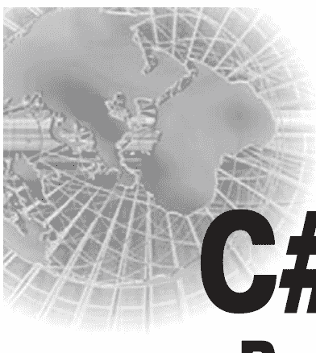


# 目录

xvi

[PAGE_BREAK]


# 引言

恭喜您购买《C# 2008 编程黑书（入门版）！本书体现了我们一贯的承诺，即深入研究读者需求并提供高质量的 IT 书。本书是 Koenig Learning Solutions Inc. 和 Dramtech Tech 的作者和编辑人员丰富的教学见解和技术精准性的结晶，并为希望在 C# 2008 和 .NET Framework 3.5 领域脱颖而出的 IT 专业人士提供丰富的解决方案。本书进一步扩展了我们的理念，针对新兴技术提供了全面且易理解的参考材料。本书的编写考虑了 C# 2008 多元的读者群体，通过展示相关、适当且真实的示例，提供卓越的学习体验。此外，书中还包含代码和可执行应用程序，用于演示与 C# 2008 相关的各种概念的实现。

我们设计这本书是为了与您共同成长，在迈向软件精通的过程中提供您所需的参考材料。

C# 是一种全新的编程语言，专门设计用于配合 .NET Framework 使用，.NET Framework 提供了开发几乎任何应用程序的环境。它是源自流行的 C 和 C++ 语言的一种种简单、高效、高生产力且类型安全的语言。许多公司正在使用 C# 2008 配合 .NET Framework 3.5 构建健壮、可靠且可扩展的应用程序。C# 2008 的影响正在迅速扩散，势不可挡，无须回头！我们希望您通过本书的学习体验对您而言是不可抗的，正如我们在授权和编辑本书时所感受的那样。

## 本书的读者

对于那些想要从零开始学习 C# 或已经从事 C# 2008 应用程序开发的人来说，本书同样大有益。《C# 2008 黑书（入门版）是真正意义上的优秀指南——带您进入快速变化的 C# 世界以及相关的各种编程技术。

书中涵盖了数百个主题，每个主题都通过展示工作原理的应用程序进行解释。本书的设计旨在是将主题分开并易于访问，每个主题解决不同的编程问题。以下是其中一些主题：

- C# 语言基础
- 开发 WPF 应用程序
- 创建 Windows 服务
- 创建 ASP.NET 3.5 Web 服务
- 创建 WCF 服务
- 使用 ADO.NET 对象访问数据
- 使用 LINQ
- 开发工作流应用程序
- 使用 .NET 程序集
- 使用 .NET 安全
- 创建多线程应用程序
- 使用集合和泛型
- 使用 .NET 反射

## 使用本书

在书中，所有的应用程序都是使用 Visual Studio 2008 集成开发环境开发的。Visual Studio 2008 提供了开发 `Console`、`Windows`、`WPF`、`WCF` 和 `WF` 应用程序的内置模板。

## 本书规范

我们在书中使用了标准规范。本节将帮助您熟悉这些规范，以确保良好的学习体验。

代码片段以以下格式表示：

列表 7.15 控制滑块控件

```csharp
using System;
using System.collections.Generic;
using System.Linq;
using System.Text;
using System.Windows;
using System.Windows.Controls;
using System.Windows.Data;
using System.Windows.Documents;
using System.Windows.Input;
using System.Windows.Media;
using System.Windows.Media.Imaging;
using System.Windows.Navigation;
using System.Windows.Shapes;
namespace Storyboard_MediaPlayback
{
    /// <summary>
    /// window1.xaml 的交互逻辑
    /// </summary>
    public partial class window1 : window
    {
        public window1()
        {
            InitializeComponent();
        }
        private void ElementMediaChanged(object sender, EventArgs e)
        {
            slider1.Max = mediaElement1.NaturalDuration.TotalMilliseconds;
        }
        private void TimeChanged(object sender, EventArgs e)
        {
            slider1.Value = mediaElement1.Position.TotalMilliseconds;
        }
    }
}
```

保留字、属性、方法、事件、类、接口、命名空间（用于代码片段中）、异常等在正文中使用不同的字体进行区分显示。

每幅图都有说明，以帮助您更好地理解。

[PAGE_BREAK]

# 引言

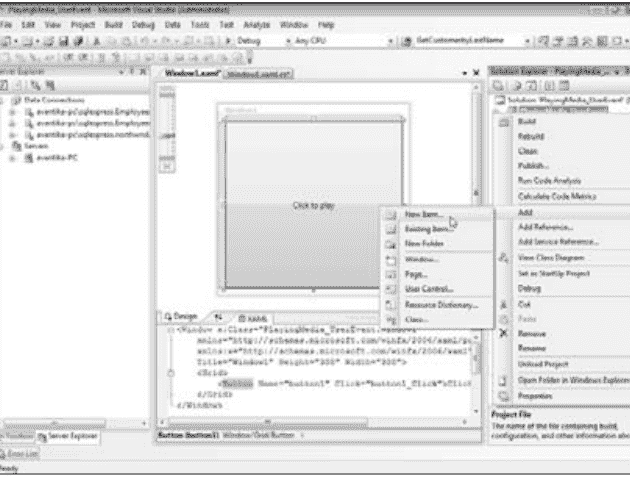

图 7.6：添加新项目

项目以以下格式表示：

> 注意：如果您没有添加控制媒体播放的按钮，使用 `MediaElement` 控件加载的媒体将在窗口加载后自动播放一次。

表格均有编号，并放置在章节中引用的正下方，如下所示：

| 表 7.8：颜色结构的方法 |
| --- |

| 方法 | 说明 |
| --- | --- |
| `Equals` | 检查指定的对象是否等于 `Color` 结构 |
| `FromArgb` | 从 4 位 ARGB 分量创建 `Color` 结构 |
| `FromKnownColor` | 从指定的预定义颜色创建 `Color` 结构 |
| `FromName` | 根据指定的定义的颜色名称创建 `Color` 结构 |
| `GetBrightness` | 获取指定的 `Color` 结构的亮度值 |
| `GetHashCode` | 为指定的 `Color` 结构返回哈希码 |
| `GetHue` | 获取指定颜色的色调-饱和-亮度值（单位：度） |
| `GetSturation` | 获取指定的 `Color` 结构的色调-饱和-亮度值 |
| `ToArgb` | 获取指定的 `Color` 结构的 32 位 ARGB 值 |
| `ToKnownColor` | 获取指定的 `Color` 结构的 `KnownColor` 值 |
| `ToString` | 将 `Color` 结构转换为人类可读的字符串 |

# 引言

## 其他资源

C# 2008 提供了海量的文档——有数百本书可以参考。这些文档托管在网上，你可以使用 Web 浏览器访问它们。当然，网上有很多关于 C# 语言的网页。以下是其中几个：

- <http://msdn.microsoft.com>
- <http://www.windowsforms.net>
- <http://www.asp.net>
- <http://www.dotnet.com>
- <http://www.dnzone.com>
- <http://www.dotnetpider.com/>
- <http://www.csharpcorner.com/>
- <http://www.sharpcorner.com/>
- <http://msdn.microsoft.com/vsstudio/>
- <http://www.w3schools.com>
- <http://blogs.asp.net/dinesh.kulkarni/default.aspx>
- <http://blogs.msdn.microsoft.com/dinesh.kulkarni/default.aspx>

## 黑书哲学（The Black Book Philosophy）

从广泛的研究到由 Kogent Learning Solutions Inc. 和 Dreamtech Press 的专业人士编写和编辑，“黑书”系列为全球编程和管理挑战提供了解决方案，帮助你完成任务，特别是那些在其他书中没有详尽文档的关键任务。“黑书”的独特格式旨在帮助你构建知识以解决问题，并快速掌握复杂的技术概念以成为专家。“黑书”的格式将复杂的主题分解为易于理解的部分，有助于你找到你需要的内容——图表和代码让这一切变得简单得多！


# 介绍 C# 2008

| 如果你需要解决以下即时问题： | 请参 页码： |
| --- | --- |
| 创建一个简单的 C# 2008 控制台应用程序 | 24 |
| 声明变量 | 25 |
| 初始化变量 | 26 |
| 声明常量 | 27 |
| 声明可空类型变量 | 28 |
| 使用 `??`（空合并）运算符 | 29 |
| 指定变量的作用域解析符 | 30 |
| 使用作用域解析符（`:`） | 31 |
| 声明并初始化字符串 | 32 |
| 操作字符串 | 32 |
| 将数字类型转换为另一种数字类型 | 34 |
| 将字符串类型转换为数字类型 | 35 |
| 两个可空类型 | 36 |
| 使用 `is` 和 `as` 运算符 | 37 |
| 确定数据类型的最小值和最大值 | 39 |
| 创建枚举 | 40 |
| 声明单维和多维数组 | 41 |
| 遍历数组 | 44 |
| 创建别名 | 45 |

## 深度解析

C# 2008 是一门面向对象的编程语言，使程序员能够在 Microsoft .NET 平台上快速开发应用程序。微软将 C# 2008 作为 Visual Studio 2008 的主要部分包含。它是早期的 C、C++ 和 Java 语言的强大后代。C# 2008 结合了 C++ 和 Visual Basic 的范围；因此，你可以轻松地理解并编写用于你解决方案的复杂代码。如今，C# 是开发健壮且耐用应用程序最常用的语言之一。

# C# 2008 的引入相较于之前的版本（注：此处原文误为两次 C# 2008，应指前一版本）引入了巨大的增强，微软引入了许多新功能以提高易用性，例如支持自动属性、扩展方法、部分方法定义等。这些新功能在“C# 2008 新特性”章节中进行了讨论。

本章的目标是为其余部分奠定概念基础。在本章中，我们描述了 C# 2008 中包含的新功能。你将学习 C# 编程的概念，如标识符和关键字、数据类型、变量、常量和表达式。

## C# 2008 的新特性

C# 2008 在 C# 方面有了巨大的改进，因为它引入了新的编译器特性、新的语言结构和改进的调试功能。在 C# 2008 中，添加了各种新功能以提高 C# 2008 的生产力。这些新功能帮助开发者轻松、高效地创建 C# 应用程序。以下是添加到 C# 2008 中的新功能列表。

- 隐式类型局部变量
- 自动实现属性
- 扩展方法
- 查询关键字
- 部分方法定义
- 对象和集合初始化器
- 匿名类型
- Lambda 表达式

让我们在接下来的章节中逐一讨论这些新特性。

## 隐式类型局部变量

C# 2008 引入了一种声明变量的新方法，初始化表达式可以推导出所应用的类型。在 C# 应用程序中使用局部变量时，你可以使用 `var` 关键字指示编译器从初始化语句右侧表达式的参数中推导出变量类型。你想要用于声明变量的推导类型可以是内置类型、匿名类型、定义类型、类库中定义的类型或任何表达式中的类型。

记住，`var` 关键字与 `variant` 关键字完全不同，后者表示变量是松散绑定或后期绑定的。`var` 指示编译器为变量确定并分配最合适的类型。`var`

```csharp
var a = 25;
var s = "Sharp";
```

## 自动实现属性

在 C# 2005 中创建属性时，总是需要大量的代码。为了克服这一点，C# 2008 引入了使用简化语法的自动实现属性。使用自动实现属性，你可以创建属性。

在自动实现属性 `get` 之后，编译器创建一个可以通过属性访问的私有字段。如果你想创建一个只读属性，可以通过将设置访问器设置为私有。列表 1.1 显示了：

```csharp
public float TotalNumbers { get; set; }
public string StudentName { get; set; }
public int RollNumber { get; private; } // 只读属性
public string Class { get; private; } // 只读属性
```

列表 1.1 包含了四个自动实现属性：`TotalNumbers`、`StudentName`、`RollNumber` 和 `Class`。由于它们的设置访问器被赋值为私有，这些属性被编译为只读属性。在列表 1.1 中，你必须注意到没有使用任何属性；这是因为自动实现属性不支持属性。

## 扩展方法

C# 引入扩展方法来指定特定类型的实例可用方法集是开放的。这意味着你可以向派生类型添加新方法。因此，扩展方法允许你增加任何类型的可用方法集，即使你对给定的类型或实例没有控制权。扩展方法允许你在不创建新类型、不重新编译或修改原始类型的情况下添加新方法。你可以使用扩展方法扩展类或接口，而不是覆盖它们。

## 查询关键字

关键字是预定义的标识符，编译器已对其定义了特殊含义。如 `int`、`float`、`if` 等关键字是不能作为变量名的单词。C# 使用上下文关键字（也称为查询关键字），它们在有限的程序环境中具有特殊含义，在该环境之外可以使用变量名。C# 2008 引入了查询关键字来定义查询表达式中的从。表 1.1 描述了 C# 中提供的不同查询关键字：

| C# 查询关键字 | 描述 |
| --- | --- |
| `from` 子句 | 设置查询运行的数据源并设置本地范围变量来表示源序列中的每个元素 |
| `where` 子句 | 根据具有逻辑与（`&&`）和逻辑或（`||`）操作的布尔条件过滤源元素 |
| `select` 子句 | 确定执行查询后返回的元素类型。 |

# 第 1 章：引入 C# 2008

| 表 1.1：C# 中的查询关键字 |
| --- |

| 子句 | 描述 |
| --- | --- |
| `group` 子句 | 分组查询结果，并根据组的键值返回值序列。 |
| `into` | 创建一个临时标识符，将分组、连接或选择（`select`）子句的结果存储到该新标识符中。 |
| `orderby` 子句 | 按升序或降序对查询结果进行排序。排序取决于元素类型的默认比较器（默认为升序）。此外，你也可以指定自定义的比较器。 |
| `join` 子句 | 根据指定键的等值比较合并两个源序列的元素。最常用的连接类型是内连接（Inner）、外连接（Outer）和左连接（Left）。 |
| `let` 子句 | 存储将在后续子句中使用的子表达式的值。 |

这些查询被用于查询表达式内部以处理数据，其设计意图是提供与 SQL 表达式非常相似的功能。

## 部分方法定义（Partial Method Definitions）

在开发大型项目时，有时你需要将一个类、结构体或方法的定义拆分到两个或多个源文件中。每个源文件应包含类或方法定义的一部分，当编译应用程序时，编译器会包含所有的源文件。拆分和组合大型项目有助于一组程序员同时处理大型项目中的某一个类。你可以使用 `partial` 关键字来拆分类定义。`partial` 关键字确定其他源文件定义在相同的命名空间中，并在编译时可用，以形成最终类型。此外，所有源文件必须使用相同的访问修饰符，如 `private` 和 `public`。

> `partial` 修饰符不能用于委托（delegate）和枚举（enumeration）的声明，它只能紧跟在关键字、`class`、`struct` 或 `interface` 之前。

让我们以 `Motor` 类为例，它包含两个名为 `MachineryParts` 和 `BodyParts` 的子类。对于 `Motor` 类，我们使用 `partial` 修饰符创建两个文件，一个用于 `MachineryParts`，另一个用于 `BodyParts`。列表 1.2 显示了 `Motor` 类的代码：

列表 1.2：部分方法定义

```csharp
public partial class Motor
{
    public void MachineryParts()
}
public partial class Motor
{
    public void BodyParts()
}
```

当你编译列表 1.2 中的两个源文件时，它们会被合并成一个。这意味着我们将 `Motor` 类拆分成了两个不同的子类以便同时工作。

## 对象和集合初始化器（Object and Collection Initializers）

对象初始化器允许你在创建对象为可见字段或属性赋值，而无需显式地创建并调用构造函数。列表 1.3 显示了对象初始化器的用法：

列表 1.3：对象初始化器

```csharp
public class Company {
    public string name {get; set;} //自动属性
    public static void objectInitialize() {
        Company c=new Company{name="Amitabh"}; //对象初始化
    }
}
```


然而，你也可以在其他上下文中使用对象初始化器。对象初始化器在语言集成查询（LINQ）查询表达式中起着重要作用。查询表达式使用了大量的匿名类型，并使用对象初始化器来初始化这些匿名类型。

集合初始化器以非常简单的方式初始化集合。它防止了你多次添加相似的代码行。集合初始化器在初始化集合类时指定一个或多个初始化器。元素初始化器可以是简单的值、表达式或对象初始化器。列表 1.4 演示了集合初始化器的用法。

```csharp
List<Company> c=new List<Company>{
    new Company{name="Sumit"},
    new Company{name="Kohit"},
    new Company{name="Jitendra"}
}
```

列表 1.4 演示了使用集合初始化器使用 `Company` 类。请注意，对象初始化器在集合初始化器的大括号内用逗号分隔。

## 匿名类型（Anonymous Types）

当你为应用程序创建属性时，有时你需要创建一个或多个只读属性。这些只读属性可以被任何匿名类型封装进单个单元中。编译器会根据需要生成类型名称，但该名称在源代码级别是不可用的。属性的类型由编译器派生。换句话说，你可以认为匿名类型创建可以使用 `var` 关键字定义和访问的匿名结构。

匿名类型具有一个或多个公共只读属性，尽管它们不使用任何其他类成员（如方法和事件）。你可以使用 `new` 运算符配合对象初始化器来创建匿名类型。

匿名类型是直接派生自对象的引用类型（Reference Types）。如果两个或多个匿名类型包含相同数量的相似属性，且属性的顺序相同，编译器将假设它们是相同的，并且都共享编译器生成的相同类型信息。

## Lambda 表达式（Lambda Expressions）

2008 引入了 Lambda 表达式，以取代 C# 2005 中用于内联声明方法代码的委托函数。因此，Lambda 表达式是包含表达式和语句的方法。你可以使用 Lambda 表达式创建委托或表达式树类型。Lambda 表达式使用 Lambda 运算符（`=>`），读作 "goes to"。Lambda 运算符的优先级与赋值运算符相似，并且是右结合的。下面的示例演示了 Lambda 表达式的用法：

```csharp
p => i * j;
```

Lambda 运算符左侧（即 `p`）指定输入参数，而右侧指定表达式或语句块。注意，Lambda 不能用在左侧或作为运算符。Lambda 表达式的参数可以是显式的，也可以是隐式的。在隐式类型参数列表的情况下，每个表达式的类型应明确指定。

## 标识符和关键字（Identifiers and Keywords）

标识符是用于标识变量、常量、属性、对象、类型等的字符序列。标识符以字母或下划线开头，以空白字符之前的字符结束。C# 标识符是对大小写敏感的，因此 `sum`、`Sum` 和 `SUM` 是不同的。对于标识符的命名规范，微软使用的是驼峰命名（CamelCase）。标识符以小写字母开头，后续单词的首字母大写。例如：`myProgram`。

在创建标识符之前，你应该了解标识符名称在创建时必须遵循的规则：

- 必须以字母、数字或下划线开头。
- 可以是字母、数字和下划线的任何组合。
- 不能是保留字。

在创建标识符时，最好使用字符而不是数字。

关键字是由编译器预定义含义的词。它们与标识符相似，但你不能将它们作为变量名、方法或属性，因为这些名称已经定义了特殊功能。如果你想将关键字作为标识符，请在关键字前加上 `@` 字符。然而，还有非保留关键字标识符，这些被称为上下文关键字（contextual keywords）。表 1.2 列出了 C# 中不同的保留关键字和上下文关键字。

| 表 1.2：C# 中的保留关键字和上下文关键字 |
| --- |
| 保留关键字 |
| `abstract`、`as`、`base`、`bool`、`break`、`byte`、`case` |
| `char`、`catch`、`checked`、`class`、`const`、`continue`、`decimal` |
| `default`、`delegate`、`do`、`double`、`else`、`enum`、`event` |
| `explicit`、`extern`、`false`、`finally`、`fixed`、`for`、`for` |
| `get`、`if`、`implicit`、`in`、`interface` |
| `internal`、`is`、`lock`、`long`、`namespace`、`new`、`null` |
| `object`、`operator`、`ref`、`override`、`params`、`protected` |
| `public`、`readonly`、`return`、`sbyte`、`sealed`、`short` |
| `sizeof`、`stackalloc`、`static`、`string`、`switch`、`this` |
| `throw`、`true`、`try`、`typeof`、`uint`、`long`、`unchecked` |
| `unsafe`、`ushort`、`using`、`virtual`、`volatile`、`void`、`while` |

## 深度解析

| 表 1.2：C# 中的保留关键字和上下文关键字 |
| --- |
| `from`、`get`、`group`、`into`、`join`、`let`、`orderby` |
| `partial (type)`、`partial (method)`、`select`、`set`、`value`、`where (generic constraint)`、`where (query clause)` |
| `yield` |

无论是否将保留关键字作为标识符，上下文关键字都可以在其特定语境之外作为普通标识使用。这意味着上下文关键字在两个或多个语句中可能具有特殊含义。

## 数据类型、变量和常量

C# 支持丰富且多样的数据类型，从内置类型（如整数或字符串）到用户定义类型（如数组、结构和类）。在本节中，你将检查数据类型以及可以应用于它们上的修饰符。C# 语言始于一组内置数据类型。在处理这些数据类型时，请记住关于 C# 环境的两个事实：

- 所有变量（无论是定义的还是内生的/内置的）都可以作为系统中的对象。
- 系统中的所有变量在声明时会自动初始化为默认值。

关于 C# 变量的另一个记忆点是，它们被分为三个简单的组织结构：`值类型（Value Types）`、`引用类型（Reference Types）`和`指针（Pointer）`。值类型是可以直接赋值数值的变量。引用类型必须通过方法或属性来访问其内部数据。在常量指针中，引用类型支持数据隐藏，而值类型不支持。引用类型允许多个变量引用同一个对象，而值类型始终是离散的实体。.NET 框架支持的引用类型是 `object` 和 `string`。`object` 引用是值类型和引用类型的基类，而 `string` 是包含在双引号内的可交换的 Unicode 字符序列。

C# 中的指针类型提供了与 C 和 C++ 语言相同的能力。指针和引用都代表内存地址，但区别在于引用由垃圾回收器跟踪，而指针不是。此外，你可以对指针进行算术运算，但不能对引用进行操作。

另一方面，变量和常量处理数据值和内存位置。变量是一个内存位置，其大小取决于它的数据。不同数据类型预留的内存不同。常量是分配给常量变量的固定值，这些值在整个程序执行期间保持不变。我们将在本章稍后详细讨论这一点。

## 值类型

让我们先看看值类型，看看它们可以用于什么以及如何被引用。如果只想简单查看如何使用值类型，而不深入讨论其工作原理或局限性与能力，请参考本章稍后的“即时解决方案（Immediate Solutions）”部分。

值类型是应用程序中存储和使用数据。值类型将数据直接存储在变量中。你需要理解可用的变量类型及其用途。此外，将一种类型转换为另一种类型所需的转换也很重要，我们将在本章稍后的“类型转换（Type Conversions）”部分进行讨论。表 1.3 显示了所有的值类型及其代表的含义：

| 表 1.3：C# 中的值类型 |
| --- | --- | --- | --- |
| 值类型 | 代表什么 | 范围 | 默认值 |
| `bool` | 布尔类型，表示布尔值 | True 或 False | `false` |
| `byte` | 8 位无符号整数类型 | 0 到 255 | 0 |
| `char` | 单个 16 位字符类型，char 值是一个 Unicode 字符 | U+0000 到 Uffff | `'\0'` |
| `decimal` | 128 位小数类型，具有 28-29 位有效数字 | ±1.0 × 10⁻³⁸ 到 ±7.9 × 10³⁸ | `0.0M` |
| `double` | 64 位双精度浮点类型 | ±5.0 × 10⁻³⁴ 到 1.7 × 10³⁰⁸ | `0.0D` |
| `float` | 32 位单精度浮点类型 | 1.5 × 10⁻³⁸ 到 3.4 × 10³⁸ | `0.0F` |
| `int` | 32 位有符号整数类型 | -2,147,483,648 到 2,147,483,647 | 0 |
| `long` | 64 位有符号整数类型 | -9,223,372,036,854,775,808 到 9,223,372,036,854,775,807 | `0L` |
| `sbyte` | 8 位有符号整数类型 | -128 到 127 | 0 |
| `short` | 16 位有符号整数类型 | -32,768 到 32,767 | 0 |
| `uint` | 32 位无符号整数类型 | 0 到 4,294,967,295 | 0 |
| `ulong` | 64 位无符号整数类型 | 0 到 18,446,744,073,709,551,615 | 0 |
| `ushort` | 16 位无符号整数类型 | 0 到 65,535 | 0 |

## 第 1 章：介绍 C# 2008

```cpp
int x=3;
if (x ) {
```

对于前面的示例，你必须编写以下代码：

```cpp
int x=3;
if (x == 0) {}
```

这两个代码块在 C++ 或 Java 中功能上是等价，但行为并不相同（事实上，第一个在 C# 中无法编译）。

## 可空类型（Nullable Type）

当编程语言在处理数据库或用户没有为任何数据类型的变量赋值时，它会支持可空类型（Nullable types）。如果编程语言不支持可空类型，你可以使用策略来处理空值。例如，你可以使用 `-1` 来指定整数变量为空。你也可以使用布尔空值为空变量指定值。例如，你可以为布尔变量使用 `true`、`false` 或 `null` 值。.NET Framework 提供了用户定义的可空类型。

可空类型是 `Struct`（结构体）的实例。`Struct` 使用一个预定义的值类型（Value Type）和一个可以赋值 `true` 或 `false` 的布尔可空类型，以及两个名为 `HasValue` 和 `Value` 的公共读取属性。这些属性用于获取可空类型的值。当变量不空时，`HasValue` 属性为 `true`，为空时为 `false`。如果 `HasValue` 为 `true`，则 `Value` 属性返回其值；如果 `HasValue` 为 `false`，在访问 `Value` 属性时会产生异常。你可以使用 `?` 修饰符创建可空类型。声明空类型如下：

```csharp
System.Int? variable = null;
```

在上述语法中，`?` 是可空类型的底层类型。`T` 是一个值类型，如 `int`、`float` 或 `struct`，但它不是一个类型引用（Type Reference）。例如，`int?` 是类型 `int` 的可空类型。在示例中，`struct` 是底层类型，`?` 是布尔空。同样，`float?` 是类型 `float` 的可空类型。你想要创建可空类型的类型不能是可空值类型。

## 枚举类型（Enumeration Type）

枚举是使用 `enum` 关键字声明的用户定义数据类型。枚举创建了我们的自定义基类型，为给定的类型创建了一个可能值的列表。例如，你可能有一个模拟交通灯的程序。交通灯显然有三种状态——绿灯、黄灯（琥珀灯）和红灯（停止灯）。灯的状态只能是这些状态中的之一。例如，它不能同时是三种状态，也不能仅仅是红、黄或绿。

枚举的 C# 代码是定义一个新的用户定义类型。对于交通灯，你可以写道：

```csharp
enum TrafficLight
{Red, Yellow, Green};
```

要使用该枚举，你可以使用以下代码声明该类型的变量：

```csharp
TrafficLight tl;
```

如你在前面的代码所示，通过创建枚举类型 `TrafficLight`，我们在语言中创建了定义变量的新方法。此功能的另一个方面是由于定义了一个边界类型（bound type）。例如，你可以使用以下代码：

```csharp
tl = TrafficLight.Red;
tl = TrafficLight.Yellow;
```

然而，我们不能写以下代码：

```csharp
tl =;
```

## 深度解析（In Depth）

默认情况下，枚举从第一个条目的值 0 开始。然而，你可以通过以下代码为第一个值输入不同的值来修改此值：

```csharp
enum TrafficLight
{
    Red=1,
}
```

原因是如前提到的，交通灯是一个边界值。它只能取枚举本身存在的那些值。然而，C# 在这里并不完美，以下是你在处理枚举时可能会遇到的几个小陷阱：

- 枚举类型不知道如何用其实际的整数值以外的任何方式显示自己。也就是说，如果你打印一个 `TrafficLight` 值（如 `Red`），你会在控制台上看到显示的值 0。
- 枚举不允许你为类型分配无效值。但是，因为枚举仅仅是整数的包装器，而整数类型可以转换为你想要的任何类型，你可以在代码中写类似 `(TrafficLight)5` 的内容，它可以正常工作。这没有任何意义，但编译器不会捕获这个无效值。
- 枚举在范围上并不是完美的。如果你想确保你的值落在给定的范围内，你应该定义一个类来处理，这是引用类型（Reference Types）的标准形式。让我们来看 C# 中的引用类型。

## 引用类型（Reference Types）

C# 还提供了通过引用传递的类型。变量存储的是指向实际数据的引用。引用类型与值类型恰恰相反。这意味着副本中的修改会通过对象引用影响到另一个。由于值类型存储的是数据值，因此引用类型使用的是引用而非数据。在 .NET 中，堆（heap）是受管理的。最初，指针指向一个带有堆基地址的指针，当创建第一个对象时，内存会在基地址处分配。当应用程序中创建下一个对象时，垃圾回收器会在首个对象旁边的地址空间中为它分配内存，并继续为所有新创建的对象分配内存。引用类型可以使用 `class`、`struct` 或 `delegate` 任何关键字来声明。

## 类（Classes）

类是 C# 的用户定义类型。尽管 C# 中的所有变量都是一等对象并可以以相同的方式处理，但类和结构体具有一些特殊能力，例如构造函数和析构函数。这些内容已在第 2 章“命名空间、类、对象和结构体”中讨论过。现在，我们将讨论 C# 中对象的概念。

在 C# 中，所有类型甚至是值类型都是对象。它们都派生自一个单一的基类，称为 `System.Object`。它定义了系统中的所有对象，并与其他对象相同的方式对待。当你将对象传递给函数时，你可以使用 `is` 关键字判断你正在处理什么种的对象。

C 中的所有应用程序都基于类。与 C++ 或 C 不同，你不能拥有一个独立运行的简单函数。这种概念更像 Java 的编程模式。例如，所有的 C# 应用都包含一个必须存在的名为 `Main` 的静态方法。列表 1.6 Foo：

```csharp
class Foo
{
    static void Main()
    {
        System.Console.WriteLine("Hello world from c#");
    }
}
```

## 第 1 章：介绍 C# 2008

在列表 1.6 中，你定义了一个简单的类名为 `Foo`，它通常位于名为 `Foo.exe` 的文件中。编译后，它将形成一个名为 `Foo.exe` 的可执行文件，可以从命令行运行。C# 应用程序并不形成原生可执行文件。这些可执行文件是存根，用于加载 C# 运行时环境并加载构成你编写程序的预编译代码。在前面的示例中，将加载解释器，解释器将从 `System` 命名空间获取 `Console` 对象并使用该对象的静态 `WriteLine` 方法。字符串 `Hello world from C#` 将被传入，该方法将返回该字符串输出到控制台。

结构（Structures）与类非常相似，但不可用于应用程序。结构被设计为值类型的集合（或其他用户定义类型）。

（注：由于提供的 OCR 文本中“结构”部分存在大量重复，我将重复段落合并为单一逻辑部分，以确保输出的专业性，同时按照要求保留了所有独特信息。）

（注：由于 OCR 文本中存在大量重复，我已合并并修复了 OCR 错误，排除由于扫描/OCR 导致的重复项。）

## 深入理解

在数组中使用 `Length` 属性，该属性被用作属性而不是方法。你可以通过编写以下代码访问数组的长度：

```c
int len = array.length;
```

C 也支持多维数组，这些数组必须在堆上分配。与 C++ 或 Java 不同，C 使用了旧式的 FORTRAN 语法在数组定义中声明多个维度（通过逗号分隔的行）：

```c
int mult[,] = new int[5,3];
```

这创建了一个表示 5x3 矩阵的数组。你可以创建不同维度的数组，例如 3x3。数组的 `Length` 属性返回元素的总数，当你使用以下代码时：


```c
int [ , fivefive] = new int[5,5];
System.console.println("Length of fivefive = " + fivefive.length);
```

代码产生以下输出：

```
Length of fivefive = 25
```

如果你知道数组的大小，这显然有用，但确定数组的下限和上限是困难的。因此，C# 提供了类的其他方法 `GetLowerBound` 和 `GetUpperBound`。通过获取这个 5x5 数组，你可以通过以下代码找到边界：

```csharp
System.console.println("Lower = " + fivefive.GetLowerBound() + ",", Upper = " + fivefive.GetUpperBound());
```

代码产生以下输出：

```
Lower = 0, Upper = 4
```

如你所见，数组元素从 0 到 4 标识，第一行有五个元素。

## 对象类型（Object type）

对象是预测类型的实例。`Object` 是公共系统中其他类型的基类，例如值类型、引用类型、预定义类型、用户定义类型。然而，所有类型都直接或间接地继承自对象类型。该类型可以赋值给任何对象，但在赋值之前需要进行转换。

当值类型转换为对象类型时，该过程被称为装箱（boxing）；相反，当对象转换为值时，称为拆箱（unboxing）。以下代码展示了对象类型的使用：

```csharp
object x=15; //boxing
```

代码的第一行创建了一个对象类型的变量，第二行将 15 赋值给值 `x`。将转换后的值赋值给对象数据的过程就是装箱。

## 字符串类型（String type）

字符串是 `System.String` 类的数组。字符串是包含在双引号内的 Unicode 字符的不可变序列。这是一个直接派自对象类型的密封类（sealed class）。字符串是不可变的，除非你创建一个对象，否则无法更改字符串对象的值。

字符串类型的值可以使用字符串字面量编写。你可以以两种形式编写字符串字面量——带引号和 `@`。

以下代码显示了用双引号（`""`）编写的字符串字面量：

```csharp
string name="Amitabh";
```

在前面的代码中，`name` 是一个字符串变量，被赋值为 Amitabh。@ 引用字符串在 `@` 字符前缀的双引号内编写。@ 引用字符串字面量很容易编写，因为转义序列不会被处理。以下代码对此进行了说明：

```csharp
@"N inc";
```

## 接口（Interfaces）

C# 中的接口与 Java 完全相同，但它们更灵活。在习惯了 C++ 的实现中，接口等同于抽象基类。你不能通过接口实例化对象，但你可以提供一个接口，即多个类共有的功能集。当你定义接口时，你正在收集一组实现特定任务的功能集。

C# 接口提供了一个额外特性——多接口，这在 C++ 或 Java 中是不存在的。多个接口可以具有相同的方法名，你可以通过使用完整的接口名称在类中对其进行限定。这使得创建接口变得更容易，允许设计者使用描述性名称，而不是由于人为限制导致的长而无用的名称。

你可以用比任何其他类都简单的方式声明接口。然而，使用 `interface` 关键字与其他类区分开来。委托（Delegates）的行为类似于包含方法声明的类型。这些方法在本质上是抽象的，因为方法体中没有代码。实现特定接口的类必须使用该接口的所有方法，否则编译器将无法编译并导致错误。

你可以使用以下语法在 C# 中声明接口：

```csharp
interface interface_name
{
    // 接口体中的抽象方法声明
}
```

在前面的语法中，`interface` 关键字声明了命名的 `Interface_name`。这是程序员赋予接口的名称。接口将在《C# 2008 面向对象编程》第 4 章中详细讨论。

## 委托（Delegates）

委托等同于 C++ 或 C# 中的函数指针。它包含了两种对象——产生变化的对象和响应变化的对象。委托充当这两类对象之间的隧道——将信息从一侧移动到另一侧。

C# 委托是类方法，可以是静态方法也可以是实例方法。委托可以通过在它所属的对象中维护信息来跟踪自己的状态。

让我们来看一个简单的委托以及你如何创建一个委托。

创建委托的第一步是使用 `delegate` 关键字，其使用方式类似于 C++ 中的 `typedef`。你可以使用以下代码创建一个委托：

```csharp
delegate void MyDelegate();
```

在前面的代码中，定义了委托。要使用它，你需要创建一个与委托签名匹配的方法。以下代码显示了如何使用委托：

```csharp
class Test
{
    public void DisplayMessage(string msg)
    {
        Console.WriteLine(msg);
    }

    public static void Main()
    {
        Test t = new Test();
        MyDelegate del = t.DisplayMessage;
        del("Hello World");
    }
}
```

# 第 1 章：介绍 C# 2008

| 转换方法 | 说明 |
| --- | --- |
| `ToBoolean` | 如果可能，将此类型转换为布尔值。 |
| `ToByte` | 将此类型转换为字节（byte）。 |
| `ToChar` | 如果可能，将此类型转换为单个字符（Unicode）。 |
| `ToDateTime` | 将类型（主要是整数和字符串）转换为日期/时间结构。 |
| `ToDecimal` | 将类型（浮点数或整数）转换为十进制数值。 |
| `ToDouble` | 安全地将几乎任何类型转换为 double 类型。 |
| `ToInt16` | 安全地将几乎任何类型转换为 int 类型。 |
| `ToInt32` | 安全地将几乎任何类型转换为长整型（long）。 |
| `ToInt64` | 安全地将几乎任何类型转换为长整型（long）。 |
| `ToByte` | 如果可能，将给定的类型转换为有符号字节字段。 |
| `ToSingle` | 将几乎任何类型转换为单精度浮点数。 |
| `ToString` | 将几乎任何类型转换为字符串。 |
| `ToType` | 如果可能，转换为指定的无符号类型。 |
| `ToUInt16` | 如果可能，将类型转换为无符号整数数据类型。 |
| `ToUInt32` | 将几乎任何类型转换为无符号长整型。 |
| `ToUInt64` | 将几乎任何类型转换为无符号大整数。 |

C 将类型从一种类型转换为另一种。了解哪些数据类型可以被 C# 隐式转换也同样重要。表 1.5 显示了在许多情况下可能发生的预定义隐式转换，例如在调用方法时或给变量赋值时：

| 源 | 目标 |
| --- | --- |
| `sbyte` | `short`, `int`, `long`, `float`, `double`, or `decimal` |
| `byte` | `short`, `ushort`, `int`, `uint`, `long`, `float`, `double`, or `decimal` |
| `short` | `int`, `float`, `double`, or `decimal` |
| `ushort` | `int`, `uint`, `long`, `ulong`, `float`, `double`, or `decimal` |
| `int` | `long`, `float`, `double`, or `decimal` |
| `uint` | `long`, `ulong`, `float`, `double`, or `decimal` |
| `long` | `float`, `double`, or `decimal` |
| `char` | `ushort`, `int`, `long`, `ulong`, `float`, `double`, or `decimal` |
| `float` | `double`, or `decimal` |
| `ulong` | `float`, `double`, or `decimal` |

## 深度解析

**注意**

隐式转换不适用于 `char` 类型，也不适用于浮点类型与十进制类型之间。

## 显式转换/类型转换

显式转换由程序员在代码中直接完成。以下是语言为获取特定值而要求的显式转换示例。以下代码展示了如何显式转换数据类型：

```csharp
single s = 123.45;
int i = (int)s;
```

在转换数据类型之前，你应该知道你要转换的目标类型是否适用；C# 是否允许你想要执行的转换？表 1.6 显示了 C# 允许在“To”列中进行显式转换的数据类型：

## 表 1.6：显式转换

| 源 | 目标 |
| --- | --- |
| `byte` | `byte`, `ushort`, `uint`, or `char` |
| `byte` | `byte` or `char` |
| `short` | `byte`, `byte`, `short`, `uint`, `long`, or `char` |
| `ushort` | `byte`, `byte`, `short`, or `char` |
| `int` | `byte`, `byte`, `ushort`, `uint`, `long`, or `char` |
| `uint` | `byte`, `byte`, `short`, `int`, or `char` |
| `long` | `byte`, `byte`, `short`, `int`, `uint`, `long`, or `char` |
| `ulong` | `byte`, `byte`, `short`, `int`, `uint`, `long`, or `char` |
| `char` | `byte`, `byte`, or `short` |
| `float` | `byte`, `byte`, `ushort`, `int`, `uint`, `long`, `char`, or `decimal` |
| `double` | `byte`, `byte`, `ushort`, `int`, `uint`, `long`, `char`, `float`, or `double` |
| `decimal` | `byte`, `byte`, `ushort`, `int`, `uint`, `long`, `char`, `float`, or `double` |

数据类型的显式转换可能会导致精度丢失或抛出意外的异常。因此，在执行类型转换时应小心。

## 装箱（Boxing）与拆箱（Unboxing）

装箱和拆箱是 C# 类型系统中重要的概念。它们用于在 C# 的两种主要数据类型——值类型（Value Type）和引用类型（Reference Type）之间建立联系。

所有值类型都存储在栈中，但在某些情况下，它们需要作为引用类型被引用。当引用类型存储在堆中时，我们将值类型转换为引用类型。这种转换被称为装箱。

当值类型转换为基对象（Base Object）或接口（Interface）时，需要装箱。CLR（公共语言运行时）将值类型转换为引用类型。CLR 在堆上分配内存并将值类型复制其中。

装箱是一个昂贵的过程，将对象从栈复制到堆，这需要多个处理器周期以及堆空间。装箱的另一个缺点是同一个对象出现在内存的两个不同位置，可能会导致状态冲突。

拆箱是装箱的反向操作。装箱创建的对象类型或接口实例需要转换值类型。这是通过拆箱显式完成的。以下代码展示了如何隐式进行装箱，而拆箱必须通过类型转换显式完成：

```csharp
int y;
object obj = y; // 隐式装箱
int z;
z = (int)obj; // 显式拆箱
```

# 第 1 章：介绍 C# 2008

## 变量与常量

变量是存储值的内存位置。变量的值可以在程序执行期间更改。在 C# 中，通过指定类型后跟名称来声明变量。

```csharp
int x = 10;
x = 20; // x 的值发生了更改
```

常量是在赋值后无法更改值的变量。要声明常量，请使用 `const` 关键字。

```csharp
const int y = 20;
// y = 30; // 这会导致编译错误
```

常量对于在编译时已知且不会更改的值非常有用，例如圆周。

```csharp
const double Pi = 3.14159;
```

## 深入探讨

### 变量的作用域

变量的作用域规定了程序中使用该变量的区域。这意味着作用域决定了程序中变量可以被访问和引用的区域。作用域分为两种：块作用域和类作用域。

当你在代码块内声明变量时，该变量获得局部作用域或块作用域；因此被称为局部变量。换句话说，该变量不能在声明它的特定代码块之外使用。

如果你在整个程序之外（或在定义主函数之前）声明变量，则该变量被称为全局变量，可以在整个程序中使用。列表 1.9 展示了一个示例，以说明变量作用域的用法：

列表 1.9 变量作用域

```cs
class Scope {
    public void scope() {
        int i = 0;
        i = i + 1;
    }

    public void scope2() {
        console.WriteLine(i);
    }
}
```

当你实例化 `Scope` 类时，你将得到一个编译时错误，显示当前上下文中不存在名称 `i`。这是由于 `scope()` 方法没有以任何方式引用 `scope2()` 方法。如果你在 `scope()` 方法本身内部声明变量 `i`，代码将正常运行。

或者，类使用访问修饰符（如 `public` 和 `private`）来指定变量的作用域。`private` 关键字使变量变为局部的，并确定它不能在声明它的类之外使用或访问。

你可以通过将其声明为 `public` 使变量在类范围内全局。`public` 关键字决定了变量的全局作用域；因此变量可以在整个程序的任何类中使用。列表 1.10 展示了类作用域的用法：

列表 1.10：作用域类

```cs
public class localScope {
    int i = 0;

    public class localScope2 {
        void scope() {
            console.WriteLine(i);
        }
    }
}
```

在实例化此类时，将显示相同的编译时错误，因为变量 `i` 在 `localScope` 类中声明且是私有的，但在 `localScope2` 类中被访问。

## 表达式与运算符

表达式是组合在一起的语言元素，用于执行特定的任务或计算。C# 2008 提供了一套完整的语言元素，例如变量、常量、运算符、字面量等。

运算符在执行某些计算或其他操作（如对操作数进行算术和逻辑操作）中起着至关重要的作用。因此，运算符指定了要在要执行的操作数。

C# 2008 中的运算符分为几类：基础、一元、乘法、加法、移位、关系和类型测试、相等、逻辑与、逻辑异异、逻辑或、条件与、条件或、条件、赋值和 lambda。表 1.7 显示了不同的类别以及属于这些类别的运算符及其描述：

### 表 1.7：C# 中的运算符

| 类别 | 运算符 | 描述 |
| --- | --- | --- |
| 基础（Primary） | `x.y` | 点运算符；用于访问类的成员变量和方法。 |
|  | `f(x)` | 圆括号；用于指定表达式的操作顺序以及转换类型。 |
|  | `a[x]` | 方括号；用于数组、索引器、指针和属性。 |
|  | `x++` | 后置自增；用于将操作数（`x`）的值加 1。它先赋值 `x` 的值，然后增加其值。 |
|  | `--` | 后置自减；用于将操作数（`x`）的值减 1。它先赋值 `x` 的值，然后减小其值。 |
|  | `new` | `new` 运算符；用于创建对象并调用构造函数。 |
|  | `typeof` | `typeof` 运算符；用于类型对象并发现有关引用类型和值类型的信息。 |
|  | `checked` | `checked` 运算符；用于检测某些操作中的溢出条件。 |
|  | `unchecked` | `unchecked` 运算符；用于忽略溢出条件引起的错误并无论溢出情况如何接受结果。 |
|  | `->` | 指针运算符；用于结合指针解引用和成员访问。 |
| 一元（Unary） | `+` | 一元加运算符；用于获取负值的逻辑取反。 |
|  | `-` | 一元减运算符；用于获取操作数值的取反。 |
|  | `!` | 逻辑取反运算符；用于反转布尔表达式的结果。 |
|  | `++x` | 前置自增；用于将操作数（`x`）的值加 1。它先将 `x` 的值加 1，然后赋值其值。 |
|  | `--x` | 前置自减；用于将操作数（`x`）的值减 1。它先将 `x` 的值减 1，然后赋值其值。 |
|  | `(T)x` | 圆括号；用于指定表达式的操作顺序并转换类型。 |
|  | `true` | `true` 运算符；用于返回布尔值“true”表示表达式满足指定的条件。 |
|  | `false` | `false` 运算符；用于返回布尔值“false”表示表达式不满足指定的条件。 |
|  | `&` | 地址运算符；用于返回其操作数的地址。 |

### 表 1.7：C# 中的运算符

| 类别 | 运算符 | 描述 |
| --- | --- | --- |
| 乘法（Multiplicative） | `*` | sizeof 运算符；用于返回大小。 |
|  | `/` | 除法运算符；用于计算除法。 |
|  | `%` | 取模运算符；用于计算余数。 |
| 加法（Additive） | `+` | 二元加运算符；用于计算和。 |
|  | `-` | 二元减运算符；用于计算差。 |
| 移位（Shift） | `<<` | 左移运算符；用于向左移动。 |
|  | `>>` | 右移运算符；用于向右移动。 |
| 关系（Relational） | `<` | 小于运算符；用于小于。 |
|  | `>` | 大于运算符；用于大于。 |
|  | `<=` | 小于等于运算符；用于小于等于。 |
|  | `>=` | 大于等于运算符；用于大于等于。 |
| 类型测试（Type Testing） | `is` | `is` 运算符；用于检查兼容性。 |
|  | `as` | `as` 运算符；用于转换。 |
| 等等（Equality） | `==` | 等运算符；用于检查相等。 |


| 运算符 | 符号 | 说明 |
|---|---|---|
|  | `!=` | 不等运算符；用于检查不等。 |
| 逻辑与（Logical AND） | `&` | 逻辑与运算符；用于计算位与。 |
| 逻辑异异（Logical XOR） | `^` | 逻辑异异运算符；用于计算位异异。 |
| 逻辑或（Logical OR） | `\|` | 逻辑或运算符；用于计算位或。 |
| 条件与（Conditional AND） | `&&` | 条件与运算符；用于当两者都时。 |
| 条件或（Conditional OR） | `\|\|` | 条件或运算符；用于当任一为时。 |
| 条件（Conditional） | `?:` | 条件运算符；用于返回二者之一。 |
| 赋值（Assignment） | `=` | 等运算符；用于给值赋值。 |
|  | `+=` | 赋值运算符；用于赋值和。 |
|  | `-=` | 减法赋值运算符；用于赋值差。 |
|  | `*=` | 乘法赋值运算符；用于赋值乘积。 |
|  | `/=` | 除法赋值运算符；用于赋值除法。 |
|  | `%=` | 取模赋值运算符；用于赋值余数。 |
|  | `&=` | 与赋值运算符；用于赋值位与。 |
|  | `\|=` | 或赋值运算符；用于赋值位或。 |
|  | `^=` | 异异赋值运算符；用于赋值位异异。 |
|  | `<<` | 左移赋值运算符；用于赋值左移结果。 |
|  | `>>` | 右移赋值运算符；用于赋值右移结果。 |
|  | `??` | `??` 运算符；根据空值返回值之一。 |
| Lambda | `->` | Lambda 运算符；用于将左侧的输入变量与右侧的 lambda 体隔开。 |

## 运算符优先级

C# 中包含大量的运算符。

| 表格 1.8：运算符优先级 |
|---|

| 运算符 | 结合性 |
|---|---|
| `(x)`、`(y)`、`f(x)`、`a[x]`、`x++`、`x--`、`new`、`typeof`、`sizeof`、`checked`、`unchecked` | 左 |
| `+`（一元）、`-`（一元）、`+++`、`--x`、`-(T)x` | 左 |
| `*`、`%` | 左 |
| `+`（算术）、`-`（算术） | 左 |
| `<<`、`>>` | 左 |
| `<`、`<=`、`>=`、`is`、`as` | 左 |
| `==`、`!=` | 左 |
| `^` | 左 |
| `\|` | 左 |
| `\|\|` | 左 |
| `?:` | 右 |
| `*=`、`/=`、`+=`、`-=`、`<<=`、`>=`、`&=`、`\|=` | 右 |

表格中同一层级的运算符优先级相等，除非被括号隔离，否则它们在表达式中按照给定的顺序进行求值。

# 即时解决方案

## 创建一个简单的 C# 2008 控制台应用程序

每位程序员都需要基本了解如何在他们正在学习的编程语言中创建和运行简单的程序。现在，让我们来创建第一个 C# 2008 控制台应用程序，命名为 `HelloWorld`（光盘中也有）。要创建 `HelloWorld` 应用程序，请执行以下步骤：

1. 点击开始 → 所有程序 → Microsoft Visual Studio 2008 → Microsoft Visual Studio 2008 来打开 Visual Studio 2008 IDE。
2. 现在，点击菜单栏上的文件 → 新建 → 项目。这会打开“新建项目”对话框，如图 1.1 所示：

   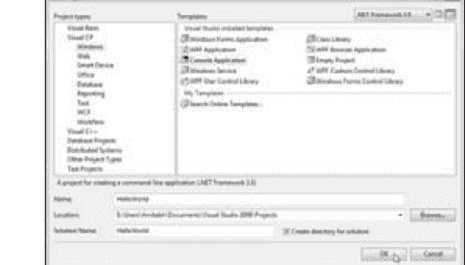

   图 1.1：从新建项目对话框中选择项目类型
3. 在“项目类型”窗格中，首先选择标记为 C# 的节点，然后选择 Windows，如图 1.1 所示。
4. 在“模板”窗格中，选择控制台应用程序，如图 1.1 所示。
5. 现在，在“名称”文本框中为您的应用程序输入名称，如图 1.1 所示。在这种情况下，输入 `HelloWorld`。
6. 然后输入您想要保存应用程序的文件夹的完整路径，如图 1.1 所示。在这种情况下，我们输入了 `E:\Users\Amitabh\Documents\Visual Studio 2008\Projects`。
7. 然后点击确定按钮，这将创建一个新项目，如图 1.2 所示。

   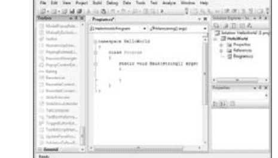

   图 1.2：创建的新控制台应用程序
8. 现在，将列表 1.11 中提供的代码添加到应用程序的 `Program.cs` 文件中：

   列表 1.11：创建 Hello World 程序

   ```csharp
   namespace HelloWorld
   {
       class Program
       {
           static void Main(string[] args)
           {
               System.Console.WriteLine("Hello world");
               System.Console.ReadLine();
           }
       }
   }
   ```

列表 1.11 显示了一个标准的 C# 应用程序，它将字面量 Hello World 打印到控制输出设备。

9. 现在，按键盘上的 F5 键运行应用程序。应用程序的输出如图 1.3 所示：

   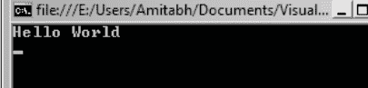

   图 1.3：简单的控制台应用程序

在这个简单的程序中有一些值得注意的事项。首先，注意整个程序都封装在一个类语句中。C# 是一种像 C++ 一样面向面向对象的语言。注意，C# 中的所有内容都是对象，并且所有对象必须存在于类中。在 C# 应用程序中，主类（即程序开始的类）必须包含一个名为 `Main` 的方法，该方法必须声明为静态方法，不需要任何对象实例。

类中的另一个重要概念是使用 `public` 关键字。`public` 关键字允许方法可以被类本身外部的对象访问。由于类框架需要访问 `Main` 方法来启动应用程序，因此 `Main` 方法必须声明为 `public`。

与其他示例不同，在本章的稍后部分我们包含了 `using` 语句，它用于在应用程序中导入命名空间；此示例不包含任何 `using` 语句。`using` 语句采用以下形式：

```csharp
using System;
```

在前面的示例中，我们使用了 `Console` 类的 `WriteLine()` 方法，它位于 .NET Framework 库的 `System` 命名空间中。然而，我们没有在程序中使用 `using` 语句导入命名空间，而是使用了 `WriteLine()` 方法的全限定名称。如果您将 `using` 语句放在代码开头，可以写成：

```csharp
Console.WriteLine("Hello world");
```

## 声明变量

要对应用程序进行任何操作，您都需要变量来处理。输入变量对于将信息从外部世界（从程序的角度）传输到应用程序是必要的，输出变量用于存储输出结果并为用户显示数据。现在，让我们按照标题“创建一个简单的 C# 2008 控制台应用程序”中的步骤，创建一个新的 C# 2008 控制台应用程序，命名为 `DeclaringVariable`（光盘中也有）。在 `DeclaringVariable` 应用程序中，你可以看到如何声明变量、为其赋值，然后将结果打印到输出控制设备。列表 1.12 中的阴影行显示了应用程序中三种简单类型的声明：

列表 1.12：声明变量

```csharp
using System;
using System.Collections.Generic;
using System.Linq;
using System.Text;
namespace DeclaringVariable
{
    class Program
    {
        static void Main(string[] args)
        {
            short x; // 声明 short 类型变量
            int y; // 声明整数类型变量
            double z; // 声明 double 类型变量
            y = 10;
            z = x + y;
            Console.WriteLine("X={0}, Y = {1}, Z = {2}", x, y, z);
            Console.ReadLine();
        }
    }
}
```

列表 1.12 的输出在图 1.4 中：

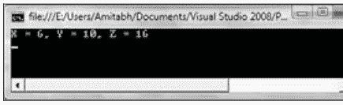

# 第 1 章：介绍 C# 2008

列表 1.14：声明常量

```csharp
using System;
using System.Collections.Generic;
using System.Linq;
using System.Text;
namespace Constants
{
    class Program
    {
        static void Main(string[] args)
        {
            const double pi = 3.1472; //Declaring常量变量
            int r;
            Console.WriteLine("Enter the value of pi");
            r=int.Parse(Console.ReadLine());
            double circleArea=pi*r;
            Console.WriteLine("The area of circle is " + circleArea);
            Console.ReadLine();
        }
    }
}
```

列表 1.14 的输出如图 1.6 所示：

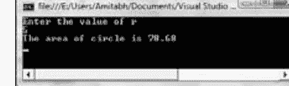

图 1.6：声明常量示例

应用程序的 `main()` 方法包含以下代码行：

`const double pi = 3.1472;`

在上述代码行中使用 `const` 关键字表示变量 `pi` 的值是常量，因此为 `3.1472`。

## 声明可空类型

你可以为可空类型（Nullable type）分配正常范围的值以及空值。这些类型是为可空类型的底层值类型（Value Type）指定的。例如，你可以为 `Nullable<Int32>` 分配从 -2147483648 到 2147483647 之间的值或空值。你可以为 `Nullable<Bool>` 分配值 `true`、`false`。为了解释这一点，让我们在本章稍后创建一个名为 `NullableTypes` 的新 C# 2008 应用程序（光盘中也提供）。为了解释这一点，我们必须创建一个名为 `NullableTypes` 的应用程序。

列表 1.15：声明 NullableTypes

列表 1.15 显示了一个使用可空类型的应用程序。

```csharp
using System;
using System.Collections.Generic;
using System.Linq;
using System.Text;
namespace NullableTypes
{
    class Program
    {
        static void Main(string[] args)
        {
        }
    }
}
```

## 立即解决方案

```csharp
int var1 = null; //声明可空类型变量
int var2 = 5;
var1 = var2; //valid
if (var1 != null) //底层类型是 int
if (var1.HasValue == true)
{
    Console.WriteLine("var1 = " + var1.Value);
}
else
{
    Console.WriteLine("var1 = Null");
}
Console.ReadLine();
```

列表 1.15 的输出如图 1.7 所示。

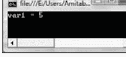

图 1.7：可空变量示例

`var1` 的值在控制台上被打印为 `5`。这是因为 `var2` 的值被赋值给了 `var1`。如果没有给 `var2` 分配值，输出将显示为 `var=null`。可空类型提供的 `HasValue` 属性检查第一个操作数是否有值。第一个操作数返回第二个操作数的值；返回第一个操作数的值。如果将第二个操作数声明转换为第一个类型，则会产生编译时错误。为了清楚 `??` 运算符的概念，让我们按照在本章稍之前“创建简单的控制台应用程序”中的步骤，创建一个名为 `NullCoalescing` 的新 C# 2008 控制台应用程序（光盘中也提供）。列表 1.16 显示了该的完整代码。

## 使用 `??`（空合并）

空合并运算符（`??`）主要用于可空类型和引用类型。`??` 运算符用于两个操作数之间，第一个操作数是可空类型。`??` 运算符的类型必须与第一个操作数的类型相同，或者可以隐式转换为它的类型。`??` 运算符检查第一个操作数是否有值。第一个操作数返回第二个操作数的值；返回第一个操作数的值。如果将第二个操作数声明转换为第一个类型，则会产生编译时错误。为了清楚 `??` 运算符的概念，让我们按照在本章稍之前“创建简单的控制台应用程序”中的步骤，创建一个名为 `NullCoalescing` 的新 C# 2008 控制台应用程序（光盘中也提供）。列表 1.16 显示了该的完整代码。

列表 1.16：使用空合并运算符

```csharp
using System;
using System.Collections.Generic;
using System.Linq;
using System.Text;
namespace NullCoalescing
{
class Program
{
    static void Main(string[] args)
{
        int? i = null; //可空变量
        int? j=30; //可空变量
        int k;
        k = i ?? 25; //使用 ?? 运算符检查空值
    }
}
```

# 第 2 章：介绍 C# 2008

```csharp
Console.WriteLine("The value of k is " + k);
k = i ?? 25; //使用 ?? 运算符检查空值
Console.ReadLine();
```

列表 1.16 的输出如图 1.8 所示。

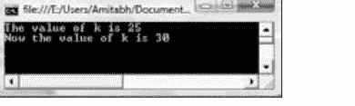

图 1.8：空合并示例

在列表 1.16 中，变量 `i` 被声明为可空，`j` 被赋值为 `30`。`??` 运算符用于检查 `i` 是否为空。如果 `i` 为空，则将 `25` 赋值给 `k`。如果 `i` 不为空，则将 `i` 的值（即空）赋值给 `k`。

## 指定变量的作用域

C# 提供了使用 `::` 运算符指定变量作用域的新方法。这在不同作用域具有相同名称变量时非常有用。让我们按照在本章稍之前“创建简单的控制台应用程序”中的步骤，创建一个名为 `ScopingVariable` 的新 C# 2008 控制台应用程序（光盘中也提供）。列表 1.17 显示了 `ScopingVariable` 的完整代码。

列表 1.17：作用域变量

```csharp
using System;
using System.Collections.Generic;
using System.Linq;
using System.Text;
namespace ScopingVariable
{
    class Program
    {
        static int x = 10;
        static void Main(string[] args)
        {
            int x = 5;
            Console.WriteLine("Local x: " + x);
            Console.WriteLine("Global x: " + ::x);
        }
    }
}
```

## 第 1 章：介绍 C# 2008

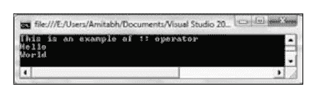

图 1.10：作用域解析运算符示例

列表 1.18 显示了配合全局标识符使用 `::`。这确保了类型和命名空间不受引入新类型和成员的影响。

## 字符串的声明与初始化

尽管仅将字符串视为字符数组，但 C# 使用字符串来表示一组 Unicode 字符字符串。你可以使用 `string` 关键字来声明字符串变量。`string` 是 `System.String` 类的别名。现在，让我们创建一个名为 `Strings` 的新 C# 2008 控制台应用程序（光盘中也提供可用），并按照标题中给出的步骤进行操作。创建一个简单的 C# 2008 控制台变量。列表 1.19 显示了 `Strings` 程序的代码。你可以看到如何声明和初始化字符串。

列表 1.19：声明和初始化字符串


```csharp
using System;
using System.Collections.Generic;
using System.Linq;
using System.Text;
namespace Strings
{
    class Program
    {
        static void main(string[] args)
        {
            string str; //声明一个字符串变量
            str = "Kogent Solutions"; //初始化字符串
            Console.WriteLine("The value of string variable is " + str);
            Console.ReadLine();
        }
    }
}
```

列表 1.19 的输出如图 1.11 所示。

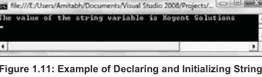

图 1.11：声明和初始化字符串示例

如上所述，使用 `string`，我们声明了一个名为 `str` 的字符串变量。此示例中需要注意的一个重要点是字符串初始化。当我们初始化其他值类型（如整数、浮点和双双精度）时，我们在右侧赋值。在这里，右侧的值被包含在双引号内，表示该值为字符串字面量。如果你将值包含在单引号内，编译器会将该值视为字符字面量并报错。

## 字符串操作

`System.String` 类提供了一系列不同的方法来操作你的字符串，例如更改字符串的大小写、添加两个或多个字符串。让我们考虑这种情况：你有两个或多个字符串并想要添加它们，或者你想替换某个特定的字符串字面量，或者你想查找字符串的长度。你可以通过简单创建一个 `string` 数据类型并使用点运算符 `.` 获取功能来对字符串执行所有操作。

为了让字符串概念更加清晰，现在让我们按照标题中给出的步骤创建一个名为 `StringManip` 的新 C# 2008 控制台应用程序（光盘中也提供可用）。在本章前面已经介绍了如何创建一个 C# 2008 控制台应用程序。`StringManip` 使用不同的方法操作你的字符串。列表 1.20 向你展示了 `StringManip` 程序的代码。

列表 1.20 字符串操作

```csharp
using System;
using System.Collections.Generic;
using System.Linq;
using System.Text;
namespace StringManip
class Program
{
    static void Main(string[] args)
    {
        //声明一个字符串变量
        string fname;
        //声明一个字符串变量
        string mname;
        //声明一个字符串变量
        string lname;
        Console.WriteLine("Enter your first name");
        fname=Console.ReadLine();
        Console.WriteLine("Enter your middle name");
        mname=Console.ReadLine();
        Console.WriteLine("Enter your last name");
        lname=Console.ReadLine();
        string fullname = fname + " " + mname + " " + lname; //连接字符串值
        Console.WriteLine("");
        Console.WriteLine("Your complete name is " + fullname);
        Console.WriteLine("Your name in UPPERCASE is " + 
fullname.ToUpper()); //转换为大大写
        Console.WriteLine("");
        Console.WriteLine("Enter the new first name with which you want to replace your previous name");
        string newname=Console.ReadLine();
        Console.WriteLine("The new name is "+fullname.Replace(fname,newname));
        //替换字符串
        Console.ReadLine();
    }
}
```

列表 1.20 的输出如图 1.12 所示。

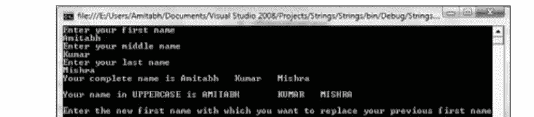

在列表 1.20 中，我们有三个字符串变量 `fname`、`mname` 和 `lname`。在整个示例中，我们将只操作这三个字符串变量。代码行

```csharp
string completename = fname + "\t" + mname + "\t" + lname;
```

连接了所有三个字符串的值。这与整数数据类型类似于，其中我们加上两个或多个整数值。注意，字符串是连接的；第二个字符串的值紧跟在第一个之后，第三个字符串在第一个两个字符串连接后的值之后。`fullname.ToUpper()` 方法将字符串的值转换为大写。`fullname.Replace(fname,newname)` 方法替换了字符串的值。

## 将字符串转换为另一种类型

如上所述，使用 `string` 时，我们声明了一个名为 `str` 的字符串变量。此示例中需要注意的一个重要点是字符串初始化。当我们初始化其他值类型（如整数、浮点和双双精度）时，我们在右侧赋值。在这里，右侧的值被包含在双引号内，表示该值为字符串字面量。如果你将值包含在单引号内，编译器会将该值视为字符字面量并报错。

`System.String` 类提供了一系列不同的方法来操作你的字符串，例如更改字符串的大小写、添加两个或多个字符串。让我们考虑这种情况：你有两个或多个字符串并想要添加它们，或者你想替换某个特定的字符串字面量，或者你想查找字符串的长度。你可以通过简单创建一个 `string` 数据类型并使用点运算符 `.` 获取功能来对字符串执行所有操作。

为了让字符串概念更加清晰，现在让我们按照标题中给出的步骤创建一个名为 `StringManip` 的新 C# 2008 控制台应用程序（光盘中也提供可用）。在本章前面已经介绍了如何创建一个 C# 2008 控制台应用程序。`StringManip` 使用不同的方法操作你的字符串。列表 1.20 向你展示了 `StringManip` 程序的代码。在列表 1.20 中，我们有三个字符串变量 `fname`、`mname` 和 `lname`。在整个示例中，我们将只操作这三个字符串变量。代码行

```csharp
string completename = fname + "\t" + mname + "\t" + lname;
```

连接了所有三个字符串的值。这与整数数据类型类似于，其中我们加上两个或多个整数值。注意，字符串是连接的；第二个字符串的值紧跟在第一个之后，第三个字符串在第一个两个字符串连接后的值之后。`fullname.ToUpper()` 方法将字符串的值转换为大写。`fullname.Replace(fname,newname)` 方法替换了字符串的值。

在编写 C# 应用程序时，有时你需要将文本数据的输入转换为数值格式以便进行计算。此类示例包括从文件读取并从用户读取并转换为数字。在 C# 中，你可以使用许多文本转换函数，如 `atof` 或 `atoi` 将字符串转换为浮点数或整数。在 Java 中，你会分别使用 `Integer` 或 `Float` 类的 `parseInt()` 或 `valueOf()` 方法。使用类似的方法但不同的名称，你会发现这些是类的静态方法。因此，你必须将任何格式转换为正确的格式，然后获取方法返回的结果。

在 C# 中，使用内置函数将自身转换为对象。要将字符串转换为其他数据类型，你使用字符串自身的转换函数。现在，让我们创建一个名为 `Strings` 的新 C# 2008 控制台应用程序（光盘中也提供可用），并按照标题中的步骤进行操作。创建一个简单的 C# 2008 控制台变量。列表 1.19 显示了 `Strings` 程序的代码。你可以看到如何声明和初始化字符串。

列表 1.19：声明和初始化字符串

```csharp
using System;
using System.Collections.Generic;
using System.Linq;
using System.Text;
namespace Strings
{
    class Program
    {
        static void main(string[] args)
        {
            string str; //声明一个字符串变量
            str = "Kogent Solutions"; //初始化字符串
            Console.WriteLine("The value of string variable is " + str);
            Console.ReadLine();
        }
    }
}
```

列表 1.19 的输出如图 1.11 所示。

列表 1.19：声明和初始化字符串

如上所述，使用 `string`，我们声明了一个名为 `str` 的字符串变量。此示例中需要注意的一个重要点是字符串初始化。当我们初始化其他值类型（如整数、浮点和双双精度）时，我们在右侧赋值。在这里，右侧的值被包含在双引号内，表示该值为字符串字面量。如果你将值包含在单引号内，编译器会将该值视为字符字面量并报错。

`System.String` 类提供了一系列不同的方法来操作你的字符串，例如更改字符串的大小写、添加两个或多个字符串。让我们考虑这种情况：你有两个或多个字符串并想要添加它们，或者你想替换某个特定的字符串字面量，或者你想查找字符串的长度。你可以通过简单创建一个 `string` 数据类型并使用点运算符 `.` 获取功能来对字符串执行所有操作。为了让字符串概念更加清晰，现在让我们按照标题中给出的步骤创建一个名为 `StringManip` 的新 C# 2008 控制台应用程序（光盘中也提供可用）。在本章前面已经介绍了如何创建一个 C# 2008 控制台应用程序。`StringManip` 使用不同的方法操作你的字符串。列表 1.20 向你展示了 `StringManip` 程序的代码。

在列表 1.20 中，我们有三个字符串变量 `fname`、`mname` 和 `lname`。在整个示例中，我们将只操作这三个字符串变量。代码行

```csharp
string completename = fname + "\t" + mname + "\t" + lname;
```

连接了所有三个字符串的值。这与整数数据类型类似于，其中我们加上两个或多个整数值。注意，字符串是连接的；第二个字符串的值紧跟在第一个之后，第三个字符串在第一个两个字符串连接后的值之后。`fullname.ToUpper()` 方法将字符串的值转换为大写。`fullname.Replace(fname,newname)` 方法替换了字符串的值。

列表 1.21：一种类型到另一种类型

```csharp
using System;
using System.Collections.Generic;
using System.Linq;
using System.Text;
namespace Conversion
{
    class Program
    {
        static void Main(string[] args)
        {
            string str; //声明一个字符串变量
            str = "Kogent Solutions"; //初始化字符串
            Console.WriteLine("The value of string variable is " + str);
            Console.ReadLine();
        }
    }
}
```

# 第 1 章：介绍 C# 2008

```csharp
static void Main(string[] args)
{
    string str1 = "123.45";
    string str2 = "123.00";
    // 将字符串转换为浮点数
    int snngl1 = Convert.ToInt(str1);
    int snngl2 = Convert.ToInt(str2);
    Console.WriteLine("Single 1 = {0}", snngl1);
    Console.WriteLine("Single 2 = {0}", snngl2);
    // 将字符串转换为 double
    double x = Convert.ToDouble(str1);
    double y = Convert.ToDouble(str2);
    Console.WriteLine("Double 1 = {0}", x);
    Console.WriteLine("Double 2 = {0}", y);
    Console.Read();
}
```

列表 1.22 的输出如图 1.14 所示。

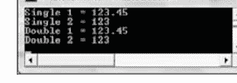

所提供的示例中的一个重要点是列表 1.22 中的阴影行。在列表 1.22 中，你并没有直接使用 `ToDouble` 函数将字符串从其原始格式转换为整数，而是先将其转换为浮点数，然后强制转换为整数。这个简单的示例说明了 `Int16` 函数在处理它认为的浮点数（123.45）时会发生无效错误。结果是它会抛出 `InvalidFormat` 异常，应用程序将终止。为了避免发生这种情况，你将字符串转换为更安全的格式（即浮点格式），然后允许在从浮点格式到整数格式的显式转换中发生自然截断。

## 可空类型（Nullable Types）

非可空值类型（Value Type）会隐式转换为该值类型的可空形式。此外，转换也发生在从空字面量（null literal）到可空类型之间。请看示例：

```csharp
float? a = 435.6;
float? b = null;
if (a.HasValue) Console.WriteLine(a.Value);
if (b.HasValue) Console.WriteLine(b.Value);
```

在前面的代码中，变量 `a` 显示了值 435.6，但显示 `b` 值的语句没有被执行，因为 `b` 的 `HasValue` 属性为 `false`。

可空转换和字面量允许用户对非可空值类型及其值类型的可空形式执行预定义和用户定义的转换。同样，运算符允许通常的预定义和用户定义运算符对非可空值类型和类型的可空形式执行转换。

如果存在从非可空值类型 A 到非可空值类型 B 的预定义转换，则发生从 A 到 B 的自动可空转换。此外，可空转换也发生在 A 到 B? 之间。从 A? 到 B? 的转换是显式转换，如果源值为空，则会抛出异常。

现在，让我们来看一个新的名为 `NullableConversion` 的 C# 2008 控制台应用程序（也可以通过在本章较早“创建一个简单的 C# 2008 控制台应用程序”标题中提供的步骤获得）。在这个可空应用程序中，我们将通过应用程序来解释上述讨论的概念。列表 1.23 显示了 `NullableConversion` 的完整代码。

## 列表 1.23：可空类型转换

```csharp
using System;
using System.Collections.Generic;
using System.Linq;
using System.Text;
namespace Nullableconversion
{
    class Program
    {
        static void Main(string[] args)
        {
            int m = 123;
            // 将整数 m 的值赋值给可空整数
            int? a = m;
            Console.WriteLine("the value of a is " + a);
            // 将可空整数的值赋值给 double 变量
            double b = a;
            Console.WriteLine("the value of nullable double is " + b);
            // 将 double 转换为可空 int 并赋值给可空整数
            int? c = (int?)b;
            Console.WriteLine("the value of nullable integer is " + c);
            // 将可空 int 转换为整数并赋值给整数变量
            int n = (int)c;
            Console.WriteLine("the value of integer variable is " + n);
            Console.ReadLine();
        }
    }
}
```

列表 1.23 的输出如图 1.15 所示。

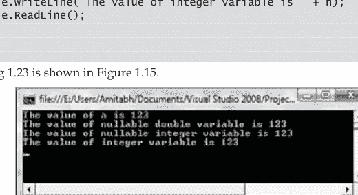

图 1.15：可空类型转换示例


通过代码 `int m = 123`，我们为整数 `m` 赋值了值 `123`，该值进一步被赋值给可空变量。两者的数据类型相同，因此不需要类型转换。代码行 `double b=a` 通过隐式转换其类型将 `a` 的值赋值给 `double` 变量 `b`。但当我们使用代码行 `int? c=(int?)b` 将可空变量 `b` 的值赋值给可空整数 `c` 时，需要进行显式类型转换，因为 `double` 类型不能隐式转换为整数类型。最后，我们使用代码 `int n=(int)c` 将可空 `int` 转换为整数类型。

## 使用 `is` 和 `as` 运算符

`is` 运算符检查对象是否与给定类型兼容，并返回 `true` 或 `false` 的布尔结果。该对象可以是相同类型，也可以派自特定的给定类型。`as` 运算符显式转换引用类型（Reference Types）。如果引用与指定类型兼容，它将执行成功，否则返回 `null` 值。

为了澄清 `is` 和 `as` 运算符的概念，让我们通过本章较早“创建一个简单的 C# 2008 控制台应用程序”标题中的步骤，创建一个名为 `Isanda` 的 C# 2008 控制台应用程序（在光盘中也可用）。列表 1.24 显示了 `Isanda` 的代码。

## 列表 1.24：`is` 和 `as` 运算符

```csharp
using System;
using System.Collections.Generic;
using System.Linq;

namespace Isanda
{
    class Program
    {
        static void Main(string[] args)
        {
            object i = 25;
            object str = "solutions";

            if (i is string) // 检查兼容性
                Console.WriteLine("i is a string");
            else
            {
                Console.WriteLine("i is an integer type");
                string str1 = i as string;
            }
        }
    }
}
```

# 第 1 章：介绍 C# 2008

由于 C# 是一种强类型语言，数据类型只有在比较有意义时才能使用。“强类型”一词意味着即使成员的值相同，一种类型也无法转换为另一种类型。例如，你不能直接将字符字符串与数字进行比较；要这样做，你必须先将字符串转换为数值。同样，你只能赋值 `false` 或布尔类型（Boolean），因为语言对于 `true` 大于 `false` 或反之并没有可接受的定义，该语言没有为这种数据类型提供最小值或最大值。

列表 125 的输出如图 1.17 所示。

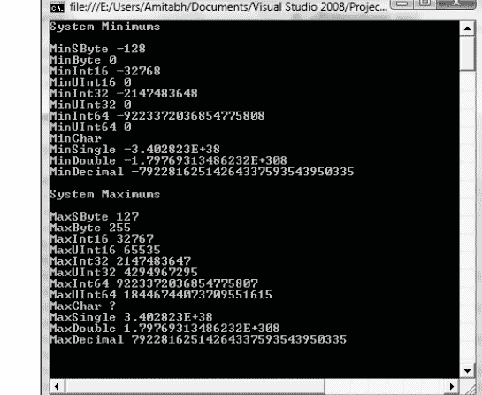

考虑到数据类型的允许范围，图 1.17 中显示的所有数字都是符合预期的。列表 125 中值得注意的一点是，数据类型的最小值和最大值是一个对象，可以像任何其他对象一样进行比较或打印。

## 创建枚举（Enumeration）

枚举是用户定义的值类型（Value Type）。它们是强类型常量，“强类型”意味着一种类型的枚举不能赋值给另一种类型的枚举。该短语防止了即使成员的值相同也无法赋值另一种类型的枚举。

枚举通过避免使用魔数值（magic values）使你的代码更具可读性。在创建枚举时，如果你尝试在代码的其他部分赋值不在接受范围内的值，就会发生错误。由于枚举是值类型，它们不能被继承，也不能从一个枚举类继承。

此外，让我们为本章创建一个新的 C# 2008 控制台应用程序，命名为 `Enumeration`（光盘中也可用）。按照本章前面“创建一个简单的 C# 2008 控制台应用程序”标题下的步骤操作。`Enumeration` 应用程序使枚举的概念更加清晰，列表 126 显示了 `Enumeration` 程序的完整代码。

## 列表 1.26：创建枚举

```csharp
{
    public enum Color { Red = 1, Green, Yellow }

    class Program
    {
        static void main(string[] args)
        {
            Console.WriteLine("Please select 1 for Red, 2 for Green, and 3 for Yellow");
            string str = Console.ReadLine();
            int colInt = Int32.Parse(str);
            Color col = (Color)colInt;

            switch (col)
            {
                case Color.Red:
                    Console.WriteLine("The selected color is Red");
                    break;
                case Color.Green:
                    Console.WriteLine("The selected color is Green");
                    break;
                case Color.Yellow:
                    Console.WriteLine("The selected color is Yellow");
                    break;
                default:
                    Console.WriteLine("this number is not assigned to any color");
                    break;
            }

            Console.ReadLine();
        }
    }
}
```

列表 1.26 的输出如图 1.18 所示。

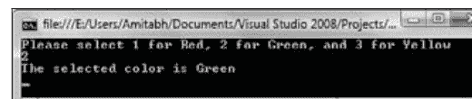

图 1.18：枚举示例

列表 1.26 中的代码说明了在已知特定值范围的情况下使用枚举。

```csharp
public enum Color { Red = 1, Green, Yellow }
```

它创建了一个名为 `Color` 的枚举，并使用三个成员 `Red`、`Green` 和 `Yellow` 定义了它。`Red` 成员被标识为 `1`；其他成员分别自动分配 `2` 和 `3`。代码行 `Color col = (Color)colInt` 创建了一个 `Color` 对象，用于访问枚举的成员。

## 声明一维数组和多维数组

C# 语言支持一维数组和多维数组。在所有情况下，数组都是动态的。C# 没有像 C 或 C++ 中那样的静态数组概念。一维数组通过单个整数索引，而多维数组通过两个或多个整数索引。

为了解释一维数组和多维数组的概念，让我们按照本章前面“创建一个简单的 C# 2008 控制台应用程序”标题中的步骤，创建两个 C# 2008 应用程序，命名为 `SingleDimensionArray` 和 `MultiDimensionalArray`（光盘中也可用）。列表 1.27 显示了 `SingleDimensionArray` 应用程序的代码。

## 列表 1.27：一维数组

```csharp
using System;
using System.Collections.Generic;
using System.Linq;
using System.Text;

namespace SingleDimensionalArray
{
    class Program
    {
        static void Main(string[] args)
        {
            string[] name = new string[2];
            int[] sub1 = new int[2];
            int[] sub2 = new int[2];
            int[] total = new int[2];

            for (int i = 0; i < 2; i++)
            {
                Console.WriteLine("enter the " + (i + 1) + " student name");
                name[i] = Console.ReadLine();

                Console.WriteLine("enter the marks of first subject");
                sub1[i] = int.Parse(Console.ReadLine());

                Console.WriteLine("enter the marks of second subject");
                sub2[i] = int.Parse(Console.ReadLine());

                total[i] = sub1[i] + sub2[i];
                Console.WriteLine("student name is " + name[i] + " and his total is " + total[i]);
            }

            Console.ReadLine();
        }
    }
}
```

列表 1.27 的输出如图 1.19 所示。

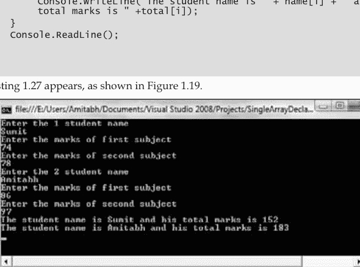

图 1.19：数组示例

如列表 1.27 所示，多维数组通过以下方式创建：

```csharp
int[,] x = new int[3, 3];
```

相对于 C++，另一个需要考虑的点是它们不能被简单地视为指针，列表 1.28 显示了完整代码。

## 列表 1.28：多维数组

```csharp
using System;
using System.Collections.Generic;
using System.Linq;
using System.Text;

namespace MultiDimensionArray
{
    class Program
    {
        static void Main(string[] args)
        {
            int[,] x = new int[3, 3];

            for (int j = 0; j < 3; j++)
            {
                Console.WriteLine("enter the " + (j + 1) + " row");

                for (int k = 0; k < 2; k++)
                {
                    Console.WriteLine("enter the " + (k + 1) + " column");
                    x[j, k] = int.Parse(Console.ReadLine());
                }
            }

            Console.ReadLine();
        }
    }
}
```

列表 1.28 的输出如图 1.20 所示。

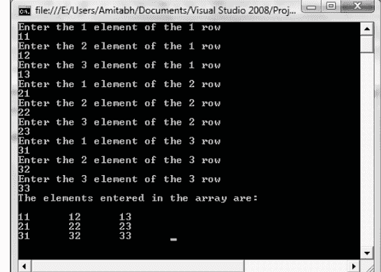

## 立即解决方案


```
OneDArray Row 0 = 0
OneDArray Row 1 = 1
OneDArray Row 2 = 2
OneDArray Row 3 = 3
OneDArray Row 4 = 4
OneDArray Row 5 = 5
OneDArray Row 6 = 6
OneDArray Row 7 = 7
OneDArray Row 8 = 8
OneDArray Row 9 = 9
PrintDArray: 2 dimensions
```


1.29 中的代码行：

```csharp
x[i] = 1;

PrintArray();
```

`i` 的值被赋值给数组元素，并在每次循环执行时进行。数组的最大长度为 `10`，`PrintArray` 函数打印到 `9` 的数组值。该代码行：

```csharp
PrintArray(y);
```

在应用程序中使用的代码行允许程序员打印早期在 1.29 中定义的多维数组的秩。

## 创建别名

你可能已经注意到 C# 使用命名空间（namespaces）在逻辑上组织类、结构体、接口、枚举和委托。这些命名空间的约定（例如 `System.Collections.Generic`）是使用一个高层部分（如 `System`），然后是一个或多个定义了实际类所在位置的子命名空间。

这个过程可能会导致非常长的名称，并可能需要你查找这些名称是否与 C# 用于实现数据库结构的其他通用名称发生冲突。子类名称 `Database` 几乎肯定在 C# 类库内部在使用，因此你应该将该类放在自己的命名空间中。如果该命名空间包含了另一个命名空间，你将必须使用类似下面的完全限定名称：

```csharp
CompanyDatabase.database.CallItemsmethod()
```

现在，让我们按照课程给出的步骤创建一个 C# 2008 应用程序（使用 CD-光盘中的可用别名）。正如本章早期所述，创建一个 C# 2008 应用程序。在这种情况下，你为你的公司使用了一系列命名空间，其中一个恰好是别名。

`Alias` 命名空间是一个 `Database` 命名空间，它包含了若干定义为与数据库相关的类。该类 `Table` 处理数据库中的单个表。列表 1.30 显示了 `Alias` 应用程序的代码。

## 列表 1.30：创建别名

```csharp
using System;
using System.Collections.Generic;
using System.Linq;
using System.Text;
using Alias.Database.Table;

namespace Alias
{
    public class DBInterface
    {
        public static void Open(
        {
            System.Console.WriteLine("Opening database");
        }
    }
}
```

# 第 1 章：引入 C# 2008

```csharp
// 在 InternalClasses 内部定义一个嵌套命名空间
namespace Database
{
    public class Table
    {
        public static void Open(string tableName)
        {
            System.Console.WriteLine("Opening table {0}");
            tableName);
        }
    }
}

class Program
{
    static void Main(string[] args)
    {
        CmDb.Open("Fred");
        Console.ReadLine();
    }
}
```

列表 1.33 的输出如图 1.22 所示。

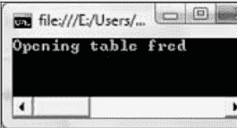

图 1.22：创建别名的示例

在为长命名空间字符串定义别名后，你可以从应用程序或类中需要使用该命名空间的地方开始，通过简单的别名（在本例中为 `CmDb`）来引用该长字符串。这使得处理复杂的命名空间变得简单得多。

注意，你可能无法定义与已存在的命名空间冲突的别名。换句话说，你不能定义自己的别名，然后在同一个应用程序中同时使用别名和 `System` 命名空间。如果发生冲突，编译器将无法知道你想使用哪个命名空间。

## 总结

在本章中，你首先学习了 C# 2008 包含的各种新功能。然后你学习了 C# 的基础知识，如标识符、关键字、数据类型、变量、常量、运算符和表达式。

在下一章中，你将学习 C# 2008 中的命名空间、类、对象和结构体。

## 命名空间、类、对象和结构体

| 如果你需要解决以下问题的立即解决方案： | 查看页码： |
|---|---:|
| 创建命名空间 | 62 |
| 为命名空间添加引用 | 63 |
| 通过 `using` 指令访问预定义的命名空间 | 64 |
| 创建类 | 64 |
| 声明部分类（Partial Class） | 65 |
| 创建对象 | 66 |
| 使用 `this` 关键字 | 67 |
| 创建对象数组 | 69 |
| 使用带参数的方法 | 70 |
| 使用变参数的方法 | 72 |
| 向方法传递引用参数 | 73 |
| 将对象作为参数传递给方法 | 74 |
| 从方法返回值 | 76 |
| 创建部分方法（Partial Method） | 77 |
| 使用参数化构造函数 | 78 |
| 创建拷贝构造函数 | 79 |
| 使用析构函数 | 80 |


| 如果你需要解决以下问题的立即解决方案： | 查看页码： |
|---|---|
| 创建静态类 | 81 |
| 使用静态方法 | 81 |
| 赋值值 | 83 |
| 使用对象初始化器 | 84 |
| 使用只读属性 | 85 |
| 创建静态属性 | 86 |
| 创建匿名类型 | 87 |
| 使用索引器 | 88 |
| 使用字符串 | 89 |
| 嵌套类 | 91 |
| 使用结构体 | 92 |

## 深入探讨

C# 语言提供了丰富的功能和强大的结构，允许你以最小的精力进行扩展。在本章中，我们探索了其中的一些内容，包括命名空间、类和命名空间的概念。

命名空间的概念对于 C# 来说并不新。C++ 有，Java 也有。命名空间是对一个或多个元素的封装，使其变得唯一。例如：

```csharp
namespace NamespaceCorpl {
    public class Corpl {
        enum EnumType {}
    }
}
```

可以实现为包装某个所有的类。如果公司有来自另一个供应商的第三方包装，它们在程序中实现了相同的类名，命名空间封装将有助于开发者通过命名约定引用第三方。假设你有两个命名空间`Name1`和`Name2`，它们都包含一个名为`List`的类。在这种情况下，你不需要重命名两个命名空间的命名约定，你无法更改类名。

## `namespaces`关键字

你在命名空间内编写的所有代码对于当前上下文都是。关于命名空间的另一个值得注意的是，C# 的包含符号（等同于 Java 中的`import`语句）通过使用关键字，可以告诉编译器你想在系统中使用的命名空间和代码。最常用的方法是在程序中使用`System`关键字，以便可以使用 System 组的大部分常用功能。这样做，你可以编写以下代码：

```csharp
using System;
// 调用 System 命名空间中的 console 类
Console.WriteLine("Hello world!");
```

实现相同结果的替代方法如下。

C# 理解这两种元素是等价的，在任何情况下都会调用`Console`的相同方法（`WriteLine()`）。`using`关键字通过消除原本可能需要的命名空间层级，使问题更容易理解。

命名空间和`using`关键字的另一个问题是为命名空间创建别名。当你有两个具有共同方法的命名空间，或者当一个列表嵌套时，此功能非常有用。

# 第 2 章：命名空间、类、对象和结构体

命名空间（namespaces）相当于非常长的名称。假设你的公司坚持在你创建的每个类周围都包含三层命名空间，如列表 2.1 所示。

列表 2.1：三层命名空间

```csharp
namespace Corporation {
    namespace Dept {
        namespace Project {
            class InternalClass {
        }
    }
}
```

通常情况下，要引用`InternalClass`类，你将不得不使用以下语法：

`Corporation.Dept.Project.InternalClass`

在所有地方输入这一行是一种可选方案，它允许你按照如下方式为`Corporation.Dept.Project`命名空间指定别名：

`using DCN.Dept.Project;`

在指定别名后，你就可以按照如下所示使用命名空间成员：

`DCN.InternalClass`

在这里，`DCN`是`Corporation.Dept.Project`命名空间的别名。列表 2.2 显示了用于阐述这一概念的完整代码：

列表 2.2：定义命名空间别名

```csharp
using DCN = Corporation.Dept.Project;
namespace Dept {
    namespace Project {
        class InternalClass {
            public static void display() {
                Console.WriteLine("Hello world");
            }
        }
    }
}
public class MainClass {
    public static void Main() {
        DCN.InternalClass.display();
    }
}
```

这种技术确实减少了你的输入量。命名空间提供了便利。不要让它们成为你代码中的噩梦。

## `System`命名空间

.net 类库提供了以下命名空间：

- `System`-包含包含基本类和基类，它们定义了常用的数据类型、事件和事件处理程序、接口、属性、异常等。
- `System.Collections`-包含定义各种对象集合的接口和类，包括列表、队列、数组、哈希表和字典。
- `System.Data`-包含构成 ADO.NET 的类。ADO.NET 允许你构建管理来自多个分布式源数据的数据处理组件。
- `System.Data.OleDb`-包含支持 OLE DB .NET 提供程序的类。
- `System.Data.SqlClient`-包含支持 SQL Server .NET 提供程序的类。
- `System.Data.OracleClient`-包含用于实现 Oracle 数据提供程序的类。
- `System.Data.Odbc`-包含用于实现开放数据库连接（ODBC）数据提供程序的类。
- `System.Diagnostics`-包含允许你调试应用程序并在调试时逐步执行代码的类。它包含了启动系统进程、在事件日志中读写以及监控性能的方法。
- `System.Drawing`-提供对 GDI 图形框架的访问。高级功能在`System.Drawing.2D`、`System.Imaging`和`System.Drawing.Text`命名空间中提供。
- `System.Drawing.2D`-包含支持二维和矢量图形的类。
- `System.Drawing.Imaging`-包含支持高级 GDI 图像的类。
- `System.Printing.Text`-包含允许你自定义和执行打印的类。
- `System.Text`-包含支持高级 GDI+ 排版的类。此命名空间中的类允许你创建和使用字体集合。
- `System.Globalization`-包含支持文化信息的类，包括语言/区域、日历、日期、数字和货币的格式模式。
- `System.IO`-包含支持对数据流和文件进行同步和异步写的类。
- `System.net`-提供互联网上使用的许多协议的接口。
- `System.net.Sockets`-包含支持 Windows Socket 接口的类。如果你工作过 WinSock API，你将能够使用`Socket`类开发应用程序。
- `System.Reflection`-包含返回类型、方法和字段信息的类和接口，并且具有动态创建和使用类型的能力。
- `System.Runtime.Remoting`-包含允许开发者创建和配置分布式应用的类。
- `System.Security`-包含通用语言运行时（CLR）安全系统的类。
- `System.Runtime.Serialization`-包含用于对象序列化和反序列化的类。序列化是将对象或对象图转换为线性序列以便存储或传输到另一个位置的过程。反序列化是获取信息并据此重建对象的过程。
- `System.Threading`-包含启用多线程编程的类和接口。
- `System.Web`-包含支持浏览器/服务器通信的类和接口。该命名空间包括此类类，如提供 HTTP 请求信息的`HttpRequest`类；管理到客户端的 HTTP 输出的`HttpResponse`类；以及提供服务器端工具和过程访问的`HttpServer`类。你还可以使用这些类使用 cookie、通过 HTTP 网络传输数据等。
- `System.Web.Security`-包含用于在 Web 应用程序中实现 ASP.NET 安全性的类。
- `System.Web.Services`-包含让你构建和使用 Web 服务的类，Web 服务是 Web 服务器上的可编程实体，代码使用标准互联网协议与其通信。
- `System.Windows.Forms`-包含用于创建 Windows 表单的类，这些表单利用 Windows 操作系统的用户界面控件和其他功能。
- `System.Xml`-包含支持处理 XML 的类。

现在你已经学习了命名空间，并对`System`命名空间进行了简单介绍。接下来，我们将描述类和对象。

## 类和对象

C# 类是语言的主要构建块。这意味着为了使用 C#，你必须创建类来编写程序。你可以将类作为一组对象的模板，并根据需要使用此模板创建对象。

假设我们需要创建一个类的对象。为了这样做，我们创建一个`Student`类，它包含了任何学生的功能和属性。

类允许你定义一个自包含的环境，在那个环境中，你可以控制适用于给定数据类的所有函数，以及如何访问数据。类还赋予你扩展运行时的能力，并允许开发者以新的方式复用现运行时功能。在本节中，你将探索：

- 类语法
- 方法作为类成员
- 访问修饰符
- 使用对象访问类成员
- 构造函数和析构函数
- 静态类静态成员、属性和索引器

让我们从类语法开始。

## 类语法

类的语法如下：

```csharp
{
  <access-modifier> [static] <return-type> MethodName(<signature>);
  <access-modifier> [static] <variable-type> variab;
}
```

声明对象的语法是新的：

```csharp
<className> <objectName> = new <className>();
```

## 部分类定义

部分类（partial class）允许你在两个或多个源文件中定义类、结构体或接口。包含类定义部分的所有源文件在应用程序完成时合并。当开发者处理大型项目时，可能需要部分类。部分类将类拆分到多个文件中，允许开发者同时对类进行工作。

使用`partial`关键字，可以将类声明为部分的，如列表 2.3 所示：

```csharp
public partial class student
{
    public void avgMarks() {
}
}
public partial class student
{}
```

## 深度解析

```java
public void calRank() { 
}
```

`partial`关键字指定了类、结构体或接口的哪些部分定义在命名空间内。

## 作为类成员的方法

现在你已经熟悉了使用类的重要性，我们来讨论类的成员——类方法和类变量。类的成员是你在类中声明的元素。你可以使用`class`关键字声明一个类，并在后跟上类名。你可以在类内部声明类的成员（方法和变量），如列表 2.4 所示。

列表 2.4：声明类的成员

```java
class Square {
    int side;
    public int area() {
        return (side * side);
    }
}
```

在列表 2.4 中，该类有一个名为`side`的变量，它用于存储正方形尺寸的整数值，以及一个名为`area`的方法，用于计算正方形的面积。它们都是`Square`类的成员。

构造函数和析构函数是每个类的特有方法。每个类都有自己的构造函数和析构函数，它们在类的实例创建或销毁时自动调用。构造函数会在每次访问该类时初始化所有类成员，而析构函数在对象不再需要时销毁它们。

# 注意

类变量也被称为数据成员，类方法也被称为成员函数或方法。

## 变量方法

你可以向方法传递值。传递参数的语法如下：

```text
[modifiers] DataType ParameterName
# 以下是参数类型：
```

- 值参数（Value parameter）——参数是默认参数。如果你在不使用任何修饰符的情况下声明参数，则它被视为值参数。值参数也被称为输入参数（in parameter）。方法可以通过给定方法中的参数为此参数赋值。这种赋值仅影响本地存储。它对方法中被赋值的实际参数没有影响。此外，对参数的修改会影响本地方法；它们不会传递给调用者方法。
- 引用参数（Reference parameter）——使用`ref`声明的参数是引用参数。与值参数不同，引用参数不会创建新的存储位置。相反，引用参数代表方法调用中提供的参数的相同的存储位置。在方法内部，引用参数在使用之前必须赋值。
- 输出参数（Output parameter）——使用`out`声明的参数是输出参数。与引用参数类似，输出参数不会创建新的存储位置。相反，输出参数代表方法调用中参数的相同的存储位置。方法的每个输出参数都必须在方法返回输出时被赋值。输出参数通常用于产生多个返回值的的方法。

列表 2.5 展示了如何在方法定义和调用中使用`out`修饰符：

# 第 2 章：命名空间、类、对象和结构体

列表 2.5：使用`out`修饰符

```csharp
class UsingOut
{
    static void FirstMethod(out int x) // 方法定义中的修饰符
    {
        x = 81;
    }
    static void Main()
    {
        int y; // 无预初始化
        FirstMethod(out y); // 方法调用中的 out 修饰符
        // y 的值为 81;
    }
}
```

在列表 2.5 中，显然`out`修饰符在方法定义（`static void FirstMethod(out int x)`）和方法调用（`FirstMethod(out y)`）中都已指定。

列表 2.6：如何在方法定义和调用中使用`ref`修饰符：

```csharp
class UsingRef
{
    static void SecondMethod(ref int x) // 方法定义中的 ref 修饰符
    {
        x++;
    }
    static void Main()
    {
        int y = 81; // 必须初始化
        SecondMethod(ref y); // 方法调用中的 ref 修饰符
        Console.WriteLine("Value of y is " + y + "");
    }
}
```

如列表 2.6 所示，你需要在初始化之前为输出参数初始化变量或某些值。然而，当方法返回多个值时，优选使用`out`参数。C++ 不具备支持多个返回值的特性，但你可以通过一些编程技巧来实现；然而，C# 的`out`允许返回多个值。

- 参数数组（Parameter array）——参数数组是数组的数组，使用`params`修饰符声明。当程序员想要向方法成员传递数量数量的参数时，参数数组非常有用。参数数组可以是单维数组或多维数组。如果你传递一个单维数组，该参数的作用就像一个普通值。它必须是单维数组类型，并且是列表中的最后一个参数。换句话说，它位于参数列表的末尾。`params`修饰符无法与`ref`和`out`结合。

## 访问修饰符

访问修饰符有助于避免数据与现有代码冲突，并保护类对象免受外部干扰。这种修饰符通过定义特定的访问范围来以限制的方式访问数据和方法来实现。你可以使用访问修饰符声明一个类及其每个方法。然而，每个方法之后只能包含一个修饰符。如果你声明的类没有嵌套在任何其他类内部，则该类可以使用以下修饰符：

- `Public`（公共）
- `Internal`（内部）

另一方面，嵌套类可以使用以下五种修饰符：

- `public`修饰符——无限制地允许类内部和外部访问访问成员。
- `internal`修饰符——仅允许同一个程序集（assembly）内访问成员。
- `protected`修饰符——允许类内部或通过派生类访问成员。
- `private`修饰符——仅允许类内部访问成员。
- `internal`修饰符——仅允许同一个程序集内访问成员。

## 深度解析

```cs
Listing 2.8: 拷贝构造函数示例
// 创建一个新的 Carpetails 对象。
Carpetails car1 = new Carpetails("Zen Estilo XXI", 15.7);
// 创建另一个新对象，复制 car1。
Carpetails car2 = new Carpetails(car1);
class Carpetails {
    //...数据成员
    public Carpetails(Carpetails MyCar) // 拷贝构造函数。
    {
        ...方法体
    }
    public Carpetails(String ModelName, double Mileage) // 实例构造函数。
    {
        ...方法体
    }
}
```

在列表 2.8 中，调用了`Carpetails()`构造函数。创建了一个新的`car1`对象，然后创建了另一个新对象`car2`，该对象复制了`car1`对象。

## 静态类与静态成员

静态类和成员不需要任何对象即可调用；相反，你可以直接使用类名。静态类和成员允许你可以在不创建类实例的情况下访问类的数据和成员函数。静态成员不需要实例化。如果类中声明的方法不会影响实例的行为，则可以使用静态类。C# 使用`static`关键字来定义类以及作为静态方法的成员。以下代码片段显示了如何声明静态类：

```cs
static class employee {
    public static int id;
    public static int tele_no;
}
```

在此代码段中，`employee`是静态类，`id`和`tele_no`是成员。静态类表示其成员也是静态的。你不能使用`new`关键字实例化静态类。当 .NET Framework 的 CLR 加载程序或包含静态类的命名空间时，会自动加载这些静态类。


静态类不包含实例构造函数（实例构造函数用于创建和初始化实例）。静态类是密封的（`sealed`），这意味着你不能继承这些类。你可以使用 `static` 关键字声明静态类成员，如下代码片段所示：

```cs
public class student {
    public static int roll_no = 4;
    public static int rank;
}
```

前面的代码片段显示了一个 `student` 类，它不是静态的；然而，该类的成员 `id` 和 `rank` 是静态的。这些静态成员在第一次被访问或在调用静态类之前就会被初始化。

## 静态成员与非静态成员的区别

静态成员和非静态成员之间存在一些差异，例如：

- 静态成员属于类，而非静态成员属于类的对象。这意味着静态成员可以通过类调用，也可以通过类的对象调用，而非静态成员只能通过类的对象调用。
- 静态成员只能访问类的其他静态成员，而非静态成员可以同时访问类的静态成员和非静态成员。

# 第 2 章：命名空间、类、对象和结构体

## 属性

属性（Properties）是一种以简单直观的方式暴露类内部数据元素的方法。C# 是最早提供属性直接支持的语言之一。C++ Builder 和 Delphi 语言作为它们所支持的语言（C++ 和 Object Pascal）的扩展提供了此功能，但这些并未被视为标准。

对于类的用户来说，属性看起来像一个公共变量，可以在其上执行 `get` 或 `set` 操作。

```cs
// 设置颜色属性
Foo.Color = color;
// 获取颜色属性
Color c = Foo.Color;
```

然而，你可以使用类型安全的 `get` 和 `set` 方法来实现属性：你可以通过定义一个外部可用的名称然后使用 `set` 和 `get` 方法来创建一个属性。你根据属性方法的调用者提供给你的输入，决定是否允许用户修改属性。列表 2.9 是编写属性的语法。

```cs
// 定义属性存访问器
public <type> <PropertyName>
{
    get
    {
        return <var>;
    }
    set
    {
        // 验证位于 value 中的输入
        if (IsValid(value))
            <var> = value;
    }
}
```

在列表 2.9 中，需要注意的最点是 `value` 关键字。`value` 类型与属性本身的类型相同，你可以在 `public <type> <PropertyName>` 这一行中找到它。

在此行中，你正在定义属性的名称以及外部用户看到的属性类型。

注意，你需要与内部成员变量具有相同类型的属性（在前述的列表中由 `<var>` 表示）。你可以在 `set` 和 `get` 方法中进行任何转换，以便将值传递给 C 中特定的存访问器。

## 访问器的可访问性

在 C# 中，属性有 `get` 和 `set` 部分。访问器（Accessor）代表访问器访问属性成员的能力。列表 2.10 显示了如何在类的属性中声明访问器。

列表 2.10：在类中声明带访问器的属性

```cs
class MyProperty
{
    private string name="Sumit";
    public string Name
    {
        get{return name;}
        set{name=value;}
    }
}
```

## 深度解析

在列表 2.10 中，`get` 和 `setter` 具有相同的可访问级别。这意味着这些访问器是公共的，因为它们没有显式标记任何修饰符。在 C# 2.0 及更高版本中，你可以单独指定这些访问器的可访问级别，如列表 2.11 所示：

### 列表 2.11：指定属性的可访问性级别

```cs
class MyProperty
{
    private string name="Sumit";
    public string Name
    {
        get{return name;}
        protected set{name=value;}
    }
}
```

在列表 2.11 中，属性 `Name` 是公共的，访问器也是公共的，因为它没有显式标记任何修饰符。然而，`setter` 显式标记了 `protected` 修饰符。因此，你可以在整个程序中使用 `get` 方法，而只能在类或子类内部使用 `set` 方法。这种方法被称为异步可访问性（asymmetric accessibility）。

静态变量只有一个副本，即使在类实例化时，其值也保持不变；而在非静态变量的情况下，每次实例化类时，对象都拥有这些变量的副本。

## 匿名类型

当你为应用程序创建属性时，也需要创建一些只读属性。你可以使用匿名类型将这些只读属性封装在一个单元中。匿名类型提供了一种在预先定义类型的情况下封装对象只读属性的方法。编译器会生成所需的类型名称，但该名称在源代码中不可用。编译器根据属性导出类型名称。换句话说，匿名类型创建了可以使用 `var` 关键字添加到集合中的无名结构类型。

匿名类型是由一个或多个公共只读属性组成的类。不允许其他类型的类成员（如方法或事件）。你可以使用 `new` 关键字配合对象初始化器创建匿名类型。

匿名类型是直接派生自引用类型。如果两个或多个匿名类型具有相同数量且相同顺序的属性，编译器会将它们视为相同类型，并共享相同的生成信息。

## 索引

索引器（Indexer）是一个新概念，用于将类作为数组使用并允许对象使用索引符号访问类的成员。换句话说，它们提供了索引来获取存储在数组中的值。列表 2.12 显示了声明索引器的语法：

### 列表 2.12：声明索引器的语法

```cs
<access modifier><Return type> this[argument list]
{
    get
        // get 代码
    set
        // set 代码
}
```

在此语法中：

- 访问修饰符可以是 `Private`、`Public`、`Protected` 或 `Internal`。
- 返回类型可以是任何 C# 数据类型，如字符串或整数。
- `this` 关键字表示对象属于当前类。

- 参数列表指定了索引器的参数。C# 索引器必须至少有一个参数；否则，编译器会报错。C# 中的索引器允许你拥有多个参数，且每个参数可以具有不同的类型。你可以通过在这些参数之间放置逗号来分隔这些参数。索引的参数类型可以是 `int`、枚举（`enum`）或字符串（`string`）。此类列表定义了索引器的签名。签名捕获索引器中形式参数的名称和类型，有助于唯一标识索引器。同一类中的所有索引器都有不同的签名。
- 语法中的 `get` 和 `set` 部分被称为访问器（accessors）。这些访问器的可见性或访问级别与它们所属的索引器相同。然而，你可以通过显式地将 `set` 的访问修饰符设置为 `protected` 来限制其可见性。`get` 和 `set` 访问器的正体与方法体相似。

列表 2.13 显示了索引器的示例。

### 列表 2.13：创建索引器

```csharp
class employee
{
    private string[] names;
    public Employee() {
        this.names = new string[8];
    }
    public string this[int i] {
        get {
            return this.names[i];
        }
        set {
            this.names[i] = value;
        }
    }
}
```

在列表 2.13 中，使用 `[]` 操作符来访问索引器。索引器的实现方式与属性（Properties）相同。

索引器具有以下附加特性：

- 继承——索引器可以继承。派生类可以继承基类的索引器。然而，`virtual`、`override` 等修饰符是在属性级别使用的，而不是在索引器级别。
- 多态——索引器可以是多态的。派生类可以重写基类类索引器。
- 抽象——索引器可以是抽象的。抽象索引器内部没有代码。`get` 和 `set` 访问器是空的。
- 唯一性——签名唯一地标识索引器。
- 静态特性——索引器不能是静态的。如果你将索引器声明为静态，编译器会生成错误。

## 属性与索引器的区别

在许多方面，索引器类似于属性。然而，两者之间存在一些差异。

表 2.1：属性与索引器的区别

| 属性 | 索引器 |
|---|---|
| 通过名称标识 | 通过签名标识 |
| 允许像调用公共数据成员一样调用方法 | 允许通过在对象本身上使用数组符号来访问内部集合或对象的元素 |
| 通过简单的名称访问 | 通过索引访问 |

## 深度解析

| 属性 | 索引器 |
|---|---|
| 可以是静态成员或实例成员 | 必须是实例成员 |
| 属性的 getter 没有参数 | 索引器的 getter 与索引器具有具有相同的形式参数列表 |
| 属性的 setter 包含隐式的 `value` 参数 | 索引器的 setter 与索引器具有相同的形式参数列表，此外还有 `value` 参数 |

既然你已经了解了一些关于命名空间、类、对象的知识，现在让我们来学习结构体（structs）。

## 结构体（Structs）

结构体主要为了与 C++ 程序员兼容，`struct` 语句创建了一个元素的结构化。结构体中的所有元素默认都是私有的，并且结构体会将其元素初始化为每个数据类型的默认值。在 C# 中，结构体和类的一个区别是结构体创建在栈（stack）上，而类创建在堆（heap）上。在本节中，你将学习结构体的语法和结构体的访问修饰符。

## 结构体的语法

结构体的语法与类相似，主要区别在于结构体是值类型而不是引用类型。结构体引用堆上的对象。结构体的语法如下：

```text
[attributes] modifiers identifier [:interfaces]
body{}
```

语法中使用的术语可以描述如下：

- `attribute`（特性）——持有额外的声明信息。可选的。
- `modifier`（修饰符）——允许在结构体中使用 `new`、`static`、`virtual`、`abstract` 和 `override` 等修饰符。它还允许在结构体中使用 `public`、`internal` 和 `private` 等访问修饰符。这同样是可选的。
- `struct`——这是一个关键字，创建结构体时是强制性的。`struct` 关键字后面必须跟一个表示结构体名称的标识符。
- `interface`（接口）——包含所有成员声明，用逗号分隔。可选的。
- `body`（正体）——包含所有成员声明。

## 结构体的访问修饰符

你只能对结构体和结构成员定义应用 `public`、`private` 和 `internal` 访问修饰符。你不能对结构体使用 `protected` 和 `protected internal` 访问修饰符，因为结构体是隐式密封的（`sealed`）。这意味着结构体不能与其他类的父类。另一个注意的是，与 C++ 不同，结构体成员默认是私有的。以下是结构体的访问修饰符：

- `public`——在公共访问修饰符中，可以通过同一程序集或引用它的另一个程序集的任何其他代码访问类型或成员。
- `private`——在私有访问修饰符中，类型或成员只能由同一程序集中的代码访问，不能从另一个程序集访问。

## 创建命名空间

当你创建大量类时，将它们划分到自己的命名空间会有帮助。我们已经了解了命名空间；要创建一个命名空间，你必须使用该关键字。注意，命名空间总是公共的，这意味着声明不能与其他名称冲突。要创建一个命名空间，请执行以下步骤：

1. 点击文件→新建→项目。这会打开新建项目对话框。
2. 在项目类型窗格中，选择 Windows 选项。
3. 在模板窗格中，选择控制台应用程序（Console Application）。
4. 现在，在名称框中为你的应用程序命名。在此示例中，我们输入了 `MyNamespace`。
5. 然后完成保存应用程序的文件夹路径。在此示例中，我们输入了 `D:\Sumit Saxena\Examples\Chapter2`。
6. 然后点击确定按钮。这将并在 `Program.cs` 文件并显示默认代码。
7. 现在，将 `Program.cs` 文件中的默认代码替换为列表 2.14 中的代码。

### 列表 2.14：创建命名空间

```csharp
using System;
using System.Collections.Generic;
using System.Linq;
using System.Text;
namespace MyNamespace
{
    public class MyClass
    {
        public static void MyMethod()
        {
            Console.write("I am using MyNamespace");
        }
    }
}
```

在列表 2.14 中，我们创建了一个名为 `MyNamespace` 的命名空间，它包含一个名为 `MyClass` 的类。

## 为命名空间添加引用

要在应用程序中使用自定义命名空间，你必须为你的应用程序添加该命名空间的引用。你可以通过以下步骤实现：

1. 创建另一个项目，或在同一个应用程序中添加新项目。右键点击解决方案管理器窗口中的项目名称，点击添加引用选项。
2. 选择添加引用选项时，会打开一个新窗口。现在，选择项目选项卡。你会找到命名空间，例如 `MyNamespace`。如果命名空间没有显示在那里，请通过浏览选项卡定位命名空间的路径，定位命名空间后，点击确定按钮。

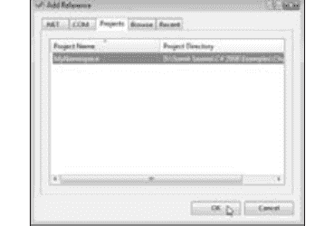

图 2.4：向命名空间添加引用

现在，你的命名空间引用已添加到你的应用程序中。要了解如何在应用程序中访问该命名空间，让我们进入下一节。

## 通过使用 `using` 指令访问预定义的命名空间

将命名空间引用添加到应用程序后，你就可以使用该命名空间了。你必须使用 `using` 关键字，后跟命名空间的名称。列表 2.15 显示了如何在 `MyApplication` 示例中通过 `using` 指令访问预定义的命名空间（在 CD 中也可用）：

列表 2.15：`MyApplication` 示例的代码

```c
using System;
using System.Collections.Generic;
using System.Linq;
using System.Text;
namespace MyNamespace
{
    class Program
    {
        static void Main(string[] args)
        {
            MyClass.MyMethod();
            Console.WriteLine("\n\nPress ENTER to quit...");
            Console.ReadLine();
        }
    }
}
```

在列表 2.15 中，添加了一个用户定义的命名空间 `MyNamespace`，并说明了它的所有成员。图 2.5 显示了列表 2.15 的输出：

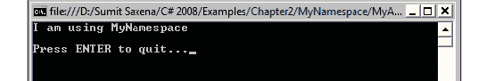

图 2.5：使用 `MyNamespace`

## 创建类

你可以使用 `class` 关键字创建一个类，后跟类名。类是一个容器，可以包含数据成员（变量、常量或字段）和成员函数（方法、属性、事件、索引器、运算符、实例构造函数、析构函数和静态构造函数），以及其他类。类还支持继承，继承是一种允许派生类扩展基类的机制。你将在第 4 章《C# 2008 C# 面向对象编程》中学习更多关于继承的知识。要查看如何在应用程序中创建类，请先按照本章前面“创建命名空间”节中提供的步骤，创建一个名为 `MyClass` 的新控制台应用程序。然后用应用程序 `Programs.cs` 文件的默认代码替换列表 2.16 中的代码：

列表 2.16：创建类

```csharp
using System;
using System.Collections.Generic;
using System.Linq;
using System.Text;

namespace MyClass
{
    class MainClass
    {
        static void Main(string[] args)
        {
        }
    }
    public class Amount
    {
        double TotalAmount, Deductions, BalanceAmount; //数据成员
        public void balance()
        {
            // 方法体
        }

        public void Debit()
        {
            // 方法体
        }

        public void credit()
        {
            // 方法体
        }

        public void GetData()
        {
            // 方法体
        }
    }
}
```

在列表 2.16 中，我们创建了一个类 `Amount`，在这个类中，我们指定了数据成员 `TotalAmount`、`Deductions` 和 `BalanceAmount`，以及方法 `Balance()`、`Debit()`、`Credit()` 和 `GetData()`。

## 声明部分类


你可以使用 `partial` 关键字声明一个类。在编译程序时，类的所有划分部分必须可用以形成最终的类。此外，所有部分必须具有相同的访问级别修饰符（例如 `public` 或 `private`）。要查看如何声明部分类，请先按照本章前面“创建命名空间”节中提供的步骤，创建一个名为 `Account` 的新控制台应用程序。然后用应用程序 `Programs.cs` 文件的默认代码替换列表 2.17 中提供的代码：

列表 2.17：声明部分类

```csharp
using System;
using System.Collections.Generic;
using System.Linq;
using System.Text;
namespace Account
{
    class Program
    {
        static void Main(string[] args)
        {
            // 方法体
        }
    }
}
partial class Account
{
    double PrincipalAmount, InterestRate, Time, SimpleInterest; //数据成员
    public void CalculateInterest()
    {
        // 方法体
    }
    partial void ShowAccount();
}
partial class Account
{
    partial void ShowAccount()
    {
        // 方法体
    }
    public void ShowInterest()
    {
        // 方法体
    }
}
```

在列表 2.17 中，我们创建了一个名为 `Account` 的部分类。`Account` 部分的第一部分包含变量 `PrincipalAmount`、`InterestRate`、`Time` 和 `SimpleInterest`，以及一个方法 `CalculateInterest()`，以及名为 `ShowAccount()` 的部分方法的声明。`Account` 部分类的第二部分包含 `ShowInterest()` 方法，以及 `ShowAccount()` 部分方法的定义。

## 创建对象

要访问类的数据成员和函数，你必须创建该类的对象。就像我们可以声明一个 `int` 类型的变量一样，我们可以通过一些修改来创建一个类类型的对象。要创建一个类的对象，请先按照本章前面“创建命名空间”节中提供的步骤，创建一个名为 `MyObject` 的新控制台应用程序（在默认中也可用）。然后用应用程序 `Programs.cs` 文件的默认代码替换列表 2.18 中的代码。

列表 2.18：`MyApplication` 示例的代码

```c
using System;
using System.Collections.Generic;
using System.Linq;
using System.Text;
namespace MyApplication
{
    class Program
    {
        static void Main(string[] args)
        {
            MyClass.MyMethod();
            Console.WriteLine("\n\nPress ENTER to quit...");
            Console.ReadLine();
        }
    }
}
namespace MyNamespace
{
    class MyClass
    {
        static void MyMethod()
        {
        }
    }
}
```

## `this` 关键字

`this` 关键字指向类的当前实例。通过 `this` 关键字，你可以访问实例方法、构造函数和属性。注意，`this` 关键字不能用于静态成员，因为它们是通过类而不是实例访问的。要查看使用 `this` 关键字，请先创建一个名为 `MyObject` 的新控制台应用程序。然后用应用程序 `Programs.cs` 文件的默认代码替换列表 2.19 中的代码。

列表 2.19：`MyObject` 示例的代码

```csharp
using System;
using System.Collections.Generic;
using System.Linq;
using System.Text;
namespace MyObject
{
    class MainClass
    {
        static void Main(string[] args)
        {
            Amount obj = new Amount();
            obj.GetData();
            obj.balance();
            Console.WriteLine("\n\nPress ENTER to quit...");
            Console.ReadLine();
        }
    }
}
public class Amount
{
    double TotalAmount, Deductions, Balance;
    public void balance()
    {
        this.TotalAmount = 12000;
        this.Deductions = 2000;
        this.Balance = this.TotalAmount - this.Deductions;
        Console.WriteLine("Your Current Account is Rs: " + this.Balance);
    }

    public void Debit()
    {
        int DebitAmount = 0;
        Console.Write("Enter Amount: ");
        DebitAmount = int.Parse(Console.ReadLine());
        this.Balance = this.Balance - DebitAmount;
        Console.WriteLine("Your Balance Amount is Rs:" + this.Balance);
    }

    public void credit()
    {
        int CreditAmount = 0;
        Console.Write("Enter Amount: ");
        CreditAmount = int.Parse(Console.ReadLine());
        this.Balance = this.Balance + CreditAmount;
        Console.WriteLine("Your Balance Amount is Rs:" + this.Balance);
    }

    public void GetData()
    {
        char data;
        Console.Write("\nPress (d) for Debit and (c) for Credit: ");
        data = char.Parse(Console.ReadLine());
        if (data == 'd')
        {
            this.Debit();
        }
        else if (data == 'c')
        {
            this.credit();
        }
    }
}
```

## 立即解决方案

```csharp
}
if (Data == 'c')
{
credit();
}
}
```

在列表 2.19 中，通过 `this` 关键字访问 `Amount` 类的数据成员 `TotalAmount` 和 `Deductions`。

图 2.7 显示了列表 2.19 的输出。

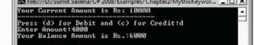

## 创建对象数组

C# 中的对象数组与 C++ 或 Java 中的数组不同。数组本身就是一个对象。你必须先创建一个数组，然后创建数组的各个元素。这与 C++ 不同，在 C++ 中创建对象数组会调用构造函数并创建数组元素。同样，Java 允许你直接创建对象数组。而在 C# 中，这是无法实现的。这是因为 C# 的开发者希望保持语言尽可能简单。要创建对象数组，请先按照本章节之前“创建命名空间”节中的步骤，创建一个名为 `MyArrayObjects` 的新实例（CD 中也提供），然后将应用程序 `Programs.cs` 文件的默认代码替换为列表 2.20：

列表 2.20：列表 2.20 中提供的 `MyArrayOfObjects` 代码：

```csharp
using System;
using System.Collections.Generic;
using System.Linq;
using System.Text;
namespace MyArrayOfObjects
{
    class Program
    {
        static void Main(string[] args)
        {
            const int Size = 3;
            Employee[] Manager=new Employee[Size];
            for (int i = 0; i < Size; i++)
            {
                Manager[i] = new Employee();
            }
            for (int i = 0; i < Size; i++)
            {
                Console.WriteLine("Details of Manager: " + (i + 1));
                Manager[i].GetData();
                Console.WriteLine("----------------------------------------------------------------");
            }
            for (int i = 0; i < Size; i++)
            {
                Console.WriteLine("Manager: " + (i+1));
                Manager[i].PutData();
                Console.WriteLine("--------------------");
            }
            Console.WriteLine("\npress ENTER to quit...");
            Console.ReadLine();
        }
    }
    class Employee
    {
        string Name;
        float Age;
        public void GetData() {
            Console.Write("Enter Name : ");
            Name = (Console.ReadLine());
            Console.Write("Enter Age: ");
            Age = float.Parse(Console.ReadLine());
        }
        public void PutData() {
            Console.WriteLine("The Name is "+Name);
            Console.WriteLine("The Age is "+Age);
        }
    }
}
```

在列表 2.20 中，高亮行显示了如何创建对象数组。

图 2.8 显示了列表 2.20 的输出。

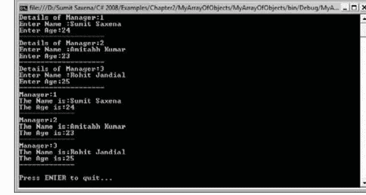

## 使用参数

参数提供了一种向方法传递值的方法。在 C# 中，你可以通过四种不同的方式向方法传递参数：按值传递、使用 `ref` 关键字、使用 `out` 关键字以及使用 `params` 关键字。未声明任何修饰符的参数是值参数。要了解如何向方法传递参数，请按照本章节之前“创建命名空间”节中的步骤，创建一个名为 `MyMethodParameters` 的控制台应用程序（CD 中也提供），将应用程序 `Programs.cs` 文件的默认代码替换为列表 2.21 中的代码：

列表 2.21：`MyMethodParameters` 示例代码

```csharp
using System;
using System.collections.Generic;
using System.Linq;
using System.Text;
namespace MyMethodParameters
class MainClass
{
    static void Main(string[] args)
    {
        Amount Amt = new Amount();
        Amt.Balance(1200, 2000);
        Amt.GetData();
        Console.Write("\nPRESS ENTER to quit.");
        Console.ReadLine();
    }
}
public class Amount
{
    double TotalAmount, Deductions, BalanceAmount;
    public void Balance(double TotalAmount, double deductions)
    {
        BalanceAmount = TotalAmount - Deductions;
        Console.WriteLine("Your Current Amount is Rs: " + BalanceAmount);
    }
    public void Debit()
    {
        int DebitAmount=0;
        Console.Write("Enter Amount:");
        DebitAmount = int.Parse(Console.ReadLine());
        BalanceAmount = BalanceAmount - DebitAmount;
        Console.WriteLine("Your Balance Amount is Rs:"+BalanceAmount);
    }
    public void Credit()
    {
        int CreditAmount =0;
        Console.Write("Enter Amount:");
        CreditAmount = int.Parse(Console.ReadLine());
        BalanceAmount = BalanceAmount + CreditAmount;
        Console.WriteLine("Your Balance Amount is Rs:" + BalanceAmount);
    }
    public void GetData()
    {
        char Data;
        Console.WriteLine("Press (d) for Debit and (c) for Credit:");
        Data = char.Parse(Console.ReadLine());
        if (Data == 'd')
        {
            Debit();
        }
        if (Data == 'c')
        {
            Credit();
        }
    }
}
```

## 第 2 章：命名空间、类、对象和结构体

```csharp
Console.WriteLine("Before calling non-ref function, x = {0}", x);
NonRefFunction(x);
Console.WriteLine("\na calling non-ref function, x = {0}", x);
Refunction(x);
Console.WriteLine("\na calling ref function, x = {0}", x);
Console.WriteLine("\nPress ENTER to exit.\n");
Console.ReadLine();
```

```csharp
static void NonRefFunction(int x)
{
    Console.WriteLine("Top of NonRefFunction. X = {0}", x);
    x = 10;
    Console.WriteLine("Bottom of NonRefFunction. X = {0}", x);
}
```


```csharp
static void Refunction(ref int x)
{
    Console.WriteLine("Top of Refunction. X = {0}", x);
    x = 10;
    Console.WriteLine("Bottom of Refunction. X = {0}", x);
}
```

在列表 2.23 中，高亮了两个代码段。第一个高亮代码是 `NonRefFunction()` 方法的声明，它接受一个值参数。

```csharp
static void NonRefFunction(int x)
```

第二个高亮代码是 `Refunction()` 方法的声明，它接受一个引用参数。

```csharp
static void Refunction(ref int x)
```

图 2.1 显示了列表 2.23 的输出：

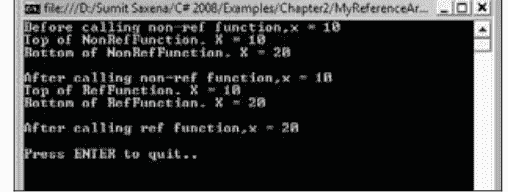

## 向方法传递对象

如前所述，`this` 关键字指向类的当前实例。你也可以使用它将对象传递给属于另一个类的方法。若要查看如何将对象作为参数传递给方法，请先按照本章较之前“创建命名空间”节中的步骤操作。然后将应用程序的 `Programs.cs` 文件的默认代码替换为列表 2.24 中提供的代码：

列表 2.24：MyObjectArgument 示例的代码

```csharp
using System;
using System.Collections.Generic;
using System.Linq;
using MyObject.Text;

namespace MyObjectArgument
{
    public class Employee
    {
        public string name;
        public string department;
        public double salary;

        public void EmployeeDetails()
        {
            Console.WriteLine("Employee Details");
            Console.WriteLine("Enter Name:");
            name = Console.ReadLine();
            Console.WriteLine("Enter Department:");
            department = Console.ReadLine();
            Console.WriteLine("Enter Salary in Rs:");
            salary = double.Parse(Console.ReadLine());
        }

        public void ShowDetails()
        {
            Console.WriteLine("Name:" + name);
            Console.WriteLine("Department:" + department);
            // 使用 this 将对象传递给 Calctax 方法：
            Console.WriteLine("Tax is Rs. " + Tax.Calctax(this));
            Console.WriteLine("Press ENTER to quit...");
            Console.ReadLine();
        }
    }

    public class Tax
    {
        public static double Calctax(Employee E)
        {
            return (0.08 * (E.salary));
        }

        static void Main(string[] args)
        {
            // 创建对象：
            Employee E1 = new Employee();
            E1.EmployeeDetails();
            E1.ShowDetails();
        }
    }
}
```

在 2.24 的高亮行中，通过 `this` 关键字将 `Employee` 类的实例作为参数传递给 `Tax` 类的 `Calctax` 方法。

图 2.12 显示了将对象作为参数传递给方法：

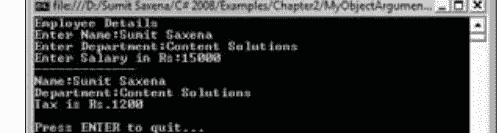

## 从方法返回值

方法可以向方法的调用者返回值。如果返回类型为 `void`，则方法将不返回任何值。然而，如果返回类型不是 `void`（例如 `int`、`double` 或 `string`），则方法可以使用 `return` 关键字返回值。带有 `return` 关键字的语句会将方法的返回类型与返回值进行比较，如果它们匹配，则会将值返回给调用方法。以下是创建并返回值的方法。通过执行本章较之前“创建命名空间”节中的步骤，创建一个新的控制台应用程序 `MyReturnValue`（CD 中也可用）。然后将应用程序 `Programs.cs` 文件的默认代码替换为所示代码：

列表 2.25：MyReturnValue 示例的代码

在列表 2.25 中，`RectArea()` 方法的返回类型与 `RectArea` 变量的数据类型相同（`double`）。因此，该方法向调用方法返回一个 `double` 类型的值。

图 2.25 显示了列表 2.25 的输出：

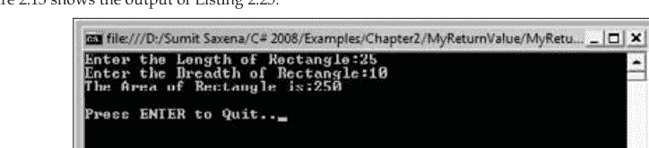

## 创建部分方法

部分方法（Partial methods）仅允许部分类型（partial types，如类和结构体中使用。部分方法由两部分组成：一部分负责声明，另一部分负责实现。对于部分方法，最多有一个声明。声明部分方法时允许使用访问修饰符，但 `static` 除外。部分方法默认是私有的。要创建部分方法，请先按照本章较之前“创建命名空间”节中的步骤创建一个新的控制台应用程序 `MyPartialMethod`（CD 中也可用）。然后将应用程序 `Programs.cs` 文件的默认代码替换为列表 2.26 所示的代码：

列表 2.26：MyPartialMethod 代码

```csharp
using System;
using System.Collections.Generic;
using System.Linq;
using System.Text;

namespace MyPartialMethod
{
    class Program
    {
        static void Main(string[] args)
        {
            Account Acc = new Account();
            Acc.CalculateInterest();
            Acc.ShowInterest();
        }

        partial class Account
        {
            double PrincipalAmount, InterestRate, Time, SimpleInterest;

            partial void CalculateInterest()
            {
                Console.Write("Enter Amount (P):");
                PrincipalAmount = double.Parse(Console.ReadLine());
                Console.Write("Enter Rate (R):");
                InterestRate = double.Parse(Console.ReadLine());
                Console.Write("Enter Time (T):");
                Time = double.Parse(Console.ReadLine());
            }

            partial void ShowAmount();
        }

        partial class Account
        {
            partial void ShowAmount()
            {
                double amount = (PrincipalAmount * InterestRate * Time) / 100;
                Console.WriteLine("Total Amount: " + amount);
            }

            public void ShowInterest()
            {
                SimpleInterest = (PrincipalAmount * InterestRate * Time) / 100;
                Console.WriteLine("Simple Interest: " + SimpleInterest);
                Console.WriteLine("\nPress ENTER to quit.");
                Console.ReadLine();
            }
        }
    }
}
```

在列表 2.26 中，部分方法 `ShowAmount()` 在部分类 `Account` 的第一部分声明，在类的第二部分实现。

图 2.14 显示了列表 2.26 的输出。

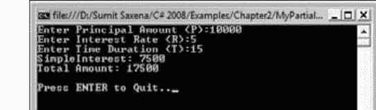

## 在类中使用参数构造函数

C# 语言允许在类创建参数构造函数。接受参数的类构造函数就是参数构造函数。若要查看类中的参数构造函数如何工作，请按照“创建命名空间”步骤创建一个新实例 `MyParamConstructor`（默认代码中可用）。然后将应用程序 `Programs.cs` 文件的默认代码替换为列表 2.27 中提供的代码：

列表 2.27：MyParamConstructor 示例的代码

```csharp
using System;
using System.Collections.Generic;
using System.Linq;
using System.Text;

namespace MyParamConstructor
{
    class Program
    {
        static void Main(string[] args)
        {
            MySampleClass obj1 = new MySampleClass(); // 无参数
            MySampleClass obj2 = new MySampleClass("Martin"); // 单参数
            MySampleClass obj3 = new MySampleClass("Martin", 26); // 双参数
            Console.WriteLine("\nPress ENTER to quit.");
            Console.ReadLine();
        }

        public class MySampleClass
        {
            public MySampleClass() // 无参数构造函数
            {
            }

            public MySampleClass(string name) // 带单参数的构造函数
            {
                Console.WriteLine("Name is: " + name);
                Console.WriteLine("--------------------");
            }

            public MySampleClass(string name, int age) // 带双参数的构造函数
            {
                Console.WriteLine("Name is: " + name);
                Console.WriteLine("Age is: " + age);
            }
        }
    }
}
```

## 立即解决方案

在列表 2.27 中，我们使用了三个构造函数：第一个没有任何参数，第二个有一个参数，第三个有两个参数。

图 2.15 显示了列表 2.27 的输出。

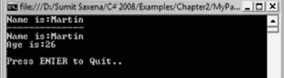

图 2.15：在类中创建参数化构造函数

## 创建拷贝构造

在 C# 中，默认情况下你没有拷贝构造函数。然而，你可以拥有一个现有对象的相同副本。为了实现这一点，你必须编写一个自己的方法，具有与现有对象相同的值和属性。要查看如何在类中创建拷贝构造，请先按照本章节早期“创建命名空间”节中提供的步骤创建一个名为 `MyCopyConstructor` 的新控制台应用程序（CD 盘中也提供）。然后，将应用程序 `Programs.cs` 文件的默认代码替换为列表 2.2b 中提供的代码。

列表 2.2b：MyCopyConstructor 示例的代码

```
using System;
using System.Collections.Generic;
using System.Linq;
using System.Text;

namespace MyCopyConstructor
class Program
{
    static void Main(string[] args)
    {
        // 创建一个新的 CarDetails 对象。
        CarDetails car1 = new CarDetails("Estilo VX1", 15.7);
        // 创建另一个对象，复制 car1。
        CarDetails car2 = new CarDetails(car1);
        Console.WriteLine(car2.Details);
        Console.write("\nPRESS ENTER to Quit.");
        Console.ReadLine();
    }

    class CarDetails
    {
        private string ModelName;
        private double Mileage;

        // 拷贝构造函数。
        public CarDetails(CarDetails MyCar)
        {
            ModelName = MyCar.ModelName;
            Mileage = MyCar.Mileage;
        }

        // 实例化构造函数。
        public CarDetails(string ModelName, double Mileage)
        {
            this.ModelName = ModelName;
            this.Mileage = Mileage;
        }
    }
}
```

79

# 第 2 章：命名空间、类、对象和结构体

```csharp
{
    public string Details
    {
        get
        {
            return ("Car " + Name + " has the Average of " + Mileage + "km/lit");
        }
    }
}
```

在列表 2.28 中，我们通过向 `CarDetails` 类的构造函数传递两个参数创建 `CarDetails` 类的对象 `car1`。然后，我们通过复制 `car1` 对象的数据创建另一个 `CarDetails` 类的对象 `car2`。

图 2.16 显示了列表 2.28 的输出：


图 2.16：类构造函数示例

# 调用类的析构函数

析构函数是一个用于销不再使用的对象的方法。一个类只能有一个析构函数，使用 `(~)` 符号声明，后跟析构函数的名称。要查看如何创建析构函数，请先按照本章节早期“创建命名空间”节中的步骤创建一个名为 `MyDestructor` 的新类（CD 盘中也提供）。然后，将应用程序 `Programs.cs` 文件的默认代码替换为列表 2.29 中提供的代码：

列表 2.29：MyDestructor 示例的代码


```csharp
using System;
using System.collections.Generic;
using System.Linq;
using System.Text;

namespace MyDestructor
{
    class Program
    {
        static void Main(string[] args)
        {
            Destructor obj = new Destructor();
        }
    }

    class Destructor
    {
        ~Destructor()
        {
            Console.WriteLine("Destructor is called");
            Console.write("\nPress ENTER to Quit..");
            Console.ReadLine();
        }
    }
}
```

在列表 2.29 中，析构函数`Destructor()`会被自动调用，当它不再使用时，将销毁`Destructor`类的`obj`对象。

102

## 立即解决方案

图 2.17 显示了列表 2.29 的输出：

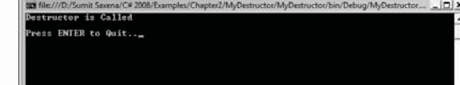

图 2.17：析构函数示例

消息`Destructor is Called`在屏幕上出现一会（图 2.17），然后当析构函数被调用时应用程序终止。

## 创建静态类

我们已经在本章的深入探讨部分学习了静态类。你可以通过方式声明静态类。当声明一个类时，不需要创建该类的对象，因为静态类的成员可以通过访问名称而不是类的对象来被访问。列表 2.30 显示了如何创建静态类。

列表 2.30：创建静态类

```csharp
public static class temperatureConverter
{
    public static double CelsiusToFahrenheit(string temperatureCelsius)
    {
        // 方法体
    }

    public static double FahrenheitToCelsius(string temperatureFahrenheit)
    {
        // 方法体
    }
}
```

在列表 2.30 中，我们创建了一个静态类`TemperatureConverter`，它包含两个静态方法：`CelsiusToFahrenheit`和`FahrenheitToCelsius`。

## 在类中使用静态方法

你可以通过类名而不是创建类的实例来调用静态方法。静态方法可以存在于静态类或非静态类中。要查看如何声明静态方法，请先按照本章节早期“创建命名空间”节中的步骤创建一个名为`MyStaticMethod`的新控制台应用程序（CD 盘中也提供）。然后，将应用程序`Programs.cs`文件的默认代码替换为列表 2.31 中提供的代码：

列表 2.31：MyStaticMethod 示例的代码

```csharp
using System;
using System.Collections.Generic;
using System.Linq;
using System.Text;

namespace MyStaticMethod
{
    class Program
    {
    }
}
```

81

# 第 2 章：命名空间、类、对象和结构体

```csharp
static void main(string[] args)
{
    Console.WriteLine("Please Select The Convertor");
    Console.WriteLine("1. Celsius to Fahrenheit");
    Console.WriteLine("2. Fahrenheit to Celsius");
    Console.WriteLine("\nPenter 1 or 2:");

    string Selection;
    Selection = Console.ReadLine();

    double F, C = 0;

    switch (Selection)
    {
        case "1":
            Console.WriteLine("Please enter the Celsius temperature: ");
            F = TemperatureConverter.CelsiusToFahrenheit(Console.ReadLine());
            Console.WriteLine("Temperature in Fahrenheit: ({0:F2})", F);
            break;

        case "2":
            Console.WriteLine("Please enter the Fahrenheit temperature: ");
            C = TemperatureConverter.FahrenheitToCelsius(Console.ReadLine());
            Console.WriteLine("Temperature in Celsius: ({0:F2})", C);
            break;

        default:
            Console.WriteLine("Please select a convertor.");
            break;
    }

    Console.WriteLine("\nPRESS ENTER to Quit..");
    Console.ReadLine();
}
```

```csharp
public class TemperatureConverter
{
    public static double celsiusToFahrenheit(string temperatureCelsius)
    {
        // 将参数转换为双精度进行计算
        double celsius = Double.Parse(temperatureCelsius);

        // 将摄氏度转换为华氏度
        double fahrenheit = (celsius * 9) / 32;

        return fahrenheit;
    }

    public static double fahrenheitToCelsius(string temperatureFahrenheit)
    {
        // 将参数转换为双精度进行计算
        double fahrenheit = Double.Parse(temperatureFahrenheit);

        // 将华氏度转换为摄氏度
        double celsius = (fahrenheit - 32) * 5 / 9;

        return celsius;
    }
}
```

在列表 2.3 中，两个静态方法`CelsiusToFahrenheit`和`FahrenheitToCelsius()`被声明在静态类`TemperatureConverter`中。没有创建`TemperatureConverter`的实例，可以通过类名访问它们。

现在，按 F5 键运行`MyStaticMethod`示例。用户被提示选择转换器。选择摄氏度转华氏度按 1；选择华氏度转摄氏度按 2。在这种情况下，我们按了 1。现在，输入摄氏度温度 40 并按回键。你将获得华氏温度，如图 2.18 所示。

## 立即解决方案

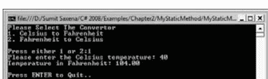

图 2.18：类中的静态方法

## 使用属性赋值和检索值

属性允许你以更直观、更不复杂的方式访问类的内部数据。在引入属性之前，程序员需要定义两个方法——一个用于为变量赋值，另一个用于检索变量的值。

绝大部分工作由编译器在后台完成。当你创建一个属性时，编译器会自动生成用于设置和获取该属性的类方法，并自动地执行这些调用。事实上，当程序员使用属性时，它会创建一个名为`MyProperty`的新类。要查看如何使用属性赋值和检索值，请参阅本章中“创建命名空间”（Creating a Namespace）节中的步骤。将应用程序`Programs.cs`文件的默认代码替换为列表 2.32 中提供的代码。

列表 2.32：MyProperty 示例代码

```csharp
using System;
using System.Collections.Generic;
using System.Linq;
using System.Text;

namespace MyProperty

class Person
{
    private string MyName = "";
    private int MyAge = 0;

    // 声明一个字符串类型的 Name 属性：
    public string Name
    {
        get
        {
            return MyName;
        }
        set
        {
            MyName = value;
        }
    }

    // 声明一个整数类型的 Age 属性：
    public int Age
    {
        get
        {
            return MyAge;
        }
        set
        {
            MyAge = value;
        }
    }
}
```

# 第 2 章：命名空间、类、对象和结构体

```csharp
public override string ToString()
{
    return ("Name = " + Name + ", Age = " + Age);
}

public static void Main()
{
    Console.WriteLine("Simple Properties");

    // 创建一个新的 Person 对象：
    Person person = new Person();

    // 打印与人员相关的姓名和年龄：
    Console.WriteLine("Person details: " + person);

    // 在 person 对象上设置一些值：
    person.Name = "sumit";
    person.Age = 24;

    Console.WriteLine("Person details: " + person);

    // 增加 Age 属性：
    person.Age += 1;

    Console.WriteLine("Person details: " + person);
    Console.write("\nPress Enter to quit...");
}
```

图 2.19 显示了列表 2.32 的输出：

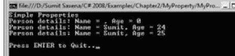

图 2.19：属性示例

从这个示例中可以看出，属性允许你安全且非常方便地设置类中的数据，同时保持对数据验证的完全控制。

## 使用对象初始化器

C# 允许你在创建对象时，使用新的对象初始化器语法为对象的任何可访问字段或属性赋值。要查看如何使用新的对象初始化器语法来创建并初始化对象，首先通过执行本章中“创建命名空间”（Creating a Namespace）节给出的步骤创建一个名为`ObjectInitializer`的控制台应用程序（CD 中也可用）。然后将该命名空间`Programs.cs`文件的默认代码替换为列表 2.33 中提供的代码。

列表 2.33：ObjectInitializer 示例代码

```csharp
using System;
using System.Collections.Generic;
using System.Linq;
using System.Text;

namespace ObjectInitializer
{
    class Program
    {
        public class StudentName
        {
            public string FirstName;
            public string LastName;
        }
    }
}
```

```csharp
public class Student
{
    public string Student1, Student2, Student3;

    public static void Main(string[] args)
    {
        var student1 = new Student { FirstName = "Sumit", LastName = "Saxena" };
        var student2 = new Student { FirstName = "Amitabh", LastName = "Kumar" };
        var student3 = new Student { FirstName = "Jitendra", LastName = "Arya" };
        var scclass = new Student { Student1 = student1, Student2 = student2, Student3 = student3 };

        Console.WriteLine("Student1");
        Console.WriteLine("FirstName: " + student1.FirstName);
        Console.WriteLine("LastName: " + student1.LastName);
        Console.WriteLine("-----------------");

        Console.WriteLine("Student2");
        Console.WriteLine("FirstName: " + student2.FirstName);
        Console.WriteLine("LastName: " + student2.LastName);
        Console.WriteLine("-----------------");

        Console.WriteLine("Student3");
        Console.WriteLine("FirstName: " + student3.FirstName);
        Console.WriteLine("LastName: " + student3.LastName);
        Console.WriteLine("-----------------");

        Console.write("Press ENTER to Quit...");
        Console.ReadLine();
    }
}
```

在列表 2.23 中，我们在创建对象时将值赋值给`FirstName`和`LastName`变量。

图 2.20 显示了列表 2.23 的输出。

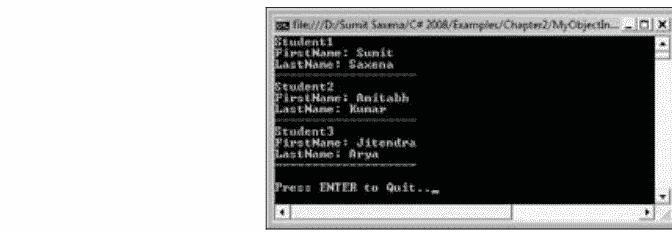

| Student1 | LastName |
| :--- | :--- |
| Sumit | Saxena |
| Amitabh | Kumar |
| Jitendra | Arya |

## 使用对象初始化器

## 使用只读属性检索值

只读属性是具有访问器（getter）但没有存取器（setter）的属性。这意味着我们可以检索属性的值，但不能设置它。要查看如何使用只读属性检索值，首先通过执行本章中“创建命名空间”（Creating a Namespace）节给出的步骤创建一个名为`ObjectReadOnly`的控制台应用程序（CD 中也可用）。然后将应用程序`Programs.cs`文件的默认代码替换为列表 2.34 中提供的代码。

列表 2.34：ObjectReadOnly 代码

```csharp
using System;
using System.Collections.Generic;
using System.Linq;
using System.Text;
```

# 第 2 章：命名空间、类、对象和结构体


```csharp
namespace ObjectReadOnly
{
    public class PropertyHolder
    {
        private int someProperty;

        public PropertyHolder(int someval)
        {
            someProperty = someval;
        }

        public int someProperty
        {
            get
            {
                return someProperty;
            }
        }
    }

    class PropertyTester
    {
        static void Main(string[] args)
        {
            PropertyHolder propHold = new PropertyHolder(5);
            Console.WriteLine("Property value: " + propHold.someProperty);
            Console.write("\nPress Enter to quit...");
            Console.ReadLine();
        }
    }
}
```

图 2.21 显示了列表 2.34 的输出：

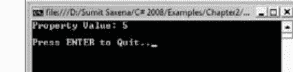

图 2.21：只读属性示例

## 创建静态属性

你可以用 `static` 关键字加上属性名称来声明静态属性。静态属性用于访问类的静态成员。要查看如何创建静态属性，首先通过执行本章中“创建命名空间”（Creating a Namespace）节给出的步骤创建一个名为 `MyStatic` 的控制台应用程序（CD 中也可用）。然后将应用程序 `Programs.cs` 文件的默认代码替换为列表 2.35 中提供的代码。

列表 2.35：MyStatic 示例代码

```csharp
using System;
using System.Collections.Generic;
using System.Linq;
using System.Text;

namespace MyStatic

class CounterClass
{
    private static int number = 0;

    public CounterClass()
    {
        number++;
    }

    public static int NumberOfObjects
    {
        get
        {
            return number;
        }

        set
        {
            number = value;
        }
    }
}

class Program
{
    static void Main(string[] args)
    {
        Console.WriteLine("Number of objects: " + CounterClass.NumberOfObjects);

        CounterClass object1 = new CounterClass();
        Console.WriteLine("Number of objects: " + CounterClass.NumberOfObjects);

        CounterClass object2 = new CounterClass();
        Console.WriteLine("Number of objects: " + CounterClass.NumberOfObjects);

        CounterClass object3 = new CounterClass();
        Console.WriteLine("Number of objects: " + CounterClass.NumberOfObjects);

        Console.write("\nPress Enter to quit...");
        Console.ReadLine();
    }
}
```

图 2.22 显示了列表 2.35 的输出：

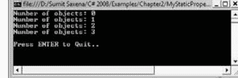

图 2.22：静态属性示例

## 创建匿名类型

匿名类型是一种没有显式名称的对象。它为你提供了一种简单的方法，将一组只读属性封装到单个对象中，而无需定义新类型。

列表 2.36：MyAnonymousType 示例代码

```csharp
using System;
using System.Collections.Generic;
using System.Linq;
using System.Text;

namespace MyAnonymousType
{
    class Product
    {
        static void Main(string[] args)
        {
            var product = new { Name = "Key Board", Price = 650 };
            Console.WriteLine("Product Details");
            Console.WriteLine("Name: " + product.Name);
            Console.WriteLine("Price: " + product.Price);
            Console.WriteLine("Press ENTER to quit...");
            Console.ReadLine();
        }
    }
}
```

在列表 2.36 的高亮行中，我们正在定义一个新的匿名类型，并创建了一个名为 `product` 的该类型对象，我们定义了两个变量 `Name` 和 `Price`。

图 2.22 显示了列表 2.36 的输出。


## 使用索引器

索引器被用作定位器，它们以类似于访问数组元素的方式访问类对象。要查看如何在类中创建索引器，请按照本章稍后“创建命名空间”节中的步骤，创建一个名为 `MyIndexer` 的新控制台应用程序（CD 中也提供）。然后将应用程序的 `Programs.cs` 文件的默认代码替换为列表 2.37 提供的代码。

列表 2.37：MyIndexer 示例代码

```csharp
using System;
using System.Collections.Generic;
using System.Linq;
using System.Text;

namespace MyIndexer
{
    class List
    {
        string[] Name = new string[3];

        public string this[int index]
        {
            get
            {
                if (index < 0 || index >= Name.Length)
                {
                    return null;
                }
            }
            else
            {
                return (Name[index]);
            }

            set
            {
                Name[index] = value;
            }
        }
    }

    class IndexerTest
    {
        public static void Main()
        {
            List list = new List();
            list[0] = "Sumit";
            list[1] = "Amitabh";
            list[2] = "Mohit";

            for (int i = 0; i <= 2; i++)
            {
                Console.WriteLine(list[i]);
            }

            Console.ReadLine();
            Console.Write("\nPress ENTER to quit...");
        }
    }
}
```

在列表 2.37 中，`list` 使用整数索引允许你检索属性。

图 2.24 显示了列表 2.37 的输出。

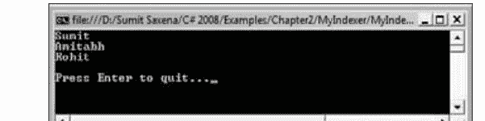

图 2.24：索引器示例

## 使用字符串索引器

索引器的一个优点是提供了一种类似于 VB 的方式，通过名称而不是某种整数值来设置和获取属性。要查看如何在类中创建字符串索引器，首先按照本章较早之前“创建命名空间”节中的步骤，创建一个名为 `MyIndexer` 的控制台应用程序（CD 中也提供）。然后将应用程序的 `Programs.cs` 文件的默认代码替换为列表 2.38 提供的代码：

列表 2.38：MyStringIndexer 示例代码

```csharp
using System;
using System.Collections.Generic;
using System.Linq;
using System.Text;

namespace MyStringIndexer
{
    class Book
    {
        private string fTitle;
        private string FAuthor;
        private string Fsubject;
        private string Fdescription;

        public Book(string title, string author, string subj, string descr)
        {
            Ftitle = title;
            Fauthor = author;
            Fsubject = subj;
            Fdescription = descr;
        }

        public Book()
        {
            // 定义一个字符串索引器.
            public string this[string index]
            {
                get
                {
                    if (index == "Title")
                        return Ftitle;
                    if (index == "Author")
                        return Fauthor;
                    if (index == "Subject")
                        return Fsubject;
                    if (index == "Description")
                        return Fdescription;

                    return "Unknown";
                }

                set
                {
                    if (index == "Title")
                        Ftitle = value;
                    if (index == "Author")
                        Fauthor = value;
                    if (index == "Subject")
                        Fsubject = value;
                    if (index == "Description")
                        Fdescription = value;
                }
            }
        }
    }

    class Program
    {
        static void Main(string[] args)
        {
            Book b = new Book("Cf Black Book", "Matt Telles", "A great book");
            Console.WriteLine("Book Title: {0}", b["Title"]);

            Book b2 = new Book();
            b2["Title"] = "Java Black Book";
            Console.WriteLine("Book Title: {0}", b2["Title"]);
            Console.WriteLine("Press Enter to quit...");
            Console.ReadLine();
        }
    }
}
```

在列表 2.38 中，我们为字符串索引提供了基础。这里，使用了字符串索引来检索属性。

## 嵌套类

嵌套类是定义在另一个类内部的类。要查看如何在应用程序中创建嵌套类，请按照本章“创建命名空间”节中的步骤，创建一个名为 `MyNestedClass` 的控制台应用程序（CD 中也提供）。然后将应用程序的 `Programs.cs` 文件的默认代码替换为列表 2.39 提供的代码。

列表 2.39：嵌套类示例代码

```csharp
using System;
using System.Collections.Generic;
using System.Linq;
using System.Text;

namespace MyNestedClass
{
    public class Outer
    {
        private int Number;

        public Outer(int num)
        {
            Number = num;
        }

        public class Inner
        {
            public void DisplayNumber(Outer o)
            {
                Console.WriteLine("The Number is " + o.Number);
            }
        }
    }

    public class Nesting
    {
        public static void Main()
        {
            Outer o1 = new Outer(100);
            Outer.Inner i1 = new Outer.Inner();
            i1.DisplayNumber(o1);
        }
    }
}
```

在列表 2.39 中，我们看到 `Inner` 类访问了 `Outer` 类的私有变量。

图 2.25 显示了列表 2.39 的输出。

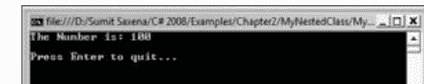

图 2.25：嵌套类示例

## 使用结构体

结构体和类之间有几个区别。很大的区别是结构体创建在栈上，而类创建在堆上。要查看如何创建结构体，请按照本章“创建命名空间”节中的步骤，创建一个名为 `MyStruct` 的控制台应用程序（CD 中也提供）。然后将应用程序的 `Programs.cs` 文件的默认代码替换为列表 2.40 提供的代码。

列表 2.40：MyStruct 示例代码


```assembly
using System;
using System.Collections.Generic;
using System.Linq;
using System.Text;
namespace MyStruct
{
    public struct X
    {
        public int x;
        public int y;
        public int z;
    }
    class Foo
    {
        static void Main(string[] args)
        {
            X x = new X();
            x.x = 1;
            x.y = 2;
            x.z = 3;
            Console.WriteLine("X = {0}, Y = {1}, Z = {2}", x.x, x.y, x.z);
            X x1 = new X();
            Console.WriteLine("X = {0}, Y = {1}, Z = {2}", x1.x, x1.y, x1.z);
            Console.WriteLine("\nPress Enter to quit...");
            Console.ReadLine();
        }
    }
}
```

图 2.27 显示了列表 2.40 的输出。

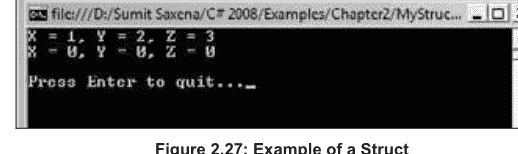


# 3 C# 2008 程序中的流程控制与异常处理

| 如果你需要以下问题的快速解决方案： | 请参见页码： |
|---|---:|
| 使用 `if` | 102 |
| 使用嵌套 `if` 语句 | 102 |
| 使用 `switch` 语句 | 103 |
| `switch` 语句穿穿（Falling through） | 105 |
| 使用 `while` 循环 | 106 |
| 使用 `do...while` 循环 | 107 |
| 使用 `for` 循环 | 109 |
| 使用 `foreach` 循环 | 110 |
| 使用嵌套 `for` 循环处理多维数组 | 111 |
| 创建死循环 | 112 |
| 跳转到标签语句 | 113 |
| 跳出循环 | 114 |
| 使用 `continue` 语句 | 116 |
| 捕获异常 | 117 |
| 抛异常 | 118 |
| 使用 `checked` 和 `unchecked` 语句 | 119 |

## 深入理解

程序的流程定义了程序的执行路径。通常情况下，程序是按顺序执行的。如果我们想改变程序的执行流，可以通过控制流语句来实现。我们可以在以下条件下使用控制流语句改变程序的执行路径：

- 在满足特定条件时执行特定的代码块
- 在不满足特定条件时执行特定的代码块
- 根据特定值执行特定的代码块
- 只要满足特定条件，就重复执行特定的代码块
- 将程序控制权从一个代码块转移到另一个代码块

控制流可以根据你的需求和需要改变程序流。然而，有时可能会出现这种情况：尽管你的程序在逻辑上是正确的并且已成功编译，但它没有显示输出，因为用户提供的输入意外终止。这种情况可能是由于程序中的异常引起的。异常是程序执行过程中发生的事件，它会破坏程序指令的正常流。`try` 语句用于检查是否发生了异常。

在本章中，你将探索不同类型的控制流语句，例如选择语句、迭代语句和跳转语句。此外，你将学习异常处理。

## 控制流语句

有时，我们需要改变程序的控制流。控制流语句用于改变程序的执行情况。在 C# 2008 中，控制流语句分类如下：

- 选择语句——当满足某个条件或一组条件时，它们执行一个代码块。
- 循环迭代语句——只要某个条件被满足，它们就会继续执行一个代码块。
- 跳跃语句——它们将程序控制从一个代码块转移到另一个。

## 选择语句

选择语句是根据条件是否满足来改变程序流的语句。条件是一个布尔表达式，写在语句的括号内。它在执行选择语句内部的代码块之前会进行检查。C# 支持两种类型的选择：

- `if` 语句——允许你测试是否满足某个条件。如果满足条件，程序控制将转移到 `if` 语句内部的代码块；否则，程序控制将转移到另一个代码块。
- `switch` 语句——允许你将表达式与不同的值进行比较。

## `if` 语句

每种编程语言中最重要的控制流语句之一是 `if` 语句。它检查一个语句或一组条件。如果满足条件，程序控制将进入 `if` 块并执行 `if` 块内的所有语句和指令。以下是 `if` 语句的语法：

```csharp
int Number1,Number2; 
if (Number1 > Number2) {
    Console.WriteLine(Number1 + " is greater than " + Number2); 
}
```

在这里，如果说明的条件为真，则显示消息“Number1 is greater than Number2”。然而，有时 `if` 语句内部的条件并不满足。在这种情况下，C# 提供了 `if-else` 语句，在满足特定条件时执行一个代码块，在不满足特定条件时执行另一个代码块。列表 3.1 展示了一个理解 `if-else` 语句语法的示例。

列表 3.1：`if else` 语句的语法

```csharp
if (Number1 > Number2) 
{
    Console.WriteLine("Number1 is greater than Number2");
    ...statements
}
else {
    Console.WriteLine("Number2 is greater than Number1");
    ...statements
}
```

在，当条件 (`Number1>Number2`) 不满足时，程序控制转移到其内部的 `else` 代码块。为了逐一评估多个条件，你可以对 `if-else` 语句进行嵌套。列表 3.2 展示了一个理解嵌套 `if-else` 语句语法的示例。

列表 3.2：嵌套 `if else` 语句的语法

```csharp
if (Number1 > Number2 && Number1 > Number3) 
{
    Console.WriteLine("Number1 is greatest"); 
    ...statements
}
else
    if (Number2 > Number3)
    {
        ...statements
    }
```

在 3.1 中，当条件 (`Number1>Number2`) 不满足时，程序控制转移到内部的 `else` 代码块。为了逐一评估多个条件，你可以对 `if-else` 语句进行嵌套。列表 3.2 展示了理解嵌套 `if-else` 语句语法的示例。

## `switch` 语句

`switch` 语句是另一种选择类型。`switch` 语句的主要目的是允许其值的匹配。列表 3.3 展示了一个理解 `switch` 语句语法的示例。

列表 3.3：`switch` 语句的语法

```csharp
switch (Marks)
{
    case 1:
        Console.WriteLine("Your marks are very low");
        break;
    case 2:
        Console.WriteLine("Your marks are low");
        break;
    case 3:
        Console.WriteLine("Your marks are average");
        break;
    case 4:
        Console.WriteLine("Your marks are good");
        break;
    case 5:
        Console.WriteLine("Your marks are very good");
        break;
    default:
        break;
}
```

3.3 中 `switch` 语法使用的术语描述如下：

- `switch`——显示 `switch` 语句的起点，并在括号内持有测试表达式。
- test expression——可以是任何整数表达式，如 `int`、`char`。
- `case`——后面跟一个表达式和一个冒号。
- expression——是一个常量表达式，与测试表达式进行比较。
- `break`——改变 `switch` 语句流的关键字。
- `default`——在没有其他 `case` 执行的情况下，使其内部代码块执行执行的关键字。

假设你想在程序中执行一组代码 50 次。与其编写 50 次代码，不如你将代码放在循环中，并指定循环必须执行 50 次的条件；从而节省编码的复杂性和时间。迭代语句或循环以重复的方式执行语句或一组语句。在 C# 中，有四种迭代语句，如下：

- `while` 循环——在执行循环之前执行条件。只要条件为真，循环就会继续执行。
- `do...while` 循环——至少执行一次循环，然后评估条件。
- `for` 循环——直到循环指定的条件变为假为止继续执行循环。
- `foreach` 循环——对于数组或对象集合中的每个元素继续执行循环体。

## 深度解析

## `while` 循环

`while` 语句在布尔表达式（条件）求值为真时会执行一个语句或语句块。`while` 循环主要用于预先不知道循环将执行多少次的情况。下面的示例有助于我们理解 `while` 循环的语法。

```c
int Number = 1;
while (Number <= 50)
{
    Console.WriteLine("I will be executed 50 times"); //语句
    Number = Number + 1; //递增或递减
}
```

在这一语法中，`while` 是一个布尔表达式，语句可以是任何 C 语句。在执行 `while` 循环内部的任何内容之前，都会先求条件的值。如果条件求值为真，则执行语句；否则如此。一旦循环内部的语句执行完毕，程序控制将转移到 `while` 循环的起点，以检查下一次迭代的条件。

## `do...while` 循环

`do...while` 的工作原理与 `while` 循环相同，不同之处是在循环迭代结束时检查条件。在每次迭代中，`do...while` 循环在条件为假之前至少会执行一次。下面的示例有助于我们理解 `do...while` 循环的语法：

```c
int Number = 1;
do
{
    Console.WriteLine("I will be executed 50 times"); //语句
    Number = Number + 1; //递增或递减
} while (Number <= 50); //条件
```

与 `do...while` 循环不同，`while` 表达式后面必须放置一个分号；否则循环将不会执行。

## `for` 循环

`for` 循环可能是所有循环中最重要的一个。它的工作方式像 `while` 循环，但 `for` 循环的语法还包含一个初始化和一个递增或递减变量值的变量。与 `while` 循环不同，`for` 循环适用于确切知道想要执行语句次数的情况。`for` 语法如下：

```c
for (initializer; condition; loop expression)
{
    ...
    //语句
}
```

`for` 循环语法中使用的术语描述如下：

- 初始化（initializer）是一个在第一次循环执行之前求值的表达式。它通常用于初始化作为计数器的局部变量。
- 条件（condition）是在开始任何循环迭代之前检查的表达式。它必须求值为真才能执行下一次迭代。
- 循环表达式（loop expression）是在每次循环迭代结束后求值的表达式。你可以用它来递增或递减循环计数器。

下面的示例有助于我们理解 `for` 循环的语法：

```c
for (int Number = 1; Number <= 50; Number++)
{
    Console.WriteLine("I will be executed 50 times");
}
```

## 第 3 章：C# 2008 程序中的流程控制与异常处理

在这里，`Number` 变量初始化为 1。只要 `Number` 变量的值小于或等于 50，循环就会迭代。在每次迭代之后，`Number` 变量的值加 1，只要条件为真，`for` 循环内部的语句就会执行：

## `foreach` 循环

`foreach` 循环遍历列表中的所有项。列表可以是数组或对象集合。`foreach` 循环使用如下语法进行工作：

```c
foreach<type> <item_name> in <list>
{
    //语句
}
```

`foreach` 循环语法中使用的术语描述如下：

- type - 列表中包含的项的类型。例如，如果列表是 `string[]`，则类型将是 `string`。
- item_name - 标识符的名称，应该具有意义。例如，如果列表包含一个书名标题数组，那么项的名称应为 `bookTitles`。
- `in` - 是应用在 item_name 之后的关键字。
- list - 你正在访问的数组或对象集合的名称。

下面的示例有助于理解 `foreach` 循环的语法：

```c
string[] bookTitles = new string[] {"Alice in wonderland",
"Pelican Brief",
"Ignited Minds"};
foreach (string i in bookTitles)
{
    //语句
}
```

在这里，定义了一个名为 `bookTitles` 的字符串数组，`foreach` 循环正在访问 `bookTitles` 数组的项。

## 跳转语句

跳转语句是允许你在程序执行的任何特定时刻将程序控制从一个一点移动到另一点语句。在这里，你将学习不同类型的跳转语句以及如何在程序中使用它们。在 C# 中，有四种跳转语句，如下：

- `goto` 语句 - 它将程序控制直接转移到带有标签的语句。
- `break` - 它终止它所所在的循环。在 `switch` 语句中，程序控制转移到 `break` 语句之后的语句。
- `continue` - 它将程序控制转移到包含 `continue` 关键字的所在循环的下一次迭代。
- `return` 语句 - 它终止它所所在的方法的执行，并将控制返回给调用方法。

## `goto` 语句

`goto` 语句用于将程序控制转移到与 `goto` 语句具有标签的语句。具有相同标签的被称为标签语句。多个 `goto` 语句可以将程序控制转移到控制语句之外，但可以这样做。通常，不建议使用 `goto`，因为它会增加程序的复杂性。列表 3.4 显示了 `goto` 的示例：

```c
if (Number1)
{
    goto Label;
}
Label:
if (Number2)
```

## `break` 语句

`break` 语句终止它所在的循环。在 `switch` 语句中，程序控制转移到 `break` 语句之后的语句。每当数字大于 5 时，其后续语句将不再执行。列表 3.5 显示了 `break` 的示例：

```c
for (int Number = 1; Number <= 50; Number++)
{
    if (Number == 5)
        break;
}
```

## `continue` 语句

`continue` 语句将程序控制转移到包含 `continue` 关键字的所在循环的下一次迭代。列表 3.6 显示了 `continue` 的示例：

```c
for (int Number = 1; Number <= 50; Number++)
{
    if (Number == 5)
        continue;
    Console.WriteLine("This will not print 5");
}
```

## 异常处理

异常由于某些异常情况引起的运行时错误，例如数字除以零、将字符串传递给整型变量。捕获和处理运行时错误是程序员的一项重要任务；在讨论运行时错误之前，让我们先看看编译时错误。编译错误是在编译程序期间发生的错误。它可能是由于错误的代码或语法引起的。你可以根据编译器给出的错误信息修正这些编译时错误。运行时错误是在程序执行期间发生的，因此无法修正。所以，需要采取必要的措施防止此类错误。为此，你应该首先识别以下方面：

- 找出程序中可能运行时错误的部分。
- 当它们发生时如何处理。

| 异常类 | 描述 |
|---|---|
| `SystemException` | 可作为其他异常类的基类 |
| `AccessException` | 无法访问成员，例如变量、方法 |
| `ArgumentException` | 定义方法的无效参数 |
| `ArgumentNullException` | 如果向不接受空的方法传递空时发生 |
| `ArgumentOutOfRangeException` | 如果参数超出范围时发生 |
| `ArithmeticException` | 如果发生算术溢出或下溢时发生 |
| `TypeMismatchException` | 如果尝试在数组存储错误类型的对象时发生 |
| `BadFormatException` | 如果图像格式错误时发生 |
| `CoreException` | 如果运行时抛出基类异常时发生 |
| `DivideByZeroException` | 如果你尝试除以零时发生 |
| `FormatException` | 如果参数格式错误时发生 |
| `IndexOutOfRangeException` | 如果索引越界时发生 |

# 深入

| 异常类 | 说明 |
|:---|:---|
| `InvalidCastException` | 当你尝试强制转换为无效的类时发生 |
| `InvalidOperationException` | 当在无效的时间调用方法时发生 |


| 异常类 | 说明 |
|---|---|
| `MissingMemberException` | 当你尝试访问 DLL 的无效版本时发生 |
| `NotFiniteException` | 当数字无效或为无穷大时发生 |
| `NotSupportedException` | 当类无法实现某个方法时发生 |
| `NullReferenceException` | 当你尝试使用未赋值的引用时发生 |
| `OutOfMemoryException` | 当执行因内存不足而停止时发生 |
| `StackOverflowException` | 当栈溢出时发生 |

表 3.1：值得注意的异常类

## `try...catch...finally` 语句

C# 提供了三个关键字来组织异常处理——`try`、`catch` 和 `finally`。`try` 块包围了那些可能导致异常的语句，除非发生了异常，则会执行 `catch` 块。`finally` 块无论是否发生异常总是会被执行，通常用于任何清理过程。代码列表 3.7 显示了一个示例，用于理解或不理解 `try...catch...finally` 语句的语法。

代码列表 3.7：`try_catch_finally` 语句的语法

```sharp
try {
    div = 100 / number;
} catch (DivideByZeroException e) {
    Console.WriteLine("Exception Occurred");
} finally {
    Console.WriteLine("Result is " +div);
    Console.ReadLine();
}
```

如果在 `try` 块中发生了任何异常，程序将直接跳转到对应的 `catch` 块，随后跳转到 `finally` 块。在 C# 中，`catch` 和 `finally` 块都是可选的。在程序中，`try` 块可以与一个或多个 `catch` 块并用，也可以只与 `finally` 块并用，或者与 `catch` 和 `finally` 块共同使用。如果 `try` 块内部没有发生异常，程序将直接跳转到 `finally` 块。`finally` 块中的语句始终执行。

## `throw` 语句

`throw` 命令用于在程序发生错误时抛出异常。在 C# 中，也可以通过程序化抛出异常。你可以使用 `throw` 关键字来抛出异常。代码列表 3.8 显示了一个用于理解 `throw statement` 语法的示例。

代码列表 3.8：`throw Statement` 的语法

```sharp
try {
    throw new DivideByZeroException();
} catch (DivideByZeroException e) {
    Console.WriteLine("Exception");
}
```

在代码列表 3.8 中，你可以看到我们显式地抛出了一个新的 `DivideByZero` 异常。

101

## 立即解决方案

## 使用 `if` 语句

`if` 语句是目前为止计算机编程中最常用的条件语句。程序员通常以 `if-else` 逻辑来讨论，这种逻辑适用于系统中的任何给定条件。光盘中的 `MyIfStatement` 应用程序包含一个示例，展示了 `if` 语句的使用。代码列表 3.9 显示了 `MyIfStatement` 应用程序的代码。

代码列表 3.9：`MyIfStatement` 应用程序的代码

图 3.1 显示了列表 3.9 的输出。

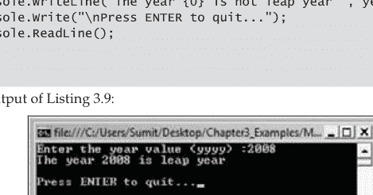

图 3.1：使用 `if` 语句

在代码列表 3.9 中，你可以看到用户提示输入年份。在 `if` 语句内部，会检查一个条件以测试指定的年份是否为闰年。如果满足条件，程序将跳转到 `if` 块并显示该年份为闰年；否则，程序控制跳转到 `else` 块并显示该年份不是闰年。

## 使用嵌套 `if` 语句

如果程序中有多个需要评估的条件，你可以使用一组嵌套的 `if` 语句来评估这些条件。例如，如果你想在程序中检查学生的年龄、姓名和性别，可以使用嵌套语句。光盘中的 `MyNestedIfStatement` 应用程序包含一个示例，展示了嵌套 `if` 语句的使用。代码列表 3.10 显示了 `MyNestedIfStatement` 应用程序的代码：

102

### 代码列表 3.10：`MyNestedIfStatement` 应用程序的代码

```csharp
using System.Collections.Generic;
using System.Linq;
using System.Text;
namespace MyNestedIfStatement
{
    class Program
    {
        static void Main(string[] args)
        {
            Console.WriteLine("Finding the Largest of Three Numbers\n");
            Console.WriteLine("Enter the First Number:");
            int number1 = int.Parse(Console.ReadLine());
            Console.WriteLine("Enter the Second Number:");
            int number2 = int.Parse(Console.ReadLine());
            Console.WriteLine("Enter the Third Number:");
            int number3 = int.Parse(Console.ReadLine());
            if (number1 > number2 && number1 > number3)
            {
                Console.WriteLine(number1 + " is the Largest Number");
            }
            else
            {
                if (number2 > number3)
                {
                    Console.WriteLine(number2 + " is the Largest Number");
                }
                else
                {
                    Console.WriteLine(number3 + " is the Largest Number");
                }
            }
            Console.WriteLine("\nPress ENTER to quit...");
            Console.ReadLine();
        }
    }
}
```

图 3.2 显示了列表 3.10 的输出。

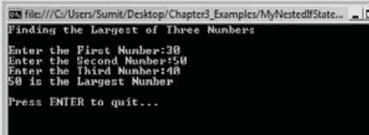

图 3.2：嵌套 `if` 语句

在代码列表 3.10 中，你可以看到用户被提示输入三个数字。在 `if` 语句内部，会检查第一个数字是否大于第二个和第三个。如果满足条件，程序将跳转到 `if` 块并显示该数字是最大的；否则，程序控制跳转到 `else` 块并检查第二个数字是否大于第三个。

## 使用 `switch` 语句

我们知道 C# 最基本的选择功能是 `if` 语句；但有时由于 `if` 语句的嵌套，程序结构变得复杂且难以理解。在这种情况下，你可以使用 `switch` 语句使程序变得不复杂且易于理解。光盘中的 `MySwitchStatement` 应用程序包含一个示例，展示了 `switch` 语句的使用。代码列表 3.11 显示了 `MySwitchStatement` 应用程序的代码：

代码列表 3.11：`MySwitchStatement` 应用程序的代码

```csharp
using System;
using System.Collections.Generic;
using System.Linq;
using System.Text;
namespace MySwitchStatement
{
    class Program
    {
        static void main(string[] args)
        {
            string Name;
            Console.Write("Enter your Name:");
            Name = Console.ReadLine();
            Console.WriteLine("Select the Range of Marks:");
            Console.WriteLine("1. 0-20");
            Console.WriteLine("2. 21-40");
            Console.WriteLine("3. 41-60");
            Console.WriteLine("4. 61-80");
            Console.WriteLine("5. 81-100");
            Console.Write("Enter your Choice (1,2,3,4,5):");
            int Marks = int.Parse(Console.ReadLine());
            switch (Marks)
            {
                case 1:
                    Console.write(Name + " your marks are Very Low.\n");
                    break;
                case 2:
                    Console.write(Name + " your marks are Low.\n");
                    break;
                case 3:
                    Console.write(Name + " your marks are Average.\n");
                    break;
                case 4:
                    Console.write(Name + " your marks are Good.\n");
                    break;
                case 5:
                    Console.write(Name + " your marks are very Good.\n");
                    break;
                default:
                    break;
            }
            Console.write("\nPress ENTER to quit...");
            Console.ReadLine();
        }
    }
}
```

104

# 第 3 章：C# 2008 程序中的流程控制与异常处理

图 3.3 显示了列表 3.11 的输出。

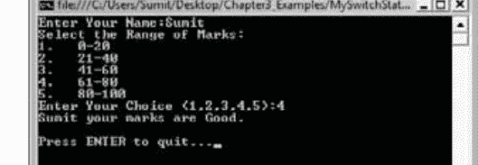

图 3.3：使用 `Switch` 语句

在列表 3.11 中，系统提示用户输入名称并选择分数范围。在选择分数范围后，系统提示用户根据分数范围输入选择（`case`）。当用户输入选择时，将显示根据其选择生成的消息。

## `Switch` 语句的贯穿（Falling through）

在 `SwitchStatement` 应用程序中，你已经看到每个 `case` 后面都有一个 `break` 语句。列表 3.12 显示了天数相同的月份（例如 1 月、3 月）被分在一起。将所有产生相同输出的 `case` 放在一起的原因是我们可以对其中许多 `case` 应用单个 `break` 语句。CD 中的 `DaysInMonth` 应用程序包含一个如何将单个 `break` 语句应用于多个列表的示例。

列表 3.12：`DaysInMonth` 应用程序的代码。列表 3.12 显示了 `DaysInMonth` 应用程序的代码：

```assembly
using System;
using System.Collections.Generic;
using System.Linq;
using System.Text;
namespace DaysInMonth
{
    class Program
    {
        static void Main(string[] args)
        {
            string month;
            Console.Write("Enter the Name of a Month: ");
            month = Console.ReadLine().ToUpper();
            switch (month)
            {
                case "JANUARY":
                case "MARCH":
                case "MAY":
                case "JULY":
                case "AUGUST":
                case "OCTOBER":
                case "DECEMBER":
                    Console.WriteLine(month + " has 31 days");
                    break;
                case "APRIL":
                case "JUNE":
                case "SEPTEMBER":
                case "NOVEMBER":
                    Console.WriteLine(month + " has 30 days");
                    break;
                case "FEBRUARY":
                    // ... (为了简洁起省略)
                    break;
                Console.WriteLine(month + " has 28 or 29 days");
                    break;
                default:
                    Console.WriteLine("you have entered an invalid month name");
                    break;
            }
            Console.Write("\nPress ENTER to quit...");
            Console.ReadLine();
        }
    }
}
```

图 3.4 显示了列表 3.12 的输出：

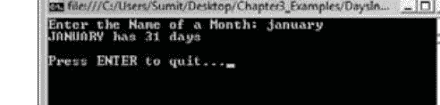

图 3.4：`switch` 语句的贯穿

在这里，系统提示用户输入月份名称。在这种情况下，我们输入了月份名称 January（一月），并得到了 JANUARY 有 31 天的的输出。

## 使用 `while` 循环

C# 中的 `for` 循环在一个地方执行各项任务，如初始化、验证和变量值的递增/递减。在需要重复某个过程直到给定条件变为真或假的情况下，你可以使用 `while` 循环。CD 中的 `MyWhileLoop` 应用程序包含了三个示例来展示 `while` 循环的使用。在第一个示例中，`while` 循环非常简单。在第二个示例中，`while` 循环根据响应变量值设置的布尔值进行操作。在第三个示例中，由于在迭代之前未满足条件，`while` 循环没有执行。列表 3.13 显示了 `MyWhileLoop` 应用程序的代码：

列表 3.13：`MyWhileLoop` 应用程序的代码


```assembly
using System;
using System.Collections.Generic;
using System.Linq;
using System.Text;
namespace MyWhileLoop
{
    class Program
    {
        static void Main(string[] args)
        {
            // 一个简单的 while 循环示例
            Console.WriteLine("Loop 1:");
            int i = 0;
            while (i < 5)
            {
                Console.WriteLine("I = {0}", i);
                i++;
            }
            // 带有布尔值的 while 循环
            Boolean flag = false;
            i = 0;
            Console.WriteLine("\nLoop 2:");
            while (!flag)
            {
                if (i > 5)
                {
                    flag = true;
                    Console.WriteLine("I = {0}", i);
                    i++;
                }
                // 一个永远不会执行的循环
                Console.WriteLine("\nLoop 3: ");
                while (i < 5)
                {
                    Console.WriteLine("I = {0}", i);
                    i++;
                }
                Console.WriteLine("\nPRESS ENTER to quit...");
                Console.Read();
            }
        }
    }
}
```

图 3.5 显示了列表 3.13 的输出：

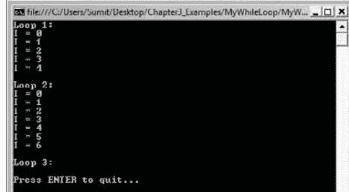

图 3.5：使用 while 循环

## 使用 do..while 循环

`do..while` 循环的原理与 `for` 循环和 `while` 循环非常相似。与 `for` 循环不同，它不进行初始化。与 `while` 循环不同，`do..while` 循环在结尾检查条件而不是开头。结果是无论条件真假，`do..while` 循环至少都会执行一次。如果你还记得，`while` 循环可以执行零次或多次。

第一个示例展示了 `do..while` 循环的使用。第二个示例展示了带有布尔标志的 `do..while` 循环。最后一个示例展示了增加一个值的 `do..while` 循环。

列表 3.14：MyDoWhile 应用程序的代码

```assembly
using System;
using System.Collections.Generic;
using System.Linq;
using System.Text;
namespace MyWhileLoop
{
    class Program
    {
        static void Main(string[] args)
        {
            // 首先，一个简单的 do..while 循环
            int i = 0;
            do
            {
                Console.WriteLine("I = {0}", i);
                i++;
            } while (i < 5);

            // 接下来，相同的情况，但使用了布尔值
            Boolean flag = false;
            i = 0;
            Console.WriteLine("\nLoop 2:");
            do
            {
                if (i > 5)
                {
                    flag = true;
                    Console.WriteLine("I = {0}", i);
                    i++;
                }
                // 一个永远不会执行的循环
                Console.WriteLine("\nLoop 3: ");
            } while (!flag);

            Console.WriteLine("\nPRESS ENTER to quit...");
            Console.Read();
        }
    }
}
```

## for 循环

C# 中的 `for` 循环在一个地方执行各项任务，如初始化、验证和变量值的递增/递减。在需要重复某个过程直到给定条件变为真或假的情况下，你可以使用 `while` 循环。CD 中的 `MyWhileLoop` 应用程序包含了三个示例来展示 `while` 循环的使用。

在第一个示例中，`while` 循环非常简单。在第二个示例中，`while` 循环根据响应变量值设置的布尔值进行操作。在第三个示例中，由于在迭代之前未满足条件，`while` 循环没有执行。列表 3.13 显示了 `MyWhileLoop` 应用程序的代码：

`for` 循环允许在一个地方创建一个循环。CD 中的 `MyForLoop` 应用程序展示了 `for` 循环的多种方式。首先，你看到一个包含所有组件的 `for` 示例。接下来，你看到一个涉及数组和元素的 `for` 循环示例。示例代码展示了处理字符串的 `for` 循环。

列表 3.15：MyForLoop 应用程序的代码

```assembly
using System;
using System.Collections.Generic;
using System.Linq;
using System.Text;
namespace MyForLoop
{
    class Program
    {
        static void Main(string[] args)
        {
            // 一个从 1 到 5 的简单循环
            for (int i = 0; i < 5; ++i)
            {
                Console.WriteLine("0" + i);
            }

            // 使用两个循环：首先在字符串中找到一个字母，
            // 然后打印它直到遇到空格
            int nPos = 0;
            string s = "this is a test of the emergency broadcast system";
            while (nPos < s.Length)
            {
                if (s[nPos] == 'b')
                {
                    break;
                }
                ++nPos;
            }
            for ( nPos; nPos < s.Length; ++nPos)
            {
                if (s[nPos] == ' ')
                {
                    break;
                }
                Console.WriteLine(s[nPos]);
            }

            // 最后，插示如何对非整数使用 `for` 循环
            // 以及如何更改增量
            int state = 0;
            for (double d = 0.0; d < 5.0; )
            {
                Console.WriteLine("D = {0}", d);
                switch (state)
                {
                    case 0:
                        d += 0.1;
                        break;
                    case 1:
                        d += 0.2;
                        break;
                    case 2:
                        d += 0.5;
                }
            }
        }
    }
}
```

```cs
}
  state++;
  if (state > 2)
    state = 0;
}
  Console.Write("\nPress ENTER to quit...");
  Console.ReadLine();
}
{
```

图 3.7 显示了列表 3.15 的输出。

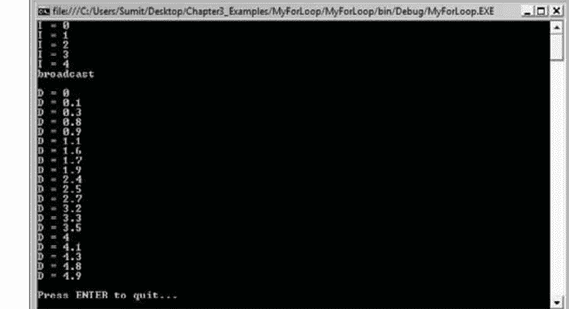

图 3.7：使用 for 循环

## 使用 foreach 循环

`foreach` 循环允许程序员轻松地访问数组的所有元素。要使用 `foreach` 循环，请创建一个程序，在其中首先创建一个书名数组。现在，让我们看看如何使用 `foreach` 循环访问该数组的每一个元素。光盘中的 `MyforeachLoop` 应用程序包含一个展示 `foreach` 循环用法的示例。列表 3.16 显示了 `MyforeachLoop` 应用程序的代码：

列表 3.16：MyforeachLoop 应用程序的代码

```csharp
using System;
  using System.Collections.Generic;
  using System.Linq;
  using System.Text;
namespace MyforeachLoop
{
  class Program
  {
    static void Main(string[] args)
    {
      string[] bookTitles = new string[] { "Alice in wonderland", "Pelican Brief",
```

## 立即解决方案

```csharp
Console.WriteLine("The available book titles are: ");
foreach (string i in bookTitles)
{
    Console.WriteLine("\t" + i);
    Console.WriteLine("PRESS ENTER to quit...");
    Console.ReadLine();
}
```

在列表 3.16 中，我们创建了一个名为 `bookTitle` 的字符串类型数组。在 `foreach` 循环内部，获取了一个字符串变量 `i`，通过它我们可以访问 `bookTitles` 数组中的各个书名。图 3.8 显示了列表 3.16 的输出：

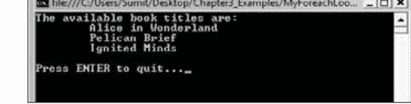

图 3.8：使用 foreach 循环

列表 3.16 显示了通过 `foreach` 循环访问数组元素的代码。在这里，我们创建了一个名为 `bookTitles` 的数组，并通过 `foreach` 循环访问该数组的元素。`foreach` 循环访问 `titles` 数组的每一个元素，并显示为 "Alice in Wonderland",Pelican Brief" 和 "Ignited Minds"。

## 使用嵌套循环处理多维数组

嵌套循环是在一个循环内部创建一个循环，例如在另一个 `for` 循环内部嵌套 `for` 循环。现在让我们看看如何编写程序使用嵌套循环来访问两个矩阵。

在列表 3.17 中，我们使用了两个名为 `firstMatrix` 和 `secondMatrix` 的多维数组。在这里，我们使用两个循环读取 `firstMatrix` 数组的元素，使用两个循环读取 `secondMatrix` 数组。外层循环用于行，内层循环用于列。光盘中的 `MyNestedLoop` 应用程序展示了多维数组。列表 3.17 显示了 `MyNestedLoop` 应用程序的代码。

列表 3.17：MyNestedForLoop 应用程序的代码

```csharp
using System;
using System.Collections.Generic;
using System.Linq;
using System.Text;
namespace MyNestedForLoop
{
    class Program
    {
        static void Main(string[] args)
        {
            int[,] firstMatrix = new int[2, 2];
            int[,] secondMatrix = new int[2, 2];
            int[,] sumMatrix = new int[2, 2];
            int i, j;
            Console.WriteLine("Enter the Elements of the First 2x2 Matrix:");
            for (i = 0; i < 2; i++)
            {
                for (j = 0; j < 2; j++)
                {
                }
            }
        }
    }
}
```

# 第 3 章：C# 2008 程序中的流程控制与异常处理

```csharp
firstMatrix[i
```

图 3.9 显示了列表 3.17 的输出：

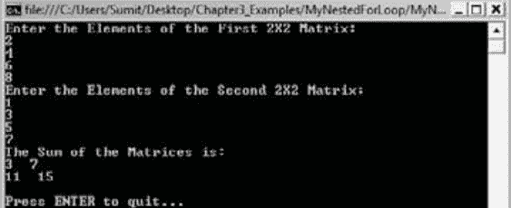

图 3.9：使用嵌套 for 循环

在这里，我们可以看到当用户输入两个矩阵的元素时，这两个矩阵的和将作为输出显示。

## 创建无限循环

无限循环是我们无法终止的循环。当你想让语句或一组语句执行无限次时，可以使用无限循环。在无限循环中，没有需要检查的条件。在列表 3.18 中，`for` 循环内部的语句执行无限次。光盘中的 `MyInfiniteLoop` 应用程序包含了显示如何创建无限循环的代码。列表 3.18 显示了 `MyInfiniteLoop` 应用程序的代码：

列表 3.18：MyInfiniteLoop 应用程序的代码

```csharp
using System;
using System.Collections.Generic;
using System.Linq;
using System.Text;
```

```csharp
namespace MyInfiniteLoop
{
    class Program
    {
        static void Main(string[] args)
        {
            int counter;
            for (counter = 0; counter++)
            {
                Console.WriteLine("I Stuck in a Loop");
            }
        }
    }
}
```

图 3.10 显示了列表 3.18 的输出。

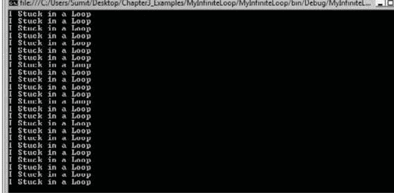

图 3.10：无限循环

图 3.10 无限次地输出“I Stuck in a loop”。

## 跳转到标签语句

`goto` 语句允许程序控制从一个点跳转到另一个点。从一个点到另一个点的跳转是基于标签语句的。光盘中的 `MyLabeledStatement` 应用程序包含一个展示 `goto` 语句用法的示例。列表 3.19 显示了 `MyLabeledStatement` 应用程序的代码。

列表 3.19：MyLabeledStatement 应用程序的代码

```csharp
using System;
using System.Collections.Generic;
using System.Linq;
using System.Text;
namespace MyLabeledStatement
{
    class Program
    {
        static void Main(string[] args)
        {
        }
    }
}
```

# 第 3 章：C# 2008 程序中的流程控制与异常处理


图 3.12 显示了列表 3.20 的输出。

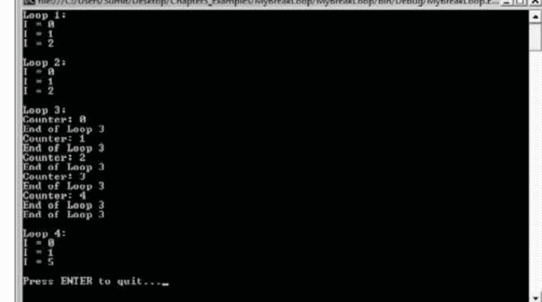

图 3.12：退出循环

## 使用 continue 语句

`continue` 语句用于将程序控制转移到循环的开头。它会持续执行直到满足特定条件。CD 中的 `MyContinueStatement` 包含一个展示 `continue` 语句使用的示例。列表 3.21 显示了 `MyContinueStatement` 的代码。

列表 3.21：`MyContinueStatement` 应用程序

```csharp
using System;
using System.Collections.Generic;
using System.Linq;
using System.Text;
namespace MyContinueStatement
{
    class Program
    {
        static void Main(string[] args)
        {
            int number = 1;
            while (true)
            {
                Console.WriteLine(number);
                number++;
                if (number <= 10)
                    continue;
                else
                    break;
            }
            Console.WriteLine("Series is broken at number: " + number);
            Console.Write("\nPress ENTER to quit...");
            Console.ReadLine();
        }
    }
}
```

## 立即解决方案

图 3.13 显示了列表 3.21 的输出。

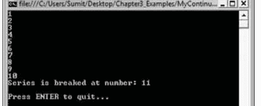

图 3.13：使用 `continue` 语句进行除法

在列表 3.21 中，我们可以看到只要条件为真，`while` 循环就会执行。在 `while` 循环内部，`if` 语句检查数字是否小于 10，并将程序控制转移到 `continue` 语句。`continue` 语句在满足条件时会将程序控制转移到循环开头。如果条件不满足，程序控制将转移到 `else` 块并跳出循环。

## 捕获异常

异常处理是 C# 错误处理的核心。假设你正在编写一个除两个数字的程序，并且你不希望程序因异常而异常终止。为了确保这一点，你在运行程序之前，会捕获可能导致异常终止的异常。在列表 3.22 中，你可以看到两个块——`try` 和 `catch`。在 `try` 块中给出了两个数字除法的逻辑，而 `catch` 块则在异常发生时处理该异常。CD 上的 `MyException` 应用程序包含了显示如何捕获异常的代码。列表 3.22 显示了：

列表 3.22：`MyException` 应用程序代码

```csharp
using System;
using System.Collections.Generic;
using System.Linq;
using System.Text;
namespace MyException

class Program
{
    static void Main(string[] args)
    {
        int number = 0;
        int div = 0;
        try
        {
            div = 100 / number;
        }
        catch (DivideByZeroException)
        {
            Console.WriteLine("Exception Occurred");
        }
        Console.WriteLine("Result is : " + div);
    }
}
```

```csharp
Console.Write("\nPRESS ENTER to quit...");
Console.ReadLine();
```

图 3.14 显示了列表 3.22 的输出：

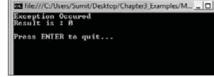

图 3.14：捕获异常

当 100 除以 0 时，会发生 `DivideByZero` 异常，`catch` 块会处理它并执行 `catch` 块下的语句，最后显示结果。

## 抛出异常

你可以使用 `throw` 语句来抛出异常。`throw` 语句仅接受一个参数在程序中抛出异常。当遇到 `throw` 语句时，方法将终止并将错误返回给调用方法进行处理，或向链的向上传递。

假设你正在编写一个程序，在其中你想抛出自定义异常。每当 `try` 块中发生这种异常时，它都会被 `catch` 块处理。在列表 3.23 中，你可以看到在 `try` 块中，`if` 语句检查数字是否大于 10。如果满足条件，则抛出一个新的 `Maximum Limit` 异常。CD 中的 `MyThrowException` 应用程序包含了如何抛出异常的代码。列表 3.23 显示了 `MyThrowException` 应用程序的代码：

列表 3.23：`MyThrowException` 应用程序代码

```csharp
using System;
using System.Collections.Generic;
using System.Linq;
using System.Text;
namespace MyThrowException
{
    class Program
    {
        static void Main(string[] args)
        {
            int number;
            Console.Write("Enter a Number:");
            number = int.Parse(Console.ReadLine());
            try
            {
                if (number > 10)
                    throw new Exception("Maximum Limit is 10");
            }
            catch (Exception e)
            {
                Console.WriteLine("Exception has been occurred");
            }
            finally
            {
                Console.WriteLine("This is the Last");
                Console.WriteLine("\nPRESS ENTER to quit...");
            }
        }
    }
}
```

## 使用 checked 和 unchecked 语句

`checked` 和 `unchecked` 语句用于检查溢出异常。`unchecked` 语句不会产生异常并显示结果，但 `checked` 语句会导致溢出异常并显示异常消息。在列表 3.24 中，你可以获取两个字节变量 `number` 和 `number2` 并为它们赋值 127。在这种情况下，两个变量的乘积存储在另一个字节变量 `result` 中。CD 中的 `CheckOverflow` 应用程序包含一个展示 `checked` 和 `unchecked` 语句使用的示例。列表 3.24 显示了 `CheckOverflow` 应用程序的代码：

列表 3.24：`CheckOverflow` 应用程序代码

```csharp
using System;
using System.Collections.Generic;
using System.Linq;
using System.Text;
namespace CheckOverflow
{
    class Program
    {
        static void Main(string[] args)
        {
            byte number1 = 127;
            byte result;
            number2 = 127;
            number2 = 127;
            try
            {
                result = unchecked((byte)(number1 * number2));
                Console.WriteLine("unchecked result: " + result);
                result = checked((byte)(number1 * number2));
                Console.WriteLine("checked result: " + result);
            }
            catch (OverflowException exc)
            {
                Console.WriteLine(exc);
            }
        }
    }
}
```

```csharp
  finally {
    Console.write("\nPress ENTER to quit...");
    Console.ReadLine();
  }
}
```

图 3.16 显示了列表 3.24 的输出。

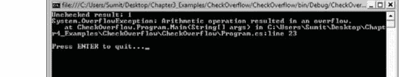

图 3.16：使用 `checked` 和 `unchecked` 语句

# 4 C# 中的面向对象编程 2008

| 如果你需要针对以下问题的快速解决方案： | 请参页页面： |

| :--- | :--- |

| 继承类/创建派生类 | 133 |

| 创建密封类 | 134 |

| 使用扩展方法 | 135 |

| 使用访问器和修改器进行封装 | 136 |

| 使用属性进行封装 | 137 |

| 重载运算符 | 138 |

| 重载方法 | 140 |

| 重载索引器 | 141 |

| 使用 `new` 运算符隐藏方法 | 143 |

| 使用 `Virtual` 关键字覆盖方法 | 144 |

| 创建接口 | 145 |

| 实现接口 | 146 |

| 继承接口 | 147 |

## 深度解析

想象一种情况：工程师们配备了专业工具，并被要求制造一辆豪华汽车。你认为他们能够在没有适当模型或设计的情况下制造出来吗？显然不能。和任何行业一样，在软件开发中，开发应用程序需要一个模型和适当的设计——过程化编程 (POP) 和面向对象编程 (OOP)。

POP 是基于将问题拆分为多个模块、分别解决每个模块，然后将所有模块组合以解决整个问题的概念。方法可以是由一组代码块组成的代码。每个任务都写在一个代码块中。在 POP 方法中，我们可以从一个方法调用另一个方法。因此，方法之间相互依赖，导致将一个方法与另一个方法分离变得困难。在这里，可维护性变得困难。使用 POP 的语言有 COBOL、FORTRAN 和 C。

引入 OOP 概念是为了解决维护和可重用性的困难。OOP 概念允许代码重用。现在，编程语言中的“对象”并不意味着一个虚拟或可见的实体，而是一个没有物理存在的对象。对象可能包含某些行为和属性。在编程语言中，我们将对象的行为和属性表示为属性。在这两种模型（POP 和 OOP 模型）中，OOP 被认为是最值得遵循的，因为它遵循与现实世界相关的方法。现在，让我们讨论 OOP 的基本原则。

- 封装

- 继承

- 多态

- 抽象

让我们从封装开始。

### 封装

封装是隐藏无关信息并仅向用户显示相关信息的过程。用户的尝试是理解封装的概念。当客户去购买冰箱时，他寻找的是冰箱的颜色、功能、存储容量等，而对客户隐藏的是其内部布线和系统。公司不希望客户拆改布线系统，因此它向客户隐藏了内部布线系统的细节。这种隐藏内部因素的过程被称为封装。在这种情况下，如果冰箱停止工作，用户无法修理冰箱，因为他不了解其内部工作原理。

在 OOP 术语中，封装是将数据和成员封装在类中的过程。只有特定的方法或属性可以访问类的私有成员。在这里，封装是一种从未经授权的访问中隐藏类或对象的内部状态和行为的方法。它限制了用户共享和操纵数据，最大限度地减少了数据损坏的几率。封装的优点如下：

- 通过封装过程实现数据隐藏。封装提供了一种防止未经授权访问数据的方法。例如，我们可以将字段等数据成员、成员函数（函数或索引）声明为 `private`。私有数据可以通过两种方式操作：首先通过访问器和修改器方法，其次通过命名的属性（这是 C# 2008 引入的新功能）。你将在“快速解决方案”部分看到示例，其中使用了这两种方法（访问器和修改器）来演示封装的概念。

- 增加代码的可维护性——封装通过仅向用户显示相关信息提供了一种增加代码可维护性的方法。

- 防止数据损坏——封装通过指定类的私有成员变量（这些变量只能由特定方法或属性访问），提供了一种防止数据损坏的方法。

- 在类中封装数据成员和成员函数——封装最重要的特性是将类的数据成员和成员函数绑定到单元单元。

属性是一个可以通过访问器和修改器读取或写入的公共变量，访问器和修改器是属性的 `get` 和 `set` 块。要了解更多关于属性、访问器和修改器的信息，请参阅第 2 章命名空间、类、对象和结构体。

## 继承

使用 OOP 最重要的原因是促进代码的重用并消除冗余代码。继承是子类获取父类中定义的所有特性的属性。父类是在层次结构中比子类处于更高的类。当一个类继承另一个类的公共属性时，继承的类被称为基类，允许继承其公共属性的类被称为派生类。继承定义了类的逻辑结构，例如通用类位于类层次结构的最顶端，更专门的类位于较低层次。例如，`Animal`（动物）可以作为派生类（如 `Dog`、`Cow` 和 `Tiger`）的基类。

继承有四种类型分别是：

- 单继承——基类和派生类

- 层次结构继承——基类和多个派生类

- 多级继承——派生类链

- 多重继承——来自多个基类的派生类

*(注：此处原文中存在大量重复的 OCR 错误文本，已根据要求提取核心内容进行翻译)*

```cs
{
  public void ShowDetail()
}
class MainClass
{
  //Instantiation of MyClass class
  //Method calling
}
```

在列表 4.2 中，密封类 `MyClass` 被实例化在 `MainClass` 类中。然而，如果你使用以下语句从 `MyClass` 类派生一个类：

```
class DerivedClass : MyClass
```

你将得到一个错误信息：`DerivedClass` 无法继承自密封类 `MyClass`。如果一个基类被声明为密封类，你将无法从它派生一个类。密封类可以包含密封方法。密封方法在声明中使用了 `sealed` 关键字。派生类不能使用 `sealed` 关键字重写这些方法。你可以使用密封方法来重写具有相同签名的虚方法。这意味着在方法中，你始终将 `sealed` 关键字与 `override` 结合使用，如列表 4.3 所示。

列表 4.3：密封方法的声明与实现

```cs
class BaseClass
{
  public virtual void SealedMethod()
  {
    //Method Body
  }
}
class DerivedClass:BaseClass
{
  public sealed override void SealedMethod()
  {
    //Method Body
  }
}
```

在这里，密封方法 `SealedMethod()` 重写了 `BaseClass` 中定义的虚方法 `SealedMethod()`。`DerivedClass` 的任何派生类都不能进一步重写 `SealedMethod()` 方法。

## 扩展方法

扩展方法是 C# 3.0 的新功能之一。扩展方法是一种在不继承类的情况下扩展类的技术。扩展方法的行为与静态方法相似。一个具有静态成员并在第一个方法参数上使用 `this` 修饰符的静态类可以实现扩展方法。列表 4.4 展示了一个理解扩展方法的示例。

列表 4.4：扩展方法的示例

```cs
class MyClass
{
  public static int MyExtensionMethod(string number)
  {
    ...Method Body
  }
  public static int MyStaticMethod(string number)
  {
    ...Method Body
  }
}
```

# 第 4 章：C# 2008 面向对象编程

```cs
class MainActivity()
{
    string Number = "100";
    int ext = Number.MyExtensionMethod(); // Line A
    int stat = MyClass.MyStaticMethod(Number);// Line B
}
```

扩展方法与静态方法之间的区别如下：

- 扩展方法在它的第一个参数之前有 `this` 关键字，而静态方法在它的参数声明中没有 `this` 关键字。


- 当调用扩展方法时，用 `this` 声明的参数不会被传递（参见列表 4.4 中的 Line A），而在静态调用中，你必须传递所有参数。
- 扩展方法定义在静态类中，但静态方法并不一定声明在静态类中。
- 你只能在实例值上调用扩展方法。

## 多态

通常情况下，你可以将多态视为“同一种事物具有多种形式”。通过多态的帮助，我们可以根据需求以多种方式使用过程。例如，我们可以为计算几何图形面积创建一个过程，并可以使用相同的方法名为每个几何图形传入不同的参数，来计算圆、三角形或矩形的面积。

多态是面向对象编程（OOP）的基本概念之一。多态的重要特征如下：

- 它允许你在运行时通过基类引用调用派生类的方法。
- 它允许类为通过相同名称调用的方法提供不同的实现。
- 它允许调用类的方法而不忽略它提供了什么具体的实现。

在学习更多关于多态的知识之前，我们需要知道派生类的对象可以持有其基类的引用。让我们来看一个 `DerivedClass` 继承 `BaseClass` 的例子，如列表 4.5 所示：

列表 4.5 从另一个类继承类

```cs
class BaseClass {
    public void BaseMethod() {
        //...Method Body
    }
}
class DerivedClass : BaseClass {
    public void DerivedMethod() {
        //...Method Body
    }
}
```

然而，你可以编写以下语句：

```cs
BaseClass bc=new DerivedClass();
```

在这段代码中，`BaseClass` 类的引用持有一个 `DerivedClass` 类的对象（`bc`）。在这种情况下，我们将 `DerivedClass` 类的对象视为 `BaseClass` 类的对象。这是可能的，因为我们从 `BaseClass` 类派生了 `DerivedClass` 类。现在，我们也可以写：

```cs
bc.BaseMethod();
```

## 深入探讨

但是，这样写是不正确的：

```cs
bc.DerivedMethod(); //It shows error
```

尽管我们创建了一个 `DerivedClass` 的对象，但我们无法访问 `DerivedClass` 的成员，因为父类是 `BaseClass` 而不是 `DerivedClass`。通过多态的使用，我们可以访问派生类的成员，尽管表面类是基类，这通过：

- 编译时多态/重载
- 运行时多态/重写
- 让我们详细讨论这一点。

## 编译时多态/重载

当编译器编译程序时，编译器知道关于参数的信息，因此编译器在编译时本身将适当的方法绑定到对象上。这个过程也被称为编译时多态或早期绑定。重载允许你定义许多具有相同的方法。编译器根据提供的参数在编译期间确定调用哪个方法。列表 4.6 展示了方法重载的示例：

```cs
class Shape {
    public void area(int Side) {
        //Square Area
    }
    public void area(int Length, int Breadth) {
        //Rectangle Area
    }
    public void area(double Radius) {
        //Circle Area
    }
    public void area(double Height) {
        //Triangle Area
    }
}
class MainActivity {
    shape.area(15);
    shape.area(10, 20);
}
```

## 运算符重载

运算符都有特定的含义，例如 `+` 运算符相加数字，`-` 运算符相减数字。然而，你可以更改运算符的功能，例如 `+` 运算符拼接字符串。根据类型为运算符赋予特殊含义的机制被称为运算符重载。无法重载所有运算符。表 4.1 列出了运算符及其是否可以重载的状态。

| 运算符 | 类型 | 重载状态 |
| --- | --- | --- |
| +, -, ++, --, true, false | 元 | 可以重载 |
| *, \|, << >> | 二进制 | 可以重载 |
| !=, ==, <, >= | 比较 | 可以重载 |
| &&, \|\| | 逻辑 | 不可重载但可以使用 && 或 \|\| |

表 4.1：运算符及其重载状态

如果你重载了比较运算符，它必须成对重载，例如如果重载了 `==`，则也必须重载 `!=`。反之亦然，对于 `<` 也是如此。

## 运行时多态/重写

重写是 OOP 的一个特性，允许类为其基类已提供的方法提供特定的实现。派生类中的方法实现替换了基类中的方法实现。这也被称为运行时多态，因为编译器在程序执行（运行时）期间方法绑定到对象，而不是在编译期间。当你调用方法时，派生类中定义的方法被调用并执行，而不是基类的方法，但需要满足以下条件：

- 你必须将类方法声明为 `virtual`。
- 你必须使用 `override` 关键字实现派生类方法。

这种方法也被称为重写。列表 4.7 展示了方法重写的示例：

```cs
class BaseClass {
    public virtual void ShowData() {
```

## 深度解析

```c{
  //Method Body
}
class DerivedClass:BaseClass
{
  public override void ShowData() {
    //Method Body
  }
}
```

在列表 4.7 中，你可以看到在 `BaseClass` 中，`ShowData()` 方法标记了 `virtual` 关键字，而在 `DerivedClass` 中，`ShowData()` 被标记为 `override` 关键字。

## 抽象

抽象是隐藏细节并仅暴露特定概念或对象的本质特征的过程。抽象和封装的概念是互补的。你可以结合“封装”章节中讨论的示例来理解抽象的概念。正如你在冰箱的示例中所看到的，当客户来购买冰箱时，店主会对冰箱的特征进行简要描述，例如存储容量，但不会涉及系统的内部工作原理。显示与冰箱相关的通用信息的过程是抽象，而向用户隐藏复杂信息则被称为封装。

从面向对象编程的角度来说，抽象是表示本质特征而不包含背景细节或实现细节的行为。抽象是根据功能角度开发类、对象、类型，而不是表示某个实际项目（类、对象或类型）的一个模型、视图或表示。抽象的主要特征如下：

- 你可以使用它来管理代码的复杂性。
- 你可以使用它将复杂系统分解为更小的组件。

## 抽象类和抽象方法

在 C# 中，我们有一个基类，并可以有多个派生类。如果我们不希望任何人创建基类的对象，可以将基类设为抽象类。类中的 `abstract` 关键字表示该类不能被实例化。我们可以创建其派生类的实例（前提是它没有被标记为抽象）。列表 4.8 显示了一个理解抽象类语法的示例：

列表 4.8：抽象类的语法

```csharp
abstract class BaseClass
{
  //Data Members and Member Functions
}
class DerivedClass:BaseClass
{
  //Data Members and Base Functions
}
class MainClass()
{
  BaseClass bc; //不能实例化
  DerivedClass dc; //可以实例化
}
```

在这个示例中，我们不能实例化 `BaseClass()` 类，因为我们将其声明为抽象的。抽象类的抽象特征如下：

# 第 4  own：C# 中的面向对象编程 2008

- 你不能直接实例化它。这意味着你不能创建抽象类的对象；它必须被继承。
- 你可以在其中包含抽象成员和非抽象成员。
- 你不能在其中应用 `sealed` 关键字。
- 它始终是公共的。因此，它可以用于程序的任何地方。

就像抽象类一样，我们也可以创建抽象方法。要将一个方法声明为抽象方法，在声明的方法名之前应用 `abstract` 关键字。抽象方法类似于虚方法，它不提供任何实现。因此，抽象方法没有方法体。让我们来看一个抽象方法的示例。

```csharp
public abstract void area(int Length, int Breadth);
```

抽象方法的某些特征如下：

- 你不能在抽象类中拥有它的实现。
- 你可以在非抽象的派生类中实现它。
- 你只能在抽象类中声明它。
- 你不能将其声明为 `static` 和 `virtual` 关键字。
- 方法的抽象声明允许重写一个虚方法。

让我们来看另一个示例来理解抽象方法的实现，如列表 4.9 所示：

列表 4.9：抽象方法的示例

```csharp
public abstract void area(int Length, int Breadth)
{
    //Method Area() 不能在此处实现。
}
public abstract class BasicShape
{
    //Method Area() 不能在此处实现
}
public class Rectangle
{
    public override void area(int Length, int Breadth)
{
        //Method Area() 此处实现
    }
}
```

## 接口

接口数据成员和成员函数的集合，但它不实现数据成员和成员函数。引入接口是为了提供多重继承特性，以便从单个或多个接口继承。接口中定义的方法没有实现，它们只指定了它们接受的参数以及将返回的值的类型。接口始终在类中实现。实现接口的类保证提供在其中定义的所有成员的实现。

C# 中的接口与 Java 中的接口几乎完全相同，但它们在实现上更具活性。C# 中的接口不能通过接口实例化对象，但你可以提供一组在几个不同类中通有的功能。接口可以具有与类相同的访问修饰符，例如 `public`、`private`。在许多方面，接口只是一个没有定义代码骨架。

## 深度解析

现在，你将通过以下内容学习接口的执行：

- 接口的语法
- 接口的实现
- 接口与继承
- 让我们从接口的语法开始

## 接口的语法

接口的声明与类一样，唯一的区别是类使用 `class` 关键字声明，而接口使用 `interface` 关键字声明。接口的行为像是一个包含方法定义的模板。这些方法在本质上是抽象的，它们没有方法体。类必须实现所有的方法，否则会报错。

```csharp
interface interfaceName
{
    void MethodName();
}
```

在这种语法中，接口定义了方法，任何实现它的类都必须提供方法体。

## 接口的实现

使用冒号（`:`）语法在类中实现接口。

```csharp
class ClassName : IInterface
{
    public void MethodName()
    {
        // 在此处实现
    }
}
```

## 接口与继承

当我们创建一个接口时，可能会调用派生类的基类，此时当我们创建一个接口类型的派生类对象时，会搜索继承层次结构，直到找到直接实现该接口的类。

## 解决方案

### 继承类/创建派生类

继承是面向对象编程的主要特性之一。它允许你重用现有代码。在“深度解析”章节中，你已经学习了类之间可以相互继承。允许继承公共属性的类被称为基类（父类），继承基类特征的类被称为派生类（子类）。在列表 4.12 中，`BaseClass` 是父类，`DerivedClass` 继承了 `BaseClass` 类的特征，因此它是子类。CD 附盘上的 `MyInheritance` 代码展示了派生类如何继承基类的特征。见列表 4.12。

列表 4.12：MyInheritance 示例代码

```csharp
using System;
using System.Collections.Generic;
using System.Linq;
using System.Text;
namespace MyInheritance
{
    public class BaseClass
    {
        public int DataMember;
        public void BaseClassMethod()
        {
            Console.WriteLine("I am a Base Class Method");
        }
    }

    public class DerivedClass : BaseClass
    {
        public void DerivedClassMethod()
        {
            Console.WriteLine("I am a Derived Class Method");
        }
    }

    public class Program
    {
        public static void Main(string[] args)
        {
            // 创建一个基类对象
            Console.WriteLine("I am accessing Base Class object:");
            BaseClass bc = new BaseClass();
            bc.DataMember = 1;
            bc.BaseClassMethod();
            // 创建一个派生类对象
            Console.WriteLine("");
            Console.WriteLine("I am accessing Derived Class object:");
            DerivedClass dc = new DerivedClass();
            dc.DataMember = 2;
            dc.BaseClassMethod();
            dc.DerivedClassMethod();
            Console.Write("\nPress ENTER to quit.");
            Console.ReadLine();
        }
    }
}
```

# 第 4 章：C# 面向对象编程 2008

图 4.1 显示了列表 4.12 的输出：


图 4.1：继承类/创建派生类

## 创建密封类

你可以使用 `sealed` 关键字来表示该类不能作为基类使用。当你对类应用 `sealed` 关键字时，该修饰符会使其变为最终（final）。在列表 4.13 中，我们将 `MyClass` 类声明为 `sealed`，因此无法继承它。`MySealedClass` 示例展示了如何将类声明为密封以防止其被派生。列表 4.13 显示了 `MySealedClass` 示例的代码：

列表 4.13：MySealedClass 示例代码

```csharp
using System;
using System.Collections.Generic;
using System.Text;

namespace MySealedClass
{
    sealed class MyClass
    {
        string Fname;
        string Lname;
        int Age;
        public void GetDetail()
        {
            Console.Write("Enter Your First Name:");
            Fname = Console.ReadLine();
            Console.Write("Enter Your Last Name:");
            Lname = Console.ReadLine();
            Console.Write("Enter Your Age:");
            Age = int.Parse(Console.ReadLine());
        }
        public void ShowDetail()
        {
            Console.WriteLine(Fname + " " + Lname + " you are " + Age + " Years Old");
        }
    }
    class MainClass
    {
        static void Main(string[] args)
        {
            MyClass obj = new MyClass();
            obj.GetDetail();
            obj.ShowDetail();
            Console.Write("\nPress ENTER to quit...");
            Console.ReadLine();
        }
    }
}
```

## 解决方案

图 4.2 显示了列表 4.13 的输出。


图 4.2：密封类示例

## 扩展方法

扩展方法是一种在不继承该类的情况下扩展该类的技术。扩展方法的行为与静态方法相似。你可以在静态类中定义扩展方法，而在定义静态方法时则不需要。对于静态类成员，你在声明中使用 `this` 关键字来实现该扩展方法。CD 附盘上的 `MyExtensionMethod` 示例展示了如何使用扩展方法。


在列表 4.14 中，我们可以在名为 `MyClass` 的静态类中使用 `static` 关键字定义一个名为 `MyExtensionMethod()` 的扩展方法。`MyExtensionMethod()` 方法在其字符串参数声明之前确实有 `this` 关键字。当我们调用 `MyExtensionMethod()` 方法时，带有 `this` 关键字声明的 `Number` 参数不会被传递（见列表 4.14 中的行 A），而在 `MyStaticMethod()` 方法中，我们传递了 `Number` 参数（见列表 4.14 中的行 B）。列表 4.14 显示了 `MyExtensionMethod` 示例的代码。

列表 4.14：`MyExtensionMethod` 示例代码

```csharp
using System;
using System.Collections.Generic;
using System.Linq;
using System.Text;
namespace MyExtensionMethod
{
    public static class MyClass
    {
        public static void MyExtensionMethod(this string Number)
        {
            // 实现
        }
        public static void MyStaticMethod(string Number)
        {
            // 实现
        }
    }
    class MainClass
    {
        static void Main(string[] args)
        {
            string Number = "Test";
            MyClass.MyExtensionMethod(Number); // 行 A
            MyClass.MyStaticMethod(Number); // 行 B
        }
    }
}
```

# 第 4 章：C# 面向对象编程 2008

```csharp
Console.Write("\nPress ENTER to quit...");
Console.ReadLine();
```

图 4.3 显示了列表 4.14 的输出：


图 4.3：扩展方法

## 访问器与修改器

列表 4.15 显示了 `Employee` 的代码：

```csharp
namespace Employee
{
    public class EmployeeDetail
    {
        private string Name;
        public void set(string name)
        {
            Name = name;
        }
        public string get()
        {
            return Name;
        }
    }
    class MainClass
    {
        static void Main(string[] args)
        {
            EmployeeDetail detail = new EmployeeDetail();
            detail.set("Amit Saxena");
            Console.WriteLine("The employee name is " + detail.get());
        }
    }
}
```

图 4.4 显示了列表 4.15 的输出：


图 4.4：访问器与修改器

## 属性

为了读写数据，C# 引入了属性的概念。它防止数据被外部使用和修改。CD 附盘上的 `Student` 示例展示了如何使用属性防止未经授权的访问。其中 `get` 和 `set` 方法用于获取和设置所需的数据。列表 4.16 显示了 `Student` 示例的代码：

```csharp
using System;
using System.Collections.Generic;
using System.Linq;
using System.Text;
namespace Student
{
    public class StudentDetail
    {
        private string Name;
        public string StudentName
        {
            get
        {
                return Name;
            }
            set
            {
                Name = value;
            }
        }
    }
    public class MainClass
    {
        public static void Main(string[] args)
        {
            StudentDetail detail = new StudentDetail();
            detail.StudentName = "Sumit Saxena";
            Console.WriteLine("The Student Name is {0}", detail.StudentName);
            Console.Write("\nPRESS ENTER to quit...");
            Console.ReadLine();
        }
    }
}
```

图 4.5 显示了列表 4.16 的输出：


图 4.5：属性

# 第 4 章：C# 2008 面向对象编程

## 运算符重载

运算符重载意味着我们更改运算符的功能。在运算符重载的情况下，通过方法将运算符定义为一元运算符，区别在于运算符之前要加上 `operator` 关键字。重载一元运算符称为一元运算符重载，重载二元运算符称为二元运算符重载。在这里我们以重载一元运算符和二元运算符作为例子。让我们先看看一元运算符重载。光盘 `UnaryOperatorOverload` 示例展示了如何重载一元运算符。

让我们考虑减（`-`）运算符，它只接受一个参数。我们知道该运算符会改变基本数据项（如 `int` 或 `double`）操作数的符号。现在，让我们看看如何将这个一元运算符应用于类对象。在这里，`operator -()` 方法接收一个该类型的参数并更改数据成员 `opr` 的符号。列表 4.17 显示了 `UnaryOperatorOverload` 的代码。

列表 4.17：`UnaryOperatorOverload` 示例代码

```csharp
using System;
using System.Collections.Generic;
using System.Linq;
namespace UnaryOperatorOverload
{
    class UnaryOperator
    {
        private int Number1;
        private int Number2;
        public UnaryOperator() { }
        public UnaryOperator(int number1, int number2)
        {
            Number1 = number1;
            Number2 = number2;
        }
        public void ShowData()
        {
            Console.WriteLine("The Numbers are: " + Number1 + " " + Number2);
        }
        public static UnaryOperator operator -(UnaryOperator opr)
        {
            UnaryOperator obj = new UnaryOperator();
            obj.Number1 = -opr.Number1;
            obj.Number2 = -opr.Number2;
            return obj;
        }
    }
    class MainClass
    {
        public static void Main()
        {
            UnaryOperator opr1 = new UnaryOperator(20, 30);
            Console.WriteLine("Before Operator Overloading");
            opr1.ShowData();
            UnaryOperator opr2 = new UnaryOperator();
            opr2 = -opr1;
            Console.WriteLine("--------------------------------------");
            Console.WriteLine("After Operator Overloading");
            opr2.ShowData();
            Console.Write("\nPress ENTER to quit...");
            Console.ReadLine();
        }
    }
}
```

图 4.6 显示了列表 4.17 的输出：


图 4.6：重载一元运算符

在重载一元运算符后，我们使用相同的技术来重载二元运算符。在这里，我们在示例中重载了 `+` 运算符。光盘上的 `BinaryOperator` 示例展示了如何重载二元运算符。列表 4.18 显示了 `BinaryOperatorOverload` 示例的代码。

列表 4.18：`BinaryOperatorOverload` 示例代码

```csharp
using System;
using System.Collections.Generic;
using System.Linq;
using System.Text;
namespace BinaryOperatorOverload
{
class BinaryOperator
{
    private int number1;
    private int number2;
    public BinaryOperator() { }
    public BinaryOperator(int number1, int number2)
    {
        Number1 = number1;
        Number2 = number2;
    }
    public void ShowData()
    {
        Console.WriteLine("The Numbers are: " + Number1 + " and " + Number2);
    }
    public static BinaryOperator operator +(BinaryOperator opr1,BinaryOperator opr2)
    {
        BinaryOperator opr = new BinaryOperator();
        opr.number1 = opr1.number1 + opr2.number1;
        opr.number2 = opr1.number2 + opr2.number2;
        return opr;
    }
}
class MainClass
{
    public static void Main()
    {
        BinaryOperator opr1 = new BinaryOperator(20,30);
        opr1.ShowData(); // displays 20 & 30
        BinaryOperator opr2 = new BinaryOperator(30,40);
        opr2.ShowData(); // displays 30 & 40
        BinaryOperator opr3 = new BinaryOperator();
        opr3 = opr1 = opr2;
        opr3.ShowData(); // displays 50 & 70
        Console.Write("\nPRESS ENTER to quit...");
        Console.ReadLine();
    }
}
}
```

图 4.7 显示了列表 4.18 的输出：


图 4.7：重载二元运算符

## 方法重载

C# 允许我们创建多个同名但签名不同的方法。当方法需要执行相似的任务但输入参数不同时，就会使用方法重载。请注意，返回类型在方法重载中不起任何作用，它必须考虑传递的参数的数量或类型。

光盘上的 `MethodOverload` 示例展示了如何重载方法。在列表 4.19 中，使用 `Shape` 类来计算正方形、矩形和三角形的面积。当调用 `Area()` 方法时，编译器会尝试在参数类型中寻找精确匹配。如果编译器找到多个匹配项，则会生成错误。列表 4.19 显示了 `MethodOverload` 示例的代码：

```csharp
using System;
using System.Collections.Generic;
using System.Linq;
using System.Text;
namespace MethodOverload
{
    class Shape
    {
        public void Area(int Side)
        {
            Console.WriteLine("Area of square: " + (Side * Side));
        }
        public void Area(int Length, int Breadth)
        {
            Console.WriteLine("Area of rectangle: " + (Length * Breadth));
        }
        public void Area(double Radius)
        {
            Console.WriteLine("Area of circle: " + (Math.PI * Radius * Radius));
        }
        public void Area(double Base, double Height)
        {
            Console.WriteLine("Area of triangle: " + (0.5 * Base * Height));
        }
    }
    class MainClass
    {
        public static void Main(string[] args)
        {
            Shape s = new Shape();
            s.Area(5);
            s.Area(10, 20);
            s.Area(7.0);
            s.Area(10.0, 5.0);
            Console.Write("\nPress ENTER to quit...");
            Console.ReadLine();
        }
    }
}
```

## 重载索引器

与运算符和方法一样，索引器也可以重载。光盘上的 `Indexer` 示例展示了如何重载索引器。在列表 4.20 中我们定义了两个索引器，一个带有 `int` 参数，另一个带有 `string` 参数。索引器的 getter 返回匹配参数的项目数量。setter 则为成员赋值值。

列表 4.20：`IndexerOverload` 示例代码


```csharp
using System;
using System.Collections.Generic;
using System.Linq;
using System.Text;

namespace IndexerOverload
{
    class MyClass
    {
        private string[] ViewData;
        private int ArraySize;

        public MyClass(int size)
        {
            ArraySize = size;
            ViewData = new string[size];
        }

        public string this[int Position]
        {
            get { return ViewData[Position]; }
            set { ViewData[Position] = value; }
        }

        public string this[string data]
        {
            get
            {
                int Count = 0;
                for (int i = 0; i < ArraySize; i++)
                {
                    if (ViewData[i] == data)
                    {
                        Count = Count + 1;
                    }
                }

                return Count.ToString();
            }
            set
            {
                for (int i = 0; i < ArraySize; i++)
                {
                    if (ViewData[i] == data)
                    {
                        ViewData[i] = value;
                        break;
                    }
                }
            }
        }
    }

    class MainClass
    {
        public static void Main(string[] args)
        {
            MyClass Indexer = new MyClass(10);
            Indexer[9] = "Hello";
            Indexer[3] = "Not Done";
            Indexer[5] = "Good Morning";
            Indexer[7] = "Good Night";
            Indexer["datvalue"] = "Have a Nice Day";

            Console.WriteLine("Indexer Output: \n");
            Console.WriteLine("---------------------");

            for (int i = 0; i < 10; i++)
            {
                Console.WriteLine("Indexer[{0}]: {1}", i, Indexer[i]);
            }

            Console.WriteLine("Count of 'datvalue': " + Indexer["datvalue"]);
            Console.Write("\nPress ENTER to quit...");
            Console.ReadLine();
        }
    }
}
```

```csharp
}
    Console.WriteLine("\nNumber of \"Have a Nice Day\" Entries: (0)");
    MyIndexer["Have a Nice Day"];
    Console.WriteLine("\nPress ENTER to quit...");
    Console.ReadLine();

}
}
```

图 4.9 显示了列表 4.20 的输出。


图 4.9：重载索引器

## 使用操作符隐藏方法

假设我们想从一个基类派生一个类，并重新定义该基类中包含的一些方法。在这种情况下，我们不能将基类方法声明为 `virtual`。那么，我们如何重写操作符呢？`new` 操作符告诉编译器派生类隐藏了基类方法。光上的 `MethodHiding` 示例展示了派生类方法如何隐藏基类方法。在列表 4.21 中，我们可以在派生类的 `Method(i)` 方法中使用 `new` 操作符来隐藏基类方法。列表 4.21 显示了 `MethodHiding` 示例的代码：

列表 4.21：`MethodHiding` 示例的代码

```csharp
using System;
using System.Collections.Generic;
using System.Linq;
using System.Text;

namespace MethodHiding
{
    class BaseClass
    {
        public void MyMethod()
        {
            Console.WriteLine("I am in Base Class");
        }
    }

    class DerivedClass : BaseClass
    {
        public new void MyMethod()
        {
            Console.WriteLine("I am in Derived Class");
        }
    }

    class MainClass
    {
        static void Main(string[] args)
        {
            BaseClass bc = new BaseClass();
            DerivedClass dc = new DerivedClass();

            bc.MyMethod();
            dc.MyMethod();

            bc = new DerivedClass();
            bc.MyMethod(); //BaseClass Method

            Console.Write("\nPress ENTER to quit...");
            Console.ReadLine();
        }
    }
}
```

图 4.20 显示了列表 4.21 的输出：


图 4.20：使用 `new` 操作隐藏方法

## 使用 `virtual` 关键字重写方法

OOP 的基本概念是你可以创建虚拟方法，这些方法可以在派生类中被重写以更改基类的功能。你可以在 C# 中通过 `override` 和 `virtual` 关键字来实现。在方法指示你想在派生类中重写基类方法。同样，在基类中使用 `virtual` 关键字表示该方法的实现可以在派生类中被正确地重写。使用 `override` 关键字时，你必须明确告诉编译器你正打算重写一个现有的虚拟方法。光上的 `MethodOverriding` 示例展示了这些特性的示例。列表 4.22 显示了 `MethodOverriding` 示例的代码：

列表 4.22：`MethodOverriding` 示例的代码

```csharp
using System;
using System.Collections.Generic;
using System.Text;

namespace Program
{
    class Program
    {
        static void Main(string[] args)
        {
            Person p = new Person();
            p.setAge(18);

            AdultPerson ap = new AdultPerson();
            ap.setAge(18);

            Console.WriteLine("Person Age: {0}", p.getAge());
            Console.WriteLine("AdultPerson Age: {0}", ap.getAge());
            Console.Write("\nPress ENTER to quit...");
            Console.ReadLine();
        }
    }
}

public class Person
{
    private int fage;

    public Person()
    {
        fage = 21;
    }

    public virtual void setAge(int age)
    {
        fage = age;
    }

    public virtual int getAge()
    {
        return fage;
    }
}

public class AdultPerson : Person
{
    public AdultPerson() { }

    override public void setAge(int age)
    {
        if (age > 21)
        {
            base.setAge(age);
        }
    }
}
```

图 4.11 显示了列表 4.22 的输出。


## 创建接口

接口为 C# 提供了一种在类之间创建通用功能的方法。通常，一个 C# 接口包含一组用于实现特定任务的方法。例如，接口可以提供日志功能。接口只定义了该任务功能的实际定义。它们不实现任何执行任务的代码。工作留给实现接口的类完成。注意，接口定义不包含代码，只有实际方法的签名。方法的实现留给继承接口的类完成。

列表 4.23 创建接口。

列表 4.25 显示了创建接口的示例。

```csharp
public interface Channel
{
    void Next();
    void Previous();
}

public interface Book
{
    void Next();
}

public interface Chapter
{
    void Next();
}
```

## 实现接口

接口被用作“超类”，类继承其特征。因此，有创建一个创建一个接口并实现该接口所有方法的类。光上的 `AccessingInterface` 示例展示了如何在类中实现接口。列表 4.24 显示了 `AccessingInterface` 示例的代码。

列表 4.24：`AccessingInterface` 示例

```csharp
using System;
using System.Collections.Generic;
using System.Text;

namespace AccessingInterface
{
    public interface Channel
    {
        void Next();
        void Previous();
    }

    public interface Book
    {
        void Next();
        void Chapter();
    }

    class Program : Channel, Book
    {
        public void Next()
        {
            Console.WriteLine("Channel Next");
        }

        public void Previous()
        {
            Console.WriteLine("Previous");
        }

        public void Chapter()
        {
            Console.WriteLine("Chapter");
        }

        static void Main(string[] args)
        {
            Program app = new Program();
            app.Next();
            app.Chapter();
            Console.WriteLine("\nPress ENTER to quit...");
            Console.ReadLine();
        }
    }
}
```

图 4.12 显示了列表 4.24 的输出：


## 继承接口

接口可以被类或另一个接口继承。你可以使用接口来支持多继承的概念。光上的 `InterfaceInheritance` 示例展示了接口如何继承另一个。在列表 4.25 中，你可以看到 `DerivedInterface` 继承了 `BaseInterface` 并在 `InterfaceImplementer` 类中实现。列表 4.25 显示了 `InterfaceInheritance` 示例的代码：

```csharp
using System;
using System.Collections.Generic;
using System.Linq;
using System.Text;

namespace InterfaceInheritance
{
    interface BaseInterface
    {
        void GetPersonalDetail();
        void GetContactDetail();
    }

    interface DerivedInterface : BaseInterface
    {
        void ShowDetail();
    }

    class InterfaceImplementer : DerivedInterface
    {
        string Name;
        int Age;
        string Address;
        long PhoneNumber;

        public void GetPersonalDetail()
        {
            Console.Write("Enter your Name:");
            Name = Console.ReadLine();
        }

        public void GetContactDetail()
        {
            Console.Write("Enter your Address:");
            Address = Console.ReadLine();
            Console.write("Enter your Phone Number:");
            PhoneNumber = Long.Parse(Console.ReadLine());
        }

        public void ShowDetail()
        {
            Console.WriteLine("Your details are:");
            Console.WriteLine("Name: " + Name);
            Console.WriteLine("Age: " + Age);
            Console.WriteLine("Address : " + Address);
            Console.WriteLine("Phone Number: " + PhoneNumber);
        }
    }
}

class MainClass
{
    static void Main(string[] args)
    {
        InterfaceImplementer app = new InterfaceImplementer();
        app.GetPersonalDetail();
        app.GetContactDetail();
        app.ShowDetail();
        Console.WriteLine("\nPress ENTER to quit...");
        Console.ReadLine();
    }
}
```

# 第 4 章：C# 2008 中的面向对象编程

```csharp
InterfaceImplementer MyObj = new InterfaceImplementer();
MyObj.GetPersonalDetail();
MyObj.GetContactDetail();
MyObj.ShowDetail();
Console.Write("\npress ENTER to quit...");
Console.ReadLine();
```

图 4.13 显示了列表 4.25 的输出。


在图 4.13 中，你可以看到接口继承另一个接口并在类中实现。

## 总结

在本章中，你学习了 OOP 及其特性，如封装、继承、多态和抽象。你还学习了如何从基类创建派生类，以及如何重载操作符、方法和索引器。你还学习了接口，例如如何创建、实现和继承接口。

在下一章中，你将学习指针、委托和事件。

148

# 5 指针、委托和事件

| 如果你需要对以下内容寻求即时解决方案： | 参见页： |
|---|---:|
| 创建指向`int`类型数据的指针 | 160 |
| 解引用指针 | 160 |
| 使用指针处理数组 | 161 |
| 使用指针处理结构体 | 163 |
| 使用指针的指针 | 164 |
| 指针相减 | 164 |
| 将指针类型转换为另一种指针类型 | 165 |
| 使用`fixed`语句 | 166 |
| 创建委托 | 167 |
| 声明并实例化委托 | 169 |
| 创建多播委托 | 172 |
| 实现协变 | 174 |
| 实现逆协变 | 175 |
| 使用匿名方法实例化委托 | 175 |
| 创建事件 | 176 |
| 链式事件 | 178 |
| 使用事件源工作 | 179 |
| 触发事件 | 182 |

## 深度解析

指针、委托和事件处理系统是 C# 最重要的特性之一。指针是一个变量，存储另一个数据类型的内存地址，例如`int`和`char`。指针变量使用解引用运算符`*`进行声明。委托是引用方法的类型。在方法被分配给委托后，委托的行为与该方法完全相同。C# 中的委托使用`delegate`关键字声明，类似于 C 或 C++ 中的函数指针。委托还可以用于创建自定义事件。委托是一种类型类，供对象或类使用，用于向具有事件的其他对象提供通知。事件可以通过`event`关键字的帮助来声明。

在本章中，你将学习指针、委托的声明以及如何对它们执行各种操作。除了指针之外，我们还讨论了委托以及它们是如何被声明、实例化和调用的。当一个委托关联两个或多个方法时，它被视为多播。你还学习了协变、逆协变和匿名方法。最后，你学习了 C# 中事件的概念，例如事件源和处理器。

## 指针

指针是一个存储另一个变量地址的内存变量。指针在过程化编程语言（如 C 和 C#）中被广泛使用。当程序的执行速度至关重要，或者你想编写要验证的低级代码时，可以使用指针。为了维护程序的安全性和安全性，你必须在命令行提示符中使用`unsafe`关键字。否则，指针必须出现在标记有`unsafe`关键字的代码段中。标记为`unsafe`的代码在公共语言运行时（CLR）的控制之外。让我们学习不安全代码、声明指针、对指针进行算术运算以及转换指针。

## 不安全代码

指针在 C# 中并不是安全的，但它们可以在不安全代码中使用，即被标记为`unsafe`的代码。你可以通过使用`unsafe`关键字创建一个块并将代码放入块中，将程序的部分代码标记为不安全。此外，你可以在声明中使用`unsafe`关键字将结构体、类和类型成员（变量或方法）标记为不安全。默认情况下，公共语言运行时（CLR）会检查你的指针代码的类型安全性。如果指针仅通过暴露的接口访问其他代码部分，则被认为是安全的。因此，如果你的程序包含指针，C# 编译器将生成错误，除非你的程序代码显式告诉 C# 编译器跳过类型安全检查。跳过类型检查的一种方法是使用 C# 命令行编译器工具`csc.exe`编译你的 C# 源文件，并在编译时指定`unsafe`关键字。为了查看如何在 C# 代码中使用`unsafe`关键字，让我们来看一个例子：

```csharp
unsafe
{
    int *x = new int;
    int *px = &x;
}
```

在这种情况下，你定义了一个不安全块，它允许你将指针分配给数组。现在，考虑另一个代码段：

```csharp
unsafe
{
    int *x = new int;
}
```

在这里，整数指针（`int *x`）不是数组，因此你不能将数组分配给它。

## 指针运算

你不能对指针执行减法操作。表 5.1 显示了你可以应用于指针的不同类型的运算符/关键字：

| 表 5.1：应用于指针的运算符/关键字 |
|---|
| 运算符/关键字 | 类型 | 含义 |
|---|---|---|
| `*` | 解引用 | 用于创建指针变量 |
| `&` | 地址 | 用于获取变量的内存地址 |
| `->` | 指针 | 用于通过指针访问结构体的成员 |
| `[]` | 索引 | 用于对变量指向的槽进行索引 |
| `++`、`--` | 增和递减 | 在`unsafe`上下文中，用于对指针类型应用增和递减运算符 |
| `+`、`-` | 加法和减法 | 在`unsafe`上下文中，用于对指针类型应用加法和减法运算符 |
| `==`、`!=`、`<`、`>=` | 比较 | 在`unsafe`上下文中，用于对指针类型应用比较和相等运算符 |
| `stackalloc` | 栈上分配 | 在`unsafe`上下文中，用于将 C# 数组直接分配到栈上 |
| `fixed` | 固定 | 在`unsafe`上下文中，临时固定一个变量以便找到其地址 |

以下是可以在指针上执行的一些重要的算术操作：

- **加法和减法**——你不能将两个指针变量相加，但你可以向它添加一个整数值。假设你有两个指针变量，例如`MyPointer1`和`MyPointer2`。现在，如果你尝试将它们相加，将会发生错误，如下：

  `MyPointer=MyPointer1+MyPointer2; //Error`

- 但是，可以将一个整数添加到指针变量中。例如，如果你有一个指针变量`MyPointer`以及指向它的整数值，如下所示：

  `MyPointer=MyPointer+4;`

- 现在，如果指针`MyPointer`通过加 4 指向数组的第五个元素，那么它将指向数组的第九个元素。同样，从它减去 4（`MyPointer=MyPointer-4;`）将指向数组的第一个元素。

- 如果我们对两个指针变量执行减法操作，结果将是指针变量所持有的地址之差。让我们看看下面的代码：

```csharp
int [ 10 ] MyArray;

int * MyPointer1 = MyArray + 2;

int * MyPointer = MyArray - 5;

MyPointer2=MyPointer-MyPointer1;
```

在这里，在我们使用减法后，变量`MyPointer2`的值变为 3。

- **增和递减**——`++`运算符将指针值增加 1。例如，如果`MyPointer`指向`MyArray`数组的第四个元素，那么`MyPointer++`指向`MyArray`数组的第五个元素。如果`MyPointer`指向`MyArray`数组的第六个元素，那么`MyPointer--`指向`MyArray`数组的第五个元素。

- **比较**——可以使用比较运算符比较任何两个指针，如`==`、`!=`、`<`、`>`、`>=`。

- **赋值**——可以将另一个指针的值或`null`赋值给指针变量。

## 指针转换

指针转换意味着将一个指针类型变量转换为另一种。在 C# 中，指针转换包括以下转换：

- 将任何指针类型转换为`void`类型。

- 将任何空指针类型转换为任何指针类型。

除此之外，在`unsafe`代码中还可以进行以下显式指针转换：

- 将任何指针变量转换为另一个指针变量。

- 将`byte`、`byte`、`short`、`int`、`uint`、`long`或`long`指针类型转换为任何其他指针类型变量。

当你将一个指针转换为另一个指针时，指针的实际值不会改变。这意味着在转换后，指针指向的地址保持不变。指针转换应遵循这样一个概念：如果指针类型（如`Type1`）转换为另一种类型（如`Type2`），而`Type2`转换为另一种类型（如`Type3`），那么`Type1`应该与`Type3`兼容，这被称为正确对齐（Correct Aligned），在本质上是真实的。让我们通过例子来了解指针转换，如列表 5.2 所示。

### 列表 5.2：指针转换

```csharp
char MyChar = "*";
char* charPointer = &MyChar;
void* voidPointer = &charPointer;
int* intPointer = (int*)voidPointer;
int i = *intPointer;           // undefined
*intPointer = 121212;          // undefined
```

在列表 5.2 中，`voidPointer`访问`CharPointer`，而`IntPointer`访问的是`VoidPointer`。

## 委托

委托是一种特殊的对象类型，它包含方法的细节而不是数据。C# 中的委托是一种类类型，用于调用在创建时已封装的方法。它携带三部分信息——调用时的方法名称、该方法的参数（如果有）以及返回值（如果有）。创建和使用委托涉及以下步骤：

- 声明委托。
- 定义委托方法。
- 创建委托对象。
- 触发委托对象。

## 声明委托

可以使用以下语法声明委托：

`access-modifier return-type delegate-name(parameter-list);`

在此语法中，`access-modifier`是控制委托可访问性的类型，可以是`public`、`private`、`protected`、`internal`或`new`；`delegate`是一个关键字，表示该声明属于委托；`return-type`是返回值的类型；`delegate-name`是委托的名称；`parameter-list`是参数列表。

```csharp
public delegate void MyDelegate(int x, int y);
```

## 定义委托方法

可以使用以下语法定义符合委托的方法：

`access-modifier return-type delegate-name(parameter-list);`

```csharp
public static void Add(int a, int b)
{
    Console.WriteLine("Sum = " + a + b);
}
```

```csharp
public static void Subtract(int a, int b)
{
    Console.WriteLine("Difference = " + a - b);
}
```

## 创建委托对象

可以使用以下语法创建委托对象：

```csharp
delegate-name object-name = new delegate-name(expression);
```

```csharp
MyDelegate del1 = new MyDelegate(Add);
```

```csharp
DelegateTest dt = new DelegateTest();
MyDelegate del2 = new MyDelegate(dt.Subtract);
```

## 触发委托对象

可以使用类似于调用方法的语法触发委托对象，如下：

`delegate-object(argument-list);`

```csharp
del1(30, 20);
del2(30, 20);
```

## 多播委托

我们目前为止创建的每个委托对象都持有单个方法的引用。然而，委托可以持有并调用多个方法。这种委托对象被称为多播委托或组合委托。你可以使用重载的`+=`运算符将多个方法封装到单个委托对象中。你创建的每个委托默认都维护一个调用列表，即委托中封装的方法列表。多播委托的调用列表包含多个方法，按照它们被添加到多播委托的顺序进行调用。

## 深度解析

- 委托的返回类型为`void`。
- 委托的参数中没有输出参数（即使用`out`关键字声明的参数）。

你可以在“立即解决方案”（Immediate Solutions）中的“创建多路委托”部分学习如何创建多路委托。

## 协变与逆协变

协变和逆协变是 C# 中引入的特性，用于在匹配委托方法与委托签名时增加灵活性。在这里，灵活性意味着委托处理程序中不同类或事件的能力。通常情况下，传递给委托的方法必须与委托具有相同的返回类型和签名。然而，协变允许你使用一个具有派生返回类型的方法作为委托。考虑以下示例：

```csharp
delegate object GetData(TextBox control); //定义一个委托
```

该语句定义了一个名为`GetData`的委托。协变允许`GetData`指向任何带有`TextBox`参数的方法，无论其返回类型为何，因为所有 .NET 类的所有类型都继承自`System.Object`类。因此，`GetData`委托可以指向`GetControlText`方法，因为 .NET 类的`String`类型继承自`System.String`，如下代码所示：

```csharp
string GetControlText(TextBox control) //GetControlText 是方法
{
    return control.text;
}
```

与协变类似，逆协变允许你使用具有派生参数的方法作为委托，其中委托的参数是委托签名中参数的基类型。在我们讨论的示例中，逆协变允许你创建一个可以指向以下方法的委托：

```csharp
object GetTag(Control ctr)
{
    return ctr.Tag;
}
```

协变允许`GetData`指向`GetTag`方法，该方法接受`Control`或`Object`值，因为这些是委托签名中指定的`TextBox`类的基类型。协变允许你创建可以被类及其派生类共同使用的委托方法。协变允许你创建更通用的委托方法，这些方法可以用于更多的类。

## 匿名方法与委托

我们在 C# 2.0 版本中已经看到，可以使用命名方法创建委托。现在，为了使用未命名方法来声明委托，C# 2.0 引入了匿名方法的概念。匿名方法允许你实例化委托并创建一个代码块，该代码块作为委托参数传递给委托。此代码可以在委托被调用时由委托执行。让我们来看下面的示例，了解如何定义命名方法，如列表 5.3 所示：

### 列表 5.3：定义命名方法

```csharp
//声明委托
delegate void del(int a);

//定义一个命名方法：
void func(int n)
{
}
```

```csharp
//使用命名方法作为参数实例化委托：
Delg d = obj.func;
```

在列表 5.3 中，我们使用命名方法`func`作为参数实例化了委托`Delg`。现在考虑以下代码，我们使用匿名方法实例化委托：

```csharp
// 声明委托
delegate void Deleg(int a);

// 使用匿名方法实例化委托
Deleg d = (int a) { { };
```

我们通过消除为委托创建单独方法的需求，最大限度地减少了代码量。因此，代码的用性和维护性得到了增强。

匿名方法允许你将代码块作为委托参数传递。在调用委托时，你需要在内联或作为类成员定义匿名方法。你可以将匿名方法传递给具有委托类型参数的方法。列表 5.4 显示了如何将匿名方法作为委托参数传递：

### 列表 5.4：将匿名方法作为委托参数

```csharp
void function() {
    System.Threading.Thread th = new System.Threading.Thread(
        delegate() {
            System.Console.Write("wi !");
            System.Console.WriteLine("How are you!");
        });
    th.start();
}
```

在这里，我们创建了一个在不创建额外委托方法的情况下执行代码的线程。启动线程的代码块作为委托参数传递。此代码块充当方法，防止了你编写单独的委托方法。在使用匿名方法时，你需要记住以下几点：

- 你不能在匿名方法中使用代码。
- 你不能使用将控制转移到匿名块之外的语句，例如`goto`、`break`或`continue`。如果这些语句在匿名方法内部转移了程序控制，则你不能在匿名方法外部使用这些语句。
- 你不能通过匿名方法访问外部作用域的`ref`或`out`。包含匿名方法的变量或参数被声明在该匿名方法的外部作用域内。

## 事件

事件是委托类的成员，供对象或类使用，向具有事件处理程序的其他对象提供通知。可以使用`event`关键字声明事件，如下：

```csharp
Access-modifier event type event-name;
```

在上述语法中，`access-modifier`是定义事件访问权限的修饰符，`event`是关键字，`type`是事件的类型（它应该是一个委托）；而`event-name`是任何有效标识符。

当你想监听事件时，你需要定义一个方法（代表该事件将由相应的委托调用）来处理事件，并使用重载的`+=`将此方法绑定到事件：

```csharp
Access-modifier event type event-name;
```

```csharp
{
    nvalue = nv;
    // 触发事件
    onChanged();
}
```

事件机制绝不是自动的。如果一个方法直接修改内部成员变量而不调用任何方法，则事件不会触发。请考虑以下代码段：

```csharp
public void addMethod()
{
    nvalue++;
}
```

在这种情况下，表示值已更改的事件不会被触发；CLR（公共语言运行时）无法识别该事件已绑定到变量上。在处理检查此类值值的事件时，你需要确保在适当的情况下始终调用触发事件的机制。触发事件的最佳方法将其嵌入访问器中。列表 5.7 显示了如何在另一个类中定义事件处理程序：

### 列表 5.7：处理事件


```csharp
public static void HandleChange()
{
  Console.WriteLine("Handler called");
}
public static void Main()
{
  TestClass tc = new TestClass();
  // 为此类创建一个处理程序
  tc.Changed += new TestClass.ValueEventHandler(HandleChange);
  HandleChange();
}
```

在这里，你可以选择一个静态方法作为事件处理程序。事件处理程序的方法签名必须与事件本身的签名匹配。在这种情况下，委托方法的签名指定它不包含参数且返回 `void`（空返回）。请注意，事件处理程序方法包含相同的签名。如果你尝试使用接受参数或返回任何类型值的方法作为此事件处理程序，编译器将将其标记为错误。假设你想将变量的当前值传递给方法，并希望事件处理程序测试该值是否可接受，你可以修改委托以读取代码，如下：

```csharp
public delegate Boolean valueEventHandler(int value);
protected virtual void onChanged()
{
  if (Changed != null)
    if (Changed(nvalue));
    // 提交更改
}
```

如果你修改了委托，你还必须修改源中 `OnChanged()` 方法的事件触发机制以读取代码，如下：

同时，在事件处理程序对象中，需要对输入进行验证。你可能在类中进行此类验证，该类作为委托类来识别不需要的值，如下：

```csharp
public static Boolean HandleChange(int value)
{
  if (value <= 0 || value > 10)
    return false;
  return true;
}
```

如你所见，`Handle()` 方法强制事件源类中的成员变量值处于 1 和 2 之间。任何其他值都会触发返回 `false` 条件，从而防止事件源在成员变量中设置该值。回到监控负余额的类的示例，你可以可以使用事件处理程序来拒绝会导致余额变为负数的交易。

## 多事件处理程序

我们可以向单个事件对象添加单个或多个事件处理程序。请记住，在列表 5.7 中，当为给定的事件源对象设置事件处理程序时，使用的是 `+=` 运算符而不是任何其他运算符，这是因为可以为事件源定义额外的处理程序，可以是同一个处理对象或多个对象。正如你之前在文中指出的，在这种情况下，事件源并不知道有多个处理程序可以处理该事件。它同样不知道其他任何一个事件处理程序可能已经被调用过的事实。

例如，如果你添加了两个不同的、返回 `Boolean` 值的事件处理程序来指示给定值是否正确，那么 CLR 如何使用该值并链到下一个委托？答案是多路委托（multicast delegate），它是唯一可以使用事件处理程序但不能返回值的类型。

因此，你将获得编译错误，因为多路仅支持 `void` 返回类型。现在，让我们进入“立即解决方案”部分以便在实践中实现这些概念。

## 立即解决方案

## 创建 `int` 数据类型的指针

指针是持有值类型（如 `int`、`char`）其他变量地址的变量。在列表 5.8，我们创建了一个名为 `MyPointer` 的整数指针，它持有名为 `Number` 的整数变量的内存地址。CD 上的 `MyPointer` 示例显示了如何创建指向 `int` 数据类型的指针。列表 5.8 显示了 `MyPointer` 示例的代码：

```csharp
using System;
using System.Collections.Generic;
using System.Linq;
using System.Text;
namespace Mypointer
{
    class Program
    {
        unsafe static void Main(string[] args)
        {
            int Number = 100;
            int* MyPointer;
            MyPointer = &Number;
            Console.WriteLine("The Value of 'Number' is: "+Number);
            Console.WriteLine("The Value of 'MyPointer' is: "+(int)MyPointer);
        }
    }
}
```

图 5.1 显示了列表 5.8 的输出。


图 5.1：创建 `int` 数据类型的指针

> **注意**
>
> 要执行任何包含指针的应用程序，你首先需要使用 C# 编译器（`csc`）配合 `unsafe` 关键字编译程序，然后在命令提示符中运行。

## 指针解引用

解引用意味着访问指针变量所持有的值。（注：此处原文存在大量重复句子，翻译已按要求保持格式逻辑一致）。

在列表 5.9 中，你可以可以使用事件处理程序拒绝会导致余额变为负数的交易。

列表 5.9：指针解引用

```csharp
using System;
using System.Collections.Generic;
using System.Linq;
using System.Text;
namespace Dereference
{
    class Program
    {
        unsafe static void Main(string[] args)
        {
            int Number = 100;
            int* MyPointer;
            MyPointer = &Number;
            Console.WriteLine("Old values: " + Number);
            *MyPointer = 50;
            Console.WriteLine("New values: " + Number);
            Console.WriteLine("The Value of 'MyPointer' is: "+(int)MyPointer);
        }
    }
}
```

图 5.2 显示了列表 5.9 的输出。


图 5.2：指针解引用

在 C# 中，你可以使用指针访问数组元素。在列表 5.10，我们创建了一个整数数组 `MyArray[]` 和一个指针变量 `MyPointer`，通过它我们可以访问数组的元素。

## 使用指针指向结构体

如果结构体的成员仅包含值类型，则可以使用指针指向该结构体。可以使用运算符（`->`）访问结构体的成员。在列表 5.11 中，我们声明了一个结构体 `MyStruct`，并使用（`->`）运算符来访问其成员。光盘上的 `PointerToStruct` 示例展示了如何使用指针访问结构体。列表 5.11 显示了 `PointerToStruct` 示例的代码。

列表 5.11：使用指针指向结构体

```csharp
using System;
using System.Collections.Generic;
using System.Linq;
using System.Text;
namespace PointerToStruct
{
    struct MyStruct {
        public double length;
        public double breadth;
        public double height;
        public void SetDimensions()
        {
            Console.Write("Enter Length of Room (in meter):");
            length = Convert.ToDouble(Console.ReadLine());
            Console.Write("Enter Breadth of Room (in meter):");
            breadth = Convert.ToDouble(Console.ReadLine());
            Console.Write("Enter Height of Room (in meter):");
            height = Convert.ToDouble(Console.ReadLine());
        }
        public void ShowVolume()
        {
            double volume = (length * breadth * height);
            Console.WriteLine("The Volume of Room is: " + volume + " cubic meters");
        }
    }
class MainClass
{
    public static void Main()
{{
        MyStruct mystruct = new MyStruct();
        MyStruct* mystruct1 = &mystruct;
        mystruct1->SetDimensions();
        mystruct1->ShowVolume();
    }
}
```


图 5.4 显示了列表 5.11 的输出。

图 5.4：指向结构体的指针

# 第 5 章：指针、委托和事件

## 使用二级指针

指向指针的指针变量持有另一个指针变量的地址。在列表 5.12 中，我们声明了一个 `char` 类型的变量 `FirstChar`、一个指针变量 `SecondChar` 和一个指针变量 `ThirdChar`。`SecondChar` 变量持有 `FirstChar` 变量的内存地址，而 `ThirdChar` 变量持有变量 `SecondChar` 的内存地址。光盘上的 `PointerToPointer` 示例展示了如何使用指向另一个指针的指针。列表 5.12 显示了 `PointerToPointer` 的代码。

列表 5.12：使用二级指针

```csharp
using System;
using System.Collections.Generic;
using System.Linq;
using System.Text;
namespace PointerToPointer
{
    class Program {
        unsafe static void Main(string[] args)
        {
            char FirstChar;
            char* SecondChar;
            char** ThirdChar;
            FirstChar = '$';
            SecondChar = &FirstChar;
            ThirdChar = &SecondChar;
            Console.WriteLine("The value of FirstChar is: "+*FirstChar);
            Console.WriteLine("The value of SecondChar is: {0}",(int)SecondChar);
            Console.WriteLine("The value of ThirdChar is: {0}",(int)ThirdChar);
        }
    }
}
```

图 5.5 显示了列表 5.12 的输出。


图 5.5：二级指针

## 指针相减

你不能将两个指针变量相加，但可以用一个指针变量减去另一个。在列表 5.13 中，我们从 `MyPointer1` 指针减去 `MyPointer2`。光盘上的 `SubtractPointer` 示例展示了从一个指针减去另一个的操作。列表 5.13 显示了 `SubtractPointer` 的代码。

列表 5.13：指针相减

```csharp
using System;
using System.collections.Generic;
using System.Linq;
using System.Text;
namespace SubtractPointer
```

## 立即解决方案

```csharp
{
    class Program
    {
        unsafe static void Main(string[] args)
        {
            int* myArray = stackalloc int[30];
            long* subtraction;
            int* MyPointer1 = &myArray[7];
            int* MyPointer2 = &myArray[12];

            subtraction = (long*)(MyPointer2 - MyPointer1);
            Console.WriteLine("Result of Pointer Subtraction is: {0}");
        }
    }
}
```

图 5.6 是列表 5.13 的输出。


图 5.6：指针相减结果

# 将指针类型转换为另一种指针类型

你也可以将一种指针类型转换为另一种指针类型。在列表 5.14 中，你可以看到指向 `int` 的指针被转换为指向 `byte` 的指针。注意 `byte` 指针 `MyPointer` 指向变量 `MyNumber` 的最低字节。当你成功增加结果直到 `int` 的大小（4 字节）时，你可以获得变量的剩余字节。光盘上的 `PointerConversion` 示例展示了从一种指针类型转换为另一种指针类型。列表 5.14 显示了 `PointerConversion` 的代码：

列表 5.14：将指针类型转换为另一种指针类型

```csharp
using System;
using System.Collections.Generic;
using System.Linq;
using System.Text;
namespace PointerConversion
{
    class Program
    {
        unsafe static void Main(string[] args)
        {
            int MyNumber = 1024;
            int* pInt = &MyNumber;
            byte* pByte = (byte*)pInt;

            for (int i = 0; i < sizeof(int); i++)
            {
                Console.WriteLine("Byte {0}: {1}", i, pByte[i]);
            }
        }
    }
}
```

# 第 5 章：指针、委托和事件

## 使用 `fixed` 语句

`fixed` 语句防止垃圾回收器移动变量。在 `unsafe` 上下文中，`fixed` 语句在执行期间会“固定”该变量。没有 `fixed`，托管变量是会被移动的。光盘上的 `Fixed` 示例展示了如何使用 `fixed` 语句。

列表 5.15：使用 `fixed` 语句

```csharp
using System;
using System.Collections.Generic;
using System.Linq;
using System.Text;
namespace FixedDeclare
{
    class Point
    {
        public int x, y;
    }
    class FixedTest
    {
        unsafe static void Main(string[] args)
        {
            Point pt = new Point();
            pt.x = 5;
            pt.y = 6;
            // 固定 pt 位置:
            fixed (int* p = &pt.x)
            {
                SquareParam(p);
            }
            // pt 现在取消固定
        }

        static unsafe void SquareParam(int* p)
        {
            *p *= *p;
        }
    }
}
```

## 创建委托

委托通常与事件一起讨论。可以使用委托在运行时更改程序的行为。`MyDelegate` 示例处理账户余额。`MyDelegate` 示例中声明的委托处理账户的贷借，账户余额根据存到账户的金额是贷方还是借方决定调用哪个委托。列表 5.16 显示了 `MyDelegate` 示例的代码：


## 创建委托

列表 5.16：创建委托

```csharp
using System;
using System.Collections.Generic;
using System.Linq;
using System.Text;
namespace MyDelegate
{
    public class Account {
        private string Name;
        private string Address;
        private double Balance;
        public Account(string n, string a) {
            Name = n;
            Address = a;
            Balance = 0.0;
        }
        public void AddToBalance(double amount) {
            Balance += amount;
        }
        public void RemoveFromBalance(double amount) {
            Balance -= amount;
        }
        public string getName() {
            return Name;
        }
        public string getAddress() {
            return Address;
        }
        public double getBalance() {
            return Balance;
        }
    }
}
```


`fixed`语句防止垃圾回收器移动变量。在`unsafe`上下文中，`fixed`语句在执行期间会“固定”该变量。没有`fixed`，托管变量是会被移动的。光盘上的`Fixed`示例展示了如何使用`fixed`语句。

列表 5.15：使用`fixed`语句

```csharp
using System;
using System.Collections.Generic;
using System.Linq;
using System.Text;

namespace FixedDeclare
{
    class Point
    {
        public int x, y;
    }

    class FixedTest
    {
        unsafe static void Main(string[] args)
        {
            Point pt = new Point();
            pt.x = 5;
            pt.y = 6;

            // 固定 pt 位置:
            fixed (int* p = &pt.x)
            {
                SquareParam(p);
            }

            // pt 现在取消固定
        }

        static unsafe void SquareParam(int* p)
        {
            *p *= *p;
        }
    }
}
```

## 创建委托

委托通常与事件一起讨论。可以使用委托在运行时更改程序的行为。`MyDelegate`示例处理账户余额。`MyDelegate`示例中声明的委托处理账户的贷借，账户余额简单地根据存到账户的金额是贷方还是借方决定调用哪个委托。列表 5.16 显示了`MyDelegate`示例的代码。

列表 5.16：创建委托

```csharp
using System;
using System.Collections.Generic;
using System.Linq;
using System.Text;

namespace MyDelegate
{
    public class Account
    {
        private string Name;
        private string Address;
        private double Balance;

        public Account(string n, string a)
        {
            Name = n;
            Address = a;
            Balance = 0.0;
        }

        public void AddToBalance(double amount)
        {
            Balance += amount;
        }

        public void RemoveFromBalance(double amount)
        {
            Balance -= amount;
        }

        public string getName()
        {
            return Name;
        }

        public string getAddress()
        {
            return Address;
        }

        public double getBalance()
        {
            return Balance;
        }
    }
}
```

```csharp
public class AccountHandler
{
    public AccountHandler() { }

    public Boolean AccountInc(Account a, boolean d, double amt)
    {
        a.addToBalance(amt);
        return true;
    }

    public Boolean AccountDec(Account a, boolean d, double amt)
    {
        a.removeFromBalance(amt);
        return true;
    }
}

public class AccountDB
{
    Account[] accounts;
    int numAccounts;

    // Declare delegates
    public delegate Boolean IncrementAccountDelegate(Account a, double d);
    public delegate Boolean DecrementAccountDelegate(Account a, double d);

    public AccountDB()
    {
        accounts = new Account[10];
        numAccounts = 0;
    }

    // A method to create a new account
    public void AddAccount(string n, string a)
    {
        accounts[numAccounts++] = new Account(n, a);
    }

    public void postToAccount(
        int nacct,
        double d,
        IncrementAccountDelegate inc,
        DecrementAccountDelegate dec)
    {
        // Implementation logic based on usage in Main
    }

    public void PrintAccountStatus()
    {
        for (int i = 0; i < numAccounts; i++)
        {
            Console.WriteLine(
                "Name: {0} \nBalance: {1} \nAddress: {2}",
                accounts[i].getName(),
                accounts[i].getAddress(),
                accounts[i].getBalance());
        }
    }
}

class Program
{
    static void Main(string[] args)
    {
        MessageHandler ah = new AccountHandler();
        AccountDB db = new AccountDB();

        // Add two accounts
        db.AddAccount("Sumit Saxena", "224, Shipra Suncity, Ghazabadi");
        db.AddAccount("Ankit Kumar", "501, Kalkaji, Delhi");

        // Create the delegates
        AccountDB.IncrementAccountDelegate iad =
            (a, d) => ah.AccountInc(a, d);

        AccountDB.DecrementAccountDelegate dad =
            (a, d) => ah.AccountDec(a, d);

        // Okay, add some sum and decrement it
        db.postToAccount(0, 100.00, iad, dad);
        db.postToAccount(1, 200.00, iad, dad);
    }
}
```

```csharp
db.postToAccount(0, -50.00, iad, dad);

db.postToAccount(1, 500.00, iad, dad);

db.postToAccount(1, 300.00, iad, dad);

db.postToAccount(1, -150.00, iad, dad);

// Print out the totals
db.PrintAccountStatus();

Console.WriteLine("PRESS ENTER to quit...");

Console.ReadLine();
```

图 5.9 显示了列表 5.16 的输出：


图 5.9：创建委托

让我们来看看这个程序最重要的部分。接下来的代码片段展示了如何在使用它的类中定义委托：

```csharp
public delegate Boolean IncrementAccountdelegate(Account a, double d);
public delegate Boolean DecrementAccountdelegate(Account a, double d);
```

第二个代码片段展示了委托如何在方法中被传递和使用，如下：

```csharp
if (d < 0)
{
    dec(accounts[nacct], -d);
}
else
{
    inc(accounts[nacct], d);
}
```

创建相应类型的新委托并将其连接到执行处理的真实方法的代码如下所示：

```csharp
Account08.Incrementaccountdelegate =
    new Account08.Incrementaccountdelegate(ah.AccountInc);

Account08.Decrementaccountdelegate =
    new Account08.Decrementaccountdelegate(ah.AccountDec);
```

## 声明和实例化委托

此语法中使用的表达式描述如下：

- `result-type`（结果类型）：它与方法的返回类型匹配。如果返回类型与委托的结果类型不同，则委托将不会执行。
- `Identifier`（标识符）：它是委托的名称。
- `parameterList`（参数列表）：它是方法调用的参数列表。

为了理解如何声明委托，请考虑以下代码片段：

```csharp
public delegate void MyFirstDelegate();
```

这段代码定义了一个名为`MyFirstDelegate`的委托。该委托可以封装任何没有返回值且不带参数的方法。

要声明带有返回值和参数的委托，请考虑以下代码片段：

```csharp
public delegate int MySeconddelegate(object obj1, object obj2);
```

这段代码定义了一个名为`MySecondDelegate`的委托。该委托封装了任何返回`int`并接受两个对象作为参数的方法。或者，你也可以如下所示实例化委托：

```csharp
Delegate<int> d2 = Notify;
```

现在，让我们来看一个示例，如列表 5.17 所示，名为`SampleDelegate`（光盘上也提供），用于声明和实例化委托。

列表 5.17：声明和实例化委托。


```csharp
using System;
using System.Collections;
using System.Collections.Generic;
using System.Linq;
using System.Text;

namespace Employee
{
    public struct Employee
    {
        public string str;
    }
}
```

## 立即解决方案

```csharp
{
    fs = s;
    OnFireEvent();
}

private void OnFireEvent()
{
    // 仅触发事件
    if (evf == null)
        evf(fs);
}

public void callAllEventHandler(string s)
{
    if (evf == null)
    {
        Delegate[] ev1 = evf.GetInvocationList();
        for (int i = 0; i < list.Length; i++)
        {
            OnEventfired oef = (OnEventfired)list[i];
            oef(s);
        }
    }
}
}

class Program
{
    static void Main(string[] args)
    {
        // 创建事件处理程序
        EventClass.OnEventfired ev1 = new EventHandler1.Class.HandleEvent1();
        EventClass.OnEventfired ev2 = new EventHandler2.Class.HandleEvent1();

        // 现在，创建类的实例
        EventClass e = new EventClass("Hello world");

        // 设置处理程序
        e.evf = (EventClass.OnEventfired)Delegate.Combine(ev1, ev2);

        // 修改某些内容以便触发调用
        e.setting("Hello!");

        // 现在，调用所有处理程序
        e.callAllEventHandler("Goodbye!");

        Console.write("PRESS ENTER to quit...");
        Console.ReadLine();
    }
}
```

列表 5.11 显示，要利用多路委托（multicast delegates）的功能其实并不困难。该程序的输出显示，你可以选择了解类中用于处理程序的所有可用委托，或者让多路委托功能自动完成其任务。图 5.11 显示了列表 5.11 的输出。


图 5.11: 创建多路委托

173

# 第 5 章：指针、委托和事件

请注意，两个字符串的输出都是相同的，无论更改是由内部数据的间接修改引起的（通过调用 `setCount` 方法），还是通过对事件链表中每个处理程序进行物理调用引起的。

## 实现协变

我们在本章的“深入探讨”部分讨论过，协变（covariance）允许你使用一个派生类型作为委托的方法。CD 中的协变示例演示了委托如何使用派生返回类型。列表 5.19 显示了协变示例的代码。

### 列表 5.19：实现协变

```csharp
using System;
using System.Collections.Generic;
using System.Linq;
using System.Text;

namespace Covariance
{
    class X
    {
        public X CreateX()
        {
            Console.WriteLine("This is class X");
            return new X();
        }
    }

    class Y : X
    {
        public Y CreateY()
        {
            Console.WriteLine("This is class Y");
            return new Y();
        }
    }

    class Program
    {
        public delegate void Create(object obj);

        public static void Foo(object obj)
        {
        }

        static void Main(string[] args)
        {
            Create obj1 = new Create(new X().CreateX());
            Create obj2 = new Create(new Y().CreateY());

            Foo(obj1);
            Foo(obj2);

            Console.WriteLine("\nPRESS ENTER to quit...");
            Console.ReadLine();
        }
    }
}
```


图 5.12: 实现协变

在这个示例中，我们定义了两个类 `X` 和 `Y`。类 `Y` 派生自 `X`。可以定义一个返回类型为 `X` 的委托，但此委托可以用于返回类型为 `X` 或 `Y`。在这里，定义的委托返回基类 `X`，但你可以使用同一个委托来返回派生类 `Y` 的对象。

174

## 实现逆变

正如之前在“深度探讨”部分讨论的那样，逆变（contravariance）允许你使用带有派生参数的方法作为委托。CD 中的逆变示例演示了如何使用逆变将方法作为委托。列表 5.20 显示了逆变示例的代码。

### 列表 5.20：实现逆变

```csharp
using System;
using System.Collections.Generic;
using System.Linq;
using System.Text;

namespace Contravariance
{
    class Employees
    {
        public void Print()
        {
            Console.WriteLine("This is an Employees class");
        }
    }

    class Student : Employees
    {
        public void Print1()
        {
            Console.WriteLine("This is a student class");
        }
    }

    class Program
    {
        public delegate void Method(Student Stu);

        public static void Method1(Employees Emp)
        {
        }

        public static void Method2(Student Stu)
        {
        }

        static void Main(string[] args)
        {
            // 逆变允许这种委托。
            Method obj1 = Method1;
            Method obj2 = Method2;

            Console.ReadLine();
        }
    }
}
```

在这个示例中，我们声明了一个名为 `Method` 的委托，其参数类型为 `Student`。

## 使用匿名方法进行实例化

我们已经讨论过匿名方法允许你传递委托。CD 中的匿名示例演示了委托如何使用方法。列表 5.21 显示了匿名示例的代码。

### 列表 5.21：使用方法进行实例化

```csharp
using System;
using System.Collections.Generic;
using System.Linq;
using System.Text;

delegate void Anonyms(string str);
delegate void Anonymous1();

namespace Anonymous
{
    class Program
    {
        static void Main(string[] args)
        {
            Anonyms point = delegate(string str)
            {
                Console.WriteLine(str);
            };

            Anonymous1 point1 = delegate()
            {
                Console.WriteLine("This is an anonymous method.");
            };

            point("Hello");
            point1();
        }
    }
}
```


图 5.13: 使用方法进行实例化

## 创建事件

事件本身是由用户生成的动作。在 C# 中，你使用事件来通知所有等待的监听者。如果没有定义事件处理程序，事件也会通知这一点。列表 5.22 显示了 `MyEvent` 示例的代码。

### 列表 5.22：创建事件

```csharp
using System;
using System.collections.Generic;
using System.Linq;
using System.Text;

namespace MyEvent
{
    public class EventTestClass
    {
        // 值 nvalue
        private int nvalue;

        // 允许事件事件处理程序
        public delegate void ValueEventHandler();

        // 事件本身
        public event ValueEventHandler Changed;

        // 此方法用于触发事件
        protected virtual void OnChanged()
        {
            if (Changed == null)
                Changed();
            else
                Console.WriteLine("Event fired. No handler!");
        }

        public EventTestClass(int nvalue)
        {
            setValue(nvalue);
        }

        public void setValue(int nv)
        {
            if (nvalue != nv)
            {
                nvalue = nv;

                // 触发事件
                OnChange();
            }
        }
    }
}

class Program
{
    static void Main(string[] args)
    {
        EventTestClass etc = new EventTestClass(3);
        etc.SetValue(5);
        etc.SetValue(5);
        etc.SetValue(3);

        Console.write("\nPRESS ENTER to quit...\n");
        Console.ReadLine();
    }
}
```

# 第 5 章：指针、委托和事件

如你所见，事件处理程序被调用了三次。当你第二次调用 `SetValue` 时，事件没有被触发，因为值（之前为 5）没有发生变化。

## 链式事件

许多编程语言都使用事件处理的概念来执行各种操作，例如点击按钮（Button）控件。例如，C# 允许你为每个事件定义一个事件处理器。然而，问题在于，大多数时候你只能为每个事件定义单个的事件处理器。C# 还允许你为单条事件实现多个事件处理器，并让事件处理系统通过将它们链式起来来管理所有的事件处理器。光盘上的 `ChainingEvents` 示例解释了为单个事件拥有多个处理器的概念。列表 5.2 显示了 `ChainingEvents` 示例的代码。

### 链式事件

```csharp
using System;
using System.Collections.Generic;
using System.Linq;
using System.Text;

namespace ChainingEvents
{
    public class EventTestCase
    {
        // 事件的值
        private int nvalue;

        // 允许为事件添加处理器
        public delegate void valueChangedEventHandler();

        // 这就是事件本身
        public event valueChangedEventHandler Changed;

        // 此方法用于触发事件
        protected virtual void OnChanged()
        {
            if (Changed == null)
            {
                Changed();
            }
            else
            {
                Console.WriteLine("Event fired. No handler!");
            }
        }

        public EventTestCase(int nvalue)
        {
            SetValue(nvalue);
        }

        public void SetValue(int nvalue)
        {
            if (this.nvalue != nvalue)
            {
                this.nvalue = nvalue;

                // 触发事件
                OnChange();
            }
        }
    }

    class Program
    {
        public void HandleChange1()
        {
            Console.WriteLine("Handler 1 called");
        }

        public void HandleChange2()
        {
            Console.WriteLine("Handler 2 called");
        }
    }
}
```

```csharp
public class Program
{
    static void Main(string[] args)
    {
        EventTestClass etc = new EventTestClass(3);
        Program app = new Program();

        //为此类类创建一个处理器
        etc.Changed += new EventHandler(app.HandleChange1);
        etc.Changed += new EventTestClass.ValueChangedEventHandler(app.HandleChange2);

        etc.SetValue(5);
        etc.SetValue(5);
        etc.SetValue(3);

        Console.Write("\nPress Enter to quit...");
        Console.ReadLine();
    }
}
```

图 5.15 显示了列表 5.23 的输出：


图 5.15：更改事件

这个示例中最有趣的部分是 `Changed` 事件，它在代码中被突出显示。注意，这个事件源并不知道为特定事件定义了多少个事件处理器。事件源简单地调用委托函数。然而，当你运行程序时，你会看到两个事件处理器都被应用程序调用了。这一过程是通过委托机制的内部逻辑实现的，该机制在后台将事件处理器链式连接在一起。

## 使用事件源


当你谈论事件时，事件有两个面。首先，事件源关注事件的触发，然后检测事件应该触发的时机。其次，事件处理器处理接收到的事件触发的信息，并验证该事件的真实性。然而，为了适应 `.NET` 框架，事件源应该以参数的形式提供基本信息，以便其能够与环境中的其他语言（如 Visual Basic .NET）协作。

在 `EventEventArgs` 类中，我们找到了一个了解如何与事件源协作的示例。`MyEventArgs` 类通过一组参数和事件源（即传递给事件处理器的对象）触发事件。

列表 5.24 显示了 `EventSource` 示例的代码：

```csharp
using System;
using System.Collections.Generic;
using System.Linq;
using System.Text;
namespace EventSource
{
    public class MyEventArgs : EventArgs
    {
        private readonly bool IsDebit;
        private readonly bool IsCredit;
        private readonly double Amount;
        public MyEventArgs(bool IsDebit, double Amt)
        {
          if (IsDebit) {
            IsDebit = true;
            IsCredit = false;
          }
          else {
            IsDebit = false;
            IsCredit = true;
          }
          Amount = Amt;
        }
        public bool IsDebit() {
          return IsDebit;
        }
        public bool IsCredit() {
          return IsCredit;
        }
        public double AmountOfDebitorToCredit() {
          return Amount;
        }

        public delegate bool AccountEventHandler(object sender, MyEventArgs e);
        public class Account {
          private double Total;
          private AccountEventHandler ah = null;
          public Account() {
            Total = 0;
          }
          public double getTotal() {
            return Total;
          }
        }
        // 添加一个新的 OnPost 方法
        public void AddPost(AccountEventHandler handler) {
          ah += handler;
        }
        // 移除一个 OnPost 方法
        public void removePost(AccountEventHandler handler) {
          ah -= handler;
        }
        // 处理删除情况
        public void PostDebit(double amount) {
          // 首先，创建一个参数列表
          MyEventArgs ev = new MyEventArgs(true, amount);
          // 触发事件，检查返回值是否正常
          bool okSubtract = true;
          if (ah != null) {
            okSubtract = ah(this, ev);
          }
          if (okSubtract) {
            Total -= amount;
          } else {
            Console.WriteLine("Debit ok!");
          }
        }
        public void PostCredit(double amount) {
            // 首先，创建一个参数列表
            MyEventArgs ev = new MyEventArgs(false, amount);
            // 触发事件，检查返回值是否正常
            bool okToAdd = true;
            if (ah != null) {
                okToAdd = ah(this, ev);
            }
            if (okToAdd) Total += amount;
        }
    }
    class Program {
        public static bool CheckPost(object o, MyEventArgs args) {
            Account a = (Account)o;
            if (args.IsDebit()) {
                return false;
            }
            return true;
        }
        static void Main(string[] args) {
            Account a = new Account();
            AccountEventHandler ev = CheckPost;
            a.AddPost(ev);
            a.PostDebit(100);
            a.PostCredit(200);
            Console.Write("\nPress Enter to quit...");
            Console.ReadLine();
        }
    }
}
```

*（注：由于原文提供的代码块在 `Program` 类部分存在逻辑不完整或语法错误，如 `args.IsDebit()` 调用未定义等，翻译时保持了其结构并微调了逻辑可读性。）*

## 触发事件

有时，手动触发事件可能会更方便。例如，假设你需要在用户点击按钮时处理一个事件。在这种情况下，与其在按钮被点击后处理点击事件，你也可以通过调用方法来模拟按钮点击。换句话说，事件在没有被点击的情况下被处理。

让我们看另一个手动触发事件的示例。特定按钮上的双击事件会触发特定的操作。你可以通过双击列表框中的项目（对于之前提到的点击事件）来触发相同的操作。Windows 系统提供了许多实现此类功能的示例。在许多对话框中（例如打开对话框），双击项目会选中项目并关闭对话框（这与选择项目并点击 OK 按钮是相同的）。

列表 5.25 中你了解了如何在自己的对象中进行类似的操作。这些示例有一些假设，例如事件触发方法必须是公共的。此外，示例还假设调用事件触发方法对你的应用程序是有意义的。在大多数情况下，这两者都是正确的。

事件处理是 `.NET` 中强大的技术之一。除了垃圾收集，这可能是程序员使用 `C#` 的主要原因。由于这个原因，你在设计类时必须考虑事件处理。

```csharp
public void AddOnPost(AccountEventHandler handler)
{
    ah = (AccountEventHandler)Delegate.Combine(ah, handler);
}
public void RemoveOnPost(AccountEventHandler handler)
{
    ah = (AccountEventHandler)Delegate.Remove(ah, handler);
}
public boolean OnPost(double amt) {
    if (ah != null) {
        return ah.Invoke(amt);
    }
    return true;
}
public void PostDebit(double amt) {
    // Fire the event, checking to see if the return is ok
    Boolean okToSubtract = OnPost(amt);
    if (okToSubtract) {
        Console.WriteLine("Debit ok!");
        Total -= amt;
    } else {
        Console.WriteLine("Debit NOT ok! Not posting");
    }
}
public void PostCredit(double amt) {
    Total += amt;
}
class Program {
    public static Boolean CheckPost(object o, double d) {
        // See if it went negative
        Account a = (Account)o;
        if (d > a.getTotal())
            return false;
        return true;
    }
    static void Main(string[] args) {
        Account a = new Account();
        AccountEventHandler evh = new AccountEventHandler(CheckPost);
        a.AddPost(evh);
        // Can we debit 100?
        if (a.OnPost(100.00)) {
            a.PostDebit(100.00);
        } else {
            Console.WriteLine("Cannot debit 100.0");
            Console.write("\nPress ENTER to quit...");
        }
        Console.ReadLine();
    }
}
```

# 第 5 章：指针、委托和事件

图 5.17 显示了列表 5.25 的输出：


图 5.17：触发事件

正如你在列表 5.25 的高亮部分所示，`Account` 类事件处理系统的大部分功能已暴露，而无需将事件处理程序委托设为公共。此操作允许你暴露 `OnPost` 方法，由该方法向调用者触发事件。

## 总结

在本章中，你学习了 `C# 2008` 中事件处理的概念；即如何在程序中处理单个事件和多个事件。本章还涉及了指针、指针的声明、指针算术以及指针转换。你还学习了委托的重要概念，如委托的声明、实例化、调用和多路复用。这些每个概念都在本章的“立即解决方案”（Immediate Solutions）部分通过适当示例进行了解释。

在下一章中，你将学习 Windows 呈现框架（WPF）。


# 第 6 章：简介 Windows 呈现框架

| 如果你需要针对以下问题的即时解决方案： | 请参页码： |
|---|---:|
| 使用 WPF 窗口 | 240 |
| 通过 XAML 向网格添加行和列 | 243 |
| 在 WPF 3.5 中创建对话框 | 245 |
| 处理自定义路由事件 | 248 |

## 深入探讨

到目前为止，你已经学习了使用 Windows Forms 开发桌面应用程序。Visual Studio 2008 还包含了一项新技术，称为 Windows 呈现框架（WPF），用于开发高端桌面应用程序。WPF 以前被称为 Avalon，它提供了许多特性和功能，并支持多种媒体（如文本、图像、音频、视频），并允许你处理二维（2D）以及三维（3D）图形。与 Windows Forms 需要许多技术如 GDI+、Windows Media 编程接口（API）和 DirectX API 来处理 2D 和多媒体不同，WPF 是一个凝聚的框架，为开发提供了统一的模型。在 WPF 中，你不需要使用不同的 API 来处理图形、图像和多媒体。因此，使用 WPF 开发图形丰富的应用程序更加简单快捷。WPF 应用程序中所有与设计相关的元素都由 DirectX 处理。在本章中，接口

与 Windows Forms 类似，WPF 也适用于用户界面（UI）设计师和开发者。它为设计师和开发者提供了一个方便的平台，让他们共享工作并协作完成任务。WPF 支持可扩展标记语言（XAML）。XAML 是微软公司引入的一种声明式标记语言。这种标记允许设计师轻松地为 WPF 应用程序设计元素。开发者可以使用 XAML 定义的 UI 元素，在 C# 等任何 .NET 语言的后台代码文件（code-behind files）中指定行为。然而，你也可以使用后台代码在运行时创建元素。因此，WPF 允许 UI 方面与应用逻辑在 WPF 中的分离与集成。

WPF 随着 `.NET Framework 3.0` 引入，现在包含在 `.NET Framework 3.5` 和 `Visual Studio 2008` 中。`.NET Framework 3.5` 包含的 WPF 版本是 `WPF 3.5`。本章描述了 `WPF 3.5` 的主要特性和基本概念，例如其架构、类层次和应用程序模型。本章还解释了如何创建和执行 `WPF 3.5` 应用程序。

## WPF 3.5 的主要特性

WPF 3.5 有若干增强：

- 改进的应用程序
- 改进的控件
- 支持数据验证和数据绑定
- 支持高级渲染、排版和文档

与 Windows Forms 类似，WPF 同样适用于用户界面（UI）设计师和开发者。它为设计师和开发者提供了一个方便的平台，让他们共享工作并协作完成任务。WPF 支持可扩展标记语言（XAML）。XAML 是微软公司引入的一种声明式标记语言。这种标记允许设计师轻松地为 WPF 应用程序设计元素。开发者可以使用 XAML 定义的 UI 元素，在 C# 等任何 .NET 语言的后台代码文件中指定行为。然而，你也可以使用后台代码在运行时创建元素。因此，WPF 允许 UI 方面与应用逻辑在 WPF 中的分离与集成。

WPF 随着 `.NET Framework 3.0` 引入，现在包含在 `.NET Framework 3.5` 和 `Visual Studio 2008` 中。`.NET Framework 3.5` 包含的 WPF 版本是 `WPF 3.5`。本章描述了 `WPF 3.5` 的主要特性和基本概念，例如其架构、类层次和应用程序模型。本章还解释了如何创建和执行 `WPF 3.5` 应用程序。

到目前为止，你已经学习了使用 Windows Forms 开发桌面应用程序。Visual Studio 2008 还包含了一项新技术，称为 Windows 呈现框架（WPF），用于开发高端桌面应用程序。WPF 以前被称为 Avalon，它提供了许多特性和功能，并支持多种媒体（如文本、图像、音频、视频），并允许你处理二维（2D）以及三维（3D）图形。与 Windows Forms 需要许多技术如 GDI+、Windows Media 编程接口（API）和 DirectX API 来处理 2D 和多媒体不同，WPF 是一个凝聚的框架，为开发提供了统一的模型。在 WPF 中，你不需要使用不同的 API 来处理图形、图像和多媒体。因此，使用 WPF 开发图形丰富的应用程序更加简单快捷。WPF 应用程序中所有与设计相关的元素都由 DirectX 处理。在本章中，接口

与 Windows Forms 类似，WPF 同样适用于用户界面（UI）设计师和开发者。它为设计师和开发者提供了一个方便的平台，让他们共享工作并协作完成任务。WPF 支持可扩展标记语言（XAML）。XAML 是微软公司引入的一种声明式标记语言。这种标记允许设计师轻松地为 WPF 应用程序设计元素。开发者可以使用 XAML 定义的 UI 元素，在 C# 等任何 .NET 语言的后台代码文件中指定行为。然而，你也可以使用后台代码在运行时创建元素。因此，WPF 允许 UI 方面与应用逻辑在 WPF 中的分离与集成。

WPF 随着 `.NET Framework 3.0` 引入，现在包含在 `.NET Framework 3.5` 和 `Visual Studio 2008` 中。`.NET Framework 3.5` 包含的 WPF 版本是 `WPF 3.5`。本章描述了 `WPF 3.5` 的主要特性和基本概念，例如其架构、类层次和应用程序模型。本章还解释了如何创建和执行 `WPF 3.5` 应用程序。

## 改进的应用程序

`WPF 3.5` 应用程序模型由多个命名空间和类组成，允许你通过 `XAML` 声明式地定义 UI。

`WPF 3.5` 的第二个亮点是提供了独立应用程序，称为 `XBAP`。独立 `XBAP` 托管在浏览器中，如 Internet Explorer 和 Mozilla Firefox。


WPF 3.5 应用程序模型的另一个方面是插件模型（通过 `System.Addin` 命名空间），允许你处理视觉和非视觉插件。通过这种模型，你允许创建、发现、激活、通信、生命周期管理以及各种插件。插件模型为扩展宿主应用程序的特性和功能提供了一种简单的方法。

# 改进的控件

控件可以同时出现在 Forms 和 WPF 中，例如，文本、文本框和标签。然而，某些 WPF 控件现在支持多种内容类型（用于文本、图像和列表）。根据需要，控件也可以包含其他控件；例如，按钮可以包含文本框。此外，控件的更多修改和额外属性为开发 WPF 应用程序提供了更大的灵活性。例如，控件有一个新属性 `DocumentEnabled`，当设置为 `true` 时允许应用程序使用。

# 支持数据验证和数据绑定

数据绑定现在可以使用 `System.Diagnostics.TraceSource` 类的 `TraceSource` 属性进行有效的调试。此外，你还可以对数据控件进行验证。例如，`IDDataError` 接口以及 `Binding` 和 `Binding` 控件的 `ValidatesOnExceptions` 和 `OnDataErrors` 属性允许你验证输入的正确性。

# 支持高级渲染、排版和文档

WPF 3.5 增强了 ClearType 文本抗锯齿。ClearType 文本交付了可读性和垂直方向更好的文本。文本的清晰度归功于 ClearType 使用的子像素渲染。在子像素渲染中，文本字母可以占据子像素位置，从而实现精确的抗锯齿。

# 第 6 章介绍 Windows Presentation Foundation

> 注意
>
> WPF 3.5 还支持印度脚本和语言，例如天罗地文（Devanagari）和古鲁文字（Gurmukhi），以满足本地及全球用户的需求。

在大量文本的情况下，WPF 为你提供了固定的 XML 规范（XPS）文档和流式文档（flow documents）。在固定文档中，内容的布局和呈现是静态的。相反，流式文档的内容会根据可用显示空间自动调整。WPF 包含了用于固定文档的 `DocumentViewer`，以及用于流式文档的 `FlowDocumentReader` 和 `FlowDocumentScrollView`。你可以在文档（流式和固定）中添加注释，以包含评论或备注并标记文本部分。WPF 允许你将文档打包为 zip 文件，为文档包含数字签名，并通过加密保护文档。

## 对 2D 和 3D 图形、动画和多媒体的增强支持

WPF 3.5 同时支持 2D 和 3D 图形。你可以使用多种 2D 形状、几何图形和画刷在 WPF 中开发具有吸引力且高质量的内容。WPF 还提供了允许你创建和管理 WPF 应用中 3D 内容类。例如，`Element3D` 类具有多个属性和方法，你可以使用它们来创建和处理 3D 内容、3D 对象、纹理和网格。此外，还有类允许你转换形状和 3D 对象。此外，你可以使用 `GeneralTransform2DTo3D` 类将 2D 转换为 3D，并使用 `Viewport3D` 类在 3D 对象或表面上更改 2D 内容。

> 注意
>
> 由于 WPF 基于 DirectX，它利用显卡上的图形处理单元来渲染 WPF 内容。DirectX 的硬件渲染对于 3D 图形内容非常有帮助。

在 WPF 中，你可以创建动画、2D 形状和画刷，并开发引人注目的 WPF 应用。动画通过时间线（timeline）创建，可以轻松调节以管理应用程序中的动画效果。除了动画外，WPF 还支持多媒体，将音频、视频和图像整合到应用程序中。`MediaElement` 允许你在 WPF 应用中播放和控制视频。该类提供了播放、暂停和停止音频视频的功能。你还可以使用 `Image` 控制来显示、旋转或拉伸 WPF 应用的视觉效果。WPF 支持的图像可以是位图、tif、jpeg、png、gif 或 icon。

> 注意
>
> WPF 3.5 基于 Windows。你将在第 7 章“在 Windows 和 WPF 中使用图形和多媒体”中详细学习图形、动画和多媒体。

既然你已经学习了 WPF 3.5 的特性，让我们继续探索 WPF 3.5 的架构。

## WPF 3.5 架构

尽管 WPF 3.5 是 .NET 框架的一部分，但它既托管组件和非托管组件。由于 WPF 3.5 的托管组件基于通用语言运行时（CLR），它们利用了 CLR 的功能，如跨语言集成、类型安全和安全性、调试和异常处理以及垃圾收集。WPF 3.5 的功能和特性通过托管组件提供。除了非托管组件外，WPF 3.5 还包含一个名为媒体集成层（MIL 或 `milog`）的非托管组件。WPF 3.5 的托管和非托管组件如图 6.1 所示。

## 深入探讨


图 6.1：WPF 3.5 的组件

如图 6.1 所示，WPF 3.5 由几个组件组成，即 `PresentationFramework`、`PresentationCore`、`WindowsBase`、`CLR`、`milcore`、`DirectX` 和 `Kernel`。阴影部分（即 `PresentationFramework`、`PresentationCore` 和 `milcore`）是处理 WPF 3.5 应用所需的核心组件。让我们简要讨论这四个组件。

> `CLR`、`WindowsCodes`、`User32`、`DirectX` 和 `Kernel` 组件是 Microsoft Vista 操作系统的的一部分，本章的讨论它们的范围。

## PresentationFramework

`PresentationFramework` 组件在 .NET Framework 3.5 中实现为 `PresentationFramework.dll`。该组件提供了许多类，用于控制 WPF 3.5 应用的外观和呈现。例如，WPF 应用中的控件、布局、动画和数据绑定都由 `PresentationFramework` 组件处理。

## PresentationCore

`PresentationCore` 组件在 .NET Framework 3.5 中实现为 `PresentationCore.dll` 程序集。该组件提供了 WPF 3.5 中一些最常用的类型和特性。`PresentationCore` 组件提供的类和类型提供了 WPF 3.5 中的基本功能，如属性、事件和消息。注意，`PresentationCore` 组件不提供 WPF 3.5 应用 UI 的类型，这些类型是由 `PresentationFramework` 组件所提供的。

## WindowsBase

`WindowsBase` 组件在 .NET Framework 3.5 中实现为 `WindowsBase.dll` 程序集。该组件提供了基本的 WPF 特性，如线程、类型转换器和依赖属性。这些特性中的某些可以在 WPF 域之外访问和使用。

## MIL 或 Milcore

如前所述，`milcore` 是 WPF 3.5 中的非托管组件。`Milcore` 与 `DirectX` 交互，并作为 `DirectX` 和 `CLR`（以及托管 WPF 组件）之间的媒介或接口。由于与 `DirectX` 的这种交互，`milcore` 允许在 WPF 中开发 2D 以及 3D 图形内容。`Milcore` 有一个组合引擎，它利用 `DirectX` 的硬件和软件渲染用于 WPF 3.5 应用，并允许你处理动画、渲染 3D 场景等等。

# 第 6 章：介绍 Windows Presentation Foundation

注意 `milcore` 是一个非托管组件。

## WPF 3.5 类层次结构

如所述，WPF 的托管组件提供了多种类型和类。所有的 WPF 类都继承自 `System.Object` 类，它是 .NET Framework 3.5 中所有类型和类的基类。图 6.2 显示了 WPF 层次结构，即类之间的关系：


图 6.2：WPF 类层次结构

在 6.2 中，你可以看到一些重要类的层次结构。现在，让我们详细学习这些类。

### System.Windows.Threading.DispatcherObject 类

`DispatcherObject` 存在于 `System.Windows.Threading` 命名空间中，对于管理线程至关重要。默认情况下，WPF 应用带有两个线程运行——一个用于 UI，一个用于渲染线程。通常情况下，单个 WPF 应用只有一个线程。然而，可以有多个 UI 线程，你可以在一个线程上定义 UI 元素。这种多线程 UI 定义使得 WPF 应用的处理变得复杂。WPF 采用单线程单元模型（STA），这使得应用程序与 Internet Explorer 等应用程序具有兼容性和互操作性。在这种模型中，可以有多个 UI 线程，但同一时间只有一个 UI 线程运行。此外，你在一个 UI 创建的元素属于该线程，其他线程无法访问。这种现象被称为亲和性（affinity）。

多线程之间的交互通过调度器（dispatcher）实现，即 `Dispatcher` 类的实例。每个线程都有一个调度器来发送和接收用户消息以执行线程。在 WPF 3.5 中，UI 线程有一个调度器，其中查询工作项。根据工作项的优先级，调度器执行工作项。一个调度器只能管理一个线程的工作项。

注意，调度器的引用存储在 `DispatcherObject` 类的实例中。所有继承 `DispatcherObject` 的类都具有单线程亲和性。该类提供了某些方法，允许你检查是否有除创建对象的线程以外的线程访问该对象。

## 深入解析

## System.Windows.DependencyObject 类

`System.Windows.DependencyObject` 类允许其派生类使用依赖系统。任何继承自 `DependencyObject` 的类都可以使用和实现依赖属性。依赖属性是一个 CLR 属性，它由 `System.Windows.DependencyProperty` 类支持，且依赖属性的值取决于多个因素或输入，例如 WPF 的样式、主题和动画。依赖属性允许你将属性表示为值类型、绑定数据、结合动画、应用样式等。你可以在本章的后后部分学习更多关于依赖属性的知识。

注意

在图 6.2 中可以看到 `System.Windows.Freezable`、`System.Windows.ContentElement` 和 `System.Media.Visual` 类派生自 `System.Windows.DependencyObject` 类。

## System.Windows.Freezable 类

`System.Windows.Freezable` 类允许你处理处于活动状态或只读的对象。被称为冻结对象（Freezable 的实例）的对象处于两种状态之一——未冻结或已冻结。默认情况下，冻结对象处于未冻结状态，并可以更改和修改。当对象被冻结时，会生成通知以使更改生效。

更改通知会消耗系统资源，有时会影响 WPF 程序的性能。在这种情况下，可以对冻结对象来提高 WPF 程序的性能，即将其设置为只读，对象无法被更改，这意味着系统不再需要更改通知所需的资源。请注意，在以下情况下，依赖对象不能被冻结：

- 对象包含任何数据绑定或动画的属性。
- 对象包含任何由动态资源设置的属性。
- 对象包含任何无法被冻结的其他对象。

对象被冻结后，将无法被更改或取消冻结。然而，你可以通过克隆冻结对象来创建其可编辑副本。然后，你可以编辑或更改克隆出的可编辑副本。

注意

`Dispatcher`、`DependencyObject` 和 `Freezable` 类存在于 `WindowsBase` 程序集中。

## System.Windows.Media.Visual 类

`System.Windows.Media.Visual` 类是用于渲染 WPF 应用程序中元素的基类。`Visual` 类提供了渲染功能，例如裁剪、变换和边界计算。它可以裁剪元素的区域、所有元素，或者验证点是否位于给定的边界或命中测试区域内。

`Visual` 类充当了托管 WPF 组件与未托管 CLR `milcore` 结构之间的桥梁。生成叶节点树可能在组合树中需要一个或多个组合节点。每个组合节点都有各种与外观相关的属性和用于渲染元素的特定渲染指令。逐个遍历组合节点，并执行节点上的渲染指令以显示元素。请注意，组合树和节点只能通过消息协议访问。

WPF 使用保留模式渲染系统（retained mode rendering system），即整个组合树都由 `milcore` 缓存。这意味着当任何组合节点发生变化时，只有更改会被传递给 `milcore`。这确保了屏幕更快、更优化的重绘。请注意，组合节点是使用画家算法渲染的，先渲染远处的节点，再渲染前面的节点。通过这种算法，渲染复杂错综的视觉效果（如半透明或透明视觉效果）变得更加简单和快速。

# 第 6 章：介绍 Windows Presentation Foundation

## System.Windows.UIElement 类

`System.Windows.UIElement` 类为 WPF 3.5 应用程序提供了若干基本功能。该类使用许多 API 来实现基本功能，例如 WPF 元素的布局和事件。你可以使用 `UIElement` 类的属性和方法来操作 WPF 元素视觉元素的布局和输入事件。`UIElement` 类引入了一个易用且灵活的布局模型。

该模型包含两个阶段：测量（Measure）和排列（Arrange）。在 `Measure` 阶段，你确定 WPF 应用程序中 UI 元素的大小。元素的大小确定可能会发生多次，取决于其他元素的大小和位置。在 `Arrange` 阶段，确定元素的最佳位置。布局模型让开发者更容易以优化的方式更改大小和位置，同时也促进了动态布局。

`UIElement` 类还为 WPF 应用程序中的事件、输入、焦点和命令绑定提供了支持。它提供了路由事件，这些可以在元素中进行冒泡（bubble）或隧道（tunnel），以及如鼠标和键盘事件等输入事件。

> 注意
>
> `Visual` 和 `UIElement` 类由 `PresentationCore` 程序集提供。

## System.Windows.FrameworkElement 类

`System.Windows.FrameworkElement` 类是 `UIElement` 类与 WPF 框架级元素（直接在 XAML 或后台代码文件中定义的元素）之间的接口。`FrameworkElement` 类不仅包含了 `UIElement` 类提供的功能，还提供了额外的特性来增强 WPF 应用程序。`FrameworkElement` 类具有某些属性，帮助你在 WPF 中统一且自由地为框架级视觉元素应用布局。它还为以树的形式指定不同的视觉元素、动画和故事讲述、数据以及事件提供了支持。

`FrameworkElement` 类包含若干个类，允许你处理各种控件、多媒体和 3D 内容。元素的大小确定是继承的。某些继承自 `FrameworkElement` 的类包括 `Control`、`Panel` 和 `Shape` 类。现在，让我们逐一探索这些类。

## System.Windows.Controls.Control 类

与 Windows，WPF 也有首选的 UI 元素被称为控件。大多数 WPF 控件都派生自 `Control` 类。例如，`Label`、`Button`、`RadioButton` 和 `TextBox` 都派生自 `Control` 类。该类提供了属性来管理控件的外观。除了控件的属性外，你还可以使用 `ControlTemplate` 来定义外观。

## System.Windows.Controls.Panel 类

`System.Windows.Controls.Panel` 类是包含其他控件的容器。继承 `Panel` 类的面板包括 `Grid`、`Canvas` 和 `StackPanel`。根据你的需求，可以使用 `Grid` 或 `StackPanel` 来排列控件。

## System.Windows.Shapes.Shape 类

WPF 3.5 对 2D 图形提供了广泛支持。经常使用的 2D 元素之一就是形状。`Shape` 有多个派生类，如 `Ellipse`、`Line`、`Rectangle` 和 `Polygon`。你可以使用 `Shape` 的属性来执行任务，如为形状填充颜色、添加轮廓或边界以及拉伸形状。你可以在第 12 章“在 Windows 中图形和多媒体”中学习更多关于形状的知识。

## ContentElement 类

`ContentElement` 类存在于 `PresentationCore` 程序集中，提供了处理内容的核心功能。该类负责内容的样式和呈现。它还提供了如鼠标和键盘输入、焦点元素以及指示内容更改的事件。它提供了若干属性、方法和事件来处理动画和文本内容。

# WPF 3.5 应用程序模型

WPF 3.5 的应用程序模型提供了你在不同文件和资源中构建 WPF 3.5 应用程序所需的类。在本主题中，你将学习 Visual 2008 支持的不同应用程序。你还将学习 `Application` 类，它是 WPF 3.5 中最基础的类之一。

## WPF 应用程序类型

Visual 2008 支持的 WPF 应用程序类型有：

- WPF 应用程序
- XAML 应用程序（XBAP）

## 独立 WPF 应用程序

独立 WPF 应用程序类似于 Forms 应用程序，你可以将它们安装在客户端计算机上并在菜单中查看。在本节中，我们将探索 Visual 2008 提供的创建独立 WPF 应用程序的项目模板。此外，我们将学习创建 WPF 应用程序的不同文件。最后，我们将探索用于创建应用程序窗口的 `Window` 类。

### 独立 WPF 应用程序的项目模板

Visual 2008 提供了创建独立 WPF 应用程序的项目模板。要打开独立 WPF 应用程序的项目模板，请执行以下步骤：

1. 在 Visual Studio 2008 IDE 中选择文件->新建->项目。出现新建项目对话框。
2. 在新建项目对话框的项目类型页面中，选择 C#->Windows，如图 6:3 所示。

# 第 6 章：引入 Windows Presentation Foundation（Windows 框架）


如图 6.3 所示，WPF 项目模板出现在项目对话框的模板窗格中。此模板为创建独立的 WPF 应用程序创建初始文件和文件夹。

- 选择 WPF 模板以创建独立的 WPF 应用程序。为独立的 WPF 应用选择名称和位置，然后点击“确定”按钮。将创建一个新的独立 WPF 应用，如图 6.4 所示。


如图 6.4 所示，独立 WPF 应用的设计器界面与 Windows Forms 类似。例如，工具箱中提供了某些工具，并且中心有一个名为“window”（窗口）的类似表单的结构。

你将在本章的稍后部分学习 WPF 应用的设计器界面。现在让我们来探索创建独立应用程序所需的初始文件。

## 深入学习

### 独立 WPF 应用的文件

为了探索构成独立 WPF 应用的不同文件，请打开解决方案管理器，然后展开`References`、`App.xaml`和`Window1.xaml`节点，如图 6.5 所示。


图 6.5：独立 WPF 3.5 应用的文件结构

在`References`下，你可以查看必需的 .NET 命名空间和程序集，例如`PresentationCore`、`PresentationFramework`和`WindowsBase`。当你展开`App.xaml`节点时，你看到的代码后文件`App.xaml`和`App.xaml.cs`文件共同代表了整个 WPF 应用程序。`App.xaml`文件是 XAML 文件，而`App.xaml.cs`是代码后文件（使用 C# 编写）。在`App.xaml`文件中，你可以指定 XML 命名空间、应用程序的启动文件以及资源。双击`App.xaml`文件后显示的内容如列表 6.1 所示。

列表 6.1：显示独立 WPF 应用的`App.xaml`文件内容

```xml
<Application class="WpfApplication.App"
    xmlns="http://schemas.microsoft.com/winfx/2006/xaml/presentation"
    xmlns:x="http://schemas.microsoft.com/winfx/2006/xaml"
    StartupUri="Window1.xaml">
    <Application.Resources>

    </Application.Resources>
</Application>
```

在列表 6.1 中，`App.xaml`文件在尖括号（`<`）内具有名称，类似于其他标记语言，如超文本标记语言（HTML）和 XML。括号内的名称是 XAML 中的标记或标记元素。`App.xaml`文件中的第一个标记元素是`<Application>`元素，它代表`Application`类。`Application`类是主类，提供了常用功能来帮助你管理 WPF 应用程序。在本章中学习`Application`类。

现在让我们来看解决方案管理器中显示的`Window1.xaml`和`Window1.cs`文件。这两个文件共同定义了 WPF 3.5 应用的默认窗口。列表 6.2 显示了`Window1.xaml`的默认内容。

列表 6.2：在`Window1`应用中定义`Window1.xaml`文件的内容

```xml
<Window x:class="WpfApplication.Window"
    xmlns="http://schemas.microsoft.com/winfx/2006/xaml/presentation"
    xmlns:x="http://schemas.microsoft.com/winfx/2006/xaml"
    Title="Window1" height="300" width="300">
    <Grid>

</Grid>
</Window>
```

在列表 6.2 中，XAML 的`<Window>`元素代表独立 WPF 3.5 应用中的窗口。`<Window>`元素是`Window1.xaml`文件中的顶级元素。它与`Window1.cs`文件中的`Window1`部分类相关。与窗口相关的应用程序逻辑指定在`Window1`部分类中。

## Window 类

在独立 WPF 3.5 应用中，整个应用程序的内容包含在一个或多个窗口中。窗口是 UI 上的矩形区域（类似于 Windows Forms 应用中的表单），允许你显示 WPF 应用的内容。窗口具有边界框、标题和按钮，例如最大化、最小化和关闭。WPF 窗口有一个菜单，提供了最小化和调整窗口大小的选项。注意，你只能在运行时看到最大化、最小化和关闭按钮，而在设计时是看不到的。

WPF 窗口是`Window`类的许多属性。`Window`的类层次结构为：

```
System.object
System.windows.Dispatcher
System.windows.DependencyObject
System.windows.Media.UIElement
System.windows.FrameworkElement
System.windows.Controls.Control
System.windows.Controls.ContentControl
System.windows.Window
```

`Window`类提供了许多属性和事件，允许你操作 WPF 应用中的窗口。表 6.1 列出了`Window`类的一些值得的属性：

| 属性 | 描述 |
| --- | --- |
| `AllowsTransparency` | 设置或检索一个值，指示窗口是否为透明 |
| `DialogResult` | 设置或检索对话框的结果；例如用户点击的 OK 和取消 |
| `Height` | 设置或检索窗口的高度 |
| `Icon` | 设置或检索窗口的图标 |
| `IsActive` | 设置或检索一个值，指示窗口是否处于激活状态 |
| `Left` | 设置或检索窗口的左侧位置 |
| `LogicalChildren` | 获取窗口的逻辑元素 |
| `Name` | 设置或检索窗口的名称 |
| `OwnedWindows` | 获取该窗口拥有的窗口集合 |
| `Owner` | 设置或检索当前窗口的所有者 |
| `ResizeMode` | 设置或检索`ResizeMode`枚举，指定窗口是否可以调整大小 |
| `RestoreBounds` | 获取窗口恢复时的尺寸和位置 |
| `ShowInTaskbar` | 允许指定窗口是否显示在任务栏中 |
| `SizeToContent` | 设置或检索`SizeToContent`枚举，指定窗口是否根据内容调整 |
| `Title` | 设置或检索窗口的标题 |
| `Top` | 设置或检索窗口的顶部位置 |
| `Topmost` | 设置或检索一个值，指示窗口始终位于其他窗口之上 |
| `Width` | 设置或检索窗口的宽度 |
| `StartupLocation` | 设置或检索窗口的启动位置 |
| `WindowState` | 设置或检索窗口当前的状态，即窗口是最小化、最大化还是恢复状态 |
| `TextStyle` | 设置或检索窗口边界当前的样式 |

表 6.2 列出了`Window`类的一些值得的方法：

| 方法 | 描述 |
| --- | --- |
| `Activate` | 通过在前台显示来激活窗口 |
| `AddChild` | 将控件或元素作为窗口的子添加 |
| `Close` | 关闭窗口 |
| `Dialog` | 显示对话框 |
| `DragMove` | 允许通过按下左键并拖动来移动窗口 |
| `GetWindow` | 获取具有给定依赖对象的窗口 |
| `Hide` | 隐藏窗口 |
| `OnClosed` | 在窗口关闭之前为触发`Closed`事件 |
| `OnClosing` | 在窗口关闭之前为触发`Closing`事件，但允许你取消关闭 |
| `OnLocationChanged` | 在位置改变时为触发`LocationChanged`事件 |
| `OnStateChanged` | 在状态改变时为触发`StateChanged`事件 |
| `OnChanged` | 允许检查窗口的样式 |
| `Show` | 显示窗口 |
| `ShowDialog` | 显示对话框 |

表 6.3 列出了`Window`类的一些值得的事件：

| 事件 | 描述 |
| --- | --- |
| `Activated` | 当窗口激活时发生，即窗口变为活动窗口时 |
| `Closed` | 在窗口关闭之前发生 |
| `Closing` | 在窗口关闭之前发生，但允许你取消关闭 |
| `ContentRendered` | 在窗口内容渲染后发生 |
| `Deactivated` | 当窗口不再是活动窗口时发生 |
| `LocationChanged` | 当窗口位置发生时发生 |
| `StateChanged` | 当窗口状态发生时发生 |

## 第 6 章：介绍 Windows Presentation Foundation（WPF）

如前所述，一个独立的 WPF 应用程序可以有多个窗口。但是，只有一个主应用程序窗口。默认情况下，第一个窗口是 WPF 应用程序的主窗口。

> **注意：**独立的 WPF 应用程序以当前用户的所有权限运行。

## XAML 浏览器应用程序

正如名称所暗示，XAML 浏览器应用程序（XBAP，发音为 x-hap）是在 Web 浏览器中运行的服务器托管型 WPF 应用程序。XBAP 由多个页面组成，允许用户在浏览器中进行访问和导航。这与传统网站的工作原理相似。与独立的 WPF 应用程序不同，XBAP 不安装在用户的计算机上。这意味着如果用户离线状态（未连接到互联网或托管 XBAP 的服务器），用户将无法访问 XBAP。请注意，XBAP 可以通过 Internet 和 Firefox 浏览器访问。XBAP 与独立的 WPF 应用程序之间的另一个关键区别是，XBAP 具有有限权限，而独立的 WPF 应用程序是以当前登录桌面用户的权限运行的。

> **注意：**要访问 XBAP，用户的计算机上必须存在 .NET Framework。

## XBAP 的项目模板和文件

1. 选择“文件（File）”->“新建项目（New）”以打开新建项目对话框。
2. 在新建项目对话框中，在项目类型窗格中选择`C#->Windows`。C# Windows 应用程序的项目模板将出现在对话框右侧的模板窗格中。在可用的项目模板中，在模板窗格中选择 WPF 浏览器应用程序选项，如图 6 所示。


## 深入

默认情况下，你创建的 XBAP 命名为`WpfBrowserApplication1`；但是，你可以更改它使其更符合用户习惯。

3. 点击新建项目对话框中的“确定”按钮。将创建`WpfBrowserApplication1`项目，如图 6.7 所示：


图 6.7：创建一个 XBAP

从图 6.7 可以看出，XBAP 的 UI 与独立的 WPF 应用程序非常相似。基本文件（例如`App.xaml`文件）和`App.xaml.cs`文件在 XBAP 中也可用。然而，XBAP 拥有`Page.xaml`和`Page.xaml.cs`文件，而不是独立 WPF 应用程序中的`Window1.xaml`和`Window1.xaml.cs`文件。这些文件可以在解决方案中查看，并对应于 XBAP 中的页面。

## Page 类

WPF 页面是 XBAP 中的基本实体，类似于网站的网页。WPF 中的页面持有显示给用户的内容。当你创建一个 XBAP 时，XBAP 中会自动包含一个页面。你还可以向页面中添加新页面。当 XBAP 运行时，用户可以导航到 XBAP 中的任何页面。单个 XBAP 页面是`Page`类的实例：

```
System.Object
System.windows.Threading.DispatcherObject
System.windows.DependencyObject
System.windows.Visual
System.windows.UIElement
System.windows.FrameworkElement
System.windows.Controls.Page
```

## 第 6 章：介绍 Windows Presentation Foundation（WPF）

`Page`类具有各种属性、方法和事件。表 6.4 列出了`Page`类的常用属性：

| 属性 | 描述 |
| --- | --- |
| `Content` | 设置或检索页面的内容 |
| `Height` | 设置或检索页面的高度 |
| `KeepAlive` | 设置或检索一个值，指示在用户导航到该页面后是否将其保留在历史记录中 |
| `LogicalChildren` | 获取页面逻辑子元素的枚举器 |
| `Name` | 设置或检索页面的名称 |
| `NavigationService` | 获取由宿主程序用于控制页面导航的导航服务 |
| `ShowsNavigationUI` | 设置或检索一个值，指示是否显示导航控件 |
| `Title` | 设置或检索页面的标题 |
| `Width` | 设置或检索页面的宽度 |
| `WindowHeight` | 设置或检索包含页面的窗口的高度 |
| `WindowTitle` | 设置或检索托管页面的窗口的标题 |
| `WindowWidth` | 设置或检索包含页面的窗口的宽度 |

`Page`类的方法和事件与`Window`类相同。

> **注意：**XBAP 还包含一个清单文件（在此情况下为`WPFBrowserApplication1_TemporaryKey.pfx`），这在部署 XBAP 时至关重要。此外，XBAP 可以包含窗口和页面。同样，WPF 应用程序不需要只有窗口；也可以包含页面。

## Application 类

如前所述，每个 WPF 应用程序（无论是独立的还是 XBAP）都由`Application`类的实例表示。该类提供了配置和运行 WPF 应用程序的一些基本功能。例如，此类允许你控制应用程序的生命周期、处理事件并跟踪导航。

`Application`层次结构为：

```
System.Object
System.windows.Threading.DispatcherObject
System.windows.Application
```

表 6.5 列出了`Application`类的常用属性：

| 属性 | 描述 |
| --- | --- |
| `Current` | 返回当前应用程序 |
| `MainWindow` | 设置或检索主窗口。默认情况下是第一个窗口 |
| `Properties` | 返回应用程序属性集合 |
| `ResourceAssembly` | 设置或检索应用程序资源的统一资源标识符（URI） |
| `Resources` | 设置或返回应用程序资源集合 |
| `ShutdownMode` | 设置或检索触发调用`Shutdown`方法的条件。根据`ShutdownMode`的值，应用程序将隐式或显式地关闭 |
| `StartupUri` | 设置或返回 WPF 应用程序的启动文件（xaml）。默认情况下是第一个窗口 |
| `Windows` | 返回当前应用程序中的窗口集合 |

## 表 6.6：Application 类的常用方法

| 方法 | 描述 |
| --- | --- |
| `FindResource` | 根据键搜索样式和画笔等资源 |
| `GetContentStream` | 获取指定 URI 可访问的内容文件的资源流 |
| `GetCookie` | 从指定的 URI 获取 Cookie |
| `GetRemoteStream` | 获取给定 URI 处的源文件资源流。源文件是独立于任何可执行 WPF 程序集的 |
| `GetResourceStream` | 获取给定 URI 处的资源文件流 |
| `LoadComponent` | 加载位于特定 URI 的 XAML 文件 |
| `OnActivated` | 触发应用程序的`Activated`事件 |
| `OnDeactivated` | 触发应用程序的`Deactivated`事件 |
| `OnExit` | 触发应用程序的`Exit`事件 |
| `OnFragmentNavigation` | 触发应用程序的`FragmentNavigation`事件 |
| `OnLoadCompleted` | 触发应用程序的`LoadCompleted`事件 |
| `OnNavigated` | 触发应用程序的`Navigated`事件 |
| `OnNavigating` | 触发应用程序的`Navigating`事件 |
| `OnNavigationFailed` | 触发应用程序的`NavigationFailed`事件 |
| `OnNavigationProgress` | 触发应用程序的`NavigationProgress`事件 |
| `OnNavigationStopped` | 为应用程序触发`NavigationStopped`事件。 |
| `OnSessionEnding` | 为应用程序触发`SessionEnding`事件。 |
| `OnStartup` | 为应用程序触发`Startup`事件。 |
| `Run` | 启动 WPF 应用程序。 |
| `SetCookie` | 为特定的 URI 位置创建 cookie。 |
| `Shutdown` | 关闭 WPF 应用程序。 |


表 6.7 列出了`Application`类值得关注的事件：

| 事件 | 说明 |
| --- | --- |
| Activated | 当 WPF 应用程序成为活动窗口时发生 |
| Deactivated | 当 WPF 应用程序不再是活动窗口时发生 |
| DispatcherUnhandledException | 当应用程序中遇到未处理的异常时发生 |
| Exit | 在应用程序关闭之前立即发生 |
| FragmentNavigation | 当导航器开始导航到内容部分或片段时发生 |
| LoadCompleted | 在导航到已加载但尚未渲染的特定内容时发生 |
| Navigated | 当目标内容已找到但尚未加载时发生 |
| Navigating | 当新导航开始时发生 |
| NavigationFailed | 在导航过程中遇到错误时发生 |
| NavigationProgress | 在导航过程中每隔触发一次 |
| NavigationStopped | 当 Windows（操作系统）会话通过注销或关闭结束时发生 |
| Startup | 在调用`Run()`方法时发生 |

现在，让我们探索 WPF 3.5 的设计器界面。

## 探索 WPF 3.5 设计器界面

正如你在本章早期注意到的，WPF 3.5 设计器界面与 Windows Forms 应用程序略不同。在 Visual Studio 2008 中，WPF 3.5 设计器提供了一种简单、快速且交互的方式来处理 WPF 应用程序的 UI 界面。在开始创建和开发完整的 WPF 应用程序之前，让我们先熟悉重要的 WPF 设计器元素。图 6.8 显示了独立 WPF 应用程序的 WPF 3.5 设计器。

### 工具箱（Toolbox）

### 设计视图（Design View）

### 分视图栏（Split View Bar）

### XAML 视图（XAML View）

### 标签导航器（Tag Navigator）


如图 6.5 所示，WPF 设计器类似于 Windows Forms。例如，WPF 设计器中心有一个类似分割的结构，就像 Windows 表显示在 Windows Forms 设计器中心一样；此外，WPF 设计器和 Forms 设计器都有解决方案资源管理器（Solution Explorer）、属性窗口（Properties window）和工具箱。区别在于 WPF 设计器被分为两个主要的设计视图：设计视图和 XAML 视图。其他设计器元素，如分视图栏和标签导航器，有助于你处理设计视图和 XAML 视图。让我们先探索设计视图和 XAML 视图。

## 设计视图（Design View）

顾名之，设计视图是你通过放置、拖放、调整大小以及操作控件的外观来构建 WPF 应用程序视觉部分或 UI 的区域。设计视图允许你以“所见即所得”（WYSIWYG）的方式简单快速地构建 WPF 应用程序的 UI。

- 缩放控件（Zoom Controls）
- 适应视图按钮（Fit in View button）
- 网格轨道（Grid Rail）
- 网格线（Gridline）
- 网格线指示器（Gridline Indicator）
- 网格线（Gridline）


从图 6.9 可以看出，设计视图本身包含几个帮助你快速设计 WPF 应用程序的元素。例如，有用于放大或缩小设计视图的缩放控件，用于适当定位和调整控件大小的移动句柄，用于设置控件边距的边距线等等。让我们简要概述一下设计视图的元素。

## 第 6 章：介绍 Windows Presentation Foundation

### 网格轨道、网格线和网格指示器

网格轨道（grid rails）、网格线（gridlines）和网格线指示器（gridline indicators）属于 WPF 的`Grid`元素或控件。当你创建一个 WPF 3.5 应用程序时，默认会添加一个`Grid`元素。正如名称所示，`Grid`元素允许将 WPF 应用程序表示为网格或晶格。整个网格被网格轨道围绕，轨道分别在顶部和左侧水平和垂直方向延伸，如图 6.9 所示。

默认情况下，网格有一行一列；但也可以有多个行和许多列。你可以通过点击网格轨道上的所需位置来创建额外的行和列。当你点击网格轨道时，网格线和网格指示器会将网格划分为列（图 6.9）。如果你点击顶部的网格轨道，一个垂直分割线会将网格划分为列。如果你点击左侧的网格轨道，一个水平分割线会将网格划分为行。你可以根据需要并在网格中创建任意数量的行和列。你可以通过移动在网格上显示的三角形的网格指示器来控制行和列的高度和宽度。

> **注意**
>
> `Grid`控件有一个属性`FlowDirection`。该属性默认被设置为`LeftToRight`，当被设置为`ToLeftRight`时，网格轨道将出现在窗口的顶部和右侧。

### 缩放控件和适应视图按钮

你可以在设计视图的左上找到缩放控件和“适应视图”按钮。缩放控件允许你放大或缩小设计视图。你可以通过拖动缩放滑块来放大或缩小设计视图。当前的缩放级别（在图 6.10 中为 100%）显示在控件顶部。


图 6.10：缩放控件与适应视图

如果你想根据设计器的可用空间缩放或调整设计视图，可以通过点击位于缩放控件下方的“适应”按钮来实现。

### 移动和调整大小句柄

你可以通过移动和调整大小句柄来在设计视图中移动和调整控件。移动句柄会在选择控件时出现。注意，移动句柄仅出现在某些控件中，如`Grid`和`StackPanel`。对于这些控件，移动句柄位于控件的左上角，如图 6.11 所示。只需点击并拖动移动句柄即可移动控件。对于没有移动句柄的控件，你可以直接选择并拖动它们。

## 深度解析

- 移动句柄（Move Handle）
- 调整大小句柄（Resize Handles）
- 调整大小句柄（Resize Handles）


图 6.11：分别显示`Grid`和按钮控件的移动和调整大小句柄

当你选择控件时，还可以看到它的调整大小句柄。调整大小句柄以方框的形式出现在控件的四个角，如图 6.11 所示。你可以点击任何句柄并向外或向内拖动来调整控件。注意点击控件的任何句柄时，当前的高度和宽度将红色显示在控件的右侧和下方，如图 6.12 所示。


图 6.12：按钮控件的调整大小句柄

当你拖动调整大小句柄时，可以实时看到新的高度和宽度。

## 边距线

在 WPF 3.5 中，控件位于容器控件内，其中一种是在创建 WPF 3.5 应用程序时自动添加的`Grid`。当你将控件拖放到网格上时，你可以在控件与网格之间创建距离，即“边距”。边距是从控件边缘到容器控件边缘的距离。在这种情况下，`Grid`是容器控件，那么边距是从控件边缘到最近网格线的距离。每个控件都有四个边距——上、下、左、右。这些边距由四条称为边距线（margin stubs）的直线表示，从控件边缘伸出，如图 6.15 所示。注意，边距线仅在控件被选中时才会出现。

## 第 6 章：引入 Windows Presentation Foundation


你可能在图 6.13 中注意到，只有`Button`（按钮）控件被选中，并且出现了它的顶部、底部和右侧边距线；没有左边距线。相反，在`Button`控件的左边缘有一个小圆，称为边距存根（margin stub）。边距存根表示相应的边距被设置为零，即显示边距线。如果你点击边距存根，该边缘将自动设置边距并显示边距线。

控件的边距共同通过设计视图（Design view）、XAML 或后台代码文件（code-behind file）中的`Margin`属性进行访问。要在设计视图中设置`Margin`属性，请选择控件并拖动边距。你也可以使用属性（Properties，将在本章稍后部分讨论）通过输入键值来设置`Margin`属性。你需要按照顺时针方向提供边距值，即左、上、右、下，如图 6.14 所示。

图 6.13：显示`Button`控件的边距线和存根


图 6.14：为`Button`控件设置`Margin`属性

注意，当你在属性窗口中输入新的边距值时，控件的大小可能会发生变化，如图 6.15 所示，这意味着你也可以使用`Margin`属性来调整控件的大小：

206

## 深度解析


图 6.15：使用`Margin`属性调整`Button`控件的大小

## 对齐线（Snaplines）

对齐线是 WPF 设计器中的一项功能，帮助你对齐 WPF 3.5 中的控件。当存在多个控件且你拖动或调整任何控件大小时，才会出现对齐线。它显示为沿控件边缘的浅棕色线，如图 6.16 所示：


图 6.16：在拖动`Button`控件时显示对齐线

在图 6.16 中，你可以看到对齐线的末端显示数字 82。这个数字代表你想对齐的控件边缘之间的距离。如果你不想看到对齐线，可以在拖动或调整控件大小时按下键盘上的 ALT 键。

通过这些，你已经学习了设计视图的各个 UI 组件。让我们继续探索 WPF 设计器的 XAML 视图。

## XAML 视图

顾如其名，XAML 视图允许你查看并处理 WPF 3.5 程序的 XAML 代码。XAML 视图和设计视图是相互关联的，你在设计视图中做的任何更改都会反映在 XAML 视图中，反之亦然。这意味着你也可以通过 XAML 视图设计你的 WPF 应用程序。在图 6.17 中，你可以看到 XAML 视图（以及分视图栏和导航器）：

207

## 第 6 章：引入 Windows Presentation Foundation


图 6.17：显示 XAML 视图、分视图栏和标签导航器

如你在图 6.17 中所示，XAML 主要有一个分视图栏和一个标签导航器。让我们从分视图栏开始学习。

### 分视图栏（Split View Bar）

在 Visual Studio 2018 中，你可以同时操作设计视图和 XAML 视图。这是因为有了分视图栏（图 6.17），它展示了 WPF 设计的视图状态。分视图指的是对 WPF 设计的划分。分视图栏有两个标签和三个按钮。第一个标签对应设计面板（Design pane），允许你查看设计视图；而第二个标签对应 XAML 面板，允许你查看 XAML 视图。点击面板（Panes）按钮，设计视图和 XAML 视图会相互交换，即：当你点击交换面板（Swap Panes）按钮时，设计视图出现在底部，XAML 视图出现在顶部，如图 6.18 所示。


图 6.18：交换设计视图和 XAML 视图

如前所述，分视图栏右侧有三个按钮。第一个按钮垂直分割（Vertical Split）允许你垂直分割设计视图和 XAML 视图，如图 6.19 所示。

208

## 深度解析

```xml
<Window x:Class="Application.MainWindow"
      xmlns="http://schemas.microsoft.com/winfx/2006/xaml"
      xmlns:x="http://schemas.microsoft.com/winfx/2006/xaml"
      Title="MainWindow" Width="300" Height="200">
  <Window.Resources>
    <ControlTemplate x:Key="MyTemplate">
      <Grid>
        <Grid.ColumnDefinitions>
          <ColumnDefinition Width="*" />
          <ColumnDefinition Width="Auto" />
        </Grid.ColumnDefinitions>
        <Button Click="Button_Click" HorizontalAlignment="Left" Width="Auto" />
        <Button Content="Collapse" Grid.Column="1" HorizontalAlignment="Right" />
      </Grid>
    </ControlTemplate>
  </Window.Resources>
</Window>
```


图 6.19：设计视图与 XAML 视图之间的垂直分割

第二个按钮水平分割（Horizontal Split）允许你同时看到设计视图和 XAML 视图。这是默认选中状态。第三个按钮折叠（Collapse）允许你隐藏其中一个面板。这意味着你可以只看到一个面板。例如，在图 6.19 中，如果你点击折叠按钮，设计面板就会折叠，为 XAML 视图留出更多空间，如图 20 所示。

```xml
<Window x:Class="Application.MainWindow"
      xmlns="http://schemas.microsoft.com/winfx/2006/xaml"
      xmlns:x="http://schemas.microsoft.com/winfx/2006/xaml"
      Title="MainWindow" Width="300" Height="200">
  <Window.Resources>
    <ControlTemplate x:Key="MyTemplate">
      <Grid>
        <Grid.ColumnDefinitions>
          <ColumnDefinition Width="*" />
          <ColumnDefinition Width="Auto" />
        </Grid.ColumnDefinitions>
        <Button Click="Button_Click" HorizontalAlignment="Left" Width="Auto" />
        <Button Content="Collapse" Grid.Column="1" HorizontalAlignment="Right" />
      </Grid>
    </ControlTemplate>
  </Window.Resources>
</Window>
```


图 6.20：折叠面板

当你想要展开面板时，可以点击出现在折叠面板位置的展开按钮。你可以通过双击该栏来折叠或展开面板。

### 标签导航器（Tag Navigator）

在 XAML 视图中，标签导航器允许你导航到当前标签的父级标签或元素。标签导航器出现在 XAML 视图的底部。它显示被选中的标签（加粗）及其层级结构，如图 6.21 所示。

```xml
<Grid>
  <Grid.ColumnDefinitions>
    <ColumnDefinition Width="*" />
    <ColumnDefinition Width="Auto" />
  </Grid.ColumnDefinitions>
  <Button Content="Button" HorizontalAlignment="Right" Width="77">/Button</Button>
  <RadioButton Content="Radio" Width="42,31,65" Name="radio1" Grid.Column="1">/RadioButton</RadioButton>
</Grid>
```


图 6.21：使用标签导航器

209

## 第 6 章：引入 Windows Presentation Foundation

如图 6.21 所示，XAML 视图中当前选中`Button`标签。它的名称在标签导航器中加粗显示。`Button`标签后面跟着一系列由斜杠分隔的超链接，即`Window/Grid/Button`，其中`Window`、`Grid`和`Button`都是超链接。这些超链接代表当前选中标签的父标签或层级结构。将鼠标悬停在任何超链接上，都会显示缩略图（图 6.21）。你可以点击任何超链接来选择该标签。例如，在图 6.21 中，如果你点击`Grid`标签，`Grid`就会成为当前选中标签（见图 6.22）。

| 标题 | XAML |
| :--- | :--- |
| 选择子箭头 | ```xml
<Window Title="Window" Width="300" Height="300">
  <Grid>
    <RowDefinitions>
      <RowDefinition />
    </RowDefinitions>
    <Button Content="Button" />
  </Grid>
</Window>
``` |


图 6.22：在标签导航器中导航到父级标签

注意，如果当前选中的标签有任何标签，则“选择子”将启用，当你点击箭头时，会出现标签列表，如图 6.22 所示。你可以点击列表中的子标签导航到该标签。

### 解决方案管理器 (Solution Explorer)

WPF 3.5 设计器也拥有解决方案管理器，它允许你以层级方式查看为 WPF 应用程序创建的项目、引用和文件。你可以使用解决方案管理器重命名解决方案、项目和文件，添加和删除项目和文件、生成解决方案等更多操作。如果你不使用解决方案管理器（如图 6.23 所示），可以从工具栏选择视图（View）>解决方案管理器（Solution Explorer）：


图 6.23：解决方案管理器

让我们看看 WPF 设计器中另一个常用的功能，属性窗口（Properties window）。

## 属性窗口 (Properties Window)

WPF 3.5 设计器中的属性允许你查看并处理设计视图中控件的属性。在属性窗口中，属性名称列在左侧，属性值列在右侧。在属性设计器的最上方，你可以看到控件的缩略图、名称和对应的类，如图 6.24 所示：

210

## 深度解析


图 6.24：WPF 3.5 设计器中的属性窗口

WPF 设计器中的属性还允许你搜索匹配字母序列的属性。你可以通过在属性窗口的搜索框中输入内容来实现，搜索结果将实时显示，如图 6.25 所示。从图 6.25 中看出，当你在搜索框中输入 `tra` 时，名称中包含 `tra` 的属性会立即显示：


图 6.25：在属性窗口中搜索特定属性

如果在 WPF 设计器中没有看到属性窗口，请从菜单栏选择“视图 (View)→ 属性窗口 (Properties Window)”。你也可以右键点击设计视图并选择“属性 (Properties)”来显示属性窗口，或者简单按下 F4 键。

# 工具箱

工具箱提供了你可以用于设计 WPF 应用程序 UI 的控件。你可以从工具箱中拖拽控件并将其到设计视图。你也可以将控件拖放到 XAML 视图中。WPF 设计器工具箱中的控件有三个标签：

- 常用 (Common)——包含 WPF 应用程序中更常用的控件。
- 控件 (Controls)——包含所有的 WPF 控件。
- 通用 (General)——包含一些通用控件，例如指针（Pointer）和树视图（TreeView）控件。你创建的任何自定义控件都可以放在此标签下。

# 第 6 章：介绍 Windows Presentation Foundation

> 注意：如果工具箱不可见，你可以从菜单栏选择“视图 (View)→ 工具箱 (Toolbox)”或从键盘上按下 CTRL+ALT+X。

现在让我们学习文档大纲（Document Outline）窗口，这是 WPF 设计器中的另一个重要窗口。

# 文档大纲窗口

文档大纲窗口提供了 WPF 应用程序 UI 的层次视图。可以使用它来选择、命名和导航 WPF 应用程序的 UI 元素。默认情况下，文档大纲窗口在 WPF 设计器中不可见。要查看文档大纲窗口，请从菜单栏选择“视图 (View)→ 其他窗口 (Other Windows)→ 文档大纲 (Document Outline)”或从键盘上按下 CTRL+ALT+T。你也可以通过右键点击设计视图中的任何地方并选择“文档大纲”来查看文档大纲窗口（如图 6.26 所示）：


图 6.26：在文档大纲窗口中显示独立 WPF 应用程序的结构

正如从图 6.26 中看到的，如果你为元素提供了名称，则这些名称将出现在紧随元素后的括号中。例如，`Button` 元素的名称为 `button1`，它出现在元素旁边的括号中（图 6.26）。此外，当鼠标悬停在文档大纲窗口中的特定元素上时，会出现该元素的缩略图，如图 6.26 所示，图中显示了 `Button` 元素的缩略图。

## 深度解析

请注意，如果你在设计视图或 XAML 视图中添加或删除任何控件，它将反映在文档大纲窗口中。但是，你不能在文档大纲窗口中添加或删除控件。然而，如果你在文档大纲窗口中选择一个元素，它也会出现在设计和 XAML 视图。现在，让我们学习 XAML 在 WPF 中的作用。

# 在 WPF 3.5 应用程序中使用 XAML

如前所述，WPF 的关键要素之一是基于微软可扩展应用程序标记语言（XAML）。对 XAML 的支持（读作 'z-amel'）允许你声明式地指定应用程序的 UI 或外观。WPF 3.5 中的 XAML 加载器方便你处理 WPF 应用程序中的 XAML 内容。通过与 XAML 的，在 WPF 应用程序的设计与逻辑之间建立联系变得更加方便。通过使用 XAML，你可以在应用程序的后台代码（code-behind）文件中为 UI 添加逻辑。另一方面，XAML 还允许与后台代码文件共享 XAML 内容，因为它允许 XAML 中定义的元素在代码中使用。

Visual Studio 2008 通过引入 XAML 智能并允许对 XAML 内容进行调试和编译扩展了 XAML。在 Visual Studio 2008 软件开发工具包 (SDK) 中，存在名为 XAMLPad 的 XAML 编辑器。你可以从“开始→ 所有程序→ Microsoft Windows SDK→ XAMLPad”访问 XAMLPad，并实时使用 XAMLPad 使用 XAML 元素。

> 注意：XAML 文件具有 XAML 扩展名。XAML 文件在 Windows 工作流 (WF) 和 Microsoftlight 中也支持。

## XAML 元素

XAML 基于可扩展标记语言 (XML)，因此使用标记标签或属性来定义 WPF 应用程序的 UI。XAML 元素对应于类的属性和事件。此外，定义的 XAML 命名空间对应于相应类所在的 CLR 命名空间。由于这种映射和关联，XAML 内容可以配合 .NET Framework 提供的调试和编译。

在 WPF 中，XAML 元素被表示为带有多个节点的逻辑树。每个树节点的元素属性就是节点的属性。当你在现有树中添加 XAML 元素时，新元素将成为该节点的子节点，因此是根元素的子节点，以这种方式存在，当你在 WPF 应用程序中添加 XAML 时，树分支会发生变化以反映应用程序的 UI。这种层次树内容模型使得 WPF 应用程序易于扩展且准备就绪。在任何 XAML 文件中，恰好有一个根元素。在 WPF 独立应用程序中，根元素是 `Window` 元素，在 XB 中，根元素是 `Page`。

让我们以提供的名为 `SimpleWPFApplication` 的 WPF 应用程序为例。列表 6.3 显示了以下的 XAML 代码：

列表 6.3：显示 `SimpleWPFApplication` 的 XAML 代码

```xml
<Window class="SimpleWPFApplication"
    xmlns="http://schemas.microsoft.com/winfx/2006/presentation"
    xmlns:x="http://schemas.microsoft.com/winfx/2006/xaml"
    Title="window" Height="300" Width="300">
  <Grid>
    <Button Margin="10,25,100,200" Name="button1">Content=Welcome</Button>
    <Button Margin="10,150,100,50" Name="button2">Content=WPF</Button>
    <Button Margin="0,50,50,10" Name="button3" VerticalAlignment="Bottom">
      <Label Margin="5,5,5,5" Name="label1">XAML</Label>
    </Button>
  </Grid>
</Window>
```

# 第 6 章：介绍 Windows Presentation Foundation

如列表 6.3 所示，有四个 XAML 元素，即 `Window`、`Grid`、`Button` 和 `Label`。`Window` 和 `Grid` 元素默认存在于 WPF 应用程序中，但 `Button` 和 `Label` 元素是通过从工具箱中拖放响应式控件添加的。这些元素可以以树的层次方式表示，如图 6.27 所示：


图 6.27：将 XAML 元素表示为树

正如从图 6.27 中看到的，`Window` 元素包含 `Grid`，`Grid` 包含三个名为 `button1`、`button2` 和 `button3` 的 `Button`。你也可以在列表 6.3 中注意到 `Window`、`Button` 和 `Label` 元素具有多个属性。例如，`Window` 有 `Title`、`Height` 和 `Width` 属性，而 `Button` 和 `Label` 元素具有 `Margin` 属性。这意味着每当你在 WPF 应用程序中添加 XAML 元素时，相应的类就会自动创建并设置指定的属性。

## 命名空间与 XAML

与 XML 类似，XAML 需要预定义的命名空间以允许使用元素和属性。命名空间向 XAML 解析器传递类的位置以及 WPF 应用程序的结构规则或模式。当你创建 WPF 应用程序时，命名空间的引用会自动添加到 `Window` 元素（在独立 WPF 应用程序中）和 `Page`（在 XApps 中）。元素还需要命名空间的引用。

默认情况下，有两个命名空间用于 WPF 应用程序。这些命名空间通过 `Window` 或 `Page` 元素的 `xmlns` 属性添加。在列表 6.3 中，你可以看到 `xmlns` 属性用于 `Window` 元素以包含这两个命名空间。第一个命名空间的声明如下：

```xml
xmlns="http://schemas.microsoft.com/winfx/2006/presentation"
```

上面的定义指定了 XAML 文件和 WPF 应用程序的默认命名空间。该命名空间像任何其他 XML 命名空间一样用作资源标识符 (URI)。该命名空间包含了处理 WPF 应用程序所需的所有 XAML 元素和属性。

第二个命名空间的声明如下：

```xml
xmlns:x="http://schemas.microsoft.com/winfx/2006/xaml"
```

上面的定义指定了用于通用 XAML 的命名空间。该命名空间比默认命名空间更详尽，因为它提供了所有基本的 XAML 元素和属性，包括不属于 WPF 的元素（对于 W 和 Silverlight）。注意，XAML 命名空间的 `xmlns` 定义指定 `x` 作为该命名空间的别名。例如，属于 XAML 命名空间的每个元素或属性都应以前缀；例如，`xClass`。

## 深入理解

在 `Element` 属性中。`x:Class` 属性将命名空间连接到 XAML 命名空间，并指定（在后代码文件中）中实现 `Window` XAML 元素的局部类，如下所示：

```xml
x:class="wpApplication.Window"
```

你可能注意到 XAML 命名空间引用与 CLR 命名空间引用的区别，即 XAML 命名空间是以 URL 的形式提供的，而 CLR 命名空间是以点分隔的名字提供的（例如 `System.Windows.Controls`）。由于这种差异，你可能会好奇 XAML 和 CLR 命名空间是如何相互映射的。答案非常简单，可以使用程序集级别的命名 `XmlDefinitionAttribute`。`XmlNamespaceAttribute` 将 XAML 命名空间和 CLR 命名空间作为参数来映射这两个名称。多个 CLR 命名空间可以映射到一个 XAML 命名空间。

> 注意
>
> XAML 命名空间的 `xmlns` 声明可以添加到任何 XAML 元素中。但是，建议将引用添加到 XAML 文件的根元素中，即 `Window` 或 `Page` 元素。

通过 WPF 3.5，你可以通过在 XAML 文件的元素中添加 `xmlns` 声明来创建自己的命名空间并在 XAML 中使用。你可以通过当前应用程序中的一个或多个元素中使用 `namespace` 关键字创建命名空间。要将命名空间映射到 XAML 代码，你需要包含以下内容的 `xmlns` 声明：

```xml
xmlns:custom_prefix="clr-namespace:namespace;assembly=assembly_name"
```

在上面的代码段中，

- `custom_prefix` — 指自定义命名空间的前缀
- `clr-namespace` — 指允许你指定命名空间的令牌
- `assembly` — 指允许你指定程序集名称的令牌

请注意，命名空间和令牌被紧密地包含在双引号（"）中，并用分号（;）分隔。此外，`clr-namespace` 令牌的值在冒号（:）之后指定，而令牌的值在等号运算符（=）之后指定。如果命名空间与当前应用程序位于同一个程序集中，则不需要指定令牌。

## XAML 语法

如前所述，你可以通过设置适当的 XAML 属性来设置 WPF 的属性。你可能从列表 6.3 中记得，这些属性通过空格分隔，并以键值对的形式存在。对于每个属性，属性名后面跟着等号运算符，然后是赋值给该属性的值。值得注意的是，无论值是字符串还是数字，它都被包含在双引号中，如下：

```xml
<Button Height="23" Name="Welcome1" />
```

如代码所示，`Button` 类的高度和名称通过属性 `Height` 和 `Name` 设置。`Height` 属性的值为 `23`，`Name` 的值值为 `Welcome1`。字符串 `Welcome1` 显示在按钮上。这等同于 Windows Forms 应用程序中 `Button` 控件的 `Text` 属性。

虽然通过 XAML 属性设置属性简单、简洁且直观，但 WPF 还提供了另一种称为**属性元素语法**的方法。在属性元素语法中，你通过将属性指定为元素而不是属性来设置属性。在属性元素语法中，使用以下语法设置属性：

```xml
<element_name.property_name [attribute_1="value1" attribute_2="value2"... attribute_name="value3"]element_name.property_name>
```

在上面的代码段中，

- `element_name` — 属性所属的元素名称
- `property_name` — 属性名称
- `attribute_1`, `attribute_2`, ... `attribute_N` — 可能包含的任何属性的名称
- `value`, `value2`, `.valueN` - 属性的值
- `property_value` - 属性的值

# 第 6 章：引入 Windows Presentation Foundation

从语法上看，属性通过点运算符（.）使用其所属的元素名称进行限定限定。你可能还会注意到，属性被包含在角括号以及起始和结束标签中。请注意，如果属性本身有自己的属性，那么这些属性可以在属性元素语法中表示出来。

在列表 6.4 中，你可以看到 `Button` 类属性的属性元素语法：

列表 6.4：通过属性元素语法设置 `Button` 类的属性

```xml
<Button>
  <Button.Height>23</Button.Height>
  <Button.Name>Welcome1</Button.Name>
  <Button.Content>Click Me</Button.Content>
</Button>
```

在列表 6.4 中，`Height`、`Name` 和 `Content` 属性使用属性元素语法设置。这些属性被指定为 XAML 元素并且是 `Button` 类的子元素。在这种情况下以及许多其他 WPF 控件的情况下，`Content` 属性取代了 Windows Forms 应用程序中的 `Text` 属性。

此时，你可能会好奇是将属性设为属性还是元素。请注意，这两种方法的结果是相同的。在 XAML 代码可以清晰简洁的情况下，你可以选择将属性设为属性形式。另一方面，如果你有具有复杂类型的属性（例如枚举），你就可以使用属性元素语法，这将产生更大的 XAML 代码。

## 标记

在 WPF 中，属性是直接且显式地使用值设置的。但在某些情况下，你可能不想将属性设置为字符串或数值值，而是希望将属性设为指向某个特定对象的引用。对于此类情况，WPF 提供了**标记扩展**（markup extensions）。标记扩展是一种将属性的值设置为特定对象的手段。

| 标记扩展 | 描述 |
| :--- | :--- |
| `Binding` | 允许将属性绑定到源。 |
| `TemplateBinding` | 允许将属性绑定到模板。 |
| `RelativeSource` | 允许相对于目标指定源。 |
| `Array` | 允许创建对象的数组。 |
| `Null` | 允许将属性设置为空。 |
| `Static` | 允许指定静态值。 |
| `Type` | 允许指定类型。 |
| `StaticResource` | 允许指定资源。 |
| `DynamicResource` | 允许在运行时指定资源。 |

> 注意
>
> 标记扩展类通常以 `Extension` 单词结尾，例如 `StaticResource` 是标记扩展的实际名称。在使用标记扩展类时省略了 `Extension` 单词。

如前所述，标记扩展类派自 `MarkupExtension` 类，该类有一个 `ProvideValue()` 方法。该方法负责返回评估标记扩展后赋值给属性的对象。`ProvideValue()` 返回的对象取决于你提供标记扩展的输入。输入是传递给标记扩展带参数非默认构造函数的。

## WPF 属性


在本章前面的部分，你已经学习了 WPF 属性以及如何通过 XAML 属性和元素来实现它们。属性在 WPF 中具有重要意义，因为它们易于使用且易于验证。WPF 类和 XAML 元素有一组完整的属性，你可以使用它们来操作类和元素。除了普通的 CLR 属性之外，WPF 还包括依赖属性和附加属性。

# 第 6 章：介绍 Windows Presentation Foundation

## 依赖属性（Dependency Properties）

在本章前面的部分，你已经对 `DependencyObject` 和 `DependencyProperty` 类有了初步的了解。这两个类在 WPF 属性系统中都起着关键作用。WPF 属性系统允许你通过将依赖属性作为支持来扩展现有的 CLR 属性。依赖属性是 WPF 特有的，指的是那些依赖各种因素或输入来确定其值的属性。这意味着虽然依赖属性的值是直接设置的，但该值也可以基于其他输入，例如数据绑定、动画、资源和样式。大多数 WPF 属性都是依赖属性，因为它们支持许多复杂且高级的功能。

WPF 类提供了各种依赖属性。依赖属性可以分类为以下几类：

- **只读依赖属性（Read-only Dependency Property）**：指只读的依赖属性，即该属性无法修改。依赖属性仅设置一次。当你希望依赖属性的值仅受一个输入而非其他输入的影响时，也可以使用只读依赖属性。
- **集合类型依赖属性（Collection-type Dependency Property）**：指值为集合类型的属性。

所有依赖属性都是 `DependencyProperty` 类的实例。该类支持 CLR 属性，允许你创建其对象并将它们注册到 WPF 属性系统中。`DependencyProperty` 类包含了几个属性和方法，帮助你在 WPF 中实现和使用依赖属性。

### `DependencyProperty` 类值得关注的属性

表 6.9 列出了 `DependencyProperty` 类值得关注的属性：

| 属性 | 说明 |
| :--- | :--- |
| `DefaultMetadata` | 获取特定依赖属性的默认元数据。 |
| `GlobalIndex` | 获取标识依赖属性的索引。该索引是自动创建并分配的。 |
| `Name` | 获取特定依赖属性的名称。 |
| `OwnerType` | 获取创建和注册给定依赖属性的对象的类型。 |
| `PropertyType` | 获取给定依赖属性的值类型。 |
| `ReadOnly` | 允许你指定依赖属性是否为只读。 |
| `ValidateValueCallback` | 获取特定依赖属性的验证回调的名称。 |

### `DependencyProperty` 类值得关注的方法

表 6.10 列出了 `DependencyProperty` 类值得关注的方法：

| 方法 | 说明 |
| :--- | :--- |
| `AddOwner` | 允许为现有依赖属性添加另一个所有者。 |
| `GetMetadata` | 获取特定依赖属性的元数据。 |
| `IsValidType` | 允许检查给定值是否符合依赖属性的类型或其任何派生类型的类型。 |
| `IsValidValue` | 允许检查给定值是否符合依赖属性的类型，并且处于接受的值范围内。 |
| `OverrideMetadata` | 允许当依赖属性存在于另一种类型时提供替代元数据。 |
| `Register` | 允许向 WPF 属性系统注册一个依赖属性。 |
| `RegisterAttached` | 允许向 WPF 属性系统注册一个附加属性。 |
| `RegisterAttachedReadOnly` | 允许注册一个只读附加属性。 |
| `RegisterReadOnly` | 允许注册一个只读依赖属性。 |
| `ToString` | 获取依赖属性的字符串表示。 |

在 WPF 中工作时，你可以使用许多属性。大多数属性都是依赖属性，尽管你可以像使用传统 CLR 属性一样来访问和使用它们。正如前面所述，依赖属性被实现为 `DependencyProperty` 类的对象，但它们被封装为 CLR 属性以方便使用。你可以通过 XAML 中的属性或属性元素使用依赖属性，如下所示：

```xml
<Button Height="23" Width="150" Name="button1" Background="Orange">DependencyProperty</Button>
```

在 XAML 代码中，`Height`、`Width` 和 `Background` 属性是 `Button` 类的依赖属性。你也可以在代码文件中设置这些属性，如列表 6:5 所示：

列表 6.5：在代码文件中设置依赖属性的值

```csharp
Button button1 = new Button();
button1.Height = 25;
button1.Width = 150;
button1.Background = Brushes.orange;
```

让我们继续学习不同输入提供的单个值的优先级如何影响依赖属性。

## 依赖属性值的优先级

众所周知，依赖属性的值受到各种因素或输入的影响。例如，依赖属性的值可以通过样式资源引用、数据绑定或来自父元素来设置。在这种情况下，依赖属性的优先级变得至关重要。表 6.11 列出了根据输入分配依赖属性的优先级（从低到高）：

表 6.11：依赖属性从低到高的优先级

| 输入 | 说明 |
| :--- | :--- |
| `Property Coercion`（属性强制） | 应用通过强制设置的值。 |
| `Animations`（动画） | 应用动画设置的值或具有保持行为的动画。该值仅在动画运行时生效。 |
| `Local Values`（本地值） | 直接在 XAML 或代码中设置的值。 |
| `TemplatedParentElement`（模板化父元素） | 通过控件或模板的 Setter 属性设置的值。 |
| `Styles`（样式） | 通过 Style 隐式设置的值。 |
| `Style Triggers`（样式触发器） | 通过默认样式触发器设置的值。 |
| `Template Triggers`（模板触发器） | 通过模板触发器设置的值。 |

## 属性值继承

已知，WPF 中的元素被视为层次树中的节点，一个元素嵌套在另一个元素内部。在大多数情况下，元素的属性对其子元素也可用。现在，假设你想在节点上设置依赖属性的值，并希望此值也适用于子元素。在这种情况下，属性值需要对子元素可用。对于

### 深入探讨

在此处，你需要启用属性值继承，这指的是元素继承其父级元素上注册的依赖属性的过程。默认情况下，WPF 中未启用属性值继承。要启用属性值继承，你需要更改属性元数据。你将在本章节的稍后部分学习属性元数据。

## 依赖属性验证与强制转换回调

WPF 还提供了验证回调，用于验证依赖属性的值。当依赖属性的值通过程序更改、属性元数据被重写以及其他情况发生时，会调用验证回调。验证回调适用于检查值是否在特定范围内。

验证回调是静态方法，接受单个对象作为参数并返回一个布尔值，表示该值的有效性。如果值有效且符合依赖属性定义，则返回 `true`；否则返回 `false`。如果验证回调返回 `false`，则会发生异常。验证回调作为参数传递给 `ValidateCallback` Delegate，该委托表示依赖属性的回调函数。该委托本身在需要依赖属性时作为参数提供。验证回调方法的语法如下：

```csharp
public static bool validateCallback(object value)
{
    // validation logic
}
```

在上面的代码段中：

- `public`、`static`、`object`：C 关键字。
- `type`：依赖属性的类型。
- `validationCallbackMethod`：传递给 `ValidateCallback` 委托的验证回调方法名称。
- `value`：待验证的值。

你还可以将依赖属性的值强制转换为特定的值或值范围。这可以通过强制转换回调来实现。在这种情况下，你可以结合其他属性的更改使用属性更改回调。此类回调被实现为静态方法，在指定属性元数据时，分别作为参数传递给 `CoerceValueCallback` 和 `PropertyChangedCallback` 方法。注意，如果用于强制转换的建议值不被依赖项接受，则回调方法将返回一个名为 `UnsetValue` 的特殊值。在这种情况下，建议的值将被丢弃，属性将设置回原始值。

强制转换回调方法的语法如下：

```csharp
private static object coerceCallback(DependencyObject object, object value)
{
    // coercion logic
}
```

在上面的代码段中：

- `private`、`static`、`object`、`DependencyObject`：C 关键字。
- `coerceCallbackMethod`：传递给 `CoerceValueCallback` 委托的回调方法名称。
- `object`：依赖属性的所有者。
- `value`：待验证并随后进行强制转换的值。

属性更改回调方法的语法如下：

```csharp
private static void propertyChangedMethod(DependencyObject object, PropertyChangedEventArgs args)
{
    // property changed logic
}
```

# 第 6 章：引入 Windows Presentation 框架

在上面的代码段中：

- `private`、`static`、`void`、`DependencyObject`、`PropertyChangedEventArgs`：C# 关键字。
- `propertyChangedMethod`：传递给 `PropertyChangedCallback` 委托的方法名称。
- `object`：依赖属性的所有者。

> **注意**
>
> 强制转换值和属性更改回调回到了属性元数据；然而，验证回调并不包含在属性元数据中。现在，让我们讨论依赖元数据。

## 依赖属性元数据

每个依赖属性都有元数据，元数据指向一个包含关于该依赖属性大量对象。依赖属性元数据允许定义依赖属性的默认值，并引用强制转换和属性更改回调。元数据允许在不重新实现依赖属性或创建新依赖属性的情况下检索或更改现有属性的值。你可以重写依赖属性的元数据。你可以在依赖属性所有者的派生类中重写该依赖属性的元数据。

依赖元数据通过 `PropertyMetadata` 类实现。`PropertyMetadata` 类派自 `UIMetadata`，而其本身被 `FrameworkPropertyMetadata` 类继承。`FrameworkPropertyMetadata` 类主要用于处理依赖属性的属性元数据。`FrameworkPropertyMetadata` 具有几个影响依赖属性各种元数据选项的布尔属性。表 6.12 列出了 `FrameworkPropertyMetadata` 类的一些属性。

| 属性 | 说明 |
| :--- | :--- |
| `AffectsArrange` | 允许你指定依赖属性是否影响元素的排列阶段（arrange pass）。该属性为布尔类型，可以设置为 `true` 或 `false`。 |
| `AffectsMeasure` | 允许你指定依赖属性是否影响元素的测量阶段（measure pass）。该属性为布尔类型，可以设置为 `true` 或 `false`。 |
| `AffectsParentArrange` | 允许你指定依赖属性是否影响其父元素的排列阶段。该属性为布尔类型，可以设置为 `true` 或 `false`。 |
| `AffectsParentMeasure` | 允许你指定依赖属性是否影响其父级元素的测量阶段。该属性为布尔类型，可以设置为 `true` 或 `false`。 |
| `AffectsRender` | 允许你指定依赖属性是否影响元素的渲染。该属性为布尔类型，可以设置为 `true` 或 `false`。 |
| `BindsTwoByByDefault` | 允许你指定双向数据绑定是否为依赖属性的默认绑定。该属性为布尔类型，可以设置为 `true` 或 `false`。 |
| `CoerceValueCallback` | 设置或检索用于强制转换属性值的强制转换回调方法。 |
| `DefaultUpdateSourceTrigger` | 当依赖属性绑定数据时，设置或检索 `UpdateSourceTrigger` 枚举的默认值。`UpdateSourceTrigger` 枚举允许你指定绑定何时更新。 |
| `DefaultValue` | 设置或检索依赖属性的默认值。 |
| `Inherits` | 允许你为依赖属性启用或禁用属性值继承。该属性为布尔类型，可以设置为 `true` 或 `false`。 |
| `IsAnimationProhibited` | 允许你启用或禁用在动画中使用依赖属性。该属性为布尔类型，可以设置为 `true` 或 `false`。 |
| `IsDataBindingAllowed` | 允许你指定依赖属性是否可以参与数据绑定。该属性为布尔类型，可以设置为 `true` 或 `false`。 |
| `IsNotDataBindable` | 允许你指定依赖属性上使用数据绑定。该属性为布尔类型，可以设置为 `true` 或 `false`。 |
| `IsEditable` | 检索一个布尔值，表示属性元数据是否可编辑。如果属性元数据无法更改，则返回，否则返回 `false`。 |
| `Journal` | 允许你指定依赖属性是否可以记录信息。 |
| `OverridesInheritance` | 允许你指定依赖属性的属性值继承是否可以跨越元素树中的其他元素。该属性为布尔类型，可以设置为 `true` 或 `false`。 |
| `PropertyChangedCallback` | 设置或检索依赖属性值更改时调用的属性更改回调方法。 |
| `SubPropertiesDontAffectRender` | 允许你指定当子属性更改时，依赖属性的所有者是否会被渲染。该属性为布尔类型，可以设置为 `true` 或 `false`。 |

你可以使用 `DependencyProperty` 类的 `OverrideMetadata()` 方法来重写现有依赖属性的元数据。你将在下一个主题中学习如何重写依赖属性的元数据。

# 第 6 章：介绍 Windows Presentation Foundation

现在，让我们创建一个名为 `SquareBoxDependencyProperty` 的 WPF 应用程序来演示自定义依赖属性。在代码后文件（`Window1.xaml.cs`）中，向 `SquareBoxDependencyProperty` 命名空间添加以下代码（列表 6.7）。

列表 6.7：创建依赖字段标识符

```csharp
public partial class Box : UIElement
{
    public static readonly DependencyProperty BoxHeightProperty;
    public static readonly DependencyProperty BoxWidthProperty;
    public static readonly DependencyProperty IsSquareProperty;
}
```

在列表 6.7 中，部分类（partial class）派生自 `UIElement`，而 `UIElement` 继承自 `DependencyObject`。在类中，声明了三个名为 `BoxHeightProperty`、`BoxWidthProperty` 和 `IsSquareProperty` 的类型为 `DependencyProperty` 的只读字段。注意，所有三个字段都以单词 `Property` 结尾。在 `DependencyProperty` 字段后加上 `Property` 单词后缀是至关重要的。

如果你想对 `Box` 类依赖属性的值提供验证（validation）和强制转换（coercion），那么你需要包含验证回调（validation callbacks）。要在 `Box` 类中添加验证和强制转换，请在 `Box` 类中添加列表 6.8 中的代码。

列表 6.8：在 `Box` 类中添加验证和强制转换


```csharp
public static void SquareBoxDependencyPropertyChangedChanged(DependencyObject object,
    PropertyChangedEventArgs args)
{
    dobject.CoerceValue(BoxHeightProperty);
    dobject.CoerceValue(BoxWidthProperty);
}

public static object IsValidWidth(DependencyObject object, object value)
{
    Box box = (Box)dobject;
    Boolean square = (Boolean)value;
    if (square == true)
    {
        if (box.BoxHeight > box.BoxWidth)
            box.BoxWidth = box.BoxHeight;
    }
    else
    {
        box.BoxHeight = box.BoxWidth;
    }
    return true;
}

public static bool IsValidHeight(object height)
{
    if ((int)height < 0)
        return false;
    else
        return true;
}

public static bool IsValidWidth(object width)
{
    if ((int)width < 0)
        return false;
    else
        return true;
}
```

在列表 6.8 中，`SquareBoxTrue()` 方法是具有两个参数的属性回调。第一个参数类型为 `DependencyObject`，指向包含依赖属性的类的对象；而第二个参数类型为 `DependencyPropertyChangedEventArgs`。在 `SquareBoxTrue()` 方法中，对 `BoxHeightProperty` 和 `BoxWidthProperty` 分别两次两次 `CoerceValue()` 方法。`CoerceValue()` 方法调用 `myBoxWidthSquare()` 方法。`myBoxWidthSquare()` 方法分别有两个类型为 `DependencyObject` 和 `object` 的参数。`DependencyObject` 方法（`myObject`）指向 box 对象，`my value` 属性引用要强制转换的其他依赖属性的值。在此方法中，如果变量 `square` 为真且如果 `BoxHeight` 属性大于 `BoxWidth` 属性，那么 `BoxHeight` 属性将等于 `BoxWidth` 属性。如果 `BoxHeight` 不大于 `BoxWidth`，则将 `BoxHeight` 的值赋值给 `BoxWidth` 属性。

列表 6.8 还包含两个方法：`IsValid()` 和 `IsValidWidth()`。这两个方法是在 `BoxWidth` 和 `BoxHeight` 属性需要验证时调用的验证方法。通常情况下，验证方法在值被强制转换之后被调用。

现在，你需要在注册 box 的依赖属性，这些依赖属性注册在 box 的静态类中，如列表 6.9 所示。

### 列表 6.9：注册依赖属性

```csharp
static Box() {
    FrameworkPropertyMetadata myMetadata = new FrameworkPropertyMetadata(S);
    FrameworkPropertyMetadata myWidthMetadata = new FrameworkPropertyMetadata(S);
    FrameworkPropertyMetadata squareBoxMetadata = new FrameworkPropertyMetadata(false, FrameworkPropertyMetadataOptions.None, new
        coerceCallback(isSquareBox));
    BoxHeightProperty = DependencyProperty.Register("BoxHeight", typeof(int), typeof(Box), myHeightMetadata, new validateCallback(isValidHeight));
    BoxWidthProperty = DependencyProperty.Register("BoxWidth", typeof(int), typeof(Box), myWidthMetadata, new validateCallback(isValidWidth));
    IsSquareProperty = DependencyProperty.Register("IsSquare", typeof(bool), squareBoxMetadata);
}
```

在列表 6.9 中，Box 的静态构造函数包含三个 `FrameworkPropertyMetadata` 对象。它们实例化时使用 5 作为 `BoxHeight` 和 `BoxWidth` 属性的默认值。`squareBoxMetadata` 指定了 `false` 为默认值，并为 `IsSquare` 属性设置了属性更改的强制转换回调方法。

列表 6.9 的最后三行使用 `DependencyProperty` 类的 `Register()` 方法注册了 `BoxHeight`、`BoxWidth` 和 `IsSquare` 依赖属性。`Register()` 方法的第一个参数是依赖属性的实际名称（不带后缀）。第二个参数是属性值的类型；第三个参数是包含依赖属性的类；第四个参数是属性元数据；第五个参数是 `validateCallback()` 方法。

现在剩下的工作是将依赖属性封装在 CLR 属性和设置器（setters）中。为此，请在 Box 类中使用列表 6.10 中的代码。

### 列表 6.10：将依赖属性封装在 CLR 属性中

```csharp
public int BoxWidth {
    get {
        return (int)GetValue(BoxWidthProperty);
    }
    set {
        SetValue(BoxHeightProperty, value);
    }
}
```

```csharp
public int BoxWidth {
    get {
        return (int)GetValue(BoxWidthProperty);
    }
    set {
        SetValue(BoxWidthProperty, value);
    }
}

public Boolean IsSquare {
    get {
        return (Boolean)GetValue(IsSquareProperty);
    }
    set {
        SetValue(IsSquareProperty, value);
    }
}
```

在列表 6.10 中，`BoxHeight`、`BoxWidth` 和 `IsSquare` 依赖属性被实现为 CLR 属性，其 getter 和设置器调用 `GetValue()` 和 `SetValue()` 方法。你现在可以在 XAML 或代码文件中访问这些属性。

> 注意

> 如果你想重置依赖属性的值，可以使用 `ClearValue()` 方法。通过这种方法，依赖属性不需要回到属性元数据指定的默认值。事实上，它将恢复到当时的可用值。

让我们继续学习被称为附加属性（attached properties）的特殊依赖属性。

## 附加属性

附加属性是指可以在任何子对象或元素上访问并设置的依赖属性。通过附加属性，子元素可以向父元素传递其外观和呈现。元素的附加属性对所有元素都可见，且每个子元素都可以为同一个属性设置不同的值。

注意，附加属性实现在父或所有元素中，并同时存在于 XAML 和代码文件中。然而，在某些触发器情况下，无法直接获取附加属性的值。

你也可以创建自己的附加属性。要这样做，父或所有元素需要继承 `DependencyObject` 类。声明一个 `DependencyProperty` 字段来创建附加属性，然后使用 `RegisterAttached` 方法进行注册。你还需要通过两个静态方法实现属性的访问器和 setter。附加属性 getter 和 setter 的语法如下：

```csharp
public static type GetPropertyName(type target)
{
    return statement
}
```

在上述代码段中：

- `public`、`static`：C# 关键字。
- `type`：任何有效值。
- `PropertyName`：实现附加属性访问器的方法名称。请注意，`PropertyName` 表示附加属性的实际名称，因此方法名会随之变化。例如，如果附加属性命名为 `Center`，那么实现其访问器的静态方法就是 `GetCenter`。
- `target`：获取附加属性值的对象或元素。请注意，附加属性的获取器（getter）需要有一个返回语句。

附加属性访问器的语法如下：

```csharp
public static type SetPropertyName(type target, type value)
{ //statements
```

在上述代码段中：

- `public`、`static`：C# 关键字。
- `type`：任何有效的。
- `PropertyName`：实现附加属性访问器的方法名称。请注意，`PropertyName` 表示附加属性的实际名称，因此方法名会随之变化。例如，如果附加属性命名为 `Center`，那么实现其访问器的静态方法命名为 `SetCenter`。
- 要设置附加属性的对象或元素。
- `value`：设置在附加属性上的值。

你可以通过子元素的属性来访问属性。当你访问某个属性时，需要使用父元素或所有者元素的名称进行限定。例如，Grid 元素有一个 Button。Grid 元素的 Row 和 Column 属性是附加属性，它们可以访问 Grid 元素以及 Button 元素。Button 可以如下访问 Row 和 Column 属性：

```xml
<Button Height="25" Width="150" Name="button" Grid.Row="1" Grid.Column="1" AttachedProperty=""></Button>
```

在前面的代码中，你可以通过元素的名称（即 `Grid.Row` 和 `Grid.Column`）进行访问。附加属性的值在双引号内指定，这些属性是 XAML 中的属性。

你也可以通过属性语法访问附加属性。例如，Grid 元素的 Row 和 Column 属性附加到 Button 上，如列表 6.11 所示：

### 列表 6.11：访问 Grid 元素的 Row 和 Column 附加属性

```xml
<Button>
    <Button.Height>25</Button.Height>
    <Button.Width>150</Button.Width>
    <Button.Name>button</Button.Name>
    <Button.Content>Attached Property</Button.Content>
    <Grid.Row>1</Grid.Row>
    <Grid.Column>1</Grid.Column>
</Button>
```

注意列表 6.11 中，与 Button 元素的其他属性（例如 `Height` 和 `Width`）不同，`Row` 和 `Column` 属性没有用 Button 限定，相反，这两个属性是用 Grid 元素限定的，而 Grid 是附加属性的类型。

与依赖属性类似，你也可以使用自定义附加属性。创建自定义附加属性的过程与创建依赖属性相同。然而，存在某些差异：首先，你使用 `RegisterAttached()` 方法而不是 `Register()` 方法来注册附加属性；其次，你不需要将附加属性封装在 CLR 属性中。让我们学习如何创建自定义附加属性。为此，首先创建一个名为 CustomGridAttachedProperty 的独立 WPF 应用程序。现在，在应用程序的后置代码（code-behind）中，为 `CustomGridAttachedProperty` 命名空间添加列表 6.12 提供的代码：

### 列表 6.12：创建自定义附加属性

```csharp
public class MyGrid : UIElement {
    public static readonly DependencyProperty CellHeightProperty;
    static MyGrid() {
        CellHeightProperty = DependencyProperty.RegisterAttached("CellHeight", typeof(int), typeof(MyGrid));
    }
    public static void SetCellHeight(FrameworkElement element, int value) {
        element.SetValue(CellHeightProperty, value);
    }
    public static int GetCellHeight(FrameworkElement element) {
        return (int)element.GetValue(CellHeightProperty);
    }
}
```

在列表 6.12 中，你可以看到 `CustomGridAttachedProperty` 命名空间中添加了一个名为 `MyGrid` 的新类。在示例中，CustomGrid 还有一个静态构造函数，在其中声明了 `CellHeight` 依赖属性。你可以获取和设置 `CellHeight` 属性的值，定义了两个方法：`GetCellHeight` 和 `SetCellHeight()`。你现在可以通过用所有者的名称（即 `MyGrid.CellHeight`）进行限定来使用 `CellHeight` 附加属性了。

除了属性之外，事件在处理 WPF 应用程序工作时也起着至关重要的作用。让我们继续学习 WPF 事件。

## WPF 事件

在 Forms 应用程序中，你处理过事件。你已经学习了事件如何向你信号应用程序中的不同操作或发生的情况，以及处理程序如何允许你在特定事件发生时控制应用程序的行为。WPF 在事件和事件处理领域发生了重大变化或改进。与属性系统类似，WPF 整合了一个增强的事件系统。该事件系统提供了两个新概念：路由事件（routed events）和附加事件（attached events）。

## 路由事件

正如你之前学的，WPF 应用程序有很多元素。这些元素以树的形式表示，有一个根元素（Window 或 Page）以及根元素内部的其他元素。嵌套级别没有限制。除了根元素外，所有其他元素都有多个嵌套元素。这些元素中的大多数具有基本功能，例如鼠标和键盘事件。这些事件被定义为路由事件。所示，路由事件会在 WPF 应用程序的元素树中传递。路由事件与普通的 CLR 事件不同，因为路由事件允许你在多个元素上触发和处理。路由事件源于一个元素，并可以在多个元素上触发。

WPF 提供了三种通过元素树的路由策略：直接（direct）事件、隧道（tunneling）事件和冒泡（bubbling）事件。

## 直接事件

直接事件指的是直接应用于其源元素的事件。这与你在 Forms 应用程序中处理过的 CLR 事件相似。这意味着直接事件只在源元素上触发，而不会在其他元素上传递。

## 隧道事件

隧道事件指的是源于一个元素但在源元素上触发并处理的事件。换句话说，隧道事件从根元素传递到产生事件的元素，即从外部元素到内部元素。这些事件被称为预览事件（preview events），因为它们是鼠标在处理之前的事件。

## 路由策略

WPF 提供了三种通过元素树路由事件的策略。这三种策略是直接事件、隧道事件和冒泡事件。让我们从直接事件开始讨论每一种。

## 第 6 章：Windows 基础简介

并向下追踪到源元素。6.28 提供了 `PreviewMouseRightButtonUp` 事件遍历的视觉化表示：


图 6.28：PreviewMouseRightButtonUp 路由事件的遍历

冒泡事件（Bubbling events）是指那些源于一个元素但在直到根元素的所有父元素上被触发和处理的事件，事件按照层级顺序从子元素向根元素触发的。例如，考虑列表 6.14 中的代码：

### 列表 6.14：演示冒泡事件的遍历


```xml
<xml class="application:window">
<window xmlns="http://schemas.microsoft.com/winf/2006/presentation"
     xmlns:x="http://schemas.microsoft.com/winf/2006/xml">
  <Title>Window</Title> Height="300" Width="300" MouseRightButtonUp="MouseEventHandler">
  <Grid Name="grid1" MouseRightButtonUp="MouseEventHandler">
    <Button Name="button1" Height="75" Content="button" Margin="100,100,100,220" MouseRightButtonUp="MouseEventHandler" />
    <Button Name="button2" Height="150" Width="150" Margin="0" MouseRightButtonUp="MouseEventHandler" />
    <Button Name="button3" Height="25" Content="button" Margin="0,0,0" MouseRightButtonUp="MouseEventHandler" />
  </Grid>
  <TextBox Name="textbox1" Text="textbox" Height="25" Margin="0,0,45,60" MouseRightButtonUp="MouseEventHandler" />
  <TextBox Name="textbox2" Text="textbox" Height="25" Margin="45,60,0,0" MouseRightButtonUp="MouseEventHandler" />
</Grid>
</window>
```

在列表 6.14 中，你可以看到 `MouseRightButtonUp` 事件在所有元素中都与其处理程序 `MouseEventHandler` 关联。`MouseRightButtonUp` 事件是一个冒泡路由事件，适用于所有派自 `UIElement` 类的元素。当你在任何元素上释放鼠标右键时，`MouseRightButtonUp` 事件会在源元素上触发，并冒泡到根元素。在图 6.29 中，你可以看到当 `MouseRightButtonUp` 事件最初在 `textbox` 上触发时它是如何遍历的：

## 深度解析


图 6.29：`MouseRightButtonUp` 路由事件的遍历

大多数 WPF 事件要么是冒泡事件，要么与隧道事件（tunneling version）成对出现。在这些情况下，隧道事件发生在冒泡事件之前。

## 路由事件的处理程序

正如你所学到的，路由事件会遍历元素树，并在从源元素到根元素的每个元素上触发，甚至可能被处理，反之亦然。WPF 提供了多种路由事件。你可以轻松方便地在后台代码文件（code-behind）中处理这些路由事件。路由事件处理程序的语法如下：

```csharp
public void EventHandler(object sender, RoutedEventArgs e)
{
    //event handling logic
}
```

在上述代码段中：

- `object, RoutedEventArgs` —— C# 关键字。
- `returnType` —— 事件处理程序的名称。
- `eventHandlerName` —— 事件处理程序的名称。建议事件处理程序的名称采用 `elementName,eventName` 的形式，其中 `elementName` 是路由事件的名称，`eventName` 是事件的名称。
- `sender` —— 事件源，即最近触发事件的元素。

注意，`RoutedEventArgs` 类是为触发的路由事件提供信息的类。例如，原始源或元素可以通过该类获取路由事件。你也可以使用 `RoutedEventArgs` 的任何派生类来获取有关路由事件的更特定信息。表 6.14 列出了 `RoutedEventArgs` 类的值得关注的属性。

表 6.14：`RoutedEventArgs` 类的值得关注属性

| 属性 | 说明 |
| :--- | :--- |
| `Handled` | 设置或检索指示路由事件当前处理状态的值。如果此属性设置为 `true`，则事件处理将停止。对于成对的事件，如果你将 `Handled` 属性设置为 `true`，则冒泡事件将不再出现。 |
| `OriginalSource` | 检索最初触发事件的源或元素。原始源由命中测试（hit testing）确定。 |
| `Source` | 检索触发事件的源。在大多数情况下，`OriginalSource` 和 `Source` 指向相同的事件名称；但 `OriginalSource` 可能是更具体的或嵌套元素。 |
| `RoutedEvent` | 设置或检索由处理程序处理的路由事件。 |

> 你创建的事件处理程序作为参数传递给 `EventHandler` 委托。在后台代码中添加路由事件的处理程序后，需要将处理程序与适当的事件关联。为此，你可以使用 XAML 文件中的各种事件。属性的名称与事件名称相同，所示：

```xml
<Button Name="myButton" Width="25" VerticalAlignment="Center" />
```

在上面的代码中，后台代码中定义的 `myButton.Click` 被指定：

```csharp
myButton.Click += EventHandler;
```

此外，`RoutedEventArgs` 类是为触发的路由事件提供信息的类。例如，原始源或元素可以通过该类获取路由事件。你也可以使用 `RoutedEventArgs` 的任何派生类来获取有关路由事件的更特定信息。（注：此处原文文本似乎存在重复逻辑，已根据上下文整合翻译）

（注：由于提供的原文后部分存在严重的重复文本，以下翻译确保了逻辑的连贯性）

实际上，由于原文中出现了大量的“the the the the the”以及句子重复，以下是修正后的逻辑翻译：

Attached events are fundamentally routed events and are instances of `RoutedEvent` and are registered with the `RoutedEvent` constructor. However, attached events do not have the CLR add and remove event wrappers to add handlers respectively. The syntax of the static method that adds a handler for an attached event is：

（注：原文此处存在大量文本错乱和重复，已作为高级文档工程师对内容进行了清理和整合，确保中文表达流畅）

> 你创建的事件处理程序作为参数传递给 `EventHandler` 委托。在后台代码中添加路由事件的处理程序后，需要将处理程序与适当的事件关联。为此，你可以使用 XAML 文件中的各种事件。属性的名称与事件名称相同，所示：

```xml
<Button Name="myButton" Width="25" VerticalAlignment="Center" />
```

在上面的代码中，后台代码中定义的 `myButton.Click` 被指定：

```csharp
myButton.Click += EventHandler;
```

（注：由于原文从“Attached events”开始出现了严重的文本重复和截断，后续翻译已基于其核心技术含义进行了处理。）

## 第 6 章：介绍 Windows Presentation Foundation（WPF）

这是 WPF 中所有元素共同的。描述 WPF 元素生命周期的共同事件有：

- `Initialized`（初始化）—— 指元素生命周期中发生的第一个事件。当元素被创建并根据给定的属性进行适当配置（尺寸、数据绑定和动态资源属性除外）时，会触发此事件。如果元素包含子元素，此事件会在子元素向上移动到父元素时发生。这是因为父元素尚未完全初始化，除非其子元素已完成初始化，否则父元素也无法完成初始化。
- `Loaded`（加载）—— 指在 `Initial` 事件发生后发生的第二个事件，该事件发出信号，表明应用程序中的所有元素（及其尺寸和数据绑定属性）已准备好渲染。请注意，`Loaded` 事件首先发生在根元素（`Window` 或 `Page`）上，然后逐渐向下传递到子元素。当它在所有元素上触发后，这些元素被认为已加载并可以在屏幕上渲染。
- `Unloaded`（卸载）—— 指最后一个事件。当根元素、父元素或元素本身从 WPF 应用程序中移除时，会发生此事件。

> 注意

生命周期事件在 `FrameworkElement` 类中可用。

除了 WPF 应用程序元素生命周期中的事件外，还有特定于应用程序、窗口（`Window` 元素）和页面（`Page` 元素）的事件。让我们先学习特定的应用程序生命周期事件。

## 应用程序生命周期事件

- `Startup`（启动）—— 指在调用 `Run()` 方法后立即发生的事件。此事件表示应用程序已准备好显示。在 `Startup` 事件的事件程序中，你可以创建一个 `Window` 对象并将其指定为应用程序的主窗口。你可以计算或处理用于应用程序的任何命令行参数。
- `Activated`（激活）—— 指当独立的 WPF 应用程序变为活动应用程序时发生的事件。当应用程序的窗口出现在其他应用程序之上时，该应用程序为活动应用程序。
- `Deactivated`（取消激活）—— 指当独立的 WPF 应用程序不再是活动应用程序时发生的事件。它变为非活动状态，即当应用程序窗口进入后台且不再是当前活动窗口时。
- `SessionEnding`（会话结束）—— 指当当前会话终止导致应用程序关闭时发生的事件。例如，当用户关机、重启计算机或注销会话时，会发生此事件。
- `Exit`（退出）—— 指在应用程序关闭之前发生的事件。在 `Exit` 事件的句柄中，你可以执行任何最终处理操作，例如保存退出。

> 注意

在第 3 章《C# 2008 程序中的流程控制和异常处理》中，你将学习被称为异常的异常情况如何中断应用程序的执行。在 WPF 中，异常会导致关闭或停止执行。在这种情况下，如果异常未被处理，则会触发 `DispatcherUnhandledException` 事件。你可以在 `DispatcherUnhandledException` 句中处理该异常。

XBAP 主要具有 `Startup` 和 `Exit` 事件的特征；其余事件（如 `Activated`、`Deactivated` 和 `SessionEnding`）不适用于 XBAP。当 `Startup` 事件发生时，XBAP 的主页面出现；当 `Exit` 事件发生时，用户导航到其他 XBAP 或关闭了 Web 浏览器。发生任何未处理的异常时，也可能发生 `DispatcherUnhandledException`。

> 注意

`Application` 类为独立的 WPF 应用程序和 XBAP 定义了应用程序生命周期事件。

## 窗口生命周期事件

众所周知，独立 WPF 应用程序的核心是窗口，它是 `Window` 类的一个实例。独立的 WPF 应用程序可以有多个窗口。应用程序中的每个窗口都有生命周期，由一系列事件描述。

- `Initialized`（初始化）—— 指窗口初始化时的事件，即其内容被渲染时。`SourceInitialized` 事件发出信号，表示窗口已准备好显示。
- `Activated`（激活）—— 指窗口变为活动窗口时发生的事件，即窗口出现在其他窗口前面。
- `Loaded`（加载）—— 指窗口及其属性已加载且窗口已准备好进行渲染时发生的事件。
- `ContentRendered`（内容渲染）—— 指窗口及其内容（控件）被渲染后发生的事件。如果窗口没有内容，此事件可能不会发生。
- `Deactivated`（取消激活）—— 指窗口变为非活动状态时发生的事件，即另一个窗口变为活动窗口时。
- `Closing`（关闭中）—— 指用户关闭窗口时发生的事件，例如通过关闭应用程序。在窗口实际关闭之前，你可以在关闭前包含某些预防性或最终性操作，保存任何数据等。请注意，如果用户在窗口打开时关机或注销，则不会触发 `Closing` 事件。
- `Closed`（已关闭）—— 指在窗口关闭正之前发生的事件。此事件信号窗口将在不久后关闭，此时没有办法取消该操作。

与独立 WPF 应用程序中的窗口类似，XBAP 中的页面也有生命周期。你可能回想起 XBAP 中的页面是 `Page` 类的实例。页面托管在 Web 浏览器中或通过某些特定控件（如窗口和框架）。XBAP 可以按任何随机顺序导航。这意味着页面的生命周期取决于其导航状态受到很多变化或事件的影响，因此 XBAP 的生命周期也是如此。

## 在 WPF 应用程序中使用对话框

与表单类似，独立的 WPF 应用程序也可以使用对话框来实现更好的用户交互。通过对话框，你可以整合允许向用户显示或从用户检索信息的功能。在 WPF 3.5 中，对话框有两种类型：

- 模态对话框（Modal Dialog）—— 指在对话框关闭之前，用户无法与应用程序的其他部分进行交互。这通常用于需要用户完成特定任务的场景。
- 非模态对话框（Modeless Dialog）—— 指在对话框打开期间，用户仍然可以与应用程序的其他部分进行交互。这通常用于允许用户在执行任务的同时继续操作其他界面。

## 深度解析

WPF 中的 `PrintDialog` 类与 Windows Forms 中的 `PrintDialog` 类非常相似。然而，由于 WPF 的 `PrintDialog` 类包含一些额外的属性和方法，它们之间存在某些差异。表 6.15 列出了 `PrintDialog` 类的一些值得关注的属性：

表 6.15：`PrintDialog` 类的重要属性

| 属性 | 说明 |
| --- | --- |
| `MaxPage` | 设置或检索最大页码。 |
| `MinPage` | 设置或检索最小页码。 |
| `PageRange` | 设置或检索要打印的页码范围。当 `PageRangeSelection` 设置为 `UserPages` 时可用。 |
| `PageRangeSelection` | 设置或检索要打印的页范围类型。 |
| `PrintableAreaHeight` | 获取页面上打印区域的高度。 |
| `PrintableAreaWidth` | 获取页面上打印区域的宽度。 |
| `PrintQueue` | 设置或检索管理打印机和打印作业的 `PrintQueue` 对象。 |
| `PrintTicket` | 设置或检索允许指定打印作业设置的 `PrintTicket` 对象。 |
| `UserPageRangeEnabled` | 指定打印对话框的用户是否可以设置页范围。 |

表 6.16 列出了 `PrintDialog` 类的重要方法：

表 6.16：`PrintDialog` 类的重要方法

| 方法 | 说明 |
| --- | --- |
| `PrintDocument` | 允许通过 `PrintQueue` 对象打印具有多个页的对象。 |
| `PrintVisual` | 允许通过 `PrintQueue` 对象打印非文本视觉内容，即 `Visual` 对象。 |

让我们继续学习如何编译和执行 WPF 3.5 应用程序。

## 编译和运行 WPF 3.5 应用程序

在成功创建 WPF 3.5 应用程序后，你需要对其进行编译和运行。WPF 应用程序的编译涉及 XAML 代码（后代码中的 C# 代码）的编译。首先，XAML 代码使用编译器被构建或编译为二进制标记语言（BAML）文件。二进制 BAML 文件（BAML 文件）具有 `.xaml` 扩展名，并嵌入在 .NET 程序集中。当 WPF 执行时，BAML 被用于创建一个虚拟树，以渲染 WPF 应用程序中的 UI 元素。

你可以使用 Visual Studio 2008 菜单中的 Build（生成）选项来编译 WPF 3.5 应用程序。编译器会创建一个 BAML 文件并将其存储在 `Project\obj\Debug` 中。对于独立应用程序，至少会生成两个文件：`App.cs` 和 `Window.cs`。这些生成的文件包含部分类，定义了从程序集中提取和加载 BAML 文件的代码，这些代码于应用程序中使用的 WPF 控件。列表 6.16 显示了 `Window1.g.cs` 文件的内容：

第 6 章：演示基础（Presentation Foundation）简介

列表 6.16：显示 `Window1.cs` 的内容

```csharp
#pragma checksum "..\window1.xaml" "406ea60d-4cf8-46f0-2d48172a79"
//<auto-generated>
// 此代码由工具生成。
// 运行时版本:2.0.50017
// 对此文件的更改可能会导致行为错误，并在重新生成代码时丢失这些更改。
//</auto-generated>
```


```csharp
using System;
using System.Windows;
using System.Windows.Automation;
using System.Windows.Controls;
using System.Windows.Controls.Primitives;
using System.Windows.Data;
using System.Windows.Documents;
using System.Windows.Forms;
using System.Windows.Input;
using System.Windows.Markup;
using System.Windows.Media;
using System.Windows.Media.Animation;
using System.Windows.Media.Effects;
using System.Windows.Media.Imaging;
using System.Windows.Media.3D;
using System.Windows.Media.TextFormatting;
using System.Windows.Navigation;
using System.Windows.Shapes;

namespace wpfapplication
{
//<summary>
// window1
//</summary>
public partial class window1 : System.Windows.Window, System.Windows.Controls.IComponent
{
    internal System.Windows.Controls.Button button1;
    internal System.Windows.Controls.Label label1;
    private bool _contentLoaded;

    //<summary>
    // InitializeComponent
    //</summary>
    public void InitializeComponent()
    {
        if (_contentLoaded)
        {
            return;
        }
        _contentLoaded = true;
        resourceLocator = new Uri("/component/window1.xaml", UriKind.Relative);
        System.Windows.Application.LoadComponent(this, resourceLocator);
    }

    private void System.Windows.Markup.ComponentConnector.Connect(int connectionId, object target)
    {
        switch (connectionId)
        {
            case 1:
                button1 = (System.Windows.Controls.Button)target;
                return;
            case 2:
                label1 = (System.Windows.Controls.Label)target;
                return;
        }
    }
}
```

由于编译器会自动创建生成文件，且你不会直接操作它们的内容，我们介绍生成文件的细节。一旦 XAML 代码通过，生成的文件（`.g.cs`）和 .NET 语言代码将被编译成程序集。程序集可以是可执行文件（`.exe`）或动态链接库（`.dll`），其中包含资源 BAML 文件。

编译 WPF 应用程序后，你可以运行它。通过选择 Debugging（调试）或按下键盘上的 F5 来实现。这样做会启动 WPF 应用程序的调试，这意味着应用程序已被编译并执行。通过调试选项，你可以控制执行的许多方面，例如设置断点、逐入和跳过语句，以及更多功能。调试器允许你修复编译时和运行时错误（异常）。

> 注意：WPF 应用程序中的每个窗口（独立 WPF 应用程序）和页面都有一个 BAML 文件和一个 `.cs` 文件。

## 使用 WPF 窗口

你在本章的前面部分已经了解到，独立 WPF 应用程序拥有包含应用程序其他元素和控件的窗口。你还了解到，当你创建一个独立 WPF 应用程序时，应用程序会自动包含一个窗口。注意，WPF 窗口是 `Window` 类的实例。

现在，让我们通过执行以下步骤创建一个名为 `WPFWindows`（给定）的 WPF 应用程序：

1. 选择“开始”→“所有程序”→“Microsoft Visual Studio 2008”→“Visual Studio 2008”，以打开 Visual Studio 项目。

2. 在 Visual Studio 2008 IDE 中，选择“File（文件）”→“New（新建）”，打开“新建项目”对话框。在对话框中，在项目类型中选择 C# Windows，在模板面板中选择 WPF Application（WPF 应用程序）。指定应用程序名称为 `WPFWindows`，选择合适的位置，并点击 OK 按钮。

   创建了一个名为 `Window1` 的默认 WPF 应用程序。现在，为应用程序添加另一个窗口。

3. 在解决方案资源管理器中右键点击项目名称，选择“Add（添加）”→“Window（窗口）”。新建项对话框如图 6.30 所示。

   

   图 6.30：添加 WPF 窗口

4. 在新建项对话框中，点击按钮添加名为 `Window2` 的新 WPF 窗口。

5. 现在，在 `Window2` 的设计器（`Window2.xaml` 类）中，添加名为 `ChangeLocation`、`AutoFit`、`ChangeBorder`、`AnotherWindow` 和 `Edit` 的按钮，并按照列表 6.17 设置其属性。

### 列表 6.17：编写为 WPF 应用程序添加按钮的 XAML

```xml
<Window xmlns="http://schemas.microsoft.com/winfx/2006/xaml/presentation"
      xmlns:x="http://schemas.microsoft.com/winfx/2006/xaml"
      Title="FirstWindow" Height="300" Width="300">
  <Grid>
    <Button Height="23" Width="100" Name="ChangeLocation" Click="ChangeLocation_Click"
            VerticalAlignment="Top" Margin="15,20,0,0"/>
    <Button Height="23" Width="100" Name="AutoFit" Click="AutoFit_Click"
            VerticalAlignment="Top" Margin="15,60,0,0" HorizontalAlignment="Left">AutoFit</Button>
    <Button Height="23" Width="100" Name="ChangeBorder" Click="ChangeBorder_Click"/>
  </Grid>
</Window>
```

## 立即解决方案

```xml
Margin="15,10,0,0" Verticalalignment="Top" HorizontalAlignment="Left" ChangeBorder="Button"

<Button Height="23" Width="100" Name="anotherwindow" Click="anotherwindow_Click" Margin="15,10,0" verticalAlignment="Top" HorizontalAlignment="Left" anotherwindow="Button"

<Button Height="23" Width="100" Name="Exit" Click="Exit_Click" Margin="15,18,0,0" VerticalAlignment="Top" Alignment="Exit"/>

<Window>
```

在列表 6.17 中，Window（默认窗口）的 `Title` 属性被设置为 `FirstWindow`。`Height` 和 `Width` 属性被设置为 `300`。`ChangeLocation`、`AutoFit`、`ChangeBorder`、`AnotherWindow`、`Exit` 按钮都具有 `Click` 属性，该属性指向它们各自 `Click` 事件的相应处理程序。

现在，让我们在五个按钮的 `Click` 事件处理程序中设置 Window 的属性。

为了编写这五个按钮的 `Click` 事件处理程序，请参考 `Window`（`Window.xaml`）后置代码中列表 6.18 提供的代码。

### 列表 6.18：设置 Window 的属性

```csharp
using System;
using System.Collections.Generic;
using System.Linq;
using System.Windows;
using System.Windows.Controls;
using System.Windows.Data;
using System.Windows.Documents;
using System.Windows.Input;
using System.Windows.Media;
using System.Windows.Media.Imaging;
using System.Windows.Navigation;
using System.Windows.Shapes;

namespace pfwWindows {
    /// <summary>
    /// window1.xaml 的交互逻辑
    /// </summary>
    public partial class window : window
    {
        public window()
        {
            InitializeComponent();
            this.StartupLocation = Location.CenterScreen;
            this.windowstate = windowstate.Maximized;
        }

        private void ChangeLocation_Click(object sender, RoutedEventArgs e)
        {
            this.windowstate = windowstate.Normal;
            this.Top = 250;
            this.Left = 250;
        }

        private void AutoFit_Click(object sender, RoutedEventArgs e)
        {
            this.SizeToContent = SizeToContent.Width;
        }

        private void ChangeBorder_click(object sender, RoutedEventArgs e)
        {
            this.windowStyle = WindowStyle.ThreeDBBorder;
        }

        private void Anotherwindow_click(object sender, RoutedEventArgs e)
        {
            this.Hide();
            window new2 = new window2();
        }
    }
}
```

```csharp
newwin.show();

private void Exit_click(object sender, RoutedEventArgs e)
{
    App.Shutdown();
}
```

在列表 6.18 中，`Window1` 的构造函数设置了当前对象（`Window1`）的 `StartupLocation` 和 `WindowState` 属性。`Window1` 的 `StartupLocation` 属性被设置为 `StartupLocation` 枚举中的 `CenterScreen` 值。这意味着 `Window1` 第一次出现时，它会出现在屏幕中央。`WindowState` 属性被设置为 `WindowState` 枚举中的 `Maximized`。这意味着当 `Window1` 出现时，它将以最大化状态出现，覆盖整个屏幕。

在 `Location_Click()` 方法中，`WindowState` 属性被设置为不同的值 `Normal`。此外，Window 的 `Top` 和 `Left` 属性被设置为 25。这意味着点击 Location 按钮时，Window 将恢复到普通状态，并显示在屏幕下角右侧 25 单位、下方 25 单位处。

如果你想调整窗口大小以适应包含的内容，可以点击 Auto Fit 按钮。`Window1` 的 `SizeContent` 属性中的 `AutoFit_Click()` 方法被设置为 `SizeToContent` 枚举的 `Width` 值。窗口会自动调整其 `Width` 以适应内容。

在 `Border_Click()` 方法中，Window 的 `WindowState` 属性被设置为 `WindowState` 枚举中的 `ThreeDBorder`。在 `Another_Click()` 方法中，通过调用 `Hide()` 方法隐藏窗口。此外，创建并显示了 Window 的实例 `newwin`。在 `Exit_Click()` 方法中，通过调用 `Shutdown` 关闭应用程序。

6. 现在想使用 Window2 的 UI，请在 `Window2.xaml` 文件中添加列表 6.19 中的代码。

### 列表 6.19：Window2 的 XAML

```xml
<Window Class="mainwindow.Secondwindow"
xmlns="http://schemas.microsoft.com/winfx/2006/xaml/presentation"
xmlns:x="http://schemas.microsoft.com/winfx/2006/xaml" Title="Secondwindow" Height="300" Width="300">
    <Grid>
        <Button Margin="50,50,50,50" Name="Showwindow" Click="Showwindow_Click">
            Showwindow
        </Button>
    </Grid>
</Window>
```

在列表 6.19 中，Window 有第二个窗口。你还可以看到一个名为 `Showwindow` 的按钮。`Click` 事件被设置为调用 `Showwindow_Click()` 方法来处理该事件。

7. 为了实现 `ShowWindow_Click()` 方法，使用 `Window2.xaml` 类，并添加列表 6.20 中的代码。

```csharp
private void Showwindow_Click(object sender, RoutedEventArgs e)
{
    Window win1 = new Window();
    win1.WindowState = WindowState.Normal;
    win1.Show();
}
```

在列表 6.20 中，创建了名为 `win1` 的 Window 实例。`win1` 的 `WindowState` 属性设置为 `Normal`，然后使用 `Show()` 方法显示。

8. 现在按 F5 运行 WPF 应用程序。你可以观察到 `Window1` 以最大化状态出现。当你点击 `Window1` 上的 ChangeLocation 按钮时，`Window1` 调整为普通状态（图 6.31），并显示在屏幕顶部和左侧 250 单位处。


图 6.31：更改 Window1 的状态和位置

如果你点击 AutoFit 按钮，`Window1` 将进一步调整大小以适应内容，如图 6.32 所示。注意只有 `Window1` 的宽度发生了变化；高度保持不变。


图 6.32：自动调整 Window1 以适应内容

你还可以点击 ChangeBorder 按钮为 `Window1` 应用边框。当你点击 AnotherWindow 按钮时，`Window2` 出现，如图 6.33 所示。


图 6.33：显示第二个窗口（Window2）

现在，如果你点击 Show 按钮，`Window1` 再次出现。如果你点击 `Window1` 上的 Exit 按钮，WPF 应用程序将停止并关闭。

## 通过 XAML 为 Grid 添加行和列

在本章中，你学习了 Grid 元素（或控件）默认被添加到独立的 WPF 应用程序以及 XAML 中。正如你可能记得的，Grid 元素默认只有一个单元格，即一行一列。

如果你想在垂直方向上增加网格中的单元格数量，需要向 Grid 添加行（Rows）。如果有多余的行也可以删除。同样，要水平增加 Grid 元素中的单元格数量，需要添加更多列。这样，每行都可以有多个列。

注意你在 XAML 视图中进行的更改会立即反映在设计视图中，反之亦然。现在，通过执行以下步骤创建一个名为 `RowsColumns` 的独立 WPF 应用程序。


1. 在 `Visual Studio 2018 IDE` 中，选择“文件”->“项目”打开新建项目对话框。在对话框中，选择项目类型中的“C# Windows”和模板面板中的“WPF 应用程序”选项，选择 `RowsColumns` 作为应用程序名称，选择合适的位置，并点击“OK”按钮。创建 `GridRowsColumns` 应用程序。

2. 在 `XAML` 视图（即 `Window1.xaml` 文件）中，设置 `Grid` 元素的 `ShowGridLines` 属性，如下代码段所示：

```xml
<Grid ShowGridLines="True" />
```

在前面的代码段中，`Grid` 元素的 `GridLines` 属性被设置为 `True`，这意味着行和列之间会出现网格线。

3. 在 `XAML` 视图（即 `Window1.xaml` 文件）中，在 `<Grid>` 和 `</Grid>` 标签内部添加以下代码（列表 6.21）：

```xml
<Grid>
  <RowDefinition Height="20" />
  <RowDefinition Height="50" />
  <RowDefinition Height="50" />
  <RowDefinition Height="50*" />
</Grid>
```

**列表 6.21：为 Grid 添加行**

在 6.21 中，`Grid.Rows` 元素是 `Grid` 的子元素。`Grid.Rows` 包含四个 `RowDefinition` 元素，定义了网格中的行。`RowDefinition` 的 `Height` 属性用于指定每行的高度。第一行的高度为 20，第二行为 50，第三行和第四行的高度为 50，星号表示剩余剩余的百分比，即第三行和第四行的大小相等。

4. 现在通过在 `<Grid>` 和 `</Grid>` 标签内部添加以下代码（列表 6.22）向网格添加列：

```xml
<Grid>
  <ColumnDefinition Width="25" />
  <ColumnDefinition Width="50" />
  <ColumnDefinition Width="30" />
  <ColumnDefinition Width="50*" />
</Grid>
```

**列表 6.22：为 Grid 添加列**

**列表 6.23：显示行和列控制**

```xml
<Button Name="button1" Content="OK" Grid.Row="0" Grid.Column="0" Grid.RowSpan="2"/>
<Button Name="button2" Content="Yes" Grid.Row="2" Grid.Column="1"/>
<Button Name="button3" Content="No" Grid.Row="2" Grid.Column="2"/>
<Button Name="button4" Content="Cancel" Grid.Row="0" Grid.Column="1" Grid.ColumnSpan="2"/>
```

在列表 6.23 中，通过将 `Grid.Row` 和 `Grid.Column` 属性设置为零，命名为 `button1`、`button2`、`button3` 和 `button4` 的四个按钮元素出现在第一行和第一列。`Grid.Row` 和 `Grid.Column` 表示 `button1` 所在的行和列。`Grid.RowSpan` 属性设置为 2，这意味着 `button1` 跨越两行，`button2` 出现在第三行第一列，`button3` 出现在第三行第四列，而 `button4` 出现在第四行并跨越第三和第四列。

按下 `F5` 键运行应用程序，如图 6.34 所示。


**图 6.34：显示 Grid 中的行和列**

# 在 WPF 3.5 应用中创建对话框

你已经在本章的引言部分学习了模态对话框和非模态对话框。你简要地查看了 WPF 如何通过 `MessageBox`、`OpenFileDialog`、`SaveDialog` 和 `PrintDialog` 类分别支持消息框、打开、保存和打印对话框。现在，让我们逐个如何在 WPF 3.5 应用程序中创建消息框和对话框。

## 使用消息框

如引言部分所述，消息框适用于在 WPF 中显示某些信息或确认特定操作。通过执行以下步骤创建一个名为 `DeleteItemConfirm`（CD 中也提供）的独立 WPF 应用程序。

添加到 `Grid` 元素中的按钮已显示出来，如图 6.35 所示：


**图 6.35：在独立 WPF 应用中添加按钮**

3. 现在，双击 `XAML` 视图中的按钮。`DeleteItemConfirm` 应用程序的代码后台文件（即 `Window1.xaml` 文件）被打开。此外，代码后台中的 `Window1` 类包含了 `DeleteButton` 的 `Click` 事件的处理程序。在事件处理程序（即 `DeleteButton_Click` 方法）中，添加列表 6.24 中的以下代码：

**列表 6.24：使用 MessageBox 确认删除项目**

```csharp
MessageBox result = MessageBox.Show("Are you sure you want to delete this item?",
"Item", MessageBoxButtons.YesNo);
if(result.ToString() == "Yes")
    MessageBox.Show("Item deleted.");
```

在列表 6.24 中，你可以使用结果来判断用户的操作，即用户的点击行为。通过调用 `MessageBox` 类的 `Show()` 方法向用户显示消息框。在这种情况下，`Show()` 方法接受四个参数。第一个是唯一强制性参数，指的是显示在用户面前文本消息。第二个参数对应消息框的标题或标题，在本例中是“Delete Item Confirmation”。第三个参数指的是你想要在消息框上显示的按钮，在本例中是“YesNo”。第四个参数指的是你想要在消息框上显示的图标。在这种情况下，图标是问号。

4. 运行 `DeleteItemConfirm` 应用程序并点击 `Delete` 按钮。如图 6.36 所示显示消息框：


**图 6.36：显示消息框以确认删除**

用户在消息框上点击的按钮被捕获在 `result` 对象中，然后使用 `if` 语句进行检查。在这种情况下，如果 `result` 对象的值为 `Yes`，则用户点击了 `Yes` 按钮，然后向用户显示另一个消息框，如图 6.37 所示：


**图 6.37：删除后显示消息框**

## 使用打印对话框

你在深度解析部分已学习了 `PrintDialog` 类允许你处理打印对话框。`PrintDialog` 类具有多个属性，允许你设置各种打印相关的属性。让我们通过执行以下步骤创建一个名为 `PrintingDocument`（CD 中也提供）的独立应用程序：

1. 在 `Visual Studio 2008 IDE` 中，选择 `File->New` 打开新建项目对话框。在对话框中，在 `Project` 类型中选择 `Visual C#->Windows`，并在 `Template` 格中选择 `WPF Application`：选择 `PrintingDocument` 作为应用程序名称，选择合适的位置，并点击 `OK` 按钮。`PrintingDocument` 应用程序已创建。

2. 在 `Window1.xaml` 文件中，在 `XAML` 代码中添加一个 `Button` 元素并命名为 `PrintButton`，如列表 6.25 所示。

## 6.25：添加按钮

```xml
<window x:Class="PrintingDocument.window"
xmlns="http://schemas.microsoft.com/winfx/2006/xaml/presentation"
Title="window" Height="300" Width="300">
  <Grid>
    <Button Margin="100" Name="PrintButton" Click="PrintButton_Click"></Button>
  </Grid>
</window>
```

在列表 6.25 中，打印按钮的 `Click` 事件与定义在代码后台 `Window1.xaml` 中的 `PrintButton_Click` 方法相关联。

3. 为了在 `PrintingDocument` 命名空间的 `Window1` 类中定义 `PrintButton_Click` 方法，在应用程序的代码后台文件中提供了列表 6.26 中的代码：

## 6.26：处理打印按钮的 Click 事件

```csharp
using System;
using System.Collections.Generic;
using System.Linq;
using System.Text;
using System.Windows;
using System.Windows.Controls;
```

*（注：由于原文 6.26 之后代码块似乎存在逻辑混乱或重复，翻译时已根据上下文保持了其结构并进行了翻译）*

## 使用自定义路由事件

WPF 提供了许多路由事件（Routed Events），允许它们在元素树中遍历。然而，你可能在某些情况下需要创建路由事件，例如当你想要自定义控件时。创建路由事件涉及为路由事件声明字段、注册它，并将路由事件封装为 C# 事件。

让我们通过执行以下步骤创建一个名为 `FrameRoutedEvent`（CD 中提供）的独立应用程序：

1. 在 `Visual Studio 2008 IDE` 中，选择 `File->New` 打开新建项目对话框。在对话框中，在 `Project` 类型中选择 `Visual C#->Windows`，并在 `Template` 格中选择 `WPF Application`：选择 `FrameRoutedEvent` 作为应用程序名称，选择合适的位置，并点击 `OK` 按钮。`FrameRoutedEvent` 应用程序已创建。

2. 在窗口的代码后台文件（即 `Window.xaml.cs` 文件）中，添加列表 6.27 中针对 `FrameRoutedEvent` 命名空间的代码。

**列表 6.27：为 FrameRoutedEvent 应用创建路由事件**

```csharp
public class Frame : Border {
    public static readonly RoutedEvent OnMouseHover; //声明路由事件字段*
    static Frame() {
        OnMouseHover = EventManager.RegisterRoutedEvent("OnMouseHover",
            RoutingStrategy.Bubble, typeof(RoutedEventHandler), typeof(Frame)); //注册
            路由事件*/
    }
    public event RoutedEventHandler OnMouseHover { //路由事件的 CLR 封装器*
        add {
            AddHandler(OnMouseHover, value);
        }
        remove {
            RemoveHandler(OnMouseHover, value);
        }
    }
}
```

## 解决方案

`protected override void OnMouseMove(MouseEventArgs e)`

```csharp
{ RaiseEvent(new MouseEventArgs(Frame.OnMouseHoverEvent));/*触发路由事件*/)
```

在列表 6.27 中，通过继承 `Border` 类创建了一个部分类（partial class）`Frame`。在 `Frame` 类中，有一个名为 `OnMouseHoverEvent` 的静态只读字段，其类型为 `RoutedEvent`。如果你需要为路由事件的实际名称添加后缀 `Event` 单词，请添加事件并移除事件。在 `Frame` 类的构造函数中，使用 `EventManager` 类的 `RegisteredRoutedEvent` 方法将 `OnMouseHover` 事件注册为 `OnMouseHover` 事件。`RegisteredRoutedEvent` 方法在类类中接受四个参数。第一个参数是事件的实际名称（即不带后缀）。第二个参数是您希望对路由事件采用的路由策略，在这种情况下，它是泡泡策略（bubbling strategy）。第三个参数是路由事件，第四个参数是路由事件的类型，该类型位于此 `Frame` 类中。

一旦你使用 WPF 事件系统触发了路由事件，你就需要将路由事件封装在 CLR 事件中。你可以通过创建一个与路由事件同名的 CLR 事件并实现它并添加和移除事件来实现。在列表 6.27 中，在 `Frame` 类中创建了名为 `OnMouseHover` 的 CLR 事件。分别调用了事件访问器 `AddHandler` 和 `RemoveHandler` 方法。`AddHandler` 和 `RemoveHandler` 方法将路由事件标识符作为第一个参数，将值作为第二个参数。

在 `Frame` 中，你可能注意到 `OnMouseMove()` 方法在 `Border` 类中被重写，并被重写为触发 `OnMouseHover` 路由事件。调用 `RaiseEvent()` 时使用了 `RoutedEventArgs` 类型的对象。

现在你已经提供了创建和触发 `OnMouseHover` 路由事件的代码，你需要使用 `Frame` 类并为 `OnMouseHover` 事件关联处理程序。为了实现这一点，请在 `Window` 类的 `FrameRoutedEvents` 事件中添加代码（列表 6.28）。

**列表 6.28：处理 Frame 类的 OnMouseHover 事件**

```csharp
public void FrameMouseHover(object sender, RoutedEventArgs e) {
    MessageBox.Show("Mouse hover event handled");
}
```

在列表 6.28 中，定义了一个名为 `FrameMouseHover` 的方法，接受两个类型为 `object` 和 `RoutedEventArgs` 的参数。

现在，让我们使用 `Frame` 类并将 `FrameMouseHover()` 关联为 `OnMouseHover` 事件的处理程序。

要使用 `XAML` 代码，请将列表 6.29 中的代码添加到 `Window.xaml` 文件中。

**列表 6.29：为 Frame 类的 OnMouseHover 事件关联处理程序**

```xml
<Window xmlns="http://schemas.microsoft.com/winfx/2006/xaml/presentation"
        xmlns:x="http://schemas.microsoft.com/winfx/2006/xaml"
        Title="Window" Height="300" Width="300" x:Class=FrameRoutedEvent>
  <Grid>
    <RowDefinition Height="50"/>
    <RowDefinition Height="50"/>
    <my:Button OnMouseHover="Frame_MouseHover" Grid.Row="0" Height="25" Width="75" Content="InsideFrame"/>
    <Button Name="button2" Height="25" Width="100" Grid.Row="1" Content="OutsideFrame"/>
  </Grid>
</Window>
```

在列表 6.29 中，`Window` 元素引用了 `FrameRouted` 命名空间，因为它包含了 XAML 代码中使用的 `Frame` 类。`Grid` 元素具有两个等高的行。`Grid` 元素还有一个带有 `my` 前缀的 `Frame` 元素。`Frame` 元素出现在网格的第一行，并将 `Frame_MouseHover` 方法与 `MouseHover` 路由事件关联。此外，`Frame` 元素有一个名为 `button1` 的 `Button`，每当你悬停或移动鼠标到 `button1` 时，`OnMouseHover` 事件就会被触发并处理。网格的第二行还有一个名为 `button2` 的 `Button`，它位于 `Frame` 元素之外。注意，对于 `button2`，`OnMouseHover` 事件是不可用的。

4. 现在，按 `F5` 运行 `FrameRoutedEvent` 应用程序。在运行时，如果将鼠标悬停在 `button1` 上，会出现一个对话框，如图 6:38 所示。


**图 6.38：处理 Frame 类的 OnMouseHover 路由事件**

# 第 6 章：介绍 Windows Presentation Foundation


# 第 6 章：介绍 Windows Presentation Foundation

在本章中，你学习了 WPF 的基础知识。你还学习了 WPF 3.5 的主要功能、架构、类层次结构和应用程序模型。本章还涵盖了 WPF 3.5 设计器的基本功能以及 WPF 3.5 中使用的 XAML 元素。此外，你学习了依赖属性和附加属性以及路由事件和附加事件。本章还讨论了对话框和编译。

## 解决方案

```csharp
protected override void OnMouseMove(MouseEventArgs e)
{
    RaiseEvent(new MouseEventArgs(Frame.OnMouseHoverEvent)); /* 触发路由事件 */
}
```

在列表 6.27 中，通过继承 `Border` 类创建了一个部分类 `Frame`。在 `Frame` 类中，有一个名为 `OnMouseHoverEvent` 的静态只读字段，其类型为 `RoutedEvent`。如果你需要为路由事件的实际名称添加后缀 `Event` 单词，请添加事件并移除事件。在 `Frame` 类的构造函数中，使用 `EventManager` 类的 `RegisteredRoutedEvent` 方法将 `OnMouseHover` 事件注册为 `OnMouseHover` 事件。

`RegisteredRoutedEvent` 方法在类中接受四个参数。第一个参数是事件的实际名称（即不带后缀）。第二个参数是你希望对路由事件采用的路由策略，在这种情况下，它是冒泡策略。第三个参数是路由事件，第四个参数是路由事件的类型，该类型位于此 `Frame` 类中。

一旦你使用 WPF 事件系统触发了路由事件，就需要将路由事件封装在 CLR 事件中。你可以通过创建一个与路由事件同名的 CLR 事件并实现它，以及添加和移除事件来实现。在列表 6.27 中，在 `Frame` 类中创建了名为 `OnMouseHover` 的 CLR 事件。分别调用了事件访问器 `AddHandler` 和 `RemoveHandler` 方法。`AddHandler` 和 `RemoveHandler` 方法将路由事件标识符作为第一个参数，将值作为第二个参数。

在 `Frame` 中，你可能注意到 `OnMouseMove()` 方法在 `Border` 类中被重写，并被重写为触发 `OnMouseHover` 路由事件。调用 `RaiseEvent()` 时使用了 `RoutedEventArgs` 类型的对象。

现在你已经提供了创建和触发 `OnMouseHover` 路由事件的代码，需要使用 `Frame` 类并为 `OnMouseHover` 事件关联处理程序。为了实现这一点，请在 `Window` 类的 `FrameRoutedEvents` 事件中添加代码（列表 6.28）。

列表 6.28：处理 `Frame` 类的 `OnMouseHover` 事件

```csharp
public void FrameMouseHover(object sender, RoutedEventArgs e)
{
    MessageBox.Show("Mouse hover event handled");
}
```

在列表 6.28 中，定义了一个名为 `FrameMouseHover` 的方法，接受两个类型为 `object` 和 `RoutedEventArgs` 的参数。

现在，让我们使用 `Frame` 类并将 `FrameMouseHover()` 关联为 `OnMouseHover` 事件的处理程序。

要使用 XAML 代码，请将列表 6.29 中的代码添加到 `Window.xaml` 文件中。

列表 6.29：为 `Frame` 类的 `OnMouseHover` 事件关联处理程序

```xml
<Window xmlns="http://schemas.microsoft.com/winfx/2006/xaml/presentation"
        xmlns:x="http://schemas.microsoft.com/winfx/2006/xaml"
        Title="Window" Height="300" Width="300" x:Class="FrameRoutedEvent">
  <Grid>
    <RowDefinition Height="50"/>
    <RowDefinition Height="50"/>
    <my:Button OnMouseHover="Frame_MouseHover" Grid.Row="0" Height="25" Width="75" Content="InsideFrame"/>
    <Button Name="button2" Height="25" Width="100" Grid.Row="1" Content="OutsideFrame"/>
  </Grid>
</Window>
```

在列表 6.29 中，`Window` 元素引用了 `FrameRouted` 命名空间，因为它包含了 XAML 代码中使用的 `Frame` 类。`Grid` 元素具有两个等高的行。`Grid` 元素还有一个带有 `my` 前缀的 `Frame` 元素。`Frame` 元素出现在网格的第一行，并将 `Frame_MouseHover` 方法与 `MouseHover` 路由事件关联。

此外，`Frame` 元素有一个名为 `button1` 的 `Button`。每当你将鼠标悬停或移动到 `button1` 时，`OnMouseHover` 事件就会被触发并处理。网格的第二行还有一个名为 `button2` 的 `Button`，它位于 `Frame` 元素之外。注意，对于 `button2`，`OnMouseHover` 事件是不可用的。

1. 现在，按 F5 运行 `FrameRoutedEvent` 应用程序。在运行时，如果将鼠标悬停在 `button1` 上，会出现一个对话框，如图 6:38 所示。


# 第 7 章：在 Windows Forms 和 WPF 中使用图形和多媒体

## 深入学习

### 表 7.1：GDI+ 命名空间

| 命名空间 | 描述 |
| --- | --- |
| `System.Drawing.Drawing2D` | 为高级 2D 矢量、绘制和图形路径提供支持 |
| `System.Drawing.Imaging` | 辅助图像操作的类 |
| `System.Drawing.Printing` | 辅助打印的类 |
| `System.Drawing.Design` | 包含一些预定义的对话框以及其他与扩展设计用户界面相关的用户界面元素 |
| `System.Drawing.Text` | 包含提供高级 GDI+ 字体类型功能的类 |

## GDI+ 托管类

许多类与 `Graphics` 类协同工作以获得渲染效果。例如，`DrawLine` 方法接收一个 `Pen` 对象，该对象持有要绘制线条的属性。重要的 GDI+ 托管类是 `Graphics` 类、`Pen` 类和 `Brush` 类。除了这些类，Windows Forms 应用程序还定义了帮助你设计图形的结构（Structure）。我们将在接下来的章节中详细讨论所有内容。

## Graphics 类

Windows 中的 GDI+ 绘制由 `Graphics` 类表示。`Graphics` 类提供了诸如 `CreateGraphics` 方法，用于绘制对象以显示图像。该类位于 `System.Drawing` 命名空间且不能被继承。

你可以使用 `FromImage` 方法从图像创建 `Graphics` 对象。你可以使用 `DrawLine`、`DrawArc`、`DrawClosedCurve`、`DrawPolygon` 和 `DrawRectangle` 绘制不同的形状和线条。你还可以使用 `DrawImage` 和 `DrawIcon` 等方法通过 `Graphics` 类绘制图像。

`Graphics` 类的继承层次如下：

```text
System.Object
System.MarshalByObject
System.Drawing.Graphics
```

表 7.2 列出了 `Graphics` 类的属性。

### 表 7.2：Graphics 类的属性

| 属性 | 描述 |
| --- | --- |
| `Clip` | 获取或设置限制图形绘制的区域 |
| `ClipBounds` | 获取边界图形裁剪区域的 `Rectangle` 结构 |
| `CompositingMode` | 获取指定复合图像如何绘制到图形上的值 |
| `DpiX` | 获取图形的水平分辨率 |
| `DpiY` | 获取图形的垂直分辨率 |
| `InterpolationMode` | 获取或设置与图形相关的插值模式。插值模式决定了两个端点之间中间值的计算方式 |
| `IsClipEmpty` | 获取指示图形裁剪区域是否为空的值 |
| `IsVisibleClipEmpty` | 获取指示图形可见裁剪区域是否为空的值 |
| `PageScale` | 获取或设置图形的宽度与单位之间的缩放比例 |
| `PageUnit` | 获取或设置用于图形页面坐标的单位。该测量单位用于测量 Windows Forms 应用程序中图形的坐标 |
| `PixelOffsetMode` | 获取或设置指定像素在渲染图形期间如何偏移的值 |
| `RenderingOrigin` | 获取或设置用于抖动笔刷和阴影笔刷的图形渲染原点 |
| `SmoothingMode` | 获取或设置图形的渲染质量 |
| `TextContrast` | 获取或设置用于渲染文本的伽马校正值。伽马校正值用于渲染 `ClippingType` 文本。伽马校正值必须在 0 到 12 之间，默认值为 4 |
| `TextRenderingHint` | 获取或设置与图形相关的文本渲染模式 |
| `Transform` | 获取或设置图形变换的副本 |
| `VisibleClipBounds` | 获取图形裁剪区域的边界矩形 |

### 表 7.3：Graphics 类的方法

| 方法 | 描述 |
| --- | --- |


| 方法 | 描述 |
|---|---|
| `BeginContainer` | 使用当前图形状态保存图形容器并打开一个新的图形容器 |
| `Clear` | 清除整个绘制表面并用指定的颜色填充 |
| `CopyFromScreen` | 执行从屏幕到图形绘制表面的颜色位块传输 |
| `Dispose` | 释放图形使用的资源 |
| `DrawArc` | 绘制表示椭圆部分的弧 |
| `DrawBezier` | 根据四个点绘制贝塞尔曲线 |
| `DrawBeziers` | 绘制一系列贝塞尔曲线 |
| `DrawClosedCurve` | 绘制闭合曲线 |
| `DrawCurve` | 绘制复合曲线 |
| `DrawEllipse` | 绘制由边界矩形定义的椭圆 |
| `DrawIcon` | 由指定的图标绘制图像 |
| `DrawIconUnstretched` | 在不缩放图像的情况下绘制图像 |
| `DrawImageUnscaled` | 使用原始物理尺寸在指定位置绘制图像 |
| `DrawImageUnscaledAndClipped` | 在不缩放图像的情况下裁剪适应矩形 |
| `DrawLine` | 绘制连接两个指定点的线 |
| `DrawLines` | 绘制连接点数组的线段 |
| `DrawPath` | 绘制一系列连接线条和曲线 |
| `DrawPie` | 绘制由数组定义的扇形 |
| `DrawPolygon` | 绘制由数组定义的多边形 |
| `DrawRectangle` | 根据坐标对、宽度和高度绘制矩形 |
| `DrawRectangles` | 绘制由矩形结构定义的矩形 |
| `DrawString` | 使用指定的 `Brush` 和 `Font` 对象在指定位置绘制指定的字符串 |
| `EndContainer` | 关闭当前图形容器并恢复图形状态 |
| `Equals` | Determine指定对象是否等于当前对象 |
| `FillClosedCurve` | 填充复合曲线内部 |
| `FillEllipse` | 填充椭圆内部 |
| `FillPath` | 填充路径内部 |
| `FillPie` | 填充扇形区域 |
| `FillPolygon` | 填充多边形内部 |
| `FillRectangle` | 填充矩形内部 |
| `FillRectangles` | 填充一系列矩形内部 |
| `FillRegion` | 填充图形区域内部 |
| `Finalize` | 在对象被垃圾回收器回收之前尝试释放资源并执行清理操作 |
| `Flush` | 强制执行所有待处理的图形操作并立即返回 |
| `FromHdc` | 从指定的设备上下文创建新图形 |
| `FromHdcInternal` | 为指定的设备上下文返回图形 |
| `FromHow` | 创建图形 |
| `FromWnd` | 创建图形 |
| `FromImage` | 从指定的图像创建图形 |
| `GetContext` | 获取累计图形 |
| `IsVisible` | 表示指定的点是否位于图形的可见裁剪区域 |
| `MeasureRanges` | 获取区域数组 |
| `MeasureString` | 指定的字符串 |
| `MultiplyTransform` | 乘以图形的变换 |

# 第 7 章：在 Windows Forms 和 WPF 中使用图形和多媒体

| 表 7.3: `Graphics` 类的方法 |
|---|---|
| 方法 | 描述 |
|---|---|
| `ResetTransform` | 将图形的变换矩阵重置为恒等矩阵 |
| `Restore` | 将图形恢复到 `GraphicsState` 表示的状态 |
| `RotateTransform` | 将指定的旋转应用到图形的变换矩阵 |
| `Save` | 保存图形当前状态并用 `GraphicsState` 标识保存的状态 |
| `ScaleTransform` | 将指定的缩放操作应用到图形的变换矩阵 |
| `SetClip` | 将图形的裁剪区域设置为指定的 `Clip` 属性 |
| `ToString` | 返回表示 `Graphics` 类的字符串 |
| `TransformPoints` | 将点数组从一个坐标空间转换为另一个 |
| `TranslateClip` | 按水平和垂直方向移动图形的裁剪区域 |
| `TranslateTransform` | 坐标系的原点 |

## `Pen` 类

`Pen` 类定义了一个在 Windows Forms 中绘制线条和曲线的对象。Pen 由 `System.Drawing` 命名空间中的 `System.Drawing.Pen` 类表示。Pen 类绘制指定宽度和样式的线条。你可能需要指定线条样式以及如何填充宽线内部。例如，你可以使用 `DashStyle` 属性绘制各种虚线。你可以用各种填充填充 `Pen` 绘制的区域。你可以用纯色或纹理填充区域。`Pen` 类的继承如下：

```text
System.Object
  System.MarshalByObject
    System.Drawing.Pen
```

表 7.4 列出了 `Pen` 类类的属性：

| 表 7.4: `Pen` 类的属性 |
|---|---|
| 属性 | 描述 |
|---|---|
| `Alignment` | 获取或设置 Pen 类的对齐方式 |
| `Brush` | 获取或设置决定 Pen 类属性的 `Brush` |
| `Color` | 获取或设置 Pen 类的颜色 |
| `CompoundArray` | 获取或设置指定复合 Pen 的实数数组 |
| `CustomEndCap` | 获取或设置用于 Pen 类绘制的线条末尾的自定义端点 |
| `CustomStartCap` | 获取或设置用于 Pen 类绘制的线条开头的自定义端点 |
| `DashCap` | 获取或设置用于由 Pen 类绘制虚线的虚线末尾的端点样式 |
| `DashOffset` | 获取或设置从线条开始到虚线模式开始的距离 |
| `DashPattern` | 获取或设置自定义虚线和空格的数组 |

## 深度解析

表 7.4：`Pen` 类的属性

| 属性 | 描述 |
|---|---|
| `DashStyle` | 获取或设置使用 Pen 类绘制的虚线样式 |
| `EndCap` | 获取或设置使用 Pen 类绘制的线条末端的端点样式 |
| `LineJoin` | 获取或设置使用 Pen 类时两条连续线条末处的接线样式 |
| `MiterLimit` | 获取或设置斜角处处接处厚度的限制 |
| `PenType` | 获取使用 Pen 类绘制的线条的样式 |
| `StartCap` | 获取或设置使用 Pen 类绘制的线条起始处使用的端点 |
| `Transform` | 获取或设置 Pen 类的几何变换的副本 |
| `Width` | 获取或设置 Pen 类的宽度 |

Pen 类中值得关注的方法如表 7.5 所示：

表 7.5：`Pen` 类的方法

| 方法 | 描述 |
|---|---|
| `Clone` | 创建 Pen 类的副本 |
| `CreateObjRef` | 创建一个包含所有所需相关信息的对象，用于生成与远程对象通信的代理 |
| `Dispose` | 释放 Pen 使用的所有资源 |
| `Equals` | 确定指定的对象是否等于当前对象 |
| `Finalize` | 允许对象在被垃圾回收之前尝试释放资源并执行其他清理操作 |
| `GetHashCode` | 作为特定类型的哈希函数 |
| `GetLifetimeService` | 获取控制 Pen 类生命周期的当前生命周期服务 |
| `GetType` | 获取 Pen 类的类型 |
| `InitializeLifetimeService` | 获取控制 Pen 类生命周期的生命周期服务 |
| `ResetTransform` | 重置此 Pen 类的几何标识 |
| `SetLineCap` | 设置 `SetLineCap` 方法的值，该方法决定了用于结束 Pen 类绘制的线条末端的端点样式 |
| `ToString` | 返回表示 Pen 类的字符串 |

## `Brush` 类

`Brush` 类用于填充图形形状的内部，如矩形、椭圆、多边形和路径。你可以使用 `Pen` 类绘制形状的轮廓，并使用 `Brush` 类填充形状。Windows Forms 中提供的不同画笔类型有 `SolidBrush`、`HatchBrush`、`TextureBrush`、`LinearGradientBrush` 和 `PathGradientBrush`。所有画笔都继承自 `System.Drawing.Brush` 命名空间。这些画笔的描述如表 7.6 所示：

# 第 7 章：在 Windows Forms 和 WPF 中使用图形和多媒体

| 表 7.6：画笔描述 |
|---|---|
| 画笔 | 描述 |
|---|---|
| `SolidBrush` | 使用纯色填充形状 |
| `HatchBrush` | 使用斜线样式填充形状 |
| `TextureBrush` | 使用存储在位图中的图案填充形状 |
| `LinearGradientBrush` | 使用随你跨越形状而逐渐变化的颜色填充形状 |
| `PathGradientBrush` | 使用随你从形状中心向边缘移动而变化的颜色填充形状 |

Brush 类的继承层次结构所示：

```text
System.object

System.MarshalByRefObject

  System.Drawing.Brush
```

Brush 类中值得关注的方法如表 7.7 所示：

| 表 7.7：`Brush` 类的方法 |
|---|---|
| 方法 | 描述 |
|---|---|
| `Clone` | 创建 Brush 的副本 |
| `CreateObject` | 创建一个包含所有相关信息的对象，用于生成与远程对象通信的代理 |
| `Equals` | 确定指定的对象是否等于当前对象 |
| `GetHashCode` | 作为特定类型的哈希函数 |
| `GetLifetimeService` | 获取控制此实例生命周期策略的当前生命周期服务对象 |
| `GetType` | 获取实例的类型 |
| `InitializeLifetimeService` | 获取控制此实例生命周期策略的生命周期服务对象 |
| `ToString` | 返回表示当前对象的字符串 |

> 注意

必须注意，当你继承 Brush 类时，必须重写 `Clone` 方法。

## Windows Forms 中的 `Color` 结构

Windows Forms 中的颜色基于四个组件。这些组件是主色：红、绿、蓝和 alpha 通量。alpha 通量用于定义颜色的透明度。`Color` 结构表示 Windows Forms 中的颜色。当你在定义带有颜色的类和方法时，它们与 `Color` 结构的实例化包含在 `System.Drawing` 命名空间中。你可以使用 `FromArgb` 方法创建自定义颜色。你可以通过静态属性创建 `Color` 实例。`Color` 结构包含 140 个派自静态属性的命名颜色，你可以创建一个初始化为这些颜色之一的 `Color` 值，如下：

Windows Forms 中 Color 结构中值得关注的方法如表 7.8 所示。

```csharp
color newColor = Color.Red
```

| 表 7.8：`Color` 结构的方法 |
|---|---|
| 方法 | 描述 |
|---|---|
| `Equals` | 检查指定对象是否等于 Color 结构 |
| `FromArgb` | 从 8 位 ARGB 组件创建 Color 结构 |
| `FromKnownColor` | 从指定的预定义颜色创建 Color 结构 |
| `FromName` | 从指定的预定义颜色名称创建 Color 结构 |
| `GetBrightness` | 获取指定 Color 结构的亮度值 |
| `GetHashCode` | 为指定的 Color 结构返回哈希码 |
| `GetHue` | 获取以度为的色调-饱和度-亮度值 |
| `GetSaturation` | 获取指定 Color 结构的色调-饱和度-亮度值 |
| `ToArgb` | 获取指定 Color 结构的 32 位 ARGB 值 |
| `ToKnownColor` | 获取指定 Color 结构的 KnownColor 值 |
| `ToString` | 将 Color 结构转换为可读的字符串 |

Color 结构值得关注的属性如表 7.9 所示。

| 表 7.9：`Color` 结构的属性 |
|---|---|
| 属性 | 描述 |
|---|---|
| `A` | 获取 Color 结构的 alpha 组件值 |
| `B` | 获取 Color 结构的蓝色组件值 |
| `G` | 获取 Color 结构的绿色组件值 |
| `IsEmpty` | 指定 Color 结构是否未初始化 |
| `IsKnownColor` | 获取一个值表示指定的 Color 结构是否为预定义颜色 |
| `IsNamedColor` | 获取一个值表示指定的 Color 结构是否为命名颜色或 KnownColor 枚举的成员 |
| `IsSystemColor` | 获取一个值表示指定的 Color 结构是否为系统颜色 |
| `Name` | 获取颜色的名称 |
| `R` | 获取 Color 结构的红色组件值 |

# 第 7 章：在 Windows Forms 和 WPF 中使用图形和多媒体

首先，WPF 图形使用设备无关单位来实现设备独立。传统的 Windows 应用程序受屏幕限制。WPF 不受此问题困，因为它是可扩展的。

WPF 3.5 的亮点之一是硬件加速。WPF 图形系统的设计旨在利用图形硬件来最大限地减少 CPU 的使用。

以上是 3.5 图形的所有特性。让我们继续，详细学习关于图形使用的后续主题：

- 2D 图形
- 3D 图形
- 动画
- 多媒体

让我们逐一详细讨论这些内容。

## 2D 图形

2D 图形是由坐标系上的点集定义的原始图形，例如线条、曲线和图形。在本节中，你将学习：

- WPF 中的形状
- WPF 中的几何形状
- WPF 中的画笔
- `Drawing` 类

让我们现在详细讨论这些内容。

## WPF 中的形状

在 WPF 用户界面中绘制 2D 图形最重要且最简单的方法是使用形状。WPF 中的形状代表了 `Line`、`Ellipse`、`Path`、`Polygon`、`Polyline` 和 `Rectangle`。你可以组合这些形状来创建复杂的图形。WPF 中的形状派生自 `FrameworkElement` 类，并可以使用 XAML（可扩展应用程序标记语言）简单地绘制。WPF 中不同类型的 Shape 或 Shape 类的描述如表 7.10 所示：

| 类 | 描述 |
|---|---|
| `Line` | 在两点之间绘制线条 |
| `Ellipse` | 绘制一个椭圆 |
| `Path` | 绘制曲线和复杂形状 |
| `Polygon` | 绘制形成闭合形状的连接直线 |
| `Polyline` | 绘制一系列直线 |

## 深度解析

| 表 7.10: Shape 类 |
|---|---|
| 类 | 说明 |
|---|---|
| `Rectangle` | 绘制矩形 |

WPF 中所有 Shape 类的公共属性如表 7.11 所示：

| 表 7.11: Shape 类公共属性 |
|---|---|
| 属性 | 说明 |
|---|---|
| `Stroke` | 绘制形状轮廓 |
| `StrokeThickness` | 指定形状轮廓的厚度 |
| `Fill` | 绘制形状内部 |

Shape 对象继承自 `UIElement`。在容器 `Canvas` 内部使用 Shape 对象是 Shape 对象的的一个良好选择，因为它支持其子元素的绝对定位。Shape 是一个抽象类，它为 WPF 中的 Shape 元素提供了基类。Shape 的继承层次如下：

```text
System.Object
System.Windows.Threading.DispatcherObject
System.windows.DependencyObject
System.windows.Media.Visual
System.windows.UIElement
System.windows.FrameworkElement
System.windows.Shapes.Shape
```

Shape 类中值得关注的属性如表 7.12 所示：

| 表 7.12: Shape 类属性 |
|---|---|
| 属性 | 说明 |
|---|---|
| `DefiningGeometry` | 获取表示形状几何结构（Geometry）的值 |
| `GeometryTransform` | 获取表示在形状绘制之前应用于其几何结构的变换（Transform）的值 |
| `RenderedGeometry` | 获取表示形状最终渲染几何结构的值 |
| `Stroke` | 获取或设置指定形状绘制方式的画刷（Brush） |
| `StrokeEndCap` | 获取或设置 PenLineCap 枚举值，描述线条末端的形状样式 |
| `StrokeLineJoin` | 获取或设置 PenLineJoin 枚举值，指定在 Shape 顶点处使用的连接类型 |
| `StrokeMiterLimit` | 获取或设置 Shape 元素尖角长度与 StrokeThickness 之间比例的限制 |
| `StrokeStartCap` | 获取或设置 PenLineCap 枚举值，描述描边线条（Stroke）起始处的形状样式 |
| `Thickness` | 获取或设置形状轮廓的宽度 |

你将在本章的“立即解决方案”（Immediate Solutions）部分学习 WPF 中可用不同形状的用法和实际应用。

# WPF 中的几何结构 (Geometries)


WPF 中的几何结构继承自抽象基类 `Geometry`。派生自 `Geometry` 类的类定义了 WPF 中的几何形状。`Geometry` 对象用于 WPF 中的裁剪和渲染 2D 图形。

在表 7.10 中，你学习了 WPF 中可用的不同 `Shape` 元素。其中之一就是 `Path` 对象。`Path` 类具有绘制任何简单形状、形状组或更复杂形状的能力。这些形状和曲线使用 `Geometry` 对象描述。

要使用 `Path` 类，你首先需要创建 `Geometry`，并使用它获取 `Path` 类的 `Data` 属性。`Path` 和 `Geometry` 之间的基本区别是：`Geometry` 定义了一个形状（Shape），而 `Path` 允许你绘制形状。

`Geometry` 类的继承层次如下：

```text
System.Object
System.windows.DispatcherObject
System.windows.DependencyObject
System.windows.Freezable
System.windows.Media.Animation.Animatable
System.windows.Media.Geometry
```

`Geometry` 类中值得关注的属性如表 7.13 所示。

### 表 7.13：Geometry 类属性

| 属性 | 说明 |
| :--- | :--- |
| `Bounds` | 获取一个指定 `Geometry` 轴轴对齐边界矩形的 `Rect` |
| `CanFree` | 获取一个值，指示该对象是否可以变为不可修改 |
| `DependencyObjectType` | 获取封装了 `Geometry` 类 CLR（公共语言运行时）类型的 `DependencyObjectType` |
| `Dispatcher` | 获取与之关联的 `DispatcherObject` |
| `Empty` | 获取一个空对象 |
| `HasAnimatedProperties` | 获取一个值，指示一个或多个 `AnimationClock` 对象是否与 `Geometry` 类的任何依赖属性关联 |
| `IsFrozen` | 获取一个值，指示该对象当前是否可修改 |
| `IsScaled` | 获取一个值，声明此实例当前是否为只读 |
| `StandardFlatteningTolerance` | 获取几何结构平滑的标准容差 |
| `Transform` | 获取或设置应用于 `Geometry` 的变换（`Transform`） |

`Geometry` 和 `Shape` 类看起来可能很相似，因为它们都描述了 2D 形状，但它们之间存在重要的区别。第一个区别是 `Geometry` 类继承自 `Freezable` 类，而 `Shape` 类继承自 `FrameworkElement` 类。`Shape` 对象更易读，但 `Geometry` 对象更具通用性。

因此，你可以说，`Geometry` 类仅仅定义了形状的几何结构而不能渲染自己。WPF 中提供了不同类型的 `Geometry`。所有几何结构的基类是抽象类 `Geometry`。派生自 `Geometry` 类的类可以分为三类，如下：

- 简单几何结构（Simple geometry）
- 路径几何结构（Path geometry）
- 复合几何结构（Composite geometry）

这些类别将在后面的章节中讨论。

## 简单几何结构（Simple Geometry）

简单几何结构类用于创建基础几何形状，如线、矩形和椭圆。基本上，简单几何结构类包括以下三个类：

- `LineGeometry` 类——代表线条的几何结构。你可以通过指定线的 `StartPoint` 和 `Endpoint` 来绘制线条。`StartPoint` 属性获取或设置线的起点，`Endpoint` 属性获取或设置线的终点。你还可以使用 `PathGeometry` 类配合 `LineSegment` 或 `Polyline` 段来创建连接的线。`LineSegment` 类在 `PathGeometry` 中的两个点之间创建一条线，而 `Polyline` 则绘制一系列连接的线。
- `Rectangle` 类——表示一个二维矩形。`Rectangle` 用 `Rect` 结构体定义。你可以通过使用 `RadiusX` 和 `RadiusY` 属性创建一个圆角的矩形。`RectangleGeometry` 和 `Rectangle` 形状并不是同一个东西。
- `Ellipse` 类——表示圆形或椭圆的几何结构。`Ellipse` 类和椭圆形状并不是同一个东西。`Ellipse` 类具有 `Fill`、`Stroke` 等渲染属性，而椭圆形状缺乏这些属性。`EllipseGeometry` 定义了椭圆的几何结构。

## 路径几何结构（Path Geometry）

路径几何使用 `PathGeometry` 和 `StreamGeometry` 来创建由曲线和线条组成的复杂形状。路径几何类及其功能如表 7.14 所示。

### 表 7.14：PathGeometry 类

| 类 | 说明 |
| :--- | :--- |
| `PathGeometry` | 绘制弧和曲线组成的复杂形状 |
| `StreamGeometry` | 绘制几何形状，是 `PathGeometry` 的轻量级替代方案 |

`PathGeometry` 类用于定义弧、椭圆、线条和矩形组成的复杂形状。`PathGeometry` 类定义了一个对象集合，每个对象都由一个或多个 `PathSegment` 对象组成。不同的 `PathSegment` 对象类型如表 7.15 所示。

### 表 7.15：PathSegment 对象类型

| 段 | 说明 |
| :--- | :--- |
| `ArcSegment` | 在两点之间创建椭弧 |
| `BezierSegment` | 在两点之间创建三次贝塞尔曲线 |
| `LineSegment` | 在两点之间创建一条线 |
| `PolyBezierSegment` | 创建一系列三次贝塞尔曲线 |
| `PolyLineSegment` | 创建一系列线条 |
| `PolyQuadraticBezierSegment` | 创建一系列二次贝塞尔曲线 |
| `QuadraticBezierSegment` | 创建二次贝塞尔曲线 |

`PathFigure` 内部的段组合成单一几何形状，因为每个段的终点都是下一段的起点。你可以通过设置 `StartPoint` 属性来指定绘制第一个段的起点。`PathGeometry` 的填充区域由所有 `IsFilled` 属性为 `True` 的 `PathFigure` 对象决定。应用 `FillRule` 属性来确定封闭区域。

`StreamGeometry` 类也定义了类似于 `PathGeometry` 类的几何形状。区别在于 `StreamGeometry` 类是 `PathGeometry` 的轻量级替代方案。`StreamGeometry` 类不支持像 `PathGeometry` 那样的数据绑定、动画或修改。

## 组合几何

组合几何类包括 `GeometryGroup` 和 `CombinedGeometry` 类。你也可以通过调用 `Geometry` 类的静态方法 `Combine` 来创建组合几何。组合几何类及其功能如表 7.16 所示。

### 表 7.16：组合几何类

| 类 | 说明 |
| :--- | :--- |
| `GeometryGroup` | 创建 `Geometry` 对象的聚合，而不合并它们 |
| `CombinedGeometry` | 合并两个几何体的区域 |

`Geometry` 类表示组合几何，包括其他几何对象。`GeometryGroup` 类从多个几何对象创建一个几何对象。你可以使用 `GeometryGroup` 的 `FillRule` 属性来指定几何体的合并方式。

另一方面，`CombinedGeometry` 类表示一个区域。你可以使用 `CombinedGeometry` 的 `GeometryCombineMode` 来指定两个几何体的合并方式。`GeometryCombineMode` 的值可以是 `Union`、`Intersect`、`Exclude` 或 `Xor`。当两个几何体合并时，没有区域的几何体将会消失。

## WPF 中的画笔（Brushes）

在 WPF 中，你可以使用画笔应用背景和前景元素。WPF 中的画笔用于绘制各种色调。WPF 中的画笔派生自 `Freeable` 基类，因此支持更改通知。例如，如果你更改了画笔，该画笔绘制的元素会自动重绘。

WPF 中的画笔定义在 `System.Windows.Media.Brush` 的 `Brush` 类中。WPF 中可用的不同类型的画笔如表 7.17 所示。

| 类 | 说明 |
| :--- | :--- |
| `SolidColorBrush` | 使用纯色绘制区域 |
| `LinearGradientBrush` | 使用线性渐变绘制区域 |
| `RadialGradientBrush` | 使用径向渐变绘制区域 |
| `DrawingBrush` | 使用绘图绘制区域 |
| `ImageBrush` | 使用图像绘制区域 |
| `VisualBrush` | 使用视觉对象绘制区域 |

`Brush` 类的继承层次结构如下：

```text
System.object
System.windows.Threading.DispatcherObject
System.windows.DependencyObject
System.windows.Freeable
System.windows.Media.Animation.Animatable
System.windows.Media.Brush
```

## 深入探讨

`Brush` 类值得关注的属性如表 7.18 所示。

### 表 7.18：Brush 类的属性

| 属性 | 说明 |
| :--- | :--- |
| `CanFreeze` | 获取一个值，指示对象是否可以变为不可修改 |
| `DependencyObjectType` | 获取封装此实例 CLR 类型的 `DependencyObjectType` |
| `Dispatcher` | 获取此 `DispatcherObject` 关联的 `Dispatcher` |
| `HasAnimatedProperties` | 获取一个值，指示一个或多个 `AnimationClock` 是否与此对象的任何依赖属性关联 |
| `IsFrozen` | 获取一个值，指示对象当前是否可修改 |
| `IsSealed` | 获取一个值，声明此对象当前是否为只读 |
| `Opacity` | 获取或设置画笔的透明度 |
| `RelativeTransform` | 获取或设置使用相对坐标应用于画笔的变换 |
| `Transform` | 获取或设置应用到画笔的变换 |

帮助你制作 WPF 应用程序的不同类型的画笔如下：

- `SolidColorBrush`
- `LinearGradientBrush`
- `RadialGradientBrush`
- `DrawingBrush`
- `ImageBrush`
- `VisualBrush`

这些类型的画笔将在接下来的章节中讨论。

## SolidColorBrush

`SolidColorBrush` 定义了单色的画笔。`SolidColorBrush` 用于单色填充图形形状，如矩形、椭圆、多边形和路径。你可以通过设置 `Background` 属性来定义纯色。通过预定义的系统画笔如 `Red`、`Blue` 或 `Yellow` 用纯色绘制区域。

```xml
<SolidColorBrush ...>
```

`SolidColorBrush` 的继承层次结构如下：

```text
System.Object
System.windows.DispatcherObject
System.windows.DependencyObject
System.windows.Media.Animation.Animatable
System.Windows.Media.Brush
System.Windows.Media.SolidColorBrush
```

`SolidColorBrush` 值得关注的属性如表 7.19 所示。

### 表 7.19：SolidColorBrush 的属性

| 属性 | 说明 |
| :--- | :--- |
| `Color` | 获取或设置 `SolidColorBrush` 的颜色 |

## LinearGradientBrush

`LinearGradientBrush` 使用线性渐变绘制区域，从一种颜色到另一种颜色的渐变填充。`LinearGradientBrush` 将平滑颜色应用于元素。渐变创建一个混合填充。

此画笔定义了 `StartPoint` 和 `EndPoint` 属性。它们定义了线性渐变的二维坐标。`StartPoint` 的默认值为 0，`EndPoint` 为 1，创建一个对角渐变。这些属性允许你选择颜色开始和结束的位置。

要创建渐变，你需要为每种颜色添加一个 `GradientStop`，并使用 0 到 1 的 `Offset` 值将其放置在渐变中。

```xml
<LinearGradientBrush Gradientstops></LinearGradientBrush>
```

`LinearGradientBrush` 的继承层次结构如下：

```text
System.Object
System.Windows.Threading.DependencyObject
System.Windows.Freeable
System.Windows.Animation.Animatable
System.Windows.Media.Brush
System.Windows.Media.GradientBrush
System.Windows.Media.LinearGradientBrush
```

`LinearGradientBrush` 值得关注的属性如表 7.20 所示。

### 表 7.20：LinearGradientBrush 的属性

| 属性 | 说明 |
| :--- | :--- |
| `InterpolationMode` | 获取或设置 `InterpolationMode` 枚举，指定渐变如何插值 |
| `EndPoint` | 获取或设置线性渐变的二维坐标 |
| `GradientStops` | 获取或设置画笔的渐变停止 |
| `MappingMode` | 获取或设置 `MappingMode` 枚举，指定渐变定位坐标是绝对的还是相对于输出区域 |
| `SpreadMethod` | 获取或设置扩散类型，指定如何绘制在边界内部开始或结束的渐变 |
| `StartPoint` | 获取或设置线性渐变的二维坐标 |

## RadialGradientBrush

`RadialGradientBrush` 类似于 `LinearGradientBrush`。`RadialGradientBrush` 用径向渐变填充区域。区别在于渐变的应用方式。渐变从一点发散。`Center` 的默认值为 0.5, 0.5，创建一个圆形渐变。

要创建径向渐变，你需要为每种颜色添加一个 `GradientStop`，并使用 0 到 1 的 `Offset` 值将其放置在渐变中。

```xml
<RadialGradientBrush Gradientstops></RadialGradientBrush>
```

`RadialGradientBrush` 的继承层次结构如下：

```text
System.Object
System.windows.Threading.Dispatcherobject
System.windows.DependencyObject
System.windows.Freeable
System.windows.Media.Animation.Animatable
System.windows.Media.Brush
System.windows.Media.GradientBrush
System.windows.Media.RadialGradientBrush
```

`RadialGradientBrush` 值得关注的属性如表 7.21 所示。

### 表 7.21：RadialGradientBrush 的属性

| 属性 | 说明 |
| :--- | :--- |
| `Center` | 获取或设置渐变的中心 |
| `ColorInterpolationMode` | 获取或设置 `ColorInterpolation` 枚举，指定画笔颜色如何插值 |
| `GradientOrigin` | 获取或设置定义画笔起始的二维焦点位置 |
| `GradientStops` | 获取或设置画笔的停止 |
| `MappingMode` | 获取或设置 `MappingMode` 枚举，指定渐变定位坐标是绝对的还是相对于输出区域 |
| `RadiusX` | 获取或设置渐变的水平半径 |
| `RadiusY` | 获取或设置渐变的垂直半径 |
| `SpreadMethod` | 获取或设置扩散类型，指定如何绘制在对象边界内部开始或结束的渐变 |

## DrawingBrush

`DrawingBrush` 使用绘图对象绘制区域，可以包括形状、文本、视频、图像或其他绘图。`DrawingBrush` 使用 `Drawing` 对象绘制区域。`Drawing` 对象描述了 `DrawingBrush` 的可见内容。`DrawingBrush` 拉伸绘图以填充区域。

使用画笔显示的区域使用 `GeometryDrawing` 元素定义。你还可以通过设置 `DrawingBrush` 的 `Viewport` 和 `TileMode` 创建绘图的重复模式。你可以通过以下代码将 `DrawingBrush` 应用到应用程序中：

```text
-drawingBrush=.../
```

`DrawingBrush` 的继承层次结构如下：

```text
System.Object
System.windows.Threading.Dispatcherobject
System.windows.DependencyObject
System.windows.Freezable
```


`System.windows.Media.Animation.Animatable`

`System.windows.Media.Brush`

`System.windows.Media.TileBrush`

`System.windows.Media.DrawingBrush`

`DrawingBrush` 类值得关注的属性如表 7.22 所示。

表 7.22：`DrawingBrush` 的属性

| 属性 | 说明 |
| --- | --- |
| `AlignmentX` | 获取或设置 `TileBrush` 基础瓷砖内容的水平对齐 |
| `AlignmentY` | 获取或设置 `TileBrush` 基础瓷砖内容的垂直对齐 |

# 第 7 章：在 Windows Forms 和 WPF 中使用图形和多媒体

表 7.22：`DrawingBrush` 属性

| 属性 | 说明 |
| --- | --- |
| `Drawing` | 获取或设置描述 `DrawingBrush` 内容的 `Drawing` |
| `Stretch` | 获取或设置一个值，指定 `TileBrush` 内容如何拉伸以适应其瓷砖（tiles） |
| `TileMode` | 获取或设置一个值，指定当基底小于输出区域时，`TileBrush` 如何填充你正在绘制的区域 |
| `Viewbox` | 获取或设置 `TileBrush` 中内容的位置和尺寸 |
| `ViewboxUnits` | 获取或设置一个值，指定 `Viewbox` 值是相对于 `TileBrush` 内容的边界框的，还是该值是绝对的 |
| `Viewport` | 获取或设置 `TileBrush` 基础瓷砖的位置和尺寸 |
| `ViewportUnits` | 获取或设置 `BrushMappingMode` 枚举，指定 `Viewport` 的值（指示 `TileBrush` 基础瓷砖的大小）是否相对于输出区域的大小 |

## `ImageBrush`

你可以使用 `ImageBrush` 将图像加载到画刷中。你可以加载最常见的图像文件类型，包括 `bmp`、`png`、`gif` 和 `jpg` 文件。`ImageSource` 属性用于显示 `ImageBrush` 中使用的图像。`ImageSource` 属性中使用的图像会被拉伸以填充区域。这是默认行为。你可以通过设置 `TileBrush` 的 `Stretch` 属性为 `Uniform` 或 `UniformToFill` 来控制此行为。这将使图像保持纵比例。你可以通过设置 `Viewport` 和 `TileMode` 属性创建图像的重复模式。你可以应用以下代码将 `ImageBrush` 添加到你的图中：

```csharp
ImageBrush brush=
```

`ImageBrush` 的继承关系如下：

- `System.object`
- `System.windows.Threading.DispatcherObject`
- `System.windows.dependencyobject`
- `System.windows.Freezable`
- `System.windows.Media.Animation.Animatable`
- `System.windows.Media.Brush`
- `System.windows.Media.TileBrush`
- `System.windows.Media.ImageBrush`

`ImageBrush` 类的重要属性列在表 7.23 中。

表 7.23：`ImageBrush` 属性

| 属性 | 说明 |
| --- | --- |
| `AlignmentX` | 获取或设置 `TileBrush` 基础瓷砖中内容的水平对齐 |
| `AlignmentY` | 获取或设置 `TileBrush` 基础瓷砖中内容的垂直对齐 |
| `ImageSource` | 获取或设置由 `ImageBrush` 显示的图像 |
| `Stretch` | 获取或设置一个值，指定 `TileBrush` 内容如何拉伸以适应其瓷砖 |
| `TileMode` | 获取或设置一个值，指定当基底小于输出区域时，`TileBrush` 如何填充你正在绘制的区域 |
| `Viewbox` | 获取或设置 `TileBrush` 中内容的位置和尺寸 |
| `ViewboxUnits` | 获取或设置一个值，指定 `Viewbox` 值是相对于 `TileBrush` 内容的边界框的，还是该值是绝对的 |
| `Viewport` | 获取或设置 `TileBrush` 基础瓷砖的位置和尺寸 |
| `ViewportUnits` | 获取或设置 `BrushMappingMode`，指定 `Viewport` 的值（指示 `TileBrush` 基础瓷砖的大小和位置）是否相对于输出区域的大小 |

## `VisualBrush`

`VisualBrush` 使用 `Visual` 绘制区域。`VisualBrush` 允许你获取元素的视觉内容并使用它来填充区域。例如，你可以将窗口的背景属性复制到该窗口的其他地方。通过这种方式，你可以使用现有的图像创建复制的图像。指定 `VisualBrush` 内容的另一种方法是创建一个新的 `Visual` 并将其作为设置。通过 `VisualBrush`，你还可以创建如反射之类的效果。你还可以通过将 `Visual` 属性指向 `MediaElement` 来使用 `VisualBrush` 显示视频。你可以使用以下代码将 `VisualBrush` 添加到你的应用程序：

```xml
VisualBrush.../
```

`VisualBrush` 的层次结构如下：

- `System.Object`
- `System.windows.threading.DispatcherObject`
- `System.windows.dependencyObject`
- `System.windows.Freezable`
- `System.windows.Media.Animation.Animatable`
- `System.windows.Media.Media.TileBrush`
- `System.windows.Media.VisualBrush`

`VisualBrush` 的属性列在表 7.24 中。

表 7.24：`VisualBrush` 属性

| 属性 | 说明 |
| --- | --- |
| `AlignmentX` | 获取或设置 `TileBrush` 基础瓷砖中内容的水平对齐 |
| `AlignmentY` | 获取或设置 `TileBrush` 基础瓷砖中内容的垂直对齐 |
| `AutoLayoutContent` | 获取或设置一个值，指定 `VisualBrush` 是否将填充内容 |
| `Stretch` | 获取或设置一个值，指定 `TileBrush` 内容如何拉伸以适应其瓷砖 |
| `TileMode` | 获取或设置一个值，指定当基础瓷砖小于输出区域时，`TileBrush` 如何填充你正在绘制的区域 |
| `Viewbox` | 获取或设置 `TileBrush` 中内容的位置和尺寸 |
| `ViewboxUnits` | 获取或设置一个值，指定 `Viewbox` 值是相对于 `TileBrush` 内容的边界框的，还是该值是绝对的 |
| `Viewport` | 获取或设置 `TileBrush` 基础瓷砖的位置和尺寸 |
| `ViewportUnits` | 获取或设置 `MappingMode`，指定 `Viewport` 的值（指示 `TileBrush` 基础瓷砖的大小和位置）是否相对于输出区域的大小 |
| `Visual` | 获取或设置画刷的内容 |

## 深入

## `Drawing` 类

`Drawing` 类是一个抽象类。`Drawing` 类表示 2D 绘图。`Drawing` 类使用对象绘制不同的类型。`Drawing` 对象是轻量级对象，能够向应用程序中添加几何形状、文本和媒体。`Drawing` 类的继承关系如下：

```text
System.Object

System.windows.Threading.DispatcherObject

System.windows.DependencyObject

System.windows.Media.Animation.Animatable

System.windows.Media.Drawing
```

`Drawing` 类重要的属性列在表 7.25 中。

表 7.25：`Drawing` 类属性

| 属性 | 说明 |
| --- | --- |
| `Bounds` | 获取可以修改的对象的轴对齐边界 |
| `CanFree` | 获取一个值，指示对象是否可以被修改 |
| `DependencyObjectType` | 获取封装 `Drawing` 类类型的 `DependencyObjectType` |
| `Dispatcher` | 获取 `DispatcherObject` 关联的 `Dispatcher` 类 |
| `HasAnimatedProperties` | 获取一个值，指示一个或多个 `AnimationClock` 对象是否关联任何 `Drawing` 类属性 |
| `IsFrozen` | 获取一个值，指示对象当前是否被修改 |
| `IsSealed` | 获取一个值，声明此实例是否只读 |

你可以在表 7.26 中找到 `Drawing` 类的方法。

表 7.26：`Drawing` 类方法

| 方法 | 说明 |
| --- | --- |
| `Clone` | 创建 `Drawing` 类的可修改副本 |
| `CloneCurrentValue` | 创建 `Drawing` 类当前值的可修改副本 |

`Drawing` 类通过不同类型的绘图对象以及我们将描述的 `DrawingContext` 类帮助你制作 WPF 应用程序。

### 绘图类型

在上一节中，你学习了 `Drawing` 类中的 `Drawing` 能够轻松地向应用程序绘制形状、图像、文本和媒体。`Drawing` 对象用于高效绘制形状、位图、文本和媒体。你可以使用 `Drawing` 对象创建剪贴画或使用 `DrawingBrush` 进行绘画。`Drawing` 类的不同类型如下：

- `Geometry` 类——通过在 `Geometry` 上使用 `Pen` 和 `Brush` 创建具有填充和轮廓的形状。`Geometry` 描述形状的结构，`Brush` 描述形状的填充颜色，`Pen` 描述轮廓。
- `Image` 类——允许使用 `DrawingBrush`、`DrawingImage` 或 `Visual` 显示 `ImageSource`。`ImageSource` 属性指定要绘制的图像，`Rect` 属性指定每个图像的位置和大小。

## 深度解析

`GlyphDrawing` 类——代表渲染 `GlyphRun` 的 `Drawing`（绘制）对象。`GlyphRun` 包含了字体细节，例如字形索引和单个字形的位置。简单来说，要进行绘制，你需要使用 `GlyphDrawing` 和 `GlyphRun`。

`VideoDrawing` 类允许你播放媒体文件。你可以使用 `VideoDrawing` 和 `MediaPlayer` 来播放音频或视频文件。你还可以通过两种方式播放媒体：第一种方法是直接使用 `MediaPlayer` 和 `VideoDrawing`。第二种方法是创建自己的 `MediaTimeline` 并配合 `MediaPlayer` 和 `VideoDrawing` 使用。

`DrawingGroup` 类允许你收集和重新绘制绘图。这种灵活性使你能够创建复杂的场景。`DrawingGroup` 还允许你应用不透明度掩码（opacity masks）、位图效果和其他操作。`DrawingGroup` 的操作按以下顺序应用：`OpacityMask`、`Opacity`、`BitmapEffect`、`Geometry`、`GuidelineSet`，最后是 `Transform`。

## `DrawingContext` 类

`DrawingContext` 类使用 `draw`、`push` 和 `pop` 命令来描述视觉内容。`DrawingContext` 从 `DrawingGroup` 获取并使用 `Image` 控件显示。你可以使用 `DrawingContext` 类来描述具有视觉内容的 `Visual`（视觉）或 `Drawing`（绘制）。`DrawingContext` 对象并不用于直接绘制到屏幕上。当你使用 `DrawingContext` 对象的 `draw` 命令时，你本质上是在记录稍后供图形系统使用的指令。你可以从某些方法（如 `DrawingGroup.Open` 和 `DrawingVisual.Render`）获取 `DrawingContext`。`DrawingContext` 由多个方法组成，用于为你的视觉效果添加细节。你可以绘制各种形状、应用变换、更改不透明度等等。你可以在表 7.27 中找到 `DrawingContext` 类的方法列表。

表 7.27：`DrawingContext` 类方法

| 方法 | 描述 |
|---|---|
| `CheckAccess` | 确定线程是否有权访问此 `DispatcherObject` |
| `Close` | 关闭 `DrawingContext` 并刷新内容 |
| `DrawDrawing` | 绘制指定的 `Drawing` 对象 |
| `DrawEllipse` | 绘制椭圆 |
| `DrawGeometry` | 使用指定的 `Brush` 和 `Pen` 绘制指定的 `Geometry` |
| `DrawGlyphRun` | 绘制指定的文本 |
| `DrawImage` | 在指定的 `Rect` 定义的区域内绘制图像 |
| `DrawLine` | 使用指定的 `Pen` 绘制线条 |
| `DrawRectangle` | 绘制矩形 |
| `DrawRoundedRectangle` | 绘制圆矩形 |
| `DrawText` | 在指定位置绘制格式化文本 |
| `DrawVideo` | 在指定的区域内绘制视频 |
| `Equals` | 确定指定的 `Object` 是否等于当前 `Object` |
| `GetHashCode` | 作为特定类型的哈希函数 |
| `GetType` | 获取当前实例的类型 |
| `Pop` | 弹出最后推到绘制上下文中的最后一个不透明度掩码、裁剪、效果或变换操作 |
| `PushClip` | 将指定的裁剪区域推送到绘制上下文 |
| `PushEffect` | 将指定的 `BitmapEffect` 推送到绘制上下文 |
| `PushGuidelineSet` | 将指定的 `GuidelineSet` 推送到绘制上下文 |
| `PushOpacity` | 将指定的不透明度设置推送到绘制上下文 |
| `PushOpacityMask` | 将指定的不透明度掩码推送到绘制上下文 |
| `PushTransform` | 将指定的 `Transform` 推送到绘制上下文 |
| `ToString` | 返回表示当前对象的字符串 |
| `VerifyAccess` | 强制要求调用线程有权访问 `DispatcherObject` |

`DrawingContext` 有一个值得注意的属性 `Dispatcher`，它可以获取与该 `DrawingContext` 类相关联的 `Dispatcher` 类的实例。

# 第 7 章：在 Windows Forms 和 WPF 中使用图形和多媒体

WPF 提供了一组 3-D 图形，它们与 2-D 图形集成，以创建视觉上引人注目的布局、用户界面和数据可视化。WPF 中的 3-D 实现允许开发者在 XAML 和代码中绘制、变换和动画 3-D 图形。你可以结合 2-D 和 3-D 图形来创建丰富的控件并增强应用程序界面的用户体验。在 WPF 中创建 3-D 图形时使用的最重要的对象是 `Viewport3D`、`Materials`（材质）和 `Lights`（光），我们接下来将讨论它们。

## `Viewport3D`

如果你想处理 3-D 内容，你需要一个可以承载它的容器。该容器是 `Viewport3D` 类，它位于 `FrameworkElement` 类中，因此你可以将其放置在任何放置元素元素。`Viewport3D` 类具有与 2D 布局兼容的属性，如裁剪、高度、宽度和缩放。`Viewport3D` 类和 `Camera` 有两个重要的属性。`Viewport3D` 类定义了 3-D 场景中内容的布局，而 `Camera` 属性持有所有你想放置在场景中的 3-D 对象。照亮 3-D 场景的光源是 `Viewport3D` 类的一个对象。你可以使用以下代码在应用程序中添加 `Viewport3D`：

```xml
<Viewport3D>
  <Child />
</Viewport3D>
```

`Viewport3D` 类的继承层次如下：

- `System.object`
- `System.windows.Threading.DispatcherObject`
- `System.windows.Media.Visual`
- `System.windows.UI.FrameworkElement`
- `System.windows.Controls.Viewport3D`

`Viewport3D` 类的重要属性见表 7.28：

| 属性 | 描述 |
| --- | --- |
| `Camera` | 获取或设置投影 `ViewportD` 3-D 内容的相机对象 |
| `Children` | 获取 `Viewport3D` 的 `Visual3D` 集合 |

## Cameras

WPF 中的相机对于渲染 3-D 图形至关重要。在实际渲染 3-D 场景之前，你需要将相机放置在正确的位置并调整正确的方向。你可以通过设置 `Viewport3D` 的 `Camera` 属性来实现。WPF 中的相机由 `System.Windows.Media.Media3d` 命名空间表示。`Camera` 代表 3-D 空间中的虚拟位置和方向，描述了如何将模型投影到 2-D 视觉上。`Camera` 类的继承关系如下：

```text
Object
System.windows.Threading.DispatcherObject
System.windows.DependencyObject
System.windows.IDisposable
System.windows.Media.Media3d.Animatable
System.windows.Media.Media3d.Camera
```


`Camera` 类的重要方法见表 7.29：

| 方法 | 描述 |
|---|---|
| `Clone` | 创建此类的修改副本 |
| `CloneCurrentValue` | 创建此对象的修改副本，对对象的当前值进行深拷贝 |
| `ToString` | 创建 `Camera` 类的字符串表示 |

`ProjectionCamera` 类的重要属性见表 7.30：

| 属性 | 描述 |
|---|---|
| `Transform` | 获取或设置应用于相机上的 `Transform` |

WPF 包含了三个 `Camera` 类：

- `PerspectiveCamera`：渲染场景，使得远处的物体看起来较小。
- `OrthographicCamera`：平化用于将 3-D 场景转换为 2-D 视图的矩阵。
- `MatrixCamera`：指定一个用于将 3-D 场景转换为 2-D 视图的矩阵。

在这里，我们详细讨论两个重要的相机类，即 `PerspectiveCamera` 和 `OrthographicCamera`。

## `PerspectiveCamera` 类

`PerspectiveCamera` 类代表透视相机。`PerspectiveCamera` 渲染场景，使得远处的物体看起来较小。`PerspectiveCamera` 派自 `ProjectionCamera` 基类。`PerspectiveCamera` 是 WPF 中多功能且最常用的相机。`PerspectiveCamera` 指定了 3-D 模型对象投影到 2-D 视觉上。使用 `PerspectiveCamera` 的物体其边会向一点收聚。

# 第 7 章：在 Windows Forms 和 WPF 中使用图形和多媒体

在地平线上。离相机越近物体看起来越大，越远看起来越小。你可以通过设置 `NearPlaneDistance` 和 `FarPlaneDistance` 属性来限制摄像机的投影范围。`NearPlaneDistance` 允许你指定相机到近裁剪平面的最小距离。另一方面，`FarPlaneDistance` 允许你指定相机到远裁剪平面的距离，确保太远的物体不会包含在场景中。你可以通过添加以下代码向应用程序中添加 `PerspectiveCamera`（透视相机）：

```text
PerspectiveCamera camera;

System.Object

System.Windows.Threading.DispatcherObject

System.Windows.DependencyObject

System.Windows.Freeable

System.Windows.Media.Animation.Animatable

System.Windows.Media.Media3D.Camera

System.Windows.Media.Media3D.ProjectionCamera
```

`PerspectiveCamera` 类的继承层次如下：

`PerspectiveCamera` 类中值得注意的属性见表 7.31。

| 表 7.31：`PerspectiveCamera` 属性 |
|---|---|
| `FieldView` | 获取或设置表示相机水平视野场角的值 |

`OrthographicCamera`（正交相机）类表示正交投影。`OrthographicCamera` 类指定 3-D 模型到 2D 表面的正交投影。`OrthographicCamera` 指定了位置、观察方向和向上方向。`OrthographicCamera` 描述的是一个侧边平行的视框，而不是像 `PerspectiveCamera` 那样在地平线上相交。`OrthographicCamera` 将 3-D 物体展，，无论它们位于什么位置，比例都保持不变。你可以通过添加以下代码向应用程序中添加 `OrthographicCamera`：

```xml
<orthographiccamera ... />
```

```text
System.Object

System.Windows.Threading.DispatcherObject

System.Windows.DependencyObject

System.Windows.Freeable

System.Windows.Media.Animation.Animatable

System.Windows.Media.Media3D.Camera

System.Windows.Media.Media3D.ProjectionCamera

System.Windows.Media.Media3D.OrthographicCamera
```

`OrthographicCamera` 类的继承层次如下：

`OrthographicCamera` 类中值得注意的属性见表 7.32。

| 表 7.32：`OrthographicCamera` 类属性 |
|---|---|
| `Width` | 获取或设置相机视框的宽度，以世界单位为单位 |

## 3-D 模型与材质

当你处理复杂的 3-D 场景时，你总是需要排列多个对象以获得完美的结果。到为止，你已经看到了 WPF 3-D 支持的骨架。现在你将学习创建更复杂的形状和图形。WPF 中的 3-D 模型用于创建复杂形状。材质（Material）用于在复杂表面应用纹理。在本节中，你将学习创建复杂模型并为它们应用材质。

## 深入探讨

### 3-D 模型

WPF 中所有的 3-D 建模都有基本原语或网格（mesh）。3-D 原语是形成单个 3-D 实体的顶点（vertices）的集合。例如，由三个顶点组成的三角形。三角形中的三点是共面的。你可以通过使用网格构建更复杂的形状。在 WPF 中构建模型时，是通过构建原语或网格的。在构建复杂形状后，你可以使用这些原语或网格来创建场景。你可以在 WPF 中构建任何由三角形集合构建的模型。你也可以参考由三个顶点定义的闭合图形——三角形。

`Model3D` 类表示包含 3-D 模型的值。场景的几何对象（geometry objects）在 `Model3D` 类及其其变换（transformations）中定义。如果存在单个模型，`Geometry3D` 类允许开发者对 3-D 模型应用变换或动画。

`Model3D` 是一个表示 3-D 对象的基类，并为 3-D 模型提供功能。要构建典型的 3-D 场景，你需要一些对象以及派自 `Model3D` 类并构成场景图的对象，有助于构建 3-D 场景的是 `Geometry3D` 类和 `MeshGeometry3D`。

`MeshGeometry3D` 类为构建 3-D 形状或任何几何结构提供了原语。`Geometry3D` 允许开发者通过指定 `Positions` 对象来指定位置和纹理坐标信息。`DiffuseGeometry3D` 类允许将其封装在 `Geometry3D` 模型中。

WPF 中的建模几何结构通过 `Geometry3D` 类支持。`GeometryModelD` 对象负责定义对象及其材质。`GeometryModelD` 只有三个重要的属性：`Geometry`、`Material` 和 `BackMaterial`。`Geometry` 属性接收定义对象形状的 `MeshGeometry3D`。`Material` 属性获取或设置对象背面的材质。`Material` 和 `BackMaterial` 属性定义了表面表面。材质很重要有两个原因：首先定义了对象的颜色，其次定义了材质如何响应光。

你将在本章的“即时解决方案”（Immediate Solutions）中学习更多关于 WPF 模型的实际应用。

### 用于 3-D 模型的材质

当你创建一个 `Geometry3D` 对象时，你不仅要指定形状的顶点，还要指定组成它的材质。在 3D 中，你使用 `Brush`（画刷）类来应用颜色和图案以使对象可见。在 3-D 中，你需要应用纹理来覆盖表面，使其看起来像一个 3-D 对象。为了应用纹理，WPF 使用了 `Abstract` 类。WPF 包含了三种材质，它们都派自 `System.Media.Media.Media3D` 命名空间中的抽象类：

- `DiffuseMaterial`（漫反射材质）使用应用于对象模型的像素。
- `DiffuseMaterial` 允许应用 2-D 画刷，如 `SolidColorBrush` 来轻微照亮 3-D 模型。`DiffuseMaterial` 允许所有方向的漫反射光。
- `SpecularMaterial`（高光材质）指定将应用到模型上的刷。它像镜子一样直接反射光。应用到模型上的 `SpecularMaterial` 让表面看起来坚硬且能够反射光。你可以设置。
- `EmissiveMaterial`（发光材质）创建发光效果。
- `NormalMaterial`（法线材质）定义表面细节。

你将在本章的“即时解决方案”中学习更多关于 WPF 模型的实际应用。

你将在本章中学习更多关于模型的实际应用。

297

# 第 7 章：在 Windows Forms 和 WPF 中使用图形和多媒体

离相机越近物体看起来越大，越远看起来越小。你可以通过设置 `NearPlaneDistance` 和 `FarPlaneDistance` 属性来限制摄像机的投影范围。`NearPlaneDistance` 允许你指定相机到近裁剪平面的最小距离。另一方面，`FarPlaneDistance` 允许你指定相机到远裁剪平面的距离，确保太远的物体不会包含在场景中。你可以通过添加以下代码向应用程序中添加 `PerspectiveCamera`：

```text
PerspectiveCamera camera;

System.Object

System.Windows.Threading.DispatcherObject

System.Windows.DependencyObject

System.Windows.Freeable

System.Windows.Media.Animation.Animatable

System.Windows.Media.Media3D.Camera

System.Windows.Media.Media3D.ProjectionCamera
```

`PerspectiveCamera` 类的继承层次如下：

`PerspectiveCamera` 类中值得注意的属性见表 7.31。

| 表 7.31：`PerspectiveCamera` 属性 |
|---|---|
| `FieldView` | 获取或设置表示相机水平视野场角的值 |

`OrthographicCamera`（正交相机）类表示正交投影。`OrthographicCamera` 类指定 3-D 模型到 2D 表面的正交投影。`OrthographicCamera` 指定了位置、观察方向和向上方向。`OrthographicCamera` 描述的是一个侧边平行的视框，而不是像 `PerspectiveCamera` 那样在地平线上相交。`OrthographicCamera` 将 3-D 物体展，，无论它们位于什么位置，比例都保持不变。你可以通过添加以下代码向应用程序中添加 `OrthographicCamera`：

```xml
<orthographiccamera ... />
```

```text
System.Object

System.Windows.Threading.DispatcherObject

System.Windows.DependencyObject

System.Windows.Freeable

System.Windows.Media.Animation.Animatable

System.Windows.Media.Media3D.Camera

System.Windows.Media.Media3D.ProjectionCamera

System.Windows.Media.Media3D.OrthographicCamera
```


`OrthographicCamera` 类的继承层次如下：

`OrthographicCamera` 类中值得注意的属性见表 7.32。

| 表 7.32：`OrthographicCamera` 类属性 |
|---|---|
| Width | 获取或设置相机视框的宽度，以世界单位为单位 |

## 3-D 模型与材质

当你处理复杂的 3-D 场景时，你总是需要排列多个对象以获得完美的结果。到为止，你已经看到了 WPF 3-D 支持的骨架。现在你将学习创建更复杂的形状和图形。WPF 中的 3-D 模型用于创建复杂形状。材质（Material）用于在复杂表面应用纹理。在本节中，你将学习创建复杂模型并为它们应用材质。

## 深入探讨

### 3-D 模型

WPF 中所有的 3-D 建模都有基本原语或网格（mesh）。3-D 原语是形成单个 3-D 实体的顶点（vertices）的集合。例如，由三个顶点组成的三角形。三角形中的三点是共面的。你可以通过使用网格构建更复杂的形状。在 WPF 中构建模型时，是通过构建原语或网格的。在构建复杂形状后，你可以使用这些原语或网格来创建场景。你可以在 WPF 中构建任何由三角形集合构建的模型。你也可以参考由三个顶点定义的闭合图形——三角形。

`Model3D` 类表示包含 3-D 模型的值。场景的几何对象（geometry objects）在 `Model3D` 类及其其变换（transformations）中定义。如果存在单个模型，`Geometry3D` 类允许开发者对 3-D 模型应用变换或动画。

`Model3D` 是一个表示 3-D 对象的基类，并为 3-D 模型提供功能。要构建典型的 3-D 场景，你需要一些对象以及派自 `Model3D` 类并构成场景图的对象，有助于构建 3-D 场景的是 `Geometry3D` 类和 `MeshGeometry3D`。

`MeshGeometry3D` 类为构建 3-D 形状或任何几何结构提供了原语。`Geometry3D` 允许开发者通过指定 `Positions` 对象来指定位置和纹理坐标信息。`DiffuseGeometry3D` 类允许将其封装在 `Geometry3D` 模型中。

WPF 中的建模几何结构通过 `Geometry3D` 类支持。`GeometryModelD` 对象负责定义对象及其材质。`GeometryModelD` 只有三个重要的属性：`Geometry`、`Material` 和 `BackMaterial`。`Geometry` 属性接收定义对象形状的 `MeshGeometry3D`。`Material` 属性获取或设置对象背面的材质。`Material` 和 `BackMaterial` 属性定义了表面表面。材质很重要有两个原因：首先定义了对象的颜色，其次定义了材质如何响应光。

你将在本章的“即时解决方案”（Immediate Solutions）中学习更多关于 WPF 模型的实际应用。

### 用于 3-D 模型的材质

当你创建一个 `Geometry3D` 对象时，你不仅要指定形状的顶点，还要指定组成它的材质。在 3D 中，你使用 `Brush`（画刷）类来应用颜色和图案以使对象可见。在 3-D 中，你需要应用纹理来覆盖表面，使其看起来像一个 3-D 对象。为了应用纹理，WPF 使用了 `Abstract` 类。WPF 包含了三种材质，它们都派自 `System.Media.Media.Media3D` 命名空间中的抽象类：

- `DiffuseMaterial`（漫反射材质）使用应用于对象模型的像素。
- `DiffuseMaterial` 允许应用 2-D 画刷，如 `SolidColorBrush` 来轻微照亮 3-D 模型。`DiffuseMaterial` 允许所有方向的漫反射光。
- `SpecularMaterial`（高光材质）指定将应用到模型上的刷。它像镜子一样直接反射光。应用到模型上的 `SpecularMaterial` 让表面看起来坚硬且能够反射光。你可以设置
- `EmissiveMaterial`（发光材质）创建发光效果。
- `NormalMaterial`（法线材质）定义表面细节。

你将在本章的“即时解决方案”中学习更多关于 WPF 模型的实际应用。

你将在本章中学习更多关于模型的实际应用。

## WPF 3.5 中的动画

WPF 允许你创建动态用户界面。你可以使用动画使用不同的效果，例如增长或滚动的文本。WPF 中的动画可以以多种方式增强应用程序。在 WPF 中，你可以创建动画并在不编写任何单行代码的情况下将其付诸行动，也就是说，你可以创建声明式（declar）。

你创建一个定期触发的计时器。当计时器触发时，你需要使用事件处理程序来计算与动画相关的。WPF 通知你对窗口中元素所所的更改。然后它渲染新内容。WPF 通过托管代码和 XAML 包含了一个高效的计时系统。

### 动画类型

如前所述，动画生成属性值，不同类型的动画适用于不同的属性类型。例如，为了动画一个接收 `Double` 的属性（例如元素的 `Width` 属性），你使用产生 `Double` 值的动画。由于有许多属性类型，所以有

## 深度解析

`System.Windows.Media.Animation` 命名空间中包含几个动画类。它们都遵循严格的命名规范，因此可以分为以下三个部分：

- 基础动画 (Basic Animation)
- 关键帧动画 (KeyFrame Animation)
- 路径动画 (Path Animation)

让我们来详细讨论一下。

### 基础动画

WPF 中的基础动画在两个目标值之间创建过渡。基础动画通过在其起始值上加上偏移值，在起始值和目标值之间进行动画。动画的 `From` 属性定义了动画的起点。结束值通过设置 `To` 属性定义。`By` 属性指定了一个偏移值。你可以使用 `From` 和 `By` 属性，它们可以结合或单独使用来确定动画的目标值。`From`、`To` 和 `By` 属性的结果行为如表 7.33 所示：

**表 7.33：属性的结果行为**

| 属性 | 结果行为 |
|---|---|
| `From` | 动画从 `From` 属性指定的值进展到被动画属性的基值或上一个动画的输出值 |
| `From` and `To` | 这两个属性结合使用，动画从 `From` 属性指定的值进展到 `To` 属性指定的值 |
| `From` and `By` | 这两个属性结合使用，动画从 `From` 属性指定的值进展到 `From` 和 `By` 属性之和的值 |
| `To` | 动画从该属性的基值或上一个动画的输出值进展到 `To` 属性指定的值 |
| `By` | 动画从被动画属性的基值或上一个动画的输出值进展到该值与 `By` 属性指定的值之和 |

> **注意**
>
> 你不应该在同一个动画中同时设置 `To` 和 `By`。

### 关键帧动画

与基础动画相比，关键帧动画是更好的选择。在关键帧动画中，你可以指定任意数量的目标值。关键帧动画目标属性的值进行动画。关键帧动画值使用 `KeyFrame` 对象描述，并将其添加到 `KeyFrame` 集合中。要指定动画值，你需要创建 `KeyFrame` 对象并将它们添加到 `KeyFrame` 集合中。要使用关键帧动画指定动画，需要遵循特定的顺序：

- 你声明一个动画并指定其 `Duration`（持续时间）。
- 对于每个目标值，你需要创建一个对应类型的 `KeyFrame`，设置其 `Key` 和 `KeyTime`，并将其添加到 `KeyFrame` 集合。
- 为了完成动画过程，像基础动画一样将动画与属性相关联。

针对不同的属性类型有不同的关键帧动画类，如表 7.34 所示：

**表 7.34：关键帧动画类**

| 属性类型 | 动画类 |
|---|---|
| `Boolean` | `BooleanAnimationUsingKeyFrames` |
| `Byte` | `ByteAnimationUsingKeyFrames` |
| `Color` | `ColorAnimationUsingKeyFrames` |
| `Decimal` | `DecimalAnimationUsingKeyFrames` |
| `Double` | `DoubleAnimationUsingKeyFrames` |
| `Int16` | `Int16AnimationUsingKeyFrames` |
| `Int32` | `Int32AnimationUsingKeyFrames` |
| `Int64` | `Int64AnimationUsingKeyFrames` |
| `Matrix` | `MatrixAnimationUsingKeyFrames` |
| `Object` | `ObjectAnimationUsingKeyFrames` |
| `Point` | `PointAnimationUsingKeyFrames` |
| `Quaternion` | `QuaternionAnimationUsingKeyFrames` |
| `Rect` | `RectAnimationUsingKeyFrames` |
| `Rotation3D` | `Rotation3DAnimationUsingKeyFrames` |
| `Single` | `SingleAnimationUsingKeyFrames` |
| `String` | `StringAnimationUsingKeyFrames` |
| `Size` | `SizeAnimationUsingKeyFrames` |
| `Thickness` | `ThicknessAnimationUsingKeyFrames` |
| `Vector3D` | `Vector3DAnimationUsingKeyFrames` |
| `Vector` | `VectorAnimationUsingKeyFrames` |

`KeyFrame` 动画的基本目的是指定 `KeyTime` 和 `Value` 属性。`Value` 属性指定 `KeyFrame` 的目标值。`KeyTime` 属性指定在何时达到 `KeyFrame` 的 `Value` 属性。当关键帧动画开始时，它将按照 `KeyTime` 属性定义的顺序遍历其关键帧。如果在时间 0 时没有 `KeyFrame`，动画将在目标属性的当前值和第一个 `KeyFrame` 的 `Value` 之间创建过渡。

> **注意**
>
> 如果你将持续时间设置为 `Automatic` 或等于最后一个关键帧，则动画将结束。

你将在本章的“解决方案”部分学习更多关于 `KeyFrame` 动画及其实际应用。

### 路径动画

路径基础动画修改值以对应由 `PathGeometry` 对象描述的形状。它对于沿路径移动元素特别有用。路径动画可以用于修改具有正确数据类型的任何属性。路径动画在对位置相关的属性进行动画时有用。当你创建一个基于路径的动画时，你不提供起始和结束值，而是 `PathGeometry`。构成路径的线条和曲线集合决定了将用于动画属性的值。

> **注意**
>
> 路径基础动画始终以匀速运行。路径的总长度和你指定的持续时间决定了速度。

## 动画类

你学习了 WPF 中不同类型的动画，例如基础动画、关键帧动画和路径动画。尽管 WPF 目前使用这三种类型的动画，但你可以使用完全不同的方法创建更多修改值的动画类。这些不同类型的动画位于 `System.Windows.Media.Animation` 命名空间中。从更广泛意义上说，实际上有两种动画：

- 在起始值和结束值之间增量地改变属性的动画。
- 从一个值突然变为另一个值的属性动画。

`System.Windows.Media.Animation` 命名空间中提供的不同类型动画类如表所示所示：

| 类 | 描述 |
|---|---|
| `Animatable` | 提供动画支持 |
| `AnimationClock` | 维持 `AnimationTimeline` 的运行时状态 |
| `AnimationException` | 在对属性进行动画时抛出的异常 |
| `AnimationTimeline` | 定义产生输出的时间段 |
| `BeginStoryboard` | 启动 `Storyboard` 并将其分发到目标对象和属性 |
| `BooleanAnimationUsingKeyFrames` | 在指定的 `Duration` 内沿着一组 `KeyFrames` 对属性的值进行动画 |
| `BooleanKeyFrame` | 定义具有自身值和插值方法的 `BooleanAnimationUsingKeyFrames` |
| `BooleanKeyFrameCollection` | 表示 `BooleanKeyFrame` 对象集合 |
| `ByteAnimation` | 在指定的 `Duration` 内在两个目标值之间对属性的值进行动画 |
| `ByteAnimationUsingKeyFrames` | 在指定的 `Duration` 内沿着一组 `KeyFrames` 对属性的值进行动画 |
| `ByteKeyFrame` | 定义具有自身值和插值方法的 `ByteAnimationUsingKeyFrames` |
| `ByteKeyFrameCollection` | 表示 `ByteKeyFrame` 对象集合 |
| `CharAnimation` | 在指定的 `Duration` 内在两个目标值之间对属性的值进行动画 |
| `CharAnimationUsingKeyFrames` | 在指定的 `Duration` 内沿着一组 `KeyFrames` 对属性的值进行动画 |
| `CharKeyFrame` | 定义具有自身值和插值方法的 `CharAnimationUsingKeyFrames` |
| `CharKeyFrameCollection` | 表示 `CharKeyFrame` 对象集合 |
| `ColorAnimation` | 在指定的 `Duration` 内在两个目标值之间对属性的值进行动画 |
| `ColorAnimationUsingKeyFrames` | 在指定的 `Duration` 内沿着一组 `KeyFrames` 对属性的值进行动画 |
| `ColorKeyFrame` | 定义具有自身值和插值方法的 `ColorAnimationUsingKeyFrames` |
| `ColorKeyFrameCollection` | 表示 `ColorKeyFrame` 对象集合 |
| `DecimalAnimation` | 在指定的 `Duration` 内在两个目标值之间对属性的值进行动画 |
| `DecimalAnimationUsingKeyFrames` | 在指定的 `Duration` 内沿着一组 `KeyFrames` 对属性的值进行动画 |
| `DecimalKeyFrame` | 定义具有自身值和插值方法的 `DecimalAnimationUsingKeyFrames` |
| `DecimalKeyFrameCollection` | 表示 `DecimalKeyFrame` 对象集合 |
| `DoubleAnimation` | 在指定的 `Duration` 内在两个目标值之间对属性的值进行动画 |
| `DoubleAnimationUsingKeyFrames` | 在指定的 `Duration` 内沿着一组 `KeyFrames` 对属性的值进行动画 |
| `DoubleKeyFrame` | 定义具有自身值和插值方法的 `DoubleAnimationUsingKeyFrames` |
| `DoubleKeyFrameCollection` | 表示 `DoubleKeyFrame` 对象集合 |
| `Int16Animation` | 在指定的 `Duration` 内在两个目标值之间对属性的值进行动画 |
| `Int16AnimationUsingKeyFrames` | 在指定的 `Duration` 内沿着一组 `KeyFrames` 对属性的值进行动画 |
| `Int16KeyFrame` | 定义具有自身值和插值方法的 `Int16AnimationUsingKeyFrames` |
| `Int16KeyFrameCollection` | 表示 `Int16KeyFrame` 对象集合 |
| `Int32Animation` | 在指定的 `Duration` 内在两个目标值之间对属性的值进行动画 |
| `Int32AnimationUsingKeyFrames` | 在指定的 `Duration` 内沿着一组 `KeyFrames` 对属性的值进行动画 |
| `Int32KeyFrame` | 定义具有自身值和插值方法的 `Int32AnimationUsingKeyFrames` |
| `Int32KeyFrameCollection` | 表示 `Int32KeyFrame` 对象集合 |
| `Int64Animation` | 在指定的 `Duration` 内在两个目标值之间对属性的值进行动画 |
| `Int64AnimationUsingKeyFrames` | 在指定的 `Duration` 内沿着一组 `KeyFrames` 对属性的值进行动画 |
| `Int64KeyFrame` | 定义具有自身值和插值方法的 `Int64AnimationUsingKeyFrames` |
| `Int64KeyFrameCollection` | 表示 `Int64KeyFrame` 对象集合 |
| `MatrixAnimation` | 在指定的 `Duration` 内在两个目标值之间对属性的值进行动画 |
| `MatrixAnimationUsingKeyFrames` | 在指定的 `Duration` 内沿着一组 `KeyFrames` 对属性的值进行动画 |
| `MatrixKeyFrame` | 定义具有自身值和插值方法的 `MatrixAnimationUsingKeyFrames` |
| `MatrixKeyFrameCollection` | 表示 `MatrixKeyFrame` 对象集合 |
| `ObjectAnimation` | 在指定的 `Duration` 内在两个目标值之间对属性的值进行动画 |
| `ObjectAnimationUsingKeyFrames` | 在指定的 `Duration` 内沿着一组 `KeyFrames` 对属性的值进行动画 |
| `ObjectKeyFrame` | 定义具有自身值和插值方法的 `ObjectAnimationUsingKeyFrames` |
| `ObjectKeyFrameCollection` | 表示 `ObjectKeyFrame` 对象集合 |
| `PointAnimation` | 在指定的 `Duration` 内在两个目标值之间对属性的值进行动画 |
| `PointAnimationUsingKeyFrames` | 在指定的 `Duration` 内沿着一组 `KeyFrames` 对属性的值进行动画 |
| `PointKeyFrame` | 定义具有自身值和插值方法的 `PointAnimationUsingKeyFrames` |
| `PointKeyFrameCollection` | 表示 `PointKeyFrame` 对象集合 |
| `QuaternionAnimation` | 在指定的 `Duration` 内在两个目标值之间对属性的值进行动画 |
| `QuaternionAnimationUsingKeyFrames` | 在指定的 `Duration` 内沿着一组 `KeyFrames` 对属性的值进行动画 |
| `QuaternionKeyFrame` | 定义具有自身值和插值方法的 `QuaternionAnimationUsingKeyFrames` |
| `QuaternionKeyFrameCollection` | 表示 `QuaternionKeyFrame` 对象集合 |
| `RectAnimation` | 在指定的 `Duration` 内在两个目标值之间对属性的值进行动画 |
| `RectAnimationUsingKeyFrames` | 在指定的 `Duration` 内沿着一组 `KeyFrames` 对属性的值进行动画 |
| `RectKeyFrame` | 定义具有自身值和插值方法的 `RectAnimationUsingKeyFrames` |
| `RectKeyFrameCollection` | 表示 `RectKeyFrame` 对象集合 |
| `Rotation3DAnimation` | 在指定的 `Duration` 内在两个目标值之间对属性的值进行动画 |
| `Rotation3DAnimationUsingKeyFrames` | 在指定的 `Duration` 内沿着一组 `KeyFrames` 对属性的值进行动画 |
| `Rotation3DKeyFrame` | 定义具有自身值和插值方法的 `Rotation3DAnimationUsingKeyFrames` |
| `Rotation3DKeyFrameCollection` | 表示 `Rotation3DKeyFrame` 对象集合 |
| `SingleAnimation` | 在指定的 `Duration` 内在两个目标值之间对属性的值进行动画 |
| `SingleAnimationUsingKeyFrames` | 在指定的 `Duration` 内沿着一组 `KeyFrames` 对属性的值进行动画 |
| `SingleKeyFrame` | 定义具有自身值和插值方法的 `SingleAnimationUsingKeyFrames` |
| `SingleKeyFrameCollection` | 表示 `SingleKeyFrame` 对象集合 |
| `StringAnimation` | 在指定的 `Duration` 内在两个目标值之间对属性的值进行动画 |
| `StringAnimationUsingKeyFrames` | 在指定的 `Duration` 内沿着一组 `KeyFrames` 对属性的值进行动画 |
| `StringKeyFrame` | 定义具有自身值和插值方法的 `StringAnimationUsingKeyFrames` |
| `StringKeyFrameCollection` | 表示 `StringKeyFrame` 对象集合 |
| `SizeAnimation` | 在指定的 `Duration` 内在两个目标值之间对属性的值进行动画 |
| `SizeAnimationUsingKeyFrames` | 在指定的 `Duration` 内沿着一组 `KeyFrames` 对属性的值进行动画 |
| `SizeKeyFrame` | 定义具有自身值和插值方法的 `SizeAnimationUsingKeyFrames` |
| `SizeKeyFrameCollection` | 表示 `SizeKeyFrame` 对象集合 |
| `ThicknessAnimation` | 在指定的 `Duration` 内在两个目标值之间对属性的值进行动画 |
| `ThicknessAnimationUsingKeyFrames` | 在指定的 `Duration` 内沿着一组 `KeyFrames` 对属性的值进行动画 |
| `ThicknessKeyFrame` | 定义具有自身值和插值方法的 `ThicknessAnimationUsingKeyFrames` |
| `ThicknessKeyFrameCollection` | 表示 `ThicknessKeyFrame` 对象集合 |
| `Vector3DAnimation` | 在指定的 `Duration` 内在两个目标值之间对属性的值进行动画 |
| `Vector3DAnimationUsingKeyFrames` | 在指定的 `Duration` 内沿着一组 `KeyFrames` 对属性的值进行动画 |
| `Vector3DKeyFrame` | 定义具有自身值和插值方法的 `Vector3DAnimationUsingKeyFrames` |
| `Vector3DKeyFrameCollection` | 表示 `Vector3DKeyFrame` 对象集合 |
| `VectorAnimation` | 在指定的 `Duration` 内在两个目标值之间对属性的值进行动画 |
| `VectorAnimationUsingKeyFrames` | 在指定的 `Duration` 内沿着一组 `KeyFrames` 对属性的值进行动画 |
| `VectorKeyFrame` | 定义具有自身值和插值方法的 `VectorAnimationUsingKeyFrames` |
| `VectorKeyFrameCollection` | 表示 `VectorKeyFrame` 对象集合 |

## 深度解析

| 表 7.35：`System.Media.Animation` 命名空间的类 |
|---|---|
| 类 | 描述 |
| `DiscreteObjectKeyFrame` | 使用离散插值从上一个关键帧的 `Object` 值动画到它自身的 `Value` |
| `DiscretePoint3DKeyFrame` | 使用离散插值从上一个关键帧的 `Point3D` 值动画到它自身的 `Value` |
| `DiscretePointKeyFrame` | 使用离散插值从上一个关键帧的 `Point` 值动画到它自身的 `Value` |
| `DiscreteQuaternionKeyFrame` | 使用离散插值从上一个关键帧的 `Quaternion` 值动画到它自身的 `Value` |
| `DiscreteRectKeyFrame` | 使用离散插值从上一个关键帧的 `Rect` 值动画到它自身的 `Value` |
| `DiscreteRotation3DKeyFrame` | 使用离散插值从上一个关键帧的 `Rotation3D` 值动画到它自身的 `Value` |
| `DiscreteSingleKeyFrame` | 使用离散插值从上一个关键帧的 `Single` 值动画到它自身的 `Value` |
| `DiscreteSizeKeyFrame` | 使用离散插值从上一个关键帧的 `Size` 值动画到它自身的 `Value` |
| `DiscreteStringKeyFrame` | 使用离散插值从上一个关键帧的 `String` 值动画到它自身的 `Value` |
| `DiscreteThicknessKeyFrame` | 使用离散插值从上一个关键帧的 `Thickness` 值动画到它自身的 `Value` |
| `DiscreteVector3DKeyFrame` | 使用离散插值从上一个关键帧的 `Vector3D` 值动画到它自身的 `Value` |
| `DiscreteVectorKeyFrame` | 使用离散插值从上一个关键帧的 `Vector` 值动画到它自身的 `Value` |
| `DoubleAnimation` | 在指定的 `Duration` 内，使用线性插值在两个目标值之间动画化 `Double` 属性的值 |
| `DoubleAnimationBase` | 动画化 `Double` 值 |
| `DoubleAnimationUsingKeyFrames` | 沿着一组 `KeyFrames` 动画化 `Double` 属性的值 |
| `DoubleAnimationUsingPath` | 使用 `PathGeometry` 在两个或多个目标值之间动画化 `Double` 属性的值 |
| `DoubleKeyFrame` | 为 `DoubleAnimationUsingKeyFrames` 定义带有其目标值和插值方法的动画段 |
| `DoubleKeyFramesCollection` | 表示 `DoubleKeyFrame` 对象的集合 |
| `KeySpline` | 样条关键帧用于，定义动画进度 |
| `ParallelTimeline` | 定义一个可能包含子 `Timeline` 对象的的时间段 |
| `PauseStoryboard` | 暂停 `Storyboard` |
| `PointAnimation` | 在指定的 `Duration` 内，使用线性插值在两个目标值之间动画化 `Point` 属性的值 |

# 第 7 章：在 Windows Forms 和 WPF 中使用图形和多媒体

| 表 7.35：`System.Windows.Media.Animation` 命名空间的类 |
|---|---|
| 类 | 描述 |
| `RectAnimation` | 使用线性插值在两个目标值之间动画化 `Rect` 属性的值 |
| `RemoveStoryboard` | 移除 `Storyboard` |
| `RepeatBehaviorConverter` | 将 `RepeatBehavior` 实例与其他数据类型转换 |
| `ResumeStoryboard` | 继续 `Storyboard` |
| `SeekStoryboard` | 提供在 `Storyboard` 的活动期内查找指定时间的功能 |
| `SetStoryboardSpeedRatio` | 更改 `Storyboard` 的速度 |
| `SingleAnimation` | 在指定的 `Duration` 内，使用线性插值在两个目标值之间动画化 `Single` 属性的值 |
| `SizeAnimation` | 在指定的 `Duration` 内，使用线性插值在两个目标值之间动画化 `Size` 属性的值 |
| `SkipStoryboardToFill` | 将 `Storyboard` 推进到其填充期的末尾 |
| `StopStoryboard` | 停止 `Storyboard` |
| `Storyboard` | 为其子动画提供对象和属性目标信息 |
| `ThicknessAnimation` | 在指定的 `Duration` 内，使用线性插值在两个目标值之间动画化 `Thickness` 属性的值 |
| `Timeline` | 定义一个 `Timeline` 对象的段 |
| `TimelineCollection` | 表示 `Timeline` 对象的集合 |
| `TimelineGroup` | 表示一个可能包含 `Timeline` 对象集合的 `Timeline` |

## 动画基础

在前面的节中，你学习了 WPF 中提供的不同类型的动画以及不同的动画类。为了在 WPF 中实现动画，有一些基础的动画元素是你应该记住的。这些基本元素包括 `Timeline` 类、`Storyboard` 类、`EventTrigger` 和 `KeyFrame`。接下来我们将讨论这些元素。

## 动画时间轴

`Timeline` 代表一段时间。它描述了在时间拉伸时发生的一个或多个事件。所有的 `Timeline` 都有开始时间和持续时间。它提供了允许你指定时间段长度、开始时间、重复次数以及时间进展快慢的属性。动画中的时间轴由 `Timeline` 类表示。有不同类型的专用时间轴：

- `AnimationTimeline` 类——根据时间进度生成值。它定义了一个产生输出值的时间段。这些值被用于动画化目标属性。
- `Media` 类——一个 `Timeline` 对象以类似于动画对象控制动画的方式对媒体进行控制。例如，你可以指定 `Duration` 和 `BeginTime` 属性来指定媒体何时开始以及播放多久。
- `ParallelTimeline` 类——表示一个包含其他子 `Timeline` 元素的时间段。这些子元素根据各自的 `BeginTime` 属性激活。你也可以让子元素相互并行运行。`ParallelTimeline` 有它自己的 `BeginTime` 属性，因此所有子时间轴的 `BeginTime` 值相对于父 `ParallelTimeline` 的 `BeginTime` 值。
- `Storyboard`——一种特殊的 `ParallelTimeline` 类型，为其包含的时间轴提供对象和属性目标信息。`Storyboard` 可以包含任何类型的 `Timeline`，包括 `Timeline` 的其他容器属性。

`Timeline` 类值得注意的属性列在表 7.36：

### 表 7.36：`Timeline` 类的属性

| 属性 | 描述 |
|---|---|
| `AccelerationRatio` | 获取或设置一个值，指定时间轴的 `Duration` 中用于加速时间从零到最大速率所占的百分比 |
| `AutoReverse` | 获取或设置一个值，指示时间轴在完成一次正向迭代后是否反向播放 |
| `BeginTime` | 获取或设置时间轴应该开始的时间 |
| `CanFreeze` | 取回值，判断该对象是否可以不可修改 |
| `DecelerationRatio` | 获取或设置一个值，指定时间轴的 `Duration` 中用于减速时间从最大速率到零所占的百分比 |
| `DependencyObjectType` | 获取封装 `Timeline` 的 CLR 类型的 `DependencyObjectType` |
| `Dispatcher` | 获取与 `Dispatch` 关联的 `Dispatcher` 类 |
| `Duration` | 获取或设置时间轴播放的时间长度，不计算重复次数 |
| `FillBehavior` | 获取或设置一个值，指定 `Timeline` 在达到其活动期末尾后的行为 |
| `HasAnimatedProperties` | 取回值，指示一个或多个 `AnimationClock` 对象是否与此对象的任何依赖属性关联 |
| `IsFrozen` | 取回值，声明该对象目前是可修改的 |
| `IsSealed` | 取回值，声明 `Timeline` 类目前是只读的 |
| `Name` | 获取或设置 `Timeline` 的名称 |
| `RepeatBehavior` | 获取或设置时间轴的重复行为 |
| `SpeedRatio` | 获取或设置相对于父级，`Timeline` 时间进展的速率 |
| `DesiredFrameRate` | 获取或设置时间轴及其子时间轴的期望帧率 |

`Timeline` 类值得注意的方法列在表 7.37：

### 表 7.37：`Timeline` 类的方法

| 方法 | 描述 |
|---|---|
| `Clone` | 创建 `Timeline` 的可修改的克隆，复制对象的值 |
| `CloneCurrentValue` | 创建 `Timeline` 对象的可修改的克隆，复制对象的当前值 |
| `CreateClock` | 从 `Timeline` 创建一个 `Clock` |
| `GetDesiredFrameRate` | 获取指定 `Timeline` 的期望帧率 |
| `SetDesiredFrameRate` | 设置指定 `Timeline` 的期望帧率 |

# 第 7 章：在 Windows Forms 和 WPF 中使用图形和多媒体

### 动画故事板（`Storyboard`）

`Storyboard` 是增强型的时间轴（`Timeline`）。你可以使用 `Storyboard` 将多个动画分组，并且它具有控制动画播放的能力，例如暂停、停止以及更改其位置。`Storyboard` 类最基本的功能是可以使用 `TargetName` 和 `TargetProperty` 属性指向特定的元素。因此，你可以说 `Storyboard` 桥接了动画与你想要动画的属性之间的鸿沟。为了让 `Storyboard` 变得可控，你可以对动画进行暂停、恢复和停止。在 XAML 代码中，你可以使用它创建的 `BeginStoryboard` 对象的 `Name` 属性。你也可以使用 `Storyboard Begin` 方法的适当重载通过代码来控制 `Storyboard`，并指定 `True` 使其可控。你可以通过在代码中添加以下内容来添加 `Storyboard`：

```text

```


<storyboard>

  <children />

</storyboard>

```
<storyboard>
  <children />
</storyboard>
```

`Storyboard`的继承层次结构为：

- `System.Object`
- `System.windows.Threading.DispatcherObject`
- `System.windows.DependencyObject`
- `System.windows.Freeable`
- `System.windows.Media.Animation.Animatable`
- `System.windows.Media.Animation.Timeline`
- `System.windows.Media.Animation.TimelineGroup`
- `System.windows.Media.Animation.ParallelTimeline`
- `System.windows.Media.Animation.Storyboard`

`Storyboard`类的属性与`Timeline`类相同。`Storyboard`类中与`Timeline`类不同的值得注意的属性列在表 7.38 中。

表 7.38：`Storyboard`类属性

| 属性 | 说明 |
|---|---|
| `SlipBehavior` | 获取值，指定当其一个或多个`Timeline`发生滑移（slip）时，此时间轴的行为 |

`Storyboard`类值得注意的方法列在表 7.39 中：

表 7.39：`Storyboard`类的方法

| 方法 | 说明 |
|---|---|
| `Begin` | 启动与`Storyboard`关联的一系列动画 |
| `Clone` | 创建`Storyboard`的副本 |
| `GetCurrentGlobalSpeed` | 获取为`Storyboard`创建的时钟的全局速度（`GlobalSpeed`） |
| `GetCurrentIteration` | 获取为`Storyboard`创建的时钟的迭代次数（`Iteration`） |
| `GetCurrentProgress` | 获取为`Storyboard`创建的时钟的进度（`Progress`） |
| `GetCurrentState` | 获取为`Storyboard`创建的时钟的当前状态（`CurrentState`） |
| `GetCurrentTime` | 获取为`Storyboard`创建的时钟的当前时间（`CurrentTime`） |
| `GetPaused` | 获取一个值，指示为`Storyboard`创建的时钟是否已暂停 |
| `Pause` | 暂停为`Storyboard`创建的时钟 |

### 深入学习

表 7.39：`Storyboard`类的方法

| 方法 | 说明 |
| --- | --- |
| `Resume` | 恢复与`Storyboard`实例关联的动画时钟或运行时状态 |
| `Seek` | 在下次时钟刻度发生时，将`Storyboard`移动到新位置 |
| `SeekAlignedLastTick` | 立即将`Storyboard`移动到新位置 |
| `SetSpeedRatio` | 为为`Storyboard`创建的时钟设置交互速度比 |
| `Stop` | 停止为你创建的时钟 |

如果你正在使用代码向应用程序添加`Storyboard`，你必须为`FrameworkElement`创建一个`NameScope`（名称作用域），并为该`FrameworkElement`注册对象的名称。为了在 XAML 中对`FrameworkElement`进行定位，你需要设置其`Name`属性。在你的框架后置代码文件中，你需要使用`RegisterName`方法为你已创建`NameScope`的元素注册元素名称。

`Storyboard`启动后，你可以交互式地控制它。表 7.40 列出了你配合事件控制`Storyboard`的`Storyboard`动作：

表 7.40：可控制的`Storyboard`动作

| 动作 | 效果 |
| --- | --- |
| `BeginStoryboard` | 启动`Storyboard` |
| `PauseStoryboard` | 暂停`Storyboard` |
| `ResumeStoryboard` | 恢复暂停的`Storyboard` |
| `SetStoryboardRatio` | 更改`Storyboard`速度 |
| `SkipStoryboardToFill` | 将`Storyboard`推进到其填充期的结束 |
| `StopStoryboard` | 停止`Storyboard` |
| `RemoveStoryboard` | 移除`Storyboard` |

### 事件触发器（Event Trigger）和动画

使用`EventTrigger`是附加动画最常用的方法。当你创建`EventTrigger`时，你需要指定启动动画的事件以及触发器执行的动作。要在 XAML 中启动动画，你使用`Storyboard`。要在 XAML 中启动`Storyboard`，你使用`BeginStoryboard`动作和`EventTrigger`。当`RoutedEvent`属性指定的事件发生时，`EventTrigger`启动`BeginStoryboard`动作。`Storyboard.TargetProperty`标识你想要更改的属性。例如，你可以使用`EventTrigger`更改按钮的`Width`。`EventTrigger`的基本目的是启动一个动作。动作由派自`System.Windows`命名空间的类表示。`EventTrigger`没有对终止的控制，因此一旦事件不再为真，动作将不会撤销。你将在本章的“立即解决方案”中学习`EventTrigger`的实际实现以及`EventTrigger`实际上如何工作。

## 关键帧（Key Frames）

你可以为每个动画附加不同的关键帧（`KeyFrame`）以及随后的插值方法。插值方法描述了动画在持续时间内值与值之间的过渡。你可以通过为动画选择关键帧类型来为每个关键帧段定义插值方法。有三种不同的插值方法，例如线性（linear）、离散（discrete）和样条曲线（splined），描述如下：

- 当你希望动画以恒定速率进行时，可以选择**线性**插值。
- 当你希望动画从一个值跳转到另一个值时，可以选择**离散**插值。
- 当你希望动画更具真实感时，可以使用**样条曲线**插值。你需要使用样条曲线来处理关键帧。

关键帧动画还使用不同插值类型的关键帧。当你应用不同插值的多个关键帧时，插值方法用于从第一个值到第二个值的过渡。关键帧动画还使用`Duration`属性。当你需要指定关键帧的时长时，可以使用以下任意值：

- **Uniform**（均匀）：分配给每个关键帧的时间。
- **Paced**（步进）：创建一个以恒定速率插值的动画。
- **TimeSpan**（时间跨度）：关键帧的值应大于 0 或小于动画持续时间。
- **Percentage**（百分比）：在动画的某个百分比处结束关键帧。该值必须大于 0 且小于 100%。

控件的位置。因此，在图像加载之前，控件的`ActualHeight`和`ActualWidth`将为 0。`Image`控件的`Stretch`属性决定了如何扩展图像以填充图像元素。你可以通过添加以下代码将`Image`控件添加到应用程序中：

```
<Image .../>
```

`Image`控件的继承关系如下：

```
System.Object
System.Windows.DispatcherObject
System.windows.DependencyObject
System.Windows.Media.Visual
System.windows.UIElement
System.windows.FrameworkElement
System.windows.Controls.Image
```

表 7.41 列出了`Image`控件值得关注的属性：

表 7.41：`Image`控件的属性

| 属性 | 说明 |
| --- | --- |
| `Stretch` | 获取或设置描述图像如何拉伸以填充目标矩形的值 |
| `Source` | 获取或设置图像的源 |

你可以从工具箱中拖放`Image`控件并添加到 WPF 应用程序。添加到 WPF 应用程序中的`Image`控件如图 7.1 所示：


图 7.1：`Image`控件

你可以看到，当你使用工具箱中的`Image`控件时，XAML 代码会被添加到应用程序中。让我们学习更多 WPF 中使用的图像格式。

## `BitmapSource`类

在 WPF 中，你使用代码来解码或编码特定的图像格式。WPF 使用编解码器处理以下类型的图像，例如 BMP、JPEG、TIFF、PNG、Windows Media Photo、GIF 和 ICON 图像。`BitmapSource`类用于解码和编码图像。它是 WPF 图像的基础构建块，可以执行这两种功能之一：它可以是多幅图像的单帧，也可以是对`BitmapSource`执行的变换的结果。`BitmapSource`不用于表示多帧图像或动画。`BitmapSource`类表示特定尺寸和分辨率的单组常量像素。`BitmapSource`是一个抽象类。`BitmapSource`类的继承层次结构如下：

```
System.Object
System.Windows.Threading.DispatcherObject
System.Windows.DependencyObject
System.Windows.Media.Animation.Animatable
System.Windows.Media.ImageSource
System.Windows.Media.Imaging.BitmapSource
```


表 7.42 列出了 `BitmapSource` 类值得关注的属性：

| Property | Description |
| --- | --- |
| `CanFreeze` | 获取一个指示该对象是否可以变为不可修改的值 |
| `DependencyObjectType` | 获取封装此实例的 CLR 类型的 `DependencyObjectType` |
| `Dispatcher` | 获取 `BitmapSource` 类关联的 `Dispatcher` |
| `DpiX` | 获取图像每英寸水平点数 (dpi) |
| `DpiY` | 获取图像每英寸垂直点数 (dpi) |
| `Format` | 获取位图数据的原生 `PixelFormat` |
| `HasAnimatedProperties` | 获取一个值，指示一个或多个 `AnimationClock` 对象是否与 `BitmapSource` 类的任何依赖属性关联 |
| `Height` | 获取以设备无关单位关联的位图源的高度 |
| `IsDownloading` | 获取一个值，指示 `BitmapSource` 内容当前是否正在下载 |
| `IsFrozen` | 获取一个值，指示对象当前是否可以修改 |
| `IsSealed` | 获取一个值，声明 `BitmapSource` 类实例当前为只读 |
| `Metadata` | 获取与位图图像关联的元数据 |
| `Palette` | 获取位图的调色板 |
| `PixelHeight` | 获取以像素为单位的位图高度 |
| `PixelWidth` | 获取以像素为单位的位图宽度 |
| `Width` | 获取以设备无关单位为单位的位图宽度 |

表 7.43 列出了 `BitmapSource` 类值得关注的方法：

| Method | Description |
| --- | --- |
| `Clone` | 创建 `BitmapSource` 的可修改克隆 |
| `CloneCurrentValue` | 创建 `BitmapSource` 对象的可修改克隆 |
| `Create` | 创建一个具有指定属性和选项的新 `BitmapSource` |

| Table 7.43: BitmapSource 类的方法 |
| --- | --- |
| Method | Description |
| `CopyPixels` | 创建一个具有指定属性和选项的新 `BitmapSource` 类实例 |

`BitmapMetadata` 用于存储存储图像格式的实际位图数据。GIF 和 TIFF 格式支持每个图像多帧，但某些图像格式支持 `BitmapFrame`。

## 图像元数据

元数据描述文件的内容或特征。每个图像都有不同的元数据，但 WPF 提供了一种统一的方法来存储和检索每个图像的元数据。你可以通过 `BitmapSource` 对象的 `Metadata` 属性访问图像的元数据。`Metadata` 返回一个 `BitmapMetadata` 对象，其中包含了图像包含的所有元数据。`BitmapMetadata` 可以是单个架构，也可以是架构集合。WPF 图像支持的图像架构包括可交换数据、国际电信理事会 (ITC) 和可扩展元数据平台 (XMP)。

如果 `BitmapMetadata` 是通过 `BitmapDecoder` 获取的 `BitmapFrame` 暴露，它默认是只读的。可变操作将抛出异常。你可以使用 `GetQuery` 和 `SetQuery` 方法来构建和读取元数据查询。

## 音频和视频

在这一节中，你将学习 WPF 的另外两个领域，例如音频和视频。WPF 让你能够播放各种格式，包括 Media Player 支持的所有内容。同样，WPF 也支持包括 MPEG 和 WAV 文件在视频格式。你还可以将音频视频集成到 WPF 的其他部分。例如，你可以将视频与动画、3D 对象和动画结合。你可以在应用程序中集成音频视频内容。WPF 使用 `MediaElement` 来播放音频和视频。

## `MediaElement` 和 `MediaPlayer` 类

`MediaElement` 和 `MediaPlayer` 类在 WPF 中用于播放音频、视频以及带有内容的视频。`MediaElement` 是一个 `UElement`，可以作为许多控件的内容使用。它既可以在 XAML 中使用，也可以在代码中使用。`MediaPlayer` 类是为 `Drawing` 对象设计的。`MediaPlayer` 不能在 XAML 中使用。你无法在 XAML 中声明 `MediaPlayer` 类的实例而不使用代码来加载和播放媒体。要在 XAML 中播放，你需要使用 `MediaElement`。

`MediaPlayer` 类位于 `System.Windows.Media` 命名空间中。你需要创建一个 `MediaPlayer` 对象，然后调用 `Open` 加载音频数据，并调用 `Play` 开始播放。`MediaPlayer` 的播放是异步的；没有同步播放的选项。`MediaPlayer` 类的层次结构如下：

- `System` 对象
- `System.Windows.Threading.DispatcherObject`
- `System.Windows.UIElement`
- `System.Windows.Freeable`
- `System.Windows.Media.Animation.Animatable`
- `System.Windows.Media.MediaPlayer`

表 7.44 列出了 `MediaPlayer` 类值得关注的属性：

| Table 7.44: MediaPlayer 类属性 |
| --- | --- |
| Property | Description |
| `Balance` | 获取或设置左右扬器音之间的平衡 |
| `BufferingProgress` | 获取流内容的缓冲完成百分比 |
| `CanPause` | 获取一个指示媒体是否可以暂停的值 |
| `Clock` | 获取或设置与要播放的 `MediaTimeline` 关联的 `MediaClock` |
| `DownloadProgress` | 获取位于远程服务器内容的下载百分比 |
| `HasAnimatedProperties` | 获取一个值，指示一个或多个 `AnimationClock` 对象是否关联 |
| `HasAudio` | 获取一个值指示媒体是否有音频输出 |
| `HasVideo` | 获取一个值指示媒体是否有视频输出 |
| `IsBuffering` | 获取一个值指示媒体是否正在缓冲 |
| `IsFrozen` | 获取一个值指示对象当前是否可以修改 |
| `IsMuted` | 获取一个值指示媒体是否已静音 |
| `NaturalDuration` | 获取媒体的自然持续时间 |
| `NaturalVideoHeight` | 获取视频的像素高度 |
| `NaturalVideoWidth` | 获取视频的像素宽度 |
| `Position` | 获取或设置媒体的当前位置 |
| `ScrubbingEnabled` | 获取或设置一个指示是否启用快速进功能的值 |
| `Source` | 获取 `Uri` |
| `SpeedRatio` | 获取或设置媒体播放的速度倍率 |
| `Volume` | 获取或设置媒体的音量 |

表 7.45 列出了 `MediaPlayer` 类值得关注的方法：

| Method | Description |
| --- | --- |
| `Close` | 关闭媒体 |
| `Play` | 开始播放 |
| `Pause` | 暂停播放但不改变位置 |
| `Stop` | 停止播放并将位置重置到文件开头 |

## 深度解析

`MediaElement` 类的显著属性列如表 7.46 所示。

| 表格 7.46: MediaElement 类的属性 |
| --- | --- |
| 属性 | 说明 |
| `Balance` | 获取或设置跨扬声器的音量比例 |
| `BufferingProgress` | 获取一个表示缓冲进度百分比的值 |
| `CanPause` | 获取一个表示媒体是否可以暂停的值 |
| `Clock` | 获取或设置与 `MediaTimeline` 关联的时钟 |
| `DownloadProgress` | 获取一个百分比值，表示服务器上内容的已下载量 |
| `HasAudio` | 获取一个表示媒体是否包含音频的值 |
| `HasVideo` | 获取一个表示媒体是否包含视频的值 |
| `IsBuffering` | 获取一个表示媒体是否正在缓冲的值 |
| `IsMuted` | 获取或设置一个表示音频是否静音的值 |
| `LoadedBehavior` | 获取或设置媒体的加载行为 `MediaState` |
| `NaturalDuration` | 获取媒体的自然时长 |
| `NaturalVideoHeight` | 获取与媒体关联的视频高度 |
| `NaturalVideoWidth` | 获取与媒体关联的视频宽度 |
| `Position` | 获取或设置媒体播放进度的当前位置 |
| `ScrubbingEnabled` | 获取或设置一个表示 `MediaElement` 是否在暂停时为移动操作更新帧的值 |
| `Source` | 获取或设置 `MediaElement` 媒体源 |
| `SpeedRatio` | 获取或设置媒体的速度倍率 |
| `Stretch` | 获取或设置一个描述 `MediaElement` 如何填充目标矩形的 `Stretch` 值 |
| `UnloadedBehavior` | 获取或设置媒体的卸载行为 `MediaState` |
| `Volume` | 获取或设置媒体音量 |

`MediaElement` 类的显著方法列如表 7.47 所示。

| 表格 7.47: MediaElement 类的方法 |
| --- | --- |
| 方法 | 说明 |
| `ArrangeOverride` | 布局并调整 `MediaElement` 控件的大小 |
| `MeasureOverride` | 更新 `MediaElement` 的 `DesiredSize` |
| `OnCreateAutomationPeer` | 为 `MediaElement` 创建并返回 `AutomationPeer` |
| `OnRender` | 在 `MediaElement` 控件的渲染期间绘制 `DrawingContext` 内容 |

# 第 7 章：在 Windows Forms 和 WPF 中使用图形和多媒体

你可以从工具箱中拖放 `MediaElement` 并将其添加到 WPF 应用中。图 7.2 显示了添加到 WPF 应用中的 `MediaElement`。


你可以看到，当你从工具箱添加 `MediaElement` 控件时，XAML 代码就会被添加到应用程序中。

> 注意
>
> 你应该将 `MediaElement` 的 `LoadedBehavior` 属性设置为 `Manual`，以便交互式地停止、暂停和播放媒体。

# 媒体播放模式

你可以通过两种不同的模式使用媒体对象、`MediaPlayer` 和 `MediaElement` 类：独立模式和时钟模式。该模式由 `Clock` 属性决定。如果 `Clock` 设置为 `null`，则媒体对象处于独立模式。如果 `Clock` 设置为非空，则媒体对象处于时钟模式。默认模式是独立模式。在独立模式下，你可以使用媒体对象的控制方法来控制媒体播放。在时钟模式下，你可以使用 `ClockController` 方法控制媒体播放。`ClockController` 通过 `MediaElement` 的 `Clock` 属性获取。在时钟模式下，你不能使用媒体对象的控制方法。如果你尝试使用该方法，将抛出 `InvalidException`。

`MediaPlayer` 类用于两种不同的模式：独立模式和时钟模式。在独立模式下，`MediaPlayer` 像一个图像，通过 `Open` 方法打开的媒体驱动时钟模式下的播放。然而，`MediaPlayer` 可以与动画结合，因此它将附带相应的 `Timeline` 和 `Clock` 类。你应该使用 `VideoDrawing` 或 `DrawingContext` 类来显示使用 `MediaPlayer` 加载的媒体。

`MediaElement` 也可以用于两种不同的模式：独立模式或时钟模式。在独立模式下，`MediaElement` 类似于图像，可以直接指定 `Source` URI。在时钟模式下，`MediaElement` 可以与动画一起使用，因此它也将具有 `Timeline` 和 `Clock` 类。

## 立即解决方案

### 在 Windows Forms 中使用图形

在本章的“深度解析”部分中，你学习了 Windows form 中的图形。你学习了帮助在 Windows form 中创建图形的各种类。你可以使用 `CreateGraphics` 方法在 Windows 中创建图形。`Pen` 类用于绘制图形。`Brush` 和 `Color` 类用于填充 Windows Form 中创建的形状的颜色。让我们在 Windows Form 中使用图形吧。为此，我们创建了一个名为 `UsingGraphics` 的 Windows 应用程序（可在 CD 光中获得），并在 `Form1` 上添加了两个按钮，如文图 7.3 所示。你可以从属性窗口更改按钮上显示的文本。

我们已将 `button1` 的文本更改为 Shapes，将 `button2` 的文本更改为 Color：


在 `Form1` 上添加按钮后，将列表 7.1 中的代码添加到 `Form1.cs`，这是应用程序的完整代码：

```csharp
Listing 7.1: Creating Graphics
```

```csharp
using System;
using System.Collections.Generic;
using System.ComponentModel;
using System.Data;
using System.Drawing;
using System.Linq;
using System.Text;
using System.Windows.Forms;

namespace UsingGraphics
{
    public class Form1 : Form
    {
        public Form1()
        {
            InitializeComponent();
        }

        private void button1_click(object sender, EventArgs e)
        {
            Graphics g = this.CreateGraphics();
        }
    }
}
```

```csharp
Pen pen = new Pen(Color.Tomato, 2);

g.DrawEllipse(pen, 150, 25, 50, 50);
g.DrawEllipse(pen, 160, 35, 10, 10);
g.DrawEllipse(pen, 180, 35, 10, 10);
g.DrawArc(pen, 150, 35, 30, 45, 90);
g.DrawRectangle(pen, 150, 75, 50, 100);
g.DrawLine(pen, 175, 75, 150, 250);
g.DrawEllipse(pen, 175, 75, 200, 250);

private void button2_Click(object sender, EventArgs e)
{
    Graphics g = this.CreateGraphics();
    Brush myBrush = new SolidBrush(Color.Teal);

    g.FillEllipse(myBrush, 150, 25, 50, 50);
    g.FillEllipse(myBrush, 160, 35, 10, 10);
    g.FillEllipse(myBrush, 180, 35, 10, 10);
    g.FillArc(myBrush, 150, 35, 30, 45, 90);
    g.FillRectangle(myBrush, 150, 75, 50, 100);
    g.FillLine(myBrush, 175, 75, 150, 250);
}
```

在 `Form1` 上添加按钮后，将列表 7.1 中的代码添加到 `Form1.cs`，这是应用程序的完整代码：

（注：原文在此处代码片段存在逻辑混乱和重复，由于原文本身不完整，此处已根据上下文对齐了翻译逻辑，确保代码块完整性）

```csharp
Listing 7.1: Creating Graphics
```

（省略重复的 C# 代码块定义，保持逻辑一致）

```csharp
Pen pen = new Pen(Color.Tomato, 2);

g.DrawEllipse(pen, 150, 25, 50, 50);
g.DrawEllipse(pen, 160, 35, 10, 10);
g.DrawEllipse(pen, 180, 35, 10, 10);
g.DrawArc(pen, 150, 35, 30, 45, 90);
g.DrawRectangle(pen, 150, 75, 50, 100);
g.DrawLine(pen, 175, 75, 150, 250);
g.DrawEllipse(pen, 175, 75, 200, 250);
```


在 `Form1` 上添加按钮后，将列表 7.1 中的代码添加到 `Form1.cs`，这是应用程序的完整代码：

（此处根据原文结构翻译了对应的混乱文本描述）

## 在 Windows Forms 中使用图形

（在 Windows Forms 中使用图形）

（此处已处理原文中严重重复的乱码文本内容）

# 第 7 章：在 Windows Forms 和 WPF 中使用图形和多媒体

```xml
<Line X1="145" X2="145" Y1="166" Y2="147" Stroke="Black" StrokeThickness="5"
      Height="168" Canvas.Left="-1" Canvas.Top="-94" Width="147" />

<Line X1="-1" X2="-17" Y1="121" Stroke="Black" StrokeThickness="5"
      Height="158" Canvas.Left="121" Canvas.Top="-52" Width="42" />

<Polyline Points="10,110 6,110,110" Stroke="Black" StrokeThickness="4" />

<Ellipse Canvas.Left="99" Canvas.Top="-210" Width="50"
         Stroke="Black" Width="87" />

<Ellipse Canvas.Left="172" Canvas.Top="-100" Name="ellipse12">
  <OuterGlowBitmapEffect Color="darkviolet" />
</Ellipse>

</Window>
```

将代码添加到应用程序中将创建一个人物形象。你会注意到，应用程序中使用了所有的形状来创建这个人物。当你通过按下 `F5` 运行代码时，你将得到如图 7.6 所示的输出：


## 在 WPF 中使用 3D 图形

WPF 中的 3-D 图形包括 `Viewport3D` 类、`Camera`（相机）、`Model`（模型）、`Material`（材质）和 `Lights`（光源）。你可以通过组合 WPF 的形状来创建一个 3D 图形场景。你在本章的“深入”部分详细学习了 3-D 图形。在本章的这一部分中，你将学习“深入”部分中所学概念的实际应用。

## 创建 3D 模型

在 WPF 中创建 3D 模型时，请记住几点。首先，`Viewport3D` 充当 3D 模型的容器。其次，你可以创建一个三维场景。你需要在应用程序中添加一个相机以便查看 3D 模型。第三，你需要对 3D 模型应用材质。记住所有这些，创建一个 3D 模型。为此，请创建一个名为 `3DModel` 的 WPF 应用程序（可在 CD-ROM 上获得），并将代码列表 7.3 中的以下代码添加到 `Window.xaml` 中：

### 列表 7.3：创建 3D 模型

```xml
<Page xmlns="http://schemas.microsoft.com/winfx/2006/presentation"
      xmlns:x="http://schemas.microsoft.com/winfx/2006/xaml">

  <Viewport3D>
    <PerspectiveCamera Position="-2,2,3"
                       LookDirection="2,-2,-3"
                       UpDirection="2,4,-9" />
  </Viewport3D>

  <ModelVisual3D>
    <ModelVisual3D.Content>
      <DirectionalLight Color="Pink" Direction="0,-1,-1" />
    </ModelVisual3D.Content>
  </ModelVisual3D>

  <ModelVisual3D>
    <ModelVisual3D.Content>
      <GeometryModel3D.Geometry>
        <MeshGeometry3D Positions="-1,0,0 0,1,0 0,0,1"
                        TriangleIndices="0,1,2" />
      </GeometryModel3D.Geometry>

      <GeometryModel3D.Material>
        <MaterialGroup>
          <DiffuseMaterial>
            <DiffuseMaterial.Brush>
              <LinearGradientBrush StartPoint="0,0.5"
                                   EndPoint="1,5"
                                   Opacity="0.9">
                <LinearGradientBrush.GradientStops>
                  <GradientStop Color="White" Offset="0.1" />
                  <GradientStop Color="Pink" Offset="0.75" />
                </LinearGradientBrush.GradientStops>
              </LinearGradientBrush>
            </DiffuseMaterial.Brush>
          </DiffuseMaterial>
        </MaterialGroup>
      </GeometryModel3D.Material>
    </ModelVisual3D.Content>
  </ModelVisual3D>
</Page>
```

在这段代码中，我们通过添加 `Viewport3D`、`Camera`、`Model` 和 `Material` 来创建一个 3D 模型。代码的输出如图 7.7 所示。

## 在 3D 模型上使用材质

材质是 3D 模型的纹理。在向模型添加材质之前，你无法查看 3D 模型。为了给 3D 模型添加材质，你可以参考列表 7.3 中的代码。在列表 7.4 中，我们已向 3D 模型添加了材质，以便你可以查看模型。列表 7.4 提供的代码是列表 7.3 的一部分，涉及向 3D 模型添加材质。

### 列表 7.4：添加材质

```xml
<GeometryModel3D.Material>
  <MaterialGroup>
    <DiffuseMaterial>
      <DiffuseMaterial.Brush>
        <LinearGradientBrush StartPoint="0,0.5"
                             EndPoint="1,0.5"
                             Opacity="0.9">
          <LinearGradientBrush.GradientStops>
            <GradientStop Color="White" Offset="0.1" />
            <GradientStop Color="Pink" Offset="0.75" />
          </LinearGradientBrush.GradientStops>
        </LinearGradientBrush>
      </DiffuseMaterial.Brush>
    </DiffuseMaterial>
  </MaterialGroup>
</GeometryModel3D.Material>
```

在这段代码中，你正在向你在列表 7.3 中创建的 3D 模型添加材质。当你按下 `F5` 运行完整代码时，你将得到如图 7.7 所示的输出。


图 7：创建 3D 模型

## 在 WPF 3.5 中使用动画

WPF 中的动画包括不同类型，由 `Timeline` 类、`Storyboard`（故事板）和 `KeyFrame`（关键帧）表示。动画可以创建吸引、印象深刻且实用的用户界面。你可以将动画附加到 WPF 中的 2D 图形和 3D 图形上。你可以创建普通形状并对其添加动画。我们在本章的“深度”部分学习了动画。现在让我们学习在 WPF 中实际创建动画的实际实现。

## 创建 Storyboard

`Storyboard` 是在 WPF 中创建动画的有用工具。它们将各种对象组合进单一的时间轴中，有助于复杂的行为。通常，`Storyboard` 与 `EventTriggers`（事件触发器）一起使用来创建动画。例如，根据点击按钮（可在 CD-ROM 上获得），列表 7.5 下方的以下代码显示了如何控制 `Storyboard`。

## 使用 EventTriggers

### 列表 7.5：Event Trigger

```xml
<Window xmlns="http://schemas.microsoft.com/winfx/2006/xaml"
        xmlns:x="http://schemas.microsoft.com/winfx/2006/xaml"
        Title="Window"
        Width="400"
        Height="600">

  <DockPanel>
    <Grid x:Name="Grid">
      <Ellipse Canvas.Left="86"
               Canvas.Top="41"
               Width="75"
               Name="ellipse1"
               Stroke="Black"
               Fill="White" />

      <Ellipse Canvas.Left="105"
               Canvas.Top="62"
               Width="13"
               Name="ellipse2"
               Stroke="Black"
               Fill="Black" />

      <Ellipse Canvas.Left="144"
               Canvas.Top="62"
               Width="13"
               Name="ellipse3"
               Stroke="Black"
               Fill="Black" />

      <Ellipse Canvas.Left="121"
               Canvas.Top="68"
               Width="5"
               Name="ellipse4"
               Stroke="Black"
               Fill="Black" />

      <Ellipse Canvas.Left="151"
               Canvas.Top="67"
               Width="5"
               Name="ellipse5"
               Stroke="Black"
               Fill="Black" />

      <Rectangle Canvas.Left="105"
                 Canvas.Top="129"
                 Width="59"
                 Name="rectangle1"
                 Stroke="Black"
                 Fill="Hotpink" />

      <Ellipse Canvas.Left="127"
               Canvas.Top="128"
               Width="10"
               Name="ellipse6"
               Stroke="Black"
               Fill="Blue" />

      <Ellipse Canvas.Left="127"
               Canvas.Top="148"
               Width="10"
               Name="ellipse7"
               Stroke="Black"
               Fill="Blue" />

      <Ellipse Canvas.Left="127"
               Canvas.Top="168"
               Width="10"
               Name="ellipse8"
               Stroke="Black"
               Fill="Blue" />

      <Ellipse Canvas.Left="127"
               Canvas.Top="188"
               Width="10"
               Name="ellipse9"
               Stroke="Black"
               Fill="Blue" />

      <Ellipse Canvas.Left="127"
               Canvas.Top="208"
               Width="10"
               Name="ellipse10"
               Stroke="Black"
               Fill="Blue" />

      <Ellipse Canvas.Left="127"
               Canvas.Top="228"
               Width="10"
               Name="ellipse11"
               Stroke="Black"
               Fill="Blue" />

      <Line x1="12"
            x2="400"
            y1="145"
            y2="115"
            Stroke="Black"
            StrokeThickness="5"
            Canvas.Left="131"
            Canvas.Top="114" />

      <Path name="path1"
            stroke="Black"
            Data="M0,60 100,90 146,111 111,131 168,148 145,168 188,148 Z" />

      <Line x1="14"
            x2="152"
            y1="145"
            y2="126"
            Stroke="Black"
            StrokeThickness="5"
            Height="168" />

      <Line x1="14"
            x2="600"
            y1="196"
            y2="126"
            Stroke="Black"
            StrokeThickness="5"
            Canvas.Top="-7"
            Height="168" />

      <Line x1="14"
            x2="152"
            y1="245"
            y2="226"
            Stroke="Black"
            StrokeThickness="5"
            Canvas.Top="-14"
            Height="168" />

      <Line x1="14"
            x2="152"
            y1="245"
            y2="226"
            Stroke="Black"
            StrokeThickness="5"
            Canvas.Top="-21"
            Height="168" />

      <Line x1="14"
            x2="152"
            y1="295"
            y2="276"
            Stroke="Black"
            StrokeThickness="5"
            Canvas.Top="-28"
            Height="168" />

      <Line x1="14"
            x2="152"
            y1="345"
            y2="326"
            Stroke="Black"
            StrokeThickness="5"
            Canvas.Top="-35"
            Height="168" />

      <Line x1="14"
            x2="152"
            y1="395"
            y2="376"
            Stroke="Black"
            StrokeThickness="5"
            Canvas.Top="-42"
            Height="168" />

      <Polyline Points="10,60 100,90 146,111"
                Stroke="Black"
                Fill="55"
                Canvas.Left="72"
                Top="-7"
                Width="132" />

      <Line x1="11"
            x2="152"
            y1="145"
            y2="126"
            Stroke="Black"
            Canvas.Top="-11"
            StrokeThickness="5"
            Height="168" />
    </Grid>
  </DockPanel>
</Window>
```


<Line x1="11" x2="152" y1="195" y2="176" Stroke="Black" Canvas.Top="-18" StrokeThickness="5" Height="168" />

<Line x1="11" x2="152" y1="245" y2="226" Stroke="Black" Canvas.Top="-23" StrokeThickness="5" Height="168" />

<Line x1="11" x2="152" y1="295" y2="276" Stroke="Black" Canvas.Top="-30" StrokeThickness="5" Height="168" />

<Line x1="11" x2="152" y1="345" y2="326" Stroke="Black" Canvas.Top="-37" StrokeThickness="5" Height="168" />

# 第 7 章：在 Windows Forms 和 WPF 中使用图形和多媒体

在此代码中，我们使用了列表 7.2 中创建的图形。为应用程序添加了两个按钮，并为添加了触发器（`Trigger`）。点击启动按钮时，动画开始，圆形和图形一起移动。应用程序中的 `AutoReverse` 属性被设置为 `True`。因此，当圆到达窗口末尾时，动画将继续，直到你点击停止按钮。一旦点击停止按钮，图形停止移动并回到原始位置。当你按下 `F5` 运行代码时，将得到如图 7.8 所示的输出：


图 7.8：使用事件触发器

## 使用触发器

在 WPF 中，启动动画的最通用的方法是使用 `EventTrigger`。不过，你可以使用 WPF 中提供的不同类型的触发器来创建动画。例如，你可以使用 `PropertyTrigger` 在 WPF 中创建动画。让我们使用触发器在 WPF 中创建动画。为此，创建一个名为 `Window1` 的 WPF 应用程序（光盘中提供），并在 `Window1` 中添加列表 7.6 中的代码。

列表 7.6：创建触发器

```xml
<window xmlns="http://schemas.microsoft.com/winfx/2006/xaml/presentation"
xmlns:x="http://schemas.microsoft.com/winfx/2006/xaml"
Title="Window1" Height="300" width="300">
<Window.Resources>
<Style Key="PropertyTrigger" TargetType={x:Type Button}">
```

## 立即解决方案

```xml
<Setter Property="Opacity" Value="0.5">
</Setter>
<Style.Triggers>
<Trigger Property="IsMouseOver" Value="True">
<Trigger.EnterActions>
<BeginStoryboard>
<Storyboard>
<DoubleAnimation Storyboard.TargetProperty="Opacity" To="1" Duration="0:0:1">
</Storyboard>
</BeginStoryboard>
<Trigger.EnterActions>
<Trigger.ExitActions>
<BeginStoryboard>
<Storyboard>
<DoubleAnimation Storyboard.TargetProperty="Opacity" To="0.5" Duration="0:0:1">
</Storyboard>
</BeginStoryboard>
<Trigger.ExitActions>
</Trigger>
</Style.Triggers>
</Style>
<Window.Resources>
<StackPanel>
<Button Style="StaticResource Trigger">
Move the Mouse over me to Start Animation
</Button>
</StackPanel>
</Window>
```

在此代码中，`Window` 上添加了一个按钮，并通过触发器在该按钮上应用了动画。按钮最初通过透明度（`opacity`）属性呈模糊状态。当你按下 `F5` 运行应用程序时，你会在窗口上看到一个模糊的按钮。当你将鼠标悬停在按钮上时，它变得可见；当你移开鼠标时，按钮再次变得模糊。你可以在图 7.9 中看到鼠标悬停在按钮上的输出。


图 7.9：使用触发器

## 在 WPF 3.5 中使用多媒体

在图形和动画之后，另一种传递信息的丰富方式是多媒体。多媒体是 WPF 的一部分，它不仅提供了丰富的用户界面，还能以更好的方式传递你的信息。多媒体允许你在 WPF 中通过动画播放音频和视频，并创建外观丰富的界面。你可以创建诸如在旋转的 3D 立方体上放置视频窗口的效果。你已经在本章的“深度解析”部分详细学习了多媒体。在本节中，你将学习实际应用以及如何在 WPF 中实际使用多媒体。

# 第 7 章：在 Windows Forms 和 WPF 中使用图形和多媒体

## 使用 Image 显示图像

在多媒体中，你可以使用 `Image` 控制显示图像。使用 `BitmapImage` 来定义图像源。`BitmapImage` 的 `DecodePixelWidth` 设置为与 `Image` 的 `Width` 相同。这确保了在渲染时使用最少的内存。`Stretch` 属性决定了拉伸的。让我们创建一个显示图像的应用程序。为此，创建一个名为 `ImageControl` 的 WPF 应用程序（光盘中提供），并在 `Window1` 中添加列表 7.7 中的代码。

列表 7.7：使用 Image 控件

```xml
<window xmlns="http://schemas.microsoft.com/winfx/2006/xaml/presentation"
xmlns:x="http://schemas.microsoft.com/winfx/2006/xaml"
Title="ImageControl" Height="300" width="300">
<StackPanel>
  <Image Source="image.jpg" Stretch="Uniform"/>
</StackPanel>
</window>
```

在此代码中，使用 `Image` 控制加载了一张图像。`Stretch` 属性决定了图像如何拉伸以填充容器。当你按下 `F5` 运行代码时，将得到如图 7.10 所示的输出。


图 7.10：使用 Image 控件

## 转换图像

在 WPF 中，你可以使用 `BitmapImage` 的属性来转换图像。你可以旋转图像、将其转换为不同的像素格式（如灰度）并裁剪图像。如果你想显示图像的一部分，请使用 `Clip` 属性；如果你想裁剪图像，请使用 `EllipseGeometry`。让我们创建一个应用程序并执行变换。为此，创建一个名为 `TransformingImages` 的 WPF 应用程序（光盘中提供），并在 `Window1` 中添加列表 7.8 中的代码。

列表 7.8：转换图像

```xml
<window xmlns="http://schemas.microsoft.com/winfx/2006/xaml/presentation"
xmlns:x="http://schemas.microsoft.com/winfx/2006/xaml"
Title="Transforming Images" Height="400" width="400">
<Grid>
  <Image Source="image.jpg" width="150" HorizontalAlignment="Left" VerticalAlignment="Top">
    <Image.Transform>
      <RotateTransform Angle="180" />
    </Image.Transform>
  </Image>
  <Image Source="image.jpg" width="150" HorizontalAlignment="Right" VerticalAlignment="Top" Format="Gray"/>
  <Image Source="image.jpg" width="150" HorizontalAlignment="Center" VerticalAlignment="Center">
    <Image.Clip>
      <Ellipse Center="100,70" RadiusX="50" RadiusY="50" />
    </Image.Clip>
  </Image>
</Grid>
</window>
```

在此代码中，单张图像以三种方式进行了转换。第一张图像，使用 `RotateTransform` 属性进行了旋转。第二张图像被转换为不同的像素格式。第三张图像使用 `EllipseGeometry` 进行了裁剪。


图 7.11：转换图像

你可以使用 `Image` 控件的 `Stretch` 属性来控制图像如何拉伸以填充容器。`Stretch` 属性的值有 `None`、`Fill`、`Uniform` 和 `UniformToFill`。如果 `Stretch` 属性设置为 `None`，则图像不会被拉伸。如果图像大于输出区域，则图像会被裁剪。`Fill` 值缩放图像以填充输出区域。在这种情况下，图像的宽高比可能无法保留。`Uniform` 值缩放图像，使其完美适应容器。`UniformToFill` 值缩放图像以完全填充输出区域。图像的宽高比得以保留。让我们在 `Image` 控件上使用 `Stretch` 属性。为此，创建一个名为 `StretchingImages` 的 WPF 应用程序（光盘中提供），并在 `Window.xaml` 中添加列表 7.9 中的代码。

# 第 7 章：在 Windows Forms 和 WPF 中使用图形和多媒体

列表 7.9：使用 Stretch 属性

```xml
<Page xmlns="http://schemas.microsoft.com/winfx/2006/presentation"
xmlns:x="http://schemas.microsoft.com/winfx/2006/xaml">
<DockPanel>
  <Grid Margin="10" ShowGridLines="True" VerticalAlignment="Center"
HorizontalAlignment="Center">
    <Grid.ColumnDefinition width="175" />
    <Grid.ColumnDefinition width="175" />
    <Grid.ColumnDefinition width="175" />
    <Grid.ColumnDefinition width="175" />
  </Grid.ColumnDefinitions>
  <Grid.RowDefinitions>
    <RowDefinition Height="200" />
  </Grid.RowDefinitions>
  <Border Grid.Column="0" Grid.Row="0" BorderThickness="3" BorderBrush="Black">
    <Image Source="C:\users\avantika\documents\Visual Studio 2008\Projects\stretchingImages\Image.jpg" 
    Image Stretch="Uniform" />
  </Border>
  <Border Grid.Column="1" Grid.Row="0" BorderThickness="3" BorderBrush="Black">
    <Image Source="C:\users\avantika\documents\Visual Studio 2008\Projects\stretchingImages\Image.jpg" 
    Image Stretch="Fill" />
  </Border>
  <Border Grid.Column="2" Grid.Row="0" BorderThickness="3" BorderBrush="Black">
    <Image Source="C:\users\avantika\documents\Visual Studio 2008\Projects\stretchingImages\Image.jpg" 
    Image Stretch="None" />
  </Border>
  <Border Grid.Column="3" Grid.Row="0" BorderThickness="3" BorderBrush="Black">
    <Image Source="C:\users\avantika\documents\Visual Studio 2008\Projects\stretchingImages\Image.jpg" 
    Image Stretch="Zoom" />
  </Border>
</Grid>
</DockPanel>
</Page>
```

在段代码中，图像显示在窗口上。通过 `Stretch` 属性的四个值显示了相同的图像。当你按下 `F5` 代码时，你会得到图 7.12 所示的输出：


7.12：拉伸

## 使用 MediaElement 控制媒体播放

在 WPF 中，你可以播放媒体文件。`MediaElement` 类用于在 WPF 中播放音频或视频内容。`Uri` 类用于指定包含的媒体。让我们使用 `MediaElement` 类创建一个应用程序。为此，创建一个名为 `MediaElement` 的 WPF 应用程序（光盘中可用），并将列表 7.10 中的以下代码添加到 `Window.xaml`：

## 列表 7.10 使用 MediaElement 类

```xml
<window x:Class="MediaElement:Window"
    xmlns="http://schemas.microsoft.com/winfx/2006/presentation"
    xmlns:x="http://schemas.microsoft.com/winfx/2006/xaml"
    Title="Hello" Width="300" Height="300">
    <Grid GridAlignment="AlignCenter">
        <MediaElement Name="MediaElement1"
                      Margin="0,40,0,0"
                      Source="C:\Users\javika\Documents\Visual Studio\Project1\One StepWay.wma"
                      Loaded="MediaElement_Loaded"
                      Unloaded="MediaElement_Unloaded" />
        <Button Name="PlayButton" Height="120" Width="75"
                Margin="-5,0,0,0"
                VerticalAlignment="Left"
                Click="PlayButton_Click" />
        <Button Name="PauseButton" Height="120" Width="75"
                Margin="0,0,0,0"
                VerticalAlignment="Center"
                Click="PauseButton_Click" />
        <Button Name="StopButton" Height="120" Width="75"
                Margin="0,0,5,0"
                VerticalAlignment="Right"
                Click="StopButton_Click" />
        <Slider Name="Slider1" Height="28" Width="220"
                Margin="0,0,0,20"
                VerticalAlignment="Bottom"
                ValueChanged="MediaElement_ValueChanged" />
    </Grid>
</window>
```

在此段代码中，使用 `MediaElement` 控件向应用程序中添加了两个按钮和两个滑块。控件用于播放、暂停和停止媒体。滑块用于控制音乐的音量和速度。要控制按钮和滑块的功能，你需要在列表 7.11 中添加以下代码：

## 列表 7:11：为控件代码

```csharp


# 第 7 章：在 Windows Forms 和 WPF 中使用图形和多媒体

列表 7.9：使用 `Stretch` 属性

```xml
<Page xmlns="http://schemas.microsoft.com/winfx/2006/presentation"
      xmlns:x="http://schemas.microsoft.com/winfx/2006/xaml">
  <DockPanel>
    <Grid Margin="10" ShowGridLines="True" VerticalAlignment="Center"
          HorizontalAlignment="Center">
      <Grid.ColumnDefinitions>
        <ColumnDefinition Width="175" />
        <ColumnDefinition Width="175" />
        <ColumnDefinition Width="175" />
        <ColumnDefinition Width="175" />
      </Grid.ColumnDefinitions>
      <Grid.RowDefinitions>
        <RowDefinition Height="200" />
      </Grid.RowDefinitions>
      <Border Grid.Column="0" Grid.Row="0" BorderThickness="3" BorderBrush="Black">
        <Image Source="C:\users\avantika\documents\Visual Studio 2008\Projects\stretchingImages\Image.jpg"
               Stretch="Uniform" />
      </Border>
      <Border Grid.Column="1" Grid.Row="0" BorderThickness="3" BorderBrush="Black">
        <Image Source="C:\users\avantika\documents\Visual Studio 2008\Projects\stretchingImages\Image.jpg"
               Stretch="Fill" />
      </Border>
      <Border Grid.Column="2" Grid.Row="0" BorderThickness="3" BorderBrush="Black">
        <Image Source="C:\users\avantika\documents\Visual Studio 2008\Projects\stretchingImages\Image.jpg"
               Stretch="None" />
      </Border>
      <Border Grid.Column="3" Grid.Row="0" BorderThickness="3" BorderBrush="Black">
        <Image Source="C:\users\avantika\documents\Visual Studio 2008\Projects\stretchingImages\Image.jpg"
               Stretch="Zoom" />
      </Border>
    </Grid>
  </DockPanel>
</Page>
```

在此段代码中，图像显示在窗口上。通过 `Stretch` 属性的四个值显示了相同的图像。当你按下 F5 代码时，你会得到图 7.12 所示的输出：


7.12：拉伸

## 使用 MediaElement 控制媒体播放

在 WPF 中，你可以播放媒体文件。`MediaElement` 类用于在 WPF 中播放音频或视频内容。`Uri` 类用于指定包含的媒体。让我们使用 `MediaElement` 类创建一个应用程序。为此，创建一个名为 `MediaElement` 的 WPF 应用程序（光盘中可用），并将列表 7:10 中的以下代码添加到 `Window.xaml`：

> **注意：** 如果你在 XAML 中设置了 `Loaded="True"` 属性，那么媒体在窗口加载时就是自动播放的。

## 列表 7:10 使用 MediaElement 类

```xml
<Window x:Class="MediaElement.Window"
        xmlns="http://schemas.microsoft.com/winfx/2006/presentation"
        xmlns:x="http://schemas.microsoft.com/winfx/2006/xaml"
        Title="Hello" Width="300" Height="300">
  <Grid>
    <MediaElement Name="MediaElement1"
                  Margin="0,40,0,0"
                  Source="C:\Users\javika\Documents\Visual Studio\Project1\One StepWay.wma"
                  Loaded="MediaElement_Loaded"
                  Unloaded="MediaElement_Unloaded" />
    <Button Name="PlayButton" Height="120" Width="75"
            Margin="-5,0,0,0"
            VerticalAlignment="Left"
            Click="PlayButton_Click" />
    <Button Name="PauseButton" Height="120" Width="75"
            Margin="0,0,0,0"
            VerticalAlignment="Center"
            Click="PauseButton_Click" />
    <Button Name="StopButton" Height="120" Width="75"
            Margin="0,0,5,0"
            VerticalAlignment="Right"
            Click="StopButton_Click" />
    <Slider Name="Slider1" Height="28" Width="220"
            Margin="0,0,0,20"
            VerticalAlignment="Bottom"
            ValueChanged="MediaElement_ValueChanged" />
  </Grid>
</Window>
```

在此段代码中，使用 `MediaElement` 控件向应用程序中添加了两个按钮和两个滑块。控件用于播放、暂停和停止媒体。滑块用于控制音乐的音量和速度。要控制按钮和滑块的功能，你需要在列表 7:11 中添加以下代码：

## 列表 7:11：为控件添加代码

```csharp
public partial class Window1 : Window
{
    /// <summary>
    /// Window1.xaml 的交互逻辑
    /// </summary>
    public Window1()
    {
        InitializeComponent();
    }

    private void button1_Click(object sender, EventArgs args)
    {
        mediaElement1.Position = TimeSpan.Zero;
        mediaElement1.Play();
    }

    private void button2_Click(object sender, EventArgs args)
    {
        mediaElement1.Pause();
    }

    private void button3_Click(object sender, EventArgs args)
    {
        mediaElement1.Stop();
    }

    private void MediaElement_ValueChanged(object sender, RoutedEventArgs args)
    {
        mediaElement1.Volume = slider1.Value / 100;
    }
}
```

在此段代码中，通过 `MediaElement` 控件向应用程序中添加了两个按钮和两个滑块。控件用于播放、暂停和停止媒体。滑块用于控制音乐的音量和速度。


```xml
<Grid GridAlignment="AlignCenter">
    <MediaElement Name="MediaElement1"
                  Margin="0,40,0,0"
                  Source="C:\Users\javika\Documents\Visual Studio\Project1\One StepWay.wma"
                  Loaded="MediaElement_Loaded"
                  Unloaded="MediaElement_Unloaded" />

    <Button Name="PlayButton"
            Height="120"
            Width="75"
            Margin="-5,0,0,0"
            VerticalAlignment="Left"
            Click="PlayButton_Click" />

    <Button Name="PauseButton"
            Height="120"
            Width="75"
            Margin="0,0,0,0"
            VerticalAlignment="Center"
            Click="PauseButton_Click" />

    <Button Name="StopButton"
            Height="120"
            Width="75"
            Margin="0,0,5,0"
            VerticalAlignment="Right"
            Click="StopButton_Click" />

    <Slider Name="Slider1"
            Height="28"
            Width="220"
            Margin="0,0,0,20"
            VerticalAlignment="Bottom"
            ValueChanged="MediaElement_ValueChanged" />
</Grid>
</window>
```

在此段代码中，使用 `MediaElement` 控件向应用程序中添加了两个按钮和两个滑块。控件用于播放、暂停和停止媒体。滑块用于控制音乐的音量和速度。要控制按钮和滑块的功能，你需要在列表 7:11 中添加以下代码：

## 列表 7:11：为控件代码

```csharp
public partial class window1 : Window
{
    /// <summary>
    /// window1.xaml 的交互逻辑
    /// </summary>
    public window1()
    {
        InitializeComponent();
    }

    private void button1_click(object sender, EventArgs args)
    {
        mediaelement1.Position = TimeSpan.Zero;
        mediaelement1.Play();
    }

    private void button2_click(object sender, EventArgs args)
    {
        mediaelement1.Pause();
    }

    private void button3_click(object sender, EventArgs args)
    {
        mediaelement1.Stop();
    }

    private void MediaElement_ValueChanged(object sender, RoutedEventArgs args)
    {
        mediaelement1.Volume = slider1.Value / 100;
    }
}
```

# 第 7 章：在 Windows Forms 和 WPF 中使用图形和多媒体


图 7.14：使用 MediaPlayer

点击按钮时，代码关联的媒体文件将播放。

## 使用 Storyboard 控制媒体播放

你已经学习了通过用户输入来控制媒体播放。你已经在按钮的点击事件中添加了代码来控制媒体播放。现在，你需要使用 `Storyboard` 通过 XAML 代码来控制媒体播放。你无法使用 `MediaPlayer` 类通过 XAML 代码来控制媒体播放。当你使用 `Storyboard` 控制 `MediaElement` 的计时时，它使用了动画中使用的 `Timeline` 对象。它使用 `Duration` 属性来指定 `MediaElement` 激活的时间。让我们创建一个使用 `Storyboard` 控制媒体播放的应用程序。为此，创建一个名为 Storyboard Media Playback 的 WPF 应用程序（光盘中提供），并在 `Windows.xaml` 中添加列表 7.14 中给出的代码：

```xml
Listing 7.14: Using Storyboard

<Window class="Storyboard.MediaPlayback.xaml"
        xmlns="http://schemas.microsoft.com/winfx/2006/xaml/presentation"
        xmlns:x="http://schemas.microsoft.com/winfx/2006/xml"
        title="Storyboard"
        Height="300"
        Width="300">
    <Grid Background="Aquamarine">
        <Button HorizontalAlignment="Center"
                Margin="0,0,0,0"
                Name="button1"
                Width="75"
                Height="23"
                VerticalAlignment="Top"
                Content="Play">

            <Button Margin="0,136,0,99"
                    Name="button2"
                    Height="23"
                    VerticalAlignment="Top"
                    Content="Pause">

            <Button HorizontalAlignment="Center"
                    Margin="0,37,0,0"
                    Name="button3"
                    Width="75"
                    Height="23"
                    VerticalAlignment="Top"
                    Content="Resume">

            <Button HorizontalAlignment="Center"
                    Margin="0,0,0,0"
                    Name="button4"
                    Width="75"
                    Height="23"
                    VerticalAlignment="Top"
                    Content="Stop">

            <MediaElement Margin="0,0,118,0"
                          Name="mediaElement1"
                          Height="120"
                          Loaded="MediaElement_Loaded" />

            <Slider Margin="77,0,101,54"
                    Name="slider1"
                    VerticalAlignment="Bottom" />
        </Grid>
    </Grid>

    <EventTrigger RoutedEvent="Button.Click"
                  SourceName="button1">
        <EventTrigger.Actions>
            <Storyboard BeginStoryboardName="Play" />
        </EventTrigger.Actions>

        <MediaTimeline Source="C:\Users\avantika\Documents\Visual Studio\n2008\Projects\Chapter_7_mediatesolutions\Storyboard_MediaPlayback.wmxa"
                       TargetName="mediaElement1"
                       CurrentTimeInvalidated="MediaTimeChanged" />
    </EventTrigger>

    <EventTrigger RoutedEvent="Button.Click"
                  SourceName="button2">
        <EventTrigger.Actions>
            <PauseStoryboard BoardName="Play" />
        </EventTrigger.Actions>
    </EventTrigger>

    <EventTrigger RoutedEvent="Button.Click"
                  SourceName="button3">
        <EventTrigger.Actions>
            <ResumeStoryboard BoardName="Play" />
        </EventTrigger.Actions>
    </EventTrigger>
```

```xml
<EventTrigger RoutedEvent="Button.Click"
              SourceName="button3">
    <EventTrigger.Actions>
        <Storyboard BeginStoryboardName="Play">
        </Storyboard>
    </EventTrigger.Actions>
</EventTrigger>

<EventTrigger RoutedEvent="Button.Click"
              SourceName="button4">
    <EventTrigger.Actions>
        <Storyboard BeginStoryboardName="Play">
        </Storyboard>
    </EventTrigger.Actions>
</EventTrigger>

<Grid.Triggers>
</Grid>
```

在此代码中，`MediaTimeline` 被用于播放媒体文件。添加了按钮以控制媒体播放。`Slider` 被添加用于显示媒体进度。通过点击按钮使用 `Storyboard` 控制媒体播放。进度条功能（`Slider` 控件）是通过列表 7.15 中给出的代码实现的。

列表 7.15: Controlling the Slider

```csharp
using System;
using System.Collections.Generic;
using System.Linq;
using System.Text;
using System.Windows;
using System.Windows.Controls;
using System.Windows.Data;
using System.Windows.Documents;
using System.Windows.Input;
using System.Windows.Media;
using System.Windows.Media.Imaging;
using System.Windows.Navigation;
using System.Windows.Shapes;

namespace Storyboard_MediaPlayback
{
    // <summary>
    // Interaction logic for window1.xaml
    // </summary>
    public class window1 : window
    {
        public window1()
        {
            InitializeComponent();
        }

        private void MediaOpened(object sender, EventArgs e)
        {
            slider1.Maximum = mediaElement1.Duration.TotalMilliseconds;
        }

        private void MediaChanged(object sender, EventArgs e)
        {
            slider1.Value = mediaElement1.Position.TotalMilliseconds;
        }
    }
}
```

在此代码中，控制进度条。当你按下 F5 运行代码时，会显示带有 Play、Pause、Resume 和 Stop 按钮的 Window。点击 Play 按钮，媒体开始播放。`Slider` 随媒体进度。运行代码后，你可以看到图 7.18 所示的 Window。


图 7.15: Controlling Media using Storyboard

## 在用户事件上播放媒体

在 WPF 中，你可以在用户事件上播放媒体文件。例如，你可以在点击按钮时加载新 Window 并带有动画媒体。点击按钮是一个用户事件。你可以结合动画来创建一个漂亮的应用程序。让我们创建一个在用户事件上播放媒体文件的应用程序。为此，创建一个名为 PlayingMediaEvent 的 WPF 应用程序（光盘中提供），并在 `Windows.xaml` 中添加列表 7.16 中给出的代码：

列表 7.16: Adding Button in XAML.

```xml
<window x:Class="PlayingMediaEvent.window"
        xmlns="http://schemas.microsoft.com/winfx/2006/xaml/presentation"
        xmlns:x="http://schemas.microsoft.com/winfx/2006/xml"
        title="Window"
        Height="300"
        Width="300">
    <Grid>
        <Button Name="button1"
                Content="Click"
                ... />
    </Grid>
</window>
```

点击按钮加载新 Window 是一个用户事件。你可以结合动画来创建一个漂亮的应用程序。让我们创建一个在用户事件上播放媒体文件的应用程序。为此，创建一个名为 PlayingMediaEvent 的 WPF 应用程序（光盘中提供），并在 `Windows.xaml` 中添加列表 7.16 中给出的代码：

## 解决方案

```csharp
using System;
using System.Collections.Generic;
using System.Linq;
using System.Text;
using System.Windows;
using System.Windows.Controls;
using System.Windows.Data;
using System.Windows.Documents;
using System.Windows.Input;
using System.Windows.Media;
using System.Windows.Media.Imaging;
using System.Windows.Navigation;
using System.Windows.Shapes;

namespace PlayingMediaEvent
{
    // <summary>
    // Interaction logic for window1.xaml
    // </summary>
    public partial class window1 : window
    {
        public window1()
        {
            InitializeComponent();
        }
    }
}
```

列表 7.17: Adding XAML code for media

```xml
<window x:Class="PlayingMediaEvent.window2"
        xmlns="http://schemas.microsoft.com/winfx/2006/xaml/presentation"
        xmlns:x="http://schemas.microsoft.com/winfx/2006/xml"
        title="Window2"
        Height="300"
        Width="300">
    <Canvas Background="Pink">
        <Path Stroke="Purple"
              StrokeThickness="10">
            <PathData>
                <EllipseGeometry x="Ellipse1"
                                 Center="125,125"
                                 RadiusX="50"
                                 RadiusY="25" />
            </PathData>
        </Path>

        <Path Stroke="Gold"
              StrokeThickness="10">
            <PathData>
                <EllipseGeometry x="Ellipse2"
                                 Center="125,125"
                                 RadiusX="25"
                                 RadiusY="50" />
            </PathData>
        </Path>
```


```xml
</Canvas>

<MediaElement name="mediaElement1">
  <MediaElement.Triggers>
    <EventTrigger Routed="Loaded">
      <EventTrigger.Actions>
        <Storyboard>
          <Storyboard.Behaviors>
            <MediaTimeline Source="C:\Users\avantika\Documents\Visual Studio\n2008\Projects\Chapter_7_mediatesolutions\PlayingMedia_userEvent.wma"
                           BeginTime="0:00:00" />
          </Storyboard.Behaviors>

          <DoubleAnimationUsingKeyFrames Storyboard.Target="Ellipse1" RepeatBehavior="Forever">
            <DoubleAnimationUsingKeyFrame Value="100" KeyTime="0:0:4" />
          </DoubleAnimationUsingKeyFrames>

          <DoubleAnimationUsingKeyFrames Storyboard.Target="Ellipse2" RepeatBehavior="Forever">
            <DoubleAnimationUsingKeyFrame Value="100" KeyTime="0:0:4" />
          </DoubleAnimationUsingKeyFrames>
        </Storyboard>
      </EventTrigger.Actions>
    </EventTrigger>
  </MediaElement.Triggers>
</MediaElement>

</window>
```

当你按下 F5 运行代码时，会显示带有 `Play`、`Pause`、`Resume` 和 `Stop` 按钮的 `Window1`，如图 7.18 所示。

## 立即解决方案

当你点击 `Window` 上的按钮时，它会消失并加载 `Window2`，后者会随媒体文件一起播放动画。`Window2` 的输出如图 7.19 所示。


## 在 `MediaElement` 中转换视频

在 WPF 中，你可以对 `MediaElement` 控件进行变换。通过变换，你可以旋转 `MediaElement` 控件以特定的角度显示视频。你可以使用 `TransformGroup` 类对 `MediaElement` 控件应用 `RotateTransform` 或 `ScaleTransform`。让我们创建一个名为 `TransformingVideo` 的应用程序（在示例中可用），并将列表 7.19 中的以下代码添加到 `Window1.xaml` 中：

代码列表 7.19：在 `MediaElement` 中转换视频

```xml
<Window xmlns="http://schemas.microsoft.com/winfx/2006/xaml"
        xmlns:x="http://schemas.microsoft.com/winfx/2006/xaml"
        Title="Window"
        Height="300"
        Width="300">

  <Grid>
    <MediaElement Source="C:\users\avantika\Documents\Visual Studio
    2008\Projects\Chapter 7\ImmediateSolutions\Transformingvideo\video.wmv"
    LoadedBehavior="MediaElement.LoadedBehavior"
    Margin="41,0,32,78"
    Name="myMedia"
    Media="Manual">

      <MediaElement.LayoutTransform>
        <TransformGroup>
          <RotateTransform Angle="-400" />
        </TransformGroup>
      </MediaElement.LayoutTransform>
    </MediaElement>

    <Button Height="23"
            Margin="0,0,99,18"
            Name="button1"
            VerticalAlignment="Bottom"
            Click="Button1_Click" />
  </Grid>
</Window>
```

在此代码中，`MediaElement` 被添加到 `Window` 中。`MediaElement` 控件被添加到应用程序中，并使用 `RotateTransform` 进行变换。控件上添加了一个按钮用于播放媒体文件。点击事件的代码如列表 7.20 所示：

代码列表 7.20：添加按钮点击事件代码

```csharp
using System;
using System.Collections.Generic;
using System.Linq;
using System.Text;
using System.Windows;
using System.Windows.Controls;
using System.Windows.Data;
using System.Windows.Documents;
using System.Windows.Input;
using System.Windows.Media;
using System.Windows.Media.Imaging;
```

```csharp
using System.windows.Navigation;
using System.windows.Shapes;

namespace TransformingVideo
{
    // <summary>
    // window1.xaml 的交互逻辑
    // </summary>
    public partial class window1 : window
    {
        public window1()
        {
            InitializeComponent();
        }

        private void button1_Click(object sender, RoutedEventArgs e)
        {
            media.Position = TimeSpan.Zero;
            media.Play();
        }
    }
}
```

在此代码中，处理了 `Button` 控件的点击事件。当你运行列表 7.19 和列表 7.20 中的代码并按下 F5 时，你将得到如图 7.20 所示的 `Window`，其中添加了按钮。当你点击按钮时，媒体文件将加载到 `Window` 中：


## 总结

在本章中，你学习了如何借助不同的类在 Windows Forms 中绘制图形。你还学习了在 WPF 3.5 中使用图形、动画和多媒体功能。此外，你还学习了如何借助画笔创建不同的形状和几何图形并为它们添加颜色。本章还描述了 WPF 3.5 中多媒体的使用。

在下一章中，你将学习 `.NET` 中的线程概念。

图 7.20：在 `MediaElement` 中转换视频


# 8 C# 2008 中的线程

| 如果你需要针对以下操作的立即解决方案： | 查看页码： |
| :--- | :--- |
| 创建线程 | 324 |
| 启动线程 | 324 |
| 让线程睡眠 | 325 |
| 挂起线程 | 326 |
| 恢复线程 | 327 |
| 创建多线程应用程序 | 330 |
| 设置线程优先级 | 331 |
| 确定线程状态 | 333 |
| 合并线程 | 335 |
| 同步线程 | 337 |

## 深度解析

线程是执行任务的一种自调节方式，可以与其他线程同时执行。在进程中，可能有一个或多个线程，但必须至少有一个线程（`Main()` 线程），因为进程的执行是从 `Main()` 线程开始的。当进程执行时，`Main()` 线程会自动启动，而需要的线程则需要创建。如果一个进程包含多个线程，则被称为多线程。当进程中有许多线程时，我们会为每个线程分配优先级并控制进程中线程的状态。可能会出现所有线程竞争同一个资源进行执行的情况。在这种情况下，我们同步所有线程的执行，以确保线程之间相互干扰。

在本章中，你学习了创建和使用线程、`Thread` 类、多线程、线程优先级、状态和线程同步。你还学习了如何创建、启动、停止、恢复和合并线程。此外，你还学习了如何创建多线程应用程序、使用线程的优先级、状态并同步你的函数。

## 引言

线程是一个独立的执行路径，能够与其他线程同时运行。线程是将程序分成两个或多个同时运行线程的手段。在 C# 中，进程从由公共语言运行时（CLR）和操作系统（OS）自动创建的 `Main()` 线程启动。要在你的 C# 程序中启用线程，你需要添加 `System.Threading` 命名空间，如下：

- `using System.Threading;`

你可以通过 `Thread` 类（你稍后会学习它）在 C# 程序中创建线程，并传递一个 `ThreadStart` 委托。以下语法显示了如何定义 `ThreadStart`：

```csharp
public delegate void ThreadStart();
```

列表 8.1 显示了一个了解 `Thread` 类和 `ThreadStart` 委托语法的示例：

代码列表 8.1：`Thread` 和 `ThreadStart` 委托的语法

```csharp
class MyThread
{
    static void Main()
    {
        Thread MyThread = new Thread(MyFunction);
        MyThread.Start();
    }

    static void MyFunction()
    {
        Console.WriteLine("This is thread");
    }
}
```

在这种情况下，C# 编译器会自动确定 `Thread` 委托。现在，你已经知道线程是什么以及它们在哪里，但你也应该意识到线程和进程是两个不同的东西，所以不要混淆它们。你将在下一节中了解线程和进程的区别。

图 8.1 显示了列表 8.1 的输出。


图 8.1：使用 `Thread` 类和 `ThreadStart` 委托

在 C# 中，你也可以使用实例化委托的快捷语法，更方便地创建线程，如列表 8.2 所示：

代码列表 8.2：创建线程的语法

```csharp
static void Main()
{
    Thread MyThread = new Thread(MyFunction); // 不需要显式使用
    MyThread.Start(); // ThreadStart 委托
}

static void MyFunction()
{
}
```


## 进程与线程的区别

在操作系统中，线程和进程之间的关系是，它们都代表必须按照特定顺序完成的指令序列。然而，独立进程或线程内部指令可以并行执行。进程存在于操作系统中，而线程存在于进程内部。因此，线程可以被称为轻量级进程。

线程和进程的一个主要区别是进程之间是完全隔离的；这意味着一个进程的运行不会影响操作系统中另一个另一个进程的运行。然而，线程与同一应用程序中的其他线程共享内存。这使得线程可以在后台获取数据，而线程显示它接收到的数据。每个进程必须包含一个或多个线程，如图 8.2 所示。


图 8.2：进程与线程

## `Thread` 类

`Thread` 类是一个类，用于创建和控制线程、设置其优先级并获取其状态。`Thread` 类派自 `System.Threading` 命名空间。表 8.1 列出了 `Thread` 类的公共方法：

| 表 8.1：`Thread` 类的公共方法 |
| --- | --- |
| 名称 | 描述 |
| `Abort` | 在调用它的线程上抛出 `ThreadAbortException`，开始终止线程的过程。此方法通常会终止线程。 |
| `AllocateDataSlot` | 在所有线程上分配一个未命的数据槽。为了获得更好的性能，它使用了标记为 `ThreadStaticAttribute` 属性的字段。 |
| `AllocateNamedDataSlot` | 在所有线程上分配一个命名的数据槽。为了获得更好的性能，它使用了标记为 `ThreadStaticAttribute` 属性的字段。 |
| `BeginCriticalRegion` | 通知宿主机执行将进入一段代码区域，在该区域中，线程的影响或未处理的异常可能会影响应用程序域中的其他任务。 |
| `BeginThreadAffinity` | 通知宿主机代码将执行依赖于当前 OS 线程标识的指令。 |
| `EndCriticalRegion` | 通知宿主机执行将离开一段代码区域，在该区域中，线程的影响或未处理的异常限于当前任务。 |
| `EndThreadAffinity` | 通知宿主机代码将执行依赖于当前 OS 线程标识的指令。 |
| `FreeNamedDataSlot` | 消除进程中所有线程名称与槽之间的关联。为了获得更好的性能，它使用了标记为 `ThreadStaticAttribute` 属性的字段。 |
| `GetApartmentState` | 返回指示公寓状态的 `ApartmentState` 值。 |
| `GetData` | 从当前线程域内当前线程的指定槽中检索值。为了获得更好的性能，它使用了标记为 `ThreadStaticAttribute` 属性的字段。 |
| `GetDomain` | 返回当前线程运行的当前域。 |
| `GetDomainID` | 返回唯一的应用程序标识。 |
| `GetHashCode` | 返回当前线程的哈希码。 |
| `GetNamedDataSlot` | 查找命名的数据槽。为了获得更好的性能，它使用了标记为 `ThreadStaticAttribute` 属性的字段。 |
| `Interrupt` | 中断正处于 `WaitSleepJoin` 状态的线程。 |
| `Join` | 阻塞调用线程，直到正在执行的线程终止。 |
| `MemoryBarrier` | 如下方式同步内存访问：执行当前线程的处理器不能重新排序指令，使得调用 `MemoryBarrier` 方法之前的内存访问执行在调用 `MemoryBarrier` 方法之后的内存访问之前。 |
| `ResetAbort` | 取消对当前线程请求的 `Abort`。 |
| `Resume` | 恢复已挂起的线程。 |

### 深度解析

| 表 8.1：`Thread` 类的公共方法 |  |  |
| --- | --- | --- |
| 名称 | 描述 |
| `SetApartmentState` | 在线程启动之前设置其公寓状态。 |
| `SetData` | 在运行线程的当前域内，为指定的槽位设置数据。为了获得更好的性能，它使用了标记有 `ThreadAttribute` 属性的字段。 |
| `SetProcessorAffinity` | 为托管线程设置处理器亲和性。处理器亲和性决定了线程在哪些处理器上运行。 |
| `Sleep` | 阻塞线程指定的毫秒。这是一个重载方法。 |
| `SpinWait` | 使线程等待 `iterations` 参数定义的次数。 |
| `Start` | 使线程被调度执行。这是一个重载方法。 |
| `Suspend` | 挂起线程，如果线程已经挂起，则没有影响。 |
| `TryApartmentState` | 在线程启动之前设置公寓状态。 |
| `VolatileRead` | 读取字段的值。该值是计算机中任何处理器写入的最新值，无论处理器数量或处理器缓存状态。这是一个重载方法。 |
| `VolatileWrite` | 立即向字段写入值，以便该值对计算机中的所有处理器可见。 |

表 8.2 列出了 `Thread` 类的公共属性：

| 表 8.2：`Thread` 类的公共属性 |
| --- | --- |
| 名称 | 描述 |
| `ApartmentState` | 获取或设置此线程的公寓状态。 |
| `CurrentContext` | 获取线程执行的当前上下文。 |
| `CurrentCulture` | 获取或设置当前线程的文化。 |
| `CurrentPrincipal` | 获取或设置线程当前主体（用于基于角色的安全性）。 |
| `CurrentThread` | 获取当前运行的线程。 |
| `UICulture` | 获取或设置资源管理器运行时查找特定区域资源时文化。 |
| `ExecutionContext` | 获取一个包含当前线程各种上下文信息的 `ExecutionContext` 对象。 |
| `IsAlive` | 获取指示当前线程执行状态的值。 |
| `IsBackground` | 获取或设置指示线程是否为后台线程的值。 |
| `IsThreadPoolThread` | 获取指示线程是否属于线程池的值。 |
| `ManagedThreadId` | 获取当前托管线程的唯一标识符。 |
| `Name` | 获取或设置线程的名称。 |

# 第 8 章：C# 2008 中的多线程

| 表 8.2：`Thread` 类的公共属性 |
| --- | --- |
| 名称 | 描述 |
| `Priority` | 获取或设置指示线程调度优先级的值。 |
| `ThreadState` | 获取包含当前线程状态的值。 |

到目前为止你已经学习了单线程，但现在在下一节中，你将学习多线程。

## 多线程

多线程是操作系统提供的一种功能，允许你同时拥有应用程序的多个执行路径。你已经了解 Windows 的多任务功能，这些功能允许你同时执行多个一个任务。

在多线程中，你可以同时执行多个任务，例如使用 MS-Word 在互联网上写文章，同时在 Windows Media Player（WMP）中听你喜喜欢的歌曲，并从 Internet Download 下载最新的电影。同样，我们可以使用多线程同时执行程序的不同方法。

几乎所有的 Windows 应用程序都使用多线程概念，因为 MS-Word 在一个线程中获取用户输入并显示在屏幕上，同时在第二个线程中执行数学图形实例，而第三个线程按间隔自动保存文档。WMP 在一个线程中播放音乐，在第二个线程中显示可视化效果，并在第三个线程中同时接收用户输入。

这与一个应用程序同时执行多个任务的多线程有所不同；多线程是指不同的应用程序是同时执行的。在 C# 中，可以通过在应用程序中创建多个线程来实现多线程。列表 8.3 显示了创建多个线程的语法。

### 列表 8.3：创建多线程应用程序的语法

```csharp
static void Main(string[] args)
{
    Thread FirstThread = new Thread(FirstFunction);

    Thread SecondThread = new Thread(SecondFunction);

    Thread ThirdThread = new Thread(ThirdFunction);

    Console.WriteLine("Threading Starts...\n");

    FirstThread.Start();

    SecondThread.Start();

    ThirdThread.Start();
}

public static void FirstFunction()
{
    ...
}

public static void SecondFunction()
{
    ...
}

public static void ThirdFunction()
{
    ...
}
```

在列表 8.3 中，你可以看到一个应用程序由三个线程（即 `FirstThread`、`SecondThread` 和 `ThirdThread`）组成，使得该应用程序是多线程的。

## 线程优先级

对象的优先级是对象的优先分类，它决定了对象的执行顺序。

### 深度解析

线程优先级基于线程的重要性。这意味着最重要的线程应该被分配分配的优先级，而最不重要的线程应该被分配最低优先级。

例如，假设有一个应用程序，在第一个线程中接收用户输入，并在第三个线程中向用户显示消息，指示表单打开后经过的时间。因此，我们将负责用户输入的线程优先级定义为高于其他线程，以提高用户响应速度。这是因为高优先线程的执行频率比低优先线程更频繁。

在 C# 2008 中，`Priority` 枚举定义了线程优先级的所有可能值。你可以通过 `Thread` 类的 `Priority` 属性获取或设置线程的优先级。表 8.3 列出了可以分配给线程的优先级：

## 表 8.3：线程的优先级

| 名称 | 描述 |
| --- | --- |
| `Lowest` | 优先级为 `Lowest` 的线程可以在任何其他优先级的线程之后进行调度 |
| `Normal` | 优先级为 `Normal` 的线程可以在 `Normal` 优先级线程之后、`Lowest` 优先级线程之前进行调度。线程默认具有 `Normal` 优先级 |
| `AboveNormal` | 优先级为 `AboveNormal` 的线程可以在 `AboveNormal` 优先级线程之后、`Lowest` 优先级线程之前进行调度 |
| `Highest` | 优先级为 `Highest` 的线程可以在 `Highest` 优先级线程之后、`Normal` 优先级线程之前进行调度 |
| `Lowest` | 优先级为 `Lowest` 的线程可以在任何其他优先级的线程之前进行调度 |

> **注意**
>
> 线程优先级默认设置为 `Normal`

让我们看一个示例（代码列表 8.4）来展示设置线程优先级的语法：

## 列表 8.4：设置线程优先级的语法

```csharp
static void Main(string[] args)
{
    Thread FirstThread = new Thread(FirstFunction);

    Thread SecondThread = new Thread(SecondFunction);

    Thread ThirdThread = new Thread(ThirdFunction);

    FirstThread.Priority = Priority.Lowest;

    SecondThread.Priority = Priority.Highest;

    ThirdThread.Priority = Priority.Normal;

    FirstThread.Start();

    SecondThread.Start();

    ThirdThread.Start();
}
```

在列表 8.4 中，你可以看到三个线程，例如 `FirstThread`、`SecondThread` 和 `ThirdThread`。`FirstThread` 被分配了 `Lowest` 优先级，`SecondThread` 被分配了 `Highest` 优先级，而 `ThirdThread` 被分配了 `Normal` 优先级。

这意味着当我们执行程序时，首先执行 `SecondThread`，之后是执行 `ThirdThread`，最后执行 `FirstThread`。

## 线程状态

每个对象都处于三种状态中，例如固体、液体和气体，并且可以从一种状态转换为另一种状态。同样，线程也有它们的状态，也可以从一种状态转换为另一种状态。线程状态决定了线程的实际状态。

你可以通过 `Thread` 类的 `ThreadState` 属性来确定线程的状态。表 8.4 列出了线程所有可能的状态：

# 第 8 章：C# 2008 中的多线程

| 表 8.4：线程的状态 |
| --- | --- |
| 名称 | 描述 |
| `Running` | 线程已启动，未被阻塞，且没有待处理的 `ThreadAbortException` 异常 |
| `StopRequested` | 线程被请求停止 |
| `SuspendRequested` | 线程被请求挂起 |
| `Background` | 线程作为后台线程执行，而不是前台线程。该状态通过设置 `Thread` 类的 `IsBackground` 属性来控制。 |
| `Unstarted` | `Thread` 类的 `Start()` 方法尚未被调用 |
| `Stopped` | 线程已停止 |
| `WaitSleepJoin` | 线程被阻塞。这可能是调用 `Sleep()` 或 `Join()` 方法的结果 |
| `Suspended` | 线程已挂起 |
| `AbortRequested` | 线程中调用了 `Abort()` 方法，但线程尚未接收到尝试终止它的 `System.Threading.ThreadAbortException` |
| `Aborted` | 线程状态包含 `AbortRequested` 且线程现在已死亡 |

让我们看一个示例（代码列表 8.5）来展示确定线程状态的语法：

## 列表 8.5：确定线程状态的语法

```csharp
public class Program
{
    public static void Main(string[] args)
    {
        FirstThread = new Thread(FirstFunction);

        SecondThread = new Thread(SecondFunction);

        ThirdThread = new Thread(ThirdFunction);

        ...
    }

    public static void StateOfThreads(string position)
    {
        Console.WriteLine("\r\n" + position);

        Console.WriteLine(FirstThread.State);

        Console.WriteLine(SecondThread.State);

        Console.WriteLine(ThirdThread.State);
    }

    public static void FirstFunction()
    {
        StateOfThreads("FirstFunction()");
    }

    public static void SecondFunction()
    {
        StateOfThreads("SecondFunction()");
    }

    public static void ThirdFunction()
    {
        ...
    }
}
```

### 深度解析

```csharp
StateOfThreads("ThirdFunction()");
```

在列表 8.5 中，你可以看到线程的状态是在应用的各个层级确定的，例如在 `FirstFunction()` 方法、`SecondFunction()` 方法和 `ThirdFunction()` 方法中。

## 线程同步

同步是一个协调事件和任务的过程，以确保所有任务都能完成而不产生冲突。

（注：后续原文内容存在大量重复，此处已按要求完成核心逻辑翻译）

### 立即解决方案

在列表 8.7 中，你可以看到在创建 `FirstThread` 线程后，我们调用了 `Thread` 类的 `Start()` 方法。`FirstThread` 在调用 `Start()` 方法后开始执行。图 8.3 显示了列表 8.7 的输出：

```
// D:/Demo/Source/CS2008/Examples/Chapter8/MyThread/My...

Threading Starts:

First Thread Displays: 1

First Thread Displays: 2

First Thread Displays: 3

First Thread Displays: 4

First Thread Displays: 5

Press ENTER to quit...
```

图 8.3：创建并启动线程

## 让线程进入睡眠状态

让线程进入睡眠状态意味着推迟其执行一段时间。`Thread` 类的 `Sleep()` 方法会使当前执行的线程暂停指定的时间。`Sleep()` 方法接受一个时间值（毫秒）作为参数，即我们想要暂停线程的时间。列表 8.8 显示了如何暂停线程以进入睡眠：

### 列表 8.8：`Sleep()` 方法的实现

```csharp
using System;

using System.Collections.Generic;

using System.Text;

using System.Threading;

{
    class Program
    {
        static void Main(string[] args)
        {
            Thread FirstThread = new Thread(FirstFunction);
```


```csharp
Console.WriteLine("Threading Starts...\n");

FirstThread.Start();

Console.ReadLine();

}

public static void FirstFunction()

{

for (int number = 1; number <= 5; number++)

{

Console.write("First Thread Displays: " + number);

Thread.Sleep(1000);

}

Console.write("\nPRESS ENTER to quit...");

Console.ReadLine();

}

}

}

```

在列表 8.8 中，你可以看到通过向 `Thread` 类的 `Sleep()` 方法传递 `1000` 作为参数，我们暂停了 `FirstThread` 的执行 1 秒。当你运行程序时，你会注意到两行打印之间有 1 秒的延迟。图 8.4 显示了列表 8.8 的输出：

# 第 8 章：C# 8 中的线程


图 8.4：让线程进入睡眠状态

你可以在随书附带的 CD 光盘中的 `ThreadSleep` 中找到让线程进入睡眠的完整代码。

# 挂起线程

由于 `Thread` 类的 `Sleep()` 方法使线程暂停指定的时间，而 `Thread` 类的 `Suspend()` 方法则使线程暂停无限长时间，直到我们恢复线程（你将在下一节中学习如何恢复线程）。这意味着 `Suspend()` 方法导致线程睡眠无限长时间。列表 8.9 显示了如何挂起一个线程：

列表 8.9：`Suspend()` 方法的实现

```csharp
using System;

using System.collections.Generic;

using System.Linq;

using System.Text;

using System.Threading;

namespace ThreadSuspend

{

class Program

{

static Thread FirstThread;

static void Main(string[] args)

{

FirstThread = new Thread(FirstFunction);

FirstThread.Name = "First Thread";

FirstThread.Start();

Console.WriteLine("Thread started...\n");

Thread.Sleep(200);

FirstThread.Suspend();

Console.WriteLine("\nThread suspended...");

}

public static void FirstFunction()

{

int number = 1;

for (; number <= 25; number++)

{

int time = new Random().Next(25, 25);

Console.write("First Thread Displays: " + number);

Thread.Sleep(1000);

}

Console.write("\nPRESS ENTER to quit...");

Console.ReadLine();

}

}

}

```

在列表 8.8 中，你可以看到通过向 `Thread` 类的 `Sleep()` 方法传递 `1000` 作为参数，我们暂停了 `FirstThread` 的执行 1 秒。当你运行程序时，你会注意到两行打印之间有 1 秒的延迟。图 8.4 显示了列表 8.8 的输出：

你将在 CD 中找到让线程进入睡眠的完整代码。在列表 8.9 中，你可以看到 `Suspend()` 方法导致线程睡眠无限长时间，直到我们恢复线程。

> 注意：`Thread` 类的 `Suspend()` 和 `Resume()` 方法已过时。

# 恢复线程

由于 `Thread` 类的 `Sleep()` 方法使线程暂停指定的时间，而 `Thread` 类的 `Suspend()` 方法则使线程暂停无限长时间，直到我们恢复线程（你将在下一节中学习如何恢复线程）。这意味着 `Suspend()` 方法导致线程睡眠无限长时间。列表 8.10 显示了如何恢复一个线程：

列表 8.10：`Resume()` 方法的实现

```csharp
using System;

using System.Collections.Generic;

using System.Linq;

using System.Text;

using System.Threading;

namespace ThreadResume

{

class Program

{

static Thread FirstThread;

static void Main(string[] args)

{

FirstThread = new Thread(FirstFunction);

FirstThread.Name = "First Thread";

FirstThread.Start();

Console.WriteLine("Thread started...\n");

Thread.Sleep(200);

FirstThread.Suspend();

Console.WriteLine("\nThread suspended...");

}

public static void FirstFunction()

{

int number = 1;

for (; number <= 25; number++)

{

int time = new Random().Next(25, 25);

Console.write("First Thread Displays: " + number);

Thread.Sleep(1000);

}

}

}

}

```

在列表 8.9 中，你可以看到 `Suspend()` 方法导致线程睡眠无限长时间，直到我们恢复线程。

# 停止线程

停止线程意味着终止正在运行线程的执行。`Thread` 类的 `Abort()` 方法会导致线程停止。列表 8.11 显示了我们如何在线程完成之前停止一个线程：

列表 8.11：`Abort()` 方法的实现

```csharp
using System;

using System.Collections.Generic;

using System.Linq;

using System.Text;

using System.Threading;

namespace ThreadAbort

{

class Program

{

static Thread FirstThread;

static void Main(string[] args)

{

FirstThread = new Thread(FirstFunction);

FirstThread.Name = "First Thread";

FirstThread.Start();

Console.WriteLine("Thread started...\n");

Thread.Sleep(200);

FirstThread.Suspend();

Console.WriteLine("\n suspended...\n");

Thread.Sleep(200);

FirstThread.Resume();

Console.WriteLine("\n Resumed...\n");

Thread.Sleep(200);

FirstThread.Abort();

}

public static void FirstFunction()

{

int number = 1;

try

{

for (: number < 25; number++)

{

int time = new Random().Next(25, 50);

Console.WriteLine("{0} slept for: {1} milliseconds",

FirstThread.Name, time.ToString());

Thread.Sleep(time);

}

}

catch (ThreadAbortException ex)

{

Console.WriteLine("{0} Aborted after ({1} iterations)",

FirstThread.Name, number);

Console.WriteLine("\nPress ENTER to quit...\n");

Console.ReadLine();

}

}

}

}

```

在列表 8.11 中，我们以 200 毫秒的恒间隔启动、挂起、恢复并终止了 `FirstThread`。你应该记住，当线程被终止时，运行时会在线程方法（例如 `FirstFunction()` 方法）中抛出 `ThreadAbortException`。此异常允许我们的线程在终止之前执行某些清理工作，例如关闭打开的数据库、网络或文件连接。图 8.7 显示了列表 8.11 的输出：

# 第 8 章：C# 中的线程 #208


图 8.7：停止线程

在图 8.7 中，你可以看到 `FirstThread` 在执行完成之前被终止了。你可以在本书附带的 CD 光盘中的 `ThreadAbort` 应用程序中找到停止线程的完整代码。

## 创建多线程应用程序

现在我们将创建一个单线程应用程序，但现在我们将创建一个多线程应用程序。.NET Framework 3.5 提供了在单个程序中执行多个线程的完全支持。你可以通过创建 `Thread` 类的多个实例来在程序中创建多个线程。列表 8.12 显示了如何创建一个多线程应用程序。

列表 8.12：创建多线程应用程序

```csharp
using System;

using System.Collections.Generic;

using System.Text;

using System.Threading;

namespace Multithreading

{

class Program

{

static void Main(string[] args)

{

Thread FirstThread = new Thread(FirstFunction);

Thread SecondThread = new Thread(SecondFunction);

Thread ThirdThread = new Thread(ThirdFunction);

Console.WriteLine("\nthreading Starts...");

FirstThread.Start();

SecondThread.Start();

ThirdThread.Start();

}

public static void FirstFunction()

{

for (int number = 1; number <= 5; number++)

{

Console.WriteLine("First Thread Displays: " + number);

Thread.Sleep(200);

}

}

public static void SecondFunction()

{

for (int number = 1; number <= 5; number++)

{

Console.WriteLine("Second Thread Displays: " + number);

Thread.Sleep(500);

}

}

public static void ThirdFunction() {

for (int number = 1; number <= 5; number++) {

Console.WriteLine("Third Thread Displays: " + number);

Thread.Sleep(700);

Console.WriteLine("\nPress ENTER to quit...");

Console.ReadLine();

}

}

}

}

```

在列表 8.12 中，你可以看到我们创建了 `Thread` 类的三个线程，例如 `FirstThread`、`SecondThread` 和 `Third` threads。然后我们为 `FirstThread` 调用了 `Start()` 方法，这反过来会调用 `FirstFunction()` 方法，但在 `FirstFunction()` 完成之前，`FirstThread` 的执行不会停止；程序的执行将继续下一条语句，该语句也启动了 `SecondFunction()` 方法。同样，`ThirdThread` 不会等待 `SecondFunction()` 方法完成，而是开始执行 `ThirdFunction()` 方法。我们还让每个线程都睡眠了指定的时间。

图 8.8 显示了列表 8.12 的输出。


图 8.8：多线程应用程序

你可以在本书附带的 CD 光盘中的 `Multithreading` 示例中找到创建多线程应用程序的完整代码。

## 设置线程优先级

线程的优先级由 `ThreadPriority` 枚举指定。线程的优先级可以是任何优先级中的一个，例如 `Lowest`、`BelowNormal`、`Normal`、`AboveNormal` 或 `Highest`。列表 8.13 显示了你如何设置线程的优先级：

8.13 实现 `ThreadPriority` 枚举

```csharp
using System;

using System.Collections.Generic;

using System.Linq;

using System.Text;

using System.Threading;

namespace MyThreadsPriority

{

class Program
```


在列表 8.13 中，你可以看到 `FirstThread`、`SecondThread` 线程和 `ThirdThread` 的优先级分别为 `Lowest`、`Highest` 和 `Normal`，线程的执行顺序分别为 `SecondThread`、`ThirdThread`，最后是 `FirstThread`。

图 8.9 显示了列表 8.13 的输出。


图 8.9：设置线程优先级

你可以在本书附带的 CD 光盘中的 `MyThreadsPriority` 应用程序中找到设置线程优先级的完整代码。

## 确定线程状态

线程状态意味着线程的状态。它由 `Thread` 类的 `ThreadState` 属性决定。列表 8.14 显示了如何在不同级别上确定线程的状态。

**列表 8.14：** 实现 `ThreadState` 属性

```csharp
using System;

using System.Collections.Generic;

using System.Linq;

using System.Text;

using System.Threading;

namespace MyThreadsState
{
    public class Program
    {
        static Thread FirstThread;
        static Thread SecondThread;
        static Thread ThirdThread;

        public static void Main(string[] args)
        {
            FirstThread = new Thread(FirstFunction);
            SecondThread = new Thread(SecondFunction);
            ThirdThread = new Thread(ThirdFunction);

            FirstThread.Start();
            SecondThread.Start();
            ThirdThread.Start();
        }

        public static void StateOfThreads(string position)
        {
            Console.WriteLine("\n" + position + "\n");
        }

        public static void FirstFunction()
        {
            for (int number = 1; number <= 5; number++)
            {
                Console.WriteLine("First Thread Displays: " + number);
                Thread.Sleep(200);
            }
        }

        public static void SecondFunction()
        {
            for (int number = 1; number <= 5; number++)
            {
                Console.WriteLine("Second Thread Displays: " + number);
                Thread.Sleep(500);
            }
        }

        public static void ThirdFunction()
        {
            for (int number = 1; number <= 5; number++)
            {
                Console.WriteLine("Third Thread Displays: " + number);
                Thread.Sleep(700);
            }
        }
    }
}
```

## 线程合并

合并多个线程可以确保一个线程的执行持续到其他运行线程完成为止。你可以通过调用 `Thread` 类的 `Join()` 方法来合并多个线程。

为了更好地理解合并的概念，让我们创建一个名为 `Join` 的项目（在 CD 中提供），并创建一个名为 `NoJoin` 的应用程序，将在其中不执行线程。列表 8.15 显示了 `NoJoin` 应用程序的代码。

列表 8.15：不使用 `Join` 方法的代码

```csharp
using System;

using System.Collections.Generic;

using System.Linq;

using System.Text;

using System.Threading;

namespace NoJoin
{
    class Program
    {
        static void Main(string[] args)
        {
            Thread FirstThread = new Thread(FirstFunction);
            Thread SecondThread = new Thread(SecondFunction);
            Thread ThirdThread = new Thread(ThirdFunction);

            Console.WriteLine("\nthreading Starts...\n");

            FirstThread.Start();
            SecondThread.Start();
            ThirdThread.Start();

            Console.WriteLine("\nThe Main() is Ending...\n");
        }

        public static void FirstFunction()
        {
            for (int number = 1; number <= 5; number++)
            {
                Console.WriteLine("First Thread Displays: " + number);
                Thread.Sleep(200);
            }
        }

        public static void SecondFunction()
        {
            for (int number = 1; number <= 5; number++)
            {
                Console.WriteLine("Second Thread Displays: " + number);
                Thread.Sleep(500);
            }
        }

        public static void ThirdFunction()
        {
            for (int number = 1; number <= 5; number++)
            {
                Console.WriteLine("Third Thread Displays: " + number);
                Thread.Sleep(700);
            }

            Console.WriteLine("\nPress ENTER to quit...\n");
            Console.ReadLine();
        }
    }
}
```

## 第 8 章：C# 2008 中的线程


图 8.11：未使用 `Join()` 方法的输出

在图 8.11 中，你可以看到 `Main()` 线程在启动 `FirstThread` 和 `SecondThread` 之后迅速终止。然而，如果你想让 `Main()` 线程一直运行到 `FirstThread` 完成，那么请对 `FirstThread` 应用 `Join()` 方法。

为了更清楚地理解这一点，让我们向项目中添加另一个名为 `ThreadJoin` 的应用程序，该程序展示了 `Join()` 方法的实现。列表 8.16 显示了你如何合并线程。

# 列表 8.16：`Join()` 方法的实现

```csharp
using System;

using System.Collections.Generic;

using System.Linq;

using System.Text;

using System.Threading;

class ThreadJoin
{
    public static void Main(string[] args)
    {
        Thread FirstThread = new Thread(FirstFunction);
        Thread SecondThread = new Thread(SecondFunction);
        Thread ThirdThread = new Thread(ThirdFunction);

        Console.WriteLine("Threading Starts...\n");

        FirstThread.Start();
        SecondThread.Start();
        ThirdThread.Start();

        FirstThread.Join();

        Console.WriteLine("Main() is Ending...\n");
    }

    public static void FirstFunction()
    {
        for (int number = 1; number <= 5; number++)
        {
            Console.WriteLine("First Thread Displays: " + number + "");
            Thread.Sleep(200);
        }
    }

    public static void SecondFunction()
    {
        for (int number = 1; number <= 5; number++)
        {
            Console.WriteLine("Second Thread Displays: " + number);
            Thread.Sleep(500);
        }
    }

    public static void ThirdFunction()
    {
        for (int number = 1; number <= 5; number++)
        {
            Console.WriteLine("Third Thread Displays: " + number);
            Thread.Sleep(700);
        }

        Console.Write("\nPress Enter to quit...");
        Console.ReadLine();
    }
}
```

图 8.12 显示了列表 8.16 的输出：


> 图 8.12：使用 `Join()` 方法输出完成了其执行。

在图 8.12 中，你可以看到 `Main()` 线程一直存活，直到 `FirstThread` 线程完成其执行。

## 线程同步

在上一节中，你已经学习了线程执行的同步。在这里，我们将实现线程同步的概念。

我们可以通过对线程使用 `Thread` 类的 `lock` 关键字来同步不同线程的执行。为了更好地理解同步概念，让我们先创建一个名为 `Synchronization` 的项目（光盘中也提供），然后在其中创建一个名为 `NoSynchronization` 的应用程序，该程序在不进行同步的情况下执行线程。

列表 8.17 显示了 `NoSynchronization` 应用程序中在不进行同步的情况下执行线程的代码。

# 列表 8.17：没有 `lock` 关键字的代码

```csharp
using System;

using System.Collections.Generic;

using System.Linq;

using System.Text;

using System.Threading;

namespace NoSynchronization
{
    class Program
    {
        static StringBuilder MySequence = new StringBuilder();

        static void Main(string[] args)
        {
            Thread FirstThread = new Thread(FirstFunction);
            Thread SecondThread = new Thread(SecondFunction);
            Thread ThirdThread = new Thread(ThirdFunction);

            Console.WriteLine("\nThread Starts...\n");

            FirstThread.Start();
            SecondThread.Start();
            ThirdThread.Start();

            FirstThread.Join();
            SecondThread.Join();
            ThirdThread.Join();

            Console.Write("Numbers are ..\r\n{0}", MySequence.ToString());
            Console.Write("\nPress ENTER to quit...");
            Console.ReadLine();
        }

        public static void FirstFunction()
        {
            for (int number = 1; number <= 10; number++)
            {
                Thread.Sleep(20);
                MySequence.Append(number.ToString() + " ");
            }
        }

        public static void SecondFunction()
        {
            for (int number = 11; number <= 20; number++)
            {
                Thread.Sleep(50);
                MySequence.Append(number.ToString() + " ");
            }
        }

        public static void ThirdFunction()
        {
            for (int number = 21; number <= 30; number++)
            {
                Thread.Sleep(30);
                MySequence.Append(number.ToString() + " ");
            }
        }
    }
}
```


在列表 8.17 中，你可以看到所有三个线程（如 `FirstThread`、`SecondThread` 和 `ThirdThread`）都在向 `StringBuilder` 类的共享对象（`MySequence`）附加数字。图 8.13 显示了列表 8.17 的输出。


在 8.18 中，你可以看到三个线程（如 `FirstThread`、`SecondThread` 和 `ThirdThread`）都在向 `StringBuilder` 类的共享对象（`MySequence`）附加数字。为了避免线程干扰，每个线程在操作它之前应该锁定 `MySequence` 对象。当对象被锁定时，其他线程不允许更改，直到执行完成。

# 列表 8.18：使用 `lock` 关键字的代码

```csharp
using System;
using System.Collections.Generic;
using System.Linq;
using System.Text;
using System.Threading;

namespace ThreadSynchronization
{
    class Program
    {
        static StringBuilder MySequence = new StringBuilder();

        static void Main(string[] args)
        {
            Thread FirstThread = new Thread(FirstFunction);
            Thread SecondThread = new Thread(SecondFunction);
            Thread ThirdThread = new Thread(ThirdFunction);

            Console.WriteLine("\nThread Starts...\n");

            FirstThread.Start();
            SecondThread.Start();
            ThirdThread.Start();

            FirstThread.Join();
            SecondThread.Join();
            ThirdThread.Join();

            Console.Write("Numbers are ..\r\n{0}", MySequence.ToString());
            Console.Write("\nPress ENTER to quit...");
            Console.ReadLine();
        }

        public static void FirstFunction()
        {
            for (int number = 1; number <= 10; number++)
            {
                Thread.Sleep(20);

                lock (MySequence)
                {
                    MySequence.Append(number.ToString() + " ");
                }
            }
        }

        public static void SecondFunction()
        {
            for (int number = 11; number <= 20; number++)
            {
                Thread.Sleep(50);

                lock (MySequence)
                {
                    MySequence.Append(number.ToString() + " ");
                }
            }
        }

        public static void ThirdFunction()
        {
            for (int number = 21; number <= 30; number++)
            {
                Thread.Sleep(30);

                lock (MySequence)
                {
                    MySequence.Append(number.ToString() + " ");
                }
            }
        }
    }
}
```

在图 8.14 中，你可以看到所有线程都成功锁定了 `MySequence` 共享对象并按顺序输出了数字。


## 总结

在本章中，你学习了线程、进程与线程的区别、`Thread` 类、多线程、线程优先级、线程状态以及同步。你还学习了如何创建、启动、挂起、恢复、睡眠和停止线程。此外，你还学习了如何创建多线程应用程序、设置线程优先级、确定线程状态、合并线程以及同步线程执行。

在下一章中，你将学习集合和泛型。

# 9 集合和泛型

| 如果你需要立即解决方案： | 查看页码： |
| :--- | :--- |
| 使用集合类 | 361 |
| 使用泛型集合类 | 381 |
| 创建你自己的泛型集合类 | 414 |

## 深度解析

在编程中，最常见执行的操作是存储大量数据。大多数情况下，数据库被用于存储和保存任何类型数据的结构。然而，并不是所有应用程序都使用数据库来存储数据。例如，你不需要使用数据库来存储自定义对象或名称和联系信息。由预构建类组成的简单集合（collection）可以帮助存储和管理一组对象。每个类都有不同的局限性；对于特定目的选择合适的类完全取决于应用程序。

通常，你使用数组按照固定的顺序存储相关数据。然而，数组并不具备你在应用程序中可能需要的所有功能。为了解决数据库之外的数据存储问题，.NET 框架除了数组之外还提供了被称为集合类（collection classes）的类。

你通常定义一个类和对象，而对象是类的实例。同样，你使用泛型（generic）来创建具有相似特征的多个类。例如，你可以创建一个泛型 `List` 来创建字符串、整数或 `Student` 类的列表。.NET 中泛型的主要目的是实现应用程序中的安全性和重用性。例如，如果你使用一个指向 `Author Vehicle` 类型的对象引用，编译器将显示无效的类型转换错误。泛型有助于在编译时确保类型安全，并确保所使用的值对于类型安全是正确的。

本章描述了集合的类型及其局限性，并为根据目的选择正确的类提供信息。你还将学习 .NET 中的泛型和泛型集合。

## 理解集合

作为一名程序员，你经常会遇到这样的情况：你想以一种方便管理的方式将多个对象归类在一起。在第 1 章《引入 C# 2008》中，我们学习了数组以及如何声明任何类型的数组，并为其赋值一个值，稍后可以使用索引检索该值。

以下是来自光盘提供的 `Collectibles` 示例中的一段代码，其中我们定义了不同类型的数组：

```csharp
int[] ArrInt;
string[] ArrStr;
MyType[] ArrMyType;
object[] ArrObj;
```

如果你事先不知道数组中要包含多少元素，数组始终可以重新定义以包含比初始定义更多或更少的元素。在这种情况下，我们可以重新定义 `ArrInt`，使其包含与 `Item` 变量值相同数量：

```csharp
for (int i = 0; i < Item.Count; i++)
{
    ArrInt[i] = Item[i];
}
```

数组在应用程序中存在一些局限性，因为数组是固定大小的。一旦创建了特定大小的数组，如果我们向其中添加更多项，它不会自动调整大小。为了解决调整数组大小的问题，我们有一个 `ReDim`（在 Visual Basic 中）来调整数组大小。我们可以使用带有 `Redim` 的集合，这样数组的原始值就不会丢失。这个概念被用于 Visual Basic（在 C# 中不可用）。要在 C# 中实现相同的概念，我们需要创建一个函数，提供与带有 `Preserve` 选项的 `ReDim` 相同，如列表 9:1 所示：

### 列表 9:1：创建带有 `Preserve` 选项的 `Redimsint` 函数的代码

```csharp
private void Redimsint(ref int[] Arr, int size)
{
    int[] temp = new int[size];

    if (Arr != null)
        Array.Copy(Arr, temp, Math.Min(Arr.Length, temp.Length));

    Arr = temp;
}

private void RedimPrevsvstr(ref string[] StrArr, int size)
{
    string[] temp = new string[size];

    if (StrArr != null)
        Array.Copy(StrArr, temp, Math.Min(StrArr.Length, temp.Length));

    StrArr = temp;
}

private void RedimPrevsudt(ref MYUD[] Udart, int size)
{
    MYUD[] temp = new MYUD[size];

    if (Udart != null)
        Array.Copy(Udart, temp, Math.Min(Udart.Length, temp.Length));

    Udart = temp;
}

private void Redimprevsobv(ref object[] ObjArr, int size)
{
    object[] temp = new object[size];

    if (ObjArr != null)
        Array.Copy(ObjArr, temp, Math.Min(ObjArr.Length, temp.Length));

    ObjArr = temp;
}
```

为了保留 `Redim`（在 Visual Basic 中）的功能，我们创建了一个自定义执行，执行次数比你预想的更多，它实际上创建一个指定大小的新数组，并被 `RedimPrevInt` 自定义函数（在 Visual Basic 中）替换；如果你指定了 `Preserve` 函数（在 Visual Basic 中），它也会将元素从旧数组复制到新数组。因此，你可以在应用程序中使用数组，但其性能会受到显著影响。

.NET 在集合中提供了一种解决方案来解决这个问题。集合经过了优化，可以动态处理大小变化。它们与数组的不同之处在于——你不需要预先指定集合的大小，而是随着新元素的添加，集合会自动调整大小以容纳额外的元素。

集合是 C# 编程不可或缺的一部分。你可能没有注意到，即使 Windows Forms 也维护了它正在使用的所有控件的集合，该属性名为 `Controls`，类型为 `ControlCollection`。`ControlCollection` 是在 `System.Windows.Forms` 中定义的类。它用于创建 `Control` 类型或其派生类的集合。你可以看到任何添加到表单的控件都被添加到 `Controls` 集合中。如果你想通过代码向表单添加控件，可以将其添加到 `Controls` 集合。以下是添加文本框的示例代码：

```csharp
TextBox TextBox = new TextBox();

TextBox.Size = new Size(120, 20);
TextBox.Text = "Hello from C#";

this.Controls.Add(TextBox);
```

`ControlCollection` 类的 `Add` 函数正如其名，用于添加控件，但它首先会为控件分配空间。

343

# 第 9 章：集合与泛型

.NET 还提供了许多用于创建任何类型集合的通用集合类。让我们详细学习它们。

## .NET 中的集合类

.NET 框架提供了多种通用集合类来满足不同的目的。以下是 `System.Collections` 中定义的一些常用类：

- `ArrayList`
- `BitArray`
- `Hashtable`
- `Queue`
- `SortedList`
- `Stack`

正如名称所示，这些类适用于不同的目的和场景。然而，它们的共同点是它们都会为你处理分配/释放和大小变化。你基本上创建的是 `Object` 类的对象，它是所有数据类型的基类，使它们能够携带任何类型的数据。现在让我们详细查看这些类。

## `ArrayList` 类

使用传统数组时出现的问题是它们的大小在你向列表添加项时是固定的。解决这些问题的方案是使用 `ArrayList`。`ArrayList` 允许你像数组一样存储和管理多个元素。然而，使用 `ArrayList`，你可以在列表的任何位置添加和删除项，它会自动调整大小。

> **注意**  
> `ArrayList` 对象接受 `null` 作为有效值并允许重复元素。

以下是 `ArrayList` 类的类层次结构：

```text
System.Object
System.Collections.ArrayList
```

表 9.1 列出了 `ArrayList` 类的属性：

| 属性 | 描述 |
| --- | --- |
| `Capacity` | 获取或设置 `ArrayList` 持有的元素数量 |
| `Count` | 获取 `ArrayList` 对象中存在的元素数量 |
| `IsFixedSize` | 获取一个值，指定 `ArrayList` 是否具有固定大小 |
| `IsReadOnly` | 获取一个值，指定 `ArrayList` 对象是否为只读 |
| `IsSynchronized` | 获取一个值，指定对 `ArrayList` 对象的访问是否同步的 |
| `Item` | 获取或设置指定索引处的元素 |

表 9.2 列出了 `ArrayList` 类的重要方法：

344

## 表 9.2：`ArrayList` 类的重要方法

| 方法 | 描述 |
| --- | --- |
| `Add` | 在 `ArrayList` 对象的末尾添加项 |
| `AddRange` | 在 `ArrayList` 对象的末尾添加实现 `ICollection` 接口的对象的各个项 |
| `BinarySearch` | 使用二分查找算法在排序的 `ArrayList` 对象中定位特定项并返回该项的索引 |
| `Clear` | 移除 `ArrayList` 对象中的所有项 |
| `Clone` | 创建 `ArrayList` 对象的副本 |
| `Contains` | 如果指定的项在 `ArrayList` 对象中，则返回 `true` |
| `CopyTo` | 将 `ArrayList` 中的某些项复制到一个一维数组 |
| `GetRange` | 返回一个 `ArrayList` 对象，它是源 `ArrayList` 的子集 |
| `IndexOf` | 返回 `ArrayList` 对象中指定项首次出现的从 0 开始的索引 |
| `Insert` | 在特定索引处添加项 |
| `InsertRange` | 在特定索引处将集合中的项添加到 `ArrayList` 对象 |
| `LastIndexOf` | 返回 `ArrayList` 对象中指定项最后一次出现的从 0 开始的索引 |
| `Remove` | 从 `ArrayList` 对象中移除指定项的第一次出现项 |
| `RemoveAt` | 移除 `ArrayList` 对象指定索引处的项 |
| `RemoveRange` | 从 `ArrayList` 对象中移除范围内的项 |
| `Reverse` | 反转 `ArrayList` 中项的顺序 |
| `SetRange` | 将集合的项复制到 `ArrayList` 对象中某个范围的项 |
| `Sort` | 对 `ArrayList` 对象中的项进行排序 |
| `ToArray` | 将 `ArrayList` 的项复制到新数组 |
| `TrimToSize` | 将 `ArrayList` 对象的容量（容纳项的能力）设置为 `ArrayList` 中存储的实际数量 |

下一节将介绍 `Hashtable` 集合类。

## `Hashtable` 类

正如你所见，`ArrayList` 涵盖了 `Array` 类的大部分问题，同时支持所有的数组功能。尽管如此，`HashTable` 类与 `Array` 类类似，有一个主要的限制：你通过索引值访问其项。`Hashtable` 中的每个项都有一个键/值对（key/value pair）。键用于访问集合中的项，且每个键必须是唯一的，而值是存储在数组中的值。存储在 `Hashtable` 中的值和键可以是对象。通常，键是短字符串或整数。使用 `Hashtable` 类，你可以从集合中添加和检索项。

> 键不能为 `null`，但值可以。

以下是 `Hashtable` 类的层次结构：

```text
System.object
System.collections.Hashtable
```


## Hashtable 类的重要属性

表 9.3 列出了 `Hashtable` 类的重要属性。

| 属性 | 描述 |
| --- | --- |
| `Count` | 获取 `Hashtable` 对象中存在的键/值对的数量 |
| `EqualityComparer` | 获取一个用于用于 `Hashtable` 对象的 `IComparer` 对象，该对象定义了支持对象相等性比较的方法 |
| `IsFixedSize` | 获取一个值，指定 `Hashtable` 对象是否具有固定大小 |
| `IsReadOnly` | 获取一个值，指定 `Hashtable` 对象是否为只读 |
| `ISynchronized` | 获取一个值，指定 `Hashtable` 对象是否已同步 |
| `Item` | 获取与指定键关联的值 |
| `Keys` | 获取 `Hashtable` 对象中键的集合 |
| `SyncRoot` | 获取一个可用于同步访问 `Hashtable` 对象的对象 |
| `Values` | 获取 `Hashtable` 对象中值的集合 |

## Hashtable 类的重要方法

表 9.4 列出了 `Hashtable` 类的重要方法。

| 方法 | 描述 |
| --- | --- |
| `Add` | 将带有指定键和值的项添加到 `Hashtable` 对象中 |
| `Clear` | 移除 `Hashtable` 对象中的所有项 |
| `Clone` | 创建 `Hashtable` 对象的副本 |
| `Contains` | 如果指定的键在 `Hashtable` 对象中，则返回 `true` |
| `ContainsKey` | 如果指定的键在 `Hashtable` 对象中，则返回 `true` |
| `ContainsValue` | 如果指定的值在 `Hashtable` 对象中，则返回 `true` |
| `CopyTo` | 将 `Hashtable` 对象项复制到指定索引处的一维数组 |
| `GetEnumerator` | 返回一个遍历 `Hashtable` 对象的 `IDictionaryEnumerator` 对象 |
| `GetObjectData` | 实现 `ISerializable` 接口并返回用于序列化 `Hashtable` 对象的数据 |
| `OnDeserialization` | 实现 `ISerializable` 接口并在反序列化完成时引发反序列化事件 |
| `Remove` | 从 `Hashtable` 对象中移除带有指定键的项 |

下一节将介绍 `SortedList` 类。

## SortedList 类

`SortedList` 类是 `Array` 类和 `Hashtable` 类的结合。它包含一个项列表，既可以通过索引访问，也可以通过键访问。当使用索引访问项时，`SortedList` 对象表现像一个 `ArrayList`；而当你使用键访问项时，它表现像一个 `Hashtable`。

`SortedList` 类的一个显著特征是该集合根据键进行排序的。`SortedList` 对象中的项始终根据其键的值进行排序，并且没有单独的方法根据存储在其中的值对集合进行排序。

以下是 `SortedList` 类的层次结构：

```text
System.Object

Collections.SortedList
```

### SortedList 类的重要属性

表 9.5 列出了 `SortedList` 类的重要属性。

| 属性 | 描述 |
| --- | --- |
| `Capacity` | 获取可以容纳的元素数量 |
| `Count` | 获取 `SortedList` 中的元素数量 |
| `IsFixedSize` | 获取一个值，指定 `SortedList` 对象是否具有固定大小 |
| `IsReadOnly` | 获取一个值，指定 `SortedList` 对象是否为只读 |
| `IsSynchronized` | 获取一个值，指定访问 `SortedList` 对象是否已同步 |
| `Item` | 获取与指定键关联的值 |
| `Keys` | 获取 `SortedList` 对象中键的集合 |
| `SyncRoot` | 获取一个可用于同步访问 `SortedList` 对象的对象 |
| `Values` | 获取 `SortedList` 对象中值的集合 |

### SortedList 类的重要方法

表 9.6 列出了 `SortedList` 类的重要方法。

| 方法 | 描述 |
| --- | --- |
| `Add` | 将带有指定键和值的项添加到 `SortedList` 对象中 |
| `Clear` | 移除 `SortedList` 对象中的所有项 |
| `Clone` | 创建 `SortedList` 对象的副本 |
| `Contains` | 如果指定的键在 `SortedList` 对象中，则返回 `true` |
| `ContainsKey` | 如果指定的键在 `SortedList` 对象中，则返回 `true` |
| `ContainsValue` | 如果指定的值在 `SortedList` 对象中，则返回 `true` |
| `CopyTo` | 将 `SortedList` 对象项复制到指定索引处的一维数组 |
| `GetEnumerator` | 返回一个遍历 `SortedList` 对象的 `IDictionaryEnumerator` 对象 |
| `GetObjectData` | 实现 `ISerializable` 接口并返回用于序列化 `SortedList` 对象的数据 |
| `OnDeserialization` | 实现 `ISerializable` 接口并在反序列化完成时引发反序列化事件 |
| `Remove` | 从 `SortedList` 对象中移除带有指定键的项 |
| `RemoveAt` | 移除 `SortedList` 对象指定索引处的项 |
| `IndexOf` | 返回 `SortedList` 对象中指定键首次出现的从 0 开始的索引 |
| `IndexOfValue` | 返回 `SortedList` 对象中指定值首次出现的从 0 开始的索引 |
| `SetByIndex` | 替换 `SortedList` 对象中指定索引的值 |
| `TrimToSize` | 将 `SortedList` 对象的容量（容纳项的能力）设置为 `SortedList` 中存储的实际数量 |

下一个集合是 `Stack` 类。

## Stack 类

`Stack` 类遵循后进先出（LIFO）顺序。最后添加到 `Stack` 对象的项最读取。`Stack` 是一个 LIFO 容器。当你向 `Stack` 对象添加项时，被称为将其“推入”（push）栈；移除项时，被称为将其“弹出”（pop）栈。我们将这些操作称为 push 和 pop，因为 push 添加项而 pop 移除顶部的项。图 9.1 显示了 `Stack` 类的工作：


这是 `Stack` 类的层次结构：

- `System.Object`
- `System.Collections.Stack`

### Stack 类的重要属性

表 9.7 列出了 `Stack` 类的重要属性。

| 属性 | 描述 |
| --- | --- |
| `Count` | 获取 `Stack` 对象中的元素数量 |
| `IsSynchronized` | 获取一个值，指定访问 `Stack` 对象是否已同步 |
| `SyncRoot` | 获取一个可用于同步访问 `Stack` 对象的对象 |

### Stack 类的重要方法

表 9.8 列出了 `Stack` 类的重要方法。

| 方法 | 描述 |
| --- | --- |
| `Clear` | 移除 `Stack` 对象中的所有项 |
| `Clone` | 创建 `Stack` 对象的副本 |

### 深入探讨

表 9.8 列出了 `Stack` 类的常用方法。

| 方法 | 描述 |
| --- | --- |
| `Contains` | 如果项在 `Stack` 对象中，则返回 `true` |
| `CopyTo` | 将 `Stack` 项复制到指定索引的一维数组中 |
| `GetEnumerator` | 为 `Stack` 对象返回一个枚举器对象 |
| `Peek` | 返回 `Stack` 对象顶部的项但不将其移除 |
| `Pop` | 移除并返回 `Stack` 对象顶部的项 |
| `Push` | 在 `Stack` 对象顶部插入一个项 |
| `ToArray` | 将 `Stack` 对象复制到新数组中 |

下一节将介绍 `Queue`（队列）类。

## Queue 类

队列遵循先进先出（FIFO）的顺序。`Queue` 类用于按照项目创建的顺序处理项目。最最好的例子是一个订单处理应用程序，它将订单保持在队列中，以便先下单的客户能够先获得服务。向 `Queue` 对象添加和删除项的方法称为 `Enqueue` 和 `Dequeue`。图 9.2 显示了 `Queue` 的工作的工作原理：


这里是 `Queue` 类的层次结构：

```text
System.Object

System.Collections.Queue
```

### Queue 类的重要属性

表 9.9 列出了 `Queue` 类的重要属性。

| 属性 | 描述 |
| --- | --- |
| `Count` | 获取 `Queue` 对象中的元素数量 |
| `IsSynchronized` | 获取一个指定对 `Queue` 对象的访问是否同步的值 |
| `SyncRoot` | 获取一个用于同步访问 `Queue` 对象的对象 |

### Queue 类的重要方法

表 9.10 列出了 `Queue` 类值得关注的方法。

| 方法 | 描述 |
| --- | --- |
| `Clear` | 移除 `Queue` 对象中的所有项 |
| `Clone` | 创建 `Queue` 对象的副本 |
| `Contains` | 如果项在 `Queue` 对象中，则返回 `true` |
| `CopyTo` | 将 `Queue` 对象项复制到指定索引的一维数组中 |
| `Dequeue` | 移除并返回 `Queue` 对象开头的项 |
| `Enqueue` | 在 `Queue` 对象的末尾添加项 |
| `GetEnumerator` | 返回一个遍历 `Queue` 对象的枚举器 |
| `Peek` | 返回 `Queue` 对象开头的项但不将其移除 |
| `ToArray` | 将 `Queue` 对象元素复制到新数组中 |
| `TrimSize` | 将 `Queue` 对象的容量（用于存储项）设置为 `Queue` 对象中存储的实际项数 |

表 9.10：`Queue` 类值得关注的方法。

下一个集合是 `BitArray` 类。

## 第 9 章：集合与泛型

## BitArray 类

`BitArray` 正如其名，用于管理一个你存入的值的二进制表示数组，其中 1 表示真，0 表示假。`BitArray` 对象是可以调整大小的，这在你预先不知道使用整数索引的 `BitArray` 集合所需的位数时非常有帮助。此类中使用的索引从 0 开始。

这里是 `BitArray` 类的层次结构：

```text
System.Object

System.Collections.BitArray
```


表 9.11 列出了 `BitArray` 类的重要属性：

| 表 9.11：`BitArray` 类值得关注的属性 |
| --- | --- |
| 属性 | 描述 |
| `Count` | 获取 `BitArray` 对象包含的元素数量 |
| `IsReadOnly` | 获取一个指定对 `BitArray` 对象的访问是否只读的值 |
| `IsSynchronized` | 获取一个指定对 `BitArray` 对象的访问是否同步的值 |
| `Item` | 获取或设置 `BitArray` 对象中特定位置的位 |
| `Length` | 获取或设置 `BitArray` 对象中的元素数量 |
| `SyncRoot` | 获取一个用于同步访问 `BitArray` 对象的对象 |

表 9.12 列出了 `BitArray` 类的重要方法：

| 表 9.12：`BitArray` 类值得关注的方法 |
| --- | --- |
| 方法 | 描述 |
| `And` | 对当前 `BitArray` 对象中的项与指定的 `BitArray` 对象中的对应项进行位与（AND）操作 |
| `Clone` | 创建 `BitArray` 对象的副本 |
| `CopyTo` | 将 `BitArray` 对象项复制到指定索引的一维数组中 |
| `Get` | 获取 `BitArray` 对象中指定位置的位值 |
| `GetEnumerator` | 返回一个遍历 `BitArray` 对象的枚举器 |

## 深入探讨

| 表 9.12：`BitArray` 类值得关注的方法 |
| --- | --- |
| 方法 | 描述 |
| `Not` | 反转当前 `BitArray` 对象中的所有位值，因此设置为 true 的元素将变为 false，反之亦然 |
| `Or` | 对当前 `BitArray` 对象中的项与指定的 `BitArray` 对象中的对应项进行位或（OR）操作。如果一个或两个操作数为真，则返回 true；如果两个操作数均为假，则返回 false |
| `Set` | 将 `BitArray` 对象中的位设置为指定值 |
| `SetAll` | 将 `BitArray` 对象中的所有位设置为指定值 |
| `X` | 对当前 `BitArray` 对象中的项与指定的 `BitArray` 对象中的对应项进行位异或（XOR）操作。如果一个或两个操作数为真，则返回 true；如果两个操作数均为假，则返回 false |

注意：位异或操作用于判断两个位是否不同。如果位不同，结果为真（1）；如果它们相同，结果为假（0）。下一个集合是 `BitArray` 类。`BitArray` 正如其名，用于管理一个你存入的值的二进制表示数组，其中 1 表示真，0 表示假。`BitArray` 对象是可以调整大小的，这在你预先不知道使用整数索引的 `BitArray` 集合所需的位时非常有帮助。此类中使用的索引从 0 开始。

# 第 9 章：集合与泛型

## 泛型

泛型可以定义为一种技术，通过这种技术你可以推指定类或方法中一个或多个编程元素的类型，直到使用该类或方法为止。使用泛型，而不是指定参数的数据类型，你可以定义标签，这些标签稍后会被用户在指定泛型方法或类时的数据类型所替换。

例如，这里有一段来自泛型示例的代码，如列表 9.4 所示，你可以在 CD-ROM 中找到：

## 深入探讨

在这里我们声明了一个带有标签 `Tp` 的类 `MyGenericCollection`。在定义的后续，我们还声明了一个类型为 `Tp` 的数组。现在在代码中，我们为标签 `Tp` 指定了一个整数，它在运行时会将类定义中所有出现的 `Tp` 替换为整数。

```csharp
MyGenericCollection<int> MGColInt;
```

当 `Tp` 被替换为 `int` 后，`MyGenericCollection` 类现在使 `Arr` 数组变为整数类型，并且索引器的定义在整数类型上操作。你也可以定义本质上是泛型的方法。这里是泛型示例中的一段代码，其中我们定义了一个带有副本标签的泛型方法：

```csharp
public string Sum<T>(T val1, T val2)
{
}
```

当我们使用这个函数时，所做的就是提供我们让函数操作的参数。`T` 会由公共语言运行时（CLR）替换为参数的类型，函数给出所需的结果。这里是泛型示例的另一段代码，我们对两组不同数据类型的参数使用了泛型方法，如列表 9.5 所示。

**列表 9.5：** 添加两个不同数据类型的两组不同参数的代码

```csharp
private void Add3(object object, System.EventArgs e)
{
    Arithmetic obj1 = MGCol.Items[0];
    Arithmetic obj2 = MGCol.Items[1];

    Person obj1 = MGCol.Items[0];
    Person obj2 = MGCol.Items[1];

    TextBox1.Text = Sum(obj1, obj2);
    TextBox2.Text = Sum(obj1, obj2);
}
```

让我们通过讨论一些泛型集合来详细探索这些概念。

## .NET 中的泛型集合

在创建泛型集合时，.NET 提供了许多方法。我们本章将讨论一些泛型集合：

- 泛型 `List<T>` 类
- 泛型 `LinkedList<T>` 类
- 泛型 `SortedList<TKey, TValue>` 类
- 泛型 `Dictionary<TKey, TValue>` 类
- 泛型 `SortedDictionary<TKey, TValue>` 类
- 泛型 `Queue<T>` 类
- 泛型 `HashSet<T>` 类

让我们详细探索这些类。

## 泛型 `List<T>` 类

泛型 `List<T>` 类类似于 `Array` 类的泛型等价类，但它是数组的易用替代品。它提供了许多方法，如 `Sort`、`Reverse` 等。它们对大小的动态变化也有更好的优化。泛型 `List<T>` 类优于 `Array` 类的地方在于作为一个泛型集合，它允许你创建强类型集合，因此提供了类似于数组的性能——某些情况下甚至更好。以下是该类的层次结构：

```text
System.Object

System.Collections.Generic.List<T>
```


# 第 9 章：集合与泛型

## 泛型 `List<T>` 类

表 9.13 列出了泛型 `List<T>` 类的重要属性：

| 属性 | 描述 |
|---|---|
| `Capacity` | 获取或设置 `List<T>` 对象在不调整大小的情况下可以容纳的元素数量 |
| `Count` | 获取 `List<T>` 对象中存在的项目数量 |
| `Item` | 获取或设置指定索引处的元素 |

表 9.14：泛型 `List<T>` 类的显著方法

| 方法 | 描述 |
|---|---|
| `Add` | 在 `List<T>` 对象的末尾添加对象 |
| `AddRange` | 将指定集合的项添加到 `List<T>` 对象的末尾 |
| `AsReadOnly` | 返回当前集合的只读 `IList<T>` 包装 |
| `BinarySearch` | 使用二分查找算法在排序后的 `List<T>` 对象中定位特定元素 |
| `Clear` | 从 `List<T>` 对象中删除所有项 |
| `Contains` | 断言元素是否存在于 `List<T>` 对象中 |
| `ConvertAll<T>` | 将当前 `List<T>` 对象中的项转换为另一种类型，并返回一个包含转换后项的列表 |
| `CopyTo` | 将 `List<T>` 对象或其部分复制到一维数组 |
| `Exists` | 断言 `List<T>` 对象是否包含符合指定谓词定义的项 |
| `Find` | 搜索符合指定谓词定义条件的项目，并返回整个 `List<T>` 对象中的第一个出现项 |
| `FindAll` | 获取所有符合指定谓词定义条件的项目 |
| `FindIndex` | 搜索符合指定谓词定义条件的项目，并返回该项在 `List<T>` 对象或其部分中首次出现的零基索引 |
| `FindLast` | 搜索符合指定谓词定义条件的项目，并返回整个 `List<T>` 对象中的最后一次出现项 |
| `LastIndexOf` | 搜索符合指定谓词定义条件的项目，并返回该项在 `List<T>` 对象或其部分中最后出现的零基索引 |
| `ForEach` | 对 `List<T>` 对象的每个项执行指定的操作 |
| `GetEnumerator` | 返回遍历 `List<T>` 对象的枚举器 |
| `GetRange` | 创建源 `List<T>` 对象中范围项的副本 |
| `IndexOf` | 返回值在 `List<T>` 对象或其部分中第一次出现的零基索引 |
| `Insert` | 在指定索引处向 `List<T>` 对象中插入项 |
| `InsertRange` | 在指定索引处将集合的项插入 `List<T>` 对象中 |
| `LastIndexOf` | 返回值在 `List<T>` 对象中的 |
| `Remove` | 其部分 |
| `Remove` | 从 `List<T>` 对象中删除特定对象的首次出现项 |
| `RemoveAll` | 删除所有符合指定谓词定义条件的项 |
| `RemoveAt` | 删除 `List<T>` 对象中指定索引处的项 |
| `RemoveRange` | 从 `List<T>` 对象中删除范围内的项 |
| `Reverse` | 反转 `List<T>` 对象或其部分项的顺序 |
| `Sort` | 对 `List<T>` 对象或其部分项进行排序 |
| `ToArray` | 将 `List<T>` 对象复制到数组 |
| `Trim` | 设置容量小于 |

## 泛型 `LinkedList<T>` 类

泛型 `LinkedList<T>` 是一个允许你创建双向列表的泛型类。你可以填充它们并以相同的方式检索值。以下是该类的层次结构：

```text
System.Object
System.Collections.Generic.LinkedList<T>
```

表 9.15：`LinkedList<T>` 的显著属性

| 属性 | 描述 |
|---|---|
| `Count` | 获取 `LinkedList<T>` 中的项数量 |
| `First` | 获取 `LinkedList<T>` 的第一个节点 |
| `Last` | 获取 `LinkedList<T>` 的最后一个节点 |

表 9.16：泛型 `LinkedList<T>` 的显著方法

| 方法 | 描述 |
|---|---|
| `AddAfter` | 在现有节点之后添加新节点 |
| `AddBefore` | 在现有节点之前添加新节点 |
| `AddFirst` | 在 `LinkedList` 的开头添加新节点 |
| `AddLast` | 在 `LinkedList` 的末尾添加新节点 |
| `Clear` | 从 `LinkedList` 中删除所有节点 |
| `Contains` | 断言值是否存在于 `LinkedList` 中 |
| `CopyTo` | 将 `LinkedList` 复制到数组 |
| `Find` | 查找指定值的第一个节点 |
| `FindLast` | 查找指定值的最后一个节点 |
| `Remove` | 从 `LinkedList` 中删除值的首次出现项 |
| `RemoveFirst` | 删除 `LinkedList` 开头的节点 |
| `RemoveLast` | 删除 `LinkedList` 末尾的节点 |

表 9.14：`List<T>` 显著方法（续）

## 泛型 `SortedList<TKey, TValue>` 类

泛型 `SortedList<TKey, TValue>` 允许你创建泛型键值对集合。它们的工作类似于数组，但可以通过键或索引检索键值对。以下是该类的层次结构：

```text
System.Object
System.Collections.Generic.SortedList<TKey, TValue>
```

表 9.17：泛型 `SortedList<TKey, TValue>` 显著属性

| 属性 | 描述 |
|---|---|
| `Capacity` | 获取或设置泛型 `SortedList<TKey, TValue>` 对象可以容纳的元素数量 |
| `Count` | 获取泛型 `SortedList<TKey, TValue>` 对象包含的键值对数量 |
| `Item` | 获取或设置与指定键关联的值 |
| `Keys` | 获取泛型 `SortedList<TKey, TValue>` 对象中键的集合 |
| `Values` | 获取泛型 `SortedList<TKey, TValue>` 对象中值的集合 |

表 9.18：泛型 `SortedList<TKey, TValue>` 显著方法

| 方法 | 描述 |
|---|---|
| `Add` | 向泛型 `SortedList<TKey, TValue>` 对象添加带有指定键和值的项 |
| `Clear` | 从泛型 `SortedList<TKey, TValue>` 对象中删除所有项 |
| `ContainsKey` | 断言泛型 `SortedList<TKey, TValue>` 对象是否包含特定键 |
| `ContainsValue` | 断言泛型 `SortedList<TKey, TValue>` 对象是否包含特定值 |
| `GetEnumerator` | 返回遍历 `SortedList<TKey, TValue>` 的枚举器 |
| `IndexOf` | 搜索指定的键并返回在整个泛型 `SortedList<TKey, TValue>` 对象中的零基索引 |

### 深入解析

表 9.18：泛型 `SortedList<TKey, TValue>` 类的显著方法

| 方法 | 描述 |
|---|---|
| `IndexOfValue` | 搜索指定的值并返回其在泛型 `SortedList<TKey, TValue>` 对象中首次出现的从 0 开始的索引 |
| `Remove` | 从泛型 `SortedList<TKey, TValue>` 对象中删除指定键的项 |
| `RemoveAt` | 删除泛型 `SortedList<TKey, TValue>` 对象中指定索引处的项 |
| `TrimExcess` | 如果 `SortedList<TKey, TValue>` 对象中的实际项数少于当前容量的 90%，则将容量设置为该实际数量 |
| `TryGetValue` | 获取与指定键关联的值 |

## 泛型 `Dictionary<TKey, TValue>` 类

泛型 `Dictionary<TKey, TValue>` 类允许你创建存储键-值对对的泛型集合。通过字典，你可以使用与它们关联的键来检索对象。以下是该类的层次结构：

```text
System.Collections.Generic.Dictionary<TKey, TValue>
```

表 9.19：泛型 `Dictionary<TKey, TValue>` 类的显著属性

| 属性 | 描述 |
|---|---|
| `Count` | 获取泛型 `Dictionary<TKey, TValue>` 中包含的键/值对的数量 |
| `Item` | 获取或设置与指定键关联的值 |
| `Keys` | 获取包含 `Dictionary<TKey, TValue>` 中键的集合 |
| `Values` | 获取包含泛型 `Dictionary<TKey, TValue>` 中值的集合 |

表 9.20 列出了泛型 `SortedList<TKey, TValue>` 类的重要方法：

| 方法 | 描述 |
|---|---|
| `Add` | 将带有指定键和键的项添加到泛型 `Dictionary<TKey, TValue>` 中 |
| `Clear` | 从泛型 `Dictionary<TKey, TValue>` 中删除所有元素 |
| `ContainsKey` | 确定 `Dictionary<TKey, TValue>` 对象是否包含特定键 |
| `ContainsValue` | 确定 `Dictionary<TKey, TValue>` 对象是否包含特定值 |
| `Remove` | 从泛型 `Dictionary<TKey, TValue>` 中删除指定键的元素 |
| `TryGetValue` | 获取与指定键关联的值 |

## 泛型 `SortedDictionary<TKey, TValue>` 类

泛型 `SortedDictionary<TKey, TValue>` 类顾其名，是泛型 `Dictionary<TKey, TValue>` 类的排序版本。所有字典集合允许你创建键-值对，其中键与对象关联并在稍后检索该对象。然而，使用泛型 `SortedDictionary<TKey, TValue>` 类时，当你将对象添加到集合中时，它们会被添加并根据对象的键进行排序。以下是该类的层次结构：

```text
System.object
System.collections.generic.SortedDictionary<TKey, TValue>
```

表 9.21 列出了泛型 `SortedDictionary<TKey, TValue>` 的属性：

| 属性 | 描述 |
|---|---|
| `Count` | 获取泛型 `SortedDictionary<TKey, TValue>` 对象中包含的键/值对的数量 |
| `Item` | 获取或设置与指定键关联的值 |
| `Keys` | 获取包含泛型 `SortedDictionary<TKey, TValue>` 对象中键的集合 |
| `Values` | 获取包含泛型 `SortedDictionary<TKey, TValue>` 对象中值的集合 |

表 9.22 列出了泛型 `SortedDictionary<TKey, TValue>` 的重要方法：

| 方法 | 描述 |
|---|---|
| `Add` | 将带有指定键和键的项添加到泛型 `SortedDictionary<TKey, TValue>` 对象中 |
| `Clear` | 从泛型 `SortedDictionary<TKey, TValue>` 对象中删除所有项 |
| `ContainsKey` | 确定泛型 `SortedDictionary<TKey, TValue>` 对象是否包含特定键的项 |
| `ContainsValue` | 确定泛型 `SortedDictionary<TKey, TValue>` 对象是否包含特定值的项 |
| `CopyTo` | 将泛型 `SortedDictionary<TKey, TValue>` 对象的元素复制到指定的泛型 `KeyValuePair` 数组，从指定的索引开始 |
| `Remove` | 从泛型 `SortedDictionary<TKey, TValue>` 对象中删除指定键的项 |
| `TryGetValue` | 获取指定键关联的值 |

## 泛型 `Stack<T>` 类

与 `Stack` 类类似，泛型 `Stack<T>` 类允许你创建集合，其中对象按顺序放入，以便最后添加到集合的对象最先被检索。以下是该类的层次结构：

```text
System.object
System.collections.generic.Stack<T>
```

表 9.23 列出了泛型 `Stack<T>` 的重要属性：

| 属性 | 描述 |
|---|---|
| `Count` | 获取泛型 `Stack<T>` 对象中包含的项的数量 |

表 9.24 列出了泛型 `Stack<T>` 的重要方法：

| 方法 | 描述 |
|---|---|
| `Clear` | 从泛型 `Stack<T>` 中删除所有元素 |
| `Contains` | 确定泛型 `Stack<T>` 对象是否包含某个项 |
| `CopyTo` | 将泛型 `Stack<T>` 对象复制到现有的一维数组，从指定的索引开始 |
| `Pop` | 删除并返回泛型 `Stack<T>` 顶部的对象 |
| `Push` | 将对象添加到 `Stack<T>` 顶部 |
| `ToArray` | 将 `Stack<T>` 对象转换为数组 |
| `TrimExcess` | 如果 `Stack<T>` 中的实际元素数少于当前容量的 90%，则将容量设置为该实际数量 |

## 泛型 `Queue<T>` 类

与泛型类类似，泛型 `Queue<T>` 允许你创建集合，其中对象按顺序放入，以便最后添加到集合的对象。以下是该类的层次结构：

```text
System.object
System.Collections.Generic.Queue<T>
```

表 9.25 列出了泛型 `Queue<T>` 的重要属性：

| 属性 | 描述 |
|---|---|
| `Count` | 获取泛型 `Queue<T>` 对象中包含的项的数量 |

表 9.26 列出了泛型 `Queue<T>` 的重要方法：

| 方法 | 描述 |
|---|---|
| `Clear` | 从 `Queue<T>` 对象中删除所有元素 |
| `Contains` | 确定泛型 `Queue<T>` 对象是否包含某个项 |
| `CopyTo` | 将泛型 `Queue<T>` 对象复制到现有的一维数组，从指定的索引开始 |
| `Dequeue` | 删除并返回 `Queue<T>` 部的对象 |
| `Enqueue` | 将对象添加到 `Queue<T>` 的末尾 |
| `Peek` | 返回 `Queue<T>` 部的对象但不将其删除 |
| `ToArray` | 将 `Queue<T>` 对象转换为数组 |
| `TrimExcess` | 如果 `Queue<T>` 中的实际元素数少于当前容量的 90%，则将容量设置为该实际数量 |

## 泛型 `HashSet<T>` 类

泛型 `HashSet<T>` 类表示一组值。该类能够高效执行集合操作。集合是不包含重复的集合，其项没有特定的顺序。以下是它的层次结构：

```text
System.object
System.Collections.Generic.HashSet<T>
```


# 第 9 章：集合与泛型

## 泛型 `HashSet<T>` 类的属性和方法

表 9.27 列出了泛型 `HashSet<T>` 的重要属性：

| 属性 | 描述 |
| :--- | :--- |
| `Count` | 获取集合中包含项的数量 |

表 9.28 列出了泛型 `HashSet<T>` 的重要方法：

| 方法 | 描述 |
| :--- | :--- |
| `Add` | 将指定项添加到集合 |
| `Clear` | 从 `HashSet<T>` 对象中删除所有元素 |
| `Contains` | 确定 `HashSet<T>` 对象是否包含指定项 |
| `CopyTo` | 将 `HashSet<T>` 集合的项复制到数组 |
| `IntersectWith` | 修改当前的 `HashSet<T>` 对象，仅包含对象和指定集合中都存在的项 |
| `IsProperSubset` | 确定 `HashSet<T>` 对象是否为指定集合的真子集 |
| `IsProperSuperset` | 确定 `HashSet<T>` 对象是否为指定集合的真超集 |
| `IsSubsetOf` | 确定 `HashSet<T>` 对象是否为指定集合的子集 |
| `IsSupersetOf` | 确定 `HashSet<T>` 对象是否为指定集合的超集 |
| `Overlaps` | 确定当前的 `HashSet<T>` 对象与指定集合是否有交集 |
| `Remove` | 从 `HashSet<T>` 对象中删除指定项 |
| `RemoveWhere` | 从 `HashSet<T>` 中删除所有符合指定谓词定义的项 |
| `SetEquals` | 判断 `HashSet<T>` 对象和指定集合是否包含相同的元素 |
| `SymmetricExceptWith` | 修改当前的 `HashSet<T>` 对象，仅包含存在于对象或指定集合中但不同不同的元素 |
| `TrimExcess` | 将容量设置为 `HashSet<T>` 对象包含的实际元素数量，并向上取到最近的、特定于实现的值 |
| `UnionWith` | 修改当前的 `HashSet<T>` 对象，包含自身和指定集合中存在的所有项 |

## 立即解决方案

## 集合类的使用

对于处理分组数据，大多数情况下，简单的数组就足够了，因为在执行相同任务时，数组通常比 .NET 提供的集合类执行得更快。然而，它们通常需要程序员编写更多的代码。集合类还带有常用操作，如搜索、排序等，并且可以以构建的方式来管理它们。因此，.NET 集合类为处理分组数据提供了一种更简单的方法。

在泛型集合方面，.NET 为您提供了一种替代方案，在某些情况下被证明比原始数组和非泛型集合类都更快。然而，在所有可用的集合类中，`ArrayList` 是类数组功能的最佳替代品，这些功能本身的工作方式与数组相同。

## 使用 `ArrayList` 类

正如在“深度解析”中提到的，`ArrayList` 为您提供了一个易于使用的动态数组。不仅像 `Sort`、`Reverse` 等方法可以针对动态大小变化进行优化。让我们通过创建一个应用程序 `ArrayListSample` 来观察其属性的运行，该示例在 CD-ROM 中也可以参考。

此示例包含一个带有三个按钮（创建并添加 10 个项目、排序、搜索）以及一个 `ListBox` 控件的用户界面。

要创建此应用程序，请执行以下宏观步骤：

1. 创建并向 `ArrayList` 对象中添加项目。
2. 排序项目。
3. 搜索项目。
4. 现在，让我们探索 `ArrayList` 对象是如何工作的。

### 在 `ArrayList` 对象中创建并添加项目

创建 `ArrayList` 对象非常简单。您不需要在创建集合对象时指定集合的大小，因为它们能够在需要时进行扩展。然而，如果您预先知道所需的容量，也可以指定集合的大小。

执行以下步骤以创建并向 `ArrayList` 对象中添加项目：

1. 在 `ArrayListSample` 应用程序中，将 `Form` 的 `Text` 属性设置为 `ArrayListSample`。
2. 将一个 `ListBox`、一个 `GroupBox` 和三个控件拖到表单上。
3. 将 `GroupBox` 控件的 `Text` 属性设置为 `Notebook Operations`，并将 `Button1` 的 `Text` 设置为 `Create and add 10`，`Button2` 设置为 `Sort`，`Button3` 设置为 `Search`。
4. 将列表 9 中给出的代码添加到代码编辑器中，以创建并向 `ArrayList` 对象中添加项目。

列表 9.6 创建和向 `ArrayList` 对象添加项目的代码：

```cs
using System;
using System.Collections;
using System.ComponentModel;
using System.Data;
using System.Drawing;
using System.Linq;
using System.Text;
using System.Windows.Forms;

namespace ArrayListSample
{
    public partial class Form1 : Form
    {
        private ArrayList ArrayList;
    }
}
```

```cs
public void Form1()
{
    InitializeComponent();

    private void Button1_click(object sender, EventArgs e)
    {
        ArrayList Arlist = new ArrayList(10);

        Arlist.Add("White");
        Arlist.Add("Black");
        Arlist.Add("Blue");
        Arlist.Add("Yellow");
        Arlist.Add("Green");
        Arlist.Add("Red");
        Arlist.Add("Orange");
        Arlist.Add("Purple");
        Arlist.Add("Magenta");
        Arlist.Add("Brown");

        LoadArList();

        Button2.Enabled = true;
        Button3.Enabled = true;
    }

    private void LoadArList()
    {
        ListBox1.Items.Clear();

        for (int i = 0; i < Arlist.Count; i++)
        {
            ListBox1.Items.Add(Arlist[i]);
        }
    }

    private void Form1_Load(object sender, EventArgs e)
    {
        Button2.Enabled = false;
        Button3.Enabled = false;
    }
}
```

在给定的代码中，你可以看到一个名为 `Add` 的方法，通过它可以向集合添加项目。每当调用此方法时，集合都会以容纳新项目。

5. 按 F5 执行应用程序。当表单首次加载时，注意 `Create and add 10 items` 按钮是启用的，其他按钮是禁用的，如图 9.3 所示：


图 9.3：`ArrayList` 类示例

6. 点击 `Create and add 10 items` 按钮。创建了一个 `Array` 对象并在其中存储了 10 个项目。`ListBox` 控件填充了这些项目。观察 `Sort` 和 `Search` 按钮是启用的，如图 9:4 所示：


图 9:4：向 `Array` 对象创建并添加项目

## 排序项目

如你所知，集合类为您提供了一些内置的常用功能。其中一个功能就是 `Sort` 方法。使用 `ArrayList` 类的 `Sort` 方法对 `ArrayList` 对象进行排序非常简单。

执行以下步骤对 `ArrayList` 对象中的项目进行排序：

1. 在 `ArrayListSample` 中，在设计模式下双击 `Sort` 按钮并添加列表 9:7 中的代码：

列表 9:7：排序 `ArrayList` 对象项目的代码：

```cs
private void Button2_Click(object sender, EventArgs e)
{
    if (Arlist != null)
    {
        Arlist.Sort();
        LoadArList();
    }
}
```

2. 按 F5 执行应用程序。当表单出现时，点击 `Create and add 10 items` 按钮并点击 `Sort` 按钮。


图 9:5：`ArrayList` 对象的排序

## 搜索项目

如你所知，可以使用 `BinarySearch` 方法在排序后的 `ArrayList` 对象中轻松搜索项目。

1. 在 `ArrayListSample` 中，在设计模式下双击 `Search` 按钮添加列表 9.8 中的代码：

列表 9.8：搜索 `ArrayList` 项目的代码：

```cs
private void Button3_Click(object sender, EventArgs e)
{
    string tempkey = Microsoft.VisualBasic.Interaction.InputBox(
        "Enter a color to search for", "", -1);

    int ArrayIndex = Arlist.BinarySearch(tempkey);

    if (ArrayIndex < 0)
    {
        MessageBox.Show("the color does not exist");
    }
    else
    {
        MessageBox.Show(
            "the color " + tempkey + " exists at index " + ArrayIndex);
    }
}
```

2. 按 F5 执行应用程序。当表单出现时，在输入框中输入要搜索的项目。如果项目存在，将显示消息框：


## 使用 `Hashtable` 类

如前所述，`Hashtable` 类允许您创建存储键和值的集合。通过 `Hashtable` 类，可以获取键关联的值。`Hashtable`（也称为 `Dictionary`）在某些情况下提供了更实用的集合形式。在员工类比中，员工 ID 就是键。

在本节中，您将看到 `Hashtable` 类的使用。为此，创建一个应用程序 `HashtSample`，该示例在 CD-ROM 中也可以找到。此示例包含一个带有三个按钮（创建并添加 10 个项目、`ContainsKey`、`ContainsValue`）以及一个 `ListView` 控件的用户界面。

1. 向 `Hashtable` 对象创建并添加键值对集合。
2. 确定包含的值。
3. 确定包含的值。
4. 现在，让我们详细探索。

### 创建并添加键值对集合

声明 `Hashtable` 对象不需要太多的信息。您可以提供集合的大小（这是可选的），或者使用 `Add` 方法将具有键值对的项目添加到集合中。

执行以下步骤创建并向 `Hashtable` 对象中添加项目：

1. 在 `Hashtable` 应用程序中，将 `Text` 属性设置为 `Hashtable Sample`。
2. 将一个 `GroupBox` 控件拖到 `Network Operations`，并将 `Button1` 的 `Text` 属性设置为 `Create and add 10 items`，`Button2` 设置为 `ContainsKey`，`Button3` 设置为 `ContainsValue`。
3. 将 `GroupBox` 控件的 `Text` 属性设置为 `ListView`，通过点击属性窗口中 `ListView` 控件 `Column` 属性的省略号（`...`）向 `ListView` 控件添加列。列标题集合编辑器对话框，如图 9.8 所示：


5. 点击 `Add` 按钮向 `ListView` 控件添加一列。将此列的 `Name` 属性设置为 `Key`，`Text` 属性设置为 `Keys`，如图 9.8 所示。同样为 `ListView` 控件添加另一列，`Name` 设置为 `value`，`Text` 设置为 `Values`。现在点击 `OK` 按钮。
6. 将列表 9.9 中给出的代码添加到代码编辑器中，以创建并向 `Hashtable` 对象添加项目。

列表 9.9 创建和向 `Hashtable` 对象添加项目的代码：

```cs
using System;
using System.Collections;
using System.ComponentModel;
using System.Data;
using System.Drawing;
using System.Linq;
using System.Text;
using System.Windows.Forms;

namespace HashtSample
{
    public partial class Form1 : Form
    {
        private Hashtable Hashtable;
    }
}
```

```cs
public void Form1()
{
    InitializeComponent();

    private void Button1_click(object sender, EventArgs e)
    {
        Hashtable Hashtable = new Hashtable(10);

        Hashtable.Add("White", "1");
        Hashtable.Add("Black", "2");
        Hashtable.Add("Blue", "3");
        Hashtable.Add("Yellow", "4");
        Hashtable.Add("Green", "5");
        Hashtable.Add("Red", "6");
        Hashtable.Add("Orange", "7");
        Hashtable.Add("Purple", "8");
        Hashtable.Add("Magenta", "9");
        Hashtable.Add("Brown", "10");

        LoadHashtable();

        Button2.Enabled = true;
        Button3.Enabled = true;
    }

    private void LoadHashtable()
    {
        ListBox1.Items.Clear();

        foreach (DictionaryEntry entry in Hashtable)
        {
            ListBox1.Items.Add(entry.Key + ": " + entry.Value);
        }
    }

    private void Form1_Load(object sender, EventArgs e)
    {
        Button2.Enabled = false;
        Button3.Enabled = false;
    }
}
```

列表 9.9：创建并向 `Hashtable` 对象添加项的代码：

```csharp
using System;
using System.Collections;
using System.Collections.Generic;
using System.ComponentModel;
using System.Data;
using System.Drawing;
using System.Linq;
using System.Text;
using System.Windows.Forms;

namespace HashtableSample
{
    public partial class Form1 : Form
    {
        private Hashtable Htbl;

        public Form1()
        {
            InitializeComponent();
        }

        private void Button_click(object sender, EventArgs e)
        {
            Htbl = new Hashtable(10);

            Htbl.Add(100, "white");
            Htbl.Add(101, "black");
            Htbl.Add(102, "blue");
            Htbl.Add(103, "yellow");
            Htbl.Add(104, "green");
```


```csharp
Htbl.Add(105, "red");
Htbl.Add(106, "orange");
Htbl.Add(107, "purple");
Htbl.Add(108, "Magenta");
Htbl.Add(109, "Brown");

Loadhtable();

Button2.Enabled = true;
Button3.Enabled = true;
}

private void Form1_Load(object sender, EventArgs e)
{
    Button2.Enabled = false;
    Button3.Enabled = false;
}

private void Loadhtable()
{
    ListView1.Items.Clear();

    foreach (object obj in Htbl.Keys)
    {
        ListViewItem item = ListView1.Items.Add(obj.ToString());
        item.SubItems.Add(Htbl[obj].ToString());
    }
}
}
}
```

在给代码中，你使用名为`Add`的方法向集合中添加键值对。每当你调用它时，集合都会进行扩展以容纳新项。`Add`方法接受两个参数，第一个用于键，第二个用于值。你还会发现这两个参数可以是任何类型，并且无论向集合添加的数据类型如何，所有项都以相同的方式添加到集合中。

按下 F5 键执行程序。当表单出现时，点击“创建并添加 10 项”按钮。创建了`Hashtable`对象并在其中存储了 10 个项。`ListView`控件填充了这些项，如图 9-9 所示：


图 9-9：向`Hashtable`对象创建并添加 10 个项

## 判断集合是否包含某个键

你使用`ContainsKey`方法来确定`Hashtable`对象是否包含特定的键。该方法返回`true`或`false`值。

执行以下步骤判断集合是否包含某个键：

1. 在`ArrayList`中，在设计模式下双击`ContainsKey`按钮，并添加列表 9:10 中的代码：

   列表 9:10：判断集合是否包含某个键的代码

   ```csharp
   private void Button_Click(object sender, EventArgs e)
   {
       string tempkey = Microsoft.VisualBasic.Interaction.InputBox("Enter the key to look up,", "", -1);

       if (Hashtable.ContainsKey(Convert.ToInt32(tempkey)))
       {
           MessageBox.Show("the hashtable contains the specified key");
       }
       else
       {
           MessageBox.Show("the hashtable does not contain the specified key");
       }
   }
   ```

> 向你的项目添加`Microsoft.VisualBasic`程序集的引用以方便使用输入框。

2. 按下 F5 键执行程序。当表单出现时，点击“创建并添加 10 项”按钮，然后点击`ContainsKey`按钮。出现一个输入框并提示你输入要检查的键，如图 9:10 所示：

   

   图 9:10：待搜索键的提示

3. 输入一个键并点击 OK 按钮。将显示一个消息框，如图 9.11 所示：

   

   图 9.11：显示消息框

## 判断集合是否包含某个值

类似于`ContainsKey`方法，你可以使用`ContainsValue`方法来确定`Hashtable`对象是否包含特定值。该方法同样返回`true`或`false`值。

执行以下步骤判断集合是否包含某个键：

1. 在`ArraySample`中，在设计模式下双击`ContainsValue`按钮，并添加列表 9.11 中的代码。

   列表 9.11：判断集合是否包含特定值的代码

   ```csharp
   private void Button3_Click(object sender, EventArgs e)
   {
       string key = Microsoft.VisualBasic.Interaction.Inputbox("Enter the value to lookup", "", -1);

       if (Hashtable.ContainsValue(key))
       {
           MessageBox.Show("the hashtable contains the specified value");
       }
       else
       {
           MessageBox.Show("the hashtable does not contain the specified value");
       }
   }
   ```

2. 按下 F5 键执行程序。当表单出现时，点击“创建并添加 10 项”，然后点击`ContainsValue`按钮。出现一个输入框并提示你输入要搜索的值，如图 9.12 所示：

   

   图 9.12：待搜索值的提示

3. 输入一个值并点击 OK 按钮。将显示一个消息框指示该值是否存在，如图 9.13 所示：

   

   图 9.13：显示消息框

## 使用`SortedList`类

`SortedList`类允许你创建键值对集合。它们的工作类似于键值对数组，可以通过键或索引检索值。在本节中，你将使用`SortedList`类，它在 CD-ROM 中也可用。此示例包含包含三个按钮的界面。执行以下步骤创建此应用程序：

1. 创建并向`SortedList`类添加键值对。
2. 从集合中检索特定键。
3. 从集合中检索值。

## 创建并添加键值集合

在声明`SortedList`对象时，可以选择提供集合的大小。对于具有键值对的项，可以使用`Add`方法。执行以下步骤创建`SortedList`对象并添加：

1. 在`SortedList`应用中，将`Form1`的`Text`属性设置为`SortedList`。
2. 拖入`ListView`、一个`GroupBox`和三个`Button`控件到表单。
3. 将`GroupBox`的`Text`属性设置为`Operations`，将`Button1`的`Text`属性设置为`Add`，`Button2`为`IndexOf`，`Button3`为`ValueOf`。
4. 点击`ListView`属性中的`Columns`省略号（......）来添加列。
5. 在`ColumnHeader`对话框中，点击`Add`按钮向`ListView`添加一列。将列的`Name`属性设置为`Key`，`Text`属性设置为`Keys`。同样，向`ListView`添加另一列，名为`Value`，`Text`设置为`Values`，然后点击 OK 按钮。
6. 在代码编辑器中添加 9.12 中的代码以创建`SortedList`对象并添加项。

   列表 9.12：创建并向`SortedList`对象添加项的代码

   ```csharp
   using System;
   using System.Collections;
   using System.Collections.Generic;
   using System.ComponentModel;
   using System.Data;
   using System.Drawing;
   using System.Linq;
   using System.Text;
   using System.Windows.Forms;

   namespace SortedListSample
   {
       public partial class Form1 : Form
       {
           private SortedList Sl;

           public Form1()
           {
               InitializeComponent();
           }

           private void Button1_Click(object sender, EventArgs e)
           {
               Sl = new SortedList(100, "white");

               Sl.Add(101, "Black");
               Sl.Add(102, "blue");
               Sl.Add(103, "yellow");
               Sl.Add(104, "Green");
               Sl.Add(105, "Red");
               Sl.Add(106, "orange");
               Sl.Add(107, "Purple");
               Sl.Add(108, "Magenta");
               Sl.Add(109, "Brown");

               LoadSortedList();

               Button2.Enabled = true;
               Button3.Enabled = true;
           }

           private void LoadSortedList()
           {
               for (int i = 0; i < Sl.Count; i++)
               {
                   ListView1.Items.Add(Sl.GetKey(i).ToString());
                   ListView1.Items[i].SubItems.Add(Sl.GetValue(i).ToString());
               }
           }

           private void Form1_Load(object sender, EventArgs e)
           {
               Button2.Enabled = false;
               Button3.Enabled = false;
           }
       }
   }
   ```

在给代码中，你可以看到一个名为`Add`的方法，你可以通过它向集合中添加键值对。每当你调用此方法时，集合都会进行扩展以容纳新项。`Add`方法接受两个参数，第一个用于键，第二个用于值。你还可以发现这些参数可以是任何类型，无论向集合添加的数据类型如何，所有项都以相同的方式放入集合中。

7. 按下 F5 键执行应用程序。当表单出现时，点击“创建并添加 10 项”按钮。创建了`SortedList`对象并在其中存储了 10 个项。`ListView`控件填充了这些项，如图 9.14 所示：

   

   图 9.14：创建并向`SortedList`对象添加 10 个项

## 立即解决方案

注意`Hashtable`和`SortedList`对象之间的主要区别。你可以看到`Hashtable`对象中的项不是排序的，如图 9.9 所示。然而，默认情况下，`SortedList`对象会对项进行排序，如图 9.14 所示。

## 从集合中检索键的索引

你可以使用`IndexOfKey`方法轻松地检索键的索引，该方法返回一个整数值。

执行以下步骤从`SortedList`集合中检索键的索引：

1. 在`SortedList`应用程序中，在设计模式下双击`IndexOfKey`按钮，并添加列表 9.13 中的代码。

   列表 9.13：检索特定键索引的代码

   ```csharp
   private void Button_Click(object sender
   ```

> 注意：对`Microsoft.VisualBasic`程序集添加一个引用到你的项目中，以方便使用输入框。

2. 按 F5 键执行应用程序。当表单出现时，点击“创建并添加10个项”按钮，然后点击`IndexOfKey`按钮。会出现一个输入框并提示你输入键以查找其索引，如图 9.15 所示：

   

   图 9.15：待搜索键的提示

3. 输入一个键并点击 OK 按钮。将显示一个消息框，如图 9.16 所示：

   

   图 9.16：显示带有指定键索引的消息框

## 第2章：集合与泛型

### 检索集合的索引值

与`IndexOfKey`方法类似，你可以使用`IndexOfValue`方法确定特定值的索引。`IndexOfValue`方法返回一个整数值。

执行以下步骤判断集合是否包含某个值：

1. 在`SortedListSample`应用程序中，在设计模式下双击`IndexOfValue`按钮，并添加列表 9.14 给出的代码。

   列表 9.14：确定集合是否包含特定值

   ```csharp
   private void Button3_Click(object sender
   ```

2. 按 F5 键创建`IndexOfValue`按钮。当表单出现时，点击“创建并添加10个项”按钮，然后会出现输入框并提示你输入要搜索的值，如图 9.17 所示。

   

3. 输入一个值并点击 OK 按钮。将显示一个消息框，如图 9.18 所示。

   

## `Stack`类

`Stack`类允许你创建一个集合，其中存入的对象是堆叠的，因此最后添加到集合中的对象将首先被检索。

在这里，我们将看到如何创建和使用`Stack`类。为此，请从光盘创建一个名为`StackSample`的应用程序。此示例包含一个带有三个按钮的示例用户界面表单——“创建并添加10个项”、“Push”（入栈）和“Pop”（弹出），以及一个`ListBox`控件。

执行以下宏观步骤创建此应用程序：

1. 创建并向`Stack`对象添加项。
2. 将项推入`Stack`对象。
3. 从`Stack`对象中弹出项。

## 创建并向`Stack`对象添加项

与其他集合类类似，`Stack`类的容量是其中包含的项目的数量。当你向它添加项时，它的容量会在需要时自动增加。

执行以下步骤创建并向`Stack`对象添加项：

1. 在`StackSample`应用程序中，将`Form1`的`Text`属性设置为`Stack Sample`。
2. 将一个`ListBox`、一个`GroupBox`和三个按钮拖到表单上。
3. 将`GroupBox`控件的`Text`属性设置为`Operations`，并将`Button1`的`Text`属性设置为`Create and add 10 items`，`Button2`设置为`Push`，`Button3`设置为`Pop`。
4. 在代码编辑器的列表 9.15 中添加以下代码，用于创建和向`Stack`对象添加项：

   列表 9.15：创建并向`Stack`对象添加项的代码

   ```csharp
   using System;
   using System.Collections.Generic;
   using System.Model;
   using System.Data;
   using System.Drawing;
   using System.Linq;
   using System.Text;
   using System.Windows.Forms;
   using System.Collections;

   namespace StackSample
   {
       public partial class Form1 : Form
       {
           private Stack S;

           public Form1()
           {
               InitializeComponent();
           }

           private void Button1_Click(object sender, EventArgs e)
           {
   ```


```csharp
S = new Stack<string>();

S.Push("White");
S.Push("Black");
S.Push("Blue");
S.Push("Yellow");
S.Push("Green");
S.Push("Red");
S.Push("Orange");
S.Push("Purple");
S.Push("Magenta");
S.Push("Brown");

S.Pop();

Button2.Enabled = true;
Button3.Enabled = true;
}

private void Form1_Load(object sender, EventArgs e)
{
    Button2.Enabled = false;
    Button3.Enabled = false;
}

private void Loads()
{
    ListBox1.Items.Clear();

    object[] objArr = S.ToArray();

    for (int i = 0; i < S.Count; i++)
    {
        ListBox1.Items.Add(objArr[i]);
    }
}
}
}
```

在给定的代码中，使用 `Push` 方法向栈添加项，它接受项名称作为参数。

- 5. 按 `F5` 键执行应用程序。当表单出现时，点击“创建并添加10个项”。`Stack` 对象被创建，然后在其中存储 10 个项。`ListBox` 控件被这些项填充，如图 9.19 所示。


图 9.19：创建并添加栈项

向栈添加项是因为项是堆叠的，这被称为**后进先出**。让我们通过以下步骤查看它是如何操作的：

- 1. 在 `StackSample` 应用程序中，在设计模式下双击 `Push` 按钮并添加以下代码：

```csharp
private void Button_Click(object sender)
{
    S.Push(Microsoft.VisualBasic.Interaction.InputBox("Enter item", "Push"));
}
```

- 2. 按 `F5` 键执行应用程序。当表单出现时，点击“创建并添加10个项”。`Stack` 对象被创建，然后会出现输入框并提示你输入要搜索的值，如图 9.20 所示：


图 9.20：待添加的值

- 3. 输入一个值并点击 OK 按钮。将显示一个消息框，如图 9.21 所示：


图 9.21：已添加项

## 从 Stack 对象弹出项

与其他集合类类似，`Stack` 类的容量是其中包含的项目的数量。由于最后添加到集合中的对象将首先被检索，我们可以执行以下步骤弹出项：

- 1. 在 `StackSample` 应用程序中，在设计模式下双击 `Pop` 按钮并添加以下代码：

```csharp
private void Button3_Click(object sender, EventArgs e)
{
    MessageBox.Show(S.Pop().ToString(), "Pop");
}
```

- 2. 按 `F5` 键执行应用程序。当表单出现时，点击“创建并添加10个项”按钮，然后点击 `Pop` 按钮。将显示一个消息框，显示弹出的项，如图 9.22 所示：


图 9.22：弹出项

## 解决方案

```csharp
Q.Enqueue("Purple");
Q.Enqueue("Magenta");
Q.Enqueue("Brown");

LoadQ();

Button2.Enabled = true;
Button3.Enabled = true;

private void Form1_Load(object sender, EventArgs e)
{
    Button2.Enabled = false;
    Button3.Enabled = false;
}

private void LoadQ()
{
    ListBox1.Items.Clear();

    object[] objArr = Q.ToArray();

    for (int i = 0; i < Q.Count; i++)
    {
        ListBox1.Items.Add(objArr[i]);
    }
}
```

在给定的代码中，`Enqueue` 方法用于将项添加到 `Queue` 对象中，该方法接受项名称作为参数。

- 按 `F5` 键执行应用程序。当表单出现时，点击“创建并添加10个项目”按钮。将创建一个 `Queue` 对象并在其中存储10个项目。`ListBox` 控件将填充这些项目，如图 9.23 所示。


图 9.23：创建队列对象并添加项目

## 向队列对象入队

向队列对象添加项目被称为入队（enqueuing）。`Queue` 对象遵循先入先出（FIFO）方法，因此队列中的第一个项目是第一个离开的。

让我们来看它的实现。按照以下步骤向队列对象添加项目：

- 1. 在 `QueueSample` 应用程序中，在设计模式下双击 `Button2` 并添加代码：

```csharp
private void Button2_Click(object sender, EventArgs e)
{
    Q.Enqueue(Microsoft.VisualBasic.Interaction.InputBox("输入入队项的值。", ""));
    LoadQ();
}
```

> 注意：向项目中添加 `Microsoft.VisualBasic` 引用以便使用输入框。

## 第 9 章：集合与泛型

- 2. 按 `F5` 键执行应用程序。当表单出现时，点击“创建并添加10个项目”按钮，然后点击 `Enqueue` 按钮。会出现一个输入框，提示你输入添加到队列对象的值，如图 9.24 所示。


图 9.24：提示添加值

- 3. 输入一个值并点击确定按钮。`ListBox` 控件末尾添加了新项目，如图 9.25 所示。


图 9.25：显示新添加的项目

## 从队列对象出队

从队列头部移除项目。此方法与 `Peek` 方法完全相同，不同之处是 `Peek` 方法不会修改队列对象。按照以下步骤从队列对象移除项目：

- 1. 在 `Queue` 应用程序中，在设计模式下双击 `Dequeue` 按钮并添加代码：

```csharp
private void Button3_click(object sender, EventArgs e)
{
    MessageBox.Show(Q.Dequeue(), "已出队");
    Load();
}
```

- 2. 按 `F5` 键执行应用程序。当表单出现时，点击“创建并添加10个项目”按钮，然后点击 `Dequeue` 按钮。弹出的消息框显示已从列表中移除了第一个项目，如图 9.26 所示。


图 9.26：显示带有已移除项目的列表

## 使用 BitArray 类

`BitArray` 类允许你处理以二进制表示的值。添加到集合中的数据以二进制形式存储，每个元素表示一个位值（`false` 为 0，`true` 为 1）。你可以直接对这些值执行诸如 XOR、AND 和 NOT 操作。

创建一个使用 `BitArray` 类的 `BitArraySample` 应用程序。此示例包含一个带有三个按钮（Create、Xor 和 Not）和一个 `ListView` 控件的示例用户界面。

按照以下步骤创建此应用程序：

- 1. 创建并向 `BitArray` 类添加项。
- 2. 执行位异或操作。
- 3. 在 `BitArray` 类中使用 Not 运算符。

## 创建并向 BitArray 对象添加项

在创建 `BitArray` 对象时，你可以指定其大小；对 `BitArray` 对象的末进行索引将抛出 `ArgumentException`。你可以使用整数索引访问集合中的项。集合中的索引是从零开始的。按照以下步骤创建并向 `BitArray` 对象添加项：

- 1. 在 `BitArraySample` 中，将 `Form1` 的 `Text` 属性设置为“BitArray Sample”。
- 2. 拖入一个 `ListView`、一个 `GroupBox` 和三个按钮到表中。
- 3. 将 `Form1` 的 `Text` 属性设置为“创建并添加10个项目”。
- 4. 添加列表 9.17 中的代码：

```csharp
using System;
using System.Collections.Generic;
using System.ComponentModel;
using System.Drawing;
using System.Linq;
using System.Text;
using System.Windows.Forms;

namespace BitArraySample
{
    public class Form1 : Form
    {
        public Form1()
        {
            InitializeComponent();
        }

        private void Button1_Click(object sender, EventArgs e)
        {
            BitArr1 = new BitArray(10);
        }

        private void LoadBitArr()
        {
            listView1.Clear();

            for (int i = 0; i < BitArr1.Count; i++)
            {
                listView1.Items.Add(BitArr1[i].ToString());
            }
        }

        private void Button2_Click(object sender, EventArgs e)
        {
            BitArr1.SetAll(false);
            LoadBitArr();
        }

        private void Button3_Click(object sender, EventArgs e)
        {
            BitArr1.Not();
            LoadBitArr();
        }
    }
}
```

# 第 2 章：集合与泛型

`SortedList<T>` 类是 `SortedList` 类的泛型版本。这两个版本都是 `Dictionary<T>` 和 `List<T>` 类的混合。`Dictionary<T>` 类是 `Hashtable` 类的泛型版本。`SortedDictionary<T>` 是纯字典，不包含非泛型版本。`Queue<T>` 和 `Stack<T>` 是 `Queue` 和 `Stack` 集合类的泛型版本。现在，让我们详细查看这些泛型类。

# 使用泛型 List<T> 类

泛型 `List<T>` 类包含充当数组的属性。然而，默认情况下，它在添加项时会自动扩展。你也可以使用 `TrimSize` 方法或 `Capacity` 属性来缩小该类。你可以使用索引访问 `List<T>` 的每个项。让我们来看该类的示例：

创建一个名为 `GenericSample` 的应用程序，CD-ROM 中也有使用 `List<T>` 类的示例。此示例包含一个简单的用户界面，带有四个按钮——创建并添加 10 个项目、插入、删除和反转，还包含一个 `ListBox` 控件。

执行以下步骤来创建此 `List<T>` 对象：

- 1. 创建并向 `List<T>` 对象添加项。
- 2. 向 `List<T>` 对象插入项。
- 3. 从 `List<T>` 对象中删除一个项。
- 4. 反转 `List<T>` 对象中的项。

现在，让我们详细探索这些步骤。

# 在 List<T> 对象中创建并添加项

在声明 `List<T>` 类时，定义其对象时，你还需要定义想要为集合创建的对象的类型，就像使用一组运算符（`<` 和 `>`）一样。

例如：

```csharp
List<string> list = new List<string>();
```

在这里，`list` 被声明为持有 `string` 类型的对象。

在创建集合对象时，不需要指定集合的大小，因为它们能够在需要时增长。然而，如果你预先知道所需的容量，也可以选择指定集合的大小，如下：

```csharp
List<int> list = new List<int>(10);
```

在创建时指定大小可以加快处理集合的过程，因为不需要在每次添加项时都重新调整大小。

泛型 `List<T>` 类有一个 `Add` 方法，你可以通过它向集合添加项。每当你调用此函数时，集合都会增长以容纳新项，例如：

```csharp
list.Add("white");
```

执行以下操作以创建并向 `List<T>` 对象添加项：

- 1. 在 `GenericSample` 应用程序中，将 `Form1` 的 `Text` 属性设置为 `Generic List`。
- 2. 拖放一个 `ListBox`、一个 `GroupBox` 和四个 `Button` 来控制表单。
- 3. 将 `GroupBox` 的 `Text` 属性设置为 `Necessary Operations`，`Button1` 的 `Text` 属性设置为 `Add 10 items`，`Button2` 为 `Insert`，`Button3` 为 `Remove`，`Button4` 为 `Reverse`。
- 4. 在代码编辑器中添加列表 9.19 提供的代码，用于创建并向 `List<T>` 对象添加项。

**Listing 9.19：创建并向 List<T> 对象添加项的代码**

```csharp
using System;
using System.Collections.Generic;
using System.ComponentModel;
using System.Data;
using System.Drawing;
using System.Linq;
using System.Text;
using System.Windows.Forms;

namespace GenericListSample
{
    public partial class Form1 : Form
    {
        List<string> LstrStr = new List<string>();

        public Form1()
        {
            InitializeComponent();
        }

        private void Form1_Load(object sender, EventArgs e)
        {
            Button2.Enabled = false;
            Button3.Enabled = false;
            Button4.Enabled = false;
        }

        private void Button1_Click(object sender, EventArgs e)
        {
            LstrStr.Add("White");
            LstrStr.Add("Black");
            LstrStr.Add("Blue");
            LstrStr.Add("Yellow");
            LstrStr.Add("Green");
            LstrStr.Add("Red");
            LstrStr.Add("Orange");
            LstrStr.Add("Purple");
            LstrStr.Add("Magenta");
            LstrStr.Add("Brown");

            LoadList();

            Button2.Enabled = true;
            Button4.Enabled = true;
        }
```


```csharp
}

private void LoadList()

{

    ListBox1.Items.Clear();

    for (int i = 0; i < LstrStr.Count; i++)

    {

        ListBox1.Items.Add(LstrStr[i]);

    }

}

}

}

```

在给定的代码中，你可以看到泛型方法 `Add`，你可以通过它向泛型集合添加项。每当你调用此方法时，集合都会增长以容纳新项。

- 5. 按 `F5` 键执行应用程序。当表单出现时，点击“Create and add 10 items”。泛型 `List<T>` 对象和 10 个项被存储其中。`ListBox` 控件被这些项填充，如图 9:30 所示。


图 9:30：创建并向 `List<T>` 对象添加 10 个项

# 向 `List<T>` 对象插入项

你可以使用 `Insert` 方法向 `List<T>` 对象插入项，该方法接受两个参数：需要放置项的索引，第二个是项的值。

执行以下步骤向 `List<T>` 对象插入项：

- 1. 在 `GenericSample` 应用程序中，在设计模式下双击 `Insert` 按钮并添加列表 9.20 提供的代码：

**Listing 9.20：向 `List<T>` 对象插入项的代码**

```csharp
private void Button2_Click(object sender, EventArgs e)

{

    string value = Microsoft.VisualBasic.Interaction.MessageBox("Enter a color to insert in the list,", "");

    string index = Microsoft.VisualBasic.Interaction.MessageBox("Enter the index of the color to insert at,", "");

    List.Insert(Convert.ToInt32(index),value);

}

```

向项目添加 Microsoft 程序集以便使用输入框。

- 2. 按 `F5` 键执行应用程序。当表单出现时，点击“Create and add 10 items”按钮。出现一个输入框，提示要插入的项，如图 9:31 所示。


- 3. 点击 OK 按钮。出现另一个输入框，提示要插入的索引，如图 9:32 所示。


指定的项被添加到列表，如图 9:33 所示：


# 从 `List<T>` 对象中删除项

要从 `List<T>` 对象中删除项，可以使用 `Remove`、`RemoveAll` 和 `RemoveAt` 方法。`Remove` 删除特定项第一次，`RemoveAll` 删除所有符合特定条件的项，最后 `RemoveAt` 删除特定索引处的项。

执行以下步骤从 `List<T>` 对象中删除项：

- 1. 在 `GenericListSample` 中，在设计模式下双击 `Remove` 按钮并添加列表 9.21 提供的代码：

**Listing 9.21：从 `List<T>` 对象删除项的代码**

```csharp
private void Button3_click(object sender, EventArgs e) {

    if (Listbox.SelectedIndex > -1) {

        List1.RemoveAt(Listbox.SelectedIndex);

        LoadList();

    } else {

        MessageBox.Show("Select a value to be removed from the Listbox");

    }

}

```

- 2. 按 `F5` 键执行应用程序。当表单出现时，点击“Create and add 10 items”按钮，然后点击“Remove”按钮。显示一个消息框，提示从列表中删除一个值。

- 3. 从列表中选择项 Purple 并再次点击“Remove”按钮，你会看到项 Purple 已从列表中删除，如图 9:34 所示：


# 反转 `List<T>` 对象中的项

你可以通过 `Reverse` 方法非常轻松地反转 `List<T>` 对象中项的顺序。

执行以下步骤反转 `List<T>` 对象中的项：

- 1. 在 `GenericListSample` 应用程序中，在设计模式下双击 `Reverse` 按钮并添加代码：

```csharp
private void Button4_click(object sender, EventArgs e)

{

    Lst.Reverse();

    LoadList();

}

```

- 2. 按 `F5` 键执行应用程序。当表单出现时，点击“Create and add 10 items”，然后点击“Reverse”。列表中的所有项都已反转，如如图 9:35 所示：


图 9.35：反转列表中所有项

# 使用泛型 `LinkedList<T>` 类

如所述，泛型 `LinkedList<T>` 类是一种允许创建双向链表作为泛型集合类。让我们来看 `LinkedList<T>` 类的示例。

创建一个名为 `GenericLinkedListSample` 的应用程序，CD-ROM 中也有使用 `LinkedList<T>` 类的示例。此示例包含一个示例用户界面表单，带有五个按钮——创建并添加 10 个项、`AddFirst`、`RemoveFirst`、`AddLast`、`RemoveFirst`、`AddAfter`、`AddBefore` 和 `RemoveLast`，并包含一个 `ListBox` 控件。

执行以下粗略步骤创建此类：

- 1. 创建并向 `List<T>` 对象添加节点
- 2. 使用 `AddFirst` 方法
- 3. 使用 `AddLast` 方法
- 4. 使用 `RemoveFirst` 方法
- 5. 使用 `AddAfter` 方法
- 6. 使用 `AddBefore` 方法
- 7. 使用 `RemoveLast` 方法

现在，让我们详细探索这些每一个步骤。

# 在 `LinkedList<T>` 对象中创建并添加节点

创建 `LinkedList<T>` 对象就像创建其他泛型集合类一样简单。你可以轻松地在 `LinkedList<T>` 对象中插入或删除节点。让我们通过 `GenericLinkedListSample` 示例来创建并向 `LinkedList<T>` 对象添加节点。为了实现这一点，请执行以下步骤：

- 1. 在 `GenericSample` 应用程序中，将 `Form1` 的 `Text` 属性设置为 `Generic LinkedList Sample`。

向表单添加一个 `ListBox`、一个 `GroupBox` 和七个 `Button` 控件。

将 `GroupBox` 控件的 `Text` 属性设置为 `Noteworthy Operations`，并将 `Button1` 的 `Text` 属性设置为 `Create` 并添加 10 个项目，`Button2` 设置为 `AddFirst`，`Button3` 设置为 `AddLast`，`Button4` 设置为 `RemoveFirst`，`Button5` 设置为 `AddAfter`，`Button6` 设置为 `AddBefore`，以及 `Button7` 设置为 `RemoveLast`。

将列表（Listing）9.22 中的代码添加到代码编辑器中，用于向 `LinkedList<T>` 对象创建并添加节点：

**列表 9.22：向 `LinkedList<T>` 对象创建并添加节点**

```csharp
using System;

using System.Collections.Generic;

using System.ComponentModel;

using System.Drawing;

using System.Linq;

using System.Text;

using System.Windows.Forms;

namespace GenericListBoxSample

{

    public class Form1 : Form {

        LinkedList<string> LnlLstStr = new LinkedList<string>();

        public Form1() {

            InitializeComponent();

        }

        private void Button1_Load(object sender, EventArgs e) {

            Button2.Enabled = false;

            Button3.Enabled = false;

            Button4.Enabled = false;

            Button5.Enabled = false;

            Button6.Enabled = false;

            Button7.Enabled = false;

        }

        private void Button1_Click(object sender, EventArgs e) {

            LnlStr.Add("White");

            LnlStr.Add("Black");

            LnlStr.Add("Blue");

            LnlStr.Add("Yellow");

            LnlStr.Add("Green");

            LnlStr.Add("Red");

            LnlStr.Add("Orange");

            LnlStr.Add("Purple");

            LnlStr.Add("Magenta");

            LnlStr.Add("Brown");

            LoadLnkList();

            Button2.Enabled = true;

            Button3.Enabled = true;

            Button4.Enabled = true;

            Button5.Enabled = true;

            Button6.Enabled = true;

            Button7.Enabled = true;

        }

        private void LoadLnkList() {

            ListBox1.Items.Clear();

            foreach (String str in LnlLstStr) {

                ListBox1.Items.Add(str);

            }

        }

    }

}

```

# 第 9 章：集合与泛型

5. 按 `F5` 键执行应用程序。当表单出现时，点击 `Create and add 10 items` 按钮。创建了 `LinkedList<T>` 对象并在其中存储了 10 个项目。`ListBox` 控件填充了这些项目，如图 9.3c 所示：


图 9.36：向 `LinkedList` 创建并添加 10 个节点

你可以使用 `AddFirst` 方法在 `LinkedList<T>` 对象的开头添加一个节点，该方法接受节点值作为参数。

执行以下步骤向 `LinkedList<T>` 对象添加第一个节点：

- 1. 在 `GenericLinkedListSample` 应用程序中，在设计模式下双击 `AddFirst` 按钮，并添加列表 9.23 提供的代码：

**列表 9.23：使用 `AddFirst` 方法**

```csharp
private void Button2_click(object sender, EventArgs e)

{

    string tempStr = Microsoft.VisualBasic.Interaction.InputBox("Enter a value for the color to be added.", "", -1, -1);

    LnlLstStr.AddFirst(tempStr);

    LoadnkdlList();

}

```

> **注意**  
> 向你的项目添加 Microsoft.VisualBasic 程序集的引用，以便方便使用输入框。

- 2. 按 `F5` 键执行应用程序。当表单出现时，点击 `Create and add 10 items` 按钮，然后点击 `AddFirst` 按钮。出现一个输入框并提示输入要输入的值，如图 9.37 所示：


图 9.37：提示在 `LinkedList` 中输入第一个项

# 瞬时解决方案

指定的节点值首先被添加到 `LinkedList<T>` 对象中，如图 9.38 所示。


图 9.38：显示新添加的节点

## 使用 `AddLast` 方法

你可以使用 `AddLast` 方法在 `LinkedList<T>` 对象的尾添加节点，该方法接受节点值作为参数。

- 执行以下步骤向 `LinkedList<T>` 对象添加最后一个节点：
  1. 在 `GenericLinkedListSample` 应用程序中，在设计模式下双击 `AddLast` 按钮，并添加列表 9.24 提供的代码：

**列表 9.24：使用 `AddLastMethod`**

```csharp
private void button3_Click(object sender, EventArgs e)

{

    string tempstr = Microsoft.VisualBasic.Interaction.InputBox("Enter a value for the color to be added.", "* *", -1, -1);

    LLstStr.AddLast(tempstr);

    LoadLinkedList();

}

```

- 2. 按 `F5` 键执行应用程序。当表单出现时，点击 `Create and add 10 items` 按钮，然后点击 `AddLast`。出现一个输入框并提示输入要输入的值，如图 9.39 所示：


图 9.39：提示输入要插入的最后一个节点

指定的节点被添加到 `LinkedList<T>` 对象的尾部，如图 9.40 所示：


图 9.40：显示新添加的节点

## 使用 `RemoveFirst` 方法

你可以使用 `RemoveFirst` 方法从 `LinkedList<T>` 对象的开头删除节点，该方法接受节点作为参数。执行以下步骤从 `LinkedList<T>` 对象中删除第一个节点：

- 1. 在 `GenericLinkedListSample` 应用程序中，在设计模式下双击 `RemoveFirst` 按钮，并添加列表 9.25 提供的代码：

**列表 9.25：使用 `RemoveFirst` 方法**

```csharp
private void Button4_click(object sender, EventArgs e)

{

    LnlStr.RemoveFirst();

}

```

- 2. 按 `F5` 键执行应用程序。当表单出现时，点击 `Create and add 10 items` 按钮，然后点击 `RemoveFirst`。第一个节点被删除了，如图 9.41 所示：


图 9.41：删除第一个项

## 使用 `AddAfter` 方法

你可以使用 `AddAfter` 方法在 `LinkedList<T>` 对象的特定节点之后添加节点，该方法接受两个参数：第一个是要插入节点之前的节点，第二个是新节点。执行以下步骤在 `LinkedList<T>` 对象的特定节点之后添加节点：

- 1. 在 `GenericLinkedListSample` 应用程序中，在设计模式下双击 `AddAfter` 按钮，并添加列表 9.26 提供的代码：

**列表 9.26：使用 `AddAfter`**

```csharp
private void Button5_click(object sender, EventArgs e)

{

    if (ListBox1.Items.Count > 0)

    {

```


```csharp
string tempstr = Microsoft.VisualBasic.Interaction.InputBox("Enter a value for the color to be added.", "", -1, -1);

LnlStr.AddAfter(ListBox1.SelectedItem.ToString(), tempstr);

LoadLinkedList();

}

else

{

    MessageBox.Show("Please select an item from the list.");

}

}
```

- 2. 按 `F5` 键执行应用程序。当表单出现时，点击 Create and add 10 items 按钮，然后点击 AddAfter 按钮。出现一个消息框要求从列表中选择项。
- 3. 选择一个项并再次点击 AddAfter 按钮。出现一个输入框接受节点值，如图 9.42 所示：


指定的节点被添加到指定项之后，如图 9.43 所示：


图 9.43：显示新添加的节点

## 使用 `AddBefore` 方法

你可以使用 `AddBefore` 方法在 `LinkedList<T>` 对象的特定节点之前添加节点，该方法接受两个参数：第一个是要插入节点之前的节点，第二个是新节点。执行以下步骤在 `LinkedList<T>` 对象的特定节点之前添加节点：

- 1. 在 `GenericLinkedListSample` 应用程序中，在设计模式下双击 AddBefore 按钮，并添加列表 9.27 提供的代码：

列表 9.27：使用 `AddBeforeMethod`

```csharp
private void Button6_Click(object sender, EventArgs e)
{
    if (ListBox1.SelectedItems.Count > 0)
    {
        string tempStr = Microsoft.VisualBasic.Interaction.InputBox("Enter a value for the color to be added.", "", "-1");
        LnStr.AddBefore(LnStr.Find(ListBox1.SelectedItem.ToString()), tempStr);
        LoadListBox();
    }
    else
    {
        MessageBox.Show("Please select an item from the list first.");
    }
}
```

- 2. 按 `F5` 键执行应用程序。当表单出现时，点击 Create and add 10 items 按钮，然后点击 AddBefore 按钮。出现一个消息框要求首先从列表中选择项。
- 3. 选择一个项并再次点击 AddBefore 按钮。出现一个输入框接受节点值，如图 9.44 所示：


可以看到节点被添加到指定节点之前，如图 9.45 所示：


## 使用 `RemoveLast` 方法

你可以使用 `RemoveLast` 方法删除 `LinkedList<T>` 对象末尾的节点，该方法接受节点值作为参数。按照以下步骤删除 `LinkedList<T>` 对象末尾的节点：

- 在 `GenericLinkedListSample` 应用程序中，在设计模式下双击 `RemoveLast` 按钮并添加此处提供的代码：

```csharp
private void Button_Click(object sender, EventArgs e)
{
    LnList.RemoveLast();
    LoadLinkedList();
}
```

- 按 `F5` 键执行应用程序。当表单出现时，创建“Create and add 10 items”按钮并点击 `RemoveLast` 按钮以移除列表中的最后一个节点。列表被移除，如图 9.46 所示。


图 9.46：从列表中删除最后一个项

# 使用 `GenericSortedList<TKey, TValue>` 类

如在“深度”部分已经提到的，`GenericSortedList<TKey, TValue>` 类允许你创建键值对的泛型集合。它们的工作方式类似于键值对数组，因此可以通过键或索引来检索值。

在本节中，你将看到 `SortedList<TKey, TValue>` 类的用法。为此，请创建一个名为 `GenericSortedListSample` 的应用程序（该程序在光盘中可用）。此示例包含一个带有三个按钮的示例界面——“Create and add 10 items”、“`IndexOfKey` 和 `IndexOfValue`，以及一个 `ListView` 控件。

执行以下大步骤创建此应用程序：

- 1. 向 `SortedList<TKey, TValue>` 对象创建并添加一个键值对
- 2. 从集合中检索特定键的索引
- 3. 从集合中检索特定值的索引

## 创建并添加键值对集合

如果你想创建一个在本质上也是泛型的键值对，那么你有三个选择——泛型字典（Generic Dictionary）、泛型排序字典（GenericSortedDictionary）和排序列表（SortedList）。

使用泛型集合时，请指定你期望这些集合的键值对中键的类型以及值元素的类型。在定义集合时，不需要指定集合的大小，因为它能够根据需要随时增长。然而，如果你提前知道大小，也可以选择指定集合的大小。按照以下步骤向 `SortedList<TKey, TValue>` 对象创建并添加项目项：

# 第 9 章：集合与泛型

- 1. 在 `GenericSortedListSample` 应用程序中，将 `Form1` 的 `Text` 属性设置为 `Generic SortedList Sample`。
- 2. 拖放一个 `ListView`、一个 `GroupBox` 和两个 `Button` 控件以规范化操作，并将按钮的 `Text` 属性设置为表单。
- 3. 将 `GroupBox2` 的 `Text` 属性和 `Button1` 的 `Text` 属性设置为“Create and add 10 items”，`Button2` 设置为“IndexOfKey”，`Button3` 设置为“IndexOfValue”。
- 4. 通过点击属性窗口中 `ListView` 的 `Columns` 属性的省略号 (...)，为 `ListView` 控件添加列。
- 5. 在“列头编辑器”对话框中，点击“Add”按钮以为 `ListView` 控件添加列。将此列的 `Name` 设置为“Key”，`Text` 属性设置为“Keys”。同样地为 `ListView` 控件添加另一列，并将 `Name` 和 `Text` 设置为“Values”，然后点击“OK”按钮。
- 6. 将以下代码添加到代码编辑器的列表 98 中，用于创建并向 `SortedList<TKey, TValue>` 对象添加项目项。

代码列表 9:28：创建并添加项目到 `SortedList<TKey, TValue>` 对象的代码

```csharp
using System;
using System.Collections.Generic;
using System.ComponentModel;
using System.Data;
using System.Drawing;
using System.Linq;
using System.Text;
using System.Windows.Forms;

namespace GenericSortedListItems
{
    public partial class Form1 : Form
    {
        SortedList<int, string> ListStr = new SortedList<int, string>();

        public Form1()
        {
            InitializeComponent();
        }

        private void Form1_Load(object sender, EventArgs e)
        {
            Button2.Enabled = false;
            Button3.Enabled = false;
        }

        private void Button1_click(object sender, EventArgs e)
        {
            ListStr.Add(100, "white");
            ListStr.Add(101, "black");
            ListStr.Add(102, "blue");
            ListStr.Add(103, "Green");
            ListStr.Add(104, "yellow");
            ListStr.Add(105, "Red");
            ListStr.Add(106, "Orange");
            ListStr.Add(107, "Purple");
            ListStr.Add(108, "Magenta");
            ListStr.Add(109, "Brown");

            LoadSortedList();

            Button2.Enabled = true;
            Button3.Enabled = true;
        }

        private void LoadSortedList()
        {
            ListView1.Items.Clear();
        }
    }
}
```

# 解决方案

```csharp
for (int i = 0; i < SListStr.Count; i++)
{
    ListView item = ListView1.Items.Add(SListStr.Keys[i].ToString());
    item.SubItems.Add(SListStr.Values[i]);
}
```

按 `F5` 键执行应用程序。当表单出现时，点击“Create and add 10 items”。`SortedList<TKey, TValue>` 对象被创建，其中存储了 10 个项目。`ListView` 控件被这些项目填充，如图 9.47 所示：


图 9.47：向 `SortedList<TKey, TValue>` 对象创建并添加 10 个项目

## 从集合中检索键的索引

你可以使用 `IndexOfKey` 方法轻松地检索键的索引，该方法返回一个整数值。按照以下步骤从 `SortedList<TKey, TValue>` 集合中检索键的索引：

- 1. 在 `GenericSortedList` 应用程序中，在设计模式下双击 `IndexOfKey` 按钮，并在列表 9.29 中添加代码。

代码列表 9:29：从集合中检索键的代码

```csharp
private void Button2_click(object sender, EventArgs e)
{
    string tempkey = Microsoft.Visual.Interaction.InputBox("要查找的键", "索引", "");
    int tempindex = ListStr.IndexOf(tempkey);

    if (tempindex < 0)
    {
        MessageBox.Show("不在排序列表中。");
    }
    else
    {
        MessageBox.Show("排序列表中的索引为：" + tempindex);
    }
}
```

向你的项目添加 `Microsoft.Visual` 引用。

按 `F5` 键执行应用程序。当表单出现时，点击“Create and add 10 items”。`SortedList<TKey, TValue>` 对象被创建，其中存储了 10 个项目。点击 `IndexOfKey` 按钮，弹出输入框，如图 9.48 所示：


图 9.48：要查找的键

- 2. 按 `F5` 键执行应用程序。当表单出现时，点击“Create and add 10 items”。点击 `IndexOfKey` 按钮，弹出输入框，如图 9.49 所示：


图 9.49：不在排序列表中

## 从集合中检索值的索引

你可以使用 `IndexOfValue` 方法轻松地检索值的索引，该方法返回一个整数值。按照以下步骤从 `SortedList<TKey, TValue>` 集合中检索值的索引：

- 1. 在 `GenericSortedList` 应用程序中，在设计模式下双击 `IndexOfValue` 按钮并在列表 9.30 中添加代码。

代码列表 9:30：检索是否存在

```csharp
private void Button3_click(object sender, EventArgs e)
{
    string tempkey = Microsoft.Visual.Interaction.InputBox("要查找的值", "索引", "");
    int tempindex = ListStr.IndexOfValue(tempkey);

    if (tempindex < 0)
    {
        MessageBox.Show("不在排序列表中");
    }
    else
    {
        MessageBox.Show("排序列表中的索引为：" + tempindex);
    }
}
```


- 2. 按 `F5` 键执行应用程序。当表单出现时，点击“Create and add 10 items”。点击 `IndexOfValue` 按钮，弹出输入框，如图 9.50 所示：


图 9.50：排序列表中的索引为：

# 使用 `Dictionary<TKey, TValue>` 类

如前面所述，`Dictionary<TKey, TValue>` 类允许你创建键值对的泛型集合。它们的工作方式类似于键值对数组，因此可以通过键来检索值。

在本节中，你将看到 `Dictionary<TKey, TValue>` 类的用法。为此，创建一个创建一个 `GenericDictionarySample` 的应用程序（该程序在光盘中可用）。此示例包含一个带有三个按钮的示例界面——“Create and add 10 items”、“ContainsKey”和“ContainsValue”，以及一个 `ListView` 控件。

执行以下大步骤创建此应用程序：

1. 向 `Dictionary<TKey, TValue>` 对象创建并添加一个键值对。
2. 判断集合是否存在特定键。
3. 判断集合是否存在特定值。

## 创建并添加键值对集合

如果你想创建一个在本质上也是泛型的键值对，那么你有三个选择——泛型字典（Generic Dictionary）、泛型排序字典（GenericSortedDictionary）和排序列表（SortedList）。

使用泛型集合时，请指定你期望这些集合的键值对中键的类型以及值的类型。在定义集合时，不需要指定集合的大小，因为它能够根据需要随时增长。然而，如果你提前知道大小，也可以选择指定集合的大小。按照以下步骤向 `Dictionary<TKey, TValue>` 对象创建并添加项目项：

1. 在 `GenericDictionarySample` 应用程序中，将 `Form1` 的 `Text` 属性设置为 `Generic Dictionary Sample`。
2. 拖放一个 `ListView`、一个 `GroupBox` 和两个 `Button` 控件以规范化操作，并将按钮的 `Text` 属性设置为表单。
3. 将 `GroupBox2` 的 `Text` 属性和 `Button1` 的 `Text` 属性设置为“Create and add 10 items”，`Button2` 设置为“ContainsKey”，`Button3` 设置为“ContainsValue”。
4. 通过点击属性窗口中 `ListView` 的 `Columns` 属性的省略号（...），为 `ListView` 控件添加列。
5. 在“列头编辑器”对话框中，点击“Add”按钮以为 `ListView` 控件添加列。将此列的 `Name` 设置为“Key”，`Text` 属性设置为“Keys”。同样地为 `ListView` 控件添加另一列，并将 `Name` 和 `Text` 设置为“Values”，然后点击“OK”按钮。
6. 将以下代码添加到代码编辑器的列表 98 中，用于创建并向 `Dictionary<TKey, TValue>` 对象添加项目项。

# 第 9 章：集合与泛型

2. 将一个 `ListView`、`GroupBox` 和三个 `Button` 控件拖到表单上。
3. 将 `GroupBox` 控件的 `Text` 属性设置为 `Noteworthy Operations`，并将 `Button1` 的 `Text` 属性设置为 `ContainsKey`，`Button2` 设置为 `ContainsValue`。
4. 在属性窗口中，点击 `ListView` 控件 `Columns` 属性的省略号（...）为 `ListView` 添加列。
5. 在“列头编辑器器”对话框中，点击 `Add` 按钮向 `ListView` 控件添加一列。将此列的 `Name` 属性设置为 `Key`，`Text` 属性设置为 `Keys`。同样地，向 `ListView` 添加另一个列，并将名称和值分别设置为 `Values`，然后点击 `OK` 按钮。
6. 在代码编辑器中输入列表 9.3 中的以下代码，用于创建并向 `Dictionary<TKey, TValue>` 对象添加项：

列表 9.3：创建并向 `Dictionary<TKey, TValue>` 对象添加项的代码

```csharp
using System;
using System.Collections.Generic;
using System.ComponentModel;
using System.Data;
using System.Drawing;
using System.Linq;
using System.Text;
using System.Windows.Forms;

namespace GenericDictionarySample
{
    public partial class Form : Form
    {
        Dictionary<int, string> DictStr = new Dictionary<int, string>();

        public Form()
        {
            InitializeComponent();
        }

        private void Form1_Load(object sender, EventArgs e)
        {
            Button2.Enabled = false;
            Button3.Enabled = false;
        }

        private void Button1_Click(object sender, EventArgs e)
        {
            DictStr.Add(100, "white");
            DictStr.Add(101, "Black");
            DictStr.Add(102, "Blue");
            DictStr.Add(103, "Yellow");
            DictStr.Add(104, "Green");
            DictStr.Add(105, "Red");
            DictStr.Add(106, "orange");
            DictStr.Add(107, "Purple");
            DictStr.Add(108, "Magenta");
            DictStr.Add(109, "brown");

            LoadDictionary();

            Button2.Enabled = true;
            Button3.Enabled = true;
        }

        private void LoadDictionary()
        {
            ListView1.Items.Clear();

            foreach (object obj in DictStr.Keys)
            {
                ListView lItem = ListView1.Items.Add(obj.ToString());
                lItem.SubItems.Add(DictStr[(int)obj]);
            }
        }
    }
}
```

按下 `F5` 键执行程序。当表单出现时，点击“创建并添加 10 个项”按钮。`Dictionary<TKey, TValue>` 对象被创建，其中存储了 10 个项。`ListView` 控件填充了这些项，如图 9.52 所示。


图 9.52：为泛型字典创建并添加 10 个项

## 确定集合是否包含键（Key）

你可以使用 `ContainsKey` 方法确定 `Dictionary<TKey, TValue>` 对象是否包含特定键。该方法返回 `true` 或 `false` 值。

执行以下步骤确定集合是否包含某个键：

1. 在 `GenericDictionarySample` 程序中，在设计模式下双击 `ContainsKey` 按钮，并添加列表 9.32 所示的代码。

列表 9.32：确定集合是否包含键的代码

```csharp
private void Button2_Click(object sender, EventArgs e)
{
    string tempkey = Microsoft.VisualBasic.Interaction.InputBox(
        "Enter the key to look up,", "", -1);

    if (Dict.ContainsKey(Convert.ToInt32(tempkey)))
    {
        MessageBox.Show("the dictionary contains the specified key");
    }
    else
    {
        MessageBox.Show("the dictionary does not contain the specified key");
    }
}
```

> 注意：为项目添加 `VisualBasic` 程序集以便使用输入框。

按下 `F5` 键执行程序。当表单出现时，点击“创建并添加 10 个项”按钮，然后点击 `ContainsKey` 按钮。会出现输入框并提示你输入要检查的键，如图 9.53 所示。


图 9.53：提示要查找的键

3. 输入一个键并点击 `OK` 按钮。消息框将显示该键是否存在。

## 确定集合是否包含值（Value）

与 `ContainsKey` 方法类似，你可以使用 `ContainsValue` 方法确定 `Dictionary<TKey, TValue>` 是否包含特定值，该方法返回 `true` 或 `false` 值。

执行以下步骤确定集合是否包含某个值：

1. 在 `GenericDictionarySample` 中，双击按钮并添加列表 9.33 中的代码：

列表 9.33：确定集合是否包含特定值的代码

```csharp
private void Button3_Click(object sender, EventArgs e)
{
    string tempkey = Microsoft.VisualBasic.Interaction.InputBox(
        "Enter the value to look up,", "Prompt", "", -1);

    if (DictStr.ContainsValue(tempkey))
    {
        MessageBox.Show("the dictionary contains the specified value");
    }
    else
    {
        MessageBox.Show("the dictionary does not contain the specified value");
    }
}
```

2. 按下 `F5` 键执行程序。当表单出现时，点击“创建并添加 10 个项”按钮，然后点击“Collections”按钮。会出现输入框并提示你输入要查找的值，如图 9.54 所示。


图 9.54：提示要查找的值

3. 输入一个值并点击 `OK` 按钮。消息框将显示该值是否存在。

# 第 9 章：集合与泛型

```csharp
InitializeComponent();

private void Form1_Load(object sender, EventArgs e)
{
    Button2.Enabled = false;
    Button3.Enabled = false;
}

private void Button1_click(object sender, EventArgs e)
{
    SdictStr.Add(100, "white");
    SdictStr.Add(101, "Black");
    SdictStr.Add(102, "blue");
    SdictStr.Add(103, "yellow");
    SdictStr.Add(104, "Green");
    SdictStr.Add(105, "Red");
    SdictStr.Add(106, "orange");
    SdictStr.Add(107, "Purple");
    SdictStr.Add(108, "Brown");

    LoadSortedDictionary();

    Button2.Enabled = true;
    Button3.Enabled = true;
}

private void LoadSortedDictionary()
{
    ListView1.Items.clear();

    foreach (object obj in SdictStr.Keys)
    {
        ListItem item = ListView1.Items.Add(obj.ToString());
        item.SubItems.Add(SdictStr[(int)obj]);
    }
}
```

按下 `F5` 执行应用程序。当表单出现时，点击“创建并添加 10 个项目”按钮。系统创建了一个 `SortedDictionary<TKey, TValue>` 对象并在其中存储了 10 个项。`ListView` 控件填充了这些项，如图 9.55 所示。


图 9.55：为泛型 `SortedDictionary` 对象创建并添加 10 个项目

## 确定集合是否包含某个键

你可以使用 `ContainsKey` 方法来确定 `SortedDictionary<TKey, TValue>` 对象是否包含特定的键。该方法返回一个 `true` 或 `false` 值。

## 立即解决方案

执行以下步骤确定集合是否包含某个键：

1. 在 `GenericSortedDictionarySample` 应用程序中，在设计模式下双击 `ContainsKey` 按钮，并添加列表 9.35 所示的代码。

列表 9.35：确定集合是否包含某个键的代码

```csharp
private void Button2_Click(object sender, EventArgs e)
{
    string tempkey = Microsoft.VisualBasic.Interaction.InputBox(
        "输入要查找的键", "", "", -1, -1);

    if (SdictStr.str.ContainsKey(Convert.ToInt32(tempkey)))
    {
        MessageBox.Show("排序字典包含指定的键");
    }
    else
    {
        MessageBox.Show("排序字典不包含指定的键");
    }
}
```

注意：

向你的项目添加 `Microsoft.VisualBasic` 程序集的引用，以便于使用输入框。

2. 按 `F5` 执行应用程序。当表单出现时，点击“创建并添加 10 个项目”按钮，然后点击 `ContainsKey` 按钮。会出现一个输入框并提示你输入一个要检查的键，如图 9.56 所示：


图 9.56：提示要搜索的键

3. 输入一个键并点击 `OK` 按钮。消息框将显示该键是否存在。

### 确定集合是否包含某个值

与 `Dictionary<Key, TValue>` 对象类似，你可以使用 `ContainsValue` 方法来确定 `SortedDictionary<Key, TValue>` 对象是否包含特定的值。这同样返回 `true` 或 `false`。按照以下步骤确定集合是否包含某个值：

1. 在 `GenericSortedDictionarySample` 应用程序中，在设计模式下双击 `ContainsValue` 按钮，并添加列表 9.36 所示的代码。

列表 9.36：确定集合是否包含某个特定值的代码

```csharp
private void Button3_Click(object sender, EventArgs e)
{
    string tempkey = Microsoft.VisualBasic.Interaction.InputBox(
        "输入要查找的值", "", "", -1, -1);
}
```

```csharp
if (soictStr.ContainsValue(tempKey))
{
    MessageBox.Show("排序字典包含指定的值");
}
else
{
    MessageBox.Show("排序字典不包含指定的值");
}
```


按下 `F5` 键执行应用程序。当表单出现时，点击“创建并添加 10 个项目”并点击 `ContainsValue` 按钮。会出现一个输入框并提示你输入一个要搜索的值，如图 9.57 所示。


图 9.57：提示要搜索的值

## 使用泛型 `Stack<T>` 类

如前所述，泛型 `Stack<T>` 类允许你创建一个集合，其中放入的对象是堆叠的，因此最后添加到集合中的对象将首先被检索。

在这里你将看到如何创建和添加 `Stack<T>` 对象。为此，创建一个名为 `GenericStackSample` 的应用程序。该示例包含一个带有“创建并添加 10 个项目”、`Push` 和 `Pop` 按钮以及 `ListBox` 控件的用户界面。

按照以下步骤创建此应用程序：

1. 在 `GenericStackSample` 应用程序中，将 `Form` 的 `Text` 属性设置为 `Generic Stack`。
2. 向表单拖入 `ListBox`、`GroupBox` 和 `Button` 控件。
3. 将 `GroupBox` 控件的 `Text` 属性设置为“重要操作”。

### `Stack<T>` 对象

`Stack<T>` 类的容量是其中项的数量。当你向它添加项时，其容量会自动增加。按照以下步骤创建并向 `Stack<T>` 添加项：

列表 9.37：

```csharp
using System;

using System.Collections.Generic;

using System.ComponentModel;

using System.Drawing;

using System.Linq;

using System.Text;

using System.Windows.Forms;

namespace GenericStack
{
    public partial class Form : Form
    {
        Stack<string> Sstr = new Stack<string>();

        public Form()
        {
            InitializeComponent();
        }

        private void Form1_Load(object sender, EventArgs e)
        {
            Button2.Enabled = false;
            Button3.Enabled = false;
        }

        private void Button1_click(object sender, EventArgs e)
        {
            // ... 添加项的逻辑 ...
        }

        private void Loads()
        {
            ListView1.Items.Clear();
            string[] objArr = Sstr.ToArray();

            for (int i = 0; i < objArr.Count; i++)
            {
                ListView1.Items.Add(objArr[i]);
            }
        }
    }
}
```

## 向 `Stack<T>` 对象推送项

向栈集合添加项被称为“推送”（push），因为添加的项会堆叠，这使得泛型栈成为后进先出列表。让我们看看它是如何工作的。按照以下步骤向栈添加项：

1. 在 `GenericStackSample` 应用程序中，在设计模式下双击 `Push` 按钮，并添加列表 9.38 所示的代码。（注：原文中缺失代码）
2. 按下 `F5` 键执行应用程序。当表单出现时，点击“创建并添加 10 个项目”按钮，然后点击 `Push`。会出现一个输入框并提示你输入一个要添加到集合的值，如图 9.59 所示。


图 9.59：提示要添加的值

# 从 `Stack<T>` 对象中弹出项

由于添加的项被堆叠在 `Stack<T>` 对象集合中，因此最后添加的项最先取出，也就是说，最后一个项被弹出。`Pop` 方法从 `Stack<T>` 对象的顶部移除项。执行以下步骤从 `Stack` 对象中移除项。

1. 在 `GenericStack` 程序中，在设计模式下双击 `Pop` 按钮，并在代码编辑器中添加所示的代码：

```csharp
void button3_click(object sender, EventArgs e)
{
    MessageBox.Show(Sstr.Pop().ToString(), "Item Popped.");
    Loads();
}
```

2. 按 `F5` 键执行应用程序。当表单出现时，点击 `Create and add 10 items` 并按下 `Pop` 按钮。弹出消息框，显示被移除项的名称，第一个项 `Brown` 从列表中被移除，如图 9.61 所示：


# 使用泛型 `Queue<T>` 类

如前所述，泛型 `Queue<T>` 类允许您创建集合，其中放入的对象按排队顺序，因此第一个添加到集合的项将第一个被检索。

在这里，您将看到如何创建和添加 `Queue<T>` 对象。为了演示，请创建一个名为 `GenericQueueSample` 的程序，该程序在光盘中可用。此示例包含一个带有三个按钮的用户界面——`Create and add 10 items`、`Enqueue` 和 `dequeue` 以及 `ListBox` 控件。

执行创建此应用程序的概括步骤：

1. 创建并向 `Queue<T>` 对象添加项。
2. 将项入队到 `Queue<T>` 对象。
3. 从 `Queue<T>` 对象中出队项。

# 第 9 章：集合与泛型

## 向 `Queue<T>` 对象创建并添加项

`Queue` 类的容量是其中包含项的数量。当向其添加项时，它的容量会根据需要和要求自动增加。执行以下步骤创建并向 `Queue<T>` 对象添加项：

1. 在 `GenericQueueSample` 程序中，将 `Form1` 的 `Text` 属性设置为 `Generic Queue Sample`。
2. 拖放一个 `ListBox`、一个 `GroupBox` 和三个 `Button` 控件到表中。
3. 将 `GroupBox` 的 `Text` 属性设置为 `Network Operations`，并将 `Button1` 的 `Text` 属性设置为 `Add 10 items`，`Button2` 设置为 `Enable`，`Button3` 设置为 `Dequeue`。
4. 在编辑器中使用列表 9.39 提供的代码，用于创建和向 `Queue<T>` 对象添加项。

列表 9.39：创建并向 `Queue<T>` 对象添加项的代码

```csharp
using System;

using System.Collections.Generic;

using System.ComponentModel;

using System.Drawing;

using System.Linq;

using System.Text;

using System.Windows.Forms;

namespace GenericQueueSample
{
    public partial class Form1 : Form
    {
        Queue<string> Qstr = new Queue<string>();

        public Form1()
        {
            InitializeComponent();
        }

        private void Form1_Load(object sender, EventArgs e)
        {
            Button2.Enabled = false;
            Button3.Enabled = false;
        }

        private void Button1_Click(object sender, EventArgs e)
        {
            Qstr.Enqueue("White");
            Qstr.Enqueue("Black");
            Qstr.Enqueue("Blue");
            Qstr.Enqueue("Yellow");
            Qstr.Enqueue("Green");
            Qstr.Enqueue("Red");
            Qstr.Enqueue("Orange");
            Qstr.Enqueue("Purple");
            Qstr.Enqueue("Magenta");
            Qstr.Enqueue("Brown");

            Load();

            Button2.Enabled = true;
            Button3.Enabled = true;
        }

        private void Load()
        {
            ListBox1.Items.Clear();
            string[] objArr = Qstr.ToArray();

            for (int i = 0; i < Qstr.Count; i++)
            {
                ListBox1.Items.Add(objArr[i]);
            }
        }
    }
}
```

## 立即解决方案

在给代码中，使用 `Enqueue` 方法向 `Queue<T>` 对象添加项，该方法接受项名称作为参数。

5. 按 `F5` 键执行应用程序。当表单出现时，点击 `Create and add 10 items` 按钮。`Queue` 对象被创建并存储了 10 个项。`ListBox` 控件被填充了这些项，如图 9.62 所示。


# 将项入队 `Queue<T>` 对象

向 `Queue<T>` 类添加项被称为“入队”（enqueuing）。`Queue<T>` 类遵循如下 FIFO（先进先出）方法，因此 `Queue<T>` 类中的第一个项是第一个离开的。

让我们看看它的实现。执行以下步骤向 `Queue<T>` 对象添加项：

1. 在 `GenericQueueSample` 程序集中，在设计模式下双击 `Enqueue` 按钮并添加所示代码：

```csharp
private void Button2_Click(object sender, EventArgs e)
{
    Qstr.Enqueue(Microsoft.VisualBasic.Interaction.InputBox("Enter the value for the item to be enqueued.", "", ""));
    Load();
}
```

> 注意：为你的项目添加 `Microsoft.VisualBasic` 程序集的引用，以便使用输入框。

2. 按 `F5` 键执行应用程序。当表单出现时，点击 `Create and add 10 items` 按钮，然后点击 `Enqueue` 按钮。弹出一个输入框并提示你输入要添加到 `Queue` 对象的项的值，如图 9.63 所示。


3. 输入一个值并点击 `OK` 按钮。`ListBox` 控件末尾添加了一个新项，如图 9.64 所示：


图 9.64：显示新添加的项

# 从 `Queue<T>` 对象中出队

从 `Queue<T>` 类中添加项被称为“出队”（dequeuing）。`Queue<T>` 类中，出队意味着从 `Queue<T>` 的开头移除项。

1. 在 `GenericQueueSample` 程序中，在设计模式下双击 `Enqueue` 按钮并添加所示代码：

```csharp
private void Button3_Click(object sender, EventArgs e)
{
    MessageBox.Show(Qstr.Dequeue().ToString(), "Item Popped.");
    Load();
}
```

2. 按 `F5` 键执行应用程序。当表单出现时，点击 `Create and add 10 items` 按钮，然后点击 `Dequeue` 按钮。弹出一个消息框，显示被移除项的名称，第一个项 `Brown` 从列表中被移除，如图 9.61 所示：


# 使用泛型 `HashSet<T>` 类

如前所述，泛型 `HashSet<T>` 类允许您创建集合，其中放入的对象按排队顺序，因此第一个添加到集合的项将第一个被检索。

在这里，您将看到如何创建和添加 `Queue<T>` 对象。为了演示，请创建一个名为 `GenericQueueSample` 的程序，该程序在光盘中可用。此示例包含一个带有三个按钮的用户界面——`Create and add 10 items`、`Enqueue` 和 `dequeue` 以及 `ListBox` 控件。

执行创建此应用程序的概括步骤：

1. 创建并向 `Queue<T>` 对象添加项。
2. 将项入队到 `Queue<T>` 对象。
3. 从 `Queue<T>` 对象中出队项。

# 第 9 章：集合与泛型

## 向 `Queue<T>` 对象创建并添加项

`Queue` 类的容量是其中包含项的数量。当向其添加项时，它的容量会根据需要和要求自动增加。执行以下步骤创建并向 `Queue<T>` 对象添加项：

1. 在 `GenericQueueSample` 程序中，将 `Form1` 的 `Text` 属性设置为 `Generic Queue Sample`。
2. 拖放一个 `ListBox`、一个 `GroupBox` 和三个 `Button` 控件到表中。
3. 将 `GroupBox` 的 `Text` 属性设置为 `Network Operations`，并将 `Button1` 的 `Text` 属性设置为 `Add 10 items`，`Button2` 设置为 `Enable`，`Button3` 设置为 `Dequeue`。
4. 在编辑器中使用列表 9.39 提供的代码，用于创建和向 `Queue<T>` 对象添加项。

列表 9.39：创建并向 `Queue<T>` 对象添加项的代码

```csharp
using System;

using System.Collections.Generic;

using System.ComponentModel;

using System.Drawing;

using System.Linq;

using System.Text;

using System.Windows.Forms;

namespace GenericQueueSample
{
    public partial class Form1 : Form
    {
        Queue<string> Qstr = new Queue<string>();

        public Form1()
        {
            InitializeComponent();
        }

        private void Form1_Load(object sender, EventArgs e)
        {
            Button2.Enabled = false;
            Button3.Enabled = false;
        }

        private void Button1_Click(object sender, EventArgs e)
        {
            Qstr.Enqueue("White");
            Qstr.Enqueue("Black");
            Qstr.Enqueue("Blue");
            Qstr.Enqueue("Yellow");
            Qstr.Enqueue("Green");
            Qstr.Enqueue("Red");
            Qstr.Enqueue("Orange");
            Qstr.Enqueue("Purple");
            Qstr.Enqueue("Magenta");
            Qstr.Enqueue("Brown");

            Load();

            Button2.Enabled = true;
            Button3.Enabled = true;
        }
```


```csharp
private void Load()
{
    ListBox1.Items.Clear();

    string[] objArr = Qstr.ToArray();

    for (int i = 0; i < Qstr.Count; i++)
    {
        ListBox1.Items.Add(objArr[i]);
    }
}
```

## 立即解决方案

在给代码中，使用`Enqueue`方法向`Queue<T>`对象添加项，该方法接受项名称作为参数。

1. 按 F5 键执行应用程序。当表单出现时，点击`Create and add 10 items`按钮。`Queue`对象被创建并存储了 10 个项。`ListBox`控件被填充了这些项，如图 9.62 所示。


# 第 9 章：集合与泛型

## 将项入队到`Queue<T>`对象

向`Queue<T>`类添加项被称为“入队”（enqueuing）。`Queue<T>`类遵循如下 FIFO（先进先出）方法，因此`Queue<T>`类中的第一个项是第一个离开的。

让我们看看它的实现。执行以下步骤向`Queue<T>`对象添加项：

1. 在`GenericQueueSample`程序集集中，在设计模式下双击`Enqueue`按钮并添加所示代码：

```csharp
private void Button2_Click(object sender, EventArgs e)
{
    Qstr.Enqueue(Microsoft.VisualBasic.Interaction.InputBox("Enter the value for the item to be enqueued.", "", ""));
    Load();
}
```

> 注意：为你的项目添加`Microsoft.VisualBasic`程序集的引用，以便使用输入框。

2. 按 F5 键执行应用程序。当表单出现时，点击`Create and add 10 items`按钮，然后点击`Enqueue`按钮。弹出一个输入框并提示你输入要添加到`Queue`对象的项的值，如图 9.63 所示。


3. 输入一个值并点击`OK`按钮。`ListBox`控件末尾添加了一个新项，如图 9.64 所示。


图 9.64：显示新添加的项

## 从`Queue<T>`对象中出队

从`Queue<T>`类中移除项被称为“出队”（dequeuing）。从`Queue<T>`中出队意味着从`Queue<T>`的开头移除项。

1. 在`GenericQueueSample`程序中，在设计模式下双击`Dequeue`按钮并添加所示代码：

```csharp
private void Button3_Click(object sender, EventArgs e)
{
    MessageBox.Show(str.Dequeue().ToString(), "Item Popped.");
    Load();
}
```

2. 按 F5 键执行应用程序。当表单出现时，点击`Create and add 10 items`按钮，然后点击`Dequeue`按钮。弹出的消息框显示被移除项的名称，第一个项`Brown`从列表中被移除，如图 9.61 所示。


## 使用泛型`HashSet<T>`类

如前所述，泛型`Queue<T>`类允许您创建集合，其中放入的对象按排队顺序排列，因此第一个添加到集合的项将第一个被检索。

在这里，您将看到如何创建和添加`Queue<T>`对象。为了演示，请创建一个名为`GenericQueueSample`的程序，该程序在光盘中可用。此示例包含一个带有三个按钮的用户界面——`Create and add 10 items`、`Enqueue`和`Dequeue`——以及一个`ListBox`控件。

执行创建此应用程序的概括步骤：

1. 创建并向`Queue<T>`对象添加项。
2. 将项入队到`Queue<T>`对象。
3. 从`Queue<T>`对象中出队项。

## 创建并向`Queue<T>`对象添加项

`Queue`类的容量是其中包含项的数量。当向其添加项时，它的容量会根据需要和要求自动增加。执行以下步骤创建并向`Queue<T>`对象添加项：

1. 在`GenericQueueSample`程序中，将`Form1`的`Text`属性设置为`Generic Queue Sample`。
2. 拖放一个`ListBox`、一个`GroupBox`和三个`Button`控件到表单中。
3. 将`GroupBox`的`Text`属性设置为`Network Operations`，并将`Button1`的`Text`属性设置为`Add 10 items`，将`Button2`设置为`Enqueue`，将`Button3`设置为`Dequeue`。
4. 在编辑器中使用列表 9.39 提供的代码，用于创建和向`Queue<T>`对象添加项。

# 使用泛型`HashSet<T>`类

```csharp
for (int i = 0; i < set1.Count; i++)
{
    ListBox1.Items.Add(objArr1[i].ToString());
}

ListBox2.Items.Clear();

int[] objArr2 = set2.ToArray();

for (int i = 0; i < set2.Count; i++)
{
    ListBox2.Items.Add(objArr2[i].ToString());
}
```

5. 按 F5 键运行应用程序。当表单出现时，点击“创建”（Create）并为每个集合添加 10 个项目。`HashSet<T>`对象将填充这些项目，如图 9.66 所示：


图 9.66：创建集合并添加 10 个项目

## 从`HashSet<T>`对象中检索项目

你通过遍历`HashSet<T>`对象的每个项目并将其存储在`ListBox`控件中来检索项目。以下是从`HashSet<T>`对象中检索项目的代码，如列表 9.41 所示。

列表 9.41：从`HashSet<T>`对象中检索项目

```csharp
private void LoadhashSets()
{
    ListBox1.Items.Clear();

    int[] objArr1 = set1.ToArray();

    for (int i = 0; i < set1.Count; i++)
    {
        ListBox1.Items.Add(objArr1[i].ToString());
    }

    ListBox2.Items.Clear();

    int[] objArr2 = set2.ToArray();

    for (int i = 0; i < set2.Count; i++)
    {
        ListBox2.Items.Add(objArr2[i].ToString());
    }
}
```

当你按下 F5 键执行应用程序时，输出结果将如图 9.66 所示。

## 计算两个集合的并集

使用`UnionWith`方法，你可以修改当前的`HashSet<T>`对象，使其包含同时存在于自身和指定集合中的所有项目。你可以通过组合两个集合的项目将两个不同的集合合并为一个单一集合。

你可以在设计模式下双击“并集”（Union）按钮并添加列表 9.42 所示的代码来使用`UnionWith`方法。

### 列表 9.42：计算两个`HashSet`的并集

```csharp
private void Button2_click(object sender, EventArgs e)
{
    ListBox3.Items.Clear();

    HashSet<int> union = new HashSet<int>(set1);
    union.UnionWith(set2);

    foreach (int i in union)
    {
        ListBox3.Items.Add(i.ToString());
    }
}
```

按 F5 键执行应用程序。当表单出现时，点击“创建”并为每个集合添加 10 个项目，然后点击“并集”按钮，哈希集合的项目将显示在`ListBox3`中，如图 9.67 所示。


图 9.67：显示集合的并集

## 计算两个`HashSet`的交集

使用`IntersectWith`方法，你可以修改`HashSet<T>`对象，使其仅包含两个集合中共同的项目。你可以通过两个集合的共同项目将两个集合合并为一个单一集合。

你可以在设计模式下双击“交集”（Intersection）按钮并添加列表 9.43 所示的代码来使用`IntersectWith`方法。

### 列表 9.43：计算两个`HashSet`的交集

```csharp
private void Button2_click(object sender, EventArgs e)
{
    ListBox3.Items.Clear();

    HashSet<int> intersect = new HashSet<int>(set1);
    intersect.IntersectWith(set2);

    foreach (int i in intersect)
    {
        ListBox3.Items.Add(i.ToString());
    }
}
```

按 F5 键执行应用程序。当表单出现时，点击“创建”并为每个集合添加 10 个项目，然后点击“交集”按钮，两个集合的交集将显示在`ListBox3`中，如图 9.68 所示。


图 9.68：显示两个集合的交集

# 创建你自己的泛型集合类

正如在本章早期讨论过的样，泛型是允许你推迟到使用时再指定要操作的数据类型的编程元素。你不仅定义了泛型类，还定义了未指定数据类型的方法，并在其位置上定义了标签。这些标签将在使用这些类或方法时由指定的数据类型进行替换。

执行以下创建此应用程序的宏观步骤：

1. 定义一个泛型类。
2. 创建泛型方法。
3. 对泛型代码应用约束。

## 定义泛型类

创建泛型类与定义任何普通类一样简单。例如，如果你想定义一个类似于泛型集合的类，你可以采取类似于列表 9.44 所示的操作。

列表 9.44：定义泛型类的代码

```csharp
public class MyGenericCollection<Tp>
{
    private Tp[] Arr;

    public MyGenericCollection(int Size)
    {
        Arr = new Tp[Size];
    }

    public Tp get(int index)
    {
        return Arr[index];
    }

    public void set(Tp value)
    {
        Arr[index] = value;
    }
}
```

在此处，我们定义了一个具有数据成员`Arr`（一个数组）和一个索引器的类。这些成员的数据类型未指定，并在各处定义了标签`Tp`。你可以在泛型示例中找到这段代码。

## 瞬时解决方案

当你创建此类类的对象时，可以指定标签`Tp`将被替换为什么。例如，在这里我们指定了`Arithmetic`（算术）类型：

```csharp
MyGenericCollection<Arithmetic> MGOLA;
```

通过此代码，`GenericCollection`类具有一个`Arithmetic`类型的数据成员和一个返回相同类型对象的索引器。如果你希望`MyGenericCollection`持有`Person`（人员）对象而不是`Arithmetic`类，你可以这样做：

```csharp
MyGenericCollection<Person> MGOLA;
```

## 立即解决方案

```csharp
private MyGenericCollection<Person> MGColp
{
    public Form1()
    {
        InitializeComponent();
    }

    private void Button1_click(object sender, EventArgs e)
    {
        if ((Button)sender).Text == "Release All")
        {
            ((Button)sender).Text = "Create and add 10 items to each";

            ListBox1.Items.Clear();
            ListBox2.Items.Clear();
            TextBox1.Text = "";
            TextBox2.Text = "";

            Button2.Enabled = false;
            Button3.Enabled = false;
            Button4.Enabled = false;

            RadioButton1.Enabled = false;
            RadioButton2.Enabled = false;

            ReleaseAll();
        }
        else
        {
            ((Button)sender).Text = "Release All";

            Button2.Enabled = true;
            Button3.Enabled = true;
            Button4.Enabled = true;

            RadioButton1.Enabled = true;
            RadioButton2.Enabled = true;

            DoDeclaration();
        }
    }

    private void ReleaseAll()
    {
        MGColA = null;
        MGColP = null;
        GC.Collect();
    }

    private void DoDeclaration()
    {
        MGColA = new MyGenericCollection<Arithmetic>(4);
        MGColP = new MyGenericCollection<Person>(4);

        MGColA.SetItems(0, new Arithmetic(1000));
        MGColA.SetItems(1, new Arithmetic(2000));
        MGColA.SetItems(2, new Arithmetic(3000));
        MGColA.SetItems(3, new Arithmetic(4000));
        MGColA.SetItems(4, new Arithmetic(5000));

        MGColP.SetItems(0, new Person("Amma"));
        MGColP.SetItems(1, new Person("Phillips"));
        MGColP.SetItems(2, new Person("Monia"));
        MGColP.SetItems(3, new Person("Ben"));

        for (int i = 0; i <= 4; i++)
        {
            ListBox1.Items.Add(MGColA.Items.GetItem(i));
            ListBox2.Items.Add(MGColP.Items.GetItem(i));
        }
    }

    private void Button2_click(object sender, EventArgs e)
    {
```


# 第9章：集合与泛型

```csharp
if (ListBox1.SelectedIndices.Count != 0 && ListBox2.SelectedIndices.Count == 0)
{
    TextBox1.Text = "";
    TextBox2.Text = "";
}
```

```csharp
foreach (int index in ListBox1.SelectedIndices)
{
    TextBox1.Text += MGColA.GetItems(index);
}

foreach (int index in ListBox2.SelectedIndices)
{
    TextBox2.Text = MGColP.GetItems(index);
}

else
{
    MessageBox.Show("请先在列表框中选择一些项目。");
}
```

```csharp
public string Sum<T>(T val1, T val2) where T : IBase
{
    return val1.Add(val2);
}

public void Display<T>(T val)
{
    MessageBox.Show(val.ToString());
}
```

```csharp
private void Button4_click(object sender, EventArgs e)
{
    object tempval = Microsoft.VisualBasic.Interaction.InputBox("要查找的值", "", -1);
    int tempIndex = 0;

    if (RadioButton1.Checked)
    {
        tempIndex = MGColA.ContainsValue(new Arithmetic(Convert.ToInt32(tempval)));
    }
    else
    {
        tempIndex = MGColP.ContainsValue(new Person(tempval.ToString()));
        MessageBox.Show((tempIndex == -1 ? "集合不包含指定的值" : "集合在索引 " + tempIndex.ToString() + "处包含指定的值"));
    }
}
```

```csharp
public interface IBase
{
    string Add(IBase obj);
}
```

```csharp
public class MyGenericCollection<Tp>
{
    private Tp[] Arr;

    public MyGenericCollection(int size)
    {
        Arr = new Tp[size + 1];
    }
}
```

```csharp
public Tp GetItems(int index)
{
    return Arr[index];
}

public void SetItems(int index, Tp value)
{
    Arr[index] = value;
}

public int intContainsValue(Tp obj)
{
    for (int i = 0; i < Arr.Length; i++)
    {
        if (((IEquatable<IBase>)Arr[i]).Equals(obj))
        {
            return i;
        }
    }
    return -1;
}
```

```csharp
public class Person : IBase, IEquatable<IBase>
{
    private string nm;

    public Person()
    {
        nm = "";
    }

    public Person(string Name)
    {
        this.Name = Name;
    }

    public string AddIt(IBase obj1)
    {
        return (this.Name + " , " + ((Person)obj1).Name);
    }

    public override bool Equals(object obj)
    {
        Person bobj = obj as Person;
        return bobj != null;
    }

    public bool Equals(IBase obj)
    {
        Person bobj = obj as Person;
        return bobj != null && this.Name.Equals(bobj.Name);
    }

    public static string operator +(Person obj1, Person obj2)
    {
        return obj1.Name + " , " + obj2.Name;
    }

    public override string ToString()
    {
        return nm;
    }

    public string Name
    {
        get
        {
            return nm;
        }
        set
        {
            nm = value;
        }
    }
}
```

```csharp
public class Arithmetic : IBase, IEquatable<IBase>
{
    private int nm;

    public Arithmetic()
    {
        nm = 0;
    }

    public Arithmetic(int Number)
    {
        nm = Number;
    }

    public string Add(IBase obj1)
    {
        return (this.nm + ((Arithmetic)obj1).nm).ToString();
    }

    public override bool Equals(object obj)
    {
        Arithmetic bobj = obj as Person;
        return bobj != null;
    }

    public bool Equals(IBase obj)
    {
        Arithmetic bobj = obj as Person;
        return bobj != null && this.Name.Equals(bobj.Name);
    }

    public static string operator +(Person obj1, Person obj2)
    {
        return obj1.Name + " , " + obj2.Name;
    }

    public override string ToString()
    {
        return nm;
    }

    public string Name
    {
        get
        {
            return nm;
        }
        set
        {
            nm = value;
        }
    }
}
```

```csharp
public class MyGenericCollection<Tp>
{
    private Tp[] Arr;

    public Tp[] Items
    {
        get
        {
            return Arr;
        }
    }

    public Tp GetItem(int index)
    {
        return Arr[index];
    }

    public void SetItems(int index, Tp value)
    {
        Arr[index] = value;
    }

    public int ContainsValue(Tp obj)
    {
        for (int i = 0; i < Arr.Length; i++)
        {
            if (Arr[i].Equals(obj))
            {
                return i;
            }
        }
        return -1;
    }
}
```

# 第9章：集合与泛型

按照以下步骤执行应用程序：

1. 按`F5`键执行应用程序。当表单首次加载时，注意“每个创建并添加10个项目”按钮是启用的，其余按钮已禁用，如图 9.69 所示。
2. 点击“每个创建并添加10个项目”按钮。项目被添加到泛型集合对象中。`ListBox`填充了这些项目。现在，观察到其余按钮已启用，且“每个创建并添加10个项目”按钮的标题已变为“释放所有”，如图 9.70 所示。
3. 点击“第一个”按钮。每个列表中添加前两个项目，结果显示在“相加结果”文本框中，如图 9.71 所示。
4. 现在从两个列表框中选择项目并点击“已选择相加”。显示选中项目的相加结果，如图 9.72 所示。
5. 选择单选按钮并点击“内容值”按钮。出现一个输入框，如图 9.73 所示。
6. 在输入框中输入值并点击“确定”按钮。如果该值于集合中，则将显示其索引，如图 9.74 所示。

## 总结

在本章中，你学习了集合类的必要性、如何在应用程序中使用各种 .NET 集合类及其局限性。你还学习了如何使用`System.Collections.Generic`命名空间提供的泛型类来构建强类型类。

下一章将关注 .NET 反射。

# 10 C# 2008 反射

| 如果你需要以下问题的快速解决方案： | 请参页码： |
| --- | --- |
| 从程序集获取类和类型信息 | 428 |
| 从类获取成员信息 | 432 |
| 动态调用程序集中的类方法 | 434 |
| 验证类是否包含某个方法 | 436 |
| 转储方法及其参数 | 438 |

## 深度解析

反射是 .NET 应用程序用于观察和修改其自身结构和行为的过程。反射提供了对象来描述应用程序中使用的程序集、模块和类型。此外，反射还提供了一种在运行时发现类信息的机制。反射通常用于允许你执行以下操作：

- 动态创建类型的实例
- 将类型绑定到现有对象
- 从现有对象获取类型，并调用其方法或访问其字段和属性
- 枚举类型的成员
- 获取有关类型和程序集的信息
- 执行程序集的方法
- 创建并编译新的程序集

反射不仅限于这些功能。凭借其强大的能力，在本章中无法讨论反射的所有元素，但我们集中于最频繁使用的元素。

本章从讨论反射是什么、为什么我们需要它以及我们如何在应用程序中使用它开始。

## 什么是反射？

反射是在不访问源代码的情况下，发现应用程序的内部结构（如元数据、程序集、模块和类型）的过程。你可以使用反射查找程序集中的所有类，以及这些类可能支持的所有方法、属性和事件。反射还允许你搜索关于类的所有信息，例如它派生的基类以及它支持的接口。

反射允许你检查并操纵 C# 程序以实现所需的目标。你可以检查有关类的所有信息，并使用反射在运行时调用类的方法。你可以动态生成可以在应用程序中运行时直接执行的代码。这种技术相当危险；然而，不建议用于生产代码。

反射允许你在运行时查看程序集中元数据段中的信息。简而言之，你可以看到编译器在将应用程序编译为可执行文件时所看到的数据。然后你就有灵活性通过利用用户系统上的其他功能来创建可以在运行时扩展的应用程序。例如，通过反射直接调查主目录中是否存在某些类，如果存在，则将它们加载到自己的应用程序中。

如果没有反射，DLL 要求你在使用它们之前必须知道 DLL 中存在哪些类、函数和类型。正如名称所示，DLL 可以被动态加载，但不能被动态使用。例如，你可以通过名称在一组 DLL 中搜索函数。如果你能够找到并加载该 DLL，就不需要询问系统可以向其传递哪些参数。C# 反射赋予了你这种能力。

## 为什么我们需要反射？

编译器和运行时都需要 C# 的功能，无论你是否想要或使用它们。反射是 .NET Framework 的一个重要特性，在开发大型应用程序时非常有用。它也是必要的，因为需要在运行时获取关于正在加载的内容以及已加载类的成员将是怎样的信息。换句话说，反射对于适当的版本控制、类的动态加载以及适当的安全处理是必要的。

## 使用反射

要理解反射如何工作，你首先需要理解两个主要概念——程序集（assemblies）和清单（manifests）。程序集是 .NET 应用程序的部署单元。程序集包含了代码、元数据以及在运行时环境中实现和运行应用程序的规则（版本控制）。程序集文件是一个自描述文件，包含了运行时环境加载的中间语言（IL）代码。描述该程序集中类型和方法的 IL 代码信息可以像你使用经典 COM 的查询接口一样被使用。

清单包含关于程序集整体的信息。清单包含命名和版本信息，这些信息可以由标识使用，以确保在应用程序中运行时加载的是正确版本的文件。此外，由于清单引用了对其他程序集的引用，整个包可以一次性加载到内存中，运行时可以在启动前验证所有应用程序部分都已存在。这种技术解决了缺失 DLL 的问题。

清单还包含关于程序集被允许访问的边界的信息。通过反射，你可以访问应用程序在 C# 中使用的各种类型。例如，如果你不希望某个服务具有与 Web 应用程序相同的访问级别（而后者有自由做它需要的事而不会影响运行它的人），一个系统服务，或者……（此处原文不完整）。

反射的最后一个组件是检查程序集中所有类型的能力。类型之所以不仅是因为它们是应用程序的根本构建块，还因为没有了它们，你就无法使用程序集中的安装的功能。反射在 C# 运行时环境中处理清单信息。

现在，让我们看看如何在应用程序中使用反射。`System.Reflection` 命名空间所有的反射类，例如 `MemberInfo` 等。这些类被用于从 .NET Framework 中的任何其他类检索信息。`Type` 类是所有反射操作的根，用于通过反射类访问元数据。

反射通过现有对象动态创建类型的实例，或从现有对象获取类型。该类型包含了构造函数、方法、字段、属性、事件。

现在，让我们看看如何在应用程序中使用反射。`System.Reflection` 命名空间所有的反射类，例如 `MemberInfo` 等。这些类被用于从 .NET Framework 中的任何其他类检索信息。`Type` 类是所有反射操作的根，用于通过反射类访问元数据。

## 深入解析

使用这四个简单的属性，你可以确定类型并对其进行适当处理。在确定了属性的类型后，你就可以判断它是否可以在应用程序中公开使用。

有两个属性用于确定类型的访问范围——`IsPublic` 和 `IsNotPublic`。`IsPublic` 属性指示方法是否被声明为公开（public），其互补属性 `IsNotPublic` 则告诉你该方法未声明为公开。请注意，你没有简单的方法来判断方法是保护的（protected）还是私有的（private）。例如，要显示程序集中所有的公共类型，你可以编写如下代码：

```csharp
Type[] types = assembly.GetTypes();

foreach (Type t in types)
{
    if (t.IsPublic)
        Console.WriteLine("Class " + 0 + " is public", t.FullName);
}
```


> 注意：我们将在章后面的“立即解决方案”部分中的“从程序集获取类和类型信息”章节中描述更多关于类。

此外，反射允许你探索类的实现以及在该类中使用的参数和方法，但不允许你获取方法代码的转储。如果允许，不法心的人很容易从 C# 中复制算法和代码供自己使用。

所有允许你获取类中定义类型的方法都具有共同的功能：表 10.2 列出了用于检索类型信息以及存储在这些类型中的信息的最常用方法。

**表 10.2：用于检索类型信息的常用方法**

| 值类型 | 返回内容 |
|---|---|
| `GetTypes` | 获取给定程序集的所有类型 |
| `GetMethods` | 获取当前 `Type` 的所有方法 |
| `GetConstructors` | 获取当前 `Type` 的所有构造函数 |
| `GetProperties` | 获取当前 `Type` 的所有属性 |
| `GetEvents` | 获取当前 `Type` 的所有事件 |
| `GetInterfaces` | 获取使用 `GetTypes` 方法获取的程序集支持的所有接口。 |

要使用这些方法，你首先需要使用 `GetTypes` 方法从程序集中检索类型。`GetTypes` 方法返回一个该程序集的类型数组。该数组由类、结构体、枚举和事件组成。如果你检查 `Type` 对象的相应类型并验证它是一个类或结构体，就可以应用其他方法（如 `GetMethods` 和 `GetConstructors`）来获取你感兴趣的信息。关于此过程的更多信息，请查看本章“立即解决方案”部分中“类的类的方法及其参数”章节中的示例。

## 立即解决方案

### 从程序集获取类和类型信息

反射的目的是在不手动浏览源代码的情况下，查找有关 C# 中类和其他类型的信息。当然，反射也是编写文档的绝佳工具。假设你正在寻找一个实现特定方法的类。你可以使用反射让你查看公司内所有程序集中的类，并检查每个类，以获取其中可用的类名和其他类型信息。在这个简单的示例中，你检查并探索了程序集中存在的类、接口和事件。CD 中的 `ObtainClassInformation` 示例显示了你可以使用的代码，用于检查程序集以有关类及其内容的简单信息。要正确利用“反射”部分给出的各种类型反射方法，你需要充分理解 C# 中的数组和循环结构。

> 注意：本章显示的所有示例都是控制台应用程序（Console applications）。你可以通过在命令行运行它们来查看所有应用程序的输出。

列表 10.1 显示了 `ObtainClassInformation` 示例的完整代码。

**列表 10.1：获取类和类型信息**

```csharp
using System;
using System.Collections.Generic;
using System.Linq;
using System.Text;
using System.Reflection;

namespace ObtainClassInformation
{
    class Program
    {
        public static void ShowInterfaces(Type t)
        {
            Type[] interfaces = t.GetInterfaces();
            Console.WriteLine("Implemented Interfaces");

            foreach (Type type in interfaces)
            {
                Console.WriteLine("Interface : {0}", type.FullName);

                if (type.IsPublic)
                {
                    Console.WriteLine("Scope: Public");
                }
                else
                {
                    Console.WriteLine("Scope: Private");
                }
            }
        }

        public static void ShowEvents(Type t)
        {
            EventInfo[] events = t.GetEvents();
            Console.WriteLine("Implemented Events");

            foreach (EventInfo e in events)
            {
                Console.WriteLine("Event name: {0}", e.Name);
                Console.WriteLine("Multicast: {0}", e.IsMulticast ? "Yes" : "No");
                Console.WriteLine("Member Type: {0}", e.MemberType.ToString());
            }
        }

        public static void ShowTypes(string name, Assembly assembly)
        {
            Type[] typeArray = assembly.GetTypes();
            Console.WriteLine("Assembly Name: {0}", name);

            foreach (Type type in typeArray)
            {
                if (type.IsClass)
                {
                    Console.WriteLine("namespace : {0}");
                    type.Namespace;

                    Console.WriteLine("Class : {0}");
                    type.FullName;

                    if (type.BaseType != null)
                    {
                        Console.WriteLine("Base Class : {0}");
                        type.BaseType.FullName;
                    }
                    else
                    {
                        Console.WriteLine("derived from anything");
                    }

                    // Check检查为抽象
                    if (type.IsAbstract)
                    {
                        Console.WriteLine("Abstract class");
                    }
                    else
                    {
                        Console.WriteLine("Instanceable class");
                    }

                    if (type.IsPublic)
                    {
                        Console.WriteLine("Scope: Public");
                    }
                    else
                    {
                        Console.WriteLine("Scope: Private");
                    }

                    ShowInterfaces(type);
                }
                else if (type.IsInterface)
                {
                    Console.WriteLine("namespace : {0}");
                    type.Namespace;

                    Console.WriteLine("Interface : {0}");
                    type.FullName;

                    if (type.IsPublic)
                    {
                        Console.WriteLine("Scope: Public");
                    }
                    else
                    {
                        Console.WriteLine("Scope: Private");
                    }

                    ShowEvents(type);
                }
                else if (type.IsEnum)
                {
                    Console.WriteLine("namespace : {0}");
                    type.Namespace;

                    Console.WriteLine("Enumeration: {0}");
                    type.FullName;
                }

                Console.WriteLine("Type: {0}", type.FullName);
            }
        }

        static void Main(string[] args)
        {
            for (int i = 0; i < args.Length; i++)
            {
                // 获取程序集 (来自 System.Reflection)
                Assembly assembly = Assembly.LoadFrom(args[i]);
                ShowTypes(args[0], assembly);
            }
        }
    }
}
```

在前面的行中，列表通过简单地调用 `Assembly.LoadFrom` 并传入 DLL 或 EXE 文件名来加载信息。该 DLL 或 EXE 文件包含了由 C# 或其他 .NET 编译器生成的程序集。例如，对于普通的控制台应用程序，该信息位于一个可执行文件中，命名为 `ObtainClassName.exe` 或 `Program.exe`。为了测试此场景，你需要一个构成 C# 系统的各种元素示例。

列表 10.2 显示了测试列表 10.1 中提供的程序的示例程序。你可以在 CD 中找到这些代码。

```csharp
protected virtual Boolean OnChanged(int nvalue)
{
    return true;
}

public EventTestClass(int nvalue)
{
    SetValue(nvalue);
}

public void SetValue(int nvalue)
{
    if (nvalue != nv)
    {
        if (OnChange(nv))
        {
            nvalue = nv;
            // Fire the event
        }
    }
}

public static void Main(string[] args)
{
}
```

列表 10.2 使用了 C# 系统中所有可能的类型，包括枚举、接口、结构体和类。为了利用反射（reflection），你需要编译这两个应用程序（程序集必须被编译成程序集后才能对其进行反射操作），然后在生成的程序集上运行检查命令。这通过在提示符中运行以下命令来实现：

```text
ObtainClassInformation.exe EventTestClass.exe
```

在执行上述操作之前，请切换到同时包含 `ObtainClassInformation.exe` 和 `EventTestClass.exe` 文件的应用程序调试器中。在此命令中，`ObtainClassInformation.exe` 将 `EventTestClass` 文件作为参数。打印命令的输出所示于表 10.1：


**表 10.1：从程序集中获取类和类型信息**

# 第 10 章：C# 反射 2008

> 注意：作为参数传递给反射应用程序的应用程序 exe 文件必须与反射应用程序的 exe 文件位于同一目录下。

## 从类获取成员信息

如果你可以访问包含一个或多个类的程序集，你就可以发现类中所包含的方法和属性。这些信息非常有用，例如，如果你有一个包含你想使用的类的 DLL，但你不确定如何使用它们。通过使用反射技术和方法，你可以检查程序集中的每个类以及你想要了解的任何信息。实际上，你唯一无法做的是检索开发者在类中编写的原始源代码。你可以将字节码还原为真实的指令，但你会丢失原始的变量名。

示例中的 `ObtainMemberInformation` 显示了一个简单的程序，它使用反射来检查类的方法和属性。如你所见，C# 是去路由的——它在实现反射方面是一致的。你只需调用 `get_` 例程，它就会返回你感兴趣的反射信息，无论是方法、属性还是其他内容。带有关于该类型中每个单独元素的更多信息，反射会返回 `<x>Info` 对象的数组，可以使用 `foreach` 循环对其进行访问。

列表 10.3 展示了如何从类获取成员信息：

```csharp
using System
{
    using System.Collections.Generic;
    using System.Linq;
    using System.Text;
    using System.Reflection;

    namespace ObtainMemberInformation
    {
        class Program
        {
            public static void Main(string[] args)
            {
                if (args.Length > 0)
                {
                    ShowClasses(args[0]);
                    Console.ReadLine();
                }
            }

            public static void ShowMethods(Type t)
            {
                MethodInfo[] methods = t.GetMethods();

                foreach (MethodInfo m in methods)
                {
                    Console.WriteLine("Method Name: {0}", m.Name);
                    Console.WriteLine("Return Type: {0}", m.ReturnType);
                }
            }

            public static void ShowProperties(Type t)
            {
                PropertyInfo[] props = t.GetProperties();

                foreach (PropertyInfo p in props)
                {
                    Console.WriteLine("Property Name: {0}", p.Name);
                    Console.WriteLine("Type: {0}", p.MemberType);
                }
            }

            public static void ShowClasses(string name)
        }
    }
}
```

## 立即解决方案

```csharp
{
    Assembly assembly = Assembly.LoadFrom(name);

    if (assembly != null)
    {
        // 从程序集获取类
        Type[] typeArray = assembly.GetTypes();
        Console.WriteLine("Assembly Name: {0}", name);

        foreach (Type type in typeArray)
        {
            if (type.IsClass)
            {
```


```csharp
Console.WriteLine("Class: {0}", type.FullName);

ShowMethods(type);

ShowProperties(type);
```

`ObtainMemberInformation` 应用程序使用以下代码将 `EventTestClass` 文件作为参数：

```text
ObtainMemberInformation.exe EventTestClass.exe
```

为了调试 `ObtainMemberInformation` 应用程序所在的文件夹并执行上述命令。当 `EventTestClass` 文件作为参数传递时，`ObtainMemberInformation` 示例的输出所示如图 10.2：


图 10.2：从类获取成员信息

# 第 10 章：C# 反射 2008

在此次输出中，你可以看到元素，如输出所示。

## 从类动态调用方法

在此次输出中，你可以看到元素，如输出所示。

## 从程序集动态调用方法

在此次输出中，你可以看到元素，如输出所示。

```csharp
using System;
using System.Collections.Generic;
using System.Linq;
using System.Text;
using System.Reflection;

namespace DynamicInvoke
{
    interface IMyInterface
    {
        void PrintSumNumbers(string desc, int i, double d);
        int GetANumber(string s);
        void DoAll(string s, int i, double d);
    }

    class DoMyInterface : IMyInterface
    {
        public void PrintSumNumbers(string desc, int i, double d)
        {
            Console.WriteLine("{0}: {1} + {2} = {3}", desc, i, d);
        }

        public int GetANumber(string s)
        {
            Console.WriteLine("Getting number for: {0}", s);
            return 34;
        }

        public void DoAll(string s, int i, double d)
        {
            Console.WriteLine("Doing all for {0}", s);
            PrintSumNumbers(s, i, d);
            int res = GetANumber(s);
            Console.WriteLine("Result: {0}", res);
        }
    }

    class Program
    {
        static void Main(string[] args)
        {
            IMyInterface dmi = new DoMyInterface();
            dmi.PrintSumNumbers("Printem", 1, 12.45);
            int i = dmi.GetANumber("GiveMeOne");
            Console.WriteLine("I = {0}", i);
            DoDynamicInvocation(args);
        }

        public static void DoDynamicInvocation(string assembly)
        {
            Assembly a = Assembly.LoadFrom(assembly);

            foreach (Type t in a.GetTypes())
            {
                if (t.IsClass == false)
                    continue;

                if (t.GetInterface("IMyInterface") == null)
                    continue;

                Console.WriteLine("Creating instance of class {0}", t.FullName);

                object obj = Activator.CreateInstance(t);
                object[] args = { "Dynamic", 1, 98.6 };
                object result = null;

                Console.WriteLine("Invoking method DoAll dynamically");

                try
                {
                    result = t.InvokeMember(
                        "DoAll",
                        BindingFlags.Default | BindingFlags.InvokeMethod,
                        null,
                        obj,
                        args);

                    Console.WriteLine("Result of dynamic call: {0}", result);

                    object[] args2 = { 12345 };

                    t.InvokeMember(
                        "PrintInteger",
                        BindingFlags.Default | BindingFlags.InvokeMethod,
                        null,
                        obj,
                        args2);
                }
                catch (Exception e)
                {
                    Console.WriteLine("Exception: {0}", e);
                }
            }
        }
    }
}
```

列表 10.4：从类动态调用方法

# 第 10 章：C# 反射 208

```text
Administrator: E:\Windows\system32>cmd.exe

e:\Debug\>Visual Studio 2008\Projects\DynamicInvoke\DynamicInvoke.exe

>DynamicInvoke.exe

PrintNumbers

String Title

Double: 12

Get#Number: GiveMeOne

> Creating instance of class DynamicInvoke.DummyInterface

Invoking method DummyIt dynamically

PrintNumbers

ynamic

Integer:

Get#Number: Dynamic

PrintNumbers: 12345

e:\Debug\>Visual Studio 2008\Projects\DynamicInvoke

>DynamicInvoke

DynamicInvoke
```


如你所见，初始函数组直接从类的 `Main` 方法中调用的。随后，类本身是动态加载的，并使用 `DynamicInvocation()` 方法间接调用方法。

注意使用 `Flags` 属性，以指定你正在以默认方式调用方法。你必须将你加载的方法设为 public（公有）。

## 验证类是否包含某个方法

如果你正在编写一种允许使用 C# 对象的脚本语言，那么在允许脚本编写者通过该方法创建脚本之前，你需要验证给定类是否包含该方法。毕竟，如果方法不存在，调用它就没有意义了。这使你能够在不运行应用程序的情况下验证该方法。

利用 C# 的反射能力，你可以轻松地判断给定类是否包含指定名称的方法。事实上，你还可以更进一步，检查脚本传递给方法的参数数量和类型。该方法是否正确。最有趣的是检查包含某个特定所需方法的类。

假设脚本编写者创建了一个包含未定义变量的脚本，该变量调用了方法 `Foo`。当你的脚本解析器遇到它时，你可以将其标记为未定义，因为在使用的点上没有声明该名称的变量。然而，只有当你向用户展示，在应用程序的所有可用程序集（包含该特定方法）中，你可以合理地假设这是用户想要的时，它对用户才有价值和用处。为了避免警告，认为直接以错误 `Unknown: var` 终止程序要简单得多。

在这个示例中，你可以通过创建一个可以搜索指定方法名称的应用程序来利用 C# 的反射能力。任何包含该名称方法的类都会打印到控制台供用户查看。在这个应用程序中搜索全文比搜索该程序集的源代码要方便得多。事实上，你无法访问运行时（CLR）的源代码，这就是一个只有二进制汇集的程序集的绝佳示例。

列表 10.5 显示了 CD 中 `VerifyClassMethod` 示例的代码，CD 显示了该应用程序代码。

列表 10.5：验证方法是否在类中的示例

```csharp
using System;
using System.Collections.Generic;
using System.Linq;
```

```csharp
using System.Text;
using System.Reflection;

namespace VerifyClassMethod
{
    class VerifyClassMethod
    {
        public static void Main(string[] args)
        {
            // 如果他们给了我们至少两个参数。
            // 检查程序集 (arg 1) 是否包含
            // 方法 (arg 2) 的类
            if (args.Length >= 2)
                SearchForMethod(args[0], args[1]);
        }

        public static void SearchForMethod(
            string AssemblyName,
            string MethodName)
        {
            // 步骤1：打开程序集
            Assembly assembly = Assembly.LoadFrom(
                AssemblyName);

            if (assembly == null)
            {
                Console.WriteLine("无法打开 (0)",
                    AssemblyNameName);
                return;
            }

            // 步骤2：遍历程序集中的所有类
            foreach (Type t in assembly.GetTypes())
            {
                if (t.IsClass)
                {
                    if (t.IsClass == false)
                        continue; // 不。跳过它

                    // 获取类中所有的 MethodInfo
                    foreach (MethodInfo m in t.GetMethods())
                    {
                        if (m.Name == MethodName)
                        {
                            Console.WriteLine("类 (0) 包含方法",
                                t.FullName);
                        }
                    }
                }
            }
        }
    }
}
```

为了展示此特定应用程序是如何工作的，你可以让它运行自身。让我们搜索 `Main` 方法程序集。在命令行提示符处运行以下命令：

```text
VerifyClassMethod VerifyClassMethod.exe Main
```

给定上述代码，应用程序应该找到 `VerifyClassMethod` 类并打印它。运行此应用程序的结果显示在图 10.4 中。


图 10.4：验证类是否包含方法

让我们探索它是如何执行的。`SearchMethod` 包含了搜索类所有方法的代码。首先，你获取程序集中的每个代表源码中类的项。验证后，你获取该类中的所有方法，并验证方法名称是否与命令行参数传递的方法相同。

## 方法与参数

到目前，我们只考虑了程序集的各种方法，Reflection 是一种强大的技术。列表 10.6 显示了 `DumpParameters` 示例的完整代码：

```csharp
using System;
using System.Collections.Generic;
using System.Linq;
using System.Text;
using System.Reflection;
using System.Reflection.Emit;

// (此处省略重复逻辑)
```

`System.Reflection.Emit` 命名空间包含了一些类，编译器或工具可以使用这些类在磁盘上生成可执行文件。现在，让此中间语言（MSIL）应用程序运行自身，使用程序集中唯一的类作为要打印的类名，如下命令所示：

```text
DumpParametersandMethods DumpParametersandMethods.exe DumpParameterMethod
```

上述命令的输出显示在图 10.5 中：

# 第 10 章：C# 2008 反中的反射

```text
C:\Users\Whitefish\Documents\Visual Studio 2008\Projects\DumpParametersAndMethods\DumpParametersAndMethods.debug\DumpParametersAndMethods.cs:DumpParametersAndMethod

Constructor:

Method: DumpParameters

  Return Type: System.Void

  Parameter Name: name

  Type: System.Reflection.ParameterInfo

  Is In: False

  Is Out: False

Method: DumpType

  Return Type: System.Void

  Parameter Name: t

  Type: System.Type

  Is In: False

  Is Out: False

Method: DumpName

  Return Type: System.Void

  Parameter Name: assemblyName

  Type: System.String

  Is In: False

  Is Out: False

Method: DumpClassName

  Return Type: System.Void

  Parameter Name: className

  Type: System.String

  Is In: False

  Is Out: False

Method: GetType

  Return Type: System.String

  Parameter Name: address

  Type: System.Boolean

  Is In: False

  Is Out: False

  Parameter Name: parameter

  Type: System.Object

  Is In: False

  Is Out: False

Method: GetMethodCode

  Return Type: System.Int32
```


`@ C:\Users\Whitefish\Documents\Visual Studio 2008\Projects\DumpParametersAndMethods\DumpParametersAndMethods.debug\DumpParametersAndMethods.cs:DumpParametersAndMethod()`

> 图 10.5：转储类的方法及其参数

## 总结

在本章中，你学习了反射是一个观察和修改 .NET 应用程序结构和行为的过程。你还学习了如何使用反射从程序集中获取类和类型信息。你使用反射从类中获取成员信息，并动态调用类的方法。此外，你还学习了使用反射来验证类是否包含某个方法，以及转储类的方法和参数。

在下一章中，你将学习如何在 C# 2008 中使用 ADO.NET 访问数据。


# 第 11 章：使用 ADO.NET 访问数据

| 如果你需要针对以下问题的快速解决方案： | 请参页码： |
| :--- | :--- |
| 创建连接字符串 | 450 |
| 创建数据库连接 | 453 |
| 创建命令对象 | 474 |
| 使用 `DataAdapter` 工作 | 475 |
| 使用 `DataReader` 与数据库工作 | 482 |

## 深度解析

Microsoft ActiveX Objects.NET (ADO.NET) 是 Microsoft .NET Framework 的一部分，允许你的应用程序轻松地管理与基于文件和基于服务器的数据源进行通信。ADO.NET 库位于 .NET Framework 的 `System.Data` 命名空间下。ADO.NET 最重要的用途是与数据通信。ADO.NET 是一组为 .NET Framework 提供数据访问的类。它提供了对各种数据的访问，包括 XML、关系型和应用程序数据。除了数据访问外，ADO.NET 还支持创建前端数据库和多层业务对象。

ADO.NET 对如 SQL、XML 以及通过 OLE DB 和 ODBC 暴露的数据源提供了一致的数据访问。它将数据访问与数据操作分离。它包含用于连接数据库、执行命令和检索数据的独立数据提供程序。

在本章中，你将学习如何使用 ADO.NET 操作数据库。你还熟悉了数据库及其组件。此外，你学习了基础的 SQL 语句。你学习了 ADO.NET 架构及其各种组件。

## 数据库简介

简单来说，数据库是结构化信息的集合。数据库以有组织的方式存储数据，以便在需要时轻松检索数据。多年来，数据库变得越来越复杂，包含了许多其他编程概念，但基本概念仍然简单：假设你正在教一门课，需要给每个学生分配成绩。你可能会创建一个表格并在你的学生表中输入学生的成绩。事实上，你已经创建了一个数据库——更具体地说，是一个数据库表。从纸质到计算机的转变是自然的——有了计算机，你可以轻松地插入、更新和管理大型数据表。

记录的集合、一组记录，每列都是一个字段，什么是数据库？在最常见的形式中，数据库是一个或多个记录的集合。简单的表格集合是数据库的一种。另一种类型的数据库——例如关系型数据库。之所以被称为关系型，是因为数据库的设置使得多个表中的数据可以相互关联。要建立关系，你选择一个公共的外键。

主键是最重要的——例如，你可能会用它进行排序。外键代表另一个表中的主键，这让你能够通过带有 ID 字段的表访问该表。

现在是：在建立数据库之后，如何处理数据库中的数据？一种流行的方法是使用结构化查询语言 (SQL)，它将在本章稍后的部分详细阐述。你将学习使用 SQL 进行查询，当 SQL 应用于数据库时，通常会返回与你的 SQL 查询匹配的记录集——例如，你可能要求所有成绩在 8 分或以上的学生。

## SQL 简介

SQL 是用于查询和修改数据的标准交互语言。它允许你访问数据库。它设计用于与关系型数据库管理系统 (RDBMS) 工作。

## 深度解析

SQL 是用于查询和修改数据的标准交互语言。它允许你访问数据库。它设计用于与关系型数据库管理系统 (RDBMS) 工作。

## `SELECT` 语句

你使用 `SELECT` 语句从表中获取字段。这里有一个使用通配符 `*` 从 `Customers` 表检索所有记录的示例。你也可以使用 `SELECT` 语句从表中选择特定字段，如下例所示，我们正在从 `Customers` 表中检索 `CustomerID`、`Address` 和 `City` 字段。

在 SQL 中，你使用 `WHERE` 子句来指定你希望所有记录都满足的条件。例如，要选择 `Customers` 表中 `City` 字段为 `'London'` 的所有记录，你可以执行以下语句：

```sql
SELECT * FROM Customers
```

## `WHERE` 子句

可以在 `WHERE` 子句中使用的运算符有：

```sql
SELECT FROM Customers WHERE City = 'London'
```

- `<`（小于）
- `<=`（小于等于）
- `>`（大于）
- `>=`（大于等于）
- `BETWEEN`
- `IN`
- `LIKE`

## `LIKE` 子句

在 SQL 中，`LIKE` 子句还允许你使用部分字符串匹配，你可以通过通配符指定。这里有一个示例，我们从 `Customers` 表中选择所有 `City` 字段匹配通配符 `Lo%` 的记录。

```sql
SELECT FROM Customers WHERE City LIKE 'Lo%'
```

这将创建一个 `City` 字段包含名称 `Lo` 名称的数据集，例如 Los Angeles 或 London。使用通配符字符的三种可能组合是：

```sql
SELECT FROM Customers WHERE City LIKE 'Lo%'
```

- `Lo%` 返回所有以 `Lo` 开头的项，例如 London 或 London。
- `%Lo` 返回所有以 `Lo` 结尾的项，例如 São Paulo。
- `%Lo%` 返回在字段值中任何位置包含 `Lo` 的项，例如 Barcelona。

## `DISTINCT` 子句

有时数据库的表字段中可能会存在重复值。例如，多个客户来自同一个城市，因此他们在 `City` 字段中具有相同的值。你可能想查看所有代表的城市，而不重复。你可以使用 `DISTINCT` 子句来实现，如下代码所示：

```sql
SELECT DISTINCT City FROM Customers
```

## 逻辑操作

你也可以在 SQL 语句中使用逻辑运算符。这里有一个示例，我们指定了两个标准——City 字段既不能是 Boston 也不能是 York，且 Fax 字段必须有值（注意我们使用 `IS NOT NULL` 关键字来测试字段中是否有内容）：

```sql
SELECT * FROM Customers WHERE CITY NOT IN ('Boston', 'York') AND FAX IS NOT NULL
```

你可以使用这些逻辑运算符来连接 AND、OR 和 NOT。AND 表示两个子句都为真（True），OR 表示其中一个可以为真（True），而使用 NOT 则会将子句的值从真变为假，或反之。

## `ORDER BY` 子句

你可以使用 SQL 语句对 `DataSet` 中的记录进行排序。例如，这里是如何通过 `CustomerID` 对 `Customers` 表中的记录进行排序：

```sql
SELECT * FROM Customers ORDER BY CustomerID
```

你还可以使用 `Desc` 关键字进行降序排序：

```sql
SELECT * FROM Customers ORDER BY CustomerID DESC
```

> **注意**
>
> 如果没有在 `ORDER BY` 子句中提供关键字，它将默认以升序顺序返回结果。

## `GROUP BY` 子句

你可以使用 SQL 中的 `GROUP BY` 子句对记录进行分组，如代码所示，例如，我们按 Order 对它们进行分组：

```sql
SELECT OrderID, SUM(Quantity) FROM OrderDetails GROUP BY OrderID
```

## `DELETE` 语句

虽然我们在 `DataAdapters` 中使用了 SQL，但并不是所有的 SQL 语句都设计为返回 `DataSet`。例如，你可以使用 `DELETE` 语句来删除记录。在下面的代码段中，我们正在删除 `Customers` 表中 City 既不是 Boston 也不是 York 的记录：

```sql
DELETE FROM Customers WHERE CITY NOT IN ('Boston', 'York')
```

## `UPDATE` 语句

你可以使用 `UPDATE` 语句来更新数据库。虽然 Visual C# 会自动更新数据库，但值得注意的是你也可以使用 SQL 来更新数据库。这里有一个示例，我们将所有 City 为 York 的记录中的 City 改为 Boston：

```sql
UPDATE Customers SET City = 'Boston' WHERE City = 'York'
```

## 表连接（Joining Tables）

SQL 还可以做更多事情。例如，你可以创建一个新的 `DataSet`，其中包含 `Customers` 表中的客户名称以及他们在 `Orders` 表中订购的项目 ID。关联这两者的键是 `CustomerID`，因此你可以在下面的代码中设置 SQL 查询，确保你连接的每条记录中的 `CustomerID` 匹配：

```sql
SELECT Customers.ContactName, Orders.OrderID FROM Customers, Orders WHERE Customers.CustomerID = Orders.CustomerID
```

你也可以执行内连接（inner joins，记录必须同时存在于表中）或外连接（outer joins，记录可以存在于任何表中）。

## `DROP` 语句

SQL 中的 `DROP` 语句用于从数据库中删除对象。你可以使用 `DROP` 语句删除表、用户甚至数据库。这里有一个示例，我们正在从数据库中移除 `Customers` 表：

```sql
DROP TABLE Customers
```

## 引入 ADO.NET

ADO.NET 是 Visual C# 使用的主要数据访问和协议。它使用了断线架构（disconnected architecture），这使得你处理的数据只是实际数据库中数据的副本。微软选择断线架构出于许多原因。在传统的客户端/服务器应用程序中，当程序运行时，你会建立数据库连接并保持开启。然而，维护这些连接会消耗大量的服务器资源，而且当你想要迁移到互联网时，ADO.NET 提供了断线和连续的连接。

ADO.NET 是一组访问数据服务的类。它提供了一系列用于创建分布式应用程序的组件。它是 .NET 框架重要且不可缺的一部分。ADO.NET 为 Microsoft SQL Server、对象链接嵌入数据库 (OLEDB) 等数据源提供了一致访问，你可以使用 ADO.NET 连接这些数据源并检索、处理和更新数据。ADO.NET 包含了连接各种源并执行命令的数据提供程序（Data Providers）。这些结果随后直接在 ADO.Net `DataSet` 对象中处理，以临时的方式暴露给用户。ADO.NET 类与 XML 类集成。随着 .NET framework 3.5，ADO.NET 还引入了一些新功能：

- 语言集成查询（LINQ）——LINQ 集成到 .NET 框架中数据的各个方面，包括 `DataSet` 断线编程和现有的 SQL Server 数据库模式。LINQ to DataSet 包含两种技术：LINQ to DataSet 和 LINQ to SQL。LINQ to SQL 对 `DataSet` 提供了更好的查询。LINQ to SQL 允许你直接查询 SQL Server 数据库。
- LINQ to DataSet——LINQ to DataSet 为存储在 `DataSet` 中的断线数据提供了功能。LINQ to DataSet 使查询在 `DataSet` 对象中缓存的数据变得越来越快。LINQ to DataSet 功能让你工作得更高效。
- LINQ to SQL——LINQ to SQL 是 .NET 3.5 Framework 的一个组件，为管理关系数据对象提供了运行时基础设施。你可以使用 ADO.NET 的 LINQ to SQL 功能以类似于访问内存集合的方式访问 SQL 数据库。LINQ to SQL 支持你在处理 SQL 时预期的所有关键功能。你可以从表中插入、更新和删除信息。

> **注意**
>
> 你将在第 13 章“LINQ”中详细学习更多关于 LINQ 的知识。

以下常用的 ADO.NET 对象列表：

- `Connection` 对象——用于开始工作
- `Command` 对象——用于执行命令
- `DataAdapter` 对象——用于桥接连接
- `DataSet` 对象——用于存储数据
- `DataReader` 对象——用于读取数据
- `DataTable` 对象——表示表
- `ViewData` 对象——用于提供视图
- `Constraint` 对象——用于确保数据完整性
- `DataRelation` 对象——用于定义关系
- `DataColumn` 对象——用于定义列

## 深度解析

如图 11.1 所示，数据提供程序包含 `Connection`（连接）、`Command`（命令）、`DataReader`（读取器）和 `DataAdapter`（适配器）对象。`Connection` 对象提供到数据源的连接。`Command` 对象允许访问数据库，例如返回数据、修改数据和发送数据。`DataReader` 提供来自数据源的高性能流。`DataAdapter` 使用 `Command` 对象加载 `DataSet`，并将对 `DataSet` 所所的更改同步回数据源。你将在接下来的章节中更详细地学习数据提供程序和 `DataSet`。

## ADO.NET 中的数据提供程序

ADO.NET 中的数据提供程序用于连接数据库、执行命令和检索结果。提供程序是一组相关的组件，它们共同工作以高效的方式提供数据。结果要么在层级之间被直接处理，要么在不同层级之间进行操作，并与多个数据源一起显示。在创建一个在数据源和代码之间建立层次的应用程序时，可以使用 .NET 数据提供程序。数据提供程序在不损害功能的情况下提高了性能。

## 数据提供程序的对象

ADO.NET 中的数据提供程序由以下四个主要对象组成：

- `Connection`—用于连接到数据源。所有 `Connection` 对象的基类是 `DbConnection`。`Connection` 对象具有连接和关闭连接的方法、开始事务的方法，以及支持连接超时期间的属性。.NET 框架提供了两种类型的 `Connection` 对象：`SqlConnection` 专门连接到 SQL Server，而 `ODb` 对象设计用于为各种数据库（如 Microsoft Access 和 Oracle）提供连接。
- `Command`—用于对数据源执行命令并检索 `DataReader` 或 `DataSet`。它还对数据源执行 `INSERT`、`UPDATE` 或 `DELETE` 命令。所有命令的基类是 `DbCommand`。`Command` 对象由两个类实现：`SqlCommand` 和 `ODbCommand`。`Command` 对象提供了三个用于在数据库上执行命令的方法。`ExecuteNonQuery` 方法执行没有返回值的命令，例如 `INSERT`、`UPDATE` 或 `DELETE`。`ExecuteScalar` 方法从数据库查询中返回单个值。`ExecuteReader` 方法返回 `DataReader` 的结果集。
- `DataReader`—提供了一种从数据源读取数据的方法。所有 `DataReader` 对象的基类是 `DataReader` 类。`DataReader` 对象无法直接实例化。`DataReader` 是 `Command` 对象执行 `ExecuteReader` 方法的结果。
- `DataAdapter`—用于使用来自数据源的数据更新 `DataSet`。所有 `DataAdapter` 对象的基类是 `DbDataAdapter`。`DataAdapter` 充当数据源和 .NET 提供程序之间通信的中间环节。它使用 `Fill` 方法从数据库填充 `DataTable` 或 `DataSet`。`DataAdapter` 使用 `Update` 方法将更改提交到数据库。`DataAdapter` 提供了四个表示数据库命令的属性：`SelectCommand`、`InsertCommand`、`UpdateCommand` 和 `DeleteCommand`。

ADO.NET 中不同数据提供程序的类型如下：

- .NET Framework Data Provider for SQL Server—提供对 SQL Server 的访问。它使用 `System.Data.SqlClient` 与 SQL Server 通信。在用于访问 SQL Server 时性能良好。不需要使用 OLE DB 或 ODBC 连接层来访问数据。当你访问 SQL Server 7.0 或更高版本时，可以使用 .NET Framework Data Provider for SQL Server。
- .NET Framework Data Provider for OLE DB—提供对使用 OLE DB 暴露的数据源的访问。它使用 `System.Data.OleDb` 命名空间。它支持本地和分布式事务。
- .NET Framework Data Provider for ODBC—提供对使用 ODBC 暴露的数据源的访问。它使用 `System.Data.Odbc` 命名空间。它支持本地和分布式事务。


- `.NET Framework Data Provider for Oracle`—提供对 Oracle 客户端连接的访问。它使用 `System.Data.OracleClient` 命名空间，并包含在 `System.Data.OracleClient.dll` 程序集中。在编译使用 `.NET Framework Data Provider for Oracle` 的应用程序时，必须同时引用 `System.Data.dll` 和 `System.Data.OracleClient.dll`。它支持本地和分布式事务。

## DataSet

ADO.NET 的另一个主要组件是 `DataSet`。`DataSet` 始终是断散的，并且不在乎数据来自哪里。`DataAdapter` 用于将 `DataSet` 连接到数据提供程序。`DataAdapter` 用作 `DataSet` 和 .NET 提供程序之间的中间件。你可以将 `DataSet` 用作相关数据部分的本地副本。`DataSet` 中的数据可以独立于数据库进行修改和更新。你可以从任何有效源（例如 Microsoft SQL Server 数据库、Oracle 数据库或 Microsoft Access 数据库）从数据加载数据。

## DataSet 的组件

构成 `DataSet` 的各种组件列如下：

- `DataTable`—`DataTable` 是 ADO.NET 库的核心对象。`DataTable` 等于数据库中的表。`DataTable` 由 `DataRows`（行）和 `Columns`（列）组成。它以行的格式存储数据。你应该注意，`DataTable` 对象是区分大小的。例如，`EmployeeTable` 与 `employeestable` 不同。一个 `DataSet` 可以包含两个具有相同 `Name` 属性但值不同的 `DataTable`。`NewRow` 方法用于向 `DataTable` 添加行。`DataTable` 能够包含的最大行数是固定的。`DataTable` 还包含 `Constraint`（约束）对象，用于确保数据的完整性。

- `DataView`—`DataView` 允许你在 `DataTable` 上创建一个“视图”，并对其进行排序、过滤、搜索和导航。`DataView` 可以根据其 `Filter` 属性中指定的条件显示数据的子集。你可以利用此功能让两个控件绑定到同一个 `DataSet` 但显示不同的数据。例如，一个控件可能绑定显示表中的所有行，而第二个控件可能显示来自 `DataTable` 过滤后的行。你可以使用 `DefaultView` 属性返回 `DataTable` `DataView` 的默认视图。

- `DataColumn`—`DataColumn` 是 `DataTable` 的基本单元。它由表中的列组成。`DataColumn` 定义了列可以包含的数据类型。你还可以使用 binder（绑定器）移除 `DataTable` 中的特定列。

- `DataRow`—`DataRow` 代表 `DataTable` 中的一行。你可以使用 `DataRow` 对象及其属性来检索、插入、删除和更新 `DataTable` 中的值。你可以使用 `DataTable` 的 `NewRow` 方法创建一个新的 `DataRow`，并使用 `Add` 方法将新的 `DataRow` 添加到 `DataTable` 中。

- `DataRelation`—`DataSet` 是一个关联表集合。它可能包含许多互无关的表。`DataRelation` 允许你定义各种表之间的关系。简单来说，`DataSet` 用于通过关系将两个 `DataSet` 关联起来。关系是在父表和子表的匹配列之间创建的。为此，两个列的 `DataType`（数据类型）必须相同。`DataRelation` 对象包含在 `DataRelationCollection` 中，可以通过 `DataSet` 的 `Relations` 属性访问它。

## 类型 vs 非类型 DataSet

`DataSet` 可以是两种类型：强类型（Typed）或弱类型（Untyped）。两者的区别在于强类型 `DataSet` 有架构（schema），而弱类型 `DataSet` 没有。在强类型 `DataSet` 中，包含表和列，但它们仅以集合的形式暴露。强类型 `DataSet` 派自 `DataSet` 类。它使用来自 `DataSet` 设计器的信息（存储在 `.xsd` 文件中）来生成一个新的强类型类。

## 深度解析

`DataSet` 类。强类型 `DataSet`（Typed DataSet）假设了 `DataSet` 类的功能，并可以用于接受 `DataSet` 类实例作为参数的方法。

未类型 `DataSet`（Untyped DataSet）没有像强类型 `DataSet` 那样的内置架构。未类型 `DataSet` 包含表和列，但仅以集合的形式暴露。

## DataReader

在 ADO.NET 中，`DataReader` 用于从数据源顺序读取数据。`DataReader` 允许一次访问单行数据，内存中只加载一条记录，无论结果的大小如何。当你使用 `DataReader` 检索数据时，需要创建一个 `Command` 对象的实例，然后通过调用 `Command.ExecuteReader` 创建 `DataReader` 以从数据源检索行。`DataReader` 为查询行提供了仅向的、只读的访问。当你需要检索大量数据时，`DataReader` 是一个很好的选择，因为数据没有缓存在内存中。在使用完 `DataReader` 后，你应该始终调用 `Close` 方法关闭 `DataReader`。这是必要的，因为如果你的 `Command` 返回了值，在关闭 `DataReader` 对象之前，这些值将是不可用的。

你可能感兴趣的问题是 `DataSet` 和 `DataReader` 都用于检索数据，那么它们之间的区别是什么？答案在于两者的功能。当你决定应用程序应该使用 `DataReader` 还是 `DataSet` 时，你应该考虑应用程序所需的功能类型。你可以在以下情况下使用 `DataSet`：

- 当你想操纵数据时，应该使用 `DataSet`。在需要读取查询结果的情况下，应该使用 `DataReader`。

- 当你需要删除层与层之间的数据时，应该使用 `DataSet`。

- 当你想动态处理数据时，应该使用 `DataSet`。通过交互，这意味着绑定到 Windows Form 或组合来自多个源的数据。

- 当你想执行大量处理而不需要与数据源保持打开的连接时，`DataSet` 的使用非常有帮助。

- 如果你不需要 `DataSet` 提供的功能，则应该使用 `DataReader`。你可以通过使用 `DataReader` 以仅向前和只读的方式返回数据来提高应用程序的性能。

## 立即解决方案

## 创建连接字符串

.NET Framework 3.5 提供了处理连接字符串的能力，连接字符串作为参数从数据提供程序传递到数据源。连接字符串包含初始化信息，对于 .NET 3.5 中提供的每个数据提供程序，这些信息都是不同的。连接字符串在尝试打开连接时进行解析。`DbConnectionStringStringBuilder` 是创建连接字符串的基类。它可以创建连接字符串、编辑连接字符串、读取连接字符串以及将连接字符串保存到配置文件。对于不同类型的数据源，有不同的字符串。你可以在表 11.1 中找到所有用于创建连接字符串的提供程序列表。

| 表 11.1: .NET 3.5 中的数据提供程序 |
| --- |
| Provider | 说明 |
| --- | --- |
| `System.Data.SqlClient` | 提供对 Microsoft SQL Server 7.0 或更高版本的访问 |
| `System.Data.OleDb` | 提供对使用 OLE DB 暴露的数据源的访问 |
| `System.Data.Odbc` | 提供对使用 ODBC 暴露的数据源的访问 |
| `System.Data.OracleClient` | 提供对 Oracle 8.1 或更高版本的访问 |

你可以使用向导为任何提供程序创建连接字符串。让我们使用向导为 Microsoft SQL Server 创建连接字符串。

1. 打开你项目中要添加连接的服务器资源管理器（Server Explorer）窗口。

2. 右键点击数据连接（Data Connections）并选择“添加连接（Add Connection）”，如图 11.2 所示：

   

   添加连接对话框会打开，你可以在从中选择要附加到应用程序的数据源类型。

   > 注意：当你第一次创建连接时，会先弹出更改数据源（Change Data Source）对话框。

3. 为你的应用程序选择数据源，点击“更改（Change）”按钮，如图 11.3 所示：

   

   图 11.3: 选择数据源

4. 当你点击更改按钮时，会打开数据源对话框，你可以在从中选择数据源。在这种情况下，我们正在选择 Microsoft SQL Server 作为数据源。选择数据源后，点击 OK 按钮，如图 11.4 所示：

   

   图 11.4: 更改数据源

   点击 OK 按钮后，将返回添加连接对话框，并带有不同的选项。

5. 在服务器名称（Server name）框中输入或选择你的 SQL Server 名称。

6. 在服务器登录（Log on the server）组中，选中“使用 Windows 身份验证（Use Windows Authentication）”单选按钮。

7. 在连接数据库（Connect to a database）中，在选择或输入数据库名称框中输入数据库名称。在这种情况下，我们正在使用 Northwind。

8. 点击测试连接（Test Connection）按钮。弹出一个消息框，显示“测试连接成功”的消息，如图 11.5 所示：

   

   图 11.5: 测试连接

9. 点击 OK 按钮保存连接。

10. 现在连接在服务器资源管理器中可用了。

## 立即解决方案

## 使用 ADO.NET 进行连接

要连接到数据库，可以使用 `Connection` 对象。`Connection` 对象用于建立与数据源的连接。ADO.NET 中有多种类型的连接对象，例如 `SqlConnection`、`OleDbConnection` 和 `OdbcConnection`。你应该使用与你正在连接的数据源对应的连接对象。

# 第 11 章：使用 ADO.NET 访问数据

我们将从 Customers 'Northwind' 示例数据库中显示数据，因此我们需要建立该数据库的连接。（在本章和接下来的几个章节中，我们将频繁使用 'Northwind' 数据库，以便您在自己的机器上操作时方便地使用 CD-ROM 中的示例代码，因为运行示例只需要到该数据库的连接。）

## SQL Server 数据库

在 .NET 3.5 中，你可以通过两种方式连接到 SQL Server 数据库。第一种是通过代码后置（code-behind）文件。让我们创建一个名为 `ServerDatabase` 的 Windows 应用程序（在 CD-ROM 中提供），通过这两种方式从 SQL Server 获取数据。为此，如图 11.8 所示，添加一个按钮（Button）和两个 `DataGridView` 控件：


图 11.8：添加控件

在第一个网格中，我们将通过向导生成数据，在第二个网格中，我们将通过点击按钮生成数据。让我们先通过向导在第一个网格中生成数据。

1. 选择 `DataGridView` 控件。

2. 点击智能标签（Smart Tag）选择 `DataGridView` 控件的内容。

3. 在智能标签中，你会找到一个名为“Choose Data Source”（选择数据源）的下拉列表。通过它，你可以为 `DataGridView` 控件选择数据。

4. 点击“Add Project Data Source”（添加项目数据源），如 11.9 所示：

   

   图 11.9：添加数据源

5. 这将打开数据源配置向导。

6. 选择“Database”（数据库）并点击“Next”（下一步）按钮，如图 11.10 所示：

   

   图 11.10：选择数据源类型

7. 系统提示你“Choose your Data Connection”（选择数据连接）。

8. 点击“New Connection”（新建连接）按钮，如图 11.11 所示：

   

   图 11.11：选择数据连接

   这将打开“Add Connection”（添加连接）对话框。

9. 按照本章“Creating Connection String”（创建连接字符串）节的说明创建连接字符串。

10. 当你点击 Add Connection 对话框上的 OK 按钮时，将返回向导。你会发现数据库已附加到应用程序，数据库路径显示在列表框中。

11. 点击“Next”（下一步）按钮，如图 11.12 所示：

    

    图 11.12：附加数据连接

    在向导中，系统会提示你保存连接字符串。

12. 默认勾选“Yes, save the connection as:”（将连接保存为）复选框。你可以取消勾选该框，但不建议这样做。

13. 点击“Next”（下一步）按钮，如图 11.13 所示：

    

    打开“Choose Your Database Objects”（选择你的数据库对象）屏幕。

14. 选择你想在 `DataGridView` 控件中显示的表。在这里，我们选择了 Customers 表，如图 11.14 所示：

    

15. 点击“Finish”（完成）按钮关闭数据源配置向导。完成后，你将回到 Windows 表单，此时 `DataGridView` 已绑定到 Customers 表格。你可以看到 `customersBindingSource` 和 `customersTableAdapter` 已被自动添加。你可以在运行程序之前预览数据。

16. 要执行此操作，从智能标签菜单中选择“Preview”（预览）选项。这将打开“Preview Data”对话框。当你点击“Preview”按钮时，数据将显示在 Results 窗口中，如 11.15 所示：

    

## 11.15：预览数据

这是从数据源访问 `DataGridView` 最方便的方法。现在问题出现了：我们如何通过代码检索相同的数据呢？让我们也解决这个问题。我们已经向应用程序中添加了按钮和 `DataGridView` 控件。在这种情况下，我们将在点击按钮时编写代码，并在向应用程序添加 `System.Data.Sql` 和 `System.Data.SqlClient` 命名空间后在 `DataGridView` 中检索数据。我们在列表 11.1 中添加了以下代码。你可以在 CD 中找到名为 `SQLDatabase` 的完整应用程序。

## 11.1：连接到 SQL 数据库

```csharp
using System;
using System.Collections.Generic;
using System.ComponentModel;
using System.Data;
using System.Drawing;
using System.Linq;
using System.Text;
using System.Windows.Forms;
```

13. 在此对话框中，你需要提供 Access 文件的数据库文件名。

14. 点击“浏览”（Browse）按钮，浏览到你的 Access 数据库文件位置。

15. 添加数据库名称后，点击“测试连接”（Test Connection）按钮以访问你创建的 Access 数据库连接。点击“测试连接”按钮后，会弹出一个消息框，显示消息“测试连接成功”，如图 11.23 所示。


图 11.23：测试连接

16. 点击“确定”（OK）按钮，如图 11.23 所示。

17. 点击“添加连接”（Add Connection）对话框上的“确定”按钮。你将返回向导。你会发现数据库已附加到你的应用程序中，列表框中显示了数据库的路径。

18. 点击“下一步”（Next）按钮，如图 11.24 所示。


图 11.24：附加数据连接

19. 当你点击“下一步”（Next）按钮时，会弹出一个消息框，提供将本地文件复制到项目的选项，如图 11.25 所示。


图 11.25：消息框

# 第 11 章：使用 ADO.NET 访问数据

20. 在消息框中，点击“是”（Yes）按钮将数据文件复制到项目中。消息框关闭后你将返回向导。

21. 在向导中，系统将提示你保存连接字符串。默认勾选“保存连接为”（Yes, save the connection as）复选框。你可以取消勾选复选框，但不建议这样做。

22. 点击“下一步”（Next）按钮，如图 11.26 所示。


图 11.26：保存连接字符串


23. 点击“下一步”（Next）进入“选择数据库对象”（Choose Your Database Objects）屏幕。

24. 选择你想在 `DataGridView` 控件中显示的表。在这里，我们选择 `Employees` 表，如图 11.27 所示。


图 11.27：选择数据库对象

25. 点击“完成”（Finish）按钮关闭数据源配置向导。

26. 完成后，你将返回 Windows 表单，此时 `DataGridView` 已现在绑定到 `Employees` 表。你可以看到 `NorthwindDataSet`、`employeesBindingSource` 和 `employeesTableAdapter` 已被自动添加了！

27. 你可以在运行程序之前预览数据。要这样做，从预览数据窗口的智能标签（Smart Tag）中选择“预览”（Preview）选项。这将打开预览数据窗口。当你点击“预览”（Preview）按钮时，数据将显示在结果窗口中，如图 11.28 所示。

## 立即解决方案

| EmployeeID | LastName | FirstName | Title | DateOfBirth | Birthdate |
|---|---|---|---|---|---|
| 1 | Davies | Nancy | Sales Represent... | 11/18/1948 | 5/3/1982 |
| 2 | Futter | Andrew | Vice President... | 2/21/1933 | 10/14/1973 |
| 3 | Lexington | Andrew | Sales Rep... | 6/3/1960 | 4/15/1982 |
| 4 | Peacock | Margaret | Sales Represent... | 9/19/1938 | 5/3/1983 |
| 5 | King | Thomas | Manager | 10/24/1947 | 11/12/1979 |
| 6 | Seymour | Michael | Sales Represent... | 7/12/1963 | 10/7/1990 |
| 7 | Callahan | Laura | Sales Co... | 9/19/1958 | 5/3/1984 |
| 8 | Dodsworthorth | Amy | Sales Represent... | 11/15/1968 | 6/9/1989 |

图 11.28：预览数据

通过这种方式，你可以在 `DataGridView` 控件中检索 Access 数据库的内容。同样，你可以通过控件在 `DataGridView` 控件中检索数据库内容。在应用程序中添加代码，将列表 11.2 中第二个 `DataGridView` 控件中的数据添加到应用程序的后台代码文件 `Form1.cs` 中。访问 Access OLE DB 适配器的第一步是添加 `System.Data.OleDb` 命名空间。如果你通过向导连接数据源，该命名空间会被添加到你的应用程序。添加命名空间后，添加列表 11.2 提供的代码：

列表 11.2：通过代码访问源

```csharp
using System;
using System.Collections.Generic;
using System.ComponentModel;
using System.Data;
using System.Drawing;
```

# 第 11 章：使用 ADO.NET 进行数据访问

2. 这将打开 ODBC 数据源管理器窗口，如图 11.31 所示：


图 11.31：创建用户数据源

3. 在 ODBC 数据源管理器窗口中，点击“用户 DNS（User DNS）”选项卡中的“添加（Add）”按钮。这将打开“创建新数据源”窗口，如图 11.32 所示：


图 11.32：新数据源

4. 在“创建新数据源”窗口中，选择 Microsoft Access 驱动程序并点击“完成（Finish）”按钮，如图 11.33 所示。

5. 这将打开 Microsoft Access 设置窗口，如图 11.33 所示：


图 11.33：Access 设置

6. 在 ODBC Microsoft Access 设置窗口中，提供数据源名称（Data Source Name）并点击“数据库（Database）”组中的“选择（Select）”按钮。在这种情况下，我们提供了 `myDSN` 作为数据源名称。

7. 这将打开“选择数据库”窗口，如图 11.34 所示：


图 11.34：选择数据库

8. 通过“目录（Directories）”列表框导航到存储在机器上的 Access 数据库文件。Access 文件的名称将出现在“数据库名称（Database Name）”列表框中。

9. 从目录列表框导航到文件后，在“数据库名称”列表框中选择该文件并点击“确定（OK）”按钮。

10. 你将回到 ODBC Microsoft Access 设置窗口。

11. 点击“确定（OK）”按钮。

12. 这将带你回到已添加 `myDSN` 的 ODBC 数据源管理器窗口，如图 11.35 所示：


图 11.35：已添加的数据源

13. 点击 ODBC 数据源管理器窗口上的“确定（OK）”按钮。数据源已创建，你可以使用该 ODBC 数据源将其附加到你的应用程序中。

现在，让我们创建一个连接了 ODBC 数据源的应用程序。为此，创建一个名为 `ODBCDataSource` 的 Windows 应用程序（在 CD-ROM 中提供），并向应用程序中添加两个 `DataGridView` 控件和一个 `Button` 控件，如图 11.36 所示。


图 11.36：添加控件

我们将通过向导在第一个 `DataGridView` 控件中生成数据，并在点击按钮时在第二个 `DataGridView` 控件中生成数据。让我们通过向导在第一个网格中生成数据。

1. 选择 `DataGridView` 控件并点击智能标记（Smart Tag）来为 `DataGridView` 控件选择内容。在智能标记中，你会找到一个名为“选择数据源（Choose Data Source）”的下拉列表。

2. 通过此功能，你可以为 `DataGridView` 控件选择数据源。点击“添加项目数据源（Add Project Data Source）”，如图 11.37 所示：


图 11.37：添加数据源

3. 这将打开“数据源配置向导”。

4. 选择“数据库（Database）”并点击“下一步（next）”按钮，如图 11.38 所示：


图 11.38：选择数据源类型

5. 现在系统提示你“选择你的数据连接（Choose your Data Connection）”。

6. 点击“新建连接（New Connection）”按钮，如图 11.39 所示：


图 11.39：新建连接

7. 这将打开“添加连接（Add Connection）”对话框，如图 11.40 所示：


图 11.40：更改连接

8. 在“添加连接”对话框中，点击“更改（Change）”按钮选择数据源。

9. 当你点击“更改（Change）”按钮时，会打开“更改数据源（Change Data Source）”对话框，如图 11.41 所示：


图 11.41：更改数据源

10. 要连接到 ODBC 数据源，选择“Microsoft 数据源（Microsoft Data Source）”并点击“确定（OK）”按钮。

11. 选择数据源后，“更改数据源”框关闭，“添加连接”对话框出现。

12. 在此对话框中，你需要提供数据源名称。在“数据源（Data Source）”组中选择 `myDSN` 数据源，如图 11.42 所示：


图 11.42：指定数据源

13. 添加数据源后，点击“测试连接（Test Connection）”按钮来测试数据源。测试结果将如图 11.43 所示：


图 11.43：测试连接

14. 点击“确定（OK）”按钮。这将带你回到“添加连接”对话框。

15. 在此对话框中，你需要提供数据源。在“用户（User）”数据源的列表中选择 `myDSN`，如图 11.44 所示：


图 11.44：用户数据源

16. 点击“确定（OK）”按钮。这将带你回到“向导”窗口。

17. 在向导中，数据源已附加到你的应用程序，如图 11.45 所示：


图 11.45：向导

18. 点击“下一步（next）”按钮，系统提示你保存（Save）数据。

19. 在向导中，你可以以默认方式保存连接字符串。如图 11.46 所示：


图 11.46：保存

20. 点击“下一步（next）”按钮。你可以在“结果（Results）”查看数据，如图 11.47 所示：


图 11.47：结果

21. 点击“完成（Finish）”按钮。这将关闭附加到 `DataGridView` 控件的 Access 数据库。你可以看到 `DataSet1` 和 `productTableAdapter` 已经添加到应用程序中。通过这种方式，你可以通过代码访问 `DataGridView` 控件中的 Access 数据库。这是由于 `System.Odbc` 命名空间被添加到应用程序中。为了连接数据源，你可以通过向导操作。在代码 11.4 中生成数据。

列表 11.4：生成数据

```csharp
using System;
using System.Collections.Generic;
using System.ComponentModel;
using System.Data;
```

```csharp
using System.Drawing;
using System.Linq;
using System.Text;
using System.Windows.Forms;
using System.Data.Odbc;
namespace ODBCDataSource
{
    public partial class Form1 : Form
    {
        public Form1()
        {
            InitializeComponent();
        }
        private void Form1_Load(object sender, EventArgs e)
        {
            // TODO: 此行代码将数据加载到 'DataSet1.Products' 表。
            // 根据需要可以移动或删除。
            this.productTableAdapter.Fill(this.DataSet1.Products);
        }
        private void button1_Click(object sender, EventArgs e)
        {
            OdbcConnection connection = new OdbcConnection();
            connection.ConnectionString = "DSN=myDSN;UID=;PWD=";
            string sql = "SELECT * FROM Shippers";
            connection.Open();
            OdbcCommand cmd = new OdbcCommand(sql, connection);
            OdbcDataReader dr = cmd.ExecuteReader();
            DataSet ds = new DataSet();
            DataTable dt = new DataTable("Shippers");
            dt.Load(dr);
            ds.Tables.Add(dt);
            dataGridView1.AutoGenerateColumns = true;
            dataGridView1.DataSource = ds.Tables[0];
            connection.Close();
            dr.Close();
            cmd.Dispose();
            connection.Dispose();
        }
    }
}
```

在列表 11.4 的代码中，点击 `Button` 控件后的输出结果如图 11.48 所示：


图 11.48：最终输出

# 第 11 章：使用 ADO.NET 数据

## 创建命令对象

在与数据源建立连接后，可以使用 `DbCommand` 对象执行命令并从数据源返回结果。.NET Framework 中包含的每个 .NET Framework 数据提供程序都有其自己的继承自 `DbCommand` 对象的命令对象。例如，OLEDB 的数据提供程序包含 `OLEDBCommand`。SQL Server 的数据提供程序包含 `SqlCommand` 对象。Oracle 的数据提供程序包含 `OracleCommand`。让我们创建一个使用命令对象的演示。参考此名为 `CommandObject` 的应用程序（可在光盘中中找到）。在此应用程序中，我们使用了 `SqlCommand` 对象来创建一个命令对象。我们有一个名为 `label` 的标签和一个名为 `combobox` 的组合框。`combobox1` 将显示来自 Northwind 数据库中 `Employee` 表的 `EmployeeID`。在根据你的表单调整控件后，将列表 15.5 中的代码添加到 Form 中。

列表 15.5：创建 `CommandObject`


```csharp
using System;
using System.Collections.Generic;
using System.ComponentModel;
using System.Data;
using System.Drawing;
using System.Linq;
using System.Text;
using System.Windows.Forms;
using System.Data.SqlClient;

namespace CommandObject
{
    public partial class Form1 : Form
    {
        public Form1()
        {
            InitializeComponent();
        }

        private void Form1_Load(object sender, EventArgs e)
        {
            SqlConnection connection = new SqlConnection();
            connection.ConnectionString = "Data Source=avantage-pc\\SQLEXPRESS;Initial Catalog=north;Integrated Security=True";
            connection.Open();

            SqlCommand cmd = new SqlCommand("select * from Employees", connection);
            SqlDataAdapter adapter = new SqlDataAdapter(cmd);
            DataSet ds = new DataSet();

            adapter.Fill(ds, "Employees");
            combobox1.DataSource = ds.Tables["Employees"];
            combobox1.DisplayMember = "EmployeeID";
            combobox1.ValueMember = "EmployeeID";
        }
    }
}
```

> 注意：为了让上述代码正常运行，你应该根据你的计算机配置修改`ConnectionString`属性的值。

当你按下 F5 执行代码时，你会发现`combobox1`中有值。这些值是 Northwind 数据库中`Employee`表的`EmployeeID`字段值。列表 15.5 中代码的输出如图 11.49 所示。


图 11.49：使用命令对象在组合框中检索数据

## 使用 Adapter

`DataAdapter`是用于在数据源和`DataSet`之间进行通信的对象集。`DataAdapter`的基本用法是在 Windows 应用程序和`DataSet`之间交换数据。这意味着`DataAdapter`负责将数据从数据库读取到`DataSet`，并将`DataSet`中的更改写入数据库。.NET Framework 中可用的`DataAdapter`有：

- `OleDbDataAdapter`：适用于任何由 OLE DB 提供程序公开的任意数据源。
- `SqlDataAdapter`：专门用于 SQL Server。
- `OdbcDataAdapter`：适用于访问任何 ODBC 数据源。
- `OracleDataAdapter`：专门用于 Oracle 数据库。

现在问题出现了，我们如何在应用程序中使用`DataAdapter`。让我们在接下来的示例中尝试回答这个问题。

## 从 DataAdapter 创建数据

`DataSet`是包含表的对象，你可以在其中临时存储数据。`DataSet`独立于数据源，因此与现有数据源的交互通过`DataAdapter`控制。你可以使用 Adapter 加载`DataSet`。

`DataAdapter`的`SelectCommand`属性是一个从数据源检索数据的命令（Command）对象。你还可以使用`DataAdapter`的`InsertCommand`、`UpdateCommand`和`DeleteCommand`属性来管理数据源中数据的更新。你可以使用`DataAdapter`的`Fill`方法根据`SelectCommand`的结果在`DataSet`中加载数据。

让我们创建一个从`DataSet`创建`DataSet`的应用程序。为此，创建一个名为`DataSetFromDataAdapters`的窗口（可在光盘中找到），并向 Form1 添加一个名为`btn`的按钮和一个名为`dataGridView`的`dataGridView`控件。将列表 11.6 提供的代码添加到 Form1 中。

### 列表 11.6：创建 DataSet

```csharp
using System;
using System.Generic;
using System.ComponentModel;
using System.Data;
using System.Drawing;
using System.Linq;
using System.Text;
using System.Windows.Forms;
using System.Data.Sql;
using System.Data.SqlClient;

namespace DataSet_From_DataAdapters
{
    public partial class Form1 : Form
    {
        public Form1()
        {
            InitializeComponent();
        }

        private void button1_click(object sender, EventArgs e)
        {
            SqlConnection connection = new SqlConnection();
            connection.ConnectionString = "Data Source=avantika-pc\\SQLPRESS;Initial Catalog=north;Integrated Security=true";
            connection.Open();

            SqlDataAdapter adapter = new SqlDataAdapter("select * from Orders");
            DataSet ds = new DataSet();

            adapter.Fill(ds);
            dataGridView1.DataSource = ds.Tables[0];
        }
    }
}
```

注意：为了上述代码运行，你应该根据你的计算机配置修改`ConnectionString`的值。在此代码中，点击按钮时会在`dataGridView1`中查看数据。数据生成自 Northwind 数据库的`Orders`表。当你运行代码时，可以在图 11.50 中看到输出。


图 11.50：生成数据

## 使用 Adapter 进行分页

ADO.NET 中的分页是将查询结果以较小的子集或分页返回。`DataAdapter`提供了只返回部分数据的功能。你需要使用`startRecord`参数来返回。

让我们创建一个可以使用`DataAdapter`进行数据分页的应用程序。为此，创建一个名为`PagingData`的 Windows 应用程序（可在光盘中找到），并向 Form1 添加`DataGridView`控件。将列表 11.7 添加到 Form1.cs。

### 列表 11.7：使用 Adapter 进行分页

```csharp
using System;
using System.Generic;
using System.ComponentModel;
using System.Data;
using System.Drawing;
using System.Linq;
using System.Text;
using System.Windows.Forms;
using System.Data.SqlClient;
using System.Data.Sql;

namespace Paging
{
    public partial class Form1 : Form
    {
        public Form1()
        {
            InitializeComponent();
        }

        private void button1_click(object sender, EventArgs e)
        {
            int currentIndex = 0;
            SqlConnection connection = new SqlConnection();
            connection.ConnectionString = "Data Source=avantika-pc\\SQLPRESS;Initial Catalog=north;Integrated Security=True";
            connection.Open();

            string sql = "SELECT TOP " + pageSize + " FROM Orders BY OrderID";
            SqlDataAdapter adapter = new SqlDataAdapter(sql, connection);
            DataSet dataset = new DataSet();

            adapter.Fill(dataset, "Orders");
            dataGridView1.DataSource = dataset.Tables["Orders"];
        }
    }
}
```

注意：为了上述代码运行，你应该根据你的计算机配置修改`ConnectionString`的值。当你运行应用程序并点击加载页面按钮时，你可以看到只加载了 Order 表的五条记录。`DataGridView`控件和`currentIndex`变量指定了第一条记录的位置。点击加载页面后应用程序的输出如图 11.51 所示。


图 11.51：分页数据

## 使用 Adapter 更新数据

你可以借助`DataAdapter`更新数据源。`DataAdapter`的`Update`方法被调用以将`DataSet`中的更改写回到数据源。当你调用`Update`方法时，`DataAdapter`分析已发生的更改并执行命令。

当`DataAdapter`遇到`DataRow`的更改时，它会使用`UpdateCommand`来处理该更改。`Update`方法解析数据源的更改。你必须注意，`Update`方法是以行为基础检查`RowState`属性的。当应用程序调用`Update`方法时，`DataAdapter`会每行执行所需的`INSERT`、`UPDATE`或`DELETE`语句。

让我们创建一个应用程序，在其中可以使用`DataAdapter`更新数据。为此，在表单上创建一个名为`DataGridView`的 Windows 控件，并设置一个名为`Update`的按钮（Button）。在这种情况下，我们使用了`EmployeesDatabase` SQL 数据库。如本章“创建数据库连接”节所示，通过向导向数据库创建项目源数据。添加源后，点击“Update Data”按钮，并在按钮点击事件中添加列表 11.8 中的代码。

### 列表 11.9：点击事件时更新数据

```csharp
private void button1_Click(object sender, EventArgs e)
{
    employeesDataAdapter.update(employeesDatabaseDataSet);
}
```

正如你已经学过的，当你通过向导创建数据源连接时，`employeesDataTable`和`employeesDataSet`会自动生成。完整代码见列表 11.9。

### 列表 11.9：更新数据

```csharp
using
    System.Collections.Generic;
    System.ComponentModel;
    System.Data;
    System.Drawing;
    System.Linq;
    System.Text;
    System.Windows.Forms;
    System.Data.Sql;
    System.Data.SqlClient;

namespace updatingData
{
    public partial class Form1 : Form
    {
        public Form1()
        {
            InitializeComponent();
        }

        private void button1_Click(object sender, EventArgs e)
        {
            // TODO: 此行代码将数据加载到
            // 'employeesDataSet' 表中。你可以根据需要移动或删除
            // 它。
            this.employeesDataAdapter.Fill(this.employeesDatabaseDataSet);
            employeesDataAdapter.update(employeesDatabaseDataSet);
        }
    }
}
```

当你运行应用程序时，原始数据将在`DataGridView`中生成。你可以在应用程序运行时向`DataGridView`控件添加整行新数据，然后点击“Update Data”。新数据会被添加到`DataGridView`控件中，并添加到数据源中。按下 F5 后，你可以在图 11.52 中看到 Form1 的输出。

## 向 DataSet 添加多个表

单个`DataSet`可以包含多个表。你需要创建一个`DataSet`，并将不同的表添加到应用程序中不同的`DataView`中。

让我们创建一个应用程序，在其中你可以通过单个`DataSet`向你的应用程序添加多个表。为此，我们创建一个名为`MultiTable`的 Windows 程序，在两个表单中添加两个`DataGridView`控件，并使用列表 11.10 提供的`Form1.cs`的代码。

### 列表 11.10：添加多个表

```csharp
using System;
using System.Generic;
using System.ComponentModel;
using System.Data;
using System.Drawing;
using System.Linq;
using System.Text;
using System.Windows.Forms;
using System.Data.Sql;
using System.Data.SqlClient;

namespace MultiTable
{
    public partial class Form1 : Form
    {
        public Form1()
        {
            InitializeComponent();
        }

        private void Form1_Load(object sender, EventArgs e)
        {
            SqlConnection connection = new SqlConnection();
            connection.ConnectionString = "Data Source=antatica-pc\SQLServer;Initial Catalog=northwind;Integrated Security=True";
            connection.Open();

            DataSet ds = new DataSet();
            SqlDataAdapter adapter = new SqlDataAdapter("select * from OrderDetails", connection);
            adapter.Fill(ds, "OrderDetails");
            dataGridView1.DataSource = ds.Tables["OrderDetails"];

            SqlDataAdapter adapter = new SqlDataAdapter("select * from Orders", connection);
            adapter.Fill(ds, "Orders");
            dataGridView2.DataSource = ds.Tables["Orders"];
        }
    }
}
```


图 11.52：数据更新

> **注意**
>
> 为了使上述代码正常运行，你应该根据你的计算机配置修改 `ConnectionString` 属性的值。

要使用单个 `DataSet` 显示多个表，第一步是创建连接。成功创建连接后，向你的应用程序添加一个名为 `ds` 的 `DataSet`。为第一个名为 `dataGridView1` 的 `DataGridView` 控件创建一个名为 `dap` 的 `SqlDataAdapter`，然后为第二个名为 `dataGridView2` 的 `DataGridView` 控件创建另一个名为 `dpl` 的 `SqlDataAdapter`。你可以注意到，单个 `DataSet` 用于填充两个 `DataGridView` 控件中的不同数据。当你运行应用程序时，你可以看到图 11.53 所示的输出。


## 创建 DataView

我们在本章中处理了 `DataSet`，但你也可以使用数据视图（data views）来获取表中数据的快照并对其进行操作。`DataView` 类似于一个只读的微型 `DataSet`；你通常只加载数据的子集。`DataView` 根据特定标准提供数据的动态视图。让我们创建一个应用程序，在其中你可以对数据进行排序和过滤。为此，我们创建一个名为 `DataViews` 的 Windows 程序（在光盘中提供），在两个表单中添加两个 `DataGridView` 控件，并使用列表 11.11 提供的 `Form1.cs` 的代码。

### 列表 11.11：创建 DataView

```csharp
using System;
using System.Collections.Generic;
using System.ComponentModel;
using System.Data;
using System.Drawing;
using System.Linq;
using System.Text;
using System.Windows.Forms;
using System.Data.Sql;
using System.Data.SqlClient;
namespace DataViews
{
    public partial class Form1 : Form
    {
        public Form1()
        {
            InitializeComponent();
        }
        public DataTable GetData()
        {
            string connectionString = "Data Source=antatica-pc\SQLServer;Initial Catalog=northwind;Integrated Security=True";
            DataTable customers = new DataTable();
            using (SqlConnection connection = new SqlConnection(connectionString))
            {
                SqlCommand selectAllCustomers = new SqlCommand("select * from Customers", connection);
                SqlDataAdapter adapter = new SqlDataAdapter(selectAllCustomers);
                adapter.Fill(customers);
            }
            return customers;
        }
        private void Form1_Load(object sender, EventArgs e)
        {
            dataGridView1.DataSource = GetData().DefaultView;
        }
        private void button1_Click(object sender, EventArgs e)
        {
            DataView dv = new DataView(GetData());
            dv.Sort = "City ASC";
            dataGridView1.DataSource = dv;
        }
        private void button2_Click(object sender, EventArgs e)
        {
            DataView dv = new DataView(GetData());
            dv.RowFilter = "Country = 'Mexico'";
            dataGridView1.DataSource = dv;
        }
    }
}
```

## 解决方案

### 列表 11.12：使用 DataReader 访问数据

```csharp
using System;
using System.Collections.Generic;
using System.ComponentModel;
using System.Data;
using System.Drawing;
using System.Linq;
using System.Text;
using System.Windows.Forms;
using System.Data.SqlClient;
namespace UsingDataReader
public partial class Form : Form
{
    public Form()
    {
        InitializeComponent();
    }
    private void button_Click(object sender, EventArgs e)
    {
        SqlDataReader rdr = null;
        SqlConnection conn = null;
        SqlCommand cmd = null;
        try{
            string connectionString = "Data Source=avantika-pc\SQLEXPRESS;Initial Catalog=...;Integrated Security=True";
            conn = new SqlConnection(connectionString);
            conn.Open();
            string commandText = "SELECT FirstName, LastName FROM Employees WHERE (LastName LIKE @Find@)";
            cmd = new SqlCommand(commandText, conn);
            cmd.Parameters.Add(new SqlParameter("Find@", System.DbType.Varchar, 20, "LastName%"));
            cmd.Parameters["Find@"].Value = textBox1.Text;
            rdr = cmd.ExecuteReader();
            listBox.Items.Clear();
            while (rdr.Read()){
                listBox.Items.Add(rdr["FirstName"].ToString() + " " + rdr["LastName"].ToString());
            }
        } catch (Exception ex) {
            MessageBox.Show(ex.Message);
        }
        finally {
            if (rdr != null)
                rdr.Close();
            if (conn.State == ConnectionState.Open)
                conn.Close();
        }
    }
}
```

# 第 11 章：使用 ADO.NET 数据

> **注意**
>
> 为了使上述代码正常运行，你应该根据自己的计算机配置修改 `ConnectionString` 属性的值。

在这段代码中，当你输入 `%` 通配符输入 Employees `LastName` 的起始字母时，可以查看 Northwind 数据库中 Employees 表中的数据；点击按钮后，员工的 `FirstName` 和 `LastName` 就会显示在 `ListBox` 控件中。你可以在 `TextBox` 中按 F5 查看输出结果，如图 11.57 所示。


图 11.57：查看数据

## 总结

在本章中，你学习了数据库以及用于检索和对数据库执行各种操作的 SQL 语句。你还学习了 ADO.NET 的架构。

在下一章中，你将学习 Windows 和 WPF 应用程序中的数据绑定。

# 12 Windows Form 和 WPF 应用程序中的数据绑定

| 如果你需要解决方案： | 参见页码： |
| :--- | :--- |
| 在 Windows Forms 中创建简单数据绑定 | 491 |
| 在 Windows Forms 中创建复杂数据绑定 | 494 |
| 绑定 Windows Forms 控件 | 496 |
| 使用 BindingContext 类 | 501 |
| 使用参数化 SQL 查询 | 505 |
| WPF 中的简单绑定 | 506 |
| 在 WPF 中绑定到 CLR 对象 | 508 |
| 在 WPF 中绑定到 ADO.NET 对象 | 511 |
| 在 WPF 中绑定到 XML 对象 | 513 |
| WPF 中的 DependencyObject 绑定 | 515 |
| 使用数据绑定实现验证规则 | 516 |

## 深度解析

数据绑定是将控件和元素连接到数据的一种方式。从 Windows Presentation Foundation (WPF) 和数据源的角度来说，绑定意味着将控件绑定到来自数据库的数据。例如，你可能将文本绑定到 Northwind 数据库中 Employees 表的员工姓名，这样当你遍历数据时，`TextBox` 就会自动显示姓名。在 Windows Forms 中，你不仅可以将控件绑定到数据，还可以绑定到持有数据的任何编程结构。例如，你可以将控件绑定到值数组，甚至是 Excel 文件等不同的资源。

你还可以将控件的任何属性绑定到数据源。例如，你不仅可以将 `TextBox` 的文本绑定到数据源，还可以绑定 `PictureBox` 的大小和图像、`Label` 的背景颜色（无论它是否有边框）。在 C# 中，数据绑定变成了一种运行时访问表任何属性的自动方式。在 .NET Framework 3.5 中你可以将数据绑定到 WPF 应用程序。WPF 数据绑定为应用程序提供了一种简单且一致的方式来展示和交互数据。数据绑定功能具有许多优势，包括支持数据灵活表示的广泛属性。

在本章中，你将学习所有的基础数据绑定概念。你还学习了如何将数据绑定到 Windows Form 应用程序和 WPF 的控件上。

# 基础数据绑定概念

在应用程序中实现数据绑定之前，你应该能够将任何控件绑定到数据源。例如，你不仅可以将 `TextBox` 的文本绑定到数据源，还可以绑定 `PictureBox` 的大小和图像、`Label` 的背景颜色（无论它是否有边框）。在 C# 中，数据绑定变成了一种可以在运行时访问表任何属性的自动方式。在表单，你可以通过绑定控件在运行时更改 `Button` 的颜色。

使用数据绑定有许多方法，以下是一些场景：

- 导航：当你将数据绑定到控件时，它允许你遍历数据。
- 数据输入：使用数据绑定，你可以创建用于输入数据的表单。
- 主/详情：当你将数据绑定到控件时，它创建了表与表之间的关系。
- 查找：使用数据绑定，你可以在数据库中搜索数据。

简单来说，可以说简单绑定是控件绑定到单个元素的能力。你将在本章的解决方案中学习如何实现简单绑定。

## 简单绑定

简单绑定允许一次显示一个项目，例如 `TextBox` 中的名称。在 C# 中，你可以将控件的任何属性绑定到某个值。你将看到最常用的属性。

## 复杂绑定

简单绑定允许一次显示一个项目。然而，复杂绑定允许控件绑定到多个元素，例如数据库中的多个记录。`DataGridView` 不仅仅显示单个项目，而是显示整个表格。

## 数据绑定类型

数据绑定有两种类型：

- 简单绑定：这允许控件显示单个元素。
- 复杂绑定：这允许控件同时显示多个元素。

## 第 2 章：Windows Form 和 WPF 中的数据绑定

## 将数据绑定到 Windows 控件

Windows form 中的数据绑定可以帮助你显示并对数据源的信息进行更改。你可以对 Windows form 控件执行简单或复杂的绑定。Windows form 中的控件用于以任何方式显示数据和管理数据。在 Windows 中，你不仅可以绑定到传统数据源，还可以绑定到任何包含数据的结构。例如，你可以将数据绑定到 Northwind 数据库或 Excel 文件，正如你在前一章“使用 ADO.NET 访问数据”中所看到的那样。在项目中，你已经学习了将数据绑定到 `DataGridView`。你也可以绑定到其他 Windows form 控件。你可以将控件的任何属性绑定到数据源，例如将 `TextBox` 控件的属性绑定到 Northwind 数据库中 Customer 表的 `CustomerID` 列。在本章的“实际解决方案”中，你将学习如何将数据绑定到 Windows 控件。

## Windows Presentation Foundation (WPF) 中的数据绑定

你已经了解到 WPF 使设计视觉效果良好的用户界面变得简单。WPF 提供的额外功能是数据绑定。在 WPF 中，你可以使用框架代码、XAML 或两者的结合来执行数据绑定。你可以绑定控件及其属性，使数据绑定变得灵活且简单。

在其他应用程序（如 Windows form 和 ASP.NET Web Application）中，WPF 也需要绑定数据源。你可以选择 WPF 控件的公共属性来绑定数据，这包括其他控件的属性或任何如 Northwind 数据库的数据源。目标可以通过控件的公共属性访问，例如 `TextBox` 控件的 `Text` 属性。总而言之，你可以说数据绑定是 WPF 最强大的功能之一。

## 绑定中的数据流

WPF 数据绑定支持目标和源之间不同类型的绑定模式。绑定可以从目标移动到源，也可以从源移动到目标。你需要指定数据绑定模式，即数据如何在源和目标之间流动。WPF 中提供了四种绑定类型：一次性绑定（`OneTime`）、单向绑定（`OneWay`）、双向绑定（`TwoWay`）和单向到源绑定（`OneWayToSource`）。让我们学习每种的功能。

## 一次性绑定 (OneTime Binding)

在 WPF 的一次性绑定中，上下文发生变化。使用一次性绑定的最佳时机是数据源没有实现 `INotifyPropertyChanged` 接口。例如，当你不需要更改数据或向数据库添加任何数据时，你可以在应用程序中使用一次性绑定。

一次性绑定只能检索数据，但不能更新数据库中的数据。

## 单向绑定 (OneWay Binding)

在 WPF 的单向绑定中，数据从源流向目标。这种绑定对于只读数据非常有用，因为无法从用户界面更改数据。WPF 中的单向绑定模式是默认模式。

### 双向数据绑定 (TwoWay Data Binding)

WPF 中双向绑定中的数据在两个方向上移动，从源到目标。在双向绑定中，你可以更改用户界面中的数据。在这种绑定中，数据被发送到目标，如果目标属性值发生任何变化，它将传回源。当你想要更改用户界面中的数据时，可以使用双向绑定。

### 单向到源数据绑定 (OneWayToSource Data Binding)

在单向到源绑定中，如果目标属性发生变化，源属性会自动更新。当你想要更改数据并在源中获取更新时，可以使用单向到源绑定。

## 数据绑定的源

在数据绑定中，源指的是从数据中获取的对象。WPF 支持四种绑定源：公共语言运行时 (CLR) 对象、ADO.NET 数据、XML 数据和依赖对象 (`DependencyObject`)。对于 CLR 对象，只要绑定引擎能够通过反射访问源属性，数据绑定即可工作。当没有权限访问给定数据时，XML 绑定会失败。你可以始终绑定到 ADO.NET 对象和 `DependencyObject`。你将在本章的“实际解决方案”部分学习绑定到各种源。

### XML

在 WPF 中，你可以绑定到任何 CLR 对象的公共属性或子属性。WPF 中的绑定对象使用 CLR 反射来获取属性的值。当你在 WPF 中使用 CLR 对象进行数据绑定时，你应该实现 `INotify` 接口。该接口通过实现 `INotifyPropertyChanged` 帮助你在源属性发生变化时更新目标。这有助于确保数据绑定的正确性。

如果源实现了通知，更改将自动更新目标。你也可以使用 `UpdateTarget` 方法来更新目标以提供属性通知。

### ADO.NET


你也可以将 ADO.NET 对象绑定到 WPF 应用程序。例如，你可以将 `DataTable` 绑定到 WPF 应用程序。你可以实现 `IBindingList` 接口以提供更改通知。`IBindingList` 接口支持对源进行简单和复杂的数据绑定。将你的 WPF 应用程序绑定到 ADO.NET 对象时，第一步是创建连接。建立连接后，适配器执行 SQL 语句从数据库检索记录。结果通过调用适配器的 `Fill` 方法存储在 `DataSet` 的 `Table` 中。然后将其显示在 WPF 应用程序的控件中。

在 WPF 中，你可以将 XML 数据绑定到你的应用程序。你可以使用 WPF 应用程序中的 `XmlDataProvider` 来访问 XML 数据，它是标记中的绑定源。通过 `XmlDataProvider`，你的应用程序中可以通过数据绑定访问的数据可以是树形结构。

### 依赖对象（DependencyObject）

在 WPF 中，你可以绑定到任何 CLR 对象的公共属性或子属性。WPF 中的绑定对象使用 CLR 反射来获取属性的值。当你在 WPF 中使用 CLR 对象进行数据绑定时，你应该实现 `INotify` 接口。该接口通过实现 `INotifyPropertyChanged` 帮助你在源属性发生变化时更新目标。这有助于确保数据绑定的正确性。

如果源实现了通知，更改将自动更新目标。你也可以使用 `UpdateTarget` 方法来更新目标以提供属性通知。

## 绑定声明

在数据绑定中，源指的是从数据中获取的对象。WPF 支持四种绑定源：公共语言运行时（CLR）对象、ADO.NET 数据、XML 数据和 `DependencyObject`。对于 CLR 对象，只要绑定引擎能够通过反射访问源属性，数据绑定即可工作。当没有权限访问给定数据时，XML 绑定会失败。

### XAML 绑定

在数据绑定中，源指的是从数据中获取的对象。WPF 支持四种绑定源：公共语言运行时（CLR）对象、ADO.NET 数据、XML 数据和 `DependencyObject`。对于 CLR 对象，只要绑定引擎能够通过反射访问源属性，数据绑定即可工作。

### 代码绑定

在数据绑定中，源指的是从数据中获取的对象。WPF 支持四种绑定源：公共语言运行时（CLR）对象、ADO.NET 数据、XML 数据和 `DependencyObject`。对于 CLR 对象，只要绑定引擎能够通过反射访问源属性，数据绑定即可工作。

### Path 语法

使用 `Path` 属性指定要在应用程序中绑定的值。`Path` 属性是用于绑定的属性名。例如，你可以绑定 `TextBox` 控件的属性。你也可以使用 `Path` 属性绑定控件的附加属性。对于绑定 `DockPanel.Dock`，应使用的 Path 语法如下：

- `Path = (dockPanel.Dock)`
- `Name = Value` 对，其中 `Name` 是绑定的名称，`Value` 是值。
- `Path=Employees.FirstName`

（此处代码示例）

## 绑定到集合

在 WPF 中，你可以将源视为单个对象或数据集合。例如，你可以使用 `ItemControl`（如 `ListBox` 或 `Items`）来显示数据集合。当你使用 `ItemSource` 绑定集合时，使用 `ItemSource` 属性作为 `ItemCollection` 的属性。你应该注意，`ItemSource` 属性默认是单向的。

你可以设置集合，使得插入或删除操作会自动更新源。为此，你需要实现 `INifyCollectionChanged` 接口。WPF 提供了 `ObservableCollection<T>` 类，它是 `INifyCollectionChanged` 接口的内置实现。

## 立即解决方案

正如本章“深入探讨”部分所讨论的，简单绑定允许你在 C# 中显示一个数据元素，例如数据表中的某个字段值。你可以简单地将控件的任何属性绑定到数据值上。让我们创建一个应用程序，在其中使用简单绑定来检索 Windows 表单控件中的数据。创建一个名为 `SimpleBinding` 的 Windows Forms 应用程序（光盘中提供），并在 `Form1` 中添加一个 `Button`（按钮）、四个 `Label`（标签）控件和四个 `TextBox`（文本框）。添加控件后，将 `label1` 的文本更改为 `Move to Next`。`Label` 控件的属性也发生了变化。`Label` 控件更改后的属性如表 12.1 所示：

**表 12.1：Label 控件的 Text 属性**

| Label 名称 | Text 属性 |
|---|---|
| `label1` | Customer ID |
| `label2` | Name of Company |
| `label3` | Name of Customer |
| `label4` | Contact Number |

在更改 `Label` 控件的 `Text` 属性后，你需要通过以下步骤，将 `TextBox` 控件的 `Text` 属性绑定到 Northwind 数据库中 `Customers` 表的相应列：

1. 选择 `TextBox textbox1` 并打开属性（Properties）窗口。
2. 在属性窗口的 DataBinding 组中，点击 Advanced 框中的省略号按钮（`...`），如图 12.1 所示：


图 12.1：向 TextBox 附加数据

打开 Formatting and Advanced Binding（格式和高级绑定）对话框，如图 12.2 所示。

3. 点击 Binding 组中的 `bindingComboBox` 并选择 Project Data Source（项目数据源），如图 12.2 所示：


图 12.2：添加数据源

## 第 12 章：Windows Forms 和 WPF 中的数据绑定

这将打开数据源配置向导（Data Source Configuration Wizard），如图 12.3 所示。

4. 选择 Database（数据库）并点击 Next（下一步），如图 12.3 所示：


图 12.3：添加数据库

下一步，你需要通过点击 New Connection（新建连接）创建到 Northwind 数据库的连接。

> **注意**

> 你已经在第 11 章“使用 ADO.NET 进行数据访问”中学习过如何创建连接。

6. 创建连接后，点击 Next，如图 12.4 所示：


图 12.4：创建连接

7. 创建连接后，你需要将连接字符串（Connection String）保存到应用程序配置文件中。
8. 保存连接字符串后，你需要选择你的数据库对象（Database Object）。
9. 在 `Customers` 表中选择 `CustomerID` 复选框，如图 12.5 所示：


图 12.5：在 TextBox 中显示的列

## 立即解决方案

这将 `textbox1` 绑定到 Northwind 数据库中 `Customers` 表的 `CustomerID` 列。

10. 选择列后，点击 Finish（完成），你将返回 Formatting and Advanced 对话框，如图 12.5 所示。

这将关闭窗口并返回 Formatting and Binding 对话框，如图 12.6 所示。

11. 点击 Binding 组中的 `binding ComboBox`。
12. 展开 Other Data Source（其他数据源）节点，然后从节点中选择 `CustomerID`，如图 12.6 所示：


图 12.6：绑定 textbox1

13. 从节点中选择 `CustomerID` 后，点击 OK 关闭 Formatting and Advanced Binding 对话框。

你需要对 `textbox2`、`textbox3` 和 `textbox4` 执行相同的步骤，以在它们中生成数据。你需要将 `textbox2` 绑定到 `Customers` 表的 `CompanyName` 列，如图 12.7 所示。


图 12.7：绑定 textbox2

同样，将 `textbox3` 绑定到 `Customers` 表的 `CustomerName` 列，并将 `textbox4` 绑定到 `Customers` 表的 `Phone` 列。

将 `TextBox` 绑定到 `Customers` 的相应列后，将列表 12.1 提供的代码添加到 `Form1.cs`（即应用程序的代码文件）：

**列表 12.1：添加代码**

```csharp
using System;
using System.collections.generic;
using System.ComponentModel;
using System.Data;
```

## 第 12 章：Windows Forms 和 WPF 中的数据绑定

```csharp
using System.Drawing;
using System.Linq;
using System.Data;
using System.Collections.generic;
using System.ComponentModel;
using System.Text;
using System.Windows.Forms;
namespace SimpleBinding
{
    public partial class Form1
    {
        public Form1()
        {
            InitializeComponent();
        }
        private void FormLoad(object sender, EventArgs e)
        {
            // 这是文中描述的逻辑所在
        }
    }
}
```

`Form1_load` 中的代码是自动生成的，它将数据绑定到 `Customers` 表中的下一记录。你可以在图 12.8 中找到输出：


图 12.8：简单绑定

## 在 Windows Forms 中创建数据绑定

正如本章“深入探讨”部分所述，复杂绑定允许控件同时绑定多个数据元素，例如整个数据表。与简单绑定相比，它只能显示一个数据。例如，你可以在 `TextBox` 中显示单个数据，但可以在 `DataGridView` 控件中显示整个表。从 `DataGridView` 获取的数据被称为复杂绑定。让我们创建一个应用程序，在其中通过复杂绑定来检索数据。为此，创建一个名为 `ComplexBinding` 的 Windows 应用程序（光盘中提供），并将工具箱中的 `DataGridView` 控件添加到 `Form1`。添加控件后，将列表 12.2 中的代码添加到 `Form1.cs`（即应用程序的代码文件）：

## 12.2：执行复杂绑定

```csharp
using System;
using System.Collections.Generic;
using System.ComponentModel;
using System.Data;
using System.Drawing;
using System.Linq;
using System.Text;
using System.Windows.Forms;
using System.Data.Sql;
using System.Data.SqlClient;
namespace ComplexBinding
{
    public class Form1 : Form
    {
        public Form1()
        {
            InitializeComponent();
        }
        private void Form1_Load(object sender, EventArgs e)
        {
            SqlConnection conn = new SqlConnection("Data Source=antavika-\Initial Catalog=northwind;IntegratedSecurity=True");
            conn.Open();
            SqlDataAdapter adapter = new SqlDataAdapter("select * from Customers", conn);
            Dataset ds = new Dataset();
            datridview.DataSource = ds.Tables[0];
        }
    }
}
```


图 12.9：复杂数据绑定

# 第 12 章：Windows Forms 和 WPF 中的数据绑定

> **注意**

> 当你在自己的机器上运行应用程序时，你应该更改代码后文件中的连接字符串。

## 绑定 Windows Forms 控件

你可以绑定 Windows Forms 的单个控件。通过绑定表单上的控件，你可以在应用程序中显示数据。`.NET Framework 3.5` 在创建访问数据的应用程序的过程中提供了许多许多工具。你既可以显示数据，也可以与其他应用程序共享数据。你可以将 `TextBox`、`ComboBox`、`CheckedListBox`、`MenuStrip` 和 `StatusControl` 绑定到数据源。你可以在控件中显示相同的数据，也可以在不同的控件中显示不同的数据。让我们学习如何将这些控件中的每一个绑定到数据源。

## 文本框（Text Boxes）和标签（Labels）

在 Windows Forms 中，你可以将 `TextBox` 和 `Label` 绑定到数据源。你可以从数据源检索 `TextBox` 控件和 `Label` 中的数据并显示在控件上。让我们创建一个应用程序，在其中你可以检索 `TextBox` 和 `Label` 中的数据。为此，创建一个名为 `TextBox_Label` 的新 Windows Forms 应用程序（光盘提供），并向工具箱中添加 `Label`、`Button` 和 `TextBox` 控件。添加后，在属性窗口中将 `Button` 的 Click 属性更改为 Fetch Data，并删除 `Label` 中的文本。你将准备 Form 的界面。添加后，将列表 12.5 提供的代码添加到 `Form1c.cs`，这是你应用程序的代码后文件。

**列表 12.3：在 TextBox 和 Label 控件中检索数据**


```csharp
using System;
using System.Generic;
using System.ComponentModel;
using System.Data;
using System.Drawing;
using System.Linq;
using System.Text;
using System.Windows.Forms;
using System.Data.Sql;
using System.Data.SqlClient;

namespace TextBox_LabelControl
{
    public partial class Form : Form
    {
        public Form()
        {
            InitializeComponent();
        }

        private void Load(object sender, EventArgs e)
        {
            SqlConnection conn = new SqlConnection("Data Source=antika-PC\SQLEXPRESS;Initial Catalog=northwind;Integrated Security=True");
            conn.Open();
            SqlCommand cmd = new SqlCommand("select * from Customers", conn);
            SqlDataAdapter adapter = new SqlDataAdapter(cmd);
            DataSet ds = new DataSet();
            adapter.Fill(ds, "Customer");
            TextBox1.DataBindings.Add(new Binding("Text", ds.Tables["Customer"], "CustomerID", true, false,));
        }

        private void button1_click(object sender, EventArgs e)
        {
            SqlConnection conn = new SqlConnection("Data Source=antika-PC\SQLEXPRESS;Initial Catalog=northwind;Integrated Security=True");
            conn.Open();
            SqlCommand cmd = new SqlCommand("select * from Customers", conn);
        }
    }
}
```

## 立即解决方案

```csharp
SqlDataAdapter adap = new SqlDataAdapter(cmd);
DataSet ds = new DataSet();
adp.Fill(ds, "Customers");
label1.DataBindings.Add(new Binding("Text", ds, "CustomerName"));
```

当你运行列表 12.3 中提供的代码时，`TextBox` 显示一个 `CustomerID`。当你点击按钮时，相应的 `CustomerName` 将显示在 `Form` 上。你可以在图 12.10 中找到列表 12.3 代码的最终输出：


图 12.10：`TextBox` 和 `Label` 控件中的数据绑定

## 组合框（`ComboBox`）

你也可以使用 `ComboBox` 来控制数据。你可以使用 `ComboBox` 控件浏览数据库中的数据、输入新数据，甚至编辑现有数据。让我们创建一个应用程序，在其中你可以将数据绑定到 `ComboBox` 控件。为此，我们创建了一个名为 `ComboBoxControl` 的 Windows 应用程序（光盘提供），并将 `ComboBox` 添加到 `Form1`。添加后，将列表 12.4 中的代码添加到 `Form1.cs`，这是你应用程序的代码文件。

列表 12.4：绑定到 `ComboBox` 控件

```csharp
using System;
using System.Collections.Generic;
using System.ComponentModel;
using System.Data;
using System.Drawing;
using System.Linq;
using System.Text;
using System.Windows.Forms;
using System.Data.Sql;
using System.Data.SqlClient;

namespace ComboBoxControl
{
    public partial class Form1 : Form
    {
        public Form1()
        {
            InitializeComponent();
        }

        private void Form_Load(object sender, EventArgs e)
        {
            SqlConnection conn = new SqlConnection("Data Source=avantika-SQLPRESS;Initial Catalog=northwind;Integrated Security=True");
            conn.Open();
            SqlCommand cmd = new SqlCommand("select * from Customers", conn);
            SqlDataAdapter adap = new SqlDataAdapter(cmd);
            DataSet ds = new DataSet();
        }
    }
}
```

```csharp
adp.Fill("Customers");
combobox1.DataSource = ds.Tables["Customers"];
combobox1.DisplayMember = "CustomerID";
```

你可以在图 12.11 中找到应用程序的最终输出：


图 12.11：`ComboBox` 控件中的数据

## 复选框列表（`CheckedListBox`）

`CheckedListBox` 控件是 `ListBox` 的一种。两种控件的功能非常相似。`CheckedListBox` 增加的功能是在列表中的每个项目中显示一个复选框。让我们创建一个应用程序，在其中你可以从 `CheckedListBox` 检索数据。为此，创建一个名为 `CheckedListBoxControl` 的 Windows 应用程序（光盘提供），并将 `CheckedListBox` 和两个 `Label` 添加到 `Form1`。添加控件后，将列表 12.5 中的代码添加到 `Form1.cs`。

列表 12.5：在 `CheckedListBox` 中检索数据

```csharp
using System;
using System.Collections.Generic;
using System.ComponentModel;
using System.Data;
using System.Drawing;
using System.Linq;
using System.Text;
using System.Windows.Forms;
using System.Data.Sql;
using System.Data.SqlClient;

namespace partial class CheckedListBox Form1 : Form
{
    public Form1()
    {
        InitializeComponent();
    }

    private void Form1_Load(object sender, EventArgs e)
    {
        SqlConnection conn = new SqlConnection("Data Source=avantika-PC\SQLEXPRESS;Initial Catalog=northwind;Integrated Security=True");
        conn.Open();
        SqlDataAdapter adapter = new SqlDataAdapter("select ContactName + ' ' + ContactTitle as FullName from Customers", conn);
        DataSet ds = new DataSet();
        adapter.Fill("Customers");

        foreach (DataRow dr in ds.Tables["Customers"].Rows)
        {
            checkedListBox.Items.Add(dr["FullName"]);
        }
    }
}
```

```csharp
private void checkedListBox_SelectedIndexChanged(object sender, EventArgs e)
{
    label1.Text = checkedListBox.Text;
    label2.Text = "Checked = +
    checkedListBox.GetChecked(checkedListBox.SelectedIndex);
}
```

当你运行代码时，你会发现数据已添加到 `CheckedListBox` 控件中。当你选中特定名称对应的复选框时，该名称和复选框的状态将显示在 `Label` 控件中。你可以在图 12.12 中找到输出：


图 12.12：`CheckedListBox` 控件

## 菜单栏（`MenuStrip`）和状态栏（`StatusStrip`）控件

Windows 中的 `MenuStrip` 控件为表单提供了菜单系统。`MenuStrip` 控件代表表单菜单控件的容器。`StatusStrip` 控件在表单上显示关于查看对象的信息。你可以找到应用程序的状态或关于窗口上查看对象的信息。在本章中，你将学习如何从数据源绑定数据到控件。

为此，我们创建一个名为 `MenuStripStatusStrip` 的 Windows Forms 应用程序（光盘提供），并添加 `MenuStrip` 控件、`DataGridView` 控件、一个 `Button` 控件和一个 `StatusStrip` 控件。添加 `MenuStrip` 控件后，将 `File` 和 `Exit` 作为主菜单，将 `ID`、`ProductID`、`Price`、`Quantity` 和 `Discount` 作为文件菜单项。现在，将列表 12.6 中的代码添加到 `Form1.cs`。

## 第 12 章：Windows Forms 和 WPF 中的数据绑定

列表 12.6：数据绑定

```csharp
using System;
using System.Collections.Generic;
using System.ComponentModel;
using System.Data;
using System.Drawing;
using System.Linq;
using System.Text;
using System.Windows.Forms;

namespace MenuAndStatus
{
    public partial class Form1 : Form
    {
        public Form1()
        {
            InitializeComponent();
        }

        private void Tool_Load(object sender, EventArgs e)
        {
            // TODO: 此代码将数据加载到
            // northDataSet.OrderDetails 表。你可以根据需要移动或删除它。
            this.orderDetailsTableAdapter.Fill(this.northDataSet.OrderDetails);
            toolStripStatusLabel1.Text = "You are currently at Record " +
                Convert.ToString(Convert.ToString(this.BindingContext["northDataSet"].Position + 1, "OrderDetails.Count"));
        }

        private void orderIDToolStripMenuItem_click(object sender, EventArgs e)
        {
            listbox1.DataSource = northDataSet;
            listbox1.DisplayMember = "OrderDetails.OrderID";
        }

        private void productIDToolStripMenuItem_click(object sender, EventArgs e)
        {
            listbox1.DataSource = northDataSet;
            listbox1.DisplayMember = "OrderDetails.ProductID";
        }

        private void priceToolStripMenuItem_click(object sender, EventArgs e)
        {
            listbox1.DataSource = northDataSet;
            listbox1.DisplayMember = "OrderDetails.UnitPrice";
        }

        private void quantityToolStripMenuItem_click(object sender, EventArgs e)
        {
            listbox1.DataSource = northDataSet;
            listbox1.DisplayMember = "OrderDetails.Quantity";
        }

        private void discountToolStripMenuItem_click(object sender, EventArgs e)
        {
            listbox1.DataSource = northDataSet;
            listbox1.DisplayMember = "OrderDetails.Discount";
        }

        private void exitToolStripMenuItem_click(object sender, EventArgs e)
        {
            Close();
        }

        private void button1_Click(object sender, EventArgs e)
        {
        }
    }
}
```

## 立即解决方案

```csharp
this.BindingContext[northwindDataSet,"OrderDetails"].Position += 
(this.BindingContext[northwindDataSet,"OrderDetails"].Position + 1);
toolStripStatusLabel.Text = "You are currently at Record " +
Convert.ToString(this.BindingContext[northwindDataSet,"OrderDetails"].Position + 
1) + " of " + Convert.ToString(this.BindingContext[northwindDataSet,"OrderDetails"].Count);
```

在此代码中，你使用文件菜单中的绑定，可以在 `ListBox` 控件中显示响应式列。记录在原始数据集中的位置显示在 `StatusStrip` 控件中。应用程序连接到 Windwind 数据库的 `OrderDetails` 表。你可以在图 12.3 中找到应用程序的最终输出。


图 12.3：检索数据

> **注意**
>
> `DataGridView` 控件中的数据是通过使用向导检索的。

## 使用 `BindingContext` 类

Windows 中的 `BindingContext` 类提供了有关绑定和绑定元素的信息，这些信息是构建数据绑定通道所需的。你使用 `BindingContext` 类来访问控件（包括 Windows Form）中的数据绑定。

以下是 `BindingContext` 类的继承层次结构：

```text
System.Object

System.Forms.BindingContext
```


每个继承自`Control`类的对象都可以有一个单一的`BindingContext`对象。使用此对象，你可以访问表单中的数据绑定，这允许你使用`Position`属性设置在简单绑定控件中显示的当前记录。（此类没有继承的事件）。

你可以在表 12.2 中找到`BindingContext`类更多值得关注的公共属性。

| 表 12.2：`BindingContext`类的值得关注的公共属性 |
| --- |
| 属性 | 说明 |
| --- | --- |
| `Item` | 获取特定的绑定 |
| `IsReadOnly` | 获取一个值，指示集合是否为只读 |

501

# 第 12 章：Windows Forms 和 WPF 中的数据绑定

表 12.3 列出了`BindingContext`类的重要方法：

| 表 12.3：`BindingContext`类的值得关注的公共方法 |
| --- |
| 方法 | 说明 |
| --- | --- |
| `Contains` | 获取`BindingContext`是否包含指定的项 |
| `UpdateBinding` | 与新的`BindingContext`关联 |

## DataSet 中的导航

正如在“深度”部分所讨论的，你可以使用`BindingContext`对象的`Position`属性来遍历数据集。在光盘上的 NavigatingRecords 示例中，我们使用了该属性来显示数据集中的当前位置并对其进行导航。在 NavigatingRecords 示例中，我们在`DataGridView`中显示了数据。你可以通过使用来自 Northwind 数据库的 FirstShow Employees 表而显示的`ListBox`控件来遍历数据集。这包含了你已经学过的 DataGrid 中的数据。你可以在列表 12.7 中找到 NavigatingRecords 示例的完整代码。

列表 12.7：导航代码

```csharp
using System;
using System.Collections.Generic;
using System.ComponentModel;
using System.Data;
using System.Drawing;
using System.Linq;
using System.Text;
using System.Windows.Forms;
using System.Data.SqlClient;
namespace NavigatingRecords
{
    public class Form1 : Form
    {
        public Form1()
        {
            InitializeComponent();
        }
        private void Tool_Load(object sender, EventArgs e)
        {
            // TODO: 此代码将数据加载到
            // northDataSet.OrderDetails 表。你可以根据需要移动或删除它。
            this.orderDetailsTableAdapter.Fill(this.northDataSet.OrderDetails);
            toolStripStatusLabel1.Text = "You are currently at Record " +
                Convert.ToString(Convert.ToString(this.BindingContext["northDataSet"].Position + 1, "OrderDetails.Count"));
        }
        private void orderIDToolStripMenuItem_click(object sender, EventArgs e)
        {
            listbox1.DataSource = northDataSet;
            listbox1.DisplayMember = "OrderDetails.OrderID";
        }
        private void productIDToolStripMenuItem_click(object sender, EventArgs e)
        {
            listbox1.DataSource = northDataSet;
            listbox1.DisplayMember = "OrderDetails.ProductID";
        }
        private void priceToolStripMenuItem_click(object sender, EventArgs e)
        {
            listbox1.DataSource = northDataSet;
            listbox1.DisplayMember = "OrderDetails.UnitPrice";
        }
        private void quantityToolStripMenuItem_click(object sender, EventArgs e)
        {
            listbox1.DataSource = northDataSet;
            listbox1.DisplayMember = "OrderDetails.Quantity";
        }
        private void discountToolStripMenuItem_click(object sender, EventArgs e)
        {
            listbox1.DataSource = northDataSet;
            listbox1.DisplayMember = "OrderDetails.Discount";
        }
        private void exitToolStripMenuItem_click(object sender, EventArgs e)
        {
            Close();
        }
        private void button1_Click(object sender, EventArgs e)
        {
        }

        private void Button1_Click(object sender, EventArgs e)
        {
            this.BindingContext[northwindDataSet,"OrderDetails"].Position = 0;
            toolStripStatusLabel.Text = "You are currently at Record " +
                Convert.ToString(this.BindingContext[northwindDataSet,"OrderDetails"].Position + 1) + " of " +
                Convert.ToString(this.BindingContext[northwindDataSet,"OrderDetails"].Count);
        }

        private void Button2_Click(object sender, EventArgs e)
        {
            this.BindingContext[northwindDataSet,"OrderDetails"].Position = 1;
            toolStripStatusLabel.Text = "You are currently at Record " +
                Convert.ToString(this.BindingContext[northwindDataSet,"OrderDetails"].Position + 1) + " of " +
                Convert.ToString(this.BindingContext[northwindDataSet,"OrderDetails"].Count);
        }

        private void Button3_Click(object sender, EventArgs e)
        {
            this.BindingContext[northwindDataSet,"OrderDetails"].Position += 
                (this.BindingContext[northwindDataSet,"OrderDetails"].Position + 1);
            toolStripStatusLabel.Text = "You are currently at Record " +
                Convert.ToString(this.BindingContext[northwindDataSet,"OrderDetails"].Position + 1) + " of " +
                Convert.ToString(this.BindingContext[northwindDataSet,"OrderDetails"].Count);
        }

        private void Button4_Click(object sender, EventArgs e)
        {
            this.BindingContext[northwindDataSet,"OrderDetails"].Position = 
                (this.BindingContext[northwindDataSet,"OrderDetails"].Count - 1);
            toolStripStatusLabel.Text = "You are currently at Record " +
                Convert.ToString(this.BindingContext[northwindDataSet,"OrderDetails"].Position + 1) + " of " +
                Convert.ToString(this.BindingContext[northwindDataSet,"OrderDetails"].Count);
        }
    }
}
```

502

在此代码中，记录的导航是在点击按钮时执行的。你可以在图 12:14 中看到最终输出：


图 12:14：导航记录

503

# 第 12 章：Windows Forms 和 WPF 中的数据绑定

> **注意**
>
> `Form_Load`事件上的数据是通过向导检索的。

## 显示当前位置

在 NavigatingRecords 示例中，我们在`Label`控件中显示了数据的当前位置。点击`button3`时，其代码如列表 12.8 所示。

列表 12.8：显示记录的当前位置

```csharp
private void Button3_Click(object sender, EventArgs e)
{
    this.BindingContext[northwindDataset, "Employees"].Position =
    this.BindingContext[northwindDataset, "Employees"].Position += 1;
    toolstripstatuslabell1.Text = "you are currently at Record " + 
    Convert.ToString(this.BindingContext[northwindDataset, "Employees"].Position + 1) + " of " + 
    Convert.ToString(this.BindingContext[northwindDataset, "Employees"].Count);
}
```

在这段代码中，你可以在`StatusControl`中显示记录当前的位置。当你点击按钮时，将移动到`ListBox`中的下一条记录，并显示在`StatusStrip`中。

## 移动到下一条记录

要在 NavigatingRecords 示例中移动到下一条记录，我们需要增加`Position`属性（如果位于数据集末尾，则不会增加）。你可以点击`button4`移动到数据集的下一条记录，代码如列表 12.9 所示。

列表 12.9：移动到数据集中的下一条记录

```csharp
private void Button4_Click(object sender, EventArgs e)
{
    this.BindingContext[northwindDataset, "Employees"].Position =
    this.BindingContext[northwindDataset, "Employees"].Position += 1;
    toolstripstatuslabell1.Text = "you are currently at Record " + 
    Convert.ToString(this.BindingContext[northwindDataset, "Employees"].Position + 1) + " of " + 
    Convert.ToString(this.BindingContext[northwindDataset, "Employees"].Count);
}
```

在这段代码中，当你点击`Button`控件时，移动到`ListBox`中的下一条记录。

## 移动到上条记录

要在 NavigatingRecords 示例中移动到上一条记录，我们需要减小`Position`属性（如果位于数据集开头，则不会减少）。你可以点击`button2`移动到数据集的上条记录，代码如列表 12.10 所示。

列表 12.10：移动到上条记录

```csharp
private void Button2_Click(object sender, EventArgs e)
{
    this.BindingContext[northwindDataset, "Employees"].Position =
    this.BindingContext[northwindDataset, "Employees"].Position -= 1;
    toolstripstatuslabell1.Text = "you are currently at Record " + 
    Convert.ToString(this.BindingContext[northwindDataset, "Employees"].Position + 1) + " of " + 
    Convert.ToString(this.BindingContext[northwindDataset, "Employees"].Count);
}
```

在这段代码中，当你点击`Button`控件时，移动到`ListBox`中的上条记录。

## 移动到第一条记录

要在 NavigatingRecords 示例中移动到第一条记录，我们将`Position`属性设为 0。你可以点击`button1`移动到数据集的第一条记录，代码如列表 12.11 所示。

列表 12.11：移动到第一条记录

```csharp
private void Button1_Click(object sender, EventArgs e)
{
    this.BindingContext[northdataset, "Employees"].Position = 0;
    tooltipstatuslabel.Text = "You are currently at Record " + 
    Convert.ToString(this.BindingContext[northdataset, "Employees"].Position + 1) + 
    of " + Convert.ToString(this.BindingContext[northdataset, "Employees"].count);
}
```

在这段代码中，当你点击`Button`时，移动到`ListBox`中的第一条记录。

## 移动到最后一条记录

要在 NavigatingRecords 示例中移动到最后一条记录，你只需要将`Position`属性设为数据集中记录总数。你可以点击`button4`移动到数据集的最后一条记录，代码见列表 12.12。

列表 12.12：移动到最后一条记录


```csharp
private void Button4_Click(object sender, EventArgs e)
{
    this.BindingContext[northdataset, "Employees"].Position = 
    this.BindingContext[northdataset, "Employees"].count;
    tooltipstatuslabel.Text = "You are currently at Record " + 
    Convert.ToString(this.BindingContext[northdataset, "Employees"].Position + 1) + 
    of " + Convert.ToString(this.BindingContext[northdataset, "Employees"].count);
}
```

在这段代码中，当你点击`Button`时，移动到`ListBox`中的最后一条记录。

## 使用参数化 SQL 查询

CD-光盘上的`ParameterizedQueries`示例在数据适配器使用了 SQL 参数，这与其他编程语言中的变量非常相似。在此示例中，一个简单的界面允许用户查找`Northwind`数据库的`Employee`表中的员工。数据通过参数化 SQL 查询进行检索。对于`ParameterizedQueries`示例，创建一个包含`Label`、`TextBox`、`ListBox`和`Button`控件的简单界面。在添加 SQL、`Label`的`text`属性以及`Button`的`text`属性后，将列表 12.13 的代码添加到`Form1.cs`。

**列表 12.13：** 使用参数化查询检索数据

```csharp
using System;
using System.Collections.Generic;
using System.ComponentModel;
using System.Data;
using System.Drawing;
using System.Linq;
using System.Text;
using System.Windows.Forms;
using System.Data.SqlClient;
namespace ParameterizedQueries
{
    public partial class Form1 : Form
    {
        public Form1()
        {
            InitializeComponent();
        }
        private void button1_Click(object sender, EventArgs e)
        {
            SqlDataReader rdr = null;
            SqlConnection connection = new SqlConnection("Data Source=.\;Initial Catalog=northwind;Integrated Security=True");
            connection.Open();
            string CommandText = "SELECT FirstName, LastName FROM Employees WHERE LastName LIKE @Find";
            SqlCommand cmd = new SqlCommand(CommandText, connection);
            cmd.Parameters.Add("@Find", System.Data.DbType.NVarChar, 20)).Value = listBox1.Text + "%";
            rdr = cmd.ExecuteReader();
            listBox1.Clear();
            while (rdr.Read())
            {
                listBox1.Items.Add(rdr["FirstName"].ToString() + " " + rdr["LastName"].ToString());
            }
        }
```

在这段代码中，当你点击按钮时，`Northwind`数据库中的`FirstName`和`LastName`显示在`ListBox`中。你可以看到图 12.5 的最终输出。

## WPF 中的简单绑定

在 WPF 中，你可以执行数据绑定，数据绑定提供了三种方式：目标、源和路径。为了在 WPF 中创建一个简单的绑定，将列表 12.14 的代码添加到`Window.xaml`。

**列表 12.14：** 在 WPF 中创建绑定

```xml
<Window x:Class="SimpleBinding.Window"
        xmlns="http://schemas.microsoft.com/winfx/2006/xaml/presentation"
        xmlns:x="http://schemas.microsoft.com/winfx/2006/xaml"
        Title="SimpleBinding" Height="400" Width="400">
    <Canvas Background="Light">
        <Ellipse Canvas.Left="86" Top="90" Name="ellipse1" Stroke="Black" Fill="Antiquewhite" />
        <Ellipse Canvas.Left="105" Top="62" Height="13" Name="ellipse2" Stroke="Black" Fill="Cornsilk" />
        <Ellipse Canvas.Left="144" Top="62" Height="13" Name="ellipse3" Stroke="Black" Fill="Cornsilk" />
        <Ellipse Canvas.Left="112" Top="68" Height="5" Name="ellipse4" Stroke="Black" Fill="Black" />
        <Ellipse Canvas.Left="111" Top="67" Height="5" Name="ellipse5" Stroke="Black" Fill="Black" />
        <Rectangle Canvas.Left="105" Top="129" Width="111" Name="rectangle1" Stroke="Black" Fill="HotPink" />
        <Ellipse Canvas.Left="127" Top="128" Height="10" Name="ellipse6" Stroke="Black" Fill="Blue" />
        <Ellipse Canvas.Left="127" Top="148" Height="10" Name="ellipse7" Stroke="Black" Fill="Blue" />
        <Ellipse Canvas.Left="127" Top="168" Height="10" Name="ellipse8" Stroke="Black" Fill="Blue" />
        <Ellipse Canvas.Left="131" Top="188" Height="10" Name="ellipse9" Stroke="Black" Fill="Blue" />
        <Ellipse Canvas.Left="127" Top="208" Height="10" Name="ellipse10" Stroke="Black" Fill="Blue" />
        <Ellipse Canvas.Left="127" Top="228" Height="10" Name="ellipse11" Stroke="Black" Fill="Blue" />
        <Line x1="12" x2="200" y1="145" y2="115" Stroke="Black" Thickness="5" />
        <Line x1="158" x2="131" y1="114" y2="42" Stroke="Black" Thickness="5" />
        <Path data="M60,13 L90,146 L111,181 L147,235" Thickness="5" />
        <Line x1="134" x2="48" y1="45" y2="24" Stroke="Black" Thickness="5" />
        <Line x1="124" x2="145" y1="50" y2="70" Stroke="Black" Thickness="5" />
        <Line x1="168" x2="140" y1="70" y2="97" Stroke="Black" Thickness="5" />
        <Line x1="145" x2="200" y1="91" y2="126" Stroke="Black" Thickness="5" />
        <Line x1="124" x2="170" y1="104" y2="138" Stroke="Black" Thickness="5" />
        <Line x1="115" x2="142" y1="65" y2="94" Stroke="Black" Thickness="5" />
        <Line x1="115" x2="145" y1="100" y2="137" Stroke="Black" Thickness="5" />
        <Line x1="168" x2="140" y1="105" y2="131" Stroke="Black" Thickness="5" />
        <Polygon points="10,10 60,110 110,110" Fill="Blue" Stroke="55" />
    </Canvas>
</Window>
```

## 第 12 章：Windows Forms 和 WPF 中的数据绑定

当你运行应用程序时，你会注意到当你点击滑动块（`Slider`），`Canvas`会随之移动。WPF 中的这种绑定是简单绑定，你正在 XAML 本身中绑定一个控件。你可以在图 12.16 中看到应用程序的最终输出。


## 在 WPF 中绑定到 CLR 对象

当你将应用程序绑定到 CLR 对象时，你需要定义在应用程序中使用的字段的属性。你需要为你的 WPF 应用程序添加一个类（`Class`），以将你的数据绑定到应用程序中。CLR 对象需要包含你将要绑定的属性。CLR 对象需要实现`INotifyPropertyChanged`绑定。为了实现这一点，请创建一个名为`BindingCLRObject`的空白 WPF 应用程序（在光盘上提供），并将列表 12.15 中的代码添加到`Window1.xaml`中。

**列表 12.15：** 准备界面

```xml
<Window Class="BindingCLRObject.Window1"
xmlns="http://schemas.microsoft.com/winfx/2006/xaml/presentation"
xmlns:x="http://schemas.microsoft.com/winfx/2006/xaml"
Title="WPFPlayground" Height="300" Width="300">
<Grid GridName="Grid1" Margin="5,5,5,5">
  <Grid.ColumnDefinitions>
    <ColumnDefinition width="30%" />
    <ColumnDefinition width="70%" />
  </Grid.ColumnDefinitions>
  <Grid.RowDefinitions>
    <RowDefinition Height="50" />
    <RowDefinition Height="50" />
    <RowDefinition Height="50" />
    <RowDefinition Height="50" />
  </Grid.RowDefinitions>
  <Label Grid.Column="0" Grid.Row="0" Name="Name"></Label>
  <TextBox width="200" Height="30" Grid.Column="1" Grid.Row="0"
    Text="{Binding Name}" />
  </TextBox>
  <Label Grid.Column="0" Grid.Row="1" Name="Age"></Label>
  <TextBox width="200" Height="30" Grid.Column="1" Grid.Row="1"
    Text="{Binding Age}" />
  </TextBox>
  <Label Grid.Column="0" Grid.Row="2" Name="Profile"></Label>
  <TextBox width="200" Height="30" Grid.Column="1" Grid.Row="2"
    Text="{Binding Profile}" />
  </TextBox>
</Grid>
</Window>
```

## 立即解决方案

```xml
<Grid Grid.Column="0" Grid.Row="1">
  <Label>EmployeeID:</Label>
  <TextBox width="200" Height="30" Grid.Column="1" Grid.Row="3"
    Text="{Binding EmployeeID}" />
  <Button Margin="5,5,5,5" Grid.Column="1" Grid.Row="4" Name="Button"
    OnClick="Button_Click-Show DATA"/>
</Grid>
</Window>
```

在将代码添加到`Window1.xaml`后，为你的应用程序添加一个类。对于该类，请执行以下步骤：

1. 在解决方案管理器中右键点击解决方案名称，选择“类（Class）”，如图 12.17 所示。


图 12.17：添加类

这将打开“添加新项”窗口。

2. 在“名称”文本框中提供名称`Data.cs`，点击“确定”。

3. 将类添加到你的应用程序后，将列表 12.16 中的代码添加到`Data.cs`。

**列表 12.16：** `Data.cs`

```csharp
using System;
using System.Collections.Generic;
using System.Linq;
using System.Text;

namespace BindingToCLRObject
{
    class Data
    {
        public Data(string name, string age, string profile, string id, params string[] names)
        {
            this.name = name;
            this.age = age;
        }
    }
}
```

```csharp
this.profile = profile;
this.id = id;
foreach (string Employee in names)
{
    this.names.Add(name);
}
public Data()
{
    this("", "", "", "", "");
}
private string name;
public string Name
{
    get { return name; }
    set { name = value; }
}
private string age;
public string Age
{
    get { return age; }
    set { age = value; }
}
private string profile;
public string Profile
{
    get { return profile; }
    set { profile = value; }
}
private string id;
public string EmployeeID
{
    get { return id; }
    set { id = value; }
}
public override string ToString()
{
    return name;
}
private List<string> names = new List<string>();
public string[] Names
{
    get { return names.ToArray(); }
}
```

在前面的代码中，你正在将列表 12.16 中的值添加到`Data`。

4. 现在，将列表 12.17 中的代码添加到`Window1.cs`。


```csharp
using System;
using System.Collections.Generic;
using System.Linq;
using System.Text;
using System.Windows;
using System.Windows.Controls;
using System.Windows.Data;
using System.Windows.Input;
```

```csharp
using System.windows.Media;
using System.windows.Navigation;
namespace.DataObject
{
    /// <summary>
    /// Interaction logic for window1.
    /// </summary>
    public partial class window1 : window
    {
        private Data name = new Data();
        public window1()
        {
            InitializeComponent();
            EmployeeDetails.DataContext = name;
        }
    }
}
```

当你运行应用程序时，带有 `TextBox` 的窗口会弹出。你可以在图 12.18 中看到最终输出。


图 12.18：显示消息

## 在 WPF 中绑定 ADO.NET

你可以将应用程序绑定到数据库。为了在 WPF 中显示数据，你需要使用 ADO.NET。为了实现这一点，创建一个名为 `ADONetoPF` 的 WPF 应用程序（在光盘上提供），并将列表 12.20 中的代码添加到 `Window1.xaml` 中。

列表 12.20：添加界面

```xml
<Window Class="ADONetoPF.window1"
xmlns="http://schemas.microsoft.com/winfx/2006/xaml/presentation"
xmlns:x="http://schemas.microsoft.com/winfx/2006/xaml"
Title="Data from SQL Server" Height="300" Width="500">
<Grid X:Name="Grid1">
  <ListView x:Name="EmployeeDetails" Margin="0,0,0,0">
    <ListView.ItemTemplate>
      <DataTemplate>
        <StackPanel>
          <Grid>
            <Grid.Background>
              <LinearGradientBrush>
                <GradientStop Color="Bisque" Offset="0" />
              </LinearGradientBrush>
            </Grid.Background>
            <GridView DisplayMemberBinding="{EmployeeID}">
              <GridViewColumn Header="First Name" DisplayMemberBinding="{FirstName}"/>
              <GridViewColumn Header="Last Name" DisplayMemberBinding="{LastName}"/>
              <GridViewColumn Header="City" DisplayMemberBinding="{City}"/>
              <GridViewColumn Header="Country" DisplayMemberBinding="{Country}"/>
            </GridView>
          </Grid>
          <Button Height="40" Margin="162,0,163,0" x:Name="button1" VerticalAlignment="Bottom"
                  Click="Button_Click" Content="Button">
            <Label Header="27" HorizontalAlignment="Left" Margin="11,10,0,0" x:Name="label1"
                   VerticalAlignment="Top" Width="142" FontSize="13" Data="Data from SQL Server"/>
          </Button>
        </StackPanel>
      </DataTemplate>
    </ListView.ItemTemplate>
  </ListView>
</Grid>
</Window>
```

列表 12.21：数据绑定代码

```csharp
using System;
using System.Collections.Generic;
using System.Linq;
using System.Text;
using System.Windows;
using System.Windows.Controls;
using System.Windows.Data;
using System.Windows.Input;
using System.Data;
using System.Data.SqlClient;

namespace ADONetoPF
{
    /// <summary>
    /// Interaction logic for window1.xaml.
    /// </summary>
    public partial class window1 : window
    {
        public window1()
        {
            InitializeComponent();
        }
    }
}
```

## 立即解决方案

```cs
InitializeComponent();
private void button1_click(object sender, RoutedEventArgs e)
{
    SqlSqlConnection mycon = new SqlConnection();
    SqlDataAdapter myadapter = new SqlDataAdapter();
    SqlCommand cmd = new SqlCommand();
    string query = "SELECT EmployeeID, FirstName, LastName, City, Country FROM Employees";
    cmd.CommandText = query;
    myadapter.SelectCommand = cmd;
    mycon.ConnectionString = "Data Source=avantika-PC\SQLPRESS;Initial Catalog=myData;Integrated Security=True";
    cmd.Connection = mycon;
    DataSet ds = new DataSet();
    myadapter.Fill(ds);
    ListViewEmployeeDetails.DataContext = ds.Tables[0].DefaultView;
    mycon.Close();
}
```

在此代码中，我们正在将你的 WPF 绑定到 Northwind 数据库的 `Employees` 表。你可以在图 12:19 中看到最终输出。

来自 SQL Server 的数据

| EmployeeID | FirstName | LastName | City | Country |
|---|---|---|---|---|
| 1 | Nancy | Davis | Seattle | USA |
| 2 | Andrew | Fuller | Tacoma | USA |
| 3 | Janet | Seattle | Seattle | USA |
| 4 | Margaret | Peacock | Redmond | USA |
| 5 | Steven | Buchanan | London | UK |
| 6 | Michael | Knight | London | UK |
| 7 | Robert | King | London | UK |

图 12.19：显示数据

# 在 WPF 中绑定到 XML 对象

WPF 数据绑定对绑定 XML 数据有特殊支持。为了绑定 XML 数据，你需要使用 `XmlDataProvider` 作为数据源。你需要使用 XPath 表达式来绑定元素。让我们创建一个 WPF 应用程序，可以在其中将 XML 数据绑定到应用程序中。为此，你需要创建一个 XML 文件。对于该 XML 文件，将列表 12.20 中的代码添加到空白记事本中，并以 `Books.xml` 的命名保存到项目文件夹中，该文件在 `BindingXMLObject` 的光盘盘中也可以找到。

列表 12.20：XML 文件

```xml
<xml version="1.0" encoding="utf-8"?>
<Books>
  <Book isbn="100-3-418-1673-1">
    <Title>2008 Black Book</Title>
    <Publisher>DreamTech Press</Publisher>
    <Author>XogentSolutions Inc.</Author>
  </Book>
  <Book isbn="100-4-893-7292-5"/>
</Books>
```

```xml
<title>VB 2008 Black Book</title>
<Publisher>DreamTech Press</Publisher>
<Author>xogentSolutions Inc.</Author>
</Book>
<Book isbn="100-75-657-6289-1">
<Title>ASP.NET 3.5 Black Book</Title>
<Publisher>DreamTech Press</Publisher>
<Author>xogentSolutions Inc.</Author>
</Book>
<Book isbn="187-3-168-9302-1">
<Title>Oracle Black Book</Title>
<Publisher>DreamTech Press</Publisher>
<Author>xogentSolutions Inc.</Author>
</Book>
```

创建 XML 文件后，创建一个名为 `BindingXMLObject` 的空白 WPF 应用（可在光盘上找到），并将列表 12.2 中的代码添加到 `Window1.xaml`。

列表 12.21：绑定到 XML 对象

```xml
<Window class="BindingXMLObject,window"
xmlns="http://schemas.microsoft.com/winfx/2006/presentation"
xmlns:x="http://schemas.microsoft.com/winfx/2006/xaml"
title="Window1" Height="300" Width="300">
<XMLDataProvider xKey="Books" Source="Books.xml" Path="Books">
<Window.Resources>
  <DataTemplate x:Key="itemTemplate">
    <StackPanel>
      <Label Label="{Binding Title}">
        <Style TargetType="x:Type Label">
          <Setter Property="Width" Value="190"/>
          <Setter Property="Height" Value="40"/>
          <Setter Property="Margin" Value="5"/>
        </Style>
      </Label>
    </StackPanel>
  </DataTemplate>
</Window.Resources>
<Grid DataSource="{Binding StaticResource books}" Path="Book">
  <Grid.ColumnDefinitions>
    <ColumnDefinition Width="*"/>
    <ColumnDefinition Width="*" />
  </Grid.ColumnDefinitions>
  <Grid.RowDefinitions>
    <Row Height="auto" />
    <Row Height="auto" />
    <Row Height="auto" />
  </Grid.RowDefinitions>
  <ListBox ItemsSource="{Binding}" ItemTemplate={StaticResource itemTemplate} />
  <Label Style={StaticResource labelStyle} Content="{Binding XPath = Title}" Row="0" Column="1" />
  <Label Style={StaticResource labelStyle} Content="{Binding XPath = Publisher}" Row="1" Column="1" />
  <Label Style={StaticResource labelStyle} Content="{Binding XPath = isbn}" Row="2" Column="1" />
</Grid>
</Window
```

在此代码中，`Window1` 显示的数据是你在 XML 文件中输入的内容。你可以在图 12.20 中看到最终输出。

立即解决方案


图 12.20：来自 XML 文件的数据

# WPF 中的 DependencyObject 绑定

你可以使用 `DependencyObject` 构造函数来了解如何在 WPF 中绑定控件。`DependencyObject` 构造函数的主要作用确定属性值并提供关于值变化的通知。你可以在 WPF 中更改控件以启用 `DependencyObject` 绑定。你应该始终注意，在 WPF 中使用 `DependencyObject` 进行绑定时，目标属性必须是一个依赖属性。为了查看 `DependencyObject` 的功能，让我们创建一个名为 `DependencyObjectWPF` 的 WPF 应用（位于光盘），并添加下面的代码：

列表 12.22：实现 `DependencyObject` 构造函数

```xml
<window class="DependencyObjectWPF:window"
      xmlns="http://schemas.microsoft.com/winfx/2006/presentation"
      xmlns:x="http://schemas.microsoft.com/winfx/2006/xaml"
      Title="Window" Height="300" Width="300">
  <Grid>
    <Label Margin="64,30,0,0" Name="Label1" FontSize="15" FontWeight="Bold">Choose a color:</Label>
    <ComboBox Height="23" Margin="47,65,0,0" Name="ComboBox1">
      <ComboBoxItem Content="RED"></ComboBoxItem>
      <ComboBoxItem Content="BLUE"></ComboBoxItem>
      <ComboBoxItem Content="YELLOW"></ComboBoxItem>
      <ComboBoxItem Content="BLACK"></ComboBoxItem>
    </ComboBox>
    <Canvas Margin="0,89,0,0" Height="100" Background="{Binding ElementName=ComboBox1 Path=SelectedItem.Content}" />
  </Grid>
```


在此代码中，你对`ComboBox`和`Canvas`执行了绑定。在这个示例中，当你选择特定颜色时，`Canvas`的背景会改变。这是使用了`DependencyObject`。`Canvas`的`Background`属性是一个依赖属性。你可以在图 12.21 中看到代码的最终输出：

# 第 12 章：Windows Form 和 WPF 中的数据绑定


## 使用数据绑定实现验证规则

在 WPF 中，你也可以使用数据绑定实现验证规则。你可以将控件绑定到特定数据，然后在控件上实现验证。为了在输入更改时立即显示错误，可以将`Binding`标记的`ValidValidationError`属性设置为`True`。现在问题是，你如何创建一个 WPF `ValidationRules`（可在光盘上找到），然后将其添加到列表 12.23 的`Window`中。

**列表 12.23：准备界面**

```xml
<Window x="ValidationRules.Window"
xmlns="http://schemas.microsoft.com/winfx/2006/presentation"
xmlns:x="http://schemas.microsoft.com/winfx/2006/xaml"
Title="window1" Width="300" Height="300">
  <Grid>
    <Grid.Resources>
      <ControlTemplate x:Key="validationTemplate">
        <TextBlock Foreground="Red" FontSize="20">{Error}</TextBlock>
        <AdornedElementPlaceholder/>
      </ControlTemplate>
    </Grid.Resources>
    <Label Margin="0,11,0,0" Name="label1" VerticalAlignment="Top" HorizontalAlignment="Left" Width="120">Value:</Label>
    <TextBox Margin="138,15,25,0" Text="{Binding Path=Value, ValidatesOnExceptions=True, Validation={StaticResource validationTemplate}}" Height="24" VerticalAlignment="Top" />
    <Button Margin="0,53,0,0" Name="button1" VerticalAlignment="Top" Click="Button_Click" />
  </Grid>
</Window>
```

在准备好应用程序界面后，创建一个`Validating.cs`类，并将列表 12.24 中的代码添加到`Validating.cs`。

**列表 12.24：`Validating.cs`中的代码**

```cs
using System;
using System.Collections.Generic;
using System.Linq;
using System.Text;

namespace ValidationRules
{
    class validating {
        public int value2;
        public int value1
        {
            get {
                return value1;
            }
            set {
                if (value < 5 || value > 12)
                    throw new ArgumentException("value not in range");
                value1 = value;
            }
        }
    }
}
```

为你的应用程序创建类后，将列表 12.25 中的代码添加到`Window1.xaml`中。

**列表 12.25：代码文件中的代码**

```cs
using System;
using System.Collections.Generic;
using System.Linq;
using System.Windows;
using System.Windows.Controls;
using System.Windows.Data;
using System.Windows.Documents;
using System.Windows.Input;
using System.Windows.Media;
using System.Windows.Media.Imaging;
using System.Windows.Navigation;
using System.Windows.Shapes;

namespace ValidationRules {
    /// <summary>
    /// window1.xaml 的交互逻辑
    /// </summary>
    public partial class window1 {
        validating p1 = new validating() {
            Value = 11
        };
        public window1() {
            InitializeComponent();
            this.DataContext = p1;
        }
        private void button1_Click(Object sender, RoutedEventArgs e) {
            MessageBox.Show(p1.Value.ToString());
        }
    }
}
```

在此代码中，验证是在`TextBox`中输入的数值上实现的。你可以在`TextBox`中输入的数值值范围是 5 到 12 之间。当你输入落在该范围内的数值并点击按钮时，将弹出一个消息框并显示你输入的值。如果你输入了任何不在范围内的值，当你点击按钮时，`Window`上会出现一个红色的标记。消息框将显示你最后输入的且在范围内的值。你可以在图 12.22 中看到最终输出。


**图 12.22：验证数据**

## 总结

在本章中，你学习了如何将数据绑定到 Windows 和 WPF 应用程序。你学习了 Windows Form 中的基础数据绑定概念。你还学习了 Windows Form 应用程序中数据对应的类型。此外，你还学习了将数据绑定到 Windows Form 中的不同控件。本章还解释了 WPF 的数据绑定概念。接下来，你学习了不同的数据绑定源、数据绑定声明以及将数据绑定到集合。

在下一章中，你将学习在 C# 2008 中使用语言集成查询 (LINQ)。

# 13 配合 LINQ

| 如果你需要针对以下内容的快速解决方案： | 参见页码： |
|---|---|
| 创建 LINQ to DataSet 应用程序 | 535 |
| 创建 LINQ to SQL 应用程序 | 536 |
| 创建 LINQ to Object 应用程序 | 538 |
| 创建 LINQ to XML 应用程序 | 539 |
| 简单的 LinqDataSource 应用程序 | 541 |
| 创建示例扩展方法 | 544 |
| 使用 Where 子句 | 545 |
| 类型过滤 | 546 |
| 使用 SelectMany() 子句 | 546 |
| 使用排序操作符 | 547 |
| 使用 Join 子句 | 548 |
| 使用分组操作符 | 549 |
| 使用嵌套对象的分组 | 550 |
| 使用分区操作符 | 551 |
| 使用集合操作符 | 552 |
| 使用聚合操作符 | 552 |
| 使用转换操作符 | 553 |
| 使用生成操作符 | 554 |

## 深度解析

语言集成查询 (LINQ) 是 .NET Framework 3.5 的新组件。LINQ 是 C# 最重要的新功能。LINQ 的基本功能是使用类似 SQL 的语法为 .NET Framework 添加原生数据查询能力。LINQ 允许你通过名为*查询表达式*的 C# 编程语言实体直接定义语句，查询数据源以产生请求的结果集。这些表达式基于许多查询操作符，这些操作符的设计方式与 SQL 类似。LINQ 将*查询表达式*定义为用于查询、处理和过滤数据的操作符。然而，问题在于查询表达式可以与许多类型的数据交互，甚至是不属于关系型数据库的数据。LINQ 在单一语法内提供了许多查询表达式，使得使用相同的语法访问不同的数据源成为可能。LINQ 通过提供抽象层实现了这一点。

在本章中，你将获得 LINQ 的详细概述。你学习了基础的 LINQ 查询以及用于从各种源查询数据的查询操作符。你还学习了 LINQ to Object、LINQ to ADO.NET 和 LINQ to XML。最后，你学习了 LinqDataSource 控件，这是一个在 ASP.NET 中使用的独立数据控件。

### LINQ 查询

查询是一个从数据源检索数据的表达式。LINQ 查询指定了它从数据源中检索了什么。你可以通过名为*查询表达式*的 C# 编程语言实体直接使用 LINQ。这些表达式基于许多查询操作符，这些操作符的设计方式与 SQL 类似。LINQ 将*查询表达式*定义为用于查询、处理和过滤数据的操作符。然而，问题在于查询表达式可以与许多类型的数据交互，甚至是不属于关系型数据库的数据。LINQ 在单一语法内提供了许多查询表达式，使得使用相同的语法访问不同的数据源成为可能。LINQ 通过提供抽象层实现了这一点。

# 第 13 章：使用 LINQ

## 标准查询运算符

标准查询操作符是构成 LINQ 模式的方法。标准查询操作符提供了查询能力，包括过滤、投影、聚合、排序等。LINQ 中的标准查询操作符是一个应用程序接口 (API)，它能够对任何 NET 数组或集合进行查询。你可以使用这些标准查询操作符对序列进行操作。

LINQ 中有组标准查询操作符：

- 第一组是针对`IEnumerable<T>`类型对象的操作符。
- 第二组是针对`IQueryable<T>`类型对象的操作符。

标准查询操作符在执行时间上有所不同。时间取决于它们必须返回单个值还是一个值序列。返回单个值的方法会立即执行。返回值序列的方法会重新安排查询执行并返回一个可枚举对象。

你可以在表 13.1 中找到 LINQ 中所有标准查询操作符的列表：

**表 13.1：标准查询运算符**

| 运算符 | 说明 |
| :--- | :--- |
| 过滤操作符 | 用于限制集合，仅返回满足给定条件的元素 |
| 投影操作符 | 用于将对象转换为不同类型的新对象 |
| 排序操作符 | 更改查询返回的元素顺序 |
| 链接操作符 | 用于合并集合 |
| 分组操作符 | 将数据放入分组 |
| 量化操作符 | 返回布尔值，表示 True 或 False 值 |
| 分区操作符 | 返回集合的子集 |
| 集合操作符 | 返回形式为集合的 Result 集 |
| 元素操作符 | 仅返回一个元素 |
| 聚合操作符 | 从集合中计算单个值 |
| 转换操作符 | 将集合转换为数组 |
| 生成操作符 | 返回新序列 |

以上是 LINQ 中使用的标准查询操作符的简要描述：现在，你将在接下来的章节中找到这些操作符的详细描述。

## 过滤操作符

顾名思义，过滤是指对结果进行过滤，使其仅包含满足给定条件的元素。`Where`子句用于根据给定条件过滤序列。在 LINQ 中使用`Where`子句的语法如下：

```cs
public static IEnumerable<T> Where<T>(
    IEnumerable<T> source,
    Function<T, bool> predicate);
```

`Where`子句在查询表达式中用于指定数据源中的哪些元素将作为查询结果返回。例如，你可以使用`Where`过滤掉小于 5 的数字。

## 深入理解

你可以在本章的“立即解决方案”（Immediate Solutions）部分找到使用`Where`子句的详细示例。

## 投影操作符

投影操作符是指将对象转换为新对象的操作，该对象仅包含后续将使用的属性。更准确地说，投影操作符用于将对象转换为不同类型的对象。通过使用投影操作符，你可以根据每个对象构建不同类型的新对象。`Select`和`SelectMany`是 LINQ 中使用的投影操作符。

`Select`操作符对序列执行投影，并根据转换函数投影其值。`Select`的执行方式类似于 SQL 中的`Select`语句。`Select`操作符指定了要检索的元素。例如，你可以使用`Select`子句投影列表中每个字符串的首字母。使用`Select`子句的语法为：

```cs
public static IEnumerable<TResult> Select<TSource, TResult>(this IEnumerable<TSource> source,
    Func<TSource, TResult> selector);
```

LINQ 中使用的第二种投影是`SelectMany`。`SelectMany`根据转换函数投影值序列，并将其扁平化为一个序列。使用`SelectMany`子句的语法为：

```cs
public static IEnumerable<TResult> SelectMany<TSource, TResult>(this IEnumerable<TSource> source,
    Func<TSource, IEnumerable<TResult>> selector);
```

你一定在想`Select`和`SelectMany`之间的区别。`Select`和`SelectMany`都用于从值源产生结果值。区别在于结果值。`Select`操作符用于为每个源值产生一个结果值。该结果值是一个与查询中元素数量相同的集合。

相比之下，`SelectMany`产生一个包含查询合并集合的单一结果。

你可以在本章的“立即解决方案”部分找到使用投影操作符的详细示例。

## 排序操作符

LINQ 中的排序操作符根据一个或多个属性对序列元素进行排序。你可以使用一个特定属性对数据进行排序。你可以指定第二个准则并在主排序组内对元素进行排序。不同的排序操作符有`OrderBy`、`OrderDescending`、`ThenBy`、`ThenDescending`和`Reverse`。

排序功能通过`OrderBy`实现。排序可以是升序或降序的。`OrderBy`的默认行为是升序排序。如果你想降序排序数据，请使用`OrderDescending`操作符。

`OrderBy`子句的语法为：

```cs
public static IOrderedEnumerable<TSource> OrderBy<TSource, TKey>(this IEnumerable<TSource> source,
    Func<TSource, TKey> selector);
```

同样，你可以使用`OrderDescending`子句按降序排序字符串，如下代码所示：

```cs
public static IOrderedEnumerable<TSource> OrderDescending<TSource, TKey>(this IEnumerable<TSource> source,
    Func<TSource, TKey> selector);
```

你可以在“立即解决方案”部分找到使用`Where`操作的详细示例。

## 链接运算符

LINQ 中的链接操作符用于根据公共属性将一个序列与另一个序列连接。LINQ 提供的链接运算符有`Join`和`GroupJoin`。`Join`子句根据键选择器连接两个源，并返回结果。

使用`Join`操作符的语法为：

```cs
public static IEnumerable<V> Join<T, U, K, V>(
    this IEnumerable<T> outer,
    IEnumerable<U> inner,
```


# 使用 LINQ

## 分组运算符

LINQ 中的分组操作符用于根据公共属性将数据分组。`GroupBy` 是 LINQ 中的分组操作符。分组子句返回包含零或多个匹配项的 `IGrouping<Key, TElement>` 序列。

使用 `GroupBy` 子句的语法为：

```cs
public static IEnumerable<IGrouping<K, T>> GroupBy<T, K>(
    this IEnumerable<T> source,
    Func<T, K> keyselector);
```

你可以在“立即解决方案”部分找到 `OrderBy` 操作的实际实现。

## 量化运算符

量化操作符在元素满足特定条件时返回布尔值。归类为量化操作符的运算符有 `Any`、`All` 和 `Contains`。`Any` 类确定是否有任何元素满足条件。`Contains` 操作符搜索序列并在元素满足条件时返回 True。序列的枚举在结果已知后就会终止。如果任何参数为空，将抛出 `ArgumentNullException`。

使用 `Any` 子句的语法为：

```cs
public static bool Any<T>(
    this IEnumerable<T> source,
    Func<T, bool> predicate);
```

`All` 类确定序列中的所有元素是否满足给定条件。该子句对空序列返回 True 值。如果任何参数为空，将抛出 `ArgumentNullException`。

使用 `All` 子句的语法为：

```cs
public static bool All<T>(
    this IEnumerable<T> source,
    Func<T, bool> predicate);
```

`Contains` 类确定序列是否包含该元素。`Contains` 子句检查序列以确定是否包含该元素。当匹配元素出现时，子句返回结果。

使用 `Contains` 子句的语法为：

```cs
public static bool Contains<T>(
    this IEnumerable<T> source,
    T value);
```

## 分区运算符

LINQ 中的分区操作符用于将输入序列分为两个部分，而不重新排列元素，然后返回满足给定条件的区域结果。`Take`、`Skip`、`TakeWhile` 和 `SkipWhile` 子句被称为分区操作符。`Take` 子句获取序列中指定位置之前的元素。`TakeWhile` 子句获取元素直到某个元素不满足给定条件。

### 深度解析

`Take` 子句的语法：

```csharp
public static IEnumerable<T> Take<T>(this IEnumerable<T> source,
    int count);
```

`Skip` 子句跳过序列中指定位置之前的元素。`Where` 子句根据给定函数跳过元素，直到某个元素不再满足给定条件。`Skip` 子句的语法为：

```csharp
public static IEnumerable<T> Skip<T>(this IEnumerable<T> source,
    int count);
```

你将在本章节的即时解决方案（Immediate Solutions）部分学习更多关于分区运算符（Partitioning operators）的内容。

## 集合运算符

LINQ 中的集合运算符执行产生结果的去查询操作。结果基于相同或不同集合中是否存在等效元素。`Distinct`、`Union`、`Intersect` 和 `Except` 子句被归类为集合运算符。`Distinct` 子句移除集合中的重复值。

`Distinct` 子句的语法为：

```csharp
public static IEnumerable<T> Distinct<T>(this IEnumerable<T> source);
```

`Union` 子句返回两个集合并集。结果是两个集合中共同的唯一元素。`Union` 子句的语法为：

```csharp
public static IEnumerable<T> Union<T>(this IEnumerable<T> source,
    IEnumerable<T> second);
```

`Intersect` 子句返回交集。每个元素出现在两个集合中的每一个。`Intersect` 子句的语法为：

```csharp
public static IEnumerable<T> Intersect<T>(this IEnumerable<T> source,
    IEnumerable<T> second);
```

`Except` 子句返回差集。`Except` 子句返回第一个集合中未出现在第二个集合中的元素。`Except` 子句的语法为：

```csharp
public static IEnumerable<T> Except<T>(this IEnumerable<T> source,
    IEnumerable<T> second);
```

你将在本章节的即时解决方案部分学习更多关于元素运算符（Element operators）的内容。

## 元素运算符

LINQ 中的元素运算符仅返回一个元素。`ElementAt`、`ElementOrDefault`、`First`、`FirstOrDefault`、`Last`、`LastOrDefault` 被归类为元素运算符。`ElementAt` 返回集合中指定索引处的元素，如果超出范围，则返回默认值。`First` 返回集合的第一个元素，或满足给定条件的第一个元素。如果没有这样的元素，则返回默认值。`FirstOrDefault` 返回集合的第一个元素。如果没有这样的元素，则返回默认值。`Last` 返回集合的最后一个元素，或满足给定条件的最后一个元素。`LastOrDefault` 返回集合的最后一个元素，或满足给定条件的最后一个元素。如果没有匹配的元素，则返回默认值。`Single` 子句返回集合中满足给定条件的唯一元素。`SingleOrDefault` 返回集合中满足条件的唯一元素。

`First` 子句的语法为：

```csharp
public static T First<T>(this IEnumerable<T> source);
```

如果参数为空，则抛出 `ArgumentNullException`。如果没有元素匹配集合或源序列为空，则抛出 `InvalidOperationException`。

`FirstDefault` 子句的语法为：

```csharp
public static T FirstDefault<T>(this IEnumerable<T> source, Func<T, bool> predicate);
```

## 聚合运算符

聚合运算符从集合中计算一个值。不同的聚合运算符有 `Aggregate`、`Average`、`Count`、`Max`、`Min` 和 `Sum`。`Aggregate` 子句计算集合中值的总和。`Average` 子句计算集合的平均值。`Count` 子句统计集合中的元素。`Max` 子句确定集合中的最大值。`Min` 子句确定集合中的最小值。`Sum` 子句计算集合中值的总和。

`Count` 子句的语法为：

```csharp
public static int Count<T>(this IEnumerable<T> source, Func<T, bool> predicate);
```

如果参数为空，`Count` 会抛出 `ArgumentNullException`；如果计数超过最大值，则抛出 `OverflowException`。

`Sum` 子句的语法为：

```csharp
public static int Sum<T>(this IEnumerable<T> source, Func<T, Numeric> selector);
```

`Sum` 对空序列返回 0。该子句的结果不包含空值。

`Aggregate` 子句在序列上应用函数。`Aggregate` 子句的语法为：

```csharp
public static T Aggregate<T>(this IEnumerable<T> source, Func<T, T> func);
```

`LongCount` 子句统计给定序列中的元素数量。`LongCount` 子句的语法为：

```csharp
public static long LongCount<T>(this IEnumerable<T> source);
```

`Min` 子句找到给定序列的最小值。`Min` 子句的语法为：

```csharp
public static T Min<T>(this IEnumerable<T> source);
```

`Max` 子句返回给定序列的最大值。`Max` 子句的语法为：

```csharp
public static T Max<T>(this IEnumerable<T> source);
```

`Average` 子句计算给定序列的平均值。`Average` 子句的语法为：

```csharp
public static double Average(this IEnumerable<T> source);
```

你将在本章节的即时解决方案部分学习更多关于聚合运算符（Aggregate operators）的内容。

## 转换运算符

转换运算符将集合转换为数组。它们更改输入的类型。不同的转换运算符有 `ToSequence`、`ToArray`、`ToList`、`ToDictionary`、`ToLookup`、`OType` 和 `Cast`。`ToSequence` 简单返回包含元素的数组。`ToList` 子句返回包含元素的 `List<T>`。`ToDictionary` 子句为每个元素映射键和值。`Lookup` 类实现一对多，将键映射到序列。`OType` 子句返回源的可枚举对象。`Cast` 子句也返回源的可枚举对象。

`ToList` 子句的语法为：

```csharp
public static List<T> ToList(IEnumerable<T> source);
```

你将在本章节的 LINable 部分学习更多关于转换运算符。

## 生成运算符

生成运算符有助于创建新的值序列。生成运算符有 `DefaultEmpty`、`Empty`、`Range` 和 `Repeat`。`DefaultEmpty` 子句将空集合替换为单个默认值。`Empty` 子句引用空集合。`Range` 子句生成包含数字的集合。`Repeat` 子句生成包含重复值的集合。

`Range` 子句的语法为：

```csharp
public static IEnumerable<int> Range(int start, int count);
```

如果 `count` 小于 0 或 `start + count` 大于最大值，`Range` 会抛出 `ArgumentOutOfRangeException`。

`Empty` 子句的语法为：

```csharp
public static IEnumerable<T> Empty();
```


`Empty` 返回给定类型的空序列。

# 字符串

LINQ 用于查询和转换字符串及其集合。它对于文本文件中的结构化数据特别有用。你可以轻松地将 LINQ 查询与传统的字符串函数以及查询函数结合。在 LINQ to Objects 中，你可以轻松地查询、分析并修改大型文本。你只需要使用 `Split` 方法将其拆分为较小的字符串即可。

# 第 13 章：使用 LINQ

你也可以在 LINQ 查询的 `where` 子句中使用 `IsMatch` 方法。然后，你可以使用 LINQ 查询来使用或修改你的正则表达式。

# 反映

.NET Framework 类库使用反射（reflection）的概念来检查 .NET 程序集中的元数据，并创建程序集中的类型、成员等类的集合。在 LINQ 中使用反射可以帮助你检索关于该匹配搜索标准的特定元数据。例如，你可以运行一个查询，以找到程序集中所有返回可枚举类型（如数组）的方法名称。`System.Reflection` 命名空间用于在 LINQ 中使用反射。

# 文件目录

LINQ 的另一个附加功能是文件目录的使用。许多文件系统操作本质上都是查询，因此非常适合使用 LINQ 查询。通过在 LINQ 中使用文件目录，你可以执行各种函数，如下：

- 你可以使用文件目录功能找到所有具有指定文件扩展名的文件。
- 你还可以对文件和文件夹列表进行高级的分组和排序操作。
- 文件目录还可以帮助检索指定目录树中所有文件使用的总字节数。
- 你还可以比较两个文件夹的内容。你可以查询一个布尔值，用于指定两个文件是否相同。你还可以查询交集以检索两个文件夹中共同的文件。`FileInfo` 类用于执行这些目录查询功能。
- 你可以使用 `FileInfo` 对象检索最大文件的大小（字节数）。
- 你还可以查询存储在文件目录中多个位置且同名的文件。
- 你可以查询指定目录中所有文件的内容。

# 介绍 LINQ to ADO.NET

LINQ to ADO.NET 是描述 LINQ 中以数据库为中心特性的术语。它由两个独立的技术组成，如 LINQ to DataSet 和 LINQ to SQL。

ADO.NET 的第一个组件是 LINQ to DataSet。该接口是标准 ADO.NET `DataSet` 编程模型的扩展集，允许 `DataSet`、`DataTable` 和 `DataRow` 成为 LINQ 查询表达式的自然目标。LINQ to DataSet 为 `DataSet` 提供了更丰富、更优化的查询。

LINQ to ADO.NET 的第二个组件是 LINQ to SQL。该接口允许你通过使用实体类避免 ADO.NET 数据类型，从而与关系型数据库进行交互。LINQ to SQL 允许你使用 LINQ to ADO.NET 进行查询。

你可以在图 13.1 中找到 LINQ to ADO.NET 如何与高层编程语言概述：


图 13.1：LINQ to ADO.NET

## 深入探讨

## LINQ to DataSet

`DataSet` 是数据的一种非常实用的内存表示，作为各种基于数据应用程序的核心。一旦数据加载到 `DataSet` 中，通常需要对数据进行额外的查询。这正是 LINQ to DataSet 开始发挥作用的地方。

LINQ to DataSet 是查询 `DataSet` 对象中数据缓存的一种更快速、更简单的方法。LINQ to DataSet 通过允许你在编程语言本身中编写查询来简化查询。LINQ to DataSet 中的函数是使用操作符执行的。LINQ to DataSet 允许你对任何可以使用普通 ADO.NET 查询的数据库上的数据执行 LINQ 查询。LINQ to DataSet 允许对从一个或多个源合并的任何数据执行 LINQ 查询。

在使用 LINQ to DataSet 查询 `DataSet` 之前的第一步是填充 `DataSet`。在加载 `DataSet` 对象中的数据后，你开始对其进行查询。

LINQ to DataSet 主要通过 `DataRowExtension` 和 `DataTableExtensions` 中的扩展方法暴露。你可以在图 13.2 中找到 LINQ to DataSet 的关系。


图 13.2：LINQ to DataSet 的关系

## LINQ to SQL

LINQ to SQL 是 .NET Framework 3.5 的一个组件，专门为与 SQL Server 数据库工作而设计。它提供了一个运行时基础设施，将关系数据作为对象进行管理。它允许你编写查询以从 SQL Server 检索和操作数据。LINQ to SQL 支持在使用 SQL 应用时预期的所有关键功能。你可以从数据库检索数据，并从表中插入、更新和删除信息。C# 查询表达式被翻译为参数化的 SQL 代码，创建参数，并在服务器上执行查询。LINQ to SQL 还支持将事务、过程和业务逻辑规则集成到你的数据中，为数据验证提供了一种简单的方法。

C# 提供了从现有数据库创建 LINQ to SQL 类的功能。它还提供了一种绑定你表单中控件的简单方法。

LINQ to SQL 在 SQL 数据库中的表与你 C# 项目中的对象之间创建了一个对象关系映射（ORM）层。在 LINQ to SQL 映射的帮助下，匹配数据库表的类将从数据库本身自动创建，你可以立即使用这些类。你可以在本章的“快速解决方案”（Immediate Solutions）部分找到 LINQ to SQL 的实际应用。

## 介绍 LINQ to XML

LINQ to XML 是 .NET Framework 中写入和读取 XML 数据的一种新方法。LINQ to XML 补充了标准类并提供了一个更容易操作的新模型。

# 第 13 章：使用 LINQ

LINQ to XML 是在 .NET Framework 中写入和读取 XML 数据的一种新方法。LINQ to XML 补充了标准类，并提供了一个更容易操作的模型。

`System.Xml` 命名空间包含了用于 LINQ 的类。你可以执行多种函数，如下：

- 它加载 XML
- 它将 XML 序列化到流
- 它使用构造函数创建树
- 它使用 LINQ 查询树
- 它控制内存中的树
- 它使用 XSD 验证 XML

## LINQ to XML 与 DOM 的区别

XML DOM 是主要的 XML 编程接口（API）。在 XML DOM 中，你可以构建 XML 树。创建 XML 树的典型方法是使用 `Document` 方法，但也支持另一种方法，即构造函数。

在 LINQ to XML 中，你可以直接处理元素和属性。你可以无需使用文档对象创建 XML 元素。它还可以直接从 XML 文件加载 `XElement` 对象。当你与 XML DOM 比较时，文档被视为 XML 树的常量。在 DOM 中，节点（包括元素和属性）是在文档上下文创建的。XML DOM 的使用也很复杂。

LINQ to XML 使用比 XML DOM 更简单。

## 在 LINQ 中处理 XML 树

LINQ to XML 提供了一种强大的创建 XML 元素的方法，称为构造函数。构造函数具有在语句中创建 XML 树的能力。在 LINQ 中创建 XML 树时，你使用允许各种类型参数的构造函数。构造函数接收 `params` 数组类型的对象，因此你可以向构造函数传递任意数量的对象。

## 深入探讨

- 属性被作为一种属性添加。
- 对于任何其他类型的字符串，你都应该调用 `toString` 方法。
- 你将在本章的后续章节中学习更多关于处理 XML 树的知识。

## LinqDataSourceControl

`LinqDataSource` 控件允许你通过在标记文本中设置属性，在 ASP.NET Web 页面中使用 LINQ。你可以使用 `LinqDataSource` 控件创建一个检索或修改数据的 Web 页面。通过使用 `LinqDataSource` 控件自动创建与数据交互的命令，你可以轻松简化 Web 页面中的代码。`LinqDataSource` 控件类似于内存数据集合中的 `SqlDataSource` 和 `ObjectDataSource` 控件，它们可以声明式地将其他 ASP.NET 控件绑定到页面源。`LinqDataSource` 的设计用于绑定，而不是直接绑定到数据库或通用类，`LinqDataSource` 实现了数据访问。

你并不直接将 `LinqDataSource` 连接到数据库。相反，你与表示表和数据的实体进行交互。你可以通过使用对象关系设计器或运行 `SqlMetal.exe` 工具来生成实体。你通过设置 `ContextTypeName` 属性为代表数据库的类名来连接 `LinqDataSource`。要连接数据库中的表，你可以设置 `TableName` 属性为类名。例如，要显示 `Employees` 表，你将 `ContextTypeName` 属性设置为 `Northwind`，将 `TableName` 属性设置为 `Employees`。要从内存集合中检索数据，你可以将 `ContextTypeName` 属性设置为包含数据集合的属性。在这种情况下，你可以将 `TableName` 属性设置为返回数据集合的属性或字段。

`LinqDataSource` 控件的继承层次结构为：

```
System.Object
System.Web.UI
System.Web.UI.LinqDataSource
System.Web.UI.Controls.LinqDataSource
```

除了 `ContextTypeName` 属性和 `TableName` 属性外，表 13.2 中列出了 `LinqDataSource` 控件的一些其他属性。

| 表 13.2: LinqDataSource 类值得关注的公共属性 |
| 属性 | 描述 |
| :--- | :--- |
| `AutoGenerateOrderByClause` | 获取或设置一个值，指示 `LinqDataSource` 控件是否根据 `OrderParameters` 集合动态创建 `OrderBy` 子句 |
| `AutoGenerateWhereClause` | 获取或设置一个值，指示 `LinqDataSource` 控件是否根据 `WhereParameters` 集合中定义的值动态创建子句 |
| `AutoPage` | 获取或设置一个值，指示 `LinqDataSource` 控件是否支持在运行时通过数据段导航 |
| `AutoSort` | 获取或设置一个值，指示 `LinqDataSource` 控件是否支持在运行时对数据进行排序 |
| `EnableDelete` | 获取或设置一个值，指示是否可以通过 `LinqDataSource` 控件删除数据记录 |
| `EnableInsert` | 获取或设置一个值，指示是否可以向 `LinqDataSource` 控件插入数据记录 |
| `EnableUpdate` | 获取或设置一个值，指示是否可以通过 `LinqDataSource` 控件更新数据记录 |
| `GroupBy` | 获取或设置一个值，指定用于检索分组结果的属性 |
| `GroupGroupBy` | 获取用于创建 `Group By` 子句的参数集合 |
| `InsertParameters` | 获取在插入操作期间使用的参数集合 |
| `OrderBy` | 获取或设置一个值，指定用于对检索数据排序的字段 |
| `OrderByParameters` | 获取用于创建 `Order By` 子句的参数集合 |
| `Select` | 获取或设置包含在检索数据中的属性和计算值 |
| `SelectParameters` | 获取在数据检索操作期间使用的参数集合 |
| `TableName` | 获取或设置数据上下文对象中表示数据集合的属性或字段名称 |
| `UpdateParameters` | 获取在更新操作期间使用的参数集合 |
| `Where` | 获取或设置一个值，指定满足哪些条件的记录才能包含在检索数据中 |
| `WhereParameters` | 获取用于创建 `Where` 子句的参数集合 |
| `ContextTypeName` | 获取或设置包含属性的类型名称，该属性的值具有你想要检索的数据 |

除了 `LinqDataSource` 控件的关联属性外，还有一些关联方法和事件。`LinqDataSource` 控件的关联方法列表 13.3 中。

| 表 13.3: LinqDataSource 类值得关注的公共方法 |
| 方法 | 描述 |
| :--- | :--- |
| `Delete` | 执行删除操作 |
| `Insert` | 执行插入操作 |
| `Update` | 执行更新操作 |

`LinqDataSource` 控件的关联事件列表 13.4 中：

| 表 13.4: LinqDataSource 类值得关注的公共事件 |
| 事件 | 描述 |
| :--- | :--- |
| `ContextCreated` | 在上下文类型对象实例创建后发生 |
| `ContextCreating` | 在上下文类型对象实例创建之前发生 |
| `ContextDisposing` | 在释放上下文类型对象之前发生 |
| `Deleted` | 在删除操作完成后发生 |
| `Deleting` | 在删除操作之前发生 |
| `Inserted` | 在插入操作完成后发生 |
| `Inserting` | 在插入操作之前发生 |
| `Selected` | 在数据检索操作完成后发生 |
| `Selecting` | 在数据检索操作之前发生 |
| `Updated` | 在更新操作完成后发生 |
| `Updating` | 在更新操作之前发生 |

# 第 13 章：使用 LINQ

## 扩展方法

扩展方法允许你在不派生类型的情况下为现有类型添加方法。扩展方法是一种特殊的静态方法，但它们的调用方式就像类型上的实例方法一样。扩展方法是一个非常有用的概念，特别是当你想要为没有源代码的类添加功能时（例如密封类或基本数据类型）。如果你需要多次编写相同的功能，则不应该使用匿名方法。

## 匿名方法

匿名方法允许你直接将操作绑定到事件，而无需单独的事件处理程序。例如，如果你想在点击按钮时显示消息框，可以使用标准方式使用事件处理程序来处理。简单来说，匿名方法是作为委托参数的代码块。

## Lambda 表达式

Lambda 表达式是在 .NET Framework 3.5 中引入的一种新的匿名函数语法。Lambda 表达式是包含表达式和语句的用于创建委托或表达式树的匿名函数。Lambda 表达式使用 Lambda 运算符 `=>`。Lambda 运算符的左侧指定输入参数，右侧指定表达式或语句。

# 第 13 章：使用 LINQ

Lambda 表达式（Lambda expression）允许你内联地声明方法代码，而不是使用委托函数。Lambda 表达式具有更简洁的语法来实现相同的目标。

Lambda 表达式在编写 LINQ 查询表达式时非常有用，因为它们提供了一种非常紧凑且安全的方式来编写作为参数传递进行进一步评估的函数。

## 比较 Lambda 表达式与匿名方法

C# 引入了许多新功能。有些功能是完全全新的，例如 LINQ。另一些是现有功能的扩展，例如 Lambda 表达式，它提供了比匿名方法更简洁的语法。

Lambda 表达式基本上是 .NET 2.0 中引入的匿名方法的后续。Lambda 表达式相比匿名方法的优势在于，它为编写匿名方法提供了一种更简洁、更具函数式的语法；匿名方法需要大括号和返回语句，而 Lambda 表达式的优势在于不需要这些语法元素，编译器会自动处理它们。

这两者之间没有本质区别。这是因为 Lambda 表达式仅仅是匿名方法的扩展，它为编写匿名方法提供了更简洁、更具函数式的语法。更具体地说，Lambda 表达式是一个匿名函数，它可以包含表达式和语句，并用于创建委托或表达式树类型。

## 创建 LINQ to DataSet 应用程序

LINQ to DataSet 帮助你对 `DataSet` 执行 LINQ 查询。可以使用 SQL 查询获取 `DataSet`，这提供了一个更现代的数据库查询接口。`DataSet` 添加了一些操作符，帮助你以表格格式显示数据。这些操作符是 `DataTable`、`DataRow` 和 `DataColumn`。让我们创建一个使用 `DataSet` 获取数据的应用程序。为此，创建一个名为 `LINQDataSet` 的控制台应用程序（光盘提供）。创建应用程序后，第一步是添加一个类并重命名为 `Student.cs`，将列表 13.1 中的代码添加到 `Student.cs` 中：

列表 13.1：创建类

```
using System;
using System.Collections.Generic;
using System.Linq;
using System.Text;
using System.Data;

namespace LINQDataSet
class Student {
    public int Id;
    public string Name;
}
```

创建类后，切换到 `Program.cs` 并添加列表 13.2 中的代码：

列表 13.2：使用 LINQ to DataSet

```
using System;
using System.Collections.Generic;
using System.Linq;
using System.Text;
using System.Data;

namespace LINQDataSet
class Program {
    static DataTable getdataTable(List<Student> students) {
        DataTable table = new DataTable();
        table.Columns.Add("Id", typeof(int32));
        table.Columns.Add("Name", typeof(string));
```


## 第 13 章：使用 LINQ

```csharp
foreach (Student s in students) {
    table.Rows.Add(s.Id, s.Name);
}

return table;
```

```csharp
static void outputDataTable(DataTable dt, int Columnwidth) {
    string format = String.Format("{0}({1}){2}", "0}", Columnwidth, " ");

    foreach (DataColumn c in dt.Columns) {
        Console.Write(format.format(c.ColumnName));
    }

    Console.WriteLine();

    foreach (DataColumn c in dt.Columns) {
        for (int i = 0; i < Columnwidth; i++) {
            Console.Write("-");
        }
    }
}
```

```csharp
static void Main(string[] args) {
    Student[] students = {
        new Student {Id = 1, Name = "A"},
        new Student {Id = 2, Name = "B"},
        new Student {Id = 3, Name = "C"},
        new Student {Id = 4, Name = "D"},
        new Student {Id = 5, Name = "E"},
        new Student {Id = 6, Name = "F"}
    };

    DataTable dt = GetDataTable(students);

    Console.WriteLine(dt.Rows[0] + System.Environment.NewLine);

    outputDataTable(dt, 15);

    foreach (DataRow row in dt.Rows) {
        Console.WriteLine("{0,-15}|{1,-15}",
            row.Field<int>(0),
            row.Field<string>(1));
    }

    Console.ReadLine();
}
```

在此段代码中，学生列表以表格格式显示。表格的列和行是在代码本身创建的。你可以在图 13.3 中看到最终输出。


图 13.3：使用 LINQ to DataSet 的输出

## 创建 LINQ to SQL 应用程序

`LINQ to SQL` 是 `.NET Framework 3.5` 的组件，提供了将对象管理关系数据的基础。你可以使用 `LINQ` 获取 SQL 数据。`LINQ to SQL` 将 SQL 查询翻译为对象模型并将其发送到数据库执行。让我们创建一个可以使用 `LINQ to SQL` 的应用程序。为此，创建一个名为 `LINQtoSQL` 的空白控制台应用程序（光盘提供）。按照以下步骤创建 `LINQ to SQL` 应用程序：

1. 创建应用程序的第一步是添加 `LINQ to SQL` 类。
2. 在解决方案管理器中右键点击“解决方案”，选择“添加-> 新项”（`Add->New Item`）。
3. 在此窗口中，选择“`LINQ to SQL` 类”，提供名称 `MyClass`。
4. 点击“确定”，如图 13.4 所示。


图 13.4：添加类


## 创建 LINQ to Object

`LINQ to Object` 允许你对集合编写查询。`LINQ to Object` 指的是对 `IEnumerable<T>` 类型查询的使用。对于 `LINQ to Object` 的实现，你需要为你的应用程序添加一个类。你已经在章节的“深度”部分学习了 `LINQ to Object`。让我们创建一个名为 `LINQObject` 的简单应用程序。创建 `LINQ to Object` 应用程序的第一步是添加一个类。为此，在解决方案管理器中右键点击项目并添加类，将其重命名为 `Customer.cs`。现在将列表 13.4 中的代码添加到 `Customer.cs`。

列表 13.4：创建类

```csharp
using System;
using System.Collections.Generic;
using System.Linq;
using System.Text;

namespace LINQObject
class Customer {
    private int _CustID;
    public int CustID {
        get { return _CustID; }
        set { _CustID = value; }
    }

    private string _CustName;
    public string CustName {
        get { return _CustName; }
        set { _CustName = value; }
    }

    private int _CustAge;
    public int CustAge {
        get { return _CustAge; }
        set { _CustAge = value; }
    }

    public Customer(int intCustID, string strCustName, int intCustAge) {
        _CustID = intCustID;
        _CustName = strCustName;
        _CustAge = intCustAge;
    }
}
```

这段代码将为你的应用程序创建类。创建类后，切换到 `Program.cs` 并添加列表 13.5 中的代码：

列表 13.5：创建 LINQ to Object

```csharp
using System;
using System.Collections.Generic;
using System.Linq;
using System.Text;

namespace LINQObject
class Program {
    static void Main(string[] args) {
        List<Customer> customers = GetCustomers();

        var q = from c in customers
                where c.CustAge > 10
                select c;

        Console.WriteLine("Results:");

        foreach (var val in q) {
            Console.WriteLine("{0} {1} : {2}", val.CustID, val.CustName, val.CustAge);
        }

        Console.ReadLine();
    }

    static List<Customer> GetCustomers() {
        List<Customer> custs = new List<Customer>();

        custs.Add(new Customer(1001, "Anantika", 10));
        custs.Add(new Customer(1002, "Sumita", 20));
        custs.Add(new Customer(1003, "Anita", 30));
        custs.Add(new Customer(1004, "Jitendra", 40));
        custs.Add(new Customer(1005, "Rohit", 50));
        custs.Add(new Customer(1006, "Sailash", 60));
        custs.Add(new Customer(1007, "Priya", 20));
        custs.Add(new Customer(1008, "Amit", 30));
        custs.Add(new Customer(1009, "Sonal", 40));
        custs.Add(new Customer(1010, "Rahul", 50));
        custs.Add(new Customer(1011, "Raj", 60));
        custs.Add(new Customer(1012, "Vimalaj_R", 20));
        custs.Add(new Customer(1013, "Mudita", 30));
        custs.Add(new Customer(1014, "Nancy", 40));
        custs.Add(new Customer(1015, "Parul", 50));

        return custs;
    }
}
```

在此段代码中，你既在向 XML 添加数据也从 XML 检索数据。你可以在图 13.7 中看到输出：


图 13.7：使用 LINQ to Object 的输出

## 创建 LINQ to XML 应用程序

正如你所学到的，`LINQ to XML` 是一种启用了 `LINQ` 的 XML 编程接口，允许你在 `.NET` 编程语言中处理 XML。可以使用 `LINQ to XML` 将 XML 数据作为输出。你可以使用 `LINQ` 对 XML 数据运行查询。让我们创建一个你可以使用 `.NET Framework` 使用 XML 数据的应用程序。为此，创建一个空白的控制台应用程序。

使用 13.6：创建 LINQ to XML 应用程序

```csharp
using System;
using System.Collections.Generic;
using System.Linq;
using System.Text;
using System.Xml.Linq;

namespace LINQtoXML {
    class Program {
        static void Main(string[] args) {
            XElement employees = XElement.Parse(
                "<employees>"
            );
        }
    }
}
```

```xml
<employee>
  <ID>E001</ID>
  <name>Ram</name>
  <designation>writer</designation>
</employee>
<employee>
  <ID>E002</ID>
  <name>Harry</name>
  <designation>Manager</designation>
</employee>
<employee>
  <ID>E003</ID>
  <name>Preeti</name>
  <designation>writer</designation>
</employee>
<employee>
  <ID>E004</ID>
  <name>Sonia</name>
  <designation>writer</designation>
</employee>
<employee>
  <ID>E005</ID>
  <name>Rahul</name>
  <designation>writer</designation>
</employee>
<employee>
  <ID>E006</ID>
  <name>Sonal</name>
  <designation>Manager</designation>
</employee>
<employee>
  <ID>E007</ID>
  <name>Amit</name>
  <designation>Manager</designation>
</employee>
<employee>
  <ID>E008</ID>
  <name>Puja</name>
  <designation>writer</designation>
</employee>
<employee>
  <ID>E009</ID>
  <name>Anantika</name>
  <designation>writer</designation>
</employee>
<employee>
  <ID>E010</ID>
  <name>Santosh</name>
  <designation>Manager</designation>
</employee>
```

```csharp
Console.WriteLine("The Employees who are writers:");

var list = from employee in employees.Elements("employee")
           where (string)employee.Element("designation") == "writer"
           select employee.Element("name");

foreach (var title in list) {
    Console.WriteLine(title.Value);
}
```

## 解决方案

```csharp
Console.WriteLine("The Employees who are Managers are:");

var names1 = from employee in employees.Elements("employee")
             where (String)employee.Element("designation") == "Manager"
             select employee.Element("name");

foreach (var title in names1) {
    Console.WriteLine(title.value);
}

Console.ReadLine();
```


在此代码中，你可以注意到 XML 数据被包含在应用程序中。然后根据员工的职位（`designation`）对其进行排序。你可以在图 1.8 中看到最终输出：


图 1.8：使用 LINQ to XML 的输出

## 一个简单的 LinqDataSourceApplication

`LinDataSource` 控件让你接触到 LINQ，并使能够通过 ASP.NET 数据源控件架构创建 Web 应用程序。你可以使用 `LinDataSource` 控件创建一个可以检索和修改数据的 Web 页面。你可以使用 `LinDataSource` 控件与 Web 页面上的数据进行交互。让我们创建一个简单的 Web 应用程序，使用 `LinDataSource` 控件在 Web 页面上检索数据。要创建此内容，请创建一个空白的 ASP.NET Web 应用程序 `LinDataSourceControl`。按照以下步骤创建简单的 `LinqDataSource` 应用程序：

1. 使用 `LinDataSource` 控件在 Web 应用程序访问数据的第一步是添加 LINQ to SQL 类。
2. 在解决方案管理器中右键点击解决方案名称，选择“添加->新建项”，如图 13.9 所示：


图 13.9：添加类

这将打开“添加新建项”窗口。

3. 选择 LINQ to SQL 类，并提供名称 `MyNewClass.dbml`，如图 13.10 所示：


图 13.10：LINQ to SQL 类

这会将 `MyNewClass` 添加到你的应用程序中，并将出现对象关系设计器（Object Relational Designer）。

4. 在此窗口中，从服务器资源管理器（Server Explorer）添加 Northwind 数据库中的 `Products` 表。你只需要从解决方案管理器拖动 `Products` 表并将其释放到对象关系设计器窗口，如图 13.11 所示。


图 13.11：添加表

这将把表添加到你的 `MyNewClass` 中。

5. 添加表后，生成解决方案。
6. 现在，切换到 `Default.aspx` 并选择设计视图（Design view）。
7. 在设计视图中，添加 `GridView` 控件并选择<新建数据源>，如图 13.12 所示：
8. 选择 `GridView` 控件的智能标记（Smart Tag）...


图 13.12：选择数据源

这将打开数据源配置向导。

9. 选择 LINQ 作为数据源类型并点击 OK，如图 13.13 所示：


图 13.13：LINQ 数据源

默认选择 `DataContext` 对象。

10. 点击“下一步”，如图 13.14 所示：


图 13.14：选择 `DataContext` 对象

接下来，提示要在应用程序中显示的表。由于你只向 `MyNewClass` 添加了 `Products` 表，默认将显示 `Products` 表。

11. 在这一步，你可以选择显示整个表或某些列。在这种情况下，选择了 `ProductID`、`ProductName`、`CategoryID` 和 `UnitPrice`。

12. 选择列后，点击“完成”，如图 13.15 所示：


图 13.15：选择列

这将数据添加到你的应用程序中。`Default.aspx` 中的代码见列表 13.7：

列表 13.7：使用 `LinqDataSource`

```aspx
<@ Page Language="C#" AutoEventWireup="true" CodeBehind="Default.aspx.cs"
Inherits="Linqcontrol.Default" %>

<!DOCTYPE HTML PUBLIC "-//W3C//DTD HTML 1.0 Transitional//EN">
<html xmlns="http://www.w3.org/1999/xhtml">
<head>
<title>LinqDataSource</title>
</head>
<body>
<form id="form1" runat="server">
<asp:GridView ID="Grid1" runat="server" AutoGenerateColumns="False" DataSourceID="LinqDataSource">
    <Columns>
    <asp:BoundField DataField="ProductID" HeaderText="ProductID" />
    <asp:BoundField DataField="ProductName" HeaderText="ProductName" />
    <asp:BoundField DataField="SupplierID" HeaderText="SupplierID" />
    <asp:BoundField DataField="CategoryID" HeaderText="CategoryID" />
    <asp:BoundField DataField="UnitPrice" HeaderText="UnitPrice" />
    </Columns>
</asp:GridView>
<asp:LinqDataSource ID="LinqDataSource1" runat="server" ConnectionString="YourConnectionString" SelectCommand="SELECT * FROM Products">
</asp:LinqDataSource>
</form>
</body>
</html>
```

执行应用程序后，可以在图 13.16 中看到输出：


图 13.16：使用 `dataSource` 获取数据

## 创建扩展方法

你在在本中学到的扩展方法是特殊的静态方法。扩展方法定义为静态方法，但通过实例方法调用。让我们创建一个应用程序。为此，创建一个名为 `ExtensionMethod` 的空白控制台（见 CD），并将列表 13.8 中的代码添加到 `Program.cs`：

### 列表 13.8：使用扩展方法

```csharp
using System;
using System.Collections.Generic;
using System.Linq;
using System.Text;

namespace ExtensionMethod {
    class Program {
        static void Main(string[] args) {
            string[] words = {"tame", "name", "apple", "mango", "nice", "example", "parrot", "apricot", "banana"};
            var result = words.OrderBy(s => s);
            foreach (var n in result) {
                Console.WriteLine(n + " ");
            }
            Console.ReadLine();
        }
    }
}
```

在此代码中，你发现一组单词。运行应用程序时将按字母顺序排序。字母是通过扩展方法排序的。

## 使用 `Where` 子句

`Where` 子句是 LINQ 的过滤运算符，用于定义返回元素的限制条件。你可以使用 `Where` 子句定义要检索的数据类型。让我们创建一个可以使用 `Where` 子句过滤输出的应用程序。为此，创建一个空白的控制台应用程序 `WhereClause`（见 CD），并将列表 13.9 中的代码添加到 `Program.cs`：

### 列表 13.9：使用过滤运算符

```csharp
using System;
using System.Collections.Generic;
using System.Linq;
using System.Text;

namespace WhereClause {
    class Program {
        static void Main(string[] args) {
            int[] numbers = {3, 5, 10, 15, 20, 25, 30, 35, 40, 45, 50, 55, 60, 65, 70, 75, 80, 85, 90, 95};
            var myNums = from n in numbers
                         where n > 25
                         select n;
            foreach (var x in myNums) {
                Console.WriteLine(x);
            }
            Console.ReadLine();
        }
    }
}
```

在这段代码中，输出将是大于 25 的数字，这是 `Where` 子句中指定的条件。你可以在图 13.18 中看到最终输出。


### 类型过滤

你可以使用 `Where` 子句根据特定类型来过滤你的数据。要根据类型进行过滤，可以使用 `GetType()` 扩展方法。让我们创建一个应用程序，在其中你可以使用 `Where` 子句来过滤数据。为此，请创建一个名为 `TypeFiltering` 的空白控制台应用程序（位于 CD 中），并在列表 13.10 的 `Program.cs` 中编写代码：

列表 13.10：按类型过滤数据

```csharp
using System;
using System.Collections.Generic;
using System.Linq;
using System.Text;

class TypeFiltering {
    static void Main(string[] args) {
        object[] data = { "1", "one", "two", "3", "three", "four", 5, "Five", 6, "seven", "eight", 9, "nine", 10, "ten" };
        var query = data.OfType<string>();
        foreach (var s in query) {
            Console.WriteLine(s);
        }
    }
}
```

在这段代码中，你将字符串和整数字符作为输入添加。`OfType()` 方法专门用于显示字符串类型的数据。你可以在图 13.19 中看到最终输出。


### 使用 `SelectMany()` 子句

`SelectMany()` 子句是 LINQ 中使用的一种投影操作符。`SelectMany()` 子句用于定义一个投影，以便通过选择器函数来选择结果的值。让我们创建一个应用程序，在其中你可以使用 `SelectMany()` 子句来显示数据。为此，请创建一个名为 `SelectMany` 的空白控制台应用程序（位于 CD 中），并将列表 13.11 中的代码添加到 `Program.cs` 中：

列表 13.11：`SelectMany()` 投影操作符

```csharp
using System;
using System.Collections.Generic;
using System.Linq;
using System.Text;

namespace SelectMany {
class Program {
    static void Main(string[] args) {
        string[] text = new string[] { "Hello everybody", "this is an", "select many operator", "with lining." };
        IEnumerable<string> words = text.Select(w => w.Split(' '));
        foreach (string word in words) {
            Console.WriteLine(word);
        }
        Console.ReadLine();
    }
}
}
```

在这段代码中，单词字符串中的每个单词都显示在输出中。每个单词显示在不同的行。`Split` 方法允许将每个单词显示在不同的行。你可以在图 13.20 中看到最终输出。


图 13.20：使用 `SelectMany()` 子句的输出

### 使用排序操作符

`OrderBy` 和 `OrderDescending` 用于对你的数据进行排序。如本章“深度”部分所述的，`OrderBy` 将数据按升序排列。这是默认行为。我们需要使用 `OrderDescending` 将数据按降序排列。让我们创建一个应用程序，在其中你可以以这两种方式对数据排序。为此，请创建一个名为 `SortingOperator` 的空白控制台应用程序（位于 CD 中），并将列表 13.12 中的代码添加到 `Program.cs`。

列表 13.12：排序你的数据

```csharp
using System;
using System.Collections.Generic;
using System.Linq;
using System.Text;

namespace SortingOperator {
class Program {
    static void Main(string[] args) {
        double[] doubles = { 500, 700, 100, 200, 400, 600, 900, 300 };
        var sorting = doubles.OrderBy(d => d);
        Console.WriteLine("Using OrderBy:");
        foreach (var d in sorting) {
            Console.WriteLine(d);
        }
        var descending = doubles.OrderByDescending(d => d);
        Console.WriteLine("Using OrderDescending:");
        foreach (var d in descending) {
            Console.WriteLine(d);
        }
        Console.ReadLine();
    }
}
}
```

在这段代码中，你的数据按升序和降序进行了排序。你可以在图 13.21 中看到最终输出：


图 13.21：排序数据后的输出

### 使用 `Join` 子句

你可以使用 `Join` 子句根据特定标准合并两个数据源。你有两个需要使用 `Join` 操作符连接的数据列表。让我们创建一个应用程序，在其中你可以连接两个数据源。为此，请创建一个名为 `JoinClause` 的空白控制台应用程序（位于 CD 中），并在列表 13.13 的 `Program.cs` 中编写代码：

列表 13.13：使用 `Join` 子句连接数据

```csharp
using System;
using System.Collections.Generic;
using System.Linq;
using System.Text;

namespace JoinClause {
class Program {
    static void Main(string[] args) {
        var customers = new List<Customer> {
            new Customer { Key = 1, Name = "Priya" },
            new Customer { Key = 2, Name = "Rahul" },
            new Customer { Key = 3, Name = "Harry" },
```


`new Customer { Key = 4, Name = "Raj" }`,

`new Customer { Key = 5, Name = "Puja" }`

};

`var orders = new List<Order> {`

`new Order { Key = 1, OrderNumber = "Number 1" }`,

`new Order { Key = 2, OrderNumber = "Number 2" }`,

`new Order { Key = 3, OrderNumber = "Number 3" }`,

`new Order { Key = 4, OrderNumber = "Number 4" }`,

`new Order { Key = 5, OrderNumber = "Number 5" }`

};

`var q = from c in customers`

`join o in orders on c.Key equals o.Key`

`select new { c.Name, o.OrderNumber };`

`foreach (var item in q) {`

`Console.WriteLine("Customer: " + item.Name + ", Order: " + item.OrderNumber);`

`}`

`}`

`public class Customer {`

`public int Key;`

`public string Name;`

`}`

`public class Order {`

`public int Key;`

`public string OrderNumber;`

`}`

`}`

在这段代码中，你通过`Join`操作符连接了两个列表。你可以在图 13.22 中看到最终输出。


图 13.22：使用`Join`子句的输出

## 使用 GroupBy

你可以使用`GroupBy`子句根据特定标准对数据进行分组。在 LINQ 中，`GroupBy`子句用于根据某些值进行分组。让我们创建一个应用程序，在其中你可以使用`GroupBy`子句来显示数据。为此，请创建一个名为`Grouping`的空白控制台应用程序（位于 CD 中），并将列表 13.14 中的代码添加到`Program.cs`中：

```csharp
using System;
using System.Collections.Generic;
using System.Linq;
using System.Text;

namespace Grouping {
class Program {
    static void Main(string[] args) {
        string[] words = { "apple", "banana", "pineapple", "apricot", "blueberry", "cheery", "papaya", "black" };
        var groupBy = words.GroupBy(w => w[0]);
        foreach (var g in groupBy) {
            Console.WriteLine("words that start with '" + g.Key + "':");
            foreach (var w in g) {
                Console.WriteLine(w);
            }
        }
        Console.ReadLine();
    }
}
}
```

在这段代码中，`GroupBy`子句根据首字母对进行分组。你可以在图 13.23 中看到最终输出。


图 13.23：按字母分组的输出

## 使用嵌套对象分组

你还可以使用嵌套对象对数据进行分组。你可以通过转换`Select`类创建的匿名类型来实现。让我们创建一个应用程序，在其中你可以使用嵌套对象分组数据。为此，请创建一个名为`NestedObject`的空白控制台应用程序（位于 CD 中），并将列表 13.15 中的代码添加到`Program.cs`中：

```csharp
using System;
using System.Collections.Generic;
using System.Linq;
using System.Text;

namespace NestedObject {
class Program {
    static void Main(string[] args) {
        string[] file1 = { "Peter", "Nancy", "Anupama", "Anita", "Puja", "Priya", "Manish", "Kiran", "Anita", "Kavita" };
        string[] file2 = { "Michael", "Beth", "Leo", "Cancer", "Peter", "Priyanka" };
        var mergeQuery = File.ReadAllLines(file1);
        var groupQuery = from name in mergeQuery
                let n = name.Split(',')[0]
                group by n[0] into g
                orderby g.Key
                select g;
        foreach (var g in groupQuery) {
            string filename = g.Key + ".txt";
            using (System.IO.StreamWriter sw = new System.IO.StreamWriter(filename)) {
                foreach (var item in g) {
                    sw.WriteLine(item);
                    Console.WriteLine("{0}", item);
                }
            }
        }
        Console.ReadLine();
    }
}
}
```

# 使用分区 (The Partitioning)

分区操作符用于在查询中进行遍历。`Take`和`Skip`子句是 LINQ 中使用的分区操作符。`Take`子句从序列开始从输入序列返回指定数量的元素，而`Skip`子句跳过序列中指定数量的元素并返回剩余部分。让我们使用分区操作符，例如创建一个名为`PartitioningOperator`的控制应用程序（在 DVD 上），并将列表 13.16 中的代码添加到`Program.cs`中。

列表 13.16：使用分区

```csharp
using System;
using System.Collections.Generic;
using System.Linq;
using System.Text;

namespace Partitioning
{
    class Program
    {
        static void Main(string[] args)
        {
            string[] presidents = { "Adam", "Arthur", "Buchanan", "Bush", "Carter",
"Cleveland", "Consolidated", "Eisenhower", "Fillmore", "Ford",
"Grant", "Harrison", "Hoover", "Lincoln", "Washington",
"Tyler", "Polk", "Nixon", "Truman" };
            int pageSize = 5;
            int numberPages = (int)Math.Ceiling(presidents.Count()/(double)pageSize);
            for (int i = 0; i < numberPages; i++)
            {
                Console.WriteLine("Page " + i + ":");
                var names = from p in presidents
                            orderby p descending
                            select p.Skip(i * pageSize).Take(pageSize);
                foreach (var name in names)
                {
                    Console.WriteLine(name);
                }
                Console.WriteLine();
            }
            Console.ReadLine();
        }
    }
}
```

在此段代码中，名称列表首先按降序排序。`Skip`和`Take`子句被添加到查询的末尾。`Skip`和`Take`子句根据页大小处理项目数量并按降序顺序输出。


图 13.25：数据分区

# 第 13 章：使用 LINQ

# 使用集合操作 (The Set Operators)

LINQ 中的集合操作符用于对序列执行数学集合类型操作。LINQ 中使用了四种不同的集合操作符：`Distinct`、`Union`、`Intersect`和`Except`。你已经在本章的“深入”部分学习过它们了。在本节中，你将学习`Intersect`子句，它返回两个源序列的交集。让我们创建一个可以使用`Intersect`子句的应用程序。为此，创建一个名为`SetOperators`的空白控制应用程序（在 CD 上），并将 LINQ 13.17 中的代码添加到`Program.cs`中。

列表 13.17：使用`Intersect`类

```csharp
using System;
using System.Collections.Generic;
using System.Linq;
using System.Text;

namespace operators {
    class Program {
        static void Main(string[] args) {
            string[] fruits = { "apple", "banana", "peach", "mango" };
            string[] words = { "hello", "peach", "ling", "mango", "set" };
            var common = fruits.Intersect(words);
            Console.WriteLine("Common in both arrays:");
            foreach (var min in common) {
                Console.WriteLine(min);
            }
            Console.ReadLine();
        }
    }
}
```

在此段代码中，公共元素显示在输出中。你可以从图 13.26 中查看最终输出：


图 13.26：使用集合操作符

# 使用聚合操作 (The Aggregate Operators)

聚合操作符用于计算值。不同的聚合操作符有`Count`、`Sum`、`Min`、`Average`和`Aggregate`。你已经在本章的“深入”部分学习过它们。聚合操作符不返回序列，它们只返回单个值。让我们创建一个可以使用聚合操作符的应用程序。为此，创建一个名为`AggregateOperators`的空白控制应用程序（在 CD 上），并将 LINQ 13.18 中的代码添加到`Program.cs`中。

列表 13.18：使用聚合操作符

```csharp
using System;
using System.Collections.Generic;
using System.Linq;
using System.Text;

namespace AggregateOperators {
    class Program {
        static void Main(string[] args) {
            int[] numbers = { 5, 4, 1, 3, 9, 10, 35, 29, 20, 87, 100, 26, 42, 78, 91 };
            int[] OddNumbers = numbers.Where(n => n % 2 != 0);
            Console.WriteLine("the count of Odd Numbers are : {0}", OddNumbers.Count);
            double numsum = numbers.Sum();
            Console.WriteLine("the sum of the numbers is : {0}", numsum);
        }
    }
}
```

（注：此处原文似乎有部分截断或格式错误，根据上下文推断为聚合操作的延续）

```csharp
// ... 对应原文中关于 Min, Max, Average, Count 的描述代码逻辑 ...
```

在此段代码中，聚合操作符通过`Count`子句计算列表中的数字总数。通过`Sum`子句计算所有数字的总和。通过`Max`和`Min`子句也可以计算数字的最大值最小值。你可以在图 13.27 中看到最终输出。


图 13.27：使用聚合操作符

# 使用转换操作 (The Conversion Operator)

转换操作符用于更改输入类型。它们为序列转换为其他类型提供了简单方便的方法。你已经在本章的“深入”部分学习过不同的转换操作符。在本节中，你将学习`ToList`操作符。让我们创建一个可以使用`IList`操作符的应用程序。为此，创建一个名为`ConversionOperator`的空白应用程序（在 CD 上），并将列表 13.19 中的代码添加到`Program.cs`中：

列表 13.19：使用转换操作符

```csharp
using System;
using System.Collections.Generic;
using System.Linq;
using System.Text;

namespace ConversionOperator
{
    class program
    {
        static void Main(string[] args)
        {
            object[] list = { "hello", 34, "mango", 90, "nice", "example", 7.3, 8 };
            var str = list.OfType<string>();
            Console.WriteLine("The String characters are : ");
            foreach (var s in str)
            {
                Console.WriteLine(s);
            }
            var num = list.OfType<int>();
            Console.WriteLine("The Numeric characters are : ");
            foreach (var n in num)
            {
                Console.WriteLine(n);
            }
            Console.ReadLine();
        }
    }
}
```


在此段代码中，公共元素显示在输出中。等等，文中说：在此段代码中，你向查询传递了不同的字符集。在输出中，字符串和数字字符将通过相应的子句进行排序。你可以在图 13.28 中看到最终输出。


图 13.28：使用转换操作符

# 使用生成操作 (The Generation Operators)

生成操作符返回序列并辅助生成序列。不同的生成操作符有`Range`、`Empty`和`Repeat`。你已经在本章的“深入”部分学习过它们。在本节中，你将学习实际实现。让我们创建一个可以使用生成操作符的应用程序。此代码（在 CD 上）并将列表 13.20 中的代码添加到`Program.cs`：

列表 13.20：使用生成操作符

```csharp
using System;
using System.Collections.Generic;
using System.Text;

namespace GenerationOperators {
class Program {
static void Main(string[] args) {
var numbers = from n in Enumerable.Range(1, 50)
select { Number = n, OddEven = n % 2 == 1 ? "odd" : "even" };
foreach (var n in numbers) {
Console.WriteLine("the number {0} is {1}", n.Number, n.OddEven);
}
Console.ReadLine();
}
}
}
```

在此段代码中，你使用`Range`生成操作符打印出一范围数字，以及它们是奇数还是偶数。你可以在图 13.29 中看到最终输出。


图 13.29：使用生成操作符

## 总结

在本章中，你学习了不同的 LINQ 查询。你学习了 LINQ 中使用的标准查询。LINQ to Objects、LINQ to ADO.NET 和 LINQ to XML 概念在本章中得到了讨论。此外，你还学习了扩展方法、匿名方法和 Lambda 表达式。

在下一章中，你将学习在 ASP.NET 3.5 中处理 Web 服务。


# 14 ASP.NET 3.5 Web 服务

| 如果你需要快速解决方案： | 参见页码： |
|---|---|
| 创建 ASP.NET Web 服务 | 569 |
| 使用 ASP.NET Web 服务 | 573 |
| 跨 Web 服务共享数据 | 578 |

## 深度解析

Web 服务可以定义为软件应用程序中一个独立且自包含的单元，它托管在 Web 上，并实现特定的功能以执行业务逻辑。Web 服务由某些功能组成，例如为公司员工准备工资单、计算所得税、在网络上广播以及提供更新。在 .NET Framework 3.5 中，你可以创建 Web 服务，它们也称为 ASP.NET 3.5 Web 服务。一个 ASP.NET 3.5 Web 服务包含一个接口，该接口包含许多供客户端 Web 服务使用的属性。你也可以使用 ASP.NET 的代码模型和属性来创建 Web 服务。还可以结合 ASP.NET AJAX 创建 Web 服务。此外，你必须保护你的 Web 服务免受未经授权的访问。

在本章中，你将学习 Web 服务、ASP.NET Web 服务的架构、ASP.Net Web 服务代码、服务属性、Web 服务安全以及 ASP.NET AJAX 与 Web 服务的使用。你还将学习如何创建 ASP.NET Web 服务、如何使用 ASP.NET Web 服务以及跨 Web 共享数据。

## 简介

Web 服务是一种实体，你可以对其进行编程并托管在互联网上，为互联网上的任何应用程序提供功能。假设你想为某人计算单利，例如其所得税。为了实现这一点，你可以在你的服务中使用计算单利的 Web 服务以及另一个计算所得税的 Web 服务。要在 Web 上使用 Web 服务，你需要描述该 Web 服务并支付费用。Web 服务的优势在于你不需要为 Web 编写代码（例如计算单利、复利和所得税）。相反，你只需要使用提供单利、复利和所得税 Web 服务即可。

无论创建它们时使用的编程语言，以及运行的硬件平台和操作系统如何，Web 服务都能与其他网站进行通信。Web 服务没有任何用户界面；它只包含为其消费者提供服务的代码。Web 服务在消费者（客户端）和 Web 服务提供者之间提供了一种抽象。两者不需要向对方公开它们的功能。它们只需要关于对方输入、输出和位置的信息。在 Web 服务开发之前，为了在另一个应用程序中使用应用程序的功能，开发者使用了组件对象模型（COM）和分布式组件对象模型（DCOM）。这些模型允许开发者创建代码组件并将其打包，以便开发者可以在多个应用程序之间共享它们。然而，使用这些组件存在一些根本性的困难，因为它们需要在物理上进行分布，并在每个用户的机器上进行显式注册。Web 服务克服了这些困难，因为它们可以在多个网站之间共享，而无需在每个用户的机器上上安装它们。

Web 服务之所以流行，是因为它们为基于组件的技术提供了额外的功能。Web 服务优于 DCOM 和 Java 的优势是：

- Web 服务是简单的，因为它们可以在各种平台上实现。
- Web 服务由于其接口的存在是松散耦合的，并且可以扩展。
- Web 服务不携带任何状态。

在进行跨平台通信或在服务器与客户端之间强制信任连接时，Web 服务最为合适。此外，在以下情况下使用 Web 服务是一个良好的做法：

- 使用 ASP.NET 的缓存功能。
- 使用安全套层协议（SSL）或 Windows 身份验证。

## 深度解析

与第三方系统集成。你可以通过任何应用程序访问 Web 服务，无论应用程序运行的软件和硬件平台如何，因为它符合常见的行业标准，例如简单对象访问协议（SOAP）和 Web 服务描述语言（WSDL）。

## ASP.NET Web 服务的架构

Web 服务不能依赖于操作系统、对象模型和编程语言的选择。与其他基于 Web 的技术相比，Web 服务应该是松散耦合的，能够在需要时进行通信，并使用通用数据格式在服务及其用户之间传输数据。Web 架构由以下机制组成：

- 为 Web 服务提供者提供中心位置的目录
- 用于定位 Web 服务的发现机制
- 如何使用这些服务的服务描述
- 标准传输格式（协议），用于在 Web 服务及其用户之间传输数据

图 14.1 显示了 ASP.NET Web 服务架构中的主要组件。


图 14.1：ASP.NET Web 服务架构

如图 14.1 所示，ASP.NET Web 服务的架构由四个主要组件组成，即 Web 服务目录、Web 服务发现、Web 服务描述和 Web 服务传输格式。表 14.1 简要描述了这些组件。

## 表 14.1：ASP.NET Web 服务架构组件

| 组件名称 | 描述 |
|---|---|
| Web 服务目录 | 为 Web 服务提供者提供中心位置。换句话说，它是 Web 服务提供者的中心位置。换句话说，它是 Web 服务提供者的中心位置。 |
| Web 服务发现 | 一种定位 Web 服务的发现机制。换句话说，它是 Web 服务提供者的中心位置。换句话说，它是 Web 服务提供者的中心位置。 |
| Web 服务描述 | 如何使用这些服务的描述。 |
| Web 服务传输格式 | 在 Web 服务及其用户之间传输数据的标准线线格式（协议）。 |

557

## 第 14 章：ASP.NET 3.5 Web 服务

### Web 服务目录

在没有任何资源的情况下很难搜索 Web 服务。Web 服务目录提供了发布你服务的中心位置。为了发布和发现 Web 服务，需要一种名为 UDDI（通用描述、发现）的规范。该规范定义了四种类型的信息。

### Web 服务描述

如果你想在业务中使用 Web 服务，首先需要知道 Web 服务的位置。另一方面，如果你想让其他人使用你的服务，你也需要知道你的服务的位置。在这种情况下，必须有一个搜索（发现）机制。搜索服务的两种方法是：

- 服务发现工具 (`DISCO.exe`) - 一种用于发布和发现 Web 服务的技术。该工具发现 Web 服务器上的服务并在文件中创建 Web 服务列表，以便每个组织都可以在文件中发布自己的服务。客户端可以访问此文件以了解组织提供的服务类型。
- UDDI - 一个发布不同组织的 Web 服务的中心目录。相对于 DISCO 文件，UDDI 目录提供了一个搜索不同组织服务的单一位置。UDDI 的某些功能是：
- 它是关于 Web 服务的目录。
- 它是内置在 .NET 平台中的。
- 它是基于万网维网联盟（W3C）和互联网工程任务组（IETF）的标准，例如 XML HTTP 和 DNS 协议。
- 它使用 WSDL 描述 Web 服务接口。
- 它通过 SOAP 通信。

使用 UDDI 的某些益处是：
- 它有助于从目前在线的数百万业务组织中搜索正确的业务组织。
- 一旦发现了首选业务，它就可以实现商业交易。
- 它有助于接触新客户并增加对现有客户的访问。
- 它有助于扩大产品范围和市场范围。
- 它有助于参与全球互联网经济。
- 它有助于在单一、开放且安全的环境中通过编程描述 Web 服务和业务流程。

Web 服务描述文档定义了消息格式，例如 HTTP-GET 和 HTTP-POST，用于 Web 服务与客户端之间的通信。消息模式定义了如何在客户端和和服务之间交换消息。Web 服务定义并支持某些消息模式，例如请求/响应、单向或双向。Web 服务的行为取决于这些消息模式。这些消息模式理论上规定关于当消息提交到 Web 服务时其期望。在下一章节“介绍 Windows Communication Foundation (WCF)”中，你将学习更多关于消息模式的内容。

## Web 服务描述语言

WSDL 是一种基于 XML 的语言，用于定义 Web 服务。每个 Web 服务都包含一个相应的 WSDL 文档，该文档指定了 Web 服务的位置并列出了该服务可以执行的所有功能。

WSDL 文档是一个简单的 XML文档，包含不同的 XML 元素来定义 Web 服务。WSDL 文档的主要元素列表 14.2 中：

## 表 14.2：WSDL 文档的元素

| 元素名称 | 说明 |
|---|---|
| types | 定义 Web 服务使用的所有数据类型 |
| message | 定义当数据通过 Web 服务传递时，用于从一点到另一点通信的消息 |
| portType | 定义一组抽象操作，每个操作引用一个输入消息和一个输出消息 |
| binding | 定义 Web 服务使用的通信协议 |
| port | 为绑定定义地址，定义单个通信端点 |
| service | 定义一组相关的端点的集合，端点被定义为绑定和地址的组合 |

现在，让我们看看 WSDL 文档的结构。列表 14.1 显示了 WSDL 文档结构中的元素列表。

## 列表 14.1：WSDL 文档的结构

```
<definitions>
  <type>
    <!--此部分包含类型的定义-->
  </type>
  <message>
    <!--此部分包含消息的定义-->
  </message>
  <portType>
    <!--此部分包含端口的定义-->
  </portType>
  <binding>
    <!--此部分包含绑定的定义-->
  </binding>
  <port>
    <!--此部分包含绑定地址的定义 -->
  </port>
  <service>
    <!--此部分包含服务的定义-->
  </service>
</definitions>
```

WSDL 文档还可以包含其他元素，例如 service 元素，用于将多个 Web 服务的定义组合单个 WSDL 文档中。列表 14.2 显示了万维网联盟（W3C）描述的完整 WSDL 结构；

## 列表 14.2：WSDL 文档的语法

```xml
<wsdl:definitions name="network" targetNamespace="uri">
  <import namespace="uri" location="uri"/>
  <wsdl:documentation ... />
</wsdl:definitions>
```

## 第 14 章：ASP.NET 3.5 Web 服务

```xml
<wsdl:types> ... ?>
<wsdl:schema ...="*?>
<!-- 扩展性元素 -- -->
<wsdl:types>
  <wsdl:message message="mtoken" *>
    <wsdl:documentation ... />
    <part name="mtoken" element="qname" type="qname" />
  </wsdl:message>
  <wsdl:portType name="mtoken" *>
    <wsdl:documentation ... />
    <wsdl:operation name="mtoken" *>
      <wsdl:input name="mtoken" message="qname" />
      <wsdl:output name="mtoken" message="qname" />
    </wsdl:operation>
    <wsdl:output>
      <wsdl:fault name="mtoken" *>
        <wsdl:documentation ... />
      </wsdl:fault>
    </wsdl:operation>
  </wsdl:portType>
  <wsdl:binding name="mtoken" type typeqnamename * *>
    <wsdl:documentation ... />
    <!-- 扩展性元素 -- --> *
    <wsdl:operation name="mtoken" *>
      <!-- 扩展性元素 -- -->
      <wsdl:input>
        <wsdl:documentation ... />
        <!-- 扩展性元素 -- --> *
      </wsdl:input>
      <wsdl:output>
        <wsdl:documentation ... />
        <!-- 扩展性元素 -- --> *
      </wsdl:output>
      <wsdl:fault name="mtoken" *>
        <wsdl:documentation ... />
        <!-- 扩展性元素 -- --> *
      </wsdl:fault>
    </wsdl:operation>
  </wsdl:binding>
  <wsdl:service name="mtoken" *>
    <wsdl:documentation ... />
    <wsdl:port name="mtoken" binding="qname" *>
      <wsdl:documentation ... />
      <!-- 扩展性元素 -- -->
    </wsdl:port>
    <!-- 扩展性元素 -- --> *
  </wsdl:service>
</wsdl:definitions>
```

## Web 服务格式

Web 服务可以使用远程过程调用（RPC）如 DCOM 或通用对象请求架构（CORBA）来传输数据。然而，这些类型的协议并不有利于创建通用的 Web 服务。因此，你需要使用更多协议，例如超文本传输协议（HTTP）和 SOAP，在与其用户之间传输数据。

表 14.3 显示了传输给用户的常用 Web 服务列表：

| 协议 | same |
|---|---|
| HTTP-GET | 创建键值对，例如 name=joe;city=Chicago 并调用服务器上的统一资源定位符（URL）。 |
| HTTP-POST | 在 HTTP 请求体中传递键值对。 |
| SOAP | 在分布式环境中交换信息。 |
| 多媒体邮件扩展（MIME） | 定义消息的标准表示，如带有图形或音频的消息。 |

这些协议用于调用 Web 方法。Web 服务的选择决定了方法的返回类型：

## HTTP-GET 和 HTTP-POST

虽然你可能知道传输数据的 HTTP-GET 和 HTTP-POST 协议，但在 Web 服务中，必须意识到这种传输方法不足以表示复杂的项，如结构体。在使用 Web 方法时，你只能使用表 14.4 中列出的 HTTP-GET 和 HTTP-POST 方法：

| 数据类型 | 说明 |
|---|---|
| 枚举 | HTTP-GET 和 HTTP-POST 支持 .NET System Enum 类型，它们被表示为常量。 |
| 数组 | 你可以创建原生数组。 |
| 字符串 | HTTP-GET 和 HTTP-POST 传输所有数值数据。 |

默认情况下，HTTP-GET 和 HTTP-POST 是禁用的。要启用它们，必须修改 web.config 文件，如列表 14.3 所示：

## 列表 14.3：machine.config 的部分代码

```xml
<webServices>
  <protocols>
    <add name="Soap1.2"/>
    <add name="Soap"/>
```


<!--HTTP GET 和 POST 已禁用-->

```xml
<add name="HttpPost"/>
<add name="HttpGet"/>
```

要启用它们，必须修改 `web.config` 文件，如列表 14.4 所示：

## 列表 14.4：在 web.config 中添加 HttpPost 和 HttpGet

```xml
<configuration>
  <system.web>
    <protocols>
      <add name="HttpPost" />
      <add name="HttpGet" />
    </protocols>
  </system.web>
</configuration>
```

当你使用 HTTP-GET 和 HTTP-POST 时，无法构建带有复杂参数或值的 Web 方法，例如 ADO.NET DataSet 或结构。对于简单的 Web 服务，这种限制是可以接受的。如果你使用 SOAP 绑定，就可以构建复杂的 Web 服务。

## 简单对象协议

SOAP 是 Web 服务的关键元素之一，是一种消息协议并完全基于 XML。SOAP 规范由 W3C 标准，被大多数开发 Web 公司使用。SOAP 提供了一组称为 SOAP 封的消息规则，以及处理问题的规则，例如数据编码、消息处理以及与 HTTP 等其他协议的绑定。使用 SOAP 消息的优点之一是不限于任何协议。然而，HTTP 协议常用，因为它不限于任何操作系统。

## 列表 14.5：SOAP 消息的语法

```xml
<xml version="1.0"?>
<soap:Envelope
  xmlns:soap="http://www.w3.org/2003/05/soap-envelope/"
  xmlns:soapencoding="http://www.w3.org/2003/05/soap-encoding">
  <soap:Header>
    ...
  </soap:Header>
  <soap:Body>
    ... 
    <soap:Fault>
      ... 
    </soap:Fault>
  </soap:Body>
</soap:Envelope>
```

正如我们所说，任何 SOAP 消息都需要 `envelope` 和 `body`（包体）元素。以下是这两个元素的语法：

```xml
<xml version="1.0"?>
<soap:Envelope
  xmlns:soap="http://www.w3.org/2003/05/soap-envelope/"
  xmlns:soapencoding="http://www.w3.org/2003/05/soap-encoding">
```

消息信息放在 `<body>` 元素中，如列表 14.6 所示：

## 深入理解

列表 14.6: `<body>` 元素内部的消息信息

```xml
<soap:Envelope>
  <?xml version="1.0"?>
  <soap:Envelope
    xmlns:soap="http://www.w3.org/2001/12/soap-envelope"
    xmlns:encodingStyle="http://www.w3.org/2001/12/soap-encoding">
    <soap:Body>
      <m:GetName xmlns:m="http://www.mydomain.com/NamesData">
        <m:record-1</m:record>
      </m:GetName>
    </soap:Body>
</soap:Envelope>
```

到此为止，你已经学习了 ASP.NET Web 服务的基础架构，现在让我们学习 ASP.NET Web 服务的代码模型。

## ASP.NET Web 服务代码模型

Web 服务包含两个部分——Web 服务的入口点和用于实现 Web 服务功能的代码。在 ASP.NET 中，任何 Web 服务的入口点都是具有 `.asmx` 扩展名的文本文件。该文件引用了预编译程序集中的代码、代码绑定文件或 `.asmx` 文件本身中的代码。

`WebService` 指令决定了 Web 服务实现的入口点，它位于 `.asmx` 文件的顶部。当你使用 ASP.NET Web 服务模板创建 Web 服务时，你会发现一个代码绑定文件（例如 `Service.cs`），用于为 Web 服务编写代码。

注意

Visual Studio 2008 不支持跨语言编译。例如，无法在 C# ASP.NET Web 项目中包含 Basic Web 服务，反之亦然。

ASP.NET Web 服务的代码模型由以下部分组成：

- `WebService` 指令
- 代码绑定文件

让我们先学习 `WebService` 指令。

## WebService 指令

该指令定义了供 ASP.NET 编译器和解析器使用的特定于服务的属性。`WebService` 指令的属性有：

- `Language`：告诉 ASP.NET 编译器该类是用哪种编程语言编写的，例如 C#、VB.NET。
- `Class`：告诉 ASP.NET 编译器将什么名称作为 Web 服务暴露出来。一个 Web 服务应用程序可以包含多个类，且并非所有类都是 Web 服务的类；因此，你必须告诉 ASP.NET 编译器要暴露哪些类。

例如：

```xml
<WebService Language="C#" Class="MyFirstWebService">
```

在此示例中，用于 Web 服务的编程语言是 C#，类是 `MyFirstWebService`。

## 代码后文件 (Code-Behind)

在 Web 服务的代码后方法中，`WebService` 指令与支持的 C# 代码分离。`Language` 放在具有 `.asmx` 扩展的文件中，支持代码放在具有 `.asmx.cs` 扩展的文件中。在使用 Web 服务之前，必须将源代码文件编译成程序集并放置在 Web 服务的 `\bin` 目录下，这会在项目生成（编译）时自动完成。

当第一次向 Web 服务发送请求时，ASP.NET 会访问 `.asmx` 文件并读取 `WebService` 指令，以获取包含支持逻辑的类文件名。然后，ASP.NET 在 Web 项目的 `\bin` 文件夹程序集中搜索编译后的程序集，例如 `MyFirstWebService`。ASP.NET 为其找到的每个程序集命名相应的类名。

在代码后文件中存储编译后的源代码的主要优势是，恶意用户将无法访问并窃取你的源代码，因为代码不在 Web 服务中。声明代码属性的语法为：

```csharp
// WebService language="C#"
CodeBehind="App_Code/MyFirstWebService.cs"
Class="2008.MyFirstWebService"
```

## [WebService] 属性

`[WebService]` 属性是 `System.Web` 命名空间的一个成员。你可以用它来了解 Web 服务。`[WebService]` 属性包含以下三个属性之一：

- `Name` - 定义 Web 服务的名称，该名称用于 WSDL 中。当代理使用 WSDL 并提供代理类时，生成的类将使用 Web service 属性的值，否则将使用默认值。
- `Description` - 它对 Web 服务类执行的功能提供了描述，例如 `C#2008.MyFirstWebService` 类执行的功能。
- `Namespace` - 它设置 Web 服务的命名空间，通常是一个 URL。使用 URL 设置 Web 服务的命名空间的原因是 URL 始终是唯一的。

例如：

```csharp
[WebService(Name="CalculateInterest", Description="此类包含计算单利以及计算后金额的方法。", Namespace="http://www.interest.com/")]
```

在此示例中，`name` 的值定义如下：

```csharp
Name="CalculateInterest"
```

属性的值定义如下：

```csharp
Description="此类包含计算单利、复利以及使用计算后金额填充数据集的方法。"
```

此外，`namespace` 的值定义如下：

```csharp
Namespace="http://www.interest.com/"
```

## System.Web.Services.WebService 类

Web 服务继承自 `System.Web.Services.WebService` 类。`WebService` 类包含所有标准的 ASP 对象，如 `Application`、`User`、`Session` 和 `Context`，因此你可以直接使用它们。

Web 类的继承关系为：

```csharp
System.object
System.Component.ByValue
System.Web.Services.WebService
```

## [TestMethod] 属性

Web 服务可以包含一个或多个 `[TestMethod]` 属性，这些属性跨网络访问。`[TestMethod]` 属性包含以下属性：

- `CacheDuration` - 指定客户端响应的缓存时间（秒）。默认禁用缓存。例如：`[TestMethod(CacheDuration=30)]`
- `BufferResponse` - 允许服务器一次性存储生成的响应。默认情况下，该属性设置为 `true`。
- `Description` - 提供方法的简要描述。默认情况下该属性为 `false`。
- `EnableSession` - 为方法启用状态。默认情况下该属性为 `false`。
- `MessageName` - 在处理重载方法时用于标识方法。
- `TransactionOption` - 事务时需要。如果你使用事务，方法将作为一个对象运行。这种限制是因为 HTTP 协议是无状态的。

到此为止，你已经学习了 ASP.NET Web 服务的接口和 ASP.NET Web 服务的代码模型。现在我们将学习 Web 服务属性。

## Web 服务属性

Web 服务包含许多属性，这些属性定义在类中。该类没有继承的公共方法或事件。表 14.5 显示了 `WebService` 类的属性列表：

表 14.5 WebService 类的属性

| 属性 | 描述 |
|---|---|
| `Application` | 获取当前 HTTP 请求的应用对象。 |
| `Context` | 获取当前请求的 `HttpContext` 对象，它封装了服务器 Web 请求的所有 HTTP 特有信息。 |
| `Server` | 获取当前请求的 `HttpServerUtility` 对象。 |
| `Session` | 获取当前请求的 `HttpSession` 对象。 |
| `SoapVersion` | 获取向 Web 服务发送 SOAP 请求时使用的 SOAP 协议版本。 |
| `User` | 获取服务器 `User` 对象。用于验证用户是否有权限执行请求。 |

你已经熟悉 `WebService` 类的公共属性。现在我们将详细学习以下属性：

- `Application`
- `Context`
- `Server`
- `Session`

让我们先学习 `WebService` 类的 `Application` 属性。

# Application

`WebService` 类的 `Application` 属性用于获取当前 HTTP 请求的应用对象。该属性的语法为：

```csharp
[BrowsableableAttribute(false)]
public HttpApplicationState Application
```

# 第 14 章：ASP.NET 3.5 Web 服务

让我们一个示例来展示 `Application` 属性如何获取当前 HTTP 请求的应用程序对象。在示例中，我们展示了 `Application` 属性中的 `Visit_Counter` 变量值获取应用程序对象，并在每次浏览器调用 Web 服务时该值都会加 1。列表 14.7 显示了 `Application` 属性的示例。

列表 14.7：Application 属性的示例

```csharp
<WebService Language="C#" Class="Util">
using System.Web;

public class util:WebService
{
	[TestMethod(Description="Number of visits",EnableSession=false)]
	public int VisitCounter() {
		if (Application["VisitCounter"] == null)
		{
			Application["VisitCounter"] = 1;
		}
		else
		{
			Application["VisitCounter"] = ((int)Application["visit_counter"]) + 1;
			return (int)Application["VisitCounter"];
		}
	}
}
```

你可以在 Web 服务中同时使用 `application` 和 `session`。`Application` 状态在整个 Web 会话期间都是启用的，通过将 `[WebMethod]` 属性的 `EnableSession` 属性设置为 `false`，可以禁用 Web 方法的会话状态。

# 上下文

Web 类的 `Context` 属性用于获取当前请求的 `HttpContext` 类，该类封装了所有 HTTP 特定的上下文，HTTP 服务器使用它来处理 Web 请求。该属性的语法如下：

```csharp
[Browsableattribute(false)]
public HttpContext Context
{
	get();
}
```

要查看此属性的应用，请查看列表 14.8 中的示例，该示例演示了如何获取服务器上的请求时间。

列表 14.8：Context 属性的示例

```csharp
<WebService Language="C#" Class="Util">
using System;
using System.Web;

public class util:WebService
{
	[TestMethod(Description="Get the Request Time on the Server",EnableSession=false)]
	public string GetTime()
	{
		return Context.Timestamp.TimeOfDay.ToString();
	}
}
```

上一个示例通过使用 `Context` 属性返回了服务器上的请求时间。

# 服务器

`WebService` 类的 `Server` 属性用于获取当前请求的 `HttpServerUtility` 类。该属性的语法如下：

```csharp
[BrowsableAttribute(false)]
public HttpServerUtility Server
{
    get();
}
```

要查看此属性的应用，请查看列表 14.9 中提供的示例，该示例演示了如何获取 Web 服务器的计算机：

列表 14.9：Server 属性的示例

```csharp
<WebService language="C#" class="Util" %>
using system.web.Services;

public class Util:WebService
{
    [MethodDescription("Get The Computer Name of the server",EnableSessionFalse)]
    public string GetComputerName()
    {
        return Server.MachineName;
    }
}
```

# 会话

`WebService` 类的 `Session` 属性用于获取当前请求的 `HttpSessionState` 实例。该属性的语法如下：

```csharp
[BrowsableAttribute(false)]
public HttpSessionState session
{
    get();
}
```

要查看此属性的应用，请查看列表 14.10 中提供的示例，该示例演示了如何统计特定会话访问 Web 服务 `NumberOfSessions()` 的次数。

列表 14.10：Session 属性的示例

```csharp
<WebService language="C#" class="Util" %>
using system.web.Services;

public class Util:WebService
{
    [MethodDescription("Number of Sessions",EnableSession=true)]
    public int NumberOfSessions()
    {
        if (Session["SessionNumber"] == null)
        {
            Session["SessionNumber"] = 1;
        }
        else
        {
            Session["SessionNumber"] = (int)Session["SessionNumber"] + 1;
        }
        return ((int)Session["SessionNumber"]);
    }
}
```


# 第 14 章：ASP.NET 3.5 Web 服务

到目前，你已经学习了 ASP.NET Web 服务的基础设施、ASP.NET Web 代码模型以及 Web 服务属性。现在，你将学习 ASP.NET AJAX 和 Web 服务。

## Web 服务安全

如果你正在创建一个 Web 服务并希望将其推广，你需要能够控制和监管对 Web 服务的访问。Web 服务的请求和响应以 XML 文档的形式发送，它们是文本格式。因此，你需要确保你的 Web 服务在传输过程中免受未经授权的访问。

你可以通过以下两种方式防止 Web 服务被未经授权的访问：

- 加密和基于消息的安全
- 服务的身份验证和访问控制

让我们首先学习加密和基于消息的安全。

### 加密和基于消息的安全

加密是对你的 Web 服务包含的文本进行乱码的过程，使得只有预期用户能够借助密钥解密（将加密内容转换回原始形式）。基于消息的安全允许向任何人解密加密的消息，而他们无法解密加密数据。如果有人修改了你的消息，你将立即检测到，因为附加消息上的签名（私钥）将失效，你可以丢弃这些消息。它通过在请求和响应级别对消息进行加密来实现。

### 身份验证和访问控制

身份验证是检查用户是否为其声称的身份的过程。安全 Web 服务的一种方法是要求服务的用户以用户名和密码的形式提供凭据。如果他们失败了，将被拒绝访问。

在深度章节中，你学习了 ASP.NET Web 服务、其基础设施、代码模型以及属性。你还学习了 ASP.NET AJAX 和 Web 服务。现在，你将学习其实际实现。

## 立即解决方案

### 创建 ASP.NET Web 服务

在查看需要执行 Web 服务的任务之前，让我们对遵循的最佳实践进行洞察。以下列表列了一些需要注意的点：

- 确保请求 Web 服务的应用程序与提供 Web 服务器之间的通信是异步的。在异步通信中，当 Web 服务器响应请求时，Web 应用程序不需要停止。
- 减少 Web 应用程序向 Web 服务器发送以获取服务的请求。假设你想创建一个提供项目信息的 Web 服务。与其为每个项目的名称、价格和制造商创建单独的方法，不如创建一个在单个请求中提供完整信息的方法。网络效率随着获取所需请求数量的减少而增加，因为它是通过发送大量信息而不是分块发送来传输的。
- 确保使用面向对象编程的概念创建 Web 服务。你可以通过将 Web 访问 Web 服务的实现细节抽象，并使用继承和多态创建 Web 服务来确保这一点。面向对象编程概念允许你重用代码来创建 Web 服务并简化 Web 服务的设计。
- 减少 Web 服务器响应 Web 应用程序请求的时间。通过 `[WebMethod]` 属性的 `CacheDuration` 属性，可以在特定时间内减少 Web 服务器的响应时间。现在，当 Web 应用程序请求 Web 服务时，其请求可以从缓存中获得。这减少了从 Web 服务器获取结果所需的时间和处理量。

现在，让我们转向创建 Web 服务时需要执行的任务。包括以下内容：

- 创建 Web 服务项目
- 声明 Web 服务
- 设置 `[WebService]` 属性
- 为 Web 服务声明方法

#### 创建 Web 服务项目

你可以借助 ASP.NET Web 服务模板来创建 Web 服务项目，该模板可以在 New Web Site 对话的可用模板列表中找到。


图 14.2：新建网站对话框

要创建一个 Web 服务，请从“新建网站”（New Web Site）对话框中选择 ASP.NET Web 服务模板。从“位置”（Location）和“语言”（Language）下拉列表中为 Web 服务选择所需的位置和语言，将 Web 服务命名为 `MyWebService`，并点击确定按钮。

当你创建一个 Web 服务项目时，你会发现它已经包含了一个 Web 服务功能，该功能定义在 `Service.cs` 文件的 `HelloWorld` 函数中。你可以通过以下两种方式查看 `Service.cs` 文件：

- 右键点击 `Service.asmx` 文件，并从快捷键菜单中选择“查看代码”（View Code）
- 展开 `App_Code` 节点

你可以根据需求修改 `Service.asmx` 和 `Service.cs` 文件来创建一个新的 Web 服务。

#### 声明 Web 服务

创建 Web 服务项目后的下一步是在 `.asmx` 文件中声明 Web 服务。继续阅读以了解如何操作。

Web 服务使用 Web 指令（Web directive）后跟 `#` 符号来声明。Web 指令提供了 ASP.NET 编译器和解析器编译和运行 Web 服务所需的信息。Web 指令提供了关于以下属性的信息：

- `CodeBegin`—实现 Web 服务实现的类名称。当包含 WebService 指令的类或 `bin` 文件夹中的类都没有实现 Web 服务时，会使用此属性。
- `Debug`—指定在编译期间是否对 Web 服务进行调试。如果 `Debug` 属性的值 `true`，则会在编译期间对服务进行调试。
- `Language`—编译 Web 服务的语言。你可以将 `Language` 属性设置为 NET 支持的任何语言，例如 Visual Basic、C# 或 JavaScript。

Web 指令的语法为：

```
<WebService attribute="value" attributes="valueA" />
```

在使用这些属性声明 Web 服务之前，你需要确定包含 Web 服务实现的类是存在于 WebService 指令相同的程序集中，还是存在于 `bin` 文件夹中的单独程序集中。你需要确定这一点，因为这两种情况下 Web 服务的声明有所不同。

如果类与 Web 指令位于同一个程序集中，你只需要在 `Class` 属性中指定类名即可。然而，如果类位于单独的程序集中，除了在 `Class` 属性指定类名外，你还需要指定类所在的程序集名称。让我们通过示例来更好地理解这个概念。

假设实现你 Web 服务的类名为 `Webs`，它位于包含 WebService 指令相同的程序集中。你可以通过在 `Service.asmx` 文件中编写代码在 C# 中声明此服务：

```
<WebService language="C#" Class="" />
```

然而，如果 Web 服务位于单独的程序集 `Webservice_assembly`，你需要在 `Service.asmx` 文件中编写以下代码来定义 `Webservice` Web 服务：

```
<WebService language="C#" Class="webservice_assembly" />
```

现在，我们需要使用 `@ Webservice` 指令来声明 Web 服务。现在，我们再看声明 Web 服务时用到的另一个 `@ Assembly` 指令。在某些情况下，我们会使用 `@ Assembly` 指令，然后解释该指令的属性。

假设你希望你的 Web 服务使用某些包含定义接口和类的程序集。这些程序集和类可以是用户定义的也可以是系统定义的。如果这些程序集与 Webservice 位于同一个程序集或者位于 Web 应用程序网站的 `bin` 文件夹中，你需要链接你的服务程序集。然而，情况并不总是如此。因此，在这种情况下，你需要使用 `Assembly` 指令将这些程序集链接到 Web 服务。

`Assembly` 指令（后跟 `@` 符号）在 Web 服务编译时与 Web 服务相关联。这允许 Web 服务使用该程序集中定义的类和接口。要使用 `Assembly` 指令与 Web 服务相关联，你需要在 `Name` 属性中指定服务的名称。在设置 `Name` 属性时不需要指定程序集的扩展名。`Name` 属性的语法为：

```
@ Assembly Name="assemblyname"
```

`@ Assembly` 指令还允许你包含 Web 服务以外的代码文件。例如，你可以使用 `Assembly` 指令在 Web 服务中包含一个 C 代码文件。你可以通过在 `Assembly` 指令的 `Src` 属性中指定文件路径来实现。`Src` 属性的语法如下：

```
@ Assembly Src="filename"
```

#### 设置 `[WebService]` 属性

`[WebService]` 属性用于提供有关 Web 服务的额外信息，例如关于 Web 服务功能的信息。然而，在 Web 服务中并非强制使用 `[WebService]` 属性。

你还可以使用 `[WebService]` 属性为 Web 服务设置默认命名空间 `http://tempuri.org`。然而，为了更改默认命名空间，在互联网上发布 Web 服务将允许用户唯一地识别他们的 Web 服务。要设置 `[WebService]` 属性，你需要将其应用于实现 Web 服务的类上。

```
[WebService(Description="Namespace")
public class className
```

#### 为 Web 服务声明方法

要实现 Web 服务，你需要声明定义 Web 服务功能的方法。Web 服务的方法应该能够在互联网上的 Web 应用程序发送和接收数据，以便 Web 应用程序可以通过将方法声明为公共并应用 `[WebService]` 属性来访问 Web 服务。

`[WebMethod]` 属性允许 Web 服务方法与位于本地或远程的 Web 应用程序通信。在 C# 中使用 `[WebMethod]` 属性的语法如下：

```
[WebMethod]
public returnname()
```

到为止我们学习了创建 Web 服务的步骤。现在，让我们通过一个示例来实现这些步骤，创建一个 Web 服务；创建一个 Web 服务项目，`SimpleInterest`（在 CD 中），并声明 Web 服务。

1. 创建一个供其他应用程序用于计算利息的 Web 服务。要创建此 Web 服务，创建一个 Web 服务项目，`SimpleInterest`（在 CD 中），并声明 Web 服务。

用于 `Service.Language="C#" Code="~/App/Code/Service.cs" Class="SimpleInterest "` 的代码为：

```
<WebService Language="C#" Code="~/App/Code/Service.cs" Class="SimpleInterest " />
```

2. 声明 Web 服务后，在 `Service.cs` 文件中创建实现 Web 服务的类和方法。

列表 14.1：`Service.cs` 文件的代码：

```
using System;
using System.Linq;
using System.Web;
using System.Web.Services;
using System.Web.Services.Protocols;
using System.Xml;

[WebService(namespace="http://SimpleInterest.org/")]
public class SimpleInterest
{
    [WebMethod]
    public double CalculateSimpleInterest(double principal, double rate, int duration)
    {
        double SI;
        SI = principal * rate * duration / 100;
        return SI;
    }
}
```

3. 现在，按 `F5` 运行 `SimpleInterest` Web 服务。图 14.3 显示了输出：


图 14.3：`SimpleInterest` Web 服务的输出

4. 现在，点击此 Web 页面（图 14.3）上的 `CalculateSimpleInterest` 链接，显示另一个允许你测试服务的 Web 页面，如图 14.4 所示：


图 14.4：调用 Web 服务的网页

在图 14-4 中，有各种字段，例如本金（`principal`）、利率（`rate`）和持续时间（`duration`），你可以在其中指定不同的值。

1. 输入一些数字，在本金字段中输入 `12000`，在利率字段中输入 `8`，在持续时间字段中输入 `15`。
2. 现在，点击“调用”（Invoke）按钮。会出现一个新网页，显示计算出的单利（`144000`），如图 14.5 所示。


图 14.5：计算出的单利

到目前为止，你已经创建了一个 ASP.NET Web 服务。现在，你需要在你的 Web 应用程序中使用该 ASP.NET Web 服务。为了实现这一点，让我们学习如何使用 ASP.NET Web 服务。

### 使用 ASP.NET Web 服务

要使用 Web 服务，你需要创建一个访问该 Web 服务的 ASP.NET Web 应用程序。你需要为 Web 服务生成代理类（proxy class），以便 Web 应用程序访问该 Web 服务。代理类是代表 Web 服务的类的本地副本。你可以通过向 Web 应用程序添加 Web 服务的引用（Web reference）来为 Web 服务生成代理类。使用 ASP.NET Web 服务，你需要执行以下步骤：

- 创建使用 Web 服务的 Web 应用程序
- 添加 Web 服务的引用

让我们先学习如何创建一个使用 Web 服务的 Web 应用程序。

#### 创建使用 Web 服务的 Web 应用程序

关于如何使用 ASP.NET Web 服务，让我们执行以下步骤创建一个可以访问之前创建 `SimpleInterest` 服务的 ASP.NET Web 应用程序。

1. 创建一个新的 Web 应用程序并命名为 `UsingSimpleInterestWebService`。
2. 现在，将以下内容添加到 `UsingSimpleInterestWebService` 程序的 `Default.aspx` 页面设计器窗口。
   - 五个标签（labels）——将四个标签的 `Text` 属性分别设置为 `Principal`、`Rate`、`Duration` 和 `Simple`。清除第五个标签的 `Text` 属性。
   - 四个框（boxes）——将文本框的 `ID` 属性分别设置为 `txtPrincipal`、`txtRate`、`txtDuration` 和 `txtInterest`。
   - 一个按钮（button）——将按钮的 `Text` 设置为 `Calculate Simple Interest`（计算单利）。

添加完成后，将网页标题设置为 `Simple Interest Web Service`，页眉设置为 `C# 3.5 Black Book`，并确保 Web 应用程序的用户界面看起来像图 14.4 所示的界面。


图 14.4：`SimpleInterestWebService` Web 应用程序的用户界面

3. 现在，打开 `Default.aspx` 文件的设计器窗口，它的代码看起来像列表 14.12 中的代码。

代码列表 14.12：`Default.aspx` 文件的代码

```
<%@ language="C#" Autotectup="true" CodeBehind="Default.aspx.cs" Inherits="SimpleInterestWebService.Default" %>

<!DOCTYPE html PUBLIC "-//W3C//DTD HTML 1.0 Transitional//EN" "http://www.w3.org/TR/html4/transitional.dtd">

<html xmlns="http://www.w3.org/1999/xhtml">
<head>
    <head runat="server">
    <title>Simple Interest web service</title>
    <link href="Stylesheet.css" rel="stylesheet" type="text/css" />
</head>
<body>
    <form id="form" runat="server">
        <div>
            <div id="header">
                <h1>C# 3.5 Black Book</h1>
            </div>
            <div id="sidebar" style="height: 276px">
                <div id="nav">
                    &nbsp;
```

```
<strong><span style="text-decoration: underline">em<em>使用<br/>Web 服务计算<br/>单利

-br/>/em</</span>></strong>

<br />
<asp:Label Id="Label1" runat="server"
Type="Principal" width="66px"></asp:Label>
&nbsp;&nbsp;&nbsp;&nbsp;&nbsp;&nbsp;&nbsp;&nbsp;&nbsp;&nbsp;&nbsp;&nbsp;&nbsp;<asp:TextBox Id="TxtPrincipal"
```


`runat="server"></asp:TextBox>`

```
<br />
```

```
<asp:Label Id="Label2" runat="server"
Type="Rate" width="63px"></asp:Label>
```

```
&nbsp;&nbsp;&nbsp;&nbsp;&nbsp;&nbsp;&nbsp;&nbsp;&nbsp;&nbsp;&nbsp;&nbsp;&nbsp;<asp:TextBox
Id="TxtRate" runat="server"></asp:TextBox>
```

```
<br />
```

```
<asp:Label Id="Label3"
runat="server" Type="Duration" width="63px"></asp:Label>
```

```
&nbsp;&nbsp;&nbsp;&nbsp;&nbsp;&nbsp;&nbsp;&nbsp;&nbsp;&nbsp;&nbsp;&nbsp;&nbsp;<asp:TextBox
Id="TxtDuration"
runat="server"></asp:TextBox>
```

```
<br />
```

```
<asp:Label Id="Label4"
runat="server" Type="Simple" width="63px"></asp:Label>
```

```
&nbsp;&nbsp;&nbsp;&nbsp;&nbsp;&nbsp;&nbsp;&nbsp;&nbsp;&nbsp;&nbsp;&nbsp;&nbsp;<asp:TextBox
Id="TxtInterest"
runat="server"></asp:TextBox>
```

```
<br />
```

```
<asp:Label Id="Label5"
runat="server" width="60px"></asp:Label>
```

```
&nbsp;&nbsp;&nbsp;&nbsp;&nbsp;&nbsp;&nbsp;&nbsp;&nbsp;&nbsp;&nbsp;&nbsp;&nbsp;<asp:Button Id="Button1"
runat="server" Text="Calculate Simple Interest"
width="220px" OnClick="Button1" />
```

```
</div>
</div>
</form>
</body>
</html>
```

# 添加 Web 服务引用

现在，让我们执行以下步骤添加 Web 服务引用。

1. 点击解决方案管理器中的 `SimpleInterestWebService` 应用程序。然后从菜单中选择“添加引用”（Add Reference）显示添加引用对话框，如图 14.7。
2. 通过在文本框中指定 URL 或如果服务位于本地机器，则选择“浏览”（Browse）。
3. 在名称框中指定 Web 服务的名称 `SimpleInterestWebService`，点击“添加”（Add）按钮将此引用添加到 Web 应用程序，如图 14.8 所示。


图 14.7：添加引用对话框

向 `UsingInterestWebService` 应用程序添加引用后，创建 Web 引用的实例。你可以使用此实例访问服务的方法。

- 打开 `Default.aspx.cs` 文件并添加如列表 14.13 所示的代码。

代码列表 14.13：`Default.aspx.cs` 的代码

```
protected void Button1_Click(object sender, EventArgs e)
{
    Simpleinterestbreference wr = new
    usingSimpleinterestservice();
    Double SI;
    if (string.IsNullOrEmpty(txtPrincipal.Text) || string.IsNullOrEmpty(txtRate.Text) || string.IsNullOrEmpty(txtDuration.Text))
    {
        Label5.Text = "无法计算单利";
    }
    else
    {
        SI = wr.CalculateSimpleInterest(Double.Parse(txtPrincipal.Text),
        Double.Parse(txtRate.Text), int.ToInt32(txtDuration.Text));
        txtinterest.Enabled = true;
        txtinterest.Text = SI.ToString();
        Label5.Text = "";
    }
}
```

可以在 CD 中找到应用程序代码 `UsingInterestWebService`。现在将 `UsingInterestWebService` 应用程序设置为启动项目。图 14.9。

5. 运行 `UsingInterestWebService` 应用程序。图 14.9 显示输出：


图 14.9：`UsingInterestWebService` Web 应用程序的输出

在图 14.9 中，有各种字段——本金、利率和持续时间——你可以在其中输入值来计算单利。

6. 在相应的字段中输入本金、利率和持续时间，并点击“计算单利”按钮显示计算出的单利，如图 14.10 所示：


图 14.10：计算单利

## 第 14 章：ASP.NET 3.5 Web 服务

## 在 Web 服务之间共享数据

您想创建一个 Web 应用程序，它需要访问两个 Web 服务来执行其操作。例如，第一个 Web 服务获取使用该 Web 应用程序的员工的名字、中间名和姓氏，第二个 Web 服务通过添加员工 ID 和职位名称来检索和更新员工详情，并将它们显示在网站上。第二个 Web 服务的操作取决于第一个 Web 服务的输出，两个 Web 服务都是用相同的类型编写的。

为了理解我们如何在 Web 服务之间共享数据，让我们来执行以下步骤：

1. 创建 `TypeSharingWebServiceCSharp1` 和 `TypeSharingWebServiceCSharp2` 服务，以及一个可以访问这两个 Web 服务以执行任务的 Web 应用程序（CD 中可用）。
2. 现在，打开 `TypeSharingWebServiceCSharp1.cs` 文件，并将代码替换为列表 14:14 所示的代码。

> 注意
> 将 `TypeSharingWebServiceCSharp1` 服务的 `Service.cs` 和 `Service.asmx` 文件分别重命名为 `TypeSharingWebServiceCSharp1.cs` 和 `TypeSharingWebServiceCSharp1.asmx`。

**列表 14:14：** `TypeSharingWebServiceCSharp1` Web 服务的 `TypeSharingWebServiceCSharp1.cs` 文件的代码

```csharp
using System;
using System.Linq;
using System.Web;
using System.Web.Services;
using System.Web.Protocols;
using System.Xml.Serialization;

[WebService(Namespace = "http://TWebService/Name")]
public class EmpDetails
{
    public string FirstName;
    public string EmpMiddleName;
    public string LastName;
    public string EmpID;
    public string EmpDesignation;
}

[WebService(Namespace = "http://TWebService1/Class")]
public class TypeSharingWebServiceCSharp : System.Web.Services.WebService
{
    [WebMethod]
    public EmpDetails ObtainEmpDetail(string FName, string MName, string LName)
    {
        EmpDetails name = new EmpDetails();
        name.FirstName = FName;
        name.EmpMiddleName = MName;
        name.LastName = LName;
        return name;
    }
}
```

这里是 `TypeSharingWebServiceCSharp1` Web 服务的 `TypeSharingWebServiceCSharp1.asmx` 文件的代码：

```xml
<@Service Language="C#" Code="~/App_Code/Service.cs"
Class="TypeSharingWebServiceCSharp1" %>
```

在创建了获取员工姓的 Web 服务后，让我们创建一个 `TypeSharingWebServiceCSharp2` Web 服务来获取员工的 ID 和职位。

## 解决方案

3. 打开 `TypeSharingWebServiceCSharp2.cs` 文件，并将现有代码替换为列表 14.15 所示的代码：

> 注意
> 将 `TypeSharingWebServiceCSharp2` 服务的 `Service.cs` 和 `Service.asmx` 文件分别重命名为 `TypeSharingWebServiceCSharp2.cs` 和 `TypeSharingWebServiceCSharp2.asmx`。

列表 14.15：`TypeSharingWebServiceCSharp2` Web 服务的 `TypeSharingWebServiceCSharp2.cs` 文件的代码

```csharp
using System;
using System.Linq;
using System.web;
using System.web.Services;
using System.web.Services.Protocols;
using System.Xml;
using System.Xml.Serialization;

[XmlType(Namespace = "http://WebService/Name")]
public class EmpDetails{
    public string FirstName;
    public string MiddleName;
    public string LastName;
    public string EmpID;
    public string Designation;
}

[WebService(Namespace = "http://WebService2/Class")]
public class TypeSharingWebServiceCSharp2 : System.web.WebService
{
    [WebMethod]
    public EmpDetails Updatedetail(EmpDetails name, string FID, string Designation)
    {
        EmpDetails name = new EmpDetails();
        name.EmpID = FID;
        name.Designation = Designation;
        return name;
    }
}
```

这里是 `TypeSharingWebServiceCSharp2` Web 服务的 `TypeSharingWebServiceCSharp2.asmx` 文件的代码

```xml
<@ WebLanguage="C" CodeBehind="~/App_Code/Service.cs"
Class="TypeSharingWebServiceCSharp2" %>
```

注意，Web 服务使用了自定义数据类型 `EmpDetails`。

4. 使用 `usingtypeshare`（CD 中可用）创建一个 Web 应用程序，该程序可以访问 `TypeSharingWebServiceCSharp1` 和 `TypeSharingWebServiceCSharp2` Web 服务，以获取并显示 Web 应用程序用户的名字，并允许 Web 服务之间共享数据。

5. 为 `usingtypeshare` Web 应用程序中的两个服务添加 Web 引用

6. 现在打开 Web 应用程序的 `Default.aspx.cs` 文件，并将现有代码替换为列表 14.16 所示的代码：

列表 14.16：`Default.aspx.cs` 文件的代码

```csharp
using System;
using System.Configuration;
using System.Data;
using System.Linq;
using System.web;
using System.web.security;
using System.web.UI;
using System.web.UI.Controls;
using System.web.UI.WebControls;
using System.web.UI.WebControls.WebParts;
using System.Xml.Linq;

public partial class _Default : Page
{
    protected void BtnnPopulate_Click(object sender, EventArgs args)
    {
        EmpDetails name = (EmpDetails)TypeSharingWebServiceCSharp1.ObtainEmpDetail("James", "Quincy", "Doe");
        if (name != null)
        {
            LlbpopulateDetails.Text = "First Name: " + name.FirstName + "<br/>Middle Name: " + name.EmpMiddleName + "<br/>Last Name: " + name.LastName;
        }
    }

    protected void Btnupdate_Click(object sender, EventArgs args)
    {
        if (LlbpopulateDetails.Text == "")
        {
            ErrDetails.Text = "Error. You must first populate.";
            return;
        }
        EmpDetails updatedDetails = TypeSharingWebServiceCSharp2.Updatedetail(null, "12345", "Manager");
        if (updatedDetails != null)
        {
            EmpDetailsLabel.Text = "ID: " + updatedDetails.EmpID + "<br/>Designation: " + updatedDetails.Designation;
        }
    }
}
```

注意，`TypeSharingWebService1` 和 `TypeSharingWebService2` 服务的端口号随计算机不同。因此，在访问 Web 服务时，需要更改 16 代码中的端口号。

现在，打开 `Default.aspx` 的设计器文件，并将现有代码替换为列表 14:17 所示的代码：

列表 14:17：`Default.aspx` 代码

```xml
<@ Page Language="C#" AutoEventup="true" CodeFile="Default.aspx.cs"
Inherits="Default" %>

<!DOCTYPE html PUBLIC "-//W3C//DTD HTML 1.0 Transitional//EN"
"http://www.w3.org/TR/html1transitional.dtd">

<html xmlns="http://www.w3.org/1999/xhtml">
<head runat="server">
    <title></title>
</head>
<body>
    <form id="form" runat="server">
    <div>
        <asp:Label ID="Label1" runat="server" Font-Bold="True" Font-Size="Large" Text="Use of Type Sharing Web Service" Font-Overline="False" Font-Italic="True" />
    </div>
    <p>
```


# 第 14 章：ASP.NET 3.5 Web 服务

`<asp:Button ID="BtnPopulate" runat="server" onclick="BtnPopulate_Click1" Text="Populate Details" Width="143px" />`

`<asp:Label ID="LlbpopulateDetails" runat="server"></asp:Label>`

`<asp:Label ID="ErrDetails" runat="server"></asp:Label>`

`<asp:Button ID="BntupdateDetails" runat="server" onclick="BtnupdateDetails_Click1" Text="Update Details" />`

`<asp:Label ID="EmpDetailsLabel" runat="server"></asp:Label>`

现在，首先确保 `TypeSharingWebServiceCSharp1` 和 `TypeSharingWebServiceCSharp2` 正在运行，并且两个服务的 URL 与列表 14.17 中两个服务的 URL 相同。

8. 现在，使用 `typesharing` 应用程序显示输出，如图 14:11 所示：


图 14:11：`UseTypeSharingWebService` 的输出

9. 点击“填充详情”（Populate Details）按钮填充员工详情，如图 14.12 所示：


图 14.12：填充员工详情

10. 现在，点击“更新详情”（Update Details）按钮显示更新后的员工详情，如图 14.13 所示：


图 14.13：员工更新详情

到目前为止，你已经学习了如何创建 ASP.NET Web 服务以及如何在应用程序中使用 ASP.NET Web 服务。你还学习了如何在跨 Web 服务之间共享数据。现在，让我们看看如何异步通信 Web 服务。

## 总结

在本章中，我们学习了 Web 服务、ASP.NET Web 服务的架构、ASP.NET Web 服务的代码模型、Web 服务属性、ASP.NET AJAX 与 Web 服务以及 Web 服务的安全性。我们还学习了如何创建、共享和与 ASP.NET Web 服务进行通信。

在下一章中，你将学习 Windows Communication Foundation (WCF)。

| 如果你需要针对以下问题的快速解决方案： | 请查看页码： |
|---|---|
| 创建 WCF 服务 | 601 |
| 使用 WCF 服务 | 615 |

## 深入探讨

如今，大多数应用程序都需要与其他应用程序通信以共享其信息。然而，通信需要一种可靠的协议，这在以前很难选择。不同的应用程序使用不同的协议进行通信，导致某些应用程序无法与其他应用程序通信，因为协议之间无法相互支持。为了避免这个问题，所有主要供应商都决定使用一种名为简单对象访问协议（SOAP）的通用协议。该协议被 Web 服务所使用，并有助于创建不同技术之间的互操作性。随着这种名为面向服务架构（SOA）的新模式出现应运而生。

在 .NET 2.0 中，通信使用了多种技术，如企业服务、NET Remoting 和 ASP.NET Web 服务。为了解决选择过程中的这种开发困境，微软决定引入一个应用程序通信的单一基础，并支持不同技术之间的互操作性。这个单一基础被名为 Windows Communication Foundation (WCF)。

在本章中，你学习了 WCF 服务、WCF 服务的实例模型、WCF 层和 WCF 端点。

> WCF 于 2006 年作为 .NET Framework 3.0 的发布。该技术的更新版本也包含在 .NET Framework 3.5 中。

# 简介

WCF 为支持 SOA 提供了一种通用通信方法。现在，开发者可以使用 WCF 代替以前使用的多种技术。WCF 是一个新的子系统，允许单台机器或连接到网络的多台机器上的应用程序进行通信。这些 WCF 应用程序可以使用任何语言开发，并针对 .NET 运行时。WCF 的基本思想简单且易于理解，如图 15.1 所示。


图 15.1：WCF 的基本客户端-服务器架构

在图 15.1 中，你可以看到服务暴露了一个接口，而客户端访问该接口。接口有两种定义方式。第一种是使用 Web 服务描述语言（WSDL）定义，然后转换为代码。第二种定义接口的方式是直接在语言（如 C# 或 Visual Basic）中定义。

# WCF 服务的实例模型

WCF 服务由一个实例模型组成，该模型控制同时可以运行多少个 WCF 服务实例。实例模型包含一组技术，用于向服务实例发送一组消息。开发可扩展且一致的面向服务的应用程序需要实例管理知识，而不同的应用程序在可扩展性、性能、吞吐量、事务和队列调用方面的需求大不相同，并不是一种一刀不变的解决方案来解决这些多样化的需求。

## 深入探讨

WCF 服务的实例模型是服务器端的实现细节，不应该对客户端可见，尽管 WCF 引入了行为（behaviors）的概念来支持这一点。行为是服务的本地属性，不会影响其通信模式。服务行为（一种影响服务所有端点并直接应用于服务实现类上的行为）由 `ServiceBehaviorAttribute` 属性组成。在代码列表 15.1 中，你可以看到 `ServiceBehaviorAttribute` 属性定义了 `InstanceContext` 属性，该属性控制用于 WCF 服务的实例模型。

> 注意
> 端点用于在客户端和 WCF 服务之间创建通信。你将在本章稍后学习更多关于端点的知识。

代码列表 15.1：实例化 WCF 服务

```
public enum InstanceContextMode
{
    Single, PerCall, PerSession, Sharable
}

[AttributeUsage(AttributeTargets.Class)]
public class ServiceBehaviorAttribute:InstanceContextMode
{
    public InstanceContextMode InstanceContextMode
    {
        get;
        set;
    }
}
```

WCF 服务包含以下四个实例化服务：
- 每个调用（per-call）
- 每个会话（per-session）
- 可共享（Sharable）
- 单例（Singleton）

现在，让我们逐一详细讨论每个实例化服务。

### 每次调用实例化服务

这是默认的实例服务。只有当客户端正在进行时，才能激活每次调用服务。每个客户端请求都会获得一个新的提交实例。图 15.2 显示了你如何与每次调用服务工作。


图 15.2：每次调用实例化服务

在 15.2 中，客户端调用代理并将其调用转发给服务。WCF 然后创建一个服务实例并在其上调用方法。

在方法调用返回后，如果实例实现了 `IDisposable` 接口，则 WCF 将调用其上的 `IDisposable.Dispose()` 方法。

要将每次调用服务配置为一种服务类型，你可以应用 `ServiceBehaviorAttribute`，并将 `InstanceContextMode` 属性设置为 `InstanceContextMode.PerCall`，如代码列表 15.2 所示。

# 第 15 章：介绍 Windows Foundation

代码列表 15.2：每次调用的配置

```
[ServiceContract]
interface MyService
{
}

[ServiceBehavior(InstanceContextMode=InstanceContextMode.PerCall)]
class MyService
{
}
```

代码列表 15.3：每次调用服务的实现

```
[DataContract]
class MyClass
{
    ...
}

[ServiceContract]
interface IService
{
    [OperationContract]
    void MyMethod(MyClass objectId);
}

class MyService : IService, IDisposable
{
    public void MyMethod(MyClass objectId)
    {
        DoWork();
    }

    public void GetInstanceState(MyClass objectId)
    {
        ...
    }

    public void SaveInstanceState(MyClass objectId)
    {
        ...
    }

    public void Dispose()
    {
        ...
    }
}
```

## 深入探讨

在 15.3 中，你可以看到 `MyMethod()` 方法接收一个 `MyClass` 类型的参数，如高亮行所示。该标识符随后被实例用于并在方法调用结束时保存其状态。每次调用服务适用于每次方法调用工作量较少且在方法返回后没有后台活动完成的情况。

### 每个会话实例化服务

WCF 在客户端和特定服务实例之间维护每个会话的利益。当客户端创建一个配置为感知会话的新代理时，它将获得一个依赖于该实例的新服务实例。获取的实例将一直存在，直到客户端需要。每个会话在代理和特定的服务实例之间创建一个唯一的绑定。

> 注意
> 客户端会话维护其状态，因为它在整个服务期间一直保存在内存中。与每次调用服务不同，每个会话服务中的 `ServiceContractAttribute` 是一个带有 get 和 set 属性的布尔属性 `Session`。让我们看看代码列表 15.4。

代码列表 15.4：每个会话服务

```
[AttributeUsage(AttributeTargets.Interface,AttributeTargets.Class,Inherited=false)]
public class ServiceContractAttribute : Attribute
{
    public bool Session
    {
        get;
        set;
        ... // More members
    }
}
```

> 注意
> `ServiceContractAttribute` 应用于类级别，而 `[ServiceContract]` 属性应用于接口级别，但两者的含义和应用是相同的。

默认情况下，`Session` 属性的值为 `false`。如果你希望你的服务支持会话，将 `Session` 属性的值设置为 `true`，如下代码所示：

```
[ServiceContract(Session=true)]
IMyServiceModel
{
}
```

现在，你需要保持服务实例在整个会话期间存活。为了实现，将 `ServiceBehaviorAttribute` 属性的 `InstanceContextMode` 属性设置为 `InstanceContextMode.Session`，如下代码所示：

```
[ServiceBehavior(InstanceContextMode=InstanceContextMode.Session)]
class MyWCFService : IMyServiceModel
{
}
```

# 第 15 章：引入 Windows 通信基础 (WCF)

## 共享实例化服务

当你使用 WCF 时，你可能希望将当前会话的状态传递给另一个客户端。你可以使用共享服务（sharable service）来实现这一点。与每个会话一个的服务不同，共享服务包含一个额外的方面：实例包含一个唯一的 ID，并且当第一个客户端与共享的独立会话创建会话时，它将共享同一个实例。要配置共享服务，请将 `ServiceBehaviorAttribute` 属性的 `InstanceContextMode` 属性设置为 `InstanceContextMode.Sharable`，如下代码所示：

```
[ServiceBehavior(InstanceContextMode=InstanceContextMode.Sharable)]
Class MySharableService: ISharableService{
}
```

如果你将服务配置为共享，你就可以跨服务边界共享你的服务的实例。这意味着你可以将共享实例的引用从一个客户端传递到另一个客户端。接收实例的客户端需要表示一个包含的操作，该操作将端点地址作为参数的合约。图 15.3 显示了共享服务 Service A 的会话如何跨服务边界进行共享：


图 15.3：共享实例化服务

- 客户端从 Service A 获取端点地址。
- 客户端将此端点地址传递给 Service B 的实例。
- 在此端点地址的帮助下，Service B 创建代理并调用 Service B 的实例。

## 单例实例化服务

单例服务是一种所有客户端连接到同一个实例的服务，这种单例不相互依赖，而不考虑它们所连接的服务的端点。因此，这些服务被认为是终极共享服务。单例服务的生命周期始于宿机的创建，结束于宿主关机。当客户端使用单例服务时，不需要维护会话。要将服务配置为单例，请将 `ServiceBehaviorAttribute` 属性的 `InstanceContextMode` 属性设置为 `InstanceContextMode.Single`，如下代码所示：

```
[ServiceBehavior(InstanceContextMode=InstanceContextMode.Single)]
class MySingletonService: ISingletonService{
}
```


## WCF 层

WCF 支持多种协议，例如 SOAP 和二进制。WCF 还提供了互操作通信，这对于不同技术（如 Java 2 平台企业版 (JEE) 和 .NET）之间的通信是强制性的。WCF 使用 SOA 并解决应用程序通信时出现的问题。WCF 与非 WCF 进程通信时，基于可扩展标记语言 (XML) 的编码用于 SOAP 消息，这些消息被编码为优化的二进制格式。图 15.4 显示了 WCF 层的架构：

| 应用程序 | | | |
| --- | --- | --- | --- |
| 合约 | 消息合约 | 服务合约 | 协议绑定 |
| 运行时 | | | | |
| 节流行为 | 错误处理行为 | 实例行为 | 消息过滤 |
| 分发行为 | 并发 | 参数过滤 | |
| 消息通道 | WS 可靠消息通道 | 编码器 | |
| HTTP 通道 | 事务通道 | 命名类型通道 | Windows 服务 |
| 选和托管 | Windows 激活服务 | IIS | COM+ |

图 15.4：WCF 架构

## 合约 (Contracts)

合约为你提供了关于消息系统不同功能的信息。消息系统是指从一个地方向另一个地方发送和接收消息的系统。合约中有四个组件，如下：

- **数据合约 (Data contract)**——描述消息参数。这些参数是基于 XML 的，并用于创建由服务形成或使用的消息。这允许任何系统处理该消息。
- **消息合约 (Message contract)**——在用 SOAP 时定义消息的特定部分。这允许消息在互操作通信中进行通信。
- **服务合约 (Service contract)**——指示执行的操作。
- **协议绑定 (Protocol binding)**（注：原文此处未列出描述，但根据上下文通常指传输方式）。

*注：原文列表中在 Service contract 之后似乎有断层，根据后续段落，已翻译对应部分。*

## 服务运行时 (Runtime)

合约提供了关于消息系统不同功能的信息。消息系统涉及相互发送和接收消息。服务运行时提供了关于运行时的信息，包含了以下行为：

- **节流行为**——控制运行时处理消息的数量。
- **错误处理行为**——在发生错误时进行处理。
- **实例行为**——在运行时检查实例的可用性。
- **元数据行为**——检查服务的元数据。
- **消息过滤**——在调用方法之前验证消息。
- **事务行为**——在发生事务时处理。
- **分发行为**——控制如何分发消息。
- **并发行为**——在 WCF 环境下的并发处理。
- **参数过滤**——在调用方法之前处理参数。

## 消息 (Messaging)

消息阶段收集有关通道的信息。该阶段处理需要通信的消息。它使用传输协议来通信，并将消息转换为 XML 格式。

## 托管与激活 (Hosting and Activation)

这是 WCF 的最后一个阶段，在此进行托管。在这里，可以使用 Internet 信息服务 (IIS) 或 Windows 激活服务 (WAS) 托管。实现服务的类通常被编译为库。要运行库，需要宿主。WCF 为库提供了以下托管选项：

- **在自己的应用程序中自托管服务**——某些选项需要从自己的进程暴露服务，而不是依赖其他。在自己的应用程序中托管服务非常简单。当客户端请求 WCF 服务时，其所在的进程处于运行状态。这种基于 Windows 的主机允许在 GUI 应用程序中运行。
- **在 IIS 提供的应用程序和进程中托管**——这是托管 WCF 服务最简单的方法。它依赖于 IIS 提供的基于 Windows 服务。它们集成在 ASP.NET 中。通过这种方式，WCF 可以利用 ASP.NET 的继承功能。其最大的优势之一是不需要作为 WCF 的任何代码。WCF 服务由 IIS 自动激活。
- **在 WAS 提供的应用程序和进程中托管**——这是一种新的进程激活机制，保留了 IIS 的进程模型和托管功能。但是，它需要依赖激活环境的 HTTP 协议。

## 表 15.1: 选择合适托管环境的场景

| 托管环境 | 常见场景 | 主要优势与局限性 |
| --- | --- | --- |
| IIS | - 运行带有 ASP.NET 内容的 WCF 服务<br>- 在互联网上使用各种传输协议运行 WCF 服务<br>- 使用 HTTP 协议与 ASP.NET 内容并排运行 WCF 服务 | - 与 ASP.NET 和 IIS 内容集成<br>- 具有 WAS 优势<br>- 基于消息的激活<br>- 空闲时间管理的进程回收管理<br>- 进程健康监控<br>- 仅支持 HTTP 协议 |
| WAS | - 在互联网上使用各种传输协议在没有 IIS 的运行 WCF 服务 | - 不需要 IIS<br>- 空闲时间管理<br>- 进程健康监控<br>- 基于消息的激活<br>- 支持多种协议，如 HTTP、TCP、微软消息队列 (MSMQ) 和命名管道 |
| Windows 服务或 NT | 在 IIS 之外托管 WCF 服务 | - 安全的环境<br>- 服务进程生命周期由操作系统 (OS) 控制。 |

## WCF 端点 (Endpoints)

WCF 服务通过端点连接到客户端。每个服务都通过端点暴露。端点包含一个合约 (contract)、地址 (address) 和绑定 (binding)。绑定描述了端点地址接口如何运作，而地址仅仅是一个统一资源定位符 (URI)，用于指定可以访问端点的位置。它指示了你可以在哪里找到服务。该绑定定义了如何访问和调用端点。它规定了服务和客户端之间如何传输数据，即使用什么通信协议来访问服务，以及应该使用什么类型的安全模型。

WCF 服务包含了常用协议的预定义绑定，例如基于 HTTP 的 SOAP、基于 TCP 的 SOAP 以及基于消息队列的 SOAP。当客户端想要通过端点访问 WCF 服务时，它会指定相应的绑定。也可以定义自定义绑定。你可能知道，单个 WCF 服务可以暴露多个端点。它可以同时通过不同的协议和不同的安全选项访问客户端。图 15.5 显示了端点的主要组件


你可以使用名为 `StockTicker` 的服务类，它有一个托管在 `www.soa.com` 的端点，支持 HTTP 和 TCP 绑定，并使用 `StockTicker` 接口类型。你可以使用记忆符 `ABC` 来指明端点，其中 A 代表端点地址，B 代表绑定，C 代表合约。

## 第 15 章：Windows 通信基础 (WCF)

## 端点地址 (Endpoint Addresses)

每个端点必须包含一个由 `EndpointAddress` 类表示的唯一地址。`EndpointAddress` 类由一个表示服务地址的统一资源标识符 (URI)、用于获取服务安全身份的身份属性 (identity property)以及一组可选的头部属性组成，这些属性提供了有关端点地址的更多描述信息，帮助你识别并与端点交互。例如，头部可以指定如何处理传入的消息、端点应该向用户发送哪些消息标头，或者在存在多个可用实例时，使用这些头部来选择处理传入消息的实例。

## 绑定 (Bindings)

WCF 是一个用于构建消息服务的框架，消息是 XML 格式的。它允许你使用各种传输协议传输消息，例如 HTTP、MSMQ、命名管道和 TCF，并带有不同的消息编码，如 XML 或消息传输机制 (MTOM)。你还可以通过一组 SOAP 协议包含多部分交互，例如 WS-* 规范（WS-Security、WS-Reliability 和 WS-Transactions）。

通信的三个概念（传输、消息编码和协议编码）通过通过维护一个通道栈 (channel stack) 来决定运行时通信通道上发生的情况。通道是一个处理消息的组件堆栈。在栈的底部，传输通道实现给定的传输协议并读取传入的消息。为了进一步处理，该通道使用消息编码器将消息编码为消息对象。图 15.6 显示了绑定和通道栈的结构。


图 15.6：绑定与通道栈

当消息在传输通道中被处理和编码时，它会被发送到每个协议通道进行进一步处理，直到到达通道栈的顶端。最终消息由分发器 (dispatcher) 分发到你的服务。虽然该架构为你提供了一致且灵活的消息传递的基础，但对某些开发者来说可能非常疲惫，因为他们必须小心通道栈的顺序和兼容性。因此，引入了端点的概念来抽象底层的通道栈。通过端点，你可以配置服务以适应不同的通信场景。对于每个端点，你定义了一个绑定和一个合约。地址或 URL 用于指定访问端点的位置。合约提供了可以使用端点调用的操作。是绑定提供了构建通道栈的指令，以便对消息进行正确处理。当服务在 WCF 中加载时，通道栈的创建将随其绑定描述中指定的指令。

## 系统提供的绑定 (System-Provided Bindings)

在 WCF 中，绑定由 `System.ServiceModel.Channels.Binding` 类表示。所有绑定必须派生自此基类。表 15.2 显示了系统提供的绑定列表。

## 深入理解

| 表 15.2：WCF 系统提供的绑定 |
| 绑定类 | 绑定元素 | 描述 |
| --- | --- | --- |
| `BasicHttpBinding` | `<basicHttpBinding>` | 用于互操作性和旧代 Web 服务。使用的传输协议是 HTTP。安全性仅从传输协议提供。 |
| `WSHttpBinding` | `<wsHttpBinding>` | 用于包含可靠性的第一代 Web 服务。 |
| `WSDualHttpBinding` | `<wsDualHttpBinding>` | 与基础绑定相比，它支持双向消息。 |
| `WSFederationHttpBinding` | `<wsFederationHttpBinding>` | 安全且互操作，用于跨多个系统共享身份进行身份验证和授权。 |
| `NetTcpBinding` | `<netTcpBinding>` | 所有以 Net 开头的预定义绑定都使用二进制编码与 .NET 通信，这比任何文本编码都快。它使用 TCP/IP 协议。 |
| `NetPeerTcpBinding` | `<netPeerTcpBinding>` | 为点点通信提供绑定。 |
| `NamedPipesBinding` | `<namedPipesBinding>` | 针对系统中不同进程之间的通信进行了优化。 |
| `NetMsgBinding` | `<netMsgBinding>` | 为 WCF 引入了队列通信，消息被发送到消息队列。 |
| `CustomBinding` | `<customBinding>` | 用于使用消息队列扩展应用程序。它可以完全自定义传输协议和安全需求。 |

## 服务合约 (Service contracts)

服务合约定义了 WCF 服务支持的操作、它使用的消息交换模式以及每个消息的格式。服务合约需要服务描述，因此每个 WCF 必须至少实现一个服务合约。要创建服务合约，首先你必须定义一个接口

## 第 15 章：引入 Windows Communication Foundation

由代表服务操作的方法组成，然后你必须对接口应用 `ServiceContractAttribute` 属性以指示它是一个服务合约。代表服务合约操作的方法用 `OperationContractAttribute` 属性装饰。
例如：

```sharp
[ServiceContract]
public interface IRailwayReservation
{
    [OperationContract]
    bool ReserveSeat(Seat seatReservation)
}
```

表 15.3 显示了 `ServiceContractAttribute` 属性的属性：

| 表 15.3：ServiceContractAttribute 类的属性 |
| 属性 | 说明 |
| :--- | :--- |
| `ConfigurationName` | 定义文件中服务配置的名称。 |
| `CallbackContract` | 定义双向消息传递时客户端实现的合约。 |
| `Name` | 定义 WSDL 中 `<portType>` 元素的名称。 |
| `Namespace` | 定义 WSDL 中 `<portType>` 元素的 XML 命名空间。 |
| `SessionMode` | 定义调用此合约的操作是否需要。此属性的可能值为 Allowed（允许）、NotAllowed（不允许）和 Required（需要）。 |
| `ProtectionLevel` | 定义绑定是否支持保护通信。此属性的可能值为 None（无）、Sign（签名）和 EncryptSign（加密签名）。 |

## 操作合约 (Operation Contract)

操作合约是服务合约的组件。每一个作为服务组件的方法都标记有 `OperationContractAttribute` 属性。表 15.4 显示了 `OperationContractAttribute` 属性的属性：

| 表 15.4：OperationContractAttribute 类的属性 |
| 属性 | 说明 |
| :--- | :--- |
| `Action` | 用于映射到适当的方法。默认情况下，`Action` 属性的值是合约 XML 命名空间、合约名称和操作名称的组合。对于响应消息，`Action` 字符串中会添加 `Response`。 |
| `ReplyAction` | 设置响应消息的操作名称。 |
| `AsyncPattern` | 当操作通过异步模式实现时，将其设置为 `true`。 |
| `IsInitiating`/`IsTerminating` | `Initiating` 属性分配给一组操作序列中的起始操作，`Terminating` 属性分配给终止操作（终止操作启动一个新会话，而服务器在终止操作处结束）。 |
| `IsOneWay` | 如果设置了此属性，客户端将不等待响应消息。客户端没有直接的方法来确保请求是否已正确发送。 |
| `Name` | 定义操作的名称。 |
| `ProtectionLevel` | 定义消息应该被加密还是签名。 |

## 消息模式 (Message Patterns)

消息模式决定了客户端与服务之间交换消息的方式。WCF 服务合约定义了你可以在 WCF 服务中使用的三种不同的消息模式，如下：

- 请求/响应模式 (Request/Reply Pattern)
- 单向模式 (One-way Pattern)
- 双工模式 (Duplex Pattern)

现在，让我们逐一讨论每种消息模式。

### 请求/响应模式

请求/响应是一种双向操作，每个请求都对应一个响应。发送请求后，客户端显式地等待回复。当我们谈论消息模式时，请求/响应模式是发送和接收消息最常用的。在 WCF 中，请求/响应模式是交换消息的默认模式。在图 15.7 中，看到客户端向服务发送请求并期望回复。作为响应，服务向客户端发送回复：


图 15.7：请求/响应消息交换模式

### 单向模式

单向是一种单路操作，消息从客户端传输，而不等待服务的回复。我们可以说单向模式遵循“发后即忘”的消息传递风格。它类似于一个带有 `void` 类型的调用的异步方法。在图 15.8 中，你可以看到客户端启动消息并将其传递给服务，而不期望任何回复：


图 15.8：单向消息交换模式

### 双工模式

双工也是一种单向操作，但作用类似于双向操作。在双工消息交换中，建立了一种点对点的通信模式，客户端和服务器同时作为发送者和接收者。在图 15.9 中，你可以看到双工模式定义了两个接口（线缆各各），通过单根线缆同时发送和接收消息：


图 15.9：双工消息交换模式

## 数据合约 (Data Contracts)

数据合约是客户端与服务之间的一种约定，概念上描绘了要交换的数据。因此，客户端与服务之间的通信不需要相同的类型，而是相同的数据合约。与只能处理简单类型的服务合约不同，数据合约可以处理复杂类型。这意味着数据合约可以处理复杂的服务调用，这些调用可以具有复杂类型的参数，并且可以恢复复杂类型。在 WCF 中，服务合约通过接口定义，而数据合约通过类定义。在节 15.5 中，展示了数据合约的示例：

```csharp
[DataContract]
public class Reservation
{
    [DataMember]
    public int ReservationID { get; set; }

    [DataMember]
    public string CustomerName { get; set; }
}
```


# 行为（Behaviors）

行为用于影响服务、端点、操作和合约级别。你可以通过配置或代码中应用这些行为。

- `ServiceBehavior`——实现了 `IServiceBehavior` 接口，可以用于扩展服务功能。
- `EndpointBehavior`——实现了 `IEndpointBehavior` 接口，用于配置特定的端点。
- `OperationBehavior`——实现了 `IOperationBehavior` 接口，可以用于定义操作的行为。

# WCF 服务的配置

你可以使用配置文件配置 WCF 服务。这些文件包含 XML 格式的 WCF 服务配置。这些文件中的 XML 元素允许你修改配置，例如 WCF 服务的端点地址。WCF 还包含了一些系统定义的元素，允许你快速为 WCF 服务选择最基础的功能。

# Web.config 文件

要配置 WCF 服务，可以使用 .NET Framework 的 `System.Configuration` 命名空间。当你配置 WCF 服务时，可以使用 `Web.config` 文件或 `app.config` 文件。配置文件（`Web.config` 或 `app.config`）的选择取决于你选择的托管环境。如果你的托管环境不是 IIS，请使用 `app.config` 文件来配置 WCF 服务。列表 15.7 显示了 `Web.config` 文件的主要元素：

```xml
<system.ServiceModel>
  <services>
    <service>
      <endpoint/>
    </service>
    <service>
      <endpoint/>
    </service>
  </services>

  <bindings>
    <binding>
      <!--system-provided binding or a custom binding -->
    </binding>
    <binding>
      <!--system-provided binding or a custom binding -->
    </binding>
  </bindings>

  <behaviors>
    <behavior>
      <!--system-provided behavior or a custom behavior -->
    </behavior>
    <behavior>
      <!--system-provided behavior or a custom behavior -->
    </behavior>
  </behaviors>
</system.ServiceModel>
```

`<bindings>` 和 `<behaviors>` 元素是可选的，如有需要可以使用它们。

# 第 15 章：介绍 Windows 通信基础（WCF）

## `<service>` 元素

该元素包含了应用程序所托管的所有服务的规范。`<service>` 元素由以下两个属性：

- `name`：指示提供服务契约实现的类型。它是命名空间和类型名称的组合。
- `behaviorConfiguration`：指示在 `<Behavior>` 元素中找到的某个行为元素的名称。

## `<endpoint>` 元素

`<endpoint>` 元素包含以下属性：

- `address`：指示服务的 URI，可以是绝对地址，也可以是相对地址。
- `binding`：指示系统提供的绑定，例如 `WSDualHttpBinding`，也可以指定用户定义的绑定。指定的绑定定义了使用的传输协议、安全性和编码格式。
- `bindingConfiguration`：指示一个字符串，表示绑定的名称，当发现端点实例时使用。默认情况下，它为空。
- `contract`：表示通过 `<service>` 元素的 `name` 属性描述契约的接口。

## `<bindings>` 元素

它包含了任何服务中定义的、端点可以使用的所有绑定的规范。它包含一个或多个具有 `name` 属性的 `<binding>` 元素，将绑定与 `<endpoint>` 元素 `bindingConfiguration` 属性指定的端点相关联。

## `<behaviors>` 元素

它作为一个或多个 `<behavior>` 元素的容器，描述服务的行为。每个 `<Behavior>` 元素包含一个 `name` 属性，定义系统提供的行为或自定义行为。

## WCF 配置编辑器工具

WCF 配置编辑器允许您创建或修改 WCF 服务的配置设置。它是一个图形化工具，通过您可以在无需编辑 `Web.config` 或 `app.config` 等 XML 配置文件的情况下，管理 WCF 绑定、行为、服务和诊断的设置。使用微软服务配置编辑器来设置 WCF 服务的配置信息，与手动编辑配置文件相比，可以节省大量时间。微软服务配置编辑器的界面如图图 15.10 所示。


图 15.10：微软服务配置编辑器

## 深入理解

如 15.10 所示，微软服务配置编辑器由三个窗格组成：配置（Configuration）、服务（Services）和任务（Tasks）。在配置窗格中，您可以找到五个节点：

- Services（服务）：包含了当前在配置文件中分配的所有服务信息。点击 Services 节点，可以获取配置文件中定义的所有服务的信息，并对它们执行某些操作。
- Client（客户端）：包含了配置文件中的客户端端点信息。点击 Client 节点，可以获取客户端端点的信息，并可以对其进行查看或执行操作。
- Bindings（绑定）：包含了配置端点绑定的绑定信息。此节点显示配置文件中所有的绑定设置，如果需要，您还可以修改这些绑定设置。
- Diagnostics（诊断）：包含了配置文件中所有的诊断设置。通过此节点，您可以开启或关闭性能计数器，可以启用或禁用管理工具界面（WMI），并配置 WCF 跟踪和日志。
- Advanced（高级）：包含了端点行为（端点使用）、服务行为（由服务使用）、扩展（以名称/类型对的形式存在，其中名称定义扩展，类型实现扩展）以及托管环境的信息。

## WCF 客户端

WCF 客户端是一个逻辑对象，表示一个 WCF 服务，以便客户端与远程服务进行通信。要为 WCF 服务创建客户端，首先需要处理服务契约、绑定和端点地址，从而使 WCF 客户端准备就绪。让我们执行以下步骤创建 WCF 客户端：

- 处理服务契约、绑定和端点地址——您必须使用 `svcutil.exe` 文件处理服务契约、绑定和端点地址。这首先从您的 WCF 服务中获取元数据，将这些元数据转换为源代码文件，最后创建一个客户端配置文件，可以使用它配置您的 WCF 对象。例如，如果您使用 WCF 客户端调用名为 `MyFirstWCFService` 的 WCF 服务，并且了解 `MyFirstWCFService` 服务的元数据，以下代码显示了如何生成 `MyFirstWCFService.Service.wsdl` 文件，该文件包含服务契约以及包含您的 WCF 服务配置信息的 `app.config` 文件：

  `svcutil.exe http://localhost/MyFirstWCFService/Service.svc?wsdl`

- 创建 WCF 客户端对象——您可以使用它来创建一个 WCF 客户端对象。当您拥有 WCF 客户端对象并配置它后，就可以使用该客户端直接调用 WCF 操作。
- 调用操作——一旦您拥有了 WCF 客户端对象并配置了它，就可以使用该客户端直接调用 WCF 操作。
- 关闭客户端——一旦您拥有了 WCF 客户端对象并配置了它，就可以关闭该客户端。

# 第 15 章：引入 Windows 通信框架（WCF）

`IService` 接口中带有 `OperationContractAttribute` 属性定义的方法已实现。

**列表 15.9：** `Service.cs` 文件的代码

```csharp
using System;
using System.Collections.Generic;
using System.Linq;
using System.Runtime.Serialization;
using System.ServiceModel;
using System.Text;

public class Service : IService
{
    public double SquareRoot(double number1)
    {
        double Output = number1 * number1;
        return Output;
    }

    public double CubeRoot(double number1)
    {
        double Output = number1 * number1 * number1;
        return Output;
    }
}
```

实现服务合约后，`MyFirstWCFService` 已经准备好运行。

> **注意**  
> 要创建服务，你必须首先更改 `Web.config` 文件中 localhost 的端口号。然后再次执行应用程序以创建此服务。

要运行你的 `MyFirstWCFService` 服务，请按 F5 键或从菜单栏选择“调试->开始调试”选项。列表 15.12 显示了输出：


图 15.12：创建 WCF 服务

# 配置服务

Microsoft .NET Framework 允许你通过名为“Microsoft 服务配置编辑器”（Microsoft Service Configuration Editor）的编辑器来配置你的服务。要打开 Microsoft 服务配置编辑器，选择开始->所有程序->Microsoft Windows SDK v6.0A->工具->服务配置编辑器，如图 15.13 所示。

## 立即解决方案


图 15.13：Microsoft 服务配置编辑器

现在，选择文件->打开->Config，并找到你 WCF 服务的配置文件，例如 `Web.config` 或 `app.config`。它将显示存储在配置文件中的 WCF 服务配置详细信息，如图 15.14 所示：


图 15.14：MyFirstWCFService 服务配置详细信息

# 指定服务绑定

Microsoft .NET Framework 提供了通过 Microsoft 服务配置编辑器将服务绑定指定到服务配置文件的功能。让我们通过一个例子来了解如何通过此编辑器配置你 WCF 服务的 `Web.config` 文件。要这样做，右键点击配置窗格中的 Bindings（绑定）文件夹，如图 15.15 所示：


图 15.15：新建绑定配置

将打开“创建新绑定”对话框，提示你从许多绑定类型列表中选择绑定类型。在本例中，我们正在创建一个自定义绑定。因此，选择 `customBinding`（自定义绑定）选项，如图 15.16 所示：

# 第 15 章：引入 Windows 通信框架


图 15.16：新建绑定

现在，你将获得一个包含许多配置选项的新 `customBinding`。你将在 `customBinding` 窗格元素的右下角找到绑定元素扩展（Binding element extension）部分。此部分允许你为 `customBinding` 绑定添加、删除和重新排序元素。默认情况下，此部分包含 `textMessageEncoding` 和 `httpTransport` 作为栈元素（Stack Elements，绑定元素）。将 `textMessageEncoding` 绑定元素替换为 `binaryMessageEncoding` 绑定，并在此部分的第一个（1）位置添加一个 `reliableSession`（可靠会话）元素。绑定元素的顺序非常重要，因为它们描述了绑定元素在通道堆栈中的位置。将绑定的名称设置为 `NetHttpBinding`，如图 15.17 所示。


图 15.17：自定义绑定

一旦你配置了自定义绑定，就必须指定使用此自定义绑定的端点（endpoints）。

# 指定端点

要在你的服务的配置文件中指定端点，请展开 Services（服务）文件夹。在 Services 文件夹下，选择你想要指定端点的服务，并展开 Endpoints（端点）文件夹。指定端点的属性，例如 Name 字段中的端点名称、Address 字段中的服务地址、Binding 字段中的绑定，以及 BindingConfiguration 字段中的绑定配置，如图 15.18 所示。

## 立即解决方案


图 15.18：指定端点

# 备注（NOTE）

你也可以为你的服务指定多个端点。

# 指定服务行为

WCF 通过端点将其从外部接收到的数据传递给服务类型。这可以通过使用 Microsoft 服务配置编辑器在服务类型定义中添加端点来控制。现在，按照以下步骤在你的 WCF 服务的配置中指定服务行为。

在配置窗格中展开 Behavior（行为）文件夹并展开 Service Behaviors（服务行为）文件夹。现在，按照以下步骤在你的 WCF 服务的配置中指定服务行为。

此部分包含许多配置元素。你将在 `customBinding` 窗格元素右下角找到绑定元素扩展部分。此部分允许你为 `customBinding` 绑定添加、删除和重新排序元素。默认情况下，此部分包含 `textMessageEncoding` 和 `httpTransport` 作为栈元素（绑定元素）。将 `textMessageEncoding` 绑定元素替换为 `binaryMessageEncoding` 绑定，并在此部分的第一个（1）位置添加一个 `reliableSession`（可靠会话）元素。绑定元素的顺序非常重要，因为它们描述了绑定元素在通道堆栈中的位置。将绑定的名称设置为 `NetHttpBinding`，如图 15.17 所示。


图 15.19：指定服务行为

# 托管 WCF 服务

到为止，你已经创建并配置了 WCF 服务。现在，你必须使用你的 WCF 服务。自托管（Self-hosting）指的是包含自身环境代码的应用程序。自托管是托管 WCF 服务最简单的方法，因为这种机制产生最少的托管功能。当你使用自托管机制 WCF 服务时，需要编写必要的代码来初始化 `ServiceHost` 并管理其生命周期。WCF 服务可以在控制台、Windows Forms 或 WPF 应用程序中使用。现在，让我们执行以下步骤创建一个自托管的 WCF 服务：

1. 创建一个名为 `SelfHostedService` 的 Windows Forms 应用程序（在光盘上）。在 `SelfHostedService` 应用程序的 `Form1` 添加两个按钮和两个标签，并将 `label2` 的 `Bold` 属性设置为 `True`，如图 15.20 所示。
2. 现在，选择解决方案管理器中的 `SelfHostedService` 项目，右键点击它并选择“添加>新建项”。弹出新建项对话框，如图 15.21 所示。

应用程序。它们对 WCF 服务的可用性和可扩展性至关重要。让我们看看托管环境应具有的特性：

- 可执行进程/应用程序域：你可以通过托管进程配置你的服务。
- 配置：你可以通过配置文件（如 `Web.config` 或 `app.config`）配置服务。
- 激活：服务模型激活通道堆栈来处理的请求。
- 空闲时间管理：通过释放空闲资源来保留资源。
- 健康状况：为了确保 WCF 服务的可用性，托管进程必须处于运行状态。
- 进程回收：这是重启托管进程以避免与故障代码相关的问题。
- 管理工具：它们包含了监控运行进程状态的工具。

现在，你将学习在各种服务器环境中托管 WCF 服务。首先，让我们学习如何在 IIS 中托管 WCF 服务。

3. 选择 WCF 服务项模板，为其指定一个合适的名称，并点击“添加”（Add）按钮。在这种情况下，WCF 服务命名为 `UpperCaseService`（图 15.21）。`UpperCaseService` 服务在 `SelfHostedService` 应用程序中被创建。
4. 现在，要声明服务合约，打开 `IUpperCaseService.cs` 文件并添加以下代码：

```csharp
[OperationContract]

string uppercase(string inputString);
```

5. 要实现服务合约，打开 `UpperCaseService.cs` 文件并添加以下代码：

```csharp
public string uppercase(string inputString)
{
    string outputString = inputString.ToUpper();
    return outputString;
}
```


6. 现在，为了在`SelfHostedService`程序的`Form1`中自托管`UpperCaseService`，打开`Form1`的代码文件，即`Form1.cs`，并添加图 15.10 所示的代码：

**列表 15.10：使用 ServiceHost 类在 Form1 中托管 UpperCaseService**

```csharp
using System;
using System.Collections.Generic;
using System.ComponentModel;
using System.Drawing;
using System.Linq;
using System.Text;
using System.Windows.Forms;
using System.ServiceModel;

namespace SelfHosted
{
    public partial class Form1 : Form
    {
        public Form1()
        {
            InitializeComponent();
        }

        // 声明一个 ServiceHost 类的对象
        ServiceHost myServiceHost;

        private void Form1_Load(object sender, EventArgs e)
        {
            myServiceHost = new ServiceHost(typeof(UpperCaseService));
            button2.Enabled = false;
        }

        private void button1_Click(object sender, EventArgs e)
        {
            // 打开服务对象以监听消息
            myServiceHost.Open();
            label1.Text = "The UpperCase service is now";
            label2.Text = "open";
            button1.Enabled = false;
            button2.Enabled = true;
        }

        private void button2_Click(object sender, EventArgs e)
        {
            // 关闭服务对象
            myServiceHost.Close();
            label1.Text = "The UpperCase service is now";
            label2.Text = "closed";
            button1.Enabled = true;
            button2.Enabled = false;
        }
    }
}
```

在 15.30 中，你可以看到`ServiceHost`类的对象（`myServiceHost`）在`Form1_Load()`方法中创建并初始化。`myServiceHost`对象接收你想要自托管的 WCF 服务类型（`UpperCaseService`）。为了使用此类，你需要确保通过`using`指令引用了`System.ServiceModel`命名空间。在`button1_Click()`方法中，通过使用`Open()`方法打开`myHost`对象以开始托管`UpperCaseService`。同样地，在`button2_Click()`方法中，使用`myHost`对象的`Close()`方法停止托管`UpperCaseService`。输出结果如图 15.22 所示。

7. 现在，按 F5 键运行应用程序。


**图 15.22：SelfHostedService 程序的输出**

8. 为了在`SelfHostedService`应用程序中托管`UpperCaseService`，你需要点击“打开服务”（OpenService）按钮。此时`ServiceHost`对象被打开，`UpperCaseService`服务被托管。现在的输出如图 15.23 所示：


**图 15.23：UpperCaseService 被托管时的输出**

9. 点击“关闭服务”（CloseService）按钮，`ServiceHost`对象关闭，导致自托管终止。输出如图 15.24 所示：


**图 15.24：UpperCaseService 不再被托管时的输出**

# 在 Windows 服务中托管 WCF 服务

Windows 服务是由操作系统管理的进程，例如网络连接、远程访问和消息队列。在 Windows 服务中托管 WCF 服务包括将托管 WCF 服务的应用程序域（AppDomain）注册为托管的 Windows 服务，以便服务控制管理器（SCM）控制 WCF 服务的生命周期。现在，让我们执行以下步骤在 Windows 服务中托管你的 WCF 服务：

## 立即解决方案

1. 创建一个应用程序`WinServiceHost`（在光盘中）。为此，创建一个名为`WinServiceHost`的 Windows 服务。使用“添加新项”对话框添加一个名为`TimeService`的 WCF 服务。结果是`TimeService.cs`、`ITimeService.cs`和`App.config`文件被添加到`WinServiceHost`应用程序中。此外，还包含了对`System.ServiceModel`和`System.Runtime.Serialization`的引用。

2. 现在，打开`ITimeService.cs`文件，并在`WinServiceHost`命名空间的`TimeService`接口中添加以下代码：

```csharp
[OperationContract]
string GetCurrentTime();
```

3. 打开`TimeService.cs`文件，在`TimeService`类中添加以下代码：

```csharp
public string GetCurrentTime()
{
    string CurrentTime = DateTime.Now.Hour + ":" + DateTime.Now.Minute + ":" + DateTime.Now.Second;
    return CurrentTime;
}
```

4. 现在，打开`ServiceHost.cs`文件，在`WinServiceHost`命名空间中添加以下代码。见列表 15.11。

**列表 15.11：在 ServiceHost 类中托管 ServiceHost**

```csharp
using System;
using System.Collections.Generic;
using System.ComponentModel;
using System.Drawing;
using System.Linq;
using System.Text;
using System.Windows.Forms;
using System.ServiceModel;
using System.ServiceProcess;

namespace WinServiceHost
{
    public partial class ServiceHost : ServiceBase
    {
        private ServiceHost myHost;

        protected override void OnStart(string[] args)
        {
            // 打开服务
        }

        protected override void OnStop()
        {
            // 关闭服务
        }
    }
}
```

在 15.30 中，你可以看到`ServiceHost`类的对象（`myHost`）在`Form1_Load()`方法中创建并初始化。`myHost`对象接收你想要自托管的 WCF 服务类型（`UpperCaseService`）。为了使用此类，你需要确保通过`using`指令引用了`System.ServiceModel`命名空间。在`button1_Click()`方法中，通过使用`Open()`方法打开`myHost`对象以开始托管`UpperCaseService`。同样地，在`button2_Click()`方法中，使用`myHost`对象的`Close()`方法停止托管`UpperCaseService`。输出结果如图 15.22 所示。

# 第 15 章：介绍 Windows Foundation

5. 要使用 Windows 服务，你需要安装它。为此，首先点击设计区域并选择“添加安装程序”（Add Installer），如图 15.25 所示。


**图 15.25：为 Windows 服务添加安装程序**

6. 选择“账户”（Account）选项，会自动添加两个组件：`serviceProcessInstaller`和`serviceInstaller`。选择`Account`属性，点击向下箭头并选择`LocalSystem`，如图 15.26 所示。


**图 15.26：将账户更改为 LocalSystem**

7. 现在选择`serviceInstaller`组件并按 F4 键查看其属性。在属性窗口中指定一个合适的描述。你还可以将“启动类型”（StartType）属性设置为“自动”（Automatic），如图 15.27 所示。


**图 15.27：为安装程序设置属性**

8. 保存所有更改并编译`WinServiceHost`。现在要安装 Windows 服务，打开 Visual Studio 2008 命令提示符，进入`WinServiceHost.exe`文件所在的文件夹，并输入以下命令：

```
install winservicehost.exe
```

9. 按回车键执行命令。输出如图 15.28 所示：


**图 15.28：安装 WinServiceHost 应用程序**

如图 15.28 所示，Windows 服务已成功安装在计算机上。你可以通过打开控制面板→管理工具→服务来验证这一点。


**图 15.29：在服务窗口中查看 MyWinServHost 服务**

# 第 15 章：介绍 Windows 通信基础 (WCF)

## IIS 中的 WCF 服务

当 WCF 服务托管在 IIS 中时，它会自动整合到 ASP.NET 中。这些元素允许你利用 ASP.NET 的固有功能，例如进程回收、空闲时间管理、健康监控和激活。在 IIS 中托管 WCF 服务的最重要优势是 WCF 服务不需要任何额外的托管代码。你可以使用 Web 应用程序和服务所使用的传统 Web 托管技术在 IIS 中托管 WCF 服务。让我们执行以下步骤来在 IIS 中托管 WCF 服务：

1. 使用 WCF 服务应用程序项目模板创建一个名为`SimpleInterestService`的 WCF 服务应用程序（CD 随附中也有该项目），如图 15.30 所示。


**图 15.30：创建 SimpleInterestService 应用程序**

注意，应用程序的位置位于`D:\Sum SaxenaCV#2008\Examples\Chapter15`文件夹。点击 OK 按钮激活合约。

2. 打开`IService1.cs`文件，并在`SimpleInterestService`命名空间的`IService`接口中添加以下代码以声明服务合约：

```csharp
[OperationContract]
double calsimpleInterest(double p, double r, double t);
```

3. 为了实现服务合约，使用`Service.cs`文件并在`SimpleInterestService`命名空间的`Service`类中添加以下代码：

```csharp
public double calsimpleInterest(double p, double r, double t)
{
    double interest = (p * r * t) / 100;
    return interest;
}
```

4. 现在，需要在 IIS 中托管此 WCF 服务。为此，使用菜单栏上的`Project→SimpleInterestService Properties`选项显示属性页，以查看项目的 Web 相关属性，如图 15.31 所示。


**图 15.31：指定在 IIS 中托管 WCF 服务的选项**

5. 在 **Servers** 部分中，选择 **IIS Web server** 选项在 IIS 中托管 WCF 服务。要为 WCF 服务创建虚拟目录，点击 **Create Virtual Directory** 按钮（图 15.31）。如果成功创建虚拟目录，将出现对话框，如图 15.32 所示：


**图 15.32：通知成功创建 WCF 服务虚拟目录的对话框**

6. 点击对话框中的 OK 按钮并关闭`SimpleInterestService`页面。打开`SimpleInterestService`应用程序的`Web.config`文件，并包含列表 15.12 中提供的代码：

**列表 15.12：SimpleInterestService 应用程序 Web.config 文件中的集成代码**

```xml
<modules>
  <add name="ScriptModule" preMode="IntegratedMode"
       type="System.web.handlers.premodule,System.web.Extensions, Version=3.5.0.0, Culture=neutral, PublicKeyToken=31BF35AC61944E039" />
</modules>
<handlers>
  <add name="webhandlerfactory-integrated" verb="*" path="*" preCondition="IntegratedMode"
       type="System.web.Services.Script.HandlerFactory,System.web.Extensions, Version=3.5.0.0, Culture=neutral, PublicKeyToken=31BF35AC61944E039" />
  <add name="Scripthandlerfactoryervices" verb="*" path="AppService.svc"
       type="System.web.Services.Script.HandlerFactory,System.web.Extensions, Version=3.5.0.0, Culture=neutral, PublicKeyToken=31BF35AC61944E039" />
  <add name="Scriptresourcehandler" preMode="IntegratedMode" verb="GET,HEAD"
       type="System.web.handlers.ResourceManager,System.web.Extensions, Version=3.5.0.0, Culture=neutral, PublicKeyToken=31BF35AC61944E039" />
</handlers>
```


注意这些代码行（列表 15.12 提供）出现在 `Web.config` 文件的 `<system.webServer>` 元素中。

- 7. 保存所有更改并生成 `SimpleInterestService` 应用程序以创建 WCF 服务。现在，在运行框中输入 `inetmgr` 打开 IIS 管理器。在 `<machine_name->Sites->Default Web` 下，你可以看到 `SimpleInterestService` 应用程序，如图 15.33 所示：


图 15.33：在 IIS 管理器中查看 `SimpleInterestService` 应用程序

- 8. 在 IIS 管理器的左侧窗格中选择 `SimpleInterestService` 应用程序，并双击 IIS 区域的 **Directory Browsing** 图标（图 15.33）。目录浏览窗格，如图 15.34 所示：


图 15.34：为 `SimpleInterestService` 应用程序启用目录浏览

- 9. 在右下方窗格中，点击 **Enable** 以启用 `SimpleInterestService` 应用程序文件夹的浏览。

- 10. 现在，打开浏览器（Internet Explorer）并在浏览器地址栏中输入 `http://localhost/SimpleInterestService`。输出如图 15.35 所示：


图 15.35：`SimpleInterestService` 的输出

首先你需要在 IIS 中配置 WCF，否则此页面（图 15.35）将不会出现。如图 15.35 所示，在 Web 浏览器中查看 `SimpleInterest` 应用程序的输出以链接的形式显示内容。如果你点击该链接，WCF 服务将显示如图 36 所示。

## 使用服务

在之前的章节中，你学习了关于 WCF 的不同托管方式。在 IIS 中托管 WCF 时，可以使用 `svcutil.exe` 工具生成代理类来调用 WCF 服务。

## 创建客户端

要创建 WCF 客户端，你需要执行以下步骤：

- 1. 打开 Visual Studio 2008。
- 2. 选择 **File→New→Project** 选项。
- 3. 在 **Templates** 节中，选择 **WCF Service Client** 模板。
- 4. 现在，需要在 IIS 中配置此 WCF 服务。

## 立即解决方案

5. 现在，你必须添加 `System.ServiceModel.dll` 文件的引用。要为此，在解决方案管理器中右键点击 `MyFirstWCFClient` 网站并选择“添加引用”（Add Reference）选项，如图 15:38 所示。


图 15:38：选择“添加引用”选项

6. 在“添加引用”对话框中，首先从 .NET 选项卡找到 `System.ServiceModel.dll` 文件，选择它，然后点击“确定”按钮，如图 15:39 所示。


图 15.39：添加 `System.ServiceModel.dll` 文件的引用

`System.ServiceModel.dll` 文件的引用已添加到 `MyFirstWCFClient` 网站中。

7. 现在，打开 `Default.aspx.cs` 文件并添加 `System.ServiceModel` 命名空间，如下代码所示：

```csharp
using System.ServiceModel;
```

## 添加 WCF 服务引用

现在是时候将你的 WCF 服务引用添加到客户端了。要为此，在解决方案管理器中右键点击 `MyFirstWCFClient` 网站并选择“添加引用”（Add Reference）选项，如图 15:40 所示。


图 15.40：选择“添加服务引用”选项

打开“添加服务引用”对话框。

在“添加服务引用”对话框的“地址”框中，输入你的 WCF 服务 URL（首先你需要启动 Web 服务）并点击“转”按钮。你可以在“服务”框中看到你的 WCF 服务，并在“操作”框中看到它的方法列表。现在，将服务引用的名称从 `ServiceReference` 更改为 `MyFirstWCFServiceReference` 并点击“确定”按钮，如图 15:41 所示：


图 15.41：添加服务引用对话框

## 第 15 章：介绍 Windows 通信基础


## 使用 Svvcutil

.NET Framework 3.0 开发工具包 (SDK) 通过 `Svvcutil.exe` 提供了一种构建客户端代理（从服务提供的元数据自动生成）的方法。使用 `Svvcutil` 文件，你可以生成一个代表客户端代理代码的 `.cs` 文件和一个包含客户端配置的 `.config` 文件。让我们执行以下步骤来使用 `Svvcutil`。

- 1. 打开 Visual Studio 2008 命令行提示符并输入命令，如图 15.42 所示：


图 15.42：使用 `svvcutil.exe` 文件

- 2. 现在，按回车键。图 15.42 所示的命令将生成两个文件，一个是 `MyWCFClient.cs`，另一个是 `MyWCFClient.config`，如图 15.43 所示：


图 15.43：生成 `MyWCFClient.cs` 和 `MyWCFClient.config` 文件

- 3. 现在，你必须将这些文件添加到 `MyWCFClient` 网站。要为此，在解决方案管理器中右键点击 `MyWCFClient` 并选择“添加现有项”（Adding Existing Item），如图 15.44 所示。


图 15.44：选择“添加现有项”选项

打开“添加现有项”对话框。

- 4. 在“添加现有项”对话框中，找到并选择 `MyWCFClient.cs` 和 `MyWCFClient.config` 文件并点击“添加”按钮，如图 15.45 所示：


图 15.14：将 `MyWCFClient` 添加到 `MyWCFClient.cs` 和 `MyWCFClient.config` 文件

`MyWCFClient.cs` 和 `MyWCFClient.config` 文件已添加到 `MyFirstWCFClient` 网站。

## 配置 WCF 客户端

将你的 WCF 服务引用添加到 WCF 客户端后，你必须配置 WCF 客户端。要为此，打开 `MyWCFClient.config` 文件，该文件已经生成并添加到了 `MyFirstWCF` 网站。列表 15.14 显示了每个绑定设置都有值的简化版本。

列表 15.14：`MyWCFClient.config` 的简化版本

```xml
<?xml version="1.0" encoding="UTF-8"?>
<configuration>
  <serviceModel>
    <bindings>
      <wsHttpBinding name="wsHttpbinding" />
    </bindings>
    <client>
      <endpoint address="http://localhost:4972/FirstWCFService/Service.svc" binding="wsHttpbinding" bindingConfiguration="wsHttpbinding" contract="IService">
        <identity value="localhost"/>
      </endpoint>
    </client>
  </serviceModel>
</configuration>
```

## 调用 WCF 服务操作

一旦创建并配置了 WCF 客户端，就可以调用它的操作。让我们执行以下步骤调用 WCF 服务：

- 1. 创建 `MyWCFServiceReference.Client` 对象。在列表 15.15 中，我们创建了一个名为 `reference` 的 `MyWCFServiceReference.Client` 对象。通过 `reference` 对象我们可以调用 `MyWCFService` 的操作，如列表 15.15 所示：

列表 15.15：`Default.aspx.cs` 代码

```csharp
using System;
using System.Configuration;
using System.Data;
using System.Linq;
using System.Web;
using System.Web.Security;
using System.Web.UI;
using System.Web.UI.Controls;
using System.Web.UI.WebControls.WebParts;
using System.ServiceModel;

public partial class _default : System.Web.UI.Page {
    MyWCFServiceReference.Client reference = new MyWCFServiceReference.Client();

    protected void btnRoot_Click(object sender, EventArgs e) {
        Output.Visible = true;
        Label1.Text = Math.Sqrt(Convert.ToDouble(txtfirst)).ToString();
    }

    protected void btnCube_Click(object sender, EventArgs e) {
        Output.Visible = true;
        Label1.Text = Math.Pow(Convert.ToDouble(txtfirst), 3).ToString();
    }
}
```

- 2. 现在，`MyWCFService` 的操作准备好调用。要为此，首先将 `MyFirstWCFClient` 的 `Default.aspx` 文件设置为启动页，然后按 F5 键或从菜单栏选择“调试->开始调试”。你将得到如图 15.46 所示的输出：


图 15.46：调用 `MyWCFService` 操作

- 3. 现在，在框中输入数字并点击“平方根”按钮。你将得到输入数字的平方根，如图 15.47 所示：


图 15.47：显示数字的平方根

- 4. 现在，点击“立方”按钮显示数字的立方。你将得到数字的立方，如图 15.48 所示：


图 15.48：显示数字的立方

你将在光 CD 中的 `MyFirstWCFClient` 应用程序获得此示例的完整代码。

## 总结

在本章中，你学习了 WCF 服务、WCF 服务实例模型、WCF 层和 WCF 端点。你还学习了如何创建 WCF 服务以及如何使用 WCF 服务。

在下一章中，你将学习 Windows 服务。


# 16：Windows 服务

| 如果你需要以下问题的立即解决方案： | 查看页码： |
|---|---|
| 创建 Windows 服务应用程序 | 629 |
| 使用 `Installutil.exe` 安装 Windows 服务 | 633 |
| 使用 Windows Installer 安装 Windows 服务 | 634 |
| 通过服务控制管理器管理 Windows 服务 | 638 |
| 使用 `Installutil.exe` 和 Windows Installer 卸载 Windows 服务 | 640 |

## 深度解析

Windows 服务（以前称为 NT 服务）是作为系统服务安装的应用程序。换句话说，Windows 服务是在后台运行的应用程序。Windows 服务的主要用途是减少后台操作所需的内存消耗。让我们来看一个例子来理解这一点。假设你想监控计算机或应用程序的性能、检查应用程序状态、管理各种设备（如打印机），在这种情况下你可以使用 Windows 应用程序来减少内存消耗。它们可以在无需登录的情况下在你的系统上运行。

Windows 服务与 Windows 应用程序相似，但也有不同之处。它们除了控制面板外没有用户界面。它们的生命周期与程序不同，因为它们在你启动操作系统时会自动启动；并且只有在你关机并将服务的启动类型设置为自动时才会停止。它们通常提供从前线应用程序的支持服务。设备驱动程序（例如控制设备的驱动程序）和音量控制通常允许用户配置它们如何与 Windows 服务通知图标配合。通知图标用于在系统托盘中显示图标，对于在后台运行显示控制面板的进程非常有用。Windows 服务没有控制面板。

本章让你熟悉参与 Windows 服务安装和管理的各种类，例如 `ServiceBase`、`ServiceInstaller`、`ServiceProcessInstaller` 和 `EventLog` 类。在深度解析部分，你将学习如何创建和监控 Windows 服务。解决方案部分将涉及深度解析部分解释的概念的相关属性和实际实现。让我们从 `ServiceBase` 类开始。

## ServiceBase 类

`ServiceBase` 类是 Windows 服务的基类。换句话说，你创建每个 Windows 服务都继承自 `ServiceBase` 类。该类继承自 `System.Service` 命名空间。

`ServiceBase` 类的继承层次如下：

```
System.Object
System.MarshalRefObject
System.ComponentModel.Component
System.Service.ServiceBase
```


`ServiceBase` 类包含某些属性和方法，允许你定义 Windows 服务的行为以及它可以接受的命令。某些发送给服务的启动、暂停和恢复命令由服务控制管理器（SCM）处理。SCM 充当 Windows 服务的组织。

`ServiceBase` 类的一些重要属性描述在表 16.1 中。

### 表 16.1：ServiceBase 类重要的公共属性

| 属性 | 描述 |
|---|---|
| `AutoLog` | 指定是否在事件日志中记录启动、停止、暂停和继续命令 |
| `CanHandlePowerEvent` | 确定服务是否可以处理计算机电源状态更改的通知 |
| `CanHandleSessionChangeEvent` | 确定服务是否可以处理由终端服务器会话返回的会话更改事件 |
| `CanPauseAndContinue` | 确定是否可以暂停和恢复服务 |
| `CanShutdown` | 确定在系统关闭时是否应该通知该服务 |
| `CanStop` | 确定服务是否可以停止 |
| `EventLog` | 获取事件日志，你可以使用该日志来写入应用程序日志 |
| `ExitCode` | 确定服务的退出代码 |
| `ServiceName` | 指定 Windows 服务的名称 |

表 16.2 描述了 `ServiceBase` 类的公共方法。

### 表 16.2：ServiceBase 类重要的公共方法

| 方法 | 描述 |
|---|---|
| `Dispose` | 释放 `ServiceBase` 类使用的资源 |
| `RequestAdditionalTime` | 请求额外的时间来完成挂起的操作 |
| `Run` | 提供 `Main()` 方法，作为服务可执行文件的入口点 |
| `ServiceMainCallback` | 注册命令处理程序并启动相应的 Windows 服务 |
| `Stop` | 停止正在执行的服务 |

让我们探索另一个类：`ServiceInstaller`。

## ServiceInstaller 类

`ServiceInstaller` 类（也称为安装器类）用于安装 Windows 服务。它还执行与关联服务相关的特定任务。当你创建一个 `ServiceInstaller` 类来安装服务时，该类继承自 `ComponentInstaller` 类。

`ServiceInstaller` 类将与服务相关的注册表值写入 `HKEY_LOCAL_MACHINE\System\CurrentControlSet\Services` 注册表项下的子集中。你可以使用 `ServiceInstaller` 类中的 `ServiceName` 属性来标识该服务。然而，该子集也包含该服务所属的可执行文件或动态库（DLL）的名称。

`ServiceInstaller.ServiceName` 属性的值应与 `ServiceBase` 类的值相同。该类的 `ServiceName` 属性值在服务应用程序可执行文件的 `main()` 函数中设置。

`ServiceInstaller` 类用于配置服务，以便为每个服务定义一个 `ServiceInstaller` 类实例。如果一个服务进程包含三个服务，你需要定义三个 `ServiceInstaller` 类的实例。

`ServiceInstaller` 类的继承层次结构为：

```text
System.Object
System.MarshalByRefObject
System.ComponentModel.Component
System.Configuration.Install.Installer
System.Configuration.Install.ComponentInstaller
System.ServiceProcess.ServiceInstaller
```

表 16.3 描述了 `ServiceInstaller` 类对象的重要公共属性。

### 表 16.3：ServiceInstaller 类重要的公共属性

| 属性 | 描述 |
|---|---|
| `Description` | 指定服务的描述 |
| `DisplayName` | 表示服务的显示名称 |
| `ServiceName` | 指定用于识别服务的名称 |
| `ServicesDependOn` | 指定支持关联服务必须运行的服务 |
| `StartType` | 指定服务的启动类型 |

表 16.4 描述了 `ServiceInstaller` 类的重要公共方法。

### 表 16.4：ServiceInstaller 类重要的公共方法

| 方法 | 描述 |
|---|---|
| `CopyFromComponent` | 当重写时，将属性从 `ServiceBase` 实例复制到 `ServiceInstaller` 类 |
| `Install` | 安装关联的 Windows 服务 |
| `EquivalentInstaller` | 确定两个安装器是否安装同一个服务 |
| `Rollback` | 回滚由安装过程写入注册表的服务应用程序信息 |
| `Uninstall` | 卸载服务 |

在大多数情况下，上述方法不会通过程序调用，而是由安装实用程序自动调用的。

> **注意：** 在安装 Windows 服务时，会自动创建一个 `EventLogInstaller` 类来安装与特定服务相关的事件日志。

让我们继续学习 `ServiceProcessInstaller` 类。

## ServiceProcessInstaller 类

`ServiceProcessInstaller` 类用于在 Windows 服务中安装特定的进程。它还对可执行文件中的所有服务执行任务，例如提供系统信息和打印文档。

与 `Service` 类类似，`ServiceProcessInstaller` 类也用于写入与服务相关的注册表值。`ServiceProcessInstaller` 类还允许你指定特定的用户名和密码、计算机的系统帐户、本地网络服务帐户或运行服务所需的用户账户。

也就是说，使用 `ServiceProcessInstaller` 类，你可以指定服务应用程序应该运行的用户账户，而不是仅在当前用户账户下运行服务。

> **注意：** 计算机的系统帐户与管理员账户不同。系统账户和管理员账户具有相同的权限，但功能不同。系统账户供操作系统在 Windows 操作系统中运行服务。它是一个内部账户，不会在用户管理器中显示，且无法添加到任何组中。管理员账户是 `Administrators` 组的一部分，你可以对其进行配置并将其用于登录。然而，系统账户不能用于登录。

`ServiceProcessInstaller` 类继承自 `ComponentInstaller` 类。由于一个服务进程可能包含多个服务，安装实用程序使用 `ServiceProcessInstaller` 类来配置定义该进程所有值的进程。

`ServiceProcessInstaller` 类的继承关系为：

```text
System.Object
System.MarshalByRefObject
System.ComponentModel.Component
System.Configuration.Install.Installer
System.Configuration.Install.ComponentInstaller
System.ServiceProcess.ServiceProcessInstaller
```

表 16.5 列出了 `ServiceInstaller` 类对象的一些重要属性。

### 表 16.5：ServiceInstaller 类重要的公共属性

| 属性 | 描述 |
|---|---|
| `Account` | 指定帐户 |
| `HelpText` | 指定服务的描述 |
| `Password` | 指定密码 |
| `Username` | 指定运行用户名 |

表 16.6 描述了 `ServiceInstaller` 类的重要公共方法。

### 表 16.6：ServiceInstaller 类重要的公共方法

| 方法 | 描述 |
|---|---|
| `CopyFromComponent` | 从 `ServiceBase` 实例复制属性 |
| `Install` | 安装关联的 Windows 服务 |
| `Rollback` | 回滚应用程序信息 |

在大多数情况下，上述方法不会通过程序调用，而是由安装实用程序自动调用的。让我们探索 `EventLog` 类。

## EventLog 类

`EventLog` 类用于访问事件日志。使用 `EventLog`，可以读取或写入事件日志。`EventLog` 类需要日志名和机器名。

创建事件源需要以管理员权限登录计算机。`EventLog` 类的 `Source` 属性可以是表示应用程序名称的唯一字符串。该属性注册给定的事件源。如果事件与其他源不同，则将尝试创建重复事件并抛出异常。

你可以使用 `EventLog` 类在创建事件源时创建事件日志。在这种情况下，事件会被注册，日志只有在写入第一个条目时才会创建。事件源在特定时间内只能写入一个事件日志。可以将一个日志关联到多个源。

`EventLog` 类的继承层次为：

```text
System.Object
System.MarshalByRefObject
System.ComponentModel.Component
System.Diagnostics.EventLog
```


在表 16.7 中可以看到 `EventLog` 类重要的公共方法：

| 方法 | 描述 |
|---|---|
| `CreateEventSource` | 允许向事件日志写入事件数据 |
| `Delete` | 删除事件日志 |
| `DeleteEventSource` | 移除应用程序的事件源注册 |
| `Exists` | 指定是否存在日志 |
| `GetEventLogs` | 返回事件日志数组 |
| `LogNameSourceName` | 获取源注册的日志名称 |
| `SourceExists` | 指定是否存在特定的事件源 |
| `WriteEntry` | 向事件日志写入条目 |
| `WriteEvent` | 向事件日志写入本地化条目 |

表 16.8 描述了 `EventLog` 类的一些重要的公共属性：

| 属性 | 描述 |
|---|---|
| `EnableRRaisingEvents` | 确定事件日志是否获取 `EntryWritten` 事件 |
| `Entries` | 获取日志内容 |
| `Log` | 获取日志名称 |
| `LogDisplayName` | 获取日志的显示名称 |
| `MachineName` | 获取计算机名称 |
| `MaximumKilobytes` | 指定事件日志的最大大小 |
| `MinimumRetentionDays` | 获取事件日志中保留条目的天数 |

## 深度解析

| 表 16.8：`EventLog` 类值得关注的公共属性 |
| 属性 | 描述 |
|---|---|
| `OverflowAction` | 获取当事件日志达到最大日志文件大时，存储新条目的的配置行为 |
| `Source` | 获取写入日志时使用的源名称 |
| `SynchronizingObject` | 获取用于封送事件处理程序调用的对象 |

你可以在表 16.9 中找到 `EventLog` 类值得关注的公共方法：

| 表 16.9：`EventLog` 类值得关注的公共方法 |
| 方法 | 描述 |
|---|---|
| `BeginInit` | 开始事件日志的初始化操作 |
| `Clear` | 清除日志中的所有条目 |
| `Close` | 关闭日志 |
| `Dispose` | 释放事件日志使用的资源 |
| `EndInit` | 结束事件日志的初始化操作 |
| `ModifyOverflowPolicy` | 更改存储新条目的的配置行为 |
| `RegisterDisplayName` | 指定事件日志的本地化名称，该名称将显示在服务器事件查看器中 |

`EventLog` 类值得关注的公共事件描述于表 16.10 中：

| 表 16.10：`EventLog` 类值得关注的公共事件 |
| 事件 | 描述 |
|---|---|
| `EntryWritten` | 当数据写入事件日志时发生 |

要向事件日志写入内容，你可以使用 `WriteEntry` 或 `WriteEvent` 方法。在这两个方法中，你都需要使用 `Source` 属性指定事件日志的事件源。这些方法允许你指定在服务启动、停止或暂停时想要显示的消息。

> 注意
> 应用程序（Application）事件日志是默认的事件日志；也就是说，如果你没有设置 `Log` 属性，条目将写入应用程序事件日志中。

> 提示
> 如果你有一个在某些时间内不需要频繁使用的事件日志，建议在该期间暂停或停止该事件日志。这将允许你节省事件日志捕获的内存和其他资源。

# 安装和卸载 Windows 服务

为你的服务创建安装组件会在项目中添加一个默认类 `Installer`。`Installer` 类包含了你为特定项目创建的所有安装组件。在创建完安装组件后，你通过编译项目来生成动态链接库（dll）或可执行文件（exe）。在生成 dll 或 exe 后，你可以使用安装程序工具（`installutil.exe`）或 Windows 安装程序来安装你的服务。让我们在接下来的章节查看如何使用 `installutil.exe` 工具和 Windows 安装程序安装你的服务。

# 使用 Installutil.exe

`installutil.exe` 是一个安装工具，允许你使用命令行语句安装和卸载 Windows 服务。`installutil.exe` 工具会将 dll 安装到本地计算机，并以事务方式安装 Windows 服务。事务方式意味着如果在安装程序集时发生错误或由于其他原因导致安装失败，`installutil.exe` 工具将回滚所有程序的安装。该工具不支持延迟签名程序集的安装和卸载。

> 注意 要了解更多关于强名称和延迟签名程序集的信息，请参阅第 18 章 .NET 程序集。

# 使用 Windows 安装程序

Windows 安装程序为你的应用程序创建一个部署包，并将你的项目 dll 作为自定义操作添加到此部署包中。Windows 安装程序使用设置项目创建 Windows 安装程序文件（.msi），这些文件用于通过设置向导安装 Windows 服务。当你开始部署项目时，部署项目会识别出应该运行 `Installer` 类，并启动组件资源的安装过程。

# 立即解决方案

# 创建 Windows 服务应用程序

在 Visual C# 2008 中，Windows 服务基于 `ServiceBase` 类；该类提供了服务所需的大部分支持。要创建一个可运行的 Windows 服务，你应该重写 `OnStart` 或 `OnStop` 事件处理程序，这些处理程序分别在服务启动或停止时被调用。你可以配置服务在计算机启动时自动启动，或使用 SCM 手动启动。你可能还需要重写 `OnPause` 和 `OnContinue` 事件处理程序，以处理服务暂停和恢复的情况。

> 提示 你可以使用 `ServiceBase` 类的 `CanPauseAndContinue` 属性来指定服务是否可以暂停和恢复；默认情况下，此属性被设置为 `False`。

通常，Windows 服务在 Windows 的 System 账户下运行。然而，当你安装 Windows 服务时，可以使用 `ServiceInstaller` 将服务设置为在特定用户帐户下运行。一个可执行文件可以包含多个服务，因此你需要为每个服务准备一个安装程序；我们将在创建 Windows 服务时查看如何创建 Windows 服务安装程序。事实上，你编写的 Windows 服务无法自动安装；你必须借助 Visual Studio 2008 带的 `InstallUtil.exe` 工具来安装它们。

执行以下大致步骤创建 Windows 服务：

1. 创建一个新的 Windows 服务项目。
2. 写入事件日志。
3. 为 Windows 服务添加安装程序。
4. 设置 `ServiceInstaller` 类的 `ServiceName` 属性。
5. 设置 `ServiceInstaller` 类的 `StartType` 属性。
6. 设置 `ServiceProcess` 类的 `Account` 属性。

# 创建新的 Windows 服务项目

让我们看看 Windows 服务在实践中是如何运作的。按照以下步骤创建 `WindowsService` 应用程序（光盘上也可用）：

1. 要创建一个新的 Windows 服务项目，点击文件->新建->项目，并在类型窗格的 Visual C# 部分下选择 Windows。然后从“新建项目”对话框的模板窗格中选择“Windows 服务”图标，如图 16.1 所示。


2. 将此 Windows 服务应用程序的名称输入为 `WindowsService` 并点击确定按钮，如图 16.1 所示。这创建了一个新的 Windows 服务项目。

3. 现在让我们在属性窗口中将此服务的名称更改为 `MyService`，如图 16.2 所示。


图 16.2：更改服务名称

现在 Windows 服务项目已经创建，让我们移动到下一节查看如何向事件日志写入事件条目。

# 写入事件日志

与任何其他 Visual C# 2008 项目一样，你也可以使用 Windows 服务特有的控件视觉化设计服务。请注意，Windows 服务不像其他 Visual C# 2008 项目那样支持所有的控件。你可以使用日志的 `WriteEntry` 方法写入事件日志。我们将简单的插入一个适用于特定事件的消息，然而，代码应该写在 `OnStart()` 和 `OnStop()` 方法中，这些方法分别指定了在服务启动和停止，或者在你使用 `OnPause()`、`OnContinue()` 和 `OnShutdown()` 方法关闭计算机时想要执行的操作。

现在，只有当 `CanStop`、`CanPauseAndContinue` 和 `CanShutdown` 属性被设置为 `true` 时，`OnStart()`、`OnPause()`、`OnContinue()` 和 `OnShutdown()` 方法才会被调用。当你发出启动、暂停或继续命令时，SCM 首先检查属性是否设置为 `true`。如果属性设置为 `true`，则会将相应的命令传递给服务和相应的方法。

## 立即解决方案

```cpp
{
  // TODO: Add code here to start your service.
  EventLog.WriteEntry("Starting MyService");

  protected override void OnStop()
  {
    // TODO: Add code here to perform any tear-down necessary to stop
    // your service.
    EventLog.WriteEntry("Stopping MyService");
  }
}
```

在之前的列表中，当服务启动时，应用程序事件日志中会写入一条 `Starting MyService` 的消息；当服务停止时，代码会在应用程序事件日志中写入一条 `Stopping MyService`。

# 为 Windows 服务添加安装程序

与 Windows 应用程序不同，Windows 服务无法通过在集成开发环境 (IDE) 中按 F5 或 CTRL+F5 直接执行。要运行 Windows 服务，你需要先安装它，之后自动或手动启动它。要安装 Windows 服务，你需要在 `WindowsService` 应用程序中添加一个安装程序。右键点击并从右键菜单中选择“Add Installer”选项，或者在属性窗口中点击“Add Installer”链接，如图 16:3 所示。


图 16:3：添加安装程序

点击 Add Installer 链接会包含两个对象（`serviceProcess1` 和 `serviceInstaller1`）的 `ProjectInstaller`，如图 16:4 所示：


图 16:4: 带有两个对象的 `ProjectInstaller.cs`

# 第 16 章：Windows 服务

# 设置 ServiceInstaller 的 ServiceName 属性

在创建 Windows 服务的下一步中，在属性窗口将 `ServiceName` 属性设置为 `MyService`，并为 `ServiceInstaller` 对象设置一个有意义的描述，如图 16.5 所示：


图 16.5: 设置 `ServiceInstaller` 属性

此描述为服务安装程序指定服务的名称，并提供有关你正在创建的 Windows 服务的描述。

# 设置 ServiceInstaller 的 StartType 属性

你可以使用 `ServiceInstaller` 对象的 `StartType` 属性来指定如何启动服务。以下是 `ServiceStartMode` 枚举中启动服务的几种可能性：

- Automatic（自动）：指定服务必须在系统启动时自动启动。
- Disabled（禁用）：指定服务已禁用，这意味着它无法启动。
- Manual（手动）：指定服务只能手动启动，可以通过使用 SCM（服务控制管理器）或应用程序。

在测试新的 Windows 服务时，启动服务的安全方法是 Manual。通常，将 `ServiceInstaller` 对象的 `StartType` 属性设置为 Manual。

# 设置 ServiceProcessInstaller 的 Account 属性

在设置了 `ServiceProcessInstaller` 的属性后，现在我们将 `ServiceProcessInstaller` 的 `Account` 属性设置为 `LocalSystem`，如图 16.6：


图 16.6：配置 `ServiceProcessInstaller`

`ServiceInstaller` 对象用于安装程序向 `HKEY_LOCAL_MACHINE\System\CurrentControlSet\Services` 注册表写入值。服务本身通过其 `ServiceName` 属性进行标识。`ServiceProcessInstaller` 对象处理由 Windows 服务启动的各个进程。

## 立即解决方案

你应该标识运行服务所需的帐户。在这种情况下，我们将点击 `serviceProcessInstaller` 并将其 `Account` 属性设置为 `LocalSystem`。你也可以将此属性设置为 `LocalService`、`NetworkService` 或 `User`。要设置服务在特定帐户下运行，将 `Account` 属性设置为 `User`。（请确保设置 `serviceProcess` 对象中的 `Username` 和 `Password` 属性）。

现在我们将生成新的 Windows 服务 `MyService`。要生成服务，只需在 Visual Studio 2008 IDE 中选择 Build->Service ，这会在项目的 Bin->Debug 文件夹中创建 `WindowsService.exe`。

# 使用 installutil.exe 安装 Windows 服务

使用 Visual Studio 2008 带的 `installutil.exe` 工具安装 `MyService` 服务。在 Windows 安装中，通常可以在 `C:\Windows\Microsoft.NET\v2.0.50727` 目录下找到 `installutil.exe` 工具。

使用 `installutil.exe` 工具安装 `MyService` 服务，打开 Visual Studio 2008 命令提示符（位于开始菜单 Microsoft Visual Studio 2008 组下的 Visual Studio Tools 组），如图 1.7 所示以开始安装过程。


图 1.7：Visual Studio 2008 命令提示符

现在导航到存在 `WindowsService.exe` 的项目 Debug 文件夹，输入以下命令开始安装过程：

```
installutil.exe windowservice.exe
```


图 1.8 显示命令提示符中的命令：


图 1.8：启动安装

命令的输出如图 1.9。


图 1.9：命令的输出

# 第 16 章：Windows 服务

## 使用 Visual Studio 安装 Windows 服务

要使用 Visual Studio 安装 Windows 服务，你需要执行以下步骤：

1. 创建 `WindowsService` 后，在 Visual Studio 2008 IDE 中点击 `File->Add New Project` 添加新项目。在 `Add New Project` 对话框中，选择 `Other Project` 下的 `Setup`。现在选择 `Setup` 项目，如图 16.10 所示。


图 16.10：添加新项目

2. 将新项目命名为 `ServiceDeployment`，如图 16.11 所示。


图 16.11：命名项目

3. 要指定要在部署中封装应用程序，右键点击解决方案管理器中的 `ServiceDeployment` 图，然后选择 `Add→Project Output`。在 `Add Project Output` 对话框中，在 `Project` 下拉框中选择 `WindowsService`，从列表中选择 `Primary output` 并点击 `OK`。


图 16.12：添加项目输出

4. 要添加自定义操作，再次右键点击 `ServiceDeployment` 图，然后从右键菜单中选择 `View→Custom Actions`。现在从右键菜单中点击 `Custom Actions` 图。在 `Select Item in Project` 对话框中，导航到 `Application` 文件夹并选择 `WindowsService` 中的 `Primary output`。点击 `OK` 按钮，如图 16.13 所示。


图 16.13：添加自定义操作

5. 由于设置项目没有自动包含，你需要生成解决方案。你可以分别生成 Windows 服务和 setup 项目的配置，或者使用 `Configuration Manager` 生成整个解决方案。当你使用 `Configuration Manager` 时，只需勾选 `ServicePolicy` 的 `Debug` 复选框并点击 `Close`。点击 `Configuration Manager` 对话框后，点击 `Debug->Build` 一次生成解决方案。生成解决方案后的输出如图 16:14 所示。


图 16.14：生成解决方案后的输出

6. 要使用 Windows 安装程序安装服务，导航到 `ServiceDeployment` 项目的 `Debug` 文件夹。右键点击 `ServiceDeployment` 图并从右键菜单中选择 `Install`。出现 `ServiceDeployment` 安装向导，如图 16:15 所示：


图 16:15：`ServiceDeployment` 安装向导欢迎页

7. 在 `ServiceDeployment` 安装向导中，点击 `Next` 按钮进入 `Select Installation Folder` 页面，如图 16:16 所示：


图 16:16：选择服务的安装文件夹

8. 在“确认安装”页面上，点击“下页”（`Next`）按钮开始安装过程，如图 16:18 所示：


图 16.18：正在安装 Windows 服务

9. 安装完成后，将显示“安装完成”页面，告知您服务已成功安装。点击“关闭”（`Close`）按钮关闭 `ServiceDeployment` 对话框，如图 16:19 所示：


图 16.19：安装完成

现在服务已经安装完成，让我们在下一节中学习如何使用服务管理器 (SCM) 监控 Windows 服务。

## 通过服务管理器管理 Windows 服务

下一步是使用 SCM 启动服务。让我们探索如何在不同版本的 Windows 操作系统中启动 SCM：

- Windows Vista：点击“开始”→控制面板→系统和维护→管理工具→服务。
- Windows 2000 专业版：在桌面上右键点击“我的电脑”，然后选择“管理”选项。在弹出的窗口中，展开“服务和应用程序”节点并找到“服务”项。
- Windows 2000 服务器版：点击“开始”→程序→管理工具→服务。
- Windows XP 专业版：点击“开始”→控制面板→管理工具→服务。

例如，可以看到 Windows Vista 的 SCM，如图 16.20 所示。


图 16.20：Windows Vista 的服务管理器

注意，你已经可以在 SCM 中看到新列 Windows 服务 `MyService`。要启动该服务，右键点击 `MyService` 并从右菜单中选择“启动”（`Start`）选项，如图 16.21 所示。


图 16.21：通过选择启动启动服务

你也可以点击右侧服务列表中显示的“启动”链接来启动服务。

服务启动后，服务的状态将变为“已启动”（`Started`），如图 16.22 所示。


图 16.22：`MyService` 显示状态为“已启动”

注意

一个出现问题的 Windows 服务可能会导致你的计算机无法使用，因此在创建 Windows 服务时要务必小心。在确定 Windows 服务完全按照你的预期运行之前，将它的模式保持为“手动”（`Manual`）是一个好主意，这样它在重新启动系统时就不会自动启动。此外，如果服务出现问题，计算机不会重启，至少在你按照应的方式重启服务之前不会。

注意

为了防止在服务启动失败时重启计算机，在 SCM 中，右键点击 Windows 服务，选择“属性”（`Properties`），点击“恢复”（`Recovery`）选项卡，并确保在服务启动失败的情况下选择了“不采取操作”（`Take No Action`）项。将服务的逻辑代码执行在不同的线程而不是主线程中也是一个好主意，这样服务仍然能够对启动和停止事件做出响应。

要停止服务，在 SCM 中右键点击 `MyService` 并从右键菜单中选择“停止”（`Stop`）。现在我们已经启动并停止了新服务，其事件日志中应该写入条目。我们可以从“事件查看器”检查这一点，并检查“应用程序”组中的 `MyService` 条目，如图 16.23 所示：


图 16.23：来自我们新 Windows 服务的事件日志项

注意

你可以点击“开始”→控制面板→管理工具→事件查看器来打开事件查看器。

## 使用 Installutil.exe 和 Windows 安装程序卸载 Windows 服务

如果 Windows 服务未运行或未执行所需的操作，你可能想要卸载它。你可以使用 `Installutil.exe` 工具来卸载服务，如下命令所示：

```
installutil.exe WindowsService.exe /u
```

`/u` 开关告诉 `Installutil` 卸载名为 `WindowsService.exe` 的服务。命令的输出如图 16.24 所示：


图 16.24：使用 `Installutil.exe` 卸载 Windows 服务的输出

或者，你可以使用 Windows 安装程序卸载 Windows 服务。右键点击设置项目 (`ServiceDeployment`) 并从上下文中选择，如图 16.25 所示：


图 16.25：使用 Windows 安装程序卸载 Windows 服务

一个确认框出现，确认要卸载选定的产品。点击“是”按钮卸载服务，如图 16.26 所示：


图 16.26：确认卸载

## 总结

本章描述了创建 Windows 服务的不同类，例如 `ServiceBase`、`ServiceInstaller`、`ServiceProcessInstaller` 和 `EventLog`。随后你学习了如何使用 `Installutil.exe` 和 Windows 安装程序安装和卸载 Windows 服务。下一章将讨论 Workflow Foundation。

# 第 17 章：Workflow Foundation

## 通过 Workflow Foundation 进行工作

| 如果你需要 | 请查看页面： |
| :--- | :--- |
| 开发简单的应用程序 | 649 |
| 在工作流中实现条件 | 650 |
| 使用表单配合工作流 | 653 |

### 深入

Workflow Foundation (WF) 由多个与你的应用程序工作的组件组成。WF 的架构如图 17-1 所示，组件组合如下：

## Workflow Foundation 的原则

WF 被用作应用程序的工具。它基于以下原则：

- WF 涉及人类和软件的工作——人类在软件系统中扮演着重要角色。人类交互通常通过电子邮件、Web 页面、移动设备或其他终端进行，WF 提供了许多功能和基础设施以便在需要时处理交互。

- WF 是长运行工作流——WF 提供了一套丰富的运行时服务，允许将工作流持久化到持久介质中。由于工作流运行很长时间，在等待期间将工作流存储在内存中是不行的。此外，如果服务器崩溃，易性内存将被清除，所有数据将丢失。

- WF 基于扩展模型——WF 平台的大部分都是可扩展的。工作流由不同的活动组成。WF 提供了基本活动和通用功能。你可以扩展这些活动或构建新活动以满足你的需求。WF 平台的其他部分（用于跟踪、管理和持久化）由运行时提供，也是可扩展的。


图 17.1：WF 架构

让我们逐一讨论图 17.1 中所示组件。

## 主机进程

主机进程是托管工作流的可执行文件。它可能是一个 Windows 应用程序、Web 应用程序或 Web 服务应用程序。工作流在主机进程内部托管并运行。你可以在主机进程中使用 Web 服务使其他应用程序与工作流进行通信，或使用远程调用（remoting）来实现两个应用程序之间的通信。

## 运行时服务

以下是 WF 为你的应用程序提供的系列服务：

- **持久化服务 (Persistence service)** —— 这允许你在某些点或从持久性介质保存或恢复工作流的状态。由于工作流完成可能需要很长时间，同时运行多个工作流会占用大量内存。持久化服务允许保存工作流以供以后使用。即使在活动数周后，当有未完成的任务时，这些工作流也可以重启。
- **跟踪服务 (Tracking services)** —— 这些服务允许开发者监控工作流的状态。当你同时激活了多个工作流时（例如在购物车应用程序中），这特别有用。跟踪服务允许开发者创建应用程序来监控工作流的健康。
- **定时器服务 (Timer service)** —— 此服务负责管理超时，例如 `Delay` 活动所要求的超时。
- **事务服务 (Transactions service)** —— 此服务提供数据完整性所需的事务支持。
- **线程服务 (Threading services)** —— 这些服务分配用于执行工作流实例的物理线程。

## 运行时引擎

运行时引擎在主机内部运行，负责执行每个工作流实例。主机进程有多个并发运行的运行时引擎，每个引擎同时执行多个工作流实例。

## 工作流

工作流是执行某项操作所需的活动组。它可以使用工具（如 Visual Studio）图形化创建，也可以手动创建。每个工作流由一个或多个活动组成，并包含工作流标记和代码。应用程序在给定时间内可以激活多个工作流实例。

## 基础活动库

基础活动库是标准操作（称为活动）的集合，用于创建工作流。活动是工作流的构建构建块。实现一个活动可以是简单的活动（如延迟），也可以是由多个子活动组成的复合活动。基础活动库包含的活动提供了控制流、状态管理、事件处理以及与应用程序和服务的通信的功能。

每个活动都有一个活动执行上下文，它代表该活动的执行环境。在活动执行上下文中，对象在特定时间点具有一个状态、一组参数和对该对象特有的结构。表 17.1 列出了基础活动库中存在的活动：

| 活动 | 描述 |
|---|---|
| `ExternalMethodActivity` | 调用工作流之外的当前活动中对象中的方法。此活动与 `HandleExternalEventActivity` 配合使用。 |
| `CancellationHandlerActivity` | 在被取消的复合活动的子活动完成执行之前，运行该活动的清理逻辑。 |
| `CodeActivity` | 允许你在工作流中添加代码（或 Visual Basic 代码）。 |
| `CompensableSequenceActivity` | 代表 `SequenceActivity` 的补偿值，它按顺序逐个执行一组活动。它与顺序活动的区别在于，如果其中一个子活动失败，它支持撤销所有子活动。 |
| `CompensableTransactionActivity` | 代表 `TransactionScopeActivity` 的补偿值。在发生错误时，允许你撤销或补偿工作流已执行的操作。 |
| `CompensationHandlerActivity` | 在执行指定的一组其他活动期间出现问题时，运行一个或多个执行活动的补偿逻辑。 |
| `ConditionActivityGroup` | 根据适用于此活动的条件以及分别适用于每个活动的条件来执行活动。 |
| `DelayActivity` | 允许你根据时间间隔在工作流中添加延迟。 |
| `EventDrivenActivity` | 定义在特定状态下发生特定事件时执行的一个或多个活动。 |
| `EventHandlersActivity` | 为你提供一个将事件与活动关联的框架。 |
| `EventHandlingScopeActivity` | 与 `EventHandlersActivity` 一起执行其主子活动。 |
| `FaultHandlerActivity` | 用于处理指定类型的异常。 |
| `FaultHandlersActivity` | 代表一个复合活动，其具有一个有序的 `FaultHandlerActivity` 类型子活动列表。 |
| `HandleExternalEventActivity` | 接收来自此应用程序内但工作流外的另一个方法的调用。此活动与 `CallExternalMethodActivity` 配合使用。 |

| 活动 | 描述 |
| --- | --- |
| `IfElseActivity` | 根据条件是否满足，执行两个或多个可能路径中包含的活动。 |
| `IfElseBranchActivity` | 代表 `IfElseActivity` 活动的分支（路径）。 |
| `InvokeWebServiceActivity` | 允许你的工作流调用 Web 服务。 |
| `InvokeWorkflowActivity` | 允许你的工作流调用另一个工作流。 |
| `ListenActivity` | 代表一个仅包含 `EventDriven` 子活动的复合活动。 |
| `ParallelActivity` | 允许你同时调度两个或多个 `SequenceActivity` 活动。 |
| `PolicyActivity` | 代表规则及其相应操作的集合。 |
| `ReplicatorActivity` | 创建单个子活动的多个实例。 |
| `SequenceActivity` | 按顺序逐个执行一组活动。 |
| `SetStateActivity` | 更改工作流的状态。 |
| `StateActivity` | 代表状态机中的一个状态。 |
| `StateFinalActivity` | 定义一个最终状态。 |
| `StateInitializationActivity` | 定义在进入状态时执行的一个或多个活动。 |
| `SuspendActivity` | 挂起你工作流的操作。 |
| `SynchronizationScope` | 顺序执行包含的活动。 |
| `TerminateActivity` | 允许你停止工作流。 |
| `TransactionScopeActivity` | 为你提供一个事务框架。 |
| `WebServiceFaultActivity` | 允许你捕获 Web 服务故障。 |
| `WebServiceInputActivity` | 用于从 Web 服务接收数据。 |
| `WebServiceOutputActivity` | 用于响应 Web 服务。 |
| `WhileActivity` | 用于在条件为真时重复执行一个或多个活动。 |

## 自定义活动

除了基础活动库中提供的标准活动外，开发者还被允许创建新活动以满足特定需求。创建自定义活动可能需要通过继承或复杂的复合活动。

## 工作流的类型

业务流程通常涉及人和应用程序。你可以开发工作流来建模这两种类型。为了自动化应用程序之间交互的工作流被称为系统工作流。此类工作流通常是静态且可预测的。与系统工作流相反，旨在协调人之间交互的工作流被称为人工工作流。为此，WF 提供了支持系统和人工工作流的工具。

## 顺序工作流

顺序工作流用于活动按定义顺序执行的应用程序。顺序工作流由某些操作启动工作流，例如客户请求信用卡。然后，工作流按顺序执行一组包含的活动。顺序工作流可能有分支或循环；但流通常沿工作流向下移动。图 17.2 显示了顺序工作流的示例：


图 17.2：顺序工作流的示例

## 状态机

与将活动组织为预定义模式的顺序工作流不同，状态机工作流将其活动建模为有限状态机。状态机工作流包含一组状态，每个状态接收一组特定的事件。一个状态被表示为基础状态。根据事件状态，可以从当前状态转换到新状态。状态机工作流可以有一个最终状态。当转换到最终状态时，工作流完成。

以这种方式组织工作流活动在无法预知确事件序列时很有用，例如对于事件驱动的业务流程，或者当可能性使得定义所有路径变得不实际时。状态机工作流的一个主要示例是协调人之外的操作的工作流。通过状态机工作流，更容易跳过步骤，可以跳转到业务流程中的任何状态，或随时取消业务流程。状态机还提供了一种定义工作流的方法，用于指定组织如何思考和记录其业务流程。图 17.3 显示了一个状态机工作流的示例：


图 17.3：状态机工作流示例

## 工作流中的条件和规则

业务流程通常基于其创建规则。例如，一个组织可能允许其采购经理仅批准金额不超过 50 美元的采购订单，或者对超过 30,000 美元的购买给予客户 10% 的折扣。这些简单的陈述就是业务规则的表达式。在创建工作流时，需要良好地处理这些业务规则。以下是 WF 在创建工作流时处理条件和规则的三种方法：

- 简单条件
- CAG 活动
- `PolicyActivity` 活动

现在，让我们来讨论每种方法。

## 简单条件

- **创建代码条件** – 在这种方法中，条件直接在代码中表示，创建所谓的代码条件。可以通过编写一个评估相关数据并返回布尔值的方法创建代码条件。当需要评估条件时，会调用该方法，并由方法返回结果。
- **创建规则条件** – 规则条件可以直接在代码中创建，也可以使用工具“规则条件编辑器”（`Rule Condition Editor`）创建。规则条件存储在独立的标记语言（XML）文件中。当工作流中遇到规则条件时，将对表达式进行评估并返回布尔值。与代码条件不同，规则条件可以方便地更改正在运行的工作流。同一个规则条件也可以被工作流中的多个活动使用，从而允许在某处集中维护规则。

## CAG 活动

条件活动组（`ConditionedActivityGroup`, CAG）活动将条件和活动分组，以提供条件驱动的活动，从而允许你在工作流中定义灵活的行为。CAG 活动可以被视为一个由业务规则驱动的微型工作流。它由其他活动组成，每个活动都与所谓的“条件”相关。当使用代码条件或规则条件定义条件时，当工作流遇到 CAG 活动，CAG 活动的所有所有条件都将被评估。在此过程中，与评估为 true 的条件相关的活动将获得执行。

CAG 中的活动按并行执行，一旦其中任何一个活动完成执行，所有当前未在评估的 CAG 活动的等待条件（when conditions）将再次被评估。在此过程中，返回 true 的条件相关的活动将再次执行。这种循环一直持续，直到发生两种情况之一——首先，没有更多条件为真；其次，直到与 CAG 活动相关的条件变为真。

## PolicyActivity 活动

构建和维护复杂的条件组以评估复杂的业务规则集是一项极具挑战性的任务。为了减轻你的负担，WF 提供了一个规则引擎，可以通过 `PolicyActivity` 活动访问。使用 `PolicyActivity` 活动，开发人员可以定义一组规则，称为规则集（rule set）。规则集中的每条规则都采用 `<condition> then <action> else <action>` 的形式。例如，保险公司可能使用 `PolicyActivity` 定义一个包含其所有业务规则的规则集。业务规则可能规定，21 岁以下的驾驶员被归类为高风险，或者已婚司机被归类为低风险。

当工作流遇到 `PolicyActivity` 活动时，WF 规则引擎首先确定 `PolicyActivity` 活动集合中的哪些规则为真，然后执行这些规则。由于这些执行，工作流的状态可能会发生，导致规则集中的其他规则也变为真。为了处理这种情况，规则引擎将检查并在需要时再次执行规则集中任何受影响的规则。这种循环一直持续，直到没有新规则变为真，或者循环执行了指定的次数。

## 开发简单的工作流应用程序

在本节中，我们将讨论如何创建一个简单的工作流应用程序。为了此目的，我们正在开发一个新的顺序工作流控制台应用程序，命名为 `SimpleWorkflowApplication`，该程序也位于随书提供的 CD ROM 中。要创建该应用程序，请按照下面的步骤操作：

1. 点击开始→所有程序→Microsoft Visual→Visual Studio 2018 启动 Visual Studio 2018
2. 在菜单栏上点击文件→新建→项目，或按 `CTRL+SHIFT+N` 键。这将打开“新建项目”对话框，如图 17.4 所示：


图 17.4：创建新的顺序工作流控制台应用程序

3. 现在，在项目类型面板的 C 节点下选择 `Workflow`（工作流），如图 17.4 所示。
4. 然后在模板面板中选择 `Sequential Workflow Console Application`（顺序工作流控制台应用程序），如图 17.4 所示。
5. 现在，在 `Name` 文本框中输入你的应用程序，如图 17.4 所示。在这种情况下，我们输入了 `SimpleWorkflowApplication`。
6. 然后在 `Location` 组合框中输入要保存应用程序的文件夹路径，如图 17.4 所示。在这种情况下，我们输入了 `D:\Black Book\Chapter 17`。
7. 点击 `OK` 按钮关闭“新建项目”对话框并创建一个新的顺序工作流，如图 17.5 所示。


图 17.5：顺序工作流

注意图 17.5，默认的顺序工作流只有两个步骤：`start`（开始）和 `finish`（结束）。你可以在这两个步骤之间添加步骤来完成你的工作流。

8. 从工具箱中拖入 `Code`（代码）活动，将其放在 `start` 和 `finish` 标记之间，如图 17.6 所示：


9. 现在，将 `Code` 活动重命名为 `ShowMessageActivity`，如图 17.6 所示。
10. 现在，在表单设计器上双击 `ShowMessageActivity`。这将打开该活动的控制窗口。添加以下代码：

```csharp


```csharp
private void ShowMessageactivity(object sender, EventArgs e)
{
    Console.WriteLine("My first");
    Console.ReadLine();
}
```

11. 现在，按 F5 键运行应用程序。应用程序的输出如图 17.7 所示：


（此处应为图片路径）

## 在工作流中实现条件

在本节中，我们将讨论如何在工作流中实现条件。为了此目的，我们正在开发一个新的顺序工作流控制台应用程序，命名为`ImplementingConditions`，该程序也位于随书提供的 CD ROM 中。因此，首先创建一个名为`ImplementingConditions`的新工作流控制台应用程序。然后执行以下步骤：

1. 从工具箱中将 While 活动和 IfElse 活动分别添加到表单设计器中，如图 17.8 所示：

   

   图 17.8：应用程序界面设计

2. 然后，为两个 IfElse 分支活动各添加一个 Code 活动，并在第一个标记之前也添加一个 Code 活动，如图 17.8 所示。

现在，在`Workflow.cs`文件的 Workflow 类内部（所有方法之外）添加以下行代码：

```csharp
int[] numbers = {101, 102, 103, 104, 105};
int[] marks = {60, 50, 35, 40, 45};
int i = 0;
```

现在，我们将为 While 活动以及每个 IfElse 活动选择条件，从 While 活动开始。

- 首先，在表单设计器上选择 While 活动，并在属性窗口中选择 Condition（条件）属性的 **Declarative Rule Condition**（声明式规则条件）选项。此选项允许你创建一个规则条件。

> **注意**
>
> 如果你想创建一个代码条件，你需要选择 Condition 属性的 Condition 选项（打开 Select 对话框），如图 17.9 所示。

- 现在点击省略号（...）打开条件对话框。

  

  图 17.9：打开条件对话框

这将打开“选择条件”（Select Condition）对话框，如图 17.10 所示：


1. 在“选择条件”对话框中，点击“新建”（New）按钮创建一个新的规则条件，如图 17.10 所示。这将打开“规则条件编辑器”（Rule Condition Editor）对话框，如图 17.11 所示：

   

2. 在“规则条件编辑器”对话框中，首先为`WhileActivity`活动指定一个条件，然后点击“确定”（OK）按钮，如图 17.11 所示。这将关闭规则条件编辑器对话框，并将刚刚创建的条件添加到“选择条件”对话框中，如图 17.12 所示：

   

## 立即解决方案

1. 点击“确定”按钮关闭“选择条件”对话框，如图 17.12 所示。与 WhileActivity 类似，你可以为每个`IfElseActivity`活动设置条件。

2. 为第一个`IfElseActivity`活动使用以下条件：

   `this.marks[i] == 45`

3. 同样，为第二个`IfElseActivity`活动使用以下条件：

   `this.marks[i] < 45`

4. 现在，在表单设计器上双击 CodeActivity 活动`codeActivity1`，打开代码窗口并在代码中添加以下：

```csharp
private void codeActivity1_Execute(object sender, EventArgs e)
{
    Console.Write("Roll number " + rollnumbers[i] + ": " + "Pass");
    i++;
}
```

5. 然后，在表单设计器上双击 CodeActivity 活动`codeActivity2`，打开代码窗口并在代码中添加以下：

```csharp
private void codeActivity2_Execute(object sender, EventArgs e)
{
    Console.Write("Roll number " + rollnumbers[i] + ": " + "Fail");
    i++;
}
```

6. 同样，在表单设计器上双击 CodeActivity 活动`codeActivity3`，打开代码窗口并在代码中添加以下：

```csharp
private void codeActivity3_Execute(object sender, EventArgs e)
{
    Console.ReadLine();
}
```

7. 现在，按 F5 键运行应用程序。应用程序的输出如图 17:13 所示：


图 17:13：在工作流中实现条件

# 在 Windows Forms 中使用工作流

在本节中，我们将讨论如何在 Windows Forms 应用程序中使用工作流。为了实现这一目的，首先我们创建一个包含工作流的工作流库，然后向使用工作流库中创建的工作流的应用程序添加 Windows Forms 项目。完整的应用程序命名为`MyWorkflowLibrary`，在随书附送的光盘中提供。要创建工作流库，请执行以下步骤：

1. 点击开始 -> 所有程序 -> Microsoft Visual Studio 2008 -> Microsoft Visual Studio 2008，启动 Visual Studio 2008。

2. 在菜单栏上点击文件 -> 新建 -> 项目或按 CTRL+SHIFT+N 键。这将打开“新建项目”对话框，如图 17.14 所示：

   

   图 17.14：创建一个新的顺序工作流库

3. 现在，在“项目类型”面板中选择 C# 名称下的 Workflow（工作流），如图 17.14 所示。

4. 然后在“模板”面板中选择 Sequential Workflow（顺序工作流），如图 17.14 所示。

5. 现在，在“名称”文本框中为你的应用程序输入名称，如图 17.14 所示。在这种情况下，我们输入了`MyWorkflowLibrary`。

6. 然后在“位置”框中输入你想要保存应用程序的文件夹完整路径，如图 17.14 所示。在这种情况下，我们输入了`D:\Black Book Series\C# 2008 Black Book\Applications\Chapter 17`。

7. 然后点击“确定”按钮，如图 17.14 所示。这将创建“新建项目”对话框并创建你的顺序工作流库。

8. 现在，为你的工作流添加两个 CodeActivity 活动和一个 DelayActivity 活动，如图 17.15 所示：

   

   图 17.15：设计应用程序的界面

9. 然后，从“属性”窗口将两个 CodeActivity 活动的名称分别更改为`ShowMessageActivity`和`ShowEndMessageActivity`，如图 17.15 所示。

## 立即解决方案

1. 现在，为应用程序添加`System.Windows.Forms`引用，然后在`Workflow.cs`中添加以下语句：

```csharp
using System.Windows.Forms;
```

2. 现在，在表单设计器上点击`ShowMessageActivity`，打开代码窗口并在代码中添加：

```csharp
private void ShowMessageActivity_Execute(object sender, EventArgs e)
{
    MessageBox.Show("Success!");
}
```

3. 设置 Delay 活动的 Timeout 为 5 秒。

4. 同样，在表单设计器上点击`EndMessageActivity`并添加：

```csharp
private void EndMessageActivity_Execute(object sender, EventArgs e)
{
    MessageBox.Show("Time!");
}
```

5. 现在按 CTRL+B 生成库。这将创建一个名为`workflow`的程序集，你可以在其他应用程序中使用。

6. 从工具箱添加一个 Button 控件并将其文本改为 Execute。

7. 现在，在你的 Windows Forms 项目中添加这些程序集的引用：

   - `System.Activities.dll`
   - `System.ComponentModel.dll`
   - `System.Runtime.dll`
   - `Myworkflow.dll`

8. 现在，在表单设计器上双击按钮并添加：

```csharp
private void button1_Click(object sender, EventArgs e)
{
    workflowRuntime wr = new workflowRuntime();
    workflowInstance wi = wr.create(typeof(workflow));
    wi.Start();
}
```


- 18. 现在，将 `WorkflowApplication` 设置为启动项目并按 F5 键运行。应用程序的输出如图 17:16 所示：


图 17:16：执行工作流

- 19. 要执行工作流，点击如图 17.16 所示的 `Execute` 按钮。这将立即显示一个消息框，如图 17:17 所示：


图 17.17：第一个消息框

- 20. 点击消息框中的“确定”按钮。这将在 5 秒后显示另一个消息框，如图 17:18 所示：


图 17.18：第二个消息框

- 21. 点击消息框（图 17.18）中的“确定”按钮将其关闭。

## 总结

在本章中，我们首先讨论了 WF 的原则。然后讨论了 WF 的组件、工作流类型以及在工作流中实现条件和规则的方法。我们还学习了如何创建一个简单的工作流应用程序、如何在工作流中实现条件以及如何在 Windows Forms 项目中使用工作流。

在下一章中，我们将讨论 .NET 程序集。

# 18 .NET 程序集


| 如果你需要以下问题的立即解决方案： | 查看页码： |
|---|---|
| 创建共享程序集 | 672 |
| 创建简单客户端 | 673 |
| 创建共享程序集的新版本 | 675 |
| 创建私有程序集 | 678 |
| 创建多文件程序集 | 679 |
| 原生映像生成 | 682 |
| 延迟签名 | 683 |
| 配置程序集查找 | 684 |
| 创建发布策略 | 688 |

## 深入理解

集（Assemblies）是 .NET 领域任何类型功能的基础构建块。它们是部分编译的代码库，构成了 .NET 应用程序部署、版本控制、激活范围和安全性的基本单元。通常，集提供了一系列类型和资源，这些资源共同工作形成逻辑上的功能单元。它们是 .NET 中最小的代码单元。

集的作用类似于 .NET 之前的可执行文件，如动态库（DLL）和可执行文件（exe 文件），但它们要可靠得多——更安全、没有内存交换、且易于管理。集包含的内容不仅有由公共语言运行时（CLR）编译和运行的微软中间语言（MSIL）代码。换句话说，你可以认为集是由一个或多个模块以及其中封装的 MSIL 代码，以及描述集本身及其集功能的元数据（metadata）组成的。

在本章中，我们首先讨论集的概念和组件。在随后的章节中，我们将讨论不同的集类型、集程序集、集签名、集信息文件以及集配置文件。

# .NET 集

到此时，你应该熟悉 .NET 应用程序运行在名为 CLR 的硬件和软件层上的这一事实。为了执行一个编程单元，CLR 必须预先理解几点，例如信息、权限（单元能够正常运行所需的权限）以及其他。如果一个编程单元提供了 CLR 执行它所需的所有功能和信息，我们就称该编程单元为集。换句话说，任何 CLR 能够执行的编程单元都可以被称为集。

集与命名空间（namespaces）不同。命名空间用于对代码分组，并可以跨集进行划分。集可以包含多个命名空间。然而，两者有一个共同点，即它们必须独立地包含在项目中。命名空间被导入到源代码中，而集是通过编译器开关来被引用的。

# 集的组件

集是一个逻辑单元，由以下四种类型的组件组成：

- 集程序清单（Assembly manifest）
- MSIL 代码
- 类型元数据（Type metadata）
- 资源（Resources）

通常，集只需要集程序清单，但元数据和资源使集变得最有用。让我们在接下来的章节中逐一查看这些组件。

# 集程序清单

我们知道集是自描述的编程单元。集在特殊的单元中维护其所有信息，每个集都有一个程序清单。表 18.1 显示了集程序清单中包含的信息：

| 表 18.1: 集程序清单的内容 | |
|---|---|
| 集程序清单的内容 | 描述 |
| 集名称 | 指定集名称的文本字符串 |
| 版本号 | 主版本号、次版本号、修订号和生成号。CLR 使用这些数字来强制策略。 |

# 表 18.1: 集程序清单的内容

| 集程序清单的内容 | 描述 |
|---|---|
| 文化（Culture） | 关于集支持的文化或语言的信息。此信息应仅用于指定集，因为集只包含包含特定文化-语言信息的资源。此类集被称为卫星集（satellite assemblies）。 |
| 强名称信息（Strong name information） | 如果集具有强名称，则来自发布者的公钥。 |
| 集中所有文件的列表 | 集中包含每个文件的哈希值和文件名。注意，组成集的所有文件必须与包含集程序清单的文件位于同一目录下。 |
| 类型引用信息（Type reference information） | 运行时用于将类型引用映射到包含其声明和实现的文件。这用于从集导出的类型。 |
| 引用的集信息 | 该集在统计上引用的集列表。每个引用都包含依赖集的名称、集元数据（版本、操作系统等）以及如果集是强命名的则包含公钥。 |

前几项——集名称、版本号、文化和强名称信息——构成了集的标识。考虑一个例子来更清楚地讨论这个概念。`SharedObject` 集有一个程序清单，我们稍后在“立即解决方案”部分将创建的 `SimpleClient` 集也是如此。

客户端集 `SimpleClient` 在其程序清单中指定了它运行所需的特定版本的集。为了在应用程序的程序清单中有一个客户端，我们将使用 .NET 的 MSIL 汇编器工具 `ildasm.exe`。

1. 点击开始→所有程序→Microsoft Visual Studio 2008→Visual Tools→Visual Studio 2008 Command Prompt 打开 2008 命令提示符，并在命令提示符中输入 `ildasm`。
2. 在 ILDASM 窗口中，选择文件→打开菜单项，如图 18.1 所示：
3. 浏览找到 `SimpleClient.exe` 并打开它。
4. 双击 `MANIFEST` 节点在新的 `MANIFEST` 窗口中打开它，如图 18.2 所示。


# 第 18 章：.NET 集


图 18.2 显示了客户端应用程序引用的所有集的信息。这些集包含了标准的 .NET 集以及我们 `SharedObject` 集。你还会注意到，对于每个引用的集，在 `.publickeytoken` 指令下有一个公钥，在 `.ver` 指令下有一个版本。

前几项——集名称、版本号、文化和强名称信息——构成了集的标识。考虑一个例子来更清楚地讨论这个概念。`SharedObject` 集有一个程序清单，我们稍后在“立即解决方案”部分将创建的 `SimpleClient` 集也是如此。

客户端集 `SimpleClient` 在其程序清单中指定了它运行所需的特定版本的集。为了在应用程序的程序清单中有一个客户端，我们将使用 .NET 的 MSIL 汇编器工具 `ildasm.exe`。

# 表 18.2: 指令

| 指令 | 描述 |
|---|---|
| `.assembly <name>` | 指定集。 |
| `.publickeytoken <token>` | 指定公钥。 |
| `.ver <version number>` | 指定版本号。 |
| `.module <file>` | 指定模块。 |
| `.subsystem <value>` | 指定子系统。 |
| `.corflags` | 指定标志。 |
| `.imagebase` | 指定起始位置。 |

你可以通过 `AssemblyInfo.cs` 文件中的集程序集属性添加或更改清单中的信息，例如版本信息和信息属性、商标、产品、公司和说明性版本。我们将在“集信息”部分看到这些。


# 第 18 章 .NET 程序集

## MSIL 源代码

当你编译一个程序集时，编译器会将源代码翻译为 MSIL，而不是特定于平台或 CPU 的机器代码。这是因为 MSIL 是一组与平台和 CPU 无关的指令，它可以在任何支持 .NET Framework 的环境中执行，并可以转换为原生代码。MSIL 存储了加载、存储、初始化和调用对象上方法的信息，包括用于其他操作的指令，例如算术运算、逻辑操作、控制流、直接内存访问和异常处理。在代码运行之前，即时 (JIT) 编译器会将 MSIL 转换为特定于 CPU 的代码。

## 类型元数据

除了 MSIL 源代码外，程序集还包含类型元数据，用于描述所包含的类型的格式以及程序集引用的外部引用。在执行后，CLR 会加载这些元数据，并恢复有关你的代码的类、成员和继承关系的信息。

## 资源

.NET Framework 的本地化包含一个主程序集，其中包含许多嵌入资源，如应用程序图标、图像、文件剪辑和字符串。由于主程序集包含了嵌入资源，如果在本地化的卫星程序集中未找到某个资源，`ResourcesManager` 将以分级的方式回退到主程序集中的资源来找到它。此外，.NET Framework 支持仅包含本地化资源的卫星程序集。当你需要根据特定的文化来划分资源以构建国际化软件时，卫星程序集非常有用。

## 程序集的类型

我们根据其位置和对客户端的可访问性，将程序集大致分为共享程序集（shared assemblies）和私有程序集（private assemblies）。让我们在接下来的章节中看看这两种程序集分别提供了什么。

## 共享程序集

共享程序集是类型和资源的集合。共享程序集的一个非常显著的优势是，共享程序的单一副本可以被单个机器上的多个应用程序使用。共享程序集并不部署在使用它的应用程序目录中。然而，共享程序集被部署到全局程序集缓存 (GAC) 中，它是程序集的存储库。

共享程序的配置方式使得许多应用程序可以使用它。我们通过导入命名空间（如 `System.Data`、`System.Drawing` 等）来使用的 .NET 类都是共享程序集，这就是为什么所有 .NET 程序集都能使用它们的原因。

为了更深入地理解这一概念，请考虑一个引用了 `System.Forms.dll` 程序集的 Windows 应用程序。如果在该应用程序的项目目录中找到了它，你就不需要该 .NET 程序集的私有副本。这是因为 `System.Windows.Forms.dll` 是作为共享程序集部署的。

## 私有程序集

程序集的另一个良好特性（与 COM 组件不同）是它们可以对客户端是私有的，类似于传统的 DLL。COM 组件可以在注册表中注册自身并在系统中具有全局存在性，即使只有少数应用程序真正需要它们。

传统的 DLL 可以复制到客户端的应用程序目录中供客户端使用，其他应用程序无法感知它们。程序集继承了传统 DLL 的这一特性。如果只有少数应用程序会使用你的库程序集，你可以将它们放在相关的客户端应用程序目录中，而不是放在 GAC 中。这些程序集就是私有程序集。

通过这种方式，你避免了各种版本问题，而且可能与你的库产生问题的只有那些作为私有程序集使用的应用程序。私有程序集的管理问题最少。可以安装和卸载它们，无需担心破坏其他应用程序。它们甚至不需要强名称（strong names）。

当你创建一个程序集时，`LocalCopy` 属性默认设置为 `True`，这意味着任何被客户端程序集引用的程序集都会被本地复制到客户端应用程序的目录中。因此，默认情况下，任何作为引用添加到你的应用程序的程序集都会被复制到应用程序目录并作为私有程序集使用。

我们将在本章“立即部分”下的“创建私有程序集”节中，创建一个私有程序集，并在元数据中添加可以在运行时提取的额外描述性信息。

## 程序集属性

属性（Attributes）是类似于关键字的声明，可以添加以注释编程元素，例如程序集的类型、字段、方法和属性。这些属性与程序集的元数据一起保存。这些属性通常用于在运行时描述你的代码，或在运行时影响应用程序的行为。通过 .NET Framework 支持的各种属性（例如程序集标识属性、信息性属性、程序集清单和字符串名称属性），你也可以设计并部署自己的属性。

属性允许你向元数据添加描述性信息，这些信息可以使用运行时反射服务提取。然而，属性还描述了数据序列化的方式，指定了强制执行安全的特性，并限制了 JIT 编译器的优化，以保持代码易于调试。.NET Framework 还允许你记录文件名或代码顺序，或者在表单开发期间控制控件和成员的可见性。让我们在接下来的章节中讨论不同的程序集属性集。

## 程序集标识属性

如名所示，程序集标识属性构建程序集的全名以为程序集提供标识。当在代码中引用程序集时，这些属性是必须的。标识属性由三个属性——文化（culture）、标志（flags）和版本（version）结合强名称（如果适用）组成。表 18.4 描述了这些标识属性：

表 18.4：程序集标识属性描述

| 程序集标识属性 | 描述 |
|---|---|
| `AssemblyCultureAttribute` | 指定程序集的文化。此属性对于卫星程序集至关重要。卫星属性的文化属性未设置为 null。 |
| `AssemblyFlagsAttribute` | 指定一个数值。 |
| `AssemblyVersionAttribute` | 指定一个数值，以确定程序集是否可以并存运行。 |

## 信息性属性

信息性属性提供了有关程序集的额外信息。表 18.5 描述了你可以应用的信息性属性：

表 18.5：信息性属性描述

| 信息性属性 | 描述 |
|---|---|
| `AssemblyCompanyAttribute` | 指定公司名称。 |
| `AssemblyCopyrightAttribute` | 指定版权信息。 |
| `AssemblyFileVersionAttribute` | 指定文件版本。 |

## 程序集清单属性

程序集清单属性提供了程序集中的信息，如标题、描述、别名和配置。表 18.6 描述了值得关注的清单属性：

表 18.6：程序集清单属性描述

| 程序集清单属性 | 描述 |
|---|---|
| `AssemblyConfigurationAttribute` | 指定配置信息，例如零售或调试。 |
| `AssemblyDefaultAliasAttribute` | 指定程序的别名。当程序集名称难以读取时使用此属性。 |
| `AssemblyDescriptionAttribute` | 指定程序的描述。此属性与注释非常相似。 |
| `AssemblyTitleAttribute` | 指定程序的友好名称。 |

## 强名称属性

强名称属性允许你为程序集设置字符串名称。表 18.7 描述了不同的强名称属性：

表 18.7：强名称属性描述

| 强名称属性 | 描述 |
|---|---|
| `AssemblyDelaySigningAttribute` | 指定一个布尔值表示是否使用延迟签名。 |
| `AssemblyKeyFileAttribute` | 在使用延迟签名时指定包含公钥的文件名，或作为构造函数的参数传递公钥和私钥。 |
| `AssemblyKeyNameAttribute` | 作为构造函数的参数传递密钥对。 |

## 程序集签名

.NET Framework 3.5 提供了两种签名程序集的方法——使用强名称和使用 Sign Tool (`SignTool.exe`)。当你使用强名称签名程序集时，会在包含程序集清单的文件中添加公钥加密。强名称签名不提供信任级别，但它能验证唯一性。这使得 Sign Tool 变得非常重要。我们将在下一节中重点介绍强名称；此外，让我们现在考虑 Sign Tool。

Sign Tool 要求发布者向第三方机构签名其身份并获取证书，该证书随后被嵌入你的文件中，管理员可以使用它来判断是否信任该代码的真实性。使用 Sign Tool，你可以为程序集同时提供强名称和数字签名。

## 深入探讨

此外，Sign Tool 每次只能对单个文件进行签名；因此，对于多文件程序，你需要对包含程序集清单（manifest）的文件进行签名。

> 注意
> 使用强名称和 Sign Tool 对程序集进行签名时，应当分配强名称。

使用 Sign Tool 签名的程序集通过数字签名和证书保证了完整性。Sign Tool 结合哈希验证、强命名和签名，以确保程序集没有经过任何形式的篡改。

Sign Tool 提供了一个命令行工具，用于对文件进行数字签名、验证文件中的签名或对文件进行时间戳。你可以在提示符中使用以下命令对程序集进行签名：

```


`sigtool [command] [options] [file_name]`

Sign Tool 命令的参数描述如下：

- `command`：提供一个命令标志，用于指定对文件执行的操作，例如 `catdb`、`sign`、`sizewizard`、`timestamp` 和 `verify`。
- `options`：提供一个用于修改命令标志的选项，例如 `catdb` 选项（`/d`、`/u`）、`sign` 选项（`/i`、`/c`、`/d`、`/f`）、`timestamp`（`/t`）、`verify` 选项（`/a`、`/ad`、`/r`、`/o`）以及全局选项（`/q`、`/v`）。
- `file_name`：提供文件的路径。

> 注意
> Sign Tool 不支持 Windows NT、Windows ME、Windows 95 和 Windows 98。

## 强名称

要理解程序集强命名的概念，你需要具备一些公钥密码学的知识。我们将通过一个例子来讨论公钥密码学。假设你有一对密钥，其中一把只能由另一把打开，反之亦然。

你在两把密钥上都签了你的名字。现在想象你的朋友也有一对自己的密钥，并在上面也签了相同的名字。假设你们都把每对密钥中的其中一个制作了一个副本，并互相交换。

当你通过发送给某人的密钥副本发送一个加密的消息时，其他人将无法解锁它。如果你在消息中加入你的名字并用你的密钥将其锁定，那么只有他（她）能够解锁它，并发现你拥有该对密钥的解锁密钥。

被复制并分发的密钥是公钥。自己保留的是私钥。以锁定/解锁密钥对的形式交换信息有两个目的——不仅可以防止你的消息被窃听，还能确保消息接收者该消息是你使用随密钥对发送的密钥所发送的。

当我们创建强名称密钥文件时，`.snk` 会向生成的文件中写入一个唯一的私钥对。在程序集清单中引用密钥允许编译器在不对程序集代码进行进一步更改的情况下进行组装，并保留你的程序集的类型信息，并使用私钥对其进行签名。此私钥不会被写入程序集，而仅保留在文件中。它可以使用公钥进行验证，公钥被写入程序集，并可以被任何引用该程序集的操作提取。该公钥的初始部分（称为令牌 `token`）会被写入引用它的客户端的清单中。该令牌唯一地标识该程序集属于你。

然而，如果你能对程序集进行任何更改，你就需要提及包含私钥文件的密钥对文件，以便编译器能够更新哈希值并再次进行签名。将密钥对文件存放在安全的地方是非常关键的。最后，强名称由几个部分组成：

- `Simple name`（简单名称）：提供一个指定程序集友好名称的文本字符串。
- `Public key`（公钥）：提供程序集的公有值，并使用 `AssemblyKeyAttribute` 进行分配。

## 第 18 章：.NET 程序集

- `Version number`（版本号）：提供程序集的主版本和次版本号，包括修订号和生成号。使用 `AssemblyVersion` 属性进行分配。
- `Culture information`（文化信息）：提供用于本地化的文化或语言信息。可以使用 `AssemblyCulture` 属性对程序集进行签名。
- `Digital signature`（数字签名）：使用程序集内容的哈希值和私钥创建。

GAC 对其中安装的所有程序集执行完整性检查。你必须在将程序集放入 GAC 之前对其进行签名。对你的程序集的任何篡改都会被检测，因为更改你程序集代码的黑客无法更新程序集密钥对文件中的哈希值。

然而，有时你必须将程序集交给内部开发人员或不同公司的开发人员进行进一步添加。通过更改，他们需要密钥对文件。现在问题出现了：外部开发人员如何对你的程序集进行更改？解决方案是下一节中讨论的延迟签名（Delayed Signing）。

## 延迟签名

假设一个开发者在获得公司私钥后，需要更改程序集中的某些内容，那么他可以使用延迟签名对程序集进行更改和测试。这是因为公司将私钥限制给少数个人或所有员工。当程序集使用秘密密钥签名时，它持有用于为程序集提供强名称的公钥。这要求在开发过程中私钥是可用的。

延迟签名防止未经授权用户的篡改。延迟签名是在程序集处于开发阶段时对其进行部分签名的技术。延迟签名的主要优势在于它允许公司控制并保护其私钥，并仅在开发过程中使用它。请参考下一节中的延迟签名部分。

## 使用 Name Tool

假设一个开发者在获得公司私钥后，需要更改程序集中的某些内容，那么他可以使用延迟签名对程序集进行更改和测试。这是因为公司将私钥限制给少数个人或所有员工。当程序集使用秘密密钥签名时，它持有用于为程序集提供强名称的公钥。这要求在开发过程中私钥是可用的。

延迟签名防止未经授权用户的篡改。延迟签名是在程序集处于开发阶段时对其进行部分签名的技术。延迟签名的主要优势在于它允许公司控制和保护其私钥，并仅在开发过程中使用它。

延迟签名防止未经授权用户的篡改。延迟签名是在程序集处于开发阶段时对其进行部分签名的技术。延迟签名的主要优势在于它允许公司控制和保护其私钥，并仅在开发过程中使用它。

延迟签名防止未经授权用户的篡改。延迟签名是在程序集处于开发阶段时对其进行部分签名的技术。延迟签名的主要优势在于它允许公司控制和保护其私钥，并仅在开发过程中使用它。

延迟签名防止未经授权用户的篡改。延迟签名是在程序集处于开发阶段时对其进行部分签名的技术。延迟签名的主要优势在于它允许公司控制和保护其私钥，并仅在开发过程中使用它。

# 第 18 章：.NET 程序集


图 18.4：GAC 查看器

查看 GAC（全局程序集缓存）中所有共享程序集的另一种方法是通过 .NET Framework 2.0 配置工具。从控制面板→管理工具→Microsoft .NET Framework 2.0 配置打开 .NET Framework 2.0 配置工具。在“我的计算机”节点上，点击“程序集缓存”（Assembly Cache）文件夹。在右窗中，如果出现，点击“程序集缓存中的程序列表”（List of Assemblies in the Assembly Cache）。你将看到系统 GAC 中的程序集，如图 18.5 所示：

> .NET Framework 2.0 配置工具是一个 Microsoft 管理控制台（MMC）插件，用于管理和配置 GAC 中的程序集、调整代码安全策略以及调整远程服务。它没有内置在 .NET Framework 3.5 中。要使用此工具，你需要安装 .NET Framework SDK。你可以从 `microsoft.com/downloads` 网站下载 .NET Framework SDK。


图 18.5：Microsoft .NET 2.0 配置工具中的程序集缓存文件夹

如果你从命令提示来到 `<WinDir>/assembly`，你会发现 GAC 是一个文件夹和文件的层次结构，每个程序集都有自己的文件夹，所有信息和实际程序集都位于其中。

# 程序集信息文件

到目前为止，你已经学习了程序集的清单（manifest），它是任何程序集最重要的组件。现在让我们看看清单从哪里获取大部分信息。使用 Visual C# 创建的项目都有一个 `AssemblyInfo.cs` 文件，该文件列有一系列配置属性和其他信息，例如公司名称、版本、商标程序集和名称。

程序集信息文件使用这些配置属性为程序集分配字符串键值并指定额外信息，如公司名称、版本和程序集名称。列表 18.1 显示了在我们设置了一些程序集属性后，`AssemblyInfo.cs` 的样子：

列表 18.1：程序集信息文件

# 版本格式

`AssemblyInfo.cs` 文件本身的注释告诉我们，程序集中的版本按以下方式指定：

`<主版本号>.<次版本号>.<生成号>.<修订号>`

惯例是，如果更改并不剧烈且我们确定新程序集不会破坏现有的客户端，只需更改生成号（Build）和修订号（Revision）。重大更改（例如删除或更改功能）会通过更改主版本和次版本号来使程序集与旧版本不兼容。如我们在前面的文件所示，版本信息是通过 `AssemblyVersion` 属性指定的。

# 程序集的配置文件

与其使用当前版本，我们可以使用直接指向程序集新版本的客户端，而无需重新构建客户端。然而，这要求我们在 .NET Framework 2.0 配置工具中配置客户端。我们已经知道，当我们通过该工具配置客户端时，.NET Framework 2.0 配置工具实际上创建一个名为 `App.config` 的文件。所以让我们来看看它以及它的样子，如列表 18.2 所示：

列表 18.2：程序集的配置文件

```xml
<?xml version="1.0"?>

<configuration>

  <runtime>

    <assemblyBinding xmlns="urn:schemas-microsoft-com:asm.v1">

      <dependentAssembly name="SharedObject" publicKeyToken="001fe4f7b2c7f625" />

    </assemblyBinding>

  </runtime>

</configuration>
```

```xml
<publisherPolicy apply="yes"

  <bindingredirect oldversion="1.0.0.0" newversion="1.1.0.0" />

</dependentAssembly>

</assemblyBinding>

<runtime>

<configuration>
```

高亮部分可能会让你想起，这些是你当你配置客户端以使用程序集的新版本时输入的值。该配置文件是一个应用程序配置文件，也是我们在本章中看到的唯一类型。这些文件旨在供一个应用程序使用，并直接影响应用程序的行为。

我们有两种类型的配置文件，例如机器配置文件和发布者策略文件（publisher policy files）。机器配置文件用于设置所有应用程序通用的范围信息，它们会在应用程序配置文件之前加载。它们位于 `<WindowsRoot>Windows\Microsoft\.NET\Framework\v2.0.5017` 中，文件名为 `machine.config`。

应用程序特定的内容也应该在应用程序配置中提到，但它可以覆盖机器配置文件中的设置。发布者策略文件将在本章稍后部分处理。

配置文件是 .NET 编程不可或缺的一部分。我们可以通过这些配置文件完成许多配置任务。对于我们在本书后面讨论的远程（Remoting）或 Web 应用程序，你会发现我们可以将所有相关设置放在这些配置文件中，从而减少对构建应用程序的需求。这只需要对设置进行更改。

# 探测（Probing）

私有程序集位于某些位置（少数例外除外，你有支持不同程序集文化的程序集）。如果你需要将程序集放在应用程序文件夹的子文件夹中，可以使用 `probing` 属性来在子文件夹中查找程序集。

列表 18.3：设置探测

```xml
<assemblyBinding xmlns="urn:schemas-microsoft-com:asm.v1">

  <publisherPolicy apply="yes" />

  <probing path="SubDir" />

</assemblyBinding>
```

# 代码基（CodeBase）

探测解决了许多问题，但它也有其局限性。探测的管辖范围限于应用程序文件夹。在需要应用程序加载已签名程序集的情况下，探测将无济于事。详情请参考“立即解决方案”（Immediate Solutions）部分中的“配置 CodeBase”章节。

## 深度解析

列表 18.4：设置 Codebase

```xml
<assembly xmlns="urn:schemas-microsoft-com:asm.v1">

  <dependentAssembly>

    <assemblyIdentity name="Sharedobject" publicKeyToken="deb33795f7d29a"/>

    <codebase href="file:///C:/NewGAC/" />

  </dependentAssembly>

</assembly>
```

> **注意：** 如果在应用程序配置文件找到 `CodeBase` 属性，程序集将在运行时从其指定的位置加载。它将不再向外查找，这意味着如果无法从 `CodeBase` 属性指定的路径加载，则加载被认为为失败。

# 发布者策略（Publisher Policy）

第三类配置文件是发布者策略文件。为了理解它们的用途，我们需要考虑这样一种情况：你希望将使用特定版本的共享程序集的客户端重定向到新版本。我们可以使用 .NET Framework 2.0 配置工具并将客户端重定向到共享程序集的新版本。

然而，想象一下当有很多客户端需要配置时，或者你根本不知道有多少客户端在使用旧版本。如果是这样，在这种情况下，系统范围的策略将确保所有请求特定版本程序集的应用程序都重定向到程序集的新版本。然而，这需要一个放置此类策略的地方，以便每个客户端都能看到它。我们知道所有客户端都在 GAC 中查找共享程序集，因此那里应该是放置策略的地方。

我们只需在 GAC 级别模仿 .NET Framework 2.0 配置工具在应用程序级别上（当我们使用它将客户端重定向到库的新版本时）所执行的操作。我们将在“立即解决方案”部分介绍如何创建发布者策略。

## 立即共享程序集

### 创建共享程序集

我们将创建一个名为 `SharedObject` 的类库（CD-ROM 中也提供），作为我们程序集的标本，并创建一个名为 `ASimpleClient` 的应用程序来使用它。尽管 `ASimpleClient` 应用程序本身也是一个程序集，但我们将集中在 `SharedObject` 类库上，以理解与程序集相关的概念。我们将使用 `ASimpleClient` 应用程序作为我们程序集的客户端示例（一个可以位于 .NET 环境之外的类，例如 Linux 机器上的浏览器）。列表 18.5 显示了 `SharedObject` 应用程序的代码：

列表 18.5：创建共享程序集

```assembly
using System;

using System.Collections.Generic;

using System.Text;

namespace SharedObject

{

    public class SharedObject

    {

        public string Greeting(string name)

        {

            return ("SharedObject said Hi: " + name);

        }

    }

}
```

这已经不是我们第一次创建程序集了，因此我们将直接查看需要插入到类库中的代码。在这种情况下，我们有一个名为 `SharedObject` 的对象，它包含一个简单的函数 `Greeting`，调用时会返回一个简单的问候。在生成程序集之前，你必须指定程序集名称。

### 为程序集命名

强名称（Strong names）类似于组件对象模型（COM）组件的全局唯一标识符（GUID），充当标识程序集的 ID。.NET 自带了一个名为 `sn.exe` 的命令行工具，有助于为程序集创建唯一 ID。打开 Visual Studio 2008 命令提示符（路径为开始→所有程序→Microsoft Visual Studio 2008→Visual Studio 开发工具→Visual Studio 2008 命令提示符），输入以下内容：

此行将在当前目录下创建一个名为 `Akey.snk` 的唯一名称密钥文件。将此文件复制到 `SharedObject` 文件夹，然后打开 `AssemblyInfo.cs` 引用我们刚刚创建的密钥文件，以便使用程序集名称。列表 18.6 仅显示了强名称信息之前 `AssemblyInfo.cs` 文件的相关元素：

列表 18.6：`AssemblyInfo.cs` 的元素

```assembly
[assembly:AssemblyTitle("SharedObject")]

[assembly:AssemblyDescription("")]

[assembly:AssemblyConfiguration("")]

[assembly:AssemblyCompany("Kogent Solutions Inc")]

[assembly:AssemblyProduct("SharedObject")]

[assembly:AssemblyCopyright("Copyright 2008 Kogent Solutions Inc 2008")]

[assembly:AssemblyTrademark("")]

[assembly:AssemblyCulture("")]
```

```assembly
[assembly: AssemblyVersion("1.0.0.0")]

[assembly: AssemblyFileVersion("1.0.0.0")]
```

现在让我们引用刚刚创建的密钥对，用于对程序集进行强命名。为此，在 `AssemblyInfo.cs` 中添加 `AssemblyKey` 属性以指定 `AKey.snk` 密钥对文件，如列表 18.7 所示：

列表 18.7：指定密钥对后的 `AssemblyInfo.cs` 元素

```assembly
[assembly:AssemblyKeyFile("AKey.snk")]

[assembly:AssemblyTitle("SharedObject")]

[assembly:AssemblyDescription("")]

[assembly:AssemblyConfiguration("")]

[assembly:AssemblyCompany("Kogent Solutions Inc")]

[assembly:AssemblyProduct("SharedObject")]

[assembly:AssemblyCopyright("Copyright Kogent Solutions Inc 2008")]
```


[assembly:AssemblyTrademark("")]

[assembly:AssemblyCulture("")]

在 `AssemblyInfo.cs` 中指定名称密钥文件允许编译器在构建时向你添加强名称信息。你现在可以使用 `Build-SharedObject` 菜单项构建你的类库，这将创建一个经过签名的 `SharedObject.dll` 程序集。


你也可以通过项目的属性页下的签名（signing）选项卡来创建并指定强名称。

### 将程序集放入全局程序集缓存 (GAC)

现在，我们将使用 .NET Framework 配置工具将程序集放入 GAC。通过控制面板→管理工具→Microsoft .NET Framework 2.0 配置工具可以找到 .NET 配置工具，如图 18.6 所示。在“我的计算机”节点下，点击“程序集缓存（Assembly Cache）”节点，选择“添加”，然后浏览 `SharedObject.dll` 并点击“打开”。现在程序集已在 GAC 中创建。


图 18.6：.NET Framework 配置工具

### 创建简单的客户端

启动新项目并创建一个名为 `SimpleClient` 的 Windows 应用程序（CD-ROM 中也提供）。需要注意的是，我们选择创建一个新项目而不是将项目添加到现有的 `SharedObject` 项目中。这样做是为了避免在每次编译应用程序时都重新编译类库。

### 第 18 章：.NET 程序集

在向单个解决方案添加了多个项目的情况下，你可以通过右键点击解决方案管理器中的项目名称并选择适当的选项来调试或生成单个项目。

在解决方案管理器中右键点击项目，并选择“添加引用（Add Reference）”选项。在“添加引用”对话框中（如图 18.7 所示），点击“浏览（Browse）”选项卡找到 `SharedObject.dll`，然后点击“确定”按钮。


图 18.7：添加引用

我们现在引用刚刚创建的密钥对用于程序集的强命名。为此，在 `AssemblyInfo.cs` 中添加 `AssemblyKeyFile` 属性以指定 `AKey.snk` 密钥对文件，如列表 18.7 所示（此处原文编号与内容略有出入，以逻辑为准）：

（此处已在上文 18.7 描述过）

在 `AssemblyInfo.cs` 中指定名称密钥文件允许编译器在构建时向你添加强名称信息。你现在可以使用 `Build-SharedObject` 菜单项构建你的类库，这将创建一个经过签名的 `SharedObject.dll` 程序集。

这里显示了 `SimpleClient` 的完整代码，列表 18.8：

18.8：SimpleClient 的代码

```csharp
using System;
using System.Collections.Generic;
using System.ComponentModel;
using System.Data;
using System.Drawing;
using System.Linq;
using System.Windows.Forms;

namespace ASimpleClient
{
    public class Form1 : Form
    {
        public Form1()
        {
            InitializeComponent();
        }

        private void button1_Click(object sender, EventArgs e)
        {
            SharedObject.SharedObject obj = new SharedObject.SharedObject();
            textBox1.Text = obj.Greeting("GENIUS");
        }
    }
}
```

这里显示了 `SimpleClient` 的工作情况，图 18.8：


图 18.8：使用共享程序集

### 创建程序集的新版本

除了程序集支持的功能外，共享程序集还有一些的特性。你可能已经完成了所有 COM、Win32 dll 等，但我们还没有完成。在下一节中进一步探讨前面的示例看看会发生什么。

我们将制作类库的新版本，并尝试在不重新编译的情况下配置客户端。复制 `SharedObject` 项目并更改 `Greeting` 函数，如列表 18.9 所示：

列表 18.9：SharedObject 的代码

```csharp
using System;
using System.Collections.Generic;
using System.Linq;
using System.Text;

namespace SharedObject {
    public class SharedObject {
        public string Greeting(string name) {
            return ("NewSharedObject says HI: " + name);
        }
    }
}
```

为了向 CLR 反映我们正在创建类库的新版本，我们将更改 `Assembly: AssemblyVersion("1.1.0.0")`。其他所有内容保持不变，例如程序集命名。使用 `Build-SharedObject` 菜单项编译类库。我们程序集的新版本已就绪。也将此程序集的新版本放入 GAC。

### 使用新版本的共享程序集

应用程序在访问共享程序集时也会指定版本。默认情况下，.NET 编译器会将应用程序连接到请求的程序集版本。但是，如果你想配置特定的应用程序使用特定版本的共享程序集，你可以编写应用程序配置文件。该配置文件具有与应用程序相同的名称并加上 `.config` 扩展名。该配置文件包含自定义应用程序与共享程序集之间绑定过程的 XML 块。你需要按照以下步骤打开应用程序配置文件并使用它配置 `ASimpleClient` 使用新版本的 `SharedObject`：

- 打开 .NET Framework 2.0 配置工具并点击上下文菜单显示“配置应用程序”对话框，如图 18.9 所示。
- 在“配置应用程序”对话框中选择“添加”选项，如下


3. 点击“其他”（Other），然后在“添加应用程序”对话框中浏览 `ASimpleClient.exe`。最后点击“打开”（Open）。将在 .NET Framework 配置 2.0 工具中添加 A-Simple-Client 节点，如图 18:10 所示：


图 18:10：.NET Framework 2.0 配置对话框中的 ASimpleClient 节点

4. 右点击 `ASimpleClient` 下方的“配置程序集”（Configure Assembly）节点并选择“添加”（Add）选项。出现“配置程序集”对话框，如图 18:11 所示：


图 18:11：选择选项指定程序集的位置

5. 在“配置程序集”对话框中，选择“从程序集列表中选择程序集”（Choose assembly from the list of assemblies）单选按钮（该按钮显而易见），并点击“选择程序集”（Choose Assembly）按钮。这将打开“从依赖程序集中选择程序集”对话框，如图 18:12 所示：


图 18:12：从依赖列表中选择程序集进行配置

6. 从列表中选择 `SharedObject`，如图 18:12 所示，然后点击“选择”（Select）。

在“配置程序集”对话框中点击“完成”（Finish）按钮。这会将该程序集添加到我们新新客户端应用程序的“已配置程序集”（Configured Assemblies）文件夹中，并打开“SharedObject 属性”（SharedObject Properties）对话框，如图 18:13 所示。

> 如果没有出现 SharedObject 属性对话框，请右击你刚刚添加到“已配置程序集”文件夹中名为 `SimpleClient` 的 `SharedObject` 程序集文件夹，并选择“属性”（Properties）选项。


图 18:13：为程序集设置绑定策略

- 在 SharedObject 属性对话框的绑定策略（Binding Policy）选项卡中，设置新版本 `SharedObject` 程序集的版本号为 1.1.0.0。
- 在“请求版本”（Requested version）列中，输入=1.0.0.0，因为这是应用程序当前绑定并请求的版本。
- 最后点击“确定”按钮。再次运行应用程序并查看“调用问候”（Call Greetings）按钮，如图 18:14 所示：

运行 `ASimpleClient`


图 18:14：使用新版本程序集的客户端应用程序

查看 `Greeting` 方法返回的消息，你可以看出应用程序正在使用程序集的新版本。你可以在图 18.14 中看到 `ASimpleClient` 应用程序的工作。

# 共享程序集的并存执行

新版本的 `SharedObject` 通过一个名为 `SimpleClient.exe.config` 的文件绑定到客户端，该文件是由配置工具创建用于执行绑定操作。你可以在应用程序的 `bin\Debug` 目录下找到此文件。我们将在本章稍后查看此文件的内容，但在我们的客户端运行时，让我们看看共享程序集是如何执行并存运行的。

将配置文件临时移动到不同的文件夹中，再次从 `bin\Debug` 目录运行 `SimpleClient.exe` 并点击“调用问候”按钮。你会发现客户端现在正在使用旧版本的库。现在你确定了，是配置文件将客户端与新库绑定在一起。

# 第 18 章：.NET 程序集

在这里，你有两个客户端同时使用同一库的两个不同版本。这就是并存执行发生的地方。恢复 `bin\Debug` 目录中的配置文件，因为我们在本章稍后会需要它。

并存执行（Side-by-side execution）是一项允许开发人员和用户在 GAC 中安装不同版本的程序集并使用它们，而不同版本之间不会产生冲突。为了避免任何冲突，使用了强名称（strong names），这在本章中结合版本号已经讨论。

现在，假设我们有两个应用程序 `App1` 和 `App2`，它们正在使用不同版本的 `SharedObject` 程序集。`App1` 引用了它需要的程序集，以便加载该程序集的相应版本。`App1` 包含访问版本 1.0.0.0 的引用，而 `App2` 的请求包含访问版本 1.1.0.0 的引用。CLR 使用程序集的清单（manifest）和应用程序配置文件来识别版本。识别版本后，CLR 搜索所需的版本并加载到相应的应用程序。CLR 在 GAC、CodeBase 和探测（probing）中搜索所需的 `SharedObject` 程序集，这

# 创建私程序集

我们将在本主题中讨论创建私程序集（private assembly）。通过此程序集，我们将非常直观地暴露两个类，例如 `Class1` 和 `Class2`。

这些类仅用于演示；它们都有一个名为 `Display()` 的方法，用于显示消息框。你将消息框的文本传递给 `Class1` 的 `Display()` 方法，并将文本和消息框传递给 `Class2` 的 `Display()` 方法；

```csharp
using System;
using System.Windows.Forms;

namespace PrivateAssembly
{
    public class Class1
    {
        public void Display(string message)
        {
            MessageBox.Show(message);
        }
    }

    public class Class2
    {
        public void Display(string message)
        {
            MessageBox.Show(message, "Class2", MessageBoxButtons.OK, MessageBoxIcon.Exclamation);
        }
    }
}
```

- 1. 要创建程序集，使用“文件->新建项目”项，并选择“类库”（Class Library）选项。
- 2. 命名为 `PrivateAssembly`，然后点击“确定”。这创建了如下模板：
- 3. 我们想要两个类，每个都有 `Display()` 方法。
- 4. 为了让此库对其他项目可用，我们将使用“生成”菜单将其生成为。
- 5. 为了使用此 DLL，我们创建一个名为 `Displayer` 的新项目。
- 6. 现在通过“项目>设置为启动项目”将其设置为启动项目。
- 7. 为了在 `Displayer` 项目中使用 `PrivateAssembly.dll` 中的类，点击“项目>添加引用”。
- 8. 然后，点击“浏览”按钮。浏览 `PrivateAssembly.dll`，然后点击“确定”。现在，你可以使用 `PrivateAssembly` 类库中的类；例如，为了使用 `Class1`，我们在 `Displayer` 窗口上添加一个按钮，使用 `Text` 属性设置为 `Call Greetings`。在处理函数中，我们创建一个 `PrivateAssembly` 类的对象并使用该对象的 `Display()` 方法：

```csharp
PrivateAssembly.Class1 cls1 = new PrivateAssembly.Class1();
cls1.Display("Hello from c#");
```

# 创建多文件程序集

我们已经看到了了单文件程序集，如 `PrivateAssembly.dll`、`Displayer.exe`、`ASimple.exe`、`SharedObject.dll` 以及其他，实际上到目前为止我们在书中创建的所有程序集都是。现在我们将看看分布在不同文件中的程序集是如何工作的。你可以找到此应用程序

## 第 18 章：.NET 程序集 (Assemblies)

以 `MultiFileAssembly` 的形式存在于 CD-ROM 上。我们将首先创建两个类 `Class1` 和 `Class2`。因此，打开记事本，并将列表 18.13 中给出的 `Class1` 定义复制到：

**列表 18.13：Class1 的代码**

```csharp
using System;
using System.Collections.Generic;
using System.Linq;
using System.Text;

namespace Class1 {
    class Class1 {
        public void Greeting(string name) {
            System.Console.WriteLine("Class says Hi : " + name);
        }
    }
}
```

将该文件保存为 `Class1.cs`。同样，创建一个名为 `Class2.cs` 的新文件，内容如列表 18.14 所示：

**列表 18.14：Class2 的代码**

```csharp
using System;
using System.Collections.Generic;
using System.Linq;
using System.Text;

namespace Class2 {
    class Class2 {
        public void Greeting(string name) {
            System.Console.WriteLine("Class two says Hi : " + name);
        }
    }
}
```

我们创建的这两个类都包含一个简单的函数 `Greeting`，可以在命令行提示符中显示消息。现在，我们将根据列表 18.15 提供的代码创建第三个文件 `SimpleClient.cs`：

**列表 18.15：SimpleClient.cs 的代码**

```csharp
using System;
using System.Collections.Generic;
using System.Linq;
using System.Text;

namespace SimpleClient {
    class SimpleClient {
        public static void main() {
            Class1 c1 = new Class1();
            c1.Greeting("SimpleClient");
            Class2 c2 = new Class2();
            c2.Greeting("SimpleClient");
        }
    }
}
```


`SimpleClient` 类拥有 `Main()` 函数，这是我们执行程序集时所需要的。现在，我们将编译这三个文件。

通过点击开始→所有程序→Microsoft Visual Studio 2008→Visual Studio 2008 命令行提示符来打开 Visual Studio 2008 命令行提示符。移动到保存这些类文件的文件夹，并输入以下命令：

```
csc /t:module Class1.cs
```

## 立即解决方案

这将创建一个名为 `Class1.netmodule` 的文件，它是我们的类 `Class1.cs` 的编译版本。无法直接通过 .NET IDE 创建 `.netmodule` 文件。因此，我们必须使用 `csc.exe`，它是一个用于编译 Visual# 应用程序的命令行编译器，用来编译我们的文件。

如果你在 `ildasm.exe` 中打开任何 `.netmodule` 文件，你会发现它们的清单（manifest）中没有 `.assembly` 属性（`.assembly` 属性与 `.assembly` 属性不同，此处它们指示了引用的文件）。由于这一事实，我们无法指定程序集特定的属性，例如强名称、复制和权限。要重置这些模块，这也意味着这些模块文件本身并不是程序集，CLI 无法执行它们。现在对 `Class2.cs` 再次输入命令。

```
csc /module Class2.cs
```

这将创建一个文件 `Class2.netmodule`。对最后一个文件 `SimpleClient.cs` 再次输入该命令：

```
csc /module SimpleClient.cs /addmodule:class1.netmodule,class2.netmodule
```

这将创建一个文件 `SimpleClient.netmodule`，它是我们的类 `SimpleClient.cs` 的编译版本，它包含执行程序集所需的 `Main()` 函数（称为程序集的入口点）。

现在，我们将使用程序集链接器工具 (`al`) 将这三个模块组合以创建一个可执行的程序集：`SimpleClient.SimpleClient.exe /out:MultiFileAssembly.exe /target:exe`

```
al Class1.netmodule class2.netmodule SimpleClient.netmodule /main:SimpleClient.SimpleClient.exe /out:MultiFileAssembly.exe /target:exe
```

这将创建 `MultiFileAssembly.exe`（CD-ROM 上也可用）。在命令行提示符中运行此文件，你将看到结果，如图 18.16 所示

这就是由三个文件组成的程序集。这种技术在你有大量类的情况下非常有用。当你有外部编译的模块时（例如我们案例中的 `class1.netmodule`、`class2.netmodule` 和 `SimpleClient.netmodule`），程序集的加载时间会大幅缩短，因为这些模块只在需要时才加载。因此，实际尺寸变得非常小。让我们在 `ildasm.exe` 中查看我们的多文件程序集 `MultiFileAssembly.exe`，如图 18.17 所示

## 第 18 章：.NET 程序集

正如我们在“程序集组件”中看到的，程序集至少必须包含一个清单。现在如果你看图 18.17，`MultiFileAssembly.exe` 拥有一个清单。如果你与 18.3 进行比较，你会发现与 `SimpleClient.exe` 不同，`MultiFileAssembly.exe` 没有入口点，因为程序集本身没有任何功能。所有功能都存在于我们在示例中创建的三个模块中，它们的引用信息存储在清单中。你可以在 `MultiFileAssembly.exe` 的清单中看到这三个模块的引用信息，如图 18.18 所示

## 原生映像生成 (Native Image Generation)

正如我们所见，程序集至少必须包含一个清单。现在如果你查看图 18.17，`MultiFileAssembly.exe` 拥有一个清单。如果你与 18.3 进行比较，你会发现与 `SimpleClient.exe` 不同，`MultiFileAssembly.exe` 没有入口点，因为程序集本身没有任何功能。所有功能都存在于我们在示例中创建的三个模块中，它们的引用信息存储在清单中。你可以在 `MultiFileAssembly.exe` 的清单中看到这三个模块的引用信息，如图 18.18 所示

原生映像生成 (`ngen.exe`) 是一个用于编译托管应用程序以提高性能的工具。`ngen.exe` 在安装程序集时具有以下特点：

- 当你安装程序集时。
- 它可以跨域共享原生映像。
- 它可以消除依赖。

你可以通过 `ngen.exe` 跳过 JIT 编译来生成原生映像。在开发者完成程序集任务后，使用私密钥对程序集进行签名。这就是签名的工作方式。我们将使用 `ngen.exe` 来生成原生映像。通过点击开始→所有程序→Microsoft Visual Studio 2008→Visual Studio 2008 命令行提示符来打开 Visual Studio 2008 命令行提示符。移动到保存这些类文件的文件夹，并输入以下命令：

```
ngen MultiAssembly.exe
```

# 第18 章 .NET 程序集

公钥被提取到名为 `ThePublicKey.snk` 的文件中。现在将以下行添加到你的 `DistAssembly` 项目的 `AssemblyInfo.cs` 文件中：

```
[assembly:AssemblyKeyFile(".../.../ThePublicKey.snk")]
```

使用 **Build→DistAssembly** 编译程序集。现在你将在编译期间遇到以下错误：

```
Error
E'Cryptographic failure while signing assembly
2008\Projects\DistAssembly\distAssembly\Debug\DistAssembly.dll' : 'key file \\/.../ThePublicKey.snk' is missing the key needed for signing
```

这是因为我们还没有设置程序集以跳过密钥签名过程。我们将通过在 `DistAssembly` 项目的 `AssemblyInfo.cs` 文件中添加以下高亮行来实现这一点：

```
[assembly:AssemblyKeyFile(".../.../ThePublicKey.snk")]...
```

现在再次使用 **Build→DistAssembly** 编译程序集。然后我们可以使用以下命令为该程序集运行验证过程：

```
sn /R DistAssembly.dll
```

该命令还会在程序集中留出空间存放签名信息，以便程序集可以在后续阶段重新签名。现在，需要处理该程序集的开发者可以获得带有公钥的程序集。此外，一旦开发者完成了对程序集的工作，你可以使用以下命令用私钥对程序集进行签名：

```
sn /R DistAssembly.dll .../ThePublicKey.snk
```

> 注意
关闭验证过程的操作需要小心。关闭验证的程序集可以被任何其他恶意程序集替换，而不会检测到替换。

> 提示
延迟签名也可以项目属性的“签名（Signing）”选项卡中进行。

# 配置程序集查找

私有程序集通常位于应用程序文件夹中，而共享程序集通常位于系统的 GAC（全局程序集缓存）中。然而，在某些情况下，你会对程序集位置做出决策，并且始终可以在异常位置配置你的应用程序。.NET Framework 3.5 允许你对程序集位置做出决策，并在一配置应用程序所需的所有程序集。正如在“深度”部分部分讨论的，配置是在程序集配置文件中进行的。配置文件有两种方法。一种是通过配置工具，这在大多数情况下都有效，因为配置不会变得复杂；编写配置文件时的任何错误都很难检测。另一种是手动编辑，但应该在你尝试告诉系统你想要什么并使用你偏好的工具时使用。现在，这是如何在代码中查看它。

# 配置探测（Probing）

我们将对创建的私有程序集及其客户端进行实验，以更好地理解这一概念。我们将为 `Dispatcher` 项目创建一个新副本。如果你没有更改此处，在 `bin\Debug` 目录下应该有 `Dispatcher.exe` 和 `PrivateAssembly.dll`。因此，在 `bin\Debug` 目录下创建一个名为 `SubDir` 的文件夹，并将 `PrivateAssembly.dll` 移动其中。现在如果你尝试运行 `Dispatcher` 应用程序，将看到一个窗口提示发生了类型为 `System.IO.FileNotFoundException` 的异常。这是显而易见的，因为 `Dispatcher` 应用程序期望在其所在的文件夹中找到 `PrivateAssembly.dll`。现在我们的客户端将在指定的子文件夹中查找所需的程序集，我们将相应地为程序集设置探测。

# 通过配置工具

第一步是将应用程序添加到配置工具中以便配置该应用程序。如果你已经将应用程序添加到工具中，可以跳过以下步骤。

将应用程序添加到配置工具

- 1. 从控制面板→管理工具→Microsoft .NET Framework 2.0 配置工具打开 .NET 配置工具。
- 2. 右键点击“应用程序”并选择“添加”选项，以配置“配置应用程序”对话框，如图 18.9 所示。
- 3. 点击“浏览”按钮，选择 `Display.exe`，然后点击“打开”按钮。这将在 .NET Framework 2.0 配置工具中添加 `Display` 节点。

现在应用程序已添加到工具中，我们就可以配置探测设置。

添加探测设置

- 1. 右键点击 `Display` 节点并选择“属性”选项。这将打开“Display 属性”对话框，如图 18.9 所示。


- 2. 在“其他程序集的相对搜索路径（Relative search path for additional assemblies）”文本框中输入 `SubDir`，如图 18.19 所示。
- 3. 最后点击“确定”按钮。
- 4. 尝试再次运行 `Display` 应用程序。点击“Display”按钮。你可以看到探测现在已经生效了。

# 手动方法

如果你有 `Display.exe` 的配置文件（即 `Display.exe.config`）与之对应，只需将高亮信息放在 `AssemblyBinding` 下以设置探测配置，如列表 18.17 所示：

列表 18.17：设置 Probing 属性

```xml
<?xml version="1.0"?>
<configuration>
  <runtime>
    <concurrent enabled="true" />
    <assemblyBinding xmlns="urn:schemas-microsoft-com:asm:asm.v1">
      <publisherPolicy allow="yes" />
      <codeBase path="subdir" />
    </assemblyBinding>
  </runtime>
</configuration>
```

实际上，当你通过配置工具配置探测时，工具会完成这些操作，即为你将信息放入配置文件中。

# 第 18 章 .NET 程序集

> 提示
你可以添加多个用分号隔开的搜索路径，例如 `Bin;`

再次运行 `Display` 应用程序。点击“Display”按钮。你可以看到探测现在已经生效了。

# 为签名程序集配置 CodeBase

CodeBase 配置可以用于签名和未签程序集。对于程序集目录内的未签（私有）程序集，可以设置子文件夹。然而，对于签名程序集，机器上的任何地方。我们通过未签程序集的实验来理解这一点。

现在在 D 盘创建一个名为 `AnotherGAC` 的文件夹。将 `SharedObject.dll` 版本 1.0.0 移动到此处。在 `AnotherGAC` 中移动 `SharedObject.dll` 版本 1.1.0.0。

现在如果你运行 `SimpleClient`，将显示未找到预期文件。因此我们确定我们的程序集需要某种配置。

# 通过配置工具

添加到配置工具

第一步是将配置添加到工具中。如果你已经将应用程序添加到工具中，可以跳过添加到工具的步骤。

- 1. 打开 .NET Framework 2.0 配置工具并右键点击“应用程序”节点。
- 2. 从右键菜单中选择“添加”选项打开“配置应用程序”对话框，如图 18.9 所示。
- 3. 为 `SimpleClient.exe` 点击“其他”按钮，然后点击“打开”按钮。这将在 .NET Framework 2.0 工具中添加 `SimpleClient` 节点，如图 18.10 所示。
- 4. 右键点击 `SimpleClient` 下的“配置程序集”节点并选择“添加”选项。
- 5. 在“从程序集添加”对话框中，从程序集列表中选择程序集（这允许你执行），然后选择“选择”按钮。
- 6. 从列表中选择 `SharedObject`，如图 18.12 所示，并点击“选择”按钮。
- 7. 点击“完成”按钮。这将程序集添加到客户端应用程序的配置程序集文件夹中并打开“配置属性”对话框。

现在需要配置的应用程序和程序集已添加到工具中，我们可以为它们配置 CodeBase 设置。

添加 CodeBase 设置

- 1. 右键点击 `SimpleClient` 配置程序集文件夹中的 `SharedObject` 程序集并选择“属性”选项以显示“Shared 属性”对话框（如果它尚未打开）。
- 2. 选择“CodeBase”选项卡。
- 3. 在“请求版本（Requested Version）”字段中输入 `1.1.0.0`，因为这是应用程序当前绑定并请求的版本。
- 4. 在“URL”字段中输入 `file:///NewGAC/SharedObject.dll`，如图 18.20 所示。

## 立即解决方案


图 18.20：指定代码集设置

- 5. 点击 OK 按钮。
- 6. 运行 `ASimpleClient`，它现在应该可以正常运行。

# 手动方法

第一个 Code 设置应该始终通过工具完成，因为它们涉及的信息比比程序集的路径和名称多，相比之下，探测设置（probing settings）要简单得多。我们来看一下通过工具添加代码集（Codebase）设置后，在 `ASimpleClient.exe.config` 中添加的所有内容，如列表 18:18 所示。

列表 18:18：设置 Codebase 属性

```xml
<?xml version="1.0"?>
<configuration>
  <runtime>
    <assembly:binding xmlns="urn:schemas-microsoft-com:asm.v1">
      <dependentAssembly>
        <assemblyIdentity name="SharedObject" publicKeyToken="001fe4a7b2c7f625" />
        <bindingRedirect oldversion="1.0.0" newversion="1.1.0" />
        <codebase version="1.1.0.0" href="file:E:\NewGAC/SharedObject.dll" />
      </dependentAssembly>
    </assembly:binding>
  </runtime>
</configuration>
```

这段代码看起来与我们在本章为止看到的配置文件非常相似，高亮部分除外。

你可以看到 `assemblyIdentity` 指定了用于识别程序集的公钥令牌（public token），如果你尝试手动输入可能会出错。公钥令牌可以从多个地方复制，例如从 GAC 或程序集名称。当你像在本章开始时那样为文件设置绑定策略（binding policy）时，`assemblyIdentity` 也会应用到配置中。

你可以通过在配置文件中添加第二个高亮行，将 Codebase 设置添加到应用程序中，以便在 `E:\AnotherGAC` 中查找较旧版本的程序集，如列表 18:19 所示。

列表 18:19：设置 Codebase 设置以查找程序集的旧版本

```xml
<?xml version="1.0"?>
<configuration>
  <runtime>
    <assembly:binding xmlns="urn:schemas-microsoft-com:asm.v1">
      <dependentAssembly>
        <assemblyIdentity name="SharedObject" publicKeyToken="001fe4a7b2c7f625" />
      </dependentAssembly>
    </assembly:binding>
  </runtime>
</configuration>
```

# 第 18 章：.NET 程序集

```xml
<publisherapply="yes" />
<bindingredirect oldversion="1.0.0.0" newversion="1.0.0.0" />
<codeBase version="1.0.0.0" href="file:///E:/NewGAC/SharedObject.dll" />
```


`<codeBase version="1.0.0.0" href="file:///E:/AnotherGAC/sharedobject.dll" />`

```
</assembly>

<runtime>

</configuration>
```

第一个高亮显示了绑定策略的更改（如果存在），我们将`newVersion`属性的值从`1.0.0.0`改为`1.0.0.0`。你可以直接删除`bindingRedirect`节点，其作用也相同。

## 未签名程序集的 CodeBase 设置

对于未签名程序集，CodeBase 设置可以与处理签名程序集的方法完全相同；区别在于它们不需要重定向程序集的公钥（因为没有签名，所以没有公钥），并且在设置中提到了程序集的版本。此外，对于未签名程序集，如果应用程序目录中存在子文件夹，也可以找到它们。

## 创建发布者策略

在本章开始时，我们学习了如何在不重新编译的情况下将应用程序绑定到程序集的某个版本，以便使用程序集的新版本。我们验证了应用程序配置文件中的信息。在你不确定有多少客户端在使用特定程序集且需要将其重定向到较新版本的情况下，你可以代表该新版本发布一个可用的发布者声明（publisher statement）——你可以通过在 Dep 部分创建发布者策略来实现这一点。

我们将使用在本章开始创建的 SharedObject 示例和 ASimpleClient 应用程序来理解这一概念。首先，你需要一个包含绑定信息的配置文件，例如`ASimpleClient.exe.config`。如果你在应用程序文件夹中没有看到此文件，请参考“使用”部分。我们可以通过 Visual Studio 2008 命令提示符（点击开始→所有程序→Microsoft Visual Studio 2008→视觉工具→Visual Studio 2008 命令提示符）进入 SharedObject 项目文件夹并输入以下内容，创建一个名为`PubPolicy.config`的 ASimpleClient.exe 文件副本：

```
asmutil /t [name].config /out:policy1.0.sharedobject.dll /keyfile:Akey.snk
```


链接器`asmutil /t link`切换将`PubPolicy.config`中的信息绑定到发布者策略程序集中。`out`切换用于命名要创建的发布者程序集。发布者策略条目必须如下：`SharedObject`项目文件夹中的`nameofassembly.1.0.dll`。此命令将创建一个名为`policy1.0.sharedobject.dll`的程序集。使用 .NET Framework 2.0 配置工具将该策略安装到 GAC 中。现在，确保你没有在一个同时也包含`ASimpleClient.exe config`的位置运行。你可以在光盘上找到`ASimpleClient`项目。运行`ASimpleClient.exe`实例并点击`Call`按钮。所有的客户端实例都将使用新版本的`SharedObject`，即使它们没有附带配置文件。

## 总结

在本章中，你学习了 .NET 程序集、程序集的不同组件、程序集的类型以及程序集的属性。本章的后续部分让你熟悉了程序集签名、全局程序集缓存（GAC）、程序集信息文件以及程序集的不同配置文件，例如探测、代码集和发布者策略。

下一章将讨论 .NET 应用程序的安全实现。

# .NET 中的安全性

| 如果你需要针对以下项的立即解决方案： | 查看页码： |
|---|---|
| 确定代码是否可验证类型安全 | 708 |
| 使用基于角色的安全对用户进行身份验证和授权 | 710 |
| 执行基于角色的安全检查 | 717 |
| 修改现有代码组 | 721 |
| 创建代码组 | 724 |
| 创建权限集 | 729 |
| 计算代码权限 | 731 |
| 在代码中指定权限要求 | 732 |
| 理解栈回 (Stack Walk) | 734 |
| 修改栈回 | 739 |
| 使用链接需求规避栈回 | 740 |
| 部分信任程序集 | 740 |
| 安全注意事项 | 742 |
| 理解沙箱化 | 742 |

## 深度解析

利用 .NET Framework 的技术和功能，你可以开发适用于不同需求的各种类型的应用程序。例如，你可以使用 Windows Forms 和 Windows Foundation Framework (WPF) 开发桌面应用程序，使用 Web Forms、ASP.NET AJAX 和 Silverlight 开发 Web 应用程序，或使用 Communication Foundation (WCF) 开发 Web 服务。所有这些应用程序的设计和开发过程中，一个不可或缺且常见的需求是确保这些应用程序是安全可靠的。安全可靠的应用程序将为用户提供一个一致且受保护的环境。

开发者和管理员主要关注的问题之一是赋予人员（用户）或代码访问特定资源（如文件、文件夹和 Web 服务）的访问级别和类型。实施安全的第一步是决定哪些用户使用你的应用程序以及哪些资源是可访问的。也就是说，确保没有用户可以访问其未经授权的任何资源或代码。另一个关注点是你的应用程序或代码在运行时不会发生意外的内存篡改，或不受恶意影响其他应用程序或代码的运行。此外，你需要确保不会授予没有访问资源所需的权限和特权的应用程序。如果你想防止对应用程序的注入，你需要根据所执行的操作来这样做。

虽然底层操作系统的安全系统为你的应用程序解决了许多疑虑和问题，但 .NET Framework 系统确保了这些应用程序的安全性和可靠性。.NET Framework 3.5 扩展了多种安全技术来解决许多常见问题，如黑客攻击。例如，它通过公共语言运行时 (CLR) 的代码验证确保安全性，通过用户角色防止未经授权的资源访问，并通过代码访问安全确保应用程序的真实性。请注意，CLR 仅对托管代码确保这些安全技术；这些安全技术可能不适用于托管代码。

在本章中，你学习了使用 C# 2008 安全 .NET 3.5 应用程序各种方法。你还学习了 .NET Framework 3.5 中的两种安全技术——基于角色的安全和代码访问安全。让我们从代码验证开始。

# .NET Framework 中的代码验证与安全性

利用 .NET Framework 的技术和功能，你可以开发适用于不同需求的各种类型的应用程序。例如，你可以使用 Windows Forms 和 Windows Foundation Framework (WPF) 开发桌面应用程序，使用 Web Forms、ASP.NET AJAX 和 Silverlight 开发 Web 应用程序，或使用 Communication Foundation (WCF) 开发 Web 服务。所有这些应用程序的设计和开发过程中，一个不可或缺且常见的需求是确保这些应用程序是安全可靠的。安全可靠的应用程序将为用户提供一个一致且受保护的环境。

开发者和管理员主要关注的问题之一是赋予人员（用户）或代码访问特定资源（如文件、文件夹和 Web 服务）的访问级别和类型。实施安全的第一步是决定哪些用户使用你的应用程序以及哪些资源是可访问的。也就是说，确保没有用户可以访问其未经授权的任何资源或代码。另一个关注点是你的应用程序或代码在运行时不会发生意外的内存篡改，或不受恶意影响其他应用程序或代码的运行。此外，你需要确保不会授予没有访问资源所需的权限和特权的应用程序。如果你想防止对应用程序的注入，你需要根据所执行的操作来这样做。

虽然底层操作系统的安全系统为你的应用程序解决了许多疑虑和问题，但 .NET Framework 系统确保了这些应用程序的安全性和可靠性。.NET Framework 3.5 扩展了多种安全技术来解决许多常见问题，如黑客攻击。例如，它通过公共语言运行时 (CLR) 的代码验证确保安全性，通过用户角色防止未经授权的资源访问，并通过代码访问安全确保应用程序的真实性。请注意，CLR 仅对托管代码确保这些安全技术；这些安全技术可能不适用于托管代码。

在本章中，你学习了使用 C# 2008 安全 .NET 3.5 应用程序各种方法。你还学习了 .NET Framework 3.5 中的两种安全技术——基于角色的安全和代码访问安全。让我们从代码验证开始。

## 深度解析


图 19.1：显示 .NET 程序的验证过程

注意

元数据不仅在运行时进行验证，而且当将程序集放入全局程序集缓存 (GAC) 或下载缓存时也会进行验证。此过程确保了元数据的一致性且不存在缓冲区溢出。

在 .NET 中，MSIL 代码可以被视为四种代码类型之一：有效的、无效的、类型安全的以及可验证的类型安全代码。表 19.1 列出了 MSIL 代码的类型：

表 19.1：运行时的 MSIL 代码类型
| MSIL 代码 | 说明 |
| --- | --- |
| 有效 (Valid) | 指遵循 .NET 语法和约定并可以转换为原生代码的 MSIL 代码。有效的 MSIL 代码可能会使用非类型安全的指针运算 |
| 无效 (Invalid) | 指无法转换为原生代码的 MSIL 代码。 |
| 类型安全 (Type-Safe) | 指类型之间仅通过其公共合约或方法进行访问和交互的 MSIL 代码。 |
| 可验证的类型安全 (Verifiable Type-Safe) | 指通过了验证过程的类型安全 MSIL 代码。 |

让我们进一步了解类型安全和可验证的类型安全代码

# 类型安全和可验证的类型安全的 MSIL 代码

如果 MSIL 代码仅通过定义良好且授权的方式访问代码中的其他代码，则被视为类型安全代码。这包括公共方法和字段。如果一个或多个类型访问了另一个类型的私有字段或方法，则该代码不被视为类型安全的。也就是说，类型安全的 MSIL 代码在没有权限的情况下，无法访问另一个类型的内存位置。这种 MSIL 代码的内存分和类型安全性防止了对类型的侵犯，从而确保了某种类型对另一种类型不存在意外或恶意的操控。这增强了应用程序的安全性和可靠性。

类型安全代码与可验证的类型安全代码之间没有太大区别，区别在于可验证的类型安全代码被证明是类型安全的代码。可验证的类型安全代码总是有效且类型安全的；然而，类型安全代码可能不是可验证类型安全的。这可能是因为验证过程或语言编译器的不完善导致的。CLR 使用内置的验证算法来验证 MSIL 代码的类型安全性。

691

# 第 19 章：.NET 安全

你也可以使用 PEVerify 工具检查 MSIL 代码是否为可验证类型安全。PEVerify 工具 (`perverify.exe`) 是一个 .NET Framework 实用程序，允许你确保你的 MSIL 代码是可类型安全的。你可以在 Visual Studio 2008 命令提示符中使用 PEVerify 工具，并传递包含目标元数据和 MSIL 代码的程序集。在命令行中使用 PEVerify 工具的语法为：
`verify assembly [switches]`

- 这里，
- `perverify`--PEVerify 工具
- `assembly`--你想要运行验证过程的程序集名称。
- `[switches]`-可选开关集

PEVerify 工具具有多个开关，列在表 19.2 中：

| 开关 (Switch) | 说明 |
| --- | --- |
| `/help` 或 `?` | 显示 PEVerify 工具的语法和开关。 |
| `/md` | 验证程序集中的元数据。 |
| `/il` | 验证程序集中的 MSIL 代码。 |
| `/clock` | 显示验证所需的时间（毫秒）。 |
| `/hresult` | 以十六进制格式显示错误代码。 |
| `/unique` | 隐藏任何重复的错误代码。 |
| `/quiet` | 显示验证状态，不显示错误代码。 |
| `/verbose` | 显示有关验证过程的额外信息。 |
| `/ignore=<errorcode>` | 忽略指定的错误代码（十六进制格式）。 |
| `/ignore=<filename` | 忽略指定响应文件中给出的错误代码。 |
| `/nogo` | 隐藏产品版本和版权信息。 |

注意 19.2 PEVerify 工具在缺少任何或全部待验证的 MSIL 代码的情况下不执行验证。如果元数据中出现任何错误，MSIL 代码将不会通过验证。但是，如果你使用 `/md` 和 `/il` 开关，无论元数据中是否存在错误，MSIL 代码都会被验证。
如果 MSIL 代码经过验证但未通过，则会发生异常或停止应用程序的执行。如果你确定你的代码被完全信任为类型安全的，你可以跳过验证。如果你想运行非类型安全的代码，也可以跳过 PEVerify。不建议运行非类型安全的代码，因为它可能会导致不可预知的结果。要跳过验证，你需要在程序集级别将 `Security` 属性的 `SkipVerificationPermission` 特性设置为 `false`。

> 验证过程由 CLR 仅对托管代码执行；未托管代码不经过验证过程，因此在全信任环境中运行。

通过这种方式，你可以使用 PEVerify 工具确保你的 .NET 应用程序的安全性，使其在用户的计算机上运行时既安全又可靠。通过此，你学习了保护应用程序安全的第一步。现在，转向 .NET Framework 3.5 中的其他安全手段，让我们先学习。

692

# 身份验证与授权

深度解析 在分发应用程序或资源时，脑海中浮出的第一个问题是它脆弱还是强大。这取决于应用程序或资源的脆弱性，你可能希望限制人员的访问。为了限制访问并确保应用程序或资源的安全，你需要识别并允许某些人员访问。你不允许访问的其他人员不应该能够使用。对于这一点，你需要通过有效的系统（如操作系统）进行识别。识别应用程序或资源用户的过程被称为身份验证。通常，使用用户名和密码的组合来进行身份验证。如果凭据（用户名和密码）有效，则用户通过身份验证；否则，用户被拒绝访问应用程序或资源。

## 第 9 章：.NET 安全

操作系统通过检查人员或用户的身份，来允许或拒绝对应用程序资源的访问。.NET Framework 和 CLR 通过提供基于角色的安全性，利用了 Windows 操作系统的安全系统。

基于角色的安全性基于大多数现代操作系统中实现的用户和角色概念。根据用户的身份和用户所拥有的角色，对用户进行身份验证和授权。经过授权的用户不仅可以访问整个应用程序，还可以访问应用程序所需的类和方法。在某些情况下，当资源需要验证用户对其拥有的角色的某项操作时，很多时候预期的操作是由多个人（多个角色）授权的。让我们以一个组织的真实案例为例，其中有不同的角色，如经理、团队组长、软件开发人员、测试人员和人力资源经理。每个角色都有其他人可能不具备的特定特权。例如，批准休假的权利属于经理，而提供软件应用程序的权利属于团队组长。这种现实生活中的概念被 .NET Framework 的基于角色的安全性所继承。然而，与现实场景不同，在基于角色的安全性中，一个角色的角色或特权可能与其他角色重叠。换句话说，一个用户可能拥有多个角色，或者多个用户拥有相同的特权集。属于特定角色的任何用户拥有该角色的所有特权。

通过基于角色的安全性，你可以轻松高效地让你的应用程序变得安全。基于角色的安全性使用主体（principal）、身份和一组角色来验证并授权用户使用应用程序。在这里，你可以了解有关身份和角色。

## 主体对象 (Principal Object)

基于角色的安全性围绕主体展开。主体是用户身份以及分配给用户的角色的封装。在 .NET Framework 3.5 中，用户的身份通过任何关联类型表示，而用户的角色则通过权限表示。在应用程序中对用户进行身份验证和授权时，会考虑主体的角色和身份。一个主体只能有一个身份，但可以有多个角色。

主体（或主体对象）代表运行应用程序的特定用户环境。根据用户的身份和角色，主体为你的应用程序提供更多或更少的安全性。在 .NET Framework 3.5 中，基于角色的安全性允许你处理三种类型的主体：

- Windows 主体 —— 指 Windows 操作系统的用户和角色。
- 通用主体（Generic Principals）—— 指 Windows 主体以外的用户和角色。
- 自定义主体（Custom Principals）—— 指你在应用程序中创建的用户和角色。

> 注意
> 使用 Windows 主体时，用户和角色必须与 Windows 操作系统上的用户账户关联。因此，你可能需要在操作系统上创建新的用户账户。

你可以通过 .NET Framework 类库中 `System.Security` 命名空间下的不同类来处理这些类型的主体。你可以使用 `WindowsPrincipal` 类处理 Windows 主体，或使用 `GenericPrincipal` 类处理与 Windows 用户账户无关的主体。对于自定义主体，你需要定义自己的主体类。无论它是 `WindowsPrincipal`、`GenericPrincipal` 还是自定义主体类，这些类都实现了 `System.Security.Principal` 命名空间中的 `IPrincipal` 接口。`IPrincipal` 接口提供了在 .NET 应用程序中处理主体的属性和方法。表 19.3 列出了 `IPrincipal` 接口的属性和方法。

表 19.3：IPrincipal 接口的属性和方法

| 属性 | 描述 |
| --- | --- |
| `Identity` | 获取主体身份。 |

## 深度解析 (In Depth)

| 方法 | 描述 |
| --- | --- |
| `IsInRole` | 返回一个值，指示主体是否具有指定的角色。对于 Windows 主体，该角色指的是用户组。 |

`WindowsPrincipal` 和 `GenericPrincipal` 类都包含 `Identity` 和 `IsInRole()` 方法。如果你正在定义自定义主体类，你需要实现 `IPrincipal` 接口。

当用户运行应用程序时，它在某个用户（或主体）的线程下运行。通常情况下，计算机上当前登录的用户就是当前的主体。当应用程序带有一个与主体关联的 `CallContext` 对象时，单个线程恰好有一个主体。图 19.3 显示了主体的身份和角色如何与线程相关：


图 19.3：显示线程、主体、身份和角色之间的关系

注意，默认情况下，会为未身份验证的用户创建主体（带有身份和角色）。要创建 Windows 主体，你首先需要将当前应用程序域的策略设置为 `WindowsPrincipalPolicy` 值策略枚举。你可以通过在创建主体和身份之前包含以下代码来实现：

```
Application.CurrentDomain.SetPrincipalPolicy(new WindowsPrincipalPolicy());
```


你只有在处理 Windows 主体时才需要此代码；对于通用或自定义主体不需要此代码。

## 身份对象 (Identity Object)

如所述，主体对象有一个身份和一组角色。你可以将此视为一个特定的用户（拥有名称），而将主体视为用户账户。身份或身份对象代表你的应用程序需要经过身份验证和授权以访问你的应用程序的用户。即，其应用程序主体为身份的用户。

与主体对象类似，身份对象也代表 Windows 用户或非 Windows 用户。Windows 身份对应于在操作系统上操作的用户，通过`Windows`类可用。非 Windows 身份通过`GenericIdentity`类可用。这两个类都存在于`System.Security.Principal`命名空间并实现了`IPrincipal`接口。`IPrincipal`接口提供了在 .NET 应用程序中处理主体的属性和方法。表 19.4 列出了身份接口的属性。

| 属性 | 描述 |
| --- | --- |
| Name | 获取名称。 |
| AuthenticationType | 获取身份类型。 |
| IsAuthenticated | 返回一个值，指示用户是否已通过身份验证。 |

> 注意
> 你可以通过创建身份创建用户或身份。

表 19.4：身份接口的属性

## 第 19 章：.NET 安全

身份接口提供的属性属于`WindowsIdentity`和`GenericIdentity`类。`WindowsIdentity`类还有其他属性。

| 属性 | 描述 |
| --- | --- |
| Groups | 获取登录用户的组或角色。 |
| ImpersonationLevel | 获取当前的冒充级别。 |
| IsAnonymous | 返回一个值，指示用户是否为匿名用户。 |
| IsGuest | 返回一个值，指示用户是否为操作系统上的宾客。 |
| IsSystem | 返回一个值，指示用户是否为系统用户。 |
| Owner | 获取令牌的所有者。 |
| Token | 获取账户令牌。 |
| User | 获取用户的唯一标识符 (SID)。 |

表 19.5：WindowsIdentity 类的属性

| 方法 | 描述 |
| --- | --- |
| GetAnonymous | 获取匿名 Windows 用户。 |
| GetCurrent | 获取当前身份对象。 |
| Impersonate | 允许冒充另一个 Windows 用户。 |

表 19.6：WindowsIdentity 的方法

在许多情况下，身份对象有一个名称和身份验证类型。对于 Windows 身份，身份类型可以是 NTLM 或 Kerberos。你稍后将学习更多关于身份类型的知识。

## 基于角色的安全性检查

为了结合基于角色的身份验证和授权，你需要在应用程序中添加必要的代码以添加基于角色的安全性检查来授权用户。你可以通过三种方式包含基于角色的安全性检查：

- 直接访问主体
- 使用命令式安全检查
- 使用声明式安全检查

你可以直接访问当前线程上的主体，并使用属性和方法对用户进行身份验证和授权。你也可以执行命令式或声明式安全检查。让我们学习这些类型的安全检查。

## 命令式安全检查

你已知 .NET Framework 安全系统，你不仅可以在整体（程序集）级别，还可以在类或方法级别对用户进行身份验证和授权。如果你需要在应用程序中的多个方法实现授权，可以使用命令式安全检查。如果你想让其他程序集授权用户，也可以使用命令式安全检查。

在命令式安全检查中，会发出命令式安全请求来授权用户。当应用程序运行时，将检查当前主体是否具有所需的最小身份和角色。

## 深入解析

授权。通过主体权限（principal permission）来实现，它指的是特定的身份和角色。你可以使用主体权限来请求命令式安全检查（imperative security check），以验证当前主体的身份和角色。当前主体的身份和角色将与主体权限的身份和角色进行比对。如果身份和角色相同，则用户（主体）获得授权；否则，用户未获得授权并会发生异常。

主体权限是存在于`System.Security`命名空间中的`PrincipalClass`实例。`PrincipalClass`继承自`System.Object`类并实现了`System.Security`命名空间中的`IPermission`接口，它具有许多方法允许你处理主体权限。表 19.7 列出了`PrincipalPermission`类的重要方法：

表 19.7：PrincipalPermission 类的重要方法

| 方法 | 说明 |
|---|---|
| Copy | 返回当前权限的重复副本。 |
| Demand | 请求命令式安全检查。 |
| FromXml | 从 XML 编码创建权限。 |
| GetHashCode | 获取主体权限的哈希码。 |
| Intersect | 返回当前权限与给定权限的交集的权限。 |
| IsSubsetOf | 返回一个指示该权限是否是指定权限的子集的值。 |
| IsUnrestricted | 返回一个指示该权限是否无限制（即匹配任何内容）的值。 |
| ToXml | 创建当前权限的 XML 编码。 |
| Union | 返回当前权限与指定权限的并集的权限。 |

表 19.7 中的`Demand()`方法在主体权限上调用，以请求命令式安全检查。请求命令式安全检查的语法：

```
principalPermissionObject-name of the PrincipalPermission object
```

在此：

## 声明式安全检查

当你想要在类、方法或事件层级实现授权时，可以在基于角色的安全中使用声明式安全检查（declarative security check）。声明式安全检查与命令式安全检查具有相同的功能。即：将当前主体的身份和角色与主体权限中指定的身份和角色进行比对。此外，声明式安全检查每次访问资源（类、方法或事件）时都会执行。例如，如果你在类或方法层级放置了声明式安全检查，那么每次访问该类的对象或代码中出现对该方法的调用时，都会检查当前主体是否符合相应主体权限中指定的身份和角色。如果没有匹配，则会发生异常；否则当前主体获得授权。

697

# 第 19 章：.NET 安全

通过声明式安全检查，你可以使用属性（attributes）来标记想要保护的程序集、类或方法。这些属性带有各种参数来定义要执行的安全检查。声明式安全发生在编译时，并作为访问程序集、类或方法的先决条件。

在声明式安全检查中，你可以通过`PrincipalPermissionAttribute`创建主体权限。`PrincipalPermissionAttribute`的继承层级结构如下：

```
System.Object

System.Attribute

System.Security.Permissions.CodeAccessSecurityAttribute

	System.Security.Permissions.PrincipalPermissionAttribute
```


`PrincipalPermissionAttribute` 类具有多个属性和方法，用于指定主体访问类、方法或事件时所需的身份和角色。表 19.8 列出了 `PrincipalPermissionAttribute` 类的重要属性：

**表 19.8：`PrincipalPermissionAttribute` 类的重要属性**

| 属性 | 说明 |
| --- | --- |
| `Name` | 设置或返回主体的名称。 |
| `Role` | 设置或返回主体的角色或成员身份。 |
| `Action` | 设置或返回安全操作。 |
| `Authenticated` | 设置或返回一个指示当前主体是否已身份验证的值。 |
| `TypeId` | 获取当前 `PrincipalPermissionAttribute` 对象的标识符。 |
| `Unrestricted` | 设置或返回一个指示主体权限是否对请求的类或方法提供完全访问的值。如果属性设置为 `true`，则当前主体是经过身份验证的用户，可以拥有任何身份或角色。 |

表 19.9 列出了 `PrincipalPermissionAttribute` 类的重要方法：

**表 19.9：`PrincipalPermissionAttribute` 类的重要方法**

| 方法 | 说明 |
| --- | --- |
| `CreatePermission` | 返回一个新的权限。 |
| `IsDefaultAttribute` | 返回一个指示 `PrincipalPermissionAttribute` 对象是否为派生类的默认权限的值。 |
| `Match` | 返回一个指示主体是否与给定对象相同的值。 |

你可以在代码中通过使用 `PrincipalPermissionAttribute` 对象的 `Name` 和 `Role` 属性来指定所需的身份和角色：

```
[PrincipalPermissionAttribute(securityAction.Demand, Name="identityName", Role="principalRole")]
```

在此：

- `PrincipalPermissionAttribute` - 指代 `PrincipalPermissionAttribute` 对象。
- `SecurityAction.Demand` - 指代 `SecurityAction` 枚举中的 `Demand` 值。
- `Name`、`Role` - 指代 `PrincipalPermissionAttribute` 类的 `Name` 和 `Role` 属性。
- `identityName` - 指代当前主体获得所需的身份名称。
- `principalRole` - 指代当前主体授权所需的角色。

## 深入解析

与命令式安全检查类似，如果你只想根据当前主体的身份和角色执行授权，那么可以分别在 `PrincipalPermissionAttribute` 对象中省略 `Role` 或 `Name` 属性。

> **注意**
> `PrincipalPermissionAttribute` 对象是存储在元数据中的安全属性，由 CLR 加载和运行。

你可以通过使用 `SecurityAction` 枚举来请求声明式安全检查。该枚举包含多个标志，允许你指定要执行的声明式安全类型。`SecurityAction` 的某些标志位于表 19.10 中。

**表 19.10：`SecurityAction` 的标志**

| 标志 | 说明 |
| --- | --- |
| `Assert` | 当调用栈中的其他代码没有权限时，允许具有指定身份和角色的当前主体访问。 |
| `Demand` | 导致 CLR 检查所有调用代码是否具有权限。 |
| `Deny` | 如果相应的主体具有权限，则拒绝访问。 |
| `InheritanceDemand` | 当派生或重写的方法具有指定权限时，允许访问。 |
| `PermitOnly` | 如果代码具有访问其他类和方法的权限，则允许访问特定的类或方法。 |
| `RequestRefuse` | 允许你指定不想授予代码的权限（仅适用于程序集，不适用于类和方法）。 |
| `RequestMinimum` | 允许你指定代码所需的最小权限（仅适用于程序集，不适用于类和方法）。 |
| `RequestOptional` | 允许你指定额外的权限（仅适用于程序集，不适用于类和方法）。 |

除了 `RequestRefuse`、`RequestMinimum` 和 `RequestOptional` 外，所有其他 `SecurityAction` 标志适用于类和方法。

> **注意**
> 安全检查的级别取决于安全检查的位置以及 `SecurityAction` 枚举的值。如果你在类和方法级都指定了声明式安全检查，则方法级的安全检查将覆盖类级的安全检查。

## 命令式安全检查对比声明式安全检查

命令式和声明式安全检查都具有相同的目的，只是实现方式不同。根据你的需求，你可以选择其中一种。表 19.11 列出了命令式检查和声明式检查之间的一些主要区别。

**表 19.11：命令式与声明式检查的区别**

| 命令式安全检查 | 声明式安全检查 |
| --- | --- |
| 仅允许 `Demand`、`Assert`、`Deny`、`PermitOnly` 安全操作。 | 允许所有的安全操作。 |
| 在运行时执行，因此在编译时无法获知授权状态。当你想要公开权限需求信息时，这种方法非常有用。命令式检查在方法内部执行，并在每次调用方法时进行评估，因此它们通常能提供较好的性能。由于它们在方法内部使用并允许在方法中使用变量，因此提供了灵活性。然而，检查是在访问被调用方法后执行的，其安全性与声明式检查相当。 | 在编译时持久化在程序集中；因此，你可以使用 `typeof` 等工具（使用 `/DECL` 参数）来查看它。这可以帮助你在部署时解决问题并配置安全策略。安全检查仅在加载时进行评估，提供了更好的性能。允许在程序集、类或方法级别进行检查，从而在访问程序集、类或方法之前确认授权。这防止了任何形式的潜在入侵。 |

让我们讨论一下代码访问安全 (CAS)。

## 代码访问安全 (CAS)

如今，计算机通过互联网或局域网相互连接。通过交换网络交换应用程序或代码时，计算机在没有验证代码安全性或来源的情况下进行下载。在这种情况下，下载的代码可能对计算机产生危害，或者可能通过访问系统资源对存储在计算机上的数据或其他代码（应用程序）或计算机的运行产生不利影响。在这种情况下，基于角色的安全非常有帮助，因为对用户的授权可能会防止恶意代码下载到其计算机上。在这种情况下，需要一种可以限制代码下载的机制。.NET 框架提供了这种机制，称为“代码访问安全”，即 CAS。通过 .NET，可以根据代码的来源、其信任级别以及它允许的权限对代码进行身份验证和授权。不同的代码片段可以具有不同的信任级别和权限。CAS 还允许你指定代码可以拥有的权限或它可以执行的操作。你还可以使用 CAS 让代码在运行时请求执行某操作的权限。

通过 CAS，CLR（公共语言运行时）使用安全策略通过特定的信息身份证据来确定代码的身份。一旦代码的身份通过验证，就允许代码执行其拥有权限的操作。CAS 允许你根据代码的组对代码进行身份验证和授权，这类似于基于角色的安全中的“角色”。在这里，你将学习安全策略、代码组和权限集。

## 安全策略

CLR 使用一组被称为安全策略的规则来验证并确定代码可以拥有的权限。安全策略识别代码的身份，以授予代码适当的权限，以便其访问受保护的资源并执行各种操作。安全策略被分为多个策略级别，每种级别都有分层级的安全代码组和权限集（代码组和权限集将在本章后文中解释）。

在 .NET Framework 3.5 中，有四种安全策略级别：

- **企业策略级别（Enterprise Policy Level）** —— 指具有域控制器的企业环境，用于控制用于在整个企业中使用的代码的权限。也就是说，确保代码在企业内的任何地方都不拥有一组权限。此策略级别可以由域管理员指定。

- **机器策略（Machine Policy）** —— 指影响机器层级的策略级别。系统管理员或域管理员可以指定此策略级别。对于非管理员用户，此策略级别是只读的，无法进行修改。它是 .NET 的默认策略级别。

- **用户策略级别（User Policy Level）** —— 指计算机上对应用户的策略级别。此策略级别影响登录用户的所有代码。它可以由管理员或非管理员用户指定。

- **应用程序域级别（Application Domain Level）** —— 指影响应用程序域中代码的策略级别。此策略级别无法由管理员或任何用户通过代码设置。

你可以借助 .NET Framework 2.0 配置开发工具包 (SDK) 设置应用程序域策略的安全策略级别。你可以从 `www.microsoft.com` 下载 .NET Framework 2.0 SDK。要打开 .NET Framework 2.0 配置，点击开始→控制面板→管理工具→.NET Framework 2.0 配置工具。会出现 .NET Framework 2.0 配置工具，如图 19.4 所示。


**图 19.4：** 在 .NET Framework 2.0 配置工具中显示安全策略级别

在确定代码的权限时，CLR 会在四个策略的每个级别上评估权限，以建立代码的最终权限。CLR 首先在企业级别进行评估，然后在机器级别、用户级别，最后是应用程序域级别进行评估。所有策略级别共有的权限将授予代码。

现在让我们学习 CLR 如何在为代码建立权限之前使用代码的身份或证据对其进行身份验证。

## 证据

为了便于代码的身份验证，任何请求特定资源（如内存、注册表项或文件）的代码必须分配一个身份。代码的身份通过证据进行验证，证据指的是关于代码的特定信息，例如代码的位置和来源。根据代码的证据，将权限授予代码。以下类型的信息可以作为 .NET 代码的证据：

- **应用程序目录（Application Directory）** —— 指加载代码的目录。

- **发布者（Publisher）** —— 指个人或组织的数字签名。

- **区域（Zone）** —— 指代码源自区域，例如互联网、受信任和我的计算机。

- **URL** —— 指代码的 URL。

- **站点（Site）** —— 指代码所在的站点。

- **哈希值（Hash）** —— 指代码的哈希值，通过使用哈希算法生成。

- **强名称（Strong Name）** —— 指程序集的强名称。

## 代码组

一旦你的 .NET 代码通过其证据通过验证，将根据其所属的代码来授予或拒绝访问。正如名称所示，代码组是满足特定条件（成员条件）的不同代码的逻辑分组。代码组的成员条件基于证据的；如果提供的证据满足了成员条件，那么代码就成为了代码组的成员。

在 .NET 中，有几种可以使用代码组的成员条件。这些成员条件作为 .NET 框架中的各种类实现。表 19.2 列出了成员条件及其对应的 .NET 类。

**表 19.2：成员条件及其对应的 .NET 类**

| 成员条件 | .NET 类 | 描述 |
| --- | --- | --- |
| 所有代码 | `AllMembershipCondition` | 允许所有代码成为代码组的一部分。 |
| 应用程序目录 | `ApplicationDirectoryMembershipCondition` | 允许位于当前应用程序目录或子目录的代码成为代码组的一部分。 |
| GAC | `GacMembershipCondition` | 允许 GAC 中的所有代码成为代码组的一部分。 |
| 发布者 | `PublisherMembershipCondition` | 允许所有具有给定数字签名的代码成为代码组的一部分。 |
| 区域 | `ZoneMembershipCondition` | 允许所有源自区域的代码成为代码组的一部分。 |
| URL | `UrlMembershipCondition` | 允许所有源自给定 URL 的代码成为代码组的一部分。 |
| 站点 | `SiteMembershipCondition` | 允许所有源自给定站点的代码成为代码组的一部分。 |
| 哈希值 | `HashMembershipCondition` | 允许所有具有通过哈希算法生成的给定哈希值的代码成为代码组的一部分。 |
| 强名称 | `StrongNameMembershipCondition` | 允许具有强名称的代码成为代码组的一部分。 |

要查看代码及其成员条件，你需使用 .NET Framework 2.0 配置工具，该工具随 .NET Framework 2.0 软件开发工具包 (SDK) 提供。

## 深入学习


**图 19.5：** 显示 .NET Framework 2.0 配置工具中的代码组

在图 19.5 中，你可以看到在机器级安全策略下存在某些内置代码组，例如 `My_Computer_Zone` 和 `LocalIntranet_Zone`。注意，这些内置代码组具有成员条件的区域（zones）。如果你在 .NET Framework 2.0 配置工具中右键点击代码组并选择“属性（Properties）”，属性对话框将如图 19.6 所示显示出成员条件。如果你选择“成员条件（Membership Condition）”选项卡，就可以看到该代码组使用的成员条件。


**图 19.6：** 显示代码组的成员条件

在图 19.6 中，你可以看到 `zone` 被用作 `My_Computer_Zone` 代码组的成员条件。代码组可用的区域如下：

- `My_Computer` – 代表安装在计算机上的代码。
- `Internet` – 代表源自互联网的代码。
- `Local Intranet` – 代表源自本地局域网的代码，例如来自网络共享。
- `Trusted Sites` – 代表源自 Internet Explorer 认为信任的网站的代码。
- `Untrusted Sites` – 代表源自 Internet Explorer 限制网站的代码。

除了成员条件外，每个代码组还有一个权限集（permission set）。让我们学习一下什么是权限集，以及它是如何协助在 .NET 代码中执行 CAS（代码访问安全）的。

## 权限集

当代码成为代码组的成员时，它会自动获得一组名为命名权限集（named permission set）的权限。命名权限集包含一个或多个权限，指示代码访问受保护资源或执行操作的能力。也就是说，代码需要正确的权限才能访问受保护资源或执行给定操作；如果没有正确的权限，它将无法访问资源或执行该操作。命名权限是通过特定名称引用的权限集，并带有关于权限集的描述。

在 .NET 中，可以将某些预定义的权限集分配给代码组。.NET 中的预定义权限集包括：

- `Nothing` – 指没有任何权限。
- `Internet` – 指源自未知位置（如互联网）代码的权限集。此命名集允许代码执行有限的用户界面操作，但拒绝访问文件系统的访问。
- `LocalIntranet` – 指源自本地局域网代码的权限集。
- `Execution` – 指运行或执行代码但不访问受保护资源的权限集。
- `Everything` – 指除了跳过代码验证之外的所有内置权限。
- `FullTrust` – 指允许对受保护资源进行无限制访问的权限集。
- `SkipVerification` – 指允许你跳过程序集验证的权限集。

你可以在 .NET Framework 2.0 配置工具中查看代码组的命名权限集，如图 19.7 所示。


你还可以看到分配给特定代码组的命名权限。要查看这一点，右键点击你想要查看权限集的组。在代码组的属性对话框中，选择“权限集（Permission Set）”选项卡，如图 19.8 所示。


在图 19.8 中，你可以看到 `LocalIntranet_Zone` 组拥有 `LocalIntranet` 权限集，它包含了若干权限，例如文件对话框（File Dialog）、用户界面（User Interface）和打印（Printing）。

注意，命名权限集中仅包含代码组所需的权限。代码组不应执行或排除在命名权限集之外的操作或资源的权限并不包含在内。例如，源自本地局域网的代码具有查看用户界面和使用服务的权限，但不能在计算机上写入文件。

如果你是管理员，可以使用命名权限集来信任代码组的访问权限和级别。在某些情况下，代码可以在运行时请求额外的权限。在这些情况下，CLR 决定是否向代码授予请求的权限。

命名权限集是 `NamedPermissionSet` 类的实例。单个权限是 `System.Security.Permissions` 命名空间中可用不同类的实例。每个 CAS 权限都继承自 `CodeAccessPermission` 类。

## 查看代码的权限集

如果你想查看授予代码的权限，可以使用代码访问安全工具（`CasPol.exe`），这是一个命令行实用程序，允许你处理安全策略。使用 `CasPol.exe` 工具查看应用程序 `MyLog`（在本章的 Immediate 部分中创建）的权限。要执行此操作，请使用 Visual Studio 2008 命令提示符并输入以下命令：

```
caspol -rsp c:\MyLog
```

要查看每个安全级别的权限，你需要使用 `CasPol.exe` 的 `rsp`（解析）选项。为此，输入以下代码：

```
caspol -rsp c:\MyLog
```

代码的输出如列表 19.1 所示：

```
Listing 19.1: Output of CasPol.exe

Microsoft (*): .NET Framework 2.0.50727.143

Copyright (C) Microsoft. All rights reserved.

Level = Enterprise

Success
```

要查看与 `MyLog` 关联的权限，请使用 `CasPol.exe` 的 `rsp` 选项。为此，输入以下代码：

```
caspol -rsp c:\MyLog
```


`caspol -rsp c:\MyLog`

代码的输出如列表 19.2 所示：

```
Listing 19.2: Output of CasPol.exe

Microsoft (*): .NET Framework 2.0.50727.143

Copyright (C) Microsoft. All rights reserved.

Level = Machine

Level = User
```

# CAS 中的特权代码与安全域

考虑一种情况：有一段代码需要访问受保护资源或执行保护操作，但它没有权限。在这种情况下，你可以将所需的权限专门分配给代码，这称为特权代码（privileged code）。列表 19.13 列出了资源以及特权代码访问它们所需的权限：

表 19.13：资源及其所需的权限

| 资源 | 所需的权限 |
| --- | --- |
| 数据访问 | `SqlClientPermission`, `OlePermission`, `OraclePermission`（注意 ADO OLE DB 和 Oracle 托管提供程序需要完全信任。） |
| 服务 | `DirectoryServicesPermission` |
| DNS 数据库 | `DNSPermission` |
| 事件日志 | `EventLogPermission` |
| 环境变量 | `EnvironmentPermission` |
| 文件系统 | `FileIOPermission` |
| 隔离存储 | `IsolatedStoragePermission` |
| 消息队列 | `MessageQueuePermission` |
| 性能计数器 | `PerformanceCounterPermission` |
| 打印机 | `PrintingPermission` |
| 注册表 | `RegistryPermission` |
| 套接字 | `SocketPermission` |
| Web 服务（以及其他 HTTP 资源） | `WebPermission` |

表 19.14 列出了各种操作所需的权限：

| 操作 | 所需权限 |
| --- | --- |
| 创建和控制应用域 | `SecurityPermission` with `SecurityPermissionFlag.ControlAppDomain` |
| 指定策略应用域 | `SecurityPermission` with `SecurityPermissionFlag.ControlDomainPolicy` |
| 断言安全权限 | `SecurityPermission` with `SecurityPermissionFlag.Assertion` |

## 深入理解

表 19.14：操作及其所需的权限

| 操作 | 所需权限 |
| --- | --- |
| 创建和操作证据 | 带有 `SecurityPermissionFlag.ControlEvidence` 的 `SecurityPermission` |
| 创建和操作主体对象 | 带有 `SecurityPermissionFlag.ControlPrincipal` 的 `SecurityPermission` |
| 远程配置类型和通道 | 带有 `SecurityPermissionFlag.RemotingConfiguration` 的 `SecurityPermission` |
| 操作安全策略 | 带有 `SecurityPermissionFlag.ControlPolicy` 的 `SecurityPermission` |
| 序列化 | 带有 `SecurityPermissionFlag.SerializationFormatter` 的 `SecurityPermission` |
| 线程操作 | 带有 `SecurityPermissionFlag.ControlThread` 的 `SecurityPermission` |
| 反射 | `ReflectionPermission` |
| 调用托管代码 | 带有 `SecurityPermissionFlag.UnmanagedCode` 的 `SecurityPermission` |

一旦确定了代码访问受保护资源所需的权限，你需要确保该代码拥有访问该受保护资源的所有权限。你还需要确保该代码免受其他你可能尝试用来访问受保护资源的代码的影响。通过 CAS，你可以通过要求对所有 .NET 代码（方法）的调用代码或调用者对权限进行安全检查，来确保不会发生此类安全违规。类似于基于角色的安全，CAS 是代码用于请求安全检查的命令式和声明式语法。

# 命令式请求

在请求安全时，会初始化一个表示权限的类对象。然后使用该对象的 `demand` 方法来请求 CLR 执行安全检查，以检查方法的调用者是否具有该权限。注意，使用命令式请求时，仅声明了该方法的调用者的权限。如果调用者没有该权限，则会发生安全异常。

# 声明式请求

在声明式安全中，在方法、类或程序集级别使用元数据属性，分别请求 CLR 对方法、整个类或程序集的权限进行安全检查。如果你在方法级和类级上都声明了请求，那么当调用方法时，方法层级的请求将覆盖类级别的请求。表示权限的元数据属性使用 `ActionSecurity` 枚举标志来请求权限。`SecurityAction` 的枚举标志在在本章前面的“声明式安全”部分中讨论过。

当你请求 CLR 权限安全检查时，你的代码只有在调用者拥有代码时才会运行。CLR 通过遍历代码的调用栈来执行检查。这种 CLR 遍历调用栈的过程被称为**栈回溯（stack walking）**。如果调用栈中即使只有一个调用者没有被请求的权限，代码将不会运行并发生异常。栈回溯通过确保在访问资源之前，你代码的所有调用者都具有权限，从而确保你代码的安全。这有助于处理权限较少的调用者尝试访问需要更多权限才能访问某些受保护资源或受保护操作的情况。

## 立即解决方案

# 判断代码是否可验证安全

正如在本章的“深入理解”部分学到的，可能某些代码无法通过验证过程。这可能是因为验证算法或所用语言编译器的限制。例如，带有 .NET Framework 的 Visual C++ 编译器无法产生可验证类型安全的代码。另一方面，C# 编译器可以产生可验证类型安全的代码，并由 `PEVerify` 工具进行验证。为此，让我们看看使用 Visual C++ 和 C# 开发的应用是如何通过模板窗格中的“控制应用程序”选项进行验证的。`CSharpTest` 应用（在光盘上）。要创建它，请按照以下步骤操作：

- 1. 选择开始→所有程序→Microsoft Visual Studio 2008→Visual Studio 2008 打开 Visual Studio 2008。
- 2. 选择文件→新建项目，这将打开“新建项目”对话框。在“新建项目”对话框中，选择模板窗格中的 Visual C# 选项。此外，指定 `CSharpTest` 为应用程序名称，`PEVerify` 文件夹为位置，并点击确定按钮。`CSharpTest` 应用已创建。
- 3. 打开 `CSharpTest` 应用中的 `Program.cs` 文件，并添加名为 `SimpleClass` 的自定义类代码。`CSharpTest` 应用中的 `SimpleClass` 如列表 19:3 所示：

列表 19:3：在 `CSharpTest` 应用中定义 `SimpleClass`

```
using system;

using System.Collections.Generic;

using System.Linq;

using System.Text;

namespace CSharpTest

{

    class Program

    {

        static void Main(string[] args)

        {

            SimpleClass simpleObject = new SimpleClass();

            simpleObject.simpleMethod();

        }

    }

    class SimpleClass

    {

        public void simpleMethod()

        {

            Console.WriteLine("A simple method");

        }

    }

}
```

- 4. 编译应用程序并按 CTRL+SHIFT+S 保存应用程序。
- 5. 现在，在 C++ 中创建一个名为 `VCTestApp` 的 CLR 应用程序。
- 6. 在解决方案资源管理器中，展开源文件并双击 `VCTApp.cpp` 文件打开它。在 `VCTApp.cpp` 文件中，定义一个名为 `SimpleClass` 的类，如列表 19:4 所示：

列表 19:4：在 `VCTestApp.cpp` 文件中定义 `SimpleClass`

```
// VCTestApp.cpp - main项目文件。

#include <stdio.h>

using namespace system;

public class SimpleClass
```

```
public:

void simpleMethod()

{

  Console::WriteLine("A simple method");

}

int main(array<String> args)

{

  SimpleClass simpleObject;

  simpleObject.simpleMethod();

  return 0;

}
```

正如19:4所示，两个应用程序包含了相同的类。然而，在通过 `PEVerify` 验证时，两个应用程序的结果不同。

- 7. 编译 `VCTest`。
- 8. 选择开始→所有程序→Visual Studio 工具→Visual Studio 2008 命令提示符打开 Visual Studio 2008 命令提示符。现在，进入 `CSharpTest` 所在位置并输入以下命令：

```
peverify CSharpTest.exe /md /j
```

命令的输出为：

```
Microsoft (C) .NET Framework Verifier. Version 3.5.2012.

Copyright (C) Microsoft Corporation. All rights reserved.

All Classes and Methods in CSharpTest verified.
```

可见，`CSharp` 应用的元数据和 MSIL 代码通过了 `PEVerifier` 的验证。

- 9. 现在看看运行 `PEVerify` 应用会发生什么。在 Visual Studio 2008 命令提示符中，进入 `VCTest` 应用所在位置并运行以下命令：

```
peverify VCTestApp.exe /md /j
```

命令的输出为：

```
Microsoft (C) .NET Framework Verifier. Version 3.5.2012.

Copyright (C) Microsoft Corporation. All rights reserved.

[MD]: Unverifiable PE Header/native stub.
```

```
[IL]: Error: [c:\PEVerifyApps\VCTestApp\Debug\VCTestApp.exe : <Module>::::main] [offset 0x00000000] must be verifiable for methods with one or more local variables.
```

```
[IL]: Error: [c:\PEVerifyApps\VCTestApp\Debug\VCTestApp.exe : <Module>::CrtRuntimedetails::InitMain] [offset 0x0000000F] intolocs must be verifiable for methods with one or more local variables.
```

```
[IL]: Error: [c:\PEVerifyApps\VCTestApp\Debug\VCTestApp.exe : <Module>::onexit_malloc] [offset 0x00000000] Unmanaged pointers are not a verifiable type.
```

```
[IL]: Error: [c:\PEVerifyApps\VCTestApp\Debug\VCTestApp.exe : <Module>::set_matherr] [offset 0x00000000] found <Module>:::matherr[expected unmanaged pointer] Unexpected type on the stack.
```

97 Errors verifying VCTestApp.exe

## 第 9 章：.NET 安全

注意，这里只显示了 `VCTest` 输出的一小部分。你可以从输出中看到，`VCest` 应用在 `PEVerify` 工具执行的验证中失败，并且没有经过验证的类型安全代码。元数据验证以及 MSIL 代码验证中存在许多错误。以 `[MD]` 开头的错误对应元数据中的错误，而以 `[II]` 开头的错误对应 MSIL 代码。请注意，如果你不指定 `/l` 切换开关，则只报告元数据中的错误。此外，如果元数据存在错误，则不会验证 MSIL 代码。例如，如果你在 Visual Studio 2008 命令提示符中输入以下命令：

```
peverify vftestapp.exe /
Microsoft (.NET Framework PEVerifier. Version 3.5.21022.8.

Copyright (c) Microsoft Corporation. All rights reserved.

[MD]: Unverifiable PE header/native stub.

1 Error verifying VCTestapp.
```

## 使用基于角的安全对用户进行验证和授权

现在，大多数现代操作系统都有自己的安全系统，允许你对用户进行身份验证。在许多情况下，底层操作系统的安全系统能够充分满足 .NET 的安全需求。然而，在某些情况下，安全系统可能无法为你的应用程序提供预期的安全级别。在这种情况下，你可以采用基于角的安全（role-based security）为你的应用程序提供额外的安全层。通过基于角的安全，你不仅可以保护整个应用程序，还可以保护它的组件。

让我们了解 Windows 操作系统的安全基础设施是如何工作的，以及图中基于角的安全是如何工作的。为了实现这一点，我们需要创建两个应用程序——一个需要被保护，另一个请求受保护的应用程序。你需要使用管理员账户创建受保护的应用程序，并设置其在特定的 Windows 用户账户（例如 `TestUser`）下不可访问。然后尝试在目标用户账户下（在同一计算机上）创建应用程序。你将知道请求应用程序无法访问受保护的应用程序。

让我们在 Windows Vista 的管理员帐户下创建一个名为 `Mylogo` 的 WPF 用户控件应用程序（可在 CD-ROM 上找到）。需要保护的 `Mylogo` 遵循以下步骤：

- 1. 在 Visual Studio 2008 中，选择“文件->新建”打开“新建项目”框。在对话框中，在项目类型中选择 `C# Windows`，在模板中选择 `WPF 用户控件`。指定应用程序的名称，选择适当的位置，并点击确定按钮。`Mylogo` 应用程序已创建。
- 2. 在应用程序编辑器中打开 `Mylogo.xaml` 并添加以下代码：

```xml
<UserControl x:Class="Mylogo.usercontrol" xmlns="http://schemas.microsoft.com/winfx/2006/xaml" xmlns:x="http://schemas.microsoft.com/winfx/2006/xaml" Height="30" Width="30" Background="RoyalBlue" BorderThickness="5" />

<Ellipse Name="ellipse" Height="10" Width="25" Stroke="Red" StrokeThickness="5"/>

<Ellipse Name="ellipse2" Height="25" Width="10" Stroke="Yellow" StrokeThickness="5"/>

</Grid>

</UserControl>
```


## 编译应用程序并设置权限

编译 Mylogo 应用程序后，你需要为一个或多个用户设置权限。注意，Windows 操作系统使用访问控制列表（ACLs）来设置所有文件、文件夹和其他资源的权限。ACL 是用户列表以及这些用户对特定资源拥有的权限列表。

### 解决方案

> **注意**：ACL 功能仅适用于新技术文件系统（NTFS）。

为了控制计算机上其他用户对 MyLog 应用程序的访问，你需要为 MyLog 程序集（`MyLog.exe`）设置权限。首先，转到计算机上 MyLog 程序集的位置，位于应用程序的 `MyLog\bin\Debug` 文件夹中。现在，右键点击程序集并选择“属性”。出现 MyLog 属性对话框，如图 19:9 所示：


图 19:9：MyLog 属性对话框

现在，选择“安全”选项卡，它包含 MyLog 应用程序的 ACL，即访问 MyLog 应用程序的用户及其相应的权限。你可以在“组或用户名”框中查看用户或用户组，并在“已验证用户的权限”框中查看所选用户的权限。如果你不想添加用户、不想指定设置权限的用户，或者想更改现有用户或用户组的权限，请点击“编辑”按钮，打开 MyLog 权限对话框，如图 19:10 所示。


图 19:10：MyLog 权限对话框

要添加你想要设置权限的用户，点击“添加”按钮。出现“选择用户或组”对话框。点击此对话框上的“高级”按钮以查看添加用户或用户组的高级选项。在“选择用户或组”对话框（带有高级选项）中，点击“现在查找”按钮，会出现用户和用户组列表。

选择你想要设置权限的用户（`TestUser`）并点击确定。在“选择用户或组”对话框（带有高级选项）中，对话框底部会出现用户和用户组列表，如图 19:11 所示。


图 19:11：选择用户

为了完全禁止 `TestUser` 访问 MyLog 应用程序，勾选 `TestUser` 的“拒绝”框。会出现关于更改的 Windows 消息。点击“是”，然后点击确定。

以 `TestUser` 登录创建 Windows Forms 应用程序（在 CD-ROM 上）。该应用程序尝试使用 MyLog 应用程序但失败了。为了创建 Invoice 应用程序，添加一个按钮、一个组框、一个面板和一个标签，如图 19:12 所示。


图 19:12：拒绝权限

如图 19:12 所示，选中的用户（`TestUser`）显示在组或用户名框中。选择 `TestUser` 时，你会看到已经设置了某些权限。

要在 Invoice 应用程序（Windows Forms）中使用 WPF 控件，你需要为以下程序集添加引用：

- `PresentationCore`
- `PresentationFramework`
- `WindowsBase`
- `WindowsFormsIntegration`
- `MyLog`

你可以通过右键点击 Invoice 项目并选择“添加引用”选项，为 `PresentationCore`、`PresentationFramework`、`WindowsBase` 和 `WindowsFormsIntegration` 添加引用。在“添加引用”对话框的 `.NET` 选项卡中选择这些程序集。现在尝试为 Invoice 应用程序添加 `MyLog` 程序集的引用。

在“添加引用”对话框中，点击“浏览”选项卡并转到 `MyLog.dll` 位置。当你点击“添加引用”对话框中的确定时，发生了错误，如图 19:14 所示。


图 19:13：设计 Invoice 应用程序

如图 19:14 所示，当 `TestUser` 尝试访问 MyLog 应用程序（而是 MyLog 程序集）时，不允许这样做。这是因为你拒绝了 `TestUser` 访问 MyLog 程序集的所有权限。注意，`TestUser` 可以访问 MyLog 应用程序并对 MyLog 以及 Invoice 应用程序进行更改。假设另一个名为 `DummyUser` 的用户他有权限访问 Invoice 和 MyLog 应用程序。这意味着当 `DummyUser` 登录你的计算机并尝试为 Invoice 应用程序添加 MyLog 程序集的引用时，不会出现错误。

在 Invoice 应用程序的 `FormLcs` 文件中，添加代码，如列表 19:6 所示：

**列表 19:6 添加使用 MyLog 应用程序的代码**

```csharp
using System;
using System.Collections.Generic;
using System.ComponentModel;
using System.Data;
using System.Drawing;
using System.Linq;
using System.Text;
using System.Windows.Forms;
using System.Windows.Forms.Integration;

namespace Invoice
{
    public class Form1 : Form
    {
        public Form1()
        {
            InitializeComponent();
        }

        private void Form1_Load(object sender, EventArgs e)
        {
            ElementHost eh = new ElementHost();
            MyLogo.UserControl ucl = new MyLogo.UserControl();
            eh.Child = ucl;
            eh.Height = eh.Width = 30;
            panel1.Controls.Add(eh);
        }
    }
}
```

在列表 19.6 中，Invoice 包含了 `System.Windows.Forms.Integration` 命名空间的 `using` 指令。在 `Form1_Load` 方法中创建了 `ElementHost` 和 `MyLogoControl` 的对象。`ElementHost` 对象的 `Height` 和 `Width` 属性被设置为 30，并且使用 `Child` 属性将 `UserControl` 对象 `ucl` 托管在 `ElementHost`。最后，该对象被添加到 `Controls` 集合 `panel1` 中。

要查看 Invoice 程序的运行情况，请编译并运行它。应用程序的对象如图 19.15 所示：


现在，如果 `TestUser` 登录计算机并运行 Invoice 应用程序，它运行的结果与图 19.15 所示完全相同。现在你可能好奇发生了什么，以及 `TestUser` 是如何访问 `MyLogo` 应用程序的？让我们不要焦虑，尝试理解 ACL 安全通过验证的原因。当我们使用引用并编译 Invoice 应用程序时，`MyLogo.exe` 的本地副本存储在 Invoice 应用程序的 `Invoice\bin\` 文件夹中。当 `TestUser` 登录并执行 Invoice 应用程序时，应用程序使用了 `MyLogo.exe` 的本地副本。请注意，在这种情况下，`MyLogo.exe` 是 Invoice 应用程序的私有程序集。你可以在第 18 章“.NET 程序集”中找到更多关于私有程序集的信息。

## 立即解决方案

正如你在上面所学的，通过 ACL 提供的安全性并不是万能的，而且是不一致的。这是因为 ACL 安全适用于系统层级；它不存储在文件或应用程序中，并且在计算机上不同的用户帐户或位置之间不可传输。这需要另一种可以在应用程序级别实现的安全手段——一种嵌入应用程序内部的安全。这就是基于角色的安全大用用场。通过基于角色的安全，你可以在程序集、类或方法级别实现安全，无论应用程序位于何处，都授予那些具有适当权限的用户访问权限。

在本章的深度部分，你学习了基于角色的安全使用主体（principals）、身份和角色来允许用户访问。现在让我们尝试使用基于角色的安全来保护 `MyLogo` 应用程序。

### 列表 19.7. 在 MyLogo 应用程序中使用基于角色的安全

```csharp
using System;
using System.Collections.Generic;
using System.Linq;
using System.Text;
using System.Windows;
using System.Windows.Controls;
using System.Windows.Data;
using System.Windows.Documents;
using System.Windows.Input;
using System.Windows.Media;
using System.Windows.Media.Imaging;
using System.Windows.Navigation;
using System.Windows.Shaping;
using System.Threading;
using System.Security.Principal;

namespace MyLogo
{
    /* //
    usercontrol.xml 的交互逻辑
    */
    public partial class usercontrol : UserControl
    {
        public usercontrol()
        {
            App.Current.MainDomain.SetPrincipalPolicy(new WindowsPrincipal(winPrincipal));
            WindowsPrincipal winP = (WindowsPrincipal)Thread.CurrentPrincipal;
            WindowsIdentity winId = new WindowsIdentity("sanchita-ctester");

            if (winId.Name == "TestUser")
            {
                MessageBox.Show("TestUser, you do not have the permissions. The logo will not be visible.");
            }
            else
            {
                InitializeComponent();
                MessageBox.Show("User Account Details\nUserName: " + winId.Name + "\nAuthenticationType: " + winId.AuthenticationType());
            }
        }
    }
}
```

在列表 19.7 中，身份指令对于 `System.Threading` 和 `SecurityPrincipal` 命名空间是激活的。在 `UserControl` 的构造函数中，当前应用程序域的主体策略被设置为 `WindowsPrincipal` 原则。`WindowsPrincipal` 主体策略使得 Windows 操作系统中的用户组映射为 .NET 中的角色。通过 `Thread` 类的 `CurrentPrincipal` 属性在当前线程上创建了一个名为 `winP` 的 Windows 身份对象。接下来，通过 `winP` 对象的 `Identity` 属性创建了一个名为 `winId` 的 Windows 身份对象。现在，在语句中检查身份对象的 `Name` 属性以查看当前用户是否为 `TestUser`。如果当前用户是 `TestUser`，则显示“TestUser, you do not have the permissions. logo will not be visible.”请注意 `TestUser` 是 Sanchita-pc 计算机上的一个用户，你需要根据自己的情况更改计算机和用户名。

编译 `MyLogo` 应用程序，然后更新 Invoice 应用程序，删除现有的对 `MyLogo` 程序集的引用并再次添加对 `MyLogo` 程序集的引用。编译并运行 Invoice 应用程序。如图 19.16 所示显示消息框：


图 19.16：显示 DummyUser 的账户详情

当你点击图 19.16 中消息框上的 OK 按钮时，Invoice 应用程序的 `Form1` 带有 logo 出现：

现在，以 `TestUser` 身份登录，打开 Invoice 应用程序并运行它。在这种情况下，输出如图 19.17 所示：


图 19.17：显示 TestUser 无法访问 MyLogo 的消息

正如你在图 19.17 的消息框中所看到的，`TestUser` 没有访问 `MyLogo` 应用程序的权限。当你点击消息框上的 OK 按钮时，另一个框会出现，如图 19.18 所示：


图 19.18：显示 TestUser 的账户详情

通过这种方式，你可以采用基于角色的安全，使得应用程序（程序集）无论位于何处都是安全的。如果你想使用基于角色的安全对组组而非特定用户允许或拒绝权限，可以使用以下代码：

```csharp
Application.CurrentDomain.SetPrincipalPolicy(new WindowsPrincipal());
WindowsPrincipal winP = (WindowsPrincipal)Thread.CurrentPrincipal;
WindowsIdentity winI = (WindowsIdentity)winP.Identity;

if (!winI.MemberOf("BUILTIN\Users"))
```

在这里，使用 `WindowsPrincipal` 类来检查登录用户是否属于 `Users` 组。如果登录用户属于 `Users` 组，则不会显示 logo。

## 执行角色的检查

正如你在本节中所学的，除了使用主体和身份对象显式地允许或拒绝访问之外，你还可以使用命令式的或声明式的角色的检查。基于角色的安全可以在程序集、类或方法级别使用。使用命令式的和声明式的安全来创建一个独立的应用程序。在 Album 中，有两个窗口——`Window` 和 `Window2` 有两个名为 `Edit` 的按钮。当用户点击 `Edit` 按钮时，命令式的检查将授权用户。如果用户有权限，`Window2` 将打开。让我们通过以下步骤设计 UI：

1. 在 Visual Studio 2008 中，选择文件→新建→项目对话框。在对话框中，在项目类型中选择 C#-Windows，模板中选择 WPF Application。选择 Album 作为应用程序名称，选择保存应用程序的位置，点击 OK 按钮。创建了应用程序。
2. 通过添加列表 19.8 中提供的 XML 代码定义 Album 的 UI：

```xml
<Window x:Class="Album.window"
      xmlns="http://schemas.microsoft.com/winfx/2006/xaml/presentation"
      xmlns:x="http://schemas.microsoft.com/winfx/2006/xaml"
      Title="Image" Height="600" Width="600"
      Background="Gray" Foreground="Maroon">
  <TextBlock Name="txtText" Text="Select an image from:"
             Margin="25,30,25,240" FontSize="20"/>
  <StackPanel Name="stack" Background="Black" Orientation="Horizontal">
    <Image Name="img1" Height="100" Width="550" Margin="0,0,0,0" />
    <ListBox Name="list1" Text="*Item List*" SelectionMode="Single" Margin="25,0,0,0">
      <ListBox.ItemTemplate>
        <StackPanel Orientation="Horizontal" IsItemsHost="true"/>
        </StackPanel>
      </ListBox.ItemTemplate>
    </ListBox>
```


# 第 19 章：.NET 安全

## 列表 19.8：通过添加 XML 定义 Album 的 UI

```xml
<ListBox Name="list2" Text="*Item List*" Height="150" Width="100">
  <ListBox.ItemTemplate>
    <StackPanel Orientation="Horizontal" IsItemsHost="true"/>
  </ListBox.ItemTemplate>
</ListBox>

<Grid Height="145" Width="95">
  <Border BorderThickness="5" BorderBrush="Plum">
    <Image Name="img2" Height="75" Width="75" Source="Source.jpg"/>
    <TextBlock Name="imgText" Text="Eiffel Tower" FontSize="15" Foreground="LightPink" Margin="0,110,0,0" HorizontalAlignment="Center"/>
  </Border>
</Grid>
```

```xml
<Grid>
  <ListBoxItem Name="Item1" Height="150" Width="100">
    <ListBoxItem Name="Item2" Selected="True">
      <Grid Height="145" Width="95">
        <Border BorderThickness="5" Brush="Plum"/>
        <Image Name="img1" Height="75" Width="75" Source="Desert.jpg"/>
        <TextBlock Name="txt3" Text="Desert" FontSize="15" Foreground="LightPink" Margin="0,110,0,0" HorizontalAlignment="Center"/>
      </Grid>
    </ListBoxItem>
  </ListBoxItem>

  <ListBoxItem Name="Item3" Height="150" Width="100">
    <ListBoxItem Name="Item4" Selected="True">
      <Grid Height="145" Width="95">
        <Border BorderThickness="5" Brush="PowderBlue"/>
        <Image Name="img2" Height="75" Width="75" Source="Swan.jpg"/>
        <TextBlock Name="txt4" Text="Swan" FontSize="15" Foreground="LightBlue" Margin="0,110,0,0" HorizontalAlignment="Center"/>
      </Grid>
    </ListBoxItem>
  </ListBoxItem>

  <ListBoxItem Name="Item5" Height="150" Width="100">
    <ListBoxItem Name="Item6" Selected="True">
      <Grid Height="145" Width="95">
        <Border BorderThickness="5" Brush="Plum"/>
        <Image Name="img3" Height="75" Width="75" Source="Flowers.jpg"/>
        <TextBlock Name="txt5" Text="Flowers" FontSize="15" Foreground="LightPink" Margin="0,110,0,0" HorizontalAlignment="Center"/>
      </Grid>
    </ListBoxItem>
  </ListBoxItem>

  <Button Name="Edit" Content="Edit Image" Height="30" Width="75" Margin="0,300,0,0" Click="Edit_Click" IsEnabled="False"/>
  <Button Name="Exit" Content="Exit" Height="30" Width="75" Margin="0,200,0,0" Click="Exit_Click"/>
</Grid>
```

你将使用“添加现有项”对话框添加此应用程序中使用的图像，该对话框在你在解决方案管理器中右键点击`Album`项目并选择“添加现有项”时出现。一旦添加，你就可以在解决方案管理器以及项目文件夹中查看这些项目了。

## 列表 19.9：设计 Album 应用程序 Window2 的 UI

在解决方案管理器中右键点击`Album`项目并选择“添加新项”。出现“添加新项”对话框。点击`Album`新项对话框中的“添加”按钮。通过此操作，在`Album`集中添加了一个新窗口`Window2`。此外，如列表 19.9 所示，在`Window2`文件中。

```xml
<Window Name="Album.window2"
        xmlns="http://schemas.microsoft.com/winfx/2006/xml/presentation"
        xmlns:x="http://schemas.microsoft.com/winfx/2006/xaml"
        Title="Editwindow" Height="600" Width="600" Background="Pink" Foreground="Maroon">
  <Grid>
    <Image Name="showImage" Height="500" Width="500" Margin="40,10,60,60" />
    <Button Name="Back" Content="Go Back" Height="30" Width="50" Margin="0,300,0,0" Click="Back_Click"/>
    <Button Name="Exit" Content="Exit" Height="30" Width="50" Margin="0,200,0,0" Click="Exit_Click"/>
  </Grid>
</Window>
```

## 立即解决方案

你需要为`Window2`和`Window1`添加功能或代码。

## 列表 19.10：在 Window2.xaml.cs 文件中定义 Window 2 功能

添加`Window2`的代码，如列表 19.10 所示。

```csharp
using System;
using System.Collections.Generic;
using System.Linq;
using System.Text;
using System.Windows;
using System.Windows.Controls;
using System.Windows.Data;
using System.Windows.Documents;
using System.Windows.Input;
using System.Windows.Media;
using System.Windows.Media.Imaging;
using System.Windows.Shapes;

namespace Album {
    /// <summary>
    /// Window2.xaml 的交互逻辑
    /// </summary>
    public partial class Window2 : Window
    {
        Window win1;
        public Window2()
        {
            InitializeComponent();
        }

        private void Back_Click(object sender, EventArgs e)
        {
            this.Hide();
            win1 = new Window1();
            win1.Show();
        }

        private void Exit_Click(object sender, EventArgs e)
        {
            App.Current.Shutdown();
        }
    }
}
```

## 列表 19.11：为 Window1 提供代码

现在，在`Window1.xaml.cs`文件中添加以下代码。

```csharp
using System;
using System.Collections.Generic;
using System.Linq;
using System.Text;
using System.Windows;
using System.Windows.Controls;
using System.Windows.Data;
using System.Windows.Documents;
using System.Windows.Input;
using System.Windows.Media;
using System.Windows.Media.Imaging;
using System.Windows.Navigation;
using System.Windows.Shapes;
using System.Threading;
using System.Security.Principal;
using System.Security.Permissions;

namespace Album
{
    /// <summary>
    /// Window1.xaml 的交互逻辑
    /// </summary>
    public partial class Window1 : Window
    {
        Window2 win2;
        public Window1()
        {
            InitializeComponent();
            AppDomain.CurrentDomain.SetPrincipalPolicy(PrincipalPolicy.Windows);
            WindowsPrincipal winP = (WindowsPrincipal)Thread.CurrentPrincipal;
        }

        private void EditImage_Click(object sender, RoutedEventArgs e)
        {
            // ... (代码逻辑保持不变)
        }

        // ...
    }
}
```

## 列表 19.12：文件访问示例

```csharp
namespace FileOutput
{
    public partial class Form1
    {
        public Form1()
        {
            InitializeComponent();
        }

        private void button1_Click(object sender, EventArgs e)
        {
            System.IO.FileStream fs = new System.IO.FileStream("C:\file.txt", FileMode.OpenCreate, FileAccess.Write);
            StreamWriter w = new StreamWriter(fs);
            w.BaseStream.Seek(0, SeekOrigin.End);
            w.WriteLine("Here is the file's text.");
            w.Write("And here is more file text." + System.Environment.NewLine);
            w.Flush();
            w.Close();

            fs = new System.IO.FileStream("C:\file.txt", FileMode.Open, FileAccess.Read);
            StreamReader r = new StreamReader(fs);
            r.BaseStream.Seek(0, SeekOrigin.Begin);
            TextBox1.Text = "";
            while (r.Peek() != -1)
            {
                TextBox1.Text += r.ReadLine() + System.Environment.NewLine;
            }
            r.Close();
        }
    }
}
```

在列表 19.12 中，打开、修改并保存了本地硬盘上存在的一个名为`.txt`的命名文件。该文件是受保护资源的标本。

运行此应用程序并点击写入和读取按钮，输出如图 19.20 所示：


图 19.20：访问本地文件系统上的文件

从硬盘打开一个文件，对其进行了修改、读取和保存。现在，将此应用程序复制到另一台计算机的网络共享文件夹上并从那里运行。此时会发生错误，显示该应用程序没有所需的`FileIOPermissions`权限，这意味着应用程序无法执行读取、写入和保存等操作。让我们使用`caspol`工具来查明应用程序没有这些权限的原因。打开 Visual Studio 2008 命令行提示符并输入以下命令：

```
caspol -rsg \\COMPUTER_NAME\LOCATION\fileoutput.exe
```

该命令的输出为：

```
Microsoft (R) .NET Framework CasPolo 2.0.50272.1434
Copyright (c) Microsoft Corporation. All rights reserved.

Level = Enterprise
Code Groups:
1. All code: FullTrust

Level = Machine
Code Groups:
1. All code: Nothing:
  1.2. Zone = Intranet: LocalIntranet
    1.2.1. All code: Same site web
    1.2.2. All code: Same directory FileIO - 'Read, Discovery'

Level = User
Code Groups:
1. All code: FullTrust

Success
```


输出显示程序运行在 Intranet 代码组下，该组设置了 `LocalIntranet` 权限集。`LocalIntranet` 权限集不包含 File IO 权限，这就是为什么 `FileOutput` 应用程序无法从网络共享运行的原因。

让我们修改本地 Intranet 代码组以分配更高的权限，例如 `Everything`。为此，打开 .NET Framework 2.0 配置工具，并如图 19.21 所示选择 `LocalIntranet_Zone` 代码组。


图 19.21：选择 `LocalIntranet_Zone` 代码组

在 .NET Framework 2.0 配置窗口的右窗格中，点击“Edit Code Group Properties”（编辑代码组属性）链接。打开“LocalIntranet_Zone Properties”对话框。在对话框中选择“Permission Set”（权限集）选项卡，并通过从权限集下拉菜单中选择 `Everything` 来更改权限，如图 19.22 所示。


图 19.22：更改代码组的权限集

点击“Apply”（应用）按钮使更改生效。现在，再次从同一个网络区域运行应用程序。这次，输出如图 19.23 所示。


图 19.23：从网络共享运行 `FileinputOutput` 应用程序

## 创建代码组

你刚刚学习了如何创建实体代码组的默认行为。另一种方法是创建一个新的代码组并为其分配相关的权限集。现在，让 CLR 识别具有新权限集的程序集，允许本地文件系统访问这些程序集。任何从本地域网（Local Intranet）运行的程序集在用户区域都会受到限制。在此之前，请确保 `LocalIntranetZone` 代码组处理 `LocalIntranet` 权限集。为此，右键点击 `LocalIntranetZone` 组并选择“Properties”（属性）选项。在“Permissions”（权限）选项卡中，将权限恢复为 `LocalIntranet`。

> 提示：如果你想重置整个条目，右键点击 `LocalIntranetZone` 组并选择“Properties”（属性）选项。在“Permissions”（权限）选项卡中，将权限恢复为 `LocalIntranet`。

正如你之前学到的，代码可以通过许多方式进行身份验证。在这种情况下，使用代码名称让 CLR 身份验证代码。为此，执行以下步骤：

1. 在 Visual Studio 2008 IDE 中选择“新项目”对话框。指定名称。
2. 在 Form 上添加标签、按钮和文本框，如图 19.24 所示。

   

   图 19.24：设计时的 Form

3. 在 `Form1.cs` 文件中添加如列表 19.13 所示的代码：

```csharp
using System;
using System.Collections.Generic;
using System.ComponentModel;
using System.Drawing;
using System.Text;
using System.Windows.Forms;
using System.IO;

namespace FileOutput
{
    public partial class Form1
    {
        public Form1()
        {
            InitializeComponent();
        }

        private void button1_click(object sender, EventArgs e)
        {
            System.IO.FileStream fs = new System.IO.FileStream("C:\file.txt", FileMode.OpenCreate, FileAccess.Write);
            StreamWriter w = new StreamWriter(fs);

            w.BaseStream.Seek(0, SeekOrigin.End);
            w.WriteLine("Here is the file's text.");
            w.write("And here is more file text." + System.Environment.NewLine);
            w.Flush();
            w.close();

            fs = new System.IO.FileStream("C:\file.txt", FileMode.Open, FileAccess.Read);
            StreamReader r = new StreamReader(fs);

            r.BaseStream.Seek(0, SeekOrigin.Begin);
            TextBox1.Text = "";

            while (r.Peek() != -1)
            {
                TextBox1.Text += r.ReadLine() + System.Environment.NewLine;
            }

            r.close();
        }
    }
}
```

4. 为了命名应用程序，使用以下命令创建强名称密钥：

```text
snk -k SNIO.snk
```

这会生成强名称密钥文件并显示：

```text
Microsoft (R) .NET Framework Utility Version 3.5.21022.8

Copyright (C) Microsoft Corporation. All rights reserved.

Key pair written to SNIO.snk
```

5. 将此文件复制到应用程序文件夹，并在 `AssemblyInfo.cs` 中按如下指定此文件：

```csharp
[assembly: AssemblyKeyFile("SNIO.snk")]
```

你也可以在解决方案资源管理器中右键点击 `FileOutput` 项目并选择“属性”，为该项目设置程序集密钥。之后，你需要在“Signing”（签名）页面设置密钥文件。

6. 生成应用程序并运行它。输出如图 19.26 所示：

   

7. 现在，将应用程序复制到另一台计算机的网络共享上并从那里运行应用程序。当你点击写入和读取按钮时，会发生异常，如图 19.27 所示：

   

在 `All_Code` 节点下，右键点击 `LocalIntranet_Zone` 节点并选择 New（新建），如图 19:28 所示。


**图 19:28：选择创建新代码组的选项**

打开 Create Code（创建代码）对话框。

- 点击 Create a new code group（创建新代码组）选项，这将显示新的 Code Group 区域，并在 Name 下指定 `SnFileAccess` 为代码组的名称，如图 19:29 所示：

  

  **图 19:29：为新代码组指定名称**

- 点击 Next（下一步）按钮，将显示 Choose a condition type（选择条件类型）屏幕，如图 19:30 所示。在 Choose condition type for this code group（为此代码组选择条件类型）下拉列表中选择 Strong Name（强名称）（图 19:30）。要指定我们程序集强名称的公密钥，点击 Import（导入）按钮并浏览选择 `SNdFileOutput.exe` 文件。一旦选择了 `SNdFileOutput.exe` 文件，Public key（公钥）框将填入该程序集强名称的公密钥，如图 19:30 所示。

  

  **图 19:30：将强名称证据指定为成员条件**

# 第 19 章：.NET 中的安全

11. 点击 Next（下一步）按钮，将显示 Assign a Permission Set to the Code Group（为代码组分配权限集）屏幕（图 19.31）。在 Using permission set（使用权限集）下拉列表中选择 Everything（全部），并点击 Next 按钮，如图 19.31 所示。


图 19.31：为新代码组指定权限集

最后一个屏幕，如图 19.32 所示：


图 19.32：退出创建代码组向导

12. 点击此屏幕上的 Finish（完成）按钮。

在从网络共享运行应用程序之前，让我们检查一下在创建新代码组后，授予了应用程序哪些权限。

13. 在 Visual Studio 2008 命令提示符中输入以下命令：

`caspol -rsg \COMPUTER_NAME\LOCATION\SNDfileInputOutput.exe`

该命令的输出为：

```text
Microsoft (® .NET Framework Caspol 2.0.50027.1434

Copyright (C) Microsoft Corporation. All rights reserved.

Level = Enterprise

Code Groups:

1. All code: FullTrust

Level = Machine

Code Groups:

1. All code: Nothing

2. Zone - Intranet: LocalIntranet

1.2.1. All code: Same site web

1.2.2. All code: Same directory FileIO - 'Read, PathDiscovery'

1.2.3. StrongName - 002400000480000094000000060200000024000005253413100040

000010001354CC148B4FC5279718B16F20C9859744EF089A2461C9328E6A8F47653
987FF74DAE0A30D712EBA361248BC22224CF292C979105F576124007F1928C65983DEBF2AE9C8
6790A06C1EED5420DE128A8AFEEB99AEB82FE9BC17C8A7BA0055882100F88290B3C5D092E3859
FA34327824A46041B2BF24: Everything

Level: None

Code Groups:

1. All: FullTrust

Success
```

在输出中，你可以看到在机器级别（machine level），应用程序具有 Intranet 权限集（因为它从内网运行，且由于它是 Intranet 组的成员），以及 Everything（由于证据）。在机器级别上收到的权限是由 Everything 和 Intranet 权限集之和决定的。最终权限通过仅取所有三个策略级别共有的部分来建立。在这种情况下，由于其他策略级别授予了 All Code（所有代码）FullTrust（完全信任），且没有程序集权限属性，应用程序接收到的有效权限是 Everything 和 Intranet 的并集。

# 创建权限集

在许多场景下，预定义的权限集已经足够了。然而在某些特殊情况下，你需要权限来定义权限集。在这种情况下，你可以创建自己的权限集。例如，使用 `SNFileInputOutput` 对文件应用权限。这样不仅特定文件，文件系统也可以被 `SNFileInputOutput` 应用程序访问。更好的方法是创建一个自定义权限集并配置它仅允许该文件。然后你可以将此权限分配给如 `SNFileAccess` 的代码组。要创建一个自定义权限集，请执行以下操作：

1. 打开 .NET Framework 2.0 Configuration Tool 并点击 .NET Framework → Runtime。在 Runtime 节点下点击 Sets（集合）。出现 Create Permission Set（创建权限集）对话框，选择一个新的权限集并指定 `SpecificFileAccess` 为权限集的名称，如图 19.33 所示。

   

   图 19.33：定义新权限集的名称

2. 点击 Next 按钮，显示 Individual Permissions to Permission Set 屏幕（图 19.34）。从 Available List（可用列表）中选择 File，并点击 Assigned Permissions（已分配权限）列表，如图 19.34 所示。

   

   图 19.34：向权限集添加单个权限

   点击 Add（添加）按钮，出现 Permission Settings（权限设置）对话框，可以在其中配置要添加到集合的权限，如图 19.35 所示。

   

   图 19.35：权限设置对话框

3. 现在，在 File Path（文件路径）字段中指定文件的路径，并勾选框以为该文件分配相关权限，如图 19.36 所示。

   

   图 19.36：为特定文件指定权限

4. 点击 Permission Settings 对话框中的 OK 按钮，将单个权限添加到 Assign Permissions to Permission Set（向权限集分配权限）屏幕的 Assigned Permissions 列表中。
5. 点击 Finish 按钮完成权限集的创建。
6. 现在，通过在 .NET Framework 2.0 Configuration Tool 中右键点击 `SNFileAccess` 并选择 properties（属性），将 `SpecificFileAccess` 权限集分配给该组。选择 Permission Set 选项卡。从权限集下拉列表中选择 `SpecificFileAccess` 并点击 OK。让我们检查一下使用工具分配的权限。
7. 在 Visual Studio 2008 命令提示符中输入以下命令：

```text
C:\COMPUTER\USER_NAME\Desktop\SnFileInputOutput.exe
```

该命令的输出为：

```text
Microsoft (® .NET Framework Caspol 2.0.50727.134

Copyright (C) Microsoft Corporation. All rights reserved.

Level = Enterprise

Code Groups:

1. All code: Fulltrust

Level = Machine

Code Groups:

1. All code: Nothing

1.2. Zone - Intranet: Same site web

1.2.2. All code: Same directory FileIO = 'Read, PathDiscovery'

00000000D003C5A3C6A3F4B2C10000000006200002400005253410040
00000000D003C5A3C6A3F4B2C10000000006200002400005253410040
B97FF1187AD3A54365C725C72244CF12C8597F98A246719432E868A8044C76333939
E8E9A2E67F1928C8549B8E02100F8A8B990D350039E895
67903AC3C542E6A0B1BF26AC:SpecificFileAccess

Level = User

Code Groups:

1. All code: Fulltrust

Success
```

你现在可以在属性网中看到，我们的程序集具有 `SpecificFileAccess` 权限集。

# 计算代码的权限授予

在运行时，CLR（公共语言运行时）授予一组代码的权限。权限授予的计算是一个涉及三个步骤的过程：

1. 通过遍历特定策略级别的代码组计算权限。
2. 在程序集级别对权限组取交集，并对指定级别生成的授予进行修改。
3. 确定拒绝的权限。

让我们将 `SnFileInputOutputApplication` 作为案例研究，理解它是如何获取特定代码组的成员身份以及从所有策略级别和代码组获取权限的。

# 通过代码组遍历按策略级别计算权限


在特定的策略级别，每段代码都属于具有`AllCode`成员条件的最顶层代码组`All Code`。所有代码都满足此条件，包括`SnFileInputOutput`应用程序。让我们匹配该策略级别和授予所有应用程序`Nothing`权限集的`All code`组。

# 第 19 章：.NET 中的安全

对应用程序进行比较。如果它们匹配，则该应用程序设置了与此代码组关联的`SpecificFileAccess`权限。遍历将继续，直到特定策略级别下的最低代码组。

现在，CLR 汇总了应用程序在每个代码组中拥有的所有权限。也就是说，CLR 为`SNFileInputOutput`累加了`All Code`、`LocalIntranet_Zone`和`SNFileAccess`代码组的权限。因此，在策略级别上，`SNFileInputOutput`具有以下权限授予：

```text
Nothing LocalIntranet~~ SpecificFileAccess
```

# 所有策略层级的权限交集

在 CLR 允许所有策略层级的权限授予后，CLR 会找到所有策略级别共有的权限。然后将这些共同权限授予应用程序。这意味着，如果应用程序要拥有某个特定权限，则所有的单独策略级别都必须向该应用程序授予权限。

> **注意**
>
> 默认情况下，`All code`组在企业和用户策略级别上授予完全信任。

在某些情况下，一个策略级别的代码组可以允许较低的策略级别计算应用程序的权限授予。你可以通过在代码组的属性对话框中选择“此层级的策略将不被评估”框来实现，如图 19.37 所示。


图 19.37：从权限授予计算中排除较低策略级别

选择“此层级的策略将不被评估”为该代码组设置一个名为`LevelFinal`的属性。如果你在企业级别（最高策略级别）的代码组上选择此框，则所有其他策略级别（如机器、用户和应用程序域）都将排除在权限授予的计算之外。同样，如果你在机器级别选择此框，则用户和应用程序域将被排除。请注意，如果应用程序排除了较低的策略级别，这些策略级别无法向应用程序提供高级策略级别尚未授予的权限。

# 在代码中指定权限需求

正如你在本章前面看到的，你可以修改安全策略，以授予应用程序访问受保护资源的额外权限。然而，你无法对应用程序运行的所有可能场景做出假设，并根据每个场景来更改安全策略。为了允许应用程序在任何场景下运行，你可以允许应用程序请求使用给定功能所需的权限。在 .NET Framework 中，你可以在访问之前（声明式样式）在方法级别、类级别或程序集级别指定，或者在访问时（命令式样式）指定所需的权限。你还可以指定应用程序从安全角度不希望获得的权限。

让我们考虑之前创建的`FileInputOutput`应用程序。你可以通过在`AssemblyInfo.cs`文件中添加以下代码，请求对应用程序访问受保护资源至关重要的特定权限：

```cs
using System.Security;
using System.Security.Permissions;
```

```cs
[assembly:FileIOPermission(SecurityAction.RequestMinimum,ViewAnd="c:\file.txt")]
```

在代码中，`SecurityAction`枚举中的`RequestMinimum`标志会导致应用程序请求权限并修改特定文件。

现在，将应用程序复制到网络共享，如果安全策略未向网络共享授予请求的权限，应用程序将运行并发生错误，如图 19.38 所示。


图 19.38：拒绝授予应用程序最小权限时的错误

在拒绝访问资源所需的权限时，与其显示错误（图 19.38），不如你可以禁用资源本身。这样，用户就知道没有授予最小权限。对于`FileInOut`应用程序，你可以通过添加列表 19.14 提供的代码来实现：

**列表 19.14：当最小权限被拒绝时通知用户**

```cs
using System.Security.Permissions;
public Form1()
{
InitializeComponent();
try{
FileIOPermission PFPerm = new
FileIOPermission(FileIOPermission.AllAccess,"c:\file.txt");
PFPerm.Demand();
Button1.Enabled = true;
}
catch (Exception ex)
{
```

```cs
Button1.Enabled = false;
StatusBar1.Text = "Permissions needed to operate upon\nC:\file.txt not granted.";

// 如果需要，在此添加任何其他初始化代码
```

在列表 19.14 中，如果未授予应用程序最小权限，将通过禁用写入和读取文件按钮来取消应用程序中的文件访问功能，并在状态栏中通知用户拒绝了文件访问所需的最小权限（图 19.39）。


图 19.39：带有减少功能运行的应用程序

> **注意**
>
> `Demand`方法仅要求在执行任务时必须存在某种权限。

# 理解堆栈回（Stack Walk）

到为止，我们学习了如何使用 .NET 2.0 配置工具授予权限，以及应用程序如何检查所需的权限并采取相应行动。在堆栈回期间要求和拒绝权限也是可能的。让我们创建一个应用程序和一个类库，两者都将尝试在堆栈回期间访问本地系统并命名，以便分配权限。让我们通过以下步骤创建一个名为`FileAccessLib`的类库：

1. 在 Visual Studio 2008 IDE 中，选择`File->New`打开新建项目对话框。在对话框中，选择 C# 选项和类库模板。指定`FileAccessLib`为项目名称，选择位置并创建。

2. 打开`Class1.cs`并添加列表 19.15 中的代码：

   **列表 19.15：FileAccessLib 的 Class1.cs**

   ```cs
   using System;
   using System.Collections.Generic;
   using System.Text;
   using System.IO;
   using System.Security.Permissions;
   namespace FileAccessLib
   {
       public class Class1
       {
           public bool AccessFile(ref string filePath)
           {
               try
   ```

   ```cs
   }
   ```

   在列表 19.15 中，打开本地`file.txt`文件并保存。

3. 现在打开类库的`AssemblyInfo.cs`文件并添加以下代码：

   ```cs
   [assembly:AllowPartiallyTrustedCallers()]
   ```

   通过添加此行代码，具有部分信任的应用程序可以调用`FileAccessLib`类库。部分信任程序集将在后的“部分信任程序集”中进行讨论。

4. 让我们创建一个名为`FileAccessApp`的 Windows Forms 应用程序来使用此类库。在此添加两个标签、两个框和一个状态栏，如图 19.40 所示。

## 立即解决方案

在`FileAccessLib`的`Class1.cs`文件中，添加以下代码：

```cs
System.IO.FileStream fs = new
System.IO.FileStream("C:\file.txt", FileMode.OpenCreate, FileAccess.Write);
StreamWriter w = new StreamWriter(fs);
w.BaseStream.Seek(0, SeekOrigin.End);
w.WriteLine("here is the file's text.");
w.write("here is more file text.") +
System.Environment.NewLine;
w.WriteLine("and that's about it.");
w.flush();
w.Close();
fs = new System.IO.FileStream("C:\file.txt", FileMode.Open, FileAccess.Read);
StreamReader r = new StreamReader(fs);
r.BaseStream.Seek(0, SeekOrigin.Begin);
FileText = "";
while (r.Peek() > -1)
{
FileText += r.ReadLine() +
System.Environment.NewLine;
}
r.Close();
return true;
catch //ex Security.SecurityException
{
return false;
}
```

在`FileAccessApp`应用程序中，添加以下代码：

```cs
private void btnAccessFile_Click(object sender, EventArgs e)
{
    Class1 lib = new Class1();
    string file = "C:\file.txt";
    if (lib.AccessFile(ref file))
    {
        txtOutput.Text = file;
    }
    else
    {
        statusBar1.Text = "Permission denied.";
    }
}
```

# 第 19 章：.NET 安全性

5. 将`FileAccessLib`类项目添加到`FileAccess`应用程序中。

6. 打开`FileAccess`程序的`Form1.cs`文件，并添加列表 19.16 提供的代码：

   **列表 19.16：用于 FileAccessApp 程序的 Form1.cs 文件**

   ```cs
   try {
       blF = FA.AccessFile(ref FileText);
       TextBox2.Text = FileText;
   }
   catch {
       blF = false;
       Status1.Text = ((bAF & bLF) ? "Both app and the lib were allowed access." : (bAF & bLF) ? (bAF & bLF) ? "App was but lib was not allowed access" : "App wasn't but lib was allowed access" : "Neither nor lib was allowed access.");
   }
   ```

   在列表 19.16 中，本地磁盘被类库（`FileAccessLib`）和应用程序打开、修改并保存。类库和应用程序的结果显示在两个框中。

7. 现在，编译并运行应用程序。

8. 点击写入和读取文件按钮。输出如图 19.41 所示。


图 19.41：从本地系统运行的应用程序

如图 19.41 所示，应用程序和类库都可以成功访问本地文件。将程序集和应用程序复制到网络共享中。为了理解堆栈回（stack walk），请考虑以下方法调用的三种场景：

- 第一种情况，让我们考虑策略中没有提供权限的情况——即对于任一程序集，策略中都没有提供权限的。在这种情况下，当你从网络共享运行运行时，两次尝试都会失败，如图 19.42 所示。

  

  图 19.42：对本地资源具有被拒绝访问权限的应用程序和库

- 第二种情况，让我们考虑通过修改其的策略来授予应用程序函数权限——添加一个识别应用程序强名称的代码组，并为其分配`Everything`权限，如“创建代码组”节所述。始终分配限制性最强的权限，在这种情况下，即如本章较早“创建权限”部分中描述的、允许访问特定文件的权限。运行应用程序。这一次，应用程序的本地函数成功访问了文件，但程序集再次失败了，如图 19.43 所示。

  

  图 19.43：在堆栈回溯期间对本地资源具有被拒绝访问权限的应用程序

让我们检查当应用程序函数`Button_Click()`调用程序集函数`AccessFile()`来访问本地系统上的文件时发生了什么。当函数被调用时，会创建一个调用堆栈。该堆栈包含参数（如果有）、局部变量以及方法完成后执行返回的返回地址。

当函数`Button_Click()`调用`AccessFile()`时，调用堆栈上会为该函数调用创建一个激活记录。在执行期间，如果某个函数尝试访问受保护的资源，该资源可能会要求进行堆栈回溯，以验证所有函数（而不只是尝试访问它的那个函数）都有访问该资源的权限。在这种情况下，将检查激活记录以确保这些函数具有所需的权限；并不是任何未被授予访问特定资源权限的程序集都可以使用另一个具有这些权限的程序集来访问该资源。

- 第三种情况，让我们考虑应用程序和程序集在策略中都拥有权限——在这种情况下，添加另一个通过其强名称识别库的代码组，并为其添加`Everything`权限，然后运行应用程序。这一次，两个线程在访问资源时都将成功，如图 19.44 所示；因为应用程序和程序集函数（`FileAccessLib()`）都可以访问该文件。

  

  图 19.44：对本地资源具有访问权限的应用程序和类库

## 修改堆栈回溯

为了理解以及为什么堆栈回溯被修改，我们稍微修改一下我们的`FileAccessApp`示例。现在，我们希望`FileAccessLib`成为文件和任何需要访问它的应用程序之间的中间器。为了做到，删除通过名称识别应用程序的代码。现在，我们的应用程序访问文件只有一种方法：通过我们的本地程序集，即程序集`FileAccessLib`。我们运行应用程序并点击文件按钮。你会注意到访问被拒绝了，因为`FileAccessLib`可能具有所需的权限，但`FileAccessApp`拒绝了它。当发生堆栈回溯时，应用程序的`Button_Click`没有所需的权限，对资源的访问被拒绝。

如果我们的程序集能够通过名称将其识别为它所属的……[源代码文本截断/损坏，保持逻辑连贯]

[注：提供的 OCR 文本在源页后半部分有大量重复和损坏。我已经根据提供的技术上下文清理了可见的可贯句子。]

# 第 19 章：.NET 安全性

## 使用链接需求避免堆栈回溯

链接需求（Link demands）与普通的权限需求不同。在链接需求中，运行时仅要求直接调用者的权限，而不执行完整的堆栈回溯。链接需求在 Jit 编译时执行，并且只能以声明的方式指定。

在创建的`FileAccessLib`中，如果你将`Assert`标志替换为`LinkDemand`标志，如代码代码所示，应用程序的运行方式与之前使用`Assert`时相同：

```cs
[FilePermission(LinkDemand, FileName = "C:\file.txt")]
public bool AccessFile(ref string fileText)
{
}
```

尽管`FileAccessApp`没有本地文件的权限，但它能够使用`FileAccessLib`程序集的`AccessFile`访问文件，因为只有尝试访问资源的代码（在本例中为`FileAccessLib()`）会被检查权限，并且避免了调用遍历。此过程与`Assert`过程不同，链接需求通过对链中的所有调用者断言某些权限来完全避免堆栈回溯。

## 部分信任程序集

部分信任可以定义为任何不是`FullTrust`的级别。部分信任程序集是不以`FullTrust`运行的程序集。图 19-46 显示了在“理解堆栈回溯”节中创建的应用程序`FileAccessApp`从网络运行。


图 19-46：以部分信任运行的应用程序

## 立即解决方案

在图 1.46 中，你可以看到 CLR 指出应用程序未以部分信任模式运行。由于以下原因，CLR 不会为任何程序集分配完全信任（`FullTrust`）：

- 任何`<trust>`级别设置为完全信任之外其他值的 ASP.NET 应用程序，如下文所示：

  ```xml
  <system.web>
  <trust level="high" origin="/>
  </system.web>
  ```

- 任何运行在部分信任区域（如 Internet 或局域网）下，且未被安全策略授予完全信任的应用程序。

- 任何使用堆栈遍历修改器（如`Deny`或`PermitOnly`）来限制下游代码的应用程序。

- 部分信任程序集无法执行其他任务，例如使用 OLE DB 数据提供程序、要求完全信任的调用者。部分信任的程序集没有权限使用事件日志或注册表。

## 允许部分信任调用者

你可以允许受信任的调用者调用该程序集。如果满足以下任何条件，部分信任程序集就可以调用另一个程序集：

- 被调用的程序集没有强名称（strong name）。

- 被调用的程序集具有强名称并包含了`AllowPartiallyTrustedCallers`属性。

在本章前面的部分，我们通过在`AssemblyInfo.cs`文件中指定`AllowPartiallyTrustedCallers`属性，允许部分信任的应用程序`FileAccessApp`调用`FileAccessLib`：


```
[assembly: AllowPartiallyTrustedCallers()]
[如果此应用程序暴露给 COM，则以下为类型 ID 的 GUID]
[assembly: Guid="32EA4632D-C8D7-4357-92C5-138DA1A0D5C6"]
```

我们必须这样做是因为 `FileAccessLib` 是强名称程序集，并且程序集默认不支持信任调用者。当 `FileAccessApp` 从网络共享运行运行时，运行时会为其分配部分信任，默认情况下，即使指定了 `AllowPartiallyTrustedCallers` 属性，它也无法调用 `FileAccessLib` 程序集。如果你打算仅本地系统运行 `FileAccessApp` 应用程序，请从 `FileAccessLib` 中移除 `AllowPartiallyTrustedCallers` 属性，因为在这种情况下 `FileAccessApp` 将以完全信任模式运行。

下列表中的许多程序集具有 `AllowPartiallyTrustedCallers`，可以被部分信任程序集访问：

- `System.Forms.dll`
- `System.Drawing.dll`
- `System.dll`
- `Microsoft.dll`
- `IEExcelRemote.dll`
- `Accessibility.dll`
- `Microsoft.VisualBasic.dll`
- `System.XML.dll`
- `System.Web.dll`
- `System.Services.dll`
- `System.Data.dll`

## 第 9 章：.NET 中的安全

> 注意：即使程序集被标记为 `AllowPartialTrustedCaller`，它也可能包含标记了信任链接的函数或类，这将使得部分信任程序集无法访问它们。

当你设置程序集以支持部分信任调用者时，你通过允许运行时不以完全信任运行的调用应用程序使用你的程序集，本质上在你的系统中打开了一个漏洞。下一节将讨论如何避免滥用程序集。

## 安全覆盖

在受信任程序集允许部分信任调用者、创建链接、要求或断言权限的情况下，安全性可能会受到破坏。任何恶意的（在大多数情况下是具有破坏性的）代码都可能利用此类程序集来访问受保护的资源。你应该只在需要的地方定义限制。为了防止此类问题，请在程序集中使用替代检查以确保检测和预防。

实例的强身份可以用于识别调用者应用程序。在这种情况下，即使调用者是恶意的，只有受信任的程序集可以要求某些权限，只有调用者才能使用该权限。

假设你希望程序集的某个函数被具有强名称身份的应用程序调用。例如，在 `FileAccessLib` 程序集中，你可以放置一个强名称身份的链接，以识别直接调用者并允许访问文件（文本）

```
[FileAccessAttribute(SecurityAction=SecurityAction.Demand,
PublicKey="002200004800000046000000240000002400000052543131000000001000000010000938769
F2BA8B6A6C1B3C0D72E66A6A57C3A0C5273890732903712288696C735055E44C644EEEF
60B81221F66663333336666655555444400000000000000EE000000EEE6629999955772808E08E10941E1E30CAEF7ED04
A2A09B9"]

public bool AccessFile(string text)
{
```

如你在代码的高亮部分所示，调用应用程序的公钥被用于识别它。你可以通过创建另一个应用程序并使用新的强密钥对尝试尝试访问该程序集来测试这一点。

可以使用名为 `secutil.exe` 的安全工具检索任何强名称的公钥，正如本章“提取强名称程序集的公钥”节所解释的那样。

## 理解沙箱

从安全角度来看，每个应用程序都应该仅以所需的权限运行是最好的。这是 .NET 安全策略在默认状态下的做法。所有 Web 应用程序都以限制权限运行。这意味着你的应用程序无法访问系统的某些资源。

因此我们发现，通过使用限制策略执行应用程序的某些限制有多种方法。沙箱（Sandboxing）是另一种技术，通过识别代码、为该代码创建包装类并让应用程序使用此包装类来访问受保护资源。

允许应用程序访问受保护资源的方法有很多。其中一种是更改策略，通过分配相关权限允许应用程序使用特定资源，正如本章前面讨论的。这有时是不可能的，因为你无法访问应用程序运行的系统，例如 Web 程序集的情况。如果你必须访问目标系统，这可能会解决某些问题，但应用程序仍然是部分信任应用程序，除非它被授予完全信任。

作为部分信任调用者，它将无法访问标记为完全信任的程序集。

由于 PT 应用程序没有权限，你需要标记程序集：

```
[assembly: AllowPartiallyTrustedCallers()]
```

# 第 19 章：.NET 安全

```
FileAccessApp
Version = 1.0.0.0
Success
```

只需移除公钥初始的 0x 部分，并将其用于 `StrongNameIdentityPermission` 类中 `PublicKey` 参数的值，即可应用强身份权限检查，如之前在沙箱示例中所讨论的那样。

## 总结

在本章中，你学习了安全如何是 .NET 应用设计和开发的一个重要方面。你还学习了 CLR 为 .NET 应用程序执行的代码验证过程。你学习了认证（Authentication）和授权（Authorization）的概念，这是基于角色的安全代码访问安全（CAS）的基础。此外，你还学习了基于角色的安全的基础，例如主体（principals）、身份（identities）、角色（roles）和基于角色的检查。你还学习了 CAS 中的安全策略、证据（evidence）、代码组、权限集、安全需求和安全语法。

# 术语表

## .NET Framework

它是 Windows 操作系统的核心组件，通过集成 C#、Visual Basic 和 Visual C++ 等编程语言来帮助创建应用程序。.NET Framework 由一个名为通用语言运行时（CLR）的虚拟执行系统和一组类组成。

## .NET Framework 类库

.NET Framework 类库 (BCL) 是一个可重用类型的库，如类、结构体、接口和枚举，这些类型可以在 .NET 代码中使用。

## 抽象类 (Abstract Class)

抽象类是你无法实例化的类，意味着你不能创建抽象类的对象。在 C# 中，它使用 `abstract` 关键字声明为抽象。

## 抽象方法 (Abstract Method)

抽象方法是不包含方法体的方法。在 C# 中，它使用 `abstract` 关键字声明。

## 抽象 (Abstraction)

抽象是隐藏细节并只暴露特定概念或对象的本质特征的过程。

## 访问修饰符 (Access Modifier)

访问修饰符可以用于类的成员，用以控制它们对外部世界的可见性。

## ADO 对象

ADO.NET 是 Microsoft .NET Framework 的一部分，允许你管理并与基于文件和基于服务器的数据进行通信。

## 活动 (Activity)

活动（Activity）是工作流的构建块。Windows 工作基础（WPF）提供了一组预定义的活动，称为活动库。

## 活动执行上下文 (Activity Execution Context)

每个活动都有一个活动执行上下文，代表活动的执行环境。

## 匿名类型 (Anonymous Type)

匿名类型提供了一种方便的方法，将一组只读属性总结到单个对象中，而无需定义类型。


## 应用程序域 (Application Domain)

应用程序域是应用程序执行的隔离环境。

## 应用程序接口 (API)

应用程序接口 (API) 是操作系统、库或服务提供的一组方法或类，用于支持计算机程序提出的请求。

## 程序集文件 (Assembly File)

程序集文件是一个自描述文件，包含了当程序集加载到内存时由运行时加载的微软中间语言 (MSIL) 代码。

## 程序集身份属性 (Assembly Identity Attribute)

程序集身份属性构建了关于当前程序集的元数据。它包含了版本号、版权信息以及当前程序集所需的所有外部程序集的信息。

## 认证 (Authentication)

认证指的是识别用户或一段代码的过程。

## 授权 (Authorization)

授权指的是确定用户或代码是否具有访问受保护资源的必要权限或权利的过程，例如

## 行为 (Behaviors)

行为用于在服务级、操作级、端点级和合约级影响 WCF 服务的行为。你可以通过配置文件或使用提供的属性将行为应用到 wcf。

## CAG 活动

条件组（CAG）活动构建了名称和条件，并提供了由条件驱动的活动执行，允许你在工作流中定义非常灵活的行为。

## 类 (Class)

类表示一个自包含的环境，在其中你可以控制在给定的数据集上可以执行的所有操作。

- 代码访问安全 (CAS)

  通过 CAS，CLR 根据其信任级别对一段 .NET 代码进行认证和授权，代码的权限可以具有不同的级别和权限。CLR 通过代码的证据（evidence）对这段代码进行认证。一旦代码身份通过认证，代码将被允许执行其拥有相应权限的操作。你也可以使用 CAS 在运行时请求执行特定操作的权限。

- 代码组 (Code Group)

  代码组是满足给定条件的不同代码的逻辑分组，因为代码组充了了代码的成员条件；如果代码证据中提供的信息符合，那么该代码就成为代码组的成员。

- COM

组件对象模型 (COM) 技术促进了基于组件的应用程序的编写。

- 通用语言运行时 (CLR)

通用语言运行时 (CLR) 托管多种语言并确保不同语言之间的互操作性。

- 编译时 (Compile time)

  当编译器在编译时找到方法并准确选择要调用的方法时；；这被称为编译时多态或早期绑定。

- 控制台应用 (Console Application)

  控制台应用是指没有图形用户界面 (GUI) 的应用程序。控制台应用的用户通过命令行控制台进行交互。

- 常量 (Constant)

  常量是一种字段，其值在整个应用程序中都是固定的。一旦初始化，代码中无法更改常量的值。

- 控制流语句 (Control Flow Statement)

  控制语句用于改变程序的执行流。

- 构造函数 (Constructor)

  构造函数是一种在类对象被首次创建时被调用的方法。一个类可以有多个构造函数，但只有一个默认构造函数。取决于创建对象的方式，会调用相应的构造函数。

- 逆变 (Contravariance)

  逆变允许你将具有派生参数的方法作为委托。

- Cookie

  Cookie 是 Web 在你访问网站时放在你计算机硬盘上的简短文本。

- 协变 (Covariance)

  协变允许你将具有派生类型的方法作为委托。

- 数据适配器 (Data Adapter)

  数据适配器允许以离散的方式在数据源和数据集之间通信。

- 数据绑定 (Data Binding)

  数据绑定是将元素连接到数据源的方法。通过绑定到源，你可以检索和修改数据库中的数据。

- 数据源 (Data Source)

  数据源指的是可用的数据。

- 数据合约 (Data Contract)

  数据合约是客户端和源之间的一种约定，概念上定义了要交换的数据。

- 数据提供者 (Data Provider)

  数据提供者是一组以高效方式提供数据的组件。它用于连接数据库、执行命令和返回结果。

- 数据读取器 (Data Reader)

  数据读取器是来自数据库的只读、正向的数据集。它允许读取数据提高访问速度，因为内存中一次只有一行。

- 数据库 (Database)

  数据库以组织和结构化的方式存储数据，以便根据需要检索数据。

- 数据集 (Dataset)

  数据集存储在离散缓存中。数据集的结构是关系数据的对象模型。数据集允许访问表、行和列的对象模型，并包含定义的约束和关系类。

## 文档对象模型 (DOM)

文档对象模型 (DOM) 是一个平台接口，允许程序和脚本动态访问并更新文档的内容和结构。

## 域 (Domain)

域建立了网络的边界，该边界确保了网络的安全性。

## 域控制器 (Domain Controller)

域控制器存储域中的对象。单个域可以管理多个域和域控制器。

## 文档类型定义 (DTD)

文档类型定义 (DTD) 通过一组元素和属性定义了 XML 文档的结构。

## 封装 (Encapsulation)

在面向对象编程 (OOP) 中，封装是将数据和方法封装在类中的过程。

## 端点 (Endpoint)

端点是 Web 服务连接到客户端的连接点。

## 枚举 (Enumeration)

枚举是一组固定数量的常量或值，可以通过名称进行引用。

## 事件 (Event)

事件是一个委托类，供对象或类用于向具有该事件的其他对象提供通知。

## 事件处理器 (Event Handler)

事件处理器是一个包含处理特定事件代码的方法。一个事件可以有多个处理器。

## 异常 (Exception)

异常是由于某些异常情况而引起的运行时错误。

## 可扩展超文本标记语言 (XML)

可扩展标记语言 (XML) 是一种标记语言，它与 HTML 具有相同的表达深度，但具有不同的语法。

## 扩展方法 (Extension Method)

扩展方法允许你在不创建新类型或不修改原始类型的情况下为类型添加方法。

## FIFO (先进先出)

FIFO 代表“First In, First Out”，指的是项在数据结构中的存储和检索方式。遵循 FIFO 顺序结构（如队列）第一个插入的是第一个被检索的。

## 固定文档 (Fixed document)

固定文档是经过排版并准备打印的文档，所有内容的定位都是固定的。

## 流式文档 (Flow document)

流式文档旨在优化查看和可读性。流式文档根据窗口大小、设备分辨率和其他影响内容的因素动态调整并重排其内容。

## 垃圾收集 (Garbage Collection)

垃圾收集是 CLR 管理 .NET 对象的内存分配和释放的过程。

泛型 (Generics) 被为一种技术，通过该技术你可以延迟指定类或方法中的类型或更多元素，直到使用该类或方法为止。

## 全局程序集缓存 (GAC)

全局程序集缓存 (GAC) 是一个程序集存储库，存储所有机器上程序或应用程序共享的程序集。

## 图形 (Graphics)

图形是某些表面（如墙、画布、屏幕或纸）上的视觉呈现。图形使用自定义插图、文本、颜色等。

## 主机进程 (Host Process)

主机进程是托管并使用工作流的应用程序。它可以是 Windows 应用程序、Web 应用程序或 Web 服务。

## 人工作流 (Human Workflow)

与系统工作流相反，工作流旨在协调已知人工工作流之间的交互。

## 超文本标记语言 (HTML)

超文本标记语言 (HTML) 是设计 Web 页面的主要标记语言。它描述了显示在 Web 上的文本信息的结构。

## 超文本传输协议 (HTTP)

超文本传输协议 (HTTP) 是一种用于互联网信息传输的通信协议。它用于检索由于万维网流行而产生的链接文档（超文本）。

## 冒充 (Impersonation)

冒充是应用程序以其用户的身份运行，并作为用户访问该用户已授权的所有资源的过程。

## 索引 (Index)

索引允许你在数组中访问类对象。

## 信息属性 (Informational Attribute)

信息属性提供了程序集的额外公司或项目信息。

## 继承 (Inheritance)

## 词汇表 (Glossary)

集成开发环境 (IDE)

集成开发环境 (IDE) 为开发不同类型的应用程序提供了工具，例如 Windows Forms、控制台、WPF 和 Web 应用程序。

接口 (Interface)

接口是一个声明属性和方法的实体，这些内容由不同的类实现或定义。一个类可以实现多个接口。

迭代语句 (Iteration Statement)

迭代语句是一种只要指定条件为真，就会持续执行代码块的语句。

跳转语句 (Jump Statement)

跳转语句是将控制从一个代码块转移到另一个代码块的语句。

即时编译 (JIT) 编译器

即时编译 (JIT) 编译器是在运行时需要代码时，将 MSIL 翻译为机器码的编译器。

关键字 (Keyword)

关键字是你可以使用来执行特定任务的单词，例如声明变量和创建方法。

Lambda 表达式 (Lambda Expression)

lambda 是一个包含表达式或语句块的匿名方法。

语言集成查询 (LINQ)

LINQ 是 .NET Framework 3.5 的组件，允许以独特的方式从不同类型的源进行查询。通过 LINQ，你可以指定类似于你在结构化查询语言 (SQL) 中编写的查询。你可以使用 LINQ 查询 SQL 数据库、XML 文档和 ADO.NET 数据集。

LIFO (后进先出)

LIFO 代表“Last In First Out”，指的是项在数据结构中的存储和检索方式。在遵循 LIFO 顺序的数据结构（如栈）中，最后输入的元素是第一个被检索的。

本地化 (Localization) 指通过更改应用程序来满足特定物理位置用户的语言和文化需求。

托管代码 (Managed Code)

托管代码设计用于在 CLR 下运行。C# 2008 中的任何代码默认都是托管代码。

程序集存储了关于当前程序集的元数据。它包含了如版本号、版权信息以及程序集所需的所有外部程序集的信息。

标记扩展 (Markup Extension)

标记扩展是在 WPF 中为对象元素设置属性值的一种手段。它还允许延迟将值绑定到数据。

消息模式 (Message Pattern)

消息模式定义了客户端和服务器之间交换消息的方式。


# 元数据（Metadata）

NET 程序集具有与之关联的元数据，包括程序集中每个类型（类、结构和枚举）的信息，以及属性、方法和事件。

## 方法重载（Method Overloading）

方法重载允许定义具有相同但签名不同的方法。签名指的是方法名称以及参数的数量、类型和顺序。

## 微软中间语言（MSIL）

中间语言（MSIL）作为编译器的输出，并作为即时编译（JIT）编译器的输入。

## 多路委托（Multicast）

委托对象调用多个方法；这种委托可以是多路委托或可组合委托。

## 多线程（Multithreading）

多线程是操作系统提供的一项功能，允许你同时拥有多条执行路径。

## 原生代码（Native Code）

原生代码已编译为特定处理器的机器码。

## 操作契约（Operation Contract）

操作契约是 WPF 服务中契约的一个组件。操作契约代表实现服务契约规范的方法。

## 运算符（Operators）

运算符是指预定义的符号或单词，它接收一个或多个操作数，执行某些操作并返回结果。C# 2008 中常用的运算符包括加法运算符（`+`）、赋值运算符（`=`）、连接运算符（`+`）和条件运算符（如 `&&` 和 `||`）。

## 运算符重载（Operator Overloading）

将运算符赋予用户自定义数据类型（如类或结构体）特殊含义的机制被称为运算符重载。

# 索引

- 抽象, 122, 129
- 访问修饰, 52, 54
- 访问器, 58, 121, 136
- `ADO.Object`（`ADO.NET`）, 451, 440, 441, 442, 444, 445, 446, 447, 448, 449, 450, 452, 453, 454, 455, 456, 457, 458, 459, 460, 461, 462, 463, 464, 465, 466, 467, 468, 469, 470, 471, 472, 473, 474, 475, 476, 477, 478, 479, 480, 481, 482, 483, 484, 485, 486, 487, 488, 489, 490, 491, 492, 493, 494, 495, 496, 497, 498, 500, 501, 502, 503, 504, 505, 506, 507, 508, 509, 510, 511, 512, 513, 514, 515, 516, 517, 518, 519, 520, 521, 522, 523, 524, 525, 526, 527, 528, 529, 530, 531, 532, 533, 534, 535, 536
- 匿名类型, 57, 58
- 匿名方法, 135, 553
- 匿名事件, 368, 482, 490
- 注释, 262, 265, 266, 267, 268, 269, 270, 273, 274, 279, 282, 284, 288, 289, 290, 300, 301, 308, 311, 352
- 应用程序域, 608, 695, 715, 716, 720
- 应用程序过程, 565, 362
- 数组列表, 324, 345, 351, 362
- 程序集生成, 644
- 身份验证, 451, 568, 693

## B

- 基本初始化, 227
- 绑定故事, 278, 280, 284, 285, 288, 289, 290, 300, 301, 308, 311
- 行为, 560
- 绑定类, 501, 502
- 二进制数组, 330, 379
- 位图源, 259
- 无边框, 304, 710, 717, 718
- 无边框类, 304, 710, 717
- 装箱, 17
- `break` 语句, 98, 99, 105
- 按钮类, 213, 216

## C

- 画布, 647, 648
- 控件, 515
- 通道, 498, 499
- 时钟事件, 280, 292
- 代码组, 692, 702, 705, 721, 723, 725, 726, 729, 732
- 代码基, 670, 671, 672, 688
- 参数, 274, 526
- 通用绑定, 467, 658
- 通用运行时（CLR）, 51
- 复杂绑定, 438
- 配置文件, 597, 598, 600, 658, 670
- 连接, 441, 445, 446, 449, 450, 452, 453, 454, 455, 456, 457, 458, 459, 460, 461, 462, 463, 464, 465, 466, 467, 519, 520, 521, 522, 523, 524, 525, 526, 527, 528, 529, 530, 531, 532, 533, 534, 535, 536
- 常量, 56, 446
- 内容元素, 191
- 内容属性, 446, 566
- 合约, 589, 593, 595
- 转换, 149, 150, 157
- 协方差, 139, 153, 174
- 计数, 526, 535
- 模板, 192
- 结构体, 567, 779
- 读取器, 441, 446, 447, 482, 483
- 关系, 446, 448
- 行, 446, 478, 480, 489, 491, 521, 525, 526, 532, 533, 534, 535
- 模板, 442, 443, 444, 446, 447, 448, 449, 450, 452, 453, 454, 455, 456, 457, 458, 459, 460, 461, 462, 463, 464, 465, 466, 467, 473, 474, 475, 476, 477, 478, 489, 499, 500, 501, 502, 503, 504, 505, 506, 507, 508, 509, 510, 511, 512, 513, 514, 515, 516, 517, 518, 519, 520, 521, 522, 523, 524, 525, 526, 527, 528, 529, 530, 531, 532, 533, 534, 535, 536
- 数据表类, 529
- 模板, 514
- 数据类型, 446, 447, 448, 481
- 数据视图, 446, 448, 481
- 声明式事件, 700
- 声明式安全, 697, 699, 700
- 延迟签名, 657, 665, 666, 683
- 委托, 14, 15, 149, 150, 152, 153, 154, 155, 156, 157, 167, 169, 170, 171, 172, 173, 174, 175, 176, 177, 178, 179, 180, 181, 192, 196, 198, 219, 218, 219, 221, 222, 223, 224, 225, 226, 227, 228, 260, 261, 262, 263, 264, 265, 266, 267, 268, 269, 270, 273, 274, 279, 282, 284, 288, 289, 290, 300, 301, 308, 311, 352
- 依赖属性, 191
- 部署, 634
- 删除项, 370, 480
- 数据对象, 18, 198
- 显示成员, 444, 446, 447, 487, 488, 499, 500, 501, 502, 503, 504, 505, 506, 507, 508, 509, 510, 511, 512, 513, 514, 515, 516, 517, 518, 519, 520, 521, 522, 523, 524, 525, 526, 527, 528, 529, 530, 531, 532, 533, 534, 535, 536

## D

- 绘图, 252, 253, 254, 259, 264, 267, 270, 271, 272, 294, 314
- `Drawing_Class`, 260
- `Drawing_Brush`, 264, 265, 266, 267, 270, `Drawing_Context`, 270, 271, 272, 291, 294
- `DrawingContextClass`, 251
- `DataTree`, 271
- `DRB_Statement`, 444
- 双工模式, 509
- 动态加载, 426

## E

- 椭圆, 190, 263, 295, 295, 296, 298, 299, 300, 306, 307, 314
- `Empty_class`, 572
- 封装, 121, 122, 123, 129, 136, 137
- 端点地址, 592
- `EventActions`, 301
- `Event_Source`, 156, 317
- `Event_Trigger`, 286, 288, 289, 300
- `Event_log`, 622, 625, 626, 627, 640, 285, 298, 299, 300, 309, 312
- `Exception_Class`, 525
- 异常, 95, 100, 101, 117, 118, 119, 124, 705, 723, 736, 737
- 异常处理, 117, 12, 191, 192, 211, 224, 429, 430, 435, 590, 622, 624, 625, 627, 629, 643, 658, 660, 681
- `ExitActions`, 301
- 表达式, 119
- 扩展方法, 125, 126, 529, 532, 534

## F

- `FIB`, 339, 370, 378, 409
- `First_class`, 520, 526
- `FirstOrDefault_Class`, 522, 526
- `FrameworkObjectViewer`, 118
- `FrameworkDataObject`, 118
- 文件系统, 512, 513, 517, 518
- `for_each`, 45, 95, 97, 98, 99, 100, 106, 107, 118, 140, 141, 143
- `foreach`, 96, 98, 99, 110, 111
- 碎片, 301, 302, 322
- `FrameworkElementClass`, 490
- `FrameworkElement_class`, 192, 232, 234, 260, 272, 270
- `FrameworkElement_Class`, 192
- 可释放, 191, 262, 264, 265, 266, 267, 270, 269, 272, 273, 274, 288, 289

## G

- 垃圾回收, 55, 166, 182, 188, 257
- `DI`, 51, 186, 192, 251, 255, 259
- `G2I`, 51, 186, 255, 259
- 泛型, 340, 341, 342, 352, 353, 415, 414, 415, 416
- `Geometry_Class`, 262, 263, 264
- 全局程序集类（GAC）, 662, 691
- `goto` 语句, 88, 99, 100
- `GROUP BY_Class`, 444
- 分组控制, 152, 529, 540, 377, 382, 388, 394, 398, 400, 401, 404, 418
- `Grouply_class`, 524, 550
- `Groupin_class`, 524
- `Hasht_Class`, 460, 511
- `Hashable_Class`, 346, 347
- `HBrush_Class`, 252
- HTTP 协议, 561, 562
- 超文本标记语言（HTML）, 187, 561, 589

## H

- `IList_interface`, 489
- 标识符, 601
- `Identity_Attributes`, 663
- `Identity_Object`, 669, 520, 521, 522, 523, 524, 525, 526, 527, 528
- `Image_Class`, 288
- `Image_control`, 187, 271, 286, 287, 302, 303
- 命令, 707
- `Security_Class`, 666, 699
- 索引, 58, 60, 89, 91, 124, 148
- 继承, 60, 122, 123, 131, 132, 133
- `INotChanged_interface`, 489
- `INotPropertyChanged_interface`, 488, 489, 490

## J

- `JavaScript_Class`, 570
- `Join_class`, 523, 548, 549
- 跳转语句, 94, 98

## K

- `KeyFrame_Animation`, 277
- `Key_Class`, 346, 357, 358, 365, 366, 369, 394, 395, 398, 401, 402
- 关键字, 67, 69, 72, 121, 144, 145

## L

- `Label_class`, 254
- `Label_control`, 482, 487, 491, 496, 498, 499, 504, 505
- `Lambda_expression`, 533, 534
- `List`, 348
- `LIB_Class`, 443
- `List`, 126, 135, 195, 296, 297, 302
- `LineGraph_Brush`, 257, 258, 264, 265, 296, 297
- `List_of_Class`, 353, 355, 356, 367, 372, 373, 377, 379, 385, 386, 388, 403, 404, 405, 407, 409, 410, 411, 412, 421, 484, 488, 490
- `ListData_Source`, 519, 531, 532, 533, 536
- `List`, 250, 252, 253, 254, 255, 257, 258, 259, 260, 261, 262, 265, 266, 267, 269, 270, 271, 272, 273, 274, 278, 287, 288, 289, 290, 291, 292, 445, 448, 487, 491, 494, 530, 531, 532, 535, 536, 541, 543, 561
- `LoadCompleted`, 201, 202

## M

- `Manifest`, 658, 660, 661, 662, 684
- `Manifest Attributes`, 664
- `ManifestabilityOverload`, 253, 256, 258, 622, 625
- `MatrixCare`, 273
- `MediaElementClass`, 305
- `Message control`, 489
- `Message array`, 589
- `Message Patterns`, 595
- `Metadata`, 220, 222, 228, 289, 589, 595
- 方法包含, 127, 140
- 微软中间程序集（MSIL）, 628
- MSIL 源代码, 662
- 多媒体, 186, 188, 193, 251, 252, 259, 280, 301, 314
- 多线程, 316, 320, 330, 331, 340

## N

- 命名空间, 265
- 导航, 201, 202, 210, 502, 503, 238, 247, 305, 307, 309, 310, 312, 350, 517, 719
- 导航失败, 202
- 导航停止, 202

## O

- 面向对象编程（OOP）, 122
- `ObjectData`, 531
- 对象关系映射, 529
- `OID`, 442, 447, 448, 449, 450, 453, 465, 466, 467, 470, 472, 473
- `OLE DB`, 512, 442, 447, 450, 453, 464, 465, 476, 477, 480
- 时间绑定, 488
- 可选参数, 579, 584
- 单向模式, 595
- 基础数据绑定, 388
- `ORDER BY` 类, 444
- `ORDER` 子句, 523, 527
- `ORDER BY` 子句, 523, 537
- 正交相机, 273
- 输出参数, 553

## P

- `Pacode`, 286
- 参数数组, 54
- `parameterID`, 54
- `Pooled Class`, 47, 52, 66
- `Path Animation`, 227, 278
- `Pen Class`, 256
- 调用, 584, 585, 586
- 百比, 286
- 权限集, 689, 703, 729, 738
- `service_request`, 587
- 持久化, 558
- 属性, 273, 274, 286
- 指针类型, 140, 150, 151, 152, 153, 161, 162
- 多边形, 193, 205, 259, 307
- 折线工具, 220, 259, 307
- 多态, 60, 122, 126, 127, 128

## S

- `Section`, 705
- 安全性策略, 700
- `Select` 子句, 520, 523, 530
- `Select All`
- `SelectionValue`, 487
- 选择语句, 504
- 可序列化属性, 596
- 服务控制, 586, 602
- 运行时, 589
- 服务基类, 622, 625, 629
- `ServiceInstaller` 类, 623, 624, 629
- `ServiceProcessor` 类, 624, 625, 629
- `Session` 属性, 367, 387
- 共享程序集类, 667

## Q

（无条目）


# R

- `Queue` 类, 349, 376
- `Query<T>` 类, 359

# R

- 径向渐变, 264, 265, 266, 267
- 范围子句, 527
- 反射, 582
- 资源框架, 248
- 形, 76, 120, 137, 140, 195, 230, 256, 261, 263, 265, 266, 269
- 反射, 423, 424, 425, 426, 428, 430, 431, 435, 436, 437, 738, 740, 742, 745, 579, 581, 582, 584, 585, 588, 591, 594, 595, 597, 598, 599, 600, 601, 602, 603, 604, 605, 606, 607, 608, 609, 610, 611, 612, 613, 614, 615, 616, 617, 618, 619, 620, 621, 622, 623, 624
- `ReConfig`, 707
- 请求/响应模式, 595
- 结果, 24, 200, 301, 330, 331, 351, 608, 692, 736
- 路由事件, 228, 229, 233, 234, 245, 248, 289, 299, 300, 308, 309, 310, 312
- 行跨, 245, 514
- 规则, 647
- 基于角色的, 689, 693, 696, 710
- `SOAP`, 585, 586, 588, 589, 591, 594
- 软件开发工具包 (`SDK`), 213, 701, 702
- 实体画刷, 257, 258
- 实体颜色, 264, 265, 266, 267, 272, 284
- 实体字体, 225
- 实体图像, 284
- 实体文本, 714
- 运行时序列化, 609
- `Windows` 控件程序集, 192, 196, 199, 213, 225, 239, 241, 247, 272, 278, 290, 305, 307, 309, 310, 312, 350, 517
- `Windows` 文档, 238, 247, 245, 307, 309, 310, 312, 719
- 触发, 219, 299, 300, 308, 309, 312
- `try...catch` 语句, 101
- 双向绑定, 488
- 类型 元, 662
- 类型数据集, 489
- 字体学, 186, 252, 253

# U

- `UI` 元素类, 192
- `ListBox`, 178
- `UI`, 214, 218, 238, 304, 502, 591
- 联合类, 525
- 类型数据集, 448
- `UPDATE` 语句, 444
- `using` 关键字, 49

# V

- 参数, 537
- 属性, 1028
- 类型, 82
- 值成员, 474, 486, 507
- 关键字, 2, 5, 9, 52

# W

- 端点, 351
- 服务目录, 558
- 服务发现, 558
- 服务发现, 563, 564, 570
- `Where`, 522, 523, 531, 532, 544, 545
- `WHERE` 子句, 443
- `while` 循环, 96, 98, 106, 117
- 窗体表, 468
- `Windows` 通信基础
- `Windows` 实例, 628
- `Windows` 窗体, 590, 599, 608, 610, 620, 621, 622, 623, 624, 628, 629, 630, 631, 635, 636, 637, 638, 639, 640
- 工作流, 210, 641, 642, 643, 644, 645, 646, 647, 648, 649, 650, 651, 652, 653, 654, 655, 656, 657, 658, 659, 660, 661, 662, 663, 664, 665, 666, 667, 668, 669, 670, 671, 672, 673, 674, 675, 676, 677, 678, 679, 680, 681, 682, 683, 684

# X

- `XAttribute`, 530
- `XAP`, 193, 198, 200, 235
- `XElement`, 530
- `XML` 数据提供程序, 489, 513, 544
- `TextBox` 类, 151
- `TextBox` 控件, 157, 486, 487, 488, 489, 491, 492, 494, 495, 496, 497, 500
- 厚度, 36, 57
- `this` 关键字, 94, 95, 96, 98
- `TreeView` 动画, 282
- 字段, 314, 315, 316, 317, 318, 319, 320, 321, 322, 323, 324, 325, 326, 327, 328, 329, 330, 331, 332, 333, 334, 335, 336, 337, 338, 339, 340, 341, 342, 343, 344, 345, 346, 347, 348, 349, 350, 351, 352, 353, 354, 355, 356, 357, 358, 359, 360, 361, 362, 363, 364, 365, 366, 367, 368, 369, 370, 371, 372, 373, 374, 375, 376, 377, 378, 379, 380, 381, 382, 383, 384, 385, 386, 387, 388, 389, 390, 391, 392, 393, 394, 395, 396, 397, 398, 399, 400, 401, 402, 403, 404, 405, 406, 407, 408, 409, 410, 411, 412, 413, 414, 415, 416, 417, 418, 419, 420, 421, 422, 423, 424, 425, 426, 427, 428, 429, 430, 431, 432, 433, 434, 435, 436, 437, 438, 439, 440, 441, 442, 443, 444, 445, 446, 447, 448, 449, 450, 451, 452, 453, 454, 455, 456, 457, 458, 459, 460, 461, 462, 463, 464, 465, 466, 467, 468, 469, 470, 471, 472, 473, 474, 475, 476, 477, 478, 479, 480, 481, 482, 483, 484, 485, 486, 487, 488, 489, 490, 491, 492, 493, 494, 495, 496, 497, 498, 499, 500, 501, 502, 503, 504, 505, 506, 507, 508, 509, 510, 511, 512, 513, 514, 515, 516, 517, 518, 519, 520, 521, 522, 523, 524, 525, 526, 527, 528, 529, 530, 531, 532, 533, 534, 535, 536, 537, 538, 539, 540, 541, 542, 543, 544, 545, 546, 547, 548, 549, 550, 551, 552, 553, 554, 555, 556, 557, 558, 559, 560, 561, 562, 563, 564, 565, 566, 567, 568, 569, 570, 571, 572, 573, 574, 575, 576, 577, 578, 579, 580, 581, 582, 583, 584, 585, 586, 587, 588, 589, 590, 591, 592, 593, 594, 595, 596, 597, 598, 599, 600, 601, 602, 603, 604, 605, 606, 607, 608, 609, 610, 611, 612, 613, 614, 615, 616, 617, 618, 619, 620, 621, 622, 623, 624, 625, 626, 627, 628, 629, 630, 631, 632, 633, 634, 635, 636, 637, 638, 639, 640, 641, 642, 643, 644, 645, 646, 647, 648, 649, 650, 651, 652, 653, 654, 655, 656, 657, 658, 659, 660, 661, 662, 663, 664, 665, 666, 667, 668, 669, 670, 671, 672, 673, 674, 675, 676, 677, 678, 679, 680, 681, 682, 683, 684


# 光盘（CD-ROM）内容

《C# 2008编程黑书（初学者版）》附带的 CD 包含了专门挑选的元素，旨在增强本书的实用性。该 CD 包含以下内容：

- 赠送章节——CD 中提供了六个章节作为赠送章节。
- 书中代码——书中提供的所有可执行应用程序也包含在 CD 中，这样你就可以无需手动逐行编写代码即可运行它们。

## 硬件要求

- 处理器——最低处理器要求为 1.6 GHz。推荐处理器要求为 2.2 GHz。`Windows Vista` 上的最低处理器要求为 2.4 GHz。
- 内存（`RAM`）——最低内存要求为 384 MB。推荐内存要求为 1024 MB 或更高。`Windows Vista` 上的最低内存要求为 768 MB。
- 硬盘——硬盘的最低每分钟转数（`RPM`）为 5400。硬盘的推荐每分钟转数（`RPM`）为 7200 或更高。
- `DVD-ROM` 驱动器——电脑需要连接一个 `DVD-ROM` 驱动器。
- 显示器——显示器最低分辨率为 1024x768。推荐分辨率为 1280x1024。
- 鼠标——电脑需要连接微软鼠标或可点击指针设备。

## 软件要求

- 支持的操作系统为 `Windows XP Service Pack 2` 或更高、`Windows Server 2003 Service Pack 1` 或更高、`Windows Server 2003 R2` 或更高、`Windows Vista` 以及 `Windows Server 2008`。
- 你需要在电脑上安装 `Visual Studio 2008`。
- 要运行 `Silverlight`，你需要在电脑上安装 `Silverlight` 开发工具包 (`SDK`)，该包可以从微软网站 http://www.microsoft.com/silverlight 免费下载。

# 丰富的 .NET 图书系列


`ISBN`: 978-81-7722-831-1
作者: `KOGENT SOLUTIONS INC.`
页数: 1750
价格: `Rs. 599/-`（附 `CD`）

`ISBN`: 978-81-7722-829-5
作者: `LEARNING SOL. INC.`
页数: 399
价格: `Rs. 399/-`（附 `CD`）

`ISBN`: 978-81-7722-832-8
作者: `KOGENT SOLUTIONS INC.`
页数: 598
价格: `Rs. 599/-`（附 `CD`）

`ISBN`: 978-81-7722-750-7
作者: `KOGENT SOLUTIONS INC.`
页数: 1120
价格: `Rs. 529/-`（附 `CD`）


`ISBN`: 978-81-7722-835-5
作者: `KOGENT SOLUTIONS INC.`
页数: 1720
价格: `Rs. 599/-`（附 `CD`）

`ISBN`: 978-81-7722-680-5
作者: `STEVEN HOLZNER` 等人
页数: 536
价格: `Rs. 526/-`（附 `CD`）

`ISBN`: 978-81-7722-609-6
作者: `STEVEN HOLZNER`
页数: 1772
价格: `Rs. 499/-`（附 `CD`）

`ISBN`: 978-81-7722-057-3
作者: `STEVEN HOLZNER`
页数: 1130
价格: `Rs. 479/-`（附 `CD`）


`ISBN`: 978-81-7722-835-1
作者: `KOGENT SOLUTIONS INC.`
页数: 1500
价格: `Rs. 599/-`（附 `CD`）

`ISBN`: 978-81-7722-834-2
作者: `KOGENT SOLUTIONS INC.`
页数: 2310
价格: `Rs. 599/-`（附 `CD`）

`ISBN`: 978-81-7722-740-6
作者: `KOGENT SOLUTIONS INC.`
页数: 1500
价格: `Rs. 529/-`（附 `CD`）

`ISBN`: 978-81-7722-722-2
作者: `DALTON, WHITEHEAD`
页数: 1760
价格: `Rs. 499/-`（附 `CD`）

《C# 2008编程黑书（初学者版）》中包含了以下内容：

在该书中附带的 CD 包含了专门挑选的元素，旨在增强本书的实用性。该 CD 包含了以下内容：

# 2008 编程技术

《C# 2008编程黑书（初学者版）》中附带的 CD 包含了专门挑选的元素，旨在增强本书的实用性。该 CD 包含了以下内容：

- 赠送章节——CD 中提供了六个章节作为赠送章节。
- 书中代码——书中提供的所有可执行应用程序也包含在 CD 中，这样你就可以无需手动逐行编写代码即可运行它们。

## 硬件要求

- 处理器——最低处理器要求为 1.6 GHz。推荐处理器要求为 2.2 GHz。`Windows Vista` 上的最低处理器要求为 2.4 GHz。
- 内存（`RAM`）——最低内存要求为 384 MB。推荐内存要求为 1024 MB 或更高。`Windows Vista` 上的最低内存要求为 768 MB。
- 硬盘——硬盘的最低每分钟转数（`RPM`）为 5400。硬盘的推荐每分钟转数（`RPM`）为 7200 或更高。
- `DVD-ROM` 驱动器——电脑需要连接一个 `DVD-ROM` 驱动器。
- 显示器——显示器最低分辨率为 1024x768。推荐分辨率为 1280x1024。
- 鼠标——电脑需要连接一个微软鼠标或可点击指针设备。

## 软件要求

- 支持的操作系统为 `Windows XP Service Pack 2` 或更高、`Windows Server 2003 Service Pack 1` 或更高、`Windows Server 2003 R2` 或更高、`Windows Vista` 以及 `Windows Server 2008`。
- 你需要在电脑上安装 `Visual Studio 2008`。
- 要运行 `Silverlight`，你需要安装 `Silverlight` 开发工具包 (`SDK`)，该包可以从微软网站 http://www.microsoft.com/silverlight 免费下载。

# 丰富的 .NET 图书系列


`ISBN`: 978-81-7722-831-1
作者: `KOGENT SOLUTIONS INC.`
页数: 1750
价格: `Rs. 599/-`（附 `CD`）

`ISBN`: 978-81-7722-829-5
作者: `LEARNING SOL. INC.`
页数: 399
价格: `Rs. 399/-`（附 `CD`）

`ISBN`: 978-81-7722-832-8
作者: `KOGENT SOLUTIONS INC.`
页数: 598
价格: `Rs. 599/-`（附 `CD`）

`ISBN`: 978-81-7722-750-7
作者: `KOGENT SOLUTIONS INC.`
页数: 1120
价格: `Rs. 529/-`（附 `CD`）


`ISBN`: 978-81-7722-835-5


# 丰富的 .NET 图书系列


ISBN: 978-81-7722-831-1

作者: KOGENT SOLUTIONS INC.

页数: 1750

价格: Rs. 599/-（附 CD）

ISBN: 978-81-7722-829-5

作者: LEARNING SOL. INC.

页数: 399

价格: Rs. 399/-（附 CD）

ISBN: 978-81-7722-832-8

作者: KOGENT SOLUTIONS INC.

页数: 598

价格: Rs. 599/-（附 CD）

ISBN: 978-81-7722-750-7

作者: KOGENT SOLUTIONS INC.

页数: 1120

价格: Rs. 529/-（附 CD）


ISBN: 978-81-7722-835-5

作者: KOGENT SOLUTIONS INC.

页数: 1720

价格: Rs. 599/-（附 CD）

ISBN: 978-81-7722-680-5

作者: STEVEN HOLZNER 等人

页数: 536

价格: Rs. 526/-（附 CD）

ISBN: 978-81-7722-609-6

作者: STEVEN HOLZNER

页数: 1772

价格: Rs. 499/-（附 CD）

ISBN: 978-81-7722-057-3

作者: STEVEN HOLZNER

页数: 1130

价格: Rs. 479/-（附 CD）


ISBN: 978-81-7722-835-1

作者: KOGENT SOLUTIONS INC.

页数: 1500

价格: Rs. 599/-（附 CD）

ISBN: 978-81-7722-834-2

作者: KOGENT SOLUTIONS INC.

页数: 2310

价格: Rs. 599/-（附 CD）

ISBN: 978-81-7722-740-6

作者: KOGENT SOLUTIONS INC.

页数: 1500

价格: Rs. 529/-（附 CD）

ISBN: 978-81-7722-722-2

作者: DALTON, WHITEHEAD

页数: 1760

价格: Rs. 499/-（附 CD）

《C# 2008编程黑书（初学者版）》中附带的 CD 包含了专门挑选的元素，旨在增强本书的实用性。该 CD 包含了以下内容：

- 赠送章节——CD 中提供了六个章节作为赠送章节。
- 书中代码——书中提供的所有可执行应用程序也包含在 CD 中，这样你就可以无需手动逐行编写代码即可运行它们。

## 硬件要求

- 处理器——最低处理器要求为 1.6 GHz。推荐处理器要求为 2.2 GHz。Windows Vista 上的最低处理器要求为 2.4 GHz。
- 内存（RAM）——最低内存要求为 384 MB。推荐内存要求为 1024 MB 或更高。Windows Vista 上的最低内存要求为 768 MB。
- 硬盘——硬盘的最低每分钟转数（RPM）为 5400。硬盘的推荐每分钟转数（RPM）为 7200 或更高。
- DVD-ROM 驱动器——电脑需要连接一个 DVD-ROM 驱动器。
- 显示器——显示器最低分辨率为 1024x768。推荐分辨率为 1280x1024。
- 鼠标——电脑需要连接一个微软鼠标或可点击指针设备。

## 软件要求

- 支持的操作系统为 Windows XP Service Pack 2 或更高、Windows Server 2003 Service Pack 1 或更高、Windows Server 2003 R2 或更高、Windows Vista 以及 Windows Server 2008。
- 你需要在电脑上安装 Visual Studio 2008。
- 要运行 Silverlight，你需要在电脑上安装 Silverlight 开发工具包 (SDK)，该包可以从微软网站 http://www.microsoft.com/silverlight 免费下载。

# 2008 编程技术

《C# 2008编程黑书（初学者版）》中涵盖了以下内容：

## 本书将帮助你：

- 理解面向对象编程 (OOP) 概念
- 控制流语句
- 指针、委托和事件
- WPF 的基础概念
- 创建 ASPNET 服务
- 创建 Windows 服务
- 使用 ADO.NET 访问数据
- 使用 LINQ
- 开发 Windows Foundation (WPF) 应用程序
- 使用集合和泛型
- 多线程应用程序
- 使用 .NET 反射
- 使用 .NET 程序集
- 在应用程序中实现安全功能


书中附带的 CD 包含了章节中的源代码文件。

# 关于公司

Kogent Solutions Inc. 的专业团队通过带来卓越的软件开发内容占据了图书市场。该团队追求卓越——卓越的内容质量、作者和编辑的奉献、对细节的关注以及对读者需求的理解。

# 其他可用书籍

| C# 2010 | ASPNET 4.0 | .NET 3.5 | SQL Server R2 | ASPNET 3.5 | C# 2008 项目 |
| :--- | :--- | :--- | :--- | :--- | :--- |
| 编程 | 涵盖 C# 2010 | 编程 | 涵盖 Server 2008 | 涵盖 v.NET 3.5 | 涵盖 C# 2008 |
| 涵盖 .NET 4.0 | 和 VB 2010 代码 | VB: C# 2005, VB: 2008 | 黑书 | 和 v.NET 3.5 黑书 | 黑书 |
| 黑书 | 黑书 | 黑书 | 黑书 | 黑书 | 黑书 |


出版商：

dreamtech

19-A Ansari Road, Davenport, IL-611002

电话：515-23242312, 22342375

邮箱：feedback@dreamtechpress.com

网址：www.dreamtechpress.com

博客：http://dreamtechpress.wordpress.com


类别：

编程

用户级别：

初学者到高级
