# C# 2010 简明教程

# 第1章

### 介绍 .NET Framework 4.0 和 Visual Studio 2010

本章内容包括：

- 描述 .NET Framework 的优点
- 解释 .NET Framework 4.0 的体系结构
- 解释 .NET Framework 4.0 的组件
- 探索 Visual Studio 2010 的主要功能
- 安装 Visual Studio 2010
- 介绍 Visual Studio 2010 IDE
- 创建简单的 Visual Studio 2010 应用程序

例如连接数据库并从其中检索数据，以及从文件读取数据和向文件写入数据。

- 跨平台支持：使支持公共语言运行时 (CLR) 的 Windows 操作系统之间能够互操作。换句话说，任何支持 CLR 的 Windows 操作系统都可以执行 .NET 应用程序。

> **注意**
> 
> CLR 是构成 .NET Framework 基础的运行时环境。它负责在运行时管理代码执行，并提供自动内存管理等服务。

- 跨语言互操作性：促进代码重用，因为 .NET Framework 允许用一种编程语言（例如 C#）编写的代码与用另一种编程语言（例如 Visual Basic.NET）编写的代码进行交互。这有助于提高整个开发过程的效率。

- 自动资源管理：在您不再需要资源时，管理并释放文件、内存和数据库连接等资源。

- 应用程序部署和维护的简便性：使 .NET 应用程序易于部署。对于基于 .NET Framework 的应用程序，您只需将应用程序及其所需组件复制到目标计算机的目录中即可。使用 .NET Framework，可以快速安装和部署应用程序，这样安装新组件不会影响现有应用程序。

在向您介绍了 .NET Framework 并了解了其优点之后，让我们来讨论 .NET Framework 4.0 的体系结构。

### 解释 .NET Framework 4.0 的体系结构

.NET Framework 2.0、3.0 和 3.5（连同其服务包）构成了 .NET Framework 4.0 的基础。换句话说，.NET Framework 4.0 的体系结构包括 .NET Framework 2.0、3.0 和 3.5 的组件以及一些额外的增强功能，如图 C#–1.1 所示：

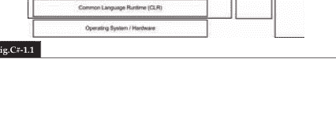

图 C#–1.1

如图 C#–1.1 所示，.NET Framework 2.0 由 .NET Framework 基类库、Windows 窗体、ASP.NET、控制台、用于 .NET 的 ActiveX 数据对象 (ADO.NET)、公共语言规范 (CLS)、公共类型系统 (CTS) 以及 .NET 语言（如 C# 和 Visual Basic.NET）等组件组成。同样，.NET Framework 3.0 包含 WPF、Windows Communication Foundation (WCF)、Windows Workflow Foundation (WF) 和 Windows CardSpace (WCS)。.NET Framework 3.5 引入了一些增强功能，如语言集成查询 (LINQ)、ASP.NET AJAX、ADO.NET 实体框架和数据服务，以及用于 C#、Visual Basic.NET 和 C++ 的新编译器。最后，.NET Framework 4.0 集成了并行扩展、托管可扩展性框架、动态语言运行时和其他额外增强功能。

### 解释 .NET Framework 4.0 的组件

如前所述，.NET Framework 4.0 基于 .NET Framework 2.0、3.0 和 3.5，因此包含属于这些 .NET Framework 版本一部分的几个组件。.NET Framework 4.0 的一些基本组件如下：

- CLR
- CTS 和 CLS
- 程序集和元数据
- .NET Framework 基类库
- Windows 窗体
- ADO.NET
- ASP.NET 和 ASP.NET AJAX
- WPF
- WCF
- WF
- WCS
- LINQ

现在让我们在以下各节中逐一详细讨论这些组件。

### 公共语言运行时 (CLR)

.NET Framework 中最重要且最核心的组件之一是 CLR。CLR 也被称为运行时，它本质上为所有 .NET 应用程序提供了运行或执行环境。CLR 提供的功能包括内存管理、异常处理、调试、安全性、线程执行、代码执行、类型安全、验证和编译。简而言之，可以说 CLR 管理着 .NET 应用程序的执行。在 CLR 下运行或面向 CLR 的代码称为托管代码，而非托管代码是编译为本机代码或机器代码并由操作系统直接执行的代码。由于托管代码受益于跨语言集成、增强的安全性、类型安全和内存管理等各种功能，使用托管执行环境可以让程序员减少错误，从而创建更安全、更稳定的应用程序。

CLR 促进了各种 .NET 语言（如 Visual C#、Visual Basic 或 Visual C++）之间的互操作性，因为它为用任何这些语言编写的代码的执行提供了一个公共环境。所有 .NET 应用程序在运行时，都会由语言编译器编译为一种称为 Microsoft 中间语言 (MSIL) 或 IL 代码的中间代码。然后，即时 (JIT) 编译器使用此 MSIL 代码将代码编译为本机机器代码，即最终的可执行代码。图 C#–1.2 说明了 CLR 的功能：


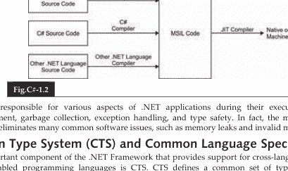

CLR 负责 .NET 应用程序执行期间的各个方面，例如内存管理、垃圾回收、异常处理和类型安全。事实上，运行时的托管环境消除了许多常见的软件问题，例如内存泄漏和无效内存引用。

## 通用类型系统 (CTS) 和公共语言规范 (CLS)

CTS 是 .NET Framework 的一个重要组件，它为支持 .NET 的编程语言之间的跨语言集成提供支持。CTS 定义了一组通用类型，这些类型可用于以不同 .NET 语言编写的应用程序，以及可对这些类型执行的操作。当从一种语言编写的代码调用另一种语言编写的代码时，两个符合 CTS 的语言不需要进行类型转换。对于 .NET Framework 支持的所有语言，CTS 都提供一组基本数据类型；但是，每种语言都为 CTS 提供的基本数据类型使用别名。例如，Visual Basic 中的关键字 Integer 和 C# 中的 int 都指 32 位有符号整数。因此，CTS 使用数据类型 System.Int32 来表示 32 位整数值。

CLS 是 CTS 的子集，定义了一组所有 .NET 应用程序共有的基本语言功能和编程构造，以及它们必须遵循的规则。这使得两个符合 .NET 的语言之间能够实现互操作。CLS 中定义的规则可作为第三方编译器、设计人员和库构建者的指南。由于 CLS 是 CTS 的子集，受 CLS 支持的语言可以像使用自己的类库一样使用彼此的类库。按照 CLS 中定义的规则设计的应用程序编程接口 (API) 可供所有符合 .NET 的语言使用。

## 程序集和元数据

程序集是任何 .NET 应用程序的基本构建块。它是一个单一的逻辑部署单元。程序集本质上具有自描述性，包含 CLR 执行面向 CLR 的应用程序所需的全部信息。每个 .NET 应用程序都会编译为一个程序集，该程序集构成应用程序的部署、版本控制、代码重用和安全性单元。这意味着，在 .NET 应用程序中执行的所有操作都发生在程序集的作用域内。

程序集以可移植可执行 (PE) 文件的形式创建。此 PE 文件可以是动态链接库文件（.dll 文件），也可以是包含已编译应用程序的 MSIL 代码的可执行文件（.exe 文件）。程序集是类型和资源的集合，除 MSIL 外还包括程序集元数据和类型元数据。程序集元数据是关于程序集本身及其组件的元数据，而类型元数据是关于程序集所需类型的元数据，例如类、接口、枚举和结构。在 .NET 中可以创建两种类型的程序集：私有程序集和共享程序集。私有程序集由单个 .NET 应用程序使用，并存储在应用程序目录中；而共享程序集由多个应用程序引用。共享程序集必须具有唯一名称（称为强名称），并存储在全局程序集缓存 (GAC) 中。

元数据以存储在程序集中的二进制信息形式描述程序。当代码编译到 PE 文件中时，元数据会插入文件的一个部分，而代码会转换为 MSIL 并插入文件的另一部分。元数据描述程序的每个类型和成员。在运行时，CLR 将元数据加载到内存中，并查找有关代码的信息，例如程序中指定的类和成员。

元数据以语言中立的方式包含有关程序内部代码的信息。它包括以下信息：

- 程序集信息，例如程序集标识（可以是名称、版本、区域性、公钥）；程序集的类型；其他引用的程序集；以及安全权限
- 有关类型的信息，例如名称、可见性、基类、使用的接口和成员（方法、字段、属性、事件和嵌套类型）
- 特性信息，用于修改类的类型和成员

CLR 使用 .NET 应用程序元数据中包含的信息，在运行时创建对象、访问数据并调用程序集中使用的成员函数。

### .NET Framework 基类库

顾名思义，.NET Framework 基类库是一个庞大的可重用类、接口和值类型库，可供所有 .NET 编程语言使用。.NET Framework 基类库是面向对象的、语言无关的、易于使用，并且能够提高 .NET 开发人员的工作效率。此类库由命名空间层次结构组成，其中每个命名空间都是类、结构、接口、委托和枚举的逻辑分组。例如，System.Collections 命名空间包含定义各种对象集合（如列表、队列、哈希表和字典）的接口和类。此命名空间可进一步细分为其他命名空间，例如 System.Collections.ArrayList，它表示 .NET 中的 ArrayList 类型。类、接口、结构和枚举统称为类型。.NET Framework 中的这些不同类型以命名空间的树状层次结构进行排列。这种以命名空间形式排列 .NET 类型的方式解决了名称冲突或名称碰撞问题，这类问题会在代码中任意两个类型同名时出现。System 命名空间是 .NET Framework 中一些最常用类型的根命名空间。System 命名空间的一些重要类包括 Console、Math、Object、String、Array、Enum 和 Delegate。System 命名空间的一些重要结构包括 Boolean、Byte、Char、Decimal、Single、Double 和 Int32。

### Windows 窗体

Windows 窗体是基于 Windows 的 GUI 应用程序，用户可以在其计算机上安装和运行。Windows 窗体应用程序的基本组件是窗体，它是一个可视矩形区域，可在其中向用户显示信息或接受用户的某种输入。可以在该窗体中放置各种控件，以增强应用程序的 UI。.NET Framework 通过使用符合 .NET 的语言，促进了 Windows 窗体应用程序的开发。Windows 窗体应用程序是事件驱动的应用程序，这意味着每当发生事件（例如鼠标单击或按下键盘上的某个键）时，都会执行某种操作。

### ADO.NET

ADO.NET 是一种 Microsoft 技术，提供访问各种类型的数据源和数据库的一致方式。它提供对各种数据源的访问，例如 Microsoft SQL Server，以及通过对象链接与嵌入数据库 (OLE DB) 和可扩展标记语言 (XML) 公开的数据源。ADO.NET 可用于连接到数据源，以检索、操作和更新数据。ADO.NET 最重要的特性是断开连接的数据体系结构。在这种体系结构中，.NET 应用程序仅在检索或修改数据时连接到数据库。ADO.NET 中的数据访问操作借助两个组件实现，即数据集和数据提供程序。数据集指的是数据库记录的缓存集合，它遵循断开连接的数据体系结构来访问或修改数据。因此，应用程序不需要连接到数据库来处理每条记录。此外，所有数据库操作都在数据集上执行，而不是在数据库上执行。另一方面，数据提供程序可以看作是帮助将应用程序连接到数据库的桥梁。使用数据提供程序，应用程序可以在数据库上执行命令并从数据库检索结果。

有关 ADO.NET 的更多信息，请参阅第 8 章“ADO.NET 和数据绑定”。

### ASP.NET 和 ASP.NET AJAX

ASP.NET 是 Microsoft .NET Framework 的一部分，它凭借强大而丰富的功能集，使 .NET 程序员能够开发企业级、基于服务器的动态交互式 Web 应用程序。借助


ASP.NET Web 开发模型允许您将超文本标记语言（HTML）、Web 服务器控件、自定义控件和用户控件添加到 Web 窗体中。在 ASP.NET Web 应用程序中，Web 窗体是基本的 UI 实体。您还可以在 Web 应用程序的代码中指定 Web 服务器和用户控件的行为，并为这些控件添加功能。ASP.NET 应用程序可以使用任何 .NET 语言编写，例如 Visual Basic、Visual C# 和 Visual C++。

AJAX 是异步 JavaScript 和 XML 的缩写，以前称为 Atlas。它是 ASP.NET 的扩展，这意味着可以将 AJAX 功能添加到 ASP.NET 应用程序中。AJAX 以这样方式促进 Web 服务器和客户端之间的信息传输：基于 AJAX 的应用程序在对页面进行某些修改时，不需要重新加载整个 Web 页面。使用 AJAX，.NET 开发人员可以通过异步调用仅向 Web 服务器发送 Web 页面的修改部分。这减少了网络流量和 Web 服务器上网页的处理时间。Gmail 是流行的启用 AJAX 的 Web 应用程序的一个示例。

### Windows Presentation Foundation（WPF）

WPF 是 .NET Framework 3.0 的一个组件，用于创建具有视觉吸引力 UI 的应用程序。WPF 以前称为 Avalon，它将二维（2D）和三维（3D）图形、Microsoft Word 文档、便携式文档格式（PDF）文件以及多媒体组合到一个框架中。它还提供了一致的编程模型来开发 WPF 应用程序，其中 UI 和业务逻辑可以清晰分离。此外，WPF 提供了可扩展应用程序标记语言（XAML），这是由 Microsoft 创建的一种标记语言。借助 XAML，.NET 应用程序开发人员和设计人员可以轻松高效地协作进行 WPF 应用程序的开发过程。您还可以使用 WPF 创建各种独立的 Web 应用程序。

有关 WPF 的更多信息，请参阅第 7 章“介绍 Windows Presentation Foundation 和 XAML”。

### Windows Communication Foundation（WCF）

.NET Framework 3.0 引入的主要技术之一是 WCF，它提供了统一的编程模型来构建面向服务的应用程序。例如，您可以创建一个面向服务的应用程序，其中使用 .NET 开发的服务可以被基于其他平台或编程语言构建的应用程序使用。WCF 结合并扩展了分布式系统、.NET Remoting 和 Web 服务的功能。所有这些功能帮助面向服务的应用程序相互通信，从而简化了开发过程。

> **注意**
>
> 分布式系统具有多个相互独立的互连计算机，它们借助计算机网络相互通信。另一方面，.NET Remoting 提供了一个框架，可以与 ASP.NET Web 服务一起使用来开发分布式 Web 应用程序。使用 .NET Remoting，位于同一台计算机、同一网络中的不同计算机或跨独立网络的计算机上的软件组件可以相互通信。Web 服务是一种可以通过 Internet 调用的方法，然后用于向调用 Web 服务的代码返回值（如果有）。您将在第 13 章“使用 Web 和 WCF 服务”中详细了解 Web 服务。

接下来，我们讨论 WF。

### Windows Workflow Foundation（WF）

WF 是 Microsoft 在 .NET Framework 3.0 中引入的一项技术，它有助于定义、执行和管理工作流。工作流通常是指为完成给定过程或产生某些结果而执行的一系列任务。WF 应用程序由一系列表示某些操作形状和图标组成。在 WF 出现之前，应用程序开发人员曾经使用 .NET 语言（如 C#、Visual Basic .NET）编写业务逻辑及其实现。然而，使用 WF，可以在工作流应用程序中定义业务逻辑代码，而实际实现代码则用 .NET 语言编写。因此，WF 提供了一种声明式编程模型来构建仅包含业务逻辑代码的工作流应用程序。有关 WF 的更多信息，请参阅第 12 章“介绍 Windows Workflow Foundation”。

## Windows CardSpace（WCS）

WCS 是 Microsoft 引入的客户端软件，使用户能够以熟悉、简单且安全的方式在 Internet 上使用其数字身份。WCS 可以被视为一种在线虚拟信息卡或 Internet 的 ID 卡，可用于验证用户身份。使用 WCS，.NET 程序员可以构建容易遭受身份相关攻击（如网络钓鱼）的网站和软件。WCS 通过减少对用户名和密码的依赖来应对传统在线安全机制的问题。WCS 使用独立的桌面和加密强身份验证来确保安全的在线交易。

## 语言集成查询（LINQ）

LINQ 是 .NET Framework 的一个组件，它为 .NET 语言添加了本机数据查询功能。它的语法类似于结构化查询语言 SQL，这意味着您可以使用 LINQ 在任何 .NET 语言（如 Visual C# 和 Visual Basic .NET）中编写语句。LINQ 提供了一致的模型来处理各种数据源和格式的数据，例如 SQL Server 数据库、数据集、集合中的对象和 XML 文档。LINQ 查询执行的操作通常包括三个主要操作：获取数据源、创建查询和执行查询。

在讨论了 .NET Framework 4.0 的组件之后，我们现在来了解 Visual Studio 2010 的功能。

## 探索 Visual Studio 2010 的主要功能

Visual Studio 是 Microsoft 提供的 IDE，包含用于构建 .NET 应用程序的完整开发工具集。Visual Studio 提供了丰富的工具和功能，不仅使应用程序开发人员能够编写和修改程序，还帮助检测和纠正错误。Visual Studio IDE 包括代码编辑器，这是一个窗口，您可以在其中为正在开发的应用程序编写源代码。Visual Studio 中还有一个集成调试器，这是一个有助于在应用程序执行时监视其行为的工具。如果应用程序中存在任何错误，您可以使用集成调试器来确定错误的确切位置。集成调试器支持 IntelliSense，这是 Visual Studio 的一个有用功能，有助于提高 .NET 应用程序开发人员的生产力。IntelliSense 功能通过代码编辑器自动生成代码来帮助应用程序的开发。此外，Visual Studio 提供了用于创建应用程序的模板，例如类库、Windows 控件库和 Web 控件库。Visual Studio 2010 还提供了用于创建控制台应用程序、Windows 应用程序、Web 应用程序和 Web 服务的模板。

Visual Studio 2010 是 Visual Studio 的最新版本，面向 .NET Framework 4.0。它通过提供不同的工具将设计器集成到整个开发过程中，有助于最大限度地缩短 .NET 应用程序的开发时间。

Visual Studio 2010 还引入了一种称为 Visual F# 的多范式编程语言。这种语言结合了函数式编程语言（如 C）、动态编程语言（如 Ruby 和 Python）和面向对象编程语言（如 Java 和 C#）的特性。

> **注意**
>
> 函数式编程语言更关注程序应该做什么，而不是指定它应该如何做。动态编程语言（也称为弱类型编程语言）允许您声明变量而无需定义其数据类型。在动态语言中声明的任何变量的实际数据类型解析将推迟到运行时。任何以对象概念为中心并遵循抽象、封装、多态和继承原则的编程语言都被称为面向对象的编程语言。您将在第 4 章“介绍面向对象的编程结构”中了解面向对象的编程语言。

在开始使用 Visual Studio 2010 之前，您需要了解其主要功能和增强功能。以下是 Visual Studio 2010 中引入的主要功能和增强功能的列表：


-   新用户界面
-   新扩展管理器
-   统一建模语言 (UML) 建模
-   跟踪更改的可视化工具
-   增强的多目标支持
-   编辑器缩放功能
-   突出显示引用功能
-   导航到功能
-   框选功能
-   方法的调用层次结构
-   促进更快的代码生成
-   IntelliSense 的 Consume-First 模式
-   导出或导入断点
-   Dotfuscator 更改

现在，让我们逐一了解这些功能，先从 Visual Studio 2010 的新用户界面开始。

## 新用户界面

Visual Studio 2010 的全新 UI 基于 WPF 构建，其设计不仅在外观上吸引人，而且还使 .NET 应用程序开发人员的工作变得轻松。Visual Studio 2010 重新组织了布局，其中文件菜单和命令显示在 IDE 顶部的架子上。图 C#-1.3 显示了 Visual Studio 2010 的新 UI：

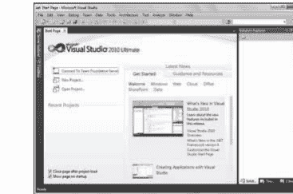

图 C#-1.3

接下来，让我们讨论 Visual Studio 2010 中引入的扩展管理器功能。

## 新扩展管理器

扩展管理器功能帮助应用程序开发人员轻松添加、移除、启用和禁用 Visual Studio 扩展。你可以从 Microsoft 网站 http://visualstudiogallery.msdn.microsoft.com/en-us/site/search?pageindex=1 以及第三方下载并安装这些扩展。这些扩展包括项目模板以及用于 ASP.NET、WPF 和 Silverlight 的新控件。你可以通过选择“工具”菜单中的“扩展管理器”选项来打开“扩展管理器”窗口。图 C#-1.4 显示了扩展管理器的 UI：

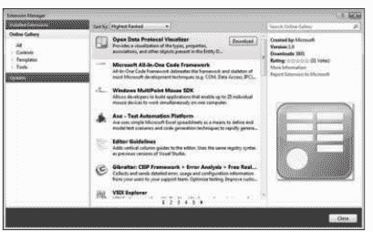

图 C#-1.4

接下来，让我们讨论 Visual Studio 2010 的 UML 建模功能。

## UML 建模

Visual Studio 2010 现在通过引入 UML 建模项目来支持创建 UML 图。UML 图使软件开发人员和用户能够从不同的视角并以不同的抽象程度查看和理解软件系统。

UML 建模项目有望帮助技术用户和非技术用户创建和使用 UML 模型。Visual Studio 2010 旗舰版提供了用于创建活动图、类图、组件图、序列图和用例图等 UML 图的模板。此外，你还可以在 Visual Studio 2010 旗舰版中创建层图，这有助于定义系统的结构。

你可以使用“建模项目”模板在 Visual Studio 2010 中创建新的 UML 建模项目。你可以通过从“新建项目”对话框中选择“建模项目”选项来访问此模板，如图 C#-1.5 所示：

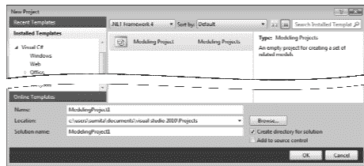

图 C#-1.5

创建建模项目时，它最初是空的，如图 C#-1.6 所示：

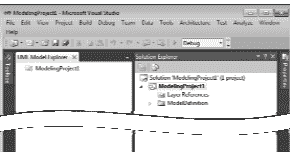

图 C#-1.6

之后，你只需在“解决方案资源管理器”中右键单击应用程序的名称，然后从上下文菜单中选择 **添加→新建项** 选项，即可添加 UML 活动图、类图、组件图、序列图或用例图。“添加新项”对话框将打开，如图 C#-1.7 所示：

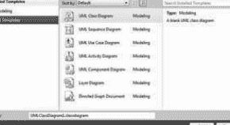

图 C#-1.7

如图 C#-1.7 所示，提供了各种建模模板，你可以在建模项目中使用它们。接下来，让我们讨论有助于跟踪 Visual Studio 2010 IDE 中代码所做任何更改的可视化工具。

## 跟踪更改的可视化工具

Visual Studio 2010 提供了一项称为可视指示器的功能，用于跟踪应用程序代码中所做的所有更改。可视指示器可以在代码编辑器的左侧看到，它跟踪你编辑和保存代码的区域。当可视指示器为黄色时，表示对代码所做的更改尚未保存。当指示器颜色为绿色时，表示对代码所做的修改已保存。图 C#-1.8 显示了可用于跟踪代码编辑器中更改的可视指示器。

```csharp
private void Form1_Load(object sender, EventArgs e)
{
    string str1, str2;
    str1 = "welcome";
    str2 = " to the world";
    MessageBox.Show(str1 + str2 + " of C# programming");
}
```

图 C#-1.8

现在，让我们讨论 Visual Studio 2010 中提供的对面向多个 .NET Framework 版本的支持。

## 增强的多目标支持

多目标功能在 Visual Studio 2008 中引入，并在 Visual Studio 2010 中得到了增强。使用此功能，你可以生成面向 .NET Framework 2.0、3.0、3.5 或 4.0 版本的 .NET 应用程序。换言之，使用较旧版本 .NET Framework 开发的应用程序可以通过多目标功能升级到 .NET Framework 4.0。为了便于多目标，Microsoft 为每个 .NET 版本提供了引用程序集。当你面向 .NET Framework 的特定版本时，IntelliSense 功能只包含所选 .NET Framework 版本中支持的功能和属性。

> **注意**
>
> 从 .NET Framework 3.0 开始，Microsoft 引入了一个引用程序集文件夹，该文件夹位于 Program Files 文件夹中。引用程序集文件夹包含随 .NET Framework 3.0 一起提供的程序集。在设计并生成新的 .NET 组件时，可以引用这些程序集。

你可以在 Visual Studio 2010 的“新建项目”对话框中，通过从中间窗格的下拉列表中选择所需的 .NET Framework 版本，来面向任何特定的 .NET Framework 版本，如图 C#-1.9 所示。

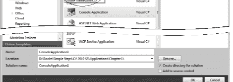

## 编辑器缩放功能

使用 Visual Studio 2010，你可以放大和缩小代码编辑器窗口中文本的字体大小，类似于在 Internet Explorer 或任何其他 Web 浏览器中的操作方式。为此，你只需按住键盘上的 CTRL 键并滚动鼠标滚轮，即可增大或减小代码编辑器窗口中文本的字体大小。缩放功能可以有用武之地的一个示例是在做演示时。在 Visual Studio 2010 之前的版本中，你可以通过选择“工具”菜单下的“选项”子菜单来更改代码编辑器窗口中文本的字体大小。图 C#-1.10 显示了使用缩放功能后代码编辑器中文本字体大小的增大效果：

## 导航到功能

在 Visual Studio 2010 中，使用“导航到”功能导航到源代码中的特定符号或文件已变得更加容易。你可以使用此功能在源代码中搜索符号、变量、单词、短语或文件。当你无法确定要在源代码中查找什么时，这种增量搜索功能尤其有用。例如，当你在“导航到”对话框的“搜索词”文本框中输入符号、变量、单词或短语时，“导航到”功能会随着你开始在“搜索词”文本框中键入内容，立即根据你输入的词显示结果。你还可以在“搜索词”文本框中用驼峰命名法（以小写字母开头的单词）和下划线字符，将正在键入的任何短语划分为关键字。图 C#-1.12 显示了“导航到”功能的使用：

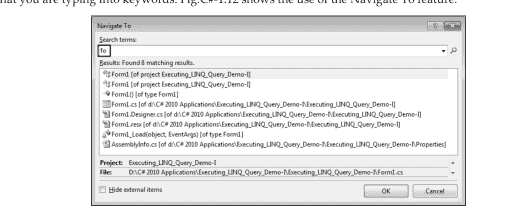

图 C#-1.12

如图 C#-1.12 所示，当你在“搜索词”文本框中键入词 fo 时，“导航到”对话框的“结果”部分返回的结果是所有包含词 fo 的文件名、方法和属性名以及事件名。

**提示**

你可以通过同时按 CTRL 和 , 键来打开“导航到”对话框。

接下来，让我们讨论 Visual Studio 2010 中的框选功能。

## 框选功能

考虑这样一种场景：你将某些变量和方法声明为 public，而现在需要将它们从 public 修改为 private。在这种情况下，你可以逐个遍历所有访问修饰符，并将每一处出现的 public 访问修饰符更改为 private 访问修饰符。然而，这可能是一项繁琐的工作。新的框选功能可以让你摆脱这种情况。使用框选功能，你可以通过同时按 SHIFT+ALT 键来快速选择要替换的文本块，如图 C#-1.13 所示：

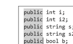

图 C#-1.13

如图 C#-1.13 所示，所选文本显示在一个框中。选择文本后，你可以在框中输入新文本，如图 C#-1.14 所示：

```csharp
private int i;
private int i2;
private string s;
private string s2;
private bool b;
```

图 C#-1.14

如你在图 C#-1.14 中所见，输入一次 *private* 就会替换每一行中所有 *public* 实例。接下来，我们讨论“调用层次结构”功能。

## 方法的调用层次结构

Visual Studio 2010 中新增的最重要且最有用的功能之一是“调用层次结构”。此功能允许你显示以下内容：

-   在“代码编辑器”窗口中，对所选方法、属性或构造函数发出的调用以及由它们发出的调用
-   接口成员的实现
-   虚成员或抽象成员的重写

> **注意**
>
> 你将在第 4 章 *《面向对象编程构造简介》* 中详细了解接口及其实现、抽象类和虚类以及成员。

你可以通过在“代码编辑器”中选择方法、属性或构造函数名称，然后右键单击来访问“调用层次结构”窗口。随后，你可以从出现的上下文菜单中选择 *查看调用层次结构* 选项，如图 C#-1.15 所示：

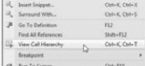

图 C#-1.15

在我们的示例中，代码编辑器中的“调用层次结构”窗口显示了对 **PrintInfo()** 方法发出的调用以及由该方法发出的调用，如图 C#-1.16 所示：

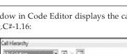

图 C#-1.16

“调用层次结构”功能使你能够在源代码中导航。它还有助于理解应用程序中的代码流。

接下来，我们讨论 Visual Studio 2010 中加快代码生成的功能。

## 加快代码生成

在 Visual Studio 2010 IDE 中，Microsoft 引入了一个名为“加快代码生成”的有趣新功能。你可以通过一个示例更好地理解此功能。假设应用程序中有一个名为 Shapes 的类。

> **注意**
>
> *在 C# 中，可以使用 class 关键字创建类。你可以在类中声明并定义变量、方法和对象。你将在第 4 章《面向对象编程构造简介》中更详细地了解类以及如何在 C# 中创建类。*

现在，如果你编写了应用程序中尚未定义的方法名或类名，就会生成错误。在我们的示例中，我们编写了一个尚未定义的类名 Circle。图 C#-1.17 显示了类名 Circle 下方出现的红色波浪线，表示存在错误：

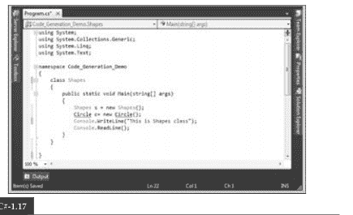

图 C#-1.17 显示了类名 Circle 下方的波浪线。将鼠标指针放在类名上，名称下方会显示一个向下箭头。现在，单击向下箭头，并从出现的下拉列表中选择“生成新类型”选项，如图 C#-1.18 所示：

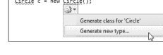

当你从下拉列表中选择“生成新类型”选项时，会出现“生成新类型”对话框，如图 C#-1.19 所示：

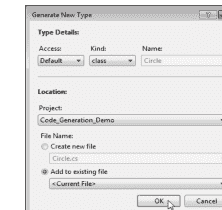

图 C#-1.19

请注意，在图 C#-1.19 中，我们选择了“添加到现有文件”单选按钮，以便可以在定义 Shapes 类的同一应用程序中创建 Circle 类。图 C#-1.20 显示了为 Circle 类生成的代码：

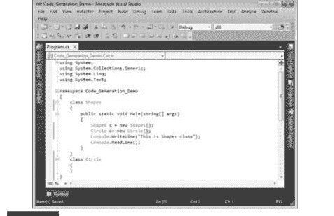

图 C#-1.20

接下来，我们了解 Visual Studio 2010 的另一项新功能，即 IntelliSense 的先使用模式。

## IntelliSense 的先使用模式

Visual Studio 2010 中的 IntelliSense 提供了两种在“代码编辑器”窗口中完成语句的备选方式。这些备选方式是建议模式和 IntelliSense 的先使用模式。IntelliSense 的建议模式功能有助于在你于“代码编辑器”窗口中键入文本时自动完成文本。要启用 IntelliSense 的建议模式，可以组合按下 CTRL+ALT+Space 键。另一方面，IntelliSense 的先使用模式会禁用建议模式，从而阻止 IntelliSense 在你键入文本时自动完成文本。你可以通过组合按下 CTRL+ALT+Space 键来禁用 IntelliSense 的建议模式。要启用 IntelliSense 的建议模式，可以再次按下相同的键。

## 导出或导入断点

Visual Studio 2010 允许你导出或导入断点。断点是一种调试工具，可用于暂停 .NET 应用程序的执行。断点可以插入到 .NET 应用程序中的单行代码或多行代码上。导出断点功能允许你将断点导出到其他位置，例如另一台系统，以调试 .NET 应用程序的一部分。调试后，可以将断点导回应用程序。

你可以使用“断点”窗口导出或导入断点；通过从菜单栏中选择“调试→窗口→断点”，可以打开该窗口，如图 C#-1.21 所示：

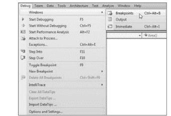

图 C#-1.21

这将打开“断点”窗口。

> **提示**
>
> 你也可以组合按下 CTRL+ALT+B 键来打开“断点”窗口。

你可以通过右键单击特定代码段，并从上下文菜单中选择“断点→插入断点”，将断点插入到该代码段中。在 Visual Studio 2010 中，一旦在应用程序中插入了断点，就可以将断点连同 bug 报告一起发送给同事。你可以使用“断点”窗口中的“导出断点”按钮将断点传递给同事。断点将作为 XML 文件导出到你选择的位置，之后可以从该位置使用“断点”窗口中的“导入断点”按钮将断点导入 .NET 应用程序，如图 C#-1.22 所示：

导出断点 导入断点

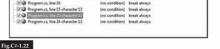

图 C#-1.22

当你需要通过电子邮件（e-mail）将断点发送给另一位用户，或希望使用文本编辑器一次性更改所有断点时，此功能很有用。

现在，在我们向你展示如何在计算机上安装 Visual Studio 2010 之前，让我们先简要介绍 Visual Studio 2010 的不同版本。

## Visual Studio 2010 的版本

市场上有 Visual Studio 2010 的不同版本。每个版本都有自己的一组功能，以满足不同用户的需求。以下是对 Visual Studio 2010 不同版本的简要说明：

-   **Visual Studio 2010 旗舰版：** 提供集成的服务器工具和基础结构环境，有助于简化整个应用程序开发过程。此版本的 Visual Studio 2010 通过使用高效、可预测且可自定义的过程，帮助产生有意义的业务成果。它让你可以面向更多平台和技术，例如云和并行计算。
-   **Visual Studio 2010 高级版：** 提供可简化应用程序开发的环境。此版本包含用于解决最困难问题的高级工具。高级代码分析、测试和调试工具可帮助个人和团队开发出产生 bug 的可能性极低的高端应用程序。
-   **Visual Studio 2010 专业版：** 简化创建、调试和部署应用程序的基本任务。它通过强大的设计界面增强创造力。此版本面向多个平台，例如 Silverlight、SharePoint 和云应用程序。Visual Studio 中对测试驱动开发 (TDD) 的集成支持以及新的调试工具可确保高质量的解决方案。

现在，我们学习如何在计算机上安装 Visual Studio 2010。

让我们执行以下步骤来安装 Visual Studio 2010：

1.  将 Visual Studio 2010 的 DVD-ROM *插入* 计算机的 DVD-ROM 驱动器。出现 **Microsoft Visual Studio 2010 安装程序** 向导（图 C#-1.23）。
2.  *单击* **安装 Microsoft Visual Studio 2010** 链接，如图 C#-1.23 所示：

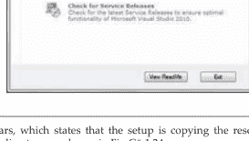

图 C#-1.23

出现一个消息框，指出安装程序正在将安装 Visual Studio 2010 所需的资源复制到临时目录中，如图 C#-1.24 所示：

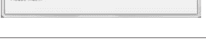

图 C#-1.24


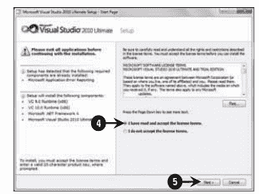

图C#1.27

出现 Microsoft Visual Studio 2010 旗舰版安装程序 – 选项页（图C#1.28）。在 Microsoft Visual Studio 2010 旗舰版安装程序 – 选项页的左窗格中，你会看到可供选择的安装选项：

- **完全**：安装 Visual Studio 2010 的完整版本
- **自定义**：安装用户选择的 Visual Studio 2010 组件

Microsoft Visual Studio 2010 旗舰版安装程序 – 选项页的右窗格显示计算机硬盘上的所需空间和可用空间，以及安装 Visual Studio 2010 的路径（图C#1.28）。

6. 选择“完全”单选按钮（图C#1.28）。

7. 选择要安装 Visual Studio 2010 的驱动器后，单击“安装”按钮。在本例中，我们将 Visual Studio 2010 安装到默认位置，如图C#1.28所示：

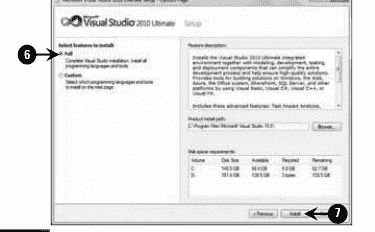

图C#1.28

出现 Microsoft Visual Studio 2010 旗舰版安装程序 – 安装页，其中显示正在安装的组件，如图C#-1.29所示：

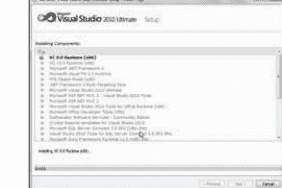

图C#-1.29

8. 在 Microsoft Visual Studio 2010 旗舰版安装程序 – 完成页上单击“完成”按钮，以成功完成安装，如图C#-1.30所示：

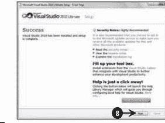

图C#-1.30

安装成功后，出现 Microsoft Visual Studio 2010 安装对话框（图C#-1.31）。

9. 在 Microsoft Visual Studio 2010 安装对话框中单击“退出”按钮以完成安装，如图C#-1.31所示：

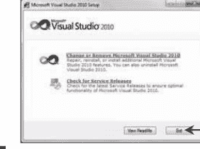

图C#-1.31

现在，Visual Studio 2010 已成功安装到你的计算机上。安装 Visual Studio 2010 后，让我们探索 Visual Studio 2010 IDE。

## 介绍 Visual Studio 2010 IDE

Visual Studio 2010 IDE 是用于开发和执行 .NET 应用程序的综合环境。它包含菜单栏、工具栏和若干窗口，这些窗口帮助你设计 .NET 应用程序的 UI 以及执行这些应用程序。

现在让我们学习如何打开 Visual Studio 2010 IDE。

## 打开 Visual Studio 2010 IDE

在计算机上安装 Visual Studio 2010 后，你可以打开该应用程序。

执行以下步骤以打开 Visual Studio 2010 IDE：

1. 单击“开始”→“所有程序”→“Microsoft Visual Studio 2010”→“Microsoft Visual Studio 2010”，如图C#1.32所示：
2. 从“选择默认环境设置”列表框中选择一个合适的选项。在我们的示例中，我们已选择“常规开发设置”选项（图C#1.33）。
3. 单击“启动 Visual Studio”按钮，如图C#1.33所示：

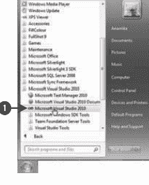

图C#1.32

出现“选择默认环境设置”对话框（图C#1.33），提示你配置 IDE。

请注意，“选择默认环境设置”对话框仅在你首次打开 Visual Studio 2010 时显示。此对话框允许你通过选择适当选项来设置 Visual Studio 2010 的默认设置。你可以将 Visual Studio 2010 的默认环境设置指定为通用设置，或指定为特定于某种 .NET 语言（例如 Visual C# 或 Visual Basic）的设置。例如，如果你在“选择默认环境设置”列表框中选择“常规开发设置”选项，则 Visual Studio 2010 IDE 将配置为通用 IDE，适合所有 .NET 语言。但是，如果你选择“Visual C# 开发设置”选项，则 Visual Studio 2010 IDE 将配置为特定于 Visual C# 的 IDE。

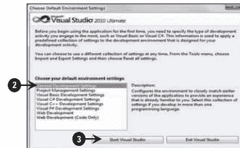

图C#1.33

出现 Microsoft Visual Studio 消息框，通知用户正在配置 Visual Studio 2010 的默认环境，如图C#1.34所示：

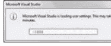

图C#1.34

配置 Visual Studio 2010 的默认环境后，出现 Visual Studio 2010 的 UI，如图C#1.35所示：

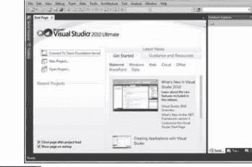

图C#1.35

现在让我们探索 Visual Studio 2010 IDE 的各个组件。

## 探索 Visual Studio 2010 IDE

如前所述，Visual Studio 2010 IDE 使你能够开发各种类型的 .NET 应用程序，例如控制台、Windows Forms 和 Web 应用程序。对于所有类型的 .NET 应用程序，Visual Studio 2010 IDE 的布局几乎相同，只是根据应用程序的不同而略有差异。

> **注意**
>
> 你将在本章后面学习如何创建控制台、Windows Forms 和 Web 应用程序。

在本节中，你将了解 Visual Studio 2010 IDE 的一些基本元素，这些元素对于所有类型的 .NET 应用程序都是通用的。在我们的示例中，我们以 Windows Forms 应用程序为例来了解 IDE 元素。图C#-1.36显示了 Windows Forms 应用程序的 Visual Studio 2010 IDE：

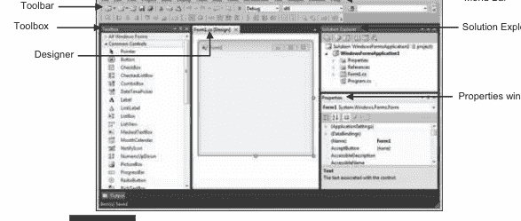

图C#-1.36

Visual Studio 2010 IDE 的一些重要组件如下：

- 起始页
- 菜单栏和工具栏
- 解决方案资源管理器
- “属性”窗口
- 工具箱
- 设计器和代码编辑器
- 服务器资源管理器
- “输出”窗口
- “对象浏览器”窗口
- “类视图”窗口

下面各节将逐一讨论这些组件。

### 起始页

顾名思义，起始页（图C#-1.35）是你每次打开 Visual Studio 2010 时出现的第一个页面。此页面包含各种链接，可用于访问最近打开的应用程序、与 Microsoft 各种产品和技术相关的资源、文章和新闻；还包含创建 .NET 应用程序的示例和帮助你开始使用 Visual Studio 2010 的演练。

### 菜单栏和工具栏

菜单栏是菜单的集合，每个菜单包含一组用于执行特定任务的逻辑选项。Visual Studio 2010 IDE 中可用的菜单在不同类型的 .NET 应用程序中可能有所不同。不过，有些菜单是所有类型的 .NET 应用程序共有的，例如**文件**、**编辑**、**视图**、**生成**、**调试**和**帮助**菜单。每个菜单都提供用于执行特定类型任务的选项。

例如，**文件**菜单包含用于执行文件管理任务的选项，例如创建、打开、保存和关闭文件（或应用程序）。图C#-1.37显示了 Windows Forms 应用程序菜单栏中存在的不同菜单：


图C#-1.37

Visual Studio 2010 IDE 的菜单栏有一组全面的选项，其中一些选项比其他选项更常用。为了更轻松、更快捷地访问这些菜单选项，这些选项被包含在工具栏中。工具栏显示在菜单栏正下方，并带有按钮，作为最常见菜单选项和其他任务的快捷方式。你可以单击工具栏上的按钮来选择选项或执行特定任务。一些常见工具栏包括**标准**、**生成**、**调试**、**布局**和**帮助**。图C#-1.38显示了**标准**工具栏，它在 Visual Studio 2010 IDE 中默认显示：


图C#-1.38

现在让我们了解**解决方案资源管理器**。

### 解决方案资源管理器

在 Visual Studio 2010 中，**.NET** 应用程序包含在一个解决方案中，解决方案包含一个或多个项目、文件以及与该应用程序相关的其他资源。**解决方案资源管理器**指的是 Visual Studio 2010 IDE 中显示解决方案的项目和文件的窗口。**解决方案资源管理器**窗口以分层方式显示项目和文件。图C#-1.39显示了 Windows Forms 应用程序的**解决方案资源管理器**窗口：

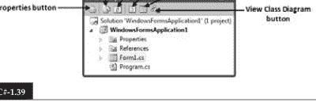

图C#-1.39

如你在图C#-1.39中所见，**解决方案资源管理器**窗口包含一个工具栏，其中有各种按钮，例如**属性**、**显示所有文件**、**刷新**、**查看代码**、**视图设计器**和**查看类图**，这些按钮执行特定操作。其中，**显示所有文件**、**查看代码**和**视图设计器**是最常用的按钮。**显示所有文件**按钮显示属于解决方案的所有文件。在我们的示例中，解决方案是 **WindowsFormsApplication1**（图C#-1.39）。**查看代码**按钮允许你从 **WindowsFormsApplication1** Windows Forms 应用程序的设计器切换到其**代码编辑器**。另一方面，**视图设计器**按钮允许你从**代码编辑器**切换到 Windows Forms 应用程序的设计器。你将在本章后面学习设计器和**代码编辑器**。

在图C#-1.39中，请注意，在工具栏下方，整个应用程序显示为各种节点的**层次结构**。层次结构顶部的**根节点**与解决方案同名，并且还显示该解决方案包含的项目数。此节点通常有一个或多个**子节点**，这些子节点表示解决方案中包含的项目。如果解决方案有多个项目，则每个项目都会为其引用、文件和其他资源提供**子节点**。


> **提示**
>
> *如果在应用程序中看不到“解决方案资源管理器”，则可以通过在菜单栏中选择 查看->解决方案资源管理器 或同时按下键盘上的 CTRL+ALT+L 键组合来查看它。*

接下来，让我们了解一下 Visual Studio 2010 IDE 中的“属性”窗口。

## 属性窗口

在 Visual Studio 2010 中开发 .NET 应用程序时，您会使用多个项目、文件和资源。这些项目和文件具有各种属性或特性，您可以在 **属性** 窗口中查看和设置它们。**属性** 窗口显示 .NET 应用程序的解决方案、项目、文件和 UI 元素的属性。图 C#-1.40 显示了在 **属性** 窗口中 **Form1** 表单的属性，该窗口在您在“解决方案资源管理器”中选择 **Form1** 节点并单击“解决方案资源管理器”工具栏中的 **属性** 按钮时出现。

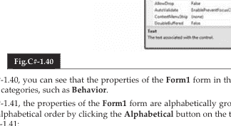

在图 C#-1.40 中，您可以看到 **属性** 窗口中 **Form1** 表单的属性按不同的类别分组，例如 **行为**。

在图 C#-1.41 中，**Form1** 表单的属性按字母顺序分组。您可以通过单击 **属性** 窗口工具栏上的 **按字母顺序** 按钮，如图 C#-1.41 所示，按字母顺序对表单的属性进行分组：

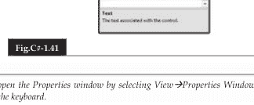

> **提示**
>
> *您可以通过在菜单栏中选择 查看->属性窗口 或从键盘按下 F4 键来打开“属性”窗口。*

接下来，让我们了解一下 Visual Studio 2010 IDE 中的工具箱。

## 工具箱

工具箱是一个窗口，其中包含用于向 .NET 应用程序添加的各种项目和控件的图标，以设计应用程序的 UI。工具箱中的图标在逻辑上按不同的选项卡分组，例如“常用控件”、“菜单和工具栏”以及“容器”。每个选项卡都包含与特定类别相关的 UI 项目和控件的图标；例如，“容器”选项卡包含允许您对 Windows 控件进行分组的控件的图标，例如按钮、标签、文本框和单选按钮。图 C#1.42 显示了包含 Windows 窗体应用程序控件的工具箱：

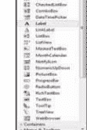

图 C#1.42

要查看工具箱中特定选项卡中的控件图标，您需要通过单击该选项卡来展开它，以便选项卡名称左侧的三角形符号展开。折叠的选项卡，例如“所有 Windows 窗体”和“容器”（图 C#1.42），具有空心三角形。图 C#1.42 显示了处于展开状态的“常用控件”选项卡：

> **提示**
>
> 您可以通过在菜单栏中选择 查看→工具箱 或同时从键盘按下 CTRL+ALT+X 键组合来打开工具箱。

现在，让我们了解一下 Visual Studio 2010 中的设计器和代码编辑器。

## 设计器和代码编辑器

顾名思义，设计器帮助您设计应用程序的 UI，而代码编辑器帮助您为应用程序添加代码或功能。可用设计器和代码编辑器取决于您正在处理的应用类型和文件。图 C#1.43 显示了 Windows 窗体应用程序的设计器：Visual Studio 2010 IDE 提供名为设计器和代码编辑器的窗口，帮助您轻松快速地开发 .NET 应用程序。

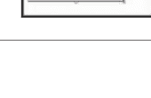

图 C#1.43

图 C#1.44 显示了 Windows 窗体应用程序的代码编辑器窗口：

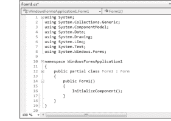

图 C#1.44

接下来，让我们了解一下 Visual Studio 2010 中的“服务器资源管理器”组件。

## 服务器资源管理器

服务器资源管理器是指您可以使用它连接到计算机上的数据库服务器和其他服务的窗口。换句话说，服务器资源管理器允许您创建、修改和关闭与数据库的连接。您还可以添加表并查询数据库或使用各种系统特定服务，例如事件日志、消息队列和性能计数器。图 C#1.45 显示了连接到本地计算机上不同数据库和服务的“服务器资源管理器”：

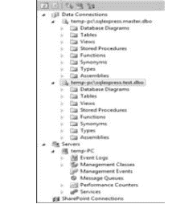

图 C#1.45

> **提示**
>
> 要打开“服务器资源管理器”，请从菜单栏中选择 查看→服务器资源管理器 或同时按下 CTRL+ALT+S 键组合。

接下来，我们讨论 Visual Studio 2010 中的“输出”窗口。

## 输出窗口

当您编译或执行 .NET 应用程序时，关于 Visual Studio IDE 中功能的各种状态消息会被生成并显示在“输出”窗口中。此窗口根据应用程序的编译或执行状态显示这些消息。图 C#1.46 显示了编译或构建 Windows 窗体应用程序时“输出”窗口的显示：

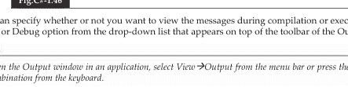

图 C#1.46

您可以通过从“输出”窗口工具栏顶部出现的下拉列表中选择“生成”或“调试”选项来指定是否要在编译或执行期间查看消息。

> **提示**
>
> 要在应用程序中打开“输出”窗口，请从菜单栏中选择 查看→输出 或同时按下 CTRL+ALT+O 键组合。

接下来，让我们了解一下 Visual Studio 2010 中的“对象浏览器”窗口。

## 对象浏览器窗口

“对象浏览器”窗口允许您查看应用程序可用的实体或对象，例如命名空间、类、属性、方法和事件。“对象浏览器”窗口有三个窗格：对象、成员和说明。对象窗格出现在左侧，成员窗格出现在右上方，说明窗格出现在“对象浏览器”窗口的右下方。图 C#1.47 显示了“对象浏览器”窗口：

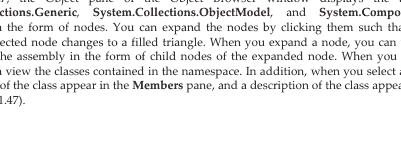

图 C#1.47

在图 C#1.47 中，“对象浏览器”窗口的对象窗格以节点形式显示应用程序的程序集，例如 System.Collections.Generic、System.Collections.ObjectModel 和 System.ComponentModel。您可以通过单击它们来展开节点，使所选节点旁边的空心三角形变为实心三角形。当您展开一个节点时，您可以在展开节点的子节点形式下查看程序集中存在的命名空间。当您展开一个命名空间节点时，您可以查看命名空间中包含的类。此外，当您选择一个类时，该类的属性和方法会出现在“成员”窗格中，并且该类的说明会出现在“说明”窗格中（图 C#1.47）。

> **提示**
>
> *要打开“对象浏览器”窗口，请从菜单栏中选择 查看 → 对象浏览器 或同时按下 CTRL+ALT+J 键组合。*

接下来，让我们讨论“类视图”窗口。

## 类视图窗口

“类视图”窗口以分层方式显示当前 .NET 应用程序中引用的或使用的项目，例如程序集、命名空间、类、属性和方法。“类视图”窗口有两个窗格，对象和成员，如图 C#-1.48 所示：

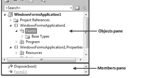

图 C#-1.48

如您在图 C#-1.48 中所见，“类视图”窗口的上半部分是对象窗格，下半部分是成员窗格。在对象窗格中，解决方案的项目构成了分层显示的顶级节点。项目 WindowsFormsApplication1 的子节点表示项目中使用的类。请注意，当您在“类视图”窗口的对象窗格中选择一个类节点时，该类的属性和方法会显示在“成员”窗格中。

> **提示**
>
> *您可以通过从菜单栏中选择 查看 → 类视图 或同时按下 CTRL+SHIFT+C 键组合来打开“类视图”窗口。*

在熟悉了 Visual Studio 2010 IDE 的各个组件后，让我们学习如何使用 Visual Studio 2010 创建应用程序。如前所述，Visual Studio 2010 提供了一个全面且包罗万象的环境，允许您开发各种类型的应用程序，例如控制台、Windows 和 Web 应用程序。让我们在以下各节中学习如何创建这些类型的应用程序。

## 创建简单的 Visual Studio 2010 应用程序

Visual Studio 2010 提供了多个项目模板来开发不同类型的 .NET 应用程序。项目模板提供了一种简便快捷的开发 .NET 应用程序的方法，因为这些项目模板默认包含应用程序所需的<|message|>


## 创建、保存和运行控制台应用程序

控制台应用程序是指那些没有 GUI 的 .NET 应用程序，除了命令行控制台之外。控制台应用程序的用户只能通过命令行控制台与应用程序交互，这意味着数据从命令行显示和读取。这使得控制台应用程序适用于不需要用户交互的情况。Visual Studio 2010 通过提供适当的项目模板，为开发控制台应用程序提供了一种简便方法。

让我们执行以下步骤，使用 Visual Studio 2010 创建、保存和运行控制台应用程序：

- 1. *单击* **开始** → **所有程序** → **Microsoft Visual Studio 2010** → **Microsoft Visual Studio 2010**，打开 Visual Studio 2010 IDE。
- 2. 从菜单栏中*选择* **文件** → **新建** → **项目**。出现 **新建项目** 对话框（图 C#-1.49）。
- 3. 在 **已安装的模板** 窗格中*选择* **Visual C#** 选项。可用于 C# 的已安装项目模板显示在 **新建项目** 对话框的中间窗格中（图 C#-1.49）。
- 4. 从对话框的中间窗格中*选择* **控制台应用程序**，以创建控制台应用程序（图 C#-1.49）。
- 5. 在 **名称** 文本框中*输入*控制台应用程序的适当名称。在本例中，我们输入了 **MyFirstConsoleApplication** 作为名称（图 C#-1.49）。
- 6. 在 **位置** 组合框中*输入*控制台应用程序的文件夹路径。在本例中，我们将位置输入为 **D:\C# 2010 Applications**（图 C#-1.49）。
- 7. *单击* **确定** 按钮，如图 C#-1.49 所示：

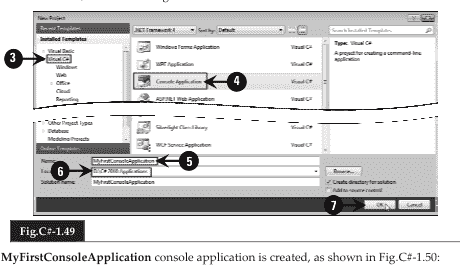

MyFirstConsoleApplication 控制台应用程序已创建，如图 C#-1.50 所示：

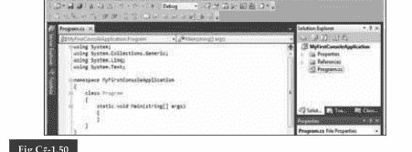

- 8. 在 Program.cs 文件中添加清单 1.1 所示的突出显示的代码：

### 清单 1.1：在 MyFirstConsoleApplication 应用程序的 Program.cs 文件中添加代码

```csharp
using System;
using System.Collections.Generic;
using System.Linq;
using System.Text;

namespace MyFirstConsoleApplication
{
    class Program
    {
        static void Main(string[] args)
        {
            Console.WriteLine("Welcome to C# Programming");
            Console.ReadLine();
        }
    }
}
```

在清单 1.1 中，可以看到 **Main()** 方法有两行代码。第一行——`Console.WriteLine("Welcome to C# Programming")`——访问 **Console** 类的 **WriteLine()** 方法，该类存在于 .NET Framework 基类库的 **System** 命名空间中。当这行代码执行时，消息“欢迎使用 C# 编程”会显示在命令行控制台上。第二行代码——`Console.ReadLine()`——等待用户在命令行控制台上输入一些文本。

> **注意**
> **Console** 类允许你从命令行控制台读取和显示数据。

- 9. 从菜单栏中选择 **文件** → **保存 Program.cs** 以保存文件，如图 C#-1.51 所示：

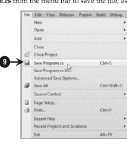

**图 C#-1.51**

> **注意**
> 你也可以通过按键盘上的 **CTRL+S** 组合键来保存 Program.cs 文件（或当前打开的文件）中的更改。同样，你可以按 **CTRL+SHIFT+S** 键来保存应用程序中所有文件的更改。

要保存整个应用程序中所做的更改，请从菜单栏中选择 **文件** → **全部保存**。

- 10. 从菜单栏中选择 **调试** → **开始调试** 以运行（或执行）MyFirstConsoleApplication 控制台应用程序，如图 C#-1.52 所示：

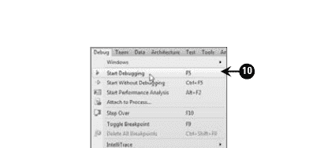

输出出现，如图 C#-1.53 所示：

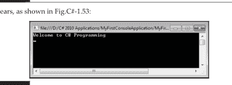

如图 C#-1.53 所示，命令行控制台上显示“欢迎使用 C# 编程”消息。

接下来，让我们学习如何创建、保存和运行 Windows 窗体应用程序。

## 创建、保存和运行 Windows 窗体应用程序

Windows 窗体应用程序是指那些以窗体为应用程序中心的应用程序。Windows 窗体应用程序中的窗体是一个矩形区域，顶部带有标题栏。此外，窗体的右上角还有“最小化”、“最大化”和“关闭”按钮。Windows 窗体提供应用程序的 GUI，允许与用户交互。

Visual Studio 2010 提供了一个项目模板来开发 Windows 窗体应用程序。

让我们执行以下步骤，使用 Visual Studio 2010 创建、保存和运行 Windows 窗体应用程序：

- 1. 单击 **开始** → **所有程序** → **Microsoft Visual Studio 2010** → **Microsoft Visual Studio 2010**，打开 Visual Studio 2010 IDE。
- 2. 从菜单栏中选择 **文件** → **新建** → **项目**，以显示 **新建项目** 对话框。
- 3. 在 **新建项目** 对话框左侧的 **已安装的模板** 窗格中选择 **Visual C#** → **Windows**，这会显示可用于 C# 中 Windows 窗体应用程序的已安装项目模板。
- 4. 从 **新建项目** 对话框的中间窗格中选择 **Windows 窗体应用程序**，以创建 Windows 窗体应用程序。
- 5. 在 **名称** 文本框中为 Windows 窗体应用程序输入适当的名称。在本例中，我们输入的名称是 **FirstWindowsFormsApplication**。
- 6. 在 **位置** 组合框中输入保存应用程序的位置。在本例中，我们选择了默认位置，即 **C:\users\temp\documents\visual studio 2010\Projects**。
- 7. 单击 **确定** 按钮。

名为 FirstWindowsFormsApplication 的 Windows 窗体应用程序已创建，如图 C#-1.54 所示：

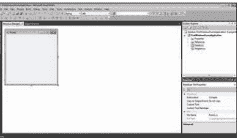

**图 C#-1.54**

如图 C#-1.54 所示，该应用程序有一个矩形区域，左上角显示 Form1，右上角显示“最小化”、“最大化”和“关闭”按钮。这个矩形区域就是窗体，你可以在其中设计应用程序的 UI。

> **注意**
> *你将在第 5 章“使用 Windows 窗体控件编程”和第 6 章“使用 Windows 窗体、菜单、工具栏和对话框控件”中了解更多关于 Windows 窗体应用程序的内容。*

- 8. 在 Windows 窗体设计器中双击窗体，这会在代码编辑器中打开 **Form1.cs** 文件，如图 C#-1.55 所示：

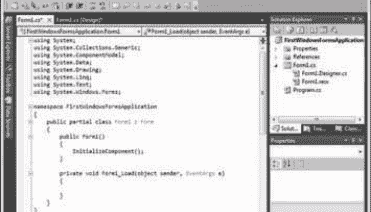

**图 C#-1.55**

- 9. 在 **Form1.cs** 文件中添加 **清单 1.2** 所示的突出显示的代码，其中包含窗体的 C# 代码：

### 清单 1.2：在 FirstWindowsFormsApplication 应用程序的 Form1.cs 文件中添加代码

```csharp
using System;
using System.Collections.Generic;
using System.ComponentModel;
using System.Data;
using System.Drawing;
using System.Linq;
using System.Text;
using System.Windows.Forms;

namespace FirstWindowsFormsApplication
{
    public void Form1_Load(object sender, EventArgs e)
    {
        MessageBox.Show("Welcome to Windows Programming");
    }
}
```

在清单 1.2 中，**Form1** 类表示 **FirstWindowsFormsApplication** 应用程序的 **Form1** 窗体。你希望添加到 **Form1** 的任何功能都需要添加到 **Form1.cs** 类中。你还可以看到，在 **Form1_Load()** 方法中访问了 **MessageBox** 类的 **Show()** 方法，该方法是 **Form1** 的 **Load** 事件的事件处理程序。当 **Form1** 在运行时加载时，**Show()** 方法会显示 **欢迎使用 Windows 编程** 消息。

> **注意**
> 你将在*第 5 章“使用 Windows 窗体控件编程”*中了解更多关于事件和事件处理程序的内容。

- 10. 从菜单栏中选择 **文件** → **保存 Form1.cs** 以保存 **Form1.cs** 文件中的更改，如图 C#-1.56 所示：

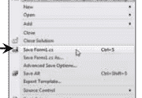

**图 C#-1.56**

- 11. 从菜单栏中选择 **调试** → **开始调试** 以运行 **FirstWindowsFormsApplication** 应用程序。出现一个消息框，其中显示消息 **欢迎使用 Windows 编程**（图 C#-1.57）。

> **注意**
> 你也可以按键盘上的 **F5** 键来运行应用程序。

- 12. 单击消息框上的 **确定** 按钮，如图 C#-1.57 所示：

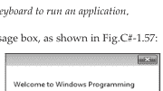

**图 C#-1.57**

**Form1** Windows 窗体出现，如图 C#-1.58 所示：

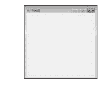

接下来，让我们学习如何使用 Visual Studio 2010 创建、保存和运行一个简单的 Web 应用程序。

### 创建、保存和运行 Web 应用程序

ASP.NET 是 .NET Framework 的重要组成部分，并且包含开发涉及最少编码的 Web 应用程序所需的所有服务。在 Visual Studio 2010 中可以构建的不同类型的 ASP.NET 应用程序包括网站、Web 应用程序、Web 服务和 AJAX 启用的应用程序。

让我们学习如何使用 Visual Studio 2010 创建一个简单的 Web 应用程序。假设我们创建的 Web 应用程序接受文本框中的一些文本作为输入，并在用户单击按钮后将其显示在标签上。

执行以下步骤创建 Web 应用程序：

1. 单击 开始→所有程序→Microsoft Visual Studio 2010→Microsoft Visual Studio 2010。Microsoft Visual Studio 2010 IDE 的启动页打开。
2. 单击 新建项目 链接以创建新的 Web 应用程序。新建项目 对话框出现（图 C#-1.59）。
3. 在 新建项目 对话框的 已安装模板 窗格中选择 Visual C#→Web（图 C#-1.59）。
4. 在 新建项目 对话框的中间窗格中选择 ASP.NET 空 Web 应用程序（图 C#-1.59）。
5. 在 名称 文本框中输入 Web 应用程序的名称。在我们的例子中，我们将 Web 应用程序命名为 MyFirstWebApplication（图 C#-1.59）。
6. 在 位置 下拉组合框中输入保存 Web 应用程序的位置。在我们的例子中，我们选择了默认位置，即 c:\users\anamika\documents\visual studio 2010\Projects（图 C#-1.59）。
7. 单击 确定 按钮，如图 C#-1.59 所示：


图 C#-1.62

Web 表单的 源 视图出现（图 C#-1.63）。

12. 单击位于 MyFirstWebApplication 窗口底部的 设计 选项卡，如图 C#-1.63 所示：


图 C#-1.63

Web 表单的设计视图出现，如图 C#-1.64 所示：


图 C#1.64

13. 打开 工具箱 并双击 标签 控件以将控件添加到 WebForm1.aspx Web 表单。

14. 双击 文本框 控件和 按钮 控件以添加到 Web 表单。WebForm1.aspx Web 表单现在显示三个控件，如图 C#1.65 所示：


图 C#1.65

表 1.2 描述了我们在 Web 表单 WebForm1.aspx 上添加的控件：

表 1.2：添加到 WebForm1.aspx Web 表单的控件

| 控件名称 | 描述 |
|---|---|
| textBox1 | 接受用户输入 |
| label1 | 显示在 TextBox 控件 textBox1 中输入的名称，并与欢迎文本拼接 |
| button1 | 将 TextBox 控件 textBox1 中的文本分配给 Label 控件 label1 |

当你在 WebForm1.aspx Web 表单上添加 标签 控件时，表单会将 Label 显示为控件的默认文本。同样，按钮控件会显示 Button 作为默认文本。

> Note
> 你可以通过 属性 窗口中控件的 Text 属性更改控件的默认文本。

15. 选择 标签 控件并从键盘按下 F4 键。所选标签控件的属性窗口出现（图 C#1.66）。

16. 将 标签 控件的 Text 属性设置为 HELLO WORLD FROM:，如图 C#1.66 所示：


图 C#1.66

17. 将 button1 控件的 Text 属性设置为 CLICK HERE。设置控件属性后，WebForm1.aspx Web 表单出现，如图 C#1.67 所示。


图 C#1.67

18. 在 设计 视图中双击 按钮 控件。Web 表单的代码编辑器出现，如图 C#1.68 所示：


图 C#1.68

### 摘要

在本章中，你学习了关于：

- .NET Framework 4.0 的优点
- .NET Framework 4.0 的架构
- .NET Framework 4.0 的组件，如 CLR、程序集和 Windows 窗体
- Visual Studio 2010 的主要特性和增强功能
- 在计算机上安装 Visual Studio 2010
- Visual Studio 2010 IDE 的组件
- 创建不同类型的 Visual Studio 2010 应用程序

# 第 2 章：介绍 C# 2010 编程基础

本章内容：

- 解释 C# 与 .NET Framework 4.0 之间的关系
- 描述 C# 2010 语言特性
- 探索 C# 2010 关键字
- 解释数据类型
- 使用变量和常量
- 使用运算符和运算符优先级
- 使用字符串
- 实现类型安全
- 创建枚举
- 使用数组

### 动态类型

C# 2010 旨在为应用程序开发人员在 C# 中开发应用程序时提供更多灵活性。它引入了新的 dynamic 类型，你可以在其上执行任何操作，例如字符串操作或算术操作。dynamic 类型在运行时解析；因此，在将方法返回的值或表达式求值的结果分配给变量时，你无需担心变量的类型。CLR 会根据返回值的<|message|> 数据类型自动为你执行必要的绑定。

让我们考虑以下代码片段：

```
dynamic d = 5;
var total = d + 2;
Console.WriteLine(total);
```

在前面的代码片段中，声明了一个 dynamic 类型变量 d，其整数值为 5。此外，var 类型变量 total 用于存储 d 的值与 2 的和。在使用 var 类型声明变量时，你无需为其定义数据类型。CLR 根据分配给它的值决定 var 类型变量的数据类型。var 类型变量的数据类型在编译时解析，而 dynamic 类型变量的数据类型在运行时解析。

使用 dynamic 类型，程序员现在可以编写方法调用和索引器调用、属性和字段访问，甚至对象调用，这些调用可以绕过 C# 类型检查过程并在运行时推断。此功能在处理各种类型的对象（如 COM）时很有益。

> Note
> 所有动态操作的结果也是动态的。

接下来，让我们学习 C# 2010 中引入的命名参数和可选参数的支持。

### 命名参数和可选参数

C# 2010 引入了对命名参数和可选参数的支持。这是在 C# 2010 中添加的两个不同的功能。命名参数允许你通过将参数与参数名称关联而不是传递参数列表中参数的位置来为特定参数指定参数。另一方面，在可选参数中，你可以省略已具有某些定义默认值参数的参数。你可以使用命名参数和可选参数与方法、索引器、构造函数和委托一起使用。在使用命名参数和可选参数时，参数的求值按其在参数列表中出现的顺序进行，而不是按其在参数列表中出现的顺序进行。

例如，让我们考虑一个需要执行基本算术运算，例如乘法的示例。在这种情况下，你需要将三个参数传递给名为 Product() 的方法，如以下代码片段所示：

```
static int Product (int a, int b, int c = 6)
{
    return a * b * c;
}
```

前面的代码片段显示 c 是一个可选参数，因为在 Product() 方法内部为其指定了默认值。

> Note
> 可选参数必须始终在参数列表中声明为最后一个参数，在声明必需参数之后。

你可以在不指定可选参数的情况下调用 Product() 方法，如以下代码片段所示：
Product (5 , 7);


接下来，让我们学习隐式行延续。

## 隐式行延续

可能存在需要将单个语句跨多行继续的情况。在这种情况下，您可以在下一行隐式地继续语句，如以下代码片段所示：

```
Console.WriteLine(
CalculateArea(length: 10, breadth: 5));
```

现在，让我们继续探索 C# 2010 中的关键字。

## 探索 C# 2010 关键字

关键字是那些被保留用于特定任务的单词或标识符。您不能使用关键字来定义变量或方法的名称。关键字是其含义由 C# 编译器预先定义保留的单词。它们在所有编程语言中使用。关键字是语言定义的重要组成部分。然而，有些关键字在代码上下文中有特殊含义，但这些关键字不是保留关键字。这些关键字被称为上下文关键字。表 2.1 列出了保留关键字和上下文关键字：

**表 2.1：C# 2010 中的保留关键字和上下文关键字**

**保留关键字**

|            |            |         |        |
| ---------- | ---------- | ------- | ------ |
| abstract   | as         | base    | bool   |
| break      | byte       | case    | catch  |
| char       | checked    | class   | const  |
| continue   | decimal    | default | delegate |
| do         | double     | else    | enum   |
| event      | explicit   | extern  | false  |
| finally    | fixed      | float   | for    |
| foreach    | goto       | if      | implicit |
| in         | in (generic modifier) | int | interface |
| internal   | is         | lock    | long   |
| namespace  | new        | null    | object |
| operator   | out        | out (generic modifier) | override |
| params     | private    | protected | public |
| readonly   | ref        | return  | sbyte  |
| sealed     | short      | sizeof  | stackalloc |
| static     | string     | struct  | switch |
| this       | throw      | true    | try    |
| typeof     | uint       | ulong   | unchecked |
| unsafe     | ushort     | using   | virtual |
| volatile   | void       | while   |        |

**上下文关键字**

|            |            |           |          |
| ---------- | ---------- | --------- | -------- |
| add        | alias      | ascending | descending |
| dynamic    | from       | get       | global   |

**表 2.2：C# 中的值类型**

| 值类型 | 值类型表示的内容 | 范围 | 默认值 |
| --- | --- | --- | --- |
| bool | 布尔类型，表示布尔值 | True 或 False | false |
| byte | 8 位无符号整数类型 | 0 到 255 | 0 |
| char | 单个 16 位字符类型，char 值是 Unicode 字符 | U+0000 to U+ffff | '\0' |
| decimal | 128 位精确十进制类型，具有 28-29 位有效数字 | ±1.0 × 10^-28 to ±7.9 × 10^28 | 0.0M |
| double | 64 位双精度浮点类型 | ±5.0 × 10^-324 to ±1.7 × 10^308 | 0.0D |
| float | 32 位单精度浮点类型 | ±1.5 × 10^-45 to ±3.4 × 10^38 | 0.0F |
| int | 32 位有符号整数类型 | -2,147,483,648 to 2,147,483,647 | 0 |
| long | 64 位有符号整数类型 | -9,223,372,036,854,775,808 to 9,223,372,036,854,775,807 | 0L |
| sbyte | 8 位有符号整数类型 | -128 to 127 | 0 |
| short | 16 位有符号整数类型 | -32,768 to 32,767 | 0 |
| uint | 32 位无符号整数类型 | 0 to 4,294,967,295 | 0 |
| ulong | 64 位无符号整数类型 | 0 to 18,446,744,073,709,551,615 | 0 |
| ushort | 16 位无符号整数类型 | 0 to 65,535 | 0 |

值类型还可以进一步分为两部分：结构体类型和枚举类型，接下来将讨论这些类型。

## 结构体类型

struct 类型是值类型并存储在栈上。这些类型可以封装一组相关的变量，例如学生的姓名、学号、年龄、班级和科系。struct 类型的成员，如构造函数、方法、属性、运算符、事件、嵌套类型、索引器、常量和字段不能声明为 protected。

此外，struct 类型是使用 struct 关键字创建的。当您创建 struct 对象并将其分配给变量时，变量保存 struct 对象的完整值。如您所知，struct 类型是值类型；因此，对 struct 类型变量的新副本所做的任何更改都不会影响旧副本。

struct 类型分为以下五类：

- 整数类型：意味着 C# 使用一组基本数据类型，被称为整数类型。该集合包括 sbyte、byte、short、ushort、int、uint、long、ulong 和 char 等类型。整数类型保存整数，如 123、-123 和 3456。

- 浮点类型：表示分数值，例如 -123.45 和 123.56。浮点类型分为两种：float 和 double。

    > **Note**
    > 
    > *要为 float 类型指定一个数字，您必须在值后附加字符 F（或 f），例如 12.4F。如果省略 F，该值将被视为 double。double 数据类型包含双精度浮点数。它存储 64 位浮点值。*

- 十进制类型：指定十进制类型等同于 long 整数类型，其行为类似于浮点类型。十进制值 intended 用于不需要截断小数点之后的计算的计算。与浮点类型相比，十进制类型具有更高的精度和更小的范围。您必须在值后附加字符 M（或 m），例如 123.45M，以将数字指定为十进制类型。如果省略 M，该值将被视为 double。

- **布尔类型 (bool)**：允许您在程序执行期间测试特定条件。布尔类型仅取两个值，**True** 或 **False**。

- **可空类型**：允许用户将 null 值分配给任何数据类型的变量。可空类型通常与数据库一起使用。

## 枚举类型

枚举提供了一种将整数类型数字附加到程序中的名称的方法，从而提高了代码的可读性。枚举是使用 enum 关键字声明的用户定义整数数据类型。枚举通过为其分配合法值使代码更易于维护。此外，枚举是最基本的用户定义类型，它为给定类型列出可能的值。例如，您可能有一个模拟交通灯的程序。交通灯有三种可能的状态，绿色（或通行）灯、黄色（或警告）灯和红色（或停止）灯；因此，在任何给定时间，交通灯可以是红色、黄色或绿色。

现在，让我们学习 C# 中的引用类型。

## 引用类型

引用类型长度各异并存储在内存的堆上。当值分配给引用类型变量时，只会复制引用，而实际值在内存位置保持不变。我们可以将引用类型进一步分为两部分：预定义类型和用户定义类型。

> **Note**
> 
> 堆是一种数据结构，用于存储 C# 中的引用类型，如对象。对象以任意方式存储在堆中，其存在或大小在应用程序开始运行之前无法确定。

接下来讨论预定义类型和用户定义类型。

### 预定义类型

预定义引用类型可以分为两种：

- **对象类型**：指 C# 中所有其他预定义和用户定义数据类型的最终基类型。您可以使用 Object 类型将栈上的值类型转换为放置在堆上的 Object 类型。

- **字符串类型**：指 C# 中字符串的创建和操作。您可以在字符串上执行各种操作，如复制、比较和连接。

### 用户定义类型

用户定义引用类型是指使用预定义类型定义的类型。以下是用户定义引用类型：

- **类**：指定 C# 是纯粹的面向对象语言，因此所有 C# 程序的基础是类。使用类，您可以将逻辑相关的

## 注意

在另一个类中扩展一个类的功能和行为称为继承。

- **委托：** 指存储与委托签名匹配的方法签名的引用的对象。委托是封装具有特定签名的方法的引用类型。
- **数组：** 指数据元素的有序排列。它是一种数据结构，包含在内存的连续位置上的若干相同数据类型的变量。

现在，让我们学习 C# 2010 中的指针类型。

## 指针类型

为了在引用上下文中保持类型安全和安全性，C# 使用委托而不支持指针。然而，你可以使用 unsafe 关键字定义一个不安全上下文，在其中可以使用指针。换句话说，指针类型仅在不安全上下文中使用。指针类型不是从 Object 基类继承的，而 Object 基类是所有 .NET 类型的基类。你不能将指针类型转换为 Object 类型，反之亦然。指针变量用于存储另一个变量的地址。以下语法显示了指针类型的声明：

```
datatype* identifier;
```

你已经学习了 C# 中的数据类型，接下来你将学习变量和常量。

## 使用变量和常量

变量是表示内存中存储位置的标识符。在程序中使用变量的名称可以引用存储在特定位置的信息。与在程序执行期间保持不变的常量不同，变量的值可以随时更改。每个变量都有一个类型，决定要存储在其中的值。

你可以给变量起任何名字，但它应该有意义，因为它使代码更易读。

有意义的变量名称的一些示例是 salary、height、name、age 和 total_marks。

以下是 C# 变量命名的某些规则：

- 变量名可以由字母和下划线字符（_）组成。
- 变量名不能以数字开头。
- 使用大写和小写字符的变量名是不同的；例如，salary 和 SALARY 是两个不同的变量。
- 变量名不应是关键字。
- 变量名不应包含空格。

表 2.3 显示了有效和无效变量名称的示例：

表 2.3：有效和无效 C# 变量名称的一些示例

| 变量名称 | 状态 |
|---|---|
| salary | 合法 |
| Total_amount | 合法 |
| yearly_cost | 合法 |
| _2010_tax | 合法，但不建议 |
| Total#amount | 非法；包含非法字符 # |
| double | 非法；double 是关键字 |
| 9number | 非法；第一个字符是数字 |

另一方面，常量是那些在程序执行期间固定且不变的值。例如，Pi 的值是固定的，因此可以声明为常量。此外，任何你不想更改的值都可以声明为常量。让我们学习如何在 C# 中声明变量。

## 声明变量

程序中可能变化的任何信息都必须存储在称为变量的命名内存位置中。在为变量指定有意义的名称和适当的数据类型后，它在程序中声明，以便编译器可以轻松识别使用特定数据类型声明的变量。

> **注意**
> 
> *编译器是将用编程语言编写的源代码转换为计算机能够理解的机器语言的软件。*

变量声明执行以下任务：

- 告诉编译器变量的名称
- 说明变量保存的数据类型
- 决定变量的作用域

此外，变量必须在使用前在程序中声明。要声明一个变量，你必须根据分配的值为其指定数据类型，然后是变量的名称。以下是声明变量的语法：

```
datatype variable1, variable2, variable3,... variableN;
```

如果要声明的变量不止一个且具有相同的数据类型，则可以在同一行中用逗号分隔声明变量，如前述语法所示。C# 中的代码行始终以分号结束。以下是合法变量声明的一些示例：

- float length;
- int age;
- char b1, b2;
- double pi;
- decimal money;

## 为变量赋值

在声明变量后，你需要初始化其值。向变量初始化值意味着为变量赋值。在初始化变量时，确保在使用变量之前为其赋值。在声明时初始化变量不是强制性的。初始化的语法如下：

```
variableName = value;
```

or

```
variable1 = variable2 = variable3 = value;
```

以下是声明时初始化变量的语法：

```
datatype variableName = value;
```

or

```
datatype variable1 = value, variable2 = value;
```

以下是初始化变量的一些有效示例：

```
int age = 23;
bool status = false;
float height = 164.5f;
char sex = 'f';
int a = 4, b = 6;
```

```
decimal d = 2.34M;
```

让我们学习声明常量。

## 声明常量

如前所述，常量是固定值，在程序执行期间不能更改。

以下是声明常量的语法：

```
const datatype constantname = value;
```

你必须声明然后初始化常量，如以下代码片段所示，以避免错误：

```
const float PI = 3.14;
const int count = 4;
```

分配给常量的值在程序执行期间不能更改。常量也可以使用表达式进行初始化，如以下代码片段所示：

```
const int length = 10;
const int breadth = length * 2;
```

此外，你不能在常量使用的表达式中使用非常量值，如以下代码片段所示：

```
int length = 10;
const int breadth = length * 2;
// This is illegal statement because it is using a non-constant value
```

让我们学习声明可空类型变量。

## 声明可空类型变量

可空类型是 System.Nullable<T> 结构体的实例。可空结构体使用带有布尔空指示符的预定义值类型。预定义的值类型也称为基础类型。可空类型的布尔变量可以赋值为 true、false 或 null。你可以使用 ? 类型修饰符创建可空类型。

声明可空类型的语法如下：

```
System.Nullable<T> variable or T? variable
```

在前述语法中，T 是可空类型的基础值类型。T 可以是任何值类型，例如 int、float 或 struct。然而，它不能是引用类型。例如，int? 是类型 int 的可空类型。在此示例中，int 是基础类型，? 是布尔空指示符。同样，float? 是值类型 float 的可空类型。你不能在引用类型上创建可空类型，因为它们已经支持空值。

你已经学习了如何声明变量和常量并为其赋值，让我们在下一节学习运算符和运算符优先级。

## 使用运算符和运算符优先级

在 C# 中，我们可以用表达式的形式使用存储在变量和常量中的值。表达式只是一组语言元素，组合在一起以执行特定任务或计算。为了编写表达式，C# 2010 提供了完整的语言元素集，例如变量、常量、运算符、属性和字面量。表达式的典型示例显示在以下代码片段中：

```
int total= 2 + 3;
```

在前面的代码片段中，表达式由整数变量 total、赋值运算符 =、整数值 2 和 3 以及加法运算符 + 组成。表达式的求值产生结果 5，然后将其分配给整数变量 total。

运算符只不过是特殊符号，用于指定某些计算或其他操作，例如对操作数的算术和逻辑操作。因此，运算符指定在表达式中要执行的操作。C# 2010 中的运算符属于多个类别，例如 primary、unary、multiplicative、additive、shift、relational and type testing、equality、logical AND、logical XOR、logical OR、conditional AND、conditional OR、null-coalescing、conditional、assignment operators 和 lambda expression。表 2.4 列出了不同的类别以及属于这些类别的运算符：


## 表 2.4：C# 2010 中的运算符

| 类别 | 运算符 | 说明 |
|---|---|---|
| 主要 | x.y | 点运算符：访问类的成员变量和方法。 |
| 主要 | f(x) | 括号：指定表达式中的运算顺序，并执行类型转换。它还可用于调用委托或方法。 |
| 主要 | a[x] | 方括号：指定方括号可用于数组、索引器、指针和特性。 |
| 主要 | x++ | 后置递增运算符：将其操作数 (x) 的值增加 1。它先赋予 x 的值，然后递增其值。 |
| 主要 | x-- | 后置递减运算符：将其操作数 (x) 的值减少 1。它先赋予 x 的值，然后递减其值。 |
| 主要 | new | new 运算符：创建对象并调用构造函数。 |
| 主要 | typeof | typeof 运算符：允许你使用 Type 对象发现有关引用类型和值类型的信息。 |
| 主要 | checked | checked 运算符：检测整型算术运算和转换中的溢出条件。 |
| 主要 | unchecked | unchecked 运算符：忽略由溢出条件引起的错误并接受生成的结果，而不考虑溢出条件。 |
| 主要 | -> | 指针运算符：组合指针解引用和成员访问。 |
| 一元 | + | 一元加运算符：指定此运算符为所有数值类型预定义，并且对数值类型执行一元 + 运算的结果始终是操作数的值。例如，执行以下代码片段时，显示的结果为 7，因为对 7 执行一元 + 运算的结果始终是操作数 (7) 的值：`int x = 7;` `Console.WriteLine(+x);` |
| 一元 | - | 一元减运算符：指定此运算符为所有数值类型预定义，并且对数值类型执行一元 - 运算的结果是操作数的数值否定。例如，执行以下代码片段时，显示的结果为 -7，因为对 7 执行一元 - 运算的结果始终是操作数 (7) 的数值否定：`int x = 7;` `Console.WriteLine(-x);` |
| 一元 | ! | 逻辑非运算符：反转布尔表达式的结果。 |
| 一元 | ~ | 按位求补运算符：反转表达式的二进制表示。 |
| 一元 | ++x | 前置递增运算符：将其操作数 (x) 的值增加 1。前置递增运算返回递增后操作数 (x) 的值。 |
| 一元 | --x | 前置递减运算符：将其操作数 (x) 的值减少 1。前置递减运算返回递减后操作数 (x) 的值。 |
| 一元 | (T)x | 括号：指定表达式中的运算顺序，并转换类型。它还可用于调用委托或方法。 |
| 一元 | true | true 运算符：当表达式不满足指定条件时，返回布尔值 true。 |
| 一元 | false | false 运算符：返回布尔值 false，以指示表达式不满足指定条件。 |
| 一元 | & | 地址运算符：返回其操作数的地址。 |
| 一元 | sizeof | sizeof 运算符：返回值类型的大小（以字节为单位）。 |
| 乘法 | * | 乘法运算符：计算其操作数的乘积。 |
| 乘法 | / | 除法运算符：通过将第一个操作数除以第二个操作数来计算其操作数的商。 |
| 乘法 | % | 取模运算符：在将第一个操作数除以第二个操作数后，计算其操作数的余数。 |
| 加法 | + | 二元加运算符：计算其操作数的和。 |
| 加法 | - | 二元减运算符：计算其操作数的差。 |
| 移位 | << | 左移运算符：将第一个操作数向左移动第二个操作数指定的位数。该位数应为整数值。 |
| 移位 | >> | 右移运算符：将第一个操作数向右移动第二个操作数指定的位数。该位数应为整数值。 |
| 关系和类型测试 | < | 小于运算符：判断第一个操作数是否小于第二个操作数。如果条件满足，则返回 true；否则返回 false。 |
| 关系和类型测试 | > | 大于运算符：判断第一个操作数是否大于第二个操作数。如果条件满足，则返回 true；否则返回 false。 |
| 关系和类型测试 | <= | 小于等于运算符：判断第一个操作数是否小于或等于第二个操作数。如果条件满足，则返回 true；否则返回 false。 |
| 关系和类型测试 | >= | 大于等于运算符：判断第一个操作数是否大于或等于第二个操作数。如果条件满足，则返回 true；否则返回 false。 |
| 关系和类型测试 | is | is 运算符：检查变量与给定类型的兼容性。 |
| 关系和类型测试 | as | as 运算符：在兼容的引用类型之间执行转换。 |
| 相等 | == | 相等运算符：检查两个表达式是否相同。如果表达式相等，则返回 true；否则返回 false。 |
| 相等 | != | 不等运算符：检查两个表达式是否相同。如果表达式不相等，则返回 true；否则返回 false。 |
| 逻辑 AND | & | 逻辑 AND：计算其布尔操作数的逻辑 AND。对于整型操作数，(&)，逻辑 AND 运算符比较两个整数的对应位，并计算操作数的逻辑按位 AND。当且仅当两个操作数都为 true 时，它返回 true。它可用作一元或二元运算符。 |
| 逻辑 XOR | ^ | 逻辑 XOR：计算其布尔操作数的逻辑异或。当且仅当其中一个操作数为 true 时，它返回 true。 |
| 逻辑 OR | \| | 逻辑 OR：计算其布尔操作数的逻辑 OR。对于整型操作数，\| 它比较两个整数的对应位，并计算操作数的逻辑按位 OR。当且仅当其任一操作数为 true 时，它返回 true。 |
| 条件 AND | && | 逻辑 AND：用于计算其布尔操作数的逻辑 AND。它会在必要时计算第二个操作数，并且当且仅当两个操作数都为 true 时返回 true。 |
| 条件 OR | \|\| | 逻辑 OR：计算其布尔操作数的逻辑 OR。它会在必要时计算第二个操作数，并且当且仅当其任一操作数为 true 时返回 true。 |
| null 合并 | ?? | null 合并运算符：为可空值类型以及引用类型定义默认值。如果左操作数不为 null，则返回左操作数；否则返回右操作数。 |
| 条件 | ?: | 条件运算符：根据布尔表达式产生的结果返回两个值之一。 |
| 赋值 | = | 等号运算符：将值赋给变量、属性或索引器。 |
| 赋值 | += | 加法赋值运算符：将第一个操作数和第二个操作数之和的结果赋给第一个操作数本身。 |
| 赋值 | -= | 减法赋值运算符：将第一个操作数和第二个操作数之差的结果赋给第一个操作数本身。 |
| 赋值 | *= | 乘法赋值运算符：将第一个操作数和第二个操作数之积的结果赋给第一个操作数本身。 |
| 赋值 | /= | 除法赋值运算符：将第一个操作数除以第二个操作数所得的结果赋给第一个操作数本身。 |
| 赋值 | %= | 取模赋值运算符：将第一个操作数除以第二个操作数所得余数赋给第一个操作数本身。 |
| 赋值 | &= | AND 赋值运算符：将第一个操作数和第二个操作数的逻辑 AND 赋给第一个操作数本身。 |
| 赋值 | \|= | OR 赋值运算符：将第一个操作数和第二个操作数的逻辑 OR 赋给第一个操作数本身。 |
| 赋值 | ^= | XOR 赋值运算符：将第一个操作数和第二个操作数的逻辑 XOR 赋给第一个操作数本身。 |
| 赋值 | <<= | 左移赋值运算符：将第一个操作数和第二个操作数的左移结果赋给第一个操作数本身。 |
| 赋值 | >>= | 右移赋值运算符：将第一个操作数和第二个操作数的右移结果赋给第一个操作数本身。 |
| Lambda | => | Lambda 运算符：将左侧的输入变量与右侧的语句块或表达式分隔开。 |

你已经学习了 C# 中的运算符，接下来，让我们学习如何在应用程序中使用这些运算符。


## 使用算术运算符

几乎所有计算机程序都会执行算术运算，例如加法、减法、乘法和除法。C# 中使用五种算术运算符：加（+）、减（-）、乘（*）、除（/）和取模（%）。加号（+）用于加法，减号（-）用于减法，星号（*）用于乘法，正斜杠（/）用于除法，取模（%）用于返回余数。

> 注意
> 你将在后续章节中详细了解其他 C# 运算符。

表2.5列出了算术运算符的示例：

表2.5：C# 中算术运算符的示例

| 操作 | 示例 | 结果 |
|---|---|---|
| 加法 | 17 + 2 | 19 |
| 减法 | 9 - 4 | 5 |
| 乘法 | 6 * 5 | 30 |
| 除法 | 10 / 5 | 2 |
| 取模 | 7 % 5 | 2 |

现在，让我们考虑一个赋值语句包含多个算术运算符的示例，如下面的代码片段所示：

```
5 + 3 * 2
```

在前面的代码片段中，答案取决于多种情况。例如，如果你先计算 5 加 3，然后将结果乘以 2，答案是 16。然而，如果你先计算 3 乘以 2，然后再加上 5，答案是 11。通过使用优先级规则可以避免这种混淆的可能性。这意味着算术运算按照指定的优先级顺序执行：乘法（*）、除法（/）、取模（%）、加法（+）和减法（-）。

在赋值语句中，先执行乘法和除法运算；然后执行取模运算；最后执行加法和减法运算。因此，前面示例的答案将是 11 而不是 16，因为乘法先于加法执行。

如果两个运算符的优先级相同（例如乘法和除法），则运算从左到右执行，如下例所示：

```
20 / 2 * 5
```

在前面的示例中，由于两个运算符具有相同的优先级，因此先执行除法，得到结果 10。然后执行乘法运算，最终答案为 50。如果你希望先执行乘法再执行除法，可以使用括号，以便先执行括号内的运算。你可以将该示例重写如下：

```
20 / (2 * 5)
```

在前面的示例中，先执行乘法，然后执行除法运算，最终结果为 2。使用括号的数量没有限制，但每个左括号都需要一个右括号。如果你在代码编辑器中键入带有不匹配括号的赋值语句（语法错误），该语句的末尾会出现波浪线（带下划线的文本），表示存在错误。当你在一个括号内嵌套另一个括号时，计算从最内层括号开始，如下例所示：

```
( (2 + 3) * 5 ) + 7
```

在这种情况下，先执行 2 和 3 的加法；然后将结果乘以 5；最后将 7 加到结果中。因此，最终答案是 32。

## 演示运算符优先级

C# 拥有大量运算符，你可以在一个表达式中同时使用许多运算符来执行所需计算。然而，使用两个或更多运算符可能会导致运算符优先级冲突，从而难以决定先执行哪个运算。包含运算符的 C# 表达式会根据表达式中每个运算符的优先级级别进行求值。因此，运算符优先级是指一组规则，用于指定编译器对表达式求值的顺序。当运算符与其左侧的表达式或右侧的表达式关联时，这称为运算符的结合性。表2.6显示了 C# 中不同运算符的优先级：

**表2.6：运算符优先级**

| 运算符 | 结合性 |
|---|---|
| (x), (x,y), f(x), a[x], x++, x--, new, typeof, sizeof, checked, unchecked | 左 |
| + (unary), - (unary), ~, ++x, --x, (!)x | 左 |
| *, /, % | 左 |
| + (arithmetic), - (arithmetic) | 左 |
| <<, >> | 左 |
| <, >, <=, >=, is, as | 左 |
| ==, != | 左 |
| & | 左 |
| ^ | 左 |
| \| | 左 |
| && | 左 |
| \|\| | 左 |
| ? : | 右 |
| =, *=, /=, %=, +=, -=, <<=, >>=, &=, ^=, \|= | 右 |

表2.6列出了 C# 运算符的优先级顺序。同一级别的运算符具有相同的优先级，并按照表达式中给定的顺序求值，除非它们被括号分隔。

让我们学习使用作用域解析运算符。

## 使用作用域解析运算符

::（作用域解析）运算符放在两个标识符之间，:: 运算符左侧的标识符被视为全局标识符、extern 或别名。当 :: 运算符左侧的标识符为全局标识符时，将在全局命名空间中搜索右侧标识符。现在，让我们执行以下步骤创建一个名为 AliasClass 的控制台应用程序，它演示了如何将 :: 运算符与全局标识符一起使用：

- 1. *单击“开始”*→所有程序→Microsoft Visual Studio 2010→Microsoft Visual Studio 2010，以打开 Visual Studio 2010 IDE。
- 2. *选择“文件”*→新建→项目，以打开“新建项目”对话框。
- 3. 在“新建项目”对话框的“已安装的模板”窗格中*选择 Visual C#*，然后*选择“控制台应用程序”*。
- 4. 在“名称”文本框中*输入*应用程序名称 AliasClass，并从“位置”组合框中*选择*默认位置 c:\users\temp\documents\visual studio 2010\Projects。
- 5. 单击“确定”按钮。将创建 AliasClass 应用程序。
- 6. 将清单 2.1 中所示的突出显示代码添加到 Program.cs 文件：

### 清单 2.1：将作用域解析运算符与全局标识符一起使用

```csharp
using System;
using System.Collections.Generic;
using System.Linq;
using System.Text;

namespace AliasClass
{
    class AliasClass
    {
        public class System
        {
            public void Print()
            {
                global::System.Console.WriteLine("This is an example of :: operator");
            }

            // Define a constant 'Console'
            const string Console = "Hello";
            const string str1 = "World";
            static void Main(string[] args)
            {
                // Error accesses TestApp.Console
                System sys = new System();
                sys.Print();
                global::System.Console.WriteLine(Console);
                global::System.Console.WriteLine(str1);
                global::System.Console.ReadLine();
            }
        }
    }
}
```

在清单 2.1 中，:: 运算符与全局标识符一起使用。这确保类型和命名空间不会因包含新类型和成员而受到影响。

- 7. 选择“生成”→“生成解决方案”以生成解决方案，如图 C#2.2 所示：

  

  图 C#2.2

- 8. 选择“调试”→“开始调试”。输出出现，如图 C#2.3 所示：

  

  图 C#2.3

在图 C#2.3 中，:: 运算符用于打印字符串 Hello World。

> 或者，你可以按 F5 键运行应用程序。

在前面的章节中，你学习了如何使用数值变量、布尔变量及常量。考虑这样一种情况：你需要一个变量来存储一个单词或一整句话。到目前为止你学过的变量类型可能不足以存储这类数据。现在，让我们在下一节中了解 C# 中的 String 类型。

## 使用字符串

字符串可以看作是以 UTF-16 编码的 Unicode 字符序列。在 C# 中，string 是由 .NET Framework 管理的 .NET String 类型的别名。因此，string 和 String 是等效的，可以互换使用。String 是引用类型，并用双引号表示，如下面的代码片段所示：

```
string str = "abc";
```

String 类提供了多种方法，用于安全地对字符串执行某些操作，例如字符串串联和字符串操作。下一节我们将讨论如何执行字符串操作。

### 字符串操作

System.String 类提供了一组不同的方法来操作字符串，例如更改字符串的大小写和截断字符串的某些部分。让我们考虑一种情况：你有两个或更多字符串，并且你想要反转某个特定字符串字面量，或者想要查找字符串的长度。只需创建字符串数据类型并使用点运算符（.）获取字符串功能，就可以对字符串执行所有这些操作。以下代码片段展示了操作字符串的示例：

```
string name = "Visual C# 2010";
string uppercase = name.ToUpper();
string lowercase = name.ToLower();
string myname = name.Replace(name, newname);
```

在前面的代码片段中，变量 name 是一个字符串变量，它保存字符串 Visual C# 2010。ToUpper() 方法将 name 变量中的值转换为大写，ToLower() 方法将 name 变量中的值转换为小写。类似地，Replace(name, newname) 方法用 newname 变量的值替换 name 变量的值。

### 字符串串联

有时，你可能需要合并两个字符串以显示消息。这种将两个字符串相加的过程称为字符串串联。加（+）运算符用于串联，如下面的代码片段所示：

```
ConcatenatedString = "Visual " + "C# 2010"
```

在前面的代码片段中，ConcatenatedString 变量包含值 Visual C# 2010。现在，让我们了解类型安全。

## 实现类型安全

C# 是一种类型安全语言，任何编程语言的类型安全特性都确保变量只能由与该变量关联的类型访问。使用类型安全属性时，不可能让变量保持未初始化、使数组索引超出其边界、访问任意内存位置或执行非法类型转换。类型安全编程语言的前提是，你只能对某个类型执行对其有效的操作。例如，如果你将一个浮点数作为参数传递给一个定义为接受整数参数的方法，那么你会得到一个编译时

错误。在这种情况下，可以通过将浮点数显式转换为整数来防止错误。因此，建议在程序中使用 C# 的类型安全特性，以便在编译时就能检测到错误。你也可以通过使用泛型在程序中实现类型安全属性。现在，让我们学习类型转换。

## 类型转换

C# 是一种静态类型语言；因此，如果将变量声明为 int 类型，就不能将 string 类型的值赋给它。可以使用类型转换将一种数据类型的数据转换为另一种数据类型。例如，有时需要将 int 类型的值赋给声明为 float 类型的变量。也可能需要将整数传递给定义为接受 double 类型值的方法。这类操作称为类型转换。类型转换可分为两种：隐式转换和显式转换，如图C#2.4 所示：


在下一节中，你将学习如何将一种数据类型隐式转换为另一种数据类型。

## 隐式转换

如果编译器自动将一种数据类型转换为另一种数据类型，则称为隐式转换。在隐式类型转换中，不会丢失数据。图C#2.5 说明了隐式数据转换：


在图C#2.5 中，箭头显示了 C# 基本数据类型之间可能转换的方向。以下是隐式转换的示例：

```
short a = 20;
int b = a; // Implicit conversion
```

让我们学习显式转换。

## 显式转换

当借助一些预定义函数将一种数据类型显式转换为另一种数据类型时，称为显式转换；由于这种转换是强制性的，因此在此过程中可能会丢失数据。有些转换不能隐式进行，如下所示：

- int 到 short
- int 到 uint
- uint 到 int
- float 到 int

接下来让我们学习类型强制转换。

## 类型强制转换

强制转换是执行显式转换的过程。可以通过在数据前加上指定所需转换类型的数据类型来执行强制转换。强制转换的语法如下：

```
type variable1 = (type) variable2
```

在前面的语法中，括号中的 type 是转换类型。如果将一种数据类型强制转换为更小的数据类型，则在强制转换过程中可能会丢失数据。以下示例展示了强制转换：

```
int x = (int) 24.46; // Fractional part of the float value will be lost i.e. x = 24
```

在前面的示例中，浮点值 24.46 被转换为整数。由于整数数据类型不允许小数，因此该值的小数部分被截断，值 24 被赋给变量 x。

在 C# 中，可以将数值转换为字符串，如下面的代码片段所示：

```
int x = 20;
string str = x.ToString(); // x has been converted to string and its value will be as //string "20" now
```

也可以将字符串转换为整数值，如下面的代码片段所示：

```
string str = "20";
int y = int.Parse(str); //Now the value of y is 20
```

让我们学习装箱和拆箱。

## 装箱和拆箱

如前所述，C# 中的所有类型（无论是引用类型还是值类型）都派生自 System.Object 基类。装箱是可将值类型隐式转换为对象类型的过程。每当对值类型执行装箱时，CLR 会将其封装在 System.Object 基类中，并将该值存储在托管堆上。下面的代码片段说明了装箱过程：

```
int i = 10;
object ob = (object) i; //Boxing
```

另一方面，拆箱是装箱的逆过程。它是将对象类型显式转换为值类型的过程。下面的代码片段展示了拆箱过程：

```
object ob = 123;
int i = (int) ob;
```

尽管装箱和拆箱都为应用程序开发人员提供了将值类型视为对象类型的灵活性；但在计算上，这些操作开销相当大。这是因为当对值类型进行装箱时，需要分配并构造一个对象。

你已经学习了 C# 中的数据类型、变量、字符串和类型转换。现在让我们学习创建枚举。

## 创建枚举

枚举被视为用户定义的值类型。枚举允许为整数值分配符号名称，本质上是强类型常量。“强类型”这一说法意味着，即使两个枚举成员的值相同，也不能将一种类型的枚举赋给另一种类型的枚举。枚举通过仅分配合法值，使源代码易于维护。注意，枚举是使用 enum 关键字创建的。enum 关键字是 System.Enum 类的别名。让我们执行以下步骤创建一个名为 Enumeration 的应用程序，以展示枚举的用法：

- 1. 重复本章“使用作用域解析运算符”一节中步骤 1 到 3 的操作。
- 2. 在“名称”文本框中输入应用程序名称 Enumeration，然后从“位置”组合框中选择默认位置 c:\users\temp\documents\visual studio 2010\Projects。
- 3. 单击“确定”按钮。Enumeration 应用程序即创建完成。
- 4. 将清单 2.2 中突出显示的代码添加到 Program.cs 文件：

### 清单 2.2：创建枚举

```
using System;
using System.Collections.Generic;
using System.Linq;
using System.Text;
namespace Enumeration
{
    public enum Color { Red=1, Green, Yellow }
    class Program
    {
        static void Main(string[] args)
        {
            Console.WriteLine("Please select 1 for Red, 2 for Green, and 3 for Yellow");
            string str = Console.ReadLine();
            int colInt = int.Parse(str);
            Color col = (Color)colInt;
            switch (col)
            {
                case Color.Red:
                    Console.WriteLine("The selected color is Red");
                    break;
                case Color.Green:
                    Console.WriteLine("The selected color is Green");
                    break;
                case Color.Yellow:
                    Console.WriteLine("The selected color is Yellow");
                    break;
                default:
                    Console.WriteLine("this number is not assigned to any color");
                    break;
            }
            Console.ReadLine();
        }
    }
}
```

清单 2.2 创建了一个名为 Color 的枚举，并使用名为 Red、Green 和 Yellow 的三个成员定义它。成员 Red 初始化为 1；因此，Green 和 Yellow 的值分别自动赋为 2 和 3。

- 5. 选择“生成”→“生成解决方案”以生成解决方案。
- 6. 按 F5 键执行应用程序。输出如图C#2.6 所示：

```
for (int j = 0; j <= 2; j++)
{
    for (int k = 0; k <= 2; k++)
    {
        Console.WriteLine("Enter the " +(k + 1)+ " element of the " +(j+1)+ " row");
        x[j,k]=int.Parse(Console.ReadLine());
    }
}
for (int j = 0; j <= 2; j++)
{
    Console.WriteLine();
    for (int k = 0; k <= 2; k++)
    {
        Console.Write(x[j,k]+"\t");
    }
}
Console.ReadLine();
}
```

在清单 2.4 中，创建了一个二维数组 x，具有三行三列。

- 5. 选择“生成”→“生成解决方案”以生成解决方案（图C#2.10）
- 6. 按 F5 键执行应用程序。应用程序的输出如图C#2.10 所示。


图C#2.10

- 7. 在命令提示符中输入适当的值。最终输出如图C#2.11 所示：


图C#2.11

现在，让我们总结本章学到的关键点。


## 摘要

本章中，您已学习了以下内容：

- C# 与 .NET Framework 4.0 之间的关系
- C# 2010 中引入的新功能，例如动态类型、命名参数和可选参数、增强的 COM 互操作性、协变和逆变、新命令行编译器选项以及隐式行延续
- C# 2010 中的不同关键字类型，例如保留关键字和上下文关键字
- C# 2010 中的不同数据类型，例如值类型、引用类型和指针类型
- 变量和常量以及它们如何在应用程序中声明和使用
- 运算符及其在应用程序中的使用方式
- 使用类型转换、强制转换技术以及装箱和拆箱将一种数据类型转换为另一种数据类型
- 枚举及其创建方法
- 数组及其不同类型，例如单维、多维和锯齿数组

# 第 3 章

### 使用控制结构和异常处理

本章内容：

- 使用语句
- 使用选择语句
- 探索循环或迭代语句
- 探索跳转语句
- 处理异常
- 为 C# 程序添加注释

用任何编程语言编写的程序的流程意味着程序执行的[content]
## 摘要

本章中，您已学习了以下内容：

- C# 与 .NET Framework 4.0 之间的关系
- C# 2010 中引入的新功能，例如动态类型、命名参数和可选参数、增强的 COM 互操作性、协变和逆变、新命令行编译器选项以及隐式行延续
- C# 2010 中的不同关键字类型，例如保留关键字和上下文关键字
- C# 2010 中的不同数据类型，例如值类型、引用类型和指针类型
- 变量和常量以及它们如何在应用程序中声明和使用
- 运算符及其在应用程序中的使用方式
- 使用类型转换、强制转换技术以及装箱和拆箱将一种数据类型转换为另一种数据类型
- 枚举及其创建方法
- 数组及其不同类型，例如单维、多维和锯齿数组

## 第 3 章

### 使用控制结构和异常处理

本章内容：

- 使用语句
- 使用选择语句
- 探索循环或迭代语句
- 探索跳转语句
- 处理异常
- 为 C# 程序添加注释

用任何编程语言编写的程序的流程意味着程序执行的


## 图 C#3.2

如图 C#3.2 所示，您将被提示输入一个数字。

- 8 输入任意数字。在我们的例子中，我们输入了数字 120，如图 C#3.3 所示：


## 图 C#3.3

- 9 按 Enter 键。输出显示，如图 C#3.4 所示：


## 图 C#3.4

输入数字后，程序内部的 if 语句会检查该数字。如果该数字能被 2 整除，程序控制进入 if 块并显示输入的数字是偶数的结果。然而，请注意，我们没有指定当输入的数字不能被 2 整除时必须执行的代码。为此，使用 else 子句与 if 语句一起使用。else 子句在 if 块的条件未满足时执行。换句话说，当 if 块的条件求值为 false 时，else 块内部的代码块将被执行。

```
if condition // condition
{
    //statement
}
else
{
    // else statement
}
```

if...else 语句的语法如下：

在前述语法中，如果 if 块内指定的条件求值为 false，则 else 块内的语句将被执行。

现在，让我们考虑在列表 3.1 中创建的 If Example 应用程序，以学习如何使用 if...else 语句。执行以下步骤以了解 if...else 语句的工作原理：

## 列表 3.2：使用 else 语句

- 1 在列表 3.1 中给出的 if 块的代码之后添加列表 3.2 中给出的代码：

```
//This is the else block.
else
{
    Console.WriteLine("The number entered is odd");
}
```

- 2 按 F5 键运行 If Example 应用程序并输入一个奇数。输出显示，如图 C#3.5 所示：

## 图 C#3.5


如图 C#3.5 所示，您将被提示输入一个数字。if 语句检查您输入的数字是否能被 2 整除。由于我们例子中输入的数字不能被 2 整除，因此 else 块内的代码执行，并且消息“输入的数字是奇数”出现在屏幕上。现在，让我们学习如何嵌套多个 if 语句。

通过嵌套多个 if 语句，您可以根据特定条件进一步细化决策过程，因为它有助于检查多个条件。随着程序复杂度的增加，用于执行代码的条件数量也会增加。在这种情况下，最好嵌套多个 if 语句以获得所需结果。使用嵌套 if 语句的语法如下：

```
if condition //condition
{
    //statement
}
else
if condition //condition
{
    //statement
}
else
{
    //statement
}
```

在前述语法中，如果第一个 if 块中的条件求值为 true，则执行第一个 if 块；否则，程序控制转移到 else...if 块并检查 if 语句中指定的条件。现在，如果此条件求值为 true，则 else...if 块内部的代码块执行；否则，程序控制转移到 else 块。

现在，让我们创建一个名为 NestedIf 的应用程序来演示嵌套 if 语句的使用。执行以下步骤创建 NestedIf 应用程序：

- 1. 重复创建 If Example 应用程序时讨论的步骤 1 到 3。
- 2. 在名称文本框中输入 NestedIf 以指定应用程序的名称，并在位置组合框中指定应用程序的适当位置。在本例中，我们输入的位置为 D:\C# 2010 Applications。
- 3. 单击确定按钮。NestedIf 应用程序已创建。
- 4. 在 Program.cs 文件中添加列表 3.3 中给出的突出显示的代码：

## 列表 3.3：使用嵌套 If 语句

```
using System;
using System.Collections.Generic;
using System.Linq;
using System.Text;
namespace NestedIf
{
    class Program
    {
        static void Main(string[] args)
        {
            Console.WriteLine("Finding the Largest of Three Numbers\n");
```

```
```csharp
Console.Write("Enter the First Number:");
int number1 = int.Parse(Console.ReadLine());
Console.Write("Enter the Second Number:");
int number2 = int.Parse(Console.ReadLine());
Console.Write("Enter the Third Number:");
int number3 = int.Parse(Console.ReadLine());
if (number1 > number2 && number1 > number3)
Console.WriteLine(number1 + " is the Largest Number");
else
if (number2 > number3)
Console.WriteLine(number2 + " is the Largest Number");
else
Console.WriteLine(number3 + " is the Largest Number");
Console.Write("\nPress ENTER to quit...");
Console.ReadLine();
}
}
```
```

在列表 3.3 中，已声明了三个整数变量 number1、number2 和 number3。这些变量用于存储从用户输入接受的三个整数。第一个 if 语句检查变量 number1 中存储的数字是否大于变量 number2 和 number3 中分别存储的数字。如果此条件为 true，则 Console.WriteLine() 语句打印 number1 是最大数字的消息。然而，如果 if 语句中指定的条件求值为 false，则程序控制进入 else 块。else 块内部的 if 语句检查 number2 变量中存储的数字是否大于 number3 变量中存储的数字。如果此条件求值为 true，则 if 语句内部的 Console.WriteLine() 语句执行并打印 number2 是最大数字的消息。如果 number2 变量中存储的数字小于 number3 变量中存储的数字，则程序控制进入 else 块。else 块内部的 Console.WriteLine() 语句执行并打印 number3 是最大数字的消息。

- 5 按 F5 键运行 NestedIf 应用程序。

输出显示，如图 C#3.6 所示：


图 C#3.6

如图 C#3.6 所示，您将被提示输入第一个数字。当您输入第一个数字后，按 ENTER 键，您将被再次提示输入第二个数字，如图 C#3.7 所示：


图 C#3.7

同样，您将被提示输入第三个数字。一旦您输入全部三个数字，if...else 块就会检查它们并返回三个数字中的最大值，如图 C#3.8 所示：


图 C#3.8

现在，让我们学习关于 switch 语句。

## Switch 语句

C# 中的另一种选择语句是 switch 语句，它是更简便地进行选择的一种替代方法。与只能用于检查有限数量条件的 if 语句不同，switch 语句允许您为变量提供可能值的列表。您应该将 switch 语句与 case 语句一起使用，并且 switch 语句内部可以有任意数量的 case 语句。switch 语句将程序控制传递给其值与 switch 语句中指定的变量匹配的 case 语句之一。switch 语句的语法如下：

```
```
switch (variablename) // test expression
{
    case 1://constant-expression
    {
        //statement
    }
    break;
    case 2://constant-expression
    {
        //statement
    }
    break;
    default:
    break;
}
```
```

在前述语法中，switch 语句将测试表达式与不同的 case 语句进行比较。程序控制从一个 case 传递到另一个 case，直到找到一个其常量表达式与测试表达式匹配的 case 语句。然后执行该 case 语句内的语句。

现在，让我们创建一个名为 SwitchStatement 的控制台应用程序来演示如何使用 switch 语句。执行以下步骤创建 SwitchStatement 应用程序：

- 1. 重复本章 The if Statement 部分中创建 If Example 应用程序时讨论的步骤 1 到 3。
- 2. 在名称文本框中输入 SwitchStatement 以指定应用程序的名称，并在位置组合框中指定应用程序的适当位置。在本例中，我们输入的位置为 D:\C# 2010 Applications。
- 3. 单击确定按钮。SwitchStatement 应用程序已创建。
- 4. 在 Program.cs 文件中添加列表 3.4 中给出的突出显示的代码：

## 列表 3.4：使用 switch 语句

```
```
using System;
using System.Collections.Generic;
using System.Linq;
using System.Text;
namespace SwitchStatement
```

```csharp
{
    class Program
    {
        static void Main(string[] args)
        {
            string Name;
            int Marks;
            Console.Write("Enter Your Name:");
            Name = Console.ReadLine();
            Console.WriteLine("Select the Range of Marks:");
            Console.WriteLine("1. 0-50");
            Console.WriteLine("2. 51-100");
            Console.Write("Enter Your Choice (1,2):");
            Marks = int.Parse(Console.ReadLine());
            switch (Marks)
            {
                case 1:
                {
                    Console.Write(Name + " your marks are Low.\n");
                }
                break;
                case 2:
                {
                    Console.Write(Name + " your marks are Good. \n");
                }
                break;
                default:
                break;
            }
            Console.Write("\nPress ENTER to quit...");
            Console.ReadLine();
        }
    }
}
```

在清单 3.4 中，声明了一个名为 Name 的字符串变量和一个名为 Marks 的整数变量。Name 变量用于存储用户的姓名，而 Marks 变量用于存储两个选项之一，即 1 和 2，用来指定你的成绩所在的范围。存储在 Marks 中的值随后会与 case 语句中的值进行匹配。case 语句中与 Marks 变量的值匹配的代码将被执行。

- 5. 按 F5 键运行 SwitchStatement 应用程序。

输出如下所示，如图 C4-3.9 所示：


图 C4-3.9

如图 C4-3.9 所见，系统会提示你输入姓名。

- 6. 输入你的姓名并按 Enter 键。

现在，系统会提示你选择成绩所在的范围，如图 C4-3.10 所示：

现在，让我们创建一个名为 WhileLoop 的控制台应用程序来演示如何使用 while 循环。执行以下步骤创建 WhileLoop 应用程序：

- 1. 重复本章 The if Statement 部分中创建 If Example 应用程序时讨论过的步骤 1 到 3。
- 2. 在 Name 文本框中输入 WhileLoop 以指定应用程序的名称，并在 Location 下拉组合框中指定应用程序的适当位置。在本例中，我们保留了默认位置，即 C:\users\temp\documents\visual studio 2010\Projects。
- 3. 单击 OK 按钮。WhileLoop 应用程序已创建。
- 4. 在 Program.cs 文件中添加清单 3.5 中给出的高亮代码：

### Listing 3.5: 使用 while 循环

```csharp
using System;
using System.Collections.Generic;
using System.Linq;
using System.Text;
namespace WhileLoop
{
    class Program
    {
        static void Main(string[] args)
        {
            Console.WriteLine("Loop 1:");
            int i = 0;
            while (i < 5)
            {
                Console.WriteLine("I = {0}", i);
                i++;
            }
            Console.ReadLine();
        }
    }
}
```

在清单 3.5 中，while 循环用于在指定的条件即 i<5 求值为 true 时，反复执行其中的代码。while 循环中的条件在执行 while 循环之前进行检查。如果条件求值为 true，则执行 while 循环内部的语句。

- 5. 按 F5 键运行 WhileLoop 应用程序。输出如下所示，如图 C4-3.12 所示：


图 C4-3.12

正如你在图 C4-3.12 中看到的，while 循环会一直打印变量 i 的递增值，直到它小于 5。

## do...while 循环

do...while 循环的功能与 while 循环相似。do...while 循环与 while 循环的主要区别在于，do...while 循环中的条件是在循环末尾检查的。这意味着即使条件求值为 false，do...while 循环也至少执行一次。do...while 循环的语法如下：

```csharp
do
{
    //statement
} while (condition); //condition
```

现在，让我们创建一个名为 **DoWhileLoop** 的控制台应用程序来演示如何使用 **do...while** 循环。执行以下步骤创建 **DoWhileLoop** 应用程序：

- 1. 重复本章 **The if Statement** 部分中创建 **If Example** 应用程序时讨论过的步骤 1 到 3。
- 2. 在 **Name** 文本框中输入 **DoWhileLoop** 以指定应用程序的名称，并在 **Location** 下拉组合框中指定应用程序的适当位置。在本例中，我们保留了默认位置，即 C:\\users\\temp\\documents\\visual studio 2010\\Projects。
- 3. 单击 OK 按钮。**DoWhileLoop** 应用程序已创建。
- 4. 在 **Program.cs** 文件中添加清单 3.6 中给出的高亮代码。

### Listing 3.6: 使用 do...while 循环

```csharp
using System;
using System.Collections.Generic;
using System.Linq;
using System.Text;
namespace DoWhileLoop
{
    class Program
    {
        static void Main(string[] args)
        {
            int i = 5;
            Console.WriteLine("Loop 1:");
            do
            {
                Console.WriteLine("i = {0}", i);
                i++;
            } while (i < 20);
            Console.ReadLine();
        }
    }
}
```

在清单 3.6 中，声明了一个整数变量 *i* 并赋值为 5。**do...while** 循环生成从 5 到 19 的数字。**do...while** 循环中的条件 *i*<20 在循环末尾检查。当此条件求值为 false 时，**do...while** 循环终止。

- 5. 按 **F5** 键运行应用程序。应用程序的输出如下所示，如图 C4-3.13 所示：


**图 C4-3.13**

接下来，让我们讨论一下 for 循环。

## for 循环

for 循环的功能也与 while 循环相似。两者之间的唯一区别在于语法。for 循环的语法包括初始化器、条件和循环表达式。初始化器初始化一个变量，循环表达式递增或递减变量的值，而条件指的是 for 循环中指定的条件。for 循环会反复执行其中包含的语句，直到指定的条件求值为 false。当你知道想要执行语句或语句块的次数时，可以使用 for 循环。for 循环的语法如下：

```
for ( initializer; condition; loop expression)
{
...
...    //statements
}
```

在前面的语法中，initializer 是变量的起始值，condition 是在执行循环之前检查的表达式，而 loop expression 递增或递减循环计数器。

现在，让我们创建一个名为 ForLoop 的控制台应用程序来演示 for 循环的使用。执行以下步骤创建 ForLoop 应用程序：

- 1. 重复本章 The if Statement 部分中创建 If Example 应用程序时讨论过的步骤 1 到 3。
- 2. 在 Name 文本框中输入 ForLoop 以指定应用程序的名称，并在 Location 下拉组合框中指定应用程序的适当位置。在本例中，我们选择了默认位置，即 C:\users\temp\documents\visual studio 2010\Projects。
- 3. 单击 OK 按钮。ForLoop 应用程序已创建。
- 4. 在 Program.cs 文件中添加清单 3.7 中给出的高亮代码：

### Listing 3.7: 使用 for 循环

```csharp
using System;
using System.Collections.Generic;
using System.Linq;
using System.Text;
namespace ForLoop
{
    class Program
    {
        static void Main(string[] args)
        {
            for (int i = 0; i < 5; i++)
            {
                Console.WriteLine("Welcome to C# 2010 in Simple Steps.");
                Console.Write("\nPress ENTER to quit...");
                Console.ReadLine();
            }
        }
    }
}
```

在清单 3.7 中，在 for 循环内部声明了一个整数变量 i 并初始化为 0。for 循环的条件设置为 i<5。此外，在 for 循环表达式中，i 变量递增 1。

- 5. 按 F5 键运行 ForLoop 应用程序。输出如下所示，如图 C4-3.14 所示：


图 C# 3.14

在图 C# 3.14 中，for 循环在固定次数内显示语句 "Welcome to C# 2010 in Simple Steps."。这是一个使用 for 循环执行固定次数的示例。

> **注意**
>
> 您还可以创建无限 for 循环。要创建无限 for 循环，您无需指定循环表达式。这意味着您无需指定要在 for 循环中递增或递减变量的值。

接下来，让我们讨论 foreach 循环。

## foreach 循环

foreach 循环遍历集合中的所有项，例如数组，它是有序的相同数据类型变量的集合。foreach 循环的工作方式与 for 循环类似。foreach 循环中的语句会为集合中的每个元素持续执行。foreach 循环遍历完集合中的所有元素后，程序控制权会转移到下一段代码。foreach 循环的语法如下：

```
foreach(<type> <item name> in <list>)
{
    ...    //statements
}
```

在前面的语法中，type 指的是 list 中包含的项的类型，item name 是变量的有意义名称，in 是一个关键字，而 list 是 foreach 循环中引用的对象集合的名称。

现在，让我们创建一个名为 ForEachLoop 的控制台应用程序来演示 foreach 循环的使用。请执行以下步骤创建 ForEachLoop 应用程序：

- 1. 重复本章“if 语句”部分中创建 IfExample 应用程序时讨论的步骤 1 到 3。
- 2. 在名称文本框中输入 ForEachLoop 以指定应用程序的名称，并在位置组合框中指定应用程序的适当位置。在本例中，我们选择了默认位置，即 C:\users\temp\documents\visual studio 2010\Projects。
- 3. 单击确定按钮。ForEachLoop 应用程序已创建。
- 4. 在 Program.cs 文件中添加清单 3.8 中给出的高亮代码：

### 清单 3.8：使用 foreach 循环

```csharp
using System;
using System.Collections.Generic;
using System.Linq;
using System.Text;
namespace ForEachLoop
{
    class Program
    {
        static void Main(string[] args)
        {
            string[] bookTitles = new string[] { "Alice in wonderland",
            "Pelican Brief",
            "Ignited Minds" };
            Console.WriteLine("The available book titles are: ");
            foreach (string i in bookTitles)
            Console.WriteLine("\t" + i);
            Console.WriteLine("\nPress ENTER to quit...");
            Console.ReadLine();
        }
    }
}
```

在清单 3.8 中，foreach 循环遍历字符串数组 bookTitles 中的所有项，并在输出窗口中显示结果。

- 5. 按 F5 键运行 ForEachLoop 应用程序。输出显示如下，见图 C# 3.15：


图 C# 3.15

现在，让我们讨论 C# 中的不同跳转语句。

## 探索跳转语句

跳转语句允许您在程序执行期间的任何特定时刻将程序控制从一个点移动到另一个点。C# 中使用的跳转语句有 break、continue、default、goto 和 return。本章中，我们仅在以下各节中讨论前两个跳转语句 - break 和 continue。

## break 语句

break 语句终止其所在的循环。它还改变了程序执行的流程。循环终止后，程序控制权会转移到 break 语句之后的下一段语句。例如，您可以在 switch 语句中使用 break 语句退出 case 块。您也可以将 break 语句与迭代语句一起使用。

现在，让我们创建一个名为 BreakStatement 的控制台应用程序来演示 break 语句的使用。请执行以下步骤创建 BreakStatement 应用程序：

- 1. 重复本章“if 语句”部分中创建 IfExample 应用程序时讨论的步骤 1 到 3。
- 2. 在名称文本框中输入 BreakStatement 以指定应用程序的名称，并在位置组合框中指定应用程序的适当位置。在本例中，我们保留了默认位置，即 C:\users\temp\documents\visual studio 2010\Projects。
- 3. 单击确定按钮。BreakStatement 应用程序已创建。
- 4. 在 Program.cs 文件中添加清单 3.9 中给出的高亮代码：

### 清单 3.9：使用 break 语句

```csharp
using System;
using System.Collections.Generic;
using System.Linq;
using System.Text;
namespace BreakStatement
{
    class Program
    {
        static void Main(string[] args)
        {
            for (int i = 0; i < 10; ++i)
            {
                if (i == 7)
                break;
                Console.WriteLine("Number {0}", i);
            }
            Console.ReadLine();
            Console.Write("\nPress ENTER to quit...");
        }
    }
}
```

在清单 3.9 中，当 i 的值变为 7 时，break 语句终止 for 循环。

- 5. 按 F5 键运行 BreakStatement 应用程序。输出显示如下，见图 C# 3.16：


图 C# 3.16

现在让我们学习 continue 语句。

## continue 语句

continue 语句用于在满足特定条件时将程序控制转移到循环的开头。当指定条件求值为 false 时，continue 语句将程序控制转移到下一条语句。

现在，让我们创建一个名为 ContinueStatement 的控制台应用程序来演示 continue 语句的使用。请执行以下步骤创建 ContinueStatement 应用程序：

- 1. 重复本章“if 语句”部分中创建 IfExample 应用程序时讨论的步骤 1 到 3。
- 2. 在名称文本框中输入 ContinueStatement 以指定应用程序的名称，并在位置组合框中指定应用程序的适当位置。在本例中，我们保留了默认位置，即 C:\users\temp\documents\visual studio 2010\Projects。
- 3. 单击确定按钮。ContinueStatement 应用程序已创建。
- 4. 在 Program.cs 文件中添加清单 3.10 中给出的高亮代码：

### 清单 3.10：使用 continue 语句

```csharp
using System;
using System.Collections.Generic;
using System.Linq;
using System.Text;
namespace ContinueStatement
{
    class Program
    {
        static void Main(string[] args)
        {
            int number = 1;
            while (true)
            {
                Console.WriteLine(number);
                number++;
                if (number <= 10)
                    continue;
                else
                    break;
            }
            Console.WriteLine("Series is broken at number: " + number);
            Console.Write("\nPress ENTER to quit...");
            Console.ReadLine();
        }
    }
}
```

在清单 3.10 中，while 循环将无限迭代，直到执行 break 关键字为止。在 while 循环内部，if 语句检查变量的值是否小于或等于 10，如果该条件求值为 true，则程序控制权会转移到 continue 语句。continue 语句反过来只要条件满足就会将程序控制权转移到循环的开头。如果条件求值为 false，则程序控制权会转移到 else 块，while 循环的执行终止。else 块中的 break 关键字导致程序终止。

- 5. 按 F5 键运行 ContinueStatement 应用程序。应用程序的输出显示如下，见图 C# 3.17：


图 C# 3.17

现在让我们学习异常。

## 处理异常

异常是由于某些意外情况而产生的运行时错误。C# 中的异常处理功能帮助您处理程序执行期间可能出现的任何意外情况或异常条件。例如，除以零或将字符串值传递给整数变量。在程序执行期间，如果发生异常，您可以使用 throw 语句显式终止程序。


现在，让我们首先了解 C# 中的异常类型。

## 描述异常类型

如前所述，异常可以看作是运行时异常、错误条件，或程序在执行期间遇到的某些意外行为。异常通常是由于源代码中的某些故障，或由于尝试访问不可用的资源（例如已从内存中移除的文件）而产生的。你可以使用异常处理机制来处理异常。此机制可帮助你检测并处理运行时发生的错误。尽管异常处理机制不能保证你开发的代码完全没有错误，但在一定程度上，它有助于构建在执行期间不会出现意外行为的应用程序。

.NET Framework 中的所有异常都派生自 Exception 类。在 C# 中，异常通常分为以下两种类型：

- 系统定义异常
- 用户定义异常

现在让我们逐一讨论这两种异常类型。

## 系统定义异常

.NET Framework 基类库 (BCL) 定义的异常通常称为系统定义异常。系统定义异常也称为预定义异常，并由各自的异常类表示。.NET Framework BCL 中定义的一些最常见的异常类如下：

- System.ArithmeticException
- System.ArrayTypeMismatchException
- System.DivideByZeroException
- System.IndexOutOfRangeException
- System.NullReferenceException
- System.OutOfMemoryException
- System.OverflowException
- System.StackOverflowException
- System.TypeInitializationException
- System.InvalidCastException

所有预定义异常类最终都继承自 System.Exception 基类。

## 用户定义异常

在 C# 中，你还可以创建自己的异常，称为用户定义异常。这些异常有时也称为自定义异常。如前所述，所有预定义异常都由派生自 System.Exception 类的类处理。然而，要定义用户定义异常，必须创建派生自 System.ApplicationException 类的类。创建用户定义异常的语法如下：

```
class MyUserDefinedException : ApplicationException
{
    //some code to handle the exception
}
```

你可以在 Program.cs 文件中定义用户定义异常，如下所示：

```
public class StudentDataNotFoundException : ApplicationException
{
    public StudentDataNotFoundException (string exMessage) : base (exMessage)
    {
```

```
~~~csharp
{
    if (number > 10)
        throw new Exception("Maximum Limit is 10");
}
catch (Exception e)
{
    Console.WriteLine("An Exception has been Occurred");
}
finally
{
    Console.WriteLine("This is the Last Statement");
    Console.Write("\nPress ENTER to quit...");
    Console.ReadLine();
}
}
}
~~~
```

在代码清单 3.12 中，定义了一个整型变量 *number*。它用于接受用户输入的数字。定义了一个 *try* 块，其中包含一个 *if* 语句。*if* 语句中的条件检查 *number* 变量的值是否大于 10。如果此条件计算为 **true**，则使用 **throw** 关键字抛出异常。在 *try* 块中抛出的异常会在 *catch* 块中被识别。*catch* 块内的 `Console.WriteLine()` 语句被执行，程序控制权转移到 *finally* 块。然后执行 *finally* 块内的 `Console.WriteLine()` 语句。

5. 按 F5 键运行 ThrowStatement 应用程序。输出如下所示，如图 C#-3.19 所示：


图 C#-3.19

如图 C#-3.19 所示，系统提示你输入一个数字。

6. 输入任意数字并按 Enter 键。现在输出如下所示，如图 C#-3.20 所示：


图 C#-3.20

既然你已经学习了如何在 C# 中处理异常，接下来让我们在下一节中学习如何注释 C# 程序。

## 注释 C# 程序

注释在任何编程语言中都起着重要作用。注释是为方便读者而添加到代码中的简短说明性文字。你可以通过描述代码的功能特性来向代码添加注释，以增强代码的可读性。任何被注释的代码都不会传递给编译器处理。

在 C# 中，可以向代码添加以下两种类型的注释：

- 单行注释
- 多行注释

现在让我们详细讨论这些内容。

### 单行注释

单行注释是以双正斜杠开头的注释，可以根据需要插入到程序中的任何位置。以下代码片段展示了单行注释的示例：

```
```csharp
string str;    //a string variable is declared
```
```

运行代码时，编译器会忽略 // 符号之后写入的文本。

### 多行注释

在某些情况下，注释可能会跨越多行。尽管你可以放置双正斜杠并在每一行开始写注释；但是，这样会使代码看起来不整洁。因此，当你希望编译器一次忽略多行时，可以使用多行注释。与单行注释类似，多行注释也可以插入到 C# 程序中的任何位置。

```
```csharp
/*    This is an example of using comments
      in C# code. You can use comments
      for better understandability.
*/
```
```

在多行注释中，编译器会忽略写在 /* 和 */ 符号之间的文本。

### 注意

你可以通过组合键 Ctrl+K、Ctrl+C 注释整个代码块。要取消注释选中的文本，可以按 Ctrl+K 或 Ctrl+U 组合键。

至此，本章结束。现在让我们总结本章的主要主题。

## 小结

在本章中，你学习了：

- C# 中使用的不同类型的语句
- 根据特定条件改变程序流程的选择语句
- 帮助执行 C# 代码指定次数的迭代语句或循环
- 允许在程序执行期间的任意特定时刻将程序控制权从一点转移到另一点的跳转语句
- 异常、其类型以及如何处理它们
- 不同类型的注释

# 第 4 章

## 面向对象编程构造简介

本章内容包括：

- 使用 C# 2010 类和对象
- 创建结构
- 使用属性
- 索引器简介
- 实现封装
- 实现继承
- 实现多态
- 使用接口
- 使用命名空间

简而言之，计算机编程意味着向计算机发出指令以处理数据，并提供执行特定任务所需的输出。编程方法主要有两种：面向过程编程 (POP) 和面向对象编程 (OOP)。

POP 是一种编程方法，其中将特定问题划分为包含有限数量步骤的较小代码段。然后分别解决这些代码段中的每一个。首先确定解决问题并产生预期结果所需的步骤，然后将其集成到一个称为过程的位置。然后使用过程调用来调用过程。此外，一个过程可以调用另一个过程，这意味着你在应用程序中为解决问题而定义的过程彼此依赖。一个过程对另一个过程的依赖使应用程序的复用变得困难。一些使用 POP 概念的编程语言包括 COBOL、FORTRAN 和 C。

OOP 的概念完全围绕对象及其交互来设计应用程序和计算机程序，你将在本章后面学习这些内容。对象是一个原子实体，具有自己的标识、状态和行为。引入 OOP 概念是为了克服 POP 语言中代码复用有限或无法复用的困难。它还采用组合独立对象的方法，这些对象相互交互以解决整体问题并执行程序的业务逻辑。在这两种方法（即 POP 和 OOP）之间，OOP 被认为是更好的方法，因为它遵循与任何现实世界对象相关的模型，这些对象可以是任何事物，从一本书到一个图书馆。它还确保在一个应用程序中创建的方法可以在其他应用程序中复用。遵循 OOP 概念的语言示例包括 C++、JAVA 和 C#。

在本章中，你将学习 OOP 的四个主要原则：封装、继承、抽象和多态。你还将学习 C# 中的构造函数、析构函数和垃圾回收机制。此外，你还将学习 C# 中使用的类与对象、结构、属性、索引器、接口和命名空间。最后，你将结合 C# 编程语言学习 OOP 的概念。

## 使用 C# 2010 类和对象

类是使用任何遵循 OOP 概念的编程语言（如 C#）创建的程序的主要构建块。你可以使用各种类将变量和方法封装到一个单元中。让我们考虑一个示例，以更好地理解类的概念。假设你需要在程序中创建一个名为 Bird 的类的对象。为此，你首先需要创建一个名为 Bird 的类，其中包含任何鸟类的所有功能或行为以及属性。然后，你可以根据需要 使用 Bird 类创建 Bird 类的对象。此外，你可以将 Bird 类用作模板来创建名为 Owl 的对象。Bird 类的 Owl 对象将包含属性 nocturnal，这意味着猫头鹰是夜行性鸟类。

类允许你定义一个自包含的环境，在其中你可以控制可应用于给定数据集的所有方法，还可以控制对数据的访问。类还使你能够扩展运行时环境，并以新方式复用运行时环境的现有功能。

你可以使用 class 关键字创建类，后跟类名。类可以看作是一个容器，其中可以包含数据成员（变量、常量或字段）和成员函数（方法、属性、事件、索引器、运算符、实例构造函数、析构函数和静态构造函数），以及其他类。类还支持继承，这是一种派生类扩展基类的机制。C# 中类的语法为：

```
class <className>
{
    <access-modifier> [static] <return-type> Methodname( <signature>);
    <access-modifier> [static] <variable type> variablename;
}
```

### 注意

你将在本章后面学习继承。


为了访问类的成员数据和成员函数，您需要声明该类的一个对象。在 C# 中声明对象的语法是：

```
<className> <objectName> = new <className>();
```

C# 提供了多种定义类的方式，例如提供不同的访问级别、从其他类继承特性，以及在对象实例化或销毁时让您指定和控制代码的行为和输出。要在您的 C# 应用程序中实现所有这些功能，您需要了解以下概念：

- 访问修饰符
- 方法
- 构造函数和析构函数
- 部分类
- 静态类
- 扩展方法

让我们在以下各节中详细了解这些内容。

## 介绍访问修饰符

可以使用访问修饰符指定类成员或类型的可访问性级别。访问修饰符有助于避免数据和方法与现有代码混杂，同时保护类的对象免受外部干扰。它通过定义一定的作用域以受限的方式访问数据和方法来保护对象。您可以使用访问修饰符声明类及其方法。然而，一个方法只能包含一个修饰符。C# 中使用的不同类型的访问修饰符列在表 4.1 中：

表 4.1：C# 中的访问修饰符

| 访问修饰符 | 描述 | 语法 |
|---|---|---|
| Public | 对类内部和外部的成员提供公共访问权限，没有任何限制。 | class SampleClass
{
    public int x; // No access
    // restrictions.
} |
| Protected | 提供受保护的成员访问权限。您可以从声明它们的类或从派生自声明它们的类的类访问受保护成员。 | class A
{
    protected int x = 123;
} |
| Internal | 提供对当前程序集中成员的访问权限。如果在定义它的程序集之外访问具有 internal 访问修饰符的成员，则应用程序会生成错误。 | public class BaseClass
{
    // Only accessible within the
    // same assembly
    internal static int x = 0;
} |
| Private | 提供对在声明它们的类主体内成员的访问权限。 | class Employee
{
    private int i;
    double d; // private access by default
} |
| Protected internal | 提供对可见于当前程序集或派生自声明它们的类的类型的成员的访问权限。 | namespace MyAssembly //current
//assembly
{
  public class One
  {
    protected internal int Method()
    {
      //method code
    }
  }
  public class Two : One
  {
    public int Add()
    {
      One obj = new One();
      return obj.Method();
    }
  }
} |

> **Note**
> 
> *程序集是一组一个或多个文件作为一个单元使用。它构成部署的单一单元，是 .NET 应用程序的主要构建块。*

接下来，让我们讨论方法以及如何在 C# 中使用它们。

## 使用方法

C# 中的方法是一段包含一系列语句以执行操作的代码块。C# 中的每个操作都在方法的上下文中执行。方法可以在类或结构内部声明。

> **Note**
> 
> *结构是一种值类型，由构造函数、常量、数据成员、方法等组成。您可以使用 struct 关键字在 C# 中创建结构。您将在后面的章节中详细了解 C# 中的结构。*

方法声明通常包括指定访问级别、返回值、方法名称和方法的参数的访问修饰符。所有这些组合在一起称为方法的签名。

以下代码片段显示了如何声明方法：

```csharp
class Passenger
{
    public void Title() { }
    public void Name(int age) { }
    public int Address(int houseno, int pincode)
    {
        //Some code
    }
}
```

前述代码片段包含三个方法，即 Title()、Name() 和 Address()。这些方法的参数用括号括起来并用逗号分隔。如果您传递一组空括号，则意味着该方法不需要参数。

构造函数和析构函数是 C# 程序中每个类的特殊方法。每个类都有自己的构造函数和析构函数，当类的实例被创建或销毁时会自动调用它们。构造函数在您访问类时初始化所有类成员，而析构函数在对象不再需要时销毁分配给类成员的值。

### 注意

> 您将在本章后面详细了解构造函数和析构函数。

现在，让我们学习如何在 C# 程序中定义然后调用方法。

## 定义方法

如前所述，方法由一系列语句组成。这些语句构成方法体，并在调用方法时执行。方法通常定义类的行为并允许程序员将程序逻辑分离为不同的单元。您可以始终将一些信息传递给方法，执行一条或一组指令，然后从中返回值。

让我们考虑一个简单的例子，以便更好地理解方法的概念。假设您需要找到数字 10 的平方。您也许可以按以下代码片段所示编写代码：

```
int square = 10 * 10;
```

现在考虑一种需要从用户接受输入的情况。前面的代码片段将不再满足目的。然而，使用方法，您可以相当轻松地执行此任务。

让我们执行以下步骤创建一个名为 CreatingMethod 的控制台应用程序，并学习如何在 C# 程序中定义方法：

- 1. 单击 开始→所有程序→Microsoft Visual Studio 2010→Microsoft Visual Studio 2010 以打开 Visual Studio 2010 集成开发环境（IDE）。
- 2. 在 Visual Studio 2010 IDE 中，从菜单栏选择 文件→新建→项目 选项以打开 新建项目 对话框。
- 3. 在 新建项目 对话框中，在 已安装模板 窗格中选择 Visual C# 选项，并在中间窗格中选择 控制台应用程序 选项。
- 4. 在 名称 文本框中输入 CreatingMethod 以指定应用程序的名称，并在 位置 下拉组合框中指定应用程序的适当位置。在我们的例子中，我们选择了默认位置，即 D:\C# 2010 Applications。
- 5. 单击 确定 按钮。CreatingMethod 应用程序已创建。
- 6. 在 Program.cs 文件中，将清单 4.1 中给出的突出显示的代码片段添加到 Program 类内部：

### 清单 4.1：显示定义方法的代码

```csharp
public static int GetSquare()
{
    int num, square = 0;
    Console.WriteLine("Enter an integer number");
    num = Convert.ToInt32(Console.ReadLine());
    square = num * num;
    return square;
}
```

在清单 4.1 中，定义了一个方法 GetSquare()。声明了两个局部整数变量 num 和 square，并将其初始化为值 0。Console.WriteLine() 语句用于提示用户输入一个整数。变量 square 被赋值为用户输入的数字的平方。然后返回变量 square 中包含的值。

## 调用方法

在 C# 中，在代码中定义方法后，您需要调用它以实现代码并执行程序的逻辑。调用方法类似于从计算机上的不同位置访问文件。您可以在应用程序的 Program 类的 Main() 方法中调用方法。

现在让我们学习如何在定义后调用方法。我们将调用清单 4.1 中定义的方法。执行以下步骤以调用本章 定义方法 部分中创建的 CreatingMethod 应用程序中定义的 GetSquare() 方法：

- 1. 将清单 4.2 中给出的突出显示的代码片段添加到 CreatingMethod 应用程序中 Program 类的 Main() 方法：

### 清单 4.2：调用方法

```csharp
static void Main(string[] args)
{
    Console.WriteLine("The square of the number is " + Program.GetSquare());
    Console.WriteLine("\nPress ENTER to quit...");
    Console.ReadLine();
}
```

- 2. 按 F5 键运行 CreatingMethod 应用程序。应用程序的输出显示如下图所示 Fig.C#-4.1：


Fig.C#-4.1

- 3. 输入一个数字并按键盘上的 Enter 键。输出显示如下图所示 Fig.C#-4.2：


Fig.C#-4.2

如 Fig.C#-4.2 所示，当您输入数字 21 时，其平方被计算并显示在屏幕上。现在，让我们研究如何在 C# 中向方法传递参数。

## 传递参数

在 C# 中，使用 params 关键字，您可以在 C# 应用程序中定义方法参数。您可以使用 params 关键字接受可变数量的参数。params 关键字在方法的形参列表中占据最后一个位置。要创建接受可变数量参数的方法，您可以执行以下步骤：

- 1. 重复本章 定义方法 部分的步骤 1 到 3。
- 2. 在 名称 文本框中输入 PassingParameters 以指定应用程序的名称，并在 位置 下拉组合框中指定应用程序的适当位置。在我们的例子中，我们选择了默认位置，即 c:\users\temp\documents\visual studio 2010\Projects。
- 3. 单击 确定 按钮。PassingParameters 应用程序已创建。


- 4. 在 **Program.cs** 文件中，*添加*代码清单 4.3 中给出的代码片段：

**代码清单 4.3：将参数传递给方法**

```csharp
public static int GetSum(params int[] numbers)
{
    int sum = 0;
    foreach (int num in numbers)
        sum += num;
    return sum;
}
```

在代码清单 4.3 中，定义了一个名为 **GetSum()** 的方法，它接受可变数量的参数。在 **GetSum()** 方法内部声明整型变量 **sum** 并将其初始化为 0。**foreach** 循环用于遍历 **GetSum()** 方法作为参数接受的所有数字，并将所有这些数字的和赋给变量 sum。最后，返回变量 sum 中的值。

要调用 **GetSum()** 方法，请执行以下步骤：

- 1. 通过将代码清单 4.4 中突出显示的代码片段*添加*到 *PassingParameters* 应用程序中 **Program** 类的 **Main()** 方法，来调用 **GetSum()** 方法：

**代码清单 4.4：调用带参数的方法**

```csharp
static void Main(string[] args)
{
    Console.WriteLine("The sum is:");
    Console.WriteLine(GetSum(1, 2, 3, 4, 5, 6, 7, 8, 9));
    Console.WriteLine(GetSum(2, 4, 6, 8));
    Console.WriteLine("\nPress ENTER to quit...");
    Console.ReadLine();
}
```

在代码清单 4.4 中，首先通过传入九个数字作为参数调用 **GetSum()** 方法，然后通过传入四个数字作为参数再次调用它。

- 2. 按 **F5** 键运行 *PassingParameters* 应用程序。

应用程序的输出如图 C#-4.3 所示。


**图 C#-4.3**

在图 C#-4.3 中，可以看到，当首次调用 **GetSum()** 方法时，它返回所有九个数字的和；当通过传入四个数字作为参数调用 **GetSum()** 方法时，它返回所有四个数字的和。

既然您已经知道如何将参数传递给方法，接下来讨论可以将参数传递给方法的方式。C# 允许按值或按引用传递参数。首先，在下一节中讨论如何按值传递参数。

## 按值传递

按值传递参数时，会将变量的副本传入被调用的方法。方法体内对参数所做的更改不会影响原始数据。请执行以下步骤按值传递参数：

- 1. *重复*本章“**定义方法**”一节的步骤 1 到 3。
- 2. 在“名称”文本框中输入 PassByVal 以指定应用程序的名称，并在“位置”组合框中为应用程序指定适当的位置。在本例中，我们选择了默认位置，即 c:\users\temp\documents\visual studio 2010\Projects。
- 3. 单击“确定”按钮。将创建 PassByVal 应用程序。
- 4. 在 Program.cs 文件中，添加代码清单 4.5 中突出显示的代码片段：

### 代码清单 4.5：按值将参数传递给方法

```csharp
using System;
using System.Collections.Generic;
using System.Linq;
using System.Text;

namespace PassByVal
{
    class Program
    {
        public static void Square(int i)
        {
            i = i*i;
            Console.WriteLine("The value inside the method: {0}", i);
        }
        static void Main(string[] args)
        {
            int num = 15;
            Console.WriteLine("The value before calling the method: {0}", num);
            Square(num);
            Console.WriteLine("The value after calling the method: {0}", num);
            Console.ReadLine();
        }
    }
}
```

在代码清单 4.5 中，定义了一个 Square() 方法，它接受整型变量 i 作为参数。Square() 方法仅将 i 中包含的值显示在屏幕上。在 Main() 方法内部调用 Square() 方法。在 Main() 方法内部声明局部变量 num 并赋值为 15。由于变量 num 是按值传递的，因此对它所做的任何更改都不会影响其原始值。

- 5. 按 F5 键运行 PassByVal 应用程序。

应用程序的输出如图 C#-4.4 所示：


图 C#-4.4

在图 C#-4.4 中，可以看到，在尚未调用 Square() 方法之前，num 的值为 15。调用该方法时，num 的值被复制到局部变量 i 中，并计算其平方。然而，在 Main() 方法内部 num 的值没有改变，返回的值仍为 15。这是因为值的更改只发生在 Square() 方法内部，并且只影响变量 i。

## 按引用传递

当您希望将 C# 值类型当作引用类型处理，或者只是希望在方法中保留对参数值所做的任何更改时，可以使用按引用传递机制。换言之，当您按引用传递值时，实际传递的是该值的地址，而不是副本。因此，在方法内部对其所做的任何更改在方法外部也会保留。在 C# 中，使用 ref 和 out 关键字按引用传递参数。不过，我们仅描述如何使用 ref 关键字按引用传递参数。请执行以下步骤按引用传递参数：

- 1. 重复本章“定义方法”一节的步骤 1 到 3。
- 2. 在“名称”文本框中输入 PassByRef 以指定应用程序的名称，并在“位置”组合框中为应用程序指定适当的位置。在本例中，我们选择了默认位置，即 C:\Users\temp\documents\visual studio 2010\Projects。
- 3. 单击“确定”按钮。将创建 PassByRef 应用程序。
- 4. 在 Program.cs 文件中，添加代码清单 4.6 中突出显示的代码片段：

### 代码清单 4.6：按引用将参数传递给方法

```
class Program
{
    public static void ChangeValue(ref int x)
    {
        x = x * x;
        Console.WriteLine("The value inside the method: {0}", x);
    }
    static void Main(string[] args)
    {
        int num = 5;
        Console.WriteLine("The value before calling the method: {0}", num);
        ChangeValue(ref num);
        Console.WriteLine("The value after calling the method: {0}", num);
        Console.ReadLine();
    }
}
```

在代码清单 4.6 中，定义了一个名为 ChangeValue() 的方法，它接受整型变量 x 的值作为参数。在调用 ChangeValue() 方法时，使用 ref 关键字传递该参数值。ChangeValue() 方法计算变量 x 中值的平方，并将其显示在屏幕上。在 Main() 方法内部声明局部整型变量 num 并赋值为 5。通过按引用传递变量 num 的值来调用 ChangeValue() 方法；因此，对 num 所做的任何更改都会导致其在 ChangeValue() 方法外部的值发生变化。

- 5. 按 F5 键运行 PassByRef 应用程序。

应用程序的输出如图 C#-4.5 所示：


在图 C#-4.5 中，可以看到，在尚未调用 ChangeValue() 方法之前，num 的值为 5。在调用该方法期间，传递的是参数的引用，因此该方法会访问所引用的内存位置，并在该变量所在的内存位置执行必要的修改。因此，在调用 ChangeValue() 方法之后，变量 num 的原始值发生了改变。

## 使用构造函数和析构函数

构造函数是用于实例化类，或在应用程序中首次创建对象时使用的特殊方法。可以使用构造函数初始化对象并设置任意参数。此外，可以编写接受参数的构造函数。构造函数的名称与类名相同，而析构函数的名称由类名加上波浪号（~）前缀组成。

定义构造函数的语法如下：

```
public class-name (parameter-list)
{
    //body
}
```

构造函数的主要特征如下：

- 与类本身同名
- 没有任何返回类型
- 构造函数不是必须声明的；它会自动调用

当对象最终被销毁时，会调用析构函数（或终结器）。析构函数用于在不再需要类的实例时销毁这些实例。析构函数总是自动调用，因此不能在应用程序中调用它。C# 提供了垃圾回收机制，该机制在运行时环境认为必要时执行，或者对象直到其引用计数降为 0 才会被销毁。您无法得知对象何时会被销毁，以及析构函数何时会被调用。不过，可以实现一个自定义方法，让您能够通过调用析构函数来控制对象销毁。

让我们执行以下步骤，创建一个名为 ConstructorApp 的应用程序，以学习如何使用构造函数：

- 1. 重复本章“定义方法”一节的步骤 1 到 3。
- 2. 在“名称”文本框中输入 ConstructorApp 以指定应用程序的名称，并在“位置”组合框中为应用程序指定适当的位置。
- 3. 单击“确定”按钮。将创建 ConstructorApp 应用程序。
- 4. 在 Program.cs 文件中，添加代码清单 4.7 中突出显示的代码：

### 代码清单 4.7：定义构造函数

```
class Program
{
    int length, breadth;
    public Program(int x, int y)
    {
        length = x;
        breadth = y;
    }
    public void area()
    {
        int result = length * breadth;
        Console.WriteLine("Area is: " + result);
    }
    static void Main(string[] args)
    {
        Program prg = new Program(10, 20);
        prg.area();
        Console.ReadLine();
    }
}
```


在代码清单 4.7 中，我们创建了一个名为 Program 的构造函数（你已经知道构造函数与类同名）。在 Main() 方法中，我们初始化了该构造函数，并传递了初始化不同变量值所需的参数。然后，我们访问了 area() 方法来计算矩形的面积。

5. 按 F5 键运行 ConstructorApp 应用程序。

应用程序的输出如图 C#4.6 所示：


图 C#4.6

接下来，让我们讨论静态构造函数。

## 静态构造函数

静态构造函数是可用于访问类的静态成员的构造函数，因此，静态构造函数常用于初始化类的静态成员。当你需要执行某项只需执行一次的特殊任务时，也可以使用静态构造函数。静态构造函数会在类首次加载到内存时自动调用，并且一个类中只能有一个静态构造函数。定义静态构造函数的语法如下：

```
public class StaticConstructorClass
{
    static StaticConstructorClass()
    {
        // some code
    }
}
```

前面的代码片段表明，静态构造函数的名称前没有访问修饰符；相反，它前面是关键字 static。以下是静态构造函数的一些主要特性：

- 静态构造函数的名称前既没有任何访问修饰符，也不接受任何参数
- 它在首次初始化类时自动调用，甚至在该类的任何实例被创建或引用任何其他静态数据成员之前就会调用
- 它不能直接调用
- 用户无法控制程序中静态构造函数的执行

让我们执行以下步骤创建一个名为 StaticConstructor 的应用程序，以了解如何创建和调用静态构造函数：

- 1. 重复本章“定义方法”一节中创建 CreatingMethod 应用程序时讨论的步骤 1 到 3。
- 2. 在“名称”文本框中输入 StaticConstructor 以指定应用程序的名称，并在“位置”组合框中为应用程序指定适当的位置。
- 3. 单击“确定”按钮。StaticConstructor 应用程序即创建完成。
- 4. 在 Program.cs 文件中，添加代码清单 4.8 中突出显示的代码：

代码清单 4.8：创建静态构造函数

```
namespace StaticConstructor
{
    public class StaticTest
    {
        static StaticTest()
        {
            Console.WriteLine("Executing the Static Constructor");
        }
        public StaticTest()
        {
            Console.WriteLine("Executing a non-static Constructor");
        }
    }
    class Program
    {
        static void Main(string[] args)
        {
            StaticTest st = new StaticTest();
            Console.ReadLine();
        }
    }
}
```

在代码清单 4.8 中，我们创建了一个静态构造函数和一个非静态构造函数。在 Main() 方法内部，当使用 new 运算符创建 StaticTest 类的对象时，该类的非静态构造函数会自动调用。请注意，我们没有对静态构造函数进行任何调用，因为静态构造函数会在类首次加载到内存时自动调用。

5. 按 F5 键运行 StaticConstructor 应用程序。

应用程序的输出如图 C#4.7 所示：


在图 C#4.7 中，可以看到，当 StaticTest 类首次加载到内存中时，首先执行静态构造函数，而不管该类已经定义了非静态构造函数这一事实。静态构造函数执行完毕后，再执行 StaticTest 类的非静态构造函数。

## 实例构造函数

使用 new 运算符创建并初始化类的实例变量的构造函数称为实例构造函数。以下代码片段说明了如何定义实例构造函数：

```
public class Numbers
{
    int a,b;
    public Numbers() // instance constructor
    {
        a = 0;
        b = 0;
    }
}
```

在前面的代码片段中，定义了一个实例构造函数。每当创建 Numbers 类的对象时，都会调用它。前面代码片段中的构造函数不接受参数；但是，我们可以在代码中添加接受一些参数的此类构造函数。这类构造函数称为参数化构造函数。例如，我们可以向 Numbers 类添加一个参数化构造函数，如以下代码片段所示：

```
public Numbers(int a, int b) // parameterized constructor
{
    this.a = a;
    this.b = b;
}
```

可以通过调用实例构造函数、调用参数化构造函数或同时调用两者来创建类的实例，如以下代码片段所示：

```
Numbers num1 = new Numbers(); //default constructor
Numbers num2 = new Numbers(1, 2); //parameterized constructor
```

当程序员未在源代码中显式定义类的构造函数时，会自动调用该类的默认构造函数，并将实例变量的值初始化为其默认值。现在，让我们执行以下步骤创建一个名为 **ConstructorTypes** 的应用程序，以了解默认构造函数和参数化构造函数如何工作：

- 1. *重复*本章 **定义方法** 一节中创建 **CreatingMethod** 应用程序时讨论的步骤 1 到 3。
- 2. 在 **名称** 文本框中*输入* **ConstructorTypes** 以指定应用程序的名称，并在 **位置** 组合框中为应用程序指定适当的位置。
- 3. *单击* **确定** 按钮。**ConstructorTypes** 应用程序即创建完成。
- 4. 在 **Program.cs** 文件中，*添加*代码清单 4.9 中突出显示的代码：

### 代码清单 4.9：演示实例构造函数和参数化构造函数

```
namespace ConstructorTypes
{
    public class Numbers
    {
        int a, b;
        public Numbers() // instance constructor
        {
            a = 0;
            b = 0;
        }
        public Numbers(int a, int b) //parameterized constructor
        {
            this.a = a;
            this.b = b;
        }
        public void ShowNumbers()
        {
            Console.WriteLine("The numbers are {0} and {1}", a,b);
        }
    }
    public class Program
    {
        public static void Main(string[] args)
        {
            Numbers num1 = new Numbers();
            Numbers num2 = new Numbers(2, 3);
            num1.ShowNumbers();
            num2.ShowNumbers();
            Console.ReadLine();
        }
    }
}
```

在代码清单 4.9 中，声明了两个整数实例变量 a 和 b。定义了一个不接受任何参数的实例构造函数。还定义了一个接受两个参数的参数化构造函数。在 Main() 方法中，我们调用了这两个构造函数。随后，调用 ShowNumbers() 方法显示 Numbers 类的对象 num1 和 num2 中实例变量 a 和 b 的值。

5. 按 F5 键运行 ConstructorTypes 应用程序。
应用程序的输出如图 C#4.8 所示：


图 C#4.8

在图 C#4.8 中，当调用实例构造函数时，实例变量 a 和 b 被初始化为 0；另一方面，在调用参数化构造函数时，实例变量的值会根据传递给构造函数的参数进行初始化。

在本节中，你已学习了如何使用构造函数创建对象。然而，有时你可能需要释放这些对象。下一节将讨论如何释放未使用的对象。

## C# 2010 中的垃圾回收

.NET Framework 的垃圾回收功能负责管理内存等资源。正是由于 .NET Framework 的这一内存管理特性，.NET 应用程序开发人员无需担心为应用程序中的对象分配内存然后再释放内存。换句话说，可以说借助此功能，.NET 开发人员无需编写代码来执行内存管理任务。因此，C# 中的自动垃圾回收机制有助于防止以下问题：因忘记释放未使用对象而导致的内存泄漏、因试图访问早已释放的对象内存而导致的空指针异常，以及许多其他问题。

在 C# 中，垃圾回收机制由公共语言运行时（CLR）管理。只要托管堆中有可用空间，CLR 就会自动为新对象分配内存。因此，垃圾回收器（GC）会定期执行垃圾回收，以回收任何未引用对象的内存，并使其可用于后续分配给其他对象。垃圾回收机制还强制实施内存安全，这意味着一个对象的内容不能被其他对象访问。

如前所述，.NET 应用程序会定期执行垃圾回收；但有时你可能需要强制 GC 从任何未使用对象中释放内存。为此，可以调用 GC.Collect() 方法。此方法会对所有代的对象立即执行垃圾回收。调用 GC.Collect() 方法回收第 0 代对象中不可访问内存的语法如下：

```
GC.Collect();
```

在 .NET Framework 4.0 中，新增了对后台垃圾回收的支持，这与早期版本的 .NET Framework 中支持的并发垃圾回收功能相对。这种后台垃圾回收功能意味着，在对第 2 代对象执行垃圾回收的同时，可以同时对第 0 代和第 1 代对象执行垃圾回收。

### 注意

> .NET GC 是一种分代垃圾回收器。实际上，托管堆已划分为三代，分别称为第 0 代、第 1 代和第 2 代。新建对象由 GC 存储在第 0 代中。由于内存是有限的，可能很快就会出现在托管堆中没有可用空间的时候；因此，GC 将释放第 0 代中存储的对象。那些在第一次垃圾回收过程中存活下来的对象随后会被移动到第 1 代。第 2 代由那些在前两次垃圾回收过程中存活下来的对象组成。存储在第 2 代中的对象也称为长生命周期对象。


在本节中，您了解了垃圾回收机制以及如何在应用程序中强制回收任何未使用的资源。现在，让我们在下一节学习 IDisposable 接口。

## IDisposable 接口

.NET 应用程序中的垃圾回收本质上是非确定性的。这意味着无法预测 GC 何时会执行垃圾回收。因此，对于内存需求较大的应用程序，需要显式强制执行垃圾回收。在这种情况下，建议实现 IDisposable 接口。该接口定义了一个释放已分配未管理资源的方法，因为 GC 对未管理资源（如打开的文件和流）没有任何了解。IDisposable 接口定义了 Dispose() 方法，该方法负责释放托管资源以及未托管资源。Dispose() 方法与 GC 一起使用。

> **注意**
> *当您实现 IDisposable 接口时，请使用 try ... catch ... finally 块，以确保即使出现任何异常，未管理的资源也会被释放。未管理的资源是指未包含在 .NET Framework 中的任何内容，例如操作系统资源，其中包括文本文件或窗口。网络或数据库连接也是未管理资源的示例。*

接下来，让我们学习用于释放 .NET 应用程序对象拥有的任何资源的方法。

## Dispose 和 Close 方法

Dispose() 方法在 IDisposable 接口内部定义，用于释放任何未管理的资源。这是释放分配给对象或为对象重用做准备的资源的首选方法。让我们考虑清单 4.10，其中定义了 Dispose() 方法：

### 清单 4.10：定义 Dispose() 方法

```csharp
using System;
using System.Collections.Generic;
using System.Linq;
using System.Text;
namespace ReleasingObject
{
    class Program : IDisposable
    // class Program implements the IDisposable interface
    {
        // calling the Dispose() method
        public void Dispose()
        {
            // some code
            Console.WriteLine("Outside the Dispose() method!");
        }
    }
}
```

在清单 4.10 中，Program 类实现了 IDisposable 接口，其中包含 Dispose() 方法。您可以在 Dispose() 方法内部添加代码以执行任何清理操作。

在 .NET Framework 中，还有另一种释放资源的方法，称为 Close() 方法。Close() 方法用于临时关闭任何托管资源，例如数据库连接。这意味着您已调用 Close() 方法的特定资源可以重新打开。然而，Dispose() 方法会永久从内存中移除未管理的资源，并且该资源不可用于任何进一步处理。

## 使用部分类

C# 中的部分类是使您能够在两个或多个源文件中指定类定义的类。所有源文件都包含类定义的一部分。不同源文件中的定义在应用程序执行时合并。您可以将部分类分布在多个单独的文件中，以便您可以使用一个部分类同时处理单独的文件。

您可以使用 partial 关键字声明部分类。partial 关键字表示必须在编译时提供类的所有部分才能生成最终类型。

让我们执行以下步骤创建一个名为 PartialClass 的应用程序以学习如何使用部分类：

- 1. 重复本章 Defining a Method 部分中创建 CreatingMethod 应用程序时讨论的步骤 1 到 3。
- 2. 在 Name 文本框中输入 PartialClass 以指定应用程序的名称，并在 Location 组合框中指定应用程序的适当位置
- 3. 单击 OK 按钮。PartialClass 应用程序已创建。
- 4. 在 Program.cs 文件中，添加清单 4.11 中给出的突出显示的代码：

### 清单 4.11：使用部分类

```csharp
namespace PartialClass
{
    public partial class Orders
    {
        private int x;
        private int y;
        public Orders(int x, int y)
        {
            this.x = x;
            this.y = y;
        }
    }
    public partial class Orders
    {
        public void PrintOrders()
        {
            Console.WriteLine("Orders: {0}, {1}", x, y);
        }
    }
    class Program
    {
        static void Main(string[] args)
        {
            Orders ord = new Orders(20, 60);
            ord.PrintOrders();
            Console.ReadLine();
        }
    }
}
```

在清单 4.11 中，Orders 类的字段和构造函数在一种部分类定义中声明，而 PrintOrders() 方法在另一种部分类定义中声明。

- 5. 按 F5 键运行 PartialClass 应用程序。

应用程序的输出显示如下 Fig.C4-4.9 所示：


### 图 C4-4.9

图 C4-4.9 显示所有部分类被编译为单个类然后执行。在下一节中，您将了解静态类。

## 使用静态类

C# 中的静态类与非静态类相同；然而，与非静态类不同，它不能被实例化。换句话说，这意味着当您将类声明为 static 时，就不能使用 new 关键字创建该类的对象。C# 中的静态类可用于创建数据成员和函数，即使您未创建该类的任何对象也可以访问。您可以使用类名本身访问静态类的成员。static 关键字用于将类及其成员定义为静态。

静态类不包含用于创建和初始化实例的实例构造函数。静态类的特性如下：

- 静态类只能包含静态成员
- 静态类不能被实例化
- 静态类是密封的
- 您不能继承静态类

现在让我们学习如何声明静态类并在类中使用静态方法。

## 声明静态类

当您在 C# 应用程序中声明静态类时，必须考虑静态类不能被实例化的基本规则。声明静态类类似于创建仅包含静态成员和私有构造函数的类。以下代码片段显示了如何声明静态类：

```csharp
static class Employee
{
    public static int id;
    public static int tele_no;
}
```

在前面的代码片段中，Employee 是静态类，id 和 tele_no 是其静态数据成员。如果一个类是静态的，其成员也是静态的。

## 在类中使用静态方法

您可以在声明静态方法的类内调用静态方法，而无需创建该类的实例。如果您创建了该类的实例，就不能使用它来调用静态成员。静态成员可以存在于静态或非静态类内部。

让我们执行以下步骤创建一个名为 StaticMethod 的应用程序以学习如何在类中使用静态方法：

- 1. 重复本章 Defining a Method 部分中创建 CreatingMethod 应用程序时讨论的步骤 1 到 3。
- 2. 在 Name 文本框中输入 StaticMethod 以指定应用程序的名称，并在 Location 组合框中指定应用程序的适当位置。
- 3. 单击 OK 按钮。StaticMethod 应用程序已创建。
- 4. 在 Program.cs 文件中，添加清单 4.12 中给出的突出显示的代码：

### 清单 4.12：显示在类中添加静态方法的代码

```csharp
namespace StaticMethod
{
    static class MathFunction
    {
        static public double square(double num)
        {
```


```csharp
return num * num;
}
static public double Fraction_Part(double num)
{
    return num - (int)num;
}
class Program
{
    static void Main(string[] args)
    {
        Console.WriteLine("Square of 5 is " + MathFunction.Square(5.0));
        Console.WriteLine("Fractional part of 4.234 is " + MathFunction.Fraction_Part(4.234));
        Console.ReadLine();
    }
}
```

在清单 4.12 中，两个静态方法 Square() 和 Fraction_Part() 在静态类 MathFunction 内部定义。 由于类 MathFunction 被声明为静态，因此其中定义的 Square() 和 Fraction_Part() 方法使用类名本身调用。

- 5. 按 F5 键运行 StaticMethod 应用程序。应用程序的输出显示如下，见图 C#4.10：


现在你已经了解了静态类和静态方法，让我们在下一节讨论扩展方法。

## 使用扩展方法

扩展方法是 C# 2008 中引入的功能。扩展方法是一种特定类型的用于在不继承类的情况下扩展类的方法。与静态方法类似，扩展方法也定义在静态类中。扩展方法的第一个参数是 this 修饰符，它指定扩展方法将要扩展的类型。扩展方法与静态方法之间的差异列于表 4.2：

表 4.2：静态方法与扩展方法的区别

| 扩展方法 | 静态方法 |
|---|---|
| 扩展方法使用 this 关键字作为其第一个方法参数 | 静态方法在其第一个参数前不使用 this 关键字 |
| 调用扩展方法时，使用 this 关键字声明的参数不会被传递 | 调用静态方法时必须传递所有参数 |
| 扩展方法只能在静态类中定义 | 静态方法可以在所有类中定义 |

让我们执行以下步骤创建一个名为 ExtensionMethod 的应用程序以学习如何使用扩展方法：

- 1. 重复本章 Defining a Method 部分中创建 CreatingMethod 应用程序时讨论的步骤 1 至 3。
- 2. 在名称文本框中输入 ExtensionMethod 以指定应用程序的名称，并在位置组合框中指定应用程序的适当位置。
- 3. 单击确定按钮。ExtensionMethod 应用程序已创建。
- 4. 在 Program.cs 文件中，添加清单 4.13 中给出的高亮代码：

清单 4.13：实现扩展方法

```csharp
namespace ExtensionMethod
{
    public static class MyClass
    {
        public static int MyExtensionMethod(this string Number)
        {
            return Int32.Parse(Number);
        }
    }
    class Program
    {
        static void Main(string[] args)
        {
            string Number = "100";
            int ext = Number.MyExtensionMethod();
            Console.WriteLine("The Output from MyExtensionMethod()");
            Console.WriteLine(ext);
            Console.Write("\nPress ENTER to quit...");
            Console.ReadLine();
        }
    }
}
```

在清单 4.13 中，定义了一个扩展方法 MyExtensionMethod()。MyExtensionMethod() 方法在其字符串类型参数 Number 前有 this 关键字。

- 5. 按 F5 键运行 ExtensionMethod 应用程序。

应用程序的输出显示如下，见图 C#4.11：


Fig.C#4.11

这完成了我们关于如何在 C# 中定义类的讨论。现在，让我们继续了解如何在下一节中创建结构。

## 创建结构

C# 中的结构是用户定义的值类型，类似于 int、float、bool 等内置类型对象。结构声明类似于类的声明，可能包含构造函数、常量、字段、方法、属性、索引器、运算符和嵌套类型。struct 语句在 C# 中创建元素结构。结构的全部元素的访问级别默认为 private，这意味着结构的元素具有私有作用域。此外，如果未指定，结构会将其元素初始化为每种数据类型的默认值。在 C# 中，结构与类之间一个显著的区别是结构不支持继承。如果在声明结构变量时不使用 new 运算符调用构造函数，则结构对象会被创建，但结构变量的值未赋值。

```csharp
}
}
}
```

在清单 4.14 中，你可以看到结构 X 使用 struct 关键字声明。然后在 Main() 方法中调用结构 X 以显示其元素的值。

- 5. 按 F5 键运行 Structure 应用程序。

应用程序的输出显示如下，见图 C#4.12：


Fig.C#4.12

现在你已经了解了如何创建结构，让我们继续在下一节学习 C# 中的属性。

## 使用属性

在 C# 中，属性是语言本身的标准组成部分。属性是一种以简单直观的方式公开类内部数据元素的方法。C# 是首批提供对属性直接支持的语言之一。诸如 C++ Builder 和 Delphi 之类的编程语言将此功能作为对它们支持的语言的扩展提供，但这些不被视为标准功能。

你可以在 C# 中使用类型安全的 get() 和 set() 方法实现属性。你可以通过定义一个外部可用的名称来创建属性，然后编写 set() 和 get() 方法来实现该属性。get() 方法用于返回属性值，set() 方法用于分配新值。

在本节中，你将学习如何使用属性以及如何使用匿名类型为只读属性。

### 使用属性

你可以使用 C# 中类的属性读取、写入或计算私有数据成员的值。使用属性，你可以防止数据被外部使用和修改。你可以声明一个属性，在其中使用 get 和 set 访问器检索所需的值，然后将值分配给指定数据。

让我们执行以下步骤创建一个名为 Properties 的应用程序以学习如何使用属性：

- 1. 重复本章 Defining a Method 部分中创建 CreatingMethod 应用程序时讨论的步骤 1 至 3。
- 2. 在名称文本框中输入 Properties 以指定应用程序的名称，并在位置组合框中指定应用程序的适当位置。
- 3. 单击确定按钮。Properties 应用程序已创建。
- 4. 在 Program.cs 文件中，添加清单 4.15 中给出的高亮代码：

清单 4.15：使用属性

```csharp
using System;
using System.Collections.Generic;
using System.Linq;
using System.Text;
namespace Properties
{
    public class BookDetail
    {
        private string Name;
        public string getName()
        {
            return Name;
        }
        public void setName(string name)
        {
            Name = name;
        }
    }
    public class MainClass
    {
        static void Main(string[] args)
        {
            BookDetail bdetail = new BookDetail();
            bdetail.setName("C# 2010 in Simple Steps");
            Console.WriteLine("The Book Name is :" + bdetail.getName());
            Console.WriteLine("\nPress ENTER to quit...");
            Console.ReadLine();
        }
    }
}
```

在清单 4.15 中，声明了一个私有字符串变量 Name，并定义了两个属性，即 getName 和 setName。getName 属性用于从字符串变量 Name 返回属性值，而 setName 属性用于为变量 Name 分配新的属性值。在 MainClass 类中，你可以看到创建了一个名为 bdetail 的 BookDetail 类对象。setName 属性的 set 访问器在前述列表中的以下语句中被调用：

```
bdetail.setName("C# 2010 in Simple Steps");
```

清单 4.15 中的前述语句将字符串值 C# 2010 in Simple Steps 分配给 setName 属性内部的变量 Name。同样，前述列表中的以下语句调用 getName 属性的 get 访问器。

```
Console.WriteLine("The Book Name is :" + bdetail.getName());
```

按 F5 键运行 Properties 应用程序。

应用程序的输出显示如下，见图 C#4.13：


Fig.C#4.13

这完成了我们关于属性的讨论。接下来，让我们讨论 C# 中的匿名类型。

### 使用匿名类型实现只读属性

在为应用程序创建属性时，你可能需要创建一些只读属性。你可以通过匿名类型将这些只读属性封装到一个单元中。匿名类型提供了一种封装对象只读属性的方法，而无需先显式定义类型。这意味着在声明只读属性时无需指定其类型。编译器在编译时按需生成类型名称，但该类型名称在源代码级别不可用。换句话说，匿名类型创建未命名的结构类型，你可以将这些结构类型添加到集合中，并使用 var 关键字访问这些结构类型。匿名类型声明以 new 关键字开始。An

匿名类型提供了一种简便的方式，让你无需定义新类型，就能将一组只读属性封装到单个对象中。

请执行以下步骤创建一个名为 AnonymousType 的应用程序，学习如何使用匿名类型处理只读属性：

- 1. 重复本章“定义方法”一节中创建 CreatingMethod 应用程序时讨论的步骤 1 至步骤 3。
- 2. 在“名称”文本框中输入 AnonymousType，以指定应用程序的名称，并在“位置”组合框中为该应用程序指定适当的位置。
- 3. 单击“确定”按钮。将创建 AnonymousType 应用程序。
- 4. 在 Program.cs 文件中，添加清单 4.16 中突出显示的代码：

### 清单 4.16：使用匿名类型处理只读属性

```csharp
namespace AnonymousType
{
    class Program
    {
        static void Main(string[] args)
        {
            var Language = new { Name = "C#", Version = 4 };
            Console.WriteLine("Language Details");
            Console.WriteLine("Name: " + Language.Name);
            Console.WriteLine("Version: " + Language.Version);
            Console.Write("Press ENTER to quit...");
            Console.ReadLine();
        }
    }
}
```

在清单 4.16 中，创建的匿名类型包含两个属性——Name 和 Version。这些匿名类型被赋值给使用 `var` 关键字定义的变量 Language。随后通过 Language 变量访问这两个属性，以显示属性值。

- 5. 按 F5 键运行 AnonymousType 应用程序。

应用程序的输出如图 C# 4.14 所示：


图 C# 4.14

匿名类型也被称为类类型，由一个或多个公共只读属性组成。但是，它们不包含任何其他类成员，例如方法和事件。你可以将 `new` 运算符与对象初始值设定项结合使用来创建匿名类型。以下代码片段展示了一个匿名类型，其中 id 使用名为 Age 和 Designation 的两个属性进行初始化：

```csharp
var id = new { Age = 30, Designation = "Analyst" };
```

每当匿名类型像前面的代码片段那样被初始化时，编译器都会将该匿名类型转换为一个声明，如下面的代码块所示：

```csharp
class __anonymous1
{
    private int Age;
    private string Designation;
    public int age
    {
        get { return Age; }
        set { Age = value; }
    }
    public string designation
    {
        get { return Designation; }
        set { Designation = value; }
    }
}
_Anonymous1 id = new _Anonymous1();
id.age = 30;
id.designation = "Analyst";
```

现在，让我们在下一节中讨论索引器。

## 索引器简介

当你想将类、结构或接口的实例当作数组来处理时，可以使用索引器。索引器的定义方式与定义属性类似，因为需要使用 get 和 set 访问器来定义索引器。但区别在于，定义索引器时我们不为它指定名称，而是使用 this 关键字来引用索引器。this 关键字用于引用类的实例。定义索引器的语法如下：

```csharp
<access modifier> <return type> this [argument_list]
{
    get{}
    set{}
}
```

在索引器的声明中，可以使用 private、protected、public 或 internal 修饰符。返回类型可以是任意有效的 C# 数据类型。this 关键字引用当前类的对象，argument_list 表示传递给索引器的参数。请注意，定义索引器时必须至少指定一个参数。

现在，请执行以下步骤创建一个名为 CreatingIndexer 的应用程序，演示如何在 C# 程序中创建索引器：

- 1. 重复本章“定义方法”一节中创建 CreatingMethod 应用程序时讨论的步骤 1 至步骤 3。
- 2. 在“名称”文本框中输入 CreatingIndexer，以指定应用程序的名称，并在“位置”组合框中为该应用程序指定适当的位置。
- 3. 单击“确定”按钮。将创建 CreatingIndexer 应用程序。
- 4. 在 Program.cs 文件中，添加清单 4.17 中突出显示的代码：

### 清单 4.17：实现索引器

```csharp
using System;
using System.Collections.Generic;
using System.Linq;
using System.Text;

namespace CreatingIndexer
{
    class EmployeeList
    {
        private string[] names = new string[5];
        public string this[int index]
        {
            get
            {
                return names[index];
            }
            set
            {
                names[index] = value;
            }
        }
        public class MainClass
        {
            public static void Main(string[] args)
            {
                EmployeeList el = new EmployeeList();
                el[0] = "James";
                el[1] = "Mathew";
                el[2] = "Carol";
                el[3] = "Andrew";
                el[4] = "Mary";
                Console.WriteLine("The Employee List is:");
                for (int i = 0; i < 5; i++)
                {
                    Console.WriteLine("Name of employee {0} is {1}", i+1, el[i]);
                }
                Console.ReadLine();
            }
        }
    }
}
```

清单 4.17 展示了如何实现索引器，从而将 EmployeeList 类的实例当作数组来处理。EmployeeList 类有一个包含五个元素的私有字符串数组。我们使用 this 关键字声明了一个索引器。该索引器接受一个名为 index 的整数变量作为参数。get 和 set 访问器用于获取姓名并将其赋给 EmployeeList 类的元素。最后，我们在 Main() 方法中创建 EmployeeList 类的实例，并对该对象执行索引操作。

- 5. 按 F5 键运行 CreatingIndexer 应用程序。

应用程序的输出如图 C#4.15 所示：


图 C#4.15

图 C#4.15 显示，通过使用索引器，可以对 EmployeeList 类的对象 el 进行索引。el 对象被赋予一些值，并且可以从中检索出这些值。现在，让我们在下一节中继续学习封装。

## 实现封装

封装是一种隐藏对象内部细节、只向用户显示相关信息的过程。它通过隐藏对象的实现方式，将数据和方法组织成一种结构。因此，封装有助于保护数据不被误用，并防止通过指定方式之外的任何方式访问数据。

封装通过访问修饰符来实现。访问修饰符通过定义作用域，以受限方式访问数据和方法，从而帮助实现这一特性。因此，你可以将封装描述为对象隐藏其内部数据和方法、并且只让预期部分通过编程方式可访问的能力。

请执行以下步骤创建一个名为 EncapsulationExample 的控制台应用程序，学习如何实现封装：

- 1. 重复本章“定义方法”一节中创建 CreatingMethod 应用程序时讨论的步骤 1 至步骤 3。
- 2. 在“名称”文本框中输入 EncapsulationExample，以指定应用程序的名称，并在“位置”组合框中为该应用程序指定适当的位置。
- 3. 单击“确定”按钮。将创建 EncapsulationExample 应用程序。
- 4. 在 Program.cs 文件中，添加清单 4.18 中突出显示的代码：

### 清单 4.18：实现封装

```csharp
using System;
using System.Collections.Generic;
using System.Linq;
using System.Text;
namespace EncapsulationExample
{
    class MyClass
    {
        private int x;
        private float y;
        protected int z;
        private void add()
        {
            Console.WriteLine("This is a private method");
        }
        public void sub()
        {
            Console.WriteLine("This is a public method");
        }
        protected void div()
        {
            Console.WriteLine("This is a protected method");
        }
    }
    class Program : MyClass
    {
        static void Main(string[] args)
        {
            Program prg = new Program();
            prg.div();
            prg.z = 20;
            prg.sub();
            Console.ReadLine();
        }
    }
}
```


```
}
}
}
```

在清单 4.18 中，所有类成员都是可访问的，除了私有成员。私有成员只能在其声明的类中访问。为了在 MyClass 类中实现封装，使用 private 关键字声明数据成员，即 x、y 和 z。

按 F5 键运行 EncapsulationExample 应用程序。

应用程序的输出显示如下，如图 C#4.16 所示：


图 C#4.16

接下来，让我们讨论 C# 中的继承。

## 实现继承

使用 OOP 在 .NET 应用程序中最重要的原因是促进代码的重用并消除代码的冗余。为了确保可重用性，OOP 语言提倡使用继承。继承被定义为子类获得其父类中定义的所有特征的属性。与子相比，父类在类层次结构中处于更高级别。例如，如果我们将鹦鹉类视为子，则它从父类，即鸟类获得其特征。

当一个类继承另一个类的公共属性时，继承属性的类称为派生类，而允许其公共属性被继承的类称为基类。OOP 中的继承有四种类型：

- 单继承：指继承类型中有一个基类和一个派生类
- 层级继承：指继承类型中一个基类被多个派生类继承
- 多层继承：指继承类型中一个类派生自一个类，而该类又派生自另一个类
- 多重继承：指继承类型中一个派生类继承多个基类

C# 支持单继承、层级继承和多层继承。在 C# 中，不能通过在单个派生类中直接从多个基类继承来实现多重继承，而是使用接口。

### 注意

> 接口是数据成员和成员函数的集合。你将在本章后面详细了解接口。

继承代表 C# 中两种类之间的一种关系。让我们通过一个示例来理解。假设有两个类名为 Class A 和 Class B，且 Class B 派生自 Class A，如图 C#4.17 所示：


图 C#4.17

让我们执行以下步骤创建一个名为 AccessingMembers 的应用程序，以学习如何访问基类成员：

1. 重复本章 Defining a Method 部分中创建 CreatingMethod 应用程序时讨论的步骤 1 到 3。
2. 在 Name 文本框中输入 AccessingMembers 以指定应用程序的名称，并在 Location 下拉组合框中指定应用程序的适当位置。
3. 单击 OK 按钮。AccessingMembers 应用程序已创建。
4. 在 Program.cs 文件中，添加清单 4.19 中给出的高亮代码：

### 清单 4.19：访问基类成员

```csharp
using System;
using System.Collections.Generic;
using System.Linq;
using System.Text;
namespace AccessingMembers
{
    public class BaseClass
    {
        public void BaseClassMethod()
        {
            Console.WriteLine("I am a Base Class Method()");
        }
    }
    public class DerivedClass : BaseClass
    {
        public void DerivedClassMethod()
        {
            Console.WriteLine("I am a Derived Class Method()");
            base.BaseClassMethod();
        }
    }
    public class Program
    {
        static void Main(string[] args)
        {
            Console.WriteLine("I am accessing Base Class Object:");
            BaseClass bc = new BaseClass();
            bc.BaseClassMethod();
            Console.WriteLine("");
            Console.WriteLine("I am accessing Derived Class Object:");
            DerivedClass dc = new DerivedClass();
            dc.DerivedClassMethod();
            Console.WriteLine("\nPRESS ENTER to quit...");
            Console.ReadLine();
        }
    }
}
```

在清单 4.19 中，BaseClass 是父类，DerivedClass 是派生类。DerivedClass 类继承了 BaseClass 类的特性，因此是 BaseClass 类的子类。

5. 按 F5 键运行 AccessingMembers 应用程序。

应用程序的输出显示如下，如图 C#4.18 所示：


在本节中，你学习了如何通过派生类访问基类的成员。在下一节中，你将学习如何使用抽象类。

## 使用抽象类

不能实例化对象的类称为抽象类。如果创建了基类并且希望确保以后不会创建基类的对象，可以将基类设为抽象类。类中的 abstract 关键字表示该类不能被实例化并且是抽象类。

抽象类的一些特征如下：

- 不能直接实例化。这意味着你不能创建抽象类的对象；它必须被继承。
- 包含抽象成员和非抽象成员。
- 你必须在抽象类中声明至少一个抽象方法。
- 总是用 public 访问修饰符声明。

抽象类的基本目的是提供可被多个派生类共享的基类的通用定义。

让我们执行以下步骤创建一个名为 AbstractClass 的应用程序，以学习如何使用抽象类：

1. 重复本章 Defining a Method 部分中创建 CreatingMethod 应用程序时讨论的步骤 1 到 3。
2. 在 Name 文本框中输入 AbstractClass 以指定应用程序的名称，并在 Location 下拉组合框中指定应用程序的适当位置。
3. 单击 OK 按钮。AbstractClass 应用程序已创建。
4. 在 Program.cs 文件中，添加清单 4.20 中给出的高亮代码：

### 清单 4.20：访问抽象类

```
using System;
using System.Collections.Generic;
using System.Linq;
using System.Text;
namespace AbstractClass
{
    abstract class absClass
    {
        public int Add(int Num1, int Num2)
        {
            return Num1 + Num2;
        }
        public int Multiply(int Num1, int Num2)
        {
            return Num1 * Num2;
        }
    }
}
```

当你执行前面的语句时，你将收到错误消息：DerivedClass 无法从密封类 MyClass 继承。这是因为 MyClass 基类被声明为密封类。现在，让我们在下一节学习多态。

## 实现多态

一般来说，多态可以解释为一个实体包含多种形式。在 C# 中，你可以借助多态以多种方式使用一个过程。例如，假设你需要编写一个计算某些几何图形面积的程序。你可以使用相同的方法名，通过不同的参数计算圆、三角形或矩形的面积。

多态的重要特征如下：

- 允许你在运行时通过基类引用调用派生类的方法
- 有助于实现通过相同名称调用的多个方法的不同实现。
- 有助于调用类的方法，而不考虑其提供的具体实现。

在 C# 中，实现多态有两种方式：

- 编译时多态
- 运行时多态

让我们在下一节详细了解它们。

### 实现编译时多态

当编译器编译程序时，编译器拥有关于方法参数的信息。因此，编译器在编译时本身就将适当的方法绑定到相应的对象。此过程称为编译时多态或早期绑定。你可以通过重载方法和运算符来实现编译时多态。传递的参数在数量、类型和顺序方面进行匹配；然后调用重载方法。

编译时多态分为以下几类：

- 方法重载
- 运算符重载

### 方法重载

方法重载是一个概念，其中方法根据传递给它的参数的数量和类型而表现。方法重载允许你使用相同的名称定义多个方法，但具有不同的签名。当你调用重载方法时，编译器会根据方法调用中指定的签名自动确定应使用哪个方法。

### 注意

> 如前所述，方法签名是方法名称与参数的数量和类型的组合。

让我们执行以下步骤创建一个名为 MethodOverloading 的应用程序，以学习如何重载方法：

1. 重复本章 Defining a Method 部分中创建 CreatingMethod 应用程序时讨论的步骤 1 到 3。
2. 在 Name 文本框中输入 MethodOverloading 以指定应用程序的名称，并在 Location 下拉组合框中指定应用程序的适当位置。
3. 单击 OK 按钮。MethodOverloading 应用程序已创建。


- 4. 在 Program.cs 文件中，添加清单 4.22 中突出显示的代码：

### 清单 4.22：重载方法

```csharp
using System;
using System.Collections.Generic;
using System.Linq;
using System.Text;

namespace MethodOverloading
{
    public class Shape
    {
        public void Area(int Side)
        {
            int SquareArea = Side * Side;
            Console.WriteLine("The Area of Square is: " + SquareArea);
        }

        public void Area(int Length, int Breadth)
        {
            int RectangleArea = Length * Breadth;
            Console.WriteLine("The Area of Rectangle is: " + RectangleArea);
        }
    }

    class MainClass
    {
        static void Main(string[] args)
        {
            Shape shape = new Shape();
            shape.Area(15);
            shape.Area(10, 20);
            Console.Write("\nPress ENTER to quit...");
            Console.ReadLine();
        }
    }
}
```

在清单 4.22 中，Shape 类的 Area() 方法被重载，以计算正方形和矩形的面积。当调用 Area() 方法时，编译器会找到该方法的一个精确匹配，其中原始参数的数据类型相同。然后执行检索到的方法。如果编译器找到多个匹配项，则会生成一条错误消息。

- 5. 按 F5 键运行 MethodOverloading 应用程序。

应用程序的输出如图 C# 4.20 所示：


图 C# 4.20

现在，让我们在下一节中了解实现编译时多态的另一种方式。

## 运算符重载

所有运算符都有其特定的含义和功能；例如，+ 运算符将两个数字相加，而 – 运算符将两个数字相减。然而，有时您可能需要更改运算符的默认功能。您可以通过运算符重载来实现这一点；例如，+ 运算符可以被重载以连接两个字符串，而不是数字。

根据用户定义的数据类型（如类）为运算符赋予特殊含义的机制称为运算符重载。并非所有运算符都可以重载。表 4.3 显示了不同运算符的重载状态：

表 4.3：运算符及其重载状态

| 运算符 | 类型 | 重载状态 |
|---|---|---|
| +, -, !, ~, ++, --, true, false | 一元 | 可以重载 |
| +, -, *, /, %, &, \|, ^, <<, >> | 二元 | 可以重载 |
| ==, !=, <, >, <=, >= | 比较 | 可以重载 |
| &&, \|\| | 条件逻辑 | 不可重载，但可以使用 & 和 \| 运算符进行计算 |
| [] | 数组索引 | 不可重载，但有助于定义索引器 |
| () | 强制转换 | 不可重载，但有助于定义新的转换运算符 |
| +=, -=, *=, /=, %=, &=, \|=, ^=, <<=, >>= | 赋值 | 不可重载，但例如 += 运算符是使用 + 运算符计算的，而 + 运算符可以被重载 |
| =, ., ?, :, new, is, sizeof, typeof | 其他 | 不可重载 |

让我们执行以下步骤来创建一个名为 OperatorOverloading 的应用程序，以学习如何重载方法：

- 1. 重复本章“定义方法”一节中创建 CreatingMethod 应用程序时讨论的步骤 1 到 3。
- 2. 在“名称”文本框中输入 OperatorOverloading 以指定应用程序的名称，并在“位置”组合框中为应用程序指定适当的位置。
- 3. 单击“确定”按钮。将创建 OperatorOverloading 应用程序。
- 4. 在 Program.cs 文件中，添加清单 4.23 中突出显示的代码：

### 清单 4.23：重载运算符

```csharp
using System;
using System.Collections.Generic;
using System.Linq;
using System.Text;

namespace OperatorOverloading
{
    class UnaryOperator
    {
        private int Number1;
        private int Number2;

        public UnaryOperator()
        {
        }

        public UnaryOperator(int number1, int number2)
        {
            Number1 = number1;
            Number2 = number2;
        }

        public void ShowData()
        {
            Console.WriteLine("The Numbers are: " + Number1 + " and " + Number2);
        }

        public static UnaryOperator operator -(UnaryOperator opr)
        {
            UnaryOperator obj = new UnaryOperator();
            obj.Number1 = -opr.Number1;
            obj.Number2 = -opr.Number2;
            return obj;
        }
    }

    class MainClass
    {
        public static void Main()
        {
            UnaryOperator opr1 = new UnaryOperator(20, 30);
            Console.WriteLine("Before operator Overloading");
            opr1.ShowData();

            UnaryOperator opr2 = new UnaryOperator();
            opr2 = -opr1;
            Console.WriteLine("After operator Overloading");
            opr2.ShowData();

            Console.Write("\nPress ENTER to quit...");
            Console.ReadLine();
        }
    }
}
```

在清单 4.23 中，-() 运算符方法接受一个类型为 UnaryOperator 的参数，并更改数据成员 opr 的符号。

- 5. 按 F5 键运行 OperatorOverloading 应用程序。

应用程序的输出如图 C# 4.21 所示：


图 C# 4.21

这完成了我们对如何实现编译时多态的讨论。现在，让我们转到下一节，探讨如何实现运行时多态。

## 实现运行时多态

C# 中的运行时多态更常被称为重写。重写允许派生类为方法定义特定的实现，而不是由其基类定义的实现。派生类中方法的实现会覆盖或替换基类中方法的实现。此功能被称为运行时多态，因为编译器在程序执行（运行时）期间将方法绑定到对象，而不是在程序编译时绑定。

当您调用方法时，将调用并执行派生类中定义的方法，而不是基类中的方法，但必须满足以下条件：

- 您必须将基类方法声明为 virtual
- 您必须使用 override 关键字实现派生类方法

现在，让我们学习如何在 C# 中重写方法。

### 重写方法

OOP 背后的一个基本概念是，您可以创建可以在派生类中重写的虚方法。OOP 允许派生类提供在 C# 的父类中定义的方法的实现。您可以在 C# 中借助 override 和 virtual 关键字来实现这一点。为此，您必须将基类中的方法显式定义为 virtual。您在方法中使用 virtual 关键字来指示您希望基方法在派生类中被重写。使用 override 关键字，您必须明确告诉编译器您打算重写现有的虚方法。

让我们执行以下步骤来创建一个名为 MethodOverriding 的应用程序，以学习如何通过在基类中定义虚方法来重写派生类中的方法：

- 1. 重复本章“定义方法”一节中创建 CreatingMethod 应用程序时讨论的步骤 1 到 3。
- 2. 在“名称”文本框中输入 MethodOverriding 以指定应用程序的名称，并在“位置”组合框中为应用程序指定适当的位置。
- 3. 单击“确定”按钮。将创建 MethodOverriding 应用程序。
- 4. 在 Program.cs 文件中，添加清单 4.24 中突出显示的代码：

### 清单 4.24：重写方法

```csharp
using System;
using System.Collections.Generic;
using System.Linq;
using System.Text;

namespace MethodOverriding
{
    class Program
    {
        static void Main(string[] args)
        {
            Person p = new Person();
            p.setAge(18);
            AdultPerson ap = new AdultPerson();
            ap.setAge(18);
            Console.WriteLine("Person Age: {0}", p.getAge());
            Console.WriteLine("AdultPerson Age: {0}", ap.getAge());
            Console.Write("\nPRESS ENTER to quit...");
            Console.ReadLine();
        }

        public class Person
        {
            private int fAge;

            public Person()
            {
                fAge = 21;
            }

            public virtual void setAge(int age)
            {
                fAge = age;
            }
        }
```


```csharp
public virtual int getAge()
{
    return fAge;
}
public class AdultPerson : Person
{
    public AdultPerson() { }
    override public void setAge(int age)
    {
        if (age > 21)
            base.setAge(age);
    }
}
```

在列表 4.24 中，两个虚方法，即 setAge() 和 getAge()，在 Person 类内部定义。AdultPerson 类继承 Person 类并重写了 setAge() 方法。派生类 AdultPerson 的 setAge() 方法内部的 if 语句检查年龄是否大于 21。如果年龄大于 21，则调用基类 Person 的 setAge() 方法，根据参数中传递的值设置年龄。在 Program 类的 Main() 方法内部，调用了基类 Person 和派生类 AdultPerson 的 setAge() 方法。

- 5. 按 F5 键运行 MethodOverriding 应用程序。

应用程序的输出显示如下，见图 C# 4.22：


Fig.C#4.22

在 Fig.C#4.22 中，您可以看到基类 Person 的 setAge() 方法将年龄设置为 18 并显示它。然而，派生类 AdultPerson 的 setAge() 方法不会显示年龄 18，因为它小于 21。接下来，让我们讨论如何使用接口来实现多重继承。

## 使用接口

接口是方法、事件和属性等抽象数据成员的集合。C# 中的接口是为了向 C# 中的类提供多重继承的功能而引入的。接口中定义的方法没有实现，仅指定它们将接受的参数和将返回的值类型。接口始终在类中实现。

C# 中的接口相当于抽象基类。您不能通过接口实例化对象，但可以提供多个不同类共有的功能集。

让我们学习如何在 C# 中定义、实现和继承接口。

### 定义接口

接口的声明方式与声明类类似。不同之处在于类使用 class 关键字声明，而接口使用 interface 关键字声明。C# 中定义接口的语法如下：

```csharp
interface MyInterface
{
    //Abstract Method Declarations in Interface Body
}
```

在前面的语法中，interface 关键字定义了一个名为 MyInterface 的接口。
您可以在以下代码片段中声明接口，如下所示：

```csharp
interface MyFirstInterface
{
    void MyFirstMethod();
}
interface MySecondInterface
{
    void MySecondMethod();
}
```

在前面的代码片段中，声明了两个接口 MyFirstInterface 和 MySecondInterface。MyFirstInterface 接口包含方法 MyFirstMethod 的声明，而 MySecondInterface 接口包含方法 MySecondMethod 的声明。您可以在类或结构中实现 MyFirstInterface 和 MySecondInterface 接口，并定义方法 MyFirstMethod 和 MySecondMethod 的实现。

### 实现接口

您可以在 C# 中使用实现接口功能的类来实现接口。接口的实现类似于继承类。实现接口的代码片段在列表 4.25 中给出：

列表 4.25：显示实现接口的代码

```csharp
class Program : MyFirstInterface, MySecondInterface
{
    public void MyFirstMethod()
    {
        Console.WriteLine("Inside Method1");
    }
    public void MySecondMethod()
    {
        Console.WriteLine("Inside Method2");
    }
}
class InterfaceTest
{
    public static void Main(string[] args)
    {
        Program p = new Program();
        p.MyFirstMethod();
        p.MySecondMethod();
        Console.ReadLine();
    }
}
```

在列表 4.25 中，Program 类实现了两个名为 MyFirstInterface 和 MySecondInterface 的接口。MyFirstInterface 和 MySecondInterface 接口的 MyFirstMethod 和 MySecondMethod 方法分别也在 Program 类中定义。Program 类的对象 p 用于在 InterfaceTest 类的 Main() 方法内部调用 MyFirstMethod 和 MySecondMethod 方法。

### 实现接口继承

您知道接口本身不提供任何功能。您也知道接口由类或结构实现，以为接口中声明的所有成员（如方法、属性、事件或索引器）提供完整实现。如果您在基类中实现接口，而派生类继承了该基类，则派生类会自动继承基类中接口的实现。

在 C# 中，一个类可以实现多个接口，并且一个接口也可以被另一个接口实现。

让我们执行以下步骤创建一个名为 **InterfaceInheritance** 的应用程序，以学习实现接口继承：

- 1. 重复本章 **Defining a Method** 部分中创建 **CreatingMethod** 应用程序时讨论的步骤 1 到 3。
- 2. 在 **Name** 文本框中输入 **InterfaceInheritance** 以指定应用程序的名称，并在 **Location** 下拉组合框中指定应用程序的适当位置。
- 3. 单击 **OK** 按钮。**InterfaceInheritance** 应用程序已创建。
- 4. 在 **Program.cs** 文件中，添加列表 4.26 中给出的高亮代码：

**列表 4.26：在类内部实现接口**

```csharp
using System;
using System.Collections.Generic;
using System.Linq;
using System.Text;

namespace InterfaceInheritance
{
    interface BaseInterface
    {
        void GetDetail();
    }
    interface DerivedInterface : BaseInterface
    {
        void ShowDetail();
    }
    class InterfaceImplementer : DerivedInterface
    {
        string Name;
        int Age;
        string Address;
        long PhoneNumber;
        public void GetDetail()
        {
            Console.Write("Enter Your Name:");
            Name = Console.ReadLine();
            Console.Write("Enter Your Age:");
            Age = int.Parse(Console.ReadLine());
            Console.Write("Enter Your Address:");
            Address = Console.ReadLine();
            Console.Write("Enter Your Phone Number:");
            PhoneNumber = long.Parse(Console.ReadLine());
        }
        public void ShowDetail()
        {
            Console.WriteLine("");
            Console.WriteLine("Your Details are:");
            Console.WriteLine("Name: " + Name);
            Console.WriteLine("Age: " + Age);
            Console.WriteLine("Address: " + Address);
            Console.WriteLine("Phone Number: " + PhoneNumber);
        }
    }
    class MainClass
    {
        static void Main(string[] args)
        {
            InterfaceImplementer MyObj = new InterfaceImplementer();
            MyObj.GetDetail();
            MyObj.ShowDetail();
            Console.Write("\nPress ENTER to quit...");
            Console.ReadLine();
        }
    }
}
```

在列表 4.26 中，声明了一个接口，即 BaseInterface。它包含一个方法的声明，即 GetDetail()。另一个名为 DerivedInterface 的接口被声明，它继承了 BaseInterface 接口。DerivedInterface 接口包含 ShowDetail() 方法的声明。定义了一个名为 InterfaceImplementer 的类，它实现了 DerivedInterface 接口。GetDetail() 和 ShowDetail() 方法在 InterfaceImplementer 类内部定义。MainClass 的 Main() 方法内部由 InterfaceImplementer 类的对象 MyObj 调用 GetDetail() 和 ShowDetail() 方法。

- 5. 按 F5 键运行 InterfaceInheritance 应用程序。

应用程序的输出显示如下，见图 C#-4.23：


如 Fig.C#-4.23 所见，GetDetail() 方法被调用以检索您的详细信息，因此会提示您输入姓名。

- 6. 输入您的姓名并按 Enter 键。在我们的例子中，我们输入的姓名为 Student，如图 C#-4.24 所示：


- 7. 同样地，输入您的年龄、地址和电话号码，如图 C#-4.25 所示：


在您输入所有详细信息后，输出将显示在屏幕上，如图 C#-4.26 所示：


图 C#4.26

现在，让我们来了解 C# 中的命名空间。

## 使用命名空间

命名空间的概念在 C# 中并不新鲜。命名空间的概念在 C++ 和 Java 中已经使用很长时间了。命名空间是一种包装器，围绕一个或多个结构元素，使这些元素具有唯一性。

无论你是否在 C# 源文件中显式声明命名空间，编译器都会在你的 C# 应用程序中添加一个默认命名空间。命名空间具有公共访问权限，并且不可修改。

C# 中的命名空间具有以下属性：

- 它组织大型代码项目
- 它由 `.` 运算符分隔
- `using` 指令意味着你无需为每个类指定命名空间的名称

C# 中的命名空间分为两类：用户定义的命名空间和系统定义的命名空间。用户定义的命名空间是你在代码中创建的命名空间，而系统定义的命名空间是在你创建新应用程序时已添加到代码中的命名空间。

你编写的所有代码都存在于一个隐含的命名空间中，该命名空间针对代码的当前上下文而存在。`using` 指令用于告诉编译器你希望在程序中使用哪些命名空间。`using` 指令最常见的用途是在你的程序中包含 `System` 命名空间，以便你可以使用 `System` 命名空间的最大功能。

在接下来的小节中，让我们学习如何创建用户定义的命名空间，以及如何在程序中传递命名空间的引用。

> **注意**
> 命名空间始终是公共的；因此，命名空间的声明不能包含任何访问修饰符。

接下来，让我们学习如何在 C# 应用程序中创建命名空间。

### 创建命名空间

当你创建大量类时，将它们分类到各自的命名空间中有助于更好地组织代码。你可以使用命名空间对类型进行分组，以便可以多次使用该类型，并避免与已声明的名称发生冲突。创建命名空间时，必须使用 `namespace` 关键字，后跟其名称。

让我们创建一个名为 MyNamespace 的应用程序，通过执行以下步骤来学习创建命名空间：

1. 重复本章“定义方法”一节中创建 CreatingMethod 应用程序时讨论的步骤 1 和 2。
2. 在“新建项目”对话框中，从“已安装的模板”窗格中选择“Visual C#”选项，并从中间窗格中选择“类库”选项。
3. 在“名称”文本框中输入 MyNamespace 以指定应用程序的名称，并在“位置”组合框中为应用程序指定适当的位置。
4. 单击“确定”按钮。即会创建 MyNamespace 应用程序。
5. 在 Class1.cs 文件中，添加代码清单 4.27 中给出的突出显示的代码：

**代码清单 4.27：创建命名空间**

```csharp
using System;
using System.Collections.Generic;
using System.Linq;
using System.Text;
namespace MyNamespace
{
    public class MyClass
    {
        public static void MyMethod()
        {
            Console.WriteLine("I am using my Namespace");
        }
    }
}
```

代码清单 4.27 显示你正在创建一个名为 MyNamespace 的命名空间，该命名空间包含一个名为 MyClass 的类。

6. 从菜单栏中选择“生成”→“生成解决方案”选项以生成 MyNamespace 应用程序。

在下一节中，你将学习如何引用用户定义的命名空间。

### 引用命名空间

你也可以在应用程序中使用用户定义的命名空间。要在应用程序中使用用户定义的命名空间，必须向应用程序添加该命名空间的引用。

让我们创建一个名为 MyApplication 的应用程序，通过执行以下步骤来学习添加 MyNamespace 命名空间的引用：

1. 重复本章“定义方法”一节中创建 CreatingMethod 应用程序时讨论的步骤 1 到 3。
2. 在“名称”文本框中输入 MyApplication 以指定应用程序的名称，并在“位置”组合框中为应用程序指定适当的位置。
3. 单击“确定”按钮。即会创建 MyApplication 应用程序。
4. 在“解决方案资源管理器”窗格中右键单击应用程序名称 MyApplication（图 C#4.27）。
5. 从上下文菜单中选择“添加引用”选项，如图 C#4.27 所示：


图 C#4.27

打开“添加引用”对话框（图 C#4.28）。

6. 在“添加引用”对话框中，单击“浏览”选项卡以定位 MyNamespace.dll 文件（图 C#4.28）。
7. 在 MyNamespace 项目中浏览到 MyNamespace.dll 文件（图 C#4.28）。
8. 单击“确定”按钮，如图 C#4.28 所示：


图 C#4.28

Class1.cs 文件已添加到 MyApplication 项目中。

9. 在 MyApplication 项目的 Program.cs 文件中，添加代码清单 4.28 中给出的突出显示的代码：

**代码清单 4.28：添加引用**

```csharp
using System;
using System.Collections.Generic;
using System.Linq;
using System.Text;
using MyNamespace;
namespace MyApplication
{
    class Program
    {
        static void Main(string[] args)
        {
            MyClass.MyMethod();
            Console.Write("\n\nPress ENTER to quit...");
            Console.ReadLine();
        }
    }
}
```

代码清单 4.28 显示用户定义的命名空间 MyNamespace 已添加到 MyApplication 项目中。

10. 按 F5 键运行 MyApplication 应用程序。

应用程序的输出如图 C#4.29 所示：


图 C#4.29

至此，本章内容已结束。现在让我们总结一下你在本章中学到的内容。

## 总结

在本章中，你已了解以下内容：

- 在 C# 应用程序中定义类和对象
- .NET Framework 中的垃圾回收机制
- 在 C# 应用程序中使用属性和索引器
- 使用封装隐藏类中的无关信息
- 通过继承实现代码的可重用性
- 定义多态及其在编译时和运行时的实现
- 借助结构创建存储少量数据的数据类型
- 在 C# 应用程序中创建属性
- 借助接口指定类必须提供的成员
- 借助命名空间组织 C# 代码

# 第 5 章：使用 Windows 窗体控件编程

**本章内容：**

- 在窗体上执行常见操作
- 处理 Windows 窗体应用程序的常见事件
- 使用 Windows 窗体控件

为应用程序设计用户界面（UI）是最重要且最关键的任务之一。用户通过 UI 与应用程序交互并使用其功能。UI 包含视觉上吸引人的界面，其中的控件可根据用户需求进行自定义。除了直接从命令提示符运行的控制台应用程序之外，其他应用程序（例如在 .NET Framework 上设计的 Windows 窗体应用程序和 Windows Presentation Foundation (WPF) 应用程序）都是使用窗体构建的。窗体是应用程序的构建块，表示一个可视表面，在上面向用户显示不同的 Windows 控件，例如按钮和标签。你可以通过向窗体添加控件，并使用任何符合 .NET 的语言（如 C# 和 Visual Basic .NET (VB .NET)）自定义其行为来构建 Windows 窗体应用程序。换句话说，窗体充当 .NET 控件的容器。此外，它还提供各种功能，例如选项卡式导航（用户可以通过该功能循环导航到所有控件）、选项卡排序以及侦听鼠标事件。

你可以通过使用 **Form** 类的属性（如 **Size**、**Location**、**BackColor** 和 **ForeColor**）来指定窗体的特征（如大小、位置、外观和前景色），从而自定义窗体。可以对窗体应用不同的自定义设置，以便为不同用户呈现不同的视觉效果。可以使用诸如 **SetDesktopLocation()** 之类的方法来定义窗体在桌面上的位置。你还可以定义事件（如 **Activated**），以便在控件处于活动状态时对控件执行某些修改。

在本章中，你将了解可以对窗体执行的常见操作，例如更改窗体标题和向窗体添加控件。此外，你还将学习处理 Windows 窗体应用程序的鼠标和键盘事件。最后，你将学习向窗体添加不同的控件并使用它们。

现在，让我们首先在下一节中了解可以对窗体执行的常见操作。

### 在窗体上执行常见操作

如前所述，窗体是 Microsoft .NET Framework 的一部分，具有用于构建 Windows 窗体应用程序的图形用户界面（GUI）。你可以向窗体添加不同类型的控件（如 **Button**、**Label** 和 **RichTextBox**），以创建 Windows 窗体应用程序。可以通过从工具箱拖放控件或双击控件来将控件添加到窗体。

> **注意**
> 工具箱包含可以添加到窗体上的所有控件的图标。你可以将控件拖放到窗体上，或者直接双击控件将其添加到窗体。若要打开工具箱，请选择 **“视图” -> “工具箱”**。

让我们讨论以下可以在窗体上执行的基本操作：

- 更改窗体的标题
- 显示和隐藏“最大化”、“最小化”和“关闭”按钮
- 指定窗体的初始状态和位置
- 创建多窗体 Windows 窗体应用程序
- 在多窗体 Windows 窗体应用程序中设置启动窗体
- 使用 MessageBox.Show() 方法
- 向窗体添加控件
- 锚定和停靠控件
- 启用和禁用控件
- 指定控件的 Tab 键顺序

让我们首先学习更改窗体的标题。


## 更改窗体标题

在 Windows 窗体应用程序中，窗体的默认标题设置为 Form1。不过，您可以在设计时以及运行时通过更改窗体的 Text 属性来更改窗体标题。

让我们创建一个 Windows 窗体应用程序 SampleApplication，在其中可以执行以下步骤更改 Form1 窗体的标题：

- 1. 单击“开始”→“所有程序”→“Microsoft Visual Studio 2010”→“Microsoft Visual Studio 2010”以打开 Visual Studio 2010 IDE。
- 2. 从 Visual Studio 2010 IDE 的菜单栏中选择“文件”→“新建”→“项目”。此时将打开“新建项目”对话框。
- 3. 在“新建项目”对话框的“已安装的模板”窗格中选择 Visual C#→Windows，并在中间窗格中选择“Windows 窗体应用程序”选项。
- 4. 在“名称”文本框中输入 SampleApplication，并在“位置”组合框中指定适当的位置。
- 5. 单击“确定”按钮。将使用指定的名称和位置创建 SampleApplication 应用程序。
- 6. 单击 Form1 窗体上的任意位置，然后按 F4 键打开其“属性”窗口。
- 7. 在“属性”窗口中，将 Form1 窗体的 Text 属性设置为 FirstForm（图C#5.1）。

更改 Form1 窗体的 Text 属性后，其标题将显示为图C#5.1所示：


图C#5.1

在图C#5.1中，Form1 窗体的标题已更改为 FirstForm。

### 注意

还可以在 Form1 的 Load 事件中输入以下代码片段来更改 Form1 的 Text 属性：
上述代码片段将 Form1 的标题更改为 FirstForm。

```csharp
this.Text = "FirstForm";
```

接下来，让我们学习如何显示和隐藏 Windows 窗体上的“最大化”、“最小化”和“关闭”按钮。

## 显示和隐藏“最大化”、“最小化”和“关闭”按钮

窗体包含某些按钮，例如“最小化”、“最大化”和“关闭”。这些按钮位于窗体的右上角，默认可见。如果需要，可以通过将 Form1 窗体的 ControlBox 属性设置为 False 来隐藏这些按钮。

在本书“更改窗体标题”一节中创建的 SampleApplication 应用程序中，执行以下步骤来隐藏“最大化”、“最小化”和“关闭”按钮：

- 1 在“属性”窗口中，将 FirstForm 窗体的 ControlBox 属性设置为 False，以隐藏 ControlBox，如图C#5.2所示：


图C#5.2

- 2 按 F5 键运行 SampleApplication 应用程序。输出如图C#5.3所示：


图C#5.3

在图C#5.3中，FirstForm 窗体中看不到“最小化”、“最大化”和“关闭”按钮。现在，让我们学习如何指定窗体的初始状态和位置。

## 指定窗体的初始状态和位置

窗体可以在显示器或投影仪屏幕上按以下模式显示：

- 最大化状态：占据屏幕的整个显示区域。
- 最小化状态：最小化显示在任务栏上。
- 正常状态：正常显示，其大小和位置与“属性”窗口中指定的大小和位置相同。这是窗体的默认状态。

可以通过设置窗体的 WindowState 属性来设置窗体的初始状态。窗体的初始状态是指窗体首次显示时所处的状态（最大化、最小化或正常）。在 SampleApplication 应用程序中执行以下步骤来最大化 Windows 窗体：

- 1 在“属性”窗口中，将 FirstForm 窗体的 WindowState 属性设置为 Maximized，如图C#5.4所示：


图C#5.4

在图C#5.4中，FirstForm 窗体的 WindowState 属性为 Maximized。

### 注意

> WindowState 属性的默认值为 Normal。

有时，您可能需要将窗体显示在特定位置。可以借助窗体的 StartPosition 属性使窗体出现在屏幕上的特定位置。Form1 窗体的 StartPosition 属性可采用表5.1中列出的不同值：

表5.1：StartPosition 属性的可能值

| 值 | 描述 |
|---|---|
| CenterParent | 使窗体在其父窗体的边界内居中 |
| CenterScreen | 按窗体 Size 属性指定的尺寸将窗体居中 |
| Manual | 使用窗体的 Location 和 Size 属性确定窗体的起始位置 |
| WindowsDefaultBounds | 将窗体定位到 Windows 界面的默认位置，并由 Windows 默认值确定边界 |
| WindowsDefaultLocation | 将窗体定位到 Windows 界面的默认位置，并使用窗体 Size 属性指定的尺寸 |

在 SampleApplication 应用程序中，在“属性”窗口中将 FirstForm 窗体的 StartPosition 属性设置为 CenterScreen，如图C#5.5所示：


图C#5.5

如图C#5.5所示，**SampleApplication** 应用程序的 **StartPosition** 属性已设置为 **CenterScreen**。

## 创建多窗体 Windows 窗体应用程序

在某些情况下，您可能希望向 Windows 窗体应用程序中添加多个窗体。多窗体 Windows 应用程序允许您向应用程序中添加一个或多个窗体，并在另一个窗体中使用某个窗体的数据。您可以向单个 Windows 窗体应用程序中添加多个窗体。

让我们执行以下步骤，向 **SampleApplication** 应用程序中添加另一个窗体：

- 1. 在“解决方案资源管理器”中右键单击 **SampleApplication** 应用程序，然后从上下文菜单中选择 **添加➔新建项**，如图C#5.6所示：


图C#5.6

此时将打开“添加新项”对话框（图C#5.7）。

- 2. 在“添加新项”对话框中选择 **Windows 窗体** 选项（图C#5.7）。
- 3. 在“名称”文本框中输入 **SecondForm.cs**（图C#5.7）。
- 4. 单击 **添加** 按钮，如图C#5.7所示：


**图C#5.7**

一个名为 **SecondForm** 的新窗体已添加到 **SampleApplication** 应用程序中，如图C#5.8所示：


**图C#5.8**

用同样的方法，您可以向应用程序中添加更多窗体。

## 在多窗体 Windows 窗体应用程序中设置启动窗体

每当打开多窗体 Windows 窗体应用程序时，**Form1** 窗体都会作为默认启动窗体出现；不过，您也可以将任何其他窗体设置为启动窗体。在 C# 中，可以在 **Program.cs** 文件中设置启动窗体。

在 **SampleApplication** 应用程序中执行以下步骤，将 **SecondForm** 设置为多窗体 Windows 窗体应用程序中的启动窗体：

- 1. 在“解决方案资源管理器”中 **双击** **Program.cs** 文件。代码编辑器将显示代码，如清单5.1所示：

**清单5.1：显示 Program.cs 文件的代码**

```csharp
using System;
using System.Collections.Generic;
using System.Linq;
using System.Windows.Forms;

namespace SampleApplication
{
    static class Program
    {
        /// <summary>
        /// The main entry point for the application.
        /// </summary>
        [STAThread]
        static void Main()
        {
            Application.EnableVisualStyles();
            Application.SetCompatibleTextRenderingDefault(false);
            Application.Run(new Form1());
        }
    }
}
```

在清单5.1中，Main() 方法中的最后一行是用于启动窗体的指令。在本例中，启动窗体是 Form1。

将启动指令更改为 SecondForm 窗体，如以下代码片段所示：

```csharp
Application.Run(new SecondForm());
```

按 F5 键运行 SampleApplication 应用程序。输出如图C#5.9所示：


图C#5.9

在图C#5.9中，第二个窗体 SecondForm 首先出现。

## 使用 MessageBox.Show() 方法

在 C# 2010 中，.NET Framework 的 MessageBox.Show() 方法用于显示消息框。MessageBox.Show() 方法是一个重载方法，其语法如下：

```csharp
public static DialogResult Show(
    string text,
    string caption,
    MessageBoxButtons buttons,
    MessageBoxIcon icon,
    MessageBoxDefaultButton defaultButton,
    MessageBoxOptions options,
    string helpFilePath,
    HelpNavigator navigator,
    object param
)
```

MessageBox.Show() 方法的不同参数说明如下：

- **text:** 在消息框中显示文本。
- **caption:** 在消息框的标题栏中显示文本。
- **buttons:** 指定要在消息框中显示的按钮。它是 MessageBoxButton 枚举值之一。
- **icon:** 指定要在消息框中显示的图标。它是 MessageBoxIcon 枚举值之一。
- **defaultButton:** 指定消息框的默认按钮。它是 MessageBoxDefaultButton 枚举值之一。
- **options:** 指定用于消息框的显示和相关选项。它是 MessageBoxOptions 枚举值之一。
- **helpFilePath:** 表示当用户单击“帮助”按钮时要显示的帮助文件的路径和名称。


- **navigator：** 指 HelpNavigator 值之一。
- **param：** 当用户单击“帮助”按钮时，显示帮助主题的数字 ID。

以下是 MessageBoxButtons 枚举的值：

- **AbortRetryIgnore：** 显示“中止”、“重试”和“忽略”按钮
- **OK：** 显示“确定”按钮
- **OKCancel：** 显示“确定”和“取消”按钮
- **RetryCancel：** 显示“重试”和“取消”按钮
- **YesNo：** 显示“是”和“否”按钮
- **YesNoCancel：** 显示“是”、“否”和“取消”按钮

以下是 MessageBoxIcon 枚举的值：

- **Asterisk：** 显示一个图标，图标为圆圈内的小写字母 i
- **Error：** 显示一个图标，图标为红色背景圆圈中的白色 X
- **Exclamation：** 显示一个图标，图标为黄色背景三角形中的感叹号
- **Hand：** 显示一个图标，图标为红色背景圆圈中的白色 X
- **Information：** 显示一个图标，图标为圆圈内的小写字母 i
- **None：** 不显示图标
- **Question：** 显示一个图标，图标为圆圈中的问号
- **Stop：** 显示一个图标，图标为红色背景圆圈中的白色 X
- **Warning：** 显示一个图标，图标为黄色背景三角形中的感叹号

以下是 MessageBoxDefaultButton 枚举的值：

- **Button1：** 使消息框上的第一个按钮成为默认按钮
- **Button2：** 使消息框上的第二个按钮成为默认按钮
- **Button3：** 使消息框上的第三个按钮成为默认按钮

以下是 MessageBoxOptions 枚举的选项：

- **ServiceNotification：** 当服务进行调用以通知用户某个事件时，在活动桌面上显示消息框。即使用户未登录计算机，也会在当前活动桌面上显示消息框。
- **DefaultDesktopOnly：** 在活动桌面上显示消息框。

DefaultDesktopOnly 选项与 ServiceNotification 选项相同，区别在于它在交互式窗口站中显示消息框。

## 注意

*当用户登录计算机系统时，会自动创建交互式窗口站。它可以显示用户界面，也可以接受用户的某些输入。*

- **RightAlign：** 将消息框文本显示为右对齐。
- **RTLReading：** 指定消息框文本按从右到左的阅读顺序显示。

MessageBox 类的 Show() 方法的结果是 DialogResult 枚举中的一个值。以下是使用 DialogResult 枚举显示 Show() 方法结果的按钮：

- **Abort：** 在消息框中单击名为 Abort 的按钮时返回 Abort。
- **Cancel：** 在消息框中单击名为 Cancel 的按钮时返回 Cancel
- **Ignore：** 在消息框中单击名为 Ignore 的按钮时返回 Ignore
- **No：** 在消息框中单击名为 No 的按钮时返回 No

- **None：** 不从消息框返回任何内容
- **OK：** 在消息框中单击名为 OK 的按钮时返回 OK
- **Retry：** 在消息框中单击名为 Retry 的按钮时返回 Retry
- **Yes：** 在消息框中单击名为 Yes 的按钮时返回 Yes

在 SampleApplication 应用程序中执行以下步骤，以学习如何使用 MessageBox.Show() 方法：

1 从“工具箱”中拖动一个 Button 控件和一个 TextBox 控件，并将其放到 SecondForm 窗体上，如图 C# 5.10 所示：


图 C# 5.10 显示了添加到 SecondForm 窗体的 Button 和 TextBox 控件。

> **注意**
> 本章稍后将进一步学习如何向窗体添加控件。

2 双击 SecondForm 窗体上的 Button 控件，以生成 button1 的 Click 事件。

> **注意**
> 本章稍后将学习如何为 Windows 控件生成事件。

3 在 button1 的 Click 事件中添加清单 5.2 所示的代码：

清单 5.2：在 button1_Click 事件中添加代码
```csharp
if (textBox1.Text == "")
{
    MessageBox.Show("You must enter a name.", "Name Entry Error",
    MessageBoxButtons.OK, MessageBoxIcon.Exclamation);
}
```

4 按 F5 键运行 SampleApplication 应用程序。将出现 SecondForm 窗体（图 C# 5.11）。

5 单击 button1 按钮，如图 C# 5.11 所示：


图 C# 5.11 中显示了一个消息框，并显示一条消息。

## 向窗体添加控件

窗体的基本任务是包含各种控件，用户可以使用这些控件提供输入并从应用程序获取输出。在 C# 2010 中，可以从“工具箱”向应用程序添加各种控件，例如 Label、Button 和 TextBox。

执行以下步骤，向 FirstForm 窗体添加一个 Button 控件：

1. 从“工具箱”中拖动一个 Button 控件，并将其放到 FirstForm 窗体上，如图 C# 5.12 所示：


图 C# 5.12

图 C# 5.12 中显示了带有 button1 按钮的 FirstForm 窗体。

## 锚定和停靠控件

停靠和锚定是指用于对齐和排列窗体现有控件的技术。

停靠是指将控件附加到父控件的边缘；锚定是指指定控件的每条边应与父控件的边缘保持的距离。

执行以下步骤，在 SampleApplication 应用程序中停靠 Button 控件：

1. 选择 FirstForm 窗体上的 Button 控件（图 C# 5.13）。

2. 在“属性”窗口中设置 Button 控件的 Dock 属性，如图 C# 5.13 所示：


图 C# 5.13

Button 控件停靠在 FirstForm 窗体的上边缘，如图 C# 5.14 所示：


图 C# 5.14

还可以借助 Anchor 属性将控件锚定到其容器的边缘。执行以下步骤，将 Button 控件锚定到 FirstForm 窗体的所有边缘：

1. 选择 FirstForm 窗体上的 Button 控件（图 C# 5.15）。
2. 在“属性”窗口中设置 Button 控件的 Anchor 属性，并单击所有显示为空白处的边缘，以将 Button 控件锚定到 FirstForm 窗体的所有边缘，如图 C# 5.15 所示：


图 C# 5.15

3. 按 F5 键运行 SampleApplication 应用程序。将出现 FirstForm 窗体，如图 C# 5.16 所示：


图 C# 5.16

图 C# 5.16 中，button1 按钮控件锚定到 FirstForm 窗体的所有边缘。

## 注意

> 当 Windows 窗体应用程序中有多个窗体时，必须将其中一个窗体设置为启动窗体，以便在执行应用程序时显示设置为启动窗体的窗体。在 SampleApplication 中，请在 Program.cs 文件中将 Form1.cs 窗体设置为启动窗体。

4. 从右下角调整 FirstForm 窗体的大小。

调整 FirstForm 窗体大小时，Button 控件的大小会增大或减小，如图 C# 5.17 所示：


图 C# 5.17

图 C# 5.17 中，当增大 FirstForm 窗体的大小时，button1 的大小也会增大，反之亦然。

## 启用和禁用控件

可以设置窗体上控件的各种属性。例如，可以通过使用“属性”窗口设置控件的属性来启用或禁用控件。要禁用控件，只需在该控件的“属性”窗口中将 Enabled 属性设置为 False。同样，可以通过将 Enabled 属性设置为 True 来启用控件。默认情况下，控件的 Enabled 属性设置为 True。

执行以下步骤，在 SampleApplication 应用程序中隐藏 Button 控件：

1. 选择 FirstForm 窗体上的 Button 控件（图 C# 5.18）。
2. 在“属性”窗口中，将 Button 控件的 Enabled 属性设置为 False，如图 C# 5.18 所示：


图 C#5.18

3 按 F5 键运行 SampleApplication 应用程序。输出出现，如图 C#5.19 所示：


图 C#5.19

在图 C#5.19 中，button1 Button 控件显示为禁用状态。

## 指定控件的 Tab 顺序

通过设置控件的 TabIndex 属性，可以按适当的顺序访问窗体上的控件。此属性允许你通过按 Tab 键以逻辑方式在全部控件之间导航。

让我们执行以下步骤来指定控件的 Tab 顺序：

1. 重复本章“更改窗体标题”一节的步骤 1 到 3。
2. 在 Name 文本框中输入 TabOrder，并在 Location 组合框中指定适当位置。
3. 单击 OK 按钮。将使用指定的名称和位置创建 TabOrder 应用程序。
4. 从工具箱中拖动两个 Button 控件和两个 TextBox 控件，并将这些控件放到 Form1 窗体上（图 C#5.20）。
5. 将 button1 的 Text 属性设置为 Add Name，将 button2 的 Text 属性设置为 Add Age，如图 C#5.20 所示：

   

   图 C#5.20

6. 选择 button1，并将其 TabIndex 属性设置为 0（零），如图 C#5.21 所示：

   

   图 C#5.21

7. 对 Form1 窗体中的所有其他控件重复步骤 6，为每个控件分配的 TabIndex 属性值比前一个控件大 1。

### 注意

> 设置控件的 Tab 顺序时，请确保其 TabStop 属性设置为 True。如果此属性为 False，用户无法使用 Tab 键到达该控件。

8. 按 F5 键运行 TabOrder 应用程序。焦点位于 Add Name 按钮上，如图 C#5.22 所示。

   

   图 C#5.22

9. 按 Tab 键。输出出现，如图 C#5.23 所示：

   

   图 C#5.23

在图 C#5.23 中，焦点设置到第二个控件，即 TabIndex 值为 1 的控件。在我们的示例中，它是 textbox1。

## 处理 Windows Forms 应用程序的常见事件

C# 是一种事件驱动的语言，在这种语言中，程序流由用户操作控制，例如按键或单击控件。你可以在代码设计器中编写代码来处理事件。

事件主要有两种类型：

- 鼠标事件：指通过鼠标提供输入所生成的事件
- 键盘事件：指通过键盘提供输入所生成的事件

让我们先学习处理鼠标事件。

### 处理鼠标事件

在 C# 中，与控件关联的最常见鼠标事件是 Click 事件。

让我们执行以下步骤，学习处理 Button 控件的 Click 事件：

1. 重复本章“更改窗体标题”一节的步骤 1 到 3。
2. 在 Name 文本框中输入 MouseEvent，并在 Location 组合框中指定适当位置。
3. 单击 OK 按钮。将使用指定的名称和位置创建 MouseEvent 应用程序。
4. 从工具箱中拖动一个 Button 控件和一个 TextBox 控件，并将这些控件放到 Form1 窗体上（图 C#5.24）。
5. 在“属性”窗口中将 button1 的 Text 属性设置为 Click，如图 C#5.24 所示：

   

6. 双击 Button 控件，并在代码编辑器中添加代码清单 5.3 中突出显示的代码，以处理 Button 控件的 Click 事件：

   代码清单 5.3：显示处理 Button 控件 Click 事件的代码

```
private void button1_Click(object sender, EventArgs e)
{
    textBox1.Text = "Welcome to C# 2010";
}
```

7. 按 F5 键运行 MouseEvent 应用程序。单击 Click 按钮后的输出如图 C#5.25 所示：

   

在图 C#5.25 中，文本框显示文本 Welcome to C# 2010。

现在，让我们学习处理键盘事件。

### 处理键盘事件

在 C# 中，除了鼠标事件外，还可以生成键盘事件。Windows Forms 应用程序中的不同键盘事件包括 KeyDown、KeyPress 和 KeyUp。

让我们执行以下步骤，学习处理 TextBox 控件的 KeyPress 事件：

1. 重复本章“更改窗体标题”一节的步骤 1-3。
2. 在 Name 文本框中输入 KeyboardEvent，并在 Location 组合框中指定适当位置。
3. 单击 OK 按钮。将使用指定的名称和位置创建 KeyboardEvent 应用程序。
4. 从工具箱中拖动一个 TextBox 控件，并将其放到 Form1 窗体上（图 C#5.26）。
5. 选择刚刚添加的文本框控件，并打开“属性”窗口以处理 TextBox 控件的 KeyPress 事件（图 C#5.26）。
6. 单击“属性”窗口中的“事件”按钮，与文本框相关的所有事件都会显示在“属性”窗口中（图 C#5.26）。
7. 双击 KeyPress 事件旁边的位置，生成 textBox1_KeyPress 事件处理程序，如图 C#5.26 所示：

   

   图 C#5.26

8. 在代码编辑器中添加代码清单 5.4 中突出显示的代码：

   代码清单 5.4：显示处理 TextBox 控件 KeyPress 事件的代码

```
private void textBox1_KeyPress(object sender, KeyPressEventArgs e)
{
    textBox1.BackColor = Color.Red;
    textBox1.ForeColor = Color.White;
}
```

9. 按 F5 键运行 KeyboardEvent 应用程序。
   当你在 TextBox 控件中键入一些文本时，TextBox 控件的背景色变为红色，文本颜色变为白色，如图 C#5.27 所示：

   

   图 C#5.27

在本节中，你学习了如何处理 Windows Forms 应用程序的常见事件。现在，让我们学习如何向窗体添加控件并对其执行某些操作。

## 使用 Windows Forms 控件

控件是可以放置在窗体上的组件，用于显示某些信息、接受某些用户输入以及执行文本编辑。此外，Windows 控件是用于在 C# 2010 中创建应用程序的基本控件。控件增强了用户与 Windows Forms 应用程序的交互。这些控件是 C# 2010 工具箱中可用的常见控件。Windows Forms 应用程序中的常见控件如下：

- Button 控件
- Label 控件
- TextBox 控件
- RichTextBox 控件
- RadioButton 控件
- CheckBox 控件
- ListBox 控件
- ComboBox 控件
- ListView 控件
- PictureBox 控件
- ProgressBar 控件
- TabControl 控件
- GroupBox 控件
- Timer 控件

现在，让我们学习使用 Button 控件。

### 使用 Button 控件

Button 控件是最基本的 Windows Forms 控件之一。每个 Windows Forms 应用程序至少有一个与之关联的 Button 控件。Button 控件允许你生成 Click 事件。用户可以通过处理 Button 控件的 Click 事件在运行时执行某些操作。

让我们执行以下步骤，在 Windows Forms 应用程序中使用 Button 控件：

1. 重复本章“更改窗体标题”一节的步骤 1 到 3。
2. 在 Name 文本框中输入 WindowsControls，并在 Location 组合框中指定适当位置。
3. 单击 OK 按钮。将使用指定的名称和位置创建 WindowsControls 应用程序。
4. 从工具箱中拖动一个 Button 控件，并将其放到 Form1 窗体上。
5. 在“属性”窗口中将 Button 控件的 Text 属性设置为 Click，如图 C#5.28 所示：

   

   图 C#5.28

在图 C#5.28 中，Button 控件的文本变为 Click。

### 使用 Label 控件

Label 控件是用于显示文本的控件。你可以使用它显示不希望用户编辑的静态文本。它还可用于显示动态文本（即在发生……之后变化的文本


(应用程序中的一个事件)。你需要设置 Label 控件的属性来自定义标签的外观。

让我们执行以下步骤在 WindowsControls 应用程序中使用 Label 控件：

1. 从工具箱拖动一个 Label 控件并将其放置在 Form1 表单的任意位置（图 C5.29）。
2. 从属性窗口将 Label 控件的 Text 属性设置为 Name，如图 C5.29 所示：


在图 C5.29 中，Label 控件的文本更改为 Name。

## 使用 TextBox 控件

TextBox 控件是一个 Windows Forms 控件，允许你在运行时在表单上输入文本。此控件通常在用户需要简单的文本区域来显示一两行文本时使用。默认情况下，TextBox 控件仅接受单行文本。但是，通过设置 TextBox 控件的各种属性，你可以自定义它以接受多行文本，为控件添加滚动条，并禁用控件中的文本编辑。

让我们执行以下步骤在 WindowsControls 应用程序中使用 TextBox 控件：

1. 从工具箱拖动一个 TextBox 控件并将其放置在 Form1 表单上。
2. 双击本章“使用 Button 控件”部分中添加的 Click 按钮控件并添加清单 5.5 中给出的突出显示的代码：

### 清单 5.5：在 Button 控件的 button1_Click 事件上添加代码

```csharp
private void button1_Click(object sender, EventArgs e)
{
    textBox1.ForeColor = Color.Blue;
    textBox1.Text = "Hello C#";
    label1.BackColor = Color.Red;
}
```

在清单 5.5 中，ForeColor 属性用于定义 TextBox 控件的前景色。在我们的例子中，我们将其设置为蓝色。Text 属性用于定义 TextBox 控件中的文本。在我们的例子中，我们将其设置为“Hello C#”。BackColor 属性用于定义 Label 控件的背景色。在我们的例子中，我们将其设置为红色。

3. 按 F5 键运行 WindowsControls 应用程序。输出如图 C5.30 所示：


图 C5.30

当你单击 Button 控件时，输出如图 C5.31 所示：


图 C5.31

在图 C5.31 中，由于 ForeColor 属性，Label 控件的 BackColor 变为红色，TextBox 控件中的文本以蓝色显示。

## 使用 RichTextBox 控件

RichTextBox 控件用于显示、输入和操作带格式的文本。RichTextBox 控件与 TextBox 控件类似，只是 RichTextBox 控件允许你对输入其中的文本进行格式化。

让我们执行以下步骤在 Windows Forms 应用程序中使用 RichTextBox 控件：

1. 重复本章“更改表单标题”部分中的步骤 1 到 3。
2. 在名称文本框中输入 RichTextBoxControl 并在位置组合框中指定适当的位置。
3. 单击确定按钮。RichTextBoxControl 应用程序将以指定的名称和位置创建。
4. 从工具箱拖动一个 Button 控件并将其放置在 Form1 表单上（图 C5.32）。
5. 将 Button 控件的 Text 属性更改为 Click，如图 C5.32 所示：


图 C5.32

6. 双击 Button 控件并在 Form1.cs 文件中添加清单 5.6 中显示的突出显示的代码：

### 清单 5.6：在 Click 按钮控件的 Click 事件上添加代码

```csharp
private void button1_Click(object sender, EventArgs e)
{
    RichTextBox richTextBox1 = new RichTextBox();
    richTextBox1.Dock = DockStyle.Top;
    richTextBox1.Height = 150;
    richTextBox1.Width = 50;
    this.Controls.Add(richTextBox1);
    richTextBox1.Text = "Hello! Welcome to the world of C# programming. This is the new version of C#.";
}
```

在清单 5.6 中，代码在 button1 的 Click 事件中添加了一个 RichTextBox 控件 richTextBox1。richTextBox1 的 Height 和 Width 属性分别设置为 150 和 50。此外，richTextBox1 的 Text 属性包含消息 Hello! Welcome to the world of C# programming. This is the new version of C#。

7. 按 F5 键运行 RichTextBoxControl 应用程序。输出出现（图 C5.33）。

8. 单击如图 C5.33 所示的 Click 按钮：


图 C5.33

输出如图 C5.34 所示：


图 C5.34

在图 C5.34 中，Form1 表单上出现了一个带有一些文本的 RichTextBox 控件。

## 使用 RadioButton 控件

RadioButton 控件，也称为选项按钮，用于从一组选项中选择一个选项。此控件始终以组形式工作。这意味着每当你从一组 RadioButton 控件中选择一个 RadioButton 控件时，该组中的其他 RadioButton 控件会自动取消选择。RadioButton 控件可以显示文本、图像或两者兼有。

让我们执行以下步骤在 Windows Forms 应用程序中使用 RadioButton 控件：

1. 重复“更改表单标题”部分中的步骤 1 到 3。
2. 在名称文本框中输入 ControlApplication 并在位置组合框中指定适当的位置。
3. 单击确定按钮。ControlApplication Windows Forms 应用程序将以指定的名称和位置创建。

4. 从工具箱拖动三个 RadioButton 控件和一个 Label 控件并将其放置在 Form1 表单上（图 C5.35）。

5. 在属性窗口中将 radioButton1 的 Text 属性设置为 Red，如图 C5.35 所示：


图 C5.35

6. 从属性窗口更改 radioButton2 的 Text 属性为 Blue，radioButton3 为 Green，label1 为 Welcome。

7. 双击 Red 单选按钮并在 Red 单选按钮的 CheckedChanged 事件上添加清单 5.7 中显示的突出显示的代码：

### 清单 5.7：在 Red 单选按钮的 CheckedChanged 事件上添加代码

```csharp
private void radioButton1_CheckedChanged(object sender, EventArgs e)
{
    label1.ForeColor = Color.Red;
}
```

在清单 5.7 中，当你选择 Red 单选按钮时，label1 标签的前景色会使用其 ForeColor 属性更改为红色。

8. 在 Blue 单选按钮的 CheckedChanged 事件上添加清单 5.8 中显示的突出显示的代码：

### 清单 5.8：在 Blue 单选按钮的 CheckedChanged 事件上添加代码

```csharp
private void radioButton2_CheckedChanged(object sender, EventArgs e)
{
    label1.ForeColor = Color.Blue;
}
```

在清单 5.8 中，当你选择 Blue 单选按钮时，标签的字体颜色会使用 label1 控件的 ForeColor 属性更改为蓝色。

9. 在 Green 单选按钮的 CheckedChanged 事件上添加清单 5.9 中显示的突出显示的代码：

### 清单 5.9：在 Green 单选按钮的 CheckedChanged 事件上添加代码

```csharp
private void radioButton3_CheckedChanged(object sender, EventArgs e)
{
    label1.ForeColor = Color.Green;
}
```

在清单 5.9 中，当你选择 Green 单选按钮时，标签的字体颜色会使用 label1 控件的 ForeColor 属性更改为绿色。

10. 按 F5 键运行 ControlApplication 应用程序并选择三个单选按钮中的任意一个。在我们的例子中，我们选择了 Blue 单选按钮。输出如图 C5.36 所示：


在图 C5.36 中，当选择 Blue 单选按钮时，标签的前景色更改为蓝色。

## 使用 CheckBox 控件

CheckBox 控件接受 true 或 false 的值。你只需单击 CheckBox 控件即可选择它。当 CheckBox 控件被选中时会出现一个复选标记；再次单击控件即可取消选择它。当你选择 CheckBox 控件时，它保存值 true，而当你取消选择 CheckBox 控件时，它保存值 false。CheckBox 控件可以显示与其关联的图像或相应文本。它也可以同时显示两者。

让我们执行以下步骤在 ControlApplication 应用程序中使用 CheckBox 控件：

1. 从工具箱拖动两个 CheckBox 控件并将其放置在 Form1 表单上（图 C5.37）。
2. 在属性窗口中将 checkBox1 的 Text 属性设置为 Bold，如图 C5.37 所示：
3. 在属性窗口中将 checkBox2 的 Text 属性更改为 Italic。
4. 双击复选框 Bold 并在 checkBox1 的 CheckedChanged 事件上添加清单 5.10 中显示的突出显示的代码：


### 清单 5.10：在 checkBox1 的 CheckedChanged 事件上添加代码

```csharp
private void checkBox1_CheckedChanged(object sender, EventArgs e)
{
    label1.Font = new Font(label1.Font.Name, label1.Font.Size, label1.Font.Style |
        FontStyle.Bold);
}
```

在清单 5.10 中，代码在你选择 Bold 复选框时将 label1 标签上显示的文本的字体更改为粗体。

5. 在 checkBox2 的 CheckedChanged 事件上添加清单 5.11 中显示的突出显示的代码：

### 清单 5.11：在 checkBox2 的 CheckedChanged 事件上添加代码

```csharp
private void checkBox2_CheckedChanged(object sender, EventArgs e)
{
```


```
label1.Font = new Font(label1.Font.Name, label1.Font.Size, label1.Font.Style |
    FontStyle.Italic);
}
```

当您选中 Italic 复选框时，代码清单 5.11 中给出的代码会将 label 的文本字体更改为斜体。

6 按 F5 键运行 ControlApplication 应用程序，并选中 Red 单选按钮和 Bold 复选框，输出将出现，如图 C#5.38 所示：


图 C#5.38

在图 C#5.38 中，label1 中的文本显示为红色且为粗体。

## 使用 ListBox 控件

ListBox 控件是标准的 Windows 控件，用于将文本显示为列表。文本可以显示为排序列表或未排序列表。ListBox 控件将文本识别为项的集合。您可以将文本作为项添加到此集合中，以便在 ListBox 控件上显示。同样，如果不想在 ListBox 控件上显示某项，可以从列表中移除该项。ListBox 控件中的每一项通过其在列表中的位置来识别，该位置称为索引。

让我们执行以下步骤，在 Windows 窗体应用程序中使用 ListBox 控件：

- 1. 重复本章“更改窗体标题”一节中的步骤 1 至 3。
- 2. 在 Name 文本框中输入 ListAndComboBox，并在 Location 组合框中指定适当的位置。
- 3. 单击“确定”按钮。将使用指定的名称和位置创建 ListAndComboBox 应用程序。
- 4. 从工具箱中拖动 ListBox 控件并将其放到 Form1 窗体上（图 C#5.39）。
- 5. 在 ListBox 控件的“属性”窗口中，单击 Items 属性的省略号按钮，如图 C#5.39 所示：


图 C#5.39

将打开“字符串集合编辑器”对话框（图 C#5.40）。

- 6. 在“字符串集合编辑器”对话框中输入所需的项（图 C#5.40）。
- 7. 单击“确定”按钮，如图 C#5.40 所示：


所选项将添加到 ListBox 控件中，如图 C#5.41 所示：


在图 C#5.41 中，显示了添加到 Form1 的 ListBox 控件。

## 使用 ComboBox 控件

ComboBox 控件是一种 .NET 控件，广泛用于从列表中选择选项。ComboBox 控件用于在下拉列表中显示数据。当用户从组合框中选择一项时，ComboBox 控件中包含的列表会自动折叠。用户只能从可展开的项列表中选择单个项。您可以向此列表添加项或从中移除项。ComboBox 控件中的每一项通过其在列表中的位置来识别，该位置称为索引。

让我们执行以下步骤，在 ListAndComboBox 应用程序中使用 ComboBox 控件：

- 1. 从工具箱向 ListAndComboBox 应用程序添加一个 ComboBox 控件（图 C#5.42）。
- 2. 在 ComboBox 控件的“属性”窗口中，单击 Items 属性的省略号按钮，如图 C#5.42 所示：


图 C#5.42

将出现“字符串集合编辑器”对话框。

- 3. 在“字符串集合编辑器”对话框中输入所需的项。
- 4. 单击“确定”按钮。

这会将您在“字符串集合编辑器”对话框中输入的项添加到 ComboBox 控件中。

- 5. 双击 ComboBox 控件，并在 Form1.cs 文件中添加代码清单 5.12 中突出显示的代码：

### 代码清单 5.12：在 comboBox1_SelectedIndexChanged 事件中添加代码

```csharp
private void comboBox1_SelectedIndexChanged(object sender, EventArgs e)
{
    if (comboBox1.SelectedItem.ToString() == "It")
    {
        listBox1.Items.Add(comboBox1.SelectedItem.ToString());
    }
    if (comboBox1.SelectedItem.ToString() == "is a")
    {
        listBox1.Items.Add(comboBox1.SelectedItem.ToString());
    }
    if (comboBox1.SelectedItem.ToString() == "ComboBox")
    {
        listBox1.Items.Add(comboBox1.SelectedItem.ToString());
    }
}
```

- 6. 按 F5 键运行应用程序。

输出将出现，如图 C#5.43 所示：


在图 C#5.43 中，当您从 ComboBox 控件中选择一个值时，该值会添加到 ListBox 控件中。

## 使用 ListView 控件

ListView 控件用于显示项列表，就像树视图用于显示类似于计算机硬盘上文件夹层次结构的节点层次结构一样。

让我们执行以下步骤，在 Windows 窗体应用程序中使用 ListView 控件：

- 1. 重复本章“更改窗体标题”一节中的步骤 1 至 3。
- 2. 在 Name 文本框中输入 ListView，并在 Location 组合框中指定适当的位置。
- 3. 单击“确定”按钮。将使用指定的名称和位置创建 ListView 应用程序。
- 4. 从工具箱中拖动 ListView 控件并将其放到 Form1 窗体上（图 C#5.44）。
- 5. 在“属性”窗口中，单击 Items 属性的省略号按钮，如图 C#5.44 所示：


将出现“ListViewItem 集合编辑器”对话框（图 C#5.45）。

- 6. 单击“添加”按钮，如图 C#5.45 所示：


图 C#5.45

这会在“ListViewItem 集合编辑器”对话框的“成员”窗格中添加 ListViewItem{} 集合（图 C#5.46）。

- 7. 在 ListViewItem{} 属性窗格中，将 Text 属性设置为 FirstItem（图 C#5.46）。
- 8. 单击“确定”按钮，如图 C#5.46 所示：


图 C#5.46

FirstItem 项将添加到 ListView 控件中，如图 C#5.47 所示：


图 C#5.47

在图 C#5.47 中，ListView 控件显示在 Form1 窗体中。

## 使用 TabControl 控件

C# 中的 TabControl 控件显示多个选项卡，旨在节省空间。每个选项卡包含多个项，这些项共享 TabControl 控件上的同一空间。

让我们执行以下步骤，在 Windows 窗体应用程序中使用 TabControl 控件：

- 1. 重复本章“更改窗体标题”一节中的步骤 1 至 3。
- 2. 在 Name 文本框中输入 TabControl，并在 Location 组合框中指定适当的位置。
- 3. 单击“确定”按钮。将使用指定的名称和位置创建 TabControl 应用程序。
- 4. 从工具箱中拖动 TabControl 控件并将其放到 Form1 窗体上（图 C#5.48）。
- 5. 在“属性”窗口中，单击 TabPages 属性的省略号按钮，如图 C#5.48 所示：


将出现“TabPage 集合编辑器”对话框（图 C#5.49）。

- 6. 在 tabpage1 属性窗格中，将 Text 属性更改为 FirstTab（图 C#5.49）。
- 7. 单击“确定”按钮，如图 C#5.49 所示：


这会将 TabControl 控件第一个选项卡的文本更改为 FirstTab。

接下来，让我们讨论 GroupBox 控件。

## 使用 GroupBox 控件

GroupBox 控件用于按逻辑顺序对各个控件进行分组。分组框可以带有标题。主要是，您可以使用分组框按功能划分窗体。

让我们执行以下步骤，在 Windows 窗体应用程序中使用 GroupBox 控件：

- 1. 重复本章“更改窗体标题”一节中的步骤 1 至 3。
- 2. 在 Name 文本框中输入 GroupingControls，并在 Location 组合框中指定适当的位置。
- 3. 单击“确定”按钮。将使用指定的名称和位置创建 GroupingControls 应用程序。
- 4. 从工具箱中拖动 GroupBox 控件并将其放到 Form1 窗体上（图 C#5.50）。

注意
可以在工具箱的 Containers 选项卡中找到 GroupBox 控件。

- 5. 在“属性”窗口中，将 GroupBox 控件的 Text 属性更改为 Grouping，如图 C#5.50 所示：


GroupBox 控件的文本将更改为 Grouping。

## 使用 PictureBox 控件

PictureBox 控件是一种 Windows 控件，用于在 Windows 窗体应用程序中显示图像。我们可以借助 PictureBox 控件在窗体中添加图片。图片也可以在 PictureBox 控件中编辑。例如，您可以拉伸已添加到 PictureBox 控件中的图像。

让我们执行以下步骤，在 GroupingControls 应用程序中使用 PictureBox 控件：

- 1. 从工具箱中拖动 PictureBox 控件，并将其放到 Form1 中的 GroupBox 控件内（图 C#5.51）。
- 2. 在“属性”窗口中，单击 Image 属性的省略号按钮，如图 C#5.51 所示：


将出现“选择资源”对话框。

- 3. 选择“本地资源”单选按钮。
- 4. 单击“导入”按钮。

将出现“打开”对话框。

- 5. 选择要添加到 PictureBox 控件中的图像。
- 6. 单击“打开”按钮。

所选图像将加载到“选择资源”对话框中（图 C#5.52）。

- 7. 单击“确定”按钮，如图 C#5.52 所示：


Fig.C#-5.52

图片已添加到 PictureBox 控件中，如 Fig.C#-5.53 所示：


Fig.C#-5.53

在 Fig.C#-5.53 中，所选图片在 PictureBox 控件中显示。

## 使用 ProgressBar 控件

ProgressBar 控件用于指示进程的进度。它显示一个条，随着操作的进行从左到右填充。Minimum 和 Maximum 属性指示表示任务进度的值的范围。通常，Minimum 属性设置为零，Maximum 属性设置为指示任务完成的数值。

让我们按以下步骤在 ProgressBarControl 应用程序中使用 ProgressBar 控件：

- 1. 重复本章 Changing the Title of a Form 部分的步骤 1 到 3。
- 2. 在 Name 文本框中输入 ProgressBarControl 并在 Location 下拉框中指定适当的位置。
- 3. 单击 OK 按钮。ProgressBarControl 应用程序将以指定的名称和位置创建。
- 4. 从 Toolbox 拖动一个 ProgressBar 控件、一个 Button 控件和一个 Timer 控件并放置到 Form1 表单上（Fig.C#-5.54）。

**注意**
您将在 Using the Timer Control 部分详细了解 Timer 控件。

- 5. 从 Properties 窗口更改 Button 控件的 Text 属性为 Click Me，如 Fig.C#-5.54 所示：


Fig.C#-5.54

- 6. 双击 button1 控件并在 button1 按钮的 Click 事件上添加 Listing 5.13 中突出显示的代码：

Listing 5.13: Adding Code on the button1_Click Event

```csharp
private void button1_Click(object sender, EventArgs e)
{
    timer1.Enabled = true;
}
```

- 7. 在 timer1 的 Tick 事件上添加 Listing 5.14 中突出显示的代码：

Listing 5.14: Adding Code on the timer1_Tick Event

```csharp
private void timer1_Tick(object sender, EventArgs e)
{
    progressBar1.Value += 1;
    if (progressBar1.Value == progressBar1.Maximum)
    {
        timer1.Enabled = false;
        MessageBox.Show("Timer Has Been Disabled", "Timer Disabled", MessageBoxButtons.OKCancel, MessageBoxIcon.Exclamation);
    }
}
```

- 8. 按 F5 键运行 ProgressBarControl 应用程序。
输出显示，如 Fig.C#-5.55 所示：


Fig.C#-5.57

- 6. 双击 button1 控件并在 button1 的 Click 事件上添加 Listing 5.15 中突出显示的代码：

## 清单 5.15：在 button1_Click 事件上添加代码

```csharp
private void button1_Click(object sender, EventArgs e)
{
    timer1.Enabled = true;
}
```

- 7. 在 timer1 的 Tick 事件上添加 Listing 5.16 中突出显示的代码：

## 清单 5.16：在 timer1_Tick 事件上添加代码

```csharp
private void timer1_Tick(object sender, EventArgs e)
{
    listBox1.Items.Add("Timer Enabled");
    listBox1.Items.Add(DateTime.Now.ToString());
}
```

- 8. 双击 button2 控件，并在 button2 的 Click 事件上添加 Listing 5.17 中突出显示的代码：

## 清单 5.17：在 button2_Click 事件上添加代码

```csharp
private void button2_Click(object sender, EventArgs e)
{
    timer1.Enabled = false;
    listBox1.Items.Add("Timer Disabled");
}
```

- 9. 按 F5 键运行 TimerControl 应用程序。输出显示（Fig.C#-5.58）。
- 10. 单击 Fig.C#-5.58 所示的 Click To Start Timer 按钮：


Fig.C#-5.58

Timer 控件启动，当前日期和时间显示在 ListBox 控件上。

- 11. 单击 Click To Stop Timer 按钮以禁用 Timer 控件，如 Fig.C#-5.59 所示：


至此本章结束，让我们总结本章的关键点。

## 小结

在本章中，您已学习了以下内容：

- 在表单上执行常见操作
- 在 Windows Forms 应用程序中执行事件处理
- 使用 Windows Forms 应用程序中使用的各种控件

# 第 6 章

## Working with Windows Forms Menus, Toolbars, and Dialog Controls

本章内容：

- Creating Toolbars, Menus, and Status Bar in C# 2010
- Working with Dialog Boxes
- Creating Toolbars, Menus, and Status Bar in C# 2010
- Working with Dialog Boxes

有时，您可能需要为用户提供不同的选项，以便用户对特定实体执行多个操作，例如创建、打开、保存或打印文件。您可以使用复选框向用户显示所有这些选项。但是，如果选项数量很大，就不可能在表单上显示所有选项，因为它们占用大量空间。此外，用户在表单上找到正确的选项会相当困难。在这种情况下，使用工具栏和菜单提供各种选项和任务提供了一种简便、方便且紧凑的方法。工具栏和菜单用于对相关选项进行分组。例如，您可以将与文件相关的操作，如创建、打开和保存文件，分组到 File 菜单下。工具栏充当菜单的快捷方式，用于执行一些常见功能。除了工具栏和菜单之外，C# 2010 还为您提供了各种控件来处理对话框。

在本章中，您将学习如何分别使用 ToolStrip、MenuStrip 和 StatusStrip 控件创建工具栏、菜单和状态栏。您还将学习如何使用一些常见的对话框，例如 Open、Save As 和 Print 对话框。

让我们先学习工具栏、菜单和状态栏。

### Creating Toolbars, Menus, and Status Bar in C# 2010

如您所知，工具栏和菜单以紧凑和方便的方式呈现不同选项。工具栏提供常用的菜单项。在 Windows Forms 应用程序中，您可以使用 ToolStrip 和 MenuStrip 控件分别创建工具栏和菜单。您还可以使用 StatusStrip 控件提供的状态条显示有关这些控件和应用程序的信息。

让我们从 ToolStrip 控件开始详细讨论这些控件。

### Using the ToolStrip Control

ToolStrip 控件是 ToolBar 控件的改进版本。它提供了一系列工具，对应于菜单选项和控件，例如按钮、图像、下拉列表和文本框，可让您开发具有丰富而紧凑用户界面（UI）的 Windows Forms 应用程序。ToolStrip 控件为用户提供各种常用功能和选项，例如布局选项。它还允许用户执行频繁执行的任务，例如保存文件。

ToolStrip 控件是 System.Windows.Forms.ToolStrip 类的实例。此类提供了各种属性、方法和事件，可让您使用 ToolStrip 控件。表 6.1 列出了 ToolStrip 类值得注意的属性：

Table 6.1: Noteworthy Properties of the ToolStrip Class

| 属性 | 描述 |
|---|---|
| Anchor | 检索或设置 ToolStrip 控件所绑定的容器的边缘 |
| AutoSize | 检索或设置一个值，该值指示 ToolStrip 控件是否自动调整大小以显示其全部内容 |
| Dock | 检索或设置停靠到其父控件的 ToolStrip 控件的边框 |
| GripDisplayStyle | 检索或设置 ToolStrip 控件移动手柄的方向 |
| GripStyle | 检索或设置一个值，该值指示 ToolStrip 控件移动手柄是否可见或隐藏 |
| ImageList | 检索或设置包含在工具条项上显示的图像的图像列表 |
| IsDropDown | 检索一个值，该值指示 ToolStrip 控件是否为 ToolStripDownControl |
| Items | 检索 ToolStrip 控件的所有项 |
| LayoutStyle | 检索或设置一个值，该值指示 ToolStrip 控件在表单内放置其工具条项的方式 |


**表 6.1：ToolStrip 类的值得注意的属性**

| 属性 | 描述 |
|---|---|
| Orientation | 获取 ToolStripPanel 对象的方向 |
| ShowItemToolTips | 获取或设置一个值，该值指示是否显示工具栏项目的工具提示 |
| Stretch | 获取或设置一个值，该值指示 ToolStrip 控件是否在 ToolStripContainer 类中从端到端拉伸 |
| TabStop | 获取或设置一个值，该值指示用户是否可以使用 TAB 键将焦点赋予工具栏项目 |
| TextDirection | 获取或设置 ToolStrip 控件上文本出现的方向 |

表 6.2 列出了 ToolStrip 类的值得注意的方法：

**表 6.2：ToolStrip 类的值得注意的方法**

| 方法 | 描述 |
|---|---|
| GetItemAt | 在指定位置检索工具栏项目 |
| GetNextItem | 从指定参考点检索下一个工具栏项目并按指定方向移动它 |

表 6.3 列出了 ToolStrip 类的值得注意的事件：

**表 6.3：ToolStrip 类的值得注意的事件**

| 事件 | 描述 |
|---|---|
| AutoSizeChanged | 在 AutoSize 属性更改时发生 |
| ItemAdded | 在向 ToolStripItemCollection 类添加新的工具栏项目时发生 |
| ItemClicked | 在单击工具栏项目时发生 |
| ItemRemoved | 从 ToolStripItemCollection 类中移除工具栏项目时发生 |
| LayoutCompleted | 在 ToolStrip 控件的布局完成时发生 |
| LayoutStyleChanged | 在 LayoutStyle 属性更改时发生 |

## 注意

ToolStrip 类被 MenuStrip、StatusStrip 和 ContextMenuStrip 类继承。

ToolStrip 控件包含各种类型的控件，例如按钮、组合框、标签和文本框，这些被称为工具栏项目。工具栏项目是 ToolStripItem 类的实例，该类存在于 System.Windows.Forms 命名空间中。各个工具栏项目是直接或间接继承 ToolStripItem 类的类的实例。表示 ToolStrip 控件的工具栏项目的类如下：

- ToolStripButton：创建可包含文本或图像的工具栏按钮
- ToolStripLabel：创建可包含文本、图像和超链接的工具栏标签
- ToolStripTextBox：创建用户可在其中输入文本的工具栏文本框
- ToolStripComboBox：创建 ToolStrip 控件的工具栏组合框
- ToolStripSeparator：创建在逻辑上对工具栏项目进行分组的工具栏垂直线
- ToolStripDropDownButton：创建显示下拉列表的工具栏按钮
- ToolStripSplitButton：创建左侧为标准按钮、右侧为下拉按钮的组合

ToolStripItem 类及其派生类具有多个属性、方法和事件，可用于处理工具栏项目。表 6.4 列出了 ToolStripItem 类的值得注意的属性：

**表 6.4：ToolStripItem 类的值得注意的属性**

| 属性 | 描述 |
|---|---|
| Alignment | 获取或设置一个值，该值表示项目是相对于 ToolStrip 控件的起始位置还是末尾位置对齐 |
| Anchor | 获取或设置工具栏项目所绑定的容器的边缘 |
| AutoSize | 获取或设置一个值，表示项目是否自动调整大小 |
| AutoToolTip | 获取或设置一个值，表示是否对 ToolStripItem 工具提示使用 Text 属性或 ToolTipText 属性 |
| Available | 获取或设置一个值，表示是否应将工具栏项目放置在 ToolStrip 控件中 |
| CanSelect | 获取一个值，表示项目是否可以被选中 |
| DisplayStyle | 获取或设置一个值，表示是否在工具栏项目上显示文本和图像 |
| Dock | 获取或设置哪个工具栏项目边框停靠在其父控件上，并确定工具栏项目随其父控件如何调整大小 |
| Image | 获取或设置在工具栏项目上显示的图像 |
| Margin | 获取或设置两个相邻工具栏项目之间的空间 |
| Name | 获取或设置工具栏项目的名称 |
| Text | 获取或设置要在工具栏项目上显示的文本 |
| TextDirection | 获取在工具栏项目上使用的文本方向 |
| ToolTipText | 获取或设置作为控件的工具提示出现的文本 |
| Visible | 获取或设置一个值，指定是否显示工具栏项目 |

表 6.5 列出了 ToolStripItem 类的值得注意的方法：

**表 6.5：ToolStripItem 类的值得注意的方法**

| 方法 | 描述 |
|---|---|
| DoDragDrop | 启动拖放操作 |
| GetCurrentParent | 检索包含当前工具栏项目的 ToolStrip 控件 |
| PerformClick | 在其 Click 事件发生时激活工具栏项目 |
| Select | 在 ToolStrip 控件中选择一个项目 |

表 6.6 列出了 ToolStripItem 类的值得注意的事件：

**表 6.6：ToolStripItem 类的值得注意的事件**

| 事件 | 描述 |
|---|---|
| AvailableChanged | 在 Available 属性的值发生变化时发生 |
| Click | 在用户单击工具栏项目时发生 |
| DisplayStyleChanged | 在 DisplayStyle 属性的值发生变化时发生 |
| OwnerChanged | 在工具栏项目的拥有者发生变化时发生 |
| TextChanged | 在工具栏项目的 Text 属性发生变化时发生 |

现在你已经了解了 ToolStripItem 类的一些重要属性、方法和事件，让我们创建一个名为 ToolStripDemo 的 Windows 窗体应用程序，在其中可以使用这些属性、方法和事件。执行以下步骤创建 ToolStripDemo 应用程序：

1. 单击 Start→All Programs→Microsoft Visual Studio 2010→Microsoft Visual Studio 2010 以打开 Visual Studio 2010 集成开发环境（IDE）。
2. 从菜单栏中选择 File→New→Project 以打开新建项目对话框。
3. 在新建项目对话框的 Installed Templates 窗格中选择 Visual C#→Windows。
4. 从 Installed Templates 窗格的右侧选择 Windows Forms Application。
5. 在 Name 文本框中输入 ToolStripDemo 作为应用程序的名称。
6. 在 Location 组合框中输入要保存应用程序的文件夹路径。在我们的例子中，我们选择了默认位置，即 C:\Users\temp\Documents\Visual Studio 2010\Projects。
7. 在新建项目对话框中单击 OK 按钮。ToolStripDemo 应用程序已创建。
8. 选择设计器中出现的 Form1 表单并按 F4 键以在属性窗口中查看其属性。将 Form1 表单的 Text 和 Size 属性分别设置为 ToolStripDemo 和 479, 300。
9. 从 Toolbox 拖动一个 Label 控件并将其放置到设计器中的 Form1 表单上，并将其 Text 和 Location 属性分别设置为 This is a demonstration of the ToolStrip control 和 97, 127。
10. 从 Toolbox 的 Menus & Toolbars 选项卡拖动一个 ToolStrip 控件并将其放置到设计器中的 Form1 表单上。Form1 表单现在显示如下所示，如图 C6-6.1 所示：

    

    图 C6-6.1

请注意，ToolStrip 控件 toolStrip1 出现在 Form1 表单的顶部以及组件托盘中，该托盘显示为 Form1 表单设计器底部的一个矩形条。这是因为 toolStrip1 控件的 Dock 属性默认设置为 Top。你可以将 Dock 属性更改为 Left、Right、Fill、Bottom 或 None。现在，你需要向 toolStrip1 控件添加工具栏项目。你可以在设计时或运行时添加工具栏项目。让我们执行以下步骤在设计时向 toolStrip1 控件添加工具栏项目：

11. 在设计器中选择 toolStrip1 控件并按 F4 键以打开属性窗口。


12 在“属性”窗口中选择 Items 属性，然后单击省略号按钮（...），如图 C# 6.2 所示：


图 C# 6.2

将出现“项集合编辑器”对话框，如图 C# 6.3 所示：


图 C# 6.3

在“项集合编辑器”对话框中，可以选择要添加到 toolStrip1 控件的工具条项（按钮、文本框、标签、组合框、下拉按钮或拆分按钮）。还可以使用“项集合编辑器”对话框设置工具条项的属性。

13 单击“选择项并添加到下面的列表”标签下方下拉列表的下箭头，然后选择所需的工具条项，如图 C# 6.4 所示：


图 C# 6.4

在图 C# 6.4 中，可以看到我们已选择一个按钮作为工具条项。

14 单击“项集合编辑器”对话框中的“添加”按钮，将所选工具条项添加到 toolStrip1 控件。所选工具条项将添加到“成员”标签下方的列表中，如图 C# 6.5 所示：


图 C# 6.5

添加工具条项后，可以在“项集合编辑器”对话框的右窗格中设置其属性。

15 重复步骤 13-14，使用“项集合编辑器”对话框向 toolStrip1 控件添加更多工具条项。表 6.7 列出了添加到 toolStrip1 控件的工具条项及其修改后的属性值：

### 表 6.7：toolStrip1 的工具条项属性的修改值

| 工具条项 | 属性 | 值 |
|---|---|---|
| toolStripButton1 | Text | 新建文件 |
| toolStripButton2 | Text | 打开文件 |
| toolStripButton2 | DisplayStyle | ImageAndText |
| toolStripLabel1 | Text | ToolStrip 演示 |
| toolStripDropDownButton1 | Text | 字号 |
| toolStripDropDownButton1 | DisplayStyle | ImageAndText |
| toolStripDropDownButton1 | DropDownItems | 添加五个菜单项，并将其 Text 属性设置为以下值 |
| toolStripMenuItem1 | Text | 12 |
| toolStripMenuItem2 | Text | 14 |
| toolStripMenuItem3 | Text | 16 |
| toolStripMenuItem4 | Text | 18 |
| toolStripMenuItem5 | Text | 20 |
| toolStripTextBox1 | Text | 输入文本 |
| toolStripSplitButton1 | Text | 编辑 |
| toolStripSplitButton1 | DisplayStyle | ImageAndText |
| toolStripSplitButton1 | DropDownItems | 添加三个菜单项，并将其 Text 属性设置为以下值 |
| toolStripMenuItem6 | Text | 剪切 |
| toolStripMenuItem7 | Text | 复制 |
| toolStripMenuItem8 | Text | 粘贴 |
| toolStripComboBox1 | Text | 字体 |
| toolStripComboBox1 | Items | Arial<br>Times New Roman<br>Courier New<br>Optima<br>Book Antiqua<br>Lucida Console |

所有工具条项都会添加到“成员”列表中（图 C# 6.6）。

16 单击“项集合编辑器”对话框中的“确定”按钮将其关闭，如图 C# 6.6 所示：


图 C# 6.6

现在，toolStrip1 控件会出现在设计器中，如图 C# 6.7 所示：


图 C# 6.7

17 双击 toolStrip1 控件，并在代码隐藏文件（Form1.cs 文件）中其 ItemClicked 事件内添加清单 6.1 中给出的突出显示代码：

### 清单 6.1：显示要在 toolStrip1_ItemClicked 事件中添加的代码

```
private void toolStrip1_ItemClicked(object sender, ToolStripItemClickedEventArgs e)
{
    MessageBox.Show("You clicked " + e.ClickedItem.Name);
}
```

在清单 6.1 中，e.ClickedItem.Name 属性检索用户单击的工具条项的名称。

18 按 F5 键运行 ToolStripDemo 应用程序。输出将出现，如图 C# 6.8 所示：


图 C# 6.8

19 单击工具栏上的任意按钮、下拉按钮、拆分按钮或标签，将出现一个消息框，显示所单击工具条项的名称，如图 C# 6.9 所示：


图 C# 6.9

在图 C# 6.9 中，当在工具栏上单击“字号”项时，会出现一个消息框，显示“You clicked toolStripDropDownButton1”。

## 使用 MenuStrip 控件

在使用 Visual Studio 2010 IDE 时，你一定多次使用过菜单栏及其各种菜单。你还可以为自己的 Windows 窗体应用程序设计菜单栏，以便分别对用户可以执行的操作和可以选择的选项进行逻辑分组。可以使用 MenuStrip 控件向 Windows 窗体应用程序添加菜单栏。

MenuStrip 控件充当 Windows 窗体上单个菜单栏的容器。菜单栏包含若干菜单，这些菜单具有经过逻辑分组的菜单项。分组在菜单栏下的菜单项表示用户可选择的选项。菜单项还可以有子菜单，子菜单是包含另一组选项的另一个菜单。

MenuStrip 控件是 MenuStrip 类的实例，该类存在于 System.Windows.Forms 命名空间中。

表 6.8 列出了 MenuStrip 类值得注意的属性：

### 表 6.8：MenuStrip 类值得注意的属性

| 属性 | 描述 |
|---|---|
| CanOverflow | 获取或设置一个值，该值指示 MenuStrip 控件是否支持溢出功能。 |
| GripStyle | 获取或设置 MenuStrip 控件手柄的可见性。GripStyle 属性用于重新定位 MenuStrip 控件。例如，如果将 MenuStrip 控件的 GripStyle 属性设置为 Hidden，则用户无法重新定位 MenuStrip 控件。 |
| ShowItemToolTips | 获取或设置一个值，该值指示是否为 MenuStrip 控件显示工具提示 |
| Stretch | 获取或设置一个值，该值指示 MenuStrip 控件是否在其容器中从头到尾拉伸 |

表 6.9 列出了 MenuStrip 类值得注意的事件：

### 表 6.9：MenuStrip 类值得注意的事件

| 事件 | 描述 |
|---|---|
| MenuActivate | 当用户使用鼠标或键盘从菜单栏访问或打开菜单时发生 |
| MenuDeactivate | 当 MenuStrip 控件停用时发生 |

请注意，MenuStrip 控件只是菜单的容器。菜单和菜单项主要由 ToolStripMenuItem 对象表示，这些对象是 ToolStripMenuItem 类的实例。此类允许你对菜单项和子菜单执行各种操作，例如将菜单项添加到菜单和子菜单、添加菜单分隔符（用于分隔两个或多个菜单的水平线）、为菜单和菜单项指定快捷键，以及显示复选标记。

### 表 6.10：ToolStripMenuItem 类值得注意的属性

| 属性 | 描述 |
|---|---|
| Checked | 获取或设置一个值，该值指示 ToolStripMenuItem 对象是否已选中 |
| CheckOnClick | 获取或设置一个值，该值指定单击时 ToolStripMenuItem 对象是否自动显示为选中或未选中 |
| CheckState | 获取或设置一个值，该值指示 ToolStripMenuItem 对象处于选中、未选中还是不确定状态 |
| Enabled | 获取或设置一个值，该值指示菜单中的子菜单项是否启用 |
| ShortcutKeys | 获取或设置与 ToolStripMenuItem 对象关联的快捷键 |
| ShowShortcutKeys | 获取或设置一个值，该值指示是否在 ToolStripMenuItem 对象旁边显示与其关联的快捷键 |

### 表 6.11：ToolStripMenuItem 类值得注意的事件

| 事件 | 描述 |
|---|---|
| CheckedChanged | 当 Checked 属性更改时发生 |
| CheckStateChanged | 当 CheckState 属性更改时发生 |

要创建子菜单，可以向现有的 ToolStripMenuItem 对象添加多个 ToolStripMenuItem 对象。

> **提示**
> 
> *如果你打算将程序发布给公众使用，则应遵循 Windows 中的各种菜单约定。这些菜单约定如下：*
> 
> - 如果菜单项会打开对话框，则应在其名称后添加省略号（...）（例如“打印...”）。
> - 许多标准快捷键已在使用，例如 CTRL+S 用于保存、CTRL+X 用于剪切、CTRL+V 用于粘贴、CTRL+C 用于复制。因此，不要为这些功能分配任何不同的快捷键。
> - 菜单栏中有某些菜单不会打开菜单，而是立即执行某种操作。因此，类似的即时操作应在其名称后加感叹号（!）（例如“连接!”）。
> - “文件”菜单应始终是第一个菜单，而“退出”项应是该菜单的最后一项。

现在，让我们创建一个名为 MenuStripDemo 的 Windows 窗体应用程序，其中我们将使用 ToolStripMenuItem 类的一些属性和事件。执行以下步骤创建 MenuStripDemo 应用程序：

- 1. 重复本章“使用 ToolStrip 控件”标题下的步骤 1-4。
- 2. 在“新建项目”对话框的“名称”文本框中输入 MenuStripDemo 作为应用程序名称，并在“位置”组合框中输入要保存应用程序的文件夹路径。在本例中，我们选择了默认位置，即 C:\Users\temp\Documents\Visual Studio 2010\Projects。
- 3. 单击“新建项目”对话框中的“确定”按钮。MenuStripDemo 应用程序即创建完成。


## 简单步骤中的 C# 2010

4 在设计器中选择 Form1 表单，并在属性窗口中将其 Text 属性设置为 MenuStripDemo。

5 从工具箱拖动一个 Button 控件放到设计器中的 Form1 表单上，并分别将其 Text、Location 和 Size 属性设置为 Disable a Menu Item、67, 182 和 141, 23。

6 从工具箱的 Menus & Toolbars 选项卡拖动一个 MenuStrip 控件放到设计器中的 Form1 表单上。

在 Form1 表单顶部以及组件托盘中添加了一个 MenuStrip 控件 menuStrip1。

7 选择 menuStrip1 控件。你会看到显示了一个带有 Type Here 的文本框，如图 C#6.10 所示：


图C#6.10

8 在文本框中输入第一个菜单的名称。在本例中，我们输入了 File（图 C#6.11）。

9 单击你输入了文本 File 的文本框。你会看到另外两个文本框出现——一个在第一个文本框下方，另一个在第一个文本框右侧，如图 C#6.11 所示：


图C#6.11

下方的文本框允许你为第一个菜单添加菜单项。

10 在文本 File 下方出现的文本框中输入 New，如图 C#6.12 所示：


图C#6.12

11 在文本 New 下方出现的文本框中输入 Open 和 Exit。请注意，你在文本框中输入的文本指的是菜单或菜单项的 Text 属性值。

12 单击 File 菜单旁边的 Type Here 文本框以创建第二个菜单，如图 C#6.13 所示。


图C#6.13

13 输入第二个菜单的名称。在我们的例子中，第二个菜单命名为 Format。

14 通过在 Format 菜单下方出现的 Type Here 文本框中输入其名称来添加菜单项。在我们的例子中，我们将 Font 命名为 Format 菜单的第一个菜单项。

15 单击并在现有菜单项右侧出现的文本框中输入子菜单项的名称，以为现有菜单项创建子菜单。在我们的例子中，我们为 Font 菜单项创建了一个子菜单。子菜单项包括 Arial、Times New Roman 和 Courier New。同样，我们还在 Format 菜单中添加了另一个名为 Font Weight 的菜单项。Font Weight 菜单项有一个子菜单，其项目为 12 和 14，如图 C#6.14 所示：


图C#6.14

16 在设计器中选择一个菜单项以设置快捷键，并按 F4 键打开属性窗口。在我们的例子中，我们选择了 File 菜单的 New 菜单项（图 C#6.15）。

你可以使用访问键结合 CTRL、ALT 或 SHIFT 键为菜单项设置快捷键。

### 提示

> 访问键是一个字符，你可以将其与 ALT 键一起使用来访问或选择菜单或菜单项。要为菜单项指定访问键，你需要在菜单项的 Text 属性中用与号 (&) 为期望的字符加前缀。访问键在菜单中显示为下划线。例如，如果你将菜单项的 Text 属性指定为 E&xit，则 x 成为 Exit 菜单项的访问键。

17 选择 ShortcutKeys 属性并在属性窗口中单击向下箭头（图 C#6.15）。

18 选择 Ctrl 复选框（图 C#6.15）。

19 单击 Key 标签下方的下拉列表的向下箭头，如图 C#6.15 所示：


出现一个包含所有可用字符的下拉列表（图 C#6.16）。

20 从下拉列表中选择所需的字符。在我们的例子中，我们选择了字母 N，如图 C#6.16 所示：


图C#6.16

21 按 ENTER 键。快捷键会出现在相应的菜单项旁边，如图 C#6.17 所示：


图C#6.17

22 双击 Form1 表单并在代码隐藏文件（Form1.cs 文件）中在其 Load 事件中添加下面突出显示的代码，代码见清单 6.2：

### 清单 6.2：在 Form1_Load 事件中添加的代码

```
private void Form1_Load(object sender, EventArgs e)
{
    arialToolStripMenuItem.CheckOnClick = true;
    timesNewRomanToolStripMenuItem.CheckOnClick = true;
    courierNewToolStripMenuItem.CheckOnClick = true;
    toolStripMenuItem2.CheckOnClick = true;
    toolStripMenuItem3.CheckOnClick = true;
}
```

在清单 6.2 中，arialToolStripMenuItem、timesNewRomanToolStripMenuItem、courierNewToolStripMenuItem、toolStripMenuItem2 和 toolStripMenuItem3 菜单项的 CheckOnClick 属性被设置为 true。这意味着如果在运行时单击这些菜单项中的任何一个，菜单项左侧会出现一个复选标记。

23 切换到设计器并双击 menuStrip1 控件，并在代码隐藏文件中在 ItemClicked 事件中添加下面突出显示的代码，代码见清单 6.3：

### 清单 6.3：在 ItemClicked 事件中添加的代码

```
private void menuStrip1_ItemClicked(object sender, ToolStripItemClickedEventArgs e)
{
    MessageBox.Show("You clicked " + e.ClickedItem.Text + " menu");
}
```

24 切换到设计器并双击 button1 按钮。

25 在 button1 的 Click 事件中添加清单 6.4 中给出的突出显示的代码：

### 清单 6.4：在 button1_Click 事件中添加的代码

```
private void button1_Click(object sender, EventArgs e)
{
    FontToolStripMenuItem.Enabled = false;
    MessageBox.Show("Font menu item disabled");
}
```

26 按 F5 键运行 MenuStripDemo 应用程序。输出显示如下，如图 C#6.18 所示：


图C#6.18

27 单击菜单栏上的一个菜单以打开它，会出现一个消息框。在我们的例子中，我们单击了 Format 菜单，它显示了一个消息框，消息为 You clicked Format menu（图 C#6.19）。

28 单击消息框中的 OK 按钮关闭它，如图 C#6.19 所示：


图C#6.19

29 从 Font 子菜单中选择一个菜单项。在我们的例子中，我们选择了 Times New Roman。选择菜单项后，下次打开 Font 子菜单时，其左侧会出现一个复选标记，如图 C#6.20 所示：


图C#6.20

现在让我们学习 StatusStrip 控件。

## 使用 StatusStrip 控件

StatusStrip 控件是 StatusBar 控件的改进版本。它允许你在窗体中显示有关其他控件的信息。例如，你可以使用 StatusStrip 控件来显示所选控件的名称和描述、正在进行的操作的进度或用户的说明。

StatusStrip 控件是存在于 System.Windows.Forms 命名空间中的 StatusStrip 类的一个实例。

表 6.12 列出了 StatusStrip 类值得注意的属性：

表 6.12：StatusStrip 类的注目属性

| 属性 | 描述 |
|---|---|
| Dock | 获取或设置停靠到其父控件的 StatusStrip 控件的边框 |
| GripStyle | 获取或设置 StatusStrip 控件的 grip 的可见性。GripStyle 属性用于重新定位 StatusStrip 控件。例如，如果 StatusStrip 控件的 GripStyle 属性设置为 Hidden，则用户无法从其原始放置位置拖动 StatusStrip 控件。 |
| LayoutStyle | 获取或设置一个值，该值指示状态栏项目在 StatusStrip 控件中的放置方式 |
| ShowItemToolTips | 获取或设置一个值，该值指示是否对 StatusStrip 控件显示 ToolTips |
| SizingGrip | 获取或设置一个值，该值指示是否在控件的右下角出现调整大小句柄，例如 grip |
| Stretch | 获取或设置一个值，该值指示 StatusStrip 控件是否从其容器的一个端部延伸到另一端 |

由于 StatusStrip 类继承自 ToolStrip 类，StatusStrip 控件可以包含多个控件或项目。StatusStrip 控件可以拥有的控件如下：

- ToolStripStatusLabel: 指的是 StatusStrip 控件中的标签
- ToolStripDropDownButton: 指的是一个下拉按钮，单击时显示下拉列表
- ToolStripSplitButton: 指的是一个拆分按钮（左侧为标准按钮，右侧为下拉按钮的组合）
- ToolStripProgressBar: 指的是一个进度条

> **注意**
> 
> 默认情况下，StatusStrip 控件不包含面板。你可以使用 Items.AddRange() 方法向 StatusStrip 控件添加面板。

现在，让我们创建一个名为 StatusStripDemo 的 Windows 窗体应用程序，以了解 StatusStrip 控件的工作方式。执行以下步骤创建 StatusStripDemo 应用程序：

- 1. 重复本章 Using the ToolStrip Control 小节下的步骤 1-4。
- 2. 在新建项目对话框的 Name 文本框中输入 StatusStripDemo 作为应用程序的名称，并在 Location 组合框中输入要保存应用程序的文件夹的路径。
- 3. 在新建项目对话框中单击 OK 按钮。创建 StatusStripDemo 应用程序。
- 4. 在设计器中选择 Form1 表单并按 F4 键打开其属性窗口。在属性窗口中，将 Form1 表单的 Text 和 Size 属性分别设置为 StatusStripDemo 和 450,300。
- 5. 从工具箱拖动 Label 和 TextBox 控件并将其放置在 Form1 表单上。设置 Label（label1）和 TextBox（textBox1）控件的属性，如表 6.13 所给：


## 表 6.13：Form1 中标签和文本框的属性值

| 控件 | 属性 | 值 |
|---|---|---|
| label1 | Text | StatusStrip 控件演示 |
| label1 | Location | 126, 23 |
| textBox1 | Multiline | True |
| textBox1 | Location | 129, 54 |

6 从工具箱的“菜单和工具栏”选项卡中拖动一个 StatusStrip 控件，并将其放到 Form1 窗体上。StatusStrip 控件 statusStrip1 被添加到 Form1 窗体中，如图 C#-6.21 所示：


7 在设计器中选择 statusStrip1 控件，按 F4 键打开“属性”窗口。

8 选择 Items 属性，单击省略号按钮 (...)，如图 C#-6.22 所示：


出现“Items 集合编辑器”对话框（图 C#-6.23）。

9 在“选择项并添加到以下列表”标签下方的下拉列表中，选择要添加到 statusStrip1 控件中的控件类型。在我们的示例中，选择的是 StatusLabel 控件（图 C#-6.23）。

10 单击“添加”按钮，将所选项目添加到“成员”列表中，如图 C#-6.23 所示：


图 C#-6.23

StatusLabel 控件被添加到“成员”列表中，如图 C#-6.24 所示：


图 C#-6.24

11 类似地，向 statusStrip1 控件添加一个下拉按钮（图 C#-6.25）。

12 从“成员”窗格中选择 toolStripDropDownButton1 控件（图 C#-6.25）。

13 在“属性”窗口中单击 DisplayStyle 下拉列表，然后从下拉列表中选择 ImageAndText 选项，以便在 toolStripDropDownButton1 控件中同时显示图像和文本（图 C#-6.25）。

14 将 toolStripDropDownButton1 控件的 Text 属性设置为“对齐”（图 C#-6.25）。

15 单击“Items 集合编辑器”对话框中的“确定”按钮，如图 C#-6.25 所示：


图 C#-6.25

所选控件被添加到 statusStrip1 控件中（图 C#-6.26）。

16 双击 textBox1 控件，如图 C#-6.26 所示：


图 C#-6.26

17 在 textBox1 的 TextChanged 事件中添加清单 6.5 中给出的突出显示的代码：

### 清单 6.5：textBox1_TextChanged 事件代码

```
private void textBox1_TextChanged(object sender, EventArgs e)
{
    string[] str = textBox1.Text.Split(new char[] {'\n'});
    toolStripStatusLabel1.Text = ("Words: " + str.Length + ", " + "Characters " + textBox1.TextLength);
}
```

18 按 F7 键切换到设计器，并双击 statusStrip1 控件。在 statusStrip1 控件的 ItemClicked 事件中添加清单 6.6 中给出的突出显示的代码：

### 清单 6.6：statusStrip1_ItemClicked 事件代码

```
private void statusStrip1_ItemClicked(object sender, ToolStripItemClickedEventArgs e)
{
    MessageBox.Show("Item clicked: " + e.ClickedItem.Name);
}
```

19 按 F5 键运行 StatusStripDemo 应用程序，并在文本框中输入一些文本，如图 C#-6.27 所示：


图 C#-6.27

在图 C#-6.27 中，您可以看到文本中的字数和字符数显示在状态栏 statusStrip1 的第一项 toolStripStatusLabel1 中。

20 单击任一状态栏项（标签或下拉按钮），将出现一个消息框，显示该工具条项的名称，如图 C#-6.28 所示：


图 C#-6.28

现在，让我们学习如何在 C# 2010 中使用对话框。

## 使用对话框

C# 2010 提供了各种控件（如 FolderBrowserDialog 和 OpenFileDialog），用于使用内置对话框（如“浏览文件夹”和“打开”对话框）。对话框为您提供了促进用户与应用程序之间交互的用户界面（UI）。它们包含不同的控件，代表用户可以选择并用于执行特定任务的各种选项。基本上，有以下两种类型的对话框：

- **模态对话框：** 从用户那里获取附加信息。在模态对话框打开之前，用户无法继续操作或打开应用程序中的主窗口。通常，模态对话框中的“确定”按钮用于表示用户已完成数据输入，而“取消”按钮用于终止该功能。“打开”、“打印”和“另存为”对话框是模态对话框中最常见的示例。
- **非模态对话框：** 不会阻止用户激活应用程序中的其他窗口，因为不需要用户立即输入即可继续操作。Microsoft Word 中的“查找和替换”对话框就是非模态对话框的一个示例。

Windows Forms 应用程序可用的所有对话框都继承 System.Windows.Forms.CommonDialog 类。该类提供 ShowDialog() 方法，用于显示对话框并返回对话框的结果。对话框的结果指的是 System.Windows.Forms.DialogResult 枚举中的一个值。DialogResult 枚举的值对应于用户在对话框中单击的按钮。表 6.14 列出了 DialogResult 枚举的值：

## 表 6.14：DialogResult 枚举的值

| 枚举值 | 说明 |
|---|---|
| OK | 对应于对话框中的“确定”按钮 |
| Cancel | 对应于对话框中的“取消”按钮 |
| Yes | 对应于对话框中的“是”按钮 |
| No | 对应于对话框中的“否”按钮 |
| Abort | 对应于对话框中的“中止”按钮 |
| Retry | 对应于对话框中的“重试”按钮 |
| Ignore | 对应于对话框中的“忽略”按钮 |
| None | 不返回任何内容，表示除非显式关闭，否则对话框保持可见 |

虽然 C# 2010 中可用于 Windows Forms 应用程序的每个内置对话框都执行不同的任务，但所有对话框都支持 ShowDialog() 方法和 DialogResult 枚举。这意味着您可以使用 ShowDialog() 方法显示任何内置对话框，并使用 DialogResult 枚举保存对话框的结果。

在 Windows Forms 应用程序中，内置对话框以控件的形式提供。常用的内置对话框控件可在工具箱的“对话框”选项卡中找到。与打印相关的对话框控件可在工具箱的“打印”选项卡中找到。一些常用的对话框控件如下：

- FolderBrowserDialog 控件
- OpenFileDialog 控件
- SaveFileDialog 控件
- PrintDocument 控件
- PrintDialog 控件

下面将详细讨论这些内容。

### 使用 FolderBrowserDialog 控件

FolderBrowserDialog 控件允许您使用“浏览文件夹”对话框，该对话框为您提供了浏览文件夹（而非文件）、创建新文件夹以及选择文件夹以查看文件的功能。它以层次树结构显示可用的物理驱动器以及这些驱动器中的文件夹。

FolderBrowserDialog 控件是 FolderBrowserDialog 类的一个实例。表 6.15 列出了 FolderBrowserDialog 类的值得注意的属性：

## 表 6.15：FolderBrowserDialog 类的重要属性

| 属性 | 说明 |
|---|---|
| Description | 获取或设置在“浏览文件夹”对话框中层次树上方显示的描述性文本。 |
| RootFolder | 获取或设置浏览开始的根文件夹。默认情况下，桌面被选作浏览的根位置。 |
| SelectedPath | 获取或设置用户选择的路径。 |
| ShowNewFolderButton | 获取或设置一个值，该值指示“浏览文件夹”对话框是否允许用户创建新文件夹。 |


让我们创建一个名为 FolderBrowserDialogDemo 的 Windows Forms 应用程序，在其中使用 FolderBrowserDialog 类的一些属性。执行以下步骤来创建 FolderBrowserDialogDemo 应用程序：

- 1. 重复本章“使用 ToolStrip 控件”标题下的步骤 1-4。
- 2. 在“名称”文本框中输入 FolderBrowserDialogDemo 作为应用程序名称，并在“位置”组合框中输入应用程序将要保存到的文件夹路径。
- 3. 在“新建项目”对话框中单击“确定”按钮。FolderBrowserDialogDemo 应用程序即创建完成。
- 4. 选择 Form1 窗体，然后按 F4 键打开“属性”窗口。在“属性”窗口中，将 Form1 窗体的 Text 属性设置为 FolderBrowserDialogDemo。
- 5. 从“工具箱”中拖动两个 Label 控件、一个 Button 控件和一个 ListBox 控件，并将它们放到 Form1 窗体上。按照表 6.16 中给出的值，设置 Label 控件（label1 和 label2）、Button 控件（button1）和 ListBox 控件（listBox1）的属性：

表 6.16：Form1 中 Label、Button 和 ListBox 的属性值

| 控件 | 属性 | 值 |
|---|---|---|
| label1 | Text | 单击按钮选择文件夹 |
| label1 | Location | 12, 20 |
| label2 | Text | 最近选择的文件夹为： |
| label2 | Location | 12, 119 |
| button1 | Text | 浏览 |
| button1 | Location | 87, 75 |
| button1 | Size | 104, 23 |
| listBox1 | Location | 15, 145 |
| listBox1 | Size | 257, 95 |

- 6. 从“工具箱”的“对话框”选项卡中拖动 FolderBrowserDialog 控件，并将其放到 Form1 上，如图 C#-6.29 所示：


图 C#-6.29

在图 C#-6.29 中可以看到，当将 FolderBrowserDialog 控件放到设计器上时，它会出现在组件栏中。

- 7. 在设计器中双击“浏览”按钮，并在代码隐藏文件（Form1.cs）中其 Click 事件里添加清单 6.7 中突出显示的代码：

### 清单 6.7：显示 button1_Click 事件的代码

```csharp
private void button1_Click(object sender, EventArgs e)
{
    folderBrowserDialog1.RootFolder = Environment.SpecialFolder.MyComputer;
    if (folderBrowserDialog1.ShowDialog() == DialogResult.OK)
    {
        if (listBox1.Items.Count >= 5)
            listBox1.Items.RemoveAt(0);
        listBox1.Items.Add(folderBrowserDialog1.SelectedPath);
    }
}
```

在清单 6.7 中，folderBrowserDialog1 控件的 RootFolder 属性设置为 Environment.SpecialFolder.MyComputer。这意味着用户可以从“计算机”文件夹开始浏览。可以看到，当选择一个文件夹并在对话框中单击“确定”按钮后，所选文件夹的路径会被添加并显示在列表框中。

- 8. 按 F5 键运行 FolderBrowserDialogDemo 应用程序。将出现输出（图 C#-6.30）。
- 9. 单击“浏览”按钮，如图 C#-6.30 所示：


图 C#-6.30

“浏览文件夹”对话框出现，如图 C#-6.31 所示：


图 C#-6.31

在图 C#-6.31 中可以看到，用于浏览的根文件夹是“计算机”文件夹。

- 10. 浏览并选择任意文件夹（图 C#-6.32）。
- 11. 在“浏览文件夹”对话框中单击“确定”按钮，如图 C#-6.32 所示：


图 C#-6.32

所选文件夹的路径会添加到列表框中，如图 C#-6.33 所示：


图 C#-6.33

- 12. 类似地，根据需要多次单击“浏览”按钮打开“浏览文件夹”对话框，浏览并选择其他文件夹，如图 C#-6.34 所示：


图 C#-6.34

在图 C#-6.34 中，列表框显示了五个所选文件夹的路径。还可以通过单击“浏览文件夹”对话框中的“新建文件夹”按钮来创建新文件夹，如图 C#-6.35 所示：


图 C#-6.35

接下来，我们讨论 OpenFileDialog 控件。

## 使用 OpenFileDialog 控件

OpenFileDialog 控件显示**打开**对话框，提示用户选择现有文件以查看。它允许用户指定要打开的现有文件的路径。**OpenFileDialog** 控件封装了以下功能：先检查用户要打开的文件是否存在于计算机上；如果存在，该控件允许用户打开它。

**OpenFileDialog** 控件是 **OpenFileDialog** 类的实例，该类继承 **FileDialog** 类。

表 6.17 列出了 **OpenFileDialog** 类值得注意的属性：

表 6.17：OpenFileDialog 类值得注意的属性

| 属性 | 说明 |
| --- | --- |
| CheckFileExists | 获取或设置一个值，该值指示当用户指定不存在的文件名时，“打开”对话框是否显示警告 |
| ShowReadOnly | 获取或设置一个值，该值表示“打开”对话框是否显示“只读”复选框 |
| ReadOnlyChecked | 获取或设置一个值，该值表示“打开”对话框中的“只读”复选框是否被选中 |
| Multiselect | 获取或设置一个值，该值表示“打开”对话框是否允许选择多个文件 |
| SafeFileName | 获取“打开”对话框中所选文件的文件名（而非路径）和扩展名 |
| SafeFileNames | 获取“打开”对话框中所有所选文件的文件名（而非路径）和扩展名组成的数组 |

表 6.18 列出了 **OpenFileDialog** 类值得注意的方法：

表 6.18：OpenFileDialog 类值得注意的方法

| 方法 | 说明 |
| --- | --- |
| OpenFile | 以只读权限打开所选文件 |
| Reset | 将所有选项重置为默认值 |

让我们创建一个名为 **OpenFileDialogDemo** 的简单 Windows Forms 应用程序，以使用 **OpenFileDialog** 控件。执行以下步骤来创建 **OpenFileDialogDemo**：

- 1. *重复*本章*使用 ToolStrip 控件*标题下的步骤 1-4。
- 2. 在“新建项目”对话框的“名称”文本框中输入 OpenFileDialogDemo 作为应用程序名称。在“位置”组合框中输入要保存应用程序的文件夹路径。
- 3. 在“新建项目”对话框中单击“确定”按钮。OpenFileDialogDemo 应用程序即创建完成。
- 4. 在设计器中选择 Form1 窗体，然后按 F4 键打开“属性”窗口。在“属性”窗口中，将 Form1 窗体的 Text 属性设置为 OpenFileDialogDemo。
- 5. 从“工具箱”中拖动 Label、Button 和 PictureBox 控件，并将它们放到 Form1 窗体上。按照表 6.19 中给出的值，设置 Label 控件（label1）、Button 控件（button1）和 PictureBox 控件（pictureBox1）的属性：

表 6.19：Form1 中 Label、Button 和 PictureBox 的属性值

| 控件 | 属性 | 值 |
|---|---|---|
| label1 | Text | 图像文件： |
| label1 | Location | 12, 19 |
| button1 | Text | 打开图像 |
| button1 | Location | 29, 216 |
| button1 | Size | 227, 29 |
| pictureBox1 | Location | 15, 59 |
| pictureBox1 | Size | 257, 130 |

- 6. 从“工具箱”的“对话框”选项卡中拖动 OpenFileDialog 控件，并将其放到 Form1 窗体上。OpenFileDialog 控件会出现在组件栏中，如图 C#-6.36 所示：


图 C#-6.36

- 7. 双击“打开图像”按钮，并在其 Click 事件中添加清单 6.8 中突出显示的代码：

### 清单 6.8：显示 button1_Click 事件的代码

```csharp
private void button1_Click(object sender, EventArgs e)
{
    openFileDialog1.Multiselect = false;
    if (openFileDialog1.ShowDialog() != DialogResult.Cancel)
    {
        pictureBox1.SizeMode = PictureBoxSizeMode.Zoom;
        pictureBox1.Image = Image.FromFile(openFileDialog1.FileName);
    }
    label1.Text = " " + openFileDialog1.SafeFileName;
}
```

在清单 6.8 中，openFileDialog1 控件的 Multiselect 属性设置为 false，这意味着用户一次只能选择一个文件。if 语句检查“打开”对话框的结果是否不是 Cancel，即用户没有单击对话框中的“取消”按钮。如果用户没有单击“取消”按钮，图片框会显示用户已选择的图像文件。

- 8. 按 F5 键运行应用程序。将出现输出（图 C#-6.37）。
- 9. 单击“打开图像”按钮，如图 C#-6.37 所示：


图 C#-6.37

“打开”对话框出现。

- 10. 在“打开”对话框中选择一个图像文件。在本文示例中，我们选择了名为 Koala 的文件。
- 11. 在“打开”对话框中单击“打开”按钮。

所选图像文件会显示在图片框中，如图 C#-6.38 所示：


图 C#-6.38

现在我们来学习如何使用 SaveFileDialog 控件。

## 使用 SaveFileDialog 控件

SaveFileDialog 控件是 SaveFileDialog 类的实例，该类继承 FileDialog 类。它允许你使用“另存为”对话框。此对话框允许你指定保存文件的名称、类型和位置。使用 SaveFileDialog 控件，可以创建新文件或覆盖现有文件。


表 6.20 列出了 SaveFileDialog 类的注目属性：

**表 6.20：SaveFileDialog 类的注目属性**

| 属性 | 说明 |
|---|---|
| `CreatePrompt` | 获取或设置一个值，该值指示如果指定了不存在的文件，另存为对话框是否提示用户创建新文件 |
| `OverwritePrompt` | 获取或设置一个值，指定如果用户指定了已存在的文件名，另存为对话框是否显示警告 |

表 6.21 列出了 SaveFileDialog 类的注目方法：

**表 6.21：SaveFileDialog 类的注目方法**

| 方法 | 说明 |
|---|---|
| `OpenFile` | 以读写权限打开所选文件 |
| `Reset` | 将所有对话框选项重置为默认值 |

让我们创建一个名为 SaveFileDialogDemo 的简单 Windows 窗体应用程序来使用另存为对话框。执行以下步骤进行创建：

- 1. *重复* 本章 Using the ToolStrip Control 标题下的步骤 1-4。
- 2. 在新建项目对话框的 Name 文本框中输入 *SaveFileDialogDemo* 作为应用程序的名称。在 Location 下拉组合框中输入要保存应用程序的文件夹路径。
- 3. 在新建项目对话框中单击 OK 按钮。SaveFileDialogDemo 应用程序已创建。
- 4. 在设计器中选择 Form1 表单并按 F4 键打开属性窗口，并将 Form1 表单的 Text 属性设置为 SaveFileDialogDemo。
- 5. 从工具箱拖动 Label、Button 和 TextBox 控件并将其放置在 Form1 表单上，并将它们的属性设置为表 6.22 中给出的值。

**表 6.22：Form1 上标签、按钮和文本框的属性值**

| 控件 | 属性 | 值 |
|---|---|---|
| `label1` | Text | 输入文件内容如下： |
|  | Location | 12, 18 |
| `button1` | Text | 保存 |
|  | Location | 107, 223 |
|  | Size | 75, 23 |
| `textBox1` | Multiline | True |
|  | Location | 15, 56 |
|  | Size | 257, 134 |

- 6. 从工具箱的 Dialogs 选项卡拖放 SaveFileDialog 控件到 Form1，如图 C-6.39 所示：


图 C-6.39

- 7. 双击 Save 按钮并在其 Click 事件中添加第 6.9 节中给出的突出显示的代码：

**清单 6.9：显示 button1_Click 事件的代码**

```csharp
private void button1_Click(object sender, EventArgs e)
{
    saveFileDialog1.Filter = "Text Files (*.txt)|*.txt*";
    saveFileDialog1.InitialDirectory = Environment.SpecialFolder.MyDocuments.ToString();
    if (saveFileDialog1.ShowDialog() == DialogResult.OK)
    {
        if (saveFileDialog1.CheckFileExists == false)
            System.IO.File.WriteAllText(saveFileDialog1.FileName, textBox1.Text,
                System.Text.Encoding.UTF8);
    }
    textBox1.Text = "";
}
```

在清单 6.9 中，saveFileDialog1 控件的 Filter 属性被设置为仅在另存为对话框中显示文本文件。此外，saveFileDialog1 控件的 InitialDirectory 属性被设置为位于 C 盘上的 MyDocuments 文件夹。这意味着保存文件的初始位置是 MyDocuments 文件夹。如果用户在另存为对话框中单击 OK 按钮，则会检查计算机上是否存在与用户指定的名称相同的文件。如果不存在此类文件，则使用 System.IO.File.WriteAllText() 方法将用户在 textBox1 控件中输入的文本保存到指定的文件中。

> 注
> Filter 和 InitialDirectory 属性在 FileDialog 类中定义，SaveFileDialog 类继承了该类。

- 8. 按 F5 键运行应用程序。
- 9. 在 Enter the file contents below 标签下方的文本框中输入一些文本（图 C-6.40）。在后续步骤中，您在文本框中输入的文本将使用另存为对话框保存到文件中。
- 10. 如图 C-6.40 所示单击 Save 按钮：


图 6.40

另存为对话框出现。
- 11. 在另存为对话框顶部的位置下拉组合框中指定文件的适当位置。
- 12. 在文件名文本框中输入要保存文件的名称。在此，我们已将文件名输入为 MyFile。请注意，必须连同文件名一起指定扩展名。
- 13. 在对话框中单击 Save 按钮以保存文件。

现在，让我们学习打印控件。

## 使用打印控件

在 C# 2010 中，有多个控件允许您在 .NET 应用程序中集成打印文档的 UI 功能。C# 2010 中与打印过程相关的两个主要控件如下：

- PrintDocument control
- PrintDialog control

现在，让我们在下一节中学习这两个控件。

### PrintDocument 控件

PrintDocument 控件表示一个对象，其中包含用户想要打印的文档。此控件允许您设置各种属性，例如 DefaultPageSettings 和 DocumentName 以打印文档。由于 PrintDocument 控件没有 UI，因此在运行时不可见。

PrintDocument 控件是存在于 System.Drawing.Printing 命名空间中的 PrintDocument 类的实例。PrintDocument 类具有多个属性和方法，可促进打印过程。

表 6.23 列出了 PrintDocument 类的注目属性：

**表 6.23：PrintDocument 类的注目属性**

| 属性 | 说明 |
|---|---|
| DefaultPageSettings | 获取或设置要打印的所有页面的默认页面设置 |
| DocumentName | 获取或设置打印文档时要显示的文档名称 |
| PrinterSettings | 获取或设置打印文档的打印机 |

表 6.24 列出了 PrintDocument 类的注目事件：

**表 6.24：PrintDocument 类的注目事件**

| 事件 | 说明 |
|---|---|
| BeginPrint | 在调用 Print() 方法后但在打印第一页之前发生 |
| EndPrint | 在打印文档的最后一页后发生 |
| PrintPage | 当需要为当前页输出打印内容时发生 |
| QueryPageSettings | 在 PrintPage 事件发生前立即发生 |

PrintDocument 类还具有名为 Print 的方法，该方法允许您启动文档的打印过程。

### PrintDialog 控件

PrintDialog 控件显示打印对话框，允许您打印文档。打印对话框允许您选择打印机并指定各种选项和设置，例如是否打印所有页面或仅特定页面以及要打印的文档副本数。请注意，没有 PrintDialog 控件；文档将使用默认打印机和打印机设置打印。

PrintDialog 控件是存在于 System.Windows.Forms 命名空间中的 PrintDialog 类的实例。PrintDialog 类提供了多个属性和方法，可用于打印文档。

表 6.25 列出了 PrintDialog 类的注目属性：

**表 6.25：PrintDialog 类的注目属性**

| 属性 | 说明 |
|---|---|
| AllowCurrentPage | 获取或设置一个值，该值指示用户是否具有仅打印当前页面的功能 |
| AllowPrintToFile | 获取或设置一个值，该值指示“打印到文件”复选框是否启用 |
| AllowSomePages | 获取或设置一个值，该值指示用户是否具有指定页范围的功能 |
| Document | 获取或设置 PrintDocument 对象 |
| PrinterSettings | 获取或设置在打印对话框中修改的打印机设置 |
| PrintToFile | 获取或设置一个值，该值指示“打印到文件”复选框是否被选中 |

PrintDialog 类提供了一个名为 Reset 的方法，允许您将所有对话框选项重置为默认值。

在使用 PrintDialog 控件显示打印对话框之前，您必须将其 Document 属性设置为 PrintDocument 对象。此外，您还需要将 PrintDocument 对象的 PrinterSettings 属性设置为 PrintDialog 控件的 PrinterSettings 属性。

让我们创建一个名为 PrintingDemo 的 Windows 窗体应用程序来演示 PrintDocument 和 PrintDialog 控件的使用。执行以下步骤创建 PrintingDemo 应用程序：

- 1. 重复本科章 Using the ToolStrip Control 部分下的步骤 1-4。
- 2. 在新建项目对话框的 Name 文本框中输入 PrintingDemo 作为应用程序的名称。在 Location 下拉组合框中输入要保存应用程序的文件夹路径。现在，单击 OK 按钮。PrintingDemo 应用程序已创建。
- 3. 在设计器中选择 Form1 表单并按 F4 键打开属性窗口。将 Form1 表单的 Text 属性设置为 PrintingDemo。
- 4. 从工具箱拖动 Label、Button 和 TextBox 控件并将其放置在设计器中的 Form1 表单上。将这些控件的属性设置为表 6.26 中给出的值：

**表 6.26：标签、按钮和文本框控件的属性值**

| 控件 | 属性 | 值 |
|---|---|---|
| `label1` | Text | 输入要打印的文本： |
| `label1` | Location | 25, 31 |
| `button1` | Text | 打印 |
| `button1` | Location | 101, 206 |


**表6.26：标签、按钮和文本框控件的属性值**

| 控件 | 属性 | 值 |
|---|---|---|
|  | Size | 75, 23 |
| textBox1 | Multiline | True |
|  | Location | 28, 77 |
|  | Size | 222, 91 |

5. 从**工具箱**的**打印**选项卡中拖动**PrintDocument**和**PrintDialog**控件，并将其放到**Form1**窗体上，如图C.6-41所示：


如图C.6-41所示，**PrintDocument**和**PrintDialog**控件都出现在组件托盘中。

6. 双击**button1**按钮，在**Form1.cs**文件的**Click**事件处理程序中添加高亮显示的代码，如清单6.10所示。

7. 切换到**Form1**窗体的设计器，然后双击组件托盘中的**printDocument1**控件。**printDocument1**控件的**PrintPage**事件处理程序将被添加到**Form1.cs**文件中。

清单6.10显示了为**button1**按钮的**Click**事件处理程序和**printDocument1**控件的**PrintPage**事件处理程序要添加的高亮代码：

**清单6.10：显示button1_Click和printDocument1_PrintPage事件处理程序的代码**

```csharp
private void button1_Click(object sender, EventArgs e) {
    printDocument1.DocumentName = "My Custom Document";
    printDialog1.Document = printDocument1;
    printDialog1.AllowSomePages = true;
    printDialog1.AllowCurrentPage = true;
    if (printDialog1.ShowDialog() == DialogResult.OK) {
        printDocument1.PrinterSettings = printDialog1.PrinterSettings;
        printDocument1.Print();
    }
}

private void printDocument1_PrintPage(object sender,
    System.Drawing.Printing.PrintPageEventArgs e)
{
    Font fontText = new Font("Arial", 14, FontStyle.Bold);
    e.Graphics.DrawString(textBox1.Text, fontText, Brushes.Black, new Rectangle(50, 50,
        e.PageBounds.Height, e.PageBounds.Width));
}
```

在清单6.10中，你看到在**button1_Click**事件处理程序中，**printDocument1**控件的**DocumentName**属性被设置为**My Custom Document**。这意味着在打印时，**My Custom Document**将作为文档名称显示。此外，**printDialog1**控件的**Document**属性被设置为**printDocument1**，这意味着在打印对话框中选择的打印机输出由**printDocument1**控件发送。**printDialog1**控件的**AllowSomePages**和**AllowCurrentPage**属性都被设置为**true**；这意味着**打印**对话框分别为用户提供了打印一系列页面和仅打印当前页面的功能。当**if**语句为true时，即用户在**打印**对话框中单击**打印**按钮（相当于其他对话框中的**确定**按钮）时，**打印**对话框中指定的打印机设置将应用于**printDocument1**控件，并调用**printDocument1**控件的**Print()**方法开始打印。

在**printDocument1_PrintPage**事件处理程序中，设置了打印文档的各种设置。**System.Drawing**命名空间的**Font**、**Brushes**和**Rectangle**类用于打印文档。因此，要使用这三个类，必须在**Form1.cs**文件中通过**using**指令包含**System.Drawing**命名空间。

8. 按F5键运行应用程序。

9. 在**输入要打印的文本**标签下方的文本框中输入一些文本（图C#6.42）。

10. 单击**打印**按钮，如图C#6.42所示。


将出现**打印**对话框。在**打印**对话框中，你可以指定打印文本的各种选项和首选项。在这种情况下，我们在**页面范围**部分下选择了**当前页**单选按钮，并将**份数**指定为2（图C#6.43）。

11. 单击**打印**对话框中的**打印**按钮以开始打印文档，如图C#6.43所示：


最后，让我们回顾本章所学的所有要点。

## 小结

在本章中，你学习了如何：

- 创建工具栏、菜单和状态栏
- 使用对话框

# 第 7 章

## 介绍Windows Presentation Foundation和XAML

本章包括：

- 解释WPF 4.0体系结构
- 探索WPF 4.0的改进
- 描述WPF应用程序的类型
- 探索WPF 4.0设计器
- 探索XAML和WPF
- 使用WPF 4.0控件
- 使用资源和样式

除了包含Windows Forms用于开发桌面应用程序之外，Visual Studio 2010还包含Windows Presentation Foundation（WPF），以前称为Avalon，它提供了多种特性和功能来开发高端桌面应用程序。WPF支持多种媒体，如文本、图像、音频和视频，并允许你处理二维（2D）和三维（3D）图形。与Windows Forms不同，Windows Forms需要多种技术，如图形设备接口（GDI+）、Windows Media Player和DirectX应用程序编程接口（API）来处理2D、3D和多媒体，而WPF提供了一种统一的媒介，本质上提供了这些技术的功能。这意味着你不需要在WPF中分离API来处理图形、动画和多媒体，因此使用WPF开发图形丰富的桌面应用程序更加容易和简单。

WPF最初随.NET Framework 3.0一起并入，并完全包含在.NET Framework 3.5和Visual Studio 2008中。.NET Framework 4.0中包含的WPF版本是WPF 4.0。

在本章中，你将了解WPF 4.0的体系结构、WPF 4.0的改进和增强，以及WPF 4.0应用程序的不同类型。此外，你还将了解WPF 4.0设计器、XAML在WPF中的使用，以及WPF 4.0的一些常见和新控件。你还将学习如何在WPF中使用资源和样式。

我们首先讨论WPF 4.0的体系结构。

### 解释WPF 4.0体系结构

尽管WPF 4.0是.NET Framework 4.0的一部分，但它同时具有托管和非托管组件。WPF 4.0的托管和非托管组件如图C#7.1所示：


Fig.C#7.1

如图C#7.1所示，WPF 4.0由PresentationFramework、PresentationCore、WindowsBase、公共语言运行时（CLR）、媒体集成层（MIL或milcore）、User32、DirectX和Kernel组件组成。带阴影的组件，即PresentationFramework、PresentationCore、WindowsBase和milcore，是使用WPF 4.0应用程序所必需的组件。为了确保与DirectX紧密集成，milcore使用非托管代码编写。

> 注意
> WPF 4.0的CLR、WindowsCodecs、User32、DirectX和Kernel组件是Microsoft Windows Vista操作系统的一部分，讨论这些组件超出了本章的范围。

现在，让我们简要讨论WPF 4.0的各个组件。

### PresentationFramework组件

PresentationFramework组件指的是.NET Framework 4.0中的PresentationFramework.dll程序集。该组件提供类来控制WPF 4.0应用程序的外观和呈现。例如，WPF应用程序中的控件、布局和数据绑定由PresentationFramework组件处理。

### PresentationCore组件

PresentationCore组件在.NET Framework 4.0中作为PresentationCore.dll程序集实现。该组件提供了WPF 4.0中一些最常用的类型和功能。PresentationCore组件提供的类和类型提供了某些基本功能，例如WPF 4.0中的属性和事件。请注意，PresentationCore组件不提供WPF 4.0应用程序的用户界面（UI）类型，而PresentationFramework组件提供这些类型。

### WindowsBase组件

WindowsBase组件在.NET Framework 4.0中作为WindowsBase.dll程序集实现。该组件提供WPF的基本功能，例如线程。其中一些功能可以在WPF域之外访问和使用。

### MIL或Milcore组件

WPF 4.0还包含一个名为milcore的非托管组件。作为WPF 4.0中的非托管组件，milcore与DirectX交互，并充当CLR和DirectX（以及托管WPF组件）之间的媒介或接口。由于与DirectX的这种交互，milcore使得WPF 4.0应用程序能够显示2D和3D内容。

现在，让我们讨论WPF 4.0的各种改进。

### 探索WPF 4.0的改进

WPF是.NET Framework的重要组成部分，它使.NET应用程序开发人员能够创建具有视觉吸引力UI的WPF应用程序。使用WPF 4.0，.NET开发人员可以将3D图形、多媒体、动画、文档支持、语音识别等集成到应用程序中。WPF 4.0引入了以下一些改进：

- **新增控件：** 指引入了DataGrid、Calendar和DatePicker等新控件。这些控件使应用程序开发人员能够创建增强的企业级应用程序。此外，这些控件与其Silverlight版本99%兼容，允许在Silverlight和WPF实现之间复用代码。
- **触摸输入及其操作：** 指WPF 4.0元素提供的触摸输入支持。UIElement、3D和ContentElement类包含当用户在触摸屏上触摸元素时引发的事件。您可以通过旋转、缩放或平移来操作UIElement类。例如，当您在应用程序中查看一些照片时，您可以在计算机屏幕上缩放、移动、调整大小或旋转照片。
- **新的文本渲染堆栈：** 指在文本渲染方面的改进，包括文本清晰度、可配置性和对国际语言的支持。此外，用户现在可以从Auto、Aliased、Grayscale或ClearType文本渲染模式中进行选择。除此之外，该文本堆栈还支持针对显示优化的字符布局，以便生成与Win32/GDI文本清晰度相当的文本。


**改进的部署支持：** 意味着在部署大小、时间以及整体部署体验方面所做的改进。WPF 应用程序可以面向完整 **.NET Framework 4.0** 的标准安装，或面向 **.NET Framework 4 Client Profile**。**.NET Framework 4 Client Profile** 是完整 **.NET Framework 4.0** 的一个子集。当 WPF 应用程序面向 **.NET Framework 4 Client Profile** 时，整体应用程序部署体验会得到改善，因为它只包含桌面应用程序所需的功能，例如 Windows Forms 和 WPF。因此，桌面应用程序通常默认面向 **.NET Framework 4 Client Profile**，而不是面向完整 **.NET Framework 4.0**。

既然您已经了解了 WPF 4.0 的体系结构以及对其所做的改进，接下来让我们讨论您可以创建的 WPF 应用程序类型。

## 描述 WPF 应用程序的类型

您可以使用 Visual Studio 2010 开发 WPF 4.0 应用程序。Visual Studio 2010 支持的 WPF 应用程序大致分为两种类型：独立 WPF 应用程序和 XAML 浏览器应用程序（也称为 XBAP）。在接下来的几节中，让我们详细了解这两种类型的应用程序。

## 独立 WPF 应用程序

独立 WPF 应用程序与 Windows Forms 应用程序类似，也就是说，您可以在用户计算机上安装独立应用程序，并从“开始”菜单中查看它们。请注意，独立 WPF 应用程序具有与当前登录用户相同的权限。换句话说，这意味着如果当前登录用户拥有对系统资源的完全访问权限，则独立 WPF 应用程序也拥有对系统资源的完全访问权限。现在让我们学习如何创建独立 WPF 应用程序。

在 Visual Studio 2010 中，您可以使用项目模板轻松快速地创建独立 WPF 应用程序。当您使用 Visual Studio 2010 的项目模板创建独立 WPF 应用程序时，应用程序中会自动添加必需的文件。

执行以下步骤在 Visual Studio 2010 中创建独立 WPF 应用程序：

- 1. 在计算机上单击 **开始→所有程序→Microsoft Visual Studio 2010→Microsoft Visual Studio 2010**，以打开 Visual Studio 2010 IDE。
- 2. 从 Visual Studio 2010 IDE 的菜单栏中选择 **文件→新建→项目**，以打开 **新建项目** 对话框。
- 3. 在 **新建项目** 对话框的 **已安装模板** 窗格中选择 **Visual C#→Windows**。**新建项目** 对话框的中间窗格包含 **WPF 应用程序** 项目模板。此模板包含创建独立 WPF 应用程序时所需的初始文件和文件夹。
- 4. 从 **新建项目** 对话框的中间窗格中选择 **WPF 应用程序**。
- 5. 分别在 **名称** 文本框和 **位置** 组合框中为独立 WPF 应用程序输入适当的名称和位置。在我们的示例中，我们指定 **MyFirstWPFApplication** 作为名称，并选择了默认位置，即 **C:\Users\temp\Documents\Visual Studio 2010\Projects**。
- 6. 在 **新建项目** 对话框中单击 **确定** 按钮。**新建项目** 对话框关闭，并创建一个名为 **MyFirstWPFApplication** 的新独立 WPF 应用程序，如图 C#7.2 所示：


图 C#7.2

如图 C#7.2 所示，独立 WPF 应用程序的设计器界面与 Windows Forms 应用程序的设计器界面类似。例如，工具箱中提供了工具，并且中心可以看到一个称为 MainWindow 的类似窗体的结构。

如前所述，对独立 WPF 应用程序使用 WPF 应用程序模板会自动生成该应用程序的必需文件和默认 UI。让我们看看构成独立 WPF 应用程序的不同文件。为此，请打开解决方案资源管理器，并展开 References、App.xaml 和 MainWindow.xaml 节点，如图 C#7.3 所示：


图 C#7.3


图 C-7.4

如图 C-7.4 所示，XBAP 应用程序的 UI 与独立 WPF 应用程序的 UI 类似。此外，一些必需的文件（如 App.xaml 和 App.xaml.cs）也是 XBAP 应用程序的一部分。但是，XBAP 应用程序包含 Page1.xaml 和 Page1.xaml.cs 文件，而不是独立 WPF 应用程序中的 MainWindow.xaml 和 MainWindow.xaml.cs 文件。可以在解决方案资源管理器窗口中查看 Page1.xaml 和 Page1.xaml.cs 文件，它们对应于独立 WPF 应用程序中的 MainWindow.xaml 和 MainWindow.xaml.cs 文件。

### 注意

> WPF 页面是 XBAP 应用程序中的基本实体，类似于 Web 页面。当您创建 XBAP 应用程序时，应用程序中会自动包含一个页面。您还可以向 XBAP 应用程序添加新页面。单个 XBAP 应用程序页面是 Page 类的实例。

现在，让我们在下一节中探索 WPF 4.0 设计器。

## 探索 WPF 4.0 设计器

在 Visual Studio 2010 中，WPF 4.0 设计器是一种设计器界面，它提供了一种简单、快速且交互式的方式来处理 WPF 应用程序的 UI。在您开始使用完整的 WPF 应用程序之前，让我们浏览一下独立 WPF 应用程序的重要 WPF 设计器元素，如图 C-7.5 所示：


图 C-7.5

如图 C#7.5 所示，WPF 设计器类似于 Windows Forms 设计器。例如，WPF 设计器的窗口 MainWindow.xaml 与 Windows Forms 应用程序中的窗体非常相似。MainWindow.xaml 窗口构成 WPF 设计器的主要设计区域，正如 Windows Form 构成 Windows Forms 设计器的主要设计区域一样。此外，WPF 设计器和 Windows Forms 设计器都有解决方案资源管理器、属性窗口和工具箱。两者之间的区别在于，WPF 设计器分为两个主要视图：设计视图和 XAML 视图。其他设计器元素（如拆分视图栏和标记导航器）可帮助您处理设计视图和 XAML 视图。

让我们在以下各节中探索设计视图和 XAML 视图、拆分视图栏以及标记导航器。

## 设计视图

顾名思义，设计视图是您通过放置、拖动和调整大小以及操作应用程序中所用控件的外观，来构建 WPF 应用程序的视觉方面或 UI 的区域。设计视图允许您以所见即所得（WYSIWYG）的方式轻松快速地构建 WPF 应用程序的 UI，如图 C#7.6 所示。


图 C#7.6

如图 C#7.6 所示，设计视图本身具有多个 UI 元素，可帮助您快速设计 WPF 应用程序。例如，缩放控件允许您放大或缩小设计视图；移动和调整大小手柄允许您适当地定位和调整控件大小；边距线允许您设置控件的边距。让我们简要讨论设计视图的元素。

## 网格轨道、网格线和网格线指示器

网格轨道、网格线和网格线指示器与 WPF 的 Grid 控件有关。当您创建 WPF 4.0 应用程序时，默认会向应用程序添加一个 Grid 控件。Grid 控件允许您将 WPF 应用程序表示为网格或格状结构。整个网格由网格轨道包围，这些轨道分别在 WPF 应用程序的顶部和左侧水平和垂直延伸（图 C#7.6）。

默认情况下，网格有一行一列；但是，您可以通过单击网格轨道上的所需位置来创建额外的行和列。当您单击网格轨道时，网格线和网格线指示器会出现在这些位置（图 C#7.6）。当您单击顶部网格轨道时，会出现一条垂直网格线，将网格分成两列。同样，当您单击左侧网格轨道时，会出现一条水平网格线，将网格分成两行。您可以通过移动网格线指示器来控制行和列的高度和宽度，这些指示器在网格轨道上显示为三角形。

## 缩放控件和缩放以适合按钮

您可以在设计视图的左上角找到缩放控件和缩放以适合按钮。缩放控件允许您放大和缩小设计视图。要放大或缩小，只需拖动


缩放控件滑块向上或向下。当前缩放级别（在图 C7-7.7 中为 100%）可在缩放控件顶部看到：


如果要根据 WPF 设计视图中的可用空间缩放或调整窗口大小，可以快速单击“缩放到适合”按钮，该按钮显示在缩放控件正下方。

## 移动和调整大小手柄

您可以分别使用移动手柄和调整大小手柄在设计视图中移动和调整控件的大小。这些手柄仅在选中控件时出现。请注意，移动手柄仅对某些选中的控件出现，例如 Grid 控件。对于这些控件，移动手柄位于控件的左上角（图 C7-7.8）。您只需单击并拖动移动手柄，即可在设计视图中重新定位控件。要移动那些不显示移动手柄的控件，您只需选中并拖动它们即可（图 C7-7.8）。

选中控件时，您还可以看到其调整大小手柄。调整大小手柄以方形框的形式出现在控件的四个角上，如图 C7-7.8 所示：


要调整控件大小，请单击任一手柄并向外或向内拖动。请注意，当您单击控件的调整大小手柄时，控件的当前高度和宽度会以栗色显示在控件的右侧和底部，如图 C7-7.9 所示：


图 C7-7.9

接下来，让我们讨论 WPF 应用程序设计视图中的边距线和边距桩。

## 边距线和边距桩

在 WPF 4.0 中，控件存在于容器控件内。容器控件的一个示例是 Grid 控件，创建 WPF 4.0 应用程序时会自动将该控件添加到应用程序中。当您将控件拖放到网格上时，可以更改控件与网格之间的距离，称为边距。边距是从控件边缘到其容器控件边缘的距离。如果容器控件是 Grid，则边距从控件边缘测量到最近的网格线。每个控件有四个边距：上、下、左和右。这些边距由四条从控件边缘伸出的线表示，称为边距线，如图 C7-7.10 所示：


图 C7-7.10

请注意，边距线仅在选中控件时出现。

您可能会在图 C7-7.10 中注意到，Button 控件只显示上、下和右边距线；没有左边距线。取而代之的是，在 Button 控件的左边缘有一个小圆圈，称为边距桩。边距桩表示相应边距设置为零。控件的边距通过控件的 Margin 属性统一访问。您可以在设计视图、XAML 视图或代码隐藏文件中设置控件的 Margin 属性。要在 WPF 设计视图中设置控件的 Margin 属性，请选中并拖动该控件。您还可以使用属性窗口，通过在属性窗口中键入边距值来设置 Margin 属性。您需要按顺时针方式从左边距开始提供边距值，即左、上、右和下。请注意，当您在属性窗口中键入新的边距值时，控件的大小可能会改变。

## 对齐线

对齐线是 WPF 设计视图中的一项功能，可帮助您在 WPF 4.0 应用程序中对齐控件。仅当 WPF 应用程序中有多个控件，并且您水平或垂直拖动控件或对齐控件的边缘和文本时，对齐线才会出现。对齐线显示为沿控件边缘的浅棕色线，如图 C7-7.11 所示：


图 C7-7.11

在图 C7-7.11 中，您可以看到对齐线的一端显示数字 49。此数字表示要对齐的控件边缘之间的距离。如果您不想看到对齐线，可以在拖动或调整控件大小时按住 ALT 键。

现在您已经熟悉了设计视图的各种 UI 组件。接下来，让我们探索 WPF 设计器的 XAML 视图。

## XAML 视图

顾名思义，XAML 视图允许您查看和处理 WPF 4.0 应用程序的 XAML 代码。XAML 视图和设计视图相互关联，因此您在设计视图中进行的任何更改都会反映在 XAML 视图中，反之亦然。这意味着您还可以使用 XAML 视图设计 WPF 应用程序。图 C7-7.12 显示了 WPF 4.0 应用程序的 XAML 视图（连同标记导航器）：


图 C7-7.12

现在让我们讨论拆分视图栏。

## 拆分视图栏

在 Visual Studio 2010 中，您可以同时使用设计视图和 XAML 视图。这得益于拆分视图栏（图 C7-7.12），它呈现 WPF 设计器的拆分视图。拆分视图是指将 WPF 设计器分离或划分为设计视图和 XAML 视图。拆分视图栏有两个选项卡，分别对应其左侧的两个窗格，其右侧有三个按钮。第一个选项卡对应设计窗格，允许您查看设计视图；第二个选项卡对应 XAML 窗格，允许您查看 XAML 视图。拆分视图栏上设计窗格和 XAML 窗格之间有一个“交换窗格”按钮。当您单击“交换窗格”按钮时，设计视图和 XAML 视图会互换，如图 C7-7.13 所示：


图 C7-7.13

您还可以使用拆分视图栏手柄调整设计视图或 XAML 视图的大小。您可以通过向上或向下拖动拆分视图栏手柄来实现。

如前所述，拆分视图栏右侧有三个按钮。第一个按钮“垂直拆分”允许您垂直拆分设计视图和 XAML 视图，如图 C7-7.14 所示：


图 C7-7.14

第二个按钮“水平拆分”允许您水平查看设计视图和 XAML 视图，这是默认视图。第三个按钮“折叠窗格”允许您折叠或隐藏其中一个窗格。例如，当您单击“折叠窗格”按钮时，设计窗格会折叠，您会为 XAML 视图获得更多空间。如果要展开已折叠的窗格，可以单击出现在“折叠窗格”按钮位置的“展开窗格”按钮。

## 标记导航器

默认情况下，标记导航器显示在 XAML 视图正下方。它允许您导航到当前所选元素的父 XAML 标记或元素。当您将鼠标悬停在标记导航器中的某个标记上时，会显示该标记的缩略图预览，如图 C7-7.15 所示：


图 C7-7.15

如图 C7-7.15 所示，Button 控件或标记是 XAML 视图中当前选中的标记。其名称在标记导航器中以粗体显示。Button 标记的名称后面跟着超链接，这些超链接之间用正斜杠分隔，即 Window/Grid/Button。这些超链接表示直到当前所选标记的层次结构。如果将鼠标指针放在任何超链接上，会显示该超链接的缩略图（图 C7-7.16）。您可以单击任何超链接来选择该标记。请注意，如果当前所选标记有任何子标记，则“选择子级”箭头会启用；当您单击该箭头时，会出现子标记列表，如图 C7-7.16 所示：


图 C7-7.16

至此，我们对 WPF 设计器的讨论就完成了。接下来，让我们讨论 WPF 4.0 中的 XAML 设计器。

## 探索 XAML 和 WPF

WPF 支持 XAML（发音为 zammel），这是一种基于微软公司引入的可扩展标记语言（XML）的声明性标记语言。这种标记语言允许设计人员轻松快速地定义和描述 WPF 应用程序 UI 的元素。应用程序开发人员随后可以使用已定义的 UI 元素，通过在任意 .NET 语言（如 C#）的代码隐藏文件中使用 XAML 为这些元素指定逻辑。但是，您也可以使用代码隐藏文件在运行时创建 UI 元素。因此，WPF 允许在 WPF 应用程序中实现 UI 与业务逻辑的分离和集成。

### 注意

> *XAML 文件的扩展名为 .xaml，并受 Windows Workflow Foundation (WF) 和 Microsoft Silverlight 支持。*

Visual Studio 2010 通过纳入 XAML IntelliSense 并允许调试和编译 XAML 内容，扩展了对 XAML 的支持。在以下各节中，您将学习如何使用 XAML 的元素和特性、命名空间以及标记扩展。

## XAML 元素和特性

XAML 利用标记标记或元素以及特性来定义 WPF 应用程序的 UI。XAML 元素直接对应于各种托管 WPF 类，而 XAML 特性对应于类的属性和事件。

在 WPF 中，XAML 元素表示为具有多个节点的逻辑树。每个元素对应一个树节点，而元素的特性成为节点的属性。当您将 XAML 元素添加到现有元素中时，它将成为现有元素的子元素，因此成为现有节点的子节点。这样，当您在 WPF 应用程序中不断添加 XAML 元素时，树会分支出来以反映应用程序的 UI。请注意，在 XAML 文件中，只有一个最顶层或根元素。在 WPF 独立应用程序中，根元素是 MainWindow 元素，而在 XBAP 应用程序中，根元素是 Page 元素。

让我们创建一个名为 SampleWPFApplication 的简单 WPF 独立应用程序。清单 7.1 显示了该应用程序的 XAML 代码：

清单 7.1：显示 SampleWPFApplication 应用程序的 XAML 代码

```
<Window x:Class="SampleWPFApplication.MainWindow"
        xmlns="http://schemas.microsoft.com/winfx/2006/xaml/presentation"
        xmlns:x="http://schemas.microsoft.com/winfx/2006/xaml"
        Title="MainWindow" Height="300" Width="300">
    <Grid>
        <Button Margin="100,25,100,200" Name="button1">Welcome</Button>
        <Button Margin="100,100,125,125" Name="button2">WPF</Button>
        <Button Margin="50,150,50,10" Name="button3">
            <Label Margin="5,5,5,5" Name="label1">XAML</Label>
        </Button>
    </Grid>
</Window>
```

如清单 7.1 所示，有四个 XAML 元素，即 Window、Grid、Button 和 Label。Window 和 Grid 元素默认存在于 WPF 应用程序中，而 Button 和 Label 元素是通过从工具箱中拖放相应控件添加的。这些元素可以按层次结构表示为树，如图 C7-7.17 所示；


### 图 7.17

在图 C*7.17 中，Window 元素包含 Grid 元素，而 Grid 元素又包含三个 Button 元素作为其子元素，名称分别为 button1、button2 和 button3。button3 元素本身包含一个名为 label1 的 Label 元素作为其子元素。请注意，Window、Grid、Button 和 Label XAML 元素分别对应于 Window、Grid、Button 和 Label 类的实例，而 XAML 元素的特性对应于相应类的属性。

你可能还记得清单 7.1 中，各个特性由空白分隔，并以名称-值对的形式指定。对于每个特性，特性的名称和值由等于运算符（=）分隔。请注意，值括在双引号内。考虑以下代码片段：

```
<Button Height="23" Name="button1">Welcome</Button>
```

在前面的代码片段中，Height 特性的值为 23，Name 特性的值为 button1。字符串 Welcome 是显示在 button1 按钮上的文本。

尽管通过 XAML 特性设置属性简单、简洁且直观，但 WPF 提供了另一种设置属性值的方法，称为属性元素语法。在这种方法中，可以通过将属性指定为元素而不是特性来设置属性。在属性元素语法中，使用以下语法设置属性：

```
<element_name.property_name [attribute1_name="value1" attribute2_name="value2"...attributeN_name="valueN"]>
property_value</element_name.property_name>
```

上述语法的各个参数可简要描述如下：

- element_name：指属性所属元素的名称
- property_name：指属性的名称
- attribute1_name、attribute2_name、... attributeN_name：指该属性可能包含的特性的名称
- value1、value2、... valueN：指这些特性的值
- property_value：指属性的值

如上述语法所示，点运算符（.）分隔元素名称和属性名称。清单 7.2 展示了 Button 类/元素的属性的属性元素语法：

### 清单 7.2 使用属性元素语法设置 Button 元素的属性

```
<Button>
<Button.Height>23</Button.Height>
<Button.Name>button1</Button.Name>
<Button.Content>Welcome</Button.Content>
</Button>
```

在清单 7.2 中，Height、Name 和 Content 属性通过属性元素语法设置，因为这些属性被指定为 Button 元素的子元素。

## 命名空间与 XAML

与 XML 类似，XAML 需要某些预定义的命名空间，以便在 XBAP 应用程序中使用元素和特性。命名空间向 XAML 解析器传达 WPF 应用程序中类的位置和结构规则。创建独立的 WPF 应用程序时，对必要命名空间的引用默认添加到 Window 元素和 Page 元素（在 XBAP 应用程序中）中。

默认情况下，WPF 应用程序包含两个命名空间，如清单 7.1 所示。这些命名空间通过 Window 或 Page 元素的 xmlns 特性添加。xmlns 特性的设置如以下代码片段所示：

```
xmlns=http://schemas.microsoft.com/winfx/2006/presentation
```

在前面的代码片段中，xmlns 特性设置为 XAML 代码和 WPF 应用程序的默认命名空间。此命名空间以统一资源标识符（URI）形式提供。该命名空间包含与 WPF 配合使用所需的所有 XAML 元素和特性。

第二个 xmlns 特性的设置如以下代码片段所示：

```
xmlns:x=http://schemas.microsoft.com/winfx/2006/xaml
```

在前面的代码片段中，xmlns 特性设置为通常使用 XAML 所需的命名空间。此命名空间比默认命名空间更详尽，因为它提供了所有必要的 XAML 元素和特性，包括那些与 WPF 无关的元素和特性，例如用于 WF 和 Silverlight 的元素。

请注意，第二个 xmlns 特性（指向 XAML 命名空间）将 x: 指定为该命名空间的别名。对于属于 XAML 命名空间的每个元素或特性，都必须加上此前缀。例如，Window 元素中使用的 x:Class 特性属于 XAML 命名空间，并指定实现 Window 元素的分部类（位于代码隐藏文件中），如以下代码片段所示：

```
x:Class="wpfApplication1.MainWindow"
```

> 注意
> 可以在任何 XAML 元素中添加 xmlns 特性。不过，建议将引用添加到 XAML 文件的根元素中，即 Window 或 Page 元素。

## 标记扩展

到目前为止，你已学习了通过直接且显式地使用字符串或数值来设置元素（例如按钮）的属性。然而，在某些情况下，你可能不希望将属性直接设置为字符串或数值，而是希望将属性设置为对特定对象的引用。对于这种情况，WPF 提供了标记扩展。标记扩展是一种将属性值设置为对象引用的方式。它还允许你将属性值的赋值延迟到运行时，或者将属性绑定到某个值。

标记扩展提供了一种简单、灵活且高效的方式，可通过特性以及属性元素语法为属性赋值。在 WPF 中，标记扩展由各种标记扩展类提供，这些类可帮助你将属性设置为不同类型的值。标记扩展类继承 System.Windows.Markup.MarkupExtension 类。表 7.1 列出了一些常见的标记扩展类：

表 7.1：常见标记扩展类

| 标记扩展类 | XAML 字符串标记 | 描述 |
|---|---|---|
| BindingBase | Binding | 允许为给定属性指定数据绑定值 |
| StaticResourceExtension | StaticResource | 允许指定现有资源以确定属性的值 |
| DynamicResourceExtension | DynamicResource | 允许通过将给定资源的引用延迟到运行时来设置属性值 |

标记扩展以其语法为特征，这种语法与 XAML 内容的其余部分非常不同。可以将标记扩展作为特性或属性元素提供。如果要将标记扩展作为特性提供，需要将其括在花括号 { } 内。左花括号后跟标记扩展类的字符串标记。字符串标记后跟一个空白，然后跟标记扩展的输入。考虑以下 XAML 代码片段：

```
<Button Margin="100" Name="button1" Content="welcome" Style="{StaticResource mybackground}"/>
```

在前面的代码片段中，Button 元素中使用 StaticResource 标记扩展来设置其 Style 属性的值。这意味着 Button 元素的 Style 属性采用 mybackground 资源的值。你将在本章后面进一步了解资源和样式。

现在，让我们讨论 WPF 4.0 中可用的控件。

## 使用 WPF 4.0 控件

控件是一种 UI 元素，允许应用程序与应用程序用户之间进行交互。WPF 拥有丰富的控件集，可用于开发高端应用程序。某些 WPF 控件与 Windows Forms 中的控件类似，例如 Button 和 TextBox 控件。然而，某些 WPF 控件（如 Grid 和 Canvas）在外观和行为方面是独特的。此外，WPF 4.0 中引入了一些新控件，例如 DataGrid、Calendar 和 DatePicker。

在 WPF 中，可以在设计视图和代码隐藏文件中添加控件并使用它们。不过，建议在设计视图中定义控件的外观，在代码隐藏文件中定义控件的行为。可以通过从工具箱拖动控件并将其放到设计视图上来向 WPF 应用程序添加控件。也可以通过双击工具箱中的控件，或在 XAML 视图中编写相应的 XAML 代码来添加控件。请注意，在设计视图中对控件的更改会自动反映到 XAML 视图中，反之亦然。

> **注意**
> 
> 大多数 WPF 控件派生自 System.Windows.Controls.Control 类，而该类本身继承 System.Windows.FrameworkElement 类。

WPF 4.0 中提供的一些常见控件如下：

- Grid 控件
- Button 控件
- TextBox 控件
- PasswordBox 控件
- TextBlock 控件
- Border 控件
- GridSplitter 控件
- Canvas 控件
- StackPanel 控件
- DataGrid 控件
- Calendar 控件
- DatePicker 控件

让我们逐一讨论这些控件，先从 Grid 控件开始。


## 使用网格控件

当你创建 WPF 应用程序时，你可能会注意到一个 Grid 控件会自动添加到应用程序中的默认窗口或页面中。每个 WPF 应用程序（独立或 XBAP）中的窗口或页面默认都包含一个 Grid 控件。

Grid 控件是最常见且最灵活的容器控件之一。容器控件是指包含其他控件并为这些控件提供预定义布局的控件。被包含在容器控件中或包含在容器控件内的控件被称为子控件或元素。在 Grid 控件中，子元素包含在网格的单元格中。默认情况下，Grid 控件由一个单元格组成，即一行一列。然而，你可以使用控件的属性在 Grid 控件中创建额外的单元格（行和列）。

Grid 控件是 Grid 类的一个实例，该类具有各种属性，允许你使用该控件。表 7.2 列出了 Grid 类的注目属性：

表 7.2：Grid 类的注目属性

| Property | Description |
|---|---|
| ColumnDefinitions | 检索在网格控件中定义的列的有序集合 |
| RowDefinitions | 检索在网格控件中定义的行的有序集合 |
| ShowGridLines | 检索或设置一个值，该值指示网格控件的单元格之间的网格线是否可见 |
| Column | 检索或设置一个值，该值指示网格控件的子元素出现的列 |
| ColumnSpan | 检索或设置一个值，该值指示网格控件的子元素跨越的列数 |
| Row | 检索或设置一个值，该值指示子元素在网格控件中出现的行 |
| RowSpan | 检索子元素在网格控件中跨越的行数 |

> **注意**
> 表 7.2 中列出的 Column、ColumnSpan、Row 和 RowSpan 属性是 Grid 控件的附加属性。附加属性是可由其他控件访问和设置的控件属性。例如，Grid 控件的 Column、ColumnSpan、Row 和 RowSpan 属性可由其子元素访问。

现在，让我们创建一个名为 GridDemo 的独立 WPF 应用程序来展示 Grid 控件的使用。为此，请执行以下步骤：

- 1. 单击 开始→所有程序→Microsoft Visual Studio 2010→Microsoft Visual Studio 2010 以打开 Visual Studio 2010 IDE。
- 2. 在 Visual Studio 2010 IDE 的菜单栏中选择 文件→新建→项目 以打开新建项目对话框。
- 3. 在已安装模板窗格中选择 Visual C#→Windows，并在新建项目对话框的中间窗格中选择 WPF 应用程序选项。
- 4. 在名称文本框中输入 GridDemo，并在位置组合框中指定应用程序的适当位置。
- 5. 单击 确定 按钮。GridDemo 应用程序已创建。
- 6. 现在，在 MainWindow.xaml 文件中添加列表 7.3 中给出的突出显示的代码：

### 列表 7.3：在网格控件中添加行和列

```xml
<Window x:Class="GridDemo.MainWindow"
xmlns="http://schemas.microsoft.com/winfx/2006/xaml/presentation"
xmlns:x="http://schemas.microsoft.com/winfx/2006/xaml"
Title="Demo Grid" Height="300" Width="300">
<Grid ShowGridLines="True" Background="Cornsilk">
<Grid.RowDefinitions>
<RowDefinition Height="68"/>
<RowDefinition Height="68"/>
<RowDefinition Height="68"/>
<RowDefinition Height="68"/>
</Grid.RowDefinitions>
<Grid.ColumnDefinitions>
<ColumnDefinition Width="139"/>
<ColumnDefinition Width="139"/>
</Grid.ColumnDefinitions>
</Grid>
</Window>
```

在列表 7.3 中，Grid 控件的 ShowGridLines 属性被设置为 True，这意味着网格的行和列之间可以看到直线。网格有两个子元素，Grid.RowDefinitions 和 Grid.ColumnDefinitions。Grid.RowDefinitions 元素指的是网格的 RowDefinitions 属性，它允许你在网格中定义一组行。Grid.ColumnDefinitions 元素指的是 ColumnDefinitions 属性，它允许你在网格中定义一组列。Grid.RowDefinitions 元素有四个 RowDefinition 元素，每个对应一行。同样，Grid.ColumnDefinitions 元素有两个 ColumnDefinition 元素，每个对应一列。

- 7. 按 F5 键运行应用程序。输出如下所示 Fig. 7.18：


图 7.18 显示了 Grid 控件的行和列之间的网格线。

## 使用按钮控件

WPF 中的 Button 控件与 Windows Forms 应用程序中提供的控件类似。它允许你在用户单击它时执行操作。WPF 中的 Button 控件是一个基本 UI 组件，可以包含文本以及图像。

Button 控件是 Button 类的一个实例。表 7.3 列出了 Button 类的注目属性：

表 7.3：Button 类的注目属性

| Property | Description |
|---|---|
| IsCancel | 检索或设置一个值，指定按钮控件是否为取消按钮 |
| ClickMode | 检索或设置一个值，指示按钮控件的 Click 事件何时发生，即鼠标按钮被单击、移过控件或释放时 |
| Content | 检索或设置按钮控件的内容 |
| IsDefault | 检索或设置一个值，指定按钮控件是否为默认按钮 |
| IsDefaulted | 检索一个值，指定当用户从键盘按下 ENTER 键时按钮控件是否被激活 |

现在，让我们创建一个名为 ButtonDemo 的独立 WPF 应用程序来展示 Button 控件的使用。为此，请执行以下步骤：

- 1. 重复本章 使用网格控件 部分中创建 GridDemo 应用程序时遵循的步骤 1 到 3。
- 2. 在名称文本框中输入 ButtonDemo，并在位置组合框中指定应用程序的适当位置。
- 3. 单击 确定 按钮。ButtonDemo 应用程序已创建。
- 4. 在 MainWindow.xaml 文件中添加列表 7.4 中给出的突出显示的代码：

### 列表 7.4：展示按钮控件的使用

```xml
<Window x:Class="ButtonDemo.MainWindow"
xmlns="http://schemas.microsoft.com/winfx/2006/xaml/presentation"
xmlns:x="http://schemas.microsoft.com/winfx/2006/xaml"
Title="Demo Button" Height="200" Width="250">
<Grid>
<Button Name="button1" Height="25" Margin="0,0,0,100" Width="75" Content="1" Background="Black" Foreground="White"/>
<Button Name="button2" Height="25" Margin="0,0,0,50" Width="100" Content="2" Background="Black" Foreground="White"/>
<Button Name="button3" Height="25" Width="125" Content="3" Background="Black" Foreground="White"/>
</Grid>
</Window>
```

在列表 7.4 中，三个 Button 控件（button1、button2 和 button3）作为子控件添加到 Grid 控件中。三个按钮的 Content 属性分别设置为 1、2 和 3。

- 5. 按 F5 键运行应用程序。输出如下所示 Fig. 7.19：


图 7.19

在图 7.19 中，三个按钮控件 button1、button2 和 button3 显示内容 1、2 和 3 在一个 Grid 控件中。

## 使用文本框控件

如果你想允许 WPF 应用程序的用户输入文本数据，你可以使用 TextBox 控件。该控件提供输入或显示未格式化的文本的功能。使用 TextBox 控件，你可以通过执行各种操作来操作输入文本，例如对齐文本、将文本环绕控件，或指定文本的大小写。

> **注意**
> 默认情况下，TextBox 控件具有上下文菜单，当用户在控件中右键单击时出现。上下文菜单允许用户执行常见的编辑操作，如剪切、复制和粘贴。

TextBox 控件由 TextBox 类表示，该类派生自 TextBoxBase 类。TextBox 类有许多属性，允许你使用 TextBox 控件。表 7.4 列出了 TextBox 类的注目属性：

表 7.4：TextBox 类的注目属性

| Property | Description |
|---|---|
| CharacterCasing | 检索或设置一个值，指示输入到文本框控件中的文本字符的大小写 |
| MaxLength | 检索或设置可在文本框控件中输入的最大字符数 |
| Text | 检索或设置文本框控件中包含的文本 |
| TextAlignment | 检索或设置文本框控件中文本的水平对齐方式 |
| TextWrapping | 检索或设置一个值，指示文本框控件中文本的换行方式 |

让我们创建一个名为 TextBoxDemo 的独立 WPF 应用程序来展示 TextBox 控件的使用。为此，请执行以下步骤：

- 1. 重复本章 使用网格控件 部分中创建 GridDemo 应用程序时遵循的步骤 1 到 3。
- 2. 在名称文本框中输入 TextBoxDemo，并在位置组合框中指定应用程序的适当位置。
- 3. 单击 确定 按钮。TextBoxDemo 应用程序已创建。
- 4. 在 MainWindow.xaml 文件中添加列表 7.5 中给出的突出显示的代码：

### 列表 7.5：展示文本框控件的使用

```xml
<Window x:Class="TextBoxDemo.MainWindow"
xmlns="http://schemas.microsoft.com/winfx/2006/xaml/presentation"
xmlns:x="http://schemas.microsoft.com/winfx/2006/xaml"
Title="Demo TextBox" Height="250" Width="300">
<Grid Background="Gray">
<TextBox Name="textBox1" Height="75" Width="175" CharacterCasing="Upper" TextWrapping="Wrap" TextAlignment="Center" Background="LavenderBlush" VerticalScrollBarVisibility="Auto"/>
<Button Height="25" Margin="100,130,100,0" Name="button1" Click="button1_Click" Background="LavenderBlush" Content="Clear textBox"/>
</Grid>
</Window>
```

在列表 7.5 中，一个 TextBox 控件被添加到 Grid 控件中。TextBox 控件名为 textBox1，其 CharacterCasing 属性设置为 Upper，这意味着你输入的文本的所有字符都以大写形式出现。textBox1 控件的 TextWrapping 和 TextAlignment 属性分别设置为 Wrap 和 Center。这意味着输入的文本会在控件周围换行并在控件中心对齐。请注意，textBox1 控件的另一个属性 VerticalScrollBarVisibility 被设置为 Auto。该属性继承自 TextBoxBase 类，检索或设置一个值，指示控件中是否出现垂直滚动条。


5 在设计视图中双击 button1 以打开代码隐藏文件（MainWindow.xaml.cs），并在该代码隐藏文件中添加 Click 事件处理程序。

6 在 MainWindow 类中 button1 的 Click 事件处理程序中，添加突出显示的那行代码：

```
private void button1_Click(object sender, RoutedEventArgs e)
{
    textBox1.Text = "";
}
```

7 按 F5 键运行应用程序。输出出现（图 C#7.20）。

8 在 TextBox 控件中输入一些文本（图 C#7.20）。

9 单击 Clear TextBox 按钮，如图 C#7.20 所示：


图 C#7.20

当你单击 Clear TextBox 按钮时，TextBox 控件中的文本会被清除，如图 C#7.21 所示：


图 C#7.21

接下来，我们讨论 PasswordBox 控件。

## 使用 PasswordBox 控件

有时，你希望应用程序的用户输入机密信息，例如密码。你可以为此使用 TextBox 控件。然而，在输入密码时，另一个用户可能会意外看到密码，这是不希望出现的情况。更好的替代方案是使用 PasswordBox 控件来输入密码。PasswordBox 控件允许你在控件中输入密码时隐藏或掩码密码。PasswordBox 控件是一种特殊类型的文本框，其中输入文本的各个字符会用给定字符掩码，从而使文本显示为由该字符组成的字符串。默认情况下，在 PasswordBox 控件中输入的任何文本都会显示为一串实心圆点（●）。

> 注意
> PasswordBox 控件使用 System.Security.SecureString 对象，该对象确保在控件中作为密码输入的文本保持机密。

PasswordBox 控件由 PasswordBox 类表示，该类具有各种属性，可用于操作 PasswordBox 控件。表 7.5 列出了 PasswordBox 类的值得注意的属性：

表 7.5：PasswordBox 类的值得注意的属性

| 属性 | 描述 |
|---|---|
| MaxLength | 获取或设置 PasswordBox 控件中密码的最大长度 |
| Password | 获取或设置 PasswordBox 控件中当前包含的密码 |
| PasswordChar | 获取或设置用于在 PasswordBox 控件中掩码密码的字符 |

现在，我们创建一个名为 PasswordBoxDemo 的独立 WPF 应用程序，以展示 PasswordBox 控件的用法。为此，请执行以下步骤：

- 1. 重复之前在本章“使用 Grid 控件”一节中创建 GridDemo 应用程序时遵循的步骤 1 到 3。
- 2. 在 Name 文本框中输入名称 PasswordBoxDemo，并在 Location 组合框中为应用程序指定合适的位置。
- 3. 单击 OK 按钮。PasswordBoxDemo 应用程序即创建完成。
- 4. 在 MainWindow.xaml 文件中添加清单 7.6 中突出显示的代码：

### 清单 7.6：展示 PasswordBox 控件的用法

```
<Window x:Class="PasswordBoxDemo.MainWindow"
xmlns="http://schemas.microsoft.com/winfx/2006/xaml/presentation"
xmlns:x="http://schemas.microsoft.com/winfx/2006/xaml"
Title="Demo PasswordBox" Height="225" Width="300">
<Grid Background="Brown">
<TextBox Name="textBox1" Height="20" Width="123" Margin="0,0,150,125" Text="Enter your User ID" IsReadOnly="True" FontWeight="Bold"/>
<TextBox Name="textBox2" Height="20" Width="123" Margin="0,0,150,30" Text="Enter your Password" IsReadOnly="True" FontWeight="Bold"/>
<TextBox Name="textBox3" Height="20" Width="120" Margin="150,0,0,125" Text="admin123"/>
<PasswordBox Name="passwordBox1" Margin="150,0,0,30" Width="120" Height="20" MaxLength="9" PasswordChar="*"/>
<Button Name="button1" Height="23" Width="100" Margin="0,100,0,0" Content="Login" Click="button1_Click" />
</Grid>
</Window>
```

在清单 7.6 中，一个 PasswordBox 控件、三个 TextBox 控件和一个 Button 控件被添加到 Grid 控件中。PasswordBox 控件的 MaxLength 属性设置为 9，这意味着用户最多可以在 PasswordBox 控件中输入九个字符。PasswordChar 属性设置为星号（*），它表示在 PasswordBox 控件中输入的每个字符所显示的掩码字符。

- 5. 在设计视图中双击 button1。Click 事件的事件处理程序会自动添加到 MainWindow.xaml.cs 文件中
- 6. 在 button1_Click 事件处理程序中添加清单 7.7 中突出显示的代码：

### 清单 7.7：为 button1_Click 事件添加代码

```
private void button1_Click(object sender, RoutedEventArgs e)
{
    if (textBox3.Text == "" || passwordBox1.Password == "")
    {
        MessageBox.Show("Please enter your user id and password");
    }
    else if (!(textBox3.Text == "admin123" && passwordBox1.Password == "Nov2008"))
    {
        MessageBox.Show("Invalid user id or password");
    }
    else
    {
        MessageBox.Show("You have successfully logged in");
    }
}
```

7 按 F5 键运行 PasswordBoxDemo 应用程序。输出出现（图 C#7.22）。

8 单击 Login 按钮，如图 C#7.22 所示：


图 C#7.22

出现一个消息框，要求你输入用户 ID 和密码（图 C#7.23）。

9 单击消息框上的 OK 按钮以关闭消息框，如图 C#7.23 所示：


图 C#7.23

消息框关闭，焦点返回到 Demo-PasswordBox 窗口。

10 在密码框中输入 Nov2008。

11 单击 Login 按钮。

出现一个消息框，指出你已成功登录（图 C#7.24）。

12 单击消息框中的 OK 按钮，如图 C#7.24 所示：


图 C#7.24

这会关闭消息框。

### 注意

TextBox 和 PasswordBox 控件是简单控件，也就是说，这些控件不能有任何子控件。

接下来，我们学习如何使用 TextBlock 控件。

## 使用 TextBlock 控件

与 Label 控件相比，WPF 中的 TextBlock 控件允许你以灵活的方式处理文本。通过使用多个属性，可以轻松操作 TextBlock 控件所含文本的外观。

TextBlock 控件是 TextBlock 类的实例，该类提供各种属性。表 7.6 列出了 TextBlock 类的一些值得注意的属性：

表 7.6：TextBlock 类的值得注意的属性

| 属性 | 描述 |
|---|---|
| FontFamily | 获取或设置 TextBlock 控件中文本的字体系列 |
| FontSize | 获取或设置 TextBlock 控件中文本的字体大小 |
| FontStyle | 获取或设置 TextBlock 控件中文本的字体样式 |
| FontWeight | 获取或设置 TextBlock 控件中文本的字体粗细 |
| Text | 获取或设置 TextBlock 控件的文本 |
| TextAlignment | 获取或设置一个值，该值指示 TextBlock 控件中文本的水平对齐方式 |
| TextTrimming | 获取或设置一个值，该值指示当文本溢出 TextBlock 控件的内容区域时如何修剪文本 |
| TextWrapping | 获取或设置一个值，该值指示 TextBlock 控件应如何在控件内换行文本 |

现在，我们创建一个名为 TextBlockDemo 的独立 WPF 应用程序，以展示 TextBlock 控件的用法。为此，请执行以下步骤：

- 1. 重复之前在本章“使用 Grid 控件”一节中创建 GridDemo 应用程序时遵循的步骤 1 到 3。
- 2. 在 Name 文本框中输入名称 TextBlockDemo，并在 Location 组合框中为应用程序指定合适的位置。
- 3. 单击 OK 按钮。TextBlockDemo 应用程序即创建完成。

4. 在 MainWindow.xaml 文件中添加清单 7.8 中突出显示的代码：

### 清单 7.8：使用 TextBlock 控件显示文本

```xml
<Window x:Class="TextBlockDemo.MainWindow"
xmlns="http://schemas.microsoft.com/winfx/2006/xaml/presentation"
xmlns:x="http://schemas.microsoft.com/winfx/2006/xaml"
Title="Demo-TextBlock" Height="300" Width="300">
<Grid>
<TextBlock Name="textBlock1" Height="150" Width="221" Text="WPF offers several features and functionalities to develop high-end desktop applications." Foreground="White" Background="Black" FontSize="17" FontWeight="Bold" TextWrapping="Wrap" TextAlignment="Center" />
</Grid>
</Window>
```

在清单 7.8 中，你可以看到 TextBlock 控件被添加到 Grid 控件中。TextBlock 控件的 Text 属性包含要在该控件上显示的文本。该控件的 Foreground 和 Background 属性分别设置为 White 和 Black，这意味着 TextBlock 控件中的文本显示为白色，而背景显示为黑色。该控件的 FontSize 和 FontWeight 属性分别设置为 17 和 Bold，以使文本显示得较大。此外，TextWrapping 和 TextAlignment 属性分别设置为 Wrap 和 Center。这意味着文本（如果跨越多行）会在控件内换行，并显示在控件中央。

5. 按 F5 键运行 TextBlockDemo 应用程序。输出出现，如图 C#7.25 所示：


在图 C#-7.25 中，TextBlock 控件显示围绕该控件换行的输入文本。

## 使用 Border 控件

WPF 中的 Border 控件提供了为 WPF 控件添加边框、背景或同时添加两者的功能。它只能有一个子元素，这意味着一个 Border 控件一次只能将边框或背景应用于单个元素。换言之，不能将 Border 控件应用于多个子元素。

Border 控件是 Border 类的实例，该类具有若干属性。表 7.7 列出了 Border 类的一些值得注意的属性：

**表 7.7：Border 类的值得注意的属性**

| 属性 | 描述 |
|---|---|
| Background | 检索或设置 Border 控件的背景 |
| BorderBrush | 检索或设置 Border 控件的颜色 |
| BorderThickness | 检索或设置 Border 控件的相对粗细 |
| CornerRadius | 检索或设置 Border 控件圆角的程度 |

让我们创建一个名为 GridWithBorder 的独立 WPF 应用程序，以展示 Border 控件的用法。为此，请执行以下步骤：

- 1. **重复**本章 *使用 Grid 控件* 一节中创建 **GridDemo** 应用程序时前面所遵循的步骤 1 到 3。
- 2. 在 **Name** 文本框中**输入**名称 **GridWithBorder**，并在 **Location** 组合框中为该应用程序指定适当的位置。
- 3. **单击** **OK** 按钮。**GridWithBorder** 应用程序即被创建。
- 4. 在 **MainWindow.xaml** 文件中**添加**清单 7.9 中给出的突出显示的代码：

**清单 7.9：向 Grid 控件添加边框**

```xml
<Window x:Class="GridWithBorder.MainWindow"
        xmlns="http://schemas.microsoft.com/winfx/2006/xaml/presentation"
        xmlns:x="http://schemas.microsoft.com/winfx/2006/xaml"
        Title="Grid with Border" Height="300" Width="300">
    <Grid>
        <Border Background="Pink" BorderBrush="Black" BorderThickness="9" CornerRadius="45">
            <Button Height="100" Width="150" Content="Example-Bordered Grid" FontWeight="Bold"/>
        </Border>
    </Grid>
</Window>
```

在清单 7.9 中，Border 控件作为子元素添加到 MainWindow.xaml 文件中的 Grid 控件。通过 Border 控件的 Background 属性，Grid 控件的背景色被设置为 Pink。Border 控件的 BorderBrush 和 BorderThickness 属性分别设置为 Black 和 9。此外，Border 控件的 CornerRadius 属性设置为 45，即边框的角圆角化为 45 度。

- 5. 按 **F5** 键运行 **GridWithBorder** 应用程序。输出出现，如图 C#-7.26 所示：


**图 C#-7.26**

在图 C#-7.26 中，可以看到我们使用 Border 控件为 Grid 控件添加了边框。

## 使用 GridSplitter 控件

WPF 中的 GridSplitter 控件提供了一种独特功能，可重新分配 Grid 控件单元格（行和列）之间的空间。使用 GridSplitter 控件时，Grid 控件的高度和宽度不会改变：只有网格单元格之间的空间会改变。

GridSplitter 控件是 GridSplitter 类的实例，该类具有各种属性，允许你操作 Grid 控件行和列之间的空间。表 7.8 列出了 GridSplitter 类的值得注意的属性：

**表 7.8：GridSplitter 类的值得注意的属性**

| 属性 | 描述 |
|---|---|
| PreviewStyle | 检索或设置样式，用于自定义当控件的 ShowsPreview 属性设置为 True 时显示的 GridSplitter 控件预览指示器的外观、效果或其他样式特征 |
| ResizeBehavior | 检索或设置相对于为其定义 GridSplitter 控件的列或行，调整哪些列或行的大小 |
| ResizeDirection | 检索或设置一个值，该值指示 GridSplitter 控件是否调整行或列的大小 |
| ShowsPreview | 检索或设置一个值，该值指示当用户拖动 GridSplitter 控件时，该控件是否更新列或行的大小 |

让我们创建一个名为 GridSplitterDemo 的独立 WPF 应用程序，以展示 GridSplitter 控件的用法。为此，请执行以下步骤：

- 1. 重复本章“使用 Grid 控件”一节中创建 GridDemo 应用程序时前面所遵循的步骤 1 到 3。
- 2. 在 Name 文本框中输入名称 GridSplitterDemo，并在 Location 组合框中为该应用程序指定适当的位置。
- 3. 单击 OK 按钮。GridSplitterDemo 应用程序即被创建。
- 4. 在 MainWindow.xaml 文件中添加清单 7.10 中给出的突出显示的代码：

**清单 7.10：显示使用 GridSplitter 控件拆分 Grid 控件的代码**

```xml
<Window x:Class="GridSplitterDemo.MainWindow"
xmlns="http://schemas.microsoft.com/winfx/2006/xaml/presentation"
xmlns:x="http://schemas.microsoft.com/winfx/2006/xaml"
Title="Demo GridSplitter" Height="300" Width="300">
<Grid>
<Grid.RowDefinitions>
<RowDefinition Height="100"/>
<RowDefinition Height="15"/>
<RowDefinition Height="*"/>
</Grid.RowDefinitions>
<Grid.ColumnDefinitions>
    <ColumnDefinition Width="48"/>
    <ColumnDefinition Width="96"/>
    <ColumnDefinition Width="*"/>
</Grid.ColumnDefinitions>
<Button Name="button1" Grid.Row="0" Grid.Column="0" Background="Purple" Foreground="White" Content="Row1"/>
<GridSplitter Grid.Row="1" Grid.ColumnSpan="3" Height="100" Width="245" ShowsPreview="True" ResizeDirection="Rows" ResizeBehavior="CurrentAndNext" HorizontalAlignment="Stretch" Background="Lavender"/>
<Button Name="button2" Grid.Row="2" Grid.ColumnSpan="3" Background="Navy" Foreground="White" Content="Row3"/>
</Grid>
</Window>
```

在清单 7.10 中，**Grid** 控件被分为九个单元格：三行三列。在第二行中，添加了一个 **GridSplitter** 控件。**GridSplitter** 控件的 **ShowsPreview** 属性设置为 **True**，这会显示移动 **GridSplitter** 控件时行、列或两者如何调整大小的预览。该控件的 **ResizeDirection** 和 **ResizeBehavior** 属性分别设置为 **Rows** 和 **CurrentAndNext**。这意味着 **GridSplitter** 控件只能调整行的大小，具体来说是当前行（第二行）和下一行（第三行）。

- 5. 按 F5 键运行 **GridSplitterDemo** 应用程序。输出出现。
- 6. 将 **GridSplitter** 控件向下拖动，即朝第三行方向拖动。第二行的大小增加，而第三行的大小减小，如图 C#-7.27 所示：


**图 C#-7.27**

接下来，让我们讨论 **Canvas** 控件。

## 使用 Canvas 控件

**Canvas** 控件是 WPF 中的一种布局控件，用于放置一些其他控件（子控件）。子控件通过使用相对于 **Canvas** 控件尺寸的坐标，绝对定位在 **Canvas** 控件内部。请注意，**Canvas** 控件没有自己的布局，但为其他控件提供了一个灵活的容器。

Canvas 控件是 **Canvas** 类的实例，而该类本身继承 **Panel** 类。**Canvas** 类具有若干属性，允许你使用 **Canvas** 控件。表 7.9 列出了 **Canvas** 类的值得注意的属性：

**表 7.9：Canvas 类的值得注意的属性**

| 属性 | 描述 |
|---|---|
| Bottom | 检索或设置一个值，该值指示 Canvas 控件底部与其子控件之间的距离 |
| Left | 检索或设置一个值，该值指示 Canvas 控件的左边框与其子控件之间的距离 |
| Right | 检索或设置一个值，该值指示 Canvas 控件的右边框与其子控件之间的距离 |
| Top | 检索或设置一个值，该值指示 Canvas 控件顶部与其子控件顶部之间的距离 |

> **注意**
>
> 表 7.9 中列出的属性是附加属性。

让我们创建一个名为 **CanvasDemo** 的 WPF 独立应用程序，以展示 **Canvas** 控件的用法。为此，请执行以下步骤：

- 1. 重复本章 *使用 Grid 控件* 一节中创建 **GridDemo** 应用程序时前面所遵循的步骤 1 到 3。
- 2. 在 **Name** 文本框中输入名称 **CanvasDemo**，并在 **Location** 组合框中为该应用程序指定适当的位置。
- 3. 单击 **OK** 按钮。**CanvasDemo** 应用程序即被创建。
- 4. 在 **MainWindow.xaml** 文件中添加清单 7.11 中给出的突出显示的代码：

**清单 7.11：显示 Canvas 控件的用法**

```xml
<Window x:Class="CanvasDemo.MainWindow"
        xmlns="http://schemas.microsoft.com/winfx/2006/xaml/presentation"
        xmlns:x="http://schemas.microsoft.com/winfx/2006/xaml"
        Title="Demo Canvas" Height="300" Width="300">
    <Grid Background="Black">
        <Button Name="button1" Height="25" Width="250" Margin="0,200,0,0"/>
        <Button Name="button2" Height="25" Width="250" Margin="0,0,200,0"/>
        <Canvas Height="100" Width="200" Name="canvas1" Background="LightYellow">
            <Button Name="button3" Width="50" Height="25" Canvas.Top="15"
                    Canvas.Left="15" Background="Black"/>
            <Button Name="button4" Width="50" Height="25" Canvas.Bottom="15"
                    Canvas.Right="15" Background="Black"/>
        </Canvas>
    </Grid>
</Window>
```

在清单 7.11 中，一个 **Canvas** 控件被添加到 **Grid** 控件中。**Canvas** 控件有两个按钮（**button3** 和 **button4**）作为其子元素。**button3** 按钮出现在距离 **Canvas** 控件顶部和左侧各 15 个单位的位置。类似地，**button4** 按钮出现在距离 **Canvas** 控件底部和右侧各 15 个单位的位置。

- 5. 按 **F5** 键运行 **CanvasDemo** 应用程序。输出出现，如图 C#-7.28 所示：


图 C#-7.28

在图 C#-7.28 中，你可以看到一个 Grid 控件内部包含一个 Canvas 控件，其中 button3 和 button4 按钮作为子元素。

## 使用 StackPanel 控件

假设你想在一个 WPF 窗口上放置多个控件，使其一个叠在另一个之上，形成控件的垂直堆叠。在这种情况下，而不是使用 Grid 或 Canvas 控件并显式放置这些控件，你可以使用 StackPanel 控件。该控件是另一个容器控件，允许你将子控件以垂直或水平堆叠的方式定位。默认情况下，StackPanel 控件的子控件垂直堆叠。垂直堆叠从上到下增加。你也可以将子控件水平堆叠。水平堆叠从左到右增加。

StackPanel 控件由 StackPanel 类表示，该类派生自 Panel 类。StackPanel 类有若干属性，可帮助你使用 StackPanel 控件。表 7.10 列出了 StackPanel 类的重要属性：

### 表 7.10：StackPanel 类的重要属性

| 属性 | 描述 |
|---|---|
| CanHorizontallyScroll | 获取或设置一个值，该值指示 StackPanel 控件是否可以水平滚动 |
| CanVerticallyScroll | 获取或设置一个值，该值指示 StackPanel 控件是否可以垂直滚动 |
| Orientation | 获取或设置一个值，该值指示 StackPanel 控件的子控件是水平堆叠还是垂直堆叠 |

让我们创建一个名为 StackPanelDemo 的独立 WPF 应用程序来展示 StackPanel 控件的使用。为此，请执行以下步骤：

- 1. 在创建 GridDemo 应用程序时，重复本章“使用 Grid 控件”部分中之前所列的步骤 1 至 3。
- 2. 在名称文本框中输入 StackPanelDemo，并在位置组合框中指定应用程序的适当位置。
- 3. 单击“确定”按钮。StackPanelDemo 应用程序将被创建。
- 4. 在 MainWindow.xaml 文件中添加清单 7.12 中给出的高亮代码：

### 清单 7.12：展示使用 StackPanel 控件的代码

```
<Window x:Class="StackPanelDemo.MainWindow"
xmlns="http://schemas.microsoft.com/winfx/2006/xaml/presentation"
xmlns:x="http://schemas.microsoft.com/winfx/2006/xaml"
Title="Demo-StackPanel" Height="300" Width="300">
<Grid>
<StackPanel Name="stackPanel1" Height="75" Width="125" Margin="0,0,0,125" Orientation="Vertical" Background="SeaGreen">
<Button Height="25" Name="button1" Width="75" Content="C#"/>
<Button Height="25" Name="button2" Width="75" Content="VB"/>
<Button Height="25" Name="button3" Width="75" Content="ASP.NET"/>
</StackPanel>
<StackPanel Name="stackPanel2" Height="75" Width="225" Margin="0,125,0,0" Orientation="Horizontal" CanHorizontallyScroll="True" Background="SeaGreen">
<Button Height="25" Name="button4" Width="75" Content="C#"/>
<Button Height="25" Name="button5" Width="75" Content="VB"/>
<Button Height="25" Name="button6" Width="75" Content="ASP.NET"/>
</StackPanel>
</Grid>
</Window>
```

在清单 7.12 中，Grid 控件有两个 StackPanel 控件作为其子控件。两个 StackPanel 控件各自都有三个按钮作为其子控件。然而，StackPanel 控件的子控件堆叠方式不同。第一个名为 stackPanel1 的 StackPanel 控件中的三个按钮（button1、button2 和 button3）垂直堆叠，一个在另一个下方。这是因为 stackPanel1 控件的 Orientation 属性设置为 Vertical。然而，第二个 StackPanel 控件（名为 stackPanel2）的 Orientation 属性设置为 Horizontal，因此其子控件水平堆叠。

5 按 F5 键运行 StackPanelDemo 应用程序。输出显示如下，见图 C# 7.29：


图 C# 7.29

在图 C# 7.29 中，你可以看到 StackPanel1 中的按钮控件垂直对齐，而 StackPanel2 控件中的按钮控件水平对齐。

## 使用 DataGrid 控件

DataGrid 是在 WPF 4.0 中引入的新控件。与 ASP.NET Web Forms 和 Windows Forms 中的 DataGrid 控件类似，WPF 4.0 中的 DataGrid 控件用于以可自定义的网格显示数据。DataGrid 控件内部的数据以表格形式显示，表格是由行和列组成的集合。你可以从数据库中显示数据到 DataGrid 控件内部，或从实现 IEnumerable 集合的任何集合中显示数据。

DataGrid 是 DataGrid 类的一个实例，该类具有各种属性，允许你使用 DataGrid 控件。表 7.11 列出了 DataGrid 类的重要属性：

### 表 7.11：DataGrid 类的重要属性

| 属性 | 描述 |
|---|---|
| AlternatingRowBackground | 获取或设置 DataGrid 控件中交替行的背景颜色。 |
| AutoGenerateColumns | 获取或设置一个值，指示 DataGrid 控件中的列是否自动生成。 |
| CanUserAddRows | 获取或设置一个值，指示用户是否可以向 DataGrid 控件添加新行。 |
| CanUserDeleteRows | 获取或设置一个值，指示用户是否可以从 DataGrid 控件中删除行。 |
| CellStyle | 获取或设置应用于 DataGrid 控件中所有单元格的样式。 |
| Columns | 获取包含 DataGrid 控件中所有列的集合。 |
| HasItems | 获取一个值，指示 DataGrid 控件是否包含其他控件，例如 TextBlock 控件或 Button 控件，或其中的项目，例如字符串。 |
| Items | 获取用于填充 DataGrid 控件的所有控件和项目的集合。 |
| ItemTemplate | 获取或设置用于显示 DataGrid 控件中每个项目的 DataTemplate 对象。 |
| SelectedCells | 获取 DataGrid 控件中当前选中的单元格列表。 |
| SelectedIndex | 获取或设置当前选择中第一个项目的索引，如果 DataGrid 控件中未选择任何项目，则返回负一 (-1)。 |
| SelectedItem | 获取或设置当前选择中的第一个项目，如果 DataGrid 控件中未选择任何项目，则返回 null。 |
| SelectedValue | 获取或设置 DataGrid 控件中 SelectedItem 属性的值。 |
| Template | 获取或设置 DataGrid 控件中的控件模板。 |

让我们创建一个名为 DataGridDemo 的独立 WPF 应用程序来展示 DataGrid 控件的使用。为此，请执行以下步骤：

- 1. 在创建 GridDemo 应用程序时，重复本章“使用 Grid 控件”部分中之前所列的步骤 1 至 3。
- 2. 在名称文本框中输入 DataGridDemo，并在位置组合框中指定应用程序的适当位置。
- 3. 单击“确定”按钮。DataGridDemo 应用程序将被创建。
- 4. 在 MainWindow.xaml 文件中添加清单 7.13 中给出的高亮代码：

### 清单 7.13：展示 DataGrid 控件的使用

```
<Window x:Class="DataGridDemo.MainWindow"
xmlns="http://schemas.microsoft.com/winfx/2006/xaml/presentation"
xmlns:x="http://schemas.microsoft.com/winfx/2006/xaml"
Title="DataGrid Demo" Height="330" Width="525">
<Grid>
<DataGrid AutoGenerateColumns="False" Height="200" HorizontalAlignment="Left" Margin="10,10,0,0" Name="dataGrid1" VerticalAlignment="Top" Width="265" RowBackground="khaki" AlternatingRowBackground="Beige"></DataGrid>
</Grid>
</Window>
```

在清单 7.13 中，一个 DataGrid 控件被添加到 Grid 控件中。DataGrid 控件的 AutoGenerateColumns 属性设置为 False，这意味着列不能在

控件。DataGrid 控件的 `RowBackground` 属性被赋值为 Khaki，而 `AlternatingRowBackground` 属性被赋值为 Beige，这意味着 DataGrid 中每隔一行的背景色为米色。

我们在应用程序中创建的 DataGrid 不会显示任何数据。

5 将清单 7.14 中突出显示的代码添加到 MainWindow.xaml.cs 文件中，以编程方式向 DataGrid 填充数据：

## 清单 7.14：显示用于填充 DataGrid 控件的代码

```csharp
using System;
using System.Collections.Generic;
using System.Linq;
using System.Text;
using System.Windows;
using System.Windows.Controls;
using System.Windows.Data;
using System.Windows.Documents;
using System.Windows.Input;
using System.Windows.Media;
using System.Windows.Media.Imaging;
using System.Windows.Navigation;
using System.Windows.Shapes;
namespace DataGridDemo
{
    /// <summary>
    /// Interaction logic for MainWindow.xaml
    /// </summary>
    public partial class MainWindow : Window
    {
        public MainWindow()
        {
            InitializeComponent();
            dataGrid1.Items.Add(new Student() { ID="ST01", Name = "John", Age = 14});
            dataGrid1.Items.Add(new Student() { ID="ST02", Name = "Andrew", Age = 11});
            dataGrid1.Items.Add(new Student() { ID="ST03", Name = "Katie", Age = 16});
            DataGridTextColumn col1 = new DataGridTextColumn();
            col1.Binding = new Binding("ID");
            DataGridTextColumn col2 = new DataGridTextColumn();
            col2.Binding = new Binding("Name");
            DataGridTextColumn col3 = new DataGridTextColumn();
            col3.Binding = new Binding("Age");
            dataGrid1.Columns.Add(col1);
            dataGrid1.Columns.Add(col2);
            dataGrid1.Columns.Add(col3);
            col1.Header = "Student_ID";
            col2.Header = "Name of Student";
            col3.Header = "Age of Student";
        }
        public class Student
        {
            private string name;
            private int age;
            private string id;
            public string Name
            {
                get;
                set;
            }
        }
public int Age
{
    get;
    set;
}
public string ID
{
    get;
    set;
}
}
}
```

在清单 7.14 中，一个名为 Student 的类被添加到 DataGridDemo 应用程序的 MainWindow.xaml 文件中。

Student 类包含三个私有数据成员：id、name 和 age。同时定义了三个属性 ID、Name 和 Age，用于赋值和检索 Student 类中定义的 id、name 和 age 数据成员的值。在分部类 MainWindow 的构造函数内部，通过以下代码行将 Student 类的 ID、Name 和 Age 属性的值添加到 DataGrid 控件 dataGrid1 的 Items 集合中：

```
dataGrid1.Items.Add(new Student() { ID="ST01", Name = "John", Age = 14});
dataGrid1.Items.Add(new Student() { ID="ST02", Name = "Andrew", Age = 11});
dataGrid1.Items.Add(new Student() { ID="ST03", Name = "Katie", Age = 16});
```

为了在 dataGrid1 控件中显示 ID、Name 和 Age 属性的值，创建了三个列 col1、col2 和 col3，并分别将它们绑定到 ID、Name 和 Age 属性，使用以下代码行：

```
DataGridTextColumn col1 = new DataGridTextColumn();
col1.Binding = new Binding("ID");
DataGridTextColumn col2 = new DataGridTextColumn();
col2.Binding = new Binding("Name");
DataGridTextColumn col3 = new DataGridTextColumn();
col3.Binding = new Binding("Age");
```

请注意，DataGridTextColumn 是一个用于在 DataGrid 控件中显示文本内容的类。然后通过以下代码行将 col1、col2 和 col3 列添加到 dataGrid1 控件中：

```
dataGrid1.Columns.Add(col1);
dataGrid1.Columns.Add(col2);
dataGrid1.Columns.Add(col3);
```

通过以下代码行设置 col1、col2 和 col3 列的标题，以清楚标识 dataGrid1 控件中每列显示的数据：

```
col1.Header = "Student_ID";
col2.Header = "Name of Student";
col3.Header = "Age of Student";
```

按 F5 键运行 DataGridDemo 应用程序。输出结果如图 C#7.30 所示：


图 C#7.30

在图 C#7.30 中，数据在 Student_ID、Name of Student 和 Age of Student 列下显示在 DataGrid 控件中。接下来，让我们讨论 Calendar 控件。

## 使用 Calendar 控件

Calendar 控件是 WPF 最新版本中引入的一个新控件。它是一个可视化日历，用户可以在其中选择特定日期。每当在 Calendar 控件上选择某个日期时，都会在所选日期上触发一个事件。Calendar 控件位于 System.Windows.Controls 命名空间中，该命名空间位于 PresentationFramework 程序集中。Calendar 控件继承自 Control 类。表 7.12 列出了 Calendar 控件的一些重要属性：

表 7.12：Calendar 控件的显著属性

| 属性 | 说明 |
|---|---|
| BlackOutDates | 检索在 Calendar 控件中标记为不可选择的日期集合 |
| DisplayDate | 检索或设置要在 Calendar 控件中显示的日期 |
| DisplayDateEnd | 检索或设置 Calendar 控件中可用的日期范围的最后一天 |
| DisplayDateStart | 检索或设置 Calendar 控件中可用的第一天 |
| DisplayMode | 检索或设置指示 Calendar 控件显示月、年还是十年的值 |
| FirstDayOfWeek | 检索或设置在 Calendar 控件中被视为一周开始日的日期 |
| SelectedDate | 检索或设置 Calendar 控件中当前选定的日期 |
| SelectedDates | 检索 Calendar 控件中选定日期的集合 |
| SelectionMode | 检索或设置指示 Calendar 控件允许何种选择类型的值 |

让我们创建一个名为 CalendarDemo 的独立 WPF 应用程序来演示 Calendar 控件的使用。为此，请执行以下步骤：

- 1. 重复本章“使用 Grid 控件”一节中创建 GridDemo 应用程序时执行的步骤 1 到 3。
- 2. 在“名称”文本框中输入名称 CalendarDemo，并在“位置”组合框中为应用程序指定合适的位置。
- 3. 单击“确定”按钮。CalendarDemo 应用程序即创建完成。
- 4. 将清单 7.15 中突出显示的代码添加到 MainWindow.xaml 文件中：

### 清单 7.15：使用 Calendar 控件

```xml
<Window x:Class="CalendarDemo.MainWindow"
xmlns="http://schemas.microsoft.com/winfx/2006/xaml/presentation"
xmlns:x="http://schemas.microsoft.com/winfx/2006/xaml"
Title="CalendarDemo" Height="300" Width="300">
<Grid>
    <Calendar Name="calendar1" Height="170" Width="185" Margin="10,10,0,0" HorizontalAlignment="Left" VerticalAlignment="Top"/>
</Grid>
</Window>
```

在清单 7.15 中，将一个 Calendar 控件添加到 Grid 控件中。设置了 Calendar 控件的 Width 和 Height 属性，而 Name 属性用于唯一标识该 Calendar 控件：

5 按 F5 键运行 CalendarDemo 应用程序。输出结果如图 C#7.31 所示：


图 C#7.31

在图 C#7.31 中，您会看到 Calendar 控件中默认选中了一个日期。这是当前日期或今天的日期。您可以更改 Calendar 控件的 DisplayDate 属性，以显示您喜欢的任何日期。

Calendar 控件的 DisplayMode 属性指定 Calendar 的显示格式，可以是月、年或十年。

6 将清单 7.15 中的代码替换为清单 7.16 中突出显示的代码：

### 清单 7.16：显示要添加到 MainWindow.xaml 文件中的代码

```xml
<Window x:Class="CalendarDemo.MainWindow"
xmlns="http://schemas.microsoft.com/winfx/2006/xaml/presentation"
xmlns:x="http://schemas.microsoft.com/winfx/2006/xaml"
Title="CalendarDemo" Height="300" Width="300">
<Grid>
    <Calendar Name="calendar1" Height="170" Width="185" Margin="10,10,0,0" DisplayMode="Year" HorizontalAlignment="Left" VerticalAlignment="Top"/>
</Grid>
</Window>
```

7 再次按 F5 键运行 CalendarDemo 应用程序。输出结果如图 C#7.32 所示：


图 C#7.32

8 同样，将清单 7.16 中显示的代码替换为清单 7.17 中突出显示的代码，以限制您想要在 Calendar 控件中显示的日期：

### 清单 7.17：显示用于限制 Calendar 控件中显示日期的代码

```xml
<Window x:Class="CalendarDemo.MainWindow"
xmlns="http://schemas.microsoft.com/winfx/2006/xaml/presentation"
```


9. 按 F5 键再次运行 CalendarDemo 应用程序。输出出现（Fig.C#7.33）。

10. 如图 C#7.33 所示，点击 Calendar 控件上的 Apr 选项：


Fig.C#7.33

点击 Apr 选项后的输出出现，如图 C#7.34 所示：


Fig.C#7.34

在图 C#7.34 中，我们将 Calendar 控件中显示的日期数量限制为三个：28、29 和 30。

## 使用 DatePicker 控件

与 Calendar 控件类似，WPF 的 DatePicker 控件也允许用户选择日期。位于 System.Windows.Controls 命名空间中，DatePicker 控件继承 DatePicker 类。

表 7.13 列出了 DatePicker 类值得注意的属性：

### 表 7.13：DatePicker 类的注目属性

| 属性 | 描述 |
|---|---|
| BlackOutDates | 检索或分配一个在 DatePicker 控件中标记为不可选择的日期集合 |
| DisplayDate | 检索或设置在 DatePicker 控件中显示的日期 |
| DisplayDateEnd | 检索或设置在 DatePicker 控件中显示的最后日期 |
| DisplayDateStart | 检索或设置在 DatePicker 控件中显示的第一个日期 |
| FirstDayOfWeek | 检索或设置在 DatePicker 控件中被视为一周开始的日期 |
| SelectedDate | 检索或设置 DatePicker 控件中当前选择的日期 |
| SelectedDateFormat | 检索或设置用于在 DatePicker 控件中显示所选日期的格式 |
| SelectionMode | 检索或设置指示 DatePicker 控件中允许何种日期选择的值。SelectionMode 属性的默认值是 SingleDate，这意味着只能选择一个日期。 |

让我们创建一个名为 DatePickerDemo 的独立 WPF 应用程序来展示 DatePicker 控件的使用。为此，请执行以下步骤：

1. 在本章的 *使用 Grid 控件* 部分创建 GridDemo 应用程序时，重复之前执行的步骤 1 到 3。
2. 在 Name 文本框中输入名称 DatePickerDemo，并在 Location 下拉组合框中指定应用程序的适当位置。
3. 点击 OK 按钮。DatePickerDemo 应用程序已创建。
4. 在 MainWindow.xaml 文件中添加清单 7.18 中给出的突出显示的代码：

### 清单 7.18：显示添加 DatePicker 控件的代码

```xml
<Window x:Class="DatePickerDemo.MainWindow"
        xmlns="http://schemas.microsoft.com/winfx/2006/xaml/presentation"
        xmlns:x="http://schemas.microsoft.com/winfx/2006/xaml"
        Title="DatePickerDemo" Height="300" Width="300">
    <Grid>
        <DatePicker Height="25" HorizontalAlignment="Left" Margin="10,10,0,0" Name="datePicker1" VerticalAlignment="Top" Width="115"/>
    </Grid>
</Window>
```

在清单 7.18 中，一个 DatePicker 控件被添加到 Grid 控件中。DatePicker 控件的 Width 和 Height 属性被设置，而 Name 属性用于唯一标识 DatePicker 控件。

5. 在 MainWindow.xaml.cs 文件中添加清单 7.19 中给出的突出显示的代码：

### 清单 7.19：为 DatePicker 控件添加代码

```csharp
namespace DatePickerDemo
{
    /// <summary>
    /// Interaction logic for MainWindow.xaml
    /// </summary>
    public partial class MainWindow : Window
    {
        public MainWindow()
        {
            InitializeComponent();
            datePicker1.SelectedDate = new DateTime(2010, 5, 1);
            datePicker1.DisplayDateStart = new DateTime(2010, 5, 1);
            datePicker1.DisplayDateEnd = new DateTime(2010, 5, 31);
            datePicker1.FirstDayOfWeek = DayOfWeek.Monday;
        }
    }
}
```

如清单 7.19 所示，DatePicker 控件的 DisplayDate 属性被设置为 2010 年 5 月 1 日。由于 DisplayDateEnd 属性，DatePicker 控件上显示的最后日期是 2010 年 5 月 31 日。此外，使用控件的 FirstDayOfWeek 属性将星期一指定为一周的第一天。

6. 按 F5 键运行 DatePickerDemo 应用程序。输出出现（Fig.C#7.35）。

7. 如图 C#7.35 所示，点击 DatePicker 控件上显示的日期右侧的向下箭头：


Fig.C#7.35

点击下拉箭头的输出显示在图 C#7.36 中：


Fig.C#7.36

现在你已经了解了 WPF 中使用的一些常用控件，让我们继续学习 WPF 中的资源和样式。

## 使用资源和样式

考虑一种情况，你想在 WPF 应用程序中的多个元素上应用背景颜色。为此，你可以在这些元素上设置 Background 属性；然而，这可能相当繁琐。WPF 允许你通过资源简化并简化此类常用对象的使用。资源是指资源字典的一部分的对象、元素或值，可被应用程序的其他元素重用。资源字典是 ResourceDictionary 类的一个实例，指在元素上定义的资源集合。

虽然你可以为任何 UI 元素定义资源，但建议在根元素（如 Window 或 Page 元素）上定义资源。你为元素定义的资源也适用于该元素的所有子元素。例如，如果你为 Window 元素定义资源且其子元素为 Grid 元素，则 Window 元素的资源也适用于 Grid 元素。然而，如果你为 Grid 元素定义资源，则该资源仅适用于 Grid 元素的子元素。

### 提示

> 假设你有一个包含多个 Window 元素的独立 WPF 应用程序，并且你想将资源应用于所有 Window 元素。为此，你需要在应用程序的 App.xaml 文件中定义资源。

你可以通过使用元素的 Resources 属性在元素上定义资源。Resources 属性指的是该元素的资源字典。通过 Resources 属性，你可以在元素上定义任意多的资源。你在元素上定义的每个资源都必须有一个唯一的键，该键指的是在资源字典中唯一标识资源的字符串。唯一的键是通过使用 x:Key 属性分配给资源的。在定义资源后，你可以通过在任何 UI 元素中将资源引用为属性值来使用它们。在 WPF 中引用资源的语法如下：

```xml
<elementName propertyName="{markupExtension KeyName}">
    <!--content-->
</elementName>
```

前述语法中的各个参数可以简要描述如下：

- **elementName**: 指的是使用资源的元素的名称
- **propertyName**: 指的是其值取自资源的属性的名称
- **markupExtension**: 指的是资源的类型，可以是静态资源或动态资源
- **keyName**: 指的是资源的键名

根据用于引用资源的标记扩展，有两种类型的资源：静态和动态。让我们在以下各节中详细了解这两种资源类型。

## 使用静态资源

使用 StaticResource 标记扩展引用的资源称为静态资源。当资源在运行时保持静态时，即资源的值在被引用后不会改变，你可以将资源引用为静态资源。

静态资源的值在加载时确定。资源的键名会在应用程序中的所有资源（资源字典）中查找。键名首先在你要设置属性的元素的资源中查找。如果找不到键名，则在父元素及其资源中查找，直到根元素。如果在任何元素中都找不到键名，则在应用程序资源中查找键名。如果根本找不到静态资源，则会发生异常。

让我们创建一个名为 StaticResourcesDemo 的独立 WPF 应用程序来展示静态资源的使用。为此，请执行以下步骤：

1. 在本章的 *使用 Grid 控件* 部分创建 GridDemo 应用程序时，重复之前执行的步骤 1 到 3。
2. 在 **Name** 文本框中输入名称 **StaticResourcesDemo**，并在 **Location** 下拉组合框中指定应用程序的适当位置。
3. 点击 **OK** 按钮。StaticResourcesDemo 应用程序已创建。
4. 在 MainWindow.xaml 文件中添加清单 7.20 中给出的突出显示的代码。

### 清单 7.20：在 XAML 中使用静态资源

```xml
<Window x:Class="StaticResourcesDemo.MainWindow"
        xmlns="http://schemas.microsoft.com/winfx/2006/xaml/presentation"
        xmlns:x="http://schemas.microsoft.com/winfx/2006/xaml"
        Title="Demo StaticResources" Height="200" Width="300">
    <Grid>
        <Grid.Resources>
            <SolidColorBrush x:Key="firstBrush" Color="BlanchedAlmond"/>
            <SolidColorBrush x:Key="secondBrush" Color="ForestGreen"/>
        </Grid.Resources>
        <Button Name="button1" Width="50" Height="100" Margin="0,0,200,0"
                Background="{StaticResource firstBrush}"/>
        <Button Name="button2" Width="50" Height="100" Margin="0,0,0,0"
                Background="{StaticResource secondBrush}"/>
        <Button Name="button3" Width="50" Height="100" Margin="200,0,0,0"
                Background="{StaticResource firstBrush}"/>
    </Grid>
</Window>
```

在清单 7.20 中，**Grid** 控件使用 **Resources** 属性来定义一组资源。两个 **SolidColorBrush** 资源（**SolidColorBrush** 元素用纯色填充给定区域）与

键 **firstBrush** 和 **secondBrush** 已定义。这两个资源用于设置三个按钮（**button1、button2 和 button3**）的 **Background** 属性。**StaticResource** 标记扩展用于将 **Background** 属性设置为这些资源的值。

- **5** *按 F5 键运行 StaticResourcesDemo 应用程序。输出如 **图 C#-7.37** 所示。*


**图 C#-7.37**

在 **图 C#-7.37** 中，显示了三个按钮 **button1、button2 和 button3**，它们的 **Background** 属性是使用 **StaticResource** 标记扩展设置的。

现在我们来学习动态资源。

## 使用动态资源

使用 **DynamicResource** 标记扩展时，该资源称为动态资源。与静态资源相比，动态资源提供了更大的灵活性，并且适用于希望将属性值的赋值推迟到运行时的情况，例如，当希望通过用户设置或系统设置在运行时更改资源的值时。

与在加载时查找的静态资源不同，动态资源仅在使用时（运行时）才进行查找。使用动态资源时，会为请求的资源创建一个表达式。该表达式直到运行时才会求值。当在运行时使用动态资源时，会在设置属性的元素资源中查找所请求资源的键。如果未找到该键，则会在父元素及其资源字典中逐级向上查找，直到根元素。如果仍未找到该键，则依次查找应用程序、主题和系统资源。

让我们创建一个名为 **DynamicResourcesDemo** 的独立 WPF 应用程序，以演示动态资源的使用。为此，请执行以下步骤：

- 1. *重复步骤 1 到 3*，与本章 *使用 Grid 控件* 一节中前面创建 **GridDemo** 应用程序时相同。
- 2. *在* **Name** *文本框中输入名称* **DynamicResourcesDemo**，*并在* **Location** *组合框中为该应用程序指定合适的位置。*
- 3. *单击* **OK** *按钮。* **DynamicResourcesDemo** *应用程序即被创建。*
- 4. *将清单 7.21 中给出的突出显示的代码添加到* **MainWindow.xaml** *文件中。*

### 清单 7.21：在 XAML 中使用动态资源

```xml
<Window x:Class="DynamicResourcesDemo.MainWindow"
        xmlns="http://schemas.microsoft.com/winfx/2006/xaml/presentation"
        xmlns:x="http://schemas.microsoft.com/winfx/2006/xaml"
        Title="Demo-DynamicResources" Height="300" Width="300">
    <Window.Resources>
        <SolidColorBrush x:Key="firstBrush" Color="Lavender"/>
        <SolidColorBrush x:Key="secondBrush" Color="PowderBlue"/>
        <SolidColorBrush x:Key="thirdBrush" Color="Violet"/>
    </Window.Resources>
    <Grid Name="grid1" Background="{StaticResource firstBrush}">
<Button Name="button1" Height="100" Width="150" Margin="0,0,0,75" Content="Dynamic Button" BorderBrush="Black" BorderThickness="5" Background="{DynamicResource grid1.Background}"/>
<Button Name="button2" Height="25" Margin="0,185,100,0" Width="75" Content="Color1" Click="button2_Click" />
<Button Name="button3" Height="25" Margin="100,185,0,0" Width="75" Content="Color2" Click="button3_Click" />
</Grid>
</Window>
```

在清单 7.21 中，可以看到 Window 控件有三个 SolidColorBrush 资源，其键分别为 firstBrush、secondBrush 和 thirdBrush。firstBrush 资源在 grid1 控件的 **Background** 属性中作为静态资源引用。然后，grid1 控件的 **Background** 属性在 button1 控件中用作动态资源。这意味着每当 grid1 控件的背景发生变化时，button1 控件的背景也会随之变化。

- 5 在设计视图中双击 **Color1** 按钮，在 MainWindow.xaml.cs 文件中添加该按钮的 Click 事件处理程序。

- 6 现在，在 MainWindow 类中为 button2_Click 事件处理程序添加以下代码片段：

```
private void button2_Click(object sender, RoutedEventArgs e)
{
    grid1.Background = (Brush)this.FindResource("secondBrush");
}
```

在前面的代码片段中，在 button2_Click 事件处理程序中，通过使用 FindResource() 方法将 grid1 控件的背景设置为 secondBrush 资源的值。

- 7 切换到 MainWindow.xaml 文件，并在设计视图中双击 **Color2** 按钮，在 MainWindow.xaml.cs 文件中添加该按钮的 Click 事件处理程序。

- 8 在 MainWindow 类中为 button3_Click 事件处理程序添加以下代码片段：

```
private void button3_Click(object sender, RoutedEventArgs e)
{
    grid1.Background = (Brush)this.FindResource("thirdBrush");
}
```

在前面的代码片段中，在 button3_Click 事件处理程序中将 grid1 控件的背景设置为 thirdBrush 资源的值。

- 9 按 F5 键运行 DynamicResourcesDemo 应用程序。输出如 **图 C#-7.38** 所示：


图 C#-7.38

- 10 在 Demo-DynamicResources 窗口中单击 **Color1** 按钮，如 **图 C#-7.39** 所示：

2 在 Name 文本框中输入名称 StylesDemo，并在 Location 组合框中为该应用程序指定合适的位置。

3 单击 OK 按钮。StylesDemo 应用程序即被创建。

4 将清单 7.22 中给出的突出显示的代码添加到 MainWindow.xaml 文件中：

### 清单 7.22：将样式用作资源

```xml
<Window x:Class="StylesDemo.MainWindow"
xmlns="http://schemas.microsoft.com/winfx/2006/xaml/presentation"
xmlns:x="http://schemas.microsoft.com/winfx/2006/xaml"
Title="Demo-Styles" Height="200" Width="300">
<Grid>
<Grid.Resources>
<Style x:Key="myButtonStyle">
<Setter Property="Button.Background" Value="Black"/>
<Setter Property="Button.Foreground" Value="White"/>
</Style>
</Grid.Resources>
<Button Name="button1" Style="{StaticResource myButtonStyle}" Margin="10,10,140,85"/>
<Button Name="button2" Style="{StaticResource myButtonStyle}" Margin="140,85,10,10"/>
</Grid>
</Window>
```

在清单 7.22 中，Grid 控件的 Resource 属性有一个键为 myButtonStyle 的 Style 元素。该 Style 元素有两个 Setter 元素，分别指定网格中按钮的 **Background** 和 **Foreground** 属性的值。然后，该 Style 元素在 button1 和 button2 控件的 Style 属性中作为静态资源引用。这意味着网格中的两个按钮具有相同的样式。

- 5 按 F5 键运行 StylesDemo 应用程序。输出如 **图 C#-7.41** 所示：


图 C#-7.41

至此，本章结束。现在我们来回顾本章讨论的要点。

## 小结

在本章中，您学习了：

- WPF 4.0 的体系结构
- WPF 4.0 中的增强功能
- 不同类型的 WPF 4.0 应用程序
- WPF 4.0 设计器
- XAML 在 WPF 中的使用
- 在 WPF 应用程序中使用常用控件和新控件
- 在 WPF 应用程序中使用资源和样式

# 第 8 章

## ADO.NET 与数据绑定

**本章内容：**

- 探索 ADO.NET
- Windows Forms 中的数据绑定类型
- WPF 中的数据绑定

商业世界正在迅速发展，存储数据的需求也在迅速增长。如您所知，数据是事实的集合，通常以表的形式存储在数据库中。数据库是表的集合，用于在计算机中系统地存储大量数据（信息）。这些存储的信息可以在需要时从数据库中快速高效地访问。用于关联多个表中数据的数据库称为关系数据库。一些常用的关系数据库包括 SQL Server（其中 SQL 代表结构化查询语言服务器）、Oracle 和 Microsoft Access。

直接从数据库检索和操作数据需要具备基本 SQL 命令的知识。不熟悉 SQL 命令的人将无法使用数据库中存储的数据。因此，大多数业务应用程序都提供用户友好的界面，帮助从数据库中检索数据，而无需编写 SQL 命令。Microsoft ActiveX Data Objects.NET（ADO.NET）是 .NET 应用程序使用的一种模型，您可以使用它直接与数据库通信，以检索和操作数据。

本章向您介绍 ADO.NET。您还将学习数据绑定的概念，以及 Windows Forms 和 Windows Presentation Foundation（WPF）中不同类型的数据绑定。

我们先简要探讨 ADO.NET。

## 探索 ADO.NET

ADO.NET 是 .NET 应用程序使用的主要数据访问技术。ADO.NET 使用断开式数据体系结构，这意味着您处理的数据只是数据库中数据的副本。Microsoft 出于多种原因选择了断开式数据体系结构。在传统的客户端/服务器应用程序中，您连接到数据库，并且需要在应用程序运行期间保持此连接。然而，维护这样的连接需要大量服务器资源。因此，当您迁移到 Internet 时，应遵循断开式数据体系结构，而不是与服务器保持直接且连续的连接，以减少服务器负载。

现在我们来讨论 ADO.NET 4.0 实体框架中的改进以及构成 ADO.NET 的组件。

## ADO.NET 4.0 实体框架中的改进

借助 ADO.NET 实体框架，程序员可以通过针对概念应用程序模型编程来开发数据访问应用程序，而不是直接针对关系存储架构编程。这样做的主要目的是减少面向数据的应用程序通常所需的代码量和维护工作量。

ADO.NET 4.0 实体框架中引入的新功能和增强功能包括：

- **支持在概念数据模型中创建外键：** 使开发人员能够创建概念模型，其中数据库中的外键列对应于实体类型上的标量属性。映射到数据存储模型中单个字段的任何实体类型的属性称为标量属性。
- **引入用于 n 层应用程序开发的自我跟踪实体：** 指在处理 n 层应用程序时使用自我跟踪实体。这些自我跟踪实体通常可以记录对标量属性、复杂属性和导航属性的更改。

> **注意**
> n 层应用程序是指分布在分布式网络中三台或更多独立计算机上的应用程序。在术语 n 层中，n 指某个数字，例如 3 层。在 3 层应用程序中，用户界面位于用户的计算机上，业务逻辑存储在更加集中的计算机上，所需数据存储在数据库服务器或管理数据库的计算机上。

- **用于 n 层应用程序开发的新方法：** 指在 System.Data.Objects 命名空间中添加的新方法，以便更轻松地开发 n 层应用程序。


表 8.1：ADO.NET 数据提供程序的类型

| 数据提供程序 | 描述 |
|---|---|
| .NET Framework Data Provider for Oracle | 提供对 Oracle 数据库 8.1.7 及更高版本的访问。它使用 System.Data.OracleClient 命名空间。 |

数据提供程序包含以下四个主要对象：

- **Connection**：与数据库建立连接。所有 Connection 对象的基类是 DbConnection 类。Connection 对象具有打开和关闭连接的方法。.NET Framework 提供两种 Connection 对象：SqlConnection 对象，专门用于连接 Microsoft SQL Server；OleDbConnection 对象，用于为各种数据库（如 Microsoft Access 和 Oracle）提供连接。Connection 对象的一些常用方法是 Open() 和 Close() 方法。Open() 方法用于打开与数据库的连接，Close() 方法用于关闭连接。
- **Command**：对数据库执行命令并检索 DataReader 或 DataSet 对象。它还针对数据库执行 INSERT、UPDATE 或 DELETE 命令。所有 Command 对象的基类是 DbCommand 类。Command 对象由两个类表示：SqlCommand 和 OleDbCommand。Command 对象提供三种在数据库上执行命令的方法：ExecuteNonQuery()、ExecuteScalar() 和 ExecuteReader()。ExecuteNonQuery() 方法执行没有返回值的命令，如 INSERT、UPDATE 或 DELETE。ExecuteScalar() 方法从数据库查询返回单个值。ExecuteReader() 方法将结果集作为 DataReader 对象返回。
- **DataReader**：以只进只读模式从数据库检索数据。所有 DataReader 对象的基类是 DbDataReader 类。当调用 Command 对象的 ExecuteReader() 方法时，返回 DataReader 对象。
- **DataAdapter**：从数据库检索数据，并将该数据存储在 DataSet 对象中，同时将 DataSet 对象中所做的更改反映到数据库。所有 DataAdapter 对象的基类是 DbDataAdapter 类。DataAdapter 对象充当数据库与 DataSet 对象之间所有通信的中介。DataAdapter 对象用于通过 Fill() 方法使用数据库中的数据填充 DataTable 或 DataSet 对象。DataAdapter 对象通过调用 Update() 方法将更改提交到数据库。DataAdapter 对象提供四个表示数据库命令的属性：SelectCommand、InsertCommand、DeleteCommand 和 UpdateCommand。

## 数据集

ADO.NET 的另一个主要组件是 DataSet 对象。此对象始终与数据库保持断开连接，从而减少数据库的负载。DataSet 对象用于将 DataSet 对象连接到数据提供程序。DataAdapter 对象用作 DataSet 对象与数据提供程序之间的中介。由于 DataSet 对象维护数据库中数据的缓存副本，因此可以独立于数据库操作和更新 DataSet 对象中的数据。表 8.2 列出了构成 DataSet 对象的各种组件：

表 8.2：DataSet 对象的组件

| 组件 | 描述 |
|---|---|
| DataRelationCollection | 包含 DataSet 对象的 DataRelation 对象集合。DataRelation 类用于表示数据库中表之间的父/子关系。 |
| ExtendedProperties | 包含自定义信息，例如用于检索数据的 SQL 语句或从数据库检索数据的时间 |
| DataTableCollection | 包含从数据库检索到的所有表 |
| DataTable | 表示 **DataSet** 对象的 **DataTableCollection** 对象中的表 |
| DataRelation | 表示 **DataSet** 对象的 **DataRelationCollection** 对象中的关系 |
| DataRowCollection | 包含 **DataTable** 对象中的所有行 |
| DataView | 表示 **DataTable** 对象的固定自定义视图 |
| PrimaryKey | 表示在 **DataTable** 对象中唯一标识某一行的列 |
| DataColumnCollection | 包含 **DataTable** 对象中的所有列 |

现在，您已经了解了 **DataSet** 对象的一些重要组件，我们来讨论使用 ADO.NET 可以对数据库执行的基本操作。

## ADO.NET 中的基本操作

使用 ADO.NET，您可以以一致的方式访问、处理和更新数据库中的数据。在以下部分中，您将学习利用 ADO.NET 的不同组件来连接数据库、创建命令、创建 **DataSet** 对象、使用数据适配器检索数据集中的数据、使用数据集更新数据库，最后使用数据读取器。

### 创建与数据库的连接

要处理数据库中的数据，首先需要与数据库建立连接。要创建与数据库的新连接，可以利用 **添加连接** 对话框，或在代码隐藏文件中指定连接字符串。我们先学习如何使用 **添加连接** 对话框连接到数据库。

### 使用“添加连接”对话框

您可以使用 **添加连接** 对话框为任何数据提供程序创建连接字符串。在本例中，我们向您展示如何连接到 **NORTHWND** 数据库。让我们在名为 **DatabaseOperationsExample** 的 Windows 窗体应用程序中，使用 **添加连接** 对话框为 Microsoft SQL Server 创建连接字符串。为此，请执行以下步骤：

- 1. **单击** **开始➤所有程序➤Microsoft Visual Studio 2010➤ Microsoft Visual Studio 2010** 以打开 Microsoft Visual Studio 2010。
- 2. **选择**菜单栏中的 **文件➤新建➤项目**。将出现 **新建项目** 对话框。
- 3. **选择** **已安装的模板** 窗格下的 **Visual C#**，并从 **新建项目** 对话框的中间窗格中选择 **Windows 窗体应用程序**。
- 4. **输入**应用程序的名称 **DatabaseOperationsExample**，并在 **位置** 组合框中指定应用程序的位置。
- 5. **单击** **确定** 按钮创建 **DatabaseOperationsExample** 应用程序。
- 6. **选择**菜单栏中的 **视图➤服务器资源管理器**，打开 **服务器资源管理器** 窗口，如图 C-8.2 所示。


**图 C-8.2**

服务器资源管理器窗口出现（图 C-8.3）。

- 7. 在服务器资源管理器窗口中右键单击“数据连接”选项，然后从上下文菜单中选择“添加连接”选项，如图 C-8.3 所示：


图 C-8.3

出现“添加连接”对话框，您可以在其中选择要附加到应用程序的数据源类型。

- 8. 单击“更改”按钮，为应用程序选择数据源。

出现“更改数据源”对话框，您可以在其中选择数据源（图 C-8.4）。

- 9. 选择 Microsoft SQL Server 作为数据源，以连接到 SQL Server 数据库（图 C-8.4）。

- 10. 单击“确定”按钮，如图 C-8.4 所示：


图 C-8.4

“添加连接”对话框再次出现，并已选择 Microsoft SQL Server (SqlClient) 选项作为数据源（图 C-8.5）。

- 11. 从“服务器名”下拉列表中选择服务器名，如图 C-8.5 所示：


图 C-8.5

默认情况下，选中“使用 Windows 身份验证”单选按钮（图 C-8.6）。如果要使用 SQL Server 身份验证，则选择“使用 SQL Server 身份验证”单选按钮，并提供用于身份验证的用户名和密码。在本例中，我们使用 Windows 身份验证连接到服务器。

- 12. 在“选择或输入数据库名称”下拉列表中选择数据库，或输入要连接的数据库的名称（图 C-8.6）。
- 13. 单击“测试连接”按钮。将出现一个消息框，其中显示消息“测试连接成功”（图 C-8.6）。
- 14. 单击消息框中的“确定”按钮以关闭消息框，如图 C-8.6 所示：


图 C-8.6

15 单击“添加连接”对话框的“确定”按钮。您会注意到数据源已添加到 Server Explorer 中的应用程序中，如图 Fig.C#-8.7 所示：


Fig.C#-8.7

接下来，让我们学习如何使用代码隐藏文件中的连接字符串建立与数据库的连接。

## 使用代码隐藏文件

在前一节中，您学习了如何使用“添加连接”对话框创建连接。您也可以通过代码隐藏文件创建连接字符串。为此，您需要了解每种数据源的连接字符串语法，该数据源可以是 SQL Server、Oracle 或可扩展标记语言（XML）文件等数据库。应用程序的连接字符串取决于您选择连接数据库的数据源类型。字符串根据您选择的数据源而变化。对于 Microsoft Access 等 OLE DB 数据源，使用 OleDbConnection 类的 ConnectionString 属性；对于 SQL Server，使用 SqlConnection 类的 ConnectionString 属性；对于 Oracle 数据源，使用 OracleConnection 类的 ConnectionString 属性。

连接字符串的基本语法包括一系列用分号分隔的关键字。等号将每个参数或属性连接到其值。以下代码片段显示了如何从代码隐藏文件中指定连接字符串：

```
SqlConnection con =new SqlConnection ();
con.ConnectionString = "Data Source= TEMP-PC\\SQLEXPRESS;Initial Catalog=D:\\SQL SAMPLE DATABASE\\NORTHWND.MDF;Integrated Security=True";
```

前述代码片段中的各个参数可以简要描述如下：

- * **Data Source:** 代表您需要连接到的 SQL Server 实例的名称或网络地址。
- * **Initial Catalog:** 代表数据库的名称。
- * **Integrated Security:** 接受两个布尔值 True 或 False。如果值为 False，则需要在连接字符串中指定用户 ID 和密码。如果值为 True，则使用当前 Windows 账户凭据进行身份验证。默认值为 True。

到目前为止，您已经看到可以使用“添加连接”对话框或在代码隐藏文件中指定连接字符串来连接到数据库。但是，要检索或操作数据库中的数据，您需要学习使用 Command 对象执行一些命令。让我们在下一节中进一步了解这一点。

## 使用命令对象执行命令

建立与数据库的连接后，您可以执行命令并从数据库返回结果。要访问数据库，数据命令应提供有关连接、要执行的 SQL 语句或存储过程名称的信息。清单 8.1 中给出的代码向您展示了如何在代码隐藏文件中使用 Command 对象：

Listing 8.1: Using the Command Object

```
private void button1_Click(object sender, EventArgs e)
{
    int result;
    SqlConnection con;
    con = new SqlConnection("Data Source=TEMP-PC\\SQLEXPRESS;Initial Catalog= D:\\SQL SAMPLE DATABASE\\NORTHWND.MDF;Integrated Security=True");
    con.Open();
    SqlCommand command =new SqlCommand ("delete from Employees where EmployeeID=6",con);
    result=command.ExecuteNonQuery ();
```

在清单 8.1 中，声明了一个整数变量 result，用于存储对数据源数据执行命令的结果。还创建了 SqlConnection 类的对象 con，它以连接字符串作为参数。连接字符串 "Data Source=TEMP-PC\\SQLEXPRESS;Initial Catalog= D:\\SQL SAMPLE DATABASE\\NORTHWND.MDF;Integrated Security=True" 在本地计算机上运行的默认 SQL Server 实例上打开 NORTHWND 数据库。通过使用 con.Open() 命令建立了与 NORTHWND 数据库的连接。建立与数据源即 NORTHWND 数据库的连接后，您需要与其通信以执行一些命令并返回结果。为此，SqlCommand 类提供了一些方法。在清单 8.1 中，实例化了 SqlCommand 类对象 command 并接受两个参数，即以字符串格式执行的查询和 SqlConnection 类的对象 con。查询指定从 Employees 表中删除 ID 为 6 的员工的详细信息。result 变量返回 ExecuteNonQuery() 方法的结果。

让我们现在在下一节学习如何添加和配置数据适配器。

## 添加和配置数据适配器

DataAdapter 对象通过在 DataSet 对象和数据源之间充当桥梁，使您能够从数据库访问数据。DataAdapter 对象使用 Connection 对象和 Command 对象分别建立与数据源的连接并从数据源检索数据。DataAdapter 对象中提供了操作、更新和修改数据源中的数据所需的所有命令。

现在让我们学习如何在 Windows 窗体应用程序中从数据库访问 DataAdapter 中的数据。在我们的例子中，我们使用本章“使用添加连接对话框”一节中创建的 DatabaseOperationsExample 应用程序。

执行以下步骤以从 SQL Server 数据库访问 DataAdapter 对象中的数据：

- 1. 在 DatabaseOperationsExample 应用程序中，将 Form1 的 Text 属性设置为 Basic Database Operations。
- 2. 如果工具箱中可用 SqlDataAdapter 控件，则从工具箱的 Data 选项卡拖动 SqlDataAdapter 控件并将其放置到 Form1 表单中。

> Note
> 如果工具箱中没有 SqlDataAdapter 控件，请执行步骤 3 到 5 将 SqlDataAdapter 控件添加到工具箱的 Data 选项卡；否则直接转到步骤 6。

3. 右键单击工具箱中的 Data 选项卡并从出现的上下文菜单中选择 Choose Items 选项，如图 Fig.C#-8.8 所示：


Fig.C#-8.8

选择工具箱项对话框出现（Fig.C#-8.9）。

- 4. 在 **选择工具箱项** 对话框中，在 **.NET Framework 组件** 选项卡下，选中 **SqlDataAdapter** 选项旁边的复选框（Fig.C#-8.9）。

- 5. 单击 **OK** 按钮关闭 **选择工具箱项** 对话框，如图 Fig.C#-8.9 所示：


Fig.C#-8.9

**选择工具箱项** 对话框关闭，**SqlDataAdapter** 控件被添加到 **工具箱**。

- 6. 将 **SqlDataAdapter** 控件拖放到 **Form1** 表单中，如图 Fig.C#-8.10 所示：


Fig.C#-8.10

如 Fig.C#-8.10 所示，**sqlDataAdapter1** 数据适配器已添加到 **Basic Database Operations** 表单的组件托盘中。

一旦添加 **sqlDataAdapter1** 数据适配器，**数据适配器配置向导** 页面就会出现（Fig.C#-8.11）。

- 7. 从 **数据适配器应使用哪个数据源？** 下拉列表中选择现有连接，或通过单击 **新建连接** 按钮创建新连接。单击 **新建连接** 按钮会打开 **添加连接** 对话框。在我们的例子中，我们使用我们已经建立到 **NORTHWND** 数据库的连接（Fig.C#-8.11）。

- 8. 单击 **Next** 按钮，如 Fig.C#-8.11 所示：


**Fig.C#-8.11**

数据适配器配置向导的下一页出现，提示您选择命令类型（Fig.C#-8.12）。

如 Fig.C#-8.12 所示，数据适配器配置向导页面显示以下三个单选按钮：

- - **Use SQL statements:** 允许 DataAdapter 对象使用 SQL 语句填充数据集中的表。此选项默认选中。
- - **Create new stored procedures:** 创建一个新的存储过程以从数据库读取和更新表。存储过程是一组编译并存储在数据库服务器上的 SQL 命令。它可以接受输入参数、执行复杂操作，并将结果作为输出参数返回给调用过程。
- - **Use existing stored procedures:** 允许 DataAdapter 对象使用现有的存储过程从数据库读取和更新表。

在我们的例子中，我们选择第一个单选按钮，即 Use SQL statements 选项，如 Fig.C#-8.12 所示：


**Fig.C#-8.12**

- 9. 单击 **Next** 按钮（Fig.C#-8.12）。

**数据适配器配置向导** 的下一页出现，提示您生成 SQL 语句。


10 单击“查询生成器”按钮以创建 SQL 语句，或选择现有的存储过程，以生成 SQL 语句。

“查询生成器”对话框与“添加表”对话框一起出现（图 C#8.13）。

11 从“添加表”对话框中选择一个表。在本例中，我们选择 Employees 表（图 C#8.13）。

12 单击“添加”按钮，将 Employees 表添加到“查询生成器”对话框中（图 C#8.13）。

13 单击“关闭”按钮关闭“添加表”对话框，如图 C#8.13 所示：


图 C#8.13

Employees 表已添加到“查询生成器”对话框中（图 C#8.14）。

在“查询生成器”对话框顶部，可以看到 Employees 表的所有字段；可以根据需要从表中选择字段。

14 选中 Employees 表中 *(所有列) 选项旁的复选框（图 C#8.14）。

15 单击“确定”按钮创建 SQL 语句，如图 C#8.14 所示：


图 C#8.14

SQL 语句出现在 **数据适配器配置向导** 页中（图 C#8.15）。

- 16. 单击 **下一步** 按钮，如图 C#8.15 所示：


图 C#8.15

出现“数据适配器配置向导”页，并显示数据适配器已成功配置的信息。

- 17. 单击 **完成** 按钮，关闭 **数据适配器配置向导** 页。

sqlDataAdapter1 数据适配器和 sqlConnection1 连接对象出现在组件栏中，如图 C#8.16 所示：


图 C#8.16

- 18. 从菜单栏中选择 **数据→预览数据**，以预览来自数据适配器的数据，如图 C#8.17 所示：


图 C#8.17

出现“预览数据”对话框（图 C#8.18）。

- 19. 单击“预览”按钮，在“结果”窗格中查看来自数据库的数据（图 C#8.18）。
- 20. 单击“关闭”按钮关闭“预览数据”对话框，如图 C#8.18 所示：


接下来，我们将学习如何使用数据集在 Windows 窗体应用程序中显示来自数据源的数据。

## 创建数据集

如前所述，数据集包含数据库表的缓存副本。数据集独立于数据库，因此与现有数据库的交互通过数据适配器进行控制。可以使用数据适配器的 Fill() 方法将数据填充到数据集中。

现在，我们执行以下步骤来创建数据集：

- 1. 打开 DatabaseOperationsExample 应用程序。
- 2. 从菜单栏中选择 **数据→生成数据集**，如图 C#8.19 所示：


出现“生成数据集”对话框，提示你选择数据集（图 C#8.20）。

可以选择现有数据集或创建新数据集。默认情况下，选中“新建”单选按钮。可以为新数据集提供名称，或使用现有的默认名称 DataSet1。“生成数据集”对话框还提示你选择要添加到数据集的表。在“生成数据集”对话框中，可以为数据集对象提供名称，并选择要添加到数据集对象中的表。在本例中，我们保留了默认设置（图 C#8.20）。

- 3. 单击“确定”按钮，将数据集添加到 DatabaseOperationsExample 应用程序，如图 C#8.20 所示：


图 C#8.20

数据集 dataSet1 已添加到组件栏中，如图 C#8.21 所示：


图 C#8.21

创建数据集后，我们来学习如何使用数据适配器将数据检索到数据集中。

## 使用数据适配器将数据检索到数据集中

到目前为止，我们已经创建了数据适配器和数据集。现在来看看如何使用数据适配器和数据集在 DataGridView 控件上显示数据。为此，请执行以下步骤：

- 1. 打开 DatabaseOperationsExample 应用程序。
- 2. 从“工具箱”的“数据”选项卡中拖动 DataGridView 控件，并将其放到 Form1 窗体中。添加 DataGridView 控件时，会自动出现智能标记。
- 3. 单击“选择数据源”下拉列表，查看所有可用数据源的列表（图 C#8.22）。
- 4. 单击“其他数据源”选项前面的三角形图标以展开它（图 C#8.22）。
- 5. 单击“项目数据源”选项前面的三角形图标以展开它（图 C#8.22）。
- 6. 选择 DataSet1 数据源，如图 C#8.22 所示：


**图 C#8.22**

**dataSet1BindingSource** 绑定源已添加到组件栏中（图 C#8.23）。绑定源是指可以从中获取数据的数据源。在本例中，数据通过数据集获取。

- 7. 单击 **选择数据源** 下拉箭头，并从出现的下拉列表中选择 **Employees** 表，如图 C#8.23 所示：


**图 C#8.23**

**employeesBindingSource** 绑定源已添加到组件栏中，如图 C#8.24 所示：


**图 C#8.24**

- 8. 调整窗体（**基本数据库操作**）的大小，以容纳 **Employees** 表的数据。

9 使用 using 语句将 System.Data.SqlClient 命名空间导入 DatabaseOperationsExample 应用程序，如下面的代码片段所示：

```
using System.Data.SqlClient;
```

10 在 Form1 窗体的 Load 事件中添加清单 8.2 中突出显示的代码，以在 DataGridView 控件上显示员工详细信息：

### 清单 8.2：填充数据集

```
private void Form1_Load(object sender, EventArgs e)
{
    sqlDataAdapter1.Fill(dataSet1);
}
```

清单 8.2 显示，Fill() 方法用于将员工详细信息填充到 dataSet1 数据集中。

11 按键盘上的 F5 键执行 DatabaseOperationsExample 应用程序。输出如图 C#8.25 所示：


图 C#8.25

如图 C#8.25 所示，SqlDataAdapter 类的 Fill() 方法用于使用 SQL Server 的 NORTHWND 表中的数据填充 DataSet 对象 dataSet1。

接下来，我们来了解 Windows 窗体中不同类型的数据绑定。

## Windows 窗体中数据绑定的类型

数据绑定是指将控件绑定到来自数据源的数据以显示数据。在传统数据绑定中，数据绑定操作主要针对存储在数据库中的数据执行。但是，使用 Windows 窗体数据绑定，现在可以绑定来自 SQL Server 数据库以及其他结构（如集合和数组）的数据。

可以通过绑定表中的特定字段或将整个表绑定到控件，来使用 SQL Server 数据库执行数据绑定。例如，可以将文本框绑定到表的 ProductName 字段，或将整个表绑定到 DataGridView 控件。

### 使用 BindingContext 类的简单数据绑定

简而言之，简单数据绑定是控件绑定单个数据元素的能力。

执行以下步骤来演示简单数据绑定：

- 1. **创建** 一个名为 **WindowsFormsDataBinding** 的应用程序。
- 2. **设置** **Form1** 的 **Text** 属性为 **简单数据绑定**。
- 3. **拖动**并放置以下控件到 **Form1** 上，并设置其属性值，如表 8.3 所示：
- 4. **导入** **System.Data.SqlClient** 命名空间到 **WindowsFormsDataBinding** 应用程序的代码隐藏文件中，使用 using 语句，如下面的代码片段所示：
- 5. **添加**清单 8.3 中突出显示的代码到 **Form1** 窗体的 **Load** 事件中，以显示 **EmployeeID** 为 6 的员工的详细信息：
- 6. **按** **F5** 键执行 **WindowsFormsDataBinding** 应用程序。输出如图 C#8.26 所示：

### 表 8.3：控件及其属性和值

| 控件名称 | 属性名称 | 值 |
|---|---|---|
| label1 | Text | 员工 ID |
| label2 | Text | 名 |
| label3 | Text | 姓 |
| label4 | Text | 职务 |
| textBox1 | Enabled | False |
| textBox2 | Enabled | False |
| textBox3 | Enabled | False |
| textBox4 | Enabled | False |

```csharp
using System.Data.SqlClient;
```

### 清单 8.3：显示简单数据绑定

```csharp
private void Form1_Load(object sender, EventArgs e)
{
    SqlConnection con;
    con = new SqlConnection("Data Source=TEMP-PC\\SQLEXPRESS;Initial Catalog=\\SQL SAMPLE DATABASE\\NORTHWND.MDF;Integrated Security=True");
    con.Open();
    DataSet ds = new DataSet();
    SqlDataAdapter da = new SqlDataAdapter("Select * from Employees where EmployeeID=6", con);
    da.Fill(ds,"Employees");
    textBox1.DataBindings.Add("Text", ds, "Employees.EmployeeID");
    textBox2.DataBindings.Add("Text", ds, "Employees.LastName");
    textBox3.DataBindings.Add("Text", ds, "Employees.FirstName");
    textBox4.DataBindings.Add("Text", ds, "Employees.Title");
}
```

在清单 8.3 中，DataBindings 属性用于将文本框绑定到 Employees 表。


图 C#-8.26

在图 C#-8.26 中，ID 为 6 的员工的详细信息显示在文本框中。

Windows Forms 应用程序中的 BindingContext 类提供有关构建数据绑定通道所需的绑定和绑定元素的信息。您可以使用 BindingContext 类访问控件中的数据绑定。BindingContext 类的继承层次结构如下：

```
System.Object
System.Windows.Forms.BindingContext
```

继承自 Control 类的每个对象都可以有一个 BindingContext 对象。使用此对象，可以访问窗体中的数据绑定，从而允许您通过 Position 属性设置数据绑定控件中显示的当前记录。现在，我们来看一个使用 BindingContext 类进行简单数据绑定的示例。为此，请执行以下步骤：

- 1. 打开 WindowsFormsDataBinding 应用程序。
- 2. 将四个按钮控件拖放到 Form1 窗体上，并设置它们各自属性的值，如表 8.4 所示：

表 8.4：控件及其属性和值

| 控件名称 | 属性名 | 值 |
|---|---|---|
| button1 | Text | << |
| button2 | Text | < |
| button3 | Text | > |
| button4 | Text | >> |

- 3. 在 Form1.cs 文件中添加代码清单 8.4 中给出的突出显示的代码，以显示所有员工的详细信息：

### 代码清单 8.4：使用 BindingContext 类

```csharp
using System;
using System.Collections.Generic;
using System.ComponentModel;
using System.Data;
using System.Drawing;
using System.Linq;
using System.Windows.Forms;
using System.Data.SqlClient;

namespace WindowsFormsDataBinding
{
public partial class Form1 : Form
{
    SqlConnection con;
    DataSet ds = new DataSet();
    SqlDataAdapter da;
    public Form1()
    {
        InitializeComponent();
    }
    private void Form1_Load(object sender, EventArgs e)
    {
        con = new SqlConnection("Data Source=TEMP-PC\\SQLEXPRESS;Initial "+
            "Catalog=D:\\SQL SAMPLE DATABASE\\NORTHWND.MDF;"+
            "Integrated Security=True");
        con.Open();
        da = new SqlDataAdapter("Select * from Employees", con);
        da.Fill(ds, "Employees");
        textBox1.DataBindings.Add("Text", ds, "Employees.EmployeeID");
        textBox2.DataBindings.Add("Text", ds, "Employees.LastName");
        textBox3.DataBindings.Add("Text", ds, "Employees.FirstName");
        textBox4.DataBindings.Add("Text", ds, "Employees.Title");
    }
    private void button1_Click(object sender, EventArgs e)
    {
        this.BindingContext[ds, "Employees"].Position = 0;
    }
    private void button2_Click(object sender, EventArgs e)
    {
        this.BindingContext[ds, "Employees"].Position -= 1;
    }
    private void button3_Click(object sender, EventArgs e)
    {
        this.BindingContext[ds, "Employees"].Position += 1;
    }
    private void button4_Click(object sender, EventArgs e)
    {
        this.BindingContext[ds, "Employees"].Position = this.BindingContext[ds,
            "Employees"].Count - 1;
    }
}
}
```

在代码清单 8.4 中可以看到，在 button1 的 Click 事件中，BindingContext 类将 Position 属性设置为 0，以显示数据集中的第一条记录。类似地，button2 控件将 Position 属性设置为比当前记录位置小 1，以显示数据集中的上一条记录。button3 控件将位置设置为当前记录位置加 1，以显示数据集中的下一条记录。最后，button4 控件将位置设置为总记录数减 1，以显示数据集中的最后一条记录。

> **注意**
>
> *若要添加处理 button1、button2、button3 和 button4 控件的 Click 事件的代码，必须在 Form1 窗体中双击 button1、button2、button3 和 button4 控件。*

- 4. 按 **F5** 键执行 **WindowsFormsDataBinding** 应用程序。随后出现输出。
- 5. 单击 **>>** 按钮，如图 C#-8.27 所示：


**图 C#-8.27**

输出出现，如图 C#-8.28 所示：


**图 C#-8.28**

如图 C#-8.28 所示，当单击 >> 按钮时，将显示数据集中的最后一条记录。
现在，我们来讨论第二种类型的数据绑定，即复杂数据绑定。

## 复杂数据绑定

复杂数据绑定是指将控件绑定到多个数据元素，例如数据库中的多条记录。支持复杂数据绑定的一些控件包括 **DataGridView**、**ComboBox**、**ListBox** 和 **CheckedListBox**。可以使用控件的以下属性执行复杂数据绑定：

- **DataSource**：表示数据源，通常是数据集，例如 dataSet11。
- **DataMember**：表示要在数据源中使用的数据成员，通常是数据集中的表，例如 NORTHWND 数据库中的 Customers 表。**DataGridView** 控件使用此属性确定要显示的表。
- **DisplayMember**：表示希望控件显示的字段，例如客户 ID（CustomerID）。**ListBox** 控件使用 **DisplayMember** 和 **ValueMember** 属性，而不是 **DataMember** 属性进行数据绑定。
- **ValueMember**：表示希望控件作为属性返回的字段，例如通过 **SelectedValue** 属性返回客户 ID。**ListBox** 控件使用 **DisplayMember** 和 **ValueMember** 属性，而不是 **DataMember** 属性。

现在，我们通过执行以下步骤来说明如何使用复杂数据绑定：

- 1. 打开 **WindowsFormsDataBinding** 应用程序。
- 2. 在 **解决方案资源管理器** 中右键单击 **WindowsFormsDataBinding** 应用程序，然后从上下文菜单中选择 **添加 → Windows 窗体**，向应用程序添加一个新窗体，如图 C#-8.29 所示：


图 C#-8.30

在图 C#-8.30 中，DataGridView 控件 dataGridView1 显示 Employees 表中员工的详细信息。

现在您已经熟悉了 Windows Forms 应用程序中的数据绑定过程。接下来，我们来学习如何在 WPF 应用程序中绑定数据。

## WPF 中的数据绑定

如您所知，WPF 使设计健壮且视觉上吸引人的用户界面变得容易。您还可以在 WPF 应用程序中执行数据绑定，以简单且一致的方式呈现数据并与之交互。在 WPF 中，可以使用可扩展应用程序标记语言 (XAML) 文件或代码隐藏文件执行数据绑定。您可以绑定 WPF 控件及其属性，使数据绑定灵活且简单。有关 WPF 的更多信息，请参阅第 7 章《介绍 Windows Presentation Foundation 和 XAML》。

与其他应用程序（如 Windows Forms 和 ASP.NET Web 应用程序）一样，WPF 也需要有目标和源才能执行数据绑定。在 WPF 中，可以选择控件的公共属性来绑定数据。这可能包括其他控件的属性，或来自数据源（如 NORTHWND 数据库）的数据。绑定的目标可以是控件的公共属性，例如 TextBox 控件的 Text 属性。简而言之，可以说数据绑定是 WPF 中包含的最强大功能之一。

在学习如何在 WPF 应用程序中执行数据绑定之前，我们先了解 WPF 应用程序中的数据流动方向。

## 数据流动方向

WPF 数据绑定支持目标与源之间不同类型的绑定模式。绑定中的数据可以从目标移动到源，反之亦然。例如，当用户编辑 TextBox 控件的内容且其 Text 属性更改时，数据从目标流向源。类似地，当绑定到数据源的 TextBox 控件的 Text 属性因对该数据源所做的更改而更改时，数据从源流向目标。在 WPF 应用程序中绑定数据时，应指定数据绑定的模式。Mode 属性定义绑定模式，该模式确定数据如何在源和目标之间流动。WPF 中提供四种绑定模式：OneTime 数据绑定、OneWay 数据绑定、TwoWay 数据绑定和 OneWayToSource 数据绑定。我们将在以下各节中详细了解这些模式。

### OneTime 数据绑定

在 WPF 的 OneTime 数据绑定中，数据从源流向目标。绑定仅在应用程序启动或数据上下文更改时发生一次。使用 OneTime 数据绑定的最佳时机是数据源未实现 INotifyPropertyChanged 接口时。换句话说，当不需要更改数据或向数据库中添加任何其他数据时，可以在应用程序中使用 OneTime 数据绑定。OneTime 数据绑定只能检索数据，不能更新数据库中的数据。

### OneWay 数据绑定

在 WPF 的 OneWay 数据绑定中，数据从源流向目标。这种绑定适用于只读数据，因为无法从用户界面更改数据。WPF 中的 OneWay 绑定模式是默认绑定模式。


## 双向数据绑定
WPF 中双向数据绑定中的数据双向移动，即从源到目标以及从目标到源。在双向数据绑定中，可以更改用户界面中的数据。在此绑定中，数据被发送到目标；如果目标属性值发生任何更改，数据会被发送回源。当希望更改用户界面中的数据并使其反映到数据源时，可以使用双向绑定。

## OneWayToSource 数据绑定
在 OneWayToSource 数据绑定中，如果目标属性发生更改，源属性会自动更新。当希望更改数据并使其在源中更新时，可以使用 OneWayToSource 绑定。

## WPF 中数据绑定的声明
可以通过不同的方式和格式在 WPF 中声明绑定。可以在 XAML 格式中创建绑定，XAML 是 WPF 应用程序的标记文件。也可以通过 WPF 应用程序的代码隐藏文件中的代码创建绑定。在 WPF 中创建绑定的第三种方式是指定 Path 属性。可以使用 Path 属性指定要绑定的源值。现在让我们学习以这三种方式在 WPF 应用程序中执行数据绑定。

## 使用 XAML
可以通过将 Binding 属性指定为标记扩展，以 XAML 格式绑定 WPF 应用程序。当使用 Binding 属性作为扩展来声明绑定时，声明由一系列子句组成。这些子句采用“名称=值”对的形式，其中“名称”是 Binding 属性的名称，“值”是为该属性设置的值。应注意，在以 XAML 格式创建绑定时，Binding 属性必须附加到目标对象的特定依赖属性上。以 XAML 格式使用 Binding 属性的语法如下：

<TextBox Text="{Binding Source={StaticResource myDataSource}, Path=ContactName}">

在前面的语法中，TextBox 控件的 Text 属性使用了 Binding 属性。WPF 中的数据绑定为应用程序提供了一种简单且一致的方式来呈现数据并与数据交互。在 WPF 中，通过使用 Binding 属性建立绑定。WPF 中的每个绑定都有四个组成部分：绑定目标、绑定源、目标属性以及要使用的源值路径。

现在，让我们创建一个 WPF 浏览器应用程序，以使用 XAML 执行数据绑定：

- 1. 创建一个名为 WPFDataBinding 的 WPF 浏览器应用程序。
- 2. 使用 Title 属性将 MainWindow 窗口的标题设置为 Binding using XAML。
- 3. 将清单 8.6 中突出显示的代码添加到 MainWindow.xaml 文件中：

### 清单 8.6：使用 XAML 创建数据绑定：
```
<Window x:Class="WPFDataBinding.MainWindow"
xmlns="http://schemas.microsoft.com/winfx/2006/xaml/presentation"
xmlns:x="http://schemas.microsoft.com/winfx/2006/xaml"
Title="Binding using XAML" Height="231" Width="325">
<Grid>
<TextBlock Margin="10,10,10,121" FontWeight="Bold">
Pick a color from below list
</TextBlock>
<ListBox Name="mListBox" Height="100" Width="100"
Margin="28,46,0,0" HorizontalAlignment="Left" VerticalAlignment="Top">
<ListBoxItem>Orange</ListBoxItem>
<ListBoxItem>Green</ListBoxItem>
<ListBoxItem>Blue</ListBoxItem>
<ListBoxItem>Gray</ListBoxItem>
<ListBoxItem>LightGray</ListBoxItem>
<ListBoxItem>Red</ListBoxItem>
</ListBox>
</Grid>
</Window>
```

```xml
</ListBox>
<Ellipse Height="100" Name="ellipse1" Stroke="Black" Margin="0,46,31,0"
VerticalAlignment="Top" HorizontalAlignment="Right" Width="116">
<Ellipse.Fill>
<Binding ElementName="mListBox" Path="SelectedItem.Content"/>
</Ellipse.Fill>
</Ellipse>
</Grid>
</Window>
```

在清单 8.6 中，突出显示的代码表明 **Binding** 属性用于将 **Ellipse** 控件的 **Fill** 属性绑定到 **ListBox** 控件的选定值。在代码中，可以看到 **Ellipse.Fill** 属性中的 **Binding** 属性通过指定 **ElementName** 属性中的控件 ID 来设置从 **Ellipse** 控件到 **ListBox** 控件的绑定，而 **Path** 属性保存 **ListBox** 控件中选定项的值。

- 4. 按 F5 键运行 **WPFDataBinding** 应用程序。输出出现。
- 5. 在 **ListBox** 控件中选择 **Green** 颜色。输出出现，如图 C#-8.31 所示：


### 图 8.31
在图 C#-8.31 中，当在列表框中选择 Green 颜色选项时，椭圆填充为绿色。现在，让我们学习如何使用代码隐藏文件在 WPF 应用程序中执行数据绑定。

## 使用代码隐藏文件
执行数据绑定的另一种方式是在代码中直接在 **Binding** 对象上设置属性。**FrameworkElement** 和 **FrameworkContentElement** 类都公开了 **SetBinding()** 方法。可以在应用程序中直接调用 **SetBinding()** 方法，以在代码中绑定控件。在 WPF 应用程序中以代码绑定控件的语法如下：

```
```csharp
this.myText.SetBinding(TextBlock.TextProperty, binding1);
```
```

在前面的语法中，**TextBlock** 控件的 **Text** 属性通过使用 **SetBinding()** 方法进行绑定。现在，让我们创建一个 WPF 浏览器应用程序，以使用代码隐藏文件执行数据绑定：

- 1. 打开名为 **WPFDataBinding** 的 WPF 浏览器应用程序。
- 2. 通过在 **解决方案资源管理器** 中右键单击应用程序名称，并从上下文菜单中选择 **Add**->**Window**，向 **WPFDataBinding** 应用程序添加一个新窗口。将出现 **“添加新项”** 对话框，其中 **“名称”** 文本框中显示名称 **Window1.xaml**。
- 3. 单击 **“确定”** 按钮。**Window1.xaml** 文件被添加到 **WPFDataBinding** 应用程序中。
- 4. 使用 **Title** 属性将 **Window1** 窗口的标题设置为 **Binding using code-behind file**。
- 5. 将清单 8.7 中突出显示的代码添加到 **Window1.xaml** 文件中：

### 清单 8.7：为 Window1.xaml 文件添加代码
```
```xml
<Window x:Class="WPFDataBinding.Window1"
xmlns="http://schemas.microsoft.com/winfx/2006/xaml/presentation"
xmlns:x="http://schemas.microsoft.com/winfx/2006/xaml"
Title="Binding using code-behind file " Height="236" Width="300"
Loaded="Window_Loaded">
<Grid>
```
```

```
~~~xml
<TextBlock Margin="10,10,10,121" FontWeight="Bold">
    Pick a color from below list
</TextBlock>
<ListBox Name="mclListBox" Height="100" Width="100" Margin="28,46,0,0"
    HorizontalAlignment="Left" VerticalAlignment="Top">
    <ListBoxItem>Orange</ListBoxItem>
    <ListBoxItem>Green</ListBoxItem>
    <ListBoxItem>Blue</ListBoxItem>
    <ListBoxItem>Gray</ListBoxItem>
    <ListBoxItem>LightGray</ListBoxItem>
    <ListBoxItem>Red</ListBoxItem>
</ListBox>
<Ellipse Height="100" Name="ellipse1" Stroke="Black" Margin="0,46,31,0"
    VerticalAlignment="Top" HorizontalAlignment="Right" Width="116">
</Ellipse>
</Grid>
</Window>
~~~
```

在清单 8.7 中，我们通过代码创建绑定。**Window1.xaml** 文件与 **MainWindow.xaml** 文件相同，只是 **Window1.xaml** 文件中用于 **Ellipse** 控件的 **Binding** 属性不同。

- 6. 将清单 8.8 中突出显示的代码添加到 **Window1.xaml.cs** 文件中，如清单 8.8 所示：

### 清单 8.8：使用代码隐藏文件创建数据绑定
```
~~~csharp
private void Window_Loaded(object sender, RoutedEventArgs e)
{
    Binding bnd = new Binding();
    bnd.Source = mclListBox;
    bnd.Path = new PropertyPath("SelectedItem.Content");
    ellipse1.SetBinding(Ellipse.FillProperty, bnd);
}
~~~
```

在清单 8.8 中，首先创建 **Binding** 类的新对象，然后使用 **Source** 属性设置绑定源。类似地，使用 **Path** 属性设置绑定源的属性，最后使用 **SetBinding** 方法将目标控件绑定到源。

- 7. 通过双击 **解决方案资源管理器** 中的 **App.xaml** 文件，并将 **App.xaml** 文件的 **StartupUri** 属性更改为 **Window1.xaml**，将 **Window1** 窗口设置为启动对象。
- 8. 按 F5 键运行 **WPFDataBinding** 应用程序。输出出现。
- 9. 在列表框中选择 **Orange** 颜色。输出出现，如图 C#-8.32 所示：


### 图 8.32
在图 C#-8.32 中，当从列表框中选择 **Orange** 颜色选项时，椭圆填充为橙色。

现在让我们学习如何使用 **Path** 属性执行绑定。


## 使用 Path 属性

你还可以使用 **Path** 属性来指定在 WPF 应用程序中想要绑定的源值。**Path** 属性是用于绑定的源对象的属性名称。例如，你可以绑定 **TextBox** 控件的 **Text** 属性。你也可以通过使用 **Path** 属性来绑定控件的附加属性。例如，以下语法与 **Path** 属性一起使用以绑定附加属性 **DockPanel.Dock**：

```
Path = {DockPanel.Dock}
```

你还可以通过使用 **Path** 属性将控件的属性绑定到数据库的特定字段，如以下语法所示：

```
Path=Employees.FirstName
```

在前面的语法中，控件绑定到 **Employees** 表的 **FirstName** 列。

现在让我们使用 **Path** 属性在 WPF 应用程序中执行数据绑定：

- 1. 打开名为 **WPFDataBinding** 的 WPF 应用程序。
- 2. 通过在 **Solution Explorer** 中右键单击 **WPFDataBinding** 应用程序的名称并从上下文菜单中选择 **Add ➤ Window**，向 **WPFDataBinding** 应用程序添加一个新窗口。名为 **Window2.xaml** 的窗口将被添加到应用程序中。
- 3. 使用 **Title** 属性将 **Window2** 窗口的标题设置为 **Binding using the Path Property**。
- 4. 将列表 8.9 中给出的高亮代码添加到 **Window2.xaml** 文件中。

列表 8.9：使用 Path 属性创建数据绑定

```xml
<Window x:Class="WPFDataBinding.Window2"
    xmlns="http://schemas.microsoft.com/winfx/2006/xaml/presentation"
    xmlns:x="http://schemas.microsoft.com/winfx/2006/xaml"
    Title="Binding using the Path Property " Height="222" Width="300" Loaded="window_Loaded">
    <Grid Name="grid" DataContext="{Binding ElementName=mcListBox, Path=SelectedItem}">
        <TextBox Margin="10,10,10,121" FontWeight="Bold">Pick a color from below list
        </TextBox>
        <ListBox Name="mcListBox" Height="100" Width="100"
                 Margin="28,46,0,0" HorizontalAlignment="Left" VerticalAlignment="Top">
            <ListBoxItem>Orange</ListBoxItem>
            <ListBoxItem>Green</ListBoxItem>
            <ListBoxItem>Blue</ListBoxItem>
            <ListBoxItem>Gray</ListBoxItem>
            <ListBoxItem>LightGray</ListBoxItem>
            <ListBoxItem>Red</ListBoxItem>
        </ListBox>
        <Ellipse Height="100" Name="ellipse1" DataContext="{Binding
            ElementName=mcListBox}" Stroke="Black" Margin="0,46,31,0"
            VerticalAlignment="Top" HorizontalAlignment="Right" Width="116">
            <Ellipse.Fill>
                <Binding Path="SelectedItem.Content"/>
            </Ellipse.Fill>
        </Ellipse>
    </Grid>
</Window>
```

在列表 8.9 中，高亮代码表明 **Binding** 属性用于将 **Ellipse** 控件的 **Fill** 属性绑定到 **ListBox** 控件的所选值。在代码中，注意 **Ellipse** 控件的 **DataContext** 属性被设置为绑定定义。**Ellipse** 控件的 **Binding** 属性通过在 **ElementName** 属性中指定控件的 ID 来将控件的绑定设置为 **ListBox** 控件。**ListBox** 中所选项目的值通过使用 **Path** 属性分配给 **Ellipse** 控件。

- 5. 将 **Window2** 窗口设置为启动对象。
- 6. 按 **F5** 键执行 **WPFDataBinding** 应用程序。输出显示。
- 7. 在列表框中单击 **Blue** 颜色选项。输出显示，如图 C8.33 所示：


在图 C8.33 中，当在列表框中选择 **Blue** 选项时，椭圆被填充为蓝色。接下来，让我们学习有关绑定源（如 CLR 和 ADO.NET 对象）的数据绑定。

## WPF 中的绑定源

在数据绑定中，源指的是获取数据的对象。WPF 支持 CLR 和 ADO.NET 数据对象绑定源。对于 CLR 对象，只要绑定引擎能够通过反射访问源属性，数据绑定就可以工作。对于 ADO.NET 对象，你必须与 SQL Server 数据库建立连接。

> **注意**
>
> .NET Framework 使你能够通过使用反射获得应用程序中现有变量的信息（如数据类型）。例如，你可以使用 GetType() 方法来了解应用程序中使用的变量的数据类型。你还可以使用反射在 .NET 应用程序中访问现有对象的属性或调用其方法。

接下来，让我们学习如何在 WPF 应用程序中绑定到 CLR 对象。

## 绑定到 CLR 对象

在 WPF 中，你可以绑定到任何 CLR 对象的公共属性或子属性。WPF 中的绑定对象使用 CLR 反射来检索属性的值。当你在 WPF 中使用 CLR 对象进行数据绑定时，你应该实现 **INotifyPropertyChanged** 接口。此接口有助于在绑定源属性更改时更新绑定目标。这有助于确保绑定中使用的数据保持最新。

如果源对象实现了适当的通知机制，目标更新会自动发生。你也可以使用 **UpdateTarget()** 方法来更新目标属性以提供属性更改通知。现在，让我们学习如何在 WPF 应用程序中实现 CLR 对象绑定。为此，请执行以下步骤：

- 1. 创建一个名为 **BindingtoCLRObject** 的 WPF 应用程序。
- 2. 使用 **Title** 属性将 **MainWindow** 窗口的标题设置为 **Binding to a CLR Object**。
- 3. 将列表 8.10 中给出的高亮代码添加到 **MainWindow.xaml** 文件中：

**列表 8.10：** 准备 MainWindow.xaml 文件的用户界面

```xml
<Window x:Class="BindingtoCLRObject.MainWindow"
    xmlns="http://schemas.microsoft.com/winfx/2006/xaml/presentation"
    xmlns:x="http://schemas.microsoft.com/winfx/2006/xaml"
    Title="Binding to a CLR Object" Height="300" Width="300">
    <Grid Name="grdMain">
        <Grid.ColumnDefinitions>
            <ColumnDefinition Width="30" />
            <ColumnDefinition Width="70" />
        </Grid.ColumnDefinitions>
```

```xml
<Grid.RowDefinitions>
    <RowDefinition Height="50" />
    <RowDefinition Height="50" />
    <RowDefinition Height="50" />
    <RowDefinition Height="50" />
    <RowDefinition Height="50" />
</Grid.RowDefinitions>
<Label Grid.Column="0" Grid.Row="0" Name="...">Name:</Label>
<TextBox Width="200" Height="30" Grid.Column="1" Grid.Row="0"
    Text="{Binding Name}" />
<Label Grid.Column="0" Grid.Row="1">Age:</Label>
<TextBox Width="200" Height="30" Grid.Column="1" Grid.Row="1"
    Text="{Binding Age}" />
<Label Grid.Column="0" Grid.Row="2">Profile:</Label>
<TextBox Width="200" Height="30" Grid.Column="1" Grid.Row="2"
    Text="{Binding Profile}" />
<Label Grid.Column="0" Grid.Row="3">EmployeeID:</Label>
<TextBox Width="200" Height="30" Grid.Column="1" Grid.Row="3"
    Text="{Binding EmployeeID}" />
<Button Margin="5,5,5,5" Grid.Column="1" Grid.Row="4" Name="Button"
    Click="Button_Click" ShowData="...">Show Data</Button>
</Grid>
</Window>
```

在将前面的代码添加到 *MainWindow.xaml* 文件后，你需要向应用程序添加一个类。为此，请继续下一步。

- 4. 在 *Solution Explorer* 中右键单击应用程序名称并从上下文菜单中选择 *Add→Class*，如图 C8.34 所示。


添加新项对话框出现。

- 5. 在 *Name* 文本框中输入名称 *Data.cs*。
- 6. 单击 *Add* 按钮将 *Data.cs* 文件添加到应用程序。
- 7. 将列表 8.11 中给出的高亮代码添加到 *Data.cs* 文件中：

列表 8.11：在 *Data.cs* 文件中添加的代码

```csharp
using System;
using System.Collections.Generic;
using System.Linq;
using System.Text;
namespace BindingtoCLRObject
{
    class Data
    {
        public Data(string name, string age, string profile, string id)
```

```csharp
params string[] names
{
    this.name = name;
    this.age = age;
    this.profile = profile;
    this.id = id;
    foreach (string Employee in names)
    {
        this.names.Add(Employee);
    }
}
public Data()
: this("", "", "", "")
{
}
private string name;
public string Name
{
    get { return name; }
    set { name = value; }
}
private string age;
public string Age
{
    get { return age; }
    set { age = value; }
}
private string profile;
public string Profile
{
    get { return profile; }
    set { profile = value; }
}
private string id;
public string EmployeeID
{
    get { return id; }
    set { id = value; }
}
public override string ToString()
{
    return name;
}
private readonly List<string> names = new List<string>();
public string[] Names
{
    get { return names.ToArray(); }
}
}
```

在代码清单 8.11 中，创建了一个名为 Data 的类。该类包含五个数据成员：name、age、profile、id 和 names。通过属性，已经为 Data 类的数据成员赋值。

- 8. 将代码清单 8.12 中突出显示的代码添加到 MainWindow.xaml.cs 文件中：

### 代码清单 8.12：显示要添加到 MainWindow.xaml.cs 文件中的代码

```csharp
using System;
using System.Collections.Generic;
using System.Linq;
using System.Text;
using System.Windows;
using System.Windows.Controls;
using System.Windows.Data;
using System.Windows.Documents;
using System.Windows.Input;
using System.Windows.Media;
using System.Windows.Media.Imaging;
using System.Windows.Navigation;
using System.Windows.Shapes;
namespace BindingToCLRObject
{
    /// <summary>
    /// Interaction logic for MainWindow.xaml
    /// </summary>
    public partial class MainWindow : Window
    {
        private Data name1 = new Data();
        public MainWindow()
        {
            InitializeComponent();
            nameGrid.DataContext = name1;
        }
        private void Button_Click(object sender, RoutedEventArgs e)
        {
            string message = name1.EmployeeID;
            string caption = name1.Name;
            MessageBox.Show(message, caption);
        }
    }
}
```

- 9. 按 F5 键执行 **BindingtoCLRObject** 应用程序。输出结果如图 C8-35 所示。


**Fig.C8-35**

在图 C8-35 中，您可以看到 **绑定到 CLR 对象** 窗口出现，您可以在其中输入员工详细信息。

- 10. 在文本框中输入员工详细信息（图 C8-36）。

- 11. 单击 **显示数据** 按钮。出现一个消息框（图 C8-36）。

- 12. 单击消息框中的 **确定** 按钮将其关闭，如图 C8-36 所示。


**Fig.C8-36**

如图 C8-36 所示，当您单击 **显示数据** 按钮时，会出现一个消息框。消息框的标题绑定到您在 **绑定到 CLR 对象** 窗口中输入的员工姓名，并且该消息框会显示员工的 ID。

在本节中，您学习了如何执行到 CLR 对象的绑定，例如控件属性。现在，让我们学习如何执行到 ADO.NET 对象的绑定。

## 绑定到 ADO.NET 对象

您也可以将 ADO.NET 对象绑定到 WPF 应用程序。例如，您可以将数据表绑定到 WPF 应用程序。您可以实现 **IBindingList** 接口来提供更改通知。**IBindingList** 接口提供了支持对数据源进行复杂和简单数据绑定的功能。将 WPF 应用程序绑定到 ADO.NET 对象时，第一步是创建与数据库的连接。建立连接后，将创建适配器，该适配器执行 SQL 语句以从数据库中检索记录。通过调用适配器的 **Fill()** 方法，结果存储在数据集的数据表中。然后，该结果显示在 WPF 控件中。

要将 WPF 应用程序绑定到 ADO.NET 对象，您首先需要创建一个连接字符串，用于将 WPF 应用程序绑定到 ADO.NET 对象。然后，您需要通过指定 **ItemsSource** 和 **ItemTemplate** 属性来绑定控件。若要显示特定列的数据，您应指定 **DisplayMemberBinding** 属性。让我们创建一个可以将 ADO.NET 对象绑定到 WPF 应用程序的应用程序。为此，请执行以下步骤：

- 1. 创建一个名为 **BindingtoADO.NET** 的 WPF 应用程序。
- 2. 使用 **Title** 属性将 **MainWindow** 窗口的标题设置为 **绑定到 ADO.NET**。
- 3. 将代码清单 8.13 中突出显示的代码添加到 **MainWindow.xaml** 文件中。

### 代码清单 8.13：在 MainWindow.xaml 文件中添加代码

```xml
<Window x:Class="BindingtoADO.NET.MainWindow"
    xmlns="http://schemas.microsoft.com/winfx/2006/xaml/presentation"
    xmlns:x="http://schemas.microsoft.com/winfx/2006/xaml"
    Title="Binding to ADO.NET" Height="300" Width="500">
    <Grid x:Name="Grid1">
        <ListView Name="ListViewEmployeeDetails" Margin="0,0,0,53"
            ItemTemplate="{DynamicResource EmployeeTemplate}" ItemsSource="{Binding Path=Table}">
            <ListView.Background>
                <LinearGradientBrush>
                    <GradientStop Color="Bisque" Offset="0"/>
                    <GradientStop Color="DarkOrange" Offset="1"/>
                </LinearGradientBrush>
            </ListView.Background>
            <ListView.View>
                <GridView>
                    <GridViewColumn Header="Employee ID"
                        DisplayMemberBinding="{Binding Path=EmployeeID}"/>
                    <GridViewColumn Header="First Name" DisplayMemberBinding="{Binding Path=FirstName}"/>
                    <GridViewColumn Header="Last Name" DisplayMemberBinding="{Binding Path=LastName}"/>
                    <GridViewColumn Header="City" DisplayMemberBinding="{Binding Path=City}"/>
                    <GridViewColumn Header="Country" DisplayMemberBinding="{Binding Path=Country}"/>
                </GridView>
            </ListView.View>
        </ListView>
        <Button Height="40" Margin="162,0,163,0" Name="button1"
            VerticalAlignment="Bottom">Click Me</Button>
        <Label Height="28" HorizontalAlignment="Left" Margin="11,10,0,0" Name="label1"
            VerticalAlignment="Top" Width="142" FontSize="13">Data from SQL Server</Label>
    </Grid>
</Window>
```

借助代码清单 8.13 中的代码，您可以准备用于显示数据的界面。

- 4. 在绑定到 ADO.NET 应用程序的代码隐藏文件中导入两个命名空间 System.Data 和 System.Data.SqlClient，如以下代码片段所示：

```csharp
using System.Data;
using System.Data.SqlClient;
```

- 5. 将代码清单 8.14 中突出显示的代码添加到 MainWindow.xaml.cs 文件中：

### 代码清单 8.14：显示要添加到 MainWindow.xaml.cs 文件中的代码

```csharp
using System;
using System.Collections.Generic;
using System.Linq;
using System.Text;
using System.Windows;
using System.Windows.Controls;
using System.Windows.Data;
using System.Windows.Documents;
using System.Windows.Input;
using System.Windows.Media;
using System.Windows.Media.Imaging;
using System.Windows.Navigation;
using System.Windows.Shapes;
using System.Data;
using System.Data.SqlClient;
namespace BindingtoADO.NET
{
    /// <summary>
    /// Interaction logic for MainWindow.xaml
    /// </summary>
    public partial class MainWindow : Window
    {
        public MainWindow()
        {
            InitializeComponent();
        }
        private void button1_Click(object sender, RoutedEventArgs e)
        {
            SqlConnection mycon = new SqlConnection();
            SqlDataAdapter myadapter = new SqlDataAdapter();
            SqlCommand cmd = new SqlCommand();
            String dataquery = "SELECT EmployeeID, FirstName, LastName, City, Country FROM Employees";
            cmd.CommandText = dataquery;
            myadapter.SelectCommand = cmd;
            mycon.ConnectionString = "Data Source=TEMP-PC\SQLEXPRESS;Initial Catalog=D:\\SQL SAMPLE DATABASE\NORTHWND.MDF;Integrated Security=True";
            cmd.Connection = mycon;
            DataSet ds = new DataSet();
            myadapter.Fill(ds);
            ListViewEmployeeDetails.DataContext = ds.Tables[0].DefaultView;
            mycon.Close();
        }
    }
}
```

在代码清单 8.14 中，我们使用 DataContext 对象将 WPF 应用程序绑定到 NORTHWND 数据库的 Employees 表。

- 6. 按 F5 键执行 BindingtoADO.NET 应用程序。输出结果如图 C8-37 所示：


图C#8.37

7 单击“Get Data”按钮。输出出现，如图C#8.38所示：


图C#8.38

在图C#8.38中，当单击“Get Data”按钮时，使用 DataSet 对象 ds 将员工详细信息显示在 ListView 控件中。至此，本章结束。现在让我们回顾本章讨论的主要主题。

## 小结

在本章中，您学习了：

- ADO.NET、其组件，以及使用 ADO.NET 执行的基本数据库操作
- Windows Forms 中的数据绑定类型
- 通过使用 XAML 或代码隐藏文件在 WPF 应用程序中进行数据绑定
- 在 Windows Forms 中实现数据绑定
- 在 WPF 中实现数据绑定

在 C 和 C++ 中，函数指针是直接引用函数内存位置（地址）的变量，可以通过函数指针调用该函数。C# 中的委托类似于函数指针。C# 委托是面向对象、类型安全的函数指针，指向静态方法或实例方法。委托是引用类型，可用于保存对多个方法的引用。

C# 中的事件用于通知用户已发生某个操作，例如单击了鼠标按钮或按下了键盘键。每当事件被触发时，用于处理该事件的事件处理程序会被自动调用。这种事件处理在 C# 中通过委托实现。

在本章中，您将学习使用委托，以及创建单播委托和多播委托。您还将了解 C# 中的事件处理机制，以及 lambda 表达式和匿名方法。现在，让我们先在下一节开始讨论如何使用委托。

# 使用 C# 委托类型

有时您可能需要将一个方法作为参数传递给另一个方法。在这种情况下，您可以使用委托，因为它使开发人员能够将对方法的引用封装在委托对象中。将方法分配给委托后，委托的行为类似于该方法的行为。在 C# 中，使用 delegate 关键字声明委托。以下是声明委托的语法：

```
delegate return_type delegate_name(parameter_list);
```

所有委托类型都是密封的，并派生自 Delegate 类。换句话说，不能从 Delegate 类定义自己的类。以下是使用委托的步骤：

- 声明委托。
- 通过将委托对象分配给特定方法来实例化委托对象。
- 通过在括号中传递单个参数或参数列表来调用委托对象。

### 注意

> 委托是类型安全的，因为如果向委托传递签名与委托签名不匹配的方法，则会收到编译时错误。

现在，让我们在下一节学习创建单播委托。

## 创建单播委托

仅引用单个方法的委托称为单播委托。可以使用关键字 delegate，后跟委托的返回类型和名称来声明单播委托。定义单播委托的语法如下：

```
delegate return_type delegate_name();
```

可以在委托声明前添加 public 和 internal 访问修饰符。以下代码片段展示了使用 public 访问修饰符声明的单播委托：

```
public delegate int MyDelegate(int a);
```

编写上述代码片段后，需要向委托对象提供方法名称以实例化它。在我们的示例中，方法名称是 MyDelegateMethod()。

以下是实例化委托对象的代码片段：

```
MyDelegate deLObject = MyDelegateMethod;
```

创建委托对象后，可以通过委托调用方法，并传递参数（如果有）。以下代码片段演示如何调用委托：

```
deLObject(5);
```

现在，让我们创建一个名为 DelegateExample 的控制台应用程序，通过执行以下步骤来创建单播委托：

- 1. 单击“开始”→“所有程序”→“Microsoft Visual Studio 2010”→“Microsoft Visual Studio 2010”，打开 Visual Studio 2010 IDE。
- 2. 从菜单栏中选择“文件”→“新建”→“项目”，打开“新建项目”对话框。
- 3. 在“已安装的模板”窗格中选择 Visual C#，然后在右侧的“模板”窗格中选择“控制台应用程序”选项。
- 4. 在“名称”文本框中输入 DelegateExample 以指定应用程序名称，并在“位置”组合框中指定所需位置以保存应用程序。在此情况下，我们选择了默认位置，即 D:\C#2010 Applications。
- 5. 单击“确定”按钮。DelegateExample 应用程序即创建完成。
- 6. 将代码清单 9.1 中给出的代码添加到 Program.cs 文件中：

### 代码清单 9.1：演示单播委托

```csharp
using System;
using System.Collections.Generic;
using System.Linq;
using System.Text;
namespace DelegateExample
{
    public delegate int IntDelegate(int a);
    class Calculator
    {
        public static int SquareNum(int num)
        {
            return num * num;
        }
        public static int SquareArea(int side)
        {
            return side * side;
        }
    }
    class TryDelegate
    {
        public static void Main(string[] args)
        {
            Console.WriteLine("Demonstrating a Single-Cast Delegate");
            IntDelegate deObj = new IntDelegate(Calculator.SquareNum);
            Console.WriteLine("The square of 5 is {0}", deObj(5));
            IntDelegate deObj2 = new IntDelegate(Calculator.SquareArea);
            Console.WriteLine("The area of a square with side 10 is {0}", deObj2(10));
            Console.ReadLine();
        }
    }
}
```

在代码清单 9.1 中，我们声明了一个名为 IntDelegate 的单播委托，它指向一个接受整数值并返回整数的方法。我们定义了一个 Calculator 类，其中包含两个方法 SquareNum() 和 SquareArea()，它们的签名与委托 IntDelegate 的签名匹配。我们使用 new 运算符实例化了单播委托对象 delObj 和 delObj2，并传入需要封装的方法，如以下代码片段所示：

```
IntDelegate delObj = new IntDelegate(Calculator.SquareNum);
IntDelegate delObj2 = new IntDelegate(Calculator.SquareArea);
```

我们调用了单播委托并向其中传递了一个参数，如以下代码片段所示：

```
Console.WriteLine("The square of 5 is {0}", delObj(5));
```

按 F5 键运行应用程序。输出出现，如图C#–9.1所示：


在图C#–9.1中，可以看到第一个委托对象 delObj 通过调用 SquareNum() 方法返回数字 5 的平方。类似地，第二个委托对象 delObj2 通过调用 SquareArea() 方法返回正方形的面积。

> 注意
> 回调可以视为对一段可执行代码的引用，该代码作为参数传递给其他代码。

现在，接下来让我们了解多播委托。

## 创建多播委托

在 C# 中，可以创建能保存对多个方法引用的多播委托。多播委托派生自 MulticastDelegate 类，该类是 Delegate 类的子类，用于实现事件处理。

定义多播委托的语法如下：

```
delegate void delegate_name(parameter_list);
```

要调用多播委托，需通过在其括号中传入它所封装的方法名称来实例化委托对象。委托对象封装的方法按这些方法在委托对象中指定的顺序调用。多播委托对象维护一个方法列表，也称为调用列表，在调用委托时会调用该列表。可以使用 += 运算符向委托对象添加方法引用，并使用 -= 运算符删除方法引用。但请注意，定义的方法必须没有任何返回类型。

现在，让我们创建一个名为 MulticastDelegateExample 的控制台应用程序，通过执行以下步骤来创建多播委托：

- 1. 重复本章“创建单播委托”一节的步骤 1 到 3。
- 2. 在“名称”文本框中输入 MulticastDelegateExample 以指定应用程序名称，并在“位置”组合框中指定所需位置以保存应用程序。在此情况下，我们选择了默认位置，即 C:\Users\temp\Documents\Visual Studio 2010\Projects。
- 3. 单击“确定”按钮。MulticastDelegateExample 应用程序即创建完成。
- 4. 将代码清单 9.2 中给出的代码添加到 Program.cs 文件中：


**清单 9.2：演示多播委托**

```csharp
using System;
using System.Collections.Generic;
using System.Linq;
using System.Text;

namespace MulticastDelegateExample
{
    public class MulticastDelegateDemo
    {
        public delegate void MyMulticastDelegate();

        public static void Method1()
        {
            Console.WriteLine("Hello world");
        }

        public static void Method2()
        {
            Console.WriteLine("Demonstrating a Multicast Delegate");
        }

        public static void Method3()
        {
            Console.WriteLine("Getting Invoked by a Multicast Delegate");
        }

        public static void Main(string[] args)
        {
            MyMulticastDelegate md = new MyMulticastDelegate(Method1);
            md += new MyMulticastDelegate(Method2);
            md += new MyMulticastDelegate(Method3);
            md();
            Console.ReadLine();
        }
    }
}
```

在清单 9.2 中，我们声明了一个名为 `MyMulticastDelegate` 的多播委托，它可以保存对一个以上目标方法的引用。请注意，我们定义了一个 void 委托类型，它引用返回类型为 void 的方法。

> **注意**
>
> 如果为被多播委托引用的方法指定返回类型，则仅返回委托调用的最后一个方法的结果。在这种情况下，所有返回类型为 void 的方法的结果都会被丢弃。

按 F5 键运行应用程序。MulticastDelegateExample 应用程序的输出显示如下，见图 C# 9.2：


**图 C# 9.2**

在图 C# 9.2 中，请注意方法是以添加到多播委托的顺序被调用的。您还可以使用 `-=` 运算符从委托中移除引用，如以下代码片段所示：

```csharp
md -= Method2;
```

调用委托对象时，它仅返回 Method1 和 Method3 的结果，因为 Method2 已被解除引用。

现在，让我们在下一节学习 C# 中的事件和事件处理机制。

## 使用 C# 事件

您已了解到委托可用于保存对目标方法的引用；然而，委托的用途并不仅限于引用方法。您可以使用委托在 C# 中实现事件处理机制。

在 C# 中，事件是一种机制，通过它当用户或某些程序代码或系统本身执行操作时，类会收到通知。C# 是一种事件驱动语言，其中程序的流程由用户操作控制，例如从键盘按下键或用鼠标单击某个控件。委托用于在 C# 中实现事件。

事件可以在类内部使用 `event` 关键字声明。声明事件的语法如下：

```csharp
[access_modifier] event delegate_type event_identifier;
```

引发或触发事件的类称为事件发布者，而包含处理已引发事件的代码的类则称为事件订阅者。接下来，让我们学习 C# 中事件是如何引发和处理的。

### 引发事件

如前所述，首先使用 `event` 关键字声明事件。一旦声明事件，您就可以定义一个在事件发生时被调用的委托。委托可以引用一个或多个目标方法，当事件被引发时这些方法会被调用。执行以下步骤在 C# 中创建和引发事件：

- 1. 定义委托类型，以便在创建自定义事件时，有一个可与 `event` 关键字一起使用的委托。
- 2. 定义一个将包含由委托实现的事件的类。实际触发或引发事件的代码也在该类中定义。最后，定义一个调用事件的方法。
- 3. 定义一个或多个类，以便您可以将方法连接到事件。在您定义的每个类中，使用 `+=` 运算符将方法与定义了事件的类中的事件关联，或使用 `-=` 运算符移除特定事件。还包括您已与事件关联的方法的方法定义。
- 4. 最后，触发事件。创建包含事件声明以触发事件的类的对象。此外，实例化包含事件定义的类。

现在，让我们创建一个名为 EventHandlingExample 的应用程序。执行以下步骤以引发事件：

- 1. 重复本章“创建单播委托”部分中的步骤 1 到 3。
- 2. 在名称文本框中输入 EventHandlingExample 以指定应用程序的名称，并在位置组合框中指定保存应用程序所需的位置。在此情况下，我们选择了默认位置，即 C:\Users\temp\Documents\Visual Studio 2010\Projects。
- 3. 单击“确定”按钮。EventHandlingExample 应用程序已创建。
- 4. 在 Program.cs 文件中添加清单 9.3 中给出的代码：

**清单 9.3：引发 C# 事件**

```csharp
using System;
using System.Collections.Generic;
using System.Linq;
using System.Text;

namespace EventHandlingExample
{
    public delegate void EventDelegate();

    public class RaiseEvent
    {
        public event EventDelegate MyEvent;

        public void OnEventOccured()
        {
            if (MyEvent != null)
            {
                MyEvent();
            }
        }

        public void FireAnEvent()
        {
            OnEventOccured();
        }
    }
}
```

在清单 9.3 中，我们定义了一个名为 **EventDelegate** 的委托，它引用一个方法。接下来，我们定义了一个类 **RaiseEvent**，它声明了一个由 **EventDelegate** 委托实现的事件。该类定义了一个名为 **OnEventOccured()** 的方法，它引发事件。我们有一个名为 **FireAnEvent()** 的方法，实际调用事件。请注意，在清单 9.3 中，我们使用以下代码片段检查事件的订阅者：

```csharp
if (MyEvent != null)
```

如果前述代码片段的计算结果为 true，则事件被触发。

### 为已引发的事件添加事件处理程序

引发事件后，必须有该事件的订阅者。订阅者监听已发生的事件并实现一个方法，该方法将在事件被引发时被调用。让我们在 **EventHandlingExample** 应用程序中执行以下步骤，以学习如何处理已触发的事件：

- 1. 在 **Program.cs** 文件中插入 **清单 9.4** 中给出的代码：

**清单 9.4：处理 C# 事件**

```csharp
public class HandleEvent1
{
    public void FirstEventHandler()
    {
        Console.WriteLine("Event handling inside class HandleEvent1!");
    }
}

class HandleEvent2
{
    public static void SecondEventHandler()
    {
        Console.WriteLine("Event handling inside class HandleEvent2!");
    }

    public static void Main(string[] args)
    {
        RaiseEvent re = new RaiseEvent();
        HandleEvent1 he = new HandleEvent1();
        re.MyEvent += new EventDelegate(he.FirstEventHandler);
        re.MyEvent += new EventDelegate(SecondEventHandler);
        re.FireAnEvent();
        Console.ReadLine();
    }
}
```

在清单 9.4 中，我们在类 **HandleEvent1** 和 **HandleEvent2** 中分别定义了两个事件处理程序，名为 **FirstEventHandler** 和 **SecondEventHandler**。请注意，这些事件处理程序的签名与委托 **EventDelegate** 的签名相匹配。接下来，我们使用 `+=` 运算符将事件处理程序添加到事件 **MyEvent**。最后，我们调用了方法 **FireAnEvent()** 来触发事件。

> **注意**
>
> *您也可以使用赋值运算符 `=` 将事件处理程序添加到事件，但在这种情况下，所有先前的引用都会被丢弃，只保留最后一个引用。*

- 2. 按 **F5** 键运行 **EventHandlingExample** 应用程序。输出显示如下，见图 C# 9.3：


**图 C# 9.3**

现在，让我们在下一节学习匿名方法和 lambda 表达式。

## 探索匿名函数

用作委托类型的内联语句或表达式称为匿名函数。每当您需要初始化命名委托或将其作为方法参数传递而不是命名委托类型时，都可以使用匿名函数。

在 C# 中有两种匿名函数，lambda 表达式和匿名方法，将在下面讨论。

### Lambda 表达式

在 .NET Framework 3.5 中，引入了一种名为 lambda 表达式的匿名方法新语法。包含表达式和语句以创建委托或表达式树类型的匿名函数称为 lambda 表达式。lambda 表达式使用 lambda 运算符 `=>`（读作“goes to”）。lambda 运算符具有右结合性，其优先级也与赋值 (`=`) 运算符相同。输入参数指定在 lambda 运算符的左侧，表达式或语句指定在右侧，如以下代码片段所示：

```csharp
(input parameter) => expression
```

如果 lambda 表达式只有一个参数，可以省略括号。如果有多个参数，则需要括号。如果有多个参数，则用逗号 (,) 分隔参数。如果使用 lambda 表达式，则无需在声明中添加变量，因为编译器会自动添加变量。

> **注意**
>
> *表达式树基本上用于以类似树的结构表示代码。树中的每个节点都是一个表达式，例如方法调用或二元运算，如 `x + y`。*

使用 lambda 表达式，您可以内联声明方法代码，而无需使用委托声明方法，因为 lambda 表达式具有简洁的语法。

lambda 表达式在编写 LINQ 查询表达式时非常有帮助，因为它们提供了一种非常紧凑和安全的方式来编写作为参数传递以供进一步求值的函数。


现在，让我们通过执行以下步骤创建一个名为 LambdaExpressionExample 的应用程序，以了解 Lambda 表达式：

- 1. 重复本章“创建单播委托”一节的步骤 1 到 3。
- 2. 在“名称”文本框中输入 LambdaExpressionExample 以指定应用程序的名称，并在“位置”组合框中指定保存应用程序所需的位置。在本例中，我们选择了默认位置，即 C:\Users\temp\Documents\Visual Studio 2010\Projects。
- 3. 单击“确定”按钮。将创建 LambdaExpressionExample 应用程序。
- 4. 在 Program.cs 文件中添加清单 9.5 中给出的代码：

### 清单 9.5：演示 Lambda 表达式

```
using System;
using System.Collections.Generic;
using System.Linq;
using System.Text;

namespace LambdaExpressionExample
{
    public delegate int SquareNum(int i);
    class Program
    {
        public static void Main(string[] args)
        {
            SquareNum mySquareNum = x => x * x;
            int res= mySquareNum(5);
            Console.WriteLine("The square is {0}", res);
            Console.ReadLine();
        }
    }
}
```

在清单 9.5 中，你可以注意到，我们声明了一个名为 SquareNum 的整数委托类型，它接受一个 int 类型的输入参数并返回一个整数值。我们已将 Lambda 表达式 x => x * x 转换为委托类型，因为它也接受单个输入参数，并且其返回类型可以由编译器隐式转换为 int 类型。用输入参数 5 调用该委托时，它返回结果 25。

- 1. 按 F5 键运行 LambdaExpressionExample 应用程序。输出结果如图 C# 9.4 所示：


凡是需要委托的地方，你始终可以使用 Lambda 表达式。

现在，接下来让我们讨论匿名方法。

## 匿名方法

在 C# 中，没有任何名称的方法称为匿名方法。C# 中的匿名方法允许你快速执行某个操作。使用匿名方法时，你无需为每个事件指定单独的事件处理程序，因为可以为所有事件指定单个匿名方法。例如，如果要在 Button 控件的 Click 事件中显示消息框，可以使用委托和事件处理程序以标准方式处理，也可以使用匿名方法执行该操作。换句话说，匿名方法是作为委托参数使用的代码块。使用匿名方法的主要好处是，它减少了需要编写的代码量。使用匿名方法时，无需定义任何静态事件处理程序。匿名方法在调用方处理事件时定义。

使用匿名方法时，应始终牢记以下几点：

- 不要在目标位于该匿名方法外部的匿名方法内使用跳转语句，例如 break、goto 或 continue，因为这会生成错误。
- 也不应在匿名方法内使用不安全代码。
- 如果需要多次编写相同的功能，则不应使用匿名方法。

匿名方法是在 C# 2.0 中引入的，该版本提供了一种称为 Lambda 表达式的新匿名方法语法。在语言集成查询 (LINQ) 中，可以使用 Lambda 表达式，而不是传递匿名方法。

## 注意

你将在第 10 章“语言集成查询简介”中学习 LINQ。

## 小结

在本章中，你学习了：

- 委托及其声明和实现
- 事件和事件处理机制
- C# 中的匿名函数，例如 Lambda 表达式和匿名方法

语言集成查询 (LINQ) 是添加到 .NET Framework 3.5 的组件，它通过使用类似于结构化查询语言 (SQL) 的语法，为 .NET Framework 提供本机数据查询功能。它允许你定义查询数据源以生成所请求结果集的语句。LINQ 提供了一种一致的方式来获取和操作数据。你可以直接在 C# 编程语言实体（称为查询表达式）中使用 LINQ。这些查询表达式基于众多查询运算符，这些运算符的设计工作方式类似于 SQL。LINQ 将查询运算符集定义为用于查询、投影和筛选数据的运算符。SQL 与 LINQ 的区别在于：与 SQL 不同，LINQ 中的查询表达式可用于与多种类型的数据交互，甚至可用于不属于关系数据库的数据。LINQ 将查询语法集成到 C# 程序中，从而可以使用相同的语法访问不同的数据源。

除 LINQ 外，本章还介绍并行 LINQ 或 PLINQ，它是 Visual Studio 2010 和 .NET Framework 4.0 为并行编程提供增强支持的各种形式之一。并行编程的目标是通过使应用程序开发人员能够将其工作分配到多个处理器上，从而更好地利用多核处理器的能力。

本章首先讨论 LINQ 查询以及 LINQ 中使用的标准查询运算符。你还将学习使用 LINQ to ADO.NET 进行编程。在本章末尾，你将学习 PLINQ，它是 .NET Framework 4.0 中新增的内容。

> LINQ to ADO.NET 允许你使用 LINQ 编程模型对任何可枚举数据源（例如可扩展标记语言 (XML) 文档和 SQL 数据库）执行查询。可枚举数据源是实现 IEnumerable 接口的数据源。

让我们从学习 LINQ 查询开始。

# 解释 LINQ 查询及其执行

查询是从数据源检索数据的表达式。此外，查询还可用于指定、排序和分组检索到的数据。LINQ 查询使用专门的查询语言编写。过去，你必须针对不同的数据源学习不同的语言，例如，关系数据库使用 SQL，可扩展标记语言 (XML) 使用 XQuery。LINQ 查询通过提供一致的语法来处理各种数据源及其格式的数据，从而简化了这种情况。

可以在 LINQ 查询中使用各种子句，例如 from、where、orderby 和 select。这些是用于执行 LINQ 查询的预定义子句。

LINQ 查询的基本语法以 from 子句开始，以 select 或 groupby 子句结束。此外，可以使用 where、orderby 和 orderbydescending 子句执行其他功能，例如检索数据。

执行 LINQ 查询的三个基本步骤如下：

- 1. 获取数据源，该数据源可以是 SQL 数据库或 XML 文件
- 2. 创建查询
- 3. 执行查询

简单的 LINQ 查询在 foreach 语句中执行。C# 中的此语句需要 IEnumerable 或 IEnumerable<T> 接口。LINQ 查询包含三个子句：from、where 和 select。from 子句指定数据源，where 子句应用筛选，select 子句指定结果类型。

现在，让我们创建一个 Windows 应用程序 LINQQuery，在其中可以使用简单的 LINQ 查询来检索数据。为此，请执行以下步骤：

- 1. 单击“开始”→“所有程序”→“Microsoft Visual Studio 2010”→“Microsoft Visual Studio 2010”，打开 Visual Studio 2010 IDE。
- 2. 从菜单栏中选择“文件”→“新建”→“项目”，打开“新建项目”对话框。
- 在“新建项目”对话框的“已安装的模板”窗格中选择“Visual C#➤Windows”，并在中间窗格中选择“Windows 窗体应用程序”选项。
- 在“名称”文本框中输入 LINQQuery 以指定应用程序名称，并在“位置”组合框中为应用程序输入合适的位置。
- 单击“确定”按钮。将创建 LINQQuery 应用程序。


**图 C#-10.1**

- 向 Form1 添加一个 ListView 控件和一个 Button 控件，并将 button1 的 Text 属性更改为 Click，如图 C#-10.1 所示：
- 将清单 10.1 中给出的代码添加到 button1 的 Click 事件中：

### 清单 10.1：在 LINQQuery 应用程序中为 button1 控件的 Click 事件添加代码

```
```csharp
int[] numbers = new int[7] { 0, 1, 2, 3, 4, 5, 6 };
var numQuery = from num in numbers where (num % 2) == 0
               select num;
foreach (int num in numQuery)
{
    listView1.Items.Add(num.ToString());
}
```
```

清单 10.1 展示了 LINQ 查询的三个部分如何在源代码中表达。该代码使用整数数组作为数据源。

> > **注意**
> >
> > *在清单 10.1 中，numQuery 是一个 LINQ 查询变量。LINQ 查询变量本身不执行任何操作，也不返回任何数据。它只存储执行查询时生成结果所需的信息。*

- 按 F5 键运行应用程序。
- 单击 Click 按钮，如图 C#-10.2 所示：


**图 C#-10.2**


在图 C#10.2 中，你可以看到，单击 Click 按钮时，listView1 列表视图会显示能被 2 整除的数字。

现在，我们将在以下各节中讨论 LINQ 中可用的标准查询运算符。

## 探索标准查询运算符

标准查询运算符是用于根据查询和应用程序需求创建并细化数据的子句。标准查询运算符可以视为可用于对任何 .NET 数组或集合执行查询的方法。一些标准查询运算符包括筛选、投影、分区、分组、聚合和排序。LINQ 中的标准查询运算符是一个应用程序编程接口 (API)，可用于查询任何 .NET 数组、集合或数据序列。

LINQ 中可用的各种标准查询运算符在执行查询所需的时间上彼此不同。该时间取决于它们必须返回单个值还是值序列。返回单个值的方法会立即执行，而返回值序列的方法会在返回输出之前重新安排查询的执行。

表 10.1 列出了 LINQ 中使用的标准查询运算符：

表 10.1：LINQ 中的标准查询运算符

| 运算符类型 | 描述 |
|---|---|
| 排序运算符 | 更改查询返回的序列中元素的顺序 |
| 集合运算符 | 以集合形式返回结果集 |
| 筛选运算符 | 限制结果集只包含满足特定条件的元素 |
| 量词运算符 | 返回布尔值，即 True 或 False |
| 投影运算符 | 将对象转换为新对象 |
| 分区运算符 | 将输入序列分成两部分并返回其中一部分 |
| 联接运算符 | 合并集合 |
| 分组运算符 | 将数据排列成组 |
| 生成运算符 | 创建新的值序列 |
| 元素运算符 | 从集合中返回单个特定元素 |
| 转换运算符 | 将集合转换为数组 |
| 聚合运算符 | 从集合计算单个值 |
| 相等运算符 | 检查两个序列是否相等 |
| 串联运算符 | 将一个元素序列追加到另一个序列 |

现在，我们将在以下各节中逐一详细讨论前面的标准查询运算符。

## 排序运算符

LINQ 中的排序运算符根据一个或多个属性对序列中的元素进行排序。你可以根据一个特定属性对序列中的元素排序，并对元素执行主排序。然后，你可以指定第二排序条件，并在主排序组内对元素排序。LINQ 中重要的排序运算符是 orderby 和 orderby descending 子句。

排序功能通过使用 orderby 子句来实现。排序运算符可以按升序或降序对数据排序。orderby 子句的默认行为是按升序对数据排序。如果要按降序对数据排序，需要使用 orderby descending 子句。

现在，让我们创建一个名为 SortingOperator 的 Windows 应用程序，你可以在其中使用 orderby 和 orderby descending 子句对数据排序。为此，请执行以下步骤：

- 1. 重复本章“解释 LINQ 查询及其执行”一节中创建 LINQQuery 应用程序时前面所示的步骤 1 到 3。
- 2. 在 Name 文本框中输入 SortingOperator 以指定应用程序名称，并在 Location 组合框中输入应用程序的适当位置。
- 3. 单击 OK 按钮。SortingOperator 应用程序即创建完成。
- 4. 向 Form1 添加一个 ListView 控件和两个 Button 控件。
- 5. 将 ListView 控件的 Location 和 Size 属性分别更改为 35, 31 和 214, 117。
- 6. 将 button1 和 button2 控件的 Text 属性分别更改为 Ascending 和 Descending。
- 7. 将代码清单 10.2 中给出的代码添加到 button1 控件的 Click 事件中：
- 8. 将代码清单 10.3 中的代码添加到 button2 控件的 Click 事件中：
- 9. 按 F5 键运行应用程序。
- 10. 单击 Ascending 按钮，如图 C#10.3 所示：

### 代码清单 10.2：在 SortingOperator 应用程序中为 button1 控件的 Click 事件添加代码

```csharp
double[] doubles = { 500, 700, 100, 200, 400, 600, 900, 300, 800 };
listView1.Items.Clear();
var sorting = from d in doubles
orderby d
select d;
foreach (var d in sorting)
{
    listView1.Items.Add(d.ToString());
}
```

### 代码清单 10.3：在 SortingOperator 应用程序中为 button2 控件的 Click 事件添加代码

```csharp
double[] doubles = { 500, 700, 100, 200, 400, 600, 900, 300, 800 };
listView1.Items.Clear();
var descendingSorting = from d in doubles
orderby d descending
select d;
foreach (var d in descendingSorting)
{
    listView1.Items.Add(d.ToString());
}
```

代码清单 10.2 中的代码在单击 Ascending 按钮时按升序对数字排序，代码清单 10.3 中的代码在单击 Descending 按钮时按降序对数字排序。


如你在图 C#10.3 中所见，数字按升序排列。

## 集合运算符

LINQ 中的集合运算符用于执行查询操作，这些操作产生的结果集基于同一集合或不同集合中是否存在等效元素。Distinct()、Union()、Intersect() 和 Except() 方法称为 LINQ 中的集合运算符。

Distinct() 方法从一组值中移除重复值。Union() 方法用于返回结果集，该结果集通过合并两个集合中出现的元素而形成。使用 Union() 方法返回的结果集不包含任何重复元素。Intersect() 方法返回两个集合中的公共元素。Except() 方法返回一个集合中未出现在第二个集合中的元素。

## 筛选运算符

筛选，顾名思义，是指对结果集进行筛选，使其仅包含满足指定条件的元素的操作。where 子句在 LINQ 中用作筛选运算符。此子句根据给定条件筛选序列。它用于指定在查询表达式中返回数据源中的哪些元素。

现在，让我们创建一个 Windows 应用程序 FilteringOperator，你可以在其中使用 where 子句。为此，请执行以下步骤：

- 1. 重复本章“解释 LINQ 查询及其执行”一节中创建 LINQQuery 应用程序时前面所示的步骤 1 到 3。
- 2. 在 Name 文本框中输入 FilteringOperator 以指定应用程序名称，并在 Location 组合框中输入应用程序的适当位置。
- 3. 单击 OK 按钮。FilteringOperator 应用程序即创建完成。
- 4. 向 Form1 添加一个 ListView 控件和一个 Button 控件，并将 button1 的 Text 属性更改为 Click。
- 5. 将 ListView 控件的 Location 和 Size 属性分别更改为 12, 12 和 260, 190。
- 6. 将代码清单 10.4 中给出的代码添加到 button1 控件的 Click 事件中：

### 代码清单 10.4：在 FilteringOperator 应用程序中为 button1 控件的 Click 事件添加代码

```csharp
int[] numbers = { 5, 10, 15, 20, 25, 30, 35, 40, 45, 50, 55, 60, 65, 70,
75, 80, 85, 90, 95 };
var myNums =
from n in numbers
where n > 25
select n;
foreach (var x in myNums)
{
    listView1.Items.Add(x.ToString());
}
```

代码清单 10.4 中的代码生成大于 25 的数字，这是 where 子句中指定的条件。

- 7. 按 F5 键运行应用程序。
- 8. 单击 Click 按钮，如图 C#10.4 所示：


图 C#10.4


如图 C# 10.4 所示，大于 25 的数字会按照清单 10.4 中 where 子句指定的条件出现。

## 限定符运算符

如果序列中的元素满足特定条件，限定符运算符将返回一个布尔值。在 LINQ 中，Any()、All() 和 Contains() 方法被称为限定符运算符。

Any() 方法确定序列中是否存在满足条件的元素。该方法枚举源序列，如果某个元素满足条件，则返回 True。如果参数为 null，则抛出 ArgumentNullException 异常。

All() 方法确定序列中的所有元素是否都满足给定条件。该方法枚举源序列，如果所有元素都满足查询条件，则返回 True。对于空序列，All() 方法也返回 True。如果发现任何参数为 null，则抛出 ArgumentNullException 异常。

Contains() 方法确定序列是否包含指定元素。它会检查源序列中是否存在该元素，如果找到该元素，则返回结果。

## 投影运算符

投影运算符是指用于将对象转换为新形式的运算符，这种新形式只包含应用程序中随后会用到的那些属性。换句话说，你可以使用投影运算符创建一个新对象，该对象与用来创建它的对象不同。select 子句和 SelectMany() 方法是 LINQ 中使用的投影运算符。

select 子句对序列执行投影，并投影基于转换函数的值。LINQ 中的 select 子句执行与 SQL 中的 select 语句相同的功能。select 子句指定要从数据源检索哪些元素。

SelectMany() 方法投影基于转换函数的值序列，然后将它们检索到一个序列中。

现在，让我们创建一个名为 ProjectionOperator 的 Windows 应用程序，在其中可以使用 select 子句。为此，请执行以下步骤：

- 1. 重复本章“解释 LINQ 查询及其执行”部分中创建 LINQQuery 应用程序时前面显示的步骤 1 到 3。
- 2. 在“名称”文本框中输入 ProjectionOperator 以指定应用程序的名称，并在“位置”组合框中输入应用程序的合适位置。
- 3. 单击“确定”按钮。ProjectionOperator 应用程序即会创建。
- 4. 向 Form1 添加一个 ListView 控件和一个 Button 控件，并将 button1 的 Text 属性更改为 Select Clause。
- 5. 将 ListView 控件的 Location 和 Size 属性分别更改为 12, 30 和 260, 136。
- 6. 将清单 10.5 中给出的代码添加到 button1 控件的 Click 事件中：
- 7. 按 F5 键运行应用程序。
- 8. 单击 “Select Clause” 按钮，如图 C# 10.5 所示：

清单 10.5：在 ProjectionOperator 应用程序中为 button1 控件的 Click 事件添加代码

```csharp
string[] text = new string[] { "Hello everybody", "this is an", "example of using",
"select clause", "with linq." };
IEnumerable<string> words = text.Select(w => w.Split(' '));
foreach (string[] segment in words)
    foreach (string word in segment)
        listView1.Items.Add(word);
```


图 C# 10.5

在图 C# 10.5 中，显示了输入的字符串中的每个单词。你可以看到，这些单词被拆分并显示在不同的行中。

> 注意
>
> select 子句和 SelectMany() 方法都用于从数据源生成结果。两者的区别在于结果。select 子句用于为数据源中的每个值生成一个结果，其中结果是一个与数据源具有相同元素数量的集合。相比之下，SelectMany() 方法生成单个结果，其中包含来自数据源的各元素的串联集合。

现在，让我们讨论 LINQ 中的分区运算符。

## 分区运算符

LINQ 中的分区运算符用于将输入序列分成两个部分，且不重新排列元素，然后返回结果集，其中包含满足给定条件的那一部分。Take()、Skip()、TakeWhile() 和 SkipWhile() 方法被称为 LINQ 中的分区运算符。

Take() 方法提取序列中直到指定位置的元素。TakeWhile() 方法基于指定位置检索元素，直到某个元素满足给定条件为止。Skip() 方法跳过序列中直到指定位置的元素。SkipWhile() 方法根据给定函数跳过元素，直到某个元素满足给定条件为止。

## 联接运算符

LINQ 中的联接运算符用于在两个序列之间存在匹配时，将一个数据序列中的对象与另一个序列中的对象联接起来，从而返回输出。换句话说，仅当两个序列共享公共属性时，联接运算符才会生成结果。LINQ 中提供的联接运算符是 join 子句和 GroupJoin() 方法。join 子句实现内联接，这是一种仅返回在其他数据集中有匹配项对象的联接类型。GroupJoin() 方法基于键选择器函数联接两个序列，并将结果分组。

现在，让我们创建一个名为 JoinOperator 的 Windows 应用程序，在其中可以使用 join 子句。为此，请执行以下步骤：

- 1. 重复本章“解释 LINQ 查询及其执行”部分中创建 LINQQuery 应用程序时前面显示的步骤 1 到 3。
- 2. 在“名称”文本框中输入 JoinOperator 以指定应用程序的名称，并在“位置”组合框中输入应用程序的合适位置。
- 3. 单击“确定”按钮。JoinOperator 应用程序即会创建。
- 4. 向 Form1 添加一个 ListView 控件和一个 Button 控件，并将 button1 的 Text 属性更改为 Join Data。
- 5. 将 ListView 控件的 Location 和 Size 属性分别更改为 12, 25 和 260, 157。
- 6. 单击 ListView 控件的智能标记，然后从“视图”下拉列表中选择“平铺”选项，如图 C# 10.6 所示。


图 C# 10.6

- 7. 将清单 10.6 中给出的代码添加到 Form1.cs 文件中，该文件包含 JoinOperator 应用程序的 Form1 窗体的 C# 代码：

清单 10.6：要添加到 JoinOperator 应用程序的 Form1.cs 文件中的代码

```csharp
using System;
using System.Collections.Generic;
using System.ComponentModel;
using System.Data;
using System.Drawing;
using System.Linq;
using System.Text;
using System.Windows.Forms;
namespace JoinOperator
{
    public partial class Form1 : Form
    {
        public Form1()
        {
            InitializeComponent();
        }
        public class Customer
        {
            public int Key;
            public string Name;
        }
        public class Order
        {
            public int Key;
            public string OrderNumber;
        }
        private void button1_Click(object sender, EventArgs e)
        {
            var customers = new List<Customer>()
            {
                new Customer {Key = 1, Name = "Avantika" },
                new Customer {Key = 2, Name = "Sanchita" },
                new Customer {Key = 3, Name = "Amitabh" },
                new Customer {Key = 4, Name = "Sumita" },
                new Customer {Key = 5, Name = "Jitendra" }
            };
            var orders = new List<Order>()
            {
                new Order {Key = 1, OrderNumber = "Number 1"},
                new Order {Key = 2, OrderNumber = "Number 2"},
                new Order {Key = 3, OrderNumber = "Number 3"},
                new Order {Key = 4, OrderNumber = "Number 4"},
                new Order {Key = 5, OrderNumber = "Number 5"}
            };
            var q = from c in customers
                    join o in orders on c.Key equals o.Key
                    select new { c.Name, o.OrderNumber };
            foreach (var i in q)
            {
                listView1.Items.Add(i.OrderNumber.ToString() + " " + i.Name);
            }
        }
    }
}
```

在清单 10.6 中，通过使用 join 子句将 Customer 数据和 Order 数据联接在一起。

- 8. 按 F5 键运行应用程序。
- 9. 单击 “Join Data” 按钮，如图 C# 10.7 所示：


图 C# 10.7

现在，让我们讨论分组运算符。

## 分组运算符

LINQ 中的分组运算符用于将数据排列成组，以便每个组中的元素共享一个公共属性。group 子句是 LINQ 中使用的分组运算符。该子句返回 IGrouping<TKey, TElement> 对象的序列，这些对象包含与该组的键值匹配的零个或多个项。

现在，让我们创建一个名为 GroupingOperator 的 Windows 应用程序，在其中可以使用 group 子句。为此，请执行以下步骤：

- 1. 重复本章“解释 LINQ 查询及其执行”部分中创建 LINQQuery 应用程序时前面显示的步骤 1 到 3。
- 2. 在“名称”文本框中输入 GroupingOperator 以指定应用程序的名称，并在“位置”组合框中输入应用程序的合适位置。
- 3. 单击“确定”按钮。GroupingOperator 应用程序即会创建。
- 4. 向 Form1 添加一个 ListView 控件和一个 Button 控件，并将 button1 的 Text 属性更改为 Group Data。
- 5. 将 ListView 控件的 Location 和 Size 属性分别更改为 12, 12 和 260, 164。
- 6. 单击 ListView 控件的智能标记，然后从“视图”下拉列表中选择“平铺”选项，如 JoinOperator 示例中所示。


7 将清单10.7中给出的代码添加到button1控件的Click事件中：

### 清单10.7：GroupingOperator应用程序中button1控件Click事件的代码

```
string[] words = { "apple", "banana", "pineapple", "apricot", "papaya", "blueberry",
"abacus", "cherry", "parrot", "black" };
var Groupwords = from w in words
 group w by w[0] into g
 select new { FirstLetter = g.Key, words = g };
foreach (var g in Groupwords)
{
 listView1.Items.Add("Words that starts from letter: " + g.FirstLetter.ToString());
 foreach (var w in g.words)
 {
  listView1.Items.Add(w);
 }
}
```

8 按F5键运行应用程序。

9 单击“分组数据”按钮，如图C#10.8所示：


图C#10.8

在图C#10.8中，可以看到清单10.7中的单词已通过使用group子句按字母顺序排列。

接下来，让我们了解生成运算符。

## 生成运算符

生成运算符有助于在集合中创建新的值序列。LINQ中使用的生成运算符包括DefaultIfEmpty()、Empty()、Range()和Repeat()方法。

DefaultIfEmpty()方法用默认集合替换空集合。Empty()方法指代空集合。Range()方法生成一个包含整数序列的集合。此方法接受两个整数类型参数，即start和count。start参数指要在序列中生成的第一个数字的值，而count参数指定要在序列中生成的整数值的总数。

> 注意
> 
> 如果指定的count参数值小于0，或者表达式start + count -1的计算结果大于.NET Framework中整数可容纳的最大值，则Range()方法会引发ArgumentOutOfRangeException异常。
> 
> Repeat()方法生成一个至少包含一个重复值的集合。Empty()方法缓存给定类型的单个空序列。

## 元素运算符

元素运算符从数据源中仅返回一个元素。LINQ中的元素运算符包括ElementAt()、ElementAtOrDefault()、First()、FirstOrDefault()、Last()、LastOrDefault()、Single()和SingleOrDefault()方法。

ElementAt()方法返回集合中指定索引处的元素。ElementAtOrDefault()方法返回集合中指定索引处的元素，如果索引超出范围，则返回默认值。First()方法返回集合的第一个元素或满足给定条件的第一个元素。如果集合中没有此类元素，则返回默认值。此外，当序列中没有满足某些指定条件的元素时，First()方法会引发InvalidOperationException异常。FirstOrDefault()方法返回集合的第一个元素或满足给定条件的第一个元素。它返回默认值，并且与First()方法不同，如果集合中没有此类元素，则不会引发异常。

Last()方法返回集合的最后一个元素或满足给定条件的最后一个元素。LastOrDefault()方法返回集合的最后一个元素或满足给定条件的最后一个元素。如果没有匹配元素，则返回默认值。Single()方法返回集合中满足给定条件的唯一元素。SingleOrDefault()方法返回集合中满足条件的唯一元素，如果数据源中没有元素，则返回默认值。

如果任何参数为null，则引发ArgumentNullException异常。如果没有元素匹配给定条件或源序列为空，则引发InvalidOperationException异常。

## 串联运算符

有时，您可能需要将两个或多个序列合并为一个序列。在这种情况下，可以使用Concat运算符。Concat()方法是LINQ中的串联运算符。此方法串联两个序列并使用延迟执行。

> LINQ中查询的延迟执行意味着查询在定义时不会执行；相反，它会在使用期间进行计算。

现在，让我们创建一个名为ConcatenationOperatorExample的控制台应用程序，在其中使用Concat()方法。为此，请执行以下步骤：

- 1. 重复本章“相等运算符”部分创建EqualityOperator应用程序时前面所示的步骤1到3。
- 2. 在“名称”文本框中输入ConcatenationOperatorExample以指定应用程序的名称，并在“位置”组合框中为应用程序指定合适的位置。
- 3. 单击“确定”按钮。将创建ConcatenationOperatorExample应用程序。
- 4. 将清单10.9中给出的代码添加到Program.cs文件中：

### 清单10.9：在ConcatenationOperatorExample应用程序的Program.cs文件中添加代码

```csharp
using System;
using System.Collections.Generic;
using System.Linq;
using System.Text;

namespace ConcatenationOperatorExample
{
    class Program
    {
        public static void Main(string[] args)
        {
            string[] city = { "Jaipur","Panaji","Mumbai","Chandigarh","Shimla"};
            string[] state = { "Rajasthan","Goa","Maharashtra","Haryana","Himachal Pradesh"};
            var concatPlaces = city.Concat(state);
            Console.WriteLine("Displaying the result of Concatenation");
            foreach (var s in concatPlaces)
            {
                Console.WriteLine(s);
            }
            Console.ReadLine();
        }
    }
}
```

5 按F5键运行应用程序。输出出现，如图C#-10.10所示：


图C#-10.10

在图C#-10.10中，可以看到Concat()方法合并字符串数组city和state，并将结果显示为单个字符串数组。

## 转换运算符

转换运算符将集合转换为数组并更改输入对象的类型。LINQ中使用的不同转换运算符包括ToSequence()、ToArray()、ToList()、ToDictionary()、ToLookup()、OfType()和Cast()方法。

ToSequence()方法通过将源参数更改为IEnumerable<T>接口来返回该源参数。ToArray()方法枚举源序列并返回包含该序列元素的数组。

ToList()方法枚举源序列并返回包含该序列元素的List<T>接口。ToDictionary()方法列出源序列，并对每个元素计算keySelector和elementSelector函数，以生成源序列中元素的键和值。

ToLookup()方法实现一对多字典，将元素键映射到值序列。OfType()方法分配并返回一个捕获源参数的可枚举对象。

Cast()方法用于将序列中的元素转换为给定类型。它还分配并返回一个捕获源参数的可枚举对象。

## 聚合运算符

聚合运算符从集合中计算单个值。LINQ中的不同聚合运算符包括Aggregate()、Average()、Count()、LongCount()、Max()、Min()和Sum()方法。Aggregate()方法计算集合中值的总和值。Average()方法计算集合中值的平均值。Count()方法对集合中的元素进行计数。LongCount()方法对大型集合中的元素进行计数。Max()方法确定集合中的最大值。Min()方法确定集合中的最小值。Sum()方法计算集合中值的总和。

现在，让我们创建一个名为AggregateOperatorExample的控制台应用程序，以展示Sum()方法的用法。为此，请执行以下步骤：

- 1. 重复本章“相等运算符”部分创建EqualityOperator应用程序时前面所示的步骤1到3。
- 2. 在“名称”文本框中输入AggregateOperatorExample以指定应用程序的名称，并在“位置”组合框中为应用程序指定合适的位置。
- 3. 单击“确定”按钮。将创建AggregateOperatorExample应用程序。
- 4. 将清单10.10中给出的代码添加到Program.cs文件中：


**代码清单 10.10：** 在 AggregateOperatorExample 应用程序中使用 Sum() 方法

```csharp
using System;
using System.Collections.Generic;
using System.Linq;
using System.Text;

namespace AggregateOperatorExample
{
    class Program
    {
        public static void Main(string[] args)
        {
            int[] numArray = { 1,2,3,4,5,6,7,8,9 };
            int numSum = numArray.Sum();
            Console.WriteLine("The sum of the numbers is {0}.", numSum);
            Console.ReadLine();
        }
    }
}
```

在代码清单 10.10 中，使用 Sum() 方法计算数字之和。

- 5. 按 F5 键运行应用程序。输出出现，如图 C#-10.11 所示：


图 C#-10.11

图 C#-10.11 显示了使用 Sum() 方法对代码清单 10.10 中给出的数字求和的结果。

既然您已经熟悉 LINQ 中可用的标准查询运算符，下一节我们将讨论使用 LINQ to ADO.NET 进行编程。

## 说明 LINQ to ADO.NET

LINQ to ADO.NET 是一个术语，用于描述 LINQ 中以数据库为中心的部分。LINQ to ADO.NET 由两项独立的技术组成：LINQ to DataSet 和 LINQ to SQL。

LINQ to DataSet 是对标准 ADO.NET DataSet 编程模型的一组扩展，它使 DataSet、DataTable 和 DataRow 对象成为 LINQ 查询表达式的自然目标。LINQ to DataSet 提供对数据集进行优化的查询能力。

LINQ to SQL 允许您通过使用实体类移除 ADO.NET 数据类型，从而与关系数据库交互。LINQ to SQL 使您能够直接查询 SQL Server 数据库架构。

现在，我们将在以下各节中详细讨论 LINQ to DataSet 和 LINQ to SQL 技术。

## 使用 LINQ to SQL 进行编程

LINQ to SQL 是 .NET Framework 3.5 引入的一个组件。它专门设计用于与 SQL Server 数据库配合工作。LINQ to SQL 允许您编写查询，以从 SQL Server 中检索和操作数据。

在 .NET Framework 4.0 中，LINQ to SQL 的更改包括查询编译方面的增强和性能改进。除此之外，现在您不必担心在遇到意外数据类型时发生异常或面临系统崩溃。在 .NET Framework 4.0 中，LinqDataSource 控件引入了对继承实体和类型的支持。

> LinqDataSource 控件是一种可在 ASP.NET 网页上使用的 Web 服务器控件。使用 LinqDataSource 控件有助于您连接到数据库中的数据或内存中的数据集合（例如数组）。

现在，让我们创建一个 Windows 应用程序 LINQtoSQL，以学习 LINQ to SQL 的实现。为此，请执行以下步骤：

- 1. 重复本章“说明 LINQ 查询及其执行”一节中创建 LINQQuery 应用程序时前面所示的步骤 1 到 3。
- 2. 在“名称”文本框中输入 LINQtoSQL 以指定应用程序的名称，并在“位置”组合框中输入应用程序的适当位置。
- 3. 单击“确定”按钮。LINQtoSQL 应用程序即创建完成。
- 4. 在“属性”窗口中将 Form1 的 Size 属性设置为 680, 450，如图 C#-10.12 所示：


- 5. 向 Form1 添加一个 ListView 控件。
- 6. 单击智能标记，然后在 ListView 任务菜单的“视图”下拉列表中选择 Tile 选项（图 C#-10.13）。
- 7. 从 ListView 任务窗格中选择“Dock in Parent Container”选项，如图 C#-10.13 所示：


设置 listView1 控件的属性后，创建 LINQtoSQL 应用程序的下一步是添加一个 LINQ to SQL 类。为此，让我们继续下一步。

- 8. 在“解决方案资源管理器”中右键单击项目名称 LINQtoSQL（图 C#-10.14）。
- 9. 从上下文菜单中选择“添加” → “新建项”，如图 C#-10.14 所示：


图 C#-10.14

“添加新项”对话框打开。

- 10. 在中间窗格中选择“LINQ to SQL 类”，并在“添加新项”对话框的“名称”文本框中输入名称 MyClass.dbml。
- 11. 单击“添加”按钮。

MyClass.dbml 类将添加到 LINQtoSQL 应用程序中。单击“添加”按钮时，将打开“对象关系设计器”窗口。您可以从“服务器资源管理器”中拖动表，将其放到“对象关系设计器”窗口中，并从已添加的表中检索数据。在本例中，我们添加了 NORTHWND 数据库中的 Products 表。

- 12. 打开“服务器资源管理器”窗口（图 C#-10.15）。

> **提示**
> 或者，您可以通过单击 Visual Studio 2010 IDE 菜单栏上的“视图”菜单，然后从出现的下拉菜单中选择“服务器资源管理器”，来打开“服务器资源管理器”窗口。您也可以同时按 CTRL+W 和 L 键来打开“服务器资源管理器”窗口。

- 13. 单击“服务器资源管理器”窗口中“数据连接”节点前面的三角形图标，以展开“数据连接”节点（图 C#-10.15）。
- 14. 选择一个数据库连接，并单击其前面的三角形图标以展开它。在本例中，我们选择了 temp-pc\sqlexpress.D:\SQL SAMPLE DATABASE\NORTHWND.MDF.dbo 数据库连接（图 C#-10.15）。
- 15. 单击“表”节点前面的三角形图标以展开它，并查看 NORTHWND 数据库中的表（图 C#-10.15）。
- 16. 从“表”节点拖动 Products 表，并将其放到“对象关系设计器”窗口中，如图 C#-10.15 所示。


**图 C#-10.15**

- 17. 从菜单栏中选择“生成” → “生成解决方案”以生成应用程序。
- 18. 将代码清单 10.11 中给出的代码添加到 Form1 的 Load 事件中：

**代码清单 10.11：** 显示要为 LINQtoSQL 应用程序的 Form1_Load 事件添加的代码

```csharp
MyClassDataContext dc = new MyClassDataContext();
var query = dc.Products;
foreach (Product item in query)
{
    listView1.Items.Add(item.ProductID.ToString() + "  " + item.ProductName);
}
```

- 19. 按 F5 键运行应用程序。

LINQtoSQL 应用程序的输出出现，如图 C#-10.16 所示：


**图 C#-10.16**

在图 C#-10.16 中，**Product** 表中所有产品的 **ProductID** 和 **ProductName** 属性已显示在 **Form1** 窗体的 ListView 控件内。

现在，我们将在下一节学习 LINQ to DataSet 编程。

## 使用 LINQ to DataSet 进行编程

数据集是一种非常有用的内存中数据表示形式，并且是各种基于数据的应用程序的核心。将数据加载到数据集后，您通常需要对数据执行其他查询，而这就是 LINQ to DataSet 发挥作用的地方。

LINQ to DataSet 使 .NET 开发人员能够查询缓存在数据集对象中的数据。它使您能够使用任何 .NET 语言（如 C# 和 VB.NET）直接从 .NET 应用程序编写和执行查询，从而简化查询。您可以使用不同的查询运算符来实现 LINQ to DataSet。

在使用 LINQ to DataSet 开始查询数据集之前，第一步是用数据填充数据集。加载数据后，您就可以开始对数据执行查询。

现在，让我们创建一个名为 LINQtoDataset 的控制台应用程序，以展示 LINQ to DataSet 的实现，请执行以下步骤：

- 1. 重复本章“说明 LINQ 查询及其执行”一节中创建 LINQQuery 应用程序时前面所示的步骤 1 和 2。
- 2. 在“已安装的模板”窗格中选择“Visual C#” → “Windows”选项，并在“新建项目”对话框的中间窗格中选择“控制台应用程序”选项。
- 3. 在“名称”文本框中输入 LINQtoDataset 以指定应用程序的名称，并在“位置”组合框中输入应用程序的适当位置。
- 4. 单击“确定”按钮。LINQtoDataset 应用程序即创建完成。
- 5. 在“解决方案资源管理器”中右键单击项目名称（LINQtoDataset），然后从上下文菜单中选择“添加” → “新建项”选项。“添加新项”对话框出现。
- 6. 在中间窗格中选择“类”，并在“添加新项”对话框的“名称”文本框中输入名称 Student.cs。
- 7. 单击“添加”按钮。

将代码清单 10.12 中给出的代码添加到 Student.cs 文件中：

**代码清单 10.12：** 显示要添加到 LINQtoDataset 应用程序的 Student.cs 文件中的代码

```csharp
using System;
using System.Collections.Generic;
using System.Linq;
using System.Text;
namespace LINQtoDataset
{
    class Student
    {
        public int Id;
        public string Name;
    }
}
```

将代码清单 10.13 中给出的代码添加到 LINQtoDataset 应用程序的 Program.cs 文件中：

**代码清单 10.13：** 将代码添加到 LINQtoDataset 应用程序的 Program.cs 文件中

```csharp
using System;
using System.Collections.Generic;
using System.Linq;
using System.Text;
using System.Data;
namespace LINQtoDataset
{
    class Program
    {
        static DataTable GetDataTable(Student[] students)
        {
            DataTable table = new DataTable();
            table.Columns.Add("Id", typeof(Int32));
            table.Columns.Add("Name", typeof(string));
            foreach (Student s in students)
            {
```


```csharp
table.Rows.Add(s.Id, s.Name);
}
return (table);
}
static void OutputDataTableHeader(DataTable dt, int Columnwidth)
{
    string format = string.Format("{{0,-{0}}}", Columnwidth);
    foreach (DataColumn c in dt.Columns)
    {
        Console.Write(format, c.ColumnName);
    }
    Console.WriteLine();
    foreach (DataColumn c in dt.Columns)
    {
        for (int i = 0; i < Columnwidth; i++)
        {
            Console.Write("=");
        }
    }
    Console.WriteLine();
}
static void Main(string[] args)
{
Student[] students = {
    new Student {Id = 1, Name = "A"},
    new Student {Id = 2, Name = "B"},
    new Student {Id = 3, Name = "C"},
    new Student {Id = 4, Name = "D"},
    new Student {Id = 5, Name = "E"},
    new Student {Id = 6, Name = "F"}
};
DataTable dt = GetDataTable(students);
Console.WriteLine("{0}Result{0}", System.Environment.NewLine);
OutputDataTableHeader(dt, 15);
foreach (DataRow dr in dt.Rows)
{
    Console.WriteLine("{0,-15}{1,-15}",
        dr.Field<int>(0),
        dr.Field<string>(1));
}
Console.ReadLine();
}
}
```

在清单 10.13 中，一组学生姓名以表格形式显示。表与列是在代码中借助 `DataTable` 类创建的。

按 F5 键运行应用程序。输出结果如图 C# 10.17 所示：


图 C# 10.17

从图 C# 10.17 中可以看到，学生的 `Id` 和 `Name` 属性以表格形式显示。现在让我们来讨论 .NET Framework 4.0 中 LINQ 引入的一项新功能。该功能称为并行 LINQ 或 PLINQ。

## 探索并行 LINQ

如果说 .NET Framework 3.5 是关于 LINQ 的，那么 .NET Framework 4.0 则引入了 PLINQ 的概念。PLINQ 不过是 LINQ 模式的一种并行实现，其目标是使用系统中的所有处理器。PLINQ 查询在语法上与 LINQ-to-Object 查询非常相似。例如，考虑以下简单的 LINQ-to-Object 查询：

```csharp
var output = from x in source
             where (some condition)
             select (something)
```

现在考虑以下 PLINQ 查询：

```csharp
var output = from x in source.AsParallel()
             where (some condition)
             select (something)
```

请注意，前面的 PLINQ 查询与 LINQ-to-Object 查询相同，只是多了一个 `AsParallel()` 方法。此方法是 PLINQ 特有的，可在 `ParallelEnumerable` 类中找到。该类位于 `System.Linq` 命名空间中，并公开了 PLINQ 的大部分功能。

> **注意**
>
> LINQ-to-Object 查询是指在任何内存中的 `IEnumerable` 接口或 `IEnumerable<T>` 数据源上执行 LINQ 查询。在 LINQ-to-Object 查询中，执行查询时不会使用诸如 LINQ to SQL 之类的技术。

与非并行的顺序 LINQ 查询类似，PLINQ 查询也对任何内存中的 `IEnumerable` 接口或 `IEnumerable<T>` 数据源执行操作。PLINQ 将数据源划分为不同的段，然后在多个处理器的单独工作线程上执行每个段。在许多情况下，由于并行执行，查询运行速度会快得多。然而，并行化并不意味着所有查询都会运行得很快，因为并行化可能涉及各种复杂性。此外，请注意，PLINQ 概念仅适用于 LINQ-to-Objects 查询。

现在，让我们创建一个名为 PLINQExample 的控制台应用程序，以执行一个简单的 PLINQ 查询。为此，请执行以下步骤：

- 1. 重复本章“探索 LINQ 查询及其执行”部分中创建 LINQQuery 应用程序时前面显示的步骤 1 和步骤 2。
- 2. 在“已安装模板”窗格中选择 Visual C#➤Windows 选项，并在“新建项目”对话框中间窗格中选择“控制台应用程序”选项。
- 3. 在“名称”文本框中输入 PLINQExample 以指定应用程序的名称，并在“位置”组合框中为应用程序输入适当的位置。
- 4. 单击“确定”按钮。PLINQExample 应用程序即创建完成。
- 5. 将清单 10.14 中给出的代码添加到 Program.cs 文件中：

清单 10.14：在 PLINQExample 应用程序中向 Program.cs 文件添加代码

```csharp
using System;
using System.Collections.Generic;
using System.Linq;
using System.Text;

namespace PLINQExample
{
    class Program
    {
        public static void Main(string[] args)
        {
            var datasource = Enumerable.Range(2, 20);
            var output = from x in datasource.AsParallel()
                         where x % 2 == 0
                         select x;
            foreach (var x in output)
            {
                Console.WriteLine(x);
            }
            Console.ReadLine();
        }
    }
}
```

清单 10.14 展示了使用 **AsParallel()** 方法创建和执行简单 PLINQ 查询的基本模式。清单 10.14 中使用了 **Enumerable** 类中可用的 **Range()** 方法来生成指定范围内所有整数的序列。

- 6. 按 F5 键运行应用程序。输出结果如图 C#-10.18 所示：


图 C#-10.18

在图 C#-10.18 中，我们生成了从 2 到 20 的所有可被 2 整除的数字序列。至此，本章内容结束。现在，让我们在简短总结中回顾本章所学的内容。

## 总结

在本章中，你已了解：

- 简单 LINQ 查询的结构及其执行
- 使用标准查询运算符执行 LINQ 查询
- 在 LINQ to ADO.NET 中使用标准查询运算符
- 创建并执行简单的 PLINQ 查询

# 第 11 章：动态编程

本章内容：

- 描述动态语言运行时
- 探索动态类型
- 创建 DynamicObject 和 ExpandoObject 类对象
- 与动态语言进行互操作

C# 是一种静态类型语言，但在其最新版本中，微软引入了动态编程的概念。在 C# 中引入动态编程支持的原因是由于 Ruby、Lisp、Smalltalk 和 Python 等语言的发展和普及。随着 C# 2005 中匿名类型和方法的加入，以及 C# 2008 中 `var` 关键字的引入，C# 在本质上已经变得更加动态化而非静态化。

动态编程是 C# 2010 中最令人兴奋和最受期待的功能之一，有望为开发人员提供更多灵活性。C# 2010 使用关键字 `dynamic` 实现了动态编程的概念。尽管 `dynamic` 是一种静态类型，但如果你将对象的任何方法、属性、成员或运算符声明为 `dynamic`，其实际类型仅在运行时才被解析。

在本章中，你将了解动态语言运行时（DLR）、新的动态类型以及 DynamicObject 和 ExpandoObject 类的实例。你还将了解 .NET 语言与动态语言之间的互操作性。让我们首先讨论 DLR。

### 描述动态语言运行时

众所周知，微软设计 .NET Framework 是为了支持大量编程语言，以充分利用公共语言运行时（CLR）。CLR 提供了一系列可由任何 .NET 语言实现的服务。如今，由于在 CLR 之上添加了 DLR，CLR 支持动态语言。DLR 包含一组专门为满足动态语言需求而设计的小型服务。DLR 提供的服务包括共享动态类型系统、标准托管模型，以及对更快生成动态代码的支持。这些服务可以由所有使用 DLR 的动态语言实现，以便与 Ruby 和 Python 等其他动态语言以及 VB.NET 和 C# 等现有 .NET 语言共享代码。

DLR 被添加到 CLR 之上，以便简化 .NET Framework 中动态语言的创建和使用，并且可以在 C# 中使用动态语言的特性。你可以在 .NET Framework 中的 `System.Dynamic` 命名空间中找到 DLR。图 C#-11.1 展示了 DLR 的架构和特性：


图 C#-11.1


在图 C#11.1 中，顶部有几种语言，例如 IronPython、IronRuby、C#、VB.NET 等，你可以用这些语言编写源代码。底部有各种技术，例如 Microsoft .NET、Ruby、Microsoft Silverlight、Python 和 Microsoft Office。DLR 允许借助适当的绑定器在各种技术和语言之间访问数据。现在，让我们讨论 DLR 的三个特性：表达式树、调用点缓存和动态对象互操作性，具体如下：

- **表达式树：** 指以类似于树的数据结构表示代码。不过，DLR 中的表达式树是 .NET 2008 中随 LINQ 引入的表达式树的高级版本。表达式树用于在 DLR 中表示语言语义；因此，DLR 扩展了 LINQ 表达式树，以纳入控制流、赋值以及各种其他语言建模节点。如果你使用任何使用 DLR 的 .NET 语言，那么该语言需要生成表达式树，而不是中间语言 (IL)，IL 由 DLR 自动生成。
- **调用点缓存：** 指源代码中执行某些操作（例如 a-b）的位置。当你执行操作 a-b 时，DLR 通常会缓存 a 和 b 的特征以及有关该操作的所有必要信息。如果你当前执行的操作以前执行过，那么 DLR 只需从缓存中检索所有必要信息，以便更快地调度。
- **动态对象互操作性：** 意味着动态行为功能不会自动添加到所有对象和 .NET 类型。一个对象只有在对应的类具有动态调度能力时，才具有动态能力。实现 IDynamicObject 接口，或派生自 DynamicObject 类并重写 DynamicObject 类的几个方法的类，可提供动态调度能力。

调用点中的绑定器由 DLR 用来与 .NET Framework 以及 Silverlight 和 COM 等各种其他服务通信。绑定器实际上表示特定于语言的语义，并指定在调用点如何执行特定操作。所有动态类型语言和静态类型语言都可以使用 DLR 来共享库，并访问 DLR 支持的所有技术。每个绑定器（图 C#11.1）的功能如下：

- **对象绑定器：** 支持与 .NET 对象通信
- **JavaScript 绑定器：** 支持与 Silverlight 中的 JavaScript 通信
- **IronPython 绑定器：** 支持与 IronPython 通信
- **IronRuby 绑定器：** 支持与 IronRuby 通信
- **COM 绑定器：** 支持与 COM 通信

现在，让我们在下一节中了解 dynamic 类型。

## 探索 dynamic 类型

C# 4.0 引入了许多新特性，其中之一是名为 dynamic 的新静态类型。当你使用 dynamic 类型时，它向编译器指示：其类型检查应在运行时动态执行，而不是在编译期间执行。Microsoft 设计了一个 C# 运行时绑定器，用于对声明为 dynamic 的类型执行后期绑定。

将变量声明为 dynamic 的语法如下：

```
dynamic d;
```

C# 有一种 var 类型，它类似于 dynamic 类型，但 dynamic 类型和 var 之间存在差异。当你使用 var 关键字声明变量时，其类型在编译期间解析。在编译时，编译器会识别赋给变量的值的数据类型。此外，Visual Studio 还为其方法和属性提供 IntelliSense。然而，当你将变量声明为 dynamic 时，编译器不知道赋给变量的值的数据类型。此外，如果你有一个 dynamic 类型的变量，那么它的类型可以在运行时更改，而不会遇到任何错误。

现在，让我们创建一个名为 DynamicType 的控制台应用程序，通过执行以下步骤来查看声明为 dynamic 的变量可以保存任何类型的数据，并且其类型可以在运行时更改：

1 单击“开始”→“所有程序”→“Microsoft Visual Studio 2010”→“Microsoft Visual Studio 2010”，以打开 Visual Studio 2010 IDE。
2 从 Visual Studio 2010 IDE 的菜单栏中选择“文件”→“新建”→“项目”，以打开“新建项目”对话框。
3 在“已安装的模板”窗格中选择“Visual C#”，然后从“新建项目”对话框的中间窗格中选择“控制台应用程序”选项。
4 在“名称”文本框中输入 DynamicType，以指定应用程序的名称，并在“位置”组合框中指定适当的位置以保存应用程序。在本例中，我们选择了默认位置，即 c:\users\temp\documents\visual studio 2010\Projects。
5 单击“确定”按钮。DynamicType 应用程序即创建完成。
6 将清单 11.1 中给出的突出显示的代码添加到 Program.cs 文件中：

### 清单 11.1：展示创建 dynamic 类型的代码

```
namespace DynamicType
{
    public class Program
    {
        dynamic d1 = 5;
        dynamic d2 = "Hello";
        dynamic d3 = DateTime.Now;
        dynamic d4 = 123;
        public static void Main(string[] args)
        {
            Program p = new Program();
            Console.WriteLine("Values a dynamic type can hold");
            Console.WriteLine(p.d1);
            Console.WriteLine(p.d2);
            Console.WriteLine(p.d3);
            Console.WriteLine(p.d4);
            Console.WriteLine("Changing type during runtime");
            Console.WriteLine(p.d4.GetType());
            Console.WriteLine(p.d4);
            p.d4 = "I am a dynamic type";
            Console.WriteLine(p.d4.GetType());
            Console.WriteLine(p.d4);
            p.d4 = new Program();
            Console.WriteLine(p.d4.GetType());
            Console.WriteLine(p.d4);
            Console.ReadLine();
        }
    }
}
```

在清单 11.1 中，你可以看到 dynamic 变量可以保存任何类型的数据，例如整数、字符串和 DateTime 类型。另请注意，我们声明了一个 dynamic 变量 d4，最初为其分配了整数值。在此程序执行期间，你会注意到 d4 的类型从 System.Int32 变为 System.String，最后变为 Program 类型。

7 按 F5 键运行 DynamicType 应用程序。输出如图 C#-11.2 所示：


在图 C#11.2 中，dynamic 变量 d4 的类型动态变化，并且没有发生错误。你可以注意到，Console.WriteLine() 语句显示了 dynamic 类型变量 d4 的运行时类型。

你已经了解到，dynamic 类型的编译时类型检查会被绕过，因为 dynamic 类型的行为类似于 object 类型。dynamic 类型在编译时绕过类型检查，因为在编译时 dynamic 类型的行为与 object 类型相似。在运行时，dynamic 变量的数据类型根据赋给该 dynamic 变量的值推断。但是，不要将 object 类型与 dynamic 类型混淆。考虑以下代码片段

```
dynamic dynVar = 1;
dynVar = dynVar + 5;
object objVar = 3;
objVar = objVar + 5;
```

如果你编译前面的代码片段，第 3 行会发生错误，因为那里试图将 3 与 object 类型相加。然而，将 5 与 dynamic 变量 dynVar 相加时不会遇到错误。事实上，将 5 与 dynamic 变量相加的那条语句在编译期间不会检查。另请注意，大多数动态操作的结果始终是动态的。

现在你已经了解了 dynamic 类型，接下来继续了解隐式转换为 dynamic 类型。

## 隐式转换为 dynamic 类型

你已经知道，当我们将一种数据类型的变量转换为另一种数据类型的变量时，该过程称为类型强制转换。你还知道，当编译器自动将一种数据类型转换为另一种数据类型时，这称为隐式转换。你可以将任何数据类型赋给 dynamic 类型变量，以在动态行为和非动态行为之间切换。以下代码片段展示了将数据类型隐式转换为 dynamic 类型：

```
dynamic dynVar1 = 5;
dynamic dynVar2 = "This is a string";
```

通过使用 dynamic 关键字，你可以为变量添加动态行为。但是，你也可以通过将 dynamic 类型转换为其他某种数据类型来移除其动态行为。你可以使用类似于赋值语句的构造，动态地实现从 dynamic 类型到你选择的任何类型的隐式转换，如以下代码片段所示：

```
dynamic d = 7;
int a = d;
```

要在程序中运行前面的代码，你需要在类的构造函数内将 dynamic 类型 d 赋给整数变量 a。

现在，让我们在下一节中进一步了解动态操作。

## 动态操作

你已经了解到，当你执行包含 dynamic 类型的操作时，编译期间的类型检查会被绕过，类型改为在运行时解析；因此，包含 dynamic 类型的操作称为动态操作。


使用动态类型，可以调用方法，还可以执行字段和属性访问、索引器和运算符调用。使用动态类型也可以动态调用委托。现在，让我们创建一个名为 DynamicOperationsExample 的控制台应用程序，通过执行以下步骤来创建并使用动态方法、局部变量和动态对象：

- 1. 重复本章“探索动态类型”一节中创建 DynamicType 应用程序时前面讨论的步骤 1 到 3。
- 2. 在“名称”文本框中输入 DynamicOperationsExample，以指定应用程序的名称，并在“位置”组合框中指定适当的位置来保存应用程序。在本例中，我们选择了默认位置，即 C:\Users\temp\documents\visual studio 2010\Projects。
- 3. 单击“确定”按钮。DynamicOperationsExample 应用程序即创建完成。
- 4. 在 Program.cs 文件中添加清单 11.2 中给出的突出显示的代码：

### 清单 11.2：演示动态操作

```csharp
namespace DynamicOperationsExample
{
    public class DynamicClass
    {
        public dynamic SomeMethod(dynamic dvar)
        {
            dynamic dynVar = "This is a local variable";
            int num = 10;
            if (dvar is int)
            {
                return dynVar;
            }
            else
                return num;
        }
        public static void Main(string[] args)
        {
            DynamicClass dc = new DynamicClass();
            Console.WriteLine(dc.SomeMethod(20));
            Console.WriteLine(dc.SomeMethod("dynamic value"));
            dynamic dynObj = new DynamicClass();
            Console.WriteLine(dynObj.SomeMethod(25));
            Console.ReadLine();
        }
    }
}
```

在清单 11.2 中，我们声明了一个名为 SomeMethod() 的动态方法，它接受动态参数类型并返回动态值。我们还在 SomeMethod() 方法内部声明了一个动态局部变量。在 Main() 方法内部，我们创建了一个名为 dynObj 的动态对象。SomeMethod() 方法在 Main() 方法中被调用；因此，编译时类型检查被绕过，所有值都在运行时解析。

> 注意
> is 运算符的用途是检查对象是否与给定类型兼容。

- 5. 按 F5 键运行应用程序。输出如图 C#-11.3 所示：


图 C#-11.3

在图 C#-11.3 中可以看到，当调用动态方法 **SomeMethod()** 时，会根据传递给 **SomeMethod()** 方法的参数类型返回一个值。另请注意，任何动态操作的结果都是动态类型。

现在，接下来让我们考察动态类型在运行时实际上如何解析为 .NET 类型。

## 动态类型的运行时查找

当变量声明为 dynamic 时，C# 编译器会将该变量上执行的所有操作都视为动态操作。无论是动态方法调用、属性访问还是索引器调用，编译器都知道动态操作的结果也将是动态的；因此，编译器会将所有动态操作转换为动态调用站点或 DLR 调用站点。DLR 调用站点使用一个类型为 T 的字段来实例化，该字段是委托类型的对象。此委托类型用于包含本章 **描述动态语言运行时** 一节中讨论的 DLR 缓存机制。创建 DLR 调用站点后，编译器会调用该委托，从而促使 DLR 执行互操作和缓存。如果没有 **IDynamicObject**，则会调用 **CallSiteBinder**。C# 有其自己派生的 **CallSiteBinders**，用于执行正确的绑定。绑定会生成表达式树，该表达式树被合并到 DLR 调用站点的目标委托中，以便进行 DLR 缓存。一旦表达式树成为 DLR 缓存机制的一部分，就会调用它，以便可以执行用户动态绑定的输出。

现在，在下一节中，让我们学习创建 **DynamicObject** 和 **ExpandoObject** 类的实例。

## 创建 DynamicObject 和 ExpandoObject 类的对象

如果希望创建自己的动态对象，则可以派生 **DynamicObject** 类，或直接使用 **ExpandoObject** 类。使用 **DynamicObject** 类，可以为对象指定动态行为。但是，**DynamicObject** 类不能直接实例化。首先需要继承此类。**DynamicObject** 类位于 **System.Dynamic** 命名空间中。使用 **DynamicObject** 类，可以指定可对动态对象执行的操作以及这些操作将如何执行。表 11.1 列出了 DynamicObject 类的一些重要方法：

**表 11.1：DynamicObject 类的重要方法**

| 值 | 描述 |
|---|---|
| TryBinaryOperation | 指定如何在继承 DynamicObject 类的类中实现二元运算，例如加法、减法、除法和乘法。重写此方法有助于指定二元运算的动态行为。 |
| TryConvert | 指定如何实现类型转换操作。在继承 DynamicObject 类的类中重写此方法，有助于指定将一种类型的对象转换为另一种类型的对象的操作的动态行为。 |
| TryGetIndex | 指定如何实现通过索引获取值的操作。在继承 DynamicObject 类的类中重写此方法，有助于指定索引操作的动态行为。 |
| TryGetMember | 指定如何实现获取成员值的操作。在继承 DynamicObject 类的类中重写此方法，有助于指定诸如检索属性值等操作的动态行为。 |
| TryInvoke | 指定如何实现调用对象的操作。在继承 DynamicObject 类的类中重写此方法，有助于指定诸如调用委托等操作的动态行为。 |
| TryInvokeMember | 指定如何实现调用成员的操作。在继承 DynamicObject 类的类中重写此方法，有助于指定调用方法这类操作的动态行为。 |
| TrySetIndex | 指定如何实现通过索引设置值的操作。在继承 DynamicObject 类的类中重写此方法，有助于指定使用索引访问对象的这类操作的动态行为。 |
| TrySetMember | 指定如何实现设置成员值的操作。在继承 DynamicObject 类的类中重写此方法，有助于指定用于为属性设置值的这类操作的动态行为。 |
| TryUnaryOperation | 指定如何实现一元运算。在继承 DynamicObject 类的类中重写此方法，有助于指定一元运算的动态行为，这类运算包括递增、递减等。 |

可以通过重写 DynamicObject 类的方法，为对象实现动态行为。例如，如果需要执行二元运算，可以重写 TryBinaryOperation 方法。现在，让我们创建一个名为 DynamicObjectExample 的控制台应用程序，以创建一个重写 TryGetMember() 方法的动态对象；因此，每当访问属性时，动态对象都会通过执行以下步骤以字符串形式返回属性名：

- 1. 重复本章“探索动态类型”一节中创建 DynamicType 应用程序时前面讨论的步骤 1 到 3。
- 2. 在“名称”文本框中输入 DynamicObjectExample，以指定应用程序的名称，并在“位置”组合框中指定适当的位置来保存应用程序。在本例中，我们选择了默认位置，即 c:\users\temp\documents\visual studio 2010\Projects。
- 3. 单击“确定”按钮。DynamicObjectExample 应用程序即创建完成。
- 4. 在 Program.cs 文件中添加清单 11.3 中给出的突出显示的代码：

### 清单 11.3：创建动态对象

```csharp
namespace DynamicObjectExample
{
    public class MyDynamicObject : DynamicObject
    {
        public override bool TryGetMember(GetMemberBinder binder, out object result)
        {
            result = binder.Name;
            return true;
        }
    }
    class Program
    {
        static void Main(string[] args)
        {
            dynamic dObj = new MyDynamicObject();
            Console.WriteLine(dObj.MyDynamicProperty);
            Console.ReadLine();
        }
    }
}
```

在清单 11.3 中，我们使用了 DynamicObject 类中定义的 TryGetMember() 方法。TryGetMember() 方法包含两个参数：binder 和 result。TryGetMember() 方法的 binder.Name 属性返回执行动态操作的成员名称。在本例中，binder.Name 属性返回 MyDynamicProperty。result 参数检索 Get 操作的输出。注意，当调用 dObj.MyDynamicProperty 时，DLR 使用 C# 语言绑定器在 MyDynamicObject 类中搜索此属性的静态定义。如果未找到此类属性，DLR 会调用 DynamicObject 类的 TryGetMember() 方法。此方法检索有关通过 binder 参数调用的操作的信息。如果动态操作成功，TryGetMember() 方法返回 true。但是，必须将操作的实际结果赋给 result 参数。

TryGetMember() 方法的语法如下：

```csharp
public virtual bool TryGetMember(
```


```
GetMemberBinder binder,
    out object result
)
```

在前述语法中，binder 提供了有关已调用动态操作的对象的信息。

- 5. 按 F5 键运行应用程序。输出显示，如图 C# 11.4 所示：


图 C# 11.4

在图 C# 11.4 中可以看到，TryGetMember() 方法返回 true，然而 dObj.MyDynamicProperty 返回 MyDynamicProperty。

ExpandoObject 类表示一个对象，其成员可以在运行时添加和删除。使用 ExpandoObject 类，您可以使用标准语法，例如 myObject.myMember。您还可以在 C# 中创建 ExpandoObject 类的对象并将其传递给动态语言的函数，例如 IronRuby，因为 ExpandoObject 类实现了 IDynamicMetaObjectProvider 接口。您可以使用 dynamic 关键字在 ExpandoObject 类的对象中启用后期绑定。创建 ExpandoObject 类实例的语法如下：

```
dynamic myExpandoObj = new ExpandoObject();
```

您还可以将 ExpandoObject 类的实例作为参数传递。在 C# 中，这些被视为动态对象。如果您尝试使用 ExpandoObject 的实例访问不存在的方法成员，则不会收到编译器错误。相反，会在运行时抛出异常。现在，让我们创建一个名为 ExpandoObjectExample 的控制台应用程序来创建 ExpandoObject 的实例并将其作为参数传递，按以下步骤操作：

- 1. 在本章的 Exploring Dynamic Type 部分创建 DynamicType 应用程序时，如前所述重复步骤 1 到 3。
- 2. 在 Name 文本框中输入 ExpandoObjectExample 以指定应用程序的名称，并在 Location 组合框中指定保存应用程序的适当位置。在本例中，我们选择了默认位置，即 c:\users\temp\documents\visual studio 2010\Projects。
- 3. 单击 OK 按钮。ExpandoObjectExample 应用程序已创建。
- 4. 在 Program.cs 文件中添加 Listing 11.4 中给出的突出显示的代码：

### 清单 11.4：创建 ExpandoObject 类的实例

```
namespace ExpandoObjectExample
{
    class Program
    {
        static void Main(string[] args)
        {
            dynamic day1 = new ExpandoObject();
            day1.Name = "Monday";
            day1.DayOfWeek = "First";
            dynamic day2 = new ExpandoObject();
            day2.Name = "Tuesday";
            day2.DayOfWeek = "Second";
            WriteDay(day1);
            WriteDay(day2);
            Console.ReadLine();
        }
        private static void WriteDay(dynamic weekday)
        {
            Console.WriteLine("{0} is the {1} day of week", weekday.Name, weekday.DayOfWeek);
        }
    }
}
```

在 Listing 11.4 中，我们创建了两个 ExpandoObject 类对象 day1 和 day2。我们还定义了一个名为 WriteDay() 的方法，该方法接受 ExpandoObject 的实例作为参数并打印属性 Name 和 DayOfWeek 的值。

- 5. 按 F5 键运行应用程序。输出显示，如图 C# 11.5 所示：


图 C# 11.5

在图 C# 11.5 中，ExpandoObject 类的 day1 和 day2 对象分别显示属性 Name 和 DayOfWeek 的值。

## 与动态语言互操作

DLR 使语言设计者更轻松地开发一种语言，该语言可与其他 DLR 语言（如 IronRuby 和 IronPython）以及 .NET 语言（如 C# 和 VB.NET）互操作。此外，其目标是提供访问 .NET 基类库的支持。

C# 2010 的主题是与动态语言互操作。这种与动态语言的互操作旨在以相同的方式促进使用和操作来自 IronPython、IronRuby、JScript 或标准 .NET 库的对象。在 C# 中，动态语言的对象使用 dynamic 关键字公开，使得对象对 C# 程序员来说很熟悉。您可以通过以下步骤在 C# 应用程序中使用 IronPython：

- 1. 用 IronPython 编写应用程序的一层
- 2. 使用 Python 作为配置语言
- 3. 使用 Python 库，例如 feedparser
- 4. 在应用程序中放置一个实时解释器用于调试目的

现在，让我们在下一节中总结本章中学到的关键点。

## 摘要

在本章中，您学习了关于：

- DLR、其特性和服务
- 动态类型、其隐式转换、动态操作和运行时查找
- DynamicObject 和 ExpandoObject 类及其对象的实例化
- .NET 语言与动态语言的互操作性

# 第 12 章

## Windows Workflow Foundation 简介

本章内容：

- 工作流原则
- Windows Workflow Foundation 组件
- Windows Workflow 的增强
- 构建简单的 Workflow 应用程序
- 在工作流中实现条件
- 使用工作流与其他应用程序

Windows Workflow Foundation (WF) 使 .NET 开发人员能够在 .NET 应用程序中构建、监视和执行工作流。工作流通常是指完成给定程序或产生某些结果而执行的任务序列的图形表示。在 .NET 应用程序中添加工作流使开发人员能够构建启动、停止并等待某些事件发生的应用程序。例如，考虑这样一个场景：在向某人发放贷款之前，必须验证其身份。确定个人提供的文档是否真实，需要执行各种顺序和同时进行的任务。WF 使此类情况能够以 WF 应用程序的形式建模到软件中。

.NET Framework 3.0 引入了 WF 以及另外三个基础：Windows Presentation Foundation (WPF)、Windows Communication Foundation (WCF) 和 Windows CardSpace (WCS)。Visual Studio 2010 具有内置模板来开发工作流启用应用程序。

本章首先讨论工作流的原则，然后解释 WF 的组件。

本章还讨论了对 WF 4.0 所做的增强。此外，您将学习开发简单的 workflow 应用程序、在工作流中实现条件以及使用工作流与其他应用程序。

让我们在下一节开始讨论工作流原则。

## 工作流原则

您用来开发基于工作流的应用程序的工作流平台必须包含某些原则，如下所示：

- 工作流有助于协调人们和软件执行的工作
- 工作流是长期运行且有状态的
- 工作流基于可扩展模型
- 工作流在其整个生命周期中都是透明和动态的

> **注意：** 那些使用 WF 在 Windows 上可以轻松创建的应用程序称为工作流启用应用程序。基于工作流的应用程序与工作流启用应用程序相同。

让我们详细讨论这些原则。

### 协调人们和软件执行的工作

由于工作流允许人们完成的工作与软件中完成的工作相连接，因此工作流必须与人们交互。实现协调人们和软件执行的工作这一原则的工作流使人与任何用户界面（UI）进行交互，例如电子邮件、网页、移动设备或其他前端。WF 提供了有效处理人机交互及相关问题的必要基础设施。

### 长期运行且有状态

人类以临时方式与软件系统交互。例如，他们可能在几分钟、几小时或几个月后与软件系统交互；因此，工作流应能够长时间运行。然而，由于多种原因，长时间运行工作流并将正在运行的工作流存储在内存中是不切实际的。如果在等待某些事件发生时将每个正在运行的工作流存储在内存中，服务器会立即耗尽内存。此外，如果服务器崩溃，易失性内存将被清除，所有数据都会丢失。

### 基于可扩展模型

如前所述，工作流用于自动化业务流程。现在，由于每种类型的业务都有广泛的问题，因此工作流平台需要可扩展。WF 提供了一组基础活动，例如 IfElse、Code 和 Delay，用于构建工作流。您可以扩展这些活动或

构建新活动以满足你的需求。除活动外，你还可以扩展由运行时引擎提供的服务，例如跟踪、管理和持久化。

## 在整个生命周期中透明且动态

由于 WF 基于声明式和可视化的设计时模型，因此可以在不更改源代码的情况下修改现有工作流。

本节讨论了工作流的原理。接下来，我们讨论 WF 的各个组件。

## Windows Workflow Foundation 的组件

WF 由若干组件组成，例如工作流、活动、活动库、运行时引擎、运行时服务和宿主进程，这些组件与应用程序协同工作以执行所需的工作流。图 12.1 显示了 WF 的体系结构及其组件：


以下是 WF 体系结构的六大组件：

-   工作流
-   活动
-   基础活动库
-   宿主进程
-   运行时引擎
-   运行时服务

接下来，我们逐一讨论这些组件。

## 工作流及其类型

工作流可以理解为一个声明式程序，其中每个程序语句都以称为活动的组件表示。换句话说，工作流定义了程序所基于的业务逻辑。业务流程可以涉及应用程序以及人员。为自动化应用程序之间的交互而开发的工作流称为系统工作流。此类工作流通常是静态且可预测的。与系统工作流相反，旨在协调人员之间交互的工作流称为人工工作流。涉及人工交互的应用程序通常比其他应用程序需要更大的灵活性，因为人员可能会改变主意、引入新想法和异常情况，并意外取消流程。尽管系统工作流和人工工作流之间存在差异，但 WF 以统一的方式同时支持系统工作流和人工工作流。

在 WF 4.0 中，使用两种类型的工作流。这些工作流类型如下：

-   **流程图工作流**：帮助你使用常见流程图元素创建工作流。
-   **过程式工作流**：帮助你使用基本执行标准和顺序执行标准创建工作流。

### 流程图工作流

流程图是设计程序的常见标准。在 WF 中，Flowchart 活动通常用于实现非顺序工作流，偶尔也在不使用 FlowDecision 节点的情况下实现顺序工作流。Flowchart 活动包含一组流节点，这些节点继承自 FlowNode 类。以下类型的节点或元素可以作为流程图的一部分：

-   **FlowStep**：显示流程图中的一个执行步骤
-   **FlowDecision**：基于布尔条件显示执行。它类似于 If 构造。
-   **FlowSwitch**：基于独占 switch 显示执行。它类似于 Switch 构造。

接下来，我们讨论过程式工作流。

### 过程式工作流

在 WF 中，过程式工作流使用流控制构造，例如 While、Switch、ForEach 和 If。这些流控制构造与过程式语言中的构造类似。过程式工作流还可以包含其他流控制活动，例如 Flowchart 和 Sequence。

接下来，我们学习 WF 中的活动组件。

## 活动

在 Windows Workflow Foundation 4.0 中，活动是工作流的组合和执行的基本单元。换句话说，活动表示 Windows Workflow Foundation 4.0 中的工作单元。工作流中的每个活动都由自己的变量和参数组成，并且是 Activity 类的子类。活动中的变量用于存储活动中的数据，而活动中的参数用于将数据移入和移出活动。

在 Windows Workflow Foundation 4.0 中，可以通过实现 CodeActivity 抽象类来创建工作流，以实现基本的自定义活动功能，例如实现控制流、条件、事件处理和状态管理。此外，可以实现 NativeActivity 抽象类来开发自定义活动，以从头开始实现特定行为。

接下来，我们学习 WF 中的活动库。

## 扩展的内置基础活动库

基础活动库是用于创建工作流的活动集合。活动是工作流的基本构建块。活动所实现的操作可以是简单操作，例如延迟，也可以是由多个子活动组成的复合活动。基础活动库中包含的活动提供控制流、状态管理、事件处理以及与应用程序和服务通信的功能。

表 12.1 列出了基础活动库中可用的一些重要活动：

**表 12.1：基础活动库中可用的一些重要活动**

| 活动 | 描述 |
| --- | --- |
| CodeActivity | 使你能够将 Visual C# 代码添加到工作流中 |
| ConditionedActivityGroup | 包含一组子活动，其执行顺序基于特定条件。 |
| DelayActivity | 将工作流的流暂停指定时间段。 |
| EventDrivenActivity | 定义一个或多个在特定事件发生时执行的活动。 |
| EventHandlersActivity | 允许你将事件与活动关联。这是一个复合活动，包含一组事件处理程序。 |
| EventHandlingScopeActivity | 执行其主子活动以及一个 EventHandlersActivity 活动。 |
| FaultHandlerActivity | 处理指定类型的异常。 |
| FaultHandlersActivity | 表示一个复合活动，其中包含 FaultHandlerActivity 类型的子活动的有序列表。 |
| IfElseActivity | 允许你基于条件执行两个或多个不同的工作流路径。 |
| IfElseBranchActivity | 表示 IfElseActivity 活动的一个分支（路径）。 |
| InvokeWebServiceActivity | 使工作流能够调用 Web 服务。 |
| InvokeWorkflowActivity | 使工作流能够调用另一个工作流。 |
| ListenActivity | 使工作流在活动继续之前等待若干可能事件中的任意一个。ListenActivity 活动表示一个仅包含 EventDrivenActivity 活动的复合活动。 |
| PolicyActivity | 表示规则集合。规则包含条件和结果操作。 |
| ReplicatorActivity | 创建单个子活动的多个实例。 |
| SequenceActivity | 按定义顺序一次执行一组活动。 |
| SetStateActivity | 更改工作流状态机的状态。换句话说，它从一个状态转换到另一个状态。 |
| StateActivity | 表示工作流状态机中的一个状态。 |
| StateFinalizationActivity | 定义一个或多个活动，当状态机工作流中从一个状态转换到另一个状态时，默认执行这些活动。 |
| StateInitializationActivity | 定义一个或多个活动，当进入特定状态时默认执行这些活动。 |
| SuspendActivity | 暂时暂停工作流的操作。 |
| SynchronizationScopeActivity | 在同步域中顺序执行其包含的子活动。 |
| TerminateActivity | 使你在出现错误条件时能够立即结束工作流的操作。 |
| ThrowActivity | 以声明方式引发异常，通常响应工作流中检测到的异常条件。 |
| WebServiceFaultActivity | 使故障能够从工作流发送到 Web 服务客户端。WebServiceFaultActivity 活动等效于在 ASMX Web 服务框架方法中引发异常。 |
| WebServiceInputActivity | 从 Web 服务接收数据。 |
| WebServiceOutputActivity | 响应向工作流发出的 Web 服务请求。 |
| WhileActivity | 重复执行一个或多个活动，直到条件为真。 |


表 12.1 列出了可在工作流应用程序中使用的活动。

## 宿主进程

由于使用 WF 创建的工作流不是独立产品，因此它需要一个宿主应用程序来承载和运行。宿主进程是承载并运行工作流的进程。宿主进程可以是 Windows Forms 应用程序、Web 应用程序或 Web 服务应用程序，在这些进程中也可以进行用户交互。

## 运行时引擎

运行时引擎不是单独的服务或进程；它在宿主进程内运行，负责管理和执行每个工作流实例。一个宿主进程可以同时运行多个运行时引擎，其中每个引擎可以同时执行多个工作流实例。

## 运行时服务

运行时服务由预定义类和用户定义类组成，这些类与工作流外部的系统交互。要运行工作流的特定实例，工作流运行时依赖于多个运行时服务。也可以开发运行时服务的自定义实现，以满足应用程序的特定需求。运行时服务定义在 System.Workflow.Runtime.Hosting 命名空间中。以下是 WF 提供的重要运行时服务：

- **持久化服务**：使您能够保存工作流的状态以供以后使用。即使数周未活动，也可以根据需要重新启动工作流。
- **跟踪服务**：使开发人员能够监视工作流的状态。当您同时有多个活动工作流（例如购物车应用程序）时，这尤其有用。
- **事务服务**：提供事务支持以维护数据完整性。

在本节中，我们讨论了 WF 的各个组件。接下来，让我们了解 WF 的一些增强功能。

## Windows Workflow 的增强功能

与以前版本的 WF 相比，WF 4.0 包含若干更改，有助于轻松创建、执行和维护工作流应用程序。以下是 WF 4.0 中的一些改进：

- 使用活动作为创建工作流的基本单元，而不是使用 SequentialWorkflowActivity 或 StateMachineWorkflowActivity 等类。可以实现 CodeActivity 类来执行基本活动功能。但是，若要自定义基本活动功能，应使用 NativeActivity 类。
- 引入名为 Flowchart 的新控制流活动，它提供事件驱动的编程模型。
- 向内置活动库引入以下新功能：
  - 引入新的控制流活动，例如 DoWhile、Pick、TryCatch、ForEach、Switch 和 ParallelForEach。
  - 向内置活动库添加活动，例如 Assign 和 AddToCollection 活动，以帮助操作数据成员。
  - 引入新的消息传递活动，例如 SendContent 和 ReceiveReply。
  - 向内置活动库添加活动，例如 TransactionScope 和 Compensate，以控制事务。
- 包含以下用于运行工作流的新选项：
  - WorkflowServiceHost：指定工作流的宿主。
  - WorkflowApplication：指定工作流特定实例的宿主。
  - WorkflowInvoker：充当方法调用并调用工作流。

引入 Bookmark 对象，可用于恢复挂起的工作流。现在，让我们在下一节中学习创建一个简单的工作流应用程序。

## 构建简单的工作流应用程序

工作流应用程序与 Windows Forms 应用程序类似，可以通过执行开发 Windows Forms 应用程序所需的类似步骤来开发。让我们通过执行以下步骤，学习开发一个接受字符串并将其反转的简单工作流应用程序：

- 1. 单击“开始”→“所有程序”→“Microsoft Visual Studio 2010”→“Microsoft Visual Studio 2010”以启动 Visual Studio 2010。
- 2. 在菜单栏上选择“文件”→“新建”→“项目”，或按 CTRL+SHIFT+N 键。将打开“新建项目”对话框。
- 3. 在“已安装的模板”窗格中选择“Visual C#”→“工作流”。
- 4. 从中间窗格中选择“工作流控制台应用程序”选项。
- 5. 在“名称”文本框中输入应用程序的名称。在本例中，我们输入了 ASimpleWorkflowApplication。
- 6. 在“位置”组合框中输入要保存应用程序的文件夹的完整路径。在本例中，我们选择的位置为 D:\Books\Simple Steps\C# 2010 SS\Applications\Chapter 12。
- 7. 单击“确定”按钮。将关闭“新建项目”对话框，并创建一个名为 ASimpleWorkflowApplication 的新工作流控制台应用程序，如图 C#–12.2 所示：


图 C#–12.2

在图 C#–12.2 中，已自动创建三个文件。分别是名为 App.config 的应用程序配置文件、包含 Main() 方法的 Program.cs 文件，以及 Workflow1.xaml 工作流文件。

- 8. 从“工具箱”的“基元”选项卡中拖动一个 WriteLine 活动，并将其放到 WF 设计器上，如图 C#–12.3 所示：


图 C#–12.3

WriteLine 活动用于显示一行文本。

- 9. 选择 WriteLine 活动并打开其“属性”窗口。将出现“属性”窗口，如图 C#–12.4 所示：


图 C#–12.4

在图 C#–12.4 中，WriteLine 活动有三个属性：DisplayName、Text 和 TextWriter。DisplayName 属性是 WF 设计器中显示的 WriteLine 活动的名称。在 Text 属性中，可以输入应用程序运行时显示的文本表达式。请注意，文本表达式必须用双引号括起来。此外，即使您正在创建 C# 项目，文本也必须是有效的 Visual Basic 语句。TextWriter 属性是可选的，用于表示文本表达式。

- 10. 在“属性”窗口中 WriteLine 活动的 Text 属性中输入文本“这是一个工作流应用程序”，如图 C#–12.5 所示：


图 C#–12.5

- 11. 按 F5 键运行 **ASimpleWorkflowApplication** 工作流应用程序。将出现输出，如图 C#–12.6 所示：


图 C#–12.6

在本节中，您已学习了开发一个简单的工作流应用程序。接下来，您将学习在工作流中实现条件。

## 在工作流中实现条件

与 Visual C# 程序类似，您也可以在使用 WF 创建的工作流中实现条件。可以使用 **If** 和 **While** 等活动在工作流应用程序中实现条件。您可以通过以下方式之一实现简单条件：

- **通过创建规则条件：** 可以直接在代码中创建条件，也可以使用名为**规则条件编辑器**的工具创建条件。规则条件存储在单独的可扩展标记语言 (XML) 文件中。当在工作流中遇到规则条件时，将计算条件中的表达式并返回一个**布尔**值。
- **通过创建代码条件：** 指直接在代码中定义条件。可以通过在代码中编写方法来创建代码条件。该方法包含条件代码并返回一个**布尔**值。现在，当执行工作流并遇到该条件时，将调用包含条件代码的方法。在此过程中，该方法返回的值将用作代码条件的结果。

让我们通过执行以下步骤，学习在工作流应用程序中实现条件：

- 1. 创建一个名为 **ImplementingConditions** 的新**工作流控制台应用程序**。
- 2. 从 **工具箱** 的 **控制流** 选项卡中拖动一个 **Sequence** 活动，并将其放到工作流设计视图上（图 C#–12.7）。
- 3. 选择 **Sequence** 活动，并单击工作流设计视图底部的 **变量** 按钮，如图 C#–12.7 所示。


图 C#–12.7


工作流类似于你创建的程序；因此，它能够存储变量、在工作流中传入或传出参数或数据，并导入你可能需要的任何命名空间。你可以使用“变量”按钮为工作流应用程序声明和定义变量，使用“参数”按钮传递参数，并使用工作流设计视图底部的“导入”按钮导入命名空间。

- 4 添加一个名为 strHello 的变量（图 C#12.8）。

- 5 在“默认”选项卡下输入“Hello World”，如图 C#12.8 所示：


在图 C#12.8 中，strHello 的变量类型和作用域已分别设置为 String 和 Sequence；因此，你不需要更改它们。

- 6 单击“参数”按钮声明一个名为 strName 的参数，用于接受用户的一些输入，如图 C#12.9 所示：


在图 C#12.9 中，方向和参数类型已分别设置为 In 和 String；因此，你不需要更改它们。

- 7 从工具箱的“控制流”选项卡中拖动一个 If 活动，并将其放到 Sequence 活动内部，以实现 if-then-else 条件表达式。

- 8 在 If 活动内部添加一个条件，以检查用户输入的字符串长度是否大于 6，如图 C#12.10 所示：


- 9 拖动一个 WriteLine 活动，并将其放到 If 活动的 Then 部分内部（图 C#12.11）。

- 10 选择 WriteLine 活动并打开其“属性”窗口。此时会出现“属性”窗口（图 C#12.11）。

- 11 将 WriteLine 活动的 Text 属性设置为“The length of the string is greater than 6”，如图 C#12.11 所示：


图 C#12.11

- 12 拖动另一个 WriteLine 活动，并将其放到 If 活动的 Else 部分内部（图 C#12.12）。

- 13 将其 Text 属性设置为“The length of the string is less than 6”，如图 C#12.12 所示：


图 C#12.12

- 14 在 Program.cs 文件中添加清单 12.1 中突出显示的代码：

### 清单 12.1：展示在 Program.cs 文件中实现 If-Else 条件的代码

```csharp
namespace ImplementingConditions
{
    class Program
    {
        public static void Main(string[] args)
        {
            workflow1 myworkflow = new workflow1();
        }
    }
}
```


图 C#12.14

在图 C#12.14 中，你可以看到解决方案资源管理器中包含一个名为 Activity1.xaml 的 XAML 文件，该文件已添加到 MyCustomActivityLibrary 活动库中（图 C#12.14）。

- 8. 在解决方案资源管理器中右击 Activity1.xaml 文件，然后从出现的上下文菜单中选择“删除”选项。由于活动是使用我们的 MyCustomActivityLibrary 应用程序中的代码创建的，因此 Activity1.xaml 文件被删除。

- 9. 在解决方案资源管理器中右击 MyCustomActivityLibrary 活动库，然后选择“添加”→“新建项”。此时会出现“添加新项”对话框（图 C#12.15）。

- 10. 在“添加新项”对话框的“已安装模板”窗格中，选择“Visual C# 项”→“工作流”（图 C#12.15）。

- 11. 从中间窗格中选择“代码活动”选项（图 C#12.15）。

- 12. 为代码活动类输入名称。在此例中，我们将其命名为 MyCodeActivity.cs（图 C#12.15）。

- 13. 单击“添加”按钮，将 MyCodeActivity.cs 活动类添加到 MyCustomActivityLibrary 活动库中，如图 C#12.15 所示：


图 C#12.15

MyCodeActivity.cs 自定义活动类已添加到 MyCustomActivityLibrary 活动库中。

- 14 将清单 12.2 中突出显示的代码添加到 MyCodeActivity.cs 自定义活动类中：

### 清单 12.2：展示要添加到 MyCodeActivity.cs 文件中的代码

```csharp
namespace MyCustomActivityLibrary
{
    public sealed class MyCodeActivity : CodeActivity
    {
        // Define an activity input argument of type int
        InArgument<int> num1;
        public InArgument<int> Num1
        {
            get { return num1; }
            set { num1 = value; }
        }
        InArgument<int> num2;
        public InArgument<int> Num2
        {
            get { return num2; }
            set { num2 = value; }
        }
        // If your activity returns a value, derive from CodeActivity<TResult>
        // and return the value from the Execute method.
        protected override void Execute(CodeActivityContext context)
        {
            // Obtain the runtime value of the Text input argument
            int a = context.GetValue(this.Num1);
            int b = context.GetValue(this.Num2);
            int c = a + b;
            Console.WriteLine("The addition of " + a + " and " + b + ": " + c.ToString());
            Console.ReadLine();
        }
    }
}
```

在清单 12.2 中，MyCodeActivity.cs 自定义活动类继承 CodeActivity 活动类。两个输入参数 num1 和 num2 被添加到 MyCodeActivity.cs 自定义活动类中。声明并定义了两个名为 Num1 和 Num2 的属性，以分别使用 set 访问器为 num1 和 num2 分配新值。Num1 和 Num2 属性中的 get 访问器用于返回属性值。在 MyCodeActivity.cs 自定义活动类中重写了 CodeActivity 活动类的 Execute() 方法，以便它可以执行自定义活动。在 Execute() 方法内部使用 context.GetValue() 方法，将属性 Num1 和 Num2 分别赋给局部整型变量 a 和 b。最后，a 与 b 相加的结果存储在整型变量 c 中，然后使用 Console.WriteLine() 语句显示。

- 15 同时按 CTRL+SHIFT+B 键生成 MyCustomActivityLibrary 活动库。将创建一个名为 MyCustomActivityLibrary.dll 的 .NET 程序集。你也可以在其他 .NET 应用程序中使用此程序集。

你已经创建了一个包含自定义活动类的可重用 .NET 代码库。现在，让我们创建一个工作流控制台应用程序，以便在其中添加 MyCustomActivityLibrary 活动库。

- 16 在解决方案资源管理器中右击解决方案“MyCustomActivityLibrary”（1 个项目）（图 C#12.16）。

- 17 从出现的上下文菜单中选择“添加”→“新建项目”，如图 C#12.16 所示：


图 C#12.16

此时会出现“添加新项目”对话框（图 C#12.17）。

- 18 从中间窗格中选择“工作流控制台应用程序”，并将其命名为 CustomLibraryTestApplication（图 C#12.17）。

- 19 单击“确定”按钮添加 CustomLibraryTestApplication 工作流应用程序，如图 C#12.17 所示：


图 C#12.17

- 20 在解决方案资源管理器中右击 CustomLibraryTestApplication 工作流应用程序下的“引用”选项，然后从出现的上下文菜单中选择“添加引用”选项，以添加对 MyCodeActivity.cs 自定义活动类的引用，如图 C#12.18 所示：


图 C#12.18

此时会出现“添加引用”对话框（图 C#12.19）。

- 21 选择 MyCustomActivityLibrary 选项，并单击“确定”按钮，如图 C#12.19 所示：


图 C#12.19

在图 C#12.19 中，已将对 MyCustomActivityLibrary 活动库的引用添加到 CustomLibraryTestApplication 工作流应用程序中。

由于 MyCodeActivity 自定义活动类和 CustomLibraryTestApplication 工作流应用程序位于同一解决方案中，因此 MyCodeActivity 自定义活动类显示在工具箱中，如图 C#12.20 所示：


图 C#12.20

- 22 从工具箱的“控制流”选项卡中拖动一个 Sequence 活动，并将其放到工作流设计器中。

- 23 使用工作流设计器底部的“参数”按钮，在 CustomLibraryTestApplication 工作流应用程序中声明 MyCodeActivity.cs 自定义活动类所需的两个输入参数。

- 24 单击“参数”按钮并添加第一个参数 num1。将 num1 的 Direction、Argument type 和 Default value 属性分别设置为 In、Int32 和 170（图 C#12.21）。

- 25 同样，设置第二个参数 num2 的 Name、Direction、Argument type 和 Default value 属性，如图 C#12.21 所示：


26. 从 **Toolbox** 工具箱中拖动 **MyCodeActivity** 自定义活动并将其放置到工作流设计器中的 **Sequence** 活动内。**Workflow1.xaml** 工作流应用程序出现，如图 C#-12.22 所示：


27. 在 **Properties** 窗口中设置 **MyCodeActivity** 自定义活动的属性，如图 C#-12.23 所示：


28. 打开 **Program.cs** 文件，其中包含清单 12.3 所示的代码：

**Listing 12.3:** 显示 **Program.cs** 文件的代码

```csharp
using System;
using System.Linq;
using System.Activities;
using System.Activities.Statements;
namespace CustomLibraryTestApplication {
    class Program {
        static void Main(string[] args) {
            WorkflowInvoker.Invoke(new Workflow1());
        }
    }
}
```

在清单 12.3 中，使用了 WorkflowInvoker 类的 Invoke() 方法来调用 CustomLibraryTestApplication 工作流应用程序。

现在，将 CustomLibraryTestApplication 工作流应用程序设为启动项目。

29. 在解决方案资源管理器中右键单击 CustomLibraryTestApplication 工作流应用程序，并从出现的上下文菜单中选择 Set as StartUp Project 选项，如图 C#-12.24 所示：


Fig.C#-12.24

30. 按 F5 键运行 CustomLibraryTestApplication 工作流应用程序。

输出显示，如图 C#-12.25 所示：


Fig.C#-12.25

在图 C#-12.25 中，显示了输入参数 num1 和 num2 的加法结果，其默认值分别为 170 和 50。

现在，让我们总结本章学到的要点。

## 小结

在本章中，您已了解：

- 工作流应用程序的设计原则
- 构成 WF 的组件
- 对 WF 所做的改进
- 创建简单的 WF 应用程序以及在 WF 应用程序中实现条件
- 创建工作流活动库并将其与其他应用程序一起使用

# 第 13 章

## Working with Web and WCF Services

本章内容：

- Exploring the New Features of WCF 4.0
- Introducing Cloud Services
- Creating and Using a Web Service
- Creating and Using a WCF Service

Web 服务可以定义为主机在互联网上的软件应用程序的独立且自给自足的单元。它实现特定的功能以执行应用程序的业务逻辑。假设您想在互联网上托管一个计算简单利息的网站。在这种情况下，您可以在 Web 服务中在客户端定义计算简单利息的单独代码，并在您的网站中实现该 Web 服务。

Web 服务允许网站无论其创建所使用的编程语言如何，都可以与其他网站通信。同样，它允许使用各种编程语言创建的 Windows 窗体应用程序与其他 Windows 窗体应用程序通信。由于 Web 服务符合通用行业标准，因此无论应用程序运行在何种软件和硬件平台上，都可以被任何应用程序访问。Web 服务必须符合的标准如下：

- **Simple Object Access Protocol (SOAP):** 允许 Web 服务通过互联网与其他 Web 应用程序通信。SOAP 是一种协议，规定了可扩展标记语言 XML 消息的格式，该格式由 Web 应用程序用于向 Web 服务器请求和接收 Web 服务。这些消息也称为 SOAP 消息。
- **Web Services Description Language (WSDL):** 指一种基于 XML 的语言，用于定义 Web 服务。每个 Web 服务都包含一个相应的 WSDL 文档，该文档指定 Web 服务的位置并列出其可以提供的所有服务。

过去，由于使用了 ASP.NET Web 服务 ASMX Web 服务、Web 增强服务 WSE 和 Microsoft 消息队列 MSMQ 等多种技术来执行此任务，因此创建用于客户端和服务器之间通信的应用程序很困难。这些技术各自提供的一些服务如下：

- **ASMX Web Service:** 允许共享信息并使信息能够从任何平台访问
- **.NET Remoting service:** 允许在 Windows 操作系统上将数据从客户端传输到服务器
- **MSMQ service:** 允许对消息进行排队，有助于在服务器断开连接时发送和接收消息

微软引入了 Windows Communication Foundation WCF 技术，以简化开发分布式应用程序的过程。它通过将 SOAP、WSDL、ASMX Web 服务、WSE 和 MSMQ 等各种技术的功能结合起来，提供统一的编程模型。使用 WCF，开发人员可以在不掌握各种技术的情况下创建分布式应用程序。

WCF 是一组 .NET 技术，作为创建和分发连接应用程序的平台，应用程序连接到数据库。您可以使用 WCF 在 Windows 上开发和部署服务，WCF 提供统一的框架，可快速构建面向服务的应用程序。这些面向服务的应用程序通过 WCF 的简化模型帮助构建安全可靠的应用程序。

现在，让我们了解 WCF 4.0 中的新功能。

### Exploring the New Features of WCF 4.0

WCF 4.0 建立在 WCF 3.5 SP1 提供的功能之上，带来了许多重大变化和改进。主要增强集中在配置、跟踪和诊断、序列化以及消息传递等方面。以下是 WCF 4.0 的功能：

- **Simplification in Configuration:** 指对 WCF 配置部分所做的简化，包括对默认端点、绑定和行为配置的支持。WCF 4.0 具有默认配置模型；因此您无需为 WCF 应用程序定义配置。如果您未为 WCF 应用程序定义配置，则 WCF 运行时会自动为您的 WCF 应用程序定义一些端点和默认绑定/行为配置。
- **Default Endpoints:** 指在配置 WCF 应用程序期间自动应用默认端点。端点基本上包括地址、绑定和契约。所有 WCF 应用程序都定义有一个或多个端点；然而，在创建 WCF 4.0 应用程序时，无需定义端点。
- **Simplified IIS/ASP.NET Hosting:** 意味着无需编写接口定义，因为您可以直接定义一个类并向该类添加 ServiceContract 和带有 Operation Contract 的 Service Operation。以下代码片段显示了在 WCF 应用程序中相加两个数字：
- **Support for integration of WCF and WF:** 指已添加对 WCF 和 WF 集成的支持。这种集成旨在帮助实现声明式的长期运行工作流服务。这样，开发人员就可以同时使用 WCF 和 WF 技术的最佳功能。
- **Performance tracing based on Event Tracing for Windows (ETW):** 指跟踪方面的改进，因为 WCF 4.0 跟踪事件基于 ETW。性能跟踪有助于将 WCF 与其他相关技术如 WF 集成，并增强 WCF 应用程序的跟踪性能。

```csharp
[ServiceContract]
public class Addition
{
    [OperationContract]
    public double AddNumbers(double a, double b)
    {
        return a + b;
    }
}
```

现在，让我们在下一节学习云服务。

### Introducing Cloud Services

微软在 .NET Framework 4.0 中引入了云服务。这些云服务基于云计算模式，云计算是一种基于互联网的计算设施。使用云计算设施，资源 如 CPU 和内存、软件、数据和信息可以与计算机系统和其他设备 如具有互联网的手机 共享。换句话说，云计算为应用程序开发人员提供了硬件独立性。

云用于指基于 Web 的应用程序、托管在 Web 上的服务、集中式数据中心，或可以构建和运行可扩展应用程序的环境。云服务可用于开发 Web 应用程序，即使 Web 流量突然增加或减少也能良好运行。使用云服务，之前构建的桌面或 Web 应用程序可以利用云计算设施。

微软新推出的云平台命名为 Windows Azure。它提供了一个执行环境，其中 .NET 应用程序可以运行，并且数据可以存储在分布在世界各地的微软数据存储库中。使用 Windows Azure，微软期望为用户提供云计算设施。开发人员可以随时随地使用 Windows Azure 访问 WCF 和 WF 等任何技术。此外，Windows Azure 允许开发人员专注于应用程序的开发方面，而不必担心基础设施需求。现在，让我们在下一节学习如何使用 Web 服务。

### Creating and Using a Web Service

您需要在 Visual Studio 2010 中新建项目对话框中可用的模板列表中找到的 ASP.NET 空 Web 应用程序模板来创建 Web 服务应用程序。让我们执行以下步骤来创建 Web 服务：

- 1. 从 开始→所有程序→Microsoft Visual Studio 2010→Microsoft Visual Studio 2010 打开 Microsoft Visual Studio 2010。
- 2. 从菜单栏选择 文件→新建→项目。 新建项目对话框出现 Fig.C-13.1。


3 在“已安装模板”窗格下选择 Visual C#→Web，并在“新建项目”对话框的中部窗格中选择 ASP.NET 空 Web 应用程序（图 C#13.1）。

4 在“名称”文本框中将 Web 应用程序的名称输入为 AddNumbers，并在“位置”组合框中选择保存应用程序所需的路径（图 C#13.1）。

5 单击“确定”按钮创建 AddNumbers Web 应用程序，如图 C#13.1 所示：


图 C#13.1

创建了一个空的 Web 应用程序。

6 在“解决方案资源管理器”中右键单击 AddNumbers→添加→新建项。

“添加新项”对话框打开（图 C#13.2）。

7 从中部窗格中选择“Web 服务”选项（图 C#13.2）。

8 为 Web 服务输入名称。在本例中，我们输入的名称为 MyWebService.asmx（图 C#13.2）。

9 单击“添加”按钮将 MyWebService Web 服务添加到您的应用程序中，如图 C#13.2 所示：


图 C#13.2

您可以在“解决方案资源管理器”中看到 Web 服务的默认文件，如图 C#13.3 所示：


图 C#13.3

10 向 MyWebService Web 服务的代码隐藏文件 MyWebService.asmx.cs 添加一个 Web 方法 Add()，如列表 13.1 所示：

### 列表 13.1：向 AddNumbers Web 服务添加的代码

```
using System;
using System.Collections.Generic;
using System.Linq;
using System.Web;
using System.Web.Services;

namespace AddNumbers
{
    /// <summary>
    /// Summary description for MyWebService
    /// </summary>
    [WebService(Namespace = "http://tempuri.org/")]
    [WebServiceBinding(ConformsTo = WsiProfiles.BasicProfile1_1)]
    [System.ComponentModel.ToolboxItem(false)]
    // To allow this Web Service to be called from script, using ASP.NET AJAX,
    // uncomment the
    //following line
    // [System.Web.Script.Services.ScriptService]
    public class MyWebService : System.Web.Services.WebService
    {
        [WebMethod]
        public Decimal Add (Decimal a, Decimal b)
        {
            Decimal dc;
            dc = a + b;
            return dc;
        }
    }
}
```

在列表 13.1 中，Add() 方法将两个 Decimal 数字相加，然后将 Decimal 数字作为输出返回给调用方法。

11 按 F5 键执行 MyWebService Web 服务。Web 页面出现（图 C#13.4）。

12 单击 Web 页面上的 Add 超链接，如图 C#13.4 所示：


图 C#13.4

输出出现（图 C#13.5）。

- 13. 为 a 和 b 参数输入值（图 C#13.5）。
- 14. 单击“调用”按钮，如图 C#13.5 所示：


图 C#13.5

出现一个新 Web 页面，显示分配给 a 和 b 参数的两个值的加法结果，如图 C#13.6 所示：


现在要访问 **MyWebService** Web 服务，您需要先将其 Web 引用添加到应用程序中。接下来，使用代理类使您的应用程序能够访问 **MyWebService** Web 服务。代理类是表示 Web 服务的类的本地副本。您可以通过向 Windows 应用程序添加 Web 引用来为 Web 服务生成代理类。在本例中，我们提供两个数字作为加法的输入。

> **注意**
>
> 在本例中，我们正在创建 Windows 窗体应用程序以访问 Web 服务应用程序。Windows 窗体应用程序和 Web 服务应用程序都在同一系统上创建。因此，为了使 Windows 窗体应用程序能够正确访问 Web 服务应用程序，您需要保持运行 Web 服务应用程序的 Visual Studio 2010 实例处于打开状态。

现在，让我们执行以下步骤创建一个名为 **WebServiceExample** 的 Windows 窗体应用程序以访问 **MyWebService** Web 服务。

- 1. 打开 **Visual Studio 2010** 并创建 Windows 窗体应用程序项目 **WebServiceExample**。
- 2. 将 Windows 窗体窗体的 **Text** 属性设置为 **Web Service Example**。
- 3. 向 Windows 窗体窗体添加两个标签、两个文本框和一个按钮，并更改其 **Text** 属性，如图 C#-13.7 所示：


- 4. 通过在 **Solution Explorer** 中右键单击 **WebServiceExample** 项目并从上下文菜单中选择 **Add Service Reference** 选项，为 **WebServiceExample** 应用程序添加 **MyWebService** Web 服务的 Web 引用，如图 C#-13.8 所示：


图 C#-13.8

“添加服务引用”对话框出现（图 C#-13.9）。

5 单击“高级”按钮，如图 C#-13.9 所示：


图 C#-13.9

“服务引用设置”对话框出现（图 C#-13.10）。

6 单击“添加 Web 引用”按钮，如图 C#-13.10 所示：


图 C#-13.10

“添加 Web 引用”对话框出现。

7 通过在 URL 文本框中指定其位置（URL 应为托管 Web 服务的 Web 服务的 URL）或在“浏览到：”选项下选择适当的链接来定位 MyWebService Web 服务（图 C#13.11）

8 单击“转到”按钮，如图 C#13.11 所示：


图 C#13.11

在指定位置找到的 Web 服务显示出来（图 C#13.12）。

9 在“Web 引用名称”文本框中将 Web 引用的名称输入为 AddTwoNumbers（图 C#13.12）。

10 单击“添加引用”按钮将 MyWebService Web 服务添加到您的应用程序中，如图 C#13.12 所示：


图 C#13.12

将 Web 引用添加到 WebServiceExample 应用程序后，您需要创建 Web 引用的实例。您可以使用此实例访问 Web 服务的 Web 方法。

11 在 WebServiceExample 应用程序的 Form1.cs 文件中，在 Add 按钮的 Click 事件中添加列表 13.2 中显示的突出显示的代码以访问 Add() Web 方法：

### 列表 13.2：显示访问 Web 服务的代码

```csharp
private void button1_Click(object sender, EventArgs e)
{
    decimal a, b, result;
    AddTwoNumbers.MyWebService ad = new AddTwoNumbers.MyWebService();
    a = Convert.ToDecimal(textBox1.Text);
    b = Convert.ToDecimal(textBox2.Text);
    result = ad.Add(a, b);
    MessageBox.Show("The addition of the two numbers is " + result.ToString());
}
```

在列表 13.2 中，已使用 AddTwoNumbers 命名空间访问 MyWebService Web 服务。MyWebService Web 服务的 Add() 方法接受两个数字作为加法参数。两个数字相加的结果存储在 result 变量中，并在消息框中显示。

12 按 F5 键运行应用程序。输出出现（图 C#-13.13）。

13 在两个文本框中输入两个数字并单击 Add 按钮。消息框出现，如图 C#-13.13 所示。


图 C#-13.13

14 单击“确定”按钮关闭消息框。

您已了解 Web 服务。现在，让我们在以下部分学习创建 WCF 服务和客户端以使用 WCF 服务。

## 创建和使用 WCF 服务

在 Visual Studio 2010 中创建 WCF 服务是一项轻松的任务，因为 Visual Studio 2010 内置了对 WCF 的支持。但是，在 Visual Studio 2008 之前的版本中，您需要安装 WCF 组件才能创建 WCF 服务。现在，让我们使用 Visual Studio 2010 提供的模板通过执行以下步骤创建 WCF 服务：

- 1. 打开 Microsoft Visual Studio 2010。
- 2. 从菜单栏中选择 文件→新建→项目。新建项目对话框出现。
- 3. 在“已安装模板”窗格下选择 Visual C#，并在“新建项目”对话框的中部窗格中选择 WCF 服务应用程序。


4 为 WCF 服务应用程序输入名称 WCFService，并在 Location 下拉组合框中选择所需的位置以保存应用程序。

5 单击 OK 按钮创建 WCFService WCF 服务。

WCF 服务的默认文件会出现在解决方案资源管理器中，如图 C#-13.14 所示：


### 图 C#-13.14

可以通过执行两个步骤来构建 WCF 服务；首先，您需要创建服务契约。其次，您需要创建数据契约。服务契约指定接口及其相应消息的规则，而数据契约指定通过输入和输出操作交换的数据的规则。

6 在 WCFService 服务的 IService1.cs 文件中添加列表 13.3 中显示的突出显示的代码：

### 列表 13.3：显示 IService1.cs 文件的代码

```
using System;
using System.Collections.Generic;
using System.Linq;
using System.Runtime.Serialization;
using System.ServiceModel;
using System.ServiceModel.Web;
using System.Text;

namespace WCFService
{
    // NOTE: You can use the "Rename" command on the "Refactor" menu to change the interface
    //name "IService1" in both code and config file together.
    [ServiceContract]
    public interface IService1
    {
        [OperationContract]
        string GetData(string value);

        [OperationContract]
        string GetDataUsingDataContract(UserInfo users);

        // TODO: Add your service operations here
    }

    // Use a data contract as illustrated in the sample below to add composite types to service
    //operations.
    [DataContract]
    public class UserInfo
{
    string fName;
    string lName;

    [DataMember]
    public string FirstName
    {
        get { return fName; }
        set { fName = value; }
    }

    [DataMember]
    public string LastName
    {
        get { return lName; }
        set { lName = value; }
    }
}
```

在列表 13.3 中，IService1 接口使用 [ServiceContract] 属性标记，并明确将 IService1 接口标记为携带 WCF 的契约元数据。IService1 接口中使用 [OperationContract] 属性标记的方法在 WCF 中被标记为公共方法。数据契约使用 [DataContract] 属性和 [DataMember] 属性分别为 UserInfo 类及其成员定义。服务契约定义服务的行为，而数据契约定义在服务边界之间流动的信息，并在提供者和消费者端使用额外逻辑处理。

7 在 WCFService 服务的 Service1.svc.cs 文件中添加列表 13.4 中给出的突出显示的代码：

### 列表 13.4：显示 Service1.svc.cs 文件的代码

```
using System;
using System.Collections.Generic;
using System.Linq;
using System.Runtime.Serialization;
using System.ServiceModel;
using System.ServiceModel.Web;
using System.Text;

namespace WCFService
{
    // NOTE: You can use the "Rename" command on the "Refactor" menu to change the
    // class name in code, svc and config file together.
    public class Service1 : IService1
    {
        public string GetData(string MyValue)
        {
            return "Hello: " + MyValue;
        }

        public string GetDataUsingDataContract(UserInfo dcValue)
        {
            return "Hello: " + dcValue.FirstName + " " + dcValue.LastName;
        }
    }
}
```

8 按 F5 键执行 WCFService 服务。WCF 测试客户端窗口出现，如图 C#-13.15 所示：


图 C#-13.15

9 复制 WCF 服务应用程序的 URL 并将其粘贴到您的 Web 浏览器中。输出显示，如图 C#-13.16 所示：


图 C#-13.16

现在，需要一个客户端应用程序来使用此 WCF 服务。在创建 WCF 客户端之前，您必须生成帮助 WCF 客户端应用程序调用 WCF 服务的代理类。在 Visual Studio 2010 命令提示符中执行以下代码片段中给出的命令以生成代理类：

```
svcutil.exe /language:cs /out:Service1.cs /config:app.config
http://localhost:49544/Service1.svc?wsdl
```

在前面的代码片段中，svcutil.exe 命令生成一个配置文件（app.config）和一个包含代理类的代码文件（Service1.cs）。

> 注
> 在创建 WCF 服务的位置的命令提示符中执行 svcutil.exe 命令。

执行前述代码片段中给出的命令后的输出显示在图 C#-13.17 中：


图 C#-13.17

图 C#-13.17 显示了执行 svcutil.exe 命令后生成的 Service.cs 和 app.config 文件。

### 注意

端口号 49544 可能根据您的系统而有所不同。

现在，让我们执行以下步骤来创建一个 WCF 客户端应用程序：

- 1. 打开 Visual Studio 2010 并创建 Windows 窗体应用程序 WCFClient。
- 2. 将窗体的 Text 属性设置为 WCF Client。
- 3. 在解决方案资源管理器中右键单击项目名称，并在创建 WCFClient 应用程序后从上下文菜单中选择 Add Service Reference 选项以添加 WCFService WCF 服务的引用。
- 4. 输入 WCFService WCF 服务的地址，并在 Add Service Reference 对话框中单击 Go 按钮。服务列表显示（图 C#-13.18）。
- 5. 单击 OK 按钮添加服务引用，如图 C#-13.18 所示：


6. 添加三个 Label 控件、两个 TextBox 控件和一个 Button 控件，并设置其 Text 属性，如图 C#-13.19 所示：


图 C#-13.19

7 将 Service1.cs 文件（使用 svcutil.exe 生成）在向 Windows 窗体添加控件后添加到 WCFClient 应用程序。

8 在 WCFClient 应用程序文件夹中用使用 svcutil.exe 生成的 app.config 文件替换原始 app.config 文件。

9 在 Form1.cs 文件中 Call Service 按钮的 Click 事件上添加列表 13.5 中给出的突出显示的代码：

### 列表 13.5：调用 WCFService 服务

```
private void button1_Click(object sender, EventArgs e)
{
    Service1Client client = new Service1Client();
    WCFService.UserInfo users= new WCFService.UserInfo ();
    users.FirstName = textBox1.Text;
    users.LastName = textBox2.Text;
    label3.Text = client.GetDataUsingDataContract(users);
    client.Close();
}
```

10 按 F5 键执行 WCFClient 应用程序（图 C#-13.20）。

11 在相应的文本框中输入名字和姓氏（图 C#-13.20）。

12 单击 Call Service 按钮调用 WCF 服务。调用 WCF 服务后的输出显示在图 C#-13.20 中：


图 C#-13.20

在图 C#-13.20 中，当单击 Call Service 按钮时，会调用 WCFService 服务，该服务返回一个字符串 Hello: <FirstName> <LastName>。

接下来，让我们回顾一下本章中学到的主要要点。

## 摘要

在本章中，您已了解：

- WCF 4.0、Web 服务和 WCF 服务中的新功能
- 云服务及其使用目的
- 在 Visual Studio 2010 中 Web 服务和 WCF 服务的创建和使用

# 第 14 章

## C# 2010 应用程序的部署

本章内容：

- 使用 Windows Installer 部署应用程序
- 使用 ClickOnce 部署应用程序

11 在设计视图中再次双击 Timer 控件，并在计时器的 Tick 事件上添加以下代码片段：

```
progressBar1.Value += 10;
if (progressBar1.Value == progressBar1.Maximum) {
    pictureBox1.BackColor = colorDialog1.Color;
    timer1.Enabled = false;
}
```

前面的代码片段在计时器启用时触发计时器的 Tick 事件。在计时器的 Tick 事件处理程序中，我们将进度条值递增 10。当进度条值达到最大值 100 时，所选颜色加载到图片框中，计时器被禁用。

12 按 F5 键执行应用程序。输出出现。

13 单击 Pick Color 按钮打开颜色对话框。

14 从颜色对话框中选择一种颜色并单击 OK 按钮。

15 FillColor 应用程序已创建。让我们通过以下步骤学习部署此应用程序：

16 选择 File→Add→New Project 打开 Add New Project 对话框（图 C#-14.1）。

17 在 Installed Templates 窗格下选择 Other Project Types→Setup and Deployment→Visual Studio Installer（图 C#-14.1）。

18 在中间窗格中选择 Setup Wizard 选项（图 C#-14.1）。

19 在 Name 文本框中输入项目的名称。在我们的例子中，我们输入了 FillColorSetup（图 C#-14.1）。

单击 OK 按钮，如图 C#-14.1 所示：


图 C#-14.1

Setup Wizard 出现并显示 Welcome to the Setup Project Wizard 页面，如图 C#-14.2 所示：


图 C#-14.2


- 20. 单击“下一步”按钮，进入安装向导的“选择项目类型”页（Fig.C#-14.2）。

- 21. 选择要在其中部署应用程序的项目类型。在本例中，我们选中了“为 Windows 应用程序创建安装程序”单选按钮，如 Fig.C#-14.3 所示：

- 22. 单击“下一步”按钮，进入安装向导的“选择要包含的项目输出”页，如 Fig.C#-14.3 所示：


Fig.C#-14.3

在“选择要包含的项目输出”页中，可以指定要与应用程序一起部署的文件。例如，可以部署程序本身，也可以部署程序及其源代码。在本例中，我们通过选择“选择要包含的项目输出”页中给出的所有项，部署 FillColor 应用程序的所有文件（Fig.C#-14.4）。

- 23. 单击“下一步”按钮，如 Fig.C#-14.4 所示：


Fig.C#-14.4

出现安装向导的“选择要包含的文件”页（Fig.C#-14.5）。在“选择要包含的文件”页中，可以包含要部署的其他文件，例如 readme.txt 文件和许可协议。不过，在本例中，我们不包含此类文件。

- 24. 单击“下一步”按钮，如 Fig.C#-14.5 所示：


Fig.C#-14.5

出现“创建项目”页，这是安装向导的最后一页（Fig.C#-14.6）。

- 25. 在“创建项目”页中单击“完成”按钮，以创建安装程序文件，如 Fig.C#-14.6 所示：


Fig.C#-14.6

新项目 FillColorSetup 已创建。

在“属性”窗口中，可以为 FillColorSetup 项目设置各种属性，例如 ManufactureURL、ProductCode 和 ProductName。还可以定义要在用户桌面或用户程序菜单中创建的项，例如应用程序的快捷方式。

- 26. 选择“目标计算机上的文件系统”窗格下的“用户桌面”文件夹（Fig.C#-14.7）。

- 27. 右键单击右侧窗格，然后从上下文菜单中选择“创建新的快捷方式”选项，如 Fig.C#-14.7 所示：


Fig.C#-14.7

出现“选择项目中的项”对话框（Fig.C#-14.8）。

- 28. 双击 Application Folder 文件夹以查看其内容，如 Fig.C#-14.8 所示：


Fig.C#-14.8

- 29. 选择“来自 FillColor 的主输出 (Active)”项，然后单击“确定”按钮，如 Fig.C#-14.9 所示：


Fig.C#-14.9

FillColorSetup 项目的快捷方式已创建。

- 30. 更改要在“用户桌面”上创建的快捷方式的名称。在本例中，我们已将名称更改为 FillColor，如 Fig.C#-14.10 所示：


Fig.C#-14.10

- 31. 选择“目标计算机上的文件系统”窗格下的“用户程序菜单”文件夹，然后重复步骤 27 到 30，为程序菜单创建快捷方式。

- 32. 选择“目标计算机上的文件系统”窗格下的 Application Folder 文件夹，并将 AlwaysCreate 属性设置为 True，以指定每次安装时都创建所选文件夹，如 Fig.C#-14.11 所示：


Fig.C#-14.11

- 33. 像处理 Application Folder 文件夹那样，将“用户桌面”和“用户程序菜单”文件夹的 AlwaysCreate 属性设置为 True。

**注意**

*AlwaysCreate 属性指定是否应为每次安装创建所选文件夹。*

- 34. 创建 FillColorSetup 项目后，从 Visual Studio 2010 IDE 的菜单栏中选择“生成”→“生成 FillColorSetup”。

FillColorSetup.msi 和 Setup.exe 文件已创建。首先需要找到 FillColorSetup.msi 文件，然后将 FillColorSetup.msi 文件复制到目标计算机以进行部署。

- 35. 打开 FillColorSetup 项目的 Debug 文件夹，以将 FillColorSetup.msi 文件复制到目标计算机，如 Fig.C#-14.12 所示：


- 36. 双击 FillColorSetup.msi 文件，打开 FillColorSetup 安装向导的“欢迎使用 FillColorSetup 安装向导”页。

- 37. 单击“下一步”按钮，进入 FillColorSetup 安装向导的“选择安装文件夹”页，如 Fig.C#-14.13 所示：


出现“选择安装文件夹”页（Fig.C#-14.14）。

- 38. 浏览要安装 FillColor 应用程序的文件夹位置，然后单击“下一步”按钮，进入“确认安装”页，如 Fig.C#-14.14 所示：


Fig.C#-14.14

出现 FillColorSetup 安装向导的“确认安装”页（Fig.C#-14.15）。

- 39. 单击“下一步”按钮以开始安装，如 Fig.C#-14.15 所示：


Fig.C#-14.15

出现“正在安装 FillColorSetup”页，如 Fig.C#-14.16 所示：


Fig.C#-14.16

安装完成后，出现“安装完成”页。

- 40. 单击“关闭”按钮，以成功完成 FillColorSetup 向导。

- 41. 从安装位置运行新安装的 FillColor 应用程序，或选择“开始”→“所有程序”→FillColor 来运行它。输出出现，如 Fig.C#-14.17 所示：


Fig.C#-14.17

至此完成了使用 Windows Installer 创建和部署应用程序。接下来学习使用 ClickOnce 部署应用程序。

## 使用 ClickOnce 部署应用程序

ClickOnce 部署用于在 Web 服务器或网络文件共享上部署 Windows 应用程序。它为最终用户提供简化的安装体验。使用 ClickOnce 部署，可以启用 Windows 应用程序的自动更新功能，只需最少的用户交互即可从网站安装、更新和运行这些应用程序。自动更新功能使你可以仅下载应用程序中已更新的部分。ClickOnce 部署方法使用发布向导部署应用程序。发布向导使你可以将应用程序发布到网页、网络文件共享或 CD。换言之，与 Windows Installer 部署技术相比，ClickOnce 是一种安装 Windows 应用程序的简便技术。使用 ClickOnce，只需简单单击即可安装 Windows 应用程序。让我们执行以下步骤来使用 ClickOnce 部署应用程序（在本例中，我们部署在上一节中创建的 FillColor 应用程序）：

- 1. 单击“开始”→“所有程序”→Microsoft Visual Studio 2010→Microsoft Visual Studio 2010。

- 2. 右键单击 Microsoft Visual Studio 2010，然后从出现的上下文菜单中选择“以管理员身份运行”选项。

- 3. 创建一个名为 FillColor 的 Windows 窗体应用程序。

- 4. 重复本章“使用 Windows Installer 部署应用程序”一节的步骤 6 到 14。

- 5. 在“解决方案资源管理器”中右键单击 FillColor 项目节点，然后从上下文菜单中选择“发布”选项，如 Fig.C#-14.18 所示：


Fig.C#-14.18

出现发布向导，并显示“要将应用程序发布到何处?”页（Fig.C#-14.19）。

- 6. 输入要发布应用程序的位置，例如网站、网络文件共享或 CD。在本例中，我们要将 FillColor 应用程序发布到网站上，因此已在“要将应用程序发布到何处?”页中输入 http://localhost/，然后单击“下一步”按钮，如 Fig.C#-14.19 所示：


Fig.C#-14.19

出现发布向导的“应用程序是否可脱机使用?”页（Fig.C#-14.20）。

- 7. 选择相应选项，以指定希望应用程序可用的模式。在本例中，我们选择“是，此应用程序可联机或脱机使用”单选按钮（Fig.C#-14.20）。

- 8. 单击“下一步”按钮，如 Fig.C#-14.20 所示：


图 C-14.20

出现“准备发布！”页面，显示应用程序已准备好发布的消息（图 C-14.21）。

9 单击“完成”按钮完成应用程序的发布，如图 C-14.21 所示：


图 C-14.21

项目已生成，应用程序已发布到指定位置。publish.htm 文件在 Web 浏览器中打开（图 C-14.22）。

10 单击“安装”按钮，如图 C-14.22 所示：


图 C-14.22

FillColour 应用程序的安装开始。出现一条安全警告消息，询问是否要安装该应用程序（图 C-14.23）。

11 单击“安装”按钮以安装 FillColour 应用程序，如图 C-14.23 所示：


图 C-14.23

安装完成后，出现输出，如图 C-14.24 所示：


图 C-14.24

ClickOnce 应用程序安装并运行后，ClickOnce 应用程序的图标会显示在“开始”菜单上，并在控制面板的“程序和功能”选项中添加一个条目。现在，你可以直接从“开始”菜单打开 ClickOnce 应用程序，也可以使用控制面板卸载该应用程序。

要在系统上运行 FillColour 应用程序，应安装 Internet Information Services (IIS)。请执行以下步骤从控制面板安装 IIS 7.5：

- 1. 单击“开始”→“控制面板”。
- 出现“控制面板”窗口。
- 2. 在“控制面板”窗口中单击“程序”选项。
- 出现“程序”窗口。
- 3. 在“程序”窗口的右窗格中单击“打开或关闭 Windows 功能”选项。
- 出现“Windows 功能”窗口（图 C-14.25）。

