# C# 24 小时训练营，第 2 版

在 `p2p.wrox.com` 加入讨论

Rod Stephens

在 `p2p.wrox.com` 加入讨论

Rod Stephens

引言 ................................................................................................................................. . . . xxvii

## 第三部分 程序语句

在 `p2p.wrox.com` 加入讨论

Rod Stephens

引言 ................................................................................................................................. . . . xxvii

- 第 17 节 使用枚举和结构体 . . . . . . . . . . . . . . . . 249

## 关于作者

`ROD STEPHENS` 在麻萨诸理工学院（MIT）学习期间最初是一名数学家，期间他发现了编程的乐趣，并一直编程至今。在职业生涯中，他参与了多个领域的应用开发，涵盖电话交换、计费、维修调度、税务处理、废水处理、演唱会售票、地图绘制、验光以及职业足球运动员的训练。

Rod 拥有超过10 年的微软 Visual Basic 价值专业人士（MVP）。他编写了 30 本书，已翻译成世界各种语言，并创作了 250 多篇涵盖 C#、Visual Basic、Visual Basic for Applications、Delphi 和 Java 的杂志文章。除了随书视频，他还出版了一些视频培训课程。

Rod 流行的 C# Helper 网站 `www.chelper.com` 包含数千个示例程序，为 C# 程序员提供技巧、窍门和实用技术。他的 VB Helper 网站 `www.vb-helper.com` 为 Visual Basic 开发者提供了类似的材料。

## 关于技术编辑

`JOHN MUELLER` 是一位自由作家和技术编辑。他血液里流淌着写作的基因。

## 制作致谢

- 项目编辑

  Adaobi Obi Tulton

- 专业技术与策略总监

  Barry Pruett

- 技术编辑

  John Mueller

- 业务经理

  Amy Knies

- 制作编辑

  Joel Jones

- 副出版商

  Jim Minatel

- 文字编辑

  Kimberly A. Cofer

- 项目协调，封面

  Brent Savage

- 内容开发与装配经理

  Mary Beth Wakefield

- 校对员

  Nicole Hirshman

- 制作经理

  Kathleen Wisor

- 索引员

  Nancy Guenther

- 营销总监

  David Mayhew

- 封面设计

  Wiley

- 营销经理

  Carrie Sherrill

- 封面图片

  © Antonio Guillem/Shutterstock

## 感谢

感谢 `KENYON BROWN`、`Bob Elliott`、`Adaobi Obi Tulton`、`Kim Cofer`、`Joel Jones` 以及所有为本书付出巨大努力的人。

感谢 `John Mueller` 提供的建议和丰富的技术知识。

引言 xxvii

# 第一部分：Visual Studio IDE 和控件

### 第 1 Lesson：开始使用 Visual Studio IDE
- 安装 C# 4
- 配置 IDE 6
- 建立你的第一个程序 7
- 复制项目 12
- 探索 IDE 13
- 试一 16
- 课程要求 17
- 提示 17
- 步骤详解 17
- 练习 20

### 第 2 Lesson：创建控件
- 理解控件 21
- 属性 22
- 方法 22
- 事件 22
- 创建控件 23
- 设置控件属性 24
- 控件名称 26
- 常用属性 27
- 在代码中修改属性 28
- 排列控件 30
- 吸对齐线 30
- 方向键 31
- 格式菜单和布局工具栏 31
- WPF 控件 32
- 试一 32
- 课程要求 33
- 提示 33
- 步骤详解 33
- 练习 37

### 第 3 Lesson：让控件自动排列
- 限制表单大小 44
- 使用锚点属性 44
- 使用停靠属性 47
- 布局容器 48
- Windows Forms 控件 48
- WPF 控件 49
- 试一 50
- 课程要求 51
- 提示 51
- 步骤详解 52
- 练习 52

### 第 4 Lesson：处理处理程序
- 创建事件处理器 57
- 使用事件参数 59
- 设置滚动条属性 60
- 跟踪鼠标移动 61
- 移动鼠标图片 61
- 移除事件处理器 62
- 在代码中添加和删除事件处理器 62
- 有用的事件 63
- 试一 65
- 课程要求 65
- 提示 65
- 步骤详解 66
- 练习 66

### 第 5 Lesson：制作菜单
- 创建菜单 73
- 设置菜单属性 75
- 处理菜单事件 76
- 创建右键菜单 77
- WPF 菜单 78
- WPF 右键菜单 79
- WPF 命令绑定 79
- 试一 80
- 课程要求 80
- 提示 81
- 步骤详解 81
- 练习 83

### 第 6 Lesson：制作工具栏和状态栏
- 使用工具栏 89
- 使用工具栏容器 91
- 使用状态栏 92
- 试一 93
- 课程要求 93
- 提示 95
- 步骤详解 95
- 练习 98

### 第 7 Lesson：使用 RichTextBox
- 使用 RichTextBox 属性 103
- 给用户控制权 105
- 使用 RichTextBox 方法 106
- 使用 WPF 命令 108
- 试一 110
- 课程要求 110
- 提示 110
- 步骤详解 110
- 练习 112

### 第 8 Lesson：使用标准对话框
- 通用对话框的使用 116
- 在表单中添加对话框 117
- 初始化对话框 117
- 显示对话框并检查返回值 118
- 处理结果 119
- 整合 120
- 使用对话框属性 120
- 使用过滤器 123
- WPF 中的对话框 124
- 试一 126
- 课程要求 126
- 提示 127
- 步骤详解 127
- 练习 132

### 第 9 Lesson：创建并显示表单
- 添加新表单 133
- 理解类和实例 134
- 显示表单 135
- 控制 138
- 试一 140
- 课程要求 141
- 提示 141
- 步骤详解 141
- 练习 143

### 第 10 Lesson：构建自定义对话框
- 构建自定义对话框 147
- 设置对话框结果 148
- 使用自定义对话框 149
- 试一 150
- 课程要求 150
- 提示 151
- 步骤详解 151
- 练习 153

# 第二部分：变量与计算

### 第 11 Lesson：使用变量进行计算
- 什么是变量？ 161
- 数据类型 161
- Float、Double 和 Decimal 类型 163
- 声明变量 164
- 字面量值 165
- 类型转换 167
- 强制类型转换 168
- 解析 169
- 执行计算 170
- 操作数和运算符 171
- 运算符总结 171
- 优先级 177
- 常量 179
- 试一 179
- 课程要求 180
- 提示 180
- 步骤详解 181
- 练习 182

### 第 12 Lesson：调试代码
- 延迟技术 187
- 过去与现在之调试 188
- 设置断点 188
- 读取变量 189
- 逐步执行代码 190
- 使用监视 191
- 使用立即窗口 192
- 试一 193
- 课程要求 193
- 步骤详解 194
- 练习 196

### 第 13 Lesson：理解作用域
- 类内的作用域 199
- 同名变量 200
- 方法生命周期 201
- 块作用域 202
- 访问权限 203
- 限制作用域和访问权限 204
- 试一 204
- 课程要求 205
- 提示 205
- 步骤详解 205
- 练习 208

### 第 14 Lesson：处理字符串
- 字符串方法 211
- Format 和 ToString 213
- 标准数字格式 215
- 自定义数字格式 217
- 标准日期时间格式 218
- 自定义日期时间格式 219
- 试一 222
- 课程要求 222
- 提示 222
- 步骤详解 222
- 练习 223

### 第 15 Lesson：处理日期和时间
- 创建日期变量 225
- 本地时间和 UTC 时间 226
- DateTime 属性和方法 226
- TimeSpan 228
- 试一 229
- 课程要求 230
- 提示 230
- 步骤详解 230
- 练习 231

### 第 16 Lesson：使用数组和集合
- 数组 233
- 创建数组 234
- 斐波那契示例 235
- 多维数组 236
- 数组属性和方法 237
- 集合类 238
- 泛型类 239
- 列表 240
- 排序列表 240
- 字典 242
- 队列 242
- 栈 242
- 试一 243
- 课程要求 243
- 步骤详解 244
- 练习 245

### 第 17 Lesson：使用枚举和结构
- 枚举 249
- 结构 250
- 结构与类 251
- 引用类型 251
- 值类型 252
- 其他区别 252
- 将结构放在哪里 254
- 试一 254
- 课程要求 255
- 步骤详解 255
- 练习 257

# 第三部分：程序语句

### 第 18 Lesson：做出选择
- 判判断语句 263
- if 语句 264
- if-else 语句 265
- 级联 if 语句 265
- 嵌套 if 语句 266
- switch 语句 267
- 试一 269
- 课程要求 269
- 提示 269
- 步骤详解 269
- 练习 270

### 第 19 Lesson：重复程序语句
- for 循环 275
- foreach 循环 277
- while 循环 278
- do 循环 279
- break 和 continue 281
- 试一 282
- 课程要求 282
- 提示 282
- 步骤详解 283
- 练习 284

### 第 20 Lesson：通过方法重用代码
- 方法优势 290
- 方法语法 291
- 使用 ref 参数 294
- 使用 out 参数 295
- 试一 296
- 课程要求 296
- 提示 296
- 步骤详解 296
- 练习 298

### 第 21 节：处理错误
- 错误与异常 301
- try-catch 块 302
- TryParse 304
- 抛出异常 305
- 动手尝试 307
- 课程要求 307
- 提示 308
- 步骤详解 308
- 练习 309

### 第 22 节：防止 Bug
- 输入断言 313
- 其他断言 316
- 动手尝试 316
- 课程要求 317
- 提示 317
- 步骤详解 317
- 练习 319

# 第四部分：类

### 第 23 节：定义类
- 什么是类？ 325
- 类的优势 326
- 创建类 327
- 属性 327
- 动手尝试 330
- 课程要求 330
- 步骤详解 330
- 方法 331
- 事件 332
- 委托 332
- 事件处理程序委托 333
- 动手尝试 336
- 课程要求 336
- 提示 337
- 步骤详解 337
- 继承 339
- 多态 340
- 动手尝试 341
- 课程要求 341
- 提示 341
- 步骤详解 342
- 练习 344

### 第 24 节：初始化对象
初始化对象 347
- 构造函数 348
- 无参数构造函数 349
- 带参数构造函数 349
- 析构函数 350
- 调用其他构造函数 352
- 动手尝试 354
- 课程要求 354
- 提示 355
- 步骤详解 355
- 练习 358

### 第 25 节：精调类
方法重载 361
- 方法重写 362
- 重写 ToString 363
- 动手尝试 365
- 课程要求 365
- 提示 365
- 步骤详解 366
- 练习 367

### 第 26 节：重载运算符
可重载的运算符 371
- 一元运算符 372
- 二元运算符 373
- 比较运算符 374
- 转换运算符 374
- 动手尝试 375
- 课程要求 375
- 提示 376
- 步骤详解 376
- 练习 379

### 第 27 节：使用接口
- 接口优势 383
- 多重继承 383
- 代码泛化 384
- 实现接口 385
- 定义接口 388
- 动手尝试 389
- 课程要求 389
- 提示 390
- 步骤详解 390
- 练习 392

### 第 28 节：创建泛型类
- 定义泛型类 397
- 使用泛型约束 399
- 创建泛型方法 400
- 动手尝试 401
- 课程要求 401
- 提示 402
- 步骤详解 402
- 练习 403

# 第五部分：系统交互

### 第 29 节：使用文件
- 文件系统类 409
- DrivelInfo 410
- DirectoryInfo 410
- Directory 412
- FileInfo 412
- File 413
- Path 414
- 流 415
- 写入文件 416
- 读取文件 417
- 动手尝试 418
- 课程要求 418
- 提示 418
- 步骤详解 418
- 练习 419

### 第 30 节：打印
- Windows Forms 打印 421
入门 422
开始打印 422
绘制形状 423
绘制文本 424
- WPF 打印 425
打印视觉效果 426
动手尝试 431
课程要求 431
提示 431
步骤详解 432
练习 434

# 第六部分：Windows 应用

### 第 31 节：Windows Store 应用
- 导航 439
应用样式 440
应用图像 440
部署 444
本地部署 444
部署到 Windows Store 445
- WPF 技术 446
使用样式 446
设置属性 447
动手尝试 448
课程要求 448
提示 449
步骤详解 449
练习 452

### 第 32 节：Windows 应用
455

# 第七部分：特殊主题

### 第 33 节：程序本地化
- 理解本地化 469
构建界面 469
测试特定区域的值 470
动手尝试 472
课程要求 472
提示 472
步骤详解 472
练习 474

### 第 34 节：数据库编程，第一部分
- 连接数据库 479
在网格中显示数据 483
在表格中显示数据 486
动手尝试 488
课程要求 488
提示 488
步骤详解 488
练习 489

### 第 35 节：数据库编程，第二部分
- 搜索 493
过滤 494
排序 495

### 第 36 节：LINQ 对象
- LINQ 基础 499
- order by 501
- select 504
- where 504
动手尝试 507
课程要求 508
提示 508
步骤详解 508
练习 509

### 第 37 节：LINQ to SQL
- 连接 SQL 515
创建类 517
使用查询 518
理解可空字段 519
理解执行 520
动手尝试 522
课程要求 524
提示 524
步骤详解 524
练习 525

## 后记：下一步是什么
527

索引 529

## 引言

（我不想收到一堆抱怨书中的内容太基础的愤怒邮件，我现在就预警你们了。如果你已经用 C++ 或 Visual Basic 编程了 16 年，如果觉得这里的很多内容对你来说非常简单，请不要怪我。与其浪费你的时间，不如去找一本更高级的书吧。）

## 本书涵盖的内容（以及不涵盖的内容）

本书解释了 C# 编程。它阐述了如何编写、调试和运行与用户以及计算机交互的应用程序。它展示了如何理解面向对象的概念、执行计算、操纵文件和字符串、生成打印输出以及与简单数据库交互。它解释了如何在你的桌面上运行程序、从 Windows 开始菜单运行、使用 Windows 平板风格的界面运行以及在 Windows Phone 上运行程序。

然而，任何语言的编程都是一个巨大的课题，但本书涵盖了方方面面。它并没有解释如何设计数据库、构建加密安全的应用程序、在多个 CPU 上创建多线程程序或开发游戏，所有这些任务使用 C# 都是可以实现的。不过，当你读完这本书后，你已经准备好转向涵盖这些主题的更高级书籍了。

## WROX 24 小时培训方法

教育者多年来一直知道不同的人有最有效的学习风格。不同的学生可能通过以下方式学习：

- 阅读教科书
- 查看图片和图表等非文字材料
- 听老师的讲座
- 观看他人演示技术
- 做练习和示例


（个人而言，我通过观察和实践来学习。）

优秀的老师会尝试整合有助于学生理解所有这些学习风格的内容。将文本、讲座、演示、讨论和练习结合，让学生通过最适合自己的方法尽可能地获取知识。

就像一位优秀的老师一样，本书使用了针对每种学习风格的材料。它使用文字和图表来帮助视觉学习者，截图提供了视觉演示和听觉指导，分步说明帮助你亲手操作，以及练习供进一步学习。

本书被分为许多小的、易于吸收的课程，每节课程从对某个概念或技术的讨论开始，并配有图表、注释、提示以及教学书籍的标准配置。课程很短且紧集中于单一任务，因此你可以在一次坐落中完成每一节。你不应该在课程中间停止并学习半懂的概念（至少如果你关掉手机的话）。

> 注意：标题中的“24 小时”意味着这本书每天 24 小时为你提供培训，而不是你应该能在 24 小时内读完整本书。除非你只是扫读文本并跳过了所有的“尝试一下”和练习，否则，如果真有人能在 24 小时内完成全部，你会很惊讶的。

在描述完主概念后，课程包含一个“尝试一下”部分，邀请你进行编程练习以巩固课程思想。“尝试一下”有几个子部分。“课程要求”描述了练习让你知道应该发生什么。“提示”在需要时提供关于问题可能困惑之处的引导。“分步”提供了一系列编号的步骤，展示了如何解决问题。附带 DVD 上的截图展示了我完成“尝试一下”。截图末尾额外的注释强调了课程主概念的扩展。

在“尝试一下-分步”之后，课程以练习结束，你可以通过练习进行进一步实践并扩展课程主内容。有些练习扩展了主课，因此我建议你至少扫一遍练习，并问自己你认为是否能做它们。“尝试一下”和所有练习的答案可以在书籍网站上找到。额外的截图显示了如何完成许多练习。

## 网站

要找到书籍的网页，请访问 `www.wrox.com/go/csharp24hourtrainer2e`。在那里你可以找到所有“尝试一下”和练习的答案，你还可以在 `www.wrox.com/go/csharp24hourtrainer2e` 查看截图。

良好的课堂体验具有本书不具备的直接交互。你不能对着老师大喊，不能与同学合作，不能在校园咖啡厅与其他同学讨论练习。

虽然书籍本身不能帮助你，但你可以做至少三件事来获得这种交互。首先，加入本书的 Wrox P2P（点对点）讨论论坛。正如课程后面的“P2P.WROX.COM”部分提到的，你可以加入讨论提问、提供答案、查看其他读者如何使用材料，并关注书籍相关主题。

你还可以注册互联网上的其他讨论小组。你可以在这些讨论中提问，查看别人在问什么也非常趣。书籍讨论小组的流量通常没那么大，话题往往比其他小组有限。（尽管我会密切关注我的 P2P 小组，但如果你想让我回答，请去那里。）

最后，如果你在某个练习或你正在编写的其他程序上卡住了，请发送邮件至 `RodStephens@CSharpHelper.com`。我不会为你解决练习，但我会澄清问题或给你解决它们所需的提示。

## 充分利用本书

本书提供了一系列可以用来匹配你学习风格的工具，但你必须使用它们。如果你是视觉学习者，请使用文本和图表。如果你需要视觉演示，请使用截图和听觉指导。如果你想自己尝试，请使用分步说明。进一步学习，请使用练习。

## 本书的结构

本书分为七部分，每部分包含几节课程：

- I：Visual Studio IDE 和控件：这些课程解释了如何使用 Visual Studio 集成开发环境 (`IDE`) 以及如何使用构成用户界面控件。
- II：变量与计算：这些课程处理变量和计算。它们解释了变量是什么以及程序如何使用它们计算结果。
- III：程序语句：这些课程描述了程序语句和语法。它们解释了如何控制程序流、决策和重复操作。
- IV：类：这些课程处理类。它们解释了如何使用类以及如何使用泛型和运算符重载等高级类特性。
- V：系统交互：这些课程解释了程序如何通过读写文件和生成进程与操作系统交互的方法。
- VI：Windows 应用：这些章节解释了如何构建 Windows Store 和 Windows Phone 应用。
- VII：特殊主题：这些课程介绍了不适合放在其他章节的主题。它们解释了如何针对不同地区进行程序本地化，以及如何使用集成查询 (`LINQ`) 操作对象和数据库中的数据。

许多练习带有以下标签：

- 绘制（Drawing）：这些练习制作一个绘制线条和形状的程序。
- 困难（Hard）：带有此标签的练习通常更难，可能需要时间。
- 高级（Advanced）：这些练习使用了更高级的技术，可能更难。
- Bonus（Bonus）：这些练习扩展了课程涵盖的主题，包含了主课程未涵盖的额外说明。

## 如何使用本书

为了充分利用本书的价值，您需要安装 Visual Studio 和 C#。您不需要任何花哨的 Visual Studio 版本或 C# 专业版。事实上，Visual Studio 专业版及其他全功能版本并不能真正提供您在一段时间内可能需要的所有功能。它们大部分增加的是对执行单元测试、管理测试用例、代码分析、构建代码库以及执行其他任务的支持，这些任务对于编程任务来说比对个人更有用。

要学习完本书，社区版（Community Edition）就足够了（而且它是免费的！）。

> 注意：在 Visual Studio 的之前的版本中，免费的“启动”版本被称为 Visual Studio Express 版。微软似乎正在将其更名为 Visual Studio 社区版（Community Edition）。它尚未在所有地方更改名称，早期版本与最新版本之间存在一些细微差异，但您应该可以使用任一版本。

以下列表列了一些您可能发现对学习和安装不同的 Visual Studio 产品有用的链接：

- [比较 Visual Studio 2015 产品](www.visualstudio.com/products/compare-visual-studio-2015-products-vs.aspx)
- [Visual Studio 主页](mdn.microsoft.com/vstudio)
- [Visual C# 资源](mdn.microsoft.com/vstudio/hh34190.aspx)
- [Visual Studio 免费产品](www.visualstudio.com/products/free-developer-offers-vs)
- [Visual Studio Express](www.visualstudio.com/products/visual-studio-express-vs.aspx)
- [Visual Studio 下载](www.visualstudio.com/downloads/download-visual-studio-vs.aspx)
- [C# Express 版主页](www.microsoft.com/express/vsharp)

至少，请访问 Visual Studio 版本页面（`www.visualstudio.com/products/visual-studio-express-vs`）并安装 Visual Studio 社区版。

运行任何版本的 Visual Studio 都要求您拥有一台运行快速、现代化的计算机，拥有较大的磁盘空间和充足的内存。例如，我目前运行的是一台频率为 1.60 GHz 的英尔酷 2 系统，配有 8 GB 内存和一个巨大的 1 TB 硬盘。（这提供的磁盘空间比需要的得多，但硬盘相对便宜）。

## 约定

为了帮助您充分利用正文内容并跟踪进度，我们在本书中使用了几种约定。

> ### 精彩的侧边栏
> 像这样的侧边栏包含额外信息和离题话题。
> > **警告** 像这样的框会加粗显示与周围文本直接相关的、不容错的重要信息。
> > **注意** 像这样的注释包含了针对当前讨论的提示、暗示、技巧和补充说明。它们被缩进并像这样处以*斜体*显示。

关于文中的样式：

- 新术语和重要词汇在引入时会*高亮显示*。
- 键盘击键看起来像这样：`Ctrl+A`。
- 文中的代码、URL 和电子邮件地址将以等宽字体显示，如 `x = 10`、`www.vb-helper.com` 和 `RodStephens@SharpHelper.com`。
- 代码段将以这种等宽字体显示。

Visual Studio 中的编辑器提供了丰富的配色方案，用来指示代码语法的不同部分，例如变量、注释和 C# 关键字。它是帮助您学习编辑器功能并防止在编码时出现错误的绝佳工具，但书中不会显示颜色。

## 源代码

在您学习本书中的示例时，您可以选择手动输入所有代码，也可以使用随书附的源代码文件。（我喜欢手动输入，这样我可以有更好的理解。）

许多示例仅显示了与当前主题相关的代码，可能缺少让您正确创建示例所需的某些额外内容。如果您卡住了，请查看。

## 开始使用 Visual Studio IDE

Visual Studio 集成开发环境 (`IDE`) 在 C# 开发中起着核心作用。在本节中，你将探索该 IDE。你会学习如何为 C# 配置它，并了解 IDE 的一些实用功能以及它们的作用。当你完成本节后，你将知道如何创建一个新项目。它可能做不了很多，但会为你接下来的课程做好准备。

## Visual C#

Visual Studio 是一个开发环境，可以使用多种编程语言，包括 C#、Visual Basic、C++ 和 F#。这些都是高级编程语言，你可以用它们执行复杂的计算、绘制分形（参见 [https://en.wikipedia.org/wiki/Fractal](https://en.wikipedia.org/wiki/Fractal)）、玩游戏、从互联网下载图片以及完成你预期的其他工作。

它们也可能包含意外删除文件、错误检查等各种问题的调试。编程语言可以帮助你完成任务，但它们不会强迫你做某些事。

C# 与 Visual Studio 开发环境相结合。你可以使用文本编辑器编写 C# 程序，而不需要 Visual Studio，但你将获得 Visual Studio 提供的所有优秀功能，例如代码编辑、拖放式创建和调试器。简而言之，这很有趣，但本书不会涵盖这部分编程。

## 第 1 节 Visual Studio IDE（续）

C# 和 .NET 就像足球和手套：当你提到其中一个，通常也会提到另一个。大多数人都会说 C#，除非你有理由区分 C# 和 .NET。

`.NET Framework` 在 C# 程序中也起着重要作用。它包含了让某些任务变得简单的类、执行 C# 程序的运行时工具，以及构建和运行 C# 所需的其他组件。Visual Studio 提供的功能无论是 C# 语言还是 .NET Framework，在本书的范围内至少你可以忽略它们的区别。

## 安装 C#

在可以使用 C# 编写第一个大作之前，你需要安装它。如果你还没有这样做，请安装 C#。

可以在 [https://www.microsoft.com/express/windows](https://www.microsoft.com/express/windows) 安装 Express 版本。编写本书时，该页面列出了 Visual Studio 2015 的版本，但当你访问该页面时，应该安装最新版本（我使用的是 Visual Studio 2015 的预览版来编写与本书相关的程序）。

该页面上有多个版本可用，请确保选择正确的一个：

- Community（社区版）：此版本让你构建 Web、应用商店（包括平板和手机应用）、桌面、Android 和 iOS 应用。这可能是最适合你下载的版本。
- Express for Web（Web 版）：此版本专注于构建网站。
- Express for Windows（Windows 版）：此版本专注于构建 Windows Phone 和应用商店应用。
- Express for Windows Desktop（桌面版）：此版本专注于桌面应用程序。你从桌面运行它们。
- Team Foundation Server Express：此版本供团队人员使用。它包含了你现在不需要的工具，可能会提供额外的困惑，请跳过此版本。（如果你觉得事情还不够复杂，请发邮件给我，我会建议一些更复杂的任务让你学习。）

社区版包含了启动任何此类应用的工具，因此是一个很好的选择。你可能永远不会用它来构建网站或 iOS 应用，但安装这些功能也没有坏。

Express 版本仅旨在让你入门，但它们非常强大，所以你可能很一段时间都不需要其他东西。我已经快乐地使用了 Express 版本大约二十了。

如果你需要其他版本的 Visual Studio（例如，你正在从事一个大项目，需要测试管理、源码控制和其他团队编程工具），请访问 [https://mddn.com/vcsharp](https://mddn.com/vcsharp) 并安装适合你的版本。

这些都是大型安装包（5 或 6 GB），因此可能需要一段时间时间。虽然不断供应饼干、咖啡和聊天可以帮助你更快度过时间，但如果你连续 12 小时疯狂使用星巴克的 Wi-Fi，其他顾客不会感谢你的。在开始之前，确保你有足够快的连接。

## 谈论我的代

开发者谈论不同代的编程语言，范围从原始到极其先进。简而言之，语言的不同代际是：

- 1GL——机器语言：这是机器可以直接理解的 0 和 1 的序列。示例如下：`01010110 11010110 1010101110001000`。很难读，对吧？
- 2GL——汇编语言：这是一组表示语言指令的助记码。它的可读性稍高。
- 3GL——高级语言：与机器码相比，这些语言更容易供人类阅读和编写。
- 4GL——面向对象语言：它们关注“对象”而不是函数。
- 5GL——声明式语言：它们描述程序“应该”做什么，而不是“如何”做。

# 第 1 VISUAL STUDIO IDE

当 Visual Studio 启动时，它的界面大致如图 1-3 所示。你可以使用中间窗格中的链接获取更多关于 Visual Studio、.NET、Azure 以及微软认为今天重要的其他信息。

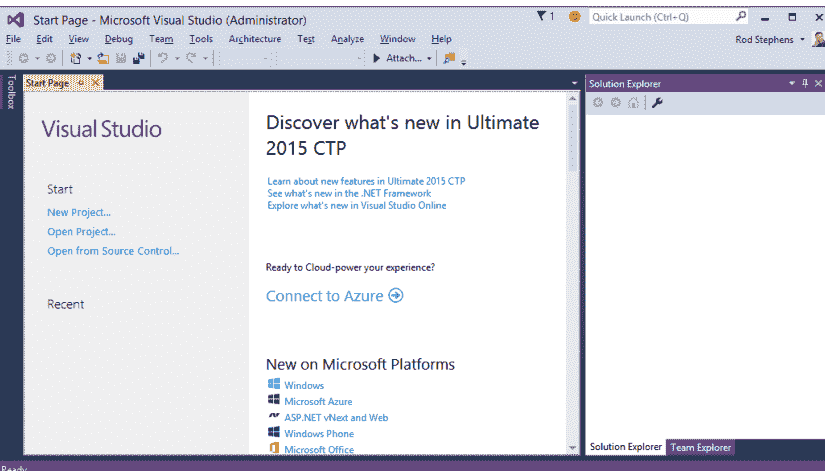

图 1-3

你可以使用左侧窗格中的链接创建新项目或打开现有项目。你也可以通过使用“文件”菜单、展开子菜单并选择“项目”来创建新项目。或者如果你急于创建第一个项目，只需按下 `Ctrl+Shift+N` 即可。

> 注意 在 Visual Studio 中，你通常有多种方法可以完成某项操作。你可以使用菜单命令、快捷键或工具栏按钮来完成相同的操作。通常我只会提到两种某两种操作方法（例如创建新项目），但你可能也会发现其他方法。

所有这些方法都会显示图 1-4 所示的“新建项目”对话框。展开左侧的 Visual C# 项目类型文件夹，并在右侧选择你要构建的项目类型的模板。对于本书的大部分内容，那将是一个 Visual C# Windows 表单应用程序。

## 构建你的第一个程序

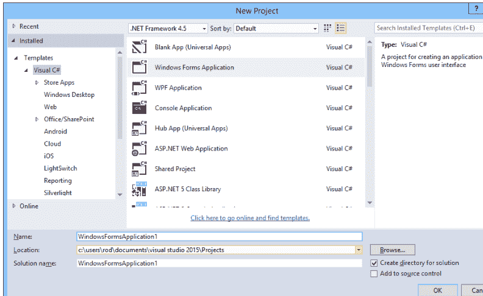

图 1-4

选择项目类型后，你需要输入几条信息：

- 名称——这是应用程序的名称。Visual Studio 会创建一个同名的文件夹来存放程序文件。它还将将此名称用于项目中的键值。
- 位置——这是你希望 Visual Studio 将项目文件夹放在的地方。
- 解决方案名称——如果勾选了“为解决方案创建目录”框（默认勾选），Visual Studio 会在你输入的位置创建一个以此命名的文件夹。它会将应用程序文件夹放在解决方案文件夹内部。

如果勾选了“为解决方案创建目录”框，你将获得如下的文件系统布局：

- 解决方案文件夹 (`SolutionFolder`)
- 解决方案文件 (`SolutionFiles`)
- 应用程序文件夹 (`ApplicationFolder`)
- 应用程序文件 (`ApplicationFiles`)

如果没有勾选“为解决方案创建目录”框，你将获得如下的文件系统布局：

- 应用程序文件夹 (`ApplicationFolder`)
- 应用程序文件 (`ApplicationFiles`)

> 注意 一个项目通常包含构成单个应用程序的文件。

一个解决方案可以包含多个项目。当你想要构建关联紧密的应用程序时，解决方案是非常有用的。例如，一个项目可以包含一个构建三维数据集的程序，另一个显示这些数据的程序，以及第三个允许你从不同视角打印它们的程序。

如果你想构建一个程序库加上一个测试该库的可执行程序，解决方案将特别有用。

我们在书中构建的应用程序是单程序，因此它们并不真的需要放在单独的文件夹中。大多数时候，我不取消勾选“为解决方案创建目录”框以保持我的文件系统简单。

> 注意 默认情况下，Visual Studio 将你的项目放在 `C:\Users\MyUserName\Documents\Visual Studio 2016\Projects` 文件夹中。以后在文件资源管理器中找到这些项目可能会困难（例如，为了进行复制）。

为了让创建项目变得更容易，请将位置设置为更直观的地方，如桌面或桌面上的文件夹。事实上，你可能想创建一个文件夹来存放本书的项目，并为每节创建一个子文件夹。

下次你创建新项目时，Visual Studio 将记住你上一次的选择，因此从现在起找到你的项目将变得很容易。

如果你在打开另一个项目时打开“新建项目”对话框，你可以快速从“文件”菜单的“最近的项目和解决方案”子菜单中重新加载它。你也可以通过使用资源管理器双击 `.sln` 文件从 IDE 加载解决方案。

在显示“新建项目”对话框并输入名称、位置和解决方案名称后，点击确定。结果应该如图 1-5 所示。

> 注意 如果你之前编辑过项目，可以快速从“文件”菜单的“最近的项目和解决方案”子菜单中重新加载它。你也可以通过使用资源管理器双击 `.sln` 文件从 IDE 加载解决方案。

本节的其余部分涉及 Visual Studio 中可用的功能，其中某些功能显示在图 1-5 中。在开始列举有用功能之前，打开“调试”菜单并选择“开始调试”。或者如果你赶时间，只需按下 `F5` 即可。

## 构建你的第一个程序

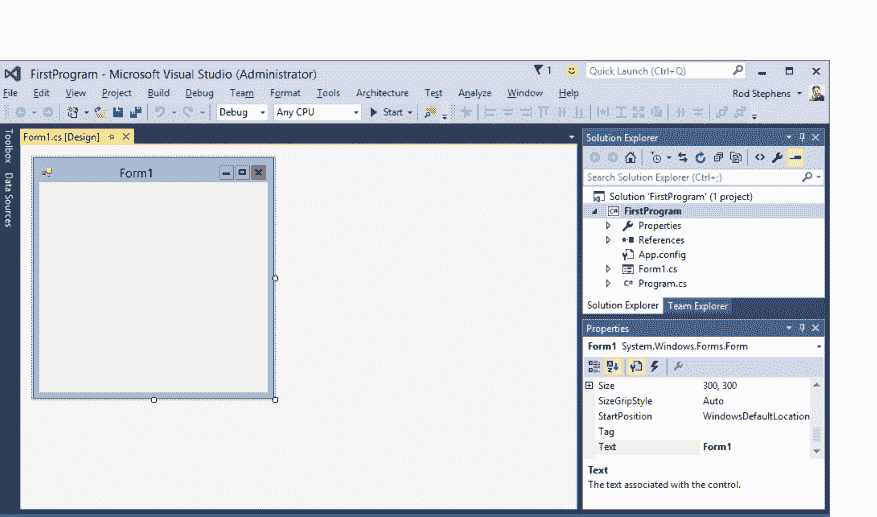

图 1-5

你的第一个程序应该像图 1-6 所示。诚然，这第一个程序并不华丽，但同样地，构建它并不需要做很多。你所做的只是 `Ctrl+Shift+N` 和 `F5`！

这个第一个程序看起来可能并不那么令人印象深刻，但后台有很多操作在运行。C# 构建了一个表单，包含许多有用功能，包括：


- 可调整大小的边框和可拖移动的标题栏。
- 右上角有效的最小化、最大化和关闭按钮。
- 左上角的系统菜单，包含可用的还原、移动、调整大小、最小化、最大化和关闭。
- 使用的能力。
- 其他行为。


图 1-6

实际上，这第一个程序并不华丽，但同样地，构建它并不需要做很多。你所做的只是 `Ctrl+Shift+N` 和 `F5`！

这个第一个程序看起来可能并不那么令人印象深刻，但后台有很多操作在运行。C# 构建了一个表单，包含许多有用功能，包括：

- 可调整大小的边框和可拖动的标题栏。
- 右上角有效的最小化、最大化和关闭按钮。
- 左上角的系统菜单，包含可用的还原、移动、调整大小、最小化、最大化和关闭。
- 使用的能力。
- 其他行为。

## 可执行文件

每当你在 IDE 中运行程序时，Visual Studio 会生成一个可执行文件，通常位于项目的 `bin\Debug` 子目录下。你可以通过在文件资源管理器中找到它并双击来运行它。

但这并不意味着该可执行文件可以在任何计算机上运行！如果你将其复制到另一台计算机，除非安装了 .NET Framework 运行时库，否则它无法运行。如果该计算机安装了 Visual Studio，你就没问题，否则你需要安装发行程序。

要安装这些库，请访问 Microsoft 下载页面 `www.microsoft.com/downloads` 并搜索 “.NET Framework distribution”。选择你正在使用的版本（如果你刚安装 Visual Studio，可能是最新版本）并在目标计算机上安装。

现在你可以将可执行文件复制到其他计算机并运行它们。

## 复制项目

有时你可能想复制项目。例如，你可能想保存当前版本并创建一个新版本进行尝试。或者你可能想把项目的副本给你的朋友或你的编程老师，以便他们告诉你哪些新会让程序退出。

你可能会在 Visual Studio 的“文件”菜单中看到“另存为”命令。不要被诱！那些命令复制的是单个文件，而不是整个项目。当你尝试打开其中一个文件时，你会发现 Visual Studio 找不到所需的所有其他部分，你将一无所有。

要正确地复制项目，你可以压缩整个项目目录或应用程序文件夹及其目录结构。或者，你可以压缩压缩文件。只需确保你复制的内容包含了项目的所有文件。

注意，如果你想节省空间，可以删除 `bin` 和 `obj` 子目录。这些目录包含 Visual Studio 创建和构建程序时，每当你需要时你都会重新创建它们。

你还可以删除 `.vs` 目录，它包含用户设置。遗憾的是，该目录默认是隐藏的，因此可能很难找到。让文件资源管理器显示隐藏文件，使用控制面板，点击“外观”，选择“文件夹选项”。在“查看”选项卡上，选择“显示文件、文件夹”，然后点击确定。现在你可以看到 `.vs` 目录并将其删除。

## 探索 IDE

> 注意：压缩项目非常有用，因为可以将它的所有文件都保留在一个包中。特别是，如果你需要通过电子邮件将项目发送给某人（例如，如果你通过邮件 `RodStephens@CSharpHelper.com` 向我寻求帮助），你可以删除 `bin`、`obj` 和 `.vs` 目录，压缩项目文件夹，并将包作为单个文件通过电子邮件发送。

如果你是作为作业的一部分将项目发送给老师，请重命名压缩后的文件，使其包含你的名字和作业名称；例如，`RodStephens6-1.zip`。

## 探索 IDE

Visual Studio IDE 包含大量的菜单、工具栏、窗口、向导、编辑器和其他组件，用于帮助你构建应用程序。其中一些组件，如解决方案管理器和属性窗口，你会在每次处理项目时都会使用。另一些组件，如断点和“连接到设备”对话框，则非常专业，你可能需要好几年后才会用到它们。

图 1-7 显示了加载了示例项目的 IDE，并标记了 IDE 最重要的部分。接下来的列表描述了这些部分。

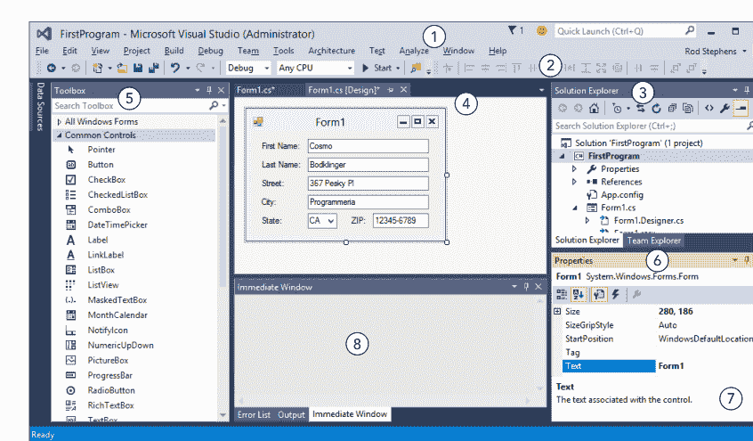

图 1-7

- 1. 菜单——菜单提供了各种实用的命令。具体可以使用哪些命令、哪些命令已启用、甚至哪些菜单是可见，取决于编辑区域 `#4` 中是什么种编辑器。某些特别实用的菜单包括文件（打开旧项目和创建新项目）、视图（查找窗口）、项目（向项目添加新表单）、调试（生成、运行和调试项目）以及格式（对齐表单上的控件）。
- 2. 工具栏——工具栏提供了执行与菜单中类似命令的快捷方式。使用“工具”自定义”来决定哪些工具栏是可见的。
- 3. 解决方案管理器——解决方案管理器列出了项目中的文件。其中最重要的之一是 `Form1.cm`，它定义了名为 `Form1` 的表单控件和代码。如果你在解决方案管理器中双击文件，IDE 会在编辑区域中打开它。
- 4. 编辑区域——编辑区域在相应的编辑器中显示文件。你通常会使用此区域来设计表单（在上面放置控件并设置属性）以及为表单编写代码，但你也可以使用此区域编辑其他文件，如文本文件、位图和图标。
- 5. 工具箱——工具箱包含你可以放置在表单上的控件和组件。选择一个工具，然后点击并将该工具的副本拖到表单上。注意工具箱将控件按选项卡（所有表单、常用控件、容器、菜单和工具栏等）进行分组，以便更容易找到你需要的控件。
- 6. 属性窗口——属性窗口允许你设置控件。点击表单设计器（显示在图 1-7 的编辑区域中）上的控件以选中它，或者点击并拖动以选择多个控件。使用属性窗口设置控件的属性。注意属性窗口显示了当前选中控件的名称（标签）和类型（`System.Windows.Forms.Label`）。图 1-7 中当前选中的属性是 `Text`，它的值为 `First Name:`。你将花费大量时间来处理属性。
- 7. 属性描述——属性描述会提醒你当前属性的用途。在图 1-7 中，它显示该属性提供了与控件关联的文本。（废话！）
- 8. 其他窗口——此区域通常包含其他窗口。底部的标签让你能够快速在不同窗口之间切换。

图 1-7 显示了一个相当典型的窗口布局，但 Visual Studio 极其灵活，所以你可以根据需要重新排列窗口。你可以隐藏或显示窗口，让窗口浮动或停靠在 IDE 的各个部分，让窗口成为 IDE 的一部分，让窗口在不需要时自动隐藏。如果你点击下拉箭头（▼）查看窗口标题栏的右侧（例如图 1-7 中的窗口），你会看到三个图标：下拉箭头（▼）、浮动（❐）和关闭（X）。会出现以下菜单：

- 浮动——窗口脱离它当前停靠的位置并浮动。要让它再次停靠，请打开主菜单并选择停靠。
- 停靠——窗口停靠在 IDE 的某些位置。
- 停靠为标签页——窗口变成标签页区域中的标签页，类似于 1-7 中的 `#8`。
- 自动隐藏——窗口缩小为附在 IDE 边缘的小标签，其图标变为侧向（※），表示窗口正在自动隐藏。如果你将鼠标悬停在标签上，窗口就会出现。它会保持在那里，但如果你将鼠标移动到展开的窗口上，它会再次自动隐藏（就像开灯时的蟑螂一样）。选择自动隐藏或点击侧向图标来关闭自动隐藏。
- 隐藏——窗口完全消失。要找回窗口，你需要在视图的某处查找。关闭自动隐藏有时就像是*固定*了窗口。

鼠标左侧的释放区域表示标签页区域。如果你将其释放到这种目标上，窗口将成为该区域的标签。

### 自定义模式

Visual Studio 允许你移动、停靠、浮动、隐藏、自动隐藏标签窗口。如果你有多个显示器，可以浮动窗口并移动到另一个显示器，从而获得更大的编辑区域。它非常灵活，可以像选举期间的政客一样呈现出许多面孔。

你可以根据需要自定义 IDE，但如果你这样做了，请记住你的 Visual 版本可能与书中的图片完全不同。为了减少困惑，你可能希望让 IDE 看起来尽可能像图 1-7，至少在你更好地了解哪些工具对你最有用之前。

## 尝试一下

在本次尝试中，你将为书中后续的工作做好准备。你定位了遇到问题或困难时可以使用网络资源。你创建并运行了一个程序，探索了项目的文件夹层次并复制了项目。你还可以对 IDE 进行一些实验，显示新的工具栏，移动窗口，并通地对 IDE 进行测试。

`www.it-ebooks.info`

> 注意：本节的“尝试一下（Try It）”和练习题解答并非全部都在书籍网站上提供。“尝试一下”和部分练习要求你对 IDE 进行实验，而不是生成一个完成的程序，因此实际上没有需要下载的内容。在随后的课程中，书籍网站将提供“尝试一下”和练习的示例解答。

## 课程要求

在本节中，你将：

- 查找并书签常用的网络资源。
- 启动 Visual Studio 并启动一个新的 Visual C# 项目。
- 通过显示调试工具栏、固定工具箱、显示输出窗口来对 IDE 布局进行实验。
- 运行程序。
- 找到程序的可执行文件，将其复制到桌面并在该处运行。
- 将项目文件夹复制到新位置并对副本进行修改。
- 压缩项目文件夹以进行备份。

> 注意：你可以从网站 `www.wrox.com/go/csharp24hourtrainer2e` 下载本节的代码和资源。

## 提示

- 当你创建新项目时，务必指定一个良好的位置，以便以后找到它。
- 在压缩项目之前，删除 `bin`、`obj` 和 `.vs` 目录以节省空间。

## 逐步步骤

### 查找并书签常用的网络资源

1. 打开你喜欢的网页浏览器。
2. 创建一个名为 C# 的新书签文件夹。（如果你不知道如何创建书签文件夹，请查看浏览器的文档）。
3. 访问以下网站并书签你喜欢的网站（也可以随意搜索其他网站）：
   - 我的 C# 帮助网站 (`www.CSharpHelper.com`)
   - 本书的网页 (`www.CSharpHelper.com/24hour.html`)
   - 本书的 Wrox 网页页（前往 `www.wrox.com` 并搜索 "C# 24-Hour Trainer, Second Edition"）
   - Visual C# 快速发版 MSDN 论坛 (`social.msdn.microsoft.com/Forums/en-US/Visualxpressvc/threads`)
   - Visual C# IDE MSDN 论坛 (`social.msdn.microsoft.com/Forums/en-US/csharpide/threads`)
   - Visual C# 语言 MSDN 论坛 (`social.msdn.microsoft.com/Forums/en-US/csharplanguage/threads`)
   - Visual C# 常用 MSDN 论坛 (`social.msdn.microsoft.com/Forums/en-US/csharpgeneral/threads`)
   - MSDN (`msdn.microsoft.com`)
   - Stack Overflow (`www.stackoverflow.com`)
   - Code Project (`www.codeproject.com`)

### 启动 Visual Studio 并从一个新的 C# 项目开始

1. 如果你没有 Visual Studio 的桌面或任务栏，请创建一个。例如，在 Windows 8 中，按照以下步骤操作：
   a. 打开 Charm区（Charms area），点击搜索，并输入 VS Express（或已安装版本的名称部分）。如果 Visual Studio 不在列表中，将搜索框的下拉列表设置为“所有位置（Everywhere）”。
   b. 在搜索结果中，右键点击程序并选择“固定到开始屏幕”或“固定到任务栏”。
2. 点击你固定到开始屏幕的磁贴或固定到任务栏的图标启动 Visual Studio。
3. 创建新项目。
   a. 按 `Ctrl+Shift+N` 或打开 IDE 的“文件”菜单，展开“新建”子菜单，并选择“项目”。
   b. 展开 Visual C# 项目类型文件夹并选择“Windows Forms 应用程序”模板。
   c. 输入项目名称和一个良好的、易于找到的位置，例如桌面或桌面上的名为“C# Projects”的文件夹。
   d. 取消勾选“创建解决方案目录”框。
   e. 点击确定。

### 通过显示调试工具栏、固定工具箱和显示输出窗口来对 IDE 布局进行实验

1. 打开“工具”菜单并选择“自定义”。在“自定义”对话框中，选择“工具栏”选项卡，并勾选调试工具栏旁边的复框。如果你喜欢，可以对其他工具栏进行实验。完成后关闭对话框。
2. 如果工具箱是自动隐藏的（在你第一次安装 Visual Studio 后它应该是这样的），将鼠标悬停在其上方直到它展开。点击大钉图标将其固定。
3. 要显示输出窗口，打开“视图”菜单并选择“输出”。抓取输出窗口的标题栏并四处拖动。将其移动到某些地方看看它落在何处。完成后，将其释放到图 1-7 所示 IDE 的底部。

### 运行程序

1. 按 `F5` 或点击“调试”菜单并选择“启动调试”。
2. 尝试表单的最小化、最大化、选择按钮，以及表单系统菜单中的命令。移动表单并调整其大小。惊讶地发现你甚至不需要编写任何代码！

### 找到程序的可执行文件，将其复制到桌面并在该处运行

1. 启动资源管理器并导航到你创建新程序时指定的位置。
2. 你应该会找到一个与程序同名的文件夹。打开它并检查里面的文件。注意 `.sln` 文件，你可以双击它在 Visual Studio 中重新打开解决方案。同样请注意 `bin`、`obj` 和 `.vs` 目录。
3. 进入 `bin` 目录并将其移动到子目录中。它包含几个文件，包括可执行文件，名称与程序相同，但扩展名为为 `.exe`。右键点击可执行文件并选择“复制”。
4. 右键点击桌面并粘贴。

### 将项目文件夹复制到新位置并对副本进行修改

1. 启动资源管理器并导航到你创建新程序时指定的位置。
2. 你应该会找到一个与程序同名的文件夹。打开它并检查里面的文件。注意 `.sln` 文件，你可以双击它在 Visual Studio 中重新打开解决方案。同样请注意 `bin`、`obj` 和 `.vs` 目录。
3. 进入 `bin` 目录并将其移动到子目录中。它包含几个文件，包括可执行文件，名称与程序相同，但扩展名为为 `.exe`。右键点击可执行文件并选择“复制”。
4. 右键点击桌面并粘贴。

### 压缩项目文件夹以进行备份

1. 启动资源管理器并导航到你创建新程序时指定的位置。
2. 你应该会找到一个与程序同名的文件夹。打开它并检查里面的文件。注意 `.sln` 文件，你可以双击它在 Visual Studio 中重新打开解决方案。同样请注意 `bin`、`obj` 和 `.vs` 目录。
3. 进入 `bin` 目录并将其移动到子目录中。它包含几个文件，包括可执行文件，名称与程序相同，但扩展名为为 `.exe`。右键点击可执行文件并选择“复制”。
4. 右键点击桌面并粘贴。

例如，`TextBox` 控件在屏幕上显示一个空白区域，用户可以在其中输入信息。控件内部的代码决定了控件如何绘制自身，并提供标准的文本框功能，如多行或单行行为；根据需要显示滚动区域和滚动条；复制、剪切和粘贴；当您右键点击控件时显示的右键菜单；用户按 Tab 键时的导航能力；等更多功能。

## 名称背后的含义？

按照惯例，在 C# 中，控件类型（以及类型）的名称使用帕斯卡命名法（Pascal casing），即多个单词组合在一起时，每个单词的首字母均大写；例如 `TextBox`、`ProgressBar`、`Button` 和 `PictureBox`。

除了控件外，C# 还提供了组件（components）。组件类似于控件，但它在表单上没有可见部分。例如，`Timer` 控件像时钟一样，允许程序按定期间隔执行某些操作。`Timer` 与程序交互，但不会向用户显示任何内容。（某些组件如 `ErrorProvider` 和 `ToolTip` 可能会在屏幕上显示可见效果，但组件本身在表单上是不可见的。）

控件（以及组件）的特征分为三类：属性（properties）、方法（methods）和事件（events）。

### 属性

属性决定控件的外观和大小。如果你有一个 `Car` 控件，它的属性可能是 `Color`（颜色）、`TransmissionType`（传输类型）、`CurrentSpeed`（当前速度）和 `NumberOfCupHold`（杯架数量）。你的程序可以将汽车的 `Color` 设置为 `HotPink`（以吸引其他驾驶者的注意），或将其 `CurrentSpeed` 设置为 `110`（以引起警察的注意）。

作为一个编程示例，`TextBox` 控件有一个 `Font` 属性用于确定它使用的字体，以及一个 `ForeColor` 属性用于确定其文本的颜色。

## 方法

方法是控件的一种特征，使控件执行某些操作。你的代码可以调用方法来触发某些动作。例如，`Car` 控件可能有 `Start`（启动）、`Stop`（停止）、`EjectPassenger`（弹出乘客）和 `OilSick`（漏油）等方法。你的程序可以调用 `OilSick` 方法让汽车从后面喷油，这样你就可以逃避苍蝇了。

作为一个编程示例，`TextBox` 控件有一个 `Clear` 方法可以清空控件的文本，以及 `AppendText` 方法可以将文本添加到控件当前显示的任何内容的末尾。

## 事件

当控件发生某些有趣的事情时，就会触发事件。控件会引发或触发事件以通知程序发生了某些事。例如，汽车可能有 `RanOutOfGas`（没油了）和 `Crashed`（碰撞了）事件。`Car` 控件会引发 `Crashed` 事件，告诉程序用户曾将它撞向了一棵树。程序随后可以采取行动，例如拨打救护车和树木医生。

作为一个编程示例，`TextBox` 有一个 `TextChanged` 事件，通知程序其文本已更改。当事件发生时，程序可以检查文本以查看用户是否输入了有效内容。例如，如果 `TextBox` 应该存储数字而用户输入了“One”，程序可以发出哔哔声并将 `TextBox` 的 `BackColor` 属性更改为黄色以指示错误。

后面的课程将更详细地讨论事件以及如何处理它们。本节侧重于向表单中添加控件、排列这些控件以及设置它们的属性。

## 创建控件

# # 第 1 节 Visual Studio IDE

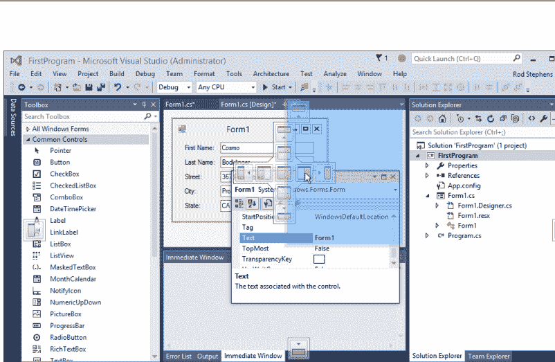

图 1-8


向表单中添加控件非常简单。它太简单了，而且向表单添加控件的方法有很多种，以至于很难描述所有方法。

首先按照第 1 节描述的方法创建一个新项目。在表单设计器（`Form Designer`）中打开表单。（如果表单尚未打开，请在解决方案资源管理器中双击它）。

以下列表描述了你可以将控件放在表单上的某些方法：

- 点击工具箱（`Toolbox`）中的一个工具以选择它。然后在表单上点击并拖动。当你松开鼠标时，`Visual Studio` 会你选择的区域创建控件，并选中工具箱中的指针。
- 点击工具箱中的一个工具以选择它。然后按住 `Ctrl` 键并在表单上拖动以在表单上放置控件。`Visual Studio` 在你选择的区域创建控件，并保持工具箱中的控件工具被选中，以便你可以继续创建另一个。
- 点击工具箱中的一个工具以选择它。然后双击工具以在表单上创建控件。`Visual Studio` 以默认的大小和位置创建控件的实例（你可能需要调整其大小和位置）。
- 选择表单上的多个控件，按住 `Ctrl` 键并拖动以在它们之间创建控件。
- 选择表单上的多个控件，按住 `Shift` 键并拖动以在它们之间创建控件。
- 选择表单上的多个控件，按住 `Alt` 键并拖动以在它们之间创建控件。
- 选择表单上的多个控件，按住 `Ctrl` 键并拖动以在它们之间创建控件。
- 在工具箱中选择一个工具，然后，按住 `Ctrl` 键并拖动以在它们之间创建控件。
- 选择一个控件，按下 `Esc` 键即可取消所有选择。
- 第一种方法（选择工具并拖动创建控件）可能最常用，但图 2-1 中的其他方法对于创建类似的控件组特别有用。

例如，图 2-1 中的表单显示了五行，每行都有一个 `Label` 和一个 `TextBox`。你可以轻松地构建这些控件，但通过复制和粘贴也可以。首先在表单上放置一个 `Label` 和 `TextBox`，将它们相邻放置，你可能想要为它们设置字体或颜色。现在点击并拖动这两个控件，属性窗口将显示它们共享的属性。注意 `Font` 属性右侧的省略号。点击该省略号，将出现图 2-3 所示的对话框。可以使用此对话框编辑字体属性。

## 设置控件属性

向表单添加控件后，你可以使用属性窗口查看并更改它们的属性值。如果你选择了多个控件，属性窗口将只显示它们共有的属性。

例如，如果你选择一个 `TextBox` 和一个 `Label`，属性窗口会显示 `Text` 属性，因为 `Label` 和 `TextBox` 都有 `Text` 属性。然而，它不会显示 `Multiline` 属性，因为 `TextBox` 有该属性而 `Label` 控件没有。

属性窗口为许多属性提供了特殊支持。例如，图 2-2 显示了选择 `TextBox` 时的属性窗口。注意 `Font` 属性包含子属性：`Name`、`Size`、`Unit`、`Bold` 等。点击属性旁边的加/减号可以展开或折叠它并显示或隐藏子属性。

许多属性只能持有某些值。例如，`Font` 的 `Italic`、`Bold`、`Strikeout` 和 `Underline` 子属性只能承载 `True` 或 `False` 值。`Font` 的 `Unit` 子属性只能承载 `Word`、`Pixel`、`Font`、`Inch` 和 `Millimeter`。在这些情况下，属性窗口提供了显示允许选择的下拉列表。

图 2-4 显示了当你点击 `TextBox` 的 `BackColor` 属性右侧的下拉箭头时属性窗口显示的内容。`Custom` 选项允许你从调色板选择颜色，`Web` 选项可以选择颜色，`System` 选项允许你选择系统颜色作为常规控件背景颜色或菜单高亮颜色。

通过使用属性窗口的编辑器以及在没有编辑器时输入值，你可以更改控件的外观和行为。

## 控件名称

每当你创建一个控件时，`Visual Studio` 会给它一个相当非脚本化的名称，例如 `label`、`TextBox5` 或 `pictureBox1`。虽然这些名称可以告诉你该控件是什么种对象，但它们并没有告诉你它的用途，而当你以后需要在代码中使用该控件时，用途要重要得多。像 `firstName`、`hatSizeTrackBar` 和 `mediaTypeComboBox` 这样的名称比 `textBox3` 和 `text7` 有意义得多。

注意，你不需要为每个控件命名，只需为你以后在代码中需要使用的控件命名。你不需要为 `Label`、`GroupBox` 以及其他装饰性的控件命名。

你可以在 `msdn.microsoft.com/library/ms22902.aspx` 上的“Guidelines for Names”（命名指南）网页上了解更多关于微软命名规范的内容。

### 名的含义（重申）

在本节课程开始时，我提到控件名称使用帕斯卡命名法（`Pascal Casing`）。根据惯例，控件特定实例的名称使用驼峰命名法（`camel casing`），即将多个单词连接在一起，除了第一个单词外，每个单词的首字母都大写。例如，控件 `TextBox` 使用的是帕斯卡命名法，而特定名称 `firstNameTextBox` 使用的是驼峰命名法。

它之所以被称为驼峰命名法，是因为它看起来像一只趴卧的骆驼：两端较低，中间有一个或多个驼峰。`IateLabel` 会是一单峰骆（dromedary），`priceTextBox` 会是双峰骆（Bactrian），而 `numberOfEmployeesCoveredByInsurancePlanTrackBar` 可能是苏斯博士（Dr. Seuss）创造的一些骆驼之一。

### 名含义（第 3 部分）

大多数 C# 开发人员会在控件名称后添加后缀，例如 `firstNameTextBox` 或 `resultLabel`，但开发者使用更通用的词作为值（value）或字段（field）也正变得越来越普遍。这种做法的想法是，如果你决定更改处理该值的控件类型，就不需要更改引用该控件的代码。

例如，假设你的程序使用 `TrackBar` 来让用户选择购买的 UFO 数量。如果你将此控件命名为 `numUfoDetectorsValue`，那么当你决定让用户从 `NumericUpDown` 控件而不是 `TrackBar` 选择值时，就不需要更改代码。

有些开发者甚至完全省略了后缀，直接使用 `numUfoDetectors`，尽管如果你需要多个控件来表示相似的概念，或者如果你在控件内部需要一个变量来存储该控件所表示的数值，这可能会引起困惑。

目前，我建议你坚持控件的完整类型名称作为后缀。

## 常用属性

随着学习，你将学习关键的控件属性，但现在表 2-1 汇总了一些最有用的属性。注意，并非所有控件都具有所有属性。例如，`Button` 不能显示边框（或者根据你的观点，它始终显示边框），因此它没有 `BorderStyle` 属性。

### 表 2-1

| 属性 | 目的 |
| --- | --- |
| `Anchor` | 决定控件如何调整大小以使用可用空间。该属性将在第 3 节中进一步描述。 |
| `AutoSize` | 决定控件是否自动调整大小以适应其内容。这可以是 `True` 或 `False`。默认情况下，`Label` 的 `AutoSize` 出生为 `True`。 |
| `BackColor` | 决定控件的背景颜色。 |
| `BackgroundImage` | 决定控件显示的图像。 |
| `BorderStyle` | 决定控件是否显示边框。可以是 `None`、`FixedSingle` 或 `Fixed3D`。 |
| `Dock` | 决定控件如何调整大小以使用可用空间。该属性将在第 3 节中进一步描述。 |
| `Enabled` | 决定控件是否会与你交互。许多控件在禁用时会显示特殊外观，例如变灰。可以是 `True` 或 `False`。 |
| `Font` | 决定控件用于显示文本的字体。 |
| `ForeColor` | 决定控件的前景颜色。对于显示文本的控件，这通常是文本的颜色。 |
| `Image` | 决定控件显示的图像。（某些控件有 `Image`，另一些有 `BackgroundImage`，极少数的既没有也无法显示任何图像。没有人能说得完全如此！） |
| `Items` | 对于 `ListBox` 和 `ComboBox` 等控件，这是用户可以选择的项目列表。 |
| `Location` | 给出控件相对于其容器左上角的位置（目前假设在表单中）。`Location` 包含 `x` 和 `y` 子属性。例如，值 `(10,20)` 表示控件距离表单左边缘 10 像素，距离顶边缘 20 像素。 |
| `Name` | 给出你的代码可以用来引用控件的控件名称。你总是会为代码中引用的任何控件起一个好名字。 |

### 表 2-1（续）

| 属性 | 目的 |
| --- | --- |
| `Size` | 给出控件的像素宽度和高度。例如，值 `(75, 30)` 表示控件宽 75 像素，高 30 像素。 |
| `Tag` | 此属性可以包含任何你想与控件关联并存储的值。例如，你可以在某些按钮的 `Tag` 属性中放置文本或数字，以便控件轻松识别这些按钮。 |
| `Text` | 许多控件都有 `Text` 属性，决定控件显示的内容。对于 `Label` 和 `TextBox`，`Text` 决定它们显示的文本（显而易见）。对于 `ComboBox` 和 `ListBox` 等控件，`Text` 决定控件当前的选择。对于 `Form`（从意义上说是另一种控件），`Text` 决定标题栏中显示的内容。 |
| `TextAlign` | 决定文本在控件内的对齐方式。 |
| `Visible` | 决定控件是否可见。可以是 `True` 或 `False`。将其设置为 `False` 可对用户隐藏。 |

如果你练习了这些属性，创建一个新项目并尝试一下。创建一个按钮并设置其 `Text` 属性。点击表单并设置其 `Text` 属性。更改表单的 `Font` 属性，看看表单及其包含的内容发生了什么。如果你喜欢，可以尝试其他属性，如 `Image` 和 `ForeColor`。

## 在代码中修改属性

本节还没有真正处理控件事件（那是第 4 节的主题），但我不想解释如何在代码中设置属性，因为你需要事件处理器来实现。

要为控件创建一个简单的事件处理程序，请双击设计器中的控件。这将打开代码编辑器并为控件的默认事件创建一个空的事件处理程序。

以下代码显示了 `MoveButton` 示例程序（该程序可在书籍网站的课程下载中获取）如何在点击按钮（`Button`）时更改多个标签（`Label`）属性：

## 排列控件

表单设计器（`Form Designer`）提供了几个工具帮助在设计时排列控件。以下章节描述了一些最实用的工具：吸附线（snap lines）、方向键、表单菜单和布局工具栏。

### 吸附线 (Snap Lines)

当你在表单上拖动控件时，表单设计器会显示吸附线，用于显示控件如何与表单或其他控件对齐。图 2-5 显示了表单设计器显示的蓝色吸附线，表示控件距离表单的顶部和左边缘为标准距离。

你可以将控件拖离此位置，如果你这样做，吸附线就会消失。当你将控件拖靠近表单的某个边缘时，控件将跳转到标准距离，表单设计器会显示吸附线。

表单设计器通过显示吸附线展示控件的对齐情况。在图 2-6 中，我将第二个按钮拖到了第一个按钮下方。不同的吸附线显示：

- 第二个按钮距离表单的左边缘为标准距离。
- 第二个按钮的左边缘和右边缘与第一个按钮对齐。
- 第二个按钮位于第一个按钮下方的标准距离处。

其他的吸附线显示了控件之间的连接关系。在图 2-7 中，吸附线显示标签（`Label`）距离第二个按钮为标准距离，且标签的基线与第二个按钮的基线对齐。

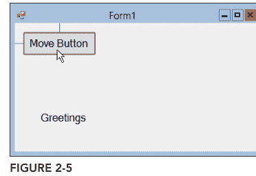

图 2-5

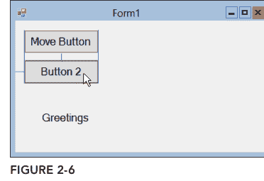

图 2-6

为了一个更真实的例子，请参考图 2-8。在图中，我正在布局一个小数据输入表单，我希望所有的标签（`Label`）和文本框（`TextBox`）都能完美对齐。在图中，吸附线显示该 `TextBox` 与另一个 `TextBox` 在左侧和右侧对齐，距离上方和下方的 `TextBox` 为标准距离，距离表单的右边缘为标准距离，且其基线与街道标签（Street Label）对齐。

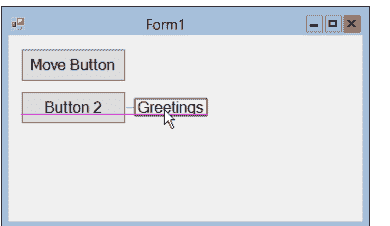

图 2-7

### 方向键 (Arrow Keys)

在用鼠标绘制控件时，你可以通过按方向键移动控件。选择一个或多个控件并使用左、右、上、下方向键每次移动一个像素移动控件（们）。这种方法比使用鼠标慢，但能给你提供更精细的控制。

当你使用方向键移动控件时，表单设计器不会显示吸附线，因此你可能需要关注属性窗口（Properties window）中控件的 `Location` 属性以查看它的位置。

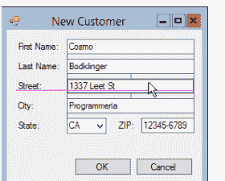

图 2-8

### 格式菜单和布局工具栏

格式菜单（Format menu）包含许多排列一个或多个控件的命令。表 2-2 汇总了表单菜单的子菜单。

表 2-2

| 子菜单 | 命令 |
| :--- | :--- |
| 对齐 (`Align`) | 将一组控件按左、中、右、顶、底或中心对齐。 |
| 尺寸 (`Make Size`) | 使控件具有相同的宽度、高度或两者。 |
| 水平间距 (`Horizontal Spacing`) | 调整控件之间的水平间距。它可以使控件之间的空间相等、更小、更大或为。 |
| 垂直间距 (`Vertical Spacing`) | 在容器中操作。如果控件在 `Panel` 或 `Group` 等容器内，这些命令会将控件在容器内而非表单内。 |
| 顺序 (`Order`) | 这些命令将控件发送到堆叠顺序的前部或底部。如果你有重叠或隐藏的控件，这非常有用。 |

布局工具栏包含与格式菜单相同的命令，但在方便的工具栏中更易使用。按钮上的小图标显示了它们如何对齐控件。

> 注意：这些排列控件的方式取决于你如何选择控件。所选控件中的一个（通常是你选择的第一个）是该组的主导控件。主导控件的角部用白框标记，而其他控件用黑框标记。

当你使用排列工具时，主导控件决定了其他控件的排列方式。例如，如果你选择格式 ⌘ 对齐 ⌁ 左侧（`Align-Left`），其他控件将移动，使它们的边缘与主导控件的左边缘对齐。

要更改所选组中的主导控件，点击你想成为主导的控件（不要按住 `Ctrl` 或 `shift` 键）。

### WPF 控件

`WPF` 应用使用自己的一套控件，其中某些与 Windows Forms 应用使用的控件相似。Windows 版 `Visual Studio` 允许你创建与 Windows Forms 应用大致相同的 `WPF` 应用。它们都提供了一个可以通过点击拖拽创建控件的编辑器，以及一个可以设置控件属性的属性窗口。

一个很大的区别是，`Visual Studio` 还为 `WPF` 应用显示 `XAML` 代码编辑器。`XAML` 代表“eXtensible Markup Language”（可扩展标记语言），通常读作“xamel”，是 `Visual Studio` 用于定义用户界面的语言。有时，直接编辑 `XAML` 比使用编辑器更容易。现在，你应该从这里开始。

## 尝试一下 (TRY IT)

在此，你需要：

- 创建一个新项目。
- 将控件添加到表单中。
- 将它们排列对齐。
- 使用属性窗口设置属性。

## 要求 (Requirements)

在本课程中，你将：

- 创建一个标签（`Label`）和一个文本框（`TextBox`）。
- 将它们排列对齐。
- 使用属性窗口设置属性。
- 使用属性窗口设置表单标题。
- 注意表单具有边框。

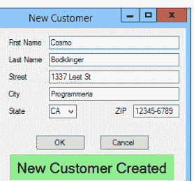

图 2-9

## 步骤 (Step-by-Step)

1. 创建一个名为 `NewDialog` 的新项目。
2. 使用属性窗口将表单的 `FormBorderStyle` 设置为 `FixedDialog`。
3. 使用属性窗口将 `Text` 设置为 `Customer`。
4. 创建 `FirstName TextBox`。
   a. 点击工具箱中的 `TextBox` 工具，然后点击拖拽放置 `TextBox`。
   b. 将 `TextBox` 拖到表单的右上角，直到吸附线显示它距离顶部和右边缘为标准距离。
5. 创建 `FirstName Label`。
   a. 点击工具箱中的 `Label` 工具，然后点击拖拽创建 `Label`。
   b. 将 `Label` 拖到表单的左上角，使吸附线显示 `Label` 距离表单左边缘为标准距离，且基线与 `TextBox` 的基线对齐。
   c. 为了确定 `Label` 的宽度，你需要设置它。使用属性窗口将 `Label` 的 `Text` 设置 `First Name`。
   d. 点击 `TextBox`。点击 `TextBox` 左侧的手柄并拖动，直到它距离 `Label` 为标准距离。
6. 复制 `Label` 和 `TextBox`。
   a. 点击并拖拽选择该 `Label` 和 `TextBox`。
   b. 按 `Ctrl+C` 复制控件。然后按 `Ctrl+V` 粘贴控件的新副本。
   c. 选中新控件后，点击并拖动 `TextBox`，直到吸附线显示它距离上方的 `TextBox` 以及表单右边缘为标准距离。
   d. 使用属性窗口将新 `Label` 的 `Text` 属性设置为 `Last Name`。
   e. 重复此操作四次（使用相应的 `Text` 值），直到你有五行标签和文本框。
7. 创建 `ZIP Label`。
   a. 将底部 `TextBox` 的 `Text` 属性设置为 `12345-6789`。然后使用 `TextBox` 的左侧拖放调整大小，使其大一点（见图 2-9）。
   b. 为 `ZIP` 代码创建一个 `Label`，并将其 `Text` 属性设置为 `ZIP`。拖动它，直到吸附线显示其基线与该行的 `Label` 和 `TextBox` 的基线对齐，且距离 `TextBox` 左侧为标准距离。
   c. 使用属性窗口将 `TextBox` 的 `TextAlign` 属性设置为 `Right`。
8. 创建状态组合框（`ComboBox`）。
   - a. 使用工具箱创建一个 `ComboBox`。将其 `Text` 属性设置为 `WW`，并调整其大小使其能够恰当地显示文本。


- b. 拖动 `ComboBox`，使对齐线显示其基线与该处的标签（`Labels`）对齐，并且其边缘与上方文本框（`TextBoxs`）的左边缘对齐。

- c. 选中 `ComboBox`，在属性窗口中点击右侧的省略号 `...` 按钮打开字符串编辑器。输入 `CO`、`AZ`、`WY`、`UT` 以及任何你想要使用的其他州缩写，然后点击 `OK`。（如果你想输入 `Confusion` 和 `Denial`，则需要将 `ComboBox` 调宽。）

- d. 使用属性窗口将 `DropDownStyle` 设置为 `DropList`。

> 注意：`DropDownStyle` 会让 `ComboBox` 显示一个允许用户输入的文本 `TextBox` 以及下方一个供用户进行选择的列表。`DropDown` 值会让 `ComboBox` 显示一个允许用户输入的文本 `TextBox` 以及一个点击可以显示下拉列表的下拉箭头。`DropList` 值与 `DropDown` 类似，不同之处是用户只能从下拉列表中选择，而不能输入新值。`DropList` 通常是最佳选择因为它因为它防止用户输入无效值。

## 9. 创建按钮（Buttons）。

- a. 双击工具箱中的 `Button` 工具两次，创建两个标准尺寸的按钮。

- b. 拖动一个按钮使其位于文本框下方一段距离。拖动另一个按钮使其与第一个垂直对齐，将其放置在侧面的某些距离处（具体距离并不重要）。

- c. 点击并拖动选择两个按钮。将格式设置为水平排列（`Format To Horizontally`）。

- d. 使用属性窗口为按钮设置 `Text` 值为 `OK` 和 `Cancel`。

## 10. 使用 ComboBox 创建结果标签（Result Label）

现在不必担心它的大小和位置。只需将其放置在图 2.9 所示的位置即可。

### 为关键控件命名。

- 1. 为表 2-3 所示的按键控件命名。你不需要为其他控件命名，因为程序不需要引用它们。（实际上，这个示例也没有引用文本框或组合框，但真实的程序肯定会引用。一个表单不会包含你用不到文本框和组合框。）

### 表 2-3

| 控件 | 名字 |
| --- | --- |
| 名字文本框 | `firstNameTextBox` |
| 姓文本框 | `lastNameTextBox` |
| 街道文本框 | `streetTextBox` |
| 城市文本框 | `cityTextBox` |
| 状态组合框 | `stateComboBox` |
| 邮编文本框 | `zipTextBox` |
| OK 按钮 | `okButton` |
| 取消按钮 | `cancelButton` |
| 结果标签 | `resultLabel` |

在设计时为结果标签（图 2.9 底部）设置属性，使标签：

- 显示文本。

  1. 将标签的 `TextAlign` 属性设置为 `MiddleCenter`。（使用 Windows 居齐编辑器选择中间位置。）

  2. 将标签的 `AutoSize` 属性设置为 `False`。

  3. 将标签的 `Size` 属性设置为 `218, 37`。（或者展开 `Size` 属性并分别设置 `Width` 和 `Height` 子属性。）

  4. 使用格式或布局工具栏将标签在表单上居中。

- 显示边框。

  1. 将标签的 `BorderStyle` 设置为 `Fixed3D`。

- 使用 16 点字体。

  1. 展开属性中的 `Font` 条目。将 `Size` 子属性设置为 `16`。

- 在用户点击其中一个按钮之前保持隐藏。

  1. 将标签的 `Visible` 属性设置为 `False`。

- 将 OK 按钮设置为表单的默认按钮，以便用户按下 Enter 键触发。将取消按钮设置为表单的取消按钮，以便用户按下 Esc 键触发。

  1. 点击表单，使用属性窗口将表单的 `AcceptButton` 属性设置为 `okButton`。

  2. 同样，将表单的 `CancelButton` 属性设置为 `cancelButton`。

### 在 OK 按钮后部编写代码，按图 2.9 所示显示带有绿色背景的结果标签。

- 1. 双击 `OK` 按钮为其 `Click` 事件创建事件处理程序。

- 2. 在以下代码中输入文本，使事件处理程序如下：

```csharp
// 创建新客户。
private void okButton_Click(object sender, EventArgs e)
{
    resultLabel.Text = "New Customer Created";
    resultLabel.BackColor = Color.LightGreen;
    resultLabel.Visible = true;
}
```

### 在取消按钮后部编写代码，显示带有亮粉色背景和文本“Operation Canceled”的结果标签。

- 1. 双击取消按钮为其 `Click` 事件创建事件处理程序。

- 2. 在以下代码中输入文本，使事件处理程序如下：

```csharp
// 不要创建新客户。
private void cancelButton_Click(object sender, EventArgs e)
{
    resultLabel.Text = "Operation Canceled";
    resultLabel.BackColor = Color.HotPink;
    resultLabel.Visible = true;
}
```

现在运行程序并进行实验。注意当焦点位于 `TextBox` 时按下 Enter 和 Esc 键会发生什么。查看焦点位于其中一个按钮会发生什么。

## 练习题

- 1. [游戏] 构建一个与图 2-10 所示类似的棋盘。（提示：使用 `Picture` 代替 `Label`。将 `SizeMode` 属性设置为 `AutoSize`）。

- 2. [游戏, WPF] 使用 WPF 重复练习 1。（提示：使用类似 `moveLabel.Margin = new Thickness(20, 0, 0)` 的代码设置标签的位置）。

- 3. [游戏] 一个与图 2-11 所示类似的井字游戏。（提示：使用 `Picture` 代替 `Label`。将 `SizeMode` 属性设置为 `Zoom`）。

- 4. [游戏, WPF] 使用 WPF 重复练习 3。（提示：在 `Canvas` 内部放置九个 `Border`）。

- 5. [游戏] 修改练习 3 中的井字游戏，使每个方格不再显示 X 或 O，而是使用你喜欢的足球、猫或狗等任何东西。（提示：在 `Click` 事件处理程序中设置相应 `TextBox` 的 `Image`）。

- 6. [WPF] 使用 WPF 重复练习 5。（提示：使用 `Image` 代替大型 `Label`。使用两个 `Visibility = Hidden` 的图像。在事件处理程序中，使用类似 `targetImage.Source = oImage.Source` 的代码）。

- 7. 创建一个带有“Move Me”标签和四个位于 `(0, 0)`、`(200, 0)`、`(0, 200)` 和 `(200, 200)` 按钮的程序。通过设置 `Left` 和 `Top` 属性使每个按钮移动标签到相应的位置。

- 8. [WPF] 使用 WPF 重复练习 7。（提示：使用类似 `moveLabel.Location = new Point(x, y)` 的代码设置标签的位置）。

- 9. 构建一个与图 2-12 所示类似的主界面。（提示：从程序中复制并粘贴 `Label` 和 `TextBox`。要设置 `TextBox`，在属性窗口中点击 `Image` 属性旁边的省略号。在选择资源对话框中，点击 `Import` 并浏览选择图片。最后，将图像的 `SizeMode` 属性设置为 `AutoSize`。）

- 11. [WPF] 使用 WPF 应用程序重复练习 10。

- 12. 构建与图 2-13 所示类似的表单。（不用担心程序执行任何计算。你稍后会学习如何这样做。）

- 13. [WPF] 使用 WPF 应用程序重复练习 12。

- 14. 构建与图 2-14 所示类似的表单。（在互联网上搜索“labeled diagram”并选择一张感兴趣的图片。使用画画或其他图像编辑程序删除标签。然后在原标签的位置添加 `TextBoxes`，以便用户填写内容。）

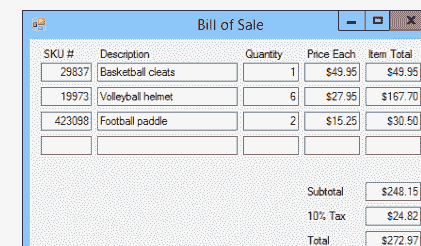

图 2-13

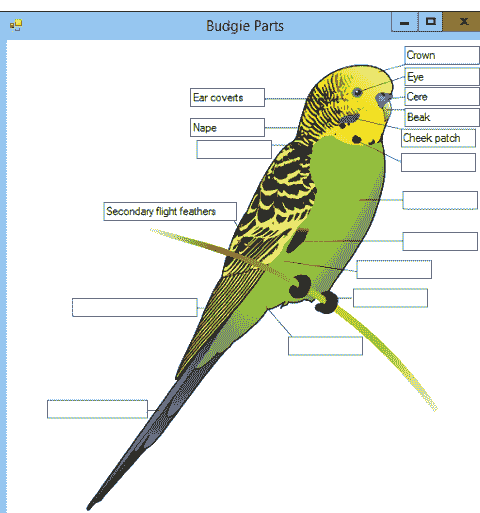

图 2-14

- 15. [WPF] 使用 WPF 应用程序重复练习 14。

- 16. 构建与图 2-15 所示类似的柱状图。（提示：使用 `PictureBox` 作为图表的背景，使用 `Labels` 作为柱状体。）

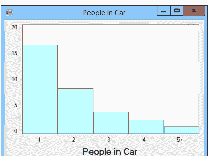

图 2-15

- 17. [WPF] 使用 WPF 应用程序重复练习 16。为图表背景设置渐变色，并使用横向标签为 Y 轴标记，内容为“Occurrences”。

- 18. 构建与图 2-16 所示类似的柱状图。（提示：使用 `PictureBoxes` 设置柱状体。）

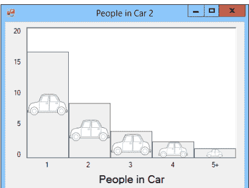

图 2-16

- 19. [WPF 难阶] 使用 WPF 应用程序重复练习 18，但使用带有小汽车图片的 tile brush 填充柱体的 `Image` 控件。设置画刷的 `TileMode = Tile` 且 `Stretch = None`。使用 XAML 编辑器在画刷定义内部添加代码 `Viewport="0,0,.55,.27" ViewUnits="Absolute"`。结果应该是由小汽车图片铺成的柱体。

- 20. 修改你为练习 18 创建的程序，为柱状体添加工具提示。（在标签上添加一个名为 `peopleToolTip` 的 `ToolTip` 控件。然后使用属性窗口为柱状体标签设置“ToolTip on peopleToolTip”属性。例如，第二个柱状体的工具提示应显示“2 people”。）

[WPF] 使用 WPF 应用程序重复练习 20。（提示：在 WPF 中，你不需要使用 `ToolTip` 控件。只需设置柱体的 `ToolTip` 属性即可。）

构建一个与图 2-17 所示类似的 WPF 程序。（提示：对于反射文字，使用 `Label`。将其 `Foreground` 画刷的颜色从中灰色渐变到浅灰色。在 `Transform` 属性中，将 Y 方向的缩放设置为 -1，并将 X 方向的倾斜设置为 30。）

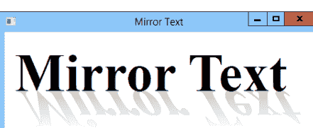

[游戏] 创建一个名为 `MovingButton` 的程序。创建一个名为 `clickMe` 显示为“Click Me”的 `Button`。在表单上添加一个名为 `moveButtonTimer` 的 `Timer`，并将其 `Interval` 属性设置为 500。

接下来，双击 `Timer` 打开其 `Tick` 事件的代码，并添加加粗文本，使事件处理程序看起来如下所示：

```
Random Rand = new Random();
private void moveButtonTimer_Tick(object sender, EventArgs e)
{
    clickMeButton.Left = Rand.Next(0, 250);
    clickMeButton.Top = Rand.Next(0, 250);
}
```

接下来，双击 `Button` 并在代码中添加加粗文本以创建事件处理程序：

```
private void clickMeButton_Click(object sender, EventArgs e)
{
    moveButtonTimer.Enabled = !moveButtonTimer.Enabled;
}
```

运行程序并尽得乐趣吧！尝试 `Timer` 的 `Interval` 属性的不同值，例如 2000 和 10。

> 注意 请在线选择第 2 课的视频。

使用 `Anchor` 属性，你可以解决图 3-2 所示的问题。表 3-1 列出了控件使用的 `Anchor` 属性值，以便它们利用表单的可用空间。

### 表 3-1

| 控件 | ANCHOR 属性 |
| --- | --- |
| `listBox` | Top, Bottom, Left |
| `detailsGroupBox` | Top, Bottom, Left, Right |
| `titleTextBox` | Top, Left, Right |
| `authorTextBox` | Top, Left, Right |
| `isbnTextBox` | Top, Left, Right |
| `urlLinkLabel` | Top, Left, Right |
| `coverPictureBox` | Top, Bottom, Right |

现在当表单调整大小时：

- List（列表）垂直拉伸以匹配表单的高度。

- `GroupBox` 在垂直和水平方向拉伸，以尽可能使用表单的宽度和高度。

- `TextBox`（文本框）和 `LinkLabel` 在水平方向拉伸，在保持 `GroupBox` 内部的同时尽可能宽。

- `Picture`（图片）随着 `GroupBox` 的右边缘移动，从而为左侧的 `TextBox` 和 `LinkLabel` 留出尽可能多的空间。它在 `GroupBox` 内部也会尽可能地垂直拉伸。

图 3-5 显示了结果。现在 `List` 足够大可以显示所有项目，`LinkLabel` 也足够大可以显示整个 URL。

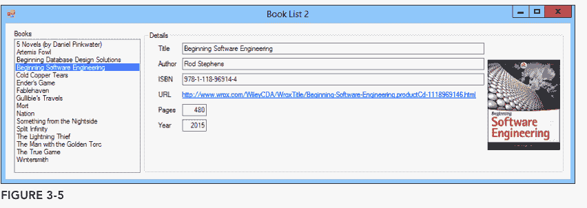

## 图 3-5

## 使用 Dock 属性

注意，当表单调整大小时，`TextBox` 和 `LinkLabel` 并没有水平拉伸；它们是在包含它们的 `GroupBox` 拉伸时扩展。在这个示例中，当表单拉伸时，`GroupBox` 拉伸，随后 `TextBox` 和 `LinkLabel` 拉伸，因此结果是相同的。

## 使用 DOCK 属性

`Anchor` 属性可以处理你的任何布局需求，但某些 `Anchor` 值的组合非常常见，因此 C# 提供了另一个属性让你轻松处理这些情况：`Dock`。`Dock` 属性允许让控件附加到容器的某个边缘。

例如，菜单通常会拉伸表单的顶部。你可以通过设置菜单的 `Anchor` 属性为 `Top, Left, Right` 来提供这种行为，但 `Dock Top` 更加简单。

`Dock` 属性可以接受六个值之一。`Left`、`Right`、`Top` 和 `Bottom` 将控件附加到容器的相应边缘。`Fill` 让控件占据其他控件设置了 `Dock` 属性后留下的任何空间。`None` 则断开控件，让其 `Anchor` 属性接管。

> 注意：如果 `Label` 或 `ListView` 等控件的 `AutoSize` 为 `True`，`Dock` 属性无法调整该控件的大小。

`Dock` 属性根据控件在表单上的堆叠顺序，按照“先来后到”顺序处理定位请求。换句话说，它对第一个绘制的控件进行定位。第二个控件在剩余任何空间中定位。第三个控件在剩余空间中定位，依此类推。

通常，堆叠顺序由将控件添加到表单的顺序决定的，但你可以通过右键点击控件并选择“置于顶”（`Bring to Front`）或“置于底层”（`Send Back`）来更改顺序。如果你正在处理一组复杂的 `Dock` 属性且堆叠顺序乱了，删除所有控件并从头开始通常更简单。

图 3-6 显示了一个具有停靠 `Label`（`AutoSize = False`）的表单。控件 `Text` 属性中的数字给出了它们被创建的顺序，这也是它们的堆叠顺序。

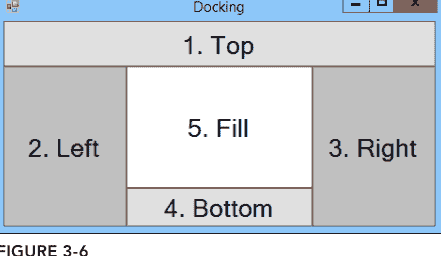

www-it-ebooks.info

列表解释了表单空间是如何分配给各个 `Label` 的：

- 1. 第一个 `Label` 的 `Dock = Top`，因此它占据了表单顶部宽度。

- 2. 第二个 `Label` 的 `Dock = Left`，因此它占据了剩余区域（第一个 `Label` 定位后）的左边缘。

- 3. 第三个 `Label` 的 `Dock = Right`，因此它占据了剩余区域的右边缘。

- 4. 第四个 `Label` 的 `Dock = Bottom`，因此它占据了剩余区域的底部。

- 5. 最后一个 `Label` 的 `Dock = Fill`，因此它填充了所有剩余区域。

### 停靠菜单

在一个典型的停靠场景中，表单包含一个 `Dock = Top` 的 `MenuStrip` 和一个 `Dock = Fill` 的容器（如 `Panel`），以便占据表单的其余部分。所有其他控件都放在 `Panel` 内部。你还可以添加 `ToolStrip`、`ToolStripContainers` 和 `StatusBars`，并根据相应的 `Dock` 属性将这些控件放置在正确的位置。图 3-7 显示了一个包含 `MenuStrip (Dock = Top)`、包含两个 `ToolStrip` 的 `ToolStripContainer (Dock = Top)`、`StatusStrip (Dock = Bottom)` 和 `Panel (Dock = Fill)` 的表单。我将 `Panel` 的颜色调深了一点，以便看出它在哪里。


图 3-7

### 布局容器

Visual Studio 提供了多种控件，以不同的方式排列它们包含的子控件。例如，WPF `grid` 控件可以排列控件。

以下章节总结了 Windows Forms 和 WPF 程序的布局控件。

### Windows Forms 控件

Windows Forms 仅使用少数布局控件。列表总结了 Windows Forms 的布局控件：

- `TableLayoutPanel`：按行和列排列子控件的容器。

- `FlowLayoutPanel`：按水平或垂直流排列子控件的容器。

- `Panel`：允许将控件分组在一起的容器。

- `GroupBox`：允许带有标题分组控件的容器。

### WPF 控件


WPF 程序的排列哲学与 Windows Forms 不同。列表总结了一些实用的容器控件：

- `Canvas`：允许在特定坐标定位控件的控件。
- `DockPanel`：允许将控件停靠在区域边缘的容器。
- `Grid`：按行和列排列控件的容器。
- `StackPanel`：以垂直或水平堆叠方式排列子控件的容器。
- `WrapPanel`：排列控件并在必要时将其换行到下一行的容器。

例如，为了创建一个类似于图 3-5 所示的布局，你可以使用一个定义了两列的 `Grid`。左列可以包含一个带有 `Label` 和 `ListBox` 的 `StackPanel`。右列可以包含第二个 `Grid`。

### 自动布局

> 注意：你可以点击 `Grid` 的边界来定义行和列，但在 XAML 代码编辑器编辑它们更容易。例如，这可以让你轻松使行完全相同。

将行或列的大小设置为 `*` 以使用其他行或列占据的空间。如果多个行/列具有大小，它们将划分可用空间。例如，如果一行的高度为 `*`，另一行的高度为 `2*`，则第一行占据可用空间的三分之一，第二行占据三分之二。

## 尝试

在此练习中，你通过构建图 3-8 所示的应用程序来练习使用 `Anchor` 和 `Dock` 属性。


图 3-8

当窗口调整大时，`TextBox` 和 `LinkLabel` 会水平方向拉伸，而 `PictureBox` 会垂直方向拉伸。注意图 3-8，封面图是窄的而不是宽的。当 `PictureBox` 变高时，它可以显示更大版本的封面图。控件会在不失真的情况下尽可能大地显示图像。

请注意，你构建的程序实际上不会做任何事情，除了在表单调整大时保持美观并调整控件大小之外。要让程序能够响应列表选择所需的技巧将在随后的课程中介绍。

## 课程要求

在本节中，你将：

- 创建程序的三个控件：`MenuStrip`、`StatusStrip` 和 `Panel`。使用 `Dock` 属性让这三个控件保持在它们适当的位置。
- 在 `Panel` 中添加控件。
- 使用 `Anchor` 属性让 `ListBox` 在表单调整大时垂直方向拉伸。
- 使用 `Anchor` 属性让 `TextBoxes` 和 `LinkLabel` 在表单调整大时水平方向拉伸。
- 使用 `Anchor` 属性让 `TextBox` 在表单调整大时垂直方向调整大小。

> 注意：你可以从网站 `www.wrox.com/go/csharphourtrainer2e` 下载本节的代码和资源。

## 提示

- 记住 `TextBoxes` 和 `LinkLabel` 是随着包含它们的 `GroupBox` 一起拉伸的，而不是随着 form本身。如果你不让 `GroupBox` 拉伸，它包含的控件也不会拉伸。
- 要创建 File 菜单，请在表单上添加一个 `MenuStrip`，选中它，点击出现的 Type Here，并使用 `File.`。（符号表示 "F" 带有下划线。）让菜单变得实用的将在第 5 节中介绍，所以现在不用担心那个。
- 要创建状态栏标签，在表单上添加一个 `StatusStrip` 并选中它。点击 `StatusStrip` 周围的小下拉列表并选择 `StatusLabel`。点击新的 `StatusLabel` 并使用属性窗口设置其 `This is a StatusStrip`。
- 向 `ListBox` 中添加一些项，向 `TextBox` 中添加图片，向其他控件中添加文本，但不用担心让程序执行任何操作。

## 步骤详解

- 创建程序的三个控件：`MenuStrip`、`StatusStrip` 和 `Panel`。使用 `Dock` 属性让这三个控件保持在它们适当的位置。
- 1. 开始一个名为 Book List 的新项目。将表单的 `Size` 和 `MinimumSize` 属性设置为 `726, 286`。
- 2. 在表单上添加一个 `MenuStrip`。（注意，默认情况下 `MenuStrip` 的 `Dock = Top`。）使用课程中“提示”部分的 `MenuStrip` 提示来创建一个空的 File 菜单。
- 3. 在表单上添加一个 `StatusStrip`。（注意，默认情况下 `StatusStrip` 的 `Dock = Bottom`。）使用课程中“提示”部分的 `StatusStrip` 提示来创建一个 Is a StatusLabel。
- 4. 在表单上添加一个 `Panel`。将它的 `Dock` 属性设置为 `Fill`。将它的 `BackColor` 属性设置为浅绿色。

在 面板中添加控件。

- 1. 按照图 3-8 所示的大致位置在表单上添加控件。
- 2. 将 `LinkLabel` 的 `AutoSize` 属性设置为 `False`，并使其与 `TextBoxes` 相同的大小。
- 3. 在 `TextBoxes` 和 `LinkLabel` 中输入一些 Text 值以便内容可看。在 `ListBox` 中输入每个项，这样当表单具有初始大小时它们将全部放不下。
- 4. 将 `PictureBox` 的 `SizeMode` 设置为 `Zoom`。在它的 `Image` 属性中放置一张相对高且窄的图像。

使用 `Anchor` 属性让 `ListBox` 在表单调整大时垂直拉伸。

- 1. 将 `ListBox` 的 `Anchor` 属性设置为 `Top, Bottom, Left`。

使用 `Anchor` 属性让 `TextBoxes` 和 `LinkLabel` 在表单调整大时水平方向拉伸。

- 1. 将 `GroupBox` 的 `Anchor` 属性设置为 `Top, Bottom, Left, Right`。
- 2. 设置 `TextBoxes` 和 `LinkLabel` 的水平方向拉伸属性。

使用 `Anchor` 属性让 `TextBox` 在表单调整大时垂直方向调整大小。

- 1. 将 `PictureBox` 的 `Anchor` 属性设置为 `Top, Bottom, Left`。（注：此处原文为 TextBox，但根据上下文推测为 PictureBox，此处按逻辑翻译或保持原文。根据严格要求，译文保持逻辑一致）

## 第 4 节 处理事件

> 注意：如果你还没有准备好编写实际的事件处理器代码，可以编写占位符事件处理器。实现的一种简单方法是使用 `MessageBox.Show` 显示占位符消息。例如，以下代码为文件菜单命令显示了一个占位符消息：

```csharp
private void fileSaveMenuItem_Click(object sender, EventArgs e)
{
    MessageBox.Show("File > Save not yet implemented");
}
```

第 8 节将详细介绍消息框。

大多数控件提供了几十个其他你可以捕获的事件。要为这些非默认事件中的一个创建一个事件处理器，请在表单设计器中选择该控件。点击属性窗口附近的闪电图标，该窗口将列出控件的事件。图 4-1 显示了属性窗口中显示的按钮（Button）可以引发的一些事件。

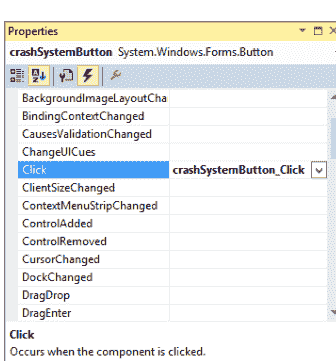

图 4-1

要为某个事件创建一个空的事件处理器，只需双击属性窗口事件列表中的事件名称即可。

你也可以输入你想要给事件处理器的名称。当你按下回车键时，Visual Studio 会创建该事件处理器并在编辑器中打开它。

如果你的代码已经包含了可以处理该事件的事件处理器，你可以点击该事件，然后点击右侧的下拉箭头选择这些事件处理器之一。

`www.it-ebooks.info`

## 使用事件参数

所有事件处理器都包含提供有关事件额外信息的参数。后续的课程将更多地介绍参数以及你如何使用它们，但目前你应该知道，有时它们可以告诉你更多关于事件的信息。

例如，以下代码显示了按钮的 Click 事件处理器。参数 `sender` 和 `e` 提供了关于事件的额外信息。

```csharp
private void crashSystemButton_Click(object sender, EventArgs e)
{
}
```

在所有处理器中，`sender` 参数告诉你哪个控件引发了事件。在这个例中，它是执行点击操作的按钮控件。

`e` 参数的数据类型是 `EventArgs`，它没有提供很多额外信息；你通常不需要按钮的任何额外信息，只需要知道它被点击了即可。

某些事件处理器在其 `e` 参数中提供了非常有有用的信息。例如，鼠标事件 `MouseClick`、`MouseMove`、`MouseDown` 和 `MouseUp` 提供的 `e` 参数包含了引发事件的控件上方鼠标的 X 和 Y 坐标。如果你试图构建一个绘画应用程序或由于某种原因需要跟踪鼠标位置，这些值是至关重要的。

图 4-2 所示的 FollowMouse 事件程序使用 `MouseMove` 事件处理器使两个滚动条跟随鼠标的位置。当你点击鼠标时，它会移动表单中央的区域，表单会将鼠标图片移动到该位置。

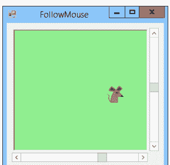

图 4-2

程序的表单包含一个绿色的 `Panel` 控件，它包含一个持有鼠标图片的 `PictureBox` 控件。表单还包含 `VScrollBar`（垂直滚动条）和 `HScrollBar`（水平滚动条）控件。程序使用事件处理器来完成三件事：设置滚动条属性、跟踪鼠标移动以及移动鼠标图片。

## 设置滚动条属性

当你创建一个新的滚动条时，它的 `Minimum = 0` 且 `Maximum = 100`，因此它可以取 0 到 100 之间的值。此程序将其滚动条设置为 `Panel` 控件上的位置。例如，如果 `Panel` 的宽度为 200 像素，程序需要给水平滚动条赋一个 0 到 199 之间的值。遗憾的是，如果滚动条的 `Maximum` 属性为 100 而程序将其值设置为 199，程序将会出现问题。如果滚动条的 `Maximum` 属性为 100 而程序将其值设置为 199，程序将会出现问题。如果滚动条的 `Maximum` 属性为 100 而程序将其值设置为 199，程序将会出现问题。

以下代码显示了一个简单的按钮点击事件处理器。当该事件处理器执行程序时，它会向用户显示一条消息：

```sharp
// Display a message box.
private void clickMeButton_Click(object sender, EventArgs e)
{
    MessageBox.Show("You clicked me!");
}
```

假设你已经写了此事件处理器，但在设计时没有将其附加到任何控件。以下代码将该事件处理器附加到 `clickMeButton` 控件的 `Click` 事件：

```sharp
clickMeButton.Click += clickMeButton_Click;
```

`+=` 运算符意味着“添加”，因此此代码将事件处理器添加到 `clickMeButton` 的 `Click` 事件中。

运行此代码后，如果用户点击了 `clickMeButton`，就会执行该事件处理器。

以下代码从按钮的 `Click` 事件中移除事件处理器：

```sharp
clickMeButton.Click -= clickMeButton_Click;
```

`-=` 运算符意味着“减去”，因此此代码从 `clickMeButton.Click` 事件中移除该事件处理器。

图 4-3 所示的 DynamicEvents 示例程序允许你在运行时添加和删除事件处理器。初始状态下，“Click Me”按钮不起作用。点击 Attach 按钮将事件处理器附加到 Click Me 按钮。点击 Detach 按钮移除该事件处理器。

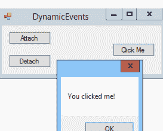

图 4-3

## 有用的事件

表 4-1 列出了各种控件触发的一些较有用的事件。

### 表 4-1

| 事件 | 含义 |
| --- | --- |
| Changed | 复选框（CheckBox）或单选按钮（Radio）的选中状态已更改。 |
| Click | 用户点击了控件。 |
| FormClosing | 表单即将关闭。将 `e.Cancel` 参数设置为 `true` 可以取消关闭并保持表单打开。 |
| KeyDown | 用户在控件获得焦点时按下按键。 |
| KeyPress | 用户在控件获得焦点时按下并释放了按键。 |
| KeyUp | 用户在控件获得焦点时释放了按键。 |
| Load | 表单已加载但可见。这是你在用户看到表单之前可以更改表单外观的最后一个地方。 |
| MouseClick | 用户在控件上按下并释放了鼠标键。与 `Click` 事件不同，此事件带有提供点击位置的参数。 |
| MouseDown | 用户在控件上按下了鼠标键。 |
| MouseEnter | 鼠标进入了控件。 |
| MouseHover | 鼠标悬停在控件上。 |
| MouseLeave | 鼠标离开了控件。 |
| MouseMove | 鼠标在控件上移动。 |
| MouseUp | 用户在控件上释放了鼠标键。 |
| Move | 控件移动了。 |
| Paint | 控件需要重绘。（这对于绘制图形很有用。） |
| Resize | 控件调整了大小。 |
| Scroll | 用户移动了轨道条（TrackBar）或滚动条上的滑块。 |
| SelectedChanged | 下拉框（ComboBox）或列表框（ListBox）的选择项已更改。 |
| TextChanged | 控件的 `Text` 属性已更改。（这对于文本框 `TextBox` 特别有用）。 |
| Tick | 定时器（Timer）控件的间隔（Interval）已过去。 |
| ValueChanged | 轨道条或滚动条的值已更改（无论是通过用户操作还是代码设置）。 |

## 尝试一下

在本次“尝试一下”中，你将使用事件处理器在用户调整红、绿、蓝滚动条时显示颜色样本。

图 4-4 显示了完成程序的运行情况。当你更改滚动条的值时，右侧的标签将显示颜色分量的新数值，最右侧的大标签将显示带有所选红、绿、蓝分量的颜色样本。

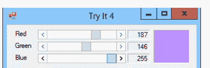

图 4-4

## 课程要求

在本节中，你：

- 创建如图 4-4 所示的表单。排列控件并设置它们的 `Anchor` 属性。
- 为红色滚动条创建一个事件处理器，显示所有三个颜色的值。
- 将事件处理器附加到绿色和蓝色滚动条，以及红色滚动条。

> 你可以从 `www.wrox.com/go/csharp` 下载本节的代码和资源。

## 提示

“尝试一下”涉及一些尚未涵盖的技巧，但构建它并不难。

- `Value` 属性是一个整数。为了将其转换为字符串并在标签中显示，请调用 `ToString` 方法。例如，以下代码让 `redLabel` 控件显示 `redScrollBar.Value` 属性：

```csharp
redLabel.Text = redScrollBar.Value.ToString();
```

- `Color.FromArgb` 根据给定的红、绿、蓝分量（0 到 255 之间）返回一种颜色。例如，`Color.FromArgb(255, 128, 0)` 返回橙色（red = 255, green = 128, blue = 0）。将滚动条通过 `Value` 属性选择的值传递给此方法并将结果赋予样本的 `BackColor` 属性。

## 步骤

- 创建如图 4-4 所示的表单。排列控件并设置它们的 `Anchor` 属性。
- 为红色滚动条创建一个事件处理器，显示所有三个颜色的值和颜色样本。
- 将事件处理器附加到绿色和蓝色滚动条，以及红色滚动条。

> 注意：由于某些原因，你可以选择的最大值是 255。

- 图 4-3 所示的 DynamicEvents 示例程序允许你在运行时添加和删除事件处理器。点击 Attach 按钮将事件处理器附加到 Click Me 按钮。点击 Detach 按钮移除事件处理器。
- 在此“尝试一下”中，你使用事件处理器在用户调整红、绿、蓝滚动条时显示颜色样本。
- 图 4-4 显示了完成程序的运行情况。当你更改滚动条的值时，右侧的标签将显示颜色分量的新数值，最右侧的大标签将显示带有所选红、绿、蓝分量的颜色样本。
- 表单即将关闭。将 `e.Cancel` 参数设置为 `true` 可以取消关闭并保持表单打开。
- 用户在控件获得焦点时按下按键。
- 用户在控件获得焦点时按下并释放了按键。
- 用户在控件获得焦点时释放了按键。
- 表单已加载但可见。这是你在用户看到表单之前可以更改表单外观的最后一个地方。
- 用户在控件上按下并释放了鼠标键。与 `Click` 事件不同，此事件带有提供点击位置的参数。
- 用户在控件上按下了鼠标键。
- 鼠标进入了控件。
- 鼠标悬停在控件上。
- 鼠标离开了控件。
- 鼠标在控件上移动。
- 用户在控件上释放了鼠标键。
- 控件移动了。
- 控件需要重绘。（这对于绘制图形很有用。）
- 控件调整了大小。
- 用户移动了轨道条或滚动条上的滑块。
- 下拉框或列表框的选择项已更改。
- 控件的 `Text` 属性已更改。（这对于文本框 `TextBox` 特别有用）。
- 定时器控件的 `Interval` 间隔已过去。
- 轨道条或滚动条的值已更改（无论是通过用户操作还是代码设置）。

## 练习题

1. 构建图 4-2 所示的 FollowMouse 程序。
2. [WPF] 使用 WPF 应用重复练习 1。
3. 构建图 4-3 所示的 DynamicEvents 示例程序。如果点击两次会发生什么？点击多次呢？如果然后点击一次或五次会发生什么？
4. [WPF] 使用 WPF 应用重复练习 3。
5. 创建一个包含一个“Stop”按钮和两个定时器 `leftTimer` 和 `rightTimer` 的表单。将定时器的 `Interval` 设置为 `1000`。在设计时，将 `leftTimer` 的 `Enabled` 属性设置为 `True`。
   - 在每个定时器的 `Tick` 事件处理器中，禁用当前定时器并启用另一个。
   - 让其中一个定时器的 `Tick` 事件处理器通过设置 `Left` 和 `Top` 属性将按钮移动到 `(10, 10)`。
   - 让另一个定时器的 `Tick` 事件处理器将按钮移动到 `(200, 200)`。


## 练习

- 在按钮的 `Click` 事件处理器中，将两个定时器的 `Enabled` 设置为 `false`。

运行程序。尝试定时器 `Interval` 属性的不同取值。如果 `Interval = 10`，会发生什么？

### 6.
复制你为练习 1 构建的 `FollowMouse` 程序。修改副本，使使用户可以通过调整滚动条来移动 `PictureBox`。

### 7. [WPF]
复制你为练习 2 构建的程序。修改该副本，使用户能够调整滚动条来移动图像。（提示：保存代码，对两个滚动条都使用事件处理程序。为了防止鼠标出现在滚动条和窗口右下角的小区域上方，将 `Canvas` 控件的 `ClipToBounds` 属性设置为 `True`。）

### 8.
创建一个与图 4-5 所示类似的程序。当用户勾选早餐 `Breakfast`、午餐 `Lunch` 或晚餐 `Dinner` 复选框时，程序应该禁用对应的 `GroupBox`。

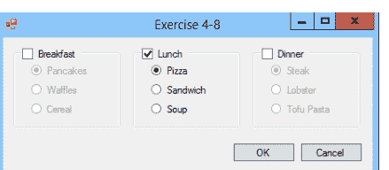

FIGURE 4-5

提示：

- 将 `OK` 按钮设置为单的接受按钮 `accept button`。将 `Cancel` 按钮设置为表单的取消按钮 `cancel button`。

- 放空 `GroupBoxes` 的 `Text` 属性。将 `CheckBoxes` 放置在 `GroupBoxes` 之上，位于文本所在的位置。（确保不要将 `CheckBoxes` 放置在 `GroupBoxes` 内部。尝试查看为什么不起作用。你可能需要先定位 `CheckBoxes`，然后将 `GroupBoxes` 移动到位置。）

- 要启用或禁用 `GroupBox`，在下面的代码中将其 `Enabled` 属性设置为对应 `CheckBox` 的 `Enabled` 属性：

```sharp
// 启用或禁用对应的 GroupBox.
private void breakfastCheckBoxCheckedChanged(object sender, EventArgs e)
{
    breakfastGroupBox.Enabled = breakfastCheckBox.Checked;
}
```

### 9. [WPF]
使用 WPF 重复练习 8。

- WPF 的 `CheckBox` 不显示背景，因此此程序中的复选框不会覆盖周围的 `GroupBox` 边框。为了解决这个问题，将每个 `CheckBox` 放置在一个 `Canvas` 中，并让 `Canvas` 使用白色背景。

- `GroupBox` 只能有一个子元素。给每个 `GroupBox` 提供一个包含 `RadioButtons` 的 `StackPanel`。使用 `RadioButtons` 的 `Margin` 属性在选项之间添加一些间距。

WPF 的 `CheckBox` 没有 `CheckChanged` 事件。请使用 `Click` 事件代替。

要启用或禁用 `GroupBox`，如下面的代码所示，将其 `IsEnabled` 属性设置为等于对应 `CheckBox` 的 `IsChecked.Value` 属性：

```csharp
// 启用或禁用相应的 GroupBox.
private void breakfastCheckBox_Click(object sender, RoutedEventArgs e)
{
    breakfastGroup.IsEnabled = breakfastCheckBox.Checked;
}
```

要设置 WPF 窗口的接受按钮，将按钮的 `IsDefault` 属性设置为 `True`。

要设置 WPF 窗口的取消按钮，将按钮的 `IsCancel` 属性设置为 `True`。

### 10.
创建一个与图 4-6 所示类似的程序。

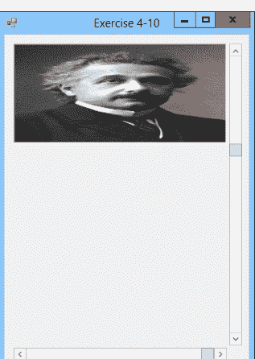

FIGURE 4-6

- 创建一个 `PictureBox` 并向其中加载一张图像。将其大小设置为与图片大小匹配，并将其 `ScaleMode` 属性设置为 `StretchImage`。（同时也看看如果将其设置为 `Normal` 会发生什么。）

- 将滚动条放置在 `PictureBox` 旁边。设置它们的 `Maximum` 属性，以便使用户可以在 0 和图片的宽度/高度之间选择值。

- 初始时将滚动条的 `Value` 属性设置为图像的宽度/高度。

- 让滚动条的 `Scroll` 事件处理程序将 `PictureBox` 的宽度/高度设置为滚动条的值。

### 11. [WPF]
使用 WPF 重复练习 10。提示：

- 将 `Image` 控件的 `Stretch` 属性设置为 `Fill`。（同时也看看如果将其设置为 `None` 会发生什么。）

- 在 WPF 程序中，用户可以使用 `ScrollBar` 将其滑动到 `Maximum` 值。

### 12. [WPF, 游戏, 困难]
在 Windows Forms 应用中必须做的一件但在 WPF 应用中很容易实现（至少如果你设置得当的话）的事情是转换对象。例如，缩放、旋转和倾斜控件是相对容易的。对于这个练习，创建一个与图 4-7 所示类似的程序。当用户调整底部的滚动条时，程序应该旋转图像并在右下角的 `Label` 中显示旋转角度。

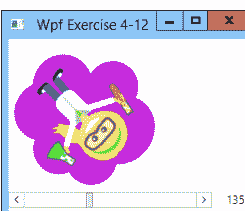

FIGURE 4-7

提示：

- 布局窗口及其控件。在 `Image` 控件中放入一张图片。将标签控件命名为 `degreesLabel`。

- 使用窗口的 `Transform` 部分将 `Image` 旋转 360 度。编辑 XAML 代码，为 `rotateTransform` 一个名为 `x:Name` 的属性。`Image` 控件的代码应该如下：

```xml
<Image x:Name="image" HorizontalAlignment="Left" VerticalAlignment="Top" Source="ScienceGirl.png" Stretch="Grid" Margin="10,10,0,0" RenderTransform="0.5,0.5">
  <TransformGroup>
    <ScaleTransform/>
    <SkewTransform/>
    <RotateTransform x:Name="rotateTransform" Angle="360"/>
    <TranslateTransform/>
  </TransformGroup>
</Image>
```

- 让 `ScrollBar` 的 `ValueChanged` 事件处理程序看起来如下所示：

```csharp
private void degreesScrollBar_ValueChanged(object sender, RoutedPropertyChanged<double> e)
{
  rotateTransform.Angle = degreesScrollBar.Value;
  degreesLabel.Content = degreesScrollBar.Value.ToString("0");
}
```

### 13. [WPF]
使用 WPF 应用重复练习 10。提示：

- 将 `Image` 控件的 `Stretch` 属性设置为 `Fill`。（同时也看看如果将其设置为 `None` 会发生什么。）

- 在 WPF 程序中，用户可以使用 `ScrollBar` 将其滑动到 `Maximum` 值。

### 2. [WPF, 游戏, 困难]
在 Windows Forms 应用中必须做的一件但在 WPF 应用中很容易实现（至少如果你设置得当的话）的事情是转换对象。例如，缩放、旋转和倾斜控件是相对容易的。对于这个练习，创建一个与图 4-7 所示类似的程序。当用户调整底部的滚动条时，程序应该旋转图像并在右下角的 `Label` 中显示旋转角度。

# 第 5 节 制作菜单

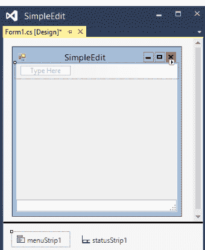

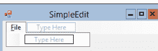

图 5-2

图 5-1

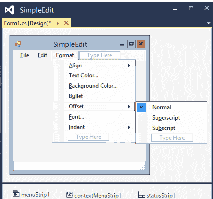

图 5-3

你可以在此使用 `Offset`（偏移量）创建任意深度的子菜单，但在实际操作中，三级（如编辑 `Offset Offset Subscript`）已经是用户能够接受的极限。

除了菜单项外，你还可以在菜单中放置分隔符 `Separators`、文本框 `TextBox` 和组合框 `ComBoxes`。文本框和组合框在菜单中并不常见，因此我在这里不会介绍它们。然而，分隔符对于分组相关项目非常有用。

要创建分隔符，请右键点击某个项，打开“插入”子菜单并选择“分隔符”。或者，你可以创建一个普通的菜单项并将其文本设置为单个横杠 `-`。

www.it-ebooks.info

## 设置菜单属性

菜单中的项是 `ToolStripMenuItems`，与其他控件一样，它们拥有决定其外观和行为的属性。表 5-1 总结了最有用的 `ToolStripDropDownItem` 属性。

表 5-1

| 属性 | 目的 |
| --- | --- |
| Checked | 决定项目是否被选中。在图 5-3 中，`Normal` 项是选中的。（另请参见 `CheckOnClick`。） |
| CheckOnClick | 如果设置为 `True`，当用户选择该项目时，该项目会自动切换其选中状态。 |
| Enabled | 表示该项目是否可用。 |
| Name | `ToolStripMenuItem` 的名称。通常情况下，你应该为你的项目起一个好名字，以便在需要时通过它让程序执行某些操作。 |
| Shortcuts | 表示该项目的快捷键组合（如果有）。你可以输入如 `Ctrl+N` 这样的值，或者点击右侧的下拉箭头以显示图 5-4 所示的快捷键编辑器。 |
| Text | 显示的文本。在你想要用作项目加速键（如果有）的字符之前放置一个安培符号 `&`。例如，如果你将项目设置为 `&Open`，则该项目在菜单中显示为 `Open`，用户可以在菜单打开时按 `Alt+O` 激活它。 |

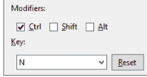

图 5-4

### 必要的省略号

> 根据惯例，如果菜单项打开了对话框或需要用户进行其他输入后才能继续，其文本应该以省略号 `...` 结尾。如果菜单项立即启动操作，则不应包含省略号。

例如，`Open...` 菜单会显示文件打开对话框，因此它的标题以省略号结尾。相比之下，编辑中的 `Copy`（复制）项会立即复制选中的文本，因此不需要省略号。

加速键 `Accelerators` 允许用户使用键盘而不是鼠标导航。当用户按下 `Alt` 键时，菜单项的加速键下方显示下划线。例如，如果文件菜单显示为 `File`，用户可以按 `Alt+F` 打开菜单，然后使用其他加速键选择菜单项。

> 注意：新版本的 Windows 操作系统通常在按下 `Alt` 键之前不会为加速键加下划线。

你应该为程序的大部分甚至几乎所有的菜单、子菜单和菜单项提供加速键。经验用户通常可以使用加速键比使用鼠标更快地导航菜单系统。

> 警告 确保不要给同一个菜单中的两个项目分配相同的加速键字符。例如，在文件菜单中，不要同时拥有 `Save`（保存）和 `Save As`（另存为）菜单项。

快捷键 `Shortcuts` 允许用户立即激活菜单项。例如，在许多程序中，`Ctrl+O` 打开文件，`Ctrl+S` 保存当前文件。（你可以意识到 `accelerator`（加速键）和 `Alt` 键都以字母 `a` 开头，从而记住它们之间的区别。）

> 警告 务必确保不要给两个菜单项设置相同的快捷键！

> 提示 使用标准的加速键和快捷键帮助用户快速且准确地学习如何使用你的应用程序。网页 `.microsoft.com/kb/126449` 和 `windows.microsoft.com/en-us/windows/keyboard-shortcuts` 列出了微软使用的一些快捷键。我还没有见过一份好的标准加速键列表，但你可以尝试参考其他常用应用程序（如 `Visual Studio` 和 `Word`）中使用的加速键。

## 处理菜单事件

当用户点击菜单时，该控件会像点击按钮一样抛出 `Click` 事件，你可以以相同的方式处理它。你甚至可以以相同的方式创建默认事件处理器：通过双击控件。

## 创建右键菜单

当你右键点击特定控件时，会出现上下文菜单。在 Windows Forms 应用程序中，使用上下文菜单与使用主菜单一样简单。图 5-5 显示了显示上下文菜单的示例。

从表单上拖入一个 `ContextMenuStrip`。与 `MenuStrip` 一样，`MenuStrip` 会出现在表单下方的组件区 `Component Tray` 中，因此你可以双击工具箱中的 `ContextMenuStrip` 工具，而无需担心它的位置。

与 `MenuStrip` 不同，`MenuStrip` 会出现在表单下方的组件区中，因此你可以双击工具箱中的 `ContextMenuStrip` 工具，而无需担心它的位置。

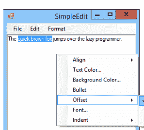

图 5-5

与 `MenuStrip` 不同，`MenuStrip` 会出现在表单下方的组件区中，因此你可以双击工具箱中的 `ContextMenuStrip` 工具，而无需担心它的位置。

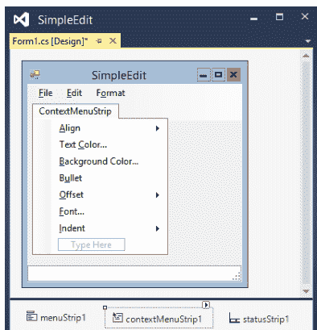

图 5-6

手势非常强大，但它们也很复杂，因此我不会在这本书中介绍它们。你可以在 `mdn.microsoft.com/en-us/library/ms7523068` 中的“Commanding Overview”文章中了解更多相关信息。

同时，你只需为菜单项创建 `Click` 事件处理程序。

### 尝试一下

在本次尝试中，你将创建一个主菜单和一个右键菜单。主菜单包含一个关闭表单的退出 `Exit` 命令。两个菜单都包含更改表单上 `TextBox` 外观的命令。图 5-8 显示了显示其右键菜单的完成程序。

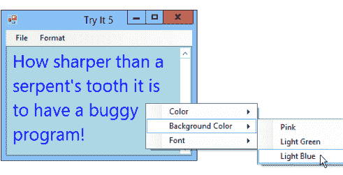

图 5-8

## 课程要求

在本节中，你将：

- 创建如图5-8所示的所示。

- 创建以下主菜单结构（注意加速键和快捷键）：

文件

退出

格式

颜色

红色 `Ctrl+R`

绿色 `Ctrl+G`

蓝色 `Ctrl+B`

背景颜色

粉色

浅绿色

浅蓝色

| 小号 | `Ctrl+S` |

| 普通 | `Ctrl+N` |

| 大 | `Ctrl+L` |

- 为主菜单项添加后台代码。

- 使右键菜单复制主菜单的“格式”子菜单。

- 将右键菜单绑定到与主菜单相同的事件处理程序上。

- 将右键菜单绑定到 `TextBox`。

> 注意：你可以从 `www.wrox.com/csharp24hourtrainer2e` 网站下载本节课程的代码和资源。

## 提示

- 退出菜单项可以通过调用 `this.Close()` 来关闭程序。

- 创建字体并不是易事（我还没有介绍这一部分）。更简单的方法是在表单上的控件中保留字体样本，然后将 `TextBox` 的 `Font` 属性设置为该控件的 `Font` 属性。还有什么地方比主菜单项更适合存储字体呢？

## 步骤详解

- 创建如图5-8所示的表单。

1. 通过双击工具箱中的 `MenuStrip` 创建主菜单。

2. 在表单上添加一个 `TextBox`。在其 `Text` 属性中输入一些文本，并设置其属性：`Name = contentsTextBox`，`MultiLine = True`，`Dock = Fill`，`ScrollBars = Both`。

3. 通过双击工具箱中的 `ContextMenu` 工具创建右键菜单。

创建主菜单结构。

1. 选择 `MenuStrip`。点击“在此处输入”框并输入 `E&File`。

2. 在 `File` 菜单下方的“在此处输入”框中输入 `E&xit`。

> 根据惯例，退出命令使用 `X` 作为其加速键。它从没有快捷键，因为在对着键盘撞头时（或者手指按错、键盘被飞过的网球撞到，或者你的猫走过键盘）很容易意外关闭程序。

3. 再次点击 `File` 项。在右侧的“在此处输入”框中输入 `F&format`。（你不能使用 `F` 作为此菜单的加速键，因为它已经被 `File` 项使用。）

4. 使用 `Format` 菜单下方的“在此处输入”框创建格式菜单项和子菜单。

5. 使用属性窗口将 `Font` 菜单中 `Small`、`Normal` 和 `Large` 项的字体大小设置为 6、9 和 20。

6. 给 `Color` 和 `Font` 子菜单项赋予适当快捷键。

7. 给执行操作的菜单项赋予适当名称。例如，将 `Font` 菜单的 `Small` 命名为 `formatSmallMenuItem`。

为主菜单项添加后台代码。

1. 双击 `Exit` 项并在代码中输入**粗体行**，使事件处理程序看起来如下：

```java
private void fileExitMenuItem_Click(object sender, EventArgs e)
{
    this.Close();
}
```

关键字 `this` 意味着“当前执行此代码的对象”，在例例中意味着当前表单，因此此行代码告诉当前表单关闭自己。

2. 双击 `Color Red` 项并在以下代码中输入**粗体行**，使事件处理程序看起来如下：

```java
private void formatColorRedMenuItem_Click(object sender, EventArgs e)
{
    contentsTextBox.ForeColor = Color.Red;
}
```

3. 对 `Green` 和 `Blue` 菜单项重复步骤 2。

4. 对 `Format Background` 菜单项重复步骤 2。

5. 双击 `Format Small` 项并在以下代码中输入**粗体行**，使事件处理程序看起来如下：


```java
private void formatFontSmallMenuItem_Click(object sender, EventArgs e)
{
    contentsTextBox.Font = formatFontSmallMenuItem.Font;
}
```

- 6. 对 `Normal` 和 `Large` 菜单项重复步骤 5。

使右键菜单复制主菜单的 `Format` 子菜单。

执行 1 或 2 中的任一：

- 1. 从头构建结构。（这很直接但很慢。）

   a. 点击组件区中的 `ContextMenu` 打开其进行编辑。

   b. 使用与构建主菜单结构类似的步骤来构建右键菜单结构。右键菜单名称以 `ContextMenuItem` 结尾，例如 `colorRedAppContext`。

- 2. 复制 `Format` 菜单的结构。（这种方法更聪明、更快，因此酷得多！）

   a. 点击组件区中的 `MenuStrip` 打开编辑。展开 `Format` 菜单。点击 `Color` 项并 `Shift` 点击 `Font` 项选中所有菜单项。按 `Ctrl+C` 将菜单项复制到剪贴板。

   b. 点击组件区中的 `ContextMenu` 打开编辑。按 `Ctrl+V` 将菜单项粘贴到右键菜单中。

   c. 为新的菜单项赋予适当名称。

将右键菜单项绑定到主菜单使用的事件处理程序。

- 1. 打开 `ContextMenu` 进行编辑。展开 `Color` 子菜单并选择 `Red` 项。在属性窗口的事件中，选择 `Click`。在右侧的下拉列表中选择 `formatColorMenuItem_Click`。

- 2. 对 `ContextMenu` 的其他项重复步骤 1。

将右键菜单绑定到 `TextBox`。

- 1. 点击 `TextBox`。在属性窗口中设置其 `ContextMenuStrip` 属性。

## 练习题

- 1. `[WPF]` 使用 `WPF` 应用重复尝试一下。你可以通过构建某些菜单并在 `XAML` 中复制它们来节省时间。将 `TextBox` 的颜色设置为 `Brushes.Red`。

- 2. `[WPF SimpleEdit]` 使用为练习3构建的 `WPF` 应用重复练习4。我使用的 `Visual Studio` 版本似乎允许设置菜单项的 `Icon` 属性，但在 `XAML` 编辑器中这样做并不难。首先使用项目的添加项命令将图像添加到相应的项中。然后使用 `XAML` 代码显示以下内容：

```
<MenuItem Header="New" Name="fileMenuItem">
  <MenuItem.Icon>
    <Image Source="New.png" />
  </MenuItem.Icon>
</MenuItem>
```

- 3. `[WPF SimpleEdit]` 为 `WPF` 应用重复属性。提示：检查菜单项使用 `IsChecked`。

- 4. `[SimpleEdit]` 复制你为练习1构建的 `SimpleEdit` 程序，并为其菜单和右键菜单项添加图像。（你可以在书籍网站提供的5个下载内容的 `PngFiles` 文件夹中找到合适的图像文件。）图 5-9 显示了完成后菜单的样式。

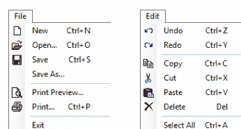

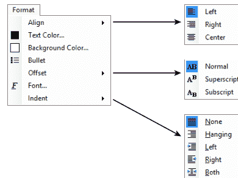

图 5-9

- 5. `[SimpleEdit]` 复制你为练习4构建的 `SimpleEdit` 程序，并为菜单项的事件处理程序添加占位程序。这些程序应显示简单的图像指示它们实际上应该执行的操作。例如，下面的代码显示了文件（File）菜单的保存（Save）事件处理器：

```
private void fileSaveMenuItem_Click(object sender, EventArgs e)
{
    MessageBox.Show("Save");
}
```

为所有不包含项目的菜单项（分隔符除外）添加占位符。例如，为“格式 ⮘ 左对齐”项目添加占位符，但不为“格式 ⮘ 对齐”添加，因为它包含项目。

将右键菜单的菜单附加到相同的事件处理器，但右键菜单的项目列表（Bullet）项目事件处理器除外。（如果你让两个项目共享同一个事件处理器，它们在切换行为期间会互相干扰。）

## 7. `[WPF, SimpleEdit]` 使用你为练习 5 构建的 `WPF` 应用程序重复练习 6。提示：

*   *如果你点击某个菜单 `XAML` 选选中它，你可以在窗口设计器中双击以创建事件处理器。*

*   你可能需要直接编辑 `XAML` 代码来定义其处理器，例如 `Click="alignLeftContextMenuItem_Click"`。然后你可以右键点击事件处理器的名称并选择“转到定义事件处理器”。

## 8. `[SimpleEdit]` 复制你为练习 7 构建的 `SimpleEdit` 程序，并添加代码来管理格式（Format）菜单中对齐（Align）、偏移（Offset）和缩进（Indent）子菜单的排斥选择。例如，用户只能选择对齐占位符代码中的某一个，因此当用户选择一个选项时，代码将：

修改项目

- a. 检查所选的子菜单项

- b. 取消勾选其他子菜单项

- c. 勾选对应的右键菜单项

- d. 当用户选择对齐子菜单的“左侧”选项时，取消勾选其他右键菜单项：

```
private void formatIndentLeftMenuItem_Click(object sender, EventArgs e)
{
    formatIndentNoneMenuItem.Checked = false;
    formatIndentHangingMenuItem.Checked = false;
    formatIndentLeftMenuItem.Checked = true;
    formatIndentRightMenuItem.Checked = false;
    formatIndentContextMenuItem.Checked = false;
    indentNoneContextMenuItem.Checked = false;
    indentHangingContextMenuItem.Checked = false;
    indentLeftContextMenuItem.Checked = true;
    indentRightContextMenuItem.Checked = false;
    indentBothContextMenuItem.Checked = false;
    MessageBox.Show("Indent Left");
}
```

9. `[WPF, SimpleEdit]` 使用你为练习 7 构建的 `WPF` 应用程序重复练习 8。（提示：在 `WPF` 中，你需要设置 `IsChecked` 属性而不是 `Checked` 属性）。

10. `[SimpleEdit]` 复制你为练习 8 构建的 `SimpleEdit` 程序，并添加代码使“格式 - 项目列表”项和右键菜单项相互勾选和取消勾选。

（提示：将一个项目的 `Checked` 属性设置为另一个项目的 `Checked` 属性的值）。

11. `[WPF, SimpleEdit]` 与 `Windows Forms` 不同，`WPF` 的 `MenuItem` 控件没有 `CheckOnClick` 属性，因此项目列表菜单在用户点击时不会自动勾选或取消勾选。

添加代码通过将每个控件的 `IsChecked` 属性设置为其当前值的取反，使这些菜单项自行勾选和取消勾选。`!` 字符对值进行逻辑取反。换句话说，true 是 false，`!false` 是 true。例如，下面的代码切换格式菜单项目列表项的勾选状态：

```
formatBulletMenuItem.IsChecked = !formatBulletMenuItem.IsChecked;
```

12. `[WPF, SimpleEdit]` 使用你为练习 11 构建的 `WPF` 应用程序重复练习 10。（提示：在 `WPF` 中，你需要设置 `IsChecked` 属性而不是 `Checked` 属性）。

13. `[WPF]` 在 `WPF` 中，菜单可以包含任何内容。构建一个与图 5-10 显示的应用程序（尽管并不是说这在实际程序中是个好主意）。

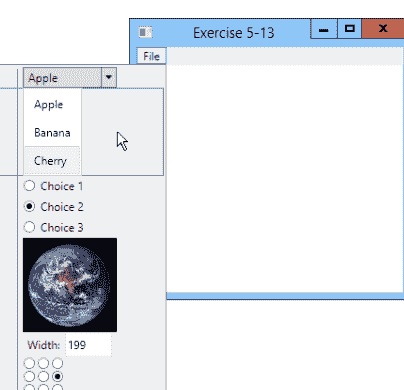

图 5-10

程序的文件的菜单应该包含：

- 一个带有三个选项的 `ComboBox`。

- 一个带有三个选项的 `ListBox`。

- 三个单选按钮（`RadioButton`）。

- 一个图像（`Image`）。

- 一个包含标签（`Label`）和文本框（`TextBox`）的 `StackPanel`。

- 一个包含 3x3 布局单选按钮的 `Grid`。

14. 制作一个具有五层嵌套菜单的 `Windows Forms` 程序。换句话说，创建一个菜单：文件 > 层级 1 > 层级 2 > 层级 3 > 层级 4 > 层级 5。让最底部的菜单项显示消息框。（再次强调，在实际程序中这不是好主意。）

15. `[WPF]` 使用 `WPF` 应用程序重复练习 14。

16. 一种实用的用户技术是不允许用户在不合适的时候操作。例如，在绘图应用程序中，如果用户没有编辑绘图，你应该禁用绘图工具。

编写带有三个菜单的程序：文件（File）、客户（Customers）和员工（Employees）。为它们每个提供一个菜单：退出（为其编写代码）、新客户（New Customer）和新员工（New Employee）。

为程序提供三个标记为常规（General）、管理客户（Manage Customers）和管理员工（Manage Employees）的单选按钮。当用户点击单选按钮时，启用禁用相应的菜单。（某些应用程序会隐藏不合适的菜单，但这会让知道菜单应该存在但找不到的用户感到困惑。）

例如，当用户点击管理客户按钮时，启用客户按钮。当用户点击常规时，禁用两个菜单。

17. `[WPF]` 使用 `WPF` 应用程序重复练习 16。

18. `[SimpleEdit]` 复制你为练习 7 构建的 `SimpleEdit` 程序，并添加代码来管理格式（Format）菜单中对齐（Align）、偏移（Offset）和缩进（Indent）子菜单的排斥选择。例如，用户只能选择对齐占位符代码中的某一个，因此当用户选择一个选项时，代码将：

修改项目

# 使用工具栏容器 (ToolStrip CONTAINERS)

`ToolStripContainer` 在表单的顶部、左侧、底部和右侧显示区域，这些区域可以放置 `ToolStrip`（工具栏）。在运行时，用户可以在这些区域之间拖动 `ToolStrip`。

`ToolStripContainer` 的中心是一个内容面板（content panel），它可以容纳一个或多个控件。

在这些控件的典型配置中，表单选择性地包含一个 `MenuStrip` 和一个 `StatusStrip`，分别停靠在表单的顶部和底部。`ToolStripContainer` 停靠并填充表单的剩余部分，其内容面板包含程序的其余所有控件。


图 6-2 显示了一个表单，其顶部包含一个 `MenuStrip`，`StatusStripToolStripContainer` 填充了表单的剩余部分。`ToolStripContainer` 包含三个 `ToolStrip` 和一个停靠以填充其内容面板的 `RichTextBox`。

图 6-3 显示了该程序的运行状态。在这里，我将两个 `ToolStrip` 绘制在了 `ToolStripContainer` 的左边缘和右边缘。

图 6-2 中的两点特别值得注意。首先，注意内容面板侧中间带有箭头的细长矩形。如果你点击其中一个，控件会在边缘留出空间，以便你能够插入另一个 `ToolStrip`。

图 6-2 中另一个值得注意的点是位于控件右上角的智能标签（smart tag），它是一个带有箭头的小正方形。如果你点击智能标签，就会出现图 6-4 所示的智能标签。


图 6-2

图 6-3


图 6-4

通常情况下，智能标签为控件执行常用任务提供了快速方法。在例例中，智能标签面板允许你决定控件应该允许哪些面板。如果取消勾选其中一个面板，用户在运行时将无法将 `ToolStrip` 拖到 `ToolStripContainer` 的边缘。

> 注意 你也可以通过在属性窗口中设置控件的 `LeftStripPanelVisible`、`RightStripPanelVisible`、`TopStripPanelVisible` 和 `BottomStripPanelVisible` 属性来确定哪些面板可用，但使用智能标签更简单。

构建 `ToolStripContainer` 后，只需将 `ToolStrip` 放在上面并照常构建它们的项即可。

# 使用状态栏 (STATUS STRIPS)

状态栏（status strip）通常停靠在表单主体上，显示标签、状态栏和其他控件，为用户提供应用程序状态的快速摘要。该区域应留给状态信息，通常不应包含执行程序操作的按钮和控件。那些命令属于菜单和状态栏。

> 注意 尽管当前时间算是一部分状态信息，但不要在状态栏上添加时。需要时钟的用户可以在系统的任务栏中显示。任务栏时钟更方便，因为它提供了选项（如显示格式），这些选项你可能不需要在程序中重新实现，而且它不会被其他程序隐藏。系统提供了一个方便的工具，你没有在程序中重新实现它。

要创建状态栏，只需双击工具箱中的 `StatusStrip`。默认情况下，`StatusStrip` 停靠在表单主体上，因此你不需要手动定位。

当你选择 `StatusStrip` 时，表单设计器会显示一个带有下拉箭头的微图标，类似于它为 `ToolStrip` 显示的图标。点击箭头以显示你可能想要添加到 `StatusStrip` 的项列表，如图 6-5 所示。

如你在图 6-5 所示，你可以向 `ToolStrip` 中添加以下类型的对象：

- `StatusLabel`

- `ProgressBar`

- `DropDownButton`

- `SplitButton`

唯一的新控件 `StatusLabel` 的行为类似于普通的 `Label`（标签）。

## 尝试一下 (Try It)

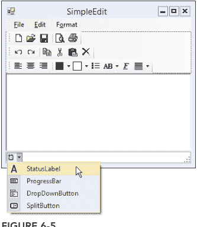

在这次“尝试一下”中，你创建了一个 `MenuStrip`（第 5 节介绍过）和一个 `ToolStrip`，其中包含更改 `RichTextBox` 控件 `ForeColor`（前景色）和 `BackColor`（背景颜色）属性的命令。你还创建了一个 `StatusStrip` 来显示当前选择的颜色。（是的，我知道这是冗余的，因为值显示在 `ToolStrip` 和文本本身中。）图 6-6 显示了运行中的程序。

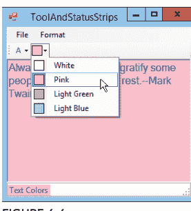

## 课程要求

在本节中，你将：

- 创建图 6-6 所示的表单。

- 创建 `MenuStrip`。菜单的分级结构应该是：

    - 文件 (`File`)

        - 退出 (`Exit`)

    - 格式 (`Format`)

        - 文本颜色 (`Text Color`)

            - 黑色 (`Black`)

            - 红色 (`Red`)

            - 绿色 (`Green`)

            - 蓝色 (`Blue`)

图 6-5

图 6-6

## 背景颜色 (Background Color)

- 白色 (`White`)

- 粉色 (`Pink`)

- 浅绿色 (`Light Green`)

- 蓝色 (`Blue`)

- 初始勾选“文本颜色”菜单中的“黑色”和“背景颜色”菜单中的“白色”。

- 为“背景颜色”菜单项提供显示颜色样的图像。

- 勾选“文本颜色”菜单中的“黑色”和“背景颜色”菜单中的“白色”。

创建一个 `ToolStrip`，其按钮复制了菜单层次结构。该 `ToolStrip` 应该包含两个 `ToolStripDropDownButton`。

-   将第一个按钮命名为 `foreColorButton` 并使其显示文本“A.”。为它添加 `Black`、`Red`、`Green` 和 `Blue` 项。每个项的 `ForeColor` 属性应设置为相应的颜色。

-   创建 `ToolStripDropDownButton`。

-   在该项下方，添加 `Black`、`Red`、`Green` 和 `Blue` 项。

-   设置这些每个项的 `ForeColor` 属性以显示其颜色。（例如，将项的 `ForeColor` 属性设置为黑色。）

-   将第二个按钮命名为 `backColorButton` 并让其初始显示为白色。为它添加 `White`、`Pink`、`Light Green` 和 `Light Blue` 项。让这些每项都显示颜色样本的图像。

-   创建 `ToolStripDropDownButton`。

-   在该项下方，添加 `White`、`Pink`、`Light Green` 和 `Light Blue` 项。

-   设置这些每个项的 `Image` 属性以显示它们的颜色样本。

-   为 `StatusStrip` 添加一个名为 `colorLabel` 的 `ToolStripStatusLabel`，其 `Text` 属性为 `Colors`。

-   创建 `ToolStripStatusLabel`。设置其 `Name` 和 `Text` 属性。

添加事件处理程序。

让 `File` 菜单的 `Exit` 项关闭表单。

输入代码行，使事件处理程序看起来如下：

```csharp
private void fileExitMenuItem_Click(object sender, EventArgs e)
{
    Close();
}
```


## 为每个 Text Color 菜单项创建事件处理程序

对于 `Text Color Black` 菜单项，输入正体代码，使事件处理程序看起来如下：

```csharp
private void blackColorMenuItem_Click(object sender, EventArgs e)
{
    richTextBox.ForeColor = blackColorButton.ForeColor;

    foreColorMenuItem.ForeColor = blackColorButton.ForeColor;
    foreColorButton.ForeColor = blackColorButton.ForeColor;
    colorLabel.ForeColor = blackColorButton.ForeColor;

    blackColorMenuItem.Checked = true;
    redColorMenuItem.Checked = false;
}
```

```csharp
greenForeColorMenuItem.Checked = false;
blueForeColorMenuItem.Checked = false;
blackForeColorButton.Checked = true;
redForeColorButton.Checked = false;
greenForeColorButton.Checked = false;
blueForeColorButton.Checked = false;
```

### 2. 为其他 Text Color 菜单项输入类似的代码

### 为每个 Background Color 菜单项创建事件处理程序

#### 1. 对于 Background Color White 菜单项，代码应显示事件处理程序如下

```csharp
private void whiteBackColorMenuItem_Click(object sender, EventArgs e)
{
    contentRichTextBox.BackColor = Color.White;

    backgroundColorMenuItem.Image = whiteBackColorMenuItem.Image;
    backgroundColorButton.Image = whiteBackColorMenuItem.Image;
    label.BackColor = Color.White;

    whiteBackgroundColorMenuItem.Checked = true;
    pinkBackgroundColorMenuItem.Checked = false;
    lightGreenBackgroundColorMenuItem.Checked = false;
    lightBlueBackgroundColorMenuItem.Checked = false;

    whiteBackgroundColorButton.Checked = true;
    pinkBackgroundColorButton.Checked = false;
    lightGreenBackgroundColorButton.Checked = false;
    lightBlueBackgroundColorButton.Checked = false;
}
```

#### 2. 为 Background Color 菜单项输入类似的代码

### 为每个 Background Color 菜单项创建事件处理程序

#### 1. 重复你用于 Text Color 菜单项的步骤，但使用 `BackColor` 代替 `Fore`

* 使用相应菜单项的事件处理程序创建工具条按钮

#### 1. 点击属性窗口（`Properties window`）中的 `Events` 按钮

#### 2. 针对每个工具条按钮：

- a. 在表单编辑器（`Form Editor`）中点击该按钮
- b. 在属性窗口中，选择 `Click` 事件。然后点击右侧的下拉箭头
- c. 选择适当的菜单事件处理程序。例如，对于黑色 `ColorButton` 工具条按钮，选择 `blackForeColorMenuItem_Click` 事件处理程序

## 练习

### 1. [SimpleEdit] 复制你在第 5 节练习 10 中构建的 SimpleEdit 程序（或从书籍网站下载第 5 节的版本），并添加图 6-7 所示的工具条、按钮和分隔符

- 删除 `RichTextBox` 控件，添加一个 `ToolStripContainer`，然后在 `ToolStripContainer` 的内容面板内重新添加 `RichTextBox`。添加 `ToolStrips`
- 黑色按钮（位于第三行左侧）是另一个 `ToolStripSplitButton`，允许用户选择文本颜色。它包含了 `Black`、`White`、`Red`、`Green` 和 `Blue`
- 文本颜色旁边的白色按钮是另一个 `ToolStripDropDown`，允许用户选择背景颜色。它包含了 `Black`、`White`、`Pink`、`Light Green`、`Light Blue` 和 `Yellow`
- 写有 "AB" 的按钮是一个 `ToolStripDropDown`，提供了类似于 `Format` 菜单的选项：`Normal`、`Superscript` 和 `Subscript`

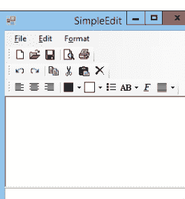

图 6-7

### 2. [WPF, SimpleEdit] 复制你在第 5 节练习 12 中构建的程序（或从书籍网站下载第 5 节的版本），重复练习 1：

- 在菜单下方的 `DockPanel` 控件顶部停靠一个 `Toolbar`
- 向 `ToolbarSet` 添加 `ToolBars`。设置 `ToolBar` 的 `Band` 属性以指示其在 `ToolbarSet` 中的行数
- 在 WPF 中，使用 `Group` 控件用于工具栏
- 向 `ToolbarSet` 添加 `ToolBars`。设置 `ToolBar` 的 `Band` 属性以指示其在 `ToolbarSet` 中的行数

### 3. [SimpleEdit] 复制你在练习 1 中构建的 SimpleEdit 程序，并添加事件处理程序以管理新的工具条。为菜单、右菜单和工具条添加代码。例如，以下是左对齐项的代码：

```csharp
private void formatLeftMenuItem.Click(object sender, EventArgs e)
{
    formatLeftMenuItem.Checked = true;
    formatRightMenuItem.Checked = false;
    formatAlignCenterMenuItem.Checked = false;
    alignContextMenuItem.Checked = true;
}
```

```csharp
alignRightMenuItem.Checked = false;
alignCenterMenuItem.Checked = false;
alignLeftButton.Checked = true;
alignRightButton.Checked = false;
alignCenterButton.Checked = false;
MessageBox.Show("Align Left");
```

### 4. [WPF, SimpleEdit] 用你在练习 2 中构建的应用程序重复练习 3。提示：

- WPF 按钮没有 `Checked` 或 `IsChecked` 属性，所以你无法检查对齐按钮。相反，创建单独的图像来表示选中状态。将选中和未选中的图像放在 `Visibility` 属性设置为 `Collapsed` 的 `Image` 控件中。然后在运行时使用类似的代码设置按钮图像：

```csharp
alignLeftImage.Source = alignUncheckedImage.Source;
```

- 使用一个简单的技巧处理项目符号按钮

```csharp
if (formatBulletMenuItem.IsChecked)
    bulletImage.Source = bulletCheckedImage.Source;
else
    bulletImage.Source = bulletUncheckedImage.Source;
```

为了处理偏移工具项，为偏移 `Items` 命名。然后在以下代码中设置选中项

```csharp
superscriptOffsetComboBox.IsSelected = true;
```

以处理偏移 `ComboBox` 的方式处理缩进 `ComboBox`

### 5. [SimpleEdit] 复制你在练习 3 中构建的 SimpleEdit 程序，并将工具控件连接到相应的事件处理程序

### 6. [WPF, SimpleEdit] 用你在练习 4 中构建的应用程序重复练习 5。提示：

- 处理偏移和缩进 `ComboBox` 的 `Selected` 事件
- 当窗口加载时，它会触发初始选中 `ComboBox` 的 `Selected` 事件。不幸的是，窗口尚未完成所有控件的加载，如果程序尝试为尚未加载的控件设置值，程序将会崩溃。为了防止这种情况，在初始选中的 `ComboBox` 的事件处理程序中使用以下语句

```csharp
if (!Loaded) return;
```

### 7. 复制你为练习 5 构建的 SimpleEdit 程序，并添加代码在“文本颜色”和“背景”工具条按钮中显示相应的图像。例如，对于绿色文本颜色，可以使用类似下面的代码：

```csharp
private void fgGreenButton_Click(object sender, EventArgs e)
{
    fgButton.Image = fgGreen.Image;
    MessageBox.Show("Text Color Green");
}
```

### 8. [WPF, 复制你为练习 6 构建的 SimpleEdit 程序，并添加代码，当用户选择“文本颜色”或“背景”工具条时显示消息框。例如，对于绿色文本颜色，可以使用类似下面的代码：

```csharp
private void greenForegroundColorComboBoxItem_Selected(object sender, EventArgs e)
{
    MessageBox.Show("Text Color Green");
}
```

### 9. [SimpleEdit] 菜单项和普通按钮可以可能并不直观明显的文本。为了帮助用户理解工具栏按钮，你应该为它们提供工具提示（tooltips）。复制你为练习 7 构建的 SimpleEdit 程序。将每个工具栏项的属性设置为有意义的名字。例如，将新按钮的 `Text` 属性设置为“New”。这将自动将每个按钮的工具提示设置为该值

### 10. [WPF, Simple] 使用你为练习 8 构建的 WPF 应用重复练习 9

### 11. [Games] 复制你为练习 2-3 构建的井棋（tic-tac-toe）程序（或从书籍网站下载第 2 课的版本）。进行以下修改：

- 添加一个带有 `turnLabel` 的 `ToolStripStatusLabel` 的 `StatusStrip`。将其初始 `Text` 设置为“Xs Turn”
- 当用户占据一个 X 的方格时，隐藏该方格的小 X 和 O 按钮，并让状态栏显示“Os Turn”
- 当用户占据一个 O 的方格时，隐藏该方格的小 X 和 O 按钮，并让状态栏显示“Xs Turn”
- 添加一个包含两个命令的“文件”菜单：
  * `New` 重置程序的所有控件以开始一个新游戏
  * `Exit` 退出程序

### 12. [WPF, Games] 使用你为练习 2-4 编写程序重复练习 11。提示：

- 在 WPF 中隐藏控件，请将其 `Visibility` 属性设置为 `Visibility.Hidden`
- 要更改状态标签的文本，请设置其 `Content` 属性

### 13. [Games] 复制你为练习 11 构建的程序并进行以下修改：

- 初始禁用小 O 按钮
- 当用户点击 X 按钮时，禁用所有 X 按钮并启用所有 O 按钮
- 当用户点击 O 按钮时，禁用所有 O 按钮并启用所有 X 按钮

### 14. [WPF, Games] 使用你为练习 12 编写的程序重复练习 13

### 15. [Drawing] 构建图 6-8 所示的 Scribbler 程序。给它一个 `ToolStripContainer` 和两个 `ToolStrip`

为第一个 `ToolStrip` 按钮分别代表箭头、直线、矩形、椭圆、曲线和星形工具。将这些工具设为互斥选择，这样如果用户选择了其中一个，其他的就会取消选择

为第二个 `ToolStripDropDownButtons` 分代表前景颜色和背景颜色。将每个下拉列表中的项设为互斥选择，并让选择在它们的 `ToolStripDropDownButtons` 上显示其图像

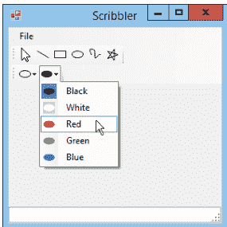

图 6-8

### 16. [WPF, Drawing] 使用 WPF 应用重复练习 15

### 17. [Drawing] 复制你为练习 15 构建的程序并为工具栏工具添加工具提示

### 18. [WPF, Drawing] 使用你为练习 17 构建的程序重复练习 17

> 注意 请在 www.wrox.com/go/csharp24hourtrainer2evideos 选择第 6 课的在线视频

# 7

## 使用 RichTextBox

`TextBox` 控件允许用户输入文本，仅此而已。它可以用不同的颜色和字体显示文本，但无法为不同的文本段赋予不同的属性。`TextBox` 的设计目的是为了让用户输入简单的字符串（如名称或街道地址），几乎没有其他功能

`RichTextBox` 是一个强大得多的控件。它可以用不同的颜色、字体和样式显示不同的文本段。它可以调整段落缩进并制作项目列表。它甚至可以包含像全功能文字处理器（如 Microsoft Word 或 OpenOffice 的 Writer）那样强大的功能，但它能产生比 `TextBox` 复杂得多的的结果

在本节中，你将学习 `RichTextBox` 控件以及如何使用它。你有机会尝试该控件，并用它为 SimpleEdit 程序添加足够的功能，最终使程序变得实用

## 使用 RICHTBOX 属性

要更改 `RichTextBox` 内部文本的外观，你首先选择要更改的文本，然后使用控件的属性之一

要选择文本，你使用 `SelectionStart` 和 `SelectionLength` 属性。注意 `SelectionStart` 从 0 开始，`SelectionLength` 表示包含多少内容。例如，设置 `SelectionStart = 0`

在选择文本后，使用控件的属性之一设置你想要 `RichTextBox` 具有的值。例如，设置 `SelectionStart = 0` 选择了文本

```csharp
contentTextBox.Text = "Some red";
contentTextBox.SelectionStart = 5;
contentTextBox.SelectionLength = 3;
```

表 7-1 列出了你可以更改文本的属性

### 表 7-1

| 属性 | 用途 |
| --- | --- |
| `Alignment` | 段落左对齐、居中或右对齐 |
| `SelectionBackgroundColor` | 设置内容的背景颜色 |
| `SelectionBullet` | 是否为项目符号 |
| `SelectionOffset` | 上标 (>0)、下标 (<0) 或普通 (=0) |
| `SelectionColor` | 设置内容的颜色 |
| `SelectionFont` | 设置选中内容的字体 |
| `SelectionHangingIndent` | 段落的首行缩进，后续行按此量缩进 |
| `SelectionIndent` | 所有行按此量缩进 |
| `SelectionProtected` | 将选中文本标记为保护，用户无法修改 |
| `SelectionRightIndent` | 所有行向右缩进此量 |

图 7-1 所示的 Font 示例演示了更改段落内外观的属性。这些包括 `SelectionOffset`、`SelectionColor` 和 `SelectionFont`

例如，代码显示了 Font 程序如何设置背景颜色：

```csharp
contentTextBox.SelectionStart = 41;
contentTextBox.SelectionLength = 9;
contentTextBox.SelectionColor = Color.Yellow;
```


图 7-2 所示的 `ParagraphFeatures` 程序演示了更改段落显示方式的属性。这些包括 `SelectionIndent`、`SelectionHangingIndent`、`SelectionRightIndent`、`SelectionBullet` 和 `SelectionAlignment`。

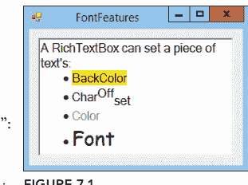

图 7-2

例如，以下代码显示了 `ParagraphFeatures` 程序给第二个段落提供了 20 像素的缩进：

```csharp
contentTextBox.SelectionStart = 82;
contentTextBox.SelectionLength = 1;
contentTextBox.SelectionHangingIndent = 20;
```

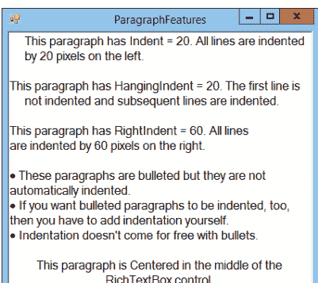

## 让用户控制

表 7-2 总结了四个值得关注的更改控件内容的额外属性。

### 表 7-2

| 属性 | 用途 |
| --- | --- |
| `Text` | 获取或设置不带任何格式的控件内容。 |
| `Rtf` | 获取或设置控件的富格式 (RTF) 内容。包括文本以及定义如何显示文本的 RTF 格式代码。 |
| `SelectedText` | 获取或设置选中内容的文本。 |
| `SelectedRtf` | 获取或设置选中文本和 RTF 代码。 |

允许用户更改文本设置很容易。当用户在控件中选择文本时，`RichTextBox` 会相应地设置其 `SelectionStart` 和 `SelectionLength` 属性。你只需要设置相应的属性（例如 `SelectionColor`），选中的文本就会更新。

图 7-3 所示的 `SetTextProperties` 程序使用该技术来控制文本颜色、字符偏移和段落对齐。选择一些文本，然后点击条带按钮更改文本的属性。

例如，以下代码显示了 `SetTextProperties` 程序如何将当前选择内容更改为黑色背景和白色前景：

```csharp
private void reverseColorsButtonClick(object sender, EventArgs e)
{
    contentRichTextBox.SelectionBackgroundColor = Color.Black;
    contentRichTextBox.SelectionColor = Color.White;
}
```

该程序的其他工作也类似。

## 使用 RICHTEXTMETHODS

第 2 节简要描述了属性、方法和事件。事实上，我在目前为止的课程中讨论的大多数事件处理程序都可以捕获事件并响应更改属性。

尽管你已经处理过许多属性和事件，但你看到的唯一方法是表单的 `Close` 方法，它可以让表单消失。例如，以下代码显示了执行该方法的表单：

```csharp
Close();
```

`RichTextBox` 提供了许多新方法，对于构建文本编辑程序非常有帮助。表 7-3 总结了其中一些实用的方法。

### 表 7-3

| 方法 | 目的 |
| --- | --- |
| `Clear` | 清除控件中的所有文本。 |
| `Copy` | 将当前选择复制到剪贴板。 |
| `Cut` | 将当前选择剪切到剪贴板。 |
| `DeselectAll` | 通过 `SelectionLength = 0` 取消所有文本选择。 |
| `LoadFile` | 从 RTF 或纯文本等各种格式中加载控件文本。 |
| `Paste` | 将剪贴板中的任何内容粘贴到当前选择。可以是 `RichTextBox` 理解为文本、RT 格式文本或图像的任何内容。 |
| `Redo` | 重做上一个命令。 |

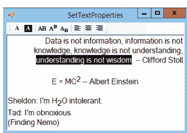

使用 RichText 方法 | 107

| 方法 | 目的 |
|---|---|
| `SaveFile` | 将控件文本保存为 RTF 或纯文本等各种格式之一的文件。 |
| `SelectAll` | 通过设置 `SelectionStart = 0` 并使 `SelectionLength` 等于文本长度来选择控件的所有文本。 |
| `Undo` | 撤销最近的更改。 |

以下代码显示了程序如何使用 `LoadFile` 方法：

```csharp
contentRichTextBox.LoadFile("Test.rtf", RichTextBoxStreamType.RichText);
```

传递给 `LoadFile` 的第一个参数是文件名，它可以相对于程序的当前目录，也可以是完整路径。

第二个参数是文件类型。`RichTextBoxStreamType` 举列出了你可以使用的文件类型。你可以用于加载文件的选项有 `PlainText`、`RichText` 和 `UnicodePlainText`。

## 输入类型

当你输入 `contentRichTextBox.LoadFile(` 时，IntelliSense 会显示图 7-4 所示的弹出窗口，显示 `LoadFile` 方法尚未完成的参数。（Visual Studio 添加了波浪下划线，因为参数尚未输入完成。在我完成输入之前，Visual Studio 会将其标记为错误）。

```csharp
contentRichTextBox.LoadFile();
```

▲ 1 之 3 void 将文本格式 (RTF) 或标准 ASCII 文件加载到 RichTextBox 控件中。

path。要加载到控件的文件名称和位置。

图 7-4

你可以从该方法的三个重载版本中选择，每个版本接受不同的参数。方法的重载版本名称相同但参数不同。你可以使用向上和向下方向键滚动查看方法的可用版本。

当你输入参数时，IntelliSense 更新为图 7-5，显示了为第一个参数输入文件名后显示的 `LoadFile` 方法。IntelliSense 显示下一个参数应该是名为 `filePath` 的 `RichTextBoxStreamType` 类型的值。IntelliSense 甚至在底部显示了该值含义的简短描述（尽管并不完美）。

```csharp
contentRichTextBox.LoadFile("test.rtf",);
```

▲ 2 之 3 void `LoadFile(string filePath, RichTextBoxStreamType fileType)`

将特定文件加载到 RichTextBox 控件中。

fileType: `RichTextBoxStreamType` 的值之一。

图 7-5

继续

## 108 | 第 7 节 使用 RICTEXTBOXES

（续）

你可以输入 `RichTextBoxStream` 后紧跟一个点来查看可用成员列表，但有一种更简单（换句话说，更好）的方法：按 `Ctrl+Space`。这会让 IntelliSense 显示你可能正在输入的内容列表。在某个时刻，IntelliSense 足够智能，猜到你想输入 `RichTextBox`，最初选择该类型并显示关于它的更多信息，如图 7-6 所示。

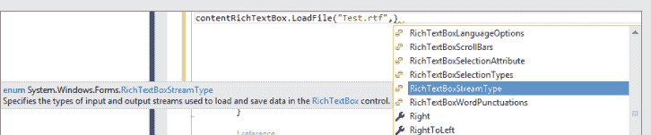

图 7-6

现在你可以按 `Tab` 键让 IntelliSense 填充 `RichTextBoxStream` 值。接下来，按 `.` 键图 7-7 中的选择，选择一个并按 `Tab` 键将其添加到代码中。最后，在行尾添加一个分号就完成了。

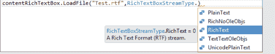

图 7-7

听起来很乱，但只要练习一下就会变得非常快速简单。手动输入之前的 `LoadFile` 语句需要 30 秒。在 IntelliSense 的帮助下，我只需要 10 秒就能完成同样的行。

以下代码显示了程序如何使用 `SaveFile` 方法。`LoadFile` 的第一个参数给出文件名，第二个参数给出其类型：

```csharp
contentRichTextBox.SaveFile("Test.rtf", RichTextBoxStreamType.RichText);
```

## 使用 WPF 命令

程序可以使用命令操作 `RichTextBox` 内容。该控件还提供了用户可以交互式调用的命令。例如，用户可以按 `Ctrl+E` 居中。

表 7-4 总结了最实用的命令。Windows Forms 和 WPF 版本的命令略有不同。

### 表 7-4

| 操作 | WINDOWS FORMS | WPF |
| --- | --- | --- |
| 居中对 | `Ctrl+E` | |
| 两端对齐 | | `Ctrl+J` |
| 左对齐 | `Ctrl+L` | |
| 右对齐 | `Ctrl+R` | |
| 项目 | * | `Shift+L` |
| 复制 | `Ctrl+C` | |
| 剪切 | `Ctrl+X` | |
| 减小字体 | `Ctrl+[` | |
| 删除 | `Delete` | `Delete` |
| 删除下一个单词 | `Ctrl+Delete` | |
| 删除上一个单词 | `Ctrl+Backspace` | `Backspace` |
| 增大字体 | `Ctrl+]` | |
| 编号 | * | `Shift+N` |
| 粘贴 | `Ctrl+V` | |
| 下标 | `Ctrl+=` | |
| 上标 | `Ctrl+Shift+=` | |
| 切换加粗 | `Ctrl+B` | |
| 切换插入 | `Insert` | |
| 切换斜体 | `Ctrl+I` | |
| 切换下划线 | `Ctrl+U` | |

两个控件都提供了额外的导航命令。例如，`Ctrl+右箭头` 向右移动单词，`Ctrl+向下箭头` 向下移动一个段。WPF 控件提供了包含复制、剪切和粘贴命令的上下文菜单。有关 WPF 控件的更多信息（包括导航命令），请参 mdn.microsoft.com/library/system.windows.documents.editingcommands.aspx。

将程序的 `TextBox` 替换为名为 `contentRichTextBox` 的 `RichTextBox`。

添加代码来处理编辑（Edit）菜单的命令。

- 1. 在表单设计器（Form Designer）中打开程序表单。点击菜单栏（MenuStrip），展开编辑菜单，双击撤销（Undo）菜单项。

- 2. 将占位符 `MessageBox.Show` 调用替换为以下代码，使事件程序程序如下：

```csharp
private void editUndoMenuItem_Click(object sender, EventArgs e)
{
    contentRichTextBox.Undo();
}
```

- 3. 对其他编辑菜单项重复上述两个步骤。以下代码显示了新的事件：

```csharp
private void editUndoMenuItem_Click(object sender, EventArgs e)
{
    contentRichTextBox.Undo();
}
```

```csharp
private void editRedoMenuItem_Click(object sender, EventArgs e)
{
    contentRichTextBox.Redo();
}
```

```csharp
private void editCopyMenuItem_Click(object sender, EventArgs e)
{
    contentRichTextBox.Copy();
}
```

```csharp
private void editCutMenuItem_Click(object sender, EventArgs e)
{
    contentRichTextBox.Cut();
}
```

```csharp
private void editPasteMenuItem_Click(object sender, EventArgs e)
{
    contentRichTextBox.Paste();
}
```

```csharp
private void editDeleteMenuItem_Click(object sender, EventArgs e)
{
    contentRichTextBox.SelectedText = "";
}
```

```csharp
private void editSelectAllMenuItem_Click(object sender, EventArgs e)
{
    contentRichTextBox.SelectAll();
}
```

完成后，程序的新功能即可正常工作。`RichTextBox` 最显著的特征之一是它可以从剪贴板粘贴不同类型的项目。例如，将图片复制到剪贴板，然后使用程序将其粘贴到 `RichTextBox` 中。

## 练习

- 1. `[WPF, SimpleEdit]` 重复你为第 6 节练习 10 构建的 Try It WPF 程序。提示：要删除当前选择，请使用语句 `contentRichTextBox.Selection.Text = "";`

- 2. `[SimpleEdit]` 复制你为 Try It 构建的程序，并添加代码来处理文件（File）菜单的新建、打开、保存和退出命令。对于新建命令，只需清空 `RichTextBox` 即可（使用 `Clear` 方法）。对于打开和保存命令，加载并保存 `Test.rtf` 文件。（程序会在第一次使用它时创建该文件。如果你在文件存在之前尝试打开它，程序将会崩溃。在打开之前，使用保存对话框让用户选择要打开或保存的文件。）

- 3. `[WPF, SimpleEdit]` 使用你为练习 1 构建的程序重复练习 2。提示：

> 清空控件内容的一种方法是使用以下代码：

```csharp
contentRichTextBox.SelectAll();
contentRichTextBox.Selection.Text = ""
```

> 如果控件包含大量文本，上述代码的运行速度较慢。以下代码较为复杂，但效率更高：

```csharp
TextRange range = new TextRange(
    contentRichTextBox.Document.ContentStart,
    contentRichTextBox.Document.ContentEnd);
range.Text = "";
```

> 要保存文件，请使用以下代码（抱歉，WPF 版本的 RichTextBox 稍微有点复杂）：

```csharp
TextRange range = new TextRange(
    contentRichTextBox.Document.ContentStart,
    contentRichTextBox.Document.ContentEnd);
using (System.IO.Stream stream =
    new System.IO.FileStream("Test.rtf", System.IO.File.Open))
{
    range.Load(stream, DataFormats.Rtf);
}
```

> 将文本保存到文件中，请使用以下代码：

```csharp
TextRange range = new TextRange(
    contentRichTextBox.Document.ContentStart,
    contentRichTextBox.Document.ContentEnd);
using (System.IO.Stream stream =
    new System.IO.FileStream("Test.rtf", System.IO.File.Create))
{
    range.Save(stream, DataFormats.Rtf);
}
```

- 4. `[SimpleEdit]` 复制你为练习 2 构建的 `SimpleEdit` 程序，并添加代码来处理格式（Format）菜单的命令（字体命令和颜色命令除外，它们将在第 8 节中介绍）。

# 提示：

- 要开启或关闭项目符号，请使用语句 `contentRichTextBox.SelectionBullet = formatBulletMenuItem.Checked;`

- 让缩进（无、悬挂、左、右和双方）重置任何其他缩进。悬挂（Hanging）命令应在以下代码中将 `SelectionIndent` 和 `SelectionRightIndent` 属性设置为 0：

```csharp
contentRichTextBox.SelectionIndent = 0;
contentRichTextBox.SelectionRightIndent = 0;
contentRichTextBox.SelectionHangingIndent = 20;
```

- 5. `[WPF, SimpleEdit]` 复制你为练习 3 构建的 WPF `SimpleEdit` 程序，并添加代码处理格式菜单的对齐和布局命令。

- 要开启或关闭项目符号，请使用语句 `EditingCommands.ToggleBullets(null, contentRichTextBox)`。

- 对对齐命令使用类似的 `EditingCommands` 方法。

- 6. `[SimpleEdit]` 复制你为练习 4 构建的 `SimpleEdit` 程序，并添加代码来处理工具栏命令。

- 8. 一个具有两个菜单和一个工具栏的程序。一个菜单应包含小、中、大。另一个菜单应包含退出、撤销和重做。

- 9. `[WPF, SimpleEdit]` 复制你为练习 5 构建的 WPF `SimpleEdit` 程序，并添加代码来处理工具栏命令。

## 将对话框添加到表单


你可以像添加任何其他组件（如 `Timer`）一样向表单添加对话框。与其他组件一样，对话框会出现在组件区（`Component Tray`）表单下方。

控件工具箱有一个对话（`Dialog`）选项卡，其中包含许多标准对话框，很容易找到。与打印相关的对话框位于打印（`Printing`）选项卡中，因此很容易找到（如果你知道去哪里看）。图 8-1 显示了工具箱的打印和对话选项卡。

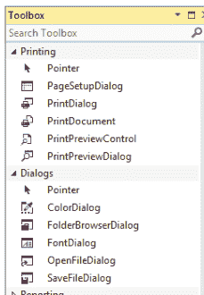

图 8-1

## 初始化对话框

大多数标准对话框启动时都会有一些初始选择。`FontDialog`（字体对话）启动时选中了一个字体，`ColorDialog` 启动时选中了一个颜色，以此此类推。通常情况下，你应该初始化对话框，使其显示用户程序当前的设置。例如，`FontDialog` 应该显示程序当前的字体。

通常进行这些初始选择是非常简单的。只需将对话框的关键属性（`Font`、`Color`、`Filename`）设置为你想要显示的值即可。

例如，下面的代码将 `ColorDialog` 的 `Color` 属性设置为表单当前的 `BackColor` 值。（记住，这意味着当前正在执行代码的表单或对象）。

```
backgroundColorDialog.Color = this.BackColor;
```

这里唯一的诀窍在于知道应该设置哪些属性。表 8-1 列出了不同类型对话框的关键属性。

### 表 8-1

| 对话框 | 关键属性 |
| --- | --- |
| `ColorDialog` | `Color` |
| `FolderBrowserDialog` | `SelectedPath` |
| `FontDialog` | `Font` |
| `OpenFileDialog` | `FileName` |
| `SaveFileDialog` | `FileName` |

`SetupDialog`、`PrintDialog` 和 `OpenDialog` 与其他对话框略有不同，因此不再做介绍。打印部分将在第 30 课更详细地介绍。

我刚才提到你应该初始化对话框以显示当前值，但文件打开和保存对话框有一个特殊功能，可能会让你决定跳过这一步。当你使用它们时，它们会记住之前显示过的目录。如果用户再次打开其中一个对话框，它将从上次所在的目录开始。事实上，即使用户关闭或重启了程序，对话框仍然会记得它们最后的位置。

> 如果你在同一个程序中有多个不同的 `OpenDialog`（或 `SaveFileDialog`），它们都会共享“上次位置”的同一个概念。

你可能想要初始化对话框的唯一理由是你希望程序能够单独跟踪多个文件。例如，你可能希望在不同的地方保存文本文件、位图和 RTF 文件。

另请注意，`OpenFileDialog` 和 `SaveFileDialog` 记住同一个目录，因此如果你希望能够从一个目录加载并保存到另一个目录，你可能需要初始化对话框。

# 显示对话框并检查返回结果

你通过调用它们的 `ShowDialog` 方法显示所有标准对话框。`ShowDialog` 以模态方式显示对话框，并返回一个值，告诉程序用户点击了 OK、Cancel还是其他按钮。

> 模态对话框在关闭之前会阻止用户与程序进行交互。它强迫用户做出选择。相比之下，无模对话框允许用户在不关闭对话框的情况下移动到程序的其他表单。

> 注意：某些对话框上的 OK 按钮实际上并没有显示为“OK”。`OpenFileDialog` 的 OK 按钮显示“打开”，`SaveFileDialog` 的 OK 按钮显示“保存”，而 `PrintDialog` 的 OK 按钮显示“打印”。但对于程序而言，它们都是 OK 按钮，你以相同的方式测试它们。

你的代码应该测试返回的结果，如果用户点击了 OK，它应该对用户的选择执行某些操作。

遗憾的是，为了实现这一点，你需要使用 `if` 语句，而 `if` 语句直到第 18 课才会介绍。这个特定的 `if` 使用非常简单，所以我觉得向你展示它并不好意思。

下面的代码显示了程序如何显示一个背景色的 `backgroundColorDialog`：

```
if (backgroundColorDialog.ShowDialog() == DialogResult.OK)
{
    ...
}
```

代码调用了 `ShowDialog` 方法。它使用 `if` 语句将 `ShowDialog` 返回的值与 `DialogResult.OK` 值进行比较。如果值相等（这就是 C# 中 `==` 的含义），程序将执行大括号内的任何操作（我在这里省略了）。

如果用户点击 Cancel 按钮，`ShowDialog` 返回值 `DialogResult.Cancel`，因此如果测试失败，程序将跳过大括号内部的内容。

> 如果用户通过点击 OK 按钮以外的任何方式关闭对话框，`ShowDialog` 方法将返回 `DialogResult.Cancel`。例如，如果用户按下 Alt+F4 或点击对话框右上角的 X 按钮，对话框将认为自己被取消了。

## 处理结果

最后，如果用户点击了 OK，程序应该对用户在对话框中选择的任何内容执行操作。这通常意味着打开你初始化对话框的步骤。例如，假设程序使用以下代码初始化它的 `ColorDialog`：

```
backgroundColorDialog.Color = this.BackColor;
```

它将使用以下代码将表单的 `BackColor` 属性设置为用户选择的颜色：

```
this.BackColor = backgroundColorDialog.Color;
```

## 整合在一起

下面的代码显示了 `ColorDialog` 的执行序列。程序初始化对话框、显示它并检查返回值，然后处理结果：

```
backgroundColorDialog.Color = this.BackColor;
if (backgroundColorDialog.ShowDialog() == DialogResult.OK)
{
    this.BackColor = backgroundColorDialog.Color;
}
```

这看起来比之前的课程示例稍微复杂一点，但并不难。新部分是 `if` 语句，它设置对话框的 `Color` 属性等于表单的 `BackColor` 属性，而且你一直在设置这些属性。

# 使用对话框属性

本课之前的表 8-1 列出了对话框的关键属性，但某些对话框还有其他属性。

例如，`ColorDialog` 有一个 `AllowFullOpen` 属性，决定用户是否可以点击对话框的自定义颜色按钮显示一个区域。图 8-2 显示了显示该区域的 `ColorDialog`。

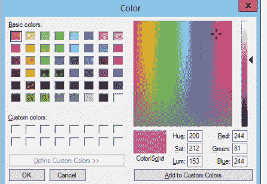

图 8-2可以通过阅读在线帮助了解更多这些属性。例如，微软关于 `ColorDialog` 的帮助页面是 `meddn.microsoft.com/library/system.windows.forms.colorialog.aspx`。你可以将 URL 中的 `colorialog` 替换为另一个对话框名称以查找其网页。

表 8-2 总结了 `ColorDialog` 的有用属性。

| 属性 | 用途 |
| --- | --- |
| `AllowFullOpen` | 决定用户是否可以自定义颜色。 |
| `Color` | 选择的颜色。 |
| `FullOpen` | 决定对话框出现时自定义区域是否打开。 |

表 8-3 总结了 `FolderBrowserDialog` 的有用属性。

| 属性 | 用途 |
| --- | --- |
| `RootFolder` | 对话框开始浏览的根文件夹。属性窗口允许从桌面、收藏夹、历史记录和“我的计算机”中选择值。 |
| `SelectedPath` | 选择的文件夹。 |

表 8-4 总结了 `FontDialog` 的有用属性。

| 属性 | 用途 |
| --- | --- |
| `FixedPitchOnly` | 决定对话框是否允许用户仅选择等宽字体。这很有用，例如如果你将使用该字体构建报告，并且需要所有字符宽度相同以便列对齐。 |
| `Font` | 选择的字体。 |
| `MustExists` | 决定如果所选字体不存在，对话框是否抛出错误（例如，如果用户对字体样式使用了“ExtraBold”，而该字体没有相应的类型）。 |
| `MaxSize` | 字体允许的最大尺寸。 |
| `ShowColor` | 决定对话框是否允许用户选择字体颜色。将其设置为 True，使用对话框的 `Color` 属性查看选择了什么颜色。 |
| `ShowEffects` | 决定对话框是否允许用户设置下划线、删除线和字体颜色。（要选择字体颜色，`ShowColor` 和 `ShowEffects` 必须同时为 True。） |

表 8-5 汇总了 `OpenFileDialog` 最有用的属性。

| 属性 | 用途 |
| --- | --- |
| `AddExtension` | 如果此为 True 且用户选择了一个没有扩展名的文件名，对话框会在名称后添加默认扩展名。 |
| `CheckFileExists` | 如果此为 True，对话框将不允许用户选择不存在的文件。 |
| `CheckPathExists` | 如果此为 True，对话框将不允许用户选择不存在的路径。 |
| `DefaultExt` | 默认文件扩展名。 |
| `FileName` | 选中文件的名称。 |
| `Filter` | 选择筛选器。（详情请参见本课程后部分的“使用文件过滤器”章节。） |
| `FilterIndex` | 当前筛选过滤器的索引。（详情请参见本课程后部分的“使用文件过滤器”章节。） |
| `InitialDirectory` | 对话框启动时所在的目录。 |
| `ReadReadOnly` | 表示用户是否勾选了“只读”复选框。 |
| `ShowReadOnly` | 决定对话框是否显示“只读”。 |
| `Title` | 在对话框标题中显示的文本。 |

`SaveFileDialog` 具有许多与 `OpenFileDialog` 相同的属性。关于属性 `AddExtension`、`CheckFileExists`、`CheckPathExists`、`DefaultExt`、`FileName`、`Filter`、`FilterIndex`、`InitialDirectory` 和 `Title` 的描述，请参见表 8-5。

表 8-6 汇总了 `SaveFileDialog` 不与 `OpenFileDialog` 共享属性。

| 属性 | 用途 |
| --- | --- |
| `CreatePrompt` | 如果此为 True 且用户选择了一个不存在的文件，对话框会询问用户想要创建该文件。 |
| `OverwritePrompt` | 如果此为 True 且用户选择了一个已存在的文件，对话框会询问用户想要覆盖它。 |
| `ValidateNames` | 决定对话框是否验证文件名不包含任何无效字符。 |

表 8-7 汇总了 `PrintDialog` 最有用的属性。

| 属性 | 用途 |
| --- | --- |
| `Document` | 你设置此属性来告诉对话框要打印哪个文档对象。第 30 将对此介绍。 |

表 8-8 汇总了 `PreviewDialog` 最有用的属性。

| 属性 | 用途 |
| --- | --- |
| `Document` | 你设置此属性来告诉对话框要预览哪个文档对象。第 30 将对此介绍。 |

## 使用文件过滤器

对话框的大多数属性都很容易理解。然而，两个特别令人困且重要的属性是 `OpenFileDialog` 和 `SaveDialog` 提供的 `Filter` 和 `FilterIndex` 属性。

`Filter` 属性是一个由 `|` 字符分隔的文本提示和文件匹配模式的列表。对话框提供了一个下拉列表，用户可以在其中选择一个文本提示，并对应相应的筛选器。当用户选择一个提示时，对话框将使用相应的筛选器来决定显示哪些文件。

例如，考虑以下内容：

```
Bitmap Files|*.bmp|Graphic Files|*.bmp;*.gif;*.png;*.jpg|All Files|*
```

此值代表了三类过滤器：

- 文本提示 "Bitmap Files" 对应过滤器 `*.bmp`。
- 文本提示 "Graphic Files" 对应过滤器 `*.bmp;*.gif;*.png;*.jpg`。该过滤器匹配以 .gif、.png 或 .jpg 结尾的文件。
- 文本提示 "All Files" 对应过滤器 `*.*`。

图 8-3 显示了一个 `OpenFileDialog`。过滤器下拉列表（Open 和 Cancel 按钮正上方）选中了文本提示 "Graphics Files。（对话框自动添加了括号中的过滤器只是为了混淆用户。）对话框正在列出此目录中匹配过滤器的文件。在这种情况下，该目录包含 .png 文件。

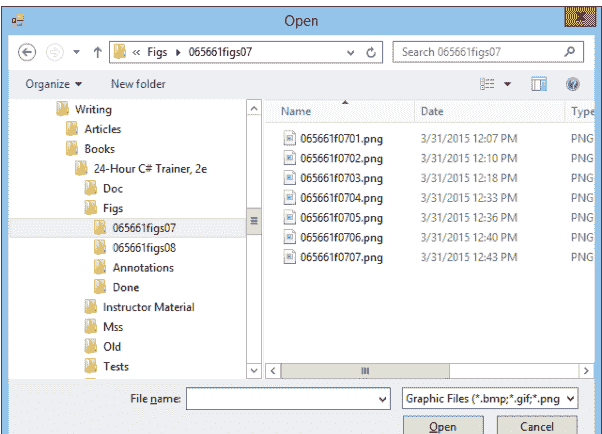

图 8-3

一旦理解了 `Filter` 属性，`FilterIndex` 属性就很简单了。`FilterIndex` 仅仅是所选筛选器的索引，其中 1 表示第一个过滤器，2 表示第二个，以此此类推。（记住在第 7 节中我说，“在 C# 中几乎所有的编号都从 0 开始”）。这是少数的例外之一。）你可以使用 `FilterIndex` 初始选择你认为认为最有用的过滤器。

`OpenFileDialog` 和 `SaveFileDialog` 都使用相同类型的 `Filter` 和 `FilterIndex` 属性。事实上，如果一个程序同时显示这二者，它们应该使用相同的 `Filter` 值。如果一个程序可以加载 .txt 和 .rtf 文件，它可能也能够保存 .txt 和 .rtf 文件。

> 注意 为了将这一想法更进一步，你可以将 `SaveFileDialog` 的 `FilterIndex` 属性设置为用户在 `OpenFileDialog` 中选择的值，假设加载了 .txt 文件的用户以后可能想将其保存为 .txt 文件。

## 在 WPF 中使用对话框

遗憾的是，WPF 只提供了 `PrintDialog`，并且不包含其他标准对话框。如果你一直在关注，你可能会说：“等一下。在本节的早些时候，你说过标准对话框是由 .NET Framework 提供的。这不意味着 WPF 程序也可以使用它们吗？”（如果你是这么说的并且正在阅读编程课程的这部分，告诉你的导师，你值得在下次测验中额外加 5 分。）

确实如此——WPF 程序可以使用对话框，但方式并不相同。在写写任何代码之前，你需要理解这些对话框位于 .NET Framework 中。例如，对话框返回的结果不能直接使用。例如，对话框返回的结果无法直接被 WPF 使用。`ColorDialog` 允许用户选择颜色但 WPF 使用画笔。同样，`FontDialog` 允许用户选择字体但 WPF 使用字体对象。本节展示了如何解决这些问题。

```csharp
// 创建 OpenFileDialog。
System.Windows.Forms.OpenFileDialog fileDialog = new System.Windows.Forms.OpenFileDialog();

// 设置过滤器。
fileDialog.Filter = "Text Files|*.txt|RTF Files|*.rtf|All Files|.*";

// 显示对话框并检查结果。
if (fileDialog.ShowDialog() == System.Windows.Forms.DialogResult.OK)
{
    // 处理文件。
    MessageBox.Show(fileDialog.FileName);
}
```

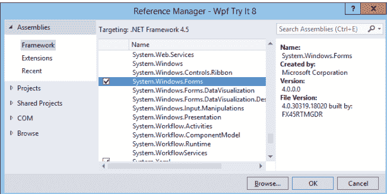

图 8-4

## 第 8 节 使用对话框

第一个语句（因为很长跨了两行）创建一个 `System.Windows.Forms.OpenFileDialog` 对象。其余部分设置属性。接下来代码初始化对话框。此示例设置了其他属性，如 `FilterIndex`、`CheckFileExists` 和 `ShowReadOnly`。然后代码通过调用 `ShowDialog` 方法显示对话框并与 `System.Windows.Forms.DialogResult` 进行比较。如果用户点击了 OK，程序将处理结果。此示例只是在消息框中显示选的文件，但真正的应用程序可能会这样做：

## 尝试

在尝试中，你尝试获取除 `PageDialog`（在实际打印之前很难使用）以外的所有标准对话框。你初始化、显示并处理对话框的结果（如果用户点击 OK 按钮）。

## 课程要求

在本节中，你：

- 使用 `Label`、`TextBox` 和 `Button` 创建类似于图 8-5 所示的表单。
- 将 `ColorDialog`、`FontDialog`、`FolderBrowserDialog`、`OpenFileDialog`、`SaveFileDialog`、`PrintDialog` 和 `PrintPreview` 添加表单。
- 当用户点击 `BackColor` 按钮时，显示 `ColorDialog` 但不允许用户自定义颜色。如果用户点击 OK，将表单的 `BackColor` 属性设置为 `ColorDialog` 的颜色值。
- 当用户点击 `Font` 按钮时，显示 `FontDialog`，允许用户选择字体颜色。如果用户点击 OK，将表单的 `Font` 属性设置为 `Font` 值，并将其 `ForeColor` 属性设置为对话框的 `Color` 属性。
- 当用户点击 `Folder` 按钮时，显示 `FolderBrowserDialog`，让对话框从 `MyComputer` 开始。如果用户点击 OK，让 `Folder TextBox` 显示对话框的 `SelectedPath` 属性。

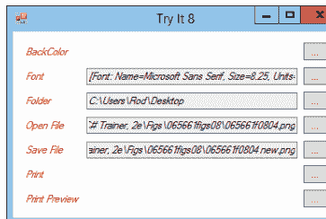

图 8-5


当用户点击“打开文件”按钮时，显示 `OpenFileDialog`。这允许用户选择文本文件、RTF 文件或所有文件。如果用户点击“打开”，让“打开文件”文本框显示 `FileName` 属性，并将 `SaveFileDialog` 的 `FilterIndex` 设置为 `OpenFileDialog` 的 `FilterIndex`。

当用户点击“保存”按钮时，显示 `SaveFileDialog`。使用与 `OpenDialog` 相同的过滤器。如果用户点击“保存”，让“保存文件”文本框显示对话框的 `FileName` 属性，并将 `OpenFileDialog` 的 `FilterIndex` 设置为 `SaveFileDialog` 的 `FilterIndex`。

当用户点击“打印”按钮时，显示 `PrintDialog` 并忽略返回结果。

当用户点击“打印预览”时，显示 `PrintPreviewDialog` 并忽略返回结果。

> 注意：你可以从网站 `www.wrox.com/go/csharp24hourntrainer2` 下载本课程的代码和资源。

## 提示

- 确保在显示每个对话框之前对其进行初始化。

使用 `Labels`、`TextBoxs` 和 `Buttons` 制作一个与图 8-5 所示类似的表单。

- 1. 以你认为最方便的方式添加并安排控件。
- 2. 将按钮的 `Anchor` 属性设置为 `Top, Right`。将文本框的 `Anchor` 属性设置为 `Top, Left, Right`。

向表单添加 `ColorDialog`、`FontDialog`、`FolderBrowserDialog`、`OpenFileDialog`、`SaveFileDialog`、`PrintDialog` 和 `PrintPreviewDialog` 组件。

- 1. 添加对话框。它们出现在组件区 `Component Tray` 中，而不是表单上。
- 2. 给对话框起好的名称。

当用户点击“背景颜色”按钮时，显示 `ColorDialog` 但不允许用户定义自定义颜色。如果用户点击 `OK`，将表单的 `BackColor` 属性设置为对话框的 `Color` 值。

- 1. 为了防止用户定义自定义颜色，将 `ColorDialog` 的 `AllowFullOpen` 属性设置为 `False`。
- 2. 使用以下代码显示以下内容：

```csharp
private void backColorButton_Click(object sender, EventArgs e)
{
    backgroundColor.Color = BackColor;
if (backgroundColorDialog.ShowDialog() == DialogResult.OK)
{
    BackColor = backgroundColorDialog.Color;
}
```

当用户点击“字体”按钮时，显示 `FontDialog`，允许用户选择其字体。如果用户点击 `OK`，将表单的 `Font` 属性设置为对话框的 `Font` 值，并将 `ForeColor` 属性设置为对话框的 `Color` 属性。

- 1. 为了允许用户选择颜色集，将对话框的 `ShowColor` 属性设置为 `True`。
- 2. 使用类似下面的代码：

```csharp
private void Button_Click(object sender, EventArgs e)
{
    formDialog.Font = Font;
    formDialog.Color = ForeColor;
    if (formDialog.ShowDialog() == DialogResult.OK)
{
        Font = formDialog.Font;
        textBox.Text = formDialog.Font.ToString();
        ForeColor = formDialog.Color;
    }
}
```

当用户点击“文件夹”按钮时，显示 `FolderBrowserDialog`。让对话框从 `MyComputer` 开始。如果用户点击 `OK`，让“文件夹”文本框显示对话框的 `SelectedPath` 属性。

- 1. 为了从 `MyComputer` 开始浏览，使用属性窗口将对话框的 `RootFolder` 属性设置为 `MyComputer`。
- 2. 使用类似下面的代码：

```csharp
private void Button_Click(object sender, EventArgs e)
{
    if (testFolderBrowserDialog.ShowDialog() == DialogResult.OK)
    {
        textBox.Text = testFolderBrowserDialog.SelectedPath;
    }
}
```

当用户点击“打开文件”按钮时，显示 `OpenFileDialog`。使用允许用户选择文本文件、RTF 文件或所有文件的过滤器。如果用户点击“打开”，让“打开文件”文本框显示对话框的 `FileName` 属性，并将 `SaveFileDialog` 的 `FilterIndex` 设置为 `OpenFileDialog` 的 `FilterIndex`。

- 1. 使用该过滤器：

| 文本文件 | `*.txt` |
| RTF 文件 | `*.rtf` |
| 所有文件 | `*` |

- 2. 使用类似下面的代码：

```csharp
private void openFileButton_Click(object sender, EventArgs e)
{
    if (testOpenFileDialog.ShowDialog() == DialogResult.OK)
    {
        openFileTextBox.Text = testOpenFileDialog.FileName;
        saveFileFileDialog.FilterIndex = testOpenFileDialog.FilterIndex;
    }
}
```

当用户点击“保存文件”按钮时，显示 `SaveFileDialog`。使用与 `OpenFileDialog` 相同的过滤器。如果用户点击“保存”，让“保存文件”文本框显示对话框的 `FileName` 属性，并将 `OpenFileDialog` 的 `FilterIndex` 设置为 `SaveFileDialog` 的 `FilterIndex`。

- 1. 使用该过滤器：

| 文本文件 | `*.txt` |
| RTF 文件 | `*.rtf` |
| 所有文件 | `*` |

- 2. 使用类似下面的代码：

```csharp
private void saveFileButton_Click(object sender, EventArgs e)
{
    if (testSaveFileDialog.ShowDialog() == DialogResult.OK)
    {
        saveFileTextBox.Text = testSaveFileDialog.FileName;
        testSaveFileDialog.FilterIndex = testSaveFileDialog.FilterIndex;
    }
}
```

当用户点击“打印”按钮时，显示 `PrintDialog`。忽略返回结果。

- 1. 使用类似下面的代码：

```csharp
private void printButton_Click(object sender, EventArgs e)
{
    testPrintDialog.ShowDialog();
}
```

当用户点击“打印预览”时，显示 `PrintPreviewDialog`。忽略返回结果。

- 1. 使用类似下面的代码：

```csharp
private void printPreviewDialog_Click(object sender, EventArgs e)
{
    printPreviewDialog.ShowDialog();
}
```

## 练习

1. `[WPF]` 用 `WPF` 重复一遍。

提示：

- 如果任何事件处理程序导致程序在启动时崩溃，请在事件处理程序的开头添加以下语句，以防止程序在控件创建之前尝试使用它们。

`if (!IsLoaded) return;`

- 对于字体按钮的 `Checked` 事件，使用类似下面的代码：

`sampleLabel.FontFamily = new FontFamily("Arial");`

- 对于滑动块 `Slider` 的 `ValueChanged` 事件，使用类似下面的代码：

`if (!IsLoaded) return;`

`sizeGroupBox.Header = "Size: " + sizeSlider.Value.ToString();`

`sampleLabel.FontSize = sizeSlider.Value;`

- 给加粗复选框添加 `Checked` 事件处理程序和取消勾选事件处理程序。将 `sampleLabel.FontWeight` 设置为 `FontWeights.Bold` 或 `FontWeights.Normal`。
- 给普通 `Normal`、斜体 `Italic` 和倾斜 `Oblique` 单选按钮添加 `Checked` 事件处理程序。分别将 `sampleLabel.FontStyle` 设置为 `FontStyles.Normal`、`FontStyles.Italic` 和 `FontStyles.Oblique`。


图 8-6

1. `[SimpleEdit]` 复制你在第七课构建的 `SimpleEdit` 程序，或从书籍网站下载第七课的版本，并为文件菜单的“打开”和“保存”命令添加文件打开和保存对话框。使用允许用户选择 `RTF` 文件、文本文件或所有文件的过滤器。当非 `RTF` 文件无效时，继续使用 `RichTextBox.LoadFile` 和 `SaveFile` 方法。
2. `[SimpleEdit]` 复制你在第四练习中构建的 `SimpleEdit` 程序，并为格式菜单的“字体”和字体工具添加字体选择对话框。如果用户选择了字体并点击 `OK`，让 `RichTextBox` 的选中文本使用所选字体。
3. `[SimpleEdit]` 复制你在第五练习中构建的 `SimpleEdit` 程序，并修改它允许用户在字体对话框中选择颜色。
4. `[SimpleEdit]` 复制你在第六练习中构建的 `SimpleEdit` 程序，并为格式和右键菜单的“文本颜色”和“背景颜色”添加颜色选择对话框。允许自定义颜色。

## 创建和显示表单

到目前为止，本书的大部分内容都在处理表单。之前的课程解释了如何添加、排列和处理表单控件的事件。它们解释了如何处理按钮 `Buttons`、菜单栏 `MenuStrips`、右键菜单 `ContextMenu` 和工具栏 `ToolStrips` 等特定控件。通过这些技术，你可以使用简单的代码来构建漂亮的表单。但到目前，你只学会了如何使用单个表单。

在本节中，你将学习如何在程序中显示多个表单。你将看到如何向项目添加新表单，以及如何显示这些表单的一个或多个实例。一旦掌握了这些技术，你就可以创建用于各种不同目的的多表单程序。

### 添加新表单

要向项目添加新表单，打开“项目”菜单并选择“添加 Windows Forms”，即可看到图 9-1 所示的对话框。

保留 `Windows Form` 模板，为新类型的表单输入一个良好的名称，然后点击“添加”。点击“添加”后，Visual Studio 会将新表单类型添加到项目中。图 9-2 显示了解决方案管理器 `Solution Explorer` 中的新表单。

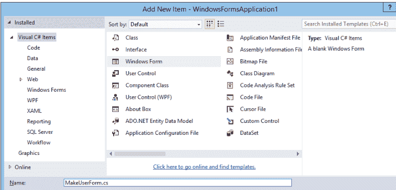

图 9-1

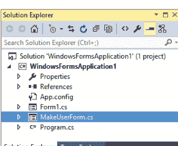

图 9-2

现在你可以向新表单添加标签 `Labels`、文本框 `TextBoxs`、按钮 `Buttons`、菜单栏 `MenuStrips` 以及你喜欢的任何其他控件。

> 注意记住，要在表单设计器中打开表单，请在解决方案管理器中双击它。

### 理解类和实例

当你向项目添加新表单时，你实际上添加的是一种新类型的表单，而不是该类型的实例。如果你将 `MakeUserForm` 类型添加到项目并运行程序，你仍然只能看到原始的启动表单，默认名称为 `Form1`，而看不见 `MakeUserForm`。

`Form1` 和 `MakeUserForm` 等表单类型是类 `classes`。它们就像是制作类副本的蓝图，而这些副本被称为实例 `instances`。这些是重要且有时令人困惑的类型，所以我现在简要解释它们，稍后在书中或第四部分的课程中进行更详细的解释。

类定义了来自该类的任何对象的特征。你的代码可以使用 `new` 关键字来创建类的对象。一旦定义了类，你就可以创建任意数量的副本，实例，而且每个副本在结构上都与其他完全相同。不同的实例可以有不同的属性值，但它们的整体特征是相同的。

> 注意你实际上已经接触类和实例一段时间了。`Form1` 是一个类。当你创建一个新项目时，Visual Studio 会添加代码来创建并显示 `Form1` 类的实例。

控件也是类。例如，`Label` 类定义了标签的行为。当你向表单中添加标签时，你实际上是将 `Label` 类的实例添加到表单中。这些实例可以具有不同的属性值，如 `BackColor`、`Enabled`、`Anchor` 和 `Text`，但它们遵循 `Label` 类定义的所有规则。

例如，你定义了一个 `MakeUserForm`，它包含 `First Name`、`Last Name`、`Street`、`City` 和 `ZIP` 标签以及文本框。现在你让程序显示了该类的两个实例。它们都具有相同的标签和文本框。然而，用户可以向这两个实例输入不同的值。

你的代码还可以以各种方式更改实例。例如，菜单项、按钮和控件可以调用事件处理程序来修改表单：更改颜色、移动控件、调整表单大小或任何操作。这是类最令人困惑的特性之一：事件处理程序中的代码会修改正在运行该代码的表单。

例如，你构建了一个带有三个按钮的表单分别将 `BackColor` 属性更改为红色、绿色和蓝色，然后显示了三个表单实例。当用户点击第一个红色按钮时，事件处理程序会将第一个表单变为红色，而其他保持不变。事件处理程序中的代码位于第一个表单实例中，因此它只影响它。

如果你现在认为我已经彻底解释了这个主题并理解了类 `MakeUserForm` 与实例 `屏幕上 MakeUserForm 的副本` 的区别，那么你就准备好学习如何显示表单了。

### 显示表单

`new` 关键字创建一个表单实例。如果你想对表单进行任何操作，你的代码需要引用它创建的实例。你可以通过变量 `variable` 来实现。虽然我提前讨论了变量，变量将在第 11 节中详细介绍，但就像我在第 8 节引入 `if` 语句一样，这个概念的特定用法非常有用且并不难理解。

简单来说，变量是存储可以包含数据的命命内存块。要声明一个引用表单实例的变量，你需要输入表单类型，然后跟上你想给变量的任何名称。

### 窗体数量

在 Windows Forms 应用程序中，启动窗的类型与其他任何窗体一样，这意味着你可以创建更多与启动窗看起来相同的窗体。

只要启动窗存在，程序就会运行。如果你关闭该窗体，其他窗体也会关闭。

为了避免混淆，通常应该让启动窗看起来与其他窗体不同，以便用户知道它是特殊的。

默认情况下，WPF 应用程序在关闭主窗口时，其他窗口继续运行。如果你希望在主窗口关闭时所有窗口都关闭，在主窗口的 `Loaded` 事件程序中执行以下语句：

```csharp
Application.Current.ShutdownMode = ShutdownMode.OnClose;
```

### 控制远程窗体

当你创建一个窗体并通过变量引用它时，可以使用可以使用变量来操作该窗体。这种技术有一个小问题：到目前为止变量没有保留得足够长。

例如，以下代码定义了 `newUserForm` 变量，使其指向一个新的窗体并显示该窗体：

```csharp
private void newUserButton_Click(object sender, EventArgs e)
{
    UserForm newUserForm;
    newUserForm = new UserForm();
    newUserForm.Show();
}
```

当程序执行完事件处理器时，事件处理器停止运行。如果用户再次点击按钮，事件处理器会再次运行。

遗憾的是，当事件处理器停止运行时，它失去了对 `newUserForm` 变量的引用。下次事件处理器运行时，它会创建一个名为 `newUserForm` 的新变量并与之工作。

对于想要操作新窗体的程序来说，由于变量消失很糟糕。

好消息是这很容易修复。如果你将变量移动到事件处理器外部，该变量在整个程序生命周期内都存在。事件处理器可以让变量指向一个新的窗体，并在之后使用该变量操作该窗体。

图 9-4 显示的 `RemoteForm` 示例使用以下主窗体代码管理辅助 `ColorForm`：

```csharp
// 我们将操作的远程窗体
ColorForm remoteColorForm;
```

```csharp
// 创建并显示远程窗体。
private void Form1_Load(object sender, EventArgs e)
{
    remoteColorForm = new ColorForm();
    remoteColorForm.Show();
}
```


```csharp
// 将颜色窗体变为红色。
private void redButton_Click(object sender, EventArgs e)
{
    remoteColorForm.BackColor = Color.Red;
    remoteColorForm.ForeColor = Color.Pink;
}
```

代码通过在任何事件处理器之外声明变量 `remoteColorForm` 开始。

当程序显示主窗体时，其 `Load` 事件处理器创建并显示了一个新的 `ColorForm`。

当用户点击主窗体的 Red 按钮时，其事件处理器将远程窗体的 `BackColor` 属性分别改为红色和粉色。启动窗还包含带有事件处理器的绿色和蓝色按钮。

`remoteColorForm` 变量声明在事件处理器之外，因此事件处理器可以访问它。窗体的 `Load` 事件处理器初始化变量并显示远程窗体。`redButton_Click` 事件处理器使用了它。由于变量声明在事件处理器之外，它们都可以都可以使用它。（第 13 节将更多关于代码何时以及何地可以使用变量。）

除了修改远程窗体的属性外，你还可以更改该窗体上控件的属性。你使用窗体变量、后跟点、再后跟控件名称来引用控件。

例如，以下代码中的粗体行访问了由远程 `ColorForm` 变量引用的窗体。它定位了 `messageLabel` 并将其 `Text` 属性更改为“I'm red”：

```csharp
private void btnRed_Click(object sender, EventArgs e)
{
    color_form.BackColor = Color.Red;
    color_form.ForeColor = Color.Pink;
    color_form.lblMessage.Text = "I'm red!";
}
```

这种技术有一个限制：默认情况下，窗体上的控件是私有的，因此其他窗体中的代码无法操作它们。你可以通过设置控件的 `Modifiers` 属性来轻松修复此：


在窗体设计器或代码中将其属性设置为 `Public`。现在其他窗体可以看到该控件并更改其属性。

> 注意：窗体上的控件是私有的，以防止其他代码意外破坏它们。通过将变量公开，你移除了这种安全措施。从技术术语来说，你削弱了窗体的封装性——即向外部世界隐藏内部细节的能力。

在这种情况下，你只想访问此标签的 `Text` 属性并将标签标记为公开。然而，通过将标签公开，你公开了所有的属性、方法和事件，而不仅仅是 `Text` 属性。

更具限制的方法是在 `ColorForm` 中添加一个 `SetCaption` 方法。然后其他代码将调用该方法而不是设置标签。

## 尝试一下

在此练习中，创建一个类似于图 9-5 所示的应用程序

## 要求

在本节中，你：

- 创建图 9-5 所示的窗体。
- 在事件处理器之外声明窗体变量。
- 在主窗体的 `Load` 事件处理器中添加代码创建实例但不显示它们。
- 在主窗体的按钮事件处理器中添加代码，以非模态方式显示相应的辅助窗体。

## 步骤

1. 创建 `GettingThereForm`。在属性窗口中，将其 `InMainWindow` 属性设置为 `False`。
2. 创建 `GettingAroundForm`。对 `GettingAroundForm` 重复步骤 2。将其 `Anchor` 属性设置为 `False`。
3. 创建 `LodgingForm`。对 `LodgingForm` 重复步骤 2。
4. 创建 `FunStuffForm`。对 `FunStuffForm` 重复步骤 2。保留 `CheckBox` 的 `Anchor` 属性为默认值 `Top, Left`。

## 练习

- 1. 构建如图图 9-3 所示的 `UserForms` 应用程序。
- 2. [WPF] 使用 WPF 重复练习 1。（提示：不要忘记在关闭主窗口时关闭所有表单。）
- 3. 构建如图图 9-4 所示的 `RemoteForm` 应用程序。
- 4. [WPF] 使用 WPF 重复练习 3。提示：
  > 在 WPF 中，将颜色设置等于 `Brushes.Red` 中的画刷。
  > 若要设置远程窗口的背景颜色，请设置它的 `Background` 属性。
  > 若要设置远程表单的文本颜色，请设置 `Label` 的 `Foreground` 属性。
  > 在 WPF 中，你不需要设置 `Modifiers` 属性。（WPF 控件没有该属性。）
- 5. 修改你为练习 3 编写程序，使按钮也能更改颜色表单上的标签。例如，红色按钮应该让标签 显示“I’m red!”（提示：不要忘记将 `Label` 的 `Modifiers` 属性设置为 `Public`。）
- 6. [WPF] 使用你为练习 4 构建的 WPF 应用程序重复练习 5。
- 7. [WPF] 使用 WPF 应用程序重复 Try。（提示：不要忘记设置 `ShowInTask` 属性。）
- 8. 遗憾的是 Try 有一个严重问题。如果你关闭任何一个子表单然后点击主表单的按钮重绘它，程序就会崩溃。
  当你关闭表单时，它会被销毁。当你再次点击按钮时，程序会尝试显示已销毁的表单，这将无法运行。
  要修复此程序，请为每个子表单提供一个类似于下面的 `FormClosing` 事件处理器：
```
private void LodgingForm_FormClosing(object sender,
ClosingEventArgs e)
{
    e.Cancel = true;
    Hide();
}
```
  第一条语句取消了关闭，因此表单保持显示。第二条语句使表单可见但保持其存活。
- 9. [WPF] 为你从练习 7 中构建的 WPF 程序重复练习 8。（提示：在 WPF 中，你需要使用 `Closing` 事件。）
- 10. 编写一个程序显示一个写有“New Form”的按钮。当用户点击按钮时，显示一个同类型表单的新非模态实例。（当你点击新表单的按钮会发生什么？如果你关闭新表单会发生什么？如果你创建了多个表单然后关闭原始表单会发生什么？）
- 11. [WPF] 使用 WPF 应用程序重复练习 10。在实验一段时间后，设置 `Application.Current.ShutdownMode = ShutdownMode.OnMainWindowClose` 并再次测试程序。
- 12. 复制练习 10 的程序，并在表单上添加一个名为 `valueTextBox` 的 `TextBox`。在显示表单之前，将主表单的 `TextBox` 值复制到新表单的 `TextBox` 中（提示：你不需要将 `TextBox` 的 `Modifiers` 属性设置为 `Public`，因为新表单与旧表单相同。如果只有一种类型的表单，才需要这样做。）
- 13. [WPF] 使用你为 11 创建的 WPF 程序重复练习 12。
- 14. 编写一个程序显示一个 `TextBox` 和一个“New Form”按钮。当用户点击按钮时，显示一个类型为 `MessageFormally` 的新表单。`MessageForm` 包含两个 `Label`。第一个 `Label` 显示“You entered.”。第二个是空的。当显示 `MessageForm` 时，主程序应该将其 `TextBox` 中的任何内容复制到 `MessageForm` 的第二个标签中。（提示：现在你需要将标签的 `Modifiers` 属性设置为 `Public`。）
- 15. [WPF] 使用 WPF 应用程序重复练习 14。
- 16. 构建如图图 9-6 所示的 Pick 应用程序。当用户点击主表单上的其中一个缩略图时，程序将显示一个 `MessageForm` 以以全比例显示该图片。使用你喜欢的任何图片。（img/73c7dcb173bcebb3d8a977355a5f3_183.png）
图 9-6
提示：
- 在 `ScaleMode` 设置为 `Zoom` 的 `PictureBox` 中显示缩略图。
- 在 `MessageForm` 上放置一个 `Location = (0, 0)` 的 `PictureBox`。设置其 `SizeMode` 为 `AutoSize`。
- 在显示 `MessageForm` 之前，使用以下代码使其适应其包含的 `PictureBox`：
```
newPictureForm.ClientSize = newPictureForm.Image.Size
```
- 17. [WPF] 使用 WPF 应用程序重复 16。提示：
- 在 `PictureWindow` 上，设置 `Image` 控件的大小以匹配图片的大小。
- 要使 `PictureWindow` 适应 `Image` 控件，请将窗口的 `SizeToContent` 属性设置为 `WidthAndHeight`。
- 18. [加 Bonus] 冗余代码通常是程序结构可以改进的迹象。练习 16 使用了四个相同的事件。唯一的区别是它们赋值给 `MessageForm` 的背景。你可以通过让所有四个 `PictureBox` 使用相同的事件处理器，并让该事件处理器确定使用哪张图片来改进。事件处理器的 `sender` 参数是触发事件的控件，在本例中即为用户点击的 `PictureBox`。该参数的数据类型是 `object`，但它实际上持有一个 `PictureBox`。你可以使用 `as` 关键字获取引用该 `PictureBox` 的变量，它告诉程序将某些值（在 `sender` 参数的情况下）视为另一种类型（在 `PictureBox`的情况下）。以下代码显示了如何获取一个处理该值的变量：
```
PictureBox selectedPictureBox;
selectedPictureBox = sender as PictureBox;
if (selectedPictureBox != null)
{
    messageForm.Image = selectedPictureBox.Image;
}
```
使用你为练习 16 的程序，通过 `as` 关键字处理 `sender` 参数的 `PictureBox`。
- 19. [加 Bonus] [WPF] 为你从练习 17 构建的 WPF 程序重复练习 18。

这意味着你可以用一行代码设置对话框的返回结果并关闭对话框。输入一行代码不应该是什么困难的事，但信不信，有一种更简单的方法可以关闭对话框。

如果你设置了按钮的 `DialogResult` 属性，按钮在被点击时会自动设置表单的 `DialogResult` 属性。例如，你将取消按钮的 `DialogResult` 属性设置为 `DialogResult.Cancel`。当用户点击该按钮时，它会自动将表单的 `DialogResult` 属性设置为 `DialogResult.Cancel`，从而自动关闭表单。这让你无需编写任何代码即可返回值并关闭表单。

如果你认为设置按钮属性太麻烦，你甚至可以避免这样做，至少对于取消按钮是。当你设置表单的 `CancelButton` 属性时，C# 会自动将按钮的 `DialogResult` 属性设置为 `DialogResult.Cancel`。

注意，当你设置表单的 `AcceptButton` 属性时，C# 不会自动设置按钮的 `DialogResult` 属性。假设是 OK 按钮在决定关闭对话框之前，可能需要验证用户在表单上输入的内容。例如，如果用户没有填写所有必填字段，OK 按钮可能会显示一条消息，要求用户填写剩余字段，而不是关闭对话框。

> 注意：实际上，这些方法是隐藏对话框并让控制权返回给调用代码，并没有调用它的 `Close` 方法。这意味着对话框没有销毁，因此调用代码可以查看用户在对话框输入的值。

如果你不想执行任何验证，可以只需将 OK 按钮的 `DialogResult` 属性设置为 `DialogResult.OK`。

## 使用自定义对话框

程序使用自定义对话框的方式与使用标准对话框完全相同。它创建、初始化并显示对话框。它检查返回结果并采取适当的操作。

程序在创建对话框的方式上略有不同，因为你可以在运行时向表单添加标准对话框，但对自定义对话框无法这样做。要使用自定义对话框，代码需要如第 9 节所示创建一个对话框表单的新实例。

以下代码显示了程序如何显示自定义对话框：

```csharp
// 让用户创建一个新客户。
private void newCustomerButton_Click(object sender, EventArgs e)
{
    // 创建并显示 NewCustomDialog。
    NewCustomDialog newCustomerDialog = new NewCustomDialog();
    if (newCustomerDialog.ShowDialog() == DialogResult.OK)
    {
      // 在 在此处创建新客户 ...
    }
}
```

代码声明了一个变量来引用对话框并创建了对话框的新实例。它使用 `ShowDialog` 方法显示对话框并检查返回结果。如果用户点击 OK，程序将采取所需的步骤来创建新客户，例如向数据库中添加记录。

## 尝试一下

在“尝试一下”中，你将构建并使用图 10-2 所示的简单自定义对话框。该对话框允许你输入名称。如果你输入了一个非空值并点击 OK，主表单会将你输入的名称添加到 `ListBox` 中。


这个“尝试一下”还让你练习使用 `ListBox` 控件，展示了如何添加和删除项目。

## 课程要求

在本节中，你将：

- 在图 10-2 的左上方创建主表单。将“新建喜剧演员”按钮设置为表单的 `AcceptButton`，将“删除喜剧演员”按钮设置为表单的 `CancelButton`。
- 创建图 10-2 右下方所示的对话框。以明显的方式设置 `AcceptButton` 和 `CancelButton` 属性。
- 让“新建喜剧演员”按钮显示对话框。如果对话框返回 `DialogResult.OK`，将新客户的名称添加到 `ListBox`。
- 让“删除喜剧演员”按钮从 `ListBox` 中移除当前选喜剧演员。

当用户点击对话框的取消按钮时，隐藏对话框并返回 `DialogResult.Cancel`。

当用户点击对话框的 OK 按钮时，检查输入名称的长度。如果长度为 0，显示消息要求用户输入名称。如果长度大于 0，隐藏对话框并返回 `DialogResult.OK`。

> **注意** 你可以从 www.wrox.com/go/csharp24hourtrainer2e 下载本节的代码和资源。

## 提示

- 使用 `ListBox` 的 `Items.Add` 方法向 `ListBox` 添加新项目。
- 使用 `ListBox` 的 `Items.Remove` 方法删除项目（通过 `SelectedItem` 属性识别）。
- 检查 `TextBox.Text.Length == 0` 以查看对话框上输入的名称是否为空。使用类似的新代码，在长度为 0 时执行一个操作，在不时不执行另一个操作。注意语句中新的 `else` 部分。如果条件为真，则执行 `else` 之前的语句。如果条件为假，则执行 `else` 之后的语句。（第 18 节将详细介绍 if）。

```csharp
if (nameTextBox.Text.Length == 0)
{
    // 在此处显示消息 ...
}
else
{
    // 在此处返回 DialogResult.OK ...
}
```

- 不要忘记将 `nameTextBox` 控件的 `Modifiers` 属性设置为 `Public`，以便主函数代码可以使用。

## 步骤

- 创建图 10-2 左上方所示的主表单。将“新建喜剧演员”按钮设置为表单的 `AcceptButton$，将“删除喜剧演员”按钮设置为表单的 `CancelButton`。
- 1. 启动新项目并按图 10-2 所示添加 `Label`、`ListBox` 和两个按钮。
- 2. 设置 `ListBox` 的 `Anchor` 属性为 `Top, Bottom, Left, Right`。设置按钮的 `Anchor` 属性为 `Top, Right`。
- 3. 将表单的 `AcceptButton` 属性设置为“新建喜剧演员”按钮。将其 `CancelButton` 属性设置为“删除喜剧演员”按钮。

创建图 10-2 右下方所示的对话框。以明显的方式设置 `AcceptButton` 和 `CancelButton` 属性。

- 1. 打开项目菜单并选择添加 Windows窗。输入名称 `NewComedianDialog` 并点击添加。
- 2. 按图 10-2 所示添加 `Label`、`TextBox`、`PictureBox` 和两个按钮。
- 3. 设置 `TextBox` 的 `Anchor` 属性为 `Top, Left`。
- 4. 设置按钮的 `Anchor` 属性为 `Top, Right`。
- 5. 将表单的 `AcceptButton` 属性设置为“新建喜剧演员”按钮。将其 `CancelButton` 属性设置为“删除喜剧演员”按钮。
- 6. 将对话框的 `BorderStyle` 属性设置为 `FixedDialog`。

# 154 | 第 10 课 构建自定义对话框

对于“尝试一下（Try It）”，请添加以下事件处理程序，以便在 `ListBox` 的选择更改时启用或禁用按钮：


```csharp
// 如果选中了项，则启用“删除喜剧”按钮。
private void comedianListBox_SelectedIndexChanged(
    object sender, EventArgs e)
{
    deleteComedianButton.Enabled =
    (comedianListBox.SelectedIndex >= 0);
}
```

提示：不要忘记禁用按钮。

- 3. [WPF] 使用你为练习 1 构建的 WPF 程序重复练习 2。（提示：在 WPF 中，按钮（Button）拥有的是 `IsEnabled` 属性，而不是 `Enabled` 属性。）

- 4. 复制你为练习 2 构建的程序。为了进一步帮助用户避免错误，修改对话框，使得当 `TextBox` 不为空时 OK 按钮为启用状态。

  > 使用 `TextBox` 的 `Changed` 事件处理程序。

  > 因为用户在文本为空时无法点击 OK 按钮，因此 OK 按钮不需要 `Clicked` 事件处理程序。

- 5. [WPF] 使用你为练习 3 构建的 WPF 程序重复练习 4。（提示：在 WPF 中，按钮没有 `DialogResult` 属性。OK 按钮仍然需要一个 `Click` 事件处理程序，但它只需要设置表单的 `DialogResult` 属性。）

- 6. 编写一个包含名、姓、街道、城市、州和邮编标签的程序，如图 10-3 中的信息表所示。当用户点击“编辑”按钮时，程序应该显示图 10-3 所示的“编辑联系人”对话框，让用户更改数值。如果用户点击 OK，将新值复制回主表单的标签。


图 10-3

- 7. [WPF] 使用 WPF 重复练习 6。

- 8. 有时，通过 `MessageBox.Show` 显示的标准消息框几乎很完美，但你想更改按钮的文本。创建一个程序，定义图 10-4 所示的消息对话框。

www.it-ebooks.info

## 练习 | 155


图 10-4

主程序应该设置标签的文本、对话框的标题以及按钮的文本。让 Accept 按钮返回 `DialogResult.OK` 让 Decline 按钮返回 `DialogResult.Cancel`。主表单根据用户点击 Accept 或 Decline 显示不同的消息。

提示：

- 问号图标显示在 `PictureBox` 中。

- 设置对话框的属性：`BorderStyle = FixedDialog`, `ControlBox = False`, 且 `ShowInTaskbar = False`。

- 9. [WPF] 使用 WPF 程序重复练习 8。提示：

* 要设置对话框标题，请设置其属性。

* WPF Label 控件不支持自动换行。要让对话框文本换行，请使用 `TextWrapping` 设置为 `Wrap` 的 `TextBlock`。

- 10. 创建一个类似于图 10-5 所示的颜色选择对话框。主程序的按钮应该显示该对话框，让用户选择前景颜色和背景颜色。只有当用户点击 OK 时才更新主表单的颜色。不需要担心在显示之前初始化对话框以显示当前值。（提示：你已经在第 4 课的“尝试一下”中构建过允许用户通过滚动条选择颜色的程序。）


图 10-5

www://it-ebooks.info

# 11. [WPF] 使用 WPF 程序重复练习 10。提示：

- 在 Border 控件中显示颜色样本。

- 让滚动条共享以下事件处理程序：

```csharp
// 显示颜色样本。
private void redScrollBar_Scroll(object sender, System.Windows.Controls.Primitives.ScrollEventArgs e)
{
    redLabel.Content = redScrollBar.Value.ToString("0");
    greenLabel.Content = greenScrollBar.Value.ToString("0");
    blueLabel.Content = blueScrollBar.Value.ToString("0");

    Color color = Color.FromRgb(
    (byte)redScrollBar.Value,
    (byte)greenScrollBar.Value,
    (byte)blueScrollBar.Value);
    sampleBorder.Background = new SolidColorBrush(color);
}
```

12. 创建一个类似于图 10-6 所示的背景选择对话框。当用户点击主表单的“选择背景”按钮时，表单显示对话框。当用户点击缩略图之一时，对话框会在该 `PictureBox` 周围显示边框。如果用户点击 OK，对话框关闭，主表单全比例显示选中的图片。


图 10-6

提示：

- 当用户点击 OK 时，对话框关闭，主表单全比例显示选中的图片。

- 如果用户点击 Cancel，对话框关闭，主表单保持不变。

- 13. [WPF] 使用 WPF 重复练习 12。提示：

* 使用 Image 控件显示图片。

* 使用 Border 控件代替 PictureBox 来显示选择边框。

- 14. 创建一个程序，允许用户从列表中选择多个项并在单独窗口中显示它们。当用户点击 OK 时，选中的项将被添加到主表单的 ListBox 中。

## 位与字节

**位（bit）**是内存中的单个二进制数字，其值可以为 0或1。（“bit”一词源于“Binary digIT”（二进制数字）。或者应该是“Binary digIT?” 呢？）通常情况下，位被分组为字节（byte），程序不会直接与位进行操作。

**字节（byte）**是一个包含 8 个位的内存块。如果你将这些位看作二进制数中的数字，那么一个字节可以存储从 0（二进制的 00000000）到 255（二进制的 11111111）之间的值。字节的组构成了更高级的数据类型，例如整数和字符串。

**半字节（nibble）**是一个字节的一半。在很久以前，内存非常昂贵，电脑占据整个仓库而不是笔记本电脑的时代，某些程序需要拆分字节并单独考虑半字节以节省空间。现在内存已经像日常忠诚度积分一样廉价，半字节已成为一个历史性的奇闻，大多数时候用是在派对上用来显得你的朋友。

内存的二进制单位：千字节（KB） = 1024 字节，兆字节（MB） = 1024KB，吉字节（GB） = 1024MB，太字节（TB） = 1024GB。这些通常用于测量文件、计算机内存、闪存驱动和硬盘的大小。（尽管在某些场景下，人们使用 1000 的幂次方而不是 1024。例如，大多数驱动器制造商将一个千字节定义为 1,000,000,000 字节，这在句子中会导致高达 70MB 的差异。）

有时两种数据类型之间的边界是模糊的。例如，如果一个变量应该存储一个数字，你不能把它放入字符串“ten”中。“ten”是一个数字这一事实对于人类来说是显而易见的，但对于 C# 程序来说不是。

你不能在一个存储数字的变量中，放入一个包含字符“10”的字符串。尽管对任何人来说，“10”是一个数字应该是显而易见的，但 C 仅仅知道它是一个包含两个字符“1”和“0”的字符串，而不会尝试确定字符串中的字符是否代表数字。

程序通常需要将值从一种数据类型转换为另一种（特别是在字符串和数字之间切换），因此 C 提供了各种数据转换函数来实现这一目标。本节稍后的“类型转换”部分描述了这些函数。

表 11-1 总结了 C# 的内建类型。有符号类型可以存储正值或负值，而无符号类型只能包含正值。

### 表 11-1

| 数据类型 | 含义 | 范围 |
|---|---|---|
| `byte` | 字节 | 0 到 255 |
| `sbyte` | 有符号字节 | –128 到 127 |
| `short` | 短有符号整数 | –32,768 到 32,767 |
| `ushort` | 无符号短整数 | 0 到 65,535 |
| `int` | 整数 | -2,147,483,648 到 2,147,483,647 |
| `uint` | 无符号整数 | 0 到 4,294,967,295 |
| `long` | 长整数 | -9,223,372,036,854,775,808 到 9,223,372,036,854,775,807 |
| `ulong` | 无符号长整数 | 0 到 18,446,744,073,709,551 |
| `float` | 浮点 | 大约 -3.4e38 到 3.4e38 |
| `double` | 双精度浮点 | 大约 -1.8e308 到 1.8e308 |
| `decimal` | 比浮点精度更高且范围更小 | 参见后续：“Float、Double 和 Decimal 类型” |
| `char` | 字符 | 单个 Unicode 字符。（Unicode 字符使用 16 位来存储阿拉伯语、西尔语、希腊语和泰语等脚本的数据，此外罗马字母表。） |
| `string` | 文本 | Unicode 字符字符串。 |
| `bool` | 布尔值 | 可以为真或假。 |
| `object` | 对象 | 可以指向几乎任何内容。 |

其中一些可能有点困惑，但最常见的数据类型（`int`, `long`, `float` 和 `double`）非常直观，而且它们是大多数类型的重点。然而，在进入更多细节之前，值得花一点比较一下 `float`、`double` 和 `decimal` 数据类型。

## Float、Double 和 Decimal 数据类型

计算机使用二进制位和字节来表示类型中的每个值，但某些值并不能完美地适应特定的数据类型。特别是像 1/7 这样的实数没有精确的表示，因此 `float`、`double` 和 `decimal` 类型经常引入轻微的舍入误差。

例如，`float` 将 1/7 表示为大约 0.1428571429。通常情况下，1/7 本身并不是问题，但过一会儿如果你比较两个 `float` 值以判断它们是否完全相等，舍入误差会让它们看起来不同，尽管它们是相同的。

`decimal` 数据类型有助于减少十进制数值的这个问题。（注：原文此处存在大量重复的无效文本，已按要求处理。）

# 166 | 第 11 课 使用变量和执行计算

`int` 类型没有字面量后缀。C# 假设看起来像整数的字面量是 `int`，除非它太大，在这种情况下它会假设该值为 `long`。例如，它假设 2000000000 是一个 `int`，因为该值可以放入 `int` 中。它假设 3000000000 是一个 `long`，因为它太大，无法放入 `int` 中。

`byte`、`short` 和 `ushort` 数据类型也没有字面量后缀字符。幸运的是，你可以为这些类型分配整数值，只要它们在范围内，C# 就会正确使用该值。

你可以使用双引号包含字符串，使用单引号包含 `char`，如下所示：

有时你可能想在字符串字面量中包含特殊字符，例如回车符或制表符。遗憾的是，你不能简单地在字符串中输入回车，因为这将开始新的一行代码，并让 Visual Studio 困惑。

为了解决这个困境，C# 提供了表示特殊字符的转义序列。转义序列是表示回车或制表符等特殊字符的字符序列。

表 11-3 列出了 C# 的转义序列。

| 序列 | 含义 |
| --- | --- |
| `\a` | 响铃 (Bell) |
| `\b` | 退格 (Backspace) |
| `\f` | 换页 (Formfeed) |
| `\n` | 换行 (Newline) |
| `\r` | 回车 (Carriage return) |
| `\t` | 水平制表符 (Horizontal tab) |
| `\v` | 垂直制表符 (Vertical tab) |
| `\'` | 单引号 |
| `\"` | 双引号 |
| `\\` | 反斜杠 |
| `\?` | 问号 |
| `\000` | 八进制表示的 ASCII 字符 (ooo 代表八进制代码) |
| `\xhh` | 十六进制表示的 ASCII 字符 (hh 代表十六进制代码) |
| `\hhhh` | 十六进制表示的 Unicode 字符 (hhhh 代表十六进制代码) |

例如，以下代码创建了一个变量，引用包含引号和换行符的字符串：

```csharp
string txt = "Unknown value \ten\\nPlease enter a number.";
```

当你在 `MessageBox` 中显示此字符串时，用户会看到类似下面的文本：

- Unknown value "ten."

- Please enter a number.

> 注意：当在 Label（或 MessageBox）中显示文本时，可以使用换行转义符 (`\n`) 开始新行。然而，在 TextBox 中显示文本时，必须同时使用回车和换行转义符 (`\r\n`) 开始新行。（r\n) 序列也适用于 Label 和 MessageBox。

C# 提供了逐字字符串字面量（verbatim string literal），让某些特殊字符更容易处理。这种值以 @" 开头，以闭合引号 (") 结束。在引号之间，字面量不会识别任何转义序列，并将每个字符视为字面量。

逐字字面量不能包含双引号，因为这将结束字符串。它甚至不能使用转义的双引号，因为逐字字面量不理解转义序列。

如果你需要一个包含大量反斜杠的字符串（例如 Windows 目录路径 `C:\Tools\Binary\Source\PrintInvoices`），或者需要描述转义序列本身（"使用 `\r\n` 开始新行"），逐字字符串非常有用。

你可以在字符串字面量内部输入换行和制表符字符，尽管这些可能会让你的代码更难读。

## 类型转换

C# 在知道转换是安全的情况下会执行隐式数据转换。例如，以下代码声明了一个 `long` 变量并将其设置为 `int` 值 6。因为 `int` 总是可以放入 `long` 中，C# 知道这不会报错：

```csharp
long numBananas = 6;
```

反之并不总是成立。`long` 值并不总是能放入 `int` 变量中。因为无法无法预知任何给定的 `long` 是否能放入 `int`，所以当你的代码将 `long` 值赋值给 `int` 时，C# 不会静静坐旁不管。

例如，该代码给一个 `long` 变量赋值了一个值。它尝试将该 `long` 值保存到 `int` 变量中。此时，C# 会报错并标记该行 错误：

```csharp
long numBananas = 6;
int numFruits = numBananas;
```

在这些情况下，你可以使用三种方法强制 C# 将数据从一种类型转换为另一种类型：强制转换（casting）、转换（converting）和解析（parsing）。

## 强制转换

要将值从一种数据类型转换为另一种，将目标数据类型放在前面的括号内。例如，以下代码显式将变量 `numBananas` 转换为 `int`：

```csharp
long numBananas = 6;
int numFruits = (int)numBananas;
```

强制转换仅适用于兼容的数据类型之间。例如，`double` 和 `int` 都是数字，所以你可以在它们之间进行转换。（当你从 `double` 转换为 `int` 时，强制转换会丢弃值的任何小数部分而不进行四舍五入。）`string` 和 `bool` 类型与数值类型或其他类型兼容，因此你不能在它们之间进行转换。（语句 `(int)"platypus"` 到底是什么意思？）

通常，强制转换不检查是否成功。如果你尝试将 `long` 转换为 `int` 且 `long` 无法容纳，C# 会像选举年份的政客一样掩盖问题，程序继续运行。进入 `int` 的值可能是乱码，或者程序会崩溃。

如果 `int` 现在包含了垃圾数据，你对其执行的任何计算也将是垃圾数据，因此在许多情况下，你应该使用 `checked` 关键字。

要将值从一种数据类型转换为另一种，将目标数据类型放在前面的括号内。例如，以下代码显式将变量 `numBananas` 转换为 `int`：

```csharp
long numBananas = 6;
int numFruits = (int)numBananas;
```

强制转换仅适用于兼容的数据类型之间。例如，`double` 和 `int` 都是数字，所以你可以在它们之间进行转换。（当你从 `double` 转换为 `int` 时，强制转换会丢弃值的任何小数部分而不进行四舍五入。）`string` 和 `bool` 类型与数值类型或其他类型兼容，因此你不能在它们之间进行转换。（语句 `(int)"platypus"` 到底是什么意思？）

通常，强制转换不检查是否成功。如果你尝试将 `long` 转换为 `int` 且 `long` 无法容纳，C# 会像选举年份的政客一样掩盖问题，程序继续运行。进入 `int` 的值可能是乱码，或者程序会崩溃。

如果 `int` 现在包含了垃圾数据，你对其执行的任何计算也将是垃圾数据，因此在许多情况下，你应该使用 `checked` 关键字。

要将值从一种数据类型转换为另一种，将目标数据类型放在前面的括号内。例如，以下代码显式将变量 `numBananas` 转换为 `int`：

```csharp
long numBananas = 6;
int numFruits = (int)numBananas;
```

# 转换


强制转换发生在兼容类型之间。`Convert` 工具类（由 .NET Framework 提供）提供了你可以使用的方法，即使数据类型不兼容也可以。有时，你可能想将 `int` 转换为 `bool` 反之。在这种情况下你使用 `ToBoolean` 和 `Int32` 方法（使用 `Int32` 是因为 `int` 是 32 位整数）。

以下代码声明了两个 `int` 变量并为它们赋值。使用 `Convert` 将它们转换为 `bool`，然后将其中一个转换回 `int`：

```csharp
int trueInt = -1;
int falseInt = 0;
bool trueBool = Convert.ToBoolean(trueInt);
bool falseBool = Convert.ToBoolean(falseInt);
int anotherTrue = Convert.ToInt32(trueBool);
```

> 注意：当你将整数值视为布尔值时，值0 为假，所有其他值均为真。如果你将布尔字面值 `true` 转换为整数，你会得到 -1。

在一种特别常见的情况下，程序必须将用户输入的文本转换为其他数据类型，例如 `int` 或 `decimal`。以下使用 `Convert.ToInt32` 方法将用户在 `ageTextBox` 中输入的任何内容转换为 `int`：

```csharp
int age = Convert.ToInt32(ageTextBox.Text);
```

## 解析

在文本中寻找结构和含义被称为解析。所有简单类型（`int`、`double`、`decimal`）都提供将文本转换为该数据类型的方法。例如，`int` 类型的 `Parse` 方法接受字符串作为参数并返回 `int`。至少当字符串包含一个整数值时是这样。

以下代码声明了一个名为 `salary` 的 `decimal` 变量，使用 `decimal` 类 `Parse` 方法将 `salaryTextBox` 中的值转换为 `decimal`，并将结果保在变量中：

```csharp
decimal salary = decimal.Parse(salaryTextBox.Text);
```

与 `Convert` 方法类似，只有当文本可以合理转换为小数时，此方法才有效。如果用户输入“12,345.67”，解析即可工作。如果用户输入“ten”或“1.2.3”，解析将失败。

> 注意：遗憾的是，C# 的转换和解析方法会被某些你可能认为它们能理解的格式所困。例如，它们无法处理货币字符，因此在处理“$12.34”和“$54.32”等字符串时会失败。

你可以通过传递第二个参数来告诉 `decimal` 类的 `Parse` 方法允许货币值，如下代码所示：

```csharp
decimal salary = decimal.Parse(salary.Text, System.Globalization.NumberStyles.Any);
```

## 执行计算

你已经见过了一些给变量赋值的代码。例如，以下代码将 `salaryText` 中的文本转换为 `decimal` 并保存在变量 `salary` 中：

```csharp
decimal salary = decimal.Parse(salary.Text);
```

你也可以将更复杂计算的结果保存到等号左侧的变量中。幸运的是，这类计算的语法通常易于理解。以下代码计算了 `2736 + 7281 / 3` 的值并将其存在变量 `result` 中：

```csharp
double result = 2736 + 7281 / 3;
```

操作数（表达式中使用的值）可以是字面量、存储在变量中的值或方法的结果。例如，以下代码计算购买小额的税。它将税率乘以 `subtotalText` 框的值，并将结果存在变量 `salesTax` 中：

```csharp
decimal salesTax = taxRate * decimal.Parse(subtotalText.Text);
```

注意，变量可以同时出现在等号的两侧。在这种情况下，右侧的值是变量当前的值，新结果将保存回同一个变量。

例如，以下代码获取 `x` 的当前值，将其翻倍，加 10，并将结果保存回 `x`。如果 `x` 的初始值为 3，那么当该语句执行完毕，`x` 的值为 16：

```csharp
x = 2 * x + 10;
```

后续章节提供了有关执行计算的更多细节。

### 操作数和运算符

让一些人困惑的问题是，C# 使用表达式操作数的数据类型来决定运算符的作用方式。如果一个表达式包含两个 `int`，运算符将使用整数算术。如果一个表达式包含两个 `float`，运算符将使用浮点算术。

有时这会导致令人困惑的结果。例如，以下代码尝试将 `1/7` 的值保存到 `float` 变量 `ratio` 中。值 1 和 7 是整数，因此此计算使用整数除法，会丢弃任何余数。因为 `1/7 = 0` 且余数为 1，`ratio` 被赋值为 0，这可能不是你预期的结果：

```csharp
float ratio = 1 / 7;
```

要在 C# 中使用浮点除法，你可以将数字转换为 `float` 数据类型。以下代码使用 `F` 后缀字符来表示 1 和 7 应该是 `float` 数据类型而不是 `int`。现在程序执行浮点除法，因此它为 `ratio` 赋值了值 `0.142857149`（近似值）：

```csharp
float ratio = 1F / 7F;
```

除了使用后缀，你还可以使用强制类型转换让程序在以下代码中将值视为 `float`：

```csharp
float ratio = (float)1 / (float)7;
```

### 提升

如果表达式使用了两种数据类型，C# 会提升限制性更强的类型。例如，如果你将一个 `int` 除以一个 `float`，C# 在执行前会将 `int` 提升为 `float`。

代码将一个 `float` 除以一个 `int`。在执行计算之前，C# 将值 7 提升为 `float`。这有时被称为隐式转换。随后代码执行除法并将结果 `0.142857149` 保存到变量 `ratio` 中：

```csharp
float ratio = (float)1 / 7;
```

### 运算符总结

C# 有许多处理不同类型变量的运算符。这些章节按操作数类型（算术、字符串、逻辑等）描述常用的运算符。

记住，某些运算符的行为取决于其操作数的数据类型。

### 算术运算符

算术运算符对数字进行计算。表 11-4 总结了算术运算符。示例列显示了示例结果。对于最后的示例，假设 `x` 是一个初始值为 10 的 `int`。

#### 表 11-4

| 运算符 | 含义 | 示例 |
| --- | --- | --- |
| + | 加法 | 3 + 2 等于 5 |
| - | 取负 | -3 是负 3 |
| - | 减法 | 3 - 2 等于 1 |
| * | 法 | 3 * 2 等于 6 |
| / | 除法（整数） | 3 / 2 等于 1 |
| / | 除法（浮点） | 3F / 2F 等于 1.5 |
| % | 取模 | 3 % 2 等于 1 |
| ++ | 前增 | ++x: x 增加到 11 然后语句使用新值 |
| ++ | 后增 | x++: x 增加到 11 然后语句使用新值 |
| -- | 递减 | --x: x 减少到 9 然后语句使用新值 |
| -- | 后减 | x--: x 减少到 9 然后语句使用新值 |

> 注意：字符串操作中一个不明显的事实是，计算并不会真正将结果保存在赋值语句左侧变量所使用的内存中。相反，它会创建一个新的字符串来存储计算结果，并让变量指向该字符串。

例如，考虑以下代码：

```cs
string greeting = usernameTextBox.Text;
greeting = "Hello " + greeting;
```

这段代码看起来像是将用户的姓名存储在变量 `greeting` 中，然后在前面加上了 "Hello"。实际上，第二条语句创建了一个包含 "Hello" 和用户姓名的新字符串，然后让 `greeting` 指向这个新字符串。

对于许多实际应用来说，这种差异很小，你可以忽略它。但是，如果你在第 19 节描述的某个循环中执行了大量的拼接操作，你的程序可能会出现性能问题。`StringBuilder` 类可以帮助解决这个问题，但它比我在这里将涵盖的内容要稍微高级一些。更多信息请访问 mdn.microsoft.com/。

## 比较运算符

比较运算符比较两个值并根据这些值的关系返回 true 或 false。例如，如果 x 小于 y，则 `x < y` 返回 true。

表 11-6 汇总了比较运算符。

| 运算符 | 含义 | 示例 |
| --- | --- | --- |
| == | 等于 | 2 == 3 为 false |
| != | 不等于 | 2 != 3 为 true |
| < | 小于 | 2 < 3 为 true |
| <= | 小于或等于 | 2 <= 3 为 true |
| > | 大于 | 2 > 3 为 false |
| >= | 大于或等于 | 2 >= 3 为 false |

## 位运算符

位运算符允许你操作整数值中的二进制位。例如，位或运算符 `|` 将两个值中的位结合起来，使得只要两个操作数中有一个对应的位为 1，结果的对应位就为 1。

例如，假设 x 和 y 是位值为 1000000 和 0000001 的字节值。那么 `x | y` 的结果为 1000001。

如果你像下面所示将 y 写在 x 下方，这可能更容易理解：

```
x: 1000000
y: 0000001
      -------
Result: 1000001
```

现在很容易看出，在 x 或 y 具有 1 的地方，结果也有一个 1。

位运算符相当高级，所以我不会对它们进行太多深入介绍，但表 11-7 对它们进行了汇总。位运算符之所以不被称为“位”，是因为它们不是一次只比较两个操作数，但它们是位操作运算符，因此被包含在此处。

### 表 11-7 示例

| 运算符 | 含义 | 示例 |
| --- | --- | --- |
| & | 位与 | 11110000 & 00111000 = 00110000 |
| | | 位或 | 11110000 | 00111100 = 11111100 |
| ^ | 位异异 | 11110000 ^ 00111100 = 11001100 |
| ~ | 位取反 | ~11110000 ~ 00001111 |
| << | 左移 | 11100111 << 2 = 10011100 |
| >> | 右移（用于有符号类型） | 11100111 >> 2 = 11111001 |
| >> | 右移（用于无符号类型） | 11100111 >> 2 = 00111001 |

如果操作数是有符号类型（如 `sbyte`、`int` 或 `long`），那么 `>>` 会让左侧的新位成为数值符号位（最左侧位）的副本。如果操作数是无符号类型（`byte`、`uint`、`ulong`），则 `>>` 会让新位变为 0。

除了 `-` 之外，所有运算符都有对应的复合赋值运算符，例如 `&=` 和 `<<=`。复合赋值运算符将在下一节描述。

## 赋值运算符

赋值运算符将变量（或属性等）设置为某个值。其中最简单的是 `=` 运算符，你之前已经见过几次。该运算符简单地将右侧的任何内容分配左侧的变量。

其他赋值运算符被称为复合赋值运算符，它们以某种方式将变量的当前值与右侧的内容结合。例如，以下代码如下：

```cs
x += 3;
```

这与没有使用 `+=` 运算符的语句效果相同：

```cs
x = x + 3;
```

表 11-8 汇总了赋值运算符。在示例中，假设 `i` 是 `int`，`x` 是 `float`，`a` 和 `b` 是 `bool`。

#### 表 11-8

| 运算符 | 含义 | 示例 | 含义 |
| --- | --- | --- | --- |
| = | 赋值 | x = 10; | x = 10; |
| += | 相加并赋值 | x += 10; | x = x + 10; |
| -= | 减法并赋值 | x -= 10; | x = x - 10; |
| *= | 乘法并赋值 | x *= 10; | x = x * 10; |
| /= | 除法并赋值 | x /= 10; | x = x / 10; |
| %= | 取模并赋值 | x %= 10; | x = x % 10; |
| &= | 位与赋值 | x &= 10; | x = x & 10; |
| |= | 位或赋值 | x |= 10; | x = x | 10; |
| ^= | 位异异赋值 | x ^= 10; | x = x ^ 10; |
| <<= | 左移赋值 | x <<= 10; | x = x << 10; |
| >>= | 右移赋值 | x >>= 10; | x = x >> 10; |

## 优先级

运算符的优先级决定了当表达式包含多个运算符时的计算顺序。例如，在 `3 + 4 * 2` 中，乘法先执行。表 11-9 显示了按优先级从高到低排列的运算符。

| 分类 | 运算符 |
| --- | --- |
| 基础 | ( ), [ ], . |
| 一元 | ++ -- + ! ~ |
| 乘法 | * / % |
| 加法 | + - |
| 关系 | < > <= >= |
| 等于 | == != |
| 逻辑与 | && |
| 逻辑异异 | ^ |
| 逻辑或 | || |
| 赋值 | = += -= *= %= &= |= ^= <<= >>= |

当多个运算符具有相同的优先级时，它们从左到右计算。例如，在 `10 - 5 - 2` 中，减法按照顺序执行。

括号可以覆盖默认的优先级规则。例如，在表达式 `(3 + 4) * 2` 中，先执行加法，结果为 14。

> 注意括号是使代码更易理解的工具。除非表达式简单到显而易见，否则请加上括号。

## 常量

常量类似于变量，但在声明它时必须赋值，并且之后不能更改它的值。

语法上，常量与变量相似，但它使用了 `const` 关键字。对于示例，以下代码声明了一个小数型常量 `taxRate` 并将其赋值为 `0.09M`。代码随后在计算中使用它：

```cs
const decimal taxRate = 0.09M;
decimal subtotal = decimal.Parse(subtotalTextBox);
decimal salesTax = taxRate * subtotal;
decimal grandTotal = subtotal + salesTax;
```

常量的作用就像值一样，你可以在之前的计算中替换字面值 `0.09M`。然而，使用常量使代码更容易读。当你看到 `0.09M` 时，你需要记住或猜测这是税率。

不仅很难记住这种“魔法数字”的含义，而且如果它出现在程序的很多地方，修改它也很困难。假设代码在多处使用了该值，你需要找到所有出现并修改它们。如果你漏掉了一些，可能会得到非常混乱的结果。如果程序在某些地方也使用 `0.09M` 表示其他值，情况会更加混乱。如果你更改了这些值，就会破坏使用这些值的代码。

注意，只要 C# 可以在程序实际运行之前执行计算，常量就可以包含表达式。例如，以下代码定义了一个每英寸厘米数的常量。

```cs
const double cmPerInch = 2.54;
const double cmPerFoot = cmPerInch * 12;
```

## 尝试一下

在练习中，你将进行一些计算。获取用户输入的值，将其转换为数字，进行乘法和加法，并显示结果。

## 课程要求

在本节中，你将：

- 创建如图11-1所示所示的表单。


图 11-1

- 当用户点击计算（Calculate）按钮时，让程序执行：

    - 将每个项目的数量（Quantity）乘以其单价（Price Each），并将结果显示在对应的项目金额（Item Total）TextBox 中。

    - 将所有项目总金额（Item Total）的值相加，并将结果显示在小计（Subtotal）TextBox 中。

    - 将小计乘以输入的税率（Tax Rate），并将结果显示在销售税（Sales Tax）TextBox 中。

    - 将小计、销售税和运费（Shipping）值相加，并将结果显示在总计（Grand Total）TextBox 中。

> 注意：你可以从网站 www.wrox.com/go/csharp24hourtrainer2e 下载本节的代码和资源。

## 提示

- 将此类计算分为三个独立的阶段进行通常很有帮助：

    1. 从用户处获取输入值并存储在变量中。

    2. 执行计算。

    3. 显示结果。

使用 `decimal` 数据类型来表示货币值的变量。

第14节关于字符串的处理和格式化有更多介绍，但对于这个“尝试一下”，最好知道所有数据类型都提供一个 `ToString` 方法，可以将值转换为字符串。一个可选参数字符串指示了要使用的格式。在本次练习中，我们使用格式 "C"（包括引号）来表示货币格式，例如：

```csharp
grandTotalTextBox.Text = grandTotal.ToString("C");
```

如果程序尝试执行计算但缺少某些所需值（例如，其中一个 Price TextBox 为空），程序将会崩溃。暂时不要担心它。

## 步骤详解

- 创建如图11-1所示的表单。

- 创建图11-1所示的程序控件：

    - a. 数量（Quantity）是 `NumericUpDown` 控件。

    - b. 其他所有框控件都是 `TextBox`。


- c. 输出控件（用于项目金额、小计、销售税和总计）是 `ReadOnly` 属性为 `True` 的 `TextBox`。

- d. 将表单的 `AcceptButton` 属性设置为计算（Calculate）按钮。

- 为程序需要管理的控件命名。包括所有 `NumericUpDown` 控件、所有的 `TextBox` 以及按钮（Button）。

当用户点击按钮时，让程序执行：

- 将每个项目的数量值乘以其单价值，并将结果显示在对应的项目金额 `TextBox` 中。

- 将所有项目金额值相加，并将结果显示在小计 `TextBox` 中。

- 将小计值乘以输入的税率，并将结果显示在销售税 `TextBox` 中。

- 将小计、销售税和运费值相加，并将结果显示在总计 `TextBox` 中。

通过三个步骤很容易完成：

- 从用户处获取输入值并存储在变量中。因为它们已经是数值，代码不需要从 `NumericUpDown` 控件的 `Value` 属性中解析值。程序确实需要解析 `TextBox` 中的值以将其转换为 `decimal` 值：

```csharp
// 获取输入值；
decimal quantity1 = qty1NumericUpDown.Value;
decimal quantity2 = qty2NumericUpDown.Value;
decimal quantity3 = qty3NumericUpDown.Value;
decimal quantity4 = qty4NumericUpDown.Value;
```

# 182 | 第11节 使用变量和执行计算

```csharp
decimal priceEach1 = decimal.Parse(priceEach1TextBox.Text);
decimal priceEach2 = decimal.Parse(priceEach2TextBox.Text);
decimal priceEach3 = decimal.Parse(priceEach3TextBox.Text);
decimal priceEach4 = decimal.Parse(priceEach4TextBox.Text);
decimal taxRate = decimal.Parse(taxRateTextBox.Text);
decimal shipping = decimal.Parse(shippingTextBox.Text);
```

2. 执行计算。在本次练习中，计算非常简单，为了程序为每个结果使用单独的变量而不是一次性相加：

```csharp
// 计算结果。
decimal total1 = quantity1 * priceEach1;
decimal total2 = quantity2 * priceEach2;
decimal total3 = quantity3 * priceEach3;
decimal total4 = quantity4 * priceEach4;
decimal subtotal = total1 + total2 + total3 + total4;
decimal salesTax = subtotal * taxRate;
decimal grandTotal = subtotal + salesTax + shipping;
```

3. 显示结果。程序使用 `ToString("C")` 以货币格式显示值：

```csharp
// 显示结果。
total1TextBox.Text = total1.ToString("C");
total2TextBox.Text = total2.ToString("C");
total3TextBox.Text = total3.ToString("C");
total4TextBox.Text = total4.ToString("C");
subtotalTextBox.Text = subtotal.ToString("C");
salesTaxTextBox.Text = salesTax.ToString("C");
grandTotalTextBox.Text = grandTotal.ToString("C");
```

## 练习

1. [WPF] 使用 WPF 程序重复此“尝试一下”。

2. 当用户更改计算中使用的值时，如果程序显示旧的计算值，会让人产生困惑。复制你为练习编写的程序并进行以下修改：

- 禁用计算（Calculate）按钮。

- 当用户修改任何值时，清空已计算的 `TextBox` 并启用计算按钮。

- 在显示计算值后，再次禁用按钮。

3. [WPF] 使用你为练习1编写的程序重复练习2。提示：当程序启动时，所有的 `TextBox` 都会触发 `Changed` 事件，导致程序无法清空。为了避免崩溃，请使用事件处理程序检查窗口是否已加载：

```csharp
if (!IsLoaded) return;
```

4. 复制你为练习2编写的程序。目前，如果缺少任何输入值，程序将会崩溃。修改程序，仅在所有需要的值时启用计算按钮：

- 在事件处理程序禁用禁用按钮。

- 在重新启用按钮之前，使用如下代码：

```csharp
if (priceEach1TextBox.Length == 0) return;
```

如果用户输入“ten”等非数值值，程序将崩溃。现在不要担心，你将在第二节学习如何修复。

5. [WPF] 使用你为练习3编写的程序重复练习4。

6. 你为练习4编写的程序不理解货币值。例如，如果在 Price `TextBox` 中输入 $6.00 并点击计算，程序将崩溃。修复它。提示：

- 使用如下代码允许货币值、千位分隔符、前缀和后缀：

```csharp
decimal priceEach = decimal.Parse(priceEach1TextBox.Text, System.Globalization.NumberStyles.Currency);
```

- 不要更改数量值或税率值，因为它们不是货币值。

7. [WPF] 使用你为练习5编写的程序重复练习6。

8. 创建一个如图所示的程序。当用户勾选 A 或 B `TextBox` 时，程序应该勾选或取消勾选结果 `TextBox`。例如，如果 A 和 B 都勾选，则 B 应该被勾选。提示：

- 将结果 `TextBox` 的属性设置为布尔表达式。例如：

```csharp
andBCheckBox.Checked = aCheckBox.Checked && bCheckBox.Checked;
```

- 为了制作 `CheckBox` 的标题，在其 `Text` 属性中放置 "A & B"。

- 当最后一个 `CheckBox` 与其他一个同时被勾选时会触发。哪种方式更合理？

9. 程序可以通过多种方式获取操作系统信息。有用的值包括：

- `Environment.UserName`——当前用户名。

- `DateTime.Now.ToShortTimeString()`——短格式当前时间。

- `DateTime.Now.ToShortDateString()`——短格式当前日期。

# 第11节 使用变量和执行计算

创建一个程序，在启动时通过显示如图11-3所示的消息框来问候用户。（提示：你需要拼接字符串。）

10. 复制你为练习9编写的程序，让其在 `Label` 中显示问候信息。

11. 创建一个程序判断 `12345 * 54321` 是否等于 `22222 * 33333`。在三个 `Label` 中显示 `12345 * 54321` 的结果、`22222 * 33333` 的结果以及 `12345 * 54321 = 22222 * 33333` 的结果。最终值应该是 true 或 false。（提示：使用 `ToString` 将布尔转换为字符串。）

12. 创建一个将摄氏度转换为华氏度的程序。它应该有两个带有按钮的 `TextBox`。当用户在 Celsius `TextBox` 中输入值并点击其按钮时，程序将该值转换为华氏并将结果显示在另一个 `TextBox` 中。另一个按钮将华氏度转换为摄氏度：

- °F = °C * 9 / 5 + 32 以及 °C = (°F - 32) * 5 / 9。

- -40°C 有什么特别之处？

13. 创建一个在美元、英镑、欧元、日元、卢比和法之间之间的转换器。为转换因子创建常量（或在线查找当前汇率）：

```csharp
// 以美元计算的汇率。
const decimal eurPerUs = 0.68M;
const decimal GBPPerUs = 0.63M;
const decimal jpyPerUs = 89.16M;
const decimal inPerUs = 47.24M;
const decimal chfPerUs = 1.03M;
```

为了让程序中的每个事件处理程序都能使用常量，将它们放置在任何事件处理程序的外部（放在 Form 方法之后即可）。为每种货币创建一个 `TextBox` 和按钮。当用户点击按钮时，程序应该：

- 获取对应 `TextBox` 中的值。

- 将该值转换为美元。

- 使用美元值计算其他货币值。

- 显示结果。

14. 创建一个与你为练习13制作的类似的程序，但让它在英寸、英尺、码、米、厘米和公里之间转换。

15. [游戏] 创建一个包含 `Picture`（包含一张会飞行的图片）和 `Timer`（间隔 `Interval = 50`）的程序。

在每个事件处理程序的外部代码中，声明两个名为 `Theta` 和 `Dtheta` 的 `double` 类型变量，分别初始化为 0 和 `Math.PI / 30`。（`System` 包含许多常用的数学值和方法，包括 `Sin` 和 `Cos`，你稍后会用到）


当用户点击 `PictureBox` 时，启用或禁用 `Timer`。

在 `Timer` 的 `Tick` 事件处理程序中，将 `PictureBox` 移动到点：`(100 + 100 * Math.Cos(Theta), 100 + 75 * Math.Sin(Theta))`。然后给 `Theta` 加上 `Delta`。（如有必要请转换数据类型。）

- 16. [游戏] 复制你为练习 15 构建的程序，并添加一个 `Minimum = 1`、`Maximum = 10` 且 `LargeChange = 1` 的 `HScrollBar`。在它的 `Scroll` 事件处理程序中，在只读 `TextBox` 中显示新值，并将 `Timer` 的 `Interval` 属性设置为：`110 - 10 * speedScrollBar.Value`。

- 17. [高级] 处理抛体运动的方法是使用 `Vx` 和 `Vy` 分别表示对象在 X 方向和 Y 方向上的速度。在 `Timer` 的每次 tick 中，将 `Vx` 和 `Vy` 加到对象的当前 X 和 Y 坐标上。对于抛体运动，给 `Vy` 加上一个向下的重力加速度。

对于这个练习，构建一个与图 14-4 所示类似的程序来模拟抛体运动。为了保持程序简单，角度使用度数，速度使用每秒英尺，比例为 1 像素 = 1 英尺。


图 14-4

提示：

- 按照图 14-4 所示构建表单。坦克是一个显示在 `PictureBox` 中的图像。还添加一个名为 `moveTimer` 的 `Timer`，并将其 `Interval` 属性设置为 50。

- 在任何事件处理程序之外，创建六个 `float` 变量 `TicksPerSecond`, `X`, `Vx`, `Vy` 和 `Ay`。

- 当用户点击 Fire Button：

    - 使用表单的 `ClientSize` 和 `PictureBox` 的 `Size` 将 `PictureBox` 移动到表单的左下角。

    - 解析用户输入的角度和速度。

    - 使用公式 `radians = -degrees * Math.PI / 180` 将角度从度转换为弧度。

使用以下公式计算每秒 `Timer` tick 的次数：

`TicksPerSecond = 1000 / moveTimer.Interval`

使用以下等式（必要时转换数据类型）计算球每 tick 的初始速度 `Vx` 和 `Vy`（单位为英尺）：

`Vx = speed * Math.Cos(radians) / TicksPerSecond`

`Vy = speed * Math.Sin(radians) / TicksPerSecond`

使用以下计算计算球每 tick 的重力加速度（单位为英尺）：

`Ay = 32 / TicksPerSecond / TicksPerSecond`

- 启用 `Timer`。

  禁用 Fire Button。

  启用 Stop Button。

- 当用户点击 Stop Button 时：

    禁用 `Timer`。

  启用 Fire Button。

  禁用 Stop Button。

- 当 `Timer` 的 `Tick` 事件发生时：

    通过在 `PictureBox` 的 `Left` 属性上加上 `Vx` 并在 `PictureBox` 的 `Top` 属性上减去 `Vy` 来移动坦克弹。（你之所以减去 `Vy`，是因为在表单上 Y 坐标在向上时是减小的。）

    通过减去 `Ay` 来给 `Vy` 加上向下的重力力加速度。

- 如果一切顺利，那么对于 60° 的角度和 120 英尺/秒的速度，坦克弹大约需要 8.5 秒从表单底部掉落（这似乎很长时间，但在此期间球水平方向移动了超过 400 英尺）。

> 注意 请访问 www.wrox.com/go/csharp24hourtrainer2evideos 选择第 11 课在线视频。

## 12

## 调试代码 (Debugging Code)

`Bug` 是导致程序无法产生正确结果的编程错误。程序可能会崩溃、显示错误的数据或执行完全出乎意料的操作，例如删除错误的文件。

在本节中，你将学习如何使用 Visual Studio IDE 提供的优秀调试工具来查找 C# 中的 bug。你将学习不同类型的 bug，并可以在从书籍网站下载的一些带 bug 的示例上练习调试技术。

## 延迟技术 (DEFERRED TECHNIQUES)

遗憾的是，在书的这一阶段，你对编写代码的了解不足以理解和修复某些类型的 bug。例如，如果程序尝试访问数组之外的项，程序就会崩溃，但你直到第 16 节才会学习数组。

那么，既然你还不掌握所有引起和修复某些类型 bug 所需的技术，为什么这一节还要涵盖调试呢？这有两个原因。

首先，上一节是书中第一个部分，你很可能在那里遇到 bug。每当我教编程时，一旦你在第 11 节写了执行计算的代码，学生就开始看到 bug 了。如果你了解一点调试知识，这类 bug 是很容易修复的，但如果你不，它们可能会让你感到非常沮丧。

其次，事实证明你并不需要了解更多高级技术来学习简单的调试。一旦你学会了如何追踪简单的 bug，你就可以使用相同的技术来发现更高级的 bug。如果你学会了在 3 英尺深的水中游泳，以后你可以使用相同的技术在 10 英尺或 100 英尺深的水游泳。

以后，当你对 C# 编程有更多了解并能够创建更高级的 bug 时，同样的知识将帮助你修复这些 bug。当你对数组索引足够熟悉时，你也会知道如何修复它们。

# 过去与现在的调试 (DEBUGGING THEN AND NOW)

在过去，程序员通常通过盯着代码、进行一些更改然后重新运行程序来修复 bug。这种试错方法很慢，因为程序员不知道发生了什么。今天，Visual Studio 提供了优秀的工具。特别是，它可以让你在程序运行时停止并查看正在发生的情况。

## 设置断点 (SETTING BREAKPOINTS)

断点会在特定的语句停止执行。要设置断点，点击你想停止的行左侧的灰色区域。或者点击该行并按 F9。

IDE 通过显示红圈指示断点。图 12-1 显示在以下行有一个断点：

```csharp
decimal grandTotal = subtotal + salesTax;
```


图 12-1

当你运行程序时，执行会在该处停止。调试器提供了编辑并继续的功能。要移除断点，点击红圈。

## 随机停止 (SPONTANEOUS STOP)

如果你需要在程序运行时停止但没有设置断点，可以选择调试菜单中的“全部停止”命令或按 Ctrl+Alt+Break。调试器将在程序执行中间时停止它。如果调试菜单中没有 Break 命令（某些版本可能），你仍然可以使用快捷键 Ctrl+Alt+Break。

## 读取变量 (READING VARIABLES)

当执行停止时，读取变量的值非常简单。只需将鼠标悬停在变量上，其值就会出现在弹出窗口中。

例如，考虑图 12-2 所示的订单摘要。程序应该将小计、9% 的销售税和运费相以得到总额。你必须足够敏锐才能发现图 12-2 中的问题。如果你为 19.95 元支付了 204.50 元，你需要找到一个新的停止位置。


图 12-2

现在你已经知道 bug 隐藏在变量 `salesTax` 中，你可以将鼠标悬停在其他变量上查看该值是如何计算的。如果你将鼠标悬停在上行代码的变量上，你会发现 `subTotal` 为 19.95（仍然正确），而 `taxRate` 为 9。

你可能需要思考一下才能意识到问题出在哪里。应用像 9% 这样的税率时，应该将其除以 100 然后相乘。在这种情况下，`taxRate` 应该是 0.09，而不是 9。

找到问题后，可以通过打开调试（Debug）菜单并选择“停止调试”（Stop Debugging）命令、点击工具栏上的“停止调试”按钮，或按下 Shift+F5 来停止程序。

现在你可以修复代码并再次运行程序，看看它是否可以工作。接下来的行显示了错误的代码行（我在图 12-3 中将其移出了视图范围，以防完全泄露答案）：


```
const decimal taxRate = 9;
```

当你再次运行程序时，你应该得到正确的销售税（$1.80）和总额（$26.75）。在更复杂的程序中，你需要进行更多测试，以确保程序在不同的输入下表现正常，包括奇怪的输入，例如用户在小计处输入“十美元”或留运费为空。此示例不够健壮，无法处理这些问题。

## 单步执行代码

一旦你在断点处停止了代码，就可以逐条语句执行代码以查看发生了什么。`Debug`菜单提供了四个控制执行的命令：

- `继续 (F5)`——让程序继续运行，直到其完成或到达另一个断点。在查看完代码后，使用它来正常运行程序。
- `单步进入 (F11)`——让程序执行当前语句。如果该语句调用了一个方法，执行将在方法内部停止，你就可以查看它是如何工作的。
- `单步执行 (F10)`——让程序执行当前语句。如果该语句调用了另一个可执行代码，程序将运行该代码并返回，而不在代码内部停止（除非代码内部某处有断点）。
- `单步出 (Shift+F11)`——让程序运行当前例程直到其完成并返回到调用例程（除非先遇到断点）。

> 注意：当程序停止时，调试器会用黄色突出显示它将执行的下一行代码。

除了使用调试菜单或快捷键外，你还可以从工具栏调用这些命令。

通常程序按顺序执行语句，但如果你觉得需要，有一种方法可以更改顺序。右键点击你想代码下次执行的行，并从上下文菜单中选择“设置下一语句”（`Set Next Statement`）。或者，你可以将光标置在某行上并按 `Ctrl+Shift+F10`。当你让程序继续时，它将从这一行开始执行。

设置下一执行的语句对于重放历史以查看错误发生的位置、在更改变量值后重新执行某行（在本节的“使用立即窗口”部分描述）或跳转跳过某些代码非常有用。

注意，你只能跳转到特定的代码行。例如，你不能跳转到另一行没有执行任何操作的代码（你无法对其设置断点）；如果刚刚发生了错误，你不能跳转到所有；除非初始化了变量，否则你不能跳转到变量声明，以此此类推。`C#` 已尽力而，但它有局限性。

## 使用监视（WATCHES）

有时你可能想在逐行执行代码时频繁检查变量的值。在这种情况下，在步骤之间暂停并悬停变量上可能会减慢你的速度，特别是当你有大量代码需要步进时。

为了方便查看变量，调试器提供了监视功能。每当程序停止时，监视都会显示变量的值。

要创建监视，中断执行，右键点击变量，并在上下文菜单中选择“添加监视”（`Add Watch`）。图 12-4 的底部显示了变量 `subtotal` 的监视。每当程序执行一行代码并更新时，监视都会显示变量的当前值。


图 12-4

监视窗口还会突出显示刚刚发生变化的变量。

> 注意：`Locals`窗口与监视窗口类似，但它一次性显示所有局部变量。如果你想跟踪许多变量，这个窗口非常方便。

## 使用立即窗口（IMMEDIATE WINDOW）

当程序停止时，立即窗口允许你执行简单的命令：

- 要查看变量的值，只需输入变量名并按回车。（可选地，如果你觉得像在提问，可以在其前面加一个问号。）
- 要评估一个表达式，只需输入表达式并按回车。立即窗口会评估等号右侧的任何内容。
- 要设置变量的值，只需输入变量名、等号以及你想赋予的值。新值可以是字面量，也可以是表达式的结果。
- 要调用方法，只需在立即窗口中输入方法调用并按回车。如果方法有参数，请忘记为方法调用添加括号。立即窗口将调用方法并显示任何返回结果。

> 注意：要找到立即窗口，你必须像在代码编辑器中那样输入命令。特别是，必须使用正确的大小写，否则窗口会报错。

## 尝试（TRY IT）

如果你仔细观察图 12-5，你会发现这个程序有一个严重问题。一份 $13.95 的豆腐晚餐可能不应该总计为 $142.65。如果你仔细看，你还会发现总额计算不正确。

在此尝试中，调试此程序。设置断点并使用调试器评估变量，找出代码错误之处。


图 12-5

> 注意：本章的下载内容位于 `www.wrox.com/go/sharp24trainer2e`，包含尝试练习的错误和调试版本。例如，初始缺陷版本被称为“Try It 12”，修复版本被称为“Try It 12 Fixed”。

在本节中，你将：使用调试器修复此程序。为了跟随调试器操作，请从书籍网站下载本节材料并打开“Try It 12”解决方案。

- 运行程序并对其进行实验，看看哪些正常，哪些似乎坏了。这应该让你对可能的问题有一个想法。
- 在代码中你认为可能出现问题的地方设置断点。在这种情况下，豆腐晚餐的成本计算是错误的，所以你可以在这一行设置断点：

```csharp
decimal priceTofu = tofuCost * numTofu;
```

- 运行程序，直到它在该断点停止。将鼠标悬停在不同的变量上，查看它们的值是否合理。
- 逐行执行代码，密切观察每一行以找出错误。
- 修复错误。
- 再次运行程序并进行测试，确保你所做的更改有效。尝试将两个数量设置为 0，第三个设置为 1，看看程序是否能正确计算非零值。
- 重复这些步骤，直到你找不到任何问题。

> 你可以从 `www.wrox.com/go/csharp24hourtrainer2e` 网站下载本课程的代码和资源。

## 逐步说明

这个“尝试一下”（Try It）的前两个课程要求非常简单，因此在这里不再重复。接下来的段落讨论了该神秘问题的解决方案，如果你想尝试自己调试该问题，请在阅读任何内容之前进行。

准备好了吗？我们开始吧。

下面的代码展示了程序是如何运行的。**粗体行**是我设置断点的地方。如果你盯着代码看足够久，可能会发现那个 bug，所以不要看得太仔细，否则会破坏惊喜感。重点在于练习使用调试器（在更复杂的程序中，它是你唯一的希望），而不是仅仅修复问题。

```csharp
// 计算每道主菜的价格和总价。
private void button_Click(object sender, EventArgs e)
{
    decimal chickenCost = 15.85M;
    decimal steakCost = 18.95M;
    decimal tofuCost = 13.95M;

    // 获取输入。
    int numChicken = int.Parse(chickenQuantityTextBox.Text);
    int numSteak = int.Parse(steakQuantityTextBox.Text);
    int numTofu = int.Parse(tofuQuantityTextBox.Text);

    // 计算结果。
    decimal total = 0;

    decimal priceChicken = chickenCost * numChicken;
    total += priceChicken;

    decimal priceSteak = steakCost * numSteak;
    total += priceSteak;

    decimal priceTofu = tofuCost * numTofu;
    total += priceTofu;

    // 显示结果。
    chickenPriceBox.Text = priceChicken.ToString("C");
    steakPriceBox.Text = priceSteak.ToString("C");
    tofuPriceBox.Text = priceChicken.ToString("C");
    totalTextBox.Text = total.ToString("C");
}
```

运行程序直到它在断点停止。将鼠标悬停在不同的变量上，查看它们看起来是否合理。

- 如果你运行到断点并将鼠标悬停在变量上，你会发现大多数值都是合理的；例如 `numChicken = 9`, `priceChicken = 142.65` 等。

逐行执行代码，密切观察每一行以找出错误。

- 当程序停止在断点时，变量 `priceTofu` 的值为 0，因为代码尚未执行设置其赋值的行。按 `F10` 逐过该行，你会发现 `priceTofu` 是如预期的 13.95。如果你还没有找到 bug。

如果你继续逐行执行代码并仔细观察每一行，你最终会在这一行中看到问题：

```csharp
tofuTextBox.Text = priceChicken.ToString("C");
```

这里就是让豆腐价格 TextBox 显示 `priceChicken` 值的代码所在！

> 注意：这是一个典型的复制粘贴错误。程序员写了一行代码，多次复制粘贴以执行类似的任务（在 TextBoxes 中显示值），但没有正确更新每个粘贴行。

修复错误。

- 这个 bug 很容易修复。只需将该行改为：

```csharp
tofuPriceBox.Text = priceTofu.ToString("C");
```

再次运行程序并测试以确保你做的更改有效。尝试将两个数量设置为 0，第三个设置为 1，看看程序是否能正确计算零值。

- 如果再次运行程序，最初看起来应该是好的。但如果你手动计算，可能会发现鸡肉的价格存在差异。
- 如果你将牛肉和豆腐的数量设置为 0，鸡肉的数量设置为 1，更容易发现问题。然后程序计算出的鸡肉晚餐价格（每份份）是 $15.85。

如果程序仍有问题，请重复这些步骤。

- 发现另一个 bug 后，再次运行调试过程。在计算 `priceChicken` 的行上设置断点，并将鼠标悬停在变量上查看它们的值是否合理。如果你留意，你会发现常量 `costChicken` 的值为 15.85，而不是应有的 15.95。
- 修复常量声明并再次运行程序。

> 注意：程序包含多个 bug 是非常常见的。事实上，任何非复杂的软件程序都至少包含一个 bug。结果是，即使在你修复了程序的“最后一个”bug 后，它仍然包含另一个。有时修复 bug 会引入新的 bug。其他时候更多 bug 只是你还没发现它们。在复杂项目中，目标是消除每一个 bug，但现实是你能做的就是尽可能多地修复，直到在使用中发现它们的概率极小。

## 练习

在书中放置调试练习可能有点奇怪。如果书中包含了代码，你可以盯着看直到发现 bug，但这会违背初衷。由于原因，本节仅描述了包含 bug 的程序，你需要从 `www.wrox.com/csharp24hourtrainer` 网站下载这些程序。修复后的版本以练习题命名，例如“练习 12 已修复”。修改过的行已用注释标记。

- 调试图 12-6 所示的温度转换程序。（提示：0°C = 32°F，100°C = 212°F）。
- 调试图 12-7 所示的距离转换程序。（修复这个后，请注意使用常量而不是魔数会让修复这些 bug 变得更容易，并可能从一开始避免它们。重复代码是一种糟糕的做法。你在第 20 中学了如何修复这一点。）


图12-6

- 缩放程序应该在你调整 TrackBar 时放大图片。遗憾的是，当你移动 TrackBar 时，图片似乎缩小并移动到了新位置。调试程序。
- 调试表单程序，它根据真实情况进行计算。这是一个丑程序，但在某方面可能是真实的（提示：对于程序的初始输入，税额应为 $290.00）。
- 播放音调程序应该让用户在 1000 Hz 到 1000 Hz 之间播放 0.1 到 2.0 秒之间的时长。遗憾的是，对于 1.0 秒或更长的时长，程序会崩溃。下载并调试程序。
- [游戏] 当你将轨道滚动条从 0 选择到 359 时，程序会让地球图像绕太阳图像移动。遗憾的是，地球跳过了位置并掉掉了底部和右边缘。下载并调试程序。
- [游戏] 卫星程序使用计时器制作卫星轨道。遗憾的是，卫星移出了帧。
- [游戏, WPF] 旋转程序允许用户加载和旋转图像。（代码显示了如何在运行时加载图像并防止 WPF 调整大小，因此值得看一眼。）遗憾的是，当用户将滑块从 0 改到 359 时，图像只旋转了非常小的角度。下载并调试程序。
- [图形] 画星形程序应该画一个五角星。（书中没有足够的空间讨论图形学，但这个示例可以帮助你入门。）遗憾的是，程序画了一个倒五边形。下载并调试程序。
- 平分程序接收一个金额和人数。它计算你应该给每个人的金额以平均平分金钱。遗憾的是，程序会崩溃。下载并调试程序，使其不崩溃并以货币值显示份额。
- 利息计算器使用公式 $F = P * (1 + R)^N$ 来计算储蓄账户价值，其中 $F$ 是价值，$P$ 是本金，$R$ 是年利率，$N$ 是年。该程序有两个问题。首先，由于数据类型错误它无法编译。其次，一旦你通过编译，它显示1000美元在 5% 利率下10年后的价值超过了 600 亿。（如果你知道什么投资能让你的1000美元在10年内变成 600 亿，请告诉我！）下载并调试程序。
- 在金融学中，72 法则估算了在特定利率下投资翻倍所需的年。如果利率为 $R$，则该规则大约在 $T = 72 / R$ 年后投资翻倍。（70 法则和 69.3 法则与其他规则相似，只是它们使用了 72 以外的值。（不同版本的规则在不同的利率下最接近结果。）

计算翻倍时间的精确公式为 T = Ln(2) / Ln(1 + R)。这些规则的优点在于你可以在脑中对其进行估算。（用 69.3 除以 70 或 72 会很困难，但至少你可以用不支持对数的简单会计计算器除以 69.3。）

翻倍时间程序输入利率，并计算 72 法则、70 法则和 69.3 法则的结果，以及精确公式。6% 利率的结果分别为 12.00、11.67、11.50 和 0.36 年。下载并调试该程序。

> 注意 请在 `www.wrox.com/go/csharp24hourtrainer2evideos` 在线选择第 12 课的视频。

# 13

## 理解作用域

变量的作用域是指可以“看到”或访问该变量的代码。它决定了部分代码是否可以读取变量的值并赋予其新值。

在本节中，你将学习什么是作用域。你将学习限制作用域是一件好事，以及如何确定变量的作用域。

## 类内部的作用域

一个 `C#` 类（注意 `Form` 类型也是类）包含三种主要类型的作用域：类作用域、方法作用域和块作用域。如果你难以记忆什么是类，请复习第 9 节“理解类和实例”部分。

具有类作用域的变量声明在类内部，但在任何方法之外。这些变量对整个类中的所有代码可见，并被称为字段（fields）。

具有方法作用域的变量声明在方法内部。它们可以被该方法中声明之后的所有代码使用。

具有块作用域的变量声明在方法内部嵌套由大括号 `{ }` 定义的块中。本节稍后的“块作用域”部分将对此进行更详细介绍。

例如，考虑以下代码，它定义了 `Form` 的构造函数 (`Form1`)、一个字段以及一些事件处理程序的变量：

```csharp
namespace VariableScope
{
    public partial class Form1 : Form
    {
        public Form1()
        {
            InitializeComponent();
        }

        // 一个字段。
        int a = 1;

        private void clickMeButton_Click(object sender, EventArgs e)
        {
            // 一个方法变量。
            int b = 2;
            MessageBox.Show("a = *" + a.ToString() + "nb = *" + b.ToString());
        }

        private void clickMeTooButton_Click(object sender, EventArgs e)
        {
            // 一个方法变量。
            int c = 3;
            MessageBox.Show("a = *" + a.ToString() + "nc = *" + c.ToString());
        }
    }
}
```

字段 `a` 声明在三个方法（`Form1`, `clickMeButton_Click` 和 `clickMeTooButton_Click`）之外，因此它具有类作用域。任何方法中的代码都可以看到并使用这个变量。在示例中，每个 Click 事件处理程序都显示该值。

变量 `b` 声明在 `clickMeButton_Click` 内部，因此它具有方法作用域。只有该方法中声明之后的代码可以使用此变量。特别是，其他方法中的代码无法看到它。

同样，`clickMeTooButton_Click` 事件处理程序中 `c` 声明之后的代码可以看到该变量。

两个同名的变量不能具有相同的作用域。例如，你不能在类级别创建两个 `a` 变量，也不能在同一个方法内部创建两个 `b` 变量。

## 同名变量

虽然你不能在同一个作用域内给两个变量赋予相同的名称，但如果它们位于不同的方法中，或者其中一个是字段另一个声明在方法内部，就可以给它们相同的名称。例如，以下代码定义了三个都名为 `count` 的变量：

```csharp
// 一个字段。
int count = 0;
```


```csharp
private void clickMeButton_Click(object sender, EventArgs e)
{
    // 一个方法变量。
    int count = 1;
    MessageBox.Show(count.ToString());
}

private void clickMeTooButton_Click(object sender, EventArgs e)
{
    // 方法变量。
    int count = 2;
    MessageBox.Show(count.ToString());
}
```

在此示例中，方法级变量隐藏了同名的类级变量。例如，`clickMeButton_Click` 事件处理程序中局部版本的 `count` 是可见的且值为 1。值为 0 的类级字段被隐藏了。

> 注意 如果你通过执行对象为变量加上前缀，你仍然可以获取类级的值。回想特殊关键字 `this` 意味着“当前执行代码的对象”。这意味着在 `clickMeButton_Click` 事件处理程序内部，你可以这样访问类级字段：

```csharp
// 方法变量。
int count = 1;
MessageBox.Show(count.ToString());
MessageBox.Show(this.ToString());
```

通常做法做法是从一开始给变量起不同的名称以避免潜在的混淆。

## 方法变量的生命周期

具有方法作用域的变量在方法执行时创建。每当调用该方法时，都会创建一个变量的新版本。当方法退出时，变量会被销毁。

这的一个结果是该变量不可用。例如，考虑以下代码：

```csharp
void clickMeButton_Click(object sender, EventArgs e)
{
    // 一个方法变量。
    int count = 1;
    count++;
    MessageBox.Show(count.ToString());
}
```

该变量仅在声明它的方法内部可用。如果你在另一个方法中使用它，编译器将给出错误。

关于私有访问性，有一个方面有时会让人感到困惑。私有字段对于同一类的任意实例中的任何代码都是可见的，而不是对于该类的同一个实例可见。

例如，假设你使用一个带有名为 `Salary` 私有字段的 `Person` 类。不仅实例中的所有代码都能看到自己的 `Salary` 值，任何 `Person` 对象也可以看到其他任何对象的 `Salary` 值。

> 注意：公共字段被认为是不良的编程风格。最好使用公共属性 `property`。第 23 节解释了原因并告诉了如何创建属性。然而，公共字段确实可以工作，并且对于这种访问性来说已经足够了。

## 限制范围和访问性

尽可能地限制范围和访问性以限制可以访问它的代码，是一项良好的编程实践。例如，如果一段代码与某个字段无关，那么没有理由给它这个机会。这不仅减少了你错误使用变量的机会，还能将变量从 IntelliSense 中移除，从而避免混淆和杂项干扰你的代码。

如果你可以在事件处理程序或其他方法内部局部声明变量，请这样做。事实上，如果你在方法内部的代码块中（例如循环中）声明变量，这将赋予该变量非常有限的作用范围，这样当你在处理无关代码时它就不会产生干扰。

如果你需要多个方法共享同一个值，或者需要在方法调用之间跟踪某个值，请将该值存储在私有字段中。只有当其他形式（或其他类）的代码需要使用它时，才将变量设置为公共。

## 尝试一下

在本练习中，构建图 13-1 所示的程序。你将使用字段进行通信和简单计算。还要尝试一个新的控件：`ListView`。


## 课程要求

在本节中，你将：

- 创建图 13-1 右侧所示的 `NewItemForm`。

  - 提供公共字段以便主表获取用户输入的数据。

  - 用户点击 OK 按钮时，将项目名称、价格和数量值复制到公共字段中。

- 创建图 13-1 左侧所示的主表。

- 当用户点击主表的“添加项目（Add item）”按钮时，让程序显示 `NewItemForm`。如果用户输入数据并点击 OK 按钮，在主表的 `ListView` 控件中显示输入的值并更新总额。

> 注意：你可以从网站 `www.wrox.com/go/csharp24hourtrainer` 下载本课程的代码和资源。

## 提示

- 记得妥善设置 `NewItemForm` 的 `AcceptButton`、`CancelButton`、`BorderStyle` 和 `ControlBox` 属性。

  - 因为主表的总额必须在用户添加项目时保留其值，所以它必须是一个字段。

  - 为了让主表能够看到用户在 `NewItemForm` 上输入的值，请使用公共字段。

## 逐步操作

- 创建图 13-1 右侧所示的 `NewItemForm`。

  1. 按照图 13-1 所示排列控件。

  2. 将表单的 `AcceptButton` 属性设置为 OK 按钮，将 `CancelButton` 属性设置为 Cancel 按钮。OK 按钮将始终关闭表单，因此将其 `DialogResult` 属性设置为 `OK`。

  3. 将表单的 `BorderStyle` 属性设置为 `FixedDialog`。将其 `ControlBox` 属性设置为 `False`。

    - 提供公共字段以便主表获取用户输入的数据。

      - 为程序计算声明公共字段。使用与以下代码类似的代码，并将其放在任何方法之外：

```
// 公共字段。（它们实际上应该是属性。）
public string ItemName;
public decimal PriceEach, Quantity;
```

用户点击 OK 按钮时，将项目名称、单价和数量值复制到公共字段中。

- a. 将用户输入的值复制到你创建的字段中。创建图 13-1 左侧的主表。

- 1. 创建 `ListView`、`Button`、`Label` 和 `TextBox`。设置它们的 `Anchor` 属性并使 `TextBox` 为只读。

2. 让 `ListView` 以如下方式显示项目：

   a. 将属性设置为 `Details`。

   b. 选择 `Columns` 属性并点击省略号打开图 13-2 所示的列集合编辑器。点击 Add 按钮四次创建列。使用右侧的属性编辑器每个列的 `Name` 和 `Text` 属性，并将数值列的 `TextAlign` 设置为 `Right`。


图 13-2

用户点击“添加项目”按钮时，让程序显示 `NewItemForm`。如果用户输入数据并点击 OK，在主表的 `ListView` 控件中显示输入的值并更新总额。

- 1. 按钮的 Click 事件处理程序应该使用与以下类似的代码：

```
// 私有字段，用于在多次调用事件处理程序之间跟踪总额。
private decimal GrandTotal = 0;
```

```
// 让用户向列表添加新项目。
private void addItem(object sender, EventArgs e) {
    NewItemForm frm = new NewItemForm();
    if (frm.ShowDialog() == DialogResult.OK) {
        // 获取返回的结果。
        decimal priceEach = frm.PriceEach;
        decimal quantity = frm.Quantity;

        // 添加到 ListView。
        listView.Items.Add(new ListViewItem(frm.ItemName) { priceEach, quantity });

        // 更新总额。
        GrandTotal += priceEach * quantity;
        grandTotal.Text = GrandTotal.ToString("C");
    }
}
```

如果用户输入一个值并点击 OK，主表单应将该数字添加到列表框 `ListBox` 中。然后它应该显示数字的平均值。要实现这一点，请使用一个包含数字总和的私有字段。将新数字加到总和中并除以数值个数。

- 6. [WPF] 使用 WPF 程序重复练习 5。

- 7. 复制你为练习 5 编写的程序，并向主表单上添加一个“删除项” `Delete Item` 按钮。仅当列表中选中某个项时启用该按钮。当用户点击该按钮时，从列表中删除选中的项并显示新的平均值。

- 8. [WPF] 使用你为练习 6 构建的程序重复练习 7。

- 9. [高难度] 构建如图 13-3 所示的会议日程设计器。


图 13-3

为主表单（图 13-3 左侧）提供以下功能：

- 创建私有字段 `SessionIndex1`、`SessionIndex2` 等，用于存储用户选择的索引。

- 当用户点击省略号按钮时，显示如图 13-3 右侧所示的会议对话框。

- 在创建对话框后显示之前，设置其 `Text` 属性以显示如图所示的会议时间。

- 同样在显示对话框之前，使用类似于下面的代码告诉对话框用户对该会议的选择。`SessionIndex` 和 `SessionTitle` 变量是对话框定义的公共字段，稍后将对其进行断开连接处理。

```csharp
frm.SessionIndex = SessionIndex;
```

- 如果用户点击 OK，使用类似于下面的代码保存用户选择的索引并显示会议标题：

```csharp
// 保存新选择
SessionIndex = frm.SessionIndex;
choiceTextBox.Text = frm.SessionTitle;
```

为对话框提供以下功能：

- 将 `ListView` 的 `FullRowSelect` 属性设置为 `True`，并将其 `MultiSelect` 属性设置为 `False`。

- 使用属性窗口 `Properties window` 定义 `ListView` 的列头。选择 `ListView`，点击其 `Columns` 属性，点击右侧的省略号，使用编辑器定义列头。

- 使用属性窗口的编辑器定义 `ListView` 的项。选择 `ListView`，点击其 `Items` 属性，点击右侧的省略号，使用编辑器定义项。设置 `Text` 属性以确定项的文本。点击 `Subitems` 属性并点击右侧的省略号定义子项（房间和演讲者）。

使用以下代码创建与主表单通信的公共字段：

```csharp
// 用于与主表单通信的公共字段
public int SessionIndex;
public string SessionTitle;
```

- 创建一个 `Load` 事件处理程序，使用以下代码初始化对话框。此代码在 `ListView` 控件中选择相应的会议，如果该会议可见，则使控件滚动到该位置：

在 OK 按钮的 `Click` 事件处理程序中，使用以下代码将选会议项和索引保存给主表单：

```csharp
// 保存用户的选择
private void okButton_Click(object sender, EventArgs e)
{
    SessionIndex = sessionsListView.SelectedIndices[0];
    SessionTitle = sessionsListView.SelectedItems[0].Text;
}
```

- 10. [WPF, 高难度] 使用 WPF 重复练习 9。在 WPF 中使用 `ListView` 比在 Windows Forms 中更困难，因此在本练习中请使用 `ListBox`。

> 注意：请在 `www.wrox.com/go/csharp24hourrainer2evideos` 在线选择第 13 课视频。

## 14

## 处理字符串

之前的课程预览了 C# 程序可以执行的一些操作。本节提供了关于 C# 程序可以做的一些事情的预览。第 11 节介绍了如何使用 `Parse` 方法将字符串转换为数字类型，以及如何使用 `+` 运算符连接字符串。在本节中，你将学习更多关于字符串的方法。你还将学习如何使用 `ToString` 方法将数据格式化字符串。

## 字符串方法

字符串类提供了许多用于操作字符串的有用方法。例如，下面的代码可以判断字符串是否以特定的子字符串结尾：

```csharp
string str = "The quick brown fox jumps over the lazy dog";
MessageBox.Show(str.EndsWith("dog"));
```

表 14-1 总结了字符串类最常用的方法。

| 方法 | 目的 |
| --- | --- |
| `Contains` | 如果字符串包含目标字符串，则返回 `true`。 |
| `EndsWith` | 如果字符串以目标字符串结尾，则返回 `true`。 |
| `IndexOf` | 返回字符串中目标字符或字符串首次出现的索引。 |
| `IndexOfAny` | 返回字符串中任何一个指定字符首次出现的索引。 |
| `Insert` | 在字符串中间插入文本。 |
| `LastIndexOf` | 返回字符串中目标字符或字符串最后一次出现的索引。 |
| `LastIndexOfAny` | 返回字符串中任何一个指定字符最后一次出现的索引。 |
| `PadLeft` | 向左填充字符以达到指定的长度。 |
| `PadRight` | 向右侧填充字符以达到指定的长度。 |
| `Remove` | 移除字符串的片段。 |
| `Replace` | 替换字符串中的出现位置。 |
| `Split` | 根据分隔符分割字符串并返回包含这些片段的数组。 |
| `StartsWith` | 如果字符串以目标字符串开头，则返回 `true`。 |
| `Substring` | 返回一个子字符串。 |
| `ToLower` | 返回转换为小写后的字符串。 |
| `ToUpper` | 返回转换为大写后的字符串。 |
| `Trim` | 移除字符串首尾的字符。 |
| `TrimEnd` | 移除字符串结尾的字符。 |
| `TrimStart` | 移除字符串开头的字符。 |

> 注意：记住字符串索引从 0 开始，因此第一个字母索引为 0，第二个为 1，依此类推。

除了所有这些方法，字符串类还提供了一个非常有用的属性 `Length`。正如你所猜的，`Length` 返回字符串中字符的数量。之前的课程已使用 `Length` 来判断字符串是否为空。

字符串类还提供了静态（共享）方法 `Format` 和 `Join`。静态方法是由类提供的，而不是由实例提供的。调用静态方法时使用类名而不是变量名。

`Format` 方法根据格式字符串格式化一系列参数并返回新字符串。它的第一个参数是格式字符串，告诉方法如何显示其他参数。格式字符串可以包含按原显示的字面字符，也可以包含格式字段。

每个格式字段具有以下语法：

```
{index, alignment]:[formatstring]}
```

大括号是必须的。方括号表示可选部分。

字段的关键部分是：

- `Format` 方法参数的零基索引，该字段应显示哪个参数。如果此值为负数，则字段左对齐。

- 字段应使用的最小字符数。

- 指示如何格式化字段值的 `formatstring`。下面的格式描述了在此处添加字面字符可以使用的许多值。

例如，下面的代码定义了一个字符串和两个小数值。它使用 `Console.WriteLine` 将由 `string.Format` 构建的字符串显示在输出窗口：

```csharp
string itemName = "Fiendish Difficult Puzzles";
decimal quantity = 2M;
```

下一节将介绍更多关于 `Format` 方法的内容。

`Join` 方法与 `Split` 方法相反：它将一系列字符串连接起来并用分隔符分隔它们。第 16 节将介绍更多关于数组的内容，并提供一些使用 `Split` 和 `Join` 的示例。

## 214 | 第 14 课 工作字符串

```csharp
decimal price_each = 9.99M;
Console.WriteLine(
string.Format("You just bought {1} at {2:C} each.", itemName, quantity, price_each));
```

格式字符串为 `"You just bought {1} at {2:C} each"`

- 第一个字段是 `(1)`。它显示编号为 1 的参数（第二个参数——记住它们是从 0 开始索引的）。

- 第二个字段是 `(0)`。它显示第一个参数。

- 第三个字段是 `{2:C}`。它显示第三个参数，并使用格式字符串 `C`，将该值格式化为货币格式。

结果是：

You just bought 2 Fiendishly Difficult Puzzles at $9.99 each.

以下代码展示了一个使用字段使值列对齐的示例。在代码执行之前，假设 `itemName`、`quantity1` 以及其他变量已经初始化：


```csharp
Console.WriteLine(
string.Format("{0,-20}{1,5}{2,10}{3,10}",
"Item","Qty","Each","Total"
));
Console.WriteLine(
string.Format("{0,-20}{1,5}{2,10:C}{3,10}",
itemName1,quantity1,priceEach1,quantity1
));
Console.WriteLine(
string.Format("{0,-20}{1,5}{2,10:C}{3,10}",
itemName2,quantity2,priceEach2,quantity2
));
Console.WriteLine(
string.Format("{0,-20}{1,5}{2,10:C}{3,10}",
itemName3,quantity3,priceEach3,quantity3
));
```

表格从定义列头的头的行开始。其格式字符串使用索引数字和对齐值，正如其他格式字符串所示，使表头与下方的值对齐。

| Item | Qty | Each | Total |
|---|---|---|---|
| Pretzels (dozen) | 4 | $5.95 | $23.80 |
| Blue laser pointer | 1 | $149.99 | $149.99 |
| Titanium fork | 2 | $8.99 | $17.98 |

> 注意：由于格式字符串只是一个字符串，你可以将其定义在常量或变量中，并将其作为 `Format` 方法的第一个参数。这样可以确保所有的 `Format` 语句都使用相同的字符串。这也便于以后在需要时更改格式。

每个对象都提供一个 `ToString` 方法，可以将对象转换为字符串。对于数字和日期等简单数据类型，结果是一个易于阅读的字符串。

某些对象的 `ToString` 方法可以接受一个格式参数，告诉你希望如何格式化该项目。例如，以下语句在输出窗口中将变量 `cost` 格式化为货币值：

```csharp
Console.WriteLine(cost.ToString("C"));
```

接下来的章节描述了数字、日期和时间的标准和自定义格式字符串。你可以将这些作为 `ToString` 方法的参数，或者作为字符串的 `formatString` 部分。`Format` 方法的格式字符串。

## 标准数字格式

格式字符告诉 `string.Format` 和 `ToString` 如何格式化值。对于本节讨论的字符，你可以使用大写或小写字母。例如，你可以使用 `c` 或 `C` 用于货币格式。

表格 14-2 总结了标准的数字格式字符。

| CHARACTER | MEANING | EXAMPLE |
|---|---|---|
| C | 带有货币符号、千分位分隔符和小点的货币格式。 | $12,345.67 |
| D | 十进制。仅限整数类型。 | 12345 |
| E | 科学计数法。 | 12345E+004 |
| F | 固定点法。 | 12345.670 |
| G | 通用。固定点法或科学计数法，取较短的哪种。 | 12345.67 |
| N | 与货币类似，但没有货币符号。 | 12,345.67 |
| P | 百分比。数字乘以 100，并根据计算机比例适当添加百分号。包括千分位分隔符和小数点。 | 123.45 % |
| R | 回路格式。数字（double 或 float）的格式化方式可以确保它可以被解析回原始值。 | 1234.567 |
| X | 十六进制。 | 3A7 |

## 216 第 14 课 工作字符串

> 注意：在编程中，计算机的本地区域（locale）定义了计算机的国家、语言以及数字和货币值的格式化方式。对于在的 $1,234.56 数值，在法国将写为 1.234,56 €，在德国也会写为 1.234,56 €。本地区域代码由一个语言代码和一个可选的国家代码组成。例如，`en` 代表英语，`en-GB` 代表英国英语。大小写不重要，但人们通常用全大写写国家代码。有关本地区域代码列表，请参见 mdn.microsoft.com/library/ee825488 (v=cs.20).aspx。

你可以在任何这些字符后紧跟一个精度指定符。（注意：源代码中的 OCR 文本似乎是乱码，但根据上下文，它描述的是格式字符串）。

以下文本描述了格式字符串如何与本地区域配合工作。

## 自定义数字格式

如果标准格式字符不能满足你的需求，你可以使用自定义格式。表格 14-3 总结了自定义格式字符。

表格 14-3

| CHARACTER | MEANING |
|---|---|
| 0 | 数字或零。在此处显示一个数字，或者如果值中没有相应的数字，则显示零。 |
| # | 数字或空。在此处显示一个数字，或者如果值中没有相应的数字，则为空。 |
| . | 小数点分隔符。小数点分隔符放在此处。注意，取决于计算机的本地区域，实际的分隔符可能不是点，尽管你仍在字符串中使用 `.`。 |
| , | 千分位分隔符。千分位分隔符放在此处。取决于计算机的本地区域，实际的分隔符可能不是逗号，尽管你仍在字符串中使用 `,`。 |
| % | 百分比。数字乘以 100 并在此处添加百分号。例如，`%0` 将百分号放在数字之前，而 `0` 将放在之后。 |
| E+0 | 科学计数法。`0` 的数量表示指数的位数。如果使用 `+`，指数始终包含 `+` 号。如果省略 `+`，只有在指数为负时才包含符号。例如，语句 `1234.56.ToString("#.##+00")` 生成结果 `1.23E+003`。 |
| \ | 转义字符。`\` 之后的任何内容将在不经过转换的情况下显示。例如，格式 `0.00%` 会向数字添加百分号但不进行缩放，而格式 `0.00` 则会。注意，在非字面量字符串中必须转义转义字符本身。例如，格式字符串在代码中可能像 `{0:0\\}`。 |
| 'ABC' | 字面量字符串。封装在单引号或双引号内的字符将在不经过转换的情况下显示。 |
| ; | 分隔符。如果你使用两个部分，第一部分适用于大于等于零的值，第二部分适用于小于零的值。如果你使用三个部分，它们分别适用于大于、小于和等于零的值。 |

例如，表 14-4 显示了三段式自定义格式字符串 `{0:$,##.00;($#,##.00); zero -}` 对不同值产生的结果。

表 14-4

| 值 | 格式化后的结果 |
| --- | --- |
| 12345.678 | $12,345.68 |
| -12345.678 | ($12,345.68) |
| 0.000 | zero - |

## 标准日期和时间格式

正如数值有标准和自定义格式字符串一样，日期和时间也是。表 14-5 标准化了日期时间的格式模式。示例是在设置为美国英语的计算机上为 2063 年 4 月 5 日下午 1:23:45.678 生成的结果。你的结果取决于计算机的区域设置。注意，对于表中的许多字符，大写和小写版本具有不同的含义。

表 14-5

| 字符 | 含义 | 示例 |
| --- | --- | --- |
| d | 短日期 | 4/5/2063 |
| D | 长日期格式 | Thursday, April 5, 2063 |
| f | 全日期，短时间 | Thursday, April 5, 2063 1:23 PM |
| F | 全日期，长时间 | Thursday, April 5, 2063 1:23:45 PM |
| g | 通用日期/短时间 | 4/5/2063 1:23 PM |
| G | 通用日期/时间，长时间 | 4/5/2063 1:23:45 PM |
| Mo | 月日 | April 5 |
| O | 往返 | 2063-04-05T13:23:45.678000 |
| Ror | RFC1123 | Thu, 05 Apr 2063 13:23:45 GMT |
| s | 可排序日期/时间 | 2063-04-05T13:23:45 |
| t | 短时间 | 1:23 PM |
| T | 长时间 | 1:23:45 PM |
| | 通用可排序短日期时间 | 2063-04-05 13:23:45Z |

## Format 和 ToString | 29

| 字符 | 含义 | 示例 |
|---|---|---|
| U | 通用可排序全日期/时间 | Thursday, April 5, 2063 7:23:45 PM |
| Y or y | 年月 | April, 2063 |

> 注意 `u` 格式给出的结果可能会让人惊讶，因为它显示的时间是下午 7:23:45 而不是下午 1:23:45。原因是该指定符在格式化之前会自动将本地时间转换为协调协调世界时 (UTC)。(UTC 是经度 0°处的时间。它基本上与格林威治标准时间或 GMT 相同。)在 2063 年 4 月 5 日，我所在时区的下午 1:23 将是格林威治的下午 7:23。

`DateTime` 类还提供了几种方法，可以将日期值以最常见的日期时间格式格式化为字符串返回。表 14-6 总结了这些方法中最用的部分，并显示了设置为美国英语的计算机上的结果。你的结果取决于你计算机的配置。

| 方法 | 格式 | 示例 |
|---|---|---|
| ToLongDateString | 长日期 (d) | Thursday, April 5, 2023 |
| ToLongTimeString | 长时间 (T) | 1:23:45 PM |
| ToShortDateString | 短日期 (d) | 4/5/2063 |
| ToShortTimeString | 短时间 (t) | 1:23 PM |
| ToString | 通用日期时间 (g) | 4/5/2063 1:23:45 PM |

> 注意 与数字格式一样，你应该尽可能使用标准指定符或标准方法（如 ToLongDateTime），这样你的计算机就可以按照区域设置使用的格式显示日期和时间。

## 自定义日期和时间格式

如果标准的日期时间格式方法不起作用，你可以使用自定义格式。表 14-7 总结了自定义的日期时间格式字符串。注意，对于表中的许多字符，大写和小写版本具有不同的含义。

### 表 14-7

| 字符 | 含义 |
| --- | --- |
| d | 1 到 31 之间的日期。 |
| dd | 01 到 31 之间的日期。 |
| ddd | 星期几的缩写（Mon, Tue 等等）。 |
| dddd | 星期几的全称（Monday, Tuesday 等等）。 |
| f | 小数点后的数字。例如，ffff 意味着四位数字。 |
| F | 与 f 类似但不显示末尾的零。 |
| g | 时代指定符。例如，A.D.。 |
| h | 1 到 12 之间的小时。 |
| hh | 01 到 12 之间的小时。 |
| H | 0 到 23 之间的小时。 |
| HH | 00 到 23 之间的小时。 |
| m | 1 到 59 之间的分钟。 |
| mm | 01 到 59 之间的分钟。 |
| M | 1 到 12 之间的月份。 |
| MM | 01 到 12 之间的月份。 |
| MMM | 月份缩写（Jan, Feb 等等）。 |
| MMMM | 月份名称（January, February 等等）。 |
| s | 1 到 59 之间的秒。 |
| ss | 01 到 59 之间的秒。 |
| t | AM/PM 标识符的第一个字符。 |
| tt | AM/PM 标识符。 |
| y | 一位或两位年份。如果年份位数较少，则补零。 |
| YY | 二位年份，必要时补零。 |
| YYY | 三位年份，必要时补零。 |
| YYYY | 四位年份，必要时补零。 |
| YYYYY | 五位年份，必要时补零。 |
| 字符 | 含义 |
| --- | --- |
| Z | UTC 的带符号时间偏移。 |
| ZZ | 两位数的 UTC 带符号时间偏移。 |
| ZZZ | 小时和分钟的 UTC 带符号时间偏移。 |
| : | 小时、分和秒的分符。 |
| / | 日期分隔符。 |
| 'ABC' | 字面量字符串。单引号内的字符不进行转换。 |

> 注意 时区偏移值取决于是否存在夏令。例如，对于太平洋标准时间，zzz 指定符返回 -08:00 或 -07:00，取决于夏令。

> 注意 日期时间格式化方法假设单个字符是标准格式。例如，date.toString("d") 会给你短日期格式，而不是日期。当单个字符位于较长字符串内部时，格式化方法将其视为自定义指定符。例如，如果你需要单独使用指定符，在它前面放置 `%` 符号。例如，date.toString("%d") 返回日期数字。

表 14-8 显示了一些格式及其结果。使用的日期是 2063 年 4 月 5 日下午 1:23:45.67，在美国英语的计算机上。你的结果取决于计算机的配置。

| 格式 | 结果 |
| --- | --- |
| M/d/yy | 4/5/63 |
| d MMM | 5 Apr 63 |
| HH:mm 'hours' | 13:23 hours |

### 表 14-8 (继续)

| 格式 | 结果 |
|---|---|
| h:mm:ss.ff, M/d/y | 1:23:45.67, 4/5/63 |
| ddd 'at' h:mm | Thursday at 1:23 PM |
| ddd 'at' h:mmtt | Thu at 1:23 PM |

## 尝试一下

在这里，你将构建一个程序，在启动时如图 14-1 所示在 Label 中显示当前日期和时间。


## 课程要求

- 创建项目并在表中添加一个 Label。
- 给表单添加一个 Load 事件处理程序，如图 14-1 所示设置 Label 的文本。

> 注意 你从网站 www.wrox.com/go/csharp24trainer2 下载此课程的代码和资源。

## 提示

- `DateTime.Now` 属性返回当前日期时间。
- 使用 `string.Format` 或值的 `ToString` 方法来格式化结果。

## 步骤

- 创建一个新项目并在表中添加一个 Label。
  1. 创建新项目及其 Label。
  2. 将 Label 的 AutoSize 属性设置为 False，并将字体大小设置为 12。然后将其锚在表单上。
  3. 将 Label 的 TextAlign 属性设置为 MiddleCenter。
- 给表单添加一个 Load 事件处理程序，如图 14-1 所示设置 Label 的文本。
  1. 使用类似下面的代码：

```
// 显示当前日期时间。
private void Form1_Load(object sender, EventArgs e)
{
```

## 练习

```csharp
greetingLabel.Text = DateTime.Now.ToString(
"'It is ': h:mm 'on' ddd, MMMM yyyy")
)
```

- 1. 练习 13-3 读取并显示货币值，但它使用千分位分隔符显示数量。如果你订了 1200 支铅笔，程序将显示 1200。复制该程序的修正版本（或从书籍网站下载）并修改它使数量带有千分位分隔符。
- 2. 创建一个每秒显示一次时间的程序。提示：使用 Timer 控制，Enabled 设置为 True，Interval 设置为 1000。在 Timer 事件中更新 Label 的 Text 属性。
- 3. 创建一个让用户输入整数值的程序。当用户点击 Format 按钮时，使用格式指定符重新显示它，带有千分位分隔符但没有小数点后的数字。
- 4. 编写一个程序让用户输入以下格式的文本：
  1200/Gummy slugs/.02/24
  使用字符串方法分割字符串，解析数值，然后显示类似于下所示的结果：
  > 1,200 Gummy slugs @ $0.02 = $24.00
  记得允许输入包含如 $24.00 等格式化值。提示：使用 `string.Split`，它返回一个值数组。我们将在第 16 课讨论数组。现在使用括号和索引来获取其中一个值。例如，语句表示字符串中的第一个字段：
  ```csharp
  string quantity = string.Split('/')[0];
  ```
- 5. [高困难] 编写一个程序让用户输入以下格式的文本：
  1,200 Gummy slugs @ $0.02 = $24.00
  使用 `IndexOf`, `LastIndexOf`, `Substring` 和 `Trim` 方法将字符串解析为项目名称、数量、价格和总价。将数字转换为数值类型并在 TextBox 中显示结果。提示：
- 6. [困难] 复制你为练习 1 构建的程序，并修改它，使主表单在 ListBox 中显示项目而不是 ListView。让程序使用 `string.Format` 向 ListBox 添加项目，格式类似于下所示：
  ```
  1,200 Gummy slugs at $0.02 each = $24.00
  ```
  提示：当你从列表中删除一个项目时，需要从总额中减去该项目的总费用。使用 `ToString` 方法将其转换为字符串。然后使用你在练习 5 中使用的使用的方法来解析字符串和项目的总费用。
- 7. 编写一个程序，将用户输入的字符串中所有所有的字母 E（大写和小写）替换为 `-`。
- 8. 编写一个程序，允许用户输入一个字符串、一个要替换的字符串和一个替换后的字符串。当用户点击替换按钮时，在原始字符串中执行替换，并将结果显示在 TextBox 中，以便用户可以方便地进行多次替换。为了让程序更加简单，还要让按钮清除要替换的字符串和替换字符串，并将焦点置于要替换的字符串上。


## 9.

编写一个程序，允许用户输入诸如“The 6th sheik's 6th sheep's sick.”之类的字符串。当用户点击替换按钮时，将数字替换为它们的拼写形式，例如“The sixth sheik's sixth sheep's sick.”。不需要担心点符号（例如将 "onezero" 大写化）、大于 9 的数字（因此 "ten" 将变成 "onezero"）或特殊情况（例如将 3rd 转换为 third）。然后尝试尽可能快地说出“The sixth sheik's sixth sheep's sick”。

## 10.

编写一个程序，允许用户输入一个数字。当用户点击格式化按钮时，使用自定义格式指定符，如 `+1,234.56`（小数点后保留两位）。如果数字为负数，则将其显示为 `-1,234.56`（同样在小数点后保留两位）。如果数字为零，则显示 `ZERO`。

> 注意：在 `www.wrox.com/go/csharp24hourtrainerevideos` 选择第 14 课在线视频。

# 15

## 处理日期和时间

C# 中更令人困惑的数据类型之一是 `DateTime`。`DateTime` 代表一个日期、时间或两者。例如，一个 `DateTime` 变量可能代表 2020 年 4 月 1 日星期四上午 9:15。

在这一节中，你将学习如何处理日期和时间。你将学习如何创建 `DateTime` 变量、查找当前日期和时间以及计算经过的时间。

### 创建 DATETIME 变量

C# 没有 `DateTime` 字面量值，因此你不能像设置其他数据类型那样简单地将 `DateTime` 变量赋值为一个值。相反，你可以使用 `new` 关键字来初始化一个新的 `DateTime` 变量，并提供参数来定义日期和时间。

例如，以下代码创建一个名为 `aprilFools` 的 `DateTime` 变量并将其初始化为 2020 年 4 月 1 日。然后它使用第 14 节中描述的短日期格式以及调用变量的 `ToShortDateString` 方法来详细说明日期：

```csharp
DateTime aprilFools = new DateTime(2020, 4, 1);
MessageBox.Show(aprilFools.ToString("D"));
MessageBox.Show(aprilFools.ToShortDateString());
```

前面的代码使用年、月、日来初始化其 `DateTime` 变量，但 `DateTime` 类型允许你使用许多不同的值。三个实用的组合（全部为整数）是：

- 年、月、日
- 年、月、日、时、分、秒
- 年、月、日、时、分、秒、毫秒

你还可以在第二和第三种组合的末尾添加 `kind` 参数，以指示该值代表本地时间还是 UTC 时间（本地时间和 UTC 时间将在下一节中解释）。例如，以下代码创建一个代表 2020 年 3 月 15 日中午 12 点的 `DateTime`：

```csharp
DateTime idOfMarch =
new DateTime(2020, 3, 15, 12, 0, 0, DateTimeKind.Local);
```

### 本地时间和 UTC 时间

Windows 有几种不同的日期和时间概念。其中最重要的两个是本地时间和协调世界时 `UTC`。

本地时间是你的计算机上根据特定区域设置配置的时间。这通常是你和程序用户所认为的时间。

UTC 时间基本上与格林威治标准时间 `GMT`相同，即伦敦格林威治皇家学院的时间。

对于大多数日常任务，本地时间就可以。然而，如果你需要比较运行在不同时区的计算机上的数据，UTC 时间可以使协调变得更容易。例如，如果你想知道纽约的客户是否在圣温哥的另一个客户之前创建了订单，UTC 让你在比较时间时而不必担心客户的时区。

`DateTime` 对象有一个 `Kind` 属性，指示该对象代表本地时间、UTC 时间还是未指定的时间。当你创建 `DateTime` 时，可以指定你正在创建的是本地时间还是 UTC 时间。如果你不指定时间类型，C# 会假设你正在创建一个未指定的时间。

在你创建 `DateTime` 之后，它的 `ToLocalTime` 和 `ToUniversalTime` 方法可以在本地时间和 UTC 时间之间进行转换。

> 注意：如果 `DateTime` 已经是某种格式，则 `ToLocalTime` 和 `ToUniversalTime` 方法不会影响它。

### DATETIME 属性和方法

`DateTime` 类型提供了许多用于处理日期和时间的属性和方法。静态方法用星号 `*`标出。

| 方法 | 目的 |
| --- | --- |
| AddDays | 添加若干天。 |
| AddHours | 添加若干小时。 |
| AddMinutes | 添加若干分钟。 |
| AddMonths | 添加若干个月。 |
| AddSeconds | 添加若干秒。 |
| AddYears | 添加若干年。 |
| IsDaylightSavingTime | 如果日期在夏令期间，则返回 true。 |
| IsLeapYear | 如果指定的年份是闰年，则返回 true。 |
| Parse | 解析字符串并返回相应的 `DateTime`。 |
| Subtract | 从此减去另一个 `DateTime` 并返回 `TimeSpan`。 |
| ToLocalTime | 将 `DateTime` 转换为本地时间。 |
| ToLongDateString | 返回长日期格式的 `DateTime`。 |
| ToLongString | 返回长格式的 `DateTime`。 |
| ToShortDateString | 返回短日期格式的 `DateTime`。 |
| ToShortDateTime | 返回短格式的 `DateTime`。 |
| ToString | 返回 `DateTime`。 |
| ToUniversalTime | 将 `DateTime` 转换为 UTC。 |
| 属性 | 目的 |
| --- | --- |
| Date | 获取不含时间的日期。 |
| Day | 获取月的几几。 |
| DayOfWeek | 获取星期。 |
| DayOfYear | 获取一年中的第几天。 |
| Hour | 获取小时。 |
| Kind | 返回类型：Local、Utc 或 Unspecified。 |
| Millisecond | 获取毫秒。 |
| Minute | 获取分钟。 |
| Month | 获取月份。 |
| Now | 获取当前日期和时间。 |
| Second | 获取秒。 |
| TimeOfDay | 获取不含日期的时间。 |
| Today | 获取当前日期。 |
| UtcNow | 获取当前 UTC 日期和时间。 |
| Year | 获取年份。 |

### TIMESPANS

`DateTime` 代表时间点（1969 年 7 月 20 日 20:17:40）。`TimeSpan` 代表经过的时间段（1 天 17 小时 27 分钟 12 秒）。

使用 `TimeSpan` 最有用的方法之一是从一个 `DateTime` 减去另一个，以找到它们之间的时间。例如，以下代码计算了第一次和最后一次登月任务之间经过的时间：

```csharp
DateTime firstLanding = new DateTime(1969, 7, 20, 20, 17, 40);
DateTime lastLanding = new DateTime(1972, 12, 11, 19, 54, 57);
TimeSpan elapsed = lastLanding - firstLanding;
Console.WriteLine(elapsed.ToString());
```

代码创建了 `DateTime` 值来代表两次登陆的时间。然后它从第一个日期减去第二个日期得到经过的时间，并使用 `TimeSpan` 的 `ToString` 方法显示时长。以下文本以 天小时:分:秒的格式显示：

```
1239.23:37:17
```

表 15-3 总结了 `TimeSpan` 最实用的属性和方法。

`www.it-ebooks.info`

#### 表 15-3

| 属性 | 含义 |
| --- | --- |
| Days | 天数。 |
| Hours | 小时数。 |
| Milliseconds | 毫秒数。 |
| Minutes | 分数。 |
| Seconds | 秒数。 |
| ToString | 将 TimeSpan 转换为格式为 `hours:minutes:seconds.fractionalSeconds` 的字符串。 |
| TotalDays | 以天表示的整个 TimeSpan。对于 36 小时的持续时间，结果为 1.5。 |
| TotalHours | 以小时表示的整个 TimeSpan。对于 45 分钟的持续时间，结果为 0.75。 |
| TotalMilliseconds | 以毫秒表示的整个 TimeSpan。对于 1 秒的持续时间，结果为 1000。 |
| TotalMinutes | 以分钟表示的整个 TimeSpan。对于 1 小时的持续时间，结果为 60。 |
| TotalSeconds | 以秒表示的整个 TimeSpan。对于 1 分钟的 TimeSpan，结果为 60。 |

注意，你可以使用 `+` 和 `-` 运算符来加和减 `TimeSpan`，从而得到一个新的 `TimeSpan`。这种工作方式非常直观。例如，一个 90 分钟的 `TimeSpan` 减去 30 分钟的 `TimeSpan` 得到 60 分钟的 `TimeSpan`。

### 尝试

在练习中，你使用 `DateTime` 和 `TimeSpan` 变量来构建图 15 所示的秒表应用程序。当用户点击 Start 按钮时，程序开始计数。当用户点击 Stop 按钮时，程序停止计数。


图 15-1

通常，TimeSpan 的 ToString 显示格式为 d.hh:mm:ss.ffffff 的值。在本例中，你使用 `string.Format` 以 `hh:mm:ss.ff` 的格式显示已通过的时间。

### 课程要求

在本节中，你将：

- 创建如图15-1 所示的表单。除了可见的控件外，为表单添加一个 Interval = 10 的 Timer。初始禁用 Stop 按钮。
- 当用户点击 Start 按钮时，启动 Timer，禁用 Start 按钮，并启用 Stop 按钮。
- 当用户点击 Stop 按钮时，停止 Timer，启用 Start 按钮，并禁用 Stop 按钮。
- 当 Timer 的 Tick 事件触发时，以 `hh:mm:ss.ff` 的格式显示已通过的时间。

> 注意：你可以从网站 `www.wrox.com/go/csharp24hourtrainer2` 下载本节的代码和资源。

### 提示

- TimeSpan 不使用与 DateTime 相同的格式字符，因此，你不能使用像 `hh:mm:ss` 这样的简单格式。相反，使用 TimeSpan 属性来获取通过的小时、分钟、秒和毫秒，然后对这些值进行格式化。

### 步骤

- 创建如图15-1 所示的表单。除了可见的控件外，为表单添加一个 Interval = 10 的 Timer。初始禁用 Stop 按钮。

1. 如图15-1 所示向表单添加 Start 和 Stop 按钮以及 Label。将 Stop 按钮的 Enabled 属性设置为 False。
2. 添加一个 Timer 并将其 Interval 属性设置为 10 毫秒。

- 当用户点击 Start 按钮时，启动 Timer，禁用 Start 按钮，并启用 Stop 按钮。

1. 为了记住用户点击 Start 按钮时的时间，创建一个名为 StartTime 的 DateTime 字段：

```csharp
// 用户点击 Start 时的时间；
private DateTime StartTime;
```

2. 在 Start 按钮的 Click 事件处理器中添加以下代码：

```csharp
//  Timer。
private void startButton_Click(object sender, EventArgs e)
{
    StartTime = DateTime.Now;
    startButton.Enabled = false;
    stopButton.Enabled = true;
    updateLabelTimer.Enabled = true;
}
```

当用户点击 stop 按钮时，停止 Timer，启用 Start 按钮，禁用 Stop 按钮。

1. 在 Stop 按钮的 Click 事件处理器中添加以下代码：

```csharp
// 停止 Timer。
private void stopButton_Click(object sender, EventArgs e)
{
    startButton.Enabled = true;
    stopButton.Enabled = false;
    updateLabelTimer.Enabled = false;
}
```

当 Timer 的事件触发时，以 `hh:mm:ss.ff` 的格式显示已通过的时间。

1. 使用类似于下面的代码。注意该代码将毫秒数除以 10 以将其转换为百分秒：

```csharp
// 显示已通过的时间。
private void updateLabelTimer_Tick(object sender, EventArgs e)
{
    // 从当前时间减去开始时间
    // 以获取通过的时间。
    TimeSpan elapsed = DateTime.Now - StartTime;

    // 显示结果。
    elapsedLabel.Text = string.Format("{0:00}:{1:00}:{2:00}.{3:00}",
elapsed.Hours,
elapsed.Minutes,
elapsed.Seconds,
elapsed.Milliseconds / 10);
}
```

### 练习

1. `System.Diagnostics.Stopwatch` 类充当秒表。它提供了启动、重置和停止的方法。复制你为 Try 构建的程序并修改它使其使用 Stopwatch 代替 DateTime。
   - 使用 Stopwatch 的 Elapsed 属性查看了多久。
   - 让 Start 按钮启动秒表。
   - 让 Stop 按钮暂停它。
   - 让 Reset 按钮将秒表重置为 0。只有当秒表不为零时才启用 Reset 按钮。

3. 创建一个带有出生日期 TextBox 和 Calculate 按钮的程序。当用户输入出生日期并点击按钮时，计算转换为天、小时、分钟和秒的年龄。所有值使用千位分隔符并保留两位小数。

4. 复制你在练习 3 中编写的程序并进行修改以也显示年份和月份。DateTime 类没有 TotalYears 或 TotalMonths 属性（因为微软还没有解决闰年问题）。通过将天数除以 365.2425 来计算年份。通过将年份乘以 12 来计算月份。

5. 创建一个允许用户输入出生日期、心率和呼吸率的程序。当用户点击计算按钮时，显示出生以来的心跳次数和呼吸次数。（典型范围为每分钟 12 到 20 次心跳和60 到 100 次呼吸）。以百万为单位显示结果。

6. 创建一个程序，让你输入出生日期，然后显示该日期的星期几以及下次生日的日期。

7. 创建一个带有两个日期 TextBox 和一个按钮的程序。当用户点击按钮时，程序应显示两个日期之间的时间。

8. 使用 DateTime 控件代替 TextBox 修改你在练习 7 中编写的程序。为了保持简单，使用 N0 格式特殊显示日期之间的总天数。使用 Value 属性获取选定的日期（此控件防止用户输入无效日期，如 4 月 45 日）。

9. 编写一个程序获取用户的出生日期并显示用户在太阳系不同行星上的年龄。行星轨道周期以地球年为单位：水星=0.24、金星=0.62、地球=1.0、火星=1.88、木星=11.86、土星=29.46、天王星=84.01、海王星=164.8、以及（如果你想把冥王星视为行星）冥王星=247.7。

10. 创建一个倒计时器。程序启动时，显示一个允许用户输入日期和时间的对话框。然后主程序显示到该时间剩余的天、小时、分钟和秒，并每秒更新一次。

# 16

## 使用数组和集合

在之前的课程中描述的每种数据类型都包含一个数据。变量可能存储一个整数、字符串或时间点。

有时候，一次性处理一组相关值会非常方便。例如，假设你是一家大公司的 CEO，该公司刚刚公布了巨额利润。在这种情况下，你可能想给每位小时工发放一份感谢证书，并给每位高管发放 15% 的奖金。

在这种情况下，如果能够将所有小时工的数据都存储在一个变量中以便于处理，将非常有用。同样，你可能也想将高管的数据存储在第二个变量中以便于管理。

在本节中，你将学习如何创建可以包含多个数据的变量。你将学习如何创建数组以及各种集合，如列表（`List`）、字典（`Dictionary`）、栈（`Stack`）和队列（`Queue`）。

本节解释了如何构建这些对象以及向它们添加和删除项目。第 19 将解释如何通过循环对它们包含的每个项目执行某些操作，从而充分利用它们的优势。

### 数组 (ARRAYS)

数组是具有相同数据类型且共享相同名称的值组。要选择数组中的特定项目，程序使用索引（index），这是一个大于或等于 0 的整数。

数组类似于公寓楼里的邮箱箱。这栋楼有一组邮箱箱，它们都有相同的街道地址（数组的名称）。你使用公寓号来选择邮箱箱组中的某个特定格口。

图 16-1 直观地显示数组。此数组名为 `values`。它包含索引从 0 到 7 的八项内容。

#### 索引 (Indexes)

| 0 | 1 | 2 | 3 | 4 | 5 | 6 | 7 |
|---|---|---|---|---|---|---|---|
| | | | | | | | |


图 16-1（一个数组）

> 注意：数组的最小和最大索引分别称为它的下界（lower bound）和上限（upper bound）。在 C# 中，下界始终为 0，而上限始终是数组长度减 1。

### 创建数组

以下代码展示了如何声明一个整数数组。方括号 `[]` 表示数组，因此语句的第一部分 `int []` 意味着变量的类型是整数数组：

```csharp
int [] values;
```

声明数组变量后，你可以将其赋值给一个新的未初始化的数组。以下代码将 `values` 初始化一个新的可以容纳 8 个元素的整数数组：

```csharp
values = new int[8];
```

记住，在 C# 中，数组的下界始终为 0，因此此数组的索引从 0 到 7。

与其他变量一样，你可以在一步内声明并初始化数组。以下代码在一个语句中初始化了 `values` 数组：

```csharp
int[] values = new int[8];
values[0] = 0;
values[1] = 1;
values[2] = 2;
values[3] = 3;
values[4] = 4;
values[5] = 5;
values[6] = 6;
values[7] = 7;
```

创建数组后，你可以通过数组名称后跟索引方括号来访问其成员。例如，以下代码通过将第 N 个索引设置为 N 来初始化 `values` 数组：

> 注意：大多数程序员将 `values[5]` 读作 "values of S""values sub" 或 "values 的第 5 个元素"。

在数组中放置值后，你可以使用相同的方括号语法读取这些值。以下代码 `MessageBox.Show` 显示了一个使用数组值之一的消息框：

```csharp
MessageBox.Show("values[7] is " + values[7].ToString());
```

为了让初始化数组更简单，C# 提供了一种简写语法，允许你声明数组并设置其值，在下面的代码中，用逗号分隔并用大括号括起来了 `values`：

```csharp
int[] values = { 0, 1, 2, 3, 5, 8, 13, 21, 34 };
```

当你使用这种语法时，C# 会根据你提供的值的数量来定义数组的大小。在前面的代码中，C# 会给 `values` 赋予 10 个条目，因为代码提供了这么多值。

### 斐波那契示例 (Fibonacci Example)

这是一个使用数组的非常有的例子。斐波那契数列由以下规则定义：

- `Fibonacci[0] = 0`
- `Fibonacci[1] = 1`
- `Fibonacci[n] = Fibonacci[n - 1] + Fibonacci[n - 2]`

> 注意：由意大利数学家描述的斐波那契数列是无限序列 0, 1, 1, 2, 3, 5, 8, 13, 21... 数列中第一个值之后的每个值都是前两个值的和。例如，3 + 5 = 8。斐波那契数列出现在几个奇特且有趣的数学和自然系统中。例如，它们出现在花瓣的排列中和向日葵的种子中。你甚至可以使用它们来转换英里和公里（尽管这只是巧合）。更多信息，请参阅 `www.mathisfun.com/fibonacci-sequence.html`, `stackexchange.com/questions/381/applications-of-the-fibonacci-sequence` 或 `mathworld.wolfram/FibonacciNumber`。

斐波那契数列出现在几个奇特且有趣的数学和自然系统中。例如，它们出现在花瓣的排列中和向日葵的种子中。你甚至可以使用它们来转换英里和公里（尽管这只是巧合）。更多信息，请参见 `www.mathisfun.com/fibonacci-sequence.html`, `stackexchange.com/questions/381/applications-of-the-fibonacci-sequence` 或 `mathworld.wolfram/FibonacciNumber`。

### 多维数组 (Multi-Dimensional Arrays)

上一节描述的数组包含单行，但 C# 也允许你定义多维数组。你可以将这些理解为行和列。图 16-3 显示了一个二维数组。

以下代码展示了如何声明、分配并初始化这个具有 5 行的数组：

```csharp
int[,] values = new int[5,];
```

以下代码展示了 C# 快速定义和初始化二维数组的语法：

```csharp
int[,] cell =
{
    {0, 1, 2},
    {3, 4, 5},
    {6, 7, 8},
};
```

### 数组属性和方法 (Array Properties and Methods)

所有数组都有一个 `Length` 属性，你的代码可以使用它确定数组中的项目数量。所有数组的下界均为 0，因此对于一维数组，`Length - 1` 给出数组的上限。

数组还具有 `GetLowerBound` 和 `GetUpperBound` 方法，它们返回数组中特定维度的下界和上限。

例如，该代码创建一个 5x10 的二维数组。然后显示第一维的下界和上限（就像数组的索引一样，维度从 0 开始）。

```csharp
int[,] x = new int[5, 10];
MessageBox.Show("第一维从 " + x.GetLowerBound(0) + " 到 " + x.GetUpperBound(0));
```

`Array` 类还提供了许多实用的方法，你可以用它们操作数组。例如，代码对名为 `salaries` 的数组进行了排序：

```csharp
Array.Sort(salaries);
```

注意：要对数组进行排序，数组必须包含可以用有意义的方式比较的内容。例如，`int` 和 `string` 数据具有自然顺序，很容易说字符串 "Jackson" 应该在字符串 "Utah" 之前。

然而，如果数组存储的是 `Employee` 对象，则不清楚你想要如何比较两个项目了。事实上，你可能无法定义一个始终有效的顺序，因为你可能想按姓名排序员工，而其他时候你可能想按员工 ID 或薪资排序。

你可以通过几种方法解决这个问题，包括 `IComparer` 接口（在第 27 节的练习 2 中简要提到）和让 `Employee` 类实现 `IComparable`（在第 28 节中提到）。这些是稍微高级的话题，因此在这里不会进行深入介绍。

`Sort` 方法有许多重载版本，可以执行不同类型的排序。例如，与其传递单个数组，不如你可以传递一个键数组和一个项目数组。在这种情况下，该方法会对键进行排序，并移动项目以便它们与对应的键保持匹配。

表 16-1 总结了 `Array` 类提供的最实用的方法。

### 表 16-1

| 方法 | 目的 |
|---|---|
| `BinarySearch` | 使用二分查找在排序后的数组中查找项目。 |
| `Clear` | 将数组中的范围项目重置为数组数据类型的默认值（0, false, null）。 |
| `Copy` | 将一个数组的范围项目复制到另一个数组。 |
| `IndexOf` | 返回特定项目在数组中第一次出现的索引。 |
| `LastIndexOf` | 返回特定项目在数组中最后一次出现的索引。 |
| `Resize` | 调整数组的大小，保留任何适合新大小的项目。 |
| `Reverse` | 反转数组中项目的顺序。 |
| `Sort` | 对数组项目进行排序。 |

## 集合类

数组存储一组项目并允许你通过索引引用它们。C# 使用的 .NET Framework 还提供了系列集合类，你可以用它们以其他方式存储和操作项目。例如，`Dictionary` 使用键来存储项目，并让你根据键非常快速地定位项目。

例如，你可以使用 `Dictionary` 来制作员工电话簿。它可以使用姓名作为键存储电话号码。然后，给定某人的名字，你可以使用字典非常快速地查找该人的电话号码。

## 通用类

后续章节描述了 .NET Framework 预构建的特定类型的类。这些是泛类（generic classes），在学习它们之前，你应该稍微了解什么是泛类。

泛类不是绑定到特定类型的。例如，假设你构建了一个可以存储字符串列表的 `IList`。现在假设你想要一个 `IntegerList` 来存储整数列表。这两个类是相同的；它们只是处理不同的类型。

我提到过好几次，代码重复是一件坏事。拥有两个几乎相同的类，意味着要调试和维护两组实际上是相同的代码，是非常不划的。

解决这种情况的一种方案是创建一个通用的 `AnythingList` 类，它使用通用的 `object` 数据类型来存储项目。`object` 可以持有任何类型的数据，因此此类类可以持有整数、字符串或 `Customer` 对象的列表。遗憾的是，你有两个大问题。

首先，你需要花费大量工作，将列表中以通用 `object` 数据类型存储的项目转换为你放入的 `int`、`string` 或 `Customer` 类型的项目。这很烦人，因为这增加了你的工作量，并让你的代码更复杂、更难阅读。

更大的问题是，列表可以包含任何内容。如果你制作一个持有客户数据的列表，它仍然可以包含 `int`、`string` 和 `PurchaseOrder` 对象。你的代码需要花费大量工作来防止你不小心向列表添加错误类型的项目。

更好的方法是使用泛类。这些类在声明中带有数据类型参数，因此它们知道自己将处理什么类型的数据。它们会自动使用正确的数据类型存储和检索项目。它还允许它们执行检查，这样你就不会不小心将 `Bicycle` 对象添加到 `Employees` 列表中。

使用这种类，你可以构建整数、字符串或你拥有的任何列表。

`List` 是 .NET Framework 定义的泛类之一。以下代码声明并初始化了 `List`：

```
List<string> names = new List<string>();
```

声明中的 `<string>` 部分表示该类将处理字符串。你可以将字符串放入列表，并从列表中取出字符串。你不能向列表添加整数，就像你不能将字符串变量设置为整数一样。Visual Studio 知道列表是处理字符串的，不会允许你使用其他东西。

注意，IntelliSense 识别泛类并提供帮助。如果你以 `List` 开始声明，IntelliSense 会显示 `List<` 让你知道它是一个泛类。

现在，如果你输入左括号，IntelliSense 会显示类的类型参数列表，并在你输入时描述它们。`List` 类只有一个类型参数，但某些类如 `Dictionary` 有更多。当你完成声明后，该类就知道它将处理什么数据类型，它的表现就像是为该数据类型设计的一样。

现在，在对泛类有一定的了解后，你准备好查看一些泛集合了。

## List

`List` 是一个简单的有序项目列表。你可以像下面的代码一样声明和初始化 `List`：

```
List<string> names = new List<string>();
```

`List` 类提供了几种操作项目的方法。最重要的 `Add`、`Remove` 和 `RemoveAt`。

- `Add`: 在列表末尾添加新项目。与数组不同，列表会自动调整大小。
- `Remove`: 从列表中删除特定项目。
- `RemoveAt`: 移除特定位置的项目。

除了这些方法外，你可以使用方括号通过项目的位置对列表进行索引。例如，以下代码设置并显示了该值：

```
names[0] = "Mickey";
MessageBox.Show("The first name is " + names[0]);
```

注意，只有当索引存在时才有效。如果你尝试设置一个不存在的索引，程序将会崩溃。

## SortedList

`SortedList` 存储键值对，并按键对列表进行排序。例如，你可以创建一个使用数字（如员工 ID）作为键、字符串（如姓名）作为值的列表。

注意，该列表不允许你添加两个相同键的项目。多个项目可以具有相同的值，如果你尝试添加相同的键，程序将会崩溃。

表 16-2 总结了 `SortedList` 类提供的有用方法。

### 表 16-2

| 方法 | 目的 |
|---|---|
| `Add` | 向列表添加键和值。 |
| `Clear` | 清空列表。 |
| `Contains` | 如果列表包含给定值，则返回 true。 |
| `ContainsKey` | 如果列表包含给定键，则返回 true。 |
| `ContainsValue` | 如果列表包含给定值，则返回 true。 |
| `GetKeyList` | 返回持有键的列表。 |
| `GetValueList` | 返回持有值的列表。 |
| `Remove` | 从列表中删除具有特定键的项目。 |

除了这些方法外，你可以使用方括号通过项目的键对列表进行索引。

以下代码演示了 `SortedList`：

```
SortedList<string, string> addresses = new SortedList<string, string>();

addresses.Add("Dan", "*44 Deer, Bugville VT, 01929");
addresses.Add("Bob", "*8273 Birch Blvd, Bugville VT, 01928");

addresses.Add("Cindy", "*32887 Carpet Ct, Bugville VT, 01929");
addresses.Add("Alice", "*162 Ash Ave, Bugville VT, 01928");
addresses.Add("Bob", "*8273 Bash Blvd, Bugville VT, 01928");

MessageBox.Show("Bob's address is " + addresses["Bob"]);
```

## 字典 (Dictionaries)

`Dictionary` 和 `SortedDictionary` 类提供了与 `SortedList` 类相似的功能，用于操作键/值对。它们的区别在于这三个类用于存储项目时采用的数据结构不同。

在不考虑技术细节的情况下，结果是这三个类使用的内存量不同，运行速度也不同。通常情况下，`SortedList` 速度慢，但占用的内存最少。`Dictionary` 最快，但占用的内存最多。

对于小型程序来说，这种差异微不足道。但对于处理数千条条目的的大型程序，你可能需要更仔细地选择一个类。我个人在大多数情况下都更喜欢使用 `Dictionary`，因为速度很快，内存相对廉价，而且这个名称暗示了你使用该类的方式：通过键来查找某些内容。

## 队列 (Queues)

`Queue` 是一个集合，你从一端添加项目，从另一端移除项目。它就像银行排队一样，你站在队尾，柜台员会一直帮助队首的人员，直到最后轮到你。

> 注意：因为队列按照先入先进（FIFO）顺序检索项目，所以队列有时被称为 FIFO 列表或 FIFOs。“FIFO”的读音是 fife-o。

表 16-3 总结了队列最重要的方法。

| 方法 | 目的 |
|---|---|
| `Clear` | 从队列中移除所有项目。 |
| `Dequeue` | 返回队列头部的项目并将其移除。 |
| `Enqueue` | 将项目添加到队列的末尾。 |
| `Peek` | 返回队列头部的项目，但不将其移除。 |

## 栈 (Stacks)

`Stack` 是一个集合，你从一端添加项目，并从同一端移除项目。它就像放在地板上的一叠书：你可以将一本书放到栈的顶部，也可以从顶部取出一本书，但你不能在不冒塌风险的情况下从中间或底部抽出一本书。

> 注意：因为栈按照后入先进（LIFO）顺序检索项目，栈有时被称为 LIFO 列表或 LIFOs。“LIFO”的读音是 life-o。

栈的顶部有时称为头（head）。底部有时称为尾（tail）。

表 16-4 总结了栈最重要的方法。

### 表 16-4

| 方法 | 目的 |
| --- | --- |
| `Clear` | 从栈中移除所有项目。 |
| `Peek` | 返回栈顶的项目，但不将其移除。 |
| `Pop` | 返回栈顶的项目并将其移除。 |
| `Push` | 将项目添加到栈的顶部。 |

## 尝试一下 (TRY IT)

在这个练习中，你将使用 `Dictionary` 来构建图 16-4 所示的订单查找程序。当用户点击 Add（添加）按钮时，程序会给定的订单 ID 和项目添加新条目。如果用户输入订单 ID 并点击 Find（查找），程序将检索对应的项目。如果用户输入订单 ID 并点击 Update（更新），程序将更新订单的项目。


图 16-4

## 课程要求 (Lesson Requirements)

在本节中，你将：

- 创建如图 16-4 所示的表单。
- 添加代码创建一个名为 `Orders` 的 `Dictionary` 字段。将其泛型类型参数设置为 `int`（用于订单 ID）和 `string`（用于项目）。
- 为 Add 按钮添加代码，在字典中创建新条目。
- 为 Find 按钮添加代码，从字典中返回适当的条目。
- 为 Update 按钮添加代码以更新指定的条目。

> 警告：此程序将相当脆弱，如果你不输入 ID、输入非整数 ID、尝试输入两次相同的 ID 或尝试查找不存在的 ID，程序将会崩溃。不要担心这些问题，你稍会学习如何处理它们，特别是在第 18 节和第 21 节。

> 注意：你可以从 `www.wrox.com/csharp24hourtrainer2` 网站下载本节的代码和资源。

## 逐步步骤 (Step-by-Step)

- 创建如图 16-4 所示的表单。

1. 这相对非常直观。唯一的技巧是将 Items TextBox 的 `MultiLine`（多行）和 `AcceptsReturn`（接受回车）属性设置为 true。

添加代码创建一个名为 `Orders` 的 `Dictionary`。将其泛型类型参数设置为 `int`（用于订单 ID）和 `string`（用于项目）。

1. 使用以下某些代码来创建 `Orders` 字段：


```csharp
// 用于存储订单的字典。
private Dictionary<int, string> Orders =
new Dictionary<int, string>();
```

- 为 `Add` 按钮添加代码，在字典中创建新条目。

1. 此代码应调用 `Dictionary` 的 `Add` 方法，并传递用户输入的订单 ID 和项目。`Dictionary` 的订单 ID 必须是整数，因此使用 `int.Parse` 将用户输入的值转换为 `int`。

可选地，你可以添加代码清除 `TextBoxes` 以为下一次输入做准备。

代码可能类似于所示：

```csharp
// 添加订单。
private void addButton_Click(object sender, EventArgs e)
{
    // 添加订单数据。
    Orders.Add(int.Parse(OrderIdTextBox.Text), itemsTextBox.Text);

    // 准备好下一个。
    OrderIdTextBox.Clear();
    itemsTextBox.Clear();
    orderIDTextBox.Focus();
}
```

为 `Find` 按钮添加代码，从字典中检索适当的条目。

1. 使用类似于下面的代码：

```csharp
private void findButton_Click(object sender, EventArgs e)
{
    itemsTextBox.Text = Orders[int.Parse(OrderIdTextBox.Text)];
}
```

为 `Update` 按钮添加代码以更新指定的条目。

1. 使用类似于代码：

```csharp
// 更新订单。
private void updateButton_Click(object sender, EventArgs e)
{
    Orders[int.Parse(OrderIdTextBox.Text)] = itemsTextBox.Text;
}
```

## 练习 (EXERCISES)

1. 创建一个与课程所示所示的程序。`Dictionary` 应使用 `int` 作为键，`string` 作为值。注意：当程序启动时，字典应为空。

2. 创建一个使用 `Stack` 存储字符串项目的程序。复制你编写的练习 2 代码，并修改使其禁用 `Pop` 按钮。

3. 复制你编写的练习 3 代码，并修改使其在 `ListBox` 显示。

4. 复制你编写的练习 4 代码，但用 `Queue` 替替 `Stack`。

5. 创建一个日计划应用程序。代码应创建一个包含 31 个字符串的数组来存储每一天的计划。使用 `ComboBox` 让用户选择月份中的一天。当 `ComboBox` 的值更改时，在 `TextBox` 中显示相应的日期计划。

6. 创建一个使用 `Dictionary` 存储 `DateTime` 键和字符串值的程序。当程序启动时，将 `DateTimePicker` 初始化为当前时间。

7. 创建一个使用 `Stack` 存储字符串项目的程序。复制你编写的练习 2 代码，并修改使其禁用 `Pop` 按钮。

8. 复制你编写的练习 6-13 代码（或从书籍下载的版本），并添加一个字符二维数组来跟踪棋盘的位置。最初将条目设置为空格字符。

9. 使用你编写的练习 6-14 代码（或从书籍下载的版本）重复练习 7。

10. 使用 `Dictionary` 创建一个简单的电话簿，允许用户添加和查找姓名及电话号码。

11. 创建一个类似于图 16-5 所示的图像查找程序。当用户点击 `PictureBox` 时，让用户从 `OpenFileDialog` 中选择图像文件。使用类似于下面的代码：

```csharp
imagePictureBox.Image = new Bitmap(imageOpenFileDialog.FileName);
```


图 16-5

当 `TextBox` 和 `PictureBox` 非空时，启用添加（`Add`）按钮。当用户点击添加时

最后，当用户点击 `ListBox` 中的一个名称时，显示相应的名称和图片。

- 12. [困难] 创建一个类似于图 16-6所示的示例银行账户。

程序应该具有以下功能：

- 创建一个字典，用整数账户号作为键来存储账户余额。

- 当两个 `TextBox` 都包含非空文本时，启用按钮。

- 当用户点击创建（`Create`）时，将账户号和金额添加到字典，并在 `ListBox` 中显示新数据。

- 当用户点击创建（`Create`）时：

  - 解析账户号并使用字典获取账户的当前余额。

  - 使用账户号和余额找到账户条目在 `ListBox` 中的索引。

  - 将新金额添加到字典中的账户余额中。

  - 移除 `ListBox` 中的账户条目。

  - 在旧条目相同的位置为账户的新余额在 `ListBox` 中插入一个新条目。


图 16-6

当用户点击 `ListBox` 条目时，在 `TextBoxes` 中显示账户号和余额。

13. 编写一个程序，允许用户按以下格式输入文本：

1,200 猴子木乃虫 @ $0.02 = $24.00

当用户点击解析（`Parse`）时，程序应该使用字符串类的 `Split` 方法获取项目的名称、单价和总价。它应该将这些值添加到 `ListBox` 中。提示：`Split` 方法可以接受一个分隔符数组作为参数。（这使得解析变得简单得多。）

14. [困难] 编写一个回文检查器。每当用户修改 `TextBox` 中的文本时，程序应该显示一个 `Label`，指示该文本是否为回文。提示：

- 使用两个 `Label`，一个显示“A Palindrome”（回文），另一个显示“Not A Palindrome”（不是回文）。使用布尔表达式来适当设置它们的 `Visible` 属性。

- 要检查字符串是否为回文：

  - 移除逗号、句号和空格。

  - 然后将文本转换为小写。（我称之为处理后的字符串。）

  - 使用字符串的 `ToCharArray` 方法获取一个包含字符串字符的数组。

  - 使用 `Array.Reverse` 反转数组。

  - 使用类似下面的代码将反转后的字符转换为字符串：

    `string reversed = new string(chars);`

  - 比较处理后的字符串和反转后的字符串。

在两个回文“Able was I saw Elba”和“A man, a plan, a canal, Panama.”上测试程序。

> 注意：请在 `www.wrox.com/go/csharp24hourtrainer2evideis` 选择第 16 节的在线视频。

## 使用枚举和结构体

### 枚举 (ENUMERATIONS)

你学习到目前为止所学的数据类型包含了字符串、整数、日期和其他预定义类型的信息，但有时定义你自己的数据类型会很好。

枚举（或枚举类型）允许你定义一个来自允许值列表的单一类型。例如，一个菜单程序可能会定义一个 `MealType` 数据类型，它可以包含 `Breakfast`（早餐）、`Lunch`（午餐）和 `Dinner`（晚餐）这些值。

在之前的课程中描述的数据类型也可以存储单条数据：名称、街道地址、城市或任何内容。有时将相关数据结合在一起会很好。与其在单独的字符串中存储名称、地址和城市，你可能希望将它们存储为单个单元。

结构体（有时称为 `struct`）允许你定义一组应该保持在一起的相关数据。

在本节中，你将学习如何定义和使用枚举和结构体，以使你的代码更容易编写、理解和调试。

定义枚举非常简单。以下代码定义了一个 `ContactMethod` 枚举，它可以持有 `None`、`Email`、`Phone` 或 `SnailMail` 值：

```csharp
// 定义可能的联系方式。
enum ContactMethod{
    None = 0,
    Email,
    Phone,
    SnailMail,
}
```

> 注意：此示例中的逗号是可选的。你不需要它，因为 `SnailMail` 后面没有值了，但 C# 允许你在想让代码行更加一致时使用它。

在内部，枚举被存储为整数数据类型，默认是 `int`。值后面的可选数字显式告诉 C# 将哪个值分配给该值。在前面的代码中，`None` 显式分配了值 0。

如果你没有为枚举指定值（通常你也不在乎这些值是什么），它的值将大于上一个项目的值（第一个项目的值为 0）。在这个示例中，`None` 是 0，`Email` 是 1，`SnailMail` 是 3。

创建枚举的实例就像创建 `int`、`decimal` 或 `string` 等原始类型的实例一样。以下代码声明了一个 `ContactMethod` 类型的变量，分配了值 `ContactMethod.Email`，然后在输出窗口中显示该类型：

```csharp
ContactMethod contactMethod = ContactMethod.Email;
Console.WriteLine(contactMethod.ToString());
```

枚举的 `ToString` 方法返回该值的名称，在本例中为 "Email"。

### 结构体 (STRUCTURES)

定义结构体和定义枚举一样简单。以下代码定义了一个 `Address` 结构体，它可以持有地址信息：

```csharp
// 定义一个简单的结构体来持有地址。
struct Address
{
    public string Name;
    public string Street;
    public string City;
    public string Zip;
    public string Email;
    public string Phone;
    public ContactMethod PreferredMethod;
}
```

在大括号内部，结构体定义了结合在一起的数据。`public` 关键字意味着结构体内部字段对任何可以使用它的代码可见。

在许多方面，结构体的行为类似于 `int` 和 `float` 等内置类型。特别是，当你声明结构变量时，代码不仅声明了它还创建了。这意味着你不需要使用 `new` 关键字来创建。

定义变量后，你可以使用访问属性的方式访问其字段。从变量名开始，跟一个点，然后添加字段名。

以下代码创建并初始化了一个 `Address` 结构体：

```csharp
Address homeAddress;
homeAddress.Name = nameTextBox.Text;
homeAddress.Street = streetTextBox.Text;
homeAddress.City = cityTextBox.Text;
homeAddress.State = stateTextBox.Text;
homeAddress.Zip = zipTextBox.Text;
homeAddress.Email = emailTextBox.Text;
homeAddress.Phone = phoneTextBox.Text;
homeAddress.PreferredMethod = (ContactMethod)methodCombo.SelectedIndex;
```

此代码填充了用户在 `TextBox` 中输入的值。

最后一个字段是 `ContactMethod` 枚举。用户从 `methodComboBox` 为该字段选择值。代码获取 `ComboBox` 选中项目的索引，将其从整数转换为 `ContactMethod`，并将结果保存在结构的 `PreferredMethod` 字段中。

### 结构体与类 (STRUCTURES VERSUS CLASSES)

在许多结构体与类非常相似。第 23 节介绍了大量类以及你对它们进行的操作，许多相同的技巧也适用于结构体。

例如，它们都可以包含属性、方法和事件。当使用 `new` 创建新实例时执行的特殊方法。这些在第 23 节中有更详细的描述。

虽然结构体和类有很多共同点，但它们也有一些显著差异。许多差异超出了本书的范围，因此我在这里不讨论，但你应该理解的一个非常区别是结构体是值类型而类是引用类型。

### 引用类型 (Reference Types)

引用类型并不实际上持有类实例的数据。相反，它持有指向实例的引用。引用就像一个指向数据实际存储位置的地址。

# 252 | 第17节 类与结构

例如，以下代码创建了一个 `NewUserForm` 并显示它：

```
NewUserForm userForm;
userForm = new NewUserForm();
userForm.ShowDialog();
```

第一条语句声明了一个类型为 `NewUserForm` 的变量。初始该变量没有引用任何内容；如果你在此时尝试显示表单，程序将会崩溃。

第二条语句创建了 `NewUserForm` 类型的新实例，并将新表单的引用保存在 `userForm` 变量中。

现在，该变量引用了 `NewUserForm` 类型的一个实例，因此第三条语句可以安全地显示该表单。

### 值类型

与引用类型不同，值类型实际上包含其数据，而不是引用它。许多原始数据类型如 `int`、`double` 和 `decimal` 都是值类型。

以下代码创建并使用了一个之前描述的 `Address` 结构变量：

```
Address homeAddress;
homeAddress.Name = "Benjamin";
```

当代码执行第一条语句时，程序会创建 `Address` 结构使其准备就绪，其所有字段都包含 `null` 值。第二条语句可以立即设置变量的 `Name` 值，而不需要使用 `new` 关键字创建结构的新实例。

### 其他区别

值类型和引用类型之间的另一个重要区别在于程序为值的方式。

如果程序将一个引用变量等于另一个变量，那么它们都指向同一个对象。例如，假设 `ann` 和 `ben` 是两个持有 `Student` 对象引用的变量。那么语句 `ben = ann` 会让变量 `ben` 引用与 `ann` 所引用的同一个对象。

图 17-1 图地展示了这一操作。初始状态（左图），`ann` 包含对 `Student` 对象的引用，而 `ben` 包含 `null` 值（用带有 X 的方框表示），这意味着它没有引用任何内容。执行语句 `ben = ann` 后，两个变量都包含指向同一个 `Student` 的引用（右图）。


www.it-ebooks.info

由于两个引用变量引用同一个对象，如果你使用其中一个变量更改对象，另一个变量也会看到该变化。例如，如果你执行语句 `.FirstName = "Ben"`，那么 `ann.FirstName` 的值也将包含值 `Ben`。

相比之下，如果你将一个带有值类型的变量赋值给另一个变量，则第一个变量将接收到第二个变量值的副本。例如，假设 `cindy` 和 `dan` 是结构类型的变量。`Person` 类型可能与 `Student` 类型非常相似，区别在于它是一个结构（值类型）而不是类（引用类型）。在这种情况下，语句 `dan = cindy` 会让变量持有结构 `c` 中值的副本。

图 17-2 显示了这一操作。（左图）变量 `cindy` 和 `dan` 包含 `Person` 数据。该结构可能包含结构的所有数据；它们并不指向其他某处的值。执行语句 `dan = cindy` 后，两个变量都包含相同数据的独立副本。

| 赋值前 | 赋值后 |

| --- | --- |

| cindy | cindy |

| FirstName: Cindy | FirstName: Cindy |

| LastName: Carter | LastName: Carter |

| dan | dan |

| FirstName: Dan | FirstName: Cindy |

| LastName: Dent | LastName: Carter |

FIGURE 17-2

由于两个值变量引用的是相同数据的副本，更改其中一个不会改变另一个。例如，如果你执行语句 `dan.Name = "Dan"`，那么 `cindy.Name` 的值将仍然是 `Cindy`。

本节下载内容中提供的“结构对比类”（Structure Versus class）示例演示了这种区别。这非常重要，因此值得你下载示例并学习它直到理解它为止。

那么，你应该使用结构还是类呢？在许多程序中，这种区别并不大。只要你意识到相关的差异，通常可以使用其中任何一种。

Microsoft 在 `mdn.microsoft.com` 上的“[类与结构（C# 编程指南）](https://mdn.microsoft.com/library/ms7109.aspx)” 页面提供了以下建议：

通常，类用于更复杂的行为，或在类对象创建后需要修改的数据。结构最适合那些主要包含在结构创建后不被修改的数据结构。

如果你遵循这一建议，那么像 `Person` 或 `Student` 这样较复杂的数据可能应该实现为类。你可能随着时间的推移更新 `Person` 或 `Student`，这也表明它们可能应该是类。

相反，假设你正在编写一个烤箱控制程序，你需要一个数据类型来存储温度数据。在这种情况下，你可能会将数据存储在 `Temperature` 结构中。

# 第 17 节 类与结构

在某种意义上，特定的温度值改变是没有意义的，尽管烤箱温度的改变是有意义的。例如，烤箱的温度可能从 75° 开始升热到 375°。75° 这个温度没有改变；改变的是烤箱的温度。程序不是更新温度变量，而是将变量设置为新的温度值。

为了看到这种区别，回想 `Student` 示例。如果 `Ann` 搬家了，你需要更改她的地址（使用 `Student` 类名、地址、电话号码和其他相关数据）。`Ann` 并没有改变；改变的是烤箱的温度。


如果你觉得我只是在钻牛角尖，那么你是的。但从实际用途角度来看，使用类还是结构往往并不重要。C# 程序员几乎在所有时间都使用类而不是结构。

## 结构应该放在哪里

你可以在几个地方定义结构。

首先，你可以在类内部但方法外部定义一个结构。例如，你可以在表单内部定义它。那么，该结构只在包含它的类内部可见。

其次，你可以在定义类的文件中定义结构，但在类的外部定义。例如，你可以将其放在类的末尾，在结束命名空间的最后一个右大括号之前。在这种情况下，该结构对项目中的所有代码都是可见的（假设你赋予了它足够的可见性，例如 `public`）。

第三个可以为整个程序定义结构的地方是在它自己的模块中。实现此操作最简单的方法是使用项目的“添加类”（Add Class）命令。输入你想要给结构定义的类名并点击“添加”。在 Visual Studio 创建类后，将关键字更改为 `struct`。

你可以在相同的位置定义枚举（enumerations）。

### 尝试一试

在本次尝试尝试一试中，你将使用枚举和结构来制作图 17-3 所示的通讯录。当你点击添加按钮时，程序会保存输入的地址值。如果用户输入名称并点击查找，程序将检索相应的地址数据。

### 课程要求

在本节中，你将：

- 创建图 17-3 所示的表单。
- 定义 `ContactMethod` 枚举，值为 `None`、`Email`、`Phone` 和 `SnailMail`。
- 定义 `Address` 结构以存储输入的地址信息。
- 创建 `Dictionary<string, Address>` 字段来存储地址数据。
- 添加在表单加载时初始选择组合框的 `None`（只要有一个选中）。
- 为添加按钮添加代码，在字典中创建新条目。
- 为查找按钮添加代码，从字典中检索相应的条目并显示它。

> 注意 你可以从网站 `www.wrox.com/csharp24hourtrainer22e` 下载本课程的代码和资源。

### 步骤说明

- 创建图 17-3 所示的表单。

  1. 我相信你现在可以独立完成了。


Figure 17-3

定义 `ContactMethod` 枚举，其值为 `None`、`Email`、`Phone` 和 `SnailMail`。

- 1. 在表类级别使用类似下面的代码（不要在任何事件处理程序内部）：

```csharp
// 定义联系方式。
private enum ContactMethod
{
    None,
    Email,
    Phone,
    SnailMail,
}
```

定义一个 `Address` 结构体来存储输入的地址信息。

- 1. 在表类级别使用类似下面的代码（不要在任何事件处理程序内部）：

```csharp
// 定义地址结构。
private struct Address
{
    public string Name;
    public string Street;
    public string City;
    public string State;
    public string Zip;
    public string Email;
    public string Phone;
    public ContactMethod PreferredMethod;
}
```

创建一个 `Dictionary<string, Address>` 字段来存储地址数据。

- 1. 在表类级别使用类似下面的代码（不要在任何事件处理程序内部）：

```csharp
// 创建一个字典来存储地址。
private Dictionary<string, Address> Addresses = 
    new Dictionary<string, Address>();
```

添加代码在表加载时初始化 `ComboBox` 的 `None` 条目。

- 1. 使用类似下面的代码：

```csharp
// 确保 ComboBox 初始化时选中了一个项。
private void Form_Load(object sender, EventArgs e)
{
    preferredMethodComboBox.SelectedIndex = 0;
}
```

在按钮上添加代码，用于在字典中创建新条目。

- 1. 使用类似下面的代码。（使用索引语法而不是字典的 `add` 方法可以添加或更新记录。）可选情况下，你可以清除 `TextBoxes` 以准备输入下一个地址。

```csharp
// 添加新地址。
private void addButton_Click(object sender, EventArgs e)
{
    // 填充 Address 结构体。
    Address newAddress;
    newAddress.Name = nameTextBox.Text;
newAddress.Street = streetTextBox.Text;
newAddress.City = cityTextBox.Text;
newAddress.State = stateTextBox.Text;
newAddress.Zip = zipTextBox.Text;
newAddress.Email = emailTextBox.Text;
newAddress.Phone = phoneTextBox.Text;
newAddress.PreferredMethod = (ContactMethod)preferredMethodComboBox.SelectedIndex;

// 将名称和地址添加到字典中。
Addresses[nameTextBox.Text] = newAddress;

// 准备处理下一个。
nameTextBox.Clear();
streetTextBox.Clear();
cityTextBox.Clear();
stateTextBox.Clear();
zipTextBox.Clear();
emailTextBox.Clear();
phonepreferredMethodComboBox.SelectedIndex = 0;

nameTextBox.Focus();
}
```

在 `Find` 按钮上添加代码，从字典中检索相应的条目并显示。

- 1. 使用类似下面的代码：

```csharp
// 查找地址。
private void findButton_Click(object sender, EventArgs e)
{
    // 获取地址。
    selectedAddress = Addresses[nameTextBox.Text];

    // 显示地址的值。
    nameTextBox.Text = selectedAddress.Name;
    streetTextBox.Text = selectedAddress.Street;
    cityTextBox.Text = selectedAddress.City;
    stateTextBox.Text = selectedAddress.State;
    zipTextBox.Text = selectedAddress.Zip;
    emailTextBox.Text = selectedAddress.Email;
    phoneTextBox.Text = selectedAddress.Phone;
    preferredMethodComboBox.SelectedIndex = (int)selectedAddress.PreferredMethod;
}
```

### 练习题

- 1. 复制你为本节编写的程序。添加一个按钮，通过调用字典的 `Remove` 方法删除项目。
- 2. 除了简单字段外，结构体还可以包含数组。复制你为练习1 编写的程序，并修改 `Address` 结构体，使其包含一个存储三个电话的数组：家庭、工作和手机。（提示：在向数组存储值之前，你需要在 `Address` 中分配内存：`Phones = new string[3]`）。
- 3. 练习2 使用了包含数组的结构体。你也可以创建一个包含结构体的数组。编写一个程序，创建一个包含五个 `Address` 结构体的数组（类型与你在练习2 中使用的相同）。程序启动时，将数组初始化为程序中硬编码的字面值。将结构体的名称放入 `ComboBox` 中。当用户从 `ComboBox` 选择一个条目时，显示对应的数据。
- 4. [游戏] 编写一个程序，定义一个枚举来表示棋盘上的棋子。将每个枚举值作为字符串和 `int` 显示在 `TextBox` 中。
- 5. [游戏] 编写一个程序，使用练习4中的枚举创建一个表示完整棋盘位置的数组。当程序加载时，初始化该数组以代表一个新游戏。
- 6. [游戏] 编写一个程序，定义一个结构体来表示移动移动。（提示：不要记录可以从当前棋盘位置推断出的信息。例如，如果移动代表吃子，你不需要记录这一点，因为你可以推出来。）
- 7. 如果你愿意，可以通过将多个枚举名称设置为该数值的值来让它们具有相同的数值。你可以使用一个枚举名称来计算稍后名称的值。

假设你正准备一家咖啡馆并想要……（注意：根据 OCR，源文本显示片段/不完整）。

# 18 选择

到目前为止，课程中使用的所有代码都是完全线性的。程序顺序执行一系列步骤，没有任何偏差。

例如，一个销售程序可以将单价乘以所需的数量，将多个项目的值相加，通过乘法计算销售税和运费，并计算出总额。

因此，目前还没有方法在不同情况下执行不同的步骤。例如，销售程序无法根据不同的购买数量收取不同的价格，也无法对超过 100 美元的订单免除运费。它甚至无法检查数量是否合理。到目前为止，一个聪明的客户可能会订购 -1,000 件商品来获得巨额额度（credit）！

在本节中，你将学习程序如何做出决策。你将学习程序如何根据用户输入和其他情况采取不同的行动。

## 决策语句 (DECISION STATEMENTS)

程序通常需要在两个或多个行动方案之间做出决定。例如：

- 如果在下午 4:00 之前，否则明天发货。
- 如果订单小于零，让用户修复它。
- 如果文字处理器有未保存的更改，则拒绝退出。
- 根据订单总额计算运费：总额 < $20 时为 $5，总额 < $50 时为 $7.50，总额 < $75 时为 $10，总额 >= $75 时免费。

所有这些情况的基本思想是相同的。程序检查一个值，并根据该值采取几个不同行动之一。

接下来的章节描述了 C# 用于做出此类决策的不同语句。

## IF 语句 (IF STATEMENTS)

该语句检查一个条件，仅当条件为真时才执行操作。`if` 语句的基本语法为：

```csharp
if (condition) statement;
```

这里 `condition` 是一个布尔表达式，结果为真或假，`statement` 是在条件为真时应该执行的语句。

例如，你正在编写一个订单输入程序，对于低于 100 美元的订单运费应为 $5，至少 100 美元的订单免费。假设程序已经计算出了总值。以下代码显示了程序可能如何处理这种情况：

```csharp
decimal shipping = 5.0M;      // 默认运费。
if (total >= 100) shipping = 0;   // 如果 total >= 100，运费免费。
```

代码首先将变量 `shipping` 设置为 $0。如果之前计算的 `total` 值至少为 100，程序将 `shipping` 设置为 $0。

如果 `total` 小于 100，则不执行该语句，`shipping` 保持其原始值 $5。

如果你想在条件为真时执行多个语句，请将语句放在以下代码的大括号内：

```csharp
decimal shipping = 5.0M;      // 默认运费。
if (total >= 100)
{
    shipping = 0;               // 如果 total >= 100，运费免费。
    giveFreeGift = true;        // 如果 total >= 100，送免费礼物。
}
```

你可以在括号内放置任意数量的语句，如果条件为真，所有语句都将被执行。

> 为了使代码更加一致且易于阅读，某些程序员在程序只需执行一条语句也会总是使用大括号。以下代码显示了一个示例：

```csharp
if (total >= 100)
{
    shipping = 0;
}
```

其他程序员认为这是不必要的冗长。你应该使用你认为最易于阅读的风格。

## IF-ELSE 语句 (IF-ELSE STATEMENTS)

之前的方法组将 `shipping` 设置了一个默认值，然后在 `total` 至少为 100 时更改了它。考虑这个问题的另一种方式是想象根据 `total` 的值采取两个行动之一。如果 `total` 小于 100，程序应该将 `shipping` 设置为 $5。否则，程序应该将 `shipping` 设置为 $0。

`if-else` 结构允许程序根据某些条件采取两种行动之一。

`if-else` 的语法为：

```csharp
if (condition)
    statementsIfTrue;
else
    statementsIfFalse;
```

如果 `condition` 为真，执行 `statementsIfTrue`。否则，执行 `statementsIfFalse`。

使用 `else` 关键字，之前的代码可以重写为：

```csharp
decimal shipping;
if (total >= 100)
    shipping = 0;
else
    shipping = 5M;
```

你可以使用大括号让 `if-else` 语句的 `if` 或 `else` 部分执行多个命令。

## 级联 IF 语句 (ASCADING IF STATEMENTS)

`if-else` 结构根据条件的真假执行两种行动之一。有时程序需要检查多个条件来决定做什么。例如，假设一个订单输入程序根据以下计划计算运费：

- 如果 < $20，运费为 $5。
- 否则，如果 < $50，运费为 $7.50。
- 否则，如果 < $75，运费为 $10。
- 否则，免费。

你可以通过让第二个 `if` 语句成为第一个 `if` 语句的 `else` 部分来顺序执行这些测试。以下代码显示了如何根据计划计算运费：

```csharp
decimal shipping;
if (total < 20)
{
    shipping = 5M;
} else if (total < 50)
{
    shipping = 7.5M;
} else if (total < 75)
{
    shipping = 10M;
} else
{
    shipping = 0M;
}
```

当程序遇到一系列 `if` 语句时，它会逐个执行，直到找到真语句。然后它跳过剩余部分，因为它们都是当前 `if` 语句的 `else` 部分。例如，假设总为 $60。代码评估第一个条件并判断 `total < 20` 为假，因此不执行第一个块。程序跳转到下一个语句并执行下一个测试。程序判断 `total < 50` 也不真，因此跳转到 `else` 块。程序执行第三个测试并发现 `total < 75` 为真，因此执行 `shipping = 10M`。因为程序找到了真语句，它会跳过 `else` 语句。

## 嵌套 IF 语句 (NESTED IF STATEMENTS)

另一种常见的安排是 `if` 语句相互嵌套。只有当第一个语句允许程序到达时，内部的 `if` 语句才会执行。例如，假设你向客户收取5%的销售税。如果客户住在你的县，你还收取县税。最后，如果客户也住在市范围内，你收取市税。（嵌套 `if` 可能会令人困惑。）以下代码执行这些检查，变量 `inCounty` 和 `inCity` 表示客户是否住在县和市：

```csharp
if (inCounty)
{
    if (inCity)
    {
        salesTaxRate = 0.09M;
    }
    else {
        salesTaxRate = 0.07M;
    }
}
else {
    salesTaxRate = 0.05M;
}
```

你可以根据需要深度嵌套语句，尽管在某些点代码会变得难以阅读。

> 注意：始终有使用 `&&`（逻辑与）和 `||`（逻辑或）运算符重新排列代码以消除嵌套的 `if` 语句。例如，以下代码与没有嵌套的版本相同：

```csharp
if (inCounty && inCity) {
    salesTaxRate = 0.09M;
} else if (inCounty) {
    salesTaxRate = 0.07M;
} else {
    salesTaxRate = 0.05M;
}
```

事实上，如果你知道城市完全位于县内，你可以重写第一个测试 `if (inCity)`。

## SWITCH 语句 (SWITCH STATEMENTS)

`switch` 语句提供了一个易于阅读的等价方案，用于一系列级联的 `if` 语句将一个值与其他一系列值进行比较。`switch` 语句的语法为：

```csharp
switch (testValue) {
    case (value1):
        statements1;
        break;
    case (value2):
        statements2;
        break;
    ...
    default:
      statementsDefault;
      break;
}
```


在这里，`testValue` 是你要测试的值。`value1`、`value2` 等是你与 `testValue` 比较的值。`statements1`、`statements2` 等是你希望为每个 `case` 执行的语句块。其他部分（`switch`、`case`、`break` 和 `default`）是你必须按照此处出现的输入的关键字。

如果你包含了 `default` 部分，当没有其他 `case` 适用时将执行语句。实际上，`case` 语句也是可选的，尽管不使用任何一个很奇怪。

注意，`case` 的代码块不需要包含 `break` 之外的任何语句。你可以让代码在发生特定 `case` 时不执行任何操作。例如，假设你构建了一个表单，用户从 `ComboBox` 中选择酒店。程序使用选择初始化一个名为 `hotelChoice` 的变量。以下代码根据用户选择的酒店设置 `lodgingPrice` 变量：

```csharp
decimal lodgingPrice;
switch (hotelChoice)
{
  case HotelChoice.LuxuryLodge:
    lodgingPrice = 45;
    break;

  case HotelChoice.HamiltonArms:
    lodgingPrice = 80;
    break;

  case HotelChoice.InnessInn:
    lodgingPrice = 165;
    break;

  default:
    MessageBox.Show("请选择酒店");
    lodgingPrice = 0;
    break;
}
```

`case` 语句检查三个选中的选项，并为 `lodgingPrice` 设置相应的值。如果用户没有选择任何，`default` 部分的代码会显示消息框并将 `lodgingPrice` 设置为 0 以指示问题。

如果 `switch` 语句的能够能够处理所有可能的比较值，那么它是最健壮的（不容易出现错误和崩溃）。这使得它们与枚举类型配合得很好，因为你可以列出所有可能的值。相比之下，你无法为每个可能的整数包含 `case` 语句（除非包含多行代码），因此 `case` 语句无法检查所有可能的整数。

## 尝试一下 | 29

即使 `case` 语句检查了枚举中的每一个可能值，但包含一个 `default` 也是一个良好的习惯，以防另一个值悄悄溜入代码中。例如，代码中的一个 bug 可能会将整数转换为不存在的枚举值，或者你稍后向枚举中添加了新值但忘记添加相应的 `case`。在这些情况下，`default` 语句可以捕获该错误，执行某些默认操作，并警告你发生了错误。

当你对其他数据类型使用 `switch` 语句时，务必考虑意外值，特别是当该值由用户输入时。例如，不要假设用户总是会输入一个有效的字符串。允许用户从 `ComboBox` 中选择字符串更安全，但你仍然应该包含一个 `default` 语句。

## 尝试一下

在本次“尝试一下”中，你将构建图 18-1 所示的订单表程序。该程序使用一系列 `if` 语句根据小计计算运费。

## 课程要求

在本课中，你将：

- 构建图 18-1 所示的表单。
- 编写 `Calculate` 按钮的代码，使其计算小计、销售税、运费和总额。总销售额应为小计的 7%。如果小计 < $20，运费为 $5；如果小计 < $50，运费为 $7.50；如果小计 < $75，运费为 $10；如果小计 ≥ $75，则免费。


图 18-1

> 注意：你可以从网站 www.wrox.com/go/csharp24hourraineer 下载本课程的代码和资源。

## 提示

- 将销售税率设为常量，并尽可能缩小它的作用范围。

## 步骤详解

- 构建图 18-1 所示的表单。
- 这相对直接。
- 编写 `Calculate` 按钮的代码，使其计算小计、销售税、运费和总额。总销售额应为小计的 7%。如果小计 < $20，运费为 $5；如果小计 < $50，运费为 $7.50；如果小计 < $75，运费为 $10；如果小计 ≥ $75，则免费。

www.it-ebooks.info

- 1. 计算四个项目的每个项目的总费用。将它们相加得到小计。
- 2. 通过税率乘以小计来计算销售税。
- 3. 在下面的代码中使用一系列级联 `if-else` 语句根据小计计算运费：

```csharp
// 计算运费。
if (subtotal < 20)
{
    shipping = 5;
}
else if (subtotal < 50)
{
    shipping = 7.5m;
}
else if (subtotal < 75)
{
    shipping = 10;
}else
{
    shipping = 0;
}
```

- 4. 将小计、税费和运费相加得到总额。
- 5. 显示结果。

## 练习题

- 1. 构建图 18-2 所示的会议 C 程序。


当用户点击 `Calculate` 按钮时，首先检查每个 `ListBox` 的 `SelectedIndex` 属性。如果任何 `SelectedIndex` 小于零（表示用户未选择），显示错误消息并使用返回键停止计算。

如果用户在所有 `ListBox` 中都选择了选择，创建一个变量 `total` 来存储总费用。使用三个 `switch` 语句将相应的金额加上 `total` 并显示结果。（提示：为每个 `switch` 语句添加 `default` 语句以捕获意外选择，尽管程序中不应该发生这种情况。向 `ListBox` 添加一个新酒店，看看选择它会发生什么。）

- [简单, 困难] 复制你在练习 8-7 中构建的 `SimpleEdit` 程序（或下载该版本）。

+ 9. [游戏, 困难] 复制你为练习 11-17 编写程序（或从书籍网站下载版本），并进行以下更改：
+ 移除“停止”（Stop）按钮。
+ 当用户点击“发射”（Fire）时，播放类似大炮发射的声音。
+ 在表单上放置一个新的 PictureBox，显示一张城堡或其他目标的图片。
+ 如果大炮击中目标，停止移动，播放爆炸声，隐藏炮弹，并让目标 PictureBox 显示爆炸图像。
+ 如果大炮移出表单范围，停止移动并播放失败音效。

+ 10. [游戏, 困难] 制作一个类似于图 18-3 所示的 UFO 射击游戏场。
+ 让 UFO 图像在表单顶部从左向右循环移动。当 UFO 离开表单右侧时，让它从左侧重新出现。
+ 当用户按下空格键时，从大炮（另一个 PictureBox 中的图像）发射红色激光束（一个 PictureBox）。（提示：若要知道用户何时按下空格键，请捕获表单的 `KeyDown` 事件并检查 `KeyCode == Keys.Space`。）
+ 如果激光束已经在表单上，则不允许再次发射。
+ 使用变量 `Ufox`、`Uofoy`、`Ufvox` 和 `Ufovy` 来跟踪 UFO 的位置和速度。对激光束也使用类似的变量。
+ 使用 Timer（计时器）更新 UFO 和激光束的位置。
+ 使用一个变量来记录击命中（hit）。
+ 如果激光束击中 UFO，隐藏激光束，增加击命中计数，并在表单顶部的 Label 中显示击中得分。
+ 如果激光束离开表单，将其隐藏。
+ 在激光发射和激光束击中 UFO 时，播放酷炫的音效。

+ 11. [游戏] 你为练习 10 编写的程序并不难。过一两分钟后，你就能轻松掌握击中的时机，几乎每次都能击中 UFO。

复制该程序并通过以下更改使其更具挑战性。

+ 当你从表单左边缘开始启动 UFO 时，给它随机的速度、X 坐标和 Y 坐标。
+ 当击中 UFO 时，根据当前的尺寸和速度给予积分。


## 12. [游戏, 困难] 你为练习 11 编写的程序仍然相当简单，因为用户拥有无限弹药。

复制该程序并修改它，让用户只有 10 束激光束。用表单上的每个 PictureBox 表示每个激光束，并跟踪剩余激光束的数量。当用户发射激光束时，使用 `switch` 语句隐藏下一个 PictureBox。

当所有激光束用完时，在游戏顶部显示一个显示用户最终得分的 Label，并播放胜利的号角。

## 13. [游戏] 复制你为练习 12 编写的程序，并添加一个包含“新游戏”（New Game）和“退出”（Exit）菜单项的文件菜单。

## 14. [游戏, 困难] 复制你为练习 13 编写的程序，并为其添加高分功能。

- 使用数组跟踪五个最高分以及获得这些高分的玩家名称。
- 为文件菜单添加一个新的“高分”（High Scores）命令，在对话框中显示五个名称和分数。
- 当游戏结束时，将玩家的得分与高分数组中的第一项进行比较。如果新分更高：
- 显示一个列表让用户输入名称。
- 用新分数和名称替换数组中的第一个条目。
- 使用 `Sort` 对数组进行排序。
- 显示高分表单。

> 注意：在 www.wrox.com/go/csharp24hourtrainer2evideos 选择对应课程第 18 节的在线视频。

## 19

## 重复程序步骤

计算机最大的优势之一是它能够反复执行完全相同的计算，而不会感到无聊或犯下粗心的错误。它可以轻松计算几十名学生的测试成绩、打印数百份广告，或者为数百万客户计算月账单，而没有任何困难或抱怨。

然而，你到为止读过的课程并没有告诉你如何做这些事情。到目前为止，计算机要求的每一步都需要单独的代码行。要为百万客户计算账单，你至少需要编写百万行代码！

在本节中，你将学习如何让计算机多次执行相同的代码行。你将学习如何遍历数组和项目集合，并对其执行操作或计算。

接下来的部分描述了 C# 提供的循环类型。最后一部分描述了两个用于更改循环工作方式的语句：`break` 和 `continue`。

### FOR 循环

循环使用一个变量来控制执行一系列语句的次数。`for` 循环的语法如下：

其中：

- *初始化* 为循环启动做准备。通常这部分声明并初始化循环变量。
- *doneTest* 是一个布尔表达式，决定循环何时停止。
- *next* 为循环的下一次迭代做准备。
- *statements* 是你想要让循环执行的语句。

例如，以下代码显示平方数：

```csharp
for (int i = 0; i < 10; i++)
{
    Console.WriteLine(i * i);
}
```

这是一个更复杂的示例，用于计算阶乘：

```csharp
// 获取输入。
long n = (long)numberUpDown.Value;

// 计算阶乘。
long factorial = 1;
for (int i = 2; i <= n; i++)
{
    factorial *= i;
}

// 显示结果。
resultTextBox.Text = factorial.ToString();
```

> 注意：如果你知道需要执行多少次，`for` 循环通常是最佳选择。

### FOREACH 循环

`foreach` 循环为数组或列表中的每个项目执行一个代码块。`foreach` 循环的语法如下：

```csharp
foreach (variableDeclaration in items)
{
    statements...
}
```

其中：

- variableDeclaration 声明循环变量。它的类型必须与数组或列表中的项类型相同。
- items 是你要遍历的项数组或列表。
- statements 是你想要循环执行的语句。

例如，以下代码计算存储在 ListBox `scoresList` 中的测试成绩平均值：

```csharp
// 相加值。
int total = 0;
foreach (int value in valuesListBox.Items)
{
    total += value;
}

// 计算平均值。
float average = (float)total / valuesListBox.Items.Count;
```

> 警告此代码遍历 ListBox 中的项，并将这些项视为整数。如果 ListBox 包含整数以外的内容，程序将崩溃。

> 注意：如果你需要对数组或列表中的所有项执行某些操作，`foreach` 循环通常是你的最佳选择。

### WHILE 循环

while 循环在某个条件为真时会执行。while 循环的语法如下：

```
while (condition)
{
    statements...
}
```

其中：

- - condition 是一个布尔表达式。只要该表达式为真，循环就会执行。
- - statements 是你希望循环执行的语句。

例如，以下代码计算了一个数字的质因数：

```csharp
// 查找该数字的质因数。
private void factorButton_Click(object sender, EventArgs e)
{
    // 获取输入的数字。
    long number = long.Parse(numberTextBox.Text);

    // 查找因数。
    string result = "1";

    // 考虑从 2 到该数字之间的因数。
    for (long factor = 2; factor <= number; factor++)
    {
        // 尽可能尽可能多地提取出该因数的副本。
        while (number % factor == 0)
        {
            result += " * " + factor.ToString();
            number = number / factor;
        }
    }

    // 显示结果。
    resultTextBox.Text = result;
}
```

代码首先获取用户输入的数字。它构建了一个结果字符串并将其初始化为“1”。

接下来，我们使用 for 循环来统计 2 到用户数字之间的数字作为可能的因数。只要因数能整除剩余的数字，程序就会因数添加到结果中，并将用户的数字除以该因数。

代码最后显示其结果。

> **注意** 使用递增的整数来决定何时停止的循环通常比使用 while 循环使用 for 循环更容易编写。当停止条件发生在较不可预测的时间时（例如在因数分解示例中），while 循环会特别有用。

### DO 循环

do 循环与 while 循环相似，其不同之处在于它的停止条件在循环的末尾，而不是开头。do 循环的语法如下：

```csharp
do
  statements...
} while (condition);
```

其中：

- - statements 是你希望循环执行的语句。
- - condition 是一个布尔表达式。只要该表达式为真，循环就会继续执行。

以下代码使用 do 循环来计算两个数字的最大公约数（GCD），即能同时整除这两个数字的最大数字：

```csharp
// 计算 GCD (A, B)。
private void calculateButtonClick_Click(object sender, EventArgs e)
{
  // 获取输入值。
  long a = long.Parse(aTextBox.Text);
  long b = long.Parse(bTextBox.Text);

  // 计算 GCD。
  long remainder;
  do {
    remainder = a % b;
    if (remainder != 0)
    {
      a = b;
      b = remainder;
    }
  } while (remainder > 0);

  resultTextBox.Text = b.ToString();
}
```

280 | 第 19 节 重复程序步骤

> 注意，用于结束循环的变量 remainder 是在循环外部声明的，尽管它在循环外部并没有执行任何事情。通常情况下，为了尽可能尊重作用域，如果可能的话，你可能希望在循环内部声明此变量。

然而，结束测试是在循环之外的作用域内执行的，因此在循环内部声明的任何变量对它都是不可见的。

任何循环最终都能结束是非常重要的，在这段代码中，并不完全清楚为什么会发生这种情况。事实证明，每次循环（可能第一次除外），a 和 b 都会发生偏移。如果你运行几个示例，你就能说服自己了。

如果循环运行足够长，它最终会达到 1。在此时，b 必须能整除 a，这样循环就会停止。如果 b 达到 1，那么循环结束。

要判断用户输入的用户名和密码是否有效，请将它们与字符串 "User" 和 "Secret" 进行比较。（实际应用程序会通过加密数据库或使用其他身份验证方法来验证这些值。）

## 步骤详解

- 构建一个显示成功消息的主表单。
1. 在表单上放置标签（labels）以显示该消息。
- 构建图 19-1 所示的登录对话框。
1. 创建图 19-1 所示的控件。
2. 将密码框（TextBox）的 `PasswordChar` 属性设置为 X。

在主表单的 `Load` 事件中，创建一个登录对话框的实例。然后进入一个 `while` 循环，显示对话框，直到用户输入与代码中值匹配的用户名和密码为止。如果用户点击“取消”，则关闭主表单并跳出循环。

- 以下代码显示了一种可能的解决方案：


```sharp
// 让用户登录。
private void Form_Load(object sender, EventArgs e)
{
    // 创建一个登录表单。
    LoginForm frm = new LoginForm();

    // 重复直到用户成功登录。
    bool tryingToLogin = true;
    while (tryingToLogin)
    {
        // 显示登录对话框并检查结果。
        if (frm.ShowDialog() == DialogResult.Cancel)
        {
            // 用户放弃了。关闭并退出循环。
            this.Close();
            tryingToLogin = false;
        }
        else
        {
            // 检查用户是否输入了有效值。
            if ((frm.usernameTextBox.Text == "User") && frm.passwordTextBox.Text == "Secret")
            {
                // 登录成功。停止登录。
                tryingToLogin = false;
            }
            else
            {
                // 登录失败。显示消息并
                // 让循环继续。
                MessageBox.Show("用户名或密码无效.");
            }
        }
    }
}
```

## 练习

- 1. 编写一个程序，根据用户输入的数字 `N` 计算 `1 + 2 + 3 + ... N` 的和。

- 2. [困难] 编写一个程序，根据用户输入的数字 `N` 计算第 `N` 个斐波那契数。斐波那契序列定义为：

```
Fibonacci(0) = 0
Fibonacci(1) = 1
Fibonacci(N) = Fibonacci(N - 1) + Fibonacci(N - 2)
```

提示：在循环外定义变量 `fib1`、`fib2` 和 `fibout`。在循环内部，创建变量 `Fibonacci (N-1)`、`Fibonacci (N-2)` 和 `Fibonacci (N)`。（测试你的代码，`Fibonacci(10) = 55`，`Fibonacci(20) = 6765`）。

- 3. 编写一个程序，允许用户向 `ListBox` 输入分数。在添加每个分数后，显示最小值、最大值平均值。（提示：在开始循环之前，将最小值和最大值初始化为第一个分数的值。遍历列表并在需要时修改值。）

- 4. 复制你为练习 14-1 编写的程序（或从书籍网站下载版本），并添加“列表项目”（List Items）按钮。当用户点击按钮时，使用 `Console` 类在输出窗口中显示项目及其值，格式如下（分号分隔的列表）：

```
**********
pencil;$00.12;$12.00;
Pen;$00.25;$13.00;
Notebook;$11.93;$3.57;
**********
```

提示：`ListControl` 的 `Items` 属性是 `ListItem` 对象的集合。遍历该集合以获取每行的信息。

提示：每个 `ListItem` 有一个 `SubItems` 属性，它是 `ListWidgetItem` 对象的集合。遍历项目的集合以获取行值。使用 `Console.Write` 向控制台添加内容而不添加换行符。

- 5. 编写一个与图 19-2 所示类似的程序，使用字母 `A`、`B`、`C` 和 `D` 生成所有四个字母的单词。（提示：创建一个包含 `A`、`B`、`C`、`D` 字母的数组。使用 `foreach` 循环遍历这些字母。在循环内部，使用另一个循环


图 19-2

再次遍历字母。在四层嵌套循环后，连接循环变量以得到单词。

- 6. [游戏] 复制你为练习 18-8 构建的程序（或从拷贝网站下载版本），并修改使其显示四个边界球。提示：

- 使用 `PictureBox` 控件持有球的图像。

- 当程序启动时：

- 创建类级数组 `Vx` 和 `Vy` 来存储球的速度。

- 创建并初始化一个名为 `Balls` 的数组，用于持有球的 `PictureBox` 引用。

- 遍历 `Balls` 数组并赋予球随机的位置和速度。

- 在 `Timer` 的 `Tick` 事件处理器中，遍历 `Balls` 数组并更新球的位置和速度。

- 因为球撞击表单边界的次数比你在练习 18-8 中多，你可能想将边界音效果设置为类似点击的声音。

- 7. [游戏] 如果你仔细观察你为练习 6 编写的程序，你可以看到球的 `PictureBox` 在重叠时的角部。按照以下步骤修复该程序：

- 移除球的 `PictureBox`。

- 定义类级常量 `NumBalls = 4`、`BallWidth = 40` 和 `BallHeight = 40`。

- 创建 `X` 和 `Y` 数组来持有位置。当表单加载时，初始化这些数组。

- 在 `Timer` 的事件中，使用 `X` 和 `Y` 数组更新位置。

- 更新所有位置后，调用表单的 `Refresh` 方法。

- 使用以下代码编写 `Paint` 事件处理器：

```csharp
private void Form1_Paint(object sender, EventArgs e)
{
    e.SmoothingMode = System.Drawing.SmoothingMode.Antialiasing;
    for (int ball = 0; ball < NumBalls; ball++)
    {
        e.Graphics.FillEllipse(Brushes.Red, X[ball], Y[ball], BallWidth, BallHeight);
        e.Graphics.DrawEllipse(Pens.Black, X[ball], Y[ball], BallWidth, BallHeight);
    }
}
```

如果你发现闪烁，请将表单的 `DoubleBuffered` 属性设置为 `True`。

- [图形, 游戏] 复制你为练习 6 编写的程序，修改使其显示不同颜色的球。提示：

- 创建一个名为 `brushes` 的数组来持有画刷。

- 在表单的 `Load` 事件中，初始化这些数组。

- 使用 `rand.Next(brushes.Length)` 为球随机分配画刷。

- [困难, 游戏] 复制你为练习 18-8 构建的程序（或从拷贝网站下载版本），修改使其显示四个边界球。提示：

- 使用 `List<Point>` 来跟踪位置。

- 在 `Timer` 刻度期间，使用 `X` 和 `Y` 数组更新位置。

- 使用列表的 `Insert` 方法在开头插入新位置。

- 使用列表的 `RemoveAt` 方法删除最后一个位置。

- [图形, 游戏] 遍历 `Balls` 数组更新位置后，调用表单的 `Refresh` 方法重绘。在 `Paint` 事件处理器中遍历列表来绘制球：

```csharp
for (int ball = 0; ball < NumBalls; ball++)
{
    e.Graphics.FillEllipse(brushes[ball], X[ball], Y[ball], BallWidth, BallHeight);
}
```


## 11. [图形, 游戏, 困难] 复制你为练习 10 编写的程序，修改使其显示三种颜色的虫。提示：

- 使用 `Brush` 对象的数组存储虫的画刷。

- 使用 `List<Point>` 对象的数组存储虫的位置（列表的列表）。

- 在使用 `List<Point>` 之前，需要使用 `new` 关键字初始化。

## 12. [游戏] 复制你为练习 9 构建的程序。该程序使用以下代码显示 `HighScoreForm` 的高分：

```csharp
// 显示高分
HighScore highScoreForm = new HighScoreForm();
highScoreForm.nameLabel10.Text = HighScoreNames[0];
highScoreForm.nameLabel11.Text = HighScoreNames[1];
highScoreForm.nameLabel12.Text = HighScoreNames[2];
highScoreForm.nameLabel13.Text = HighScoreNames[3];
highScoreForm.nameLabel14.Text = HighScoreNames[4];
```

```csharp
highScoreForm.scoreLabel10.Text = HighScores[0].ToString();
highScoreForm.scoreLabel11.Text = HighScores[1].ToString();
highScoreForm.scoreLabel12.Text = HighScores[2].ToString();
highScoreForm.scoreLabel13.Text = HighScores[3].ToString();
highScoreForm.scoreLabel14.Text = HighScores[4].ToString();
```

修改程序，使其使用两个 `for` 循环。（提示：使用两个持有表单控件的数组。你需要在两个地方进行更改。）

> 注意 请查看在线上第 19 课的视频：`www.wrox.com/csharp24hourtrainer2evideos`。

## 使用方法复用代码

有时，程序需要在多个地方执行相同的操作。例如，考虑你在练习 19-12 中编写并在图 20-1 中所示的 UFO 射击游戏。


图 20-1

当激光弹击中 UFO 时，程序执行以下步骤：

- 1. 播放“击中 UFO”的音效。

2. 增加玩家得分并在得分标签（`Label`）中显示。

3. 隐藏激光弹 `PictureBox`。

4. 设置 `BoltIsAway = false` 以记住当前表单上没有激光弹。

5. 如果这是玩家的最后一个激光弹：

    a. 播放“游戏结束”音效。

    b. 显示“游戏结束”标签，显示玩家的最终分数。

    c. 禁用定时器（`Timer`）。

    d. 如果玩家得分高于最高分：

        - i. 创建一个 `NewHighScoreForm`。

        - ii. 将玩家的分数放在 `NewHighScoreForm` 上。

        - iii. 显示 `NewHighScoreForm`。

        - iv. 如果用户输入名称并点击 OK：

            1) 用玩家的当前分数替换最低分。

            2) 对高分进行排序。

            3) 创建一个新的 `HighScoreForm`。

            4) 将高分放在 `HighScoreForm` 上。

            5) 显示 `HighForm`。

现在假设激光弹在没有击中 UFO 的情况下移出了表单顶部。在这种情况下，程序必须执行步骤 3 到 5。按照我编写程序的方式，这些步骤占据了 33 行代码（不包括空行和注释）。这是大量需要编写、调试和维护的重复代码。

事实上，程序还包含了更多的重复。如果用户打开“文件”菜单并选择“高分”，程序会重复最后三个步骤来显示 `HighScoreForm`。

与其在每个需要的地方替换代码，不如将代码集中在一个位置并在需要时调用它，这样更好。事实上，你可以通过使用**方法（methods）**完全做到这一点。

方法是一组封装在整洁包中的编程语句，以便你可以根据需要调用它。方法可以接收参数，调用代码可以使用这些参数为其提供额外信息。方法可以执行某些操作，并可选返回单个值以将信息传回调用代码。

> 注意 在 C# 以外的编程语言中，方法有时被称为例（routines）、子例、过程（procedures）、子过程、subs 或函数（特别是当方法返回结果时）。

在本节中，你将学习如何使用方法。你将学习它们为什么有用、如何编写它们以及如何从其他代码段调用它们。

## 方法优点

上一节描述的射击场景说明了方法的关键优势之一：**代码复用**。通过将许多需要的代码放在单个方法中，可以在许多地方复用这些代码。显然，这节省了你多次编写代码的精力。

更重要的是，它省去了你多次调试代码的麻烦。通常，调试一段复杂代码的时间比最初输入代码的时间长得多，因此，在一个地方调试代码可以为你节省大量的时间和麻烦。

## 方法语法

复用代码极大地简化了维护。如果你以后发现代码中存在 bug，你只需要在一个地方修复它。如果你在各处散布了多个代码副本，你需要逐一修复每一个，并确保所有的修复都已到位。这看起来可能足够简单，但进行同步更改实际上非常困难，特别是在大型项目中。这很容易漏掉某处，或者做出略有不同的更改从而导致大问题。

方法有时还能让查找和修复 bug 变得容易得多。例如，假设你正在编写一个库存程序，它可以由于许多原因之一从库存中移除物品：外部销售、内部销售、所有权、转移等。程序偶尔会“移除”不存在的物品，导致库存出现负数。如果程序在许多地方都有从库存中移除物品的代码，要确定是哪个地方引起了问题可能是棘手的。如果所有代码都使用相同的方法来移除物品，你可以在该方法内部设置断点，查看发生了什么错误。当你看到问题发生时，跟踪程序的流以查看问题源于何。

使用方法的优点是它让程序的各个部分更容易理解，将复杂的计算拆分为更简单的方法调用可以使代码更易于理解。没有人能同时记住大型程序的所有细节。将程序拆分为方法使得单独理解各个部分成为可能。

设计良好的方法还可以在抽象层上封装一项活动，使得其他开发人员不需要了解细节。例如，你可以编写一个 `FindItemForPurchase` 方法，该方法搜索程序的数据库以找到特定物品的最优优惠。编写程序其他部分的开发人员可以调用该方法，而无需准确理解搜索是如何运作的。该方法可能会执行极其复杂的搜索，以将销售税、运费和长期预期维护成本的价格降至最低，但程序员不需要知道或了解它是如何工作的。

总而言之，使用方法的一些关键优势是：

- 代码复用——编写一次代码并使用多次。

- 集中调试——你只需要调试代码一次。

- 集中维护——如果你需要修复代码，只需要在方法中进行即可。

- 问题拆解——方法可以将复杂问题拆分为更简单的部分。

- 封装——方法可以向开发者隐藏细节。

## 方法语法

在 C# 中，所有方法必须属于某个类。在简单程序中，`main` 包含了所有代码。

定义方法的语法为：

```
访问性 返回类型 方法名(参数)
{
    ...语句...
    return 返回;
}
```

其中：

- 访问性是一个关键字，例如 `public` 或 `private`。该关键字决定了项目中的哪些代码可以调用该方法。

- 返回类型是方法返回的数据类型。它可以接收普通值，如 `int`、`bool` 或 `string`。它也可以接收特殊值 `void`，表示方法不返回结果。

- 方法名是你想给方法的名字。你可以给方法任何有效名称。值必须以字母或下划线开头，并包含字母、下划线和数字。有效名称不能是关键字，如 `if`、`for` 或 `while`。

- 参数是可以传递方法的可选参数列表。稍后我会详细说明。

- 语句是方法应该执行的语句。返回值是传回调用代码的值。对于 void 方法，你可以使用不带参数的 `return`。当程序执行最后一行代码并到达大括号（`}`）时，方法也会返回。

> 注意 你可以在方法中根据需要使用多次 `return` 语句。例如，if-else 序列中的某些分支指向 return 语句。

如果方法具有非 void 类型，C# 编译器会尝试保证所有代码路径都结束于 return 语句，如果代码可能没有返回值，它会向你发出警告。

方法的参数允许调用代码将信息传递给方法。方法声明中的参数为方法内部使用的参数命名。

例如，回想阶乘函数的定义。数字 N 的阶乘写作 N!。N 的阶乘是 1 * 2 * 3 * ... N。

以下 C# 代码定义了一个 `Factorial` 方法：

```csharp
// 返回返回值
private long Factorial(long value)
{
    long result = 1;
    for (long i = 2; i <= value; i++)
    {
        result *= i;
    }
    return result;
}
```

## 方法语法

该方法被声明为私有（`private`），因此只有类内部的代码可以使用它。对于简单的程序来说，这已经是全部代码了，所以这不是问题。

方法的数据类型为 `long`，因此它必须返回一个 `long` 类型的值。

方法的名称为 `Factorial`。你应该尝试为每个方法起一个简单且能传达方法目的的名字，这样就很容易记住它的功能。

方法接受一个类型为 `long` 且名为 `value` 的参数。参数具有作用域；`value` 只在方法内部定义。从这个意义上说，参数类似于在方法内部声明的变量。

该方法创建一个变量 `result`，并将其乘以 2, 3, . . . `value`。

以下代码展示了程序如何调用 `Factorial` 方法：


```c
long number = long.Parse(numberTextBox.Text);
long answer = Factorial(number);
resultTextBox.Text = answer.ToString();
```

这段代码首先声明了一个名为 `number` 的变量，并将其初始化为 `numberTextBox` 中的任何值。

代码调用了 `Factorial` 方法，传递了值 `number` 并将返回的结果保存在新的 `long` 变量 `answer` 中。

注意，调用代码中的变量名（`number` 和 `answer`）与方法内部使用的参数和变量名（`value` 和 `result`）没有关系。方法的参数声明决定了参数在方法内部的名称。

代码通过显示结果来结束。

方法的参数列表可以包含零、一个或多个参数，这些参数用逗号分隔。例如，以下代码定义了 `Gcd` 方法，它返回两个整数的最大公约数（GCD）。两个整数的最大公约数是能够整除除它们的最大整数。

```csharp
// Calculate GCD(a, b);
private long Gcd(long a, long b)
{
  long remainder;
  do {
    remainder = a % b;
    if (remainder != 0) {
      a = b;
      b = remainder;
    }
  } while (remainder > 0);

  return b;
}
```

以下代码展示了你如何调用 `Gcd` 方法：

```csharp
// Get the input values.
long a = long.Parse(aTextBox.Text);
long b = long.Parse(bTextBox.Text);

// Calculate the GCD.
long result = Gcd(a, b);

// Display the result.
resultTextBox.Text = b.ToString();
```

代码初始化了两个整数，将它们传递给 `Gcd` 方法并保存结果。然后它显示了这两个整数以及它们的最大公约数。

# 使用 ref 参数

参数列表还有一个足够令人困惑的特征，值得单独列出一节。参数可以通过按值（by value）或按引用（by reference）传递给方法。

当你按值传递参数时，C# 会创建该值的副本并将副本传递给方法。该方法随后可以弄乱该值，而不会损坏调用代码所使用的值。

相比之下，当你按引用传递值时，C# 会将该值的内存位置传递给方法。如果方法修改了参数，调用代码中的值也会随之改变。

通常情况下值是按值传递的。这不那么困惑，因为隐藏在方法内部的更改不会破坏调用代码。

然而，有时你想按引用传递参数。要做到这一点，请在参数声明之前添加 `ref` 关键字。

为了告诉 C# 你理解该参数是按引用传递的且这不是一个严重的错误，你必须在将其传递给方法之前也添加 `ref` 关键字。

例如，假设你想写一个 `GetMatchup` 方法来选择两个玩家进行相互比赛。如果方法能找到匹配项，则返回 `true`；如果没有其他可能的匹配项（因为你已经玩过了所有的），则返回 `false`。方法只能返回一个值（`true` 或 `false`），因此它必须找到其他方式来返回两个匹配的玩家。

以下代码展示了方法可能的结构：

```csharp
private bool GetMatchup(ref string player1, ref string player2)
{
    // Do complicated stuff to pick an even match.
    // 在此处的某代码应该设置 player1 和 player2.
    ...
    // We found a match.
    return true;
}
```

该方法接受两个参数 `player1` 和 `player2`，它们是按引用传递的字符串。方法执行了一些此处未显示的复杂计算，以为变量 `player1` 和 `player2` 赋值。它返回 `true` 表示它找到了匹配项。

以下代码展示了程序如何调用此方法：

```csharp
string playerA = null;
string playerB = null;
```

这段代码声明了变量 `playerA` 和 `playerB` 来存储所选玩家的名字。它调用了方法，并在两个玩家名称变量前加上 `ref` 关键字。根据方法返回 `true` 还是 `false`，程序将宣布比赛或表示无法匹配。

# 使用 out 参数

`out` 关键字的作用与 `ref` 关键字类似，不同在于它不要求输入变量必须初始化。例如，在前面的示例中，如果不将 `playerA` 和 `playerB` 初始化为某个值，Visual Studio 将警告你变量未初始化，你也将无法运行程序。其理念是方法可能需要使用这些变量的输入值来完成操作。

相反，如果你使用 `out` 关键字而不是 `ref`，这些值被假设为方法仅输出的参数，你不需要初始化它们。

如果你对参数使用 `out` 关键字，则方法必须在返回之前为其赋值。

```csharp
values[i] = double.Parse(textValues[i]);

// 计算。
double smallest, largest, average;
FindMinimumMaximumAverage(values, out smallest, out largest, out average);

// 显示结果。
minimumTextBox.Text = smallest.ToString();
maximumTextBox.Text = largest.ToString();
averageTextBox.Text = average.ToString("0.00");
```

> 注意：本节提到，通过引用传递返回值不是一种良好的做法。你可以修改此示例来避免这一点！

你可以将 `FindMinimumMaximumAverage` 方法拆分为三个独立的方法：`FindMinimum`、`FindMaximum` 和 `FindAverage`。每个方法都可以通过 `return` 语句返回其结果。除了避免通过引用传递参数外，让每个程序执行单一且专注的任务使它们更容易被理解和使用。这也使得在只想查找数组的最小值而不是最大值或平均值时，能够单独单独使用它们。

（另外请注意，数组提供了可以找到这些值的方法，你实际上不需要编写这些函数。这里它们纯粹是为了演示引用参数。）

## 练习题

- 1. 编写一个程序计算两个整数的最小公倍数 (LCM)。两个整数的最小公倍数是两个数都能整除的最小整数。)提示：`LCM(a, b) = a * b / GCD(a, b)`。同时不要从头开始编写 LCM 方法。相反，将其变为本节之前描述的 GCD 方法。
- 2. 递归方法是指调用自身的方法。使用定义编写一个递归函数方法：

`0! = 1`

`N! = N * (N-1)!`

提示：务必检查停止条件 `N = 0`，以免该方法无限递归调用。（另外请注意，递归方法可能非常难以理解和调试，因此如果可能，最好编写不带递归的方法。某些问题通常具有自然的递归定义，但通常非递归方法更好。）
- 3. 编写一个程序，使用以下定义递归地计算第 N 个斐斐波那契数：

```c
Fibonacci(0) = 0
Fibonacci(1) = 1
Fibonacci(N) = Fibonacci(N - 1) + Fibonacci(N - 2)
```

比较当 N 在 30 或 40 左右时，递归阶乘方法和斐斐波那契方法的性能。
- 4. [SimpleEdit] 复制你为练习 18-3 构建的 SimpleEdit 程序（或从书籍网站下载该版本），并将处理更改的代码提取到名为 `IsDataSafe` 的方法中。`IsDataSafe` 方法应该在执行前执行相同的检查，如果继续用户即将执行的操作（新建文件、打开文件或退出）是安全的，则返回 `true`。

其他决定是否继续的代码需要调用 `IsDataSafe`。例如，`fileNewMenuItem_Click` 事件处理器现在可以像这样：

```csharp
private void fileNewMenuItem_Click(object sender, EventArgs e)
{
    // 检查是否可以继续。
    if (IsDataSafe())
    {
        // 创建新文档。
        contentRichTextBox.Clear();

        // 没有未保存的更改。
        contentRichTextBox.Modified = false;
    }
}
```
- 5. [Games] 复制你为练习 19-12 编写的程序（或从书籍网站下载该版本），并将移动 UFO 的代码提取到一个新方法中。这样做：

- 选择移动 UFO 代码。
- 右键点击代码并选择“快速操作”（Quick Actions）。
- 点击“提取方法”（Extract Method）。
- 将新方法的命名为 `MoveUfo`。
- 6. [Games] 复制你为练习 5 编写的程序，并将移动激光弹提取到一个新方法 `MoveLaserBolt` 中。
- 7. [Games] 复制你为练习 6 编写的程序，并创建一个 `BolHitUfo` 方法，如果激光弹击中了具有特定索引的 UFO（作为参数传递给方法），则返回 `true`。在 `MoveLaserBolt` 方法中使用该方法。
- 8. [Games] 复制你为练习 7 编写的程序。找到移除激光弹、判断游戏是否结束并在需要时更新高分的代码。将该代码提取到新的 `RemoveLaserBolt` 方法中。修改程序在两个地方调用 `RemoveLaserBolt`：如果激光弹击中 UFO，或者激光弹移动到了表单顶部。
- 9. [Games] 复制你为练习 8 编写的程序。找到游戏结束时执行的代码。（它播放“游戏结束”音效，并在需要时更新和显示高分。）将代码提取到新的 `GameOver` 方法中。
- 10. [Games] 复制你为练习 9 编写的程序，并将显示高分的代码提取到新的 `ShowHighScores` 方法中。程序应该在两个地方调用此方法：一次在 `GameOver` 方法中（如果用户获得了新高分），另是在用户选择菜单中的高分命令时。
- 11. [Games] 复制你为练习 10 编写的程序。找到判断用户是否获得新高分并在更新和显示高分的代码。将该代码提取到新的 `UpdateHighScores` 方法中。
- 12. [Games] 复制你为练习 11 编写的程序，并将随机生成 UFO 代码提取到新的 `RandomUFO` 方法中。

通常，最好在心中有一个良好的设计，并根据需要编写方法，而不是像最后几次练习那样重构旧程序。

`exceptionCode` 是程序在发生相应异常时应该执行的代码。

`finallyCode` 是无论是否发生错误都会执行的代码。

`try-catch` 块可以包含任意数量的不同异常类型的 catch 块。如果发生错误，程序将按顺序查找 catch 块，直到找到与错误匹配的 catch 块。它将执行该块的代码，如果存在 finally 语句，将跳转到该语句。

如果你使用不带异常类型和变量的 catch 语句，则该块将捕获所有异常。

在例例中，这段代码最可能遇到的错误是当 `numTests` 为 0 时抛出的 `DivideByZeroException` 异常。因为这种错误是可预测的，代码可能应该专门查找 `DivideByZeroException`。最佳策略是捕获尽可能具体的异常类型，以获取尽可能多的信息。然后捕获更通用的异常，以防万一。更好的做法是，它应该检查 `numTests`，如果 `numTests` 为 0，则不进行计算。这样就可以完全避免异常。

`try-catch` 块必须包含至少一个 catch 块或 finally 块，尽管它们中的任何一个都不需要包含任何代码。例如，下面的 catch 捕获并忽略了所有异常：

```
try {
  ...codeProtect...
} catch {
}
```

`finally` 块中的代码无论是否发生异常都会执行。如果发生错误，程序将执行 catch 块（如果有匹配异常的块），然后执行 finally 块。如果没有发生错误，程序在完成 `codeProtect` 代码后执行 finally 块。

事实上，如果 try 或 catch 节内部的代码执行了 `return` 语句，在程序实际离开方法之前，`finally` 块仍然会执行！无论代码如何离开 try-catch 块，finally 块都会执行。

## TRYPARSE

问题可能发生的一个地方是程序解析用户输入的文本。即使使用户没有输入明显荒谬的值（如 "twelve" 十二），他们也可能以你不意料的格式输入值。例如，你可能期望用户输入一个整数金额，如 1200，但用户输入了 $1,200.00。如果你使用 `decimal` 类型的 `Parse` 方法且不允许货币符号、千位分隔符和小数点，则 `Parse` 方法将抛出异常。

你可以使用 try-catch 块来处理异常，但在内部检测无效格式更高效。要做到，你可以使用 `decimal` 类型的 `TryParse` 方法。

`decimal` 类型的 `TryParse` 方法尝试解析某些文本，并将结果通过带有 `out` 关键字传递的参数返回。如果 `TryParse` 成功通过文本，则返回 `true`，如果不能则返回 `false`。

例如，以下解析用户输入值的代码：

代码使用 `decimal.TryParse` 来解析 `amountTextBox` 中的值。如果 `TryParse` 返回 `false`，代码将显示错误消息并使用 `return` 语句停止处理该值。

`TryParse` 方法可以像 `Parse` 方法一样接受 `NumberStyles` 参数。例如，你可以将参数 `NumberStyles.Any` 传递给 `decimal.TryParse`，允许你输入包含货币符号和千位分隔符的值。

为了让这变得有点困惑，接受 `NumberStyles` 参数的 `TryParse` 版本还接受一个格式提供程序（format provider），它提供在解析文本时应使用的文化信息。如果你将参数设置为 `null`，该方法将使用程序的当前文化信息。例如，下面的代码与之前的代码类似，但它允许千位分隔符。新代码已加粗显示：

```
decimal amount;
if (decimal.TryParse(amountText.Text,
    NumberStyles.AllowThousandands, null, out amount))
{
    MessageBox.Show("Invalid format for: " +
    amountText.Text + + "\r\nThe amount should be an integer such as 12.");
    return;
}
```

通常被认为是良好的编程实践是首先寻找可预测的错误，仅将 try-catch 块作为最后手段。这通常允许你向用户提供最有意义的错误。

## THROWING EXCEPTIONS

偶尔抛出你自己的异常是有用的。例如，考虑你在第 20 节中编写的阶乘方法，假设程序调用该方法时传递了值 -10 作为参数。值 -10 未定义定义，那么方法应该做什么呢？它可以声明 -10! 并返回它，但这可能会隐藏程序其他部分的错误。

更好的解决方案是抛出一个异常，告诉程序哪里错了。调用代码可以使用 try-catch 块来捕获错误并告诉用户哪里错了。

下面的代码显示了第 20 节中描述的阶乘方法的改进版本。在计算阶乘之前，代码会检查其参数，如果参数小于 0，则抛出一个新的 `ArgumentRangeException`。异常的构造函数有重载版本。我们使用的版本接受导致问题的参数名称和对错误的描述：

```
// Return value!
private long Factorial(long value)
{
    if (value < 0)
    {
        // 检查参数。
        // 这是无效的。抛出一个异常。
        throw new ArgumentOutOfRange(
            "value",
            "value must be at least 0.");
    }
    // 计算阶乘。
    long result = 1;
    for (long i = 2; i <= value; i++)
    {
        result *= i;
    }
    return result;
}
```

下面的代码显示了程序如何调用 `Factorial` 方法的新版本。它使用 try-catch 块来保护自己，以防 `Factorial` 方法抛出异常。该块还可以防止其他错误，例如用户在 TextBox 中输入垃圾内容。

```
// 计算阶乘。
private void validateButton_Click(object sender, EventArgs e) {
try {
    // 获取输入值。
    long number = Long.Parse(NumberBox.Text);

    // 计算阶乘。
    long answer = Factorial(number);

    // 显示阶乘。
    resultTextBox.Text = answer.ToString();
} catch (Exception ex) {
    // 显示错误消息。
    MessageBox.Show(ex.Message);
    resultTextBox.Clear();
}
```


> **提示** 异常会产生额外的开销并中断代码的自然流，使其更难以阅读，因此仅在信号异常情况时抛出异常。如果一个方法需要告诉调用代码它是成功还是失败，那不是异常情况，因此使用返回值。如果一个方法具有无效的输入参数（例如在不能为 0 的参数中为 0），

## TRY IT

问题可能发生的一个地方是程序解析用户输入的文本。即使使用户没有输入明显荒谬的值（如 `"twelve"` 十二），他们也可能以你不意料的格式输入值。例如，你可能期望用户输入一个整数金额，如 `1200`，但用户输入了 `$1,200.00`。如果你使用 `decimal` 类型的 `Parse` 方法且不允许货币符号、千位分隔符和小数点，则 `Parse` 方法将抛出异常。

你可以使用 `try-catch` 块来处理异常，但在内部检测无效格式更高效。要做到，你可以使用 `decimal` 类型的 `TryParse` 方法。

`decimal` 类型的 `TryParse` 方法尝试解析某些文本，并将结果通过带有 `out` 关键字传递的参数返回。如果 `TryParse` 成功通过文本，则返回 `true`，如果不能则返回 `false`。

例如，以下解析用户输入值的代码：

代码使用 `decimal.TryParse` 来解析 `amountTextBox` 中的值。如果 `TryParse` 返回 `false`，代码将显示错误消息并使用 `return` 语句停止处理该值。

`TryParse` 方法可以像 `Parse` 方法一样接受 `NumberStyles` 参数。例如，你可以将参数 `NumberStyles.Any` 传递给 `decimal.TryParse`，允许你输入包含货币符号和千位分隔符的值。

为了让这变得有点困惑，接受 `NumberStyles` 参数的 `TryParse` 版本还接受一个格式提供程序（format provider），它提供在解析文本时应使用的文化信息。如果你将参数设置为 `null`，该方法将使用程序的当前文化信息。例如，下面的代码与之前的代码类似，但它允许千位分隔符。新代码已加粗显示：

```
decimal amount;
if (decimal.TryParse(amountText.Text,
    NumberStyles.AllowThousandands, null, out amount))
{
    MessageBox.Show("Invalid format for: " +
    amountText.Text + +
    "\r\nThe amount should be an integer such as 12.");
    return;
}
```

通常被认为是良好的编程实践是首先寻找可预测的错误，仅将 try-catch 块作为最后手段。这通常允许你向用户提供最有意义的错误。

## THROWING EXCEPTIONS

偶尔抛出你自己的异常是有用的。例如，考虑你在第 20 节中编写的阶乘方法，假设程序调用该方法时传递了值 `-10` 作为参数。值 `-10` 未定义，那么方法应该做什么呢？它可以声明 `-10!` 并返回它，但这可能会隐藏程序其他部分的错误。

更好的解决方案是抛出一个异常，告诉程序哪里错了。调用代码可以使用 `try-catch` 块来捕获错误并告诉用户哪里错了。

下面的代码显示了第 20 节中描述的阶乘方法的改进版本。在计算阶乘之前，代码会检查其参数，如果参数小于 `0`，则抛出一个新的 `ArgumentRangeException`。异常的构造函数有重载版本。我们使用的版本接受导致问题的参数名称和对错误的描述：

```
// Return value!
private long Factorial(long value)
{
    if (value < 0)
    {
        // 检查参数。
        // 这是无效的。抛出一个异常。
        throw new ArgumentOutOfRange(
            "value",
            "value must be at least 0.");
    }
}
```

```
// 计算阶乘。
long result = 1;
for (long i = 2; i <= value; i++)
{
    result *= i;
}
return result;
```

下面的代码显示了程序如何调用 `Factorial` 方法的新版本。它使用 `try-catch` 块来保护自己，以防 `Factorial` 方法抛出异常。该块还可以防止其他错误，例如用户在 `TextBox` 中输入垃圾内容。

```
// 计算阶乘。
private void validateButton_Click(object sender, EventArgs e) {
try {
    // 获取输入值。
    long number = Long.Parse(NumberBox.Text);

    // 计算阶乘。
    long answer = Factorial(number);

    // 显示阶乘。
    resultTextBox.Text = answer.ToString();
} catch (Exception ex) {
    // 显示错误消息。
    MessageBox.Show(ex.Message);
    resultTextBox.Clear();
}
```

> **提示** 异常会产生额外的开销并中断代码的自然流，使其更难以阅读，因此仅在信号异常情况时抛出异常。如果一个方法需要告诉调用代码它是成功还是失败，那不是异常情况，因此使用返回值。如果一个方法具有无效的输入参数（例如在不能为 0 的参数中为 0），

## TRY IT

问题可能发生的一个地方是程序解析用户输入的文本。即使使用户没有输入明显荒谬的值（如 `"twelve"` 十二），他们也可能以你不意料的格式输入值。例如，你可能期望用户输入一个整数金额，如 `1200`，但用户输入了 `$1,200.00`。如果你使用 `decimal` 类型的 `Parse` 方法且不允许货币符号、千位分隔符和小数点，则 `Parse` 方法将抛出异常。

你可以使用 `try-catch` 块来处理异常，但在内部检测无效格式更高效。要做到，你可以使用 `decimal` 类型的 `TryParse` 方法。

`decimal` 类型的 `TryParse` 方法尝试解析某些文本，并将结果通过带有 `out` 关键字传递的参数返回。如果 `TryParse` 成功通过文本，则返回 `true`，如果不能则返回 `false`。

例如，以下解析用户输入值的代码：

代码使用 `decimal.TryParse` 来解析 `amountTextBox` 中的值。如果 `TryParse` 返回 `false`，代码将显示错误消息并使用 `return` 语句停止处理该值。

`TryParse` 方法可以像 `Parse` 方法一样接受 `NumberStyles` 参数。例如，你可以将参数 `NumberStyles.Any` 传递给 `decimal.TryParse`，允许你输入包含货币符号和千位分隔符的值。

为了让这变得有点困惑，接受 `NumberStyles` 参数的 `TryParse` 版本还接受一个格式提供程序（format provider），它提供在解析文本时应使用的文化信息。如果你将参数设置为 `null`，该方法将使用程序的当前文化信息。例如，下面的代码与之前的代码类似，但它允许千位分隔符。新代码已加粗显示：

```
decimal amount;
if (decimal.TryParse(amountText.Text,
    NumberStyles.AllowThousandands, null, out amount))
{
    MessageBox.Show("Invalid format for: " +
    amountText.Text + +
    "\r\nThe amount should be an integer such as 12.");
    return;
}
```

通常被认为是良好的编程实践是首先寻找可预测的错误，仅将 try-catch 块作为最后手段。这通常允许你向用户提供最有意义的错误。

### 3. 验证 `PriceEach`

下面的代码展示了你如何验证 `PriceEach` 是否大于零：

```csharp
// Verify that PriceEach is greater than zero
if (PriceEach <= 0)
{
    MessageBox.Show("PriceEach must be greater than 0.");
    priceEachTextBox.Focus();
    return false;
}
```

### 4. 验证乘积

下面的代码展示了你如何验证 `Price` 和 `Quantity` 的乘积是否符合 `decimal` 数据类型：

```csharp
// See if Quantity * PriceEach is too big
try{
    decimal total = Quantity * PriceEach;
} catch (Exception ex)
{
    MessageBox.Show(ex.Message);
    return false;
}
```

你可以通过将 `PriceEach` 设为 `1e28` 并将 `Quantity` 设为 `1000` 来测试该代码。如果 `ValuesAreOk` 发现所有值都是正确的，它应该返回 `true`。

- 1. 该方法通过了之前所有的测试，它应该使用语句 `ItemName = itemTextBox.Text` 来保存项目名称，以供主程序读取。
- 2. 然后该方法最后应该以语句 `return true` 结束。

## 练习

- 1. 复制你为“Try It”编写的程序。该程序至少还有一个问题：如果项目的值之和太大，无法以放入 `decimal` 类型中，主程序将会崩溃。你可以通过输入两个 `PriceEach` 为 `1e228`、`Quantity` 为 `7` 的项目来测试这一点。使用 `try-catch` 块保护主程序免受此问题影响。使用 `while` 循环将显示 `NewItemForm` 的代码封装在一个循环中，该循环只要新项目的值发生变化就会一直执行。（你预料到这个问题了吗？那么如果新项目价格为 `$1e28` 且数量为 `1000` 的情况呢？预判并防止这类问题是编程极具挑战性的部分之一。）
- 2. 你为练习题编写的程序设定的限制是荒谬的。你应该使用该程序订购 `11` 支铅笔或一个花费 `1e28` 美元的笔记本。这笔钱比全世界拥有的还要多。（可能整个宇宙拥有的钱更多，取决于与仙女座星系的货币汇率。）

复制你为练习 1 和合理性检查编写的程序。修改 `ValuesAreOk` 方法，允许包含多达 `100` 个项目，且 `PriceEach` 高达 `$100`。

- 3. 即使一个项目的价格超过 `$100` 或订购超过 `100` 个特定项目是不寻常的，但这仍然可能的。复制你为练习 2 编写的程序并修改合理性检查。如果值超过了正常限制，询问用户该值是否正确，并在用户确认后继续执行操作。
- 4. 复制你为练习 20-1 构建的 `LCM` 程序（从书籍网站下载该版本），并为其添加错误处理。如果某个值导致错误，显示消息并将焦点置于其文本框上。验证 `GCD` 和 `LCM` 方法，使它们仅允许大于 `0` 的输入。它们都在另一个使用 `GCD` 的程序中被覆盖。同时在按钮点击事件处理程序中使用 `try-catch` 块来防止格式错误。
- 5. 复制你为练习 19-2 构建的斐波那契数列程序（从书籍网站下载该版本），并为其添加错误处理和验证。保护程序免受格式错误影响。还将将计算放入一个新方法中，如果输入小于 `0`，则该方法将抛出异常。（提示：使用输入 `200` 测试程序并确保结果合理。）
- 6. [SimpleEdit] 复制你为练习 20-4 构建的 `SimpleEdit` 程序（从书籍网站下载该版本），并在程序打开和保存文件的地方添加错误处理。

要测试程序，运行它，输入一些文本并关闭程序。然后：

- 使用 Word 打开程序执行目录下的 `Test.rtf` 文件。然后尝试使用 `SimpleEdit` 打开该文件。
- 关闭 Word，在 `SimpleEdit` 中打开该文件，然后在 Word 中再次打开该文件。现在在 `SimpleEdit` 中进行更改并尝试保存文件。
- 在 Word 仍打开文件的情况下，在 `SimpleEdit` 中启动一个新文件，输入一些文本，并使用“文件”菜单中的“另存为”命令将新文件保存为 `Test.rtf`。

在所有三次测试中，Word 都应该锁定 `Test.rtf` 文件，就像 `SimpleEdit` 应该显示错误消息一样。

- 7. 二次方程求解形式为 `$ax^2 + bx + c = 0$` 的方程，其中 `$a, b, c$` 是常数。该方程的解（使方程成立的 `$x$` 值）由二次公式给出：

```
x = \frac{-b \pm \sqrt{b^2 - 4ac}}{2a}
```

构建一个类似于图 21-2 所示的程序，计算二次方程的解。提示：

- 使用 `TryParse` 防止格式错误。
- 使用 `Math.Sqrt` 计算平方根。

方程根据判别式 `$b^2 - 4ac$` 小于、等于或大于零，有一个、零或两个实数解。使用 `if` 语句避免计算负数的平方根。如果 `$a$` 为 `0`，则这是一个一次方程，避免除以零。

- 9. 许多程序员认为，让程序崩溃更容易找到 Bug。例如，考虑以下代码：

```csharp
// Recursively calculate n!
private long Factorial(long n)
{
    if (n <= 1) return 1;
    return n * Factorial(n - 1);
}
```

不幸的是，默认情况下如果输入大于 `20`，该方法会忽略错误，结果取决于什么。

## 输入断言

在 C# 编程中，断言是一个声称为真的语句。如果语句为假，程序将停止运行以便你可以看到错误发生的位置。

一种断言的方法是评估语句，如果它为假，则抛出异常。这保证了程序无法继续。

下面的代码显示了带有断言的方法：

```csharp
// Recursively calculate n!
private long Factorial(long n)
{
    // 验证输入。
    if (n < 0) || (n > 20)
        throw new ArgumentOutOfRangeException(
            "*Factorial parameter must be between 0 and 20.");

    if (n <= 1) return 1;
    return n * Factorial(n - 1);
}
```

为了方便这种断言，.NET Framework 提供了 `Debug` 类。`Debug` 类的静态 `Assert` 方法接受布尔值作为参数。如果值为假，`Assert` 会显示当时的堆栈深度。

下面的代码使用了 `Debug.Assert` 的新版本 factorial 方法。`Debug.Assert` 的可选第二个参数提供了一个断言失败时显示的消息：

```csharp
// Recursively calculate n!
private long Factorial(long n)
{
    // 验证输入。
    Debug.Assert(n >= 0) && (n <= 20,
        "*Factorial parameter must be between 0 and 20.");

    if (n <= 1) return 1;
    return n * Factorial(n - 1);
}
```

这种思路是你可以使用 `Debug.Assert` 来测试程序，然后在程序调试完毕并准备发布给最终用户之后跳过这些断言。当然，只有当代码足够健壮，即使有漏洞漏掉测试过程出现在发布版本中也能正常运行时，这种方法才有效。对于 `Factorial` 方法，代码必须始终保护自己免受输入错误，因此它应该抛出异常而不是使用 `Debug.Assert`。

要从调试构建切换到发布构建或反之，请使用配置管理器命令显示图 22-1 所示的对话框。从下拉列表中选择 `Debug` 或 `Release` 并点击。


图 22-1

当你生成程序时，Visual Studio 将编译后的可执行文件放在项目的 `\Debug` 或 `bin\Release` 子目录中。请确保你使用了正确的版本，否则你可能会发现在认为是发布构建的内容中 `Debug.Assert` 语句显示了错误。

> 注意：`Debug` 类除了 `Assert` 之外还提供了一些实用方法。`WriteLine` 方法在输出窗口中显示消息。你可以用它来显示哪些方法正在执行，并提供你可能需要通过在调试器中单步执行代码才能的信息。`Debug` 类的 `Indent` 方法允许你更改 `Debug.WriteLine` 输出的缩进，例如，你可以指示方法调用的嵌套。与其他 `Debug` 方法一样，这些方法在发布构建中不起任何作用，因此最终用户永远看不到这些消息。

## 其他断言

除了输入断言外，方法在执行计算时还可以进行其他断言。方法可以使用断言来检查中间结果，并在返回它们之前验证最终结果。方法甚至可以使用断言来验证它从另一个方法接收到的值。

通常，这些断言无法像你所执行的那样精确，但你仍然可能捕获一些非常荒谬的值。

例如，一个订单处理表允许用户输入购买项目，然后计算总和。你可以使用断言来验证成本是否在 `0.01` 到 `100` 万美元之间。这是一个相当宽的范围，你不可能捕获到除明显错误之外的任何问题，但你可能会捕获到几个。


注意，你不要用断言来验证输入。断言会中断程序以便你找到 bug。你的代码应该检查输入错误，而不中断程序。你不应该使用断言，而应该使用 `TryParse`、`try-catch` 块和 `if` 语句来确定用户的输入是否合理。记住，当你进行发布构建时，`Debug.Assert` 就会消失，因此你不能依赖它们来验证用户的值。

断言的一个缺点是很难让程序员去使用它。当你编写代码时，很难说服自己代码可能是错的。毕竟，如果你知道代码中有一个 bug，你就会修复它。

断言就像安全带、气气囊和自行车头盔。你使用它们不是因为你预计今天需要它们；你使用它们是为了防万一某天会需要。通常，你的断言会呆在那里无所事事，但如果一个 bug 真的露出了它的丑陋面目，一组良好的断言可以在几秒、几小时或几天内找到 bug 之间产生区别。

总结一下，你可以使用断言来防止许多无效输入并验证你的输出。如果你使用 `Debug.Assert`。如果你希望在发布构建中包含测试，请使用你自己的 `if` 语句来检查条件并在条件失败时抛出异常。特别是，使用 `Debug.Assert` 来捕获异常但有效的值，以便你可以在测试期间决定它们是否是 bug。

## 试一试

在练习中，你将编写一个方法来计算一组薪资的平均值。计算平均值很容易。有趣的部分是添加断言以确保该方法被正确使用。

要测试该方法，请生成图 22-2 所示的程序。

这个练习的重点是计算平均值的方法，而不是用户界面。假设某些其他


图 22-2

- 生成一个与图 22-2 所示相似的程序。

- 1. 这相当直观。

- 当用户点击“计算”时，让程序分割 `TextBox` 中输入的值，将它们复制到 `decimal` 数组中，将它们传递给 `AverageSalary` 方法并显示结果。

### 1. 你可以使用类似于以下的代码：

```csharp
// 计算并显示薪资。
private void calculateButton_Click(object sender, EventArgs e) {
    try {
        // 将薪资复制到数组。
        string[] salaries = salariesTextBox.Text.Split();
        decimal[] salaries = new decimal[salaries.Length];
        for (int i = 0; i < salaries.Length; i++) {
            salaries[i] = decimal.Parse(salaries[i], NumberStyles.Any);
        }

        // 计算平均值。
        decimal averageSalary = AverageSalary(salaries);

        // 显示结果。
        averageTextBox.Text = averageSalary.ToString("C");
    } catch (Exception ex) {
        averageTextBox.Clear();
        MessageBox.Show(ex.Message);
    }
}
```

让 `AverageSalary` 方法通过断言数组具有合理数量的元素且薪资合理来验证其输入。（假设你没有在华尔街工作，所以薪资至少为 10,000 美元。）

### 2. 使用类似于以下的代码：

```csharp
// 计算此数组的平均值。
private decimal AverageSalary(decimal[] salaries) {
    // 检查检查。
    if (salaries.Length < 1) {
        throw new ArgumentOutOfRangeException("salaries", "AverageSalary 方法无法处理空数组。");
    }
    Debug.Assert(salaries.Length < 100, "数组过多。");

    // 计算结果。
    decimal total = 0;
    for (int i = 0; i < salaries.Length; i++) {
        total += salaries[i];
    }
    decimal result = total / salaries.Length;
    // 验证结果。
    Debug.Assert(result >= 10000, "薪资太小。");
    Debug.Assert(result < 1000000, "薪资太大。");

    return result;
}
```

## 练习

1. 假设你正在编写一个排序订单的方法。使用以下定义 `Order`：

```csharp
struct Order
{
    public int Id;
    public int Priority;
}
```

`SortOrders` 方法接收 `Order` 数组作为参数并对其进行排序。

2. 构建 22-3 程序以在华氏、摄氏和开氏之间转换温度，使用公式：

°C = (F - 32) × 5 / 9

°C = K - 273.15

°F = °C × 9 / 5 + 32

| 华氏 | 摄氏 | 开氏 |
|---|---|---|
| 100 | 37.78 | 313.15 |

3. 创建一个程序，允许用户输入英里和加仑，并使用 `MilesGallon` 方法计算每加仑英里。使用断言确保英里和加仑为正数。

4. 创建一个与图 22-4 所示类似的程序来显示学生分数。提示：

- 使类级数组，并在 `Load` 事件中将其初始化为随机值。（对于每个分数，我使用了 10–25、10–25 和 10–50 范围内的三个随机值的和，以获得大致的分布。）

- 在表单上放置一个 `PictureBox`。让它的 `Resize` 事件刷新 `TextBox`。让它的 `Paint` 事件处理程序调用 `DrawGraph` 方法。

- 让 `DrawGraph` 方法执行：

- 将绘制条形图的可用尺寸、用于绘图的 `Graphics` 对象以及测试分数作为参数。

- 创建 10 个桶来统计 0–19、20–29、30–39，…… 90–100 范围的分数。（提示：将桶的数量设为常量，以便于更改。）

- 循环分数并增加相应的桶。（提示：确保将 100 分的分数放在最后一个桶中。）

- 循环所有桶并找到最大计数。使用该值计算一个缩放因子，使最大计数填充可用高度。（提示：`scale =`可用高度 / 最大计数。）

- 计算条宽。（提示：宽度 = 可宽度 / 桶的数量。）

- 循环所有桶并绘制它们的条形。（提示：记住绘图坐标从 (0, 0) 开始并向右下方增加。）

8. [图形] 复制你为练习 7 编写的程序。（如果你没做，可以从书籍网站下载版本。我警告过你这很困难。）向 `DrawGraph` 方法中添加验证代码，以确保可用尺寸和测试分数是合理的。

> 注意请在 www.wrox.com/go/csharp24hourtrainer2evideos 选择第 22 节的在线视频。

## 第四部分

## 类

第三部分的课程重点侧重于 C# 编程语句。它们解释了如何使用 `if` 和 `switch` 语句进行决策，如何使用循环重复程序步骤，如何使用方法重用代码，以及如何捕获异常。

方法在高级编程中特别有用，因为它们允许你将复杂的行为封装在一个紧密包装的包中。例如，你可能会编写一个 `CalculateGrade` 方法来确定学生的成绩。该方法可以隐藏计算成绩的所有细节。（测试是按曲线评分的吗？成绩是测试和家庭作业加权平均分吗？考勤占多少分？）主程序只需要知道如何调用该方法，而不需要知道它是如何工作的。

类提供了另一种强大的方法，将复杂的实体抽象为易于管理的包。例如，`Student` 类可以体现学生的概念，并包含基本信息（姓名、地址、电话）、学生正在上的课程、成绩（测试分数、家庭作业成绩），甚至考勤。它还可以包含诸如 `CalculateGrade` 等方法来操作 `Student` 数据。

本节的课程解释了类。它们解释了你如何构建类、如何让一个类继承另一个类，以及如何让一个类覆盖其父类的特征。

- 第 23 节：定义类

- 第 24 节：初始化对象

- 第 25 节：微调类

- 第 26 节：重载运算符

- 第 27 节：使用接口

- 第 28 节：创建泛型类

## 23

## 定义类

本书并没有强调这一点，但从一开始开始你就一直在与类打交道了。你在第 1 节中创建的第一个程序就包含了几个类，例如程序的主表以及一些帮助程序运行的后台类。从那时，你已经使用了各种控制类、`MessageBox`、`Array` 类、集合类等。在某些情况下，你甚至可以将原始数据类型如 `int` 和 `string` 视为类。

在这一节中，你将学习如何创建自己的类。你将学习如何定义一个类，并赋予它属性、方法和事件以使其变得有用。

### 什么是类？

类定义了一种对象类型。它定义了该类型对象提供的属性、方法和事件。定义一个类后，你可以根据心意创建许多个该类的实例。

例如，`Button` 类定义了按钮的属性和行为。你可以创建任意数量的 `Button` 实例并将它们放置在表单上。

你可以将类比为创建对象的蓝图。当你创建一个类的实例时，就是使用该蓝图创建一个具有类所定义的属性和行为的对象。

你也可以将类比为饼干模具。一旦你创建了饼干模具，就可以制作出许多形状相同的饼干。

类与第 17 节中描述的结构非常相似，你在那里学到的许多技术也适用于这里。例如，你可以给类赋予字段，类的实例可以使用这些字段来执行计算。

结构和类之间存在几个重要的区别，但最重要的区别之一是结构是值类型，而类是引用类型。最令人困惑的后果可能是：当你将变量 A 赋值给结构变量 B 时；相反，如果你将类 C 赋值给类变量 D，那么变量 C 现在指向与变量 D 指向的同一个对象。

关于这些区别的更详细讨论，请参阅第 17 节中的“结构与类”部分。

本节的其余内容重点是类，没有专门讨论结构。

> 注意，相同的技术也适用于结构和类。例如，结构具有后续章节描述的与类相同的优点。仅仅因为我在这里描述了它们，并不意味着我试图暗示类更好，因为它们拥有这些优势而结构没有。

### 类的优点

类最大的处是封装。一个设计良好的类会将其内部工作机制从程序的其他部分隐藏起来，这样程序就可以在不知道类如何工作的情况下使用该类。

例如，假设你构建了一个 `Turtle` 类来表示一只乌龟在移动时爬过绘制线条。该类需要如 `X`、`Y` 和 `Direction` 等属性来定义乌龟的位置和方向。它还可以提供诸如 `Turn` 方法让它改变方向，以及 `Move` 方法让它移动。

乌龟需要知道在移动时如何画出它的路径，但主程序不需要知道它是如何工作的。它不需要知道 `Graphics`、`Pens` 或乌龟用来确定去向何处的三角函数。主程序只需要知道如何设置乌龟的属性并调用它的方法。

类（以及结构）的一些其他优点包括：

- 数据和代码分组——让乌龟移动的代码与确定乌龟位置和方向的数据放在一起。

- 代码重用——你只需要为乌龟类编写代码，类的所有实例都可以使用。通过继承获得更多的重用，继承将在后续章节描述。

- 多态——多态意味着你可以将对象视为另一个类，只要它继承自该类。例如，`Student` 是 `Person` 的类型。本节后面的部分将描述这一点。

### 创建类

现在你已经了解类的用途，是时候学习如何构建类了。

在 C# 中创建类非常简单。打开 Project 菜单并选择 Add。给类命名并点击 Add。

初始类看起来像这样：

```csharp
using System;
using System.Collections.Generic;
using System.Linq;
using System.Text;
using System.Threading.Tasks;

namespace MyProgram
{
    class Employee
    {
    }
}
```

`MyProgram` 是你的程序的默认命名空间，通常与程序的名称相同。它是你添加到程序的所有表单和其他类的命名空间。

`Employee` 是我在示例中给类起的名字。

到目前，该类没有包含任何数据或方法，因此无法执行任何操作。它只会呆在那里。为了让类变得有用，你需要添加属性、方法和事件：

- 属性与类相关。例如，`Employee` 类定义 `FirstName`、`LastName` 和 `EmployeeId`。

- 方法是对象可以执行。例如，`Employee` 类可以执行 `CalculateBonus` 方法，根据年度表现计算员工的奖金。

- 事件由类引发，以告诉程序的其他部分发生了某些事，类似于举旗引起注意。例如，如果程序尝试让员工每周工作超过 40 小时，`Employee` 类可能会引发 `TooManyHours` 事件。

属性、方法和事件允许程序控制并与对象交互。章节解释了你如何为类添加属性、方法和事件。

### 属性

如果你给类提供公共变量，其他代码就可以获取和设置该变量的值。这种类型的变量被称为字段。字段与属性相似，但有一个很大的缺点：它对值提供了不受限制的访问。这意味着程序的其他部分可以向字段中注入任何垃圾数据，而类无法阻止它们。

相比之下，类通过使用访问器来实现属性，这些访问器可以包含保护类免受垃圾值的代码。在你学习如何构建属性时，你会学到更多内容。后续章节描述了实现属性的两种常用方法：自动实现属性和后字段。

#### 自动实现属性

创建属性最简单的方法是使用自动实现属性。自动实现属性的语法如下：

```cs
accessibility dataType Name { get; set; }
```

在这里，*accessibility*（访问级别）决定了哪些代码可以使用该属性。它可以是*public*（公共）、*private*（私有）等。*dataType*（数据类型）决定属性的类型，*Name* 决定属性的名称。*get* 和 *set* 关键字表示其他代码能够获取和设置属性的值。

> 注意：你可以省略 set 子句来创建一个只读属性。

以下代码创建了一个类型为 *string*、名为 *FirstName* 的简单属性：

```cssharp
public string FirstName { get; set; }
```

#### 后字段

当你创建一个自动实现属性时，C# 会自动生成访问器，允许你获取和设置属性的值。你可以直接使用这些访问器，而无需知道它们的工作细节。

当你创建一个不是自动实现的属性时，你需要自己编写访问器。以下显示了用于定义非自动实现属性的基本句语法：

```cs
accessibility dataType Name
{
  get
  {
    ...getCode...
  }
  set
  {
    ...setCode...
  }
}
```

在这里，*accessibility*、*dataType* 和 *Name* 与之前相同。*getCode* 和 *setCode* 是以某种方式获取和设置属性值的代码段。

实现这种属性的一种方法是使用后字段（backing field）。*后字段*是一个用于存储以表示属性的数据字段。*getCode* 和 *setCode* 使用后字段来获取和设置属性的值。

以下 C# 代码显示了存储在名为 `direction` 后字段中的 `Direction` 属性版本：

```csharp
// 乌龟以角度为单位的方向。
private int direction = 0; // 后字段。
public int Direction
{
    get { return direction; }
    set { direction = value; }
}
```

该代码首先定义了字段 `direction` 来持有属性的值。该字段是私有的，因此只有类内部的代码可以看到它。

属性的 getter 访问器返回 `direction` 的值。

属性的 setter 访问器将新值保存到后字段中。调用者尝试赋值给属性的新值存储在一个名为 `value` 的参数中。setter 隐式地定义 `value` 参数有点奇怪，因为它在任何地方都没有声明，但代码可以使用它。

前面的代码在后字段中进出复制值，那么为什么你不直接将后字段设为公共而不去费结属性呢？有几个原因。

首先，属性向外部世界隐藏了它的细节，增加了封装性。对于外部世界而言，`Direction` 属性的描述告诉你是存储了什么（角度），但没有说明它是存储的（角度的整数值）。

这个示例显示了以角度为单位的方向，但假设你决定如果以弧度存储方向类会运行得更好。如果 `Direction` 是一个字段，那么任何它的代码都会崩溃，因为它们使用的是角度。如果你使用访问器，它们可以根据需要在角度和弧度之间进行转换，因此类代码不需要知道任何变化。

以下代码显示了 `Direction` 属性的新版本，它将值存储在弧度中。对于外部代码而言，没有任何变化，该代码仍然可以以角度工作。

```csharp
// 乌龟以弧度为单位的方向。
private double direction = 0; // 后字段。
public int Direction
{
    get { return (int)(direction * 180 / Math.PI); }
    set { direction = value * Math.PI / 180; }
}
```

你还可以对属性访问器添加验证逻辑。例如，假设 `Direction` 属性以角度形式表示角度，而你只想允许 0 到 359 之间的值。以下代码断言了该值在 0 到 359 之间。如果值在这个范围之外，程序可以正常运行，因此代码使用了 `Debug.Assert` 而不是抛出异常：

```csharp
// 乌龟以角度为单位的方向。
private int direction = 0; // 后字段。
public int Direction
```

## 课程 23 定义类


```csharp
{
  get { return direction; }
  //set { direction = value; }
  set {
    Debug.Assert((value >= 0) && (value <= 359), "Direction should be between 0 and 359 degrees");
    direction = value;
  }
}
```

属性访问还为在出现问题时提供了一个设置断点的地方。例如，如果你知道程序的某部分将乌龟的 `Direction` 设置为 45，而它本应该设置为 60，你可以在 setter 访问器中设置断点以查看更改发生的位置。

## 尝试一试

由于类非常重要且有些令人困惑，本课程包含了三个“尝试一试”。在第一个中，你创建一个简单的 `Person` 类，带有 `FirstName`、`LastName`、`City`、`Street` 和 `Zip` 属性，这些属性具有一些简单的验证。

## 要求

在本课程中，你将：

- 创建一个简单的 `Person` 类，带有 `FirstName`、`LastName`、`City`、`Street` 和 `Zip` 属性，并带有一些简单的验证。
- 尽可能使用自动实现属性。
- 对于需要验证的属性使用后字段。

## 步骤

1. 创建一个简单的 `Person` 类，带有 `FirstName`、`LastName`、`City`、`Street` 和 `Zip` 属性，并带有一些简单的验证。
2. 尽可能使用自动实现属性。
3. 对于需要验证的属性使用后字段。

## 方法

方法仅仅是其他部分可以执行的代码段。以下方法显示了乌龟如何移动：

```csharp
// 方法接收一个参数，即它应该移动的距离。 
// 它使用乌龟当前的位置和方向来确定
// 此移动将结束的位置。它使用一些图形代码从当前位置
// 到新位置画线，并通过保存位置来完成。
public void Move(int distance)
{
    double radians = Direction * Math.PI / 180;
    int newX = (int)(X + Math.Cos(radians) * distance);
    int newY = (int)(Y + Math.Sin(radians) * distance);

    using (Graphics gr = Graphics.FromImage(Canvas))
    {
        gr.DrawLine(Pens.Blue, X, Y, newX, newY);
    }

    X = newX;
    Y = newY;
}
```

## 事件

事件允许类告诉程序的其他部分发生了什么。例如，如果 `BankAccount` 对象的余额低于 0，它可以引发一个 `Overdrawn` 事件来通知主程序。在 C# 中声明事件有点棘手，因为你首先需要理解委托。

## 委托

委托让人困惑吗？肯定的！理解委托的关键是记住委托是一种新数据类型，类似于 `string` 或 `int`。区别在于委托类型的变量持有的是方法，而不是简单的值（如 "Hello" 或 27）。

委托示例程序（本课程在书籍网站下载的一部分）提供了一个简单的示例。该程序使用四个步骤演示委托：声明委托类型、类型变量、初始化变量以及使用变量的值。

首先，程序定义了一个委托类型：

```cs
// 定义一个没有参数且没有返回值的委托类型。
private delegate void SomethingMethod();
```

现在定义了委托类型，代码声明了三个该类型的变量。每个变量都可以持有一个不带参数且没有返回值的方法引用：

```cs
// 声明三个 SomethingMethod 变量。
private delegate SomethingMethod method1, method2, method3;
```

接下来，程序定义了一些与委托定义匹配的方法：

```csharp
// 定义一些具有委托类型的方法。
private void SayHi()
{
    MessageBox.Show("Hi");
}
```

```csharp
private void SayClicked()
{
    MessageBox.Show("Clicked");
}
```

当程序启动时，以下 Load 事件处理程序会将变量 `method1`、`method2` 和 `method3` 指向这两个方法。注意，代码让 `method1` 和 `method3` 指向了同一个方法 `SayHi`：

```csharp
// 初始化委托变量。
private void Form_Load(object sender, EventArgs e)
{
    method1 = SayHi;
    method2 = SayClicked;
    method3 = SayHi;
}
```

此时，程序已经定义了委托类型，创建了三个该类型的变量，并初始化了这些变量以引用 `SayHi` 和 `SayClicked` 方法。现在程序已准备好使用它们了。

程序显示了三个按钮。当你点击它们时，会执行以下事件。每个按钮都会调用由一个委托变量所引用的方法。

```csharp
// 调用存储在委托中的方法。
private void method1Button_Click(object sender, EventArgs e)
{
    method1();
}
private void method2Button_Click(object sender, EventArgs e)
{
    method2();
}
private void method3Button_Click(object sender, EventArgs e)
{
    method3();
}
```

在执行时，按钮的事件处理程序并“不知道”其变量中存储的是什么种方法。例如，最后一个按钮在调用 `method3` 时，并不知道将执行哪一个“真实”方法。

这并不是一个极其实用的程序，而且很难想象在什么情况下你仅仅只想调用存储在不同委托中的方法。然而，这个示例比许多使用委托的程序要简单得多，因此在查看更真实的示例之前，它值得学习。

# 事件处理程序委托 (Event Handler Delegates)

现在你对委托有了一些了解，可以学习如何使用它们来创建一个事件。

首先，在将引发事件的类中，声明一个委托类型来定义事件处理程序。通常，开发者会用 `EventHandler` 来命名委托，以直观地表示该委托代表什么。

按照惯例，事件处理程序通常接受两个命名为 `sender` 和 `e` 的参数。`sender` 参数是一个对象，包含指向触发事件的对象的引用。`e` 参数包含事件的特定数据。通常，你会定义一个类来提供信息，而参数 `e` 的类型就是该类。

例如，假设你想让 `Turtle` 类引发一个 `OutOfBounds` 事件，告诉程序它正试图将 `Turtle` 移动到绘图区域之外。使用参数 `e` 来告诉 `Turtle` 试图移动的 X 和 Y 坐标。

在这种情况下，你可以使用以下 `TurtleOutOfBoundsEventArgs` 类来存储 X 和 Y 坐标：

```csharp
// TurtleOutOfBoundsEventArgs 类型。
public class TurtleOutOfBoundsEventArgs
{
    // 如果没有超出边界，
    // 乌龟将停止的位置。
    public int X { get; set; }
    public int Y { get; set; }
};
```

以下代码显示了 `Turtle` 类如何声明它的 `OutOfBoundsEventHandler` 委托：

```csharp
// 声明 OutOfBoundsEventHandler 委托。
public delegate void OutOfBoundsEventHandler(
    object sender, TurtleOutOfBoundsEventArgs e);
```

接下来，类必须声明实际的事件以告诉 C# 该类将提供此事件。声明应该以访问修饰符（如 `public`、`private` 等）开头，随后跟随 `event` 关键字。它应该给出事件处理程序的委托类型，并以事件名称结束。

以下代码声明了 `OutOfBounds` 事件，该事件由类型为 `OutOfBoundsEventHandler` 的事件处理程序处理：

```csharp
// 声明 OutOfBounds 事件。
public event OutOfBoundsEventHandler OutOfBounds;
```

你需要添加到类中的最后一段代码是引发事件的代码。这段代码简单地调用事件处理程序，并传递传递它应该接收的任何参数。

在引发事件之前，代码应该通过检查是否有其他代码注册了接收该事件来这样做。代码看起来像是在检查事件是否为 `null`。（这种语法对我来说有点奇怪，但它实际上是用于检查是否有其他代码请求接收该事件。）

以下代码引发了 `Turtle` 类的 `OutOfBounds` 事件：

```csharp
if (OutOfBounds != null)
{
    TurtleOutOfBoundsEventArgs args = new TurtleOutOfBoundsEventArgs();
    args.X = newX;
    args.Y = newY;
    OutOfBounds(this, args);
}
```

## 事件 (Events) | 335

如果 `OutOfBounds` 不为 `null`（换句话说，某些代码想要接收该事件），代码将创建一个 `TurtleOutOfBoundsEventArgs` 实例，初始化它以指示 Turtle 试图移动的位置，然后调用 `OutOfBounds`，传递引发事件的对象和 `TurtleOutOfBoundsEventArgs` 对象。

类使用代码来决定何时引发事件。以下代码显示了 `Turtle` 类在 `Move` 方法超出其 `Bitmap` 边界时如何引发事件。**粗体代码**判断乌龟是否超出边界，并在必要时引发事件。

```csharp
// 让乌龟按照当前方向
//移动指定的距离。
public void Move(int distance) {
    // 计算新位置
    double radians = Direction * Math.PI / 180;
    int newX = (int)(X + Math.Cos(radians) * distance);
    int newY = (int)(Y + Math.Sin(radians) * distance);

    // 检查乌龟是否超出边界
    if (newX < 0 || newX > Bitmap.Width || newY < 0 || newY > Bitmap.Height)
    {
        TurtleOutOfBoundsEventArgs args = new TurtleOutOfBoundsEventArgs();
        args.X = newX;
        args.Y = newY;
        OutOfBounds(this, args);
    }
}
```

## 338 | 第 23 节 定义类

声明 Overdrawn 事件项。

- 1. 使用类似下面的代码：

```csharp
// 声明 Overdrawn 事件。
public event OverdrawnEventHandler Overdrawn;
```

让 `Debit` 方法在需要时触发该事件。

- 1. 修改方法的初始版本，使其在需要时触发该事件。

使用类似下面的代码：

```csharp
// 从账户中扣除金额。
public void Debit (decimal amount)
{
    // 检查余额是否有足够的钱。
    if (Balance < amount)
    {
        // 余额不足。触发 Overdrawn 事件。
        if (Overdrawn != null)
        {
            OverdrawnEventArgs args = new OverdrawnEventArgs();
            args.currentBalance = Balance;
            args.invalidBalance = Balance - amount;
            Overdrawn(this, args);
        }
    }
    else
    {
        // 余额充足。
        Balance -= amount;
    }
}
```

在主程序中，注册以接收 Overdrawn 事件，以便显示消息框。

- 1. 使用类似下面的代码：

```csharp
// 声明一个账户。
BankAccount MyAccount;

// 初始化账户。
private void Form1_Load(object sender, EventArgs e)
{
    // 初始化账户。
    MyAccount = new BankAccount();
    MyAccount.Balance = 100M;

    // 注册接收 Overdrawn 事件。
    MyAccount.Overdrawn += MyAccount_Overdrawn;

    // 显示当前余额。
    balanceTextBox.Text = MyAccount.Balance.ToString("C");
}
```

```csharp
// 我们透支了。
private void MyAccount_Overdrawn(object sender,
    BankAccount.OverdrawnEventArgs args)
{
    Message.Show("资金不足。");
}
```

在主程序中，让 Credit 和 Debit 按钮分别向银行账户中添加和移除资金。

- 1. 使用类似下面的代码：

```csharp
// 向账户添加金额。
private void creditButton_Click(object sender, EventArgs args)
{
    // 添加金额。
    decimal amount = decimal.Parse(amountTextBox.Text);
    MyAccount.Credit(amount);
}
```

```csharp
// 显示当前余额。
balanceText.Text = MyAccount.Balance.ToString("C");
```

```csharp
// 从账户中扣除金额。
private void debitButton_Click(object sender, EventArgs args)
{
    // 移除金额。
    decimal amount = decimal.Parse(amountTextBox.Text);
    MyAccount.Debit(amount);
}
```

```csharp
// 显示当前余额。
balanceText.Text = MyAccount.Balance.ToString("C");
```

## 继承

当你构建一个类时，你可能正在构建一个模拟你公司紧密相关类的庞大模型。例如，假设你正在编写一个模拟公司组织架构的程序。你可能会构建一个 `Employee` 类来表示员工。一段时间后，你可能会发现不同类型的员工：经理、主管、项目组长等。

你可以单独构建这些类中的每一个，但你会发现这些类有很多共同点。根据你需要执行的类型操作，你可能会在每个类中重复大量的代码。幸运的是，C# 允许一个类继承另一个类，以便它们共用代码。构建一个类时，你可能正在构建一个模拟你公司紧密相关类的庞大模型。例如，假设你正在编写一个模拟公司组织架构的程序。你可能会构建一个 `Employee` 类来表示员工。一段时间后，你可能会发现不同类型的员工：经理、主管、项目组长等。

你可以单独构建这些类中的每一个，但你会发现这些类有很多共同点。根据你需要执行的类型操作，你可能会在每个类中重复大量的代码。幸运的是，C# 允许一个类继承另一个类，以便它们共用代码。

*(注：原文此处似乎存在多段重复文本，译文已按原文逻辑进行处理)*

## 多态

多态是一个相当令人惑的概念，基本上意味着一个类可以被视为它的基类。例如，你可以将 Employee 视为 Person。注意，反过来是不成立的。Person 并不是 Employee（它可能是其他类型），所以你不能将 Person 视为 Employee。对于更详细的示例，请参考 Person、Employee 和 Manager 类的继承。

## 尝试

在本节中，你可以使用继承：

## 要求

- 创建一个具有 FirstName、LastName、Street、State、Zip 和 Phone 属性的 Person 类。
- 从 Person 派生 Employee 类。添加 EmployeeId 和 MailStop 属性。


- 编写一个程序，显示 `Person` 的地址。
- 在主程序中，让按钮调用 `ShowAddress` 并传递相应的对象。
- 创建经理的汇报列表。

> 你可以从 `wrox.com/csharp24` 下载本节的代码和资源。

## 提示

- 此示例没有对属性进行任何复杂操作，因此可以使用自动实现属性。
- `ShowAddress` 方法应该接收 `Person` 参数，尽管它会被传递 `Employee`。

## 步骤

创建一个具有 `FirstName`、`LastName`、`Street`、`State`、`Zip`、`Email` 和 `Phone` 属性的 `Person` 类。为 `Person` 类提供一个 `GetAddress` 方法，返回格式如下的 `Person` 地址：

Alice Archer

100 Ash Ave

Bugsville CO 82010

- 1. 使用类似下面的代码 `Person` 类：

```csharp
class Person
{
    public string FirstName { get; set; }
    public string LastName { get; set; }
    public string Street { get; set; }
    public string City { get; set; }
    public string State { get; set; }
    public string Zip { get; set; }

    // 显示人的地址。
    // 应用程序可能会将其打印在信封上。
    public string GetAddress()
    {
        return FirstName + " " + LastName +
               "\n" + Street + "\n" + City +
               "\n" + State + " " + Zip;
    }
}
```

- 2. 从 `Person` 派生 `Employee` 类。添加 `EmployeeId` 和 `MailStop` 属性。

- 1. 使用类似下面的代码 `Employee` 类：

```csharp
class Employee : Person
{
    public int EmployeeId { get; set; }
    public string MailStop { get; set; }
}
```

- 3. 从 `Employee` 派生 `Manager` 类。添加 `DepartmentName` 属性和类型为 `List<Employee>` 的 `DirectReports` 属性。编写一个 `GetDirectReports` 方法，返回经理的姓名并用换行符分隔。

- 1. 使用类似下面的代码 `Manager` 类：

```csharp
class Manager : Employee
{
    public string DepartmentName { get; set; }
    public List<Employee> DirectReports = new List<Employee>();
}
```

```csharp
  string result = "";
  foreach (Employee emp in DirectReports)
  {
    result += emp.FirstName + " * " + emp.LastName + "\n";
  }
}
```

► 让主程序创建两个名为 Alice 和 Bob 的 `Employee`，一个名为 Cindy 的经理（她的部门有 Alice 和 Bob），以及一个名为 Dan 的 `Person`（人员）。

+ 1. 因为程序的按钮需要访问这些对象，所以这些对象应该存储在以下代码的类级字段中：

```csharp
// 定义一些不同类型的人。
private Person Dan;
private Employee Alice, Bob;
private Manager Cindy;
```

+ 2. 在主表单的 `Load` 处理器中添加代码以初始化对象。以下代码显示了你的程序如何创建 Alice 的 `Employee` 对象：

+ 3. 创建和初始化其他对象的方法类似。唯一特殊的情况是在以下代码中将 Alice 和 Bob 添加 Cindy 的员工：

```csharp
Cindy.DirectReports.Add(Alice);
Cindy.DirectReports.Add(Bob);
```

► 创建一个 `ShowAddress` 方法，它接收一个 `Person` 作为参数并显示该 `Person` 的地址。

+ 1. 使用类似于下面的代码：

```csharp
// 显示此 Person 的地址。
private void ShowAddress(Person person)
{
  MessageBox.Show(person.GetAddress());
}
```

► 在主表单上，为每个人创建一个调用 `ShowAddress` 的按钮，并传递适当的方法对象。

+ 1. 创建按钮的 `Click` 事件处理器。以下代码显示了显示 Cindy 地址的事件处理器：

```csharp
private void CindyAddressButton_Click(object sender, EventArgs e)
    ShowAddress(Cindy);
```

注意变量 `Cindy` 是一个 `Manager`，但 `ShowAddress` 方法将其视为一个 `Person`。这没关系，因为 `Manager` 直接继承自 `Person`。

► 创建一个全功能按钮，用于显示 Cindy 的直接下属列表。

+ 1. 此方法简单地调用了 Cindy 的 `GetDirectReportsList` 方法并显示结果：

```csharp
// 显示 Cindy 的直接下属。
private void CindyReportsButton_Click(object sender, EventArgs e)
    MessageBox.Show(Cindy.GetDirectReports());
```

## 练习

+ 1. 编写一个与图 23-3 所示类似的程序来处理复数。当你在框中输入复数的实部和虚部并点击 `Calculate` 时，程序应该显示这两个复数的和与积。

创建一个 `ComplexNumber` 类，具有 `Real` 和 `Imaginary` 属性，分别存储实部和虚部。为该类提供 `AddTo`、`MultiplyBy` 和 `Subtract` 方法，将当前的 `ComplexNumber` 与另一个（作为参数）结合，并将结果作为新的 `ComplexNumber` 返回。

提示：回想学校里学的这些计算复数的方程：

> `(A + Bi) + (C + Di) = (A + C) + (B + D)Di`

> `(A + Bi) - (C + Di) = (A - C) + (B - D)Di`

> `(A + Bi) * (C + Di) = (A C - B D) + (A D + B C)i`

更多关于复数的复，请访问 `en.wikipedia.org/wiki/Complex_numbers` 或 `mathworld.wolfram.com/ComplexNumber.html`。

+ 2. 假设你正在编写一个角色扮演游戏，并设计了类来表示玩家的职业：战士、法师和盗贼。提示：

- 给每个类提供几个代表性的属性，但你不需要包含构建游戏所需的所有内容。
- 使用自动实现属性（auto-implemented properties）。

- 给每个类提供几个对该类有意义的方法，但不要编写具体代码。（如果方法有返回值，你可能需要添加 `return` 语句。）
- 将大多数属性设为字符串而不是对象。例如：
- 思考哪些类拥有共同的内容，以及你如何避免代码重复。

+ 3. 构建 `Person` 和 `Student` 类。给 `Student` 类（直接或通过继承）类名和地址属性，以及一个用于存储 `Student` 选修课程（字符串）的列表。还要提供一个 `Enroll` 方法，将课程添加到列表中。

接下来，创建一个用户界面，让用户为 `Student` 添加课程。在添加新课程后，在 `ListBox` 中显示 `Student` 的课程（提示："class" 一词是 C# 的关键字，所以当谈论选课时使用 "course" 会更方便。）

+ 4. 复制你为练习 3 编写的程序，并修改 `Enroll` 方法：如果程序尝试重复选择同一门课程，或者学生已经选修了六门课程，则抛出一个异常（`Exception`）。

+ 5. 复制你为练习 4 编写的程序，并修改 `Enroll` 方法：如果学生尝试选择超过六门课程，则引发 `Overrolled` 事件而不是抛出异常。

+ 6. 有时你需要一个事件处理器来告诉程序某些异常情况，并让程序决定是否允许某些操作。例如，表单的 `Closing` 事件处理器可以使用 `Cancel` 参数来取消更改并强制表单保持打开。

考虑你为练习 5 编写的程序。在某些情况下，你可能允许学生选修超过六门课程（例如，像 Hermione Granger 这样的学生有时间转换）。复制该程序并在 `OverrolledEventArgs` 类中添加一个 `Allow` 字段。让 `Student` 类将 `Allow` 初始化为 `false`。让程序捕获该事件，显示消息并将 `Allow` 设置为 `true`。

+ 7. 大多数游戏涉及精灵（sprites）来表示对象。精灵是类的实例，代表它的位置、速度和颜色。复制你为练习 19-8 编写的程序（或从书中下载版本），并将其修改为使用精灵。提示：

- 在 `Ball` 类中添加 `System.Drawing` 指令。
- 给 `Ball` 类字段 `X`, `Y`, `Width`, `Height`, `Brush`。
字体 给 `Ball` 类提供一个 `Initialize` 方法，随机化 `Ball` 的属性。将 `Size` 传递给 `Initialize` 方法。
- 创建一个私有的静态数组从中随机选择。（私有意味着类外部代码无法看到它。静态意味着所有实例共享同一个数组，因此不会为每个实例创建一个新数组而浪费空间。）
为 `Balls` 创建一个私有的静态 `Random` 对象。（解决了一个问题。要看到这个问题，只需从 `Random` 对象的声明中删除 `static` 关键字。）
- 给 `Ball` 一个 `Move` 方法更新其位置。如果 `Ball` 撞击墙，则引发 `HitWall` 事件。
- 给 `Ball` 类一个 `Draw` 方法，它接收一个 `Graphics` 对象作为参数并在上面绘制球。
- 让表单代码使用 `Ball` 方法来初始化、移动和绘制球。（这应该会让表单代码变得简单得多。）
- 让表单代码捕获 `Ball` 的 `HitWall` 事件并播放相应的声音。

> 注意 请在 `www.wrox.com/go/csharp24hourtrainerevideos` 查看第 23 课的视频。

```csharp
// 创建一个名为 Alice 的员工。
Employee alice = new Employee()
{
    FirstName = "Alice",
    LastName = "Archer",
    Street = "100 Ash Ave",
    City = "Bugeville",
    State = "CO",
    Zip = "82010",
    EmployeeId = 1001,
    MailStop = "A-1";
};
```

> 注意：初始化器只能初始化代码可以访问的属性。例如，如果一个属性是私有的，初始化器无法设置它的值。

这看起来可能没有太大改进，因为它的代码行数和之前的版本一样（如果不算大括号，只有两行）。然而，这种方式更容易编写，部分是因为你不需要重复输入对象的名称。

`IntelliSense` 也有很大帮助。当你打开大括号并按 F 时，`IntelliSense` 可以识别出你正尝试初始化 `FirstName` 属性。此时，你可以按 Tab 键填充属性的剩余名称，而无需手动输入。

`IntelliSense` 还知道你已经输入的值，并且不会再次向你显示它们。例如，如果你初始化了 `Street` 属性，稍后输入字母 S，`IntelliSense` 知道你必须初始化 `State` 属性。

## 构造函数

初始化器有时非常方便且易用，但有时你可能希望对对象的创建方式拥有额外的控制。构造函数为你提供了这种额外的控制。

构造函数是一个在对象创建时执行的方法。构造函数在对象获取它之前执行代码。构造函数可以执行任何为了准备对象使用而必须的设置任务。它可以在数据库中查找数据、准备数据结构并初始化属性。

要创建一个构造函数，你需要编写一个没有返回类型且与类同名的方法。或者，你也可以将其视为一个返回类类型且没有名称的方法。你很快就会看到相关的示例。

接下来的两个部分描述了两种构造函数：无参数构造函数和带参数构造函数。随后的章节将解释一个构造函数如何调用另一个构造函数以避免代码重复。

## 无参数构造函数

构造函数可以像任何其他方法一样接收参数，以帮助它完成设置任务。无参数构造函数（有时称为空构造函数）不接受任何参数，因此它能做的操作受到一定限制。

例如，假设 `Manager` 类有一个 `DirectReports` 属性，它是报告给给定经理的员工列表。无参数构造函数无法构建该属性，因为它不知道要把哪些员工放入其中。但是，它可以将 `DirectReports` 属性初始化为空列表，如下所示代码所示：

```csharp
class Manager : Employee
{
    public List<Employee> DirectReports;

    // 初始化 Manager。
    public Manager()
    {
        DirectReports = new List<Employee>();
    }
}
```

每当你不使用任何参数创建对象时，都会隐式地调用无参数构造函数。例如，以下代码创建了一个 `Person` 对象。当这段代码执行时，控制权会跳转到无参数构造函数，以便准备对象。

`Manager fred = new Manager();`

注意，如果你没有显式定义任何构造函数，C# 会为你创建一个默认的公共无参数构造函数。在这种情况下，如果你为类定义了构造函数，C# 就不会创建默认构造函数。此时，如果你需要无参数构造函数，必须自己创建一个。

## 带参数构造函数

无参数构造函数虽然有用，但非常有限，因为它们没有太多信息可以依据。通过给构造函数提供更多信息，你可以让它像任何其他方法一样接收参数。

一种带参数构造函数使用其参数来初始化属性。例如，你可以为 `Person` 类创建一个构造函数，将姓和名作为参数传入。然后构造函数就可以设置对象的属性。

为什么要费此精力呢？首先，使用构造函数的语法比初始化器语法简洁得多。以下代码使用一个接收参数的构造函数来初始化 `Employee` 的属性：

```csharp
Employee alice = new Employee("Alice", "Archer", "100 Ash Ave", "Bugeville", "CO", "82010", 1001, "A-1");
```

你可能倾向于使用带参数构造函数而不是初始化器的另一个原因是：构造函数可以执行初始化器无法执行的所有检查。例如，构造函数可以对参数之间进行验证，或与数据库进行验证。`Employee` 类的构造函数可以接收 ID 作为参数，并使用数据库验证它确实存在。

构造函数还可以要求提供某些参数。如果你依赖初始化器，程序可能会创建一个没有姓或没有名的 `Person` 对象。要创建一个接收参数的构造函数，只需像对待任何方法一样添加参数即可：

```csharp
// 初始化所有值。
public Person(string firstName, string lastName, string street,
    string city, string state, string zip)
{
    FirstName = firstName;
    LastName = lastName;
    Street = street;
    City = city;
    State = state;
    Zip = zip;
}
```

## 析构函数

构造函数在创建新对象时执行以进行初始化。析构函数在对象销毁时执行以进行清理工作。例如，析构函数可以在对象被送往回收中心之前断开数据库连接、关闭文件、释放内存以及其他任何必要的操作。

析构函数更简单，因为：

- 一个类只能有一个析构函数。
- 你不能直接调用析构函数；它们是自动调用的。
- 析构函数不能调用另一个析构函数。
- 析构函数不能接受参数。
- 析构函数不能调用基类。

要创建一个析构函数，在类名前加上一个波浪号（~）并命名。你不能包含访问修饰符（如 `private` 或 `public`）、返回类型或参数。例如，以下代码显示了 `Person` 类的简单析构函数：

```csharp
~Person()
{
    // 在此处执行清理工作...
}
```

析构函数更简单，因为：

- 一个类只能有一个析构函数。
- 你不能直接调用析构函数；它们是自动调用的。
- 析构函数不能调用另一个析构函数。
- 析构函数不能接受参数。
- 析构函数不能调用基类。

析构函数是一个比较专门的话题，但在你不需要它们之前，我有一个重要的原因想描述它们：为了让你知道析构函数何时执行。

你可能认为析构函数非常简单，但故事结束时还剩下一个问题：“析构函数何时被调用？”这个问题比想象的要复杂。要理解析构函数何时运行，你需要了解垃圾回收器。

普通的 C 程序在运行，，在需要时创建变量和对象。当垃圾回收器运行时，它会回收丢失的内存并为未来的对象提供可用内存。

只有当垃圾回收器回收对象的内存时，对象的析构函数才会执行。所以“析构函数何时被调用”的答案是：“当垃圾回收器运行时”。而垃圾回收器何时运行？这个新问题的答案是：“当它觉得的时候。”


结果是，你无法知道析构函数何时运行。这种现象的专业术语是非确定性终结。许多程序在垃圾回收器运行之前或程序结束之前处于低内存状态。

故事的启示是，你可以使用析构函数来清理对象，但不应依赖它们来处理必须及时完成的任务。例如，如果析构函数关闭文件以便其他程序使用，那么该文件可能直到程序结束才会关闭。

如果你想以及时的方式执行此类操作，请为类提供一个 `Dispose` 方法，程序可以显式地清理对象。

> 注意：`Disposable` 接口形式化了提供清理对象的 `Dispose` 方法的概念。然而，这是一项高级的技术，因此在这里不介绍。更多信息请参阅 `mdn.microsoft.com/library/blyfkh5e.aspx` 和 `mdn.microsoft.com/library/system.disposable.aspx`。

如果一个对象（无论你是否创建了它的类）提供了 `Dispose` 方法，你应该在完成该对象的操作后使用它以释放其资源。

例如，你可以使用 `Graphics` 在位图上绘图。`Graphics` 对象使用有限的系统资源，因此在使用时调用其 `Dispose` 方法是一个好做法。

遗憾的是，很容易忘记调用 `Dispose`。为了帮助记忆，C# 提供了 `using` 语句。`using` 语句后面跟着它所管理的对象，当 `using` 块结束时，程序会自动调用该对象的 `Dispose` 方法。

`using` 块的通常语法如下：

```
using (variableInitialization)
{
    Statements
}
```

在此语法中，`variableInitialization` 声明并初始化了该块控制的变量。（你可以在 `using` 块之外声明对象，但将其放在块内部通常更易读，并将其作用域限制在块内。）

例如，以下代码创建了一个名为 `bigBitmap` 的 `Graphics` 对象。`using` 块确保程序在执行结束时执行 `gr` 对象的 `Dispose` 方法。

```
using (Graphics gr = Graphics.FromImage(bigBitmap))
{
    // Draw stuff...
```

请注意，即使程序由于异常、`return` 语句或其他方法退出该块，`Dispose` 方法也会被调用。

## 调用其他构造函数

你可以为类提供许多构造函数，只要它们具有不同的参数列表（这样 C# 就能区分它们）。例如，你可以为 `Person` 类提供一个无参数构造函数、一个接受名（`firstName`）和姓（`lastName`）作为参数的第二个构造函数，以及一个接受名、姓、街道、城市、州和邮政作为参数的第三个构造函数。

当你为一个类提供多个构造函数时，某些构造函数会执行相同的操作。在 `Person` 示例中，初始化名、姓、街道、城市、州和邮政的构造函数可能与第二个构造函数初始化名和姓的操作是相同的。

当一个类继承另一个类时，你也会发现重叠的构造函数功能。例如，假设 `Person` 类具有 `FirstName` 和 `LastName` 属性。`Employee` 类继承自 `Person` 并添加了如 `EmployeeId` 和 `Mailbox` 等属性。`Person` 类的构造函数初始化 `FirstName` 和 `LastName` 属性，`Employee` 类构造函数也应该这样做。

让多个构造函数执行相同的任务会使调试和维护代码变得困难。幸运的是，C# 提供了一种方法，可以让一个构造函数调用另一个。

要在同一类中让一个构造函数调用另一个构造函数，请在构造函数的参数声明后加上冒号 `:` 和关键字 `this`，并传递其他构造函数应该接收的任何参数。例如，以下代码显示了 `Person` 类的三个相互调用的构造函数。调用其他的代码显示所示：

```
// 无参数构造函数。
public Person()
{
    // 如果需要，进行常规初始化 ...
}
```

```
// 初始化名和姓。
public Person(string firstName, string lastName)
{
    this();
    FirstName = firstName;
    LastName = lastName;
}
```

```
// 初始化所有值。
public Person(string firstName, string lastName, string street,
    string city, string state, string zip)
    : this(firstName, lastName)
{
    Street = street;
    City = city;
    State = state;
    Zip = zip;
}
```

第一个构造函数是无参数构造函数。在这个示例中，它什么也没做。

第二个构造函数接受名和姓作为参数。声明末尾的 `: this()` 构造函数在启动时应该调用无参数构造函数。

第三个构造函数接受名和地址参数。它的声明以 `this(firstName, lastName)` 结束，表示构造函数应该首先调用第二个构造函数，并传递 `firstName` 和 `lastName` 参数。（这又调用了无参数构造函数）。

请注意，第三个构造函数没有保存 `firstName` 和 `lastName` 的值。这些是由第二个构造函数处理的。

你可以通过简单将 `this` 替换为关键字 `base` 使用类似的语法来调用父类的构造函数。

例如，`Employee` 类继承自 `Person` 类。以下代码显示了类的两个构造函数。调用 `Person` 类构造函数的代码加粗显示：

```
// 无参数构造函数。
public Employee()
{
    base();
}
```

```
// 初始化名和姓。
public Employee(string firstName, string lastName)
{
    base(firstName, lastName);
}
```

# 354 | 课程 24 初始化对象

第一个构造函数是无参数的。它使用 `: base()` 调用其父类的无参数构造函数。

第二个构造函数接受名和姓参数，并调用接受两个字符串作为参数的 `Person` 类构造函数。

> 注意：注意构造函数如何通过关键字 `this` 或 `base` 后后跟参数列表来调用其他构造函数。C# 使用参数列表来决定调用哪个构造函数。这就是为什么你不能拥有多个具有相同参数类型的构造函数。例如，如果两个构造函数接受相同的字符串作为参数，C# 如何知道该用哪一个？

## 尝试一下

在本次尝试中，你将增强为第 23 节第三次尝试构建的 `Person`、`Employee` 和 `Manager` 类。你添加了构造函数来方便初始化对象，并添加了析构函数在程序结束时跟踪对象检测。你还构建了图 24-1 所示的用户界面来测试类的构造函数和析构函数。


图 24-1

# 课程要求

在本课程中，你将：

- *复制为第 23 节第三次尝试构建的 Person、Employee 和 Manager 类（或从书籍网站下载可用版本）。*

- 为 `Person` 类提供一个无参数构造函数。让它向控制台打印一条消息，指示正在创建一个新的 Person。

- 为 `Person` 类提供一个初始化所有属性的构造函数。让它调用无参数构造函数并显示其消息。

- 为 `Person` 类提供一个在控制台窗口显示消息的析构函数。

- 为 `Employee` 和 `Manager` 类制作类似的构造函数和析构函数。

- 构建图 24-1 所示的用户界面。在按钮后添加代码以创建 Person、Employee 和 Manager 对象。

- 运行程序，创建一些对象并关闭程序。研究控制台消息查看其是否合理。

> 注意：你可以从 `www.wrox.com/go/csharp2trainer` 下载本课程的代码和资源。

## 提示

- 尽可能让构造函数和析构函数相互调用以避免重复工作。

- 在无参数构造函数中，使用对象初始化设置对象的属性。

## 步骤

- 复制为第 23 节第三次尝试构建的 Person、Employee 和 Manager 类（或从书籍网站下载可用版本）。

这相对直接。

- 为 Person 提供一个无参数构造函数。让它向控制台打印一条消息，指示正在创建一个新的 Person。

`Person` 类的无参数构造函数看起来像这样：

```
public Person()
    Console.WriteLine("Person");
```

- 为 Person 提供一个初始化类所有属性的构造函数。让它调用无参数构造函数并显示其消息。

此构造函数看起来像：

```
public Person(string firstName, string lastName,
    string street, string city, string state, string zip)
    : this ()
{
    FirstName = firstName;
    LastName = lastName;
    Street = street;
    City = city;
    State = state;
    Zip = zip;
    Console.WriteLine("Person(parameters)");
}
```

- 为 Person 提供一个在控制台窗口显示消息的析构函数。

此析构函数看起来像这样：

```
~Person()
    Console.WriteLine("-Person");
}
```

# 356 | 第 24 | 初始化对象

```csharp
Console.WriteLine("Employee()");
```

```csharp
public Employee(int employeeId, string mailStop,
string firstName, string lastName, string street,
string city, string state, string zip)
    : base (firstName, lastName, street, city, state, zip)
{
    EmployeeId = employeeId;
    MailStop = mailStop;
    Console.WriteLine("Employee(parameters)");
}
```

```csharp
~Employee()
{
    Console.WriteLine("-Employee");
}
```

2. 以下代码显示了 Manager 类的构造函数和析构函数：

```csharp
public Manager()
    : base ()
{
    DirectReports = new List<Employee>();
    Console.WriteLine("Manager()");
}
```

```csharp
public Manager(string departmentName, int employeeId,
string mailStop, string firstName, string lastName,
string street, string city, string state, string zip)
    : base(employeeId, mailStop, firstName, lastName, street,
city, state, zip)
{
    DepartmentName = departmentName;
    Console.WriteLine("Manager(parameters)");
}
```

```csharp
~Manager()
{
    Console.WriteLine("-Manager");
}
```

- 构建图 24-1 所示的用户界面。在按钮的后台代码添加代码以创建 Person、Employee 和 Manager 对象。

- 1. 这相对简单。

- 运行程序，创建一些对象并关闭程序。查看控制台窗口中的消息是否符合逻辑。

- 1. 下文显示了如果你创建一个带参数的 Manager 然后关闭程序，程序的输出结果。我删除了部分程序本身生成的、显示线程退出的消息。

`www.it-ebooks.info`

## 创建带参数的 Manager

`Person()`

`Person (parameters)`

`Employee (parameters)`

`Manager (parameters)`

`-Manager`

`-Employee`

`-Person`

2. 当我点击“带参数的 Manager”按钮时，程序执行了以下操作：

- a. 按钮的 Click 处理器显示了消息“Creating a Manager with parameters.”。随后，它调用了 Manager 类的参数化构造函数。

- b. 该构造函数调用了参数化的 Employee 构造函数。

- c. 该构造函数调用了参数化的 Person 构造函数。

- d. 该构造函数显示了消息“Person(i)”并将控制权返回给调用它的参数化 Person 构造函数。

- e. 参数化的 Person 构造函数显示了消息“Person(parameters)”并将控制权返回给调用它的参数化 Employee 构造函数。

- f. 参数化的 Employee 构造函数显示了消息“Employee(parameters)”并将控制权返回给调用它的参数化 Manager 构造函数。

- g. 参数化的 Manager 构造函数显示了消息“Manager(parameters)”并将控制权返回给按钮的事件处理器。

3. 当按钮的 Click 事件处理器执行后，我们创建的 Manager 对象离开了作用范围，因此在程序丢失。然而，它并没有被销毁，因为垃圾回收器认为不需要运行（程序无疑留下了大量内存）。它只在我关闭程序时才运行。在那个时刻，程序执行了以下操作：

- a. 程序正在结束，因此垃圾回收器运行了。它调用了 Manager 的析构函数。

- b. 该析构函数显示了一条消息，然后自动调用了其在 Employee 类中的基类析构函数。

- c. 该析构函数显示了一条消息，然后自动调用了其在 Person 类中的基类析构函数。

- d. 该析构函数显示了一条消息。

## 练习题

- 1. 复制你为练习 23-1 构建的程序（或从书籍网站下载可用版本），并修改主程序使其使用初始化器来准备其 `ComplexNumber` 对象。确保更新 `ComplexNumber` 类内部的新实例。

- 2. 复制你为练习 21 构建的程序，并为 `ComplexNumber` 类提供一个构造函数，用于初始化新数的实部和虚部。修改程序以使用该构造函数。

- 3. 复制你为第 23 第二个 Try It 构建的程序（或书籍网站上的 `TryIt23b` 程序），并为 `BankAccount` 类提供一个构造函数，确保无法创建初始余额低于 $10 的实例。修改主程序以使用该构造函数。

- 4. 创建一个 Memory 类，其包含一个字段：一个字节类型的整数大小。给它一个接受数字作为参数的构造函数，将该数字保存到字段中，并在控制台窗口中写入消息显示它分配了多少内存。（提示：使用 `using` 语句自动释放画刷和画笔。）

- 5. [图形] 创建一个 Shape 类，它有三个属性：一个 Pen、Brush 和 Rectangle。（提示：在类中包含 `using System.Drawing` 语句）。给它两个构造函数。第一个的签名应该是：

```csharp
public Shape(Pen pen, Brush brush, int x, int y, int height)
```

让构造函数使用参数来初始化其属性。第二个构造函数的签名应该是：

```csharp
public Shape(Pen pen, Brush brush, Point location, Size size)
```

让此构造函数调用第一个。此外给它一个接受 Graphics 对象作为参数的 Draw 方法，并用它使用画笔和画刷绘制矩形。让主程序创建多个 Shape 对象并在 PictureBox 事件处理器中绘制它们。

- 6. [图形] 复制你为练习 5 编写的程序，添加一个继承自 Shape 的 Ellipse 类。给它两个调用基类构造函数的构造函数。让主程序创建新类的实例。（Ellipse 继承了 Shape 类的 Draw 方法，因此椭圆将正确绘制。不用担心这个，我们将在下一节解决。）

- 7. [图形, 困难] 复制你为练习 6 编写的程序，添加一个继承自 Ellipse 的 Circle 类。为新类提供如下签名的构造函数：

```csharp
public Circle(Pen pen, Brush brush, Point center, int radius)
```

让此构造函数通过调用父构造函数来初始化对象。

- 8. [图形] 复制你为练习 7 编写的程序并修改它，使 Shape 类存储名为 Foreground 和 Background 的属性而不是 Pen 和 Brush。此外添加一个新的整数 Thickness 属性以及相应的构造参数。（你需要对继承自 Shape 的类进行类似的修改。）

修改 Draw 方法以便使用相应的颜色和厚度填充并绘制 Shape。填充 Shape 时创建一个新的 SolidBrush 对象。勾勒 Shape 时创建一个 Pen 对象。使用 `using` 语句自动释放画刷和画笔。

最后，更新主程序以使用新的构造函数并制作一些不同颜色和线宽的形状。


- 9. [图形] 复制你为练习 8 编写的程序并修改 `Draw` 方法使其使用虚线。为此，将 `Pen` 对象的 `DashStyle` 属性设置为 `System.Drawing2D.DashStyle.Dash`。（这是制作虚线笔唯一方法。像 `Pens.Blue` 和 `Pens.Chartreuse` 等 `Pen` 对象是实线的且宽度为一像素。）

> NOTE 请在 `www.wrox.com/csharp24hourtrainer2evideos` 选择第 24 节的视频。

- 如果方法接收一个字符串（文件名）作为参数，则将报告保存到新文件中。

创建重载方法非常简单，几乎没什么可说的。唯一的“陷阱”（而且是一个非常微不足道的细节）是，你需要确保参数列表在数量、类型或顺序上有所不同。例如，考虑以下两个方法声明：

```csharp
public void MakeReport(string fileToCreate)
{
}
public void MakeReport(string fileToFileAppend)
{
}
```

你可能打算让第一个版本在文件中创建一个报告，让第二个版本将报告追加到文件末尾。对于 C# 来说，它们都接收一个单个字符串作为参数。尽管参数名称不同，C# 在不同情况下也无法判断应该使用哪一个。例如，语句 `MakeReport("MyReport.txt")` 应该使用哪一个版本？

## 重写方法

当一个类继承另一个类时，你可以为新类添加新的属性、方法和事件，以赋予它父类未提供的功能。

一旦进入了派生类，用一个新版本来替换父类提供的方法也是很有用的。这被称为重写父类的方法（overriding）。

在重写方法之前，你应该在父类中为该方法标记 `virtual` 关键字，以便允许它被重写。接下来，在派生版本的方法中添加 `override` 关键字，以指示它重写了父类版本。

例如，假设 `Person` 类定义了常用的属性排列：`FirstName`、`LastName`、`Street`、`City` 等。假设它还有以下 `GetAddress` 方法，用于返回 `Person` 的姓名和地址格式，以便打印在信封上：

```csharp
// Return the Person's address.
public string GetAddress()
{
    return FirstName + " " + LastName + " " + " " + Street + ", " + City + " " + " " + State;
}
```

现在你从 `Person` 派导出 `Employee` 类。`Employee` 的地址看起来和 `Person` 一一样，但它包含了 `MailStop`。`MailStop` 属性是由 `Employee` 类添加的，用于指示公司内部的投送位置。

以下代码显示 `Employee` 类如何重写 `GetAddress` 方法以返回员工式的地址：

```csharp
// Return the Employee's address.
public override string GetAddress()
{
    return base.GetAddress() + "\n" + MailStop;
}
```

注意该方法如何调用类版本的 `GetAddress` 以重用该方法版本并避免重复代码。

> **注意** `IntelliSense` 可以帮助你构建重写的方法。例如，当你在 `Employee` 类中输入 `public override` 并加上空格时，`IntelliSense` 会列出你可能尝试重写的虚拟方法。如果你选择其中一个，`IntelliSense` 会为新方法填充默认实现。以下文本显示 `IntelliSense` 为 `GetAddress` 方法生成的代码：

```csharp
public override string GetAddress()
{
    return base.GetAddress();
}
```

重写虚拟方法最神奇的地方在于，即使你从基类调用该方法，对象也会使用该方法。例如，假设你有一个指向 `Employee` 对象的 `Person` 变量。记住 `Employee` 是一种 `Person`，所以在下面的代码中，`Person` 变量可以引用 `Employee` 类型的 `bob`：

```csharp
Employee bob = new Employee();
Person bobAsPerson = bob;
```

现在如果代码调用 `bobAsPerson.GetAddress()`，结果将是 `GetAddress` 的 `Employee` 版本。

> **注意 你可以将 `virtual` 关键字理解为在基类中方法留了一个槽位。当你重写该方法时，派生类用新版本的方法填充这个槽位。现在即使你从基类调用该方法，槽位里是什么就是什么。**

## 重写 ToString

重写类的 `ToString` 方法特别有用。所有类都继承自 `System.Object`（所有类的终祖）的 `ToString` 方法，但 `ToString` 的默认实现并不总是有用。对于你定义的类，例如名为 `ListPeople` 的程序中的 `Person` 和 `Employee`，`Employee` 类的 `ToString` 方法将返回 "`ListPeople.Employee`" 。虽然这正确报告了对象的类，但如果它返回包含对象属性信息的内容将更有用。在这个示例中，如果它能返回 `Employee` 对象的姓和名就太好了。

幸运的是 `ToString` 方法是虚拟的，你可以重写它。以下代码显示你如何重写 `ToString` 方法以返回员工的姓和：

```csharp
// Return first and last name.
public override string ToString()
{
    return FirstName + " " + LastName;
}
```

这使得意义大得多。你的程序现在可以使用 `Employee` 对象的 `ToString` 方法来了解该对象。

重写 `ToString` 对于 Windows Forms 开发也有一个很好的附加好处。Visual Studio 的某些控件和属性使用对象的 `ToString` 方法来决定显示什么。例如，`ListBox` 和 `ComboBox` 控件显示项目列表。如果这些项目不是简单的，控件将使用项目的 `ToString` 方法来生成输出。

如果列表充满了 `Employee` 对象且你重写了 `Employee` 类的 `ToString()`，`ListBox` 或 `ComboBox` 就可以显示员工的姓名。

图 25-1 所示的 `ListPeople` 示例（本课程代码下载的一部分）演示了方法重写。

当 `ListPeople` 程序启动时，它使用以下代码在其 `ListBox` 中填充了两个 `Student` 对象和两个 `Employee` 对象。这两个对象都继承自 `Person`。

```csharp
private void Form_Load(object sender, EventArgs e)
{
    peopleList.Items.Add(new Student("Ann", "Archer", "101 Ash Ave",
        "Debugger", "NV", "72873"));
    peopleList.Items.Add(new Student("Bob", "Best", "222 Beach Blvd",
        "Debugger", "NV", "72873"));
    peopleList.Items.Add(new Employee("Cat", "Carter", "300 Cedar Ct",
        "Debugger", "NV", "72873"));
    peopleList.Items.Add(new Employee("Dental", "404 Date Dr",
        "Debugger", "NV", "72873"));
}
```

`Employee` 类重写了 `ToString` 方法，因此你可以在图 25-1 中使用员工的姓名而不是类名。`Student` 类没有重写它的 `ToString` 方法，因此图 25-1 为 `Student` 对象显示类名。

如果你在这个程序中的选择一个人并点击“显示地址”按钮，程序将执行以下代码：

```csharp
private void showAddressButton_Click(object sender, EventArgs e)
{
    Person person = peopleListBox.SelectedItem as Person;
    if (person != null)
    {
        MessageBox.Show(person.GetAddress());
    }
}
```

 FIGURE 25-1

## 逐步步骤

复制你为练习 24-9 编写的程序（或从书籍网站下载可用版本）。

+ 1. 这非常直观。

在 `Shape` 类的 `Draw` 方法中添加 `virtual` 关键字。

+ 1. 修改 `Shape` 类的 `Draw` 方法，使其声明如下所示。（`virtual` 关键字已加粗显示）。

```csharp
public virtual void Draw(Graphics g)
```

重写 `ellipse` 类中的 `Draw` 方法，使其绘制椭圆而不是矩形。

+ 1. 使用类似于下面的代码：

```csharp
// 绘制椭圆。
public override void Draw(Graphics g)
{
    using (Brush brush = new SolidBrush(Background))
    {
        g.FillEllipse(brush, Bounds);
    }
    using (Pen pen = new Pen(Foreground, Thickness))
    {
        g.Ellipse(pen, Bounds);
    }
}
```

+ 2. 注意，你不需要重写 `Circle` 类的 `Draw` 方法。`Circle` 类继承自 `Ellipse`，因此它将继承此处由 `Ellipse` 类定义的版本。`Circle` 类的构造函数确保了 `Circle` 的宽度和高度相同，这使得绘制椭圆的代码生成了一个圆。

修改你的 `Paint` 事件处理程序以绘制光滑的形状。

+ 1. 在表单代码文件的顶部添加以下指令：

```csharp
using System.Drawing;
```

+ 2. 在 `Paint` 事件处理程序的开头添加以下语句：

```csharp
e.Graphics.SmoothingMode = SmoothingMode.Antialiasing;
```


图 25-2 显示了我创建的对象的结果。

## 练习题

+ 1. [Graphics] 复制你为“试一下”（Try It）构建的程序，并重写 `Shape` 类的 `Draw` 方法以创建一个新版本，该版本接受 `Pen` 和 `Brush` 作为参数并使用它们进行绘制。然后对 `Ellipse` 和 `Circle` 类进行类似的修改。通过修改表单代码，将 `Pens.Red` 和 `Brushes.Pink` 传递给对象的方法来测试新方法。

+ 2. [Graphics] 复制你为练习 1 构建的程序，并添加 `Rect` 和 `Square` 类。（我将第一个类命名为 `Rect` 而不是 `Rectangle`。.NET 已经有一个 `Rectangle` 类，会引起混淆。）修改表单代码以创建随机的 `Shape`、`Ellipse`、`Circle` 和 `Rect`。

- 使 `Rect` 类类似于 `Ellipse` 类。

- 使 `Square` 类与 `Circle` 类基本相似，但为其构造函数提供 X 和 Y 坐标以及中心点宽度和半径。

- 创建一个 `GetRandomParameters` 方法为新形状生成随机的粗细、宽度、高度和位置。

- 删除使所有形状变为粉红色的代码，以便你可以看到颜色。

+ 3. [Graphics, Advanced] `abstract` 关键字与 `virtual` 关键字相似。当你将一个方法标记为抽象时，你允许在派生类中重写它。事实上，抽象方法没有代码，因此你必须实例化该类之前必须对其进行重写。

由于你无法实例化包含抽象方法的类，你还必须将该类标记为抽象（abstract）。

为什么要这样做呢？关于你为“试一下”编写的程序。你可能并不真的打算让程序创建 `Shape` 类的实例。它只是作为一个基类，以便你可以将其他对象视为 `Ellipse`，将 `Circle` 视为 `Shape`。

复制你为练习 2 编写的程序，并将 `Shape` 类的方法设为抽象的。然后修改表单代码，使其不要尝试创建 `Shape` 对象。提示：

- 抽象方法不能包含任何代码。只需在方法参数后加一个分号即可。

- 在 `class` 关键字之前放置 `abstract` 关键字。

- 抽象类可以包含非抽象的属性和方法，它们会像常一样被继承。在这个例子中，`Shape` 类仍然可以定义绘制参数（`Bounds`、`Foreground`、`Background` 和 `Thickness`）以及构造函数。

+ 4. [Graphics, Hard] 创建一个新程序显示 `Cursor` 属性设置为 `Cross` 的 `TextBox`。将你为练习 3 构建的形状类复制到该程序中。从一个项目复制类到另一个项目，你可以在新项目中创建一个同名的类，然后将其复制进去。或者你可以：

- 将类文件复制到新项目的目录中。

- 使用项目菜单中的“添加项”（Adding Item）命令将类添加到项目中。

- 编辑该类并更改其 `namespace` 语句，使其与项目的其余部分使用相同的命名空间。（你可以查看主表单代码顶部查看该语句应该是什么样）。

接下来创建一个名为 `Shapes` 的类级 `List<Shape>`。编写代码允许用户在 `TextBox` 上选择一个矩形。

- 创建两个名为 `StartPoint` 和 `Endpoint` 的类级变量。创建一个名为 `Drawing` 的类级 `bool` 变量并初始化为 `false`。

- 在 `TextBox` 的 `MouseDown` 事件处理程序中，将鼠标位置保存在 `StartPoint` 和 `Endpoint` 中并设置 `Drawing = true`。

- 在 `TextBox` 的 `MouseMove` 事件处理程序中，如果 `Drawing` 为 `false`，则返回。否则，将鼠标的当前位置保存在 `Endpoint` 中并刷新 `TextBox`。

- 在 `TextBox` 的 `MouseUp` 事件处理程序中，如果 `Drawing` 为 `false`，则返回。否则，将鼠标的当前位置保存在 `Endpoint` 中并刷新 `TextBox`。

（注：此处原文存在大量重复的描述，翻译已按逻辑合并并保持核心指令一致）

## 重载运算符

在第 25 节中，你学习了如何重载类的方法。C# 还允许你重载运算符（如 + 和 *），以便在处理你创建的结构体和类时赋予它们新的含义。例如，你可以重载 + 运算符，让程序知道如何相加一个 `Student` 对象和一个 `Course` 对象。有时，这可以让你在处理对象时使用更自然的语法。

在本节中，你将学习如何重载运算符，以便能够使用它们来操作对象。

> 警告 在你开始运算符重载之前，请注意：仅仅因为你可以重载运算符，并不意味着你应该重载。你应该只以直观的方式重载运算符。

例如，重载 + 运算符以便相加两个 `ComplexNumber` 对象是有意义的。重载 + 以向订单中添加项目也可能是有意义。

但如果要在两个 `Employee` 对象之间定义 - 运算符来返回包含这两个员工的项目列表，可能就没有意义了。你可以这样做，但可能你不应该这样做，因为这会引起困惑。

# 可重载的运算符

在 C# 中，你可以重载表 26-1 中列的一元、二元和比较运算符。

| 类型 | 运算符 |

| --- | --- |

| 一元 | +, -, !, ++, -- |

| 二元 | +, *, /, %, &, ^, <<, >> |

| 比较 | ==, !=, <, >, <=, >= |

比较运算符成对出现。例如，如果你重载了 < 运算符，就必须也重载 > 运算符。

当你重载相应的二元运算符时，复合赋值运算符（+=, *=, /=, &=, ^=, <<, <= =）会自动重载。例如，如果你重载了 *，C# 会自动重载 *=。

通过示例示例容易理解。以下章节解释了如何重载不同类型的运算符。

## 一元运算符

以下代码显示了如何为 `ComplexNumber` 类重载 - 运算符：

```csharp
public static ComplexNumber operator -(ComplexNumber me)
{
    return new ComplexNumber(me.Real, -me.Imaginary);
}
```

方法以 `public static` 开头，随后是运算符的返回类型。在这种情况下，运算符返回一个 `ComplexNumber`，因为复数的负数是另一个复数。

接下来是 `operator` 关键字和运算符的符号，在本例中为 -。

参数列表告诉我们运算符应该在哪个类中定义。由于这段代码是在为 `ComplexNumber` 类定义运算符，因此该类型就是参数类型。我经常将其命名为 `me`，以便我记得这是被应用的对象。


注意，重载必须通过参数在类内部声明。在这种情况下，参数是 `ComplexNumber`，因此这段代码必须位于 `ComplexNumber` 类中。

此方法内部的代码仅是将 `ComplexNumber` 的实部和虚部取反，并返回一个新的 `ComplexNumber`。

以下代码显示了程序可能如何使用此运算符：

```csharp
ComplexNumber a = new ComplexNumber(1, 2);      // 1 + 2i
ComplexNumber minusA = -a;                   // -1 - 2i
```

## 二元运算符

重载二元运算符与重载一元运算符相似，不同在于运算符接收第二个参数。第一个参数仍然是运算符应用的对象。

例如，以下代码重载了运算符以减去两个 `ComplexNumber`：

```csharp
public static ComplexNumber operator - (ComplexNumber me, ComplexNumber other) {
    return new ComplexNumber(me.Real - other.Real, me.Imaginary - other.Imaginary);
}
```

第一个参数给出符号左侧的对象，第二个参数给出右侧的对象。为了区分它们，我经常将参数命名为 `me` 和 `other`。

注意，重载必须在类或结构体内部声明，并使用其中一个参数。在这种情况下，两个参数都是 `ComplexNumber`，因此这段代码必须位于 `ComplexNumber` 类中。

虽然这个示例减去了两个 `ComplexNumber`，但通常情况下参数不需要具有相同的数据类型。以下代码定义了运算符 `-`，用于从 `ComplexNumber` 中减去一个 `double`：

```csharp
public static ComplexNumber operator - (ComplexNumber me, double x) {
    return new ComplexNumber(me.Real - x, me.Imaginary);
}
```

注意，这等同于从 `double` 中减去一个 `ComplexNumber`。如果你也想处理那种情况，你需要以下重载：

```csharp
public static ComplexNumber operator - (double me, ComplexNumber other) {
    return new ComplexNumber(me - other.Real, other.Imaginary);
}
```

有了这些重载，程序可以执行以下代码：

```csharp
ComplexNumber a = new ComplexNumber(2, 3);
ComplexNumber b = new ComplexNumber(4, 5);
ComplexNumber c = a - b; // ComplexNumber - double

ComplexNumber d = a - 10; // ComplexNumber - double
ComplexNumber e = 10 - a; // double - ComplexNumber
```

> 移位运算符 `<<` 和 `>>` 与其他二元运算符稍不同，因为第二个参数必须是整数。

## 比较运算符

比较运算符只是返回布尔结果的二元运算符。它们唯一的特殊之处在于成对出现。例如，如果你定义了 `<`，就必须也定义 `>`。

以下代码显示了如何为 `ComplexNumber` 类重载 `<` 和 `>` 运算符：

```csharp
// 返回数的幅度。
public double Magnitude
{
    get { return Math.Sqrt(Real * Real + Imaginary * Imaginary); }
}

public static bool operator <(ComplexNumber me, ComplexNumber other)
{
    return me.Magnitude < other.Magnitude;
}

public static bool operator >(ComplexNumber me, ComplexNumber other)
{
    return me.Magnitude > other.Magnitude;
}
```

## 转换运算符

C# 提供了一类你可以重载的运算符：转换运算符。它们允许 C# 程序以隐式或显式将一种类型转换为另一种类型。例如，考虑以下代码：

```csharp
int i = 10;
double d = i; // 隐式将 i 转换为 double。
int j = (int)d; // 显式将 d 转换为 int。
```

第一条语句声明并初始化整数 `i`。下一条语句将 `double` 变量 `d` 设置为 `i`。由于任何 `int` 值都可以放入 `double` 中，这种转换是安全的，因此 C# 允许你隐式地进行。

第三条语句将整数变量 `j` 设置为 `double` 变量。并不是所有的 `double` 值都能放入 `int` 中，因此 C# 不允许你隐式地进行赋值。强制转换运算符 `(int)` 显式地告诉 C# 尽管如此也要进行转换，并且你愿意承担这种风险。

你可以重载运算符以允许程序在你自己定义的类型之间转换。例如，考虑 `ComplexNumber` 类中的以下代码：

```csharp
// 转换为 ComplexNumber。
public static implicit ComplexNumber operator(double x)
{
    return new ComplexNumber(x, 0);
}
```

```csharp
// ComplexNumber 转换为 double。
public static explicit operator double (ComplexNumber me)
{
    return me.Magnitude;
}
```

第一个方法定义了一个将 `double` 转换为 `ComplexNumber` 的转换器。你可以通过将虚部设置为 0 轻松地将任何 `double` 转换为 `ComplexNumber`。这种转换不会导致数据丢失，因此它是隐式的。

第二个方法定义了一个将 `ComplexNumber` 转换为 `double` 的转换器。这会导致数据丢失（除非该数的虚部恰好为 0），因此转换是显式的。它允许你的代码从 `ComplexNumber` 转换为 `double`，但你需要显式地使用强制转换来实现。

## 练习

在本次练习中，你将扩展在练习 25-6 中构建的 `ComplexNumber` 类。该版本的类包含了如 `AddTo` 和 `SubtractFrom` 等方法来执行简单操作。现在你将用重载的 `+`, `-`, `*` 和一元运算符来替换这些麻烦的方法。

### 练习要求

在本练习中，你：

- 复制为练习 25-6 构建的复数程序（或从书籍网站下载版本）。删除 `ComplexNumber` 类的 `AddTo`、`MultiplyBy` 和 `SubtractFrom` 方法。
- 为新的重载运算符以处理以下情况：
  - `ComplexNumber + ComplexNumber`
  - `ComplexNumber + double`
  - `double + ComplexNumber`
  - `ComplexNumber * ComplexNumber`
  - `ComplexNumber * double`
  - `double * ComplexNumber`
  - `-ComplexNumber`
  - `ComplexNumber - ComplexNumber`
  - `ComplexNumber - double`
  - `double - ComplexNumber`
- 修改 `main` 函数的代码以使用这些新运算符。

> 注意：你可以从 `www.wrox.com/go/csharp24hourtrainer2` 网站下载本课程的代码和资源。

### 提示

你可以使用运算符来定义其他运算符。例如，如果你定义了一元运算符，以下两个运算符的结果是相同的：

`ComplexNumber - ComplexNumber`

`ComplexNumber + -ComplexNumber`

### 步骤详解

复制你为练习 25-6 构建的复数程序（或从书的官方网站下载该版本）。删除 `ComplexNumber` 类中的 `AddTo`、`MultiplyBy` 和 `SubtractFrom` 方法。

1. 这非常直接。

2. 为类提供重载运算符来处理这些情况：
   - `ComplexNumber + ComplexNumber`
   - `ComplexNumber + double`
   - `double + ComplexNumber`
   - `ComplexNumber * ComplexNumber`
   - `ComplexNumber * double`
   - `double * ComplexNumber`
   - `-ComplexNumber`
   - `ComplexNumber - ComplexNumber`
   - `ComplexNumber - double`
   - `double - ComplexNumber`

3. 你可以使用类似于下面的代码：

```csharp
// ComplexNumber + ComplexNumber.
public static ComplexNumber operator +(ComplexNumber me, ComplexNumber other)
{
    return new ComplexNumber(
    me.Real + other.Real,
    me.Imaginary + other.Imaginary);
}
```

```csharp
// ComplexNumber + double.
public static ComplexNumber operator +(ComplexNumber me, double x)
{
    return new ComplexNumber(me.Real + x, me.Imaginary);
}
```

```csharp
// double + ComplexNumber.
public static ComplexNumber operator +(double x, ComplexNumber other)
{
    return other + x;
}
```

```csharp
// ComplexNumber * ComplexNumber.
public static ComplexNumber operator *(ComplexNumber me, ComplexNumber other)
{
    return new ComplexNumber(
    me.Real * other.Real - me.Imaginary * other.Imaginary,
    me.Real * other.Imaginary + me.Imaginary * other.Real);
}
```

```csharp
// ComplexNumber * double.
public static ComplexNumber operator *(ComplexNumber me, double x)
{
    return new ComplexNumber(me.Real * x, me.Imaginary * x);
}
```

```csharp
// double * ComplexNumber.
public static ComplexNumber operator *(double x, ComplexNumber other)
{
    return other * x;
}
```

```csharp
// 一元减 -.
public static ComplexNumber operator -(ComplexNumber me)
{
    return new ComplexNumber(-me.Real, -me.Imaginary);
}
```

```csharp
// ComplexNumber - ComplexNumber.
public static ComplexNumber operator -(ComplexNumber me, ComplexNumber other)
{
    return me - other;
}
```

```csharp
// ComplexNumber - double.
public static ComplexNumber operator - (ComplexNumber me, double x)
{
    return new ComplexNumber(me.Real - x, me.Imaginary);
}
```

```csharp
// double - ComplexNumber.
public static ComplexNumber operator - (double x, ComplexNumber other)
{
    return -other + x;
}
```

修改主代码以使用新运算符。

4. 你可以使用代码来模拟以下操作：

```csharp
// 在两个 ComplexNumber 之间进行计算。
private void validateButtonClick(object sender, EventArgs e)
{
    ComplexNumber a = new ComplexNumber(
        double.Parse(richTextBox.Text),
        double.Parse(imaginaryTextBox.Text));
    ComplexNumber b = new ComplexNumber(
        double.Parse(real2TextBox.Text),
        double.Parse(imaginary2TextBox.Text));

    ComplexNumber aPlusB = a + b;
    aPlusTextBox.Text = aPlusB.ToString();

    ComplexNumber aMinusB = a - b;
    aMinusTextBox.Text = aMinusB.ToString();

    ComplexNumber aTimesB = a * b;
    aTimesTextBox.Text = aTimesB.ToString();
}
```

```csharp
// 与实数进行计算。
private void calculateRealOnlyButtonClick(
    object sender, EventArgs e)
{
    double x = double.Parse(realOnlyTextBox.Text);
    ComplexNumber b = new ComplexNumber(
        double.Parse(real2TextBox.Text),
        double.Parse(imaginary2TextBox.Text));

    ComplexNumber xPlusB = x + b;
    aPlusTextBox.Text = xPlusB.ToString();

    ComplexNumber xMinusB = x - b;
    aMinusTextBox.Text = xMinusB.ToString();

    ComplexNumber xTimesB = x * b;
    aTimesTextBox.Text = xTimesB.ToString();
}
```

## 练习

1. 提供组合 `ComplexNumbers` 和 `doubles` 的方法需要大量相似的代码。例如，要对 `ComplexNumbers` 执行加法，你需要重载运算符三次，以处理 `ComplexNumber + ComplexNumber`、`ComplexNumber + double` 以及 `double + ComplexNumber`。
幸运的是，有一种更好的方法。只需提供一个隐式转换运算符将 `double` 转换为 `ComplexNumber` 即可。

复制你为练习 25-6 构建的复数程序（或从书的官方网站下载该版本）。删除 `ComplexNumber` 类中的 `AddTo`、`MultiplyBy` 和 `SubtractFrom` 方法。

2. 为类提供重载运算符来处理这些情况：
   - `ComplexNumber + ComplexNumber`
   - `ComplexNumber + double`
   - `double + ComplexNumber`
   - `ComplexNumber * ComplexNumber`
   - `ComplexNumber * double`
   - `double * ComplexNumber`
   - `-ComplexNumber`
   - `ComplexNumber - ComplexNumber`
   - `ComplexNumber - double`
   - `double - ComplexNumber`

3. 你可以使用类似于下面的代码：（参见上一节中的代码块）

4. 默认情况下，`Equals` 测试的是引用相等性。这意味着如果两个变量引用不同的实例，即使它们的值相同，系统也会认为它们是不同的。

### 380 课程 26 运算符重载

创建一个带有 `FirstName` 和 `LastName` 的程序。重写 `ToString` 方法以返回拼接后的名称。使用以下代码重写 `Equals` 方法：


```csharp
// 如果对象是与当前对象具有相同
// 名和姓的 Employee，则返回 true。
public override bool Equals(object obj)
{
    if (obj == null) return false;
    if (!(obj is Employee)) return false;

    Employee other = obj as Employee;
    return (FirstName == other.FirstName) &&
           (LastName == other.LastName);
}
```

第一行检查 `other` 是否非空。（你已经知道 "this" 对象不为空，否则不会执行这段代码）。`is` 关键字当对象可以转换为特定类型时返回 true，因此第二行确保了 `obj` 继承自 `Employee` 类型。该方法将 `obj` 转换为 `Employee` 并比较其 `FirstName` 和 `LastName` 值。

如果你重写了 `Equals`，就还应该重写 `GetHashCode`。此方法将对象转换为一个 int，作为其简短表示。相等对象的哈希值必须相同（这就是为什么如果你重写了 `Equals` 就需要重写 `GetHashCode`）。

在本次练习中，为 `Employee` 类提供以下 `GetHashCode` 方法：

```csharp
// 为对象返回哈希值。
public override int GetHashCode()
{
    return FirstName.GetHashCode() ^ LastName.GetHashCode();
}
```

现在你定义了 `Employee` 类，创建一个带有 `Name` 和 `Employees`（`List<Employee>`）的 `Department` 类。重载它的 `+` 运算符将 `Employee` 添加到 `Employees` 列表中。

提供类级别的 `Department` 对象并初始化它。然后构建 26-1 所示的用户界面。

当用户点击 Add 时，使用输入的名称创建一个 `Employee` 对象，并使用 `Department` 对象的 `+` 运算符将 `Employee` 添加到 `Department`。使用 `Department` `Employees` 列表的 `Contains` 方法检查 `Employee` 是否在列表中。如果 `Employee` 存在，使用列表的 `Remove` 方法将其移除。（如果你没有重写 `Equals` 和 `GetHashCode` 来观察会发生什么，`Contains` 和 `Remove` 方法将无法工作。）


5. 创建一个新程序并为它提供你在练习 4 中构建的 `Employee` 类的副本。使用 `Equals` 方法重载 `==` 和 `!=` 运算符。然后使用类似于图 26-2 所示的接口来测试这些运算符。


图 26-2

当用户点击“Compare”（比较）时，程序应该创建两个 `Employee` 对象，使用 `==` 和 `!=` 对它们进行比较，并显示所示。

> 注意 请在 www.wrox.com/go/csharp24outroutrainer2evideos 选择第 26 课在线视频。

图 26-1

## 27

## 使用接口

在 .NET 编程中，接口就像一份合同。它定义了类必须提供的以满足合同的公共属性、方法和事件。然而，它并没有指示类必须如何提供这些功能。这由类的代码来决定。它只定义了一个类必须向其他部分展示的接口。

在本节中，你将学习如何实现由 .NET 框架预定义的接口。你还学习了如何定义自己的接口以使你的代码更安全、更高效。

### 接口的优势

接下来的章节将讨论接口提供的两个最重要的优势：多重继承和代码泛化。

#### 多重继承

假设你定义了一个 `Vehicle`（车辆）类，具有如 `NumberOfPassengers`（人数）、`MilesPerGallon`（每加仑英里数）和 `NumberOfCupHolders`（杯架数量）等属性。从该类你可以派生出其他类，如 `Car`（汽车）、`PickupTruck`（皮卡卡）和 `Unicycle`（单轮车）。

假设你还定义了一个 `Domicile`（住宅）类，它具有 `SquareFoot`（平方英尺）、`NumberOfBedrooms`（卧室数量）和 `HasAnnoyingNeighbor`（是否有讨厌讨厌的邻居）等属性。从该类你可以派生出 `Apartment`（公寓）、`Condo`（公寓单元）和 `VacationHome`（度假屋）。

接下来，你可能想从 `Vehicle` 和 `Domicile` 同时定义 `MotorHome`（房车）类，使其拥有父类的属性和方法。遗憾的是，在 C# 中你不能这样做。在 C# 中，一个类只能继承自一个父类。

虽然一个类只能有一个父类，但它可以实现任意数量的接口。例如，如果你将 `Domicile` 转换为 `IDomicile`，`MotorHome` 类就可以继承自 `Vehicle` 并实现 `IDomicile`。接口并不提供实现诸如 `HasAnnoyingNeighbor` 属性等功能所需的代码，但至少定义了该属性，以便使用 `MotorHome` 对象的代码知道该属性是可用的。

> 注意 为了容易识别接口名称，你应该以 `I` 开头接口名称，例如 `IDomicile`、`Comparable` 和 `IWhatever`。

定义一个诸如 `SquareFeet`（平方英尺）的属性但不实现它可能看起来没用，但它让你的代码能够以统一的方式处理 `IDomicycle` 对象。与其编写单独的方法来处理 `Duplex`（双层公寓）、`RusticCabin`（乡村木屋）和 `HouseBoat`（船屋）对象，你可以编写一个单一的方法来操作实现 `IDomicile` 的对象。

这带我们带来了接口提供的第二个大优势：代码泛化。

#### 代码泛化

接口可以在提供类型检查的同时让你的代码更具通用性。它们让你将具有共同特征的对象视为接口类型，而不是它们各自的独立类型。

例如，你编写了以下方法，在 `ListBox` 中显示字符串数组：

```
private void DisplayValues(string[] items, ListBox listBox)
{
    listbox.Items.Clear();
    foreach (string value in items)
    listbox.Items.Add(value);
}
```

这个方法工作得很好，但你后来决定需要显示位于 `List<string>` 中的项，而不是数组。你可以编写该方法的新版本，它与此版本几乎相同，但处理的是列表数组：

```
private void DisplayValues(List<string> items, ListBox listBox)
{
    listbox.Items.Clear();
    foreach (string value in items)
    listbox.Items.Add(value);
}
```

如果你比较这两个方法，你会发现它们实际上完全相同，因此你不需要编写、调试和维护两个功能完全相同的代码。

这就是接口可以帮助的地方。再次查看这两个方法。它们仅在参数定义上不同，其余代码相同。原因是方法并不关心参数是数组还是列表。它们都意识到你可以使用 `foreach` 循环来遍历它们。

`IEnumerable<>` 接口要求类提供一个枚举器，你可以使用它来遍历项。特别是，枚举器支持 `foreach` 循环。

这是一个泛型接口，因此你必须为它提供类型参数以指示项的类型。

`string[]` 和 `List<string>` 都实现了 `IEnumerable<string>`，因此你可以通过让项的类型变为 `IEnumerable<string>` 来合并并泛化方法。如下代码所示：

```
private void DisplayValues(IEnumerable<string> items, ListBox listBox)
{
    listbox.Items.Clear();
    foreach (string value in items)
    listbox.Items.Add(value);
}
```

这个版本可以显示 `string[]`、`List<string>` 以及任何实现了 `IEnumerable<string>` 的项，例如 `LinkedList<string>`、`Stack<string>` 或 `SortedSet<string>`。

### 实现接口

要创建一个实现接口的类，请在类声明中添加接口名称。例如，假设该类定义了 `FirstName`（名字）和 `LastName`（姓）属性。以下代码显示了实现 `IComparable<Person>` 的 `Person` 类的声明：

```
class Person : IComparable<Person>
}
```

你可以自己编写实现接口的代码，但让 Visual Studio 为你构建默认实现更容易。编写包含接口的类声明。然后将鼠标悬停在类声明中的接口名称上，寻找出现的更改建议灯泡。你可以在图 27-1 中的“class”字下方看到它。


图 27-1

点击灯泡并从下拉列表中选择“Implement Interface（实现接口）”命令，如图 27-2 所示。Visual Studio 将添加占位代码以满足接口。

当你选择时，以下代码显示了 `IComparable<Person>` 接口的占位方法：

```
public int CompareTo(Person other)
{
    throw new NotImplementedException();
}
```

## 实现接口


你可以填充你想要使用的代码。

你可以通过多种方式了解更多关于接口的作用和功能。你可以随时搜索在线帮助。你也可以右键点击接口名称并选择“转到定义”（Go To Definition）查看信息，如图 27-3 所示。点击左侧的加号查看描述代码段的详细注释。


图 27-3

最后，你可以打开对象浏览器（使用“视图”中的“对象浏览器”命令）并搜索接口名称（不带泛型参数）。在浏览器的左侧选择接口。点击右上面板中的项目以获取更多详情，如图 27-4 所示。


图 27-4

### 定义接口

前面的部分提供了实现预定义接口的示例。本节将解释你如何定义你自己的接口。

定义接口与定义类非常相似，但有两个主要区别：

- 第一，你在声明中使用 `interface` 关键字而不是 `class`。（你可以使用“项目”菜单中的“添加类”命令，然后将类更改为接口。）
- 第二，你不需要为为在接口中声明的属性、方法和事件提供任何代码。

以下代码显示了一个简单的 `IDrawable` 接口。代码顶部包含 `using System.Graphics` 指令，以便于处理 `Brush`、`Pen` 和 `Graphics` 对象。

```cs
interface IDrawable
{
  int X { get; set; }
  int Y { get; set; }
  Brush Background { get; set; }
  Pen Foreground { get; set; }
  void Draw(Graphics gr);
}
```

实现 `IDrawable` 的类必须提供 X、Y、Background 和 Foreground 属性以及一个 `Draw` 方法。

你不能为接口中定义的项目提供诸如 `private` 的访问修饰符，因为它们始终被假设为 `public`。这意味着实现接口的类必须将这些项目声明为 `public`。

属性的声明看起来像是在提供默认实现，但它们实际上只表示需要访问器（assessors）。例如，你可以省略 `set` 访问器来要求一个只读属性。

实现 `Drawable` 的类必须提供自己的实现，尽管如果你这样做，可以使用自动实现的属性。例如，以下代码显示了 `DrawableCircle` 类如何实现其 X 属性：

```cs
public int X { get; set; }
```

> 注意：此示例使用真正的继承而不是接口可能效果更好。如果你制作一个实现了 X、Y、Background 和 Foreground 属性的 `Drawable` 类，那么如 `DrawableCircle` 等其他类就可以继承它们。在这个示例中，只有当类继承自另一个它们无法同时继承自 `Drawable` 的类时，它才有意义。

### 尝试一下

在本次练习中，你将构建本节之前描述的 `Vehicle` 类和 `IDomicile` 接口。然后，你创建一个继承自前者并实现后者的 `MotorHome` 类。最后，你创建派生类的实例。

#### 课程要求

在本节中，你将：

- 创建新项目。创建一个具有 `NumberOfPassengers`、`MilesPerGallon` 和 `NumberOfCupHolders` 属性的 `Vehicle` 类。给它一个初始化构造函数并重写其 `ToString` 方法，使其返回由转义序列 `\r\n` 指定的对象属性值。
- 创建一个 `IDomicile` 接口，定义 `SquareFeet`、`NumberBedrooms` 和 `NumberOfBathrooms` 属性。同样包含一个返回字符串的 `ToString` 方法。
- 从 `Vehicle` 派生 `MotorHome` 类，使其实现 `IDomicile`。给它一个初始化构造函数并重写其 `ToString` 方法，使其返回由转义序列 `\r\n` 指定的所有属性值。
- 创建 `MotorHome` 类的实例。然后使用它的 `ToString` 方法在文本框中显示其属性。

> 注意你可以从网站 www.wrox.com/csharp24hourtrainer2e 下载本课程的代码和资源。

#### 提示

- 不要忘记让 `MotorHome` 类的构造函数调用基类构造函数。如果你不记得如何操作，请参见第 24 节中的“调用其他构造函数”部分。
- 你可以通过让 `MotorHome` 类的 `ToString` 方法调用 `Vehicle` 类的版本来简化工作。

#### 步骤详解

- 创建新项目。创建一个具有 `NumberOfPassengers`、`MilesGallon` 和 `NumberOfCupHolders` 属性的 `Vehicle` 类。给它一个构造函数以便初始化新对象的属性。重写其 `ToString` 方法，使其返回由转义序列 `r\n` 分隔的对象属性。

1. 使用类似下面的代码：

```cs
class Vehicle {
    // 属性。
    public int NumberOfPassengers { get; set; }
    public double MilesGallon { get; set; }
    public int NumberOfCupHolders { get; set; }

    // 初始化构造函数。
    public Vehicle(int numberOfPassengers, double milesGallon) {
        NumberOfPassengers = numberOfPassengers;
        MilesGallon = milesGallon;
        CupHolders = NumberOfHolders;
    }

    // 重写 ToString 方法。
    public override string ToString() {
        return "NumberOfPassengers: " + NumberOfPassengers +
               "\nMilesGallon: " + MilesGallon +
               "\nCupHolders: " + NumberOfHolders;
    }
}
```

- 创建 `IDomicile` 接口，定义 `SquareFeet`、`NumberBedrooms` 和 `NumberOfBathrooms` 属性。同样包含一个按常返回字符串的 `ToString` 方法。

1. 使用类似下面的代码：

```cs
interface IDomicile
{
    int SquareFeet { get; set; }
    int NumberBedrooms { get; set; }
    double NumberOfBathrooms { get; set; }
    string ToString();
}
```

- 从 `Vehicle` 派生 `MotorHome` 类，使其实现 `IDomicile`。给它一个构造函数并重写其 `ToString` 方法，使其通过转义序列 `\r\n` 返回对象的属性值。

1. 使用类似下面的代码：


```cs
class MotorHome : Vehicle, IDomicile
{
    public int SquareFeet { get; set; }
    public int NumberBedrooms { get; set; }
    public double NumberOfBathrooms { get; set; }

    public MotorHome(int numberOfPassengers, double milesGallon, int cupHolders, int squareFeet, int numberBedrooms, double numberOfBathrooms)
        : base(numberOfPassengers, milesGallon)
    {
        CupHolders = cupHolders;
        SquareFeet = squareFeet;
        NumberBedrooms = numberBedrooms;
        NumberOfBathrooms = numberOfBathrooms;
    }

    public override string ToString() {
        return base.ToString() +
               "\nSquareFeet: " + SquareFeet +
               "\nNumberBedrooms: " + NumberBedrooms +
               "\nNumberOfBathrooms: " + NumberOfBathrooms;
    }
}
```

创建一个 `MotorHome` 类的实例。然后使用它的 `ToString` 方法在文本框中显示其属性。

1. 以下代码创建一个 `MotorHome` 实例并使用其 `ToString` 方法在 `resultBox` 中显示其属性：

```cs
// 创建 MotorHome 实例
private void Form1_Load(object sender, EventArgs e)
{
    MotorHome motorHome = new MotorHome(6, 8.25, 32, 150, 3, 0.5);
    // 显示属性
    resultBox.Text = motorHome.ToString();
}
```

## 练习

- 1. 构建一个定义本节所述 `IDrawable` 接口的程序。让 `DrawableCircle` 和 `DrawableRectangle` 类实现该接口。提示：给 `DrawableCircle` 添加额外的 `Radius` 属性，给 `DrawableRectangle` 添加 `Width` 和 `Height` 属性。使用类似下面的代码在 `(X, Y)` 中心绘制圆：

```
// 在 (X, Y) 中心绘制圆。
public void Draw(Graphics gr)
{
    gr.FillEllipse(Background, X - Radius, Y - Radius,
        2 * Radius, 2 * Radius);
}
```

使用以下代码绘制左上角为 `(X, Y)` 的矩形：

// 绘制矩形。
public void Draw(Graphics gr)
{
    gr.FillRectangle(Background, X, Y, Width, Height);
    gr.DrawRectangle(Foreground, X, Y, Width, Height);
}

（加分项：制作一个带有 `NumberPoints` 属性的 `DrawableStar` 类。）

- 2. [困难] 数组的 `Sort` 方法可以接受实现泛型接口的对象作为参数。因为该接口是泛型的，你可以告诉它类的哪些对象可以比较。创建一个具有 `Name`、`MaxSpeed`、`Horsepower` 和 `Price` 属性的类。重写 `ToString` 方法使用固定宽度显示对象的属性，在 `ListBox` 中显示汽车的值如图 27-5 所示。`ListBox` 使用等宽字体 `Courier New`，因此所有字母宽度相同。

| Name | MaxSpeed | Horsepower | Price |
|---|---|---|---|
| Bugatti V | 258 mph | 1201 hp | $1,750,000 |
| Koenigsegg CC | 358 mph | 806 hp | $4,500,000 |
| Tesla S-Plaid | 200 mph | 848 hp | $890,000 |
| Ferrari Enzo | 217 mph | 660 hp | $670,000 |
| Dodge Viper | 285 mph | 640 hp | $460,000 |
| Lamborghini Murciélago LP640 | 211 mph | 640 hp | $490,000 |
| Mustang | 150 mph | 450 hp | $320,000 |
| Carrera GT | 205 mph | 612 hp | $440,000 |
| Jaguar X320 | 217 mph | 542 hp | $650,000 |

## 构建实现 `IComparator<Car>` 的 `CarComparator` 类。为它提供以下 `SortType` 枚举：

```csharp
// 不同的排序类型
public enum SortType
{
    ByName,
    ByMaxSpeed,
    ByHorsepower,
    ByPrice,
}
```

接下来为 `CarComparator` 添加一个类型为 `SortType` 的 `Sort` 属性。

最后，为 `CarComparator` 添加 `Compare` 方法以满足 `IComparator<Car>` 接口。使用 `switch` 语句使方法根据 `Sort` 值返回结果。例如，如果 `Sort` 为 `ByPrice`，则比较两个 `Car` 的价格。让该方法按降序排序最大速度、马力和价格。

现在创建并初始化一个 `Car` 对象类级列表。当用户点击 `RadioButton` 时，遵循以下步骤：

- 将 `ListBox` 控件的 `DataSource` 属性设置为 `null`。
- 创建一个具有相应 `SortType` 的 `CarComparator`。
- 调用列表的 `Sort` 方法，并将比较器传递给它。
- 将 `ListBox` 控件的 `DataSource` 属性设置为 `Car` 列表。

> 注意：注意你有有很多方法可以进行这种排序。例如，第 36 节解释了如何使用 LINQ 对项目进行排序。正如书中所有的示例和练习一样，这些示例的设计初衷是为了演示特定主题（在本例中是接口），而不是提供解决方案。

3. [Hard] 如果将 `ListView` 控件的 `ListViewItemSorter` 设置为实现 `System.Collections.IComparator` 接口的对象，那么 `ListView` 将使用对象对其行进行排序。要对行排序，控件会调用控件的 `Compare` 方法并传递两个 `ListViewItem` 对象。（遗憾的是，`ListView` 控件的 `ListViewItemSorter` 属性是非泛型的 `IComparator`，因此它处理的是非特定对象，而不是 `ListViewItems` 等具体类型）。

对于这个练习，创建一个与图 27-6 类似的 `ListView` 控件程序。在设计时，编辑 `ListView` 的 `Columns` 集合以定义列。编辑其 `Items` 集合以定义数据，并将控件的 `View` 属性设置为 `Details`。


图 27-6

接下来，创建一个实现 `System.Collections.IComparer` 的 `ListViewComparer` 类。为它提供一个 `ColumnNumber` 属性，用于标识对象在 `ListView` 中用于排序的列数。

最后是 `ListView ColumnClick` 事件处理程序。处理程序应该创建一个新的 `ListViewComparer` 对象来对点击的列进行排序，然后将 `ListView` 的 `ListItemsSorter` 属性设置为该对象。

4. `Equatable` 接口要求类提供 `Equals` 方法，如果两个对象被视为相等，该方法返回 `true`。某些类（如 `List`）可以使用此接口。例如，如果你使用带有实现 `Equatable` 的对象的 `List`，`Contains` 方法可以测试列表是否包含与另一个对象等的对象。

创建一个 `Person` 类，它具有 `FirstName` 和 `LastName` 属性并实现 `IEquatable<Person>`。然后构建一个与图 27-7 类似的程序，让用户在列表中添加和删除 `Person` 对象。如果用户尝试添加或删除列表中已有的重复 `Person`，则显示错误消息。


图 27-7

## 提示

- 将 `Person` 对象存储在名为 `People` 的 `List<Person>` 中。（遗憾的是，`ListBox` 控件的 `Items` 集合并不假设内容实现了 `Equatable`，因此你不能直接将 `Person` 对象存储在那里。）
- 修改列表后，通过将 `ListBox` 的 `DataSource` 属性设置为 `null` 然后设置为 `People`，让 `ListBox` 显示人员列表。

防止用户出错总是比显示错误消息要好。复制你为练习 4 编写程序并进行以下更改：

- 移除之前的错误消息。
- 只有当 `TextBox` 有非空文本且列表中未包含具有相同姓名的 `person` 时，才启用 `Add` 按钮。
- 只有当两个 `TextBox` 都有非空文本且列表中包含相同姓名的 `person` 时，才启用 `Remove` 按钮。

6. 编写定义以下类和接口的程序：

- `IWolf` 接口，具有 `PackName` 和 `Rank` 属性，以及一个返回字符串的 `WolfInfo` 方法。（在实现 `IWolf` 的类中让此方法返回人的名字和群名。）
- `Person` 类，具有 `FirstName` 和 `LastName` 属性以及一个重写的 `ToString` 方法。
- `Employee` 类继承自 `Person`，添加新的 `EmployeeId` 属性，并使 `ToString` 包含 `EmployeeId`。
- `Werewolf` 类派自 `Person` 和 `IWolf`。
- `WereEmployee` 类派自 `Employee` 和 `IWolf`。

创建 `Person`、`Employee`、`Werewolf` 和 `WereEmployee` 类的实例。将它们都放在一个 `List<Person>` 中，并将可以放入的放入 `List<IWolf>` 中。遍历列表并在两个 `ListWereBoxes` 中显示对象信息。

7. 复制你为练习 6 构建的程序并修改它，使 `WereEmployee` 继承 `Werewolf`。这种方法的优缺点是什么？哪种方法看起来更好？（查看 `WereEmployee` 类中的注释查看我的想法。）

> 注意：请在 www.it-ebooks.info 选择第 27 节在线视频。

## 28 使用接口

### 创建泛型类

第16 节中的“泛型类”部分解释了如何使用泛型。例如，以下代码定义了一个列表：

```csharp
public List<Employee> employees = new List<Employee>();
```

16 还描述了泛型类的主要优点：代码重用和特定检查。你可以使用同一个泛型存储字符串、双点数或 `Person` 对象。

> 注意：许多开发者在只接受一个类型的泛型类中使用 T 作为类型名称。如果类接受多个类型，你应该使用具描述性的名称以便区分类型。例如，泛型 `Dictionary` 类有两个类型变量 `TKey` 和 `TValue`，代表字典将存储的键和值的类型。

```c
if (Data == null) return "";
return Data.ToString();
```

该类如何在整个代码中使用类型 `T`。该类首先定义了一个类型为 `T` 的 `Data` 字段。这是与节点关联的数据（无论什么数据类型）。

每个节点都有一个子节点列表。为了持有正确的 `TreeNode` 对象，`children` 变量是一个泛型 `List<TreeNode<T>>`，这意味着它只能持有 `TreeNode<T>` 对象。

类的构造函数接收一个类型为 `T` 的参数并将其保存存在对象的属性中。

为了方便显示 `TreeNode`，该类重写了它的 `ToString` 方法，使其调用 `Data` 对象提供的 `ToString` 方法。例如，如果对象是 `TreeNode<string>`，则它将返回字符串的值。

### 使用泛型约束

上一个示例重写了 `TreeNode` 类的 `ToString` 方法，使其调用 `Data` 的 `ToString` 方法。通常情况下，所有对象都有 `ToString` 方法，因此你知道这是可能的，但如果你想调用对象提供的其他某些方法呢？

例如，假设你想创建一个类型 `T` 的新实例。你如何知道类型 `T` 提供了一个接收参数的构造函数？如果你想比较两个类型 `T` 的对象以查看哪一个更大呢？或者如果你想比较两个类型 `T` 对象以查看它们是否相同（这是 `Dictionary` 类的一个重要测试）？你如何知道类型 `T` 对象是可比较的？

你可以使用泛型约束来要求程序使用的类型满足某些标准，例如可比较性或提供无参数构造函数。

要使用泛型约束，需要使用带有 `where` 关键字的普通类声明、你想要约束的类型参数名称、冒号，以及约束条件。一些典型的约束包括：

- 该类型必须继承的类
- 该类型必须实现的接口（或多个接口）
- `new()`，表示该类型必须提供无参数构造函数
- `struct`，表示该类型必须是值类型，例如内置值类型（`int`、`bool`）或结构体
- `class`，表示该类型必须是引用类型

用逗号分隔同一类型参数的多个约束。如果你想约束多个类型参数，请使用一个新的的 `where` 子句。

例如，以下代码定义了泛型 `Matcher` 类，它接收两个泛型参数 `T1` 和 `T2`。（注意，为了保持简单，此代码跳过了重要的错误处理，即检查空值）。

```c
public class Matcher<T1, T2>
    where T1 : IComparable<T2>, new()
    where T2 : new()
{
    private void test()
    {
      T1 t1 = new T1();
      T2 t2 = new T2();
      ...
      if (t1.compareTo(t2) < 0)
      {
        // t1 "小于" t2.
        ...
      }
    }
}
```

第一个约束要求类型参数 `T1` 实现针对类型 `T2` 的 `IComparable` 接口，以便代码可以比较 `T1` 对象和 `T2` 对象。下一个约束要求 `T1` 类型也提供一个无参数构造函数。你可以看到代码创建了一个新的 `T1` 对象并使用它的 `CompareTo` 方法（由 `IComparable` 定义）。

第二个 `where` 子句要求类型 `T2` 也提供一个无参数构造函数。代码需要它也创建一个新的 `T2` 实例。

通常，你应该尽可能少地使用约束，因为这使得你的泛型代码在许多情况下都可用。如果你的代码不需要创建数据类型的新实例，则不要使用 `new` 约束。如果你的代码不需要比较对象，则不要使用 `IComparable` 约束。

### 创建泛型方法

除了构建泛型类，你还可以在泛型类或普通的非泛型类内部构建泛型方法。

例如，假设你想重新排列列表中的项，使新顺序交替从列表的末端选取项。如果列表原始包含数字 1, 2, 3, 4, 5, 6，那么交替列表包含 1, 6, 2, 5, 3, 4。

以下代码显示了程序如何声明一个 *Alternate* 方法来返回一个交替列表。代码中定义泛型类型 `T` 的部分已加粗显示。

```csharp
public List<T> Alternate<T>(List<T> list)
{
  // 创建一个新的列表来存储结果。
  List<T> newList = new List<T>();
...
return newList;
}
```

`Alternate` 方法接收一个泛型类型参数 `T`。它作为一个普通参数接收一个持有类型 `T` 项的 `List`，并返回一个包含 `T` 项的新 `List`。

代码创建了一个新的 `List<T>` 来存储结果。（注意，它不需要类型 `T` 具有默认构造函数，因为代码创建的是一个新的 `List`，而不是一个新的 `T`）。代码随后构建了列表（此处未显示）并返回它。

以下代码显示了程序如何使用此方法：

```csharp
List<string> strings = new List<string>
List<string> alternatedStrings = Alternate<string>(strings);
string.Join("", alternatedStrings);
```


第一条语句定义了一个 `List<string>` 并用 `strings` 初始化。

第二条语句调用 `Alternate<string>` 创建 `alternatedStrings`。

第三条语句使用 `string.Join` 将 `alternatedStrings` 中的值用空格连接。

泛型方法与泛型类以相同的原因非常有用。它们允许在不需要从特定类型之间进行转换的情况下复用。对于 `List<int>`。

## TRY IT

在 Try It 中，你将构建一个泛型 `Randomize` 方法来随机化数组。为了方便添加到任何项目，将该方法添加到 `ArrayMethods` 类中。为了方便使用，使其成为静态的，这样主程序不需要实例化即可使用它。

## 要求

在练习中，你将：

- 开始一个新项目并添加 `ArrayMethods` 类。
- 创建一个带有一个类型参数 `T` 的泛型 `Randomize` 方法。方法应接收一个 `T` 数组并随机化其包含的项。
- 让主程序测试该方法。

你可以从网站 `wrox.com/csharp24` 下载课程的代码和资源

## 提示

在阅读后面的分步骤说明之前，尝试自己找出该方法的声明。

## 分步骤说明

1. 开始一个新项目。这非常简单。你不需要将 `ArrayMethods` 类变为泛型。

2. 以下代码显示了如何实现此方法：

```csharp
class ArrayMethods
{
    // 创建一个 Random 对象来随机挑选项。
    private static Random Rand = new Random();

    // 随机化数组中的项。
    public static void Random<T>(T[] items)
    {
        // 对于数组中的每个位置，挑选
        // 一个随机项交换到该位置。
        for (int i = 0; i < items.Length - 1; i++)
        {
            // 在 i 到最后一个元素之间选取一个随机项。
            int j = Rand.Next(i, items.Length);

            // 将项 j 交换到位置 i。
            T temp = items[i];
            items[i] = items[j];
            items[j] = temp;
        }
    }
}
```

```csharp
string[] items = itemsTextBox.Lines;
```

```csharp
// 随机化数组。
ArrayMethods.Randomize<string>(items);
```

```csharp
// 显示结果。
randomTextBox.Lines = items;
}
```

注意，代码使用了 `TextBox` 的 `Lines` 属性来获取输入的值。该属性将多行 `TextBox` 中的行返回为字符串数组。

同时请注意，代码不需要创建 `ArrayMethods` 类的实例。这就是将 `Randomize` 方法设为 `static` 的优势。

## 练习题

- 1. [困难] Try 中的 `Randomize` 方法实际上不需要与数组一起操作。它真正需要的是通过索引访问项。`IList` 接口要求类提供 `Count` 属性和索引。

编写一个新版本的 `Randomize` 方法，它接受一个 `IList` 作为参数。提示：你还需要为列表内部的项提供一个类型参数。更新程序以测试该方法的两个版本。请注意，如果你在主程序调用方法时不包含类型参数，C# 将无法推断出应该使用哪一个。

- 2. 构建本节之前描述的泛型 `Alternate` 方法。代码需要创建列表的交替版本。为了使方法易于使用，请在 `ArrayMethods` 类中将其设为 `static`。让主程序使用包含奇数和偶数个项目的列表进行测试。

- 3. [困难] 解决练习 1 需要重新排列 `IList` 中的项。这种相同的方法对于练习 2 中的 `Alternate` 方法来说将很棘手，因为你不清楚如何在不丢失项的归属位置的情况下在同一个数组中打乱这些项。至少我没有想出好的方法。

不过，你可以使用稍有不同的方法。`ArrayMethods` 类中的 `Alternate` 方法使用数组来排列 `IList` 中的项。

- 4. [困难] 创建 `TreeNode` 类来表示与某个泛型类型数据相关联的树节点。除了本节之前所示的代码外，为该类提供：

    - 一个 `AddChild` 方法，为当前调用的节点添加一个新子节点。该方法接受一个泛型类型的数据，并返回一个表示该数据的新 `TreeNode`。
    - 一个私有的 `AddToListPreorder` 方法，将节点的子树按先序添加到列表中。先序格式列出节点的数据，并递归地调用该方法添加子节点的数据。你可以使用类似下面的代码：

```csharp
// 递归地按先序将我们的子树添加到现有的列表中。
private void AddToListPreorder(List<TreeNode<T>> list)
{
```

```csharp
// 添加此节点。
list.Add(this);
```

```csharp
// 添加子节点。
foreach (TreeNode<T> child in Children)
    child.AddToPreorder(list);
```

一个以先序格式在列表中返回节点子树项的先序方法。该方法应该调用 `AddToListPreorder` 来完成所有工作。你可以使用类似下面的代码：

```csharp
// 返回一个包含我们先序子树的列表。
List<TreeNode<T>> list = new List<TreeNode<T>>();
AddToListPreorder(list);
return list;
```

作为额外加分，添加类似的方法来构建先序和中序列表。在先序中，节点递归地将其子节点添加到列表中，然后添加其自身。在中序中，节点递归地将其第一部分的子节点添加到列表、自身，然后是剩余的子节点。

让程序构建图 28-1 中的树，尽管不需要在图中以图形方式显示。让程序显示树的先序、后序和中序表示，如图 28-2 所示。


图 28-2


图 28-1

- 5. 创建一个泛型 `PriorityQueue` 类。该类基本上是一个持有泛型项目的列表，每个项目都有关联的优先级。为该类提供一个类似于下面的嵌套 `ItemData` 结构来存储项：

```csharp
// 用于存储项的结构。
private struct ItemData
(
```

```csharp
public int Priority { get; set; }
public T Data { get; set; }
```

该结构定义在 `PriorityQueue` 类内部，不会在类外部使用，因此它是私有的。注意，该结构使用了类的泛型类型参数来处理它持有的数据。

该类应该在泛型 `List` 中存储 `ItemData` 对象。

为 `PriorityQueue` 类提供一个公共的 `Count` 属性，返回列表中的项目数量。

为该类提供 `AddItem` 方法，接受数据和优先级作为参数。它应该创建一个新的 `ItemData` 对象来持有这些值并将其添加到列表中。

最后，为该类提供 `GetItem` 方法，在列表中搜索最小优先级数字，优先级 1 意味着最高优先级，从列表中删除项，并通过输出参数返回该项及其优先级。如果低优先级数字相同，则返回找到的具有该优先级的第一个项。

- 6. 创建一个持有重量项的泛型 `Sack` 包。为该类提供以下功能：

    - 一个接受 `Sack` 容量作为参数的构造函数。
    - 一个 `AddItem` 方法，接受数据和优先级作为参数。如果 `Sack` 中的总重量超过容量，该方法应抛出 `ArgumentException`。
    - 一个 `Items` 方法，返回持有项的列表。
    - 一个 `Weights` 方法，返回持有重量的列表

创建一个允许用户向容量为 100 的 `Sack` 中添加重量的用户界面。使用 `ListBox` 显示项。

- 7. 创建一个与练习 6 类似的程序。

- 8. 创建一个交换两个参数的泛型方法。

- 9. [困难] `Math.Min` 和 `Max` 方法非常有用，但它们有两个缺点。首先，它们接受两个参数。如果你想找到许多值中的最大或最小值，你需要重复使用它们。其他可用方法，特别是 LINQ，在第 36 页。

第二个缺点是它们只适用于 `double`。如果你将 `float` 传递给方法，值会被转换为 `double` 以便方法工作，但结果也是 `double`，你需要将它们转换为原始类型。

对于此练习，编写泛型的 `Min` 和 `Max` 方法，它们可以接受任意数量的参数并返回原始类型。提示：为了允许方法接受任意数量的参数，可以使用参数数组。参数数组应该是数组，且必须是方法参数列表的最后一个。例如，`DoSomething(params string[] values)`。

显然，你需要能够比较参数。

> **注意** 请在 `www.wrox.com/go/csharp24hourtrainer2evideos` 选择第 28 节的视频。

## 第五部分 系统交互

到目前为止的课程解释了一些不起的工作。使用这些技术，你可以读取用户的输入、执行复杂的计算、重复执行大量命令，甚至构建自己的类来模拟复杂的情况。

然而，到目前为止编写的所有程序都是自包含的。它们从用户那里获取输入，否则不与计算机交互。

本节的课程解释了程序与系统交互的一些方式。如何读取和写入文件、探索文件系统以及打印。

- 第 29 节：使用文件
- 第30 节：打印

> 注意 程序可以通过许多其他方式与计算机交互。它可以通过串口和特殊设备与硬件交互，通过网络连接到网站或其他程序。它可以使用复制粘贴和剪贴板与其他程序交互。它有许多不同的方法与系统的同一部分交互。例如，程序有许多方法处理文件、读取和修改 Windows 注册表以及保存和存储程序参数。书的这部分课程描述了程序与更广泛的系统交互的一些方式，但这些并非唯一的方法。

## 29 使用文件

文件在计算机上起着极其重要的作用。它们存储文本、图片、Microsoft Word 文档、电子表格以及各种其他数据。它们还包含可执行程序，包括你编写的程序、微软和其他软件供应商提供的程序，甚至包括构成操作系统本身的程序。

在本节中，你将学习如何探索文件系统。你还将学习一些读取和写入文件的基本技术。通过使用一些简单的技术，你可以使用文本文件来存储和检索程序使用的数据。

> 这类主题有许多方法可以完成相同的任务。搜索文件系统和操作文件的方法有很多。本节仅描述了其中少数。

### 文件系统类

在操作文件之前，你必须能够找到它。本节描述了允许你搜索计算机文件系统的 .NET Framework 类。

```sharp
注意：这些类位于 System.IO 命名空间中，因此可以通过包含以下指令来使使用变得更方便：
```

```csharp
using System.IO;
```


## DriveInfo

`DriveInfo` 类提供了有关系统驱动器的信息。它的静态函数 `GetDrives` 返回一个 `DriveInfo` 对象的数组，描述了系统中所有的驱动器。表 29-1 总结了 `DriveInfo` 类最有用的属性。

表 29-1

| 属性 | 目的 |
| --- | --- |
| AvailableFreeSpace | 可用的总数。 |
| DriveFormat | 驱动器格式，例如 NTFS 或 FAT32。 |
| DriveType | 驱动器类型，例如 Fixed 或 CDRom。 |
| IsReady | 如果驱动器就绪则返回 true。在使用 `AvailableFreeSpace`、`DriveFormat`、`TotalSize` 或 `VolumeLabel` 属性之前，驱动器必须就绪。 |
| Name | 驱动器名称，例如 `C:\` |
| RootDirectory | 代表驱动器根目录的 `DirectoryInfo` 对象。 |
| TotalFree | 考虑配额后的可用字节数。 |
| TotalSize | 驱动器的字节大小。 |
| VolumeLabel | 驱动器标签。 |

`List Drives` 程序包含在本节的代码下载中并如图 29-1 所示，它使用 `DriveInfo` 属性和方法来显示有关计算机驱动器的信息。有关程序如何工作的详细信息，请从书籍网站下载。


## DirectoryInfo

`DirectoryInfo` 类提供了有关目录的信息。表 29-2 总结了用于操作目录的有用 `DirectoryInfo` 方法。

表 29-2

| 方法 | 目的 |
| --- | --- |
| Create | 创建新目录。要使用此方法，请创建一个 `DirectoryInfo` 对象，向其构造函数传递要创建的目录名称。然后调用 `Create` 方法。 |
| CreateSubdirectory | 在此目录内部创建一个子目录。 |
| Delete | 删除目录。如果不向此方法传递任何参数，则仅在目录为空时删除它。你也可以传递一个布尔参数，指示你是否想要删除目录的所有文件和子目录。 |
| GetDirectories | 返回目录的直接子目录。可以选择地包含一个搜索字符串以选择特定的子目录。 |
| GetFiles | 返回目录的文件。可以选择地包含一个搜索字符串以选择特定的文件。 |
| MoveTo | 将目录移动到新路径。 |

`DirectoryInfo` 类还提供了一些实用的属性，总结在表 29-3 中。

表 29-3

| 属性 | 目的 |
| --- | --- |
| Attributes | 目录的属性，例如压缩（Compressed）、隐藏（Hidden）或系统（System）。 |
| CreationTime | 创建目录的时间。 |
| Exists | 如果目录实际上存在则返回 true。 |
| FullName | 目录的完整路径。 |
| LastAccessTime | 访问目录的时间。 |
| LastWriteTime | 最后写入目录的时间。 |
| Name | 不带路径的目录名称。 |
| Parent | 代表此目录父目录的 `DirectoryInfo` 对象。 |
| Root | 目录的文件根。 |

示例 `DirectoryInfo`（在本节的代码下载中）使用 `DirectoryInfo` 对象显示有关目录的信息。

## Directory

`Directory` 类提供了操作目录的静态方法。表 29-4 列出了最常用的方法。对于简单任务，这些方法比相应的 `DirectoryInfo` 类更容易使用，因为你不需要创建 `DirectoryInfo` 对象。

表 29-4

| 方法 | 目的 |
| --- | --- |
| CreateDirectory | 创建路径到根目录的目录和任何缺失的目录。 |
| Delete | 删除目录。 |
| Exists | 如果目录存在则返回 true。 |
| GetCreationTime | 创建目录的时间。 |
| GetDirectories | 返回其子目录。 |
| GetDirectoryRoot | 返回目录的根。 |
| GetFiles | 返回匹配模式目录的文件。 |
| GetLastAccessTime | 访问目录的时间。 |
| GetLastWriteTime | 写入目录的时间。 |
| GetParent | 返回代表父目录的 `DirectoryInfo` 对象。 |
| Move | 将文件或目录移动到新位置。 |
| SetCreationTime | 设置目录的创建时间。 |
| SetLastAccessTime | 设置目录的最后访问时间。 |
| SetLastWriteTime | 设置目录的最后写入时间。 |

## FileInfo

此时你可能已经猜到了，`FileInfo` 类提供了关于文件的信息。由于表 29-5 总结了用于操作文件的有用 `FileInfo` 方法。

表 29-5

| 方法 | 目的 |
| --- | --- |
| CopyTo | 将文件复制到新位置。 |
| Decrypt | 解密由 `Encrypt` 方法加密的文件。 |
| Delete | 删除文件。 |
| Encrypt | 加密文件，以便只有加密账户可以读取。 |
| MoveTo | 将文件移动到新位置。 |

`FileInfo` 类还提供了实用的属性，总结在表 29-6 中。

表 29-6

| 属性 | 目的 |
| --- | --- |
| Attributes | 文件的属性，例如压缩（Compressed）、隐藏（Hidden）或系统（System）。 |
| CreationTime | 创建目录的时间。 |
| Directory | 代表文件的 `DirectoryInfo` 对象。 |
| Exists | 如果目录实际上存在则返回 true。 |
| Extension | 文件的扩展名。 |
| FullName | 文件的完整路径。 |
| IsReadOnly | 如果文件是只读的返回 true。 |
| LastAccessTime | 访问目录的时间。 |
| LastWriteTime | 最后写入目录的时间。 |
| Length | 文件的字节大小。 |
| Name | 不带路径的文件名称。 |

示例 `FileInfo`（在本节的代码下载中）使用 `FileInfo` 对象显示有关目录的信息。

## File

`File` 类提供了操作文件的静态方法（见表 29-7）。对于简单任务，这些方法比相应的 `FileInfo` 类更容易使用，因为你不需要创建 `FileInfo` 对象来使用它们。

`AppendText`、`ReadAllLines`、`ReadAllText`、`WriteAllLines` 和 `WriteAllText` 方法对于一次性读写文本文件特别有用，如果你需要逐行处理文件，之后仍然可以使用 `StreamReader` 和 `StreamWriter` 类。

表 29-7

| 方法 | 目的 |
| --- | --- |
| AppendAllText | 在文件末尾追加字符串。 |
| Copy | 将文件复制到新位置。 |
| Create | 创建文件。 |
| Decrypt | 解密由 `Encrypt` 方法加密的文件。 |
| Delete | 删除文件。 |
| Encrypt | 加密文件，以便只有加密账户可以读取。 |
| Exists | 如果文件存在则返回 true。 |
| GetAttributes | 返回文件的属性，例如只读（ReadOnly）、系统（System）或隐藏（Hidden）。 |
| GetCreationTime | 创建文件的时间。 |
| GetLastAccessTime | 访问文件的时间。 |
| GetLastWriteTime | 写入文件的时间。 |
| Move | 将文件移动到新位置。 |
| ReadAllBytes | 以字节数组形式返回文件内容。 |
| ReadAllLines | 以字符串数组形式返回文本文件的行。 |
| ReadAllText | 以字符串形式返回文本文件的内容。 |
| SetAttributes | 设置文件的属性。 |
| SetCreationTime | 设置文件的创建时间。 |
| SetLastAccessTime | 设置最后访问时间。 |
| SetLastWriteTime | 设置最后写入时间。 |
| WriteAllBytes | 从字节数组写入文件内容。 |
| WriteAllLines | 从字符串数组写入文本文件内容。 |
| WriteAllText | 从字符串写入文本文件内容。 |

## PATH

`Path` 类提供了对文件路径执行字符串操作的静态方法。例如，你可以使用 `ChangeExtension` 方法更改文件名的扩展名部分。表 29-8 总结了 `Path` 类最有用的方法。

## 表 29-8

| 方法 | 目的 |
|---|---|
| ChangeExtension | 更改文件的扩展名。 |
| Combine | 合并两个路径字符串，必要时在它们之间添加斜杠。 |
| GetDirectoryName | 返回路径的目录名称。 |
| GetExtension | 返回文件的扩展名部分。 |
| GetFileName | 返回文件路径中的文件名部分。 |
| GetFileNameWithoutExtension | 返回路径中不带扩展名的文件名。 |
| GetTempFileName | 返回临时文件名。 |
| GetTempPath | 返回系统临时文件夹的路径。 |

## 流 (Streams)

计算机可以包含许多类型的文件：网页、视频、音频、可执行文件等。然而，在某个层次上，所有文件都是相同的。它们只是存储在某处文件系统上的系列字节。

从这个低层次考虑文件可以让你处理它们。你可以定义一些类和方法，并使用它们来操作任何类型的文件。

许多编程语言（包括 C#）通过定义“流”（stream）的概念，使得底层文件操作变得更加简单。流是一个有序的字节序列。

> 注意 流也可以表示文件以外的其他内容。例如，流可以表示从一个程序发送到另一个程序的数据、从网站下载的一系列字节，或者数据在通过某些复杂过程（如加密或压缩）时的流动。本节侧重于文件

`Stream` 对象提供了在底层操作数据的方法。例如，`Stream` 类提供了 `Read` 和 `Write` 方法，可以在流和程序中的字节数组之间移动数据字节。

在低层次处理流对于某些程序来说很方便，但它会让日常文件处理变得困难。你可能不想从文本文件中读取字节，然后将它们重新组组成字符。

`StreamReader` 和 `StreamWriter` 类使得读写文本流变得简单得多。正如你可能从名称中，`StreamReader` 允许从流中读取文本，而 `StreamWriter` 允许将文本写入流中。如果该流代表文件，那么你正在读写文件。

> 注意 `StreamReader` 和 `StreamWriter` 类位于 `System.IO` 命名空间。为了方便使用这些类，你可以在代码中添加以下指令：
```using System.IO;```

## 写文件

`StreamWriter` 类提供了几个构造函数，用于构建与不同类型的流关联的 `StreamWriter`。最简单的构造函数之一接受文件名作为参数。它打开文件进行写入，并将新的 `StreamWriter` 与之关联。

> 注意 注意 `StreamWriter` 实现了 `Disposable` 接口，因此你应该在 `using` 块中使用它自动调用 `Dispose` 方法。

以下代码显示了程序如何打开 `Memo.txt` 文件进行写入。如果文件已存在，则会被覆盖。

```
// 写入文件，如果存在则覆盖它。
using (StreamWriter memoWriter = new StreamWriter("Memo.txt"))
{
    // 写入文件。
...
}
```

> 注意 如果你传递不带路径的文件名（如 `Memo.txt`），程序将在当前目录下创建文件。你可以使用完全限定的文件名（如 `C:\Temp\Memo.txt`）在特定目录创建文件。

类的构造函数的另一个版本接受第二个布尔参数，指示是否想要以追加模式打开文件。如果你将此参数设置为 `true`，`StreamWriter` 将打开现有文件并准备在末尾添加文本。如果文件不存在，对象将静地创建一个新文件并准备好追加。

`StreamWriter` 类提供了一个 `Write` 方法来向文件添加文本。`StreamWriter` 方法会在文本后跟一个新行符。`Write` 和 `WriteLine` 都有重载版本，可以将各种数据类型转换为文件内容：`bool`、`char`、`int`、`decimal` 等。它们还提供了接受格式字符串和参数作为字符串的版本，类似于 `string.Format` 方法。

`StreamWriter` 还提供了另一个我想在这里介绍的非常重要的方法：`Close`。`Close` 方法会关闭 `StreamWriter` 及其关联的文件。当你使用 `Write` 和 `WriteLine` 方法时，`StreamWriter` 实际上在内存中缓冲其输出，仅当存储了足够的数据时才会写入文件。`Close` 方法强制 `StreamWriter` 将缓冲区刷新到文件中，在调用 `Close` 之前，数据可能不在于文件中。如果你的程序在崩溃或结束时没有调用 `Close`，那么你的文本很有可能部分或全部不会被写入文件。

以下代码显示了程序如何将 `TextBox` 的内容保存到文件中：

```
// 写入文件，如果存在则覆盖。
using (StreamWriter memoWriter = new StreamWriter("Memo.txt"))
{
    // 写入文件。
    memoWriter.Write(textBox.Text);
    memoWriter.Close();
}
```

## 文件

`StreamReader` 类允许你轻松地从文件中读取文本。像 `StreamWriter` 类一样，`StreamReader` 提供了一个接受打开文件名称参数的构造函数。

如果文件不存在，`StreamReader` 构造函数会抛出异常，因此你的程序在尝试打开文件之前应该检查文件是否存在。例如，你可以使用 `File` 的静态方法 `Exists` 来查看文件是否存在。

`StreamReader` 类提供了一个 `Read` 方法，每次读取一个或多个字节，但你通常会使用它的 `ReadLine` 和 `ReadToEnd` 方法。

正如你可能猜到的那样，`ReadLine` 从文件中读取下一行并作为字符串返回。`ReadToEnd` 从当前位置读取文件的剩余部分并作为字符串返回。

以下代码读取 `Memo.txt` 文件并将其内容显示在 `TextBox` 中：

```
// 读取文件。
using (StreamReader memoReader = new StreamReader("Memo.txt"))
{
    textBox.Text = memoReader.ReadToEnd();
    memoReader.Close();
}
```

`StreamReader` 的 `EndOfStream` 属性当读取器到达流结束时返回 `true`。这在读取未知长度的流时特别有用。例如，程序可以进入一个 `while` 循环，使用 `ReadLine` 读取，只要 `EndOfStream` 为 `false` 就继续。

## 尝试 (TRY IT)

在本尝试中，你将构建图 29-2 所示的程序，让用户搜索匹配模式并包含目标字符串的文件。输入搜索目录，在模式组合框中选择或输入模式，并在搜索框中输入目标字符串。当你点击搜索时，程序将搜索匹配模式并包含目标字符串的文件。


图

## 课程要求

在本课程中，

+   * 创建新项目并如图 29-2 所示安排表单。为组合框提供 `*.cs`、`*.txt`、`*` 以及任何你认为有用的模式。

* 为表单提供 `Load` 事件处理程序，将应用程序的启动路径放在目录文本框中（以便有一个起始位置）。

* 为搜索按钮提供 `Click` 事件处理程序，以搜索所需的文件。

> 注意 你可以从网站 www.wrox.com/go/csharphoutrainer22 下载课程的代码和资源。

## 提示

+    使用 `DirectoryInfo` 类的 `GetFiles` 方法搜索模式的文件。

* 使用 `FileInfo` 类的 `ReadAllText` 方法获取文件内容。然后使用字符串方法查看文本是否包含目标字符串。

* 要忽略大小写，将目标字符串和文件内容转换为小写。

## 逐步步骤

+   * 创建新项目并如图 29-2 所示安排表单。为组合框提供 `*.cs`、`*.txt`、`*` 以及任何你认为有用的模式。

1. 这相当直观。

* 为表单提供 `Load` 事件处理程序，将应用程序的启动路径放在目录文本框中（以便有一个起始位置）。

1. 使用类似于下面的代码：

```
// 从启动目录开始。
private void Form1_Load(object sender, EventArgs e)
{
```

directoryTextBox.Text = Application.StartupPath;

为 Search 按钮添加一个 Click 事件处理程序，用于搜索所需的文件。

## 1. 使用类似下面的代码：


```csharp
// 搜索匹配模式且// 包含目标字符串的文件。
private void searchButton_Click(object sender, EventArgs e)
{
    // 获取文件模式和目标字符串。
    string pattern = patternCombo.Text;
    string target = targetTextBox.Text.ToLower();

    // 清空结果列表。
    fileListBox.Items.Clear();

    // 搜索文件。
    DirectoryInfo dirinfo =
        new DirectoryInfo(textBox.Text);
    foreach (FileInfo fileinfo in dirinfo.GetFiles(pattern, SearchOption.AllDirectories))
    {
        // 如果我们需要查找目标文本。
        if (target.Length > 0)
        {
            // 如果此文件包含目标字符串，
            //将其添加到列表。
            string content = 
                File.ReadAllText(fileinfo.FullName).ToLower();
            if (content.Contains(target))
                fileListBox.Items.Add(fileinfo);
        }
        else
        {
            // 直接将此文件添加到列表。
            fileListBox.Items.Add(fileinfo);
        }
    }
}
```

## 练习

- 1. 编写一个程序对文本文件进行排序。`提示：将文件的文本行加载到数组中，并使用 Array.Sort 执行实际排序。` 在本课程下载包含的 `Names.txt` 文件上测试该程序。
- 2. 编写一个程序删除文本文件中的重复项。`提示：复制你为练习 1 编写的程序。遍历条目，将它们复制到一个新列表中。如果发现重复项，则跳过它并将其写入 Console 窗口。` 在本课程下载包含的 `Names.txt` 文件上测试该程序。
- 3. 制作一个程序，包含用于名、姓、城市、州和邮政编码的 `Label` 和 `TextBox`。当表单关闭时，将 `TextBox` 中的值保存到文件中。当程序加载时，重新加载这些值。`提示：将每个 TextBox 的值写入文本文件单独的一行中。`
- 4. 构建一个 `Memo` 程序，用于保存和加载存储在文件中多行 `TextBox` 中的单个备忘录。
- 5. 制作一个程序，允许用户从 `NumericUpDown` 控件选择一个数字，并生成一个包含乘法表的文本文件，一直到该数字乘以自身。使用格式化使数字列对齐。
- 6. 构建一个带有 `TextBox`、`ListBox`、`Add` 按钮和 `Save` 按钮的程序。当用户在 `TextBox` 中输入值并点击 `Add` 时，将该值添加到 `ListBox`。当用户点击 `Save` 时，将 `ListBox` 中的值写入文件然后清空 `ListBox`。当表单加载时，让它读取值并放入 `ListBox`。
- 7. 构建一个简单的文本编辑器。给它一个 `TextBox` 和一个带有 `Open`、`New` 和 `Save` 命令的 `File`。使用 `OpenFileDialog` 和 `SaveFileDialog` 让用户选择要打开和保存的文件。

# 打印

之前课程中描述的大多数程序都在屏幕上显示输出。本节解释了产生输出的第三种方法：打印。使用本节描述的技术，你可以打印文本、形状——任何你想要的内容。

## WINDOW FORMS 打印

`Windows Forms` 和 `WPF` 应用程序处理打印的方式不同。`Windows Forms` 应用程序响应事件并调用绘制文本、形状和图像的方法。相反，`WPF` 应用程序使用对象表示文本、形状和图像。

`PrintDocument` 组件位于 `Windows Forms` 打印过程的核心。要打印，程序在设计时或运行时创建该类的实例。它添加了事件处理程序来捕获对象的事件，并让对象执行其操作。当对象生成打印内容的片段时，它会触发事件让程序为其提供图形。

`PrintDocument` 对象抛出四个关键事件：

- `BeginPrint`：当对象准备开始打印时触发，让程序做好就绪。
- `QueryPageSettings`：在对象开始打印某一页后触发，让程序修改即将发生的设置。
- `PrintPage`：当对象需要为页面生成内容时触发。这是程序进行绘图的地方。事件处理程序在绘制完最后一页后应将 `HasMorePages` 设为 `false`。
- `EndPrint`：在对象完成打印后触发，让程序在必要时清理。

`BeginPrint`、`QueryPageSettings` 和 `EndPrint` 处理程序是可选的。对于简单的打印输出，你只需要 `PrintPage` 事件处理程序。`PrintPage` 事件处理程序给你一个类型为 `PageEventArgs` 的参数 `e`。此对象包含：

- `HasMorePages`：你用来告诉 `PrintDocument` 这是否是最后一页的参数。
- `PageBounds`：一个告知页面有多大的属性。
- `MarginBounds`：一个告知页边距的属性。
- `Graphics`：你用于绘制页面内容的对象。

### 开始打印输出

使用 `PrintDocument` 对象生成打印输出最简单的方法是在设计时放置它，并给对象提供一个 `PrintPage` 事件处理程序来生成页面。当你准备好打印时，简单地调用 `PrintDocument` 对象的 `Print` 方法。

一旦你构建了 `PrintPage` 事件处理程序，为程序添加打印预览功能几乎轻而易举。添加一个 `PrintPreview` 对象并将其 `Document` 属性设置为已创建的 `PrintDocument` 对象。要显示打印预览，只需调用对话框的 `ShowDialog` 方法。

### 绘制形状

图 30-1 显示了 `Print Shapes` 示例显示的包含一个矩形和一个椭形的预览。


以下代码显示了程序的 `PrintPage` 事件处理程序：

```csharp
// 绘制形状。
private void drawShapesPrintDocument_PrintPage(object sender,
    System.Drawing.Printing.PrintEventArgs e)
{
    e.Graphics.SmoothingMode = SmoothingMode.AntiAlias;

    // 在页边界周围画一个矩形。
    e.Graphics.DrawRectangle(Pens.Red, e.MarginBounds);
}
```

```c
// 在页面边距内绘制椭圆。
e.Graphics.DrawEllipse(Pens.Blue, e.MarginBounds);
```

```c
// 没有更多页面了。
e.HasMorePages = false;
}
```

这段代码设置了 `Graphics SmoothingMode` 属性。随后它在页面边距周围绘制了一个矩形和一个椭圆。最后将 `HasMorePages` 设置为 `false`，告诉 `PrintDocument` 不要触发其 `PrintPage` 事件。

以下代码显示了程序如何显示预览并生成打印输出：

```c
// 立即打印。
private void printButton_Click(object sender, EventArgs e)
{
    shapesPrintDocument.Print();
}
```

```c
// 显示打印预览。
private void previewButton_Click(object sender, EventArgs e)
{
    shapesPrintPreviewDialog.ShowDialog();
}
```

> 注意：遗憾的是，本节没有足够的来深入探讨用于生成更精美打印输出的绘图程序。

### 绘制文本

要绘制形状，前一节描述的 `Print Shapes` 程序调用了 `e.Graphics` 对象的 `DrawRectangle` 和 `DrawEllipse` 方法。打印文本非常简单，除了使用 `DrawString` 方法外。

示例程序 `Print Text` 使用以下代码在四个页上上居中打印页码：

```c
// 立即打印。
private void printButton_Click(object sender, EventArgs e)
{
    PageNumber = 1;
    shapesPrintDocument.Print();
}
```

```c
// 显示打印预览。
private void previewButton_Click(object sender, EventArgs e)
{
    PageNumber = 1;
    shapesPrintPreviewDialog.ShowDialog();
}
```

// 页码变量。

private int PageNumber;

```c
// 绘制一些形状。
private void shapesPrintDocument_PrintPage(object sender,
    System.Drawing.Printing.PrintEventArgs e)
{
    e.Graphics.SmoothingMode = SmoothingMode.AntiAliasing;

    // 在表单上居中绘制页码。
    using (Font font = new Font("Helvetica", 400))
    {
        using (String format = new StringFormat())
        {
            format.LineAlignment = StringAlignment.Center;
            int x = e.MarginBounds.Left + e.MarginBounds.Width / 2;
            int y = e.MarginBounds.Top + e.MarginBounds.Height / 2;
            e.Graphics.DrawString(PageNumber.ToString(),
                Brushes.Blue, x, y, format);
        }
    }
}

// 如果是第 4 页，我们就结束了。
e.HasMorePages = (++PageNumber <= 4);
```

`Print` 和 `Preview` 视图事件处理器将类级变量 `PageNumber` 设置为 1，表示要打印下一页。

`PrintPage` 事件处理器设置了 `Graphics` 对象的 `SmoothingMode` 属性并创建了一个非常大的字体。它创建了一个 `StringFormat` 对象，并用它来排列文本。

代码随后找到打印页面的中心并调用 `DrawString` 来绘制页码。代码通过增加 `PageNumber` 完成，如果 `PageNumber` 的新值小于或等于 4，则将 `HasMorePages` 设置为 `true`。图 30-2 显示了程序的预览一次显示四个页面。


图 30-2

## WPF 打印

在 `Windows Forms` 应用中打印时，程序捕获 `PrintDocument` 对象的 `Print Page` 事件处理器，并使用其 `e.Graphics` 参数为打印输出的每一页生成图形。`WPF` 使用的是不同的模型。

`WPF` 程序的代码不需要响应 `PrintPage` 事件，而是可以直接打印它使用 `Label` 和 `TextBox` 等 `WPF` 控件绘制的视觉对象。你创建某种容器；在上面放置 `Label`、`TextBox` 和其他控件；然后进行打印。

这种方法不仅更易理解，还具有几个优点。例如，它让程序使用相同的代码来打印数据。

### 打印视觉对象

在 `WPF` 中，`PrintDialog` 对象启动打印过程。该对象可以显示打印机选择对话框，并提供一个打印视觉对象的 `PrintVisual` 方法。

例如，图 30-3 所示的 `Print Window` 使用以下代码打印其主窗口：


图 30-3

```c
// 打印窗口。
private void PrintButton_Click(object sender, EventArgs e)
{
    PrintDialog printDialog = new PrintDialog();
    if (printDialog.ShowDialog() == true)
    {
        // 打印。
        printDialog.PrintVisual(this, "Print Window");
    }
}
```

## 428 | 第 30 节 打印

```csharp
viewbox.Stretch = Stretch.Uniform;
}
```

```csharp
// 创建一个持有窗口内容的 VisualBrush。
VisualBrush br = new VisualBrush(win);

// 创建一个与窗口大小相同的矩形。
Rectangle windowRect = new Rectangle();
viewbox.Child = windowRect;
windowRect.Width = min.Width;
windowRect.Height = min.Height;
windowRect.Fill = br;
windowRect.Stroke = Brushes.Black;
windowRect.Effect = new DrawingShadowEffect();

// 布局产生输出。
Rect rect = new Rect(0, 0,
printDialog.PrintableAreaWidth,printDialog.PrintableArea)
drawingGrid.Arrange(rect);
```

```csharp
// 打印它。
printDialog.PrintVisual(drawingGrid, title);
```

> 注意此代码在网格后面添加了一个阴影效果。`DropShadowEffect` 类定义在 `System.Window.Media.Effects` 命名空间。

当你点击打印按钮时，程序会像以前一样显示打印对话框。如果你选择了一个打印机并点击打印，程序会调用 `PrintWindowCentered` 方法，传递 `PrintDialog` 对象和要打印的窗口。

`PrintWindowCentered` 方法会创建一个填充打印机可打印区域的 `Grid`。在 `Grid` 内部，它放置了一个名为 `viewbox` 的 `Viewbox`。


接下来，代码为窗口创建了一个 `VisualBrush`。`VisualBrush` 使用某些视觉对象（如控件，或者在本例中为程序的主窗口）的图像来填充区域。代码创建了一个矩形，将其放置在 `Viewbox` 内部，并用刷器填充它。

此时，所有用于在打印页面上以正确大小并居中显示 `Viewbox` 的对象都已就位。代码还需要执行最后两个步骤。

首先，它调用 `Grid` 的 `Arrange` 方法让子元素进行自我排列。其次，代码调用 `PrintDialog` 的 `PrintVisual` 方法来打印 `Grid`。

www.it-ebooks.info

图 30-4 显示了结果的预览。为了制作这张图，我在 `PrintDialog` 中选择 Microsoft XPS Document Writer，将窗口打印到 XML 纸张规范 (XPS) 文件。然后，我双击 XPS 文件，在图 30-4 所示的 XPS 查看器中显示它。你可以从图中看到窗口的图像是居中的。


图 30-4

在图 30-4 中，窗口的图像看起来有些颗粒感且像素化了，但那是由于 XPS 查看器显示文档的方式造成的。文档本身是以极高分辨率生成的。在图 30-5 中，查看器将文档放大了 265%，所以你可以看到结果实际上非常平滑，最终的打印输出可以利用打印机较高的分辨率。


图 30-5

www.it-ebooks.info

“放大打印窗口”示例程序与“居中打印窗口”程序类似，但它使用以下代码将 `Thickness` 对象作为边距传递给 `PrintWindowCentered` 方法。这将窗口图像拉伸以填充减去 5 像素边距后的可打印区域。

```csharp
// 打印放大的窗口图像。
private void printButton_Click(object sender, RoutedEventArgs e)
{
    PrintDialog printDialog = new PrintDialog();
    if (printDialog.ShowDialog() == true)
    {
        PrintWindowCentered(printDialog, this, "New Customer",
            new Thickness(5));
    }
}
```

图 30-6 显示了结果。注意窗口图像是居中的并填充了大部分可打印区域。


图 30-6

除了 `PrintVisual`，`PrintDialog` 类提供了 `PrintDocument` 方法，可以打印 `FlowDocuments` 或 `FixedDocuments` 等多个对象。遗憾的是，这些主题在这里没有介绍。如果你需要这些功能，可以在网上找到更多信息：

- [`PrintDocument`](https://learn.microsoft.com/library/windows/controls/printdocument.aspx)
- [`FixedDocument`](https://learn.microsoft.com/library/windows/documents/fixeddocument.aspx)
- [`FlowDocument`](https://learn.microsoft.com/library/windows/documents/flowdocument.aspx)

## 尝试一下

在这里，创建一个打印并显示图 30-7 所示表格的程序。创建一个 `Student` 对象数组，然后遍历它们，显示图中所示的值。


图 30-7

## 要求

在本节中，：

- 添加一个新的 Windows Forms 项目并创建程序主窗。
- 在打印和预览部分添加 `PrintDocument` 和 `PreviewDialog` 组件。
- 添加带有事件处理程序的打印和预览按钮。
- 添加带有 `FirstName` 和 `LastName` 属性的 `Student` 类。并给它一个整数数组 `TestScores` 属性。
- 创建 `PrintPage` 事件处理器。
- 创建 `Student` 对象数组。使用数组初始化器初始化它们。
- 遍历 `Student` 对象并打印它们。
- 在表格周围画一个矩形。

> 注意你可以从网站下载本节的代码和资源：https://www.microsoft.com/csharp24hour

## 提示

此示例没有对 `Student` 属性进行任何特殊处理，因此它们可以是自动实现的。定义 `x0`、`x1` 等变量来跟踪每一列会有帮助。

## 步骤

- 开始一个新的 Windows Forms 项目并创建程序主窗。在打印和预览部分添加 `PrintDocument` 和 `PreviewDialog` 组件。
- 添加带有事件处理程序的打印和预览按钮。这非常直观。
- 使用类似下面的代码：

```csharp
// 显示打印预览。
private void previewButton_Click(object sender, EventArgs e)
{
    textPreviewDialog.ShowDialog();
}

// 打印。
private void printButton_Click(object sender, EventArgs e)
{
    textDocument.Print();
}
```

- 添加带有 `FirstName` 和 `LastName` 属性的 `Student` 类。并给它一个整数数组 `TestScores` 属性。使用类似下面的代码：

```csharp
class Student
{
    public string FirstName { get; set; }
    public string LastName { get; set; }
    public int[] TestScores { get; set; }
}
```

- 创建 `PrintPage` 事件处理器。
- 创建 `Student` 对象数组。使用数组和初始化器初始化它们。
- 遍历 `Student` 对象并打印它们。
- 在表格下方画一个矩形。使用类似下面的代码：

```csharp
// 打印表格。
private void textPrintDocument_PrintPage(object sender, System.Drawing.Printing.PrintPageArgs e)
{
    // 制作一些数据。
    Student[] students =
    {
        new Student() { FirstName="Ann", LastName="Archer", TestScores=new int[] {91, 92, 93, 94} },
        new Student() { FirstName="Bob", LastName="Blarth" }
    };
```

```csharp
    TestScores=new int[] {81, 82, 83, 84}},
    new Student() {FirstName="Cyd", LastName="Carter",
    TestScores=new int[] {71, 72, 73, 74}},
    new Student() {FirstName="Dan", LastName="Deever",
    TestScores=new int[] {61, 62, 63, 64}};
};

// 设置第一行和列的坐标。
int y = e.MarginBounds.Top;
int x0 = e.MarginBounds.Left;
int x1 = x0 + 200;
int x2 = x1 + 100;
int x3 = x2 + 100;
int x4 = x3 + 100;

// 创建一个使用的字体。
using (Font font = new Font("Times New Roman", 20)) {
    // 绘制表头
    e.Graphics.DrawString("Name", font, Brush.Black, x0, y);
    e.Graphics.DrawString("Test 1", font, Brush.Black, x1, y);
    e.Graphics.DrawString("Test 2", font, Brush.Black, x2, y);
    e.Graphics.DrawString("Test 3", font, Brush.Black, x3, y);
    e.Graphics.DrawString("Test 4", font, Brush.Black, x4, y);
    // 为第一行移动 Y
    y += 30;

    // 遍历学生显示他们的数据。
    foreach (Student student in students) {
        // 显示学生的值。
        e.Graphics.DrawString(student.FirstName + " " + 
            student.LastName, font, Brush.Black, x0, y);
        e.Graphics.DrawString(student.TestScores[0].ToString(),
            font, Brush.Black, x1, y);
        e.Graphics.DrawString(student.TestScores[1].ToString(),
            font, Brush.Black, x2, y);
        e.Graphics.DrawString(student.TestScores[2].ToString(),
            font, Brush.Black, x3, y);
        e.Graphics.DrawString(student.TestScores[3].ToString(),
            font, Brush.Black, x4, y);
        // 为下一行移动 Y。
        y += 30;
    }

    // 为所有内容画一个框。
    e.Graphics.DrawRectangle(Pens.Black,
        x0, e.MarginBounds.Top,
        x4, x0 + 100,
        y - e.MarginBounds.Top);

    // 我们只打印一页。
    e.HasPages = false;
}
}
```

## 练习

- 1. 复制你在本节“尝试一下”（Try It）中构建程序，并在行和列之间添加线条。
- 2. 编写一个程序，打印类似于图 30-8所示所示条形图。（提示：为条形选择一些“随机”值。）


图 30-8

- 3. 复制你为练习 2 构建的程序，并修改它使文本值在条形上方居中显示。（提示：使用 `StringFormat` 对象。）
- 4. 构建一个包含具有项目（Item）、数量（Quantity）、单价（Unit price）和总计（Total）列的 `Grid` 控件的程序。创建显示网格数据的打印（Print）和预览（Preview）菜单。照常添加 `PrintDocument` 和 `PrintPreviewDialog` 控件。`PrintPage` 事件处理器应该：
    - a. 调用 `EndEdit` 方法收集当前的编辑内容（如果有）。
    - b. 遍历 `Grid` 的 `Columns` 集合，显示列标题。将每列的 `Width` 加到下一列的 X 坐标上。
    - c. 遍历 `Grid` 的 `Rows` 集合。对于每一行，遍历 `Cells` 集合，显示单元格的 `FormattedValue` 属性。
- 5. 复制你为练习 4 构建的程序，在行和列之间添加线条，并在表格周围画一个框。
- 6. 复制本节中描述的放大的打印窗口（在本节的下载资源中可用）。修改它使其横向打印窗口以填充更多的打印页面。提示：修改 `PrintWindowCentered` 方法，使其使用页面的可打印宽度和高度分别绘图网格的高度和宽度。然后将网格的 `LayoutTransform` 属性设置为一个 `RotateTransform` 对象，将其旋转 90°。创建网格的代码应该如下：

```
drawingGrid = new Grid();
drawingGrid.Width = printDialog.PrintableAreaHeight;
drawingGrid.Height = printDialog.PrintableAreaWidth;
drawingGrid.LayoutTransform = new RotateTransform(90);
```

- 7. [WPF] WPF 示例是通过打印窗口的图像来描述的，但类似的技术适用于任何视觉对象，如 `Grid`、`StackPanel` 或 `TextBox`。

对于此练习，构建一个包含 `TabControl` 的 WPF 程序。为它提供三个 `TabItem`（选项卡）。设置每个 `TabItem` 的 `Header`（页头）属性，并在页页边距内放置一个 `Grid`。在 `Grid` 内部放置一些 `Label`、`TextBox` 和其他控件。最后，为每个选项卡提供一个 `Button`。如果你不想自己构建控件，可以下载本节提供的练习 30-7a 程序作为起点。该项目定义了用户界面，但没有任何代码。

要进行打印，请使用前面程序中的 `PrintWindow` 方法，并进行以下几点：

- 将方法重命名为 `PrintGridCentered`。
- 使方法接受 `Grid` 作为参数而不是 `Window`。
- `Grid` 控件没有宽度或高度，因此其 `Width` 和 `Height` 属性不返回有意义的值。使用需要的 `ActualWidth` 和 `ActualHeight` 属性。
- 为了避免代码重复，编写一个 `PrintGrid` 方法，接收 `Grid`、标题字符串和 `Thickness`。它应该显示一个 `PrintDialog`，如果用户点击打印，它应该调用 `PrintGridCentered` 执行实际打印。

- 8. 编写一个 Windows 程序，预览并打印包含以下步骤的四个页面，使用 10 像素宽的线条概述：
    - 红色矩形
    - 绿色椭圆
    - 蓝色三角形
    - 紫色菱形

使形状在页边距内尽可能大，并用黑色虚线勾勒页面。

提示：要绘制三角形和菱形，使用带有 `Point` 数组的 `DrawPolygon` 方法。你可以根据需要更改其 `Color` 和 `DashStyle` 属性，使用同一个 `Pen` 来完成所有绘图。

- 9. [困难]假设你正在制作一本小册，你想让奇码页左侧缩进，偶码页右侧缩进，以便为装订留出空间。（这种额外的缩进被称为“装订页”）。编写一个 Windows Forms 程序，预览并打印 10 页具有 100 单位装订页的页面。在页边距周围画框，并在页边距内部、靠近装订页对侧的顶角显示页码。提示：

* 使用 `PrintDocument` 的 `QueryPageSettings` 事件设置边距。它应该处理三种情况：
    * 对于第一页，在 `e.PageSettings.Margins.Left` 上加 100。
    * 对于后续的奇数页，在左边距加 100，从右边距减去 100。
    * 对于偶数页，从左边距减去 100，在右边距加 100。
* 使用 `StringFormat` 对象的 `Alignment` 和 `LineAlignment` 属性来定位页码。

记住，`QueryPageSettings` 处理的是边距（margins），而不是边界（bounds）。例如，在右边距上加 100 会使边距边界的右边缘距离页面边缘远 100 单位。（是的，这可能会令人困惑。）

> 注意 请在 www.wrox.com/go/csharp24hourtrainer2evideos 选择第 30 节的在线视频。

## 第六部分

## Windows 应用程序

书的前几个部分侧重于桌面应用程序，但本节涵盖了 Windows Store 和 Windows Phone 应用程序。这些应用程序是为平板电脑和手机设计的。虽然为桌面应用程序学习的许多技术仍然适用，但这些应用程序的工作和行为有一些关键区别。

## Windows Store 应用程序

本节介绍了如何构建 Windows Store 风格的应用程序。请注意，你并不需要将这些应用程序上传 Windows Store。如果你喜欢，可以在计算机上本地构建并运行它们。在这里，“Windows Store 应用程序”意味着它们具有与 Store 中提供的应用程序类似的样式。

## 导航样式

Store 和手机应用程序在多个方面与桌面应用程序不同。一个很大的区别是它们如何处理设备空间。桌面应用程序通常与其他应用程序共享桌面，你可以最小化、最大化、调整大小、重新排列和关闭它们。Store 和手机应用程序通常覆盖整个设备。你可以在不同的应用程序之间切换，但无法调整大小和重新排列应用程序以同时查看多个。

由于 Store 和手机应用程序不显示多个窗口，因此通常使用与桌面应用程序不同的导航模型。桌面应用程序可能会显示多个对话框和其他窗口，你可以根据需要并在它们之间导航。


相反，Store 和手机应用程序显示单个窗口。要显示其他信息，应用程序会用新窗口替换该窗口。通常，你可以点击返回按钮回到上一个窗口，就像网络浏览器允许你浏览历史记录一样。

许多此类应用程序并没有提供让用户关闭它们的按钮或菜单项。相反，用户只需打开或导航到另一个应用程序，让你的程序留在后台即可。稍后，当设备需要释放内存时，将会清除你的应用程序。

> 注意：尽管许多应用程序没有提供关闭方法，但你可以通过执行代码 `Application.Current.Exit()` 来关闭应用程序。

由于这些应用程序覆盖了整个设备，你必须安排好控件以充分利用任何可用空间。你无法控制用户屏幕的大小，因此应该使用如 `Grid` 和 `StackPanel` 等控件来充分利用现有的空间。

## 应用程序样式

Visual Studio 包含了构建不同类型 Windows Store 程序的模板。以下列表总结了最常见的 Windows Store 模板：

- 空白（Blank）：此类应用程序显示单个窗口，不导航到其他窗口。它类似于没有对话框的单窗口桌面应用程序。

- 枢纽（Hub）：此类应用程序使用 `hub` 控件。主 `hub` 控件显示一个水平滚动的窗口，分为多个部分，每个部分包含不同类型的信息。你可以点击标题打开一个新页面，提供有关该区域的详细信息。

- 网格（Grid）：此类应用程序以网格形式显示集合。你可以点击某个部分以打开该部分中的项目列表。如果你点击列表中的某项，应用程序将打开关于该项的完整页面。

- 拆分（Split）：此类应用程序显示列表和详细区域。你可以点击某项以查看其详情。

- 枢轴（Pivot）：此类应用程序显示列表类别的集合。当选择某个类别时，你会在下方看到它的项目列表。你可以水平滚动查看不同的类别。此模板适用于显示数据的不同视图。例如，我的手机在邮件视图中显示 Outlook 时，分有“全部”、“未读”和“紧急”等类别。

如果你使用这些模板创建新项目，应用程序将带有示例数据，这样你就可以看到应用程序的样式了。（事实上，如果你直接创建一些项目并运行它们，而不是从之前的描述开始看起，你可能会更好地了解不同模板是如何运作的。）

## 应用程序图像

Windows 和 Windows Store可以使用不同尺寸的图像以多种方式表示你的应用程序。例如，Windows 开始屏幕可以以小、中、宽和大尺寸显示你应用程序的磁贴。

图像类型被分为若干类别，每个类别都包含不同尺寸的多个版本。如果你在一个类别中包含一张图像而省略了其他，那么在需要其他图像时，该图像将根据需要进行缩放使用。

例如，假设你为 150x150 正方形标志类别提供了一张宽 150 像素、高 150 像素的图像。如果 Windows 需要，它会将该图像缩放为 270x270、210x210 或 120x120 像素的大小。

自动缩放比没有要好，但有时可能会产生糟糕的结果。例如，如果你提供了一个包含文本的较大图像，当它被缩小到小尺寸时，文本可能会变成模糊的团。放大的图像往往也有模糊的边缘。为了获得最佳效果，你应该创建不同比例的独立图像。

你在项目中包含的图像必须完全匹配所需的尺寸。例如，你不能用 100x100 像素的图像来代替 120x120 像素的图像。

表 31-1 列出了可以在 Windows Store 应用程序中包含的图像类型。“尺寸”列中的粗体条目表示必选。

### 表 31-1

| 类别 | 用途 | 尺寸 |
|---|---|---|
| 商店标志 | 用于 Windows Store 应用程序列表中的详情部分。 | **50×50**<br>70×70<br>90×90 |
| 30×30 正方形标志 | Windows 在多处使用，例如用户列出所有已安装的应用程序。（点击开始屏幕上的向下箭头按钮查看列表。） | 24×24<br>**30×30**<br>42×42<br>54×54 |
| 70×70 正方形标志 | 用于 Windows 开始屏幕上的小磁贴。 | 56×56<br>70×70<br>98×98<br>126×126 |
| 150×150 正方形标志 | 用于 Windows 开始屏幕上的中磁贴。 | 120×120<br>**150×150**<br>210×210<br>270×270 |
| 310×150 宽标志 | 用于 Windows 开始屏幕上的宽磁贴。 | 248×120<br>310×150<br>434×210<br>558×270 |
| 310x310 正方形标志 | 用于 Windows 开始屏幕上的大磁贴。 | 248x248<br>310x310<br>434x434<br>558x558 |
| 启动屏幕标志 | 此图像在应用程序加载时短暂显示。你还指定了一个背景颜色显示在启动屏幕之后。 | 620x300<br>868x420<br>1116x540 |

图像的用途取决于它们所属的类别，而不是它们的尺寸。例如，70x70 正方形类别和商店类别都包含 70x70 的图像，但它们不可互换。如果你在其中一个类别中使用 70x70 图像而另一个类别没有，Windows 将使用你指定的图像用于两者。

如果你没有为 310x150 宽标志或 310x310 正方形类别指定图像，用户将无法使用宽或大磁贴。为了允许用户灵活排列磁贴，我强烈建议你包含这些图像。

如果你在 70x70 类别中没有指定图像，Windows 将通过缩放 150x150 标志类别中的图像来提供小磁贴。（为了获得最佳效果，请在每个类别至少包含一张图像。）

> 注意：要在 Windows 中更改应用程序磁贴大小，前往开始屏幕，右键点击磁贴，执行代码 `Application.Current.Exit()`。

## 应用程序图像

以下列表描述了图 31-1 所示的项目：

- 短名称——可以显示在磁贴上的名称。
- 显示名称——勾选应显示的标题旁边的框。
- 默认尺寸——选择应用程序默认的尺寸。
- 前景文本——选择亮或暗，以指示显示在上方的名称应该是深色还是浅色。
- 背景颜色——这是磁贴的背景颜色。磁贴的部分将显示此颜色。如果你不想让轮廓可见，请使此颜色与磁贴边缘匹配。
- 启动屏幕背景颜色——这是启动屏幕后的背景颜色。

在左侧的类别列表中，你可以点击“所有资源”查看所有列表，或者点击某个类别以仅查看该类别中的图像。例如，图 31-2 显示了应用程序的 150x150 正方形类别。

### 部署 | 445

选择部署目标后，打开“生成 (Build)”菜单并选择“部署 (Deploy)”。

如果你已部署到“模拟器 (Simulator)”目标，可以使用“调试 (Debug)”菜单中的“开始调试 (Start Debugging)”命令在模拟器中运行应用程序。如果你将其部署到本地或远程机器，你应该能够在那里找到并运行该应用。

## 部署到 Windows Store

在测试完应用程序并希望让其他人可以使用时，你可以将其提交到 Windows Store。

在将应用提交到 Windows Store（或 Windows 手机商店）之前，您需要注册几个账户。

首先，在 `signup.live.com/signup.aspx?lc=1` 注册 Microsoft 账户。

接下来，在 `dev.windows.com/join` 注册 Windows 开发中心（Windows Dev Center）开发者账户。遗憾的是，此注册不是免费的。目前个人费用为 19 美元，公司费用为 99 美元（取决于所在地和税费）。

微软收取该费用是为了用于对提交到商店的应用进行检查。当您提交应用时，微软会验证其是否符合某些标准标准，以使应用程序更加统一。例如，您必须包含描述、应用磁贴图标和屏幕截图。微软还会检查应用以确保其不包含病毒或其他恶意软件。

在拥有 Microsoft 和开发中心账户后，您就可以构建并测试您的应用程序。完成后，您可以使用统一的 Windows 开发中心仪表板提交应用。

如果您的应用认证失败，您可以修复它并重试，直到一切完美。然后您就可以发布该应用供全球使用。

本节不再包含许多额外的细节（这些细节在您阅读时可能已经发生了），而是以一个可以使用来获取更多信息的链接列表结束：

- 在 `signup.live.com/signup.aspx?lc=1` 注册 Microsoft 账户。
- 在 `dev.windows.com/join` 注册 Windows 开发中心开发者账户。
- 在 `msdn.microsoft.com/library/windows/apps/mt169843.aspx` 了解统一的 Windows 开发中心仪表板。
- 在 `msdn.microsoft.com/library/windows/hh694062.aspx` 了解提交过程。
- 在 `msdn.microsoft.com/library/windows/apps/mt148554.aspx` 了解应用认证过程。
- 在 `dev.windows.com/windows-apps` 阅读介绍性文章。
- 在 `msdn.microsoft.com/library/windows/apps/xaml/br229566.aspx` 查找 C# 和 XAML 编程的教程（How-To）列表。
- 访问 `www.microsoft.com/windows` Windows Store。
`www.it-ebooks.info`
访问 `www.microsoft.com/en-us/windows/apps-and-games` Windows Store 的“应用和游戏”部分。

在 `msdn.microsoft.com/library/windows/apps/xaml/dn623431.aspx` 阅读微软的文章“应用功能，从开始到结束 (XAML)”。

在 `msdn.microsoft.com/library/windows/apps/dn631757.aspx` 阅读微软的文章“使用 C# 或 Visual Basic 创建您的第一个 Windows Store 应用”。

> 注意：Windows Store 和 Windows 手机开发是较新的，因此细节偶尔会发生变化。这意味着我无法保证微软不会更改此处显示的费用、URL 和其他细节。希望变化不会太大，您可以通过在线搜索来了解这些细节。

访问 `dev.windows.com/getstarted` 是寻找基础信息和作为搜索起点的好地方。

## WPF 技术

在开始“尝试一下 (Try It)”之前，我想简要描述两种您将在“尝试”和练习中将用到的有用 WPF 技术。这些技术是使用样式 (`styles`) 和设置依赖属性 (`dependency properties`)。

> 注意：除了 Windows Store 应用，WPF 桌面应用程序可以使用样式和依赖属性。我只是在之前的课程中没有地方介绍它们。

### 使用样式

假设您有一个应用程序使用了几十个 `TextBlock`。现在，假设您决定更改所有这些 `TextBlock` 的字体大小、颜色或其他属性。编辑 XAML 代码来实现此更改将很直观，但非常耗时。

XAML 通过允许您定义样式使这变得更加简单。样式定义了窗口层次结构某部分特定类型控件的某些属性。您在附加到某些 XAML 对象的资源字典 (`resource dictionary`) 中定义样式。

例如，您可以为包含窗口上其他控件的 `Grid` 控件提供资源字典。接下来，您可以在资源字典内部为 `TextBlock` 类创建一个样式。创建样式后，`Grid` 内部的任何 `TextBlock` 将使用该样式。

以下代码显示了如何创建一个样式来为 `TextBlock` 控件设置字体大小：

```xml
<Grid>
  <Grid.Resources>
    <Style TargetType="TextBlock">
      <Setter Property="FontSize" Value="20"/>
    </Style>
  </Grid.Resources>
  <TextBlock Text="First Name:"/>
  <TextBlock Text="Last Name:"/>
  ...
</Grid>
```

`Grid` 包含一个定义资源字典的 `Resources` 部分。该部分包含一个 `Style` 对象。`TargetType` 属性（在此情况下为 `TextBlock`）指示样式可以应用于的对象类型。

在样式内部，`Setter` 对象设置一个可以为目标类型设置的属性。在本示例中，`Setter` 将对象的 `FontSize` 属性设置为值 `20`。

现在，任何来自 `Grid` 的 `TextBlock` 对象将自动使用此样式。如果您以后决定更改大小，只需在样式中更改即可。

> 注意 如果 `TextBlock` 显式设置了 `FontSize`，该值将覆盖样式设置的值。

使用样式的另一种方法。如果您给它一个名称，其他控件就可以显式使用它。例如，以下代码定义了一个命名的样式：

```xml
<Grid>
  <Grid.Resources>
    <Style x:Key="BigStyle" TargetType="TextBlock">
      <Setter Property="FontSize" Value="50"/>
    </Style>
  </Grid.Resources>
  <TextBlock Text="First Name:" Style="{StaticResource BigStyle}"/>
  <TextBlock Text="Last Name:"/>
  ...
</Grid>
```

此 `Grid` 的资源字典定义了命名的 `BigStyle`。`TextBlock` 通过显式将其 `Style` 设置为 `{StaticResource}` 使用该样式。（`StaticResource` 关键字告诉程序查找资源字典。）

未显式设置样式的控件使用默认样式或未命名样式。

### 设置依赖属性

依赖属性是一种由另一个对象为一个对象定义的属性。例如，如果您在 `Grid` 中有一个 `TextBox`，您就可以设置 `TextBox` 的 `Grid.Row` 和 `Grid.Column` 属性。这些属性是由 `Grid` 类内部控件定义的。

在 XAML 代码中，您可以简单地为依赖属性赋值。例如，以下语句设置了 `TextBox` 的 `Grid.Row` 和 `Grid.Column` 属性：

```xml
<TextBox Grid.Row="2" Grid.Column="5" Name="annualRateTextBox"/>
```

然而，`Row` 和 `Column` 不是 `TextBox` 类的属性，因此您无法在 C# 中直接设置它们。相反，您可以使用 `Grid` 类提供的静态方法，传递您想要设置属性的对象（在本示例中为 `TextBox`）以及您想要设置的值。例如，以下代码为名为 `annualRateTextBox` 的 `TextBox` 设置 `Grid.Row` 和 `Grid.Column` 属性：

```csharp
Grid.SetRow(annualRateTextBox, 2);
Grid.SetColumn(annualRateTextBox, 5);
```

## TRY IT

在“尝试”中，您将构建一个程序，让彩色球在屏幕上跳动，并在碰到屏幕边缘时发出点击声。

### 课程要求

在本节中，您将：

- 选择“空白应用”新建 Windows 项目。将主窗口的 `Grid` 控件替换为命名为 `mainCanvas` 的 `Canvas`。
- 在主窗口的 XAML 代码中添加 `MediaElement` 以播放点击声。
- 创建一个 `Ball` 类来管理球。赋予它属性和方法，用于创建随机球、跟踪球的位置和速度以及移动球。
- 当窗口加载时，创建一个 `DispatchTimer` 并为它提供一个移动球的事件处理程序。
- 使用深色和浅色主题测试程序。

> 注意 您可以从网站 `www.wrox.com/go/csharp24outrainer2e` 下载本节的的代码和资源。

### 提示

- 让 `Ball` 类使用一个 `Ellipse` 对象来显示自己。
- 为 `Ball` 类添加以下指令：

```cs
using Windows.UI.Xaml.Shapes;
using Windows.UI.Xaml.Controls;
using Windows.UI.Xaml.Media;
```

- 为 `Ball` 类提供一个随机构造函数、一个 `RandomBrush` 方法和一个 `Move` 方法。

### 步骤

- 选择 `Blank App` 开始一个新项目。将主窗口的 `Grid` 控件替换为名为 `mainCanvas` 的 `Canvas` 控件。
- 1. 在 Visual Studio 2015 的新建项目对话框中，你可以从 `Templates > Visual C# > Windows > Windows 8 > Windows` 找到此模板。
- 2. 给 `Canvas` 添加初始 `Grid` 拥有的 `Background` 属性。它看起来应该像这样：

```xml
Background="{ThemeResource ApplicationPageBackgroundBrush}"
```

这会让 Canvas 编辑器根据主题设置其背景颜色（当你使用亮色或深色主题时如此）。

- 在主窗口的 XAML 代码中添加一个 `MediaElement` 来播放点击声。
- 1. 使用项目菜单中的 `Adding Item` 命令向项目添加声音文件。
- 2. 在主窗口的 XAML 代码中添加一个 `MediaElement`。将其 `x:Name` 属性设置为 `clickSound`，并将 `Source` 属性设置为你添加的音效。
- 创建 `Ball` 类来管理球。为它提供属性和方法以创建随机球、跟踪球的位置和速度以及移动球。


```cs
class Ball
{
    // 用于生成随机值。
    static private Random rand = new Random();

    // 所有球都有黑色轮廓。
    static private Brush BlackBrush =
        new SolidColorBrush(Windows.UI.Colors.Black);

    public Ellipse MyEllipse;
    public Canvas Parent;
    public double X, Y, Diameter, Vx, Vy;

    // 初始化一个随机 Ball。
    public Ball(Canvas parent)
    {
        // 保存父级。
        Parent = parent;

        // 创建 Ball 的几何形状。
        const int maxSpeed = 15;
        Vx = rand.Next(-maxSpeed, maxSpeed + 1);
        Vy = rand.Next(-maxSpeed, maxSpeed + 1);
        Diameter = rand.Next(50, 200);
        X = rand.Next(0, (int) (Parent.ActualWidth - Diameter));
        Y = rand.Next(0, (int) (Parent.ActualHeight - Diameter));

        // 创建 Ellipse。
        MyEllipse = new Ellipse();
        MyEllipse.Width = Diameter;
        MyEllipse.Height = Diameter;
        MyEllipse.Fill = RandomBrush();
        MyEllipse.Stroke = BlackBrush;

        Canvas.SetLeft(MyEllipse, X);
        Canvas.SetTop(MyEllipse, Y);

        // 将新球添加到父级。
        Parent.Children.Add(MyEllipse);
    }

    // 返回一个随机画刷。
    static private Brush RandomBrush()
    {
        Brush[] brushes = {
            new SolidColorBrush(Windows.UI.Colors.Red),
            new SolidColorBrush(Windows.UI.Colors.Orange),
            new SolidColorBrush(Windows.UI.Colors.Yellow),
            new SolidColorBrush(Windows.UI.Colors.Lime),
            new SolidColorBrush(Windows.UI.Colors.Blue),
            new SolidColorBrush(Windows.UI.Colors.Indigo),
            new SolidColorBrush(Windows.UI.Colors.Violet)
        };
        return brushes[rand.Next(0, brushes.Length)];
    }

    // 移动 Ball。如果球反弹则返回 true。
    public bool Move()
    {
        // 记录球是否反弹。
        bool bounced = false;

        // 更新球的位置。
        X += Vx;
        if (X < 0)
        {
            // 撞到左边缘。
            X = -X;
            Vx = -Vx;
            bounced = true;
        }
        else if (X + Diameter > Parent.ActualWidth)
        {
            // 撞到右边缘。
            double overshoot = (X + Diameter) - Parent.ActualWidth;
            X = Parent.ActualWidth - overshoot;
            Vx = -Vx;
            bounced = true;
        }

        Y += Vy;
        if (Y < 0)
        {
            // 撞到左边缘。
            Y = -Y;
            Vy = -Vy;
            bounced = true;
        }
        else if (Y + Diameter > Parent.ActualHeight)
        {
            // 撞到右边缘。
            double overshoot = (Y + Diameter);
            Y = Parent.ActualHeight - overshoot;
            Vy = -Vy;
            bounced = true;
        }

        // 更新 Ellipse 的位置。
        Canvas.SetLeft(MyEllipse, X);
        Canvas.SetTop(MyEllipse, Y);

        return bounced;
    }
}
```

当窗口加载时，创建一个 `DispatchTimer` 并给它提供一个移动球的事件程序。

### 配置

1. 在主窗口的定义中添加 XAML 代码 `Loaded="Page_Loaded"`。

2. 使用以下代码在窗口加载时准备程序：

```cs
// 移动计时器。
private DispatchTimer MoveTimer;

// 球。
private const int NumBalls = 10;
private Ball[] Balls = new Ball[NumBalls];

// 用于生成随机数。
private Random = new Random();

// 创建球并启动它们。
private void Page_Loaded(object sender, RoutedEventArgs e)
{
    // 创建球。
    for (int i = 0; i < NumBalls; i++)
    {
        Balls[i] = new Ball(mainCanvas);
    }

    // 创建计时器。
    MoveTimer = new DispatchTimer();
    MoveTimer.Interval = new TimeSpan(0, 0, 0, 20);
    MoveTimer.Tick += MoveTimer_Tick;
    MoveTimer.Start();
}
```

3. 使用以下代码在计时器触发时移动球：

```cs
// 移动球。
private void MoveTimer_Tick(object sender, object e)
{
    // 记录球是否反弹。
    bool bounced = false;
    foreach (Ball ball in Balls)
    {
        if (ball.Move()) bounced = true;
    }

    if (bounced) clickSound.Play();
}
```

### 主题测试

使用深色和亮色主题测试程序。

1. 打开 `App.xaml` 在 `Application` 对象定义中添加 `RequestedTheme="Light"`。测试程序。

2. 将 `RequestedTheme` 改为 `"Dark"` 并再次测试程序。

3. 测试后移除 `RequestedTheme` 属性，以便程序使用设备的主题。

## 练习

1. 创建一个与图31-4（亮色主题所示）类似的利息计算器。当用户输入值并点击计算时，程序应进入一个按月份运行的循环。每月计算还款和利息并更新余额。循环应该运行到余额为零。（提示：将 `Grid` 的行列大小设置为1.5，这样当你更改顶层 `Grid` 大小时它们会自动调整）。

| 初始余额 | 月份 | 还款 | 利息 | 余额 |
| :--- | :--- | :--- | :--- | :--- |
| $5,000.00 | 129 | $15.00 | $2.06 | $5118.92 |
| 年利率: 18.90% | 130 | $15.00 | $1.87 | $5105.79 |
| | 131 | $15.00 | $1.67 | $5092.46 |
| | 132 | $15.00 | $1.46 | $5078.91 |
| | 133 | $15.00 | $1.24 | $4965.15 |
| | 134 | $15.00 | $1.03 | $4951.18 |
| | 135 | $15.00 | $0.81 | $4937.19 |
| | 136 | $15.00 | $0.59 | $4922.57 |
| | 137 | $15.00 | $0.36 | $4907.93 |
| | 138 | $15.00 | $0.12 | $4893.05 |
| 最低还款: 4.00% | | | | |

图31-4

总还款: $8,109.24

2. 复制你为练习1编写的程序，并使用 `Style` 对象为应用程序的 `TextBlock`、`TextBox` 和 `Button` 控件获取字体大小 `20`。（如有必要，调整应用程序顶层 `Grid` 的大小）。

3. [困难] 你为练习2编写的程序可能存在错误。如果你输入0%的百分比和$15的最低还款，那么每月利息将大于每月还款，余额将随时间增加。这会导致程序的循环永远结束。

要修复这个问题，复制你为练习2编写的程序。在循环内部比较还款和利息。如果输入利息，显示错误消息并跳出循环。

遗憾的是，Windows Store 应用无法使用 `MessageBox.Show`。你可以使用 `Windows.UI.Popups.MessageDialog` 类。创建一个对话框，向其构造函数传递错误消息和标题字符串。使用对象的 `Show` 方法显示对话框。

对话框的 `Show` 方法是异步的，这意味着它立即返回到调用代码并在后台运行。这并没有真正帮助应用程序，但确实让 Visual Studio 变得更容易用。要消除这种差异，在调用 `Show` 之前放置 `await` 关键字。这会让代码等待 `Show` 调用完成后再继续执行。你只能在 `async` 方法中使用 `await`，你还需要将事件处理程序标记为 `async` 关键字。

4. [困难] 复制你为练习3编写的程序并修改它，使其显示消息而不是使用 `MessageDialog` 类。这样做是添加一个包含消息和“X” 按钮的 `Grid`。将 `Grid` 的 `Visibility` 属性设置为 `Collapsed`。

创建一个 `ShowMessage` 方法，通过以下方式显示对话框：

- 禁用窗口 `TextBox` 的 `Opacity` 属性为0.5。
- 将主 `Grid` 控件的 `Opacity` 属性设置为1.0。
- 将 `Grid` 的 `Visibility` 属性设置为 `Visible`。

创建一个 `HideMessage` 方法，反转 `ShowMessage` 执行的操作。

（额外奖励：为了让消息更突出，让 `Grid` 使用 `ApplicationForegroundThemeBrush` 提供的背景颜色。确保测试 `ApplicationPageBackgroundThemeBrush` 提供的前景颜色。深色和亮色主题）。

5. 当创建 Windows Store 应用时，使用 Visual Studio 创建空白 PNG 文件。复制你为练习4编写的程序。让程序使用你的图像并移除默认图像。将程序固定到 Windows 开始屏幕并尝试调整应用程序磁片的大小。注意应用程序会显示它的启动屏幕。

7. 复制你为“Try It”构建的程序，并向其添加所需的 310×150 宽幅图像和 310×310 正方形图像。

> 注意：请在 www.wrox.com/go/csharp24hourtrainer2evideos 选择课程第 31 节的在线视频。

# 32 Windows Phone 应用程序

本节将解释如何构建 Windows Phone 应用程序。请注意，你并不真的需要将这些应用程序上传到 Windows Store。如果你愿意，可以在手机上在本地构建并运行它们。

## 构建应用

Windows Phone 应用在多个方面与 Windows Store 应用相似。两者都使用 XAML 来定义用户界面。两者都可以使用用户界面的 C# 后代码（code behind）来实现让应用程序实用的任何功能。此外，还需要定义各种尺寸的图像来代表应用程序。（稍后介绍）。

除了安装 Visual Studio 之外，在开始构建手机应用之前，你还需要执行其他步骤。首先，下载适用于你 Windows 版本的软件开发包（SDK）。Windows 8.1 版本可以在 `mdn.microsoft.com/windows/desktop/bg162891.aspx` 获得。Windows 10 版本位于 `dev.windows.com/downloads/windows-10-sdk`。

此 SDK 包含了你用于构建 Windows Store 应用的工具。这是一个较大的下载文件，取决于你的配置，从 10MB 到 1GB 不等。确保你有高速互联网连接。

与 Windows Store 开发一样，你需要一个微软账户（`signup.live.com/signup.aspx`）和一个 Windows 开发者账户（`dev.windows.com/join`）。

在安装 SDK 并注册微软和 Dev Center 账户后，你可以通过打开 Visual Studio 的文件菜单、选择“新建项目”并使用图 32 所示的项目对话框来创建手机应用。在左侧选择 Windows Phone 类别查看模板。

## 456 | 第 32 节 WINDOWS PHONE 应用程序


此时你可以构建应用程序。在某些情况下，你可能想在手机上测试你的应用程序，因此你可能需要解锁手机进行开发。

通常情况下，你从 Windows Store 安装应用。为了防止人们在手机上安装恶意软件，你不能直接下载应用。首先你需要解锁手机进行开发。要做到这一点，使用手机自带的 USB 线将手机连接到电脑。打开手机并解锁屏幕（如果手机设置了密码保护）。

接下来使用电脑的搜索工具找到 Windows Phone 开发者注册。（从桌面移动鼠标到右下角，并点击注册按钮。）

弹出的对话框将要求你登录微软账户并验证开发者账户。当你完成后，你应该能够将应用程序下载到手机。（关于注册手机的更多详细信息，请参考 `mdn.microsoft.com/library/apps/ff769508`。）

此时你可以像常一样添加 XAML 代码和 C# 代码。Windows Phone 应用程序与 Windows Store 应用非常相似，尽管存在一些差异。

## 构建应用 | 457

例如，手机可能具有摄像头、方向传感器、多触控传感器、位置服务、近场通信（NFC）、蓝牙等。使用这些是相当高级的话题，我不会在书中详细介绍它们。

在你创建应用程序后，你有两个选项进行测试：在模拟器中运行和在手机上运行。要选择选项，使用图 32-2 所示的运行下拉菜单。选择一个模拟器或选择在手机上运行。

要在模拟器中运行，从图 32-2 所示的下拉菜单中选择模拟器并按 F5 如常一样运行程序。对于模拟器，你的电脑需要 Hyper-V，这是一个允许你运行虚拟机的工具。

遗憾的是，Hyper-V 要求安装了 Windows。如果你没有安装 Windows，仍然可以在手机上运行应用程序。从下拉菜单中选择设备，使用 USB 线将手机插入电脑，打开并解锁手机，然后按 F5 应用程序。Visual Studio 将下载并运行它。

测试完成后，使用调试菜单中的停止调试命令或点击调试工具栏上的停止调试。

在手机上运行应用程序后，它将保持安装在手机上，即使手机断开电脑连接可以使用。你可以在手机的安装列表中找到该应用程序。长按将其固定到开始屏幕或卸载。

如果你固定到开始屏幕，可以长按它更改磁贴大小或取消固定。

以下是你构建和测试使用的步骤总结：

- （可选）安装 Windows 8.1 软件开发包（SDK）
- 注册微软账户。
- 注册 Dev Center。
- 解锁手机进行开发。
- 编写应用程序。
- 在模拟器中测试，选择模拟器
- 在手机上测试，选择设备

后续章节提供了关于应用种的更多细节：


## 497

## 导航样式

与 Windows Store 应用一样，Windows Phone 应用程序占据整个设备。你可以在不同的应用之间切换，但无法调整大小和重新排列。

由于它们一次显示一个窗口，手机应用通常使用比桌面应用程序更简单的导航模型。某些应用允许你使用返回键移动到之前的屏幕，但它们不允许你在屏幕间跳转。


手机应用还提供了用户可以关闭的按钮或菜单项。相反，用户打开另一个应用程序并将你的留在后台。稍后，如果设备需要释放内存，就会关闭你的。

由于这些应用程序占据整个设备，你必须安排控件。

> 虽然许多应用程序没有提供关闭它们的方法，但你可以通过代码 `Application.Current.Exit()` 来关闭应用程序。

## 应用程序样式

Visual Studio 包含了构建不同风格 Windows Phone 应用的模板。以下列表总结了最常见的模板类型：

- 空白——这种应用程序显示单个窗口，没有到其他窗口的导航。它类似于没有对话框的单窗口桌面应用程序。
- 中心——这种应用程序使用中心控件。主中心控件显示一个分部分的水平滚动窗口。
- 枢纽——这种应用程序显示类别列表。当选择某个类别时，会在下方看到其项目列表。
- WebView——这种应用程序使用 WebView 控件显示部分网络内容。

如果你使用这些模板之一创建新项目，应用程序将预装示例数据，以便你看到完成后应用程序的样式。（事实上，如果你直接创建一些项目并运行它们，可能会比从先前的描述开始更好地了解不同模板是如何运作的。）

## 应用图像

与 Windows Store 应用一样，Windows Phone 应用可以用许多不同尺寸的图像表示。例如，手机的启动屏幕可以显示小尺寸（Small）、宽尺寸（Wide）和大尺寸（Large）的应用程序磁贴。

图像类型被分为不同的类别，每个类别包含不同尺寸的版本。如果你在某个类别中仅包含一张图像而省略了其他图像，那么在必要时会对该图像进行缩放以提供其他图像。

与 Windows Phone 应用一样，自动缩放总比没有要好，但有时会产生糟糕的结果。例如，如果你提供了一张包含文本的较大图像，当它被缩小到小尺寸时，文本可能会变成模糊的团。为了获得最佳效果，你应该为几个不同比例创建单独的图像。

你在项目中包含的图像必须完全匹配所需的尺寸。例如，你不能用 100x100 像素的图像代替 99x99 像素的图像。

表 32-1 列出了你可以在 Windows Phone 应用中包含的图像类型。“尺寸”（Sizes）列中的粗体条目表示所需的图像。

| 类别 | 尺寸 |
| :--- | :--- |
| 正方形 44x44 Logo | **106 × 106**<br>62 × 62<br>44 × 44 |
| 正方形 71x71 Logo | **170 × 170**<br>99 × 99<br>71 × 71 |
| 正方形 150x150 Logo | **360 × 360**<br>210 × 210<br>150 × 150 |
| 宽方形 310x150 Logo | **744 × 360**<br>434 × 210<br>310 × 150 |
| 商店 Logo | **120 × 120**<br>70 × 70<br>50 × 50 |
| 启动屏幕 | **1152 × 1920**<br>672 × 1120<br>480 × 800 |

当你创建图像时，给它们起具有暗示性的名称，例如 `MyApp106x106.png`，这样你就能知道它们的用途。

> 注意 要更改手机上应用程序的大小，请长按磁贴。点击出现的箭头在小、宽、大磁贴尺寸之间循环。当你选择了所需的尺寸后，点击磁贴以退出调整大小模式。

创建图像后，你需要将它们附加到项目中。要执行此操作，在解决方案资源管理器中双击 `Package.appmanifest` 以打开图 32-3 所示的程序清单编辑器。此编辑器允许你选择应用程序允许的方向。例如，如果你只想让应用程序在用户竖持手机时可用，请点击“纵向”（Portrait）框框。


图 32-3

要设置应用程序图像，点击“视觉资产”（Visual Assets）选项卡以查看图 32-4 所示的。在左侧的类别中，你可以点击“所有图像资源”（All Image Assets）查看所有项列表，也可以点击某个类别来仅查看该类别中的图像。例如，图 32-4 显示了应用程序的“正方形 71x71 Logo”类别。

使用下方的省略号选择该类型的图像。

图像上方的选项允许你决定手机是否应该在大尺寸或宽磁贴上显示你的应用程序名称。

第三个选项允许你设置磁贴的背景颜色。如果你将此颜色设置为透明，并且用于磁贴的图像具有透明背景，那么手机的启动屏幕图像将显示磁贴后面。

## 跳动的球


图 32-4

## 尝试一下

在此练习中，你将构建一个类似于练习 31-3 中构建的应用程序的 Windows Phone 利率计算器。

## 课程要求

在本节中，你将：

- 创建一个新的空白 Windows Phone 应用。
- 打开 `Package.appmanifest` 文件并允许程序在“横向”（Landscape）和“反转横向”（Landscape-flipped）方向上运行。
- 在 Windows 设计器中，打开“设计”（Design）菜单并选择“设备窗口”（Device Window）。在“设备窗口”选项卡中，将设计器的方向设置为“横向”。
- 将你为练习 31-3 编写的 XAML 和 C# 代码复制到新项目中，并修复它使其完美地位于设计器中。你可能需要缩小字体以适应所有内容。
- 在模拟器或手机上测试应用程序。

> 注意 你可以从网站 www.wrox.com/go/csharp24hourtrainer2 下载本课程的代码和资源。

## 逐步操作

- 创建一个新的空白 Windows Phone 应用。

1. 这很简单。

- 打开 `Package.appmanifest` 文件并允许程序仅在“横向”和“反转横向”方向上运行。

1. 这也同样简单。

- 在 Windows 设计器中，打开“设计”菜单并选择“设备窗口”。在“设备窗口”选项卡中，将设计器的方向设置为“横向”。
- 将你为练习 31-3 编写的 XAML 和 C# 代码复制到新项目中，并修复它使其完美地位于设计器中。你可能需要缩小字体以适应所有内容。
- 在模拟器或手机上测试应用程序。

## 练习

1. 创建一个新的空白 Windows Phone 应用。
2. 打开 `Package.appmanifest` 文件并允许程序仅在“横向”和“反转横向”方向上运行。
3. 在 Windows 设计器中，打开“设计”菜单并选择“设备窗口”。在“设备窗口”选项卡中，将设计器的方向设置为“横向”。
4. 将你为练习 31-3 编写的 XAML 和 C# 代码复制到新项目中，并修复它使其完美地位于设计器中。你可能需要缩小字体以适应所有内容。
5. 在模拟器或手机上测试应用程序。

增加或减少分数。如果用户点击 0-0 按钮，将两个分数都重置为 0。（提示：仅允许横向（Landscape）和反转横向（Landscape-flipped）方向。）


图 32-6

- 10. 复制你为练习 9 构建的应用程序，为其添加合适的图像，并使其在宽和平大磁片上显示其名称。使用排球、火焰足球、赛赛鸭子或其他任何适合你喜爱的运动的图像。

> 注意 请在 www.wrox.com/go/csharp24hourrainer2evideos 选择第 32 节的在线视频。

# 第七部分

专门主题

到目前为止大多数课程都处理的是通用的编程主题。例如，每个桌面应用程序都需要使用控件，而且大多数程序还需要使用变量、类和文件。

本节的课程解释了更多专门的主题。它们描述了你编写编写每个程序时并不需要的思想和技术，尽管在许多情况下你仍然发现它们有用。

- 课程 33：程序的本地化
- 课程 34：编程数据库，第 1 部分
- 课程 35：编程数据库，第 2 部分
- 课程 36：LINQ to Objects
- 课程 37：LINQ to SQL

# 33

## 程序的本地化

许多程序员编写的应用程序仅在自己的国家使用。在寻找远距离客户的情况下，为一个小型应用程序找到大量客户是非常容易的。

然而，世界在过去的几十年里变得更小了，为全世界的人提供程序并不太困难。客户可以通过互联网下载你的软件，并在几分钟内使用在线支付系统付费。在浏览器中运行的 Web 应用程序更有可能被世界各地的人使用。

有了如此巨大的市场，在某些情况下，让不同国家的人可以使用程序是有意义的，特别是由于 C# 和 Visual Studio 使得这变得相对容易。

在本课程中，你将学习如何让程序让具有不同文化的国家的客户可以使用。你将学习如何为程序创建多个界面，以便用户可以使用自己的语言进行工作。你还学习了如何处理货币和日期等值，这些值在不同的区域具有不同的格式。

> 警告 本地化是一个巨大的主题，因此没有空间涵盖所有关于它需要知道的知识。特别是，只要可能，你应该总是请某个特定区域的本地人士帮助对你的应用程序进行本地化。除非你非常精通某个区域的语言、习俗和成语，否则非常很容易犯出有时令人尴尬的错误。（例如，在互联网上搜索“幽默的翻译错误”，你将看到数百个案例，其中有人认为他们不需要母语人士的帮助。我最喜欢的例子之一是：“请勿打扰。小草正在做梦。”）

注意，我不精通本课程所使用的任何区域设置。我使用了 www.babelfish.com 上的 Babel Fish 自动翻译工具制作了这里所示的简单翻译。你可以使用 Babel Fish 或类似的工具进行练习以及本课程的练习，但在将程序发布给用户之前，你应该获得人类的帮助。

## 理解区域本地化

计算机的*区域设置（locale）*是一个设置，定义了用户的语言、国家和文化设置，这些决定了如日期和货币值的格式等。例如，图 33-1 所示的 Format 示例程序（可在本课程的下载中获得）在美式、英、德国和法语区域设置中显示相同的值。


图 33-1

如果你仔细观察图 33-1，可以看到相同的值在不同的区域中产生了非常不同的结果。例如，以货币形式显示的值 1,234.56 以多种形式出现：

- $1,234.56
- £1,234,56
- 1.234,56 €
- 1 234,56 €

这些结果不仅使用了不同的货币符号，它们甚至使用了不同的小数点和千分位分隔符。

> 注意 全球化（Globalization）是构建可以使用来自不同文化的用户使用的应用程序的过程。本地化（Localization）是为特定文化定制全球化应用程序的过程。

本地化应用程序涉及两个主要步骤：构建本地化的用户界面和处理区域特定的值。

## 构建本地化界面

起初这可能看起来是一项艰巨的任务。你如何完全分离多个区域的界面？幸运的是，这是 C# 和 Visual Studio 做得非常好的一件事（至少对于 Windows Forms 应用程序而言）。

运行本地化程序时，首先像通常一样创建表单。添加控件并按照你希望它们默认出现的方式设置属性。

在你定义了程序的默认设置后，让程序让让具有不同文化的国家的客户可以使用。特别是由于 C# 和 Visual Studio 使得这变得相对容易。你学习如何为程序创建多个界面，以便用户可以使用自己的语言进行工作。你还学习了如何处理货币和日期等值，这些值在不同的区域具有不同的格式。除非你非常精通某个区域的语言、习俗和成语，否则非常很容易犯出有时令人尴尬的错误。（例如，在互联网上搜索“幽默的翻译错误”，你将看到数百个案例，其中有人认为他们不需要母语人士的帮助。我最喜欢的例子之一是：“请勿打扰。小草正在做梦。”）

注意，我不精通本课程所使用的任何区域设置。我使用了 www.babelfish.com 上的 Babel Fish 自动翻译工具制作了这里所示的简单翻译。你可以使用 Babel Fish 或类似的工具进行练习以及本课程的练习，但在将程序发布给用户之前，你应该获得人类的帮助。

在本课程中，你将学习如何让程序让具有不同文化的国家的客户可以使用。你将学习如何为程序创建多个界面，以便用户可以使用自己的语言进行工作。你还学习了如何处理货币和日期等值，这些值在不同的区域具有不同的格式。

> 警告 本地化是一个巨大的主题，因此没有空间涵盖所有关于它需要知道的知识。特别是，只要可能，你应该总是请某个特定区域的本地人士帮助对你的应用程序进行本地化。除非你非常精通某个区域的语言、习俗和成语，否则非常很容易犯出有时令人尴尬的错误。（例如，在互联网上搜索“幽默的翻译错误”，你将看到数百个案例，其中有人认为他们不需要来自母语人士的帮助。我最喜欢的例子之一是：“请勿打扰。小草正在做梦。”）


在本课程中，你将学习如何让程序让具有不同文化的国家的客户可以使用。你将学习如何为程序创建多个界面，以便用户可以使用自己的语言进行工作。你还学习了如何处理货币和日期等值，这些值在不同的区域具有不同的格式。

> 警告 本地化是一个巨大的主题，因此没有空间涵盖所有关于它需要知道的知识。特别是，只要可能，你应该总是请某个特定区域的本地人士帮助对你的应用程序进行本地化。除非你非常精通某个区域的语言、习俗和成语，否则非常很容易犯出有时令人尴尬的错误。（例如，在互联网上搜索“幽默的翻译错误”，你将看到数百个案例，其中有人认为他们不需要来自母语人士的帮助。我最喜欢的例子之一是：“请勿打扰。小草正在做梦。”）

注意，我不精通本课程所使用的任何区域设置。我使用了 `www.babelfish.com` 上的 Babel Fish 自动翻译工具制作了这里所示的简单翻译。你可以使用 Babel Fish 或类似的工具进行练习以及本课程的练习，但在将程序发布给用户之前，你应该获得人类的帮助。

# 理解区域本地化

计算机的*区域设置（locale）*是一个设置，定义了用户的语言、国家和文化设置，这些决定了如日期和货币值的格式化等。例如，图 33-1 所示的 Format 示例程序（可在本课程的下载中获得）在美式、英、德国和法语区域设置中显示相同的值。


图 33-1

如果你仔细观察图 33-1，可以看到相同的值在不同的区域中产生了非常不同的结果。例如，以货币形式显示的值 1,234.56 以多种形式出现：

- $1,234.56
- £1,234,56
- 1.234,56 €
- 1 234,56 €

这些结果不仅使用了不同的货币符号，它们甚至使用了不同的小数点和千分位分隔符。

> 注意 全球化（Globalization）是构建可以使用来自不同文化的用户使用的应用程序的过程。本地化（Localization）是为特定文化定制全球化应用程序的过程。

本地化应用程序涉及两个主要步骤：构建本地化的用户界面和处理区域特定的值。

# 构建本地化界面

起初这可能看起来是一项艰巨的任务。你如何完全分离多个区域的界面？幸运的是，这是 C# 和 Visual Studio 做得非常好的一件事（至少对于 Windows Forms 应用程序而言）。

在运行本地化程序时，首先像通常一样创建表单。添加控件并按照你希望它们默认出现的方式设置属性。

在你定义了程序的默认设置后，让程序让具有不同文化的国家的客户可以使用。特别是由于 C# 和 Visual Studio 使得这变得相对容易。

在本课程中，你将学习如何让程序让具有不同文化的国家的客户可以使用。你将学习如何为程序创建多个界面，以便用户可以使用自己的语言进行工作。你还学习了如何处理货币和日期等值，这些值在不同的区域具有不同的格式。

> 警告 本地化是一个巨大的主题，因此没有空间涵盖所有关于它需要知道的知识。特别是，只要可能，你应该总是请某个特定区域的本地人士帮助对你的应用程序进行本地化。除非你非常精通某个区域的语言、习俗和成语，否则非常很容易犯出有时令人尴尬的错误。（例如，在互联网上搜索“幽默的翻译错误”，你将看到数百个案例，其中有人认为他们不需要来自母语人士的帮助。我最喜欢的例子之一是：“请勿打扰。小草正在做梦。”）

注意，我不精通本课程所使用的任何区域设置。我使用了 `www.babelfish.com` 上的 Babel Fish 自动翻译工具制作了这里所示的简单翻译。你可以使用 Babel Fish 或类似的工具进行练习以及本课程的练习，但在将程序发布给用户之前，你应该获得人类的帮助。

当你向程序输入或输出数据时，需要注意计算机的区域设置（locale）。例如，假设程序使用以下代码来显示订单的截止日期：

```
dueTextBox.Text = dueDate.ToString("MM/dd/yy")
```

如果日期是2010年11月20日，这会产生结果“11/20/10”，这在美国是合理的，但在法国将是“20/11/10”，在德国将是“20.11.10”。

问题在于程序使用了自定义日期格式，且该格式被硬编码为美国式格式。为了生成适用于你系统的格式，你应该尽可能使用标准的日期、时间等其它格式。以下代码使用了标准的短日期格式：

```
dueTextBox.Text = dueDate.ToString("d")
```

这在美国式系统上会产生“11/20/2010”，在法国系统上会产生“20/11/2010”。

如果你假设用户按特定格式输入值，可能会遇到相同的问题。例如，假设你想获取用户输入的数值1,234.56的整数部分。如果你将小数点分隔符视为句号，并将它之前的任何内容视为整数部分，那么当德国用户输入“1.234,56”时，你会得到答案1，而当法国用户输入“1,234.56”时程序将崩溃。

为了避免这个问题，请使用区域感知函数（如数值的 `Parse` 方法）来读取用户输入的值。在本示例中，良好的解决方案是使用 `float.Parse` 读取值并像如下代码所示进行截断：

```
value = (int)float.Parse(valueTextBox.Text);
```

标准数值格式列表请参阅 `mdn.microsoft.com/library/dwhay9k.aspx`。

标准日期和时间格式列表请查看 `mdn.microsoft.com/library/a4zse3k1.aspx`。

关于解析字符串的更多信息，请查看 `mdn.microsoft.com/library/b4w5z0y.aspx`。

> 注意：之前的课程已展示如何使用 `Parse` 方法解析货币值。例如，以下语句解析了用户输入的货币值：

```
value = decimal.Parse(valueLabel.Text, NumberStyles.Any);
```

并不完全万无一失。如果用户使用的是德国系统但程序崩溃，那么假设德国用户会输入德国数值是合理的。

图33-4所示的“本地化解析”（Localized Parsing）示例（在本节的代码下载中）解析了显示在不同语言标签中的货币值，将解析后的小数值翻倍并显示结果。对于每种语言，它都会选择合适的文化，以便解析并显示正确的格式。

# 472 | 第33节 程序的本地化


## 尝试一下

在本次尝试练习中，你将编写图33-5和33-6所示的程序，你可以在美式英语和墨西哥西班牙语中选择前景和背景颜色。

## 课程要求

在本节中，

- 构建默认界面。
- 添加代码处理 `RadioButton` 的 `Click` 事件。
- 将应用程序针对墨西哥西班牙语本地化。
- 添加代码让你测试任一区域的表单。


> 注意：你可以从网站 `www.itext.com/go/csharp24hourtrainer2` 下载本节的代码和资源。

## 提示

- 无需为每个 `RadioButton` 构建单独的事件处理程序。为所有前景按钮使用一个处理器，为所有背景按钮使用另一个处理器。
- 这些处理器必须先确定是哪个按钮被点击了，它们不能使用按钮的文本，因为文本会根据所选的区域设置而改变。它们可以使用按钮的名称，因为名称不会改变，但将颜色名称存储在它们的 `Tag` 属性中并使用 `Color` 类的 `FromName` 方法获取合适的 `Color` 会更加简单。

## 步骤

### 构建默认界面

1. 构建一个看起来像图33-5所示的表单。
2. 将颜色名称（红、绿、蓝等）存储在 `RadioButtons` 的属性中。

### 添加代码处理 RadioButtons 的 Click 事件

1. 编写类似下面的事件处理程序：

```csharp
// 设置前景颜色。
private void Foreground_Click(object sender, EventArgs e)
{
    // 将 sender 转换为 RadioButton。
    RadioButton rad = sender as RadioButton;

    // 使用颜色。
    Color clr = Color.FromName(rad.Tag.ToString());
    this.ForeColor = clr;
    fgGroupBox.ForeColor = clr;
    bgGroupBox.ForeColor = clr;
}
```

此代码将 `sender` 对象转换为 `RadioButton` 并使用其 `Tag` 属性获取相应的颜色。然后将颜色应用到两个 `GroupBox`。

2. 将前景按钮连接到此事件处理程序。
3. 为背景按钮重复这些步骤。

### 将应用程序本地化为墨西哥西班牙语

1. 将表单的 `Localizable` 属性设置为 true。点击 `Language` 属性，点击右侧箭头，选择“Spanish (Mexico)”。
2. 修改控件的 `Text` 属性，使其具有图33-6所示的值。

### 在构造函数中添加代码测试表单

```csharp
// 选择一个区域设置进行测试。
public Form1()
{
    // 使用区域设置进行测试。
    Thread.CurrentCulture = new CultureInfo("en-US");
    Thread.UICulture = new CultureInfo("en-US");

    // 西班牙语。
    Thread.CurrentCulture = new CultureInfo("es-MX");
    Thread.UICulture = new CultureInfo("es-MX");
}
InitializeComponent();
```

## 练习

1. 复制你在练习1中写的程序，添加意大利语（`it-IT`）的支持。不要忘记添加代码进行测试。

2. 当程序从文件读取数据时，必须使用正确的区域设置。从书中下载 `Dutch.txt`、`German.txt` 和 `English.txt` 并编写可以读取它们的程序。程序应该选择用户区域设置，更改应使用的文件名，并在 `DataGridView` 控件中显示值。在解析值之前，使用英语 `en-US`、德语 `de-DE` 和荷兰语 `nl-NL`。

文件中的值由制表符分隔，因此使用 `File.ReadAllLines` 获取行并将每行拆分为字段。以下显示了 `Dutch.txt` 中的值：

| | | |
| :--- | :--- | :--- |
| Potloot | € 10 | 12 |
| Blocnote | € 10 | 10 |
| Laptop | € 239,99 | 1 |

3. [困难] 实际上你可以在表单加载时更改其本地化；这有点复杂。以下方法为表单设置区域并使其控件重新加载本地化属性：

```csharp
// 设置表单文化。
private void SetFormCulture(Form form, string culture)
{
    // 创建 CultureInfo。
    CultureInfo cultureInfo = new CultureInfo(culture);

    // 创建 ComponentResourceManager
    ComponentResourceManager resourceManager = 
        new ComponentResourceManager(form.GetType());

    // 将资源应用到表单，
    resourceManager.ApplyResources(form, "$this", cultureInfo);

    // 将资源应用到表单及其控件。
    SetControlCulture(form, cultureInfo, resourceManager);
}
```

`SetFormCulture` 方法创建一个表示目标文化的 `CultureInfo` 对象。它为表单创建一个 `ComponentResourceManager` 并使用它加载表单的本地化资源。表单的资源通过特殊名称 `$this` 标识。


该方法随后调用表单的 `SetControlCulture` 方法：

```csharp
// 使用指定的 CultureInfo 和 ComponentResourceManager 设置控件的文化。
private void SetControlCulture(Control control,
    CultureInfo cultureInfo,
    ResourceManager resourceManager)
```

```csharp
// 将资源应用到控件。
resourceManager.ApplyResources(
    control.Name, cultureInfo);
```

```csharp
// 将资源应用到控件的子控件。
foreach (Control child in control.Controls)
    SetControlCulture(child, cultureInfo, resourceManager);
```

`SetControlCulture` 方法使用资源管理器加载控件特定的资源。该方法使用控件名称识别要使用的值。（当 `SetFormCulture` 调用它时，它是表单的属性。然而，资源是以特殊名称 `$this` 存储的，因此第一次调用 `ApplyResources` 没有任何作用。）

在控件重新加载后，代码遍历控件的子控件并调用 `SetControlCulture` 来加载它们的资源。这对于处理 `GroupBox` 或 `TabControl` 内部的控件是必要的。

复制你在练习1中写的程序，删除选择区域设置的代码，并在表单顶部添加英语、西班牙语和意大利语按钮。当用户选择其中之一时，使用 `SetFormCulture` 和 `SetControlCulture` 方法让表单使用相应的本地化。（提示：将区域名称存储在 `RadioButtons` 的 `Tag` 属性中。）

复制你在练习3中写的程序并添加一个 `PictureBox` 来显示所选国旗。在 `RadioButtons` 的 `Click` 事件处理器中添加代码以显示正确的旗帜。（提示：通过选择 Properties、点击 Resources 选项卡、打开 Add Resource 下拉菜单并选择 Existing File 将标记添加到项目资源中。然后用代码将 `PictureBox` `Image` 属性设置为 `Properties.Resources.MexicanFlag` 等值。）

5. [WPF, 困难] 要本地化 WPF 应用程序，请遵循步骤操作：

a. 创建新应用程序。在解决方案管理器中，展开 Properties 项并双击 `Resources.resx`。

b. 在图33-8所示的资源编辑器中，创建你想要本地化的资源。例如，在图33-8 中，我创建了一个名为 `LeftHeader` 的字符串并将其值设置为“Foreground Color”。

# 476 | 第 33 课程序的本地化


图 33-8

+ c. 将资源文件的访问修符（Access Modifier，位于图 33-8 的右上角）设置为 Public（公共）。
+ d. 像往常一样生成程序的 XAML 代码，但对你想要本地化的值使用资源。为了方便操作：
  + i. 在 XAML 代码顶部的与其他命名空间语句一起，添加以下语句：

```
xmlns:res="clr-namespace:WPF_Select_Colors.Properties"
```

此语句允许你使用名称 `res` 来表示应用程序的属性（在本例中，应用程序的根命名空间为 `WPF_Select_Colors`）。

  + ii. 使用类似于下面代码的颜色代码来使用资源。下面的代码使其使用了 `LeftHeader` 资源的值：

```
<GroupGrid Row="0" Column="0"
Header="{x:Static res:Resources.LeftHeader}">
```

+ e. 为其他区域设置一个资源文件，请遵循以下步骤：
  + i. 在解决方案管理器（Solution Explorer）中，按 Ctrl+C 和 Ctrl+V 复制并粘贴 `Resources.resx` 文件。将其重命名为包含区域标识符的 `Resources.es-MX.resx`。
  + ii. 在新资源文件中放置本地化值。

当程序运行时，它将通过在主窗口构造函数中设置 `CurrentCulture` 和 `CurrentUI` 来测试该属性，就像你对 Windows Forms 程序所做。

对于此练习，创建一个与你在练习 1 中构建的类似的 WPF 程序。

提示：

+ 使用类似于下面代码的颜色将颜色名称转换为画刷（brush）：

```
Color clr = (Color)ColorConverter.FromString("Red");
Brush brush = new SolidColorBrush(clr);
```

`www.it-ebooks.info`

要设置前景颜色，只需要设置窗口的 `Background` 属性。

要设置背景颜色，设置 `GroupBox` 的 `Background` 属性。然后遍历持有 `RadioButton` 的控件（可能是 `StackPanel`）的 `Children` 集合，并设置子元素的 `Background` 属性。


### 6. **[WPF, 困难]**
我还没有找到在运行时重新加载 WPF 项目资源的良好方法，但有一个直接虽然冗长的方法。只需像往常一样设置应用程序的 `CurrentCulture` 和 `CurrentUICulture`。然后使用类似于下面的代码重新加载所有本地化属性：

```
fgGroupBox.Header = Properties.Resources.LeftHeader;
redPgButton.Content = Properties.Resources.Red;
greenFgButton.Content = Properties.Resources.Green;
```

你可以将所有这些语句放在一个方法中，以便于调用。

复制你为练习 3 编写的程序并对其进行修改，使用户可以在运行时更改区域（就像你在练习 3 中做的那样）。

### 7. **[WPF]**
在运行时从资源加载图像到 WPF 控件相对困难，但有一个简单的方法来本地化图像。创建多个包含你想显示的图片的 `Image` 控件，并在运行时更改它们的 `Visibility` 属性。复制你为练习 6 编写的程序并对其进行修改，使用户更改区域时显示相应的旗帜图像（就像你在练习 4 中做的那样）。

> 注意：选择第 33 课的在线视频请访问 www.wrox.com/csharp24hourtrainer2evideos。

# 数据库编程

## 第一部分

数据库编程是另一个真正巨大的的话题，因此这里没有涵盖所有内容。然而，Visual Studio 提供了工具，使得编写某些简单的数据库程序变得如此容易，以至于在你编写几个程序之前，你的学习是不完整的。

在本节中，你将学习如何创建一个简单的数据库应用程序。你将学习如何连接到数据库、加载数据、允许用户在记录之间导航并保存任何更改。

## 连接到数据库

构建数据库程序的第一步是为其提供与数据的连接。你可以轻松地在设计时交互式地完成，尽管需要相当多的

> 注意：如果你想遵循这些说明，可能需要下载数据库文件 `Contacts.mdb`，该文件在本节的下载列表中。

1. 首先打开“项目”（Project）菜单并选择“添加数据源”（Add New Data Source），显示图 34-1 所示的对话框。如图所示，你可能希望程序从几个不同的地方获取数据。此示例中使用的数据源是数据库，因此选择“数据库”（Database）并点击“下一步”。

2. 对话框的下一个屏幕让你决定是否为你的数据使用数据集（data set）或实体数据模型（entity data model）。如果你没有安装实体 framework 工具，则没有实体数据模型选项。在本节中你不会使用实体数据模型，因此如果没有该选项出现，请不要担心

在此示例中，选择“数据集”（Dataset）并点击“下一步”，使对话框显示图 34-2 所示的屏幕。


图 34-1


图 34-2

> 注意：数据集（data set）是数据源的内存表示。

3. 如果你之前构建过数据库，从列表中选择。否则，点击“新建连接”（New Connection）查看图 34-3 所示的对话框。


图 34-3

对于此示例，选择“Microsoft Database”（Microsoft Database）并点击“继续”，查看图 34-4 所示的对话框。


图 34-4

4. 点击“下一步”时，Visual Studio 询问你是否将数据库包含在项目中。点击“是”。

5. 对话框的下一页询问你是否将数据库连接字符串包含在程序配置文件中以便程序可以在运行时连接数据库。这通常很方便，因为可以在不重新生成应用程序的情况下更改字符串。但注意，你不应该在配置文件存储密码，因此如果数据库需要密码，你可能希望将连接字符串排除在外。

再次点击“下一步”时，你会看到图 34-5 所示的页面。


图 34-5

6. 展开数据库树视图并选择你希望程序使用的表和字段。在本示例中，数据库仅包含一个。在图 34-5 中，我选择了表项并选了数据库表的所有字段。

7. 点击“完成”时，Visual Studio 定义了一个可以包含数据库数据的数据集。它还添加了一些代码来使处理数据变得更容易。

## 选择数据库

选择正确的数据库是一个艰难的决定。Microsoft Access 的优势是即使没有安装它，C# 程序也可以读取和操作它。然而，它只包含表。常见的选择是使用 SQL Server Express，这是一个带有某些限制的免费版本。如果你计划进行更多的数据库编程，我鼓励你安装一个更强大的数据库，特别是 SQL Server 和 MySQL 是免费的。

## 在网格中显示数据

要在网格中显示数据，首先打开“数据源”窗口。如果你找不到它，使用“视图 > 其他窗口 > 数据源”命令找到它。图 34-6 显示了连接到 Microsoft Access 数据库后的数据源窗口。

> 提示：开发者通常会将“数据源”（Data Sources）窗口设置为与“工具箱”（Toolbox）同一窗口中的标签页。


图 34-6

要在网格中显示数据，请点击“数据源”窗口中的表格并将其拖到表单上。当你释放表格时，Visual Studio 会向表单添加几个对象来管理表格数据。其中几个显示在表单本身，但大多数出现在表单下方的组件区（Component Tray）中。当你将表格拖到表单上时，Visual Studio 会：

- 一个 `DataGridView`——此控件显示数据。
- 一个数据集（data set）——该集合在运行时可以持有表格数据。
- 一个 `BindingSource`——此对象封装了数据源。它在表单控件和数据源之间提供链接。
- 一个数据适配器（data adapter）——它提供在数据库和数据集之间移动数据的对象。
- 一个表适配器管理器（table adapter manager）——此对象帮助协调数据适配器的数据移动。
- 绑定导航器（Binding navigator）——此对象为表单上的控件提供导航服务。例如，移动到上一条或下一条记录的按钮就会这些服务。

这看起来像是一个杂乱的对象集合。幸运的是，对于本节描述的简单数据库应用程序，你不需要对它们进行任何操作。图 34-7 显示了 Visual Studio 在运行时生成的程序。我做的更改只是调整了表单的大小并将 `DataGridView` 控件停靠以填充表单。

`DataGridView` 和 `BindingNavigator`（在底部提供了按钮）自动允许用户执行一系列简单的数据库任务，包括：

- 点击一行并让其更改其值
- 选择一行并按 Delete 键删除相应的记录
- 在数据左侧点击并拖动以选择多行，用户可以一次性删除
- 使用导航按钮在记录之间移动
- 在最后一行输入值以创建新记录
- 调整行和列的大小
- 点击软磁盘按钮保存对数据的更改
- 点击列头使用该列对记录进行排序

# Form1

| FirstName | LastName | Street | City | State | Zip | Phone |
| --- | --- | --- | --- | --- | --- | --- |
| Lenny | Bateman | 36790 Raffald Rd | Indianapolis | IN | 46278 | 352-324 |
| Charles | Collins | 35253 Rhys St | Howey In Hill | FL | 34737 | 530-270 |
| Audrey | | | | Peoria | IL | 61614 | |
| James | | 38703 Landon | | | 33331 | |
| June | | 40242 Franklin Avk | Daytona Beach | FL | 32114 | 386-254 |
| Alice | | 3444 Spring Hav | Tesebo | NJ | 07608 | 973-639 |
| Christopher | Hettinger | 717 After Avk | Deblak | IL | 615-793 | |
| Pamela | | 4729 Paris Street | Whitesboro | NY | 13492 | 315-768 |
| Harry | Walker | 4205 Penn Street | | MO | 63771 | 573-252 |
| Shannon | Deason-Swift | 1883 Ingram Road | Elon | NC | 28621 | |

图 34-7

> 在此类程序中，更改是在本地对数据进行的，在用户点击“保存”按钮之前，更改不会复制到数据库。

> 注意：如果你按照目前为止的描述构建了程序，进行更改并点击 `BindingNavigator` 的保存按钮，你可能会惊讶地发现更改似乎没有被保存。实际上它们被保存了，但默认项目在每次运行时都会将数据库复制到执行目录，而新的数据库副本会覆盖已保存的数据，导致更改看起来没有保存。

> 方法之一是不将数据库包含项目中，或者使用解决方案管理器（Solution Explorer）将其“复制到输出目录”（Copy to Output Directory）属性设置为“复制”或“如果较新则复制”。

你应该为这个简单示例添加一些此自动生成的程序没有的功能。其中最重要的一点是在允许表单关闭之前检查未绑定的更改。

以下 `FormClosing` 事件处理程序防止用户意外关闭带有未保存更改的表单：

```csharp
// Check for unsaved changes.
private void Form1_FormClosing(object sender, FormClosingEventArgs e)
{
    // See if there are unsaved changes.
    if (this.contactsDataSet.HasChanges())
    {
        // 让用户确认。
        DialogResult result = MessageBox.Show(
            "Do you want to save changes before closing?",
            "Save Changes?",
            MessageBoxButtons.YesCancel,
            MessageBoxIcon.Question);
        if (result == DialogResult.Cancel)
        {
            // 取消关闭。
            e.Cancel = true;
        } else if (result == DialogResult.Yes)
        {
            // 保存更改。
            contactsTableAdapter.Update(contactsDataSet);
            // 确保保存成功。
            // 如果我们仍未保存的更改，则取消。
        }
    }
}
```

## 练习

- 1. 编写一个与你在“Try It”中构建的类似的程序。让它一次显示一条记录，而不是网格。锚定（Anchor）`TextBox`，使其在表单变宽时随之变宽。不要忘记添加 `FormClosing` 事件处理程序。

- 2. 复制你为本节“Try It”构建的程序。你的程序网格允许用户在记录之间导航、添加记录和删除记录，因此你实际上不需要 `BindingNavigator` 上的所有按钮。选择 `BindingNavigator`。在属性（Properties）窗口中，点击 `Items` 属性并点击椭圆形进行编辑。除 `Position`、`Count` 和 `Save` 项目外，将每个项目的 `Visible` 属性设为 false。

- 3. 复制你为练习 1 构建的程序。添加一个带有 Data 菜单的 `MenuStrip`（菜单栏），该菜单包含以下项目项：First、Next、Last、New、Delete 和 Save。将相应的 `BindingNavigator` 按钮的 `Visible` 属性设为 false。

  为了使菜单项生效，请使用 `BindingSource.CurrencyManager`。它的属性和方法允许你操作当前记录（因此名为 `CurrencyManager`）。例如，以下代码将位置设置为第一条记录：

  ```
  this.contactsBindingSource.CurrencyManager.Position = 0;
  ```

  对 `Position` 加一或减一移动到下一条或上一条记录。将 `Position` 设置为 `CurrencyManager` 的 `Count -1` 值即可移动列表末尾。

  使用 `RemoveAt` 方法删除当前记录。

  最后，为 Save 菜单项输入代码。

- 4. [WPF] 你可以使用本节中描述的技巧在 WPF 中创建简单的数据库应用程序。结果相似，但存在一些差异。特别是，Visual Studio 在 WPF 窗口上没有使用 NavigationView。程序还包含数据集和表适配器对象，但它们隐藏在代码内部。

  对于此练习，请使用 WPF 重复“Try It”。创建数据库连接后，运行程序让它构建所需的一些结构。将 `Contacts` 拖到窗口上并进行锚定。

  由于 Visual Studio 没有使用 NavigationView，添加一个带有 Save 项目的 File（文件）菜单，使用以下代码保存更改到数据：

  ```csharp
  private void saveMenuItem_Click(object sender, EventArgs e)
  {
      // 保存更改
      contactsDataSet = contactsDataSet;
      (contactsDataSet)this.FindResource("contactsDataSet");
      contactsDataSetTableAdapter = contactsDataSet.ContactsTableAdapter;
      contactsDataSetContactsTableTableAdapter = new ContactsDataSetTableAdapters.ContactsTableAdapter();
      contactsDataSetContactsTableTableAdapter.Update(contactsDataSet);
  }
  ```

  使用以下 Window Closing 事件处理程序，防止用户在程序关闭时丢失更改：

  ```csharp
  private void WindowClosing(object sender, System.ComponentModel.CancelEventArgs e)
  {
      ContactsDataSet contactsDataSet = (ContactsDataSet)this.FindResource("contactsDataSet");

      // 检查是否有未保存的更改。
      if (contactsDataSet.HasChanges())
      {
          // 让用户确认。
          MessageBoxResult result = MessageBox.Show(
              "您想在关闭前保存更改吗？",
              "保存更改?", MessageBoxButton.YesNoCancel,
              MessageBox.Question);
          if (result == MessageBoxResult.Cancel)
          {
              // 取消关闭。
              e.Cancel = true;
          }
          else if (result == MessageBoxResult.Yes)
          {
              // 保存更改。
              ContactsDataSetTableAdapters.ContactsTableAdapter
                  contactsDataSet.ContactsTableAdapter = new ContactsDataSetTableAdapters.ContactsTableAdapter();
              contactsDataSet.ContactsTableAdapter.Update(contactsDataSet);
              // 使保存生效。
              // 如果仍有未保存的更改，则取消。
              e.Cancel = (contactsDataSet.HasChanges());
          }
          // 否则用户不想保存更改，继续即可。
      }
  }
  ```

  此代码与 Windows Forms 应用程序使用的版本类似，但获取数据集和表适配器的工作量更大。


## 5. [WPF] 为 WPF 重复练习 1。与练习 4 一样，你创建数据库连接，运行程序让它构建所需的一些数据结构。将 `Contacts` 字段拖到窗口上并对齐 `Labels` 和 `TextBoxes`。

像练习 4 一样添加 `Closing` 事件处理程序，但不必担心添加 `Next`、`Save` 和其他命令。你将在稍后的练习中完成它们。

运行程序并验证你是否看到数据集中的第一条记录，并且可以对其保存更改。（提示：不要忘记设置数据库的 `Copy to Output Directory` 属性。）

## 6. [WPF, 困难] 在练习 5 中，Visual Studio 将每个数据库字段的 `Label` 和 `TextBox` 放在一个独立的 `Grid` 控件中。这些 `Grids` 位于主 `Grid` 控件内部。这种方法可行，但使其难以重新排列控件。例如，每个 `TextBox` 的宽度被显式设置为 `120`。

为了使程序更灵活，使用练习 5 编写的程序，在 `Grid` 内部添加 `Next`、`Save` 等命令。在 `Grid` 上添加以下属性：

```
DataContext="StaticResource ViewSource"
```

`ViewSource` 告诉控件应该去哪里查找数据。

每个 `TextBox` 的宽度被显式设置为 `120`。（注：此处原文逻辑似乎有断层）。现在运行程序时，`TextBox` 应该可以调整大小。

## 7. [WPF, 困难] 复制你为练习 6 编写的程序，并添加导航按钮。使用 `DockPanel` 添加 `First`、`Previous`、`Last`、`Add` 和 `Delete` 按钮。为了这样做，使用类级变量来持有数据、表适配器和视图：

```csharp
private ContactsDataSet DataSet;
private DataSetAdapters.TableAdapter TableAdapter;
private CollectionView ViewSource;
```

修改 `Window_Loaded` 事件处理程序以初始化这些变量。同时，为按钮提供以下代码：

```csharp
private void firstButton_Click(object sender, EventArgs e)
{
    ViewSource.View.MoveToFirst();
}

private void previousButton_Click(object sender, EventArgs e)
{
    ViewSource.View.MoveToPrevious();
}

private void nextButton_Click(object sender, EventArgs e)
{
    ViewSource.View.MoveToNext();
}

private void lastButton_Click(object sender, EventArgs e)
{
    ViewSource.View.MoveToLast();
}

private void addButton_Click(object sender, EventArgs e)
{
    ContactsDataSet.ContactsRow row = DataSet.Contacts.NewContactsRow();
    row.FirstName = "";
    row.LastName = "";
    DataSet.Contacts.AddContactsRow(row);
    ViewSource.View.MoveToLast();
}

private void deleteButton_Click(object sender, EventArgs e)
{
    int row = ViewSource.Current;
    DataSet.Contacts.Rows[row].Delete();
}

private void saveButton_Click(object sender, EventArgs e)
{
    TableAdapter.Update(DataSet);
}
```

## 8. [WPF] 复制你为练习 7 编写的程序，并在表单底部添加一个 `Label`，显示“记录 X，共 Y 条”。在程序启动和 `ViewSource` 接收到更改事件时更新位置。

## 9. [WPF] 使用 `MoveToPrevious` 和 `MoveToNext` 方法将当前记录移动到数据集开头或结尾。在这种情况下，`TextBox` 是空的，用户可能会困惑。幸运的是，这些方法在成功移动到新记录时返回 `true`，如果超出数据集范围则返回 `false`。

## 10. [WPF] 复制你为练习 8 编写的程序并禁用检查 `MoveToPrevious` 和 `MoveToNext` 返回值的代码。如果它们返回 `false`，则移动到第一或最后一条记录。

## 11. [WPF] 复制你为练习 10 编写的程序并让工具栏按钮显示相应的图像。

## 12. [WPF] 复制你为练习 10 编写的程序并禁用工具栏提示：

要启用按钮，`IsEnabled = true` 且 `Opacity = 1`。

要禁用按钮，`IsEnabled = false` 且 `Opacity = 0.5`。

让现有的 `CurrentChanged` 事件处理程序根据情况启用禁用移动按钮。

捕获 `DataSet.Contacts.RowChanged` 事件，并在用户修改记录时启用保存按钮。

# 35 编程数据库，第 2 部分

上一节课中描述的简单程序很难称之为商业级的数据库应用程序，但它们确实让你能够用极少的代码执行基本的数据库操作。

在本节中，你将学习如何为第 34 节描述的程序添加一些新功能。你将学习如何为程序添加搜索、过滤和排序功能，使查找数据变得更容易。

# 搜索

在大型数据库中，定位特定值可能困难。程序可以使用 `BindingContext` 的 `Find` 方法让查找记录变得更容易。该方法的两个参数是要搜索的字段名称以及要查找的值。它返回具有所需值的第一个记录的索引。

例如，以下代码在名为 `contactsBindingSource` 的 `BindingSource` 中搜索 `FirstName` 属性于 `"Kim"` 的记录：

```cs
int recordNumber = contactsBindingSource.Find("FirstName", "Kim");
```

找到目标记录的索引后，你可以以某种方式突出显示它以便用户查看。例如，记住 `BindingSource` 的 `CurrencyManager` 控制数据中的当前位置。以下代码将通过 `Find` 找到当前记录，这样任何显示数据的控件都会显示这条记录：

```cs
contactsBindingSource.CurrencyManager.Position = recordNumber;
```

> 警告 如果 `Find` 找不到目标字符串，它将返回 `-1`。小心不要对记录数 `-1` 尝试任何显式操作，否则你的程序可能会崩溃。这意味着上一行代码实际上应该是：

```cs
if (recordNumber != -1)
contactsBindingSource.CurrencyManager.Position = recordNumber;
```

如果程序在网格中显示数据，焦点将移动到找到的记录所在的行。如果程序在字段控件中显示数据，这些控件现在将显示找到的记录的数据。

# 过滤

`Find` 方法具有一定的局限性。它在单个字段中搜索精确匹配，并且只返回第一个匹配记录的索引。通常情况下，你可能倾向于更具灵活性的方法，例如可以检查条件（`Age >= 21`）的搜索、查找部分匹配（`Last` 以 `S` 开头）以及组合多个测试（`State` 为 `VA` 或 `DC`）。此外，如果能看到所有符合记录的记录而不仅仅是第一条记录，可能会更好。

过滤器允许你执行此类搜索。过滤器会测试 `BindingSource` 数据中的每条记录，并选择满足测试记录。任何附加到 `BindingSource` 的显示控件都只显示被选中的记录。

要使用过滤器，将 `BindingSource` 的 `Filter` 属性设置为描述你想选择的记录的字符串。过滤器会将每条记录的字段与值进行比较，并选择匹配的记录。例如，语句 `State='FL'` 会选择 `State` 字段为 `FL` 的记录。

字符串值应用单引号或双引号括定。（单引号通常在由双引号括定的字符串中通常更容易输入。）数值值不应有分隔符。

表 35-1 列出了你可以用于比较字段与值的操作符。

# 表 35-1

| 操作符 | 目的说明 |
| :--- | :--- |
| = | 等于 |
| <> | 不等于 |
| < | 小于 |
| > | 大于 |
| <= | 小于等于 |
| >= | 大于等于 |
| LIKE | 模式匹配 |
| IN | 在值列表中 |

`LIKE` 操作符执行模式匹配。使用 `*` 或 `%` 作为通配符来匹配零或多个字符。你可以使用 `AND`、`OR` 和 `NOT` 逻辑操作符来组合比较结果。如果需要，使用括号确定评估顺序。

表 35-2 列出了一些过滤器。

| 过滤器 | 选择 |
| :--- | :--- |
| LastName = 'Johnson' | LastName 为 Johnson |
| FirstName = 'Anne' | FirstName 为 Anne |
| FirstName LIKE 'Pam*' | FirstName 以 Pam 开头 |
| State IN ('NY','NJ') | State 为 NY 或 NJ |
| (Balance < 50) | Balance 小于 50 |
| (Daysdue > 30) | 过期多于 30 |

# 排序

如果你在 `DataGridView` 中显示数据，点击列标题即可对数据进行排序。如果你在字段中显示数据，通过设置 `BindingSource` 的 `Sort` 属性为想要排序的字段来进行排序。幸运的是，可以使用 `RemoveSort` 方法恢复原始顺序。

## 尝试

在尝试节中，你：

- 复制第 34 节编写的程序，并在网格中显示过滤功能。
- 添加一个 `TextBox` 和一个按钮。当用户点击按钮时，根据 `TextBox` 输入的内容应用过滤。
- 将 `TextBox` 替换为“状态：”标签和 `ComboBox`。当用户选择一个值时，使用该状态过滤数据。

## 要求

在尝试节中，你：

- 复制第 34 节编写的程序，并在网格中显示过滤功能。
- 添加一个 `TextBox` 和一个按钮。当用户点击按钮时，根据 `TextBox` 输入的内容应用过滤。

## 提示

- 小心输入无效过滤器。

## 步骤

- 复制第 34 节编写的程序，并在网格中显示过滤功能。
- 添加一个 `TextBox` 和一个按钮。当用户点击按钮时，根据 `TextBox` 输入的内容应用过滤。

```cs
// 应用过滤器。
private void filterButton_Click(object sender, EventArgs e)
{
    string filter = filterTextBox.Text.Trim();
    if (filter.Length == 0)
    {
        // 无过滤器。
        contactsBindingSource.RemoveFilter();
    }
    else
    {
        // 添加过滤器。
        try
        {
            contactsBindingSource.Filter = filter;
        }
        catch (Exception ex)
        {
            MessageBox.Show(ex.Message);
        }
    }
}
```

## 练习题

1. 复制第 34 节编写的程序，并将 `TextBox` 替换为“状态：”标签和 `ComboBox`。让 `ComboBox` 列出数据库中的状态缩写（只需硬编码）以及一个选项。当用户选择一个值时，使用该状态过滤数据。

2. 复制第 3 节编写的程序，并在 `TextBox` 右侧添加 `RadioButton`，如图 35-1 所示。当用户点击 `RadioButton` 时，使用相应的字段对数据排序。（提示：将每个 `RadioButton` 的 `Tag` 设置为其代表的字段。）

3. 复制第 1 节编写的程序。在工具栏上添加“姓名：”标签和 `TextBox`。当用户输入姓名时，突出显示第一条记录。（提示：如果用户选择了新状态，程序必须查找该名称。）

4. [困难] 复制第 3 节编写的程序，让程序在启动时加载状态 `ComboBox` 的项。

- 将 `ComboBoxSorted` 属性设置为 `true`。
- 创建一个名为 `States` 的类变量 `List<string>` 来跟踪数据库中的状态。
- 使用以下代码初始化列表并让 `ComboBox` 使用它：

```cs
// 数据中有哪些状态值。
States = new List<string>();
States.Add("");
foreach (DataRow row in contactsDataSet.Contacts.Rows)
{
    string state = row.Field("State");
    if (!States.Contains(state)) States.Add(state);
}
```

7. [WPF, 困难] 在 WPF 中自然过滤记录比在 Windows Forms 中更困难。复制你为练习 34-4 编写的程序，并添加一个工具栏（`Toolbar`）、“状态（State）”标签和一个组合框（`ComboBox`），就像你在练习 1 中做的那样。（你可能想要重新排列程序的控件以使用 `DockPanel`）。使用以下代码来过滤数据：

8. [WPF， 困难] 复制你为练习 34-11 构建的程序，并像你在练习 7 中那样添加一个“状态（State）”标签和一个组合框。你需要进行两处额外的更改。首先，在你更改过滤器后，你需要更新位置标签。其次，你需要更改显示当前记录位置的方式，使其使用选定的记录而不是整个数据表。修改以下代码以确定所选记录的数量：

```cs
// 获取所选记录的数量。
CollectionSource contactsViewsSource = (CollectionSource)FindResource("contactsViewsSource");
BindingListCollectionView view = (BindingListCollectionView)contactsViewsSource.View;
int numselected = view.Count;
```

> 注意：请在 `www.wrox.com/go/csharp24hourtrainer2evideos` 选择第 35 节的视频。

# 36

## LINQ to Objects

34和35节解释了如何使用 Visual Studio 的向导构建简单的数据库程序。它们展示了将程序连接到数据源的多种方法之一。

集成查询（LINQ）提供了另一种桥接程序与数据之间差距的方法。然而，LINQ 并不是提供访问数据库数据的另一种方法，而是帮助程序访问存储在许多地方的数据。LINQ 让程序可以使用相同的技术访问存储在数据库、数组、集合或文件的数据。

LINQ 提供了四种基本技术，让你访问存储在各个位置的数据：

- LINQ to SQL——存储在 SQL Server 数据库中的数据
- LINQ to DataSet——存储在其他数据库中的数据
- LINQ to XML——存储在 XML（可扩展标记语言）文件中的数据
- LINQ to Objects——存储在集合、列表、数组、字符串、文件等中的数据

在本节中，你将学习如何使用 LINQ to Objects。你将学习如何从列表、集合和数组中提取数据，以及如何处理结果。

## LINQ 基础

使用 LINQ 处理数据分为三个步骤：

- 1. 创建数据源。
- 2. 构建 LINQ 查询以从数据源中选择数据。
- 3. 执行查询并处理结果。

你可能认为第三步是两个独立的步骤，“执行查询”和“处理结果”。但在实践中，LINQ 在必须执行时实际上不会执行查询——即程序尝试访问结果时。这被称为延迟执行。

例如，以下代码显示了 0 到 99 之间的偶数：

```cs
// 显示 0 到 99 之间的偶数。
private void Form1_Load(object sender, EventArgs e)
{
    // 1. 创建数据源。
    int[] numbers = new int[100];
    for (int i = 0; i < 100; i++) numbers[i] = i;

    // 2. 构建一个查询以从数据源中选择数据。
    var evenQuery =
        from int num in numbers
        where (num % 2 == 0)
        select num;

    // 3. 执行查询并处理结果。
    foreach (num in evenQuery) Console.WriteLine(num.ToString());
}
```

程序从创建数据源开始：一个包含 0 到 99 数字数组。在这个示例中，数据源非常简单，但在其他程序中它可能会复杂得多。不是数字数组，它可能是 `Customer` 对象的列表，或者是包含 `OrderItem` 对象的列表的 `Order` 对象数组。

下一个程序构建一个查询从列表中选择偶数。我稍后会详细解释查询，但以下列表描述了该查询的关键部分：


（注：此处原文包含大量重复和损坏的 OCR 内容，已根据可见片段和标准 LINQ 文档重构了逻辑。）

```csharp
new Customer() { FirstName="Bob", LastName="Boggart",
Balance = 150, DueDate = new DateTime(2020, 2, 5),
// Other Customers omitted ...
}
```

```csharp
// 显示所有客户。
allListBox.DataSource = customers;
```

```csharp
// 显示余额为负的客户
var negativeQuery =
from Customer cust in customers
where cust.Balance < 0
select cust;
negativeListBox.DataSource = negativeQuery.ToArray();
```

```csharp
// 显示欠款至少 50 的客户。
var owes50Query =
from Customer cust in customers
where cust.Balance <= -50
select cust;
owes50ListBox.DataSource = owes50Query.ToArray();
```

```csharp
// 显示欠款至少 50
// 且逾期至少 30 天的客户。
var overdueQuery =
from Customer cust in customers
where (cust.Balance <= -50) &&
(DateTime.Now.Sub(cust.DueDate).TotalDays > 30)
select cust;
overdueListBox.DataSource = overdueQuery.ToArray();
```

程序开始时创建一个 `DateTime` `today` 并将其设置为 2020 年 4 月 1 日。在实际应用程序中，你可能会使用当前日期（已注释掉），但这里使用了特定日期，以便与示例数据匹配。程序在标题栏中显示日期（以便你可以与客户的截止日期进行比较），并创建一个 `Customer` 对象的数组。

接下来的代码将 `listBox` 控件的 `DataSource` 属性设置为该数组，以便 `ListBox` 显示所有的 `Customer` 对象。`Customer` 类重写的 `ToString` 方法会显示每个客户的名称、余额和截止日期。

程序执行了以下 LINQ 查询：

```csharp
// 显示余额为负的客户
var negativeQuery =
from Customer cust in customers
where cust.Balance < 0
select cust;
negativeListBox.DataSource = negativeQuery.ToArray();
```

该查询使用了 `where` 子句筛选 `Balance` 属性小于 0 的客户。查询返回一个 `IEnumerable`，但 `ListBox` 的 `DataSource` 需要 `IList` 或 `IListSource`，而 `IEnumerable` 并不满足这两个接口中的任何一个。为了解决这个问题，程序调用了结果的 `ToArray` 方法将其转换为 `DataSource` 属性可以处理的数组。

在显示此结果后，程序执行了两个 LINQ 查询并以的方式的方式了它们的结果。第一个查询选择了欠款至少 50 的客户。最后一个查询选择了欠款至少 50 且 `DueDate` 超过过去 30 天的客户。

# 排序子句

通常情况下，如果对选定的值进行排序，查询结果将更容易阅读。你可以通过在 `where` 子句和 `select` 子句之间插入排序子句来实现。

排序子句以关键字 `orderby` 开头，后面跟着一个或多个用逗号分隔的值，这决定了结果的排序方式。

可选地，可以在值后面跟随 `ascending`（升序）或 `descending`（降序），以决定结果按升序（1-2-3 或 A-B-C）还是降序（3-2-1 或 C-B-A）排列。

例如，以下查询选择了余额为负的客户，并对其进行排序，使数值最小（负值最大）的客户在前面：

```csharp
var negativeQuery =
from Customer cust in customers
where cust.Balance < 0
orderby cust.Balance ascending
select cust;
```

以下版本按余额对结果排序，如果两个客户的余额相同，则按姓排序：

```csharp
var negativeQuery =
from Customer cust in customers
where cust.Balance < 0
orderby cust.Balance, cust.LastName
select cust;
```

# 选择子句

`select` 子句决定了从数据源中提取并存储在结果中的哪些数据。之前所有的示例都选择了它们所范围范围的数据。例如，“查找客户”示例程序在 `Customer` 对象的数组上进行范围，并选择了特定的 `Customer` 对象。

程序不仅可以选择查询范围内的对象，还可以选择这些对象的某些属性、从这些属性计算出的结果，甚至是全新的对象。从现有数据中选择新类型的数据被称为数据的转换或投影。

图 36-2 所示的“查找学生”示例程序（可在本课程网站的代码加载中找到）使用了以下 `student` 类：

```csharp
class Student {
    public string FirstName { get; set; }
    public string LastName { get; set; }
    public List<int> TestScores { get; set; }
}
```

程序使用以下查询按姓名选择所有学生的姓名和测试平均分：

```csharp
// 按姓名排序选择所有学生及其测试平均分。
var allStudents =
    from student in students
    order by student.LastName, student.FirstName
    select student.Format("{0} {1}|{2:0.00}", student.FirstName, student.LastName, student.TestScores.Average());
ListBox.DataSource = allStudents.ToArray();
```


图 36-2

该查询的 `select` 子句没有选择范围变量 `student`。相反，它选择了一个包含学生姓名和测试得分平均分的字符串。（注意代码是如何调用 `TestScore` 的 `Average` 方法来获取测试分数的平均值的。）查询的结果是一个 `List-string` 而不是 `List`。

在此“尝试一下”（Try It）中，你将修改该程序以使用 LINQ 执行相同的搜索。你无需编写代码来遍历 `GetFiles` 返回的文件并检查每个文件，而是让 LINQ 为你检查这些文件。

## 课程要求

在本节中，

- 复制你为第 29 节“尝试一下”构建的程序（或从书籍网站下载第 29 节的版本），并修改代码使用 LINQ 搜索文件。

> 注意：你可以从网站 `www.wrox.com/csharp24hourtrainer2` 下载本节的代码和资源。

## 提示

- 在查询的 `from` 子句中使用 `DirectoryInfo` 对象的 `GetFiles` 方法。
- 在查询的 `where` 子句中，使用 `File` 类的 `ReadAllText` 方法获取文件内容。将其转换为小写，并使用 `Contains` 检查文件是否包含目标字符串。

## 步骤说明

- 复制你为第 29 节“尝试一下”构建的程序（或从书籍网站下载第 29 节的版本），并修改代码使用 LINQ 搜索文件。

1. 复制程序的操作相当直接。

2. 要使用 LINQ 搜索文件，修改搜索按钮的 `Click` 事件处理程序，使其如下所示。**粗体行**显示了修改后的代码：

```csharp
// 搜索匹配模式
// 并包含目标字符串的文件。
private void searchButton_Click(object sender, EventArgs e)
{
    // 获取模式和目标字符串。
    string pattern = patternTextBox.Text;
    string target = targetTextBox.Text.ToLower();

    // 搜索文件。
    DirectoryInfo dirinfo =
        new DirectoryInfo(directoryTextBox.Text);
    var query =
        from FileInfo fileinfo
        in dirinfo.GetFiles(pattern, SearchOption.AllDirectories)
        where File.ReadAllText(fileinfo.FullName).ToLower().Contains(target)
        select fileinfo.FullName;

// 显示结果。
    fileListBox.DataSource = query.ToArray();
}
```

如果你将此代码与第 29 节“尝试一下”使用的版本进行比较，你会发现这个版本要短得多。

## 练习题

1. 构建一个程序，列出目录中文件的名称及其大小，并按从大到小的顺序排序。
2. 复制你为练习 1 构建的程序并修改它，使其从指定的目录开始在目录层次结构中搜索文件。
3. 编写一个程序列出 0 到 999 之间的完全平方数。（提示：使用 `Enumerable` 类的 `Range` 方法初始化源数据。）

对于练习 4 到 8，请下载客户订单（Customer Orders）程序。该程序定义了以下类：

```csharp
class Person
{
    public string Name { get; set; }
}
class OrderItem
{
    public string Description { get; set; }
    public int Quantity { get; set; }
    public decimal UnitPrice { get; set; }
}
class Order
{
    public int OrderId { get; set; }
    public Person Customer { get; set; }
    public List<OrderItem> OrderItems { get; set; }
}
```

程序的 `Form_Load` 事件处理程序创建了一个 `Order` 对象的数组。如图 36-3 所示的程序按钮允许用户以各种方式显示数据，而其中不包含任何代码。在练习 4 到 8 中，你将添加代码以为程序提供功能。


图 36-3

> 注意：请在 `www.wrox.com/go/csharp24hourtrainer2` 查看第 36 节的在线视频。

# LINQ to SQL

第 36 节介绍了 LINQ to Objects。本节将简要介绍 LINQ 家族的另一种技术：LINQ to SQL。

LINQ to SQL 允许你使用类似于 LINQ to Objects 提供的查询来操作 SQL Server 数据库。它使用一组类来表示数据库对象（如表和记录）。这些类提供了添加、修改和其他操作记录的直观方法。

在本节中，你将学习 LINQ to SQL 的基础。你学习了如何创建表示 SQL Server 数据库的 LINQ 对象以及向数据库添加记录。你还学习了如何执行类似于第 36 节描述的查询，以过滤和排序从数据库中提取的数据。

注意，本节描述的程序和技术仅演示了 LINQ to SQL 的简单用法。如需更多信息，请访问 `microsoftdn.com/library/bb36976.aspx` 的“LINQ to SQL”页面，这是学习 LINQ to SQL 的起点。

## 连接数据库

创建 LINQ to SQL 程序的第一步是连接数据库。照常创建一个 Windows Forms 应用程序。然后打开图 37-1 所示的服务器资源管理器（Server Explorer）（如果找不到，可以使用“视图”菜单中的服务器资源管理器命令）。


图 37-1

> 注意：本节描述的大部分程序，需要在计算机上安装 SQL Server。Visual Studio 软件自带 SQL Server（你看到的版本），也可以从 `www.microsoft.com/express` 下载免费的 SQL Server 版本。该页面非常繁忙，下载链接可能很难找到。

> 注意：遗憾的是书中没有足够的空间介绍关于 SQL Server 以及如何使用它。你将依靠网络或购买关于 SQL Server 的书籍来对其进行操作。为了让本节描述的示例更容易，本节下载包含了一个名为 `Build Database` 的程序。该程序连接到你的 SQL Server 实例，如果 `CustomerDatabase` 存在则删除它，并创建一个包含本节示例记录的 `CustomerDatabase`。如果你已经有了 `CustomerDatabase` 的数据库，显然不要运行此程序，因为数据库会被破坏！

点击“连接数据库”按钮（图 37-1 顶部左侧第三个），显示图 37-2 所示的连接对话框。


图 37-2

最初，连接对话框选择了 SQL Server 以外的数据库类型。图 37-2 所示的对话框准备连接 Access 数据库。切换到 SQL Server，点击“更改”按钮显示图 37-3 所示的对话框。


图 37-3

选择 Microsoft SQL 条目并点击确定。当你返回连接对话框时，它看起来应该像图 37-4。


图 37-4

在指定的文本框中输入你的服务器名称。如果你运行的是 Express 版本，请在服务器名称后加上 `\SQLEXPRESS`，例如，我的计算机名为 Quark，我运行的是 Server 版本，因此我在图 37-4 中输入了 `QUARK\SQLEXPRESS`。

输入服务器上的数据库名称（我在图 37-4 中输入了 `CustomerDatabase`）并点击确定。

> 注意：在图 37-4 所示的对话框中，如果你输入的数据库名称在服务器上不存在，Visual Studio 会告诉你数据库不存在并询问你是否想要创建它。如果你点击“是”，可以使用服务器资源管理器生成数据库。服务器资源管理器提供的功能没有 SQL Server Management Studio 这样的数据库管理工具那么丰富，但如果你无法方便访问那些工具，它就很有用。

如果你回到图 37-1，你可以看到展开了 `quark\sqxpress` 服务器的服务器资源管理器，显示了它的单表 Customers 及其列。

> 注意：你可以使用类似的步骤连接其他类型的数据库，如 Oracle、MySQL 或 Microsoft Access 数据库。只是连接对话框所需的细节不同。例如，图 37-2 显示了 Microsoft Access 数据库所需的细节，而图 37-4 显示了 SQL Server 数据库所需的细节。

注意，LINQ to SQL 旨在与 SQL Server 工作，使其在其他类型数据库上运行需要一些额外工作。本节后面的“在 Access 中使用 LINQ to SQL”部分解释了如何对 Access 数据库使用 LINQ to SQL 类，但不能保证相同的技术适用于每种数据库，也无法保证技术在 Visual Studio 的后续版本中将继续有效。

## 创建 LINQ to SQL 类

在建立数据库连接后，你就可以准备构建用于操作数据库的 LINQ to SQL 类。

打开“项目”菜单并选择“添加新项”。选择 LINQ to SQL 类模板。如果你很难找到它，可以通过查看左侧的“数据”模板来导航搜索。为新文件输入一个描述性名称 `CustomerClasses` 并点击添加。

此时，Visual Studio 创建了一个 `.dbml` 文件来管理新的 LINQ to SQL 类。它会在图 37-5 所示的对象关系设计器中打开，尽管设计器是空的。

在服务器资源管理器中，展开你的数据库直到找到表，并将你想管理的表拖入到设计器表面。在图 37-5 中，我将 Customers 表拖入到表面，因此设计器创建了一个表示该表的类。该类的每个实例将代表表中的行。

设计器将表的字段表示为属性。仔细观察图 37-5，你可以看到表的主键字段 FirstName 和 LastName 左侧有小符号。

如果你点击设计器中的字段，属性窗口将显示该字段的属性。图 37-6 显示了表 FirstName 字段的属性。

# 516 | 第 37 节 LINQ TO SQL


图 37-5


图 37-6

一些重要的属性包括：

- Name（名称）：类中字段名称
- Nullable（可空）：指示字段是否可以包含空值
- Server Data Type（服务器数据类型）：数据库中字段的类型
- Source（源）：数据库中字段名称

www.it-ebooks.info

如果你进行了更改并保存，Visual Studio 会自动生成一个 `CustomerClassesDataContext` 类来表示数据库（`CustomerClasses` 是我给新 LINQ to SQL 文件起的名称）。该对象有一个 `Customers` 属性，代表数据库中的 `Customers` 表。

Visual Studio 还会创建一个 `Customer` 类来表示表中的记录。

你可以通过双击解决方案资源管理器中的 `CustomerClassesDataContext` 条目，查看 `CustomerClasses.designer.cs` 文件中的所有类（尽管不要修改它们）。

> 注意：请这是一个极其简单的示例。大多数实际数据库包含多个表。在这种情况下，你可以使用实体关系设计器对表之间的关系进行建模。

要添加关系，右键点击设计器表面，打开“添加”（Add）菜单并选择“关联”（Association）。从下拉列表中选择父类和子类，并选择两个类中匹配的字段。

例如，`Orders` 表可能包含一个 `OrderId` 字段，可以使用它来查找组成订单的相应 `OrderItem`。在这种情况下，父类是 `Orders`，子类是 `OrderItems`，匹配的字段是两个类中的 `OrderId` 字段。

构建关联后，设计器将显示一个箭头表示两个类之间的一多关系（一个 `Order` 可能包含多个 `OrderItems`）。


# 编写代码

现在你已经构建了 LINQ to SQL 类，可以使用它们来操作数据库了。例如，图 37-7 所示的“创建客户数据”示例（作为本课程下载内容的一部分）使用 LINQ 向数据库添加新记录。

以下代码显示了“创建客户数据”示例如何向数据库添加新记录：

```csharp
// 添加一条新的 Customer 记录。
private void addButton_Click(object sender, EventArgs e)
{
    // 获取数据库。
    using (CustomerClassesDataContext db =
        new CustomerClassesDataContext())
    {
        // 创建一个新的 Customer 对象。
        Customer cust = new Customer();
```


图 37-7

```csharp
cust.FirstName = firstNameTextBox.Text;
cust.LastName = lastNameTextBox.Text;
cust.Balance = decimal.Parse(balanceTextBox.Text);
cust.DueDate = DateTime.Parse(dueDateTextBox.Text);
```

```csharp
// 添加到表中。
db.Customers.InsertOnSubmit(cust);
```

```csharp
// 提交更改。
db.SubmitChanges();
}
```

```csharp
// 为下一个客户做准备。
firstNameTextBox.Clear();
lastNameTextBox.Clear();
balanceTextBox.Clear();
dueTextBox.Clear();
firstNameTextBox.Focus();
}
```

代码从最显而易见的步骤开始：创建 `CustomerClassesDataContext` 的新实例。该对象表示数据库并提供对表的访问。它为程序提供了 `using` 块中的 `Dispose` 方法，以便自动调用它。

接下来，代码创建一个新的 `Customer` 对象来表示 `Customers` 表中的新行。代码初始化了对象的属性。

然后程序调用 `Customers` 表的 `InsertOnSubmit` 方法并传递新的 `Customer` 对象。后续语句调用数据库对象的 `SubmitChanges` 方法，将任何待处理的更改（在此例中为客户）发送到数据库。

代码通过清除文本框结束，为下一个条目做好准备。

# 理解查询执行 | 521

以及内存。相比之下，数据库拥有非常强大的工具来查找特定记录，特别是当表使用 `Name` 字段作为索引时。在这种情况下，数据库可能只需要执行几次寻址（seek）即可在其索引结构中搜索正确的客户，这比将 100,000 条记录移动到程序中并进行顺序搜索要高效得多。

对于许多相当简单的查询，将 LINQ 查询语法转换为数据库可以理解的内容是可行的，并且没有问题。有时，你的查询代码无法轻松转换为数据库阶段的内容，导致数据库无法执行它。

例如，下面的代码显示了第 36 课 `Find Customer` 程序如何查找欠款超过 50 美元且逾期超过 30 天的客户。（在代码中，`today` 持有当前日期并用于简化代码。）

```csharp
// 显示欠款至少 $50
// 逾期至少 30 天的客户。
var overdueQuery =
    from Customer cust in customers
    where (cust.Balance <= -50) &&
    (today.Subtract(cust.DueDate).TotalDays > 30)
    select cust;
overdueListBox.DataSource = overdueQuery.ToList<Customer>();
```

遗憾的是，SQL Server 没有一个从一个日期减去另一个日期的函数，因此此查询无法完美转换为数据库代码，运行程序时抛出以下异常：

> Method 'System.TimeSpan Subtract (System.DateTime)' has no supported translation to SQL.

解决方案是以数据库可以理解的术来解析查询。下面的代码显示了一个 LINQ to SQL 可以成功转换的查询：

```csharp
// 显示欠款至少 $50
// 逾期至少 30 天的客户。
var overdueQuery =
    from Customer cust in db.Customers
    where (cust.Balance == null || cust.Balance.Value < -50) &&
    (cust.DueDate == null || today > cust.DueDate.AddDays(30))
    orderby cust.Balance ascending, cust.FirstName
    select String.Format("{0} {1}\r\n\t{2}\t{3:d}",
    cust.FirstName, cust.LastName,
    cust.Balance, cust.DueDate);
overdueListBox.DataSource = overdueQuery.ToArray();
```

虽然转换为数据库代码不知道如何减去日期，但它知道如何为日期增加天数——此查询具备这种能力。它选择了满足以下条件的客户记录：

- 无余额或余额少于 50 美元，且
- 无到期日或今天的日期大于到期日加 30 天。

# 在 ACCESS 中使用 LINQ TO SQL

LINQ to SQL 的初目的是让你使用对象来管理 SQL Server 数据库，但通过少量的额外工作，你也可以用它来管理其他类型的数据库。

> 为什么要使用 LINQ to SQL 管理其他类型的数据库？原因之一是 LINQ to SQL 类非常方便。它们允许你使用相当直观的对象来操纵数据。

在其他数据库上使用 LINQ to SQL 的另一个原因是，它让我在 Microsoft Access 数据库中提供示例。虽然 SQL Server 通常更强大，但如果不安装 SQL Server（至少是服务器版），你就无法使用它。.NET Framework 包含了与 Access 数据库交互所需的所有类，因此你可以连接到它并使用它，而无需安装其他任何内容。

要开始操作，创建一个标准的 Windows Forms 项目，打开“项目”菜单，并选择“添加新项”。像以前一样选择 LINQ to SQL 类，赋予文件名，并点击“添加”。

如果你正在使用 SQL Server，你会从“服务器资源管理器”中将表拖动到设计表面上以定义类。Visual Studio 不允许你从其他数据库将表拖入实体关系设计器中，但你可以手动构建这些类。

点击“对象关系设计器”上的“工具箱”链接以打开图 37-8 所示的工具箱，并使用工具来构建类。


要获取模型，你需要正确设置几个属性。对于表类，将 `Source` 属性设置为数据库中的表。例如，如果你想用 `Customer` 对象表示 `Customers` 表的记录，请创建一个 `Customer` 类。

| 属性 | 说明 |
| :--- | :--- |
| Source | 数据库中的表名。 |

它选择了满足以下条件的客户记录：

- 无余额或余额少于 50 美元，且
- 无到期日或今天的日期大于到期日加 30 天。

1. 你可以使用类似于下面的代码：

```csharp
// List customers with missing data.
var missingDataQuery =
from Customer cust in db.Customers
where (cust.FirstName == "" ||
cust.LastName == "" ||
cust.Balance == null ||
cust.DueDate == null)
select String.Format("{0} \t{2:C}\t{3:d}",
    cust.FirstName, cust.LastName,
    cust.Balance, cust.DueDate);
missingListDataBox.DataSource = missingDataQuery.ToArray();
```

## 练习

对于这些练习，请使用“构建客户数据库”程序创建的客户数据库。（如果你不想安装 SQL Server，可以使用本节下载的 Linq To Access 中包含的 Access 数据库 CustomerData.mdb。）

- 1. 构建图 37-9 所示的用户界面。将 FirstName（名）和 LastName（姓）的 TextBox 设置为只读。（不用担心数据，只需构建用户界面即可。）


图 37-9

- // 为 Customer 添加一个 ToString 重写方法。

```csharp
public partial class Customer
{
    public override string ToString()
    {
        return FirstName + " " + LastName;
    }
}
```

`partial` 关键字表示该类是一个可能分布在各个部分的类的一部分。在这种情况下，这意味着 `ToString` 方法应该添加到由 LINQ to SQL 构建的 Customer 类中；你不需要修改自动生成的代码。

- c. 使用你的 DataContext 类类型声明一个字段 `Db`。
- d. 编写 `LoadData` 方法，查询数据库并将 ListBox 的 `DataSource` 设置为结果。
- e. 在表单事件处理程序中，初始化 `Db` 变量并调用 `LoadData`。

- 3. 复制为练习 2 构建的程序，使其显示当前选定客户的属性。为此：
    - a. 编写 `ShowSelectedCustomer` 方法。它应该将 `ListBox.SelectedItem` 属性作为 `Customer` 对象获取。然后在 TextBoxes 中显示该对象的属性。
    - b. 在 ListBox 的 `SelectedChanged` 事件处理程序中，调用 `ShowSelectedCustomer`。

- 4. 复制为练习 3 构建的程序，使其在用户修改余额或截止日期时更新 `Customer` 对象。为此，为 TextBox 添加 `TextChanged` 事件处理程序。它们应该获取当前的 `Customer` 对象，解析 TextBox 中的值，并使用 `try-catch` 语句来防止无效数据；如果值无效，则在 `Customer` 对象中存储 `null`。

- 5. 复制为练习 4 构建的程序，通过使 Save（保存）和 Cancel（取消）按钮工作来完成。为此：
    - a. 让 Save 按钮调用 `SubChanges`。这将 DataContext 中待处理的更改保存回 SQL Server 数据库。
    - b. 让 Cancel 按钮执行以下语句以取消 DataContext 中任何待处理的更改。

```csharp
Db.Refresh(System.Data.Linq.Refresh.OverwriteCurrentValues,
customerListBox.Items);
```

然后让表单事件处理程序调用 `ShowSelectedCustomer` 以重新显示当前选定的客户。

> 注意：请在 www.wrox.com/go/csharp24hourhtrainer2evideos 选择第 37 节的在线视频。

# 后记

# 接下来做什么？

本书提供了 C# 的入门，但远非涵盖所有。本书为初学者设计，许多主题因为太高级而不适合包含在书中，因为它们难以理解（所以解释它们需要太长时间）、需要本书范围之外的知识（例如操作系统如何工作），或者由于太专业而无法让所有人产生兴趣（在某些情况下，对任何人都不可能）。

希望你跟上了所有的课程，完成了“尝试一试”（Try Its）和练习，并对书中介绍的内容感到熟悉。如果是这样，你就准备好转向更高级的通用 C# 教程了，例如：

- *Professional C# 5.0 and .NET 4.5.1* (Christian Nigel and Glynn, Wrox, 2014)
- *C# 5.0 Programmer's Reference* (Rod Stephens, Wrox, 2014)
- *MCSD Certification (Exam 70-483): Programming in C#* (Tiberiu Covaci et al., Wrox, 2013)

你也准备好探索 C# 的新用途了。本书大部分内容关注你使用的 C# 语言和 Windows Forms，但 C# 的其他重要用途还包括：

- WPF——许多课程介绍了 XAML 和 WPF 编程，但还有更多内容要学习。许多书籍（包括我的书）对 WPF 和基于窗口界面提供了全面覆盖。
- ASP.NET——ASP.NET 是一个 Web 编程框架，允许你构建在 Web 上运行的页面、网站和应用程序。C#（用于构建这些内容）。

你已经准备好在 C# 的其他领域扩展了。

# as 关键字

= (减法并赋值)运算符, 177

^ (异或)运算符, 173

^= (逻辑异或并赋值)运算符, 177

左对齐命令，用于 RichTextBox 控制, 109

右对齐命令，用于 RichTextBox 控制, 109

对齐子菜单, 31

abstract 关键字, 367

加速器，用于菜单命令, 76

AcceptButton 属性，用于打开, 147

AllowOpen属性，用于 ColorDialog, 121

Access (Microsoft), 482

安培符 (&)，用于菜单加速器, 51, 76

LINQ to SQL, 522–524

AM/PM 设计, 220

Anchor 属性, 27, 44–52,

控件的可访问性, 152

在不同语境下。参见 localizing

AND (&) 运算符, 173

字段、作用域以及 203–204

角括号 (<)，用于泛型 own变量, 397–398

accessibility 关键字，用于方法, 292

访问器方法, 328

匿名数据类型, 506–507

Add Connection 对话框, 513–554

AppendAllText 方法，属于 File 类, 414

AddExtension 属性，用于 OpenFileDialog, 122

用于 Windows Phone 应用, 459–461

AddHours 方法，属于 DateTime 类型, 227

用于 Windows Store 应用, 440

加法 (+) 运算符, 172

Add 方法，属于 DateTime 类型, 227

app images

Add 方法，属于 ListBox Items, 151

ArgumentOutOfRangeException, 305

算术方法, 171–173

属于 Lists 类, 240

Arrange 方法，属于 Grid, 428

属于 SortedList 类, 241

排列，控件, 30–32

AddMinutes 方法，属于 DateTime 类型, 227


# Array 类, Sort, 237–238

`Add New Data Source` 命令, 479

`ArrayMethods` 类, `Random`, 402

创建, 234–235

`Add New Item` 对话框, 133–314, 515

斐波纳契示例, 235–236

地址簿的枚举和结构, 254–257

多维, 237–238

`AddSeconds` 方法，属于 `DateTime` 类型, 227

方向键，用于移动控件, 31

`AddYears` 方法，属于 `DateTime` 类型, 227

`ascending` 关键字, 504

居中对齐命令，用于 `RichTextBox` 109

两端对齐命令，用于 `RichTextBox` 109

`ASCII` 字符集，十六进制转义, 166

`as` 关键字, 145

# 汇编语言 – Button 控制

汇编语言, 5

断言, 313, 316

赋值运算符, 177

星号 (`*`)，用于设置行和列的大小, 50

异步方法, 453

`async` 关键字, 453

`DirectoryInfo` 类的 `Attributes` 属性, 411

`FileInfo` 类的属性, 413

自动隐藏 (`Auto Hide`), 15

自动实现属性, 328

`AutoSize` 属性, 27

控件的, 45

`Label` 控制的, 36

`LinkLabel` 控制的, 52

`AvailableFreeSpace` 属性，属于 `DriveInfo` 类, 410

`await` 关键字, 453

二元运算符，重载, 372, 373

`BinarySearch` 方法，属于 `Array` 类, 238

`BindingContext`, `Find` 方法, 493

`BindingNavigator`, 484–485

`BindingSource` 对象, 484

在其中过滤记录, 494

`bin` 子目录, 12, 19

位 (`bit`), 162

位运算运算符, 175–176

`Windows Phone` 应用的空白模板, 458

用于 `Windows Store` 应用, 440

块级作用域, 199, 202–203

`Bold` 属性的, 25

`bool` 数据类型, 163

布尔值，计算, 173–794

`Label` 控制的边框, 27

`BorderStyle` 属性, 27

大括号 (`{}`)

用于图像, 157

用于字段, 213

用于 `for` 语句, 264

用于初始化对象属性, 347

断点, 188–189

在访问器中, 330

`break` 语句, 281–282

置于顶层 (`Bring to Front`) 命令, 47

数据缓冲区, 417

错误 (`bugs`), 187

防止, 313–321

`Build Customer Database`, 512

`Built` 命令，用于 `RichTextBox` 控制, 109

关闭按钮, 113

更改文本, 154–155

`Click` 事件，代码, 63

`BackColor` 属性, 27, 62,

控件的, 29

表单设置的, 127

`TextBox` 的 `BackColor` 属性, 25

应用程序的背景颜色, 460

`Canvas` 类的 `BackgroundImage` 属性, 449

后端字段, 328–329

反斜杠转义, 166

退格键转义, 166

`BankAccount` 类, 336–339

银行帐户, 247

`base` 关键字, 353

`BeginPrint` 事件, 422

铃声转义, 166

# 按钮 – Clear 方法

`Click` 事件，空的, 57

数据库代码, 491–492

启用或禁用, 154

`byte`, 162

`byte` 数据类型, 162, 196

`CheckBox` 控制，用于 `WPF`, 69

`Changed` 事件, 64

`checked` 关键字, 168

`ToolStripMenuItem` 的 `Checked` 属性, 75

`CheckFileExists` 属性，用于 `OpenFileDialog`, 122

`OnClick` 属性，用于 `ToolStripMenuItem`, 75

`CheckPathExists` 属性，用于 `OpenFileDialog`, 122

# C

`C#` 坐标, 61

图形编程, 424

计算, 170–179

操作数和运算符, 171

优先级, 177–179

计算器，用于技巧, 463

调用方法, 22

驼 case, 26

对话框的 `Cancel` 按钮, 119, 149

`Cancelar` 属性, 147

`Canvas` 控制 (`WPF`), 49, 67

`Canvas` 控制 (`Windows`), 449

回车键转义, 166

级联 `if` 语句, 265–266

类型转换, 168, 171

`cast` 运算符, 375

`catch` 语句, 303

摄氏度，转换, 399

居中属性, 227–428

在单菜单中, 31

通过 `Windows` 认证, 445

`Change Data Source` 对话, 513

`Path` 类的 `Change` 方法, 465

子类, 339

选择语句, 323

基础, 225–326

构建, 227–330

集合, 238–243

泛型, 239–240, 397–406

继承, 339–340

实例, 134–135

用于 `LINQ to SQL`, 515–517

重载方法, 361–362

与结构, 251–254

类作用域, 199

清理，析构函数, 350–352

清除控件内容, 112

`Clear` 方法，属于 `Array` 类, 238

属于 `Queue` 类, 242

属于 `RichTextbox` 控制, 106

属于 `SortedList` 类, 241

属于 `Stack` 类, 243

`TextBox` 控制的, 22

# Click 事件 – Contains 方法

`Click` 事件, 64

`Button` 控制的, 28

菜单项, 76

`Click` 事件，空的，用于按钮, 57

`ListView` 控制按钮, 206–207

点击声音，`MediaElement`, 444, 449

时钟, 92

`RichTextBox` 控制的 `Close` 方法, 106

`StreamWriter` 类, 417

对话框, 148–149

表单后的, 143

自动生成的, 62

复用类, 326

重复, 94–95

泛化, 364

复用方法, 289–300

嵌套块，以及变量作用域, 202–203

冗余, 145

重复步骤, 275–287

代码片段, 55

集合类, 238–243

颜色，字体的, 128

`FromArgb` 方法, 56

`Color` 数据类型, 29

`ColorDialog`, 118

`FullOpen` 属性, 120, 127

`ColorDialog` 的属性, 121

配色方案, 6

创建列宽, 214

`Path` 类的 `Combine` 方法, 415

转换枚举值, 251

`ComboBox` 控制, 35, 364

在菜单中, 74

`SelectedIndex` 属性, 246

执行的 `Immediate` 窗口, 192–193

`Visual Studio` 的注释, 4

比较运算符, 175, 374

复数用于, 344

组件托 (`Component Tray`), 73

复合赋值运算符, 178

与程序的交互, 407

字符串拼接, 174–175

条件运算符, 173, 174

条件语句，`if` 语句, 264

配置管理程序设计器, 209–210

`Console` 类, `Writeline` 方法, 213–214

`const` 关键字, 179

泛型，泛型化的, 399–400

构造函数, 348–350, 355–356

调用其他, 352–354

`SortedList` 类的 `ContainsKey` 方法, 284

`SortedList` 类的 `Contains` 方法, 241

`String` 类的, 212

# ContainsValue 方法 – 自定义对话框

`SortedList` 类的 `ContainsValue` 方法, 241

控件的 `ContextMenu` 属性, 79

`ContextMenuStrip` 控制, 77, 81

`TextBox` 控制的 `ContextMenuStrip` 属性, 83

`Continue` 命令（调试菜单）, 190

`continue` 语句, 281–282

添加到表单, 33–35

排列, 30–32

用于移动的方向键, 31

自动排列, 43–55

基础, 21–23

清除内容, 112

创建, 23–24

默认事件, 28

主导的, 32

事件, 22–25

事件列表, 58

触发的事件, 63–64

字体字体中的, 81

`Margin` 属性的, 50

方法, 22

`Modifiers` 属性, 139–140

名称, 26, 35–36

私有与公共, 140

属性, 22–24

在表单设计器中选择, 25

大小, 27

堆叠顺序, 47–48

在 `Windows` 中, 48–49

转换运算符，重载, 374–375

数据类型转换, 167–170

转换工具类, 169

协调世界时 (`UTC`), 219, 226

时间偏移量, 221

`Copy As` 命令, 122

`RichTextBox` 控制的 `Copy` 命令, 109

复制项目文件夹, 19

项目, 12–13

复制并粘贴控件, 34

创建控件, 23–24

来自错误, 195

菜单结构, 83

`Array` 类的 `Copy` 方法, 238

`File` 类, 414

`RichTextBox` 控制的, 106

`FileInfo` 类的 `CopyTo` 方法, 412

国家/语言/区域设置, 216

崩溃并关闭表单, 143

`Dictionary` 类的 `CreateDirectory` 方法, 412

`DirectoryInfo` 类的 `Create` 方法, 411

`File` 类, 414

`SaveFileDialog` 的 `CreatePrompt` 属性, 122

## 客户订单程序 – 决策语句

设置结果, 148–149

使用, 149–150

客户订单程序, 509

自定义命令, 用于工具栏, 14

`Cut` 方法, 用于 `RichTextBox` 控制, 106, 109

日期, 225–232

`DateTime` 类, 219

`DateTime` 数据类型, 225

创建变量, 225–226

属性和方法, 226–228

夏令时和时间偏移量, 221

星期几, 220

`DayOfWeek` 属性, 用于 `DateTime` 类型, 227

数据适配器, 484

数据库连接

用于 `LINQ to SQL`, 511–515

配置文件中的字符串, 482–483

数据库字段, `HasValue` 属性, 520

数据库

添加关系, 517

选择正确的产品, 482

编程, 479–498

`DataContext` 属性, 491

`DataGridView` 属性, 484–485

数据集, 481, 484

`DayOfYear` 属性, 用于 `DateTime` 类型, 228

`Day` 属性, 用于 `DateTime` 类型, 226

`Days` 属性, 用于 `TimeSpan`, 229

`dbm` 文件, 515

调试生成版本, 与发布生成版本之间切换, 315

`Debug` 类, `Assert` 方法, 314

调试代码, 178

断点, 188–189

延迟技术, 187

立即窗口, 192–193

方法和以及, 290

读取变量, 189–190

单步执行代码, 190–191

数据源配置窗口, 480

`DataSource` 属性, 用于 `ListBox` 控制, 503–504

数据源窗口, 483

数据类型, 161–163

匿名, 506–507

转换, 167–170

用于 `LINQ` 查询结果, 500

字面量, 165

此处与此地, 191–192

监视, 210

调试 菜单

全部停止命令, 189

停止调试命令, 190, 457

`decimal` 数据类型, 163–165

`decimal` 格式, 215

小数分隔符, 217

以及程序本地化, 471

决策决策, 263

嵌套 `if` 语句, 265–266

`if-else` 语句, 265

`if` 语句, 264

嵌套 `if` 语句, 266–277

`switch` 语句, 267–269

提升, 171

用于属性, 229

用于方法返回, 302

用于变量, 501

日期格式

自定义, 219–222

以及程序本地化, 471

标准, 218–219

`Date` 属性, 用于 `DateTime` 类型, 222


www.it-ebooks.info

## 声明 - 双引号

声明

常量的, 179

接口属性的, 389

重载运算符的, 372

公共字段的, 205

用于变量的, 136–139, 164–169

减小字体大小命令, 用于 `RichTextBox`

`DialogResult` 属性, 148

用于 `OK` 按钮, 308

对话框

关闭, 148–149

对话框中的文件过滤器, 123–124

帮助, 120

模态与非模态, 118

处理结果, 119–120

用于的属性, 120–123

在 `WPF` 中, 124–126

控件, 109

递减运算符, 172

解密方法

用于 `File` 类, 414

用于 `FileInfo` 类, 412

`DefaultExt` 属性, 用于 `OpenDialog`, 122

`switch` 语句中的 `default` 语句, 267–269, 271

延迟执行, 499

委托数据类型, 332–333

另见自定义对话框；标准对话框

`dictionary` 类, 238–239, 244–245

目录

打开和保存文件对话框的, 118

用于 类, 416

`Directory` 类, 412

`delegate` 关键字, 332

删除命令, 用于 `RichTextBox` 控制, 109

`Delete` 方法

用于 `Directory` 类, 412

用于 `DirectoryInfo` 类, 411

用于 `File` 类, 414

用于 `FileInfo` 类, 412

删除下一个单词命令, 用于 `RichTextBox` 控制, 109

`DirectoryInfo` 类, 410–411

`GetFiles` 方法, 508

`Directory` 属性, 用于 `FileInfo` 类, 433

`DisplayStyle` 属性, 用于 `SplitButton` 控制, 90

`dispose` 方法, 351–352

`DivideByException`, 303

`div/` 运算符, 172

停靠窗口, 15

作为 `Tabbed Document`, 15

停靠菜单, 48

删除上命令, 用于 `RichTextBox` 控制, 109

依赖属性, 448

部署, `Windows` 应用, 444–446

`dequeue` 方法, 用于 `Queue` 类, 242

下降 关键字, 504

`SelectAll` 方法, 用于 `RichTextBox` 控制, 106

取消控件, 23

析构函数, 350–352, 355–356

开发环境, 5

`DockPanel` 控制 (`WPF`), 49

`dock` 属性, 27–48

用于 `PrintDialog`, 122

用于 `PreviewDialog`, 123

`do` 循环, 279–280

`while` 循环, 280

主控件, 32

`double` 数据类型, 163–165

双引号 (`"`)

转义序列, 166

用于字面量字符串, 29

用于字符串, 166

`DrawEllipse` 方法, 365

绘制形状, 223–224

文本, 224–225

`Draw` 方法, 用于 `Shape` 类, 365

`DrawString` 方法, 424–225

`DrawFormat` 属性, 用于 `DriveInfo` 类, 410

`DriveInfo` 类, 410

`DrawType` 属性, 用于 `DriveInfo` 类, 410

`DropDownItem` 控制, 90

用于 `DropStyle` 控制, 35

`DropDownStyle` 属性, 35

`DropDown` 值, 用于 `DropStyle` 类, 35

`DropShadowEffect`, 428

停靠目标, 窗口, 15

`End`, 422

`EndsWith` 方法, 用于 `String` 类, 211, 212

`Enqueue` 方法, 用于 `Queue` 类, 242

实体数据模型, 479

实体关系设计器, 517

枚举, 249–251,

用于地址簿, 254–257

用于 `switch` 语句, 268–269

`e` 参数 用于事件处理器, 334

`Button Click`, 59

`PrintPage`, 422

`(==)` 比较运算符, 175

`(=)` 赋值给变量, 164

用于过滤器, 494

`Equals` 方法, 379

用于 `Object` 类, 374

错误, 301

错误处理, 301–311

错误窗口, 62

转义字符, 217

转义序列, `C#`, 166

欧几里得算法, 280

`EventArgs` 数据类型, 59

事件处理器, 135

代码中的添加和移除, 62–63

附加到 `Click` 事件, 63

构建, 57–58

崩溃, 130

委托, 333–366

显示颜色样本, 65–66

移除, 62, 336

`sender` 参数, 145

在代码中设置属性, 28

变量外部存在, 138–199

事件, 22–23, 57–72, 332–336

类以及, 327

参数, 59–61

在调试器中编辑并继续, 188


编辑区域, Visual Studio IDE, 14

省略号, 菜单项, 75

else 关键字, 265

在 if 语句中, 151

空构造函数, 349–350

用于应用的模拟器, 357

Enabled 属性, 27

用于 ToolStripDropDownItem 控制, 75

封装, 140, 326

用于方法, 291

属性和, 329

File 类 decrypt 方法, 414

Info 类, 413

EndOfStream 属性, 用于 StreamWriter 类, 417

## 示例程序 – FixedDocuments 对象

示例程序, FollowMouse, 59, 66–67

异常, 302

抛出, 305–306

Exception 对象, 303

异或运算符, 173

可执行文件, 12

练习题答案, 网站, 177

Exists 方法

用于 Directory 类, 412

用于 File 类, 414, 417

Exists 属性

用于 DirectoryInfo 类, 411

用于 FileInfo 类, 413

Exit 命令, 81

C# Express 版, 4–5

Visual Studio Express 版, 4

Visual Studio Windows 桌面版, 4

Visual Studio Windows 版, 4

可扩展应用程序标记语言. 另见 XAML 代码

Extension 属性, 用于 File 类, 413

文件资源管理器, 显示隐藏文件, 12

文件过滤器, 129

对话框中, 123–124

FileInfo 类, 412–413

文件 菜单, 创建, 51

FileName 属性, 用于 OpenFileDialog, 12

文件, 409–414

加载已保存, 112

读取, 417

将文本框保存到, 117

保存到, 112

搜索模式, 418

用于 LINQ, 508

写入, 417

文件类, 327

用于 Directory 类, 412

用于 DirectoryInfo 类, 410

用于 File 类, 413–454

FileInfo 类, 412

文件布局, 9

FillEllipse 方法, 365

Fill 值 用于 DropStyle 控制, 35

FilterIndex 属性, 123

用于 OpenDialog, 122

过滤, 494

Finally 块, 304

客户订单程序, 520–504

查找订单程序, 501–506

学生订单程序, 505–506

FixedDocuments 对象, 430

阶方法, 313

阶数, 292

计算, 276

转换, 319

字段, 199

备份, 328

关闭, 344

## FixedOnly 属性 – 手势

固定点格式, 215

闪烁, 286

float 数据类型, 163–165

浮点除, 172

停靠窗口, 15

Flow 对象, 430

FlowLayoutPanel, 49

文件夹浏览器对话框, 118

文件夹, 9

FontDialog, 25, 118

FontExist 属性, 121

Font 属性, 27, 117

用于 FontDialog, 121

AcceptButton 和 Cancel 属性, 147

添加到对话框, 117

添加新的, 133–164

BackColor 属性, 127

用于取消按钮的, 36–37

关闭, 81

FontFeatures 属性, 104

FontExist 属性, 121

Font 属性, 27, 117

用于 FontDialog, 121

用于 TextBox 控制, 24

在控件中的样本, 81

选择颜色, 128

设置 TextBlock 的样式, 447

foreach 循环, 277

控件从调整大小的变化, 46

远程控制, 138–140

显示, 135–137

Load 事件, 60

Localizable 属性, 473

用于 OK 按钮的, 36–37

创建程序, 11

Resize 事件, 60

限制大小, 44

Windows 控件, 48–49

另见控件

FromArgb 方法, 用于 Color 类, 65

FullName 属性

用于 DirectoryInfo 类, 411

用于 FileInfo 类, 413

函数, 290. 另见

ForeColor 属性, 27, 96

用于控件, 29

用于 TextBox 控制, 22

用于循环, 275–277

与 while 循环相比, 279

Form1.cs 文件, 14

Format 菜单, 31–32

Format 方法, 用于字符串 类, 213

FormBorderBorderStyle 属性, 34, 148, 205

FormClosing 事件, 64

FormClosing 事件处理器, 486, 389

Form 设计

ContextMenuStrip 控件中, 77

菜单中, 73

## G

垃圾收集, 351

泛型类, 239–240, 397–406

定义, 397–399

泛型约束, 399–400

泛型方法, 400–401

泛型 Randomize 方法, 401–803

手势, 赋值命令, 79–80

539

# GetAttributes 方法 - Hour 属性

GetAttributes 方法，of File 类，414

GetCreationTime 方法

of Directory 类， 412

of File 类， 412

GetDirectory 方法

of Directory 类， 412

of DirectoryInfo 类， 411

GetDirectoryPath 方法，of Path 类， 415

GetDirectoryRoot 方法，of Directory 类， 412

GetDrive 函数，410

GetExtension method 方法，of Path 类， 415

GetFileName 方法，of Path 类， 415

GetFileNameWithoutExtension 方法，of Path 类， 415

GetFiles 方法

of Directory 类， 412

of DirectoryInfo 类， 411

GetHashCode 方法，of Object 类， 374

GetKeyList 方法，of SortedList， 424

get 关键字，328, 329

GetLastAccessTime 方法

of Directory 类， 412

C# 中的图形编程，424

大于 (>) 运算符，175

of 过滤器，494

大于等于 (=) 运算符，175

of 过滤器，494

两个数的最大公约数 (GCD)，279–280

该方法，23–294

网格，用于显示数据，483–486

Grid 控件 (WPF)，49

用于打印，428

透明背景和鼠标事件，71

GridSplitter 控件，54

Grid 模板，用于 Windows Store 应用，440

GroupBox 控件

Anchor 属性，52

从调整大小的格式，46

IsEnabled 属性，69

HasMoreParameters，用于 PrintPage 事件处理程序，422

Value 属性，of 数据库字段，520

栈顶，243

Height 属性，of 控件，50

帮助，用于对话框，120

十六进制

ASCII 字符中的，166

Unicode 字符中的，166

十六进制格式，215

隐藏的 Bug，313

隐藏文件，在资源管理器中显示，12

隐藏窗口，15

高级语言，5

水平间距子菜单，31

水平制表符，转义序列，156

Hour 属性，of DateTime 类型，222

of File 类，414

GetLastWrite 方法，of File 类，414

GetLowerBound 方法，of 数组，237

GetParent 方法，of Directory 类， 412

GetTempFileName 方法，of Path 类， 415

GetTempPath 方法，of Path 类， 415

GetUpperBound 方法，of 数组，237

GetValue 方法，of SortedList 类，241

千字节，162

全局化，468

构建程序，469

Graphics 对象

在其他图形对象中，427

of PrintPage 事件处理程序，382

SmoothingMode 属性，424

# Hours 属性 – 接口

Hours 属性，of TimeSpan，229

## 索引

Hub 模板

for 数组，233, 234

for Windows 应用，458

for 字符串，212

for Windows Store 应用，440

IndexOf，of String 类，212

IndexOf 方法

of 数组类，238

of String 类，212

无限循环，中断，189

继承和重写，362

IComparer 接口，238

IDE。参见 Visual Studio集成环境 (IDE)

InitialDirectory 属性，for

IDisposable 接口，351

OpenFileDialog，122

StreamWriter 类和，416

InitializeComponent 函数，469

IEnumerable 接口，384–385

initializer，.构造函数，349–350

## 初始化

IEquatable 接口，394

arrays，235

if-else 语句，265

objects，347–359

if 语句，119, 264

标准对话框，117–118

级联，265–266

structures，251

嵌套，266–267

IN 运算符，for 过滤器，494

Image 属性，27

input 断言，313–315

of 按钮，99

Insert 方法

of String 类，212

of PictureBox，475

Insert C#，4–5

images

BorderStyle 属性，for，157

and 类，134–135

for 项，85

new 关键字创建，136

for Windows Store 应用，441–444

int 类型，163, 164

Immediate 窗口，192–193

integers，161

Implement 命令，386

division 的，172

隐式转换，171

溢出，313

Import and Export 向导，79

Intellisense，5,107–108, 348

增大字体，for TextBox

for 重写的方法，363

control，109

for 通用类，239–240

increment 运算符，172

interest catalog，for Windows，461

indentation 命令，313

interface 关键字，388

interfaces，383–395

for 数据库搜索，291

of 记录，493

defining，388–389

## internal – LINQ

implementing，385–388

internal，203

IsDaySaving 方法，of DateTime 类型，222

IsEnabled 属性，of GroupBox 类，69

is 关键字，380

IsLeapYear 方法，of DateTime，227

IsPrime 方法，501

IsReadOnly 属性，of FileInfo 类，433

IsReady 属性，of DriveInfo 类，410

Italic 属性，of 字体，25

Items 属性，of ListView 控件，284

Language-Integrated Query。参见 LINQ (语言集成查询)

LastAccessTime 属性 of DirectoryInfo 类，411

of FileInfo 类，413

LastIndexOf any 方法，of String 类，212

IndexOfMethod of 数组类，238

of String 类，212

后进先出顺序 (LIFOs)，243

LastWriteTime 属性 of DirectoryInfo 类，411

of FileInfo 类，413

启动 Visual Studio，7, 18

layout 容器，48–50

Layout 工具栏，332

两个整数的最小公倍数 (LCM)，298

开尔文，温度转换，399

KeyDown 事件，64

KeyPress 事件，64

KeyUp 事件，64

key/value 对，241

kind 参数，226

Kind 属性，of DateTime 对象，226, 228

Length 属性 of 数组，237

of FileInfo 类，413

of string 类，213

小于 (<) 运算符，175 for 过滤器，494

小于等于 (<=) 运算符，175

for 过滤器，494

LIFs (后进先出顺序)，243

lighting bolt，在属性 窗口中，87

LinkLabel 控件，47

AutoSize 属性 of，52

从调整大小表单，46

GroupBox 大小和，51

LINQ (语言集成查询)，499

features，507

order by 子句，504

Label 控件，47

newline 中的，167

language

locale 设置，216

sub-locales，469

## Linq To Access 示例程序 – 菜单

select 子句，504–507

where 子句，501–504

Linq To Access 示例程序，523

LINQ to SQL，511–526

连接到数据库，511–535

LINQ 查询，518–519

创建类，515–517

nullable 字段，519–520

查询执行，520–521

using Access，522–524

编写代码，517–518

测试，469–470

Locals 窗口，192

本地时间，226

Location 属性，of 控件，31

locations，9, 10

逻辑运算符，173–174

long 类型，163, 165

ListBox 控件，364

change 区域，46

DataSource 属性 of，503–504

List 类，239, 240

List 示例程序，410

People 示例程序，364–365

ListView 控件，206

Items 属性，284

移除项，208

SelectedIndex 属性，208

literal 字符串，217

double quotes，for，29

literal values，165–167

machine 语言，5

maintenance 方法，291

Make Customer 示例程序，517

Make Same Size 子菜单，31

Manifest 类型 of form，134–135

MarginBounds，for PrintPage 处理程序，422

margin 参数，for，428

Margin 属性 of，控件，50

Math.Max 方法，405

Math.Min 方法，405

Maximize 属性，of 对话框，148

Maximum 属性 of，滚动条，60

MaxSize 属性， FontDialog，121

MediaElement，播放声音，448–449

megabyte，162

memory 垃圾回收和，351

menu 事件，76

menu items

检查和取消检查，86–87

image files for，85

menus，73–88

content，77–78, 82–83

copy structure，83

Load 事件，60, 64

LoadFile 方法，of TextBox 控件，106–107

local deployment，of Windows 应用，444–445

locales，216, 468

names of，474

Localizable 属性 of form，473

localized 接口，469

Localized 示例程序，471

localized-specific values，470

programs，467

## MenuStrip 控件 – 菜单

创建，73–74

docked，48

properties，75–76

Modifiers

of 控件，203

modulus (%) 运算符，172

Month 属性，of DateTime 类型，228

## mouse

## control

Move 方法

of Directory 类，412

of File 类，414

MoveTo 方法

of DirectoryInfo 类，411

of FileInfo 类，413

moving controls, keys for，31

di-dimensional 数组，236–237

Multiline 属性，of TextBox 控件，45

multiple inheritance, interfaces,for 383–384

multiplication (\*) 运算符，172

MySQL，482

Millisecond 属性，of DateTime 类型，228

Millisecond 属性 of TimeSpan，229

Minimize 属性，of 对话框，148

Minimum 属性 of，滚动条，60

MinimumSize 属性，44

of 对话框，148


MaxSize 属性， FontDialog，121

Minute 属性，of DateTime 类型，544

# Name 属性 – 操作符

Name 属性，

`DirectoryInfo` 类中的, 411

`DriveInfo` 类中的, 410

`FileInfo` 类中的, 413

`ToolStripDropDownItem` 中的, 75

数字编号法，在 C# 中, 103

RichTextBox 控制的数字编号命令, 109

数字格式化

自定义, 217–218

以及程序本地化, 471

数字格式化字符, 215–216

`NumericUpDown` 控制, 235–236, 301

+ 应用程序的, 9

控件的, 25–36

控制类型的, 22

区域的, 474

样式的, 447

变量的, 200–201

命名空间, 327

导航样式

用于 Windows Phone 应用的, 458

用于 Windows Store 应用的, 439–440

取反 ()) 172

嵌套代码块和变量作用域,

202–203

+ 嵌套 if 语句, 266–267

.NET Framework, 4

文件系统类, 409–414

标准对话框, 116

new 关键字, 135, 347

DateTime 变量的, 225

换行符序列, 166

新建项目对话框, 8–10, 455

nibble, 162

非确定性分解分解, 351

Dock 属性的 None 值, 477

NOT (!) 173, 174

不等于 (!=) 比较操作符, 175

用于过滤的不等于 (<>)运算符, 494

Now 属性，DateTime 类型, 228

null, 136

event as, 334

可空字段, 519–520


+ 对象浏览器，用于接口, 388

Object 类

Equals 方法的, 374

GetHashCode 方法的, 374

object 数据类型, 163, 239

对象关系设计器, 515–516

工具箱, 522

对象

创建, 135

初始化, 347–359

表数据, 484

转换, 70

obj 子目录, 12

八进制，其中的 ASCII 字符, 166

OK 按钮, 308

用于对话框, 119, 148

用于表单, 36–37

一对多关系, 517

OpenFileDialog, 118, 123–128

属性, 122

在 WPF 应用中, 125–126

OpenFileDialog 类, 116

用于打开文件, 416

OpenType 字体, 109

操作数, 170

操作系统，相关信息, 183

operator 关键字, 372

操作符, 171–177

算术, 171–173

# OR – 占位代码

赋值, 177

按位, 175–176

比较, 175

逻辑, 173–174

重载, 371–381

移动, 176

OR (||) 操作符, 174

OR (^) 操作符, 173

Oracle, 482

添加控件, 52

创建, 52

ParagraphFeatures 示例程序, 104–305

参数数组, 406

参数化构造函数, 348, 348–350

无参数构造函数, 348, 349

参数

用于事件, 59–61

用于方法, 107, 294–295

父类, 339

查询中的 order by 子句, 364

Order 子菜单, 331

out 关键字, 295, 304

仅输出模式, 295

输出窗口

在其中显示字符串, 213–214

Parent 属性，DirectoryInfo 类中的, 411

Parse 方法, 471

DateTime 类型, 227

解析, 169–170, 304

字符串，以及程序本地化, 471

partial 关键字, 526

Pascal 命名法, 22, 26

+ 用于显示消息的 StreamWriter 方法, 315

重载方法, 107, 361–362

重载操作符, 371–381

二进制, 373

比较, 374

转换, 374–375

一元, 372

重写方法, 362–363

OverWritePrompt 属性，用于

SaveFileDialog, 122

用于 RichTextBox 的粘贴命令, 109

用于 RichTextBox 的粘贴方法, 106, 109

Path 类, 414–415

Peek 方法

- Queue 类, 242

- Stack 类, 243

百分比格式, 215, 217

在应用上运行, 457

测试, 456

Pick 程序, 144–145

PictureBox

从表单大小, 466

Image 属性, 475

SizeMode 属性, 522

固定窗口

Pivot 模板

- 用于 Windows Phone 应用, 458

- 用于 Windows Store 应用, 440

接口占位代码, 386–388

Package.App.manifest 文件, 460, 462

PadLeft，String 类中的, 212

Rightmost，String 类中的, 212

PageBounds，PageEvent, 422

页面设置对话框, 115

Paint 事件, 64

用于处理的 Paint 事件, 285–288

回文检查器, 248

Panel 布局控件, 490

# 占位事件处理器 – 受保护

占位事件处理器, 58

在其中的文件目录, 85

多态, 226, 340

Pop 方法，Stack 类中的, 243

后减操作符 (-), 172

优先级, 177–199

精度说明符, 216

前减操作符 (--), 172

前增操作符 (++), 372

质因子，计算, 278

PrintDialog, 129

Document 属性, 122

WPF, 422

PrintDocument 方法，PrintDialog 类, 430

打印, 421–436

输出, 422–423

视觉效果, 426–430

在 Windows Forms 应用中, 421–425

在 WPF 应用中, 425–426

PrintPage 事件, 422

Page 事件处理器, 225

Graphics 参数, 223

打印预览, 432

打印预览对话框, 115

PrintPreview 对象, 423

PrintWindowCentered 方法, 428

PrintWindow 扩展示例程序, 430

private 字段, 203

过程, 290 另见方法

数据库, 475–498

用于导航按钮的代码, 491–492

连接到数据库, 378–483

网格中的数据显示, 483–486

一次显示记录, 486–487

过滤, 494–495

搜索, 493–494

编程语言

代际, 5

构建, 7–12

与计算机交互, 407

本地化, 467–477

项目文件夹，复制, 19

投影数据, 504

Project 菜单

Add 类, 327

Add New Item, 522

项目

附加图像, 442

压缩, 13

复制, 12–13

创建, 18

用于文件, 10

potion，数据类型, 711

属性, 27–28

自动实现, 328

类中的, 327–330

控件的, 22

对话框, 117–118, 120–123

关于信息, 364

接口中的声明, 389

在代码中修改, 28–30

对象的初始化, 347–348

随机化, 346

滚动条的, 60

Properties 窗口, 14, 24

Anchor 属性, 45

闪电图标, 58

菜单编辑器, 78

用于移除事件处理器, 72

属性描述, 14

受保护, 203

# public 字段 – RichTextBox 控制

public 字段, 203, 204

声明, 205

public 关键字, 250

PullOpen 属性，用于 ColorDialog, 121

Push 方法，Stack 类中的, 243

冗余代码, 145

重构, 95

引用

到表单, 136

通过参数传递, 294

类型, 251–252

与值相等性测试, 379

Reference Manager, 125

ref 关键字, 294

关系，在数据库中添加, 817

互质数, 280

发布版本，在调试和发布之间切换, 315

二次方程, 310–311

查询。见 LINQ（语言集成查询）

QueryPageSettings 事件, 422

问号，转义序列, 166

队列, 242

示例程序, 139

远程表单，控制, 138

RemoveFile，BindingSource 对象, 495

RadioButton 控制，Click 事件, 64

Randomize，泛型, 407

范围值, 500

读取文件, 414

ReadLine 方法，File 类中的, 414

ReadLine 方法，StreamReader 类中的, 414

只读属性, 328

ReadToEnd 方法，StreamReader 类中的, 417

实数, 163

记录, 494

递归方法, 298

移除断点, 188

重复程序步骤, 270

foreach Loop, 277

for Loop, 275

while Loop, 279

在其中重复, 210

Replace 方法，String 类中的, 212

Reverse 方法，String 类中的, 212

return 语句, 292

# RootDirectory 属性 – SelectionLength

方法, 106–107

属性, 103–105

SelectionLength 属性, 105–106

SelectionStart 属性, 105–106

RootDirectory 属性，DirectoryInfo 类中的, 410

旋转对象, 70–71

舍入，与浮点比较, 163

RootFolder 属性，FolderDialog 中的, 121

Root 属性，DirectoryInfo 类中的, 411

## SelectionProtected 属性 – SQL。另请参见 LINQ to SQL

SelectionProtected 属性，属于 RichTextBox 控件，104

SelectionRightIndent 属性，属于 RichTextBox 控件，104

SelectionStart 属性，属于 RichTextBox 控件，103–105–

分号 (;)，到代码行末尾；sender 参数

ShowDialog 方法, 118, 136–137, 148，属于 PrintDialog 对象，426

ShowEffects 属性，用于 FontDialog，121

ShowInTaskbar 属性, 140 属于对话框的，148

Show 方法，用于无模式对话框，137

ShowReadOnly 属性，用于 OpenFileDialog，122

用于 Button Click 事件，59，属于事件处理程序，145, 334

Set to Back 命令, 47

分隔符，在菜单中，74

服务器资源管理器 (Server Explorer)，511–512

使用其构建数据库，57

SetAttributes 方法，属于 File 类，444

SetCaption 方法, 140

SetControlCulture 方法, 475

SetCreationTime 方法，属于 Directory 类，412，属于 File 类，414

SetFormCulture 方法, 474

set 关键字, 328, 329

SetLastAccess 方法，属于 Directory 类，412，属于 File 类，414

SetLastWriteTime 方法，属于 Directory 类，412

Set 对象，在样式中，447

SetTextProperties 示例程序, 106

形状塑造，绘制，423–424

位移运算符，176, 373

短路运算符，174

ShortcutKeys 属性，用于 ToolStripMenuItem 控件，75

快捷键，76

short 数据类型, 162, 166

Simple值 (Simple)，用于 DropDownStyle，35

单引号，转义序列，166

控件的大小，27

表单的，限制，44

SizeMode 属性，用于 PictureBox 控件，52

Size 属性, 28，属于 Label 控件，36

智能标签，91–92

Smoothing 方法, 365

Smoothing 属性，属于 Graphics 对象，424

对齐线，用于管理，30–31

解决方案资源器 (Solution Explorer)，14

将项目附加到项目，460

CustomerClassesDataContext 条目，517

在其中创建新表单，133–解决方案。另请参见 Try It solutions

SortedDictionary 类, 242

SortedLists 类, 240–241

排序 LINQ 查询结果, 504

Sort 方法，属于 Array 类, 237–238

特殊字符，166

SplitButton 控件, 90

SplitContainer 控件, 54

Split 方法，属于 String 类, 212

Split 模板，用于 Windows Store 应用，440

精灵图 (sprite)，345

SQL。另请参见 LINQ to SQL

对话框的 ShowColor 属性，128

用于 Dialog，182

## SQL Server – Tag 属性

SQL Server，482, 512

SQL Server Express 版，482, 512

514, 514

方括号 ([ ])

string 类，EndsWith 方法，211

string 数据类型, 163

strings，161, 211–224

连接，174–175

双引号 ("")，用于 166

字面量 (literal)，217

方法，211–212

结构 (struct)，249, 250–251, 326

用于数组，234

用于格式字段，213

用于 List 条目，240

控件的堆叠顺序，47–48

StackPanel 容器控件 (WPF)，49

Stacks 类, 242–243

标准对话框，115–131

添加到表单，117–120

用于地址录，254–257

与类对比，251–254

定义位置，254

Structure 类示例, 253

样式

基础，显示，并检查结果，118–119

初始化，117–118

属性，117–118

起始屏幕，固定到，457

设置 FontSize 属性，462

用于 Windows Phone 应用，458

用于 Windows Store 应用，440, 446–478

类名 (ename)，273

过程，290..另请参见方法

StartsWith，属于 String 类, 212

static 关键字, 346

static 方法, 213

StaticResource 关键字, 447

StatusLabel 控件, 92

StatusStrip，创建, 52

StatusStrip 控件, 73, 90

使用，92–93

子程序，290..另请参见方法

Substring 命令，用于 RichTextBox 控件，109

Substring 方法，属于 String 类, 212

减法 (,) 运算符，172

Subtract 方法，属于 DateType，227

后缀，用于数据类型，165

Script 命令，用于 RichTextBox 109

Step Into (调试菜单)，190

Step Out (调试菜单)，190

Step Over (调试菜单)，190

通过代码，190–191

Stop 调试命令, 457

Stream 类, 415

StreamReader 类, 416, 417

流，415–417

StreamWriter 类, 416

Write 方法, 417

Strikeout 属性，属于字体，255

StringBuilder 类, 175

System.Diagnostics 命名空间, 314

System.Diagnostics.Stopwatch 类, 253

System.IO 命名空间, 409, 416

System.Windows.Media.Effects 命名空间, 428

表适配器管理器，484

LayoutPanel 控件, 49, 71–72

对话框中的顺序，148

Tag 属性, 256

栈的 - ToTimeString 方法

栈，243

Tapped 事件, 439

任务栏时钟，92

温度，尺度之间的转换，319

用于项目，8

用于 Windows Phone 应用，455–456

用于 Windows Store 应用，440

太字节，162

绘制，424–425

保存到文件，112

选择，103

TextAlign 属性, 28

属于 Label 控件，36

TextBlock 控件, 22, 103

选择字体大小，447

Anchor 属性, 52

从表单更改，46

创建，34

Modifiers 属性, 144

MultiLine 属性, 45, 54

保存内容到文件，417

TextChanged 事件, 23

Changed 事件, 64

Text 属性，属于 RichTextBox 控件，105

属于 TextBox 控件，34

属于 ListStripMenuItem 控件，75

this 关键字, 82, 201

构造，352–353


千位分隔符，217

后图标，15

背景颜色，460

更改大小，442

自定义格式，219–222

本地和 UTC，226

标准格式，218–219

`TimeOfDay` 方法，属于 `DateTime` 类型，228

`Timer` 组件，230

`TimeSpan`，228–229

来自 UTC 的时区，221

计时计算器，463

`ToArray` 方法，504

`ToBoolean` 方法，169

`Today` 属性，属于 `DateTime` 类型，228

`Toggle` 粗体，用于 `RichTextBox` 控件，109

`Toggle` 插入命令，用于 `RichTextBox` 控件，109

`Toggle` 斜体命令，用于 `RichTextBox` 控件，109

`Toggle` 下划线命令，用于 `RichTextBox` 控件，109

`ToInt32`，169

`ToLocalTime` 方法，属于 `DateTime` 类，226, 227

`ToDateString` 方法，属于 `DateTime` 类，219, 227

`ToLongString` 方法，属于 `DateTime` 类，219, 227

## ToLower 方法 – Try it solutions

`ToLower` 方法，属于 `String` 类，212

工具箱，14, 522

对话框页，117

打印页，117

在其中选择工具，223

`Trim` 方法，属于 `String` 类，212

`TrimStart` 方法，属于 `String` 类，212

`try-catch` 块，302–304

断言，316–319

`BankAccount` 类，333–339

构建类和接口，179–392

类，330–331

继承和多态，341–344

`ToolStrip` 控件，91–92

`ToolStrip` 控件，89, 94

`ToolStripMenuItem` 控件，属性，75

工具带，89–90

`ToShortString` 方法，属于 `DateTime` 类，219, 225

`ToShortTimeString` 方法，属于 `DateTime` 类，219, 227

`ToString` 方法，65, 181, 215, 219

属于 `DateTime` 类型，227

重写，363–364, 390–391

属于 `TimeSpan`，228

英语和西班牙语颜色，472

构造函数和析构函数，354–355

数据库网格显示，488

日期和时间显示，222–222

调试代码，193–196

枚举和用于地址块，254–257

`ToString` 属性，属于 `TimeSpan`，229

`TotalDays` 属性，属于 `TimeSpan`，229

`TotalFreeSpace` 属性，属于 `DriveInfo` 类，410

显示类的事件处理程序，65–66

字段，204–207

过滤，495–496

查找客户示例程序，524–525

表单显示，140–142

通用 `Random` 方法，401–403

`LINQ` (语言解释器查询)，507–509

`ListBox`，282–284

主菜单和上下文菜单，80–83

`MenuStrip` 控件，97–97

用于数组计算最小/最大的方法，296–298

`TotalHours` 属性，属于 `TimeSpan`，229

`TotalMilliseconds` 属性，属于 `TimeSpan`，229

`TotalMinutes` 属性，属于 `TimeSpan`，229

`TotalSeconds` 属性，属于 `TimeSpan`，229

触摸屏，442

`ToUniversalMethod`，226

属于 `Date` 类型，227

## TryParse 方法 – VisualBrush

- 查找匹配模式，418–419
- `SimpleEdit` 程序菜单项，110–111
- 标准对话框，126–129
- 计时秒表应用，229–231
- 表格打印与预览显示，431–433
- 验证与错误处理代码，307–309
- `Windows Phone` 利息计算器，461–462
- `Windows Store` 应用程序，448–452
- `TryParse` 方法，304–305
- 二维数组，236

## ValidateNames 属性，用于 SaveFileDialog，122

- 验证代码，在属性访问器器中，329–330
- 字面量，165–167
- 通过...方式传递参数，294
- 与引用类型相比，252–254
- 类型，252

## ValueChanged 事件，64

- 滚动条的 `Value` 属性，65
- `var` 数据类型，500, 501, 506
- 变量，135–136

## <（尖括号）用于泛型，397–389

- 赋值值，164
- 基础，161
- 计算，170–179
- 数据类型，161–163
- 声明，164–165
- 用于操作的 `for`，138
- 调试时读取，189–190
- 范围，199–210
- 在立即窗口（Immediate window）中设置值，192–193
- 用于显示的监视，191–192
- 逐字符串字面量，167

## 垂直间距子菜单，31

- 垂直制表符，转义序列，166
- 用于打印的 `Viewbox`，228
- `virtual` 关键字，362, 363
- 结构的可见性，254
- `Visible` 属性，28
- `VisualBrush`，428

## `uint` 数据类型，163

## `Uint` 数据类型，165

## `long` 数据类型，163

## `Ulong` 数据类型，165

## 一元运算符，重载，372

## 字体的 `Underline` 属性，25

## `RichTextBox` 控件的 `Undo` 方法，147

## `Unicode` 字符，转义序列用于

- 十六进制，166

## 字体的 `Unit` 属性，25

- 为开发解锁字体，456
- 用户输入错误，316
- 用户界面，引用交互，88
- 用户文本，受限制设置，105–106
- `short` 数据类型，163, 166
- `using` 语句，352
- 用于 `Microsoft Access` 指令，523
- `UTC`（协调世界时），219, 226
- 离时区偏移量，221
- `DateTime` 类型的 `Utc` 属性，228

## Visual C# – WPF 应用

- `Visual C#`，3–4
- 视觉效果，打印，426–430
- `Visual Studio` 集成开发环境 (IDE)，1, 30–255
- 配置，6–7
- 定义自定义，16
- 启动，7, 18
- 用于表格数据的对象，484
- 调试工具，188
- 窗口布局，14, 16
- `Windows`，更改应用磁贴大小，442
- `Windows Dev Center` 仪表板，445
- `Windows Dev Center` 账户，445
- 注册，445
- `Windows Forms` 控件，48–49
- `PrintDocument` 和 `PreviewDialog`，432
- 打印，421–425
- 启动表，138
- `Windows Phone` 应用，437, 455
- 视觉效果，459–461
- 样式，458
- 构建，445–446
- 关闭，458
- `DriveInfo` 类的 `Volume` 属性，410
- 子目录，122
- 监视，191–192
- 网页颜色，25
- 网站，17–18
- 用于开发，445–446
- `LINQ`（集成查询），507
- `LINQ to SQL` 页面，511
- 用于 `Phone` 应用的 `WebView` 模板，458
- 测试，457
- `Windows Phone` 开发者，456
- `Windows` 软件开发包 (SDK)，485
- `Windows Store` 应用程序，437, 454
- 视觉效果，440–444
- 样式，440
- 空白 `PNG` 文件，453
- 部署，444–446
- 导航样式，439–440
- `WPF` 技术，446–448
- 查询中的 `where` 子句，500, 501–554
- 泛型约束 关键字，399
- `while` 循环，278–279
- `do` 循环，280
- `Label` 的宽度，34
- 控件的 `Width` 属性，52
- `WPF` `Closing` 事件处理程序，488
- `Window Designer`，462
- 窗口隐藏，15
- 用于 `Store` 和 `Phone` 应用，439
- `Windows.UI.Popups.MessageDialog` 类，453
- `WPF` 应用，66–67
- 命令，108–110
- 上下菜单，79
- 控件，32, 49–50
- 对话框，124–126
- 事件处理器，62

555

www.it-ebooks.info

## WrapPanel 控件 – Year 属性

- 本地化，475–476
- 主窗口，138
- 菜单，78–79
- `PrintDialog` 对象，426
- 打印，425–426
- 分隔器，54
- 处理命令的系统，79–80
- 用于 `Windows Store` 应用程序，446–448
- `WrapPanel` 控件 (WPF)，49
- `File` 类的 `WriteAllBytes` 方法，414
- `File` 类的 `WriteAllLines` 方法，414
- `File` 类的 `WriteAllText` 方法，414
- `Console` 类的 `WriteLine` 方法
  213–214
- 输出窗口消息显示，315
- `StreamWriter` 类的 `Write` 方法，417
- `StreamWriter` 类的 `Write` 方法，417
- 写入文件，416–417
- `XAML` 代码，446
- 手动编辑菜单层级，78–79
- 用于 `WPF` 应用的 `XAML` 代码编辑器，32, 50
- `XML` 纸规范 (XPS) 文件，429
- `XOR` (^) 运算符，173
- `DateTime` 类型的 `Year` 属性，228
