# C# 24小时训练营：在线视频教程 完整学习包

（我不想收到一大堆愤怒的电子邮件，抱怨本书内容太基础，所以现在先提醒你。如果你已经用 C++ 或 Visual Basic 编程 16 年了，那么如果很多内容在你看来相当简单，别怪我。与其浪费时间抱怨，不如去找一本更高级的书。）

## 本书涵盖的内容（以及不涵盖的内容）

本书讲解 C# 编程。它讲解如何编写、调试和运行与用户及计算机交互的应用程序。它展示如何理解面向对象概念、执行计算、操作文件和字符串、生成打印输出，以及与简单数据库交互。它讲解如何在桌面上、从 Windows 开始菜单中、以 Windows 平板电脑风格界面，以及在 Windows Phone 上运行程序。

然而，用任何语言编程都是一个庞大的主题，因此本书并不涵盖所有内容。它不解释如何设计数据库、构建加密安全的 Web 应用程序、创建可在多个 CPU 上运行的多线程程序，或开发 Xbox 游戏——这些都是使用 C# 可以完成的任务。不过，当你读完本书后，你将准备好继续阅读涵盖这些主题的更高级书籍。

## WROX 24 小时训练法

教育工作者多年来已经知道，不同的人最有效地使用不同的学习方式。不同的学生可能最适合通过以下方式学习：

- 阅读教科书
- 查看图片和图表等非文字材料
- 听教师讲课
- 观看他人演示技巧
- 做练习和示例

（就我个人而言，通过观看和实践学习效果最好。）

优秀的教师会尽量纳入有助于采用所有这些学习方式的学生掌握内容的材料。将文字、讲授、演示、讨论和练习结合起来，能让每位学生用最适合自己的方法尽可能多地吸收知识。

像一位好教师一样，本书使用针对每种学习方式的材料。它用文字和插图帮助视觉型学习者，用屏幕录像提供视觉演示和听觉讲解，用分步说明帮助你亲自动手，并用练习供进一步学习。

本书分为一个个短小精悍的课程，每课从讨论某个特定概念或技术开始，并配有插图、注释、提示以及其他教学类书籍的常见内容。这些课程短小精悍，紧密围绕单一任务，因此你可以一口气学完每一课。你不应该需要在一课中途停下来，让概念只学了一半（至少如果你关掉手机的话）。

> 注意 标题中的“24 小时”是指本书每天 24 小时都可以为你提供培训，而不是说你应该能在 24 小时内读完整本书。除非你只是快速浏览正文并跳过所有“试一试”和练习，否则如果有人能在 24 小时内学完整本书，我会感到惊讶。

在描述主要概念之后，每课都包含一个“试一试”部分，邀请你完成一个编程练习，以巩固本课的思想。

“试一试”部分有几个子节。课程要求描述练习，让你知道应该发生什么。提示会在需要时指出问题中可能令人困惑的地方。分步操作提供一系列编号步骤，展示如何解决问题。

随书 DVD 中的屏幕录像展示了我如何完成“试一试”问题。屏幕录像末尾的补充解说会强调本课主要概念的延伸。

在“试一试”的分步操作部分之后，本课以额外练习结束，你可以通过解答这些练习进一步练习并扩展本课的主要思想。有些练习会延伸主课中的材料，所以我建议你至少浏览一下练习，并问自己是否认为能够完成它们。所有“试一试”和练习的解答都可以在本书网站上下载。额外的屏幕录像展示了如何完成许多练习。

## 网站

要找到本书网页，请访问 www.wrox.com/go/csharp24hourtrainer2e。在那里你可以找到所有“试一试”和练习的解答，以及一些额外资源。你可以在 www.wrox.com/go/csharp24hourtrainer2evideos 观看屏幕录像。

良好的课堂体验有而本书没有的一点是直接互动。你不能向教师大声提问、与同学组成团队，也不能在校园咖啡屋与其他学生讨论练习。

尽管本书本身在这方面帮不上忙，但你至少可以做三件事来获得这种互动。首先，加入本书的 Wrox P2P（点对点）讨论论坛。正如本课后面“P2P.WROX.COM”一节所说，你可以加入讨论论坛来发布问题、提供答案、看看其他读者如何使用本书材料，并大致关注与本书相关的主题。你也可以在互联网上注册其他讨论组。你可以在这些讨论中发布问题，但看看别人在问什么也很有意思。本书讨论组的流量通常没有那么大，所以主题往往比这些其他讨论组更有限。（不过我会密切关注我的 P2P 讨论组，所以如果你希望我回答，就去那里。）

最后，如果你在做练习或某个正在编写的程序时卡住了，请发电子邮件到 RodStephens@CSharpHelper.com 联系我。我不会替你解练习，但我会尽量澄清问题，或给你自行解决所需的提示。

## 充分利用本书

本书提供了许多工具，你可以用它们来最好地匹配自己的学习方式，但你必须使用它们。如果你通过阅读文字学习效果最好，就多花时间在文字上。如果你喜欢分步说明，就重点关注“试一试”及其分步说明。如果你通过观看和聆听学习效果最好，就重点关注屏幕录像。

然后，在完成一课之后，用练习来验证你是否已经掌握材料。大多数课程快速读一遍都相当容易。除非你练习所学内容，否则无法确定它是否已经牢固掌握，所以计划花一些时间做练习。花半小时阅读课程，然后花几个小时完成“试一试”和练习，这并不奇怪。

而且不要害怕自己发明程序。某个想法不在书中，并不意味着它不能成为好的练习。修改你为练习构建的程序，看看你能完成什么。

## 本书的结构

本书分为七个部分，每个部分包含一系列短课。这些课程通常按顺序排列，后面的课程依赖前面的课程，所以你或多或少应按顺序学习这些课程，至少前四个部分应如此。第五、第六和第七部分的课程涉及稍微更专业的主题，你可以按任意顺序学习。

许多练习都像 [Games] 或 [WPF] 这样标有一个主题。这些主题表示你可能感兴趣的一个方向。例如，[Games] 练习涉及一些如果你要构建游戏程序可能会觉得有用的技术。主题包括：

- [WPF]——这些练习要求你使用 WPF。它们通常比相应的 Windows 窗体程序更难，但有时会产生更好看的结果。（你还需要使用 WPF 来构建平板电脑风格的应用和 Windows Phone 应用。）
- [Games]——这些练习通常很有趣，或演示可能有助于构建游戏程序的技术。
- [SimpleEdit]——这是一个简单的文字处理应用程序，会在若干课的一系列练习中逐步构建并增强。


- [绘图]—这些练习制作一个绘制线条和形状的程序。
- [困难]—带有此标签的练习通常比大多数其他练习更难，因此可能需要额外的时间。（我猜你已经猜到了！）
- [高级]—这些练习使用更高级的技术，可能更难。
- [奖励]—这些练习扩展了课程中涵盖的主题，并包含执行主课程中未涵盖的技术额外说明。

## 持久程序

许多练习要求你编辑之前版本的程序。只需将之前的版本复制到新目录中并在那里修改即可。（第 1 课“复制项目”部分解释了如何执行此操作。）

如果你跳过某个练习，后续可能就找不到需要复制的版本。在这种情况下，只需从本书网站下载你需要的版本即可。

例如，练习 24-1 的说明要求你复制练习 23-1 中构建的程序。如果你跳过了该练习，可以从本书网站下载第 23 课材料并使用其中包含的版本。

本书的章节如下：

- I：Visual Studio IDE 和控件—这些课程解释了如何使用 Visual Studio 集成开发环境（IDE）以及如何使用构成用户界面的控件。你需要学习这些课程才能入门。
- II：变量和计算—这些课程涉及变量和计算。它们解释了变量是什么以及程序如何使用它们来计算结果。它们还解释了如何调试程序。
- III：程序语句—这些课程描述了程序语句和语法。它们解释了如何控制程序的流程、做出决策以及重复操作。
- IV：类—这些课程涉及类。它们解释了如何创建和使用类以及如何使用更高级的类功能，例如泛型和运算符重载。
- V：系统交互—这些课程解释了程序如何通过读写文件和生成打印输出与操作系统交互的方式。
- VI：Windows 应用—这些章节解释了你如何构建 Windows Store 和 Windows Phone 应用。
- VII：专业主题—这些课程介绍了一些不适合其他章节的主题。它们解释了如何为世界各地不同地区本地化程序、如何构建简单的数据库程序以及如何使用语言集成查询（LINQ）在对象和数据库中操作数据。

## 使用本书所需的内容

要充分利用本书，你需要安装 Visual Studio 和 C#。你不需要任何花哨版本的 Visual Studio 或 C# 专业版。事实上，Visual Studio Professional 和其他功能齐全的版本并没有增加太多你很可能长期想要使用的功能。它们主要增加了执行单元测试、管理工作案例、分析代码、构建代码库以及执行对编程团队比个人更有用的其他任务的支持。

要完成本书的学习，社区版应该足够了。（而且是免费的！）

> > **NOTE** 在 Visual Studio 早期版本中，免费的“入门”版本称为 Visual Studio Express 版。微软似乎正在将名称更改为 Visual Studio 社区版。它并未在所有地方更改名称，并且早期版本与最新版本之间存在一些细微差异，但你应该能够使用任一版本。

以下列表描述了一些你可能觉得有用以了解和安装不同 Visual Studio 产品链接：

- Compare Visual Studio 2015 Offerings: www.visualstudio.com/products/compare-visual-studio-2015-products-vs.aspx
- Visual Studio homepage: msdn.microsoft.com/vstudio
- Visual C# resources: msdn.microsoft.com/vstudio/hh341490.aspx
- Visual Studio free products page: www.visualstudio.com/products/free-developer-offers-vs
- Visual Studio Express: www.visualstudio.com/products/visual-studio-express-vs.aspx
- Visual Studio Downloads: www.visualstudio.com/downloads/download-visual-studio-vs.aspx
- C# Express Edition homepage: www.microsoft.com/express/vcsharp

至少，访问 Visual Studio Express 版页面（www.visualstudio.com/products/visual-studio-express-vs）并下载并安装 Visual Studio 社区版。

运行任何版本的 Visual Studio 都需要你拥有一台性能相当快、现代的计算机，并配备大硬盘和大量内存。例如，我运行我的 Intel Core 2 系统 1.60 GHz、8 GB 内存和巨大的 1 TB 硬盘驱动器时相当满意。（这比必要的磁盘空间多得多，但磁盘相对便宜。）

## 约定

为了帮助你从文本中获得最大收益并跟踪正在发生的事情，我们在全书中使用了几种约定。

> > **SPLENDID SIDEBARS**
> >
> > 侧边栏例如这一则包含额外信息和旁题。

> > **WARNING** *像这样方框包含重要、不可错过的信息，与周围文本直接相关。*

> > **NOTE** *像这样的注释包含提示、窍门、技巧以及对当前讨论的旁注。它们被偏移并以斜体放置，如此。*

至于文本中的样式：

- 新术语和重要词语在首次引入时以*突出显示*。
- 键盘按键看起来像这样：`Ctrl+A`。
- 文本中的代码、URL 和电子邮件地址以等宽字体显示，如 `x = 10`、`www.vb-helper.com` 和 `RodStephens@CSharpHelper.com`。
- 代码片段以等宽字体显示如下。

Visual Studio 中的代码编辑器提供丰富的配色方案来指示代码语法的各个部分，例如变量、注释和 C# 关键字。这是一个很好的工具，可以帮助你在编辑器中学习语言特性并在编码时帮助防止错误，但颜色在书中不会显示。

## 源代码

在你完成本书中的示例时，你可以选择手动输入所有代码或使用随书附带的源代码文件。（我喜欢输入代码，因为它帮助我专注于它，从而更好地理解。）

许多示例仅显示与当前主题相关的代码，可能缺少使示例正常工作所需的额外细节。如果你遇到困难，请给我发送电子邮件或从本书网页下载解决方案。

本书使用的所有源代码都可在本书网站上下载。代码的任何更新都将发布在那里。

## 勘误

Wrox 编辑和我尽最大努力确保文本或代码中没有错误。然而，没有人是完美的，错误确实会发生。如果你发现我们书籍中的错误，例如拼写错误或有问题的代码，我们将非常感谢你的反馈。通过发送勘误，你可能会为另一位读者节省数小时的挫折，同时你也在帮助我们提供更高质量的信息。

要查找本书的勘误页面，请访问 www.wrox.com 并使用搜索框或其中一个标题列表找到该标题。然后，在图书详情页面上，单击勘误链接。在此页面上，你可以查看已提交给本书并由 Wrox 编辑发布的全部勘误。完整的图书列表，包括指向每本书勘误的链接，也可在 www.wrox.com/misc-pages/booklist.shtml 上获得。

如果你在图书勘误页面上没有看到“你的”错误，请访问 www.wrox.com/contact/techsupport.shtml 并在那里填写表格向我们发送你发现的错误。我们将检查信息，如果合适，将在图书勘误页面上发布消息，并在本书的后续版本中修复问题。

## P2P.WROX.COM

为了作者和同行讨论，请加入 p2p.wrox.com 上的 P2P 论坛。论坛是一个基于网络的系统，你可以在其中发布与 Wrox 书籍和相关技术相关的消息并与其他读者和技术用户互动。论坛提供订阅功能，可在论坛发布新帖子时通过电子邮件向你发送你感兴趣的话题。Wrox 作者、编辑、其他行业专家以及你的 fellow 读者都存在于这些论坛上。

在 http://p2p.wrox.com 你会找到许多不同的论坛，这些论坛不仅在你阅读本书时，而且在你开发自己的应用程序时也会帮助你。要加入论坛，只需按照以下步骤操作：

- 1. 前往 p2p.wrox.com 并单击注册链接。
- 2. 阅读使用条款并单击同意。
- 3. 填写加入所需的必要信息，以及你希望提供的任何可选信息，然后单击提交。
- 4. 你将收到一封电子邮件，其中包含有关如何验证你的帐户并完成加入流程的信息。


> 注意：你无需加入 P2P 即可阅读论坛中的消息，但若要发布自己的消息，则必须加入。

加入之后，你就可以发布新消息，并回复其他用户发布的消息。你可以随时在网页上阅读消息。如果你希望将某个特定论坛的新消息通过电子邮件发送给你，请在论坛列表中点击该论坛名称旁的“订阅此论坛”图标。

关于如何使用 Wrox P2P 的更多信息，请务必阅读 P2P FAQ，其中解答了论坛软件如何运作的问题，以及许多与 P2P 和 Wrox 图书相关的常见问题。要阅读 FAQ，请点击任意 P2P 页面上的 FAQ 链接。

使用 P2P 论坛可以让其他读者从你的问题及其得到的回答中受益。我会关注我书籍的论坛，并在能帮忙时尽量回复。

如果你有其他不想发布在论坛上的评论、建议或问题，欢迎发送电子邮件至 RodStephens@CSharpHelper.com。我无法保证解决所有问题，但会尽力帮你。

## C# 24 小时教程

# 第一部分
### Visual Studio IDE 与控件

本书这一部分的课程讲解如何使用 *Visual Studio 集成开发环境（IDE）*。它们讲解如何使用 IDE 创建窗体、在窗体上放置控件以及设置控件属性。这些课程还会介绍 C# 中最有用的一些控件，并让你练习使用它们。

在 IDE 中，你几乎可以完成所有这些操作，而无需编写一行代码！这使得 C# 成为快速原型的绝佳环境。你可以构建窗体、添加控件并运行程序来查看效果，而无需创建变量、声明方法，也不会陷入无限循环。

这一部分的课程讲解如何做到这一点。其中几节课会展示如何添加一两行代码来让窗体更有趣，但目前的重点是使用 IDE 构建窗体和控件。编写代码（以及修复不可避免的 bug）将在后面进行。

- 第 1 课：Visual Studio IDE 入门
- 第 2 课：创建控件
- 第 3 课：让控件自动排列
- 第 4 课：处理事件
- 第 5 课：制作菜单
- 第 6 课：制作工具栏和状态栏
- 第 7 课：使用 RichTextBox
- 第 8 课：使用标准对话框
- 第 9 课：创建并显示新窗体
- 第 10 课：构建自定义对话框

## 1 Visual Studio IDE 入门

Visual Studio 集成开发环境（IDE）在 C# 开发中扮演着核心角色。在本课中，你将探索 IDE。你将学习如何将其配置为用于 C# 开发，并了解 IDE 中一些更有用的窗口及其功能。完成本课后，你将知道如何创建新项目。这个项目可能功能不多，但它能运行，并为你后续课程的学习做好准备。

> **VISUAL C#**
> 
> *Visual Studio 是一个开发环境，可用于多种编程语言，包括 Visual C#、Visual Basic、Visual C++ 和 F#。所有这些都属于高级编程语言，你可以用它们执行复杂计算、整理你的神奇宝贝卡片、绘制漂亮的分形图（参见 en.wikipedia.org/wiki/Fractal 和 mathworld.wolfram.com/Fractal.html）、玩游戏、从互联网下载猫咪图片，以及完成你期望程序能做到的所有其他事情。*
> 
> *它们也可能包含 bug，导致意外删除文件、毫无征兆地丢弃你一小时的工作成果、错误地平衡你的支票簿，并引发各种其他问题。编程语言可以帮助你做事，但不能强迫你做*正确*的事。这取决于你自己。*
> 
> *Visual C# 将 C# 与 Visual Studio 开发环境结合在一起。你也可以使用文本编辑器编写 C# 程序而不使用 Visual Studio，但那样会非常费力。你无法获得 Visual Studio 提供的所有便捷功能，例如特殊的代码编辑功能、拖放式控件创建和调试器。简而言之，那样会缺少很多乐趣，因此本书不会涉及那种编程方式。*
> 
> *续*

Visual C# 和 C# 的关系就像冰球和打架一样密不可分：如果你提到其中一个，大多数人会认为你也在说另一个。大多数人直接说 C#，因此本书也这样做，除非有理由区分 C# 和 Visual C#。

.NET Framework 在 C# 程序中也扮演着重要角色。它包含使某些任务更容易完成的类、使 C# 程序得以执行的运行时工具，以及构建和运行 C# 程序所需的其他基础设施。

通常，你无需担心某个功能是由 Visual Studio、C# 语言还是 .NET Framework 提供的。它们都是结合在一起的，因此至少就本书而言，你可以忽略这些区别。

### 安装 C#

在你使用 C# 编写下一款重磅第一人称 Xbox 游戏之前，你需要先安装它。所以，如果你还没有安装，请安装 C#。

你可以在 www.microsoft.com/express/windows 安装免费的 Express 版本之一。在我撰写本书时，该页面列出了 Visual Studio 2015 的各个版本，但当你访问该页面时，它应该会允许你安装最新版本。（我正在使用 Visual Studio 2015 的预览版来编写本书配套的程序。）

该页面提供了多个版本，因此请务必选择正确的版本。以下是可能提供的一些版本的简要说明：

- **Community——**此版本允许你构建 Web、Windows 应用商店（包括平板和手机应用）、Windows 桌面、Android 和 iOS 应用程序。这可能是最适合你下载的版本。
- **Express for Web——**此版本专注于构建网站。
- **Express for Windows——**此版本专注于构建 Windows Phone 和 Windows 应用商店应用。
- **Express for Windows Desktop——**此版本专注于桌面应用程序。你可以从 Windows 桌面运行这些程序，而不是从“开始”屏幕。
- **Team Foundation Server Express——**此版本面向团队工作的人员。它包含你现在不需要的工具，而这些工具可能会增加混乱的机会，所以跳过此版本。（如果你觉得还不够混乱，可以给我发电子邮件，我会建议一些更混乱的主题供你研究。）

Community 版本包含用于开始构建任何此类应用程序的工具，因此它是一个不错的选择。你可能永远不会用它来构建网站或 iOS 应用程序，但安装这些功能对你没有坏处。

Express 版本只是为了让入门，但它们功能强大，所以你可能在一段时间内不需要其他东西。我已经愉快地使用 Express 版本大约二十年了。

如果你认为自己需要其他版本的 Visual Studio（例如，你正在一个大项目上工作，需要测试管理、源代码控制和其他团队编程工具），请访问 msdn.microsoft.com/vcsharp 并安装适合你的版本。

所有这些安装包都很大（5 或 6 GB），因此可能需要一段时间。虽然源源不断的饼干、咖啡因和交流可以帮助你更快地打发时间，但如果你连续 12 小时占用星巴克的 Wi-Fi，其他顾客可不会感谢你。开始之前，请确保你的网络连接足够快。

### 谈谈我们的“代码”

开发人员讨论编程语言的各个“代”，从非常原始到相当先进的都有。简而言之，不同代的语言如下：

- **1GL——机器语言。** 这是机器能直接理解的一系列 0 和 1。例如：`0101010 11010100 10101011 10001000`。很难读，对吧？
- **2GL——汇编语言。** 这是表示机器语言指令的助记符集合。它稍微可读一些，但没有提供执行复杂任务的更高级结构。例如：`brfalse.s IL_0028 leave.s IL_007a ldloc.0 ldloc.1`。这可能比二进制更容易读，但在我看来仍然像是天书。
- **3GL——高级语言，如 FORTRAN 或 BASIC。** 它们提供了额外的结构（如循环和子程序），使构建复杂程序变得更容易。例如：`num_players = num_players + 1`。终于有我能读懂并基本理解的东西了！
- **4GL——更高级的语言或开发环境，通常用于特定问题领域，帮助构建程序。**
- **5GL——一种语言，你指定目标和约束，语言本身会找出满足这些目标的方法。** 例如，数据库结构化查询语言（SQL）允许你使用诸如 `SELECT FirstName FROM Employees` 之类的语句。你无需告诉数据库如何获取姓名；它会自己解决。

Visual Studio 提供了代码片段，让你可以将标准代码块复制到程序中；IntelliSense 帮助你选择和运用函数及其他代码片段；重构工具帮助你重新排列和重构代码；等等。这使得 Visual C# 成为一种 4GL。（或者也许是 3.5GL，取决于你的标准有多高。）


## 配置 IDE

当你首次运行 Visual Studio 时，会出现图 1-1 所示的对话框，让你配置 IDE。（在此之前你可能还会看到几个其他对话框，要求你登录 Microsoft 账户。你可以在没有账户时创建一个。）

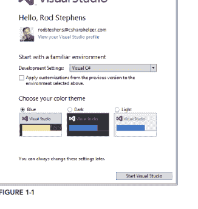

图 1-1

该对话框让你为通用开发、Visual Basic、Visual C# 等选择设置。由于你将专注于 C# 开发，请选择该选项。

> NOTE 这些设置决定了诸如哪些按键激活特定开发功能之类的事项。你完全可以用 Visual C++ 设置编写 C# 程序，但我们不妨使用相同的操作规范，这样当我说“按 F5”时，IDE 会启动你的程序，而不是显示代码窗口或 Visual C++ 认为 F5 应该做的其他操作。

该对话框还允许你选择配色方案。选择你认为最喜欢的一种（承认一下，在没有试用之前）然后点击启动 Visual Studio。（然后做好再次等待的准备，因为初始配置可能需要一段时间。）

如果你以后想切换到不同的设置（例如，起初你选择了深色，但后来发现它会让你头疼），你随时可以稍后更改它们。

要更改设置，请打开“工具”菜单并选择“导入和导出设置”，以显示“导入和导出设置向导”。你可以使用此工具保存当前设置、重新加载先前保存的设置或将设置恢复为默认值。

要重置设置，请在向导的第一页上选择“重置所有设置”选项并点击“下一步”。在下一页上，指示是否要保存当前设置。做出选择后，点击“下一步”以显示图 1-2 所示的页面。选择 Visual C# 选项并点击“完成”。

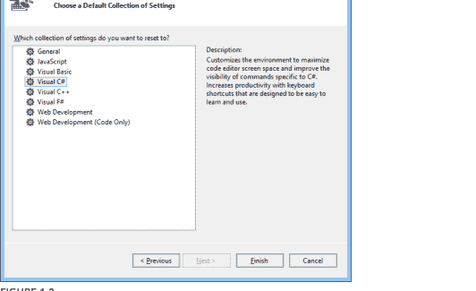

**图 1-2**

然后坐下来等待。或者更好的是，去喝点东西，因为这可能需要一段时间。Visual Studio 有很多设置需要重置，具体时间取决于你的电脑速度快慢。（以及你的电脑忙于播放 YouTube 视频的程度。）

## 构建你的第一个程序

现在你已经安装了 C#，可以准备构建你的第一个程序了。通过双击其桌面图标、从系统“开始”菜单中选择它、使用 Windows 搜索工具找到它，或按照你在 Windows 版本上运行程序的方式启动 Visual Studio。

启动后，Visual Studio 应该大致如图 1-3 所示。你可以使用中央窗格中的链接获取有关 Visual Studio、.NET、Azure 以及微软认为今天重要的其他内容的更多信息。

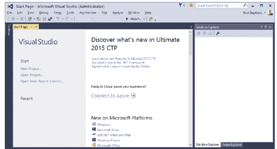

**图 1-3**

你可以使用左侧窗格中的链接创建新项目或打开现有项目。你也可以通过打开“文件”菜单、展开“新建”子菜单并选择“项目”来创建新项目。或者如果你急于创建第一个项目，只需按 Ctrl+Shift+N。

> NOTE
> 通常在 Visual Studio 中完成某事有多种方法。你可能可以使用菜单命令、键盘快捷键或工具栏按钮来实现相同的功能。通常我只会提到一两种方法，例如创建新项目，但你可能会发现其他方法。

所有这些方法都会显示图 1-4 所示的“新建项目”对话框。展开左侧的 Visual C# 项目类型文件夹，并在右侧选择你想要构建的项目类型的模板。对于本书的大部分内容，那将是 Visual C# Windows 窗体应用程序。

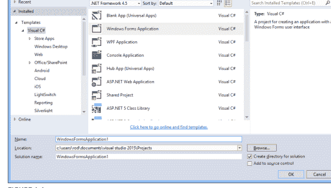

图 1-4

选择项目类型后，你需要输入几项信息：

- **名称**—这是应用程序的名称。Visual Studio 会创建同名文件夹来存放程序文件。它还将此名称用于项目中的某些关键值。
- **位置**—这是你希望 Visual Studio 将项目文件夹放置的位置。
- **解决方案名称**—如果选中“为解决方案创建目录”框（默认情况下已选中），Visual Studio 会在你输入的位置创建同名文件夹。然后它将应用程序文件夹放在解决方案文件夹内部。

因此，如果选中“为解决方案创建目录”框，文件系统布局如下所示：

SolutionFolder
  SolutionFiles
    ApplicationFolder
      ApplicationFiles

如果未选中“为解决方案创建目录”框，文件系统布局如下所示：

ApplicationFolder
  ApplicationFiles

> NOTE 一个项目通常包含构成单个应用程序的文件。
> 一个解决方案可以包含多个项目。当你想要构建紧密相关的应用程序时，解决方案很有用。例如，一个项目可以包含一个构建三维数据集的程序，另一个显示它们，第三个让你从不同视角打印它们。
> 
> 如果你想构建一个例程库以及用于测试该库的可执行程序，解决方案尤其有用。

本书中构建的应用程序都是单个程序，因此它们并不真正需要在单独的解决方案文件夹中。大多数时候，我取消选中“为解决方案创建目录”框以保持文件系统更简单。

> NOTE 默认情况下，Visual Studio 将新项目放在你的项目文件夹中的某个 obscure 位置，例如 C:\Users\MyUserName\Documents\Visual Studio 2016\Projects。稍后在文件资源管理器中查找这些项目可能会很困难（例如，要复制它们）。
> 
> 为了更容易找到项目，请将位置设置为更直观的位置，例如桌面或桌面上的文件夹。实际上，你可能想要创建一个文件夹来存放本书的项目，然后为每个课程创建一个子文件夹。
> 
> 下次你创建新项目时，Visual Studio 会记住你的上一次选择，因此从现在开始找到你的项目会很容易。

如果你在打开另一个项目时打开“新建项目”对话框，你会看到一个额外的下拉菜单，其中列出“创建新解决方案”和“添加到解决方案”选项。第一个选项关闭当前解决方案并创建新的解决方案。第二个选项将新应用程序添加到当前打开的解决方案中。通常你希望创建新解决方案。

在显示“新建项目”对话框并输入名称、位置和解决方案名称后，点击“确定”。结果应如图 1-5 所示。

> NOTE 如果你之前编辑过一个项目，可以从“文件”菜单的“最近的项目和解决方案”子菜单中快速重新加载它。你也可以使用文件资源管理器双击解决方案的 .sln 文件将解决方案加载到 IDE 中。

本课的其余部分涉及 Visual Studio 中可用的功能，其中一些显示在图 1-5 中。然而，在开始盘点有用功能之前，请打开“调试”菜单并选择“开始调试”。或者如果你很着急，只需按 F5。

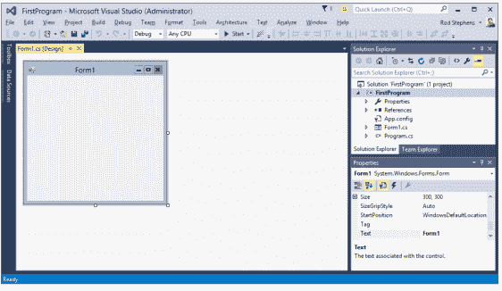

图 1-5

你的第一个程序应如图 1-6 所示。承认一下，这个第一个程序并不太花哨，但同样，你也不需要做太多来构建它。你所做的只是按 Ctrl+Shift+N 然后按 F5！

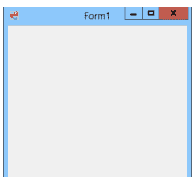

图 1-6

这个第一个程序可能看起来并不令人印象深刻，但幕后有很多事情在发生。C# 已构建了一个表单，其中包含许多有用的功能，包括：

- 可调整大小的边框和可拖动的标题栏。
- 右上角工作的最小化、最大化和关闭按钮。
- 左上角的系统菜单，其中包含工作的还原、移动、大小、最小化、最大化和关闭命令。
- 系统任务栏中的图标，可让你最小化、还原和关闭程序。
- 使用 Alt+Tab 和 Flip3D (Win+Tab) 在应用程序和其他应用程序之间切换的能力。
- 其他标准窗口行为。例如，如果你双击表单的标题栏，它会最大化（如果已最大化则还原），如果按 Alt+F4，表单会关闭。

除非你是 Windows 的绝对初学者，否则你可能把所有这些功能都视为理所当然，但提供它们实际上是一项巨大的工作。没多久以前，你可能需要编写大约 100 行代码来提供其中一部分功能。现在 Visual Studio 会自动构建一个表单来处理大部分细节。


如果你愿意，你仍然可以深入进去改变工作方式（例如，你可以设置窗体的最小和最大允许尺寸），但通常你可以忽略所有这些问题，专注于你的特定应用程序，而不是关注 Windows 的装饰。

### 合适的可执行文件

每当你在 IDE 中运行程序时，Visual Studio 都会生成一个可执行程序，通常位于项目的 `bin\Debug` 子目录中。你可以通过在文件资源管理器中找到该可执行文件并双击来运行它。

不幸的是，这并不意味着该可执行文件可以在任何旧电脑上运行！如果你将该文件复制到另一台电脑，除非那台电脑已安装 .NET Framework 运行时库，否则它将无法运行。如果那台电脑装有 Visual Studio，那就万事俱备；如果没有，你就需要自己安装可再发行组件包。

要安装这些库，请转到 Microsoft 的下载网页 `www.microsoft.com/downloads`，搜索“.NET Framework 可再发行组件包”。选择与你所使用的版本匹配的版本（如果你刚安装 Visual Studio，可能是最新版本），然后将其安装到目标计算机上。

现在，你可以将 C# 可执行文件复制到另一台电脑并运行它们了。

## 复制项目

有时你可能想要复制一个项目。例如，你可能想保存当前版本，然后创建一个新版本来尝试一些东西。或者，你可能想把项目的副本交给朋友或编程老师，这样他/她就能告诉你为什么它的“新建”按钮会导致程序退出。

你可能会在 Visual Studio 的“文件”菜单中看到“复制为”命令。不要被诱惑！那些命令只复制单个文件，而不是整个项目。稍后当你尝试打开其中一个文件时，你会发现 Visual Studio 找不到它所需的其他部件，最终你什么都用不了。

要正确复制项目，请复制*整个*解决方案或应用程序文件夹及其目录层次结构。或者，你可以压缩项目目录，然后复制压缩文件。只要确保你使用的任何复制方法都带上项目的*所有*文件即可。

请注意，如果你愿意，可以删除 `bin` 和 `obj` 子目录以节省空间。这些目录包含 Visual Studio 在加载和生成程序时创建的文件，以后它会在需要时重新创建它们。

你也可以删除包含用户设置的 `.vs` 目录。不幸的是，该目录默认是隐藏的，所以可能很难找到。要让文件资源管理器显示隐藏文件，请打开控制面板，单击*外观和个性化*，然后选择*文件夹选项*。在“查看”选项卡上，选择*显示隐藏的文件和文件夹*，然后单击*确定*。现在你就可以看到 `.vs` 目录并删除它了。

> 注意：压缩项目非常有用，因为它会将所有文件打包在一起。特别是，如果你需要将项目通过电子邮件发送给某人（例如，如果你给我发邮件 RodStephens@CSharpHelper.com 寻求帮助），你可以删除 `bin`、`obj` 和 `.vs` 目录，压缩项目文件夹，然后将压缩包作为单个文件发送。
>
> 如果你要将项目作为作业的一部分发送给老师，请重命名压缩文件，使其包含你的姓名和作业名称；例如，RodStephens6-1.zip。

## 探索 IDE

Visual Studio IDE 包含大量菜单、工具栏、窗口、向导、编辑器和其他组件，可帮助你构建应用程序。其中一些，如解决方案资源管理器和属性窗口，你每次处理程序时都会用到。另一些，如“断点”窗口和“连接到设备”对话框，则非常专门，可能需要多年才会用到。

图 1-7 显示了 IDE 加载了一个简单项目，并标出了 IDE 中一些最重要的部分。下面的列表描述了这些部分。

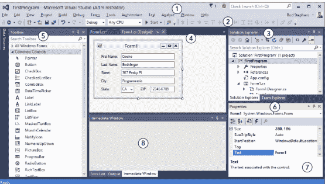

图 1-7

- 1. 菜单——菜单提供各种有用的命令。哪些命令可用、哪些命令处于启用状态，甚至哪些菜单可见，都取决于编辑区域（#4）中打开的是哪种编辑器。一些特别有用的菜单包括“文件”（打开旧项目和创建新项目）、“视图”（查找窗口）、“项目”（向项目添加新窗体和其他项）、“调试”（生成、运行和调试项目）以及“格式”（在窗体上排列控件）。
- 2. 工具栏——工具栏提供执行与菜单中类似命令的快捷方式。使用“工具”菜单的“自定义”命令来确定哪些工具栏可见。
- 3. 解决方案资源管理器——解决方案资源管理器列出项目中的文件。其中最重要的一个是 Form1.cs，它定义了名为 Form1 的窗体的控件和代码。如果在解决方案资源管理器中双击某个文件，IDE 会在编辑区域中打开它。
- 4. 编辑区域——编辑区域在适当的编辑器中显示文件。大多数情况下，你会使用该区域来设计窗体（在其上放置控件并设置控件属性）和为窗体编写代码，但你也可以使用该区域编辑其他文件，如文本文件、位图和图标。
- 5. 工具箱——工具箱包含可以放置在窗体上的控件和组件。选择一个工具，然后点击并拖动，即可将该工具的副本放到窗体上。注意，工具箱将控件分组到选项卡中（所有 Windows 窗体、公共控件、容器、菜单和工具栏等），以便更容易找到所需控件。
- 6. 属性窗口——属性窗口允许你设置控件属性。在窗体设计器上（如图 1-7 的编辑区域所示）单击某个控件以选中它，或单击并拖动以选中多个控件。然后使用属性窗口设置控件的属性。注意，属性窗口顶部会显示当前选中控件的名称（label1）和类型（System.Windows.Forms.Label）。在图 1-7 中，当前选中的属性是 Text，其值为“First Name:”。你会在属性窗口上花费大量时间。
- 7. 属性说明——属性说明提醒你当前属性的用途。在图 1-7 中，它说 Text 属性提供与控件关联的文本。（废话！）
- 8. 其他窗口——此区域通常包含其他有用的窗口。底部的选项卡让你可以在不同窗口之间快速切换。

图 1-7 显示了一种相当典型的窗口排列方式，但 Visual Studio 非常灵活，因此如果你愿意，可以重新排列窗口。你可以隐藏或显示窗口，让窗口浮动或停靠到 IDE 的各个位置，让窗口成为选项卡组的一部分，还可以让窗口在你不需要它们时自动隐藏。

如果你仔细看图 1-7 中某个窗口（例如属性窗口）上方标题栏的右侧，你会看到三个图标：一个下拉箭头（▼）、一个图钉（¶）和一个 X（✖）。

如果你单击下拉箭头（或右键单击窗口的标题栏），会出现一个菜单，其中包含以下选项：

- **浮动**——窗口会从停靠位置脱离，浮动在 IDE 上方。你可以随意拖动它，它不会重新停靠。若要使其再次可停靠，请重新打开菜单并选择“停靠”。
- **停靠**——窗口可以停靠到 IDE 的各个位置。（这有点意思，我稍后会详细说明。）
- **停靠为选项卡式文档**——窗口会成为类似于图 1-7 中 #8 的选项卡区域中的一个选项卡。不幸的是，并不总是清楚哪个区域会最终容纳该窗口。若要使窗口成为特定选项卡区域中的选项卡，请使其可停靠，然后将其拖到某个选项卡上（稍后说明）。
- **自动隐藏**——窗口会收缩为一个小标签，贴在 IDE 的边缘，其图钉图标会横向变为（➡）以表示窗口正在自动隐藏。如果将鼠标悬停在该标签上，窗口会重新出现。只要鼠标停留在展开的窗口上，它就会保持不动；但如果将鼠标移出窗口，它会再次自动隐藏（就像你开灯时蟑螂一样）。再次选择“自动隐藏”或单击横向的图钉以关闭自动隐藏。自动隐藏可让窗口移开，以便你可以在更大的编辑区域中工作。
- **隐藏**——窗口完全消失。要让窗口重新出现，你需要在其令人眼花缭乱的菜单中找到它。你可以在“视图”菜单、“视图”菜单的“其他窗口”子菜单以及“调试”菜单的“窗口”子菜单中找到许多最有用的窗口。

窗口标题栏中的图钉的工作方式与下拉菜单中的“自动隐藏”命令相同。单击图钉可打开自动隐藏。展开窗口并单击横向的图钉可关闭自动隐藏。（关闭自动隐藏有时称为*固定窗口*。）

窗口标题栏中的 ✖ 符号会隐藏窗口，就像下拉菜单中的“隐藏”命令一样。

除了使用窗口标题栏的菜单和图标外，你还可以将窗口拖到新位置。只要窗口是可停靠的，或是选项卡式窗口的一部分，你就可以抓住其标题栏并将其拖到新位置。

当你拖动窗口时，IDE 会显示小的放置目标，让你可以将窗口停靠在不同位置。如果你移动窗口使鼠标悬停在某个放置目标上，IDE 会显示一个半透明的蓝色区域，以显示如果释放窗口，它将落在何处。如果释放时鼠标不在放置目标上，窗口将变为浮动。

图 1-8 显示了在 IDE 中拖动的属性窗口。鼠标悬停在编辑区域上方的右侧放置目标上，因此，如半透明蓝色区域所示，在那里释放会将窗口停靠到编辑区域的右侧。这张图有点乱，但如果你试一试，就不难看出是怎么回事。


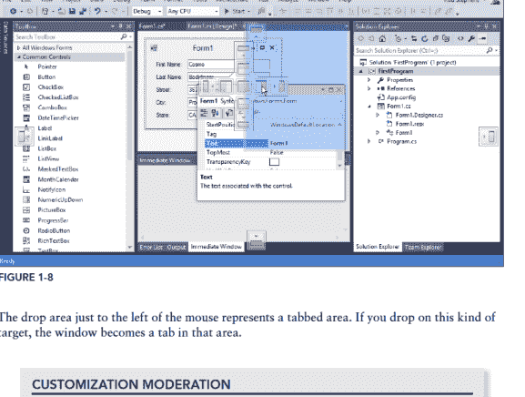

图 1-8

鼠标左侧的下放区域表示一个选项卡区域。如果放到这种目标上，窗口就会成为该区域中的一个选项卡。

> **自定义的适度性**
>
> Visual Studio 允许你移动、停靠、浮动、隐藏、自动隐藏窗口，并将窗口选项卡化。如果你有多个显示器，可以浮动一个窗口并将其移到另一个显示器，从而获得更大的编辑区域。它非常灵活，可以呈现出像选举年的政客一样多的不同面孔。
>
> 请随意自定义 IDE 以满足你的需求，但如果你这样做，请记住你的 Visual Studio 版本可能看起来完全不像本书中的图片。为了尽量减少混淆，你可能希望让 IDE 的外观大致保持如图 1-7 所示，至少在你更好地了解哪些工具对你最有用之前。

## 试一试

在本“试一试”中，你将为本书后续工作做好准备。你将找到在遇到问题或麻烦时可以使用的 Web 资源。你将创建并运行一个程序，浏览项目的文件夹层次结构，并复制该项目。你还有机会对 IDE 进行一些试验：显示新的工具栏、移动窗口，并大体上对 IDE 进行一次试驾和检验。

- 2. 如果“工具箱”处于自动隐藏状态（首次安装 Visual Studio 后应该如此），请将鼠标悬停在其上，直到它展开。单击图钉将其固定。
- 3. 要显示“输出”窗口，请打开“视图”菜单并选择“输出”。抓住“输出”窗口的标题栏并拖动它。将其移到一些放置目标上，看看它会停在哪里。完成后，将其放到 IDE 底部，如图 1-7 所示。

### 运行程序。

- 1. 按 F5，或打开“调试”菜单并选择“开始调试”。
- 2. 试试窗体的最小化、最大化和关闭按钮，以及窗体系统菜单中的命令。移动窗体并调整其大小。惊叹于你居然不需要编写任何代码！

### 找到程序的可执行文件，将其复制到桌面并在那里运行。

- 1. 启动文件资源管理器，导航到你创建新程序时指定的位置。
- 2. 在那里你应该会找到一个以该程序命名的文件夹。打开该文件夹并查看其中的文件。注意 .sln 文件，你可以双击它在 Visual Studio 中重新打开解决方案。还要注意 bin、obj 和 .vs 目录。
- 3. 进入 bin 目录，再进入其 Debug 子目录。其中包含多个文件，包括可执行文件，该文件以程序命名，但扩展名为 .exe。右键单击该可执行文件并选择“复制”。
- 4. 右键单击桌面并选择“粘贴”，将可执行文件复制到桌面。
- 5. 双击桌面上的可执行文件副本。

### 将项目文件夹复制到新位置，并对副本进行更改。

- 1. 在文件资源管理器中，转到包含项目文件夹的目录。
- 2. 右键单击项目文件夹并选择“复制”。
- 3. 右键单击桌面并选择“粘贴”，以复制项目文件夹。
- 4. 打开复制后的项目文件夹，双击 .sln 文件，在 Visual Studio 中打开复制后的项目。如果窗体未在窗体设计器中打开（图 1-7 中的 #4），请在解决方案资源管理器中查找并双击文件 Form1.cs。
- 5. 在窗体设计器中，抓住窗体右下角的控制柄，调整窗体大小，使其又高又窄。
- 6. 运行修改后的程序。然后回到原始项目（它应该仍在另一个 Visual Studio 实例中运行）并运行它。注意这两个版本显示的窗体大小不同。

### 压缩项目文件夹以制作备份。

- 1. 在 Visual Studio 中关闭该项目。（或关闭 Visual Studio。）
- 2. 在文件资源管理器中，返回项目文件夹并删除 bin、obj 和 .vs 目录。（请注意，如果 Visual Studio 打开了该项目，则无法删除 bin 目录。）
- 3. 向上移动一级，转到包含项目文件夹的目录。右键单击该文件夹，展开“发送到”子菜单，然后选择“压缩(zipped)文件夹”。
- 4. 将你的第一个项目的副本通过电子邮件发送给你所有的朋友和亲戚。我相信他们会感谢你的！

## 练习

- 1. 生成一个包含两个项目的解决方案。（创建一个名为 Project1 的项目。选中“为解决方案创建目录”复选框，并将解决方案命名为 TwoProjects。然后打开“文件”菜单，展开“添加”子菜单，选择“新建项目”，添加一个名为 Project2 的新项目。）
- 2. 本课只介绍了自定义 Visual Studio 的众多方法中的一小部分。再尝试一种方法：创建你自己的工具栏。选择“工具”菜单中的“自定义”命令。在“工具栏”选项卡上，单击“新建”按钮，并将新工具栏命名为 MyTools。在“命令”选项卡上，选择“工具栏”单选按钮，然后从下拉列表中选择新工具栏。现在使用“添加命令”按钮向工具栏添加一些命令。
- 3. 本课也只介绍了 Visual Studio 提供的少数几个窗口。使用菜单查找并显示“输出”、“即时”、“错误列表”和“任务列表”窗口。将它们全部放在 Visual Studio 底部的选项卡中（图 1-7 中的 #8）。
- 4. 有些工具仅在 Visual Studio 处于特定状态时可用。查看“调试”菜单的“窗口”子菜单。然后启动程序并再次查看那里。这些窗口大多只在程序运行且你正在调试它时才有用。（我会在后面的课程中讨论其中一些。）
- 5. [WPF] 创建一个新的 WPF 应用程序。将其与 Windows Forms 应用程序并排运行。有什么区别？（提示：差异应该不多，而且应该是外观上的。你将在后面的课程中了解更重要但不那么明显的差异。）

> 注意 请在 www.wrox.com/go/csharp24hourtrainer2evideos 在线选择第 1 课的视频。

## 2 创建控件

早在计算机的石器时代，程序员们借着烛光在脚踏式计算机和手工雕刻的木制显示器上工作，输入和输出非常简单。计算机在显示器底部用有毒的绿色书写文本，当显示器写满时，文本会向上滚动。用户在键盘上打字，在单个输入提示符处输入文本，仅此而已。多个窗口同时执行有用的工作、鼠标，以及显示许多标签和文本框、按钮、滚动条和全彩图像的窗体，只存在于科幻作家狂热的梦境中。

如今，这些东西如此司空见惯，以至于我们完全认为它们理所当然。它们出现在桌面软件、网页、笔记本电脑、手持计算机甚至手机中。

在过去，构建这类对象会极其困难，但今天将它们添加到应用程序中几乎轻而易举。

你已经在第 1 课中看到，制作一个显示窗体的应用程序（尽管很简单）是多么容易，该窗体独立于计算机上的其他窗体运行。使用标签、文本框、按钮、滚动条、图像、菜单、弹出项以及构成现代应用程序的其他一切，也几乎同样容易。

C# 将所有这些对象以及更多对象作为控件提供。

在本课中，你将学习如何向窗体添加控件。你将学习如何调整控件大小、定位和排列控件。你还将学习如何使用控件的属性在设计时和运行时更改其外观和行为。学完本课后，你将能够构建外观专业的窗体。

### 理解控件

控件是一种编程实体，它将屏幕上的可见外观与管理它的代码结合在一起。代码定义控件的外观和行为。

例如，TextBox 控件在屏幕上显示一个空白区域，用户可以在其中键入信息。控件内部的代码决定控件如何绘制自身，并提供常规文本框功能，例如多行或单行行为；按需显示的滚动和滚动条；复制、剪切和粘贴；右键单击控件时显示的上下文菜单；用户按 Tab 键时导航的能力；以及更多功能。

### 名称里有什么？

按照约定，在 C# 中，控件类型（以及其他类型）的名称使用 Pascal 大小写形式，即多个单词连在一起，每个单词的首字母大写；例如 TextBox、ProgressBar、Button 和 PictureBox。

除控件外，C# 还提供组件。组件与控件类似，只是它在窗体上没有可见的部分。例如，Timer 组件充当时钟，让程序按固定间隔执行某些操作。Timer 与程序交互，但不向用户显示任何可见内容。（某些组件，如 ErrorProvider 和 ToolTip，可能会在屏幕上显示可见效果，但组件本身在窗体上不可见。）

控件（和组件）的功能分为三类：属性、方法和事件。

### 属性

属性决定控件的外观和状态。如果 Car 是一个控件，它的属性会是 Color、TransmissionType、CurrentSpeed 和 NumberOfCupHolders 之类。你的程序可以将 Car 的 Color 设置为 HotPink（以吸引其他司机的注意），或将其 CurrentSpeed 设置为 110（以吸引警察的注意）。

举个编程示例，TextBox 控件有一个 Font 属性，决定它使用的字体；还有一个 ForeColor 属性，决定其文本的颜色。

### 方法

方法是控件的一项功能，使控件执行某种操作。你的代码可以调用方法，让控件做某事。例如，Car 控件可能有 Start、Stop、EjectPassenger 和 OilSlick 等方法。你的程序可以调用 OilSlick 方法，让汽车从后面喷油，以便你逃脱间谍的追捕。

### 事件

当控件发生有趣的事情时，就会发生事件。控件引发或触发事件，以告诉程序发生了某事。例如，Car 可能有 RanOutOfGas 和 Crashed 事件。Car 控件会引发 Crashed 事件，以告诉程序

用户将其撞到了一棵树上。程序随后可以采取行动，例如呼叫救护车和树木修剪工。

作为编程示例，TextBox 有一个 TextChanged 事件，用来通知程序其文本已更改。当事件发生时，程序可以检查文本，看用户是否输入了有效输入。例如，如果 TextBox 应该保存一个数字而用户输入了“One”，程序可以发出蜂鸣声并将 TextBox 的 BackColor 属性更改为 Yellow 以指示错误。

后续课程将更详细地讨论事件及其处理代码。本课重点介绍向窗体添加控件、排列它们以及设置其属性。

## 创建控件

向窗体添加控件很容易。事实上，这么容易，而且添加控件到窗体的方式如此之多，以至于描述它们全部需要一段时间。

首先按照第 1 课所述创建一个新项目。在窗体设计器中打开窗体。（如果窗体尚未打开，请在解决方案资源管理器中双击它。）

以下列表描述了一些将控件放置在窗体上的方法：

- 在工具箱中单击一个工具以选择它。然后在窗体上单击并拖动。松开鼠标后，Visual Studio 会在您选择的区域创建控件，然后在工具箱中选择指针。
- 在工具箱中单击一个工具以选择它。然后按住 Ctrl 键，在窗体上单击并拖动以在窗体上放置该控件的副本。松开鼠标后，Visual Studio 会在您选择的区域创建控件，并保持工具箱中该控件的工具处于选中状态，以便您可以创建同类型的另一个控件。
- 双击工具箱中的一个工具，以默认大小和位置在窗体上创建该控件的实例。（您可能随后需要调整其大小和重新定位。）
- 选择窗体上已有的一个或多个控件，按 Ctrl+C 复制它们，然后按 Ctrl+V 将它们粘贴到窗体上。您甚至可以从一个 Visual Studio 实例复制并粘贴到另一个实例。
- 在窗体上选择一个或多个控件。按住 Ctrl 键的同时，将控件拖到新位置。Visual Studio 会复制控件，保留原件在原处。

> 注意 您在窗体设计器中有多种选择控件的方式。单击一个控件仅选择它。单击并拖动以选择多个控件。
> 按住 Shift 或 Ctrl 键同时单击或单击并拖动，以切换控件是否在当前选择中。
> 如果要取消选择所有控件，只需单击窗体的空白部分或按 Esc。

第一种方法（选择一个工具然后单击并拖动以创建控件）可能使用最频繁，但其他一些方法对于创建相似控件的组特别有用。

例如，图 2-1 中的窗体显示了五行，每行包含一个 Label 和一个 TextBox。您可以轻松地单独构建所有这些控件，但使用复制和粘贴可以更快地构建它们。首先在窗体上放置一个 Label 和 TextBox，将它们并排排列，并为它们赋予您希望所有 Label 或 TextBox 共享的任何属性值。（例如，您可能希望设置它们的字体或颜色。）现在单击并拖动以选择两个控件，复制并粘贴，然后将新控件拖到位置。重复此操作三次，您将拥有所有控件就位。您仍需要更改 Label 的文本，但基本布局将在不反复返回工具箱的情况下完成。

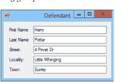

## 设置控件属性

在向窗体添加控件后，您可以使用属性窗口查看和更改其属性值。如果选择了多个控件，属性窗口只显示控件共有的属性。

例如，如果您选择一个 TextBox 和一个 Label，属性窗口会显示 Text 属性，因为 Label 和 TextBox 都有 Text 属性。然而，它不会显示 Multiline 属性，因为 TextBox 控件具有该属性但 Label 控件没有。

属性窗口为许多控件属性提供特殊支持。例如，图 2-2 显示了选择 TextBox 时的属性窗口。

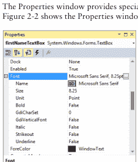

请注意，Font 属性包含其自己的子属性：Name、Size、Unit、Bold 等。单击属性旁边的加号或减号以展开或折叠它并显示或隐藏其子属性。

同时请注意图 2-2 中 Font 属性右侧的省略号。如果单击该省略号，将出现图 2-3 所示的对话框。您可以使用此对话框编辑字体子属性并查看字体的示例。

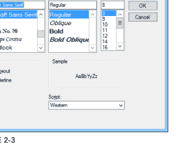

图 2-3

属性窗口在可能的情况下为其他属性提供适当的支持。许多属性只能保存某些值。例如，Font 的 Italic、Bold、Strikeout 和 Underline 子属性只能取 True 或 False 值。Font 的 Unit 子属性只能取 World、Pixel、Point、Inch、Document 和 Millimeter 值。在这些情况下，属性窗口提供一个下拉列表，列出允许的选择。

图 2-4 显示了属性窗口在单击 TextBox 的 BackColor 属性右侧的下拉箭头时显示的编辑器。Custom 选项卡让您可以从调色板中选择颜色，Web 选项卡让您可以选择标准网页颜色，System 选项卡让您可以选择系统颜色，例如正常的控件背景颜色或菜单高亮颜色。

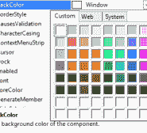

图 2-4

通过使用属性窗口的编辑器以及在没有编辑器时输入值，您可以更改控件的外观和行为。

## 控件名称

每当您创建一个控件时，Visual Studio 会为其分配一个相当无特色的名称，例如 `label12`、`textBox5` 或 `pictureBox1`。尽管这些名称告诉您控件是什么类型的对象，但它们并不能说明其用途，而这在您以后需要在代码中使用控件时更为重要。像 `firstNameTextBox`、`hatSizeTrackBar` 和 `mediaTypeComboBox` 这样的名称比 `textBox3` 和 `textBox7` 更有意义。

请注意，您不需要为 *每个* 控件都取好名字，只需为以后需要在代码中使用的控件命名即可。您通常不需要为 `Label5`、`GroupBoxes` 和其他纯装饰性控件命名。

您可以在网页“Guidelines for Names”上了解更多关于 Microsoft 命名约定的信息，网址为 msdn.microsoft.com/library/ms229002.aspx。

## 名称的含义，再续

在本课前面我提到过控件类型名称使用 Pascal 命名法。根据惯例，控件特定实例的名称使用 *camel casing*，其中多个单词连在一起，每个单词的首字母大写，第一个单词除外。例如，控件类型 `TextBox` 使用 Pascal 命名法，而特定控件名称 `firstNameTextBox` 使用 camel 命名法。

它被称为 camel 命名法，因为它有点像一只躺着的骆驼：两端低，中间有一个或多个驼峰。我想 `stateLabel` 会是一只单峰骆驼（单峰），`priceTextBox` 会是一只双峰骆驼（双峰），而 `numberOfEmployeesCoveredByInsurancePlanTrackBar` 会是 Dr. Seuss 创造的某种骆驼。

## 名称的含义，第三部分

大多数 C# 开发者将控件的类型作为后缀添加到其名称中，如 `firstNameTextBox` 或 `resultLabel`，但开发者使用更通用的词如 `value` 或 `field` 变得越来越常见。其思想是，如果您决定更改处理值的控件类型，就不需要更改引用该控件的代码。

例如，假设您的程序使用一个 `TrackBar` 让用户选择要购买的 UFO 探测器数量。如果您将此控件命名为 `numUfoDetectorsValue`，那么如果您以后决定让用户从 `NumericUpDown` 控件而不是 `TrackBar` 选择值，就不需要更改代码。

一些开发者甚至完全省略后缀，如 `numUfoDetectors`，尽管如果您需要多个控件来表示类似的概念，或者如果您希望代码中有一个变量保存控件表示的数值，这可能会令人困惑。

目前，我建议您坚持使用控件的完整类型名称作为后缀。


## 常用属性

你将在学习过程中了解关键的控件属性，但现在表 2-1 总结了一些最有用的属性。请注意，并非所有控件都有每个属性。例如，`Button` 不能显示边框（或者它始终显示边框，取决于你的观点），因此它没有 `BorderStyle` 属性。

表 2-1

| 属性 | 用途 |
|---|---|
| `Anchor` | 确定控件如何调整自身大小以使用可用空间。本属性在第 3 课中进一步描述。 |
| `AutoSize` | 确定控件是否自动调整自身大小以适应其内容。可以是 `True` 或 `False`。默认情况下，`Labels` 出生时 `AutoSize = True`。 |
| `BackColor` | 确定控件的背景颜色。 |
| `BackgroundImage` | 确定控件显示的图像。 |
| `BorderStyle` | 确定控件是否显示边框。可以是 `None`、`FixedSingle` 或 `Fixed3D`。 |
| `Dock` | 确定控件如何调整自身大小以使用可用空间。本属性在第 3 课中进一步描述。 |
| `Enabled` | 确定控件是否与用户交互。许多控件在禁用时显示特殊外观，例如变灰。可以是 `True` 或 `False`。 |
| `Font` | 确定控件用于显示文本的字体。 |
| `ForeColor` | 确定控件的前景色。对于显示文本的控件，这通常是文本的颜色。 |
| `Image` | 确定控件显示的图像。（某些控件有 `Image`，其他控件有 `BackgroundImage`，少数两者都有，许多控件无法显示任何图像。没人说这完全一致！） |
| `Items` | 对于 `ListBox` 和 `ComboBox` 等控件，这是用户可以选择的项目列表。 |
| `Location` | 给出控件相对于其所在位置（目前假设在窗体中）左上角的像素位置。`Location` 包含 X 和 Y 子属性。例如，值 (10, 20) 表示控件距离窗体左边缘 10 像素，距离顶部边缘 20 像素。 |
| `Name` | 为控件提供一个名称，以便你的代码稍后引用它。你应该始终为代码中会引用的任何控件提供一个好名称。 |

```
    {
        greetingLabel.Left = 100;
    }
```

在这段代码中，我输入了以两个斜杠开头的第一行。那一行是 *注释*，一段包含在代码中但不被程序执行的文本。`//` 字符之后的所有文本都会被忽略，直到当前行的末尾。你可以（也应该）使用注释使代码更易于理解。它们不会使可执行程序更大或更慢，所以不要吝啬你的注释！

我还输入了设置 Label 的 Left 属性的那一行。

当我双击 moveLabelButton 控件时，Visual Studio 输入了其余部分。你现在不需要担心这段代码的细节，但简而言之，sender 参数是引发事件的对象（本例中为按钮），而 e 参数提供有关事件的额外信息。额外信息对于某些事件很有用（例如，在 MouseClick 事件中它会告诉鼠标点击的位置），但对于按钮的 Click 事件来说并不太有趣。

像本例中使用的 100 这样的简单数值很容易在代码中设置，但有些属性不是数字。在这种情况下，你必须将它们设置为具有正确数据类型的值。

例如，Label 的 Text 属性是字符串，因此你必须为其提供字符串值。以下代码将 greetingLabel 控件的 Text 属性设置为字符串 Hello：

```
    greetingLabel.Text = "Hello";
```

> **注意** *请注意，你必须用双引号包含字符串 Hello，以告诉 C# 这是一个字面字符串而不是某种 C# 命令。如果你去掉引号，C# 会感到困惑并给出错误 “The name 'Hello' does not exist in the current context.”*
>
> *随着时间的推移，你会习惯这类消息，它们会变得有意义。在这种情况下，该消息只是意味着，“我不知道‘Hello’这个词是什么意思。”*

其他属性值具有更奇特的数据类型，例如 Date、AnchorStyles、Point 和 BindingContext。当你设置这些属性时，必须确保为它们提供的值具有正确的数据类型。我现在将忽略其中的大多数，但一种相对简单且有用的数据类型是 Color。

控件的 ForeColor 和 BackColor 属性的数据类型为 Color，因此你不能简单地将它们设置为 Red 或 Blue 等字符串。相反，你必须将它们设置为也具有 Color 类型的值。最简单的方法是使用 Color 类预定义的颜色。这乍一看可能有点令人困惑，但在实践中其实相当容易。

例如，以下两个语句将 Label 的 BackColor 和 ForeColor 属性分别设置为 HotPink 和 Blue：

```
    greetingLabel.BackColor = Color.HotPink;
    greetingLabel.ForeColor = Color.Blue;
```

对于更现实的示例，请考虑图 2-8。在此图中，我正在布局一个小型数据输入窗体，我希望所有 Labels 和 TextBoxes 都很好地对齐。在此图中，吸附线显示 Street TextBox 在左右与其它 TextBoxes 对齐，与上下 TextBoxes 保持标准距离，与窗体右侧边缘保持标准距离，并且其基线与 Street Label 对齐。

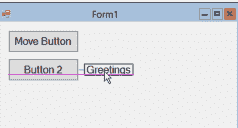

### 箭头键

除了用鼠标拖动控件外，你还可以通过按箭头键移动控件。选择一个或多个控件，然后使用左、右、上、下箭头键一次移动控件一个像素。这种方法比使用鼠标慢，但能提供更精细的控制。

当你用箭头键移动控件时，Form Designer 不会显示吸附线，因此你可能需要留意 Properties 窗口中控件的 Location 属性，以查看其位置。

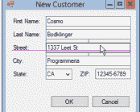

### 格式菜单和布局工具栏

格式菜单包含许多排列一个或多个控件的命令。表 2-2 总结了格式菜单的子菜单。

表 2-2

| 子菜单 | 命令 |
|---|---|
| Align | 将控件组在其左侧、中间、右侧、顶部、底部或中心对齐。 |
| Make Same Size | 使控件具有相同的宽度、高度或两者。 |
| Horizontal Spacing | 调整控件之间的水平间距。可以使控件之间的间距相等、更小、更大或为零。 |
| Vertical Spacing | 工作方式与水平间距子菜单类似，只是调整控件之间的垂直间距。 |
| Center in Form | 在其容器中垂直或水平居中控件。如果控件位于 Panel 或 GroupBox 等容器内，这些命令将在容器内居中控件，而不是窗体。 |
| Order | 这些命令将控件发送到堆叠顺序的前面或后面。如果控件重叠导致某些控件位于其他控件后面，则很有用。 |

布局工具栏包含与格式菜单相同的命令，但放在方便的工具栏中以便更易使用。按钮显示小图片，显示它们如何对齐控件。

> 注意 这些工具如何排列控件取决于你如何选择控件。所选控件中，通常第一个选择的控件，是组的 dominant 控件。dominant 控件在其角落标记为白色框，而其他控件标记为黑色框。
>
> 当你使用排列工具时，dominant 控件决定其他控件如何排列。例如，如果你选择 Format ▸ Align ▸ Lefts 命令，其他控件将被移动，使其左边缘与 dominant 控件的左边缘对齐。
>
> 要更改所选组中的 dominant 控件，请单击你想要成为 dominant 的那个控件（不要按住 Ctrl 或 Shift 键）。

## WPF 控件

WPF 应用程序使用自己的控件集，其中一些与 Windows Forms 应用程序使用的控件相似。Visual Studio for Windows 让你以大致相同的方式创建 WPF 应用程序，就像 Visual Studio for Windows Desktop 让你制作 Windows Forms 应用程序一样。两者都提供一个编辑器，你可以在其中单击并拖动以创建控件，以及一个 Properties 窗口，你可以在其中设置控件属性。

一个很大的区别是 Visual Studio 还为 WPF 应用程序显示 XAML 代码编辑器。XAML 代表“eXtensible Application Markup Language”，通常发音为“zammel”，是 Visual Studio 用于定义 WPF 应用程序用户界面的语言。

有时直接编辑 XAML 代码比使用 Window 编辑器更容易。特别是，通过复制和粘贴 XAML 代码（并更改新控件的名称）来复制控件通常比在 Window 编辑器中复制控件更容易。

现在，你可能应该从 Window 编辑器开始，但你也可以查看 XAML 代码并尝试一下，看看它是如何工作的。

## 试一试

在这个 Try It 中，你将练习构建用户界面。你在窗体上放置控件并排列它们，使其很好地对齐。你还将练习在设计时设置控件属性，并在运行时更改它们。


## 课程要求

在本课中，你将：

- 向窗体添加控件，并按照图 2-9 所示排列它们。（注意窗体的标题，以及窗体具有不可调整大小的边框。）
- 为关键控件命名。
- 在设计时设置结果标签（位于图 2-9 底部）的属性，使该标签：
  - 居中显示其文本。
  - 显示边框。
  - 使用 16 点字体。
  - 在用户单击某个按钮之前保持不可见。
- 将“确定”按钮设为窗体的默认按钮，以便用户按 Enter 时触发它。将“取消”按钮设为窗体的取消按钮，以便用户按 Esc 时触发它。
- 在“确定”按钮后面添加代码，以显示带有绿色背景的结果标签，如图 2-9 所示。
- 在“取消”按钮后面添加代码，以显示带有亮粉色背景和文本“操作已取消”的结果标签。

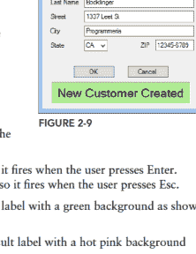

图 2-9

> 注意 你可以从网站 www.wrox.com/go/csharp24hourtrainer2e 下载本课的代码和资源。

## 提示

- 首先创建“名字”标签和文本框并排列它们。然后复制并粘贴它们，以创建更多标签和文本框。
- 使用“格式”菜单或“布局”工具栏将按钮和结果标签居中。

## 分步操作

- 向窗体添加控件，并按照图 2-9 所示排列它们。（注意窗体的标题，以及窗体具有不可调整大小的边框。）
  1. 启动一个名为 NewCustomer 的新项目。记得将它放在容易找到的位置。
  2. 使用“属性”窗口将窗体的 Text 属性设置为 New Customer。

8. 创建“州”组合框。
  a. 使用“工具箱”创建一个 ComboBox。将其 Text 属性设置为 WW，并调整其大小，使文本能够合理适应。
  b. 拖动 ComboBox，使对齐线显示其基线与该行上的标签对齐，并且其左边缘与上方文本框的左边缘对齐。
  c. 选中 ComboBox 后，在“属性”窗口中查看并单击 Items 属性。然后单击右侧的省略号 (...) 按钮，打开“字符串集合编辑器”。输入 CO、AZ、WY、UT 以及你想使用的任何其他州缩写，然后单击“确定”。（如果你想输入 Confusion 和 Denial，则需要将 ComboBox 调宽。）
  d. 使用“属性”窗口将 DropDownStyle 属性设置为 DropDownList。

> 注意 DropDownStyle 值 Simple 使 ComboBox 显示一个文本框（用户可在其中键入）以及其下方的一个列表（用户可在其中进行选择）。
>
> 值 DropDown 使 ComboBox 显示一个文本框（用户可在其中键入）以及一个下拉箭头，单击该箭头会显示下拉列表。
>
> 值 DropDownList 与 DropDown 类似，不同之处在于用户只能从下拉列表中选择，不能键入新值。DropDownList 通常是最佳选择，因为它可以防止用户键入无效值。

9. 创建按钮。
  a. 双击“工具箱”中的 Button 工具两次，以创建两个标准大小的按钮。
  b. 拖动一个按钮，使其位于文本框下方适当距离处。拖动另一个按钮，使其与第一个按钮垂直对齐，并将其放在侧面某个合理距离处（确切距离在这里无关紧要）。
  c. 单击并拖动以选择两个按钮。选择“格式” -> “在窗体中居中” -> “水平居中”。
  d. 使用“属性”窗口为按钮设置 Text 值 OK 和 Cancel。

10. 使用“工具箱”创建结果 Label。（现在不必过于担心其大小和位置。只需将其放在图 2-9 所示位置附近即可。）

为关键控件命名。

- 1. 为关键控件指定表 2-3 中所示的名称。你不需要为其他控件命名，因为程序不需要引用它们。（实际上，此示例也没有引用这些 TextBox 或 ComboBox，但真实程序肯定会引用。窗体不会包含它不会使用的 TextBox 和 ComboBox。）

## 表 2-3

| 控件 | 名称 |
|---|---|
| 名字 TextBox | firstNameTextBox |
| 姓氏 TextBox | lastNameTextBox |
| 街道 TextBox | streetTextBox |
| 城市 TextBox | cityTextBox |
| 州 ComboBox | stateComboBox |
| ZIP TextBox | zipTextBox |
| OK 按钮 | okButton |
| Cancel 按钮 | cancelButton |
| 结果 Label | resultLabel |

- 在设计时设置结果标签（位于图 2-9 底部）的属性，使该标签：
  - 居中显示其文本。
    1. 将 Label 的 TextAlign 属性设置为 MiddleCenter。（使用“属性”窗口的 TextAlign 编辑器选择中间位置。）
    2. 将 Label 的 AutoSize 属性设置为 False。
    3. 将 Label 的 Size 属性设置为 218, 37。（或者展开 Size 属性，分别设置 Width 和 Height 子属性。）
    4. 使用“格式”菜单或“布局”工具栏将 Label 在窗体上居中。
  - 显示边框。
    1. 将 Label 的 BorderStyle 属性设置为 Fixed3D。
  - 使用 16 点字体。
    1. 展开“属性”窗口的 Font 项。将 Size 子属性设置为 16。
  - 在用户单击某个按钮之前保持不可见。
    1. 将 Label 的 Visible 属性设置为 False。

- 将 OK 按钮设为窗体的默认按钮，以便用户按 Enter 时触发它。将 Cancel 按钮设为窗体的取消按钮，以便用户按 Esc 时触发它。
  1. 单击窗体，并使用“属性”窗口将窗体的 AcceptButton 属性设置为 okButton。
  2. 同样，将窗体的 CancelButton 属性设置为 cancelButton。

在 OK 按钮后面添加代码，以显示带有绿色背景的结果标签，如图 2-9 所示。

- 1. 双击 OK 按钮，为其 Click 事件创建事件处理程序。
- 2. 在以下代码中键入粗体文本，使事件处理程序如下所示：

```csharp
// Create the new customer.
private void okButton_Click(object sender, EventArgs e)
{
    resultLabel.Text = "New Customer Created";
    resultLabel.BackColor = Color.LightGreen;
    resultLabel.Visible = true;
}
```

在 Cancel 按钮后面添加代码，以显示带有亮粉色背景和文本“操作已取消”的结果标签。

- 1. 双击 Cancel 按钮，为其 Click 事件创建事件处理程序。
- 2. 在以下代码中键入粗体文本，使事件处理程序如下所示：

```csharp
// Don't create the new customer.
private void cancelButton_Click(object sender, EventArgs e)
{
    resultLabel.Text = "Operation Canceled";
    resultLabel.BackColor = Color.HotPink;
    resultLabel.Visible = true;
}
```

现在运行程序并进行试验。注意当焦点位于 TextBox 中时按 Enter 和 Esc 键会发生什么。看看焦点位于某个按钮上时会发生什么。

## 练习

- 1. [游戏] 构建一个类似于图 2-10 所示的棋盘。（提示：方格是背景颜色不同的 PictureBox。为窗体设置偏蓝色背景。最后，使用“格式”菜单或“布局”工具栏对齐控件。）
- 2. [游戏, WPF] 用 WPF 应用程序重复练习 1。（提示：将彩色 Rectangle 放入 WrapPanel 中，其宽度应使 Rectangle 按八列换行。）
- 3. [游戏] 制作一个类似于图 2-11 所示的井字棋（或 naughts-and-crosses）棋盘。（提示：为每个方格制作三个 Label，并按行和列命名。对于左上角的方格，将小 X Label 命名为 x00Label，将小 O Label 命名为 ooLabel，将大 Label 命名为 taken00Label。为较小的 Label 提供 Click 事件处理程序，用于设置对应大 Label 的 Text 属性。不必担心诸如不允许某人占用已被占用的方格之类的规则。）


- 4. [游戏, WPF] 用 WPF 应用程序重复练习 3。（提示：对于每个方格，使用 Margin 值设置为 5 的 Border。一个 Border 只能容纳一个内容控件，因此将 Canvas 放入每个 Border 中。然后将三个 Label 放入 Canvas 中。将九个 Border 放入一个 WrapPanel 中，其大小应使它们形成三列。有关如何让小 Label 像按钮一样工作的说明，请参阅视频“创建事件处理程序”。如果愿意，可以添加有趣的背景。）
- 5. [游戏] 修改练习 3 中的井字棋程序，使其在每个方格中显示图片而不是 X 或 O。使用你最喜欢的足球队徽标、猫和狗、你的照片和老板的照片，或任何其他内容。（提示：使用 PictureBox 代替大 Label。向窗体添加两个隐藏的 PictureBox。要设置它们的 Image 属性，请在“属性”窗口中单击 Image 属性旁边的省略号，单击“导入”按钮，然后浏览图像文件。最后，Click 事件处理程序不应设置 Label 的 Text 属性，而应将相应 PictureBox 的 Image 属性设置为隐藏 PictureBox 的 Image 属性之一。将所有 PictureBox 的 SizeMode 属性设置为 Zoom。）
- 6. [WPF] 用 WPF 应用程序重复练习 5。（提示：使用 Image 控件代替大 Label。使用两个 Visibility = Hidden 的 Image 来存储 X 和 O 图像。在事件处理程序中，使用类似于 taken21Image.Source = oImage.Source 的代码。）
- 7. 制作一个程序，其中包含一个显示“Move Me”的 Label 和四个文本为 (0, 0)、(200, 200)、(0, 200) 和 (0, 200) 的 Button。通过设置每个 Button 的 Left 和 Top 属性，使每个 Button 将 Label 移动到相应位置。
- 8. [WPF] 用 WPF 应用程序重复练习 7。（提示：使用类似于 moveMeLabel.Margin = new Thickness(0, 200, 0, 0) 的代码设置 Label 的位置。）
- 9. 练习 7 的解决方案通过设置 Label 的 Left 和 Top 属性，分两步移动其 Label。修改程序，使其使用类似以下代码的代码在单步中设置 Label 的 Location 属性：

```
moveMeLabel.Location = new Point(0, 0);
```

- 10. 构建一个类似于图 2-12 所示的酒店菜单窗体。（提示：从“试一试”程序中复制并粘贴 Label 和 TextBox。要设置 PictureBox 的图像，请在“属性”窗口中查看并单击 Image 属性旁边的省略号。在“选择资源”对话框中，单击“导入”并浏览以选择图片。最后，将 PictureBox 的 SizeMode 属性设置为 AutoSize。）

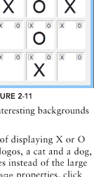

图 2-11

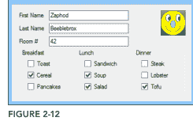

图 2-12


## 3 使控件自行排列

第 2 课讲解了如何向窗体添加控件并整齐排列它们。使用这些技术，你可以创建如图 3-1 所示的窗体。（尽管我们还没有讲解该程序窗体背后的代码。）

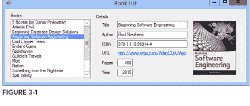

**图 3-1**

该窗体在图 3-1 中看起来还不错，但如果用户像图 3-2 所示那样放大窗体呢？很糟糕，对吧？尽管窗体变大了，但包含数据的区域并没有变大。

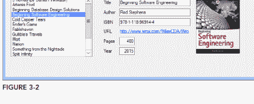

**图 3-2**

图 3-2 中选中的图书的 URL 太长，无法完全显示在 GroupBox 内，因此即使窗体右侧有额外的空闲空间也被截断了。ListBox 也不够大，无法显示其所有项目，即使底部也有空闲空间。最好让控件自行重新排列以利用可用空间并显示完整的 URL 和更多列表项。

图 3-3 显示了该窗体的另一个问题。如果用户缩小窗体，TextBoxes 和 URL LinkLabel 会被截断，Year 标签和 TextBox 会在垂直方向上被切成两半，ListBox 放不下，封面图片完全不见了。

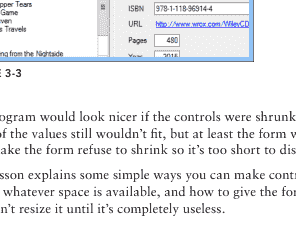

**图 3-3**

如果控件被缩小以便至少可以看到它们的边缘，程序看起来会更好一些。有些值仍然放不下，但至少窗体不会看起来那么业余。你甚至可以让窗体拒绝缩小到太短以至于无法显示 Year 控件。

本课讲解了一些简单的方法，让控件自行重新排列以利用任何可用空间，以及如何为窗体设置最小和最大尺寸，以便用户无法将其调整到完全无用为止。

### 限制窗体大小

窗体（事实上所有控件）都有 MinimumSize 和 MaximumSize 属性，可用于限制窗体的大小。只需将这些属性设置为宽度和高度（或设置其 Width 和 Height 子属性），窗体就会完成其余工作。

例如，要防止用户将图 3-3 所示的窗体缩小得太小，可以将窗体的 MinimumSize 属性设置为 663, 233。

### 使用 Anchor 属性

MinimumSize 属性可以防止用户将窗体调得太小，但它并不能解决图 3-2 所示的问题。当用户调整窗体大小时，最好让控件随之改变大小。

Anchor 属性允许 Windows Forms 控件在其容器调整大小时自行调整大小。该属性可以取一个或多个值 Top、Bottom、Left 和 Right，任意组合。这些值表示控件的边缘应与容器对应边缘保持相同的距离。

例如，最初控件的 Anchor 属性设置为 Top、Left，因此它与容器顶部和左侧边缘保持相同的距离。如果调整窗体大小，控件不会移动。

更有趣的例子是，假设你在窗体上放置一个 TextBox，将其 Multiline 属性设置为 True，使其边缘距离窗体边缘 12 像素，并将 Anchor 属性设置为 Top、Bottom、Left、Right。然后当你调整窗体大小时，TextBox 会自行调整大小，使其所有边缘都保持距离窗体对应边缘 12 像素。

> **注意** 如果 Anchor 的值不包括 Left 或 Right，控件会移动以保持其与窗体水平中部的相同距离。例如，如果 Button 的 Anchor 属性为 Bottom，它会移动以保持与窗体水平中部的相同距离。
>
> 这个事实让你可以让一个或多个控件保持居中。例如，在窗体底部附近放置几个按钮，然后选择 格式 → 在窗体中居中 → 水平 将它们水平居中。现在如果将它们的 Anchor 属性设置为 Bottom，按钮组在窗体调整大小时仍保持居中。

> **注意** 如果控件的 AutoSize 设置为 True，Anchor 属性无法调整 Label 或 LinkLabel 等控件的大小。在这种情况下，控件有自己的想法认为它应该有多大。

在设计时设置 Anchor 属性，你可以在属性窗口中输入类似 Top、Left、Right 的值，也可以使用属性窗口的 Anchor 编辑器。

要使用编辑器，请在属性窗口中单击 Anchor 属性。然后单击右侧的下拉箭头，使图 3-4 所示的编辑器出现。单击细长的矩形以选择或取消选择要使用的锚点。（在图 3-4 中，顶部、底部和右侧锚点被选中。）完成后，按 Enter 接受更改或按 Esc 取消它们。

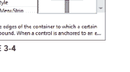

**图 3-4**

- 11. [WPF] 使用 WPF 应用程序重复练习 10。
- 12. 构建一个与图 2-13 所示类似的窗体。（不必担心让程序执行任何计算。你稍后会学习如何做到这一点。）
- 13. [WPF] 使用 WPF 应用程序重复练习 12。
- 14. 构建一个与图 2-14 所示类似的窗体。（在互联网上搜索 "labeled diagram" 并选择一张有趣的图片。使用 MS Paint 或其他图像编辑程序删除标签。然后在标签所在位置添加 TextBoxes，以便用户可以填写。）

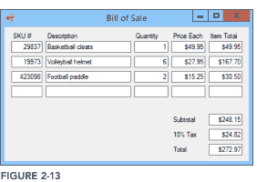

**图 2-13**

| SKU # | 描述 | 数量 | 单价 | 项目总计 |
|---|---|---|---|---|
| 29637 | 篮球钉鞋 | 1 | $49.95 | $49.95 |
| 19573 | 排球头盔 | 6 | $27.95 | $167.70 |
| 420398 | 足球桨 | 2 | $15.25 | $30.50 |
| | | | 小计 | $248.15 |
| | | | 10% 税 | $24.82 |
| | | | 总计 | $272.97 |

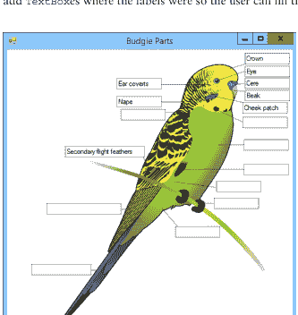

**图 2-14**

- 15. [WPF] 使用 WPF 应用程序重复练习 14。
- 16. 构建一个与图 2-15 所示类似的条形图。（提示：使用 PictureBox 作为图表的背景，使用 Labels 作为条形。）

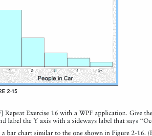

**图 2-15**

- 17. [WPF] 使用 WPF 应用程序重复练习 16。为图表背景添加颜色渐变，并用侧向标签标记 Y 轴，标签文字为 "Occurrences."。
- 18. 构建一个与图 2-16 所示类似的条形图。（提示：使用 PictureBoxes 作为条形。）

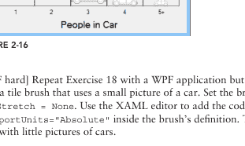

**图 2-16**

- 19. [WPF hard] 使用 WPF 应用程序重复练习 18，但用使用小汽车图片的平铺画刷填充条形 Image 控件。设置画刷的 `TileMode = Tile` 和 `Stretch = None`。使用 XAML 编辑器在画刷的定义内添加代码 `Viewport="0,0,55,27" ViewportUnits="Absolute"`。结果应该是用小汽车图片平铺的条形。
- 20. 修改你在练习 18 中制作的程序，为条形添加工具提示。（向窗体添加一个名为 peopleToolTip 的 ToolTip 控件。然后使用属性窗口为条形标签设置 "ToolTip on peopleToolTip" 属性。例如，让第二个条形的工具提示显示 "2 people."。）
- 21. [WPF] 使用 WPF 应用程序重复练习 20。（提示：在 WPF 中你不需要使用 ToolTip 控件。只需设置条形的 ToolTip 属性即可。）
- 22. [WPF hard] 构建一个与图 2-17 所示类似的 WPF 程序。（提示：对于反射文字，使用 Label。使其 Foreground 画刷从中灰色渐变到浅灰色。在 Transform 属性类别中，将 Y 方向的缩放设置为 -1，并将 X 方向的倾斜设置为 30。）

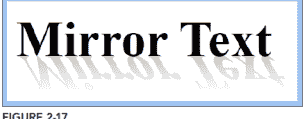

**图 2-17**

- 23. [Games] 创建一个名为 MovingButton 的程序。创建一个名为 clickMeButton 的按钮，文字为 "Click Me."。向窗体添加一个名为 moveButtonTimer 的 Timer，并将其 Interval 属性设置为 500。

接下来双击 Timer 以打开其 Tick 事件的代码并添加粗体文字，使事件处理程序如下所示：

```csharp
Random Rand = new Random();
private void moveButtonTimer_Tick(object sender, EventArgs e)
{
    clickMeButton.Left = Rand.Next(0, 250);
    clickMeButton.Top = Rand.Next(0, 250);
}
```

现在双击按钮并在以下代码中添加粗体文字以创建其事件处理程序：

```csharp
private void clickMeButton_Click(object sender, EventArgs e)
{
    moveButtonTimer.Enabled = !moveButtonTimer.Enabled;
}
```

运行程序并享受乐趣！尝试 Timer 的 Interval 属性的不同值，例如 2000 和 10。

> **注意** 请在 www.wrox.com/go/csharp24hourtrainer2evideos 在线选择第 2 课的视频。


使用 Anchor 属性，可以解决图 3-2 所示的问题。表 3-1 列出了各控件所使用的 Anchor 属性值，让它们能充分利用窗体的可用空间。

## 表 3-1

| 控件 | Anchor 属性 |
|---|---|
| booksListBox | Top, Bottom, Left |
| detailsGroupBox | Top, Bottom, Left, Right |
| titleTextBox | Top, Left, Right |
| authorTextBox | Top, Left, Right |
| isbnTextBox | Top, Left, Right |
| urlLinkLabel | Top, Left, Right |
| coverPictureBox | Top, Bottom, Right |

现在，当窗体调整大小时：

- ListBox 沿垂直方向拉伸，以匹配窗体的高度。
- GroupBox 沿垂直和水平方向拉伸，尽可能利用窗体的宽度和高度。
- TextBoxes 和 LinkLabel 沿水平方向拉伸，在仍可放入 GroupBox 内部的前提下尽可能变宽。
- PictureBox 随 GroupBox 的右边缘移动，从而为左侧的 TextBoxes 和 LinkLabel 留出尽可能多的空间。同时，它也会在仍可放入 GroupBox 内部的前提下尽可能沿垂直方向拉伸。

图 3-5 显示了结果。此时，ListBox 足够大，可以显示其所有项；LinkLabel 也足够大，可以显示完整的 URL。

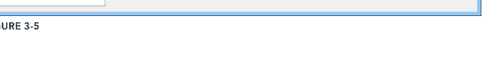

## 图 3-5

注意：TextBoxes 和 LinkLabel 不会在窗体调整大小时水平拉伸；它们会在包含它们的 GroupBox 调整大小时拉伸。在本例中，窗体拉伸时 GroupBox 拉伸，GroupBox 拉伸时 TextBoxes 和 LinkLabel 拉伸，因此效果是一样的。

## 使用 Dock 属性

Anchor 属性可以满足你大部分布局需求，但有些 Anchor 值组合非常常见，因此 C# 提供了另一个属性来让你更轻松地处理这些情况：Dock。Dock 属性允许你告诉控件将其自身附加到容器的某个边缘。

例如，菜单通常会横跨窗体的顶部。你可以通过将菜单的 Anchor 属性设置为 Top, Left, Right 来实现这一行为，但将 Dock 设置为 Top 更加容易。

Dock 属性可以取六个值之一。Left、Right、Top 和 Bottom 将控件附加到其容器的相应边缘。Fill 使控件占据在其他控件的 Dock 属性生效后剩余的空间。None 使控件分离，以便其 Anchor 属性接管。

> 注意：如果 Label 或 LinkLabel 等控件将 AutoSize 设置为 True，则 Dock 属性无法调整其大小。

Dock 属性根据控件在窗体上的堆叠顺序，按先到先得的顺序处理定位请求。换句话说，它先定位第一个绘制的控件。第二个控件在剩余空间中定位自身。然后第三个控件在剩余空间中定位自身，依此类推。

通常，堆叠顺序由你向窗体添加控件的顺序决定，但你可以通过右键单击控件并选择“置于顶层”或“置于底层”来更改顺序。然而，如果你正在处理一组复杂的 Dock 属性，并且堆叠顺序被打乱，通常更简单的做法是删除所有控件并从头开始。

图 3-6 显示了一个包含五个停靠的 Label（AutoSize = False）的窗体。控件 Text 属性中的数字给出了它们创建的顺序，也就是它们的堆叠顺序。

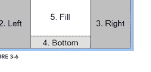

## 图 3-6

下面的列表说明了窗体的空间是如何在 `Label` 之间分配的：

- 1. 第一个 `Label` 的 `Dock = Top`，因此它占据了窗体顶部的整个宽度。
- 2. 第二个 `Label` 的 `Dock = Left`，因此它占据了剩余区域的左边缘（在第一个 `Label` 定位之后）。
- 3. 第三个 `Label` 的 `Dock = Right`，因此它占据了剩余区域的右边缘。
- 4. 第四个 `Label` 的 `Dock = Bottom`，因此它占据了剩余区域的底部边缘。
- 5. 最后一个 `Label` 的 `Dock = Fill`，因此它填满了所有剩余区域。

## 停靠的菜单

在一个典型的停靠场景中，窗体包含一个 `Dock = Top` 的 `MenuStrip` 和一个 `Dock = Fill` 的容器（如 `Panel`），以便后者占据窗体的其余部分。所有其他控件都放置在 `Panel` 内部。

你还可以添加具有适当 `Dock` 属性的 `ToolStrip`、`ToolStripContainer` 和 `StatusBar`，以将这些控件放置在正确的位置。图 3-7 显示了一个窗体，其中包含一个 `MenuStrip`（Dock = Top）、一个包含两个 `ToolStrip` 的 `ToolStripContainer`（Dock = Top）、一个 `StatusStrip`（Dock = Bottom）和一个 `Panel`（Dock = Fill）。我将 `Panel` 颜色稍微加深，以便容易看清它的位置。

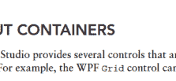

## 图 3-7

## 布局容器

Visual Studio 提供了几个控件，它们以不同的方式排列所包含的子控件。例如，WPF 的 `grid` 控件可以按行和列排列控件。

以下各节总结了 Windows Forms 和 WPF 应用程序的布局容器。

## Windows Forms 控件

Windows Forms 应用程序只使用少量布局控件。通常，窗体的大部分控件直接放置在窗体上。

当窗口调整大小时，TextBoxes 和 LinkLabel 水平拉伸，PictureBox 垂直拉伸。请注意在图 3-8 中，封面图像相当高且窄。当 PictureBox 变高时，它可以显示更大版本的封面图像。该控件会尽可能大地显示图像，同时不失真。

请注意，你构建的程序实际上不会做任何事情，只是在那里看起来漂亮，并在窗体调整大小时调整控件大小。使其响应列表选择所需的技术将在后续课程中介绍。

## 本课要求

在本课中，你将：

- 创建程序的三个主要控件：`MenuStrip`、`StatusStrip` 和 `Panel`。使用 `Dock` 属性使这三个控件保持在适当的位置。
- 向 `Panel` 添加控件。
- 使用 `Anchor` 属性使 `ListBox` 在窗体调整大小时垂直拉伸。
- 使用 `Anchor` 属性使 `TextBoxes` 和 `LinkLabel` 在窗体调整大小时水平拉伸。
- 使用 `Anchor` 属性使 `PictureBox` 在窗体调整大小时垂直调整大小。

> **注意**：你可以从网站 www.wrox.com/go/csharp24hourtrainer2e 下载本课的代码和资源。

## 提示

- 请记住，`TextBoxes` 和 `LinkLabel` 会随包含它们的 `GroupBox` 一起拉伸，而不是随窗体本身拉伸。如果你不让 `GroupBox` 拉伸，它包含的控件也不会拉伸。
- 要创建 File 菜单，请向窗体添加一个 `MenuStrip`，选中它，单击出现的 Type Here 框，然后键入 &File。（与号会使“F”带下划线。）让菜单执行有用操作将在第 5 课中介绍，所以现在不必担心。
- 要创建状态栏标签，请向窗体添加一个 `StatusStrip` 并选中它。单击 `StatusStrip` 上的小下拉箭头，然后选择 `StatusLabel`。单击新的 `StatusLabel`，使用“属性”窗口将其 Text 设置为 This is a StatusStrip。
- 向 `ListBox` 添加一些项，向 `PictureBox` 添加一张图片，并向其他控件添加文本，但不必担心让程序执行任何操作。

## 分步操作

创建程序的三个主要控件：`MenuStrip`、`StatusStrip` 和 `Panel`。使用 `Dock` 属性使这三个控件保持在适当的位置。

- 1. 启动一个名为 Better Book List 的新项目。将窗体的 `Size` 和 `MinimumSize` 属性设置为 726, 286。
- 2. 向窗体添加一个 `MenuStrip`。（注意，默认情况下 `MenuStrip` 的 `Dock` = `Top`。）使用本课“提示”一节中的 `MenuStrip` 提示来创建空的 File 菜单。
- 3. 向窗体添加一个 `StatusStrip`。（注意，默认情况下 `StatusStrip` 的 `Dock` = `Bottom`。）使用本课“提示”一节中的 `StatusStrip` 提示来创建 This is a StatusStrip 标签。
- 4. 向窗体添加一个 `Panel`。将其 `Dock` 属性设置为 `Fill`。将其 `BackColor` 属性设置为浅绿色。

向 Panel 添加控件。

- 1. 按图 3-8 所示的大致位置向窗体添加控件。
- 2. 将 `LinkLabel` 的 `AutoSize` 属性设置为 False，并使其与 `TextBoxes` 大小相同。
- 3. 在 `TextBoxes` 和 `LinkLabel` 中输入一些 Text 值，以便有内容可看。在 `ListBox` 中输入足够的项，以便在窗体初始大小时无法全部显示。
- 4. 将 `PictureBox` 的 `SizeMode` 属性设置为 Zoom。在其 `Image` 属性中放置一张相对高而窄的图片。

使用 Anchor 属性使 ListBox 在窗体调整大小时垂直拉伸。

- 1. 将 `ListBox` 的 `Anchor` 属性设置为 Top, Bottom, Left。

使用 Anchor 属性使 TextBoxes 和 LinkLabel 在窗体调整大小时水平拉伸。

- 1. 将 `GroupBox` 的 `Anchor` 属性设置为 Top, Bottom, Left, Right。
- 2. 将 `TextBoxes` 和 `LinkLabel` 的 `Anchor` 属性设置为 Top, Left, Right。

使用 Anchor 属性使 PictureBox 在窗体调整大小时垂直调整大小。

- 1. 将 `PictureBox` 的 `Anchor` 属性设置为 Top, Bottom, Left。

运行程序，看看调整窗体大小时会发生什么。

## 练习

- 1. [WPF] 使用 WPF 应用程序重复本课中的“试试看”内容。


2. 创建一个与图 3-9 所示类似的新建客户对话框。使 First Name、Last Name、Street、City 和 Email 文本框在窗体调整大小时水平调整大小。将 OK 和 Cancel 按钮用作窗体的接受和取消按钮，并将它们附加到窗体的右下角。

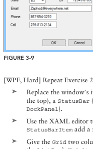

图 3-9

3. [WPF, Hard] 使用 WPF 应用程序重复练习 2。提示：
- 将窗口的初始 Grid 替换为 DockPanel。添加一个 Menu（停靠在顶部）、一个 StatusBar（停靠在底部）以及一个 Grid（填充 DockPanel 的其余部分）。
- 使用 XAML 编辑器在 StatusBar 内添加一个 StatusBarItem。在 StatusBarItem 内添加一个 Label。
- 为 Grid 设置两列。在左侧列中放置一个 Label 和一个 ListBox。将 ListBox 的 Height = Auto 并使用其 Items 属性编辑器添加多个 ListBoxItems。然后使用 XAML 编辑器向 ListBoxItems 添加 Labels。例如，其中一个 ListBoxItems 可能如下所示：
- 在 Grid 的右侧列中添加一个 GroupBox。GroupBox 只能有一个子控件。将其设为 Grid 并为其提供显示 Image、Labels 和 TextBoxes 所需的行和列。

```xml
<ListBoxItem>
    <Label Content="Beginning Database Design Solutions"/>
</ListBoxItem>
```

最后提示：通常先制作一个控件使其完全符合你的要求，然后在 XAML 代码编辑器中复制并粘贴它会更容易。不要忘记更改新控件的名称，以免有两个名称相同的控件。

4. [SimpleEdit] 创建一个名为 SimpleEdit 的新项目。为其提供 MenuStrip 和 StatusStrip 并使用适当的（默认）Dock 值。添加一个 RichTextBox 控件并将其 Dock 属性设置为 Fill。（就目前而言这就够了。在后面的课程中你将为此程序添加功能。）

5. [WPF, SimpleEdit] 使用 WPF 应用程序重复练习 4。

6. SplitContainer 控件显示由分隔条分隔的两个区域。用户可以拖动分隔条在两个区域之间划分可用空间。制作一个与图 3-10 所示类似的程序。随意使用不同的图片和信息。使 PictureBox 以最大可能大小且不失真地显示其图像。将底部 TextBox 的 MultiLine 属性设置为 True 并使其在窗体调整大小时垂直和水平拉伸。使其他 TextBoxes 水平拉伸。将 SplitContainer 的 Panel1MinSize 和 Panel2MinSize 属性设置为 100。

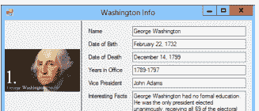

**图 3-10**

7. [WPF] 使用 WPF 应用程序重复练习 6。提示：要在 WPF 中制作分隔条，请创建一个 Grid 控件。然后向其某一行或列添加一个 GridSplitter。用户可以拖动 GridSplitter 来调整其两侧的行或列大小。

对于此程序，请创建一个具有三个列的 Grid，其宽度分别为 1*、5 和 2*。在左侧列中放置一个 Image，在中间列中放置一个 GridSplitter，在右侧列中放置另一个 Grid。

然后使 GridSplitter 的 XAML 代码如下所示：

```xaml
<GridSplitter Grid.Column="1" Margin="0,0,0,0"
    HorizontalAlignment="Stretch" VerticalAlignment="Stretch"/>
```

在右侧的 Grid 中放置适当的 Labels 和 TextBoxes。使用“Interesting Facts” Label 的 Margin 和 VerticalContentAlignment 属性，使其文本在调整窗体大小时保持在其区域中居中。

8. 制作一个与图 3-11 所示类似的窗体。当窗体调整大小时，三个 ListBoxes 应尽可能大，并且三个列应均匀划分窗体。（提示：使用 TableLayoutPanel。）

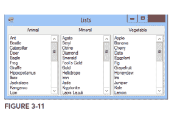

9. [WPF] 使用 WPF 应用程序重复练习 8。
10. [WPF] WPF 中较酷的新控件之一是 Expander。它显示一个标题和一个展开箭头。当用户单击箭头时，Expander 会展开以显示一个子控件，通常是一个 Grid。

制作一个与图 3-12 所示类似的 WPF 程序。在该图中，木星的 Expander 已展开，而其他行星的 Expanders 已折叠。（提示：图 3-12 中的 Window 包含一个 StackPanel，其中包含包含 Grids 的 Expanders。首先创建 StackPanel。接下来为水星制作 Expander 和子控件。然后在 XAML 编辑器中复制并粘贴该 Expander 以制作其他行星的 Expanders。）

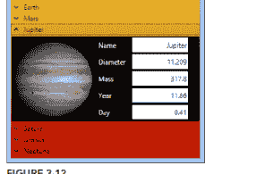

> > NOTE 请在 www.wrox.com/go/csharp24hourtrainer2evideos 在线选择第 3 课的视频。

## 4 处理事件

一个 *event* 是控件引发的东西，用来告诉程序发生了重要事情。事件极其重要，因为它们是用户控制程序的主要方式。当用户单击按钮、拖动滑块和选择菜单项时，事件会告诉程序发生了什么事情，以便它采取行动。

一个 *event handler* 是捕获该事件并在事件发生时执行的代码片段。事件处理程序可能会显示一条消息、执行计算，或从网上下载最新的 *Dilbert* 漫画。

Lesson 2 简要解释了如何捕获 `Button` 的 `Click` 事件，但该事件只是程序可以捕获的数百个（如果不是数千个）事件中的一个。

本课解释了如何捕获除 `Click` 之外的事件。它描述了常见控件提供的一些最有用的事件，并作为奖励，解释了如何在事件发生时向用户显示消息。

### 创建事件处理程序

构建事件处理程序的最简单方法是双击 Form Designer 中的控件。这会为控件的默认事件创建一个空事件处理程序并在代码编辑器中打开该事件处理程序。然后你可以键入 `C#` 代码以执行适当的任何操作。

以下代码显示了为 `Button` 创建的空 `Click` 事件处理程序：

```csharp
private void crashSystemButton_Click(object sender, EventArgs e)
{
}
```

可能最常用的事件是 `Buttons`、`ToolStripMenuItems`（代表菜单项）和 `ToolStripButtons`（代表工具栏按钮）引发的 `Click` 事件。对于这些控件以及许多其他控件，你几乎总是希望使用默认事件处理程序，因此双击它们是最简单的方法。

> > **NOTE** 如果你还不想编写真正的事件处理程序代码，可以编写一个占位符事件处理程序。一种简单的方法是使用 MessageBox.Show 显示一条消息。例如，以下代码为文件菜单的保存命令显示一条占位符消息：

```csharp
private void fileSaveMenuItem_Click(object sender, EventArgs e)
{
    MessageBox.Show("File > Save not yet implemented");
}
```

Lesson 8 更详细地描述了消息框。

大多数控件提供数十个其他事件供你捕获。要为其中一个非默认事件创建事件处理程序，请在 Form Designer 中选择控件。然后单击属性窗口顶部附近的闪电图标，使窗口列出控件的事件。图 4-1 显示了属性窗口显示 Button 可以引发的一些事件。

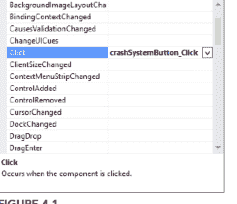

图 4-1

要为事件创建空事件处理程序，只需在属性窗口的事件列表中双击事件的名称即可。

你也可以键入想要赋予事件处理程序的名称。当你按 Enter 时，Visual Studio 会创建事件处理程序并在代码编辑器中打开它。

如果你的代码已包含可以处理该事件的事件处理程序，你可以单击该事件，然后单击右侧的下拉箭头以选择其中一个事件处理程序。

即使你调整窗体大小，滚动条也可以保存 Panel 内任意点的坐标。

### 跟踪鼠标移动

当你将鼠标移过 Panel 时，Panel 控件会引发 MouseMove 事件。对于此程序，我使用属性窗口创建了以下 MouseMove 事件处理程序：

```csharp
// Move the scrollbars to track the mouse.
private void fieldPanel_MouseMove(object sender, MouseEventArgs e)
{
    mouseHScrollBar.Value = e.X;
    mouseVScrollBar.Value = e.Y;
}
```

此代码将水平滚动条的值设置为事件处理程序的 e.X 参数报告的鼠标 X 位置。然后将垂直滚动条的值设置为事件处理程序的 e.Y 参数报告的鼠标 Y 位置。

> **NOTE** 在 C# 中，坐标以左上角为 (0, 0)，X 向右递增，Y 向下递增。

> **WARNING** 按当前程序编写的方式，如果你单击并将鼠标拖出 Panel 之外，Panel 会接收到坐标超出滚动条允许值的 MouseMove 事件，从而导致程序崩溃。现在不要这样做。在第 18 课中你将学习如何使用测试来保护程序免受该问题的影响。

窗体的 Load 和 Resize 事件处理程序保证滚动条的 Maximum 属性足够大，可以容纳 Panel 上的任何坐标。

### 移动鼠标图片

当你单击 Panel 时，Panel 会引发 MouseClick 事件。对于此程序，我使用属性窗口创建了以下 MouseClick 事件处理程序：

```csharp
// Move the mouse PictureBox to the point clicked.
private void fieldPanel_MouseClick(object sender, MouseEventArgs e)
{
    mousePictureBox.Left = e.X;
    mousePictureBox.Top = e.Y;
}
```

此代码只是将鼠标 PictureBox 的 Left 和 Top 属性设置为所单击点的坐标。

这就是程序的全部内容。如果你愿意，可以下载它并进行实验。


## 删除事件处理程序

去除事件处理程序并不像你想象的那么简单。如果只是删除事件处理程序的代码，程序仍然包含自动生成的将事件处理程序附加到引发它的控件的代码。当你尝试切换到窗体设计器时，你会收到类似以下的错误：

> 设计器无法处理第 51 行的未知名称 'fieldPanel_MouseClick'。方法 'InitializeComponent' 内的代码由设计器生成，不应手动修改。请删除任何更改并重试打开设计器。

这实际上意味着 C# 感到困惑。

属性窗口为你提供了一种安全地删除事件处理程序的简便方法。在删除事件处理程序的代码之前，在属性窗口中找到该事件处理程序。右键单击事件处理程序的名称并选择重置，以中断事件处理程序与控件之间的链接。现在你可以安全地删除事件处理程序的代码。

另外，你可以双击错误窗口中的错误，以查看导致 C# 发脾气的自动生成代码。该行应如下所示：

```
this.fieldPanel.MouseClick +=
    new System.Windows.Forms.MouseEventHandler(this.fieldPanel_MouseClick);
```

删除该行后你应该可以再次运行。

> **WARNING** 不要在自动生成的代码中乱搞！如果你不小心搞乱了那段代码，你可能会从窗体中删除控件、更改属性，甚至使窗体无法加载以至于你不得不丢弃它。进去，删除那一行，然后在造成严重损害之前出来。

WPF 程序以略有不同的方式附加事件处理程序。在 WPF 应用程序中，XAML 代码包含一个属性，该属性定义了 C# 代码中的事件处理程序名称。例如，以下 XAML 代码定义了一个带有 Click 事件处理程序的按钮：

```
<Button x:Name="clickMeButton" Content="Click Me"
Width="75" Height="20" Click="clickMeButton_Click"/>
```

如果你删除事件处理程序的 C# 代码，你还应从 XAML 代码中删除 Click="clickMeButton_Click"。

## 在代码中添加和删除事件处理程序

在设计时，你可以使用属性窗口来附加和分离事件处理程序。偶尔你可能希望使用运行时代码添加或删除事件处理程序。

以下代码显示了一个简单的按钮 Click 事件处理程序。当此事件处理程序执行时，它会向用户显示一条消息：

```
// Display a message box.
private void clickMeButton_Click(object sender, EventArgs e)
{
    MessageBox.Show("You clicked me!");
}
```

假设你已编写此事件处理程序，但在设计时尚未将其附加到任何控件。以下代码将事件处理程序附加到 clickMeButton 控件的 Click 事件：

```
clickMeButton.Click += clickMeButton_Click;
```

+= 运算符表示“添加”，因此此代码将事件处理程序添加到 clickMeButton.Click 事件。

运行此代码后，如果用户单击 clickMeButton，事件处理程序将执行。

以下代码从按钮的 Click 事件中移除事件处理程序：

```
clickMeButton.Click -= clickMeButton_Click;
```

-= 运算符表示“减去”，因此此代码从 clickMeButton.Click 事件中移除事件处理程序。

图 4-3 所示的 DynamicEvents 示例程序允许你在运行时添加和删除事件处理程序。最初，点击我按钮什么也不做。单击附加按钮以将事件处理程序附加到点击我按钮。单击分离按钮以移除事件处理程序。

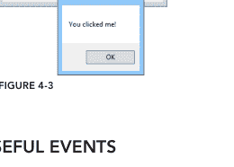

图 4-3

## 有用的事件

表 4-1 列出了各种控件引发的一些更有用的事件。

**表 4-1**

| 事件 | 含义 |
|---|---|
| CheckedChanged | CheckBox 或 RadioButton 的选中状态已更改。 |
| Click | 用户已单击控件。 |
| FormClosing | 表单即将关闭。将 e.Cancel 参数设置为 true 可取消关闭并强制表单保持打开状态。 |
| KeyDown | 用户在该控件获得焦点时按下键。 |
| KeyPress | 用户在该控件获得焦点时按下并释放键。 |
| KeyUp | 用户在该控件获得焦点时释放键。 |
| Load | 表单已加载但尚未可见。这是用户看到表单之前更改其外观的最后时机。 |
| MouseClick | 用户在控件上方按下并释放鼠标按钮。与 Click 事件不同，此事件具有提供单击位置的参数。 |
| MouseDown | 用户在控件上方按下鼠标按钮。 |
| MouseEnter | 鼠标进入控件。 |
| MouseHover | 鼠标悬停在控件上方。 |
| MouseLeave | 鼠标离开控件。 |
| MouseMove | 鼠标在控件上方移动。 |
| MouseUp | 用户在控件上方释放鼠标按钮。 |
| Move | 控件已移动。 |
| Paint | 控件需要重绘。（这对于绘制图形很有用。） |
| Resize | 控件已调整大小。 |
| Scroll | 用户移动了 TrackBar 或滚动条上的滑块。 |
| SelectedIndexChanged | ComboBox 或 ListBox 的选择已更改。 |
| TextChanged | 控件的 Text 属性已更改。（这对于 TextBoxes 特别有用。） |
| Tick | Timer 控件的 Interval 已过去。 |
| ValueChanged | TrackBar 或滚动条的值已更改（无论是由用户还是代码引起）。 |

## 试一试

在本试一试中，你使用事件处理程序在用户调整红色、绿色和蓝色滚动条时显示颜色样本。

图 4-4 显示了完成的程序运行情况。当你更改滚动条的值时，右侧的标签显示颜色分量的新数值，远右侧的大标签显示具有所选红色、绿色和蓝色分量的颜色样本。

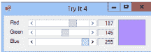

图 4-4

### 课程要求

在本课中，你：

- 创建如图 4-4 所示的表单。安排控件并设置其 Anchor 属性。
- 为红色滚动条制作一个事件处理程序，使其显示所有三个颜色值和颜色样本。
- 将事件处理程序附加到绿色和蓝色滚动条，以及红色滚动条。

> **NOTE** 你可以从网站 www.wrox.com/go/csharptwentyfour2e 下载本课的代码和资源。

### 提示

本试一试需要一些尚未涵盖的技术，但凭借几个提示构建起来并不太难。

- 滚动条的 `Value` 属性是一个整数。要将其转换为字符串以便在标签中显示，请调用其 `ToString` 方法。例如，以下代码使 `redLabel` 控件显示 `redHScrollBar` 的 `Value` 属性：

  ```csharp
  redLabel.Text = redHScrollBar.Value.ToString();
  ```

- `Color` 类的 `FromArgb` 方法返回具有给定红色、绿色和蓝色分量在 0 到 255 之间的颜色。例如，`Color.FromArgb(255, 128, 0)` 返回颜色橙色（红色 = 255，绿色 = 128，蓝色 = 0）。将此方法传递滚动条所选的值（由其 `Value` 属性返回）并将结果分配给样本标签的 `BackColor` 属性。

### 逐步操作

**创建如图 4-4 所示的表单。安排控件并设置其 Anchor 属性。**

1. 按图 4-4 所示创建控件。对于滚动条，设置 Minimum = 0, Maximum = 264, SmallChange = 1, LargeChange = 10, 和 Anchor = Top, Left, Right。

> **NOTE** 由于某种奇怪的原因，用户可以用滚动条选择的最大值是 Maximum - LargeChange + 1。如果 Maximum = 264 且 LargeChange = 10，则最大可选值是 264 - 10 + 1 = 255，因此这些属性允许用户选择 0 到 255 之间的值。

**为红色滚动条制作一个事件处理程序，使其显示所有三个颜色值和颜色样本。**

1. 双击红色滚动条为控件的 Scroll 事件创建一个空事件处理程序。键入以下代码中的粗体行，使事件处理程序如下所示：

```
// Display a color sample.
private void redHScrollBar_Scroll(object sender, ScrollEventArgs e)
{
    redLabel.Text = redHScrollBar.Value.ToString();
    greenLabel.Text = greenHScrollBar.Value.ToString();
    blueLabel.Text = blueHScrollBar.Value.ToString();
    sampleLabel.BackColor = Color.FromArgb(
        redHScrollBar.Value,
        greenHScrollBar.Value,
        blueHScrollBar.Value);
}
```

前三行代码使标签显示相应的滚动条值。最终语句跨四行代码，将样本标签的 BackColor 属性设置为由滚动条值定义的颜色。

**将事件处理程序附加到绿色和蓝色滚动条，以及红色滚动条。**

1. 在窗体设计器中，单击绿色滚动条。在属性窗口中，单击事件按钮（闪电图标）。然后单击控件的 Scroll 事件，单击右侧的下拉箭头并选择你已创建的事件处理程序。
2. 对蓝色滚动条重复之前的步骤。

**运行程序并尝试。注意滚动条中可以选的最大值是 255。**

## 练习

1. 构建如图 4-2 所示的 FollowMouse 示例程序。
2. [WPF, Hard] 使用 WPF 应用程序重复练习 1。WPF 在许多方面有所不同（例如查找鼠标位置），因此此练习有点困难。以下是一些提示：


- 使用两个 ScrollBar 控件，其中一个的 `Orientation = Horizontal`。

- 使用 Canvas 代替 Panel，并使用 Image 代替 PictureBox。

- 不要捕获窗体的 Load 和 Resize 事件，而是捕获 Canvas 控件的 SizeChanged 事件，并为其提供以下事件处理程序：

```csharp
// Set the scrollbar maximums to fit the Canvas.
private void fieldCanvas_SizeChanged(object sender, SizeChangedEventArgs e)
{
    mouseHScrollBar.Maximum = e.NewSize.Width;
    mouseVScrollBar.Maximum = e.NewSize.Height;
}
```

- 为 Canvas 的 MouseMove 事件处理程序使用以下代码：

```csharp
// Move the scrollbars to track the mouse.
private void Canvas_MouseMove(object sender, MouseEventArgs e)
{
    Point location = Mouse.GetPosition(fieldCanvas);
    mouseHScrollBar.Value = location.X;
    mouseVScrollBar.Value = location.Y;
}
```

- 最初将 Image 控件定位在 Canvas 控件的左上角。然后使用以下 MouseDown 事件处理程序：

```csharp
// Move the mouse Image to the point clicked.
private void fieldCanvas_MouseDown(object sender, MouseButtonEventArgs e)
{
    Point location = Mouse.GetPosition(fieldCanvas);
    mouseImage.Margin = new Thickness(location.X, location.Y, 0, 0);
}
```

3. 生成图 4-3 所示的 DynamicEvents 示例程序。如果单击 Attach 两次会发生什么？三次呢？如果随后单击 Detach 一次会发生什么？五次呢？

4. [WPF] 使用 WPF 应用程序重复练习 3。

5. 创建一个窗体，其中包含一个标有“Stop”的 Button 和两个名为 leftTimer 和 rightTimer 的 Timer。将 Timer 的 Interval 属性设置为 1000。在设计时，将 leftTimer 的 Enabled 属性设置为 True。

    - 在每个 Timer 的 Tick 事件处理程序中，禁用该 Timer 并启用另一个 Timer。
    - 让一个 Timer 的 Tick 事件处理程序还通过设置 Button 的 Left 和 Top 属性将其移动到 (10, 10)。
    - 让另一个 Timer 的 Tick 事件处理程序将 Button 移动到 (200, 200)。
    - 在 Button 的 Click 事件处理程序中，将两个 Timer 的 Enabled 都设置为 false。

    运行程序。尝试为 Timer 的 Interval 属性设置不同的值。如果 Interval = 10 会发生什么？

6. 复制你为练习 1 生成的 FollowMouse 程序。修改副本，使用户可以调整滚动条来移动 PictureBox。

7. [WPF] 复制你为练习 2 生成的程序。修改副本，使用户可以调整滚动条来移动图像。（提示：为节省代码，对两个滚动条使用同一事件处理程序。为防止鼠标图像出现在滚动条上方以及窗口右下角的小区域中，将 Canvas 控件的 ClipToBounds 属性设置为 True。）

8. 制作一个类似于图 4-5 所示的程序。当用户取消选中 Breakfast、Lunch 或 Dinner 复选框时，程序应禁用相应的 GroupBox。

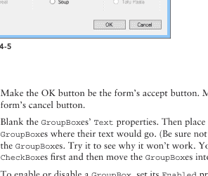

**图 4-5**

**提示：**

- 使 OK 按钮成为窗体的接受按钮。使 Cancel 按钮成为窗体的取消按钮。
- 清空 GroupBox 的 Text 属性。然后将 CheckBox 放置在 GroupBox 上原来文本所在的位置。（确保不要将 CheckBox 放在 GroupBox 内部。试一下就会明白为什么不行。你可能需要先定位 CheckBox，然后再将 GroupBox 移到相应位置。）
- 要启用或禁用 GroupBox，请将其 Enabled 属性设置为相应 CheckBox 的 Checked 属性，如下代码所示：

```csharp
// Enable or disable the corresponding GroupBox.
private void breakfastCheckBox_CheckedChanged(object sender, EventArgs e)
{
    breakfastGroupBox.Enabled = breakfastCheckBox.Checked;
}
```

9. [WPF] 使用 WPF 应用程序重复练习 8。提示：

- WPF CheckBox 不显示背景，因此此程序中的复选框不会覆盖其下方 GroupBox 的边框。要解决该问题，请将每个 CheckBox 放在 Canvas 中，并让 Canvas 使用白色背景。
- GroupBox 只能有一个子元素。为每个 GroupBox 提供一个包含 RadioButton 的 StackPanel。使用 RadioButton 的 Margin 属性在选项之间添加一些间距。
- WPF `CheckBox` 控件没有 `CheckedChanged` 事件。请改用 `Click` 事件。
- 要启用或禁用 `GroupBox`，请将其 `IsEnabled` 属性设置为相应 `CheckBox` 的 `IsChecked.Value` 属性，如下代码所示：

```csharp
// Enable or disable the appropriate GroupBox.
private void breakfastCheckBox_Click(object sender, RoutedEventArgs e)
{
    breakfastGroupBox.IsEnabled = breakfastCheckBox.IsChecked.Value;
}
```

- 要设置 WPF 窗口的接受按钮，请将 Button 的 `IsDefault` 属性设置为 `True`。
- 要设置 WPF 窗口的取消按钮，请将 Button 的 `IsCancel` 属性设置为 `True`。

10. 制作一个类似于图 4-6 所示的程序。

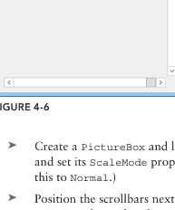

**图 4-6**

- 创建一个 `PictureBox` 并向其中加载图像。将其大小设置为与图片大小匹配，并将其 `SizeMode` 属性设置为 `StretchImage`。（另请查看将其设置为 `Normal` 时会发生什么。）
- 将滚动条放在 `PictureBox` 旁边。设置它们的 `Maximum` 属性，使用户可以选择介于 0 与图片宽度/高度之间的值。
- 最初将滚动条的 `Value` 属性设置为等于图像的宽度/高度。
- 让滚动条的 `Scroll` 事件处理程序将 `PictureBox` 的宽度/高度设置为等于滚动条的值。

11. [WPF] 使用 WPF 应用程序重复练习 10。提示：

- 将 Image 控件的 Stretch 属性设置为 Fill。（另请查看将其设置为 None 时会发生什么。）
- 在 WPF 程序中，用户可以将 ScrollBar 设置为其 Maximum 值。

12. [WPF, Games, Hard] 在 Windows Forms 应用程序中很难做到、而在 WPF 应用程序中却很容易做到（至少如果设置得当）的一件事是变换对象。例如，缩放、旋转和倾斜控件相对容易。对于本练习，制作一个类似于图 4-7 所示的程序。当用户调整底部的滚动条时，程序应旋转图像，并在右下角的 Label 中显示旋转角度。

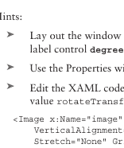

**图 4-7**

**提示：**

- 布局窗口及其控件。将图片放入 Image 控件中。将标签控件命名为 degreesLabel。

- 使用“属性”窗口的 Transform 部分将 Image 旋转 360 度。

- 编辑 XAML 代码，为 rotateTransform 提供一个名为 x:Name 的属性，其值为 rotateTransform。Image 控件的代码应类似如下：

```xml
<Image x:Name="image" HorizontalAlignment="Left"
VerticalAlignment="Top" Source="ScienceGirl.png"
Stretch="None" Grid.ColumnSpan="2"
Margin="10,10,0,0" RenderTransformOrigin="0.5,0.5">
<Image.RenderTransform>
<TransformGroup>
<ScaleTransform/>
<SkewTransform/>
<RotateTransform x:Name="rotateTransform" Angle="360"/>
<TranslateTransform/>
</TransformGroup>
</Image.RenderTransform>
</Image>
```

- 使 ScrollBar 的 ValueChanged 事件处理程序如下所示：

```csharp
// Rotate the Image.
private void degreesScrollBar_ValueChanged(object sender,
    RoutedPropertyChangedEventArgs<double> e)
{
    rotateTransform.Angle = degreesScrollBar.Value;
    degreesLabel.Content = degreesScrollBar.Value.ToString("0");
}
```

13. [WPF] 生成一个 WPF 应用程序，其中的 Grid 包含一个 Image。为 Grid 提供一个 MouseMove 事件处理程序，将 Image 移动到鼠标位置。（提示：默认情况下，窗口的主 Grid 具有透明背景，因此无法正确接收鼠标事件。要解决此问题，请设置其 Background 画笔。只要不是透明，可以使用任何画笔。）

14. 生成一个显示 TrackBar 和 HScrollBar 的 Windows Forms 程序。将它们的 Maximum 属性设置为 10，并将滚动条的 LargeChange 属性设置为 1。当控件的值在运行时更改时，在 Label 中显示新值。

15. [WPF] 制作一个 WPF 应用程序，显示两个 Slider 和一个 ScrollBar，它们的 Maximum 都设置为 10。将其中一个 Slider 的 IsSnapToTickEnabled 设置为 True。当控件的值在运行时更改时，在 Label 中显示新值。

16. 制作一个类似于图 4-8 所示的条形图。单击按钮时，应为条形分配随机值。

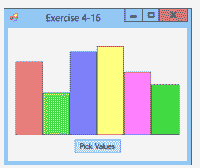

**图 4-8**

**提示：**

- 对于条形，使用多列 TableLayoutPanel 中的 Label。

- 要使 Label 显示在 TableLayoutPanel 的底部，请将其 Anchor 属性设置为 Bottom、Left、Right。

- 要使 Label 彼此接触，请将其 Margin 属性设置为 0, 0, 0, 0。

- 使用类似以下的代码为 Label 指定随机高度。请注意，**加粗的语句**位于事件处理程序之外。

```csharp
// Make a random number generator.
private Random Rand = new Random();

// Pick random values for the Labels.
private void pickValuesButton_Click(object sender, EventArgs e)
```


```csharp
{
    label1.Height = Rand.Next(10, 150);
    label2.Height = Rand.Next(10, 150);
    label3.Height = Rand.Next(10, 150);
    label4.Height = Rand.Next(10, 150);
    label5.Height = Rand.Next(10, 150);
    label6.Height = Rand.Next(10, 150);
}
```

- 17. [WPF] 使用 WPF 应用程序重复练习 16。
- 18. 修改你在练习 16 中编写的程序，使其使用 Timer 来随机选择 Label 高度，而不是使用 Button。设置 Timer 的属性 Enabled = True 且 Interval = 500。

> **NOTE** 请在 www.wrox.com/go/csharp24hourtrainer2evideos 在线选择第 4 课的视频。

## 设置菜单属性

菜单中的项是 ToolStripMenuItems，与其他控件一样，它们具有决定其外观和行为的属性。表 5-1 总结了最有用的 ToolStripMenuItem 属性。

表 5-1

| 属性 | 用途 |
|---|---|
| Checked | 确定该项是否被选中。在图 5-3 中，Normal 项处于选中状态。（另请参见 CheckOnClick。） |
| CheckOnClick | 如果将此属性设置为 True，则在用户选择该项时会自动切换其选中状态。 |
| Enabled | 指示该项是否已启用。 |
| Name | ToolStripMenuItem 的名称。通常应为在运行时使程序执行某些操作的任何菜单项提供一个良好的名称，以便代码可以引用它。 |
| ShortcutKeys | 指示该项的快捷键组合（如果有）。可以直接输入类似 Ctrl+N 的值，或单击右侧的下拉箭头以显示图 5-4 所示的快捷键编辑器。 |
| Text | 该项显示的文本。在想要用作该项加速键（如果有）的字符前放置一个与号。例如，如果将某项的 Text 设置为 &Open，则该项在菜单中显示为 Open，并且用户在菜单打开时可以通过按 Alt+O 来激活它。 |

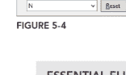

图 5-4

## 必要的省略号

按惯例，如果菜单项打开一个对话框或在继续之前需要用户提供其他输入，则其 Text 应以省略号 (...) 结尾。如果菜单项立即开始一个操作，则不应包含省略号。

例如，Open... 菜单项会显示文件打开对话框，因此其标题以省略号结尾。相比之下，Edit 菜单的 Copy 项会立即复制所选文本，因此不需要省略号。

*Accelerators* 允许用户使用键盘而不是鼠标导航菜单。当用户按下 Alt 时，菜单的项会在其加速键下方显示下划线。例如，如果 File 菜单显示为 File，则用户可以按 Alt+F 打开该菜单，然后使用其他加速键选择菜单的项。

> **NOTE** Windows 操作系统的最新版本通常在按下 Alt 键之前不会下划线显示菜单加速键。

你应为程序的大多数菜单、子菜单和菜单项提供加速键。经验丰富的用户通常可以通过使用加速键比使用鼠标更快地导航菜单系统。

> **WARNING** 请确保不要在同一菜单中为两个项分配相同的加速键字符。例如，在 File 菜单中，不要同时存在 Save 和 Save As 菜单项。

*Shortcuts* 允许用户立即激活菜单项。例如，在许多程序中，Ctrl+O 打开文件，Ctrl+S 保存当前文件。（你可以通过意识到“accelerator”和 Alt 键都以字母“a”开头来记住加速键和快捷键之间的区别。）

> **WARNING** 请务必确保不要为两个菜单项分配相同的快捷键！

> **TIP** 使用标准的加速键和快捷键可以帮助用户更快地学习如何使用你的应用程序并减少错误。网页 support.microsoft.com/kb/126449 和 windows.microsoft.com/en-us/windows/keyboard-shortcuts 列出了 Microsoft 使用的一些快捷键。我没有看到一份标准的加速键良好列表，但你可以尝试使你的加速键与 Visual Studio 和 Word 等其他常用应用程序中使用的加速键相匹配。

## 处理菜单事件

当用户单击菜单项时，其控件会引发 Click 事件，就像单击的 Button 一样，你可以以相同的方式处理它。你甚至可以以相同的方式创建默认事件处理程序：通过双击控件。

## 创建上下文菜单

上下文菜单在你右键单击特定控件时出现。在 Windows Forms 应用程序中，使用上下文菜单几乎与使用主菜单一样容易。图 5-5 显示了一个显示上下文菜单的应用程序。

首先在窗体上放置一个 ContextMenuStrip。与 MenuStrip 一样，ContextMenuStrip 会出现在窗体下方的组件托盘中，因此你可以只双击工具箱的 ContextMenuStrip 工具，而不必担心其定位。

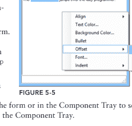

图 5-5

与 MenuStrip 不同，ContextMenuStrip 不会出现在窗体的顶部。在窗体设计器中，你可以单击窗体上或组件托盘中的 MenuStrip 来选择它。要选择 ContextMenuStrip，你必须在组件托盘中单击它。

在选择 ContextMenuStrip 后，你可以像编辑 MenuStrip 一样编辑它。最大的区别是 ContextMenuStrip 没有顶级菜单，只有子菜单项。

图 5-6 显示了窗体设计器中选中的 ContextMenuStrip。到现在为止，菜单编辑器应该看起来很熟悉了。

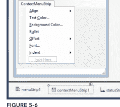

图 5-6

创建 ContextMenuStrip 后，你需要将其与应显示它的控件关联起来。为此，只需将控件的 ContextMenuStrip 属性设置为 ContextMenuStrip。为此，在属性窗口中选择控件的 ContextMenuStrip 属性，单击右侧的下拉箭头，然后选择 ContextMenuStrip。其余部分是自动的。当用户右键单击控件时，它会自动显示 ContextMenuStrip。

## WPF 菜单

要在 WPF 应用程序中创建菜单，将 Menu 控件添加到窗口并使用你喜欢的方法使其附着在顶部。例如，如果窗口包含一个 Grid，你可以使 Menu 填充 Grid 的顶部行。或者，如果窗口包含一个 DockPanel，你可以将 Menu 停靠在顶部。

创建 Menu 后，你可以通过两种方式向其中添加项。首先，你可以使用属性窗口的菜单编辑器。选择 Menu，在属性窗口中找到 Menu 的 Items 属性，然后单击右侧的省略号以打开图 5-7 所示的编辑器。

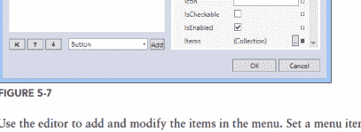

图 5-7

使用编辑器添加和修改菜单中的项。将菜单项的 Header 属性设置为你想要显示的文本。在想要用作该项加速键的字符前放置一个下划线。例如，图 5-7 中的菜单项的 Header 设置为 _Edit，因此当你在运行时按下 Alt 时，它将显示为 Edit。

要创建子菜单，单击菜单项编辑器中 Items 属性右侧的省略号（图 5-7 中右下角）。

> **NOTE** 你可以在 WPF 菜单中放置几乎任何内容。菜单可以包含 CheckBoxes、RadioButtons、ComboBoxes、Sliders，甚至包含大量其他控件的 Grid。
>
> 然而，这不是用户期望在菜单中看到的内容，因此添加太多不寻常的项会使菜单变得混乱。通常菜单应只包含 MenuItems 和 Separators。

创建菜单层次结构的第二种方法是手动编辑 XAML 代码。这看起来可能令人生畏，但实际上并不太难，特别是如果你先创建几个菜单项然后复制和粘贴其代码。

以下代码显示了包含 File 和 Format 菜单的菜单结构的 XAML 代码。请注意，Format 菜单有两个子菜单，Align 和 Offset：

```xml
<Menu x:Name="menu" VerticalAlignment="Top" DockPanel.Dock="Top">
    <MenuItem Header="File">
        <MenuItem Header="New"/>
        <MenuItem Header="Open..."/>
        <MenuItem Header="_Save"/>
    </MenuItem>
    <MenuItem Header="Format">
        <MenuItem Header="Align">
            <MenuItem Header="Left" IsChecked="True"/>
            <MenuItem Header="Right"/>
            <MenuItem Header="_Center"/>
        </MenuItem>
        <MenuItem Header="Offset">
            <MenuItem Header="Normal" IsChecked="True"/>
            <MenuItem Header="Su_perscript"/>
            <MenuItem Header="Su_bscript"/>
        </MenuItem>
    </MenuItem>
</Menu>
```

如果你在 XAML 编辑器中单击一个菜单项，窗口设计器将打开以显示该项。然后你可以双击该项为其提供 Click 事件处理程序。

## WPF 上下文菜单

与 Windows Forms 应用程序一样，WPF 应用程序允许你将上下文菜单与控件关联。当用户在运行时右键单击该控件时，上下文菜单会出现。

要向控件添加上下文菜单，首先选择该控件。然后在属性窗口中找到 ContextMenu 属性（在 Miscellaneous 部分），并单击其右侧的新建按钮。

创建 ContextMenu 后，你可以像编辑主菜单一样编辑它。ContextMenu 内部的项与 Menu 内部的项一样都是 MenuItems。在属性窗口中，你可以单击其 Items 属性旁边的省略号以打开菜单项编辑器。或者，你可以编辑 ContextMenu 的 XAML 代码。

## WPF 命令

WPF 有一套完整的系统来处理标准命令，如 Open、New 和 Copy。你甚至可以定义自己的命令。

其思想是你可能希望允许多种方法来调用同一个命令。例如，你可能允许用户单击 Button、选择 MenuItem 或选中 CheckBox 来调用 Save 命令。命令提供了一个集中位置来调用适当的的行为。

你可以定义在调用命令时要执行的代码。然后你可以将 MenuItem（或 Button 或 CheckBox 或其他）分配给一个命令，以便当用户单击控件时，它会调用该命令。你甚至可以为命令分配手势。例如，你可以使 Ctrl+L 手势调用自定义的 LeftAlign 命令。


手势相当强大，但也相当复杂，因此我不打算在本书中介绍它们。你可以在 msdn.microsoft.com/en-us/library/ms752308 上的“命令概述”一文中了解更多信息。同时，你只需为菜单项创建单击事件处理程序即可。

## 试一试

在本练习中，你将创建一个主菜单和一个上下文菜单。主菜单包含一个用于关闭窗体的“退出”命令。两个菜单都包含可用于更改窗体上 TextBox 外观的命令。图 5-8 显示了完成后的程序及其上下文菜单。

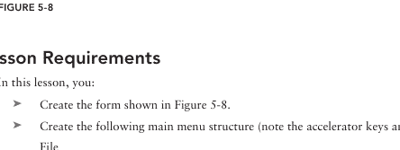

图 5-8

## 课程要求

在本课中，你将：

- 创建图 5-8 所示的窗体。
- 创建以下主菜单结构（注意加速键和快捷键）：
  文件
    退出
  格式
    颜色
      红色 Ctrl+R
      绿色 Ctrl+G
      蓝色 Ctrl+B
    背景色
      粉色
      浅绿色
      浅蓝色
  字体
    小号 Ctrl+S
    常规 Ctrl+N
    大号 Ctrl+L
- 为主菜单项添加后台代码。
- 让上下文菜单复制主菜单的“格式”子菜单。
- 将上下文菜单项附加到主菜单所使用的同一组事件处理程序。
- 将上下文菜单附加到 TextBox。

> 注意 你可以从网站 www.wrox.com/go/csharp24hourtrainer2e 下载本课的代码和资源。

## 提示

- “退出”菜单项可以通过调用 this.Close() 来关闭程序的窗体。
- 创建字体并非易事（我还没有介绍这一点）。更简单的方法是在窗体上某个控件中保留一个字体示例，然后将 TextBox 的 Font 属性设置为该控件的 Font 属性。还有什么控件比菜单项本身更适合存储字体呢？

## 分步操作

- 创建图 5-8 所示的窗体。
  1. 通过双击工具箱中的 MenuStrip 工具创建主菜单。
  2. 向窗体添加一个 TextBox。在其 Text 属性中输入一些文本，并设置其属性：Name = contentsTextBox、Multiline = True、Dock = Fill、ScrollBars = Both。
  3. 通过双击工具箱中的 ContextMenuStrip 工具创建上下文菜单。

- 创建主菜单结构。
  1. 选择 MenuStrip。单击“Type Here”框并输入 &File。
  2. 在“文件”菜单下方的“Type Here”框中，输入 E&xit。

> 注意 按照惯例，Exit 命令使用 X 作为其加速键。它从不设置快捷键，因为在用头撞键盘（或者手指一抖、键盘被飞来的网球击中，或者猫从键盘上走过）时，太容易意外关闭程序了。

  3. 再次单击“文件”项。在右侧的“Type Here”框中，输入 F&ormat。（你不能使用 F 字符作为此菜单的加速键，因为它已被“文件”菜单使用。）
  4. 使用“格式”菜单下方的“Type Here”框创建格式菜单项及其子菜单。
  5. 使用“属性”窗口将“字体”菜单的“小号”、“常规”和“大号”项的字体大小分别设置为 6、9 和 20。
  6. 为“颜色”和“字体”子菜单项设置适当的快捷键。
  7. 为执行操作的菜单项设置适当的名称。例如，将“字体”菜单的“小号”项命名为 formatFontSmallMenuItem。

### 在主菜单项后添加代码。

  1. 双击“退出”菜单项，并输入以下代码中的粗体行，使事件处理程序如下所示：

```
private void fileExitMenuItem_Click(object sender, EventArgs e)
{
    this.Close();
}
```

关键字 this 表示“当前执行此代码的对象”，在这里指当前窗体，因此这行代码告诉当前窗体关闭自身。

  2. 双击“格式”▸“颜色”▸“红色”菜单项，并输入以下代码中的粗体行，使事件处理程序如下所示：

```
private void formatColorRedMenuItem_Click(object sender, EventArgs e)
{
    contentsTextBox.ForeColor = Color.Red;
}
```

  3. 对“绿色”和“蓝色”菜单项重复步骤 2。
  4. 对“格式”▸“背景色”菜单项重复步骤 2。

  5. 双击“格式”▸“字体”▸“小号”菜单项，并输入以下代码中的粗体行，使事件处理程序如下所示：

```
private void formatFontSmallMenuItem_Click(object sender, EventArgs e)
{
    contentsTextBox.Font = formatFontSmallMenuItem.Font;
}
```

- 复制“格式”菜单的结构。（这样做更隐蔽、更快捷，因此也更酷！）
  a. 在组件栏中单击 MenuStrip 以打开它进行编辑。展开“格式”菜单。单击“颜色”项，然后按住 Shift 单击“字体”项，以选择该菜单的所有项。按 Ctrl+C 将菜单项复制到剪贴板。
  b. 在组件栏中单击 ContextMenuStrip 以打开它进行编辑。按 Ctrl+V 将菜单项粘贴到上下文菜单中。
  c. 为新菜单项设置适当的名称。

- 将上下文菜单项附加到主菜单所使用的事件处理程序。
  1. 打开 ContextMenuStrip 进行编辑。展开“颜色”子菜单并单击“红色”项。在“属性”窗口的“事件”页中，选择 Click 事件。打开右侧的下拉列表，选择 formatColorRedMenuItem_Click。
  2. 对 ContextMenuStrip 的其他项重复步骤 1，将它们附加到正确的事件处理程序。

- 将上下文菜单附加到 TextBox。
  1. 单击 TextBox。在“属性”窗口中，将其 ContextMenuStrip 属性设置为 formatContextMenu。

## 练习

  1. [WPF] 使用 WPF 应用程序重复“试一试”练习 提示：
     - 你可以先创建一些菜单，然后在 XAML 代码编辑器中复制并粘贴它们，这样可能节省时间。
     - 像 `contentsTextBox.Foreground = Brushes.Red` 这样设置 TextBox 的颜色。
     - 像 `contentsTextBox.FontSize = formatFontSmallMenuItem.FontSize` 这样设置 TextBox 的字体大小。

  2. [SimpleEdit] 复制你在第 3 课练习 4 中开始的 SimpleEdit 程序（或从本书网站 www.wrox.com 下载第 3 课的版本），并添加以下菜单结构。将加粗项的 Checked 属性设置为 True。

    文件
    - 新建    Ctrl+N
    - 打开...    Ctrl+O
    - 保存    Ctrl+S
    - 另存为...
    - -
    - 打印预览...
    - 打印...    Ctrl+P
    - -
  - 退出
  - 编辑
    - 撤销 Ctrl+Z
    - 重做 Ctrl+Y
    - -
    - 复制 Ctrl+C
    - 剪切 Ctrl+X
    - 粘贴 Ctrl+V
    - 删除 Del
    - -
    - 全选 Ctrl+A
  - 格式
    - 对齐
      - 左对齐
      - 右对齐
      - 居中
    - 文本颜色...
    - 背景颜色...
    - 项目符号
    - 偏移
      - 常规
      - 下标
      - 上标
    - 字体...
    - 缩进
      - 无
      - 悬挂
      - 左
      - 右
      - 两端

为“退出”项添加后台代码，但暂时不必担心其他项。

最终，用户将能够使用“项目符号”菜单项来切换一段文本是否带项目符号。要让 C# 为你切换此项，请将该菜单项的 CheckOnClick 属性设置为 True。

添加一个复制“格式”菜单的 ContextMenuStrip，并将其用于 TextBox 的 ContextMenuStrip 属性。

  3. [WPF, SimpleEdit] 使用 WPF 应用程序重复练习 2。提示：要选中菜单项，请将其 IsChecked 属性设置为 True。

  4. [SimpleEdit] 复制你为练习 1 构建的 SimpleEdit 程序，并为其菜单项和上下文菜单项添加图像。（你可以在本书网站提供的第 5 课下载内容的 PngFiles 目录中找到合适的图像文件。）图 5-9 显示了完成后的菜单外观。

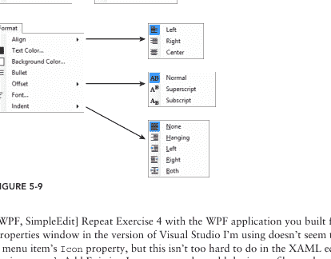

图 5-9

  5. [WPF, SimpleEdit] 使用你为练习 3 构建的 WPF 应用程序重复练习 4。我所使用的 Visual Studio 版本中的“属性”窗口似乎不允许设置菜单项的 Icon 属性，但在 XAML 编辑器中做到这一点并不太难。首先使用“项目”菜单的“添加现有项”命令将图像文件添加到项目中。然后使用类似下面的 XAML 代码将图标添加到相应的菜单项中：

```
<MenuItem Header="New" Name="fileNewMenuItem">
    <MenuItem.Icon>
        <Image Source="New.png" />
    </MenuItem.Icon>
</MenuItem>
```

  6. [SimpleEdit] 复制你为练习 4 构建的 SimpleEdit 程序，并为菜单项的事件处理程序添加占位例程。这些例程应显示简单的消息


方框指示它们真正应该做什么。例如，下面的代码显示了文件菜单的保存事件处理程序：

```
private void fileSaveMenuItem_Click(object sender, EventArgs e)
{
    MessageBox.Show("Save");
}
```

为所有不包含项目的菜单项（除分隔符外）添加占位符。例如，为“格式 ▸ 对齐 ▸ 左”项添加占位符，但不对“格式 ▸ 对齐”添加占位符，因为它包含项目。

将上下文菜单的项附加到相同的事件处理程序，但为上下文菜单的项目符号项提供自己的事件处理程序。（如果让这两个共享同一个事件处理程序，它们会相互干扰，因为它们的切换行为。）

### 7. [WPF, SimpleEdit] 使用你在练习 5 中构建的 WPF 应用程序重复练习 6。提示：
-   如果你点击菜单项的 XAML 代码来选择它，然后你可以在窗口设计器中双击它来为其创建事件处理程序。
-   你可能需要直接编辑 XAML 代码来定义其事件处理程序，如 `Click="alignLeftContextMenuItem_Click"`。然后你可以右键单击事件处理程序的名称并选择转到定义来创建事件处理程序。

### 8. [SimpleEdit] 复制你在练习 7 中构建的 SimpleEdit 程序并添加代码以管理格式菜单的对齐、偏移和缩进子菜单中的互斥选择。例如，用户一次只能选择对齐子菜单中的一个选项。

修改项目的占位符代码，以便当用户选择一个选项时，代码：
-   a. 检查所选的子菜单项
-   b. 取消选中其他子菜单项
-   c. 检查对应的上下文菜单项
-   d. 取消选中其他上下文菜单项

例如，当用户选择对齐子菜单的左选项时，以下代码会执行：

```
private void formatIndentLeftMenuItem_Click(object sender, EventArgs e)
{
    formatIndentNoneMenuItem.Checked = false;
    formatIndentHangingMenuItem.Checked = false;
    formatIndentLeftMenuItem.Checked = true;
    formatIndentRightMenuItem.Checked = false;
    formatIndentBothMenuItem.Checked = false;
    indentNoneContextMenuItem.Checked = false;
    indentHangingContextMenuItem.Checked = false;
    indentLeftContextMenuItem.Checked = true;
    indentRightContextMenuItem.Checked = false;
    indentBothContextMenuItem.Checked = false;
    MessageBox.Show("Indent Left");
}
```

### 9. [WPF, SimpleEdit] 使用你在练习 7 中构建的 WPF 应用程序重复练习 8。（提示：在 WPF 中你需要设置 IsChecked 属性而不是 Checked 属性。）

### 10. [SimpleEdit] 复制你在练习 8 中构建的 SimpleEdit 程序并添加代码，使格式菜单的项目符号菜单项和项目符号上下文菜单项相互选中和取消选中。（提示：将一个项目的 Checked 属性设置为等于另一个项目的 Checked 属性。）

### 11. [WPF, SimpleEdit] 与 Windows Forms 不同，WPF 的 MenuItem 控件没有 CheckOnClick 属性，因此当用户点击它们时，项目符号菜单项不会自行选中和取消选中。

添加代码使这些菜单项自行选中和取消选中，通过将每个控件的 IsChecked 属性设置为其当前值的否定。! 字符对值进行逻辑否定。换句话说，true 为 false，false 为 true。例如，

```
formatBulletMenuItem.IsChecked = !formatBulletMenuItem.IsChecked;
```

### 12. [WPF, SimpleEdit] 使用你在练习 11 中构建的 WPF 应用程序重复练习 10。（提示：在 WPF 中你需要设置 IsChecked 属性而不是 Checked 属性。）

### 13. [WPF] 在 WPF 中，菜单可以包含几乎任何内容。构建一个与图 5-10 所示类似的应用程序。（尽管我并不是说这在实际程序中是个好主意。）

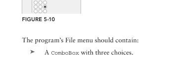

FIGURE 5-10

程序的文件菜单应包含：
-   包含三个选项的 `ComboBox`。
-   包含三个选项的 `ListBox`。
-   三个 `RadioButtons`。
-   一个图像。
-   一个包含标签和文本框的 StackPanel。
-   一个包含 3 × 3 排列的单选按钮的 Grid。

### 14. 创建一个具有五级嵌套菜单的 Windows Forms 程序。换句话说，创建一个菜单 文件 → 级别 1 → 级别 2 → 级别 3 → 级别 4 → 级别 5。使最底层的菜单项显示一个消息框。（同样，我并不是说这在实际程序中是个好主意。）

### 15. [WPF] 使用 WPF 应用程序重复练习 14。

### 16. 一个有用的用户界面技术是不允许用户在当时做不适当的事情。例如，在绘图应用程序中，如果用户没有编辑绘图，你应该禁用绘图工具。

编写一个具有三个菜单的程序：文件、客户和员工。分别为它们提供一个菜单项：退出（并为其提供代码）、新建客户和新建员工。

为程序的窗体提供三个标记为“常规”、“管理客户”和“管理员工”的单选按钮。当用户点击单选按钮时，启用和禁用适当的菜单。（一些应用程序会隐藏不合适的菜单，但这可能会让知道菜单应该存在但找不到它的用户感到困惑。）

例如，当用户点击“管理客户”按钮时，启用“客户”菜单并禁用“员工”菜单。当用户点击“常规”按钮时禁用两个菜单。（提示：确保程序启动时菜单已正确启用。）

### 17. [WPF] 使用 WPF 应用程序重复练习 16。

### 18. 通常使用尽可能少的代码更好，这样你随着时间的推移就有更少的代码需要编程、调试和维护。复制你在练习 5-16 中编写的应用程序并更改它，使所有三个单选按钮共享一个事件处理程序。

### 19. [WPF] 使用你在练习 17 中编写的 WPF 应用程序重复练习 18。（提示：IsChecked.Value 指示单选按钮是否被选中。）

> 注意 请在 www.wrox.com/go/csharp24hourtrainer2evideos 在线选择第 5 课的视频。

## 6 创建工具栏和状态栏

并非每个程序都需要工具栏或状态栏，但它们可以让用户的工作更轻松，特别是对于复杂的程序。本课将解释如何向应用程序添加工具栏和状态栏。

### 使用工具栏

通常工具栏位于窗体的菜单栏下方，并显示一系列小按钮，让用户可以轻松执行频繁执行的任务。通常按钮复制在菜单中也提供的功能，但将它们放在工具栏上使用户更容易找到和使用它们。

只在工具栏中放置最常用的命令，以免它变得杂乱。

回顾第 5 课，你还应为大多数甚至所有菜单项提供加速键，并且可以为最重要的命令提供快捷键。这意味着用户可以通过至少四种方式访问最重要的、最有用的命令：鼠标菜单导航、加速键、快捷键和工具栏按钮。

要创建单个工具栏，只需双击工具箱中的 `ToolStrip` 工具即可。默认情况下，`ToolStrip` 停靠在窗体的顶部，因此你无需手动定位它。

> 注意 回顾第 3 课，停靠的控件按其堆叠顺序绘制，默认情况下该顺序与它们的创建顺序相同。为了避免混淆，如果窗体应包含主菜单和工具栏，请先创建菜单，以便工具栏出现在其下方而不是上方。

当你选择一个 ToolStrip 时，窗体设计器会显示一个带下拉箭头的图标。点击箭头以显示你可能想要添加到 ToolStrip 的项目列表，如图 6-1 所示。

如图 6-1 所示，你可以向 ToolStrip 添加以下类型的对象：
-   按钮
-   标签
-   分割按钮
-   下拉按钮
-   分隔符
-   组合框
-   文本框
-   进度条

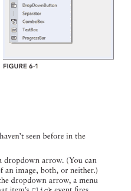

SplitButton 和 DropDownButton 是工具箱中你以前没有见过的控件，因此值得稍作解释。

SplitButton 通常显示一个带有图标和下拉箭头的按钮。（你可以更改其 DisplayStyle 属性使其显示文本而不是图像、两者或都不显示。）如果用户点击按钮，其 Click 事件会触发。如果用户点击下拉箭头，则会出现菜单。如同所有菜单一样，如果用户选择一个项目，则该项目的 Click 事件会触发。

你使用 SplitButton 的一种方式可能是让菜单项执行某些操作，然后更改按钮的图标以匹配该操作。点击按钮将再次执行该操作。

另一种思考方式是按钮代表一个工具，点击它会激活当前工具。从下拉菜单中选择一个项目会选择一个新工具并激活它。

与 SplitButton 类似，DropDownButton 通常显示一个带有下拉箭头的图标。（与 SplitButton 相同，你可以使用 DropDownButton 的 DisplayStyle 属性使其显示图像、文本、两者或都不显示。）如果用户点击下拉箭头，则会出现菜单。此控件与 SplitButton 相似，只是它不提供用户可以点击以重复上一个命令的按钮。

尽管它们可以包含许多不同种类的控件，但 ToolStrip 在不过于杂乱和令人困惑时看起来最好。例如，仅包含按钮和分隔符的 ToolStrip 易于理解和使用。DropDownButton 和 SplitButton 是 ToolStrip 中接下来最容易理解的控件，它们不会使事情过于杂乱，因此必要时可以添加它们。

避免在 ToolStrip 中使用标签来提供状态信息。相反，将状态信息放在 StatusStrip 中。


## 使用 ToolStrip 容器

ToolStripContainer 在窗体的顶部、左侧、底部和右侧边缘显示区域，这些区域可以容纳 ToolStrip。在运行时，用户可以在这些区域内以及区域之间来回拖动 ToolStrip。

ToolStripContainer 的中心是一个内容面板，可以容纳一个或多个其他控件。

在这些控件的典型配置中，窗体可选地在顶部和底部分别停靠一个 MenuStrip 和 StatusStrip。ToolStripContainer 停靠以填充窗体的其余部分，其内容面板包含程序的其他控件。

图 6-2 显示了一个窗体，顶部有一个 MenuStrip，底部有一个 StatusStrip，ToolStripContainer 填充窗体的其余部分。ToolStripContainer 包含三个 ToolStrip 和一个停靠以填充其内容面板的 RichTextBox。

图 6-3 显示了此程序在运行时的状态。这里我在 ToolStripContainer 的左侧和右侧边缘拖放了两个 ToolStrip。

图 6-2 中有两点特别值得注意。首先，注意内容面板侧面中间的带箭头的细矩形。如果单击其中一个，控件会在该边缘增加空间，以便插入另一个 ToolStrip。

第二点值得注意的是图 6-2 中的智能标记，显示为控件右上角的一个带箭头的小方块。如果单击智能标记，就会出现如图 6-4 所示的智能标记面板。

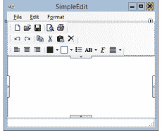

图 6-2

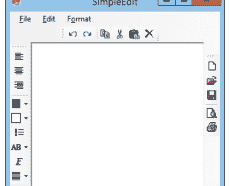

图 6-3


图 6-4

通常，智能标记为控件执行常见任务提供了快速方法。在此示例中，智能标记面板允许您决定控件应允许哪些面板。如果取消选中某一个面板，用户将无法在运行时将 ToolStrip 拖到 ToolStripContainer 的该边缘。

> 注意：您还可以通过在“属性”窗口中设置控件的 LeftToolStripPanelVisible、RightToolStripPanelVisible、TopToolStripPanelVisible 和 BottomToolStripPanelVisible 属性来确定哪些面板可用，但使用智能标记更简单。

构建 ToolStripContainer 后，只需将 ToolStrip 放置在上面，并像往常一样构建它们的项。

## 使用状态栏

状态栏通常停靠在窗体的底部，显示标签、状态条和其他控件，以便向用户快速汇总应用程序的状态。该区域应保留用于状态信息，通常不应包含使应用程序执行操作的按钮和其他控件。这些命令属于菜单和工具栏条。

> 注意：虽然当前时间也算是一种状态信息，但不要向状态栏添加时钟。想要时钟的用户可以在系统的任务栏中显示一个。任务栏时钟更方便，因为它提供了您可能不想在程序中复制的选项（例如显示格式），而且它也不会被其他程序隐藏。如果系统提供了便捷工具，您就无需在程序中复制它。

要创建状态栏，只需双击工具箱中的 StatusStrip 工具。默认情况下，statusStrip 停靠在窗体的底部，因此您无需手动定位它。

当您选择 StatusStrip 时，窗体设计器会显示一个小图标，带有一个下拉箭头，类似于它为 ToolStrip 显示的图标。单击该箭头可显示您可能想要添加到 StatusStrip 的项列表，如图 6-5 所示。

从图 6-5 可以看出，您可以将以下类型的对象添加到 ToolStrip：
- StatusLabel
- ProgressBar
- DropDownButton
- SplitButton

唯一的新控件 StatusLabel 的行为类似于普通的 Label。


图 6-5

## 试一试

在本“试一试”中，您将创建一个 MenuStrip（在第 5 课中介绍）和一个 ToolStrip，两者都包含用于更改 RichTextBox 控件的 ForeColor 和 BackColor 属性的命令。您还将创建一个 StatusStrip 来显示当前选择的颜色。（是的，我知道这是多余的，因为这些值已经显示在 ToolStrip 和文本本身中。）图 6-6 显示了程序的运行情况。


图 6-6

## 课程要求

在本课中，您需要：
- 创建如图 6-6 所示的窗体。
- 创建 MenuStrip。菜单的层次结构应为：
  - 文件
    - 退出
  - 格式
    - 文本颜色
      - 黑色
      - 红色
      - 绿色
      - 蓝色
### 背景色
  - 白色
  - 粉色
  - 浅绿色
  - 浅蓝色
- 初始时勾选“文本颜色”菜单中的“黑色”选项和“背景色”菜单中的“白色”选项。
- 为“背景色”菜单项提供显示颜色样本的 Images。
- 创建带按钮的 ToolStrip，以复制菜单层次结构。ToolStrip 应包含两个 ToolStripDropDownButton。
  - 将第一个工具命名为 foreColorButton，并使其显示文本“A.”。为其提供项目 Black、Red、Green 和 Blue。每个项目的 ForeColor 属性应设置为其颜色。
  - 将第二个工具命名为 backColorButton，并使其初始显示一个白色样本。为其提供项目 White、Pink、Light Green 和 Light Blue。使这些项目分别显示一个展示颜色样本的 Image。
- 为 StatusStrip 添加一个名为 colorLabel 的 ToolStripStatusLabel，其 Text = 文本颜色。
- 添加事件处理程序。
  - 让“文件”菜单的“退出”项关闭窗体。
  - 为每个“文本颜色”菜单项添加事件处理程序。
  - 为每个“背景色”菜单项添加事件处理程序。
- 让工具栏条按钮使用相应菜单项的事件处理程序。

## 重复代码

您可能会注意到，本课的“试一试”包含一些事件处理程序，它们重复了相同代码，只有细微差别。通常，如果大段代码在细微变化下执行几乎相同的操作，那么程序的设计可能存在问题。

在这种情况下，您应该将公共代码提取到一个方法中。您可以使用 if、switch 和其他 C# 语句让代码根据不同情况采取不同操作，使一个方法能够处理多种情况。

不幸的是，您还不知道如何做到这些，但您将会学到。第 18 课介绍 if 和 switch 等语句，第 20 课说明如何编写方法。在那之前，您只能忍受一些重复代码。

读完第 18 课和第 20 课之后，如果您愿意，可以重新审视此代码，删除冗余代码，使其将来更易于维护。（在不更改功能的情况下重组现有代码，使其更可靠、更易读、更易维护，或以其他方式改进的过程，称为重构。）

> 注意：您可以从网站 www.wrox.com/go/csharp24hourtrainer2e 下载本课的代码和资源。

## 提示
- 请记住，“退出”菜单项可以通过调用 `Close()` 来关闭程序的窗体。
- 将 `RichTextBox` 放置在 `ToolStripContainer` 的内容面板中。
- 您可以先创建一个事件处理程序，然后复制粘贴，从而节省大量输入。

## 分步指南
- 创建如图 6-6 所示的窗体。
  1. 启动一个新项目。
  2. 向窗体添加一个 `MenuStrip`。
  3. 向窗体添加一个 `StatusStrip`。
  4. 向窗体添加一个 `ToolStripContainer`。
  5. 在 `ToolStripContainer` 的内容面板中添加一个名为 `contentRichTextBox` 的 `RichTextBox`。
- 创建 `MenuStrip`。
  1. 向 `MenuStrip` 添加所列菜单项。记住为它们起好的名称和适当的加速键。
- 初始时勾选“文本颜色”菜单中的“黑色”选项和“背景色”菜单中的“白色”选项。
  1. 将“文本颜色 ▸ 黑色”菜单项的 Checked 属性设置为 True。
  2. 将“背景色 ▸ 白色”菜单项的 Checked 属性设置为 True。
- 为“背景色”菜单项提供显示颜色样本的 Images。
  1. 将这些菜单项的 Image 属性设置为其颜色的样本。（使用 Microsoft Paint 或其他图形编辑器制作小的彩色图像。）


创建带有按钮的 `ToolStrip`，这些按钮复制菜单层次结构。`ToolStrip` 应包含两个 `ToolStripDropDownButton`。

将第一个工具命名为 `foreColorButton`，并使其显示文本“A.”。为其提供 Black、Red、Green 和 Blue 项。每个项的 `ForeColor` 属性都应设置为其颜色。

- 1. 创建 `ToolStripDropDownButton`。
- 2. 在该项下方，添加 Black、Red、Green 和 Blue 项。
- 3. 为这些项分别设置 `ForeColor` 属性以显示其颜色。（例如，将 Black 项的 `ForeColor` 属性设置为黑色。）

将第二个工具命名为 `backColorButton`，并使其初始显示白色颜色示例。为其提供 White、Pink、Light Green 和 Light Blue 项。使这些项分别显示一个展示该颜色示例的 `Image`。

- 1. 创建 `ToolStripDropDownButton`。
- 2. 在该项下方，添加 White、Pink、Light Green 和 Light Blue 项。
- 3. 为这些项分别设置 `Image` 属性以显示其颜色示例。

为 `StatusStrip` 提供一个名为 `colorLabel` 的 `ToolStripStatusLabel`，其 Text = "Text Colors"。

- 1. 创建 `ToolStripStatusLabel`。设置其 Name 和 Text 属性。

添加事件处理程序。

使文件菜单的 Exit 项关闭窗体。

- 1. 键入粗体代码行，使事件处理程序如下所示：

```csharp
private void fileExitMenuItem_Click(object sender, EventArgs e)
{
    Close();
}
```

为每个 Text Color 菜单项创建事件处理程序。

- 1. 对于 Text Color Black 菜单项，键入粗体代码，使事件处理程序如下所示：

```csharp
private void blackForeColorMenuItem_Click(object sender, EventArgs e)
{
    contentRichTextBox.ForeColor = blackForeColorButton.ForeColor;
    foreColorMenuItem.ForeColor = blackForeColorButton.ForeColor;
    foreColorButton.ForeColor = blackForeColorButton.ForeColor;
    colorLabel.ForeColor = blackForeColorButton.ForeColor;
    blackForeColorMenuItem.Checked = true;
    redForeColorMenuItem.Checked = false;
    greenForeColorMenuItem.Checked = false;
    blueForeColorMenuItem.Checked = false;

    blackForeColorButton.Checked = true;
    redForeColorButton.Checked = false;
    greenForeColorButton.Checked = false;
    blueForeColorButton.Checked = false;
}
```

- 2. 为其他 Text Color 菜单项输入类似代码。

- 为每个 Background Color 菜单项创建事件处理程序。

  - 1. 对于 Background Color ▸ White 菜单项，键入粗体代码，使事件处理程序如下所示：

```csharp
private void whiteBackColorMenuItem_Click(object sender, EventArgs e)
{
    contentRichTextBox.BackColor = Color.White;

    backColorMenuItem.Image = whiteBackColorMenuItem.Image;
    backColorButton.Image = whiteBackColorMenuItem.Image;
    colorLabel.BackColor = Color.White;

    whiteBackColorMenuItem.Checked = true;
    pinkBackColorMenuItem.Checked = false;
    lightGreenBackColorMenuItem.Checked = false;
    lightBlueBackColorMenuItem.Checked = false;

    whiteBackColorButton.Checked = true;
    pinkBackColorButton.Checked = false;
    lightGreenBackColorButton.Checked = false;
    lightBlueBackColorButton.Checked = false;
}
```

  - 2. 为其他 Background Color 菜单项输入类似代码。

- 为每个 Background Color 菜单项创建事件处理程序。

  - 1. 重复你为 Text Color 菜单项使用的步骤，但使用 BackColor 而不是 ForeColor。

- 使工具条按钮使用对应菜单项的事件处理程序。

  - 1. 单击属性窗口的 Events 按钮。
  - 2. 对于每个工具条按钮：
    - a. 在窗体编辑器中单击该按钮。
    - b. 在属性窗口中，选择 Click 事件。然后单击右侧的下拉箭头。
    - c. 选择相应的菜单事件处理程序。例如，对于 blackForeColorButton 工具条按钮，选择 blackForeColorMenuItem_Click 事件处理程序。

## 练习

### 1. [SimpleEdit]

复制你在第 5 课练习 10 中构建的 SimpleEdit 程序（或从本书网站下载第 5 课的版本），并添加图 6-7 中所示的工具条、按钮和分隔符。提示：

- 删除 RichTextBox 控件，添加 ToolStripContainer，然后在 ToolStripContainer 的内容面板中重新添加 RichTextBox。然后添加 ToolStrip。
- 黑色按钮（第三行工具条中从左数第四个）是一个 ToolStripSplitButton，允许用户选择文本颜色。它包含选项 Black、White、Red、Green 和 Blue。
- 文本颜色按钮旁边的白色按钮是另一个 ToolStripSplitButton，允许用户选择背景色。它包含选项 Black、White、Pink、Light Green、Light Blue 和 Yellow。
- 显示“AB”的按钮是一个 ToolStripDropDownButton，提供与 Format 菜单的 Offset 子菜单相同的选项：Normal、Superscript 和 Subscript。


### 2. [WPF, SimpleEdit]

复制你在第 5 课练习 12 中构建的程序（或从本书网站下载第 5 课的版本），并重复练习 1。提示：

- 将 ToolBarTray 停靠到菜单下方 DockPanel 控件的顶部。
- 将 ToolBar 添加到 ToolBarTray。设置 ToolBar 的 Band 属性以指示其在 ToolBarTray 中的行。设置其 BandIndex 属性以指示其在带区内的顺序。
- 将 Button 和 Separator 添加到 ToolBar。
- 对于拆分按钮，使用包含 ComboBoxItem 的 ComboBox，这些 ComboBoxItem 包含 Image。将某个 ComboBoxItem 的 IsSelected 属性设置为 True，以设置 ComboBox 的初始选择。
- 将 StatusBar 停靠到 DockPanel 的底部。为其提供一个包含 Label 的 StatusBarItem。

### 3. [SimpleEdit]

复制你为练习 1 构建的 SimpleEdit 程序，并添加菜单项代码以管理新的工具条按钮。添加代码以同步对应的菜单项、上下文菜单项和工具条按钮项。例如，下面显示了 Align Left 菜单项的新代码：

```csharp
private void formatAlignLeftMenuItem_Click(object sender, EventArgs e)
{
    formatAlignLeftMenuItem.Checked = true;
    formatAlignRightMenuItem.Checked = false;
    formatAlignCenterMenuItem.Checked = false;
    alignLeftContextMenuItem.Checked = true;
    alignRightContextMenuItem.Checked = false;
    alignCenterContextMenuItem.Checked = false;
    alignLeftButton.Checked = true;
    alignRightButton.Checked = false;
    alignCenterButton.Checked = false;
    MessageBox.Show("Align Left");
}
```

### 4. [WPF, SimpleEdit]

使用你为练习 2 构建的 WPF 应用程序重复练习 3。提示：

- 在 WPF 中，Button 没有 Checked 或 IsChecked 属性，因此无法选中和取消选中对齐工具栏按钮。请改为创建单独的图像来表示选中和未选中状态。将选中和未选中的图像放入 Image 控件中，并将 Visibility 属性设置为 Collapsed。然后使用类似下面的代码在运行时设置 Button 的图像：

  `alignLeftImage.Source = alignLeftUncheckedImage.Source;`

- 对项目符号按钮使用类似的技巧。使用类似下面的代码设置按钮的 Image 属性。（抱歉，我想不出不使用 if-else 语句就能轻松处理此问题的方法，你将在第 18 课学习 if-else 语句。）

  ```csharp
  if (formatBulletMenuItem.IsChecked)
      bulletImage.Source = bulletCheckedImage.Source;
  else
      bulletImage.Source = bulletUncheckedImage.Source;
  ```

- 要处理偏移量工具栏项，请为偏移量 ComboBoxItem 命名。然后按下述代码设置选定项。（对于未选中的项，不需要将其设置为 false。）

  `superscriptOffsetComboBoxItem.IsSelected = true;`

- 使用与处理偏移量 ComboBox 相同的方式处理缩进工具栏 ComboBox。

### 5. [SimpleEdit]

复制你为练习 3 构建的 SimpleEdit 程序，并将工具条控件附加到对应的事件处理程序。（暂时不必担心颜色控件。）

### 6. [WPF, SimpleEdit]

使用你为练习 4 构建的 WPF 应用程序重复练习 5。提示：

- 处理偏移量和缩进 ComboBoxItem 的 Selected 事件。
- 窗口加载时，会为最初选中的 ComboBoxItem 引发 Selected 事件。不幸的是，窗口尚未完成所有控件的加载，如果程序尝试为尚未加载的控件设置值，就会崩溃。为防止这种情况，请使用以下语句开始最初选中的 ComboBoxItem 的事件处理程序。（该语句基本上意味着：“如果窗口尚未加载，则退出事件处理程序。”）

  `if (!IsLoaded) return;`

- 你可能会注意到，如果你选择对应的菜单项或上下文菜单项之一，ComboBoxItem 事件处理程序会执行两次。这有点低效，但暂时不必担心。我们稍后会修复它。


- 初始时禁用小的 O 按钮。
- 当用户单击某个 X 按钮时，禁用所有 X 按钮并启用所有 O 按钮。（提示：为其中一个 X 按钮编写代码，确保其正确，然后复制并粘贴该代码到其他 X 按钮。像这样复制粘贴代码并不是良好的编程实践，但我们会在第 20 课中修正它。）
- 当用户单击某个 O 按钮时，禁用所有 O 按钮并启用所有 X 按钮。（提示：使用你为 X 按钮所用的技术。）

14. [WPF, 游戏] 使用你为练习 12 编写的程序重复练习 13。

15. [绘图] 构建图 6-8 所示的 Scribbler 程序。为它提供一个 ToolStripContainer 和两个 ToolStrip。

- 为第一个 ToolStrip 提供表示箭头、直线、矩形、椭圆、曲线和星形工具的按钮。使这些工具成为互斥选择，这样当用户选择其中一个时，其他工具会取消选择。
- 为第二个 ToolStrip 提供两个 ToolStripDropDownButton，分别表示前景色和背景色。使每个下拉列表中的条目成为互斥选择，并让这些选项在各自的 ToolStripDropDownButton 上显示其图像。


图 6-8

16. [WPF, 绘图] 使用 WPF 应用程序重复练习 15。

17. [绘图] 复制你为练习 15 构建的程序，并为工具栏工具添加工具提示。

18. [WPF, 绘图] 使用你为练习 17 构建的程序重复练习 17。

> 注意 请在线访问 www.wrox.com/go/csharp24hourtrainer2videos 选择第 6 课的视频。

## 7 使用 RichTextBox 控件
## 使用 RichTextBox 控件

TextBox 控件让用户输入文本，仅此而已。它可以用不同的颜色和字体显示文本，但不能为不同的文本片段赋予不同的属性。TextBox 旨在让用户输入简单的字符串，例如姓名或街道地址，除此之外几乎无能为力。

RichTextBox 是一个功能强大得多的控件。它可以用不同的颜色、字体和样式显示不同的文本片段。它可以调整段落缩进并创建项目符号列表。它甚至可以包含图片。它不如 Microsoft Word 或 OpenOffice 的 Writer 等全功能文字处理软件那么强大，但它能比 TextBox 产生复杂得多的结果。

在本课中，你将了解 RichTextBox 控件以及如何使用它。你将有机会试验该控件，并使用它为 SimpleEdit 程序添加足够的功能，最终使该程序变得有用。

### 使用 RichTextBox 属性

要更改 RichTextBox 中文本的外观，首先选择要更改的文本，然后设置该控件的某个属性。

要选择文本，可以使用控件的 SelectionStart 和 SelectionLength 属性来指示文本开始的位置以及包含多少个字符。请注意，字符编号从 0 开始。（事实上，在 C# 中几乎所有编号都从 0 开始。）例如，设置 SelectionStart = 0 且 SelectionLength = 1 会选择控件中的第一个字符。

选择文本后，将 RichTextBox 的某个属性设置为希望所选文本具有的值。

例如，以下代码让名为 contentRichTextBox 的 RichTextBox 显示一些文本，并将单词 “red” 着色：

```
contentRichTextBox.Text = "Some red text";
contentRichTextBox.SelectionStart = 5;
contentRichTextBox.SelectionLength = 3;
contentRichTextBox.SelectionColor = Color.Red;
```

表 7-1 列出了可用于更改文本外观的属性。

**表 7-1**

| 属性 | 用途 |
|---|---|
| SelectionAlignment | 将所选内容的段落左对齐、居中对齐或右对齐。 |
| SelectionBackColor | 设置所选内容的背景色。 |
| SelectionBullet | 确定所选内容的段落是否带项目符号。 |
| SelectionCharOffset | 确定所选内容是上标（偏移量 > 0）、下标（偏移量 < 0）还是普通文本（偏移量 = 0）。 |
| SelectionColor | 设置所选内容的颜色。 |
| SelectionFont | 设置所选内容的字体。 |
| SelectionHangingIndent | 所选内容所在段落的第一行正常缩进，然后该段落中的后续行按此量缩进。 |
| SelectionIndent | 所有行都按此量缩进。 |
| SelectionProtected | 将所选文本标记为受保护，以便用户无法修改它。 |
| SelectionRightIndent | 所有行都在右侧按此量缩进。 |

图 7-1 所示的 FontFeatures 示例程序演示了更改段落内文本外观的属性。这些属性包括 SelectionBackColor、SelectionCharOffset、SelectionColor 和 SelectionFont。

例如，以下代码展示了 FontFeatures 程序如何设置单词 “BackColor” 背后的背景色：

```
contentRichTextBox.SelectionStart = 41;
contentRichTextBox.SelectionLength = 9;
contentRichTextBox.SelectionBackColor = Color.Yellow;
```


图 7-2 所示的 ParagraphFeatures 程序演示了更改段落显示方式的属性。这些属性包括 SelectionIndent、SelectionHangingIndent、SelectionRightIndent、SelectionBullet 和 SelectionAlignment。


**图 7-2**

例如，以下代码展示了 ParagraphFeatures 程序如何为第二段设置 20 像素的悬挂缩进：

```
contentRichTextBox.SelectionStart = 82;
contentRichTextBox.SelectionLength = 1;
contentRichTextBox.SelectionHangingIndent = 20;
```

表 7-2 汇总了另外四个值得特别提及的、会更改控件所显示文本的属性。

**表 7-2**

| 属性 | 用途 |
|---|---|
| Text | 获取或设置控件的文本，不包含任何格式。 |
| Rtf | 获取或设置控件的富文本格式（RTF）内容。这包括文本以及定义文本应如何显示的 RTF 格式代码。 |
| SelectedText | 获取或设置所选内容的文本。 |
| SelectedRtf | 获取或设置所选内容的文本和 RTF 代码。 |

### 让用户控制

允许用户更改文本设置很容易。当用户在控件中选择文本时，RichTextBox 会相应地设置其 SelectionStart 和 SelectionLength 属性。你只需设置适当的属性（例如 SelectionColor），所选文本就会更新。

图 7-3 所示的 SetTextProperties 示例程序使用这种技术让用户控制文本颜色、字符偏移量和段落对齐方式。选择一些文本，然后单击工具条按钮来更改文本属性。


图 7-3

例如，以下代码展示了 SetTextProperties 程序如何将当前选中的文本更改为黑色背景和白色前景：

```
private void reverseColorsButton_Click(object sender, EventArgs e)
{
    contentRichTextBox.SelectionBackColor = Color.Black;
    contentRichTextBox.SelectionColor = Color.White;
}
```

该程序的其他按钮工作方式类似。

### 使用 RichTextBox 方法

第 2 课简要介绍了属性、方法和事件。其他课程也使用了许多属性和事件。事实上，到目前为止，我在课程中讨论的大多数事件处理程序都会捕获事件并作为响应更改属性。

尽管你已经使用过许多属性和事件，但到目前为止你见过的唯一方法是窗体的 Close 方法，它会使窗体消失。例如，以下代码关闭执行它的窗体：

```
Close();
```

RichTextBox 提供了许多新方法，这些方法对构建文本编辑程序非常有帮助。表 7-3 总结了其中一些最有用的方法。

表 7-3

| 方法 | 用途 |
|---|---|
| Clear | 清除控件中的所有文本。 |
| Copy | 将当前所选内容复制到剪贴板。 |
| Cut | 将当前所选内容剪切到剪贴板。 |
| DeselectAll | 通过设置 SelectionLength = 0 取消选择所有文本。 |
| LoadFile | 从具有多种格式之一（例如 RTF 或纯文本）的文件中加载控件的文本。 |
| Paste | 将剪贴板中的内容粘贴到当前所选内容中。这可以是 RichTextBox 能够理解的任何内容，例如文本、RTF 格式文本或图像。 |
| Redo | 重做先前撤销的命令。 |


| 方法 | 用途 |
|---|---|
| SaveFile | 将控件的文本保存到文件中，支持 RTF 或纯文本等多种格式之一。 |
| SelectAll | 通过将 SelectionStart = 0 并将 SelectionLength 设为文本长度，选中控件的所有文本。 |
| Undo | 撤销最近一次更改。 |

以下代码展示程序如何使用 LoadFile 方法：

```
contentRichTextBox.LoadFile("Test.rtf", RichTextBoxStreamType.RichText);
```

传入 LoadFile 的第一个参数给出文件名，可以是相对于程序当前目录的路径，也可以是完整路径。

第二个参数给出文件类型。RichTextBoxStreamType 枚举列出了可用的文件类型。可用于加载文件的选项有 PlainText、RichText 和 UnicodePlainText。

## 输入提示

当你输入 contentRichTextBox.LoadFile( 时，IntelliSense 会出现并显示如图 7-4 所示的弹出窗口，以展示 LoadFile 方法所需的参数。（由于语句尚未完成，Visual Studio 会添加红色波浪下划线。在我完成输入该语句之前，Visual Studio 会将其标记为错误。）


图 7-4

你可以从该方法的三个不同重载版本中选择，每个版本接受不同的参数。方法的重载版本具有相同的名称，但接受不同的参数。你可以使用上下方向键在该方法的可用版本之间滚动。

当你输入参数时，IntelliSense 会更新以描述它期望的下一个参数。图 7-5 显示了在我为第一个参数输入文件名后的 LoadFile 方法。IntelliSense 显示下一个参数应该是名为 fileType 的 RichTextBoxStreamType 类型的值。IntelliSense 甚至在底部显示该值含义的简短说明（尽管信息量不是特别大）。


图 7-5

你可以输入 RichTextBoxStreamType 后跟一个点来查看可用选项列表，但还有一种更简单（换句话说，更好）的方法：按 Ctrl+Space。这会让 IntelliSense 显示你可能想要输入的内容列表。此时，IntelliSense 足够智能，能猜到你想输入 RichTextBoxStreamType，因此它会初始选中该类型，甚至显示关于它的更多信息，如图 7-6 所示。


图 7-6

现在你可以按 Tab 让 IntelliSense 为你填入高亮的值 RichTextBoxStreamType。

接下来，按 "." 键查看图 7-7 所示的选项列表，选择一个，然后按 Tab 将其添加到代码中。最后，在该行末尾添加一个分号，就完成了。


图 7-7

我知道这听起来很麻烦，但稍加练习后，它就会变得出奇地快速和简单。手动输入所有内容时，我大约需要 30 秒才能输入前面的 LoadFile 语句。在 IntelliSense 的帮助下，我可以在 10 秒内输入同一行代码。

以下代码展示程序如何使用 SaveFile 方法。与 LoadFile 一样，第一个参数给出文件名，第二个参数给出文件类型：

```
contentRichTextBox.SaveFile("Test.rtf", RichTextBoxStreamType.RichText);
```

## 使用 WPF 命令

程序可以使用命令来操作 RichTextBox 的内容。该控件还提供用户可以通过交互方式调用的命令。例如，用户可以按 Ctrl+E 使段落居中。

表 7-4 总结了最有用的命令。该控件的 Windows Forms 版本和 WPF 版本所用的命令略有不同。

### 表 7-4

| 操作 | Windows Forms | WPF |
|---|---|---|
| 居中对齐 | Ctrl+E | Ctrl+E |
| 两端对齐 |  | Ctrl+J |
| 左对齐 | Ctrl+L | Ctrl+L |
| 右对齐 | Ctrl+R | Ctrl+R |
| 项目符号 | * | Ctrl+Shift+L |
| 复制 | Ctrl+C | Ctrl+C |
| 剪切 | Ctrl+X | Ctrl+X |
| 减小字号 |  | Ctrl+[ |
| 删除 | Delete | Delete |
| 删除下一个单词 | Ctrl+Delete | Ctrl+Delete |
| 删除上一个单词 | Ctrl+Backspace | Ctrl+Backspace |
| 增大字号 |  | Ctrl+] |
| 编号 | * | Ctrl+Shift+N |
| 粘贴 | Ctrl+V | Ctrl+V |
| 下标 ** | Ctrl++ | Ctrl++ |
| 上标 ** | Ctrl+Shift++ | Ctrl+Shift++ |
| 切换粗体 |  | Ctrl+B |
| 切换插入模式 | Insert | Insert |
| 切换斜体 |  | Ctrl+I |
| 切换下划线 | Ctrl+U | Ctrl+U |

* 在 Windows Forms 中，Ctrl+Shift+L 会循环切换可用的项目符号和编号样式。** 下标和上标的按键组合有点令人困惑。对于下标，按住 Ctrl 键并按 +。对于上标，按住 Ctrl 和 Shift 键并按 +。在 WPF 中，这些命令仅适用于带有下标和上标变体的 OpenType 字体。可以试试 Palatino Linotype 字体。有关 OpenType 字体的更多信息，请参见 msdn.microsoft.com/library/ms745109.aspx。

这两种控件都提供额外的导航命令。例如，Ctrl+右方向键向右移动一个单词，Ctrl+下方向键向下移动一个段落。

WPF 控件还提供一个上下文菜单，其中包含“复制”“剪切”和“粘贴”命令。

有关 WPF 控件命令（包括导航命令）的更多信息，请参见 msdn.microsoft.com/library/system.windows.documents.editingcommands.aspx。

## 试一试

在本“试一试”中，你将为 SimpleEdit 程序的某些菜单项和工具栏按钮添加功能。你将使用 RichTextBox 的属性和方法来实现“编辑”菜单中的命令：撤销、重做、复制、剪切、粘贴、删除和全选。（这也会让相应的按钮无需额外操作即可生效。）

### 本课要求

在本课中，你将：

- 复制你在第 6 课练习 9 中构建的 SimpleEdit 程序。
- 将程序的 TextBox 替换为名为 `contentRichTextBox` 的 RichTextBox。
- 添加代码以处理“编辑”菜单的命令。
  - 添加撤销代码。
  - 添加重做代码。
  - 添加复制代码。
  - 添加剪切代码。
  - 添加粘贴代码。
  - 添加删除代码。
  - 添加全选代码。

> 注意 你可以从网站 www.wrox.com/go/csharp24hourtrainer2e 下载本课的代码和资源。

### 提示

- 对于“删除”菜单项，只需将控件的 `SelectedText` 属性设置为空字符串：""。

### 分步操作

- 复制你在第 6 课练习 9 中构建的 SimpleEdit 程序（或从本书网站下载第 6 课的版本）。
- 将程序的 `TextBox` 替换为名为 `contentRichTextBox` 的 `RichTextBox`。
- 添加代码以处理“编辑”菜单的命令。

1. 在窗体设计器中打开程序的窗体。单击 `MenuStrip`，展开“编辑”菜单，然后双击“撤销”菜单项。
2. 将占位调用 `MessageBox.Show` 替换为以下代码行，使事件处理程序如下所示：
3. 对其他“编辑”菜单项重复前两个步骤。以下代码展示了新的事件处理程序：

```
private void editUndoMenuItem_Click(object sender, EventArgs e)
{
    contentRichTextBox.Undo();
}
```

```
private void editUndoMenuItem_Click(object sender, EventArgs e)
{
    contentRichTextBox.Undo();
}

private void editRedoMenuItem_Click(object sender, EventArgs e)
{
    contentRichTextBox.Redo();
}

private void editCopyMenuItem_Click(object sender, EventArgs e)
{
    contentRichTextBox.Copy();
}

private void editCutMenuItem_Click(object sender, EventArgs e)
{
    contentRichTextBox.Cut();
}

private void editPasteMenuItem_Click(object sender, EventArgs e)
{
    contentRichTextBox.Paste();
}

private void editDeleteMenuItem_Click(object sender, EventArgs e)
{
    contentRichTextBox.SelectedText = "";
}

private void editSelectAllMenuItem_Click(object sender, EventArgs e)
{
    contentRichTextBox.SelectAll();
}
```

完成后，测试程序的新功能。RichTextBox 更引人注目的功能之一是能够从剪贴板粘贴不同类型的项目。例如，将图片复制到剪贴板，然后使用该程序将其粘贴到 RichTextBox 中。


## 练习

- 1. [WPF, SimpleEdit] 使用你在第6课练习10中构建的WPF程序，重复“试一试”部分的操作。提示：要删除当前选中内容，请使用语句 `contentRichTextBox.Selection.Text = "";`。

- 2. [SimpleEdit] 复制你在“试一试”中构建的程序，并添加简单代码来处理“文件”菜单的“新建”、“打开”、“保存”和“退出”命令。对于“新建”命令，只需清空RichTextBox。（提示：使用Clear方法。）

  对于“打开”和“保存”命令，只需加载和保存文件Test.rtf。（程序会在你第一次保存时创建该文件。如果你在文件存在之前尝试打开它，程序会崩溃，所以在使用“保存”之前不要使用“打开”。）第8课将解释如何使用文件打开和保存对话框，让用户选择应打开或保存的文件。

- 3. [WPF, SimpleEdit] 使用你在练习1中构建的程序重复练习2。提示：
  - 一种清除控件内容的方法是使用以下代码：

    ```
    contentRichTextBox.SelectAll();
    contentRichTextBox.Selection.Text = "";
    ```

  - 上述代码可以正常工作，但如果控件包含大量文本，速度会相当慢。以下代码更复杂，但效率更高：

    ```
    TextRange range = new TextRange(
        contentRichTextBox.Document.ContentStart,
        contentRichTextBox.Document.ContentEnd);
    range.Text = "";
    ```

  - 要加载已保存的文件，请使用以下代码（抱歉，WPF版本的RichTextBox有点复杂）：

    ```
    TextRange range = new TextRange(
        contentRichTextBox.Document.ContentStart,
        contentRichTextBox.Document.ContentEnd);
    using (System.IO.Stream stream =
        new System.IO.FileStream("Test.rtf", System.IO.FileMode.Open))
    {
        range.Load(stream, DataFormats.Rtf);
    }
    ```

  - 要将文本保存到文件中，请使用以下代码：

    ```
    TextRange range = new TextRange(
        contentRichTextBox.Document.ContentStart,
        contentRichTextBox.Document.ContentEnd);
    using (System.IO.Stream stream =
        new System.IO.FileStream("Test.rtf", System.IO.FileMode.Create))
    {
        range.Save(stream, DataFormats.Rtf);
    }
    ```

- 4. [SimpleEdit] 复制你在练习2中构建的SimpleEdit程序，并添加代码来处理“格式”菜单的命令（“字体”命令和颜色命令除外，这些将在第8课中介绍）。

### 提示：

- 要打开或关闭项目符号，请使用语句 `contentRichTextBox.SelectionBullet = formatBulletMenuItem.Checked;`。

- 让缩进命令（无、悬挂、左、右和两端）重置所有其他缩进设置。例如，“悬挂”命令应将 `SelectionIndent` 和 `SelectionRightIndent` 属性设置为0，如以下代码所示：

  ```
  contentRichTextBox.SelectionIndent = 0;
  contentRichTextBox.SelectionRightIndent = 0;
  contentRichTextBox.SelectionHangingIndent = 20;
  ```

- 5. [WPF, SimpleEdit] 复制你在练习3中构建的WPF SimpleEdit程序，并添加代码来处理“格式”菜单的对齐和项目符号命令。提示：
  - 要打开或关闭项目符号，请使用语句 `EditingCommands.ToggleBullets.Execute(null, contentRichTextBox);`。
  - 对于对齐命令，请使用类似的 `EditingCommands` 方法。

- 6. [SimpleEdit] 复制你在练习4中构建的SimpleEdit程序，并添加代码来处理工具栏的颜色命令。

- 7. SimpleEdit程序只允许无、悬挂、左、右和两端这几种缩进样式。它不允许其他组合，例如“悬挂”加“右”。构建一个使用工具栏按钮的程序，让用户单独选择每种缩进属性（悬挂、左和右）。提供第四个按钮来清除所有缩进属性。

- 8. 制作一个包含两个菜单和一个RichTextBox的程序。“文件”菜单应包含常规的“退出”命令。“字体”菜单应包含“小”、“中”和“大”三个项目，并分别使用小、中、大字体。当用户选择其中一项时，程序应将RichTextBox中选定的文本设置为使用该项目的字体。

- 9. [困难] 制作一个包含RichTextBox和一个带有“撤销”和“重做”按钮的工具栏的程序。最初禁用这些按钮。每当用户更改RichTextBox的文本（捕获TextChanged事件）或单击其中一个按钮时，使用RichTextBox控件的CanUndo和CanRedo属性来启用或禁用这些按钮。验证当你单击按钮或按Ctrl+Z或Ctrl+Y时，程序是否按预期工作。还要确保按Ctrl+V粘贴到RichTextBox时也能正常工作。

> **注意** 请在 www.wrox.com/go/csharp24hourtrainer2videos 在线选择第7课的视频。

> **注意** 你可能还记得，在第1课中，我说过：“通常你不需要担心某个功能是由Visual Studio、C#语言还是.NET Framework提供的。”这里也是如此，但值得注意的是，这些对话框实际上是由.NET Framework提供的，而不是C#。这不会改变你使用它们的方式，但意味着它们是被所有.NET语言（如Visual Basic、Visual C++或JScript）使用的相同对话框。
>
> 通过将这些标准对话框构建到.NET Framework中，微软让使用多种语言的程序员能够共享相同的通用功能。

这些对话框会自动为你提供一些相当复杂的功能，无需额外代码。例如，OpenFileDialog类允许用户浏览文件系统以选择要打开的文件。该对话框可以自动验证文件是否确实存在，因此用户无法输入不存在的文件名并单击“打开”。

类似地，如果所选文件确实存在，SaveFileDialog类会自动提示用户。例如，如果用户选择了已存在的文件Test.txt，对话框会显示消息“Test.txt已存在。是否要替换它？”如果用户不单击“是”，对话框就不会关闭。当对话框关闭时，用户必须选择了尚不存在的文件，或者同意覆盖原文件。

在本课中，你将学习如何显示这些标准对话框。你将学习如何初始化它们以向用户显示程序的当前设置，如何判断用户单击了哪个按钮，以及如何使用用户所做的选择。

> **注意** 本课在打印对话框方面实际上有点取巧。虽然它解释了如何显示这些对话框，但在你知道如何打印之前，你无法用它们做任何真正有用的事情，而打印是一个更复杂的主题。第30课将详细介绍如何打印。

## 对话框的一般用法

你基本上可以用相同的方式使用所有标准对话框。唯一的区别在于如何初始化对话框，使其显示颜色、字体、文件等内容，以及如何处理结果。

你可以按照以下四个步骤在Windows Forms应用程序中使用标准对话框：

- 1. 将对话框添加到窗体。
- 2. 初始化对话框以显示当前设置。
- 3. 显示对话框并检查返回结果。
- 4. 处理结果。

### 将对话框添加到窗体

你可以像添加任何其他组件（如Timer）一样，将对话框添加到窗体中。与其他组件一样，对话框会出现在窗体下方的“组件托盘”中。

工具箱有一个“对话框”选项卡，其中包含大多数标准对话框，因此很容易找到。与打印相关的对话框包含在“打印”选项卡中，所以也很容易找到（如果你知道去那里找的话）。图8-1显示了工具箱的“打印”和“对话框”选项卡。


**图8-1**

### 初始化对话框

大多数标准对话框在启动时都有一些初始选择。FontDialog启动时会选中一种字体，ColorDialog启动时会选中一种颜色，依此类推。通常你应该初始化对话框，使其向用户显示程序的当前设置。例如，FontDialog应显示程序当前的字体。

通常进行这些初始选择很容易。只需将对话框的关键属性（Font、Color、FileName）设置为你想要显示的值即可。

例如，以下代码将ColorDialog的Color属性设置为窗体当前的BackColor值。（回想一下，这指的是当前正在执行代码的窗体或其他对象。）

```
backgroundColorDialog.Color = this.BackColor;
```

这里唯一的诀窍在于知道要设置哪些属性。表8-1列出了不同类型对话框的关键属性。


表 8-1

| 对话框 | 关键属性 |
|---|---|
| ColorDialog | Color |
| FolderBrowserDialog | SelectedPath |
| FontDialog | Font |
| OpenFileDialog | FileName |
| SaveFileDialog | FileName |

PageSetupDialog、PrintDialog 和 PrintPreviewDialog 与其他对话框有些不同，因此在此不再赘述。打印将在第 30 课中更详细地介绍。

我刚才说过你应该初始化对话框以显示当前值，但文件打开和保存对话框有一个特殊功能，可能会让你决定跳过这一步。当你使用它们时，它们会记住上次显示的目录。这意味着如果用户再次打开其中一个对话框，它会从上次所在的同一目录开始。事实上，如果用户关闭并重新启动程序，对话框仍然记得它们上次所在的位置。

> **NOTE** 如果同一个程序中有多个不同的 OpenFileDialog（或 SaveFileDialog），它们都会共享上次所在位置的相同概念。

你可能想要初始化这些对话框的唯一原因是，如果你希望程序分别跟踪多个文件。例如，你可能希望为文本文件、位图和 RTF 文件保存不同的位置。

另请注意，OpenFileDialog 和 SaveFileDialog 记住的是同一个目录，因此如果你想从一个目录加载并保存到另一个目录，你可能想要初始化对话框。

## 显示对话框并检查返回结果

你通过调用它们的 ShowDialog 方法来显示所有标准对话框。ShowDialog 以模态方式显示对话框，然后返回一个值来告诉程序用户是否单击了 OK、Cancel 或其他按钮。

> **NOTE** 模态对话框会阻止用户在关闭之前与程序交互。它迫使用户做出选择。相比之下，无模式对话框会让用户在不关闭对话框的情况下移动到程序的其他窗体。

> **NOTE** 请注意，某些对话框上的 OK 按钮实际上并不写“OK”。OpenFileDialog 的 OK 按钮写的是“Open”，SaveFileDialog 的 OK 按钮写的是“Save”，PrintDialog 的 OK 按钮写的是“Print”。就程序而言，它们都是 OK 按钮，你以相同的方式测试它们。

你的代码应测试返回的结果，如果用户单击了 OK，它应对用户的选择做些什么。

不幸的是，要进行该测试，你需要使用 if 语句，而 if 语句要到第 18 课才讲到。幸运的是，这种对 if 语句的使用相当简单，所以我觉得向你展示它时只感到一点点内疚。

以下代码展示了程序如何显示一个名为 backgroundColorDialog 的 ColorDialog：

```
if (backgroundColorDialog.ShowDialog() == DialogResult.OK)
{
   ...
}
```

代码调用对话框的 ShowDialog 方法。然后它使用 if 语句将 ShowDialog 返回的值与值 DialogResult.OK 进行比较。如果值相等（在 C# 中 == 的含义），程序就会执行大括号内的操作（我在此省略了）。

如果用户单击 Cancel 按钮，ShowDialog 会返回值 DialogResult.Cancel，因此 if 测试失败，程序会跳过大括号内的代码。

> **NOTE** 如果用户以除单击 OK 按钮以外的任何方式关闭对话框，ShowDialog 方法都会返回 DialogResult.Cancel。例如，如果用户按 Alt+F4 或单击对话框右上角的 X 按钮，对话框会认为自己被取消了。

## 处理结果

最后，如果用户单击了 OK，程序应处理用户在对话框中选择的任何内容。通常这意味着做与初始化对话框时相反的步骤。例如，假设程序使用以下代码初始化其 ColorDialog：

```
backgroundColorDialog.Color = this.BackColor;
```

表 8-5 总结了 OpenFileDialog 最有用的属性。

## 表 8-5

| 属性 | 用途 |
| --- | --- |
| AddExtension | 如果此项为 True 且用户选择的文件名没有扩展名，对话框会将默认扩展名添加到名称中。 |
| CheckFileExists | 如果此项为 True，对话框不会让用户选择不存在的文件。 |
| CheckPathExists | 如果此项为 True，对话框不会让用户选择不存在的文件路径。 |
| DefaultExt | 默认文件扩展名。 |
| FileName | 所选文件的名称。 |
| Filter | 文件选择筛选器。（请参阅本课后面“使用文件筛选器”部分了解详情。） |
| FilterIndex | 当前所选筛选器的索引。（请参阅本课后面“使用文件筛选器”部分了解详情。） |
| InitialDirectory | 对话框初始启动的目录。 |
| ReadOnlyChecked | 表示用户是否选中了对话框的“只读”复选框。 |
| ShowReadOnly | 确定对话框是否显示其“只读”复选框。 |
| Title | 显示在对话框标题栏中的文本。 |

SaveFileDialog 与 OpenFileDialog 具有许多相同的属性。请参阅表 8-5，了解属性 AddExtension、CheckFileExists、CheckPathExists、DefaultExt、FileName、Filter、FilterIndex、InitialDirectory 和 Title 的描述。

表 8-6 总结了 SaveFileDialog 中未与 OpenFileDialog 共享的属性。

## 表 8-6

| 属性 | 用途 |
| --- | --- |
| CreatePrompt | 如果此项为 True，且用户选择的文件不存在，对话框会询问用户是否要创建该文件。 |
| OverwritePrompt | 如果此项为 True 且用户选择的文件已存在，对话框会询问用户是否要覆盖它。 |
| ValidateNames | 确定对话框是否验证文件名不包含任何无效字符。 |

表 8-7 总结了 PrintDialog 最有用的属性。

## 表 8-7

| 属性 | 用途 |
|---|---|
| Document | 设置此属性以告诉对话框要打印什么文档对象。第 30 课对此有更多说明。 |

表 8-8 总结了 PrintPreviewDialog 最有用的属性。

## 表 8-8

| 属性 | 用途 |
|---|---|
| Document | 设置此属性以告诉对话框要预览什么文档对象。第 30 课对此有更多说明。 |

## 使用文件筛选器

大多数对话框的属性都很容易理解。然而，OpenFileDialog 和 SaveFileDialog 提供的 Filter 和 FilterIndex 属性特别令人困惑且重要。

Filter 属性是文本提示和文件匹配模式的列表，由 | 字符分隔。项目在文本提示和相应的筛选器之间交替。对话框提供一个下拉列表，用户可以在其中选择其中一个文本提示。当用户选择一个提示时，对话框会使用相应的筛选器来决定显示哪些文件。

例如，考虑以下值：

```
Bitmap Files|*.bmp|Graphic Files|*.bmp;*.gif;*.png;*.jpg|All Files|*.*
```

此值表示三类文件：

- 文本提示“Bitmap Files”与筛选器 *.bmp。
- 文本提示“Graphic Files”与筛选器 *.bmp;*.gif;*.png;*.jpg。该筛选器匹配以 .bmp、.gif、.png 或 .jpg 结尾的文件。
- 文本提示“All Files”与筛选器 *.*

图 8-3 显示了一个 OpenFileDialog。筛选器下拉列表（就在 Open 和 Cancel 按钮上方）已选择文本提示“Graphics Files”。（对话框自动添加了括号中的筛选器只是为了迷惑用户。）对话框正在列出此目录中与筛选器匹配的文件。在这种情况下，该目录包含七个 .png 文件。


图 8-3

一旦你理解了 `Filter` 属性，`FilterIndex` 属性就很简单了。`FilterIndex` 只是所选筛选器的索引，其中 1 表示第一个筛选器，2 表示第二个，以此类推。（还记得在第 7 课我说过“在 C# 中几乎所有编号都从 0 开始”吗？这是为数不多的例外之一。）你可以使用 `FilterIndex` 来初始选择你认为对用户最有用的筛选器。

`OpenFileDialog` 和 `SaveFileDialog` 都使用相同类型的 `Filter` 和 `FilterIndex` 属性。事实上，通常如果程序同时显示这两个对话框，它们应使用相同的 `Filter` 值。如果程序可以加载 `.txt` 和 `.rtf` 文件，它很可能也应该能够保存 `.txt` 和 `.rtf` 文件。

> **NOTE** 为了进一步推进这一想法，你可以将 `SaveFileDialog` 的 `FilterIndex` 属性设置为用户在 `OpenFileDialog` 中选择的值，假设加载 `.txt` 文件的用户之后很可能想要将其保存为 `.txt` 文件。

## 在 WPF 中使用对话框

不幸的是，WPF 仅提供 `PrintDialog`，并且不包含其他标准对话框。

如果你一直在认真听，你可能会说：“等等。本课前面你说标准对话框由 .NET Framework 提供。这是否意味着 WPF 程序可以

使用它们，也一样吗？（如果你说了这句话并且正在作为编程课程的一部分阅读本书，请告诉你的讲师你在下一次测验中应得 5 分额外加分。）

确实如此——WPF 程序可以使用标准对话框，但不是像 Windows Forms 应用程序那样使用。

WPF 通常不会在工具箱中显示常用对话框，因此你无法将它们添加到窗口中，也无法在设计时在属性窗口中设置其属性。相反，你需要使用代码创建、初始化并显示对话框。

在编写任何代码之前，你需要告诉 Visual Studio .NET Framework 中包含对话框的部分。为此，打开项目菜单并选择添加引用，以打开图 8-4 所示的引用管理器。


图 8-4

在此对话框中，勾选 System.Windows.Forms 和 System.Drawing 旁边的复选框，然后单击确定。（第一个引用说明对话框的定义位置。第二个引用让程序理解 Color 和 Font 对象，因此如果你正在处理这两个对话框，则需要它。）

现在你可以使用类似以下的代码让 WPF 程序显示一个 OpenFileDialog：

```csharp
// Create the OpenFileDialog.
System.Windows.Forms.OpenFileDialog fileDialog =
    new System.Windows.Forms.OpenFileDialog();

// Set the Filter.
fileDialog.Filter = "Text Files|*.txt|RTF Files|*.rtf|All Files|*.*";

// Display the dialog and check the result.
if (fileDialog.ShowDialog() == System.Windows.Forms.DialogResult.OK)
{
    // Process the selected file.
    MessageBox.Show(fileDialog.FileName);
}
```

第一条语句（由于太长而跨两行）创建了一个 System.Windows.Forms.OpenFileDialog 对象。该语句实际上只是创建了一个 OpenFileDialog 对象。声明的其余部分告诉 Visual Studio 此类对象位于 .NET Framework 的 System.Windows.Forms 部分。

接下来代码初始化对话框。此示例仅设置对话框的 Filter 属性，但你也可以设置其他属性，例如 FilterIndex、CheckFileExists 和 ShowReadOnly。

然后代码通过调用其 ShowDialog 方法（如前所述）显示对话框，并将返回的结果与 System.Windows.Forms.DialogResult.OK 进行比较。如果用户单击了确定按钮，程序将处理结果。此示例仅在消息框中显示所选文件的文件名，但实际应用程序会执行类似打开文件之类的操作。

不幸的是，某些对话框返回的结果不能直接被 WPF 程序使用。例如，ColorDialog 允许用户选择 Color，但 WPF 程序使用 Brushes 而不是 Colors。同样，FontDialog 允许用户选择 Font，但 WPF 程序不直接使用 Font 对象。本课的一些练习展示了如何解决其中一些问题。

## 试一试

在此试一试中，你可以尝试使用所有标准对话框，除了 PageSetupDialog（在实际打印之前很难使用）。你初始化、显示并处理对话框的结果（如果用户单击确定按钮）。

## 课程要求

在本课中，你要：
- 使用 Labels、TextBoxes 和 Buttons 创建一个与图 8-5 所示类似的表单。
- 向表单添加 ColorDialog、FontDialog、FolderBrowserDialog、OpenFileDialog、SaveFileDialog、PrintDialog 和 PrintPreviewDialog 组件。
- 当用户单击 BackColor 按钮时，显示 ColorDialog，但不允许用户定义自定义颜色。如果用户单击确定，将表单的 BackColor 属性设置为对话框的 Color 值。
- 当用户单击 Font 按钮时，显示 FontDialog，允许用户选择字体的颜色。如果用户单击确定，将表单的 Font 属性设置为对话框的 Font 值，并将其 ForeColor 属性设置为对话框的 Color 属性。
- 当用户单击 Folder 按钮时，显示 FolderBrowserDialog。使对话框从 MyComputer 开始浏览。如果用户单击确定，使 Folder 文本框显示对话框的 SelectedPath 属性。


- 当用户单击 Open File 按钮时，显示 OpenFileDialog。使用一个过滤器让用户选择文本文件、RTF 文件或所有文件。如果用户单击打开，使 Open File 文本框显示对话框的 FileName 属性，并将 SaveFileDialog 的 FilterIndex 设置为等于 OpenFileDialog 的 FilterIndex。
- 当用户单击 Save File 按钮时，显示 SaveFileDialog。使用 OpenFileDialog 使用的相同过滤器。如果用户单击保存，使 Save File 文本框显示对话框的 FileName 属性，并将 OpenFileDialog 的 FilterIndex 设置为等于 SaveFileDialog 的 FilterIndex。
- 当用户单击 Print 按钮时，显示 PrintDialog 并忽略返回结果。
- 当用户单击 Print Preview 按钮时，显示 PrintPreviewDialog 并忽略返回结果。

> > **NOTE** 你可以从网站 www.wrox.com/go/csharpmoonhourtrainer2e 下载本课的代码和资源。

## 提示

- 确保在显示每个对话框之前对其进行初始化。

## 逐步操作

- 使用 Labels、TextBoxes 和 Buttons 创建一个与图 8-5 所示类似的表单。
  1. 以你认为最简单的方式添加并排列控件。
  2. 将按钮的 Anchor 属性设置为 Top、Right。将文本框的 Anchor 属性设置为 Top、Left、Right。
- 向表单添加 ColorDialog、FontDialog、FolderBrowserDialog、OpenFileDialog、SaveFileDialog、PrintDialog 和 PrintPreviewDialog 组件。
  1. 添加对话框。它们出现在组件托盘中，而不是表单上。
  2. 为对话框取好名字。
- 当用户单击 BackColor 按钮时，显示 ColorDialog，但不允许用户定义自定义颜色。如果用户单击确定，将表单的 BackColor 属性设置为对话框的颜色值。
  1. 为了防止用户定义自定义颜色，将 ColorDialog 的 AllowFullOpen 属性设置为 False。
  2. 使用类似以下的代码：

```csharp
private void backColorButton_Click(object sender, EventArgs e)
{
    backgroundColorDialog.Color = BackColor;
    if (backgroundColorDialog.ShowDialog() == DialogResult.OK)
    {
        BackColor = backgroundColorDialog.Color;
    }
}
```

当用户单击 Font 按钮时，显示 FontDialog，允许用户选择字体的颜色。如果用户单击确定，将表单的 Font 属性设置为对话框的 Font 值，并将其 ForeColor 属性设置为对话框的 Color 属性。
  1. 为了允许用户选择字体的颜色，将对话框的 ShowColor 属性设置为 True。
  2. 使用类似以下的代码：

```csharp
private void fontButton_Click(object sender, EventArgs e)
{
    formFontDialog.Font = Font;
    formFontDialog.Color = ForeColor;
    if (formFontDialog.ShowDialog() == DialogResult.OK)
    {
        Font = formFontDialog.Font;
        fontTextBox.Text = formFontDialog.Font.ToString();
        ForeColor = formFontDialog.Color;
    }
}
```

当用户单击 Folder 按钮时，显示 FolderBrowserDialog。使对话框从 MyComputer 开始浏览。如果用户单击确定，使 Folder 文本框显示对话框的 SelectedPath 属性。
  1. 要从 MyComputer 开始浏览，请使用属性窗口将对话框的 RootFolder 属性设置为 MyComputer。
  2. 使用类似以下的代码：

```csharp
private void folderButton_Click(object sender, EventArgs e)
{
    if (testFolderBrowserDialog.ShowDialog() == DialogResult.OK)
    {
        folderTextBox.Text = testFolderBrowserDialog.SelectedPath;
    }
}
```

当用户单击 Open File 按钮时，显示 OpenFileDialog。使用一个过滤器让用户选择文本文件、RTF 文件或所有文件。如果用户单击打开，使 Open File 文本框显示对话框的 FileName 属性，并将 SaveFileDialog 的 FilterIndex 设置为等于 OpenFileDialog 的 FilterIndex。


1. 使用筛选器：

    Text Files|*.txt|RTF Files|*.rtf|All Files|*.*

2. 使用类似以下的代码：

```
private void openFileButton_Click(object sender, EventArgs e)
{
    if (testOpenFileDialog.ShowDialog() == DialogResult.OK)
    {
        openFileTextBox.Text = testOpenFileDialog.FileName;
        testSaveFileDialog.FilterIndex =
            testOpenFileDialog.FilterIndex;
    }
}
```

当用户单击“保存文件”按钮时，显示 SaveFileDialog。使用与 OpenFileDialog 相同的筛选器。如果用户单击“保存”，则使“保存文件”文本框显示对话框的 FileName 属性，并将 OpenFileDialog 的 FilterIndex 设置为等于 SaveFileDialog 的 FilterIndex。

1. 使用筛选器：

    Text Files|*.txt|RTF Files|*.rtf|All Files|*.*

2. 使用类似以下的代码：

```
private void saveFileButton_Click(object sender, EventArgs e)
{
    if (testSaveFileDialog.ShowDialog() == DialogResult.OK)
    {
        saveFileTextBox.Text = testSaveFileDialog.FileName;
        testOpenFileDialog.FilterIndex =
            testSaveFileDialog.FilterIndex;
    }
}
```

当用户单击“打印”按钮时，显示 PrintDialog。忽略返回结果。

1. 使用类似以下的代码：

```
private void printButton_Click(object sender, EventArgs e)
{
    testPrintDialog.ShowDialog();
}
```

当用户单击“打印预览”按钮时，显示 PrintPreviewDialog。忽略返回结果。

1. 使用类似以下的代码：

```
private void printPreviewButton_Click(object sender, EventArgs e)
{
    testPrintPreviewDialog.ShowDialog();
}
```

## 练习

1. [WPF] 使用 WPF 程序重复“试一试”。由于 WPF 程序无法直接使用 ColorDialog 或 FontDialog 中选定的值，只需在文本框中显示用户的选择即可。对于 ColorDialog，显示对话框的 Color.ToString() 值。对于 FontDialog，显示对话框的 Font.ToString() 值。（提示：不必担心设置对话框的 FilterIndex 属性。）

2. [WPF] 复制你在练习 1 中编写的程序并使用颜色信息。使用类似以下的代码设置窗口的背景颜色：

```
Color backColor = new Color()
{
    A = 255,
    R = colorDialog.Color.R,
    G = colorDialog.Color.G,
    B = colorDialog.Color.B
};
Background = new SolidColorBrush(backColor);
```

对于字体颜色，使用类似的技术设置字体文本框的前景色。（为整个窗口设置前景色更困难。）

3. [WPF] 创建一个与图 8-6 所示类似的程序。
提示：
- 如果任何事件处理程序在程序启动时导致程序崩溃，请在事件处理程序开头添加以下语句，以防止程序在控件创建之前尝试使用它们。

```
if (!IsLoaded) return;
```
- 对于字体 RadioButtons 的 Checked 事件，使用类似以下的代码：

```
sampleLabel.FontFamily = new FontFamily("Arial");
```
- 对于 Slider 的 ValueChanged 事件，使用类似以下的代码：

```
if (!IsLoaded) return;
sizeGroupBox.Header = "Size: " + sizeSlider.Value.ToString();
sampleLabel.FontSize = sizeSlider.Value;
```
- 为 Bold CheckBox 提供 Checked 和 Unchecked 事件处理程序。使它们将 sampleLabel.FontWeight 设置为 FontWeights.Bold 或 FontWeights.Normal。
- 为 Normal、Italic 和 Oblique RadioButtons 提供 Checked 事件处理程序。使它们分别将 sampleLabel.FontStyle 设置为 FontStyles.Normal、FontStyles.Italic 和 FontStyles.Oblique。


4. [SimpleEdit] 复制你在第 7 课练习 6 中构建的 SimpleEdit 程序（或从书的网站下载第 7 课的版本），并为“文件”菜单的“打开”和“另存为”命令添加文件打开和保存对话框。使用允许用户选择 RTF 文件、文本文件或所有文件的 Filter 属性。继续使用 RichTextBox 的 LoadFile 和 SaveFile 方法，即使它们对非 RTF 文件不起作用。

5. [SimpleEdit] 复制你在练习 4 中构建的 SimpleEdit 程序，并为“格式”菜单的“字体”项和字体工具栏按钮添加字体选择对话框。如果用户选择字体并单击“确定”，则使 RichTextBox 的所选文本使用所选字体。

6. [SimpleEdit] 复制你在练习 5 中构建的 SimpleEdit 程序并修改它，使其允许用户在字体对话框上选择颜色。

7. [SimpleEdit] 复制你在练习 6 中构建的 SimpleEdit 程序，并为“格式”和上下文菜单的“文字颜色”和“背景颜色”项添加颜色选择对话框。（允许自定义颜色。）

注意 请在 www.wrox.com/go/csharp24hourtrainer2evideos 在线选择第 8 课的视频。

## 9 创建和显示新窗体

## 创建和显示新窗体

本书迄今为止大部分内容都涉及构建窗体。之前的课程解释了如何在窗体上添加、排列和处理控件的事件。它们解释了如何使用特定类型的控件，例如按钮、MenuStrips、contextMenuStrips 和 toolStrips。使用这些技术，你可以构建一些相当不错的窗体，使用简单的代码来操作属性。然而，到目前为止，你只学会了如何使用单个窗体。

在本课中，你将学习如何在单个程序中显示多个窗体。你将了解如何向项目添加新窗体以及如何显示一个或多个该窗体的实例。一旦掌握了这些技术，你就可以创建显示任意数量窗体的程序，用于各种不同的目的。

### 添加新窗体

要向项目添加新窗体，请打开“项目”菜单并选择“添加 Windows 窗体”，以查看图 9-1 所示的对话框。

保持 Windows 窗体模板被选中，输入新窗体类型的一个好名称，然后单击“添加”。单击“添加”后，Visual Studio 会将新窗体类型添加到项目中。图 9-2 显示了解决方案资源管理器中的新窗体。


图 9-1


图 9-2

现在你可以向新窗体添加标签、文本框、按钮、菜单栏以及你喜欢的任何其他控件。

> 注意 请记住，要在窗体设计器中打开窗体，请在解决方案资源管理器中双击它。

当你向项目添加新窗体时，你实际上是在添加一种新的窗体类型，而不是该类型的新的实例。如果你向项目添加 MakeUserForm 类型然后运行程序，你仍然只会看到原始的启动窗体（名字很吸引人的 Form1），而 MakeUserForm 无处可见。

当我在第 8 课介绍 if 语句时，这个概念的特定用法非常有用也不太令人困惑，所以我觉得现在讨论它只会有一点点内疚。

简而言之，变量是可容纳数据片段的命名内存块。要声明一个引用窗体实例的变量，你输入窗体的类型，后跟你想要赋予变量的任何名称。例如，以下代码声明了一个名为 newUserForm 的 MakeUserForm 类型变量：

```
MakeUserForm newUserForm;
```

在这一点上，程序有一个可以引用 MakeUserForm 对象的变量，但现在它不引用任何东西。它就像一个可以容纳 MakeUserForm 实例的空信封。在这一点上，变量包含特殊值 null，这基本上意味着它不引用任何东西。

你可以使用 new 关键字创建窗体类的新实例。然后你可以将变量设置为等于新的窗体实例。例如，以下代码创建一个新的 MakeUserForm 窗体并使 newUserForm 变量指向它：

```
newUserForm = new MakeUserForm();
```

现在变量引用了新的窗体。最后一步是显示新的窗体。你可以通过调用新窗体的 ShowDialog 或 Show 方法来实现。

> 注意 从技术上讲，变量并不保存或包含窗体。相反，它包含对窗体的引用。引用就像一个地址，指向窗体在内存中的实际位置。当你的代码说类似 newUserForm.Show() 的内容时，程序会找到实际的窗体实例并调用其 Show 方法。
> 
> 目前这种区别很小，你不必太担心它，但以后了解某些变量是实际保存其值的 value 类型（例如 int、long、double）而某些是保存其值引用的 reference 类型（例如控件、窗体，以及有趣的是 string）会很有用。
> 第 17 课在讨论结构时对此进行了更多说明。

ShowDialog 方法以模态方式显示窗体。这意味着窗体出现在程序其他窗体的顶部，并且用户在该窗体关闭之前无法与其它窗体交互。

这是对话框通常的工作方式。例如，当你打开“项目”菜单并选择“添加 Windows 窗体”时，“添加新项”对话框以模态方式显示，因此你无法在单击“添加”或“取消”关闭对话框之前与 IDE 的其他部分（例如“属性”窗口、解决方案资源管理器或菜单）交互。


下面的代码以模态方式显示变量 newUserForm 引用的窗体。

```
newUserForm.ShowDialog();
```

Show 方法以非模态方式显示窗体。这意味着窗体出现后，用户可以与其交互或与程序的其他窗体交互。

下面的代码以非模态方式显示变量 newUserForm 引用的窗体：

```
newUserForm.Show();
```

图 9-3 所示的 UserForms 示例程序显示一个带有“新建用户”按钮的主窗体。每次单击该按钮时，程序都会以非模态方式显示一个新的 MakeUserForm。图 9-3 显示了主窗体和两个 MakeUserForm。


图 9-3

下面的代码展示了 UserForms 程序在单击其按钮时如何显示一个新的 MakeUserForm：

```
private void newUserButton_Click(object sender, EventArgs e)
{
    MakeUserForm newUserForm;
    newUserForm = new MakeUserForm();
    newUserForm.Show();
}
```

该代码声明一个变量来引用窗体，创建新的窗体实例，并以非模态方式显示该实例。

每次单击按钮时，事件处理程序都会再次执行。每次运行时，事件处理程序都会创建一个名为 newUserForm 的新变量，创建一个 MakeUserForm 的新实例并显示该实例，因此每次单击按钮时都会得到一个新的窗体。

## 表单泛滥

在 Windows Forms 应用程序中，启动窗体的类型 Form1 就像任何其他窗体类型一样，因此程序可以创建它的新实例。这意味着如果需要，你可以创建更多外观与启动窗体完全相同的窗体。

虽然所有窗体对用户看起来都差不多，但启动窗体在应用程序中具有特殊地位。只要启动窗体存在，程序就会一直运行。如果关闭该窗体，其他所有窗体也会关闭。

为了避免混淆，通常应使启动窗体的外观与其他窗体不同，以便用户知道它很特殊。

默认情况下，WPF 应用程序中的窗口独立运行，因此如果关闭主窗口，其他窗口仍会继续运行。如果希望在主窗口关闭时所有窗口都关闭，请在程序启动时执行以下语句，例如在主窗口的 Loaded 事件处理程序中：

```
Application.Current.ShutdownMode = ShutdownMode.OnMainWindowClose;
```

## 控制远程表单

当你创建一个新窗体并创建变量来引用它时，后续可以使用该变量来操作窗体。只有一个问题：迄今为止描述的技术并不能让新窗体变量保留足够长的时间以便使用。

例如，下面的代码定义了 newUserForm 变量，使其指向一个新窗体并显示该窗体：

```
private void newUserButton_Click(object sender, EventArgs e)
{
    MakeUserForm newUserForm;
    newUserForm = new MakeUserForm();
    newUserForm.Show();
}
```

当程序完成事件处理程序的执行后，事件处理程序停止运行。如果用户再次单击按钮，事件处理程序会重新激活。

不幸的是，当事件处理程序停止运行时，它会失去对 newUserForm 变量的控制。事件处理程序下次运行时，它会创建一个名为 newUserForm 的新变量并使用它。

对于想要稍后操作新窗体的程序来说，这是不好的。因为变量已不存在，所以无法引用它，也就无法操作窗体。

好消息是这很容易修复。如果将变量的声明移出事件处理程序，变量将在程序的整个生命周期中存在。事件处理程序可以使变量指向新窗体，然后稍后使用该变量来操作该窗体。

图 9-4 所示的 RemoteForm 示例程序使用以下主窗体代码来管理一个辅助的 ColorForm：

```
// The remote form we will manipulate.
ColorForm remoteColorForm;

// Create and display the remote form.
private void Form1_Load(object sender, EventArgs e)
{
    remoteColorForm = new ColorForm();
    remoteColorForm.Show();
}

// Make the color form red.
private void redButton_Click(object sender, EventArgs e)
{
    remoteColorForm.BackColor = Color.Red;
    remoteColorForm.ForeColor = Color.Pink;
}
```

代码首先在任何事件处理程序之外声明变量 remoteColorForm。

当程序显示主窗体时，其 Load 事件处理程序创建并显示一个新的 ColorForm。

当用户单击主窗体的红色按钮时，其事件处理程序将远程窗体的 BackColor 和 ForeColor 属性分别更改为红色和粉色。启动窗体还包含绿色和蓝色按钮，它们具有类似的事件处理程序。

remoteColorForm 变量在事件处理程序之外声明，因此事件处理程序可以访问它。窗体的 Load 事件处理程序初始化该变量并显示远程窗体。redButton_Click 事件处理程序使用它。因为变量在事件处理程序之外声明，所以它们都可以访问它。（第 13 课将更详细地说明变量何时以及在何处可供代码使用。）

除了修改远程窗体的属性外，你还可以更改该窗体上控件的属性。你可以通过使用窗体变量，后跟一个点，再跟控件的名称来引用控件。

例如，下面的代码中加粗的行访问由远程 ColorForm 变量引用的窗体。它定位该窗体的 messageLabel 控件并将其 Text 属性更改为 "I'm red!"：

```
private void btnRed_Click(object sender, EventArgs e)
{
    color_form.BackColor = Color.Red;
    color_form.ForeColor = Color.Pink;
    color_form.lblMessage.Text = "I'm red!";
}
```

这种技术有一个小问题：默认情况下，窗体上的控件是私有的，因此其他窗体中的代码无法操作它们。你可以通过将控件的 Modifiers 属性设置为 Public 来轻松解决此问题，可以在窗体设计器中或在代码中设置。现在其他窗体可以看到该控件并更改其属性。


图 9-4

> 注意 窗体上的控件是私有的，以防止其他代码意外地破坏它们。通过将变量设为 public，你移除了这一保护措施。从技术上讲，你削弱了窗体的封装性——它隐藏内部细节免受外部世界影响的能力。
> 
> 在这种情况下，你希望允许访问此标签的 Text 属性，因此将标签标记为 public 是合理的。然而，通过将标签设为 public，你使其所有属性、方法和事件都变为 public，而不仅仅是其 Text 属性。
> 
> 更严格的方法是在 ColorForm 中添加一个 public 的 SetCaption 方法。然后其他代码可以调用该方法，而不是直接设置标签的文本。你将在第 20 课学习如何构建这类方法。

## 试一试

在本“试一试”中，你创建一个与图 9-5 所示类似的应用程序。当用户单击主窗体的按钮时，程序会以非模态方式显示其他窗体。


图 9-5

### 课程要求

在本课中，你要：

- 创建图 9-5 所示的窗体。
- 在任何事件处理程序之外声明窗体变量。
- 在主窗体的 Load 事件处理程序中，添加代码以创建窗体实例但不要显示窗体。
- 在主窗体的按钮事件处理程序中添加代码，以非模态方式显示相应的辅助窗体。

> 注意 你可以从网站 www.wrox.com/go/csharp24hourtrainer2e 下载本课的代码和资源。

### 提示

- 通常每个窗体都会出现在任务栏中。为了避免任务栏被所有辅助窗体填满，请将其 ShowInTaskbar 属性设置为 False。

### 逐步操作

- 创建图 9-5 所示的窗体。
  1. 创建主窗体。
     a. 启动一个新项目。在属性窗口中，展开主窗体的 Font 属性并将其 Size 子属性设置为 12。
     b. 添加按钮。将它们作为一组居中放置，并将其 Anchor 属性设置为 None。
  2. 创建 GettingThereForm。
     a. 打开“项目”菜单并选择“添加 Windows 窗体”。输入窗体类型名称 GettingThereForm 并单击“添加”。
     b. 将窗体的 ShowInTaskbar 属性设置为 False。
     c. 添加标签、列表框和按钮。将列表框的 Anchor 属性设置为 Top、Bottom、Left。将按钮的 Anchor 属性设置为 Bottom、Right。
  3. 创建 GettingAroundForm。
     a. 对 GettingAroundForm 重复步骤 2。
  4. 创建 LodgingForm。
     a. 对 LodgingForm 重复步骤 2。


5. 创建 FunStuffForm。

    - 为 FunStuffForm 重复步骤 2。将 CheckBoxes 的 Anchor 属性保留为默认值 Top、Left。

6. 在任何事件处理程序之外声明窗体变量。

    - 将以下内容添加到主窗体的代码模块中，位于任何事件处理程序之外：

      ```csharp
      // The remote forms.
      GettingThereForm gettingThereForm;
      GettingAroundForm gettingAroundForm;
      LodgingForm lodgingForm;
      FunStuffForm funStuffForm;
      ```

7. 在主窗体的 Load 事件处理程序中，添加代码以创建窗体实例，但不要显示这些窗体。

    - 使用类似以下代码：

      ```csharp
      // Initialize the forms but don't display them.
      private void Form1_Load(object sender, EventArgs e)
      {
          gettingThereForm = new GettingThereForm();
          gettingAroundForm = new GettingAroundForm();
          lodgingForm = new LodgingForm();
          funStuffForm = new FunStuffForm();
      }
      ```

8. 向主窗体的 Button 事件处理程序添加代码，以非模态方式显示相应的辅助窗体。

    - 创建 Button 的 Click 事件处理程序，并让每个处理程序调用相应窗体变量的 Show 方法：

      ```csharp
      // Display the getting there form.
      private void gettingThereButton_Click(object sender, EventArgs e)
      {
          gettingThereForm.Show();
      }

      // Display the getting around form.
      private void gettingAroundButton_Click(object sender, EventArgs e)
      {
          gettingAroundForm.Show();
      }

      // Display the lodging form.
      private void lodgingButton_Click(object sender, EventArgs e)
      {
          lodgingForm.Show();
      }

      // Display the fun stuff form.
      private void funStuffButton_Click(object sender, EventArgs e)
      {
          funStuffForm.Show();
      }
      ```

## 练习

1. 构建图 9-3 所示的 UserForms 应用程序。
2. [WPF] 用 WPF 应用程序重复练习 1。（提示：不要忘记在关闭主窗口时关闭所有窗体。）
3. 构建图 9-4 所示的 RemoteForm 应用程序。
4. [WPF] 用 WPF 应用程序重复练习 3。提示：
    - 在 WPF 中，像 `Brushes.Red` 那样将颜色设置为画笔。
    - 要设置远程窗口的背景色，请设置其 `Background` 属性。
    - 要设置远程窗体的文本颜色，请设置 Label 的 `Foreground` 属性。
    - 在 WPF 中不需要设置 `Modifiers` 属性。（WPF 控件没有该属性。）
5. 修改你为练习 3 编写的程序，使按钮也能更改颜色窗体上的标签。例如，红色按钮应使标签显示“我是红色的！”（提示：不要忘记将 Label 的 `Modifiers` 属性设置为 Public。）
6. [WPF] 用你为练习 4 构建的 WPF 应用程序重复练习 5。
7. [WPF] 用 WPF 应用程序重复“试一试”练习。（提示：不要忘记设置 `ShowInTaskbar` 属性。）
8. 不幸的是，“试一试”练习有一个大问题。如果你关闭其中一个辅助窗体，然后单击主窗体的按钮重新显示该窗体，程序会崩溃。

    当你关闭该窗体时，它会被销毁。当你再次单击该按钮时，程序会尝试显示已销毁的窗体，而这行不通。

    要修复程序，请为每个辅助窗体提供一个类似下面的 `FormClosing` 事件处理程序：

    ```csharp
    private void LodgingForm_FormClosing(object sender,
        FormClosingEventArgs e)
    {
        e.Cancel = true;
        Hide();
    }
    ```

    第一条语句取消关闭，使窗体保持打开。第二条语句使窗体不可见，但保持其存活。

9. [WPF] 对你为练习 7 构建的 WPF 程序重复练习 8。（提示：在 WPF 中需要使用 `Closing` 事件。）
10. 创建一个显示“新建窗体”按钮的程序。当用户单击该按钮时，显示同类窗体的一个新非模态实例。（当你单击新窗体的按钮时会发生什么？如果关闭新窗体会发生什么？如果创建多个窗体然后关闭最初的窗体，会发生什么？）
11. [WPF] 用 WPF 应用程序重复练习 10。试验一下之后，设置 `Application.Current.ShutdownMode = ShutdownMode.OnMainWindowClose` 并再次测试程序。
12. 复制你为练习 10 创建的程序，并向窗体添加一个名为 `valueTextBox` 的 TextBox。在显示新窗体之前，将主窗体 TextBox 的值复制到新窗体的 TextBox 中。（提示：不需要将 TextBox 的 `Modifiers` 属性设置为 Public，因为新窗体与旧窗体类型相同。只有当一种类型的窗体想查看另一种类型窗体上的控件时，才需要这样做。）
13. [WPF] 用你为练习 11 创建的 WPF 程序重复练习 12。
14. 创建一个显示 TextBox 和“新建窗体”按钮的程序。当用户单击该按钮时，以模态方式显示一个 MessageForm 类型的新窗体。MessageForm 包含两个 Label。第一个 Label 显示“您输入了。”第二个为空白。当显示 MessageForm 时，主程序应将其 TextBox 中的内容复制到 MessageForm 的第二个标签中。（提示：现在需要将标签的 `Modifiers` 属性设置为 Public。）
15. [WPF] 用 WPF 应用程序重复练习 14。
16. 构建图 9-6 所示的 Pick A Picture 程序。当用户单击主窗体上的某个缩略图时，程序会显示一个以全尺寸显示该图像的 PictureForm。使用你喜欢的任何图片。

    

    图 9-6

### 提示

- 在 PictureBoxes 中显示缩略图，并将 `SizeMode` 设置为 Zoom。
- 在 PictureForm 上放置一个 Location = (0, 0) 的 PictureBox。将其 `SizeMode` 属性设置为 AutoSize。
- 就在显示 PictureForm 之前，使用以下代码使其适应它所包含的 PictureBox：

    `newPictureForm.ClientSize = newPictureForm.imagePictureBox.Size`

17. [WPF] 用 WPF 应用程序重复练习 16。提示：
    - 在 PictureWindow 上，将 Image 控件的大小设置为与图片大小匹配。
    - 要使 PictureWindow 适应 Image 控件，请将窗口的 `SizeToContent` 属性设置为 `WidthAndHeight`。
18. [加分题] 正如我之前提到的，冗余代码通常表明程序结构可以改进。

    练习 16 中的 Pick A Picture 程序使用了四个几乎完全相同的事件处理程序。唯一的区别是它们分配给 PictureForm 的 PictureBox 的图像。

    你可以让所有四个 PictureBoxes 使用同一个事件处理程序，并让该事件处理程序确定要使用哪张图像，从而改进此程序。

    事件处理程序的 `sender` 参数是引发该事件的控件，在本例中是用户单击的 PictureBox。该参数的数据类型是 object，但它实际上保存着一个 PictureBox。你可以使用 `as` 关键字获取一个引用该 PictureBox 的变量。

    `as` 关键字告诉程序将某个值（在本例中是 `sender` 参数）视为另一种类型（在本例中是 PictureBox）。以下代码展示了如何获取一个将 `sender` 参数视为 PictureBox 的变量：

    ```csharp
    PictureBox selectedPictureBox;
    selectedPictureBox = sender as PictureBox;
    ```

    复制你为练习 16 构建的程序。修改第一个事件处理程序，使其使用 `as` 关键字获取用户所单击的 PictureBox 的引用，然后使用该引用显示正确的图片。然后让所有 PictureBoxes 共享该事件处理程序。

19. [加分题，WPF] 对你为练习 17 构建的 WPF 应用程序重复练习 18。

> 注意 请在 www.wrox.com/go/csharp24hourtrainer2videos 在线选择第 9 课的视频。

## 10 构建自定义对话框

第 8 课中介绍的标准对话框使执行常见任务变得容易，例如选择文件、文件夹、颜色和字体。这些对话框能帮你完成很多工作，但有时你可能想要一个为你的应用程序定制的对话框。

例如，你可能想要显示一个对话框，让用户可以在其中输入新客户的联系信息（姓名、地址、电话号码和帽子尺寸）。任何预定义的标准对话框都不太可能处理这种情况。

幸运的是，构建自定义对话框很容易。你只需像第 9 课中所述那样构建一个新窗体，添加几个按钮，并设置一些属性即可。

在本课中，你将学习如何构建自定义对话框，并使它们像 C# 自带的标准对话框一样易于使用。

### 制作自定义对话框

构建自定义对话框非常简单。只需像第 9 课中所述那样向项目添加一个新窗体，并为其提供所需的任何控件。

为了让用户能够结束使用对话框，请添加一个或多个按钮。有些对话框只有一个“确定”按钮。其他对话框有“确定”和“取消”按钮，或某种其他按钮组合。由于对话框是你创建的，你可以给它添加任何你喜欢的按钮。

按照惯例，按钮应放在对话框的右下角。图 10-1 显示了一个非常简单的对话框，其中包含一个文本框，用户可以在其中输入姓名。


图 10-1

为了更便于使用对话框，你可以设置窗体的 AcceptButton 和 CancelButton 属性。它们分别决定当用户按 Enter 键和 Esc 键时触发哪个按钮。通常，AcceptButton 触发对话框的“确定”或“是”按钮，CancelButton 触发“取消”或“否”按钮。


> **注意** 对话框常常会设置其他属性，使其行为更像标准对话框。其中一些包括：
> 
> - 将 FormBorderStyle 设置为 FixedDialog，这样用户就无法调整对话框大小。
> - 设置 MinimumSize 和 MaximumSize 以保持对话框大小合理。（如果给对话框设置了可调整大小的边框。）
> - 将 MinimizeBox 和 MaximizeBox 设置为 False，这样用户就无法最小化或最大化对话框。
> - 将 ShowInTaskbar 设置为 False，这样对话框就不会使任务栏变得杂乱。

> **注意** 如果设置 Tab 键顺序，使焦点从窗体顶部开始并依次向下移动，就可以让对话框更加易用。例如，如果对话框包含 Name、Street、City、State 和 ZIP 文本框，焦点应按照该顺序在这些文本框之间移动。
> 
> 用户可以按 Tab 键在字段之间移动，并在所有值填写完毕后按 Enter 或 Esc。有经验的用户可以非常快速地填写这类对话框。

## 设置对话框结果

程序使用 ShowDialog 方法显示对话框。此方法返回一个值，指示用户单击了哪个按钮。如第 8 课所述，程序可以检查该返回值，以确定应如何处理对话框的结果。第 8 课中的示例在处理用户的选择之前，会检查 ShowDialog 是否返回了值 DialogResult.OK。

对话框窗体的 DialogResult 属性决定调用 ShowDialog 返回什么值。例如，可以使用以下代码让对话框的 OK 按钮将窗体的 DialogResult 属性设置为 DialogResult.OK，从而告诉调用程序用户单击了 OK 按钮：

```
// Return OK to ShowDialog.
private void okButton_Click(object sender, EventArgs e)
{
    DialogResult = DialogResult.OK;
}
```

设置窗体的 DialogResult 属性不仅决定返回结果，还会关闭对话框，使 ShowDialog 调用返回，调用代码可以继续执行。

这意味着你可以用一行代码设置对话框的返回结果并关闭对话框。输入一行代码应该不算什么难事，但信不信由你，还有一种更简单的方法来关闭对话框。

如果设置 Button 的 DialogResult 属性，则单击该 Button 时，它会自动设置窗体的 DialogResult 属性。例如，假设将 cancelButton 的 DialogResult 属性设置为 DialogResult.Cancel。当用户单击该 Button 时，它会自动将窗体的 DialogResult 属性设置为 DialogResult.Cancel，因此窗体会自动关闭。这样，你完全无需编写任何代码，就能设置返回值并关闭窗体。

如果你觉得设置一个 Button 属性仍然太麻烦，甚至可以避免这样做，至少对于 Cancel 按钮可以如此。当你设置窗体的 CancelButton 属性时，C# 会自动将该 Button 的 DialogResult 属性设置为 DialogResult.Cancel。

请注意，当你设置窗体的 AcceptButton 属性时，C# 不会自动设置该 Button 的 DialogResult 属性。其假设是 OK Button 可能需要先验证用户在窗体上输入的数据，再决定是否关闭对话框。例如，如果用户没有填写所有必填字段，OK Button 可能会显示一条消息，要求用户填写剩余字段，而不是关闭对话框。

> 注意 实际上，这些方法会隐藏对话框，使控制权返回调用代码，但它们不会调用其 Close 方法。这意味着对话框不会被销毁，因此调用代码可以查看用户在对话框上输入的值。

如果你不想执行任何验证，只需将 OK Button 的 DialogResult 属性设置为 DialogResult.OK。

## 使用自定义对话框

程序使用自定义对话框的方式与使用标准对话框完全相同。它会创建、初始化并显示对话框。它会检查返回结果，并采取适当的操作。

程序创建对话框的方式略有不同，因为可以在运行时将标准对话框添加到窗体，而自定义对话框不能这样做。要使用自定义对话框，代码需要创建对话框窗体的新实例，如第 9 课所述。

以下代码展示了程序如何显示新建客户对话框：

```
// Let the user create a new customer.
private void newCustomerButton_Click(object sender, EventArgs e)
{
    // Create and display a NewCustomerDialog.
    NewCustomerDialog newCustomerDialog;
    newCustomerDialog = new NewCustomerDialog();
    if (newCustomerDialog.ShowDialog() == DialogResult.OK)
    {
        // ... Create the new customer here ...
    }
}
```

代码声明一个变量来引用该对话框，并创建该对话框的新实例。它使用 ShowDialog 方法显示对话框，并检查返回结果。如果用户单击 OK，程序会采取创建新客户所需的任何步骤，例如向数据库添加记录。

## 试一试

在本“试一试”中，你将生成并使用图 10-2 所示的简单自定义对话框。该对话框允许你输入姓名。如果输入非空值并单击 OK，主窗体会将你输入的姓名添加到 ListBox 中。


图 10-2

本“试一试”还会让你稍微练习使用 ListBox 控件，展示如何添加和移除项。

## 本课要求

本课中，你需要：

- 创建图 10-2 左上角所示的主窗体。将 New Comedian 按钮设为窗体的 AcceptButton，将 Delete Comedian 按钮设为窗体的 CancelButton。
- 创建图 10-2 右下角所示的对话框。以显而易见的方式设置 AcceptButton 和 CancelButton 属性。
- 让 New Comedian 按钮显示该对话框。如果对话框返回 DialogResult.OK，则将新喜剧演员的姓名添加到 ListBox 中。
- 让 Delete Comedian 按钮从 ListBox 中移除当前选中的喜剧演员。
- 当用户单击对话框的 Cancel 按钮时，隐藏对话框并返回 `DialogResult.Cancel`。
- 当用户单击对话框的 OK 按钮时，检查所输入姓名的长度。如果长度为 0，则显示一条消息，要求用户输入姓名。如果长度大于 0，则隐藏对话框并返回 `DialogResult.OK`。

> 注意 你可以从网站 www.wrox.com/go/csharp24hourtrainer2e 下载本课的代码和资源。

## 提示

- 使用 `ListBox` 的 `Items.Add` 方法向 `ListBox` 添加新项。
- 使用 `ListBox` 的 `Items.Remove` 方法移除选中项（由 `SelectedItem` 属性标识）。
- 检查 `nameTextBox.Text.Length == 0`，以判断对话框中输入的姓名是否为空。可以使用类似以下代码，在长度为 0 时执行一种操作，在长度不为 0 时执行另一种操作。注意 if 语句新增的 else 部分。如果条件为 true，则执行 if 子句之后的语句。如果条件为 false，则执行 else 子句之后的语句。（第 18 课会更详细地介绍 if 和 else。）
- 不要忘记将 `nameTextBox` 控件的 `Modifiers` 属性设置为 `Public`，以便主窗体的代码可以使用它。

```
if (nameTextBox.Text.Length == 0)
{
    ... Display a message here ...
}
else
{
    ... Return DialogResult.OK here ...
}
```

## 分步操作

创建图 10-2 左上角所示的主窗体。将 New Comedian 按钮设为窗体的 AcceptButton，将 Delete Comedian 按钮设为窗体的 CancelButton。

1. 启动一个新项目，并大致按图 10-2 所示添加一个 Label、一个 ListBox 和两个 Button。
2. 将 ListBox 的 Anchor 属性设置为 Top、Bottom、Left、Right。将 Button 的 Anchor 属性设置为 Top、Right。
3. 将窗体的 AcceptButton 属性设置为 New Comedian 按钮。将其 CancelButton 属性设置为 Delete Comedian 按钮。

创建图 10-2 右下角所示的对话框。以显而易见的方式设置 AcceptButton 和 CancelButton 属性。

1. 打开“项目”菜单，选择“添加 Windows 窗体”。输入名称 NewComedianDialog，然后单击“添加”。
2. 大致按图 10-2 所示添加一个 Label、一个 TextBox、一个 PictureBox 和两个 Button。
3. 将 TextBox 的 Anchor 属性设置为 Top、Left、Right。将 Button 的 Anchor 属性设置为 Bottom、Right。
4. 在 PictureBox 中放置你选择的图像，并将其 Anchor 属性设置为 Top、Bottom、Left。将其 SizeMode 属性设置为 Zoom。
5. 将对话框的 AcceptButton 属性设置为 OK 按钮。将其 CancelButton 属性设置为 Cancel 按钮。
6. 将对话框的 FormBorderStyle 属性设置为 FixedDialog，将其 ControlBox 属性设置为 False，并将其 ShowInTaskbar 属性设置为 False。

> 注意 设置控件的 Anchor 属性可以更容易地按你喜欢的方式调整窗体大小。所有内容都排列好后，将 FormBorderStyle 设置为 FixedDialog 可防止用户调整窗体大小，因此 Anchor 属性在运行时实际上不起作用。

让 New Comedian 按钮显示该对话框。如果对话框返回 DialogResult.OK，则将新喜剧演员的姓名添加到 ListBox 中。

1. 为 New Comedian 按钮创建事件处理程序。使用类似以下代码：

```
// Create a new comedian entry.
private void newComedianButton_Click(object sender, EventArgs e)
{
    NewComedianDialog newComedianDialog;
    newComedianDialog = new NewComedianDialog();
    if (newComedianDialog.ShowDialog() == DialogResult.OK)
    {
        // Add the new comedian.
        comedianListBox.Items.Add(
            newComedianDialog.nameTextBox.Text);
    }
}
```

让 Delete Comedian 按钮从 ListBox 中移除当前选中的喜剧演员。

1. 为 Delete Comedian 按钮创建事件处理程序。使用类似以下代码：

```
// Remove the currently selected comedian.
private void deleteComedianButton_Click(object sender, EventArgs e)
{
    comedianListBox.Items.Remove(comedianListBox.SelectedItem);
}
```


这会让 ListBox 移除当前选中的项。幸运的是，如果没有选中项，ListBox 不会崩溃，而是什么都不做。

当用户点击对话框的“取消”按钮时，隐藏对话框并返回 DialogResult.Cancel。

- 1. 你不需要做其他任何事情就能让它工作。当你将对话框的 CancelButton 属性设置为此按钮时，C# 会将按钮的 DialogResult 属性设置为 DialogResult.Cancel，因此按钮会自动设置返回结果并关闭对话框。

当用户点击对话框的“确定”按钮时，检查输入名称的长度。如果长度为 0，显示一条消息要求用户输入名称。如果长度大于 0，隐藏对话框并返回 DialogResult.OK。

- 1. 为对话框的“确定”按钮创建一个事件处理程序。使用类似下面的代码：

```csharp
// Make sure the comedian's name isn't blank.
private void okButton_Click(object sender, EventArgs e)
{
    if (nameTextBox.Text.Length == 0)
    {
        MessageBox.Show("Please enter a comedian's name");
    }
    else
    {
        DialogResult = DialogResult.OK;
    }
}
```

## 练习

- 1. [WPF] 使用 WPF 应用程序重复“试一试”练习。提示：

```csharp
if (newComedianDialog.ShowDialog().Value)
{
    ...
}
```

  - 要查看用户是否在对话框上点击了“确定”，请查看 ShowDialog 方法是否返回 True，如上面的代码所示：
  - 要定义“接受”按钮，请将按钮的 IsDefault 属性设置为 True。
  - 要定义“取消”按钮，请将按钮的 IsCancel 属性设置为 True。
  - 要关闭对话框，“确定”按钮的代码应设置 DialogResult = true。
  - 要防止用户调整对话框大小，请将 ResizeMode 设置为 NoResize。
  - 要防止对话框出现在任务栏中，请将 ShowInTaskbar 设置为 False。

- 2. 通常，阻止用户执行无效操作比允许用户执行操作后再抱怨要好。在“试一试”中，即使没有选中任何喜剧演员，用户也可以单击“删除喜剧演员”按钮。要修复这个问题，请复制你为“试一试”构建的程序，并添加以下事件处理程序，以便在 ListBox 的选择发生变化时启用或禁用该按钮：

```csharp
// Enable the Delete Comedian button if an entry is selected.
private void comedianListBox_SelectedIndexChanged(
    object sender, EventArgs e)
{
    deleteComedianButton.Enabled =
        (comedianListBox.SelectedIndex >= 0);
}
```

提示：不要忘记在初始时禁用该按钮。

- 3. [WPF] 使用你在练习 1 中构建的 WPF 程序重复练习 2。（提示：在 WPF 中，Button 具有 IsEnabled 属性，而不是 Enabled 属性。）

- 4. 复制你在练习 2 中构建的程序。为了进一步帮助用户避免犯错，修改对话框，使“确定”按钮在 TextBox 中的文本非空时启用。提示：
  - 使用 TextBox 的 TextChanged 事件处理程序。
  - 因为当文本为空白时用户无法点击“确定”按钮，所以“确定”按钮不需要 Click 事件处理程序。只需将其 DialogResult 属性设置为 OK。

- 5. [WPF] 使用你在练习 3 中构建的 WPF 程序重复练习 4。（提示：在 WPF 中，Button 没有 DialogResult 属性。“确定”按钮仍然需要 Click 事件处理程序，但它只需要设置窗体的 DialogResult 属性。）

- 6. 创建一个程序，具有“名字”、“姓氏”、“街道”、“城市”、“州”和“邮政编码”标签，如图 10-3 中的“联系信息”窗体所示。当用户点击“编辑”按钮时，程序应显示图 10-3 中所示的“编辑联系人”对话框，让用户更改这些值。如果用户点击“确定”，则将新值复制回主窗体的标签中。


图 10-3

- 7. [WPF] 使用 WPF 应用程序重复练习 6。

- 8. 有时，MessageBox.Show 提供的标准消息框几乎完美，但你可能想要更改按钮的文本。创建一个程序，定义如图 10-4 所示的消息对话框。


图 10-4

主程序应设置标签的文本、对话框的标题以及按钮的文本。让“接受”按钮返回 DialogResult.OK，让“拒绝”按钮返回 DialogResult.Cancel。让主窗体显示不同的消息，具体取决于用户点击的是“接受”还是“拒绝”。

提示：
  - 问号图标显示在 PictureBox 中。
  - 设置对话框的属性：FormBorderStyle = FixedDialog、ControlBox = False 和 ShowInTaskbar = False。

- 9. [WPF] 使用 WPF 程序重复练习 8。提示：
  - 要设置对话框的标题，请设置其 Title 属性。
  - WPF 的 Label 控件不支持自动换行。要让对话框换行，请使用 TextWrapping 设置为 Wrap 的 TextBlock。

- 10. 创建一个颜色选择对话框，如图 10-5 所示。主程序的按钮应显示相同的对话框，让用户选择前景色和背景色。仅当用户点击“确定”时才更新主窗体的颜色。在显示对话框之前，无需担心将其初始化为显示当前值。（提示：你在第 4 课的“试一试”中构建了一个让用户通过滚动条选择颜色的程序。）


图 10-5

- 11. [WPF] 使用 WPF 程序重复练习 10。提示：
  - 在 Border 控件中显示颜色样本。
  - 让 ScrollBars 共享以下事件处理程序：

```csharp
// Display the color sample.
private void redScrollBar_Scroll(object sender,
    System.Windows.Controls.Primitives.ScrollEventArgs e)
{
    redLabel.Content = redScrollBar.Value.ToString("0");
    greenLabel.Content = greenScrollBar.Value.ToString("0");
    blueLabel.Content = blueScrollBar.Value.ToString("0");

    Color color = Color.FromRgb(
        (byte)redScrollBar.Value,
        (byte)greenScrollBar.Value,
        (byte)blueScrollBar.Value);
    sampleBorder.Background = new SolidColorBrush(color);
}
```

- 12. 创建一个背景选择对话框，如图 10-6 所示。当用户点击主窗体的“选择背景”按钮时，窗体显示该对话框。当用户点击某个缩略图时，对话框会在该图片的 PictureBox 周围显示边框。如果用户点击“确定”，对话框关闭，主窗体以全尺寸显示所选图像。


图 10-6

提示：
  - 当用户点击图像时，将该 PictureBox 的 BorderStyle 属性设置为 Fixed3D，其他 PictureBox 设置为 None。
  - 要记住选择了哪个图像，请在对话框上放置一个隐藏的 PictureBox，并将其 Image 属性设置为被点击的 PictureBox 的 Image 属性。
  - 使用第 9 课练习 18 中描述的技术，为所有四个 PictureBox 使用一个事件处理程序。
  - 仅当已选择图片时才允许用户点击对话框的“确定”按钮。
  - 如果用户点击“确定”，调整主窗体大小以适应新的背景图像。
  - 将“取消”按钮的 TabStop 属性设置为 False。（要了解原因，请将其设置为 True，运行程序，选择一张图片，然后按 Enter。）

- 13. 使用 WPF 应用程序重复练习 12。提示：
  - 在主窗口上放置一个 Image 控件，并在其中显示选中的图片。
  - 不用担心调整主窗口大小以适应选中的图片。
  - 在 WPF 中，Image 控件没有 BorderStyle 属性。通过将所选 Image 控件的 Opacity 属性设置为 1 来表示选中。将其他 Image 控件的 Opacity 属性设置为 0.5。

> 注意：请在线选择第 10 课的视频，网址为 www.wrox.com/go/csharp24hourtrainer2videos。

# 第二部分

## 变量与计算

你可能已经注意到，到目前为止的课程中，除了简单地显示文本之外，并没有涉及太多关于数字、日期、文本或其他数据的内容。这些课程主要处理控件及其属性、方法和事件。

尽管仅使用控件就能完成一些相当令人印象深刻的事情，但大多数程序还需要处理数据。它们需要做的事情包括：累加采购成本、计算销售税、按时间对约会进行排序，以及在文本中搜索关键词。

本节中的课程将解释如何执行这些类型的任务。它们解释了程序在代码中用来表示数据的变量，并展示了如何操作变量来计算新的结果。

- 第 11 课：使用变量和执行计算
- 第 12 课：调试代码
- 第 13 课：理解作用域
- 第 14 课：处理字符串
- 第 15 课：处理日期和时间
- 第 16 课：使用数组和集合
- 第 17 课：使用枚举和结构


## 11 使用变量并执行计算

变量在内存中保存一个值，以便程序可以操作它。不同类型的变量保存不同类型的数据：数字、文本、LOL 猫图片、《光环》得分，甚至员工记录之类的复杂数据组。

在本课中，你将了解变量是什么以及如何使用它们。你将学习如何定义变量、将数据放入变量，并使用它们执行简单的计算。

### 什么是变量？

从技术上讲，变量是一块有名称的内存，可以保存某种特定类型的数据。例如，程序可能分配 4 个字节的内存来存储一个整数。你可以将那些字节命名为“payoffs”，以便在程序代码中轻松引用它们。

不那么技术化地说，你可以把变量看作一个有名的地方，用来存放一条数据。程序代码可以使用变量来存储值并执行计算。例如，程序可能将两个值存储在变量中，将这两个值相加，再把结果存储在第三个变量中。

### 数据类型

每个变量都有一个特定的数据类型，该类型决定它可以保存哪类数据。一般来说，你不能把一种类型的数据放入另一种类型的变量中。例如，如果 price 是一个可以保存以美元和美分为单位的数字的变量，你就不能把字符串“Hello”放进去。

如果你愿意，可以把变量想象成一个信封（外面写着名字），里面可以装一些数据，但每种数据类型都需要不同形状的信封。整数需要相对较小的信封，float（保存带小数点的数字）需要又长又细的信封，而字符串需要又大又厚的信封。

### 位与字节

位（bit）是内存中的单个二进制数字，取值可以是 0 或 1。（“bit”这个名字来自“Binary digiT”。还是说来自“Binary digiT”？）通常，位会组合成字节，程序不会直接处理位。

字节是保存 8 位的内存块。如果把各个位看作二进制数中的数字，那么一个字节可以保存 0（二进制 00000000）到 255（二进制 11111111）之间的值。字节组成了更大的数据类型，例如整数和字符串。

半字节（nibble）是半个字节。早在过去，内存昂贵、计算机占据的是仓库而不是放在膝盖上时，一些程序需要拆分字节并单独考虑半字节来节省空间。如今内存就像隔夜的彩票一样便宜，半字节成了一种历史趣闻，主要用来在聚会上给朋友留下深刻印象。

更大的内存单位包括千字节（KB）= 1,024 字节、兆字节（MB）= 1,024KB、吉字节（GB）= 1,024MB，以及太字节（TB）= 1,024GB。这些单位常用于衡量文件大小、计算机内存、闪存驱动器和磁盘驱动器。（尽管在某些语境中，人们使用 1,000 的幂而不是 1,024。例如，大多数磁盘驱动器制造商将 1 吉字节定义为 1,000,000,000 字节，从某种意义上说，这让你少了 70MB。）

有时两种数据类型之间的界限有点模糊。例如，如果一个变量应当保存数字，你就不能把字符串“ten”放进去。“ten”是一个数字，这对人来说显而易见，但对 C# 程序来说并非如此。

你甚至不能把包含字符“10”的字符串放入保存数字的变量中。尽管几乎任何人都能明显看出“10”是一个数字，但 C# 只知道它是一个包含两个字符“1”和“0”的字符串，并不会尝试判断该字符串中的字符是否表示一个数字。

程序经常需要将值从一种数据类型转换为另一种数据类型（尤其是在字符串和数字之间切换），因此 C# 提供了各种数据转换函数来完成这项工作。本课后面的“类型转换”一节将介绍这些函数。

表 11-1 总结了 C# 的内置数据类型。有符号类型可以存储正值或负值，而无符号类型只能保存正值。

**表 11-1**

| 数据类型 | 含义 | 范围 |
|---|---|---|
| byte | 字节 | 0 到 255 |
| sbyte | 有符号字节 | -128 到 127 |
| short | 短有符号整数 | -32,768 到 32,767 |
| ushort | 无符号短整数 | 0 到 65,535 |
| int | 整数 | -2,147,483,648 到 2,147,483,647 |
| uint | 无符号整数 | 0 到 4,294,967,295 |
| long | 长整数 | -9,223,372,036,854,775,808 到 9,223,372,036,854,775,807 |
| ulong | 无符号长整数 | 0 到 18,446,744,073,709,551,615 |
| float | 浮点数 | 大约 -3.4e38 到 3.4e38 |
| double | 双精度浮点数 | 大约 -1.8e308 到 1.8e308 |
| decimal | 比浮点类型精度更高、范围更小 | 参见下一节“Float、Double 和 Decimal 数据类型”。 |
| char | 字符 | 单个 Unicode 字符。（Unicode 字符使用 16 位来保存阿拉伯文、西里尔文、希腊文和泰文等文字以及罗马字母的文本数据。） |
| string | 文本 | 一串 Unicode 字符。 |
| bool | 布尔值 | 可以为 true 或 false。 |
| object | 对象 | 几乎可以指向任何内容。 |

其中一些数据类型有点令人困惑，但最常见的数据类型（int、long、float、double 和 string）相当直接，并且是本课大部分内容关注的重点。不过，在继续深入细节之前，值得花一点时间比较 float、double 和 decimal 数据类型。

### Float、Double 和 Decimal 数据类型

计算机使用位和字节以二进制表示每种类型的值，因此有些值无法完美地放入特定数据类型中。特别是像 1/7 这样的实数没有精确的二进制表示，所以 float、double 和 decimal 数据类型常常会引入轻微的舍入误差。

例如，float 将 1/7 表示为大约 0.142857149。通常，它不是精确的 1/7 这一点并不是问题，但偶尔当你比较两个 float 值以判断它们是否完全相等时，舍入误差可能使它们看起来不同，即使它们本应相同。

decimal 数据类型通过存储十进制值的精确表示，帮助减少像 1.5 这样的十进制值（但不包括 1/7 这样的非十进制实数值）的这个问题。decimal 不像 float 和 double 那样将值存储为二进制数，而是将数字的各位数字及其指数分别存储为整数数据类型，不进行舍入。这使它能够为大约 -7.9e28 到 7.9e28 之间的数字保存 28 或 29 位有效数字（取决于具体值）。

> 注意 记号 7.9e28 表示 7.9 × 10²⁸。

请注意，组合 decimal 值时仍可能发生舍入误差。例如，如果将 1e28 加上 1e-28，结果将超过 decimal 所能提供的 28 或 29 位有效数字，因此会舍入为 1e28。

这个故事的寓意是，对于需要很高精度且值不会变得真正巨大的情况，你应始终使用 decimal 数据类型。特别是，对于货币值，你应始终使用 decimal。除非你是比尔·盖茨那富有得多的叔叔，否则你永远不会接近 decimal 能表示的最大值，而额外的精度可以在一些相当复杂的计算中防止舍入误差。

> 注意 decimal 类型的另一个有趣特性是，由于它存储有效数字的方式，它会记住右侧的零。例如，如果将 1.35 和 1.65 作为 float 相加，你会得到值 3。相反，如果将相同的值作为 decimal 相加，你会得到 3.00。decimal 结果会记住你处理的是小数点后两位，因此它也会以这种方式存储结果。

### 声明变量

要在 C# 代码中声明变量，请先给出要使用的数据类型，再给出要给变量起的名称。例如，以下代码创建一个名为 numMistakes 的变量。该变量的数据类型是 int，因此它可以保存 −2,147,483,648 到 2,147,483,647 之间的整数（对于大多数不涉及政府的项目来说，这应该足够了）：

```csharp
int numMistakes;
```

你可以使用等号给变量赋值。例如，以下代码将 numMistakes 设置为 1337：

```csharp
numMistakes = 1337;
```

为了方便，你还可以在声明变量的同时给它赋值，如下所示：

```csharp
int numMistakes = 1337;
```

你可以用逗号分隔，一次声明多个相同类型的变量。如果愿意，你甚至可以初始化它们。以下代码声明三个名为 x、y 和 z 的 float 变量，并分别给它们初始值 1、2 和 −40：

```csharp
float x = 1, y = 2, z = -40;
```


> **注意** *程序必须在尝试读取变量的值之前先为该变量赋值。例如，C# 会将以下代码标记为错误，因为第二行在 x 尚未赋值之前，就试图使用等号右侧的 x 来计算 y：*
>
> ```csharp
> int x, y;
> y = x + 1;
> ```

### 字面值

字面值就是直接写在代码中的一段数据。例如，在以下语句中，numMistakes 是一个变量，而 1337 是一个字面整数值：

```csharp
int numMistakes = 1337;
```

通常，C# 能很聪明地为字面值使用正确的数据类型。例如，在前面的语句中，C# 知道 numMistakes 是整数，1337 也是整数，因此它可以安全地将该整数值放入整数变量中。

然而，有时 C# 会搞混，假定字面值的数据类型不是你想要的类型。例如，以下代码声明一个名为 napHours 的 float 变量，并尝试将值 6.5 赋给它。不幸的是，C# 认为 6.5 是 double，而 double 无法放入 float 变量中，因此它会将此标记为错误：

```csharp
float napHours = 6.5;
```

在这种情况下，可以通过添加后缀字符来帮助 C# 理解字面值的数据类型。例如，以下代码中的 F 字符告诉 C#，它应将 6.5 视为 float，而不是 double：

```csharp
float napHours = 6.5F;
```

表 11-2 列出了 C# 的数据类型后缀字符。后缀可以使用小写或大写。

### 表 11-2

| 数据类型 | 后缀 |
|---|---|
| uint | U |
| long | L |
| ulong | UL 或 LU |
| float | F |
| double | D |
| decimal | M |

int 数据类型没有字面值后缀字符。C# 假定看起来像整数的字面值是 int，除非它太大，在这种情况下会假定该值是 long。例如，它假定 2000000000 是 int，因为该值能放入 int。它假定 3000000000 是 long，因为它太大，无法放入 int。

byte、sbyte、short 和 ushort 数据类型也没有字面值后缀字符。幸运的是，可以将整数值赋给这些类型，只要值能放得下，C# 就会正确使用该值。

可以使用双引号括住字符串，使用单引号括住字符，如下代码所示：

```csharp
string firstName = "William";
string lastName = "Gates";
char middleInitial = 'H';
```

有时可能希望在字符串字面值中包含回车符或制表符等特殊字符。不幸的是，不能简单地在字符串中输入回车符，因为这会开始新的一行代码，从而让 Visual Studio 困惑。

为解决这个难题，C# 提供了表示特殊字符的转义序列。转义序列是一串表示特殊字符（如回车符或制表符）的字符。

表 11-3 列出了 C# 的转义序列。

### 表 11-3

| 序列 | 含义 |
|---|---|
| `\a` | 响铃 |
| `\b` | 退格 |
| `\f` | 换页 |
| `\n` | 换行 |
| `\r` | 回车 |
| `\t` | 水平制表符 |
| `\v` | 垂直制表符 |
| `\'` | 单引号 |
| `\"` | 双引号 |
| `\\` | 反斜杠 |
| `\?` | 问号 |
| `\ooo` | 八进制 ASCII 字符（ooo 表示八进制代码） |
| `\xhh` | 十六进制 ASCII 字符（hh 表示十六进制代码） |
| `\xhhhh` | 十六进制 Unicode 字符（hhhh 表示十六进制代码） |

例如，以下代码创建一个变量，它引用一个包含引号和换行符的字符串：

```csharp
string txt = "Unknown value \"ten.\"\nPlease enter a number.";
```

在 MessageBox 中显示此字符串时，用户会看到类似以下内容的文本：

```
Unknown value "ten."
Please enter a number.
```

> **注意** 在 Label（或 MessageBox）中显示文本时，可以使用换行转义（`\n`）来开始新的一行。然而，在 TextBox 中显示文本时，必须同时使用回车转义和换行转义（`\r\n`）来开始新的一行。（`\r\n` 序列也适用于 Label 和 MessageBox。）

C# 还提供一种特殊的逐字字符串字面值，使使用某些特殊字符更容易。这种值以 `@"` 开头，并以对应的右引号（`"`）结尾。在引号之间，字面值完全不了解转义序列，并将每个字符都按字面处理。

逐字字符串字面值不能包含双引号，因为这会结束字符串。它甚至不能使用转义的双引号，因为逐字字符串字面值不理解转义序列。

如果需要包含大量反斜杠的字符串（例如 Windows 目录路径 `C:\Tools\Binary\Source\C#\PrintInvoices`），或需要描述转义序列本身（`"Use \r\n to start a new line"`），逐字字符串字面值非常有用。

甚至可以在字符串字面值中键入换行符和制表符，不过这些可能会使代码更难阅读。

### 类型转换

C# 在知道转换安全时会执行隐式数据类型转换。例如，以下代码声明一个 long 变量并将其设为 int 值 6。因为 int 总能放入 long 中，C# 知道这是安全的，不会报错：

```csharp
long numBananas = 6;
```

反过来并不总是成立。long 值并不总能放入 int 变量中。由于无法确定任意给定的 long 是否能放入 int，C# 不会在你的代码将 long 值赋给 int 时袖手旁观。

例如，以下代码将值赋给 long 变量，然后尝试把该 long 值保存到 int 变量中。此时，C# 会惊慌，并将该行标记为错误：

```csharp
long numBananas = 6;
int numFruits = numBananas;
```

在这种情况下，可以使用三种方法迫使 C# 将数据从一种类型转换为另一种类型：强制转换、转换和解析。

## 强制转换

要将值从一种数据类型强制转换为另一种数据类型，请将目标数据类型放在值前面的括号中。例如，以下代码显式将变量 numBananas 转换为 int：

```csharp
long numBananas = 6;
int numFruits = (int)numBananas;
```

强制转换只在兼容的数据类型之间有效。例如，因为 double 和 int 都是数字，可以尝试在它们之间强制转换。（将 double 强制转换为 int 时，强制转换只会丢弃值的小数部分，不进行舍入。）相比之下，string 和 bool 数据类型与数值数据类型不兼容，彼此也不兼容，因此不能在它们之间强制转换。（语句 `(int) "platypus"` 到底是什么意思？）

通常，强制转换不检查是否能成功。如果尝试将 long 转换为 int 且该 long 放不下，C# 会像选举年的政客一样把错误掩盖起来，程序会继续运行。塞入 int 的值可能是乱码，但程序不会崩溃。

如果 int 现在包含垃圾值，用它执行的任何计算也会是垃圾值，因此在许多情况下，最好让程序大发脾气并崩溃。（第 21 课说明如何捕获此类错误，以便你能采取比单纯崩溃更有建设性的措施。）

要让 C# 标记强制转换错误，请将强制转换放在括号中，并在前面加上 checked 一词，如下代码所示：

```csharp
long worldPopulation = 7309000000;
int peopleInWorld = checked((int)worldPopulation);
```

现在，当代码在运行时执行时，程序会在第二条语句上失败，因为该值太大，无法放入 int。

> **注意** 如果有多条语句需要检查，可以创建一个 checked 块。在以下代码中，大括号之间的两条语句都会受到检查：
>
> ```csharp
> long worldPopulation = 7309000000;
> long asiaPopulation = 4428000000;
> checked
> {
>     int peopleInWorld = (int)worldPopulation;
>     int peopleInAsia = (int)asiaPopulation;
> }
> ```
>
> *checked 关键字还会检查整数计算是否溢出。例如，如果将两个巨大的 int 变量相乘，结果无法放入 int。通常，即使结果溢出了，程序也会继续运行而不报错，因此结果并不是你所期望的。*
>
> *如果处理的值可能溢出，并且想确保结果有意义，请用 checked 保护计算。*


## 转换

强制转换仅适用于兼容类型之间。`Convert` 工具类（由 .NET Framework 提供）为你提供了一些方法，即使数据类型不兼容，你也可以使用这些方法来尝试转换值。这些是 `Convert` 类本身提供的共享方法，因此你不必创建该类的实例即可使用它们。

例如，`bool` 和 `int` 数据类型不兼容，因此 C# 不允许你在两者之间进行强制转换。然而，有时你可能希望将 `int` 转换为 `bool`，或反之。在这种情况下，你可以使用 `Convert` 类的 `ToBoolean` 和 `ToInt32` 方法。（使用 `ToInt32` 是因为 `int` 是 32 位整数。）

以下代码声明了两个 `int` 变量并为其赋值。它使用 `Convert` 将它们转换为 `bool`，然后再将其中一个转换回 `int`：

```
int trueInt = -1;
int falseInt = 0;
bool trueBool = Convert.ToBoolean(trueInt);
bool falseBool = Convert.ToBoolean(falseInt);
int anotherTrueInt = Convert.ToInt32(trueBool);
```

> **注意：** 当你将整数值视为布尔值时，值 0 为 `false`，其他所有值均为 `true`。如果将布尔字面量 `true` 转换为整数值，你会得到 -1。

在一个特别常见的场景中，程序必须将用户输入的文本转换为其他数据类型，例如 `int` 或 `decimal`。下面使用 `Convert.ToInt32` 方法将用户在 `ageTextBox` 中输入的内容转换为 `int`：

```
int age = Convert.ToInt32(ageTextBox.Text);
```

仅当用户输入的值可以合理地转换为 `int` 时，此转换才有效。如果用户输入 13,914 或 -1，转换会成功。如果用户输入 “seven”，转换会失败。然而，将文本转换为另一种数据类型更恰当地说是解析（parsing）的示例，而不是数据类型转换。因此，尽管 `Convert` 方法可行，如果你使用下一节中描述的解析方法，代码将更易于阅读和理解。

## 解析

试图在文本中寻找结构和含义的过程称为解析。所有简单数据类型（`int`、`double`、`decimal`）都提供了一个将文本转换为该数据类型的方法。例如，`int` 数据类型的 `Parse` 方法接受一个字符串作为参数并返回一个 `int`。至少当字符串包含整数值时是这样。

以下代码声明了一个名为 `salary` 的 `decimal` 变量，使用 `decimal` 类的 `Parse` 方法将 `salaryTextBox` 中的值转换为 `decimal`，并将结果保存在变量中：

```
decimal salary = decimal.Parse(salaryTextBox.Text);
```

与 `Convert` 方法的情况一样，仅当文本可以合理地转换为 `decimal` 时，此方法才有效。如果用户输入 “12,345.67”，解析成功。如果用户输入 “ten” 或 “1.2,3”，解析失败。

> **注意** 遗憾的是，C# 的转换和解析方法会被一些你可能期望它们理解的格式搞糊涂。例如，它们无法处理货币字符，因此对于 “$12.34” 和 “€54.32” 这样的字符串会失败。你可以通过传递第二个参数来告诉 `decimal` 类的 `Parse` 方法允许货币值，如下面的代码所示：

```
decimal salary = decimal.Parse(salaryTextBox.Text, System.Globalization.NumberStyles.Any);
```

## 执行计算

你已经见过多个为变量赋值的代码片段。例如，以下代码将 `salaryTextBox` 中的文本转换为 `decimal`，并将其保存在变量 `salary` 中：

```
decimal salary = decimal.Parse(salaryTextBox.Text);
```

你也可以将更复杂计算的结果保存到等号左侧的变量中。幸运的是，这类计算的语法通常很容易理解。以下代码计算 2736 + 7281 / 3 的值，并将结果保存在变量 `result` 中：

```
double result = 2736 + 7281 / 3;
```

操作数（右侧表达式中使用的值）可以是字面量、存储在变量中的值或方法的结果。例如，以下代码计算购买小计的销售税。它将存储在 `taxRate` 变量中的税率与存储在 `subtotalTextBox` 中的 `decimal` 值相乘，并将结果保存在变量 `salesTax` 中：

```
decimal salesTax = taxRate * decimal.Parse(subtotalTextBox.Text);
```

请注意，一个变量可以出现在等号的两侧。在这种情况下，右侧的值是变量的当前值，计算完成后，新结果会被保存回同一个变量。

例如，以下代码获取 `x` 的当前值，将其加倍，加上 10，并将结果保存回变量 `x`。如果 `x` 的初始值为 3，那么当这条语句执行完毕时，`x` 的值为 16：

```
x = 2 * x + 10;
```

一个变量可以在等号右侧出现多次，但在左侧只能出现一次。

以下各节提供了有关执行计算的更多细节。

### 操作数和运算符

让一些人感到困惑的一点是，C# 使用表达式操作数的数据类型来决定运算符的工作方式。如果表达式中包含两个 `int`，运算符使用整数运算。如果表达式中包含两个 `float`，运算符使用浮点运算。

有时这会导致令人困惑的结果。例如，以下代码尝试将值 1/7 保存到 `float` 变量 `ratio` 中。值 1 和 7 是整数，因此此计算使用整数除法，它会丢弃任何余数。因为 1 / 7 = 0 余数为 1，所以 `ratio` 被赋值为 0，这可能不是你的本意：

```
float ratio = 1 / 7;
```

为了强制 C# 使用浮点除法，你可以将数字转换为 `float` 数据类型。以下代码使用 `F` 后缀字符来指示 1 和 7 应具有 `float` 数据类型而不是 `int`。现在程序执行浮点除法，因此它将 `ratio` 赋值为 0.142857149（近似值）：

```
float ratio = 1F / 7F;
```

除了使用数据类型后缀，你也可以使用强制转换来让程序将这些值视为 `float`，如下面的代码所示：

```
float ratio = (float)1 / (float)7;
```

### 提升

如果表达式使用两种不同的数据类型，C# 会提升具有更强限制性类型的那一个。例如，如果你尝试将 `int` 除以 `float`，C# 会在执行除法之前将 `int` 提升为 `float`。

以下代码将一个 `float` 除以一个 `int`。在执行计算之前，C# 将值 7 提升为 `float`。这有时称为隐式强制转换。然后代码执行除法，并将结果 0.142857149 保存在变量 `ratio` 中：

```
float ratio = 1F / 7;
```

### 运算符摘要

C# 有许多用于操作不同数据类型变量的运算符。以下各节将按操作数类型（算术、字符串、逻辑等）分组描述最常用的运算符。

请记住，某些运算符的行为会因其操作数的数据类型而异。

### 算术运算符

算术运算符对数字执行计算。表 11-4 总结了算术运算符。“示例”列显示了示例结果。对于最后的示例，假设 `x` 是一个 `int`，初始值为 10。

### 表 11-4

| 运算符 | 含义 | 示例 |
|---|---|---|
| + | 加法 | 3 + 2 等于 5 |
| - | 取负 | -3 是负 3 |
| - | 减法 | 3 - 2 等于 1 |
| * | 乘法 | 3 * 2 等于 6 |
| / | 除法（整数） | 3 / 2 等于 1 |
| / | 除法（浮点） | 3F / 2F 等于 1.5 |
| % | 取模 | 3 % 2 等于 1 |
| ++ | 前增量 | ++x：x 先递增到 11，然后语句使用新值 11 |
| ++ | 后增量 | x++：语句使用 x 的当前值 10，然后 x 递增到 11 |
| -- | 前减量 | --x：x 先递减到 9，然后语句使用新值 9 |
| -- | 后减量 | x--：语句使用 x 的当前值 10，然后 x 递减到 9 |

整数除法舍弃任何余数并返回整数商。取模运算符（仅适用于整数数据类型）则相反：它舍弃商并返回余数。例如，17 % 5 返回 2，因为 17 除以 5 等于 3 余 2。

前/后递增和递减运算符会在值递增或递减之前或之后返回值。例如，以下代码将 `x` 设置为 10 + y = 20，然后将 `y` 加 1。当代码执行完毕时，`x` = 20，`y` = 11：

```
int x, y = 10;
 x = 10 + y++;
```

相比之下，以下代码先递增 `y`，然后使用新值计算 `x`。当代码执行完毕时，`x` = 21，`y` = 11：

```
int x, y = 10;
 x = 10 + ++y;
```


例如，以下代码在不使用前置递增运算符的情况下给出与前一个代码相同的结果：

```
int x, y = 10;
y = y + 1;
x = 10 + y;
```

## 逻辑运算符

逻辑运算符对布尔（true 或 false）值执行计算。它们允许你将逻辑语句组合成新的语句。

第 18 课解释了如何使用这些值执行测试，让程序仅在特定情况下采取行动。例如，如果员工按小时计费且上周工作超过 40 小时，程序可能会支付加班费。

表 11-5 总结了布尔运算符。

表 11-5

| 运算符 | 含义 |
|---|---|
| & | 与 |
| \| | 或 |
| ^ | 异或 |
| ! | 非 |
| && | 条件与 |
| \|\| | 条件或 |

& 运算符仅当其两个操作数都为 true 时才返回 true。例如，如果是午餐时间并且你今天忘了带午餐，你就必须买午餐：

```
mustBuyLunch = isLunchTime & forgotToBringLunch;
```

| 运算符如果任一操作数为 true 则返回 true。例如，如果你带了足够的钱或你有信用卡（或两者都有），你就能负担午餐：

```
canAffordLunch = haveEnoughMoney | haveCreditCard;
```

! 运算符如果其唯一操作数为 false 则返回 true。例如，如果食堂没有关闭，你就可以在那里吃午餐：

```
canHaveLunch = !cafeteriaIsClosed;
```

条件运算符，也称为短路运算符，其工作方式与常规运算符类似，只是除非必须，否则不会计算其第二个操作数。例如，考虑以下 AND 语句：

```
mustBuyLunch = isLunchTime && forgotToBringLunch;
```

假设现在只有上午 9:00，所以 isLunchTime 为 false。当程序看到这个表达式时，它会计算 isLunchTime，然后遇到 && 运算符。因为 isLunchTime 为 false，程序已经知道无论 && 之后的值是什么（在本例中为 forgotToBringLunch），mustBuyLunch 也必须为 false。在这种情况下，程序不会费心去计算 forgotToBringLunch，这节省了一点点时间。

类似地，考虑以下 OR 语句：

```
canAffordLunch = haveEnoughMoney || haveCreditCard;
```

如果你有足够的钱，haveEnoughMoney 为 true，因此程序不需要计算 haveCreditCard 就知道结果 canAffordLunch 也为 true。

因为条件 && 和 || 运算符稍微快一些，大多数开发人员在可能的情况下都会使用它们，而不是使用 & 和 |。

> 注意 在一种情况下，条件运算符可能会导致问题。如果第二个操作数不是简单值，而是某种方法调用返回的结果，那么如果使用条件运算符，你就不能总是知道该方法是否被调用。如果方法有副作用，这可能会很重要：方法结束后仍然持续的后果，例如打开数据库或创建文件。在这种情况下，你以后无法知道数据库是否打开或文件是否已创建。这很少是个问题，你可以通过避免副作用来完全避免它。

## 字符串运算符

C# 提供的唯一字符串运算符是 +。该运算符将两个字符串连接（拼接）在一起。例如，假设变量 username 包含用户的姓名。那么以下代码将文本 "Hello "（注意末尾的空格）与用户名连接起来并在消息框中显示结果：

```
MessageBox.Show("Hello " + username);
```

第 14 课解释了可用于操作字符串的方法：查找子字符串、替换文本、检查长度等等。

> **注意** 关于字符串操作的一个非常不明显事实是，字符串计算实际上并不会将结果保存在赋值语句左侧变量使用的同一内存中。相反，它会创建一个保存计算结果的新字符串，并使变量引用该字符串。
> 
> 例如，考虑以下代码：
> 
> ```csharp
> string greeting = usernameTextBox.Text;
> greeting = "Hello " + greeting;
> ```
> 
> 这看起来像是将用户名保存在变量 greeting 中，然后在前面加上 "Hello"。实际上，第二条语句创建了一个全新的字符串，其中包含 "Hello" 加上用户名，然后使 greeting 引用该新字符串。
> 
> 对于许多实际应用来说，这种差异很小，可以忽略不计。然而，如果你执行大量连接（也许在第 19 课描述的循环之一中），你的程序可能会出现性能问题。StringBuilder 类可以帮助解决这个问题，但它有点更高级，所以我在这里不讨论它。有关更多信息，请参阅 msdn.microsoft.com/library/2839d5h5.aspx。

## 比较运算符

比较运算符比较两个值并根据它们的关系返回 true 或 false。例如，x < y 如果 x 小于 y 则返回 true。

表 11-6 总结了比较运算符。

### 表 11-6

| 运算符 | 含义 | 示例 |
|---|---|---|
| == | 等于 | 2 == 3 为 false |
| != | 不等于 | 2 != 3 为 true |
| < | 小于 | 2 < 3 为 true |
| <= | 小于或等于 | 2 <= 3 为 true |
| > | 大于 | 2 > 3 为 false |
| >= | 大于或等于 | 2 >= 3 为 false |

## 位运算符

位运算符使你能够操作整数值中的各个位。例如，位 | 运算符将两个值中的位组合起来，使得结果在任一操作数的位等于 1 处具有等于 1 的位。

例如，假设 x 和 y 是位为 10000000 和 00000001 的字节值。那么 x | y 的位为 10000001。

如果你像下面这样在 x 下方写出 y，可能更容易理解：

```
x:      10000000
 y:      00000001
         --------
 Result: 10000001
```

现在很容易看出结果在 x 或 y 有 1 的位置有 1。

位运算符相当高级，所以我不会过多涉及它们，但表 11-7 总结了它们。移位运算符不是“位”运算符，因为它们不会一次比较两个操作数的一个位，但它们是位操作运算符，所以在这里包含。

### 表 11-7

| 运算符 | 含义 | 示例 |
|---|---|---|
| & | 位与 | 11110000<br>& 00111100<br>= 00110000 |
| \| | 位或 | 11110000<br>\| 00111100<br>= 11111100 |
| ^ | 位异或 | 11110000<br>^ 00111100<br>= 11001100 |
| ~ | 位取反 | ~11110000<br>= 00001111 |
| << | 左移 | 11100111 << 2<br>= 10011100 |
| >> | 右移（有符号类型） | 11100111 >> 2<br>= 11111001 |
| >> | 右移（无符号类型） | 11100111 >> 2<br>= 00111001 |

如果操作数具有有符号类型（如 sbyte、int 或 long），则 >> 会使左侧的新位成为该值符号位（其最左位）的副本。如果操作数具有无符号类型（byte、uint、ulong），则 >> 会使新位为 0。

所有这些除了 ~ 还有对应的复合赋值运算符，例如 &= 和 <<=。复合赋值运算符在下一节中描述。

## 赋值运算符

赋值运算符将变量（或属性或任何东西）设置为其他值。其中最简单的是 = 运算符，你之前已经多次见过。它只是简单地将右侧的值赋给左侧的变量。

其他赋值运算符称为复合赋值运算符，它们以某种方式将变量的当前值与右侧的值组合。例如，以下代码将 3 加到 x 当前所持有的值上：

```
x += 3;
```

这与以下不使用 += 运算符的语句具有相同的效果：

```
x = x + 3;
```

表 11-8 总结了赋值运算符。对于示例，假设 i 是 int，x 是 float，a 和 b 是 bool。

### 表 11-8

| 运算符 | 含义 | 示例 | 表示 |
|---|---|---|---|
| = | 赋值 | x = 10; | x = 10; |
| += | 加并赋值 | x += 10; | x = x + 10; |
| -= | 减并赋值 | x -= 10; | x = x - 10; |
| *= | 乘并赋值 | x *= 10; | x = x * 10; |
| /= | 除并赋值 | x /= 10; | x = x / 10; |
| %= | 取模并赋值 | x %= 10; | x = x % 10; |
| &= | 逻辑与并赋值 | a &= b; | a = a & b; |
| \|= | 逻辑或并赋值 | a \|= b; | a = a \| b; |
| ^= | 逻辑异或并赋值 | a ^= b; | a = a ^ b; |
| <<= | 左移并赋值 | i <<= 3; | i = i << 3; |
| >>= | 右移并赋值 | i >>= 5; | i = i >> 5; |

## 优先级

有时在表达式中求值运算符的顺序会改变结果。例如，考虑表达式 2 + 3 * 5。如果先计算 +，你会得到 5 * 5，即 25，但如果先计算 *，你会得到 2 + 15，即 17。

为了防止任何歧义，C# 定义了运算符优先级来确定哪个先执行。


表 11-9 按优先级递减的顺序列出了主要运算符。换句话说，表格开头附近列出的运算符先于后面列出的运算符应用。同一级别列出的运算符具有相同的优先级，并按从左到右的顺序应用。

## 表 11-9

| 类别 | 运算符 |
|---|---|
| 主 | x++, x-- |
| 一元 | +, -, !, ++x, --x |
| 乘法 | *, /, % |
| 加法 | +, - |
| 关系 | <, <=, >, >= |
| 相等 | ==, != |
| 逻辑与 | & |
| 逻辑异或 | ^ |
| 逻辑或 | | |
| 条件与 | && |
| 条件或 | || |

复合赋值运算符（+=、*=、^= 等）始终具有最低优先级。程序评估右侧的表达式，将其与左侧变量的原始值组合，然后将结果保存到该变量中。

通过仔细使用优先级规则，你总能弄清楚程序将如何评估表达式，但有时表达式可能令人困惑到难以弄清结果。试图在令人困惑的表达式中弄清优先级可以成为一个很棒的派对游戏（程序员版的“Pictionary”），但它会使理解和调试程序变得困难。

幸运的是，你始终可以使用括号来更改求值顺序或使默认顺序变得明显。例如，考虑以下三个语句：

```
x = 2 + 3 * 5;
y = 2 + (3 * 5);
z = (2 + 3) * 5;
```

第一个语句没有使用括号，因此你需要使用优先级表来确定哪个运算符先应用。表格显示 * 的优先级高于 +，因此 * 先应用，结果为 2 + 15，即 17。

第二个语句使用括号来强调 * 运算符先求值。结果不变，但代码更易读。

第三个语句使用括号来更改求值顺序。在这种情况下，* 运算符先求值，因此结果为 5 * 5，即 25。

> NOTE 括号是有用的工具，可使你的代码更易于理解和调试。除非表达式简单到其求值方式显而易见，否则请添加括号以使结果清晰。

## 常量

常量与变量非常相似，只是你必须在声明时为其分配值，并且以后不能更改该值。

在语法上，常量的声明与变量相似，只是它使用关键字 const。

例如，以下代码中加粗的行声明了一个名为 taxRate 的十进制常量并将其赋值为 0.09M。代码随后在计算中使用该常量：

```
const decimal taxRate = 0.09M;
decimal subtotal = decimal.Parse(subtotalTextBox.Text);
decimal salesTax = taxRate * subtotal;
decimal grandTotal = subtotal + salesTax;
```

常量就像字面值一样工作，因此你可以在前面的计算中用字面值 0.09M 替换常量 taxRate。然而，使用常量可以使代码更易读。当你看到值 0.09M 时，你需要记住或猜测这是一个税率。

不仅很难记住这种“魔数”意味着什么，而且如果它在程序的许多地方出现，更改该值也会很困难。假设代码在多个地方使用了值 0.09M。如果销售税率上升到 0.10M，你就必须找到该数字的所有出现位置并更改它们。如果漏掉一些，就会得到非常令人困惑的结果。如果程序还在某些地方用 0.09M 表示其他值，情况会更加混乱。如果你把它们改成 0.10M，就会破坏使用这些值的代码。

请注意，只要 C# 能在程序实际运行前执行计算，常量就可以包含计算值。例如，以下代码声明了一个常量来定义英寸的厘米数。然后它使用该值来定义英尺的厘米数：

```
const double cmPerInch = 2.54;
const double cmPerFoot = cmPerInch * 12;
```

## 试一试

在本练习中，你进行一些简单的计算。你获取用户输入的值，将它们转换为数字，进行一些乘法和加法运算，并显示结果。

### 课程要求

在本课中，你：

- 创建图 11-1 所示的窗体。


图 11-1

- 当用户单击计算按钮时，让程序：
  - 将每个项目的数量值乘以其单价值，并在相应的项目总计文本框中显示结果。
  - 将项目总计值相加，并在小计文本框中显示结果。
  - 将小计值乘以输入的税率，并在销售税文本框中显示结果。
  - 将小计、销售税和运费值相加，并在总计文本框中显示结果。

> NOTE 你可以从网站 www.wrox.com/go/csharp24hourtrainer2e 下载本课的代码和资源。

### 提示

- 通常将这种计算分为三个独立阶段是有帮助的：
  1. 从用户收集输入值并将其存储在变量中。
  2. 执行计算。
  3. 显示结果。

> 对于表示货币值的变量，使用 decimal 数据类型。
> 第 14 课将更详细地介绍字符串的操纵和格式化，但对于本练习，了解所有数据类型都提供 ToString 方法将值转换为字符串是有帮助的。可选参数 string 指示使用的格式。对于本练习，使用格式 "C"（包括引号）来表示货币格式，如下所示：

```
grandTotalTextBox.Text = grandTotal.ToString("C");
```

> 如果程序尝试执行计算而其中一些所需值缺失（例如，如果其中一个单价文本框为空），程序将崩溃。现在不用担心。

### 逐步操作

> 创建图 11-1 所示的窗体。
1. 创建图 11-1 所示程序所需的控件。
   a. 数量值是 NumericUpDown 控件。
   b. 所有其他类似框的控件都是 TextBoxes。
   c. 输出控件（用于项目总计值、小计、销售税和总计）是 ReadOnly 设置为 True 的 TextBoxes。
   d. 将窗体的 AcceptButton 属性设置为计算按钮。
2. 为程序需要操作的控件命名。这包括 NumericUpDown 控件、所有 TextBoxes 和按钮。

> 当用户单击计算按钮时，让程序：
> 将每个项目的数量值乘以其单价值，并在相应的项目总计文本框中显示结果。
> 将项目总计值相加，并在小计文本框中显示结果。
> 将小计值乘以输入的税率，并在销售税文本框中显示结果。
> 将小计、销售税和运费值相加，并在总计文本框中显示结果。

这很容易分为三个步骤完成：

1. 从用户收集输入值并将其存储在变量中。因为它们已经是数字，所以代码不需要解析来自 NumericUpDown 控件 Value 属性的值。程序确实需要解析 TextBoxes 中的值以将其转换为十进制值：

```
// Get input values.
decimal quantity1 = qty1NumericUpDown.Value;
decimal quantity2 = qty2NumericUpDown.Value;
decimal quantity3 = qty3NumericUpDown.Value;
decimal quantity4 = qty4NumericUpDown.Value;
```

```
decimal priceEach1 = decimal.Parse(priceEach1TextBox.Text);
decimal priceEach2 = decimal.Parse(priceEach2TextBox.Text);
decimal priceEach3 = decimal.Parse(priceEach3TextBox.Text);
decimal priceEach4 = decimal.Parse(priceEach4TextBox.Text);
decimal taxRate = decimal.Parse(taxRateTextBox.Text);
decimal shipping = decimal.Parse(shippingTextBox.Text);
```

2. 执行计算。在本练习中，计算相当简单。为了保持代码简单，程序为每个结果使用单独的变量，而不是试图一次性全部加起来：

```
// Calculate results.
decimal total1 = quantity1 * priceEach1;
decimal total2 = quantity2 * priceEach2;
decimal total3 = quantity3 * priceEach3;
decimal total4 = quantity4 * priceEach4;
decimal subtotal = total1 + total2 + total3 + total4;
decimal salesTax = subtotal * taxRate;
decimal grandTotal = subtotal + salesTax + shipping;
```

3. 显示结果。程序使用 ToString("C") 以货币格式显示值：

```
// Display results.
total1TextBox.Text = total1.ToString("C");
total2TextBox.Text = total2.ToString("C");
total3TextBox.Text = total3.ToString("C");
total4TextBox.Text = total4.ToString("C");
subtotalTextBox.Text = subtotal.ToString("C");
salesTaxTextBox.Text = salesTax.ToString("C");
grandTotalTextBox.Text = grandTotal.ToString("C");
```

## 练习

1. [WPF] 使用 WPF 程序重复“试一试”。

2. 当用户更改计算中使用的值时，如果程序显示旧的计算值会令人困惑。复制你在“试一试”中构建的程序并进行以下修改：
   - 禁用计算按钮。
   - 当用户修改计算中使用的任何值时，清空计算的文本框并启用计算按钮。
   - 在显示计算值后，使按钮的代码再次禁用按钮。

3. [WPF] 使用你在练习 1 中构建的程序重复练习 2。提示：程序首次启动时，TextBoxes 会触发其 TextChanged 事件，但并非所有 TextBoxes 都已构建，因此程序无法清除其文本。为避免崩溃，请使事件处理程序使用以下语句，在开始清除 TextBoxes 之前检查窗口是否已完成加载：

```
if (!IsLoaded) return;
```


### 4.

复制你为练习 2 构建的程序。就目前情况而言，如果程序所需的任何输入值缺失，程序就会崩溃。修改程序，仅当所有所需值都存在时才启用 Calculate 按钮，以防止这种情况。提示：

- 在事件处理程序中，禁用 Calculate 按钮。然后，在重新启用该按钮之前，对每个必需值使用类似下面的代码：
  ```
  if (priceEachTextBox.Text.Length == 0) return;
  ```
- 如果用户输入非数值（例如“ten”），程序仍然会崩溃。现在不必担心这一点。你将在第 21 课中学习如何修复它。

### 5.

[WPF] 使用你为练习 3 构建的程序重复练习 4。

### 6.

你为练习 4 构建的程序无法识别货币值。例如，如果你在 Price Each TextBox 中输入 $6.00 并单击 Calculate，程序就会崩溃。修复这个问题。提示：

- 使用类似下面的代码来允许货币值、千位分隔符、括号、前导和尾随符号以及其他数字格式：
  ```
  decimal priceEach = decimal.Parse(priceEachTextBox.Text, System.Globalization.NumberStyles.Any);
  ```
- 不要对数量值或税率做这种更改，因为它们不是货币值。

### 7.

[WPF] 使用你为练习 5 构建的程序重复练习 6。

### 8.

制作一个类似于图 11-2 所示的程序。当用户选中或取消选中 A 或 B CheckBox 中的任意一个时，程序应相应地选中或取消选中结果 CheckBox。例如，如果 A 和 B 都被选中，则 A && B CheckBox 也应被选中。提示：

- 将结果 CheckBox 的 Checked 属性设置为一个布尔表达式。例如：
  ```
  aAndBCheckBox.Checked = aCheckBox.Checked && bCheckBox.Checked;
  ```
- 要使 CheckBox 的标题显示一个 & 符号，请在其 Text 属性中放置两个 &。要显示两个 & 符号，请在 Text 属性中使用四个 &，如“A &&&& B”。
- 最后一个 CheckBox 会与另一个 CheckBox 同时被选中。是哪一个？这合理吗？


图 11-2

### 9.

程序可以通过多种方式获取操作系统信息。三个有用的值包括：

- Environment.UserName — 当前用户的名称。
- DateTime.Now.ToShortTimeString() — 短格式的当前时间。
- DateTime.Now.ToShortDateString() — 短格式的当前日期。

制作一个程序，在启动时显示一个类似于图 11-3 所示的消息框来问候用户。（提示：你需要连接多个字符串。）


图 11-3

### 10.

复制你为练习 9 编写的程序，并让它将问候语显示在 Label 中，而不是消息框中。

### 11.

制作一个程序，判断 12345 * 54321 > 22222 * 33333 是否成立。在三个 Label 中，分别显示 12345 * 54321 的结果、22222 * 33333 的结果，以及布尔值 12345 * 54321 > 22222 * 33333。最后一个值应为 true 或 false。（提示：使用 ToString 将布尔结果转换为字符串。）

### 12.

制作一个将摄氏度转换为华氏度的程序。它应有两个 TextBox 以及关联的 Button。当用户在 Celsius TextBox 中输入值并单击其 Button 时，程序将该值转换为华氏度，并将结果显示在另一个 TextBox 中。让另一个 Button 将华氏度转换为摄氏度。提示：

- °F = °C * 9 / 5 + 32，且 °C = (°F - 32) * 5 / 9。
- −40°C 的温度有什么特别之处？

### 13.

制作一个货币转换器，可在美元、英镑、欧元、日元、印度卢比和瑞士法郎之间进行转换。为以下转换系数创建常量（或上网查找当前汇率）：

```
// Exchange rates in USD.
const decimal eurPerUsd = 0.68M;
const decimal gbpPerUsd = 0.63M;
const decimal jpyPerUsd = 89.16M;
const decimal inrPerUsd = 47.24M;
const decimal chfPerUsd = 1.03M;
```

要使这些常量可供程序中的每个事件处理程序使用，请将这些声明放在任何事件处理程序之外。（放在 Form1 方法结束之后即可。）

为每种货币制作一个 TextBox 和一个 Button。当用户单击 Button 时，程序应：

- 获取对应 TextBox 中的值。
- 将该值转换为美元。
- 使用转换后的美元值计算其他货币值。
- 显示结果。

### 14.

制作一个类似于你为练习 13 制作的程序，但这个程序应在英寸、英尺、码、英里、厘米、米和千米之间进行转换。

### 15.

[Games] 制作一个程序，其中包含一个 PictureBox（其中保存一张会飞的东西的图片）和一个 Timer（其 Interval = 50）。

在代码内部但任何事件处理程序之外，声明两个名为 Theta 和 Dtheta 的 double 变量，分别初始化为 0 和 Math.PI / 30。（System.Math 包含若干有用的数学值和方法，包括 Sin 和 Cos，你马上就会用到它们。）

当用户单击 PictureBox 时，启用或禁用 Timer。

在 Timer 的 Tick 事件处理程序中，将 PictureBox 移动到点：(100 + 100 * Math.Cos(Theta), 100 + 75 * Math.Sin(Theta))。然后将 Dtheta 加到 Theta 上。（如有必要，转换数据类型。）

### 16.

[Games] 复制你为练习 15 构建的程序，并添加一个 HScrollBar，其 Minimum = 1、Maximum = 10、LargeChange = 1。在其 Scroll 事件处理程序中，将新值显示在一个只读 TextBox 中，并将 Timer 的 Interval 属性设置为：110 - 10 * speedScrollBar.Value。

### 17.

[Games, Advanced] 处理抛体运动的一种方式是使用变量 Vx 和 Vy 分别表示对象在 X 和 Y 方向上的速度。在 Timer 的每个 tick 中，分别将 Vx 和 Vy 加到对象当前的 X 和 Y 坐标上。对于抛体运动，然后给 Vy 加上向下的重力加速度。

对于本练习，构建一个类似于图 11-4 所示的程序来模拟抛体运动。为了让程序对用户保持简单，角度以度为单位，速度以英尺每秒为单位，比例为 1 像素 = 1 英尺。


图 11-4

提示：

- 按图 11-4 所示构建窗体。炮弹是显示在 PictureBox 中的图像。另外添加一个名为 moveTimer 的 Timer，并将其 Interval 属性设置为 50。
- 在任何事件处理程序之外，创建六个 float 变量，分别名为 TicksPerSecond、X、Y、Vx、Vy 和 AY。
- 当用户单击 Fire 按钮时：
  - 使用窗体的 ClientSize 和 PictureBox 的 Size 将 PictureBox 移动到窗体的左下角。
  - 解析用户输入的角度和速度。
  - 使用公式将角度从度转换为弧度：radians = degrees * Math.PI / 180。
  - 使用以下公式计算每秒 Timer tick 数：
    `TicksPerSecond = 1000 / moveTimer.Interval.`
  - 使用以下方程（如有必要，转换数据类型）计算炮弹每个 tick 的初速度 Vx 和 Vy（以英尺为单位）：
    `Vx = speed * Math.Cos(radians) / TicksPerSecond`
    `Vy = speed * Math.Sin(radians) / TicksPerSecond`
  - 使用以下方程计算炮弹每个 tick 每个 tick 的重力加速度（以英尺为单位）：
    `AY = 32 / TicksPerSecond / TicksPerSecond`
  - 启用 Timer。
  - 禁用 Fire 按钮。
  - 启用 Stop 按钮。
- 当用户单击 Stop 按钮时：
  - 禁用 Timer。
  - 启用 Fire 按钮。
  - 禁用 Stop 按钮。
- 当 Timer 的 Tick 事件触发时：
  - 通过将 Vx 加到 PictureBox 的 Left 属性，并从 PictureBox 的 Top 属性中减去 Vy 来移动炮弹。（减去 Vy 是因为窗体上的 Y 坐标向上递减。）
  - 通过减去 AY 来给 Vy 加上向下的重力加速度。
- 如果一切顺利，那么对于 60° 的角度和每秒 120 英尺的速度，炮弹大约需要 8.5 秒才会从窗体底部掉落。（这看起来可能很久，但炮弹在这段时间内水平飞行超过 400 英尺。）

> 注意 请在线选择第 11 课的视频：www.wrox.com/go/csharp24hourtrainer2evideos。


## 12 调试代码
## 调试代码

错误是导致程序无法产生正确结果的编程错误。程序可能会崩溃、显示错误数据，或做出完全出乎意料的事情，例如删除错误的文件。

本课中，你将学习如何使用 Visual Studio 的 IDE 提供的出色调试工具来查找 C# 中的错误。你将了解不同类型的错误，并可以在一些有错误的示例上练习调试技术，这些示例可以从本书网站下载。

### 暂缓讲解的技术

不幸的是，在本书的这个阶段，你对编写代码的了解还不够，无法理解并修复某些类型的错误。例如，如果程序试图访问数组范围之外的数组项，就会崩溃，但你要到第16课才会学习数组。

那么，既然你甚至还不了解引发和修复某些类型错误所需的全部技术，为什么本课还要讲调试呢？这有两个原因。

首先，上一课是本书中你很可能第一次遇到错误的部分。每当我教初级编程时，学生一开始编写执行第11课所讲计算之类的代码，就会开始遇到错误。如果你只懂一点调试知识，这类错误很容易修复；但如果完全不懂，它们可能会让人极其沮丧。

其次，事实证明，学习简单的调试并不需要掌握更高级的技术。一旦学会如何追踪简单错误，就可以用同样的技术来查找更高级的错误。（如果你在3英尺深的水里学会游泳，之后就可以用同样的技巧在10英尺或100英尺深的水里游泳。）

以后，当你更了解 C# 编程并能制造更高级的错误时，同样的知识会帮助你修复这些错误。当你知道得足够多、足以犯数组索引错误时，你也就会知道足够多、足以修复它们。

### 调试的过去与现在

在过去那段糟糕的旧日子里，程序员常常通过死死盯着代码、做几处测试性修改，然后再次运行程序看看会发生什么来修复错误。这种试错方法可能极其缓慢，因为程序员并不真正清楚代码内部到底发生了什么。如果程序员没有很好地理解实际发生的事情，测试性修改往往无济于事，甚至可能使问题更糟。

Visual Studio 的 IDE 提供了出色的代码调试工具。特别是，它允许你在程序运行时暂停程序，并查看它在做什么。它允许你跟随程序逐行执行代码，查看变量值，甚至可以在程序仍在运行时更改变量值。

以下各节介绍 Visual Studio 一些最有用的调试工具。

### 设置断点

断点会在特定语句处停止代码执行。要设置断点，请打开代码编辑器，单击希望停止处的代码行左侧的灰色边距。或者，可以将光标放在该行上并按 F9。

IDE 会在左侧边距显示一个红圈，并用红色突出显示该代码行，以此表示断点。图 12-1 显示了在以下代码行上设置的断点：

```
decimal grandTotal = subtotal + salesTax + shipping;
```


图 12-1

如果现在运行程序，执行到该行时就会停止。然后可以研究代码，看看它在做什么。

调试器提供“编辑并继续”功能，让你可以修改已停止程序的代码。可以添加新语句、删除现有语句、声明新变量等。不幸的是，如果进行某些更改，调试器会混乱，你将不得不重新启动程序。但有时可以进行小更改而无需重新启动。

要删除断点，请单击红色断点圆圈，或单击该行并再次按 F9。

### 随时停止

如果需要在程序运行时停止它，且没有设置任何断点，可以选择“调试”菜单中的“全部中断”命令，或按 Ctrl+Alt+Break。调试器会在程序正在执行的操作中途暂停它，并进入中断模式。

如果“全部中断”命令不在“调试”菜单中（某些版本的 Visual Studio 可能如此），仍然可以使用快捷键 Ctrl+Alt+Break。

这种技术对于中断长时间任务或无限循环特别有用。

### 读取变量

在执行停止时读取变量值很容易。只需将鼠标悬停在变量上，其值就会显示在弹出窗口中。

例如，请看图 12-2 所示的订单汇总程序。该程序应将小计、9% 的销售税和运费相加，得到总计。你不需要成为尼尔·德格拉斯·泰森，也能看出图 12-2 中出了问题。如果你真的为一次 $19.95 的购物支付了总计 $204.50，那你需要换个地方购物了。


图 12-2

要调试这个程序，可以在你已知错误发生位置附近的代码行上设置断点。例如，图 12-1 中包含断点的代码行会计算总计。由于图 12-2 中显示的总计是错误的，这似乎是开始查找错误的好地方。（你可以从本书网站下载销售税计算器程序，并跟着操作，如果你愿意的话。）

当代码停止时，可以将鼠标悬停在变量上以了解其值。如果将鼠标悬停在该代码行的变量上，你会发现 subTotal 为 19.95（正确），shipping 为 5（正确），而 salesTax 为 179.55（非常不正确）。图 12-3 显示鼠标悬停在 salesTax 变量上以显示其值。


图 12-3

既然知道错误潜伏在变量 salesTax 中，就可以将鼠标悬停在其他变量上，查看该值是如何计算出来的。如果将鼠标悬停在上一行代码的变量上，你会发现 subTotal 为 19.95（仍然正确），taxRate 为 9。

你可能需要想一会儿才能意识到哪里出了问题。要应用 9% 这样的税率，需要先除以 100，再相乘。在这种情况下，taxRate 应该是 0.09，而不是 9。

找出问题后，可以通过打开“调试”菜单并选择“停止调试”命令、单击工具栏上的“停止调试”按钮，或按 Shift+F5 来停止程序。

现在可以修复代码并再次运行程序，看看是否正常。下面一行显示了错误的代码行（我在图 12-3 中将其滚动到视图外，以免完全泄露答案）：

```
const decimal taxRate = 9M;
```

再次运行程序时，应得到正确的销售税（$1.80）和总计（$26.75）。在更复杂的程序中，你需要执行更多测试，以确保程序对不同输入都能正常运行，包括一些奇怪的输入，例如用户在小计中输入“十美元”，或将运费留空。这个示例不够健壮，无法处理这些问题。

### 单步执行代码

在断点处停止代码后，你可以一次一条语句地单步执行，查看发生了什么。“调试”菜单提供四个控制执行的命令：

- 继续 (F5)——使程序继续运行，直到结束或到达另一个断点。查看完代码后，可用此命令正常运行程序。
- 单步进入 (F11)——使程序执行当前语句。如果该语句调用方法，执行会在该方法内部停止，以便你查看其工作方式。
- 单步跳过 (F10)——使程序执行当前语句。如果该语句调用另一段可执行代码，程序会运行该代码并返回，而不会在该代码内部停止（除非该代码内部某处有断点）。
- 跳出 (Shift+F11)——使程序运行当前例程直到完成，并返回调用例程（除非先遇到另一个断点）。

> 注意 当程序停止时，调试器会用黄色突出显示接下来要执行的代码行。

除了使用“调试”菜单或快捷键，还可以从工具栏调用这些命令。

通常程序按顺序单步执行其语句，但如果你觉得有必要，也可以改变顺序。右键单击希望代码接下来执行的行，然后选择“设置下一语句”。


从上下文菜单中选择“设置下一语句”。或者，你也可以将光标放在该行上，然后按 Ctrl+Shift+F10。当你让程序继续运行时，它会从这一行开始执行。

设置下一条要执行的语句对于以下情况很有用：重放历史以查看错误发生的位置、在更改变量值后重新执行某一行（本课后面的“使用即时窗口”一节会介绍），或者向前跳转以跳过某些代码。

请注意，你只能跳到某些特定的代码行。例如，你不能跳到注释或其他不执行任何操作的代码行（也不能在那里设置断点），不能跳到另一个方法，如果刚刚发生错误则根本不能跳转，不能跳转到变量声明，除非该声明同时初始化了变量，等等。C# 已经尽力了，但它也有自己的局限性。

## 使用监视

有时，当你逐行单步执行代码时，可能想频繁检查某个变量的值。在这种情况下，每步之间停下来悬停查看变量可能会拖慢速度，尤其是当你有大量代码需要单步执行时。

为了让监视变量更容易，调试器提供了监视功能。每当程序停止时，监视会显示变量的值。

要创建监视，请中断执行，右键单击变量，然后从上下文菜单中选择“添加监视”。图 12-4 的底部显示了针对变量 subtotal 设置的一个监视项。每次程序执行一行代码并停止时，监视项都会更新以显示变量的当前值。


图 12-4

“监视”窗口还会将刚刚更改过的变量以红色突出显示。如果你在追踪大量监视项，这样可以很容易找到刚刚发生变化的值。

> 注意 “局部变量”窗口与“监视”窗口类似，不同之处在于它会显示所有局部变量（和常量）的值。如果你想同时查看其中许多变量，这个窗口很方便。它也会将最近更改的值以红色突出显示，以便你查看正在发生的变化。

## 使用即时窗口

当程序停止时，“即时窗口”允许你执行简单命令。此窗口支持的最有用的四个命令是：查看变量值、计算表达式、设置变量值以及调用方法。

> 注意 如果找不到“即时窗口”，请打开“调试”菜单，展开“窗口”子菜单，然后选择“即时”。

要查看变量值，只需输入变量名并按 Enter。（如果你觉得这样更像是在提问，也可以在前面输入一个问号。）

以下文本显示了我输入变量 subtotal 的名称并按 Enter 后的“即时窗口”：

```
subtotal
19.95
```

要计算表达式，只需输入表达式并按 Enter。你可以包含字面值、变量、属性、常量，以及几乎所有通常可以写在代码表达式中的内容。

以下文本显示了我输入一个表达式并按 Enter 后的“即时窗口”：

```
taxRate * subtotal
179.55
```

要设置变量值，只需输入变量名、等号和你要赋予它的值。新值可以是字面值，也可以是表达式的结果。按 Enter 后，“即时窗口”会计算等号右侧的内容，将其保存到变量中，并显示该变量的新值。

> 注意 同样的技巧也可以用于设置属性值。例如，你可以即时更改控件的 Location、Text、Visible、BackColor 和其他属性。

以下文本显示了我输入一条语句为 grandTotal 变量赋予新值并按 Enter 后的“即时窗口”：

```
grandTotal = subtotal + salesTax
199.50
```

最后，要调用方法，只需在“即时窗口”中输入方法调用并按 Enter。即使方法不接收参数，也别忘记在方法调用后加上括号。“即时窗口”会调用该方法并显示任何返回的结果。如果方法没有返回值，“即时窗口”会显示“表达式已计算，但没有值”。

以下文本显示了我执行 grandTotalTextBox 的 Clear 方法后的“即时窗口”：

```
grandTotalTextBox.Clear()
Expression has been evaluated and has no value
```

> 注意 在“即时窗口”中输入命令的方式必须与在代码编辑器中一样。特别是，必须使用正确的大小写，否则窗口会提示错误。

## 动手试一试

如果你仔细看图 12-5，会发现这个程序有一个严重的问题。一份豆腐晚餐单价 13.95 美元，合计不应该是 142.65 美元。再仔细一点，你还会发现总计也没有正确相加。

在本次“动手试一试”中，你要调试这个程序。设置断点并使用调试器计算变量值，以找出代码哪里出了问题。


> 注意 本章的下载资源可在 www.wrox.com/go/csharp24hourtrainer2e 获取，其中包含“动手试一试”和练习的有缺陷版本及已调试版本。例如，最初有缺陷的“动手试一试”版本名为“Try It 12”，修复后的版本名为“Try It 12 Fixed”。

## 课程要求

在本课中，你要：
- 使用调试器修复此程序。要在调试器中跟着操作，请从本书网站下载本课的资料，并打开“Try It 12”解决方案。
- 运行程序并稍作试验，看看哪些功能正常，哪些功能有问题。这应该能让你大致了解问题可能出在哪里。
- 在你认为可能有问题的代码附近设置断点。在本例中，豆腐晚餐的成本计算是错误的，因此你可以在这行设置断点：
  `decimal priceTofu = tofuCost * numTofu;`
- 运行程序，使其在该断点处停止。将鼠标悬停在不同变量上，查看它们的值是否合理。
- 单步执行代码，仔细查看每一行，找出问题所在。
- 修复错误。
- 再次运行程序并测试，确保所做的修改生效。尝试将其中两个数量设为 0，第三个设为 1，看看程序能否正确计算非零值。
- 重复以上步骤，直到你找不到更多问题。

> 注意 你可以从网站 www.wrox.com/go/csharp24hourtrainer2e 下载本课的代码和资源。

## 分步指导

本次“动手试一试”的前两个课程要求相当简单，因此这里不再重复。下面几段将讨论这个神秘问题的解决方案，所以如果你想自己尝试调试这个程序，请先完成后再继续往下读。

准备好了吗？我们开始吧。

下面的代码显示了程序的运行方式。粗体行是我设置断点的位置。如果你盯着代码看足够久，很可能会发现这个 bug，所以不要看得太仔细，否则惊喜就被破坏了。记住，重点是练习使用调试器（在更复杂的程序中，它可能是你唯一的希望），而不只是简单地把程序修好。

```
// Calculate the prices for each entree and the total price.
private void calculateButton_Click(object sender, EventArgs e)
{
    const decimal chickenCost = 15.85M;
    const decimal steakCost = 18.95M;
    const decimal tofuCost = 13.95M;

    // Get inputs.
    int numChicken = int.Parse(chickenQuantityTextBox.Text);
    int numSteak = int.Parse(steakQuantityTextBox.Text);
    int numTofu = int.Parse(tofuQuantityTextBox.Text);

    // Calculate results.
    decimal total = 0;

    decimal priceChicken = chickenCost * numChicken;
    total += priceChicken;
```

```
decimal priceSteak = steakCost * numSteak;
total += priceSteak;

decimal priceTofu = tofuCost * numTofu;
total += priceTofu;

// Display results.
chickenPriceTextBox.Text = priceChicken.ToString("C");
steakPriceTextBox.Text = priceSteak.ToString("C");
tofuPriceTextBox.Text = priceChicken.ToString("C");
totalTextBox.Text = total.ToString("C");
}
```

运行程序，使其在该断点处停止。将鼠标悬停在不同变量上，查看它们是否看起来合理。

- 如果运行到断点并将鼠标悬停在变量上，你会发现大多数变量都合理；例如 numChicken = 9、priceChicken = 142.65 等。

单步执行代码，仔细查看每一行，找出问题所在。

- 当程序在断点处停止时，变量 priceTofu 的值为 0，因为代码还没有执行设置该值的那一行。按 F10 跳过该行，你会看到 priceTofu 为应有的 13.95。到目前为止，你还没有找到这个 bug。

如果继续单步执行代码并仔细查看每一行，你最终会在这一行看到问题：

```
tofuPriceTextBox.Text = priceChicken.ToString("C");
```

这里代码让豆腐价格的文本框显示的是 priceChicken 的值！

> 注意 这是一个相当典型的复制粘贴错误。程序员写了一行代码，然后复制粘贴了几次来执行类似的任务（在文本框中显示这些值），但没有正确更新每一行粘贴后的代码。

修复错误。

- 这个 bug 很容易修复。只需将有问题的行改为：

      tofuPriceTextBox.Text = priceTofu.ToString("C");

再次运行程序并测试，确保所做的修改生效。尝试将其中两个数量设为 0，第三个设为 1，看看程序能否正确计算非零值。

- 如果你再次运行程序，一开始应该看起来一切正常。但是，如果你手工重新计算一些结果，可能会发现鸡肉价格存在一点小出入。


- 2. 如果将牛排和豆腐的数量设为 0，鸡肉的数量设为 1，就能更容易看出问题。然后程序计算出一份鸡肉晚餐的价格（每份 $15.95）为 $15.85。

➤ 如果程序仍然有问题，请再次执行这些步骤。

- 1. 发现另一个错误后，再次执行调试过程。在计算 `priceChicken` 的行上设置断点，并将鼠标悬停在变量上，查看它们的值是否合理。

如果仔细观察，你会发现常量 `costChicken` 的值是 15.85，而不是应有的 15.95。
- 2. 修复常量声明并再次测试程序。

> > **NOTE** 程序包含多个错误的情况极其常见。事实上，软件开发的一个公理是，任何非平凡的程序至少包含一个错误。
> >
> > 该公理的后果是，即使你修复了程序的“最后一个”错误，它仍然包含另一个错误。有时修复错误会引入新的错误。（在复杂程序中，这并不像你想象的那样罕见。）其他时候还有更多错误隐藏着；你只是还没有找到它们。
> >
> > 在复杂项目中，目标仍然是根除每一个错误，但现实是，通常你能做的最好的事情就是修复你能找到的尽可能多的错误，直到用户在日常使用中发现错误的可能性极小。

## 练习

将调试练习放在书中可能有点奇怪。如果书中包含代码，你可以盯着它看直到发现错误，而不使用调试器，这样就会违背目的。

因此，本节仅描述包含错误的程序，你必须从本书网站 www.wrox.com/go/csharp24hourtrainer 下载有错误的程序。修正后的版本以练习命名，例如“Exercise 12-1 Fixed”。修改的行用注释标记。

- 1. 调试图 12-6 所示的温度转换程序。（提示：0° 摄氏度 = 32° 华氏度，100° 摄氏度 = 212° 华氏度。）
- 2. 调试图 12-7 所示的距离转换程序。（修复后，注意使用常量而不是魔术数字会使修复这些错误更容易，并且可能从一开始就避免了它们。还请再次注意重复代码是不好的。你将在第 20 课学习如何修复这个问题。）


图 12-7

- 3. 图片调整大小程序本应在你调整其 TrackBar 时放大图片。不幸的是，当你移动 TrackBar 时，图片似乎缩小并移动到新位置。调试该程序。
- 4. 调试税务表格程序，该程序基于真实的税务计算进行虚构的税务计算。这是一个丑陋的小程序，但它可能是本课中最逼真的一款。（提示：对于程序的初始输入，应缴税款应为 $290.00。）
- 5. Play Tone 程序本应让用户播放频率在 1000 Hz 到 10,000 Hz 之间、时长在 0.1 到 2.0 秒之间的音调。不幸的是，对于 1.0 秒或更长的时长，程序会播放短促的咔嗒声，而对于 1.0 秒以下的时长程序会崩溃。下载并调试该程序。
- 6. [游戏] 当你将 Orbit 程序的滚动条从 0 滚动到 359 度时，程序会将地球的图像围绕太阳的图像移动。不幸的是，地球到处乱跳，有时还会掉出窗体的底部和右侧边缘。下载并调试该程序。
- 7. [游戏] Satellite 程序使用 Timer 使卫星图片绕地球轨道运行。不幸的是，卫星有时会移出窗体的底部。下载并调试该程序。
- 8. [游戏, WPF] Rotate Image 程序允许用户加载和旋转图像。（代码展示了如何在运行时加载图像并防止 WPF 调整其大小，仅这一点就值得一看。）不幸的是，当用户将滑块的值从 0 改为 359 度时，图像仅旋转很小一点。下载并调试该程序。
- 9. [图形] Draw Star 程序本应绘制一个五角星。（本书没有足够的篇幅详细介绍绘图，但此示例可以帮助你入门。）不幸的是，程序绘制的是一个倒置的五边形。下载并调试该程序。
- 10. Equal Shares 程序将金额和人数作为输入。然后计算应给每个人多少钱以平均分配资金。不幸的是，程序崩溃了。下载并调试该程序，使其不崩溃并将份额显示为货币值。
- 11. Interest Calculator 程序使用公式 F = P * (1 + R)^N 来计算储蓄账户的未来价值，其中 F 为未来价值，P 为初始本金，R 为年利率，N 为年数。不幸的是，程序有两个问题。首先，由于某些数据类型错误，它无法编译。其次，一旦编译通过，它会显示 $1,000 以 5% 利率投资 10 年后的总价值超过 $60 十亿。（如果你知道一种投资能在 10 年内将你的 $1,000 变成 $60 十亿，请告诉我！）下载并调试该程序。
- 12. 在金融中，72 法则可让你估算在特定利率下使投资翻倍所需的年数。如果年利率为 R，则该法则指出使投资翻倍大约需要 T = 72 / R 年。（70 法则和

69.3 法则类似，只是使用的值不同于 72。不同版本在不同利率下最接近。）

计算翻倍时间的精确公式为 T = Ln(2) / Ln(1 + R)。法则的优点是你可以在脑中估算。（我会觉得除以 69.3 比除以 70 或 72 更困难，但至少你可以用一个不做对数的简单会计计算器除以 69.3。）

Doubling Time 程序将利率作为输入并计算 72、70 和 69.3 法则的结果，外加精确公式。6% 利率的结果分别为 12.00、11.67、11.55 和 11.90 年。下载并调试该程序。

> NOTE 请在 www.wrox.com/go/csharp24hourtrainer2evideos 在线选择第 12 课的视频。

## 13 理解作用域

## 理解作用域

变量的作用域是可以“看到”或访问该变量的代码。它决定了一段代码是否可以读取变量的值并为其赋新值。

在本课中你将学习作用域是什么。你将学习为什么限制作用域是一件好事以及如何确定变量的作用域。

## 类内的作用域

C# 类（请注意 Form 类型也是类）包含三种主要的作用域：类作用域、方法作用域和块作用域。（如果你记不清类是什么，请回顾第 9 课的“理解类和实例”部分。）

具有类作用域的变量在类内部但在任何方法之外声明。这些变量对类实例中的所有代码都可见，被称为字段。

具有方法作用域的变量在方法内声明。它们可被该方法中声明之后的所有代码使用。

具有块作用域的变量在方法内由花括号 {} 定义的块中声明。本课后面的“块作用域”部分对此有更多说明。

例如，考虑以下定义窗体构造函数（Form1）、一个字段以及事件处理程序内部的一些变量的代码：

```csharp
namespace VariableScope
{
    public partial class Form1 : Form
    {
        public Form1()
        {
            InitializeComponent();
        }

        // A field.
        int a = 1;
```


```csharp
private void clickMeButton_Click(object sender, EventArgs e)
{
    // A method variable.
    int b = 2;
    MessageBox.Show("a = " + a.ToString() + 
        "\nb = " + b.ToString());
}

private void clickMeTooButton_Click(object sender, EventArgs e)
{
    // A method variable.
    int c = 3;
    MessageBox.Show("a = " + a.ToString() + 
        "\nc = " + c.ToString());
}
}
```

字段 a 是在三个方法（Form1、clickMeButton_Click 和 clickMeTooButton_Click）之外声明的，因此它具有类作用域。这意味着任何一个方法中的代码都可以看到并使用这个变量。在本例中，两个单击事件处理程序都可以显示该值。

变量 b 是在 clickMeButton_Click 内部声明的，因此它具有方法作用域。只有此方法中声明之后的代码才能使用这个变量。特别是，其他方法中的代码无法看到它。

类似地，clickMeTooButton_Click 事件处理程序中在 c 声明之后的代码可以看到该变量。

两个同名的变量不能具有相同的作用域。例如，你不能在类级别创建两个名为 a 的变量，也不能在同一个方法内创建两个名为 b 的变量。

## 同名变量

虽然你不能在同一作用域内给两个变量起相同的名字，但如果它们位于不同的方法中，或者一个是字段而另一个是在方法内部声明的，那么你可以给它们起相同的名字。

例如，下面的代码定义了三个都名为 count 的变量：

```csharp
// A field.
int count = 0;

private void clickMeButton_Click(object sender, EventArgs e)
{
    // A method variable.
    int count = 1;
    MessageBox.Show(count.ToString());
}

private void clickMeTooButton_Click(object sender, EventArgs e)
{
    // A method variable.
    int count = 2;
    MessageBox.Show(count.ToString());
}
```

在这个例子中，方法级变量隐藏了同名的类级变量。例如，在 `clickMeButton_Click` 事件处理程序中，其局部版本的 count 是可见的，值为 1。值为 0 的类级字段被隐藏了。

> **注意** 如果你在变量前面加上 *执行对象*，仍然可以获取类级的值。请记住，特殊关键字 **this** 表示“当前正在执行这段代码的对象”。这意味着你可以在 `clickMeButton_Click` 事件处理程序内部像这样访问类级字段：
>
> ```csharp
> private void clickMeButton_Click(object sender, EventArgs e)
> {
>     // A method variable.
>     int count = 1;
>     MessageBox.Show(count.ToString());
>     MessageBox.Show(this.count.ToString());
> }
> ```
>
> 通常，最好一开始就给变量起不同的名字，以避免潜在的混淆。

## 方法变量生存期

具有方法作用域的变量在其方法执行时创建。每次调用该方法时，都会创建该变量的一个新版本。当方法退出时，该变量被销毁。如果它的值被其他变量引用，它可能仍然存在，但该变量已无法再用于操作它。

这样做的后果之一是，每次方法执行时，变量的值都会重置。例如，考虑下面的代码：

```csharp
private void clickMeButton_Click(object sender, EventArgs e)
{
    // A method variable.
    int count = 0;
    count++;
    MessageBox.Show(count.ToString());
}
```

要在方法调用之间保存值，你可以把该变量改为在方法之外声明的字段。下面这个版本的代码在用户多次单击按钮时显示 1、2、3 等值：

```csharp
// A field.
int count = 0;

private void clickMeButton_Click(object sender, EventArgs e)
{
    count++;
    MessageBox.Show(count.ToString());
}
```

请注意，在方法声明中声明的参数也算作具有方法作用域。例如，前面的事件处理程序有两个名为 sender 和 e 的参数。这意味着你不能在方法内部声明同名的变量。

## 块作用域

方法还可以包含嵌套的代码块，这些代码块定义了作用域仅限于嵌套代码的其他变量。这种变量不能与同一方法内嵌套级别更高的变量同名。

后面的课程会解释一些用于做出判断（第 18 课）、循环（第 19 课）和错误处理（第 21 课）的嵌套类型。

有一种嵌套块只是用大括号将代码括起来。在这种块中声明的变量，其作用域仅包含该块，并且该变量只能在块的后续代码中使用。

例如，考虑下面的代码：

```csharp
private void clickMeTooButton_Click(object sender, EventArgs e)
{
    // A method variable.
    int count = 1;
    MessageBox.Show(count.ToString());

    // A nested block of code.
    {
        int i = 2;
        MessageBox.Show(i.ToString());
    }

    // A second nested block of code.
    {
        int i = 3;
        MessageBox.Show(i.ToString());
    }
}
```

此方法在方法级别声明了变量 count 并显示其值。

然后代码创建了一个用大括号括起来的代码块。它声明了变量 i 并显示其值。请注意，代码不能在此块内创建另一个名为 count 的变量，因为更高级别的方法代码中包含同名的变量。

第一个块结束后，代码创建了第二个块。它在该块内创建了一个新的变量 i 并显示其值。由于这两个内部块不是嵌套的（互不包含），因此两个块定义名为 i 的变量没有问题。

## 可访问性

字段的作用域决定了代码的哪些部分可以看到该变量。到目前为止，我一直强调一个事实：类中的所有代码都可以看到在类级别、任何方法之外声明的字段。实际上，根据可访问性的不同，字段也可能对其他类中运行的代码可见。

字段的可访问性决定了哪些代码可以访问该字段。例如，一个类可能包含一个 public 字段，它对于任何其他类中的代码都是可见的。它也可以定义一个 private 字段，仅对定义它的类中的代码可见。

可访问性与作用域并不相同，但两者密切配合，共同决定哪些代码可以访问字段。

表 13-1 总结了字段的可访问性值。以后当你学习如何构建属性和方法时，你将能够使用相同的可访问性值来确定哪些代码可以访问它们。

### 表 13-1

| 可访问性值 | 含义 |
|---|---|
| public | 任何代码都可以看到该变量。 |
| private | 只有同一类中的代码可以看到该变量。 |
| protected | 只有同一类或派生类中的代码可以看到该变量。例如，如果 Manager 类派生自 Person 类，则 Manager 对象可以看到 Person 对象的 protected 变量。（你将在第 23 课中了解更多关于从一个类派生另一个类的知识。） |
| internal | 只有同一程序集中的代码可以看到该变量。例如，如果该变量的类位于库（其本身就是一个程序集）中，那么使用该库的主程序无法看到该变量。 |
| protected internal | 该变量对同一程序集中的任何代码或另一个程序集中的任何派生类可见。 |

如果你省略字段的可访问性值，它默认为 private。不过，你仍然可以加上 private 关键字，以使字段的可访问性更明确。

> **注意** 你可能还记得，在之前的课程中，你需要设置控件的 Modifiers 属性，才能允许程序的主窗体获取和设置该控件属性的值。例如，假设你构建了一个带有 TextBox 的自定义对话框，用户可以在其中输入姓名。现在你知道了为什么需要将 TextBox 的 Modifiers 属性设置为 public。如果不这样做，主窗体就无法看到 TextBox 的 Text 属性。


私有可访问性有一个方面有时会让人困惑。私有字段对同一个类的任意实例中的任何代码都可见，而不仅仅是对该类的同一个实例可见。

例如，假设你构建了一个 Person 类，其中有一个名为 salary 的私有字段。不仅一个实例中的所有代码都能看到自己的 salary 值，而且任意 Person 对象都能看到任意其他 Person 对象的 Salary 值。

> NOTE 注意，公共字段被认为是不好的编程风格。最好改为创建公共属性。第 23 课解释了原因，并说明了如何创建属性。不过，公共字段确实可用，而且对于本次关于可访问性的讨论已经足够了。

## 限制作用域和可访问性

尽可能限制作用域和可访问性，以限制能够访问它的代码，这是一种良好的编程实践。例如，如果某段代码不该使用某个特定字段，就没有理由给它这个机会。这不仅能降低你错误使用该变量的可能性，还会将该变量从智能感知中移除，这样它就不会出现在那里扰乱你的选择并造成混淆。

如果你能使用在事件处理程序或其他方法内部局部声明的变量，那就这样做。事实上，如果你能在方法内部的代码块中（例如在循环中）声明变量，那就这样做。这样变量的作用域就非常有限，因此在你处理不相关的代码时，它不会造成妨碍。

如果你需要多个方法共享同一个值，或者需要在多次方法调用之间跟踪某个值，就把该值存储在私有字段中。只有当另一个窗体（或其他类）中的代码需要使用某个变量时，才将该变量设为公共。

## 动手试试

在本动手练习中，你将构建图 13-1 所示的程序。你将使用字段让两个窗体通信并执行简单计算。你还将试用一个新控件：ListView。


图 13-1

### 课程要求

在本课中，你将：

-   创建图 13-1 右侧所示的 NewItemForm。
    -   提供公共字段，让主窗体获取用户输入的数据。
    -   当用户单击“确定”按钮时，将项名称、单价和数量值复制到公共字段中。
-   创建图 13-1 左侧所示的主窗体。
    -   当用户单击主窗体的“添加项”按钮时，让程序显示 NewItemForm。如果用户输入数据并单击“确定”按钮，则在主窗体的 ListView 控件中显示输入的值，并更新总计。

> NOTE 你可以从网站 www.wrox.com/go/csharp24hourtrainer2e 下载本课的代码和资源。

### 提示

-   记得适当设置 NewItemForm 的 AcceptButton、CancelButton、FormBorderStyle 和 ControlBox 属性。
-   由于主窗体的总计必须在用户添加项时保留其值，因此它必须是一个字段。
-   要让主窗体看到用户在 NewItemForm 上输入的值，请使用公共字段。

### 分步操作

-   创建图 13-1 右侧所示的 NewItemForm。
    1.  按图 13-1 所示排列控件。
    2.  将窗体的 AcceptButton 属性设置为“确定”按钮，将 CancelButton 属性设置为“取消”按钮。“确定”按钮将始终关闭窗体，因此将其 DialogResult 属性设置为 OK。
    3.  将窗体的 FormBorderStyle 属性设置为 FixedDialog。将其 ControlBox 属性设置为 False。
-   提供公共字段，让主窗体获取用户输入的数据。
    a.  声明供程序在计算中使用的公共字段。使用类似下面的代码，并将其放在任何方法之外：

```
// Public fields. (They should really be properties.)
public string ItemName;
public decimal PriceEach, Quantity;
```

当用户单击“确定”按钮时，将项名称、单价和数量值复制到公共字段中。

-   a.  将用户输入的值复制到上一步创建的字段中。

创建图 13-1 左侧所示的主窗体。

-   1.  创建 ListView、Button、Label 和 TextBox。设置它们的 Anchor 属性，并将 TextBox 设为只读。
-   2.  要让 ListView 按所示在列表中显示各项：
    a.  将其 View 属性设置为 Details。
    b.  选择其 Columns 属性，然后单击右侧的省略号按钮，打开图 13-2 所示的 ColumnHeader 集合编辑器。单击四次“添加”按钮以创建四列。使用右侧的属性编辑器设置每一列的 Name 和 Text 属性，并将数值列的 TextAlign 设置为 Right。


图 13-2

当用户单击主窗体的“添加项”按钮时，让程序显示 NewItemForm。如果用户输入数据并单击“确定”，则在主窗体的 ListView 控件中显示输入的值，并更新总计。

-   1.  该按钮的 Click 事件处理程序应使用类似下面的代码：

```
// A private field to keep track of grand total
// across multiple calls to the event handler.
private decimal GrandTotal = 0;
```

```
// Let the user add a new item to the list.
private void addItemButton_Click(object sender, EventArgs e)
{
    NewItemForm frm = new NewItemForm();
    if (frm.ShowDialog() == DialogResult.OK)
    {
        // Get the new values.
        decimal priceEach = frm.PriceEach;
        decimal quantity = frm.Quantity;
        decimal totalPrice = priceEach * quantity;

        // Add the values to the ListView.
        ListViewItem lvi = itemsListView.Items.Add(frm.ItemName);
        lvi.SubItems.Add(priceEach.ToString("C"));
        lvi.SubItems.Add(quantity.ToString());
        lvi.SubItems.Add(totalPrice.ToString("C"));

        // Add to the grand total and display the new result.
        GrandTotal += totalPrice;
        grandTotalTextBox.Text = GrandTotal.ToString("C");
    }
}
```

> NOTE 如果一个窗体的代码试图直接访问另一个窗体中的字段，并在同一条语句中对该值执行操作，则可能会出现设计时错误。例如，假设本动手练习的主窗体使用以下代码：
> 
> ```
> MessageBox.Show(frm.Quantity.ToString());
> ```
> 
> 这里，frm 是指向 NewItemForm 对话框实例的变量，Quantity 是该对话框中的一个字段。在这种情况下，Visual Studio 会在设计时发出以下警告：
> 
> 访问 'NewItemForm.Quantity' 上的成员可能会导致
> 运行时异常，因为它是按引用封送类的字段
> 
> 这里的问题比较隐蔽，只有在程序跨进程或跨计算机边界使用该对话框时才会发生，例如，当你的程序试图显示一个定义在另一个编程线程上的对话框时。
> 
> 这个警告可能不像汽车里的低油压警告那么重要，但一般来说忽略警告并不好。幸运的是，让这个警告消失很容易。只需将返回的结果复制到局部变量中，然后操作该变量，而不是直接操作对话框的字段。例如，你可以使用以下代码：
> 
> ```
> decimal quantity = frm.Quantity;
> MessageBox.Show(quantity.ToString());
> ```

## 练习

1.  复制你为“动手试试”构建的程序，并修改“新建项”窗体，使其“确定”按钮仅当三个 TextBox 都包含非空白文本时才启用。

2.  [困难] 复制你为练习 1 构建的程序，并向主窗体添加一个新的“删除项”按钮，用于删除当前选中的项。提示：
    -   将 ListView 控件的 MultiSelect 属性设置为 False，并将其 FullRowSelect 属性设置为 True。
    -   仅当在 ListView 控件中选中了某个项时，才启用该按钮。
    -   ListView 控件的 SelectedIndices 属性是当前选中项的集合。使用该集合的 Count 属性来确定是否选中了任何项。
    -   使用以下代码从 ListView 控件中移除选中的项：

```
// Delete the selected item.
private void deleteItemButton_Click(object sender, EventArgs e)
{
    // Get the selected item.
    ListViewItem item = itemsListView.SelectedItems[0];

    // Get the item's Total Price.
    decimal totalPrice =
        decimal.Parse(item.SubItems[2].Text, NumberStyles.Any);

    // Subtract from the grand total and display the new result.
    GrandTotal -= totalPrice;
    grandTotalTextBox.Text = GrandTotal.ToString("C");

    // Remove the item from the ListView.
    itemsListView.Items.Remove(item);
}
```

3.  如果你正确输入了练习 2 中所示的代码，那么你的程序包含一个 bug。（要看到它，请添加一个项，然后删除它。）使用调试器修复程序。

4.  使用与练习 3 类似的设计，让用户填写预约日历。主窗体应包含一个 ListView，其列标题为“主题”、“日期”、“时间”和“备注”。NewAppointmentForm 应提供 TextBox，供用户输入这些值，并应具有公共字段 AppointmentSubject、AppointmentDate、AppointmentTime 和 AppointmentNotes，以便主窗体获取输入的值。主窗体应显示预约数量，而不是总计。仅当“主题”、“日期”和“时间”非空白时，才启用“新建预约”窗体的“确定”按钮。

5.  构建一个包含 ListBox、TextBox 和 Button 的窗体。当用户单击该 Button 时，显示一个对话框，让用户输入一个数字。为该对话框提供一个公共字段，以便将值返回给主窗体。


如果用户输入一个值并单击“确定”，主窗体应将该数字添加到其 ListBox 中。然后应显示这些数字的平均值。为此，请使用一个包含数字总和的私有字段。将新数字加到总和中，再除以值的个数。

- 6. [WPF] 用 WPF 程序重复练习 5。
- 7. 复制你为练习 5 编写的程序，并向主窗体添加一个“删除项”按钮。仅当在列表中选中某一项时才启用该按钮。当用户单击该按钮时，从列表中移除选中的项并显示新的平均值。
- 8. [WPF] 用你为练习 6 构建的程序重复练习 7。
- 9. [Hard] 构建图 13-3 所示的会议日程设计器。


图 13-3

为主窗体（图 13-3 中左侧的窗体）提供以下功能：

- 创建名为 SessionIndex1、SessionIndex2 等的私有字段，用于保存用户选择的索引。
- 当用户单击省略号按钮时，显示图 13-3 中右侧所示的会议选择对话框。
- 创建对话框之后、显示它之前，设置其 Text 属性以指示图中所示的会议时间。
- 同样在显示对话框之前，使用类似下面的代码告诉对话框用户此前对该会议的选择。（SessionIndex 和 SessionTitle 变量是由对话框定义的公共字段，稍后将讨论。）
  ```
  frm.SessionIndex = SessionIndex1;
  ```
- 如果用户单击“确定”，请使用类似下面的代码保存用户选择的索引并显示会议标题：
  ```
  // Save the new selection.
  SessionIndex1 = frm.SessionIndex;
  choice1TextBox.Text = frm.SessionTitle;
  ```

为对话框提供以下功能：

- 将 `ListView` 的 `FullRowSelect` 属性设置为 True，并将其 `MultiSelect` 属性设置为 False。
- 使用“属性”窗口定义 `ListView` 的列标题。选择 `ListView`，单击其 `Columns` 属性，单击右侧的省略号，然后使用编辑器定义标题。
- 使用“属性”窗口的编辑器定义 `ListView` 的项。选择 `ListView`，单击其 `Items` 属性，单击右侧的省略号，然后使用编辑器定义项。设置 `Text` 属性以确定项的文本。单击 `SubItems` 属性，然后单击右侧的省略号来定义子项（Room 和 Speaker）。
- 使用以下代码创建公共字段，以便与主窗体通信。
- 创建一个 `Load` 事件处理程序，使用以下代码初始化对话框。此代码在 `ListView` 控件中选择合适的会议，然后必要时使控件滚动，以便该会议可见。
- 在“确定”按钮的 `Click` 事件处理程序中，使用以下代码保存所选项的索引和标题，供主窗体使用。

// Public fields to communicate with the main form.
public int SessionIndex;
public string SessionTitle;

// Initialize the selection.
private void PickSessionForm_Load(object sender, EventArgs e)
{
    sessionsListView.SelectedIndices.Add(SessionIndex);
    // Ensure that the selection is visible.
    sessionsListView.SelectedItems[0].EnsureVisible();
}

// Save the user's selection.
private void okButton_Click(object sender, EventArgs e)
{
    SessionIndex = sessionsListView.SelectedIndices[0];
    SessionTitle = sessionsListView.SelectedItems[0].Text;
}

10. [WPF, Hard] 用 WPF 应用程序重复练习 9。在 WPF 中使用 ListView 比在 Windows 窗体中更难，因此本练习改用 ListBox。

> 注意 请在线选择第 13 课的视频：www.wrox.com/go/csharp24hourtrainer2evideos。

## 14 使用字符串

前面的课程已经初步展示了 C# 程序可以用字符串做的一些事情。第 11 课讲解了如何使用数据类型的 Parse 方法将字符串转换为数字，以及如何使用 + 运算符连接两个字符串。有几课展示了如何使用 ToString 方法将数值转换为可向用户显示的字符串。

本课中，你将进一步学习更多关于字符串的知识。你将学习字符串类的方法，这些方法可用于搜索字符串、替换字符串的某些部分以及提取字符串片段。你还将学习格式化数值和其他类型数据以生成字符串的新方法。

## 字符串方法

字符串类提供了许多用于操作字符串的有用方法。例如，如果字符串以特定子字符串结尾，EndsWith 方法返回 true。以下代码确定字符串是否以子字符串 dog 结尾：

```csharp
string str = "The quick brown fox jumps over the lazy dog";
MessageBox.Show("Ends with \"dog.\"; " + str.EndsWith("dog"));
```

表 14-1 总结了字符串类最有用的方法。

## 表 14-1

| 方法 | 用途 |
|---|---|
| Contains | 如果字符串包含目标字符串，则返回 true。 |
| EndsWith | 如果字符串以目标字符串结尾，则返回 true。 |
| IndexOf | 返回目标字符或字符串在字符串中的索引。 |
| IndexOfAny | 返回字符串中任意一组字符首次出现的索引。 |
| Insert | 在字符串中间插入文本。 |
| LastIndexOf | 返回目标字符或字符串在字符串中最后一次出现的索引。 |
| LastIndexOfAny | 返回字符串中任意一组字符最后一次出现的索引。 |
| PadLeft | 如有必要，通过在左侧添加字符将字符串填充到给定长度。 |
| PadRight | 如有必要，通过在右侧添加字符将字符串填充到给定长度。 |
| Remove | 移除字符串的一部分。 |
| Replace | 将字符串中出现的某个字符串或字符替换为新值。 |
| Split | 在分隔符（例如逗号）处拆分字符串，并返回包含各部分的数组。 |
| StartsWith | 如果字符串以目标字符串开头，则返回 true。 |
| Substring | 返回子字符串。 |
| ToLower | 返回转换为小写的字符串。 |
| ToUpper | 返回转换为大写的字符串。 |
| Trim | 移除字符串开头和结尾的字符。不带参数的版本会移除空白字符（空格、制表符、换行符等）。 |
| TrimEnd | 移除字符串结尾的字符。 |
| TrimStart | 移除字符串开头的字符。 |

> 注意 请记住，字符串索引从 0 开始，因此第一个字母的索引为 0，第二个字母的索引为 1，依此类推。

除了所有这些方法之外，`string` 类还提供了一个非常有用的 `Length` 属性。你大概能猜到，`Length` 返回 `string` 中的字符数。（前面的课程已使用 `Length` 判断 `string` 是否为空。）

`string` 类还提供了有用的静态（共享）方法 `Format` 和 `Join`。*静态方法*是由类本身而不是类的实例提供的方法。调用静态方法时使用类名而不是变量名。

`Format` 方法根据格式字符串格式化一系列参数，并返回一个新字符串。例如，以下代码使用 `string` 类的 `Format` 方法显示变量 `x` 和 `y` 中的值，这些值用括号括起来并用逗号分隔：

```
    int x = 10, y = 20;
    string txt = string.Format("({0}, {1})", x, y);
```

以下文本显示了结果：

```
    (10, 20)
```

下一节将更详细地介绍 `Format` 方法。

`Join` 方法执行与 `Split` 方法相反的操作：它连接一系列字符串，并用分隔符分隔它们。第 16 课将更详细地介绍数组，并提供一些使用 `Split` 和 `Join` 的示例。

### FORMAT 和 TOSTRING

`string` 类的 `Format` 方法生成一个格式化字符串。它的第一个参数是格式字符串，用于告诉该方法应如何显示其他参数。格式字符串可以包含按原样显示的文本字符。它也可以包含格式字段。

每个格式字段具有以下语法：

```
    {index[,alignment][:formatString]}
```

花括号是必需的。方括号表示可选部分。

该字段的关键部分包括：

- `index`——`Format` 方法参数中应由该字段显示的从零开始的索引。
- `alignment`——该字段应使用的最小字符数。如果此值为负数，则该字段左对齐。
- `formatString`——格式字符串，指示应如何格式化该字段的值。下面的格式小节描述了除字面字符外，你可以在此处使用的众多值中的一些值。

例如，以下代码定义了一个字符串和两个 decimal 值。然后使用 `Console.WriteLine` 在“输出”窗口中显示由 `string.Format` 生成的字符串：

```
    string itemName = "Friendly Difficult Puzzles";
    decimal quantity = 2M;
```


```
decimal price_each = 9.99M;

Console.WriteLine(
    string.Format("You just bought {1} {0} at {2:C} each.",
    itemName, quantity, price_each));
```

格式字符串是 "You just bought {1} {0} at {2:C} each."

第一个字段是 {1}。这会显示参数编号 1（即第二个参数——记住它们从零开始编号）。

第二个字段是 {0}。这会显示第一个参数。

第三个字段是 {2:C}。这会使用格式字符串 C 显示第三个参数，该格式字符串将值格式化为货币。

结果为：

你刚以每件 $9.99 的价格购买了 2 个极其困难的谜题。

以下代码展示了一个示例，它使用字段宽度使值按列对齐。在代码执行之前，假设 itemName1、quantity1 和其他变量已经初始化：

```
Console.WriteLine(
    string.Format("{0,-20}{1,5}{2,10}{3,10}",
    "Item", "Qty", "Each", "Total")
    );
Console.WriteLine(
    string.Format("{0,-20}{1,5}{2,10:C}{3,10:C}",
    itemName1, quantity1, priceEach1, quantity1 * priceEach1)
    );
Console.WriteLine(
    string.Format("{0,-20}{1,5}{2,10:C}{3,10:C}",
    itemName2, quantity2, priceEach2, quantity2 * priceEach2)
    );
Console.WriteLine(
    string.Format("{0,-20}{1,5}{2,10:C}{3,10:C}",
    itemName3, quantity3, priceEach3, quantity3 * priceEach3)
    );
```

请注意，代码以一行定义列标题开始。它的格式字符串使用与其他格式字符串相同的索引和对齐值，因此标题会与下方的值对齐。

以下文本显示了结果：

| 项目 | 数量 | 单价 | 总计 |
|---|---|---|---|
| 椒盐卷饼（打） | 4 | $5.95 | $23.80 |
| 蓝色激光笔 | 1 | $149.99 | $149.99 |
| 钛合金叉勺 | 2 | $8.99 | $17.98 |

> **注意** 因为格式字符串只是一个字符串，所以你可以将其定义在常量或变量中，然后使用该变量作为 Format 方法的第一个参数。这样，你就能确定所有 Format 语句都使用同一个字符串。这也使得以后需要时更容易更改格式。

每个对象都提供一个 ToString 方法，用于将对象转换为字符串。对于数字和日期等简单数据类型，结果是易于读取的字符串形式的值。

某些对象的 ToString 方法可以接受一个格式参数，用于说明你希望如何设置该项的格式。例如，以下语句在“输出”窗口中将变量 cost 显示为货币值：

```
Console.WriteLine(cost.ToString("C"));
```

以下各节介绍用于数字、日期和时间的标准格式字符串与自定义格式字符串。你可以将它们用作 ToString 方法的参数，或用作 string.Format 方法格式字符串中的格式字符串部分。

## 标准数字格式

格式字符告诉 string.Format 和 ToString 如何格式化值。对于本节讨论的字符，你可以使用大写或小写字母。例如，货币格式可以使用 C 或 c。

表 14-2 汇总了标准数字格式字符。

**表 14-2**

| 字符 | 含义 | 示例 |
|---|---|---|
| C | 带货币符号、千位分隔符和小数点的货币。 | $12,345.67 |
| D | 十进制。仅限整数类型。 | 12345 |
| E | 科学记数法。 | 1.234567E+004 |
| F | 定点。 | 12345.670 |
| G | 常规。定点或科学记数法，以较短者为准。 | 12345.67 |
| N | 与货币类似，但不带货币符号。 | 12,345.67 |
| P | 百分比。数字乘以 100，并根据计算机的区域设置适当地添加百分号。包括千位分隔符和小数点。 | 123.45 % |
| R | 往返。数字（仅 double 或 float）的格式保证可以分析回其原始值。 | 1234.567 |
| X | 十六进制。 | 3A7 |

> **注意** 在编程中，计算机的区域设置定义了计算机的国家/地区、语言以及数字和货币值应如何格式化等格式。例如，美国的值 $1,234.56 在法国会写成 1 234,56 €，在德国会写成 1.234,56 €。
> 
> 区域设置代码由语言代码和可选的国家/地区代码组成。例如，en 表示英语，en-GB 表示英国所说的英语。大小写无关紧要，但人们通常将国家/地区代码全部大写。有关区域设置代码的列表，请参见 msdn.microsoft.com/library/ee925488(v=cs.20).aspx。

你可以在这其中的几个字符后面加上精度说明符，以影响值的格式化方式。该值如何起作用取决于它后面的格式字符。

对于 D 和 x 格式，结果会在左侧用零填充，使其长度达到精度说明符指定的长度。例如，语句 `123.ToString("D10")` 会生成结果 `0000000123`。（是的，C# 足够智能，允许你对整数 123 调用 ToString 方法。）

对于 C、E、F、N 和 P 格式，精度说明符表示小数点后的位数。例如，语句 `1.23.ToString("N5")` 会生成结果 `1.23000`。（是的，C# 也能处理这个。）

> **注意** 一般情况下，只要可能，就应使用标准格式说明符，这样结果才能对计算机的区域设置有意义。例如，假设你使用以下代码显示金额：
> 
> ```
> decimal garageSaleProceeds = 1234.56m;
> MessageBox.Show(string.Format("${0:N}", garageSaleProceeds));
> ```
> 
> 如果用户的计算机区域设置为美国，则程序显示 $1,234.56，这是正确的。不幸的是，如果用户的计算机区域设置为德国，则程序显示 $1.234,56，这在美国和德国都不正确。
> 
> 以下语句使用标准货币格式说明符：
> 
> ```
> MessageBox.Show(string.Format("{0:C}", garageSaleProceeds));
> ```
> 
> 在美国，计算机会像以前一样生成 $1,234.56。在德国，它会生成 1.234,56 €，这正是用户期望的结果。
> 
> 如果尽可能使用标准格式说明符，计算机将使用其本地化设置以适当的格式显示数字、日期和时间。

## 自定义数字格式

如果标准数字格式字符无法实现你想要的效果，可以使用自定义数字格式。表 14-3 汇总了自定义数字格式字符。

**表 14-3**

| 字符 | 含义 |
|---|---|
| 0 | 数字或零。此处显示一个数字；如果正在格式化的值中没有对应数字，则显示零。 |
| # | 数字或不显示。此处显示一个数字；如果正在格式化的值中没有对应数字，则不显示任何内容。 |
| . | 小数点分隔符。小数点分隔符放在此处。注意，实际分隔符字符可能不是句点，具体取决于计算机的区域设置，不过格式字符串中仍使用句点。 |
| , | 千位分隔符。千位分隔符放在此处。实际分隔符字符可能不是逗号，具体取决于计算机的区域设置，不过格式字符串中仍使用逗号。 |
| % | 百分比。数字乘以 100，并在此处添加百分号。例如，%0 将百分号放在数字前，而 0% 将其放在数字后。 |
| E+0 | 科学记数法。0 的个数表示指数中的位数。如果包含 +，则指数始终包含 + 或 - 号。如果省略 +，则仅当指数为负时，指数才包含符号。例如，语句 `1234.56.ToString("#.##E+000")` 会生成结果 `1.23E+003`。 |
| \ | 转义字符。\ 后面的任何内容都会按原样显示，不进行任何转换。例如，格式 `0.00\%` 会向数字添加百分号，但不会像格式 `0.00%` 那样将其乘以 100。注意，在普通（非逐字）字符串中，必须对转义字符本身进行转义。例如，代码中的格式字符串可能类似于 `{0:0.00\\%}`。 |
| 'ABC' | 字面字符串。用单引号或双引号括起来的字符按原样显示，不进行任何转换。 |
| ; | 节分隔符。参见下文。 |

你可以使用节分隔符将格式字符串分为两个或三个节。如果使用两个节，第一节适用于大于或等于零的值，第二节适用于小于零的值。如果使用三个节，它们分别适用于大于、小于和等于零的值。


| 字符 | 含义 | 示例 |
| --- | --- | --- |
| U | 通用可排序完整日期/时间 | 2063年4月5日星期四 下午7:23:45 |
| Y 或 y | 年月 | 2063年4月 |

> **注意** U 格式给出的结果可能看起来有点令人意外，因为它给出的时间是下午7:23:45而不是下午1:23:45。原因是 U 说明符在格式化之前会自动将本地时间转换为协调世界时（UTC）。（UTC 是0°经度处的时间。它基本上与格林尼治标准时间或 GMT 相同。）2063年4月5日，我所在时区的下午1:23将是格林尼治的下午7:23。

DateTime 类还提供了若干方法，这些方法以最常见的日期和时间格式将日期的值返回为字符串。表 14-6 总结了其中最有用的方法，并显示了在我的设置为美式英语的计算机上的结果。你的结果将取决于你的计算机是如何配置的。

**表 14-6**

| 方法 | 格式 | 示例 |
| --- | --- | --- |
| ToLongDateString | 长日期 (D) | 2063年4月5日星期四 |
| ToLongTimeString | 长时间 (T) | 下午1:23:45 |
| ToShortDateString | 短日期 (d) | 2063/4/5 |
| ToShortTimeString | 短时间 (t) | 下午1:23 |
| ToString | 常规日期和时间 (g) | 2063/4/5 下午1:23:45 |

> **注意** 与数字格式的情况一样，你应尽可能使用标准说明符或标准方法（例如 ToLongDateString），以便你的计算机能够以计算机区域设置所使用的格式显示日期和时间。

## 自定义日期和时间格式

如果标准日期和时间格式字符无法满足需要，你可以使用自定义格式。表 14-7 总结了自定义日期和时间格式字符串。请注意，对于此表中的许多字符，大写和小写版本具有不同含义。

**表 14-7**

| 字符 | 含义 |
| --- | --- |
| d | 月中的某天，介于 1 和 31 之间。 |
| dd | 月中的某天，介于 01 和 31 之间。 |
| ddd | 星期几的缩写（Mon、Tue 等）。 |
| dddd | 星期几的全称（Monday、Tuesday 等）。 |
| f | 秒的小数部分位数。例如，ffff 表示使用四位数字。 |
| F | 与 f 类似，但不显示尾随零。 |
| g | 纪元说明符。例如，A.D.。 |
| h | 小时，介于 1 和 12 之间。 |
| hh | 小时，介于 01 和 12 之间。 |
| H | 小时，介于 0 和 23 之间。 |
| HH | 小时，介于 00 和 23 之间。 |
| m | 分钟，介于 1 和 59 之间。 |
| mm | 分钟，介于 01 和 59 之间。 |
| M | 月份，介于 1 和 12 之间。 |
| MM | 月份，介于 01 和 12 之间。 |
| MMM | 月份缩写（Jan、Feb 等）。 |
| MMMM | 月份名称（January、February 等）。 |
| s | 秒，介于 1 和 59 之间。 |
| ss | 秒，介于 01 和 59 之间。 |
| t | AM/PM 指示符的第一个字符。 |
| tt | AM/PM 指示符。 |
| y | 一位或两位数字的年份。如果年份少于两位数字，则不以零填充。 |
| yy | 两位数字的年份，必要时以零填充。 |
| yyy | 三位数字的年份，必要时以零填充。 |
| yyyy | 四位数字的年份，必要时以零填充。 |
| yyyyy | 五位数字的年份，必要时以零填充。 |
| z | 相对于 UTC 的带符号时区偏移量。 |
| zz | 相对于 UTC 的带符号时区偏移量，用两位数字表示。 |
| zzz | 相对于 UTC 的带符号时区偏移量，以小时和分钟表示。 |
| : | 小时、分钟和秒分隔符。 |
| / | 日期分隔符。 |
| 'ABC' | 字面字符串。用单引号或双引号括起来的字符将按原样显示，不进行任何转换。 |

> **注意** 时区偏移值取决于夏令时是否生效。例如，对于太平洋标准时间，zzz 说明符会返回 –08:00 或 –07:00，具体取决于该日期夏令时是否生效。

> **注意** 日期和时间格式化方法假定单个字符是标准格式。例如，`date.ToString("d")` 会给出短日期格式，而不是月中的某天。
>
> 当单个字符说明符位于较长的字符串中时，格式化方法会将其视为自定义说明符。例如，`date.ToString("M/d")` 会得到月份和日期数字。
>
> 如果你需要单独使用自定义说明符，请在其前面放置一个 `%` 符号。例如，`date.ToString("%d")` 会单独返回日期数字。

表 14-8 显示了一些示例格式及其结果。使用的日期是 2063年4月5日下午1:23:45.678，在我的设置为美式英语的计算机上。你的结果将取决于你的计算机是如何配置的。

**表 14-8**

| 格式 | 结果 |
| --- | --- |
| M/d/yy | 4/5/63 |
| d MMM yy | 63年4月5日 |
| HH:mm 'hours' | 13:23 小时 |

- 6. [困难] 复制你为练习 1 构建的程序，并修改它，使主窗体在 ListBox 中显示项，而不是在 ListView 中。让程序使用 string.Format 以类似于以下格式的方式将项添加到 ListBox：

  提示：从列表中移除项时，你需要从总计中减去该项的总成本。使用该项的 ToString 方法将其转换为字符串。然后使用你为练习 5 使用的方法来解析该字符串并找到该项的总成本。

  ```
  1,200 Gummy bugs at $0.02 each = $24.00
  ```

- 7. 制作一个程序，将用户输入的字符串中所有出现的字母 E（大写和小写）替换为字符 -。

- 8. 制作一个程序，让用户输入一个输入字符串、一个要替换的字符串和一个替换字符串。当用户单击“替换”按钮时，执行替换并在同一个 TextBox 中显示结果，与原始字符串相同，以便用户可以轻松地进行多次替换。为了让程序更易于使用，还要让该按钮清除要替换的字符串和替换字符串，并将焦点设置到要替换的字符串。

- 9. 编写一个程序，让用户输入一个字符串，例如“The 6th sheik’s 6th sheep’s sick.”。当用户单击“替换”按钮时，将数字替换为其拼写形式，如“The sixth sheik’s sixth sheep’s sick.”。不必担心标点符号（例如如果句子以数字开头则大写）、大于 9 的数字（因此“10”将变为“onezero”）或特殊情况（例如将 3rd 转换为 third）。（然后试着尽可能快地说出“The sixth sheik’s sixth sheep’s sick”。）

- 10. 编写一个程序，让用户输入一个数字。当用户单击“格式化”按钮时，使用具有三个部分的自定义格式说明符来格式化该数字。如果数字为正数，则显示为 +1,234.56（小数点后两位）。如果数字为负数，则显示为 -1,234.56（同样小数点后两位）。如果数字为零，则显示 ZERO。

> **注意** 请在线选择第 14 课的视频，网址为 www.wrox.com/go/csharp24hourtrainer2videos。

**表 15-1**

| 方法 | 用途 |
| --- | --- |
| Add | 将 TimeSpan 添加到 DateTime。下一节将介绍 TimeSpan。 |
| AddDays | 将指定的天数添加到 DateTime。 |
| AddHours | 将指定的小时数添加到 DateTime。 |
| AddMinutes | 将指定的分钟数添加到 DateTime。 |
| AddMonths | 将指定的月数添加到 DateTime。 |
| AddSeconds | 将指定的秒数添加到 DateTime。 |
| AddYears | 将指定的年数添加到 DateTime。 |
| IsDaylightSavingTime | 如果日期和时间处于本地时区的夏令时时段内，则返回 true。 |
| IsLeapYear* | 如果指定的年份是闰年，则返回 true。 |
| Parse* | 解析字符串并返回相应的 DateTime。 |
| Subtract | 从此 DateTime 中减去另一个 DateTime 并返回 TimeSpan。下一节将进一步说明 TimeSpan。 |
| ToLocalTime | 将 DateTime 转换为本地值。 |
| ToLongDateString | 以长日期格式返回 DateTime。 |
| ToLongTimeString | 以长时间格式返回 DateTime。 |
| ToShortDateString | 以短日期格式返回 DateTime。 |
| ToShortTimeString | 以短时间格式返回 DateTime。 |
| ToString | 以常规格式返回 DateTime。 |
| ToUniversalTime | 将 DateTime 转换为 UTC 值。 |

表 15-2 总结了 DateTime 最有用的属性。

**表 15-2**

| 属性 | 用途 |
| --- | --- |
| Date | 获取 DateTime 的日期，不带时间。 |
| Day | 获取 DateTime 中月中的某天，介于 1 和 31 之间。 |
| DayOfWeek | 获取 DateTime 的星期几，例如 Monday。 |


## 表 15-2（续）

| 属性 | 用途 |
|---|---|
| DayOfYear | 获取 DateTime 的一年中的第几天，介于 1 到 366 之间。（闰年有 366 天。） |
| Hour | 获取 DateTime 的小时，介于 0 到 23 之间。 |
| Kind | 返回 DateTime 的种类：Local、Utc 或 Unspecified。 |
| Millisecond | 获取 DateTime 时间的毫秒。 |
| Minute | 获取 DateTime 的分钟，介于 0 到 59 之间。 |
| Month | 获取 DateTime 的月份，介于 1 到 12 之间。 |
| Now* | 获取当前日期和时间。 |
| Second | 获取 DateTime 的秒，介于 0 到 59 之间。 |
| TimeOfDay | 获取 DateTime 的时间，不含日期。 |
| Today* | 获取当前日期，不含时间。 |
| UtcNow* | 获取当前 UTC 日期和时间。 |
| Year | 获取 DateTime 的年份。 |

## 时间跨度

DateTime 表示一个时间点（1969 年 7 月 20 日 20:17:40）。TimeSpan 表示经过的时间段（1 天 17 小时 27 分钟 12 秒）。

创建 TimeSpan 的更有用的方法之一是从另一个 DateTime 中减去一个 DateTime，以找到它们之间的时间量。例如，以下代码计算第一次和最后一次载人登月之间的经过时间：

```
DateTime firstLanding = new DateTime(1969, 7, 20, 20, 17, 40);
DateTime lastLanding = new DateTime(1972, 12, 11, 19, 54, 57);
TimeSpan elapsed = lastLanding - firstLanding;
Console.WriteLine(elapsed.ToString());
```

该代码创建 DateTime 值来表示两次登月的时刻。然后它从第一个日期中减去最后一个日期以获取经过时间，并使用 resulting TimeSpan 的 ToString 方法来显示持续时间。以下文本以 days.hours:minutes:seconds 格式显示结果：

1239.23:37:17

表 15-3 总结了 TimeSpan 最有用的属性和方法。

```
        startButton.Enabled = false;
        stopButton.Enabled = true;
        updateLabelTimer.Enabled = true;
    }
```

- 当用户点击停止按钮时，停止 Timer，启用开始按钮，并禁用停止按钮。

1. 在停止按钮的 Click 事件处理程序中添加以下代码：

```csharp
// Stop the Timer.
private void stopButton_Click(object sender, EventArgs e)
{
    startButton.Enabled = true;
    stopButton.Enabled = false;
    updateLabelTimer.Enabled = false;
}
```

- 当 Timer 的 Tick 事件触发时，以 hh:mm:ss.ff 格式显示经过的时间。

1. 使用类似以下的代码。注意代码将毫秒数除以 10 以将其转换为百分之一秒：

```csharp
// Display the elapsed time.
private void updateLabelTimer_Tick(object sender, EventArgs e)
{
    // Subtract the start time from the current time
    // to get elapsed time.
    TimeSpan elapsed = DateTime.Now - StartTime;

    // Display the result.
    elapsedTimeLabel.Text = string.Format(
        "{0:00}:{1:00}:{2:00}.{3:00}",
        elapsed.Hours,
        elapsed.Minutes,
        elapsed.Seconds,
        elapsed.Milliseconds / 10);
}
```

## 练习

1. System.Diagnostics.Stopwatch 类像秒表一样工作。它提供启动、重置和停止计时的方法。复制你在“试一试”中构建的程序并修改它，使其使用 Stopwatch 类而不是 DateTime。提示：
   - 使用 Stopwatch 的 Elapsed 属性查看自手表启动以来经过了多长时间。
   - 让开始按钮调用手表的 Start 方法。
   - 让停止按钮调用手表的 Reset 方法以停止计时并将手表的经过时间重置为 0。

2. [Hard] 复制你在练习 1 中构建的程序并添加一个重置按钮。开始按钮应启动秒表，停止按钮应暂停它，而重置按钮应

## 16 使用数组和集合

## 使用数组和集合

前几课中描述的每种数据类型都保存单个数据。变量可能保存整数、字符串或时间点。

有时一次性处理一组相关值很方便。例如，假设你是刚刚取得巨大收益的庞大公司的首席执行官。在这种情况下，你可能想给每个小时工颁发一份感谢证书，并给每个高管 15% 的奖金。

在这种情况下，能够将所有小时工的数据存储在一个变量中以便轻松处理会很方便。同样，你可能希望将高管的数据存储在第二个变量中以便轻松管理。

在本课中，你将学习如何创建可以保存多个数据的变量。你将学习如何创建数组和不同种类的集合，例如 List、Dictionary、Stack 和 Queue。

本课解释了如何构建这些对象并向其添加和删除项目。第 19 课解释了如何通过遍历它们来充分利用它们，对它们包含的每个项目执行某些操作。

### 数组

数组是一组具有相同数据类型且共享相同名称的值。要选择数组中的特定项，程序使用索引，即大于或等于 0 的整数。

数组类似于公寓楼中的邮箱。建筑物有一个邮箱组，它们都具有相同的街道地址（数组的名称）。你使用公寓号码来选择邮箱组中的特定隔间。

图 16-1 以图形方式显示数组。此数组名为 values。它包含 8 个条目，索引为 0 到 7。


图 16-1

> 注意 数组的最小和最大索引分别称为其下界和上界。在 C# 中，下界始终为 0，上界始终比数组长度少一。

### 创建数组

以下代码显示了如何声明整数数组。方括号表示数组，因此语句 int [] 的第一部分表示变量的数据类型是整数数组：

```
int[] values;
```

声明数组变量后，你可以将其分配给新的未初始化数组。以下代码将变量 values 初始化为可容纳八个元素的新整数数组：

```
values = new int[8];
```

请记住，在 C# 中数组的下界始终为 0，因此此数组的索引为 0 到 7。

与其他变量一样，你可以在单个步骤中声明和初始化数组。以下代码在单个语句中声明并创建 values 数组：

```
int[] values = new int[8];
```

创建数组后，你可以通过使用数组的名称后跟方括号内的索引来访问其成员。例如，以下代码通过将第 N 个条目设为 N² 来初始化 values 数组：

```
values[0] = 0 * 0;
values[1] = 1 * 1;
values[2] = 2 * 2;
values[3] = 3 * 3;
values[4] = 4 * 4;
values[5] = 5 * 5;
values[6] = 6 * 6;
values[7] = 7 * 7;
```

> 注意 大多数程序员将 values[5] 发音为“values of 5”、“values sub 5”或“values 的第 5 个元素”。

将值放入数组后，你可以使用相同的方括号语法读取值。以下代码显示一个消息框，使用数组的一个值：

```
MessageBox.Show("7 * 7 is " + values[7].ToString());
```

为了使初始化数组更容易，C# 提供了简写语法，允许你在一条语句中声明数组并设置其值。只需将变量设为你想要的值，用逗号分隔并用大括号括起来，如以下代码所示：

```
int[] values = { 0, 1, 1, 2, 3, 5, 8, 13, 21, 34 };
```

当你使用此语法时，C# 使用你提供的值的数量来定义数组的大小。在前面的代码中，C# 会给 values 数组 10 个条目，因为代码提供了这么多值。

### 一个斐波那契示例

这是一个使用数组的稍微有趣一点的示例。斐波那契数列由以下三条规则定义：

```
Fibonacci[0] = 0
Fibonacci[1] = 1
Fibonacci[n] = Fibonacci[n - 1] + Fibonacci[n - 2]
```

> 注意 斐波那契数列由意大利数学家 Fibonacci 描述，是无限数列 0、1、1、2、3、5、8、13、21、... 数列中除前两个之外的每个值都是前两个值的和。例如，3 + 5 = 8。

> 斐波那契数列出现在几个奇怪而有趣的数学和自然系统中。例如，它们出现在花瓣排列和向日葵种子数量中。你甚至可以用它们在英里和公里之间转换（尽管这基本上是巧合）。有关更多信息，请参阅 www.mathisfun.com/numbers/fibonacci-sequence.html、math.stackexchange.com/questions/381/applications-of-the-fibonacci-sequence 或 mathworld.wolfram.com/FibonacciNumber.html。

图 16-2 所示的斐波那契程序（作为本课代码下载的一部分提供）使用数组来显示斐波那契数。使用 NumericUpDown 控件选择一个数字并点击计算以查看相应的斐波那契数。


当用户点击计算时，程序执行以下代码：

```
// Calculate and display the desired Fibonacci number.
private void calculateButton_Click(object sender, EventArgs e)
{
  int[] values = new int[21];
  values[0] = 0;
  values[1] = 1;


    values[0, 2] = 0 * 2;
    ...
    values[1, 1] = 1 * 1;
    values[1, 2] = 1 * 2;
    ...
    values[4, 7] = 4 * 7;

下面的代码展示了用于快速定义和初始化二维数组的 C# 语法：

```
    int[,] cell =
    {
        {0, 1, 2},
        {3, 4, 5},
        {6, 7, 8},
    };
```

这种语法基本上就是将数组变量赋值为一个包含多个一维值数组的数组。

> > **注意** 请注意，数组最后一行数据的定义以逗号结尾。由于最后一行之后没有任何内容，因此不需要这个逗号，但 C# 允许你包含它，以使各行格式更统一。其他行之后的逗号是必需的，因为后面还有更多行。

你可以使用类似的语法来创建并初始化更高维度的数组，尽管这些数组更难以用图形方式可视化。例如，下面的代码创建一个四维字符串数组：

```
    string[, , ,] employeeData = new string[10, 20, 30, 40];
```

## 数组属性与方法

所有数组都有一个 `Length` 属性，你的代码可以使用它来确定数组中项的数量。所有数组的下界都是 0，因此对于一维数组，`Length - 1` 给出数组的上界。

数组还有 `GetLowerBound` 和 `GetUpperBound` 方法，它们返回数组中特定维度的下界和上界。

例如，下面的代码创建一个 5×10 的二维数组。然后它显示第一维的下界和上界。（与数组的索引一样，维度编号从 0 开始。）

```
    int[,] x = new int[5, 10];
    MessageBox.Show("The first dimension runs from " +
        x.GetLowerBound(0) + " to " + x.GetUpperBound(0));
```

`Array` 类还提供了几个有用的静态方法，你可以用它们来操作数组。例如，下面的代码对名为 `salaries` 的数组进行排序：

```
    Array.Sort(salaries);
```

例如，你可以使用 Dictionary 创建一个员工电话簿。它可以使用姓名作为键来存储电话号码。然后，给定某人的姓名，你可以使用该字典非常快速地查找那个人的电话号码。

## 泛型类

以下各节描述 .NET Framework 预构建的一些特定类型的类。这些是泛型类，因此在学习它们之前，你应该稍微了解什么是泛型类。

泛型类是不绑定到特定数据类型的类。例如，假设你构建一个 StringList 类，它可以存储字符串列表。现在假设你决定需要一个 IntegerList 类来存储整数列表。这两个类实际上会完全相同；它们只是处理不同的数据类型。

我已经多次提到，重复的代码是不好的。拥有两个几乎相同的类意味着要调试和维护两套实际上相同的不同代码。

针对这种情况的一种解决方案是创建一个更通用的 AnythingList 类，它使用通用的 object 数据类型来存储项。object 可以保存任何类型的数据，因此这个类可以保存整数、字符串或 Customer 对象的列表。不幸的是，这有两个大问题。

首先，你需要做大量工作，将列表中存储的具有通用 object 数据类型的项转换为放入其中的 int、string 或 Customer 类型的项。这很烦人，因为它给你带来更多工作，并使你的代码更复杂、更难阅读。

更大的问题是，一个可以容纳任何内容的列表可以容纳任何内容。如果你创建一个用于保存客户数据的列表，它仍然可以保存 int、string 和 PurchaseOrder 对象。你的代码需要做大量工作来防止你不小心将错误类型的项添加到列表中。

更好的方法是使用泛型类。这些类在声明中接受数据类型参数，因此它们知道自己将操作哪种数据。这使它们能够使用正确的数据类型自动存储和检索项。它还使它们能够执行类型检查，这样你就不会意外地将 Bicycle 对象添加到 Employees 列表中。

使用这种类，你可以构建整数、字符串或任何其他类型的列表。

List 是 .NET Framework 定义的泛型集合类之一。下面的代码声明并初始化一个 List：

```
List<string> names = new List<string>();
```

声明中的 <string> 部分表示该类将处理字符串。你可以将字符串放入列表，也可以从中取出字符串。你不能向列表中添加整数，就像不能将字符串变量设置为等于整数一样。Visual Studio 知道该列表处理字符串，不会让你使用其他任何内容。

请注意，IntelliSense 了解泛型类并提供帮助。如果你以 List 开始声明，IntelliSense 会显示 List<>，让你知道它是一个泛型类。

现在，如果你键入左尖括号，IntelliSense 会显示该类的类型参数列表，甚至在你键入时描述它们。（`List` 类只有一个类型参数，但有些类，例如 `Dictionary`，有更多类型参数。）完成声明后，该类就知道它将操作哪些数据类型，并且它的行为就好像在设计时就考虑到了该数据类型一样。

现在，你对泛型类有了一些了解，可以来看看一些泛型集合类了。

### 列表

`List` 是一个简单的有序项列表。你可以像下面的代码那样声明并初始化一个 `List`：

```
List<string> names = new List<string>();
```

`List` 类提供了几个用于操作其包含项的方法。最重要的三个是 `Add`、`Remove` 和 `RemoveAt`：

- `Add` 方法向列表末尾添加一个新项，必要时自动调整 `List` 的大小。这比向数组添加项更容易，因为后者要求你先调整数组大小。

- `Remove` 方法从列表中删除特定项。请注意，你传递给 `Remove` 的是目标项，而不是要删除项的索引。如果你知道字符串 Zaphod 在列表 `names` 中，下面的代码会从列表中删除该名称的第一个实例：

```
names.Remove("Zaphod");
```

> > **注意** *Remove 方法只从 List 中删除某项的第一个匹配项。*

- `RemoveAt` 方法从列表中的特定位置删除项。然后它会压缩列表，以移除该项原来所在位置的空洞。这比从数组中删除项容易得多，因为后者要求你将项从数组的一部分移动到另一部分，然后调整数组大小以减小其大小。

除了这些方法之外，你还可以使用方括号获取和设置 `List` 的条目，就像使用数组一样。例如，下面的代码设置并显示列表中第一个条目的值：

```
names[0] = "Mickey";
MessageBox.Show("The first name is " + names[0]);
```

请注意，仅当你使用的索引在列表中存在时，这才有效。如果列表包含 10 个名称，而你尝试设置第 14 个，程序会崩溃。

### 排序列表（SortedList）

`SortedList` 存储键/值对列表，并保持列表按键排序。键和值的类型是泛型参数，因此例如，你可以创建一个使用数字（如员工 ID）作为键、使用字符串（如姓名）作为值的列表。

请注意，该列表不允许你添加两个具有相同键的项。多个项可以具有相同的值，但如果你尝试添加两个具有相同键的项，程序会崩溃。

表 16-2 总结了 SortedList 类提供的有用方法。

表 16-2

| 方法 | 用途 |
|---|---|
| Add | 向列表中添加键和值。 |
| Clear | 清空列表。 |
| Contains | 如果列表包含给定值，则返回 true。 |
| ContainsKey | 如果列表包含给定键，则返回 true。 |
| ContainsValue | 如果列表包含给定值，则返回 true。 |
| GetKeyList | 返回包含键的列表。 |
| GetValueList | 返回包含值的列表。 |
| Remove | 从列表中删除具有特定键的项。 |

除了这些方法之外，你还可以使用方括号对列表进行索引，使用项的键作为索引。

下面的代码演示了一个 SortedList：

```
SortedList<string, string> addresses =
    new SortedList<string, string>();

addresses.Add("Dan", "4 Deer Dr, Bugville VT, 01929");
addresses.Add("Bob", "8273 Birch Blvd, Bugville VT, 01928");

addresses["Cindy"] = "32878 Carpet Ct, Bugville VT, 01929";
addresses["Alice"] = "162 Ash Ave, Bugville VT, 01928";
addresses["Bob"] = "8273 Bash Blvd, Bugville VT, 01928";

MessageBox.Show("Bob's address is " + addresses["Bob"]);
```

这段代码首先声明并初始化一个列表，使其键和值都是字符串。它使用 Add 方法添加一些条目，然后使用方括号再添加一些条目。


## 字典

Dictionary 和 SortedDictionary 类提供了与 SortedList 类相似的功能，操作键/值对。区别在于这三个类用来存储其项的数据结构。

不深入技术细节，结果是这三个类使用不同的内存量并且运行速度不同。通常 SortedList 最慢但占用内存最少。Dictionary 最快但占用内存最多。

对于小型程序而言，差异微不足道。对于处理数千条记录的大型程序，你可能需要更谨慎地选择类。（就我个人而言，我在大多数情况下喜欢 Dictionary，因为速度很重要，内存相对便宜，而且名称暗示了类的使用方式：通过键查找某物。）

## 队列

Queue 是一个集合，允许你在某一端添加项并从另一端移除它们。就像银行的排队，你站在队伍的后面，出纳员帮助队伍前面的那个人，直到轮到你。

> 注 因为队列按先进先出顺序检索项，所以队列有时被称为 FIFO 列表或 FIFO。("FIFO" 的发音为 fife-o。)

表 16-3 总结了 Queue 的最重要的 方法。

### 表 16-3

| 方法 | 用途 |
|---|---|
| Clear | 从 Queue 中移除所有项。 |
| Dequeue | 返回 Queue 前端的项并将其移除。 |
| Enqueue | 在 Queue 的末尾添加一项。 |
| Peek | 返回 Queue 前端的项但不移除它。 |

## 栈

Stack 是一个集合，允许你在某一端添加项并从同一端移除它们。就像地板上的书堆：你可以把书加到堆顶，也可以从堆顶取走一本书，但不能从中间或底部抽出一本，否则会造成坍塌。

> **注** 因为栈按后进先出顺序检索项，所以栈有时被称为 LIFO 列表或 LIFO。("LIFO" 的发音为 life-o。) 栈顶有时也称为其头部。底部有时称为其尾部。

表 16-4 总结了 Stack 的最重要的 方法。

### 表 16-4

| 方法 | 用途 |
|--------|---------|
| Clear | 从 Stack 中移除所有项。 |
| Peek | 返回 Stack 顶部的项但不移除它。 |
| Pop | 返回 Stack 顶部的项并将其移除。 |
| Push | 在 Stack 顶部添加一项。 |

## 试一试

在本练习中，你使用 Dictionary 来构建图 16-4 所示的订单查找程序。当用户点击 Add 按钮时，程序会使用给定的订单 ID 和项目添加一个新项。如果用户输入订单 ID 并点击 Find，程序会检索相应的项目。如果用户输入订单 ID 和一些项目然后点击 Update，程序会更新订单的项目。


### 图 16-4

## 课程要求

在本课中，你：

- 创建图 16-4 所示的窗体。
- 添加代码创建名为 Orders 的 Dictionary 字段。将其泛型类型参数设置为 int（用于订单 ID）和 string（用于项目）。

```
itemsTextBox.Clear();
orderIdTextBox.Focus();
}
```

添加代码到 Find 按钮以从字典中检索适当的条目。

1. 使用以下类似的代码：

// Look up an order.
private void findButton_Click(object sender, EventArgs e)
{
    itemsTextBox.Text = Orders[int.Parse(orderIdTextBox.Text)];
}
```

添加代码到 Update 按钮以更新指定的条目。

1. 使用以下类似的代码：

// Update an order.
private void updateButton_Click(object sender, EventArgs e)
{
    Orders[int.Parse(orderIdTextBox.Text)] = itemsTextBox.Text;
}
```

## 练习

1. 编写一个类似 Fibonacci 程序的程序，在数组中查找阶乘。程序启动时，使其创建数组来保存前 20 个阶乘。使用以下阶乘定义（其中 N! 表示 N 的阶乘）：
```
0! = 1
N! = N * (N - 1)!
```
提示：为测试目的，确保程序能够在不崩溃的情况下计算 0! 和 20!。

2. 编写一个演示 Strings 的 Stack 的程序。程序应显示一个 TextBox 和两个标记为 Push 和 Pop 的 Buttons。当用户点击 Push 时，将当前文本添加到栈中。当用户点击 Pop 时，从栈中移除下一个项并将其显示在 TextBox 中。

3. 复制你在练习 2 中编写的程序并修改它，使 Pop 按钮在 Stack 为空时被禁用。提示：使用 Stack 的 Count 属性。

4. 复制你在练习 3 中编写的程序并修改它，使其在 ListBox 中显示 Stack 的内容，最近添加的项位于 ListBox 的顶部。提示：使用 ListBox 的 Insert 和 RemoveAt 方法在从 Stack 添加和移除项时更新其内容。

5. 编写一个与你在练习 4 中构建的程序类似的程序，但演示 Queue 而不是 Stack。将 Buttons 的标题设为 Enqueue 和 Dequeue 而不是 Push 和 Pop。使 ListBox 显示项目，最近添加的项位于底部。

6. 编写一个与本课 Try It 中构建的程序类似的程序，但使其存储预约信息。`Dictionary` 应使用 `DateTime` 类型作为键，使用 `string` 类型作为值。让用户从 `DateTimePicker` 中选择日期。提示：当 `DateTimePicker` 第一次启动时，它默认为当前时间，可能包含小数秒。然而，用户更改控件的选择后，值不再包含小数秒。这使得稍后很难搜索完全相同的日期和时间，至少如果用户在更改控件的初始值之前输入值的话。为避免此问题，在窗体加载时，将 `DateTimePicker` 初始化为不包含小数秒的值。使用 `DateTime.Now` 提供的属性创建一个新的 `DateTime` 并将 `DateTimePicker` 的 `Value` 属性设置为该值。

7. 编写一个日程规划应用程序。代码应创建一个包含 31 个字符串的数组来保存每一天的计划。将数组初始化为显示假计划，例如 'Day 1.' 使用 `ComboBox` 让用户选择月份中的某一天。当 `ComboBox` 的值更改时，在窗体上的一个大 `TextBox` 中显示相应的当天计划。提示：使用 `ComboBox` 的 `SelectedIndex` 属性作为数组的索引。请注意，此程序不允许用户输入或修改计划，它只是显示硬编码的值。要让用户修改计划，你需要 Find 和 Update 按钮，类似于其他练习中使用的按钮。

8. [Games] 复制你在练习 6-13 中编写的程序（或从书的网站下载可用版本）并添加一个二维字符数组来跟踪棋盘位置。初始时将条目设置为空格字符。要测试代码，请在处理 File 菜单的 New 命令的代码开头设置断点。运行程序并选择所有方格。然后调用 New 菜单项并使用调试器查看数组。提示：使用以下类似的代码在用户开始新游戏时重置数组：
```
Board = new char[,]
{
    { ' ', ' ', ' ', ' ' },
    { ' ', ' ', ' ', ' ' },
    { ' ', ' ', ' ', ' ' },
};
```

9. [Games, WPF] 使用你在练习 6-14 中编写的程序（或从书的网站下载的版本）重复练习 7。

10. 使用 `Dictionary` 制作一个简单的电话簿，让用户添加和查找姓名和电话号码对。

11. [Hard] 编写一个与图 16-5 所示类似的图像查找程序。当用户点击 `PictureBox` 时，让用户从 `OpenFileDialog` 中选择一个图像文件。使用以下类似的代码来显示所选图像：
```
imagePictureBox.Image = new Bitmap(imageOpenFileDialog.FileName);
```

- ➤ 当用户单击 `ListBox` 条目时，在 `TextBoxes` 中显示账号和余额。

- 13. 编写一个程序，让用户以以下格式输入文本：

`1,200 Gummy slugs @ $0.02 = $24.00`

当用户单击 Parse 时，程序应使用 `string` 类的 `Split` 方法获取商品名称、单价和总价。然后将其添加到 `ListBox` 中。提示：`Split` 方法可以接受一个分隔符数组作为参数。（这样解析会容易得多。）

- 14. [Hard] 编写一个回文检查器。每当用户修改 `TextBox` 中的文本时，程序应显示一个 `Label` 来指示该文本是否为回文。提示：

- ➤ 使用两个 `Labels`，一个显示“A Palindrome”，另一个显示“Not A Palindrome”。使用布尔表达式适当地设置它们的可见属性。

- ➤ 要判断字符串是否为回文：

- ➤ 删除逗号、句号和空格。

- ➤ 然后将文本转换为小写。（我称之为处理后的字符串。）

- ➤ 使用 `string` 的 `ToCharArray` 方法获取包含字符串字符的数组。

- ➤ 使用 `Array.Reverse` 反转数组。

- ➤ 使用以下类似的代码将反转后的字符转换为字符串：

```
string reversed = new string(chars);
```

- ➤ 比较处理后的字符串和反转后的字符串。

- ➤ 在两个回文上测试程序，“Able was I ere I saw Elba,” 和 “A man, a plan, a canal, Panama.”

> *注意* *请在 www.wrox.com/go/csharps24hourtrainer2evideos 在线选择第 16 课的视频。*

## 17 使用枚举和结构

## 使用枚举和结构

到目前为止你所学过的数据类型可以保存字符串、整数、日期和其他预定义类型的信息，但有时能够定义自己的数据类型会很不错。

*枚举*（或 *枚举类型*）让你定义一种新的数据类型，只能取允许列表中的一个值。例如，一个菜单程序可能会定义一个 `MealType` 数据类型，可以保存 `Breakfast`、`Lunch` 和 `Dinner` 这些值。

前几课中描述的数据类型也只能保存单一数据：姓名、街道地址、城市或任何其他内容。有时将相关数据放在一起会很方便。不是将姓名、地址和城市分别存储为字符串，你可能希望将它们作为一个整体存储。

*结构*（有时称为 *struct*）让你定义一组应保持在一起的相关数据。

在本课中，你将学习如何定义和使用枚举和结构，使代码更易于编写、理解和调试。

## 枚举

定义枚举很容易。以下代码定义了一个 `ContactMethod` 枚举，可以保存 `None`、`Email`、`Phone` 或 `SnailMail` 这些值：

// Define possible contact methods.
enum ContactMethod
{
    None = 0,
    Email,
    Phone,
    SnailMail,
}
```
> 注意 此示例中的最后一个逗号是可选的。你不需要它，因为 `SnailMail` 后面没有值，但如果想使代码行更一致，C# 允许你使用它。

在内部，枚举以整数数据类型存储，默认为 int。值后面的可选数字明确告诉 C# 将哪个整数分配给该值。在前面的代码中，None 被显式赋值为 0。

如果你没有为枚举项指定值（而且通常你并不关心这些值是什么），其值比前一项的值大一（第一项的值为 0）。在此示例中，None 为 0，Email 为 1，Phone 为 2，SnailMail 为 3。

你创建枚举类型实例的方式与创建 int、decimal 或 string 等基本类型实例相同。以下代码声明了一个 `ContactMethod` 类型的变量，将其赋值为 `ContactMethod.Email`，然后在输出窗口中显示其值：

```
ContactMethod contactMethod = ContactMethod.Email;
Console.WriteLine(contactMethod.ToString());
```

枚举的 ToString 方法返回该值的名称，在此例中为 "Email"。

## 结构

定义结构与定义枚举一样简单。以下代码定义了一个名为 Address 的简单结构，用于保存姓名和地址信息：

// Define a structure to hold addresses.
struct Address
{
    public string Name;
    public string Street;
    public string City;
    public string State;
    public string Zip;
    public string Email;
    public string Phone;
    public ContactMethod PreferredMethod;
}
```
在大括号内，结构定义了它一起保存的数据位。此示例中的 public 关键字意味着结构内部的字段（Name、Street 等）对任何可以看到 Address 的代码都是可见的。

请注意，结构可以使用枚举。在此示例中，Address 结构的 PreferredMethod 字段类型为 ContactMethod。

在许多方面，结构的行为类似于 int 和 float 等简单内置类型。特别是，当你声明一个结构类型变量时，代码不仅声明它，还创建它。这意味着你不需要使用 new 关键字来创建结构的实例。

定义变量后，你可以使用与访问控件属性类似的语法访问其字段。以变量名开头，后跟点号，然后加上字段名。

以下代码创建并初始化一个名为 homeAddress 的新 Address 结构：

```
Address homeAddress;

homeAddress.Name = nameTextBox.Text;
homeAddress.Street = streetTextBox.Text;
homeAddress.City = cityTextBox.Text;
homeAddress.State = stateTextBox.Text;
homeAddress.Zip = zipTextBox.Text;
homeAddress.Email = emailTextBox.Text;
homeAddress.Phone = phoneTextBox.Text;
homeAddress.PreferredMethod =
    (ContactMethod) preferredMethodComboBox.SelectedIndex;
```

此代码使用用户在 TextBoxes 中输入的值填充文本字段。

最后一个字段是 ContactMethod 枚举。用户从 preferredMethodComboBox 中为此字段选择一个值。代码获取 ComboBox 所选项目的索引，将其从整数转换为 ContactMethod，并将结果保存到结构的 PreferredMethod 字段中。

> **注意** *要正确地将 ComboBox 选择转换为枚举值，ComboBox 必须以与枚举中定义的顺序相同的顺序显示选项。在此示例中，ComboBox 必须按 None、Email、Phone 和 SnailMail 的顺序包含这些项目，以与枚举的项目对应。*

## 结构与类

在许多方面，结构与类非常相似。第 23 课对类及其可以执行的操作进行了更详细的说明，许多相同的技术也适用于结构。

例如，两者都可以包含属性、方法和事件。两者也可以有构造函数，即在你使用 new 创建新实例时执行的特殊方法。这些内容在第 23 课中有更详细的描述。

虽然结构和类有很多共同点，但它们也有一些显著差异。其中很多差异超出了本书的范围，所以我在这里不讨论，但你应该理解的一个非常重要区别是：结构是值类型，而类是引用类型。

### 引用类型

*引用类型* 实际上并不保存类实例的数据。相反，它保存对实例的 *引用*。*引用* 就像一个地址，指向数据实际存储的位置。

例如，以下代码创建 NewUserForm 并显示它：

```
NewUserForm userForm;
userForm = new NewUserForm();
userForm.ShowDialog();
```

第一个语句声明了一个 NewUserForm 类型的变量。最初该变量不引用任何内容，因此如果你此时尝试显示表单，程序会崩溃。

第二个语句创建 NewUserForm 类型的新实例，并将对新表单的引用保存到 userForm 变量中。

现在变量引用了 NewUserForm 类型的实例，因此第三个语句可以安全地显示该表单。

### 值类型

与引用类型相反，*值类型* 实际包含其数据而不是引用它。许多基本数据类型，如 int、double 和 decimal，都是值类型。

以下代码创建并使用前面描述的 Address 结构类型的变量：

```
Address homeAddress;
homeAddress.Name = "Benjamin";
```

当代码执行第一个语句时，程序创建 Address 结构，使其准备就绪，尽管其所有字段都包含 null 值。第二个语句可以立即设置变量的 Name 值，而无需使用 new 关键字创建结构的新实例。

### 其他差异

值类型和引用类型之间的另一个重要区别涉及程序为它们赋值的方式。

如果程序将一个引用变量设等于另一个引用变量，那么它们都指向 *同一个对象*。例如，假设 ann 和 ben 是两个保存对 Student 对象引用的变量。那么语句 ben = ann 会使变量 ben 引用 ann 所引用的同一个对象。

图 17-1 以图形方式显示此操作。最初（左图）变量 ann 包含对 Student 对象的引用，而变量 ben 包含特殊值 null（用带 X 的框表示），表示它不引用任何内容。执行语句 ben = ann 后，两个变量都包含对同一个 Student 对象的引用（右图）。


**图 17-1**


由于这两个引用变量指向同一个对象，如果你使用其中一个变量修改对象，另一个变量也会看到这个修改。例如，如果你执行语句 ben.FirstName = "Ben"，那么 ann.FirstName 的值也将包含 Ben。

相反，如果你将一个值类型变量设置为等于另一个变量，第一个变量会收到第二个变量值的副本。例如，假设 cindy 和 dan 是结构类型 Person 的两个变量。Person 类型可能与 Student 类型非常相似，只不过它是结构（值类型）而不是类（引用类型）。在这种情况下，语句 dan = cindy 会使变量 dan 持有结构体 cindy 中值的副本。

图 17-2 以图形方式展示了这一操作。最初（左图），变量 cindy 和 dan 各自包含 Person 数据。这次，变量包含矩形内的所有数据；它们不仅仅是指向存储在其他地方的值的引用。在执行语句 dan = cindy 之后，两个变量包含相同数据的独立副本。


图 17-2

由于这两个值变量对应的是同一数据的不同副本，改变其中一个不会改变另一个。例如，如果你执行语句 dan.Name = "Dan"，那么 cindy.Name 的值仍将是 Cindy。

本课下载内容中提供的“结构体与类”示例程序演示了这一差异。这个问题相当重要，因此值得你花时间下载该示例并研究，直到你确信自己理解为止。

那么，应该使用结构体还是类呢？在许多程序中，这种差异并不重要。只要你意识到相关的差异，通常可以任选其一。

Microsoft 的“类与结构（C# 编程指南）”网页（msdn.microsoft.com/library/ms73109.aspx）给出了如下建议：

> 一般来说，类用于对更复杂的行为建模，或者对预期在创建类对象后会被修改的数据建模。结构体最适合那些主要包含数据、且这些数据在结构体创建后不打算被修改的小型数据结构。

如果你遵循这一建议，那么像 Person 或 Student 这类较为复杂的数据，或许应该实现为类。你可能需要随时间更新 Person 或 Student 信息，这也说明它们可能应该作为类。相比之下，假设你在编写一个烤箱控制程序，需要一种数据类型来存储温度数据。在这种情况下，你可能会将数据存储在 Temperature 结构体中。

在某种程度上，某个*温度值*发生改变是没有意义的，尽管*烤箱温度*发生改变可能是有意义的。例如，烤箱温度可能从 75° 开始，然后升温到 375°。75° 这个温度并没有改变；改变的是烤箱的温度。程序不会去更新温度变量，而是将该变量设置为新的温度值。

要理解这种差异，回想一下 Student 示例。如果 Ann 搬家了，你需要更改她的地址（假设 Student 类包含姓名、地址、电话号码和其他相关数据）。Ann 本身并没有改变，所以将 ann 变量设置为一个全新的 Student 对象实际上是没有意义的。相反，你只需更新 ann.Address 的值即可。

如果你认为我在这里只是在吹毛求疵、钻牛角尖，你说得没错。差异确实存在，但就实际用途而言，使用类还是结构体通常不会有太大区别。很多 C# 程序员基本上一直使用类而不是结构体。（我怀疑部分原因是他们不必记住值类型和引用类型之间的差异。）如果你使用的是 Microsoft 或其他程序员定义的类和结构体，那么这些差异就很重要；但在编写自己的代码时，你可以选择你认为最有意义的任何一种。

## 在何处定义结构体

你可以在几处定义结构体。

首先，你可以在类内部、但在其任何方法之外定义结构体。例如，你可以在窗体类内定义结构体。这样，该结构体只在包含它的类内部可见。如果类外部的代码不需要使用该结构体，这种限制就可以限定其可见性，从而避免外部代码可能产生的混淆。

其次，你可以在定义类的文件中、但在类代码之外定义结构体。例如，你可以将它放在类文件的底部，紧挨在结束文件顶部开始的 namespace 语句的最后一个右大括号之前。在这种情况下，该结构体对项目中的所有代码都可见（假设你给予它足够的可见性，例如 public）。

第二种方法可能有点让人困惑，因为同一个文件既定义了类又定义了结构体。第三种位置是在结构体自己的模块中定义它，供整个程序使用。最简单的方法是使用“项目”菜单中的“添加类”命令。将类命名为你想要给结构体起的名称，然后点击“添加”。Visual Studio 创建类之后，将 class 关键字改为 struct。

你可以在相同的位置定义枚举。

## 试一试

在本“试一试”练习中，你将使用一个枚举和一个结构体来创建如图 17-3 所示的通讯录。当用户点击“添加”按钮时，程序会保存输入的地址值。如果用户输入姓名并点击“查找”，程序会检索相应的地址数据。


图 17-3

## 本课要求

在本课中，你将：

- 创建如图 17-3 所示的窗体。
- 定义 ContactMethod 枚举，其值为 None、Email、Phone 和 SnailMail。
- 定义一个 Address 结构体，用于保存输入的地址信息。
- 创建一个 `Dictionary<string, Address>` 字段，用于保存地址数据。
- 添加代码，使窗体加载时初始选择 ComboBox 的 None 项（只是为了有选中项）。
- 为“添加”按钮添加代码，在 Dictionary 中创建新条目。
- 为“查找”按钮添加代码，从 Dictionary 中检索相应条目并显示它。

> 注意：你可以从网站 www.wrox.com/go/csharp24hourtrainer2e 下载本课的代码和资源。

## 分步说明

- 创建如图 17-3 所示的窗体。
  1. 我相信现在你可以自己完成这一步了。

```
newAddress.Street = streetTextBox.Text;
newAddress.City = cityTextBox.Text;
newAddress.State = stateTextBox.Text;
newAddress.Zip = zipTextBox.Text;
newAddress.Email = emailTextBox.Text;
newAddress.Phone = phoneTextBox.Text;
newAddress.PreferredMethod = (ContactMethod)preferredMethodComboBox.SelectedIndex;

// Add the name and address to the dictionary.
Addresses[nameTextBox.Text] = newAddress;

// Get ready for the next one.
nameTextBox.Clear();
streetTextBox.Clear();
cityTextBox.Clear();
stateTextBox.Clear();
zipTextBox.Clear();
emailTextBox.Clear();
phoneTextBox.Clear();
preferredMethodComboBox.SelectedIndex = 0;

nameTextBox.Focus();
}
```

为“查找”按钮添加代码，从 Dictionary 中检索相应条目并显示它。

1. 使用类似下面的代码：

```
// Look up an address.
private void findButton_Click(object sender, EventArgs e)
{
    // Get the Address.
    Address selectedAddress = Addresses[nameTextBox.Text];

    // Display the Address's values.
    nameTextBox.Text = selectedAddress.Name;
    streetTextBox.Text = selectedAddress.Street;
    cityTextBox.Text = selectedAddress.City;
    stateTextBox.Text = selectedAddress.State;
    zipTextBox.Text = selectedAddress.Zip;
    emailTextBox.Text = selectedAddress.Email;
    phoneTextBox.Text = selectedAddress.Phone;
    preferredMethodComboBox.SelectedIndex = (int)selectedAddress.PreferredMethod;
}
```

## 练习

- 1. 复制你为本课“试一试”部分构建的程序。添加一个“删除”按钮，通过调用 Dictionary 的 Remove 方法来删除条目。
- 2. 除了简单字段之外，结构体还可以包含数组。复制你在练习 1 中创建的程序，并修改 Address 结构体，让它包含一个数组，用于保存三个电话号码。

号码：家庭、办公和手机。（提示：在可以存储数组中的值之前，需要像 `theAddress.Phones = new string[3]` 这样分配它。）

3. 练习 2 使用了一个包含数组的结构。你也可以创建一个包含结构的数组。

    编写一个程序，创建一个包含五个 `Address` 结构的数组，该结构与你在练习 2 中编写的程序中使用的一样。程序启动时，将数组初始化为硬编码在程序中的字面值。将结构的名称放入 `ComboBox` 中。当用户从 `ComboBox` 中选择一个条目时，显示相应的数据。

4. [Games] 编写一个程序，定义一个枚举来表示棋盘上的棋子。然后在 `TextBox` 中将每个枚举值同时显示为 `string` 和 `int`。

5. [Games] 编写一个程序，使用你在练习 4 中定义的枚举来创建一个表示完整棋盘位置的数组。程序加载时，将数组初始化为表示新游戏。

6. [Games] 编写一个程序，定义一个结构来表示一次象棋走法。（提示：不要记录可以从当前棋盘位置推断出的信息。例如，如果一次走法表示吃子，就不需要记录该事实，因为你可以推算出来。）

7. 如果你愿意，可以通过将它们设为相等的值来为多个枚举名称赋予相同的数值。你甚至可以使用一个枚举名称来计算后面名称的值。

    假设你要开一家咖啡店，想要提供 Grande、Enorme 和 Demente 三种尺寸。因为有些顾客还没喝咖啡会很暴躁，不愿意使用花哨的名字（因为他们还没喝咖啡），这些名字应等同于更平常的名字 Big、Huge 和 Ginormous。编写一个程序，创建一个枚举来定义所有这些值。然后在 `TextBox` 中将每个值同时显示为 `string` 和 `int`。

8. [Games] 假设你正在构建一个蒸汽朋克西部幻想角色扮演游戏。编写一个程序，定义一个结构来表示武器。它应记录武器的名称、射程（以英尺计）和攻击值；攻击时掷骰子的数量；以及骰子的面数。

9. [Games] 为了继续构建你的蒸汽朋克西部游戏，编写一个程序，定义一个结构来表示角色。它应记录角色的名称、职业（可以是 GunSlinger、Scientist、ConArtist 或 Cyborg）、主要武器和次要武器。

10. [Hard] 假设你正在编写一个家谱程序。编写一个程序，定义一个结构，可以存储一个人的姓名和该人的父母（由相同的结构表示）。程序启动时，初始化一个数据结构来表示图 17-4 所示的祖先树。（提示：由于结构不能直接包含自身的实例，你需要想办法以引用类型存储父母。）


### 图 17-4

11. [Hard] 编写一个程序，定义一个结构，可以存储一个人的姓名和该人的子女（由相同的结构表示）。程序启动时，初始化一个数据结构来表示图 17-5 所示的后代树。


### 图 17-5

> **注意** 请在 www.wrox.com/go/csharp24hourtrainer2videos 在线选择第 17 课的视频。

# 第三部分

### 程序语句

第 II 部分的课程重点讲解了使用变量。它们解释了如何声明变量、设置其值以及执行计算。

这些技术让你能做一些相当复杂的事情，但它们仍然是相对直接的事情，如果真的需要，你可以手工完成。例如，你可以轻松计算采购订单的单项总计、销售税、运费和总计。

以你目前所知的知识，你真的无法编写一个充分利用计算机能力的程序。你无法让程序对存储在 ListBox 中的未知数量的值求和，对数千名客户执行相同的任务（如计算账户余额），或根据用户的输入采取不同的操作。你甚至无法编写一个程序来判断用户是否在应包含数字的 TextBox 中输入了无效值，例如“seventy-eight”。

本节的课程解释了如何执行这类任务。它们解释了你可以让程序根据情况采取不同行动、多次重复一组操作、将代码分解为可管理的部分以便于编写和调试，以及处理意外错误的方法。读完这些课程后，你将能够编写比现在更强大的应用程序。

- 第 18 课：做出选择
- 第 19 课：重复程序步骤
- 第 20 课：使用方法重用代码
- 第 21 课：处理错误
- 第 22 课：防止错误

## 18 做出选择

### 做出选择

迄今为止课程中使用的所有代码都是完全线性的。程序按顺序遵循一系列步骤，没有偏差。

例如，销售程序可以按所需数量乘以单价，将多个商品的值相加，计算销售税和运费，并计算总计。

到目前为止，没有办法在不同情况下执行不同的步骤。例如，销售程序无法对不同购买数量收取不同价格，也无法对超过 100 美元的订单免除运费。它甚至无法检查数量是否合理。到目前为止，一个聪明的客户可以订购 -1,000 件商品来获得巨额退款！

在本课中，你将学习程序如何做出决策。你将学习程序如何根据用户输入和其他情况采取不同的操作。

### 决策语句

程序通常需要在两个或多个行动方案之间做出选择。例如：

- 如果在下午 4:00 之前，发货今天。否则明天发货。
- 如果订单数量小于零，让用户修正它。
- 如果文字处理器有未保存的更改，拒绝退出。
- 根据订单总额计算运费：总额 < $20 时 $5，总额 < $50 时 $7.50，总额 < $75 时 $10，总额 ≥ $75 时免费。

在所有这些情况下基本思想相同。程序检查一个值，并根据该值采取几种不同的操作之一。

以下各节描述了 C# 为做出这类决策提供的不同语句。

### IF 语句

`if` 语句检查一个条件，并且仅在条件为真时采取行动。`if` 语句的基本语法是：

```
if (condition) statement;
```

这里 `condition` 是求值为 true 或 false 的布尔表达式，而 `statement` 是在 `condition` 为真时应执行的语句。

例如，假设你正在编写一个订单录入程序，运费在订单金额低于 $100 时为 $5，至少 $100 时免费。假设程序已经计算出值 total。以下代码显示了程序可能如何处理这种情况：

```
decimal shipping = 5.00M;      // Default shipping cost.
if (total >= 100) shipping = 0;   // Shipping is free if total >= 100.
```

代码首先将变量 shipping 设置为 $5。然后如果之前计算的值 total 至少为 $100，程序将 shipping 设置为 $0。

如果 total 小于 $100，则 `if` 语句后面的语句不执行，shipping 保持其原始值 $5。

如果你想在 `condition` 为真时执行多个语句，请将语句放在大括号内，如以下代码所示：

```
decimal shipping = 5.00M;      // Default shipping cost.
if (total >= 100)
{
    shipping = 0;             // Shipping is free if total >= 100.
    giveFreeGift = true;      // Give a free gift if total >= 100.
}
```

你可以在大括号内放置任意数量的语句，如果 `condition` 为真，它们都会执行。

> **注意** 为了使代码更一致、更易读，一些程序员即使程序只应执行一条语句也总是使用大括号。以下代码显示了一个示例：
>
> ```
> if (total >= 100)
> {
>     shipping = 0;
> }
> ```
>
> 其他程序员认为这不必要地冗长。你应使用你认为最易读的风格。


## IF-ELSE 语句

前一个示例将 shipping 设置为默认值，然后在 total 至少为 $100 时更改它。思考这个问题的另一种方式是，想象根据 total 的值采取两种操作之一。如果 total 小于 $100，程序应将 shipping 设置为 $5。否则，程序应将 shipping 设置为 $0。

if-else 结构允许程序采用这种方法，根据某个条件执行两种操作之一。

if-else 的语法为：

```csharp
if (condition)
    statementsIfTrue;
else
    statementsIfFalse;
```

如果 *条件* 为 true，则执行第一个块 *条件为真时的语句*。否则（如果 *条件* 为 false），执行第二个块 *条件为假时的语句*。

使用 else 关键字，前面的代码可以重写如下：

```csharp
decimal shipping;
if (total < 100)
    shipping = 5M;      // Shipping is $5 if total < 100.
else
    shipping = 0M;      // Shipping is free if total >= 100.
```

可以使用大括号，使 if-else 语句的 if 部分或 else 部分执行多条命令。

## 级联 IF 语句

if-else 结构根据条件为 true 还是 false 执行两种操作之一。有时程序需要检查多个条件来决定做什么。

例如，假设一个订单录入程序根据以下规则，按购买总额计算运费：

- 如果 total < $20，运费为 $5.00。
- 否则，如果 total < $50，运费为 $7.50。
- 否则，如果 total < $75，运费为 $10.00。
- 否则，运费免费。

通过将第二个 if 语句作为第一个 if 语句的 else 部分，可以让程序依次执行这些测试。以下代码展示了如何按照前面的规则计算运费：

```csharp
decimal shipping;
if (total < 20)
{
    shipping = 5M;
}
else if (total < 50)
{
    shipping = 7.5M;
}
else if (total < 75)
{
    shipping = 10M;
}
else
{
    shipping = 0M;
}
```

当程序遇到一系列级联的 if 语句时，它会依次执行每个语句，直到找到一个条件为 true 的语句。然后它会跳过其余部分，因为它们都是当前 if 语句的 else 块的一部分。

例如，考虑前面的代码，并假设 total 为 $60。代码计算第一个条件，判定 (total < 20) 为 false，因此不执行第一个代码块。

程序跳到 else 语句并执行下一个 if 测试。程序判定 (total < 50) 也不为 true，因此跳到该 if 语句的 else 块。

程序执行第三个 if 测试，发现 (total < 75) 为 true，因此执行语句 shipping = 10M。

由于程序找到了一个条件为 true 的 if 语句，它会跳过后面的 else 语句，因此会越过后续的任何其他 if 语句，而不计算它们的条件。

## 嵌套 IF 语句

if 语句的另一种常见安排是将一个 if 语句嵌套在另一个 if 语句中。只有当第一条语句的条件允许程序到达内部 if 语句时，才会执行该内部 if 语句。

例如，假设你向客户收取 5% 的州销售税。如果客户住在你所在的县内，你还要收取县交通税。最后，如果客户还住在市区范围内，你还要收取城市销售税。（我住的地方的税至少就这么令人困惑。）

以下代码执行这些检查，其中变量 inCounty 和 inCity 表示客户是否住在县内和市内：

```csharp
if (inCounty)
{
    if (inCity)
    {
```

```csharp
...
    default:
        statementsDefault;
        break;
}
```

这里的 testValue 是你要测试的值。value1、value2 等值是要与 testValue 进行比较的值。statements1、statements2 等是你希望在每种情况下执行的语句块。其他部分（switch、case、break 和 default）是关键字，必须按此处出现的形式键入。

如果包含可选的 default 部分，那么当没有其他 case 适用时，其语句将执行。实际上，case 语句也是可选的，尽管一个 case 都不用会显得很奇怪。

注意，case 的代码块除了 break 之外不需要包含任何语句。你可以利用这一点，让代码在发生某个特定 case 时不采取任何操作。

例如，假设你构建一个窗体，用户从 ComboBox 中选择一家酒店。程序使用该选择来初始化一个名为 hotelChoice 的枚举变量。以下代码根据用户选择的酒店设置 lodgingPrice 变量：

```csharp
decimal lodgingPrice;
switch (hotelChoice)
{
    case HotelChoice.LuxuryLodge:
        lodgingPrice = 45;
        break;

    case HotelChoice.HamiltonArms:
        lodgingPrice = 80;
        break;

    case HotelChoice.InvernessInn:
        lodgingPrice = 165;
        break;

    default:
        MessageBox.Show("Please select a hotel");
        lodgingPrice = 0;
        break;
}
```

这些 case 语句检查三个预期选择，并将 lodgingPrice 设置为相应的值。如果用户没有选择任何酒店，default 部分的代码会显示一个消息框，并将 lodgingPrice 设置为 0，以表示有问题。

如果 switch 语句的各个 case 能处理所有可能的比较值，那么它是最健壮的（更不容易出现 bug 和崩溃）。这使得它们非常适合枚举类型，因为你可以列出所有可能的值。相比之下，你无法为每个可能的整数值都包含一个 case 语句（除非包含数十亿行代码），因此 case 语句无法检查所有可能的整数值。

即使 `case` 语句检查了枚举中的所有可能值，最好也包含一个 `default` 部分，以防另一个值悄悄进入代码。例如，代码中的 bug 可能将整数转换为不存在的枚举值，或者你以后可能向枚举添加新值却忘记添加相应的 `case` 语句。在这些情况下，default 语句可以捕获该 bug，采取某种默认操作，并可能警告你有问题。

当你将 `switch` 语句用于其他数据类型时，务必考虑意外值，尤其是当值由用户键入时。例如，不要假设用户总会输入有效的字符串。允许用户从 `ComboBox` 中选择字符串更安全，但仍应包含一个 `default` 语句。

## 试一试

在本“试一试”中，你将构建图 18-1 所示的 Order Form 程序。该程序使用一系列级联的 `if` 语句，根据小计计算运费。

### 课程要求

在本课中，你将：

- 构建图 18-1 所示的窗体。
- 为“计算”按钮编写代码，使其计算小计、销售税、运费和总计。销售税应为小计的 7%。运费应为：如果 subtotal < $20，则为 $5；如果 subtotal < $50，则为 $7.50；如果 subtotal < $75，则为 $10；如果 subtotal ≥ $75，则免费。


图 18-1

**注意** 你可以从网站 www.wrox.com/go/csharp24hourtrainer2e 下载本课的代码和资源。

### 提示

- 将销售税率设为常量，并赋予尽可能小的作用域。

### 分步操作

- 构建图 18-1 所示的窗体。
    - 1. 这相对简单。
- 为“计算”按钮编写代码，使其计算小计、销售税、运费和总计。销售税应为小计的 7%。运费应为：如果 subtotal < $20，则为 $5；如果 subtotal < $50，则为 $7.50；如果 subtotal < $75，则为 $10；如果 subtotal ≥ $75，则免费。
    - 1. 计算四种商品各自的总费用。将它们相加得到小计。
    - 2. 将税率乘以小计来计算销售税。
    - 3. 如下面的代码所示，使用一系列级联的 if-else 语句，根据小计计算运费：
    - 4. 将小计、税费和运费相加，得到总计。
    - 5. 显示结果。

```csharp
// Calculate shipping cost.
decimal shipping;
if (subtotal < 20)
{
    shipping = 5;
}
else if (subtotal < 50)
{
    shipping = 7.5m;
}
else if (subtotal < 75)
{
    shipping = 10;
}
else
{
    shipping = 0;
}
```

## 练习

- 1. 构建图 18-2 所示的 Conference Coster 程序。


图 18-2

当用户单击“计算”按钮时，首先检查每个 ListBox 的 SelectedIndex 属性。如果任一 SelectedIndex 小于零（表示用户未做出选择），则显示错误消息，并使用 return 关键字停止计算。


如果用户在所有 ListBox 中都做出了选择，请创建一个变量 total 来保存总费用。使用三个 switch 语句将相应的金额加到 total 中，并显示结果。（提示：为每个 switch 语句添加 default 语句，以捕获意外选择，尽管此程序中不应出现这种情况。然后向 ListBox 添加一家新酒店，并看看如果选择它会怎样。）

## 2. [SimpleEdit，困难] 复制你在练习 8-7 中早先构建的 SimpleEdit 程序（或从本书网站下载该版本），并添加代码来防止用户丢失未保存的更改。

基本思路是，在执行任何会导致更改丢失的操作（例如新建文档、打开另一个文件或退出程序）之前，检查文档是否已被修改。

- a. 在“文件”菜单的“新建”“打开”和“退出”命令中，检查 RichTextBox 的 Modified 属性，以查看文档是否有未保存的更改。
- b. 如果有未保存的更改，询问用户是否要保存它们。显示一个带有“是”“否”和“取消”按钮的消息框。
- c. 如果用户单击“是”，则保存更改并继续操作。
- d. 如果用户单击“否”，则不保存更改（不做特殊处理），并让操作继续。
- e. 如果用户单击“取消”，则不执行该操作。例如，不要打开新文件。
- f. 在新建文档或保存旧文档之后，将 RichTextBox 控件的 Modified 属性设置为 false，以表示此时没有未保存的更改。

提示：使用名为 shouldContinue 的局部变量来决定是否应继续操作。

## 3. [SimpleEdit] 复制你为练习 2 构建的 SimpleEdit 程序。

该程序在用户打开“文件”菜单并选择“退出”时可以防止更改丢失，但用户还可以通过其他几种方式关闭程序，例如按 Alt+F4、单击程序标题栏中的“X”按钮，以及打开窗体左上角的系统菜单并选择“关闭”。目前，该程序对上述任何一种方式都不会保护未保存的更改。

要解决此问题，请为窗体添加 FormClosing 事件处理程序。当窗体即将关闭时，它会引发此事件。如果将事件的 e.Cancel 参数设置为 true，窗体将取消关闭并保持打开状态。向此事件处理程序添加代码以保护未保存的更改。

既然 FormClosing 事件处理程序正在防止更改丢失，你就不需要在“退出”菜单项的事件处理程序中执行相同的检查。让该事件处理程序只调用 Close 方法，并让 FormClosing 事件处理程序完成其余工作。

## 4. [游戏，困难] 复制你在练习 16-8 中早先构建的井字棋程序（或从本书网站下载该版本）。

修改程序以进行以下更改（这应使程序小得多）：

- 移除 X 和 O 标签，使每个方格只有一个 Label。
- 设置每个 Label 的 Tag 属性以指示其行和列。例如，将左上角 Label 的 Tag 属性设置为 "0, 0"。
- 创建一个类级变量来跟踪轮到哪位玩家。
- 为所有 Label 使用同一个 Click 事件处理程序。
- 当用户单击某个方格时，将事件处理程序的 sender 参数转换为引发 Click 事件的 Label。
- 如果该方格已被占用，则忽略该单击。
- 否则，轮到哪位玩家，就由该玩家占据该方格。
- 解析被单击的 Label 的 Tag 属性，以确定要设置 Board 数组中的哪个条目。（提示：使用 ToString 将 Tag 属性转换为字符串。）

## 5. [游戏] 复制你为练习 4 编写的程序，并修改它，使得当最后一个方格被占据时，程序在轮次 Label 中显示“所有方格均已被占据”（而不是显示“轮到 O”）。

## 6. [游戏，困难] 复制你为练习 5 编写的程序，并修改它，使其在每次占据方格后检查获胜者。当游戏结束时，在轮次 Label 中显示获胜者（或平局的事实）。游戏结束后，忽略任何单击事件，直到用户开始新游戏。

## 7. [游戏，困难] 编写一个显示弹跳球的程序（显示在 PictureBox 中）。当程序启动时，为 PictureBox 在窗体上赋予随机位置以及随机的 X 和 Y 速度。当 Timer 计时时，使用这些速度计算 PictureBox 的新位置。如果该位置使 PictureBox 移动到窗体边缘之外，则将其移回窗体上，并反转相应的速度。

## 8. [游戏，困难] 复制你为练习 7 编写的程序，并按照以下步骤添加音效：

- 在“解决方案资源管理器”中，双击“属性”项。选择“引用”选项卡，打开“添加资源”下拉列表，然后选择“添加现有文件”。选择音效的源文件，然后单击“打开”。
- 使用与下面类似的类级代码创建一个与声音资源关联的声音播放器。（这里 “boing” 是我使用的资源名称。）
```csharp
// The SoundPlayer.
private System.Media.SoundPlayer BoingSound =
    new System.Media.SoundPlayer(Properties.Resources.boing);
```
- 在需要时使用语句 `BoingSound.Play()` 播放声音。

## 9. `[Games, Hard]` 复制你为练习 11-17 编写的程序（或从本书网站下载该版本），并进行以下更改：

- 移除“停止”按钮。
- 当用户单击“发射”时，播放一个听起来像大炮开火的声音文件。
- 在窗体上放置一个新的 `PictureBox`，显示城堡或其他目标的图片。
- 如果炮弹击中目标，则停止移动它，播放爆炸声音文件，隐藏炮弹，并让目标 `PictureBox` 显示爆炸图像。
- 如果炮弹移出窗体，则停止移动它，并播放失败音效。

## 10. `[Games, Hard]` 制作一个类似于图 18-3 所示的不明飞行物射击场游戏。

- 让 UFO 图像在窗体顶部从左向右移动。当 UFO 离开窗体右侧时，让它从左侧重新出现。
- 当用户按空格键时，从激光炮（另一个 `PictureBox` 中的图像）发射红色激光束（一个 `PictureBox`）。（提示：要了解用户何时按空格键，请捕获窗体的 `KeyDown` 事件，并查看 `e.KeyCode == Keys.Space` 是否成立。）
- 如果窗体上已经有一个激光束，则不允许用户再发射一个。
- 使用变量 `UFOx`、`UFOy`、`UFOvx` 和 `UFOvy` 跟踪 UFO 的位置和速度。为激光束使用类似的变量。
- 当 `Timer` 触发时，更新 UFO 和激光束的位置。
- 使用一个变量来跟踪命中次数。
- 如果激光束击中 UFO，则隐藏激光束，增加命中次数，并在窗体顶部的得分 `Label` 中显示命中次数。
- 如果激光束离开窗体，则将其隐藏。
- 在激光炮发射时以及激光束击中 UFO 时播放酷炫的音效。


图 18-3

## 11. `[Games]` 你为练习 10 编写的程序并不是很难。过一两分钟后，你就能轻松掌握时机，几乎每次都能击中 UFO。

复制该程序，并通过进行以下更改使其更具挑战性。
- 当你让 UFO 从窗体左边缘开始时，为它赋予随机的大小、速度和 Y 坐标。
- 当用户击中 UFO 时，根据当前大小和速度奖励分数。

## 12. [游戏，困难] 你为练习 11 编写的程序仍然相当简单，因为用户拥有无限的弹药。

复制该程序并修改它，使用户只有 10 个激光束。用一个在窗体上可见的 `PictureBox` 表示每个激光束，并跟踪剩余激光束的数量。当用户发射一个激光束时，使用 `switch` 语句隐藏下一个激光束 `PictureBox`。

当所有激光束都用完后，在游戏顶部显示一个标签，显示用户的最终得分，并播放胜利的号角声。

## 13. [游戏] 复制你为练习 12 编写的程序，并添加一个包含“新游戏”和“退出”菜单项的“文件”菜单。

## 14. [游戏，困难] 复制你为练习 13 编写的程序，并为其添加最高分。

- 使用数组跟踪五个最高分以及获得这些最高分的玩家姓名。
- 为“文件”菜单添加一个新的“最高分”命令，在对话框中显示五个姓名和分数。
- 当游戏结束时，将玩家的分数与最高分数组中的第一项进行比较。如果新分数更高：
  - 显示一个让用户输入姓名的窗体。
  - 用新分数和姓名替换数组中的第一项条目。
  - 使用 `Array.Sort` 对数组进行排序。
  - 显示最高分窗体。

注意 请访问 www.wrox.com/go/csharp24hourtrainer2evideos 在线选择第 18 课的视频。


## 19 重复执行程序步骤

计算机最大的优势之一，是能够一遍又一遍地执行完全相同的计算，而不会感到厌烦，也不会犯粗心错误。它可以计算十几名学生的平均测验成绩、打印一百份广告，或者为一百万客户计算月度账单，而不会遇到麻烦，也不会抱怨。

不过，你到目前为止读过的课程并没有告诉你如何做到这些。到目前为止，计算机执行的每一步都需要单独一行代码。要为一百万客户计算账单，你至少需要编写一百万行代码！

在本课中，你将学习如何让计算机多次执行相同的代码行。你将学习如何遍历数组和项集合，以便对它们执行操作或进行计算。

以下各节介绍 C# 提供的各种循环。最后一节介绍两个可用于改变循环工作方式的语句：break 和 continue。

### for 循环

for 循环使用一个变量来控制其执行一系列语句的次数。

for 循环的语法如下：

```
for (initialization; doneTest; next)
{
    statements...
}
```

其中：

- *初始化* 让循环准备好开始。通常，这部分声明并初始化循环变量。
- *结束测试* 是一个布尔表达式，用于确定循环何时停止。只要该表达式为 true，循环就会继续运行。
- *下一步* 为循环的下一次迭代做准备。通常，这会递增在 *初始化* 中声明的循环变量。
- *语句* 是你希望循环执行的语句。

请注意，*初始化*、*结束测试* 或 *下一步* 语句都不是必需的，尽管最简单的 *for* 循环都会用到它们。

例如，以下代码在“控制台”窗口中显示数字 0 到 9 及其平方：

```csharp
for (int i = 0; i < 10; i++)
{
    int iSquared = i * i;
    Console.WriteLine(string.Format("{0}: {1}", i, iSquared));
}
```

在这段代码中，*初始化* 语句声明变量 *i* 并将其设置为 0，*下一步* 语句将 *i* 加 1，而 *结束测试* 在 *i* < 10 时让循环继续运行。

下面是一个稍微复杂一点的示例，用于计算阶乘。程序将名为 *numberNumericUpDown* 的 NumericUpDown 控件中选定的值转换为长整数，并保存到变量 *n* 中。它将变量 *factorial* 初始化为 1，然后使用循环将 *factorial* 依次乘以 2 到 *n* 之间的每个数。结果是 1 * 2 * 3 * ... * *n*，也就是 *n*!：

```csharp
// Get the input value N.
long n = (long)numberNumericUpDown.Value;

// Calculate N!.
long factorial = 1;
for (int i = 2; i <= n; i++)
{
    checked
    {
        factorial *= i;
    }
}

// Display the result.
resultTextBox.Text = factorial.ToString();
```

你可能还记得，第 16 课使用代码计算斐波那契数，而在该课的练习 1 中，你计算了阶乘。那些程序使用 20 行代码来计算并存储 20 个值，然后程序将这些值用作一种查找表。

这里展示的阶乘代码使用的代码少得多。它不需要大型数组来保存值。它也不要求你预先知道可能需要计算多少个值（对于前面的程序是 20 个），尽管阶乘函数增长得如此之快，以至于该程序只能计算到 20!，再大的结果就无法放入 *long* 中。

> 注意 如果你确切知道需要循环执行多少次，*for* 循环通常是最佳选择。

### while 循环

while 循环在某个条件为 true 时执行。while 循环的语法如下：

```
while (condition)
{
    statements...
}
```

其中：

- *条件* 是一个布尔表达式。只要该表达式为 true，循环就会执行。
- *语句* 是你希望循环执行的语句。

例如，以下代码计算一个数的质因数：

```csharp
// Find the number's prime factors.
private void factorButton_Click(object sender, EventArgs e)
{
    // Get the input number.
    long number = long.Parse(numberTextBox.Text);

    // Find the factors.
    string result = "1";

    // Consider factors between 2 and the number.
    for (long factor = 2; factor <= number; factor++)
    {
        // Pull out as many copies of this factor as possible.
        while (number % factor == 0)
        {
            result += " x " + factor.ToString();
            number = number / factor;
        }
    }

    // Display the result.
    resultTextBox.Text = result;
}
```

代码首先获取用户输入的数字。它构建一个结果字符串，并将其初始化为“1”。接下来，代码使用 for 循环将 2 到用户输入数字之间的数作为可能的因数进行考察。

对于每个可能的因数，它使用 while 循环从该数中除去这个因数。只要该因数能整除剩余的数，程序就把该因数添加到结果中，并用该因数除用户输入的数。

代码最后显示其结果。

> **注意** *使用递增整数来决定何时停止的循环，通常用 for 循环编写比用 while 循环更容易。当停止条件出现的时间不太可预测时，while 循环特别有用，如因式分解示例所示。*

### do 循环

*do* 循环与 *while* 循环类似，只不过它在循环末尾而不是开头检查停止条件。*do* 循环的语法如下：

```
do
{
    statements...
} while (condition);
```

其中：

- *语句* 是你希望循环执行的语句。
- *条件* 是一个布尔表达式。只要该表达式为 true，循环就会继续执行。

以下代码使用 *do* 循环计算两个数的最大公约数（GCD），即能同时整除这两个数的最大数：

```csharp
// Calculate GCD(A, B).
private void calculateButton_Click(object sender, EventArgs e)
{
    // Get the input values.
    long a = long.Parse(aTextBox.Text);
    long b = long.Parse(bTextBox.Text);

    // Calculate the GCD.
    long remainder;
    do
    {
        remainder = a % b;
        if (remainder != 0)
        {
            a = b;
            b = remainder;
        }
    } while (remainder > 0);

    resultTextBox.Text = b.ToString();
}
```

> **注意** 请注意，用于结束循环的变量 remainder 声明在循环外部，尽管它在循环外部实际上并不起任何作用。通常，为了尽可能限制作用域，如果可以的话，你会希望把这个变量声明在循环内部。
>
> 但是，结束测试是在位于循环外部的作用域中执行的，因此循环内部声明的任何变量对它来说都是不可见的。

任何循环最终都必须结束，这一点很重要；而在这段代码中，循环为什么会结束并不是完全显而易见的。事实证明，每次循环（第一次可能例外）之后，a 和 b 都会变小。如果你用几个例子逐步推演，就能说服自己。

如果循环运行得足够久，b 最终会达到 1。此时，无论 a 是什么，b 都必定能整除 a，因此循环结束。如果 b 确实达到 1，那么 1 就是用户最初输入的两个数的最大公约数，而这两个数被称为 *互质*。

### 欧几里得算法

这个算法由希腊数学家欧几里得（约公元前 300 年）描述，因此被称为 *欧几里得算法* 或 *欧几里得算法*。我不想解释这个算法为什么有效，因为它很复杂，而且与这里关于循环的讨论无关（你可以在 primes.utm.edu/glossary/xpage/EuclideanAlgorithm.html 找到很好的讨论），但我确实想解释这段代码做了什么。

代码首先将用户输入的数字存储到变量 a 和 b 中。然后声明变量 remainder，并进入 do 循环。

在循环内部，程序计算 a 除以 b 的余数。如果该值不为 0（也就是说，b 不能整除 a），那么程序设置 a = b，b = remainder。

现在代码到达循环末尾。如果 remainder 为 0，while 语句会使循环结束。此时，b 保存的就是最大公约数。

你可能想在调试器中逐步执行这段代码，看看这些值如何变化。

> **注意** do 循环至少会执行一次其代码，因为它在最后才检查条件。通常，正是这一特性让你选择 do 循环而不是 while 循环。如果你可能不希望循环执行哪怕一次，就使用 while 循环。如果你需要先运行一次循环才能判断是否停止，就使用 do 循环。


- 要判断用户是否输入了有效的用户名和密码，请将它们与字符串 "User" 和 "Secret" 进行比较。（实际应用程序会通过加密数据库或使用某种其他身份验证方法来验证这些值。）

## 分步说明

- 生成一个显示成功消息的主窗体。
    1. 在窗体上放置标签以显示该消息。
- 生成图 19-1 所示的登录对话框。
    1. 创建图 19-1 所示的控件。
    2. 将密码文本框的 PasswordChar 属性设置为 X。
- 在主窗体的 Load 事件处理程序中，创建登录对话框的实例。然后进入一个 while 循环，该循环显示该对话框，并且直到用户输入与代码中值匹配的用户名和密码时才停止。如果用户单击“取消”，则关闭主窗体并跳出循环。
    1. 以下代码展示了一种可能的解决方案：

```csharp
// Make the user log in.
private void Form1_Load(object sender, EventArgs e)
{
    // Create a LoginForm.
    LoginForm form = new LoginForm();

    // Repeat until the user successfully logs in.
    bool tryingToLogin = true;
    while (tryingToLogin)
    {
        // Display the login dialog and check the result.
        if (form.ShowDialog() == DialogResult.Cancel)
        {
            // The user gives up. Close and exit the loop.
            this.Close();
            tryingToLogin = false;
        }
        else
        {
            // See if the user entered valid values.
            if ((form.usernameTextBox.Text == "User") &&
                (form.passwordTextBox.Text == "Secret"))
            {
                // Login succeeded. Stop trying to log in.
                tryingToLogin = false;
            }
            else
            {
                // Login failed. Display a message and
                // let the loop continue.
                MessageBox.Show("Invalid username and password.");
            }
        }
    }
}
```

再次循环遍历字母。经过四层嵌套循环后，将循环变量连接起来以得到该单词。）

6. [游戏] 复制你为练习 18-8 构建的程序（或从本书网站下载该版本），并修改它以显示四个弹跳球。提示：
    - 使用四个 PictureBox 控件来容纳球的图像。
    - 当程序启动时：
        - 创建类级数组 `vx` 和 `vy` 来保存球的速度。
        - 创建并初始化一个名为 `balls` 的数组，以保存对球的 `PictureBoxes` 的引用。
        - 遍历 `balls` 数组，并为球赋予随机初始位置和速度。
    - 在 `Timer` 的 `Tick` 事件处理程序中，遍历 `balls` 数组并更新球的位置和速度。
    - 由于球会比在练习 18-8 中更频繁地撞到窗体边缘，你可能希望将 boing 音效改为更短的声音，例如咔嗒声。

7. [图形，游戏] 如果你仔细观察你为练习 6 编写的程序，当球的 `PictureBoxes` 相互重叠时，你可以看到它们的角。复制该程序并按照以下步骤修复它：
    - 移除球的 `PictureBoxes`。
    - 定义类级常量 `NumBalls = 4`、`BallWidth = 40` 和 `BallHeight = 40`。
    - 创建 `x` 和 `y` 数组来保存球的位置。当窗体加载时，用随机位置初始化这些数组。
    - 当 `Timer` 的 `Tick` 事件触发时，像之前一样更新球的位置和速度（只是使用 `x` 和 `y` 数组，而不是 `PictureBox` 控件的 `Left` 和 `Top` 属性）。
    - 更新所有球的位置后，调用窗体的 `Refresh` 方法使其重绘自身。
    - 为窗体提供以下 `Paint` 事件处理程序来绘制球：

```csharp
// Draw the balls.
private void Form1_Paint(object sender, PaintEventArgs e)
{
    e.Graphics.SmoothingMode =
        System.Drawing.Drawing2D.SmoothingMode.AntiAlias;

    for (int ball = 0; ball < NumBalls; ball++)
    {
        e.Graphics.FillEllipse(Brushes.Red,
            X[ball], Y[ball], BallWidth, BallHeight);
        e.Graphics.DrawEllipse(Pens.Black,
            X[ball], Y[ball], BallWidth, BallHeight);
    }
}
```

如果你试用该程序一段时间，会注意到一些闪烁。要解决此问题，请将窗体的 DoubleBuffered 属性设置为 True。

8. [图形，游戏] 复制你为练习 7 编写的程序，并修改它，使球具有随机大小和颜色。提示：
    - 创建一个名为 BallBrushes 的数组来保存 Brush 对象。
    - 在窗体的 Load 事件处理程序中：
        - 创建一个名为 brushes 的数组来保存 Brush 对象。将其初始化为一组标准画笔，例如 Brushes.Pink 和 Brushes.LightGreen。
        - 使用类似以下代码为每个球从 brushes 数组中随机选择一个画笔：

```csharp
BallBrushes[ball] = brushes[rand.Next(0, brushes.Length)];
```

9. [图形，困难] 复制你为练习 18-14 构建的程序（或从本书网站下载该版本），并修改它以显示三个 UFO。提示：
    - 使用与你在练习 6 中使用的类似技术来管理 UFO 的位置和速度。
    - 遍历 UFO，检查激光束是否击中了其中任何一个。如果击中了，则移除该激光束，以免它穿过一个 UFO，并可能击中窗体上更高位置的另一个 UFO。

10. [图形，游戏] 制作一个与图 19-3 所示类似的蠕虫程序。该程序应绘制一串在窗体中弹跳的圆圈。

提示：

    - 使用 List<Point> 来跟踪圆圈的位置。
    - 当 Timer 计时时：
        - 使用速度分量计算列表中第一个位置的新位置。
        - 使用列表的 Insert 方法在列表开头插入一个新 Point，作为新位置。
        - 使用列表的 RemoveAt 方法从列表中移除最后一个位置。
        - 调用窗体的 Refresh 方法使其重绘自身。
    - 让窗体的 Paint 事件处理程序遍历列表并绘制蠕虫的圆圈。


11. [图形，游戏，困难] 复制你为练习 10 编写的程序，并修改它，使其显示三条颜色不同的蠕虫。提示：
    - 将蠕虫的画笔存储在 Brush 对象数组中。
    - 将蠕虫位置列表存储在 Point 对象列表的数组中（List<Point>[]）。
    - 在使用 List<Point>[] 之前，需要用 new 关键字初始化它。
    - 在使用 List<Point>[] 中的列表之前，需要用 new 关键字初始化它。

12. [游戏] 复制你为练习 9 构建的程序。该程序使用以下代码在 HighScoreForm 上显示高分：

```csharp
// Display the high scores.
HighScoresForm highScoresForm = new HighScoresForm();
highScoresForm.nameLabel0.Text = HighScoreNames[0];
highScoresForm.nameLabel1.Text = HighScoreNames[1];
highScoresForm.nameLabel2.Text = HighScoreNames[2];
highScoresForm.nameLabel3.Text = HighScoreNames[3];
highScoresForm.nameLabel4.Text = HighScoreNames[4];

highScoresForm.scoreLabel0.Text = HighScores[0].ToString();
highScoresForm.scoreLabel1.Text = HighScores[1].ToString();
highScoresForm.scoreLabel2.Text = HighScores[2].ToString();
highScoresForm.scoreLabel3.Text = HighScores[3].ToString();
highScoresForm.scoreLabel4.Text = HighScores[4].ToString();
```

修改该程序，使其改用两个 for 循环。（提示：使用两个保存窗体控件的数组。你必须在两个地方进行更改。）

> **注意** 请在线访问 www.wrox.com/go/csharp24hourtrainer2videos 选择第 19 课的视频。

## 20 用方法重用代码

## 用方法重用代码

有时程序需要在多个地方执行相同的操作。例如，考虑你为练习 19-12 编写并如图 20-1 所示的 UFO 射击游戏。


图 20-1

当激光束击中 UFO 时，程序会执行以下步骤：

1. 播放“击中 UFO”音效。
2. 增加玩家得分，并在得分 `Label` 中显示。
3. 隐藏激光束 `PictureBox`。
4. 设置 `BoltIsAway = false`，以记住当前窗体上没有激光束。
5. 如果那是玩家的最后一束激光：
    a. 播放“游戏结束”音效。
    b. 显示“游戏结束”标签，显示玩家的最终得分。
    c. 禁用 `Timer`。
    d. 如果玩家的得分大于最小的高分：

- i. 创建一个 NewHighScoreForm。
- ii. 将玩家的分数放到 NewHighScoreForm 上。
- iii. 显示 NewHighScoreForm。
- iv. 如果用户输入姓名并单击“确定”：
  - 1) 用玩家的当前分数替换最低的高分。
  - 2) 对高分进行排序。
  - 3) 创建一个新的 HighScoresForm。
  - 4) 将高分放到 HighScoresForm 上。
  - 5) 显示 HighScoresForm。

现在假设一道激光束从窗体顶部边缘移出，但没有击中 UFO。在这种情况下，程序必须执行相同的步骤 3 到 5。按照我编写程序的方式，这些步骤需要 33 行代码（不计空行和注释）。需要编写、调试和维护的重复代码可真不少。

事实上，程序中的重复还更多。如果用户打开“文件”菜单并选择“高分”，程序会重复最后三个步骤来显示 HighScoresForm。

与其在需要的地方反复编写代码，不如将代码集中到一个位置，然后在需要时调用该代码，这样会更好。事实上，通过使用方法，你完全可以做到这一点。

方法是一组编程语句，它们被封装在一个整洁的包中，以便你可以按需调用。方法可以接受参数，调用代码可以使用这些参数向方法提供额外信息。方法可以执行一些操作，然后可选地返回一个值，将信息传回调用代码。

> 注意 在 C# 以外的编程语言中，方法有时被称为例程、子例程、过程、子过程、子程序或函数（尤其是当方法返回值时）。

在本课中，你将学习如何使用方法。你将了解它们为什么有用、如何编写它们，以及如何从其他代码中调用它们。

## 方法的优点

上一节描述的射击场场景说明了方法的一个关键优点：代码重用。通过将常用的代码放在单个方法中，你可以在许多地方重用该代码。显然，这可以省去多次编写代码的麻烦。

更重要的是，它还省去了多次调试代码的麻烦。通常，调试一段复杂代码所花费的时间要比最初输入代码多得多，因此能够只在一个地方调试代码可以为你节省大量时间和麻烦。

重用代码还大大简化了维护。如果以后在代码中发现 bug，你只需要在一个地方修复它。如果代码有多份副本分散在各处，你就需要逐个修复，并确保所有修复都相同。这听起来可能很容易，但进行同步更改实际上相当困难，尤其是在大型项目中。很容易漏掉某一处更改，或者做出略有不同的更改，从而在以后引发大问题。

方法有时还能让查找和修复 bug 变得容易得多。例如，假设你正在处理一个库存程序，该程序可以因多种原因之一从库存中移除物品：外部销售、内部销售、所有权转移、损坏等等。不幸的是，程序偶尔会“移除”不存在的物品，导致库存变成负数。如果程序在许多地方都有从库存中移除物品的代码，那么找出是哪个地方导致问题可能会很棘手。如果所有代码都使用同一个方法来移除物品，你就可以在这个单一方法内部设置断点，查看出了什么问题。当你看到问题发生时，可以跟踪程序的流程，查看问题源自哪里。

使用方法的最后一个优点是，它使程序的各个部分更容易理解和使用。将复杂的计算分解为一系列更简单的方法调用，可以使代码更容易理解。没有人能够一下子记住大型程序的所有细节。将程序分解为多个方法，使得可以分别理解各个部分。

设计良好的方法还会在抽象层面上封装一项活动，这样其他开发人员就不需要了解细节。例如，你可以编写一个 FindItemForPurchase 方法，该方法在供应商数据库中搜索，以找到某个特定物品的最佳交易。现在，编写程序其他部分的开发人员可以调用该方法，而不需要确切了解搜索是如何工作的。该方法可能会执行极其复杂的搜索，以最小化包含销售税、运费和长期预期维护成本的价格，但调用该方法的程序员不需要知道或关心它是如何工作的。

总之，使用方法的一些主要好处包括：

- **代码重用**——代码只编写一次，却可以使用多次。
- **集中调试**——你只需要调试共享代码一次。
- **集中维护**——如果需要修复代码，只需在方法中修复，而不必在使用它的所有地方修复。
- **问题分解**——方法可以将复杂问题分解为更简单的部分。
- **封装**——方法可以对开发人员隐藏复杂细节。

## 方法语法

在 C# 中，所有方法都必须是某个类的一部分。在许多简单程序中，主窗体包含程序的所有代码，包括其所有方法。

定义方法的语法是：

```
accessibility returnType methodName(parameters)
{
    ...statements...
    [return [returnValue];]
}
```

其中：

- `accessibility` 是诸如 `public` 或 `private` 之类的可访问性关键字。此关键字决定项目中的哪些其他代码可以调用该方法。
- `returnType` 是方法返回的数据类型。它可以是 `int`、`bool` 或 `string` 等普通值。它也可以采用特殊值 `void`，以指示该方法不会向调用代码返回结果。
- `methodName` 是你想给方法起的名称。你可以给方法起任何有效的名称。有效名称必须以字母或下划线开头，并且包含字母、下划线和数字。有效名称也不能是诸如 `if`、`for` 或 `while` 之类的关键字。
- `parameters` 是可选参数列表，你可以将其传入方法。我稍后会详细说明这一点。
- `statements` 是方法应执行的语句。
- `returnValue` 是返回给调用代码的值。你可以使用不带参数的 `return` 从 `void` 方法返回。如果程序执行最后一行代码并到达右花括号（`}`），方法也会返回。

> 注意 你可以在一个方法中随意多次使用 return 语句。例如，if-else 序列中的某些分支可能会通向 return 语句。
> 
> 如果方法具有非 void 返回类型，C# 编译器会尝试保证代码中的所有路径都以 return 语句结束，并在代码可能不返回值时向你发出警告。

方法的参数允许调用代码将信息传入方法。方法声明中的参数为这些参数在方法内部使用期间提供了名称。

例如，回想一下阶乘函数的定义。数字 N 的阶乘写作 N!，读作 N factorial。N! 的定义是 1 * 2 * 3 * ... * N。

以下 C# 代码定义了一个 Factorial 方法：

```csharp
// Return value!
private long Factorial(long value)
{
    long result = 1;
    for (long i = 2; i <= value; i++)
    {
        result *= i;
    }
    return result;
}
```

该方法被声明为 private，因此只有此类中的代码可以使用它。对于简单程序来说，这本来就是全部代码，所以这不是问题。

该方法的数据类型是 long，因此它必须返回 long 类型的值。

该方法的名称是 Factorial。你应该尽量给每个方法起一个简单且能传达方法用途的名称，以便容易记住它的作用。

该方法接受一个名为 value 的 long 类型参数。参数具有方法作用域，因此 value 只在方法内部定义。在这个意义上，参数类似于在方法内部声明的变量。

该方法创建一个变量 result，并将其乘以 2、3、...、value 这些值。

该方法最后执行 return 语句，并将 result 的最终值传递给它。

以下代码展示了程序可能如何调用 Factorial 方法：

```csharp
long number = long.Parse(numberTextBox.Text);
long answer = Factorial(number);
resultTextBox.Text = answer.ToString();
```

这段代码首先创建一个名为 number 的 long 变量，并将其初始化为 numberTextBox 中的值。

然后，代码调用 Factorial 方法，将 number 的值传递给它，并将返回的结果保存在名为 answer 的新 long 变量中。

请注意，调用代码中的变量名（number 和 answer）与方法内部使用的参数和变量名（value 和 result）没有任何关系。方法的参数声明决定了参数在方法内部使用的名称。

代码最后显示结果。

方法的参数列表可以包含零个、一个或多个用逗号分隔的参数。例如，以下代码定义了方法 Gcd，它返回两个整数的最大公约数（GCD）。（两个整数的 GCD 是能同时整除它们的最大整数。）

```csharp
// Calculate GCD(a, b).
private long Gcd(long a, long b)
{
    long remainder;
    do
    {
        remainder = a % b;
        if (remainder != 0)
        {
            a = b;
            b = remainder;
        }
    } while (remainder > 0);

    return b;
}
```


下面的代码展示了如何调用 Gcd 方法：

```
// Get the input values.
long a = long.Parse(aTextBox.Text);
long b = long.Parse(bTextBox.Text);

// Calculate the GCD.
long result = Gcd(a, b);

// Display the result.
resultTextBox.Text = result.ToString();
```

这段代码初始化两个整数，将它们传递给 Gcd 方法，并保存结果。然后显示这两个整数及其 GCD。

## 使用 ref 参数

参数列表还有一个特性，容易让人困惑，值得单独用一节来讲。参数可以按值或按引用传递给方法。

当按值传递参数时，C# 会复制该值并将副本传递给方法。然后方法可以随意修改其副本，而不会破坏调用代码使用的值。

相反，当按引用传递值时，C# 会将值的内存位置传入方法。如果方法修改了参数，调用代码中的值也会随之改变。

通常值是按值传递的。这样做不容易混淆，因为方法内部隐藏的更改不会破坏调用代码。

不过，有时你可能希望按引用传递参数。为此，请在参数声明前添加关键字 ref。

为了告诉 C# 你明白某个参数是按引用传递的，并且这不只是一个严重错误，你还必须在传入方法的值前添加关键字 ref。

例如，假设你想编写一个名为 GetMatchup 的方法，用于选择两名棋手进行对弈。如果该方法能找到匹配，则应返回 true；如果不可能再有匹配（因为所有对局都已进行过），则返回 false。该方法只能返回一个值（true 或 false），因此必须找到其他方式来返回两名匹配的棋手。

下面的代码展示了该方法可能的结构：

```
private bool GetMatchup(ref string player1, ref string player2)
{
    // Do complicated stuff to pick an even match.
    ...
    // Somewhere in here the code should set player1 and player2.
    ...

    // We found a match.
    return true;
}
```

该方法接受两个参数 player1 和 player2，它们是通过引用传递的字符串。该方法执行一些此处未展示的复杂计算，为变量 player1 和 player2 赋值。然后返回 true 表示找到匹配。

下面的代码展示了程序可能如何调用此方法：

```
string playerA = null, playerB = null;
if (GetMatchup(ref playerA, ref playerB))
{
    MessageBox.Show(playerA + " versus " + playerB);
}
else
{
    MessageBox.Show("No match is possible");
}
```

这段代码声明变量 playerA 和 playerB，用于保存所选棋手的姓名。它调用该方法，并在两个棋手姓名变量前加上 ref 关键字后传递。根据方法返回 true 还是 false，程序会宣布匹配结果或表示不可能匹配。

## 使用 out 参数

out 关键字的工作方式与 ref 关键字类似，只是它不要求输入变量必须初始化。例如，在前面的示例中，如果你没有将 playerA 和 playerB 初始化为某个值，Visual Studio 会警告你这些变量未初始化，并且不会允许你运行程序。其理念是，方法可能需要使用这些变量的输入值来完成工作。

相反，如果使用 out 关键字而不是 ref，则这些值被视为方法的仅输出参数，你不需要初始化它们。

如果对参数使用 out 关键字，请确保方法不要尝试使用传入该参数的值，因为它可能未初始化。事实上，如果方法确实尝试使用参数的传入值，Visual Studio 会警告你它可能未初始化。

> 注意 一般来说，避免通过按引用传递的参数返回结果被认为是良好的实践，因为这可能会造成混淆。如果可能，最好使用输出参数。
>
> 更好的方法是通过参数传入方法输入，并让方法使用 return 语句返回其所有返回值。例如，国际象棋匹配示例可以返回一个结构或类实例，其中包含两名棋手的姓名。

这意味着 minimum、maximum 和 average 参数应使用 out 关键字，而不是 ref 关键字。

- 2. 将 minimum 和 maximum 变量初始化为数组中的第一个元素。
- 3. 将 total 变量初始化为数组中的第一个元素。
- 4. 循环遍历数组的其余部分（跳过第一个元素，因为它已经被考虑过），根据需要更新 minimum 和 maximum 变量，并将数组中的值累加到 total 中。
- 5. 完成循环后，将 total 除以值的数量以得到平均值。

下面的代码展示了如何构建此方法：

```csharp
// Calculate the minimum, maximum, and average values for the array.
private void FindMinimumMaximumAverage(double[] values,
    out double minimum, out double maximum, out double average)
{
    // Initialize the minimum, maximum, and total values.
    minimum = values[0];
    maximum = values[0];
    double total = values[0];

    // Loop through the rest of the array.
    for (int i = 1; i < values.Length; i++)
    {
        if (values[i] < minimum) minimum = values[i];
        if (values[i] > maximum) maximum = values[i];
        total += values[i];
    }

    // Calculate the average.
    average = total / values.Length;
}
```

编写代码测试该方法。

- 1. 当用户单击按钮时，获取 TextBox 的文本，并使用其 Split 方法将用户的值拆分为字符串数组。
- 2. 创建一个 double 数组，并使用 for 循环将文本值解析到其中。
- 3. 调用该方法计算所需结果。
- 4. 显示结果。

下面的代码展示了如何构建按钮的事件处理程序：

```csharp
// Find and display the minimum, maximum, and average of the values.
private void calculateButton_Click(object sender, EventArgs e)
{
    // Get the values.
    string[] textValues = valuesTextBox.Text.Split();
    double[] values = new double[textValues.Length];
    for (int i = 0; i < textValues.Length; i++)
    {
        values[i] = double.Parse(textValues[i]);
    }

    // Calculate.
    double smallest, largest, average;
    FindMinimumMaximumAverage(values,
        out smallest, out largest, out average);

    // Display the results.
    minimumTextBox.Text = smallest.ToString();
    maximumTextBox.Text = largest.ToString();
    averageTextBox.Text = average.ToString("0.00");
}
```

> 注意 本课提到，通过按引用传递的参数返回值并不是一种好做法。那么，如何修改此示例以避免这样做呢？
>
> 你可以将 FindMinimumMaximumAverage 方法拆分为三个独立的方法：FindMinimum、FindMaximum 和 FindAverage。然后每个方法都可以通过 return 语句返回其结果。除了避免按引用传递参数外，这还使每个例程执行一个专注的单一任务，从而更易于理解和使用。它也使这些方法更容易单独使用，以防你只想查找数组的最小值，而不需要最大值或平均值。
>
> （另请注意，数组提供了可为你查找这些值的方法，因此你其实根本不需要编写这些函数。它们在这里纯粹是为了演示按引用传递的参数。）

## 练习

- 1. 编写一个计算两个整数的最小公倍数（LCM）的程序。（两个整数的最小公倍数是这两个数都能整除的最小整数。）提示：LCM(a, b) = a * b / GCD(a, b)。另外，不要从头编写 LCM 方法。相反，让它调用本课前面描述的 GCD 方法。
- 2. 递归方法是一种调用自身的方法。使用以下定义编写递归阶乘方法：
   - 0! = 1
   - N! = N * (N-1)!
   - 提示：务必检查停止条件 N = 0，这样方法就不会永远调用自身。（另请注意，递归方法可能非常难以理解和调试，因此通常如果可能的话，最好编写不使用递归的方法。有些问题具有自然的递归定义，但通常非递归方法更好。）


## 21 处理错误

避免用户错误的最佳方法是一开始就不给用户犯错误的机会。例如，假设一个程序可以接受 1 到 100 令纸张的采购订单。如果程序允许你使用 Minimum = 1 和 Maximum = 100 的 NumericUpDown 控件来指定数量，你就不会意外输入 -5 或 10,000 之类的无效值。

然而，有时很难构建一个能防止所有可能错误的界面。例如，如果用户需要输入数值，你需要担心诸如 1.2.3 和 ten 之类的无效输入。如果你编写处理文件的程序，你不能总是确保在需要时文件可用。例如，文件可能位于已被取出的 CD 上，或者可能被另一个程序锁定。

在本课中，你将学习如何处理这些类型的意外错误。你将学习如何防范无效值、不可用的文件以及其他难以或无法预测和预防的问题。

### 错误和异常

错误就是差错。当程序做了不正确的事情时，就会发生错误。有时错误是 bug，例如代码就是没有做正确的事情。

有时错误是由程序无法控制的情况引起的。如果程序期望用户在文本框中输入数值，但用户输入了“seven”，那么程序将无法继续工作，直到用户解决该问题。

有时你可以预测错误可能何时发生。例如，如果程序需要打开一个文件，该文件有可能不存在。在此类可预测的情况下，程序应尝试预见错误并保护自身。它应该在尝试打开文件之前检查文件是否存在。然后它可以向用户显示消息并请求帮助。在其他情况下，程序可能只需要尝试完成其工作。如果程序尝试执行严重无效的操作，它将收到一个异常。

异常告诉程序发生了通常非常糟糕的事情，例如尝试除以零、尝试访问数组中不存在的项（例如，当 values 只包含 10 个项时设置 values[100] = 100），或者尝试将文本“pickle”转换为整数。

在这些情况下，程序必须捕获异常并处理它。有时它可以找出问题所在并修复问题。其他时候，它可能只能告诉用户问题所在，并希望用户能够修复它。

> **注意** 用 C# 术语来说，出现问题的代码会抛出异常。调用链更高层的代码可以捕获该异常并尝试处理它。

为了捕获异常，程序使用 try-catch 块。

### try-catch 块

在 C# 中，你可以使用 try-catch 块来捕获异常。此语句的一种常见形式具有以下语法：

```
try
{
    ...codeToProtect...
}
catch (ExceptionType1 ex)
{
    ...exceptionCode1...
}
catch (ExceptionType2 ex)
{
    ...exceptionCode2...
}
finally
{
    ...finallyCode...
}
```

其中：

- *受保护代码* 是可能抛出异常的代码。
- *异常类型1*、*异常类型2* 是异常类型，例如 `FormatException` 或 `DivideByZeroException`。如果这种特定异常类型在 *受保护代码* 中发生，则执行相应的 `catch` 块。
- *ex* 是一个与异常具有相同类型的变量。你可以像声明任何其他变量一样为这个变量选择名称。如果发生错误，你可以使用这个变量来了解更多发生了什么。
- *异常处理代码* 是如果发生相应异常时程序应执行的代码。
- *最终代码* 是无论是否发生错误都始终执行的代码。

一个 try-catch 块可以包含任意数量的具有不同异常类型的 catch 块。如果发生错误，程序会按顺序检查 catch 块，直到找到与该错误匹配的块。然后它执行该块的代码，并跳转到 finally 语句（如果有）。

如果使用不带异常类型和变量的 catch 语句，该块将捕获所有异常。

> **注意** 如果省略 *catch* 语句的异常类型和变量，代码无法了解所发生异常的任何信息。有时这没问题，只要你确实不关心出了什么问题，只要知道出了问题即可。
>
> 另一种策略是捕获通用的 *Exception* 对象，它匹配任何类型的异常并提供更多信息。然后你至少可以显示一条错误消息，如下面的代码所示，该代码尝试计算学生的测试平均分，假设变量 *totalScore* 和 *numTests* 已初始化。如果代码抛出异常，*catch* 块将显示该异常的默认描述。

```csharp
try
{
    // Calculate the average.
    int averageScore = totalScore / numTests;

    // Display the student's average score.
    MessageBox.Show("Average Score: " +
        averageScore.ToString("0.00"));
}
catch (Exception ex)
{
    // Display a message describing the exception.
    MessageBox.Show("Error calculating average.\n" + ex.Message);
}
```

在此示例中，这段代码最可能遇到的错误是当 *numTests* 为 0 时抛出的 *DivideByZeroException*。因为这种错误是可预测的，代码可能应该专门查找 *DivideByZeroException*。最佳策略是捕获尽可能具体的异常类型，以获取最多信息。然后捕获更通用的异常以防万一。更好的是，它会检查 *numTests*，如果 *numTests* 为 0 就不执行计算。这样它就能完全避免该异常。

- 3. 编写一个程序，使用以下定义递归计算第 N 个斐波那契数：

    ```
    Fibonacci(0) = 0
    Fibonacci(1) = 1
    Fibonacci(N) = Fibonacci(N - 1) + Fibonacci(N - 2)
    ```

    比较当 N 约为 30 或 40 时，递归阶乘方法和斐波那契方法的性能。

- 4. [SimpleEdit] 复制你为练习 18-3 构建的 SimpleEdit 程序（或从本书网站下载该版本），并将检查未保存更改的代码移入名为 IsDataSafe 的方法中。IsDataSafe 方法应执行与之前相同的检查，并且如果继续执行用户即将进行的任何操作（新建文件、打开文件或退出）是安全的，则返回 true。
    其他需要决定是否继续的代码应调用 IsDataSafe。例如，fileNewMenuItem_Click 事件处理程序现在可以如下所示：

    ```csharp
    private void fileNewMenuItem_Click(object sender, EventArgs e)
    {
        // See if it's safe to continue.
        if (IsDataSafe())
        {
            // Make the new document.
            contentRichTextBox.Clear();

            // There are no unsaved changes now.
            contentRichTextBox.Modified = false;
        }
    }
    ```

- 5. [Games] 复制你为练习 19-12 编写的程序（或从本书网站下载该版本），并将移动 UFO 的代码提取到一个新方法中。为此：

  - 选择移动 UFO 的代码。
  - 右键单击该代码并选择“快速操作”。
  - 单击“提取方法”。
  - 将新方法的名称更改为 MoveUfo。

- 6. [Games] 复制你为练习 5 编写的程序，并将移动激光束的代码提取到一个名为 MoveLaserBolt 的新方法中。

- 7. [Games] 复制你为练习 6 编写的程序，并编写一个 BoltHitUfo 方法，如果激光束击中具有特定索引的 UFO（作为参数传入该方法），则返回 true。在 MoveLaserBolt 方法中使用该方法。

- 8. [Games] 复制你为练习 7 编写的程序。找到移除激光束、判断游戏是否结束以及必要时更新最高分的代码。将该代码提取到一个新的 RemoveLaserBolt 方法中。修改程序，在两种情况下调用 RemoveLaserBolt：如果激光束击中 UFO，以及如果激光束移出窗体顶部。


一个 try-catch 块必须至少包含一个 `catch` 块或 `finally` 块，尽管它们都不需要包含任何代码。例如，以下代码捕获并忽略所有异常：

```csharp
try
{
    ...codeToProtect...
}
catch
{
}
```

`finally` 块中的代码无论是否发生异常都会执行。如果发生错误，程序会执行 `catch` 块（如果有匹配的异常），然后执行 `finally` 块。如果没有发生错误，程序在完成 `codeToProtect` 代码后执行 `finally` 块。

事实上，如果 `try` 或 `catch` 部分中的代码执行了 `return` 语句，`finally` 块仍然会在程序真正离开方法之前执行！无论代码如何离开 `try-catch` 块，`finally` 块都会执行。

## TryParse

可能出现问题的地方之一是程序解析用户输入的文本时。即使用户不会输入诸如 "twelve" 这样明显荒谬的值，他们也可能输入你意想不到格式的值。例如，你可能期望用户输入一个整数美元金额，如 1200，但用户输入的是 $1,200.00。如果你使用 decimal 数据类型的 `Parse` 方法，并且不允许货币符号、千位分隔符和小数点，`Parse` 方法将抛出异常。

你可以使用 `try-catch` 块来处理异常，但更有效的做法是检测无效格式。为此，可以使用 decimal 数据类型的 `TryParse` 方法。

数据类型的 `TryParse` 方法会尝试解析一些文本，并将结果保存到通过 `out` 关键字传递的参数中。如果成功解析文本，`TryParse` 方法返回 `true`，否则返回 `false`。

例如，以下代码尝试解析用户输入的值：

```csharp
decimal amount;
if (!decimal.TryParse(amountTextBox.Text, out amount))
{
    MessageBox.Show("Invalid format for amount: " +
        "\r\nThe amount should be an integer such as 12.");
    return;
}
```

代码使用 `decimal.TryParse` 尝试解析 `amountTextBox` 中的值。如果 `TryParse` 返回 `false`，代码显示错误消息，然后使用 `return` 语句停止处理该值。

TryParse 方法可以像 Parse 方法一样接受 NumberStyles 参数。例如，可以向 decimal.TryParse 传递参数 NumberStyles.Any，以允许用户输入包含货币符号和千位分隔符的值。

更令人困惑的是，接受 NumberStyles 参数的 TryParse 版本还接受一个格式提供程序，该提供程序向方法提供解析文本时应使用的区域性信息。如果将该参数设置为 null，方法将使用程序当前的区域性信息。例如，以下代码与前面的代码类似，只是它允许千位分隔符。新代码以粗体突出显示：

```csharp
decimal amount;
if (!decimal.TryParse(amountTextBox.Text,
    NumberStyles.AllowThousands, null, out amount))
{
    MessageBox.Show("Invalid format for amount: " +
        amountTextBox.Text +
        "\r\nThe amount should be an integer such as 12.");
    return;
}
```

通常，良好的编程实践是先查找最可预见的错误，仅在万不得已时才使用 try-catch 块。这通常能让你给用户提供最有意义的错误消息。

## 抛出异常

偶尔，能够抛出自己的异常是很有用的。例如，考虑你在第 20 课中编写的阶乘方法，假设程序调用该方法时向其参数传递了值 -10。-10! 未定义，那么该方法应该怎么做？它可以直接声明 -10! 为 1 并返回，但这种方法可能会隐藏程序其余部分中的 bug。更好的解决方案是抛出一个异常，告知程序问题所在。调用代码随后可以使用 try-catch 块捕获错误并告知用户问题所在。以下代码展示了第 20 课中描述的阶乘方法的改进版本。在计算阶乘之前，代码检查其参数，如果参数小于零，则抛出一个新的 ArgumentOutOfRangeException。该异常的构造函数有多个重载版本。这里使用的版本接受导致问题的参数名称和错误描述作为参数：

```csharp
// Return value!
private long Factorial(long value)
{
    // Check the parameter.
    if (value < 0)
    {
        // This is invalid. Throw an exception.
        throw new ArgumentOutOfRangeException(
            "value",
            "value must be at least 0.");
    }

    // Calculate the factorial.
    long result = 1;
    for (long i = 2; i <= value; i++)
    {
        result *= i;
    }
    return result;
}
```

以下代码展示了程序如何调用新版本的 Factorial 方法。它使用 try-catch 块来保护自身，以防 Factorial 方法抛出异常。该块还用于防范其他错误，例如用户在 TextBox 中输入垃圾内容。

```csharp
// Calculate the factorial.
private void calculateButton_Click(object sender, EventArgs e)
{
    try
    {
        // Get the input value.
        long number = long.Parse(numberTextBox.Text);

        // Calculate the factorial.
        long answer = Factorial(number);

        // Display the factorial.
        resultTextBox.Text = answer.ToString();
    }
    catch (Exception ex)
    {
        // Display an error message.
        MessageBox.Show(ex.Message);
        resultTextBox.Clear();
    }
}
```

> **提示** 异常会带来额外的开销，并扰乱代码的自然流程，使其更难阅读，因此只在出现异常情况时才抛出异常。
> 
> 如果方法需要告诉调用代码它是成功还是失败，这不是异常情况，因此应使用返回值。如果方法有无效的输入参数（例如在不能为 0 的参数中传入了 0），那是一个错误，因此应抛出异常。

## 试一试

在本次“试一试”练习中，你将为你在练习 19-4 中构建的程序添加验证和错误处理代码。当用户单击 NewItemForm 的 Calculate 和 OK 按钮时，程序应验证值是否合理，并保护自己免受垃圾输入的影响，例如用户输入数量 "one"，如图 21-1 所示。


图 21-1

### 本课要求

在本课中，你将：

- 复制你为练习 19-4 构建的程序（或从本书网站下载版本）。
- 编写一个 `ValuesAreOk` 方法来验证用户输入的值。它应该：
  - 验证 Item、Price Each 和 Quantity 不为空。
  - 使用 `TryParse` 方法获取 Price Each 和 Quantity 值。
  - 验证 Price Each 和 Quantity 大于零。
  - 计算 Price Each 和 Quantity 的乘积，以查看结果是否太大而无法放入 `decimal` 值。
- 如果 `ValuesAreOk` 发现问题，它应该：
  - 告知用户。
  - 将焦点设置到导致问题的文本框。
  - 返回 `false`。
- 如果 `ValuesAreOk` 发现所有值都正常，它应返回 `true`。

> **注意** 你可以从网站 www.wrox.com/go/csharp24hourtrainer2e 下载本课的代码和资源。

### 提示

- 如果用户单击 OK 按钮，只有当用户输入有效时，窗体才应关闭。确保 OK 按钮的 DialogResult 属性不会自动关闭窗体。

### 分步指南

- 复制你为练习 19-4 构建的程序（或从本书网站下载版本）。
  - 1. 这很简单。
- 编写一个 ValuesAreOk 方法来验证用户输入的值。它应该：
  - 验证 Item、Price Each 和 Quantity 不为空。
  - 使用 TryParse 方法获取 Price Each 和 Quantity 值。
  - 验证 Price Each 和 Quantity 大于零。
  - 计算 Price Each 和 Quantity 的乘积，以查看结果是否太大而无法放入 decimal 值。
- 如果 ValuesAreOk 发现问题，它应该：
  - 告知用户。
  - 将焦点设置到导致问题的文本框。
  - 返回 false。

1. 当前程序仅在 Item、Price Each 和 Quantity 都非空时才启用 OK 按钮，因此你不需要添加任何代码来验证它们是否为空。除非它们非空，否则用户无法单击 OK 按钮。

2. 以下代码展示了如何尝试解析 Price Each：

```csharp
// Try to parse PriceEach.
if (!decimal.TryParse(priceEachTextBox.Text,
    NumberStyles.Any, null, out PriceEach))
{
    MessageBox.Show("Price Each must be a currency value.");
    priceEachTextBox.Focus();
    return false;
}
```

解析数量时，你可以使用 NumberStyles.Integer 来要求纯整数，也可以使用 NumberStyles.AllowThousands 来允许千位分隔符。


- 3. 以下代码展示了如何验证 PriceEach 大于零：

    ```
    // Verify that PriceEach is greater than zero.
    if (PriceEach <= 0)
    {
        MessageBox.Show("Price each must be greater than 0.");
        priceEachTextBox.Focus();
        return false;
    }
    ```

- 4. 以下代码展示了如何验证 Price Each 与 Quantity 的乘积适合 decimal 数据类型：

    ```
    // See if Quantity * PriceEach is too big.
    try
    {
        decimal total = Quantity * PriceEach;
    }
    catch (Exception ex)
    {
        MessageBox.Show(ex.Message);
        return false;
    }
    ```
    
    你可以通过将 Price Each 设置为 1e28、Quantity 设置为 1000 来测试代码的这一部分。
    
    如果 ValuesAreOk 发现所有值都没问题，它应返回 true。

- 1. 如果该方法通过了之前所有测试，它应使用语句 `ItemName = itemTextBox.Text` 保存项名称，供主程序读取。
- 2. 该方法随后应以语句 `return true` 结束。

## 练习

- 1. 复制你为“试一试”编写的程序。那个程序仍然至少还有一个问题。如果各项值之和太大而无法放入 decimal，主程序将崩溃。你可以通过输入两个 Price Each 为 1e28、Quantity 为 7 的项来测试这一点。
    
    使用 try-catch 块保护主程序免受此问题影响。将显示 NewItemForm 的代码包含在一个循环中，只要新项的值引发问题，该循环就执行。
    
    （你预见到这个问题了吗？新项价格为 $1e28、数量为 1000 的问题又如何？预见并防范这类问题是编程具有挑战性的一部分。）

- 2. 你为练习 1 编写的程序所使用的限制很荒谬。你可以用该程序订购 100 万支铅笔或一个价值 $1e28 的记事本。那比全世界所有的钱还多。（根据与仙女座星系的汇率，可能比整个宇宙中存在的钱还多。）
    
    复制你为练习 1 编写的程序并添加合理性检查。修改 ValuesAreOk 方法，使其最多允许 100 个项，且 Price Each 最高为 $100。

- 3. 即使某项价格超过 $100 或某人订购某一项超过 100 个并不寻常，仍然有可能发生。复制你为练习 2 编写的程序并修改合理性检查。如果某个值超过正常限制，询问用户该值是否正确，如果用户回答“是”则继续。

- 4. 复制你为练习 20-1 构建的 LCM 程序（或从本书网站下载该版本），并为其添加错误处理。如果某个值导致错误，显示消息并将焦点设置到其文本框。提示：验证 GCD 和 LCM 方法，使它们只允许大于 0 的输入。这样，如果另一个程序直接使用 GCD，两者都能得到保护。还要在 Calculate 按钮的 Click 事件处理程序中使用 try-catch 块，以防止格式错误。

- 5. 复制你为练习 19-2 构建的 Fibonacci 程序（或从本书网站下载该版本），并为其添加错误处理和验证。保护程序免受格式错误影响。同时将计算本身移入一个新方法，并使其在输入小于 0 时抛出异常。（提示：用输入 200 测试程序，并确保结果合理。）

- 6. [SimpleEdit] 复制你为练习 20-4 构建的 SimpleEdit 程序（或从本书网站下载该版本），并在程序打开和保存文件的位置添加错误处理。
    
    要测试该程序，请运行它，输入一些文本，然后关闭程序。然后：
    
    - 使用 Microsoft Word 打开程序可执行目录中的文件 test.rtf。然后尝试使用 SimpleEdit 打开该文件。
    - 关闭 Word，在 SimpleEdit 中打开该文件，然后在 Word 中再次打开该文件。现在在 SimpleEdit 中进行更改，并尝试保存该文件。
    - 在文件仍在 Word 中打开的情况下，在 SimpleEdit 中新建一个文件，输入一些文本，并使用“文件”菜单的“另存为”命令尝试将新文件保存为 test.rtf。
    
    在这三项测试中，Word 都应锁定 test.rtf 文件，因此 SimpleEdit 应显示错误消息。

- 7. 二次方程求形如 $ax^2 + bx + c = 0$ 的方程的解，其中 $a$、$b$ 和 $c$ 是常数。该方程的解（使方程成立的 $x$ 值）由二次公式给出：
    
    $$ x = \frac{-b \pm \sqrt{b^2 - 4ac}}{2a} $$
    
    构建一个类似于图 21-2 所示程序的程序，用于计算二次方程的解。提示：
    
    - 使用 TryParse 防止格式错误。
    - 使用 Math.Sqrt 求平方根。
    - 根据判别式 b² − 4ac 小于、等于还是大于零，方程有零个、一个或两个实数解。使用 if 语句避免尝试对负数求平方根。
    - 如果 a 为 0，则这是线性方程而不是二次方程，二次公式会尝试除以零。不幸的是，C# 不认为那是错误，而只是将结果设置为特殊值 NaN（表示“非数”）。执行计算后，使用 double.IsNaN 查看结果是否为 NaN，如果是，则显示 "Not a quadratic"。
    
    
    
    图 21-2

- 8. 到目前为止，你在本书中构建或描述的几个程序仅在 TextBox 包含非空文本时启用 Button。如果用户应输入数字，你可以改进程序，仅在文本具有有效格式时才启用 Button。通过编写一个计算圆面积的程序来尝试这一点。提示：
    
    - 使用 TryParse，使 TextBox 的 TextChanged 事件处理程序在用户输入了有效的 double 且该值至少为零时启用 Calculate Button。
    - 使用公式 area = π × radius²。
    - 如果用户输入的值太大（例如 1e200），显示消息 "The radius is too big."。

- 9. 制作一个程序，为每种基本数据类型 byte、sbyte、ushort、short、uint、int、ulong、long、float、double、decimal、bool 和 char 各包含一个 TextBox。使用事件处理程序，如果 TextBox 包含对应数据类型的有效值，则将每个 TextBox 的背景色设置为白色；如果不包含，则设置为粉色。

注意：请在线选择第 21 课的视频，网址为 www.wrox.com/go/csharp24hourtrainer2videos。

## 22 预防 Bug

许多程序员认为，使程序健壮的方法是让它即使在遇到错误时也能继续运行。例如，考虑以下版本的 Factorial 方法：

```
// Recursively calculate n!
private long Factorial(long n)
{
    if (n <= 1) return 1;
    return n * Factorial(n - 1);
}
```

从它能处理 -10 之类的无意义输入这个意义上说，该方法是健壮的。该函数无法计算 -10!，但至少它不会崩溃，所以你可能会认为这是一个安全的方法。

不幸的是，尽管该函数在此输入上不会崩溃，但它也不会返回正确结果，因为 -10! 未定义。这使得程序即使已经产生了不正确的结果也继续运行。

如果该方法的输入大于 20，它也有问题。在这种情况下，结果太大而无法放入 long 数据类型，因此计算会导致整数溢出。默认情况下，程序会静默忽略该错误，你得到的结果使用溢出后剩下的任何位。在这种情况下，结果看起来像一个大负数。同样，该方法不会崩溃，但也不会返回有用的结果。

一般来说，导致程序崩溃的 Bug 比像这样产生不正确结果但继续运行的 Bug 更容易发现和修复。

在本课中，你将学习检测和纠正 Bug 的技术。你将学习如何让 Bug 凸显出来，从而易于修复，而不是隐藏起来。

### 输入断言

在 C# 编程中，断言是代码声称其为真的一项陈述。如果该陈述为假，程序将停止运行，以便你判断是否发生了 Bug。


进行断言的一种方法是：对语句求值，如果语句为假，则抛出异常。

这保证了如果断言为假，程序就不能继续运行。

以下代码展示了一个带断言的 Factorial 方法。如果该方法的参数小于 0 或大于 20，代码会抛出异常：

```csharp
// Recursively calculate n!
private long Factorial(long n)
{
    // Validate the input.
    if ((n < 0) || (n > 20))
        throw new ArgumentOutOfRangeException(
            "n", "Factorial parameter must be between 0 and 20.");

    if (n == 1) return 1;
    return n * Factorial(n - 1);
}
```

为了更方便地进行这类断言，.NET Framework 提供了 Debug 类。Debug 类的静态 Assert 方法接受一个布尔值作为参数。如果该值为 false，Assert 会显示一条错误消息，展示程序当时的堆栈转储，以便你找出错误发生的位置。

以下代码展示了使用 Debug.Assert 的阶乘方法的新版本。Debug.Assert 的可选第二个参数提供断言失败时应显示的消息：

```csharp
// Recursively calculate n!
private long Factorial(long n)
{
    // Validate the input.
    Debug.Assert((n >= 0) && (n <= 20),
        "Factorial parameter must be between 0 and 20.");

    if (n == 1) return 1;
    return n * Factorial(n - 1);
}
```

> **注意** Debug 类位于 System.Diagnostics 命名空间中。如果想像前面的代码那样在不包含该命名空间的情况下使用它，应在文件顶部包含以下 using 指令：
> 
> ```csharp
> using System.Diagnostics;
> ```

通常，开发程序时会生成调试版本。这些版本包含额外的调试符号，因此你可以在调试器中单步执行代码。如果切换到发布版本，这些符号会被省略，使编译后的程序稍小一些。Debug.Assert 方法在发布版本中也不起作用。

其思路是，你可以使用 Debug.Assert 测试程序，但在程序调试完毕并准备好发布给最终用户后，就可以跳过这些断言。当然，只有当代码足够健壮，即使有缺陷漏过测试过程并出现在发布版本中也能正确运行时，这种做法才有效。对于 Factorial 方法，这段代码必须始终防止输入错误，因此应抛出异常，而不是使用 Debug.Assert。

要从调试版本切换到发布版本（或反之），请打开“生成”菜单，选择“配置管理器”命令，以显示图 22-1 所示的对话框。从下拉列表中选择“调试”或“发布”，然后单击“关闭”。


## 图 22-1

生成程序时，Visual Studio 会将编译后的可执行文件放在项目的 bin\Debug 或 bin\Release 子目录中。务必使用正确的版本，否则你可能会发现 Debug.Assert 语句在你认为是发布版本的程序中显示错误。

> **注意** Debug 类除了 Assert 之外还提供了一些其他方便的方法。WriteLine 方法在“输出”窗口中显示消息。你可以用它显示正在执行哪些方法的消息、显示参数值，以及提供其他信息；否则你可能需要通过调试器单步执行代码来了解这些信息。
> 
> Debug 类的 Indent 方法可用于更改 Debug.WriteLine 生成的输出的缩进，例如，可以表示方法调用的嵌套。
> 
> 与其他 Debug 方法一样，这些方法在发布版本中不起作用，因此最终用户永远不会看到这些消息。

## 其他断言

除了输入断言之外，方法还可以在执行计算时进行其他断言。方法可以使用断言检查中间结果，并在返回最终结果之前验证最终结果。方法甚至可以使用断言验证它从另一个方法接收到的值。

通常，这些断言无法像对输入执行的断言那样精确，但你仍可能捕获一些非常荒谬的值。

例如，假设一个订单处理窗体允许用户输入要购买的商品，然后计算总成本。你可以使用断言验证总成本在 0.01 美元到 100 万美元之间。这个范围相当宽，因此除了最严重的错误之外，你不太可能捕获其他错误，但也许能捕获少数几个。

请注意，不应使用断言验证用户输入。断言会中断程序，以便你尝试查找缺陷。你的代码应检查用户输入错误，并在不中断程序的情况下处理它们。应使用 TryParse、try-catch 块和 if 语句来判断用户输入是否合理，而不是使用断言。请记住，生成发布版本时，Debug.Assert 调用会消失，因此不能依赖它们验证用户的值。

断言的一个缺点是很难让程序员使用它们。编写代码时，你很难说服自己代码可能出错。毕竟，如果你知道代码中有缺陷，你就会修复它。

断言就像安全带、安全气囊和自行车头盔。你使用它们并不是因为预料到今天会需要；你使用它们只是以防万一某天会需要。通常，你的断言只是静静地待在那里，什么也不做，但如果缺陷真的露出丑陋的嘴脸，一组好的断言可能决定你是在几秒、几小时还是几天内找到缺陷。

总之，可以使用断言保护方法免受无效输入的影响，并验证其输出。如果希望断言只在调试版本中出现，请使用 Debug.Assert。如果希望测试包含在发布版本中，请使用自己的 if 语句检查条件，并在条件失败时抛出异常。特别是，使用 Debug.Assert 捕获不寻常但有效的值，以便你在测试期间决定它们是否为缺陷。

## 动手试试

在本练习中，你将编写一个方法，计算一组工资的平均值。计算平均值很容易。有趣的部分是添加断言，以确保该方法被正确使用。

为了测试该方法，你将生成图 22-2 所示的程序。

本练习的重点是计算平均值的方法，而不是用户界面。这里假设更大程序的某个其他部分会调用此方法，因此图 22-2 所示的用户界面纯粹用于测试目的。真正的程序不会允许用户输入无效值。相反，它可能会从数据库获取值。在这种情况下，方法的断言可以保护它免受数据库中的无效数据影响。


### 本课要求

在本课中，你将：

-   生成一个与图 22-2 所示类似的程序。
-   当用户单击“计算”时，让程序将 `TextBox` 中输入的值拆分，复制到 `decimals` 数组中，传递给 `AverageSalary` 方法，并显示结果。
-   让 `AverageSalary` 方法通过断言数组具有合理数量的元素以及工资合理来验证其输入。（假设你不是在华尔街工作，因此工资至少为 10,000 美元且低于 100 万美元。）还要验证平均值。

> **注意** 你可以从网站 www.wrox.com/go/csharp24hourtrainer2e 下载本课的代码和资源。

### 提示

-   思考对于每种输入条件，程序在最终发布版本中应如何反应。

例如，如果 `values` 数组包含 1,600 美元的工资，该方法应该怎么做？在这种情况下，该值不寻常但可能是有效的（也许公司雇用了一名实习生一周），因此该方法可以计算出一个有意义（尽管不寻常）的结果。该方法应使用 `Debug.Assert` 检查此条件，以便在发布版本中也能计算结果。

再例如，假设 `values` 数组为空。在这种情况下，该方法无法计算有意义的值，因此应抛出异常，让调用代码处理该问题。

### 分步操作

-   生成一个与图 22-2 所示类似的程序。
    1.  这相当简单。
-   当用户单击“计算”时，让程序将 `TextBox` 中输入的值拆分，复制到 `decimals` 数组中，传递给 `AverageSalary` 方法，并显示结果。


- 1. 你可以使用类似以下代码：

```
~~~csharp
// Calculate and display the average salary.
private void calculateButton_Click(object sender, EventArgs e)
{
    try
    {
        // Copy the salaries into an array.
        string[] string_salaries = salariesTextBox.Text.Split();
        decimal[] salaries = new decimal[string_salaries.Length];
        for (int i = 0; i < string_salaries.Length; i++)
        {
            salaries[i] =
                decimal.Parse(string_salaries[i], NumberStyles.Any);
        }

        // Calculate the average.
        decimal averageSalary = AverageSalary(salaries);

        // Display the result.
        averageTextBox.Text = averageSalary.ToString("C");
    }
    catch (Exception ex)
    {
        averageTextBox.Clear();
        MessageBox.Show(ex.Message);
    }
}
~~~
```

- - 让 AverageSalary 方法通过断言数组具有合理数量的元素并且薪金合理来验证其输入。（假设你不是在华尔街工作，所以薪金至少为 $10,000 且低于 $1 million。）同时验证平均值。

- 2. 你可以使用类似以下代码：

```
~~~csharp
// Calculate the average of this array of salaries.
private decimal AverageSalary(decimal[] salaries)
{
    // Sanity checks.
    if (salaries.Length < 1)
    {
        throw new ArgumentOutOfRangeException("salaries",
            "AverageSalary method cannot calculate average " +
            "salary for an empty array.");
    }
    Debug.Assert(salaries.Length < 100, "Too many salaries.");
    for (int i = 0; i < salaries.Length; i++)
    {
        Debug.Assert(salaries[i] >= 10000, "Salary is too small.");
        Debug.Assert(salaries[i] < 1000000, "Salary is too big.");
    }

    // Calculate the result.
    decimal total = 0;
for (int i = 0; i < salaries.Length; i++)
{
    total += salaries[i];
}
decimal result = total / salaries.Length;

// Validate the result.
Debug.Assert(result >= 10000, "Average salary is too small.");
Debug.Assert(result < 100000, "Average salary is too big.");
return result;
}
~~~
```

## 练习

1. 假设你正在编写一个根据优先级对订单排序的方法。使用以下 Order 结构的定义：

```
private struct Order
{
    public int OrderId;
    public int Priority;
}
```

编写 SortOrders 方法，它接收一个 Orders 数组作为参数并对其进行排序。不要实际编写对订单排序的代码，只需编写断言来验证输入和输出。

2. 构建图 22-3 所示的程序，用于在华氏温标、摄氏温标和开尔文温标之间转换温度。


编写 FahrenheitToCelsius、KelvinToCelsius、CelsiusToFahrenheit 和 CelsiusToKelvin 方法，使用以下公式执行转换：

°C = (°F − 32) × 5 / 9
°C = °K − 273.15
°F = °C × 9 / 5 + 32
°K = °C + 273.15

让这些转换方法使用断言来确保华氏温度值在 −130 到 140 之间，摄氏温度值在 −90 到 60 之间，开尔文温度值在 183 到 333 之间。

3. 制作一个程序，让用户输入英里数和燃油加仑数，并使用 MilesPerGallon 方法计算每加仑英里数。让该方法防止英里数和加仑数值过大或过小。还要让它验证结果，以免返回过大或过小的值。

4. 复制你为练习 20-3 编写的斐波那契程序（或从本书网站下载该版本）。由于程序计算斐波那契数的递归方式，计算大于第 35 个斐波那契数左右的值需要明显的时间。不过，它仍然可以计算更大的值。向 Fibonacci 方法添加适当的输入验证。

5. 练习 12-11 要求你调试一个计算利息的程序。复制修正后的程序（或从本书网站下载该版本），并添加适当的输入验证。

6. 练习 12-12 要求你调试一个使用多个方法计算在不同利率下投资翻倍所需时间的程序。复制修正后的程序（或从本书网站下载该版本），并添加适当的输入验证。

7. [图形，高难度] 制作一个类似于图 22-4 所示的程序，显示学生测试成绩的直方图。

提示：

- - 创建一个类级 `Scores` 数组，并在窗体的 `Load` 事件处理程序中将其初始化为随机值。（提示：对于每个成绩，我使用了三个随机值之和，范围分别为 10-25、10-25 和 10-50，以获得略有弯曲的分布。）
- - 在窗体上放置一个 `PictureBox`。让其 `Resize` 事件处理程序刷新 `PictureBox`。让其 `Paint` 事件处理程序调用 `DrawGraph` 方法。
- - 让 `DrawGraph` 方法执行以下操作：
- - 接收绘制条形图的可用大小、用于绘制的 `Graphics` 对象以及测试成绩作为参数。
- - 创建 10 个区间来统计 0-19、20-29、30-39、……、90-100 范围内的成绩。（提示：将区间数量设为常量，以便轻松更改。）
- - 遍历成绩并递增对应的区间。（提示：确保将 100 分的成绩放入最后一个区间。）
- - 遍历这些区间并找到最大计数。使用该值计算一个比例因子，使最大计数填满可用高度。（提示：scale = available height / largest count。）
- - 计算条形宽度。（提示：width = available width / number of bars。）
- - 遍历这些区间并绘制它们的条形。（提示：请记住绘图坐标从左上角的 (0, 0) 开始，并向下和向右增大。）


图 22-4

- 8. [图形] 复制你为练习 7 编写的程序。（或者，如果你没有做，请从本书网站下载该版本。我警告过你这很难。）向 DrawGraph 方法添加验证代码，以确保可用大小和测试成绩合理。

> **注意** *请在 www.wrox.com/go/csharp24hourtrainer2evideos 在线选择第 22 课的视频。*

# 第四部分
类

第三部分中的课程重点介绍 C# 编程语句。它们解释了如何使用 `if` 和 `switch` 语句做出决策、使用循环重复程序步骤、使用方法重用代码以及捕获异常。

方法对于更高层次的编程特别有用，因为它们让你能够将复杂行为封装在一个紧密包装的包中。例如，你可以编写一个 `CalculateGrade` 方法来确定学生的成绩。此方法可以隐藏成绩计算方式的所有细节。（测试是按曲线评分吗？成绩是测试和家庭作业的加权平均吗？出勤占多少分？）主程序只需要知道如何调用该方法，而不需要知道它如何工作。

类提供了另一种甚至更强大的方法，可将复杂实体抽象为可管理的包。例如，`Student` 类可以体现学生的概念，并包含基本信息（姓名、地址、电话）、学生正在学习的课程、成绩（测试成绩、家庭作业成绩），甚至出勤情况。它还可以包含诸如 `CalculateGrade` 的方法来操作 `Student` 数据。

本部分中的课程解释类。它们解释如何构建类、如何让一个类继承另一个类的功能，以及如何让一个类重写其父类的功能。

- ▶ 第 23 课：定义类
- ▶ 第 24 课：初始化对象
- ▶ 第 25 课：微调类
- ▶ 第 26 课：重载运算符
- ▶ 第 27 课：使用接口
- ▶ 第 28 课：创建泛型类

## 23 定义类

## 定义类

本书没有强调这一事实，但你从一开始就一直在使用类。你在第 1 课中创建的第一个程序就包含几个类，例如程序的主窗体，以及一些帮助程序运行的后台类。从那以后，你已经使用了各种控件类、MessageBox 类、Array 类、集合类等等。在某些情况下，你甚至可以将 int 和 string 等基元数据类型视为类。

在本课中，你将学习如何创建自己的类。你将学习如何定义类，并为其提供属性、方法和事件，使其有用。

## 什么是类？

类定义一种对象类型。它定义该对象类型所提供的属性、方法和事件。定义类之后，你可以根据需要创建任意多个该类的实例。

例如，Button 类定义按钮的属性和行为。你可以创建任意数量的 Button 实例，并将它们放在窗体上。

你可以将类视为制作对象的蓝图。创建类的实例时，你使用该蓝图制作一个具有该类所定义的属性和行为的对象。

你也可以将类视为饼干模具。一旦创建了饼干模具，你就可以制作任意数量形状相同的饼干。

类与第 17 课中描述的结构非常相似，你在那里学到的许多技术在这里也适用。例如，你可以为类提供字段，类的实例可以使用这些字段来执行计算。

结构与类之间存在若干重要差异，但最重要的差异之一是结构是值类型，而类是引用类型。也许最重要的


这一令人困惑的后果是，当你将结构体变量 A 赋给结构体变量 B 时，A 会成为 B 的一个副本。相比之下，如果你将类变量 C 赋给类变量 D，那么变量 C 现在指向的是与变量 D 相同的对象。

关于其中一些差异的更详细讨论，请参阅第 17 课中“结构体与类”一节。

本课其余部分将重点介绍类，而不会专门讨论结构体。

> 注意：相同的方法也适用于结构体和类。例如，结构体具有与下节所述类相同的优点。我在这里描述它们，并不意味着我想暗示类更好，因为类拥有这些优势而结构体没有。

## 类的优点

类最大的优点是封装。设计良好的类将其内部工作方式对程序的其他部分隐藏起来，这样程序可以在不了解类如何工作的情况下使用它。

例如，假设你构建一个 Turtle 类来表示一只乌龟在屏幕上爬行并移动时绘制线条。该类需要 X、Y 和 Direction 等属性来定义乌龟的位置和方向。它还可能提供 Turn 等方法来改变方向，以及 Move 方法来使其移动。

Turtle 类需要知道如何在移动时绘制乌龟的路径，但主程序不需要知道它是如何工作的。它不需要知道图形对象、画笔或乌龟用来确定去往方向的三角函数。主程序只需要知道如何设置乌龟的属性和调用其方法即可。

类（以及结构体）的其他一些优点包括：

- 数据与代码分组——使乌龟移动的代码与决定乌龟位置和方向的数据位于同一对象中。
- 代码复用——你只需编写一次 Turtle 类的代码，然后该类的所有实例都可以使用它。通过继承，你甚至可以获得更多的代码复用，这将在本课后面的“继承”一节中介绍。
- 多态性——多态性意味着只要一个对象继承自某个类，你就可以像对待那个类的对象一样对待它。例如，Student 是 Person 的一种类型，因此你应该能够将 Student 对象既视为 Student 又视为 Person。本课后面的“多态性”一节将进一步介绍这一点。

## 创建类

既然你已经了解了类的一些用途，那么是时候学习如何构建一个类了。

在 C# 中创建类很简单。打开“项目”菜单并选择“添加类”。为类指定一个好的名称，然后点击“添加”。

最初，该类看起来类似于以下代码：

```csharp
using System;
using System.Collections.Generic;
using System.Linq;
using System.Text;
using System.Threading.Tasks;

namespace MyProgram
{
    class Employee
    {
    }
}
```

这里的 `MyProgram` 是你的程序的默认命名空间，通常与程序的名称相同。它用作你添加到程序中的所有窗体和其他类的命名空间。

`Employee` 是我在此示例中为类指定的名称。

此时，该类不包含任何数据或方法，因此无法执行任何操作。你可以编写代码创建该类的实例，但它只会静止在那里。要使类有用，你需要添加属性、方法和事件：

- *属性*是与类关联的值。例如，`Employee` 类可能定义 `FirstName`、`LastName` 和 `EmployeeId` 属性。
- *方法*是对象可以执行的操作。例如，`Employee` 类可能提供 `CalculateBonus` 方法，根据员工当年的表现计算年终奖金。
- *事件*由类引发，以告知程序的其他部分发生了某些有趣的事情，就像举起旗帜以引起注意一样。例如，如果程序试图在某一周内为员工分配超过 40 小时的工作，`Employee` 类可能会引发 `TooManyHours` 事件。

属性、方法和事件允许程序控制和与对象交互。以下各节将说明如何向类中添加属性、方法和事件。

### 属性

如果你为类提供一个公共变量，其他代码块就可以获取和设置该变量的值。这种变量称为*字段*。字段类似于属性，但它有一个很大的缺点：它提供了对其值的无限制访问。这意味着程序的其他部分可以将任何垃圾数据放入字段中，而类无法阻止它们。

相比之下，类通过使用访问器方法来实现属性，这些方法可以包含代码来保护类免受垃圾值的影响。在你了解如何构建属性时，你将进一步了解这一点。

以下各节介绍了实现属性的两种最常见方法：自动实现的属性和后备字段。

### 自动实现的属性

创建属性的最简单方法是使用自动实现的属性。自动实现属性的语法为：

```
accessibility dataType Name { get; set; }
```

这里，accessibility 决定了哪些代码可以使用该属性。它可以是 public、private 等等。dataType 决定了属性的数据类型，Name 决定了其名称。get 和 set 关键字表示其他代码应该能够获取和设置该属性的值。

> 注意：你可以省略 set 子句来创建只读属性。

以下代码创建了一个名为 FirstName、类型为 string 的简单属性：

```
public string FirstName { get; set; }
```

### 后备字段

当你创建一个自动实现的属性时，C# 会自动生成访问器，使你可以获取和设置该属性的值。你可以使用这些访问器，而无需了解它们如何工作的细节。

当你创建一个非自动实现的属性时，你需要自行编写访问器。

以下显示了定义非自动实现属性的基本语法：

```
accessibility dataType Name
{
    get
    {
        ...getCode...
    }
    set
    {
        ...setCode...
    }
}
```

这里，accessibility、dataType 和 Name 与之前相同。getCode 和 setCode 是用于以某种方式获取和设置属性值的代码块。

实现这种属性的一种常见方法是使用后备字段。后备字段是存储数据以表示该属性的字段。getCode 和 setCode 使用后备字段来获取和设置属性值。

以下 C# 代码显示了存储在名为 direction 的后备字段中的 Direction 属性的版本：

```csharp
// 乌龟的以度为单位的方向。
private int direction = 0;      // 后备字段。
public int Direction
{
    get { return direction; }
    set { direction = value; }
}
```

代码首先定义字段 direction 来保存属性值。该字段是 private 的，因此只有类内部的代码可以看到它。

属性的 get 访问器只是返回 direction 的值。

属性的 set 访问器在备用字段 direction 中保存一个新值。调用代码尝试分配给属性的新值存储在名为 value 的参数中。这个参数有点奇怪，因为它没有在任何地方声明。set 访问器隐式定义了 value 并可以使用它。

前面的代码只是将值复制进后备字段和从后备字段复制出来，那么为什么不直接将后备字段设为 public，而不必费心使用属性呢？有以下几个原因。

首先，属性将其细节对外界隐藏，从而提高了类的封装性。就外界而言，对 Direction 属性的描述告诉你存储了什么（以度为单位的方向），但不告诉你它如何存储（以整数形式存储的度）。

此示例以度为单位存储方向，但假设你决定如果以弧度为单位存储方向，类会工作得更好。如果 Direction 是一个字段，那么任何使用它的代码都会因为使用度数而崩溃。如果你使用访问器，它们可以根据需要在度和弧度之间转换，因此类外部的代码无需知道有任何变化。

以下代码显示了 Direction 属性的新版本，它以弧度存储值。就类外部的代码而言，什么都没有改变，该代码仍然可以使用度数工作。

```csharp
// 乌龟的以弧度为单位的方向。
private double direction = 0;      // 后备字段。
public int Direction
{
    get { return (int)(direction * 180 / Math.PI); }
    set { direction = value * Math.PI / 180; }
}
```

你还可以向属性访问器添加验证代码。例如，假设 Direction 属性表示以度为单位的角度，并且你只允许介于 0 和 359 之间的值。以下代码断言新值介于 0 到 359 度之间。如果值超出此范围，程序仍然可以正确继续，因此代码使用 Debug.Assert 而不是抛出异常：

```csharp
// 乌龟的以度为单位的方向。
private int direction = 0;      // 后备字段。
public int Direction
```


```
{
    get { return direction; }
    // set { direction = value; }
    set
    {
        Debug.Assert((value >= 0) && (value <= 359),
            "Direction should be between 0 and 359 degrees");
        direction = value;
    }
}
```

属性访问器还为你提供了一个在出错时设置断点的位置。例如，如果你知道程序某处将 Turtle 的 Direction 设为 45，而它本应设为 60，但你不知道是在哪里设置的，就可以在 set 访问器中设置断点，查看更改发生在何处。

## 试一试

因为类很重要，而且有些令人困惑，本课包含三个“试一试”练习。在第一个“试一试”中，你将创建一个简单的 Person 类，它包含 FirstName、LastName、City、Street 和 Zip 属性，并带有一些简单的验证。你还会构建一个如图 23-1 所示的简单测试应用程序。

### 课程要求

在本课中，你将：

- 构建图 23-1 所示的程序。
- 创建一个 Person 类。
- 为 Street、City、State 和 Zip 创建自动实现的属性。
- 创建使用后备字段的 FirstName 和 LastName 属性。在其 set 访问器中添加验证代码，防止将 FirstName 或 LastName 设置为 null 或空白值。


### 分步操作

- 构建图 23-1 所示的程序。
  1. 这相当直接。
- 创建一个 Person 类。
  1. 使用“项目”菜单中的“添加类”项。将类命名为 Person。
- 为 Street、City、State 和 Zip 创建自动实现的属性。
  1. 可以使用类似以下代码：

```csharp
// Auto-implemented properties.
public string Street { get; set; }
public string City { get; set; }
public string State { get; set; }
public string Zip { get; set; }
```

- 创建使用后备字段的 FirstName 和 LastName 属性。在其 set 访问器中添加验证代码，防止将 FirstName 或 LastName 设置为 null 或空白值。
  1. 以下代码展示如何实现 FirstName 属性。LastName 属性的代码类似。

```csharp
// FirstName property.
private string firstName = ""; // Backing field.
public string FirstName
{
    get
    {
        return firstName;
    }
    set
    {
        if (value == null)
            throw new ArgumentOutOfRangeException("FirstName",
                "Person.FirstName cannot be null.");
        if (value.Length < 1)
            throw new ArgumentOutOfRangeException("FirstName",
                "Person.FirstName cannot be blank.");
    }
}
```

## 方法

方法就是类中的一段代码，程序的其他部分可以执行它。以下方法展示 Turtle 类可能如何实现其 Move 方法：

```csharp
// Make the Turtle move the indicated distance
// in its current direction.
public void Move(int distance)
{
    // Calculate the new position.
    double radians = Direction * Math.PI / 180;
    int newX = (int)(X + Math.Cos(radians) * distance);
    int newY = (int)(Y + Math.Sin(radians) * distance);

    // Draw to the new position.
    using (Graphics gr = Graphics.FromImage(Canvas))
    {
        gr.DrawLine(Pens.Blue, X, Y, newX, newY);
    }

    // Save the new position.
    X = newX;
    Y = newY;
}
```

该方法将应移动的距离作为参数。它使用 Turtle 的当前位置和方向来确定这次移动将结束的位置。它使用一些图形代码从当前位置到新位置画一条线（不必担心细节），最后保存新位置。

## 事件

事件让类告诉程序的其他部分发生了某些有趣的事情。例如，如果 BankAccount 对象的余额低于 0，它可以引发 AccountOverdrawn 事件来通知主程序。

在 C# 中声明事件有点棘手，因为你首先需要理解委托。

### 委托

委托是一种数据类型，可以保存特定类型的方法。例如，你可以创建一个委托类型，表示不接受参数并返回 double 的方法。然后可以声明该类型的变量，并将方法保存在其中。

令人困惑？当然！

理解委托的关键是记住委托类型是一种新的数据类型，就像 string 或 int 一样。区别在于，委托类型的变量保存的是方法，而不是像 "Hello" 或 27 这样的简单值。

Delegates 示例程序是本课下载内容的一部分，位于本书网站上，它提供了一个简单示例。该程序用四个步骤演示委托：声明委托类型、创建该类型的变量、初始化变量以及使用变量的值。

首先，程序定义一个委托类型：

```csharp
// Define a delegate type that takes no parameters and returns nothing.
private delegate void DoSomethingMethod();
```

该声明以可访问性关键字 private 开始，然后是关键字 delegate，告诉 C# 它正在定义委托类型。声明的其余部分给出委托类型的名称 DoSomethingMethod。它还表明该类型的实例必须引用不接受参数且不返回任何内容（void）的方法。

定义了委托类型后，代码声明该类型的三个变量。每个变量都可以保存对不接受参数且不返回任何内容的方法的引用：

```csharp
// Declare three DoSomethingMethod variables.
private DoSomethingMethod method1, method2, method3;
```

接下来，程序定义两个与委托定义匹配的方法：

```csharp
// Define some methods that have the delegate's type.
private void SayHi()
{
    MessageBox.Show("Hi");
}

private void SayClicked()
{
    MessageBox.Show("Clicked");
}
```

程序启动时，以下 Load 事件处理程序设置变量 method1、method2 和 method3，使它们指向这两个方法。注意，代码让 method1 和 method3 指向同一个方法 SayHi：

```csharp
// Initialize the delegate variables.
private void Form1_Load(object sender, EventArgs e)
{
    method1 = SayHi;
    method2 = SayClicked;
    method3 = SayHi;
}
```

此时，程序已经定义了委托类型，创建了该类型的三个变量，并初始化这些变量，使它们引用 SayHi 和 SayClicked 方法。现在程序已准备好使用这些变量。

程序显示三个按钮。单击它们时，以下事件处理程序执行。每个按钮只是调用其中一个委托变量所引用的方法。

```csharp
// Invoke the method stored in the delegates.
private void method1Button_Click(object sender, EventArgs e)
{
    method1();
}

private void method2Button_Click(object sender, EventArgs e)
{
    method2();
}

private void method3Button_Click(object sender, EventArgs e)
{
    method3();
}
```

执行时，Button 的事件处理程序并不“知道”其变量中存储的是什么方法。例如，最后一个 Button 调用 method3 时并不知道将执行哪个“真正的”方法。

这不是一个非常实用的程序，也很难想象你会只希望按钮调用存储在不同委托中的方法。不过，这个示例比许多使用委托的程序简单得多，因此在查看更现实的示例之前值得研究。

### 事件处理程序委托

现在你对委托已有一些了解，可以学习如何使用它们来创建事件。

首先，在将引发事件的类中，声明一个委托类型来定义事件处理程序。通常，开发者会在委托名称末尾加上 EventHandler，以明确该委托代表什么。

按照约定，事件处理程序通常接受两个名为 sender 和 e 的参数。sender 参数是一个对象，包含对引发事件的任何对象的引用。e 参数包含特定于事件的数据。通常你会定义一个类来提供该信息，参数 e 将是该类的类型。

例如，假设你希望 Turtle 类引发 OutOfBounds 事件，告诉程序它正试图将 Turtle 移出绘图区域。你希望参数 e 告诉程序 Turtle 试图移动到的 X 和 Y 坐标。

在这种情况下，你可以使用以下 TurtleOutOfBoundsEventArgs 类来存储 X 和 Y 坐标：

```csharp
// The TurtleOutOfBoundsEventArgs data type.
public class TurtleOutOfBoundsEventArgs
{
    // Where the Turtle would stop if
    // this were not out of bounds.
    public int X { get; set; }
    public int Y { get; set; }
}
```

以下代码展示 Turtle 类如何声明其 OutOfBoundsEventHandler 委托：

```csharp
// Declare the OutOfBounds event's delegate.
public delegate void OutOfBoundsEventHandler(
    object sender, TurtleOutOfBoundsEventArgs e);
```

接下来，类必须声明实际的事件，以告诉 C# 该类将提供此事件。声明应以可访问性关键字（public、private 等）开头，后跟关键字 event。接下来应给出事件处理程序的委托类型。最后是事件名称。

以下代码声明 OutOfBounds 事件，该事件由 OutOfBoundsEventHandler 类型的事件处理程序处理：

```csharp
// Declare the OutOfBounds event.
public event OutOfBoundsEventHandler OutOfBounds;
```

需要添加到类中的最后一段代码是引发事件的代码。这段代码只是调用事件处理程序，并向其传递应接收的任何参数。

然而，在引发事件之前，代码应验证其他某段代码已注册接收该事件。代码通过检查事件是否为 null 来做到这一点。（这种语法在我看来有点奇怪。代码看起来是在检查事件是否为 null，而实际上是在询问是否有另一段代码请求接收该事件。这只是 C# 使用的语法。）

以下代码引发 Turtle 类的 OutOfBounds 事件：

```csharp
if (OutOfBounds != null)
{
    TurtleOutOfBoundsEventArgs args = new TurtleOutOfBoundsEventArgs();
    args.X = newX;
    args.Y = newY;
    OutOfBounds(this, args);
}
```


如果 OutOfBounds 不为 null（换句话说，有其他代码希望接收该事件），代码会创建一个新的 TurtleOutOfBoundsEventArgs 对象，将其初始化为指示 Turtle 试图移动到的点，然后调用 OutOfBounds，并将引发事件的对象和 TurtleOutOfBoundsEventArgs 对象作为参数传递给它。

类使用代码来决定何时引发事件。以下代码展示了当 Move 方法试图将 Turtle 移出其 Bitmap 边缘时，Turtle 类如何引发其事件。粗体代码确定 Turtle 是否移出了边界，并在必要时引发事件。

```csharp
// Make the Turtle move the indicated distance
// in its current direction.
public void Move(int distance)
{
    // Calculate the new position.
    double radians = Direction * Math.PI / 180;
    int newX = (int) (X + Math.Cos(radians) * distance);
    int newY = (int) (Y + Math.Sin(radians) * distance);

    // See if the new position is off the Bitmap.
    if ((newX < 0) || (newY < 0) ||
        (newX >= Canvas.Width) || (newY >= Canvas.Height))
    {
        // Raise the OutOfBounds event, passing
        // the event handler the new coordinates.
        if (OutOfBounds != null)
        {
            TurtleOutOfBoundsEventArgs args = new TurtleOutOfBoundsEventArgs();
            args.X = newX;
            args.Y = newY;
            OutOfBounds(this, args);
        }
        return;
    }

    // Draw to the new position.
    using (Graphics gr = Graphics.FromImage(Canvas))
    {
        gr.DrawLine(Pens.Blue, X, Y, newX, newY);
    }

    // Save the new position.
    X = newX;
    Y = newY;
}
```

所有这些中仍缺少一个部分。主程序必须注册以接收 OutOfBounds 事件，否则它就不会知道 Turtle 何时引发了该事件。

当 Turtle 程序启动时，其 Form_Load 事件处理程序会执行以下代码。这会将 Turtle_OutOfBounds 方法添加为 MyTurtle 对象 OutOfBounds 事件的事件处理程序。现在如果 MyTurtle 对象引发其事件，程序的 Turtle_OutOfBounds 事件处理程序就会执行。

```csharp
// Register to receive the OutOfBounds event.
MyTurtle.OutOfBounds += Turtle_OutOfBounds;
```

> **NOTE:** 你可以通过使用如下代码来移除事件处理程序：
>
> `MyTurtle.OutOfBounds -= Turtle_OutOfBounds;`

以下代码展示了 Turtle 程序的 Turtle_OutOfBounds 事件处理程序：

```csharp
// Handle the OutOfBounds event.
private void Turtle_OutOfBounds(object sender, Turtle.TurtleOutOfBoundsEventArgs e)
{
    MessageBox.Show(string.Format("Oops! ({0}, {1}) is out of bounds.",
        e.X, e.Y));
}
```

## 试一试

在本课的第二个“试一试”中，你创建一个 BankAccount 类。你为其提供一个 Balance 属性和两个方法 Credit 和 Debit。如果取款会导致账户余额为负，Debit 方法会引发 Overdrawn 事件。

你还将构建图 23-2 所示的测试应用程序。

### 课程要求

在本课中，你：

- 构建图 23-2 所示的程序。
- 创建一个 BankAccount 类。为其提供 Balance 属性。
- 添加 Debit 和 Credit 方法以向账户添加和移除资金。
- 定义 OverdrawnEventArgs 类以传递给事件处理程序。
- 定义 OverdrawnEventHandler 委托类型。
- 声明 Overdrawn 事件本身。
- 使 Debit 方法在必要时引发事件。
- 在主程序中，注册接收 Overdrawn 事件，以便它可以显示消息框。
- 在主程序中，使 Credit 和 Debit 按钮分别向银行账户添加和移除资金。


**图 23-2**

> **NOTE:** 你可以从网站 www.wrox.com/go/csharp24hourtrainer2e 下载本课的代码和资源。

### 提示

- 此示例对 Balance 属性没有特殊处理，因此你可以使其自动实现。
- 让主窗体创建一个 BankAccount 类的实例以进行操作。

### 逐步操作

- 构建图 23-2 所示的程序。
  1. 这是相当直接的。

- 创建一个 BankAccount 类。为其提供 Balance 属性。
  1. 使用类似以下的代码：

```csharp
// The account balance.
public decimal Balance { get; set; }
```

- 添加 Debit 和 Credit 方法以向账户添加和移除资金。
  1. 从类似以下的代码开始。你稍后会修改 Debit 方法以引发 Overdrawn 事件。

```csharp
// Add money to the account.
public void Credit(decimal amount)
{
    Balance += amount;
}

// Remove money from the account.
public void Debit(decimal amount)
{
    Balance -= amount;
}
```

- 定义 OverdrawnEventArgs 类以传递给事件处理程序。
  1. 使用类似以下的代码：

```csharp
// Define the OverdrawnEventArgs type.
public class OverdrawnEventArgs
{
    public decimal currentBalance, invalidBalance;
}
```

- 定义 OverdrawnEventHandler 委托类型。
  1. 使用类似以下的代码：

```csharp
// Define the OverdrawnEventHandler delegate type.
public delegate void OverdrawnEventHandler(
    object sender, OverdrawnEventArgs args);
```

- 声明 Overdrawn 事件本身。
  1. 使用类似以下的代码：

```csharp
// Declare the Overdrawn event.
public event OverdrawnEventHandler Overdrawn;
```

- 使 Debit 方法在必要时引发事件。
  1. 修改该方法的初始版本，使其在必要时引发事件。使用类似以下的代码：

```csharp
// Remove money from the account.
public void Debit(decimal amount)
{
    // See if there is enough money.
    if (Balance < amount)
    {
        // Not enough money. Raise the Overdrawn event.
        if (Overdrawn != null)
        {
            OverdrawnEventArgs args = new OverdrawnEventArgs();
            args.currentBalance = Balance;
            args.invalidBalance = Balance - amount;
            Overdrawn(this, args);
        }
    }
    else
    {
        // There's enough money.
        Balance -= amount;
    }
}
```

- 在主程序中，注册接收 Overdrawn 事件，以便它可以显示消息框。
  1. 使用类似以下的代码：

```csharp
// Declare an account.
BankAccount MyAccount;

// Initialize the account.
private void Form1_Load(object sender, EventArgs e)
{
    // Initialize the account.
    MyAccount = new BankAccount();
    MyAccount.Balance = 100M;

    // Register to receive the Overdrawn event.
    MyAccount.Overdrawn += MyAccount_Overdrawn;

    // Display the current balance.
    balanceTextBox.Text = MyAccount.Balance.ToString("C");
}

// We're overdrawn.
private void MyAccount_Overdrawn(object sender,
    BankAccount.OverdrawnEventArgs args)
{
    MessageBox.Show("Insufficient funds.");
}
```

- 在主程序中，使 Credit 和 Debit 按钮分别向银行账户添加和移除资金。
  1. 使用类似以下的代码：

```csharp
// Add money to the account.
private void creditButton_Click(object sender, EventArgs e)
{
    // Add the money.
    decimal amount = decimal.Parse(amountTextBox.Text);
    MyAccount.Credit(amount);

    // Display the current balance.
    balanceTextBox.Text = MyAccount.Balance.ToString("C");
}

// Remove money from the account.
private void debitButton_Click(object sender, EventArgs e)
{
    // Remove the money.
    decimal amount = decimal.Parse(amountTextBox.Text);
    MyAccount.Debit(amount);

    // Display the current balance.
    balanceTextBox.Text = MyAccount.Balance.ToString("C");
}
```

## 继承

经常在你构建一个类时，你最终会构建许多其他密切相关的类。例如，假设你正在构建一个模拟公司组织的程序。你可能会构建一个 Employee 类来表示员工。过了一段时间，你可能会意识到存在不同种类的员工：经理、主管、项目负责人等等。

你可以单独构建这些类中的每一个，但你会发现这些类有很多共同点。它们可能都具有 FirstName、LastName、Address、EmployeeId 等属性。根据对象需要执行的操作类型，你可能会发现它们共享许多方法：ScheduleVacation、PrintTimesheet、RecordHours 等等。虽然你可以单独构建这些类中的每一个，但你最终会在每个类中重复大量代码来处理这些通用功能。

幸运的是，C# 允许你让一个类继承自另一个类，这使它们可以共享通用代码。当你让一个类继承自另一个类时，你从现有类派生出新类。在这种情况下，新类称为子类，而它继承自的类称为父类。


在这个示例中，你可以构建一个 Person 类，其中包含所有人都会有的属性：FirstName、LastName、Street、City、State、Zip、Email 和 Phone。然后，你可以从 Person 派生出 Employee 类，并添加新属性 EmployeeId。

接下来，你可以从 Employee 派生出 Manager 类（因为所有 Manager 也都是 Employee），并添加与经理相关的新属性，例如 DepartmentName 和 DirectReports。

从语法上说，要创建一个继承自另一个类的类，需要在子类声明之后加上一个冒号和父类的名称。例如，下面的代码定义了 Manager 类，它继承自 Employee。除了 Employee 类提供的所有功能之外，Manager 还添加了新的 DepartmentName 和 DirectReports 属性：

```
    class Manager : Employee
    {
        public string DepartmentName { get; set; }
        public List<Employee> DirectReports = new List<Employee>();
    }
```

> **注意** 请注意，C# 只支持单继承。这意味着一个类最多只能继承一个父类。例如，如果你定义了一个 House 类和一个 Boat 类，就不能创建一个同时继承两者的 HouseBoat 类。

## 多态性

*多态性* 是一个相当令人困惑的概念，其基本含义是程序可以把一个对象当作它所继承的任意类来对待。另一种理解方式是，多态性让你可以把一个对象当作它所属的任意类来对待。例如，Employee 是一种 Person，因此你应该能够把 Employee 当作 Person 来对待。

请注意，反过来并不成立。Person 不一定是 Employee（它可能是 Customer 或其他不相关的人），因此你不能必然地把 Person 当作 Employee 来对待。

再来看一个更详细的例子，假设你创建了 Person、Employee 和 Manager 类，并且它们按照自然的递进关系相互继承：Employee 继承自 Person，Manager 继承自 Employee。

现在假设你编写了一个 SendEmail 方法，它接受一个 Person 作为参数，并向存储在 Person 的 Email 属性中的电子邮件地址发送消息。Employee 继承自 Person，因此你应该能够把一个 Employee 传入这个方法，而该方法应该能够把它当作 Person 来对待。这在直觉上是合理的，因为 Employee 是一个 Person，只是一种特定类型的 Person。

同样，Manager 继承自 Employee，所以 Manager 是一种 Employee。如果 Employee 是一种 Person，而 Manager 是一种 Employee，那么 Manager 也必然是一种 Person，因此同一个方法应该能够接受 Manager 作为其参数。

## 试一试

在本课的最后一个“试一试”中，你将动手试验类、继承和多态性。你会构建 Person、Employee 和 Manager 类。为了测试这些类，你会构建一个简单的程序，该程序创建每个类的实例，并将它们传给一个接受 Person 作为参数的方法。

## 本课要求

在本课中，你将：

- 创建一个 Person 类，包含属性 FirstName、LastName、Street、City、State、Zip、Email 和 Phone。为 Person 类提供一个 GetAddress 方法，该方法以如下格式将 Person 的姓名和地址属性作为字符串返回：
  Alice Archer
  100 Ash Ave
  Bugsville CO 82010
- 从 Person 派生一个 Employee 类。添加属性 EmployeeId 和 MailStop。
- 从 Employee 派生一个 Manager 类。添加一个 DepartmentName 属性，以及一个类型为 List<Employee> 的 DirectReports 属性。创建一个 GetDirectReportsList 方法，该方法返回该 Manager 的 Employee 姓名，姓名之间用换行符分隔。
- 让主程序创建两个 Employee，分别名为 Alice 和 Bob；创建一个名为 Cindy 的 Manager，她的部门中有 Alice 和 Bob；再创建一个名为 Dan 的 Person。
- 创建一个 ShowAddress 方法，它接受一个 Person 作为参数，并显示该 Person 的地址。
- 在主窗体上创建按钮，为每个人调用 ShowAddress，并把相应的对象传给该方法。
- 创建最后一个按钮，用于显示 Cindy 的直接下属列表。

> 注意 你可以从网站 www.wrox.com/go/csharp24hourtrainer2e 下载本课的代码和资源。

## 提示

- 这个示例没有对类的属性做任何复杂处理，因此你可以使用自动实现的属性。
- ShowAddress 方法应该接受一个 Person 参数，即使传给它的某些对象是 Employee 或 Manager。

## 分步操作

创建一个 Person 类，包含属性 FirstName、LastName、Street、City、State、Zip、Email 和 Phone。为 Person 类提供一个 GetAddress 方法，该方法以如下格式将 Person 的姓名和地址属性作为字符串返回：

Alice Archer
100 Ash Ave
Bugsville CO 82010

1. 创建一个新的 Person 类，代码类似于以下内容：

```
class Person
{
    public string FirstName { get; set; }
    public string LastName { get; set; }
    public string Street { get; set; }
    public string City { get; set; }
    public string State { get; set; }
    public string Zip { get; set; }

    // Display the person's address.
    // A real application might print this on an envelope.
    public string GetAddress()
    {
        return FirstName + " " + LastName +
            "\n" + Street + "\n" + City +
            " " + State + " " + Zip;
    }
}
```

从 Person 派生一个 Employee 类。添加属性 EmployeeId 和 MailStop。

1. 创建与以下内容类似的 Employee 类：

```
class Employee : Person
{
    public int EmployeeId { get; set; }
    public string MailStop { get; set; }
}
```

从 Employee 派生一个 Manager 类。添加一个 DepartmentName 属性，以及一个类型为 List<Employee> 的 DirectReports 属性。创建一个 GetDirectReportsList 方法，该方法返回该 Manager 的 Employee 姓名，姓名之间用换行符分隔。

1. 创建与以下内容类似的 Manager 类：

```
class Manager : Employee
{
    public string DepartmentName { get; set; }
    public List<Employee> DirectReports = new List<Employee>();

    // Return a list of this manager's direct reports.
    public string GetDirectReportsList()
{
    string result = "";
    foreach (Employee emp in DirectReports)
    {
        result += emp.FirstName + " " + emp.LastName + "\n";
    }
    return result;
}
```

让主程序创建两个 Employee，分别名为 Alice 和 Bob；创建一个名为 Cindy 的 Manager，她的部门中有 Alice 和 Bob；再创建一个名为 Dan 的 Person。

1. 由于程序中的按钮需要访问这些对象，因此应将这些对象存储在类级字段中，如下面的代码所示：

```
// Define some people of various types.
private Person Dan;
private Employee Alice, Bob;
private Manager Cindy;
```

2. 在主窗体的 Load 事件处理程序中添加代码以初始化这些对象。下面的代码展示了程序可以如何创建 Alice 的 Employee 对象：

```
// Make an Employee named Alice.
Alice = new Employee();
Alice.FirstName = "Alice";
Alice.LastName = "Archer";
Alice.Street = "100 Ash Ave";
Alice.City = "Bugsville";
Alice.State = "CO";
Alice.Zip = "82010";
Alice.EmployeeId = 1001;
Alice.MailStop = "A-1";
```

3. 创建并初始化其他对象的过程类似。唯一特殊的情况是按照下面的代码将 Alice 和 Bob 添加为 Cindy 的员工：

```
Cindy.DirectReports.Add(Alice);
Cindy.DirectReports.Add(Bob);
```

创建一个 ShowAddress 方法，它接受一个 Person 作为参数，并显示该 Person 的地址。

1. 使用类似于以下内容的代码：

```
// Display this Person's address.
private void ShowAddress(Person person)
{
    MessageBox.Show(person.GetAddress());
}
```

在主窗体上创建按钮，为每个人调用 ShowAddress，并把相应的对象传给该方法。

1. 创建按钮的 Click 事件处理程序。下面的代码展示了显示 Cindy 地址的事件处理程序：

```csharp
private void cindyAddressButton_Click(object sender, EventArgs e)
{
    ShowAddress(Cindy);
}
```

请注意，变量 Cindy 是 Manager，但 ShowAddress 方法将其当作 Person 来对待。这没有问题，因为 Manager 间接继承自 Person。

➤ 创建最后一个按钮，用于显示 Cindy 的直接下属列表。

2. 这个方法只是调用 Cindy 对象的 GetDirectReportsList 方法并显示结果：

```csharp
// Display Cindy's direct reports.
private void cindyReportsButton_Click(object sender, EventArgs e)
{
    MessageBox.Show(Cindy.GetDirectReportsList());
}
```

## 练习

1. 编写一个类似于图 23-3 所示的程序，用于处理复数。当你在文本框中输入复数的实部和虚部并单击“计算”时，程序应显示这两个复数的和、差与积。


创建一个 ComplexNumber 类，包含属性 Real 和 Imaginary，分别用于保存一个数的实部和虚部。为该类提供 AddTo、MultiplyBy 和 SubtractFrom 方法，这些方法将当前 ComplexNumber 与作为参数传入的另一个 ComplexNumber 组合，并以新的 ComplexNumber 返回结果。

提示：回忆一下学校里学过的这些复数计算公式：

(A + Bi) + (C + Di) = (A + C) + (B + D)i  
(A + Bi) - (C + Di) = (A - C) + (B - D)i  
(A + Bi) × (C + Di) = (A × C - B × D) + (A × D + B × C)i

如需进一步复习复数，请参见 en.wikipedia.org/wiki/Complex_numbers 或 mathworld.wolfram.com/ComplexNumber.html。

2. [游戏] 假设你正在编写一个角色扮演游戏，并设计类来表示玩家的职业选择：战士、魔法师和盗贼。提示：

➤ 为每个类提供几个有代表性的属性，但不需要包含实际构建游戏所需的全部内容。
➤ 使用自动实现的属性。


- 为每个类提供一些对该类有意义的几个方法，但不要为它们编写任何代码。（如果方法有返回值，你可能需要添加 return 语句。）
- 让大多数属性使用字符串而不是对象。例如，你可以用字符串表示武器，字符串中保存武器的名称（例如“sword”）；你不需要使用某种 Weapon 或 Sword 类。
- 思考这些类有什么共同点，以及如何避免重复代码。

## 3.

构建 Person 和 Student 类。为 Student 类（直接或通过继承）提供典型的姓名和地址属性，以及一个列表来保存该 Student 已注册的课程（字符串）。另外，为这个类提供一个 Enroll 方法，用于将课程添加到列表中。

接下来，创建一个用户界面，让用户可以向 Student 添加课程。添加新课程后，在 ListBox 中显示该 Student 的课程。（提示：在 C# 中，class 是一个关键字，因此在讨论注册时，使用 course 这个词会更方便。）

## 4.

复制你为练习 3 编写的程序，并修改 Enroll 方法，使其在程序试图让学生重复注册同一课程，或该学生已经注册了六门课程时，抛出 ArgumentException。

## 5.

复制你为练习 4 编写的程序，并修改 Enroll 方法，使其在学生试图注册超过六门课程时引发 Overenrolled 事件，而不是抛出异常。

## 6.

有时，你可以使用事件处理程序将异常情况告知程序，并让程序决定是否允许某个操作。例如，窗体的 FormClosing 事件处理程序可以使用其 e.Cancel 参数取消关闭，并强制窗体保持打开状态。

考虑你为练习 5 编写的程序。在某些情况下，你可能希望允许学生注册超过六门课程。（例如，像赫敏·格兰杰这样拥有时间转换器的学生。）复制该程序，并向 OverenrolledEventArgs 类添加一个 Allow 字段。让 Student 类将 Allow 初始化为 false，然后调用事件处理程序。

让主程序捕获该事件，显示一个消息框，询问用户是否应允许该学生超额注册，并相应地设置 Allow。在事件处理程序返回后，让 Student 类在 Allow 为 true 时允许该学生超额注册。

## 7.

[游戏，困难] 大多数涉及移动对象的游戏都使用精灵（sprite）来表示这些对象。精灵就是某个类的一个实例，它表示游戏对象的位置、速度、颜色和其他属性。目标是尽可能多地把关于对象的信息移入精灵类，这样主程序就不需要了解这些信息。

复制你为练习 19-8 编写的弹跳球程序（或从本书网站下载可用版本），并修改它，使其使用 Ball 类来跟踪球。提示：

- 在定义 Ball 类的文件中添加指令 using System.Drawing。
- 为 Ball 类提供字段（或属性）X、Y、Vx、Vy、Width、Height 和 Brush。另外，为它添加一个类型为 Size 的新属性 ClientSize。
- 为 `Ball` 类提供一个 `Initialize` 方法，用于随机化 `Ball` 的属性。提示：
  - 将主窗体的 `ClientSize` 传递给 `Initialize` 方法。让该方法将其保存在 `Ball` 的 `ClientSize` 字段中。
  - 创建一个名为 `brushes` 的 `private static` 数组，列出可供随机选择的画笔。（将数组设为 `private` 意味着 `Ball` 类之外的代码无法看到它。将其设为 `static` 意味着 `Ball` 类的所有实例共享同一个数组，因此不会为每个 `Ball` 对象都创建新数组而浪费空间。）
  - 创建一个供 `Ball` 实例共享的 `private static Random` 对象。（这解决了一个棘手的问题。当程序创建 `Random` 对象时，默认情况下它会使用系统时间来初始化自身。该程序会在同一时间创建所有球。这意味着，如果每个 `Ball` 都创建自己的 `Random` 对象，它们几乎会在完全相同的时间被初始化，因此这些 `Random` 对象都会产生相同的“随机”值序列。结果就会是一堆位置、速度和颜色都相同的球。使用 `static` 关键字可以让所有球共享同一个 `Random` 对象，从而获得不同的“随机”值。要查看这个问题，只需从 `Random` 对象的声明中删除 `static` 关键字即可。）
- 为 `Ball` 类提供一个 `Move` 方法，用于更新 `Ball` 的位置。如果 `Ball` 撞到墙壁，就引发 `HitWall` 事件。
- 为 `Ball` 类提供一个 `Draw` 方法，该方法接受一个 `Graphics` 对象作为参数，并在其上绘制球。
- 让窗体的代码使用 `Ball` 的方法来初始化、移动和绘制球。（这应该会让窗体的代码简单得多。）
- 让窗体的代码捕获各个 `Ball` 的 `HitWall` 事件并播放相应的声音。

> > **注意** *请在线选择第 23 课的视频，网址为 www.wrox.com/go/csharp24hourtrainer2evideos。*

## 初始化对象

大多数时候，当你创建一个对象时，都需要初始化它的属性。通常情况下，你不会在不至少设置 FirstName 和 LastName 属性的情况下创建 Employee 对象。下面的代码展示了如何初始化一个 Employee 对象：

```
// Make an Employee named Alice.
Employee alice = new Employee();
alice.FirstName = "Alice";
alice.LastName = "Archer";
alice.Street = "100 Ash Ave";
alice.City = "Bugsville";
alice.State = "CO";
alice.Zip = "82010";
alice.EmployeeId = 1001;
alice.MailStop = "A-1";
```

虽然这相对直接，但相当繁琐。创建并初始化一组 Employee 需要大量重复代码。幸运的是，C# 提供了一些替代方案，让这项任务稍微容易一些。

在本课中，你将学习如何在创建对象时初始化其属性。你还将学习如何定义构造函数以简化对象初始化，以及如何编写析构函数来在对象使用完毕后进行清理。

### 初始化对象

C# 提供了一种简单的语法，让你可以在创建对象时初始化其属性。照常创建对象，但在 new 关键字和类名后面加上大括号。在大括号内，放置逗号分隔的语句来初始化对象的属性。

例如，下面的代码创建并初始化了一个名为 alice 的 Employee 对象，与前面代码中创建的对象类似。大括号内的语句用于初始化对象的属性。

```
// Make an Employee named Alice.
Employee alice = new Employee()
{
    FirstName = "Alice",
    LastName = "Archer",
    Street = "100 Ash Ave",
    City = "Bugsville",
    State = "CO",
    Zip = "82010",
    EmployeeId = 1001,
    MailStop = "A-1",
};
```

> 注意：初始化器只能初始化代码可以访问的属性。例如，如果某个属性是私有的，初始化器就无法设置它的值。

这可能看起来改进不大，因为它的代码行数与前一版本一样多。（如果把大括号也算上，还多两行。）不过，它更容易输入，部分原因是你不必重复输入对象名。

IntelliSense 也会提供帮助。当你打开大括号并输入 F 时，IntelliSense 会判断出你正在尝试初始化 FirstName 属性。此时，你可以按 Tab 键补全属性名称的其余部分，而无需手动输入。

IntelliSense 还知道你之前输入过哪些值，并且不会再次显示它们。例如，如果你初始化了 Street 属性，之后输入 S，IntelliSense 就会知道你一定是在初始化 State 属性。

### 构造函数

初始化器方便易用，但有时你可能希望对对象的创建过程有更多控制。构造函数可以为你提供这种额外控制。

构造函数是在创建对象时执行的方法。构造函数在创建对象的代码获得该对象之前执行。构造函数可以执行任何必要的设置任务，以准备对象供使用。它可以在数据库中查找数据、准备数据结构以及初始化属性。

要创建构造函数，你需要创建一个没有返回类型、并以类名命名的方法。或者，你也可以把它看作一个返回类类型但没有名称的方法。你很快会看到示例。

接下来的两节将介绍两种构造函数：无参构造函数和带参构造函数。后面的一节将解释一个构造函数如何调用另一个构造函数以避免重复代码。


## 无参数构造函数

构造函数可以像其他方法一样接受参数，以帮助其完成设置任务。一个*无参数构造函数*（有时称为*空构造函数*）不接受任何参数，因此它能做的事情相当有限。

例如，假设 `Manager` 类有一个 `DirectReports` 属性，它是一个向特定经理汇报的 `Employee` 列表。无参数构造函数无法构建该列表，因为它不知道要放入哪些员工。但是，它可以像以下代码所示那样将 `DirectReports` 属性初始化为空列表：

```csharp
class Manager : Employee
{
    public List<Employee> DirectReports;

    // Initialize the Manager.
    public Manager()
    {
        DirectReports = new List<Employee>();
    }
}
```

只要你在不使用任何参数的情况下创建对象，就会隐式调用无参数构造函数。例如，以下代码创建一个新的 `Person` 对象。当此代码执行时，控制权会短暂跳转到无参数构造函数，以便为使用做好准备。

```csharp
Manager fred = new Manager();
```

请注意，如果你没有显式定义任何构造函数，C# 会为你创建一个默认的公共无参数构造函数。但是，如果你为类提供了任何构造函数，C# 不会创建默认构造函数。在这种情况下，如果你想要一个无参数构造函数，你必须自己创建。

## 带参数构造函数

无参数构造函数很有用，但相当有限，因为它们没有太多信息可供参考。为了给构造函数提供更多信息，你可以让它像其他方法一样接受参数。

一种简单的带参数构造函数类型使用其参数来初始化属性。例如，你可以为 `Person` 类创建一个构造函数，该构造函数将个人的名字和姓氏作为参数。然后构造函数可以设置对象的 `FirstName` 和 `LastName` 属性。

当你可以使用初始化器时，为什么还要费心做这件事呢？首先，使用构造函数的语法比初始化器语法稍微简洁一些。以下代码使用一个接受八个参数的构造函数来初始化 `Employee` 的属性：

```csharp
Employee alice = new Employee("Alice", "Archer", "100 Ash Ave",
    "Bugsville", "CO", "82010", 1001, "A-1");
```

将此代码与之前使用初始化器的代码片段进行比较。此版本更简洁，尽管它不够自文档化，因为它没有明确列出属性名称。

你可能更喜欢使用带参数构造函数而不是初始化器的第二个原因是，构造函数可以执行初始化器无法执行的所有类型的检查。例如，构造函数可以验证其参数彼此之间或与数据库之间的关系。Employee 类的构造函数可以接受员工 ID 作为参数，并使用数据库验证员工是否确实存在。

构造函数还可以要求提供某些参数。例如，Person 构造函数可以要求提供名字和姓氏参数。如果依赖初始化器，程序可能会创建一个没有名字或姓氏的 Person。

要创建接受参数的构造函数，只需像为其他方法一样添加参数即可。以下代码显示了 Person 类的构造函数，它使用其参数来初始化新的 Person 对象的属性：

```csharp
// Initialize all values.
public Person(string firstName, string lastName, string street,
    string city, string state, string zip)
{
    FirstName = firstName;
    LastName = lastName;
    Street = street;
    City = city;
    State = state;
    Zip = zip;
}
```

## 析构函数

构造函数在创建新对象时执行以执行初始化任务。析构函数在对象被销毁时执行以执行清理任务。例如，析构函数可能会断开数据库连接、关闭文件、释放内存，并在对象被运送到电子回收站之前执行其他必要操作。

析构函数比构造函数更简单，因为：

- 一个类只能有一个析构函数。
- 你不能直接调用析构函数；它们只能自动调用。
- 析构函数不能调用另一个析构函数。
- 析构函数不能接受参数。
- 析构函数在完成时会自动调用基类析构函数。

要创建析构函数，你创建一个以波浪号字符 (~) 为前缀并以类命名的 方法。你不能包含访问说明符（如 private 或 public）、返回类型或参数。例如，以下代码显示了 Person 类的简单析构函数：

```csharp
~Person()
{
    // Perform cleanup chores here...
}
```

析构函数是一个相当专业的主题，在你拥有更多编程经验之前，你可能不需要构建一个，但我想描述它们有一个重要原因：让你知道析构函数何时执行并帮助它们良好运行。

你可能会认为到目前为止析构函数相当简单，故事到此结束，除了一个剩余问题：“析构函数何时被调用？”事实证明这个问题比你想象的更棘手。要了解析构函数何时运行，你需要了解垃圾回收器。

通常 C# 程序愉快地运行，按需创建变量和对象。有时对象的所有引用都会消失，因此程序无法再访问该对象。在这种情况下，该对象使用的内存（以及任何其他资源）对程序来说就丢失了。如果程序以这种方式创建大量对象然后丢弃它们，程序最终会使用大量内存。

最终程序可能开始耗尽可用内存。此时，垃圾回收器开始行动。垃圾回收器在认为程序可能使用了大量不可访问的内存（例如旧的、已丢弃的 Employee 对象）时运行。当垃圾回收器运行时，它会收回不可访问对象丢失的内存，并使该内存可供未来对象使用。

只有当垃圾回收器收回对象的内存时，对象的析构函数才会执行。因此，对“析构函数何时被调用？”这个问题的回答是：“只要垃圾回收器运行时。”那么垃圾回收器何时运行？对这个新问题的回答是：“它想什么时候运行就什么时候运行。”

最终结果是你无法真正知道析构函数何时会运行。这其中的花哨名称是非确定性终结。许多程序永远不会内存不足，因此垃圾回收器要到程序结束时才会运行。

故事的寓意是，你可以使用析构函数来清理对象，但不应依赖它们来处理必须及时完成的任务。例如，如果析构函数关闭文件以便其他程序使用，该文件可能要到程序结束时才真正关闭。

如果你想及时执行此类操作，请为类提供一个 Dispose 方法，以便程序可以显式调用它来清理对象。

> 注意 IDisposable 接口形式化了提供用于清理对象的 Dispose 方法的概念。然而这是一个相当高级的主题，因此此处未涵盖。有关更多信息，请参阅 msdn.microsoft.com/library/b1yfkhs6.aspx 和 msdn.microsoft.com/library/system.idisposable.aspx。

如果一个对象（无论你是否创建了它的类）提供了 Dispose 方法，你应该在完成对象使用后使用它，以便释放其资源。例如，你可以使用 Graphics 对象在位图上绘图。Graphics 对象使用有限的系统资源，因此在完成使用后调用其 Dispose 方法是一个良好的实践。

不幸的是，很容易忘记调用 Dispose。为了帮助你记住，C# 提供了 using 语句。using 语句后面跟着它管理的对象，并且当 using 块结束时，程序会自动调用对象的 Dispose 方法。

using 块的通常语法是：

```
using (variableInitialization)
{
    ... Statements ...
}
```

在此语法中，variableInitialization 声明并初始化块控制的变量。（你可以在 using 块外部声明对象，但将其放在块内部通常更易读，并将作用域限制在块内。）

例如，以下代码创建一个与位图 bigBitmap 关联的名为 gr 的 Graphics 对象。using 块确保程序在完成块时执行 gr 对象的 Dispose 方法。

```
using (Graphics gr = Graphics.FromImage(bigBitmap))
{
    // Draw stuff...
}
```

请注意，即使程序因异常、return 语句或其他方法而退出块，对象的 Dispose 方法也会被调用。

## 调用其他构造函数

只要它们具有不同的参数列表（以便 C# 可以区分它们），你就可以为类提供许多不同的构造函数。例如，你可以为 Person 类提供一个无参数构造函数、一个接受名字和姓氏作为参数的第二个构造函数，以及一个接受名字、姓氏、街道、城市、州和邮政编码作为参数的第三个构造函数。

当你为类提供多个构造函数时，它们中的一些通常执行相同的操作。在 Person 示例中，初始化名字、姓氏、街道、城市、州和邮政编码的构造函数可能与仅初始化名字和姓氏的第二个构造函数做同样的事情。

当一个类继承自另一个类时，你也可以找到重叠的构造函数功能。例如，假设 Person 类具有 FirstName 和 LastName 属性。Employee 类继承自 Person 并添加了一些其他属性，如 EmployeeId 和 MailStop。Person 类的构造函数初始化 FirstName 和 LastName 属性，这是 Employee 类的构造函数也应该做的。

让多个方法执行相同的任务会使调试和维护代码变得困难。幸运的是，C# 提供了一种方法，可以让一个构造函数调用另一个构造函数。

要在同一类中让一个构造函数调用另一个构造函数，请在构造函数的参数声明后加上冒号和关键字 this，并传递 this 任何其他构造函数应接收的参数。例如，以下代码显示了 Person 类的三个相互调用的构造函数。调用其他构造函数的代码以粗体显示：

```csharp
// Parameterless constructor.
public Person()
{
    // General initialization if needed ...
}

// Initialize first and last name.
public Person(string firstName, string lastName)
: this()
{
    FirstName = firstName;
    LastName = lastName;
}

// Initialize all values.
public Person(string firstName, string lastName, string street,
string city, string state, string zip)
: this(firstName, lastName)
{
    Street = street;
    City = city;
    State = state;
    Zip = zip;
}
```

第一个构造函数是无参数构造函数。在此示例中它什么也不做。

第二个构造函数以名字和姓氏作为参数。声明末尾的 `: this()` 表示构造函数在开始时应调用无参数构造函数。

第三个构造函数接收姓名和地址参数。其声明以 `: this(firstName, lastName)` 结尾，表示构造函数应首先调用第二个构造函数，并向其传递 `firstName` 和 `lastName` 参数。（该构造函数反过来会调用无参数构造函数。）

请注意，第三个构造函数不会保存 `firstName` 和 `lastName` 值。这由第二个构造函数处理。

你可以使用类似的语法来调用父类构造函数，只需将关键字 `this` 替换为关键字 `base` 即可。

例如，Employee 类继承自 Person 类。以下代码展示了该类的两个构造函数。调用 Person 类构造函数的代码以粗体显示：

```csharp
// Parameterless constructor.
public Employee()
: base()
{
}

// Initialize first and last name.
public Employee(string firstName, string lastName)
: base(firstName, lastName)
{
}
```

第一个构造函数是无参数的。它通过使用 `: base()` 调用其父类的无参数构造函数。

第二个构造函数接收名字和姓氏参数，并调用 Person 类接收两个字符串作为参数的构造函数。

> **NOTE** 请注意构造函数如何通过使用关键字 `this` 或 `base` 后跟参数列表来调用其他构造函数。C# 使用参数列表来决定调用哪个构造函数。这就是为什么你不能有两个具有相同类型参数的构造函数。例如，如果两个构造函数各自接收一个字符串作为参数，C# 如何知道使用哪一个？

## 试一试

在本试一试中，你将增强你在第 23 课第三个试一试中构建的 Person、Employee 和 Manager 类。你添加构造函数以使对象初始化更容易，并添加析构函数以便在程序结束时追踪对象销毁。你还构建图 24-1 所示的用户界面来测试这些类的构造函数和析构函数。


**图 24-1**

### 课程要求

在本课中，你：

- 复制你在第 23 课第三个试一试中构建的 Person、Employee 和 Manager 类（或从书的网站上下载可用版本）。
- 为 Person 类提供一个无参数构造函数。使其向控制台窗口打印一条消息，指示正在创建新的 Person。
- 为 Person 类提供一个初始化类所有属性的构造函数。使其调用无参数构造函数并显示自己的消息。
- 为 Person 类提供一个在控制台窗口中显示消息的析构函数。
- 为 Employee 和 Manager 类制作类似的构造函数和析构函数。
- 构建图 24-1 所示的用户界面。在按钮后面添加代码以创建 Person、Employee 和 Manager 对象。
- 运行程序，创建一些对象，然后关闭程序。研究控制台窗口消息，看看它们是否合理。

> **NOTE** 你可以从网站 www.wrox.com/go/csharp24hourtrainer2e 下载本课的代码和资源。

### 提示

- 在可能的情况下让构造函数和析构函数相互调用，以避免重复工作。
- 当你使用无参数构造函数时，使用对象初始化来设置对象的属性。

### 逐步操作

1. **复制你在第 23 课第三个试一试中构建的 Person、Employee 和 Manager 类（或从书的网站上下载可用版本）。**

   这相对比较直接。

2. **为 Person 类提供一个无参数构造函数。使其向控制台窗口打印一条消息，指示正在创建新的 Person。**

   Person 类的无参数构造函数应如下所示：

   ```csharp
   public Person()
   {
       Console.WriteLine("Person()");
   }
   ```

3. **为 Person 类提供一个初始化类所有属性的构造函数。使其调用无参数构造函数并显示自己的消息。**

   此构造函数应如下所示：

   ```csharp
   public Person(string firstName, string lastName,
       string street, string city, string state, string zip)
       : this()
   {
       FirstName = firstName;
       LastName = lastName;
       Street = street;
       City = city;
       State = state;
       Zip = zip;
       Console.WriteLine("Person(parameters)");
   }
   ```

4. **为 Person 类提供一个在控制台窗口中显示消息的析构函数。**

   此析构函数应如下所示：

   ```csharp
   ~Person()
   {
       Console.WriteLine("~Person");
   }
   ```

5. **为 Employee 和 Manager 类制作类似的构造函数和析构函数。**

   以下代码展示了 Employee 类的构造函数和析构函数：

   ```csharp
   public Employee()
       : base()
   {
       Console.WriteLine("Employee()");
   }
   public Employee(int employeeId, string mailStop,
   string firstName, string lastName, string street,
   string city, string state, string zip)
   : base(firstName, lastName, street, city, state, zip)
   {
       EmployeeId = employeeId;
       MailStop = mailStop;
       Console.WriteLine("Employee(parameters)");
   }
   ~Employee()
   {
       Console.WriteLine("~Employee");
   }
   ```

   以下代码展示了 Manager 类的构造函数和析构函数：

   ```csharp
   public Manager()
   : base()
   {
       DirectReports = new List<Employee>();
       Console.WriteLine("Manager()");
   }
   public Manager(string departmentName, int employeeId,
   string mailStop, string firstName, string lastName,
   string street, string city, string state, string zip)
   : base(employeeId, mailStop, firstName, lastName, street,
   city, state, zip)
   {
       DepartmentName = departmentName;
       Console.WriteLine("Manager(parameters)");
   }
   ~Manager()
   {
       Console.WriteLine("~Manager");
   }
   ```

6. **构建图 24-1 所示的用户界面。在按钮后面添加代码以创建 Person、Employee 和 Manager 对象。**

   这相对比较直接。

7. **运行程序，创建一些对象，然后关闭程序。研究控制台窗口消息，看看它们是否合理。**

   以下文本显示了如果使用参数创建 Manager 然后关闭程序时程序的输出。我删除了程序本身生成的一些消息，这些消息显示各种线程何时退出。

   ```text
   Creating a Manager with parameters
   Person()
   Person(parameters)
   Employee(parameters)
   Manager(parameters)
   ~Manager
   ~Employee
   ~Person
   ```

   当我点击 Manager w/Parameters 按钮时，程序执行了以下操作：

   - a. 按钮的 Click 事件处理程序显示消息 "Creating a Manager with parameters." 然后它调用了 Manager 类的参数化构造函数。
   - b. 该构造函数调用了参数化的 Employee 构造函数。
   - c. 该构造函数调用了参数化的 Person 构造函数。
   - d. 该构造函数调用了无参数的 Person 构造函数。
   - e. 该构造函数显示消息 "Person()" 并将控制权返回给调用它的参数化 Person 构造函数。
   - f. 参数化的 Person 构造函数显示消息 "Person(parameters)" 并将控制权返回给调用它的参数化 Employee 构造函数。
   - g. 参数化的 Employee 构造函数显示消息 "Employee(parameters)" 并将控制权返回给调用它的参数化 Manager 构造函数。
   - h. 参数化的 Manager 构造函数显示消息 "Manager(parameters)" 并将控制权返回给按钮的 Click 事件处理程序。

   当按钮的 Click 事件处理程序结束时，它创建的 Manager 对象超出作用域，因此对程序来说丢失了。然而，它并未被销毁，因为垃圾回收器认为不需要运行。（程序无疑还有大量剩余内存。）它只在我关闭程序时运行。此时，程序执行了以下操作：

   - a. 程序正在结束，因此垃圾回收器运行。它调用了 Manager 对象的析构函数。
   - b. 该析构函数显示一条消息，然后自动调用 Employee 类中的基类析构函数。
   - c. 该析构函数显示一条消息，然后自动调用 Person 类中的基类析构函数。
   - d. 该析构函数显示一条消息。


类继承了 Shape 类的 Draw 方法，因此椭圆将在 PictureBox 上绘制为矩形。别担心。我们将在下一课的练习中修复这个问题。）

7. [Graphics, Hard] 复制你在练习 6 中编写的程序并添加一个 Circle 类，该类继承自 Ellipse。为新类提供以下签名的构造函数：

```
public Circle(Pen pen, Brush brush, Point center, int radius)
```

使此构造函数通过调用父类构造函数来初始化对象。

8. [Graphics] 复制你在练习 7 中编写的程序并修改它，使 Shape 类存储两个名为 Foreground 和 Background 的 Color 属性，而不是 Pen 和 Brush。还添加一个新的整数 Thickness 属性以及类构造函数中对应的参数。（你需要对继承自 Shape 的类进行类似的更改。）

修改 Draw 方法，使其使用适当的颜色和线条粗细填充并绘制 Shape。要填充 Shape，请创建一个新的 SolidBrush 对象。要描边 Shape，请创建一个新的 Pen 对象。包含 using 语句以自动释放画刷和画笔。

最后，更新主程序以使用新的构造函数并创建具有不同颜色和线条粗细的示例形状。

9. [Graphics] 复制你在练习 8 中编写的程序并修改 Draw 方法，使其使用虚线。为此，将 Pen 对象的 DashStyle 属性设置为 System.Drawing.Drawing2D.DashStyle.Dash。（这是制作虚线画笔的唯一方法。诸如 Pens.Blue 和 Pens.Chartreuse 之类的标准 Pen 对象是实心的且宽度为一个像素。）

> 注 请在 www.wrox.com/go/csharp24hourtrainer2evideos 在线选择第 24 课的视频。

## 25 精细调整类

在第 24 课中，你学习了如何构建构造函数和析构函数，这些特殊方法在对象创建或销毁时执行。在本课中，你将学习可以赋予类的其他特殊方法。你将学习如何重载和重写类方法。

### 方法重载

第 24 课提到，只要它们具有不同的参数列表，你就可以为一个类提供任意数量的构造函数。例如，通常会为一个类提供一个不带参数的无参数构造函数和一个或多个带参数的其他构造函数。

使用相同名称但参数列表不同的多个方法称为重载。C# 使用参数列表来决定在调用方法时使用哪个版本。

例如，假设你正在构建一个课程作业应用程序，并且你已经构建了 Student、Course 和 Instructor 类。你可以为 Student 类提供两个版本的 Enroll 方法，一个以学生所修课程的名称作为参数，另一个以 Course 对象作为参数。

你可以为 Instructor 类提供类似版本的 Teach 方法，使讲师可以通过名称或 Course 对象来教授课程。

最后，你可以为 Course 类提供不同的 Report 方法，这些方法：
- 如果没有参数，则在对话框中显示报告。
- 如果方法接收到 FileStream 作为参数，则将报告追加到文件末尾。
- 如果方法接收到字符串（文件名）作为参数，则将报告保存到新文件中。

制作重载方法非常容易，几乎没有其他需要说明的地方。唯一的限制（而且是很小的限制）是你需要确保参数列表在数量、类型或排列上必须不同。例如，考虑以下两个方法声明：

```csharp
public void MakeReport(string fileToCreate)
{
    ...
}

public void MakeReport(string fileToAppend)
{
    ...
}
```

你可能打算第一个版本在文件中创建报告，第二个版本将报告追加到文件末尾。然而就 C# 而言，它们都接受单个 `string` 作为参数。即使参数名称不同，C# 也无法在不同情况下判断使用哪一个。例如，语句 `MakeReport("MyReport.txt")` 应该使用哪个版本？

### 方法重写

当一个类继承自另一个类时，你可以向新类添加新的属性、方法和事件，以赋予它父类未提供的功能。

偶尔也很有用，可以用新版本替换父类提供的方法。这称为 *重写* 父类的方法。

在重写方法之前，你应该用 `virtual` 关键字标记父类中的方法，以便允许其被重写。接下来，在派生类的方法版本中添加 `override` 关键字，以表示它重写了父类的方法版本。

例如，假设 `Person` 类定义了通常的属性集合：`FirstName`、`LastName`、`Street`、`City` 等等。假设它还提供了以下 `GetAddress` 方法，该方法以适合打印在信封上的格式返回 `Person` 的姓名和地址：

```csharp
// Return the Person's address.
public virtual string GetAddress()
{
    return FirstName + " " + LastName + "\n" +
        Street + "\n" + City + "  " + State + "   " + Zip;
}
```

现在假设你从 `Person` 派生出 `Employee` 类。`Employee` 的地址看起来与 `Person` 的地址一样，只是还包括 `MailStop`。`MailStop` 属性由 `Employee` 类添加，用来指示公司内部投递邮件的位置。

以下代码展示了 `Employee` 类如何重写 `GetAddress` 方法以返回 `Employee` 风格的地址：

```csharp
// Return the Employee's address.
public override string GetAddress()
{
    return base.GetAddress() + "\n" + MailStop;
}
```

注意方法如何调用基类版本的 GetAddress 以重用该方法版本并避免重复代码。

> 注 IntelliSense 可以帮助你构建重写的方法。例如，当你在 Employee 类中输入 public override 后加一个空格时，IntelliSense 会列出你可能想要重写的虚拟方法。如果选择其中一个，IntelliSense 会为新方法填充默认实现。以下文本显示了 IntelliSense 为 GetAddress 方法生成的代码：
> 
> ```
> public override string GetAddress()
> {
>     return base.GetAddress();
> }
> ```

关于重写虚拟方法最神奇的事情是，即使你从基类调用该方法，对象也会使用该方法。例如，假设你有一个指向 Employee 对象的 Person 变量。记住 Employee 是一种 Person，因此 Person 变量可以引用 Employee，如以下代码所示：

```
Employee bob = new Employee();
Person bobAsAPerson = bob;
```

现在如果代码调用 bobAsAPerson.GetAddress()，结果是 Employee 版本的 GetAddress。

> 注 你可以将 virtual 关键字视为在基类中为方法创建一个槽。当你重写方法时，派生类用新版本的方法填充此槽。现在即使你从基类调用方法，它也会使用槽中的内容。

### 重写 ToString

重写类的 ToString 方法特别有用。所有类都从 System.Object（所有其他类的最终祖先）继承 ToString 方法，但 ToString 的默认实现并不总是很有用。对于你定义的类，例如 Person 和 Employee，ToString 的默认版本只是返回类的名称。例如，在名为 ListPeople 的程序中，Employee 类的 ToString 方法将返回 "ListPeople.Employee。"

虽然这正确地报告了对象的类，但如果它返回包含对象属性信息的某些内容会更有用。在此示例中，如果它返回 Employee 对象的名字和姓氏就不错了。

幸运的是 ToString 方法是虚拟的，因此你可以重写它。以下代码显示了如何重写 ToString 方法以返回 Employee 的名字和姓氏：

```
// Return first and last name.
public override string ToString()
{
    return FirstName + " " + LastName;
}
```

这更有意义。现在你的程序可以使用 Employee 对象的 ToString 方法来了解该对象。

重写 ToString 对 Windows Forms 开发也有一个不错的副作用。某些控件和 Visual Studio 的某些部分使用对象的 ToString 方法来决定显示什么。例如，ListBox 和 ComboBox 控件显示项目列表。如果这些项目不是简单的字符串，控件会使用项目的 ToString 方法生成输出。

如果列表中充满了 Employee 对象，并且你重写了 Employee 类的 ToString 方法，ListBox 或 ComboBox 可以显示员工姓名。


图 25-1

图 25-1 所示的 ListPeople 示例程序（并且作为本课代码下载的一部分提供）演示了方法重写。

启动时，ListPeople 程序使用以下代码用两个 Student 对象和两个 Employee 对象填充其 ListBox。这两个类都继承自 Person。

```
private void Form1_Load(object sender, EventArgs e)
{
    // Make some people.
    peopleListBox.Items.Add(new Student("Ann", "Archer", "101 Ash Ave",
        "Debugger", "NV", "72837"));
    peopleListBox.Items.Add(new Student("Bob", "Best", "222 Beach Blvd",
        "Debugger", "NV", "72837"));
    peopleListBox.Items.Add(new Employee("Cat", "Carter", "300 Cedar Ct",
        "Debugger", "NV", "72837", "MS-1"));
    peopleListBox.Items.Add(new Employee("Dan", "Dental", "404 Date Dr",
        "Debugger", "NV", "72837", "MS-2"));
}
```

Employee 类重写了其 ToString 方法，因此你可以在图 25-1 中看到员工姓名而不是类名。Student 类未重写其 ToString 方法，因此图 25-1 为 Student 对象显示类名。

如果你在此程序中选择一个人并单击“显示地址”按钮，程序将执行以下代码：

// Display the selected Person's address.
private void showAddressButton_Click(object sender, EventArgs e)

```
{
    Person person = peopleListBox.SelectedItem as Person;
    MessageBox.Show(person.GetAddress());
}
```

这段代码将 ListBox 的选中项转换为 Person 对象。该项实际上是 Student 或 Employee，但两者都继承自 Person（它们是 Person 的一种），因此程序可以将其视为 Person。

程序调用 Person 的 GetAddress 方法并显示结果。如果对象实际上是 Student，结果是基本姓名和地址。如果对象实际上是 Employee，结果是姓名、地址加上邮件分发点。

除了 ListBox 和 ComboBox 之外，Visual Studio 的某些部分也会使用对象的 ToString 方法。例如，如果你在调试器中停止正在执行的程序并将鼠标悬停在对象上，会出现一个工具提示，显示该对象 ToString 方法的结果。同样，如果你在“即时”窗口中输入对象的名称并按 Enter，返回的结果就是该对象 ToString 方法的返回值。

## 试一试

在本“试一试”中，你将改进为练习 24-9 所构建的形状绘制程序，通过重写 Shape 类的 Draw 方法，使 Ellipse 和 Circle 对象能够适当地绘制自身。

### 课程要求

在本课中，你要：

- 复制你在练习 24-9 中编写的程序（或从书的网站上下载可用版本）。
- 在 Shape 类的 Draw 方法中添加 virtual 关键字。
- 重写 Ellipse 类中的 Draw 方法，使其绘制椭圆而不是矩形。
- 修改窗体的 Paint 事件处理程序以绘制平滑形状。

> 注意 你可以从网站 www.wrox.com/go/csharp24hourtrainer2e 下载本课的代码和资源。

### 提示

如果 gr 是 Graphics 对象，你可以使用以下技术：

- gr.SmoothingMode = SmoothingMode.AntiAlias—使对象平滑绘制形状。（SmoothingMode 在 System.Drawing.Drawing2D 命名空间中定义。）
- gr.FillEllipse(brush, rect)—使用 brush 填充由 Rectangle rect 定义的椭圆。
- gr.DrawEllipse(pen, rect)—使用 pen 勾勒由 Rectangle rect 定义的椭圆。

### 逐步操作

复制你在练习 24-9 中编写的程序（或从书的网站上下载可用版本）。

- 1. 这很直接。

在 Shape 类的 Draw 方法中添加 virtual 关键字。

- 1. 修改 Shape 类的 Draw 方法，使其声明如下所示。（virtual 关键字以粗体突出显示。）

  ```csharp
  public virtual void Draw(Graphics gr)
  ```

重写 Ellipse 类中的 Draw 方法，使其绘制椭圆而不是矩形。

- 1. 使用类似以下的代码：

  ```csharp
  // Draw the ellipse.
  public override void Draw(Graphics gr)
  {
      using (Brush brush = new SolidBrush(Background))
      {
          gr.FillEllipse(brush, Bounds);
      }
      using (Pen pen = new Pen(Foreground, Thickness))
      {
          gr.DrawEllipse(pen, Bounds);
      }
  }
  ```

- 2. 请注意，你不需要重写 Circle 类的 Draw 方法。Circle 类继承自 Ellipse，因此它将继承此处所示由 Ellipse 类定义的版本。Circle 类的构造函数确保 Circle 的宽度和高度相同，这使得椭圆绘制代码产生圆形。

修改窗体的 Paint 事件处理程序以绘制平滑形状。

- 1. 在窗体代码文件的顶部添加以下 using 指令：

  ```csharp
  using System.Drawing.Drawing2D;
  ```

- 2. 在窗体的 Paint 事件处理程序开头添加以下语句：

  ```csharp
  e.Graphics.SmoothingMode = SmoothingMode.AntiAlias;
  ```


图 25-2

图 25-2 显示了我创建的对象的结果。

## 练习

- 1. [图形] 复制你在“试一试”中构建的程序并重写 `Shape` 类的 `Draw` 方法，创建一个新版本，该版本接受 `Pen` 和 `Brush` 作为参数并使用它们进行绘制。然后对 `Ellipse` 和 `Circle` 类做类似的更改。通过修改窗体代码，使其将 `Pens.Red` 和 `Brushes.Pink` 传递给对象的 `Draw` 方法来测试新方法。

- 2. [图形] 复制你在练习 1 中构建的程序并添加 `Rect` 和 `Square` 类。（我将其中第一个类称为 `Rect` 而不是 `Rectangle`，因为 .NET 已有 `Rectangle` 类，这样命名可能会引起混淆。）修改窗体代码以创建一个随机的 `Shape`、`Ellipse`、`Circle`、`Rect` 和 `Square`。提示：

  - 使 `Rect` 类类似于 `Ellipse` 类。
  - 使 `Square` 类有点类似于 `Circle` 类，但其构造函数接受 X 和 Y 坐标以及宽度，而不是圆心点和半径。
  - 创建一个 `GetRandomParameters` 方法来为新形状生成随机的厚度、宽度、高度和位置。
  - 删除使所有形状变为粉红色的代码，以便可以看到形状的颜色。

- 3. [图形，高级] `abstract` 关键字与 `virtual` 关键字 somewhat 相似。当你将方法标记为 `abstract` 时，你允许在派生类中重写它。事实上，抽象方法没有代码，因此在你能够创建该类的实例之前，你 *必须* 重写它。

  因为你不能创建包含 `abstract` 方法的类的实例，所以你还必须将该类标记为 `abstract`。

  为什么要这样做？想想你在“试一试”中编写的程序。你可能并不真正打算让程序创建 `Shape` 类的实例。它实际上只是作为一个基类存在，以便你可以将 `Ellipses` 和 `Circles` 等其他对象视为 `Shapes`。

  复制你在练习 2 中编写的程序并使 `Shape` 类的 `Draw` 方法抽象。然后修改窗体代码，使其不尝试创建 `Shape` 对象。提示：

  - 抽象方法不能包含任何代码。只需在方法参数列表后以分号结束即可。
  - 在 `class` 关键字前放置 `abstract` 关键字。
  - 抽象类可以包含非抽象属性和方法，并且它们会像往常一样被继承。在此示例中，`Shape` 类仍可以定义绘图参数（`Bounds`、`Foreground`、`Background` 和 `Thickness`）和构造函数。

- 4. [图形，困难] 创建一个新程序，显示一个 Cursor 属性设置为 Cross 的 PictureBox。将你在练习 3 中构建的形状类复制到其中。要将类从一个项目复制到另一个项目，你可以在新项目中创建同名类，然后将代码复制粘贴进去。或者你可以：

  - 将类的文件复制到新项目的目录中。
  - 使用项目菜单的“添加现有项”命令将类添加到项目中。
  - 编辑类的代码并更改其命名空间语句，使其使用与项目其余部分相同的命名空间。（你可以在主窗体代码的顶部查看该语句应是什么样。）

  接下来创建一个名为 Shapes 的类级 `List<Shape>`。

  编写代码以允许用户在 PictureBox 上选择一个矩形。

  - 创建两个名为 StartPoint 和 EndPoint 的类级 Point 变量。还创建一个名为 Drawing 的类级 bool 变量并将其初始化为 false。
  - 在 PictureBox 的 MouseDown 事件处理程序中，将鼠标位置保存到 StartPoint 和 EndPoint 中，并将 Drawing 设置为 true。
  - 在 PictureBox 的 MouseMove 事件处理程序中，如果 Drawing 为 false，则返回。否则，将鼠标当前位置保存到 EndPoint 并刷新 PictureBox。
  - 在 PictureBox 的 MouseUp 事件处理程序中，如果 Drawing 为 false，则返回。否则，如果 StartPoint 和 EndPoint 的 X 和 Y 坐标不同，则使用它们创建一个新的 Rect 并将其添加到 Shapes 列表中。
  - 在 PictureBox 的 Paint 事件处理程序中，遍历 Shapes 列表并使其中包含的对象自行绘制。然后如果 Drawing 为 true，则绘制一个以 StartPoint 和 EndPoint 为角的红色虚线矩形。（提示：DrawRectangle 方法无法绘制宽度或高度为负的矩形，因此你需要确定新选定矩形的左上角位置。Math.Min 和 Math.Abs 方法可能有帮助。）

  

  图 25-3

- 5. [图形，困难] 复制你在练习 4 中构建的程序并添加图 25-3 中显示的包含四个下拉按钮的工具栏。

  下拉按钮代表用户选择的形状、线条粗细、前景色和背景色。当用户在 PictureBox 上完成区域选择时，将适当的形状添加到 Shapes 列表中。提示：

  - 使用菜单项的属性来存储所选值。
  - 使用菜单项的 Tag 属性来存储线条粗细值。（当你需要它们时，需要解析这些值。）


- 使用菜单项的 `ForeColor` 属性来存储颜色。
- 使用菜单项的 `Text` 属性来存储形状名称。
- 当用户从形状下拉按钮中选择某一项时，使用类似下面的代码：

```csharp
// Save this shape selection.
private void shapeMenuItem_Click(object sender, EventArgs e)
{
    ToolStripMenuItem item = sender as ToolStripMenuItem;
    shapeDropdownItem.Image = item.Image;
    shapeDropdownItem.Tag = item.Text.Replace("&", "").ToLower();
}
```

此代码由所有形状菜单项共享。它将 `sender` 参数转换为用户选择的 `ToolStripMenuItem`，然后将该项的 `Image` 和 `Text`（转换为小写并移除所有与号）复制到下拉按钮中。

- 对其他下拉按钮的项使用类似代码。将选中项的 `Image` 属性和适当的值（`Tag` 或 `ForeColor`）复制到下拉按钮中。

6. 复制你在练习 24-2 中构建的复数程序（或从本书网站下载可用版本）。重写该类的 `ToString` 方法，使其以类似“2 + 3i”的形式返回数字。重载 `ComplexNumber` 类的 `AddTo`、`MultiplyBy` 和 `SubtractFrom` 方法，以便可以向它们传递一个表示实数（无虚部）的单个 `double` 参数。修改窗体，以便你可以测试这些新方法。

7. 复制你在练习 24-3 中构建的银行账户程序（或从本书网站下载可用版本）。从 `Account` 类派生一个新的 `OverdraftAccount` 类。为其提供一个仅调用基类构造函数的构造函数。重写基类的 `Debit` 方法，允许账户出现负余额；如果任何借记导致账户出现负余额，则收取 50 美元费用。修改主程序，使 `Account` 变量仍声明为 `Account` 类型，但将其初始化为 `OverdraftAccount`。（提示：别忘了将 `Account` 类的 `Debit` 版本设为 `virtual`。）

8. 复制第 23 课的 Turtle 程序。`Turtle` 类有一个 `Move` 方法，用于使海龟沿对象当前方向移动指定距离。重载此方法，创建第二个版本，该版本接受海龟应该移动到的 X 和 Y 坐标作为参数。如果该点不在画布上，则引发 `OutOfBounds` 事件。（提示：你能在两个 `Move` 方法之间以某种方式重用代码吗？）

注意：请在线选择第 25 课的视频，网址为 www.wrox.com/go/csharp24hourtrainer2videos。

## 26 重载运算符

在第 25 课中，你学习了如何重载类的方法。C# 还允许你重载运算符（如 `+` 和 `*`），以便在操作你创建的结构和类时赋予它们新的含义。例如，你可以重载 `+` 运算符，使程序知道如何将 `Student` 对象和 `Course` 对象相加。有时这使你在处理对象时能够使用更自然的语法。

在本课中，你将学习如何重载运算符，以便使用它们来操作对象。

> **警告** 在开始运算符重载之前，提醒你：仅仅因为可以重载某个运算符，并不意味着你应该重载它。你应该只在直观的情况下重载运算符。
> 
> 例如，重载 `+` 运算符以便将两个 `ComplexNumber` 对象相加是有意义的。重载 `+` 以便将一项添加到采购订单中也可能有意义。
> 
> 在两个 `Employee` 对象之间定义 `+` 来返回一个包含两个员工的项目列表可能没有意义。你可以这样做，但可能不应该，因为这会令人困惑。

## 可重载的运算符

在 C# 中，你可以重载表 26-1 中列出的一元运算符、二元运算符和比较运算符。

**表 26-1**

| 类型 | 运算符 |
|------|-----------|
| 一元 | `+`, `-`, `!`, `~`, `++`, `--` |
| 二元 | `+`, `-`, `*`, `/`, `%`, `&`, `\|`, `^`, `<<`, `>>` |
| 比较 | `==`, `!=`, `<`, `>`, `<=`, `>=` |

比较运算符成对出现。例如，如果你重载了 `<` 运算符，则还必须重载 `>` 运算符。

当你重载相应的二元运算符时，复合赋值运算符（`+=`、`-=`、`*=`、`/=`、`%=`、`&=`、`|=`、`^=`、`<<=` 和 `>>=`）会自动被重载。例如，如果你重载了 `*`，C# 会自动为你重载 `*=`。

通过示例最容易理解运算符重载的语法。以下各节解释了如何重载不同类型的运算符。

### 一元运算符

以下代码展示了如何为 `ComplexNumber` 类重载一元 `-` 运算符：

```csharp
public static ComplexNumber operator -(ComplexNumber me)
{
    return new ComplexNumber(-me.Real, -me.Imaginary);
}
```

该方法以 `public static` 开头，后跟运算符的返回类型。在本例中，运算符返回 `ComplexNumber`，因为复数的否定是另一个复数。

接下来是关键字 `operator` 和运算符符号，在本例中为 `-`。

参数列表说明了该运算符应在哪个类上定义。由于此代码为 `ComplexNumber` 类定义运算符，因此这是参数的数据类型。我经常将此参数命名为 `me`，以帮助我记住这是被应用运算符的对象。

请注意，重载必须声明在参数所使用的类内部。在本例中，参数是 `ComplexNumber`，因此此代码必须位于 `ComplexNumber` 类中。

此方法内部的代码只是将 `ComplexNumber` 的实部和虚部取反，并返回一个新的 `ComplexNumber`。

以下代码展示了程序如何使用此运算符：

```csharp
ComplexNumber a = new ComplexNumber(1, 2);    //  1 + 2i
ComplexNumber minusA = -a;                    // -1 - 2i
```

### 二元运算符

重载二元运算符与重载一元运算符类似，只是运算符接受第二个参数。第一个参数仍然是被应用运算符的对象。

例如，以下代码重载二元 `-` 运算符来减去两个 `ComplexNumber`：

```csharp
public static ComplexNumber operator -(ComplexNumber me, ComplexNumber other)
{
    return new ComplexNumber(me.Real - other.Real,
        me.Imaginary - other.Imaginary);
}
```

第一个参数给出 `-` 符号左侧的对象，第二个参数给出右侧的对象。为了帮助分清它们，我经常将参数命名为 `me` 和 `other`。

请注意，重载必须声明在某个参数所使用的类或结构内部。在本例中，两个参数都是 `ComplexNumber`，因此此代码必须位于 `ComplexNumber` 类中。

尽管此示例减去两个 `ComplexNumber`，但一般来说参数不必具有相同的数据类型。以下代码定义了从 `ComplexNumber` 中减去一个 `double` 的二元 `-` 运算符：

```csharp
public static ComplexNumber operator -(ComplexNumber me, double x)
{
    return new ComplexNumber(me.Real - x, me.Imaginary);
}
```

请注意，这与从 `double` 中减去 `ComplexNumber` 不同。如果要处理这种情况，你需要以下单独的重载：

```csharp
public static ComplexNumber operator -(double me, ComplexNumber other)
{
    return new ComplexNumber(me - other.Real, other.Imaginary);
}
```

有了这些重载，程序可以执行以下代码：

```csharp
ComplexNumber a = new ComplexNumber(2, 3);
ComplexNumber b = new ComplexNumber(4, 5);
ComplexNumber c = a - b;        // ComplexNumber - ComplexNumber

ComplexNumber d = a - 10;       // ComplexNumber - double
ComplexNumber e = 10 - a;       // double - ComplexNumber
```

> 注意 移位运算符 `<<` 和 `>>` 与其他二元运算符略有不同，因为第二个参数必须始终是整数。

### 比较运算符

比较运算符只是返回布尔结果的二元运算符。它们唯一的特殊之处在于它们成对出现。例如，如果你定义了 `==`，则还必须定义 `!=`。这些对是 `==` 和 `!=`、`<` 和 `>`、`<=` 和 `>=`。

以下代码展示了如何为 `ComplexNumber` 类重载 `<` 和 `>` 运算符：

```
// Return the number's magnitude.
public double Magnitude
{
    get { return Math.Sqrt(Real * Real + Imaginary * Imaginary); }
}

public static bool operator <(ComplexNumber me, ComplexNumber other)
{
    return (me.Magnitude() < other.Magnitude());
}

public static bool operator >(ComplexNumber me, ComplexNumber other)
{
    return (me.Magnitude() > other.Magnitude());
}
```

> 警告 `Object` 类提供了与对象的相等性概念密切相关的 `Equals` 和 `GetHashCode` 方法，因为如果两个对象相等，`Equals` 应返回 `true`；如果两个对象被认为相等，`GetHashCode` 应对两个对象返回相同的值。为避免混淆，除非同时重写 `Equals` 和 `GetHashCode`，否则不应重载 `==` 和 `!=`。事实上，如果你重载 `==` 或 `!=` 但不重写这两个方法，Visual Studio 会标记错误。

### 转换运算符

C# 还提供了一种可重载的运算符：转换运算符。这些运算符允许 C# 程序隐式或显式地将一种数据类型转换为另一种数据类型。例如，考虑以下代码：

```
int i = 10;
    double d = i;    // Implicitly convert i into a double.
    int j = (int)d;  // Explicitly convert d into an int.
```

第一条语句声明并初始化整数 `i`。下一条语句将双精度变量 `d` 设置为变量 `i`。由于任何 `int` 值都可以放入 `double` 变量中，这种转换是安全的，因此 C# 允许你隐式进行转换。


第三条语句将整数变量 j 设置为 double 变量中的值。并非所有 double 值都能放入 int，因此 C# 不允许你隐式进行该赋值。强制转换运算符 (int) 显式告诉 C# 无论如何都要进行转换，而你愿意承担该值可能无法容纳的风险。

你可以重载转换运算符，使程序能够在你定义的类型之间进行转换。例如，考虑 ComplexNumber 类中的以下代码：

```
// Convert double to ComplexNumber.
public static implicit operator ComplexNumber (double x)
{
    return new ComplexNumber(x, 0);
}

// Convert ComplexNumber to double.
public static explicit operator double (ComplexNumber me)
{
    return me.Magnitude;
}
```

第一个方法定义了一个转换运算符，将 double 转换为 ComplexNumber。只需将其虚部设置为 0，就可以轻松地将任意 double 转换为 ComplexNumber。此转换绝不会导致数据丢失，因此可以隐式进行。

第二个方法定义了一个转换运算符，通过返回该数的模将 ComplexNumber 转换为 double。这确实会导致数据丢失（除非该数的虚部恰好为 0），因此该转换被声明为显式。它允许你的代码从 ComplexNumber 转换为 double，但你需要显式使用强制转换才能实现。

## 试一试

在本“试一试”中，你将扩展在练习 25-6 中构建的 ComplexNumber 类。该版本的类包含 AddTo 和 SubtractFrom 等方法，用于执行简单运算。现在，你将用重载的 +、-、* 和一元 - 运算符替换那些繁琐的方法。

## 课程要求

在本课中，你将：

- 复制你为练习 25-6 构建的复数程序（或下载本书网站上提供的版本）。删除 ComplexNumber 类的 AddTo、MultiplyBy 和 SubtractFrom 方法。
- 为该类提供新的重载运算符以处理以下情况：
  - ComplexNumber + ComplexNumber
  - ComplexNumber + double
  - double + ComplexNumber
  - ComplexNumber * ComplexNumber
  - ComplexNumber * double
  - double * ComplexNumber
  - -ComplexNumber
  - ComplexNumber - ComplexNumber
  - ComplexNumber - double
  - double - ComplexNumber
- 修改主窗体的代码以使用新的运算符。

> 注意 你可以从网站 www.wrox.com/go/csharp24hourtrainer2e 下载本课的代码和资源。

## 提示

- 你可以使用运算符来定义其他运算符。例如，如果你定义一元 - 运算符，以下两个运算具有相同的结果：
  - ComplexNumber - ComplexNumber
  - ComplexNumber + -ComplexNumber

## 分步操作

- 复制你为练习 25-6 构建的复数程序（或下载本书网站上提供的版本）。删除 ComplexNumber 类的 AddTo、MultiplyBy 和 SubtractFrom 方法。

1. 这相当简单直接。

- 为该类提供新的重载运算符以处理以下情况：
  - ComplexNumber + ComplexNumber
  - ComplexNumber + double
  - double + ComplexNumber
  - ComplexNumber * ComplexNumber
  - ComplexNumber * double
  - double * ComplexNumber
  - -ComplexNumber
  - ComplexNumber - ComplexNumber
  - ComplexNumber - double
  - double - ComplexNumber

1. 你可以使用类似以下代码：

```
// ComplexNumber + ComplexNumber.
public static ComplexNumber operator +(ComplexNumber me, ComplexNumber other)
{
    return new ComplexNumber(
        me.Real + other.Real,
        me.Imaginary + other.Imaginary);
}

// ComplexNumber + double.
public static ComplexNumber operator +(ComplexNumber me, double x)
{
    return new ComplexNumber(me.Real + x, me.Imaginary);
}

// double + ComplexNumber.
public static ComplexNumber operator +(double x, ComplexNumber other)
{
    return other + x;
}

// ComplexNumber * ComplexNumber.
public static ComplexNumber operator *(ComplexNumber me, ComplexNumber other)
{
    return new ComplexNumber(
        me.Real * other.Real - me.Imaginary * other.Imaginary,
        me.Real * other.Imaginary + me.Imaginary * other.Real);
}

// ComplexNumber * double.
public static ComplexNumber operator *(ComplexNumber me, double x)
{
    return new ComplexNumber(me.Real * x, me.Imaginary * x);
}

// double * ComplexNumber.
public static ComplexNumber operator *(double x, ComplexNumber other)
{
    return other * x;
}

// Unary -.
public static ComplexNumber operator -(ComplexNumber me)
{
    return new ComplexNumber(-me.Real, -me.Imaginary);
}

// ComplexNumber - ComplexNumber.
public static ComplexNumber operator -(ComplexNumber me, ComplexNumber other)
{
    return me + -other;
}
```

```
// ComplexNumber - double.
public static ComplexNumber operator - (ComplexNumber me, double x)
{
    return new ComplexNumber(me.Real - x, me.Imaginary);
}

// double - ComplexNumber.
public static ComplexNumber operator - (double x, ComplexNumber other)
{
    return -other + x;
}
```

修改主窗体的代码以使用新的运算符。

1. 你可以使用类似以下代码：

```
// Perform the calculations between two ComplexNumbers.
private void calculateButton_Click(object sender, EventArgs e)
{
    ComplexNumber a = new ComplexNumber(
        double.Parse(real1TextBox.Text),
        double.Parse(imaginary1TextBox.Text));
    ComplexNumber b = new ComplexNumber(
        double.Parse(real2TextBox.Text),
        double.Parse(imaginary2TextBox.Text));

    ComplexNumber aPlusB = a + b;
    aPlusBTextBox.Text = aPlusB.ToString();

    ComplexNumber aMinusB = a - b;
    aMinusBTextBox.Text = aMinusB.ToString();

    ComplexNumber aTimesB = a * b;
    aTimesBTextBox.Text = aTimesB.ToString();
}

// Perform the calculations with a real number.
private void calculateRealOnlyButton_Click(
    object sender, EventArgs e)
{
    double x = double.Parse(realOnlyTextBox.Text);
    ComplexNumber b = new ComplexNumber(
        double.Parse(real2TextBox.Text),
        double.Parse(imaginary2TextBox.Text));

    ComplexNumber xPlusB = x + b;
    aPlusBTextBox.Text = xPlusB.ToString();

    ComplexNumber xMinusB = x - b;
    aMinusBTextBox.Text = xMinusB.ToString();

    ComplexNumber xTimesB = x * b;
    aTimesBTextBox.Text = xTimesB.ToString();
}
```

## 练习

1. 提供组合 `ComplexNumbers` 和 `doubles` 的方法需要大量相似代码。例如，要使用 ComplexNumbers 执行加法，你需要三次重载 + 运算符，以处理 `ComplexNumber + ComplexNumber`、`ComplexNumber + double` 和 `double + ComplexNumber`。

幸运的是，有一种更好的方法。只需提供一个隐式转换运算符，将 `double` 转换为 `ComplexNumber`。现在，如果程序需要执行 `ComplexNumber + double` 运算，它会自动将 `double` 转换为 `ComplexNumber`，然后执行加法。

复制你在本课“试一试”中构建的程序，并删除将 `ComplexNumbers` 与 `doubles` 组合的代码。然后添加一个隐式转换运算符，将 `doubles` 转换为 `ComplexNumbers`。验证程序仍然可以工作。

2. 复制你为练习 1 构建的程序，并重载 `ComplexNumber` 类的 / 运算符，使用以下公式执行除法：

$$\frac{a + bi}{c + di} = \frac{(ac + bd) + i(bc - ad)}{c^2 + d^2}$$

使用该运算符定义 `ComplexNumber / double` 和 `double / ComplexNumber` 的运算符。（提示：不要为这些运算执行所有计算。将 `double` 转换为 `ComplexNumber`，然后使用之前的 / 定义。）

修改主程序以计算 A / B。验证以下计算：

- `(10+11i) / (3+2i) = 4 + 1i`
- `(15+24i) / 3 = 5 + 8i`
- `4 / (1+1i) = 2 - 2i`

3. 构建一个应用程序，其中包含一个 `OrderItem` 类，该类具有 `Description`、`Quantity` 和 `PriceEach` 属性。还要创建一个 `Order` 类，该类具有 `CustomerName` 和 `Items` 属性，其中 `Items` 是 `List<OrderItem>`。然后重载 `Order` 类的 + 运算符，以便你可以使用它将 `OrderItems` 添加到 `Order`。构建一个简单的用户界面来测试这些类。
提示：
- 给窗体一个类级 `Order` 对象，然后向其添加项。
- 让 + 运算符返回正在向其添加项的 `Order`。
- 重写 `OrderItem` 类的 `ToString` 方法，以便你可以轻松地在 `ListBox` 中显示项。

4. [高级] 默认情况下，类的 `Equals` 方法测试引用相等性。这意味着如果两个变量引用类的同一实例，则认为它们相等。例如，如果两个 `Employee` 变量引用该类的不同实例，即使它们具有相同的 `FirstName` 和 `LastName` 属性值，也会认为它们不同。有时这很合理，但其他时候不方便。


编写一个程序，定义包含 `FirstName` 和 `LastName` 属性的 `Employee` 类。重写 `ToString` 方法以返回拼接后的姓名。

使用以下代码重写该类的 `Equals` 方法，使两个 `Employee` 的 `FirstName` 和 `LastName` 值相同时返回 `true`：

```
// Return true if the object is an Employee with
// the same first and last names as this object.
public override bool Equals(object obj)
{
    if (obj == null) return false;
    if (!(obj is Employee)) return false;

    Employee other = obj as Employee;
    return (
        (FirstName == other.FirstName) &&
        (LastName == other.LastName));
}
```

第一行检查另一个对象是否不为 `null`。（你已经知道当前的“this”对象不为 `null`，否则它无法执行这段代码。）

`is` 关键字在对象可以转换为特定类型时返回 `true`，因此第二行确保 `obj` 继承自 `Employee` 类型。

然后，该方法将 `obj` 转换为 `Employee`，并将其 `FirstName` 和 `LastName` 值与当前对象的值进行比较。

如果你重写了 `Equals`，还应该重写 `GetHashCode`。此方法将对象转换为 `int`，作为该对象的一种简写表示。两个相等对象的哈希码必须相同。（这就是为什么重写 `Equals` 时需要重写 `GetHashCode`。）理想情况下，两个不同的对象也应不太可能具有相同的哈希值。

在本练习中，为 `Employee` 类提供以下 `GetHashCode` 方法：

```
// Return a hash code for the object.
public override int GetHashCode()
{
    return FirstName.GetHashCode() ^ LastName.GetHashCode();
}
```

现在你已经定义了 `Employee` 类，接下来创建一个 `Department` 类，该类具有 `Name` 属性以及 `Employees` 属性（类型为 `List<Employee>`）。重载其 `+` 运算符，以将 `Employee` 添加到 `Employees` 列表中。

为窗体提供一个类级别的 `Department` 对象并初始化它。然后构建如图 26-1 所示的用户界面。

当用户单击 Add 时，使用输入的姓名创建一个 `Employee` 对象，并使用 `Department` 对象的 `+` 运算符将该员工添加到 `Department` 中。

当用户单击 Remove 时，使用输入的姓名创建一个 `Employee` 对象。使用 `Department` 对象的 `Employees` 列表的 `Contains` 方法检查该员工是否在列表中。如果该员工存在，则使用列表的 `Remove` 方法将其移除。（如果没有重写 `Equals` 方法，`Contains` 和 `Remove` 方法将无法正常工作。注释掉 `Equals` 和 `GetHashCode` 看看会发生什么。）


图 26-1

5. 创建一个新程序，并给它一份你在练习 4 中构建的 `Employee` 类的副本。使用 `Equals` 方法重载 `==` 和 `!=` 运算符。然后使用类似于图 26-2 所示的界面来测试这些运算符。


图 26-2

当用户单击 Compare 时，程序应创建两个 `Employee` 对象，使用 `==` 和 `!=` 进行比较，并显示结果，如图所示。

> 注意 请在 www.wrox.com/go/csharp24hourtrainer2evideos 在线选择第 26 课的视频。

## 27 使用接口

## 使用接口

在 .NET 编程中，*接口*（interface）就像一份契约。它定义了类为满足契约而必须提供的公共属性、方法和事件。但它并不指明类必须如何提供这些功能。这由类的代码自行决定。它只定义了类必须向外界展示的接口。

在本课中，你将学习如何实现 .NET Framework 预定义的接口。你还将学习如何定义自己的接口，以使代码更安全、更高效。

## 接口的优势

以下各节讨论接口提供的两个最重要的优势：多重继承和代码通用化。

## 多重继承

假设你定义了一个 `Vehicle` 类，其中包含 `NumberOfPassengers`、`MilesPerGallon` 和 `NumberOfCupHolders` 等属性。你可以从这个类派生其他类，例如 `Car`、`PickupTruck` 和 `Unicycle`。

假设你还定义了一个 `Domicile` 类，其中包含 `SquareFeet`、`NumberOfBedrooms` 和 `HasAnnoyingNeighbor` 等属性。你可以从这个类派生 `Apartment`、`Condo` 和 `VacationHome`。

接下来，你可能希望从 `Vehicle` 和 `Domicile` 两者派生 `MotorHome` 类，使其拥有两个父类的属性和方法。不幸的是，在 C# 中你无法做到这一点。在 C# 中，一个类只能继承自一个父类。

尽管一个类只能有一个父类，但它可以实现任意数量的接口。例如，如果将 `Domicile` 类改为 `IDomicile` 接口，那么 `MotorHome` 类可以继承自 `Vehicle` 并实现 `IDomicile`。该接口并不提供实现 `HasAnnoyingNeighbor` 属性等功能所需的代码，但至少它定义了该属性，因此使用 `MotorHome` 对象的代码知道该属性是可用的。

> 注意 为了便于识别接口名称，你应该以 `I` 开头命名接口，如 `IDomicile`、`IComparable`、`IWhatever` 等。

定义一个像 `SquareFeet` 这样的属性但不实现它，似乎没什么用，但它能让你的代码以统一的方式处理所有 `IDomicile` 对象。你不必编写单独的方法来处理 `Duplex`、`RusticCabin` 和 `HouseBoat` 对象，而是可以编写一个操作实现 `IDomicile` 的对象的单一方法。

这就引出了接口提供的第二大优势：代码通用化。

## 代码通用化

接口可以使你的代码更加通用，同时仍然提供类型检查。它们允许你将具有共同特征的对象视为接口类型，而不是它们各自的真实类型。

例如，假设你编写了以下方法，用于在 `ListBox` 中显示字符串数组：

```
private void DisplayValues(string[] items, ListBox listbox)
{
    listbox.Items.Clear();
    foreach (string value in items)
        listbox.Items.Add(value);
}
```

这个方法运行得相当好，但假设你后来决定需要显示 `List<string>` 中的项而不是数组。你可以编写一个新版本的方法，与这个方法几乎相同，但处理的是列表而不是数组，如下面的代码所示：

```
private void DisplayValues(List<string> items, ListBox listbox)
{
    listbox.Items.Clear();
    foreach (string value in items)
        listbox.Items.Add(value);
}
```

如果你比较这两个方法，会发现它们几乎完全相同，因此你必须编写、调试和维护两段几乎做完全相同事情的代码。这就是接口可以发挥作用的地方。再看这两个方法，它们仅在参数定义上有所不同，其余代码完全相同。原因是这些方法并不真正关心参数是数组还是列表。它们真正关心的只是你可以使用 `foreach` 循环来遍历它们。`IEnumerable<>` 接口要求类提供一个枚举器，程序可以使用该枚举器循环访问对象中的项。特别是，该枚举器支持 `foreach` 循环。

这是一个泛型接口，因此你必须为其提供类型参数，以指示该接口可以循环访问的项的类型。

`string[]` 和 `List<string>` 都实现了 `IEnumerable<string>`，因此你可以将 `items` 参数的类型设为 `IEnumerable<string>` 而不是 `string[]` 或 `List<string>`，从而合并并通用化这些方法。下面的代码显示了新版本的方法：

```
private void DisplayValues(IEnumerable<string> items, ListBox listbox)
{
    listbox.Items.Clear();
    foreach (string value in items)
        listbox.Items.Add(value);
}
```

这个版本可以显示 `string[]`、`List<string>` 中的项，以及任何其他实现了 `IEnumerable<string>` 的对象中的项，例如 `LinkedList<string>`、`Stack<string>` 或 `SortedSet<string>`。

## 实现接口

若要创建实现接口的类，请在类的声明中像类继承接口一样添加接口名称。例如，下面的代码展示了一个实现 `IComparable` 的 `Person` 类的声明：

```
class Person : IComparable
{
    ...
}
```

你可以在继承列表中同时包含一个类和多个接口。例如，`Manager` 类可以继承自 `Person` 并实现 `IComparable` 和 `IDisposable` 两个接口。

你需要做的另一件事就是实现接口定义的属性、方法和事件。例如，`IComparable` 接口定义了一个 `CompareTo` 方法，该方法接受一个对象作为参数，并返回一个小于、等于或大于零的整数，以指示该对象应被视为小于、等于还是大于参数。

许多接口都有泛型版本。例如，`IComparable<Person>` 接口要求类定义 `CompareTo<Person>` 方法。

举一个具体的例子，假设 `Person` 类定义了 `FirstName` 和 `LastName` 属性。下面的代码实现了 `CompareTo<Person>` 的一个版本，该版本先按照姓氏对 `Person` 对象进行排序：

```
class Person : IComparable<Person>
{
    ...
    // Compare this Person to another Person.
    public int CompareTo(Person other)
    {
        // If other is null, it comes first.
        if (other == null) return 1;

```


```csharp
// If our last name comes first, we come first.
if (LastName.CompareTo(other.LastName) < 0) return -1;

// If our last name comes second, we come second.
if (LastName.CompareTo(other.LastName) > 0) return 1;

// If our last names are the same, compare first names.
return FirstName.CompareTo(other.FirstName);
}
} ...
```

首先，如果另一个 Person 对象为 null，该方法返回 1，表示当前 Person 应排在它之后。（按照约定，null 值排在非 null 值之前。）

接下来，该方法比较两个对象的 LastName 值。如果值不相同，代码返回 -1 或 1，表示当前 Person 排在另一个对象之前或之后。

最后，如果两个 LastName 值相同，代码使用 string 类提供的 CompareTo 方法比较两个 FirstName 值，并返回结果。

你可以自己编写代码来实现接口，但让 Visual Studio 为你生成默认实现会更简单。编写包含该接口的类声明。然后，将鼠标悬停在类声明中的接口名称上，寻找出现的更改建议灯泡图标。你可以在图 27-1 中的“class”一词下方看到它。


**图 27-1**

单击灯泡，然后从下拉列表中选择“实现接口”命令，如图 27-2 所示。

选择该命令后，Visual Studio 会添加占位代码以满足接口要求。下面的代码显示了 IComparable<Person> 接口的占位方法：

```csharp
public int CompareTo(Person other)
{
    throw new NotImplementedException();
}
```


**图 27-2**

现在可以填入你想使用的代码。

你可以通过多种方式进一步了解接口的用途和作用。你随时可以搜索联机帮助。也可以右键单击接口名称，选择“转到定义”来查看信息，如图 27-3 所示。单击左侧的加号可查看详细注释，这些注释描述了各代码片段的用途。


**图 27-3**

最后，可以打开“对象浏览器”（使用“视图”菜单中的“对象浏览器”命令），并搜索接口名称（不带泛型参数）。在浏览器的左侧面板中选择该接口。单击右上方面板中的某一项可查看更多详细信息，如图 27-4 所示。


**图 27-4**

## 定义接口

前面的几节给出了实现预定义接口的示例。本节说明如何定义自己的接口。

定义接口与定义类非常相似，但有两个主要区别：

- 第一，在声明中使用关键字 `interface` 而不是 `class`。（你可以使用“项目”菜单中的“添加类”命令，然后将关键字 `class` 改为 `interface`。）
- 第二，不为接口中声明的属性、方法和事件提供任何代码。

下面的代码展示了一个简单的 IDrawable 接口。该代码在文件顶部包含 `using System.Drawing;` 指令，以便更轻松地处理 Brush、Pen 和 Graphics 对象。

```csharp
interface IDrawable
{
    int X { get; set; }
    int Y { get; set; }
    Brush Background { get; set; }
    Pen Foreground { get; set; }
    void Draw(Graphics gr);
}
```

实现 IDrawable 的类必须提供 X、Y、Background 和 Foreground 属性以及一个 Draw 方法。

不能为接口定义的项提供 private 之类的可访问性修饰符，因为它们始终被视为 public。这意味着实现该接口的类必须将这些项声明为 public。

这些属性的声明看起来像是在提供默认实现，但实际上只表示需要哪些访问器。例如，可以省略 set 访问器，以要求属性为只读。

实现 IDrawable 的类仍然必须提供自己的实现，不过如果愿意，也可以使用自动实现的属性。例如，下面的代码展示了 DrawableCircle 类可能如何实现其 X 属性：

```csharp
public int X { get; set; }
```

> **注意** 本示例使用真正的继承而不是接口可能效果更好。如果创建一个实现 X、Y、Background 和 Foreground 属性的 Drawable 类，那么 DrawableCircle 等其他类就可以继承这些成员。在本示例中，只有当这些类已经从其他类继承，因而不能再继承 Drawable 时，使用接口才有意义。

## 试一试

在本练习中，你将创建本课前面介绍的 Vehicle 类和 IDomicile 接口。然后创建一个 MotorHome 类，它继承第一个类并实现第二个接口。最后，创建派生类的实例。

### 本课要求

在本课中，你将：

- 启动一个新项目。创建一个 Vehicle 类，使其具有 NumberOfPassengers、MilesPerGallon 和 NumberOfCupHolders 属性。为它提供一个初始化构造函数，并重写其 ToString 方法，使其返回按转义序列 `\r\n` 分隔的对象属性值。
- 创建一个 IDomicile 接口，定义 SquareFeet、NumberOfBedrooms 和 NumberOfBathrooms 属性。还要让它定义一个像往常一样返回字符串的 ToString 方法。
- 从 Vehicle 派生 MotorHome 类，使其实现 IDomicile。为它提供一个初始化构造函数，并重写其 ToString 方法，使其返回按转义序列 `\r\n` 分隔的所有对象属性值。
- 创建 MotorHome 类的实例。然后使用其 ToString 方法在文本框中显示其属性。

**注意** 你可以从网站 www.wrox.com/go/csharp24hourtrainer2e 下载本课的代码和资源。

### 提示

- 不要忘记让 MotorHome 类的构造函数调用基类的构造函数。如果记不清怎么做，请参见第 24 课中的“调用其他构造函数”一节。
- 让 MotorHome 类的 ToString 方法调用 Vehicle 类的版本，可以省一点事。

### 分步操作

1. 启动一个新项目。创建一个 Vehicle 类，使其具有 NumberOfPassengers、MilesPerGallon 和 NumberOfCupHolders 属性。为它提供一个构造函数，以便轻松初始化新对象的属性。重写其 ToString 方法，使其返回按转义序列 `\r\n` 分隔的对象属性值。

   使用与下面类似的代码：

```csharp
class Vehicle
{
    // Properties.
    public int NumberOfPassengers { get; set; }
    public double MilesPerGallon { get; set; }
    public int NumberOfCupHolders { get; set; }

    // Initializing constructor.
    public Vehicle(int numberOfPassengers, double milesPerGallon,
        int numberOfCupHolders)
    {
        NumberOfPassengers = numberOfPassengers;
        MilesPerGallon = milesPerGallon;
        NumberOfCupHolders = numberOfCupHolders;
    }

    // Return the object's properties.
    public override string ToString()
    {
        return
            "NumberOfPassengers: " + NumberOfPassengers +
            "\r\nMilesPerGallon: " + MilesPerGallon +
            "\r\nNumberOfCupHolders: " + NumberOfCupHolders;
    }
}
```

2. 创建一个 IDomicile 接口，定义 SquareFeet、NumberOfBedrooms 和 NumberOfBathrooms 属性。还要让它定义一个像往常一样返回字符串的 ToString 方法。

   使用与下面类似的代码：

```csharp
interface IDomicile
{
    int SquareFeet { get; set; }
    int NumberOfBedrooms { get; set; }
    double NumberOfBathrooms { get; set; }
    string ToString();
}
```

3. 从 Vehicle 派生 MotorHome 类，使其实现 IDomicile。为它提供一个构造函数，以便轻松初始化新对象的属性。重写其 ToString 方法，使其返回按转义序列 `\r\n` 分隔的对象属性值。

   使用与下面类似的代码：

```csharp
class MotorHome : Vehicle, IDomicile
{
    // IDomicile methods.
    public int SquareFeet { get; set; }
    public int NumberOfBedrooms { get; set; }
    public double NumberOfBathrooms { get; set; }

    // Initializing constructor.
    public MotorHome(int numberOfPassengers, double milesPerGallon,
        int numberOfCupHolders, int squareFeet,
        int numberOfBedrooms, double numberOfBathrooms)
        : base(numberOfPassengers, milesPerGallon,
        numberOfCupHolders)
    {
        SquareFeet = squareFeet;
        NumberOfBedrooms = numberOfBedrooms;
        NumberOfBathrooms = numberOfBathrooms;
    }

    // Return the object's properties.
    public override string ToString()
    {
        return base.ToString() +
            "\r\nSquareFeet: " + SquareFeet +
            "\r\nNumberOfBedrooms: " + NumberOfBedrooms +
            "\r\nNumberOfBathrooms: " + NumberOfBathrooms;
    }
}
```

4. 创建 MotorHome 类的实例。然后使用其 ToString 方法在文本框中显示其属性。

   下面的代码创建 MotorHome 类的实例，并在 resultTextBox 中显示其属性：

```csharp
private void Form1_Load(object sender, EventArgs e)
{
    // Make a MotorHome.
    MotorHome motorHome = new MotorHome(6, 0.25, 32, 150, 3, 0.5);
}
```

// Display its properties.
resultTextBox.Text = motorHome.ToString();
}

## 练习

- 1. 编写一个程序，定义本课前面描述的 IDrawable 接口。使 DrawableCircle 和 DrawableRectangle 类实现该接口。提示：为 DrawableCircle 添加一个额外的 Radius 属性，并为 DrawableRectangle 添加额外的 Width 和 Height 属性。使用以下类似的代码在点 (X, Y) 处绘制圆心：

``` 
// Draw the circle centered at (X, Y).
public void Draw(Graphics gr)
{
    gr.FillEllipse(Background, X - Radius, Y - Radius,
        2 * Radius, 2 * Radius);
    gr.DrawEllipse(Foreground, X - Radius, Y - Radius,
        2 * Radius, 2 * Radius);
}
```

使用以下类似的代码绘制左上角为 (X, Y) 的矩形：

``` 
// Draw the rectangle.
public void Draw(Graphics gr)
{
    gr.FillRectangle(Background, X, Y, Width, Height);
    gr.DrawRectangle(Foreground, X, Y, Width, Height);
}
```

（加分项，创建一个具有 NumberOfPoints 属性并绘制具有该点数的星星的 DrawableStar 类。）

- 2. [Hard] 数组的 Sort 方法可以接受一个实现泛型 IComparer 接口的对象的参数。因为该接口是泛型的，所以你可以指定该类可以比较的对象类型。例如，IComparer<Car> 表示该类可以比较 Car 对象。

创建一个具有 Name、MaxSpeed、Horsepower 和 Price 属性的 Car 类。重写 ToString 方法，以固定列宽格式显示对象的属性，以便 ListBox 中不同 Car 的值能够很好地对齐，如图 27-5 所示。（ListBox 使用等宽字体 Courier New，因此所有字母的宽度都相同。）


图 27-5

创建一个实现 IComparer<Car> 的 CarComparer 类。为其提供以下 SortType 枚举：

``` 
// Different kinds of sorts.
public enum SortType
{
    ByName,
    ByMaxSpeed,
    ByHorsepower,
    ByPrice,
}
```

接下来为 CarComparer 提供一个类型为 SortType 的 Sort 属性。

最后，为 CarComparer 提供一个 Compare 方法以满足 IComparer<Car> 接口。使用 switch 语句使该方法根据 Sort 值返回一个值。例如，如果 Sort 为 ByPrice，则比较两个 Car 的价格。使该方法按递减顺序对 MaxSpeed、Horsepower 和 Price 值进行排序。

现在创建一个并初始化一个类级别的 Car 对象列表。当用户单击 RadioButton 时，按以下步骤操作：

- 将 ListBox 控件的 DataSource 属性设置为 null。
- 使用适当的 SortType 创建一个 CarComparer。
- 调用 Car 列表的 Sort 方法，并将比较器作为参数传递。
- 将 ListBox 控件的 DataSource 属性设置为 Car 列表。

> NOTE 请注意，你有许多方法可以做到这一点。例如，第 36 课解释了如何使用 LINQ 对项目进行排序。与本书中的所有示例和练习一样，这些示例主要是为了演示特定主题，在本例中是接口，而不是提供完美的解决方案。

- 3. [Hard] 如果将 ListView 控件的 ListViewItemSorter 属性设置为实现 System.Collections.IComparer 接口的对象，则 ListView 将使用该对象对行进行排序。为了对行进行排序，控件会调用对象的 Compare 方法，并传递两个 ListViewItem 对象。（不幸的是，ListView 控件的 ListViewItemSorter 属性是一个非泛型的 IComparer，因此它使用非特定对象而不是像 ListViewItems 这样更具体的对象。）

对于此练习，使用与图 27-6 所示类似的 ListView 控件创建一个程序。在设计时，编辑 ListView 的 Columns 集合以定义列。编辑其 Items 集合以定义数据，并将控件的 View 属性设置为 Details。


图 27-6

接下来，创建一个实现 System.Collections.IComparer 的 ListViewComparer 类。为其提供一个 ColumnNumber 属性，该属性指示对象在排序时应使用的 ListView 中的列号。

最后，为 ListView 提供一个 ColumnClick 事件处理程序。事件处理程序应创建一个新的 ListViewComparer 对象以对单击的列进行排序，然后将该对象设置为 ListView 控件的 ListViewItemSorter 属性。

- 4. IEquatable 接口要求类提供一个 Equals 方法，如果两个对象应被视为相等，则返回 true。某些类，例如 List，可以使用该接口。

例如，如果你用实现 IEquatable 的对象填充一个 List，则列表的 Contains 方法可以判断列表是否包含与另一个对象等效的对象。

创建一个具有 FirstName 和 LastName 属性并实现 IEquatable<Person> 的 Person 类。然后构建一个与图 27-7 所示类似的程序，让用户在列表中添加和删除 Person 对象。如果用户尝试添加重复的 Person 或尝试删除不在列表中的 Person，则显示错误消息。


图 27-7

### 提示

- 将 Person 对象存储在名为 People 的 List<Person> 中。（不幸的是，ListBox 控件的 Items 集合不假设其内容实现了 IEquatable，因此你不能直接将 Person 对象存储在其中。）
- 修改列表后，通过将 ListBox 的 DataSource 属性设置为 null，然后将其设置为 People，使 ListBox 显示人员列表。

- 5. 防止用户犯错总比显示错误消息更好。复制你在练习 4 中编写的程序并进行以下更改：

- 删除之前的错误消息。
- 仅当两个 TextBoxes 都有非空白文本并且列表中尚不存在具有这些名字和姓氏的人时，才启用 Add 按钮。
- 仅当两个 TextBoxes 都有非空白文本并且列表中包含具有这些名字和姓氏的人时，才启用 Remove 按钮。

- 6. 编写一个程序，定义以下类和接口：

- 一个具有 PackName 和 Rank 属性以及返回字符串的 WolfInfo 方法的 IWolf 接口。（在实现 IWolf 的类中，使此方法返回人员的姓名和狼群名称。）
- 一个具有 FirstName 和 LastName 属性并重写 ToString 方法的 Person 类。
- 一个继承自 Person、添加新的 EmployeeId 属性并使 ToString 包含 EmployeeId 的 Employee 类。
- 一个派生自 Person 和 IWolf 的 Werewolf 类。
- 一个派生自 Employee 和 IWolf 的 WereEmployee 类。

创建 Person、Employee、Werewolf 和 WereEmployee 类的实例。将它们全部放入 List<Person> 中，并将可以放入的放入 List<IWolf> 中。遍历列表并在两个 ListBoxes 中显示对象的信息。

- 7. 复制你在练习 6 中构建的程序并修改它，使 WereEmployee 继承自 Werewolf。这种方法的优点和缺点是什么？哪种方法似乎更好？（查看下载中 WereEmployee 类中的注释以了解我的想法。）

> NOTE 请在 www.wrox.com/go/csharp24hourtrainer2videos 在线选择第 27 课的视频。

## 创建泛型类

“Generic Classes” 部分在第 16 课中解释了如何使用泛型集合类。

例如，以下代码定义了一个保存 Employee 对象的列表：

``` 
public List<Employee> Employees = new List<Employee>();
```

该列表只能保存 Employee 对象，并且当你从列表中取出对象时，它的类型是 Employee 而不是更不具体的 object 类型。

第 16 课还描述了泛型类的主要优点：代码重用和特定类型检查。你可以使用相同的泛型 List<T> 类来保存字符串、double 或 Person 对象的列表。通过要求特定的数据类型，该类可以防止你意外地将 Employee 对象添加到 Order 对象列表中，并且当你从列表中获取对象时，你知道它是一个 Order。

在本课中，你将学习如何构建自己的泛型类，以便将代码重用提升到一个全新的水平。

> NOTE 许多其他事物也可以是泛型的。你可能猜到你可以构建泛型结构，因为结构与类非常相似。你还可以创建泛型方法（在泛型或非泛型类中）、泛型接口、泛型委托类型等等。本课重点介绍泛型类。

### 定义泛型类

泛型类声明看起来很像普通类声明，只是在尖括号中添加了一个或多个泛型类型变量。例如，以下代码显示了泛型 TreeNode 类的基本声明：

``` 
class TreeNode<T>
{
    ...
}
```


`<T>` 表示该类接受一个类型参数 T。在类代码中，类型 T 代表程序创建类实例时所用的任何类型。例如，以下代码声明了一个名为 `rootNode` 的变量，它是一个处理字符串的 `TreeNode`：

```
TreeNode<string> rootNode = new TreeNode<string>();
```

如果你希望该类使用多个类型参数，可以用逗号分隔它们。例如，假设你想创建一个 `Matcher` 类，它接受两类对象并将这两类对象进行匹配。它可能将 `Employee` 对象与 `Job` 对象匹配，从而为员工分配工作。以下代码展示了如何声明 `Matcher` 类：

```
public class Matcher<T1, T2>
{
    ...
}
```

以下代码展示了如何创建该类的一个实例来匹配 `Employee` 和 `Job`：

```
Matcher<Employee, Job> jobAssigner = new Matcher<Employee, Job>();
```

> 注意：许多开发者在只接受一个类型的泛型类中使用 T 作为类型名称。
> 
> 如果类接受多个类型，则应使用更具描述性的名称，以便轻松区分各类型。例如，泛型 `Dictionary` 类有两个类型变量，名为 `TKey` 和 `TValue`，分别表示 `Dictionary` 将保存的键和值的类型。

在类代码中，你可以自由地使用这些类型。例如，以下代码展示了 `TreeNode` 类的更多代码。`TreeNode` 对象表示树中的一个节点，并附带一段关联数据。该类使用数据类型 T 的地方以粗体突出显示。

```
class TreeNode<T>
{
    // This node's data.
    public T Data { get; set; }

    // This node's children.
    private List<TreeNode<T>> children = new List<TreeNode<T>>();

    // Constructor.
    public TreeNode(T data)
    {
        Data = data;
    }

    // Override ToString to display the data.
    public override string ToString()
    {
        if (Data == null) return "";
        return Data.ToString();
    }
    ...
}
```

注意该类在代码中是如何处处使用类型 T 的。该类首先定义了一个类型为 T 的 `Data` 字段。这就是与该节点关联的数据（无论其数据类型是什么）。

每个节点还有一个子节点列表。为了保存正确的 `TreeNode` 对象类型，`children` 变量是一个泛型 `List<TreeNode<T>>`，这意味着它只能保存 `TreeNode<T>` 对象。

该类的构造函数接受一个类型为 T 的参数，并将其保存到对象的 `Data` 属性中。

为了更轻松地显示 `TreeNode`，该类重写了其 `ToString` 方法，使其调用 `Data` 对象提供的 `ToString` 方法。例如，如果该对象是 `TreeNode<string>`，那么它只会返回字符串的值。

## 使用泛型约束

前面的示例重写了 `TreeNode` 类的 `ToString` 方法，使其调用 `Data` 对象的 `ToString` 方法。幸运的是，所有对象都有 `ToString` 方法，因此你知道这是可行的，但如果你想要调用对象提供的其他方法呢？

例如，假设你想创建类型 T 的新实例。你如何知道类型 T 提供了无参数构造函数？如果你想比较两个类型 T 的对象以确定哪个更大呢？或者，如果你想比较两个类型 T 的对象以确定它们是否相同（这对于 `Dictionary` 类来说是一个重要的测试）呢？你如何知道两个类型 T 的对象是否可比较？

你可以使用泛型约束来要求程序使用的类型满足特定条件，例如可比较性或提供无参数构造函数。

要使用泛型约束，请在正常的类声明后面加上关键字 `where`、要约束的类型参数名称、冒号以及约束。一些典型的约束包括：

- 类型必须继承的类
- 类型必须实现的接口（或接口们）
- `new()`：指示类型必须提供无参数构造函数
- `struct`：指示类型必须是值类型，例如内置值类型（`int`、`bool`）或结构
- `class`：指示类型必须是引用类型

对于同一类型参数的多个约束，请用逗号分隔。如果要约束多个类型参数，请使用新的 `where` 子句。

例如，以下代码定义了泛型 `Matcher` 类，它接受两个泛型类型参数 T1 和 T2。（请注意，此代码为了简化而省略了重要的错误处理，例如检查 `null` 值。）

```
public class Matcher<T1, T2>
    where T1 : IComparable<T2>, new()
    where T2 : new()
{
    private void test()
    {
        T1 t1 = new T1();
        T2 t2 = new T2();
        ...

        if (t1.CompareTo(t2) < 0)
        {
            // t1 is "less than" t2.
            ...
        }

        ...
    }
}
```

第一个约束要求类型参数 T1 为类型 T2 实现 `IComparable` 接口，以便代码可以将 T1 对象与 T2 对象进行比较。下一个约束要求 T1 类型也提供无参数构造函数。你可以看到代码创建了一个新的 T1 对象，并使用其 `CompareTo` 方法（由 `IComparable` 定义）。

第二个 `where` 子句要求类型 T2 也提供无参数构造函数。代码需要这一点，因为它也创建了一个新的 T2 实例。

一般来说，你应该尽可能少地使用约束，因为这使你的泛型代码能在尽可能多的情况下使用。如果你的代码不需要创建某个数据类型的新实例，就不要使用 `new` 约束。如果你的代码不需要比较对象，就不要使用 `IComparable` 约束。

## 创建泛型方法

除了构建泛型类之外，你还可以在泛型类或普通非泛型类中构建泛型方法。

例如，假设你想重新排列列表中的项，使新顺序交替从列表两端选取项。如果列表最初包含数字 1、2、3、4、5、6，那么交替后的列表包含 1、6、2、5、3、4。

以下代码展示了程序如何声明一个 `Alternate` 方法来返回交替后的列表。代码中定义泛型参数 T 的部分以粗体显示。

```
public List<T> Alternate<T>(List<T> list)
{
    // Make a new list to hold the results.
    List<T> newList = new List<T>();
    ...
    return newList;
}
```

`Alternate` 方法接受一个泛型类型参数 T。它以一个常规参数的形式接受一个持有类型 T 项的 `List`，并返回一个包含类型 T 项的新 `List`。

代码创建一个新的 `List<T>` 来保存结果。（请注意，它不需要要求类型 T 具有默认构造函数，因为代码创建的是新的 `List`，而不是新的 T。）然后代码构建新列表（此处未显示）并返回它。

以下代码展示了程序可能如何使用此方法：

```
List<string> strings = new List<string>(stringsTextBox.Text.Split(' '));
List<string> alternatedStrings = Alternate<string>(strings);
alternatedStringsTextBox.Text = string.Join(" ", alternatedStrings);
```

第一条语句定义了一个 `List<string>`，并使用名为 `stringsTextBox` 的 `TextBox` 中以空格分隔的值对其进行初始化。

第二条语句调用 `Alternate<string>` 来创建交替后的 `List<string>`。注意代码如何使用 `<string>` 来指示 `Alternate` 将要操作的数据类型。（这实际上是可选的，如果你省略它，程序会自行判断要使用哪个版本的 `Alternate`。但这样写使代码更明确，并且如果你尝试交替包含意外类型（如 `Person` 对象）的列表，可能会发现 bug。）

第三条语句将新列表中的值用空格连接起来，并显示结果。

泛型方法之所以非常有用，其原因与泛型类相同。它们允许代码重用，而无需来回转换为非特定的 `object` 类的额外麻烦。它们还执行类型检查，因此在此示例中，程序无法通过调用 `Alternate<string>` 来交替 `List<int>`。

## 试一试

在本次练习中，你将构建一个泛型 `Randomize` 方法，用于随机化任意类型的对象数组。为了便于将该方法添加到任何项目中，你将其添加到 `ArrayMethods` 类中。为了便于使用，你将其设为 `static`，这样主程序无需实例化该类即可使用它。

## 本课要求

在本课中，你将：

- 启动一个新项目，并为其添加一个 `ArrayMethods` 类。
- 创建一个带有一个泛型类型参数 T 的泛型 `Randomize` 方法。该方法应接受一个 T 数组作为参数，并对其包含的项进行随机化。
- 让主程序测试该方法。


> **注意** 你可以从网站 www.wrox.com/go/csharp24hourtrainer2e 下载本课的代码和资源。

## 提示

- 在阅读以下逐步说明之前，尝试自己推断出 Randomize 方法的声明。

## 逐步操作

- 开始一个新项目并为其创建一个 ArrayMethods 类。
  1. 这相对比较直接。你不需要让 ArrayMethods 类成为泛型。

- 创建一个带有一个泛型类型参数 T 的泛型 Randomize 方法。该方法应以 T 的数组作为参数并随机化其包含的项。
  1. 以下代码展示了如何实现此方法：

```csharp
class ArrayMethods
{
    // Make a Random object to use to pick random items.
    private static Random Rand = new Random();

    // Randomize the items in an array.
    public static void Randomize<T>(T[] items)
    {
        // For each spot in the array, pick
        // a random item to swap into that spot.
        for (int i = 0; i < items.Length - 1; i++)
        {
            // Pick a random item j between i and the last item.
            int j = Rand.Next(i, items.Length);

            // Swap item j into position i.
            T temp = items[i];
            items[i] = items[j];
            items[j] = temp;
        }
    }
}
```

- 让主程序测试该方法。
  1. 我编写的程序使用两个 TextBoxes，一个保存原始项，一个显示随机化后的项。当你点击 Randomize 按钮时，以下代码会执行：

```csharp
// Randomize the items and display the results.
private void randomizeButton_Click(object sender, EventArgs e)
{
    // Get the items as an array of strings.
    string[] items = itemsTextBox.Lines;

    // Randomize the array.
    ArrayMethods.Randomize<string>(items);

    // Display the result.
    randomizedTextBox.Lines = items;
}
```

注意代码使用了 TextBox 的 Lines 属性来获取输入的值。该属性将多行 TextBox 中的行作为字符串数组返回。

还要注意代码不需要创建 ArrayMethods 类的实例。这就是将 Randomize 方法设为 static 的优势。

## 练习

- 1. [困难] Try It 中的 Randomize 方法实际上并不需要使用数组。它真正需要的是通过索引访问项。IList 接口要求一个类提供 Count 属性和索引。

  编写一个新版本的泛型 Randomize 方法，该方法以 IList 作为参数。（提示：你还需要一个用于列表内部项的类型参数。）更新程序以测试这两种方法。注意，如果主程序调用方法时不包含类型参数，C# 无法推断使用哪个版本。

- 2. 完成本课前面描述的泛型 Alternate 方法的构建。添加代码以制作列表的交替版本。为方便使用，将其设为 ArrayMethods 类中的 static 方法。让主程序使用包含奇数和偶数个项的列表测试该方法。

- 3. [困难] 练习 1 的解决方案随机重新排列 IList 中的项。对于练习 2 中的 Alternate 方法，采用相同的方法会很棘手，因为在不丢失所有项归属位置的情况下，如何在同一数组中洗牌项并不明显。（至少我没能想到一个好办法。）

  然而，你可以使用稍微不同的方法。将一个使用中间数组来排列 IList 中项的 Alternate 方法添加到 ArrayMethods 类。

- 4. [困难] 创建 TreeNode 类来表示与某泛型类型的数据相关联的树节点。除本课前面显示的代码外，为该类提供：
  - 一个 AddChild 方法，用于向调用该方法的节点添加新的子节点。让该方法以类的泛型类型的数据作为参数，并返回表示该数据的新的 TreeNode。
  - 一个私有的 AddToListPreorder 方法，用于以先序格式将节点的子树添加到列表中。先序格式首先列出节点的数据，然后递归调用该方法以添加节点子节点的数据。你可以使用类似以下的代码：

```csharp
// Recursively add our subtree to an existing list in preorder.
private void AddToListPreorder(List<TreeNode<T>> list)
{
    // Add this node.
    list.Add(this);

    // Add the children.
    foreach (TreeNode<T> child in Children)
        child.AddToListPreorder(list);
}
```

  - 一个公共的 Preorder 方法，用于以先序格式返回节点的子树项的列表。该方法应调用 AddToListPreorder 来完成所有工作。你可以使用类似以下的代码：

```csharp
// Return a list containing our subtree in preorder.
public List<TreeNode<T>> Preorder()
{
    List<TreeNode<T>> list = new List<TreeNode<T>>();
    AddToListPreorder(list);
    return list;
}
```

  - 额外加分：添加类似的方法来构建列表的后序和中序。在后序中，节点递归地将其子节点添加到列表中，然后添加其自身的数据。在中序中，节点递归地将子节点的第一半添加到列表中，然后是自身，然后是其余子节点。

让主程序构建图 28-1 所示的树，虽然它不需要像图中那样图形化显示。让程序显示树的先序、后序和中序表示，如图 28-2 所示。


图 28-1


图 28-2

- 5. 创建一个泛型 PriorityQueue 类。该类基本上是一个保存泛型项的列表，其中每个项都有一个关联的优先级。为该类提供一个嵌套的 ItemData 结构，类似于以下内容以保存项：

```csharp
// A structure to hold items.
private struct ItemData
{
    public int Priority { get; set; }
    public T Data { get; set; }
}
```

该结构在 PriorityQueue 类内部定义，并且不会在类外使用，因此可以是 private。请注意，该结构使用类的泛型类型参数 T 来保存其数据。

该类应将其 ItemData 对象存储在泛型 List 中。

为 PriorityQueue 类提供一个公共的 Count 属性，返回列表中的项数。

为该类提供一个 AddItem 方法，以数据项和优先级作为参数。它应创建一个新的 ItemData 对象来保存这些值并将其添加到列表中。

最后，为该类提供一个 GetItem 方法，搜索列表中优先级数字最小的项（优先级 1 表示最高优先级），从列表中移除该项，并通过作为输出传递的参数返回该项及其优先级。（如果最低优先级数字出现平局，返回你找到的第一个具有该优先级的项。）

- 6. 创建一个保存带权重的项的泛型 Sack 类。为该类提供以下功能：
  - 一个构造函数，以 Sack 的总容量作为参数。
  - 一个 Add 方法，以数据项和权重作为参数。如果 Sack 中的总重量超过 Sack 的容量，该方法应抛出 ArgumentException。
  - 一个 Items 方法，返回保存 Sack 中项的 List。
  - 一个 Weights 方法，返回保存 Sack 中项的权重的 List。

构建一个用户界面，让用户向容量为 100 的 Sack 添加带权重的项。使用两个 ListBoxes 在每次添加后显示 Sack 中的项及其权重。

- 7. 创建一个与练习 6 中构建的程序类似的程序，但使用 Box 类。Box 应类似于 Sack 类，只是它除了最大总重量外还应具有最大总体积。

- 8. 创建一个泛型方法，交换其两个参数的值。

- 9. [高级] Math.Min 和 Math.Max 方法非常有用，但它们有两个很大的缺点。首先，它们只接受两个参数。这意味着如果你想找到多于两个值中的最大和最小值，你需要反复使用它们。（其他可用方法，尤其是 LINQ，在第 36 课中描述。）

第二个缺点是它们只适用于 double 参数。如果你将 ints 或 floats 传递给这些方法，值会被提升为 double 数据类型，因此方法仍然有效，但其结果是 double，因此如果你希望结果具有原始数据类型，你需要转换它们。

对于此练习，编写可以接受任意数量参数的泛型 Min 和 Max 方法，并返回参数数据类型中的值。提示：


- 为了让方法接受任意数量的参数，可以使用*参数数组*。参数数组应以 *params* 关键字开头，应为数组，并且必须位于方法的参数列表最后。例如，`DoSomething(params string[] values)`。
- 显然，你需要能够将参数相互比较。

> **注意** 请在线访问 www.wrox.com/go/csharp24hourtrainer2videos，选择第28课的视频。

# 第五部分：系统交互

到目前为止的课程已经解释了如何完成一些相当了不起的事情。使用这些技术，你可以读取用户输入的内容，执行复杂的计算，将一系列命令重复执行无数次，甚至构建自己的类来对复杂情况进行建模。

然而，你到目前为止编写的所有程序都是自包含的。它们从用户那里获取输入，但除此之外不与计算机交互。

本节中的课程解释程序与系统交互的一些方式。它们解释如何读写文件、浏览文件系统以及打印。

- 第29课：使用文件
- 第30课：打印

> **注意** 程序还可以通过许多其他方式与计算机交互。它可以通过串行端口和特殊设备与硬件交互，并通过网络连接到网站或其他程序。它可以使用复制粘贴和剪贴板与其他程序交互。它甚至有许多不同的方式与系统的同一部分交互。例如，程序有许多方式操作文件、读取和修改 Windows 注册表，以及保存和恢复程序参数。本书这一部分的课程介绍了程序与更广泛系统交互的一些方式，但这些绝不是唯一的方式。

## 第29课 使用文件

文件在计算机中扮演极其重要的角色。它们保存文本、图片、Microsoft Word 文档、电子表格以及各种其他数据。它们还保存可执行程序，包括你编写的程序、Microsoft 和其他软件供应商提供的程序，甚至构成操作系统本身的程序。

在本课中，你将学习如何浏览文件系统。你还将学习一些读写文件的基本技术。使用一些相当简单的技术，你可以用文本文件存储和检索程序使用的数据。

> **注意** 这是那种同一任务有许多实现方式的话题之一。搜索文件系统和操作文件有很多方法。本课只介绍其中几种。

### 文件系统类

在操作文件之前，你需要能够找到它。本节介绍可让你搜索计算机文件系统的 .NET Framework 类。

> **注意** 这些类位于 `System.IO` 命名空间中，因此可以通过包含以下指令来更方便地使用它们：

```
using System.IO;
```

### DriveInfo

`DriveInfo` 类提供有关系统驱动器的信息。其静态 `GetDrives` 函数返回一个 `DriveInfo` 对象数组，描述系统的所有驱动器。表29-1总结了 `DriveInfo` 类最有用的属性。

**表29-1**

| 属性 | 用途 |
|---|---|
| AvailableFreeSpace | 可用字节总数。 |
| DriveFormat | 驱动器格式，如 NTFS 或 FAT32。 |
| DriveType | 驱动器类型，如 Fixed 或 CDRom。 |
| IsReady | 如果驱动器已就绪，则返回 `true`。必须先使驱动器就绪，然后才能使用 AvailableFreeSpace、DriveFormat、TotalSize 或 VolumeLabel 属性。 |
| Name | 驱动器名称，如 `C:\`。 |
| RootDirectory | 表示驱动器根目录的 `DirectoryInfo` 对象。 |
| TotalFreeSpace | 考虑配额后的可用字节数。 |
| TotalSize | 驱动器的总大小（字节）。 |
| VolumeLabel | 驱动器的卷标。 |

List Drives 示例程序位于本课代码下载中，如图29-1所示，它使用 `DriveInfo` 属性和方法显示有关计算机驱动器的信息。有关该程序工作原理的详细信息，请从本书网站下载它。


图29-1

### DirectoryInfo

`DirectoryInfo` 类提供有关目录的信息。表29-2总结了用于操作目录的有用 `DirectoryInfo` 方法。

**表29-2**

| 方法 | 用途 |
|---|---|
| Create | 创建新目录。要使用此方法，请创建一个 `DirectoryInfo` 对象，并将其构造函数传入要创建的目录名称。然后调用 `Create` 方法。 |
| CreateSubdirectory | 在此目录中创建子目录。 |
| Delete | 删除目录。如果未向此方法传递任何参数，则仅当目录为空时才删除该目录。你还可以向它传递一个布尔参数，指示是否要删除该目录的所有文件和子目录。 |
| GetDirectories | 返回目录的直接子目录。可以选择包含搜索字符串以选择特定子目录。 |
| GetFiles | 返回目录中的文件。可以选择包含搜索字符串以选择特定文件。 |
| MoveTo | 将目录移动到新路径。 |

`DirectoryInfo` 类还提供一些有用的属性，表29-3对其进行了总结。

**表29-3**

| 属性 | 用途 |
|---|---|
| Attributes | 目录的属性，例如 `Compressed`、`Hidden` 或 `System`。 |
| CreationTime | 目录创建的时间。 |
| Exists | 如果目录确实存在，则返回 `true`。 |
| FullName | 提供目录的完全限定路径。 |
| LastAccessTime | 上次访问目录的时间。 |
| LastWriteTime | 上次写入目录的时间。 |
| Name | 不含路径的目录名称。 |
| Parent | 表示此目录父目录的 `DirectoryInfo` 对象。 |
| Root | 目录的文件系统根目录。 |

示例程序 Use DirectoryInfo（位于本课代码下载中）使用 `DirectoryInfo` 对象显示有关目录的信息。

### Directory

`Directory` 类提供用于操作目录的静态方法。表29-4列出了最常用的方法。对于简单任务，这些方法有时比类似的 `DirectoryInfo` 类方法更易于使用，因为无需创建 `DirectoryInfo` 对象即可使用它们。

**表29-4**

| 方法 | 用途 |
|---|---|
| CreateDirectory | 创建目录及其路径中直到根目录的任何缺失目录。 |
| Delete | 删除目录。 |
| Exists | 如果目录存在，则返回 `true`。 |
| GetCreationTime | 返回目录创建的时间。 |
| GetDirectories | 返回目录的子目录。 |
| GetDirectoryRoot | 返回目录的根。 |
| GetFiles | 返回目录中的文件，可选择查找与模式匹配的文件。 |
| GetLastAccessTime | 返回上次访问目录的时间。 |
| GetLastWriteTime | 返回上次写入目录的时间。 |
| GetParent | 返回表示目录父目录的 `DirectoryInfo` 对象。 |
| Move | 将文件或目录移动到新位置。 |
| SetCreationTime | 设置目录的创建时间。 |
| SetLastAccessTime | 设置目录的上次访问时间。 |
| SetLastWriteTime | 设置目录的上次写入时间。 |

### FileInfo

正如你现在可能猜到的那样，`FileInfo` 类提供有关文件的信息。表29-5总结了用于操作文件的有用 `FileInfo` 方法。

**表29-5**

| 方法 | 用途 |
|---|---|
| CopyTo | 将文件复制到新位置。 |
| Decrypt | 解密由 Encrypt 方法加密的文件。 |
| Delete | 删除文件。 |
| Encrypt | 加密文件，使其只能由用于加密它的账户读取。 |
| MoveTo | 将文件移动到新位置。 |

`FileInfo` 类还提供一些有用的属性，表29-6对其进行了总结。

**表29-6**

| 属性 | 用途 |
|---|---|
| Attributes | 文件的属性，例如 `Compressed`、`Hidden` 或 `System`。 |
| CreationTime | 文件创建的时间。 |
| Directory | 表示包含该文件的目录的 `DirectoryInfo` 对象。 |
| Exists | 如果文件存在，则返回 `true`。 |
| Extension | 返回文件的扩展名。 |
| FullName | 提供文件的完全限定路径。 |
| IsReadOnly | 如果文件标记为只读，则返回 `true`。 |
| LastAccessTime | 上次访问文件的时间。 |
| LastWriteTime | 上次写入文件的时间。 |
| Length | 文件大小（字节）。 |
| Name | 不含路径的文件名称。 |

示例程序 Use FileInfo（位于本课代码下载中）使用 `FileInfo` 对象显示有关文件的信息。

### File

`File` 类提供用于操作文件的静态方法（见表29-7）。对于简单任务，这些方法有时比类似的 `FileInfo` 类方法更易于使用，因为无需创建 `FileInfo` 对象即可使用它们。

`AppendAllText`、`ReadAllLines`、`ReadAllText`、`WriteAllLines` 和 `WriteAllText` 方法对于一次性读写文本文件特别有用，不过如果你需要逐行操作文件，可能仍要使用本课后面介绍的 `StreamReader` 和 `StreamWriter` 类。


## 表 29-7

| 方法 | 用途 |
|---|---|
| AppendAllText | 将字符串追加到文件末尾。 |
| Copy | 将文件复制到新文件。 |
| Create | 创建文件。 |
| Decrypt | 解密由 Encrypt 方法加密的文件。 |
| Delete | 删除文件。 |
| Encrypt | 加密文件，使其只能由用于加密它的账户读取。 |
| Exists | 如果文件存在，则返回 true。 |
| GetAttributes | 返回文件的属性，如 ReadOnly、System 或 Hidden。 |
| GetCreationTime | 返回文件的创建时间。 |
| GetLastAccessTime | 返回文件的上次访问时间。 |
| GetLastWriteTime | 返回文件的上次写入时间。 |
| Move | 将文件移动到新位置。 |
| ReadAllBytes | 以字节数组形式返回文件内容。 |
| ReadAllLines | 以字符串数组形式返回文本文件中的各行。 |
| ReadAllText | 以字符串形式返回文本文件的内容。 |
| SetAttributes | 设置文件的属性。 |
| SetCreationTime | 设置文件的创建时间。 |
| SetLastAccessTime | 设置文件的上次访问时间。 |
| SetLastWriteTime | 设置文件的上次写入时间。 |
| WriteAllBytes | 从字节数组写入文件内容。 |
| WriteAllLines | 从字符串数组写入文本文件内容。 |
| WriteAllText | 从字符串写入文本文件内容。 |

## PATH

Path 类提供对文件路径执行字符串操作的静态方法。例如，可以使用 ChangeExtension 方法更改文件名的扩展名部分。表 29-8 总结了 Path 类最有用的方法。

## 表 29-8

| 方法 | 用途 |
|---|---|
| ChangeExtension | 更改文件名的扩展名。 |
| Combine | 合并两个路径字符串，如有需要则在它们之间添加反斜杠。 |
| GetDirectoryName | 返回路径中的目录名部分。 |
| GetExtension | 返回文件名的扩展名部分。 |
| GetFileName | 返回文件路径中的文件名部分。 |
| GetFileNameWithoutExtension | 返回文件路径中不带扩展名的文件名部分。 |
| GetTempFileName | 返回临时文件的名称。 |
| GetTempPath | 返回系统临时文件夹的路径。 |

## 流

计算机可以包含多种类型的文件：网页、视频、音频、可执行文件以及许多其他文件。然而，在某个层面上，文件都是相同的。它们只是存储在某个文件系统上的一系列字节。

在这种非常低的层面上考虑文件，可以让你统一地处理它们。它让你能够定义可用于操作任何类型文件的通用类和方法。

包括 C# 在内的许多编程语言通过定义流的概念，使在低层面上处理文件变得更加容易。流只是一个有序的字节序列。

> 注意 流也可以表示文件以外的事物。例如，流可以表示从一个程序发送到另一个程序的数据、从网站下载的一系列字节，或数据在加密或压缩等复杂过程中流动时的数据流。本节重点介绍文件流。

流对象提供在低层面操作数据的方法。例如，Stream 类提供 Read 和 Write 方法，用于在流和程序中的字节数组之间移动数据字节。

对某些程序而言，在这种低层面上使用流很方便，但它使日常的文件处理变得困难。你可能并不想从文本文件中读取字节，然后再将它们重新组合成字符。

StreamReader 和 StreamWriter 类使读写文本流变得容易得多。正如你可能从名称中猜到的那样，StreamReader 让你从流中读取文本，StreamWriter 让你将文本写入流。如果该流恰好表示文件，那么你就是在读写文件。

> **注意** *`StreamReader` 和 `StreamWriter` 类位于 `System.IO` 命名空间中。为了更方便地使用这些类，可以在代码中添加以下 using 指令：*
> 
> `using System.IO;`

### 写入文件

`StreamWriter` 类提供若干构造函数来构建与不同类型流关联的 `StreamWriter`。其中一个最简单的构造函数将文件名作为参数。它打开文件以供写入，并将新的 `StreamWriter` 与其关联。

> **注意** *请注意，`StreamWriter` 实现了 `IDisposable`，因此应在 `using` 块中使用它，以便自动调用其 `Dispose` 方法。*

以下代码展示了程序如何打开文件 Memo.txt 以供写入。如果该文件已存在，则会被覆盖。

```csharp
// Write into the file, overwriting it if it exists.
using (StreamWriter memoWriter = new StreamWriter("Memo.txt"))
{
    // Write into the file.
    ...
}
```

> **注意** *如果向构造函数传递一个不带路径的文件名（如 `Memo.txt`），程序会在其当前目录中创建该文件。你可以使用完全限定的文件名（如 `C:\Temp\Memo.txt`）在特定目录中创建文件。*

该类构造函数的另一个版本接受第二个 bool 参数，用于指示是否要打开文件以进行追加。如果将此参数设置为 true，`StreamWriter` 会打开现有文件并准备在末尾添加文本。如果文件不存在，该对象会静默创建新文件并准备追加。

StreamWriter 类提供 Write 方法向文件添加文本。WriteLine 方法添加文本并后跟一个换行符。Write 和 WriteLine 都有重载版本，可将各种数据类型写入文件：bool、char、string、int、decimal 等。它们还提供接受格式字符串和参数的版本，与 string.Format 方法非常相似。

StreamWriter 还提供了另一个我想在这里介绍的重要方法：Close。Close 方法关闭 StreamWriter 及其关联的文件。当你使用 Write 和 WriteLine 方法时，StreamWriter 实际上可能会在内存中缓冲其输出，并且只有在存储了足够的数据时才写入文件。Close 方法强制 StreamWriter 将其缓冲区刷新到文件中；在调用 Close 之前，数据可能实际上并不在文件中。如果你的程序崩溃或结束前没有调用 Close，那么你的部分或全部文本很可能会丢失。

以下代码展示了程序如何将 TextBox 的内容保存到文件中：

```csharp
// Write the file, overwriting it if it exists.
using (StreamWriter memoWriter = new StreamWriter("Memo.txt"))
{
    // Write the file.
    memoWriter.Write(memoTextBox.Text);
    memoWriter.Close();
}
```

### 读取文件

StreamReader 类让你能够轻松地从文件中读取文本。与 StreamWriter 类一样，StreamReader 提供一个构造函数，该构造函数接受一个给出要打开的文件名的参数。

如果文件不存在，StreamReader 构造函数会引发异常，因此程序应在尝试打开文件之前确认文件存在。例如，可以使用 File 类的静态 Exists 方法查看文件是否存在。

StreamReader 类提供 Read 方法，让你一次从文件中读取一个或多个字节，但通常你会想使用其 ReadLine 和 ReadToEnd 方法。

你或许能猜到，ReadLine 从文件中读取下一行并以字符串形式返回。ReadToEnd 从当前位置开始读取文件的其余部分，并以字符串形式返回。

以下代码读取文件 Memo.txt 并在 TextBox 中显示其内容：

```csharp
// Read the file.
using (StreamReader memoReader = new StreamReader("Memo.txt"))
{
    memoTextBox.Text = memoReader.ReadToEnd();
    memoReader.Close();
}
```

如果读取器位于流的末尾，StreamReader 的 EndOfStream 属性会返回 true。当读取长度未知的流时，这特别有用。例如，程序可以进入一个 while 循环，使用 ReadLine 读取各行，并在 EndOfStream 为 false 时继续。


## 试一试

在这个试一试中，你将构建如图29-2所示的程序，让用户搜索匹配某种模式并包含目标字符串的文件。输入开始搜索的目录，在“模式”组合框中选择或输入文件模式，并在“搜索”文本框中输入目标字符串。单击“搜索”时，程序将搜索匹配该模式并包含目标字符串的文件。


图29-2

## 本课要求

在本课中，你将：

- 启动一个新项目并安排其窗体，如图29-2所示。为组合框提供选项 *.cs、*.txt、* 以及你认为有用的任何其他模式。
- 为窗体提供一个 Load 事件处理程序，将应用程序的启动路径放入 Directory 文本框（只是为了有一个起始位置）。
- 为“搜索”按钮提供一个 Click 事件处理程序，用于搜索所需的文件。

> **注意** 你可以从网站 www.wrox.com/go/csharp24hourtrainer2e 下载本课的代码和资源。

## 提示

- 使用 DirectoryInfo 类的 GetFiles 方法搜索匹配该模式的文件。
- 使用 FileInfo 类的 ReadAllText 方法获取文件内容。然后使用字符串方法检查文本是否包含目标字符串。
- 要忽略大小写，请将目标字符串和文件内容转换为小写。

## 分步指南

- 启动一个新项目并安排其窗体，如图29-2所示。为组合框提供选项 *.cs、*.txt、* 以及你认为有用的任何其他模式。
  1. 这相当直截了当。
- 为窗体提供一个 Load 事件处理程序，将应用程序的启动路径放入 Directory 文本框（只是为了有一个起始位置）。
  1. 使用类似于以下内容的代码：
```
// Start at the startup directory.
private void Form1_Load(object sender, EventArgs e)
{
    directoryTextBox.Text = Application.StartupPath;
}
```
- 为“搜索”按钮提供一个 Click 事件处理程序，用于搜索所需的文件。
  1. 使用类似于以下内容的代码：
```
// Search for files matching the pattern
// and containing the target string.
private void searchButton_Click(object sender, EventArgs e)
{
    // Get the file pattern and target string.
    string pattern = patternComboBox.Text;
    string target = targetTextBox.Text.ToLower();

    // Clear the result list.
    fileListBox.Items.Clear();

    // Search for files.
    DirectoryInfo dirinfo =
        new DirectoryInfo(directoryTextBox.Text);
    foreach (FileInfo fileinfo in
        dirinfo.GetFiles(pattern, SearchOption.AllDirectories))
    {
        // See if we need to look for target text.
        if (target.Length > 0)
        {
            // If this file contains the target string,
            // add it to the list.
            string content =
                File.ReadAllText(fileinfo.FullName).ToLower();
            if (content.Contains(target))
                fileListBox.Items.Add(fileinfo);
        }
        else
        {
            // Just add this file to the list.
            fileListBox.Items.Add(fileinfo);
        }
    }
}
```

## 练习

- 1. 编写一个程序，对文本文件进行排序。（提示：将文件的文本行加载到数组中，并使用 Array.Sort 进行实际排序。）在本课下载中包含的 Names.txt 文件上测试该程序。
- 2. 编写一个程序，从文本文件中删除重复项。（提示：复制你在练习1中构建的程序。对数组排序后，遍历各项，将它们复制到一个新列表中。如果看到重复项，则跳过它并将其写入控制台窗口。）在本课下载中包含的 Names.txt 文件上测试该程序。
- 3. 创建一个程序，包含用于名字、姓氏、街道、城市、州和邮政编码的`Labels`和`TextBoxes`。当窗体关闭时，将`TextBoxes`中的值保存到文本文件中。当程序加载时，重新加载这些值。（提示：将每个`TextBox`的值写入文本文件中的单独一行。）
- 4. 构建一个备忘录程序，将单个备忘录保存到文件中，并加载到多行`TextBox`中。（这太简单了，我甚至不会把它当作练习，除非它确实有用。你可以用它来记录一天的笔记，并在第二天轻松阅读。）
- 5. 创建一个程序，让用户从`NumericUpDown`控件中选择一个数字，然后生成一个包含乘法表的文本文件，乘法表从1乘到该数字乘自身。使用格式化使数字在列中对齐。
- 6. 构建一个包含`TextBox`、`ListBox`、添加按钮和保存按钮的程序。当用户在`TextBox`中输入值并单击“添加”时，将该值添加到`ListBox`。当用户单击“保存”时，将`ListBox`中的值写入文件，然后清空`ListBox`。当窗体加载时，让程序将值读回`ListBox`。
- 7. 构建一个简单的文本编辑器。为它提供一个`TextBox`和一个包含“打开”、“新建”和“另存为”命令的文件菜单。使用`OpenFileDialog`和`SaveFileDialog`让用户选择要打开和保存的文件。（不要担心真正的编辑器需要处理的其他事情，例如锁定的文件以及确保用户不会在未保存更改的情况下关闭程序。）

> > **注意** 请在 www.wrox.com/go/csharp24hourtrainer2evideos 在线选择第29课的视频。

## 30 打印

## 打印

前面课程中描述的大多数程序都在计算机屏幕上显示输出。

第29课解释了如何将输出保存到文件中。

本课讲解第三种生成输出的方法：打印。使用本课介绍的技术，你可以打印文本、形状、图像——几乎任何你想要的内容。

> **警告** 然而，在开始打印项目之前，请注意在 C# 中打印并非易事。在打印输出中显示一些文本或几行很容易，但生成格式复杂的文档可能需要大量工作。
> 
> 如果你需要生成格式美观的简历、图表或数值网格，你应该问问自己是否有更简单的方法。例如，Microsoft Word 和 Google Docs 非常擅长生成格式精美的文本文档。同样，Microsoft Excel 在制作图表和图形方面也表现出色。你当然可以使用 C# 生成这些类型的打印输出，但使用其他工具可能会更快、更容易。

## Windows 窗体打印

Windows 窗体应用程序和 WPF 应用程序处理打印的方式截然不同。Windows 窗体应用程序响应事件并调用方法在打印页面上绘制文本、形状和图像。相比之下，WPF 应用程序使用 Label 和 TextBox 控件等对象来表示可以打印的文本、形状和图像。

以下各节说明 Windows 窗体应用程序如何打印。之后的各节说明 WPF 应用程序如何打印。

## 入门

PrintDocument 组件位于 Windows 窗体打印过程的核心。要打印，程序可以在设计时或运行时创建此类的实例。它添加事件处理程序来捕获对象的事件，然后让对象自行处理。当对象生成打印输出的各个部分时，它会引发事件，让程序提供要打印的图形。

PrintDocument 对象引发四个关键事件：

- **BeginPrint**——在对象即将开始打印时引发，让程序做任何必须做的事情以准备打印。
- **QueryPageSettings**——在对象即将开始打印一页时引发，让程序修改即将打印的页面设置。例如，它可能会调整页边距，使奇数页的左侧边距更大，偶数页的右侧边距更大，以便在双面文档中为订书钉留出空间。
- **PrintPage**——在对象需要生成页面内容时引发。这是程序进行绘图的地方。事件处理程序在绘制完最后一页后，应将其 e.HasMorePages 值设置为 false。
- **EndPrint**——在对象完成打印后引发，让程序在必要时进行清理。

BeginPrint、QueryPageSettings 和 EndPrint 事件处理程序是可选的。对于简单的打印输出，你通常只需要 PrintPage 事件处理程序。

PrintPage 事件处理程序提供一个名为 e 的参数，类型为 PrintPageEventArgs。该对象包含：

- **HasMorePages** 参数，用于告诉 PrintDocument 这是否是最后一页
- **PageBounds** 属性，告诉你页面有多大
- **MarginBounds** 属性，告诉你页面的边距在哪里
- **Graphics** 对象，用于绘制页面内容

下一节说明程序如何启动打印过程。之后的各节给出简单示例，展示如何绘制形状和文本。

## 启动打印输出

使用 PrintDocument 对象生成打印输出的最简单方法是在设计时将对象放在窗体上，并为对象提供 PrintPage 事件处理程序来生成页面。当你准备好打印时，只需调用 PrintDocument 对象的 Print 方法。该对象引发其 PrintPage 事件，事件处理程序生成图形，然后对象将结果发送到默认打印机。

> **提示** 窗体设计器的工具箱中有一个“打印”部分，可以方便地找到与打印相关的组件。


一旦你构建了 PrintPage 事件处理程序，为程序添加打印预览功能就几乎是小菜一碟。向窗体添加一个 PrintPreviewDialog 对象，并将其 Document 属性设置为已经创建的 PrintDocument 对象。要显示打印预览，只需调用该对话框的 ShowDialog 方法。此时，该对话框会使用关联的 PrintDocument 对象生成所需的预览并显示结果。

> 提示：PrintPreviewDialog 包含一个打印按钮，因此对于简单的程序，你可能并不真正需要打印命令。程序可以显示预览，用户单击该按钮即可打印。

## 绘制形状

在前面的课程中，你已经了解了如何使用 Graphics 对象的方法来绘制。要在打印输出上绘制形状，可以使用相同的方法，配合 PrintPage 事件处理程序的 e.Graphics 参数。

图 30-1 显示了 Print Shapes 示例程序，它展示了一个包含矩形和椭圆的预览。


图 30-1

以下代码显示了程序的 PrintPage 事件处理程序：

```
// Draw some shapes.
private void shapesPrintDocument_PrintPage(object sender,
    System.Drawing.Printing.PrintPageEventArgs e)
{
    e.Graphics.SmoothingMode = SmoothingMode.AntiAlias;

    // Draw a rectangle around the page margin.
    e.Graphics.DrawRectangle(Pens.Red, e.MarginBounds);
```

```
// Draw an ellipse inside the page margin.
e.Graphics.DrawEllipse(Pens.Blue, e.MarginBounds);

// There are no more pages.
e.HasMorePages = false;
}
```

这段代码设置了 Graphics 对象的 SmoothingMode 属性，然后在页面边距内绘制一个矩形和一个椭圆，最后将 HasMorePages 设置为 false，以告知 PrintDocument 对象不再引发其 PrintPage 事件。

以下代码展示了程序如何显示打印预览并生成打印输出：

```
// Print immediately.
private void printButton_Click(object sender, EventArgs e)
{
    shapesPrintDocument.Print();
}

// Display a print preview.
private void previewButton_Click(object sender, EventArgs e)
{
    shapesPrintPreviewDialog.ShowDialog();
}
```

> 注意：遗憾的是，本课没有足够篇幅深入讲解用于生成更精美打印输出的绘图例程。若要更全面地了解 C# 中的图形编程，请参阅我的 PDF 格式 Wrox Blox 书《C# Graphics Programming》，可从 www.wrox.com/WileyCDA/WroxTitle/productCd-0470343494.html 获取。

## 绘制文本

在上一节描述的 Print Shapes 程序中，要绘制形状需要调用 e.Graphics 对象的 DrawRectangle 和 DrawEllipse 方法。打印文本与此类似，只是使用 DrawString 方法。

示例程序 Print Text 使用以下代码在四页纸上居中打印页码：

```
// Print immediately.
private void printButton_Click(object sender, EventArgs e)
{
    PageNumber = 1;
    shapesPrintDocument.Print();
}

// Display a print preview.
private void previewButton_Click(object sender, EventArgs e)
{
    PageNumber = 1;
    shapesPrintPreviewDialog.ShowDialog();
}

// The page number.
private int PageNumber;

// Draw some shapes.
private void shapesPrintDocument_PrintPage(object sender,
    System.Drawing.Printing.PrintPageEventArgs e)
{
    e.Graphics.SmoothingMode = SmoothingMode.AntiAlias;

    // Draw the page number centered on the form.
    using (Font font = new Font("Helvetica", 400))
    {
        using (StringFormat format = new StringFormat())
        {
            format.Alignment = StringAlignment.Center;
            format.LineAlignment = StringAlignment.Center;
            int x = e.MarginBounds.Left + e.MarginBounds.Width / 2;
            int y = e.MarginBounds.Top + e.MarginBounds.Height / 2;
            e.Graphics.DrawString(PageNumber.ToString(),
                font, Brushes.Blue, x, y, format);
        }
    }

    // If this is page 4, we're done.
    e.HasMorePages = (++PageNumber <= 4);
}
```

“打印”和“打印预览”按钮的事件处理程序首先将类级变量 PageNumber 设置为 1，以指示要打印的下一页是第 1 页。然后按钮事件处理程序启动打印或预览过程。

PrintPage 事件处理程序设置 Graphics 对象的 SmoothingMode 属性，并创建一个非常大的字体。然后它创建一个 StringFormat 对象，用于排列文本。在本例中，它设置对象的 Alignment 和 LineAlignment 属性，使文本在垂直和水平方向居中。


然后代码找到打印页面的中心，并调用 DrawString 绘制页码。最后，代码递增 PageNumber，如果 PageNumber 的新值小于或等于 4，则将 HasMorePages 设置为 true。图 30-2 显示了该程序的预览同时显示四页。

图 30-2

## WPF 打印

若要在 Windows Forms 应用程序中打印，程序需要捕获 PrintDocument 对象的 PrintPage 事件处理程序，并使用其 e.Graphics 参数为打印输出的每一页生成图形。WPF 使用一种不同的打印模型，许多程序员发现它更直观。WPF 程序的代码不是响应 PrintPage 事件，而是可以直接打印它使用 WPF 控件（例如 Label 和 TextBox）绘制的可视对象。你可以创建某种容器，将 Label、TextBox 和其他控件放在容器上，然后打印该容器。

除了更易于理解之外，这种方法还有其他一些好处。例如，它让程序可以使用相同种类的代码来显示和打印数据。在 Windows Forms 中，程序使用 TextBox 和 Label 等控件在屏幕上显示文本，但使用 Graphics 对象的 DrawString 方法在打印输出上绘制文本。WPF 对显示和打印使用同种类的 TextBox 和 Label 对象。

WPF 还允许你随心所欲地放大，而不会产生像素化结果。这意味着，例如，你可以为打印输出任意放大窗口，仍然会看到平滑的结果。

以下各节将更详细地介绍如何在 WPF 应用程序中打印。

## 打印可视对象

在 WPF 中，PrintDialog 对象启动打印过程。该对象可以显示打印机选择对话框，并提供 PrintVisual 方法来打印可视对象。

虽然你的代码可以直接调用 PrintVisual 立即将输出发送到默认打印机；但大多数程序会先显示对话框，以便用户选择打印机。为此，程序创建一个 PrintDialog 对象并调用其 ShowDialog 方法。如果用户选择了打印机并单击“打印”，ShowDialog 返回 true，程序随后可以调用对话框的 PrintVisual 方法，并将要打印的可视对象传给它。

例如，图 30-3 所示的 Print Window 程序使用以下代码打印其主窗口的图像：

```
// Print the window.
private void printButton_Click(object
sender, RoutedEventArgs e)
{
    // Display the print dialog and
    // check the result.
    PrintDialog printDialog =
        new PrintDialog();
    if ((printDialog.ShowDialog() == true))
    {
        // Print.
        printDialog.PrintVisual(this, "Print Window Image");
    }
}
```

图 30-3

该代码创建一个 PrintDialog 对象并调用其 ShowDialog 方法。如果 ShowDialog 返回 true（表示用户单击了对话框的“打印”按钮），代码就调用对话框的 PrintVisual 方法，并传入参数 this（表示应打印当前窗口）。它还向 PrintVisual 传递一个描述性标题，供打印机在其用户界面中显示。

这段代码很简单，并产生高分辨率结果，但它有一个大缺点：结果出现在页面的左上角。如果能将图像居中，并可能缩放以使用更多纸张，那将会很好。

前面代码的简洁性可能会让你觉得修复这些问题很难。那段代码中哪里还有空间进行这类更改？

幸运的是，WPF 提供了两个功能，使这个问题的解决比你想象的要容易得多：

- 首先，它提供了变换，让你可以轻松地缩放、旋转和平移图像。
- 其次，它让你可以轻松地将大多数图形对象放置在其它图形对象内部。

你不必尝试修改窗口的图像，而是可以将图像放置在 Grid 或 Viewbox 等其他控件中。然后你可以变换这些控件，使其合适地适应打印页面。

示例程序 Print Window Centered 使用以下代码打印居中显示在页面上的窗口图像。诚然，这段代码比之前的版本长得多，但它并不像乍看起来那么复杂。

~~~csharp
// Print an image of the window centered.
private void printButton_Click(object sender, RoutedEventArgs e)
{
    PrintDialog printDialog = new PrintDialog();
    if (printDialog.ShowDialog() == true)
    {
        PrintWindowCentered(printDialog, this, "New Customer", null);
    }
}

// Print a Window centered on the printer.
private void PrintWindowCentered(PrintDialog printDialog, Window win,
    String title, Thickness? margin)
{
    // Make a Grid to hold the contents.
    Grid drawingGrid = new Grid();
    drawingGrid.Width = printDialog.PrintableAreaWidth;
    drawingGrid.Height = printDialog.PrintableAreaHeight;

    // Make a Viewbox to stretch the result if necessary.
    Viewbox viewbox = new Viewbox();
    drawingGrid.Children.Add(viewbox);
    viewbox.HorizontalAlignment = HorizontalAlignment.Center;
    viewbox.VerticalAlignment = VerticalAlignment.Center;

    if (margin == null)
    {
        // Center without resizing.
        viewbox.Stretch = Stretch.None;
    }
    else
    {
        // Resize to fit the margin.
        viewbox.Margin = margin.Value;
    }

~~~

```
viewbox.Stretch = Stretch.Uniform;
}
// Make a VisualBrush holding an image of the Window's contents.
VisualBrush br = new VisualBrush(win);

// Make a Rectangle the size of the Window.
Rectangle windowRect = new Rectangle();
viewbox.Child = windowRect;
windowRect.Width = win.Width;
windowRect.Height = win.Height;
windowRect.Fill = br;
windowRect.Stroke = Brushes.Black;
windowRect.Effect = new DropShadowEffect();

// Arrange to produce output.
Rect rect = new Rect(0, 0,
printDialog.PrintableAreaWidth, printDialog.PrintableAreaHeight);
drawingGrid.Arrange(rect);

// Print it.
printDialog.PrintVisual(drawingGrid, title);
}
```

> 注意 此代码在网格后面添加一个 DropShadowEffect。该类定义在 System.Windows.Media.Effects 命名空间中，因此为了更方便地使用它，程序包含以下 using 指令：
> 
> using System.Windows.Media.Effects;

当你单击“打印”按钮时，程序像以前一样显示一个 PrintDialog。如果你选择打印机并单击“打印”，程序会调用 PrintWindowCentered 方法，并向它传递 PrintDialog 对象和要打印的 Window。它还会向该方法传递用于打印输出的标题和一个边距（可以为 null）。

PrintWindowCentered 方法创建一个填充打印机可打印区域的 Grid。在 Grid 内，它放置一个名为 viewbox 的 Viewbox。Viewbox 显示单个对象，并可以选择以各种方式拉伸该对象。

如果该方法接收到边距参数，程序会适当设置 Viewbox 的边距，并让该控件拉伸其内容，使其在不改变形状的情况下尽可能大。如果边距参数为 null，代码会让 Viewbox 不拉伸其内容。

接下来，代码从 Window 创建一个 VisualBrush。VisualBrush 用某个视觉对象（例如控件，或者在本例中为程序的主 Window）的图像填充区域。代码创建一个 Rectangle，将其放入 Viewbox 中，并用该画笔填充它。

此时，显示 Window 所需的所有对象都已就位，并且已适当调整大小并居中于打印页面上。代码只需再执行两个步骤。

首先，它调用 Grid 的 Arrange 方法，使其子元素自行排列。其次，代码调用 PrintDialog 的 PrintVisual 方法打印该 Grid。

图 30-4 显示了结果的预览。为了制作此图，我通过从 PrintDialog 中选择 Microsoft XPS Document Writer，将 Window 打印到 XML Paper Specification (XPS) 文件中。然后我双击该 XPS 文件，在如图 30-4 所示的 XPS Viewer 中显示它。你可以从图中看到，Window 的图像已居中。


图 30-4

在图 30-4 中，窗口的图像看起来有些颗粒感和像素化，但这是由 XPS Viewer 显示文档的方式造成的。文档本身是以非常高的分辨率生成的。在图 30-5 中，查看器已将文档放大到 265%，因此你可以看到结果实际上非常平滑，最终打印输出可以利用打印机相对较高的分辨率。


图 30-5

Print Window Enlarged 示例程序与 Print Window Centered 程序类似，不同之处在于它使用以下代码向 PrintWindowCentered 方法传递一个 Thickness 对象作为边距。这会使该方法拉伸 Window 的图像，以填满可打印区域减去 50 像素边距后的区域。

```csharp
// Print an image of the window centered and stretched to fill the page.
private void printButton_Click(object sender, RoutedEventArgs e)
{
    PrintDialog printDialog = new PrintDialog();
    if (printDialog.ShowDialog() == true)
    {
        PrintWindowCentered(printDialog, this, "New Customer",
            new Thickness(50));
    }
}
```

图 30-6 显示了结果。注意，Window 的图像已居中并放大，以填满大部分可打印区域。


## 图 30-6

除了 PrintVisual 方法之外，PrintDialog 类还提供 PrintDocument 方法，用于打印多页输出或文档对象（例如 FlowDocuments 或 FixedDocuments）。不幸的是，这些主题相当复杂，因此这里不进行描述。如果你需要这些功能，可以在以下网址找到更多信息：

- PrintDocument——msdn.microsoft.com/library/system.windows.controls.printdialog.printdocument.aspx
- FixedDocument——msdn.microsoft.com/library/system.windows.documents.fixeddocument.aspx
- FlowDocument——msdn.microsoft.com/library/system.windows.documents.flowdocument.aspx

## 试一试

在本“试一试”中，你将构建一个程序，用于打印并显示图 30-7 所示表格的预览。你构建一个学生对象数组，然后遍历它们，按图中所示显示它们的值。


| 姓名 | 测试 1 | 测试 2 | 测试 3 | 测试 4 |
|---|---|---|---|---|
| Ann Archer | 91 | 92 | 93 | 94 |
| Bob Blarth | 81 | 82 | 83 | 84 |
| Cyd Carter | 71 | 72 | 73 | 74 |
| Dan Deever | 61 | 62 | 63 | 64 |

图 30-7

## 课程要求

在本课中，你将：

- 启动一个新的 Windows Forms 项目并创建程序的主窗体。添加 PrintDocument 和 PrintPreviewDialog 组件以执行打印和预览。
- 添加“打印”和“预览”按钮，并配有适当的事件处理程序。
- 添加一个具有 FirstName 和 LastName 属性的 Student 类。还要为它提供一个 TestScores 属性，该属性是一个整数数组
- 创建 PrintPage 事件处理程序。
  - 创建一个 Student 对象数组。使用数组和对象初始化器初始化它们。
  - 遍历这些 Student 对象并打印它们。
  - 在表格周围绘制一个矩形。

> 注意 你可以从网站 www.wrox.com/go/csharp24hourtrainer2e 下载本课的代码和资源。

## 提示

- 不要忘记将 PrintPreviewDialog 的 Document 属性设置为 PrintDocument 组件。
- 此示例没有对 Student 属性做任何复杂操作，因此它们可以自动实现。

```
TestScores=new int[] {81, 82, 83, 84}),
new Student() {FirstName="Cyd", LastName="Carter",
TestScores=new int[] {71, 72, 73, 74}},
new Student() {FirstName="Dan", LastName="Deever",
TestScores=new int[] {61, 62, 63, 64}};
};

// Set the coordinates for the first row and the columns.
int y = e.MarginBounds.Top;
int x0 = e.MarginBounds.Left;
int x1 = x0 + 200;
int x2 = x1 + 100;
int x3 = x2 + 100;
int x4 = x3 + 100;

// Make a font to use.
using (Font font = new Font("Times New Roman", 20))
{
    // Draw column headers.
    e.Graphics.DrawString("Name", font, Brushes.Black, x0, y);
    e.Graphics.DrawString("Test 1", font, Brushes.Black, x1, y);
    e.Graphics.DrawString("Test 2", font, Brushes.Black, x2, y);
    e.Graphics.DrawString("Test 3", font, Brushes.Black, x3, y);
    e.Graphics.DrawString("Test 4", font, Brushes.Black, x4, y);
    // Move Y down for the first row.
    y += 30;

    // Loop through the Students displaying their data.
    foreach (Student student in students)
    {
        // Display the Student's values.
        e.Graphics.DrawString(student.FirstName + " " +
        student.LastName, font, Brushes.Black, x0, y);
        e.Graphics.DrawString(student.TestScores[0].ToString(),
        font, Brushes.Black, x1, y);
        e.Graphics.DrawString(student.TestScores[1].ToString(),
        font, Brushes.Black, x2, y);
        e.Graphics.DrawString(student.TestScores[2].ToString(),
        font, Brushes.Black, x3, y);
        e.Graphics.DrawString(student.TestScores[3].ToString(),
        font, Brushes.Black, x4, y);

        // Move Y down for the next row.
        y += 30;
    }
}

// Draw a box around it all.
e.Graphics.DrawRectangle(Pens.Black,
    x0, e.MarginBounds.Top,
    x4 - x0 + 100,
    y - e.MarginBounds.Top);

// We're only printing one page.
e.HasMorePages = false;
}
```


## 练习


图 30-8

- 1. 复制你在本课“试一试”中构建的程序，并在行与列之间添加线条。
- 2. 编写一个程序，打印类似图 30-8 所示的条形图。（提示：为条形选择一些“随机”数值。）
- 3. 复制你为练习 2 构建的程序，并修改它，使文本值在条形上方居中显示。（提示：使用 `StringFormat` 对象。）
- 4. 构建一个包含 `DataGridView` 控件的程序，该控件包含列：项目、数量、单价和总计。创建“打印”和“预览”菜单项，用于显示网格中的数据。照常添加 `PrintDocument` 和 `PrintPreviewDialog` 控件。`PrintPage` 事件处理程序应执行以下操作：
  - a. 调用网格的 `EndEdit` 方法提交当前编辑（如果存在）。
  - b. 遍历网格的 `Columns` 集合，显示列标题。将每列的 `Width` 值添加到下一列的 X 坐标上。
  - c. 遍历网格的 `Rows` 集合。对于每一行，遍历该行的 `Cells` 集合，显示单元格的 `FormattedValue` 属性。
- 5. 复制你为练习 4 构建的程序，在行与列之间添加线条，并在表格周围绘制一个方框。
- 6. 复制本课中描述的“放大打印窗口”程序（可在本课的下载中找到）。修改它，使窗口横向打印，以便更充分地利用打印页面。提示：这比听起来容易得多。修改 `PrintWindowCentered` 方法，使其分别使用页面的可打印宽度和高度作为绘图网格的高度和宽度。然后将网格的 `LayoutTransform` 属性设置为 `RotateTransform` 对象，使其旋转 90°。创建网格的代码应如下所示：

```
Grid drawingGrid = new Grid();
drawingGrid.Width = printDialog.PrintableAreaHeight;
drawingGrid.Height = printDialog.PrintableAreaWidth;
drawingGrid.LayoutTransform = new RotateTransform(90);
```

- 7. [WPF] 本课中描述的 WPF 示例打印窗口的图像，但类似的技术也适用于任何可视化对象，如 `Grid`、`StackPanel` 或 `TextBox`。

对于本练习，请构建一个包含 `TabControl` 的 WPF 程序。为该控件添加三个 `TabItem` 子项。设置每个 `TabItem` 的 `Header` 属性，并在其中放置一个 `Grid`。在 `Grid` 中放置一些 `Label`、`TextBox` 和其他控件。最后，为每个选项卡添加一个“打印”按钮。（如果你不想自己构建控件，可以下载本课下载中提供的 Exercise 30-7a 程序作为起点。该项目定义了用户界面，但没有定义任何代码。）

要打印，请使用前面示例程序使用的 `PrintWindowCentered` 方法，并做以下修改：
  - 将方法名称改为 `PrintGridCentered`。
  - 使该方法接受一个 `Grid` 作为参数，而不是 `Window`。
  - `Grid` 控件没有设置宽度或高度，因此它的 `Width` 和 `Height` 属性不会返回有意义的值。请改用 `ActualWidth` 和 `ActualHeight` 属性。
  - 为避免重复代码，请编写一个 `PrintGrid` 方法，该方法接受 `Grid`、标题字符串和 `Thickness` 作为参数。它应显示一个 `PrintDialog`，如果用户单击“打印”，则应调用 `PrintGridCentered` 来执行实际打印。
- 8. 创建一个 Windows 窗体程序，预览并打印包含以下形状的四页，这些形状用 10 像素宽的线条勾勒轮廓：
  - 红色矩形
  - 绿色椭圆
  - 蓝色三角形
  - 紫色菱形

在页面边距内尽可能大地制作这些形状，并用黑色虚线勾勒页面边距。

提示：要绘制三角形和菱形，请使用 `DrawPolygon` 方法并传入 `Point` 数组。你可以使用一个 `Pen` 进行所有绘制，只需根据需要更改其 `Color` 和 `DashStyle` 属性即可。
- 9. [困难] 假设你正在制作小册子，并且希望奇数页在左侧缩进，偶数页在右侧缩进，以便为装订留出空间。（这种交替的额外缩进称为“订口”。）创建一个 Windows 窗体程序，打印或预览 10 页，订口为 100 个单位。在页面边距周围绘制方框，并在边距内侧、与订口相对的一侧的上角显示页码。提示：
  - 使用 `PrintDocument` 的 `QueryPageSettings` 事件来设置边距。它应处理三种情况：
    - 对于第一页，将 100 添加到 `e.PageSettings.Margins.Left`。
    - 对于后续奇数页，将 100 添加到左边距，并从右边距减去 100。
    - 对于偶数页，从左边距减去 100，并将 100 添加到右边距。
  - 使用 `StringFormat` 对象的 `Alignment` 和 `LineAlignment` 属性来定位页码。

请记住，`QueryPageSettings` 处理的是边距，而不是边界。例如，将右边距增加 100，会使边距边界的右边缘远离页面边缘 100 个单位。（是的，这可能会让人困惑。）

> 注意 请在线观看第 30 课的视频，网址为 www.wrox.com/go/csharp24hourtrainer2videos。

# 第六部分

### Windows 应用

本书第一部分中的课程侧重于 Windows 桌面应用程序，因为它们易于启动和运行。你无需采取任何特殊步骤来注册桌面应用程序、将其上传到 Windows 应用商店，或使其在手机上经过安全使用测试。通过使用 Windows 窗体应用程序，你利用这些课程专注于控件的使用和 C# 代码的编写。

本书这一部分的课程解释了如何运用所学知识构建 Windows 应用商店应用和 Windows Phone 应用。你使用 WPF 窗口和控件来构建这类应用程序，这些窗口和控件与你在本书第一部分学到的类似。你可以使用窗口设计器编辑它们，并修改它们的 XAML 代码。你甚至可以将 C# 代码放在控件后面，就像在 WPF 桌面应用程序中所做的那样。

如果这就是构建这类应用程序的全部内容，那就太好了，但在你能发布下一个颠覆性移动应用之前，你还需要处理其他几件事。这些课程聚焦于这些障碍，以便你能达到使用你已有的控件和 C# 代码知识的程度。

这些是相对较新的技术，因此与大多数 C# 不同，它们确实会偶尔发生变化，因为微软会调整 Visual Studio、Windows 应用商店、Windows Phone 操作系统和 Windows 操作系统等。这意味着这些课程中描述的某些技术可能不适用于这些工具的每一种组合。

例如，你不能在 Windows 7 上构建 Windows Phone 8 应用。在本书中，我使用了 Windows 8.1 和 Visual Studio 2015。其他组合可能也可以，但可能会有一些差异。（幸运的是，本书其余大部分内容并不依赖于你的 Windows 或 Visual Studio 版本。如果你输入代码，大多数示例应能在 Visual Studio 2008 中工作。）

构建 Windows 应用商店和手机应用也是一个相当复杂的主题，因此这里包含的少数课程无法涵盖所有可能的情况。充分利用平板电脑和手机提供的特殊数据、文件系统和设备功能相当复杂，因此这里不涉及。不过，这些课程确实提供了足够的信息来帮助你入门。它们还说明了你可以去哪里在线查找更多信息。

- 第 31 课：Windows 应用商店应用
- 第 32 课：Windows Phone 应用

## Windows 应用商店应用

本课解释如何构建 Windows 应用商店风格的应用程序。注意，你实际上不需要将这些应用程序上传到 Windows 应用商店。如果你愿意，可以在本地计算机上构建并运行它们。这里的“Windows 应用商店应用”仅意味着它们的风格与 Windows 应用商店中可用的应用类似。

### 导航风格

Windows 应用商店和手机应用在几个方面与桌面应用程序不同。一个很大的区别是它们处理设备屏幕空间的方式。桌面应用程序通常与其他应用程序共享桌面，你可以最小化、最大化、调整大小、重新排列和关闭这些应用程序。应用商店和手机应用通常覆盖整个设备。你可以在不同应用之间切换，但不能调整大小和重新排列应用以同时在屏幕上查看多个应用。

由于应用商店和手机应用不会同时显示多个窗口，因此它们通常使用与桌面应用程序不同的导航模型。桌面应用程序可能会显示多个对话框和其他窗口，你可以根据需要在这些窗口之间导航。

相比之下，应用商店和手机应用只显示一个窗口。为了显示其他信息，应用会用一个新窗口替换该窗口。通常，你可以点击返回按钮移动到上一个窗口，就像 Web 浏览器允许你通过浏览历史记录向后导航一样。

> 注意 Windows 应用商店和手机应用面向平板电脑和手机。这些设备具有触摸屏，因此用户点击屏幕而不是单击鼠标。代码通过 `Click` 和 `Tapped` 事件来处理点击，这些事件与之前见过的 `Click` 事件类似。
> 
> 这些设备还支持更复杂的手势，如轻拂、平移、捏合和拉伸。这些不在本书的讨论范围内，因此这里不涉及。


许多这类应用也不提供让用户关闭它们的按钮或菜单项。相反，用户只需打开或导航到另一个应用，让你的应用留在后台。之后，如果设备需要释放内存，它会关闭你的应用。

> **注意** 尽管许多应用不提供关闭它们的方式，但你可以通过让代码调用 `Application.Current.Exit()` 来关闭应用。

由于这些应用覆盖整个设备，你必须安排控件以充分利用可用的空间。你无法控制用户屏幕的大小，因此应使用容器控件（如 Grid 和 StackPanel）来充分利用你拥有的空间。

## 应用样式

Visual Studio 包含用于构建多种不同样式的 Windows 应用商店应用的模板。以下列表总结了最常见的 Windows 应用商店模板类型：

- **空白**——这种应用显示单个窗口，没有导航到其他窗口的途径。它类似于没有对话框的单窗口桌面应用程序。
- **中心**——这种应用使用 Hub 控件。主 Hub 控件显示一个水平滚动的窗口，分为多个部分，包含不同类型的信息。你可以点击某个部分的标题来打开一个新页面，其中提供该部分的详细信息。
- **网格**——这种应用在网格中显示各个部分。你可以点击某个部分以打开该部分中的项目列表。然后点击列表中的项目，应用将打开关于该项目的完整页面。
- **拆分**——这种应用显示一个列表和一个详细信息区域。你可以点击列表中的项目以查看其详细信息。
- **透视**——这种应用显示一组列表类别。选中某个类别后，你会在其下方看到对应的项目列表。你可以水平滚动浏览不同类别。此模板适用于显示数据的不同视图。例如，我的手机在透视视图中显示 Outlook 邮件，类别包括“全部”、“未读”和“紧急”。

如果你使用这些模板之一创建新项目，应用会预加载示例数据，以便你了解完成后的应用外观。（事实上，如果你只是创建一些示例项目并运行它们，而不是盯着前面的描述，可能会对不同的模板如何工作有更好的理解。）

## 应用图像

Windows 和 Windows 应用商店可以使用不同尺寸的图像以多种方式表示你的应用。例如，Windows 开始屏幕可以以小、中、宽和大尺寸显示你的应用磁贴。

图像的种类被分组为多个类别，每个类别包含几种不同尺寸的版本。如果你在一个类别中只包含一张图像而省略其他图像，则该图像会在需要其他尺寸时被自动缩放。

例如，假设你为“方形 150×150 徽标”类别提供了一张宽 150 像素、高 150 像素的图像。那么当 Windows 需要 270×270、210×210 或 120×120 像素的图像时，会自动缩放该图像。

自动缩放总比没有好，但有时可能产生不佳的结果。例如，如果你提供一张包含文本的较大图像，当它被缩小到较小时，文本可能会变得模糊不清。放大的图像也容易出现模糊边缘。为了获得最佳效果，你应在几种不同比例下分别创建图像。

项目中包含的图像必须与要求的尺寸完全匹配。例如，你不能用 100×100 像素的图像代替 120×120 像素的图像。

表 31-1 列出了你可以在 Windows 应用商店应用中包含的图像种类。“尺寸”列中的粗体条目表示必需图像。

### 表 31-1

| 类别 | 用途 | 尺寸 |
|---|---|---|
| 商店徽标 | 用于 Windows 应用商店的应用列表中的详细信息部分。 | **50×50**<br>70×70<br>90×90 |
| 方形 30×30 徽标 | Windows 在多个地方使用，例如当用户列出所有已安装应用时。（点击开始屏幕上的向下箭头按钮即可查看列表。） | 24×24<br>**30×30**<br>42×42<br>54×54 |
| 方形 70×70 徽标 | 用于 Windows 开始屏幕上的小磁贴。 | 56×56<br>**70×70**<br>98×98<br>126×126 |
| 方形 150×150 徽标 | 用于 Windows 开始屏幕上的中磁贴。 | 120×120<br>**150×150**<br>210×210<br>270×270 |
| 宽 310×150 徽标 | 用于 Windows 开始屏幕上的宽磁贴。 | 248×120<br>**310×150**<br>434×210<br>558×270 |
| 方形 310×310 徽标 | 用于 Windows 开始屏幕上的大磁贴。 | 248×248<br>**310×310**<br>434×434<br>558×558 |
| 启动屏幕徽标 | 应用加载时会短暂显示此图像。你还可以指定一个背景颜色显示在启动屏幕后面。 | **620×300**<br>868×420<br>1116×540 |

图像的用途取决于包含它们的类别，而不是其尺寸。例如，“方形 70×70 徽标”和“商店徽标”类别都包含 70×70 的图像，但它们不能互换。如果你在一个类别中指定了 70×70 的图像而在另一个类别中没有指定，Windows 不会将你指定的图像用于两种用途。

如果你没有为“宽 310×150 徽标”或“方形 310×310 徽标”类别指定图像，用户将无法使用宽磁贴或大磁贴。为了允许用户灵活地排列磁贴，我强烈建议你包含这些图像。

如果你没有在“方形 70×70 徽标”类别中指定图像，Windows 会通过缩放“方形 150×150 徽标”类别中的图像来提供小磁贴。（为获得最佳效果，请在每个类别中至少包含一张图像。）

> **注意** 要在 Windows 中使用鼠标更改应用磁贴的大小，请转到“开始”屏幕，右键单击磁贴，选择“调整大小”上下文菜单项，然后选择“小”、“中”、“宽”或“大”。
>
> 在触摸屏上，转到“开始”屏幕，按住磁贴，使任务栏出现在屏幕底部。单击“调整大小”工具，然后选择“大”、“宽”、“中”或“小”选项。

创建图像时，请为其指定有提示性的名称，例如 MyApp56x56.png，以便你了解它们的用途。

创建完图像后，你需要将它们附加到项目。为此，请打开解决方案资源管理器，双击 Package.appxmanifest 以打开图 31-1 中显示的程序清单编辑器。单击“视觉资产”选项卡以设置应用的各种图像和与图像相关的选项。


图 31-1

以下列表描述了图 31-1 中显示的项目：

- **短名称**——这是可能直接显示在应用磁贴顶部的名称。
- **显示名称**——选中应显示短名称的磁贴尺寸旁边的复选框。例如，你可以让短名称显示在宽磁贴和大磁贴的顶部。
- **默认大小**——选择应用磁贴默认应使用的大小。可以是“方形 150×150 徽标”、“宽 310×150 徽标”或“（未设置）”。
- **前景文本**——选择“浅色”或“深色”以指示显示在磁贴顶部的名称应为深色还是浅色。例如，如果磁贴具有浅色背景，请使用深色文本以便可见。
- **背景颜色**——这是磁贴的背景颜色。磁贴图像中透明的部分会以这种颜色显示。某些显示器还会使用这种颜色勾勒磁贴轮廓。如果不希望轮廓可见，请使此颜色与磁贴边缘的颜色匹配。
- **启动屏幕背景颜色**——这是显示在启动屏幕图像后面的背景颜色。

在左侧的类别列表中，你可以单击“所有图像资产”以查看所有内容的列表，也可以单击某个类别以仅查看该类别中的图像。例如，图 31-2 显示了一个应用的“方形 150×150 徽标”类别。


图 31-2

使用图像类型下方的省略号按钮为该类型选择图像。

## 部署

你可以通过两种主要方式部署 Windows 应用商店应用。首先，你可以将应用部署到本地或远程计算机上以便测试。其次，你可以将应用提交到 Windows 应用商店，以便其他人可以下载并安装。这些方法将在以下各节中描述。

### 本地部署

在 Visual Studio 中构建应用时，它会自动部署到你的计算机上。如果你使用系统的搜索工具，可以找到该应用。然后你可以单击该应用来运行它。你还可以右键单击它并选择“固定到‘开始’屏幕”、“固定到任务栏”或“卸载”。


图 31-3

你也可以手动将应用部署到本地或远程计算机。为此，打开图 31-3 中所示的标准工具栏上的目标下拉列表，然后选择“模拟器”、“本地计算机”或“远程计算机”。如果选择“远程计算机”，将出现一个对话框，让你选择要将应用部署到的计算机。

> **注意** 要部署到远程计算机，该计算机必须具有开发人员许可证，安装 Visual Studio 远程工具，并且正在运行远程调试监视器。


选择部署目标后，打开“生成”菜单并选择“部署”。

如果部署到模拟器目标，可以使用“调试”菜单中的“开始调试”命令在模拟器中运行应用程序。如果部署到本地或远程计算机，应该可以在那里找到并运行该应用程序。

## 部署到 Windows 应用商店

在测试完应用并希望将其提供给其他人后，可以将其提交到 Windows 应用商店。

在向 Windows 应用商店（或 Windows Phone 商店）提交应用之前，需要注册几个账户。

首先在 `signup.live.com/signup.aspx?lic=1` 注册一个 Microsoft 账户。

接下来，在 `dev.windows.com/join` 注册一个 Windows 开发中心开发者账户。不幸的是，此注册并非免费。目前个人注册大约需要 19 美元，公司大约需要 99 美元（取决于所在地区和税费）。

Microsoft 收取费用以覆盖检查提交到商店的应用的成本。提交应用时，Microsoft 会验证其是否符合某些标准准则，以使应用更加统一。例如，你必须包含描述、应用磁贴图标和屏幕截图。Microsoft 还会检查应用，以确保其中不包含病毒或其他恶意软件。

获得 Microsoft 和开发中心账户后，可以构建和测试应用。完成后，可以使用统一的 Windows 开发中心仪表板提交应用。

如果应用未通过认证，可以修复后重试，直到一切完美为止。然后就可以发布应用供全世界使用。

为了避免包含太多额外细节（在你阅读本文之前可能已经发生变化），本节以一些链接列表结尾，你可以使用这些链接获取更多信息：

- 在 `signup.live.com/signup.aspx?lic=1` 注册一个 Microsoft 账户。
- 在 `dev.windows.com/join` 注册一个 Windows 开发中心开发者账户。
- 在 `msdn.microsoft.com/library/windows/apps/mt169843.aspx` 了解统一的 Windows 开发中心仪表板。
- 在 `msdn.microsoft.com/library/windows/apps/hh694062.aspx` 了解更多关于提交流程的信息。
- 在 `msdn.microsoft.com/library/windows/apps/mt148554.aspx` 了解更多关于应用认证流程的信息。
- 在 `dev.windows.com/windows-apps` 阅读入门文章。
- 在 `msdn.microsoft.com/library/windows/apps/xaml/br229566.aspx` 查找 C# 和 XAML 编程的操作指南文章列表。
- 访问 Windows 应用商店：`www.microsoft.com/windows`。
- 访问 Windows 应用商店的“应用和游戏”部分：www.microsoft.com/en-us/windows/apps-and-games。
- 阅读 Microsoft 的文章“应用功能，从开始到结束（XAML）”：msdn.microsoft.com/library/windows/apps/dn632431.aspx。
- 阅读 Microsoft 的文章“使用 C# 或 Visual Basic 创建第一个 Windows 应用商店应用”：msdn.microsoft.com/library/windows/apps/dn631757.aspx。

> 注意 Windows 应用商店和 Windows Phone 开发相对较新，因此细节偶尔会发生变化。这意味着我无法保证 Microsoft 不会更改此处显示的费用、URL 和其他细节。希望基本流程不会变化太大，你可以通过在线搜索来弄清楚细节。
> 
> 查找基本信息和作为搜索起点的好地方是 dev.windows.com/getstarted。

## WPF 技术

在进入“试一试”之前，我想简要介绍两种更有用的 WPF 技术，你将在“试一试”和练习中使用它们。这些技术是使用样式和设置依赖属性。

> 注意 除了 Windows 应用商店应用，样式和依赖属性也可用于 WPF 桌面应用程序。我只是在之前的课程中没有足够的篇幅来介绍它们。

### 使用样式

想象你有一个应用使用了数十个 TextBlock。现在假设你决定更改所有这些 TextBlock 的字体大小、颜色或其他某些属性。编辑 XAML 代码进行更改会很直接但耗时。

XAML 通过允许你定义样式使这变得更加容易。样式为窗口层次结构某个部分中的特定类型的控件定义了一些属性。你可以在附加到某个 XAML 对象的资源字典中定义样式。

例如，你可以为包含窗口中其他控件的主 Grid 控件提供一个资源字典。接下来，你可以在该资源字典中为 TextBlock 类创建一个样式。创建样式后，该 Grid 中的任何 TextBlock 都将使用该样式。

以下代码展示了如何创建样式来设置 TextBlock 控件的字体大小：

```
<Grid>
    <Grid.Resources>
        <Style TargetType="TextBlock">
            <Setter Property="FontSize" Value="20"/>
        </Style>
    </Grid.Resources>
    ...
    <TextBlock Text="First Name:"/>
    <TextBlock Text="Last Name:"/>
    ...
</Grid>
```

Grid 包含一个定义资源字典的 Resources 部分。该部分包含一个 Style 对象。TargetType 属性（在此设置为 TextBlock）指示样式可以应用到的对象类型。

在样式内部，Setter 对象定义了它可以为目标类型设置的属性。在此示例中，Setter 将对象的 FontSize 属性设置为值 20。

现在，Grid 中后面出现的任何 TextBlock 对象都会自动使用此样式。如果你稍后决定更改 TextBlock 的大小，只需要在样式中更改即可。

> 注意 如果 TextBlock 显式设置了其 FontSize，则该值会覆盖样式设置的值。

还有另一种使用样式的方式。如果你为样式命名，则其他控件可以显式使用该样式。例如，以下代码定义了一个命名样式：

```
<Grid>
    <Grid.Resources>
        <Style x:Key="BigStyle" TargetType="TextBlock">
            <Setter Property="FontSize" Value="50"/>
        </Style>
    </Grid.Resources>
    ...
    <TextBlock Text="First Name:" Style="{StaticResource BigStyle}"/>
    <TextBlock Text="Last Name:"/>
    ...
</Grid>
```

这个 Grid 的资源字典定义了一个名为 BigStyle 的样式。稍后，一个 TextBlock 通过显式将其 Style 属性设置为 {StaticResource BigStyle} 来使用该样式。（关键字 StaticResource 告诉程序在资源字典中查找在定义后不会更改的资源。）

任何其他未显式设置其 Style 属性的 TextBlock 都会使用默认样式，或者如果定义了未命名的样式，则使用该未命名的样式。

### 设置依赖属性

依赖属性是由一个对象为另一个对象定义的属性。例如，如果将 TextBox 放在 Grid 控件内，则可以设置 TextBox 的 Grid.Row 和 Grid.Column 属性。这些属性由 Grid 类为包含在 Grid 中的任何控件定义。

在设计时的 XAML 代码中，你可以简单地将依赖属性设置为一个值。例如，以下语句设置 TextBox 的 Grid.Row 和 Grid.Column 属性：

```
<TextBox Grid.Row="2" Grid.Column="5" Name="annualRateTextBox"/>
```

然而，Row 和 Column 并不是 TextBox 类的真正属性，因此你不能直接在 C# 代码中设置它们。相反，你可以使用 Grid 类提供的静态方法，向这些方法传递你希望为其设置属性的对象（在此示例中为 TextBox）以及你希望设置的值。例如，以下代码为名为 annualRateTextBox 的 TextBox 设置 Grid.Row 和 Grid.Column 属性：

```
Grid.SetRow(annualRateTextBox, 2);
Grid.SetColumn(annualRateTextBox, 5);
```

如果你需要检索依赖属性的值，请使用相应的 Get 方法，例如 int row = Grid.GetRow(annualRateTextBox);

## 试一试

在这个“试一试”中，你将构建一个程序，让彩色球在屏幕上弹跳，并在碰到屏幕边缘时发出咔嗒声。

### 课程要求

在本课中，你将：

- 通过选择“空白应用”启动一个新的 Windows 项目。将主窗口的 Grid 控件替换为名为 mainCanvas 的 Canvas 控件。
- 在主窗口的 XAML 代码中添加一个 MediaElement 来播放点击声音。
- 创建一个 Ball 精灵类来管理球。赋予它属性和方法来创建一个随机球，跟踪球的位置和速度，并移动球。
- 当窗口加载时，创建一个 DispatcherTimer 并为其提供一个移动球的事件处理程序。
- 使用深色和浅色主题测试程序。

> 注意 你可以从网站 www.wrox.com/go/csharp24hourtrainer2e 下载本课程的代码和资源。


## 提示
- 让 `Ball` 类使用一个 `Ellipse` 对象来显示自身。
- 为 `Ball` 类添加以下 `using` 指令：
  ```
  using Windows.UI.Xaml.Shapes;
  using Windows.UI.Xaml.Controls;
  using Windows.UI.Xaml.Media;
  ```
- 为 `Ball` 类添加一个随机化构造函数、一个 `RandomBrush` 方法和一个 `Move` 方法。

## 分步指南
选择“空白应用”（Blank App）来新建一个 Windows 项目。将主窗口的 `Grid` 控件替换为名为 `mainCanvas` 的 `Canvas` 控件。

1. 在 Visual Studio 2015 的“新建项目”对话框中，可以在 模板 > Visual C# > Windows > Windows 8 > Windows 下找到此模板。
2. 为 `Canvas` 提供与初始 `Grid` 相同的 `Background` 属性。它应如下所示：
   ```
   Background="{ThemeResource ApplicationPageBackgroundThemeBrush}"
   ```

这使得 Canvas 在运行时通过查看主题来确定其背景颜色（以防用户将主题设置为浅色或深色）。

向主窗口的 XAML 代码中添加一个 `MediaElement`，用于播放点击声音。

1. 使用“项目”菜单的“添加现有项”命令，向项目添加一个点击声音文件。
2. 向主窗口的 XAML 代码中添加一个 `MediaElement`。将其 `x:Name` 属性设置为 `clickSound`，并将其 `Source` 属性设置为所添加的声音效果文件。

创建一个 `Ball` 精灵类来管理球。为其提供用于创建随机球、跟踪球的位置和速度以及移动球的属性和方法。

```
class Ball
{
    // 用于生成随机值。
    static private Random Rand = new Random();

    // 所有球都有黑色轮廓。
    static private Brush BlackBrush =
        new SolidColorBrush(Windows.UI.Colors.Black);

    public Ellipse MyEllipse;
    public Canvas Parent;
    public double X, Y, Diameter, Vx, Vy;

    // 初始化一个随机 Ball。
    public Ball(Canvas parent)
{
```
// 保存父对象。
Parent = parent;

// 创建 Ball 的几何形状。
const int maxSpeed = 15;
Vx = Rand.Next(-maxSpeed, maxSpeed + 1);
Vy = Rand.Next(-maxSpeed, maxSpeed + 1);
Diameter = Rand.Next(50, 200);
X = Rand.Next(0, (int)(Parent.ActualWidth - Diameter));
Y = Rand.Next(0, (int)(Parent.ActualHeight - Diameter));

// 创建 Ellipse。
MyEllipse = new Ellipse();
MyEllipse.Width = Diameter;
MyEllipse.Height = Diameter;
MyEllipse.Fill = RandomBrush();
MyEllipse.Stroke = BlackBrush;
Canvas.SetLeft(MyEllipse, X);
Canvas.SetTop(MyEllipse, Y);

// 将新球添加到父对象。
Parent.Children.Add(MyEllipse);
}

// 返回一个随机画笔。
static private Brush RandomBrush()
{
Brush[] brushes =
{
new SolidColorBrush(Windows.UI.Colors.Red),
new SolidColorBrush(Windows.UI.Colors.Orange),
new SolidColorBrush(Windows.UI.Colors.Yellow),
new SolidColorBrush(Windows.UI.Colors.Lime),
new SolidColorBrush(Windows.UI.Colors.Blue),
new SolidColorBrush(Windows.UI.Colors.Indigo),
new SolidColorBrush(Windows.UI.Colors.Violet),
};
return brushes[Rand.Next(0, brushes.Length)];
}

// 移动 Ball。如果 Ball 反弹则返回 true。
public bool Move()
{
// 记录球是否反弹。
bool bounced = false;

// 更新球的位置。
X += Vx;
if (X < 0)
{
// 撞到左边缘。
X = -X;
Vx = -Vx;
```
}
    bounced = true;
}
else if (X + Diameter > Parent.ActualWidth)
{
    // 撞到右边缘。
    double overshoot = (X + Diameter) - Parent.ActualWidth;
    X = Parent.ActualWidth - overshoot - Diameter;
    Vx = -Vx;
    bounced = true;
}
Y += Vy;
if (Y < 0)
{
    // 撞到左边缘。
    Y = -Y;
    Vy = -Vy;
    bounced = true;
}
else if (Y + Diameter > Parent.ActualHeight)
{
    // 撞到右边缘。
    double overshoot = (Y + Diameter) - Parent.ActualHeight;
    Y = Parent.ActualHeight - overshoot - Diameter;
    Vy = -Vy;
    bounced = true;
}

// 更新 Ellipse 的位置。
Canvas.SetLeft(MyEllipse, X);
Canvas.SetTop(MyEllipse, Y);

    return bounced;
}
}
```

当窗口加载时，创建一个 `DispatcherTimer`，并为其提供一个处理程序来移动这些球。

1. 将 XAML 代码 `Loaded="Page_Loaded"` 添加到主窗口的定义中。
2. 使用以下代码在窗口加载时准备程序：

```
// 移动计时器。
private DispatcherTimer MoveTimer;

// 球。
private const int NumBalls = 10;
private Ball[] Balls = new Ball[NumBalls];

// 用于生成随机数。
private Random Rand = new Random();

// 创建球并让它们开始移动。
private void Page_Loaded(object sender, RoutedEventArgs e)
{
```
// 创建这些球。
for (int i = 0; i < NumBalls; i++)
    Balls[i] = new Ball(mainCanvas);

// 创建计时器。
MoveTimer = new DispatcherTimer();
MoveTimer.Interval = new TimeSpan(0, 0, 0, 20);
MoveTimer.Tick += MoveTimer_Tick;
MoveTimer.Start();
}
```

3. 使用以下代码，在计时器的 Tick 事件触发时移动这些球：

```
// 移动这些球。
private void MoveTimer_Tick(object sender, object e)
{
    // 记录是否有球反弹。
    bool bounced = false;
    foreach (Ball ball in Balls) if (ball.Move()) bounced = true;

    if (bounced) clickSound.Play();
}
```

分别在深色和浅色主题下测试程序。

1. 打开 App.xaml 文件，将代码 `RequestedTheme="Light"` 添加到 Application 对象的定义中。测试程序。
2. 将 `RequestedTheme` 改为 `"Dark"`，再次测试程序。
3. 测试完成后，移除 `RequestedTheme` 属性，这样应用会使用用户设备上选定的主题。

## 练习
1. 制作一个利息计算器，类似于图 31-4 中所示（在浅色主题下显示）。当用户输入值并单击“计算”时，程序应进入一个循环，该循环遍历一系列月份。每个月都应计算当月的付款额和利息金额，并更新用户余额。循环应一直运行到余额为零。（提示：为任何 Grid 行和列赋予相对大小，例如 `*` 或 `1.5*`，这样如果你更改顶层 Grid 的大小，它们就会随之调整大小。）


图 31-4

7. 复制你为“试一试”构建的程序，并向其中添加所需的宽 310×150 和正方形 310×310 图像。

> **注意** 请在线选择第 31 课的视频，网址为 www.wrox.com/go/csharp24hourtrainer2evideos。

## Windows Phone 应用
本课讲解如何构建 Windows Phone 应用程序。请注意，你实际上不需要将这些应用程序上传到 Windows 应用商店。如果你愿意，可以在手机上本地构建并运行它们。

### 构建应用
Windows Phone 应用与 Windows 应用商店应用在几个方面相似。两者都使用 XAML 定义其用户界面。两者都可以在用户界面后使用 C# 代码来完成任何使应用有用的功能。两者还都要求你定义各种尺寸的图像来表示应用。（稍后会详细介绍。）

除了安装 Visual Studio，在开始构建手机应用之前，你还需要执行其他几个步骤。首先，为你的 Windows 版本下载 Windows 软件开发工具包（SDK）。Windows 8.1 版本可在 `msdn.microsoft.com/windows/desktop/bg162891.aspx` 获取。Windows 10 版本位于 `dev.windows.com/downloads/windows-10-sdk`。

此 SDK 包含可用于构建手机和 Windows 应用商店应用的工具。它是一个大型下载，大小约为 10MB 到 1GB，具体取决于你的配置，因此请确保你拥有高速互联网连接。

与 Windows 应用商店开发一样，你需要一个 Microsoft 帐户（`signup.live.com/signup.aspx`）和一个 Windows 开发中心开发者帐户（`dev.windows.com/join`）。

安装 SDK 并注册 Microsoft 和开发中心帐户后，你可以通过打开 Visual Studio 的“文件”菜单、选择“新建 C# 项目”，并使用图 32-1 中显示的“新建项目”对话框来创建新的手机应用。选择左侧的“Windows Phone 应用”类别以查看手机模板。


**图 32-1**

此时你可以构建一个应用。在某个时候你会想在手机上测试你的应用，因此不妨在准备开发环境时就设置好手机，以便现在就能用于测试。

通常你从 Windows Store 安装应用。商店中的应用已由 Microsoft 检查过，因此不应包含病毒和其他恶意软件。为了防止人们轻易地在他人手机上安装病毒，你不能直接将应用下载到手机上。首先需要将手机解锁用于开发。

为此，使用随手机附带的 USB 数据线将手机连接到开发电脑。打开手机并解锁其屏幕（如果手机有密码保护）。

接下来使用电脑的搜索工具查找名为 Windows Phone Developer Registration 的应用。（从桌面，将鼠标移到右下角，向上移动鼠标并点击搜索工具。）

在出现的对话框中，点击 Register 按钮。对话框会要求你登录 Microsoft 账户并验证其是否与你的开发者账户关联。完成后，你应该能够将应用下载到手机上。（有关注册手机的更多详细信息，包括故障排除信息，请参阅 msdn.microsoft.com/library/windows/apps/ff769508。）

此时你可以像往常一样添加 XAML 代码及其后面的 C# 代码。编写 Windows Phone 应用与编写 Windows Store 应用非常相似，尽管手机可以做电脑

## 导航样式

与 Windows Store 应用一样，Windows Phone 应用会覆盖整个设备。你可以在不同应用之间切换，但不能调整应用大小和重新排列以同时在屏幕上查看多个应用。

因为它们一次只显示一个窗口，所以手机应用通常使用比桌面应用更简单的导航模型。有些应用允许你使用返回按钮移动到之前的屏幕，但它们不允许你轻松地从一个屏幕跳转到另一个屏幕。

手机应用通常也不提供让用户关闭它们的按钮或菜单项。相反，用户打开或导航到另一个应用，而你的应用留在后台。稍后如果设备需要释放内存，就会关闭你的应用。

> NOTE 虽然许多应用不提供关闭方式，但你可以通过让代码调用 Application.Current.Exit() 来关闭应用。

因为这些应用覆盖整个设备，你必须安排控件以充分利用可用空间。你无法控制用户屏幕的大小，因此应使用 Grid 和 StackPanel 等容器控件来最大化利用你拥有的空间。

## 应用样式

Visual Studio 包含用于构建多种不同样式 Windows Phone 应用的模板。

以下列表总结了最常见的模板类型：

- Blank—这种类型的应用显示一个窗口且不导航到其他窗口。它类似于没有对话框的单窗口桌面应用。
- Hub—这种类型的应用使用 Hub 控件。主要的 Hub 控件显示一个水平滚动的窗口，被分为包含不同类型信息的各个部分。你可以点击某个部分标题以打开一个新页面，提供该部分详细信息。
- Pivot—这种类型的应用显示一组列表类别。当选择一个类别时，你会在其下方看到其项目列表。你可以水平滚动浏览不同的类别。此模板适用于显示数据的不同视图。例如，我的手机以 Pivot 视图显示 Outlook 邮件，类别为 All、Unread 和 Urgent。
- WebView—这种类型的应用使用 WebView 控件。该控件允许应用显示网页内容，尽管 Microsoft 明确表示这不是功能齐全的网络浏览器。例如，你可以使用 WebView 控件显示频繁更新的信息，而不是制作新版本来更新应用的数据。

如果你使用其中一个模板创建新项目，应用会预先加载示例数据，以便你可以看到成品应用的外观。（事实上，如果你只是创建一些示例项目并运行它们，而不是盯着之前的描述，你可能会更好地了解不同模板的工作方式。）

## 应用图像

与 Windows Store 应用一样，Windows Phone 应用可以用多种不同尺寸的图像表示。例如，手机的“开始”屏幕可以以小号、宽版和大号尺寸显示你的应用磁贴。

图像类型按类别分组，每个类别包含多种不同尺寸的版本。如果你在某个类别中包含一张图像而省略其他图像，则该图像在必要时会被缩放以提供其他图像。

就像 Windows Phone 应用一样，自动缩放总比没有好，但有时会产生较差的结果。例如，如果你提供包含文本的相对较大的图像，当它缩放到小尺寸时，文本可能会变成模糊的斑点。为了获得最佳效果，你应该以几种不同的比例创建单独的图像。

你在项目中包含的图像必须完全匹配所需的尺寸。例如，你不能用 100×100 像素的图像代替 99×99 像素的图像。

表 32-1 列出了你可以在 Windows Phone 应用中包含的图像类型。尺寸列中的粗体条目表示必需的图像。

**表 32-1**

| 类别 | 尺寸 |
|---|---|
| 44×44 正方形徽标 | **106 × 106**<br>62 × 62<br>44 × 44 |
| 71×71 正方形徽标 | **170 × 170**<br>99 × 99<br>71 × 71 |
| 150×150 正方形徽标 | **360 × 360**<br>210 × 210<br>150 × 150 |
| 310×150 宽徽标 | **744 × 360**<br>434 × 210<br>310 × 150 |
| 商店徽标 | **120 × 120**<br>70 × 70<br>50 × 50 |
| 启动画面 | **1152 × 1920**<br>672 × 1120<br>480 × 800 |

当你创建图像时，给它们起有提示性的名称，例如 MyApp106×106.png，以便你知道它们用途。

> NOTE 要更改手机上的应用磁贴大小，请长按磁贴。点击出现的箭头在小号、宽版和大号磁贴尺寸之间循环。选择所需尺寸后，点击磁贴退出调整大小模式。

创建图像后，你需要将它们附加到项目中。为此，打开“解决方案资源管理器”并双击 `Package.appxmanifest` 以打开图 32-3 所示的清单编辑器。此编辑器允许你选择应用允许的方向。例如，如果你只希望应用在用户以纵向握持手机时可用，请勾选 Portrait 复选框。


**图 32-3**

要设置应用的图像，请点击 Visual Assets 选项卡以查看图 32-4 所示的显示。在左侧的类别列表中，你可以点击 All Image Assets 查看所有内容的列表，或点击某个类别仅查看该类别中的图像。例如，图 32-4 显示了一个应用的 Square 71×71 Logo 类别。

使用图像类型下方的省略号为该类型选择图像。

图像上方的选项让你决定手机是否应在大型或宽版磁贴顶部显示应用名称。

第三个选项允许你设置磁贴的背景颜色。如果你将此颜色设置为透明，并且用于磁贴的图像具有透明背景，则手机的“开始”屏幕图像将显示在磁贴后面。


**图 32-4**

## 试一试

在本“试一试”中，你构建一个 Windows Phone 利息计算器，类似于你在练习 31-3 中构建的应用。

### 课程要求

在本课中，你要：

- 启动一个新的空白 Windows Phone 应用。
- 打开 `Package.appxmanifest` 文件并允许程序仅在 Landscape 和 Landscape-flipped 方向运行。
- 在窗口设计器中，打开 Design 菜单并选择 Device Window。在 Device Window 选项卡中，将设计器的方向设置为 Landscape。
- 将你在练习 31-3 中编写的 XAML 和 C# 代码复制到新项目中并调整使其在设计器中合适显示。你可能需要使字体更小以使所有内容都合适。
- 在模拟器或手机上测试应用。

> NOTE 你可以从网站 www.wrox.com/go/csharp24hourtrainer2e 下载本课的代码和资源。


### 分步操作

- 新建一个空白 Windows Phone 应用。
  1. 这一步很简单。
- 打开 `Package.appxmanifest` 文件，并允许程序仅在横向（Landscape）和横向翻转（Landscape-flipped）方向上运行。
  1. 这同样很简单。
- 在窗口设计器中，打开“设计”菜单并选择“设备窗口”。在“设备窗口”选项卡中，将设计器的方向设为“横向”。
  1. 如果你能找到“设备窗口”选项卡，这一步很简单。它通常作为工具箱旁的一个选项卡出现。
- 将为练习31-3编写的 XAML 和 C# 代码复制到新项目中，并进行调整以使其在设计中合适地显示。你可能需要缩小字体才能让所有内容都放得下。
  1. 复制 XAML 和 C# 代码很简单。
  2. 你应该尝试调整字体大小，并在必要的情况下稍微重新排列控件，以便所有内容都能在设计器中放下。我将 `TextBlock`、`TextBox` 和 `Button` 的 `FontSize` 属性设置为 12。（在这种情况下，XAML 的 `Style` 对象就派上用场了。）
- 在模拟器或手机上测试应用。
  1. 这一步很简单。

### 练习

1. 在平板或桌面系统上看起来不错的应用，在手机上不一定好看。在我的手机上，“试一试”显示的文本太小，我几乎看不清。

   复制你为“试一试”编写的应用，并修改它使其更易阅读。将 TextBlock（用作标签）移到对应 TextBox 的上方。然后调大 TextBox 和 ListBox 的字体，使其更易阅读。（提示：你可以为结果 StackPanel 添加一个 Resources 部分，定义一个 Style 来设置结果 TextBlock 的 FontSize 属性。）
2. [困难] 复制你为练习1编写的应用，并修改它，使其像练习31-4中描述的那样，在单独的 Grid 控件中显示警告消息。
3. 复制你为练习2编写的应用，为它添加合适的图像，并使其在宽磁贴和大磁贴上显示名称。
4. 创建一个弹跳球应用，类似于你在第31课中为“试一试”构建的 Windows 应用商店应用。

增加或减少分数。如果用户点击 0-0 按钮，将两个分数都重置为 0。（提示：仅允许横向和横向翻转方向。）


图32-6

10. 复制你为练习9构建的应用，为它添加合适的图像，并使其在宽磁贴和大磁贴上显示名称。使用排球、燃烧的足球、赛跑鸭子或任何适合你最喜欢的运动的图像。

> 注意：请在线选择第32课的视频，网址为 www.wrox.com/go/csharp24hourtrainer2evideos。

# 第七部分：专业主题

到目前为止，大多数课程都涉及一般编程主题。例如，每个桌面应用程序都需要使用控件，而且大多数还需要使用变量、类和文件。

本节中的课程解释更专业的主题。它们描述的思想和技术并非你编写的每个程序都会用到，但在许多情况下你仍然会发现它们很有用。

- ► 第33课：本地化程序
- ► 第34课：数据库编程，第1部分
- ► 第35课：数据库编程，第2部分
- ► 第36课：LINQ to Objects
- ► 第37课：LINQ to SQL

## 本地化程序

许多程序员编写的应用程序只在本国使用。在不远距离寻找客户的情况下，为一个小应用程序找到大量客户很容易。

然而，在过去的几十年里，世界变得越来越小，为世界各地的人们提供程序并不太难。客户可以通过互联网下载你的软件，并在几分钟内使用在线支付系统付款。在浏览器中运行的 Web 应用程序更有可能被世界各地的人们使用。

拥有如此庞大的潜在市场，在某些情况下，让不同国家的人们能够使用程序是很有意义的，尤其是因为 C# 和 Visual Studio 使这变得相对容易。

在本课中，你将学习如何让具有不同文化的其他国家的客户能够使用程序。你将学习如何为程序创建多个界面，以便用户可以使用自己的语言工作。你还将学习如何处理在不同区域设置中具有不同格式的值（例如货币和日期）。

> **警告** 本地化是一个庞大的主题，因此这里没有足够空间涵盖所有需要了解的内容。特别是，只要有可能，你应该始终让某个特定区域设置的本土人士帮助本地化你的应用程序。除非你非常精通某个区域设置的语言、习俗和习语，否则很容易犯一些有时会令人尴尬的错误。（例如，在互联网上搜索“funny translation mistakes”，可以看到数百甚至数千个案例，其中有人认为自己不需要本土人士的帮助。我最喜欢的一个例子是：“请勿打扰。小草在做梦。”）
>
> 请注意，我并非流利掌握本课使用的所有区域设置。我使用 www.babelfish.com 的 Babel Fish 自动翻译工具制作了这里展示的简单翻译。你可以使用 Babel Fish 或类似工具进行练习和完成本课的练习，但在向用户发布程序之前，你应该获得人工帮助。

### 理解本地化

计算机的区域设置（locale）是一种定义用户语言、国家以及文化设置的设置，这些设置决定日期和货币值等内容的格式。例如，图33-1 中显示的 Format Values 示例程序（在本课的下载中也提供）会以美国、英国、德国和法国区域设置显示相同的值。


图33-1

如果你仔细看图33-1，你会发现相同的值在不同区域设置中会产生截然不同的结果。例如，以货币形式显示的值 1234.56 会分别显示为：

- $1,234.56
- £1,234.56
- 1.234,56 €
- 1 234,56 €

这些结果不仅使用不同的货币符号，甚至使用不同的小数点分隔符和千位分隔符。

> 注意：全球化是构建一个可供来自不同文化的用户使用的应用程序的过程。
>
> 本地化是针对特定文化定制全球化应用程序的过程。

### 构建本地化界面

起初这可能看起来是一项艰巨的任务。如何为多种区域设置构建完全独立的界面？幸运的是，这是 C# 和 Visual Studio 真正擅长的事情（至少在 Windows Forms 应用程序中是这样）。

要构建全球化程序，首先照常创建窗体。添加控件并按照你希望它们默认显示的方式设置属性。

定义程序的默认外观后，你可以为其他区域设置进行本地化。为此，请将窗体的 Localizable 属性设置为 true。然后从窗体的 Language 属性提供的下拉列表中选择一个新的区域设置。现在修改窗体以处理新的区域设置。你可以更改控件属性，例如它们显示的文本。你还可以四处移动控件并更改其大小，这一点尤其重要，因为相同的文本在不同语言中可能占用不同的空间。

在运行时，程序会自动检查计算机的区域设置，并选择最匹配的程序本地化版本。

请注意，许多语言都有多个子区域设置。例如，英语有在印度、爱尔兰、新西兰以及其他十多个区域设置中使用的变体。

还有一个区域设置仅列出为“英语”。如果用户计算机设置的是程序不支持的一种英语区域设置，程序则会回退到通用英语区域设置。如果程序也无法支持该区域设置，则使用你最初创建窗体时使用的默认区域设置。


图33-2

Localized Weekdays 示例程序（在本课的代码下载中提供）针对英语（窗体的默认语言）和德语进行了本地化。图33-2 显示了窗体的英语界面，图33-3 显示了它的德语界面。

### 测试本地化


图33-3

让程序在运行时自动检查计算机的区域设置对用户来说很方便，但这使得测试不同区域设置变得棘手。

要强制程序选择特定区域设置以便进行测试，一种方法是在代码中选择区域设置。你必须在窗体初始化之前完成此操作，因为在那之后，窗体的文本和其他属性已经填充，设置区域设置不会重新加载窗体。

当你创建窗体时，Visual Studio 会自动为其创建一个构造函数，该构造函数调用 InitializeComponent 函数。请将你的代码放在调用 InitializeComponent 之前。


以下代码展示了 Localized Weekdays 程序如何显式选择英语或德语区域设置：

```csharp
using System.Threading;
using System.Globalization;
...

public Form1()
{
    // English.
    //Thread.CurrentThread.CurrentCulture =
    //    new CultureInfo("en-US", false);
    //Thread.CurrentThread.CurrentUICulture =
    //    new CultureInfo("en-US", false);

    // German.
    Thread.CurrentThread.CurrentCulture =
        new CultureInfo("de-DE", false);
    Thread.CurrentThread.CurrentUICulture =
        new CultureInfo("de-DE", false);

    InitializeComponent();
}
```

此代码包含将区域设置设为英语或德语的语句。只需注释掉在给定测试中不想使用的那一个即可。

> 注 例如 en-US 和 de-DE，您可以在代码中使用的超过 100 个 culture 值列表，请参阅 msdn.microsoft.com/library/ee825488.aspx。

设置 CurrentCulture 会使程序在处理代码中的日期、货币、数字和其他值时使用特定于区域设置的方法。设置 CurrentUICulture 会使程序为窗体加载适当的用户界面元素。

> 注 在完成对窗体本地化版本的测试后，请务必删除选择区域设置的的代码，以便程序可以使用系统的设置。否则您可能会让一些用户感到非常困惑。

## 处理特定于区域设置的值

在 C# 代码内部，变量以美式英语格式存储。为了避免混淆，Microsoft 决定为代码值选择一种区域设置并坚持使用。当您将数据移入移出程序时，您需要意识到计算机的区域设置。例如，假设程序使用以下代码来显示订单的到期日期：

```csharp
dueDateTextBox.Text = dueDate.ToString("MM/dd/yy");
```

如果日期是 2010 年 11 月 20 日，这会产生结果“11/20/10”，这在美国是有意义的，但在法国应为“20/11/10”，在德国应为“20.11.10”。

问题在于程序使用自定义日期格式，该格式硬编码为使用美式日期格式。为了生成适合用户系统的格式，您应尽可能使用标准日期、时间和其他格式。以下代码使用标准短日期格式：

```csharp
dueDateTextBox.Text = dueDate.ToString("d");
```

这在美国系统上产生“11/20/2010”，在法国系统上产生“20/11/2010”。

如果您假设用户将以特定格式输入值，您可能会遇到同样的问题。例如，假设您想要获取用户输入的值 1,234.56 的整数部分。如果您假设小数分隔符是句点并且只使用其前面的部分作为整数部分，那么当德国用户输入“1.234,56”时您会得到答案 1，而当法国用户输入值“1 234.56”时程序会崩溃。

为避免此问题，请使用诸如数字类的 Parse 方法等区域设置感知函数来读取用户输入的值。在此示例中，一个好的解决方案是使用 float.Parse 读取值，然后按以下代码所示截断它：

```csharp
value = (int)float.Parse(valueTextBox.Text);
```

有关标准数字格式的列表，请参阅 msdn.microsoft.com/library/dwhawy9k.aspx。
有关标准日期和时间格式的列表，请参阅 msdn.microsoft.com/library/az4se3k1.aspx。
有关解析字符串的更多信息，请参阅 msdn.microsoft.com/library/b4w53z0y.aspx。

> 注 先前的课程已展示如何使用 Parse 方法解析货币值。例如，以下语句解析用户输入的货币值：
> 
> value = decimal.Parse(valueLabel.Text, NumberStyles.Any);
> 
> 这并不完全万无一失。如果用户使用的是德国系统但输入了法语格式的值，程序将会崩溃，但要求德国用户输入德国值似乎是合理的。
> 
> 图 33-4 所示的（并且可在本课程代码下载中获得）Localized Parsing 示例程序解析不同语言标签中显示的货币值，将解析后的十进制值加倍并显示结果。对于每种语言，它都会选择适当的区域设置，以便能够解析和显示正确的格式。


## 试一试

在此 Try It 中，您编写图 33-5 和 33-6 所示的程序，该程序允许您以美式英语和墨西哥西班牙语选择前景色和背景色。

### 课程要求

在本课程中，您：

- 构建默认界面。
- 添加代码以处理 RadioButtons 的 Click 事件。
- 将应用程序本地化为墨西哥西班牙语。
- 添加代码以便您测试任一区域设置的窗体。


> 注 您可以在网站 www.wrox.com/go/csharp24hourtrainer2e 上下载本课程的代码和资源。

### 提示

- 无需为每个 RadioButton 构建单独的事件处理程序。为所有前景按钮使用一个事件处理程序，为所有背景按钮使用一个事件处理程序。
- 这些事件处理程序必须确定单击了哪个按钮，但它们不能使用按钮的文本，因为文本会根据所选区域设置而更改。它们可以使用按钮的名称，因为名称不会更改，但更简单的方法是将相应颜色的名称存储在其 Tag 属性中，然后使用 Color 类的 FromName 方法获取适当的 Color。

### 逐步操作

- 构建默认界面。
  - 1. 构建一个看起来像图 33-5 所示的窗体。
  - 2. 将颜色名称（red、green、blue 等）存储在 RadioButtons 的 Tag 属性中。

- 添加代码以处理 RadioButtons 的 Click 事件。
  - 1. 编写类似以下内容的事件处理程序：

```csharp
// Set the foreground color.
private void Foreground_Click(object sender, EventArgs e)
{
    // Get the sender as a RadioButton.
    RadioButton rad = sender as RadioButton;
    // Use the color.
    Color clr = Color.FromName(rad.Tag.ToString());
    this.ForeColor = clr;
    fgGroupBox.ForeColor = clr;
    bgGroupBox.ForeColor = clr;
}
```

  - 2. 将前景 RadioButtons 连接到此事件处理程序。
  - 3. 对背景 RadioButtons 重复这些步骤。

- 将应用程序本地化为墨西哥西班牙语。
  - 1. 将窗体的 Localizable 属性设置为 true。单击 Language 属性，单击右侧的下拉箭头，然后选择 "Spanish (Mexico)"。
  - 2. 更改控件的 Text 属性，使其具有图 33-6 所示的值。

- 添加代码以便您测试任一区域设置的窗体。
  - 1. 在窗体的构造函数中使用类似以下的代码：

```csharp
// Select a locale for testing.
public Form1()
{
    // English.
    //Thread.CurrentThread.CurrentCulture =
    // new CultureInfo("en-US", false);
    //Thread.CurrentThread.CurrentUICulture =
    // new CultureInfo("en-US", false);

    // Spanish.
    Thread.CurrentThread.CurrentCulture =
        new CultureInfo("es-MX", false);
    Thread.CurrentThread.CurrentUICulture =
        new CultureInfo("es-MX", false);

    InitializeComponent();
}
```

## 练习

- 1. 复制本课程的 Try It 并添加图 33-7 所示的意大利语（it-IT）支持。不要忘记添加代码以便您测试它。

  

  图 33-7

- 2. 当程序从文件读取数据时，它必须使用正确的区域设置。从书籍网站下载文件 Dutch.txt、German.txt 和 English.txt 并制作一个可以读取它们的程序。程序应允许用户选择文件，检查文件名以查看应使用哪个区域设置，并选择正确的区域设置。它应读取并将值解析为适当的数据类型，然后在 DataGridView 控件中显示值。提示：
  - 使用区域设置名称 en-US 表示英语，de-DE 表示德语，nl-NL 表示荷兰语。在解析值之前，使用类似以下的代码选择适当的区域设置：
  - 文件中一行的值由制表符分隔，因此使用 File.ReadAllLines 获取行并使用 Split 将每一行拆分为字段。

```csharp
Thread.CurrentThread.CurrentCulture =
    new CultureInfo("en-US", false);
```

以下文本显示了文件 Dutch.txt 中的值：

| 项目 | 单价 | 数量 | 总计 |
|---|---|---:|---:|
| Potlood | € 0,10 | 12 | € 1,20 |
| Blocnote | € 1,10 | 10 | € 11,00 |
| Laptop | € 1.239,99 | 1 | € 1.239,99 |

- 3. [Hard] 实际上您可以在窗体加载后更改其本地化：只是有点复杂。以下方法设置窗体的区域设置并使其控件重新加载其可本地化属性：

```csharp
// Set the form's culture.
private void SetFormCulture(Form form, string culture)
{
    // Make the CultureInfo.
    CultureInfo cultureInfo = new CultureInfo(culture);

    // Make a ComponentResourceManager.
    ComponentResourceManager resourceManager =
        new ComponentResourceManager(form.GetType());

    // Apply resources to the form.
    resourceManager.ApplyResources(form, "$this", cultureInfo);

    // Apply resources to the form and its controls.
    SetControlCulture(form, cultureInfo, resourceManager);
}
```

SetFormCulture 方法创建一个 CultureInfo 对象来表示所需的区域设置。然后它为窗体创建一个 ComponentResourceManager 并使用它来加载窗体的本地化资源。供窗体使用的资源由特殊名称 $this 标识。


该方法随后为窗体调用以下 `SetControlCulture` 方法：

```
~~~csharp
// Set the control's culture using the indicated
// CultureInfo and ComponentResourceManager.
private void SetControlCulture(Control control,
    CultureInfo cultureInfo,
    ComponentResourceManager resourceManager)
{
    // Apply resources to the control.
    resourceManager.ApplyResources(
        control, control.Name, cultureInfo);

    // Apply resources to the control's children.
    foreach (Control child in control.Controls)
        SetControlCulture(child, cultureInfo, resourceManager);
}
~~~
```

`SetControlCulture` 方法使用资源管理器为控件加载特定文化的资源。该方法使用控件的名称来标识要使用的资源值。（当 `SetFormCulture` 调用此方法时，它首先为窗体设置属性。然而，窗体的资源以特殊名称 `$this` 存储，因此第一次调用 `ApplyResources` 不会执行任何操作。）

在使控件重新加载其资源后，代码会遍历控件的子项并调用 `SetControlCulture` 来重新加载它们的资源。这对于处理 `GroupBoxes` 或 `TabControls` 等容器内的控件是必要的。

复制你在练习 1 中编写的程序，删除选择区域设置的测试代码，并在窗体顶部添加 English、Español 和 Italiano `RadioButtons`。当用户选择其中一个时，使用 `SetFormCulture` 和 `SetControlCulture` 方法使窗体使用适当的本地化。（提示：将区域设置名称存储在 `RadioButtons` 的 `Tag` 属性中。）

-   4. 不幸的是有些属性不可本地化。例如，你无法本地化 `PictureBox` 的 `Image` 属性。（我问过微软的人，他们说：“哎呀，我们从来没想过有人会想本地化那个。”）

复制你在练习 3 中编写的程序，并添加一个 `PictureBox` 来显示所选国家/地区的国旗图像。在 `RadioButtons` 的 `Clicked` 事件处理程序中添加代码以显示正确的国旗。（提示：通过选择 Project ➢ Properties，单击 Resources 选项卡，打开 Add Resource 下拉菜单并选择 Add Existing File，将国旗图像添加到项目的资源中。然后使代码将 `PictureBox` 的 `Image` 属性设置为 `Properties.Resources.MexicanFlag` 等值。）

-   5. [WPF, Hard] 要本地化 WPF 应用程序，请按照以下步骤操作：
-   
-      a. 创建一个新应用程序。在 Solution Explorer 中，展开 Properties 条目并双击 `Resources.resx`。
-   
-      b. 在图 33-8 所示的资源编辑器中，创建你想要本地化的资源。例如在图 33-8 中，我创建了一个名为 `LeftHeader` 的字符串资源，并将其值设置为 "Foreground Color."


图 33-8

-   c. 将资源文件的 Access Modifier（在图 33-8 右上角）设置为 Public。
-   
-   d. 按通常方式构建程序的 XAML 代码，但对你想要本地化的值使用资源。为此更方便：
-     i. 在 XAML 代码顶部与其他命名空间语句一起添加以下语句：
-     ii. 使用类似以下的代码来使用资源。粗体中的代码使此 GroupBox 使用 LeftHeader 资源的值：
-   
-   e. 要为另一个区域设置制作资源文件，请按照以下步骤操作：
-     i. 在 Solution Explorer 中，使用 Ctrl+C 和 Ctrl+V 复制并粘贴 Resources .resx 文件。将其重命名以包含区域设置标识符，如 Resources.es-MX.resx。
-     ii. 在新的资源文件中放置本地化值。

```
xmlns:res="clr-namespace:WPF_Select_Colors.Properties"
```

此语句让你使用名称 res 来表示应用程序的属性。（在此示例中，应用程序的根命名空间是 WPF_Select_Colors。）

```
<GroupBox Grid.Row="0" Grid.Column="0"
Header="{x:Static res:Resources.LeftHeader}">
```

当程序运行时，它将选择适当的资源文件。你可以通过在主窗口的构造函数中设置其 CurrentCulture 和 CurrentUICulture 来测试程序，就像对 Windows Forms 应用程序一样。

对于本练习，创建一个与你在练习 1 中构建的程序类似的 WPF 程序。

Hints:

使用类似以下的代码将颜色名称转换为画刷：

```
Color clr = (Color)ColorConverter.ConvertFromString("Red");
Brush brush = new SolidColorBrush(clr);
```

-   - 要设置前景色，只需设置窗口的 Background 属性。
-   - 要设置背景色，请设置 GroupBoxes 的 Background 属性。然后遍历保存 RadioButtons 的控件（可能是 StackPanels）的子集合，并设置子项的 Background 属性。

-   6. [WPF, Hard] 我没有找到在运行时重新加载 WPF 项目资源的好方法，但有一个简单但冗长的办法。只需像往常一样设置应用程序的 CurrentCulture 和 CurrentUICulture。然后使用类似以下的代码重新加载所有本地化属性：

```
```
fgGroupBox.Header = Properties.Resources.LeftHeader;
redPgButton.Content = Properties.Resources.Red;
greenPgButton.Content = Properties.Resources.Green;
...
```
```

你可以将所有这些语句放在一个方法中以便更轻松地调用。复制你在练习 5 中编写的程序并修改它，使其允许用户在运行时更改区域设置（就像你在练习 3 中所做的那样）。

-   7. [WPF] 在运行时将图像从资源加载到 WPF 控件中相对困难，但有一种简单的方法来本地化图像。创建多个保存要显示的图片的 Image 控件，然后在运行时更改它们的 Visibility 属性。复制你在练习 6 中编写的程序并修改它，使其在用户更改区域设置时显示适当的国旗图像（就像你在练习 4 中所做的那样）。

> > **NOTE** 请在 www.wrox.com/go/csharp24hourtrainer2videos 在线选择第 33 课的视频。

## 编程数据库，第 1 部分

数据库编程是另一个真正庞大的主题，因此这里没有足够的篇幅涵盖全部内容。然而，Visual Studio 提供了工具，使得某些简单的数据库程序如此易于编写，以至于在你编写几个之前，你的教育就不算完整。

在本课中，你将学习如何制作一个简单的数据库应用程序。你将学习如何连接到数据库、加载数据、让用户浏览记录以及保存任何更改。

## 连接到数据库

构建数据库程序的第一步是为其提供与数据连接。你可以在设计时交互地轻松完成此操作，尽管它需要相当多的步骤：

> NOTE 如果你想按照这些说明操作，你可能需要下载数据库文件 Contacts.mdb，它可在本课的下载中获得。

-   1. 首先打开 Project 菜单并选择 Add New Data Source 以显示图 34-1 所示的对话框。如图所示，你可能希望程序从多个不同位置获取数据。本示例中使用的数据源是数据库，因此选择 Database 并单击 Next。
-   2. 对话框的下一屏幕让你决定是否要为数据使用数据集或实体数据模型。（如果你未安装实体框架工具，则不会有实体数据模型选项。本课中不会使用实体数据模型，因此如果该选项未出现，请不要担心。）对于本示例，请选择 Dataset 并单击 Next 以使对话框显示图 34-2 所示的屏幕。


图 34-1


图 34-2

在文本框中输入数据库名称或单击 Browse 按钮进行选择。完成后，如果你愿意，可以单击 Test Connection 查看 Visual Studio 是否可以连接到数据库。

单击 OK 创建新连接并返回图 34-2 所示的对话框。

> **TIP** 如果你单击图 34-2 所示对话框底部的加号，你可以看到 Visual Studio 为连接到数据库而构建的连接字符串。你现在不需要该字符串，但如果你使用代码连接到数据库，后面可能需要它。

### 选择数据库

选择合适的数据库产品是一个艰难的决定。Microsoft Access 数据库的优点是，即使计算机上未安装 Access，C# 程序也可以读取和操作它。这意味着你可以在安装了 Access 的一台计算机上构建数据库，然后将其复制到未安装 Access 的另一台计算机上并在那里使用。

SQL Server、Oracle、MySQL 和类似的数据库产品往往比 Access 提供更多数据库功能。例如，它们支持更大的数据库、触发器、视图以及 Access 不提供的其他功能。

一个常见的选择是使用 SQL Server Express Edition 开始开发，这是一个具有一些大小限制的 SQL Server 免费版本。以后如果决定需要完整版 SQL Server 提供的额外空间，可以相对轻松地升级。你可以在 www.microsoft.com/express/Database 了解有关 SQL Server Express 的更多信息并下载它。

不幸的是，除非安装了这些更强大的数据库，否则 C# 程序无法使用它们，而我不想做出这种假设，因此本课使用 Access 数据库。你可以从课程的代码下载中获取必要的数据库，即使未安装 Access 也可以使用它们。

如果你计划做更多数据库编程，我鼓励你安装其中一种更强大的数据库产品，特别是因为 SQL Server Express 和 MySQL 是免费的。

-   4. 当你单击 Next 时，Visual Studio 会询问是否要将数据库包含在项目中。单击 Yes 将数据库文件复制到项目中，以便可以轻松地随程序一起分发。
-   5. 对话框的下一页询问是否要在程序的配置文件中包含数据库连接字符串，以便程序可以使用该字符串连接到数据库

在运行时。这通常很方便，因为它让你可以在不重新构建应用程序的情况下更改连接字符串。然而请注意，不要在配置文件中存储数据库密码，因此如果数据库需要密码，你可能希望将连接字符串排除在配置文件之外。

当你再次单击“下一步”时，你会看到图 34-5 所示的页面。


- 6. 展开数据库对象树视图并选择程序要使用的表和字段。在此示例中，数据库仅包含一个表。在图 34-5 中，我选择了“表”条目，这选择了数据库的单个表及其所有字段。
- 7. 当你单击“完成”时，Visual Studio 定义了一个可容纳数据库中数据的 DataSet。它还添加了一些代码以使使用 DataSet 更容易。

现在你已向项目添加了数据源，Visual Studio 提供了创建两种简单数据库程序的便捷方法：一种在网格中显示数据，另一种一次显示一条记录。

## 在网格中显示数据

要在网格中显示数据，首先打开“数据源”窗口。如果找不到它，请使用“视图 → 其他窗口 → 数据源”命令找到它。图 34-6 显示了我连接到名为 Contacts.mdb 的 Microsoft Access 数据库后的“数据源”窗口。

- 在数据的左侧单击并拖动以选择多行，然后用户可以一次性删除所有行
- 使用导航按钮浏览记录
- 在最后一行输入值以创建新记录
- 调整行和列的大小
- 单击软盘按钮保存对数据的更改
- 单击列标题按该列对记录进行排序


图 34-7

> 注意 在这种程序中，更改会本地保存在数据集中，直到用户单击“保存”按钮才会复制到数据库。

> 注意 如果你按上述描述构建程序，进行更改并单击 BindingNavigator 的“保存”按钮，你可能会惊讶地发现更改似乎未被保存。实际上它们已被保存，但默认情况下项目在每次运行时都会将数据库复制到可执行目录中，而数据库的新副本会覆盖已保存的数据，因此看起来更改未被保存。
>
> 解决此问题的一种方法是不要将数据库包含在项目中，或使用“解决方案资源管理器”将其“复制到输出目录”属性设置为“不复制”或“如果更新则复制”。

你应该为此简单示例添加一些自动生成的程序未执行的功能。其中最重要的是在允许窗体关闭之前检查未保存的更改。

以下 FormClosing 事件处理程序可防止用户在存在未保存更改的情况下意外关闭窗体。

```csharp
// Check for unsaved changes.
private void FormClosing(object sender, FormClosingEventArgs e)
{
    // See if there are unsaved changes.
    if (this.contactsDataSet.HasChanges())
    {
        // Make the user confirm.
        DialogResult result = MessageBox.Show(
            "Do you want to save changes before closing?",
            "Save Changes?",
            MessageBoxButtons.YesNoCancel,
            MessageBoxIcon.Question);
        if (result == DialogResult.Cancel)
        {
            // Cancel the close.
            e.Cancel = true;
        }
        else if (result == DialogResult.Yes)
        {
            // Save the changes.
            contactsTableAdapter.Update(contactsDataSet);

            // Make sure the save worked.
            // If we still have unsaved changes, cancel.
            e.Cancel = (this.contactsDataSet.HasChanges());
        }

        // Else the user doesn't want to save
        // the changes so just keep going.
    }
}
```

如果数据集中存在未保存的更改，代码会询问用户是否应保存更改。如果用户单击“取消”，代码会将 e.Cancel 设置为 true，以便程序不关闭窗体。

如果用户单击“是”，代码会调用表适配器的 Update 方法将数据集中更改保存回数据库。

如果用户单击“否”，代码将继续并允许窗体在不保存更改的情况下关闭。

## 一次显示一条记录

与其在网格中显示表的记录，你可以一次显示一条记录的数据，如图 34-8 所示。


图 34-8

使用这种类型的界面，你可以单击 BindingNavigator 上的导航按钮浏览记录。你可以使用显示控件（图 34-8 中的 TextBoxes）更改记录的值。

要构建此界面，首先像之前一样创建数据源。然后，不是将表从“数据源”窗口拖到窗体上，而是将单个字段拖到窗体上。对于每个字段，Visual Studio 会在窗体上添加一个 Label 和适当的显示控件（例如 TextBox）。

此版本的界面以不同方式执行网格版本的大多数功能。例如，要创建新记录，你不能简单地在网格的新行中输入值。相反，你需要单击 BindingNavigator 的“添加新项”按钮（它恰当地看起来像一个加号）。

与网格样式示例一样，Visual Studio 创建的代码在窗体关闭前不会检查未保存的更改。你可以通过添加 FormClosing 事件处理程序来检查未保存的更改，如前所述来解决此问题。

然而，此版本的程序的工作方式与之前的网格样式版本略有不同。之前程序使用的 DataGridView 控件会在用户开始更改值时自动将数据标记为已修改。相比之下，新程序仅在用户更改值然后移动到新记录时才将数据标记为已修改。这意味着如果用户更改值然后尝试在不移动到新记录的情况下关闭窗体，程序将不知道存在未保存的更改并关闭。

为防止这种情况，你可以在 FormClosing 事件处理程序的开头添加以下两行：

```
this.Validate();
this.contactsBindingSource.EndEdit();
```

这些行使程序正式完成用户正在修改的任何字段的编辑，以便数据集知道它有待处理的更改。此后，FormClosing 事件处理程序的工作方式与之前完全相同。

## 试一试

在此“试一试”中，你有机会练习本课所述的技术。你创建一个在网格中显示联系信息的应用程序。

### 课程要求

在本课中，你将：

- 开始新项目。从书籍网站下载 Contacts.mdb 数据库并将其放置在项目目录中。
- 为此数据库添加新的数据源。
- 打开“数据源”窗口并将“联系人”表拖到窗体上。
- 在 FormClosing 事件处理程序中添加代码以检查未保存的更改。

> **注意** 你可以从网站 www.wrox.com/go/csharp24hourtrainer2e 下载本课的代码和资源。

### 提示

- 将 DataGridView 控件停靠以填充窗体。
- 调整窗体大小以使所有字段都可见。为右侧的垂直滚动条添加一点额外宽度。
- 不要忘记将数据库文件的“复制到输出目录”属性设置为“如果更新则复制”。

### 逐步操作

- 开始新项目。从书籍网站下载 Contacts.mdb 数据库并将其放置在项目目录中。
  1. 这很简单。
- 为此数据库添加新的数据源。
  1. 按照本课前面描述的步骤操作。
- 打开“数据源”窗口并将“联系人”表拖到窗体上。
  1. 这很简单。
- 在 FormClosing 事件处理程序中添加代码以检查未保存的更改。
  1. 使用本课前面显示的代码。


## 练习

- 1. 制作一个与 Try It 中构建的程序类似的程序，但使其一次显示一条记录而不是使用网格。锚定 TextBoxes 使其在窗体变宽时变宽。不要忘记添加 FormClosing 事件处理程序。

- 2. 复制本课 Try It 中构建的程序。该程序的网格允许用户浏览记录、添加记录和删除记录，因此 BindingNavigator 上并不需要所有这些按钮。选择 BindingNavigator。在属性窗口中，单击 Items 属性并单击右侧的省略号。将除 Position、Count 和 Save 项目之外的每个项目的 Visible 属性设置为 false。

- 3. 复制你在练习 1 中构建的程序。添加一个 MenuStrip，其中包含一个 Data 菜单，该菜单具有 First、Previous、Next、Last、Add New、Delete 和 Save 项。将对应 BindingNavigator 按钮的 Visible 属性设置为 false。

要使菜单项正常工作，请使用 BindingSource 的 CurrencyManager。该对象的属性和方法可让你操作当前记录，因此得名 CurrencyManager。例如，以下代码将当前位置设置为第一条记录：

```
this.contactsBindingSource.CurrencyManager.Position = 0;
```

从 Position 加一或减一即可移动到下一条或上一条记录。将 Position 设置为 CurrencyManager 的 List.Count - 1 值即可移动到列表末尾。

使用 RemoveAt 方法删除当前记录。

最后，为 Save 菜单项输入必要的代码。

- 4. [WPF] 你也可以使用本课所述的技术在 WPF 中创建简单的数据库应用程序。结果类似，但存在一些差异。特别是 Visual Studio 不会在 WPF Window 上放置 BindingNavigator。程序还包含数据集和表适配器对象，但它们隐藏在代码内部。

对于本练习，使用 WPF 应用程序重复 Try It。在创建数据库连接后，运行程序以便它构建所需的某些数据结构。然后将 Contacts 表拖到 Window 上并像之前一样排列。

由于 Visual Studio 不会创建 BindingNavigator，请添加一个 File 菜单，其中包含一个 Save 项，使用以下代码保存对数据的更改：

```
private void saveMenuItem_Click(object sender, RoutedEventArgs e)
{
    // Save the changes.
    ContactsDataSet contactsDataSet =
        (ContactsDataSet)this.FindResource("contactsDataSet");
    ContactsDataSetTableAdapters.ContactsTableAdapter contactsDataSetContactsTableAdapter =
        new ContactsDataSetTableAdapters.ContactsTableAdapter();
    contactsDataSetContactsTableAdapter.Update(contactsDataSet);
}
```

使用以下 Window Closing 事件处理程序保护用户在程序关闭时不会丢失更改：

```
private void Window_Closing(object sender,
    System.ComponentModel.CancelEventArgs e)
{
    ContactsDataSet contactsDataSet =
        (ContactsDataSet)this.FindResource("contactsDataSet");

    // See if there are unsaved changes.
    if (contactsDataSet.HasChanges())
    {
        // Make the user confirm.
        MessageBoxResult result = MessageBox.Show(
            "Do you want to save changes before closing?",
            "Save Changes?",
            MessageBoxButton.YesNoCancel,
            MessageBoxImage.Question);
        if (result == MessageBoxResult.Cancel)
        {
            // Cancel the close.
            e.Cancel = true;
        }
        else if (result == MessageBoxResult.Yes)
        {
            // Save the changes.
            ContactsDataSetTableAdapters.ContactsTableAdapter contactsDataSetContactsTableAdapter =
                new ContactsDataSetTableAdapters.ContactsTableAdapter();
            contactsDataSetContactsTableAdapter.Update(contactsDataSet);

            // Make sure the save worked.
            // If we still have unsaved changes, cancel.
            e.Cancel = (contactsDataSet.HasChanges());
        }

        // Else the user doesn't want to save
        // the changes so just keep going.
    }
}
```

此代码与 Windows Forms 应用程序使用的版本类似，只是获取数据集和表适配器的工作量更大。

- 5. [WPF] 对 WPF 应用程序重复练习 1。与练习 4 相同，在创建数据库连接后，运行程序以便它构建所需的某些数据结构。然后将 Contacts 表字段拖到 Window 上并对齐 Labels 和 TextBoxes。

像练习 4 中那样添加 Window 的 Closing 事件处理程序，但不必担心添加 Previous、Next、Save 和其他命令。你将在后面的练习中完成这些。

运行程序并验证你可以看到数据集中的第一条记录，并且可以保存对其的更改。提示：不要忘记设置数据库的 Copy to Output Directory 属性。

- 6. [WPF, Hard] 在练习 5 中，Visual Studio 将每个数据库字段的 Label 和 TextBox 放在单独的 Grid 控件中。这些 Grids 位于主 Grid 控件内部。这可行，但使重新排列控件变得困难。例如，每个 TextBox 的宽度显式设置为 120。

为了使程序更灵活，复制你在练习 5 中构建的程序，并为主 Grid 控件设置九行，高度为 Auto，以及两列，宽度为 Auto 和 *。向 Grid 添加以下属性：

```
DataContext="{StaticResource contactsViewSource}"
```

DataContext 属性告诉 Grid 内部的控件应在哪里查找数据。

接下来为主 Grid 提供一个资源字典，其中包含两个设置 Labels 和 TextBoxes 属性的 Styles。使 Styles 设置自动创建的控件共有的所有属性值，但将 TextBox 的 HorizontalAlignment 属性设置为 Stretch 并省略 TextBox 的 Width 属性。

现在运行程序时，TextBoxes 应调整大小以使用可用宽度。

- 7. [WPF, Hard] 复制你在练习 6 中编写的程序并添加导航按钮。为此，将 Window 的主控件设为 DockPanel。将 ToolBar 停靠在顶部，并将之前的 Grid 控件停靠在其下方。

为 ToolBar 提供 First、Previous、Next、Last、Add、Delete 和 Save 按钮。

为了更轻松地管理数据，使用以下代码创建类级变量来保存数据集、表适配器和视图源：

```
private ContactsDataSet DataSet;
private ContactsDataSetTableAdapters.ContactsTableAdapter TableAdapter;
private CollectionViewSource ViewSource;
```

修改 Window_Loaded 事件处理程序，使其初始化并使用类级变量。还修改 Window_Closing 事件处理程序，使其使用这些变量。

接下来为按钮提供以下代码：

```
private void firstButton_Click(object sender, RoutedEventArgs e)
{
    ViewSource.View.MoveCurrentToFirst();
}
```

```
private void previousButton_Click(object sender, RoutedEventArgs e)
{
    ViewSource.View.MoveCurrentToPrevious();
}
```

```
private void nextButton_Click(object sender, RoutedEventArgs e)
{
    ViewSource.View.MoveCurrentToNext();
}
```

```
private void lastButton_Click(object sender, RoutedEventArgs e)
{
    ViewSource.View.MoveCurrentToLast();
}
```

```
private void addButton_Click(object sender, RoutedEventArgs e)
{
  ContactsDataSet.ContactsRow row =
    DataSet.Contacts.NewContactsRow();
  row.FirstName = "missing";
  row.LastName = "missing";
  DataSet.Contacts.AddContactsRow(row);
  ViewSource.View.MoveCurrentToLast();
}

private void deleteButton_Click(object sender, RoutedEventArgs e)
{
  int rownum = ViewSource.View.CurrentPosition;
  DataSet.Contacts.Rows[rownum].Delete();
}

private void saveButton_Click(object sender, RoutedEventArgs e)
{
  TableAdapter.Update(DataSet);
}
```

- 8. [WPF] 复制你在练习 7 中编写的程序，并在表单底部添加一个 Label，以“Record 7 of 12.”的形式显示当前记录的编号。在程序启动时以及 ViewSource.View 对象接收到 CurrentChanged 事件时更新位置。

- 9. [WPF] MoveCurrentToPrevious 和 MoveCurrentToNext 方法可以将当前记录移动到数据集的开头或结尾之外。在这种情况下，绑定的 TextBoxes 为空白，用户可能会感到困惑。幸运的是，这些方法在成功移动到新记录时返回 true，在移出数据集时返回 false。复制你在练习 8 中编写的程序并修改代码以检查 MoveCurrentToPrevious 和 MoveCurrentToNext 返回的值。如果它们返回 false，则移动到第一条或最后一条记录。

- 10. [WPF] 复制你在练习 9 中编写的程序，并使 ToolBar Buttons 显示适当的图像。

- 11. [WPF] 复制你在练习 10 中编写的程序，并在适当时启用和禁用 ToolBar Buttons。提示：

  - 要启用 Button，请设置 IsEnabled = true 且 Opacity = 1。
  - 要禁用 Button，请设置 IsEnabled = false 且 Opacity = 0.5。
  - 使现有的 CurrentChanged 事件处理程序在适当时启用和禁用移动按钮。
  - 捕获 DataSet.Contacts.RowChanged 事件，并在用户修改记录时启用 Save 按钮。

> 注意 请在 www.wrox.com/go/csharp24hourtrainer2evideos 在线选择第 34 课的视频。


## 编程数据库，第 2 部分

上一课中描述的简单程序几乎算不上商业级别的数据库应用程序，但它们确实能让你用极少的代码执行基本的数据库操作。

在本课中，你将学习如何为第 34 课中描述的程序添加一些新功能。你将学习如何为程序添加搜索、过滤和排序功能，以使查找数据变得更容易。

### 搜索

在大型数据库中，定位特定值可能很困难。程序可以通过使用 BindingContext 的 Find 方法来简化查找记录的过程。此方法将要搜索的字段名称和应查找的值作为参数。它返回具有所需值的第一个记录的索引。

例如，以下代码在名为 contactsBindingSource 的 BindingSource 中的数据中搜索 FirstName 值等于 Kim 的记录：

```
int recordNumber = contactsBindingSource.Find("FirstName", "Kim");
```

找到目标记录的索引后，你可以以某种方式突出显示它以供用户查看。例如，请回忆 BindingSource 的 CurrencyManager 控制数据中的当前位置。以下代码使当前记录成为 Find 找到的记录，因此显示数据的任何控件都会显示该记录：

```
contactsBindingSource.CurrencyManager.Position = recordNumber;
```

> **警告** 如果 Find 找不到目标字符串，则返回 -1。请注意不要尝试对记录号 -1 执行任何显式操作，否则程序可能会崩溃。这意味着上一行代码实际上应该是
>
> ```
> if (recordNumber != -1)
>     contactsBindingSource.CurrencyManager.Position = recordNumber;
> ```

如果程序在网格中显示数据，则焦点会移动到找到的记录的行。如果程序在字段控件中显示数据，则这些控件现在显示找到的记录的数据。

### 过滤

Find 方法有些受限。它只在单个字段中搜索完全匹配，并且只返回第一个匹配记录的索引。通常你可能更喜欢更灵活的搜索，例如可以检查条件（age >= 21）、查找部分匹配（LastName begins with S）并组合多个测试（state is VA or DC）的搜索。也许看到满足条件的全部记录而不是仅第一个记录会更好。

过滤器让你执行这类搜索。过滤器测试 BindingSource 数据中的每条记录并选择满足测试的记录。附加到 BindingSource 的任何显示控件只显示所选记录。

要使用过滤器，将 BindingSource 的 Filter 属性设置为描述要选择的记录的字符串。过滤器将每条记录的字段与值进行比较并选择匹配的记录。例如，子句 State='FL' 选择 State 字段值为 FL 的记录。

字符串值应使用单引号或双引号分隔。（单引号通常更容易输入到本身由双引号分隔的字符串中。）数值不应有分隔符。

表 35-1 列出了可用于比较字段和值的运算符。

**表 35-1**

| 操作符 | 用途 |
| --- | --- |
| = | 等于 |
| <> | 不等于 |
| < | 小于 |
| > | 大于 |
| <= | 小于或等于 |
| >= | 大于或等于 |
| LIKE | 匹配模式 |
| IN | 在值列表中 |

LIKE 运算符执行模式匹配。使用 * 或 % 作为通配符，匹配零个或多个字符。

你可以使用 AND、OR 和 NOT 逻辑运算符来组合多个比较的结果。如有必要，使用括号来确定求值顺序。

表 35-2 列出了一些示例过滤器。

**表 35-2**

| 过滤器 | 选择 |
| --- | --- |
| LastName = 'Johnson' | LastName 为 Johnson 的记录 |
| FirstName = 'Ann' OR FirstName = 'Anne' | FirstName 为 Ann 或 Anne 的记录 |
| FirstName LIKE 'Pam%' | FirstName 以 Pam 开头的记录 |
| State IN('NY','NC','NJ') | State 为 NY、NC 或 NJ 的记录 |
| (Balance < -50) OR ((Balance < 0) AND (DaysOverdue > 30)) | 账户透支超过 $50 或账户透支任何金额超过 30 天的记录 |

你可以使用 BindingSource 的 RemoveFilter 方法移除过滤器并再次显示所有记录。

### 排序

如果你在 DataGridView 中显示数据，你可以单击列标题根据该列中的值对记录进行排序。再次单击会反转排序顺序。排序不会比这更简单了。

然而，如果你是在字段而不是网格中显示数据，则不会获得自动排序。幸运的是，你只需将 BindingSource 的 Sort 属性设置为要排序的字段的名称，即可使其排序。使用其 RemoveSort 方法取消排序并以原始顺序显示记录。

### 试一试

在本练习中，你为在网格中显示记录的程序添加过滤功能。你允许用户输入过滤器，并使程序仅显示匹配过滤器的记录。

### 课程要求

在本课中，你：

- 复制你在第 34 课 Try It 中构建的程序（或从书的网站下载第 34 课的版本）。
- 添加一个包含 TextBox 和 Button 的 ToolStrip。
- 当用户单击 Button 时，应用在 TextBox 中输入的过滤器。

> **注释** 你可以从网站 www.wrox.com/go/csharp24hourtrainer2e 下载本课的代码和资源。

### 提示

- 确保在用户输入无效过滤器时保护程序。

### 逐步操作

- 复制你在第 34 课 Try It 中构建的程序（或从书的网站下载第 34 课的版本）。
  - 1. 这很直接。
- 添加一个包含 TextBox 和 Button 的 ToolStrip。
  - 1. 这很直接。
- 当用户单击 Button 时，应用在 TextBox 中输入的过滤器。
  - 1. 使用类似以下的代码：

```
// Apply the filter.
private void filterButton_Click(object sender, EventArgs e)
{
    string filter = filterTextBox.Text.Trim();
    if (filter.Length == 0)
    {
        // No filter.
        contactsBindingSource.RemoveFilter();
    }
    else
    {
        // Add the filter.
        try
        {
            contactsBindingSource.Filter = filter;
        }
        catch (Exception ex)
        {
            MessageBox.Show(ex.Message);
        }
    }
}
```

### 练习

- 1. 复制你为 Try It 构建的程序，并用“State:”标签和 ComboBox 替换 ToolBar 的 TextBox 和 Button。使 ComboBox 列出数据库中存在的州缩写（只需硬编码）加上一个空白选项。当用户选择一个值时，使用所选州来过滤数据。

- 7. [WPF, Hard] 自然地，在 WPF 中过滤记录比在 Windows Forms 中更困难。复制你在练习 34-4 中编写的程序，并添加一个 ToolBar、“State:”标签和 ComboBox，就像你在练习 1 中所做的那样。（你可能希望重新排列程序的控件以使用 DockPanel。）使用以下代码来过滤数据：

```
// Filter with the selected state.
private void stateComboBox_SelectionChanged(object sender,
    SelectionChangedEventArgs e)
{
    // Get the dataset.
    ContactsDataSet contactsDataSet =
        (ContactsDataSet)this.FindResource("contactsDataSet");

    // Get the selected state.
    ComboBoxItem item = stateComboBox.SelectedItem as ComboBoxItem;
    string state = item.Content.ToString();
    Console.WriteLine("Filtering by state " + state);

    // Set the filter.
    CollectionViewSource contactsViewSource =
        (CollectionViewSource)FindResource("contactsViewSource");
    BindingListCollectionView view =
        (BindingListCollectionView)contactsViewSource.View;

    if (state.Length == 0) view.CustomFilter = "";
    else view.CustomFilter = "State = '" + state + "'";
}
```

- 8. [WPF, Hard] 复制你在练习 34-11 中构建的程序，并添加“State:”标签和 ComboBox，就像你在练习 7 中所做的那样。你还需要做两个额外的更改。首先，在更改过滤器后，你需要更新位置标签。其次，你需要更改显示当前记录位置的方式，使其使用所选记录而不是整个数据表。修改 ShowPosition 方法，使其使用以下代码来确定所选记录的数量：

```
// Get the number of records selected.
CollectionViewSource contactsViewSource =
    (CollectionViewSource)FindResource("contactsViewSource");
BindingListCollectionView view =
    (BindingListCollectionView)contactsViewSource.View;
int numselected = view.Count;
```

> **注释** 请在 www.wrox.com/go/csharp24hourtrainer2evideos 在线选择第 35 课的视频。


## 36 LINQ to Objects

## LINQ to Objects

第 34 课和第 35 课讲解了如何使用 Visual Studio 的向导构建简单的数据库程序。它们展示了将程序连接到数据源的众多方法之一。

*语言集成查询*（LINQ）提供了另一种弥合程序与数据之间鸿沟的方法。然而，LINQ 并非只是提供另一种访问数据库中数据的方式；它还能帮助程序访问存储在许多位置的数据。LINQ 让程序可以使用相同的技术来访问存储在数据库、数组、集合或文件中的数据。

LINQ 提供了四种基本技术，让你可以访问存储在各种位置的数据：

- LINQ to SQL——数据存储在 SQL Server 数据库中
- LINQ to Dataset——数据存储在其他数据库中
- LINQ to XML——数据存储在 XML（可扩展标记语言）文件中
- LINQ to Objects——数据存储在集合、列表、数组、字符串、文件等中

本课中，你将学习如何使用 LINQ to Objects。你将学习如何从列表、集合和数组中提取数据，以及如何处理结果。

### LINQ 基础

使用 LINQ 处理数据需要三个步骤：

- 1. 创建数据源。
- 2. 构建一个 LINQ 查询，从数据源中选择数据。
- 3. 执行查询并处理结果。

你可能以为第三步是两个独立的步骤：“执行查询”和“处理结果”。然而，在实践中，LINQ 实际上直到必须执行时才会执行查询——也就是当程序尝试访问结果时。这称为*延迟执行*。

例如，以下代码显示 0 到 99 之间的偶数：

```csharp
    // Display the even numbers between 0 and 99.
    private void Form1_Load(object sender, EventArgs e)
    {
        // 1. Create the data source.
        int[] numbers = new int[100];
        for (int i = 0; i < 100; i++) numbers[i] = i;

        // 2. Build a query to select data from the data source.
        var evenQuery =
            from int num in numbers
            where (num % 2 == 0)
            select num;

        // 3. Execute the query and process the result.
        foreach (int num in evenQuery) Console.WriteLine(num.ToString());
    }
```

程序首先创建数据源：一个包含数字 0 到 99 的数组。在这个示例中，数据源相当简单，但在其他程序中，它可能复杂得多。它可能不是数字数组，而是 Customer 对象列表，或者包含 OrderItem 对象列表的 Order 对象数组。

接下来，程序构建一个查询，从列表中选择偶数。我稍后会详细解释查询，但下面的列表描述了此查询的关键部分：

- var——这是查询返回的任何内容的数据类型。在此示例中，结果将是 IEnumerable<int>，但一般来说，LINQ 查询的结果可能具有一些非常奇怪的数据类型。大多数开发者不会试图弄清楚查询将返回什么，而是使用隐式数据类型 var。var 关键字告诉 C# 编译器推断数据类型并使用该类型，这样你就不需要使用特定的数据类型。
- evenQuery——这是代码给查询起的名称。你可以把它看作一个变量，表示 LINQ 稍后将产生的结果。
- from int num in numbers——这意味着查询将从 numbers 数组中选择数据。它将使用 int 变量 num 遍历数组中的值。因为 num 遍历这些值，所以它被称为查询的范围变量。（如果省略 int 数据类型，编译器将隐式推断其数据类型。）
- where (num % 2 == 0)——这是查询的 where 子句。它确定从数组中选择哪些项。此示例选择偶数（其中 num 模 2 为 0）。
- select num——这告诉查询要返回什么。在此例中，查询返回所选值对应的范围变量 num 中的内容。通常你会希望返回范围变量的值，但也可以返回其他内容，例如 2 * num，或使用以 num 作为参数的构造函数创建的新对象。

> 注意：如果你能确定更具体的数据类型，我通常不建议对变量使用 var。当你使用 var 时，你无法确定编译器会使用什么数据类型。如果编译器为之后必须协同工作的变量选择了不同的数据类型，这可能会导致混乱。
> 
> 例如，在以下代码中，第三条语句是允许的，因为你可以将 int 值存储到 double 中，但第四条语句不允许，因为 double 可能无法放入 int 中：
> 
> ```
> var x = 1.2;    // double.
> var y = 1;      // int.
> x = y;          // Allowed.
> y = x;          // Not allowed.
> ```
> 
> 如果你确实知道数据类型，就直接使用它，而不要用 var。

在执行查询的最后一步中，代码会遍历 LINQ 产生的结果。代码在控制台窗口中显示每个 int 值。只有当程序尝试迭代查询结果时，查询才会实际执行。

以下各节更详细地描述 LINQ 查询的一些关键部分：where 子句、order by 子句和 select 子句。

### WHERE 子句

使用 LINQ 最常见的原因可能是用 where 子句筛选数据。where 子句可以包含使用 &&、||、> 和其他布尔运算符的常规布尔表达式。它可以使用范围变量及其提供的任何属性或方法（如果它是对象）。它甚至可以执行计算并调用函数。

> 注意：where 子句是可选的。如果省略它，查询将选择其范围内的所有项。

例如，以下查询与前面选择偶数的查询类似，只是这个查询的 where 子句使用 IsPrime 方法仅选择质数。（IsPrime 函数如何工作对本次讨论并不重要，因此这里没有展示。你可以在本课下载的 Find Primes 程序中看到它。）

```
var primeQuery =
    from int num in numbers
    where IsPrime(num)
    select num;
```

图 36-1 所示的 Find Customers 示例程序（也可在本课网站上的代码下载中获得）演示了多个 where 子句。


图 36-1

以下代码显示了 Find Customers 程序使用的 Customer 类。它包括一些自动实现的属性，以及一个重写的 ToString 方法，用于显示 Customer 的值：

```
class Customer
{
    public string FirstName { get; set; }
    public string LastName { get; set; }
    public decimal Balance { get; set; }
    public DateTime DueDate { get; set; }

    public override string ToString()
    {
        return FirstName + " " + LastName + "\t" +
            Balance.ToString("C") + "\t" + DueDate.ToString("d");
    }
}
```

以下代码显示了 Find Customers 程序如何显示使用不同 where 子句选择的相同客户数据：

```csharp
// Display customers selected in various ways.
private void Form1_Load(object sender, EventArgs e)
{
    DateTime today = new DateTime(2020, 4, 1);
    //DateTime today = DateTime.Today;
    this.Text = "Find Customers (" + today.ToString("d") + ")";

    // Make the customers.
    Customer[] customers =
    {
        new Customer() { FirstName="Ann", LastName="Ashler",
            Balance = 100, DueDate = new DateTime(2020, 3, 10) },
        new Customer() { FirstName="Bob", LastName="Boggart",
            Balance = 150, DueDate = new DateTime(2020, 2, 5) },
        // ... Other Customers omitted ...
    };

    // Display all customers.
    allListBox.DataSource = customers;

    // Display customers with negative balances.
    var negativeQuery =
        from Customer cust in customers
        where cust.Balance < 0
        select cust;
    negativeListBox.DataSource = negativeQuery.ToArray();

    // Display customers who owe at least $50.
    var owes50Query =
        from Customer cust in customers
        where cust.Balance <= -50
        select cust;
    owes50ListBox.DataSource = owes50Query.ToArray();

    // Display customers who owe at least $50
    // and are overdue at least 30 days.
    var overdueQuery =
        from Customer cust in customers
        where (cust.Balance <= -50) &&
              (DateTime.Now.Subtract(cust.DueDate).TotalDays > 30)
        select cust;
    overdueListBox.DataSource = overdueQuery.ToArray();
}
```

程序首先创建一个名为 today 的 DateTime，并将其设置为 2020 年 4 月 1 日。在真实应用程序中，你可能会使用当前日期（已注释掉），但此程序使用那个特定日期，以便与示例数据良好配合。然后，程序在其标题栏中显示该日期（以便你可以将其与 Customers 的到期日期进行比较），并创建一个 Customer 对象数组。

接下来，代码将 allListBox 控件的 DataSource 属性设置为该数组，以便 ListBox 显示所有 Customer 对象。Customer 类重写的 ToString 方法使其显示每个 Customer 的姓名、余额和到期日期。

然后，程序执行以下 LINQ 查询：

```
// Display customers with negative balances.
var negativeQuery =
    from Customer cust in customers
    where cust.Balance < 0
    select cust;
negativeListBox.DataSource = negativeQuery.ToArray();
```

此查询的 where 子句选择 Balance 属性小于 0 的 Customers。该查询返回一个 IEnumerable，但 ListBox 的 DataSource 属性要求 IList 或 IListSource，并且

IEnumerable 不满足这两个接口中的任何一个。为了解决这个问题，程序调用结果的 ToArray 方法，将其转换为 DataSource 属性可以处理的数组。

显示此结果后，程序执行另外两个 LINQ 查询，并以类似方式显示它们的结果。第一个查询选择欠款至少为 $50 的 Customers。最后一个查询选择欠款至少为 $50 且 DueDate 已过去超过 30 天的 Customers。

## ORDER BY 子句

如果对选中的值进行排序，查询结果通常会更易读。可以通过在 where 子句和 select 子句之间插入 order by 子句来实现。

order by 子句以关键字 orderby 开头，后跟一个或多个用逗号分隔的值，这些值决定结果的排序方式。

可以选择在值后面加上关键字 ascending（默认）或 descending，以确定结果是按升序（1-2-3 或 A-B-C）还是降序（3-2-1 或 C-B-A）排序。

例如，以下查询选择余额为负的 Customers，并对它们排序，使值最小（负得最多）的 Customers 排在前面：

```
var negativeQuery =
    from Customer cust in customers
    where cust.Balance < 0
    orderby cust.Balance ascending
    select cust;
```

以下版本先按 balance 对结果排序，然后如果两个 customers 的 balance 相同，则按 last name 排序：

```
var negativeQuery =
    from Customer cust in customers
    where cust.Balance < 0
    orderby cust.Balance, cust.LastName
    select cust;
```

## SELECT 子句

select 子句确定从数据源中提取并存储在结果中的是什么数据。前面所有示例都选择它们所遍历的数据。例如，Find Customers 示例程序遍历 Customer 对象数组，并选择某些 Customer 对象。

程序可以不选择查询范围中的对象，而只选择这些对象的某些属性、由这些属性计算出的结果，甚至全新的对象。从现有数据中选择一种新的数据称为转换或投影数据。

图 36-2 所示的 Find Students 示例程序（也可从本书网站的课程代码下载中获取）使用以下简单的 Student 类：

```
class Student
{
    public string FirstName { get; set; }
    public string LastName { get; set; }
    public List<int> TestScores { get; set; }
}
```

该程序使用以下查询选择所有学生的姓名和测试平均分，并按姓名排序：

```
// Select all students and their test averages ordered by name.
var allStudents =
    from Student student in students
    orderby student.LastName, student.FirstName
    select String.Format("{0} {1} {2:0.00}",
        student.FirstName, student.LastName,
        student.TestScores.Average());
allListBox.DataSource = allStudents.ToArray();
```


图 36-2

此查询的 select 子句不选择范围变量 student，而是选择一个字符串，其中包含学生的名、姓以及学生的测试分数平均值。（请注意，代码如何调用 TestScore 列表的 Average 方法获取测试分数的平均值。）查询结果是 List<string>，而不是 List<Student>。

接下来，程序使用以下代码列出平均分至少为 60 的学生，使他们获得及格成绩：

```
// Select passing students ordered by name.
var passingStudents =
    from Student student in students
    orderby student.LastName, student.FirstName
    where student.TestScores.Average() >= 60
    select student.FirstName + " " + student.LastName;
passingListBox.DataSource = passingStudents.ToArray();
```

这段代码同样选择一个字符串，而不是 Customer 对象。选择不及格学生的代码类似，因此此处未显示。

该程序使用以下代码选择平均分低于班级平均分的学生：

```
// Select all scores and compute a class average.
var allAverages =
    from Student student in students
    select student.TestScores.Average();
double classAverage = allAverages.Average();

// Display the average.
this.Text = "FindStudents: Class Average = " +
    classAverage.ToString("0.00");
```

```
// Select students with average below the class average ordered by average.
var belowAverageStudents =
    from Student student in students
    orderby student.TestScores.Average()
    where student.TestScores.Average() < classAverage
    select new {Name = student.FirstName + " " + student.LastName,
        Average = student.TestScores.Average()};

foreach (var info in belowAverageStudents)
    belowAverageListBox.Items.Add(info.Name + "\t" + info.Average);
```

此代码片段首先选择所有学生的测试分数平均值。这会返回一个 List<double>。程序调用该列表的 Average 函数获取班级平均分。

接下来，代码再次查询学生数据，这次选择平均分低于班级平均分的学生。

此查询演示了一种新的 select 子句，它创建一个对象列表。新对象有两个属性 Name 和 Average，由 select 子句赋值。这些新对象的数据类型是自动创建的，并且没有显式名称，因此称为匿名类型。

创建查询后，代码循环遍历其结果，使用每个对象的 Name 和 Average 属性在 ListBox 中显示低于平均分的学生。请注意，代码为循环变量 info 指定了隐式数据类型 var，因此无需确定它实际具有的数据类型。

> **注意** 具有匿名数据类型的对象实际上有一个真实的数据类型，只是这个类型并非你愿意去弄清楚的类型。例如，可以在前面代码的 foreach 循环内添加以下语句，查看这些对象实际具有什么数据类型：
> 
> `Console.WriteLine(info.GetType().ToString());`
> 
> 如果查看“输出”窗口，你会看到这些对象具有如下难看的类型：
> 
> `<>f__AnonymousType0`2[System.String,System.Double]`
> 
> 尽管你多少能看出这里发生了什么（该对象包含一个字符串和一个 double），但即使可以，你大概也不想把这一团乱麻输入到代码中。在这种情况下，var 类型要易读得多。

LINQ 还提供了许多其他功能，本课无法一一涵盖。它允许你：

- 对结果进行分组，生成包含其他列表的列表
- 仅取一定数量的结果，或在某个条件为真时取结果
- 跳过一定数量的结果，或在某个条件为真时跳过结果
- 联接从多个数据源选择的结果
- 使用聚合函数，如 Average（你已经见过）、Count、Min、Max 和 Sum

Microsoft 的“Language-Integrated Query (LINQ)”页面（msdn.microsoft.com/library/bb397926.aspx）是进一步了解 LINQ 的良好起点。

## 试一试

在第 29 课的“试一试”中，你构建了一个程序，该程序使用 DirectoryInfo 类的 GetFiles 方法搜索与模式匹配且包含目标字符串的文件。例如，该程序可以从 C:\Projects 开始搜索目录层次结构，查找扩展名为 .cs 且包含字符串 "DirectoryInfo." 的文件。

在本课的“试一试”中，你修改该程序，以使用 LINQ 执行相同的搜索。你不必编写代码来循环遍历 GetFiles 返回的文件并逐个检查，而是让 LINQ 为你检查这些文件。

## 课程要求

在本课中，你需要：

- 复制你为第 29 课“试一试”构建的程序（或从本书网站下载第 29 课的版本），并修改代码以使用 LINQ 搜索文件。

> 注意 你可以从网站 www.wrox.com/go/csharp24hourtrainer2e 下载本课的代码和资源。

## 提示

- 在查询的 from 子句中使用 DirectoryInfo 对象的 GetFiles 方法。
- 在查询的 where 子句中，使用 File 类的 ReadAllText 方法获取文件内容。将其转换为小写，并使用 Contains 查看文件是否包含目标字符串。

## 分步操作

- 复制你为第 29 课“试一试”构建的程序（或从本书网站下载第 29 课的版本），并修改代码以使用 LINQ 搜索文件。

1. 复制该程序相当简单。
2. 要使用 LINQ 搜索文件，请修改 Search 按钮的 Click 事件处理程序，使其如下所示。粗体行显示修改后的代码：

```
// Search for files matching the pattern
// and containing the target string.
private void searchButton_Click(object sender, EventArgs e)
{
    // Get the file pattern and target string.
    string pattern = patternComboBox.Text;
    string target = targetTextBox.Text.ToLower();

    // Search for the files.
    DirectoryInfo dirinfo =
        new DirectoryInfo(directoryTextBox.Text);
    var fileQuery =
        from FileInfo fileInfo
        in dirinfo.GetFiles(pattern,
            SearchOption.AllDirectories)
        where
        File.ReadAllText(fileInfo.FullName).ToLower().Contains(target)
        select fileInfo.FullName;
```


```
    // Display the result.
    fileListBox.DataSource = fileQuery.ToArray();
    }
```

如果你将这段代码与第 29 课 Try It 中使用的版本进行比较，就会发现这个版本短得多。

### 练习

- 1. 编写一个程序，列出目录中文件的名称及其大小，按文件从大到小排序。
- 2. 复制你在练习 1 中编写的程序并修改它，使其从指定的目录开始在目录层次结构中搜索文件。
- 3. 编写一个程序，列出 0 到 999 之间的完全平方数。 （提示：使用 Enumerable 类的 Range 方法初始化源数据。）

对于练习 4 到 8，下载 Customer Orders 程序。该程序定义了以下类：

```
    class Person
    {
        public string Name { get; set; }
    }

    class OrderItem
    {
        public string Description { get; set; }
        public int Quantity { get; set; }
        public decimal UnitPrice { get; set; }
    }

    class Order
    {
        public int OrderId { get; set; }
        public Person Customer { get; set; }
        public List<OrderItem> OrderItems { get; set; }
    }
```

程序的 Form_Load 事件处理程序创建一个 Order 对象数组。程序的按钮如图 36-3 所示，可让用户以各种方式显示数据，尽管最初它们不包含任何代码。在练习 4 到 8 中，你添加该代码以赋予程序其功能。


图 36-3

- 4. Customer Orders 程序创建了多个 Order 对象，但它没有填充这些对象的 TotalCost 属性。使用 LINQ 来完成此操作。 （提示：使用 foreach 循环遍历对象。对于每个对象，使用 LINQ 查询遍历订单的 OrderItems 列表并选择每个 OrderItem 的 UnitPrice 乘以其 Quantity。定义查询后，调用其 Sum 函数以获取订单的总成本。）
- 5. 复制你在练习 4 中编写的程序并在 All Orders 按钮后面添加代码。该代码应使用 LINQ 查询选择订单的 ID、客户姓名和总成本。通过将该控件的 DataSource 属性设置为查询，在 resultListBox 中显示结果。
- 6. 复制你在练习 5 中编写的程序并在 Order By Cost 按钮后面添加代码。该代码应使用与练习 5 中使用的类似查询，但应按成本对结果进行排序，以便成本最大的订单排在最前面。
- 7. 复制你在练习 6 中编写的程序并在 Customer 按钮后面添加代码。该代码应使用 LINQ 查询列出在 ComboBox 中选择的客户下的订单。 （如果未选择名称，则不执行任何操作。）
- 8. 复制你在练习 7 中编写的程序并在 Greater Than 按钮后面添加代码。该代码应使用 LINQ 查询列出总成本大于在 TextBox 中输入的值的订单。

**注意** 请在 www.wrox.com/go/csharp24hourtrainer2evideos 在线选择第 36 课的视频。

## 37 LINQ to SQL

第 36 课提供了 LINQ to Objects 的介绍。本课简要介绍了 LINQ 系列技术中的另一种技术：LINQ to SQL。

LINQ to SQL 让你可以使用与 LINQ to Objects 提供的类似查询来操作 SQL Server 数据库。它使用一组类来表示数据库对象，例如表和记录。这些类提供了直观的方法来添加、修改、删除以及以其他方式操作记录。

在本课中你将学习 LINQ to SQL 的基础知识。你将学习如何创建代表 SQL Server 数据库的 LINQ 对象以及如何向数据库添加记录。你还将学习如何执行与第 36 课中描述类似的查询，以过滤和排序从数据库中获取的数据。

请注意，本课中描述的程序和技术仅演示了 LINQ to SQL 的非常简单的用法。如需更多信息，请搜索网络。Microsoft 的“LINQ to SQL”页面 at msdn.microsoft.com/library/bb386976.aspx provides a good starting point for learning more about LINQ to SQL。

### 连接到数据库

创建 LINQ to SQL 程序的第一步是连接到数据库。像往常一样创建一个 Windows Forms 应用程序。然后打开如图 37-1 所示的 Server Explorer。 （如果找不到，请使用 View 菜单的 Server Explorer 命令。）


图 37-1

> **注意** 要运行本课中描述的大多数程序，你需要在计算机上安装 SQL Server。Visual Studio 安装软件附带 SQL Server（至少我见过的版本）或你可以从 www.microsoft.com/express/Database 下载免费的 SQL Server Express 版。这是一个相当繁忙的页面，因此下载链接可能很难看到。你可以通过搜索“Express”找到它。

> **注意** 很遗憾，这本书里没有太多篇幅来讲述 SQL Server 以及如何使用它。你必须依赖网络或获取一本关于 SQL Server 的书籍才能做更多事情。
>
> 为了让本课中描述的示例更容易使用，本课的下载包含一个名为 Build Customer Database 的程序。该程序连接到你的 SQL Server 实例，如果存在则删除名为 CustomerDatabase 的数据库，并创建一个新的 CustomerDatabase，其中包含一些记录供本课中描述的示例使用。
>
> 显然，如果你已经有一个名为 CustomerDatabase 且想要保留的数据库，请不要运行此程序，因为该数据库将被销毁！

单击 Connect to Database 按钮（图 37-1 顶部从左数第三个）以显示如图 37-2 所示的 Add Connection 对话框。


图 37-2

最初，Add Connection 对话框可能选择了除 SQL Server 之外的某种类型的数据库。图 37-2 所示的对话框已准备好连接到 Microsoft Access 数据库。要切换到 SQL Server，请单击 Change 按钮以显示如图 37-3 所示的对话框。


图 37-3

选择 Microsoft SQL Server 条目并单击 OK。返回 Add Connection 对话框时，它应如下图 37-4 所示。


图 37-4

在指示的文本框中输入服务器名称。如果你在运行 SQL Server Express Edition，请在服务器名称后加上 \SQLEXPRESS，如图所示。例如，我的计算机名为 QuarkBeast，我运行的是 SQL Server Express Edition，所以我在图 37-4 中输入了 QUARKBEAST\SQLEXPRESS。

输入服务器上的数据库名称（我在图 37-4 中输入了 CustomerDatabase）并单击 OK。

> **注意** 在图 37-4 所示的对话框中，如果你输入服务器上不存在的数据库名称，Visual Studio 会告诉你数据库不存在并询问是否要创建它。如果单击 Yes，你可以使用 Server Explorer 构建数据库。Server Explorer 提供的功能不如 SQL Server Management Studio 等数据库管理工具那么多，但在你无法轻松访问这些工具时非常方便。

如果你返回图 37-1，可以看到 Server Explorer，其中 quarkbeast\sqlexpress 服务器的 CustomerDatabase 已展开，显示其唯一的表 Customers 及其列。

> **注意** 你可以使用类似的步骤连接到其他类型的数据库，例如 Oracle、MySQL 或 Microsoft Access 数据库。唯一不同的是 Add Connection 对话框中连接数据库所需的详细信息。例如，图 37-2 显示了 Microsoft Access 数据库所需的详细信息，而图 37-4 显示了 SQL Server 数据库所需的详细信息。
>
> 请注意，LINQ to SQL 旨在与 SQL Server 配合使用，使其与其它类型的数据库配合使用需要额外的工作。本课后面“使用 LINQ to SQL 与 Access”部分解释了如何使用 LINQ to SQL 类与 Access 数据库一起使用，但不能保证相同的技术适用于每种类型的数据库，也不能保证这些技术在 Visual Studio 的后续版本中仍然有效。

### 创建 LINQ to SQL 类

在建立数据库连接后，你就可以构建可用于操作数据库的 LINQ to SQL 类。

打开 Project 菜单并选择 Add New Item。在 Add New Item 对话框中，选择 LINQ to SQL Classes 模板。如果找不到，可以通过在左侧查看 Data 模板类别来缩小搜索范围。为新文件输入描述性名称，例如 CustomerClasses，然后单击 Add。

此时 Visual Studio 创建一个 .dbml 文件来管理新的 LINQ to SQL 类。它在如图 37-5 所示的 Object Relational Designer 中打开该文件，尽管最初设计器是空白的。

在 Server Explorer 中，展开数据库直到找到其表，然后将要管理的表拖到设计器表面。在图 37-5 中，我将 Customers 表拖到表面上，因此设计器创建了一个代表该表的类。类的每个实例将代表表中的一行。

设计器将表的字段表示为属性。如果仔细查看图 37-5，可以看到表的 primary key 字段 FirstName 和 LastName 在左侧有小钥匙符号。

如果你在设计器中单击一个字段，Properties 窗口将显示该字段的属性。图 37-6 显示了表 FirstName 字段的属性。


图 37-5


图 37-6

包含以下几个重要属性：

- 名称—类中字段的名称
- 可空—指示字段是否可以保存空值
- 服务器数据类型—数据库中字段的数据类型
- 源—数据库中字段的名称

如果您进行更改并保存，Visual Studio 会自动生成一个 CustomerClassesDataContext 类来表示数据库。（CustomerClasses 是我给新的 LINQ to SQL 文件起的名字。）此对象具有一个 Customers 属性，表示数据库的 Customers 表。

Visual Studio 还创建了一个 Customer 类来表示表中的记录。

您可以在文件 CustomerClasses.designer.cs 中查看这些类（尽管不要修改它们），方法是双击“解决方案资源管理器”中的 CustomerClassesDataContext 条目。

> **注意** 请注意这是一个极其简单的示例。大多数真实数据库包含多个表。在这种情况下，您可以使用实体关系设计器来模拟表之间的关系。
>
> 添加关系时，右键单击设计器表面，打开“添加”菜单，然后选择“关联”。从下拉列表中选择父类和子类，然后选择两个类中对应的字段。
>
> 例如，Orders 表可能包含一个 orderId 字段，您可以使用它来查找构成订单的相应 OrderItems 记录。在这种情况下，父类将是 Orders，子类将是 OrderItems，匹配的字段将是两个类中的 orderId 字段。
>
> 建立关联后，设计器会显示一个箭头来表示两个类之间的一对多关系（一个 Order 可能包含多个 OrderItems）。

## 编写代码

现在您已经构建了 LINQ to SQL 类，可以使用它们来操作数据库。例如，本课代码下载中包含的图 37-7 所示的“Make Customer Data”示例程序使用 LINQ to SQL 类向数据库添加新记录。

以下代码展示了“Make Customer Data”示例程序如何向数据库添加新记录：

```csharp
// Add a new Customers record.
private void addButton_Click(object sender, EventArgs e)
{
    // Get the database.
    using (CustomerClassesDataContext db =
        new CustomerClassesDataContext())
    {
        // Make a new Customer object.
        Customer cust = new Customer();

        cust.FirstName = firstNameTextBox.Text;
        cust.LastName = lastNameTextBox.Text;
        cust.Balance = decimal.Parse(balanceTextBox.Text);
        cust.DueDate = DateTime.Parse(dueDateTextBox.Text);

        // Add it to the table.
        db.Customers.InsertOnSubmit(cust);

        // Submit the changes.
        db.SubmitChanges();
    }

    // Prepare to add the next customer.
    firstNameTextBox.Clear();
    lastNameTextBox.Clear();
    balanceTextBox.Clear();
    dueDateTextBox.Clear();
    firstNameTextBox.Focus();
}
```


代码从可能最不明显的一步开始：创建 CustomerClassesDataContext 的一个新实例。此对象表示数据库并提供对其表的访问。它提供了一个 Dispose 方法，因此程序在 using 块中创建它以自动调用 Dispose。

接下来，代码创建一个新的 Customer 对象来表示 Customers 表中的一行。代码初始化此对象的属性。

然后程序调用 Customers 表的 InsertOnSubmit 方法，并传入新的 Customer 对象。下面的语句调用数据库对象的 SubmitChanges 方法，将任何挂起的更改（在本例中为新的 Customer）发送到数据库。

代码最后通过清除其 TextBoxes 完成操作，以便表单准备好供您输入另一位客户的数据。

### 使用 LINQ 查询

前一节描述的 Make Customer Data 程序使用 LINQ to SQL 类来管理数据库，但实际上并未使用 LINQ 查询。

您可以使用这些类使用 LINQ 查询，就像您可以使用列表、数组以及在代码中自行构建的类一样。例如，您可以使用查询从表中选择特定记录。

以下代码展示了第 36 课中描述的 Find Customers 程序如何显示账户余额为负的客户：

```csharp
// Display customers with negative balances.
var negativeQuery =
    from Customer cust in customers
    where cust.Balance < 0
    //orderby cust.Balance ascending, cust.FirstName
    select cust;
negativeListBox.DataSource = negativeQuery.ToArray();
```

以下代码展示了本课中提供的 Find Customers 程序如何从 Customers 表中显示相同的客户：

```csharp
// Display customers with negative balances.
var negativeQuery =
    from Customer cust in db.Customers
    where cust.Balance < 0
    //orderby cust.Balance ascending, cust.FirstName
    select String.Format("{0} {1}\t{2:c}\t{3:d}",
        cust.FirstName, cust.LastName,
        cust.Balance, cust.DueDate);
negativeListBox.DataSource = negativeQuery.ToArray();
```

这两个查询有两个不同之处。首先，第二个查询遍历 db.Customers LINQ to SQL 对象中的项，而不是由程序代码创建的 customers 数组。

第二个不同之处在于，新版本的 select 子句不选择 Customer 对象。而是连接从这些对象中提取的某些字段。我做出此更改是因为 LINQ to SQL 生成的 Customer 类没有重写其 ToString 方法来显示对象的良好表示，而第 36 课中类的早期版本则这样做了。新版本构建字符串，ListBox 可以直接显示。

### 理解可空字段

尽管 LINQ to Objects 和 LINQ to SQL 查询在大多数情况下工作方式相同，但在幕后存在一些重要差异。

您很可能会立即遇到的一点不同是，LINQ to SQL 类提供的值通常是可空的。*可空类型*是一种数据类型，除了它通常持有的其他值之外，还可以保存特殊值 null。值 null 表示“无值”。

例如，可空的 int 可以保存一个整数，也可以保存特殊值 null，这意味着它不包含任何真正的整数值。

> **注意** *只有值类型（如结构、枚举类型、int 和 double）可以是可空的，因为引用类型已经可以保存 null 值。唯一令人惊讶的情况是 string，它看起来很像值类型，但实际上是引用类型。*

> **注意** *您可以通过在数据类型后加上问号来声明自己的可空变量。例如，以下代码声明了一个名为 numCourses 的可空整数变量，并将其初始值赋为 null：*

```csharp
int? numCourses = null;
```

数据库通常具有允许没有值的字段，而 LINQ to SQL 类将它们表示为可空属性。在数据库的 Customers 表中，Balance 和 DueDate 字段不是必需的，因此客户 LINQ to SQL 类使其 Balance 和 DueDate 字段可空。这意味着当程序的 C# 代码查看这些字段时，它们可能不包含任何值。

要判断字段是否包含值，您可以将其与 null 进行比较或使用其 HasValue 属性。一旦知道值存在，您就可以使用其 Value 属性获取该值。

例如，以下代码检查 Customer 的 Balance 字段是否为空，如果值存在，则显示它：

```csharp
if (cust.Balance != null)
{
    // There is a Balance. Display it.
    MessageBox.Show("Balance: " + cust.Balance.Value.ToString());
}
```

### 理解查询执行

尽管 LINQ to SQL 在您的 C# 代码中看起来很像 LINQ to Objects，但在幕后这两种查询的执行方式存在巨大差异。

C# 编译器将 LINQ to Objects 查询转换为一系列方法调用来完成所有工作。代码没有做任何您不能在 C# 代码中自己完成的事情，因此它或多或少地按您期望 C# 代码工作的方式工作。

相比之下，编译器将 LINQ to SQL 查询转换为可在数据库内执行的代码。它不是在程序内执行代码，而是向数据库发送命令，使其完成所有工作。通过一点努力，您可以自己想出类似的数据库命令并让程序在数据库上执行它们，但 LINQ to SQL 已为您完成此操作。

为什么 LINQ to SQL 要这样不同地处理？

假设您想在一个包含 100,000 个对象的 customers 数组中查找具有特定名称的客户。LINQ to Objects 可以相当快速地遍历数组并轻松找到正确的客户。

现在假设您想在包含 100,000 条记录的数据库中查找同一客户。要在 C# 代码中执行该搜索，程序需要从数据库中获取 100,000 条记录。将这么多数据从数据库移动到程序中需要相当长的时间

在内存中。相比之下，数据库本身具有查找特定记录的强大工具，特别是如果表将 Name 字段用作索引。在这种情况下，数据库可能只需要执行几次磁盘访问即可通过其索引结构搜索到正确的客户，这比将 100,000 条记录移动到程序中然后顺序搜索要高效得多。

对于许多相当简单的查询，从 LINQ 查询语法到数据库可理解的内容的转换是可行的，没有问题。然而，有时你的查询代码无法轻松地转换为数据库语言，数据库无法执行它。

例如，以下代码展示了第 36 课中描述的 Find Customer 程序如何显示欠款超过 50 美元且逾期超过 30 天的客户。（在此代码中，变量 today 保存当前日期并用于简化代码。）

```csharp
// Display customers who owe at least $50
// and are overdue at least 30 days.
var overdueQuery =
    from Customer cust in customers
    where (cust.Balance <= -50) &&
          (today.Subtract(cust.DueDate).TotalDays > 30)
    select cust;
overdueListBox.DataSource = overdueQuery.ToList<Customer>();
```

不幸的是，SQL Server 没有从一个日期减去另一个日期的函数，因此此查询无法完美地转换为数据库命令，并且在运行时程序会抛出以下异常：

```
Method 'System.TimeSpan Subtract(System.DateTime)' has no supported translation to SQL.
```

一种解决方案是以数据库可理解的方式重写查询。以下代码展示了一个 LINQ to SQL 可以成功转换的查询：

```csharp
// Display customers who owe at least $50
// and are overdue at least 30 days.
var overdueQuery =
    from Customer cust in db.Customers
    where (cust.Balance == null || cust.Balance.Value < -50) &&
          (cust.DueDate == null || today > cust.DueDate.Value.AddDays(30))
    //orderby cust.Balance ascending, cust.FirstName
    select String.Format("{0} {1}\t{2:C}\t{3:d}",
        cust.FirstName,
        cust.LastName,
        cust.Balance, cust.DueDate);
overdueListBox.DataSource = overdueQuery.ToArray();
```

尽管转换到数据库代码不知道如何减去日期，但它知道如何向日期添加天数，因此此查询使用了该功能。它选择客户记录满足以下条件：
- 没有余额或余额小于 -$50，且
- 没有到期日期或今天的日期大于到期日期加 30 天

## 使用 LINQ to SQL 与 Access

LINQ to SQL 的目的是让你使用对象来管理 SQL Server 数据库，但经过少量额外工作后，你也可以用它来管理其他类型的数据库。

> NOTE 为什么你会想使用 LINQ to SQL 来管理其他类型的数据库？一个原因是 LINQ to SQL 类很方便。它们允许你使用相当直观的对象来操作数据。
> 
> 另一个使用 LINQ to SQL 类与其它数据库的原因是，它让我可以在 Microsoft Access 数据库中给出示例。尽管 SQL Server 通常更强大，但你无法在不安装 SQL Server（至少是 Express 版）的情况下使用它。.NET Framework 包含你与 Access 数据库交互所需的所有类，因此你可以连接并使用它，而无需安装任何其他内容。

开始时，创建一个普通的 Windows Forms 项目，打开 Project 菜单，然后选择 Add New Item。像之前一样选择 LINQ to SQL Classes 模板，为文件起一个好名字，然后单击 Add。

如果你正在使用 SQL Server，那么你会将表从 Server Explorer 拖到设计表面以定义类。Visual Studio 不允许你将其他类型数据库的表拖到实体关系设计器上，但你可以手动构建类。

单击 Object Relational Designer 上的 Toolbox 链接以打开图 37-8 所示的 Toolbox，并使用其中的工具来构建类。


要使模型正常工作，你需要正确设置一些属性。对于表类，将 Source 属性设置为数据库中表的名称。例如，如果你想用 Customer 对象表示 Customers 表的记录，那么创建一个 Customer 类并将其 Source 属性设置为 Customers。

在创建类后，右键单击它并选择 Add → Property 为类添加属性。对于每个属性，设置：
- Primary Key—如果该字段是表的主键的一部分则为 True
- Nullable—如果数据库字段允许空值则为 True
- Server Data Type—数据库中字段的数据类型（例如，VARCHAR(50) NOT NULL）
- Source—数据库中字段的名称（可能与类中属性的名称相同）
- Type—类中属性的类型（例如，string）

在构建模型后，Visual Studio 会生成你需要的类。现在你只需要添加代码来使用它们。

如果你使用的是 Microsoft Access 数据库，首先在文件顶部添加以下 using 指令：

```csharp
using System.Data.OleDb;
```

你需要打开数据库的连接对象在该命名空间中定义。（对于其他类型的数据库，你可能需要在其他命名空间中使用不同的数据库对象。）

接下来构建数据库连接。本课下载中提供的 Linq To Access 示例程序使用以下代码构建其连接：

```csharp
// Get the database's location.
string filename = Path.GetFullPath(
    Application.StartupPath + @"\..\..\CustomerData.mdb");

// Connect to the database.
using OleDbConnection conn = new OleDbConnection(
    "Provider=Microsoft.Jet.OLEDB.4.0;" +
    "Data Source=" + filename);
```

此程序假定 CustomerData.mdb 数据库位于程序执行位置的上两级目录中。如果程序从其 bin\Debug 目录运行并且数据库与代码一起存储，则此假设成立。

程序获取数据库文件的位置。它创建一个新的 OleDbConnection 对象，将包含数据库文件位置的连接字符串传递给其构造函数。（不同类型数据库的连接字符串包含不同的字段。如果你使用的是其他类型的数据库，你需要构建适当的连接字符串。）

在连接到数据库后，程序应创建 LINQ to SQL 数据库类的实例，将数据库连接传递给其构造函数。Linq To Access 示例程序使用以下代码：

```csharp
// Get the database.
using (CustomerClassesDataContext db =
    new CustomerClassesDataContext(conn))
{
```

从这一点开始，代码与使用 SQL Server 时的代码相同。唯一的复杂性是并非所有数据库都相同。不同的数据库可能提供不同的功能，并且自动生成的数据库代码可能不适用于所有数据库。

Linq To Access 示例程序执行与 Find Customers 示例相同的查询，直到最后的查询，即向客户到期日期添加 30 天时才出现问题。Access 无法理解该查询的自动生成代码并抛出异常。

在这种情况下，你可以通过从当前日期减去 30 天并查看结果是否在客户到期日期之后来修复查询，如以下代码所示：

```csharp
DateTime todayMinus30 = today.Subtract(new TimeSpan(30, 0, 0, 0));
var overdueQuery =
    from Customer cust in db.Customers
    where (cust.Balance == null || cust.Balance.Value < -50) &&
          (cust.DueDate == null || todayMinus30 > cust.DueDate.Value)
    //orderby cust.Balance ascending, cust.FirstName
    select String.Format("{0} {1}\t{2:C}\t{3:d}",
        cust.FirstName, cust.LastName,
        cust.Balance, cust.DueDate);
overdueListBox.DataSource = overdueQuery.ToArray();
```

## 试一试

在此 Try It 中，你扩展 Find Customers 程序以查找缺少数据的客户。你添加一个新的 ListBox 来显示缺少名字、姓氏、余额或到期日期值的客户。

## 课程要求

在本课中，你：
- 复制本课下载中提供的 Find Customers 程序。添加一个新的 ListBox 来保存缺少数据的客户。
- 使用 LINQ to SQL 查询来显示具有缺失值的客户。

> NOTE 你可以从网站 www.wrox.com/go/csharp24hourtrainer2e 下载本课的代码和资源。

## 提示

- 请记住，空字符串（没有任何字符的字符串）与 null 值不同。你不需要检查 FirstName 和 LastName 字段的 null 值，但应检查它们是否为空值。

## 逐步操作

- 复制本课下载中提供的 Find Customers 程序。添加一个新的 ListBox 来保存缺少数据的客户。
- 1. 这很直接。
- 使用 LINQ to SQL 查询来显示具有缺失值的客户。


1. 你可以使用类似以下的代码：

// List customers with missing data.
var missingDataQuery =
  from Customer cust in db.Customers
  where cust.FirstName == "" ||
  cust.LastName == "" ||
  cust.Balance == null ||
  cust.DueDate == null
  select String.Format("{0} {1}\t{2:C}\t{3:d}",
  cust.FirstName, cust.LastName,
  cust.Balance, cust.DueDate);
missingDataListBox.DataSource = missingDataQuery.ToArray();

## 练习

对于这些练习，使用由 Build Customer Database 程序构建的客户数据库。（如果不想安装 SQL Server，可以使用本课下载中 Linq To Access 示例程序中包含的 Access 数据库 CustomerData.mdb。）

- 1. 构建图 37-9 所示的用户界面。使 First 和 Last Name 文本框为只读。（暂时不用担心数据。只需构建用户界面。）


图 37-9

- 2. 复制你在练习 1 中构建的程序并使其显示客户列表。
- 为此：
- a. 向程序添加 LINQ to SQL 类。
- b. 重写 Customer 类的 ToString 方法，使其显示客户姓名。但是，不要修改自动生成的 Customer 类，而是添加一个名为 Customer 的新类。按如下方式修改类定义：

// Add a ToString override to Customer.
public partial class Customer
{
  public override string ToString()
  {
    return FirstName + " " + LastName;
  }
}

partial 关键字表示该类是可能在其他地方有片段的类的一个部分。在这种情况下，这意味着 `ToString` 方法应添加到 LINQ to SQL 构建的 `Customer` 类中，这样你就不必修改自动生成的代码。

- c. 声明一个名为 `Db` 的字段，其类型为你的 `DataContext` 类。
- d. 编写一个 `LoadData` 方法，该方法查询数据库并将 `ListBox` 的 `DataSource` 属性设置为结果。
- e. 在窗体的 `Load` 事件处理程序中，初始化 `Db` 变量并调用 `LoadData`。

3. 复制你在练习 2 中构建的程序并使其显示当前选定客户的属性。为此：
- a. 编写一个 `ShowSelectedCustomer` 方法。它应将 `ListBox` 的 `SelectedItem` 属性作为 `Customer` 对象获取。然后它应在 `TextBoxes` 中显示对象的属性。
- b. 在 `ListBox` 的 `SelectedIndexChanged` 事件处理程序中，调用 `ShowSelectedCustomer`。

4. 复制你在练习 3 中构建的程序并使其在用户修改余额或到期日期时更新 `Customer` 对象。为此，为 `TextBoxes` 提供 `TextChanged` 事件处理程序。它们应获取当前 `Customer` 对象，解析 `TextBox` 中的值，并将值保存到 `Customer` 对象中。使用 try catch 语句防止无效数据，如果值无效，则在对象中存储 `null`。

5. 复制你在练习 4 中构建的程序并通过使其保存和取消按钮工作来完成它。为此：
- a. 使保存按钮调用 `Db.SubmitChanges()`。这会将 `DataContext` 中挂起的任何更改保存回 SQL Server 数据库。
- b. 使取消按钮执行以下语句以取消 `DataContext` 中挂起的任何更改：

```
Db.Refresh(System.Data.Linq.RefreshMode.OverwriteCurrentValues, customerListBox.Items);
```

然后使按钮的事件处理程序调用 `ShowSelectedCustomer` 以重新显示当前选定的客户。

> **注意** 请在 www.wrox.com/go/csharp24hourtrainer2videos 在线选择第 37 课的视频。

## 下一步？

本书提供了 C# 的介绍，但远非包罗万象。本书面向初学者，许多主题过于高级，无法收录于此，因为它们难以理解（因此解释起来需要太长时间）、需要超出本书范围的知识（例如操作系统的工作原理），或只是过于专业化，无法让每个人（或在某些情况下，任何人）感兴趣。

希望你跟随所有课程学习，完成了 Try It 练习，并且对本书介绍的材料感到熟悉。在这种情况下，你已准备好转向更高级的通用 C# 书籍，例如：

- - *Professional C# 5.0 and .NET 4.5.1* (Christian Nagel and Jay Glynn, Wrox, 2014)
- - *C# 5.0 Programmer’s Reference* (Rod Stephens, Wrox, 2014)
- - *MCSD Certification Toolkit (Exam 70-483): Programming in C#* (Tiberiu Covaci et al., Wrox, 2013)

你也准备好将 C# 应用于新的用途。本书大部分内容集中在 C# 语言本身并使用 Windows Forms 程序，但 C# 的其他一些重要用途包括：

- - WPF—许多课程向你介绍了 XAML 和 WPF 编程，但还有很多东西需要学习。许多书籍（包括我的书籍 *WPF Programmer’s Reference*，Stephens，Wrox，2010）提供了更全面的 WPF 覆盖。
- - ASP.NET—ASP.NET 是一个 Web 编程框架，可让你构建在 Web 上运行的页面、站点和应用程序。C#（或 Visual Basic）代码可以位于浏览器中呈现的界面之后，就像代码隐藏位于 Windows Forms 和 WPF 用户界面之后一样。有关更多信息，请参阅 ASP.NET 书籍，例如 *Beginning ASP.NET 4.5.1 in C# and VB* (Imar Spaanjaars, Wrox, 2014) 或 *Professional ASP.NET 4.5 in C# and VB* (Jason N. Gaylord and Christian Wenz, Wrox, 2013)。

最后，你准备好查看 C# 的更专业用途：

- * **控制台应用程序**—这些程序没有基于窗口的用户界面。相反，它们在控制台窗口中显示文本输出。参见 msdn.microsoft.com/0wc2kk78.aspx。
- * **类库**—类库保存可用于其他应用程序的已编译类。如果多个应用程序需要使用相同类型的类（Customer, Employee, Order），那么让它们共享一个公共库是有意义的。
- * **控件库**—控件库是保存新控件的类库。你可以构建自己的控件，这些控件由现有控件组成、派生自现有控件，或完全从头构建。
- * **Office 应用程序**—你可以构建与 Microsoft Office 应用程序（如 Word 或 Excel）交互的 C# 程序。
- * **密码学**—.NET Framework 包含用于加密、解密和签署文档的广泛密码工具集。参见 msdn.microsoft.com/92f9ye3s.aspx。
- * **并行编程**—.NET Framework 还包含允许你利用许多新计算机上可用的多个核心的类。参见 msdn.microsoft.com/dd460717%28VS.100%29.aspx。
- * **游戏编程**—Microsoft 的游戏开发工具可让你构建在桌面、浏览器、移动设备甚至 Xbox 游戏主机上运行的游戏。参见 msdn.microsoft.com/games-development-msdn。
- * **数据库编程**—绝大多数商业应用程序都有重要的数据库组件。有关通用数据库编程的信息，请参阅 *Practical Database Programming with Visual C#.NET* (Ying Bai, Wiley, 2010) 等书籍。有关数据库设计的信息，请参阅 *Beginning Database Design Solutions* (Rod Stephens, Wrox, 2008) 等书籍。

现在你已经完成了本书，你准备好转向更复杂和有趣的主题。随着你对 C# 开发了解得越多，你会发现越来越多以前从未知道的编程领域。

## 索引

& (ampersand), 用于菜单加速键，51, 75
& (AND) 运算符，173
&& (conditional AND)，173, 174
&= (logical AND and assign) 运算符，177
* (asterisk), 用于设置行和列大小，50
* (multiplication) 运算符，172
*= (multiply and assign) 运算符，177
+ (addition) 运算符，172
+ (concatenation) 运算符，174–176
++ (post-increment) 运算符，172
++ (pre-increment) 运算符，172
+= (add and assign) 运算符，177
<> (angled brackets), 用于泛型类型变量，397–398
<> (not equal to) 运算符，用于筛选器，494
{ } (braces)
用于格式化字段，213
用于 i++ 语句，264
用于初始化对象属性，347
用于嵌套块，202
/ (division) 运算符，172
/= (divide and assign) 运算符，177
// characters, 用于注释，29
= (equals) 运算符
将值赋给变量，164, 177
用于筛选器，494
== (equals) 比较运算符，175
> (greater than) 运算符，175
用于筛选器，494
重载，374
>= (greater than or equal to) 运算符，175
用于筛选器，494
>>= (right shift and assign) 运算符，177
< (less than) 运算符，175
用于筛选器，494
重载，374
<<= (left shift and assign) 运算符，177
<= (less than or equal to) 比较运算符，175
<= (less than or equal to) 运算符，用于筛选器，494
% (modulus) 运算符，172
%= (modulus and assign) 运算符，177
- (negation) 运算符，172
! (NOT) 运算符，173, 174
!= (not equals) 比较运算符，175
| (OR) 运算符，173
|| (OR) 运算符，173, 174
|= (logical OR and assign) 运算符，177
-- (post-decrement) 运算符，172
-- (pre-decrement) 运算符，172
" (double quotes)
用于字面字符串，29
用于字符串，166
; (semicolon), 用于结束代码行，28
- (subtraction) 运算符，172
[ ] (square brackets), 用于格式化字段，213


- -=（减并赋值）运算符，177
- ^（异或）运算符，173
- ^=（逻辑异或并赋值）运算符，177
- abstract 关键字，367
- 快捷键，用于菜单命令，76
- AcceptButton 属性（窗体），147
- Access（Microsoft），482
  - 配合 LINQ to SQL，522–524
- 可访问性
  - 在不同国家。参见本地化程序
  - 字段和作用域，203–204
- 可访问性关键字（用于方法），292
- 访问器方法，328
- Add Connection 对话框，513–514
- AddDays 方法（DateTime 类型），227
- AddExtension 属性（OpenFileDialog），122
- AddHours 方法（DateTime 类型），227
- 加法 (+) 运算符，172
- Add 方法
  - DateTime 类型，227
  - 用于 ListBox 项，151
  - Lists 类，240
  - SortedList 类，241
- AddMinutes 方法（DateTime 类型），227
- AddMonths 方法（DateTime 类型），227
- Add New Data Source 命令，479
- Add New Item 对话框，133–134、515
- 地址簿的枚举和结构，254–257
- AddSeconds 方法（DateTime 类型），227
- AddYears 方法（DateTime 类型），227
- 居中命令（RichTextBox 控件），109
- 两端对齐命令（RichTextBox 控件），109
- 左对齐命令（RichTextBox 控件），109
- 右对齐命令（RichTextBox 控件），109
- 对齐子菜单，31
- AllowFullOpen 属性（ColorDialog），121
- 与符号（&），用于菜单快捷键，51、75
- AM/PM 指示符，220
- Anchor 属性，27、44–47、52
  - 用于控件，152
- AND (&) 运算符，173
- 尖括号（< >），用于泛型类型变量，397–398
- 匿名数据类型，506–507
- AppendAllText 方法（File 类），414
- 应用图像
  - 用于 Windows Phone 应用，459–461
  - 用于 Windows Store 应用，440–444
- 应用样式
  - 用于 Windows Phone 应用，458
  - 用于 Windows Store 应用，440
- ArgumentOutOfRangeException，305
- 算术运算符，171–173
- Arrange 方法（Grid），428
- 排列控件，30–32
- Array 类，Sort，237–238
- ArrayMethods 类，Randomize 方法，402
- 数组，233–238
  - 创建，234–235
  - 斐波那契示例，235–236
  - 多维，236–237
  - 属性和方法，237–238
- 方向键，用于移动控件，31
- ascending 关键字，504
- ASCII 字符，转义序列
  - 用于十六进制，166
  - 用于八进制，166
- as 关键字，145
- 按钮
  - 空的 Click 事件处理程序，57
  - Image 属性，99
  - 数据库代码，491–492
  - 启用或禁用，154
- 字节，162
- byte 数据类型，162、166

## C

- C#
  - 坐标，61
  - 图形编程，424
  - 安装，4–5
  - 标准对话框，115–116
- 计算，170–179
  - 操作数和运算符，171
  - 优先级，177–179
- 计算器（用于小费），463
- 调用方法，22
- 驼峰命名法，26
- Cancel 按钮
  - 用于对话框，119、149、153
  - 用于窗体，36–37
- CancelButton 属性（窗体），147
- Canvas 容器控件（WPF），49、67
- Canvas 控件（Windows），449
- 回车，转义序列，166
- 级联 if 语句，265–266
- 强制转换，168、171
  - 强制转换运算符，375
- catch 语句，303
- 摄氏度，温度转换，319
- 居中图像，打印，427–428
- 在窗体中居中的子菜单，31
- 应用的 Windows 认证，445
- Change Data Source 对话框，513
- ChangeExtension 方法（Path 类），415
- char 数据类型，163
- CheckBox 控件（WPF），69
- CheckedChanged 事件，64
- checked 关键字，168
- Checked 属性（ToolStripMenuItem 控件），75
- CheckFileExists 属性（OpenFileDialog），122
- CheckOnClick 属性，87
  - 用于 ToolStripMenuItem 控件，75
- CheckPathExists 属性（OpenFileDialog），122
- 子类，339
- 选择。参见决策语句
- Choose Data Source 对话框，481
- 类，323
  - 基础，325–326
  - 优点，326
  - 构建，327–330
  - 集合，238–243
  - 泛型，239–240、397–406
  - 继承，339–340
  - 和实例，134–135
  - 用于 LINQ to SQL，515–517
  - 方法重载，361–362
  - 与结构体的比较，251–254
- 类作用域，199
- 用于清理的析构函数，350–352
- 清除控件内容，112
- Clear 方法
  - Array 类，238
  - Queue 类，242
  - RichTextBox 控件，106
  - SortedList 类，241
  - Stack 类，243
  - TextBox 控件，22
- Click 事件，64
  - Button 控件，28
  - 菜单项，76
- Click 事件处理程序
  - 空的，用于按钮，57
  - 用于 ListView 控件按钮，206–207
- 单击声音，用 MediaElement 播放，448、449
- 时钟，92
- Close 方法
  - RichTextBox 控件，106
  - StreamWriter 类，417
- 关闭
  - 对话框，148–149
  - 窗体，崩溃后，143
  - Windows Phone 应用，458
- 代码
  - 自动生成的，62
  - 用于 Cancel 按钮，37
  - 用于复用的类，326
  - 重复的，94–95
  - 接口和泛化，384
  - 用于 LINQ to SQL，517–518
  - 用于复用的方法，289–300
  - 嵌套块和变量作用域，202–203
  - 用于 OK 按钮，37
  - 冗余的，145
  - 重复步骤，275–287
  - 另请参见调试代码
- 代码编辑器，28
- 代码片段，5
- 集合类，238–243
- 字体颜色，128
- Color 类，29
  - FromArgb 方法，65
- Color 数据类型，29
- ColorDialog，118
  - AllowFullOpen 属性，120、127
  - 属性，121
- Color 属性（ColorDialog），121
- 配色方案，6
- 颜色选择对话框，155
- 列，要创建的字段宽度，214
- Combine 方法（Path 类），415
- ComboBox 控件，35、364
  - 转换为枚举值，251
  - 在菜单中，74
  - SelectedIndex 属性，246
- 命令
  - 访问，89
  - 使用即时窗口执行，192–193
- 注释，29
- Visual Studio 社区版，4
- 比较运算符，175
  - 重载，372、374
- 复数，用于计算的公式，344
- 组件，22
- 组件托盘，73
- 复合赋值运算符，178
- 压缩
  - 项目文件夹，19–20
  - 项目，13
- 计算机与程序的交互，407
- 连接字符串，174–175
- 条件运算符，173、174
- 条件语句，if 语句，264
- 会议日程设计器，209–210
- Configuration Manager 命令，315
- Console 类，WriteLine 方法，213–214
- 常量，179、196
- const 关键字，179
- 泛型约束，399–400
- 构造函数，348–350、355–356
  - 调用其他构造函数，352–354
- ContainsKey 方法（SortedList 类），241
- Contains 方法
  - SortedList 类，241
  - String 类，212
- 设置结果，148–149
- 使用，149–150
- Customer Orders 程序，509
- 自定义命令（工具栏），14
- Cut 方法（RichTextBox 控件），106、109

## D

- 数据适配器，484
- 数据库连接
  - 用于 LINQ to SQL，511–515
  - 配置文件中的字符串，482–483
- 数据库字段，HasValue 属性，520
- 数据库
  - 添加关系，517
  - 选择合适的产品，482
  - 编程，479–498
- DataContext 属性，491
- DataGridView 控件，484–485
- 数据集，481、484
- 数据源配置向导，480
- DataSource 属性（ListBox 控件），503–504
- 数据源窗口，483
- 数据类型，161–163
  - 匿名，506–507
  - 转换，167–170
  - 用于 LINQ 查询结果，500
  - 字面量，165
  - 类型提升，171
  - 用于属性，29
  - 用于方法返回，292
  - 用于变量，501
- 日期格式
  - 自定义，219–222
  - 和本地化程序，471
  - 标准，218–219
- Date 属性（DateTime 类型），227
- 日期，225–232
- DateTime 类，219
- DateTime 数据类型，225
  - 创建变量，225–226
  - 属性和方法，226–228
- 夏令时，和时区偏移，221
- 星期几，220
- DayOfWeek 属性（DateTime 类型），227
- DayOfYear 属性（DateTime 类型），228
- Day 属性（DateTime 类型），227
- Days 属性（TimeSpan），229
- .dsml 文件，515
- 调试生成，在发布生成和调试生成之间切换，315
- Debug 类，Assert 方法，314
- 调试代码，187–198
  - 断点，188–189
  - 延迟技术，187
  - 即时窗口，192–193
  - 方法，290
  - 读取变量，189–190
  - 单步执行代码，190–191
  - 以前和现在，188
  - 监视，191–192
- Debug 菜单
  - Break All 命令，189
  - Stop Debugging 命令，190、457
- decimal 数据类型，163–164、165
- 十进制格式，215
- 十进制分隔符，217
  - 和本地化程序，471
- 决策语句，263
  - 级联 if 语句，265–266
  - if - else 语句，265
  - if 语句，264
  - 嵌套 if 语句，266–267
  - switch 语句，267–269


- 声明
- 常量的声明，179
- 接口属性的声明，389
- 重载运算符的声明，372
- 公共字段的声明，205
- 变量的声明，136，138–139，164–165
- 减小字号命令，用于 RichTextBox 控件，109
- 递减运算符，172
- 解密方法
- File 类的解密方法，414
- FileInfo 类的解密方法，412
- DefaultExt 属性，用于 OpenFileDialog，122
- 默认语句，在 switch 语句中，267–269，271
- 延迟执行，499
- 委托数据类型，332–333
- delegate 关键字，332
- 删除命令，用于 RichTextBox 控件，109
- 删除方法
- Directory 类的删除方法，412
- DirectoryInfo 类的删除方法，411
- File 类的删除方法，414
- FileInfo 类的删除方法，412
- 删除下一个词命令，用于 RichTextBox 控件，109
- 删除上一个词命令，用于 RichTextBox 控件，109
- 依赖属性，448
- 部署，用于 Windows Store 应用，444–446
- 出队方法，属于 Queue 类，242
- descending 关键字，504
- DeselectAll 方法，属于 RichTextBox 控件，106
- 取消选择控件，23
- 析构函数，350–352，355–356
- 开发环境，5

- DialogResult 属性，148
- 确定按钮的 DialogResult 属性，308
- 对话框
- 关闭，148–149
- 其中的文件筛选器，123–124
- 帮助，120
- 模态与非模态，118
- 处理结果，119–120
- 属性，120–123
- 在 WPF 中，124–126
- 另请参见自定义对话框；标准对话框
- Dictionary 类，238–239，242，243–245
- 目录
- 用于打开文件和保存文件对话框，118
- 用于文件，416
- Directory 类，412
- DirectoryInfo 类，410–411
- GetFiles 方法，508
- FileInfo 类的 Directory 属性，413
- SplitButton 控件的 DisplayStyle 属性，90
- Dispose 方法，351–352
- DivideByZeroException，303
- 除法 (/) 运算符，172
- 可停靠窗口，15
- 停靠为选项卡式文档窗口，15
- 停靠菜单，48
- DockPanel 容器控件（WPF），49
- Dock 属性，27，47–48
- Document 属性
- 用于 PrintDialog，122
- 用于 PrintPreviewDialog，123
- do 循环，279–280
- 与 while 循环的比较，280
- 主导控件，32
- double 数据类型，163–164，165
- 双引号（"），转义序列，166
- 用于字面字符串，29
- 用于字符串，166
- DrawEllipse 方法，365
- 绘制
- 形状，423–424
- 文本，424–425
- Shape 类的 Draw 方法，365
- DrawString 方法，424–425
- DriveInfo 类的 DriveFormat 属性，410
- DriveInfo 类，410
- DriveInfo 类的 DriveType 属性，410
- DropDownButton 控件，90
- DropDownStyle 控件的 DropDownList 值，35
- DropDownStyle 属性，35
- DropDownStyle 控件的 DropDown 值，35
- DropShadowEffect，428
- 放置目标，用于窗口，15

## E
- 调试器中的编辑并继续，188
- Visual Studio IDE 中的编辑区，14
- 菜单项中的省略号，75
- else 关键字，265
- 在 if 语句中，151
- 空构造函数，349–350
- 模拟器，用于运行应用，457
- Enabled 属性，27
- 用于 ToolStripMenuItem 控件，75
- 封装，140，326
- 用于封装的方法，291
- 属性与封装，329
- Encrypt 方法
- File 类的 Encrypt 方法，414
- FileInfo 类的 Encrypt 方法，413
- StreamReader 类的 EndOfStream 属性，417
- EndPrint 事件，422
- String 类的 EndsWith 方法，211，212
- Queue 类的 Enqueue 方法，242
- 实体数据模型，479
- 实体关系设计器，517
- 枚举，249–250，251
- 用于地址簿，254–257
- 用于枚举的 switch 语句，268–269
- 事件处理程序的 e 参数，334
- Button Click 的 e 参数，59
- PrintPage 的 e 参数，422
- 等于 (==) 比较运算符，175
- 等于 (=) 运算符
- 用于给变量赋值，164
- 用于筛选器，494
- Equals 方法，379
- Object 类的 Equals 方法，374
- 错误，301
- 错误处理，301–311
- 错误窗口，62
- 转义字符，217
- C# 中的转义序列，166
- 欧几里得算法，280
- EventArgs 数据类型，59
- 事件处理程序，135
- 在代码中添加和移除，62–63
- 附加到 Click 事件，63
- 构建，57–58
- 崩溃，130
- 委托，333–336
- 显示颜色示例，65–66
- 移除，62，336
- sender 参数，145
- 用于在代码中设置属性，28
- 变量在外部是否存在，138–139
- 事件，22–23，57–72，332–336
- 类与事件，327
- 参数，59–61

## F
- 示例程序 FollowMouse，59，66–67
- 异常，302
- 抛出，305–306
- Exception 对象，303
- 异或运算符，173
- 可执行文件，12
- 练习解答，在书籍网站上，17
- exists 方法
  Directory 类的 exists 方法，412
  File 类的 exists 方法，414，417
- exists 属性
  DirectoryInfo 类的 exists 属性，411
  FileInfo 类的 exists 属性，413
- Exit 命令，81
- C# 的 Express 版，4–5
- Visual Studio 的 Express for Web 版本，4
- Visual Studio 的 Express for Windows Desktop 版本，4
- Visual Studio 的 Express for Windows 版本，4
- 可扩展应用程序标记语言。参见 XAML 代码
- FileInfo 类的 Extension 属性，413
- Factorial 方法，313
- 带断言，314
- 定义，292–293
- 其中的 try-catch 块，306
- 阶乘，292–293
- 计算，276
- 华氏度，转换温度，319
- 字段，199，327
- 支持字段，328–329
- FIFO（先进先出顺序），242
- File 类，413–414
- 文件资源管理器，显示隐藏文件，12
- 文件筛选器，129
- 在对话框中，123–124
- FileInfo 类，412–413
- 文件菜单，创建，51
- OpenFileDialog 的 FileName 属性，122
- 文件，409–420
- 加载已保存的文件，112
- 读取，417
- 将 Textbox 内容保存到文件，417
- 将文本保存到文件，112
- 搜索匹配模式的文件，418–419
- 使用 LINQ 搜索，508
- 写入，416–417
- 文件系统类，409–414
- Directory 类，412
- DirectoryInfo 类，410–411
- DriveInfo 类，410
- File 类，413–414
- FileInfo 类，412–413
- Path 类，414–415
- 文件系统布局，用于项目，9
- FillEllipse 方法，365
- Dock 属性的 Fill 值，47
- FilterIndex 属性，123
- 用于 OpenFileDialog，122
- 筛选数据库记录，494–495
- 相关代码，498
- Filter 属性，123
- 用于 OpenFileDialog，122
- try-catch 块中的 Finally 块，304
- Find Customers 示例程序，502–504，518–519，521，524–525
- Find Primes 程序，501
- Find Students 示例程序，505–506
- 先进先出顺序（FIFO），242
- FixedDocuments 对象，430
- FontDialog 的 FixedPitchOnly 属性，121
- 定点数字格式，215
- 闪烁，与 DoubleBuffered 属性有关，286
- float 数据类型，161，163–164，165
- 浮点除法，强制使用，171
- 浮动窗口，15
- FlowDocuments 对象，430
- FlowLayoutPanel 控件，49
- FolderBrowserDialog，118，128
- 属性，121
- 文件夹，用于项目，9
- FontDialog，25，117，118
- 属性，121
- FontFeatures 示例程序，104
- FontDialog 的 FontMustExist 属性，121
- Font 属性，27
- 用于 FontDialog，121
- 子属性，24
- TextBox 控件的 Font 属性，22
- 字体
- 用于打印，433
- 控件中的示例，81
- 选择颜色，128
- 用于设置 TextBlock 控件大小的样式，447
- foreach 循环，277
- ForeColor 属性，27，96
- 控件的 ForeColor 属性，29
- TextBox 控件的 ForeColor 属性，22
- for 循环，275–276
- 与 while 循环的比较，279
- Form1.cs 文件，14
- 格式菜单，31–32
- string 类的 Format 方法，213
- FormBorderStyle 属性，34，148，205
- FormClosing 事件，64
- FormClosing 事件处理程序，486，487
- 窗体设计器
- 其中的 ContextMenuStrip 控件，77
- 其中的菜单，73
- 在其中选择控件，23
- 其中显示对齐线，30
- 用于 ToolStrip，90
- 换页符，转义序列，166
- Form 布局控件，49
- 窗体
- AcceptButton 和 CancelButton 属性，147
- 向窗体添加对话框，117
- 添加新窗体，133–134
- BackColor 属性，127
- 窗体的取消按钮，36–37
- 关闭，81
- 关闭与崩溃，143
- 调整大小时控件的变化，46
- 控制远程窗体，138–140
- 显示，135–137
- 窗体的 Load 事件，60
- 窗体的 Localizable 属性，473
- 窗体的确定按钮，36–37
- 创建窗体的程序，11
- 窗体的 Resize 事件，60
- 限制大小，44
- Windows 控件，48–49
- 另请参见控件
- Color 类的 FromArgb 方法，65
- FullName 属性
- DirectoryInfo 类的 FullName 属性，411
- FileInfo 类的 FullName 属性，413
- 函数，290。另请参见方法

## G
- 垃圾回收器，351
- 泛型类，239–240，397–406
- 定义，397–399
- 泛型约束，399–400
- 泛型方法，400–401
- 泛型 Randomize 方法，401–403
- 手势，分配给命令，79–80


- GetAttributes 方法，File 类的，414
- GetCreationTime 方法
  - Directory 类的，412
  - File 类的，414
- GetDirectories 方法
  - Directory 类的，412
  - DirectoryInfo 类的，411
- GetDirectory 方法，Path 类的，415
- GetDirectoryRoot 方法，Directory 类的，412
- GetDrives 函数，410
- GetExtension 方法，Path 类的，415
- GetFileName 方法，Path 类的，415
- GetFileNameWithoutExtension 方法，Path 类的，415
- GetFiles 方法
  - Directory 类的，412
  - DirectoryInfo 类的，411
- GetHashCode 方法，Object 类的，374
- GetKeyList 方法，SortedList 类的，241
- get 关键字，328, 329
- GetLastAccessTime 方法
  - Directory 类的，412
  - File 类的，414
- GetLastWriteTime 方法，File 类的，414
- GetLowerBound 方法，用于数组，237
- GetParent 方法，Directory 类的，412
- GetTempFileName 方法，Path 类的，415
- GetTempPath 方法，Path 类的，415
- GetUpperBound 方法，用于数组，237
- GetValueList 方法，SortedList 类的，241
- 千兆字节，162
- 全球化，468
  - 构建程序，469
- Graphics 对象
  - 在其他图形对象中嵌套，427
  - 用于 PrintPage 事件处理程序，422
  - 的 SmoothingMode 属性，424
- C# 中的图形编程，424
- 大于 (>) 运算符，175
  - 用于筛选，494
- 大于或等于 (>=) 运算符，175
  - 用于筛选，494
- 两个数的最大公约数 (GCD)，279–280
  - 的方法，293–294
- 网格，显示数据，483–486
- Grid 控件 (WPF)，49
  - 用于打印，428
  - 透明背景和鼠标事件，71
- GridSplitter 控件，54
- Grid 模板，用于 Windows Store 应用，440
- GroupBox 控件
  - Anchor 属性，52
  - 从调整表单大小更改，46
  - IsEnabled 属性，69

## H
- HasMorePages 参数，用于 PrintPage 事件处理程序，422
- HasValue 属性，数据库字段的，520
- 栈顶，243
- Height 属性，控件的，50
- 帮助，用于对话框，120
- 十六进制
  - 中的 ASCII 字符，166
  - 中的 unicode 字符，166
- 十六进制格式，215
- 隐藏的错误，313
- 隐藏文件，File Explorer 用于显示，12
- 隐藏窗口，15
- 高级语言，5
- Horizontal Spacing 子菜单，31
- 水平制表符，转义序列，166
- Hour 属性，DateTime 类型的，228

## I
- 实现，385–388
- 本地化，469
- 内部，203
- IsDaylightSavingTime 方法，DateTime 类型的，227
- IsEnabled 属性，用于 GroupBox 控件，69
- is 关键字，380
- IsLeapYear 方法，DateTime 类型的，227
- IsPrime 方法，501
- IsReadOnly 属性，FileInfo 类的，413
- IsReady 属性，DriveInfo 类的，410
- Italic 属性，字体的，25
- Items 属性，27
  - ListView 控件的，284

## J
- Join 方法，string 类的，213

## K
- Kelvin，转换温度，319
- KeyDown 事件，64
- KeyPress 事件，64
- KeyUp 事件，64
- 键/值对，241
- 千字节，162
- kind 参数，226
- Kind 属性，DateTime 对象的，226, 228

## L
- Label 控件，47
  - 创建，34
  - 中的换行，167
  - 和 ToolStrip 控件，90
- 语言
  - 设置的区域设置，216
  - 子区域设置，469
- 语言集成查询。参见 LINQ (语言集成查询)
- LastAccessTime 属性
  - DirectoryInfo 类的，411
  - FileInfo 类的，413
- LastIndexOfAny 方法，string 类的，212
- LastIndexOf 方法
  - Array 类的，238
  - string 类的，212
- 后进先出顺序 (LIFOs)，243
- LastWriteTime 属性
  - DirectoryInfo 类的，411
  - FileInfo 类的，413
- 启动 Visual Studio，7, 18
- 布局容器，48–50
- Layout 工具栏，32
- 两个整数的最小公倍数 (LCM)，298
- Length 属性
  - 数组的，237
  - FileInfo 类的，413
  - string 类的，213
- 小于 (<) 运算符，175
  - 用于筛选，494
- 小于或等于 (<=) 运算符，175
  - 用于筛选，494
- LIFOs (后进先出顺序)，243
- 闪电图标，在 Properties 窗口中，58
- LIKE 运算符，用于筛选，494
- LinkLabel 控件，47
  - Anchor 属性，52
  - 的 AutoSize 属性，52
  - 从调整表单大小更改，46
  - 和 GroupBox 大小，31
- LINQ (语言集成查询)，499
  - 基础，499–501
  - 功能，507
  - order by 子句，504
  - `select` 子句，504–507
  - `where` 子句，501–504
- Linq To Access 示例程序，523
- LINQ to SQL，511–526
  - 连接到数据库，511–515
  - LINQ 查询，518–519
  - 创建类，515–517
  - 可空字段，519–520
  - 查询执行，520–521
  - 与 Access 配合使用，522–524
  - 编写代码，517–518
- ListBox 控件，364
  - 从调整表单大小更改，46
  - 的 DataSource 属性，503–504
- List 类，239, 240
- List Drives 示例程序，410
- ListPeople 示例程序，364–365
- ListView 控件，206
  - Items 属性，284
  - 从中删除选定项，208
  - SelectedIndices 属性，208
- 字面字符串，217
  - 用于双引号 (")，29
- 字面值，165–167
- Load 事件，60, 64
- LoadFile 方法，RichTextBox 控件的，106, 107
- 加载已保存的文件，112
- 本地部署，Windows Store 应用的，444–445
- 区域设置，216, 468
  - 名称，474
- Localizable 属性，表单的，473
- 本地化接口，469
- Localized Parsing 示例程序，471–472
- Localized Weekdays 示例程序，469, 470
- 本地化程序，467–477
  - 基础，468
  - 处理特定于区域设置的值，470–472
  - 测试，469–470
- Locals 窗口，192
- 本地时间，226
- Location 属性，27
  - 控件的，31
- 位置，用于项目，9, 10
- 逻辑运算符，173–174
- long 数据类型，163, 165

## M
- 机器语言，5
- 维护，方法和，291
- Make Customer Data 示例程序，517
- Make Same Size 子菜单，31
- MakeUserForm 表单类型，134–135
- Manifest Editor
  - 打开，460
  - Visual Assets 选项卡，442–443
- MarginBounds 参数，用于 PrintPage 事件处理程序，422
- margin 参数，用于打印，428
- Margin 属性，控件的，50
- Math.Max 方法，405
- Math.Min 方法，405
- MaximizeBox 属性，对话框的，148
- Maximum 属性，滚动条的，60
- MaximumSize 属性，44
  - 对话框的，148
- MaxSize 属性，用于 FontDialog，121
- MediaElement，用于播放点击音效，448, 449
- 兆字节，162
- 内存，垃圾回收器和，351
- 菜单事件，76
- 菜单项
  - 检查和取消检查，86–87
  - 的图像文件，85
- 菜单，73–88
  - 上下文，77–78, 79, 82–83
  - 复制结构，83
  - 创建，73–74
  - 创建结构，81
  - 停靠，48
  - 属性，75–76
  - 在 Visual Studio IDE 中，14
  - 在 WPF 应用程序中，78–79
- MenuStrip 控件，48, 73, 81, 91, 93–97
  - 用于下划线字母的 ampersand (&)，51
  - 创建，52
- MessageBox 控件
  - 中的换行，167
  - Show 方法，58
- 方法，331–332
  - 优点，290–291
  - 在 Immediate 窗口中调用，193
  - 在类中，327
  - 用于代码重用，289–300
  - 控件的，22
  - 用于保存的委托数据类型，332–333
  - 将通用代码提取到，94–95
  - 泛型，400–401
  - 仅输出参数，295
  - 重载，107, 361–362
  - 重写，362–363
  - 参数，294–295
  - 语法，291–293
- 方法作用域，199, 201–202
- Microsoft，“Classes and Structs (C# Programming Guide)” 网站，253
- Microsoft 账户，455
  - 注册，445
- Microsoft XPS Document Writer，429
- Millisecond 属性，DateTime 类型的，228
- Milliseconds 属性，TimeSpan 的，229
- MinimizeBox 属性，对话框的，148
- Minimum 属性，滚动条的，60
- MinimumSize 属性，44
  - 对话框的，148
- Minute 属性，DateTime 类型的，228
- Minutes 属性，TimeSpan 的，229
- 模态对话框，118, 136
- 无模式对话框，118
  - 的 Show 方法，137
- Modifiers 属性
  - 控件的，203
  - 用于 TextBox 控件，144
- 取模 (%) 运算符，172
- Month 属性，DateTime 类型的，228
- 鼠标
  - 跟踪移动，61
  - 的 X 和 Y 坐标，59
- MouseClick 事件，64
  - 的 e 参数，59
- MouseDown 事件，64
  - 的 e 参数，59
- MouseEnter 事件，64
- MouseHover 事件，64
- MouseLeave 事件，64
- MouseMoved 事件，61
- MouseMove 事件，64
  - 的 e 参数，59
- 鼠标图片，移动，61
- MouseUp 事件，64
  - 的 e 参数，59
- MoveCurrentToNext 方法，492
- MoveCurrentToPrevious 方法，492
- Move 事件，64
- Move 方法
  - Directory 类的，412
  - File 类的，414
- MoveTo 方法
  - DirectoryInfo 类的，411
  - FileInfo 类的，413
- 移动控件，用于箭头键，31
- 多维数组，236–237
- Multiline 属性，TextBox 控件的，45
- 多重继承，接口用于，383–384
- 乘法 (*) 运算符，172
- MySQL，482


## N
名称属性，27
DirectoryInfo 类的，411
DriveInfo 类的，410
FileInfo 类的，413
ToolStripMenuItem 控件的，75
名称
应用程序的，9
控件的，26，35–36
控件类型的，22
区域设置的，474
样式的，447
变量的，200–201
命名空间，327
导航样式
Windows Phone 应用的，458
Windows Store 应用的，439–440
否定 (-) 运算符，172
代码的嵌套块，以及变量作用域，202–203
嵌套的 if 语句，266–267
.NET Framework，4
文件系统类，409–414
标准对话框，116
new 关键字，135，347
DateTime 变量的，225
换行符，转义序列，166
新建项目对话框，8–10，455
半字节，162
非确定性终结，351
None 值，Dock 属性的，47
NOT (!) 运算符，173，174
不等于 (!=) 比较运算符，175
不等于 (<>) 运算符，用于筛选，494
Now 属性，DateTime 类型的，228
null，136
作为事件，334
可空字段，519–520

编号，在 C# 中，103
Numbering 命令，RichTextBox 控件的，109
数字格式
自定义，217–218
以及本地化程序，471
数字格式字符，215–216
NumericUpDown 控件，235–236，301

## O
对象浏览器，用于接口，388
Object 类
Equals 方法，374
GetHashCode 方法，374
object 数据类型，163，239
对象关系设计器，515–516
工具箱，522
对象
创建，135
初始化，347–359
用于表的数据，484
转换，70
obj 子目录，12
八进制，ASCII 字符中的，166
OK 按钮，308
对话框的，119，148
窗体的，36–37
一对多关系，517
OpenFileDialog，118，123，128–129
属性，122
在 WPF 应用程序中，125–126
OpenFileDialog 类，116
打开文件以写入，416
OpenType 字体，109n
操作数，170
操作系统，关于的信息，183
operator 关键字，372
运算符，171–177
算术，171–173
赋值，177
按位，175–176
比较，175
逻辑，173–174
重载，371–381
移位，176
OR (||) 运算符，174
OR (|) 运算符，173
Oracle，482
order by 子句，查询的，504
Order 子菜单，31
out 关键字，295，304
仅输出参数，295
输出窗口
在其中显示字符串，213–214
writeLine 方法用于在其中显示消息，315
方法重载，107，361–362
运算符重载，371–381
二元，373
比较，374
转换，374–375
一元，372
方法重写，362–363
OverwritePrompt 属性，SaveFileDialog 的，122

## P
Package.appxmanifest 文件，460，462
PadLeft 方法，string 类的，212
PadRight 方法，string 类的，212
PageBounds 参数，PrintPage 事件处理程序的，422
页面设置对话框，115
Paint 事件，64
Paint 事件处理程序，用于球，285–286
回文检查器，248
Panel 布局控件，49
添加控件，52
创建，52
ParagraphFeatures 示例程序，104–105
参数数组，406
参数化构造函数，348，349–350
无参数构造函数，348，349
参数
事件的，59–61
方法的，107，294–295
父类，339
Parent 属性，DirectoryInfo 类的，411
Parse 方法，471
DateTime 类型的，227
解析，169–170，304–305
字符串，以及本地化程序，471
partial 关键字，526
Pascal 命名法，22，26
Paste 命令，RichTextBox 控件的，109
Paste 方法，RichTextBox 控件的，106，109
Path 类，414–415
Peek 方法
Queue 类的，242
Stack 类的，243
百分比格式，215，217
手机
在上面运行应用，457
测试应用的设置，456
*另见* Windows Phone 应用
Pick A Picture 程序，144–145
PictureBox 控件
调整窗体大小时的更改，46
Image 属性，475
SizeMode 属性，52
固定窗口，15
Pivot 模板
Windows Phone 应用的，458
Windows Store 应用的，440
占位符代码，用于接口，386–387
占位符事件处理程序，58
PngFiles 目录，图像文件在其中，85
多态性，326，340
Pop 方法，Stack 类的，243
后递减 (–) 运算符，172
优先级，177–179
精度说明符，216
前递减 (–) 运算符，172
前递增 (++) 运算符，172
质因数，计算，278
PrintDialog，129
Document 属性，122
在 WPF 中，124
PrintDocument 组件，422
QueryPageSettings 事件，436
PrintDocument 方法，PrintDialog 类的，430
打印，421–436
开始打印，422–423
视觉效果，426–430
在 Windows Forms 应用程序中，421–425
在 WPF 应用程序中，425–426
PrintPage 事件，422
PrintPage 事件处理程序，425
e.Graphics 参数，423
打印预览，423，432
打印预览对话框，115
PrintPreviewDialog 对象，423
PrintWindowCentered 方法，428
Print Window Enlarged 示例程序，430
私有字段，203
过程，290。另见 方法
编程数据库，479–498
导航按钮的代码，491–492
连接到数据库，479–483
在网格中显示数据，483–486
一次显示一条记录，486–487
筛选，494–495
搜索，493–494
编程语言
世代，5
另见 C#
程序
构建第一个，7–12
与计算机的交互，407
本地化，467–477
另见 代码
项目文件夹，复制，19
投影数据，504
Project 菜单
Add Class，327
Add New Item，522
项目
附加图像，442
压缩，13
复制，12–13
创建，18
文件，10
提升，数据类型，171
属性，27–28
自动实现，328
类的，327–330
控件的，22
依赖，448
对话框的，117–118，120–123
关于的信息，364
在接口中，声明，389
在代码中修改，28–30
对象的，初始化，347–348
随机化，346
滚动条的，60
属性窗口，14，24
Anchor 属性，45
闪电图标，58
菜单编辑器，78
用于移除事件处理程序，62
属性描述，14
protected，203
public 字段，203，204
声明，205
public 关键字，250
PullOpen 属性，ColorDialog 的，121
Push 方法，Stack 类的，243

## Q
二次方程，310–311
查询。另见 LINQ (Language-Integrated Query)
QueryPageSettings 事件，422
问号，转义序列，166
队列，242
引号，转义序列，166

## R
RadioButton 控件，Click 事件处理程序，473
Randomize 方法，通用，401–403
随机化
画刷，450
属性，346
范围变量，查询的，500
ReadAllBytes 方法，File 类的，414
ReadAllLines 方法，File 类的，414
ReadAllText 方法，File 类的，414
读取文件，417
ReadLine 方法，StreamReader 类的，417
Read 方法，StreamReader 类的，417
只读属性，328
ReadToEnd 方法，StreamReader 类的，417
实数，163
数据库中的记录
显示，486–487
筛选，494–495
搜索，493–494
递归方法，298
Redo 方法，RichTextBox 控件的，106
冗余代码，145
重构，95
引用
到窗体，136
按引用传递参数，294
类型，251–252
与值类型对比，252–254
引用相等性，测试，379
引用管理器，125
ref 关键字，294
关系，在数据库中添加，517
互质数，280
发布构建，与调试构建之间的切换，315
RemoteForm 示例程序，139
远程窗体，控制，138–140
RemoveFilter 方法，BindingSource 对象的，495
Remove 方法
ListBox Items 的，151
Lists 类的，240
SortedList 类的，241
String 类的，212
移除断点，188
重复程序步骤
do 循环，279–280
foreach 循环，277
for 循环，275–276
while 循环，278–279
代码中的重复，避免，290
Replace 方法，String 类的，212
Reset 事件，60，64
Resize 方法，Array 类的，238
资源字典，XAML 对象的，446–447
资源文件，区域设置的，476
return 语句，292
Reverse 方法，Array 类的，238
RichTextBox 控件，103–113

- 方法，106–107
- 属性，103–105
- SelectionLength 属性，105–106
- SelectionStart 属性，105–106
- DriveInfo 类的 RootDirectory 属性，410
- FolderBrowserDialog 的 RootFolder 属性，121
- DirectoryInfo 类的 Root 属性，411
- 旋转对象，70–71
- 舍入错误与浮点比较，163
- 例程，290。另请参见方法
- RichTextBox 控件的 Rtf 属性，105
- 72 法则，197–198

## S

- 销售税计算器程序，189–190
- Save 命令的占位消息，58
- 已保存文件，加载，112
- SaveFileDialog，118、123、129
  - 属性，122
- SaveFileDialog 类，116
- RichTextBox 控件的 SaveFile 方法，107、108
- 保存
  - 在 BindingNavigator 中，485
  - 将 TextBox 内容保存到文件，417
  - 将文本保存到文件，112
- sbyte 数据类型，162、166
- 科学记数法，215、217
- 作用域，199–210
  - 可访问性与作用域，203–204
  - 类内，199–203
  - 限制，204
- 滚动条
  - 属性，60
  - Value 属性，65
- 控件的 Scroll 事件，64、66

- 搜索
  - 数据库记录，493–494
  - 匹配模式的文件，418–419
- DateTime 类型的 Second 属性，228
- TimeSpan 的 Seconds 属性，229
- 节分隔符，217–218
- RichTextBox 控件的 SelectAll 方法，107
- SelectedIndexChanged 事件，64
- ComboBox 控件的 SelectedIndex 属性，246
- ListView 控件的 SelectedIndices 属性，208
- FolderBrowserDialog 的 SelectedPath 属性，121
- RichTextBox 控件的 SelectedRtf 属性，105
- RichTextBox 控件的 SelectedText 属性，105
- 选择
  - 窗体设计器中的控件，23
  - 文本，103
- RichTextBox 控件的 SelectionAlignment 属性，104
- RichTextBox 控件的 SelectionBackColor 属性，104
- RichTextBox 控件的 SelectionBullet 属性，104
- RichTextBox 控件的 SelectionColor 属性，104
- RichTextBox 控件的 SelectionFont 属性，104
- RichTextBox 控件的 SelectionHangingIndent 属性，104
- RichTextBox 控件的 SelectionIndent 属性，104
- RichTextBox 控件的 SelectionLength 属性，103、105–106
- RichTextBox 控件的 SelectionProtected 属性，104
- RichTextBox 控件的 SelectionRightIndent 属性，104
- RichTextBox 控件的 SelectionStart 属性，103、105–106
- 分号（;），用于结束代码行，28
- sender 参数
  - 用于 Button Click 事件处理程序，59
  - 用于事件处理程序，145、334
- Send to Back 命令，47
- 菜单中的分隔符，74
- 服务器资源管理器，511–512
  - 用其构建数据库，514
- File 类的 SetAttributes 方法，414
- SetCaption 方法，140
- SetControlCulture 方法，475
- SetCreationTime 方法
  - Directory 类的，412
  - File 类的，414
- SetFormCulture 方法，474
- set 关键字，328、329
- SetLastAccessTime 方法
  - Directory 类的，412
  - File 类的，414
- Directory 类的 SetLastWriteTime 方法，412
- 样式中的 Setter 对象，447
- SetTextProperties 示例程序，106
- 绘制形状，423–424
- 移位运算符，176、373
- 短路运算符，174
- ToolStripMenuItem 控件的 ShortcutKeys 属性，75
- 快捷键，76
- short 数据类型，162、166
- ShowColor 属性
  - 对话框的，128
  - FontDialog 的，121
- ShowDialog 方法，118、136–137、148、423
  - PrintDialog 对象的，426
- FontDialog 的 ShowEffects 属性，121
- ShowInTaskbar 属性，140
  - 对话框的，148
- 用于显示非模态对话框的 Show 方法，137
- OpenFileDialog 的 ShowReadOnly 属性，122
- DropDownStyle 控件的 Simple 值，35
- 单引号，转义序列，166
- 大小
  - 控件的，27
  - 限制窗体大小，44
- PictureBox 控件的 SizeMode 属性，52
- Size 属性，28
  - Label 控件的，36
- 智能标记，91–92
- SmoothingMode 方法，365
- Graphics 对象的 SmoothingMode 属性，424
- 用于管理控件的对齐线，30–31
- 解决方案资源管理器，14
  - 用于将图像附加到项目，460
  - CustomerClassesDataContext 项，517
  - 中的新窗体，133–134
- 解决方案，10。另请参见 Try It 解决方案
- SortedDictionary 类，242
- SortedList 类，240–241
- 排序
  - LINQ 查询结果，504
  - 文本文件，419
- Array 类的 Sort 方法，237–238
- 特殊字符，166
- SplitButton 控件，90
- SplitContainer 控件，54
- String 类的 Split 方法，212
- Windows 应用商店应用的 Split 模板，440
- 精灵，345
- SQL。另请参见 LINQ to SQL
- SQL Server，482、512
- SQL Server Express Edition，482、512、514、514
- 方括号（[ ]）
  - 用于数组，234
  - 用于格式化字段，213
  - 用于 List 项，240
- 控件的叠放顺序，47–48
- StackPanel 容器控件（WPF），49
- Stack 类，242–243
- 标准对话框，115–131
  - 添加到窗体，117
  - 基础知识，116–120
  - 显示并检查返回结果，118–119
  - 初始化，117–118
  - 属性，117–118
- 将应用固定到“开始”屏幕，457
- String 类的 StartsWith 方法，212
- static 关键字，346
- 静态方法，213
- StaticResource 关键字，447
- StatusLabel 控件，92
- StatusStrip 控件，51
- 创建 StatusStrip，52
- StatusStrip 控件，73、90、91
  - 使用，92–93
- Step Into 命令（Debug 菜单），190
- Step Out 命令（Debug 菜单），190
- Step Over 命令（Debug 菜单），190
- 单步执行代码，190–191
- Stop Debugging 命令，457
- Stream 类，415
- StreamReader 类，416、417
- 流，415–417
- StreamWriter 类，416
  - Write 方法，417
- 字体的 Strikeout 属性，25
- StringBuilder 类，175
- String 类，EndsWith 方法，211
- string 数据类型，163
- 字符串，161、211–224
  - 连接，174–175
  - 用于字符串的双引号（"），166
  - 字面量，217
  - 方法，211–212
- 结构（struct），249、250–251、326
  - 用于通讯簿，254–257
  - 与类的比较，251–254
  - 定义位置，254
- Structure Versus Class 示例程序，253
- 样式
  - 用于设置 FontSize 属性，462
  - 用于 Windows Phone 应用，458
  - 用于 Windows 应用商店应用，440、446–447
- 创建子菜单，78
- 子过程，290。另请参见方法
- 子例程，290。另请参见方法
- RichTextBox 控件的 Subscript 命令，109
- String 类的 Substring 方法，212
- 减法（-）运算符，172
- DateTime 类型的 Subtract 方法，227
- 数据类型的后缀字符，165
- RichTextBox 控件的 Superscript 命令，109
- System.Diagnostics 命名空间，314
- System.Diagnostics.Stopwatch 类，231
- System.IO 命名空间，409、416
- System.Windows.Media.Effects 命名空间，428

## T

- 表适配器管理器，484
- TableLayoutPanel 控件，49、71–72
- 对话框中的 Tab 键顺序，148
- Tag 属性，28
- 栈尾，243
- Tapped 事件，439
- TargetType 属性，447
- 任务栏时钟，92
- Visual Studio 的 Team Foundation Server Express 版本，4
- 温度，在温标间转换，319
- 模板
  - 用于项目，8
  - 用于 Windows Phone 应用，455–456
  - 用于 Windows 应用商店应用，440
- 太字节，162
- 文本
  - 绘制，424–425
  - 保存到文件，112
  - 选择，103
- TextAlign 属性，28
  - Label 控件的，56
  - TextBox 控件的，34
- TextBlock 控件，用于设置字体大小的样式，447
- TextBox 控件，22、103
  - Anchor 属性，52
  - 调整窗体大小时的变化，46
  - 创建，34
  - GroupBox 大小及，51
  - 在菜单中，74
  - Modifiers 属性，144
  - MultiLine 属性，45、54
  - 的属性窗口，24
  - 将内容保存到文件，417
  - TextChanged 事件，23、64
- 文本文件，排序，419
- Text 属性，28
  - RichTextBox 控件的，105
  - TextBox 控件的，34
  - ToolStripMenuItem 控件的，75
- 文本设置的用户管理，105–106
- this 关键字，82、201
  - 与构造函数，352–353
- 千位分隔符，217
- 图钉图标，15
- Tick 事件，64
- 应用磁贴
  - 背景色，460
  - 更改大小，442
  - 大小，440
- 时间，225–232
  - 自定义格式，219–222
  - 本地时间和 UTC，226
  - 标准格式，218–219
- DateTime 类型的 TimeOfDay 属性，228
- Timer 组件，22
- Timer 控件，230
- TimeSpan，228–229
- 与 UTC 的时区偏移，221
- 小费计算器，463
- OpenFileDialog 的 Title 属性，122
- ToArray 方法，504
- ToBoolean 方法，169
- DateTime 类型的 Today 属性，228
- RichTextBox 控件的 Toggle bold 命令，109
- RichTextBox 控件的 Toggle insert 命令，109
- RichTextBox 控件的 Toggle italic 命令，109
- RichTextBox 控件的 Toggle underline 命令，109
- ToInt32 方法，169
- DateTime 类的 ToLocalTime 方法，226、227
- DateTime 类的 ToLongDateString 方法，219、227
- DateTime 类的 ToLongTimeString 方法，219、227


- ToLower 方法，String 类的，212
- 工具栏，在 Visual Studio IDE 中，14
- 工具箱，14，522
- 对话框选项卡，117
- 打印选项卡，117
- 选择工具，在，23
- ToolStripContainer 控件，91–92
- ToolStrip 控件，89，94
- ToolStripMenuItem 控件，属性，75
- 工具条，89–90
- ToShortDateString 方法，DateTime 类的，219，225，227
- ToShortTimeString 方法，DateTime 类的，219，227
- ToString 方法，65，181，215，219
  - DateTime 类型的，227
  - 枚举的，250
  - 重写，363–364，390–391
  - 用于 TimeSpan，228
- ToString 属性，TimeSpan 的，229
- TotalDays 属性，TimeSpan 的，229
- TotalFreeSpace 属性，DriveInfo 类的，410
- TotalHours 属性，TimeSpan 的，229
- TotalMilliseconds 属性，TimeSpan 的，229
- TotalMinutes 属性，TimeSpan 的，229
- TotalSeconds 属性，TimeSpan 的，229
- 触摸屏，439
- 磁贴大小更改，442
- ToUniversalTime 方法，226
  - DateTime 类型的，227
- ToUpper 方法，String 类的，212
- 变换，在 WPF 应用程序中，427
- 转换对象，70
- 转换数据，504
- 透明背景，用于应用磁贴，460
- 试错调试，188
- TrimEnd 方法，String 类的，212
- Trim 方法，String 类的，212
- TrimStart 方法，String 类的，212
- try-catch 块，302–304
- Try It 解决方案
  - 断言，316–319
  - BankAccount 类，336–339
  - 在书的网站上，17
  - 构建类和接口，389–392
  - 计算，179–182
  - 类，330–331
  - 类、继承和多态，341–344
  - 美国英语和墨西哥西班牙语中的颜色，472
  - 构造函数和析构函数，354–357
  - 数据库网格显示，488
  - 日期和时间显示，222–223
  - 调试代码，193–196
  - 地址簿的枚举和结构，254–257
  - 用于显示颜色样本的事件处理程序，65–66
  - 字段，204–207
  - 过滤，495–496
  - Find Customers 示例程序，524–525
  - 表单显示，140–142
  - 通用 Randomize 方法，401–403
  - LINQ（语言集成查询），507–509
  - ListBox 控件，150–153
  - 登录表单，282–284
  - 主菜单和上下文菜单，80–83
  - MenuStrip 控件，93–97
  - 用于计算数组的最小值、最大值和平均值的方法，296–298
  - 使用 if 语句的 Order Form 程序，269–270
  - 订单查找程序，243–245
  - 重载运算符，375–378
  - 重写 Shape 类的 Draw 方法，365

## V
- 搜索匹配模式的文件，418–419
- SimpleEdit 程序菜单项，110–111
- 标准对话框，126–129
- 秒表应用程序，229–231
- 表格打印和预览显示，431–433
- 验证和错误处理代码，307–309
- Windows Phone 利息计算器，461–462
- Windows Store 应用，448–452
- TryParse 方法，304–305
- 二维数组，236

## U
- uint 数据类型，163
- UInt 数据类型，165
- ulong 数据类型，163
- ULong 数据类型，165
- 一元运算符，重载，372
- Underline 属性，字体的，25
- Undo 方法，RichTextBox 控件的，107
- unicode 字符，十六进制的转义序列，166
- Unit 属性，字体的，25
- 为开发解锁手机，456
- 用户输入错误，316
- 用户界面，限制交互，88
- 用户，文本设置由其管理，105–106
- ushort 数据类型，163，166
- using 语句，352
  - 用于 Microsoft Access 指令，523
- UTC（协调世界时），219，226
  - 时区偏移，自，221
- UtcNow 属性，DateTime 类型的，228
- ValidateNames 属性，用于 SaveFileDialog，122
- 验证代码，在属性访问器中，329–330
- 值
  - 字面量，165–167
  - 按值传递参数，294
  - 与引用类型对比，252–254
  - 类型，252
- ValueChanged 事件，64
- Value 属性，滚动条的，65
- var 数据类型，500，501，506
- 变量，135–136
  - <>（尖括号）用于泛型类型，397–398
  - 分配值，164
  - 基础，161
  - 计算，170–179
  - 数据类型，161–163
  - 声明，164–165
  - 用于表单操作，138
  - 调试时读取，189–190
  - 同名，200–201
  - 作用域，199–210
  - 在 Immediate 窗口中设置值，192–193
  - 监视以显示，191–192
- verbatim 字符串字面量，167
- Vertical Spacing 子菜单，31
- 垂直制表符，转义序列，166
- Viewbox，用于打印，428
- virtual 关键字，362，363
- 可见性，结构的，254
- Visible 属性，28
- VisualBrush，428

- 本地化，475–476
- 主窗口，138
- 菜单，78–79
- PrintDialog 对象，426
- 打印，425–426
- 分隔符，在，54
- 处理命令的系统，79–80
- 用于 Windows Store 应用，446–448
- WrapPanel 容器控件（WPF），49
- WriteAllBytes 方法，File 类的，414
- WriteAllLines 方法，File 类的，414
- WriteAllText 方法，File 类的，414
- WriteLine 方法
  - Console 类的，213–214
  - 用于 Output 窗口消息显示，315
  - StreamWriter 类的，417
- Write 方法，StreamWriter 类的，417
- 写入文件，416–417

## X
- XAML 代码，446
  - 手动编辑以实现菜单层次结构，78–79
- 用于 WPF 应用程序的 XAML Code Editor，32，50
- XML Paper Specification（XPS）文件，429
- XOR (^) 运算符，173

## Y
- Year 属性，DateTime 类型的，228

## WILEY 终端用户许可协议
访问 www.wiley.com/go/eula 以获取 Wiley 电子书 EULA。
