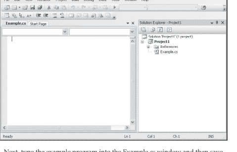
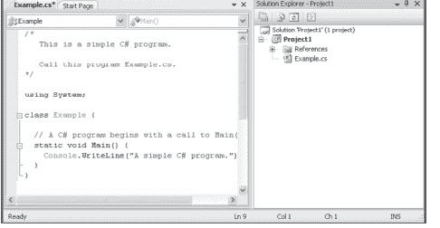
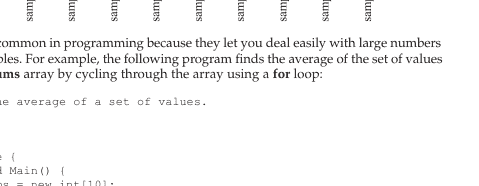
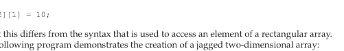
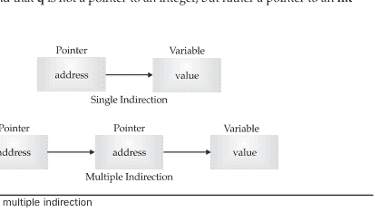
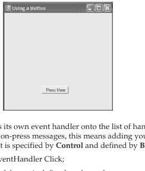
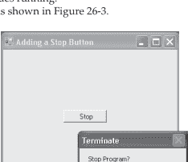
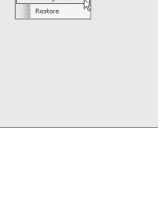

# C# 3.0 完全参考手册（第3版）


## 关于作者

Herbert Schildt 是 C#、C++、C 和 Java 的权威专家。他的编程书籍在全球销量超过 350 万册，并已被翻译成所有主要外语。他是众多畅销书的作者，包括 *Java：完整参考*、*C++：完整参考*、*C：完整参考* 和 *C#：初学者指南*。尽管对计算的各个方面都感兴趣，但他的主要关注点是计算机语言，包括编译器、解释器和机器人控制语言。他还积极关注语言标准化。Schildt 拥有伊利诺伊大学的研究生和本科生学位。您可以通过他的咨询办公室 (217) 586-4683 联系他。他的网站是 www.HerbSchildt.com。

## 关于技术编辑

Michael Howard（德克萨斯州奥斯汀）是微软可信赖计算（TwC）集团安全工程团队的主管安全项目经理，负责在全公司范围内管理安全设计、编程和测试技术。Howard 是安全开发生命周期（SDL）的架构师，该流程用于提高微软软件的安全性。Howard 经常就为微软和在全球会议上就代码安全化主题发表演讲。他定期发表关于安全设计的文章，并是六本安全书籍的合著者，包括获奖的 *编写安全代码*、*软件安全的 19 条致命罪*、*安全开发生命周期*，以及他最近的出版物 *为 Windows Vista 编写安全代码*。

## 特别感谢

特别感谢 Michael Howard 对本书进行了出色的技术编辑。他的专业知识、见解、建议和意见非常有价值。

我们程序员是一群要求很高的人，总是寻找改进程序性能、效率和可移植性的方法。我们对所使用的工具也要求很高，尤其是在编程语言方面。编程语言有很多，但只有少数是伟大的。一门伟大的编程语言必须强大而灵活。它的语法必须简洁而清晰。它必须有助于编写正确的代码，同时不阻碍我们。它必须支持最先进的功能，但不能是时髦的死胡同。最后，一门伟大的编程语言还必须具有一个几乎难以言喻的品质：我们在使用它时必须感觉是对的。C# 就是这样一门语言。

C# 由 Microsoft 创建，以支持其 .NET Framework，并建立在丰富的编程传统之上。它的首席架构师是资深编程大师 Anders Hejlsberg。C# 直接源自世界上两种最成功的计算机语言：C 和 C++。它从 C 继承了语法、许多关键字和运算符。它在 C++ 定义的对象模型基础上构建并加以改进。C# 还与另一种非常成功的语言 Java 密切相关。

C# 和 Java 有共同渊源，但在许多重要方面不同，更像表亲。两者都支持分布式编程，都使用中间代码来实现安全性和可移植性，但细节不同。它们也都提供大量运行时错误检查、安全性和托管执行，但同样细节不同。然而，与 Java 不同，C# 还允许访问指针——这是 C++ 支持的特性。因此，C# 将 C++ 的原始能力与 Java 的类型安全结合起来。此外，能力与安全之间的权衡经过仔细平衡，几乎透明。

在整个计算史中，编程语言不断演进，以适应计算环境的变化、计算机语言理论的进步，以及思考和从事编程工作的新方式。C# 也不例外。在持续改进、适应和创新的过程中，C# 已证明其能够快速响应程序员不断变化的需求。自 2000 年发布最初的 1.0 版以来，C# 新增的许多特性证明了这一点。

看看第一次重大修订 C# 2.0。它增加了若干特性，使程序员更容易编写更具弹性、更可靠、更灵活的代码。毫无疑问，2.0 最重要的新增特性是泛型。通过使用泛型，可以在 C# 中创建类型安全、可重用的代码。因此，泛型的加入从根本上扩展了该语言的能力和范围。

现在看看第二次重大修订 C# 3.0。这是 C# 的最新版本，也是本书描述的版本。毫不夸张地说，C# 3.0 新增的特性重新定义了 C# 的核心，并在此过程中提高了计算机语言开发的标准。在其众多创新特性中，有两项特别突出：LINQ 和 lambda 表达式。LINQ 代表语言集成查询，使您能够使用 C# 语言元素创建数据库风格的查询。Lambda 表达式实现了一种使用 => lambda 运算符的函数式语法，并且 lambda 表达式经常用于 LINQ 表达式中。

正如您将在本书中看到的，LINQ 与 lambda 表达式的组合代表了 C# 中一个极其强大的子集。此外，它们是革命性的特性，正在重新定义如何为许多不同类型的编程任务（而不仅仅是数据库查询）设计解决方案。本质上，它们让您以新的方式处理老问题。使用它们不仅能简化解决方案，还能帮助您从不同角度构思问题。简而言之，LINQ 和 lambda 表达式的加入既意义重大又影响深远。它们正在改变我们思考编程工作的方式。

由于能够快速适应编程领域不断变化的需求，C# 一直保持着活力和创新性。因此，它成为现代计算中最强大、功能最丰富的语言之一。它也是一门任何程序员都不能忽视的语言。本书旨在帮助您掌握它。

## 本书内容

本书介绍 C# 3.0。全书分为两部分。第 I 部分全面讨论 C# 语言，包括 3.0 版新增的特性。这是本书中篇幅最大的部分，描述了定义该语言的关键字、语法和特性。第 I 部分还讨论了 I/O、文件处理、反射和预处理器。

第 II 部分探讨 C# 类库，即 .NET Framework 类库。这个类库非常庞大！由于篇幅限制，不可能在一本书中涵盖整个 .NET Framework 类库。因此，第 II 部分重点介绍核心库，它包含在 System 命名空间中。还涵盖集合、多线程、网络和 Windows 窗体。这些是几乎每个 C# 程序员都会使用的类库部分。

## 面向所有程序员的书

本书不要求任何以前的编程经验。如果您已经了解 C++ 或 Java，您将能够相当快速地进步，因为 C# 与这些语言有许多共同之处。如果您没有任何以前的编程经验，您仍然可以通过本书学习 C#，但需要仔细完成每章中的示例。

## 所需软件

要编译和运行 C# 3.0 程序，必须使用 Visual Studio 2008 或更高版本。

## 别忘了：网上代码

请记住，本书中所有程序的源代码可在 www.mhprofessional.com 上免费获取。

## 进一步学习

C# 3.0：完整参考 是您通往 Herb Schildt 系列编程书籍的入口。以下还有其他您会感兴趣的书。

如需节奏细致的 C# 入门，请尝试

- *C# 3.0：初学者指南*

要学习 Java 编程，我们推荐以下书籍：

- *Java：完整参考*
- *Java：初学者指南*
- *Swing：初学者指南*
- *Java 艺术*
- *Herb Schildt 的 Java 编程手册*

要学习 C++，这些书会特别有帮助：

- *C++：完整参考*
- *C++：初学者指南*
- *C++ 从基础开始*
- *STL 编程从基础开始*
- *C++ 艺术*
- *Herb Schildt 的 C++ 编程手册*

如果您想学习 C 语言——所有现代编程的基础——以下书籍会感兴趣：

- *C：完整参考*

当您需要快速获得可靠答案时，请求助于公认的编程权威 Herbert Schildt。


## C# 语言

第 I 部分讨论 C# 语言的要素，包括其关键字、语法和运算符。还介绍了几项与 C# 语言紧密相关的基础 C# 技术，例如使用 I/O 和反射。

## 第 I 部分

- 第1章
- C# 的创建
- 第2章
- C# 概述
- 第3章
- 数据类型、字面量和变量
- 第4章
- 运算符
- 第5章
- 程序控制语句
- 第6章
- 类和对象简介
- 第7章
- 数组和字符串
- 第8章
- 深入探讨方法和类
- 第9章
- 运算符重载
- 第10章
- 索引器和属性
- 第11章
- 继承
- 第12章
- 接口、结构和枚举
- 第13章
- 异常处理
- 第14章
- 使用 I/O
- 第15章
- 委托、事件和 Lambda 表达式
- 第16章
- 命名空间、预处理器和程序集
- 第17章
- 运行时类型标识、反射和特性
- 第18章
- 泛型
- 第19章
- LINQ
- 第20章
- 不安全代码、指针、可空类型及其他主题

## C# 的创建

C# 是微软为 .NET 开发打造的首要语言。它融合了久经考验的特性与前沿创新，为现代企业计算环境提供了一种高度易用、高效的编程方式。无论以何种标准衡量，它都是21世纪最重要的语言之一。

本章旨在将 C# 置于其历史背景中，包括推动其诞生的力量、其设计哲学，以及它如何受到其他计算机语言的影响。本章还解释了 C# 与 .NET Framework 的关系。正如你将看到的，C# 与 .NET Framework 协同工作，共同构建出高度完善的编程环境。

## C# 的家谱

计算机语言并非存在于真空之中。相反，它们彼此关联，每一种新语言都以某种形式受到先前语言的影响。在一个类似异花授粉的过程中，一种语言的特征被另一种语言采用，新创新被整合进现有语境，或者旧构造被移除。语言由此演化，编程艺术由此进步。C# 也不例外。

C# 继承了丰富的编程遗产。它直接源自世界上最成功的两种计算机语言：C 和 C++。它与另一种语言密切相关：Java。理解这些关系的本质对于理解 C# 至关重要。因此，我们通过将 C# 置于这三种语言的历史背景中来开始考察。

## C：现代编程时代的开端

C 的诞生标志着现代编程时代的开端。C 由 Dennis Ritchie 于20世纪70年代在运行 UNIX 操作系统的 DEC PDP-11 上发明。尽管一些更早的语言（最著名的是 Pascal）已取得重大成功，但 C 确立了至今仍指引编程发展方向的范式。

C 源于20世纪60年代的结构化编程革命。在20世纪60年代之前，大型程序难以编写，因为程序逻辑往往会退化成所谓的“意大利面条式代码”，即一堆纠缠不清、难以跟踪的跳转、调用和返回。结构化语言通过添加定义明确的控制语句、带局部变量的子程序以及其他改进来解决这个问题。

通过使用结构化技术，程序变得组织得更好、更可靠、更易于管理。

尽管当时还有其他结构化语言，但 C 是第一种成功将强大、优雅和表现力结合在一起的语言。它简洁却易用的语法，加上“程序员（而非语言）负责”的哲学，迅速赢得了许多拥护者。从今天的视角看可能有点难以理解，但 C 曾是程序员们期盼已久的一股清新空气。因此，C 成为20世纪80年代使用最广泛的结构化编程语言。

然而，即使是令人尊敬的 C 语言也有其局限。最棘手的问题之一是它无法处理大型程序。一旦项目达到一定规模，C 语言就会遇到障碍，超过这一点，C 程序就难以理解和维护。确切在何处达到这一限制取决于程序、程序员和手头的工具，但总存在一个阈值，超过它 C 程序就变得难以管理。

## 面向对象编程与 C++ 的诞生

到20世纪70年代末，许多项目的规模已接近或达到结构化编程方法和 C 语言所能处理的上限。为了解决这个问题，一种新的编程方式开始出现。这种方法称为面向对象编程（OOP）。使用 OOP，程序员可以处理大得多的程序。问题在于，当时最流行的语言 C 并不支持面向对象编程。对 C 的面向对象版本的渴望最终促成了 C++ 的诞生。

C++ 由 Bjarne Stroustrup 于1979年开始在新泽西州默里山的贝尔实验室发明。他最初将这种新语言称为“带类的 C”。然而在1983年，名称改为 C++。C++ 包含整个 C 语言。因此，C 是 C++ 赖以构建的基础。Stroustrup 对 C 所做的大多数添加都旨在支持面向对象编程。本质上，C++ 是 C 的面向对象版本。通过在 C 的基础上构建，Stroustrup 提供了一条通往 OOP 的平滑迁移路径。C 程序员不必学习一门全新的语言，只需学习少数新特性，就能获得面向对象方法带来的好处。

在20世纪80年代的大部分时间里，C++ 在幕后酝酿，经历了广泛的发展。到20世纪90年代初，C++ 已准备好进入主流使用，其受欢迎程度急剧上升。到该十年结束时，它已成为使用最广泛的编程语言。今天，C++ 仍然是开发高性能系统代码的卓越语言。

必须理解，C++ 的发明并不是试图创造一门全新的编程语言。相反，它是对一门已经非常成功的语言的增强。这种语言开发方法——从现有语言开始并推动其向前发展——确立了一种延续至今的趋势。

## 互联网与 Java 的出现

编程语言的下一个重大进展是 Java。Java 的研发工作最初称为 Oak，于1991年在 Sun Microsystems 开始。Java 设计背后的主要推动者是 James Gosling。Patrick Naughton、Chris Warth、Ed Frank 和 Mike Sheridan 也发挥了作用。

Java 是一门结构化、面向对象的语言，其语法和哲学源自 C++。Java 的创新之处与其说由编程艺术的进步驱动（尽管其中一些确实如此），不如说由计算环境的变化驱动。在互联网成为主流之前，大多数程序都是针对特定 CPU 和特定操作系统编写、编译的。虽然程序员一直喜欢重用代码，但将程序从一个环境轻松移植到另一个环境的能力，相较于更紧迫的问题只能退居次要位置。然而，随着互联网的兴起，许多不同类型的 CPU 和操作系统连接在一起，古老的可移植性问题猛烈地重新出现。为了解决移植性问题，需要一门新语言，而这门新语言就是 Java。

尽管 Java 最重要的方面（也是它被迅速接受的原因）是能够创建跨平台、可移植的代码，但有趣的是，Java 最初的推动力并不是互联网，而是需要一种与平台无关的语言来为嵌入式控制器创建软件。1993年，人们清楚地认识到，在为嵌入式控制器创建代码时遇到的跨平台可移植性问题，在尝试为互联网创建代码时也会遇到。记住：互联网是一个庞大的分布式计算宇宙，其中存在许多不同类型的计算机。在小规模上解决可移植性问题的相同技术，可以大规模应用于互联网。

Java 通过将程序的源代码翻译成一种称为*字节码*的中间语言来实现可移植性。然后，这种字节码由 Java 虚拟机（JVM）执行。因此，Java 程序可以在任何有 JVM 可用的环境中运行。此外，由于 JVM 相对容易实现，它在大量环境中都能轻易获得。

Java 对字节码的使用与 C 和 C++ 截然不同，后者几乎总是被编译为可执行的机器码。机器码与特定 CPU 和操作系统绑定。因此，如果要在不同系统上运行 C/C++ 程序，就需要针对该环境专门重新编译为机器码。因此，要创建可在多种环境中运行的 C/C++ 程序，就需要该程序的多个不同可执行版本。这不仅不切实际，而且成本高昂。Java 使用中间语言是一种优雅且具有成本效益的解决方案。这也是 C# 会为自己的目的而采用的解决方案。

如前所述，Java 源自 C 和 C++。其语法基于 C，其对象模型从 C++ 演化而来。尽管 Java 代码与 C 或 C++ 既不能向上兼容也不能向下兼容，但其语法足够相似，因此现有的大量 C/C++ 程序员只需很少的努力就能转向 Java。此外，由于 Java 在现有范式基础上构建并加以改进，Gosling 等人可以自由地将注意力集中在新颖的创新特性上。正如 Stroustrup 在创建 C++ 时不需要“重新发明轮子”一样，Gosling 在开发 Java 时也不需要创建一门全新的语言。而且，随着 Java 的诞生，C 和 C++ 成为了一种被接受的基础，可用来构建新的计算机语言。

### C# 的诞生

尽管 Java 成功解决了互联网环境中围绕可移植性的许多问题，但它仍然缺少一些特性。其中之一是*跨语言互操作性*，也称为*混合语言编程*。这是一种能力，使一种语言产生的代码能够与另一种语言产生的代码轻松协作。创建大型分布式软件系统需要跨语言互操作性。它对于编写软件组件也很理想，因为最有价值的组件是能够在最广泛的计算机语言、最多的操作环境中使用的组件。


C# 包含直接支持组件构成要素的功能，例如属性、方法和事件。然而，C# 在安全的多语言环境中工作的能力，或许是其最重要的面向组件特性。

## C# 的演变
自最初的 1.0 版本发布以来，C# 一直以快速的步伐演进。在 C# 1.0 之后不久，微软发布了 1.1 版本。它包含许多细微调整，但没有添加重大功能。然而，随着 C# 2.0 的发布，情况就大不相同了。

C# 2.0 是 C# 生命周期中的一个分水岭事件，因为它添加了许多新功能，例如泛型、分部类型和匿名方法，从根本上扩展了该语言的范围、能力和适用领域。2.0 版本牢固地将 C# 置于计算机语言发展的最前沿。它也展示了微软对该语言的长期承诺。

C# 的下一个主要版本是 3.0，这也是本书所描述的 C# 版本。由于 C# 2.0 添加了许多新功能，人们可能以为 C# 的发展会稍微放缓，以便让程序员跟上，但事实并非如此。随着 C# 3.0 的发布，微软再次将 C# 置于语言设计的最前沿，这一次添加了一组创新功能，重新定义了编程格局。以下是 3.0 为该语言添加的功能列表：

- 匿名类型
- 自动实现的属性
- 扩展方法
- 隐式类型变量
- Lambda 表达式
- 语言集成查询 (LINQ)
- 对象和集合初始化器
- 分部方法

尽管所有这些功能都很重要，并对该语言产生重大影响，但最令人兴奋的两个功能是语言集成查询 (LINQ) 和 Lambda 表达式。LINQ 使您能够使用 C# 编程元素编写数据库风格的查询。然而，LINQ 语法并不局限于数据库。它还可以用于数组和集合。因此，LINQ 提供了一种处理若干常见编程任务的新方法。Lambda 表达式常用于 LINQ 表达式中，但也可以在其他地方使用。它们实现了一种使用 Lambda 运算符 => 的函数式风格语法。LINQ 和 Lambda 表达式一起为 C# 编程增添了全新的维度。在本书的整个学习过程中，您将看到这些功能如何彻底改变编写 C# 代码的方式。

## C# 与 .NET Framework 的关系
尽管 C# 是一种可以单独学习的计算机语言，但它与其运行时环境 .NET Framework 有着特殊关系。原因有两方面。首先，C# 最初由微软设计，用于为 .NET Framework 创建代码。其次，C# 使用的库是由 .NET Framework 定义的库。因此，尽管从理论上讲可以将 C# 语言与 .NET 环境分开，但在实践中二者紧密相连。正因为如此，整体了解 .NET Framework 以及它为何对 C# 重要，是很重要的。

### 什么是 .NET Framework？
.NET Framework 定义了一个环境，支持高度分布式、基于组件的应用程序的开发和执行。它使不同的计算机语言能够协同工作，并为 Windows 平台提供安全性、程序可移植性和通用编程模型。就与 C# 的关系而言，.NET Framework 定义了两个非常重要的实体。第一个是公共语言运行时 (CLR)。这是管理程序执行的系统。除了其他优点之外，公共语言运行时是 .NET Framework 中使程序可移植、支持混合语言编程并提供安全执行的部分。

第二个实体是 .NET 类库。该库使您的程序能够访问运行时环境。例如，如果您想执行 I/O，例如在屏幕上显示某些内容，您将使用 .NET 类库来完成。如果您是编程新手，那么“类”这个术语可能是新的。尽管本书后面会详细解释，但目前一个简短的定义就足够了：类是一种面向对象的构造，有助于组织程序。只要您的程序局限于 .NET 类库定义的功能，您的程序就可以在支持 .NET 运行时系统的任何地方运行。由于 C# 自动使用 .NET Framework 类库，因此 C# 程序自动可移植到所有 .NET 环境。

### 公共语言运行时如何工作
公共语言运行时管理 .NET 代码的执行。其工作方式如下：当您编译 C# 程序时，编译器的输出不是可执行代码。相反，它是一个包含一种特殊类型伪代码的文件，称为 Microsoft 中间语言 (MSIL)。MSIL 定义了一组独立于任何特定 CPU 的可移植指令。本质上，MSIL 定义了一种可移植的汇编语言。还有一点：尽管 MSIL 在概念上类似于 Java 的字节码，但二者并不相同。

CLR 的职责是在程序运行时将中间代码转换为可执行代码。因此，任何编译为 MSIL 的程序都可以在实现了 CLR 的任何环境中运行。这是 .NET Framework 实现可移植性的一部分方式。

Microsoft 中间语言使用 JIT 编译器转换为可执行代码。“JIT”代表“Just-In-Time（即时）”。该过程如下：当执行 .NET 程序时，CLR 会激活 JIT 编译器。JIT 编译器会在需要程序的每个部分时按需将 MSIL 转换为本机代码。因此，您的 C# 程序实际上以本机代码执行，即使它最初被编译为 MSIL。这意味着您的程序运行速度几乎与最初编译为本机代码时一样快，但它获得了 MSIL 的可移植性优势。

除了 MSIL 之外，编译 C# 程序时还会输出另一样东西：元数据。元数据描述程序使用的数据，并使您的代码能够轻松地与其他代码交互。元数据与 MSIL 包含在同一个文件中。

## C# 概述
到目前为止，学习编程语言最难的事情是：没有任何元素是孤立存在的。相反，语言的各个组成部分协同工作。这种相互关联性使得讨论 C# 的某个方面时很难不涉及另一个方面。为了帮助克服这个问题，本章简要概述了几个 C# 功能，包括 C# 程序的一般形式、一些基本控制语句和运算符。本章不会深入太多细节，而是集中于任何 C# 程序都常见的通用概念。这里讨论的大多数主题将在第 I 部分的其余章节中更详细地探讨。

### 面向对象编程
C# 的核心是面向对象编程 (OOP)。面向对象方法论与 C# 密不可分，所有 C# 程序至少在某种程度上都是面向对象的。由于它对 C# 的重要性，在编写哪怕一个简单的 C# 程序之前，理解 OOP 的基本原则是很有用的。

OOP 是处理编程工作的一种强大方式。自计算机发明以来，编程方法已经发生了巨大变化，主要是为了适应程序日益增加的复杂性。例如，当计算机刚被发明时，编程是通过使用计算机前面板切换二进制机器指令来完成的。只要程序只有几百条指令长，这种方法就行得通。随着程序增长，汇编语言被发明出来，以便程序员可以使用机器指令的符号表示来处理更大、越来越复杂的程序。随着程序继续增长，引入了诸如 FORTRAN 和 COBOL 之类的高级语言，为程序员提供了更多处理复杂性的工具。当这些早期语言开始达到极限时，结构化编程语言（例如 C）被发明出来。

在编程历史的每个里程碑，都会创造技术和工具，使程序员能够处理越来越大的复杂性。每前进一步，新方法都会吸收先前方法的最佳要素并向前发展。面向对象编程也是如此。在 OOP 之前，许多项目正接近（或超过）结构化方法不再奏效的临界点。需要一种更好的处理复杂性的方式，而面向对象编程就是解决方案。


面向对象编程吸收了结构化编程的最佳思想并结合了若干新概念。其结果是一种不同且更好的程序组织方式。最一般地说，程序可以以两种方式组织之一：围绕其代码（正在发生什么）或围绕其数据（受到影响的内容）。仅使用结构化编程技术，程序通常围绕代码组织。这种方法可以被视为“代码作用于数据”。

面向对象程序则相反。它们围绕数据组织，其关键原则是“数据控制对代码的访问”。在面向对象语言中，你定义数据以及被允许作用于该数据的代码。因此，数据类型精确地定义了可以应用于该数据的操作。

为支持面向对象编程的原则，所有 OOP 语言，包括 C#，都有三个共同特征：封装、多态性和继承。让我们逐一考察。

## 封装

封装是一种编程机制，它将代码与其操作的数据绑定在一起，并使两者免受外部干扰和误用的侵害。在面向对象语言中，代码和数据可以以这样的方式绑定在一起，从而创建一个自包含的黑盒。盒子内部包含所有必要的数据和代码。当代码和数据以这种方式链接在一起时，就创建了一个对象。换句话说，对象是支持封装的装置。

在对象内部，代码、数据或两者都可能是该对象的私有或公有。私有代码或数据仅为对象的另一部分所知并可访问。也就是说，私有代码或数据不能被对象外部存在的程序片段访问。当代码或数据为公有 时，你程序的其他部分也可以访问它，即使它在对象内部定义。通常，对象的公有部分用于为私有元素提供受控接口。

C# 的封装基本单位是类。类定义了对象的形式。它指定了数据以及将操作该数据的代码。C# 使用类规范来构造对象。对象是类的实例。因此，类本质上是一组指定如何构建对象的计划。

总体而言，构成类的代码和数据称为其成员。类定义的数据称为字段。术语成员变量和实例变量也使用。操作该数据的代码包含在函数成员中，其中最常见的是方法。Method 是 C# 对子程序的术语。（其他函数成员包括属性、事件和构造函数。）因此，类的方 法包含作用于该类定义的字段的代码。

## 多态性

多态性（源自希腊语，意为“多种形式”）是允许一个接口访问一类通用操作的质量。多态性的一个简单例子可以在汽车的转向盘上找到。转向盘（接口）无论使用何种实际转向机构都相同。也就是说，无论你的汽车是手动转向、动力转向还是齿条小齿轮转向，转向盘的工作方式都相同。因此，无论使用何种转向方式，向左转动转向盘都会使汽车向左行驶。统一接口的好处当然是，一旦你知道如何操作转向盘，你就可以驾驶任何类型的汽车。

同样的原则也可以应用于编程。例如，考虑一个栈（即后进先出列表）。你可能有一个程序需要三种不同类型的栈。一个栈用于整数值，一个用于浮点值，一个用于字符。在这种情况下，实现每个栈的算法是相同的，尽管存储的数据不同。在非面向对象的语言中，你需要创建三套不同的栈例程，每套使用不同的名称。然而，由于多态性，在 C# 中你可以创建一个通用的栈例程集，可用于全部三种特定情况。这样，一旦你知道如何使用一个栈，你就可以使用它们全部。

更一般地说，多态性的概念常被表述为“一个接口，多种方法”。这意味着可以为一组相关活动设计一个通用接口。多态性通过允许使用相同的接口来指定一类通用操作，从而帮助减少复杂性。选择特定操作（即方法）在每种情况下如何应用，是编译器的任务。你，程序员，不需要手动进行此选择。你只需记住并利用通用接口即可。

## 继承

继承是一个对象可以获得另一个对象属性的过程。这很重要，因为它支持层次分类的概念。仔细想想，大多数知识都是通过层次（即自上而下）分类变得可管理的。例如，红美味苹果属于苹果分类，而苹果又属于水果类，水果类属于更大的食物类。也就是说，食物类具有某些品质（可食用、有营养等），这些品质在逻辑上也适用于其子类水果。除了这些品质外，水果类还有特定的特征（多汁、甜等）使其与其他食物区别开来。苹果类定义了苹果特有的品质（生长在树上、非热带等）。红美味苹果反过来将继承所有前序类的所有品质，并且只定义使其独特的那 些品质。

如果不使用层次结构，每个对象都必须显式定义其所有特征。使用继承，对象只需定义使其在其类中独特的质量即可。它可以从其父类继承一般属性。因此，继承机制使得一个对象可以成为更一般情况的特定实例成为可能。

## 第一个简单程序

现在是时候查看一个实际的 C# 程序了。我们将从编译和运行此处所示的简短程序开始：

/*
    This is a simple C# program.
    Call this program Example.cs.
*/

using System;

class Example {
// A C# program begins with a call to Main().
static void Main() {
    Console.WriteLine("A simple C# program.");
}
}

C# 的主要开发环境是 Microsoft 的 Visual Studio。要编译本书中的所有程序，包括使用新的 C# 3.0 特性的程序，你需要使用支持 C# 的 Visual Studio 2008（或更高版本）。学习 C# 3.0 的一个不错选择是 Visual C# 2008 Express Edition，因为（在撰写本文时）它可从 Microsoft 免费获得。Visual C# 2008 Express Edition 包含一个功能齐全的编译器，支持所有 C# 3.0，因此能够编译本书中的所有代码。它还包括 Visual Studio，即 Microsoft 的集成编程环境（IDE）。尽管 Express Edition 并未提供商业开发人员想要的所有工具，但它非常适合学习 C#。在撰写本文时，Visual C# 2008 Express Edition 可从 microsoft.com/express/ 下载。本书中的所有代码都已在此编译器上测试过。

使用 Visual C#，创建、编译和运行 C# 程序有两种通用方法。首先，你可以使用 Visual Studio IDE。其次，你可以使用命令行编译器 csc.exe。这里描述了这两种方法。

## 使用 csc.exe，C# 命令行编译器

尽管 Visual Studio IDE 很可能是你商业项目中使用的工具，但一些读者会发现 C# 命令行编译器更方便，尤其是在编译和运行本书中所示的示例程序时。原因在于你不必为程序创建项目。你可以简单地创建程序，然后编译并运行它——全部从命令行完成。因此，如果你知道如何使用命令提示符窗口及其命令行界面，使用命令行编译器将比使用 IDE 更快、更简单。

> > **CAUTION** 如果你不熟悉命令提示符窗口，那么最好使用 Visual Studio IDE。尽管其命令并不难学，同时学习命令提示符和 C# 将会是一次具有挑战性的体验。

要使用 C# 命令行编译器创建和运行程序，请遵循以下三个步骤：

- 1. 使用文本编辑器输入程序。
- 2. 使用 csc.exe 编译程序。
- 3. 运行程序。

## 输入程序

本书中所示程序的源代码可在 www.mhprofessional.com 获取。然而，如果你想手工输入程序，你可以自由这样做。在这种情况下，你必须使用文本编辑器（如 Notepad）将程序输入到计算机中。记住，

你必须创建纯文本文件，而不是格式化的文字处理程序文件，因为文字处理程序文件中的格式信息会让 C# 编译器感到困惑。在输入程序时，将文件命名为 Example.cs。

## 编译程序

要编译程序，请执行 C# 编译器 csc.exe，并在命令行中指定源文件的名称，如下所示：

```
C:\>csc Example.cs
```

csc 编译器会创建一个名为 Example.exe 的文件，其中包含程序的 MSIL 版本。虽然 MSIL 不是可执行代码，但它仍然包含在 exe 文件中。公共语言运行时在你尝试执行 Example.exe 时会自动调用 JIT 编译器。然而请注意，如果你尝试在未安装 .NET Framework 的计算机上执行 Example.exe（或任何其他包含 MSIL 的 exe 文件），程序将无法执行，因为 CLR 将缺失。

> 注 在运行 csc.exe 之前，你需要打开一个为 Visual Studio 配置的命令提示符窗口。最简单的方法是在开始菜单的 Visual Studio 工具下选择 Visual Studio 2008 命令提示符。或者，你可以启动一个未配置的命令提示符窗口，然后运行 Visual Studio 提供的批处理文件 vsvars32.bat。然而，使用命令行方式时你可能会遇到问题。在本文撰写时，Visual C# 2008 Express 版不提供 Visual Studio 工具菜单或 vsvars32.bat 文件。因此，如果你使用的是 Visual C# 2008 Express，可能无法自动配置命令提示符窗口。在这种情况下，请改用 Visual Studio IDE。不过，Visual C++ 2008 Express 版同时提供了 vsvars32.bat 和 Visual Studio 2008 命令提示符菜单选项。因此，如果你也安装了 Visual C++ 2008 Express 版，你将能够启动一个配置良好的命令提示符窗口，该窗口也适用于 C#。

## 运行程序

要实际运行程序，只需在命令行中输入其名称，如下所示：

```
C:\>Example
```

运行程序时，将显示以下输出：

```
A simple C# program.
```

## 使用 Visual Studio IDE

Visual Studio 是 Microsoft 的集成编程环境。它允许你在其精心设计的环境中编辑、编译、运行和调试 C# 程序，而无需离开。Visual Studio 提供了便利并帮助管理你的程序。它对于大型项目最为有效，但也可以非常成功地用于较小的程序，例如本书中的示例。

5. 接下来，通过按添加将文件添加到项目中。你的屏幕现在看起来像这样：



6. 接下来，在 Example.cs 窗口中输入示例程序，然后保存文件。（你可以从 www.mhprofessional.com 下载本书中程序的源代码，这样就无需手动输入每个示例。）完成后，你的屏幕看起来像这样：



按照惯例，C# 程序使用 .cs 文件扩展名，你应遵循此惯例。此外，许多程序员会用文件中定义的主要类的名称来命名文件。这就是为什么文件名选择为 Example.cs。鉴于 C# 程序的名称是任意的，本书大多数示例程序都不会指定名称。只需使用你自己的选择即可。

程序以以下行开始：

```
/*
    This is a simple C# program.
    Call this program Example.cs.
*/
```

这是一个注释。与大多数其他编程语言一样，C# 允许你在程序的源文件中输入备注。注释的内容会被编译器忽略。相反，注释描述或解释程序的操作，供阅读其源代码的任何人参考。在本例中，注释描述了程序并提醒你将源文件命名为 Example.cs。当然，在实际应用中，注释通常解释程序的某个部分如何工作或某个特定功能的作用。

C# 支持三种风格的注释。程序顶部显示的那种称为多行注释。这种注释必须以 /* 开始并以 */ 结束。这两个注释符号之间的任何内容都会被编译器忽略。正如名称所示，多行注释可以有多行长。

程序中的下一行是

```
using System;
```

这一行表示程序正在使用 System 命名空间。在 C# 中，命名空间定义了一个声明区域。虽然我们将在本书后面详细讨论命名空间，但现在简要说明是有用的。通过使用命名空间，可以将一组名称与另一组名称分开。实质上，在一个命名空间中声明的名称不会与在不同命名空间中声明的名称冲突。程序使用的命名空间是 System，它是为与 .NET Framework 类库相关联的项保留的命名空间，而该类库是 C# 使用的库。using 关键字只是说明程序正在使用给定命名空间中的名称。

程序中的下一行代码如下所示：

```
class Example {
```

这一行使用关键字 class 声明正在定义一个新类。如前所述，类是 C# 的基本封装单元。Example 是类的名称。类定义以左大括号 ({) 开始，以右大括号 (}) 结束。两个大括号之间的元素是类的成员。目前不必过于担心类的细节，只需注意在 C# 中，大多数程序活动都发生在类内部。

程序中的下一行是单行注释，如下所示：

```
// A C# program begins with a call to Main().
```

## 处理语法错误

如果你是编程新手，学习如何解释和应对在尝试编译程序时可能出现的错误非常重要。大多数编译错误都是由输入错误引起的。正如所有程序员很快就会发现的那样，意外输入错误是很容易的。幸运的是，如果你输入错误，编译器在尝试编译程序时会报告语法错误消息。该消息会给出错误所在的行号以及错误的描述。

尽管编译器报告的语法错误显然是有帮助的，但有时也可能具有误导性。C# 编译器会尝试理解你的源代码，无论你写了什么。因此，报告的错误可能并不总是反映问题的实际原因。例如，在前面的程序中，在 Main() 方法后意外省略了左大括号，在使用 csc 命令行编译器编译时会生成以下错误序列。（使用 IDE 编译时也会生成类似的错误。）

```
EX1.CS(12,21): error CS1002: ; expected
EX1.CS(13,22): error CS1519: Invalid token '(' in class, struct, or
interface member declaration
EX1.CS(15,1): error CS1022: Type or namespace definition, or
end-of-file expected
```

很明显，第一个错误消息完全错误，因为缺少的不是分号，而是大括号。后两个消息同样令人困惑。

本次讨论的要点是，当你的程序包含语法错误时，不要一定按字面理解编译器的消息。它们可能具有误导性。你可能需要对错误消息进行‘二次猜测’才能找到问题所在。此外，请查看错误报告所在行之前的最后几行代码。有时错误不会在实际发生错误的位置之后立即报告，而是在几行之后才报告。

## 一个小的变化

尽管本书中的所有程序都会使用它，但以下行

```
using System;
```

在第一个示例程序的开头在技术上并不是必需的。然而，它是一个很有价值的便利。原因是不必要的是，在 C# 中，你始终可以用名称所属的命名空间完全限定一个名称。例如，以下行

```
Console.WriteLine("A simple C# program.");
```

可以重写为

```
System.Console.WriteLine("A simple C# program.");
```

因此，第一个示例可以按如下所示重新编码：

```
// This version does not include "using System;";
```

```
class Example {
```


```csharp
// A C# program begins with a call to Main().
static void Main() {

    // Here, Console.WriteLine is fully qualified.
    System.Console.WriteLine("A simple C# program.");
}
```

由于在使用该命名空间的成员时总是需要指定 System 命名空间相当繁琐，大多数 C# 程序员会在程序顶部包含 `using System`，本书中的所有程序也都将如此。然而，重要的是要理解，如果需要，你可以显式地用命名空间来限定名称。

## 第二个简单程序

也许没有哪种结构对编程语言来说比 *变量* 更重要。*变量* 是一个命名的内存位置，可以为其赋值。它之所以被称为变量，是因为它的值在程序执行过程中可以被改变。换句话说，变量的内容是可变的，而非固定的。

```csharp
// This program demonstrates variables.

using System;

class Example2 {
    static void Main() {
        int x; // this declares a variable
        int y; // this declares another variable

        x = 100; // this assigns 100 to x

        Console.WriteLine("x contains " + x);

        y = x / 2;

        Console.Write("y contains x / 2: ");
        Console.WriteLine(y);
    }
}
```

运行该程序时，你将看到以下输出：

```text
x contains 100
y contains x / 2: 50
```

该程序引入了几个新概念。首先，语句

```csharp
int x; // this declares a variable
```

声明了一个名为 x、类型为整数的变量。在 C# 中，所有变量在使用前都必须声明。此外，还必须指定变量能够保存的值的种类。这称为变量的类型。在本例中，x 可以保存整数值，即整数。在 C# 中，要声明一个整数类型的变量，需要在其名称前加上关键字 `int`。因此，前面的语句声明了一个名为 x、类型为 `int` 的变量。

下一行声明了第二个变量 y。

```csharp
int y; // this declares another variable
```

请注意，它使用的格式与第一个相同，只是变量名不同。

一般来说，要声明一个变量，你会使用这样的语句：

```csharp
type var-name;
```

在这里，`type` 指定了所声明变量的类型，`var-name` 是变量的名称。除了 `int` 之外，C# 还支持其他几种数据类型。

下一行代码将 x 的值赋为 100：

```csharp
x = 100; // this assigns 100 to x
```

在 C# 中，赋值运算符是单个等号。它将右侧的值复制到左侧的变量中。

下一行代码输出 x 的值，并在前面加上字符串“x contains ”。

```csharp
Console.WriteLine("x contains " + x);
```

在此语句中，加号使得 x 的值显示在前面的字符串之后。这种方法可以推广。使用 `+` 运算符，可以在单个 `WriteLine()` 语句中连接任意多个项。

下一行代码将 y 的值赋为 x 除以 2 的结果：

```csharp
y = x / 2;
```

这行将 x 中的值除以 2，然后将结果存储在 y 中。因此，该行执行后，y 将包含值 50，而 x 的值不变。与大多数其他计算机语言一样，C# 支持全套算术运算符，如下所示：

|  |  |
| + | 加法 |
| - | 减法 |
| * | 乘法 |
| / | 除法 |

以下是程序中的接下来两行：

```csharp
Console.Write("y contains x / 2: ");
Console.WriteLine(y);
```

这里出现了两个新事物。首先，内置方法 `Write()` 用于显示字符串“y contains x / 2: ”。该字符串后面没有换行。这意味着当下一个输出生成时，它将在同一行开始。`Write()` 方法与 `WriteLine()` 非常相似，只是它不会在每次调用后输出换行。其次，在调用

```csharp
Console.WriteLine("ivar after division: " + ivar);
Console.WriteLine("dvar after division: " + dvar);
}
```

该程序的输出如下所示：

```
Original value of ivar: 100
Original value of dvar: 100

ivar after division: 33
dvar after division: 33.3333333333333
```

正如你所看到的，当 `ivar`（一个 `int` 变量）除以 3 时，执行的是整数除法，结果是 33——小数部分丢失了。然而，当 `dvar`（一个 `double` 变量）除以 3 时，小数部分被保留了下来。

正如程序所示，当你想在程序中指定一个浮点值时，必须包含小数点。如果不这样，它将被解释为整数。例如，在 C# 中，值 100 是整数，而值 100.0 是浮点值。

程序中还有另一个值得注意的新内容。要打印空行，只需调用不带任何参数的 `WriteLine()`。

浮点数据类型通常用于处理现实世界中常常需要小数部分的量。例如，下面的程序计算圆的面积，它使用 3.1416 作为 π 的值。

```
// Compute the area of a circle.
```

```csharp
using System;

class Circle {
    static void Main() {
        double radius;
        double area;

        radius = 10.0;
        area = radius * radius * 3.1416;

        Console.WriteLine("Area is " + area);
    }
}
```

该程序的输出如下所示：

```
Area is 314.16
```

显然，如果没有浮点数据，就无法令人满意地完成圆面积的计算。

## 两个控制语句

在方法内部，执行从上到下按语句顺序进行。通过使用 C# 支持的各种程序控制语句，可以改变这种流程。虽然我们稍后会仔细研究控制语句，但这里先简要介绍两种，因为我们将用它们来编写示例程序。

### if 语句

你可以通过使用 C# 的条件语句 `if` 来选择性地执行程序的一部分。`if` 语句在 C# 中的工作方式与其他语言中的 IF 语句非常相似。例如，它在语法上与 C、C++ 和 Java 中的 `if` 语句完全相同。其最简单的形式如下所示：

```csharp
if(condition) statement;
```

这里，`condition` 是一个布尔（即 true 或 false）表达式。如果 `condition` 为 true，则执行该语句。如果 `condition` 为 false，则跳过该语句。下面是一个示例：

```csharp
if(10 < 11) Console.WriteLine("10 is less than 11");
```

在本例中，由于 10 小于 11，条件表达式为 true，因此 `WriteLine()` 将执行。然而，请考虑下面这种情况：

```csharp
if(10 < 9) Console.WriteLine("this won't be displayed");
```

在本例中，10 不小于 9。因此，对 `WriteLine()` 的调用不会发生。

C# 定义了一整套可用于条件表达式的关系运算符。如下所示：

| 运算符 | 含义 |
| < | 小于 |
| <= | 小于或等于 |
| > | 大于 |
| >= | 大于或等于 |
| == | 等于 |
| != | 不等于 |

下面是一个演示 `if` 语句的程序：

```csharp
// Demonstrate the if.
using System;
class IfDemo {
    static void Main() {
        int a, b, c;
        a = 2;
        b = 3;
        if(a < b) Console.WriteLine("a is less than b");
        // This won't display anything.
        if(a == b) Console.WriteLine("you won't see this");
        Console.WriteLine();
    }
}
```

```csharp
c = a - b; // c contains -1
Console.WriteLine("c contains -1");
if(c >= 0) Console.WriteLine("c is non-negative");
if(c < 0) Console.WriteLine("c is negative");

Console.WriteLine();

c = b - a; // c now contains 1
Console.WriteLine("c contains 1");
if(c >= 0) Console.WriteLine("c is non-negative");
if(c < 0) Console.WriteLine("c is negative");
}
```

该程序生成的输出如下所示：

```
a is less than b

c contains -1
c is negative

c contains 1
c is non-negative
```

请注意该程序中的另一件事。这一行

```
int a, b, c;
```

使用逗号分隔的列表声明了三个变量 a、b 和 c。如前所述，当你需要两个或更多相同类型的变量时，可以在一条语句中声明，只需用逗号分隔变量名即可。

### for 循环

你可以通过创建循环来重复执行一段代码。C# 提供了多种强大的循环结构。我们这里要看的是 `for` 循环。与 `if` 语句一样，C# 的 `for` 循环与 C、C++ 和 Java 中的 `for` 循环类似。`for` 循环最简单的形式如下所示：

```csharp
for(initialization; condition; iteration) statement;
```

在最常见的形式中，循环的初始化部分将循环控制变量设置为初始值。`condition` 是一个测试循环控制变量的布尔表达式。如果测试结果为 true，`for` 循环将继续迭代；如果为 false，循环终止。迭代表达式决定了每次循环迭代时循环控制变量的改变方式。下面是一个演示 `for` 循环的简短程序：

```
// Demonstrate the for loop.

using System;

class ForDemo {
    static void Main() {
        int count;
```


```csharp
for(count = 0; count < 5; count = count+1)
    Console.WriteLine("This is count: " + count);
Console.WriteLine("Done!");
}
```

程序生成的输出如下所示：

```
This is count: 0
This is count: 1
This is count: 2
This is count: 3
This is count: 4
Done!
```

在此示例中，count 是循环控制变量。它在 for 的初始化部分被设为零。在每次迭代开始时（包括第一次），都会执行条件测试 count < 5。如果该测试的结果为 true，则执行 WriteLine() 语句。接下来，执行循环的迭代部分，将 1 加到 count 上。此过程一直持续到 count 达到 5 为止。此时，条件测试变为 false，导致循环终止。执行从循环底部继续。

作为一点说明，在专业编写的 C# 程序中，你几乎永远不会看到循环的迭代部分像前述程序那样写。也就是说，你很少会看到类似这样的语句：

```csharp
count = count + 1;
```

其原因是 C# 包含一个执行此操作的特殊增量运算符。增量运算符是 ++（即两个连续的加号）。增量运算符将其操作数增加一。利用增量运算符，前面的语句可以写成如下形式：

```csharp
count++;
```

因此，前述程序中的 for 通常会写成如下形式：

```csharp
for(count = 0; count < 5; count++)
```

你也可以尝试这样做。如你所见，循环仍然与之前完全相同地运行。C# 还提供了一个递减运算符，用 -- 指定。此运算符将其操作数减一。

## 使用代码块

C# 的另一个关键元素是代码块。代码块是一组语句的组合。这是通过用打开和关闭的大括号将语句括起来实现的。一旦创建了代码块，它就成为一个逻辑单元，可以在任何可以使用单个语句的地方使用。例如，块可以作为 if 和 for 语句的目标。请考虑以下 if 语句：

```csharp
if(w < h) {
    v = w * h;
    w = 0;
}
```

这里，如果 w 小于 h，则块内的两个语句都将被执行。因此，块内的两个语句形成一个逻辑单元，一个语句不能在不执行另一个语句的情况下执行。这里的关键点是，每当你需要逻辑地链接两个或多个语句时，你通过创建块来实现。代码块允许许多算法以更大的清晰度和效率实现。

这里有一个使用代码块来防止除零的程序：

```csharp
// Demonstrate a block of code.

using System;

class BlockDemo {
    static void Main() {
        int i, j, d;

        i = 5;
        j = 10;

        // The target of this if is a block.
        if(i != 0) {
            Console.WriteLine("i does not equal zero");
            d = j / i;
            Console.WriteLine("j / i is " + d);
        }
    }
}
```

程序生成的输出如下所示：

```
i does not equal zero
j / i is 2
```

在这种情况下，if 语句的目标是一个代码块，而不仅仅是一个单独的语句。如果控制 if 的条件为 true（正如本例中一样），则块内的三个语句将被执行。尝试将 i 设为零并观察结果。

这里是另一个示例。它使用代码块来计算从 1 到 10 的数字的和与积。

```csharp
// Compute the sum and product of the numbers from 1 to 10.

using System;

class ProdSum {
    static void Main() {
        int prod;
        int sum;
        int i;

        sum = 0;
        prod = 1;

        for(i=1; i <= 10; i++) {
            sum = sum + i;
            prod = prod * i;
        }
        Console.WriteLine("Sum is " + sum);
        Console.WriteLine("Product is " + prod);
    }
}
```

输出如下所示：

```
Sum is 55
Product is 3628800
```

这里，块使一个循环能够同时计算和与积。如果不使用块，则需要两个单独的 for 循环。

最后一点：代码块不会引入任何运行时效率低下。换句话说，{ 和 } 在程序执行期间不会消耗任何额外时间。事实上，由于它们能够简化（并澄清）某些算法的编码，使用代码块通常会带来更高的速度和效率。

## 分号、位置和缩进

在 C# 中，分号表示语句的结束。也就是说，每个单独的语句必须以分号结束。

如你所知，块是一组逻辑连接的语句，由打开和关闭的大括号包围。块不会以分号终止。由于块是一组语句，所以块不以分号终止是有意义的；相反，块的结束由关闭大括号表示。

C# 不将行的结束识别为语句的结束——只有分号才终止语句。因此，语句放在行的哪个位置并不重要。例如，对 C# 来说，

```csharp
x = y;
y = y + 1;
Console.WriteLine(x + " " + y);
```

与

```csharp
x = y;  y = y + 1;  Console.WriteLine(x + " " + y);
```

相同。

此外，语句的各个元素也可以放在单独的行上。例如，以下是完全可以接受的：

```csharp
Console.WriteLine("This is a long line of output" +
    x + y + z +
    "more output");
```

以这种方式拆分长行通常用于使程序更易读。它还可以帮助防止过长的行换行。

你可能已经注意到，在之前的示例中某些语句被缩进了。C# 是一种自由格式语言，意味着语句相对于彼此在行上的放置位置并不重要。然而，多年来，已经发展出一种通用且被接受的缩进风格，可以使程序非常易读。本书遵循该风格，并且建议你也这样做。使用这种风格，你在每个打开大括号后缩进一个级别，并在每个关闭大括号后退回一个级别。某些语句会鼓励一些额外的缩进；这些内容将在后面介绍。

## C# 关键字

从基础来看，计算机语言由其关键字定义，因为它们决定了语言内置的功能。C# 定义了两种一般类型的关键字：*reserved* 和 *contextual*。保留关键字不能用作变量、类或方法的名称。它们只能用作关键字。这就是它们被称为 *reserved* 的原因。术语 *reserved words* 或 *reserved identifiers* 有时也会使用。目前 C# 语言 3.0 版本定义了 77 个保留关键字。它们在表 2-1 中显示。

C# 3.0 定义了 13 个上下文关键字，它们在某些上下文中具有特殊含义。在这些上下文中，它们充当关键字。在这些上下文之外，它们可以用作其他程序元素的名称，例如变量名。因此，它们在技术上并不是保留的。然而，作为一般规则，你应该将上下文关键字视为保留，并避免将其用于其他任何目的。将上下文关键字用作其他程序元素的名称可能会令人困惑，并且被许多程序员认为是不良做法。上下文关键字在表 2-2 中显示。

| | | | | |
|---|---|---|---|---|
| abstract | as | base | bool | break |
| byte | case | catch | char | checked |
| class | const | continue | decimal | default |
| delegate | do | double | else | enum |
| event | explicit | extern | false | finally |
| fixed | float | for | foreach | goto |
| if | implicit | in | int | interface |
| internal | is | lock | long | namespace |
| new | null | object | operator | out |
| override | params | private | protected | public |
| readonly | ref | return | sbyte | sealed |
| short | sizeof | stackalloc | static | string |
| struct | switch | this | throw | true |
| try | typeof | uint | ulong | unchecked |
| unsafe | ushort | using | virtual | volatile |
| void | while | | | |

**TABLE 2-1** C# 保留关键字


| from | get | group | into | join |
|------|-----|-------|------|------|
| let | orderby | partial | select | set |
| value | where | yield |  |  |

表 2-2 C# 上下文关键字

## 标识符

在 C# 中，标识符是分配给方法、变量或任何其他用户定义项的名称。标识符可以由一个或多个字符组成。变量名可以以字母表中的任何字母或下划线开头。其后可以是字母、数字或下划线。下划线可用于增强变量名的可读性，如 line_count。然而，包含两个连续下划线的标识符，如 max__value，保留供编译器使用。大小写不同；也就是说，对 C# 来说，myvar 和 MyVar 是不同的名称。以下是一些可接受的标识符示例：

| Test | x | y2 | MaxLoad |
|------|---|----|---------|
| up | _top | my_var | sample23 |

请记住，标识符不能以数字开头。因此，例如 12x 是无效的。良好的编程实践要求你选择能反映所命名项的含义或用法的标识符。

虽然你不能使用任何保留的 C# 关键字作为标识符，但 C# 允许你在关键字前加上 @，使其成为合法的标识符。例如，@for 是一个有效的标识符。在这种情况下，标识符实际上是 for，而 @ 被忽略。下面是一个程序，说明了 @ 标识符的使用：

// Demonstrate an @ identifier.

using System;

class IdTest {
    static void Main() {
        int @if; // use if as an identifier

        for(@if = 0; @if < 10; @if++)
            Console.WriteLine("@if is " + @if);
    }
}
```
这里显示的输出证明 @if 被正确解释为标识符：
```
@if is 0
@if is 1
@if is 2
@if is 3
@if is 4
```

## 数据类型、字面量和变量

本章探讨 C# 的三个基本要素：数据类型、字面量和变量。一般来说，语言提供的数据类型定义了该语言可应用于何种问题。正如你所期望的，C# 提供了一套丰富的内置数据类型，这使得 C# 适用于广泛的应用。你可以创建这些类型的任何变量，并且可以指定每种类型的常量，在 C# 的术语中称为字面量。

## 为什么数据类型很重要

数据类型在 C# 中尤其重要，因为它是一种强类型语言。这意味着所有操作都由编译器进行类型兼容性检查。非法操作将无法编译。因此，强类型检查有助于防止错误并增强可靠性。为了实现强类型检查，所有变量、表达式和值都有类型。例如，没有“无类型”变量的概念。此外，值的类型决定了允许对其执行哪些操作。允许在一个类型上执行的操作可能不允许在另一个类型上执行。

## C# 的值类型

C# 包含两种通用内置数据类型类别：值类型和引用类型。这两种类型的区别在于变量包含的内容。对于值类型，变量保存实际值，例如 3.1416 或 212。对于引用类型，变量保存对值的引用。最常用的引用类型是类，关于类和引用类型的讨论将在本书后面进行。值类型在此描述。C# 的核心是表 3-1 中显示的 13 种值类型。统称为简单类型。它们被称为简单类型，因为它们由单个值组成。（换句话说，它们不是两个或多个值的组合。）它们构成了 C# 类型系统的基础，提供程序操作的基本、低级数据元素。简单类型有时也称为原始类型。

| Type | Meaning |
| :--- | :--- |
| bool | 表示 true/false 值 |
| byte | 8 位无符号整数 |
| char | 字符 |
| decimal | 用于财务计算的数值类型 |
| double | 双精度浮点数 |
| float | 单精度浮点数 |
| int | 整数 |
| long | 长整数 |
| sbyte | 8 位有符号整数 |
| short | 短整数 |
| uint | 一个无符号整数 |
| ulong | 一个无符号长整数 |
| ushort | 一个无符号短整数 |

**表 3-1** C# 值类型

C# 严格指定每种值类型的范围和行为。由于可移植性要求，C# 在这方面毫不妥协。例如，*int* 在所有执行环境中都相同。无需重写代码以适应特定平台。尽管严格指定值类型的大小可能会在某些环境中导致轻微的性能损失，但为了实现可移植性这是必要的。

> **注意** *除了简单类型之外，C# 还定义了另外三类值类型。这些是枚举、结构和可空类型，所有这些都将在本书后面描述。*

### 整数

C# 定义了九种整数类型：*char*、*byte*、*sbyte*、*short*、*ushort*、*int*、*uint*、*long* 和 *ulong*。然而，*char* 类型主要用于表示字符，并在本章后面讨论。其余八种整数类型用于数值计算。它们的位宽和范围如下所示：

| Type | Width in Bits | Range |
| :--- | :--- | :--- |
| byte | 8 | 0 to 255 |
| sbyte | 8 | –128 to 127 |
| short | 16 | –32,768 to 32,767 |
| ushort | 16 | 0 to 65,535 |
| int | 32 | –2,147,483,648 to 2,147,483,647 |
| uint | 32 | 0 to 4,294,967,295 |
| long | 64 | –9,223,372,036,854,775,808 to 9,223,372,036,854,775,807 |
| ulong | 64 | 0 to 18,446,744,073,709,551,615 |

```csharp
using System;

class Use_byte {
    static void Main() {
        byte x;
        int sum;

        sum = 0;
        for(x = 1; x <= 100; x++)
            sum = sum + x;

        Console.WriteLine("Summation of 100 is " + sum);
    }
}
```

程序的输出如下所示：

Summation of 100 is 5050

由于 *for* 循环仅从 0 运行到 100，这完全在 **byte** 的范围内，因此无需使用更大的类型变量来控制它。

当你需要一个大于 **byte** 或 **sbyte** 但小于 **int** 或 **uint** 的整数时，使用 **short** 或 **ushort**。

### 浮点类型

浮点类型可以表示具有小数部分的数字。有两种浮点类型，**float** 和 **double**，分别表示单精度和双精度数字。**float** 类型为 32 位宽，近似范围为 1.5E–45 到 3.4E+38。**double** 类型为 64 位宽，近似范围为 5E–324 到 1.7E+308。

这两者中，**double** 使用最广泛。其原因之一是 C# 类库（即 .NET Framework 库）中的许多数学函数使用 **double** 值。例如，**Sqrt()** 方法（由库类 **System.Math** 定义）返回一个 **double** 值，即其 **double** 参数的平方根。在这里，**Sqrt()** 用于根据圆的面积计算圆的半径：

```csharp
// Find the radius of a circle given its area.

using System;

class FindRadius {
    static void Main() {
        Double r;
        Double area;

        area = 10.0;

        r = Math.Sqrt(area / 3.1416);
        Console.WriteLine("Radius is " + r);
    }
}
```

程序的输出如下所示：

```
Radius is 1.78412203012729
```

关于前一个示例的另一点。如前所述，**Sqrt()** 是 **Math** 类的成员。注意 **Sqrt()** 的调用方式；它前面是名称 **Math**。这与 **Console** 在 **WriteLine()** 前面的方式类似。虽然并非所有标准方法都通过先指定其类名来调用，但有几个是这样，如下一个示例所示。

以下程序演示了 C# 的几个三角函数，它们也是 C# 数学库的一部分。它们也对 **double** 数据进行操作。程序显示从 0.1 到 1.0（以弧度为单位）的角度的正弦、余弦和正切。

```csharp
// Demonstrate Math.Sin(), Math.Cos(), and Math.Tan().

using System;

class Trigonometry {
    static void Main() {
        double theta; // angle in radians

        for(theta = 0.1; theta <= 1.0; theta = theta + 0.1) {
            Console.WriteLine("Sine of " + theta + " is " +
                              Math.Sin(theta));
            Console.WriteLine("Cosine of " + theta + " is " +
                              Math.Cos(theta));
            Console.WriteLine("Tangent of " + theta + " is " +
                              Math.Tan(theta));

            Console.WriteLine();
        }
    }
}
```

以下是程序输出的一部分：

```
Sine of 0.1 is 0.0998334166468282
Cosine of 0.1 is 0.995004165278026
Tangent of 0.1 is 0.100334672085451

Sine of 0.2 is 0.198669330795061
Cosine of 0.2 is 0.980066577841242
Tangent of 0.2 is 0.202710035508673

Sine of 0.3 is 0.29552020666134
Cosine of 0.3 is 0.955336489125606
Tangent of 0.3 is 0.309336249609623
```

为了计算正弦、余弦和正切，使用了标准库方法 **Math.Sin()**、**Math.Cos()** 和 **Math.Tan()**。与 **Math.Sqrt()** 类似，三角方法使用 **double** 参数调用，并返回 **double** 结果。角度必须以弧度指定。


```csharp
static void Main() {
    decimal amount;
    decimal rate_of_return;
    int years, i;

    amount = 1000.0M;
    rate_of_return = 0.07M;
    years = 10;

    Console.WriteLine("Original investment: $" + amount);
    Console.WriteLine("Rate of return: " + rate_of_return);
    Console.WriteLine("Over " + years + " years");

    for(i = 0; i < years; i++)
        amount = amount + (amount * rate_of_return);

    Console.WriteLine("Future value is $" + amount);
}
```

输出如下：

```text
Original investment: $1000
Rate of return: 0.07
Over 10 years
Future value is $1967.151357289565322490000
```

请注意，结果精确到小数点后若干位——可能比你想要的还要多！本章后面你将看到如何以更具吸引力的方式格式化此类输出。

## 字符

在 C# 中，字符并不像许多其他计算机语言（如 C++）中那样是 8 位量。相反，C# 使用一种称为 *Unicode* 的 16 位字符类型。Unicode 定义了一个足够大的字符集，能够表示所有人类语言中出现的所有字符。尽管许多语言（如英语、法语或德语）使用相对较小的字母表，但有些语言（如中文）使用非常大的字符集，无法仅用 8 位来表示。为了解决这种情况，在 C# 中，**char** 是一种无符号 16 位类型，范围为 0 到 65,535。标准的 8 位 ASCII 字符集是 Unicode 的子集，范围为 0 到 127。因此，ASCII 字符仍然是有效的 C# 字符。

可以通过将字符括在单引号中来为字符变量赋值。例如，下面的代码将 X 赋给变量 ch：

```csharp
char ch;
ch = 'X';
```

可以使用 **WriteLine()** 语句输出 **char** 值。例如，下面这一行输出 ch 中的值：

```csharp
Console.WriteLine("This is ch: " + ch);
```

尽管 C# 将 char 定义为整数类型，但它并不能在所有情况下与整数自由混用。这是因为不存在从整数到 char 的自动类型转换。例如，下面的代码片段是无效的：

```
char ch;

ch = 88; // error, won't work
```

前面代码无法运行的原因是 88 是一个整数值，它不会自动转换为 char。如果你尝试编译这段代码，就会看到一条错误消息。要使该赋值合法，你需要使用强制转换，本章后面会对此进行介绍。

## bool 类型

bool 类型表示 true/false 值。C# 使用保留字 **true** 和 **false** 定义 true 和 false 值。因此，bool 类型的变量或表达式将是这两个值之一。此外，bool 与整数值之间没有定义转换。例如，1 不会转换为 true，0 不会转换为 false。

下面是一个演示 bool 类型的程序：

```
// Demonstrate bool values.

using System;

class BoolDemo {
    static void Main() {
        bool b;

        b = false;
        Console.WriteLine("b is " + b);
        b = true;
        Console.WriteLine("b is " + b);

        // A bool value can control the if statement.
        if(b) Console.WriteLine("This is executed.");

        b = false;
        if(b) Console.WriteLine("This is not executed.");

        // Outcome of a relational operator is a bool value.
        Console.WriteLine("10 > 9 is " + (10 > 9));
    }
}
```

该程序生成的输出如下：

```
b is False
b is True
This is executed.
10 > 9 is True
```

关于这个程序，有三点值得注意。首先，如你所见，当 bool 值由 WriteLine() 输出时，会显示“True”或“False”。其次，bool 变量本身的值就足以控制 if 语句。无需编写像下面这样的 if 语句：

```
if(b == true) ...
```

第三，关系运算符（例如 <）的结果是 bool 值。这就是表达式 10 > 9 显示值“True”的原因。此外，10 > 9 外面额外的一对括号是必要的，因为 + 运算符的优先级高于 >。

## 一些输出选项

到目前为止，当使用 WriteLine() 语句输出数据时，数据都是按默认格式显示的。然而，.NET Framework 定义了一套复杂的格式化机制，使你能够详细控制数据的显示方式。尽管本书后面会详细介绍格式化 I/O，但现在先介绍一些格式化选项会很有帮助。使用这些选项，你可以指定通过 WriteLine() 语句输出时值的外观。这样做能让你生成更具吸引力的输出。请记住，该格式化机制支持的功能远多于这里描述的内容。

在输出数据列表时，你一直用加号分隔列表的各个部分，如下所示：

```
Console.WriteLine("You ordered " + 2 + " items at $" + 3 + " each.");
```

这种方式虽然非常方便，但以这种方式输出数值信息并不能让你控制该信息的显示方式。例如，对于浮点值，你无法控制显示的小数位数。考虑下面的语句：

```
Console.WriteLine("Here is 10/3: " + 10.0/3.0);
```

它会生成以下输出：

```
Here is 10/3: 3.33333333333333
```

尽管这对某些用途来说可能没问题，但显示这么多小数位对其他用途来说可能并不合适。例如，在财务计算中，你通常希望显示两位小数。

要控制数值数据的格式，你需要使用 WriteLine() 的第二种形式，如下所示，它允许你嵌入格式化信息：

```
WriteLine("format string", arg0, arg1, ..., argN);
```

在这个版本中，WriteLine() 的参数用逗号分隔，而不是用加号分隔。格式字符串包含两项内容：按原样显示的常规打印字符，以及格式说明符。格式说明符采用以下一般形式：

```
{argnum, width:.fmt}
```

这里，argnum 指定要显示的参数编号（从零开始）。字段的最小宽度由 width 指定，格式由 fmt 指定。width 和 fmt 是可选的。

在执行期间，当在格式字符串中遇到格式说明符时，会替换并显示由 argnum 指定的相应参数。因此，格式规范在格式字符串中的位置决定了其匹配数据显示的位置。width 和 fmt 都是可选的。因此，在其最简单的形式中，格式说明符只指示要显示哪个参数。例如，{0} 表示 arg0，{1} 指定 arg1，依此类推。

让我们从一个简单的例子开始。语句

```csharp
Console.WriteLine("February has {0} or {1} days.", 28, 29);
```

生成以下输出：

```text
February has 28 or 29 days.
```

如你所见，值 28 被替换到 {0}，29 被替换到 {1}。因此，格式说明符标识了后续参数（在此例中为 28 和 29）在字符串中显示的位置。此外，请注意，附加的值用逗号分隔，而不是用加号分隔。

下面是前一条语句的一个变体，它指定了最小字段宽度：

```csharp
Console.WriteLine("February has {0,10} or {1,5} days.", 28, 29);
```

它生成以下输出：

```text
February has       28 or    29 days.
```

如你所见，已添加空格来填充字段中未使用的部分。请记住，最小字段宽度就是最小值：最小宽度。如果需要，输出可以超过该宽度。

当然，与格式命令关联的参数不必是常量。例如，下面这个程序显示一个平方和立方表。它使用格式命令来输出这些值。

```csharp
// Use format commands.

using System;

class DisplayOptions {
    static void Main() {
        int i;

        Console.WriteLine("Value\tSquared\tCubed");

        for(i = 1; i < 10; i++)
            Console.WriteLine("{0}\t{1}\t{2}", i, i*i, i*i*i);
    }
}
```

输出如下所示：


| 数值 | 平方 | 立方 |
|---|---|---|
| 1 | 1 | 1 |
| 2 | 4 | 8 |
| 3 | 9 | 27 |
| 4 | 16 | 64 |
| 5 | 25 | 125 |
| 6 | 36 | 216 |
| 7 | 49 | 343 |
| 8 | 64 | 512 |
| 9 | 81 | 729 |

在前面的示例中，未对值本身应用任何格式。当然，使用格式说明符的目的是控制数据的外观。最常见的格式化数据类型是浮点数和十进制数。指定格式的最简单方法之一是描述一个`WriteLine()`将使用的模板。为此，请使用`#`标记数字位置，展示你想要的格式示例。你还可以指定小数点与逗号。例如，下面是显示10除以3的更好方法：

```csharp
Console.WriteLine("Here is 10/3: {0:#.##}", 10.0/3.0);
```

这条语句的输出如下：

```
Here is 10/3: 3.33
```

在此示例中，模板为`#.##`，它告诉`WriteLine()`显示两位小数。然而，重要的是要理解，`WriteLine()`会在必要时显示小数点左侧的多个数字，以免错误地表示该值。这是另一个示例。以下语句

```csharp
Console.WriteLine("{0:##,###.##}", 123456.56);
```

生成以下输出：

```
123,456.56
```

如果要显示货币值，请使用C格式说明符。例如：

```csharp
decimal balance;

balance = 12323.09m;
Console.WriteLine("Current balance is {0:C}", balance);
```

此序列的输出如下所示（以美元格式显示）：

```
Current balance is $12,323.09
```

C格式可用于改善前面显示的价格折扣程序的输出：

```csharp
// 使用C格式说明符输出美元和美分。

using System;
```

```csharp
class UseDecimal {
    static void Main() {
        decimal price;
        decimal discount;
        decimal discounted_price;

        // 计算折扣价。
        price = 19.95m;
        discount = 0.15m; // 折扣率为15%

        discounted_price = price - ( price * discount );

        Console.WriteLine("Discounted price: {0:C}", discounted_price);
    }
}
```

现在输出看起来是这样的：

```
Discounted price: $16.96
```

## 字面量

在C#中，*字面量*是指以人类可读形式表示的固定值。例如，数字100就是一个字面量。在大多数情况下，字面量及其用法非常直观，以至于前面的所有示例程序都以某种形式使用过它们。现在是时候正式解释它们了。

C#字面量可以是任何简单类型。每个字面量的表示方式取决于其类型。如前所述，字符字面量用单引号括起来。例如，`'a'`和`'%'`都是字符字面量。

整数字面量被指定为没有小数部分的数字。例如，10和-100是整数字面量。浮点字面量需要使用小数点后跟数字的小数部分。例如，11.123是浮点字面量。C#还允许你对浮点数使用科学计数法。

由于C#是一种强类型语言，字面量也具有类型。这自然引出了以下问题：数字字面量的类型是什么？例如，12、123987或0.23的类型是什么？幸运的是，C#指定了一些易于遵循的规则来回答这些问题。

首先，对于整数字面量，其类型是能够容纳它的最小整数类型，从*int*开始。因此，整数字面量根据其值，类型为*int*、*uint*、*long*或*ulong*之一。其次，浮点字面量的类型为*double*。

如果C#的默认类型不是你想要的字面量类型，你可以通过包含后缀来显式指定其类型。要指定*long*字面量，请附加*l*或*L*。例如，12是*int*，而12L是*long*。要指定无符号整数值，请附加*u*或*U*。因此，100是*int*，而100U是*uint*。要指定无符号长整数，请使用*ul*或*UL*。例如，984375UL的类型是*ulong*。

要指定*float*字面量，请在该常量后附加*F*或*f*。例如，10.19F的类型是*float*。尽管冗余，你仍可以通过附加*D*或*d*来指定*double*字面量。（如前所述，浮点字面量默认是*double*。）

要指定*decimal*字面量，请在其值后跟*m*或*M*。例如，9.95M是*decimal*字面量。

虽然整数字面量默认生成int、uint、long或ulong值，但只要所赋的值能够由目标类型表示，它们仍然可以赋给byte、sbyte、short或ushort类型的变量。

## 十六进制字面量

你大概知道，在编程中，有时使用基于16而非10的数字系统会更方便。基数为16的数字系统称为十六进制，它使用数字0到9以及字母A到F，分别代表10、11、12、13、14和15。例如，十六进制数10在十进制中为16。由于十六进制数的使用频率很高，C#允许你以十六进制格式指定整数字面量。十六进制字面量必须以0x（0后跟x）开头。以下是一些示例：

```
count = 0xFF; // 十进制中的255
incr = 0x1e; // 十进制中的26
```

## 字符转义序列

对于大多数可打印字符，将字符字面量括在单引号中即可，但少数字符（例如回车符）在使用文本编辑器时会带来特殊问题。此外，某些其他字符（例如单引号和双引号）在C#中具有特殊含义，因此你不能直接使用它们。由于这些原因，C#提供了特殊的转义序列，有时也称为反斜杠字符常量，如表3-2所示。这些序列用于代替它们所表示的字符。

例如，下面将制表符赋给ch：

```
ch = '\t';
```

下一个示例将单引号赋给ch：

```
ch = '\'';
```

| 转义序列 | 描述 |
|---|---|
| \a | 警报（响铃） |
| \b | 退格 |
| \f | 换页 |
| \n | 换行 |
| \r | 回车 |
| \t | 水平制表符 |
| \v | 垂直制表符 |
| \0 | 空 |
| \' | 单引号 |
| \" | 双引号 |
| \\ | 反斜杠 |

表3-2 字符转义序列

## 字符串字面量

C#支持另一种类型的字面量：*字符串*。字符串字面量是用双引号括起来的一组字符。例如，

```
"this is a test"
```

就是一个字符串。在前面的示例程序中，你在许多`WriteLine()`语句中已经看到了字符串的示例。

除了普通字符之外，字符串字面量还可以包含一个或多个刚刚描述的转义序列。例如，考虑以下程序。它使用了`\n`和`\t`转义序列。

```
// 演示字符串中的转义序列。

using System;

class StrDemo {
    static void Main() {
        Console.WriteLine("Line One\nLine Two\nLine Three");
        Console.WriteLine("One\tTwo\tThree");
        Console.WriteLine("Four\tFive\tSix");

        // 嵌入引号。
        Console.WriteLine("\"Why?\", he asked.");
    }
}
```

输出如下所示：

```
Line One
Line Two
Line Three
One    Two    Three
Four   Five   Six
"Why?", he asked.
```

注意`\n`转义序列是如何用于生成换行的。你不需要使用多个`WriteLine()`语句来获得多行输出。只需在较长字符串中希望出现换行的位置嵌入`\n`即可。还要注意如何在字符串内生成引号。

除了刚刚描述的字符串字面量形式之外，你还可以指定*逐字字符串字面量*。逐字字符串字面量以@开头，后跟带引号的字符串。带引号的字符串内容不加修改地接受，并且可以跨越多行。因此，你可以包含换行符、制表符等，但不需要使用转义序列。唯一的例外是，要获得双引号（"），你必须连续使用两个双引号（""）。以下是一个演示逐字字符串字面量的程序：

```
// 演示逐字字符串字面量。

using System;

class Verbatim {
```


```csharp
static void Main() {
  Console.WriteLine(@"This is a verbatim
string literal
that spans several lines.
");
  Console.WriteLine(@"Here is some tabbed output:
1       2       3       4
5       6       7       8
");
  Console.WriteLine(@"Programmers say, ""I like C#.""");
}
```

此程序的输出如下所示：

```
This is a verbatim
string literal
that spans several lines.

Here is some tabbed output:
1       2       3       4
5       6       7       8

Programmers say, "I like C#."
```

需要注意的重要一点是，前述程序中的逐字字符串字面量正如在程序中输入的那样精确显示。

逐字字符串字面量的优点在于，你可以在程序中指定输出，使其与屏幕上显示的完全一致。然而，对于多行字符串，换行会掩盖程序的缩进。因此，本书中的程序将仅有限地使用逐字字符串字面量。话虽如此，它们对于许多格式设置情况仍然是一个极好的好处。

最后一点：不要将字符串与字符混淆。字符字面量，例如 'X'，表示类型为 char 的单个字母。仅包含一个字母的字符串，例如 "X"，仍然是一个字符串。

## 对变量的更深入了解

变量使用以下形式的语句声明：

*类型 变量名;*

其中 *类型* 是变量的数据类型，*变量名* 是其名称。你可以声明任何有效类型的变量，包括刚才描述的值类型。重要的是要理解，变量的功能由其类型决定。例如，类型为 bool 的变量不能用于存储浮点值。此外，变量的类型在其生命周期内不能改变。例如，int 变量不能变成 char 变量。

C# 中的所有变量必须在使用前声明。这是因为编译器必须在编译使用该变量的任何语句之前知道变量包含什么类型的数据。它还使 C# 能够执行严格的类型检查。

C# 定义了几种不同类型的变量。我们一直使用的那种称为 *局部变量*，因为它们是在方法内声明的。

### 初始化变量

一种给变量赋值的方式是通过赋值语句，如你所见。另一种方式是在声明时为其赋初始值。要做到这一点，请在变量名后跟等号和被赋的值。初始化的一般形式如下所示：

```
type var-name = value;
```

这里，value 是在变量创建时赋给变量的值。该值必须与指定的类型兼容。

以下是一些示例：

```csharp
int count = 10; // give count an initial value of 10
char ch = 'X';  // initialize ch with the letter X
float f = 1.2F; // f is initialized with 1.2
```

使用逗号分隔的列表声明两个或多个相同类型的变量时，可以为其中一个或多个变量赋初始值。例如：

```csharp
int a, b = 8, c = 19, d; // b and c have initializations
```

在这种情况下，只有 b 和 c 被初始化。

### 动态初始化

尽管前面的示例仅使用常量作为初始化器，C# 允许变量在声明时使用在声明点有效的任何表达式进行动态初始化。例如，这里有一个简短的程序，根据直角三角形的两条对边长度计算斜边。

```csharp
// Demonstrate dynamic initialization.

using System;

class DynInit {
    static void Main() {
        // Length of sides.
        double s1 = 4.0;
        double s2 = 5.0;

        // Dynamically initialize hypot.
        double hypot = Math.Sqrt((s1 * s1) + (s2 * s2));

        Console.Write("Hypotenuse of triangle with sides " +
                      s1 + " by " + s2 + " is ");
        Console.WriteLine("{0:0.###}.", hypot);
    }
}
```

输出如下：

```
Hypotenuse of triangle with sides 4 by 5 is 6.403.
```

这里声明了三个局部变量——s1、s2 和 hypot。前两个 s1 和 s2 由常量初始化。然而，hypot 被动态初始化为斜边的长度。请注意，初始化涉及调用 Math.Sqrt()。如前所述，你可以使用在初始化点有效的任何表达式。由于在此点调用 Math.Sqrt()（或其他任何库方法）是有效的，因此它可用于 hypot 的初始化。这里的关键点是，初始化表达式可以使用在初始化时有效的任何元素，包括对方法、其他变量或字面量的调用。

### 隐式类型变量

如前所述，在 C# 中所有变量都必须声明。通常，声明包括变量的类型，例如 int 或 bool，后跟变量名。然而，从 C# 3.0 开始，可以让编译器根据用于初始化它的值来确定局部变量的类型。这称为隐式类型变量。

隐式类型变量使用关键字 var 声明，并且必须进行初始化。编译器使用初始化器的类型来确定变量的类型。以下是一个示例：

```csharp
var e = 2.7183;
```

因为 e 使用浮点字面量初始化（其类型默认为 double），所以 e 的类型是 double。如果 e 像这样声明：

```csharp
var e = 2.7183F;
```

那么 e 的类型将是 float。

以下程序演示了隐式类型变量。它重写了前一节中显示的程序，使所有变量都隐式类型化。

```csharp
// Demonstrate implicitly typed variables.

using System;

class ImplicitlyTypedVar {
    static void Main() {

        // These are now implicitly typed variables. They
        // are of type double because their initializing
        // expressions are of type double.
        var s1 = 4.0;
        var s2 = 5.0;

        // Now, hypot is implicitly typed. Its type is double
        // because the return type of Sqrt() is double.
        var hypot = Math.Sqrt((s1 * s1) + (s2 * s2));

        Console.Write("Hypotenuse of triangle with sides " +
                      s1 + " by " + s2 + " is ");

        Console.WriteLine("{0:#.###}.", hypot);

        // The following statement will not compile because
        // s1 is a double and cannot be assigned a decimal value.
```

然而，反之则不成立。在内部作用域内声明的局部变量在作用域外不可见。

为了理解嵌套作用域的效果，请考虑以下程序：

```csharp
// Demonstrate block scope.

using System;

class ScopeDemo {
    static void Main() {
        int x; // known to all code within Main()

        x = 10;
        if(x == 10) { // start new scope
            int y = 20; // known only to this block

            // x and y both known here.
            Console.WriteLine("x and y: " + x + " " + y);
            x = y * 2;
        }
        // y = 100; // Error! y not known here.

        // x is still known here.
        Console.WriteLine("x is " + x);
    }
}
```

正如注释所示，变量 x 在 Main() 的作用域开始处声明，并且可供 Main() 内的所有后续代码访问。在 if 块内，声明了 y。由于块定义了一个作用域，y 仅对块内的其他代码可见。这就是为什么在块外，行 y = 100; 被注释掉的原因。如果你删除开头的注释符号，将会发生编译时错误，因为 y 在其块外不可见。在 if 块内，可以使用 x，因为块内的代码（即嵌套作用域）可以访问由外部作用域声明的变量。

在块内，变量可以在任何点声明，但仅在声明后有效。因此，如果你在方法开始处定义一个变量，它对该方法内的所有代码都可用。相反，如果你在块末尾声明一个变量，它实际上是无用的，因为没有代码可以访问它。

如果变量声明包含初始化器，那么每次进入声明它的块时，该变量都会被重新初始化。例如，考虑以下程序：

```csharp
// Demonstrate lifetime of a variable.

using System;

class VarInitDemo {
    static void Main() {
        int x;

        for(x = 0; x < 3; x++) {
            int y = -1; // y is initialized each time block is entered
            Console.WriteLine("y is: " + y); // this always prints -1
```


```csharp
y = 100;
Console.WriteLine("y is now: " + y);
}
}
```

该程序生成的输出如下所示：

```
y is: -1
y is now: 100
y is: -1
y is now: 100
y is: -1
y is now: 100
```

正如你所见，每次进入内部 for 循环时，y 都会被重新初始化为 -1。即使随后将其赋值为 100，这个值也会丢失。

C# 的作用域规则中有一个可能会让你意外的怪癖：虽然块可以嵌套，但内部作用域中声明的变量不能与外部作用域声明的变量具有相同的名称。例如，下面的程序试图声明两个同名变量，将无法编译。

```csharp
/*
This program attempts to declare a variable
in an inner scope with the same name as one
defined in an outer scope.

*** This program will not compile. ***
*/

using System;

class NestVar {
    static void Main() {
        int count;
        for(count = 0; count < 10; count = count+1) {
            Console.WriteLine("This is count: " + count);
            int count; // illegal!!!
            for(count = 0; count < 2; count++)
                Console.WriteLine("This program is in error!");
        }
    }
}
```

如果你有 C/C++ 背景，那么你知道对内部作用域中声明的变量命名没有任何限制。因此，在 C/C++ 中，在外部 for 循环块内声明 count 完全有效。然而，在 C/C++ 中，这种声明会隐藏外部变量。C# 的设计者认为这种名称隐藏很容易导致编程错误，因此禁止了它。

## 类型转换和强制转换

在编程中，将一种类型的变量赋给另一种类型是很常见的。例如，你可能想将一个 int 值赋给一个 float 变量，如下所示：

```csharp
int i;
float f;

i = 10;
f = i; // assign an int to a float
```

当赋值中混合了兼容的类型时，右侧的值会自动转换为左侧的类型。因此，在前面的片段中，i 中的值被转换为 float 然后赋给 f。然而，由于 C# 的严格类型检查，并非所有类型都是兼容的，因此并非所有类型转换都被隐式允许。例如，`bool` 和 `int` 不兼容。幸运的是，通过使用 *强制转换* 仍然可以获得不兼容类型之间的转换。强制转换执行显式类型转换。这里将讨论自动类型转换和强制转换。

### 自动转换

当一种类型的数据被赋给另一种类型的变量时，如果满足以下条件，将自动进行 *隐式* 类型转换：

- 两种类型是兼容的。
- 目标类型的范围大于源类型的范围。

当这两个条件满足时，就会进行 *扩展转换*。例如，`int` 类型足以容纳所有有效的 `byte` 值，并且 `int` 和 `byte` 都是兼容的整数类型，因此可以应用隐式转换。

对于扩展转换，包括整数和浮点类型在内的数值类型彼此兼容。例如，下面的程序完全有效，因为 `long` 到 `double` 的转换是自动执行的扩展转换。

```csharp
// Demonstrate implicit conversion from long to double.

using System;

class LtoD {
    static void Main() {
        long L;
        double D;

        L = 100123285L;
        D = L;

        Console.WriteLine("L and D: " + L + " " + D);
    }
}
```

虽然存在从 `long` 到 `double` 的隐式转换，但由于这不是扩展转换，所以不存在从 `double` 到 `long` 的隐式转换。因此，前述程序的以下版本无效：

```csharp
// *** This program will not compile. ***

using System;

class LtoD {
    static void Main() {
        long L;
        double D;

        D = 100123285.0;
        L = D; // Illegal!!!

        Console.WriteLine("L and D: " + L + " " + D);
    }
}
```

除了刚才描述的限制外，`decimal` 与 `float` 或 `double` 之间没有隐式转换，也没有从数值类型到 `char` 或 `bool` 的隐式转换。此外，`char` 和 `bool` 彼此不兼容。

### 强制转换不兼容类型

虽然隐式类型转换很有帮助，但它们并不能满足所有编程需求，因为它们仅适用于兼容类型之间的扩展转换。对于所有其他情况，你必须使用强制转换。*强制转换* 是指示编译器将表达式的结果转换为指定类型的指令。因此，它请求显式类型转换。强制转换的一般形式如下：

```
(target-type) expression
```

这里，*目标类型* 指定要将指定表达式转换成的期望类型。例如，给定

```csharp
double x, y;
```

如果你想让表达式 *x/y* 的类型为 `int`，可以写成

```csharp
(int) (x / y)
```

这里，即使 x 和 y 的类型为 `double`，强制转换也会将表达式的结果转换为 `int`。包围 x / y 的括号是必要的。否则，转换为 `int` 只会应用于 x 而不会应用于除法结果。这里需要强制转换，因为 `double` 到 `int` 没有隐式转换。

当强制转换涉及窄化转换时，可能会丢失信息。例如，将 `long` 转换为 `int` 时，如果 `long` 的值大于 `int` 的范围，则会丢失信息，因为其高位会被移除。当浮点值转换为整数类型时，由于截断，小数部分也会丢失。例如，如果值 1.23 被赋给整数，结果值将仅为 1。0.23 会丢失。

下面的程序演示了一些需要强制转换的类型转换。它还展示了一些强制转换导致数据丢失的情况。

```csharp
// Demonstrate casting.

using System;

class CastDemo {
    static void Main() {
        double x, y;
        byte b;
        int i;
        char ch;
        uint u;
        short s;
        long l;

        x = 10.0;
        y = 3.0;

        // Cast double to int, fractional component lost.
        i = (int) (x / y);
        Console.WriteLine("Integer outcome of x / y: " + i);
        Console.WriteLine();

        // Cast an int into a byte, no data lost.
        i = 255;
        b = (byte) i;
        Console.WriteLine("b after assigning 255: " + b +
            " -- no data lost.");

        // Cast an int into a byte, data lost.
        i = 257;
        b = (byte) i;
        Console.WriteLine("b after assigning 257: " + b +
            " -- data lost.");
        Console.WriteLine();

        // Cast a uint into a short, no data lost.
        u = 32000;
        s = (short) u;
        Console.WriteLine("s after assigning 32000: " + s +
            " -- no data lost.");

        // Cast a uint into a short, data lost.
        u = 64000;
        s = (short) u;
        Console.WriteLine("s after assigning 64000: " + s +
            " -- data lost.");
        Console.WriteLine();

        // Cast a long into a uint, no data lost.
        l = 64000;
        u = (uint) l;
        Console.WriteLine("u after assigning 64000: " + u +
                          " -- no data lost.");

        // Cast a long into a uint, data lost.
        l = -12;
        u = (uint) l;
        Console.WriteLine("u after assigning -12: " + u +
                          " -- data lost.");

        Console.WriteLine();

        // Cast an int into a char.
        b = 88; // ASCII code for X
        ch = (char) b;
        Console.WriteLine("ch after assigning 88: " + ch);
    }
}
```

该程序的输出如下所示：

```
Integer outcome of x / y: 3

b after assigning 255: 255 -- no data lost.
b after assigning 257: 1 -- data lost.

s after assigning 32000: 32000 -- no data lost.
s after assigning 64000: -1536 -- data lost.

u after assigning 64000: 64000 -- no data lost.
u after assigning -12: 4294967284 -- data lost.

ch after assigning 88: X
```

让我们看一下每个赋值。 (x / y) 转换为 int 会导致小数部分被截断，信息丢失。

当 b 被赋值为 255 时不会丢失信息，因为 `byte` 可以容纳 255 的值。然而，当尝试将 b 赋值为 257 时，会发生信息丢失，因为 257 超出了 `byte` 的范围。在这两种情况下都需要强制转换，因为 `int` 到 `byte` 没有隐式转换。

当 `short` 变量 s 通过 `uint` 变量 u 被赋值为 32,000 时，没有数据丢失，因为 `short` 可以容纳 32,000 的值。然而，在下一个赋值中，u 的值为 64,000，这超出了 `short` 的范围，数据会丢失。在这两种情况下都需要强制转换，因为 `uint` 到 `short` 没有隐式转换。

接下来，u 通过 `long` 变量 l 被赋值为 64,000。在这种情况下，没有数据丢失，因为 64,000 在 `uint` 的范围内。然而，当值 -12 被赋给 u 时，数据会丢失，因为 `uint` 不能容纳负数。在这两种情况下都需要强制转换，因为 `long` 到 `uint` 没有隐式转换。

最后，没有信息丢失，但在将 `byte` 值赋给 `char` 时仍需要强制转换。


## 表达式中的类型转换

除了在赋值中发生之外，类型转换也在表达式中进行。在表达式中，只要它们彼此兼容，就可以自由混合两种或更多不同类型的数据。例如，你可以在表达式中混合 **short** 和 **long**，因为它们都是数值类型。当在表达式中混合不同类型的数据时，它们会按操作逐个转换为同一类型。

这些转换是通过使用 C# 的 *类型提升规则* 实现的。以下是它们为二元操作定义的算法：

- If one operand is a **decimal**, THEN the other operand is promoted to **decimal** (unless it is of type **float** or **double**, in which case an error results).
- ELSE IF one operand is a **double**, the second is promoted to **double**.
- ELSE IF one operand is a **float**, the second is promoted to **float**.
- ELSE IF one operand is a **ulong**, the second is promoted to **ulong** (unless it is of type **sbyte**, **short**, **int**, or **long**, in which case an error results).
- ELSE IF one operand is a **long**, the second is promoted to **long**.
- ELSE IF one operand is a **uint** and the second is of type **sbyte**, **short**, or **int**, both are promoted to **long**.
- ELSE IF one operand is a **uint**, the second is promoted to **uint**.
- ELSE both operands are promoted to **int**.

关于类型提升规则，有几点很重要。首先，并非所有类型都可以在表达式中混合。具体来说，从 **float** 或 **double** 到 **decimal** 没有隐式转换，并且无法将 **ulong** 与任何有符号整数类型混合。要混合这些类型需要使用显式转换。

其次，请特别注意最后一条规则。它指出，如果前面的规则都不适用，则所有其他操作数都会被提升为 **int**。因此，在表达式中，所有 **char**、**sbyte**、**byte**、**ushort** 和 **short** 值在计算时都会被提升为 **int**。这称为 *整数提升*。这也意味着所有算术运算的结果不会小于 **int**。

必须理解，类型提升仅适用于表达式求值时所操作的值。例如，如果 **byte** 变量的值在表达式内部被提升为 **int**，在表达式外部，该变量仍然是 **byte**。类型提升仅影响表达式的求值。

然而，类型提升可能会导致 somewhat 令人意外的结果。例如，当算术运算涉及两个 **byte** 值时，会发生以下序列。首先，**byte** 操作数会被提升为 **int**。然后进行运算，产生 **int** 结果。因此，涉及两个 **byte** 值的运算结果将是 **int**。这可能不是你直觉上期望的。请考虑以下程序。

```
// A promotion surprise!
using System;
class PromDemo {
    static void Main() {
        byte b;
        b = 10;
        b = (byte) (b * b); // cast needed!!
        Console.WriteLine("b: " + b);
    }
}
```

有些违反直觉，将 b * b 赋回 b 时需要进行 byte 转换！原因是 b * b 中，b 的值在表达式求值时会被提升为 int。因此，b * b 的结果是 int 值，如果没有转换就无法赋给 byte 变量。请记住这一点，如果你在看似完全正确的表达式上收到意外的类型不兼容错误信息。

这种类似的情况在对 char 执行操作时也会发生。例如，在以下片段中，需要将结果转换回 char，因为 ch1 和 ch2 在表达式内部被提升为 int

```
char ch1 = 'a', ch2 = 'b';
ch1 = (char) (ch1 + ch2);
```

如果没有转换，ch1 加上 ch2 的结果将是 int，无法赋给 char。

类型提升也发生在执行一元操作（如一元 –）时。对于一元操作，小于 int 的操作数（byte、sbyte、short 和 ushort）会被提升为 int。此外，char 操作数会被转换为 int。此外，如果 uint 值被取反，它会被提升为 long。

### 在表达式中使用转换

可以将转换应用于较大表达式的特定部分。这使你能够精细控制表达式求值时类型转换的方式。例如，考虑以下程序。它显示从 1 到 10 的数字的平方根。它还分别显示每个结果的整数部分和小数部分。为此，它使用转换将 Math.Sqrt() 的结果转换为 int。

// Using casts in an expression.
using System;
class CastExpr {
    static void Main() {
        double n;
        for(n = 1.0; n <= 10; n++) {
            Console.WriteLine("The square root of {0} is {1}",
                n, Math.Sqrt(n));

            Console.WriteLine("Whole number part: {0}",
                (int) Math.Sqrt(n));

            Console.WriteLine("Fractional part: {0}",
                Math.Sqrt(n) - (int) Math.Sqrt(n) );
            Console.WriteLine();
        }
    }
}

以下是程序的输出：

1 的平方根是 1
整数部分：1
小数部分：0

2 的平方根是 1.4142135623731
整数部分：1
小数部分：0.414213562373095

3 的平方根是 1.73205080756888
整数部分：1
小数部分：0.732050807568877

4 的平方根是 2
整数部分：2
小数部分：0

5 的平方根是 2.23606797749979
整数部分：2
小数部分：0.23606797749979

6 的平方根是 2.44948974278318
整数部分：2
小数部分：0.449489742783178

7 的平方根是 2.64575131106459
整数部分：2
小数部分：0.645751311064591

8 的平方根是 2.82842712474619
整数部分：2
小数部分：0.82842712474619

9 的平方根是 3
整数部分：3
小数部分：0

10 的平方根是 3.16227766016838
整数部分：3
小数部分：0.16227766016838

## 运算符

C# 提供了广泛的运算符集，使程序员能够详细控制表达式的构造和求值。C# 的大多数运算符属于以下类别：*算术*、*按位*、*关系* 和 *逻辑*。本章将检查这些运算符。还讨论了赋值运算符和 ? 运算符。C# 还定义了若干其他运算符来处理专门情况，例如数组索引、成员访问和 lambda 运算符。这些特殊运算符将在本书后面介绍相关特性时进行检查。

### 算术运算符

C# 定义了以下算术运算符：

| 运算符 | 含义 |
|---|---|
| + | Addition |
| - | Subtraction (also unary minus) |
| * | Multiplication |
| / | Division |
| % | Modulus |
| ++ | Increment |
| -- | Decrement |

运算符 +, -, *, 和 / 都按预期方式工作。它们可以应用于任何内置数值数据类型。

虽然算术运算符的作用对所有读者都很熟悉，但有几个特殊情况值得解释。首先，请记住，当 / 应用于整数时，任何余数都会被截断；例如，在整数除法中 10/3 等于 3。你可以通过使用取模运算符 % 来获得该除法的余数。% 也被称为余数运算符。它产生整数除法的余数。例如，10 % 3 是 1。在 C# 中，% 可以应用于整数和浮点类型。

因此，10.0 % 3.0 也是 1。（这与 C/C++ 不同，后者仅允许对整数类型进行取模运算。）以下程序演示了取模运算符：

// Demonstrate the % operator.

using System;

class ModDemo {
    static void Main() {
        int iresult, irem;
        double dresult, drem;

        iresult = 10 / 3;
        irem = 10 % 3;

        dresult = 10.0 / 3.0;
        drem = 10.0 % 3.0;

        Console.WriteLine("Result and remainder of 10 / 3: " +
            iresult + " " + irem);
        Console.WriteLine("Result and remainder of 10.0 / 3.0: " +
            dresult + " " + drem);
    }
}
```

程序的输出如下所示：

```
Result and remainder of 10 / 3: 3 1
Result and remainder of 10.0 / 3.0: 3.33333333333333 1
```

如你所见，% 对于整数和浮点运算都产生余数 1。

### 自增和自减

在第 2 章中介绍过，++ 和 -- 是自增和自减运算符。如你所见，它们有一些特殊属性，使其相当有趣。让我们首先回顾一下自增和自减运算符的确切作用。

自增运算符将 1 加到其操作数上，自减运算符从其操作数中减去 1。

```
x = x + 1;
```

is the same as

```
x++;
```

and

```
x = x - 1;
```

is the same as

```
x--;
```


然而，要理解，在递增或递减形式中，x 只被求值一次，而不是两次。这在某些情况下可以提高效率。

递增和递减运算符都可以位于操作数之前（前缀）或之后（后缀）。例如

```
x = x + 1;
```

可以写成

```
++x; // prefix form
```

或者写成

```
x++; // postfix form
```

在前面的示例中，递增作为前缀还是后缀应用没有区别。然而，当递增或递减作为更大表达式的一部分使用时，就存在重要区别。当递增或递减运算符位于其操作数之前时，运算结果是递增后操作数的值。如果运算符位于其操作数之后，则运算结果是递增前操作数的值。考虑以下代码：

```
x = 10;
y = ++x;
```

在这种情况下，y 将被设为 11。这是因为 x 先递增，然后返回其值。然而，如果代码写成

```
x = 10;
y = x++;
```

那么 y 将被设为 10。在这种情况下，先获取 x 的值，然后递增 x，再返回 x 的原始值。在这两种情况下，x 仍然被设为 11。区别在于该运算返回什么。

能够控制递增或递减运算发生的时机具有显著优势。考虑以下程序，它生成一系列数字：

```
// Demonstrate the difference between prefix and
// postfix forms of ++.

using System;

class PrePostDemo {
    static void Main() {
        int x, y;
        int i;

        x = 1;
        Console.WriteLine("Series generated using y = x + x++;");
        for(i = 0; i < 10; i++) {

            y = x + x++; // postfix ++
            Console.WriteLine(y + " ");
        }
        Console.WriteLine();

        x = 1;
        Console.WriteLine("Series generated using y = x + ++x;");
        for(i = 0; i < 10; i++) {
            y = x + ++x; // prefix ++
            Console.WriteLine(y + " ");
        }
        Console.WriteLine();
    }
}
```

输出如下所示：

```
Series generated using y = x + x++;
2
4
6
8
10
12
14
16
18
20
```

```
Series generated using y = x + ++x;
3
5
7
9
11
13
15
17
19
21
```

正如输出所确认的，语句

```
y = x + x++;
```

将 x 的原始值加到 x 上，并将该结果赋给 y。x 的值在获取之后才递增。然而，语句

```
y = x + ++x;
```

获取 x 的值，递增 x，然后将该值加到 x 的原始值上。结果赋给 y。正如输出所示，仅将 ++x 改为 x++，就会使数字序列从偶数变为奇数。

关于前面的示例还有一点：不要让类似

```
x + ++x
```

这样的表达式吓到你。尽管两个运算符背靠背乍看有点令人不安，但编译器会正确处理。只需记住，这个表达式只是将 x 的值加到递增后的 x 值上。

## 关系运算符和逻辑运算符

在“关系运算符”和“逻辑运算符”这两个术语中，关系指的是值彼此之间可能具有的关系，逻辑指的是真值和假值可以连接在一起的方式。由于关系运算符产生 true 或 false 结果，它们经常与逻辑运算符一起使用。因此，这里将它们一起讨论。

关系运算符如下：

| 运算符 | 含义 |
|---|---|
| == | 等于 |
| != | 不等于 |
| > | 大于 |
| < | 小于 |
| >= | 大于或等于 |
| <= | 小于或等于 |

逻辑运算符如下所示：

| 运算符 | 含义 |
|---|---|
| & | 与 |
| \| | 或 |
| ^ | 异或（XOR） |
| \|\| | 短路或 |
| && | 短路与 |
| ! | 非 |

关系运算符和逻辑运算符的结果是一个 bool 值。

一般来说，可以使用 == 和 != 比较对象是否相等或不相等。然而，比较运算符 <、>、<= 或 >= 只能应用于支持排序关系的那些类型。因此，所有关系运算符都可以应用于所有数值类型。然而，bool 类型的值只能比较相等或不相等，因为 true 和 false 值没有顺序。例如，true > false 在 C# 中没有意义。

对于逻辑运算符，操作数必须是 bool 类型，逻辑运算的结果也是 bool 类型。逻辑运算符 &、&&、|、||、^ 和 ! 根据以下真值表支持基本逻辑运算 AND、OR、XOR 和 NOT：

| p | q | p & q | p \| q | p ^ q | !p |
|---|---|---|---|---|---|
| 假 | 假 | 假 | 假 | 假 | 真 |
| 真 | 假 | 假 | 真 | 真 | 假 |
| 假 | 真 | 假 | 真 | 真 | 真 |
| 真 | 真 | 真 | 真 | 假 | 假 |

如表所示，当且仅当一个操作数为 true 时，异或运算的结果为 true。

下面是一个演示若干关系运算符和逻辑运算符的程序：

```
// Demonstrate the relational and logical operators.

using System;

class RelLogOps {
  static void Main() {
    int i, j;
    bool b1, b2;

    i = 10;
    j = 11;
    if(i < j) Console.WriteLine("i < j");
    if(i <= j) Console.WriteLine("i <= j");
    if(i == j) Console.WriteLine("this won't execute");
    if(i != j) Console.WriteLine("i != j");
    if(i > j) Console.WriteLine("this won't execute");
    if(i >= j) Console.WriteLine("this won't execute");

    b1 = true;
    b2 = false;
    if(b1 & b2) Console.WriteLine("this won't execute");
    if(!(b1 & b2)) Console.WriteLine("!(b1 & b2) is true");
    if(b1 | b2) Console.WriteLine("b1 | b2 is true");
    if(b1 ^ b2) Console.WriteLine("b1 ^ b2 is true");
  }
}
```

该程序的输出如下所示：

```
i < j
i <= j
i != j
!(b1 & b2) is true
b1 | b2 is true
b1 ^ b2 is true
```

C# 提供的逻辑运算符执行最常用的逻辑运算。然而，形式逻辑规则还定义了其他若干运算。这些其他逻辑运算可以使用 C# 支持的逻辑运算符来构造。因此，C# 提供了一组足以构造任何其他逻辑运算的逻辑运算符。例如，另一种逻辑运算是蕴含。蕴含是一种二元运算，只有当左操作数为 true 且右操作数为 false 时，结果才为 false。（蕴含运算反映了 true 不能蕴含 false 这一思想。）因此，蕴含运算符的真值表如下所示：

| p | q | p 蕴含 q |
|---|---|---|
| 真 | 真 | 真 |
| 真 | 假 | 假 |
| 假 | 假 | 真 |
| 假 | 真 | 真 |

蕴含运算可以使用 ! 和 | 运算符的组合来构造，如下所示：

```
!p | q
```

以下程序演示了这种实现：

```
// Create an implication operator in C#.

using System;

class Implication {
    static void Main() {
        bool p=false, q=false;
        int i, j;

        for(i = 0; i < 2; i++) {
            for(j = 0; j < 2; j++) {
                if(i==0) p = true;
                if(i==1) p = false;
                if(j==0) q = true;
                if(j==1) q = false;

                Console.WriteLine("p is " + p + ", q is " + q);
                if(!p | q) Console.WriteLine(p + " implies " + q + " is " + true);
                Console.WriteLine();
            }
        }
    }
}
```

输出如下所示：

```
p is True, q is True
True implies True is True

p is True, q is False

p is False, q is True
False implies True is True

p is False, q is False
False implies False is True
```

## 短路逻辑运算符

C# 提供了其 AND 和 OR 逻辑运算符的特殊短路版本，可用于生成更高效的代码。要理解原因，请考虑以下情况。在 AND 运算中，如果第一个操作数为 false，那么无论第二个操作数是什么值，结果都为 false。在 OR 运算中，如果第一个操作数为 true，那么无论第二个操作数的值是什么，运算结果都为 true。因此，在这两种情况下，都不需要求值第二个操作数。通过不求值第二个操作数，可以节省时间并生成更高效的代码。

短路 AND 运算符是 &&，短路 OR 运算符是 ||。如前所述，它们的普通对应运算符是 & 和 |。普通版本和短路版本之间的唯一区别是，普通运算符总是会求值每个操作数，而短路版本仅在必要时才求值第二个操作数。

下面是一个演示短路 AND 运算符的程序。该程序判断 d 中的值是否为 n 的因子。它通过执行取模运算来实现。如果 n / d 的余数为零，则 d 是因子。然而，由于取模运算涉及除法，因此使用 AND 的短路形式来防止除零错误。

```
// Demonstrate the short-circuit operators.

using System;

class SCops {
    static void Main() {
        int n, d;

        n = 10;
        d = 2;
        if(d != 0 && (n % d) == 0)
            Console.WriteLine(d + " is a factor of " + n);

        d = 0; // now, set d to zero

        // Since d is zero, the second operand is not evaluated.
        if(d != 0 && (n % d) == 0)
            Console.WriteLine(d + " is a factor of " + n);

        // Now, try the same thing without short-circuit operator.
        // This will cause a divide-by-zero error.
        if(d != 0 & (n % d) == 0)
            Console.WriteLine(d + " is a factor of " + n);
    }
}
```

为防止除零错误，if 语句首先检查 d 是否等于零。如果为零，那么短路 AND 就在该处停止，不执行取模

除法。因此，在第一个测试中，d 为 2，并执行取模运算。第二个测试失败，因为 d 被设置为零，取模运算被跳过，从而避免除零错误。最后，尝试普通 AND 运算符。这会导致两个操作数都被求值，从而在发生除零时引发运行时错误。

由于短路运算符在某些情况下比普通对应运算符更高效，你可能会疑惑为什么 C# 仍然提供普通 AND 和 OR 运算符。答案是，在某些情况下，由于产生的副作用，你会希望 AND 或 OR 运算的两个操作数都被求值。考虑以下示例：

```csharp
// Side effects can be important.

using System;

class SideEffects {
    static void Main() {
        int i;
        bool someCondition = false;

        i = 0;

        // Here, i is still incremented even though the if statement fails.
        if(someCondition & (++i < 100))
            Console.WriteLine("this won't be displayed");
        Console.WriteLine("if statement executed: " + i); // displays 1

        // In this case, i is not incremented because the short-circuit
        // operator skips the increment.
        if(someCondition && (++i < 100))
            Console.WriteLine("this won't be displayed");
        Console.WriteLine("if statement executed: " + i); // still 1 !!
    }
}
```

首先，注意 bool 变量 someCondition 被初始化为 false。接下来，检查每个 if 语句。正如注释所示，在第一个 if 语句中，尽管 someCondition 为 false，i 仍然会递增。当使用 & 时，就像第一个 if 语句中那样，无论左侧表达式的值是什么，& 右侧的表达式都会被求值。然而，在第二个 if 语句中，使用了短路运算符。在这种情况下，变量 i 不会递增，因为左操作数 someCondition 为 false，这导致右侧表达式被跳过。这里的教训是：如果你的代码期望 AND 或 OR 运算的右操作数被求值，那么你必须使用 C# 的非短路形式来进行这些运算。

另一点：短路 AND 也称为条件 AND，短路 OR 也称为条件 OR。

## 赋值运算符

赋值运算符是单个等号，=。赋值运算符在 C# 中的工作方式与其他计算机语言中大致相同。它具有以下一般形式：

*变量名* = *表达式*;

这里，*变量名* 的类型必须与 *表达式* 的类型兼容。

赋值运算符确实有一个你可能不熟悉的有趣特性：它允许你创建赋值链。例如，考虑以下片段：

```csharp
int x, y, z;

x = y = z = 100; // set x, y, and z to 100
```

这个片段使用一条语句将变量 x、y 和 z 设置为 100。这之所以可行，是因为 = 是一个会产生所赋值的运算符。因此，z = 100 的值是 100，然后将其赋给 y，再将其赋给 x。使用“赋值链”是将一组变量设置为共同值的简便方法。

### 复合赋值

C# 提供了特殊的复合赋值运算符，可简化某些赋值语句的编码。让我们从一个例子开始。这里显示的赋值语句：

```csharp
x = x + 10;
```

可以使用复合赋值写成

```csharp
x += 10;
```

运算符对 += 告诉编译器将 x 加上 10 的值赋给 x。

这是另一个例子。语句

```csharp
x = x - 100;
```

等同于

```csharp
x -= 100;
```

两条语句都将 x 减去 100 的值赋给 x。

许多二元运算符（即需要两个操作数的运算符）都有复合赋值运算符。简写的一般形式是

*变量名* *op* = *表达式*;

因此，算术和逻辑赋值运算符是

| += | -= | *= | /= |
| --- | --- | --- | --- |
| %= | &= | \|= | ^= |

由于复合赋值语句比其非复合等价形式更短，复合赋值运算符有时也被称为*简写赋值运算符*。

复合赋值运算符提供两个好处。首先，它们比“长写”等价形式更紧凑。其次，它们可以生成更高效的可执行代码（因为左操作数只求值一次）。由于这些原因，你经常会在专业编写的 C# 程序中看到复合赋值运算符的使用。

## 位运算符

C# 提供了一组*按位*运算符，扩展了 C# 可应用的问题类型。位运算符直接作用于其操作数的位。它们仅为整数操作数定义。它们不能用于 *bool*、*float* 或 *double*。

它们被称为*按位*运算符，是因为它们用于测试、设置或移位组成整数值的位。除其他用途外，位运算对于各种系统级编程任务都很重要，例如分析来自设备的状态信息。表 4-1 列出了位运算符。

| 运算符 | 结果 |
|---|---|
| & | 按位 AND |
| \| | 按位 OR |
| ^ | 按位异或（XOR） |
| >> | 右移 |
| << | 左移 |
| ~ | 一补码（一元 NOT） |

### 按位 AND、OR、XOR 和 NOT 运算符

按位运算符 AND、OR、XOR 和 NOT 分别是 &、|、^ 和 ~。它们执行与前面描述的布尔逻辑等价项相同的操作。区别在于，位运算符逐位工作。下表显示了使用 1 和 0 的每种运算的结果：

| p | q | p & q | p \| q | p ^ q | ~p |
|---|---|---|---|---|---|
| 0 | 0 | 0 | 0 | 0 | 1 |
| 1 | 0 | 0 | 1 | 1 | 0 |
| 0 | 1 | 0 | 1 | 1 | 1 |
| 1 | 1 | 1 | 1 | 0 | 0 |

就其最常见的用法而言，你可以把按位 AND 看作一种将位关闭的方法。也就是说，任一操作数中为 0 的任何位，都会使结果中的对应位被设置为 0。例如

```
  1101 0011
& 1010 1010
------------
  1000 0010
```

以下程序通过使用 & 将奇数转换为偶数来演示 &。它通过关闭第 0 位来实现这一点。例如，数字 9 的低字节的二进制形式是 0000 1001。当第 0 位被关闭时，这个数字变成 8，即二进制 0000 1000。

```csharp
// Use bitwise AND to make a number even.
using System;

class MakeEven {
    static void Main() {
        ushort num;
        ushort i;

        for(i = 1; i <= 10; i++) {
            num = i;

            Console.WriteLine("num: " + num);

            num = (ushort) (num & 0xFFFE);

            Console.WriteLine("num after turning off bit zero: "
                + num + "\n");
        }
    }
}
```

该程序的输出如下所示：

```text
num: 1
num after turning off bit zero: 0

num: 2
num after turning off bit zero: 2

num: 3
num after turning off bit zero: 2

num: 4
num after turning off bit zero: 4

num: 5
num after turning off bit zero: 4

num: 6
num after turning off bit zero: 6

num: 7
num after turning off bit zero: 6

num: 8
num after turning off bit zero: 8

num: 9
num after turning off bit zero: 8

num: 10
num after turning off bit zero: 10
```

AND 语句中使用的值 0xFFFE 是 1111 1111 1111 1110 的十六进制表示。因此，AND 运算使 num 中的所有位保持不变，但第 0 位被设置为零。因此，偶数不变，但奇数通过将其值减 1 而变为偶数。

当你想确定某一位是打开还是关闭时，AND 运算符也很有用。例如，以下程序判断一个数字是否为奇数：

```csharp
// Use bitwise AND to determine if a number is odd.

using System;

class IsOdd {
  static void Main() {
    ushort num;

    num = 10;

    if((num & 1) == 1)
      Console.WriteLine("This won't display.");

    num = 11;

    if((num & 1) == 1)
      Console.WriteLine(num + " is odd.");
  }
}
```

输出如下所示：

```text
11 is odd.
```

在 if 语句中，num 的值与 1 进行 AND 运算。如果 num 中的第 0 位被设置，则 num & 1 的结果为 1；否则结果为 0。因此，只有当数字为奇数时，if 语句才能成功。

你可以使用按位 & 的位测试能力来创建一个程序，该程序使用按位 & 以二进制格式显示字节值的各位。这里有一种方法：

```csharp
// Display the bits within a byte.

using System;

class ShowBits {
  static void Main() {
    int t;
    byte val;

    val = 123;
    for(t=128; t > 0; t = t/2) {
      if((val & t) != 0) Console.Write("1 ");
```


```
if((val & t) == 0) Console.Write("0 ");
}
}
```

输出如下所示：

```
0 1 1 1 1 0 1 1
```

for 循环依次使用按位与测试 val 中的每一位，以确定其是开启还是关闭。如果位为开启，则显示数字 1；否则显示 0。

按位或可用于打开位。任一操作数中被设置为 1 的任何位都会导致变量中对应的位被设置为 1。例如

```
1101 0011
| 1010 1010
------------
1111 1011
```

你可以利用或将前面显示的 make-even 程序改为 make-odd 程序，如下所示：

```csharp
// Use bitwise OR to make a number odd.
using System;
class MakeOdd {
    static void Main() {
        ushort num;
        ushort i;
        for(i = 1; i <= 10; i++) {
            num = i;
            Console.WriteLine("num: " + num);
            num = (ushort) (num | 1);
            Console.WriteLine("num after turning on bit zero: "
                + num + "\n");
        }
    }
}
```

该程序的输出如下所示：

```
num: 1
num after turning on bit zero: 1

num: 2
num after turning on bit zero: 3

num: 3
num after turning on bit zero: 3

num: 4
num after turning on bit zero: 5

num: 5
num after turning on bit zero: 5

num: 6
num after turning on bit zero: 7

num: 7
num after turning on bit zero: 7

num: 8
num after turning on bit zero: 9

num: 9
num after turning on bit zero: 9

num: 10
num after turning on bit zero: 11
```

该程序通过将每个数字与值 1 进行或运算，因为 1 是在二进制中仅设置零位的值。当此值与任何其他值进行或运算时，会产生低位被设置而所有其他位保持不变的结果。因此，偶数值将增加 1，变为奇数。

异或，通常缩写为 XOR，仅当比较的位不同时才会设置位开启，如下所示：

```
    0 1 1 1 1 1 1 1
  ^ 1 0 1 1 1 0 0 1
    ----------------
    1 1 0 0 0 1 1 0
```

XOR 运算符具有一种有趣的属性，在各种情况下都很有用。当某个值 X 与另一个值 Y 进行异或，然后将该结果再次与 Y 进行异或时，会得到 X。也就是说，给定序列

```
R1 = X ^ Y;
R2 = R1 ^ Y;
```

R2 与 X 的值相同。因此，使用相同值进行两次异或的序列的结果会产生原始值。XOR 的这一特性可以用来创建一个简单的密码，其中某个整数作为密钥，通过对消息中的字符进行异或来同时编码和解码消息。编码时，第一次应用 XOR 操作，得到密文。解码时，第二次应用 XOR，得到明文。当然，这种密码没有实际价值，因为它很容易被破解。然而，它提供了一种有趣的方式来演示 XOR 的效果，如以下程序所示：

```csharp
// Demonstrate the XOR.

using System;

class Encode {
    static void Main() {
        char ch1 = 'H';
        char ch2 = 'i';
        char ch3 = '!';
        int key = 88;

        Console.WriteLine("Original message: " + ch1 + ch2 + ch3);

        // Encode the message.
        ch1 = (char) (ch1 ^ key);
        ch2 = (char) (ch2 ^ key);
        ch3 = (char) (ch3 ^ key);

        Console.WriteLine("Encoded message: " + ch1 + ch2 + ch3);

        // Decode the message.
        ch1 = (char) (ch1 ^ key);
        ch2 = (char) (ch2 ^ key);
        ch3 = (char) (ch3 ^ key);

        Console.WriteLine("Encoded message: " + ch1 + ch2 + ch3);
    }
}
```

输出如下：

```
Original message: Hi!
Encoded message: 9)y
Encoded message: Hi!
```

如你所见，使用相同密钥进行两次 XOR 的结果会产生解码后的消息。（请记住，这种简单的 XOR 密码不适用于任何现实世界的实际用途，因为它本质上是不安全的。）

一元按位取反（NOT）运算符会反转操作数所有位的状态。例如，如果某个整数 A 的位模式为 1001 0110，则 ~A 会产生位模式为 0110 1001 的结果。

以下程序通过以二进制形式显示一个数字及其补码来演示 NOT 运算符：

```csharp
// Demonstrate the bitwise NOT.

using System;

class NotDemo {
    static void Main() {
        sbyte b = -34;

        for(int t=128; t > 0; t = t/2) {
            if((b & t) != 0) Console.Write("1 ");
            if((b & t) == 0) Console.Write("0 ");
        }
        Console.WriteLine();
    }
}
```

```csharp
for(int i = 0; i < 8; i++) {
    for(int t=128; t > 0; t = t/2) {
        if((val & t) != 0) Console.Write("1 ");
        if((val & t) == 0) Console.Write("0 ");
    }
    Console.WriteLine();
    val = val << 1; // left shift
}
Console.WriteLine();

val = 128;
for(int i = 0; i < 8; i++) {
    for(int t=128; t > 0; t = t/2) {
        if((val & t) != 0) Console.Write("1 ");
        if((val & t) == 0) Console.Write("0 ");
    }
    Console.WriteLine();
    val = val >> 1; // right shift
}
}
```

程序的输出如下所示：

```
0 0 0 0 0 0 0 1
0 0 0 0 0 0 1 0
0 0 0 0 0 1 0 0
0 0 0 0 1 0 0 0
0 0 0 1 0 0 0 0
0 0 1 0 0 0 0 0
0 1 0 0 0 0 0 0
1 0 0 0 0 0 0 0

1 0 0 0 0 0 0 0
0 1 0 0 0 0 0 0
0 0 1 0 0 0 0 0
0 0 0 1 0 0 0 0
0 0 0 0 1 0 0 0
0 0 0 0 0 1 0 0
0 0 0 0 0 0 1 0
0 0 0 0 0 0 0 1
```

由于二进制基于 2 的幂，移位运算符可用于将整数乘以或除以 2。左移使值加倍。右移使其减半。当然，这仅在你不将位移出任一端时才有效。以下是示例：

```csharp
// Use the shift operators to multiply and divide by 2.

using System;

class MultDiv {
    static void Main() {
        int n;
        n = 10;

        Console.WriteLine("Value of n: " + n);

        // Multiply by 2.
        n = n << 1;
        Console.WriteLine("Value of n after n = n * 2: " + n);

        // Multiply by 4.
        n = n << 2;
        Console.WriteLine("Value of n after n = n * 4: " + n);

        // Divide by 2.
        n = n >> 1;
        Console.WriteLine("Value of n after n = n / 2: " + n);

        // Divide by 4.
        n = n >> 2;
        Console.WriteLine("Value of n after n = n / 4: " + n);

        // Reset n.
        n = 10;
        Console.WriteLine("Value of n: " + n);

        // Multiply by 2, 30 times.
        n = n << 30; // data is lost
        Console.WriteLine("Value of n after left-shifting 30 places: " + n);
    }
}
```

输出如下所示：

```
Value of n: 10
Value of n after n = n * 2: 20
Value of n after n = n * 4: 80
Value of n after n = n / 2: 40
Value of n after n = n / 4: 10

Value of n: 10
Value of n after left-shifting 30 places: -2147483648
```

请注意输出中的最后一行。当值 10 左移 30 次时，信息会丢失，因为位被移出了 int 的范围。在这种情况下，产生的垃圾值是负数，因为 1 位被移入用作符号位的高位，导致数字被解释为负数。这说明了在使用移位运算符将值乘以或除以 2 时必须小心的原因。（参见第 3 章，了解有符号与无符号数据类型的解释。）

## 位运算符复合赋值

所有二进制位运算符都可用于复合赋值。例如，以下两个语句都将 x 与值 127 进行 XOR 的结果赋给 x：

```
x = x ^ 127;
x ^= 127;
```

## ? 运算符

C# 最迷人的运算符之一是 ?，它是 C# 的条件运算符。? 运算符通常用于替换某些类型的 if-then-else 构造。? 被称为三元运算符，因为它需要三个操作数。其一般形式为

```
Exp1 ? Exp2 : Exp3;
```

其中 Exp1 是一个 bool 表达式，Exp2 和 Exp3 是表达式。Exp2 和 Exp3 的类型必须相同。请注意冒号的使用和位置。

? 表达式的值确定如下：首先计算 Exp1。如果为真，则计算 Exp2 并成为整个 ? 表达式的值。如果 Exp1 为假，则计算 Exp3，其值成为表达式的值。考虑以下示例，它将 absval 赋值为 val 的绝对值：

```
absval = val < 0 ? -val : val; // get absolute value of val
```

这里，如果 val 为零或更大，则 absval 将被赋值为 val 的值。如果 val 为负，则 absval 将被赋值为该值的负值（从而得到正值）。

以下是 ? 运算符的另一个示例。此程序将两个数字相除，但不允许除以零。

```csharp
// Prevent a division by zero using the ?.

using System;

class NoZeroDiv {
    static void Main() {
        int result;
        for(int i = -5; i < 6; i++) {
            result = i != 0 ? 100 / i : 0;
            if(i != 0)
                Console.WriteLine("100 / " + i + " is " + result);
        }
    }
}
```

程序的输出如下所示：

```
100 / -5 is -20
100 / -4 is -25
100 / -3 is -33
100 / -2 is -50
100 / -1 is -100
100 / 1 is 100
100 / 2 is 50
100 / 3 is 33
100 / 4 is 25
100 / 5 is 20
```


请特别注意程序中的这一行：

```
result = i != 0 ? 100 / i : 0;
```

这里，**result** 被赋值为 100 除以 i 的结果。不过，只有当 i 不为 0 时才会进行这个除法。当 i 为 0 时，会将占位值 0 赋给 **result**。

实际上，你不必将 `?` 产生的值赋给某个变量。例如，你可以将该值用作方法调用中的参数。或者，如果所有表达式都是 `bool` 类型，那么 `?` 可以用作循环或 `if` 语句中的条件表达式。例如，下面的程序显示仅用偶数且非零的值去除 100 的结果：

```
// Divide by only even, non-zero values.

using System;

class NoZeroDiv2 {
    static void Main() {

        for(int i = -5; i < 6; i++)
            if(i != 0 ? (i%2 == 0) : false)
                Console.WriteLine("100 / " + i + " is " + 100 / i);
    }
}
```

注意 `if` 语句。如果 `i` 为零，则 `if` 的结果为 false。否则，如果 `i` 非零，那么当 `i` 为偶数时 `if` 的结果为 true，当 `i` 为奇数时为 false。因此，只允许偶数且非零的除数。尽管这个示例为了说明而有些刻意，但这种构造偶尔非常有用。

## 空格与括号

C# 中的表达式可以包含制表符和空格，以使其更易读。例如，下面两个表达式相同，但第二个更易读：

```
x=10/y*(127+x);
x = 10 / y * (127 + x);
```

圆括号可用于对子表达式分组，从而有效地提高其中所含运算的优先级，就像在代数中一样。使用冗余或额外的圆括号不会导致错误，也不会减慢表达式的执行速度。鼓励你使用圆括号来明确确切的求值顺序，无论是对你自己，还是对以后可能需要理解你的程序的人。例如，下面两个表达式中哪一个更易读？

```
x = y/3-34*temp+127;
x = (y/3) - (34*temp) + 127;
```

## 运算符优先级

表 4-2 显示了所有 C# 运算符的优先级顺序，从最高到最低。该表包含几个将在本书后面讨论的运算符。

| 最高 | () | [] | . | ++（后缀） | --（后缀） | checked | new | sizeof | typeof | unchecked |
|---|---|---|---|---|---|---|---|---|---|---|
| ! | ~ | （强制转换） | +（一元） | -（一元） | ++（前缀） | --（前缀） |  |  |  |  |
| * | / | % |  |  |  |  |  |  |  |  |
| + | - |  |  |  |  |  |  |  |  |  |
| << | >> |  |  |  |  |  |  |  |  |  |
| < | > | <= | >= | is |  |  |  |  |  |  |
| == | != |  |  |  |  |  |  |  |  |  |
| & |  |  |  |  |  |  |  |  |  |  |
| ^ |  |  |  |  |  |  |  |  |  |  |
| &#124; |  |  |  |  |  |  |  |  |  |  |
| && |  |  |  |  |  |  |  |  |  |  |
| &#124;&#124; |  |  |  |  |  |  |  |  |  |  |
| ?? |  |  |  |  |  |  |  |  |  |  |
| ?: |  |  |  |  |  |  |  |  |  |  |
| = | op= | => |  |  |  |  |  |  |  |  |
| 最低 |  |  |  |  |  |  |  |  |  |  |

表 4-2 C# 运算符的优先级

## 程序控制语句

本章讨论 C# 的程序控制语句。程序控制语句分为三类：选择语句，包括 if 和 switch；迭代语句，由 for、while、do-while 和 foreach 循环组成；跳转语句，包括 break、continue、goto、return 和 throw。除了 throw 是 C# 异常处理机制的一部分并将在第 13 章讨论之外，其余语句都在这里讨论。

## if 语句

第 2 章介绍了 if 语句。这里将详细讨论它。if 语句的完整形式是

```
if(condition) statement;
else statement;
```

其中 if 和 else 的目标是单条语句。else 子句是可选的。if 和 else 的目标都可以是语句块。使用语句块的 if 的一般形式是

```
if(condition)
{
    statement sequence
}
else
{
    statement sequence
}
```

如果条件表达式为 true，则执行 if 的目标；否则，如果存在 else，则执行 else 的目标。它们绝不会同时执行。控制 if 的条件表达式必须产生 bool 结果。

下面是一个简单的示例，使用 if 和 else 报告一个数是正数还是负数：

```
// Determine if a value is positive or negative.

using System;

class PosNeg {
    static void Main() {
        int i;
        for(i=-5; i <= 5; i++) {
            Console.Write("Testing " + i + ": ");
            if(i < 0) Console.WriteLine("negative");
            else Console.WriteLine("positive");
        }
    }
}
```

输出如下：

```
Testing -5: negative
Testing -4: negative
Testing -3: negative
Testing -2: negative
Testing -1: negative
Testing 0: positive
Testing 1: positive
Testing 2: positive
Testing 3: positive
Testing 4: positive
Testing 5: positive
```

在这个示例中，如果 i 小于零，则执行 if 的目标。否则，执行 else 的目标。任何情况下都不会同时执行两者。

## 嵌套 if

嵌套 if 是指作为另一个 if 或 else 目标的 if 语句。嵌套 if 在编程中非常常见。关于 C# 中的嵌套 if，要记住的主要一点是：else 子句总是与和该 else 位于同一块中、且尚未与 else 关联的最近 if 语句相匹配。下面是一个示例：

```
if(i == 10) {
    if(j < 20) a = b;
    if(k > 100) c = d;
    else a = c; // this else refers to if(k > 100)
}
else a = d; // this else refers to if(i == 10)
```

正如注释所示，最后的 else 不与 if(j < 20) 关联，因为它不在同一个块中（尽管它是最近的没有 else 的 if）。相反，最后的 else 与 if(i == 10) 关联。内部的 else 指向 if(k > 100)，因为它是同一块中最近的 if。

下面的程序演示了嵌套 if。在前面展示的正/负程序中，零被报告为正数。然而，作为一般规则，零被认为无符号。下面这个版本的程序将零报告为既不是正数也不是负数。

// Determine if a value is positive, negative, or zero.
using System;
class PosNegZero {
    static void Main() {
        int i;
        for(i=-5; i <= 5; i++) {
            Console.Write("Testing " + i + ": ");
            if(i < 0) Console.WriteLine("negative");
            else if(i == 0) Console.WriteLine("no sign");
            else Console.WriteLine("positive");
        }
    }
}

输出如下：

```
Testing -5: negative
Testing -4: negative
Testing -3: negative
Testing -2: negative
Testing -1: negative
Testing 0: no sign
Testing 1: positive
Testing 2: positive
Testing 3: positive
Testing 4: positive
Testing 5: positive
```

## if-else-if 阶梯

基于嵌套 if 的一种常见编程构造是 if-else-if 阶梯。

它看起来像这样：

```
if(condition)
    statement;
else if(condition)
    statement;
else if(condition)
    statement;
    .
    .
    .
else
    statement;
```

条件表达式从上到下求值。一旦找到为 true 的条件，就执行与之关联的语句，并跳过阶梯的其余部分。

如果没有任何条件为 true，则执行最后的 else 子句。最后的 else 通常充当默认条件。也就是说，如果所有其他条件测试都失败，则执行最后一个 else 子句。如果没有最后的 else，且所有其他条件都为 false，则不会发生任何操作。

下面的程序演示了 if-else-if 阶梯。它找出给定值的最小一位数因子（1 除外）。

```
// Determine smallest single-digit factor.
using System;

class Ladder {
    static void Main() {
        int num;

        for(num = 2; num < 12; num++) {
            if((num % 2) == 0) {
                Console.WriteLine("Smallest factor of " + num + " is 2.");
            }
            else if((num % 3) == 0) {
                Console.WriteLine("Smallest factor of " + num + " is 3.");
            }
            else if((num % 5) == 0) {
                Console.WriteLine("Smallest factor of " + num + " is 5.");
            }
            else if((num % 7) == 0) {
                Console.WriteLine("Smallest factor of " + num + " is 7.");
            }
            else
                Console.WriteLine(num + " is not divisible by 2, 3, 5, or 7.");
        }
    }
}
```

该程序产生以下输出：

```
Smallest factor of 2 is 2.
Smallest factor of 3 is 3.
Smallest factor of 4 is 2.
Smallest factor of 5 is 5.
Smallest factor of 6 is 2.
Smallest factor of 7 is 7.
Smallest factor of 8 is 2.
Smallest factor of 9 is 3.
Smallest factor of 10 is 2.
11 is not divisible by 2, 3, 5, or 7.
```

如你所见，只有当所有前面的 if 语句都不成功时，才会执行 else。

## switch 语句

C# 的第二个选择语句是 switch。switch 提供多路分支。因此，它使程序能够在多个备选方案中进行选择。尽管一系列嵌套 if 语句可以执行多路测试，但在许多情况下，switch 是一种更高效的方法。它的工作方式如下：表达式的值会依次与一组常量进行测试。当找到匹配项时，执行与该匹配项关联的语句序列。switch 语句的一般形式是

```
case 4:
    Console.WriteLine("i is four");
    break;
default:
    Console.WriteLine("i is five or more");
    break;
}
}
```

该程序产生的输出如下所示：

```
i is zero
i is one
i is two
i is three
i is four
i is five or more
i is five or more
i is five or more
i is five or more
i is five or more
```

如你所见，每次循环时，与匹配 i 的 case 常量关联的语句都会执行。其他所有语句都被绕过。当 i 为 5 或更大时，没有 case 常量匹配，因此执行 default。

在前面的示例中，switch 由一个 int 变量控制。如前所述，你可以用任何整数类型控制 switch，包括 char。下面是一个使用 char 表达式和 char case 常量的示例：

```
// Use a char to control the switch.

using System;

class SwitchDemo2 {
    static void Main() {
        char ch;

        for(ch='A'; ch<='E'; ch++)
            switch(ch) {
                case 'A':
                    Console.WriteLine("ch is A");
                    break;
                case 'B':
                    Console.WriteLine("ch is B");
                    break;
                case 'C':
                    Console.WriteLine("ch is C");
                    break;
                case 'D':
                    Console.WriteLine("ch is D");
                    break;
                case 'E':
                    Console.WriteLine("ch is E");
                    break;
            }
    }
}
```

该程序的输出如下所示：

```
ch is A
ch is B
ch is C
ch is D
ch is E
```

注意，这个示例没有包含 **default** case。记住，**default** 是可选的。不需要时，可以省略。

在 C# 中，与一个 **case** 关联的语句序列继续进入下一个 **case** 是错误的。这称为“no fall-through”（不允许贯穿）规则。这就是 **case** 序列以 **break** 语句结束的原因。（你可以通过其他方式避免贯穿，例如使用本章后面讨论的 **goto**，但 **break** 是迄今为止最常用的方法。）当在 **case** 的语句序列中遇到 **break** 语句时，它会使程序流程退出整个 **switch** 语句，并从 **switch** 外部的下一条语句继续执行。**default** 序列也不能“贯穿”，而且它通常也以 **break** 结束。

不允许贯穿规则是 C# 与 C、C++ 和 Java 不同的一个方面。在那些语言中，一个 **case** 可以继续进入（即贯穿到）下一个 **case**。C# 为 case 设立不允许贯穿规则有两个原因：第一，它允许编译器自由重新排列 **case** 序列的顺序，也许是为了优化。如果一个 **case** 可以流入下一个，这种重新排列就不可能。第二，要求每个 **case** 显式结束，可以防止程序员意外地让一个 **case** 流入下一个。

尽管不能允许一个 **case** 序列贯穿到另一个，但可以让两个或更多 **case** 标签引用同一个代码序列，如下例所示：

```
// Empty cases can fall through.

using System;

class EmptyCasesCanFall {
    static void Main() {
        int i;

        for(i=1; i < 5; i++)
            switch(i) {
                case 1:
                case 2:
                case 3: Console.WriteLine("i is 1, 2 or 3");
                    break;
                case 4: Console.WriteLine("i is 4");
                    break;
            }
    }
}
```

输出如下所示：

```
i is 1, 2 or 3
i is 1, 2 or 3
i is 1, 2 or 3
i is 4
```

在这个示例中，如果 i 的值为 1、2 或 3，则执行第一个 WriteLine() 语句。如果 i 为 4，则执行第二个 WriteLine() 语句。堆叠 case 并不违反不允许贯穿规则，因为这些 case 语句都使用相同的语句序列。

当多个 case 共享公共代码时，堆叠 case 标签是一种常用技术。这种技术可以防止代码序列的不必要重复。

## 嵌套 switch 语句

可以将一个 switch 作为外层 switch 语句序列的一部分。这称为嵌套 switch。内层和外层 switch 的 case 常量可以包含相同的值，并且不会产生冲突。例如，以下代码片段完全可接受：

```
switch(ch1) {
    case 'A': Console.WriteLine("This A is part of outer switch.");
    switch(ch2) {
        case 'A':
            Console.WriteLine("This A is part of inner switch");
            break;
        case 'B': // ...
    } // end of inner switch
    break;
    case 'B': // ...
}
```

## for 循环

for 循环在第 2 章中介绍过。这里将详细考察它。你可能会惊讶于 for 循环竟然如此强大和灵活。让我们从最传统的 for 形式开始，回顾基础知识。

重复单条语句的 for 循环的一般形式是

```
for(initialization; condition; iteration) statement;
```

重复一个块的一般形式是

```
for(initialization; condition; iteration)
{
    statement sequence
}
```

初始化通常是一条赋值语句，用于设置循环控制变量的初始值，该变量充当控制循环的计数器。条件是布尔表达式，决定循环是否重复。迭代表达式定义每次循环重复时循环控制变量的变化量。注意，循环的这三个主要部分必须用分号分隔。只要条件测试为真，for 循环就会继续执行。一旦条件变为假，循环就会退出，程序执行将在 for 之后的语句处继续。

for 循环可以正向或负向进行，并且可以按任意量改变循环控制变量。例如，以下程序以 5 为减量打印从 100 到 -100 的数字：

```
// A negatively running for loop.
using System;

class DecrFor {
    static void Main() {
        int x;

        for(x = 100; x > -100; x -= 5)
            Console.WriteLine(x);
    }
}
```

关于 for 循环的一个重要点是，条件表达式总是在循环顶部测试。这意味着，如果一开始条件就为假，循环内部的代码可能根本不会执行。下面是一个示例：

```
for(count=10; count < 5; count++)
    x += count; // this statement will not execute
```

这个循环永远不会执行，因为首次进入循环时，其控制变量 count 大于 5。这使得条件表达式 count < 5 从一开始就为假；因此，循环一次迭代都不会发生。

当你要迭代已知次数时，for 循环最有用。例如，以下程序使用两个 for 循环查找 2 到 20 之间的素数。如果该数不是素数，则显示其最大因子。

```
// Determine if a number is prime. If it is not, then
// display its largest factor.

using System;

class FindPrimes {
    static void Main() {
        int num;
        int i;
        int factor;
        bool isprime;

        for(num = 2; num < 20; num++) {
            isprime = true;
            factor = 0;

            // See if num is evenly divisible.
            for(i=2; i <= num/2; i++) {
                if((num % i) == 0) {
                    // num is evenly divisible. Thus, it is not prime.
                    isprime = false;
                    factor = i;
                }
            }

            if(isprime)
                Console.WriteLine(num + " is prime.");
            else
                Console.WriteLine("Largest factor of " + num +
                                  " is " + factor);
        }
    }
}
```

该程序的输出如下所示：

```
2 is prime.
3 is prime.
Largest factor of 4 is 2
5 is prime.
Largest factor of 6 is 3
7 is prime.
Largest factor of 8 is 4
Largest factor of 9 is 3
Largest factor of 10 is 5
11 is prime.
Largest factor of 12 is 6
13 is prime.
Largest factor of 14 is 7
Largest factor of 15 is 5
Largest factor of 16 is 8
17 is prime.
Largest factor of 18 is 9
19 is prime.
```

## for 循环的一些变体

for 是 C# 语言中最通用的语句之一，因为它允许广泛的变体。这里将考察这些变体。

### 使用多个循环控制变量

for 循环允许你使用两个或多个变量控制循环。使用多个循环控制变量时，每个变量的初始化语句和增量语句用逗号分隔。下面是一个示例：

```
// Use commas in a for statement.

using System;

class Comma {
  static void Main() {
    int i, j;

```


```
for(i=0, j=10; i < j; i++, j--)
    Console.WriteLine("i and j: " + i + " " + j);
}
```

程序的输出如下：

```
i and j: 0 10
i and j: 1 9
i and j: 2 8
i and j: 3 7
i and j: 4 6
```

这里，逗号分隔两个初始化语句和两个迭代表达式。循环开始时，i 和 j 都会被初始化。每次循环重复时，i 递增，j 递减。多个循环控制变量通常很方便，可以简化某些算法。初始化语句和迭代语句的数量可以任意，但在实践中，超过两个会使 for 循环变得笨拙。

下面是在 for 语句中使用多个循环控制变量的一个实际例子。该程序在单个 for 循环内使用两个循环控制变量来找出一个数（这里是 100）的最大和最小因子。特别注意终止条件。它依赖于两个循环控制变量。

// Use commas in a for statement to find the largest and
// smallest factor of a number.

using System;

class Comma {
    static void Main() {
        int i, j;
        int smallest, largest;
        int num;

        num = 100;

        smallest = largest = 1;

        for(i=2, j=num/2; (i <= num/2) & (j >= 2); i++, j--) {
            if((smallest == 1) & ((num % i) == 0))
                smallest = i;

            if((largest == 1) & ((num % j) == 0))
                largest = j;
        }

        Console.WriteLine("Largest factor: " + largest);
        Console.WriteLine("Smallest factor: " + smallest);
    }
}

程序输出如下：

```
    Largest factor: 50
    Smallest factor: 2
```

通过使用两个循环控制变量，单个 **for** 循环可以同时找出一个数的最小因子和最大因子。控制变量 *i* 用于搜索最小因子。它最初设为 2，并递增直到其值超过 *num* 的一半。控制变量 *j* 用于搜索最大因子。它的值最初设为 *num* 的一半，并递减直到小于 2。循环运行直到 *i* 和 *j* 都达到各自的终止值。循环结束时，两个因子都已找到。

## 条件表达式

控制 **for** 循环的条件表达式可以是任何产生 **bool** 结果的有效表达式。它不需要涉及循环控制变量。例如，在下一个程序中，**for** 循环由 **done** 的值控制。

```
    // Loop condition can be any bool expression.

    using System;

    class forDemo {
        static void Main() {
            int i, j;
            bool done = false;

            for(i=0, j=100; !done; i++, j--) {

                if(i*i >= j) done = true;

                Console.WriteLine("i, j: " + i + " " + j);
            }
        }
    }
```

输出如下：

```
    i, j: 0 100
    i, j: 1 99
    i, j: 2 98
    i, j: 3 97
    i, j: 4 96
    i, j: 5 95
    i, j: 6 94
    i, j: 7 93
    i, j: 8 92
    i, j: 9 91
    i, j: 10 90
```

在这个示例中，**for** 循环迭代直到 **bool** 变量 *done* 为 true。当 *i* 的平方大于或等于 *j* 时，该变量在循环内被设为 true。

## 省略的部分

通过将循环定义的某些部分留空，可以创建一些有趣的 for 循环变体。在 C# 中，for 循环的初始化、条件或迭代部分中的任意一个或全部都可以为空。例如，考虑以下程序：

```
// Parts of the for can be empty.

using System;

class Empty {
    static void Main() {
        int i;

        for(i = 0; i < 10; ) {
            Console.WriteLine("Pass #" + i);
            i++; // increment loop control var
        }
    }
}
```

这里，for 的迭代表达式为空。相反，循环控制变量 i 在循环体内递增。这意味着每次循环重复时，都会测试 i 是否等于 10，但不会发生进一步的动作。当然，由于 i 在循环体内递增，循环会正常运行，显示以下输出：

```
Pass #0
Pass #1
Pass #2
Pass #3
Pass #4
Pass #5
Pass #6
Pass #7
Pass #8
Pass #9
```

在下一个示例中，初始化部分也被移出 for：

```
// Move more out of the for loop.

using System;

class Empty2 {
    static void Main() {
        int i;

        i = 0; // move initialization out of loop
        for(; i < 10; ) {
            Console.WriteLine("Pass #" + i);
            i++; // increment loop control var
        }
    }
}
```

在这个版本中，i 在循环开始之前初始化，而不是作为 **for** 的一部分。通常，你会希望在 **for** 内部初始化循环控制变量。只有当初始值通过复杂过程得出、不适合放在 **for** 语句内部时，通常才会把初始化放在循环之外。

## 无限循环

通过将条件表达式留空，可以使用 **for** 创建 *无限循环*（永不终止的循环）。例如，下面的片段展示了许多 C# 程序员创建无限循环的方式：

```
for(;;) // intentionally infinite loop
{
    //...
}
```

这个循环将永远运行。尽管有些编程任务（例如操作系统命令处理器）需要无限循环，但大多数“无限循环”*实际上*只是具有特殊终止要求的循环。（参见本章后面的“使用 **break** 退出循环”。）

## 无循环体的循环

在 C# 中，与 **for** 循环（或任何其他循环）关联的循环体可以为空。这是因为 *空语句* 在语法上是有效的。无循环体的循环通常很有用。例如，下面的程序使用无循环体循环对 1 到 5 求和：

```
// The body of a loop can be empty.

using System;

class Empty3 {
    static void Main() {
        int i;
        int sum = 0;

        // Sum the numbers through 5.
        for(i = 1; i <= 5; sum += i++) ;

        Console.WriteLine("Sum is " + sum);
    }
}
```

程序输出如下：

```
Sum is 15
```

注意，求和过程完全在 **for** 语句内处理，不需要循环体。特别注意迭代表达式：

```
sum += i++
```

不要被这种语句吓倒。它们在专业编写的 C# 程序中很常见，如果拆解成各部分就很容易理解。用文字来说，这条语句表示“把 i 的值加到 sum 上，然后递增 i”。因此，它等同于下面这组语句：

```
sum = sum + i;
i++;
```

## 在 for 循环内声明循环控制变量

控制 for 循环的变量通常只在循环内部需要，不在其他地方使用。在这种情况下，可以在 for 的初始化部分声明该变量。例如，下面的程序计算 1 到 5 的和与阶乘。它在 for 内声明循环控制变量 i。

// Declare loop control variable inside the for.
using System;
class ForVar {
    static void Main() {
        int sum = 0;
        int fact = 1;

        // Compute the factorial of the numbers 1 through 5.
        for(int i = 1; i <= 5; i++) {
            sum += i; // i is known throughout the loop.
            fact *= i;
        }

        // But, i is not known here.

        Console.WriteLine("Sum is " + sum);
        Console.WriteLine("Factorial is " + fact);
    }
}

在 for 循环内声明变量时，有一点很重要：该变量的作用域在 for 语句结束时结束。（也就是说，该变量的作用域仅限于 for 循环。）在 for 循环之外，该变量将不再存在。因此，在前面的示例中，i 在 for 循环之外不可访问。如果需要在程序其他地方使用循环控制变量，就不能在 for 循环内声明它。

在继续之前，你也许想尝试自己对 for 循环的各种变体。你会发现，它是一个迷人的循环。

## while 循环

C# 的另一种循环是 while。while 循环的一般形式是

    while(condition) statement;

其中 statement 可以是单条语句或语句块，condition 定义控制循环的条件，可以是任何有效的布尔表达式。当条件为真时执行该语句。当条件变为假时，程序控制转到紧跟在循环之后的行。


下面是一个简单的示例，其中使用 `while` 循环来计算一个整数的数量级：

```
// Compute the order of magnitude of an integer
using System;

class WhileDemo {
    static void Main() {
        int num;
        int mag;
        
        num = 435679;
        mag = 0;
        
        Console.WriteLine("Number: " + num);
        
        while(num > 0) {
            mag++;
            num = num / 10;
        };
        
        Console.WriteLine("Magnitude: " + mag);
    }
}
```

输出如下所示：

Number: 435679
Magnitude: 6

`while` 循环的工作方式如下：测试 `num` 的值。如果 `num` 大于 0，则 `mag` 计数器递增，并将 `num` 除以 10。只要 `num` 中的值大于 0，循环就会重复。当 `num` 为 0 时，循环终止，`mag` 中包含原始值的数量级。

与 `for` 循环一样，`while` 在循环顶部检查条件表达式，这意味着循环代码可能根本不会执行。这样就无需在循环之前单独执行测试。下面的程序演示了 `while` 循环的这一特性。它计算从 0 到 9 的 2 的整数次幂。

```
// Compute integer powers of 2.
using System;

class Power {
    static void Main() {
        int e;
        int result;
        
        for(int i=0; i < 10; i++) {
            result = 1;
            e = i;
            while(e > 0) {
                result *= 2;
                e--;
            }
            Console.WriteLine("2 to the " + i + " power is " + result);
        }
    }
}
```

程序的输出如下所示：

```
2 to the 0 power is 1
2 to the 1 power is 2
2 to the 2 power is 4
2 to the 3 power is 8
2 to the 4 power is 16
2 to the 5 power is 32
2 to the 6 power is 64
2 to the 7 power is 128
2 to the 8 power is 256
2 to the 9 power is 512
```

注意，只有当 `e` 大于 0 时，`while` 循环才会执行。因此，当 `e` 为 0 时（就像在 `for` 循环的第一次迭代中那样），`while` 循环会被跳过。

## do-while 循环

C# 的第三种循环是 `do-while`。与 `for` 和 `while` 循环在循环顶部测试条件不同，`do-while` 循环在循环底部检查其条件。这意味着 `do-while` 循环至少会执行一次。`do-while` 循环的一般形式是：

```
do {
    statements;
} while(condition);
```

虽然当只有一条语句时大括号不是必需的，但通常使用大括号来提高 `do-while` 结构的可读性，从而避免与 `while` 混淆。只要条件表达式为真，`do-while` 循环就会执行。

下面的程序使用 `do-while` 循环以相反顺序显示一个整数的各位数字：

```
// Display the digits of an integer in reverse order.

using System;

class DoWhileDemo {
    static void Main() {
        int num;
        int nextdigit;

        num = 198;
        Console.WriteLine("Number: " + num);
        Console.Write("Number in reverse order: ");
        do {
            nextdigit = num % 10;
            Console.Write(nextdigit);
            num = num / 10;
        } while(num > 0);
        Console.WriteLine();
    }
}
```

输出如下所示：

```
Number: 198
Number in reverse order: 891
```

循环的工作方式如下：在每次迭代中，通过计算整数除以 10 的余数来获得最左边的数字。然后显示该数字。接下来，将 `num` 的值除以 10。由于这是整数除法，结果会移除最左边的数字。此过程重复，直到 `num` 为 0。

## foreach 循环

`foreach` 循环遍历集合中的元素。集合是一组对象。C# 定义了多种集合类型，其中一种是数组。`foreach` 循环将在第 7 章讨论数组时介绍。

## 使用 break 退出循环

通过使用 `break` 语句，可以强制立即退出循环，绕过循环体中剩余的代码以及循环的条件测试。当在循环内遇到 `break` 语句时，循环终止，程序控制权将转移到循环后的下一条语句。下面是一个简单示例：

```
// Using break to exit a loop.
using System;

class BreakDemo {
    static void Main() {
        // Use break to exit this loop.
        for(int i=-10; i <= 10; i++) {
            if(i > 0) break; // terminate loop when i is positive
            Console.Write(i + " ");
        }
        Console.WriteLine("Done");
    }
}
```

该程序生成以下输出：

```
-10 -9 -8 -7 -6 -5 -4 -3 -2 -1 0 Done
```

如你所见，尽管 `for` 循环被设计为从 -10 运行到 10，但 `break` 语句导致它在 `i` 变为正数时提前终止。

`break` 语句可以用于 C# 的任何循环。例如，下面是使用 `do-while` 循环重写的上一个程序：

```
// Using break to exit a do-while loop.

using System;

class BreakDemo2 {
    static void Main() {
        int i;

        i = -10;
        do {
            if(i > 0) break;
            Console.Write(i + " ");
            i++;
        } while(i <= 10);

        Console.WriteLine("Done");
    }
}
```

下面是一个更实际的 `break` 示例。该程序找出一个数的最小因数。

```
// Find the smallest factor of a value.

using System;

class FindSmallestFactor {
    static void Main() {
        int factor = 1;
        int num = 1000;

        for(int i=2; i <= num/i; i++) {
            if((num%i) == 0) {
                factor = i;
                break; // stop loop when factor is found
            }
        }
        Console.WriteLine("Smallest factor is " + factor);
    }
}
```

输出如下所示：

```
Smallest factor is 2
```

一旦找到因数，`break` 就会停止 `for` 循环。在这种情况下使用 `break` 可以防止在找到因数后继续尝试其他值，从而避免效率低下。

在嵌套循环中使用时，`break` 语句只会跳出最内层的循环。例如：

```csharp
// Using break with nested loops.

using System;

class BreakNested {
    static void Main() {
        for(int i=0; i<3; i++) {
            Console.WriteLine("Outer loop count: " + i);
            Console.Write("    Inner loop count: ");
            int t = 0;
            while(t < 100) {
                if(t == 10) break; // terminate loop if t is 10
                Console.Write(t + " ");
                t++;
            }
        }
        Console.WriteLine();
        Console.WriteLine("Loops complete.");
    }
}
```

该程序生成以下输出：

Outer loop count: 0
    Inner loop count: 0 1 2 3 4 5 6 7 8 9
Outer loop count: 1
    Inner loop count: 0 1 2 3 4 5 6 7 8 9
Outer loop count: 2
    Inner loop count: 0 1 2 3 4 5 6 7 8 9
Loops complete.

如你所见，内层循环中的 `break` 语句只会导致该循环终止。外层循环不受影响。

关于 `break`，还有两点需要记住：首先，一个循环中可以出现多个 `break` 语句。但要小心。过多的 `break` 语句往往会破坏你的代码。其次，退出 `switch` 语句的 `break` 只影响该 `switch` 语句，而不会影响任何包围它的循环。

## 使用 continue

可以强制执行循环的提前迭代，绕过循环的正常控制结构。这是通过 `continue` 实现的。`continue` 语句强制进行循环的下一次迭代，跳过中间的任何代码。因此，`continue` 本质上是 `break` 的补充。例如，下面的程序使用 `continue` 帮助打印 0 到 100 之间的偶数。

```csharp
// Use continue.
using System;

class ContDemo {
    static void Main() {
        // Print even numbers between 0 and 100.
        for(int i = 0; i <= 100; i++) {
            if((i%2) != 0) continue; // iterate
            Console.WriteLine(i);
        }
    }
}
```

只打印偶数，因为奇数会导致循环提前迭代，从而跳过对 `WriteLine()` 的调用。

在 `while` 和 `do-while` 循环中，`continue` 语句会使控制权直接转向条件表达式，然后继续循环过程。对于 `for` 循环，会先计算循环的迭代表达式，然后执行条件表达式，接着循环继续。

`continue` 的合理用途很少。原因之一是 C# 提供了丰富的循环语句，适用于大多数应用。然而，对于那些需要提前迭代的特殊情况，`continue` 语句提供了一种结构化的实现方式。

## return

`return` 语句使方法返回。它也可用于返回值。这将在第 6 章中讨论。

## goto

`goto` 是 C# 的无条件跳转语句。遇到它时，程序流会跳转到 `goto` 指定的位置。许多年前，程序员们就不再青睐这条语句，因为它助长了“意大利面条式代码”的产生。然而，`goto` 偶尔仍会被使用——有时也很有效。本书不对其作为程序控制形式是否合理做出判断。但应该指出，没有任何编程情况需要使用 `goto` 语句——它并不是使语言完整所必需的。相反，`goto` 是一种便利，如果使用得当，在某些编程情况下可以带来好处。因此，除了本节之外，本书不会使用 `goto`。大多数程序员对 `goto` 的主要担忧是它容易使程序变得杂乱无章，几乎无法阅读。然而，有时使用 `goto` 可以澄清程序流，而不是使其混乱。

`goto` 需要一个标签才能操作。标签是有效的 C# 标识符，后跟冒号。该标签必须与使用它的 `goto` 位于同一方法中，并且在作用域内。例如，从 1 到 100 的循环可以用 `goto` 和标签编写，如下所示：

```csharp
x = 1;
loop1:
x++;
if(x < 100) goto loop1;
```


goto 也可以用于跳转到 switch 中的 case 或 default 语句。从技术上讲，switch 的 case 和 default 语句都是标签。因此，它们可以作为 goto 的目标。然而，goto 语句必须从 switch 内部执行。也就是说，不能使用 goto 跳入 switch 语句。下面是一个示例，演示了 goto 与 switch 的配合使用：

```
// Use goto with a switch.

using System;

class SwitchGoto {
    static void Main() {
        for(int i=1; i < 5; i++) {
            switch(i) {
                case 1:
                    Console.WriteLine("In case 1");
                    goto case 3;
                case 2:
                    Console.WriteLine("In case 2");
                    goto case 1;
                case 3:
                    Console.WriteLine("In case 3");
                    goto default;
                default:
                    Console.WriteLine("In default");
                    break;
            }
            Console.WriteLine();
        }
        // goto case 1; // Error! Can't jump into a switch.
    }
}
```

程序的输出如下所示：

```
In case 1
In case 3
In default

In case 2
In case 1
In case 3
In default

In case 3
In default

In default
```

在 switch 内部，请注意 goto 是如何用于跳转到其他 case 语句或 default 语句的。此外，请注意 case 语句并没有以 break 结尾。由于 goto 防止了一个 case 落入下一个 case，因此没有违反“不落入”规则，也就不需要 break 语句。如前所述，不能使用 goto 跳入 switch。如果删除此行开头的注释符号：

```
// goto case 1; // Error! Can't jump into a switch.
```

程序将无法编译。坦白说，在 switch 中使用 goto 在某些特殊情况下可能很有用，但通常不推荐这种风格。

goto 的一个很好的用途是从深度嵌套的例程中退出。下面是一个简单的示例：

```
// Demonstrate the goto.

using System;

class Use_goto {
  static void Main() {
    int i=0, j=0, k=0;
    for(i=0; i < 10; i++) {
      for(j=0; j < 10; j++) {
        for(k=0; k < 10; k++) {
          Console.WriteLine("i, j, k: " + i + ", " + j + ", " + k);
          if(k == 3) goto stop;
        }
      }
    }

stop:
  Console.WriteLine("Stopped! i, j, k: " + i + ", " + j + ", " + k);
  }
}
```

程序的输出如下所示：

```
i, j, k: 0, 0, 0
i, j, k: 0, 0, 1
i, j, k: 0, 0, 2
i, j, k: 0, 0, 3
Stopped! i, j, k: 0, 0, 3
```

不使用 goto 的话，将被迫使用三个 if 和 break 语句。在这种情况下，goto 简化了代码。虽然这只是一个用于说明的人为示例，但你可以想象在某些情况下 goto 可能是有益的。

最后一点：虽然你可以跳出代码块（如前面的示例所示），但不能使用 goto 跳入代码块。

## 第 6 章

## 引入类与对象

本章介绍类。类是 C# 的基础，因为它定义了对象的本质。此外，类构成了面向对象编程的基础。在类中同时定义了代码和数据。由于类和对象是 C# 的基础，它们构成了一个庞大的主题，跨越多个章节。本章通过介绍其主要特性来开始讨论。

## 类基础

从本书开头我们就一直在使用类。当然，我们使用的只是极其简单的类，并且没有利用它们的大部分特性。类比目前介绍的这些有限的类要强大得多。

让我们从回顾基础知识开始。*类*是定义对象形式的模板。它指定了数据以及操作这些数据的代码。C# 使用类规范来构造*对象*。*对象*是类的*实例*。因此，类本质上是指定如何构建对象的一组计划。有一点必须明确：类是一种逻辑抽象。只有创建了该类的对象后，该类的物理表示才会存在于内存中。

### 类的一般形式

当你定义类时，你声明了它所包含的数据以及操作这些数据的代码。虽然非常简单的类可能只包含代码或只包含数据，但大多数现实世界中的类两者都包含。

一般而言，数据包含在类定义的*数据成员*中，代码包含在*函数成员*中。一开始就必须说明，C# 定义了若干种特定的数据和函数成员。例如，数据成员（也称为*字段*）包括实例变量和静态变量。函数成员包括方法、构造函数、析构函数、索引器、事件、运算符和属性。目前，我们将把对类的讨论限制在其基本要素上：实例变量和方法。本章稍后将讨论构造函数和析构函数。其他类型的成员将在后续章节中介绍。

类通过使用关键字 class 创建。以下是仅包含实例变量和方法的简单类定义的一般形式：

```
class classname {
    // declare instance variables
    access type var1;
    access type var2;
    // ...
    access type varN;

    // declare methods
    access ret-type method1(parameters) {
        // body of method
    }
    access ret-type method2(parameters) {
        // body of method
    }
    // ...
    access ret-type methodN(parameters) {
        // body of method
    }
}
```

请注意，每个变量和方法声明前都带有 access。这里，access 是访问说明符，例如 public，它指定了成员如何被访问。如第 2 章所述，类成员可以是类私有的，也可以是更可访问的。访问说明符决定了允许的访问类型。访问说明符是可选的，如果省略，则该成员对类是私有的。具有私有访问权限的成员只能被其类的其他成员使用。对于本章中的示例，所有成员（除了 Main() 方法）都将被指定为 public，这意味着它们可以被类外部定义的所有其他代码使用。我们将在第 8 章回到访问说明符的话题。

> 注意：除了访问说明符之外，类成员的声明还可以包含一个或多个类型修饰符。这些修饰符将在本书后面讨论。

虽然没有语法规则强制要求，但设计良好的类应该只定义一个逻辑实体。例如，存储姓名和电话号码的类通常不会同时存储有关股票市场、平均降雨量、太阳黑子周期或其他无关信息。这里的要点是，设计良好的类将逻辑相关的信息分组。将无关信息放入同一个类会很快破坏你的代码。

到目前为止，我们一直使用的类只有一个方法：Main()。但是，请注意类的一般形式并没有指定 Main() 方法。只有当该类是程序的起点时，才需要 Main() 方法。

### 定义一个类

为了说明类，我们将逐步完善一个封装有关建筑物（如房屋、商店、办公室等）信息的类。这个类称为 Building，它将存储关于建筑物的三项信息：楼层数、总面积和居住人数。

Building 的第一个版本如下所示。它定义了三个实例变量：Floors、Area 和 Occupants。请注意，Building 不包含任何方法。因此，它目前是一个仅包含数据的类。（后续部分将为其添加方法。）

```
class Building {
    public int Floors;    // number of floors
    public int Area;      // total square footage of building
    public int Occupants; // number of occupants
}
```

Building 定义的实例变量说明了实例变量的一般声明方式。声明实例变量的一般形式如下所示：

```
access type var-name;
```

这里，access 指定访问权限；type 指定变量的类型；var-name 是变量的名称。因此，除了访问说明符之外，声明实例变量的方式与声明局部变量相同。对于 Building，变量前面带有 public 访问修饰符。如前所述，这允许它们被 Building 之外的代码访问。

类定义创建了一种新的数据类型。在这种情况下，新的数据类型称为 Building。你将使用这个名称来声明 Building 类型的对象。请记住，类声明只是一种类型描述；它并不创建实际的对象。因此，前面的代码不会导致任何 Building 类型的对象出现。

要实际创建一个 Building 对象，你将使用如下语句：

```
Building house = new Building(); // create an object of type Building
```

在此语句执行后，house 将是 Building 的一个实例。因此，它将具有“物理”现实。目前，不要担心这个语句的细节。

每次创建类的一个实例时，你都在创建一个对象，该对象包含由类定义的每个实例变量的自己的副本。因此，每个 Building 对象都将包含实例变量 Floors、Area 和 Occupants 的自己的副本。要访问这些变量，你将使用成员访问运算符，即句点。它通常被称为点运算符。点运算符将对象的名称与成员的名称连接起来。点运算符的一般形式如下所示：

```
object.member
```

因此，对象在左边，成员在右边。例如，要将 house 的 Floors 变量赋值为 2，请使用以下语句：

```
house.Floors = 2;
```

一般来说，你可以使用点运算符访问实例变量和方法。

以下是一个使用 Building 类的完整程序：

```
// A program that uses the Building class.

using System;
```


将它们放在一起。例如，如果你按照刚才描述的方式将其拆分为两部分，可以使用以下命令行来编译程序：

```
csc Building.cs BuildingDemo.cs
```

如果你使用 Visual C# IDE，则需要将两个文件都添加到项目中然后进行构建。

在继续之前，让我们回顾一个基本原则：每个对象都有其类定义的实例变量的自己的副本。因此，一个对象中变量的内容可能与另一个对象中的变量内容不同。两个对象之间没有联系，除了它们都是同一类型的对象这一事实。例如，如果你有两个 **Building** 对象，每个对象都有自己的一份 **Floors**、**Area** 和 **Occupants** 的副本，并且这些内容在两个对象之间可以（并且经常会）有所不同。下面的程序演示了这一事实：

```
// This program creates two Building objects.

using System;

class Building {
    public int Floors;      // number of floors
    public int Area;        // total square footage of building
    public int Occupants;   // number of occupants
}

// This class declares two objects of type Building.
class BuildingDemo {
    static void Main() {
        Building house = new Building();
        Building office = new Building();

        int areaPP; // area per person

        // Assign values to fields in house.
        house.Occupants = 4;
        house.Area = 2500;
        house.Floors = 2;

        // Assign values to fields in office.
        office.Occupants = 25;
        office.Area = 4200;
        office.Floors = 3;

        // Compute the area per person in house.
        areaPP = house.Area / house.Occupants;

        Console.WriteLine("house has:\n " +
            house.Floors + " floors\n " +
            house.Occupants + " occupants\n " +
            house.Area + " total area\n " +
            areaPP + " area per person");
```

```
Console.WriteLine();

// Compute the area per person in office.
areaPP = office.Area / office.Occupants;

Console.WriteLine("office has:\n " +
    office.Floors + " floors\n " +
    office.Occupants + " occupants\n " +
    office.Area + " total area\n " +
    areaPP + " area per person");
}
```

本程序产生的输出如下所示：

house has:
  2 floors
  4 occupants
  2500 total area
  625 area per person

office has:
  3 floors
  25 occupants
  4200 total area
  168 area per person

正如你所见，house 的数据与 office 中包含的数据完全分开。图 6-1 描述了这种情况。

## 如何创建对象

在前面的程序中，使用了以下行来声明 Building 类型的对象：

```
Building house = new Building();
```

此声明执行三个功能。首先，它声明了一个名为 house 的 Building 类类型的变量。该变量本身并不是一个对象。相反，它只是一个可以引用对象的变量。其次，该声明创建了对象的实际物理副本。

图 6-1
一个对象的实例变量与另一个对象的实例变量是分开的。


这是通过使用 new 操作符完成的。最后，它将对该对象的引用赋给 house。因此，在该行执行后，house 引用 Building 类型的对象。

new 操作符动态分配（即在运行时分配）对象的内存并返回对其的引用。然后将此引用存储在变量中。因此，在 C# 中，所有类对象都必须动态分配。

正如你可能预期的那样，可以将 house 的声明与它将引用的对象的创建分开，如下所示：

```
Building house; // declare reference to object
house = new Building(); // allocate a Building object
```

第一行将 house 声明为对 Building 类型对象的引用。因此，house 是一个可以引用对象的变量，但它本身不是对象。下一行创建一个新的 Building 对象并将对其的引用赋给 house。现在，house 与一个对象链接。

类对象通过引用访问这一事实解释了为什么类被称为引用类型。值类型和引用类型之间的关键区别在于每种类型的变量的含义。对于值类型变量，变量本身包含该值。例如，给定

```
int x;
x = 10;
```

x 包含值 10，因为 x 是 int 类型的变量，而 int 是值类型。然而，在

```
Building house = new Building();
```

的情况下，house 本身并不包含对象。相反，它包含对对象的引用。

## 引用变量和赋值

在赋值操作中，引用变量的行为与 int 等值类型变量不同。当你将一个值类型变量赋给另一个变量时，情况很简单。左侧的变量接收右侧变量的值的副本。当你将一个对象引用变量赋给另一个对象引用变量时，情况稍微复杂一些，因为赋值会导致左侧的引用变量引用右侧的引用变量所引用的同一个对象。对象本身不会被复制。这种差异的效果可能会导致一些违反直觉的结果。例如，考虑以下片段：

```
Building house1 = new Building();
Building house2 = house1;
```

乍一看，很容易认为 house1 和 house2 引用的是单独且不同的对象，但事实并非如此。相反，house1 和 house2 都将引用同一个对象。将 house1 赋给 house2 只是使 house2 引用 house1 所引用的同一个对象。因此，对象可以由 house1 或 house2 操作。例如，在赋值之后

```
house1.Area = 2600;
```

执行，这两个 WriteLine() 语句

```
Console.WriteLine(house1.Area);
Console.WriteLine(house2.Area);
```

显示相同的值：2600。

尽管 house1 和 house2 都引用同一个对象，但它们在其他方面没有关联。例如，对 house2 的后续赋值只是改变了 house2 引用的对象。例如：

```
Building house1 = new Building();
Building house2 = house1;
Building house3 = new Building();

house2 = house3; // now house2 and house3 refer to the same object.
```

执行此序列后，house2 引用与 house3 相同的对象。house1 所引用的对象保持不变。

## 方法

如已解释，实例变量和方法是类的两个主要组成部分。到目前为止，Building 类包含数据，但没有方法。虽然仅包含数据的类是完全有效的，但大多数类将具有方法。方法是可以操作类定义的数据的子例程，并且在许多情况下提供对该数据的访问。通常，你程序的其他部分将通过其方法与类进行交互。

方法包含一个或多个语句。在编写良好的 C# 代码中，每个方法只执行一个任务。每个方法都有一个名称，并且此名称用于调用该方法。一般来说，你可以使用任何有效的标识符为方法命名。但是，请记住 Main() 是为程序执行开始的方法保留的。另请不要为方法名称使用 C# 的关键字。

在文本中表示方法时，本书已使用并且将继续使用在编写 C# 时变得常见的约定。方法在其名称后会有括号。例如，如果方法名称为 GetVal，则在句子中使用其名称时将写为 GetVal()。此表示法将帮助你在本书中区分变量名和方法名。

方法的一般形式如下所示：

```
access ret-type name(parameter-list) {
    // body of method
}
```

并且标识符对由逗号分隔。参数是变量，在方法被调用时接收传递给方法的参数的值。如果方法没有参数，则参数列表为空。

## 添加方法到 Building 类

如刚才解释的那样，类的 方法通常操作并提供对类数据的访问。考虑到这一点，请回忆在前面的示例中，Main() 通过将总面积除以占用人数来计算人均面积。虽然在技术上是正确的，但这不是处理此计算的最佳方式。人均面积的计算最好由 Building 类本身处理。得出这一结论的原因很容易理解：建筑物的人均面积取决于 Area 和 Occupants 字段中的值，而这些值由 Building 封装。因此，Building 类可以自行执行此计算。此外，通过将此计算添加到 Building，你可以防止使用 Building 的每个程序都必须手动执行此计算。这可以防止不必要的代码重复。最后，通过向 Building 添加计算人均面积的方法，你通过将直接与建筑物相关的量封装在 Building 内部来增强其面向对象的结构。

要向 Building 添加方法，请在 Building 的声明中指定它。例如，以下版本的 Building 包含一个名为 AreaPerPerson() 的方法，该方法显示建筑物的人均面积：

```
// Add a method to Building.

using System;

class Building {
    public int Floors;    // number of floors
    public int Area;      // total square footage of building
    public int Occupants; // number of occupants

    // Display the area per person.
    public void AreaPerPerson() {
        Console.WriteLine(" " + Area / Occupants + " area per person");
    }
}

// Use the AreaPerPerson() method.
class BuildingDemo {
    static void Main() {
        Building house = new Building();
        Building office = new Building();

        // Assign values to fields in house.
        house.Occupants = 4;
        house.Area = 2500;
        house.Floors = 2;

        // Assign values to fields in office.
        office.Occupants = 25;


```
office.Area = 4200;
 office.Floors = 3;

Console.WriteLine("house has:\n " +
    house.Floors + " floors\n " +
    house.Occupants + " occupants\n " +
    house.Area + " total area");

Console.WriteLine();

Console.WriteLine("office has:\n " +
    office.Floors + " floors\n " +
    office.Occupants + " occupants\n " +
    office.Area + " total area");
    office.AreaPerPerson();
}
```

该程序生成以下输出，与之前相同：

```
house has:
  2 floors
  4 occupants
  2500 total area
  625 area per person

 office has:
  3 floors
  25 occupants
  4200 total area
  168 area per person
```

让我们来看看这个程序的关键元素，首先是 AreaPerPerson() 方法本身。AreaPerPerson() 的第一行是

```
public void AreaPerPerson() {
```

这一行声明了一个名为 AreaPerPerson 的方法，它没有参数。它被指定为 public，因此可以被程序的所有其他部分使用。它的返回类型是 void。因此，AreaPerPerson() 不会向调用者返回值。该行以方法体的左花括号结束。

AreaPerPerson() 的方法体仅由以下语句组成：

```
Console.WriteLine("  " + Area / Occupants + " area per person");
```

接下来，仔细观察 Main() 中的这一行代码：

```
house.AreaPerPerson();
```

该语句在 house 上调用 AreaPerPerson() 方法。也就是说，它通过点运算符相对于 house 所引用的对象调用 AreaPerPerson()。当方法被调用时，程序控制权转移到该方法。当方法终止时，控制权返回到调用者，并从调用后的下一行代码继续执行。

在这种情况下，对 house.AreaPerPerson() 的调用会显示由 house 定义的建筑物的人均面积。类似地，对 office.AreaPerPerson() 的调用会显示由 office 定义的建筑物的人均面积。每次调用 AreaPerPerson() 时，它都会为指定的对象显示人均面积。

在 AreaPerPerson() 方法内部，有一件非常重要的事情需要注意：实例变量 Area 和 Occupants 是直接引用的，没有使用点运算符。当一个方法使用其类定义的实例变量时，它直接使用，不需要显式引用对象，也不需要点运算符。仔细想想，这很容易理解。方法总是相对于其类的某个对象来调用。一旦发生调用，该对象就是已知的。因此，在方法内部，无需第二次指定对象。这意味着 AreaPerPerson() 内部的 Area 和 Occupants 隐式地引用调用 AreaPerPerson() 的对象中的那些变量副本。

> 注意：有趣的是，在 AreaPerPerson() 方法中，Occupants 不能等于零（在本章的所有示例中都不会为零）。如果 Occupants 为零，则会发生除零错误。在第13章中，你将学习异常，这是 C# 处理错误的方式，并了解如何留意运行时可能出现的错误。

## 从方法返回

一般来说，有两种条件会导致方法返回。第一种，如前面示例中的 AreaPerPerson() 方法所示，是遇到方法的右花括号时。第二种是执行 return 语句时。return 有两种形式：一种用于 void 方法（不返回值的方法），另一种用于返回值。这里讨论第一种形式。下一节将解释如何返回值。

在 void 方法中，可以使用以下形式的 return 来立即终止方法：

```
return;
```

当该语句执行时，程序控制权返回到调用者，跳过方法中剩余的代码。例如，考虑以下方法：

```
public void MyMeth() {
    int i;
    for(i=0; i<10; i++) {
        if(i == 5) return; // stop at 5
        Console.WriteLine();
    }
}
```

在这里，for 循环只会从 0 运行到 5，因为一旦 i 等于 5，方法就会返回。

方法中可以有多个 return 语句，尤其是在有两条或更多退出路径时。例如，

```
public void MyMeth() {
    // ...
    if(done) return;
    // ...
    if(error) return;
}
```

如果方法已完成或发生错误，则方法返回。但是要小心。方法中过多的出口点会破坏代码，因此不要随意使用它们。

回顾一下：void 方法可以通过两种方式返回——要么到达其右花括号，要么执行 return 语句。

## 返回值

虽然返回类型为 void 的方法并不少见，但大多数方法都会返回一个值。事实上，返回值的能力是方法最有用的特性之一。在第3章中使用 Math.Sqrt() 函数求平方根时，我们已经看到了返回值的示例。

返回值在编程中有多种用途。在某些情况下，例如 Math.Sqrt()，返回值包含某个计算的结果。在其他情况下，返回值可能只是表示成功或失败。还有一些情况，返回值可能包含状态代码。无论用途如何，使用方法返回值都是 C# 编程的一个组成部分。

方法使用以下形式的 return 将值返回给调用例程：

```
return value;
```

这里，value 是返回的值。

可以使用返回值来改进 AreaPerPerson() 的实现。更好的方法不是显示人均面积，而是让 AreaPerPerson() 返回该值。这种方法的好处之一是你可以将该值用于其他计算。下面的示例修改了 AreaPerPerson()，使其返回人均面积而不是显示它：

```
// Return a value from AreaPerPerson().
using System;

class Building {
    public int Floors;    // number of floors
    public int Area;      // total square footage of building
    public int Occupants; // number of occupants

    // Return the area per person.
    public int AreaPerPerson() {
        return Area / Occupants;
    }
}
```

```
// Use the return value from AreaPerPerson().
class BuildingDemo {
    static void Main() {
        Building house = new Building();
        Building office = new Building();
        int areaPP; // area per person

        // Assign values to fields in house.
        house.Occupants = 4;
        house.Area = 2500;
        house.Floors = 2;

        // Assign values to fields in office.
        office.Occupants = 25;
        office.Area = 4200;
        office.Floors = 3;

        // Obtain area per person for house.
        areaPP = house.AreaPerPerson();

        Console.WriteLine("house has:\n " +
            house.Floors + " floors\n " +
            house.Occupants + " occupants\n " +
            house.Area + " total area\n " +
            areaPP + " area per person");

        Console.WriteLine();

        // Obtain area per person for office.
        areaPP = office.AreaPerPerson();

        Console.WriteLine("office has:\n " +
            office.Floors + " floors\n " +
            office.Occupants + " occupants\n " +
            office.Area + " total area\n " +
            areaPP + " area per person");
    }
}
```

输出与之前相同。

在程序中，请注意当调用 AreaPerPerson() 时，它被放在赋值语句的右侧。左侧是接收 AreaPerPerson() 返回值的变量。因此，在

`areaPP = house.AreaPerPerson();`

执行之后，house 对象的人均面积就存储在 areaPP 中。

注意，AreaPerPerson() 现在的返回类型是 int。这意味着它将向调用者返回一个整数值。方法的返回类型很重要，因为方法返回的数据类型必须与方法指定的返回类型兼容。因此，如果你希望方法返回 double 类型的数据，那么它的返回类型必须是 double 类型。


尽管前面的程序是正确的，但它的写法并非最高效。具体来说，不需要使用 areaPP 变量。可以直接在 WriteLine() 语句中调用 AreaPerPerson()，如下所示：

```csharp
Console.WriteLine("house has:\n " +
    house.Floors + " floors\n " +
    house.Occupants + " occupants\n " +
    house.Area + " total area\n " +
    house.AreaPerPerson() + " area per person");
```

在这种情况下，当 WriteLine() 执行时，会自动调用 house.AreaPerPerson()，并将其值传递给 WriteLine()。此外，只要需要 Building 对象的人均面积，就可以调用 AreaPerPerson()。例如，下面的语句比较两栋建筑的人均面积：

```csharp
if(b1.AreaPerPerson() > b2.AreaPerPerson())
    Console.WriteLine("b1 has more space for each person");
```

## 使用参数

调用方法时，可以向方法传递一个或多个值。传递给方法的值称为实参（argument）。在方法内部，接收实参的变量称为形式参数（formal parameter），或简称参数（parameter）。参数声明在方法名后面的括号内。参数声明的语法与变量声明相同。参数的作用域是它所在的方法体。除了接收实参这一特殊任务外，它的行为与其他局部变量一样。

下面是一个使用参数的简单示例。在 ChkNum 类中，IsPrime() 方法在传入的值为素数时返回 true，否则返回 false。因此，IsPrime() 的返回类型是 bool。

```csharp
// A simple example that uses a parameter.

using System;

class ChkNum {
    // Return true if x is prime.
    public bool IsPrime(int x) {
        if(x <= 1) return false;

        for(int i=2; i <= x/2; i++)
            if((x % i) == 0) return false;

        return true;
    }
}

class ParmDemo {
    static void Main() {
        ChkNum ob = new ChkNum();

        for(int i=2; i < 10; i++)
            if(ob.IsPrime(i)) Console.WriteLine(i + " is prime.");
            else Console.WriteLine(i + " is not prime.");
    }
}
```

下面是程序产生的输出：

```
2 is prime.
3 is prime.
4 is not prime.
5 is prime.
6 is not prime.
7 is prime.
8 is not prime.
9 is not prime.
```

在程序中，IsPrime() 被调用了九次，每次传入不同的值。让我们仔细看看这个过程。首先，注意 IsPrime() 是如何被调用的。实参在括号之间指定。第一次调用 IsPrime() 时，传入的是值 1。因此，当 IsPrime() 开始执行时，参数 x 接收到值 1。第二次调用时，实参是 2，于是 x 的值为 2。第三次调用时，实参是 3，也就是 x 接收到的值，依此类推。关键在于，调用 IsPrime() 时作为实参传入的值，就是其参数 x 接收到的值。

方法可以有多个参数。只需声明每个参数，并用逗号将它们分隔开。例如，下面通过添加一个名为 LeastComFactor() 的方法来扩展 ChkNum 类，该方法返回它的两个实参共同拥有的最小因子。换句话说，它返回能够同时整除这两个实参的最小整数值。

```csharp
// Add a method that takes two arguments.

using System;

class ChkNum {
    // Return true if x is prime.
    public bool IsPrime(int x) {
        if(x <= 1) return false;

        for(int i=2; i <= x/2; i++)
            if((x % i) == 0) return false;

        return true;
    }

    // Return the least common factor.
    public int LeastComFactor(int a, int b) {
        int max;

        if(IsPrime(a) || IsPrime(b)) return 1;

        max = a < b ? a : b;

        for(int i=2; i <= max/2; i++)
            if(((a % i) == 0) && ((b % i) == 0)) return i;

        return 1;
    }
}

class ParmDemo {
    static void Main() {
        ChkNum ob = new ChkNum();
        int a, b;

        for(int i=2; i < 10; i++)
            if(ob.IsPrime(i)) Console.WriteLine(i + " is prime.");
            else Console.WriteLine(i + " is not prime.");

        a = 7;
        b = 8;
        Console.WriteLine("Least common factor for " +
            a + " and " + b + " is " +
            ob.LeastComFactor(a, b));

        a = 100;
        b = 8;
        Console.WriteLine("Least common factor for " +
            a + " and " + b + " is " +
            ob.LeastComFactor(a, b));

        a = 100;
        b = 75;
        Console.WriteLine("Least common factor for " +
            a + " and " + b + " is " +
            ob.LeastComFactor(a, b));
    }
}
```

注意，调用 LeastComFactor() 时，实参之间也用逗号分隔。程序输出如下：

```
2 is prime.
3 is prime.
4 is not prime.
5 is prime.
6 is not prime.
7 is prime.
8 is not prime.
9 is not prime.
Least common factor for 7 and 8 is 1
Least common factor for 100 and 8 is 2
Least common factor for 100 and 75 is 5
```

当使用多个参数时，每个参数都有自己的类型，类型可以互不相同。例如，下面这样是完全合法的：

```csharp
int MyMeth(int a, double b, float c) {
    // ...
}
```

## 向 Building 类添加带参数的方法

你可以使用带参数的方法为 Building 类添加一个新功能：在假设每位居住者必须拥有一定最小空间的前提下，计算建筑的最大居住人数。这个新方法称为 MaxOccupant()。如下所示：

```csharp
// Return the maximum number of occupants if each
// is to have at least the specified minimum area.
public int MaxOccupant(int minArea) {
    return Area / minArea;
}
```

当调用 MaxOccupant() 时，参数 minArea 接收每位居住者所需的最小空间。方法将建筑的总面积除以该值并返回结果。

包含 MaxOccupant() 的完整 Building 类如下所示：

```csharp
/*
Add a parameterized method that computes the
maximum number of people that can occupy a
building assuming each needs a specified
minimum space.
*/

using System;

class Building {
    public int Floors;    // number of floors
    public int Area;      // total square footage of building
    public int Occupants; // number of occupants

    // Return the area per person.
    public int AreaPerPerson() {
        return Area / Occupants;
    }

    // Return the maximum number of occupants if each
    // is to have at least the specified minimum area.
    public int MaxOccupant(int minArea) {
        return Area / minArea;
    }
}

// Use MaxOccupant().
class BuildingDemo {
    static void Main() {
        Building house = new Building();
        Building office = new Building();

        // Assign values to fields in house.
        house.Occupants = 4;
        house.Area = 2500;
        house.Floors = 2;

        // Assign values to fields in office.
        office.Occupants = 25;
        office.Area = 4200;
        office.Floors = 3;

        Console.WriteLine("Maximum occupants for house if each has " +
            300 + " square feet: " +
            house.MaxOccupant(300));

        Console.WriteLine("Maximum occupants for office if each has " +
            300 + " square feet: " +
            office.MaxOccupant(300));
    }
}
```

程序输出如下：

```
Maximum occupants for house if each has 300 square feet: 8
Maximum occupants for office if each has 300 square feet: 14
```

## 避免不可达代码

在创建方法时，应避免出现任何情况下都无法执行的代码块。这称为不可达代码（unreachable code），在 C# 中它被视为不正确的。如果你创建的方法包含不可达代码，编译器会发出警告信息。例如：

```csharp
public void MyMeth() {
    char a, b;

    // ...

    if(a == b) {
        Console.WriteLine("equal");
        return;
    } else {
        Console.WriteLine("not equal");
        return;
    }
    Console.WriteLine("this is unreachable");
}
```

这里，MyMeth() 方法总是会在执行最后的 WriteLine() 语句之前返回。如果你尝试编译这个方法，会收到警告。一般来说，不可达代码意味着你犯了错误，因此认真对待不可达代码警告是一个好习惯。

## 构造函数

在前面的示例中，每个 Building 对象的实例变量都必须通过一系列语句手动设置，例如


```csharp
house.Occupants = 4;
house.Area = 2500;
house.Floors = 2;
```

像这样的做法绝不会出现在专业编写的 C# 代码中。除了这种做法容易出错（你可能会忘记设置其中一个字段）之外，完成这项任务其实有一种更好的方式：构造函数。

构造函数在创建对象时初始化对象。它与类同名，并且在语法上类似于方法。但是，构造函数没有显式返回类型。构造函数的一般形式如下所示：

```
access class-name(param-list) {
    // constructor code
}
```

通常，你会使用构造函数为类定义的实例变量赋予初始值，或执行创建完整对象所需的任何其他启动过程。此外，访问修饰符通常为 public，因为构造函数通常从类外部调用。param-list 可以为空，也可以指定一个或多个参数。

所有类都有构造函数，无论你是否定义构造函数，因为 C# 会自动提供一个默认构造函数，使所有成员变量初始化为其默认值。对于大多数值类型，默认值为零。对于 bool，默认值为 false。对于引用类型，默认值为 null。但是，一旦定义了自己的构造函数，就不再使用默认构造函数。

下面是一个使用构造函数的简单示例：

```csharp
// A simple constructor.

using System;

class MyClass {
  public int x;

  public MyClass() {
    x = 10;
  }
}

class ConsDemo {
  static void Main() {
    MyClass t1 = new MyClass();
    MyClass t2 = new MyClass();
    Console.WriteLine(t1.x + " " + t2.x);
  }
}
```

在这个示例中，MyClass 的构造函数是

```csharp
public MyClass() {
  x = 10;
}
```

注意，该构造函数被指定为 public。这是因为该构造函数将从其类外部定义的代码中调用。此构造函数将 MyClass 的实例变量 x 赋值为 10。当创建对象时，new 会调用此构造函数。例如，在下面这一行中

```
MyClass t1 = new MyClass();
```

构造函数 MyClass() 会在 t1 对象上调用，使 t1.x 的值为 10。t2 也是如此。构造完成后，t2.x 的值为 10。因此，程序的输出为

10 10

## 带参数的构造函数

在前面的示例中，使用的是无参数构造函数。虽然这在某些情况下没问题，但大多数情况下，你需要一个接受一个或多个参数的构造函数。向构造函数添加参数的方式与向方法添加参数相同：只需在构造函数名称后的括号内声明它们。例如，这里为 MyClass 提供了一个带参数的构造函数：

// A parameterized constructor.

using System;

class MyClass {
    public int x;
    public MyClass(int i) {
        x = i;
    }
}

class ParamConsDemo {
    static void Main() {
        MyClass t1 = new MyClass(10);
        MyClass t2 = new MyClass(88);
        Console.WriteLine(t1.x + " " + t2.x);
    }
}

该程序的输出如下所示：

10 88

在这个版本的程序中，MyClass() 构造函数定义了一个名为 i 的参数，用于初始化实例变量 x。因此，当下面这一行

```
MyClass t1 = new MyClass(10);
```

执行时，值 10 会传递给 i，然后赋给 x。

## 为 Building 类添加构造函数

我们可以通过添加一个构造函数来改进 Building 类，该构造函数在构造对象时自动初始化 Floors、Area 和 Occupants 字段。请特别注意 Building 对象是如何创建的。

// Add a constructor to Building.
using System;

class Building {
    public int Floors;   // number of floors
    public int Area;     // total square footage of building
    public int Occupants; // number of occupants

    // A parameterized constructor for Building.
    public Building(int f, int a, int o) {
        Floors = f;
        Area = a;
        Occupants = o;
    }

    // Display the area per person.
    public int AreaPerPerson() {
        return Area / Occupants;
    }

    // Return the maximum number of occupants if each
    // is to have at least the specified minimum area.
    public int MaxOccupant(int minArea) {
        return Area / minArea;
    }
}

// Use the parameterized Building constructor.
class BuildingDemo {
    static void Main() {
        Building house = new Building(2, 2500, 4);
        Building office = new Building(3, 4200, 25);

        Console.WriteLine("Maximum occupants for house if each has " +
                          "300 " + "square feet:" +
                          house.MaxOccupant(300));

        Console.WriteLine("Maximum occupants for office if each has " +
                          "300 " + "square feet:" +
                          office.MaxOccupant(300));
    }
}

该程序的输出与上一版本相同。

house 和 office 在创建时都由 Building() 构造函数初始化。每个对象都按照其构造函数的参数所指定的方式初始化。例如，在下面这一行中，

```
Building house = new Building(2, 2500, 4);
```

当 new 创建对象时，值 2、2500 和 4 会传递给 Building() 构造函数。因此，house 的 Floors、Area 和 Occupants 副本将分别包含值 2、2500 和 4。

## 重新讨论 new 运算符

既然你已经进一步了解了类及其构造函数，现在让我们更仔细地看看 new 运算符。就类而言，new 运算符具有以下一般形式：

```
new class-name(arg-list)
```

这里，class-name 是要实例化的类的名称。类名后跟括号指定该类的构造函数。如果类没有定义自己的构造函数，new 将使用 C# 提供的默认构造函数。因此，new 可用于创建任何类类型的对象。

由于内存是有限的，new 有可能因为内存不足而无法为对象分配内存。如果发生这种情况，将出现运行时异常。（你将在第 13 章学习如何处理异常。）对于本书中的示例程序，你无需担心内存耗尽，但在你编写的实际程序中，可能需要考虑这种可能性。

## 对值类型使用 new

此时，你可能会问，为什么不需要对值类型（如 int 或 float）的变量使用 new？在 C# 中，值类型的变量包含其自身的值。程序运行时会自动提供保存此值的内存。因此，无需使用 new 显式分配此内存。相反，引用变量存储对对象的引用。保存此对象的内存必须在执行期间动态分配。

不把 int 或 char 这样的基本类型作为引用类型，可以极大提高程序性能。使用引用类型时，会有一层间接寻址，这会给每次对象访问增加开销。值类型避免了这一层间接寻址。

值得一提的是，值类型也允许使用 new，如下所示：

```
int i = new int();
```

这样做会调用 int 类型的默认构造函数，将 i 初始化为零。例如：

// Use new with a value type.
using System;
class NewValue {
    static void Main() {
        int i = new int(); // initialize i to zero
        Console.WriteLine("The value of i is: " + i);
    }
}

该程序的输出为

```
The value of i is: 0
```

正如输出所验证的，i 被初始化为零。请记住，如果不使用 new，i 将处于未初始化状态，并且在未显式为其赋值的情况下尝试在 WriteLine() 语句中使用它会导致错误。

一般来说，对值类型调用 new 会调用该类型的默认构造函数。但是，它不会动态分配内存。坦白地说，大多数程序员不会对值类型使用 new。

## 垃圾回收与析构函数

如你所见，对象通过使用 new 运算符从空闲内存池中动态分配。当然，内存不是无限的，空闲内存可能会耗尽。因此，new 有可能因为空闲内存不足而无法创建所需对象。出于这个原因，任何动态分配方案的关键组成部分之一就是从不再使用的对象中回收空闲内存，使该内存可用于后续重新分配。在许多编程语言中，释放先前分配的内存是手动处理的。例如，在 C++ 中，使用 delete 运算符释放已分配的内存。但是，C# 使用了一种不同且更省事的方法：垃圾回收。

C# 的垃圾回收系统会自动回收对象——这种回收在后台透明进行，无需程序员干预。其工作方式如下：当不存在对某个对象的引用时，就认为该对象不再需要，该对象占用的内存最终会被释放并回收。然后，这块回收的内存可用于后续分配。

垃圾回收仅在程序执行期间偶尔发生。它不会仅仅因为存在一个或多个不再使用的对象就发生。因此，你无法确切知道或假定垃圾回收将在何时发生。

## 析构函数

可以定义一个方法，在垃圾回收器最终销毁对象之前调用。此方法称为析构函数，可在某些高度专门化的场合使用，以确保对象干净地终止。例如，你可能使用析构函数来确保释放对象拥有的系统资源。必须首先说明，析构函数是一项非常高级的特性，仅适用于某些罕见情况。通常不需要它们。这里简要描述它们是为了完整性。

析构函数具有以下一般形式：

```
~class-name() {
    // destruction code
}
```


在此处，class-name 是类的名称。因此，析构函数的声明方式与构造函数类似，只是它前面带有 ~（波浪号）。注意，它没有返回类型，也不接受参数。

要向类中添加析构函数，只需将其作为一个成员包含进来。当该类的对象即将被回收时，析构函数就会被调用。在析构函数内部，你需要指定那些在对象被销毁之前必须执行的操作。

重要的是要理解，析构函数是在垃圾回收之前被调用的。例如，当包含对象引用的变量超出作用域时，析构函数并不会被调用。（这与 C++ 中的析构函数不同，C++ 中的析构函数是在对象超出作用域时调用的。）这意味着你无法精确知道析构函数何时会被执行。此外，你的程序有可能在垃圾回收发生之前就结束，因此析构函数可能根本不会被调用。

下面的程序演示了析构函数。它通过创建并销毁大量对象来工作。在此过程中，垃圾回收器会在某个时刻被激活，并且对象的析构函数会被调用。

```
// Demonstrate a destructor.

using System;

class Destruct {
    public int x;

    public Destruct(int i) {
        x = i;
    }

    // Called when object is recycled.
    ~Destruct() {
        Console.WriteLine("Destructing " + x);
    }

    // Generates an object that is immediately destroyed.
    public void Generator(int i) {
        Destruct o = new Destruct(i);
    }
}

class DestructDemo {
    static void Main() {
        int count;

        Destruct ob = new Destruct(0);

        /* Now, generate a large number of objects. At
        some point, garbage collection will occur.
        Note: You might need to increase the number
        of objects generated in order to force
        garbage collection. */

        for(count=1; count < 100000; count++) {
            ob.Generator(count);
        }

        Console.WriteLine("Done");
    }
}
```

程序的工作原理如下。构造函数将实例变量 x 设置为一个已知值。在这个例子中，x 被用作对象 ID。当对象被回收时，析构函数会显示 x 的值。特别值得关注的是 `Generator()`。该方法创建了一个 `Destruct` 对象，然后立即销毁它。`DestructDemo` 类创建了一个名为 `ob` 的初始 `Destruct` 对象。然后，通过 `ob` 调用 `Generator()` 创建了 100,000 个对象。这最终的效果是创建并销毁了 100,000 个对象。在此过程的各个时刻，都会进行垃圾回收。具体回收的频率或时间取决于多个因素，例如可用内存的初始量、操作系统等等。然而，在某个时刻，你会开始看到析构函数生成的消息。如果在程序终止之前（即在你看到 “Done” 消息之前）没有看到这些消息，请尝试通过增加 for 循环中的 count 值来增加生成对象的数量。

有一点很重要：`~Destruct()` 中对 `WriteLine()` 的调用仅仅是为了在这个相当人为的例子中进行说明。通常，析构函数应该只对其类定义的实例变量进行操作。

由于析构函数的调用方式具有不确定性，因此不应用它来执行那些必须在程序特定时刻发生的操作。另一点：可以请求进行垃圾回收。这在第二部分讨论 C# 的类库时会加以描述。然而，在大多数情况下，不建议手动触发垃圾回收，因为这可能导致效率低下。此外，由于垃圾回收器的工作方式，即使你显式请求垃圾回收，也无法确切知道某个特定对象何时会被回收。

## this 关键字

在结束本章之前，有必要介绍 `this`。当方法被调用时，它会自动接收到一个对调用对象（即调用该方法的对象）的引用。这个引用称为 `this`。因此，`this` 指的是方法所作用的对象。为了理解 `this`，首先考虑一个程序，它创建了一个名为 `Rect` 的类，该类封装了矩形的宽度和高度，并包含一个名为 `Area()` 的方法，用于返回其面积。

```
using System;

class Rect {
    public int Width;
    public int Height;

    public Rect(int w, int h) {
        Width = w;
        Height = h;
    }

    public int Area() {
        return Width * Height;
    }
}
class UseRect {
    static void Main() {
        Rect r1 = new Rect(4, 5);
        Rect r2 = new Rect(7, 9);

        Console.WriteLine("Area of r1: " + r1.Area());
        Console.WriteLine("Area of r2: " + r2.Area());
    }
}
```

如你所知，在方法内部，可以无需任何对象或类限定直接访问类的其他成员。因此，在 `Area()` 内部，语句

```
return Width * Height;
```

意味着与调用对象关联的 `Width` 和 `Height` 的副本将相乘，并返回结果。然而，同样的语句也可以写成这样：

```
return this.Width * this.Height;
```

这里，`this` 指的是调用 `Area()` 的对象。因此，`this.Width` 指的是该对象的 `Width` 副本，`this.Height` 指的是该对象的 `Height` 副本。例如，如果 `Area()` 是在名为 `x` 的对象上调用的，那么前面语句中的 `this` 就是指 `x`。不使用 `this` 编写该语句实际上只是一种简写。

也可以在构造函数内部使用 `this`。在这种情况下，`this` 指的是正在构造的对象。例如，在 `Rect()` 内部，语句

```
Width = w;
Height = h;
```

可以写成这样：

```
this.Width = w;
this.Height = h;
```

当然，在这种情况下这样做没有任何好处。

为了说明起见，这里是使用 `this` 引用编写的完整 `Rect` 类：

```
using System;

class Rect {
    public int Width;
    public int Height;

    public Rect(int w, int h) {
        this.Width = w;
        this.Height = h;
    }

    public int Area() {
        return this.Width * this.Height;
    }
}

class UseRect {
    static void Main() {
        Rect r1 = new Rect(4, 5);
        Rect r2 = new Rect(7, 9);

        Console.WriteLine("Area of r1: " + r1.Area());

        Console.WriteLine("Area of r2: " + r2.Area());
    }
}
```

实际上，没有哪个 C# 程序员会像上面那样使用 `this`，因为这样做没有任何好处，而且标准形式更容易。然而，`this` 有一些重要的用途。例如，C# 语法允许参数或局部变量的名称与实例变量的名称相同。当发生这种情况时，局部名称会隐藏实例变量。你可以通过 `this` 来访问被隐藏的实例变量。例如，下面是编写 `Rect()` 构造函数的一种语法上有效的方式：

```
public Rect(int Width, int Height) {
    this.Width = Width;
    this.Height = Height;
}
```

在这个版本中，参数的名称与实例变量的名称相同，从而隐藏了它们。但是，使用 `this` 可以“揭露”这些实例变量。

*此页有意留空*

## 数组与字符串

本章回到 C# 数据类型的话题。它讨论了数组和 string 类型。同时也会考察 foreach 循环。

### 数组

数组是具有相同类型的变量的集合，这些变量通过一个共同的名称来引用。在 C# 中，数组可以有一个或多个维度，其中一维数组最为常见。数组被用于多种用途，因为它们提供了一种方便的方法来组合相关变量。例如，你可以使用数组来保存一个月中每天的最高气温记录、股票价格列表或你的编程书籍收藏。

数组的主要优点是它以易于操作的方式组织数据。例如，如果你有一个包含一组选定股票股息的数组，通过循环遍历该数组可以轻松计算平均收益。此外，数组以易于排序的方式组织数据。

虽然 C# 中的数组可以像许多其他编程语言中的数组一样使用，但它们有一个特殊的属性：它们作为对象来实现。这一事实是将数组的讨论推迟到引入对象之后的原因之一。通过将数组实现为对象，获得了一些重要的优势，其中很重要的一点是未使用的数组可以被垃圾回收。

### 一维数组

一维数组是相关变量的列表。这类列表在编程中很常见。例如，你可以使用一维数组来存储网络上活动用户的账户编号。另一个数组可能存储棒球队的当前平均击球率。

由于 C# 中的数组是作为对象实现的，因此要获得可供程序使用的数组，需要两个步骤。首先，必须声明一个可以引用数组的变量。其次，必须使用 `new` 创建数组的实例。因此，要声明一维数组，通常会使用这种一般形式：

```
type[] array-name = new type[size];
```


在这里，type 声明了数组的元素类型。元素类型决定了构成数组的每个元素的数据类型。请注意 type 后面的方括号。它们表示正在声明一个一维数组。数组将容纳的元素数量由 size 决定。

> 注意 如果你有 C 或 C++ 背景，请特别注意数组的声明方式。具体来说，方括号跟在类型名后面，而不是数组名后面。

下面是一个示例。下面的代码创建了一个包含十个元素的 int 数组，并将其链接到名为 sample 的数组引用变量。

```
int[] sample = new int[10];
```

sample 变量保存了对 new 分配的内存的引用。这段内存足够大，可以容纳十个 int 类型的元素。

与创建类实例时的情况一样，可以将前面的声明拆分为两条语句。例如：

```
int[] sample;
sample = new int[10];
```

在这种情况下，当首次创建 sample 时，它不引用任何实际对象。只有执行第二条语句后，sample 才引用一个数组。

数组中的单个元素通过索引来访问。索引描述了元素在数组中的位置。在 C# 中，所有数组的第一个元素的索引都是 0。由于 sample 有 10 个元素，它的索引值范围是 0 到 9。要索引一个数组，需要指定所需元素的编号，并用方括号括起来。因此，sample 中的第一个元素是 sample[0]，最后一个元素是 sample[9]。例如，下面的程序将数字 0 到 9 装入 sample：

```
// Demonstrate a one-dimensional array.
using System;
class ArrayDemo {
  static void Main() {
    int[] sample = new int[10];
    int i;
    for(i = 0; i < 10; i = i+1)
      sample[i] = i;
    for(i = 0; i < 10; i = i+1)
      Console.WriteLine("sample[" + i + "]: " + sample[i]);
  }
}
```

程序的输出如下所示：

```
sample[0]: 0
sample[1]: 1
sample[2]: 2
sample[3]: 3
sample[4]: 4
sample[5]: 5
sample[6]: 6
sample[7]: 7
sample[8]: 8
sample[9]: 9
```

从概念上讲，sample 数组如下所示：



数组在编程中很常见，因为它们使你能够轻松处理大量相关变量。例如，下面的程序使用 for 循环遍历 nums 数组，计算存储在其中的一组值的平均值：

```
// Compute the average of a set of values.

using System;

class Average {
    static void Main() {
        int[] nums = new int[10];
        int avg = 0;

        nums[0] = 99;
        nums[1] = 10;
        nums[2] = 100;
        nums[3] = 18;
        nums[4] = 78;
        nums[5] = 23;
        nums[6] = 63;
        nums[7] = 9;
        nums[8] = 87;
        nums[9] = 49;

        for(int i=0; i < 10; i++)
            avg = avg + nums[i];

        avg = avg / 10;

        Console.WriteLine("Average: " + avg);
    }
}
```

程序的输出如下所示：

Average: 53

## 初始化数组

在前面的程序中，nums 数组是通过十个单独的赋值语句手工赋值的。虽然这样完全正确，但有更简单的方法可以做到这一点。数组可以在创建时进行初始化。一维数组初始化的通用形式如下：

```
type[] array-name = { val1, val2, val3, ..., valN };
```

在这里，初始值由 val1 到 valN 指定。它们按索引顺序从左到右依次赋值。C# 会自动分配一个足够大的数组来容纳你指定的初始化值。无需显式使用 new 运算符。例如，下面是编写 Average 程序的更好方式：

```
// Compute the average of a set of values.

using System;

class Average {
    static void Main() {
        int[] nums = { 99, 10, 100, 18, 78, 23,
                       63, 9, 87, 49 };
        int avg = 0;

        for(int i=0; i < 10; i++)
            avg = avg + nums[i];

        avg = avg / 10;

        Console.WriteLine("Average: " + avg);
    }
}
```

有趣的是，虽然不需要，但你可以在初始化数组时使用 new。例如，下面是初始化上述程序中 nums 的一种正确但冗余的方式：

```
int[] nums = new int[] { 99, 10, 100, 18, 78, 23,
                       63, 9, 87, 49 };
```

虽然这里冗余，但当你要将一个新数组分配给一个已存在的数组引用变量时，new 形式的数组初始化非常有用。例如：

```
int[] nums;
nums = new int[] { 99, 10, 100, 18, 78, 23,
                   63, 9, 87, 49 };
```

在这种情况下，nums 在第一条语句中声明，并由第二条语句初始化。

## 边界强制检查

C# 严格强制检查数组边界；超出或低于数组边界都会导致运行时错误。如果你想亲自确认这一点，请尝试下面这个故意超出数组范围的程序：

```
// Demonstrate an array overrun.
using System;

class ArrayErr {
    static void Main() {
        int[] sample = new int[10];
        int i;

        // Generate an array overrun.
        for(i = 0; i < 100; i = i+1)
            sample[i] = i;
    }
}
```

一旦 i 达到 10，就会生成 IndexOutOfRangeException，程序终止。（有关异常和异常处理的讨论，请参阅第13章。）

## 多维数组

虽然一维数组是编程中最常用的数组，但多维数组也绝不罕见。多维数组是具有两个或更多维度的数组，单个元素通过两个或更多索引的组合来访问。

### 二维数组

多维数组最简单的形式是二维数组。在二维数组中，任何特定元素的位置由两个索引指定。如果你将二维数组视为一个信息表格，那么一个索引指示行，另一个索引指示列。

要声明一个大小为 10×20 的二维整数数组 table，你可以这样写：

```
int[,] table = new int[10, 20];
```

请仔细注意这个声明。注意两个维度之间用逗号分隔。在声明的第一部分中，语法

```
[,]
```

表示正在创建一个二维数组引用变量。当使用 new 实际为数组分配内存时，使用以下语法：

```
int[10, 20]
```

这将创建一个 10×20 的数组，同样，逗号分隔各个维度。

例如，下面的声明创建了一个 4×10×3 的三维整数数组：

```
int[,,] multidim = new int[4, 10, 3];
```

要将 multidim 的元素 2, 4, 1 赋值为 100，请使用下面的语句：

```
multidim[2, 4, 1] = 100;
```

下面是一个使用三维数组的程序，该数组包含一个 3×3×3 的数值矩阵。然后它对该立方体中一条对角线上的值求和。

```csharp
// Sum the values on a diagonal of a 3x3x3 matrix.
using System;
class ThreeDMatrix {
 static void Main() {
 int[,,] m = new int[3, 3, 3];
 int sum = 0;
 int n = 1;
 for(int x=0; x < 3; x++)
 for(int y=0; y < 3; y++)
 for(int z=0; z < 3; z++)
 m[x, y, z] = n++;
 sum = m[0, 0, 0] + m[1, 1, 1] + m[2, 2, 2];
 Console.WriteLine("Sum of first diagonal: " + sum);
 }
}
```

输出如下所示：

```
Sum of first diagonal: 42
```

## 初始化多维数组

可以通过将每个维度的初始化列表放在自己的一组花括号中来初始化多维数组。例如，二维数组初始化的通用形式如下：

```
type[,] array_name = {
 {val, val, val, ..., val},
 {val, val, val, ..., val},
 .
 .
 .
 {val, val, val, ..., val}
};
```

在这里，val 表示一个初始化值。每个内部块指定一行。在每一行中，第一个值将存储在第一位置，第二个值存储在第二位置，依此类推。注意初始化块之间用逗号分隔，右花括号 } 之后跟一个分号。


例如，下面的程序初始化一个名为 sqrs 的数组，其中包含数字 1 到 10 及其平方。

```csharp
// Initialize a two-dimensional array.
using System;

class Squares {
    static void Main() {
        int[,] sqrs = {
            { 1, 1 },
            { 2, 4 },
            { 3, 9 },
            { 4, 16 },
            { 5, 25 },
            { 6, 36 },
            { 7, 49 },
            { 8, 64 },
            { 9, 81 },
            { 10, 100 }
        };
        int i, j;

        for(i=0; i < 10; i++) {
            for(j=0; j < 2; j++) {
                Console.Write(sqrs[i,j] + " ");
            }
            Console.WriteLine();
        }
    }
}
```

以下是该程序的输出：

```
1 1
2 4
3 9
4 16
5 25
6 36
7 49
8 64
9 81
10 100
```

## 交错数组

在前面的示例中，创建二维数组时，你创建的是 C# 所称的矩形数组。如果把二维数组看作表格，那么矩形数组就是一种每一行的长度在整个数组中均相同的二维数组。然而，C# 还允许创建一种特殊类型的二维数组，称为交错数组。交错数组是数组的数组，其中每个数组的长度可以不同。因此，交错数组可用于创建各行长度不相同的表格。

交错数组通过使用多组方括号来声明，以表示每个维度。例如，要声明一个二维交错数组，可以使用以下一般形式：

```
type[][] array-name = new type[size][];
```

这里，size 表示数组中的行数。行本身尚未分配。相反，各行是单独分配的。这使得每一行的长度可以不同。例如，下面的代码在声明 jagged 时为其第一维分配内存。然后手动分配第二维。

```
int[][] jagged = new int[3][];
jagged[0] = new int[4];
jagged[1] = new int[3];
jagged[2] = new int[5];
```

执行这段代码后，jagged 看起来像这样：



很容易看出交错数组为什么叫这个名字！

创建交错数组后，访问元素时需要在各自的一组方括号中指定每个索引。例如，要将值 10 赋给 jagged 的元素 2, 1，可以使用以下语句：

```
jagged[2][1] = 10;
```

注意，这与访问矩形数组元素所用的语法不同。下面的程序演示了创建二维交错数组：

```csharp
// Demonstrate jagged arrays.
using System;
class Jagged {
  static void Main() {
    int[][] jagged = new int[3][];
    jagged[0] = new int[4];
    jagged[1] = new int[3];
    jagged[2] = new int[5];
    int i;
    // Store values in first array.
    for(i=0; i < 4; i++)
      jagged[0][i] = i;
    // Store values in second array.
    for(i=0; i < 3; i++)
      jagged[1][i] = i;
    // Store values in third array.
    for(i=0; i < 5; i++)
        jagged[2][i] = i;

    // Display values in first array.
    for(i=0; i < 4; i++)
        Console.Write(jagged[0][i] + " ");

    Console.WriteLine();

    // Display values in second array.
    for(i=0; i < 3; i++)
        Console.Write(jagged[1][i] + " ");

    Console.WriteLine();

    // Display values in third array.
    for(i=0; i < 5; i++)
        Console.Write(jagged[2][i] + " ");

    Console.WriteLine();
  }
}
```

输出如下：

0 1 2 3
0 1 2
0 1 2 3 4

并非所有应用程序都会使用交错数组，但在某些情况下它们可能很有效。例如，如果你需要一个非常大的、稀疏填充的二维数组（即并非所有元素都会被使用），那么交错数组可能是一个完美的解决方案。

最后一点：由于交错数组是数组的数组，因此并不要求这些数组必须是一维的。例如，下面的代码创建一个由二维数组组成的数组：

```
int[][,] jagged = new int[3][,];
```

下一条语句将一个 4x2 数组的引用赋给 jagged[0]：

```
jagged[0] = new int[4, 2];
```

下面的语句将值赋给 jagged[0][1,0]：

```
jagged[0][1,0] = i;
```

## 赋值数组引用

与其他对象一样，当你将一个数组引用变量赋给另一个变量时，只是让两个变量都引用同一个数组。你既不会导致创建数组的副本，也不会导致将一个数组的内容复制到另一个数组。例如，考虑下面的程序：

```csharp
// Assigning array reference variables.
using System;

class AssignRef {
    static void Main() {
        int i;

        int[] nums1 = new int[10];
        int[] nums2 = new int[10];

        for(i=0; i < 10; i++) nums1[i] = i;

        for(i=0; i < 10; i++) nums2[i] = -i;

        Console.Write("Here is nums1: ");
        for(i=0; i < 10; i++)
            Console.Write(nums1[i] + " ");
        Console.WriteLine();

        Console.Write("Here is nums2: ");
        for(i=0; i < 10; i++)
            Console.Write(nums2[i] + " ");
        Console.WriteLine();

        nums2 = nums1; // now nums2 refers to nums1

        Console.Write("Here is nums2 after assignment: ");
        for(i=0; i < 10; i++)
            Console.Write(nums2[i] + " ");
        Console.WriteLine();

        // Next, operate on nums1 array through nums2.
        nums2[3] = 99;

        Console.Write("Here is nums1 after change through nums2: ");
        for(i=0; i < 10; i++)
            Console.Write(nums1[i] + " ");
        Console.WriteLine();
    }
}
```

该程序的输出如下：

```
Here is nums1: 0 1 2 3 4 5 6 7 8 9
Here is nums2: 0 -1 -2 -3 -4 -5 -6 -7 -8 -9
Here is nums2 after assignment: 0 1 2 3 4 5 6 7 8 9
Here is nums1 after change through nums2: 0 1 2 99 4 5 6 7 8 9
```

如输出所示，在将 nums1 赋给 nums2 后，两个数组引用变量都引用同一个对象。

## 使用 Length 属性

C# 将数组实现为对象，这带来了许多好处。其中之一是每个数组都关联一个 Length 属性，该属性包含数组可以容纳的元素数。因此，每个数组都提供了一种确定其长度的方式。下面是一个演示该属性的程序：

```csharp
// Use the Length array property.
using System;

class LengthDemo {
    static void Main() {
        int[] nums = new int[10];
        Console.WriteLine("Length of nums is " + nums.Length);
        // Use Length to initialize nums.
        for(int i=0; i < nums.Length; i++)
            nums[i] = i * i;
        // Now use Length to display nums.
        Console.Write("Here is nums: ");
        for(int i=0; i < nums.Length; i++)
            Console.Write(nums[i] + " ");
        Console.WriteLine();
    }
}
```

该程序显示以下输出：

Length of nums is 10
Here is nums: 0 1 4 9 16 25 36 49 64 81

在 LengthDemo 中，注意 for 循环如何使用 nums.Length 来控制执行的迭代次数。由于每个数组都带有自己的长度，你可以使用这一信息，而不必手动跟踪数组的大小。请记住，Length 的值与实际使用的元素数无关。Length 包含数组能够容纳的元素数。获取多维数组的长度时，返回的是该数组能够容纳的元素总数。例如：

```csharp
// Use the Length array property on a 3D array.
using System;

class LengthDemo3D {
    static void Main() {
        int[,] nums = new int[10, 5, 6];
        Console.WriteLine("Length of nums is " + nums.Length);
    }
}
```

输出如下：

```
Length of nums is 300
```

如输出所验证，Length 获取的是 nums 可以容纳的元素数，在本例中为 300（10×5×6）。无法使用 Length 获取某个特定维度的长度。

包含 Length 属性简化了许多算法，使某些类型的数组操作更易于执行，也更安全。例如，下面的程序使用 Length 将一个数组的内容从后向前复制到另一个数组中，从而反转其内容：

```csharp
// Reverse an array.

using System;

class RevCopy {
  static void Main() {
    int i, j;
    int[] nums1 = new int[10];
    int[] nums2 = new int[10];

    for(i=0; i < nums1.Length; i++) nums1[i] = i;

    Console.Write("Original contents: ");
    for(i=0; i < nums2.Length; i++)
      Console.Write(nums1[i] + " ");

    Console.WriteLine();

    // Reverse copy nums1 to nums2.
    if(nums2.Length >= nums1.Length) // make sure nums2 is long enough
      for(i=0, j=nums1.Length-1; i < nums1.Length; i++, j--)
        nums2[j] = nums1[i];

    Console.Write("Reversed contents: ");
    for(i=0; i < nums2.Length; i++)
      Console.Write(nums2[i] + " ");

    Console.WriteLine();
  }
}
```

输出如下：

```
Original contents: 0 1 2 3 4 5 6 7 8 9
Reversed contents: 9 8 7 6 5 4 3 2 1 0
```

在这里，Length 有助于执行两个重要功能。首先，它用于确认目标数组足够大，能够容纳源数组的内容。其次，它提供执行反向复制的 for 循环的终止条件。当然，在这个简单示例中，数组的大小很容易知道，但同样的方法可以应用于各种更具挑战性的情况。


## 在交错数组中使用 Length

当 Length 与交错数组一起使用时，会出现一种特殊情况。在这种情况下，可以获取每个单独数组的长度。例如，请考虑以下程序，它模拟一个包含四个节点的网络上的 CPU 活动：

```csharp
// Demonstrate Length with jagged arrays.
using System;

class Jagged {
    static void Main() {
        int[][] network_nodes = new int[4][];
        network_nodes[0] = new int[3];
        network_nodes[1] = new int[7];
        network_nodes[2] = new int[2];
        network_nodes[3] = new int[5];

        int i, j;

        // Fabricate some fake CPU usage data.
        for(i=0; i < network_nodes.Length; i++)
            for(j=0; j < network_nodes[i].Length; j++)
                network_nodes[i][j] = i * j + 70;

        Console.WriteLine("Total number of network nodes: " +
            network_nodes.Length + "\n");

        for(i=0; i < network_nodes.Length; i++) {
            for(j=0; j < network_nodes[i].Length; j++) {
                Console.Write("CPU usage at node " + i +
                    " CPU " + j + ": ");
                Console.Write(network_nodes[i][j] + "% ");
            }
            Console.WriteLine();
        }
        Console.WriteLine();
    }
}
```

输出如下所示：

```
Total number of network nodes: 4

CPU usage at node 0 CPU 0: 70%
CPU usage at node 0 CPU 1: 70%
CPU usage at node 0 CPU 2: 70%

CPU usage at node 1 CPU 0: 70%
CPU usage at node 1 CPU 1: 71%
CPU usage at node 1 CPU 2: 72%
CPU usage at node 1 CPU 3: 73%
CPU usage at node 1 CPU 4: 74%

CPU usage at node 1 CPU 5: 75%
CPU usage at node 1 CPU 6: 76%

CPU usage at node 2 CPU 0: 70%
CPU usage at node 2 CPU 1: 72%

CPU usage at node 3 CPU 0: 70%
CPU usage at node 3 CPU 1: 73%
CPU usage at node 3 CPU 2: 76%
CPU usage at node 3 CPU 3: 79%
CPU usage at node 3 CPU 4: 82%
```

请特别注意 Length 在交错数组 network_nodes 上的使用方式。回想一下，二维交错数组是数组的数组。因此，当表达式

```csharp
network_nodes.Length
```

被使用时，它获取的是存储在 network_nodes 中的数组数量，在本例中为四。要获取交错数组中任意单个数组的长度，你将使用如下表达式：

```csharp
network_nodes[0].Length
```

在本例中，它获取的是第一个数组的长度。

## 隐式类型数组

如第 3 章所述，C# 3.0 增加了通过使用 var 关键字声明隐式类型变量的能力。这些变量的类型由编译器根据初始化表达式的类型来确定。因此，所有隐式类型变量都必须初始化。使用相同的机制，也可以创建隐式类型数组。作为一般规则，隐式类型数组用于某些涉及 LINQ 的查询，这将在第 19 章中描述。在大多数其他情况下，你将使用“普通”的数组声明方式。这里介绍隐式类型数组是为了保持完整性。

隐式类型数组使用关键字 var 声明，但 var 后面不跟 []。此外，数组必须初始化，因为正是初始化器的类型决定了数组的元素类型。所有初始化器都必须具有相同或兼容的类型。以下是隐式类型数组的示例：

```csharp
var vals = new[] { 1, 2, 3, 4, 5 };
```

这会创建一个包含五个元素的 int 数组。对该数组的引用被赋给 vals。因此，vals 的类型是“int 数组”，并且它有五个元素。再次注意，var 后面不跟 []。另外，即使数组正在被初始化，也必须包含 new []。在此上下文中，它不是可选的。

这是另一个示例。它创建一个二维 double 数组：

```csharp
var vals = new[,] { {1.1, 2.2}, {3.3, 4.4}, {5.5, 6.6} };
```

在本例中，vals 的维度为 3×2。

你也可以声明隐式类型的交错数组。例如，请考虑以下程序：

```csharp
// Demonstrate an implicitly typed jagged array.
using System;

class Jagged {
    static void Main() {
        var jagged = new[] {
            new[] { 1, 2, 3, 4 },
            new[] { 9, 8, 7 },
            new[] { 11, 12, 13, 14, 15 }
        };
        for(int j = 0; j < jagged.Length; j++) {
            for(int i=0; i < jagged[j].Length; i++)
                Console.Write(jagged[j][i] + " ");
            Console.WriteLine();
        }
    }
}
```

该程序产生以下输出：

```
1 2 3 4
9 8 7
11 12 13 14 15
```

请特别注意 jagged 的声明：

```csharp
var jagged = new[] {
    new[] { 1, 2, 3, 4 },
    new[] { 9, 8, 7 },
    new[] { 11, 12, 13, 14, 15 }
};
```

注意 new[] 是如何以两种方式使用的。首先，它创建数组的数组。其次，它根据初始化器的数量和类型创建每个单独的数组。如你所料，各个数组中的所有初始化器都必须具有相同的类型。用于声明 jagged 的相同通用方法可用于声明任何隐式类型的交错数组。

如前所述，隐式类型数组最适用于基于 LINQ 的查询。它们并不用于一般用途。在大多数情况下，你应该使用显式类型数组。

## foreach 循环

第 5 章曾提到，C# 定义了一种名为 foreach 的循环，但对这条语句的讨论被推迟到后面。现在进行讨论的时候到了。foreach 循环用于遍历集合中的元素。集合是一组对象。C# 定义了几种类型的集合，其中一种是数组。foreach 的一般形式如下所示：

```csharp
foreach(type loopvar in collection) statement;
```

这里，type loopvar 指定迭代变量的类型和名称。每次 foreach 循环迭代时，迭代变量都会接收集合中下一个元素的值。被遍历的集合由 collection 指定，在本讨论的剩余部分中，它是一个数组。因此，type 必须与数组的元素类型相同（或兼容）。从 C# 3.0 开始，type 也可以是 var，在这种情况下，编译器会根据数组的元素类型确定类型。这在处理某些查询时可能很有用，正如本书后面所述。通常，你会显式指定类型。

foreach 的工作方式如下。当循环开始时，获取数组中的第一个元素并将其赋给 loopvar。随后的每次迭代都会从数组中获取下一个元素并将其存储在 loopvar 中。当没有更多元素可获取时，循环结束。因此，foreach 会从开始到结束一次一个元素地遍历数组。

关于 foreach 要记住的一个重要点是，迭代变量 loopvar 是只读的。这意味着你不能通过给迭代变量赋新值来更改数组的内容。

下面是一个使用 foreach 的简单示例。它创建一个整数数组并赋予一些初始值。然后显示这些值，并在此过程中计算总和。

```csharp
// Use the foreach loop.

using System;

class ForeachDemo {
    static void Main() {
        int sum = 0;
        int[] nums = new int[10];

        // Give nums some values.
        for(int i = 0; i < 10; i++)
            nums[i] = i;

        // Use foreach to display and sum the values.
        foreach(int x in nums) {
            Console.WriteLine("Value is: " + x);
            sum += x;
        }
        Console.WriteLine("Summation: " + sum);
    }
}
```

该程序的输出如下所示：

```
Value is: 0
Value is: 1
Value is: 2
Value is: 3
Value is: 4
Value is: 5
Value is: 6
Value is: 7
Value is: 8
Value is: 9
Summation: 45
```

如该输出所示，foreach 按从最低索引到最高索引的顺序遍历数组。

尽管 foreach 循环会迭代到数组中的所有元素都被检查完为止，但可以通过使用 break 语句提前终止 foreach 循环。例如，以下程序仅对 nums 的前五个元素求和：

```csharp
// Use break with a foreach.

using System;

class ForeachDemo {
    static void Main() {
        int sum = 0;
        int[] nums = new int[10];

        // Give nums some values.
        for(int i = 0; i < 10; i++)
            nums[i] = i;

        // Use foreach to display and sum the values.
        foreach(int x in nums) {
            Console.WriteLine("Value is: " + x);
            sum += x;
            if(x == 4) break; // stop the loop when 4 is obtained
        }
        Console.WriteLine("Summation of first 5 elements: " + sum);
    }
}
```

产生的输出如下：

```
Value is: 0
Value is: 1
Value is: 2
Value is: 3
Value is: 4
Summation of first 5 elements: 10
```

很明显，foreach 循环在获取第五个元素后停止。

foreach 循环也适用于多维数组。它按行顺序返回这些元素，从第一个到最后一个。

```csharp
// Use foreach on a two-dimensional array.

using System;

class ForeachDemo2 {
    static void Main() {
        int sum = 0;
        int[,] nums = new int[3,5];


```csharp
// Give nums some values.
for(int i = 0; i < 3; i++)
    for(int j=0; j < 5; j++)
        nums[i,j] = (i+1)*(j+1);

// Use foreach to display and sum the values.
foreach(int x in nums) {
    Console.WriteLine("Value is: " + x);
    sum += x;
}
Console.WriteLine("Summation: " + sum);
}
```

此程序的输出如下所示：

Value is: 1
Value is: 2
Value is: 3
Value is: 4
Value is: 5
Value is: 2
Value is: 4
Value is: 6
Value is: 8
Value is: 10
Value is: 3
Value is: 6
Value is: 9
Value is: 12
Value is: 15
Summation: 90

由于 foreach 循环只能按顺序从头到尾遍历数组，你可能会认为它的用途有限。然而事实并非如此。大量算法恰好需要这种机制，其中最常见的一种就是搜索。例如，下面的程序使用 foreach 循环在数组中搜索一个值。如果找到该值则停止。

```csharp
// Search an array using foreach.

using System;

class Search {
    static void Main() {
        int[] nums = new int[10];
        int val;
        bool found = false;

        // Give nums some values.
        for(int i = 0; i < 10; i++)
            nums[i] = i;

        val = 5;

        // Use foreach to search nums for key.
        foreach(int x in nums) {
            if(x == val) {
                found = true;
                break;
            }
        }
        if(found)
            Console.WriteLine("Value found!");
    }
}
```

输出如下所示：

```
Value found!
```

在这种应用中，foreach 循环是一个极佳的选择，因为搜索数组涉及检查每个元素。其他类型的 foreach 应用包括计算平均值、查找一组数据的最小值或最大值、查找重复项等等。正如你将在本书后面看到的，foreach 在操作其他类型的集合时尤其有用。

## 字符串

从日常编程的角度来看，C# 的数据类型中最重要之一是 string。string 定义并支持字符字符串。在许多其他编程语言中，字符串是字符数组。在 C# 中并非如此。在 C# 中，字符串是对象。因此，string 是引用类型。虽然 string 是 C# 中的内置数据类型，但对 string 的讨论需要等到类和对象被介绍之后。

实际上，你从第 2 章开始就一直在使用 string 类，只是你不知道。当你创建一个字符串字面量时，你实际上是在创建一个字符串对象。例如，在语句

```
Console.WriteLine("In C#, strings are objects.");
```

中，字符串 "In C#, strings are objects." 会被 C# 自动转换为一个字符串对象。因此，string 类的使用在前面的程序中一直是“在表面之下”。在本节中，你将学习如何显式地处理它们。

## 构造字符串

构造字符串最简单的方法是使用字符串字面量。例如，这里 str 是一个字符串引用变量，被赋值为一个字符串字面量的引用：

```
string str = "C# strings are powerful.";
```

在这种情况下，str 被初始化为字符序列 "C# strings are powerful."。

你也可以从 char 数组创建一个字符串。例如：

```
char[] charray = {'t', 'e', 's', 't'};
string str = new string(charray);
```

一旦你创建了字符串对象，你就可以在几乎任何允许使用引号字符串的地方使用它。例如，你可以将字符串对象作为 WriteLine() 的参数，如以下示例所示：

```csharp
// Introduce string.
using System;
class StringDemo {
    static void Main() {
        char[] charray = {'A', ' ', 's', 't', 'r', 'i', 'n', 'g', '.'};
        string str1 = new string(charray);
        string str2 = "Another string.";
        Console.WriteLine(str1);
        Console.WriteLine(str2);
    }
}
```

程序的输出如下所示：

```
A string.
Another string.
```

## 操作字符串

string 类包含多个操作字符串的方法。表 7-1 显示了其中几个。string 类型还包括 Length 属性，其中包含字符串的长度。

要获取字符串中单个字符的值，只需使用索引即可。例如：

```
string str = "test";
Console.WriteLine(str[0]);
```

这会显示 “t”，即 “test” 的第一个字符。与数组一样，字符串索引从零开始。然而，有一点很重要，即你不能使用索引为字符串中的字符赋新值。索引只能用于获取字符。

| 方法 | 描述 |
|---|---|
| static string Copy(string str) | 返回 str 的副本。 |
| int CompareTo(string str) | 如果调用的字符串小于 str，则返回小于零；如果大于 str，则返回大于零；如果字符串相等，则返回零。 |
| int IndexOf(string str) | 在调用的字符串中搜索由 str 指定的子字符串。返回首次匹配的索引，若失败则返回 -1。 |
| int LastIndexOf(string str) | 在调用的字符串中搜索由 str 指定的子字符串。返回最后一次匹配的索引，若失败则返回 -1。 |
| string ToLower() | 返回调用字符串的小写版本。 |
| string ToUpper() | 返回调用字符串的大写版本。 |

表 7-1 一些常见的字符串处理方法

要测试两个字符串是否相等，可以使用 == 运算符。通常，当 == 运算符应用于对象引用时，它会判断两个引用是否指向同一对象。对于 string 类型的对象则不同。当 == 应用于两个字符串引用时，会比较字符串本身的内容是否相等。对于 != 运算符也是如此：比较字符串对象时，会比较字符串的内容。对于其他类型的字符串比较，你需要使用 CompareTo() 方法。

下面是一个演示多个字符串操作的程序：

```
// Some string operations.

using System;

class StrOps {
  static void Main() {
    string str1 =
      "When it comes to .NET programming, C# is #1.";
    string str2 = string.Copy(str1);
    string str3 = "C# strings are powerful.";
    string strUp, strLow;
    int result, idx;

    Console.WriteLine("str1: " + str1);

    Console.WriteLine("Length of str1: " +
      str1.Length);

    // Create upper- and lowercase versions of str1.
    strLow = str1.ToLower();
    strUp = str1.ToUpper();
    Console.WriteLine("Lowercase version of str1:\n  " +
      strLow);
    Console.WriteLine("Uppercase version of str1:\n  " +
      strUp);

    Console.WriteLine();

    // Display str1, one char at a time.
    Console.WriteLine("Display str1, one char at a time.");
    for(int i=0; i < str1.Length; i++)
      Console.Write(str1[i]);
    Console.WriteLine("\n");

    // Compare strings.
    if(str1 == str2)
      Console.WriteLine("str1 == str2");
    else
      Console.WriteLine("str1 != str2");

    if(str1 == str3)
      Console.WriteLine("str1 == str3");
    else
      Console.WriteLine("str1 != str3");
```

## 字符串数组

像其他任何数据类型一样，字符串也可以组合成数组。例如：

```
// Demonstrate string arrays.
using System;

class StringArrays {
    static void Main() {
        string[] str = { "This", "is", "a", "test." };
        Console.WriteLine("Original array: ");
        for(int i=0; i < str.Length; i++)
            Console.Write(str[i] + " ");
        Console.WriteLine("\n");
        // Change a string.
        str[1] = "was";
        str[3] = "test, too!";
        Console.WriteLine("Modified array: ");
        for(int i=0; i < str.Length; i++)
            Console.Write(str[i] + " ");
    }
}
```

此程序的输出如下：

```
Original array:
This is a test.

Modified array:
This was a test, too!
```

这里有一个更有趣的例子。下面的程序使用单词显示整数值。例如，值 19 将显示为 "one nine"。

```
// Display the digits of an integer using words.
using System;

class ConvertDigitsToWords {
    static void Main() {
        int num;
        int nextdigit;
        int numdigits;
        int[] n = new int[20];

        string[] digits = { "zero", "one", "two",
            "three", "four", "five",
            "six", "seven", "eight",
            "nine" };

        num = 1908;


```
Console.WriteLine("Number: " + num);

Console.Write("Number in words: ");

nextdigit = 0;
numdigits = 0;

// Get individual digits and store in n.
// These digits are stored in reverse order.
do {
  nextdigit = num % 10;
  n[numdigits] = nextdigit;
  numdigits++;
  num = num / 10;
} while(num > 0);
numdigits--;

// Display the words.
for( ; numdigits >= 0; numdigits--)
  Console.Write(digits[n[numdigits]] + " ");
Console.WriteLine();
}
```

输出如下所示：

```
Number: 1908
Number in words: one nine zero eight
```

在该程序中，字符串数组 digits 按顺序保存数字 0 到 9 对应的单词。该程序将整数转换为单词，首先获取该值的每一位数字，然后按相反顺序将这些数字存入名为 n 的 int 数组。接着，从后往前遍历该数组。在此过程中，n 中的每个整数值都用作 digits 的索引，并显示相应的字符串。

## 字符串是不可变的

这里有一点可能会让你感到意外：字符串对象的内容是不可变的。也就是说，一旦创建，组成该字符串的字符序列就不能被更改。这一限制使字符串能够更高效地实现。尽管这听起来可能像是一个严重缺陷，但事实并非如此。当你需要某个已有字符串的变体时，只需创建一个包含所需更改的新字符串。由于未使用的字符串对象会自动被垃圾回收，你甚至不必担心被丢弃的字符串会怎样。

然而，必须明确的是，字符串引用变量当然可以改变它们所引用的对象。只是特定字符串对象的内容在创建之后不能被更改。

为了充分理解不可变字符串为什么不是障碍，我们将使用字符串的另一个方法：Substring()。Substring() 方法返回一个新字符串，其中包含调用字符串的指定部分。由于会创建一个包含该子字符串的新字符串对象，原始字符串保持不变，不可变性规则仍然完好。我们将使用的 Substring() 形式如下所示：

```
string Substring(int start, int len)
```

这里，start 指定起始索引，len 指定子字符串的长度。

下面是一个演示 Substring() 和字符串不可变原则的程序：

```
// Use Substring().
using System;
class SubStr {
    static void Main() {
        string orgstr = "C# makes strings easy.";
        // construct a substring
        string substr = orgstr.Substring(5, 12);
        Console.WriteLine("orgstr: " + orgstr);
        Console.WriteLine("substr: " + substr);
    }
}
```

该程序的输出如下：

```
orgstr: C# makes strings easy.
substr: kes strings
```

如你所见，原始字符串 orgstr 未改变，substr 包含子字符串。

还有一点：尽管字符串对象的不可变性通常不是限制或障碍，但有时修改字符串可能是有益的。为此，C# 提供了一个名为 StringBuilder 的类，它位于 System.Text 命名空间中。它创建可更改的字符串对象。不过，在大多数情况下，你会希望使用 string，而不是 StringBuilder。

## 字符串可用于 switch 语句

字符串可用于控制 switch 语句。它是唯一可用于 switch 的非整数类型。字符串可用于 switch 语句这一事实，使得处理某些原本棘手的情况成为可能，而且比你想象的更容易。例如，下面的程序显示单词“one”“two”和“three”对应的数字：

```
// A string can control a switch statement.
using System;
class StringSwitch {
    static void Main() {
        string[] strs = { "one", "two", "three", "two", "one" };
        foreach(string s in strs) {
            switch(s) {
                case "one":
                    Console.Write(1);
                    break;
                case "two":
                    Console.Write(2);
                    break;
                case "three":
                    Console.Write(3);
                    break;
            }
            Console.WriteLine();
        }
    }
}
```

输出如下所示：

12321

*本页有意留空*

## 深入研究方法与类

本章继续考察类和方法的有关内容。它首先解释如何控制对类成员的访问。然后讨论对象的传递和返回、方法重载、Main() 的各种形式、递归以及关键字 static 的使用。

## 控制对类成员的访问

类在支持封装方面提供了两大好处。第一，它将数据与代码关联起来。从第 6 章开始，你一直在利用类的这一方面。第二，它提供了控制成员访问的手段。这里考察的正是第二个特性。

尽管 C# 的方法更精细一些，但本质上，类成员有两种基本类型：public 和 private。public 成员可以由其类外部定义的代码自由访问。这也是我们到目前为止一直在使用的类成员类型。private 成员只能由该类定义的方法访问。正是通过使用私有成员，访问才得到控制。

限制对类成员的访问是面向对象编程的基本组成部分，因为它有助于防止对象的误用。通过只允许通过一组定义良好的方法来访问私有数据，你可以防止将不恰当的值赋给这些数据——例如，通过执行范围检查。类外部的代码无法直接设置私有成员的值。你还可以精确控制对象内数据的使用方式和时机。因此，如果正确实现，类会创建一个“黑箱”，它可以被使用，但其内部工作机制不允许被篡改。

## C# 的访问修饰符

成员访问控制通过使用四种访问修饰符来实现：public、private、protected 和 internal。本章将关注 public 和 private。protected 修饰符仅在涉及继承时适用，并在第 11 章中描述。

internal 修饰符主要用于程序集，对 C# 而言，程序集大致指可部署的程序或库。internal 修饰符将在第 16 章中考察。

当类成员由 public 说明符修饰时，该成员可以被程序中的任何其他代码访问。这包括在其他类内部定义的方法。

当类成员被指定为 private 时，该成员只能由其所在类的其他成员访问。因此，其他类中的方法无法访问另一个类的私有成员。如第 6 章所述，如果未使用访问说明符，类成员默认对其类私有。因此，在创建私有类成员时，private 说明符是可选的。

访问说明符位于成员类型说明的其余部分之前。也就是说，它必须位于成员声明语句的开头。以下是一些示例：

```csharp
public string errMsg;
private double bal;
private bool isError(byte status) { // ...
```

为了理解 public 和 private 之间的区别，请考虑下面的程序：

```csharp
// Public vs. private access.

using System;

class MyClass {
    private int alpha; // private access explicitly specified
    int beta;           // private access by default
    public int gamma;   // public access

    // Methods to access alpha and beta. It is OK for a member
    // of a class to access a private member of the same class.

    public void SetAlpha(int a) {
        alpha = a;
    }

    public int GetAlpha() {
        return alpha;
    }

    public void SetBeta(int a) {
        beta = a;
    }

    public int GetBeta() {
        return beta;
    }
}

class AccessDemo {
    static void Main() {
        MyClass ob = new MyClass();
```


```csharp
// Access to alpha and beta is allowed only through methods.
ob.SetAlpha(-99);
ob.SetBeta(15);
Console.WriteLine("ob.alpha is " + ob.GetAlpha());
Console.WriteLine("ob.beta is " + ob.GetBeta());

// You cannot access alpha or beta like this:
// ob.alpha = 10; // Wrong! alpha is private!
// ob.beta = 9;   // Wrong! beta is private!

// It is OK to directly access gamma because it is public.
ob.gamma = 99;
}
```

正如你所见，在 MyClass 类内部，alpha 被指定为 private，beta 默认是 private，而 gamma 被指定为 public。因为 alpha 和 beta 是私有的，所以它们不能被类外部的代码访问。因此，在 AccessDemo 类内部，两者都不能直接使用。每个都必须通过公共方法访问，例如 SetAlpha() 和 GetAlpha()。例如，如果你将以下行的开头注释符号去掉

```csharp
// ob.alpha = 10; // Wrong! alpha is private!
```

你将无法编译此程序，因为会出现访问违规。虽然 MyClass 外部代码不允许访问 alpha，但 MyClass 内部定义的方法可以自由访问它，正如 SetAlpha() 和 GetAlpha() 方法所示。beta 也是如此。

关键点是：私有成员可以被其所在类的其他成员自由使用，但不能被类外部的代码访问。

## 应用公共与私有访问

正确使用 public 和 private 访问是成功面向对象编程的关键组成部分。虽然没有硬性规定，这里有一些作为指导的一般原则：

-   类中仅在类内部使用的成员应设为 private。
-   必须在特定范围内的数据应设为 private，并通过能够执行范围检查的公共方法提供访问。
-   如果更改某个成员会产生超出该成员本身的影响（即影响对象的其他方面），则该成员应设为 private，并且对其访问应受控制。
-   当使用不当会损害对象时，成员应设为 private。对这些成员的访问应通过防止不当使用的公共方法进行。
-   获取和设置私有数据值的方法必须是 public。
-   当没有理由将它们设为 private 时，公共实例变量是可以允许的。

当然，以上规则未涵盖的细微差别有很多，特殊情况会导致一条或多条规则被违反。但总的来说，如果你遵循这些规则，你将创建出不易被误用的健壮对象。

## 控制访问：案例研究

为了更好地理解访问控制背后的“如何”与“为何”，案例研究很有用。面向对象编程的典型示例之一是实现栈的类。正如你可能知道的，栈是一种实现后进先出列表的数据结构。它的名称来源于桌上盘子堆的类比。放在桌上的第一块盘子是最后才被使用的那一个。

栈是面向对象编程的经典示例，因为它将信息的存储与访问该信息的方法结合在一起。因此，栈是一种强制执行后进先出使用的引擎。这种组合非常适合于一个类，其中提供栈存储的成员是私有的，而公共方法提供访问。通过封装底层存储，使用栈的代码无法按顺序访问元素。

栈定义了两个基本操作：push 和 pop。push 将值放到栈顶。pop 从栈顶移除值。因此，pop 是消耗性的；一旦值从栈中弹出，它就被移除了，无法再次访问。

这里所示的示例创建了一个名为 Stack 的类来实现栈。栈的底层存储由一个私有数组提供。push 和 pop 操作可通过 Stack 类的公共方法使用。因此，公共方法强制执行后进先出机制。如图所示，Stack 类存储字符，但同样的机制也可用于存储任何类型的数据：

```csharp
// A stack class for characters.

using System;

class Stack {
    // These members are private.
    char[] stck; // holds the stack
    int tos;     // index of the top of the stack

    // Construct an empty Stack given its size.
    public Stack(int size) {
        stck = new char[size]; // allocate memory for stack
        tos = 0;
    }

    // Push characters onto the stack.
    public void Push(char ch) {
        if(tos==stck.Length) {
            Console.WriteLine(" -- Stack is full.");
            return;
        }

        stck[tos] = ch;
        tos++;
    }

    // Pop a character from the stack.
    public char Pop() {
        if(tos==0) {
            Console.WriteLine(" -- Stack is empty.");
            return (char) 0;
        }
        tos--;
        return stck[tos];
    }

    // Return true if the stack is full.
    public bool IsFull() {
        return tos==stck.Length;
    }

    // Return true if the stack is empty.
    public bool IsEmpty() {
        return tos==0;
    }

    // Return total capacity of the stack.
    public int Capacity() {
        return stck.Length;
    }

    // Return number of objects currently on the stack.
    public int GetNum() {
        return tos;
    }
}
```

让我们仔细检查这个类。Stack 类首先声明这两个实例变量：

```csharp
// These members are private.
char[] stck; // holds the stack
int tos;    // index of the top of the stack
```

stck 数组提供了栈的底层存储，在此情况下它保存字符。请注意，没有分配数组。实际数组的分配由 Stack 构造函数处理。tos 成员保存栈顶的索引。

tos 和 stck 成员都是私有的。这强制执行后进先出的栈机制。如果允许对 stck 进行公共访问，那么栈上的元素可能会被乱序访问。此外，由于 tos 保存栈中顶元素的索引，必须防止 Stack 类外部的代码操作 tos，以避免栈被破坏。对 stck 和 tos 的访问可通过稍后描述的各种公共方法间接提供给 Stack 的使用者。

栈构造函数如下所示：

```csharp
// Construct an empty Stack given its size.
public Stack(int size) {
    stck = new char[size]; // allocate memory for stack
    tos = 0;
}
```

构造函数接收期望的栈大小。它分配底层数组并将 tos 设置为零。因此，tos 的零值表示栈为空。

公共 Push() 方法将元素放到栈上。如下所示：

```csharp
// Push characters onto the stack.
public void Push(char ch) {
    if(tos==stck.Length) {
        Console.WriteLine(" -- Stack is full.");
        return;
    }

    stck[tos] = ch;
    tos++;
}
```

要压入栈的元素通过 ch 传入。在将元素添加到栈之前，会检查底层数组是否仍有空间。这是通过确保 tos 不超过 stck 的长度来完成的。如果仍有空间，元素将被存储在 stck 中由 tos 指定的索引处，然后 tos 自增。因此，tos 始终包含 stck 中下一个空闲元素的索引。

要从栈中移除元素，请调用公共方法 Pop()。如下所示：

```csharp
// Pop a character from the stack.
public char Pop() {
    if(tos==0) {
        Console.WriteLine(" -- Stack is empty.");
        return (char) 0;
    }

    tos--;
    return stck[tos];
}
```

这里检查 tos 的值。如果为零，则栈为空。否则，tos 递减，并返回该索引处的元素。

尽管 Push() 和 Pop() 是实现栈所需的唯一方法，但还有一些其他方法非常有用，Stack 类还定义了四个方法。它们是 IsFull()、IsEmpty()、Capacity() 和 GetNum()，它们提供有关栈状态的信息。如下所示：

```csharp
// Return true if the stack is full.
public bool IsFull() {
    return tos==stck.Length;
}

// Return true if the stack is empty.
public bool IsEmpty() {
    return tos==0;
}

// Return total capacity of the stack.
```


```
public int Capacity() {
    return stk1.Length;
}

// Return number of objects currently on the stack.
public int GetNum() {
    return tos;
}
```

当栈满时，`IsFull()` 方法返回 true，否则返回 false。当栈为空时，`IsEmpty()` 方法返回 true，否则返回 false。若要获取栈的总容量（即它能容纳的元素总数），请调用 `Capacity()`。若要获取当前存储在栈中的元素数量，请调用 `GetNum()`。这些方法很有用，因为它们提供的信息需要访问私有的 `tos`。它们也说明了公共方法如何安全地访问私有成员。

下面的程序演示了这个栈：

```
// Demonstrate the Stack class.

using System;

class StackDemo {
    static void Main() {
        Stack stk1 = new Stack(10);
        Stack stk2 = new Stack(10);
        Stack stk3 = new Stack(10);
        char ch;
        int i;

        // Put some characters into stk1.
        Console.WriteLine("Push A through J onto stk1.");
        for(i=0; !stk1.IsFull(); i++)
            stk1.Push((char)('A' + i));

        if(stk1.IsFull()) Console.WriteLine("stk1 is full.");

        // Display the contents of stk1.
        Console.Write("Contents of stk1: ");
        while(!stk1.IsEmpty()) {
            ch = stk1.Pop();
            Console.Write(ch);
        }

        Console.WriteLine();

        if(stk1.IsEmpty()) Console.WriteLine("stk1 is empty.\n");

        // Put more characters into stk1.
        Console.WriteLine("Again push A through J onto stk1.");
        for(i=0; !stk1.IsFull(); i++)
            stk1.Push((char)('A' + i));

        // Now, pop from stk1 and push the element in stk2.
// This causes stk2 to hold the elements in reverse order.
Console.WriteLine("Now, pop chars from stk1 and push " +
    "them onto stk2.");
while( !stk1.IsEmpty() ) {
    ch = stk1.Pop();
    stk2.Push(ch);
}
Console.WriteLine("Contents of stk2: ");
while( !stk2.IsEmpty() ) {
    ch = stk2.Pop();
    Console.Write(ch);
}
Console.WriteLine("\n");
// Put 5 characters into stack.
Console.WriteLine("Put 5 characters on stk3.");
for(i=0; i < 5; i++) {
    stk3.Push((char) ('A' + i));
}
Console.WriteLine("Capacity of stk3: " + stk3.Capacity());
Console.WriteLine("Number of objects in stk3: " +
    stk3.GetNum());
}
```

程序的输出如下所示：

Push A through J onto stk1.
stk1 is full.
Contents of stk1: JIHGFEDCBA
stk1 is empty.

Again push A through J onto stk1.
Now, pop chars from stk1 and push them onto stk2.
Contents of stk2: ABCDEFGHIJ

Put 5 characters on stk3.
Capacity of stk3: 10
Number of objects in stk3: 5

## 向方法传递引用

到目前为止，本书中的示例一直使用值类型（如 int 或 double）作为方法的参数。然而，使用引用类型作为参数既正确又常见。这样做可以将对象传递给方法。例如，考虑下面的程序：

```
// References can be passed to methods.
using System;
class MyClass {
    int alpha, beta;

public MyClass(int i, int j) {
    alpha = i;
    beta = j;
}

// Return true if ob contains the same values as the invoking object.
public bool SameAs(MyClass ob) {
    if((ob.alpha == alpha) & (ob.beta == beta))
        return true;
    else return false;
}

// Make a copy of ob.
public void Copy(MyClass ob) {
    alpha = ob.alpha;
    beta = ob.beta;
}

public void Show() {
    Console.WriteLine("alpha: {0}, beta: {1}",
        alpha, beta);
}

class PassOb {
    static void Main() {
        MyClass ob1 = new MyClass(4, 5);
        MyClass ob2 = new MyClass(6, 7);

        Console.Write("ob1: ");
        ob1.Show();

        Console.Write("ob2: ");
        ob2.Show();

        if(ob1.SameAs(ob2))
            Console.WriteLine("ob1 and ob2 have the same values.");
        else
            Console.WriteLine("ob1 and ob2 have different values.");

        Console.WriteLine();

        // Now, make ob1 a copy of ob2.
        ob1.Copy(ob2);

        Console.Write("ob1 after copy: ");
        ob1.Show();

        if(ob1.SameAs(ob2))
            Console.WriteLine("ob1 and ob2 have the same values.");
        else
            Console.WriteLine("ob1 and ob2 have different values.");
    }
}
```

该程序生成以下输出：

```
ob1: alpha: 4, beta: 5
ob2: alpha: 6, beta: 7
ob1 and ob2 have different values.

ob1 after copy: alpha: 6, beta: 7
ob1 and ob2 have the same values.
```

`SameAs()` 和 `Copy()` 方法都接受一个 `MyClass` 类型的引用作为参数。`SameAs()` 方法将调用对象中的 alpha 和 beta 值与通过 ob 传递的对象中的 alpha 和 beta 值进行比较。仅当两个对象对这些实例变量包含相同的值时，该方法才返回 true。`Copy()` 方法将 ob 所引用的对象中的 alpha 和 beta 值赋给调用对象中的 alpha 和 beta。正如这个示例所示，在语法上，引用类型与值类型以相同的方式传递给方法。

## 参数是如何传递的

正如前面的示例所示，将对象引用传递给方法是一项简单的任务。然而，该示例没有展示一些细微差别。

在某些情况下，传递引用类型的效果与传递值类型的效果是不同的。为了理解原因，让我们回顾一下将参数传递给子程序的两种方式。

第一种方式是按值调用（call-by-value）。这种方法将参数的值复制到子程序的形参中。因此，对子程序参数所做的更改不会影响调用中使用的实参。第二种传递参数的方式是按引用调用（call-by-reference）。在这种方法中，参数的引用（而非参数的值）被传递给形参。在子程序内部，该引用用于访问调用中指定的实际参数。这意味着对形参所做的更改将影响用于调用子程序的实参。

默认情况下，C# 使用按值调用，这意味着会创建实参的副本并将其交给接收的形参。因此，当你传递值类型（如 int 或 double）时，接收实参的形参所发生的变化不会影响方法外部。

例如，考虑下面的程序：

```
// Value types are passed by value.

using System;

class Test {
  /* This method causes no change to the arguments
     used in the call. */
  public void NoChange(int i, int j) {
    i = i + j;
    j = -j;
  }
}

class CallByValue {
  static void Main() {
    Test ob = new Test();

int a = 15, b = 20;

Console.WriteLine("a and b before call: " +
    a + " " + b);

ob.NoChange(a, b);

Console.WriteLine("a and b after call: " +
    a + " " + b);
}
```

该程序的输出如下所示：

a and b before call: 15 20
a and b after call: 15 20

如你所见，`NoChange()` 内部发生的操作不会影响调用中使用的 a 和 b 的值。同样，这是因为 a 和 b 的值副本已被传递给形参 i 和 j，但 a 和 b 与 i 和 j 完全独立。因此，给 i 赋一个新值不会影响 a。

当你向方法传递引用时，情况会稍微复杂一些。在这种情况下，引用本身仍然是按值传递的。因此，会创建引用的副本，并且对形参所做的更改不会影响实参。（例如，让形参引用一个新对象不会改变实参所引用的对象。）然而——这是一个很大的“然而”——对形参所引用的对象所做的更改将影响实参所引用的对象。让我们看看原因。

回想一下，当你创建类类型的变量时，你只是在创建一个对象的引用。因此，当你将此引用传递给方法时，接收它的形参将引用与实参所引用的对象相同的对象。因此，实参和形参都将引用同一个对象。这意味着对象实际上是按引用调用（call-by-reference）的方式传递给方法的。因此，方法内部对对象的更改确实会影响用作实参的对象。例如，考虑下面的程序：

```
// Objects are passed by reference.

using System;

class Test {
    public int a, b;

    public Test(int i, int j) {
        a = i;
        b = j;
    }

    /* Pass an object. Now, ob.a and ob.b in object
       used in the call will be changed. */
    public void Change(Test ob) {
        ob.a = ob.a + ob.b;
        ob.b = -ob.b;
    }
}
```

```csharp
class CallByRef {
    static void Main() {
        Test ob = new Test(15, 20);

        Console.WriteLine("ob.a and ob.b before call: " +
                          ob.a + " " + ob.b);

        ob.Change(ob);

        Console.WriteLine("ob.a and ob.b after call: " +
                          ob.a + " " + ob.b);
    }
}
```

这段程序生成以下输出：

```
ob.a and ob.b before call: 15 20
ob.a and ob.b after call: 35 -20
```

如你所见，在这种情况下，Change() 内部的操作已经影响了用作实参的对象。

回顾一下：当引用被传递给方法时，引用本身是通过按值调用的方式传递的。因此，会创建该引用的副本。然而，该引用的副本仍将指向与其对应实参相同的对象。这意味着对象是隐式地使用按引用调用传递的。

## 使用 ref 和 out 参数

正如刚才所解释的，值类型（例如 **int** 或 **char**）是按值传递给方法的。这意味着对接收值类型的参数所做的更改不会影响调用中使用的实际实参。不过，你可以改变这种行为。通过使用 **ref** 和 **out** 关键字，可以按引用传递任何值类型。这样做允许方法更改调用中使用的实参。

在深入探讨使用 ref 和 out 的机制之前，理解为什么要按引用传递值类型是很有用的。一般来说，有两个原因：允许方法更改其实参的内容，或者允许方法返回多个值。下面详细看看每个原因。

通常，你会希望方法能够对其接收的实际实参进行操作。最典型的例子是 **Swap()** 方法，它交换两个实参的值。由于值类型是按值传递的，因此例如使用 C# 默认的按值调用参数传递机制，不可能编写一个交换两个 int 值的方法。**ref** 修饰符解决了这个问题。

如你所知，**return** 语句使方法能够向调用方返回一个值。然而，方法每次被调用时只能返回一个值。如果需要返回两条或更多信息，该怎么办？例如，如果你想创建一个将浮点数分解为整数部分和小数部分的方法，该怎么办？要做到这一点，需要返回两条信息：整数部分和小数部分。仅使用单个返回值无法编写此方法。**out** 修饰符解决了这个问题。

## 使用 ref

ref 参数修饰符使 C# 创建按引用调用，而不是按值调用。ref 修饰符在声明方法和调用方法时都要指定。让我们从一个简单的例子开始。下面的程序创建了一个名为 Sqr() 的方法，该方法就地返回其整数实参的平方。注意 ref 的使用和位置。

// Use ref to pass a value type by reference.

using System;

class RefTest {
    // This method changes its argument. Notice the use of ref.
    public void Sqr(ref int i) {
        i = i * i;
    }
}

class RefDemo {
    static void Main() {
        RefTest ob = new RefTest();

        int a = 10;

        Console.WriteLine("a before call: " + a);

        ob.Sqr(ref a); // notice the use of ref
        Console.WriteLine("a after call: " + a);
    }
}

注意，ref 位于方法中整个参数声明之前，并且在调用方法时位于实参之前。该程序的输出如下所示，它确认实参 a 的值确实被 Sqr() 修改了：

```
a before call: 10
a after call: 100
```

使用 ref，现在可以编写一个交换其两个值类型实参值的方法。例如，下面这个程序包含一个名为 Swap() 的方法，它交换调用它时传入的两个整数实参的值：

// Swap two values.

using System;

class ValueSwap {
    // This method now changes its arguments.
    public void Swap(ref int a, ref int b) {
        int t;
        t = a;
        a = b;
        b = t;
    }
}

class ValueSwapDemo {
    static void Main() {
        ValueSwap ob = new ValueSwap();
        
        int x = 10, y = 20;
        
        Console.WriteLine("x and y before call: " + x + " " + y);
        
        ob.Swap(ref x, ref y);
        
        Console.WriteLine("x and y after call: " + x + " " + y);
    }
}

该程序的输出如下所示：

x and y before call: 10 20
x and y after call: 20 10

关于 ref，有一点很重要需要理解：通过 ref 传递的实参必须在调用之前被赋值。原因是接收此类实参的方法假定该参数引用一个有效值。因此，使用 ref 时，不能通过方法为实参赋予初始值。

## 使用 out

有时你会希望使用引用参数从方法接收值，但不传入值。例如，你可能有一个执行某种功能的方法，比如打开网络套接字，并通过引用参数返回成功/失败代码。在这种情况下，没有信息要传入方法，但有信息要传回。这种场景的问题在于，ref 参数必须在调用之前初始化为某个值。因此，要使用 ref 参数，就需要给实参一个占位值，仅仅是为了满足这个约束。幸运的是，C# 提供了更好的替代方案：out 参数。

out 参数与 ref 参数类似，但有一个例外：它只能用于将值从方法中传出。在调用方法之前，没有必要（也没有用处）为用作 out 参数的变量赋予初始值。方法将为该变量赋值。此外，在方法内部，out 参数被视为未赋值；也就是说，假定它没有初始值。这意味着方法必须在其结束之前为该参数赋值。因此，在调用方法之后，out 参数将包含一个值。

下面是一个使用 out 参数的例子。在 Decompose 类中，GetParts() 方法将浮点数分解为整数部分和小数部分。注意每个部分是如何返回给调用方的。

// Use out.
using System;
class Decompose {
  /* Decompose a floating-point value into its
     integer and fractional parts. */
  public int GetParts(double n, out double frac) {
    int whole;
    whole = (int) n;
    frac = n - whole; // pass fractional part back through frac
    return whole; // return integer portion
  }
}
class UseOut {
  static void Main() {
    Decompose ob = new Decompose();
    int i;
    double f;
    i = ob.GetParts(10.125, out f);
    Console.WriteLine("Integer portion is " + i);
    Console.WriteLine("Fractional part is " + f);
  }
}

该程序的输出如下所示：

```
Integer portion is 10
Fractional part is 0.125
```

GetParts() 方法返回两条信息。首先，n 的整数部分作为 GetParts() 的返回值返回。其次，n 的小数部分通过 out 参数 frac 传回给调用方。如这个例子所示，通过使用 out，一个方法可以返回两个值。

当然，你不限于只使用一个 out 参数。一个方法可以通过 out 参数返回任意多条必要的信息。下面是一个使用两个 out 参数的例子。HasComFactor() 方法执行两个功能。首先，它判断两个整数是否有公因子（除 1 以外）。如果有，则返回 true；否则返回 false。其次，如果它们确实有公因子，HasComFactor() 会通过 out 参数返回最小公因子和最大公因子。

// Use two out parameters.
using System;
class Num {
  /* Determine if x and v have a common divisor.


```csharp
If so, return least and greatest common factors in
the out parameters. */
public bool HasComFactor(int x, int y,
    out int least, out int greatest) {
    int i;
    int max = x < y ? x : y;
    bool first = true;

    least = 1;
    greatest = 1;

    // Find least and greatest common factors.
    for(i=2; i <= max/2 + 1; i++) {
        if( (y%i)==0 && (x%i)==0 ) {
            if(first) {
                least = i;
                first = false;
            }
            greatest = i;
        }
    }

    if(least != 1) return true;
    else return false;
}

class DemoOut {
    static void Main() {
        Num ob = new Num();
        int lcf, gcf;

        if(ob.HasComFactor(231, 105, out lcf, out gcf)) {
            Console.WriteLine("Lcf of 231 and 105 is " + lcf);
            Console.WriteLine("Gcf of 231 and 105 is " + gcf);
        }
        else
            Console.WriteLine("No common factor for 35 and 49.");

        if(ob.HasComFactor(35, 51, out lcf, out gcf)) {
            Console.WriteLine("Lcf of 35 and 51 " + lcf);
            Console.WriteLine("Gcf of 35 and 51 is " + gcf);
        }
        else
            Console.WriteLine("No common factor for 35 and 51.");
    }
}
```

在Main()方法中，注意lcf和gcf在调用HasComFactor()之前没有被赋值。如果参数是ref而不是out，这将是一个错误。该方法返回true或false，取决于这两个整数是否有公因子。如果有，则通过out参数返回最小公因子和最大公因子。该程序的输出如下所示：

Lcf of 231 and 105 is 3
Gcf of 231 and 105 is 21
No common factor for 35 and 51.

## 使用ref和out传递引用

ref和out的使用不仅限于值类型的传递。它们也可以用于传递引用。当ref或out修饰引用时，它会使引用本身按引用传递。这允许方法改变引用所指向的对象。考虑下面的程序，它使用ref引用参数来交换两个引用所指向的对象：

```
// Swap two references.

using System;

class RefSwap {
    int a, b;

    public RefSwap(int i, int j) {
        a = i;
        b = j;
    }

    public void Show() {
        Console.WriteLine("a: {0}, b: {1}", a, b);
    }

    // This method changes its arguments.
    public void Swap(ref RefSwap ob1, ref RefSwap ob2) {
        RefSwap t;
        t = ob1;
        ob1 = ob2;
        ob2 = t;
    }
}

class RefSwapDemo {
    static void Main() {
        RefSwap x = new RefSwap(1, 2);
        RefSwap y = new RefSwap(3, 4);

        Console.Write("x before call: ");
        x.Show();

        Console.Write("y before call: ");
        y.Show();

        Console.WriteLine();

        // Exchange the objects to which x and y refer.
        x.Swap(ref x, ref y);
Console.Write("x after call: ");
x.Show();

Console.Write("y after call: ");
y.Show();
}
}
```

该程序的输出如下所示：

x before call: a: 1, b: 2
y before call: a: 3, b: 4

x after call: a: 3, b: 4
y after call: a: 1, b: 2

在这个例子中，Swap()方法交换了传递给Swap()的两个参数所引用的对象。在调用Swap()之前，x引用一个包含值1和2的对象，y引用一个包含值3和4的对象。调用Swap()之后，x引用包含值3和4的对象，y引用包含值1和2的对象。如果未使用ref参数，那么Swap()内部的交换在Swap()外部将不会产生任何效果。你可以通过从Swap()中移除ref来验证这一点。

## 使用可变数量的参数

在创建方法时，你通常事先知道将要传递给它的参数个数，但情况并非总是如此。有时你需要创建一个可以传递任意数量参数的方法。例如，考虑一个查找一组值中最小值的方法。这样的方法可能只传递两个值、三个值、四个值，等等。在所有情况下，你希望该方法返回最小值。这样的方法不能使用普通参数创建。相反，你必须使用一种特殊类型的参数来表示任意数量的参数。这是通过创建params参数来实现的。

params修饰符用于声明一个数组参数，该参数能够接收零个或多个参数。数组中的元素数量将等于传递给方法的参数个数。然后你的程序通过访问数组来获取这些参数。

下面是一个使用params创建名为MinVal()的方法的示例，该方法从一组值中返回最小值：

```
// Demonstrate params.

using System;

class Min {
  public int MinVal(params int[] nums) {
    int m;
    if(nums.Length == 0) {
Console.WriteLine("Error: no arguments.");
return 0;
}
m = nums[0];
for(int i=1; i < nums.Length; i++)
    if(nums[i] < m) m = nums[i];
return m;
}
class ParamsDemo {
    static void Main() {
        Min ob = new Min();
        int min;
        int a = 10, b = 20;

        // Call with 2 values.
        min = ob.MinVal(a, b);
        Console.WriteLine("Minimum is " + min);

        // Call with 3 values.
        min = ob.MinVal(a, b, -1);
        Console.WriteLine("Minimum is " + min);

        // Call with 5 values.
        min = ob.MinVal(18, 23, 3, 14, 25);
        Console.WriteLine("Minimum is " + min);

        // Can call with an int array, too.
        int[] args = { 45, 67, 34, 9, 112, 8 };
        min = ob.MinVal(args);
        Console.WriteLine("Minimum is " + min);
    }
}
```

该程序的输出如下所示：

```
Minimum is 10
Minimum is -1
Minimum is 3
Minimum is 8
```

每次调用MinVal()时，参数都通过nums数组传递给它。数组的长度等于元素的数量。因此，你可以使用MinVal()来查找任意数量值的最小值。

注意最后一次调用MinVal()。它不是逐个传递值，而是传递一个包含这些值的数组。这是完全合法的。当创建params参数时，它可以接受可变长度的参数列表，也可以接受包含这些参数的数组。

尽管你可以向params参数传递任意数量的参数，但所有参数的类型都必须与参数指定的数组类型兼容。例如，像这样调用MinVal()：

```
min = ob.MinVal(1, 2.2); // Wrong!
```

这是非法的，因为不存在从double（2.2）到int的自动转换，而int是MinVal()中nums的类型。

使用params时，需要注意边界条件，因为params参数可以接受任意数量的参数，甚至零个！例如，像下面这样调用MinVal()在语法上是有效的：

```
min = ob.MinVal(); // no arguments
min = ob.MinVal(3); // 1 argument
```

这就是为什么MinVal()中要进行检查，在尝试访问nums数组元素之前确认数组中至少有一个元素。如果没有这个检查，那么当MinVal()在没有参数的情况下被调用时，将会导致运行时异常。（异常将在第13章中描述。）此外，MinVal()中的代码编写方式允许只用一个参数调用MinVal()。在这种情况下，会返回唯一的那个参数。

一个方法可以同时拥有普通参数和可变长度参数。例如，在下面的程序中，ShowArgs()方法接收一个字符串参数，然后接收一个params整数数组：

```
// Use regular parameter with a params parameter.

using System;

class MyClass {
    public void ShowArgs(string msg, params int[] nums) {
        Console.Write(msg + ": ");
        
        foreach(int i in nums)
            Console.Write(i + " ");
        
        Console.WriteLine();
    }
}

class ParamsDemo2 {
    static void Main() {
        MyClass ob = new MyClass();
        
        ob.ShowArgs("Here are some integers",
            1, 2, 3, 4, 5);
        
        ob.ShowArgs("Here are two more",
            17, 20);
    }
}
```

该程序显示以下输出：


以下是一些整数：1 2 3 4 5  
以下是另外两个整数：17 20

如果一个方法同时具有常规参数和 `params` 参数，那么 `params` 参数必须是参数列表中的最后一个参数。此外，在所有情况下，只能有一个 `params` 参数。

## 返回对象

方法可以返回任何类型的数据，包括类类型。例如，下面的 **Rect** 类版本包含一个名为 **Enlarge()** 的方法，该方法创建一个与调用它的矩形成比例相同、但按照指定倍数放大的矩形：

```csharp
// Return an object.

using System;

class Rect {
    int width;
    int height;

    public Rect(int w, int h) {
        width = w;
        height = h;
    }

    public int Area() {
        return width * height;
    }

    public void Show() {
        Console.WriteLine(width + " " + height);
    }

    /* Return a rectangle that is a specified
       factor larger than the invoking rectangle. */
    public Rect Enlarge(int factor) {
        return new Rect(width * factor, height * factor);
    }
}

class RetObj {
    static void Main() {
        Rect r1 = new Rect(4, 5);

        Console.WriteLine("Dimensions of r1: ");
        r1.Show();
        Console.WriteLine("Area of r1: " + r1.Area());

        Console.WriteLine();

        // Create a rectangle that is twice as big as r1.
        Rect r2 = r1.Enlarge(2);

        Console.Write("Dimensions of r2: ");
        r2.Show();
        Console.WriteLine("Area of r2: " + r2.Area());
    }
}
```

输出如下：

```
Dimensions of r1: 4 5
Area of r1: 20

Dimensions of r2: 8 10
Area of r2: 80
```

当方法返回一个对象时，只要仍有对该对象的引用，它就会继续存在。当不再有任何引用指向它时，该对象就会成为垃圾回收的对象。因此，创建对象的方法结束，并不会导致该对象立即被销毁。

对象返回类型的一种应用是类工厂。类工厂是用于构造其所属类对象的方法。在某些情况下，出于安全方面的考虑，或者因为对象的构造取决于某些外部因素，你可能不希望类的使用者访问该类的构造函数。在这种情况下，可以使用类工厂来构造对象。下面是一个简单的示例：

```csharp
// Use a class factory.

using System;

class MyClass {
    int a, b; // private

    // Create a class factory for MyClass.
    public MyClass Factory(int i, int j) {
        MyClass t = new MyClass();
        t.a = i;
        t.b = j;
        return t; // return an object
    }

    public void Show() {
        Console.WriteLine("a and b: " + a + " " + b);
    }
}

class MakeObjects {
    static void Main() {
        MyClass ob = new MyClass();
        int i, j;

        // Generate objects using the factory.
        for(i=0, j=10; i < 10; i++, j--) {
MyClass anotherOb = ob.Factory(i, j); // make an object
anotherOb.Show();
}

Console.WriteLine();
}
}
```

输出如下：

```
a and b: 0 10
a and b: 1 9
a and b: 2 8
a and b: 3 7
a and b: 4 6
a and b: 5 5
a and b: 6 4
a and b: 7 3
a and b: 8 2
a and b: 9 1
```

让我们仔细看看这个示例。`MyClass` 没有定义构造函数，因此只有默认构造函数可用。这样，就无法通过构造函数设置 `a` 和 `b` 的值。不过，类工厂 `Factory()` 可以创建对象，并为其中的 `a` 和 `b` 赋值。此外，由于 `a` 和 `b` 是私有的，因此使用 `Factory()` 是设置这些值的唯一方式。

在 `Main()` 中，会实例化一个 `MyClass` 对象，并在 `for` 循环中使用它的工厂方法创建另外十个对象。用于创建对象的代码行如下：

```
MyClass anotherOb = ob.Factory(i, j); // get an object
```

在每次迭代中，都会创建一个名为 `anotherOb` 的对象引用，并将其指向工厂构造出的对象。在循环的每次迭代结束时，`anotherOb` 都会超出作用域，而它所引用的对象也会被回收。

## 返回数组

由于在 C# 中数组是作为对象实现的，因此方法也可以返回数组。（这与 C++ 不同，在 C++ 中数组不能作为返回类型。）例如，在下面的程序中，`FindFactors()` 方法返回一个数组，其中保存了传入参数的因数：

```csharp
// Return an array.

using System;

class Factor {
    /* Return an array containing the factors of num.
    On return, numfactors will contain the number of
    factors found. */
    public int[] FindFactors(int num, out int numfactors) {
        int[] facts = new int[80]; // size of 80 is arbitrary
        int i, j;

        // Find factors and put them in the facts array.
        for(i=2, j=0; i < num/2 + 1; i++)
if( num%i ==0 ) {
    facts[j] = i;
    j++;
}
numfactors = j;
return facts;
}
}

class FindFactors {
    static void Main() {
        Factor f = new Factor();
        int numfactors;
        int[] factors;

        factors = f.FindFactors(1000, out numfactors);

        Console.WriteLine("Factors for 1000 are: ");
        for(int i=0; i < numfactors; i++)
            Console.Write(factors[i] + " ");

        Console.WriteLine();
    }
}
```

输出如下：

```
Factors for 1000 are:
2 4 5 8 10 20 25 40 50 100 125 200 250 500
```

在 `Factor` 类中，`FindFactors()` 的声明如下：

```
public int[] FindFactors(int num, out int numfactors) {
```

注意其中如何指定 `int` 数组返回类型。这种语法可以推广使用。只要方法返回数组，就可以采用类似的方式进行指定，并根据需要调整类型和维度。例如，下面的代码声明了一个名为 `someMeth()` 的方法，该方法返回一个二维 `double` 数组：

```
public double[,] someMeth() { // ...
```

## 方法重载

在 C# 中，只要参数声明不同，同一个类中的两个或多个方法就可以使用相同的名称。在这种情况下，这些方法被称为重载方法，而这一过程称为方法重载。方法重载是 C# 实现多态的方式之一。

一般来说，要重载一个方法，只需声明它的不同版本即可，编译器会负责处理其余工作。你必须遵守一个重要限制：每个重载方法的参数类型和/或参数数量必须不同。仅仅让两个方法的返回类型不同是不够的。它们的参数类型或参数数量必须不同。

（在所有情况下，返回类型都无法为 C# 提供足够的信息来决定应使用哪个方法。）当然，重载方法的返回类型也可以不同。调用重载方法时，实际执行的是参数与实参匹配的那个版本。

下面是一个演示方法重载的简单示例：

```csharp
// Demonstrate method overloading.

using System;

class Overload {
    public void OvlDemo() {
        Console.WriteLine("No parameters");
    }

    // Overload OvlDemo for one integer parameter.
    public void OvlDemo(int a) {
        Console.WriteLine("One parameter: " + a);
    }

    // Overload OvlDemo for two integer parameters.
    public int OvlDemo(int a, int b) {
        Console.WriteLine("Two parameters: " + a + " " + b);
        return a + b;
    }

    // Overload OvlDemo for two double parameters.
    public double OvlDemo(double a, double b) {
        Console.WriteLine("Two double parameters: " + 
            a + " " + b);
        return a + b;
    }
}

class OverloadDemo {
    static void Main() {
        Overload ob = new Overload();
        int resI;
        double resD;

        // Call all versions of OvlDemo().
        ob.OvlDemo();
        Console.WriteLine();

        ob.OvlDemo(2);
        Console.WriteLine();

        resI = ob.OvlDemo(4, 6);
        Console.WriteLine("Result of ob.OvlDemo(4, 6): " + resI);
        Console.WriteLine();

        resD = ob.OvlDemo(1.1, 2.32);
        Console.WriteLine("Result of ob.OvlDemo(1.1, 2.32): " + resD);
    }
}
```


该程序生成以下输出：

```
No parameters

One parameter: 2

Two parameters: 4 6
Result of ob.OvlDemo(4, 6): 10

Two double parameters: 1.1 2.32
Result of ob.OvlDemo(1.1, 2.32): 3.42
```

如你所见，OvlDemo() 被重载了四次。第一个版本不带参数；第二个版本带一个整数参数；第三个版本带两个整数参数；第四个版本带两个 double 参数。注意，前两个版本的 OvlDemo() 返回 void，后两个版本返回一个值。这完全合法，但正如前面所解释的，方法的返回类型不会以任何方式影响重载。因此，试图使用这两个版本的 OvlDemo() 将导致错误：

```
// One OvlDemo(int) is OK.
public void OvlDemo(int a) {
    Console.WriteLine("One parameter: " + a);
}

/* Error! Two OvlDemo(int)s are not OK even though
   return types differ. */
public int OvlDemo(int a) {
    Console.WriteLine("One parameter: " + a);
    return a * a;
}
```

正如注释所示，它们返回类型的不同，对于重载而言并不构成足够的差异。

正如你在第3章中记得的那样，C# 提供了某些隐式（即自动）类型转换。这些转换也适用于重载方法的参数。例如，考虑以下代码：

```
// Implicit type conversions can affect overloaded method resolution.

using System;

class Overload2 {
    public void MyMeth(int x) {
        Console.WriteLine("Inside MyMeth(int): " + x);
    }

    public void MyMeth(double x) {
        Console.WriteLine("Inside MyMeth(double): " + x);
    }
}

class TypeConv {
    static void Main() {
        Overload2 ob = new Overload2();

        int i = 10;
        double d = 10.1;

        byte b = 99;
        short s = 10;
        float f = 11.5F;

        ob.MyMeth(i); // calls ob.MyMeth(int)
        ob.MyMeth(d); // calls ob.MyMeth(double)

        ob.MyMeth(b); // calls ob.MyMeth(int) -- type conversion
        ob.MyMeth(s); // calls ob.MyMeth(int) -- type conversion
        ob.MyMeth(f); // calls ob.MyMeth(double) -- type conversion
    }
}
```

该程序的输出如下：

```
Inside MyMeth(int): 10
Inside MyMeth(double): 10.1
Inside MyMeth(int): 99
Inside MyMeth(int): 10
Inside MyMeth(double): 11.5
```

在这个例子中，只定义了两个版本的 MyMeth()：一个带有 int 参数，另一个带有 double 参数。然而，可以向 MyMeth() 传递 byte、short 或 float 值。对于 byte 和 short，C# 会自动将它们转换为 int。因此，会调用 MyMeth(int)。对于 float，该值会被转换为 double，并调用 MyMeth(double)。

然而，重要的是要理解，只有当参数与实参之间不存在完全匹配的类型时，才会应用隐式转换。例如，下面是之前的程序，并增加了一个指定 byte 参数的 MyMeth() 版本：

```
// Add MyMeth(byte).

using System;

class Overload2 {
    public void MyMeth(byte x) {
        Console.WriteLine("Inside MyMeth(byte): " + x);
    }

    public void MyMeth(int x) {
        Console.WriteLine("Inside MyMeth(int): " + x);
    }

    public void MyMeth(double x) {
        Console.WriteLine("Inside MyMeth(double): " + x);
    }
}
```

## 重载构造函数

与方法一样，构造函数也可以重载。这样做允许你以多种方式构造对象。例如，考虑以下程序：

```
// Demonstrate an overloaded constructor.

using System;

class MyClass {
    public int x;

    public MyClass() {
        Console.WriteLine("Inside MyClass().");
        x = 0;
    }

    public MyClass(int i) {
        Console.WriteLine("Inside MyClass(int).");
        x = i;
    }

    public MyClass(double d) {
        Console.WriteLine("Inside MyClass(double).");
        x = (int) d;
    }

    public MyClass(int i, int j) {
        Console.WriteLine("Inside MyClass(int, int).");
        x = i * j;
    }
}

class OverloadConsDemo {
    static void Main() {
        MyClass t1 = new MyClass();
        MyClass t2 = new MyClass(88);
        MyClass t3 = new MyClass(17.23);
        MyClass t4 = new MyClass(2, 4);

        Console.WriteLine("t1.x: " + t1.x);
        Console.WriteLine("t2.x: " + t2.x);
        Console.WriteLine("t3.x: " + t3.x);
        Console.WriteLine("t4.x: " + t4.x);
    }
}
```

该程序的输出如下：

```
Inside MyClass().
Inside MyClass(int).
Inside MyClass(double).
Inside MyClass(int, int).
t1.x: 0
t2.x: 88
t3.x: 17
t4.x: 8
```

MyClass() 以四种方式重载，每种方式构造对象的方式都不同：执行 new 时，会根据指定的实参调用相应的构造函数。通过重载类的构造函数，你为类的用户提供了构造对象方式的灵活性。

构造函数被重载的最常见原因之一，是允许一个对象初始化另一个对象。例如，下面是前面开发的 Stack 类的增强版本，它允许从一个栈构造另一个栈：

```
// A stack class for characters.

using System;

class Stack {
    // These members are private.
    char[] stk;  // holds the stack
    int tos;     // index of the top of the stack

    // Construct an empty Stack given its size.
    public Stack(int size) {
        stk = new char[size]; // allocate memory for stack
        tos = 0;
    }

    // Construct a Stack from a stack.
    public Stack(Stack ob) {
        // Allocate memory for stack.
        stk = new char[ob.stk.Length];

        // Copy elements to new stack.
        for(int i=0; i < ob.tos; i++)
            stk[i] = ob.stk[i];

        // Set tos for new stack.
        tos = ob.tos;
    }

    // Push characters onto the stack.
    public void Push(char ch) {
        if(tos==stk.Length) {
            Console.WriteLine(" -- Stack is full.");
            return;
        }

        stk[tos] = ch;
        tos++;
    }

    // Pop a character from the stack.
    public char Pop() {
        if(tos==0) {
            Console.WriteLine(" -- Stack is empty.");
            return (char) 0;
        }

        tos--;
        return stk[tos];
    }

    // Return true if the stack is full.
    public bool IsFull() {
        return tos==stk.Length;
    }

    // Return true if the stack is empty.
    public bool IsEmpty() {
        return tos==0;
    }

    // Return total capacity of the stack.
    public int Capacity() {
        return stk.Length;
    }

    // Return number of objects currently on the stack.
    public int GetNum() {
        return tos;
    }
}

// Demonstrate the Stack class.
class StackDemo {
    static void Main() {
        Stack stk1 = new Stack(10);
        char ch;
        int i;

        // Put some characters into stk1.
        Console.WriteLine("Push A through J onto stk1.");
        for(i=0; !stk1.IsFull(); i++)
            stk1.Push((char)('A' + i));

        // Create a copy of stk1.
        Stack stk2 = new Stack(stk1);

        // Display the contents of stk1.
        Console.Write("Contents of stk1: ");
        while( !stk1.IsEmpty() ) {
            ch = stk1.Pop();
            Console.Write(ch);
        }

        Console.WriteLine();

        Console.Write("Contents of stk2: ");
        while ( !stk2.IsEmpty() ) {
            ch = stk2.Pop();
            Console.Write(ch);
        }

        Console.WriteLine("\n");
    }
}
```

输出如下：

```
Push A through J onto stk1.
Contents of stk1: JIHGFEDCBA
Contents of stk2: JIHGFEDCBA
```

在 StackDemo 中，第一个栈 stk1 被构造并填入字符。然后使用这个栈构造第二个栈 stk2。这会执行以下 Stack 构造函数：

```
// Construct a Stack from a stack.
public Stack(Stack ob) {
    // Allocate memory for stack.
    stk = new char[ob.stk.Length];

    // Copy elements to new stack.
    for(int i=0; i < ob.tos; i++)
        stk[i] = ob.stk[i];

    // Set tos for new stack.
    tos = ob.tos;
}
```

在这个构造函数内部，会分配一个数组，其长度足以容纳通过 ob 传入的栈中所包含的元素。然后，将 ob 的数组内容复制到新数组中，并适当地设置 tos。构造函数执行完毕后，新栈和原栈彼此独立，但内容相同。

## 通过 this 调用重载构造函数

在使用重载构造函数时，有时让一个构造函数调用另一个构造函数会很有用。在 C# 中，这可以通过使用 this 关键字的另一种形式来实现。一般形式如下：

```
constructor-name(parameter-list1) : this(parameter-list2) {
    // ... body of constructor, which may be empty
}
```


当构造函数执行时，首先执行与 parameter-list2 指定的参数列表匹配的重载构造函数。然后，如果原构造函数内部有任何语句，则执行它们。下面是一个示例：

```
// Demonstrate invoking a constructor through this.

using System;

class XYCoord {
    public int x, y;

    public XYCoord() : this(0, 0) {
        Console.WriteLine("Inside XYCoord()");
    }

    public XYCoord(XYCoord obj) : this(obj.x, obj.y) {
        Console.WriteLine("Inside XYCoord(obj)");
    }

    public XYCoord(int i, int j) {
        Console.WriteLine("Inside XYCoord(int, int)");
        x = i;
        y = j;
    }
}

class OverloadConsDemo {
    static void Main() {
        XYCoord t1 = new XYCoord();
        XYCoord t2 = new XYCoord(8, 9);
        XYCoord t3 = new XYCoord(t2);

        Console.WriteLine("t1.x, t1.y: " + t1.x + ", " + t1.y);
        Console.WriteLine("t2.x, t2.y: " + t2.x + ", " + t2.y);
        Console.WriteLine("t3.x, t3.y: " + t3.x + ", " + t3.y);
    }
}
```

程序的输出如下所示：

```
Inside XYCoord(int, int)
Inside XYCoord()
Inside XYCoord(int, int)
Inside XYCoord(int, int)
Inside XYCoord(obj)
t1.x, t1.y: 0, 0
t2.x, t2.y: 8, 9
t3.x, t3.y: 8, 9
```

程序的工作原理如下。在 XYCoord 类中，唯一实际初始化 x 和 y 字段的构造函数是 XYCoord(int, int)。另外两个构造函数只是通过 this 调用 XYCoord(int, int)。例如，创建对象 t1 时，会调用其构造函数 XYCoord()。这会导致执行 this(0, 0)，在此情况下会转换为对 XYCoord(0, 0) 的调用。t2 的创建也以类似方式进行。

通过 this 调用重载构造函数之所以有用，一个原因是它可以防止不必要的代码重复。在前面的示例中，没有理由让所有三个构造函数重复相同的初始化序列，而使用 this 可以避免这种情况。另一个优点是，你可以创建带有隐含“默认参数”的构造函数，当这些参数未被显式指定时就会使用它们。例如，你可以创建另一个 XYCoord 构造函数，如下所示：

```
public XYCoord(int x) : this(x, x) { }
```

这个构造函数会自动将 y 坐标默认为与 x 坐标相同的值。当然，谨慎使用这种“默认参数”是明智的，因为误用它们很容易让你的类的使用者感到困惑。

## 对象初始化器

C# 3.0 添加了一个名为对象初始化器的新特性，它提供了另一种创建对象并初始化其字段和属性的方式。（关于属性的讨论见第 10 章。）使用对象初始化器时，你不会以常规方式调用类的构造函数。相反，你指定要初始化的字段和/或属性的名称，并为每个字段或属性指定初始值。因此，对象初始化器语法提供了一种替代显式调用类构造函数的方法。对象初始化器语法的主要用途是配合 LINQ 表达式中创建的匿名类型使用。（匿名类型和 LINQ 在第 19 章中描述。）不过，由于对象初始化器可以用于（并且偶尔也确实用于）具名类，因此这里介绍对象初始化的基础知识。

让我们从一个简单的示例开始：

```
// A simple demonstration that uses object initializers.

using System;

class MyClass
{
    public int Count;
    public string Str;
}

class ObjInitDemo
{
    static void Main()
    {
        // Construct a MyClass object by using object initializers.
        MyClass obj = new MyClass { Count = 100, Str = "Testing" };

        Console.WriteLine(obj.Count + " " + obj.Str);
    }
}
```

这会产生以下输出：

```
100 Testing
```

如输出所示，obj.Count 的值已初始化为 100，obj.Str 的值已初始化为“Testing”。但请注意，MyClass 没有定义任何显式构造函数，也没有使用常规构造函数语法。相反，obj 是使用以下代码行创建的：

```
MyClass obj = new MyClass { Count = 100, Str = "Testing" };
```

这里，字段的名称及其初始值被显式指定。这会构造 MyClass 的默认实例（通过使用隐式默认构造函数），然后为 Count 和 Str 赋予指定的初始值。

重要的是要理解，初始化器的顺序并不重要。例如，obj 可以像下面这样初始化：

```
MyClass obj = new MyClass { Str = "Testing", Count = 100 };
```

在此语句中，Str 的初始化先于 Count 的初始化。在程序中，情况则相反。不过，无论哪种情况，最终结果都相同。

下面是对象初始化语法的一般形式：

```
new class-name { name = expr, name = expr, name = expr, ... }
```

这里，name 指定字段或属性的名称，该字段或属性是 class-name 的可访问成员。当然，由 expr 指定的初始化表达式的类型必须与字段或属性的类型兼容。

尽管你可以对具名类（如示例中的 MyClass）使用对象初始化器，但通常不会这样做。一般来说，处理具名类时，你会使用常规的构造函数调用语法。如前所述，对象初始化器最适用于由 LINQ 表达式生成的匿名类型。

## Main( ) 方法

到目前为止，你一直使用 Main() 的一种形式。然而，它有几种重载形式。有些可用于返回值，有些可接收参数。下面逐一考察每种形式。

### 从 Main( ) 返回值

当程序结束时，你可以通过从 Main() 返回值，向调用进程（通常是操作系统）返回一个值。为此，可以使用 Main() 的以下形式：

```
static int Main()
```

### 向 Main( ) 传递参数

许多程序接受所谓的命令行参数。命令行参数是在执行程序时，直接跟在命令行中程序名之后的信息。对于 C# 程序，这些参数随后会传递给 Main() 方法。要接收这些参数，必须使用 Main() 的以下形式之一：

```
static void Main(string[] args)
static int Main(string[] args)
```

传递给 Main() 的字符串数组称为 args。args 数组的长度将等于命令行参数的数量，该数量可能为零。

例如，以下程序显示调用它时传入的所有命令行参数：

```
// Display all command-line information.
using System;
class CLDemo {
    static void Main(string[] args) {
        Console.WriteLine("There are " + args.Length +
            " command-line arguments.");
        Console.WriteLine("They are:");
        for(int i=0; i < args.Length; i++)
            Console.WriteLine(args[i]);
    }
}
```

如果像下面这样执行 CLDemo：

```
CLDemo one two three
```

你将看到以下输出：

```
There are 3 command-line arguments.
They are:
one
two
three
```

为了理解命令行参数的使用方式，请考虑下一个程序。它使用一种简单的替换密码来编码或解码消息。要编码或解码的消息在命令行中指定。该密码非常简单：要编码一个单词，每个字母都递增 1。因此，A 变成 B，依此类推。要解码，每个字母都递减。当然，这种密码没有实际价值，因为它很容易被破解。但它确实为孩子们提供了一种有趣的消遣。

```
// Encode or decode a message using a simple substitution cipher.
using System;
class Cipher {
    static int Main(string[] args) {
        // See if arguments are present.
        if(args.Length < 2) {
            Console.WriteLine("Usage: encode/decode word1 [word2...wordN]");
            return 1; // return failure code
        }
        // If args present, first arg must be encode or decode.
```


```
if(args[0] != "encode" && args[0] != "decode") {
    Console.WriteLine("First arg must be encode or decode.");
    return 1; // return failure code
}

// Encode or decode message.
for(int n=1; n < args.Length; n++) {
    for(int i=0; i < args[n].Length; i++) {
        if(args[0] == "encode")
            Console.Write( (char) (args[n][i] + 1) );
        else
            Console.Write( (char) (args[n][i] - 1) );
    }
    Console.Write(" ");
}

Console.WriteLine();

return 0;
}
```

要使用该程序，请指定“encode”或“decode”命令，后跟您想要加密或解密的短语。假设程序名为 Cipher，下面是两个示例运行：

```
C:\>Cipher encode one two
pof uxp

C:\>Cipher decode pof uxp
one two
```

该程序中有两点很有趣。首先，注意程序在继续执行之前会检查是否提供了命令行参数。这非常重要，并且可以推广。当程序依赖于存在一个或多个命令行参数时，它必须始终确认已提供正确的参数。如果不这样做，可能会导致程序出现故障。此外，由于第一个命令行参数必须是“encode”或“decode”，程序在继续之前也会检查这一点。

其次，注意程序如何返回终止代码。如果没有提供所需的命令行，则返回 1，表示异常终止。否则，程序结束时返回 0。

## 递归

在 C# 中，一个方法可以调用自身。这一过程称为递归，而能够调用自身的方法被称为递归方法。一般来说，递归是以自身来定义某事物的过程，与循环定义 somewhat 相似。递归方法的关键组成部分是其中包含一条执行自身调用的语句。递归是一种强大的控制机制。

递归的经典示例是计算数字的阶乘。数字 N 的阶乘是 1 到 N 之间所有整数的乘积。例如，3 的阶乘是 1×2×3，即 6。下面的程序展示了递归计算阶乘的方法。为了便于比较，还包含了一个非递归的等价实现。

// A simple example of recursion.
using System;

class Factorial {
    // This is a recursive method.
    public int FactR(int n) {
        int result;

        if(n==1) return 1;
        result = FactR(n-1) * n;
        return result;
    }

    // This is an iterative equivalent.
    public int FactI(int n) {
        int t, result;

        result = 1;
        for(t=1; t <= n; t++) result *= t;
        return result;
    }
}

class Recursion {
    static void Main() {
        Factorial f = new Factorial();

        Console.WriteLine("Factorials using recursive method.");
        Console.WriteLine("Factorial of 3 is " + f.FactR(3));
        Console.WriteLine("Factorial of 4 is " + f.FactR(4));
        Console.WriteLine("Factorial of 5 is " + f.FactR(5));
        Console.WriteLine();

        Console.WriteLine("Factorials using iterative method.");
        Console.WriteLine("Factorial of 3 is " + f.FactI(3));
        Console.WriteLine("Factorial of 4 is " + f.FactI(4));
        Console.WriteLine("Factorial of 5 is " + f.FactI(5));
    }
}

该程序的输出如下所示：

```
Factorials using recursive method.
Factorial of 3 is 6
Factorial of 4 is 24
Factorial of 5 is 120

Factorials using iterative method.
Factorial of 3 is 6
Factorial of 4 is 24
Factorial of 5 is 120
```

非递归方法 FactI() 的运行原理应该很清楚。它使用从 1 开始的循环，并逐步将每个数字乘以累积的乘积。

递归方法 FactR() 的运行稍微复杂一些。当使用参数 1 调用 FactR() 时，方法返回 1；否则，它返回 FactR(n-1)*n 的乘积。为了求值该表达式，会使用 n-1 调用 FactR()。这一过程重复进行，直到 n 等于 1，方法调用开始返回。例如，计算 2 的阶乘时，对 FactR() 的第一次调用会触发第二次调用，参数为 1。该调用返回 1，然后乘以 2（原始的 n 值）。答案即为 2。你可能会觉得在 FactR() 中插入 WriteLine() 语句来显示每次调用的递归层级以及中间结果很有趣。

当一个方法调用自身时，系统栈上会为新的局部变量和参数分配存储空间，并且方法代码会从头开始使用这些新变量执行。递归调用不会创建方法的新副本。只有参数是新的。随着每次递归调用的返回，旧的局部变量和参数会从栈中移除，执行在方法内部调用点处恢复。可以说递归方法像“望远镜”一样展开和收回。

这里是递归的另一个示例。DisplayRev() 方法使用递归来反向显示其字符串参数。

```csharp
// Display a string in reverse by using recursion.
using System;

class RevStr {
    // Display a string backward.
    public void DisplayRev(string str) {
        if(str.Length > 0)
            DisplayRev(str.Substring(1, str.Length-1));
        else
            return;

        Console.Write(str[0]);
    }
}

class RevStrDemo {
    static void Main() {
        string s = "this is a test";
        RevStr rsOb = new RevStr();

        Console.WriteLine("Original string: " + s);

        Console.Write("Reversed string: ");
        rsOb.DisplayRev(s);

        Console.WriteLine();
    }
}
```

输出如下：

```
Original string: this is a test
Reversed string: tset a si siht
```

每次调用 DisplayRev() 时，它首先检查 str 的长度是否大于零。如果是，则递归调用 DisplayRev()，传入一个新字符串，该字符串由 str 去掉其第一个字符组成。这一过程重复，直到传入一个长度为零的字符串。这会导致递归调用开始解开。随着解开，每个调用中 str 的第一个字符会被显示出来。这就实现了字符串的反向显示。

许多例程的递归版本可能比迭代等价版本执行稍慢一些，这是因为额外的 方法调用带来的开销。方法递归调用过多可能会导致栈溢出。因为参数和局部变量的存储位于系统栈上，并且每次新调用都会创建这些变量的新副本，所以栈可能会耗尽。如果发生这种情况，CLR 将抛出异常。不过，除非递归例程失控，否则你可能不必担心这个问题。

递归的主要优点是某些类型的算法可以用递归方式比用迭代方式更清晰、更简单地实现。例如，快速排序算法用迭代方式实现相当困难。此外，一些问题，尤其是与人工智能相关的问题，似乎很适合用递归解决方案。

编写递归方法时，你必须在某处使用条件语句，例如 if，来强制方法在执行递归调用之前返回。如果不这样做，一旦调用该方法，它将永远不会返回。这种类型的错误在处理递归时非常常见。请大量使用 WriteLine() 语句，以便你可以观察正在发生的情况，并在发现错误时中止执行。

## 理解 static

有时你会想要定义一个类成员，使其独立于该类的任何对象使用。通常，类成员必须通过其类的对象访问，但可以创建可在没有特定实例引用的情况下单独使用的成员。要创建此类成员，请在其声明前加上关键字 static。当成员声明为 static 时，可以在创建其类的任何对象之前访问，并且无需引用任何对象。你可以声明方法和变量为 static。最常见的 static 成员示例是 Main()，它被声明为 static，因为它必须由操作系统在程序开始时调用。

在类外部使用 static 成员时，必须指定其类的名称，后跟点运算符。无需创建对象。事实上，static 成员不能通过对象引用访问。它必须通过其类名访问。例如，如果你想将值 10 分配给名为 Timer 类中的 static 变量 count，请使用以下行：

```
Timer.count = 10;
```

这种格式与通过对象访问普通实例变量时使用的格式类似，只是使用了类名。static 方法也可以以相同的方式调用——通过在类名上使用点运算符。

声明为 static 的变量本质上是全局变量。当声明其类的对象时，不会创建 static 变量的副本。相反，所有类的实例共享同一个

静态变量。静态变量在其类被使用之前初始化。如果没有指定显式初始化器，则对于数值类型初始化为零，对于引用类型初始化为 null，对于 bool 类型的变量初始化为 false。因此，静态变量始终具有值。

静态方法与普通方法的区别在于，静态方法可以通过其类名调用，而无需创建该类的任何实例。你已经见过一个这样的例子：`Sqrt()` 方法，它是 C# 的 `System.Math` 类中的一个静态方法。

下面是一个声明静态变量和静态方法的示例：

// Use static.
using System;
class StaticDemo {
    // A static variable.
    public static int Val = 100;
    // A static method.
    public static int ValDiv2() {
        return Val/2;
    }
}
class SDemo {
    static void Main() {
        Console.WriteLine("Initial value of StaticDemo.Val is "
            + StaticDemo.Val);
        StaticDemo.Val = 8;
        Console.WriteLine("StaticDemo.Val is " + StaticDemo.Val);
        Console.WriteLine("StaticDemo.ValDiv2(): " +
            StaticDemo.ValDiv2());
    }
}

输出如下所示：

```
Initial value of StaticDemo.Val is 100
StaticDemo.Val is 8
StaticDemo.ValDiv2(): 4
```

如输出所示，静态变量在创建其类的任何对象之前就已初始化。

静态方法有若干限制：

- 静态方法没有 `this` 引用。这是因为静态方法不是相对于任何对象执行的。
- 静态方法只能直接调用其类的其他静态方法。它不能直接调用其类的实例方法。原因在于实例方法操作特定的对象，而静态方法不是在对象上调用的。那么静态方法将在哪个对象上操作？
- 类似的限制也适用于静态数据。静态方法只能直接访问其类定义的其它静态数据。它不能操作其类的实例变量，因为没有对象可供操作。

例如，在下面的类中，静态方法 `ValDivDenom()` 是非法的：

```
class StaticError {
    public int Denom = 3; // a normal instance variable
    public static int Val = 1024; // a static variable

    /* Error! Can't directly access a non-static variable
       from within a static method. */
    static int ValDivDenom() {
        return Val/Denom; // won't compile!
    }
}
```

这里，`Denom` 是一个普通的实例变量，不能在静态方法内访问。然而，`Val` 的使用是可以的，因为它是一个静态变量。

当尝试从同一类的静态方法内部调用非静态方法时也会出现相同的问题。例如：

```
using System;

class AnotherStaticError {
    // A non-static method.
    void NonStaticMeth() {
        Console.WriteLine("Inside NonStaticMeth().");
    }

    /* Error! Can't directly call a non-static method
       from within a static method. */
    static void staticMeth() {
        NonStaticMeth(); // won't compile
    }
}
```

在这种情况下，从静态方法调用非静态（即实例方法）的尝试会导致编译时错误。

必须理解，静态方法可以通过该类的对象来调用实例方法并访问实例变量。只是它不能在没有对象限定符的情况下使用实例变量或方法。例如，这段代码完全有效：

```
class MyClass {
    // A non-static method.
    void NonStaticMeth() {
        Console.WriteLine("Inside NonStaticMeth().");
    }

    /* Can call a non-static method through an
       object reference from within a static method. */
    public static void staticMeth(MyClass ob) {
        ob.NonStaticMeth(); // this is OK
}
```

这里，`NonStaticMeth()` 是由 `staticMeth()` 通过 `ob` 调用的，而 `ob` 是类型为 `MyClass` 的对象。

由于静态字段独立于任何特定对象，因此在需要维护适用于整个类的信息时非常有用。下面是一个这样的例子。它使用静态字段来维护当前存在对象的数量。

```
// Use a static field to count instances.

using System;

class CountInst {
    static int count = 0;
    // Increment count when object is created.
    public CountInst() {
        count++;
    }
    // Decrement count when object is destroyed.
    ~CountInst() {
        count--;
    }
    public static int GetCount() {
        return count;
    }
}

class CountDemo {
    static void Main() {
        CountInst ob;
        for(int i=0; i < 10; i++) {
            ob = new CountInst();
            Console.WriteLine("Current count: " + CountInst.GetCount());
        }
    }
}
```

输出如下所示：

```
Current count: 1
Current count: 2
Current count: 3
Current count: 4
Current count: 5
Current count: 6
Current count: 7
Current count: 8
Current count: 9
Current count: 10
```

每次创建类型为 `CountInst` 的对象时，静态字段 `count` 都会递增。每次对象被回收时，`count` 都会递减。因此，`count` 始终包含当前存在对象的数量。只有通过使用静态字段才可能实现这一点。实例变量无法维护计数，因为计数与整个类相关，而非特定实例。

这里还有一个使用 static 的例子。本章前面你已经看到如何使用类工厂来创建对象。在那个例子中，类工厂是一个非静态方法，这意味着它只能通过对象引用调用。这意味着需要先创建一个类的默认对象，以便调用工厂方法。然而，更好的实现类工厂的方式是作为静态方法，这样可以在不创建不必要的对象的情况下调用类工厂。下面是重写后的类工厂示例，以体现这一改进：

// Use a static class factory.

using System;

class MyClass {
    int a, b;

    // Create a class factory for MyClass.
    static public MyClass Factory(int i, int j) {
        MyClass t = new MyClass();
        t.a = i;
        t.b = j;

        return t; // return an object
    }

    public void Show() {
        Console.WriteLine("a and b: " + a + " " + b);
    }
}

class MakeObjects {
    static void Main() {
        int i, j;

        // Generate objects using the factory.
        for(i=0, j=10; i < 10; i++, j--) {
            MyClass ob = MyClass.Factory(i, j); // get an object
            ob.Show();
        }

        Console.WriteLine();
    }
}

在这个版本中，`Factory()` 是通过其类名在此行代码中调用的：

```
MyClass ob = MyClass.Factory(i, j); // get an object
```

使用工厂之前无需创建 `MyClass` 对象。

## 静态构造函数

构造函数也可以指定为静态。静态构造函数通常用于初始化适用于类而不是实例的功能。因此，它用于在创建类的任何对象之前初始化类的各个方面。下面是一个简单示例：

// Use a static constructor.
using System;
class Cons {
  public static int alpha;
  public int beta;
  // A static constructor.
  static Cons() {
    alpha = 99;
    Console.WriteLine("Inside static constructor.");
  }
  // An instance constructor.
  public Cons() {
    beta = 100;
    Console.WriteLine("Inside instance constructor.");
  }
}
class ConsDemo {
  static void Main() {
    Cons ob = new Cons();
    Console.WriteLine("Cons.alpha: " + Cons.alpha);
    Console.WriteLine("ob.beta: " + ob.beta);
  }
}

输出如下：

```
Inside static constructor.
Inside instance constructor.
Cons.alpha: 99
ob.beta: 100
```

请注意，静态构造函数会在类首次加载时自动调用，并且在实例构造函数之前调用。这可以推广。在所有情况下，静态构造函数都将在任何实例构造函数之前执行。此外，静态构造函数不能有访问修饰符（因此使用默认访问），并且不能由你的程序调用。


## 静态类

从 C# 2.0 开始，你可以声明一个类为静态。静态类有两个关键特性。首先，不能创建静态类的对象。其次，静态类必须只包含静态成员。静态类是通过使用关键字 static 修改类声明创建的，如下所示。

```csharp
static class class-name { // ... }
```

在类内部，所有成员都必须显式指定为 static。使类变为静态并不会自动使其成员变为静态。

静态类主要有两种用途。首先，在创建扩展方法时需要静态类，而扩展方法是 C# 3.0 中添加的新功能。扩展方法主要与 LINQ 相关，扩展方法的讨论见第 19 章。其次，静态类用于包含一组相关的静态方法。这里演示了第二种用法。

以下示例使用名为 NumericFn 的静态类来保存一组对数值进行操作的静态方法。由于 NumericFn 的所有成员都被声明为 static，因此该类也可以声明为 static，从而防止其被实例化。因此，NumericFn 起到组织作用，提供了一种逻辑分组相关方法的好方法。

```csharp
// Demonstrate a static class.

using System;

static class NumericFn {
    // Return the reciprocal of a value.
    static public double Reciprocal(double num) {
        return 1/num;
    }

    // Return the fractional part of a value.
    static public double FracPart(double num) {
        return num - (int) num;
    }

    // Return true if num is even.
    static public bool IsEven(double num) {
        return (num % 2) == 0 ? true : false;
    }

    // Return true if num is odd.
    static public bool IsOdd(double num) {
        return !IsEven(num);
    }
}

class StaticClassDemo {
    static void Main() {
        Console.WriteLine("Reciprocal of 5 is " + 
            NumericFn.Reciprocal(5.0));
    }
}
```

## 运算符重载

C# 允许你为自己创建的类定义运算符的含义。此过程称为运算符重载。通过重载运算符，你可以将其实用范围扩展到你的类。运算符的效果完全由你控制，并且可能因类而异。例如，定义链表的类可能会使用 + 运算符将对象添加到列表中。实现栈的类可能会使用 + 将对象压入栈中。另一个类可能会以完全不同的方式使用 + 运算符。

当运算符被重载时，其原始含义不会丢失。只是相对于特定类添加了一个新的操作。因此，例如将 + 重载以处理链表，并不会改变其相对于整数（即加法）的含义。

运算符重载的主要优点是它允许你将新类类型无缝集成到编程环境中。这种类型可扩展性是 C# 等面向对象语言强大功能的重要组成部分。一旦为类定义了运算符，你就可以使用正常的 C# 表达式语法对该类的对象进行操作。你甚至可以在涉及其他类型数据的表达式中使用对象。运算符重载是 C# 最强大的功能之一。

### 运算符重载基础

运算符重载与方法重载密切相关。要重载运算符，请使用 operator 关键字定义运算符方法，该方法定义运算符相对于其类的行为。

运算符方法有两种形式：一种用于一元运算符，一种用于二元运算符。每种的一般形式如下所示：

```csharp
// General form for overloading a unary operator
public static ret-type operator op(param-type operand)
{
    // operations
}
```

```csharp
// General form for overloading a binary operator
public static ret-type operator op(param-type1 operand1, param-type2 operand2)
{
    // operations
}
```

这里，将你要重载的运算符（如 + 或 /）替换为 op。ret-type 指定指定操作返回的值的类型。虽然它可以是你选择的任何类型，但返回值通常与正在为其重载运算符的类相同。这种关联便于在表达式中使用重载的运算符。对于一元运算符，操作数通过 operand 传入。对于二元运算符，操作数通过 operand1 和 operand2 传入。请注意，运算符方法必须同时是 public 和 static。

对于一元运算符，操作数必须与为其定义运算符的类相同类型。对于二元运算符，至少一个操作数必须与其实类相同类型。因此，你不能为未创建的对象重载任何 C# 运算符。例如，你不能为 int 或 string 重新定义 +。

另外一点：运算符参数不得使用 ref 或 out 修饰符。

### 重载二元运算符

为了了解运算符重载的工作原理，让我们从一个重载两个二元运算符 + 和 - 的示例开始。以下程序创建了一个名为 ThreeD 的类，该类维护三维空间中对象的坐标。重载的 + 将一个 ThreeD 对象的各个坐标加到另一个对象上。重载的 - 将一个对象的坐标从另一个对象中减去。

```csharp
// An example of operator overloading.

using System;

// A three-dimensional coordinate class.
class ThreeD {
    int x, y, z; // 3-D coordinates

    public ThreeD() { x = y = z = 0; }
    public ThreeD(int i, int j, int k) { x = i; y = j; z = k; }

    // Overload binary +.
    public static ThreeD operator +(ThreeD op1, ThreeD op2)
    {
        ThreeD result = new ThreeD();

        /* This adds together the coordinates of the two points
           and returns the result. */
        result.x = op1.x + op2.x; // These are integer additions
        result.y = op1.y + op2.y; // and the + retains its original
        result.z = op1.z + op2.z; // meaning relative to them.

        return result;
    }

    // Overload binary -.
    public static ThreeD operator -(ThreeD op1, ThreeD op2)
    {
        ThreeD result = new ThreeD();

        /* Notice the order of the operands. op1 is the left
           operand and op2 is the right. */
        result.x = op1.x - op2.x; // these are integer subtractions
        result.y = op1.y - op2.y;
        result.z = op1.z - op2.z;

        return result;
    }

    // Show X, Y, Z coordinates.
    public void Show()
    {
        Console.WriteLine(x + ", " + y + ", " + z);
    }
}

class ThreeDDemo {
    static void Main() {
        ThreeD a = new ThreeD(1, 2, 3);
        ThreeD b = new ThreeD(10, 10, 10);
        ThreeD c;

        Console.Write("Here is a: ");
        a.Show();
        Console.WriteLine();
        Console.Write("Here is b: ");
        b.Show();
        Console.WriteLine();

        c = a + b; // add a and b together
        Console.Write("Result of a + b: ");
        c.Show();
        Console.WriteLine();

        c = a + b + c; // add a, b, and c together
        Console.Write("Result of a + b + c: ");
        c.Show();
        Console.WriteLine();

        c = c - a; // subtract a
        Console.Write("Result of c - a: ");
        c.Show();
        Console.WriteLine();

        c = c - b; // subtract b
        Console.Write("Result of c - b: ");
        c.Show();
        Console.WriteLine();
    }
}
```

该程序产生以下输出：

```text
Here is a: 1, 2, 3

Here is b: 10, 10, 10

Result of a + b: 11, 12, 13
Result of a + b + c: 22, 24, 26
Result of c - a: 21, 22, 23
Result of c - b: 11, 12, 13
```

让我们仔细检查前面的程序，从重载的运算符 + 开始。当两个 ThreeD 类型的对象由 + 运算符操作时，它们的各自坐标的幅度会被相加，如 operator+() 所示。然而，请注意，此方法不会修改任一操作数的值。相反，由该方法返回一个包含操作结果的 ThreeD 类型的新对象。为了理解为什么 + 操作不会改变任一对象的内容，请考虑像这样应用的标准算术 + 操作：10 + 12。此操作的結果是 22，但 10 和 12 都不会因此而改变。虽然没有规则禁止重载的运算符更改其操作数之一的值，但最好使重载运算符的行为与其通常含义一致。

请注意，operator+() 返回一个 ThreeD 类型的对象。虽然该方法可以返回任何有效的 C# 类型，但它返回 ThreeD 对象这一事实允许 + 运算符在复合表达式中使用，例如 a+b+c。这里，a+b 生成的结果是 ThreeD 类型。此值然后可以加到 c 上。如果 a+b 生成了任何其他类型的值，则此类表达式将无法工作。

这里还有一点很重要：在 operator+() 内部，当坐标相加时，各个坐标的相加结果为整数相加。这是因为各个坐标 x、y 和 z 都是整数量。+ 运算符为 ThreeD 类型对象重载这一事实对 + 运算符应用于整数值没有任何影响。

现在，来看 operator-()。- 运算符的工作方式与 + 运算符完全相同，只是参数的顺序很重要。请记住，加法是可交换的，但减法不是。（也就是说，A - B 不等于 B - A！）对于所有二元运算符，运算符方法的第一个参数将包含左操作数。第二个参数将包含右操作数。在实现非交换运算符的重载版本时，你必须记住哪个操作数在左边，哪个在右边。

### 重载一元运算符

一元运算符的重载方式与二元运算符相同。当然，主要区别在于只有一个操作数。例如，这里有一个为 ThreeD 类重载一元负号的方法：

```csharp
// Overload unary -.
public static ThreeD operator -(ThreeD op)
{
    ThreeD result = new ThreeD();
    result.x = -op.x;
    result.y = -op.y;
    result.z = -op.z;
    return result;
}
```


此处，创建了一个新对象，其中包含操作数的取反字段。然后返回该对象。注意，操作数未改变。这再次符合一元减号的通常含义。例如，在如下表达式中：

a = -b

a 接收 b 的相反数，但 b 本身不变。

在 C# 中，重载 ++ 和 -- 非常简单；只需返回递增或递减后的值，而不更改调用对象。C# 会自动为你处理这一切，同时考虑前缀和后缀形式之间的差异。例如，以下是 ThreeD 类的 operator++() 方法：

```csharp
// Overload unary ++.
public static ThreeD operator ++(ThreeD op)
{
    ThreeD result = new ThreeD();

    // Return the incremented result.
    result.x = op.x + 1;
    result.y = op.y + 1;
    result.z = op.z + 1;

    return result;
}
```

以下是前面示例程序的扩展版本，演示了一元 – 和 ++ 运算符：

```csharp
// More operator overloading.
using System;

// A three-dimensional coordinate class.
class ThreeD {
    int x, y, z; // 3-D coordinates

    public ThreeD() { x = y = z = 0; }
    public ThreeD(int i, int j, int k) { x = i; y = j; z = k; }

    // Overload binary +.
    public static ThreeD operator +(ThreeD op1, ThreeD op2)
    {
        ThreeD result = new ThreeD();

        /* This adds together the coordinates of the two points
           and returns the result. */
        result.x = op1.x + op2.x;
        result.y = op1.y + op2.y;
        result.z = op1.z + op2.z;

        return result;
    }

    // Overload binary -.
```

```csharp
Console.Write("Here is b: ");
b.Show();
Console.WriteLine();

c = a + b; // add a and b together
Console.Write("Result of a + b: ");
c.Show();
Console.WriteLine();

c = a + b + c; // add a, b, and c together
Console.Write("Result of a + b + c: ");
c.Show();
Console.WriteLine();

c = c - a; // subtract a
Console.Write("Result of c - a: ");
c.Show();
Console.WriteLine();

c = c - b; // subtract b
Console.Write("Result of c - b: ");
c.Show();
Console.WriteLine();

c = -a; // assign -a to c
Console.Write("Result of -a: ");
c.Show();
Console.WriteLine();

c = a++; // post-increment a
Console.WriteLine("Given c = a++");
Console.Write("c is ");
c.Show();
Console.WriteLine("a is ");
a.Show();

// Reset a to 1, 2, 3
a = new ThreeD(1, 2, 3);
Console.Write("\nResetting a to ");
a.Show();

c = ++a; // pre-increment a
Console.WriteLine("\nGiven c = ++a");
Console.Write("c is ");
c.Show();
Console.WriteLine("a is ");
a.Show();
}
}
```

程序的输出如下所示：

```
Here is a: 1, 2, 3
Here is b: 10, 10, 10

Result of a + b: 11, 12, 13

Result of a + b + c: 22, 24, 26

Result of c - a: 21, 22, 23

Result of c - b: 11, 12, 13

Result of -a: -1, -2, -3

Given c = a++
c is 1, 2, 3
a is 2, 3, 4

Resetting a to 1, 2, 3

Given c = ++a
c is 2, 3, 4
a is 2, 3, 4
```

## 处理 C# 内置类型的操作

对于任何给定的类和运算符，运算符方法本身也可以重载。最常见的原因之一是允许类类型与其他数据类型（如内置类型）之间进行运算。例如，再次考虑 ThreeD 类。到目前为止，你已经看到了如何重载 +，使其将一个 ThreeD 对象的坐标与另一个对象的坐标相加。然而，这并非你希望为 ThreeD 定义加法的唯一方式。例如，将一个整数值添加到 ThreeD 对象的每个坐标可能会很有用。这种操作可用于平移坐标轴。要执行这样的操作，你需要再次重载 +，如下所示：

```csharp
// Overload binary + for ThreeD + int.
public static ThreeD operator +(ThreeD op1, int op2)
{
    ThreeD result = new ThreeD();

    result.x = op1.x + op2;
    result.y = op1.y + op2;
    result.z = op1.z + op2;

    return result;
}
```

注意，第二个参数的类型为 int。因此，上述方法允许将整数值添加到 ThreeD 对象的每个字段。这是允许的，因为如前所述，重载二元运算符时，其中一个操作数的类型必须与正在重载该运算符的类相同。然而，另一个操作数可以是任何其他类型。

以下是 ThreeD 的一个具有两个重载 + 方法的版本：

```csharp
// Overload addition for ThreeD + ThreeD, and for ThreeD + int.
using System;
// A three-dimensional coordinate class.
class ThreeD {
    int x, y, z; // 3-D coordinates
    public ThreeD() { x = y = z = 0; }
    public ThreeD(int i, int j, int k) { x = i; y = j; z = k; }
    // Overload binary + for ThreeD + ThreeD.
    public static ThreeD operator +(ThreeD op1, ThreeD op2)
    {
        ThreeD result = new ThreeD();
        /* This adds together the coordinates of the two points
           and returns the result. */
        result.x = op1.x + op2.x;
        result.y = op1.y + op2.y;
        result.z = op1.z + op2.z;
        return result;
    }
    // Overload binary + for object + int.
    public static ThreeD operator +(ThreeD op1, int op2)
    {
        ThreeD result = new ThreeD();
        result.x = op1.x + op2;
        result.y = op1.y + op2;
        result.z = op1.z + op2;
        return result;
    }
    // Show X, Y, Z coordinates.
    public void Show()
    {
        Console.WriteLine(x + ", " + y + ", " + z);
    }
}
class ThreeDDemo {
    static void Main() {
        ThreeD a = new ThreeD(1, 2, 3);
        ThreeD b = new ThreeD(10, 10, 10);
        ThreeD c = new ThreeD();
        Console.Write("Here is a: ");
        a.Show();
        Console.WriteLine();
        Console.Write("Here is b: ");
    }
}
```

```csharp
b.Show();
Console.WriteLine();

c = a + b; // ThreeD + ThreeD
Console.Write("Result of a + b: ");
c.Show();
Console.WriteLine();

c = b + 10; // ThreeD + int
Console.Write("Result of b + 10: ");
c.Show();
}
```

该程序的输出如下所示：

```
Here is a: 1, 2, 3

Here is b: 10, 10, 10

Result of a + b: 11, 12, 13

Result of b + 10: 20, 20, 20
```

正如输出所确认的，当 + 应用于两个 ThreeD 对象时，它们的坐标会相加。当 + 应用于 ThreeD 对象和整数时，坐标会按该整数值增加。

虽然刚刚展示的 + 重载无疑为 ThreeD 类增加了一项有用的功能，但尚未完全完成任务。原因如下。operator+(ThreeD, int) 方法允许如下语句：

```
ob1 = ob2 + 10;
```

但不幸的是，它不允许这样的语句：

```
ob1 = 10 + ob2;
```

原因是整数参数是第二个参数，即右侧操作数，但上述语句将整数参数放在了左侧。为了允许两种形式的语句，你需要再次重载 +。此版本的第一个参数必须为 int 类型，第二个参数必须为 ThreeD 类型。operator+( ) 方法的一个版本处理 ThreeD + integer，另一个版本处理 integer + ThreeD。以这种方式重载 +（或任何其他二元运算符）允许内置类型出现在运算符的左侧或右侧。以下是按上述方式重载 + 运算符的 ThreeD 版本：

```csharp
// Overload the + for ThreeD + ThreeD, ThreeD + int, and int + ThreeD.

using System;

// A three-dimensional coordinate class.
class ThreeD {
    int x, y, z; // 3-D coordinates
```

```csharp
public ThreeD() { x = y = z = 0; }
public ThreeD(int i, int j, int k) { x = i; y = j; z = k; }

// Overload binary + for ThreeD + ThreeD.
public static ThreeD operator +(ThreeD op1, ThreeD op2)
{
    ThreeD result = new ThreeD();

    /* This adds together the coordinates of the two points
       and returns the result. */
    result.x = op1.x + op2.x;
    result.y = op1.y + op2.y;
    result.z = op1.z + op2.z;

    return result;
}

// Overload binary + for ThreeD + int.
public static ThreeD operator +(ThreeD op1, int op2)
{
    ThreeD result = new ThreeD();

    result.x = op1.x + op2;
    result.y = op1.y + op2;
    result.z = op1.z + op2;

    return result;
}

// Overload binary + for int + ThreeD.
public static ThreeD operator +(int op1, ThreeD op2)
{
    ThreeD result = new ThreeD();

    result.x = op2.x + op1;
    result.y = op2.y + op1;
    result.z = op2.z + op1;

    return result;
}

// Show X, Y, Z coordinates.
public void Show()
{
    Console.WriteLine(x + ", " + y + ", " + z);
}

class ThreeDDemo {
    static void Main() {
        ThreeD a = new ThreeD(1, 2, 3);
        ThreeD b = new ThreeD(10, 10, 10);
        ThreeD c = new ThreeD();
```


```
Console.Write("Here is a: ");
a.Show();
Console.WriteLine();
Console.Write("Here is b: ");
b.Show();
Console.WriteLine();

c = a + b; // ThreeD + ThreeD
Console.Write("Result of a + b: ");
c.Show();
Console.WriteLine();

c = b + 10; // ThreeD + int
Console.Write("Result of b + 10: ");
c.Show();
Console.WriteLine();

c = 15 + b; // int + ThreeD
Console.Write("Result of 15 + b: ");
c.Show();
Console.WriteLine();
```

此程序的输出如下所示：

```
Here is a: 1, 2, 3

Here is b: 10, 10, 10

Result of a + b: 11, 12, 13

Result of b + 10: 20, 20, 20

Result of 15 + b: 25, 25, 25
```

## 重载关系运算符

关系运算符，例如 == 或 <，也可以被重载，过程很简单。通常，重载的关系运算符返回 true 或 false 值。这与这些运算符的正常用法一致，并允许重载的关系运算符在条件表达式中使用。如果返回不同类型的结果，则会极大地限制运算符的实用性。

下面是重载了 < 和 > 运算符的 ThreeD 类版本。在此示例中，这些运算符根据 ThreeD 对象与原点的距离进行比较。如果一个对象与原点的距离更大，则它大于另一个对象。如果一个对象与原点的距离小于另一个，则它小于另一个对象。给定两个点，这种实现可用于确定哪个点位于更大的球面上。如果两个运算符都不返回 true，则这两个点位于同一个球面上。当然，其他排序方案也是可能的。

```
// Overload < and >.
using System;

// A three-dimensional coordinate class.
class ThreeD {
    int x, y, z; // 3-D coordinates
    public ThreeD() { x = y = z = 0; }
    public ThreeD(int i, int j, int k) { x = i; y = j; z = k; }

    // Overload <.
    public static bool operator <(ThreeD op1, ThreeD op2)
    {
        if(Math.Sqrt(op1.x * op1.x + op1.y * op1.y + op1.z * op1.z) <
            Math.Sqrt(op2.x * op2.x + op2.y * op2.y + op2.z * op2.z))
            return true;
        else
            return false;
    }

    // Overload >.
    public static bool operator >(ThreeD op1, ThreeD op2)
    {
        if(Math.Sqrt(op1.x * op1.x + op1.y * op1.y + op1.z * op1.z) >
            Math.Sqrt(op2.x * op2.x + op2.y * op2.y + op2.z * op2.z))
            return true;
        else
            return false;
    }

    // Show X, Y, Z coordinates.
    public void Show()
    {
        Console.WriteLine(x + ", " + y + ", " + z);
    }
}

class ThreeDDemo {
    static void Main() {
        ThreeD a = new ThreeD(5, 6, 7);
        ThreeD b = new ThreeD(10, 10, 10);
        ThreeD c = new ThreeD(1, 2, 3);
        ThreeD d = new ThreeD(6, 7, 5);

        Console.Write("Here is a: ");
        a.Show();
        Console.Write("Here is b: ");
        b.Show();
        Console.Write("Here is c: ");
        c.Show();
        Console.Write("Here is d: ");
        d.Show();
        Console.WriteLine();

        if(a > c) Console.WriteLine("a > c is true");
        if(a < c) Console.WriteLine("a < c is true");
        if(a > b) Console.WriteLine("a > b is true");
        if(a < b) Console.WriteLine("a < b is true");

        if(a > d) Console.WriteLine("a > d is true");
        else if(a < d) Console.WriteLine("a < d is true");
        else Console.WriteLine("a and d are same distance from origin");
    }
}
```

此程序的输出如下所示：

```
Here is a: 5, 6, 7
Here is b: 10, 10, 10
Here is c: 1, 2, 3
Here is d: 6, 7, 5

a > c is true
a < b is true
a and d are same distance from origin
```

重载关系运算符时有一个重要限制：必须成对重载它们。例如，如果重载 <，也必须重载 >，反之亦然。运算符对如下：

| 第一个运算符 | 第二个运算符 |
| --- | --- |
| == | != |
| < | > |
| <= | >= |

另外一点：如果重载 == 和 != 运算符，通常需要重写 Object.Equals() 和 Object.GetHashCode()。这些方法和重写技术在第 11 章中讨论。

## 重载 true 和 false

关键字 true 和 false 也可以作为一元运算符用于重载。这些运算符的重载版本为你创建的类提供自定义的 true 和 false 判断。一旦为某个类重载了 true 和 false，就可以使用该类的对象来控制 if、while、for 和 do-while 语句，或在 ? 表达式中使用。true 和 false 运算符必须成对重载。不能只重载其中一个。两者都是<|message|>一元运算符，其一般形式如下：

```
public static bool operator true(param-type operand)
{
    // return true or false
}

public static bool operator false(param-type operand)
{
    // return true or false
}
```

请注意，每个都返回一个 bool 结果。

以下示例展示了如何为 ThreeD 类实现 true 和 false。每个都假设如果至少有一个坐标非零，则 ThreeD 对象为 true。如果三个坐标都为零，则对象为 false。递减运算符也为了说明目的而实现。

```
// Overload true and false for ThreeD.

using System;

// A three-dimensional coordinate class.
class ThreeD {
    int x, y, z; // 3-D coordinates
    public ThreeD() { x = y = z = 0; }
    public ThreeD(int i, int j, int k) { x = i; y = j; z = k; }

    // Overload true.
    public static bool operator true(ThreeD op) {
        if((op.x != 0) || (op.y != 0) || (op.z != 0))
            return true; // at least one coordinate is non-zero
        else
            return false;
    }

    // Overload false.
    public static bool operator false(ThreeD op) {
        if((op.x == 0) && (op.y == 0) && (op.z == 0))
            return true; // all coordinates are zero
        else
            return false;
    }

    // Overload unary --.
    public static ThreeD operator --(ThreeD op)
    {
        ThreeD result = new ThreeD();

        // Return the decremented result.
        result.x = op.x - 1;
        result.y = op.y - 1;
        result.z = op.z - 1;

        return result;
    }

    // Show X, Y, Z coordinates.
    public void Show()
    {
        Console.WriteLine(x + ", " + y + ", " + z);
    }
}

class TrueFalseDemo {
    static void Main() {
        ThreeD a = new ThreeD(5, 6, 7);
        ThreeD b = new ThreeD(10, 10, 10);
        ThreeD c = new ThreeD(0, 0, 0);

        Console.Write("Here is a: ");
        a.Show();
        Console.Write("Here is b: ");
        b.Show();
        Console.Write("Here is c: ");
        c.Show();
        Console.WriteLine();

        if(a) Console.WriteLine("a is true.");
        else Console.WriteLine("a is false.");

        if(b) Console.WriteLine("b is true.");
        else Console.WriteLine("b is false.");

        if(c) Console.WriteLine("c is true.");
        else Console.WriteLine("c is false.");

        Console.WriteLine();

        Console.WriteLine("Control a loop using a ThreeD object.");
        do {
            b.Show();
            b--;
        } while(b);
    }
}
```

输出如下所示：

```
Here is a: 5, 6, 7
Here is b: 10, 10, 10
Here is c: 0, 0, 0

a is true.
b is true.
c is false.

Control a loop using a ThreeD object.
10, 10, 10
9, 9, 9
8, 8, 8
7, 7, 7
6, 6, 6
5, 5, 5
4, 4, 4
3, 3, 3
2, 2, 2
1, 1, 1
```

请注意 ThreeD 对象如何用于控制 if 语句和 while 循环。对于 if 语句，ThreeD 对象使用 true 进行求值。如果此操作的结果为 true，则 if 语句执行。对于 do-while 循环，循环的每次迭代都会递减 b。只要 b 求值为 true（即包含至少一个非零坐标），循环就会重复。当 b 包含全部零坐标时，应用 true 运算符后求值为 false，循环停止。

## 重载逻辑运算符

如你所知，C# 定义了以下逻辑运算符：&、|、!、&& 和 ||。其中，只有 &、| 和 ! 可以被重载。然而，通过遵循某些规则，仍然可以获得短路 && 和 || 的好处。这里将检查每种情况。

### 重载逻辑运算符的简单方法

让我们从最简单的情况开始。如果你不会使用短路逻辑运算符，那么你可以像直觉那样重载 & 和 |，每个都返回一个 bool 结果。重载的 ! 通常也会返回一个 bool 结果。

下面是一个为 ThreeD 类型对象重载 !、& 和 | 逻辑运算符的示例。与之前一样，每个都假设如果至少有一个坐标非零，则 ThreeD 对象为 true。如果三个坐标都为零，则对象为 false。

```
// A simple way to overload !, |, and & for ThreeD.

using System;

// A three-dimensional coordinate class.
class ThreeD { // 3-D coordinates
    int x, y, z;

    public ThreeD() { x = y = z = 0; }
    public ThreeD(int i, int j, int k) { x = i; y = j; z = k; }

    // Overload |.
    public static bool operator |(ThreeD op1, ThreeD op2)
    {
        if( ((op1.x != 0) || (op1.y != 0) || (op1.z != 0)) |
            ((op2.x != 0) || (op2.y != 0) || (op2.z != 0)) )
            return true;
        else
            return false;
    }

    // Overload &.
    public static bool operator &(ThreeD op1, ThreeD op2)
    {
```


```
if( ((op1.x != 0) && (op1.y != 0) && (op1.z != 0)) &
    ((op2.x != 0) && (op2.y != 0) && (op2.z != 0)) )
    return true;
else
    return false;
}

// Overload !.
public static bool operator !(ThreeD op)
{
    if((op.x != 0) || (op.y != 0) || (op.z != 0))
        return false;
    else return true;
}

// Show X, Y, Z coordinates.
public void Show()
{
    Console.WriteLine(x + ", " + y + ", " + z);
}

class TrueFalseDemo {
    static void Main() {
        ThreeD a = new ThreeD(5, 6, 7);
        ThreeD b = new ThreeD(10, 10, 10);
        ThreeD c = new ThreeD(0, 0, 0);

        Console.Write("Here is a: ");
        a.Show();
        Console.Write("Here is b: ");
        b.Show();
        Console.Write("Here is c: ");
        c.Show();
        Console.WriteLine();

        if(!a) Console.WriteLine("a is false.");
        if(!b) Console.WriteLine("b is false.");
        if(!c) Console.WriteLine("c is false.");

        Console.WriteLine();

        if(a & b) Console.WriteLine("a & b is true.");
        else Console.WriteLine("a & b is false.");

        if(a & c) Console.WriteLine("a & c is true.");
        else Console.WriteLine("a & c is false.");

        if(a | b) Console.WriteLine("a | b is true.");
        else Console.WriteLine("a | b is false.");

        if(a | c) Console.WriteLine("a | c is true.");
        else Console.WriteLine("a | c is false.");
    }
}
```

该程序的输出如下所示：

```
Here is a: 5, 6, 7
Here is b: 10, 10, 10
Here is c: 0, 0, 0

c is false.

a & b is true.
a & c is false.
a | b is true.
a | c is true.
```

在这种方法中，&、| 和 ! 运算符方法各自返回一个 bool 结果。如果要以正常方式使用这些运算符（也就是说，在期望 bool 结果的地方使用它们），这是必要的。回想一下，对于所有内置类型，逻辑运算的结果都是 bool 类型的值。因此，让这些运算符的重载版本返回 bool 类型是一种合理的方法。不幸的是，这种方法只有在不需要短路运算符时才有效。

## 启用短路运算符

要启用 && 和 || 短路运算符，你必须遵循四条规则。

第一，类必须重载 & 和 |。第二，重载的 & 和 | 方法的返回类型必须与正在为其重载运算符的类相同。第三，每个参数都必须是对正在为其重载运算符的类的对象的引用。第四，必须为该类重载 true 和 false 运算符。满足这些条件后，短路运算符就会自动可供使用。

以下程序展示了如何为 ThreeD 类正确实现 & 和 |，以便可以使用短路运算符 && 和 ||。

```
/* A better way to overload !, |, and & for ThreeD.
This version automatically enables the && and || operators. */

using System;

// A three-dimensional coordinate class.
class ThreeD {
    int x, y, z; // 3-D coordinates

    public ThreeD() { x = y = z = 0; }
    public ThreeD(int i, int j, int k) { x = i; y = j; z = k; }

    // Overload | for short-circuit evaluation.
    public static ThreeD operator |(ThreeD op1, ThreeD op2)
    {
        if( ((op1.x != 0) || (op1.y != 0) || (op1.z != 0)) ||
            ((op2.x != 0) || (op2.y != 0) || (op2.z != 0)) )
            return new ThreeD(1, 1, 1);
        else
            return new ThreeD(0, 0, 0);
    }
```

// Overload & for short-circuit evaluation.
public static ThreeD operator &(ThreeD op1, ThreeD op2)
{
    if( ((op1.x != 0) && (op1.y != 0) && (op1.z != 0)) &
        ((op2.x != 0) && (op2.y != 0) && (op2.z != 0)) )
        return new ThreeD(1, 1, 1);
    else
        return new ThreeD(0, 0, 0);
}

// Overload !.
public static bool operator !(ThreeD op)
{
    if(op) return false;
    else return true;
}

// Overload true.
public static bool operator true(ThreeD op) {
    if((op.x != 0) || (op.y != 0) || (op.z != 0))
        return true; // at least one coordinate is non-zero
    else
        return false;
}

// Overload false.
public static bool operator false(ThreeD op) {
    if((op.x == 0) && (op.y == 0) && (op.z == 0))
        return true; // all coordinates are zero
    else
        return false;
}

// Show X, Y, Z coordinates.
public void Show()
{
    Console.WriteLine(x + ", " + y + ", " + z);
}

class TrueFalseDemo {
    static void Main() {
        ThreeD a = new ThreeD(5, 6, 7);
        ThreeD b = new ThreeD(10, 10, 10);
        ThreeD c = new ThreeD(0, 0, 0);

        Console.Write("Here is a: ");
        a.Show();
        Console.Write("Here is b: ");
        b.Show();
        Console.Write("Here is c: ");
        c.Show();
        Console.WriteLine();
    }
}
```
```
if(a) Console.WriteLine("a is true.");
if(b) Console.WriteLine("b is true.");
if(c) Console.WriteLine("c is true.");

if(!a) Console.WriteLine("a is false.");
if(!b) Console.WriteLine("b is false.");
if(!c) Console.WriteLine("c is false.");

Console.WriteLine();

Console.WriteLine("Use & and |");
if(a & b) Console.WriteLine("a & b is true.");
else Console.WriteLine("a & b is false.");

if(a & c) Console.WriteLine("a & c is true.");
else Console.WriteLine("a & c is false.");

if(a | b) Console.WriteLine("a | b is true.");
else Console.WriteLine("a | b is false.");

if(a | c) Console.WriteLine("a | c is true.");
else Console.WriteLine("a | c is false.");

Console.WriteLine();

// Now use short-circuit ops.
Console.WriteLine("Use short-circuit && and ||");
if(a && b) Console.WriteLine("a && b is true.");
else Console.WriteLine("a && b is false.");

if(a && c) Console.WriteLine("a && c is true.");
else Console.WriteLine("a && c is false.");

if(a || b) Console.WriteLine("a || b is true.");
else Console.WriteLine("a || b is false.");

if(a || c) Console.WriteLine("a || c is true.");
else Console.WriteLine("a || c is false.");
}
```

该程序的输出如下所示：

```
Here is a: 5, 6, 7
Here is b: 10, 10, 10
Here is c: 0, 0, 0

a is true.
b is true.
c is false.

Use & and |
a & b is true.
a & c is false.
a | b is true.
a | c is true.

Use short-circuit && and ||
a && b is true.
a && c is false.
a || b is true.
a || c is true.
```

让我们仔细看看 & 和 | 是如何实现的。它们如下所示：

```
// Overload | for short-circuit evaluation.
public static ThreeD operator |(ThreeD op1, ThreeD op2)
{
    if ( ((op1.x != 0) || (op1.y != 0) || (op1.z != 0)) |
        ((op2.x != 0) || (op2.y != 0) || (op2.z != 0)) )
        return new ThreeD(1, 1, 1);
    else
        return new ThreeD(0, 0, 0);
}
```

```
// Overload & for short-circuit evaluation.
public static ThreeD operator &(ThreeD op1, ThreeD op2)
{
    if ( ((op1.x != 0) && (op1.y != 0) && (op1.z != 0)) &
        ((op2.x != 0) && (op2.y != 0) && (op2.z != 0)) )
        return new ThreeD(1, 1, 1);
    else
        return new ThreeD(0, 0, 0);
}
```

首先注意，现在这两个方法都返回 ThreeD 类型的对象。请留意这个对象是如何生成的。如果运算结果为 true，则创建一个 true ThreeD 对象（其中至少一个坐标非零）并返回。如果结果为 false，则创建一个 false 对象并返回。因此，在如下语句中

```
if(a & b) Console.WriteLine("a & b is true.");
else Console.WriteLine("a & b is false.");
```

a & b 的结果是一个 ThreeD 对象，在这里是一个 true 对象。由于定义了 true 和 false 运算符，这个结果对象会交给 true 运算符处理，并返回一个 bool 结果。在这种情况下，结果为 true，if 成功。

由于遵循了必要的规则，现在可以在 ThreeD 对象上使用短路运算符。它们的工作方式如下。第一个操作数通过 operator true（用于 ||）或 operator false（用于 &&）进行测试。如果它能确定运算结果，则不会计算相应的 & 或 |。否则，使用相应的重载 & 或 | 来确定结果。因此，使用 && 或 || 时，只有当第一个操作数无法确定表达式结果时，才会调用相应的 & 或 |。例如，考虑程序中的这条语句：


```
if(a || c) Console.WriteLine("a || c is true.");
```

true 运算符首先应用于 a。由于在这种情况下 a 为 true，因此无需使用 | 运算符方法。然而，如果语句重写为如下形式：

```
if(c || a) Console.WriteLine("c || a is true.");
```

那么 true 运算符将首先应用于 c，而在此情况下 c 为 false。因此，将调用 | 运算符方法来判断 a 是否为 true（在此情况下确实为 true）。

尽管一开始您可能会觉得，启用短路运算符所用的技术有些复杂，但稍微思考一下就会明白它是合理的。通过为类重载 true 和 false，您可以让编译器使用短路运算符，而无需显式重载其中任何一个。此外，您还获得了在条件表达式中使用对象的能力。一般来说，除非您需要非常狭窄地实现 & 和 |，否则最好创建完整的实现。

## 转换运算符

在某些情况下，您会希望在涉及其他数据类型的表达式中使用某个类的对象。有时，重载一个或多个运算符可以提供实现这一目的的手段。然而，在其他情况下，您想要的是从类类型到目标类型的简单类型转换。为了处理这些情况，C# 允许您创建一种特殊类型的运算符方法，称为转换运算符。转换运算符将您的类的对象转换为另一种类型。转换运算符允许类的对象与其他数据类型自由混合（只要定义了到这些其他类型的转换），从而帮助将类类型完全集成到 C# 编程环境中。

转换运算符有两种形式：隐式和显式。每种形式的一般形式如下所示：

```
public static implicit operator target-type(source-type v) { return value; }
public static explicit operator target-type(source-type v) { return value; }
```

这里，target-type 是您要转换到的目标类型；source-type 是您要从中转换的源类型；value 是转换后类的值。转换运算符返回 target-type 类型的数据，并且不允许其他返回类型说明符。

如果转换运算符指定为 implicit，则转换会自动调用，例如当对象与目标类型一起用于表达式时。当转换运算符指定为 explicit 时，转换在使用强制转换时调用。不能为相同的目标类型和源类型同时定义隐式和显式转换运算符。

为了说明转换运算符，我们将为 ThreeD 类创建一个转换运算符。假设您想将 ThreeD 类型的对象转换为整数，以便它可以在整数表达式中使用。此外，转换将通过使用三个维度的乘积来进行。为此，您将使用如下所示的隐式转换运算符：

```
public static implicit operator int(ThreeD op1)
{
    return op1.x * op1.y * op1.z;
}
```

下面是一个说明此转换运算符的程序：

```
// An example that uses an implicit conversion operator.
using System;

// A three-dimensional coordinate class.
class ThreeD {
    int x, y, z; // 3-D coordinates

    public ThreeD() { x = y = z = 0; }
    public ThreeD(int i, int j, int k) { x = i; y = j; z = k; }

    // Overload binary +.
    public static ThreeD operator +(ThreeD op1, ThreeD op2)
    {
        ThreeD result = new ThreeD();

        result.x = op1.x + op2.x;
        result.y = op1.y + op2.y;
        result.z = op1.z + op2.z;

        return result;
    }

    // An implicit conversion from ThreeD to int.
    public static implicit operator int(ThreeD op1)
    {
        return op1.x * op1.y * op1.z;
    }

    // Show X, Y, Z coordinates.
    public void Show()
    {
        Console.WriteLine(x + ", " + y + ", " + z);
    }
}

class ThreeDDemo {
    static void Main() {
        ThreeD a = new ThreeD(1, 2, 3);
        ThreeD b = new ThreeD(10, 10, 10);
        ThreeD c = new ThreeD();
        int i;

        Console.Write("Here is a: ");
        a.Show();
        Console.WriteLine();
        Console.Write("Here is b: ");
        b.Show();
        Console.WriteLine();

        c = a + b; // add a and b together
        Console.Write("Result of a + b: ");
```
```
c.Show();
Console.WriteLine();

i = a; // convert to int
Console.WriteLine("Result of i = a: " + i);
Console.WriteLine();

i = a * 2 - b; // convert to int
Console.WriteLine("result of a * 2 - b: " + i);
}
```

该程序显示以下输出：

```
Here is a: 1, 2, 3

Here is b: 10, 10, 10

Result of a + b: 11, 12, 13

Result of i = a: 6

result of a * 2 - b: -988
```

如程序所示，当 **ThreeD** 对象用于整数表达式（例如 `i = a`）时，转换会应用于该对象。在这种特定情况下，转换返回 *值* 6，即存储在 `a` 中的坐标的乘积。然而，当表达式不需要转换为 `int` 时，不会调用转换运算符。这就是为什么 `c = a + b` *不*会调用 `operator int()`。

请记住，您可以创建不同的转换运算符来满足不同的需求。例如，您可以定义第二个转换运算符，将 **ThreeD** 转换为 **double**。每种转换都会自动且独立地应用。

隐式转换运算符会在以下情况下自动应用：表达式中需要转换时、将对象传递给方法时、赋值时，以及使用到目标类型的显式强制转换时。或者，您可以创建显式转换运算符，它仅在显式强制转换时被调用。显式转换运算符不会自动调用。例如，下面是修改后的前述程序，它使用到 `int` 的显式转换：

```
// Use an explicit conversion.

using System;

// A three-dimensional coordinate class.
class ThreeD {
  int x, y, z; // 3-D coordinates

  public ThreeD() { x = y = z = 0; }
  public ThreeD(int i, int j, int k) { x = i; y = j; z = k; }

  // Overload binary +.
  public static ThreeD operator +(ThreeD op1, ThreeD op2)
  {
```
```
ThreeD result = new ThreeD();

result.x = op1.x + op2.x;
result.y = op1.y + op2.y;
result.z = op1.z + op2.z;

return result;
}

// This is now explicit.
public static explicit operator int(ThreeD op1)
{
    return op1.x * op1.y * op1.z;
}

// Show X, Y, Z coordinates.
public void Show()
{
    Console.WriteLine(x + ", " + y + ", " + z);
}
}

class ThreeDDemo {
    static void Main() {
        ThreeD a = new ThreeD(1, 2, 3);
        ThreeD b = new ThreeD(10, 10, 10);
        ThreeD c = new ThreeD();
        int i;

        Console.Write("Here is a: ");
        a.Show();
        Console.WriteLine();
        Console.Write("Here is b: ");
        b.Show();
        Console.WriteLine();

        c = a + b; // add a and b together
        Console.Write("Result of a + b: ");
        c.Show();
        Console.WriteLine();

        i = (int) a; // explicitly convert to int -- cast required
        Console.WriteLine("Result of i = a: " + i);
        Console.WriteLine();

        i = (int)a * 2 - (int)b; // casts required
        Console.WriteLine("result of a * 2 - b: " + i);

    }
}
```

由于转换运算符现在标记为 explicit，因此转换为 int 时必须显式强制转换。例如，在下面这一行中：

```
i = (int) a; // explicitly convert to int -- cast required
```

如果移除强制转换，程序将无法编译。

转换运算符有一些限制：

- 转换的目标类型或源类型必须是声明该转换的类。例如，您不能重新定义从 double 到 int 的转换。
- 不能定义到 object 或从 object 的转换。
- 不能为相同的源类型和目标类型同时定义隐式转换和显式转换。
- 不能定义从基类到派生类的转换。（有关基类和派生类的讨论，请参见第 11 章。）
- 不能定义到接口或从接口的转换。（有关接口的讨论，请参见第 12 章。）

除了这些规则之外，在选择隐式转换运算符和显式转换运算符时，通常还应遵循一些建议。隐式转换虽然方便，但只应在转换本身不会出错的情况下使用。为确保这一点，只有在满足以下两个条件时才应创建隐式转换：第一，不发生信息丢失，例如截断、溢出或符号丢失。第二，转换不会导致异常。如果转换不能满足这两个要求，则应使用显式转换。

## 运算符重载提示与限制

重载运算符应用于其定义所在的类时，其行为不必与该运算符应用于 C# 内置类型时的默认用法有任何关系。然而，出于代码结构和可读性的考虑，重载运算符应尽可能体现该运算符原始用法的精神。例如，相对于 ThreeD 的 + 在概念上类似于相对于整数类型的 +。例如，以更符合您对 / 运算符预期行为的方式来定义相对于某个类的 + 运算符，几乎没有什么好处。核心概念是：虽然您可以赋予重载运算符任何您喜欢的含义，但为了清晰起见，最好使其新含义与原始含义相关。

重载运算符有一些限制。不能更改任何运算符的优先级。不能更改运算符所需操作数的数量，尽管您的运算符方法可以选择忽略某个操作数。有一些运算符不能重载。也许最重要的是，不能重载任何赋值运算符，包括复合赋值运算符，例如 +=。以下是其他不能重载的运算符。（此列表包括本书后面讨论的几个运算符。）

| && | () | . | ? |
|---|---|---|---|
| ?? | [ ] | || | = |
| => | -> | as | checked |
| default | is | new | sizeof |
| typeof | unchecked |  |  |


尽管不能显式重载强制转换运算符`( )`，但可以像前面所示那样创建执行此功能的转换运算符。

看起来像 `+=` 这样的运算符无法重载是一项严重的限制，但事实并非如此。通常，如果定义了某个运算符，那么当该运算符用于复合赋值时，就会调用重载的运算符方法。因此，`+=` 会自动使用你定义的 `operator+( )` 版本。例如，假设存在 `ThreeD` 类，并使用如下代码序列：

```
ThreeD a = new ThreeD(1, 2, 3);
ThreeD b = new ThreeD(10, 10, 10);

b += a; // add a and b together
```

`ThreeD` 的 `operator+( )` 会被自动调用，而 `b` 将包含坐标 11、12、13。

最后还要说明一点：尽管不能使用运算符方法重载 `[ ]` 数组索引运算符，但可以创建索引器，下一章将对此进行介绍。

## 运算符重载的另一个示例

在本章中，我们一直使用 `ThreeD` 类来演示运算符重载；在这方面，它很好地完成了任务。不过，在结束本章之前，再学习一个示例会很有帮助。虽然无论使用什么类，运算符重载的一般原则都相同，但下面的示例有助于展示运算符重载的强大功能，尤其是在类型可扩展性方面。

本示例开发了一个四位整数类型，并为其定义了多个操作。正如你可能知道的，在计算机发展的早期，四位数量很常见，因为它表示半个字节。它的大小也足以容纳一个十六进制数字。由于四位是半个字节，因此四位数量有时被称为半字节（nybble）。在前面板计算机时代，程序员一次输入一个半字节的代码，以半字节为单位进行思考是日常工作的一部分！尽管现在不再那么常见，但四位类型仍然是其他 C# 整数类型的有趣补充。传统上，半字节是一个无符号值。

下面的示例使用 `Nybble` 类实现半字节数据类型。它使用 `int` 作为底层存储，但将可存储的值限制在 0 到 15 之间。它定义了以下运算符：

- 将一个 `Nybble` 加到另一个 `Nybble`
- 将一个 `int` 加到 `Nybble`
- 将一个 `Nybble` 加到 `int`
- 大于和小于
- 自增运算符
- 从 `int` 转换为 `Nybble`
- 从 `Nybble` 转换为 `int`

这些操作足以展示类类型如何完全集成到 C# 类型系统中。不过，要完整实现 `Nybble`，还需要定义所有其他运算符。你可以尝试自行添加其他运算符。

下面给出了完整的 `Nybble` 类以及演示其用法的 `NybbleDemo`：

```
// Create a 4-bit type called Nybble.
using System;

// A 4-bit type.
class Nybble {
    int val; // underlying storage

    public Nybble() { val = 0; }

    public Nybble(int i) {
        val = i;
        val = val & 0xF; // retain lower 4 bits
    }

    // Overload binary + for Nybble + Nybble.
    public static Nybble operator +(Nybble op1, Nybble op2)
    {
        Nybble result = new Nybble();

        result.val = op1.val + op2.val;

        result.val = result.val & 0xF; // retain lower 4 bits

        return result;
    }

    // Overload binary + for Nybble + int.
    public static Nybble operator +(Nybble op1, int op2)
    {
        Nybble result = new Nybble();

        result.val = op1.val + op2;

        result.val = result.val & 0xF; // retain lower 4 bits

        return result;
    }

    // Overload binary + for int + Nybble.
    public static Nybble operator +(int op1, Nybble op2)
    {
        Nybble result = new Nybble();

        result.val = op1 + op2.val;

        result.val = result.val & 0xF; // retain lower 4 bits

        return result;
    }

    // Overload ++.
    public static Nybble operator ++(Nybble op)
    {
        Nybble result = new Nybble();
        result.val = op.val + 1;

        result.val = result.val & 0xF; // retain lower 4 bits

        return result;
    }

    // Overload >.
    public static bool operator >(Nybble op1, Nybble op2)
    {
        if(op1.val > op2.val) return true;
        else return false;
    }

    // Overload <.
    public static bool operator <(Nybble op1, Nybble op2)
    {
        if(op1.val < op2.val) return true;
        else return false;
    }

    // Convert a Nybble into an int.
    public static implicit operator int (Nybble op)
    {
        return op.val;
    }

    // Convert an int into a Nybble.
    public static implicit operator Nybble (int op)
    {
        return new Nybble(op);
    }
}

class NybbleDemo {
    static void Main() {
        Nybble a = new Nybble(1);
        Nybble b = new Nybble(10);
        Nybble c = new Nybble();
        int t;

        Console.WriteLine("a: " + (int) a);
        Console.WriteLine("b: " + (int) b);

        // Use a Nybble in an if statement.
        if(a < b) Console.WriteLine("a is less than b\n");

        // Add two Nybbles together.
        c = a + b;
        Console.WriteLine("c after c = a + b: " + (int) c);

        // Add an int to a Nybble.
        a += 5;
        Console.WriteLine("a after a += 5: " + (int) a);

        Console.WriteLine();

        // Use a Nybble in an int expression.
        t = a * 2 + 3;
        Console.WriteLine("Result of a * 2 + 3: " + t);

        Console.WriteLine();

        // Illustrate int assignment and overflow.
        a = 19;
        Console.WriteLine("Result of a = 19: " + (int) a);

        Console.WriteLine();

        // Use a Nybble to control a loop.
        Console.WriteLine("Control a for loop with a Nybble.");
        for(a = 0; a < 10; a++)
            Console.WriteLine(a + " ");

        Console.WriteLine();
    }
}
```

程序的输出如下：

```
a: 1
b: 10
a is less than b

c after c = a + b: 11
a after a += 5: 6

Result of a * 2 + 3: 15

Result of a = 19: 3

Control a for loop with a Nybble.
0 1 2 3 4 5 6 7 8 9
```

虽然 `Nybble` 的大部分操作都应该很容易理解，但有一点非常重要：转换运算符在将 `Nybble` 集成到 C# 类型系统的过程中发挥了很大作用。由于定义了从 `Nybble` 到 `int` 以及从 `int` 到 `Nybble` 的转换，因此可以在算术表达式中自由混合使用 `Nybble` 对象。例如，考虑程序中的以下表达式：

```
t = a * 2 + 3;
```

这里，`t`、`2` 和 `3` 都是 `int`，但 `a` 是 `Nybble`。由于 `Nybble` 到 `int` 的隐式转换，这两种类型可以在表达式中兼容。在本例中，因为表达式的其余部分都是 `int` 类型，所以 `a` 会通过其转换方法转换为 `int`。

从 `int` 到 `Nybble` 的转换允许为 `Nybble` 对象赋予一个 `int` 值。例如，在程序中，以下语句：

```
a = 19;
```

其工作方式如下。程序会执行从 `int` 到 `Nybble` 的转换运算符。这会创建一个新的 `Nybble` 对象，其中包含值 19 的低 4 位（结果为 3，因为 19 超出了 `Nybble` 的取值范围）。然后，该对象会被赋给 `a`。如果没有转换运算符，这类表达式将不被允许。

`Nybble` 到 `int` 的转换也被 `for` 循环使用。如果没有这种转换，就无法以如此直接的方式编写 `for` 循环。

## 索引器和属性

本章将介绍两种彼此关系密切的特殊类成员：索引器和属性。它们都通过增强类与 C# 类型系统的集成以及提高类的健壮性来扩展类的功能。索引器提供了让对象像数组一样进行索引的机制。属性则提供了一种简化的方式来管理对类实例数据的访问。它们之所以相关，是因为二者都依赖于 C# 的另一项特性：访问器。

### 索引器

如你所知，数组索引通过 `[]` 运算符执行。可以为自己创建的类定义 `[]` 运算符，但不能使用运算符方法，而是要创建索引器。索引器允许像对数组一样对对象进行索引。索引器的主要用途是支持创建受一个或多个约束限制的专用数组。不过，只要数组式语法有益，就可以将索引器用于任何目的。索引器可以有一个或多个维度。我们将从一维索引器开始。

### 创建一维索引器

一维索引器的一般形式如下：

```
element-type this[int index] {
    // The get accessor
    get {
        // return the value specified by index
    }

    // The set accessor
    set {
        // set the value specified by index
    }
}
```


这里，element-type 是索引器的元素类型。因此，索引器访问的每个元素都将是 element-type 类型。该类型对应于数组的元素类型。参数 index 接收被访问元素的索引。从技术上讲，该参数不必是 int 类型，但由于索引器通常用于提供数组索引，因此习惯上使用整数类型。

在索引器的主体内部，定义了两个访问器，分别称为 get 和 set。访问器类似于方法，不同之处在于它不声明返回类型或参数。使用索引器时，访问器会被自动调用，并且两个访问器都接收 index 作为参数。如果索引器位于赋值语句的左侧，则调用 set 访问器，并且必须设置由 index 指定的元素。否则，调用 get 访问器，并且必须返回与 index 关联的值。set 方法还接收一个名为 value 的隐式参数，其中包含要赋给指定索引的值。

索引器的优点之一是，你可以精确控制数组的访问方式，从而避免不当访问。下面是一个示例。在以下程序中，FailSoftArray 类实现了一个可捕获边界错误的数组，从而在数组索引越界时防止运行时异常。这是通过将数组封装为类的私有成员来实现的，只允许通过索引器访问该数组。采用这种方法，可以阻止任何超出数组边界的访问尝试，并且这种尝试会优雅地失败（产生“软着陆”而不是“崩溃”）。由于 FailSoftArray 使用索引器，因此可以使用常规数组表示法访问该数组。

```csharp
// Use an indexer to create a fail-soft array.

using System;

class FailSoftArray {
    int[] a;    // reference to underlying array

    public int Length; // Length is public

    public bool ErrFlag; // indicates outcome of last operation

    // Construct array given its size.
    public FailSoftArray(int size) {
        a = new int[size];
        Length = size;
    }

    // This is the indexer for FailSoftArray.
    public int this[int index] {
        // This is the get accessor.
        get {
            if(ok(index)) {
                ErrFlag = false;
                return a[index];
            } else {
                ErrFlag = true;
                return 0;
            }
        }
    }
}
```

```
Fail with error reports.
fs[5] out-of-bounds
fs[6] out-of-bounds
fs[7] out-of-bounds
fs[8] out-of-bounds
fs[9] out-of-bounds
0 10 20 30 40
fs[5] out-of-bounds
fs[6] out-of-bounds
fs[7] out-of-bounds
fs[8] out-of-bounds
fs[9] out-of-bounds
```

索引器可防止数组边界被越界访问。让我们仔细看看索引器的每个部分。它从以下行开始：

```csharp
public int this[int index] {
```

这声明了一个作用于 **int** 元素的索引器。索引通过 *index* 传入。该索引器是公共的，允许其类外部的代码使用它。

**get** 访问器如下所示：

```csharp
get {
    if (ok(index)) {
        ErrFlag = false;
        return a[index];
    } else {
        ErrFlag = true;
        return 0;
    }
}
```

**get** 访问器首先确认索引未越界，从而防止数组边界错误。此范围检查由 **ok()** 方法执行，如果索引有效则返回 **true**，否则返回 **false**。如果指定的索引在边界内，则返回与该索引对应的元素。如果越界，则不执行任何操作，也不会发生越界访问。在此版本的 **FailSoftArray** 中，名为 **ErrFlag** 的变量包含每次操作的结果。每次操作后都可以检查此字段，以评估操作成功还是失败。（在第 13 章中，你将看到使用 C# 异常子系统处理错误的更好方法，但目前使用错误标志是一种可接受的方法。）

**set** 访问器如下所示。它同样可防止边界错误。

```csharp
set {
    if (ok(index)) {
        a[index] = value;
        ErrFlag = false;
    }
    else ErrFlag = true;
}
```

这里，如果 **index** 在边界内，则将 **value** 中传入的值赋给对应元素。否则，将 **ErrFlag** 设置为 **true**。回想一下，在访问器方法中，**value** 是一个隐式参数，包含要赋的值。你不需要（也不能）声明它。

索引器不必同时支持 get 和 set。你可以仅实现 get 访问器来创建只读索引器。你可以仅实现 set 来创建只写索引器。

## 索引器可以被重载

索引器可以被重载。执行的版本将是其参数与用作索引的实参之间类型匹配最接近的那个版本。下面是一个示例，它为 double 类型的索引重载 FailSoftArray 索引器。double 索引器将其索引舍入为最接近的整数值。

```csharp
// Overload the FailSoftArray indexer.
using System;
class FailSoftArray {
    int[] a;    // reference to underlying array
    public int Length; // Length is public
    public bool ErrFlag; // indicates outcome of last operation
    // Construct array given its size.
    public FailSoftArray(int size) {
        a = new int[size];
        Length = size;
    }
    // This is the int indexer for FailSoftArray.
    public int this[int index] {
        // This is the get accessor.
        get {
            if(ok(index)) {
                ErrFlag = false;
                return a[index];
            } else {
                ErrFlag = true;
                return 0;
            }
        }
        // This is the set accessor.
        set {
            if(ok(index)) {
                a[index] = value;
                ErrFlag = false;
            }
            else ErrFlag = true;
        }
    }

    /* This is another indexer for FailSoftArray.
       This index takes a double argument. It then
       rounds that argument to the nearest integer index. */
    public int this[double idx] {
        // This is the get accessor.
        get {
            int index;

            // Round to nearest int.
            if ((idx - (int) idx) < 0.5) index = (int) idx;
            else index = (int) idx + 1;

            if(ok(index)) {
                ErrFlag = false;
                return a[index];
            } else {
                ErrFlag = true;
                return 0;
            }
        }

        // This is the set accessor.
        set {
            int index;

            // Round to nearest int.
            if ((idx - (int) idx) < 0.5) index = (int) idx;
            else index = (int) idx + 1;

            if(ok(index)) {
                a[index] = value;
                ErrFlag = false;
            } else ErrFlag = true;
        }
    }

    // Return true if index is within bounds.
    private bool ok(int index) {
        if(index >= 0 & index < Length) return true;
        return false;
    }
}

// Demonstrate the fail-soft array.
class FSDemo {
    static void Main() {
        FailSoftArray fs = new FailSoftArray(5);

        // Put some values in fs.
        for(int i=0; i < fs.Length; i++)
            fs[i] = i;

        // Now index with ints and doubles.
        Console.WriteLine("fs[1]: " + fs[1]);
        Console.WriteLine("fs[2]: " + fs[2]);

        Console.WriteLine("fs[1.1]: " + fs[1.1]);
        Console.WriteLine("fs[1.6]: " + fs[1.6]);
    }
}
```

该程序产生以下输出：

```
fs[1]: 1
fs[2]: 2
fs[1.1]: 1
fs[1.6]: 2
```

如输出所示，**double** 索引被舍入为最接近的整数值。具体来说，1.1 舍入为 1，1.6 舍入为 2。

尽管如本程序所示重载索引器是有效的，但并不常见。最常见的情况是，重载索引器是为了让类的对象能够用作索引，并以某种特殊方式计算索引。

## 索引器不需要底层数组

重要的是要理解，并不要求索引器实际操作数组。它只需提供对索引器使用者而言“类似数组”的功能。例如，以下程序有一个索引器，其作用类似于一个只读数组，包含 0 到 15 的 2 的幂。但请注意，并不存在实际数组。相反，索引器只是为给定索引计算适当的值。

```csharp
// Indexers don't have to operate on actual arrays.

using System;

class PwrOfTwo {

    /* Access a logical array that contains
       the powers of 2 from 0 to 15. */
    public int this[int index] {
        // Compute and return power of 2.
        get {
            if((index >= 0) && (index < 16)) return pwr(index);
            else return -1;
        }

        // There is no set accessor.
    }

    int pwr(int p) {
        int result = 1;

        for(int i=0; i < p; i++)
            result *= 2;

        return result;
    }
}
```


```csharp
rows = r;
cols = c;
a = new int[rows, cols];
Length = rows * cols;
}

// This is the indexer for FailSoftArray2D.
public int this[int index1, int index2] {
    // This is the get accessor.
    get {
        if(ok(index1, index2)) {
            ErrFlag = false;
            return a[index1, index2];
        } else {
            ErrFlag = true;
            return 0;
        }
    }

    // This is the set accessor.
    set {
        if(ok(index1, index2)) {
            a[index1, index2] = value;
            ErrFlag = false;
        } else
            ErrFlag = true;
    }
}

// Return true if the indexes are within bounds.
private bool ok(int index1, int index2) {
    if(index1 >= 0 & index1 < rows &
       index2 >= 0 & index2 < cols)
        return true;

    return false;
}
}

// Demonstrate a 2D indexer.
class TwoDIndexDemo {
    static void Main() {
        FailSoftArray2D fs = new FailSoftArray2D(3, 5);
        int x;

        // Show quiet failures.
        Console.WriteLine("Fail quietly.");
        for(int i=0; i < 6; i++)
            fs[i, i] = i*10;

        for(int i=0; i < 6; i++) {
            x = fs[i, i];
            if(x != -1) Console.Write(x + " ");
        }

        Console.WriteLine();

        // Now, display failures.
        Console.WriteLine("\nFail with error reports.");
        for(int i=0; i < 6; i++) {
            fs[i, i] = i*10;
            if(fs.ErrFlag)
                Console.WriteLine("fs[" + i + "," + i + "] out-of-bounds");
        }

        for(int i=0; i < 6; i++) {
            x = fs[i, i];
            if(!fs.ErrFlag)
                Console.Write(x + " ");
            else
                Console.WriteLine("fs[" + i + "," + i + "] out-of-bounds");
        }
    }
}
```

该程序的输出如下所示：

```text
Fail quietly.
0 10 20 0 0 0

Fail with error reports.
fs[3, 3] out-of-bounds
fs[4, 4] out-of-bounds
fs[5, 5] out-of-bounds
0 10 20 fs[3, 3] out-of-bounds
fs[4, 4] out-of-bounds
fs[5, 5] out-of-bounds
```

## 属性

另一种类型的类成员是属性。

一般来说，属性将字段与其访问方法结合在一起。

正如本书中一些示例所示，您通常希望创建一个对对象用户可用的字段，但您希望对该字段允许的操作保持控制。

例如，您可能希望限制可以分配给该字段的值范围。

虽然可以通过使用私有变量以及访问其值的方法来实现这一目标，但属性提供了一种更好、更简洁的方法。

属性与索引器类似。

属性由名称以及 get 和 set 访问器组成。

访问器用于获取和设置变量的值。

属性的关键优势在于，其名称可以在表达式和赋值中使用，就像普通变量一样，但实际上 get 和 set 访问器会被自动调用。

这与索引器的 get 和 set 访问器自动使用的方式类似。

属性的一般形式如下所示：

```csharp
type name {
    get {
        // get accessor code
    }
}
```

该程序的输出如下所示：

```text
Original value of ob.MyProp: 0
Value of ob.MyProp: 100
Attempting to assign -10 to ob.MyProp
Value of ob.MyProp: 100
```

让我们仔细检查这个程序。

该程序定义了一个私有字段，名为 **prop**，以及一个名为 **MyProp** 的属性来管理对 **prop** 的访问。

如前所述，属性本身并不定义存储位置。

相反，大多数属性只是管理对字段的访问。

此外，由于 **prop** 是私有的，它只能通过 **MyProp** 访问。

属性 **MyProp** 指定为 **public**，以便可以在其类外部的代码中访问它。

这是有意义的，因为它提供了对 **prop** 的访问，而 **prop** 是私有的。

**get** 访问器只是返回 **prop** 的值。

**set** 访问器仅当该值为正时才设置 **prop** 的值。

因此，**MyProp** 属性控制 **prop** 可以具有什么值。

这就是属性重要的本质。

**MyProp** 定义的属性类型称为读写属性，因为它允许读取和写入其底层字段。

然而，也可以创建只读和只写属性。

要创建只读属性，只定义 **get** 访问器。

要定义只写属性，只定义 **set** 访问器。

您可以使用属性进一步改进 fail-soft 数组类。

如您所知，所有数组都有一个关联的 **Length** 属性。

到目前为止，**FailSoftArray** 类只是为此目的使用了一个名为 **Length** 的公共整数字段。

然而，这不是良好的做法，因为它允许将 **Length** 设置为除 fail-soft 数组长度之外的某个值。

（例如，恶意程序员可能会故意破坏其值。）

我们可以通过将 **Length** 转换为只读属性来解决这个问题，如下所示的 **FailSoftArray** 版本所示：

```csharp
// Add Length property to FailSoftArray.

using System;

class FailSoftArray {
    int[] a; // reference to underlying array
    int len; // length of array -- underlies Length property

    public bool ErrFlag; // indicates outcome of last operation

    // Construct array given its size.
    public FailSoftArray(int size) {
        a = new int[size];
        len = size;
    }

    // Read-only Length property.
    public int Length {
        get {
            return len;
        }
    }

    // This is the indexer for FailSoftArray.
    public int this[int index] {
        // This is the get accessor.
        get {
            if(ok(index)) {
                ErrFlag = false;
                return a[index];
            } else {
                ErrFlag = true;
                return 0;
            }
        }

        // This is the set accessor.
        set {
            if(ok(index)) {
                a[index] = value;
                ErrFlag = false;
            }
            else ErrFlag = true;
        }
    }

    // Return true if index is within bounds.
    private bool ok(int index) {
        if(index >= 0 & index < Length) return true;
        return false;
    }
}

// Demonstrate the improved fail-soft array.
class ImprovedFSDemo {
    static void Main() {
        FailSoftArray fs = new FailSoftArray(5);
        int x;

        // Can read Length.
        for(int i=0; i < fs.Length; i++)
            fs[i] = i*10;

        for(int i=0; i < fs.Length; i++) {
            x = fs[i];
            if(x != -1) Console.Write(x + " ");
        }
        Console.WriteLine();
        // fs.Length = 10; // Error, illegal!
    }
}
```

Length 现在是一个属性，使用私有变量 len 作为其存储。

Length 只定义了 get 访问器，这意味着它是只读的。

因此，Length 可以被读取，但不能被更改。

为了证明这一点，请尝试删除程序中该行前的注释符号：

```csharp
// fs.Length = 10; // Error, illegal!
```

当您尝试编译时，您将收到一条错误消息，指出 Length 是只读的。

尽管添加 Length 属性改进了 FailSoftArray，但这并不是属性可以做出的唯一改进。

ErrFlag 成员也是转换为属性的理想候选者，因为对其的访问也应限制为只读。

这是 FailSoftArray 的最终改进。它创建了一个名为 Error 的属性，使用原始的 ErrFlag 变量作为其存储，并且 ErrFlag 被设为 FailSoftArray 私有。

```csharp
// Convert ErrFlag into a property.
using System;

class FailSoftArray {
    int[] a; // reference to underlying array
    int len; // length of array

    bool ErrFlag; // now private

    // Construct array given its size.
    public FailSoftArray(int size) {
        a = new int[size];
        len = size;
    }

    // Read-only Length property.
    public int Length {
        get {
            return len;
        }
    }

    // Read-only Error property.
    public bool Error {
        get {
            return ErrFlag;
        }
    }

    // This is the indexer for FailSoftArray.
    public int this[int index] {
        // This is the get accessor.
        get {
            if(ok(index)) {
                ErrFlag = false;
                return a[index];
            } else {
                ErrFlag = true;
                return 0;
            }
        }
    }
}
```


// This is the set accessor.
set {
    if(ok(index)) {
        a[index] = value;
        ErrFlag = false;
    }
    else ErrFlag = true;
}
```
// Return true if index is within bounds.
private bool ok(int index) {
    if(index >= 0 && index < Length) return true;
    return false;
}
```
// Demonstrate the improved fail-soft array.
class FinalFSDemo {
    static void Main() {
        FailSoftArray fs = new FailSoftArray(5);

        // Use Error property.
        for(int i=0; i < fs.Length + 1; i++) {
            fs[i] = i*10;
            if(fs.Error)
                Console.WriteLine("Error with index " + i );
        }
    }
}
```

Error 属性的创建导致 FailSoftArray 发生了两处变更。首先，ErrFlag 已被设为私有，因为它现在用作 Error 属性的底层存储。因此，它不能直接使用。其次，添加了只读的 Error 属性。现在，需要检测错误的程序将查询 Error。这一点在 Main() 中得到了演示，其中故意生成了一个边界错误，并使用 Error 属性来检测它。

## 自动实现属性

从 C# 3.0 开始，可以不必显式定义属性所管理的变量，就能实现非常简单的属性。相反，你可以让编译器自动提供底层变量。这称为自动实现属性。它的一般形式如下：

```
type name { get; set; }
```

这里，type 指定属性的类型，name 指定名称。注意 get 和 set 后紧跟分号。自动实现属性的访问器没有函数体。这个语法告诉编译器自动创建一个存储位置（有时称为支持字段）来保存该值。该变量未命名，不能直接使用，只能通过属性访问。

下面是一个名为 UserCount 的属性使用自动实现属性进行声明的示例：

```
public int UserCount { get; set; }
```

注意，没有显式声明变量。如前所述，编译器会自动生成一个匿名字段来保存该值。除此之外，UserCount 的行为和使用方式与其他任何属性相同。

与普通属性不同，自动实现属性不能是只读或只写的。在所有情况下都必须同时指定 get 和 set。不过，你可以通过将 get 或 set 声明为 private 来近似实现相同的效果，这将在本章后面的“将访问修饰符用于访问器”中进行说明。

尽管自动实现属性提供了便利，但它的使用仅限于那些你不需要控制支持字段的获取或设置的情况。请记住，你不能直接访问支持字段。这意味着无法约束自动实现属性可以具有的值。因此，自动实现属性只是让属性名充当字段本身的代理。然而，有时这正是你所期望的。此外，在属性用于向第三方（可能通过设计工具）公开功能的场景中，它们也非常有用。

## 将对象初始化器用于属性

如第 8 章所述，C# 3.0 增加了一个名为对象初始化器的新功能，它提供了一种在创建对象时替代显式调用构造函数的方法。使用对象初始化器时，你可以为要初始化的字段和/或属性指定初始值。而且，对象初始化器语法对于属性和字段都是相同的。例如，下面是第 8 章中的对象初始化器演示程序，经过重新修改以展示对象初始化器与属性的使用。回想一下，第 8 章中显示的版本使用了字段。此版本程序与第 8 章中显示的版本之间的唯一区别是 Count 和 Str 已从字段转换为属性。对象初始化器语法没有变化。

```
// Use object initializers with properties.

using System;

class MyClass {
    // These are now properties.
    public int Count { get; set; }
    public string Str { get; set; }
}

class ObjInitDemo {
    static void Main() {
        // Construct a MyClass object by using object initializers.
        MyClass obj = new MyClass { Count = 100, Str = "Testing" };
        Console.WriteLine(obj.Count + " " + obj.Str);
    }
}
```

如你所见，属性 Count 和 Str 通过对象初始化器表达式进行设置。输出与第 8 章中的程序产生的输出相同，如下所示：

```
100 Testing
```

如第 8 章所解释的，对象初始化器语法在处理 LINQ 表达式生成的匿名类型时最为有用。在大多数其他情况下，你会使用普通的构造函数语法。

## 属性限制

属性有一些重要的限制。首先，因为属性不定义存储位置，所以不能作为 ref 或 out 参数传递给方法。其次，你不能重载属性。（你可以有两个不同的属性都访问同一个变量，但这并不常见。）最后，当调用 get 访问器时，属性不应改变底层变量的状态。尽管此规则不由编译器强制执行，但违反它在语义上是错误的。get 操作应该是非侵入性的。

## 将访问修饰符用于访问器

默认情况下，set 和 get 访问器与它们所属的索引器或属性具有相同的可访问性。例如，如果属性声明为 public，那么默认情况下 get 和 set 访问器也是 public。但是，可以为 set 或 get 提供自己的访问修饰符，例如 private。在所有情况下，访问器的访问修饰符必须比其所属属性或索引器的访问规范更具限制性。

你可能想要限制访问器可访问性的原因有很多。例如，你可能希望任何人都能获取属性的值，但只允许其类成员设置该属性。为此，请将 set 访问器声明为 private。例如，下面是一个名为 MyProp 的属性，其 set 访问器被指定为 private。

```
// Use an access modifier with an accessor.

using System;

class PropAccess {
    int prop; // field being managed by MyProp

    public PropAccess() { prop = 0; }

    /* This is the property that supports access to
       the private instance variable prop. It allows
       any code to obtain the value of prop, but only
       other class members can set the value of prop. */
    public int MyProp {
        get {
            return prop;
        }
        private set { // now, private
            prop = value;
        }
    }
}
```
// This class member increments the value of MyProp.
public void IncrProp() {
    MyProp++; // OK, in same class.
}
// Demonstrate accessor access modifier.
class PropAccessDemo {
    static void Main() {
        PropAccess ob = new PropAccess();
        Console.WriteLine("Original value of ob.MyProp: " + ob.MyProp);
        //  ob.MyProp = 100; // can't access set
        ob.IncrProp();
        Console.WriteLine("Value of ob.MyProp after increment: "
            + ob.MyProp);
    }
}
```

在 PropAccess 类中，set 访问器被指定为 private。这意味着它可以被其他类成员（如 IncrProp()）访问，但不能被 PropAccess 之外的代码访问。这就是为什么在 PropAccessDemo 内部为 ob.MyProp 赋值的尝试被注释掉的原因。

限制访问器访问的最重要用途可能是在处理自动实现属性时。如前所述，不可能创建只读或只写的自动实现属性，因为在声明自动实现属性时必须同时指定 get 和 set 访问器。但是，你可以通过将 get 或 set 声明为 private 来获得几乎相同的效果。例如，下面为先前展示的 FailSoftArray 类声明了一个实际上是只读的自动实现 Length 属性。

```
public int Length { get; private set; }
```

由于 set 是私有的，Length 只能由其类内的代码设置。在其类外部，尝试更改 Length 是非法的。因此，在其类外部，Length 实际上是只读的。同样的技术也可以应用于 Error 属性，如下所示：

```
public bool Error { get; private set; }
```

这允许 FailSoftArray 外部的代码读取 Error，但不能设置 Error。

要尝试将自动实现的 Length 和 Error 版本用于 FailSoftArray，请先删除 len 和 ErrFlag 变量。它们不再需要。然后，将 FailSoftArray 内部每次使用 len 的地方替换为 Length，将每次使用 ErrFlag 的地方替换为 Error。下面是更新后的 FailSoftArray 版本，以及用于演示它的 Main() 方法：

```
// Use read-only, auto-implemented properties for Length and Error.
using System;


```
class FailSoftArray {
    int[] a; // reference to underlying array

    // Construct array given its size.
    public FailSoftArray(int size) {
        a = new int[size];
        Length = size;
    }

    // An auto-implemented, read-only Length property.
    public int Length { get; private set; }

    // An auto-implemented, read-only Error property.
    public bool Error { get; private set; }

    // This is the indexer for FailSoftArray.
    public int this[int index] {
        // This is the get accessor.
        get {
            if(ok(index)) {
                Error = false;
                return a[index];
            } else {
                Error = true;
                return 0;
            }
        }

        // This is the set accessor.
        set {
            if(ok(index)) {
                a[index] = value;
                Error = false;
            }
            else Error = true;
        }
    }

    // Return true if index is within bounds.
    private bool ok(int index) {
        if(index >= 0 & index < Length) return true;
        return false;
    }
}

// Demonstrate the improved fail-soft array.
class FinalFSDemo {
    static void Main() {
        FailSoftArray fs = new FailSoftArray(5);

        // Use Error property.
        for(int i=0; i < fs.Length + 1; i++) {
            fs[i] = i*10;
        }
}
```
```
if(fs.Error)
    Console.WriteLine("Error with index " + i);
}
}
```

这个版本的 FailSoftArray 与前一个版本的工作方式相同，但它不包含显式声明的后备字段。

以下是在访问器上使用访问修饰符时可能适用的一些限制。首先，只能修改 set 或 get 访问器，不能同时修改两者。此外，访问修饰符必须比属性或索引器的访问级别更严格。最后，在接口内声明访问器或实现由接口指定的访问器时，不能使用访问修饰符。（接口将在第 12 章中介绍。）

## 使用索引器和属性

尽管前面的示例已经演示了索引器和属性的基本机制，但它们还没有展示出它们的全部威力。作为本章的结尾，将开发一个名为 RangeArray 的类，它使用索引器和属性来创建一种数组类型，其中数组的索引范围由程序员决定。

如你所知，在 C# 中所有数组都从零开始索引。然而，有些应用程序会受益于允许索引从任意点开始的数组。例如，在某些情况下，数组从 1 开始索引可能更方便。在另一种情况下，允许负索引可能是有益的，例如一个从 -5 到 5 的数组。这里开发的 RangeArray 类允许这些以及其他类型的索引。

使用 RangeArray，你可以编写如下代码：

```
RangeArray ra = new RangeArray(-5, 10); // array with indexes from -5 to 10
for(int i=-5; i <= 10; i++) ra[i] = i; // index from -5 to 10
```

正如你可以猜到的，第一行构造了一个从 -5 到 10（含两端）的 RangeArray。第一个参数指定起始索引。第二个参数指定结束索引。一旦 ra 构造完成，就可以从 -5 到 10 对它进行索引。

这里展示了整个 RangeArray 类，以及演示该数组的 RangeArrayDemo。按照这里的实现，RangeArray 支持 int 数组，但如果需要，你可以更改数据类型。

```
/* Create a specifiable range array class.
   The RangeArray class allows indexing to begin at
   some value other than 0. When you create a RangeArray,
   you specify the beginning and ending index. Negative
   indexes are also allowed. For example, you can create
   arrays that index from -5 to 5, 1 to 10, or 50 to 56.
*/

using System;
class RangeArray {
    // Private data.
    int[] a; // reference to underlying array
```
```
int lowerBound; // smallest index
int upperBound; // largest index

// An auto-implemented, read-only Length property.
public int Length { get; private set; }

// An auto-implemented, read-only Error property.
public bool Error { get; private set; }

// Construct array given its size.
public RangeArray(int low, int high) {
    high++;
    if(high <= low) {
        Console.WriteLine("Invalid Indices");
        high = 1; // create a minimal array for safety
        low = 0;
    }
    a = new int[high - low];
    Length = high - low;

    lowerBound = low;
    upperBound = --high;
}

// This is the indexer for RangeArray.
public int this[int index] {
    // This is the get accessor.
    get {
        if(ok(index)) {
            Error = false;
            return a[index - lowerBound];
        } else {
            Error = true;
            return 0;
        }
    }

    // This is the set accessor.
    set {
        if(ok(index)) {
            a[index - lowerBound] = value;
            Error = false;
        } else Error = true;
    }
}

// Return true if index is within bounds.
private bool ok(int index) {
    if(index >= lowerBound & index <= upperBound) return true;
    return false;
}
```
```
```csharp
// Demonstrate the index-range array.
class RangeArrayDemo {
    static void Main() {
        RangeArray ra = new RangeArray(-5, 5);
        RangeArray ra2 = new RangeArray(1, 10);
        RangeArray ra3 = new RangeArray(-20, -12);

        // Demonstrate ra.
        Console.WriteLine("Length of ra: " + ra.Length);

        for(int i = -5; i <= 5; i++)
            ra[i] = i;

        Console.Write("Contents of ra: ");
        for(int i = -5; i <= 5; i++)
            Console.Write(ra[i] + " ");

        Console.WriteLine("\n");

        // Demonstrate ra2.
        Console.WriteLine("Length of ra2: " + ra2.Length);

        for(int i = 1; i <= 10; i++)
            ra2[i] = i;

        Console.Write("Contents of ra2: ");
        for(int i = 1; i <= 10; i++)
            Console.Write(ra2[i] + " ");

        Console.WriteLine("\n");

        // Demonstrate ra3.
        Console.WriteLine("Length of ra3: " + ra3.Length);

        for(int i = -20; i <= -12; i++)
            ra3[i] = i;

        Console.Write("Contents of ra3: ");
        for(int i = -20; i <= -12; i++)
            Console.Write(ra3[i] + " ");

        Console.WriteLine("\n");
    }
}
```
```

程序的输出如下所示：

```
```text
Length of ra: 11
Contents of ra: -5 -4 -3 -2 -1 0 1 2 3 4 5

Length of ra2: 10
Contents of ra2: 1 2 3 4 5 6 7 8 9 10

Length of ra3: 9
Contents of ra3: -20 -19 -18 -17 -16 -15 -14 -13 -12
```
```

正如输出所验证的，RangeArray 类型的对象可以用除从零开始之外的方式进行索引。让我们更仔细地看看 RangeArray 是如何实现的。

RangeArray 首先定义以下私有实例变量：

```
// Private data.
int[] a; // reference to underlying array
int lowerBound; // smallest index
int upperBound; // largest index
```

底层数组由 a 引用。这个数组由 RangeArray 构造函数分配。数组下界的索引存储在 lowerBound 中，上界的索引存储在 upperBound 中。

接下来，声明自动实现的只读属性 Length 和 Error：

```
// An auto-implemented, read-only Length property.
public int Length { get; private set; }

// An auto-implemented, read-only Error property.
public bool Error { get; private set; }
```

请注意，对于这两个属性，set 访问器都是私有的。正如本章前面所解释的，这实际上会得到一个只读的自动实现属性。

RangeArray 构造函数如下所示：

```
// Construct array given its size.
public RangeArray(int low, int high) {
    high++;
    if(high <= low) {
        Console.WriteLine("Invalid Indices");
        high = 1; // create a minimal array for safety
        low = 0;
    }
    a = new int[high - low];
    Length = high - low;
    lowerBound = low;
    upperBound = --high;
}
```

通过将下界索引传入 low、上界索引传入 high 来构造 RangeArray。随后 high 的值会递增，因为指定的索引是包含端点的。接下来，会进行检查以确保上界索引大于下界索引。如果不是，则报告错误并创建一个单元素数组。接下来，为数组分配存储空间并赋给 a。然后，将 Length 属性设置为等于数组中的元素数。最后，设置 lowerBound 和 upperBound。

接下来，RangeArray 实现其索引器，如下所示：

```
// This is the indexer for RangeArray.
public int this[int index] {
    // This is the get accessor.
    get {
        if(ok(index)) {


## 第11章

## 继承

继承是面向对象编程的三大基础原则之一，因为它允许创建层次分类。使用继承，你可以创建一个通用类来定义一组相关项共有的特征。然后该类可以被其他更具体的类继承，每个类再添加其独有的东西。

在 C# 语言中，被继承的类称为 *基类*。执行继承的类称为 *派生类*。因此，派生类是基类的特化版本。它继承基类定义的所有变量、方法、属性和索引器，并添加其自身独特的元素。

### 继承基础

C# 通过允许一个类在其声明中包含另一个类来支持继承。这是通过在声明派生类时指定基类来完成的。让我们从一个例子开始。以下名为 **TwoDShape** 的类存储二维对象的宽度和高度，例如正方形、矩形、三角形等。

```
    // A class for two-dimensional objects.
    class TwoDShape {
        public double Width;
        public double Height;

        public void ShowDim() {
            Console.WriteLine("Width and height are " +
                              Width + " and " + Height);
        }
    }
```

**TwoDShape** 可以用作基类（即作为起点）来描述特定类型的二维对象的类。例如，以下程序使用 **TwoDShape** 派生出一个名为 **Triangle** 的类。请密切注意 **Triangle** 的声明方式。

```
    // A simple class hierarchy.
```

继承基类的类声明的一般形式如下所示：

```
class derived-class-name : base-class-name {
    // body of class
}
```

你可以为创建的任何派生类只指定一个基类。C# 不支持将多个基类继承到单个派生类中。（这与 C++ 不同，在 C++ 中你可以继承多个基类。在将 C++ 代码转换为 C# 时请注意这一点。）然而，你可以创建一个继承层次结构，其中派生类成为另一个派生类的基类。（当然，任何类都不能直接或间接成为它自己的基类。）在所有情况下，派生类都继承其基类的所有成员。这包括实例变量、方法、属性和索引器。

继承的一个主要优点是，一旦你创建了一个定义一组对象共同属性的基类，就可以用它创建任意数量更具体的派生类。每个派生类都可以精确地定制自己的分类。例如，这里是另一个从 TwoDShape 派生的类，用于封装矩形：

// A derived class of TwoDShape for rectangles.
class Rectangle : TwoDShape {
    // Return true if the rectangle is square.
    public bool IsSquare() {
        if(Width == Height) return true;
        return false;
    }

    // Return area of the rectangle.
    public double Area() {
        return Width * Height;
    }
}
```

Rectangle 类包含 TwoDShape 并添加了方法 IsSquare()，用于判断矩形是否为正方形，以及 Area()，用于计算矩形的面积。

### 成员访问与继承

正如第8章所解释的，类的成员通常声明为 private 以防止未经授权的使用或篡改。继承一个类不会覆盖私有访问限制。因此，即使派生类包含基类的所有成员，它也无法访问基类中私有的那些成员。例如，如果如这里所示，Width 和 Height 在 TwoDShape 中被设为私有，那么 Triangle 将无法访问它们：

```
// Access to private members is not inherited.

// This example will not compile.
using System;

// A class for two-dimensional objects.
class TwoDShape {
double Width; // now private
double Height; // now private

public void ShowDim() {
    Console.WriteLine("Width and height are " +
        Width + " and " + Height);
}
}

// Triangle is derived from TwoDShape.
class Triangle : TwoDShape {
    public string Style; // style of triangle

    // Return area of triangle.
    public double Area() {
        return Width * Height / 2; // Error, can't access private member
    }

    // Display a triangle's style.
    public void ShowStyle() {
        Console.WriteLine("Triangle is " + Style);
    }
}
```

Triangle 类无法编译，因为在 Area() 方法内部使用 Width 和 Height 是非法的。由于 Width 和 Height 现在是私有的，它们只能被其自身类的其他成员访问。派生类无法访问它们。

> **记住** 一个私有类成员将保持对其类的私有性。它对类外部的任何代码（包括派生类）都不可访问。

起初，你可能会认为派生类无法访问基类的私有成员是一个严重的限制，因为它会阻止在许多情况下使用私有成员。然而，这是不正确的；C# 提供了各种解决方案。其中之一是使用受保护成员，这将在下一节中描述。第二种是使用公共属性来提供对私有数据的访问。

正如上一章所解释的，属性允许你管理对实例变量的访问。例如，你可以对其值强制约束，或者使变量只读。通过使属性公开但将其底层变量声明为私有，派生类仍然可以使用该属性，但不能直接访问底层的私有变量。

以下是 TwoDShape 类的重写，将 Width 和 Height 变为属性。在此过程中，它确保 Width 和 Height 的值将为正。这将允许你，例如，使用笛卡尔平面中任何象限的形状坐标来指定 Width 和 Height，而无需先获取其绝对值。

```
// Use public properties to set and get private members.

using System;

// A class for two-dimensional objects.
class TwoDShape {
    double pri_width;  // now private
    double pri_height; // now private

    // Properties for width and height.
    public double Width {
        get { return pri_width; }
        set { pri_width = value < 0 ? -value : value; }
    }

    public double Height {
        get { return pri_height; }
        set { pri_height = value < 0 ? -value : value; }
    }

    public void ShowDim() {
        Console.WriteLine("Width and height are " +
            Width + " and " + Height);
    }
}

// A derived class of TwoDShape for triangles.
class Triangle : TwoDShape {
    public string Style; // style of triangle

    // Return area of triangle.
    public double Area() {
        return Width * Height / 2;
    }

    // Display a triangle's style.
    public void ShowStyle() {
        Console.WriteLine("Triangle is " + Style);
    }
}

class Shapes2 {
    static void Main() {
        Triangle t1 = new Triangle();
        Triangle t2 = new Triangle();

        t1.Width = 4.0;
        t1.Height = 4.0;
        t1.Style = "isosceles";

        t2.Width = 8.0;
        t2.Height = 12.0;
        t2.Style = "right";

        Console.WriteLine("Info for t1: ");
        t1.ShowStyle();
        t1.ShowDim();
        Console.WriteLine("Area is " + t1.Area());

        Console.WriteLine();
        Console.WriteLine("Info for t2: ");
        t2.ShowStyle();
        t2.ShowDim();
        Console.WriteLine("Area is " + t2.Area());
    }
}
```

在此版本中，属性 Width 和 Height 提供了对私有成员 pri_width 和 pri_height 的访问，后者实际存储值。因此，即使 pri_width 和 pri_height 对 TwoDShape 是私有的，它们的数值仍然可以通过相应的公共属性进行设置和获取。

在引用基类和派生类时，有时使用 superclass 和 subclass 术语。这些术语来自 Java 编程。Java 所称的 superclass，C# 称为基类。Java 所称的 subclass，C# 称为派生类。你会经常听到这两套术语应用于任一语言的类，但本书将继续使用标准的 C# 术语。C++ 也使用基类/派生类术语。

### 使用受保护访问

正如刚才解释的，基类的私有成员对派生类不可访问。这似乎意味着，如果你希望派生类能够访问基类中的某个成员，该成员就需要是公共的。当然，使成员公开也会使其对所有其他代码可用，这可能是不希望的。幸运的是，这个推论是不正确的，因为 C# 允许你创建受保护成员。受保护成员在类层次结构内是公共的，但在该层次结构外部是私有的。

受保护成员是通过使用 protected 访问修饰符创建的。当类的成员声明为 protected 时，该成员在一种重要的例外情况下是私有的。例外情况发生在受保护成员被继承时。在这种情况下，基类的受保护成员成为派生类的受保护成员，因此派生类可以访问它。因此，通过使用 protected，你可以创建对自身类私有的类成员，但仍可被派生类继承和访问。

下面是一个使用 protected 的简单示例：

// Demonstrate protected.

using System;

class B {
    protected int i, j; // private to B, but accessible by D

    public void Set(int a, int b) {
        i = a;
        j = b;
    }

    public void Show() {
        Console.WriteLine(i + " " + j);
    }
}
```


```csharp
class D : B {
    int k; // private

    // D can access B's i and j
    public void Setk() {
        k = i * j;
    }

    public void Showk() {
        Console.WriteLine(k);
    }
}

class ProtectedDemo {
    static void Main() {
        D ob = new D();

        ob.Set(2, 3);   // OK, known to D
        ob.Show();      // OK, known to D

        ob.Setk();      // OK, part of D
        ob.Showk();     // OK, part of D
    }
}
```

在此示例中，由于 **B** 被 **D** 继承，并且 **i** 和 **j** 在 **B** 中声明为 **protected**，因此 **Setk()** 方法可以访问它们。如果 **i** 和 **j** 被 **B** 声明为 **private**，那么 **D** 将无法访问它们，程序也就无法编译。

与 **public** 和 **protected** 一样，**protected** 状态无论涉及多少层继承，都会一直保留在成员上。因此，当一个派生类被用作另一个派生类的基类时，初始基类中被第一个派生类继承的任何 **protected** 成员，也会被第二个派生类以 **protected** 的形式继承。

尽管 **protected** 访问权限非常有用，但它并不适用于所有情况。例如，在前一节所示的 **TwoDShape** 示例中，我们明确希望 **Width** 和 **Height** 值可以被公开访问。只是，我们希望管理分配给它们的值。因此，将它们声明为 **protected** 并不是一种选择。在这种情况下，属性通过控制访问（而不是阻止访问）提供了恰当的解决方案。请记住：当你希望创建一个在整个类层次结构中都可访问、但除此之外保持 **private** 的成员时，应使用 **protected**。如果要管理对某个值的访问，则应使用属性。

## 构造函数与继承

在一个继承层次结构中，基类和派生类都可以拥有自己的构造函数。这就引出了一个重要问题：负责构造派生类对象的到底是哪个构造函数？是基类中的构造函数、派生类中的构造函数，还是两者都是？答案是：基类的构造函数负责构造对象中的基类部分，而派生类的构造函数负责构造对象中的派生类部分。这是合理的，因为基类不了解、也无法访问派生类中的任何元素。因此，它们的构造过程必须彼此独立。前面的示例依赖于 C# 自动创建的默认构造函数，所以没有遇到这个问题。但在实际应用中，大多数类都会定义构造函数。下面将介绍如何处理这种情况。

当只有派生类定义构造函数时，过程很简单：只需构造派生类对象即可。对象中的基类部分会自动使用其默认构造函数进行构造。例如，下面是经过重新编写的 **Triangle** 版本，其中定义了一个构造函数。由于 **Style** 现在由构造函数设置，因此它也被设为私有。

```csharp
// Add a constructor to Triangle.

using System;

// A class for two-dimensional objects.
class TwoDShape {
    double pri_width;
    double pri_height;

    // Properties for Width and Height.
    public double Width {
        get { return pri_width; }
        set { pri_width = value < 0 ? -value : value; }
    }

    public double Height {
        get { return pri_height; }
        set { pri_height = value < 0 ? -value : value; }
    }

    public void ShowDim() {
        Console.WriteLine("Width and height are " +
                          Width + " and " + Height);
    }
}

// A derived class of TwoDShape for triangles.
class Triangle : TwoDShape {
    string Style;

    // Constructor.
    public Triangle(string s, double w, double h) {
        Width = w; // init the base class
        Height = h; // init the base class

        Style = s; // init the derived class
    }

    // Return area of triangle.
    public double Area() {
        return Width * Height / 2;
    }

    // Display a triangle's style.
    public void ShowStyle() {
        Console.WriteLine("Triangle is " + Style);
    }
}

class Shapes {
    static void Main() {
        Triangle t1 = new Triangle("isosceles", 4.0, 4.0);
        Triangle t2 = new Triangle("right", 8.0, 12.0);

        Console.WriteLine("Info for t1:");
        t1.ShowStyle();
        t1.ShowDim();
        Console.WriteLine("Area is " + t1.Area());

        Console.WriteLine();

        Console.WriteLine("Info for t2:");
        t2.ShowStyle();
        t2.ShowDim();
        Console.WriteLine("Area is " + t2.Area());
    }
}
```

在这里，Triangle 的构造函数初始化了它所继承的 **TwoDShape** 成员，以及它自己的 **Style** 字段。

当基类和派生类都定义构造函数时，过程会稍微复杂一些，因为基类和派生类的构造函数都必须执行。在这种情况下，必须使用 C# 的另一个关键字 `base`，它有两种用途。第一种用途是调用基类构造函数；第二种用途是访问被派生类成员隐藏的基类成员。这里我们将介绍它的第一种用途。

### 调用基类构造函数

派生类可以通过使用派生类构造函数声明的扩展形式和 `base` 关键字，调用基类中定义的构造函数。该扩展声明的一般形式如下：

```csharp
derived-constructor(parameter-list) : base(arg-list) {
    // body of constructor
}
```

这里，`arg-list` 指定基类构造函数所需的参数。请注意冒号的位置。

为了了解 `base` 的使用方式，请考虑下面程序中的 **TwoDShape** 版本。它定义了一个用于初始化 **Width** 和 **Height** 属性的构造函数。然后由 **Triangle** 构造函数调用该构造函数。

```csharp
// Add constructor to TwoDShape.
using System;

// A class for two-dimensional objects.
class TwoDShape {
    double pri_width;
    double pri_height;

    // Constructor for TwoDShape.
    public TwoDShape(double w, double h) {
        Width = w;
        Height = h;
    }

    // Properties for Width and Height.
    public double Width {
        get { return pri_width; }
        set { pri_width = value < 0 ? -value : value; }
    }

    public double Height {
        get { return pri_height; }
        set { pri_height = value < 0 ? -value : value; }
    }

    public void ShowDim() {
        Console.WriteLine("Width and height are " +
            Width + " and " + Height);
    }
}

// A derived class of TwoDShape for triangles.
class Triangle : TwoDShape {
    string Style;

    // Call the base class constructor.
    public Triangle(string s, double w, double h) : base(w, h) {
        Style = s;
    }

    // Return area of triangle.
    public double Area() {
        return Width * Height / 2;
    }

    // Display a triangle's style.
    public void ShowStyle() {
        Console.WriteLine("Triangle is " + Style);
    }
}

class Shapes4 {
    static void Main() {
        Triangle t1 = new Triangle("isosceles", 4.0, 4.0);
        Triangle t2 = new Triangle("right", 8.0, 12.0);

        Console.WriteLine("Info for t1: ");
        t1.ShowStyle();
        t1.ShowDim();
        Console.WriteLine("Area is " + t1.Area());

        Console.WriteLine();

        Console.WriteLine("Info for t2: ");
        t2.ShowStyle();
        t2.ShowDim();
        Console.WriteLine("Area is " + t2.Area());
    }
}
```

请注意，**Triangle** 构造函数现在声明如下：

```csharp
public Triangle(string s, double w, double h) : base(w, h) {
```

在此版本中，**Triangle()** 使用参数 **w** 和 **h** 调用 **base**。这会导致调用 **TwoDShape()** 构造函数，该构造函数使用这些值初始化 **Width** 和 **Height**。**Triangle** 不再自行初始化这些值，而只需初始化它所特有的值：**Style**。这样，**TwoDShape** 就可以自由地以它选择的任何方式构造自身。此外，**TwoDShape** 还可以添加现有派生类不了解的功能，从而避免导致现有代码失效。

基类定义的任何形式的构造函数都可以通过 **base** 调用。实际执行的构造函数将是与参数匹配的那个构造函数。例如，下面是扩展后的 **TwoDShape** 和 **Triangle**，其中包含默认构造函数以及接受一个参数的构造函数。

```csharp
// Add more constructors to TwoDShape.

using System;

class TwoDShape {
    double pri_width;
    double pri_height;

    // Default constructor.
    public TwoDShape() {
        Width = Height = 0.0;
    }

    // Constructor for TwoDShape.
    public TwoDShape(double w, double h) {
        Width = w;
        Height = h;
    }

    // Construct object with equal width and height.
    public TwoDShape(double x) {
        Width = Height = x;
    }

    // Properties for Width and Height.
    public double Width {
        get { return pri_width; }
        set { pri_width = value < 0 ? -value : value; }
    }
}
```


```csharp
public double Height {
    get { return pri_height; }
    set { pri_height = value < 0 ? -value : value; }
}

public void ShowDim() {
    Console.WriteLine("Width and height are " +
                      Width + " and " + Height);
}
}

// A derived class of TwoDShape for triangles.
class Triangle : TwoDShape {
  string Style;

  /* A default constructor. This automatically invokes
     the default constructor of TwoDShape. */
  public Triangle() {
    Style = "null";
  }

  // Constructor that takes three arguments.
  public Triangle(string s, double w, double h) : base(w, h) {
    Style = s;
  }

  // Construct an isosceles triangle.
  public Triangle(double x) : base(x) {
    Style = "isosceles";
  }

  // Return area of triangle.
  public double Area() {
    return Width * Height / 2;
  }

  // Display a triangle's style.
  public void ShowStyle() {
    Console.WriteLine("Triangle is " + Style);
  }
}

class Shapes5 {
  static void Main() {
    Triangle t1 = new Triangle();
    Triangle t2 = new Triangle("right", 8.0, 12.0);
    Triangle t3 = new Triangle(4.0);

    t1 = t2;

    Console.WriteLine("Info for t1: ");
    t1.ShowStyle();
    t1.ShowDim();
    Console.WriteLine("Area is " + t1.Area());
  }
}
```

```csharp
        Console.WriteLine();

        Console.WriteLine("Info for t2: ");
        t2.ShowStyle();
        t2.ShowDim();
        Console.WriteLine("Area is " + t2.Area());

        Console.WriteLine();

        Console.WriteLine("Info for t3: ");
        t3.ShowStyle();
        t3.ShowDim();
        Console.WriteLine("Area is " + t3.Area());

        Console.WriteLine();
    }
```

以下是此版本的输出：

```text
Info for t1:
Triangle is right
Width and height are 8 and 12
Area is 48

Info for t2:
Triangle is right
Width and height are 8 and 12
Area is 48

Info for t3:
Triangle is isosceles
Width and height are 4 and 4
Area is 8
```

让我们回顾一下 **base** 背后的关键概念。当派生类指定 **基类** 时，它是在调用其直接基类的构造函数。因此，**base** 总是指调用类正上方的基类。这在多层继承中同样成立。你通过将参数指定为 **base** 的参数来向基类构造函数传递参数。如果没有 **base** 子句，则基类的默认构造函数会自动被调用。

## 继承与名称隐藏

派生类可以定义一个与基类成员同名的成员。当这种情况发生时，基类中的成员在派生类中被隐藏。虽然这在技术上不是 C# 中的错误，但编译器会发出警告消息。该警告提醒你存在名称被隐藏的情况。如果你的意图是隐藏基类成员，则为防止此警告，派生类成员必须以 **new** 关键字为前缀。请理解，这种 **new** 的用法与在创建对象实例时使用 **new** 是分开且不同的。

以下是名称隐藏的示例：

```csharp
// An example of inheritance-related name hiding.

using System;

class A {
    public int i = 0;
}

// Create a derived class.
class B : A {
    new int i; // this i hides the i in A

    public B(int b) {
        i = b; // i in B
    }

    public void Show() {
        Console.WriteLine("i in derived class: " + i);
    }
}

class NameHiding {
    static void Main() {
        B ob = new B(2);

        ob.Show();
    }
}
```

首先注意此行中 **new** 的使用。

```csharp
new int i; // this i hides the i in A
```

本质上，它告诉编译器你知道正在创建一个名为 **i** 的新变量，该变量隐藏了基类 **A** 中的 **i**。如果省略 **new**，将会生成警告。

此程序产生的输出如下所示：

```text
i in derived class: 2
```

由于 **B** 定义了自己的实例变量 **i**，它隐藏了 **A** 中的 **i**。因此，当在类型为 **B** 的对象上调用 **Show()** 时，显示的是 **B** 定义的 **i** 的值，而不是 **A** 中定义的值。

### 使用 base 访问隐藏的名称

**base** 有第二种形式，它的作用有点像 **this**，只是它始终引用使用它的派生类的基类。这种用法的一般形式如下：

```csharp
base.member
```

这里，*成员* 可以是方法或实例变量。这种形式的 **base** 最适用于派生类的成员名称以


相同名称隐藏基类成员的情况。考虑前例中类层次结构的这个版本：

~~~csharp
// Using base to overcome name hiding.

using System;

class A {
    public int i = 0;
}

// Create a derived class.
class B : A {
    new int i; // this i hides the i in A

    public B(int a, int b) {
        base.i = a; // this uncovers the i in A
        i = b; // i in B
    }

    public void Show() {
        // This displays the i in A.
        Console.WriteLine("i in base class: " + base.i);

        // This displays the i in B.
        Console.WriteLine("i in derived class: " + i);
    }
}

class UncoverName {
    static void Main() {
        B ob = new B(1, 2);

        ob.Show();
    }
}
~~~

此程序显示如下：

~~~
i in base class: 1
i in derived class: 2
~~~

尽管 B 中的实例变量 i 隐藏了 A 中的 i，但 base 允许访问在基类中定义的 i。

隐藏的方法也可以通过使用 base 来调用。例如，在下面的代码中，类 B 继承类 A，且 A 和 B 都声明了一个名为 Show() 的方法。在 B 的 Show() 内部，通过使用 base 调用了 A 中定义的 Show() 版本。

~~~csharp
// Call a hidden method.

using System;

class A {
~~~

```csharp
public int i = 0;

// Show() in A
public void Show() {
    Console.WriteLine("i in base class: " + i);
}

// Create a derived class.
class B : A {
    new int i; // this i hides the i in A

    public B(int a, int b) {
        base.i = a; // this uncovers the i in A
        i = b; // i in B
    }

    // This hides Show() in A. Notice the use of new.
    public new void Show() {
        base.Show(); // this calls Show() in A

        // this displays the i in B
        Console.WriteLine("i in derived class: " + i);
    }
}

class UncoverName {
    static void Main() {
        B ob = new B(1, 2);

        ob.Show();
    }
}
```

程序的输出如下所示：

```
i in base class: 1
i in derived class: 2
```

如你所见，`base.Show()` 调用的是基类版本的 `Show()`。

另外一点：请注意，在此程序中使用了 `new` 来告诉编译器你知道正在声明一个名为 `Show()` 的新方法，该方法隐藏了 A 中的 `Show()`。

## 创建多级层次结构

到目前为止，我们一直在使用仅包含基类和派生类的简单类层次结构。然而，你可以构建包含任意多层继承的层次结构。如前所述，使用派生类作为另一个类的基类是完全可以接受的。例如，给定三个名为 A、B 和 C 的类，C 可以派生自 B，而 B 可以派生自 A。当出现这种情况时，每个派生类都继承其所有基类中发现的所有特征。在这种情况下，C 继承 B 和 A 的所有方面。

为了了解多级层次结构如何有用，请考虑以下程序。
在其中，派生类 Triangle 被用作基类来创建名为 ColorTriangle 的派生类。ColorTriangle 继承了 Triangle 和 TwoDShape 的所有特征，并添加了一个名为 color 的字段，用于保存三角形的颜色。

```
// A multilevel hierarchy.
using System;

class TwoDShape {
    double pri_width;
    double pri_height;

    // Default constructor.
    public TwoDShape() {
        Width = Height = 0.0;
    }

    // Constructor for TwoDShape.
    public TwoDShape(double w, double h) {
        Width = w;
        Height = h;
    }

    // Construct object with equal width and height.
    public TwoDShape(double x) {
        Width = Height = x;
    }

    // Properties for Width and Height.
    public double Width {
        get { return pri_width; }
        set { pri_width = value < 0 ? -value : value; }
    }

    public double Height {
        get { return pri_height; }
        set { pri_height = value < 0 ? -value : value; }
    }

    public void ShowDim() {
        Console.WriteLine("Width and height are " +
            Width + " and " + Height);
    }
}

// A derived class of TwoDShape for triangles.
class Triangle : TwoDShape {
    string Style; // private

    /* A default constructor. This invokes the default
       constructor of TwoDShape. */
    public Triangle() {
        Style = "null";
    }
}
```


```csharp
// Constructor.
public Triangle(string s, double w, double h) : base(w, h) {
    Style = s;
}

// Construct an isosceles triangle.
public Triangle(double x) : base(x) {
    Style = "isosceles";
}

// Return area of triangle.
public double Area() {
    return Width * Height / 2;
}

// Display a triangle's style.
public void ShowStyle() {
    Console.WriteLine("Triangle is " + Style);
}

// Extend Triangle.
class ColorTriangle : Triangle {
    string color;

    public ColorTriangle(string c, string s,
                         double w, double h) : base(s, w, h) {
        color = c;
    }

    // Display the color.
    public void ShowColor() {
        Console.WriteLine("Color is " + color);
    }
}

class Shapes6 {
    static void Main() {
        ColorTriangle t1 =
            new ColorTriangle("Blue", "right", 8.0, 12.0);
        ColorTriangle t2 =
            new ColorTriangle("Red", "isosceles", 2.0, 2.0);

        Console.WriteLine("Info for t1: ");
        t1.ShowStyle();
        t1.ShowDim();
        t1.ShowColor();
        Console.WriteLine("Area is " + t1.Area());

        Console.WriteLine();

        Console.WriteLine("Info for t2: ");
        t2.ShowStyle();
        t2.ShowDim();
        t2.ShowColor();
        Console.WriteLine("Area is " + t2.Area());
    }
}
```

该程序的输出如下：

```text
Info for t1:
Triangle is right
Width and height are 8 and 12
Color is Blue
Area is 48

Info for t2:
Triangle is isosceles
Width and height are 2 and 2
Color is Red
Area is 2
```

由于继承，ColorTriangle 可以利用前面定义的 Triangle 和 TwoDShape 类，只需添加其自身特定应用所需的额外信息。这是继承价值的一部分；它允许代码重用。

这个例子还说明了另一个要点：base 始终指代最近的基类中的构造函数。ColorTriangle 中的 base 调用 Triangle 中的构造函数。Triangle 中的 base 调用 TwoDShape 中的构造函数。在类层次结构中，如果基类构造函数需要参数，那么所有派生类都必须将这些参数“向上传递”。无论派生类是否需要自己的参数，都是如此。

## 构造函数何时被调用？

在前面关于继承和类层次结构的讨论中，你可能会想到一个重要问题：创建派生类对象时，先执行哪个构造函数？是派生类中的构造函数，还是基类定义的构造函数？例如，给定一个名为 B 的派生类和一个名为 A 的基类，A 的构造函数是在 B 的构造函数之前调用，还是相反？答案是：在类层次结构中，构造函数按派生顺序调用，从基类到派生类。此外，无论是否使用 base，这个顺序都相同。如果不使用 base，那么每个基类的默认（无参数）构造函数将被执行。下面的程序演示了构造函数的执行顺序：

```csharp
// Demonstrate when constructors are called.
using System;

// Create a base class.
class A {
    public A() {
        Console.WriteLine("Constructing A.");
    }
}

// Create a class derived from A.
class B : A {
    public B() {
        Console.WriteLine("Constructing B.");
    }
}

// Create a class derived from B.
class C : B {
    public C() {
        Console.WriteLine("Constructing C.");
    }
}

class OrderOfConstruction {
    static void Main() {
        C c = new C();
    }
}
```

该程序的输出如下：

```text
Constructing A.
Constructing B.
Constructing C.
```

如你所见，构造函数按派生顺序调用。

仔细想想，构造函数按派生顺序执行是合理的。因为基类对任何派生类一无所知，所以它需要执行的任何初始化都独立于派生类执行的初始化，并且可能是其前提条件。因此，它必须先执行。

## 基类引用与派生对象

如你所知，C# 是一种强类型语言。除了适用于其值类型的标准转换和自动提升之外，类型兼容性会被严格执行。因此，一个类类型的引用变量通常不能引用另一个类类型的对象。例如，考虑下面的程序，它声明了两个组成完全相同的类：

```csharp
// This program will not compile.

class X {
    int a;
    public X(int i) { a = i; }
}

class Y {
    int a;
    public Y(int i) { a = i; }
}

class IncompatibleRef {
    static void Main() {
        X x = new X(10);
        X x2;
        Y y = new Y(5);

        x2 = x; // OK, both of same type

        x2 = y; // Error, not of same type
    }
}
```

这里，即使类 X 和类 Y 在物理上相同，也不能将类型 Y 的引用赋给类型 X 的变量，因为它们的类型不同。因此，下面这行代码是不正确的，因为它会导致编译时类型不匹配：

```csharp
x2 = y; // Error, not of same type
```

一般来说，对象引用变量只能引用其自身类型的对象。

然而，C# 的严格类型执行有一个重要例外。基类的引用变量可以被赋值为对该基类所派生的任何类的对象的引用。这是合法的，因为派生类型的实例封装了基类型的实例。因此，基类引用可以引用它。下面是一个例子：

```csharp
// A base class reference can refer to a derived class object.

using System;

class X {
    public int a;

    public X(int i) {
        a = i;
    }
}

class Y : X {
    public int b;

    public Y(int i, int j) : base(i) {
        b = j;
    }
}

class BaseRef {
    static void Main() {
        X x = new X(10);
        X x2;
        Y y = new Y(5, 6);

        x2 = x; // OK, both of same type
        Console.WriteLine("x2.a: " + x2.a);

        x2 = y; // OK because Y is derived from X
        Console.WriteLine("x2.a: " + x2.a);

        // X references know only about X members
        x2.a = 19; // OK
        // x2.b = 27; // Error, X doesn't have a b member
    }
}
```

在这个程序中，Y 派生自 X。现在，赋值

```csharp
x2 = y; // OK because Y is derived from X
```

是允许的，因为基类引用（这里是 x2）可以引用派生类对象（即 y 所引用的对象）。

重要的是要理解，决定可以访问哪些成员的是引用变量的类型——而不是它所引用对象的类型。也就是说，当把对派生类对象的引用赋给基类引用变量时，你只能访问该对象中由基类定义的那些部分。这就是为什么即使它引用的是 Y 对象，你也不能访问 b。这是合理的，因为基类不知道派生类给它添加了什么。这就是程序中最后一行代码被注释掉的原因。

尽管前面的讨论可能看起来有点深奥，但它有一些重要的实际应用。这里描述其中一个。另一个将在本章后面讨论虚方法时介绍。

派生类引用被赋给基类变量的一个重要场合，是在类层次结构中调用构造函数时。如你所知，类通常会定义一个以自身类的对象作为参数的构造函数。这允许该类构造对象的副本。从这样的类派生的类可以利用这一特性。例如，考虑下面 TwoDShape 和 Triangle 的版本。两者都添加了接受对象作为参数的构造函数。

```csharp
// Pass a derived class reference to a base class reference.

using System;

class TwoDShape {
    double pri_width;
    double pri_height;

    // Default constructor.
    public TwoDShape() {
        Width = Height = 0.0;
    }

    // Constructor for TwoDShape.
    public TwoDShape(double w, double h) {
        Width = w;
        Height = h;
    }

    // Construct object with equal width and height.
    public TwoDShape(double x) {
        Width = Height = x;
    }
}
```


```csharp
// Construct a copy of a TwoDShape object.
public TwoDShape(TwoDShape ob) {
    Width = ob.Width;
    Height = ob.Height;
}

// Properties for Width and Height.
public double Width {
    get { return pri_width; }
    set { pri_width = value < 0 ? -value : value; }
}

public double Height {
    get { return pri_height; }
    set { pri_height = value < 0 ? -value : value; }
}

public void ShowDim() {
    Console.WriteLine("Width and height are " +
        Width + " and " + Height);
}

// A derived class of TwoDShape for triangles.
class Triangle : TwoDShape {
    string Style;

    // A default constructor.
    public Triangle() {
        Style = "null";
    }

    // Constructor for Triangle.
    public Triangle(string s, double w, double h) : base(w, h) {
        Style = s;
    }

    // Construct an isosceles triangle.
    public Triangle(double x) : base(x) {
        Style = "isosceles";
    }

    // Construct a copy of a Triangle object.
    public Triangle(Triangle ob) : base(ob) {
        Style = ob.Style;
    }

    // Return area of triangle.
    public double Area() {
        return Width * Height / 2;
    }

    // Display a triangle's style.
    public void ShowStyle() {
        Console.WriteLine("Triangle is " + Style);
    }
}

class Shapes7 {
    static void Main() {
        Triangle t1 = new Triangle("right", 8.0, 12.0);
        // Make a copy of t1.
        Triangle t2 = new Triangle(t1);

        Console.WriteLine("Info for t1: ");
        t1.ShowStyle();
        t1.ShowDim();
        Console.WriteLine("Area is " + t1.Area());

        Console.WriteLine();

        Console.WriteLine("Info for t2: ");
        t2.ShowStyle();
        t2.ShowDim();
        Console.WriteLine("Area is " + t2.Area());
    }
}
```

在这个程序中，t2 由 t1 构造而来，因此二者完全相同。输出如下：

```text
Info for t1:
Triangle is right
Width and height are 8 and 12
Area is 48

Info for t2:
Triangle is right
Width and height are 8 and 12
Area is 48
```

请特别注意这个 Triangle 构造函数：

```csharp
public Triangle(Triangle ob) : base(ob) {
    Style = ob.Style;
}
```

它接收一个 Triangle 类型的对象，并将该对象（通过 base）传递给这个 TwoDShape 构造函数：

```csharp
public TwoDShape(TwoDShape ob) {
    Width = ob.Width;
    Height = ob.Height;
}
```

```csharp
class Derived2 : Base {
    // Override Who() again in another derived class.
    public override void Who() {
        Console.WriteLine("Who() in Derived2");
    }
}

class OverrideDemo {
    static void Main() {
        Base baseOb = new Base();
        Derived1 dOb1 = new Derived1();
        Derived2 dOb2 = new Derived2();

        Base baseRef;  // a base class reference

        baseRef = baseOb;
        baseRef.Who();

        baseRef = dOb1;
        baseRef.Who();

        baseRef = dOb2;
        baseRef.Who();
    }
}
```

该程序的输出如下：

```text
Who() in Base
Who() in Derived1
Who() in Derived2
```

这个程序创建了一个名为 **Base** 的基类和两个名为 **Derived1** 和 **Derived2** 的派生类。**Base** 声明了一个名为 **Who()** 的方法，派生类重写了它。在 **Main()** 方法中，声明了 **Base**、**Derived1** 和 **Derived2** 类型的对象。此外，还声明了一个 **Base** 类型的引用，名为 **baseRef**。然后，程序将每种类型对象的引用赋给 **baseRef**，并使用该引用调用 **Who()**。正如输出所示，执行的是哪个版本的 **Who()** 取决于调用时所引用对象的类型，而不是 **baseRef** 的类类型。

不必重写虚方法。如果派生类不提供自己的虚方法版本，则使用基类中的版本。例如：

```csharp
/* When a virtual method is not overridden,
   the base class method is used. */

using System;

class Base {
    // Create virtual method in the base class.
    public virtual void Who() {
        Console.WriteLine("Who() in Base");
    }
}

class Derived1 : Base {
    // Override Who() in a derived class.
    public override void Who() {
        Console.WriteLine("Who() in Derived1");
    }
}

class Derived2 : Base {
    // This class does not override Who().
}

class NoOverrideDemo {
    static void Main() {
        Base baseOb = new Base();
        Derived1 dOb1 = new Derived1();
        Derived2 dOb2 = new Derived2();

        Base baseRef; // a base class reference

        baseRef = baseOb;
        baseRef.Who();

        baseRef = dOb1;
        baseRef.Who();

        baseRef = dOb2;
        baseRef.Who(); // calls Base's Who()
    }
}
```

该程序的输出如下：

```text
Who() in Base
Who() in Derived1
Who() in Base
```

这里，Derived2 没有重写 Who()。因此，当对 Derived2 对象调用 Who() 时，执行的是 Base 中的 Who()。

在多级层次结构中，如果派生类没有重写某个虚方法，那么在沿层次结构向上移动时，遇到的该方法的第一个重写版本就是被执行的那个版本。例如：

```csharp
/* In a multilevel hierarchy, the first override of a virtual method that is found while moving up the hierarchy is the one executed. */

using System;

class Base {
    // Create virtual method in the base class.
    public virtual void Who() {
        Console.WriteLine("Who() in Base");
    }
}

class Derived1 : Base {
    // Override Who() in a derived class.
    public override void Who() {
        Console.WriteLine("Who() in Derived1");
    }
}

class Derived2 : Derived1 {
    // This class also does not override Who().
}

class Derived3 : Derived2 {
    // This class does not override Who().
}

class NoOverrideDemo2 {
    static void Main() {
        Derived3 dOb = new Derived3();
        Base baseRef; // a base class reference

        baseRef = dOb;
        baseRef.Who(); // calls Derived1's Who()
    }
}
```

输出如下：

```text
Who() in Derived1
```

这里，**Derived3** 继承 **Derived2**，**Derived2** 继承 **Derived1**，**Derived1** 继承 **Base**。正如输出所验证的，由于 `Who()` 既没有被 `Derived3` 重写，也没有被 `Derived2` 重写，因此执行的是 `Derived1` 中对 `Who()` 的重写，因为它是找到的第一个 `Who()` 版本。

另一点：属性也可以用 virtual 关键字修饰，并使用 override 重写。索引器也是如此。

## 为什么要重写方法？

重写方法使 C# 能够支持运行时多态。多态对面向对象编程至关重要，原因之一是：它允许一个通用类指定将为其所有派生类共有的方法，同时允许派生类定义其中部分或全部方法的具体实现。重写方法是 C# 实现多态中“一个接口，多种方法”方面的另一种方式。

成功应用多态的关键之一，是理解基类和派生类构成了一个从较不专门化到较专门化的层次结构。如果使用正确，基类会提供派生类可以直接使用的所有元素。通过虚方法，基类还定义了派生类可以自行实现的方法。这既赋予派生类灵活性，又仍然强制实施一致的接口。因此，通过将继承与重写方法结合，基类可以定义其所有派生类将使用的方法的一般形式。

```csharp
// Construct a square.
public Rectangle(double x) :
    base(x, "rectangle") { }

// Construct a copy of a Rectangle object.
public Rectangle(Rectangle ob) : base(ob) { }

// Return true if the rectangle is square.
public bool IsSquare() {
    if(Width == Height) return true;
    return false;
}

// Override Area() for Rectangle.
public override double Area() {
    return Width * Height;
}

class DynShapes {
    static void Main() {
        TwoDShape[] shapes = new TwoDShape[5];

        shapes[0] = new Triangle("right", 8.0, 12.0);
        shapes[1] = new Rectangle(10);
        shapes[2] = new Rectangle(10, 4);
        shapes[3] = new Triangle(7.0);
        shapes[4] = new TwoDShape(10, 20, "generic");

        for(int i=0; i < shapes.Length; i++) {
            Console.WriteLine("object is " + shapes[i].name);
            Console.WriteLine("Area is " + shapes[i].Area());
            Console.WriteLine();
        }
    }
}
```

该程序的输出如下：

```text
object is triangle
Area is 48

object is rectangle
Area is 100

object is rectangle
Area is 40

object is triangle
Area is 24.5

object is generic
Area() must be overridden
Area is 0
```


让我们仔细检查这个程序。首先，如前所述，`Area()` 在 `TwoDShape` 类中被声明为 **virtual**，并被 `Triangle` 和 `Rectangle` 重写。在 `TwoDShape` 内部，`Area()` 被赋予了一个占位实现，它只是通知用户该方法必须由派生类重写。`Area()` 的每个重写都提供了一个适用于派生类所封装的对象类型的实现。因此，如果你要实现一个椭圆类，例如，那么 `Area()` 就需要计算椭圆的面积。

前面的程序中还有一个重要的特性。请注意在 `Main()` 中，`shapes` 被声明为 `TwoDShape` 对象的数组。然而，该数组的元素被赋值为 `Triangle`、`Rectangle` 和 `TwoDShape` 引用。这是可以的，因为基类引用可以引用派生类对象。程序随后遍历数组，显示每个对象的信息。虽然很简单，但这说明了继承和方法重写的强大之处。存储在基类引用变量中的对象的类型在运行时确定并相应处理。如果一个对象派生自 `TwoDShape`，则可以通过调用 `Area()` 获得其面积。此操作的接口无论使用何种类型的形状都相同。

## 使用抽象类

有时你会想要创建一个基类，它只定义一个将由所有派生类共享的通用形式，而将细节留给每个派生类来填充。这样的类决定了派生类必须实现的方法的性质，但本身并不提供一个或多个这些方法的实现。这种情况发生的一种方式是当基类无法为一个方法创建有意义的实现时。前一个示例中使用的 `TwoDShape` 版本就是这种情况。`Area()` 的定义只是一个占位符。它不会计算并显示任何类型对象的面积。

当你创建自己的类库时，你会发现方法在其基类的上下文中没有有意义的定义的情况并不少见。你可以用两种方式处理这种情况。一种方式，如前一个示例所示，只是让它报告警告消息。虽然这种方法在某些情况下——例如调试——可能有用，但通常并不合适。你可能有必须由派生类重写的方法，否则派生类就没有任何意义。考虑 `Triangle` 类。如果未定义 `Area()`，它是不完整的。在这种情况下，你希望确保派生类确实重写了所有必要的方法。C#’s solution to this problem is the **abstract method**。

通过指定 **abstract** 类型修饰符来创建抽象方法。抽象方法不包含主体，因此未由基类实现。因此，派生类必须重写它——它不能简单地使用基类中定义版本。正如你可能猜到的，抽象方法自动是 virtual 的，并且不需要使用 **virtual** 修饰符。事实上，同时使用 virtual 和 abstract 是错误。

要声明抽象方法，使用以下通用形式：

```
abstract type name(parameter-list);
```

如你所见，没有方法体。abstract 修饰符只能用于实例方法。它不能应用于静态方法。属性和索引器也可以是抽象的。

```csharp
public double Height {
    get { return pri_height; }
    set { pri_height = value < 0 ? -value : value; }
}

public string name { get; set; }

public void ShowDim() {
    Console.WriteLine("Width and height are " +
        Width + " and " + Height);
}

// Now, Area() is abstract.
public abstract double Area();
}

// A derived class of TwoDShape for triangles.
class Triangle : TwoDShape {
    string Style;

    // A default constructor.
    public Triangle() {
        Style = "null";
    }

    // Constructor for Triangle.
    public Triangle(string s, double w, double h) :
        base(w, h, "triangle") {
        Style = s;
    }

    // Construct an isosceles triangle.
    public Triangle(double x) : base(x, "triangle") {
        Style = "isosceles";
    }

    // Construct a copy of a Triangle object.
    public Triangle(Triangle ob) : base(ob) {
        Style = ob.Style;
    }

    // Override Area() for Triangle.
    public override double Area() {
        return Width * Height / 2;
    }

    // Display a triangle's style.
    public void ShowStyle() {
        Console.WriteLine("Triangle is " + Style);
    }
}

// A derived class of TwoDShape for rectangles.
class Rectangle : TwoDShape {
// Constructor for Rectangle.
public Rectangle(double w, double h) :
    base(w, h, "rectangle") { }

// Construct a square.
public Rectangle(double x) :
    base(x, "rectangle") { }

// Construct a copy of a Rectangle object.
public Rectangle(Rectangle ob) : base(ob) { }

// Return true if the rectangle is square.
public bool IsSquare() {
    if(Width == Height) return true;
    return false;
}

// Override Area() for Rectangle.
public override double Area() {
    return Width * Height;
}

}

class AbsShape {
    static void Main() {
        TwoDShape[] shapes = new TwoDShape[4];

        shapes[0] = new Triangle("right", 8.0, 12.0);
        shapes[1] = new Rectangle(10);
        shapes[2] = new Rectangle(10, 4);
        shapes[3] = new Triangle(7.0);

        for(int i=0; i < shapes.Length; i++) {
            Console.WriteLine("object is " + shapes[i].name);
            Console.WriteLine("Area is " + shapes[i].Area());

            Console.WriteLine();
        }
    }
}
```

正如程序所示，所有派生类必须重写 Area()（或也声明为 abstract）。要自己验证这一点，尝试创建一个不重写 Area() 的派生类。你将收到编译时错误。当然，仍然可以创建类型为 TwoDShape 的对象引用，程序就是这样做的。然而，不再可能声明 TwoDShape 类型的对象。因此，在 Main() 中 shapes 数组被缩短为 4，并且不再创建通用的 TwoDShape 对象。

还有一点需要注意：TwoDShape 仍然包含 ShowDim() 方法，并且它不受 abstract 修改。它完全可以接受——事实上很常见——抽象类包含派生类可以原样使用的具体方法。只有声明为 abstract 的方法才必须由派生类重写。

## 使用 sealed 防止继承

继承虽然强大且有用，但有时你会想要阻止它。例如，你可能有一个类封装了某种专用硬件设备的初始化序列，例如医疗监护仪。在这种情况下，你不希望类的使用者能够改变监护仪的初始化方式，可能导致设备设置错误。不论原因如何，在 C# 中，使用 sealed 关键字很容易阻止一个类被继承。

要防止一个类被继承，在其声明前加上 sealed。正如你所料，将一个类同时声明为 abstract 和 sealed 是非法的，因为抽象类本身是不完整的，并且依赖其派生类提供完整实现。

这里是一个 sealed 类的示例：

```csharp
sealed class A {
  // ...
}

// The following class is illegal.
class B : A { // ERROR! Can't derive from class A
  // ...
}
```

正如注释所暗示的那样，B 继承 A 是非法的，因为 A 被声明为 sealed。

还有一点：sealed 也可以用于 virtual 方法以防止进一步重写。例如，假设有一个名为 B 的基类和一个名为 D 的派生类。B 中声明为 virtual 的方法可以由 D 声明为 sealed。这将阻止继承 D 的任何类重写该方法。以下示例说明了这种情况：

```csharp
class B {
  public virtual void MyMethod() { /* ... */ }
}

class D : B {
  // This seals MyMethod() and prevents further overrides.
  sealed public override void MyMethod() { /* ... */ }
}

class X : D {
  // Error! MyMethod() is sealed!
  public override void MyMethod() { /* ... */ }
}
```

因为 MyMethod() 已被 D 密封，所以 X 不能重写它。

## object 类

C# 定义了一个特殊的类 object，它是所有其他类以及所有其他类型（包括值类型）的隐式基类。换句话说，所有其他类型都派生自 object。这意味着类型为 object 的引用变量可以引用任何

其他类型。另外，由于数组是作为对象实现的，因此 object 类型的变量也可以引用任何数组。从技术上讲，C# 中的名称 object 只是 System.Object 的另一个名称，而 System.Object 是 .NET Framework 类库的一部分。

object 类定义了表 11-1 中所示的方法，这意味着它们在每个对象中都可用。

其中一些方法需要额外解释。默认情况下，Equals(object) 方法判断调用对象是否与参数所引用的对象相同。（也就是说，它判断两个引用是否相同。）如果对象相同，则返回 true，否则返回 false。你可以在自己创建的类中重写此方法。这样做可以让你定义相对于某个类的相等含义。例如，你可以定义 Equals(object)，以便比较两个对象的内容是否相等。Equals(object, object) 方法会调用 Equals(object) 来计算其结果。

GetHashCode() 方法返回与调用对象关联的哈希码。此哈希码可用于任何以哈希作为访问已存储对象手段的算法。

如第 9 章所述，如果重载 == 运算符，那么通常需要重写 Equals(object) 和 GetHashCode()，因为大多数时候你会希望 == 运算符和 Equals(object) 方法的功能相同。重写 Equals() 时，还应重写 GetHashCode()，以便这两个方法兼容。

ToString() 方法返回一个字符串，其中包含对其被调用对象的描述。此外，当使用

| 方法 | 用途 |
|---|---|
| public virtual bool Equals(object ob) | 判断调用对象是否与 ob 所引用的对象相同。 |
| public static bool Equals(object ob1, object ob2) | 判断 ob1 是否与 ob2 相同。 |
| protected virtual Finalize() | 在垃圾回收之前执行关闭操作。在 C# 中，Finalize() 通过析构函数访问。 |
| public virtual int GetHashCode() | 返回与调用对象关联的哈希码。 |
| public Type GetType() | 在运行时获取对象的类型。 |
| protected object MemberwiseClone() | 创建对象的“浅复制”。这种复制会复制成员，但不会复制成员所引用的对象。 |
| public static bool ReferenceEquals(object ob1, object ob2) | 判断 ob1 和 ob2 是否引用同一对象。 |
| public virtual string ToString() | 返回描述对象的字符串。 |

WriteLine() 输出对象时，会自动调用此方法。许多类会重写此方法。这样做使它们能够专门为其创建的对象类型定制描述。例如：

```
// Demonstrate ToString()
using System;

class MyClass {
    static int count = 0;
    int id;

    public MyClass() {
        id = count;
        count++;
    }

    public override string ToString() {
        return "MyClass object #" + id;
    }
}

class Test {
    static void Main() {
        MyClass ob1 = new MyClass();
        MyClass ob2 = new MyClass();
        MyClass ob3 = new MyClass();

        Console.WriteLine(ob1);
        Console.WriteLine(ob2);
        Console.WriteLine(ob3);
    }
}
```

该程序的输出如下所示：

```
MyClass object #0
MyClass object #1
MyClass object #2
```

## 装箱与拆箱

如前所述，所有 C# 类型（包括值类型）都派生自 object。因此，object 类型的引用可用于引用任何其他类型，包括值类型。当对象引用引用值类型时，会发生称为装箱的过程。装箱会将值类型的值存储在一个对象实例中。因此，值类型被“装箱”到一个对象中。然后，这个对象可以像任何其他对象一样使用。在所有情况下，装箱都会自动发生。你只需将值赋给 object 引用，C# 会处理其余部分。

拆箱是从装箱对象中检索值的过程。此操作通过从 object 引用到其对应值类型的显式强制转换来执行。尝试将对象拆箱为不同的类型将导致运行时错误。

下面是一个说明装箱和拆箱的简单示例：

```csharp
// A simple boxing/unboxing example.

using System;

class BoxingDemo {
    static void Main() {
        int x;
        object obj;

        x = 10;
        obj = x; // box x into an object

        int y = (int)obj; // unbox obj into an int
        Console.WriteLine(y);
    }
}
```

此程序显示值 10。注意，x 中的值通过将其赋给 **obj** 就被装箱了，而 **obj** 是一个 **object** 引用。**obj** 中的整数值通过将 **obj** 强制转换为 **int** 来检索。

下面是另一个更有趣的装箱示例。在此例中，一个 **int** 作为参数传递给 **Sqr()** 方法，该方法使用一个 **object** 参数。

```csharp
// Boxing also occurs when passing values.

using System;

class BoxingDemo {
    static void Main() {
        int x;

        x = 10;
        Console.WriteLine("Here is x: " + x);

        // x is automatically boxed when passed to Sqr().
        x = BoxingDemo.Sqr(x);
        Console.WriteLine("Here is x squared: " + x);
    }

    static int Sqr(object o) {
        return (int)o * (int)o;
    }
}
```

该程序的输出如下所示：

```
Here is x: 10
Here is x squared: 100
```

这里，当 **x** 的值传递给 **Sqr()** 时，它会被自动装箱。

装箱和拆箱使 **C#** 的类型系统得以完全统一。所有类型都派生自 **object**。对任何类型的引用都可以赋给 **object** 类型的变量。装箱和拆箱会自动处理值类型的细节。此外，由于所有类型都派生自 object，因此它们都可以访问 object 的方法。例如，考虑下面这个相当令人惊讶的程序：

```
// Boxing makes it possible to call methods on a value!

using System;

class MethOnValue {
    static void Main() {
        Console.WriteLine(10.ToString());
    }
}
```

此程序显示 10。原因是 ToString() 方法返回对其被调用对象的字符串表示形式。在此例中，10 的字符串表示形式就是 10！

## object 是通用数据类型吗？

鉴于 object 是所有其他类型的基类，并且值类型的装箱会自动进行，因此可以将 object 用作“通用”数据类型。例如，考虑下面的程序，它创建一个 object 数组，然后向该数组的元素分配各种其他类型的数据：

```
// Use object to create a "generic" array.

using System;

class GenericDemo {
    static void Main() {
        object[] ga = new object[10];

        // Store ints.
        for(int i=0; i < 3; i++)
            ga[i] = i;

        // Store doubles.
        for(int i=3; i < 6; i++)
            ga[i] = (double) i / 2;

        // Store two strings, a bool, and a char.
        ga[6] = "Hello";
        ga[7] = true;
        ga[8] = 'X';
        ga[9] = 'end';

        for(int i = 0; i < ga.Length; i++)
            Console.WriteLine("ga[" + i + "]: " + ga[i] + " ");
    }
}
```

输出如下所示：

```
ga[0]: 0
ga[1]: 1
ga[2]: 2
ga[3]: 1.5
ga[4]: 2
ga[5]: 2.5
ga[6]: Hello
ga[7]: True
ga[8]: X
ga[9]: end
```

正如该程序所示，由于 **object** 引用可以保存对任何其他类型数据的引用，因此可以使用 **object** 引用来引用任何类型的数据。因此，该程序使用的 **object** 数组可以存储任何类型的数据。扩展这一概念，很容易看出如何构造一个例如存储 **object** 引用的栈类。这将使栈能够存储任何类型的数据。

尽管 **object** 的通用类型特性很强大，并且在某些情况下可以相当有效地使用，但认为应该用 **object** 来绕过 C# 原本强大的类型检查，这是一种错误。一般来说，当你需要存储 **int** 时，就使用 **int** 变量；当你需要存储 **string** 时，就使用 **string** 引用；依此类推。

更重要的是，从 2.0 版开始，C# 程序员可以使用真正的泛型类型。（泛型在第 18 章中描述。）泛型的加入使你能够轻松定义类和算法，以类型安全的方式自动处理不同数据类型。由于泛型的存在，在创建新代码时通常不需要将 **object** 用作通用类型。如今，最好将 **object** 的通用特性保留给特殊场景。


## 接口、结构和枚举

本章讨论了 C# 最重要的特性之一：*接口*。*接口* 定义了一组将由类实现的方法。*接口* 本身并不实现任何方法。因此，*接口* 是一个纯粹的逻辑构造，它描述功能而不指定实现。

本章还讨论了另外两种 C# 数据类型：*结构* 和 *枚举*。*结构* 与类相似，只是它们作为值类型处理而不是引用类型。*枚举* 是命名整数常量的列表。结构和枚举丰富了 C# 编程环境。

### 接口

在面向对象编程中，有时需要定义类必须做什么，但不规定它如何去做。你已经见过一个例子：抽象方法。抽象方法声明了方法的返回类型和签名，但不提供实现。派生类必须为基类定义的所有抽象方法提供自己的实现。因此，抽象方法指定了方法的 *接口*，但不指定 *实现*。尽管抽象类和方法很有用，但可以更进一步。在 C# 中，你可以使用关键字 *interface* 将类的 *接口* 完全与其实现分离。

接口在语法上与抽象类相似。然而，在接口中，任何方法都不能包含主体。也就是说，接口不提供任何 *实现*。它指定必须做什么，但不说明如何做。一旦接口被定义，任意数量的类都可以实现它。此外，一个类可以实现任意数量的接口。

要实现一个接口，类必须为 *接口* 描述的方法提供主体（*实现*）。每个类都可以自由决定其自己的 *实现* 的细节。因此，两个类可能以不同方式实现相同的 *接口*，但每个类仍然支持相同的一组方法。因此，了解 *接口* 的代码可以使用任一类的对象，因为这些对象的 *接口* 相同。通过提供 *接口*，C# 让你能够充分利用多态性的“一个接口，多种方法”方面。

接口是通过使用 interface 关键字声明的。下面是一个接口声明的简化形式：

```
interface name {
    ret-type method-name1(param-list);
    ret-type method-name2(param-list);
    // ...
    ret-type method-nameN(param-list);
}
```

接口的名称由 name 指定。方法仅使用其返回类型和签名声明。它们本质上是抽象方法。如前所述，在接口中，方法不能有实现。因此，包含接口的每个类都必须实现所有方法。在接口中，方法隐式为 public，且不允许显式访问说明符。

下面是一个接口的示例。它指定了生成一系列数字的类的接口。

```
public interface ISeries {
    int GetNext(); // return next number in series
    void Reset(); // restart
    void SetStart(int x); // set starting value
}
```

此接口的名称为 ISeries。虽然前缀 I 并非必要，但许多程序员用 I 为接口加上前缀以将其与类区分开。ISeries 被声明为 public，以便任何程序中的任何类都可以实现它。

除了方法之外，接口还可以指定属性、索引器和事件。事件在第 15 章中描述，这里我们只关注方法、属性和索引器。接口不能有数据成员。它们不能定义构造函数、析构函数或运算符方法。此外，没有成员可以声明为 static。

### 实现接口

一旦接口被定义，一个或多个类可以实现该接口。要实现接口，接口的名称在类名之后指定，就像指定基类一样。下面是一个实现接口的类的一般形式：

```
class class-name : interface-name {
    // class-body
}
```

正在实现的接口的名称在 interface-name 中指定。当一个类实现接口时，该类必须实现整个接口。例如，它不能挑选实现的部分。

一个类可以实现多个接口。当一个类实现多个接口时，用逗号分隔的列表指定每个接口。一个类可以继承基类并同时实现一个或多个接口。在这种情况下，基类的名称必须在逗号分隔的列表中排在前面。

实现接口的方法必须声明为 public。原因在于接口中的方法隐式为 public，因此其实现也必须是 public。此外，实现方法 的返回类型和签名必须与接口定义中指定的返回类型和签名完全匹配。

下面是一个实现前面所示 ISeries 接口的示例。它创建了一个名为 ByTwos 的类，该类生成一个数字序列，每个数字比前一个大两个。

```
// Implement ISeries.
class ByTwos : ISeries {
    int start;
    int val;

    public ByTwos() {
        start = 0;
        val = 0;
    }

    public int GetNext() {
        val += 2;
        return val;
    }

    public void Reset() {
        val = start;
    }

    public void SetStart(int x) {
        start = x;
        val = start;
    }
}
```

正如你所见，ByTwos 实现了 ISeries 定义的全部三个方法。如前所述，这是必要的，因为类不能对接口创建部分实现。

下面是一个演示 ByTwos 的类：

// Demonstrate the ByTwos interface.

using System;

class SeriesDemo {
    static void Main() {
        ByTwos ob = new ByTwos();

        for(int i=0; i < 5; i++)
            Console.WriteLine("Next value is " +
              ob.GetNext());

        Console.WriteLine("\nresetting");
        ob.Reset();
        for(int i=0; i < 5; i++)
            Console.WriteLine("Next value is " +
              ob.GetNext());
    }
}
```

```
Console.WriteLine("\nStarting at 100");
ob.SetStart(100);
for(int i=0; i < 5; i++)
    Console.WriteLine("Next value is " +
        ob.GetNext());
}
```

要编译 **SeriesDemo**，你必须在编译中包含包含 **ISeries**、**ByTwos** 和 **SeriesDemo** 的文件。编译器将自动编译全部三个文件以创建最终的可执行文件。例如，如果你将这些文件命名为 **ISeries.cs**、**ByTwos.cs** 和 **SeriesDemo.cs**，则以下命令行将编译程序：

```
>csc SeriesDemo.cs ISeries.cs ByTwos.cs
```

如果你使用 Visual C++ IDE，只需将全部三个文件添加到你的 C# 项目中即可。还有一点：完全可以将这三个类放在同一个文件中。

此程序的输出如下所示：

```
Next value is 2
Next value is 4
Next value is 6
Next value is 8
Next value is 10

Resetting
Next value is 2
Next value is 4
Next value is 6
Next value is 8
Next value is 10

Starting at 100
Next value is 102
Next value is 104
Next value is 106
Next value is 108
Next value is 110
```

允许并且常见的是，实现接口的类定义自己的额外成员。例如，下面版本的 **ByTwos** 添加了方法 **GetPrevious()**，它返回前一个值：

// Implement ISeries and add GetPrevious().
class ByTwos : ISeries {
    int start;
    int val;
    int prev;

    public ByTwos() {
        start = 0;
        val = 0;
        prev = -2;
    }
```

```
public int GetNext() {
    prev = val;
    val += 2;
    return val;
}

public void Reset() {
    val = start;
    prev = start - 2;
}

public void SetStart(int x) {
    start = x;
    val = start;
    prev = val - 2;
}

// A method not specified by ISeries.
public int GetPrevious() {
    return prev;
}
```

请注意，添加 **GetPrevious()** 需要对 **ISeries** 定义的方法的实现进行更改。然而，由于这些方法的接口保持不变，更改是无缝的，并且不会破坏现有代码。这是接口的优点之一。

如前所述，任意数量的类可以实现一个 **接口**。例如，这里有一个名为 **Primes** 的类，它生成一系列质数。请注意，其对 **ISeries** 的实现与 **ByTwos** 提供的实现根本不同。

```
// Use ISeries to implement a series of prime numbers.
class Primes : ISeries {
    int start;
    int val;

    public Primes() {
        start = 2;
        val = 2;
    }

    public int GetNext() {
        int i, j;
        bool isprime;

        val++;
        for(i = val; i < 1000000; i++) {
            isprime = true;
            for(j = 2; j <= i/j; j++) {
                if((i%j)==0) {
                    isprime = false;
                    break;
                }
            }
        }
    }
}
```


```csharp
public void SetStart(int x) {
    start = x;
    val = start;
}

class SeriesDemo2 {
    static void Main() {
        ByTwos twoOb = new ByTwos();
        Primes primeOb = new Primes();
        ISeries ob;

        for(int i=0; i < 5; i++) {
            ob = twoOb;
            Console.WriteLine("Next ByTwos value is " +
                              ob.GetNext());

            ob = primeOb;
            Console.WriteLine("Next prime number is " +
                              ob.GetNext());
        }
    }
}
```

The output from the program is shown here:

```text
Next ByTwos value is 2
Next prime number is 3
Next ByTwos value is 4
Next prime number is 5
Next ByTwos value is 6
Next prime number is 7
Next ByTwos value is 8
Next prime number is 11
Next ByTwos value is 10
Next prime number is 13
```

在 **Main()** 中，**ob** 被声明为对 **ISeries** 接口的引用。这意味着它可用于存储实现 **ISeries** 的任何对象的引用。在本例中，它用于引用 **twoOb** 和 **primeOb**，它们分别是 **ByTwos** 和 **Primes** 类型的对象，两者都实现了 **ISeries**。

另一点：接口引用变量仅知道其 **interface declaration** 声明的方法。因此，接口引用无法用于访问对象可能支持的任何其他变量或方法。

## 接口属性

像方法一样，属性在接口中也是不带主体指定的。下面是属性指定的一般形式：

```csharp
// interface property
type name {
    get;
    set;
}
```

当然，对于只读或只写属性，分别只会出现 get 或 set。虽然接口中属性的声明看起来与类中自动实现属性的声明相似，但两者并不相同。接口声明不会导致属性被自动实现。它仅指定属性的名称和类型。实现留给每个实现类。此外，在接口中声明属性时，访问器上不允许使用访问修饰符。因此，例如，set 访问器在接口中不能指定为 private。下面是使用名为 Next 的属性来获取和设置序列中下一个元素的 ISeries 接口和 ByTwos 类的重写：

```csharp
// Use a property in an interface.
using System;

public interface ISeries {
    // An interface property.
    int Next {
        get; // return the next number in series
        set; // set next number
    }
}

// Implement ISeries.
class ByTwos : ISeries {
    int val;

    public ByTwos() {
        val = 0;
    }

    // Get or set value.
    public int Next {
        get {
            val += 2;
            return val;
        }
        set {
            val = value;
        }
    }
}

// Demonstrate an interface property.
class SeriesDemo3 {
    static void Main() {
        ByTwos ob = new ByTwos();

        // Access series through a property.
        for(int i=0; i < 5; i++) {
            Console.WriteLine("Next value is " + ob.Next);
        }

        Console.WriteLine("\nStarting at 21");
        ob.Next = 21;

        for(int i=0; i < 5; i++)
            Console.WriteLine("Next value is " + ob.Next);
    }
}
```

程序的输出如下所示：

```text
Next value is 2
Next value is 4
Next value is 6
Next value is 8
Next value is 10

Starting at 21
Next value is 23
Next value is 25
Next value is 27
Next value is 29
Next value is 31
```

## 接口索引器

接口可以指定索引器。在接口中声明的一维索引器的一般形式如下：

```csharp
// interface indexer
element-type this[int index] {
    get;
    set;
}
```

如前所述，对于只读或只写索引器，分别只会出现 **get** 或 **set**。此外，在 **interface** 中声明索引器时，访问器上也不允许使用访问修饰符。

下面是 **ISeries** 的另一个版本，它添加了一个只读索引器，返回序列中的第 *i* 个元素。

```csharp
// Add an indexer in an interface.

using System;

public interface ISeries {
    // An interface property.
    int Next {
        get; // return the next number in series
        set; // set next number
    }

    // An interface indexer.
    int this[int index] {
        get; // return the specified number in series
    }
}
```

程序的输出如下所示：

```text
Next value is 2
Next value is 4
Next value is 6
Next value is 8
Next value is 10

Starting at 21
Next value is 23
Next value is 25
Next value is 27
Next value is 29
Next value is 31

Resetting to 0
Next value is 0
Next value is 2
Next value is 4
Next value is 6
Next value is 8
```

## 接口可以被继承

一个接口可以继承另一个接口。语法与继承类相同。当一个类实现了一个继承了另一个接口的接口时，它必须为接口继承链中定义的所有成员提供实现。下面是一个示例：

```csharp
// One interface can inherit another.

using System;

public interface IA {
    void Meth1();
    void Meth2();
}

// B now includes Meth1() and Meth2() -- it adds Meth3().
public interface IB : IA {
    void Meth3();
}

// This class must implement all of IA and IB.
class MyClass : IB {
    public void Meth1() {
        Console.WriteLine("Implement Meth1().");
    }

    public void Meth2() {
        Console.WriteLine("Implement Meth2().");
    }

    public void Meth3() {
        Console.WriteLine("Implement Meth3().");
    }
}

class IFExtend {
    static void Main() {
        MyClass ob = new MyClass();

        ob.Meth1();
        ob.Meth2();
        ob.Meth3();
    }
}
```

作为实验，你可以尝试删除 MyClass 中 Meth1() 的实现。这将导致编译时错误。如前所述，任何实现接口的类都必须实现该接口定义的所有方法，包括从其他接口继承的方法。

## 接口继承中的名称隐藏

当一个接口继承另一个接口时，可以在派生接口中声明一个成员来隐藏基接口中定义的一个成员。当派生接口中的成员与基接口中的成员具有相同的声明时，就会发生这种情况。在这种情况下，基接口名称会被隐藏。除非使用 new 指定派生接口成员，否则会产生警告信息。

## 显式实现

在实现接口的成员时，可以用其接口名称完全限定其名称。这样会创建显式接口成员实现，简称为显式实现。例如，给定

```csharp
interface IMyIF {
    int MyMeth(int x);
}
```

那么按如下所示实现 IMyIF 是合法的：

```csharp
class MyClass : IMyIF {
    int IMyIF.MyMeth(int x) {
        return x / 3;
    }
}
```

正如你所见，当实现 IMyIF 的 MyMeth() 成员时，其完整名称（包括接口名称）被指定。

你可能需要创建接口方法的显式实现有两个原因。首先，当你使用完全限定名称实现接口方法时，你提供的是无法通过类的对象访问的实现。相反，它必须通过接口引用访问。因此，显式实现提供了一种实现接口方法的方式，使其不是提供实现类的公共成员。其次，一个类可以实现两个接口，这两个接口都声明了同名且类型签名相同的方法。用接口限定名称可以消除这种情况下的歧义。让我们分别看一个示例。

下面的程序包含一个名为 IEven 的接口，它定义了两个方法 IsEven() 和 IsOdd()，用于判断一个数是偶数还是奇数。MyClass 然后实现 IEven。在实现时，它显式地实现了 IsOdd()。

```csharp
// Explicitly implement an interface member.

using System;

interface IEven {
    bool IsOdd(int x);
    bool IsEven(int x);
}

class MyClass : IEven {
    // Explicit implementation. Notice that this member is private
    // by default.
    bool IEven.IsOdd(int x) {
        if((x%2) != 0) return true;
        else return false;
    }

    // Normal implementation.
    public bool IsEven(int x) {
        IEven o = this; // Interface reference to the invoking object.
        return !o.IsOdd(x);
    }
}

class Demo {
    static void Main() {
        MyClass ob = new MyClass();
        bool result;
        result = ob.IsEven(4);
        if(result) Console.WriteLine("4 is even.");

        // result = ob.IsOdd(4); // Error, IsOdd not exposed.

        // But, this is OK. It creates an IEven reference to a MyClass object
        // and then calls IsOdd() through that reference.
        IEven iRef = (IEven) ob;
        result = iRef.IsOdd(3);
        if(result) Console.WriteLine("3 is odd.");
    }
}
```


由于 IsOdd() 是显式实现的，因此它不会作为 MyClass 的公共成员公开。相反，只能通过接口引用访问 IsOdd()。这就是为什么在 IsEven() 的实现中，它是通过 o（类型为 IEven 的引用变量）调用的原因。

下面是一个示例，其中实现了两个接口，并且这两个接口都声明了一个名为 Meth() 的方法。显式实现用于消除此情况下固有的歧义。

```csharp
// Use explicit implementation to remove ambiguity.
using System;

interface IMyIF_A {
    int Meth(int x);
}

interface IMyIF_B {
    int Meth(int x);
}

// MyClass implements both interfaces.
class MyClass : IMyIF_A, IMyIF_B {
    // Explicitly implement the two Meth()s.
    int IMyIF_A.Meth(int x) {
        return x + x;
    }
    int IMyIF_B.Meth(int x) {
        return x * x;
    }

    // Call Meth() through an interface reference.
    public int MethA(int x) {
        IMyIF_A a_ob;
        a_ob = this;
        return a_ob.Meth(x); // calls IMyIF_A
    }

    public int MethB(int x){
        IMyIF_B b_ob;
        b_ob = this;
        return b_ob.Meth(x); // calls IMyIF_B
    }
}

class FQIFNames {
    static void Main() {
        MyClass ob = new MyClass();

        Console.Write("Calling IMyIF_A.Meth(): ");
        Console.WriteLine(ob.MethA(3));

        Console.Write("Calling IMyIF_B.Meth(): ");
        Console.WriteLine(ob.MethB(3));
    }
}
```

该程序的输出如下所示：

```text
Calling IMyIF_A.Meth(): 6
Calling IMyIF_B.Meth(): 9
```

查看该程序，首先注意到 Meth() 在 IMyIF_A 和 IMyIF_B 中具有相同的签名。因此，当 MyClass 同时实现这两个接口时，它会分别显式实现每一个，并在过程中完全限定其名称。由于显式实现的方法只能在接口引用上调用，MyClass 创建了两个这样的引用，一个用于 IMyIF_A，一个用于 IMyIF_B。然后它调用自己的两个方法，这些方法调用接口方法，从而消除了歧义。

### 在接口和抽象类之间进行选择

C# 编程中更具挑战性的部分之一是，在想要描述功能但不描述实现的情况下，知道何时创建接口、何时使用抽象类。一般规则是：当你可以用“它做什么”来完全描述概念，而不需要指定“它如何做”时，就应该使用接口。如果需要包含一些实现细节，则需要以抽象类来表示你的概念。

### .NET 标准接口

.NET Framework 定义了大量 C# 程序可使用的接口。例如，System.IComparable 定义了 CompareTo() 方法，该方法允许在需要排序关系时比较对象。接口也是集合类的重要组成部分，集合类为对象组提供各种类型的存储（如栈和队列）。例如，System.Collections.ICollection 定义了集合的功能。System.Collections.IEnumerator 提供了遍历集合中元素的方式。这些以及许多其他接口在第二部分中进行了描述。

### 结构

如你所知，类是引用类型。这意味着类对象是通过引用访问的。这与按值访问的值类型不同。然而，有时能够像值类型那样直接访问对象会很有用。其原因之一是效率。通过引用访问类对象会在每次访问上增加开销。它还会占用空间。对于非常小的对象，这种额外空间可能很显著。为了解决这些问题，C# 提供了 *结构*。*结构* 与类相似，但它是值类型，而不是引用类型。

结构使用关键字 `struct` 声明，其语法与类相似。下面是 `struct` 的一般形式：

```csharp
struct name : interfaces {
    // member declarations
}
```

结构的名称由 name 指定。

结构不能继承其他结构或类，也不能用作其他结构或类的基类。（当然，像所有 C# 类型一样，结构确实继承自 object。）然而，结构可以实现一个或多个接口。这些接口在结构名称之后使用逗号分隔列表指定。与类一样，结构成员包括方法、字段、索引器、属性、运算符方法和事件。结构也可以定义构造函数，但不能定义析构函数。然而，你不能为结构定义默认（无参数）构造函数。其原因是所有结构都会自动定义一个默认构造函数，并且该默认构造函数无法更改。默认构造函数将结构字段初始化为其默认值。由于结构不支持继承，结构成员不能指定为 abstract、virtual 或 protected。

结构对象可以使用 new 以与类对象相同的方式创建，但不是必需的。当使用 new 时，会调用指定的构造函数。当不使用 new 时，对象仍然会被创建，但不会被初始化。因此，你需要手动执行任何初始化。

下面是一个使用结构来保存书籍信息的示例：

```csharp
// Demonstrate a structure.

using System;

// Define a structure.
struct Book {
    public string Author;
    public string Title;
    public int Copyright;

    public Book(string a, string t, int c) {
        Author = a;
        Title = t;
        Copyright = c;
    }
}

// Demonstrate Book structure.
class StructDemo {
    static void Main() {
        Book book1 = new Book("Herb Schildt",
            "C# 3.0: The Complete Reference",
            2009); // explicit constructor

        Book book2 = new Book(); // default constructor
        Book book3; // no constructor

        Console.WriteLine(book1.Title + " by " + book1.Author +
            ", (c) " + book1.Copyright);
        Console.WriteLine();

        if(book2.Title == null)
            Console.WriteLine("book2.Title is null.");
        // Now, give book2 some info.
        book2.Title = "Brave New World";
        book2.Author = "Aldous Huxley";
        book2.Copyright = 1932;
        Console.Write("book2 now contains: ");
        Console.WriteLine(book2.Title + " by " + book2.Author +
            ", (c) " + book2.Copyright);

        Console.WriteLine();

        // Console.WriteLine(book3.Title); // error, must initialize first
        book3.Title = "Red Storm Rising";
        Console.WriteLine(book3.Title); // now OK
    }
}
```

该程序的输出如下所示：

```text
C# 3.0: The Complete Reference by Herb Schildt, (c) 2009

book2.Title is null.
book2 now contains: Brave New World by Aldous Huxley, (c) 1932

Red Storm Rising
```

正如程序所示，结构可以通过使用 new 调用构造函数进行初始化，也可以通过简单声明对象进行初始化。如果使用 new，则结构字段将由默认构造函数初始化，该构造函数将所有字段初始化为默认值，或由用户定义的构造函数初始化。如果不使用 new，如 book3 的情况，则对象不会被初始化，其字段必须在使用对象之前设置。

当你将一个结构赋值给另一个结构时，会复制对象。这是在 struct 与 class 不同的重要方面。如本书前面所述，当你将一个类引用赋值给另一个类引用时，你只是使赋值左侧的引用指向与右侧引用所指向的同一对象。当你将一个结构变量赋值给另一个结构变量时，你是在复制右侧的对象。例如，考虑以下程序：

```csharp
// Copy a struct.
using System;
// Define a structure.
struct MyStruct {
    public int x;
}
// Demonstrate structure assignment.
class StructAssignment {
```

```
static void Main() {
    MyStruct a;
    MyStruct b;

    a.x = 10;
    b.x = 20;

    Console.WriteLine("a.x {0}, b.x {1}", a.x, b.x);

    a = b;
    b.x = 30;

    Console.WriteLine("a.x {0}, b.x {1}", a.x, b.x);
}
```

输出如下所示：

```
a.x 10, b.x 20
a.x 20, b.x 30
```

正如输出所示，在赋值

```
a = b;
```

之后，结构体变量 a 和 b 仍然是分离且不同的。也就是说，a 与 b 之间没有任何关联，除了包含 b 值的副本之外。如果 a 和 b 是类引用，则不会如此。例如，以下是前述程序的类版本：

// Use a class.

using System;

// Now a class.
class MyClass {
    public int x;
}

// Now show a class object assignment.
class ClassAssignment {
    static void Main() {
        MyClass a = new MyClass();
        MyClass b = new MyClass();

        a.x = 10;
        b.x = 20;

        Console.WriteLine("a.x {0}, b.x {1}", a.x, b.x);

        a = b;
        b.x = 30;
        Console.WriteLine("a.x {0}, b.x {1}", a.x, b.x);
    }
}
```

此版本的输出如下所示：

a.x 10, b.x 20
a.x 30, b.x 30

正如你所见，在将 b 赋给 a 之后，两个变量都引用同一个对象——即原本由 b 引用的对象。

## 为什么使用结构体？

此时，你可能会想知道为什么 C# 包含 struct，因为它似乎是 class 的功能较弱的版本。答案在于效率和性能。因为结构体是值类型，它们是直接操作而不是通过引用。因此，struct 不需要单独的引用变量。这意味着在某些情况下使用的内存更少。此外，因为结构体是直接访问的，所以它不会遭受访问类对象时固有的性能损失。因为类是引用类型，所有对类对象的访问都是通过引用进行的。这种间接性给每次访问都增加了开销。结构体不会产生这种开销。一般来说，如果你只需要存储一组相关的数据，但不需要继承，也不需要通过引用操作这些数据，那么 struct 可能是更高效的选择。

下面是另一个展示结构体在实践中如何使用的示例。它模拟了一条电子商务交易记录。每笔交易都包含一个数据包头，其中包含数据包编号和数据包长度。随后是账号和交易金额。因为数据包头是一个自包含的信息单元，所以它被组织为一个结构体。然后该结构体可用于创建交易记录，或任何其他类型的信息数据包。

```
// Structures are good when grouping small amounts of data.

using System;

// Define a packet structure.
struct PacketHeader {
    public uint PackNum; // packet number
    public ushort PackLen; // length of packet
}

// Use PacketHeader to create an e-commerce transaction record.
class Transaction {
    static uint transacNum = 0;

    PacketHeader ph; // incorporate PacketHeader into Transaction
    string accountNum;
    double amount;

    public Transaction(string acc, double val) {
        // create packet header
        ph.PackNum = transacNum++;
        ph.PackLen = 512; // arbitrary length

        accountNum = acc;
        amount = val;
    }

    // Simulate a transaction.
    public void sendTransaction() {
        Console.WriteLine("Packet #: " + ph.PackNum +
            ", Length: " + ph.PackLen +
            "\n Account #: " + accountNum +
            ", Amount: {0:C}\n", amount);
    }
}

// Demonstrate Packet.
class PacketDemo {
    static void Main() {
        Transaction t = new Transaction("31243", -100.12);
        Transaction t2 = new Transaction("AB4655", 345.25);
        Transaction t3 = new Transaction("8475-09", 9800.00);

        t.sendTransaction();
        t2.sendTransaction();
        t3.sendTransaction();
    }
}
```

程序的输出如下所示：

```
Packet #: 0, Length: 512,
    Account #: 31243, Amount: ($100.12)

Packet #: 1, Length: 512,
    Account #: AB4655, Amount: $345.25

Packet #: 2, Length: 512,
    Account #: 8475-09, Amount: $9,800.00
```

PacketHeader 是一个 struct 的良好选择，因为它只包含少量数据，并且不使用继承甚至不包含方法。作为一个结构体，PacketHeader 不会像类那样产生引用的额外开销。因此，任何类型的交易记录都可以使用 PacketHeader 而不会影响其效率。

顺便提一下，C++ 也有结构体并使用 struct 关键字。然而，C# 和 C++ 的结构体并不相同。在 C++ 中，struct 定义了一个类类型。因此，在 C++ 中，struct 和 class 几乎等价。（区别在于其成员的默认访问权限，class 为 private，struct 为 public。）在 C# 中，struct 定义值类型，而 class 定义引用类型。

## 枚举

枚举是一组命名的整数常量。关键字 enum 声明一个枚举类型。枚举的一般形式为

```
    enum name { enumeration list };
```

这里，枚举的类型名由 name 指定。枚举列表是一个由逗号分隔的标识符列表。

这里有一个示例。它定义了一个名为 Apple 的枚举，用于枚举各种苹果类型：

```
    enum Apple { Jonathan, GoldenDel, RedDel, Winesap,
                 Cortland, McIntosh };
```

关于枚举需要理解的一个关键点是，每个符号代表一个整数值。然而，枚举类型与内置整数类型之间没有定义隐式转换，因此必须使用显式转换。转换两种枚举类型时也需要转换。因为枚举表示整数值，所以你可以使用枚举来控制 switch 语句或作为 for 循环的控制变量，例如。

每个枚举符号都被赋予比前一个符号大一的值。默认情况下，第一个枚举符号的值为 0。因此，在 Apple 枚举中，Jonathan 为 0，GoldenDel 为 1，RedDel 为 2，以此类推。

枚举的成员通过其类型名使用点运算符访问。例如

```
    Console.WriteLine(Apple.RedDel + " has the value " +
                 (int)Apple.RedDel);
```

显示

```
    RedDel has the value 2
```

正如输出所示，当枚举值被显示时，使用的是其名称。要获取其整数值，必须进行强制转换为 int。

下面是一个说明 Apple 枚举的程序：

```
    // Demonstrate an enumeration.

    using System;

    class EnumDemo {
        enum Apple { Jonathan, GoldenDel, RedDel, Winesap,
                     Cortland, McIntosh };

        static void Main() {
            string[] color = {
                "Red",
                "Yellow",
                "Red",
                "Red",
                "Red",
                "Reddish Green"
            };

            Apple i; // declare an enum variable

            // Use i to cycle through the enum.
            for(i = Apple.Jonathan; i <= Apple.McIntosh; i++)
                Console.WriteLine(i + " has value of " + (int)i);

            Console.WriteLine();

            // Use an enumeration to index an array.
            for(i = Apple.Jonathan; i <= Apple.McIntosh; i++)
                Console.WriteLine("Color of " + i + " is " +
                    color[(int)i]);
        }
    }
```

程序的输出如下所示：

```
Jonathan has value of 0
GoldenDel has value of 1
RedDel has value of 2
Winesap has value of 3
Cortland has value of 4
McIntosh has value of 5

Color of Jonathan is Red
Color of GoldenDel is Yellow
Color of RedDel is Red
Color of Winesap is Red
Color of Cortland is Red
Color of McIntosh is Reddish Green
```

注意 for 循环是如何由 Apple 类型的变量控制的。因为 Apple 中的枚举值从零开始，所以这些值可用于索引 color 以获取苹果的颜色。注意，当枚举值用于索引 color 数组时，需要进行强制转换。如前所述，整数类型和枚举类型之间没有定义隐式转换。需要显式转换。

### 初始化枚举

你可以通过使用初始化器来指定一个或多个符号的值。方法是跟在符号后面加上等号和一个整数值。出现在初始化器之后的符号将被赋予大于之前初始化值的数值。例如，以下代码将 RedDel 的值赋为 10：

```
enum Apple { Jonathan, GoldenDel, RedDel = 10, Winesap,
    Cortland, McIntosh };
```


现在，这些符号的值如下：

| 名称 | 值 |
|------|-------|
| Jonathan | 0 |
| GoldenDel | 1 |
| RedDel | 10 |
| Winesap | 11 |
| Cortland | 12 |
| McIntosh | 13 |

## 指定枚举的基础类型

默认情况下，枚举基于 int 类型，但你可以创建基于任意整型的枚举，char 类型除外。若要指定 int 以外的类型，请将所需类型放在枚举名称之后，并用冒号分隔。例如，下面的语句使 Apple 成为基于 byte 的枚举：

```
enum Apple : byte { Jonathan, GoldenDel, RedDel, Winesap,
    Cortland, McIntosh };
```

例如，现在 Apple.Winesap 就是一个 byte 类型的值。

## 使用枚举

乍看之下，你可能会认为枚举是 C# 中一个有趣但相对不重要的部分，但事实并非如此。当程序需要一个或多个专用符号时，枚举非常有用。例如，假设你正在编写一个控制工厂传送带的程序。你可能会创建一个名为 Conveyor() 的方法，它接受以下命令作为参数：start、stop、forward 和 reverse。与其向 Conveyor() 传递整数（例如用 1 表示 start、2 表示 stop 等等），这种做法容易出错，不如创建一个枚举，将单词分配给这些值。下面是这种方法的一个示例：

```
// Simulate a conveyor belt.

using System;

class ConveyorControl {
    // Enumerate the conveyor commands.
    public enum Action { Start, Stop, Forward, Reverse };

    public void Conveyor(Action com) {
        switch(com) {
            case Action.Start:
                Console.WriteLine("Starting conveyor.");
                break;
            case Action.Stop:
                Console.WriteLine("Stopping conveyor.");
                break;
            case Action.Forward:
                Console.WriteLine("Moving forward.");
                break;
            case Action.Reverse:
                Console.WriteLine("Moving backward.");
                break;
        }
    }
}
```

```
class ConveyorDemo {
    static void Main() {
        ConveyorControl c = new ConveyorControl();
        c.Conveyor(ConveyorControl.Action.Start);
        c.Conveyor(ConveyorControl.Action.Forward);
        c.Conveyor(ConveyorControl.Action.Reverse);
        c.Conveyor(ConveyorControl.Action.Stop);
    }
}
```

该程序的输出如下：

```
Starting conveyor.
Moving forward.
Moving backward.
Stopping conveyor.
```

由于 Conveyor() 接受 Action 类型的参数，因此只能向该方法传递由 Action 定义的值。例如，下面尝试将值 22 传递给 Conveyor()：

```
c.Conveyor(22); // Error!
```

这无法编译，因为不存在从 int 到 Action 的预定义转换。这可以防止将无效命令传递给 Conveyor()。当然，你可以使用强制转换来强制进行转换，但这需要有意为之，而不是无意误用。此外，由于命令是通过名称而不是数字指定的，Conveyor() 的使用者不太可能无意中传入错误的值。

这个示例中还有一件有趣的事：请注意，枚举类型被用来控制 switch 语句。如前所述，由于枚举是整型，因此它们完全可以在 switch 中使用。

*本页有意留白*

## 异常处理基础

C# 异常处理通过四个关键字进行管理：try、catch、throw 和 finally。它们构成一个相互关联的子系统，其中使用一个关键字就意味着使用另一个关键字。在本章中，将详细考察每个关键字。不过，一开始对每个关键字在异常处理中所起的作用有一个总体了解是有用的。简而言之，它们的工作方式如下。你希望监视异常的程序语句包含在 try 块中。如果 try 块内发生异常，该异常就会被抛出。你的代码可以使用 catch 捕获此异常，并以某种合理的方式处理它。系统生成的异常由运行时系统自动抛出。要手动抛出异常，请使用关键字 throw。在退出 try 块时绝对必须执行的任何代码都放在 finally 块中。

### 使用 try 和 catch

异常处理的核心是 try 和 catch。这些关键字协同工作，没有 try 就不能有 catch。下面是 try/catch 异常处理块的一般形式：

```
try {
    // block of code to monitor for errors
}
catch (ExceptionType1 exOb) {
    // handler for ExceptionType1
}
catch (ExceptionType2 exOb) {
    // handler for ExceptionType2
}
:
```

这里，ExceptionType 是已发生异常的类型。当异常被抛出时，它会被相应的 catch 子句捕获，然后由该子句处理异常。如一般形式所示，一个 try 可以关联多个 catch 子句。异常的类型决定执行哪个 catch。也就是说，如果某个 catch 指定的异常类型与异常的类型匹配，那么就执行该 catch（并绕过所有其他 catch）。捕获异常时，异常变量 exOb 将接收其值。实际上，指定 exOb 是可选的。如果异常处理程序不需要访问异常对象（情况通常如此），则无需指定 exOb。仅指定异常类型就足够了。因此，本章中的许多示例将不指定 exOb。这里有一个要点：如果没有异常被抛出，那么 try 块正常结束，并绕过其所有 catch 子句。执行从最后一个 catch 之后的第一个语句继续。因此，只有在抛出异常时才执行 catch。

### 一个简单的异常示例

下面是一个简单示例，说明如何监视并捕获异常。如你所知，尝试对数组进行越界索引是错误的。发生此错误时，CLR 会抛出 IndexOutOfRangeException，这是 .NET Framework 定义的标准异常。下面的程序故意生成这样的异常，然后捕获它：

```
// Demonstrate exception handling.
using System;

class ExcDemo1 {
    static void Main() {
        int[] nums = new int[4];

        try {
            Console.WriteLine("Before exception is generated.");
            // Generate an index out-of-bounds exception.
            for(int i=0; i < 10; i++) {
                nums[i] = i;
                Console.WriteLine("nums[{0}]: {1}", i, nums[i]);
            }
            Console.WriteLine("this won't be displayed");
        }
        catch (IndexOutOfRangeException) {
            // Catch the exception.
            Console.WriteLine("Index out-of-bounds!");
        }
        Console.WriteLine("After catch block.");
    }
}
```

该程序显示以下输出：

```
Before exception is generated.
nums[0]: 0
nums[1]: 1
nums[2]: 2
nums[3]: 3
Index out-of-bounds!
After catch block.
```

请注意，nums 是一个包含四个元素的 int 数组。然而，for 循环试图将 nums 从 0 索引到 9，当尝试索引值 4 时，就会导致 IndexOutOfRangeException 发生。

尽管前面的程序相当短，但它说明了异常处理的几个要点。首先，你希望监视错误的代码包含在 try 块中。其次，当异常发生时（在本例中，是因为在 for 循环内尝试越界索引 nums），异常会从 try 块中抛出，并被 catch 捕获。此时，控制权传递给 catch 块，try 块终止。也就是说，catch 不是被调用，而是程序执行转移到它。因此，越界索引之后的 WriteLine() 语句永远不会执行。catch 块执行后，程序控制继续执行 catch 之后的语句。因此，异常处理程序的任务是解决导致异常的问题，以便程序可以正常继续执行。


注意，catch 子句中未指定异常变量。相反，只需要异常的类型（本例中为 IndexOutOfRangeException）。如前所述，仅当需要访问异常对象时才需要异常变量。在某些情况下，异常处理程序可以使用异常对象的值来获取有关错误的附加信息，但在许多情况下，只需知道发生了异常就足够了。因此，异常处理程序中缺少 catch 变量并不罕见，如前面的程序所示。

如前所述，如果 try 块未引发异常，则不会执行任何 catch，程序控制将在 catch 之后恢复。为确认这一点，在前面的程序中，将 for 循环从

```csharp
for(int i=0; i < 10; i++) {
```

改为

```csharp
for(int i=0; i < nums.Length; i++) {
```

现在，循环不会超出 nums 的边界。因此，不会生成异常，catch 块也不会执行。

## 第二个异常示例

重要的是要理解，try 块内执行的所有代码都会受到异常监控。这包括可能由 try 块内调用的方法生成的异常。由 try 块内调用的方法引发的异常可以被该 try 块捕获，当然，前提是该方法本身没有捕获该异常。

例如，考虑以下程序。Main() 建立一个 try 块，从中调用方法 GenException()。在 GenException() 内部，生成一个 IndexOutOfRangeException。该异常不会被 GenException() 捕获。但是，由于 GenException() 是从 Main() 中的 try 块内调用的，因此该异常会被与该 try 关联的 catch 语句捕获。

```csharp
/* An exception can be generated by one
method and caught by another. */

using System;

class ExcTest {
    // Generate an exception.
    public static void GenException() {
        int[] nums = new int[4];
        Console.WriteLine("Before exception is generated.");
        // Generate an index out-of-bounds exception.
        for(int i=0; i < 10; i++) {
            nums[i] = i;
            Console.WriteLine("nums[{0}]: {1}", i, nums[i]);
        }
        Console.WriteLine("this won't be displayed");
    }
}

class ExcDemo2 {
    static void Main() {
        try {
            ExcTest.GenException();
        }
        catch (IndexOutOfRangeException) {
            // Catch the exception.
            Console.WriteLine("Index out-of-bounds!");
        }
        Console.WriteLine("After catch block.");
    }
}
```

该程序产生以下输出，与前面显示的程序第一个版本产生的输出相同：

```
Before exception is generated.
nums[0]: 0
nums[1]: 1
nums[2]: 2
nums[3]: 3
Index out-of-bounds!
After catch block.
```

如前所述，因为 GenException() 是从 try 块内调用的，所以它生成（且未捕获）的异常会被 Main() 中的 catch 捕获。但是，请理解，如果 GenException() 捕获了该异常，那么它永远不会被传回 Main()。

## 未捕获异常的后果

捕获标准异常之一（如前面的程序所做的那样）有一个附带好处：它可以防止程序异常终止。当引发异常时，它必须被某处的某段代码捕获。一般来说，如果你的程序没有捕获异常，它将被运行时系统捕获。问题在于，运行时系统会报告错误并终止程序。例如，在此示例中，程序未捕获索引越界异常：

```csharp
// Let the C# runtime system handle the error.

using System;

class NotHandled {
    static void Main() {
        int[] nums = new int[4];

        Console.WriteLine("Before exception is generated.");

        // Generate an index out-of-bounds exception.
        for(int i=0; i < 10; i++) {
            nums[i] = i;
            Console.WriteLine("nums[{0}]: {1}", i, nums[i]);
        }
    }
}
```

当数组索引错误发生时，执行会停止，并显示以下错误消息：

```
Unhandled Exception: System.IndexOutOfRangeException:
    Index was outside the bounds of the array.
    at NotHandled.Main()
```

尽管此类消息在调试时很有用，但至少可以说，你不会希望其他人看到它！这就是为什么你的程序自行处理异常很重要。

如前所述，异常的类型必须与 catch 中指定的类型匹配。如果不匹配，则不会捕获该异常。例如，以下程序尝试用 DivideByZeroException（另一个内置异常）的 catch 来捕获数组边界错误。当数组边界被越界时，会生成一个 IndexOutOfRangeException，但它不会被该 catch 捕获。这会导致程序异常终止。

```csharp
// This won't work!

using System;

class ExcTypeMismatch {
    static void Main() {
        int[] nums = new int[4];

        try {
            Console.WriteLine("Before exception is generated.");
            // Generate an index out-of-bounds exception.
            for(int i=0; i < 10; i++) {
                nums[i] = i;
                Console.WriteLine("nums[{0}]: {1}", i, nums[i]);
            }
            Console.WriteLine("this won't be displayed");
        }

        /* Can't catch an array boundary error with a
           DivideByZeroException. */
        catch (DivideByZeroException) {
            // Catch the exception.
            Console.WriteLine("Index out-of-bounds!");
        }
        Console.WriteLine("After catch block.");
    }
}
```

输出如下所示：

```
Before exception is generated.
nums[0]: 0
nums[1]: 1
nums[2]: 2
nums[3]: 3

Unhandled Exception: System.IndexOutOfRangeException:
    Index was outside the bounds of the array.
    at ExcTypeMismatch.Main()
```

如输出所示，用于 DivideByZeroException 的 catch 不会捕获 IndexOutOfRangeException。

## 异常让你优雅地处理错误

异常处理的关键好处之一是，它使你的程序能够响应错误，然后继续运行。例如，考虑以下示例，它将一个数组的元素除以另一个数组的元素。如果发生除零，则会生成 DivideByZeroException。在程序中，通过报告错误然后继续执行来处理此异常。因此，尝试除以零不会导致突然的运行时错误，从而导致程序终止。相反，它被优雅地处理，允许程序继续执行。

```csharp
// Handle error gracefully and continue.

using System;

class ExcDemo3 {
    static void Main() {
        int[] numer = { 4, 8, 16, 32, 64, 128 };
        int[] denom = { 2, 0, 4, 4, 0, 8 };
        for(int i=0; i < numer.Length; i++) {
            try {
                Console.WriteLine(numer[i] + " / " +
                    denom[i] + " is " +
                    numer[i]/denom[i]);
            }
            catch (DivideByZeroException) {
                // Catch the exception.
                Console.WriteLine("Can't divide by Zero!");
            }
        }
    }
}
```

程序的输出如下所示：

```
4 / 2 is 2
Can't divide by Zero!
16 / 4 is 4
32 / 4 is 8
Can't divide by Zero!
128 / 8 is 16
```

此示例还说明了另一个要点：一旦异常被处理，它就会从系统中移除。因此，在程序中，每次循环都会重新进入 try 块——任何先前的异常都已被处理。这使你的程序能够处理重复的错误。

## 使用多个 catch 子句

你可以将多个 catch 子句与一个 try 关联。事实上，这样做很常见。但是，每个 catch 必须捕获不同类型的异常。例如，此处显示的程序同时捕获数组边界错误和除零错误：

```csharp
// Use multiple catch clauses.

using System;

class ExcDemo4 {
    static void Main() {
        // Here, numer is longer than denom.
        int[] numer = { 4, 8, 16, 32, 64, 128, 256, 512 };
        int[] denom = { 2, 0, 4, 4, 0, 8 };

        for(int i=0; i < numer.Length; i++) {
            try {
                Console.WriteLine(numer[i] + " / " +
                    denom[i] + " is " +
                    numer[i]/denom[i]);
            }
            catch (DivideByZeroException) {
                Console.WriteLine("Can't divide by Zero!");
            }
            catch (IndexOutOfRangeException) {
                Console.WriteLine("No matching element found.");
            }
        }
    }
}
```

该程序产生以下输出：

```
4 / 2 is 2
Can't divide by Zero!
16 / 4 is 4
32 / 4 is 8
Can't divide by Zero!
128 / 8 is 16
```


关于使用 catch-all catch 有一点需要记住：它必须是 catch 序列中的最后一个 catch 子句。

> 注意 在绝大多数情况下，你不应使用“catch all”处理器来处理异常。通常最好单独处理代码可能产生的异常。不当使用“catch all”处理器可能导致本应在测试期间被捕获的错误被掩盖。并且用单个处理器正确处理所有类型的异常也很困难。话虽如此，在某些特定情况下，“catch all”处理器可能是合适的，例如在运行时代码分析工具中。

## 嵌套 try 块

一个 try 块可以嵌套在另一个 try 块内。内层 try 块中产生的异常如果未被与该 try 关联的 catch 捕获，则会传播到外层 try 块。例如，这里 IndexOutOfRangeException 未被内层 try 块捕获，而是由外层 try 捕获：

```csharp
// Use a nested try block.

using System;

class NestTrys {
    static void Main() {
        // Here, numer is longer than denom.
        int[] numer = { 4, 8, 16, 32, 64, 128, 256, 512 };
        int[] denom = { 2, 0, 4, 4, 0, 8 };

        try { // outer try
            for(int i=0; i < numer.Length; i++) {
                try { // nested try
                    Console.WriteLine(numer[i] + " / " +
                        denom[i] + " is " +
                        numer[i]/denom[i]);
                }
                catch (DivideByZeroException) {
                    Console.WriteLine("Can't divide by Zero!");
                }
            }
        }
        catch (IndexOutOfRangeException) {
            Console.WriteLine("No matching element found.");
            Console.WriteLine("Fatal error -- program terminated.");
        }
    }
}
```

程序的输出如下所示：

```
4 / 2 is 2
Can't divide by Zero!
16 / 4 is 4
32 / 4 is 8
Can't divide by Zero!
128 / 8 is 16
No matching element found.
Fatal error -- program terminated.
```

在此示例中，内层 try 可以处理的异常——在此情况下为除零错误——允许程序继续运行。然而，数组边界错误被外层 try 捕获，这导致程序终止。

虽然嵌套 try 语句的原因绝不仅仅于此，但前面的程序提出了一个可以推广的重要观点。通常，嵌套 try 块用于以不同方式处理不同类别的错误。某些类型的错误是灾难性的，无法修复。有些则是轻微的，可以立即处理。许多程序员使用外层 try 块捕获最严重的错误，让内层 try 块处理较不严重的问题。你也可以将外层 try 块用作“catch all”块，用于处理内层块未处理的错误。

## 抛出异常

前面的示例一直在捕获由运行时系统自动生成的异常。然而，使用 throw 语句手动抛出异常也是可能的。其一般形式如下所示：

```
throw exceptOb;
```

exceptOb 必须是派生自 Exception 的异常类的对象。

这里有一个示例，通过手动抛出 DivideByZeroException 来说明 throw 语句：

// Manually throw an exception.

using System;

class ThrowDemo {
 static void Main() {
   try {
     Console.WriteLine("Before throw.");
     throw new DivideByZeroException();
   }
   catch (DivideByZeroException) {
     Console.WriteLine("Exception caught.");
   }
   Console.WriteLine("After try/catch statement.");
 }
}
```

程序的输出如下所示：

```
Before throw.
Exception caught.
After try/catch statement.
```

注意 **DivideByZeroException** 是如何在 **throw** 语句中使用 **new** 创建的。记住，**throw** 抛出的是一个对象。因此，你必须为其创建对象来抛出。也就是说，你不能只抛出一个类型。在此情况下，使用默认构造函数创建 **DivideByZeroException** 对象，但异常也提供了其他构造函数。

最常见的情况是，你抛出的异常将是你自己创建的异常类的实例。正如本章后面将看到的，创建自己的异常类允许你将代码中的错误处理作为程序整体异常处理策略的一部分。

## 重新抛出异常

一个 **catch** 捕获的异常可以被重新抛出，以便由外层的 **catch** 捕获。重新抛出异常最可能的原因是允许多个处理器访问该异常。例如，也许一个异常处理器管理异常的一个方面，而第二个处理器应对另一个方面。要重新抛出异常，只需指定 **throw**，而不指定表达式。也就是说，你使用 **throw** 的这种形式：

```csharp
throw;
```

记住，当你重新抛出异常时，它不会被同一个 **catch** 子句再次捕获。相反，它会传播到外层的 **catch**。

以下程序说明了重新抛出异常。在此情况下，它重新抛出 **IndexOutOfRangeException**。

```csharp
// Rethrow an exception.

using System;

class Rethrow {
  public static void GenException() {
    // Here, num is longer than denom.
    int[] numer = { 4, 8, 16, 32, 64, 128, 256, 512 };
    int[] denom = { 2, 0, 4, 4, 0, 8 };

    for(int i=0; i<numer.Length; i++) {
      try {
        Console.WriteLine(numer[i] + " / " +
                          denom[i] + " is " +
                          numer[i]/denom[i]);
      }
      catch (DivideByZeroException) {
        Console.WriteLine("Can't divide by Zero!");
      }
      catch (IndexOutOfRangeException) {
        Console.WriteLine("No matching element found.");
        throw; // rethrow the exception
      }
    }
  }
}

class RethrowDemo {
  static void Main() {
    try {
Rethrow.GenException();
}
catch(IndexOutOfRangeException) {
    // recatch exception
    Console.WriteLine("Fatal error -- " + "program terminated.");
}
}
```

在此程序中，除零错误由 GenException() 本地处理，但数组边界错误被重新抛出。在此情况下，IndexOutOfRangeException 由 Main() 处理。

## 使用 finally

有时你会想要定义一个代码块，在离开 try/catch 块时执行。例如，异常可能导致错误而终止当前方法，导致其过早返回。然而，该方法可能已打开需要关闭的文件或网络连接。这类情况在编程中很常见，而 C# 提供了便捷的处理方式：finally。

要指定在退出 try/catch 块时执行的代码块，请在 try/catch 序列末尾包含一个 finally 块。包含 finally 的 try/catch 的一般形式如下所示：

```
try {
    // block of code to monitor for errors
}
catch (ExceptType1 exOb) {
    // handler for ExceptType1
}
catch (ExceptType2 exOb) {
    // handler for ExceptType2
}
:
finally {
    // finally code
}
```

finally 块将在执行离开 try/catch 块时执行，无论导致其离开的条件是什么。也就是说，无论 try 块是正常结束还是因异常结束，最后执行的代码都是 finally 定义的代码。如果 try 块或其任何 catch 块中的代码从方法返回，finally 块也会被执行。

这里有一个 finally 的示例：

// Use finally.
using System;
class UseFinally {
public static void GenException(int what) {
```

还有一点：从语法上讲，当 finally 块跟随 try 块时，技术上不需要 catch 子句。因此，你可以有 try 后跟 finally 而没有 catch 子句。在这种情况下，finally 块在 try 退出时执行，但不会处理任何异常。

## 更深入地了解 Exception 类

到目前为止，我们一直在捕获异常，但尚未对异常对象本身做任何操作。如前所述，catch 子句允许你指定异常类型和变量。变量接收对异常对象的引用。由于所有异常都派生自 Exception，所有异常都支持 Exception 定义的成员。在这里，我们将检查其中几个最有用的成员和构造函数，并使用异常变量。

Exception 定义了多个属性。其中最有趣的三个是 Message、StackTrace 和 TargetSite。它们都是只读的。Message 包含描述错误性质的字符串。StackTrace 包含导致异常的调用堆栈的字符串。TargetSite 获取指定生成异常的方法的对象。

Exception 还定义了多个方法。其中你经常会使用的是 ToString()，它返回描述异常的字符串。例如，当通过 WriteLine() 显示异常时，ToString() 会自动被调用。

以下程序演示了这些属性和该方法：

```csharp
// Using Exception members.

using System;

class ExcTest {
    public static void GenException() {
        int[] nums = new int[4];

        Console.WriteLine("Before exception is generated.");

        // Generate an index out-of-bounds exception.
        for(int i=0; i < 10; i++) {
            nums[i] = i;
            Console.WriteLine("nums[{0}]: {1}", i, nums[i]);
        }

        Console.WriteLine("this won't be displayed");
    }
}

class UseExcept {
    static void Main() {
        try {
            ExcTest.GenException();
        }
        catch (IndexOutOfRangeException exc) {
```

```
Console.WriteLine("Standard message is: ");
Console.WriteLine(exc); // calls ToString()
Console.WriteLine("Stack trace: " + exc.StackTrace);
Console.WriteLine("Message: " + exc.Message);
Console.WriteLine("TargetSite: " + exc.TargetSite);
}
Console.WriteLine("After catch block.");
}
```

此程序的输出如下所示：

```
Before exception is generated.
nums[0]: 0
nums[1]: 1
nums[2]: 2
nums[3]: 3
Standard message is:
System.IndexOutOfRangeException: Index was outside the bounds of the array.
    at ExTest.GenException()
    at UseExcept.Main()
Stack trace: at ExTest.GenException()
    at UseExcept.Main()
Message: Index was outside the bounds of the array.
TargetSite: Void GenException()
After catch block.
```

Exception 定义了以下四个构造函数：

```
public Exception()
public Exception(string str)
public Exception(string str, Exception inner)
protected Exception(System.Runtime.Serialization.SerializationInfo si,
    System.Runtime.Serialization.StreamingContext sc)
```

第一个是默认构造函数。第二个指定与异常关联的 Message 属性关联的字符串。第三个指定所谓的内部异常。它用于一个异常引发另一个异常的情况。在这种情况下，inner 指定第一个异常，如果不存在内部异常，则为 null。（如果存在内部异常，可以从 Exception 定义的 InnerException 属性中获取。）最后一个构造函数处理远程发生并需要反序列化的异常。

另外一点：在上面显示的第四个 Exception 构造函数中，请注意类型 SerializationInfo 和 StreamingContext 包含在 System.Runtime.Serialization 命名空间中。

## 常用异常

System 命名空间定义了几个标准内置异常。所有这些都派生自 SystemException，因为它们是在运行时错误发生时由 CLR 生成的。表 13-1 中显示了一些更常用的标准异常。

| 异常 | 含义 |
| --- | --- |
| ArrayTypeMismatchException | 正在存储的值的类型与数组的类型不兼容。 |
| DivideByZeroException | 尝试除以零。 |
| IndexOutOfRangeException | 数组索引超出范围。 |
| InvalidCastException | 运行时转换无效。 |
| OutOfMemoryException | 继续程序执行所需的空闲内存不足。例如，如果没有足够的空闲内存通过 **new** 创建对象，则会抛出此异常。 |
| OverflowException | 发生了算术溢出。 |
| NullReferenceException | 尝试对空引用进行操作——即不引用任何对象的引用。 |
| StackOverflowException | 栈被溢出。 |

表 13-1 System 命名空间中定义的常用异常

表 13-1 中的大多数异常都是自解释的，可能的例外是 **NullReferenceException**。当尝试将空引用用作引用对象时，会抛出此异常——例如，如果尝试在空引用上调用方法。*null reference* 是不指向任何对象的引用。创建空引用的一种方法是通过使用关键字 **null** 显式将其赋值为 null。空引用也可以以不太明显的方式出现。以下程序演示了 **NullReferenceException**：

```csharp
// Use the NullReferenceException.

using System;

class X {
    int x;
    public X(int a) {
        x = a;
    }

    public int Add(X o) {
        return x + o.x;
    }
}

// Demonstrate NullReferenceException.
class NREDemo {
    static void Main() {
        X p = new X(10);
        X q = null; // q is explicitly assigned null
        int val;
```


```
try {
    val = p.Add(q); // this will lead to an exception
} catch (NullReferenceException) {
    Console.WriteLine("NullReferenceException!");
    Console.WriteLine("fixing...\n");
    // Now, fix it.
    q = new X(5);
    val = p.Add(q);
}
Console.WriteLine("val is {0}", val);
}
```

程序的输出如下所示：

```
NullReferenceException!
fixing...

val is 19
```

该程序创建了一个名为 X 的类，它定义了一个名为 x 的成员和 Add() 方法，该方法将调用对象的 x 加上作为参数传递的对象的 x。在 Main() 中，创建了两个 X 对象。第一个 p 已初始化。第二个 q 未初始化。相反，它被显式赋值为 null。然后使用 q 作为参数调用 p.Add()。由于 q 不引用任何对象，在尝试获取 q.x 的值时，会生成 NullReferenceException。

一个有趣的异常是 StackOverflowException，当系统栈被溢出时抛出。这种情况可能发生的一种情况是递归方法失控。由于栈已耗尽，StackOverflowException 无法被你的程序捕获。相反，栈溢出会导致程序异常终止。

## 派生异常类

尽管 C# 的内置异常处理了大多数常见错误，但 C# 的异常处理机制并不限于这些错误。事实上，C# 对异常的处理方式的强大之处之一在于它能够处理你创建的异常。你可以使用自定义异常来处理自己的代码中的错误。创建异常很容易。只需定义一个派生自 Exception 的类即可。你的派生类实际上不需要实现任何内容——它们在类型系统中的存在使你能够将它们用作异常。

> **Note** 过去，自定义异常派生自 ApplicationException，因为该层次结构最初是为与应用程序相关的异常保留的。然而，Microsoft 不再推荐这样做。相反，在撰写本文时，Microsoft 建议将自定义异常派生自 Exception。出于这个原因，这里采用了这种方法。

你创建的异常类将自动拥有 Exception 定义的属性和方法。当然，你可以在自己创建的异常类中重写一个或多个这些成员。

在创建自己的异常类时，通常希望你的类支持 Exception 定义的所有构造函数。对于简单的自定义异常类，这很容易实现，因为你只需通过 base 将构造函数的参数传递给相应的 Exception 构造函数。当然，从技术上讲，你只需要提供程序实际使用的那些构造函数。

下面是一个使用自定义异常类型的示例。在第 10 章末尾开发了一个名为 RangeArray 的数组类。正如你可能回忆的那样，RangeArray 支持单维 int 数组，其中起始和结束索引由用户指定。例如，范围从 -5 到 27 的数组对于 RangeArray 来说是完全合法的。在第 10 章中，如果索引超出范围，则会设置 RangeArray 定义的特殊错误变量。这意味着使用 RangeArray 的代码必须在每次操作后检查错误变量。当然，这种方法容易出错且笨拙。更好的设计是让 RangeArray 在发生范围错误时抛出自定义异常。这正是下面这个版本的 RangeArray 所做的：

```
// Use a custom Exception for RangeArray errors.

using System;

// Create a RangeArray exception.
class RangeArrayException : Exception {
    /* Implement all of the Exception constructors. Notice that
       the constructors simply execute the base class constructor.
       Because RangeArrayException adds nothing to Exception,
       there is no need for any further actions. */
    public RangeArrayException() : base() { }
    public RangeArrayException(string str) : base(str) { }
    public RangeArrayException(string str, Exception inner) :
        base(str, inner) { }
    protected RangeArrayException(
        System.Runtime.Serialization.SerializationInfo si,
        System.Runtime.Serialization.StreamingContext sc) :
        base(si, sc) { }

    // Override ToString for RangeArrayException.
    public override string ToString() {
        return Message;
    }
}

// An improved version of RangeArray.
class RangeArray {
    // Private data.
    int[] a; // reference to underlying array
    int lowerBound; // smallest index
    int upperBound; // largest index

    // An auto-implemented, read-only Length property.
    public int Length { get; private set; }
```


// Construct array given its size.
public RangeArray(int low, int high) {
    high++;
    if(high <= low) {
        throw new RangeArrayException("Low index not less than high.");
    }
    a = new int[high - low];
    Length = high - low;
    lowerBound = low;
    upperBound = --high;
}

// This is the indexer for RangeArray.
public int this[int index] {
    // This is the get accessor.
    get {
        if(ok(index)) {
            return a[index - lowerBound];
        } else {
            throw new RangeArrayException("Range Error.");
        }
    }

    // This is the set accessor.
    set {
        if(ok(index)) {
            a[index - lowerBound] = value;
        } else throw new RangeArrayException("Range Error.");
    }
}

// Return true if index is within bounds.
private bool ok(int index) {
    if(index >= lowerBound && index <= upperBound) return true;
    return false;
}

// Demonstrate the index-range array.
class RangeArrayDemo {
    static void Main() {
        try {
            RangeArray ra = new RangeArray(-5, 5);
            RangeArray ra2 = new RangeArray(1, 10);

            // Demonstrate ra.
            Console.WriteLine("Length of ra: " + ra.Length);

            for(int i = -5; i <= 5; i++)
                ra[i] = i;
            Console.Write("Contents of ra: ");
            for(int i = -5; i <= 5; i++)
                Console.Write(ra[i] + " ");
            Console.WriteLine("\n");

            // Demonstrate ra2.
            Console.WriteLine("Length of ra2: " + ra2.Length);

            for(int i = 1; i <= 10; i++)
                ra2[i] = i;

            Console.Write("Contents of ra2: ");
            for(int i = 1; i <= 10; i++)
                Console.Write(ra2[i] + " ");

            Console.WriteLine("\n");
        } catch (RangeArrayException exc) {
            Console.WriteLine(exc);
        }

        // Now, demonstrate some errors.
        Console.WriteLine("Now generate some range errors.");

        // Use an invalid constructor.
        try {
            RangeArray ra3 = new RangeArray(100, -10); // Error
        } catch (RangeArrayException exc) {
            Console.WriteLine(exc);
        }

        // Use an invalid index.
        try {
            RangeArray ra3 = new RangeArray(-2, 2);

            for(int i = -2; i <= 2; i++)
                ra3[i] = i;

            Console.Write("Contents of ra3: ");
            for(int i = -2; i <= 10; i++) // generate range error
                Console.Write(ra3[i] + " ");
        } catch (RangeArrayException exc) {
            Console.WriteLine(exc);
        }
    }
}
该程序的输出如下：

Length of ra: 11
Contents of ra: -5 -4 -3 -2 -1 0 1 2 3 4 5
```
Length of ra2: 10
Contents of ra2: 1 2 3 4 5 6 7 8 9 10

Now generate some range errors.
Low index not less than high.
Contents of ra3: -2 -1 0 1 2 Range Error.
```
当发生范围错误时，RangeArray 会抛出类型为 RangeArrayException 的对象。请注意，在 RangeArray 中可能发生这种情况的位置有三处：get 索引器访问器、set 索引器访问器，以及 RangeArray 构造函数。要捕获这些异常，意味着必须在 try 块中构造和访问 RangeArray 对象，如程序所示。通过使用异常来报告错误，RangeArray 现在就像 C# 的内置类型之一，可以完全集成到程序的异常处理机制中。

请注意，RangeArrayException 的构造函数都没有在函数体中提供任何语句。相反，它们只是通过 base 将参数传递给 Exception。如前所述，如果你的异常类没有添加任何功能，你可以直接让 Exception 构造函数处理该过程。并不要求派生类在从 Exception 继承的内容之外再添加任何东西。

在继续之前，你可能想对这个程序做一点试验。例如，尝试注释掉对 ToString() 的重写，并观察结果。另外，尝试使用默认构造函数创建异常，并观察 C# 生成的默认消息是什么。

## 捕获派生类异常

在尝试捕获涉及基类和派生类的异常类型时，你需要小心安排 catch 子句的顺序，因为基类的 catch 也会匹配其任何派生类。例如，由于所有异常的基类都是 Exception，因此捕获 Exception 会捕获所有可能的异常。当然，如前面所述，使用不带异常类型的 catch 提供了一种更简洁的捕获所有异常的方式。然而，捕获派生类异常的问题在其他场景中非常重要，尤其是在你创建自己的异常时。

如果你想同时捕获基类类型和派生类类型的异常，请将派生类放在 catch 序列中的前面。这是必要的，因为基类的 catch 也会捕获所有派生类。幸运的是，这条规则是自我强制的，因为将基类放在前面会导致编译时错误。

下面的程序创建了两个名为 ExceptA 和 ExceptB 的异常类。ExceptA 派生自 Exception。ExceptB 派生自 ExceptA。然后，程序抛出每种类型的一个异常。为简洁起见，自定义异常只提供一个构造函数（它接受一个描述该异常的字符串）。但请记住，在商业代码中，自定义异常类通常会提供 Exception 定义的全部四个构造函数。

```
// Derived exceptions must appear before base class exceptions.

using System;

// Create an exception.
class ExceptA : Exception {
    public ExceptA(string str) : base(str) { }

    public override string ToString() {
        return Message;
    }
}

// Create an exception derived from ExceptA.
class ExceptB : ExceptA {
    public ExceptB(string str) : base(str) { }

    public override string ToString() {
        return Message;
    }
}

class OrderMatters {
    static void Main() {
        for(int x = 0; x < 3; x++) {
            try {
                if(x==0) throw new ExceptA("Caught an ExceptA exception");
                else if(x==1) throw new ExceptB("Caught an ExceptB exception");
                else throw new Exception();
            }
            catch (ExceptB exc) {
                Console.WriteLine(exc);
            }
            catch (ExceptA exc) {
                Console.WriteLine(exc);
            }
            catch (Exception exc) {
                Console.WriteLine(exc);
            }
        }
    }
}
```
该程序的输出如下：

```
Caught an ExceptA exception
Caught an ExceptB exception
System.Exception: Exception of type 'System.Exception' was thrown.
    at OrderMatters.Main()
```

请注意 catch 子句的类型和顺序。这是它们唯一可以出现的顺序。由于 ExceptB 派生自 ExceptA，ExceptB 的 catch 必须位于 ExceptA 的 catch 之前。同样，Exception（所有异常的基类）的 catch 必须最后出现。要自己验证这一点，请尝试重新排列 catch 子句。这样做会导致编译时错误。

基类 catch 子句的一个很好的用途是捕获一整类异常。例如，假设你正在为某个设备创建一组异常。如果你将所有异常都派生自一个公共基类，那么不需要确切知道发生了什么问题的应用程序只需捕获基类异常，从而避免不必要的代码重复。

## 使用 checked 和 unchecked

C# 中有一个特殊功能与算术计算中溢出异常的生成有关。如你所知，某些类型的算术计算可能产生超出计算中所涉及数据类型范围的结果。发生这种情况时，称结果溢出。例如，考虑下面的代码序列：

```
byte a, b, result;
a = 127;
b = 127;

result = (byte) (a * b);
```

这里，a 和 b 的乘积超出了 byte 值的范围。因此，结果会超出结果类型的范围。

C# 允许你使用 checked 和 unchecked 关键字指定代码在发生溢出时是否引发异常。要指定检查表达式是否溢出，请使用 checked。要指定忽略溢出，请使用 unchecked。在这种情况下，结果会被截断以适合表达式的目标类型。

checked 关键字有两种一般形式。一种检查特定表达式，称为 checked 的运算符形式。另一种检查语句块，称为语句形式。

```
checked (expr)

checked {
  // statements to be checked
}
```

这里，expr 是被检查的表达式。如果 checked 表达式溢出，则会抛出 OverflowException。

unchecked 关键字也有两种一般形式。第一种是运算符形式，它忽略特定表达式的溢出。第二种忽略语句块的溢出。

```
unchecked (expr)

unchecked {
  // statements for which overflow is ignored
}
```

这里，expr 是不检查溢出的表达式。如果 unchecked 表达式溢出，则会发生截断。

下面的程序演示了 checked 和 unchecked：

```
// Using checked and unchecked.

using System;

class CheckedDemo {
  static void Main() {
    byte a, b;
```


```csharp
checked {
    a = 2;
    b = 7;
    result = checked((byte)(a * b)); // this is OK
    Console.WriteLine("Checked result: " + result);
    a = 127;
    b = 127;
    result = checked((byte)(a * b)); // this causes exception
    Console.WriteLine("Checked result: " + result); // won't execute
}
catch (OverflowException exc) {
    Console.WriteLine(exc);
}
}
```

程序的输出如下所示：

```
Unchecked result: 1
Unchecked result: 113
Checked result: 14
System.OverflowException: Arithmetic operation resulted in an overflow.
at CheckedBlocks.Main()
```

如你所见，unchecked 块会导致溢出被截断。当 checked 块中发生溢出时，会引发异常。

你可能需要使用 checked 或 unchecked 的一个原因是，溢出的默认 checked/unchecked 状态由编译器选项的设置和执行环境本身决定。因此，对于某些类型的程序，最好显式指定溢出检查状态。

## 第14章 使用 I/O

本书前面的章节已经使用了 C# I/O 系统的部分内容，例如 Console.WriteLine()，但并没有做太多正式解释。由于 I/O 系统建立在类的层次结构之上，如果不先讨论类、继承和异常，就不可能介绍其理论和细节。现在是详细研究 I/O 的时候了。由于 C# 使用 .NET Framework 定义的 I/O 系统和类，因此讨论 C# 下的 I/O 通常也是在讨论 .NET I/O 系统。

本章将讨论控制台 I/O 和文件 I/O。请注意，I/O 系统相当庞大。本章介绍最重要和最常用的功能。

## C# 的 I/O 建立在流之上

C# 程序通过流执行 I/O。流是一种抽象，它要么产生信息，要么消费信息。流由 I/O 系统链接到物理设备。所有流的行为方式都相同，即使它们所链接的实际物理设备不同。因此，I/O 类和方法可以应用于许多类型的设备。例如，用于写入控制台的相同方法也可以用于写入磁盘文件。

## 字节流和字符流

在最底层，所有 C# I/O 都基于字节进行操作。这是合理的，因为许多设备在进行 I/O 操作时是面向字节的。不过，我们人类常常更喜欢使用字符进行交流。回想一下，在 C# 中，char 是 16 位类型，而 byte 是 8 位类型。如果使用的是 ASCII 字符集，那么在 char 和 byte 之间转换很容易；只需忽略 char 值的高位字节即可。但这对于其余 Unicode 字符并不适用，这些字符需要两个字节（甚至可能更多）。因此，字节流并不完全适合处理基于字符的 I/O。为了解决这个问题，.NET Framework 定义了若干类，将字节流转换为字符流，并自动处理字节到字符以及字符到字节的转换。

## 预定义流

所有使用 System 命名空间的程序都可以使用三个预定义流，它们由名为 Console.In、Console.Out 和 Console.Error 的属性公开。Console.Out 指标准输出流。默认情况下，这就是控制台。例如，当你调用 Console.WriteLine() 时，它会自动将信息发送到 Console.Out。Console.In 指标准输入，默认情况下是键盘。Console.Error 指标准错误流，默认情况下也是控制台。但是，这些流可以重定向到任何兼容的 I/O 设备。标准流是字符流。因此，这些流读取和写入字符。

## 流类

.NET Framework 同时定义了字节流类和字符流类。不过，字符流类实际上只是包装器，它们将底层字节流转换为字符流，并自动处理任何转换。因此，字符流虽然在逻辑上是独立的，但建立在字节流之上。

核心流类定义在 System.IO 命名空间中。要使用这些类，通常需要在程序顶部附近包含以下语句：

```
using System.IO;
```

不必为控制台输入和输出指定 System.IO 的原因是，Console 类定义在 System 命名空间中。

## Stream 类

核心流类是 System.IO.Stream。Stream 表示字节流，是所有其他流类的基类。它也是抽象的，这意味着不能实例化 Stream 对象。Stream 定义了一组标准流操作。表14-1列出了 Stream 定义的几个常用方法。

表14-1中显示的若干方法在发生 I/O 错误时会抛出 IOException。如果尝试了无效操作，例如尝试写入只读流，则会抛出 NotSupportedException。根据具体方法的不同，还可能发生其他异常。

| 方法 | 描述 |
|---|---|
| void Close() | 关闭流。 |
| void Flush() | 将流的内容写入物理设备。 |
| int ReadByte() | 返回下一个可用输入字节的整数表示。遇到文件末尾时返回 -1。 |
| int Read(byte[] buf, int offset, int numBytes) | 尝试从 buf[offset] 开始，最多将 numBytes 个字节读入 buf，并返回成功读取的字节数。 |
| long Seek(long offset, SeekOrigin origin) | 将流中的当前位置设置为距指定 origin 的指定 offset。它返回新位置。 |
| void WriteByte(byte b) | 向输出流写入单个字节。 |
| int Write(byte[] buf, int offset, int numBytes) | 从数组 buf 中从 buf[offset] 开始，写入 numBytes 个字节的子范围。返回写入的字节数。 |

请注意，Stream 定义了读取和写入数据的方法。然而，并非所有流都支持这两种操作，因为可以打开只读流或只写流。此外，并非所有流都支持通过 Seek() 进行位置请求。要确定某个流的能力，需要使用 Stream 的一个或多个属性。这些属性如表14-2所示。表中还显示了 Length 和 Position 属性，它们包含流的长度及其当前位置。

## 字节流类

若干具体字节流派生自 Stream。System.IO 命名空间中定义的那些流如下所示：

| 流类 | 描述 |
|---|---|
| BufferedStream | 包装字节流并添加缓冲。缓冲在许多情况下可提升性能。 |
| FileStream | 专用于文件 I/O 的字节流。 |
| MemoryStream | 使用内存进行存储的字节流。 |
| UnmanagedMemoryStream | 使用非托管内存进行存储的字节流。 |

.NET Framework 还支持其他若干具体流类，它们提供对压缩文件、套接字和管道等的支持。也可以派生自己的流类。不过，对于绝大多数应用程序而言，内置流已经足够。

## 字符流包装类

要创建字符流，请将字节流包装在某个字符流包装器中。字符流层次结构的顶部是抽象类 TextReader 和 TextWriter。TextReader 处理输入，TextWriter 处理输出。这两个抽象类定义的方法可供其所有子类使用。因此，它们构成了所有字符流都会具备的一组最小 I/O 功能。

| 方法 | 描述 |
|---|---|
| bool CanRead | 如果流可读，则此属性为 true。此属性为只读。 |
| bool CanSeek | 如果流支持位置请求，则此属性为 true。此属性为只读。 |
| bool CanTimeout | 如果流可以超时，则此属性为 true。此属性为只读。 |
| bool CanWrite | 如果流可写，则此属性为 true。此属性为只读。 |
| long Length | 此属性包含流的长度。此属性为只读。 |
| long Position | 此属性表示流的当前位置。此属性为读/写。 |
| int ReadTimeout | 此属性表示读取操作发生超时之前的时间长度。此属性为读/写。 |
| int WriteTimeout | 此属性表示写入操作发生超时之前的时间长度。此属性为读/写。 |


表 14-3 显示了 TextReader 中的输入方法。一般来说，这些方法在出错时会抛出 IOException。（有些方法还可能抛出其他类型的异常。）特别值得关注的是 ReadLine() 方法，它读取整行文本并将其作为字符串返回。此方法在读取包含嵌入空格的输入时很有用。

TextWriter 定义了 Write() 和 WriteLine() 的版本，可输出所有内置类型。例如，以下是它们重载版本的几个例子：

| 方法 | 描述 |
|---|---|
| void Write(int val) | 写入一个 int。 |
| void Write(double val) | 写入一个 double。 |
| void Write(bool val) | 写入一个 bool。 |
| void WriteLine(string val) | 写入一个字符串后跟换行符。 |
| void WriteLine(uint val) | 写入一个 uint 后跟换行符。 |
| void WriteLine(char val) | 写入一个字符后跟换行符。 |

如果写入时发生错误，全部会抛出 IOException。

TextWriter 还定义了此处所示的 Close() 和 Flush() 方法：

```
virtual void Close()
virtual void Flush()
```

Flush() 会导致输出缓冲区中剩余的任何数据被写入物理介质。Close() 关闭流。

| 方法 | 描述 |
|---|---|
| int Peek() | 从输入流获取下一个字符，但不移除该字符。如果没有可用字符则返回 -1。 |
| int Read() | 返回调用输入流中下一个可用字符的整数表示。遇到流末尾时返回 -1。 |
| int Read(char[] buf, int offset, int numChars) | 尝试将最多 numChars 个字符读入从 buf[offset] 开始的 buf 中，返回成功读取的字符数。 |
| int ReadBlock(char[] buf, int offset, int numChars) | 尝试将最多 numChars 个字符读入从 buf[offset] 开始的 buf 中，返回成功读取的字符数。 |
| string ReadLine() | 读取下一行文本并将其作为字符串返回。如果在文件末尾尝试读取，则返回 Null。 |
| string ReadToEnd() | 读取流中剩余的所有字符并将其作为字符串返回。 |

TextReader 和 TextWriter 类由多个基于字符的流类实现，包括此处所示的类。因此，这些流提供了 TextReader 和 TextWriter 指定的方法和属性。

| 流类 | 描述 |
|---|---|
| StreamReader | 从字节流读取字符。此类包装字节输入流。 |
| StreamWriter | 向字节流写入字符。此类包装字节输出流。 |
| StringReader | 从字符串读取字符。 |
| StringWriter | 向字符串写入字符。 |

## 二进制流

除了字节流和字符流之外，还有两个二进制流类可用于直接读取和写入二进制数据。这些流称为 BinaryReader 和 BinaryWriter。我们将在本章后面讨论二进制文件 I/O 时详细研究它们。

现在你已经了解了 I/O 系统的总体布局，本章的其余部分将详细检查其各个部分，从控制台 I/O 开始。

## 控制台 I/O

控制台 I/O 通过标准流 Console.In、Console.Out 和 Console.Error 实现。控制台 I/O 自第 2 章以来就已使用，因此你已经熟悉它。正如你将看到的，它具有一些额外的功能。

然而，在开始之前，重要的是强调本书前面提到的一点：大多数 C# 的实际应用程序都不是基于文本的控制台程序。相反，它们将是图形化程序或组件，依赖于窗口界面与用户交互，或是服务器端代码。因此，与控制台输入输出相关的 I/O 系统部分并不广泛使用。虽然基于文本的程序作为教学示例、简短实用程序和某些类型的组件非常优秀，但它们不适合大多数现实世界的应用。

### 读取控制台输入

Console.In 是 TextReader 的一个实例，你可以使用 TextReader 定义的方法和属性来访问它。然而，你通常会使用 Console 提供的自动从 Console.In 读取的方法。Console 定义了三种输入方法。前两种 Read() 和 ReadLine() 自 .NET Framework 1.0 起就已可用。第三种 ReadKey() 由 .NET Framework 2.0 添加。

要读取单个字符，请使用 Read() 方法：

```
static int Read()
```

Read() 返回从控制台读取的下一个字符。它会等待用户按下键然后返回结果。字符作为 int 返回，必须强制转换为 char。Read() 在出错时返回 -1。此方法在失败时会抛出 IOException。使用 Read() 时，控制台输入是行缓冲的，因此你必须在键入的任何字符发送到程序之前按下 ENTER。

以下是使用 Read() 从键盘读取字符的程序：

```
// Read a character from the keyboard.
using System;
class KbIn {
    static void Main() {
        char ch;
        Console.Write("Press a key followed by ENTER: ");
        ch = (char) Console.Read(); // get a char
        Console.WriteLine("Your key is: " + ch);
    }
}
```

以下是示例运行：

Press a key followed by ENTER: t
Your key is: t

Read() 是行缓冲的这一事实有时会让人感到烦恼。当你按下 ENTER 时，回车、换行序列会被输入到输入流中。此外，这些字符会保留在输入缓冲区中，直到你读取它们。因此，对于某些应用程序，你可能需要在下一次输入操作之前移除它们（通过读取它们）。（要以非行缓冲的方式从控制台读取击键，可以使用本节后面描述的 ReadKey()。）

要读取一串字符，请使用 ReadLine() 方法。如下所示：

```
static string ReadLine()
```

ReadLine() 读取字符直到你按下 ENTER 并将它们返回为字符串对象。此方法在失败时也会抛出 IOException。

以下是演示通过使用 ReadLine() 从 Console.In 读取字符串的程序：

```
// Input from the console using ReadLine().
using System;
class ReadString {
    static void Main() {
        string str;
        Console.WriteLine("Enter some characters.");
        str = Console.ReadLine();
        Console.WriteLine("You entered: " + str);
    }
}
```

以下是示例运行：

Enter some characters.
This is a test.
You entered: This is a test.

虽然 Console 方法是从 Console.In 读取的最简单方法，但你也可以调用底层 TextReader 的方法。例如，以下是重写前一个程序以使用 TextReader 定义的 ReadLine() 方法的示例：

```csharp
// Read a string from the keyboard, using Console.In directly.

using System;

class ReadChars2 {
    static void Main() {
        string str;

        Console.WriteLine("Enter some characters.");

        str = Console.In.ReadLine(); // call TextReader's ReadLine() method

        Console.WriteLine("You entered: " + str);
    }
}
```

注意 ReadLine() 现在是如何直接在 Console.In 上调用的。这里的关键点是，如果你需要访问底层 Console.In 的 TextReader 定义的方法，你将像本示例所示那样调用这些方法。

### 使用 ReadKey()

从 2.0 版本开始，.NET Framework 在 Console 中包含了一个方法，可让你以非行缓冲的方式直接从键盘读取单个击键。此方法称为 ReadKey()。调用时，它会等待直到按下键。当按下键时，ReadKey() 会立即返回击键。用户无需按下 ENTER。因此，ReadKey() 允许实时读取和处理击键。

ReadKey() 有以下两种形式。

```
static ConsoleKeyInfo ReadKey()
static ConsoleKeyInfo ReadKey(bool noDisplay)
```

第一种形式等待按键。当发生时，它返回该键并在屏幕上显示该键。第二种形式也等待并返回按键。然而，如果 noDisplay 为 true，则该键不会显示。如果 noDisplay 为 false，则该键会显示。

ReadKey() 以 ConsoleKeyInfo 类型的对象形式返回有关按键的信息，该对象是一个结构。它包含以下只读属性。

- char KeyChar
- ConsoleKey Key
- ConsoleModifiers Modifiers


KeyChar 包含所按字符的字符等价物。Key 包含来自 ConsoleKey 枚举的值，该枚举是键盘上所有键的枚举。Modifiers 描述在生成击键时是否按下了键盘修饰键 ALT、CTRL 或 SHIFT。这些修饰键由 ConsoleModifiers 枚举表示，其值有：Control、Shift 和 Alt。Modifiers 中可能存在多个修饰键值。

ReadKey() 的主要优点在于它提供了一种实现交互式键盘输入的方式，因为它不是行缓冲的。要查看此效果，请尝试以下程序：

// Read keystrokes from the console by using ReadKey().

using System;

class ReadKeys {
    static void Main() {
        ConsoleKeyInfo keypress;

        Console.WriteLine("Enter keystrokes. Enter Q to stop.");

        do {
            keypress = Console.ReadKey(); // read keystrokes

            Console.WriteLine(" Your key is: " + keypress.KeyChar);

            // Check for modifier keys.
            if((ConsoleModifiers.Alt & keypress.Modifiers) != 0)
                Console.WriteLine("Alt key pressed.");
            if((ConsoleModifiers.Control & keypress.Modifiers) != 0)
                Console.WriteLine("Control key pressed.");
            if((ConsoleModifiers.Shift & keypress.Modifiers) != 0)
                Console.WriteLine("Shift key pressed.");
        } while(keypress.KeyChar != 'Q');
    }
}
```
示例运行如下所示：
```
Enter keystrokes. Enter Q to stop.
a Your key is: a
b Your key is: b
d Your key is: d
A Your key is: A
Shift key pressed.
B Your key is: B
Shift key pressed.
C Your key is: C
Shift key pressed.
• Your key is: •
Control key pressed.
Q Your key is: Q
Shift key pressed.
```
输出证实，每次按下键时，ReadKey() 都会立即返回该按键。如前所述，这与使用行缓冲输入的 Read() 和 ReadLine() 不同。因此，如果你希望从键盘获得交互式响应，请使用 ReadKey()。

## 编写控制台输出

Console.Out 和 Console.Error 都是 TextWriter 类型的对象。控制台输出最容易通过 Write() 和 WriteLine() 实现，你已经熟悉这些方法。这些方法存在针对每种内置类型的版本。Console 定义了自己的 Write() 和 WriteLine() 版本，以便可以直接在 Console 上调用，正如你在本书中一直所做的那样。然而，如果你选择，也可以对底层 Console.Out 和 Console.Error 的 TextWriter 调用这些（和其他）方法。下面是一个演示向 Console.Out 和 Console.Error 写入的程序。默认情况下，两者都写入控制台。

```
// Write to Console.Out and Console.Error.

using System;

class ErrOut {
    static void Main() {
        int a=10, b=0;
        int result;

        Console.Out.WriteLine("This will generate an exception.");
        try {
            result = a / b; // generate an exception
        } catch (DivideByZeroException exc) {
            Console.Error.WriteLine(exc.Message);
        }
    }
}
```
程序的输出如下所示：
```
This will generate an exception.
Attempted to divide by zero.
```
有时编程新手会困惑何时使用 Console.Error。既然 Console.Out 和 Console.Error 默认都将输出写入控制台，为什么会有两个不同的流？答案在于标准流可以重定向到其他设备。例如，Console.Error 可以被重定向以写入磁盘文件，而不是屏幕。因此，例如，可以将错误输出定向到日志文件，而不影响控制台输出。相反，如果控制台输出被重定向而错误输出未被重定向，则错误消息将出现在控制台上，可以看到。我们将在描述文件 I/O 之后再研究重定向。

## FileStream 和面向字节的文件 I/O

.NET Framework 提供了允许你读写文件的类。当然，最常见的文件类型是磁盘文件。在操作系统级别，所有文件都是 byte

异常 PathTooLongException、DirectoryNotFoundException 和 FileNotFoundException 都是 IOException 的子类。因此，通过捕获 IOException 可以捕获这三种异常。

下面展示了一种打开文件 test.dat 以进行输入的方法：
```
FileStream fin;

try {
    fin = new FileStream("test", FileMode.Open);
}
catch (IOException exc) { // catch all I/O exceptions
    Console.WriteLine(exc.Message);
    // Handle the error.
}
catch (Exception exc) { // catch any other exception.
    Console.WriteLine(exc.Message);
    // Handle the error.
}
```
这里，第一个 catch 子句处理文件未找到、路径过长、目录不存在或其他 I/O 错误发生的情况。第二个 catch 是一个针对所有其他类型异常的“捕获所有”子句，处理其他可能的错误（可能通过重新抛出异常）。你也可以单独检查每个错误，更具体地报告发生的问题并采取针对该错误的补救措施。

为简单起见，本书中的示例仅捕获 IOException，但你的实际代码可能（很可能）需要根据情况处理其他可能的异常。此外，本章中的异常处理程序只是报告错误，但在许多情况下，你的代码应在可能时采取措施纠正问题。例如，如果之前输入的文件名未找到，你可能会重新提示用户输入文件名。

**记住** 为保持代码简单，本章中的示例仅捕获 IOException，但你自己的代码可能需要处理其他可能的异常或单独处理每种类型的 I/O 异常。

如前所述，刚刚描述的 FileStream 构造函数打开的文件具有读写访问权限。如果你想将访问限制为仅读取或仅写入，请改用以下构造函数：
```
FileStream(string filename, FileMode mode, FileAccess how)
```
如前所述，filename 指定要打开的文件名，mode 指定文件将如何打开。how 中传递的值决定文件可以如何访问。它必须是 FileAccess 枚举中定义的值之一，如下所示：

| FileAccess.Read | FileAccess.Write | FileAccess.ReadWrite |
|---|---|---|

例如，这将打开一个只读文件：
```
FileStream fin = new FileStream("test.dat", FileMode.Open, FileAccess.Read);
```
当你完成文件操作后，应通过调用 Close() 来关闭它。其一般形式如下所示：
```
void Close()
```
关闭文件会释放分配给该文件的系统资源，使其可供其他文件使用。顺便提一下，Close() 通过调用 Dispose() 工作，后者实际释放资源。

> 注 using 语句（在第 20 章描述）提供了一种在文件不再需要时自动关闭文件的方法。这种方法在许多文件处理情况下很有益，因为它提供了一种简单的方式来确保文件在不再需要时被关闭。然而，为了清晰地说明文件处理的基础知识，包括文件可以关闭的时间点，本章在所有情况下都显式调用 Close()。

## 从 FileStream 读取字节

FileStream 定义了两个从文件读取字节的方法：ReadByte() 和 Read()。要从文件读取单个字节，请使用 ReadByte()，其一般形式如下所示：
```
int ReadByte()
```
每次调用时，它从文件中读取一个字节并将其作为整数值返回。遇到文件末尾时返回 -1。可能的异常包括 NotSupportedException（流未打开用于输入）和 ObjectDisposedException（流已关闭）。

要读取一串字节，请使用 Read()，其一般形式如下：
```
int Read(byte[] buf, int offset, int numBytes)
```
Read() 尝试将最多 numBytes 个字节读入 buf，从 buf[offset] 开始。它返回成功读取的字节数。如果发生 I/O 错误，则会抛出 IOException。还可能出现其他几种类型的异常，包括 NotSupportedException，如果流不支持读取则会抛出该异常。

以下程序使用 ReadByte() 输入并显示文本文件的内容，其名称作为命令行参数指定。请注意，程序处理在首次执行此程序时可能发生的两个错误：指定的文件未找到或用户忘记包含文件名。

/* Display a text file.

    To use this program, specify the name of the file that you
    want to see. For example, to see a file called TEST.CS,
    use the following command line.

    ShowFile TEST.CS
*/

using System;
using System.IO;

class ShowFile {
    static void Main(string[] args) {

```
int i;
FileStream fin;

if(args.Length != 1) {
    Console.WriteLine("Usage: ShowFile File");
    return;
}

try {
    fin = new FileStream(args[0], FileMode.Open);
} catch (IOException exc) {
    Console.WriteLine("Cannot Open File");
    Console.WriteLine(exc.Message);
    return;
}

// Read bytes until EOF is encountered.
do {
    try {
        i = fin.ReadByte();
    } catch (IOException exc) {
        Console.WriteLine("Error Reading File");
        Console.WriteLine(exc.Message);
        break;
    }
    if(i != -1) Console.Write((char) i);
} while(i != -1);

fin.Close();
}
```

## 写入文件

要将一个字节写入文件，请使用 `WriteByte()` 方法。其最简单的形式如下所示：

```
void WriteByte(byte val)
```

此方法将由 val 指定的字节写入文件。如果基础流未以输出方式打开，则抛出 NotSupportedException。如果流已关闭，则抛出 ObjectDisposedException。

```
void Write(byte[] buf, int offset, int numBytes)
```

你可以通过调用 `Write()` 将字节数组写入文件。其形式如下所示：

Write() 从数组 buf 的 buf[offset] 开始，将 numBytes 个字节写入文件。返回写入的字节数。如果在写入期间发生错误，则抛出 IOException。如果基础流未以输出方式打开，则抛出 NotSupportedException。还可能发生其他几种异常。

你可能知道，执行文件输出时，输出通常不会立即写入实际的物理设备。相反，输出会由操作系统缓冲，直到可以一次性写入相当大的数据块。这提高了系统的效率。例如，磁盘文件按扇区组织，扇区长度可能从 128 字节起不等。输出通常会被缓冲，直到可以一次性写入整个扇区。

但是，如果你希望无论缓冲区是否已满都将数据写入物理设备，可以调用 `Flush()`，如下所示：

```
void Flush()
```

失败时会抛出 IOException。如果流已关闭，则抛出 ObjectDisposedException。

处理完输出文件后，必须记得使用 `Close()` 将其关闭。这样做可以确保磁盘缓冲区中剩余的任何输出都实际写入磁盘。因此，在关闭文件之前没有理由调用 `Flush()`。

下面是一个写入文件的简单示例：

```
// Write to a file.
using System;
using System.IO;

class WriteToFile {
    static void Main(string[] args) {
        FileStream fout;

        // Open output file.
        try {
            fout = new FileStream("test.txt", FileMode.Create);
        } catch (IOException exc) {
            Console.WriteLine("Cannot Open File");
            Console.WriteLine(exc.Message);
            return;
        }

        // Write the alphabet to the file.
        try {
            for(char c = 'A'; c <= 'Z'; c++)
                fout.WriteByte((byte) c);
        } catch (IOException exc) {
            Console.WriteLine("Error Writing File");
            Console.WriteLine(exc.Message);
        }

        fout.Close();
    }
}
```

该程序首先打开一个名为 test.txt 的文件用于输出。然后它将大写字母表写入该文件。最后，它关闭文件。请注意 try/catch 块如何处理可能发生的 I/O 错误。此程序执行后，test.txt 将包含以下输出：

ABCDEFGHIJKLMNOPQRSTUVWXYZ

## 使用 FileStream 复制文件

FileStream 使用的面向字节的 I/O 的一个优点是，你可以将它用于任何类型的文件——而不仅仅是包含文本的文件。例如，以下程序可以复制任何类型的文件，包括可执行文件。源文件和目标文件的名称在命令行中指定。

```
fout.Close();
}
```

## 基于字符的文件 I/O

尽管面向字节的文件处理非常常见，但为此使用基于字符的流也是可行的。字符流的优点是它们直接操作 Unicode 字符。因此，如果你想存储 Unicode 文本，字符流无疑是最佳选择。一般来说，要执行基于字符的文件操作，你会将 FileStream 包装在 StreamReader 或 StreamWriter 中。这些类会自动将字节流转换为字符流，反之亦然。

请记住，在操作系统层面，文件由一组字节组成。使用 StreamReader 或 StreamWriter 并不会改变这一事实。

StreamWriter 派生自 TextWriter。StreamReader 派生自 TextReader。因此，StreamWriter 和 StreamReader 可以访问其基类定义的方法和属性。

## 使用 StreamWriter

要创建基于字符的输出流，请将 Stream 对象（例如 FileStream）包装在 StreamWriter 中。StreamWriter 定义了几个构造函数。其最常用的构造函数之一如下所示：

```
StreamWriter(Stream stream)
```

这里的 stream 是已打开流的名称。如果 stream 未以输出方式打开，此构造函数会抛出 ArgumentException；如果 stream 为 null，则抛出 ArgumentNullException。创建后，StreamWriter 会自动处理字符到字节的转换。

下面是一个简单的键盘到磁盘实用程序，它读取在键盘上输入的文本行，并将它们写入名为 "test.txt" 的文件。文本会被读取，直到用户输入单词 "stop"。它使用包装在 StreamWriter 中的 FileStream 输出到文件。

```csharp
// A simple key-to-disk utility that demonstrates a StreamWriter.
using System;
using System.IO;

class KtoD {
    static void Main() {
        string str;
        FileStream fout;

        try {
            fout = new FileStream("test.txt", FileMode.Create);
        }
        catch (IOException exc) {
            Console.WriteLine("Cannot Open File");
            Console.WriteLine(exc.Message);
            return;
        }
        StreamWriter fstr_out = new StreamWriter(fout);
        Console.WriteLine("Enter text ('stop' to quit).");
        do {
            Console.Write(": ");
            str = Console.ReadLine();

            if(str != "stop") {
                str = str + "\r\n"; // add newline
                try {
                    fstr_out.Write(str);
                } catch (IOException exc) {
                    Console.WriteLine("Error Writing File");
                    Console.WriteLine(exc.Message);
                    break;
                }
            }
        } while(str != "stop");
    }
    fstr_out.Close();
}
```

在某些情况下，直接使用 **StreamWriter** 打开文件可能更方便。

为此，请使用以下构造函数之一：

- `StreamWriter(string filename)`
- `StreamWriter(string filename, bool appendFlag)`

这里的 *filename* 指定要打开的文件名，可以包含完整路径说明。
在第二种形式中，如果 *appendFlag* 为 true，则输出会追加到现有文件的末尾。否则，输出会覆盖指定的文件。在两种情况下，如果文件不存在，则会创建该文件。此外，如果发生 I/O 错误，两者都会抛出 **IOException**。还可能发生其他异常。

下面是重写后的键盘到磁盘程序，它使用 **StreamWriter** 打开输出文件：

```csharp
// Open a file using StreamWriter.

using System;
using System.IO;

class KtoD {
    static void Main() {
        string str;
        StreamWriter fstr_out;

        try {
            fstr_out = new StreamWriter("test.txt");
        }
        catch (IOException exc) {
            Console.WriteLine("Cannot Open File");
            Console.WriteLine(exc.Message);
            return ;
        }

        Console.WriteLine("Enter text ('stop' to quit).");
        do {
            Console.Write(": ");
            str = Console.ReadLine();
            if(str != "stop") {
                str = str + "\r\n"; // add newline
                try {
                    fstr_out.Write(str);
                } catch(IOException exc) {
                    Console.WriteLine("Error Writing File");
                    Console.WriteLine(exc.Message);
                    break;
                }
            } while(str != "stop");
            fstr_out.Close();
        }
```

## 使用 StreamReader

要创建基于字符的输入流，请将字节流包装在 StreamReader 中。

StreamReader 定义了几个构造函数。一个常用的构造函数如下所示：

StreamReader(Stream stream)

这里的 stream 是已打开流的名称。如果 stream 为 null，此构造函数会抛出 ArgumentNullException。如果 stream 未以输入方式打开，则抛出 ArgumentException。创建后，StreamReader 会自动处理字节到字符的转换。

以下程序创建了一个简单的磁盘到屏幕实用程序，它读取名为 "test.txt" 的文本文件，并在屏幕上显示其内容。因此，它是上一节中所示的键盘到磁盘实用程序的补充：

```csharp
// A simple disk-to-screen utility that demonstrates a StreamReader.
using System;
using System.IO;

class DtoS {
    static void Main() {
        FileStream fin;
        string s;

        try {
            fin = new FileStream("test.txt", FileMode.Open);
        }
        catch(IOException exc) {
            Console.WriteLine("Error Opening File");
            Console.WriteLine(exc.Message);
            return;
        }

        StreamReader fstr_in = new StreamReader(fin);
```

```csharp
try {
    while((s = fstr_in.ReadLine()) != null) {
        Console.WriteLine(s);
    }
} catch(IOException exc) {
    Console.WriteLine("Error Reading File");
    Console.WriteLine(exc.Message);
}

fstr_in.Close();
}
```

在程序中，注意文件末尾是如何确定的。当 **ReadLine()** 返回的引用为 null 时，表示已到达文件末尾。尽管这种方法可行，**StreamReader** 提供了检测流末尾的另一种方式：**EndOfStream** 属性。此只读属性在到达流末尾时为 true，否则为 false。因此，你可以使用 **EndOfStream** 来监视文件的末尾。例如，下面是读取文件的 **while** 循环的另一种写法：

```csharp
while(!fstr_in.EndOfStream) {
    s = fstr_in.ReadLine();
    Console.WriteLine(s);
}
```

在这种情况下，使用 **EndOfStream** 使代码更容易理解，但并未改变序列的整体结构。然而，有时使用 **EndOfStream** 可以简化原本棘手的情况，增加清晰度并改善结构。

与 **StreamWriter** 类似，在某些情况下，你可能发现直接使用 **StreamReader** 打开文件更方便。为此，使用以下构造函数：

```csharp
StreamReader(string filename)
```

这里，*文件名* 指定要打开的文件名，可以包含完整路径说明符。文件必须存在。如果不存在，则会抛出 **FileNotFoundException**。如果 *文件名* 为 null，则会抛出 **ArgumentNullException**。如果 *文件名* 为空字符串，则会抛出 **ArgumentException**。**IOException** 和 **DirectoryNotFoundException** 也可能发生。

## 重定向标准流

如前所述，标准流，例如 **Console.In**，可以被重定向。最常见的重定向方式无疑是到文件。当标准流被重定向时，输入和/或输出会自动导向新的流，绕过默认设备。通过重定向标准流，你的程序可以从磁盘文件读取命令，创建日志文件，甚至从网络连接读取输入。

标准流的重定向可以通过两种方式实现。首先，当你在命令行执行程序时，可以使用 < 和 > 运算符分别重定向 **Console.In** 和/或 **Console.Out**。例如，给定以下程序：

```csharp
using System;

class Test {
    static void Main() {
        Console.WriteLine("This is a test.");
    }
}
```

像这样执行程序

```
Test > log
```

将导致行“This is a test.” 被写入名为 log 的文件。输入也可以以相同的方式重定向。需要注意的是，当输入被重定向时，你必须确保指定的输入源包含足够的输入以满足程序的需求。如果不满足，程序将会挂起。

< 和 > 命令行重定向运算符不是 C# 的一部分，而是由操作系统提供。因此，如果你的环境支持 I/O 重定向（如 Windows 的情况），你可以在不修改程序的情况下重定向标准输入和标准输出。然而，还有第二种方式可以在程序控制下重定向标准流。为此，你将使用 SetIn()、SetOut() 和 SetError() 方法，如下所示，它们是 Console 的成员：

- static void SetIn(TextReader input)
- static void SetOut(TextWriter output)
- static void SetError(TextWriter output)

因此，要重定向输入，请调用 SetIn()，指定所需的流。只要输入流派生自 TextReader，你就可以使用任何输入流。要重定向输出，请调用 SetOut()，指定所需的输出流，该流必须派生自 TextWriter。例如，要将输出重定向到文件，请指定被 StreamWriter 包装的 FileStream。以下程序显示了一个示例：

```csharp
// Redirect Console.Out.

using System;
using System.IO;

class Redirect {
    static void Main() {
        StreamWriter log_out;

        try {
            log_out = new StreamWriter("logfile.txt");
        }
        catch (IOException exc) {
            Console.WriteLine("Error Opening Log File");
            Console.WriteLine(exc.Message);
            return;
        }

        // Redirect standard out to logfile.txt.
        Console.SetOut(log_out);

        try {
            Console.WriteLine("This is the start of the log file.");
            for(int i=0; i<10; i++) Console.WriteLine(i);
            Console.WriteLine("This is the end of the log file.");
        } catch (IOException exc) {
            Console.WriteLine("Error Writing Log File");
            Console.WriteLine(exc.Message);
        }
        log_out.Close();
    }
}
```

运行此程序时，你不会在屏幕上看到任何输出，但文件 **logfile.txt** 将包含以下内容：

```
This is the start of the log file.
0
1
2
3
4
5
6
7
8
9
This is the end of the log file.
```

你可以自行尝试重定向其他内置流。

## 读写二进制数据

到目前为止，我们只是在读写字节或字符，但确实可以——而且很常见——读写其他类型的数据。例如，你可能想要创建一个包含 int、double 或 short 的文件。要读写 C# 内置类型的二进制值，你将使用 BinaryReader 和 BinaryWriter。当使用这些流时，重要的是要理解这些数据是以其内部二进制格式读写，而不是人类可读的文本格式。

### BinaryWriter

BinaryWriter 是围绕字节流的包装器，用于管理二进制数据的写入。其最常用的构造函数如下所示：

```csharp
BinaryWriter(Stream outputStream)
```

这里，outputStream 是写入数据的流。要将输出写入文件，可以使用 FileStream 为此参数创建的对象。如果 outputStream 为 null，则会抛出 ArgumentNullException。如果 outputStream 未打开用于写入，则会抛出 ArgumentException。BinaryWriter 定义了可以写入 C# 所有内置类型的方法。其中一些在表 14-5 中显示。请注意，字符串是使用其内部格式写入的，其中包含长度说明符。BinaryWriter 还定义了标准的 Close() 和 Flush() 方法，其工作方式如前所述。

### BinaryReader

BinaryReader 是围绕字节流的包装器，用于处理二进制数据的读取。其最常用的构造函数如下所示：

```csharp
BinaryReader(Stream inputStream)
```

这里，inputStream 是读取数据的流。要从文件读取，可以使用 FileStream 为此参数创建的对象。如果 inputStream 未打开用于读取或无效，则会抛出 ArgumentException。BinaryReader 提供了读取 C# 所有简单类型的方法。一些常用方法在表 14-6 中显示。请注意，ReadString() 读取使用其内部格式存储的字符串，其中包含长度说明符。这些方法如果发生错误会抛出 IOException。（其他异常也可能发生。）

| 方法 | 描述 |
|---|---|
| void Write(sbyte val) | 写入一个有符号字节。 |
| void Write(byte val) | 写入一个无符号字节。 |
| void Write(byte[] buf) | 写入字节数组。 |
| void Write(short val) | 写入一个短整数。 |
| void Write(ushort val) | 写入一个无符号短整数。 |
| void Write(int val) | 写入一个整数。 |
| void Write(uint val) | 写入一个无符号整数。 |
| void Write(long val) | 写入一个长整数。 |
| void Write(ulong val) | 写入一个无符号长整数。 |
| void Write(float val) | 写入一个浮点数。 |
| void Write(double val) | 写入一个双精度浮点数。 |
| void Write(char val) | 写入一个字符。 |
| void Write(char[] buf) | 写入字符数组。 |
| void Write(string val) | 使用其内部表示写入字符串，其中包含长度说明符。 |


## 演示二进制 I/O

这里有一个程序演示了 BinaryReader 和 BinaryWriter。它将各种类型的数据写入文件然后再读回。

```csharp
// Write and then read back binary data.
using System;
using System.IO;

class RWData {
    static void Main() {
        BinaryWriter dataOut;
        BinaryReader dataIn;

        int i = 10;
        double d = 1023.56;
        bool b = true;
        string str = "This is a test";
        try {
            dataOut = new
                BinaryWriter(new FileStream("testdata", FileMode.Create));
        }
        catch (IOException exc) {
            Console.WriteLine("Cannot Open File For Output");
            Console.WriteLine(exc.Message);
            return;
        }

        // Write data to a file.
        try {
            Console.WriteLine("Writing " + i);
            dataOut.Write(i);

            Console.WriteLine("Writing " + d);
            dataOut.Write(d);

            Console.WriteLine("Writing " + b);
            dataOut.Write(b);

            Console.WriteLine("Writing " + 12.2 * 7.4);
            dataOut.Write(12.2 * 7.4);

            Console.WriteLine("Writing " + str);
            dataOut.Write(str);
        }
        catch (IOException exc) {
            Console.WriteLine("Error Writing File");
            Console.WriteLine(exc.Message);
        }

        dataOut.Close();

        Console.WriteLine();

        // Now, read the data.
        try {
            dataIn = new
                BinaryReader(new FileStream("testdata", FileMode.Open));
        }
        catch(IOException exc) {
            Console.WriteLine("Cannot Open File For Input");
            Console.WriteLine(exc.Message);
            return;
        }

        try {
            i = dataIn.ReadInt32();
            Console.WriteLine("Reading " + i);

            d = dataIn.ReadDouble();
            Console.WriteLine("Reading " + d);

            b = dataIn.ReadBoolean();
            Console.WriteLine("Reading " + b);

            d = dataIn.ReadDouble();
            Console.WriteLine("Reading " + d);

            str = dataIn.ReadString();
            Console.WriteLine("Reading " + str);
        }
        catch(IOException exc) {
            Console.WriteLine("Error Reading File");
            Console.WriteLine(exc.Message);
        }

        dataIn.Close();
    }
}
```

程序的输出如下所示：

```
Writing 10
Writing 1023.56
Writing True
Writing 90.28
Writing This is a test

Reading 10
Reading 1023.56
Reading True
Reading 90.28
Reading This is a test
```

如果你检查此程序生成的 testdata 文件，你会发现它包含的是二进制数据，而不是人类可读的文本。

这里有一个更实用的示例，展示了二进制 I/O 的强大功能。下面的程序实现了一个非常简单的库存程序。对于库存中的每个项目，程序存储该项目的名称、库存数量和其成本。接下来，程序会提示用户输入项目的名称。然后它搜索数据库。如果找到该项目，则显示库存信息。

```csharp
/* Use BinaryReader and BinaryWriter to implement
   a simple inventory program. */

using System;
using System.IO;

class Inventory {
    static void Main() {
        BinaryWriter dataOut;
        BinaryReader dataIn;

        string item; // name of item
        int onhand; // number on hand
        double cost; // cost

        try {
            dataOut = new
                BinaryWriter(new FileStream("inventory.dat",
                    FileMode.Create));
        }
        catch (IOException exc) {
            Console.WriteLine("Cannot Open Inventory File For Output");
            Console.WriteLine(exc.Message);
            return;
        }

        // Write some inventory data to the file.
        try {
            dataOut.Write("Hammers");
            dataOut.Write(10);
            dataOut.Write(3.95);

            dataOut.Write("Screwdrivers");
            dataOut.Write(18);
            dataOut.Write(1.50);

            dataOut.Write("Pliers");
            dataOut.Write(5);
            dataOut.Write(4.95);

            dataOut.Write("Saws");
            dataOut.Write(8);
            dataOut.Write(8.95);
        }
        catch (IOException exc) {
            Console.WriteLine("Error Writing Inventory File");
            Console.WriteLine(exc.Message);
        }

        dataOut.Close();

        Console.WriteLine();

        // Now, open inventory file for reading.
        try {
            dataIn = new
                BinaryReader(new FileStream("inventory.dat",
                    FileMode.Open));
        }
        catch(IOException exc) {
            Console.WriteLine("Cannot Open Inventory File For Input");
            Console.WriteLine(exc.Message);
            return;
        }

        // Lookup item entered by user.
        Console.Write("Enter item to lookup: ");
        string what = Console.ReadLine();
        Console.WriteLine();

        try {
            for(;;) {
                // Read an inventory entry.
                item = dataIn.ReadString();
                onhand = dataIn.ReadInt32();
                cost = dataIn.ReadDouble();

                // See if the item matches the one requested.
                // If so, display information.
                if(item.CompareTo(what) == 0) {
                    Console.WriteLine(onhand + " " + item + " on hand. " +
                        "Cost: {0:C} each", cost);
                    Console.WriteLine("Total value of {0}: {1:C}.",
                        item, cost * onhand);
                    break;
                }
            }
        }
        catch(EndOfStreamException) {
            Console.WriteLine("Item not found.");
        }
        catch(IOException exc) {
            Console.WriteLine("Error Reading Inventory File");
            Console.WriteLine(exc.Message);
        }

        dataIn.Close();
    }
}
```

这里是一个示例运行：

```
Enter item to look up: Screwdrivers

18 Screwdrivers on hand. Cost: $1.50 each
Total value of Screwdrivers: $27.00.
```

在程序中，注意库存信息是如何以其二进制格式存储的。因此，库存数量和成本是使用其二进制格式存储的，而不是其人类可读的基于文本的等价形式。这使得可以在无需将其从人类可读形式转换的情况下对数值数据执行计算。

库存程序中还有一个值得注意的地方。注意文件末尾是如何检测的。由于在到达流末尾时二进制输入方法会抛出 EndOfStreamException，程序只需一直读取文件，直到找到所需项目或生成此异常为止。因此，无需特殊机制来检测文件末尾。

## 随机访问文件

到目前为止，我们一直在使用顺序文件，即以严格线性的方式访问的文件，一个字节接一个字节。然而，你也可以以随机顺序访问文件的内容。一种方法是用 FileStream 定义的 Seek() 方法。此方法允许你将文件位置指示器（也称为文件指针或 simply 当前位置）设置为文件内的任意位置。

Seek() 方法如下所示：

```csharp
long Seek(long newPos, SeekOrigin origin)
```

这里，newPos 指定文件指针相对于 origin 指定的位置的新位置，以字节为单位。origin 将是以下其中一个值，这些值由 SeekOrigin 枚举定义：

| 值 | 含义 |
|---|---|
| SeekOrigin.Begin | 从文件开头开始查找。 |
| SeekOrigin.Current | 从当前位置开始查找。 |
| SeekOrigin.End | 从文件末尾开始查找。 |

调用 Seek() 后，下一次读或写操作将在新的文件位置发生。返回新位置。如果在查找过程中发生错误，将抛出 IOException。如果底层流不支持位置请求，将抛出 NotSupportedException。其他异常也可能发生。

这里有一个示例演示了随机访问 I/O。它将大写字母表写入文件，然后以非顺序方式读回。

```csharp
// Demonstrate random access.
using System;
using System.IO;

class RandomAccessDemo {
    static void Main() {
        FileStream f;
        char ch;
        try {
            f = new FileStream("random.dat", FileMode.Create);
        }
        catch(IOException exc) {
            Console.WriteLine("Cannot Open File");
            Console.WriteLine(exc.Message);
            return;
        }

        // Write the alphabet.
        for(int i=0; i < 26; i++) {
            try {
                f.WriteByte((byte)('A'+i));
            }
            catch(IOException exc) {
                Console.WriteLine("Error Writing File");
                Console.WriteLine(exc.Message);
                f.Close();
                return;
            }
        }

        try {
            // Now, read back specific values.
            f.Seek(0, SeekOrigin.Begin); // seek to first byte
            ch = (char) f.ReadByte();
            Console.WriteLine("First value is " + ch);

            f.Seek(1, SeekOrigin.Begin); // seek to second byte
            ch = (char) f.ReadByte();
            Console.WriteLine("Second value is " + ch);

            f.Seek(4, SeekOrigin.Begin); // seek to 5th byte
            ch = (char) f.ReadByte();
            Console.WriteLine("Fifth value is " + ch);

            Console.WriteLine();

            // Now, read every other value.
            Console.WriteLine("Here is every other value: ");
            for(int i=0; i < 26; i += 2) {
                f.Seek(i, SeekOrigin.Begin); // seek to ith character
                ch = (char) f.ReadByte();
                Console.Write(ch + " ");
            }
        }
        catch(IOException exc) {
            Console.WriteLine("Error Reading or Seeking");
            Console.WriteLine(exc.Message);
        }

        Console.WriteLine();
        f.Close();
    }
}
```

程序的输出如下所示：

```
First value is A
Second value is B
Fifth value is E

Here is every other value:
A C E G I K M O Q S U Y
```

尽管 Seek() 提供了最大的灵活性，但还有另一种设置当前文件位置的方法。可以使用 Position 属性。正如前面表 14-2 所示，Position 是一个读/写属性。因此，可以用它获取当前文件位置或设置当前文件位置。例如，下面是前面程序中读取 "random.dat" 文件的代码序列，已改写为使用 Position 属性：

```
// Use Position rather than Seek() to set the current
// file position.
try {
    f.Position = 0;
    ch = (char) f.ReadByte();
    Console.WriteLine("First value is " + ch);

    f.Position = 1;
    ch = (char) f.ReadByte();
    Console.WriteLine("Second value is " + ch);

    f.Position = 4;
    ch = (char) f.ReadByte();
    Console.WriteLine("Fifth value is " + ch);

    Console.WriteLine();

    // Now, read every other value.
    Console.WriteLine("Here is every other value: ");
    for(int i=0; i < 26; i += 2) {
        f.Position = i; // seek to ith character
        ch = (char) f.ReadByte();
        Console.Write(ch + " ");
    }
}
catch (IOException exc) {
    Console.WriteLine("Error Reading or Seeking");
    Console.WriteLine(exc.Message);
}
```

## 使用 MemoryStream

有时，从数组读取输入或向数组写入输出，而不是直接与设备进行 I/O，会很有用。为此，可以使用 MemoryStream。MemoryStream 是 Stream 的一种实现，它使用字节数组作为输入和/或输出。MemoryStream 定义了多个构造函数。下面是我们将使用的那个：

```
MemoryStream(byte[] buf)
```

这里，buf 是一个字节数组，将用作 I/O 请求的源和/或目标。由该构造函数创建的流既可读也可写，并支持 Seek()。使用此构造函数时，必须记住让 buf 足够大，以容纳将要定向到它的任何输出。

下面是一个演示 MemoryStream 用法的程序：

```
// Demonstrate MemoryStream.

using System;
using System.IO;

class MemStrDemo {
    static void Main() {
        byte[] storage = new byte[255];

        // Create a memory-based stream.
        MemoryStream memstrm = new MemoryStream(storage);

        // Wrap memstrm in a reader and a writer.
        StreamWriter memwtr = new StreamWriter(memstrm);
        StreamReader memrdr = new StreamReader(memstrm);

        // Write to storage, through memwtr.
        for(int i=0; i < 10; i++)
            memwtr.WriteLine("byte [" + i + "]: " + i);

        // Put a period at the end.
        memwtr.WriteLine(".");

        memwtr.Flush();

        Console.WriteLine("Reading from storage directly: ");

        // Display contents of storage directly.
        foreach(char ch in storage) {
            if (ch == '.') break;
            Console.Write(ch);
        }

        Console.WriteLine("\nReading through memrdr: ");

        // Read from memstrm using the stream reader.
        memstrm.Seek(0, SeekOrigin.Begin); // reset file pointer

        string str = memrdr.ReadLine();
        while(str != null) {
            str = memrdr.ReadLine();
            if(str.CompareTo(".") == 0) break;
            Console.WriteLine(str);
        }
    }
}
```

程序的输出如下所示：

```
Reading from storage directly:
byte [0]: 0
byte [1]: 1
byte [2]: 2
byte [3]: 3
byte [4]: 4
byte [5]: 5
byte [6]: 6
byte [7]: 7
byte [8]: 8
byte [9]: 9
```

```
Reading through memrdr:
byte [1]: 1
byte [2]: 2
byte [3]: 3
byte [4]: 4
byte [5]: 5
byte [6]: 6
byte [7]: 7
byte [8]: 8
byte [9]: 9
```

在该程序中，创建了一个名为 storage 的字节数组。然后，该数组被用作名为 memstrm 的 MemoryStream 的底层存储。基于 memstrm 创建了名为 memrdr 的 StreamReader 和名为 memwtr 的 StreamWriter。使用 memwtr，输出被写入基于内存的流。注意，在写入输出之后，对 memwtr 调用了 Flush()。这是必要的，以确保 memwtr 缓冲区的内容实际写入底层数组。接下来，使用 foreach 循环手动显示底层字节数组的内容。然后，使用 Seek(0) 将文件指针重置到流的开头，并使用 memrdr 读取内存流。

基于内存的流在编程中非常有用。例如，可以预先构造复杂的输出，将其存储在数组中，直到需要时再使用。这种技术在为 GUI 环境（如 Windows）编程时特别有用。还可以重定向标准流，使其从数组读取。例如，这对于向程序馈送测试信息可能很有用。

## 使用 StringReader 和 StringWriter

对于某些应用程序，在执行基于内存的 I/O 操作时，使用字符串而不是字节数组作为底层存储可能更容易。在这种情况下，请使用 StringReader 和 StringWriter。StringReader 继承 TextReader，StringWriter 继承 TextWriter。因此，这些流可以访问这两个类定义的方法。例如，可以在 StringReader 上调用 ReadLine()，在 StringWriter 上调用 WriteLine()。

StringReader 的构造函数如下所示：

```
StringReader(string str)
```

这里，str 是将要读取的字符串。

StringWriter 定义了多个构造函数。下面是我们将使用的那个：

```
StringWriter()
```

该构造函数创建一个写入器，将其输出放入一个字符串中。这个字符串（以 StringBuilder 的形式）由 StringWriter 自动创建。可以通过调用 ToString() 获取该字符串的内容。

下面是一个使用 StringReader 和 StringWriter 的示例：

```
// Demonstrate StringReader and StringWriter.
using System;
using System.IO;

class StrRdrDemo {
  static void Main() {
    // Create a StringWriter.
    StringWriter strwtr = new StringWriter();

    // Write to StringWriter.
    for(int i=0; i < 10; i++)
      strwtr.WriteLine("This is i: " + i);

    // Create a StringReader.
    StringReader strrdr = new StringReader(strwtr.ToString());

    // Now, read from StringReader.
    string str = strrdr.ReadLine();
    while(str != null) {
      str = strrdr.ReadLine();
      Console.WriteLine(str);
    }
  }
}
```

输出如下所示：

```
This is i: 1
This is i: 2
This is i: 3
This is i: 4
This is i: 5
This is i: 6
This is i: 7
This is i: 8
This is i: 9
```

该程序首先创建一个名为 strwtr 的 StringWriter，并使用 WriteLine() 向其输出。接下来，它使用 strwtr 中包含的字符串创建一个 StringReader。该字符串通过调用 strwtr 的 ToString() 获得。最后，使用 ReadLine() 读取该字符串的内容。

## 将数字字符串转换为其内部表示

在结束 I/O 主题之前，我们将研究一种在读取数字字符串时有用的技术。如你所知，WriteLine() 提供了一种将各种类型的数据输出到控制台的便捷方式，包括内置类型（如 int 和 double）的数值。因此，WriteLine() 会自动将数值转换为其人类可读形式。但是，并没有提供一种对应的输入方法，用于读取包含数值的字符串并将其转换为内部二进制格式。例如，没有哪个 Read() 版本会从键盘读取诸如 "100" 这样的字符串，然后自动将其转换为可存储在 int 变量中的相应二进制值。不过，还有其他方法可以完成此任务。也许最简单的方法是使用为所有内置数值类型定义的方法：Parse()。

在开始之前，有必要说明一个重要事实：C# 的所有内置类型（如 int 和 double）实际上只是 .NET 框架定义的结构的别名（即其他名称）。事实上，C# 类型和 .NET 结构类型是无法区分的。一个只是另一个的另一个名称。由于 C# 的值类型由结构支持，因此值类型为其定义了成员。

对于数值类型，.NET 结构名称及其 C# 关键字等效项如下所示：

| .NET 结构名 | C# 名称 |
| ------------------- | ------- |
| Decimal | decimal |
| Double | double |
| Single | float |
| Int16 | short |
| Int32 | int |
| Int64 | long |
| UInt16 | ushort |
| UInt32 | uint |
| UInt64 | ulong |
| Byte | byte |
| SByte | sbyte |

这些结构定义在 System 命名空间内。因此，Int32 的完全限定名是 System.Int32。这些结构提供了大量方法，有助于将值类型完全集成到 C# 的对象层次结构中。作为一个额外的好处，数值结构还定义了一个名为 Parse() 的静态方法，用于将数字字符串转换为其相应的二进制等效值。

Parse() 有多个重载形式。下面显示了每种数值结构的最简单版本。它使用默认区域设置和数值样式执行转换。（其他版本允许执行区域设置特定的转换并指定数值样式。）注意，每个方法都返回一个与字符串对应的二进制值。


| 结构 | 转换方法 |
|---|---|
| Decimal | static decimal Parse(string str) |
| Double | static double Parse(string str) |
| Single | static float Parse(string str) |
| Int64 | static long Parse(string str) |
| Int32 | static int Parse(string str) |
| Int16 | static short Parse(string str) |
| UInt64 | static ulong Parse(string str) |
| UInt32 | static uint Parse(string str) |
| UInt16 | static ushort Parse(string str) |
| Byte | static byte Parse(string str) |
| SByte | static sbyte Parse(string str) |

如果 str 不包含根据调用类型定义的有效数字，Parse() 方法将抛出 FormatException。如果 str 为 null，则抛出 ArgumentNullException；如果 str 中的值超出调用类型的范围，则抛出 OverflowException。

解析方法提供了一种简单的方式，将键盘或文本文件中读取为字符串的数字值转换为其正确的内部格式。例如，下面的程序对用户输入的一组数字求平均值。它首先询问用户要平均的值的数量。然后使用 ReadLine() 读取该数字，并使用 Int32.Parse() 将字符串转换为整数。接下来，它输入这些值，使用 Double.Parse() 将字符串转换为其等效的 double 值。

```csharp
// This program averages a list of numbers entered by the user.

using System;
using System.IO;

class AvgNums {
    static void Main() {
        string str;
        int n;
        double sum = 0.0;
        double avg, t;

        Console.Write("How many numbers will you enter: ");
        str = Console.ReadLine();
        try {
            n = Int32.Parse(str);
        } catch (FormatException exc) {
            Console.WriteLine(exc.Message);
            return;
        } catch (OverflowException exc) {
            Console.WriteLine(exc.Message);
            return;
        }

        Console.WriteLine("Enter " + n + " values.");
        for(int i=0; i < n ; i++) {
          Console.Write(": ");
          str = Console.ReadLine();
          try {
            t = Double.Parse(str);
          } catch(FormatException exc) {
            Console.WriteLine(exc.Message);
            t = 0.0;
          }
          catch(OverflowException exc) {
            Console.WriteLine(exc.Message);
            t = 0;
          }
          sum += t;
        }
        avg = sum / n;
        Console.WriteLine("Average is " + avg);
    }
}
```

下面是示例运行：

```
How many numbers will you enter: 5
Enter 5 values.
: 1.1
: 2.2
: 3.3
: 4.4
: 5.5
Average is 3.3
```

另一点：必须为要转换的值类型使用正确的解析方法。例如，尝试对包含浮点值的字符串使用 Int32.Parse() 不会产生预期的结果。

如前所述，Parse() 在失败时会抛出异常。通过使用为所有数值结构定义的 TryParse() 方法，可以避免在转换数字字符串时产生异常。下面是一个例子。它展示了 Int32 定义的 TryParse() 的一个版本。

```csharp
static bool TryParse(string str, out int result)
```

数字字符串通过 str 传入。结果通过 result 返回。它使用默认的区域设置和数字样式来执行转换。（还有另一个版本的 TryParse() 可用于指定数字样式和区域设置。）如果转换失败，例如当 str 不包含形式正确的数字字符串时，TryParse() 返回 false。否则，返回 true。因此，您必须检查返回值以确认转换是否成功。

## 委托、事件和 Lambda 表达式

本章探讨 C# 的三项创新功能：委托、事件和 Lambda 表达式。委托提供了一种封装方法的方式。事件是某种操作已发生的通知。委托和事件彼此相关，因为事件是建立在委托之上的。两者都扩展了 C# 可应用的编程任务范围。Lambda 表达式是 C# 3.0 提供的新语法功能。它提供了一种精简而强大的方式来定义本质上可执行代码单元的内容。Lambda 表达式通常用于处理委托和事件，因为委托可以引用 Lambda 表达式。（Lambda 表达式对 LINQ 也非常重要，这将在第 19 章中介绍。）此外，还将探讨匿名方法、协变、逆变和方法组转换。

### 委托

让我们从定义“委托”这一术语开始。通俗地说，委托是一个可以引用方法的对象。因此，创建委托时，您正在创建一个可以持有方法引用的对象。此外，可以通过该引用调用方法。换句话说，委托可以调用它所引用的方法。您将看到，这是一个非常强大的概念。

重要的是要理解，在程序运行期间，通过简单地更改委托所引用的方法，同一个委托可以用于调用不同的方法。因此，委托将调用的方法不是在编译时确定的，而是在运行时确定的。这是委托的主要优势。

> 注意：如果您熟悉 C/C++，那么了解一下 C# 中的委托类似于 C/C++ 中的函数指针会有所帮助。

委托类型使用关键字 delegate 声明。委托声明的一般形式如下：

```
delegate ret-type name(parameter-list);
```

这里，ret-type 是委托将要调用的方法返回值的类型。委托的名称由 name 指定。通过委托调用的方法所需的参数在 parameter-list 中指定。创建后，委托实例可以引用并调用其返回类型和参数列表与委托声明中指定的一致的方法。

需要理解的一个关键点是，委托可以用来调用任何与其签名和返回类型一致的方法。此外，该方法可以是与对象关联的实例方法，也可以是与类关联的静态方法。重要的是方法的返回类型和签名与委托的返回类型和签名一致。

为了实际了解委托，让我们从下面这个简单的示例开始：

```csharp
// A simple delegate example.

using System;

// Declare a delegate type.
delegate string StrMod(string str);

class DelegateTest {
// Replaces spaces with hyphens.
static string ReplaceSpaces(string s) {
Console.WriteLine("Replacing spaces with hyphens.");
return s.Replace(' ', '-');
}

// Remove spaces.
static string RemoveSpaces(string s) {
string temp = "";
int i;

Console.WriteLine("Removing spaces.");
for(i=0; i < s.Length; i++)
if(s[i] != ' ') temp += s[i];

return temp;
}

// Reverse a string.
static string Reverse(string s) {
string temp = "";
int i, j;

Console.WriteLine("Reversing string.");
for(j=0, i=s.Length-1; i >= 0; i--, j++)
temp += s[i];

return temp;
}

static void Main() {
// Construct a delegate.
StrMod strOp = new StrMod(ReplaceSpaces);
string str;

// Call methods through the delegate.
str = strOp("This is a test.");
Console.WriteLine("Resulting string: " + str);
Console.WriteLine();

strOp = new StrMod(RemoveSpaces);
str = strOp("This is a test.");
Console.WriteLine("Resulting string: " + str);
Console.WriteLine();

strOp = new StrMod(Reverse);
str = strOp("This is a test.");
Console.WriteLine("Resulting string: " + str);
}
}
```

该程序的输出如下：

```
Replacing spaces with hyphens.
Resulting string: This-is-a-test.

Removing spaces.
Resulting string: Thisisatest.

Reversing string.
Resulting string: .tset a si sihT
```

让我们仔细检查这个程序。程序声明了一个名为 StrMod 的委托类型，如下所示：

```
delegate string StrMod(string str);
```

注意，StrMod 接受一个 string 参数并返回一个 string。

接下来，在 DelegateTest 中声明了三个静态方法，每个方法都有一个 string 类型的参数和 string 返回类型。因此，它们与 StrMod 委托匹配。这些方法执行某种字符串修改。注意，ReplaceSpaces() 使用了 string 的一个名为 Replace() 的方法来将空格替换为连字符。

在 Main() 中，创建了一个名为 strOp 的 StrMod 引用，并赋值为对 ReplaceSpaces() 的引用。请密切关注这一行：

```
StrMod strOp = new StrMod(ReplaceSpaces);
```

注意 ReplaceSpaces() 方法是如何作为参数传递的。只使用了它的名称；没有指定参数。这可以推广。实例化委托时，您只需指定希望委托引用的方法的名称。当然，方法的签名必须与委托声明的签名匹配。如果不匹配，将导致编译时错误。

接下来，通过委托实例 strOp 调用 ReplaceSpaces()，如下所示：

```
str = strOp("This is a test.");
```

因为 strOp 引用 ReplaceSpaces()，所以 ReplaceSpaces() 被调用。


接下来，strOp 被赋值为 RemoveSpaces() 的引用，然后再次调用 strOp。这次调用了 RemoveSpaces()。

最后，strOp 被赋值为 Reverse() 的引用并调用 strOp。这导致 Reverse() 被调用。

示例的关键点在于，strOp 的调用会导致在调用发生时由 strOp 引用的方法被调用。因此，要调用的方法是在运行时解析，而非编译时。

## 委托方法组转换

从 2.0 版本开始，C# 包含了一个选项，可显著简化将方法分配给委托的语法。此功能称为方法组转换，它允许你直接将方法名称分配给委托，而无需使用 new 或显式调用委托的构造函数。

例如，下面是前述程序的 Main() 方法重写以使用方法组转换的形式：

```csharp
static void Main() {
    // Construct a delegate using method group conversion.
    StrMod strOp = ReplaceSpaces; // use method group conversion
    string str;

    // Call methods through the delegate.
    str = strOp("This is a test.");
    Console.WriteLine("Resulting string: " + str);
    Console.WriteLine();

    strOp = RemoveSpaces; // use method group conversion
    str = strOp("This is a test.");
    Console.WriteLine("Resulting string: " + str);
    Console.WriteLine();

    strOp = Reverse; // use method group conversion
    str = strOp("This is a test.");
    Console.WriteLine("Resulting string: " + str);
}
```

请特别注意 strOp 在此行中是如何创建并被赋予方法 ReplaceSpaces 的：

```csharp
StrMod strOp = ReplaceSpaces; // use method group conversion
```

方法名称直接赋给 strOp。C# 自动提供从方法到委托类型的转换。此语法可推广到任何将方法分配给（或转换为）委托类型的情况。

由于方法组转换语法比旧方法更简单，因此在本书其余部分中都会使用它。

## 使用实例方法作为委托

虽然前面的示例使用了静态方法，但委托也可以引用实例方法。然而，它必须通过对象引用来完成。例如，下面是对前一个示例的重写，它将字符串操作封装在名为 StringOps 的类中。请注意，在这种情况下也可以应用方法组转换语法。

```csharp
// Delegates can refer to instance methods, too.
using System;

// Declare a delegate type.
delegate string StrMod(string str);

class StringOps {
    // Replaces spaces with hyphens.
    public string ReplaceSpaces(string s) {
        Console.WriteLine("Replacing spaces with hyphens.");
        return s.Replace(' ', '-');
    }

    // Remove spaces.
    public string RemoveSpaces(string s) {
        string temp = "";
        int i;

        Console.WriteLine("Removing spaces.");
        for(i=0; i < s.Length; i++)
            if(s[i] != ' ') temp += s[i];

        return temp;
    }

    // Reverse a string.
    public string Reverse(string s) {
        string temp = "";
        int i, j;

        Console.WriteLine("Reversing string.");
        for(j=0, i=s.Length-1; i >= 0; i--, j++)
            temp += s[j];

        return temp;
    }
}

class DelegateTest {
    static void Main() {
        StringOps so = new StringOps(); // create an instance of StringOps

        // Initialize a delegate.
        StrMod strOp = so.ReplaceSpaces;
        string str;

        // Call methods through delegates.
        str = strOp("This is a test.");
        Console.WriteLine("Resulting string: " + str);
        Console.WriteLine();

        strOp = so.RemoveSpaces;
        str = strOp("This is a test.");
        Console.WriteLine("Resulting string: " + str);
        Console.WriteLine();

        strOp = so.Reverse;
        str = strOp("This is a test.");
        Console.WriteLine("Resulting string: " + str);
    }
}
```

此程序产生的输出与第一个相同，但在这种情况下，委托引用的是 StringOps 实例上的方法。

## 多播

委托最令人兴奋的功能之一是对多播的支持。简单来说，多播是指创建调用列表或方法链的能力，当委托被调用时，这些方法会被自动调用。这样的链非常容易创建。只需实例化一个委托，然后使用 + 或 += 运算符将方法添加到链中。要删除方法，请使用 - 或 -=。如果委托返回一个值，则列表中最后一个方法的返回值将成为整个委托调用的返回值。因此，使用多播的委托通常具有 void 返回类型。

下面是一个多播的示例。请注意，它通过将字符串处理方法的返回类型更改为 void 并使用 ref 参数将修改后的字符串返回给调用方，对前面的示例进行了重构。这使得方法更适合多播。

```csharp
// Demonstrate multicasting.

using System;

// Declare a delegate type.
delegate void StrMod(ref string str);

class MultiCastDemo {
    // Replaces spaces with hyphens.
    static void ReplaceSpaces(ref string s) {
        Console.WriteLine("Replacing spaces with hyphens.");
        s = s.Replace(' ', '-');
    }

    // Remove spaces.
    static void RemoveSpaces(ref string s) {
        string temp = "";
        int i;

        Console.WriteLine("Removing spaces.");
        for(i=0; i < s.Length; i++)
            if(s[i] != ' ') temp += s[i];

        s = temp;
    }

    // Reverse a string.
    static void Reverse(ref string s) {
        string temp = "";
        int i, j;

        Console.WriteLine("Reversing string.");
        for(j=0, i=s.Length-1; i >= 0; i--, j++)
            temp += s[i];

        s = temp;
    }

    static void Main() {
        // Construct delegates.
        StrMod strOp;
        StrMod replaceSp = ReplaceSpaces;
        StrMod removeSp = RemoveSpaces;
        StrMod reverseStr = Reverse;
        string str = "This is a test";

        // Set up multicast.
        strOp = replaceSp;
        strOp += reverseStr;

        // Call multicast.
        strOp(ref str);
        Console.WriteLine("Resulting string: " + str);
        Console.WriteLine();

        // Remove replace and add remove.
        strOp -= replaceSp;
        strOp += removeSp;

        str = "This is a test."; // reset string

        // Call multicast.
        strOp(ref str);
        Console.WriteLine("Resulting string: " + str);
        Console.WriteLine();
    }
}
```

以下是输出：

```text
Replacing spaces with hyphens.
Reversing string.
Resulting string: tset-a-si-sihT

Reversing string.
Removing spaces.
Resulting string: .tsetasisihT
```

在 Main() 中，创建了四个委托实例。其中一个 strOp 为 null。其他三个引用特定的字符串修改方法。接下来，创建了一个多播调用 ReplaceSpaces() 和 Reverse()。这是通过以下几行实现的：

```csharp
strOp = replaceSp;
strOp += reverseStr;
```

首先，strOp 被赋值为 replaceSp。接下来，使用 += 将 reverseStr 添加进去。当调用 strOp 时，两个方法都会被调用，用连字符替换空格并反转字符串，正如输出所示。

接下来，使用以下这一行从链中移除 replaceSp：

```csharp
strOp -= replaceSp;
```

并使用以下这一行添加 removeSp：

```csharp
strOp += removeSp;
```

然后再次调用 strOp。这次，空格被移除并且字符串被反转。委托链是一种强大的机制，因为它允许你定义一组可以作为一个单元执行的方法。这可以提高某些类型代码的结构性。此外，正如你很快就会看到的，委托链对事件具有特殊价值。

## 协变与逆变

有两个特性增加了委托的灵活性：协变和逆变。通常，传递给委托的方法必须具有与委托相同的返回类型和签名。然而，协变和逆变在涉及派生类型时略微放宽了这一规则。协变使得当方法的返回类型是委托返回类型所指定类的派生类时，该方法可以被分配给委托。逆变使得当方法的参数类型是委托声明中所指定类的基类时，该方法可以被分配给委托。

下面是一个同时说明协变和逆变的示例：

```csharp
// Demonstrate covariance and contravariance.

using System;

class X {
    public int Val;
}

// Y is derived from X.
class Y : X { }

// This delegate returns X and takes a Y argument.
delegate X ChangeIt(Y obj);

class CoContraVariance {

    // This method returns X and has an X parameter.
```


```
static X IncrA(X obj) {
    X temp = new X();
    temp.Val = obj.Val + 1;
    return temp;
}

// This method returns Y and has a Y parameter.
static Y IncrB(Y obj) {
    Y temp = new Y();
    temp.Val = obj.Val + 1;
    return temp;
}

static void Main() {
    Y Yob = new Y();

    // In this case, the parameter to IncrA
    // is X and the parameter to ChangeIt is Y.
    // Because of contravariance, the following
    // line is OK.
    ChangeIt change = IncrA;

    X Xob = change(Yob);

    Console.WriteLine("Xob: " + Xob.Val);

    // In the next case, the return type of
    // IncrB is Y and the return type of
    // ChangeIt is X. Because of covariance,
    // the following line is OK.
    change = IncrB;

    Yob = (Y) change(Yob);

    Console.WriteLine("Yob: " + Yob.Val);
}
```

程序的输出如下所示：

Xob: 1
Yob: 1

在程序中，请注意，类 Y 是从类 X 派生的。接下来，注意委托 ChangeIt() 是这样声明的：

```
delegate X ChangeIt(Y obj);
```

ChangeIt() 返回 X，并有一个 Y 参数。接下来，注意方法 IncrA() 和 IncrB() 是这样声明的：

```
static X IncrA(X obj)
static Y IncrB(Y obj)
```

IncrA() 方法有一个 X 参数并返回 X。IncrB() 方法有一个 Y 参数并返回 Y。考虑到协变和逆变，这两个方法中的任何一个都可以传递给 ChangeIt，正如程序所演示的那样。

因此，下面这一行

```
ChangeIt change = IncrA;
```

使用了逆变，使 IncrA() 能够传递给委托，因为 IncrA() 有一个 X 参数，而委托有一个 Y 参数。这样做的原因是，在逆变中，如果传递给委托的方法的参数类型是委托所用参数类型的基类，那么该方法和委托就是兼容的。

下一行也是合法的，但这一次是因为协变：

```
change = IncrB;
```

在这种情况下，IncrB() 的返回类型是 Y，但 ChangeIt() 的返回类型是 X。不过，因为方法的返回类型是委托返回类型的派生类，所以两者是兼容的。

## System.Delegate

所有委托都是隐式派生自 System.Delegate 的类。通常你不需要直接使用它的成员，本书也不会显式使用 System.Delegate。不过，它的成员在某些特殊情况下可能会有用。

## 为什么使用委托

尽管前面的示例展示了委托的“怎么做”，但它们并没有真正说明“为什么”。总的来说，委托之所以有用，主要有两个原因。第一，正如本章后面所示，委托支持事件。第二，委托为你的程序提供了一种在运行时执行方法的方式，而不必在编译时精确地知道这些方法是什么。当你想要创建一个允许插入组件的框架时，这种能力非常有用。例如，想象一个绘图程序（有点像标准的 Windows 画图附件）。使用委托，你可以允许用户插入特殊的颜色过滤器或图像分析器。此外，用户还可以创建这些过滤器或分析器的序列。这样的方案可以很容易地通过委托来处理。

## 匿名函数

你经常会发现，委托引用的方法只用于这个目的。换句话说，这个方法存在的唯一原因是它可以通过委托来调用。这个方法永远不会被单独调用。在这种情况下，你可以使用匿名函数，从而避免创建单独的方法。匿名函数本质上是一个未命名的代码块，它被传递给委托构造函数。使用匿名函数的一个优点是简单。不需要声明一个单独的、仅仅为了传给委托的方法。

从 3.0 版开始，C# 定义了两种匿名函数：匿名方法和 Lambda 表达式。匿名方法是由 C# 2.0 添加的。Lambda 表达式是由 C# 3.0 添加的。总的来说，Lambda 表达式对匿名方法的概念进行了改进，现在已成为创建匿名函数的首选方式。然而，匿名方法在现有的 C# 代码中仍被广泛使用。因此，它们依然是 C# 的重要组成部分。此外，匿名方法是 Lambda 表达式的前身，清楚地理解匿名方法有助于理解 Lambda 表达式的各个方面。另外，在少数情况下，可以使用匿名方法但不能使用 Lambda 表达式。因此，本章将同时描述匿名方法和 Lambda 表达式。

## 匿名方法

匿名方法是创建与特定委托实例关联的未命名代码块的一种方式。匿名方法的创建方式是在委托关键字后面紧跟一个代码块。为了了解其做法，我们先从一个简单的例子开始。下面的程序使用了一个从 0 数到 5 的匿名方法。

```
// Demonstrate an anonymous method.
using System;

// Declare a delegate type.
delegate void CountIt();

class AnonMethDemo {
    static void Main() {
        // Here, the code for counting is passed
        // as an anonymous method.
        CountIt count = delegate {
            // This is the block of code passed to the delegate.
            for(int i=0; i <= 5; i++)
                Console.WriteLine(i);
        }; // notice the semicolon
        count();
    }
}
```

该程序首先声明了一个名为 CountIt 的委托类型，它没有参数且返回 void。在 Main() 内部，创建了一个名为 count 的 CountIt 实例，并向它传递了委托关键字后面的代码块。这个代码块就是匿名方法，当调用 count 时会执行它。请注意，代码块后面有一个分号，用来结束声明语句。程序的输出如下所示：

```
0
1
2
3
4
5
```

### 向匿名方法传递参数

可以向匿名方法传递一个或多个参数。要做到这一点，请在 **委托** 关键字后面加上用括号括起来的参数列表。然后，在调用委托实例时将参数传递给它。例如，下面是重写后的前一个程序，该程序将计数的结束值传入：

```csharp
// Demonstrate an anonymous method that takes an argument.

using System;

// Notice that CountIt now has a parameter.
delegate void CountIt(int end);

class AnonMethDemo2 {
    static void Main() {

        // Here, the ending value for the count
        // is passed to the anonymous method.
        CountIt count = delegate (int end) {
            for(int i=0; i <= end; i++)
                Console.WriteLine(i);
        };

        count(3);
        Console.WriteLine();
        count(5);
    }
}
```

在这个版本中，`CountIt` 现在接受一个整型参数。注意，在创建匿名方法时，参数列表是如何在 **委托** 关键字后面指定的。匿名方法内部的代码可以访问参数 `end`，这与创建命名方法时的访问方式完全相同。该程序的输出如下所示：

```
0
1
2
3

0
1
2
3
4
5
```

### 从匿名方法返回值

匿名方法可以返回一个值。该值是通过 **返回** 语句返回的，它在匿名方法中的工作方式与在命名方法中相同。正如你所期望的，返回值的类型必须与委托指定的返回类型兼容。例如，下面这段执行计数的代码还计算了计数的总和并返回结果：

```
// Demonstrate an anonymous method that returns a value.
using System;

// This delegate returns a value.
delegate int CountIt(int end);

class AnonMethDemo3 {
    static void Main() {
        int result;

        // Here, the ending value for the count
        // is passed to the anonymous method.
        // A summation of the count is returned.
        CountIt count = delegate (int end) {
            int sum = 0;
            for(int i=0; i <= end; i++) {
                Console.WriteLine(i);
                sum += i;
            }
            return sum; // return a value from an anonymous method
        };

        result = count(3);
        Console.WriteLine("Summation of 3 is " + result);
        Console.WriteLine();

        result = count(5);
        Console.WriteLine("Summation of 5 is " + result);
    }
}
```

在这个版本中，sum 的值由与 count 委托实例关联的代码块返回。请注意，返回语句在匿名方法中的使用方式，与在命名方法中的使用方式完全相同。输出如下所示：

```
0
1
2
3
Summation of 3 is 6

0
1
2
3
4
5
Summation of 5 is 15
```


## 在匿名方法中使用外部变量

作用域包含匿名方法的局部变量或参数称为外部变量。匿名方法可以访问并使用这些外部变量。当匿名方法使用外部变量时，称该变量被捕获。被捕获的变量将至少存在到捕获它的委托被垃圾回收为止。因此，尽管局部变量通常在其代码块退出时就不复存在，但如果该局部变量被匿名方法使用，那么该变量将至少存在到引用该变量的委托被销毁为止。

捕获局部变量可能导致意外结果。例如，考虑这个计数程序的版本。与前一版本一样，计算计数的总和。然而，在这个版本中，一个 CountIt 对象由名为 Counter() 的静态方法构造并返回。这个对象使用变量 sum，该变量在 Counter() 提供的外围作用域中声明，而不是在匿名方法本身中声明。因此，sum 被匿名方法捕获。在 Main() 内部，调用 Counter() 以获得一个 CountIt 对象。因此，sum 直到程序结束才会被销毁。

```
// Demonstrate a captured variable.

using System;

// This delegate returns int and takes an int argument.
delegate int CountIt(int end);

class VarCapture {
    static CountIt Counter() {
        int sum = 0;
        // Here, a summation of the count is stored
        // in the captured variable sum.
        CountIt ctObj = delegate (int end) {
            for(int i=0; i <= end; i++) {
                Console.WriteLine(i);
                sum += i;
            }
            return sum;
        };
        return ctObj;
    }

    static void Main() {
        // Get a counter.
        CountIt count = Counter();

        int result;

        result = count(3);
        Console.WriteLine("Summation of 3 is " + result);
        Console.WriteLine();

        result = count(5);
        Console.WriteLine("Summation of 5 is " + result);
    }
}
```

输出如下所示。请特别注意求和值。

```
0
1
2
3
Summation of 3 is 6
```

```
0
1
2
3
4
5
Summation of 5 is 21
```

如你所见，计数仍然正常进行。然而，注意 5 的求和值。它显示为 21 而不是 15！原因在于 sum 在由 Counter() 方法创建时被 ctObj 捕获。这意味着它将一直存在，直到程序结束时 count 被垃圾回收。因此，当 Counter() 返回时，或者在 Main() 中调用 count 时每次调用匿名方法时，它的值都不会被销毁。

尽管捕获变量可能导致相当反直觉的情况，例如刚才所示的情况，但如果你稍加思考，这是有道理的。关键点在于，当匿名方法捕获一个变量时，该变量不能消失，直到捕获它的委托不再被使用。如果不是这样，那么当委托需要该捕获变量时，它可能未定义。

## Lambda 表达式

尽管匿名方法是一个有价值的特性，但它们在很大程度上已被一种更好的方法所取代：lambda 表达式。可以毫不夸张地说，lambda 表达式是 C# 3.0 添加的两个最重要的特性之一（另一个是 LINQ）。基于一个全新的语法元素，lambda 表达式为匿名方法提供了强大的替代方案。尽管 lambda 表达式的主要用途是在使用 LINQ 时（见第 19 章），但它们也适用于（并且常用于）委托和事件。这里描述 lambda 表达式的这种用法。

lambda 表达式是创建匿名函数的第二种方式。（另一种匿名函数类型是匿名方法，已在上一节中描述。）因此，lambda 表达式可以赋给委托。由于 lambda 表达式比等效的匿名方法更精简，因此 lambda 表达式现在是几乎所有情况下的推荐方法。

## Lambda 运算符

所有 lambda 表达式都使用新的 lambda 运算符，即 =>。此运算符将 lambda 表达式分为两部分。左侧是指定的输入参数（或参数）。右侧是 lambda 体。=> 运算符有时被口头表述为“转到”或“变为”。

C# 支持两种类型的 lambda 表达式，而 lambda 体决定了正在创建的类型。如果 lambda 体由单个表达式组成，则创建的是表达式 lambda。在这种情况下，主体是独立的——它不括在花括号中。如果 lambda 体由括在花括号中的语句块组成，则创建的是语句 lambda。语句 lambda 可以包含多个语句，并包括循环、方法调用和 if 语句等内容。以下各节描述这两种 lambda。

### 表达式 Lambda

在表达式 lambda 中，=> 右侧的表达式作用于左侧指定的参数（或参数）。表达式的结果成为 lambda 运算符的结果并被返回。

以下是仅接受一个参数的表达式 lambda 的一般形式：

```
param => expr
```

当需要多个参数时，使用以下形式：

```
(param-list) => expr
```

因此，当需要两个或更多参数时，必须用括号将它们括起来。如果不需要参数，则必须使用空括号。以下是一个简单的表达式 lambda：

```
count => count + 2
```

这里 count 是受表达式 count + 2 作用的参数。因此，结果是 count 的值增加 2。以下是另一个示例：

```
n => n % 2 == 0
```

在这种情况下，如果 n 为偶数，则此表达式返回 true；如果 n 为奇数，则返回 false。

使用 lambda 表达式涉及两个步骤。首先，声明与 lambda 表达式兼容的委托类型。其次，声明委托的实例，并将 lambda 表达式赋给它。完成这些后，可以通过调用委托实例来执行 lambda 表达式。lambda 表达式的结果成为返回值。

以下程序展示了如何将刚才展示的两个表达式 lambda 付诸实践。它声明了两个委托类型。第一个名为 Incr，接受一个 int 参数并返回一个 int 结果。第二个名为 IsEven，接受一个 int 参数并返回一个 bool 结果。然后它将 lambda 表达式赋给这些委托的实例。最后，它通过委托实例执行 lambda 表达式。

```
// Use two simple lambda expressions.

using System;

// Declare a delegate that takes an int argument
// and returns an int result.
delegate int Incr(int v);

// Declare a delegate that takes an int argument
// and returns a bool result.
delegate bool IsEven(int v);

class SimpleLambdaDemo {
    static void Main() {
        // Create an Incr delegate instance that refers to
        // a lambda expression that increases its parameter by 2.
        Incr incr = count => count + 2;

        // Now, use the incr lambda expression.
        Console.WriteLine("Use incr lambda expression: ");
        int x = -10;
        while(x <= 0) {
            Console.Write(x + " ");
            x = incr(x); // increase x by 2
        }
        Console.WriteLine("\n");

        // Create an IsEven delegate instance that refers to
        // a lambda expression that returns true if its parameter
        // is even and false otherwise.
        IsEven isEven = n => n % 2 == 0;

        // Now, use the isEven lambda expression.
        Console.WriteLine("Use isEven lambda expression: ");
        for(int i=1; i <= 10; i++)
            if(isEven(i)) Console.WriteLine(i + " is even.");
    }
}
```

输出如下所示：

```
Use incr lambda expression:
-10 -8 -6 -4 -2 0

Use isEven lambda expression:
2 is even.
4 is even.
6 is even.
8 is even.
10 is even.
```

在程序中，请特别注意以下声明：

```
Incr incr = count => count + 2;
IsEven isEven = n => n % 2 == 0;
```

第一个声明将返回将传递给 count 的值增加 2 的结果的 lambda 表达式赋给 incr。此表达式可以赋给 Incr 委托，因为它与 Incr 的声明兼容。调用 incr 时使用的参数传递给 count。结果被返回。第二个声明将一个表达式赋给 isEven，该表达式返回


如果参数为偶数则返回 true，否则返回 false。因此，它与 IsEven 委托声明兼容。

此时，你可能想知道编译器如何知道 Lambda 表达式中使用的数据的类型。例如，在分配给 incr 的 Lambda 表达式中，编译器如何知道 count 是 int？答案是，编译器从委托类型推断参数的类型和表达式的结果类型。因此，Lambda 参数和返回值必须与委托的参数类型和返回类型兼容。

尽管类型推断非常有用，但在某些情况下，你可能需要显式指定 Lambda 参数的类型。为此，只需包含类型名称即可。例如，下面是声明 incr 委托实例的另一种方式：

```
Incr incr = (int count) => count + 2;
```

请注意，现在 count 被显式声明为 int。还要注意括号的使用。此时括号是必需的。（仅当恰好指定一个参数且未使用类型说明符时，才可以省略括号。）

尽管前面两个 Lambda 表达式各使用了一个参数，但 Lambda 表达式可以使用任意数量的参数，包括零个。使用多个参数时，必须将它们括在括号内。下面是一个使用 Lambda 表达式判断某个值是否在指定范围内的示例：

```
(low, high, val) => val >= low && val <= high;
```

下面是一个与此 Lambda 表达式兼容的委托类型：

```
delegate bool InRange(int lower, int upper, int v);
```

因此，你可以像这样创建 InRange 委托实例：

```
InRange rangeOK = (low, high, val) => val >= low && val <= high;
```

这样做之后，就可以像下面这样执行该 Lambda 表达式：

```
if(rangeOK(1, 5, 3)) Console.WriteLine("3 is within 1 to 5.");
```

另一点：Lambda 表达式可以像匿名方法一样使用外部变量，并且它们以相同的方式被捕获。

## 语句 Lambda

如前所述，Lambda 表达式有两种基本类型。第一种是表达式 Lambda，上一节已经讨论过。如前所述，表达式 Lambda 的主体仅由一个表达式组成。第二种 Lambda 表达式是语句 Lambda。语句 Lambda 扩展了 Lambda 表达式中可以处理的操作类型，因为它允许 Lambda 主体包含多条语句。例如，使用语句 Lambda，你可以使用循环、if 语句、声明变量等。语句 Lambda 很容易创建。只需将主体括在大括号内即可。除了允许多条语句之外，它的工作方式与刚才讨论的表达式 Lambda 非常相似。

下面是一个使用语句 Lambda 计算并返回 int 值的阶乘的示例：

```
// Demonstrate a statement lambda.
using System;

// IntOp takes one int argument and returns an int result.
delegate int IntOp(int end);

class StatementLambdaDemo {
    static void Main() {
        // A statement lambda that returns the factorial
        // of the value it is passed.
        IntOp fact = n => {
            int r = 1;
            for(int i=1; i <= n; i++)
                r = i * r;
            return r;
        };

        Console.WriteLine("The factorial of 3 is " + fact(3));
        Console.WriteLine("The factorial of 5 is " + fact(5));
    }
}
```

输出如下：

```
The factorial of 3 is 6
The factorial of 5 is 120
```

在程序中，请注意该语句 Lambda 声明了一个名为 r 的变量，使用了 for 循环，并有一个 return 语句。这些在语句 Lambda 内都是合法的。本质上，语句 Lambda 与匿名方法非常相似。因此，在更新旧代码时，许多匿名方法将被转换为语句 Lambda。（如前所述，从 C# 3.0 开始，Lambda 表达式是创建匿名函数的首选方式。）另一点：当 Lambda 表达式中出现 return 语句时，它只会导致从该 Lambda 返回。它不会导致包含它的方法返回。

在结束之前，值得再看一个展示语句 Lambda 实际应用的示例。下面的程序重写了本章第一个委托示例，使它使用语句 Lambda（而不是独立方法）来完成各种字符串修改：

```
// The first delegate example rewritten to use
// statement lambdas.

using System;

// Declare a delegate type.
delegate string StrMod(string s);
```

```csharp
class UseStatementLambdas {
    static void Main() {
        // Create delegates that refer to lambda expressions
        // that perform various string modifications.

        // Replaces spaces with hyphens.
        StrMod ReplaceSpaces = s => {
            Console.WriteLine("Replacing spaces with hyphens.");
            return s.Replace(' ', '-');
        };

        // Remove spaces.
        StrMod RemoveSpaces = s => {
            string temp = "";
            int i;

            Console.WriteLine("Removing spaces.");
            for(i=0; i < s.Length; i++)
                if(s[i] != ' ') temp += s[i];

            return temp;
        };

        // Reverse a string.
        StrMod Reverse = s => {
            string temp = "";
            int i, j;

            Console.WriteLine("Reversing string.");
            for(j=0,i=s.Length-1; i >= 0; i--, j++)
                temp += s[i];

            return temp;
        };

        string str;

        // Call methods through the delegate.
        StrMod strOp = ReplaceSpaces;
        str = strOp("This is a test.");
        Console.WriteLine("Resulting string: " + str);
        Console.WriteLine();

        strOp = RemoveSpaces;
        str = strOp("This is a test.");
        Console.WriteLine("Resulting string: " + str);
        Console.WriteLine();

        strOp = Reverse;
        str = strOp("This is a test.");
        Console.WriteLine("Resulting string: " + str);
    }
}
```

输出与原始版本相同，如下所示：

```
Replacing spaces with hyphens.
Resulting string: This-is-a-test.
Removing spaces.
Resulting string: Thisisatest.
Reversing string.
Resulting string: .tset a si sihT
```

## 事件

C# 的另一个重要特性建立在委托的基础之上：事件。事件本质上是一种自动通知，表示某个操作已经发生。事件的工作方式如下：对某个事件感兴趣的对象会为该事件注册一个事件处理程序。当事件发生时，所有已注册的处理程序都会被调用。事件处理程序由委托表示。

事件是类的成员，使用 event 关键字声明。其最常用的形式如下所示：

```
event event-delegate event-name;
```

这里，event-delegate 是用于支持该事件的委托的名称，event-name 是正在声明的特定事件对象的名称。

让我们从一个非常简单的示例开始：

```
// A very simple event demonstration.

using System;

// Declare a delegate type for an event.
delegate void MyEventHandler();

// Declare a class that contains an event.
class MyEvent {
  public event MyEventHandler SomeEvent;

  // This is called to fire the event.
  public void OnSomeEvent() {
    if(SomeEvent != null)
      SomeEvent();
  }
}

class EventDemo {
  // An event handler.
  static void Handler() {
    Console.WriteLine("Event occurred");
  }
}
```

```
static void Main() {
    MyEvent evt = new MyEvent();
    // Add Handler() to the event list.
    evt.SomeEvent += Handler;
    // Fire the event.
    evt.OnSomeEvent();
}
```

该程序显示以下输出：

```
Event occurred
```

尽管很简单，但这个程序包含了正确处理事件所需的所有要素。让我们仔细看看。程序首先为事件处理程序声明一个委托类型，如下所示：

```
delegate void MyEventHandler();
```

所有事件都通过委托激活。因此，事件委托类型定义了该事件的返回类型和签名。在本例中没有参数，但允许有事件参数。

接下来，创建一个名为 MyEvent 的事件类。在该类内部，使用下面这行声明一个名为 SomeEvent 的事件：

```
public event MyEventHandler SomeEvent;
```

注意语法。关键字 event 告诉编译器正在声明一个事件。

MyEvent 内部还声明了方法 OnSomeEvent()，这是程序将调用以发出信号（或“触发”）事件的方法。（也就是说，这是事件发生时被调用的方法。）它通过 SomeEvent 委托调用事件处理程序，如下所示：

```
if (SomeEvent != null)
    SomeEvent();
```

请注意，当且仅当 SomeEvent 不为 null 时，才会调用处理程序。由于程序的其他部分必须注册对某个事件的关注才能接收事件通知，因此 OnSomeEvent() 可能会在任何事件处理程序注册之前被调用。为了防止对空引用进行调用，必须测试事件委托以确保它不为 null。

在 EventDemo 内部，创建了一个名为 Handler() 的事件处理程序。在这个简单的示例中，事件处理程序只显示一条消息，但其他处理程序可以执行更有意义的操作。在 Main() 中，创建了一个 MyEvent 对象，并通过如下所示的方式添加 Handler()，将其注册为该事件的处理程序：

```
MyEvent evt = new MyEvent();

// Add Handler() to the event list.
evt.SomeEvent += Handler;
```


注意，处理程序是使用 += 运算符添加的。事件只支持 += 和 -=。在这个例子中，Handler() 是一个静态方法，但事件处理程序也可以是实例方法。最后，事件的触发方式如下所示：

```
// Fire the event.
evt.OnSomeEvent();
```

调用 OnSomeEvent() 会导致所有已注册的事件处理程序被调用。在这个例子中，只有一个已注册的处理程序，但也可以有更多，正如下一节所解释的那样。

## 多播事件示例

与委托一样，事件也可以是多播的。这使多个对象能够响应一个事件通知。下面是一个事件多播示例：

```
// An event multicast demonstration.
using System;

// Declare a delegate type for an event.
delegate void MyEventHandler();

// Declare a class that contains an event.
class MyEvent {
public event MyEventHandler SomeEvent;

// This is called to fire the event.
public void OnSomeEvent() {
if(SomeEvent != null)
SomeEvent();
}
}

class X {
public void Xhandler() {
Console.WriteLine("Event received by X object");
}
}

class Y {
public void Yhandler() {
Console.WriteLine("Event received by Y object");
}
}

class EventDemo2 {
static void Handler() {
Console.WriteLine("Event received by EventDemo");
}
}

static void Main() {
MyEvent evt = new MyEvent();
X xOb = new X();
Y yOb = new Y();
```

```
// Add handlers to the event list.
evt.SomeEvent += Handler;
evt.SomeEvent += xOb.Xhandler;
evt.SomeEvent += yOb.Yhandler;

// Fire the event.
evt.OnSomeEvent();
Console.WriteLine();

// Remove a handler.
evt.SomeEvent -= xOb.Xhandler;
evt.OnSomeEvent();
}
```

该程序的输出如下所示：

```
Event received by EventDemo
Event received by X object
Event received by Y object

Event received by EventDemo
Event received by Y object
```

这个示例创建了两个额外的类，分别称为 X 和 Y，它们也定义了与 MyEventHandler 兼容的事件处理程序。因此，这些处理程序也可以成为事件链的一部分。注意，X 和 Y 中的处理程序不是静态的。这意味着必须创建每个类的对象，并且必须将与每个实例关联的处理程序添加到事件链中。实例处理程序与静态处理程序之间的差异将在下一节中探讨。

## 实例方法与静态方法作为事件处理程序

尽管实例方法和静态方法都可以用作事件处理程序，但它们在一个重要方面确实有所不同。当静态方法用作处理程序时，事件通知适用于类。当实例方法用作事件处理程序时，事件会发送到特定的对象实例。因此，类中每个希望接收事件通知的对象都必须单独注册。在实践中，大多数事件处理程序都是实例方法，但当然，这取决于具体的应用。让我们看一个各自的示例。

下面的程序创建了一个名为 X 的类，该类定义了一个实例方法作为事件处理程序。这意味着每个 X 对象都必须单独注册才能接收事件。为了演示这一点，该程序将事件多播到三个 X 类型的对象。

```
/* Individual objects receive notifications when instance event handlers are used. */

using System;

// Declare a delegate type for an event.
delegate void MyEventHandler();

// Declare a class that contains an event.
class MyEvent {
```

```
public event MyEventHandler SomeEvent;

// This is called to fire the event.
public void OnSomeEvent() {
    if(SomeEvent != null)
        SomeEvent();
}

class X {
    int id;
    public X(int x) { id = x; }
    // This is an instance method that will be used as an event handler.
    public void XHandler() {
        Console.WriteLine("Event received by object " + id);
    }
}

class EventDemo3 {
    static void Main() {
        MyEvent evt = new MyEvent();
        X o1 = new X(1);
        X o2 = new X(2);
        X o3 = new X(3);
        evt.SomeEvent += o1.XHandler;
        evt.SomeEvent += o2.XHandler;
        evt.SomeEvent += o3.XHandler;
        // Fire the event.
        evt.OnSomeEvent();
    }
}
```

该程序的输出如下所示：

```
Event received by object 1
Event received by object 2
Event received by object 3
```

如输出所示，每个对象分别注册自己对一个事件的兴趣，并且每个对象都收到单独的通知。

或者，当静态方法用作事件处理程序时，事件的处理独立于任何对象，如下面的程序所示：

```
/* A class receives the notification when a static method is used as an event handler. */

using System;

// Declare a delegate type for an event.
```

```
delegate void MyEventHandler();

// Declare a class that contains an event.
class MyEvent {
    public event MyEventHandler SomeEvent;

    // This is called to fire the event.
    public void OnSomeEvent() {
        if(SomeEvent != null)
            SomeEvent();
    }
}

class X {

    /* This is a static method that will be used as
       an event handler. */
    public static void Xhandler() {
        Console.WriteLine("Event received by class.");
    }
}

class EventDemo4 {
    static void Main() {
        MyEvent evt = new MyEvent();

        evt.SomeEvent += X.Xhandler;

        // Fire the event.
        evt.OnSomeEvent();
    }
}
```

该程序的输出如下所示：

```
Event received by class.
```

在该程序中，注意从未创建 X 类型的对象。然而，由于 Xhandler() 是 X 的静态方法，因此它可以附加到 SomeEvent，并在调用 OnSomeEvent() 时执行。

## 使用事件访问器

前面示例中使用的事件形式创建的事件会自动管理事件处理程序调用列表，包括在列表中添加和移除事件处理程序。因此，你不需要自己实现任何列表管理功能。由于它们为你管理细节，这些类型的事件是迄今为止最常用的。然而，你也可以自己提供事件处理程序列表操作，也许是为了实现某种专用的事件存储机制。

要控制事件处理程序列表，你将使用 event 语句的扩展形式，它允许使用事件访问器。这些访问器让你控制事件处理程序列表的实现方式。这种形式如下所示：

```
event event-delegate event-name {
    add {
        // code to add an event to the chain
    }

    remove {
        // code to remove an event from the chain
    }
}
```

这种形式包括两个事件访问器 add 和 remove。当通过使用 += 将事件处理程序添加到事件链时，会调用 add 访问器。当通过使用 -= 从链中移除事件处理程序时，会调用 remove 访问器。

当调用 add 或 remove 时，它接收要添加或移除的处理程序作为参数。与其他类型的访问器一样，此参数称为 value。通过实现 add 和 remove，你可以定义自定义的事件处理程序存储方案。例如，你可以使用数组、栈或队列来存储处理程序。

下面是一个使用 event 的访问器形式的示例。它使用一个数组来保存事件处理程序。由于该数组只有三个元素长，因此任何时候链中只能保存三个事件处理程序。

```
// Create a custom means of managing the event invocation list.
using System;

// Declare a delegate type for an event.
delegate void MyEventHandler();

// Declare a class that holds up to 3 events.
class MyEvent {
    MyEventHandler[] evt = new MyEventHandler[3];

    public event MyEventHandler SomeEvent {
        // Add an event to the list.
        add {
            int i;

            for(i=0; i < 3; i++)
                if(evt[i] == null) {
                    evt[i] = value;
                    break;
                }
            if (i == 3) Console.WriteLine("Event list full.");
        }

        // Remove an event from the list.
        remove {
            int i;

            for(i=0; i < 3; i++)
                if(evt[i] == value) {


```
evnt[i] = null;
break;
}
if (i == 3) Console.WriteLine("Event handler not found.");
}

// This is called to fire the events.
public void OnSomeEvent() {
for(int i=0; i < 3; i++) {
if(evnt[i] != null) evnt[i]();
}
}

// Create some classes that use MyEventHandler.
class W {
public void Whandler() {
Console.WriteLine("Event received by W object");
}
}

class X {
public void Xhandler() {
Console.WriteLine("Event received by X object");
}
}

class Y {
public void Yhandler() {
Console.WriteLine("Event received by Y object");
}
}

class Z {
public void Zhandler() {
Console.WriteLine("Event received by Z object");
}
}

class EventDemo5 {
static void Main() {
MyEvent evt = new MyEvent();
W wOb = new W();
X xOb = new X();
Y yOb = new Y();
Z zOb = new Z();

// Add handlers to the event list.
Console.WriteLine("Adding events.");
evt.SomeEvent += wOb.Whandler;
evt.SomeEvent += xOb.Xhandler;
evt.SomeEvent += yOb.Yhandler;
```
```
// Can't store this one -- full.
evt.SomeEvent += zOb.Zhandler;
Console.WriteLine();

// Fire the events.
evt.OnSomeEvent();
Console.WriteLine();

// Remove a handler.
Console.WriteLine("Remove xOb.Xhandler.");
evt.SomeEvent -= xOb.Xhandler;
evt.OnSomeEvent();

Console.WriteLine();

// Try to remove it again.
Console.WriteLine("Try to remove xOb.Xhandler again.");
evt.SomeEvent -= xOb.Xhandler;
evt.OnSomeEvent();

Console.WriteLine();

// Now, add Zhandler.
Console.WriteLine("Add zOb.Zhandler.");
evt.SomeEvent += zOb.Zhandler;
evt.OnSomeEvent();
}
}
```

该程序的输出如下：

```
Adding events.
Event list full.

Event received by W object
Event received by X object
Event received by Y object

Remove xOb.Xhandler.
Event received by W object
Event received by Y object

Try to remove xOb.Xhandler again.
Event handler not found.
Event received by W object
Event received by Y object

Add zOb.Zhandler.
Event received by W object
Event received by Z object
Event received by Y object
```

让我们仔细检查这个程序。首先，定义了一个名为 MyEventHandler 的事件处理程序委托。接下来，声明了 MyEvent 类。它首先定义了一个名为 evnt 的三元素事件处理程序数组，如下所示：

```
MyEventHandler[] evnt = new MyEventHandler[3];
```

该数组将用于存储添加到事件链中的事件处理程序。evnt 中的元素默认初始化为 null。

接下来，声明了 SomeEvent 事件。它使用 event 语句的访问器形式，如下所示：

```
public event MyEventHandler SomeEvent {
    // Add an event to the list.
    add {
        int i;
        for(i=0; i < 3; i++)
            if(evnt[i] == null) {
                evnt[i] = value;
                break;
            }
        if (i == 3) Console.WriteLine("Event queue full.");
    }

    // Remove an event from the list.
    remove {
        int i;
        for(i=0; i < 3; i++)
            if(evnt[i] == value) {
                evnt[i] = null;
                break;
            }
        if (i == 3) Console.WriteLine("Event handler not found.");
    }
}
```

添加事件处理程序时，会调用 add，并将对该处理程序的引用（包含在 value 中）放入 evnt 的第一个未使用（即 null）元素中。如果没有空闲元素，则报告错误。（当然，对于实际代码，在列表已满时抛出异常会是更好的方法。）由于 evnt 只有三个元素长，因此只能存储三个事件处理程序。移除事件处理程序时，会调用 remove，并在 evnt 数组中搜索 value 中传入的处理程序引用。如果找到它，则将其在数组中的元素赋值为 null，从而从列表中移除该处理程序。触发事件时，会调用 OnSomeEvent()。它会遍历 evnt 数组，依次调用每个事件处理程序。如前面的示例所示，如果需要，实现自定义的事件处理程序存储机制相对容易。不过，对于大多数应用程序，由 event 的非访问器形式提供的默认存储更好。然而，基于访问器的 event 形式在某些特殊情况下可能很有用。例如，如果你的程序中事件处理程序需要按其优先级顺序执行，而不是按它们添加到链中的顺序执行，那么你可以使用优先队列来存储这些处理程序。

> 注意 在多线程应用程序中，通常需要同步对事件访问器的访问。有关多线程编程的信息，请参见第23章。

## 事件的其他特性

事件可以在接口中指定。实现类必须提供该事件。

事件也可以指定为 abstract。派生类必须实现该事件。不过，基于访问器的事件不能是 abstract。

事件可以指定为 sealed。

最后，事件可以是 virtual 的，这意味着它可以在派生类中重写。

## 在事件中使用匿名方法和 Lambda 表达式

匿名方法和 Lambda 表达式在处理事件时特别有用，因为通常除了事件处理机制之外，没有其他代码会调用该事件处理程序。因此，通常没有理由创建独立的方法。这样，使用 Lambda 表达式或匿名方法可以显著简化事件处理代码。

由于 Lambda 表达式现在是首选方法，我们将从这里开始。下面是一个使用 Lambda 表达式作为事件处理程序的示例。

```
```csharp
// Use a lambda expression as an event handler.
using System;

// Declare a delegate type for an event.
delegate void MyEventHandler(int n);

// Declare a class that contains an event.
class MyEvent {
    public event MyEventHandler SomeEvent;

    // This is called to fire the event.
    public void OnSomeEvent(int n) {
        if(SomeEvent != null)
            SomeEvent(n);
    }
}

class LambdaEventDemo {
    static void Main() {
        MyEvent evt = new MyEvent();

        // Use a lambda expression as an event handler.
        evt.SomeEvent += (n) =>
            Console.WriteLine("Event received. Value is " + n);

        // Fire the event twice.
        evt.OnSomeEvent(1);
        evt.OnSomeEvent(2);
    }
}
```
```

输出如下：

```
Event received. Value is 1
Event received. Value is 2
```

在该程序中，请特别注意 Lambda 表达式用作事件处理程序的方式，如下所示：

```
evt.SomeEvent += (n) =>
    Console.WriteLine("Event received. Value is " + n);
```

使用 Lambda 表达式事件处理程序的语法与将 Lambda 表达式用于任何其他类型委托的语法相同。

尽管 Lambda 表达式现在是构造匿名函数的首选方式，但如果你愿意，仍然可以使用匿名方法作为事件处理程序。例如，下面是将上一示例中的事件处理程序改写为使用匿名方法后的形式：

```
// Use an anonymous method as an event handler.
evt.SomeEvent += delegate(int n) {
    Console.WriteLine("Event received. Value is " + n);
};
```

如你所见，使用匿名事件处理程序的语法与使用任何匿名方法的语法相同。

## .NET 事件准则

C# 允许你编写任意类型的事件。但是，为了实现与 .NET Framework 的组件兼容性，你需要遵循 Microsoft 为此制定的准则。这些准则的核心要求是事件处理程序具有两个参数。第一个参数是对生成该事件的对象的引用。第二个参数是 EventArgs 类型的参数，包含处理程序所需的任何其他信息。因此，与 .NET 兼容的事件处理程序将具有以下一般形式：

```
void handler(object source, EventArgs arg) {
    // ...
}
```

通常，调用代码会将 this 作为 source 参数传入。EventArgs 参数包含附加信息，如果不需要，可以忽略它。

EventArgs 类本身不包含用于向处理程序传递附加数据的字段。相反，EventArgs 用作基类，你将从中派生一个包含所需字段的类。EventArgs 确实包含一个名为 Empty 的静态字段，它是一个不包含任何数据的 EventArgs 对象。

下面是一个创建与 .NET 兼容的事件的示例：

```
// A .NET-compatible event.
using System;

// Derive a class from EventArgs.
class MyEventArgs : EventArgs {
    public int EventNum;
```

```
// Declare a delegate type for an event.
delegate void MyEventHandler(object source, MyEventArgs arg);
// Declare a class that contains an event.
class MyEvent {
    static int count = 0;
    public event MyEventHandler SomeEvent;
    // This fires SomeEvent.
    public void OnSomeEvent() {
        MyEventArgs arg = new MyEventArgs();
        if(SomeEvent != null) {
            arg.EventNum = count++;
            SomeEvent(this, arg);
        }
    }
}
class X {
    public void Handler(object source, MyEventArgs arg) {
        Console.WriteLine("Event " + arg.EventNum + " received by an X object.");
        Console.WriteLine("Source is " + source);
        Console.WriteLine();
    }
}
class Y {
    public void Handler(object source, MyEventArgs arg) {
        Console.WriteLine("Event " + arg.EventNum + " received by a Y object.");
        Console.WriteLine("Source is " + source);
        Console.WriteLine();
    }
}
class EventDemo6 {
    static void Main() {
        X ob1 = new X();
        Y ob2 = new Y();
        MyEvent evt = new MyEvent();
        // Add Handler() to the event list.
        evt.SomeEvent += ob1.Handler;
        evt.SomeEvent += ob2.Handler;
        // Fire the event.
        evt.OnSomeEvent();
        evt.OnSomeEvent();
    }
}
```

以下是输出：

```
Event 0 received by an X object.
Source is MyEvent

Event 0 received by an Y object.
Source is MyEvent

Event 1 received by an X object.
Source is MyEvent

Event 1 received by an Y object.
Source is MyEvent
```

在这个示例中，MyEventArgs 派生自 EventArgs。MyEventArgs 只添加了一个自己的字段：EventNum。事件处理程序委托 MyEventHandler 现在采用 .NET Framework 所要求的两个参数。如前所述，第一个是指向事件生成器的对象引用。第二个是指向 EventArgs 或派生自 EventArgs 的类的引用。X 类和 Y 类中的事件处理程序 Handler() 也具有相同类型的参数。

在 MyEvent 内部，声明了一个名为 SomeEvent 的 MyEventHandler。在 OnSomeEvent() 方法中，调用 SomeEvent 时，第一个参数是 this，第二个参数是一个 MyEventArgs 实例。因此，正确的参数被传递给 MyEventHandler，以满足 .NET 兼容性要求。

## 使用 EventHandler

对于许多事件，EventArgs 参数并未使用。为了帮助简化这些情况下的代码创建，.NET Framework 包含一个名为 EventHandler 的内置委托类型，可用于声明不需要额外信息的事件处理程序。下面是一个使用 EventHandler 的示例：

```
// Use the built-in EventHandler delegate.
using System;

// Declare a class that contains an event.
class MyEvent {
public event EventHandler SomeEvent; // uses EventHandler delegate

// This is called to fire SomeEvent.
public void OnSomeEvent() {
if(SomeEvent != null)
SomeEvent(this, EventArgs.Empty);
}
}

class EventDemo7 {
static void Handler(object source, EventArgs arg) {
Console.WriteLine("Event occurred");
Console.WriteLine("Source is " + source);
}
}
```
```
static void Main() {
    MyEvent evt = new MyEvent();

    // Add Handler() to the event list.
    evt.SomeEvent += Handler;

    // Fire the event.
    evt.OnSomeEvent();
}
}
```

在这种情况下，EventArgs 参数未被使用，并传入了占位符对象 EventArgs.Empty。输出如下所示：

```
Event occurred
Source is MyEvent
```

## 应用事件：案例分析

事件经常用于诸如 Windows 之类的基于消息的环境。在这样的环境中，程序只需等待直到收到消息，然后采取适当的操作。这种体系结构非常适合 C# 风格的事件处理，因为可以为各种消息创建事件处理程序，然后在收到消息时直接调用处理程序。例如，鼠标左键单击消息可以绑定到名为 LButtonClick 的事件。当收到左键单击时，可以调用名为 OnLButtonClick() 的方法，并且所有已注册的处理程序都会收到通知。

尽管开发一个演示这种方法的 Windows 程序超出了本章的范围，但可以大致说明这种方法将如何工作。下面的程序创建一个处理击键的事件处理程序。该事件名为 KeyPress，每次按下键时，都会通过调用 OnKeyPress() 来触发该事件。请注意，这里创建的是与 .NET 兼容的事件，并且由 lambda 表达式提供事件处理程序。

```
// A keypress event example.
using System;

// Derive a custom EventArgs class that holds the key.
class KeyEventArgs : EventArgs {
    public char ch;
}

// Declare a delegate type for an event.
delegate void KeyHandler(object source, KeyEventArgs arg);

// Declare a keypress event class.
class KeyEvent {
    public event KeyHandler KeyPress;

    // This is called when a key is pressed.
    public void OnKeyPress(char key) {
KeyEventArgs k = new KeyEventArgs();

if(KeyPress != null) {
    k.ch = key;
    KeyPress(this, k);
}
}

// Demonstrate KeyEvent.
class KeyEventDemo {
    static void Main() {
        KeyEvent kevt = new KeyEvent();
        ConsoleKeyInfo key;
        int count = 0;

        // Use a lambda expression to display the keypress.
        kevt.KeyPress += (source, arg) =>
            Console.WriteLine(" Received keystroke: " + arg.ch);

        // Use a lambda expression to count keypresses.
        kevt.KeyPress += (source, arg) =>
            count++; // count is an outer variable

        Console.WriteLine("Enter some characters. " +
            "Enter a period to stop.");
        do {
            key = Console.ReadKey();
            kevt.OnKeyPress(key.KeyChar);
        } while(key.KeyChar != '.');
        Console.WriteLine(count + " keys pressed.");
    }
}
```

以下是示例运行结果：

```
Enter some characters. Enter a period to stop.
t Received keystroke: t
e Received keystroke: e
s Received keystroke: s
t Received keystroke: t
. Received keystroke: .
5 keys pressed.
```

程序首先从 EventArgs 派生一个名为 KeyEventArgs 的类，用于将击键传递给事件处理程序。接下来，一个名为 KeyHandler 的委托定义按键事件的事件处理程序。KeyEvent 类封装了按键事件。它定义了事件 KeyPress。

在 Main() 中，创建了一个名为 kevt 的 KeyEvent 对象。接下来，将一个基于 lambda 表达式的事件处理程序添加到 kevt.KeyPress，它在输入每个键时显示该键，如下所示：

```
kevt.KeyPress += (source, arg) =>
    Console.WriteLine(" Received keystroke: " + arg.ch);
```

接下来，通过以下代码将另一个基于 lambda 表达式的处理程序添加到 kevt.KeyPress。它统计按键次数。

```
kevt.KeyPress += (source, arg) =>
    count++; // count is an outer variable
```

请注意，count 是在 Main() 中声明的局部变量，并被初始化为零。

接下来，启动一个循环，当按下键时调用 kevt.OnKeyPress()。循环结束后，显示按键次数。尽管这个示例非常简单，但它说明了事件处理的本质。同样的基本方法将用于其他事件处理情况。当然，在某些情况下，匿名事件处理程序并不合适，需要使用命名方法。

## 命名空间、预处理器和程序集

本章讨论三项 C# 特性，它们让你能够更好地控制程序的组织和可访问性。这些特性是命名空间、预处理器和程序集。

## 命名空间

第 2 章曾简要提到命名空间，因为它是 C# 的基础概念。事实上，每个 C# 程序都会以某种方式使用命名空间。在此之前，我们不需要详细研究命名空间，因为 C# 会自动为程序提供一个默认的全局命名空间。因此，前面各章中的程序只是使用了全局命名空间。然而，在现实世界中，许多程序将需要创建自己的命名空间或与其他命名空间交互。这里将详细讨论它们。

命名空间定义了一个声明区域，它提供了一种将一组名称与另一组名称隔离开来的方式。本质上，在一个命名空间中声明的名称不会与在另一个命名空间中声明的相同名称冲突。.NET Framework 库（即 C# 库）使用的命名空间是 System。这就是为什么你在每个程序顶部附近都包含了

```
using System;
```

如第 14 章所解释的，I/O 类定义在 System 下属的一个名为 System.IO 的命名空间中。还有许多其他从属于 System 的命名空间，它们包含 C# 库的其他部分。

命名空间很重要，因为过去几年中变量、方法、属性和类名的数量激增。这些名称包括库例程、第三方代码和你自己的代码。如果没有命名空间，所有这些名称都将在全局命名空间中争夺位置，从而产生冲突。例如，如果你的程序定义了一个名为 Finder 的类，它可能会与你的程序所使用的第三方库提供的另一个名为 Finder 的类冲突。幸运的是，命名空间可以防止这类问题，因为命名空间限制了在其中声明的名称的可见性。


## 声明命名空间

命名空间使用 namespace 关键字声明。命名空间的一般形式如下所示：

```
namespace name {
    // members
}
```

这里，name 是命名空间的名称。命名空间声明定义了一个作用域。直接在命名空间内部声明的任何内容，在整个命名空间内都处于作用域中。在命名空间内，可以声明类、结构、委托、枚举、接口或另一个命名空间。

下面是一个命名空间示例，它创建了一个名为 Counter 的命名空间。它把用于实现一个名为 CountDown 的简单倒计数计数器类的名称限定在局部作用域内。

// Declare a namespace for counters.

namespace Counter {
    // A simple countdown counter.
    class CountDown {
        int val;

        public CountDown(int n) {
            val = n;
        }

        public void Reset(int n) {
            val = n;
        }

        public int Count() {
            if(val > 0) return val--;
            else return 0;
        }
    } // This is the end of the Counter namespace.

注意 CountDown 类是如何在 Counter 命名空间定义的作用域内声明的。要跟着示例操作，请将此代码放入名为 Counter.cs 的文件中。

下面是一个演示 Counter 命名空间用法的程序：

```
// Demonstrate the Counter namespace.

using System;

class NSDemo {
    static void Main() {
        // Notice how CountDown is qualified by Counter.
        Counter.CountDown cd1 = new Counter.CountDown(10);
        int i;
        do {
            i = cd1.Count();
            Console.Write(i + " ");
```
} while(i > 0);
Console.WriteLine();

// Again, notice how CountDown is qualified by Counter.
Counter.CountDown cd2 = new Counter.CountDown(20);

do {
    i = cd2.Count();
    Console.Write(i + " ");
} while(i > 0);
Console.WriteLine();

cd2.Reset(4);
do {
    i = cd2.Count();
    Console.Write(i + " ");
} while(i > 0);
Console.WriteLine();
}
```

该程序的输出如下所示：

```
10 9 8 7 6 5 4 3 2 1 0
20 19 18 17 16 15 14 13 12 11 10 9 8 7 6 5 4 3 2 1 0
4 3 2 1 0
```

要编译此程序，必须同时包含前面的代码和 Counter 命名空间中所包含的代码。假设你将前面的代码命名为 NSDemo.cs，并如前所述将 Counter 命名空间的源代码放入名为 Counter.cs 的文件中，那么可以使用以下命令行编译该程序：

```
csc NSDemo.cs counter.cs
```

这个程序的一些重要方面值得仔细研究。首先，由于 CountDown 是在 Counter 命名空间内声明的，因此在创建对象时，必须用 Counter 限定 CountDown，如下所示：

```
Counter.CountDown cd1 = new Counter.CountDown(10);
```

这条规则可以推广。每当你使用命名空间的成员时，都必须用命名空间名称来限定它。如果不这样做，编译器将找不到该命名空间的成员。

其次，一旦创建了 Counter 类型的对象，就不必再用命名空间进一步限定该对象或其任何成员。因此，可以直接调用 cd1.Count()，而无需命名空间限定，如下行所示：

```
i = cd1.Count();
```

第三，为了便于说明，本示例使用了两个单独的文件。一个文件包含 Counter 命名空间，另一个文件包含 NSDemo 程序。不过，两者本来也可以包含在同一个文件中。此外，单个文件可以包含两个或多个命名命名空间，每个命名空间定义自己的声明区域。当一个命名命名空间结束时，外层命名空间会恢复；对于 Counter 而言，外层命名空间就是全局命名空间。为了清晰起见，后续示例将展示程序所需的全部命名空间都放在同一个文件中，但请记住，使用单独的文件同样有效（并且在生产代码中更常用）。

> 记住：为了清晰起见，本章中剩余的命名空间示例将展示程序所需的全部命名空间都放在同一个文件中。然而，在实际代码中，命名空间通常会在自己的文件中定义，正如前面的示例所说明的那样。

## 命名空间防止名称冲突

命名空间的关键在于，在其内部声明的名称不会与在其外部声明的类似名称发生冲突。例如，下面的程序定义了两个命名空间。第一个是前面展示过的 Counter。第二个名为 Counter2。两者都包含名为 CountDown 的类，但由于它们位于不同的命名空间中，这两个类不会冲突。还要注意两个命名空间是如何在同一个文件中指定的。正如刚才所解释的，单个文件可以包含多个命名空间声明。当然，也可以为每个命名空间使用单独的文件。

// Namespaces prevent name conflicts.
using System;

// Declare the Counter namespace.
namespace Counter {
    // A simple countdown counter.
    class CountDown {
        int val;

        public CountDown(int n) {
            val = n;
        }

        public void Reset(int n) {
            val = n;
        }

        public int Count() {
            if(val > 0) return val--;
            else return 0;
        }
    }
}

// Declare the Counter2 namespace.
namespace Counter2 {
    /* This CountDown is in the Counter2 namespace and does not conflict with the one in Counter. */
    class CountDown {
        public void Count() {
            Console.WriteLine("This is Count() in the " +
                "Counter2 namespace.");
        }
    }
}

```
```
}
}
class NSDemo2 {
    static void Main() {
        // This is CountDown in the Counter namespace.
        Counter.CountDown cd1 = new Counter.CountDown(10);
        // This is CountDown in the Counter2 namespace.
        Counter2.CountDown cd2 = new Counter2.CountDown();
        int i;
        do {
            i = cd1.Count();
            Console.Write(i + " ");
        } while(i > 0);
        Console.WriteLine();
        cd2.Count();
    }
}
```
```

输出如下所示：

```
```
10 9 8 7 6 5 4 3 2 1 0
This is Count() in the Counter2 namespace.
```
```

正如输出所证实的，Counter 内的 CountDown 类与 Counter2 命名空间中的 CountDown 类彼此独立，不会产生名称冲突。尽管这个示例非常简单，但很容易看出，将类放入命名空间有助于防止你的代码与其他人编写的代码之间发生名称冲突。

## using

如果你的程序频繁引用某个命名空间的成员，那么每次需要引用其中一个成员时都必须指定命名空间，很快就会变得繁琐。using 指令可以缓解这个问题。在本书中，你一直使用它来将 C# System 命名空间引入作用域，所以你已经熟悉它了。正如你所预料的，using 也可以用来将你创建的命名空间引入作用域。

using 指令有两种形式。第一种如下所示：

```
```
using name;
```
```

这里，name 指定你要访问的命名空间的名称。这就是你已经见过的 using 形式。在指定命名空间内定义的所有成员都会进入可见范围，无需限定即可使用。using 指令必须位于每个文件的顶部、任何其他声明之前，或者位于命名空间体的开头。

下面的程序改写了计数器示例，以展示如何使用 using 将一个你创建的命名空间引入作用域：

```
```
// Demonstrate the using directive.
using System;
```
// Bring Counter into view.
using Counter;

// Declare a namespace for counters.
namespace Counter {
    // A simple countdown counter.
    class CountDown {
        int val;

        public CountDown(int n) {
            val = n;
        }

        public void Reset(int n) {
            val = n;
        }

        public int Count() {
            if(val > 0) return val--;
            else return 0;
        }
    }
    class NSDemo3
    static void Main() {
        // now, CountDown can be used directly.
        CountDown cd1 = new CountDown(10);
        int i;

        do {
            i = cd1.Count();
            Console.Write(i + " ");
        } while(i > 0);
        Console.WriteLine();

        CountDown cd2 = new CountDown(20);

        do {
            i = cd2.Count();
            Console.Write(i + " ");
        } while(i > 0);
        Console.WriteLine();

        cd2.Reset(4);
        do {
            i = cd2.Count();
            Console.Write(i + " ");
        } while(i > 0);
        Console.WriteLine();
    }
}
```

这个版本的程序包含两处重要变化。第一处是程序顶部附近的这条 **using** 语句：


using Counter;

这将使 Counter 命名空间进入可见范围。第二个变化是，不再需要用 Counter 来限定 CountDown，正如 Main() 中的这条语句所示：

```
CountDown cd1 = new CountDown(10);
```

因为 Counter 现在已进入可见范围，所以可以直接使用 CountDown。

该程序还说明了另一个要点：使用一个命名空间并不会覆盖另一个命名空间。当你将一个命名空间引入可见范围时，它只是让你无需限定即可使用其内容。因此，在示例中，System 和 Counter 都已被引入可见范围。

## using 的第二种形式

using 指令还有第二种形式，它为类型或命名空间创建另一个名称，称为别名。这种形式如下所示：

```
using alias = name;
```

在这里，alias 成为由 name 指定的类型（例如类类型）或命名空间的另一个名称。一旦创建了别名，就可以用它代替原始名称。

下面将上一节的示例进行了改写，以便为 Counter.CountDown 创建一个名为 MyCounter 的别名：

```
// Demonstrate a using alias.
using System;

// Create an alias for Counter.CountDown.
using MyCounter = Counter.CountDown;

// Declare a namespace for counters.
namespace Counter {
    // A simple countdown counter.
    class CountDown {
        int val;

        public CountDown(int n) {
            val = n;
        }

        public void Reset(int n) {
            val = n;
        }

        public int Count() {
            if(val > 0) return val--;
            else return 0;
        }
    }
}

class NSDemo4 {
    static void Main() {
        // Here, MyCounter is used as a name for Counter.CountDown.
        MyCounter cd1 = new MyCounter(10);
        int i;

        do {
            i = cd1.Count();
            Console.Write(i + " ");
        } while(i > 0);
        Console.WriteLine();

        MyCounter cd2 = new MyCounter(20);

        do {
            i = cd2.Count();
            Console.Write(i + " ");
        } while(i > 0);
        Console.WriteLine();

        cd2.Reset(4);
        do {
            i = cd2.Count();
            Console.Write(i + " ");
        } while(i > 0);
        Console.WriteLine();
    }
}
```

MyCounter 别名是通过以下语句创建的：

```
using MyCounter = Counter.CountDown;
```

一旦将 MyCounter 指定为 Counter.CountDown 的另一个名称，就可以用它声明对象，而无需任何进一步的命名空间限定。例如，在程序中，下面这一行

```
    MyCounter cd1 = new MyCounter(10);
```

创建了一个 CountDown 对象。

## 命名空间是可累加的

可以有多个同名命名空间声明。这允许将一个命名空间拆分到多个文件中，甚至在同一文件内分隔开。例如，以下程序定义了两个 Counter 命名空间。一个包含 CountDown 类。另一个包含 CountUp 类。编译时，两个 Counter 命名空间的内容会合并在一起。

```
// Namespaces are additive.

using System;

// Bring Counter into view.
using Counter;

// Here is one Counter namespace.
namespace Counter {
// A simple countdown counter.
class CountDown {
int val;

public CountDown(int n) {
val = n;
}

public void Reset(int n) {
val = n;
}

public int Count() {
if(val > 0) return val--;
else return 0;
}
}

// Here is another Counter namespace.
namespace Counter {
// A simple count-up counter.
class CountUp {
int val;
int target;

public int Target {
get{
return target;
}
}

public CountUp(int n) {
target = n;
val = 0;
}

public void Reset(int n) {
target = n;
val = 0;
}

public int Count() {
if(val < target) return val++;
else return target;
}
}

class NSDemo5 {
static void Main() {
CountDown cd = new CountDown(10);
CountUp cu = new CountUp(8);
int i;

do {
    i = cd.Count();
    Console.Write(i + " ");
} while (i > 0);
Console.WriteLine();

do {
    i = cu.Count();
    Console.Write(i + " ");
} while (i < cu.Target);
}
}
```

该程序产生以下输出：

10 9 8 7 6 5 4 3 2 1 0
0 1 2 3 4 5 6 7 8

请注意另一件事：指令

```
using Counter;
```

会引入 Counter 命名空间的全部内容。因此，CountDown 和 CountUp 都可以直接引用，而无需命名空间限定。Counter 命名空间被拆分成两部分并不影响这一点。

## 命名空间可以嵌套

一个命名空间可以嵌套在另一个命名空间内。考虑以下程序：

```
// Namespaces can be nested.

using System;

namespace NS1 {
    class ClassA {
        public ClassA() {
            Console.WriteLine("constructing ClassA");
        }
    }
    namespace NS2 { // a nested namespace
        class ClassB {
            public ClassB() {
                Console.WriteLine("constructing ClassB");
            }
        }
    }
}

class NestedNSDemo {
    static void Main() {
        NS1.ClassA a = new NS1.ClassA();

        // NS2.ClassB b = new NS2.ClassB(); // Error!!! NS2 is not in view

        NS1.NS2.ClassB b = new NS1.NS2.ClassB(); // this is right
    }
}
```

该程序产生以下输出：

```
constructing ClassA
constructing ClassB
```

在程序中，命名空间 NS2 嵌套在 NS1 内。因此，要引用 ClassB，必须同时用 NS1 和 NS2 命名空间来限定它。仅使用 NS2 是不够的。如所示，命名空间名称之间用句点分隔。因此，要在 Main() 中引用 ClassB，必须使用 NS1.NS2.ClassB。

命名空间可以嵌套超过两层。在这种情况下，嵌套命名空间中的成员必须用所有外层命名空间名称来限定。

你可以使用单个 namespace 语句指定嵌套命名空间，只需用句点分隔每个命名空间。例如，

```
namespace OuterNS {
    namespace InnerNS {
        // ...
    }
}
```

也可以这样指定：

```
namespace OuterNS.InnerNS {
    // ...
}
```

## 全局命名空间

如果程序没有声明命名空间，则使用默认的全局命名空间。这就是为什么在前面几章的程序中不需要使用命名空间。尽管全局命名空间对于本书中的简短示例程序很方便，但大多数实际代码都会包含在已声明的命名空间内。将代码封装在已声明命名空间中的主要原因是防止名称冲突。命名空间是另一种工具，可帮助你组织程序，并使其在当今复杂、网络化的环境中可行。

## 使用 :: 命名空间别名限定符

尽管命名空间有助于防止名称冲突，但它们并不能完全消除冲突。冲突仍可能发生的一种情况是：在两个不同的命名空间中声明了相同名称，然后你试图将这两个命名空间都引入可见范围。例如，假设两个不同的命名空间都包含一个名为 MyClass 的类。如果你尝试通过 using 语句将这两个命名空间引入可见范围，第一个命名空间中的 MyClass 将与第二个命名空间中的 MyClass 冲突，从而导致二义性错误。在这种情况下，你可以使用 :: 命名空间别名限定符来明确指定要使用哪个命名空间。

:: 运算符具有以下一般形式。

*命名空间别名::标识符*

这里，*命名空间别名* 是命名空间别名的名称，*标识符* 是该命名空间中成员的名称。

为了理解为什么需要命名空间别名限定符，请考虑以下程序。它创建了两个命名空间 Counter 和 AnotherCounter，并且两者都声明了一个名为 CountDown 的类。此外，这两个命名空间都通过 using 语句引入可见范围。最后，在 Main() 中尝试实例化一个 CountDown 类型的对象。

// Demonstrate why the :: qualifier is needed.
//
// This program will not compile.

using System;

// Use both the Counter and AnotherCounter namespace.
using Counter;
using AnotherCounter;

// Declare a namespace for counters.
namespace Counter {
    // A simple countdown counter.
    class CountDown {
        int val;

        public CountDown(int n) {
            val = n;
        }

        // ...
    }
}

// Declare another namespace for counters.
namespace AnotherCounter {
    // Declare another class called CountDown, which
    // is in the AnotherCounter namespace.
    class CountDown {
        int val;

        public CountDown(int n) {
            val = n;
        }

        // ...
    }
}

class WhyAliasQualifier {
    static void Main() {
        int i;


// The following line is inherently ambiguous!
// Does it refer to CountDown in Counter or
// to CountDown in AnotherCounter?
CountDown cd1 = new CountDown(10); // Error!
// ...
}

如果尝试编译此程序，你将收到一条错误消息，指出 `Main()` 中的这一行有歧义：

```
CountDown cd1 = new CountDown(10); // Error!
```

问题在于，`Counter` 和 `AnotherCounter` 这两个命名空间都声明了一个名为 `CountDown` 的类，而且这两个命名空间都已被引入可见范围。那么，前面的声明指的是哪个版本的 `CountDown`？`::` 限定符正是为处理这类问题而设计的。

要使用 `::`，必须首先为要限定的命名空间定义别名。然后，只需用该别名限定有歧义的元素。例如，下面是一种修复上述程序的方法：

```
// Demonstrate the :: qualifier.

using System;

using Counter;
using AnotherCounter;

// Give Counter an alias called Ctr.
using Ctr = Counter;

// Declare a namespace for counters.
namespace Counter {
    // A simple countdown counter.
    class CountDown {
        int val;

        public CountDown(int n) {
            val = n;
        }

        // ...
    }
}

// Another counter namespace.
namespace AnotherCounter {
    // Declare another class called CountDown, which
    // is in the AnotherCounter namespace.
    class CountDown {
        int val;

public CountDown(int n) {
    val = n;
}
// ...
}

class AliasQualifierDemo {
    static void Main() {
        // Here, the :: operator to resolve
        // tells the compiler to use the CountDown
        // that is in the Counter namespace.
        Ctr::CountDown cd1 = new Ctr::CountDown(10);
        // ...
    }
}
```

在这个版本中，通过下面一行代码为 `Counter` 指定别名 `Ctr`：

```
using Ctr = Counter;
```

然后，在 `Main()` 内部，使用该别名限定 `CountDown`，如下所示：

```
Ctr::CountDown cd1 = new Ctr::CountDown(10);
```

使用 `::` 限定符消除了歧义，因为它指定需要的是 `Ctr`（代表 `Counter`）中的 `CountDown`，现在程序可以编译了。

你可以使用预定义标识符 `global`，通过 `::` 限定符引用全局命名空间。例如，在下面的程序中，一个名为 `CountDown` 的类同时在 `Counter` 命名空间和全局命名空间中声明。要访问全局命名空间中的 `CountDown` 版本，使用了预定义别名 `global`。

```
// Use the global alias.
using System;

// Give Counter an alias called Ctr.
using Ctr = Counter;

// Declare a namespace for counters.
namespace Counter {
    // A simple countdown counter.
    class CountDown {
        int val;

        public CountDown(int n) {
            val = n;
        }

        // ...
    }
}
```
// Declare another class called CountDown, which
// is in the global namespace.
class CountDown {
    int val;

    public CountDown(int n) {
        val = n;
    }
    // ...
}
class GlobalAliasQualifierDemo {
    static void Main() {

        // Here, the :: qualifier tells the compiler
        // to use the CountDown in the Counter namespace.
        Ctr::CountDown cd1 = new Ctr::CountDown(10);

        // Next, create CountDown object from global namespace.
        global::CountDown cd2 = new global::CountDown(10);
        // ...
    }
}
```

注意如何使用 `global` 标识符访问默认命名空间中的 `CountDown` 版本：

```
global::CountDown cd2 = new global::CountDown(10);
```

这种相同的通用方法可以推广到任何需要指定默认命名空间的情况。

最后一点：还可以将命名空间别名限定符与 `extern` 别名一起使用，`extern` 别名将在第 20 章中描述。

## 预处理器

C# 定义了几个预处理器指令，它们会影响编译器解释程序源文件的方式。这些指令会在程序被转换为目标代码之前，影响出现它们的源文件的文本。“预处理器指令”这一术语源于以下事实：这些指令传统上由称为预处理器的独立编译阶段处理。如今的现代编译器技术不再需要单独的预处理阶段来处理这些指令，但这个名字沿用至今。

C# 定义了以下预处理器指令：

| #define | #elif | #else | #endif |
|---|---|---|---|
| #endregion | #error | #if | #line |
| #pragma | #region | #undef | #warning |

所有预处理器指令都以 `#` 符号开头。此外，每个预处理器指令必须单独占一行。

鉴于 C# 具有现代的面向对象架构，对预处理器指令的需求不像较旧语言那样大。尽管如此，它们有时仍然很有价值，尤其是在条件编译方面。下面依次考察每个指令。

### #define

`#define` 指令定义称为符号的字符序列。符号是否存在可由 `#if` 或 `#elif` 确定，并用于控制编译。下面是 `#define` 的一般形式：

```
#define symbol
```

注意，此语句中没有分号。`#define` 和符号之间可以有任意数量的空格，但一旦符号开始，就只能由换行符终止。例如，要定义符号 `EXPERIMENTAL`，请使用以下指令：

```
#define EXPERIMENTAL
```

> 注意 在 C/C++ 中，你可以使用 `#define` 执行文本替换，例如为某个值定义名称，以及创建类似函数的宏。C# 不支持 `#define` 的这些用法。在 C# 中，`#define` 仅用于定义符号。

### #if 和 #endif

`#if` 和 `#endif` 指令根据涉及一个或多个符号的表达式是否求值为真，来启用一段代码的条件编译。如果符号已定义，则其值为真；否则为假。因此，如果某个符号已由 `#define` 指令定义，则它将求值为真。

`#if` 的一般形式是

```
#if symbol-expression
statement sequence
#endif
```

```
#endif
    Console.WriteLine("This is in all versions.");
}
```

该程序显示以下内容：

```
Compiled for experimental version.
This is in all versions.
```

该程序定义了符号 `EXPERIMENTAL`。因此，当遇到 `#if` 时，符号表达式求值为真，第一个 `WriteLine()` 语句会被编译。如果移除 `EXPERIMENTAL` 的定义并重新编译程序，第一个 `WriteLine()` 语句将不会被编译，因为 `#if` 将求值为假。在所有情况下，第二个 `WriteLine()` 语句都会被编译，因为它不属于 `#if` 块。如前所述，可以在 `#if` 中使用符号表达式。例如，

```
// Use a symbol expression.

#define EXPERIMENTAL
#define TRIAL

using System;

class Test {
    static void Main() {
        #if EXPERIMENTAL
        Console.WriteLine("Compiled for experimental version.");
        #endif
        
        #if EXPERIMENTAL && TRIAL
        Console.Error.WriteLine("Testing experimental trial version.");
        #endif
        
        Console.WriteLine("This is in all versions.");
    }
}
```

该程序的输出如下：

```
Compiled for experimental version.
Testing experimental trial version.
This is in all versions.
```

在此示例中，定义了两个符号：`EXPERIMENTAL` 和 `TRIAL`。仅当两者都已定义时，第二个 `WriteLine()` 语句才会被编译。当符号未定义时，可以使用 `!` 来编译代码。例如，

```
#if !EXPERIMENTAL
    Console.WriteLine("Code is not experimental!");
#endif
```

仅当 `EXPERIMENTAL` 尚未定义时，对 `WriteLine()` 的调用才会被编译。

### #else 和 #elif

`#else` 指令的工作方式与 C# 语言中的 `else` 非常相似：如果 `#if` 失败，它就建立一个替代分支。上一个示例可以扩展如下：

```
// Demonstrate #else.
#define EXPERIMENTAL
using System;

class Test {
    static void Main() {
        #if EXPERIMENTAL
        Console.WriteLine("Compiled for experimental version.");
        #else
        Console.WriteLine("Compiled for release.");
        #endif

        #if EXPERIMENTAL && TRIAL
        Console.Error.WriteLine("Testing experimental trial version.");
        #else
        Console.Error.WriteLine("Not experimental trial version.");
        #endif

        Console.WriteLine("This is in all versions.");
    }
}
```

输出如下：

```
Compiled for experimental version.
Not experimental trial version.
This is in all versions.
```

由于 `TRIAL` 未定义，因此使用第二个条件代码序列的 `#else` 部分。

注意，`#else` 既标记 `#if` 块的结束，也标记 `#else` 块的开始。这是必要的，因为任何 `#if` 都只能关联一个 `#endif`。此外，任何 `#if` 都只能关联一个 `#else`。

`#elif` 指令表示“else if”，并为多个编译选项建立 `if-else-if` 链。`#elif` 后面跟一个符号表达式。如果表达式为真，则编译该代码块，并且不再测试其他 `#elif` 表达式。否则，检查该系列中的下一个块。如果没有 `#elif` 成功，那么如果存在 `#else`，则编译与 `#else` 关联的代码序列。否则，整个 `#if` 中的代码都不会被编译。

`#elif` 的一般形式是

```
#if symbol-expression
statement sequence
#elif symbol-expression
statement sequence
#elif symbol-expression
```


```
statement sequence
// ...
#endif
```

下面是一个示例：

```csharp
// Demonstrate #elif.
#define RELEASE
using System;
class Test {
    static void Main() {
        #if EXPERIMENTAL
        Console.WriteLine("Compiled for experimental version.");
        #elif RELEASE
        Console.WriteLine("Compiled for release.");
        #else
        Console.WriteLine("Compiled for internal testing.");
        #endif
        #if TRIAL && !RELEASE
        Console.WriteLine("Trial version.");
        #endif
        Console.WriteLine("This is in all versions.");
    }
}
```

输出如下所示：

```
Compiled for release.
This is in all versions.
```

### #undef

#undef 指令移除先前定义的符号。也就是说，它“取消定义”一个符号。#undef 的一般形式为

```
#undef symbol
```

下面是一个示例：

```
#define SMALL
#if SMALL
// ...
#undef SMALL
// at this point SMALL is undefined.
```

在 #undef 指令之后，SMALL 不再被定义。#undef 主要用于让符号仅局限于需要它们的那些代码段。

### #error

`#error` 指令强制编译器停止编译。它用于调试。`#error` 指令的一般形式为

```
#error error-message
```

当遇到 `#error` 指令时，将显示错误消息。例如，当编译器遇到下面这一行时：

```
#error This is a test error!
```

编译停止，并显示错误消息“This is a test error!”。

### #warning

`#warning` 指令与 `#error` 类似，区别在于它产生的是警告而不是错误。因此，编译不会停止。`#warning` 指令的一般形式为

```
#warning warning-message
```

### #line

`#line` 指令设置包含该 `#line` 指令的文件的代号和文件名。在编译期间输出错误或警告时，会使用该编号和名称。`#line` 的一般形式为

```
#line number "filename"
```

其中 *number* 是任意正整数，它将成为新的行号；可选的 *filename* 是任意有效的文件标识符，它将成为新的文件名。`#line` 主要用于调试和特殊应用。

`#line` 允许两个选项。第一个是 *default*，它将行号恢复为原始状态。用法如下：

```
#line default
```

第二个是 *hidden*。在单步调试程序时，*hidden* 选项允许调试器跳过从 `#line hidden` 指令到下一个不包含 *hidden* 选项的 `#line` 指令之间的行。

### #region 和 #endregion

`#region` 和 `#endregion` 指令让你定义一个区域，在 Visual Studio IDE 中使用大纲显示时，该区域可以展开或折叠。一般形式如下所示：

```
#region text
    // code sequence
#endregion text
```

其中，*text* 是可选字符串。

### #pragma

#pragma 指令向编译器提供指令，例如指定选项。其一般形式如下：

```
#pragma option
```

其中，option 是传递给编译器的指令。

在 C# 3.0 中，#pragma 支持两个选项。第一个是 warning，用于启用或禁用特定的编译器警告。它有以下两种形式：

```
#pragma warning disable warnings
#pragma warning restore warnings
```

其中，warnings 是以逗号分隔的警告编号列表。要禁用某个警告，请使用 disable 选项。要启用某个警告，请使用 restore 选项。

例如，下面的 #pragma 语句禁用警告 168，该警告表示变量已声明但未使用：

```
#pragma warning disable 168
```

第二个 #pragma 选项是 checksum。它用于为 ASP.NET 项目生成校验和。其一般形式如下：

```
#pragma checksum "filename" "{GUID}" "checksum"
```

其中，filename 是文件名，GUID 是与 filename 关联的全局唯一标识符，checksum 是包含校验和的十六进制数。该字符串必须包含偶数个数字。

## 程序集与 internal 访问修饰符

C# 编程中不可或缺的一部分是程序集。程序集是一个（或多个）文件，包含程序的所有部署和版本信息。程序集是 .NET 环境的基础。它们提供支持安全的组件交互、跨语言互操作性和版本控制的机制。程序集还定义了一个作用域。

程序集由四个部分组成。第一部分是程序集清单。清单包含关于程序集本身的信息。这些数据包括程序集的名称、版本号、类型映射信息和文化设置等。第二部分是类型元数据，即关于程序所使用的数据类型的信息。除其他好处外，类型元数据有助于跨语言互操作性。程序集的第三部分是程序代码，以 Microsoft 中间语言 (MSIL) 格式存储。程序集的第四个组成部分是程序所使用的资源。

幸运的是，使用 C# 时，程序集是自动生成的，你几乎不需要或完全不需要额外努力。原因在于，编译 C# 程序时创建的 exe 文件实际上就是一个程序集，其中包含程序的可执行代码以及其他类型的信息。因此，编译 C# 程序时，会自动生成程序集。

还有许多其他与程序集相关的功能和主题，但讨论这些内容超出了本书的范围。（程序集是 .NET 开发不可或缺的一部分，但从技术上说并不是 C# 语言的功能。）不过，C# 中有一个部分与程序集直接相关：internal 访问修饰符，接下来将对此进行探讨。

### internal 访问修饰符

除了本书中一直在使用的 public、private 和 protected 访问修饰符之外，C# 还定义了 internal。internal 修饰符声明某个成员在程序集的所有文件中都可见，但在该程序集之外不可见。因此，简单来说，标记为 internal 的成员在整个程序中可见，但在其他地方不可见。internal 访问修饰符在创建软件组件时特别有用。

internal 修饰符可应用于类和类的成员，以及结构和结构的成员。internal 修饰符也可应用于接口和枚举声明。

可以将 protected 与 internal 结合使用，形成 protected internal 访问修饰符对。protected internal 访问级别只能赋予类成员。使用 protected internal 访问级别声明的成员，在其自身程序集内或对派生类型可访问。

下面是一个使用 internal 的示例：

```csharp
// Use internal.
using System;

class InternalTest {
    internal int x;
}

class InternalDemo {
    static void Main() {
        InternalTest ob = new InternalTest();
        
        ob.x = 10; // can access -- in same file
        
        Console.WriteLine("Here is ob.x: " + ob.x);
    }
}
```

在 InternalTest 内部，字段 x 被声明为 internal。这意味着它在程序内部可访问，正如其在 InternalDemo 中的使用所示，但在程序外部不可访问。

## 运行时类型标识、反射和特性

本章讨论三个相互关联且强大的功能：运行时类型标识、反射和特性。运行时类型标识是一种机制，让你能够在程序执行期间标识类型。反射是一项功能，使你能够获取关于某个类型的信息。利用这些信息，你可以在运行时构造并使用对象。该功能非常强大，因为它让程序能够在执行期间动态添加功能。特性描述 C# 程序某个元素的特征。例如，可以为类、方法、字段等指定特性。特性可以在运行时被查询，并获取特性信息。特性同时使用运行时类型标识和反射。

### 运行时类型标识

运行时类型标识 (RTTI) 允许在程序执行期间确定对象的类型。RTTI 有许多用途。例如，可以准确发现基类引用所指的是什么类型的对象。RTTI 的另一个用途是提前测试强制转换是否会成功，从而防止无效的强制转换异常。运行时类型标识也是反射的关键组成部分。

C# 包含三个支持运行时类型标识的关键字：is、as 和 typeof。下面依次讨论每个关键字。

### 使用 is 测试类型

可以使用 is 运算符确定对象是否为某种类型。其一般形式如下所示：

```
expr is type
```

其中，expr 是描述一个对象的表达式，该对象的类型正针对 type 进行测试。如果 expr 的类型与 type 相同或兼容，则此操作的结果为 true。否则为 false。因此，如果结果为 true，则 expr 是 type 的某种形式。就 is 而言，如果两个类型相同，或者存在引用转换、装箱转换或拆箱转换，则一个类型与另一个类型兼容。


这里有一个使用 is 的示例：

// Demonstrate is.
using System;
class A {}
class B : A {}
class UseIs {
    static void Main() {
        A a = new A();
        B b = new B();
        if(a is A) Console.WriteLine("a is an A");
        if(b is A)
            Console.WriteLine("b is an A because it is derived from A");
        if(a is B)
            Console.WriteLine("This won't display -- a not derived from B");
        if(b is B) Console.WriteLine("B is a B");
        if(a is object) Console.WriteLine("a is an object");
    }
}
```

输出如下所示：

```
a is an A
b is an A because it is derived from A
B is a B
a is an object
```

大多数 is 表达式不言自明，但其中两个可能需要稍作讨论。

首先，注意以下语句：

```
if(b is A)
    Console.WriteLine("b is an A because it is derived from A");
```

if 成功是因为 b 是类型为 B 的对象，而 B 是从类型 A 派生而来。因此，b 是一个 A。然而，反之则不成立。当执行以下行时，

```
if(a is B)
    Console.WriteLine("This won't display -- a not derived from B");
```

if 不会成功，因为 a 的类型是 A，而 A 并不是从 B 派生而来。因此，a 不是 B。

## 使用 as

有时你希望在运行时尝试转换，但在转换失败时不抛出异常（当使用强制转换时就会出现这种情况）。为此，请使用 as 运算符，其一般形式如下：

```
expr as type
```

这里，*表达式* 是要转换为 *类型* 的表达式。如果转换成功，则返回对 *类型* 的引用。否则，返回空引用。*as* 运算符只能用于执行引用、装箱、拆箱或恒等转换。

*as* 运算符在某些情况下提供了比 *is* 更简洁的替代方案。例如，考虑以下使用 *is* 来防止无效强制转换发生的程序：

```csharp
// Use is to avoid an invalid cast.

using System;

class A { }
class B : A { }

class CheckCast {
    static void Main() {
        A a = new A();
        B b = new B();

        // Check to see if a can be cast to B.
        if(a is B)  // if so, do the cast
            b = (B) a;
        else // if not, skip the cast
            b = null;

        if(b==null)
            Console.WriteLine("The cast in b = (B) a is NOT allowed.");
        else
            Console.WriteLine("The cast in b = (B) a is allowed");
    }
}
```

该程序显示以下输出：

```
The cast in b = (B) a is NOT allowed.
```

如输出所示，由于 *a* 不是 *B*，因此将 *a* 强制转换为 *B* 是无效的，并且被 *if* 语句阻止。然而，这种方法需要两个步骤。首先，必须确认强制转换的有效性。其次，必须执行强制转换。这两个步骤可以通过使用 *as* 合并为一个，如以下程序所示：

```csharp
// Demonstrate as.

using System;

class A { }
class B : A { }

class CheckCast {
    static void Main() {
        A a = new A();
        B b = new B();

        b = a as B; // cast, if possible
        if(b==null)
          Console.WriteLine("The cast in b = (B) a is NOT allowed.");
        else
          Console.WriteLine("The cast in b = (B) a is allowed");
    }
}
```

这里是输出，与之前相同：

```
The cast in b = (B) a is NOT allowed.
```

在这个版本中，as 语句检查强制转换的有效性，然后如果有效则执行强制转换，所有操作都在一个语句中完成。

## 使用 typeof

虽然各有用途，但 as 和 is 运算符只是测试两种类型的兼容性。通常，你需要获取有关类型的信息。为此，C# 提供了 typeof 运算符。它为给定类型检索一个 System.Type 对象。使用该对象，你可以确定类型的特征。

typeof 运算符的一般形式如下：

```csharp
typeof(type)
```

这里，type 是要获取的类型。返回的 Type 对象封装了与 type 相关的信息。

一旦你为给定类型获取了 Type 对象，就可以通过 Type 定义的各种属性、字段和方法获取有关它的信息。Type 是一个包含许多成员的大类，讨论将推迟到下一节，在那里将检查反射。然而，为了简要演示 Type，以下程序使用了它的三个属性：FullName、IsClass 和 IsAbstract。要获取类型的全名，请使用 FullName。IsClass 如果类型是类则返回 true。IsAbstract 如果类是抽象的则返回 true。

```csharp
// Demonstrate typeof.

using System;
using System.IO;

class UseTypeof {
  static void Main() {
    Type t = typeof(StreamReader);

    Console.WriteLine(t.FullName);

    if(t.IsClass) Console.WriteLine("Is a class.");
    if(t.IsAbstract) Console.WriteLine("Is abstract.");
    else Console.WriteLine("Is concrete.");
  }
}
```

该程序输出如下：

```text
System.IO.StreamReader
Is a class.
Is concrete.
```

该程序获取描述 StreamReader 的 Type 对象。然后它显示全名，并确定它是否是类以及是否抽象。

## 反射

反射是使你能够获取有关类型信息的特性。术语“反射”源于该过程的工作方式：Type 对象镜像了它所表示的底层类型。要获取信息，你向 Type 对象提问，它会将与类型关联的信息返回（反射）给你。反射是一个强大的机制，因为它允许你在运行时才知道的类型上学习和使用其功能。

支持反射的许多类都是 .NET Reflection API 的一部分，该 API 位于 System.Reflection 命名空间中。因此，在使用反射的程序中，你通常会包含以下内容：

```
using System.Reflection;
```

### 反射核心：System.Type

System.Type 是反射子系统的核心，因为它封装了类型。它包含许多属性和方法，你可以在运行时使用它们来获取有关类型的信息。Type 派生自一个名为 System.Reflection.MemberInfo 的抽象类。MemberInfo 定义了以下只读属性：

| Property | Description |
|---|---|
| Type DeclaringType | 获取声明该成员的类或接口的类型。 |
| MemberTypes MemberType | 获取成员的种类。该值指示成员是字段、方法、属性、事件还是构造函数。 |
| int MetadataToken | 获取与特定元数据关联的值。 |
| Module Module | 获取表示反射类型所在模块（可执行文件）的 Module 对象。 |
| string Name | 类型的名称。 |
| Type ReflectedType | 被反射对象的类型。 |

请注意，MemberType 的返回类型是 MemberTypes。MemberTypes 是一个枚举，定义了指示各种成员类型的值。其中包括

- MemberTypes.Constructor
- MemberTypes.Method
- MemberTypes.Field
- MemberTypes.Event
- MemberTypes.Property

因此，可以通过检查 MemberType 来确定成员的类型。例如，如果 MemberType 等于 MemberTypes.Method，则该成员是方法。

MemberInfo 包含两个抽象方法：GetCustomAttributes() 和 IsDefined()。这两个都与属性相关。第一个获取与调用对象关联的自定义属性列表。第二个确定是否已为调用对象定义了属性。（属性将在本章后面描述。）

在 MemberInfo 定义的方法和属性之外，Type 还添加了许多自己的方法。例如，这里是 Type 定义的几个常用方法：

| Method | Purpose |
|---|---|
| ConstructorInfo[] GetConstructors() | 获取指定类型的构造函数列表。 |
| EventInfo[] GetEvents() | 获取指定类型的事件列表。 |
| FieldInfo[] GetFields() | 获取指定类型的字段列表。 |
| Type[] GetGenericArguments() | 获取绑定到封闭构造泛型类型的类型参数列表，或如果指定类型是泛型类型定义，则获取类型参数。对于开放构造类型，列表可能同时包含类型参数和类型参数。（有关泛型的讨论，请参阅第 18 章。） |
| MemberInfo[] GetMembers() | 获取指定类型的成员列表。 |
| MethodInfo[] GetMethods() | 获取指定类型的方法列表。 |
| PropertyInfo[] GetProperties() | 获取指定类型的属性列表。 |

以下是 Type 定义的几个常用的只读属性：

| Property | Purpose |
|---|---|
| Assembly Assembly | 获取指定类型的程序集。 |
| TypeAttributes Attributes | 获取指定类型的属性。 |
| Type BaseType | 获取指定类型的直接基类型。 |
| string FullName | 获取指定类型的完整名称。 |
| bool IsAbstract | 如果指定类型是抽象的，则为 true。 |
| bool IsArray | 如果指定类型是数组，则为 true。 |
| bool IsClass | 如果指定类型是类，则为 true。 |
| bool IsEnum | 如果指定类型是枚举，则为 true。 |
| bool IsGenericParameter | 如果指定类型是泛型类型参数，则为 true。（有关泛型的讨论，请参阅第 18 章。） |
| bool IsGenericType | 如果指定类型是泛型类型，则为 true。（有关泛型的讨论，请参阅第 18 章。） |
| string Namespace | 获取指定类型的命名空间。 |


## 使用反射

利用 Type 的方法和属性，可以在运行时获取关于某个类型的详细信息。这是一项极其强大的功能，因为一旦获得了某个类型的信息，就可以调用其构造函数、调用其方法并使用其属性。因此，反射使你能够使用编译时不可用的代码。

Reflection API 相当庞大，无法在这里涵盖整个主题。（完整介绍反射很容易写满一整本书！）然而，由于 Reflection API 的设计具有逻辑性，一旦你理解如何使用其中一部分，其余部分自然就能融会贯通。基于这一想法，下面几节将演示四项关键的反射技术：获取方法信息、调用方法、构造对象，以及从程序集加载类型。

### 获取方法信息

一旦拥有 Type 对象，就可以使用 GetMethods() 获取该类型支持的方法列表。其中一种形式如下所示：

```csharp
MethodInfo[] GetMethods()
```

它返回一个 MethodInfo 对象数组，这些对象描述调用该方法的类型所支持的方法。MethodInfo 位于 System.Reflection 命名空间中。MethodInfo 派生自抽象类 MethodBase，而 MethodBase 继承自 MemberInfo。因此，这三个类定义的所有属性和方法都可以使用。例如，要获取方法的名称，请使用 Name 属性。此时特别值得关注的两个成员是 ReturnType 和 GetParameters()。方法的返回类型可在只读的 ReturnType 属性中找到，该属性是一个 Type 对象。方法 GetParameters() 返回与方法关联的参数列表。它的一般形式如下：

```csharp
ParameterInfo[] GetParameters();
```

参数信息保存在 ParameterInfo 对象中。ParameterInfo 定义了大量描述参数的属性和方法。特别有价值的两个属性是 Name（一个包含参数名称的字符串）和 ParameterType（描述参数的类型）。参数的类型封装在 Type 对象中。下面这个程序使用反射获取名为 MyClass 的类所支持的方法。对于每个方法，它都会显示方法的返回类型和名称，以及每个方法可能具有的任何参数的名称和类型。

```csharp
// Analyze methods using reflection.

using System;
using System.Reflection;

class MyClass {
    int x;
    int y;

    public MyClass(int i, int j) {
        x = i;
        y = j;
    }

    public int Sum() {
        return x+y;
    }

    public bool IsBetween(int i) {
        if(x < i && i < y) return true;
        else return false;
    }

    public void Set(int a, int b) {
        x = a;
        y = b;
    }

    public void Set(double a, double b) {
        x = (int) a;
        y = (int) b;
    }

    public void Show() {
        Console.WriteLine("x: {0}, y: {1}", x, y);
    }
}

class ReflectDemo {
    static void Main() {
        Type t = typeof(MyClass); // get a Type object representing MyClass

        Console.WriteLine("Analyzing methods in " + t.Name);
        Console.WriteLine();

        Console.WriteLine("Methods supported: ");

        MethodInfo[] mi = t.GetMethods();

        // Display methods supported by MyClass.
        foreach(MethodInfo m in mi) {
            // Display return type and name.
            Console.Write(" " + m.ReturnType.Name +
                " " + m.Name + "(");

            // Display parameters.
            ParameterInfo[] pi = m.GetParameters();

            for(int i=0; i < pi.Length; i++) {
                Console.Write(pi[i].ParameterType.Name +
                    " " + pi[i].Name);
                if(i+1 < pi.Length) Console.Write(", ");
            }
            Console.WriteLine(")");
        }
        Console.WriteLine();
    }
}
```

输出如下所示：

```text
Analyzing methods in MyClass

Methods supported:
    Int32 Sum()
    Boolean IsBetween(Int32 i)
    Void Set(Int32 a, Int32 b)
    Void Set(Double a, Double b)
    Void Show()
    Type GetType()
    String ToString()
    Boolean Equals(Object obj)
    Int32 GetHashCode()
```

让我们仔细看看这个程序。首先注意，MyClass 定义了一个公共构造函数和若干公共方法，包括重载的 Set() 方法。在 Main() 内部，使用下面这行代码获取表示 MyClass 的 Type 对象：

```csharp
Type t = typeof(MyClass); // get a Type object representing MyClass
```

回想一下，typeof 返回一个表示指定类型的 Type 对象，在这里就是 MyClass。

然后，程序使用 t 和 Reflection API 显示 MyClass 所支持方法的信息。首先，通过以下语句获取方法列表：

```csharp
MethodInfo[] mi = t.GetMethods();
```

接下来，建立一个 foreach 循环遍历 mi。每次遍历时，以下代码会显示每个方法的返回类型、名称和参数：

```csharp
// Display return type and name.
Console.Write("  " + m.ReturnType.Name +
              "  " + m.Name + "(");

// Display parameters.
ParameterInfo[] pi = m.GetParameters();

for(int i=0; i < pi.Length; i++) {
    Console.Write(pi[i].ParameterType.Name +
                  " " + pi[i].Name);
    if(i+1 < pi.Length) Console.Write(", ");
}
```

在这段代码中，通过调用 GetParameters() 获取与每个方法关联的参数，并将其存储在 pi 数组中。然后，for 循环遍历 pi 数组，显示每个参数的类型和名称。关键在于，这些信息是在运行时动态获取的，无需事先了解 MyClass。

### GetMethods() 的第二种形式

GetMethods() 的第二种形式允许指定各种标志来筛选所检索的方法。它的一般形式如下：

```csharp
MethodInfo[] GetMethods(BindingFlags flags)
```

这个版本只获取符合你指定条件的方法。BindingFlags 是一个枚举。以下是一些常用值：

| 值 | 含义 |
|-------|---------|
| DeclaredOnly | 仅检索由指定类定义的方法。不包括继承的方法。 |
| Instance | 检索实例方法。 |
| NonPublic | 检索非公共方法。 |
| Public | 检索公共方法。 |
| Static | 检索静态方法。 |

你可以对两个或多个标志进行 OR 运算。事实上，至少必须将 Instance 或 Static 与 Public 或 NonPublic 一起包含。否则将不会检索到任何方法。GetMethods() 的 BindingFlags 形式的一个主要用途是，使你能够获取某个类定义的方法列表，而不会同时检索继承的方法。这在防止获取由 object 定义的方法时尤其有用。例如，尝试将下面这个 GetMethods() 调用替换到前面的程序中：

```csharp
// Now, only methods declared by MyClass are obtained.
MethodInfo[] mi = t.GetMethods(BindingFlags.DeclaredOnly |
                               BindingFlags.Instance |
                               BindingFlags.Public );
```

进行此更改后，程序将产生以下输出：

```text
Analyzing methods in MyClass

Methods supported:
    Int32 Sum()
    Boolean IsBetween(Int32 i)
    Void Set(Int32 a, Int32 b)
    Void Set(Double a, Double b)
    Void Show()
```

如你所见，只显示由 MyClass 显式定义的方法。

### 使用反射调用方法

一旦知道某个类型支持哪些方法，就可以调用其中一个或多个方法。为此，你将使用 MethodInfo 中包含的 Invoke() 方法。其形式之一如下所示：

```csharp
object Invoke(object ob, object[] args)
```

这里，ob 是对调用该方法的对象的引用。对于静态方法，请向 ob 传递 null。需要传递给该方法的任何参数都在 args 数组中指定。如果不需要参数，则 args 必须为 null。此外，args 包含的元素数量必须与参数数量完全相同。因此，如果需要两个参数，那么 args 的长度必须为两个元素。例如，它不能是三个或四个元素长。被调用方法返回的值由 Invoke() 返回。

要调用方法，只需对通过调用 GetMethods() 获得的 MethodInfo 实例调用 Invoke()。下面的程序演示了该过程：

```csharp
// Invoke methods using reflection.
using System;
using System.Reflection;

class MyClass {
    int x;
    int y;

    public MyClass(int i, int j) {
        x = i;
        y = j;
    }

    public int Sum() {
        return x+y;
    }

    public bool IsBetween(int i) {
        if((x < i) && (i < y)) return true;
        else return false;
    }

    public void Set(int a, int b) {
        Console.Write("Inside Set(int, int). ");
        x = a;


```csharp
y = b;
Show();
}

// Overload set.
public void Set(double a, double b) {
Console.Write("Inside Set(double, double). ");
x = (int) a;
y = (int) b;
Show();
}

public void Show() {
Console.WriteLine("Values are x: {0}, y: {1}", x, y);
}

class InvokeMethDemo {
static void Main() {
Type t = typeof(MyClass);
MyClass reflectOb = new MyClass(10, 20);
int val;

Console.WriteLine("Invoking methods in " + t.Name);
Console.WriteLine();
MethodInfo[] mi = t.GetMethods();

// Invoke each method.
foreach(MethodInfo m in mi) {
// Get the parameters.
ParameterInfo[] pi = m.GetParameters();

if(m.Name.CompareTo("Set")==0 && pi[0].ParameterType == typeof(int)) {
object[] args = new object[2];
args[0] = 9;
args[1] = 18;
m.Invoke(reflectOb, args);
}
else if(m.Name.CompareTo("Set")==0 && pi[0].ParameterType == typeof(double)) {
object[] args = new object[2];
args[0] = 1.12;
args[1] = 23.4;
m.Invoke(reflectOb, args);
}
else if(m.Name.CompareTo("Sum")==0) {
val = (int) m.Invoke(reflectOb, null);
Console.WriteLine("sum is " + val);
}
else if(m.Name.CompareTo("IsBetween")==0) {
object[] args = new object[1];
args[0] = 14;
if((bool) m.Invoke(reflectOb, args))
Console.WriteLine("14 is between x and y");
}
else if(m.Name.CompareTo("Show")==0) {
    m.Invoke(reflectOb, null);
}
}
}
```

输出如下所示：

```
Invoking methods in MyClass

sum is 30
14 is between x and y
Inside Set(int, int). Values are x: 9, y: 18
Inside Set(double, double). Values are x: 1, y: 23
Values are x: 1, y: 23
```

仔细观察方法是如何被调用的。首先，获取一个方法列表。然后，在 foreach 循环内部，检索参数信息。接下来，使用一系列 if/else 语句，以正确的类型和参数数量执行每个方法。请特别注意以下代码中重载的 Set() 方法是如何被执行的：

```
if(m.Name.CompareTo("Set")==0 &&
    pi[0].ParameterType == typeof(int)) {
    object[] args = new object[2];
    args[0] = 9;
    args[1] = 18;
    m.Invoke(reflectOb, args);
}
else if(m.Name.CompareTo("Set")==0 &&
    pi[0].ParameterType == typeof(double)) {
    object[] args = new object[2];
    args[0] = 1.12;
    args[1] = 23.4;
    m.Invoke(reflectOb, args);
}
```

如果方法名是 Set，则会测试第一个参数的类型以确定找到的是哪个版本的方法。如果是 Set(int, int)，则将 int 参数加载到 args 中。否则，使用 double 参数。

## 获取类型的构造函数

在前面的示例中，由于 MyClass 类型的对象是显式创建的，使用反射来调用 MyClass 的方法并没有什么优势。直接正常调用其方法会更容易一些。然而，当对象在运行时动态创建时，反射的强大功能开始显现。要做到这一点，你需要首先获取构造函数的列表。然后，通过调用其中一个构造函数来创建该类型的实例。这种机制允许你在运行时实例化任何类型的对象，而无需在声明语句中命名它。

要获取类型的构造函数，请在 Type 对象上调用 GetConstructors()。这里展示了一个常用的形式：

```
ConstructorInfo[] GetConstructors()
```

它返回一个描述构造函数的 ConstructorInfo 对象数组。ConstructorInfo 派生自抽象类 MethodBase，而 MethodBase 继承自 MemberInfo。它还定义了自己的几个成员。我们感兴趣的是 GetParameters()，它返回与构造函数关联的参数列表。它的工作方式与前面描述的 MethodInfo 定义的 GetParameters() 完全相同。

一旦找到合适的构造函数，就可以通过调用 ConstructorInfo 定义的 Invoke() 方法来创建对象。这里展示了一种形式：

```
object Invoke(object[] args)
```

需要传递给方法的所有参数都指定在 args 数组中。如果不需要参数，则将 null 传递给 args。在所有情况下，args 必须包含与参数数量完全相同数量的元素，并且参数的类型必须与参数的类型兼容。Invoke() 返回所构造对象的引用。

以下程序使用反射创建 MyClass 的实例：

```csharp
// Create an object using reflection.
using System;
using System.Reflection;

class MyClass {
    int x;
    int y;

    public MyClass(int i) {
        Console.WriteLine("Constructing MyClass(int, int). ");
        x = y = i;
    }

    public MyClass(int i, int j) {
        Console.WriteLine("Constructing MyClass(int, int). ");
        x = i;
        y = j;
        Show();
    }

    public int Sum() {
        return x+y;
    }

    public bool IsBetween(int i) {
        if((x < i) && (i < y)) return true;
        else return false;
    }

    public void Set(int a, int b) {
        Console.Write("Inside Set(int, int). ");
        x = a;
        y = b;
        Show();
    }

// Overload Set.
public void Set(double a, double b) {
    Console.Write("Inside Set(double, double). ");
    x = (int) a;
    y = (int) b;
    Show();
}

public void Show() {
    Console.WriteLine("Values are x: {0}, y: {1}", x, y);
}

class InvokeConsDemo {
    static void Main() {
        Type t = typeof(MyClass);
        int val;
        // Get constructor info.
        ConstructorInfo[] ci = t.GetConstructors();

        Console.WriteLine("Available constructors: ");
        foreach (ConstructorInfo c in ci) {
            // Display return type and name.
            Console.Write("  " + c.Name + "(");

            // Display parameters.
            ParameterInfo[] pi = c.GetParameters();

            for(int i=0; i < pi.Length; i++) {
                Console.Write(pi[i].ParameterType.Name +
                    " " + pi[i].Name);
                if(i+1 < pi.Length) Console.Write(", ");
            }

            Console.WriteLine(")");
        }
        Console.WriteLine();

        // Find matching constructor.
        int x;
        for(x=0; x < ci.Length; x++) {
            ParameterInfo[] pi = ci[x].GetParameters();
            if(pi.Length == 2) break;
        }

        if(x == ci.Length) {
Console.WriteLine("No matching constructor found.");
return;
}
else
Console.WriteLine("Two-parameter constructor found.\n");

// Construct the object.
object[] consargs = new object[2];
consargs[0] = 10;
consargs[1] = 20;
object reflectOb = ci[x].Invoke(consargs);

Console.WriteLine("\nInvoking methods on reflectOb.");
Console.WriteLine();
MethodInfo[] mi = t.GetMethods();

// Invoke each method.
foreach (MethodInfo m in mi) {
    // Get the parameters.
    ParameterInfo[] pi = m.GetParameters();

    if(m.Name.CompareTo("Set")==0 && pi[0].ParameterType == typeof(int)) {
        // This is Set(int, int).
        object[] args = new object[2];
        args[0] = 9;
        args[1] = 18;
        m.Invoke(reflectOb, args);
    }
    else if(m.Name.CompareTo("Set")==0 && pi[0].ParameterType == typeof(double)) {
        // This is Set(double, double).
        object[] args = new object[2];
        args[0] = 1.12;
        args[1] = 23.4;
        m.Invoke(reflectOb, args);
    }
    else if(m.Name.CompareTo("Sum")==0) {
        val = (int) m.Invoke(reflectOb, null);
        Console.WriteLine("sum is " + val);
    }
    else if(m.Name.CompareTo("IsBetween")==0) {
        object[] args = new object[1];
        args[0] = 14;
        if((bool) m.Invoke(reflectOb, args))
            Console.WriteLine("14 is between x and y");
    }
    else if(m.Name.CompareTo("Show")==0) {
        m.Invoke(reflectOb, null);
    }
}
}
```

输出如下所示：

```
Available constructors:
    MyClass(Int32 i)
    MyClass(Int32 i, Int32 j)

Two-parameter constructor found.

Constructing MyClass(int, int).
Values are x: 10, y: 20

Invoking methods on reflectOb.

sum is 30
14 is between x and y
Inside Set(int, int). Values are x: 9, y: 18
Inside Set(double, double). Values are x: 1, y: 23
Values are x: 1, y: 23
```

让我们看看反射是如何用来构造 MyClass 对象的。首先，使用以下语句获取公共构造函数的列表：

```
ConstructorInfo[] ci = t.GetConstructors();
```

接下来，为了说明目的，构造函数会被显示。然后，使用以下代码在列表中搜索接受两个参数的构造函数：

```
for(x=0; x < ci.Length; x++) {
    ParameterInfo[] pi = ci[x].GetParameters();
    if(pi.Length == 2) break;
}
```

如果找到构造函数（在本例中会找到），则通过以下序列实例化对象：

```
// Construct the object.
object[] consargs = new object[2];
consargs[0] = 10;
consargs[1] = 20;
object reflectOb = ci[x].Invoke(consargs);
```

在调用 Invoke() 之后，reflectOb 将引用 MyClass 类型的对象。程序随后在该实例上执行方法。

需要强调一个重要点。在本例中，为简单起见，假设唯一的两个参数构造函数是接受两个 int 参数的构造函数。显然，在实际代码中，这需要通过检查每个参数的参数类型来验证。

## 从程序集中获取类型

在前面的示例中，关于 MyClass 的所有内容都已使用反射发现，除了一个项目：类型 MyClass 本身。也就是说，尽管前面的示例动态确定了有关 MyClass 的信息，但它们仍然依赖于以下事实：

类型名称 MyClass 事先已知，并在 typeof 语句中使用，以获取一个 Type 对象，所有反射方法都直接或间接地对该对象进行操作。尽管这在许多情况下可能有用，但反射的全部威力体现在：当程序可用的类型通过分析其他程序集的内容动态确定时。

如你在第16章中所知，程序集携带了它所包含的类、结构等类型信息。反射API允许你加载程序集，发现其信息，并创建其任何公开可用类型的实例。利用这种机制，程序可以搜索其环境，使用可能可用的功能，而无需在编译时显式定义该功能。这是一个极其强大且令人兴奋的概念。例如，你可以设想一个程序，它扮演“类型浏览器”的角色，显示系统上可用的类型。另一个应用可以是设计工具，让你以可视方式“连接”由系统支持的各种类型组成的程序。由于关于一个类型的所有信息都是可发现的，因此反射的应用方式没有固有限制。

要获取程序集的信息，你首先需要创建一个 Assembly 对象。Assembly 类没有定义公有构造函数。相反，通过调用其某个方法来获得 Assembly 对象。我们将使用的是 LoadFrom()，它根据文件名加载程序集。我们将使用的形式如下所示：

```
static Assembly LoadFrom(string filename)
```

这里，filename 指定程序集的文件名。

一旦你获得了 Assembly 对象，就可以通过调用其上的 GetTypes() 来发现它定义的类型。其一般形式如下：

```
Type[] GetTypes()
```

它返回一个包含程序集内各类型的数组。

为了演示程序集中类型的发现，你需要两个文件。第一个文件包含一组类，这些类将由第二个文件发现。首先，创建一个名为 MyClasses.cs 的文件，内容如下：

```
// A file that contains three classes. Call this file MyClasses.cs.

using System;

class MyClass {
    int x;
    int y;

    public MyClass(int i) {
        Console.WriteLine("Constructing MyClass(int). ");
        x = y = i;
        Show();
    }

    public MyClass(int i, int j) {
        Console.WriteLine("Constructing MyClass(int, int). ");
        x = i;
        y = j;
        Show();
    }

    public int Sum() {
        return x*y;
    }

    public bool IsBetween(int i) {
        if((x < i) && (i < y)) return true;
        else return false;
    }

    public void Set(int a, int b) {
        Console.Write("Inside Set(int, int). ");
        x = a;
        y = b;
        Show();
    }

    // Overload Set.
    public void Set(double a, double b) {
        Console.Write("Inside Set(double, double). ");
        x = (int) a;
        y = (int) b;
        Show();
    }

    public void Show() {
        Console.WriteLine("Values are x: {0}, y: {1}", x, y);
    }
}

class AnotherClass {
    string msg;

    public AnotherClass(string str) {
        msg = str;
    }

    public void Show() {
        Console.WriteLine(msg);
    }
}

class Demo {
    static void Main() {
        Console.WriteLine("This is a placeholder.");
    }
}
```

该文件包含我们在先前示例中一直在使用的 MyClass。它还添加了第二个类 AnotherClass 和第三个类 Demo。因此，该程序生成的程序集将包含三个类。接下来，编译这个文件以生成 MyClasses.exe 文件。这是将要被查询的程序集。

下面展示的程序将发现 MyClasses.exe 的信息。现在请将其输入。

```
/* Locate an assembly, determine types, and create
an object using reflection. */

using System;
using System.Reflection;

class ReflectAssemblyDemo {
    static void Main() {
        int val;

        // Load the MyClasses.exe assembly.
        Assembly asm = Assembly.LoadFrom("MyClasses.exe");

        // Discover what types MyClasses.exe contains.
        Type[] alltypes = asm.GetTypes();
        foreach(Type temp in alltypes)
            Console.WriteLine("Found: " + temp.Name);

        Console.WriteLine();

        // Use the first type, which is MyClass in this case.
        Type t = alltypes[0]; // use first class found
        Console.WriteLine("Using: " + t.Name);

        // Obtain constructor info.
        ConstructorInfo[] ci = t.GetConstructors();

        Console.WriteLine("Available constructors: ");
        foreach(ConstructorInfo c in ci) {
            // Display return type and name.
            Console.Write("  " + t.Name + "(");

            // Display parameters.
            ParameterInfo[] pi = c.GetParameters();

            for(int i=0; i < pi.Length; i++) {
                Console.Write(pi[i].ParameterType.Name +
                    " " + pi[i].Name);
                if(i+1 < pi.Length) Console.Write(", ");
            }
            Console.WriteLine(")");
        }
        Console.WriteLine();

        // Find matching constructor.
        int x;

        for(x=0; x < ci.Length; x++) {
            ParameterInfo[] pi = ci[x].GetParameters();
            if (pi.Length == 2) break;
        }
        if (x == ci.Length) {
            Console.WriteLine("No matching constructor found.");
            return;
        }
        else
            Console.WriteLine("Two-parameter constructor found.\n");

        // Construct the object.
        object[] consargs = new object[2];
        consargs[0] = 10;
        consargs[1] = 20;
        object reflectOb = ci[x].Invoke(consargs);

        Console.WriteLine("\nInvoking methods on reflectOb.");
        Console.WriteLine();
        MethodInfo[] mi = t.GetMethods();

        // Invoke each method.
        foreach (MethodInfo m in mi) {
            // Get the parameters.
            ParameterInfo[] pi = m.GetParameters();

            if (m.Name.CompareTo("Set")==0 && pi[0].ParameterType == typeof(int)) {
                // This is Set(int, int).
                object[] args = new object[2];
                args[0] = 9;
                args[1] = 18;
                m.Invoke(reflectOb, args);
            }
            else if (m.Name.CompareTo("Set")==0 && pi[0].ParameterType == typeof(double)) {
                // This is Set(double, double).
                object[] args = new object[2];
                args[0] = 1.12;
                args[1] = 23.4;
                m.Invoke(reflectOb, args);
            }
            else if (m.Name.CompareTo("Sum")==0) {
                val = (int) m.Invoke(reflectOb, null);
                Console.WriteLine("sum is " + val);
            }
            else if (m.Name.CompareTo("IsBetween")==0) {
                object[] args = new object[1];
                args[0] = 14;
                if ((bool) m.Invoke(reflectOb, args))
                    Console.WriteLine("14 is between x and y");
            }
            else if (m.Name.CompareTo("Show")==0) {
                m.Invoke(reflectOb, null);
            }
        }
    }
}
```

程序的输出如下所示：

```
Found: MyClass
Found: AnotherClass
Found: Demo

Using: MyClass
Available constructors:
    MyClass(Int32 i)
    MyClass(Int32 i, Int32 j)

Two-parameter constructor found.

Constructing MyClass(int, int).
Values are x: 10, y: 20

Invoking methods on reflectOb.

sum is 30
14 is between x and y
Inside Set(int, int). Values are x: 9, y: 18
Inside Set(double, double). Values are x: 1, y: 23
Values are x: 1, y: 23
```

如输出所示，找到了 MyClasses.exe 中包含的全部三个类。然后使用第一个类（此处为 MyClass）来实例化对象并执行方法。

MyClasses.exe 中的类型是通过以下代码序列发现的，该序列位于 Main() 的开头附近：

```
// Load the MyClasses.exe assembly.
Assembly asm = Assembly.LoadFrom("MyClasses.exe");

// Discover what types MyClasses.exe contains.
Type[] alltypes = asm.GetTypes();
foreach(Type temp in alltypes)
    Console.WriteLine("Found: " + temp.Name);
```

每当需要动态加载并查询程序集时，你都可以使用这样的序列。

```
csc /t:library MyClasses.cs
```

那么输出文件将是 MyClasses.dll。将代码放入 DLL 的一个优点是，不需要 Main() 方法。所有 exe 文件都需要一个入口点（如 Main()），它定义了执行开始的位置。这就是为什么 Demo 类包含一个占位 Main() 方法的原因。DLL 不需要这样的方法。如果你尝试将 MyClass 生成为 DLL，则需要更改 LoadFrom() 的调用，如下所示：

```
Assembly asm = Assembly.LoadFrom("MyClasses.dll");
```

## 完全自动化的类型发现

在结束反射这一主题之前，最后一个例子将具有启发意义。尽管前面的程序能够在程序中不显式指定 MyClass 的情况下充分利用它，但它仍然依赖于对 MyClass 内容的先验了解。例如，程序知道其方法的名字，如 Set 和 Sum。然而，利用反射，可以使用你对其毫无先验了解的类型。要做到这一点，你必须发现构造对象和生成方法调用所需的全部信息。例如，这种方法对于可视化设计工具非常有用，因为它可以利用系统上可用的类型。

为了了解如何实现类型的完全动态发现，请考虑以下示例，它加载 MyClasses.exe 程序集，构造一个 MyClass 对象，然后调用 MyClass 声明的所有方法，而整个过程不假设任何先验知识：

```
// Utilize MyClass without assuming any prior knowledge.

using System;
using System.Reflection;

class ReflectAssemblyDemo {
    static void Main() {
        int val;
        Assembly asm = Assembly.LoadFrom("MyClasses.exe");

        Type[] alltypes = asm.GetTypes();

        Type t = alltypes[0]; // use first class found

        Console.WriteLine("Using: " + t.Name);

        ConstructorInfo[] ci = t.GetConstructors();

        // Use first constructor found.
        ParameterInfo[] cpi = ci[0].GetParameters();
        object reflectOb;

        if(cpi.Length > 0) {
            object[] consargs = new object[cpi.Length];

            // Initialize args.
            for(int n=0; n < cpi.Length; n++)
                consargs[n] = 10 + n * 20;

            // Construct the object.
            reflectOb = ci[0].Invoke(consargs);
        } else


```
reflectOb = ci[0].Invoke(null);

Console.WriteLine("\nInvoking methods on reflectOb.");
Console.WriteLine();

// Ignore inherited methods.
MethodInfo[] mi = t.GetMethods(BindingFlags.DeclaredOnly |
                                BindingFlags.Instance |
                                BindingFlags.Public);

// Invoke each method.
foreach (MethodInfo m in mi) {
    Console.WriteLine("Calling {0} ", m.Name);

    // Get the parameters.
    ParameterInfo[] pi = m.GetParameters();

    // Execute methods.
    switch (pi.Length) {
        case 0: // no args
            if (m.ReturnType == typeof(int)) {
                val = (int) m.Invoke(reflectOb, null);
                Console.WriteLine("Result is " + val);
            }
            else if (m.ReturnType == typeof(void)) {
                m.Invoke(reflectOb, null);
            }
            break;
        case 1: // one arg
            if (pi[0].ParameterType == typeof(int)) {
                object[] args = new object[1];
                args[0] = 14;
                if ((bool) m.Invoke(reflectOb, args))
                    Console.WriteLine("14 is between x and y");
                else
                    Console.WriteLine("14 is not between x and y");
            }
            break;
        case 2: // two args
            if ((pi[0].ParameterType == typeof(int)) &&
                (pi[1].ParameterType == typeof(int))) {
                object[] args = new object[2];
                args[0] = 9;
                args[1] = 18;
                m.Invoke(reflectOb, args);
            }
            else if ((pi[0].ParameterType == typeof(double)) &&
                     (pi[1].ParameterType == typeof(double))) {
                object[] args = new object[2];
                args[0] = 1.12;
                args[1] = 23.4;
                m.Invoke(reflectOb, args);
            }
            break;
    }
    Console.WriteLine();
}
}
```

以下是该程序生成的输出：

```
Using: MyClass
Constructing MyClass(int).
Values are x: 10, y: 10

Invoking methods on reflectOb.

Calling Sum
Result is 20

Calling IsBetween
14 is not between x and y

Calling Set
Inside Set(int, int). Values are x: 9, y: 18

Calling Set
Inside Set(double, double). Values are x: 1, y: 23

Calling Show
Values are x: 1, y: 23
```

该程序的运行过程很直观，但有几点值得说明。首先，请注意只获取并使用由 `MyClass` 显式声明的方法。这是通过使用 `GetMethods()` 的 `BindingFlags` 形式实现的。这样做是为了避免调用从 `object` 继承的方法。其次，请注意每个方法的参数数量和返回类型是如何动态获取的。`switch` 语句确定参数数量。在每个 `case` 中，会检查参数类型和返回类型。然后根据这些信息构造方法调用。

## 特性

C# 允许你以特性的形式向程序添加声明性信息。特性定义了与类、结构、方法等关联的附加信息（元数据）。例如，你可以定义一个特性，用于确定某个类将显示的按钮类型。特性放在方括号中，并位于其应用项之前。因此，特性不是类的成员。相反，特性指定附加到某个项上的补充信息。

## 特性基础

特性由一个继承 `System.Attribute` 的类提供支持。因此，所有特性类都必须是 `Attribute` 的子类。尽管 `Attribute` 定义了大量功能，但在使用特性时并不总是需要这些功能。按照约定，特性类通常使用后缀 `Attribute`。例如，`ErrorAttribute` 可以是描述错误的特性类的名称。

声明特性类时，其前面会有一个名为 `AttributeUsage` 的特性。这个内置特性指定该特性可应用于哪些类型的项。因此，例如可以将某个特性的使用限制为方法。

## 创建特性

在特性类中，你将定义支持该特性的成员。特性类通常相当简单，只包含少量字段或属性。例如，一个特性可以定义一条备注，用于描述该特性所附加到的项。这样的特性可能如下所示：

```
[AttributeUsage(AttributeTargets.All)]
public class RemarkAttribute : Attribute {
    string pri_remark; // underlies Remark property

    public RemarkAttribute(string comment) {
        pri_remark = comment;
    }

    public string Remark {
        get {
            return pri_remark;
        }
    }
}
```

让我们逐行查看这个类。

这个特性的名称是 `RemarkAttribute`。它的声明前面有 `AttributeUsage` 特性，该特性指定 `RemarkAttribute` 可以应用于所有类型的项。使用 `AttributeUsage`，可以缩小特性可附加到的项列表，我们将在本章后面研究它的能力。

接下来声明 `RemarkAttribute`，它继承 `Attribute`。在 `RemarkAttribute` 内部有一个私有字段 `pri_remark`，它支持一个公共的只读属性 `Remark`。该属性保存将与特性关联的描述。（`Remark` 也可以声明为带有私有 `set` 访问器的自动实现属性，但这里为了演示而使用只读属性。）有一个公共构造函数，它接受一个字符串参数并将其赋给 `Remark`。

至此，不需要其他步骤，`RemarkAttribute` 已可供使用。

## 附加特性

定义特性类后，就可以将该特性附加到某个项。特性位于其附加到的项之前，并通过将构造函数括在方括号中来指定。例如，下面展示了如何将 `RemarkAttribute` 与一个类关联：

```
[RemarkAttribute("This class uses an attribute.")]
class UseAttrib {
    // ...
}
```

这会构造一个 `RemarkAttribute`，其中包含注释“This class uses an attribute.”。然后，该特性与 `UseAttrib` 关联。

附加特性时，实际上不必指定 `Attribute` 后缀。例如，前面的类可以这样声明：

```
[Remark("This class uses an attribute.")]
class UseAttrib {
    // ...
}
```

这里只使用了名称 `Remark`。尽管短形式是正确的，但在附加特性时通常更安全的做法是使用完整名称，因为这可以避免可能的混淆和歧义。

## 获取对象的特性

一旦特性附加到某个项，程序的其他部分就可以检索该特性。要检索特性，通常会使用两种方法之一。第一种是 `GetCustomAttributes()`，它由 `MemberInfo` 定义并由 `Type` 继承。它检索附加到某个项的所有特性的列表。下面是其形式之一：

```
object[] GetCustomAttributes(bool searchBases)
```

如果 `searchBases` 为 `true`，则将包括继承链中所有基类的特性。否则，只会找到由指定类型定义的那些类。

第二种方法是 `GetCustomAttribute()`，它由 `Attribute` 定义。其形式之一如下所示：

```
static Attribute GetCustomAttribute(MemberInfo mi, Type attrtype)
```

这里，`mi` 是一个 `MemberInfo` 对象，描述正在为其获取特性的项。所需的特性由 `attrtype` 指定。当你知道要获取的特性的名称时，就会使用此方法，而情况通常如此。例如，假设 `UseAttrib` 类具有 `RemarkAttribute`，要获取对 `RemarkAttribute` 的引用，可以使用如下序列：

```
// Get a MemberInfo instance associated with a
// class that has the RemarkAttribute.
Type t = typeof(UseAttrib);

// Retrieve the RemarkAttribute.
Type tRemAtt = typeof(RemarkAttribute);
RemarkAttribute ra = (RemarkAttribute)
    Attribute.GetCustomAttribute(t, tRemAtt);
```

这个序列可行，因为 `MemberInfo` 是 `Type` 的基类。因此，`t` 是一个 `MemberInfo` 实例。

一旦拥有对特性的引用，就可以访问其成员。这使得与特性关联的信息可供使用附加了该特性的元素的程序使用。例如，下面的语句显示 `Remark` 属性：

```
Console.WriteLine(ra.Remark);
```


下面的程序将所有部分组合在一起并演示了 RemarkAttribute 的使用：

// A simple attribute example.

using System;
using System.Reflection;

[AttributeUsage(AttributeTargets.All)]
public class RemarkAttribute : Attribute {
    string pri_remark; // underlies Remark property

    public RemarkAttribute(string comment) {
        pri_remark = comment;
    }

    public string Remark {
        get {
            return pri_remark;
        }
    }
}

[RemarkAttribute("This class uses an attribute.")]
class UseAttrib {
    // ...
}

class AttribDemo {
    static void Main() {
        Type t = typeof(UseAttrib);

        Console.Write("Attributes in " + t.Name + ": ");

        object[] attrs = t.GetCustomAttributes(false);
        foreach(object o in attrs) {
            Console.WriteLine(o);
        }

        Console.Write("Remark: ");

        // Retrieve the RemarkAttribute.
        Type tRemAtt = typeof(RemarkAttribute);
        RemarkAttribute ra = (RemarkAttribute)
            Attribute.GetCustomAttribute(t, tRemAtt);

        Console.WriteLine(ra.Remark);
    }
}

程序的输出如下所示：

```
Attributes in UseAttrib: RemarkAttribute
Remark: This class uses an attribute.
```

## 位置参数与命名参数

在前面的示例中，RemarkAttribute 是通过将描述字符串传递给构造函数并使用正常的构造函数语法进行初始化的。在这种情况下，传递给 RemarkAttribute() 的 comment 参数称为位置参数。该术语指的是参数是通过其在参数列表中的位置与参数关联的。这就是 C# 中所有方法和构造函数的工作方式。例如，给定一个名为 test() 的方法，

```csharp
void test(int a, double b, string c)
```

以下对 test() 的调用

```csharp
test(10, 1.1, "hello");
```

因为参数的位置（即顺序）而将 10 传递给 a、1.1 传递给 b、"hello" 传递给 c。然而，对于属性，你还可以创建命名参数，可以通过使用其名称为其分配初始值。在这种情况下，重要的是参数的名称，而不是其位置。

命名参数由公共字段或属性支持，该字段或属性必须是可读写且非静态的。任何此类字段或属性都可以自动用作命名参数。命名参数的值是通过在调用属性构造函数时位于参数列表中的赋值语句赋予的。下面是包含命名参数的属性指定的一般形式：

```
[attr(positional-param-list, named-param1 = value, named-param2 = value, ...)]
```

位置参数（如果存在）排在前面。接下来，每个命名参数都被赋予一个值。命名参数的顺序无关紧要。命名参数不需要赋予值。在这种情况下，将使用其默认值。

为了理解如何使用命名参数，最好通过一个示例来说明。下面是 RemarkAttribute 的一个版本，它添加了一个名为 Supplement 的字段，可用于保存补充说明：

```csharp
[AttributeUsage(AttributeTargets.All)]
public class RemarkAttribute : Attribute {
    string pri_remark; // underlies Remark property

    // This can be used as a named parameter:
    public string Supplement;

    public RemarkAttribute(string comment) {
        pri_remark = comment;
        Supplement = "None";
    }

    public string Remark {
        get {
            return pri_remark;
        }
    }
}
```

如你所见，**Supplement** 由构造函数初始化为字符串“None”。无法使用构造函数为其分配不同的初始值。然而，因为 **Supplement** 是 **RemarkAttribute** 的公共字段，所以它可以作为命名参数使用，如下所示：

```
[RemarkAttribute("This class uses an attribute.",
    Supplement = "This is additional info.")]
class UseAttrib {
    // ...
}
```

请密切注意 **RemarkAttribute**’s 构造函数是如何被调用的。首先，按之前的方式指定位置参数。接下来是一个逗号，然后是命名参数 **Supplement**，为其分配一个值。最后，闭合的 ) 结束对构造函数的调用。因此，命名参数是在对构造函数的调用中初始化的。这种语法可以推广。位置参数必须按其出现的顺序指定。命名参数是通过为其名称分配值来指定的。

下面是一个演示 **Supplement** 字段的程序：

// Use a named attribute parameter.
using System;
using System.Reflection;

[AttributeUsage(AttributeTargets.All)]
public class RemarkAttribute : Attribute {
    string pri_remark; // underlies Remark property

    public string Supplement; // this is a named parameter

    public RemarkAttribute(string comment) {
        pri_remark = comment;
        Supplement = "None";
    }

    public string Remark {
        get {
            return pri_remark;
        }
    }
}

[RemarkAttribute("This class uses an attribute.",
            Supplement = "This is additional info.")]
class UseAttrib {
    // ...
}

class NamedParamDemo {
    static void Main() {
        Type t = typeof(UseAttrib);

        Console.Write("Attributes in " + t.Name + ": ");

        object[] attrs = t.GetCustomAttributes(false);
        foreach(object o in attrs) {
            Console.WriteLine(o);
        }

        // Retrieve the RemarkAttribute.
        Type tRemAtt = typeof(RemarkAttribute);
        RemarkAttribute ra = (RemarkAttribute)
            Attribute.GetCustomAttribute(t, tRemAtt);

        Console.Write("Remark: ");
        Console.WriteLine(ra.Remark);

        Console.Write("Supplement: ");
        Console.WriteLine(ra.Supplement);
    }
}

程序的输出如下所示：

```
Attributes in UseAttrib: RemarkAttribute
Remark: This class uses an attribute.
Supplement: This is additional info.
```

在继续之前，重要的是要强调 *pri_remark* 不能用作命名参数，因为它是 **RemarkAttribute** 的私有成员。**Remark** 属性不能用作命名参数，因为它是只读的。请记住，只有公共的、可读写的字段和属性才能用作命名参数。

公共的、可读写的属性可以用与字段相同的方式用作命名参数。例如，这里向 **RemarkAttribute** 添加了一个名为 **Priority** 的自动实现 int 属性：

```csharp
// Use a property as a named attribute parameter.

using System;
using System.Reflection;

[AttributeUsage(AttributeTargets.All)]
public class RemarkAttribute : Attribute {
    string pri_remark; // underlies Remark property

    public string Supplement; // this is a named parameter

    public RemarkAttribute(string comment) {
        pri_remark = comment;
        Supplement = "None";
        Priority = 1;
    }

    public string Remark {
        get {
            return pri_remark;
        }
    }

    // Use a property as a named parameter.
    public int Priority { get; set; }
}

[RemarkAttribute("This class uses an attribute.",
                 Supplement = "This is additional info.",
                 Priority = 10)]
class UseAttrib {
    // ...
}

class NamedParamDemo {
    static void Main() {
        Type t = typeof(UseAttrib);

        Console.Write("Attributes in " + t.Name + ": ");

        object[] attrs = t.GetCustomAttributes(false);
        foreach(object o in attrs) {
            Console.WriteLine(o);
        }

        // Retrieve the RemarkAttribute.
        Type tRemAtt = typeof(RemarkAttribute);
        RemarkAttribute ra = (RemarkAttribute)
            Attribute.GetCustomAttribute(t, tRemAtt);

        Console.Write("Remark: ");
        Console.WriteLine(ra.Remark);

        Console.Write("Supplement: ");
        Console.WriteLine(ra.Supplement);

        Console.WriteLine("Priority: " + ra.Priority);
    }
}
```

输出如下所示：

```
Attributes in UseAttrib: RemarkAttribute
Remark: This class uses an attribute.
Supplement: This is additional info.
Priority: 10
```

程序中有一个值得注意的地方。请注意下面所示在 **UseAttrib** 之前指定的属性：

```csharp
[RemarkAttribute("This class uses an attribute.",
                 Supplement = "This is additional info.",
                 Priority = 10)]
```

命名属性 **Supplement** 和 **Priority** *不* 有任何特殊顺序。这两个赋值可以互换，而不会对属性产生任何变化。


### Obsolete 特性

Obsolete 特性，即 System.ObsoleteAttribute 的简称，允许你将程序元素标记为过时。它的一般形式如下：

```csharp
[Obsolete("message")]
```

其中，message 在该程序元素编译时显示。下面是一个简短示例：

```csharp
// Demonstrate the Obsolete attribute.

using System;

class Test {

    [Obsolete("Use MyMeth2, instead.")]
    public static int MyMeth(int a, int b) {
        return a / b;
    }

    // Improved version of MyMeth.
    public static int MyMeth2(int a, int b) {
        return b == 0 ? 0 : a / b;
    }

    static void Main() {
        // Warning displayed for this.
        Console.WriteLine("4 / 3 is " + Test.MyMeth(4, 3));

        // No warning here.
        Console.WriteLine("4 / 3 is " + Test.MyMeth2(4, 3));
    }
}
```

编译此程序时，当在 Main() 中遇到对 MyMeth() 的调用，就会生成一条警告，提示用户改用 MyMeth2()。

Obsolete 的第二种形式如下：

```csharp
[Obsolete("message", error)]
```

其中，error 是布尔值。如果为 true，则使用过时项会生成编译错误而不是警告。当然，区别在于包含错误的程序无法编译为可执行程序。

*本页有意留空*

## 泛型

本章探讨 C# 最复杂、最强大的特性之一：*泛型*。有趣的是，尽管泛型如今已是 C# 编程不可或缺的一部分，但它们并未包含在最初的 1.0 版本中，而是由 C# 2.0 加入。

可以说，泛型的加入从根本上改变了 C# 的特性，这并非夸大其词。它不仅新增了一种语法元素，还增加了新能力，并促成了库的许多更改和升级。尽管泛型被引入 C# 已有数年，其影响仍在整个语言中持续回荡。

泛型特性之所以如此重要，是因为它使创建能够以类型安全的方式处理各种数据的类、结构、接口、方法和委托成为可能。如你所知，许多算法无论应用于何种类型的数据，在逻辑上都是相同的。例如，无论队列存储的是 **int**、**string**、**object** 类型的项，还是用户定义的类，支持队列的机制都是相同的。

在泛型之前，你可能需要为同一算法创建多个不同版本，以处理不同类型的数据。通过使用泛型，你可以定义一次解决方案，而不依赖任何特定数据类型，然后无需额外工作即可将该解决方案应用于多种数据类型。

本章介绍泛型的语法、理论和用法。它还展示了泛型如何为一些以前棘手的情况提供类型安全。完成本章后，你会想查看第 24 章，该章介绍集合。在那里你会找到许多泛型在泛型集合类中应用的示例。

### 什么是泛型？

从根本上说，*泛型* 一词意味着 *参数化类型*。参数化类型很重要，因为它们使你能够创建这样的类、结构、接口、方法和委托：其操作的数据类型被指定为参数。例如，使用泛型可以创建一个自动处理不同数据类型的单一类。对参数化类型进行操作的类、结构、接口、方法或委托称为 *泛型*，如 *泛型类* 或 *泛型方法*。

重要的是要理解，C# 一直允许你通过 **object** 类型的引用来创建通用代码。因为 **object** 是所有其他类的基类，所以 **object** 引用可以指向任何类型的对象。因此，在泛型之前的代码中，通用代码使用 **object** 引用来操作各种不同类型的对象。

```csharp
// Show the type of data used by iOb.
iOb.ShowType();

// Get the value in iOb.
int v = iOb.GetOb();
Console.WriteLine("value: " + v);

Console.WriteLine();

// Create a Gen object for strings.
Gen<string> strOb = new Gen<string>("Generics add power.");

// Show the type of data stored in strOb.
strOb.ShowType();

// Get the value in strOb.
string str = strOb.GetOb();
Console.WriteLine("value: " + str);
}
```

该程序产生的输出如下所示：

```
Type of T is System.Int32
value: 102

Type of T is System.String
value: Generics add power.
```

让我们仔细检查这个程序。

首先，注意下面这行如何声明 Gen。

```csharp
class Gen<T> {
```

这里，T 是类型参数的名称。此名称用作占位符，代表创建 Gen 对象时将指定的实际类型。因此，在 Gen 内每当需要类型参数时就使用 T。注意 T 包含在 < > 中。这种语法可以推广。每当声明类型参数时，都要在尖括号内指定它。因为 Gen 使用类型参数，所以 Gen 是泛型类。

在 Gen 的声明中，名称 T 没有特殊含义。任何有效标识符都可以使用，但 T 是传统做法。其他常用的类型参数名称包括 V 和 E。当然，你也可以为类型参数使用描述性名称，例如 TValue 或 TKey。使用描述性名称时，通常以 T 作为首字母。

接下来，T 用于声明一个名为 ob 的变量，如下所示：

```csharp
T ob; // declare a variable of type T
```

如前所述，T 是占位符，代表创建 Gen 对象时将指定的实际类型。因此，实例化 Gen 对象时，ob 将是绑定到 T 的类型的变量。例如，如果为 T 指定类型 string，那么在该实例中，ob 将是 string 类型。

```csharp
ob = o;
}

// Return type object.
public object GetOb() {
    return ob;
}

// Show type of ob.
public void ShowType() {
    Console.WriteLine("Type of ob is " + ob.GetType());
}

// Demonstrate the non-generic class.
class NonGenDemo {
    static void Main() {
        NonGen iOb;

        // Create NonGen object.
        iOb = new NonGen(102);

        // Show the type of data stored in iOb.
        iOb.ShowType();

        // Get the value in iOb.
        // This time, a cast is necessary.
        int v = (int) iOb.GetOb();
        Console.WriteLine("value: " + v);

        Console.WriteLine();

        // Create another NonGen object and store a string in it.
        NonGen strOb = new NonGen("Non-Generics Test");

        // Show the type of data stored in strOb.
        strOb.ShowType();

        // Get the value of strOb.
        // Again, notice that a cast is necessary.
        String str = (string) strOb.GetOb();
        Console.WriteLine("value: " + str);

        // This compiles, but is conceptually wrong!
        iOb = strOb;

        // The following line results in a runtime exception.
        // v = (int) iOb.GetOb(); // runtime error!
    }
}
```

该程序产生以下输出：

```
Type of ob is System.Int32
value: 102
```

运行时调用对象。因此，尽管在程序源代码中 ob 的类型被指定为 object，但在运行时，被引用对象的实际类型是已知的。这就是为什么如果在程序执行期间尝试无效强制转换，CLR 会生成异常。

### 具有两个类型参数的泛型类

你可以在泛型类型中声明多个类型参数。要指定两个或更多类型参数，只需使用逗号分隔的列表。例如，下面的 TwoGen 类是 Gen 类的变体，具有两个类型参数：

```csharp
// A simple generic class with two type parameters: T and V.
using System;

class TwoGen<T, V> {
    T ob1;
    V ob2;

    // Notice that this constructor has parameters of type T and V.
    public TwoGen(T o1, V o2) {
        ob1 = o1;
        ob2 = o2;
    }

    // Show types of T and V.
    public void showTypes() {
        Console.WriteLine("Type of T is " + typeof(T));
        Console.WriteLine("Type of V is " + typeof(V));
    }

    public T getob1() {
        return ob1;
    }

    public V GetObj2() {
        return ob2;
    }
}

// Demonstrate two generic type parameters.
class SimpGen {
    static void Main() {
        TwoGen<int, string> tgObj =
            new TwoGen<int, string>(119, "Alpha Beta Gamma");

        // Show the types.
        tgObj.showTypes();

        // Obtain and show values.
        int v = tgObj.getob1();
        Console.WriteLine("value: " + v);
```


```csharp
string str = tgObj.GetObj2();
Console.WriteLine("Value: " + str);
}
}
```

该程序的输出如下所示：

```text
Type of T is System.Int32
Type of V is System.String
value: 119
value: Alpha Beta Gamma
```

注意 **TwoGen** 是如何声明的：

```csharp
class TwoGen<T, V> {
```

它指定了两个类型参数：`T` 和 `V`，两者以逗号分隔。因为它有两个类型参数，所以在创建 **TwoGen** 对象时必须指定两个类型实参，如下所示：

```csharp
TwoGen<int, string> tgObj =
    new TwoGen<int, string>(119, "Alpha Beta Gamma");
```

在此例中，`int` 替换 `T`，`string` 替换 `V`。

尽管此示例中的两个类型实参不同，但两个类型也可以相同。例如，下面这行代码是合法的：

```csharp
TwoGen<string, string> x = new TwoGen<string, string>("Hello", "Goodbye");
```

在此例中，`T` 和 `V` 都将为 `String` 类型。当然，如果类型实参始终相同，那么两个类型参数就没有必要了。

## 泛型类的一般形式

前面示例中展示的泛型语法可以推广。下面是声明泛型类的语法：

```csharp
class class-name<type-param-list> { // ...
```

下面是声明泛型类引用的语法：

```csharp
class-name<type-arg-list> var-name =
    new class-name<type-arg-list>(cons-arg-list);
```

## 约束类型

在前面的示例中，类型参数可以替换为任意类型。例如，给定以下声明

```csharp
class Gen<T> {
```

可以为 `T` 指定任意类型。因此，创建 **Gen** 对象时，将 `T` 替换为 `int`、`double`、`string`、`FileStream` 或任何其他类型都是合法的。尽管在许多情况下不对类型实参施加限制是可以的，但有时限制可用作类型实参的类型会很有用。例如，你可能想创建一个方法，用于操作流的内容，包括 FileStream 或 MemoryStream。这种情况似乎非常适合泛型，但你需要某种方式来确保只将流类型用作类型实参。例如，你不希望允许 int 作为类型实参。你还需要某种方式来告诉编译器，流定义的方法将可供使用。例如，泛型代码需要某种方式来知道它可以调用 Read() 方法。

为了处理这种情况，C# 提供了约束类型。在指定类型参数时，可以指定该类型参数必须满足的约束。这是通过在指定类型参数时使用 where 子句完成的，如下所示：

```csharp
class class-name<type-param> where type-param : constraints { // ...
```

这里，constraints 是以逗号分隔的约束列表。

C# 定义了以下类型的约束。

- 你可以使用基类约束要求类型实参中存在某个基类。该约束通过命名所需的基类来指定。该约束有一种变体，称为裸类型约束，其中由类型参数（而不是实际类型）指定基类。这使你能够在两个类型参数之间建立关系。
- 你可以使用接口约束要求类型实参实现一个或多个接口。该约束通过命名所需的接口来指定。
- 你可以要求类型实参提供无参数构造函数。这称为构造函数约束。它通过 new() 指定。
- 你可以通过指定引用类型约束 class 来要求类型实参必须是引用类型。
- 你可以通过指定值类型约束 struct 来要求类型实参是值类型。

在这些约束中，基类约束和接口约束可能是最常用的，但所有约束都很重要。以下各节将逐一考察每种约束。

## 使用基类约束

基类约束使你能够指定类型实参必须继承的基类。基类约束有两个重要用途。第一，它允许你在泛型类中使用该约束所指定的基类的成员。例如，你可以调用基类的方法或使用基类的属性。如果没有基类约束，编译器就无法知道类型实参可能具有什么类型的成员。通过提供基类约束，你让编译器知道所有类型实参都将具有该基类定义的成员。

基类约束的第二个用途是确保只使用支持指定基类的类型实参。这意味着，对于任何给定的基类约束，类型实参必须是该基类本身，或派生自该基类的类。如果尝试使用与指定基类不匹配或不继承该基类的类型实参，将导致编译时错误。

基类约束使用以下形式的 where 子句：
where T : base-class-name

这里，T 是类型参数的名称，base-class-name 是基类的名称。只能指定一个基类。

下面是一个演示基类约束机制的简单示例：

```csharp
// A simple demonstration of a base class constraint.
using System;

class A {
    public void Hello() {
        Console.WriteLine("Hello");
    }
}

// Class B inherits A.
class B : A { }

// Class C does not inherit A.
class C { }

// Because of the base class constraint, all type arguments
// passed to Test must have A as a base class.
class Test<T> where T : A {
    T obj;

    public Test(T o) {
        obj = o;
    }

    public void SayHello() {
        // OK to call Hello() because it's declared
        // by the base class A.
        obj.Hello();
    }
}

class BaseClassConstraintDemo {
    static void Main() {
        A a = new A();
        B b = new B();
        C c = new C();

        // The following is valid because A is the specified base class.
        Test<A> t1 = new Test<A>(a);

        t1.SayHello();

        // The following is valid because B inherits A.
        Test<B> t2 = new Test<B>(b);
        t2.SayHello();

        // The following is invalid because C does not inherit A.
        // Test<C> t3 = new Test<C>(c); // Error!
        // t3.SayHello(); // Error!
    }
}
```

在此程序中，类 A 由 B 继承，但 C 不继承 A。还要注意，A 声明了一个名为 Hello() 的方法。接下来，注意 Test 是一个泛型类，其声明如下：

```csharp
class Test<T> where T : A {
```

where 子句规定，为 T 指定的任何类型实参都必须以 A 为基类。

现在注意，Test 声明了方法 SayHello()，如下所示：

```csharp
public void SayHello() {
    // OK to call Hello() because it’s declared
    // by the base class A.
    obj.Hello();
}
```

该方法在 obj 上调用 Hello()，而 obj 是一个 T 对象。关键在于，能够调用 Hello() 的唯一原因在于：基类约束要求绑定到 T 的任何类型实参必须是 A 或继承 A，而 A 声明了 Hello()。因此，任何有效的 T 都将定义 Hello()。如果未使用基类约束，编译器将无法知道可以在类型 T 的对象上调用名为 Hello() 的方法。你可以通过移除 where 子句来亲自验证这一点。程序将不再编译，因为 Hello() 方法将是未知的。

除了允许访问基类的成员之外，基类约束还强制规定，只有继承该基类的类型才能作为类型实参传递。这就是以下两行被注释掉的原因：

```csharp
//      Test<C> t3 = new Test<C>(c); // Error!
//      t3.SayHello(); // Error!
```

因为 C 不继承 A，所以在构造 Test 对象时不能将其用作类型实参。你可以通过移除注释符号并尝试重新编译来验证这一点。

在继续之前，让我们回顾基类约束的两个作用：基类约束使泛型类能够访问基类的成员。它还确保只有满足此约束的类型实参才有效，从而保持类型安全。

尽管前面的示例展示了基类约束的“如何做”，但没有展示“为什么”。为了更好地理解基类型约束的价值，让我们再看另一个更实际的示例。假设你想创建一种管理电话号码列表的机制。此外，假设你想针对不同的号码分组使用不同的列表。具体来说，你想要一个用于朋友的列表，另一个用于供应商的列表，等等。为此，你可以先创建一个名为 PhoneNumber 的基类，用于存储姓名以及与该姓名关联的电话号码。这样的类可能如下所示：


```csharp
// A base class that stores a name and phone number.
class PhoneNumber {
    public PhoneNumber(string n, string num) {
        Name = n;
        Number = num;
    }

    // Auto-implemented properties that hold a name and phone number.
    public string Number { get; set; }
    public string Name { get; set; }
}
```

接下来，创建两个继承 **PhoneNumber** 的类：**Friend** 和 **Supplier**。如下所示：

```csharp
// A class of phone numbers for friends.
class Friend : PhoneNumber {

    public Friend(string n, string num, bool wk) :
        base(n, num)
    {
        IsWorkNumber = wk;
    }

    public bool IsWorkNumber { get; private set; }
    // ...
}

// A class of phone numbers for suppliers.
class Supplier : PhoneNumber {
    public Supplier(string n, string num) :
        base(n, num) { }
    // ...
}
```

注意，**Friend** 添加了一个名为 **IsWorkNumber** 的属性，如果电话号码是工作号码，该属性返回 true。

为了管理电话列表，创建一个名为 **PhoneList** 的类。由于希望该类管理任意类型的电话列表，因此将其设为泛型。此外，由于列表管理的一部分是根据姓名查找号码，反之亦然，所以添加一个约束，要求存储在列表中的对象类型必须是派生自 **PhoneNumber** 的类的实例。

```csharp
// PhoneList can manage any type of phone list
// as long as it is derived from PhoneNumber.
class PhoneList<T> where T : PhoneNumber {
    T[] phList;
    int end;

    public PhoneList() {
        phList = new T[10];
        end = 0;
    }

    // Add an entry to the list.
    public bool Add(T newEntry) {
        if(end == 10) return false;

        phList[end] = newEntry;
        end++;

        return true;
    }

    // Given a name, find and return the phone info.
    public T FindByName(string name) {

        for(int i=0; i<end; i++) {
            // Name can be used because it is a member of
            // PhoneNumber, which is the base class constraint.
            if(phList[i].Name == name)
                return phList[i];
        }

        // Name not in list.
        throw new NotFoundException();
    }

    // Given a number, find and return the phone info.
    public T FindByNumber(string number) {

        for(int i=0; i<end; i++) {
            // Number can be used because it is also a member of
            // PhoneNumber, which is the base class constraint.
            if(phList[i].Number == number)
                return phList[i];
        }

        // Number not in list.
        throw new NotFoundException();
    }

    // ...
}
```

基类约束使 **PhoneList** 内部的代码能够访问任意类型电话列表的 **Name** 和 **Number** 属性。它还保证只有有效的类型才可用于构造 **PhoneList** 对象。注意，如果未找到姓名或号码，**PhoneList** 会抛出 **NotFoundException**。这是一个自定义异常，其声明如下所示：

```csharp
class NotFoundException : Exception {
    /* Implement all of the Exception constructors. Notice that
       the constructors simply execute the base class constructor.
       Because NotFoundException adds nothing to Exception,
       there is no need for any further actions. */
    public NotFoundException() : base() { }
    public NotFoundException(string str) : base(str) { }
    public NotFoundException(string str, Exception inner) :
      base(str, inner) { }
    protected NotFoundException(
      System.Runtime.Serialization.SerializationInfo si,
      System.Runtime.Serialization.StreamingContext sc) :
      base(si, sc) { }
}
```

尽管此示例只使用了默认构造函数，但为了说明，NotFoundException 实现了 Exception 定义的所有构造函数。注意，这些构造函数只是调用 Exception 定义的等效基类构造函数。由于 NotFoundException 没有向 Exception 添加任何内容，因此无需执行任何进一步操作。

以下程序将所有部分组合在一起，并演示 PhoneList。注意，还创建了一个名为 EmailFriend 的类。该类不继承 PhoneNumber。因此，它不能用于创建 PhoneList。

// A more practical demonstration of a base class constraint.

using System;

// A custom exception that is thrown if a name or number is not found.
class NotFoundException : Exception {
  /* Implement all of the Exception constructors. Notice that
     the constructors simply execute the base class constructor.
     Because NotFoundException adds nothing to Exception,
     there is no need for any further actions. */
  public NotFoundException() : base() { }
  public NotFoundException(string str) : base(str) { }
  public NotFoundException(string str, Exception inner) :
    base(str, inner) { }
  protected NotFoundException(
    System.Runtime.Serialization.SerializationInfo si,
    System.Runtime.Serialization.StreamingContext sc) :
    base(si, sc) { }
}
// A base class that stores a name and phone number.
class PhoneNumber {
  public PhoneNumber(string n, string num) {
    Name = n;
    Number = num;
  }
  public string Number { get; set; }
  public string Name { get; set; }
}

// A class of phone numbers for friends.
class Friend : PhoneNumber {
    public Friend(string n, string num, bool wk) :
        base(n, num)
    {
        IsWorkNumber = wk;
    }

    public bool IsWorkNumber { get; private set; }

    // ...

    }
}

// A class of phone numbers for suppliers.
class Supplier : PhoneNumber {
    public Supplier(string n, string num) :
        base(n, num) { }

    // ...

}

// Notice that this class does not inherit PhoneNumber.
class EmailFriend {
    // ...
}

// PhoneList can manage any type of phone list
// as long as it is derived from PhoneNumber.
class PhoneList<T> where T : PhoneNumber {
    T[] phList;
    int end;

    public PhoneList() {
        phList = new T[10];
        end = 0;
    }

    // Add an entry to the list.
    public bool Add(T newEntry) {
        if(end == 10) return false;

        phList[end] = newEntry;
        end++;

        return true;
    }

    // Given a name, find and return the phone info.
    public T FindByName(string name) {

        for(int i=0; i<end; i++) {
            // Name can be used because it is a member of
            // PhoneNumber, which is the base class constraint.
            if(phList[i].Name == name)
                return phList[i];
        }
    }
}

    try {
        // Find the name of a supplier given a number.
        Supplier sp = plist2.FindByNumber("555-2564");
        Console.WriteLine(sp.Name + ": " + sp.Number);
    } catch(NotFoundException) {
        Console.WriteLine("Not Found");
    }

    // The following declaration is invalid because EmailFriend
    // does not inherit PhoneNumber.
    // PhoneList<EmailFriend> plist3 =
    //     new PhoneList<EmailFriend>(); // Error!
    }
```

程序的输出如下所示：

```
    Gary: 555-6756 (work)

    NetworkCity: 555-2564
```

你可能想对这个程序进行一些试验。例如，尝试创建不同类型的电话列表。另外，尝试在 *PhoneList* 内部使用 *IsWorkNumber*。如你所见，编译器不会允许这样做。原因是 *IsWorkNumber* 是由 *Friend* 定义的属性，而不是由 *PhoneNumber* 定义的。因此，*PhoneList* 对它一无所知。

## 使用接口约束

接口约束使你能够指定类型参数必须实现的接口。接口约束与基类约束具有相同的两个重要目的。第一，它允许你在泛型类中使用该接口的成员。第二，它确保只使用实现了指定接口的类型参数。这意味着，对于任何给定的接口约束，类型参数必须是该接口或实现该接口的类型。

接口约束使用以下形式的 *where* 子句：

```
    where T : interface-name
```

这里，*T* 是类型参数的名称，*interface-name* 是接口的名称。可以使用逗号分隔的列表指定多个接口。如果约束同时包含基类和接口，则基类必须列在前面。

以下程序通过改写上一节展示的电话列表示例来说明接口约束。在此版本中，*PhoneNumber* 类已转换为名为 *IPhoneNumber* 的接口。然后，该接口由 *Friend* 和 *Supplier* 实现。

```
// Use an interface constraint.

using System;

// A custom exception that is thrown if a name or number is not found.
class NotFoundException : Exception {
    /* Implement all of the Exception constructors. Notice that
```


```csharp
the constructors simply execute the base class constructor.
Because NotFoundException adds nothing to Exception,
there is no need for any further actions. */
public NotFoundException() : base() { }
public NotFoundException(string str) : base(str) { }
public NotFoundException(string str, Exception inner) :
base(str, inner) { }
protected NotFoundException(
System.Runtime.Serialization.SerializationInfo si,
System.Runtime.Serialization.StreamingContext sc) :
base(si, sc) { }

// An interface that supports a name and phone number.
public interface IPhoneNumber {

string Number {
get;
set;
}

string Name {
get;
set;
}
}

// A class of phone numbers for friends.
// It implements IPhoneNumber.
class Friend : IPhoneNumber {

public Friend(string n, string num, bool wk) {
Name = n;
Number = num;

IsWorkNumber = wk;
}

public bool IsWorkNumber { get; private set; }

// Implement IPhoneNumber.
public string Number { get; set; }
public string Name { get; set; }

// ...
}

// A class of phone numbers for suppliers.
class Supplier : IPhoneNumber {

public Supplier(string n, string num) {
Name = n;
Number = num;
}
}
```

~~~csharp
    // Number not in list.
    throw new NotFoundException();
  }

  // ...
}

// Demonstrate interface constraints.
class UseInterfaceConstraint {
  static void Main() {

    // The following code is OK because Friend
    // implements IPhoneNumber.
    PhoneList<Friend> plist = new PhoneList<Friend>();
    plist.Add(new Friend("Tom", "555-1234", true));
    plist.Add(new Friend("Gary", "555-6756", true));
    plist.Add(new Friend("Matt", "555-9254", false));

    try {
      // Find the number of a friend given a name.
      Friend frnd = plist.FindByName("Gary");

      Console.Write(frnd.Name + ": " + frnd.Number);

      if (frnd.IsWorkNumber)
        Console.WriteLine(" (work)");
      else
        Console.WriteLine();
    } catch (NotFoundException) {
      Console.WriteLine("Not Found");
    }

    Console.WriteLine();

    // The following code is also OK because Supplier
    // implements IPhoneNumber.
    PhoneList<Supplier> plist2 = new PhoneList<Supplier>();
    plist2.Add(new Supplier("Global Hardware", "555-8834"));
    plist2.Add(new Supplier("Computer Warehouse", "555-9256"));
    plist2.Add(new Supplier("NetworkCity", "555-2564"));

    try {
      // Find the name of a supplier given a number.
      Supplier sp = plist2.FindByNumber("555-2564");
      Console.WriteLine(sp.Name + ": " + sp.Number);
    } catch (NotFoundException) {
      Console.WriteLine("Not Found");
    }

    // The following declaration is invalid because EmailFriend
    // does not implement IPhoneNumber.
//    PhoneList<EmailFriend> plist3 =
//        new PhoneList<EmailFriend>(); // Error!
  }
}
~~~

在此版本的程序中，**PhoneList** 指定的接口约束要求类型参数实现 **IPhoneNumber** 接口。因为 **Friend** 和 **Supplier** 都实现了 **IPhoneNumber**，所以它们是绑定到 T 的有效类型。然而，**EmailFriend** 没有实现 **IPhoneNumber**，因此不能绑定到 T。为了证明这一点，请去掉 **Main()** 中最后两行的注释符号。如你所见，程序将无法编译。

## 使用 new() 构造函数约束

**new()** 构造函数约束使你能够实例化一个泛型类型的对象。通常，你无法创建泛型类型参数的实例。然而，**new()** 约束改变了这一点，因为它要求类型参数提供一个无参数构造函数。这可以是未显式声明构造函数时自动提供的默认构造函数，也可以是你显式定义的无参数构造函数。在设置了 **new()** 约束后，你可以调用无参数构造函数来创建对象。

下面是一个简单示例，说明 **new()** 的用法：

```
~~~csharp
// Demonstrate a new() constructor constraint.

using System;

class MyClass {

    public MyClass() {
        // ...
    }

    // ...

}

class Test<T> where T : new() {
    T obj;

    public Test() {
        // This works because of the new() constraint.
        obj = new T(); // create a T object
    }

    // ...

}

class ConsConstraintDemo {
    static void Main() {

        Test<MyClass> x = new Test<MyClass>();

    }
}
~~~
```

首先，注意 Test 类的声明，如下所示：

```
~~~csharp
class Test<T> where T : new() {
~~~
```

下面是一个示例，演示引用类型约束：

```
    // Demonstrate a reference constraint.

    using System;

    class MyClass {
      //...
    }

    // Use a reference constraint.
    class Test<T> where T : class {
      T obj;

      public Test() {
        // The following statement is legal only
        // because T is guaranteed to be a reference
        // type, which can be assigned the value null.
        obj = null;
      }

      // ...
    }

    class ClassConstraintDemo {
      static void Main() {

        // The following is OK because MyClass is a class.
        Test<MyClass> x = new Test<MyClass>();

        // The next line is in error because int is a value type.
        // Test<int> y = new Test<int>();
      }
    }
```

首先，注意 *Test* 是如何声明的：

```
    class Test<T> where T : class {
```

类约束要求 T 的任何类型参数都必须是引用类型。在此程序中，这是必要的，因为 *Test* 构造函数内部发生了以下情况：

```
    public Test() {
      // The following statement is legal only
      // because T is guaranteed to be a reference
      // type, which can be assigned the value null.
      obj = null;
    }
```

这里，**obj**（其类型为 *T*）被赋值为 *null*。此赋值仅对引用类型有效。一般来说，你不能将 *null* 分配给 *value type*。（此规则的例外是 *nullable type*，它是一种特殊的结构类型，封装了一个 *value type* 并允许值 *null*。详见第 20 章。）因此，如果没有该约束，

## 使用泛型类

为切实做好粮食直销工作，服务广大农民朋友，现将本粮库当日各类粮食收购价格公示如下：

一、小麦（三等）

收购价格：1.26元/斤

二、玉米（二等）

收购价格：1.00元/斤

三、大豆（三等）

收购价格：2.38元/斤

- 售粮农民请携带本人身份证及银行卡
- 质检扦样请到3号窗口办理
- 结算窗口位于大厅东侧

本公示自发布之日起执行，如有调整另行通知。

监督电话：12325

市粮食局直属粮库
2024年9月18日

## 创建类型参数的默认值

在编写泛型代码时，会出现值类型和引用类型的差异成为问题的情况。其中一种情况是当你想为类型参数的变量赋一个默认值时。对于引用类型，默认值是 null。对于非结构体的值类型，默认值是 0。结构体的默认值是一个所有字段都设为默认值该结构体对象。因此，如果你想为类型参数的变量赋默认值，就会遇到麻烦。你会使用什么值：null、0，还是其他？

例如，给定一个名为 Test 的泛型类，声明如下：

```
class Test<T> {
    T obj;
    // ...
}
```

如果想给 obj 一个默认值，你会使用

```
obj = null; // works only for reference types
```

还是

```
obj = 0; // works only for numeric types and enums, but not structs
```

解决此问题的办法是使用另一种形式的 default，如下所示：

```
default(type)
```

这是 default 的运算符形式，它会生成指定类型的默认值，无论使用什么类型。因此，继续上面的示例，要为 obj 分配类型为 T 的默认值，你可以使用以下语句：

```
obj = default(T);
```

这对所有类型参数都有效，无论是值类型还是引用类型。

下面是一个简短的程序，演示 default 的用法：

```
// Demonstrate the default operator.
using System;

class MyClass {
    //...
}

// Construct a default value of T.
class Test<T> {
    public T obj;
    public Test() {
        // The following statement would work only for reference types.
        // obj = null; // can't use
        // The following statement will work only for numeric value types.
        // obj = 0; // can't use

```
// This statement works for both reference and value types.
obj = default(T); // Works!
}
// ...
}

class DefaultDemo {
    static void Main() {
        // Construct Test using a reference type.
        Test<MyClass> x = new Test<MyClass>();
        if(x.obj == null)
            Console.WriteLine("x.obj is null.");
        // Construct Test using a value type.
        Test<int> y = new Test<int>();
        if(y.obj == 0)
            Console.WriteLine("y.obj is 0.");
    }
}
```

输出如下：

```
x.obj is null.
y.obj is 0.
```

## 泛型结构

C# 允许创建泛型结构。其语法与泛型类相同。例如，在下面的程序中，用于存储 X、Y 坐标的 XY 结构就是泛型的：

```
// Demonstrate a generic struct.
using System;

// This structure is generic.
struct XY<T> {
    T x;
    T y;

    public XY(T a, T b) {
        x = a;
        y = b;
    }

    public T X {
        get { return x; }
        set { x = value; }
    }

    public T Y {
        get { return y; }
        set { y = value; }
    }
}
```

```
class StructTest {
    static void Main() {
        XY<int> xy = new XY<int>(10, 20);
        XY<double> xy2 = new XY<double>(88.0, 99.0);

        Console.WriteLine(xy.X + ", " + xy.Y);
        Console.WriteLine(xy2.X + ", " + xy2.Y);
    }
}
```

输出如下：

10, 20
88, 99

与泛型类一样，泛型结构也可以有约束。例如，下面这个版本的 XY 将类型实参限制为值类型：

```
struct XY<T> where T : struct {
    // ...
}
```

## 创建泛型方法

如前面的示例所示，泛型类内部的方法可以使用该类的类型参数，因此相对于该类型参数而言自动就是泛型的。但是，也可以声明使用自身一个或多个类型参数的泛型方法。此外，还可以创建包含在非泛型类中的泛型方法。

让我们从一个示例开始。下面的程序声明了一个名为 ArrayUtils 的非泛型类，以及该类中一个名为 CopyInsert() 的静态泛型方法。CopyInsert() 方法将一个数组的内容复制到另一个数组，并在此过程中在指定位置插入一个新元素。它可以用于任何类型的数组。

```
// Demonstrate a generic method.

using System;

// A class of array utilities. Notice that this is not
// a generic class.
class ArrayUtils {

    // Copy an array, inserting a new element
    // in the process. This is a generic method.
    public static bool CopyInsert<T>(T[] src, T[] target) {

        // See if target array is big enough.
        if(target.Length < src.Length+1)
            return false;
```

```
Console.WriteLine();

// This call is invalid because the first argument
// is of type double, and the third and fourth arguments
// have element types of int.
// ArrayUtils.CopyInsert(0.01, 2, nums, nums2);
}
```

该程序的输出如下：

```
Contents of nums: 1 2 3
Contents of nums2: 1 2 99 3
Contents of strs: Generics are powerful.
Contents of strs2: Generics in C# are powerful.
```

让我们仔细分析 CopyInsert()。首先，注意它是如何通过下面这一行声明的：

```
public static bool CopyInsert<T>(T e, uint idx, T[] src, T[] target) {
```

类型参数声明在方法名之后、参数列表之前。还要注意，CopyInsert() 是静态的，因此可以独立于任何对象调用。不过要明白，泛型方法既可以是静态的，也可以是非静态的。在这方面没有限制。

现在，注意在 Main() 中是如何使用普通调用语法调用 CopyInsert() 的，而无需指定类型实参。这是因为参数的类型会被自动识别，并据此调整 T 的类型。这个过程称为类型推断。例如，在第一次调用中：

```
ArrayUtils.CopyInsert(99, 2, nums, nums2);
```

由于 99 以及 nums 和 nums2 的元素类型都是 int，因此 T 的类型变为 int。在第二次调用中，使用了 string 类型，于是 T 被替换为 string。

现在，注意这里展示的注释掉的代码：

```
//     ArrayUtils.CopyInsert(0.01, 2, nums, nums2);
```

如果去掉注释，然后尝试编译该程序，就会收到错误。原因在于第一个参数的类型是 double，但 nums 和 nums2 的元素类型是 int。然而，这三个类型都必须替换同一个类型参数 T。这会导致类型不匹配，从而产生编译时错误。这种强制类型安全的能力是泛型方法最重要的优势之一。

用于创建 CopyInsert() 的语法可以推广。下面是泛型方法的一般形式：

```
ret-type meth-name<type-param-list>(param-list) { // ...
```

在所有情况下，type-param-list 都是逗号分隔的类型参数列表。注意，对于泛型方法，类型参数列表跟在方法名之后。

### 使用显式类型实参调用泛型方法

尽管隐式类型推断足以应对大多数泛型方法调用，但也可以显式指定类型实参。为此，在调用方法时在方法名之后指定类型实参。例如，这里显式向 `CopyInsert()` 传入类型 `string`：

```csharp
ArrayUtils.CopyInsert<string>("in C#", 1, strs, strs2);
```

当编译器无法推断 `T` 参数的类型，或者你想覆盖类型推断时，就需要显式指定类型。

### 在泛型方法中使用约束

可以通过在参数列表之后指定约束，为泛型方法的类型实参添加约束。例如，下面这个版本的 `CopyInsert()` 仅适用于引用类型：

```csharp
public static bool CopyInsert<T>(T e, uint idx,
                      T[] src, T[] target) where T : class {
```

如果你在前面的程序中尝试这个版本，那么下面这个对 `CopyInsert()` 的调用将无法编译，因为 `int` 是值类型，而不是引用类型：

```csharp
// Now wrong because T must be reference type!
ArrayUtils.CopyInsert(99, 2, nums, nums2); // Now illegal!
```

## 泛型委托

与方法一样，委托也可以是泛型的。要声明泛型委托，请使用以下一般形式：

```csharp
delegate ret-type delegate-name<type-parameter-list>(arg-list);
```

注意类型参数列表的位置。它紧跟在委托名之后。泛型委托的优点是，它们让你能够以类型安全的方式定义一种通用形式，然后将其与任何兼容的方法匹配。

下面的程序演示了一个名为 `SomeOp` 的泛型委托，它有一个名为 `T` 的类型参数。它返回类型 `T`，并接受一个类型为 `T` 的参数。

```csharp
// A simple generic delegate.

using System;

// Declare a generic delegate.
delegate T SomeOp<T>(T v);

class GenDelegateDemo {
    // Return the summation of the argument.
    static int Sum(int v) {
        int result = 0;
        for(int i=v; i>0; i--)
```

以类似方式，创建委托 strDel，并将 Reflect() 的引用赋给它：

```
SomeOp<string> strDel = Reflect;
```

由于 Reflect() 接受 string 参数并返回 string 结果，因此它与 SomeOp 的 string 版本兼容。

由于泛型固有的类型安全，不能将不兼容的方法赋给委托。例如，假设有前面的程序，下面的语句将是错误的：

```
SomeOp<int> intDel = Reflect; // Error!
```

由于 Reflect() 接受 string 参数并返回 string 结果，因此不能将它赋给 SomeOp 的 int 版本。

如第 15 章所述，委托的主要用途之一是在处理事件时使用。尽管事件本身不能是泛型的，但支持事件的委托可以是泛型的。下面的程序重写了第 15 章中的一个示例（与 .NET 兼容的事件演示），使其使用泛型委托：

```csharp
// Convert event example from Chapter 15 to use generic delegate.

using System;

// Derive a class from EventArgs.
class MyEventArgs : EventArgs {
  public int EventNum;
}

// Declare a generic delegate for an event.
delegate void MyEventHandler<T, V>(T source, V args);

// Declare an event class.
class MyEvent {
  static int count = 0;

  public event MyEventHandler<MyEvent, MyEventArgs> SomeEvent;

  // This fires SomeEvent.
  public void OnSomeEvent() {
    MyEventArgs arg = new MyEventArgs();

    if(SomeEvent != null) {
      arg.EventNum = count++;
      SomeEvent(this, arg);
    }
  }
}

class X {
  public void Handler<T, V>(T source, V arg) where V : MyEventArgs {
    Console.WriteLine("Event " + arg.EventNum +
      " received by an X object.");
  }
}
```


```csharp
Console.WriteLine("Source is " + source);
Console.WriteLine();
}

class Y {
    public void Handler<T,V>(T source, V arg) where V : MyEventArgs {
        Console.WriteLine("Event " + arg.EventNum + " received by a Y object.");
        Console.WriteLine("Source is " + source);
        Console.WriteLine();
    }
}

class UseGenericEventDelegate {
    static void Main() {
        X ob1 = new X();
        Y ob2 = new Y();
        MyEvent evt = new MyEvent();
        // Add Handler() to the event list.
        evt.SomeEvent += ob1.Handler;
        evt.SomeEvent += ob2.Handler;
        // Fire the event.
        evt.OnSomeEvent();
        evt.OnSomeEvent();
    }
}
```

输出如下：

```
Event 0 received by an X object.
Source is MyEvent

Event 0 received by a Y object.
Source is MyEvent

Event 1 received by an X object.
Source is MyEvent

Event 1 received by a Y object.
Source is MyEvent
```

## 泛型接口

除了泛型类和方法之外，还可以有泛型接口。泛型接口的指定方式与泛型类相同。下面这个示例重新实现了第 12 章中开发的 ISeries 接口。（回忆一下，ISeries 定义了一个用于生成数字序列的类的接口。）现在，它所操作的数据类型由类型参数指定。

```csharp
class GenIntfDemo {
    // Define plus two for int.
    static int IntPlusTwo(int v) {
        return v + 2;
    }

    // Define plus two for double.
    static double DoublePlusTwo(double v) {
        return v + 2.0;
    }

    // Define plus two for ThreeD.
    static ThreeD ThreeDPlusTwo(ThreeD v) {
        if(v==null) return new ThreeD(0, 0, 0);
        else return new ThreeD(v.x + 2, v.y + 2, v.z + 2);
    }

    static void Main() {

        // Demonstrate int series.
        ByTwos<int> intBT = new ByTwos<int>(IntPlusTwo);

        for(int i=0; i < 5; i++)
            Console.Write(intBT.GetNext() + "  ");

        Console.WriteLine();

        // Demonstrate double series.
        ByTwos<double> dblBT = new ByTwos<double>(DoublePlusTwo);

        dblBT.SetStart(11.4);

        for(int i=0; i < 5; i++)
            Console.Write(dblBT.GetNext() + "  ");

        Console.WriteLine();

        // Demonstrate ThreeD series.
        ByTwos<ThreeD> ThrDBT = new ByTwos<ThreeD>(ThreeDPlusTwo);

        ThreeD coord;
        for(int i=0; i < 5; i++) {
            coord = ThrDBT.GetNext();
            Console.Write(coord.x + "," +
                          coord.y + "," +
                          coord.z + "  ");
        }

        Console.WriteLine();

    }
}
```

if(v.CompareTo(what) == 0) // now OK, uses CompareTo()
    return true;
}
return false;
}
```

注意约束的使用

```
where T : IComparable
```

该约束确保只有实现了 IComparable 的类型才是 IsIn() 的有效类型实参。

下面的程序演示了 IsIn()。它还展示了类可以多么轻松地实现 IComparable：

```
// Demonstrate IComparable.
using System;

class MyClass : IComparable {
    public int Val;
    public MyClass(int x) { Val = x; }
    // Implement IComparable.
    public int CompareTo(object obj) {
        return Val - ((MyClass) obj).Val;
    }
}

class CompareDemo {
    // Require IComparable interface.
    public static bool IsIn<T>(T what, T[] obs) where T : IComparable {
        foreach(T v in obs)
            if(v.CompareTo(what) == 0) // now OK, uses CompareTo()
                return true;
        return false;
    }
    // Demonstrate comparisons.
    static void Main() {
        // Use IsIn() with int.
        int[] nums = { 1, 2, 3, 4, 5 };
        if(IsIn(2, nums))
            Console.WriteLine("2 is found.");
        if(IsIn(99, nums))
            Console.WriteLine("This won't display.");
        // Use IsIn() with string.
```

```
string[] strs = { "one", "two", "Three" };
if(IsIn("two", strs))
    Console.WriteLine("two is found.");
if(IsIn("five", strs))
    Console.WriteLine("This won't display.");

// Use IsIn with MyClass.
MyClass[] mcs = { new MyClass(1), new MyClass(2),
    new MyClass(3), new MyClass(4) };

if(IsIn(new MyClass(3), mcs))
    Console.WriteLine("MyClass(3) is found.");
if(IsIn(new MyClass(99), mcs))
    Console.WriteLine("This won't display.");
}
```

输出如下：

```
2 is found.
two is found.
MyClass(3) is found.
```

尽管前面的程序是正确的，但仍然存在一个潜在的问题点。

注意 MyClass 是如何实现 CompareTo() 的：

```
public int CompareTo(object obj) {
    return Val - ((MyClass) obj).Val;
}
```

因为 CompareTo() 的参数必须是 object 类型，所以为了访问 Val，必须将 obj 显式强制转换为 MyClass。然而，泛型正是为了消除这类情况而设计的！

为了解决这个问题，C# 提供了 IComparable 的泛型版本，其声明如下：

```
public interface IComparable<T>
```

在这个版本中，被比较的数据类型作为类型实参传递给 T。这导致 CompareTo() 的声明发生变化，如下所示：

```
int CompareTo(T obj)
```

现在，CompareTo() 的参数可以指定为合适的类型，并且不需要从 object 进行强制转换。所有内置类型也都实现了 IComparable<T>。

下面是实现了 IComparable<T> 的 MyClass 的改进版本：

```
// This version of MyClass implements IComparable<T>
class MyClass : IComparable<MyClass> {
    public int Val;
```

```
return ob;
}
}
// A class derived from Gen.
class Gen2<T> : Gen<T> {
    public Gen2(T o) : base(o) {
        // ...
    }
}

class GenHierDemo {
    static void Main() {
        Gen2<string> g2 = new Gen2<string>("Hello");
        Console.WriteLine(g2.GetOb());
    }
}
```

在这个层次结构中，Gen2 继承泛型类 Gen。注意 Gen2 是如何通过下面这行声明的：

```
class Gen2<T> : Gen<T> {
```

类型参数 T 由 Gen2 指定，同时也会传递给 Gen。这意味着，无论什么类型传递给 Gen2，也会同样传递给 Gen。例如，下面的声明

```
Gen2<string> g2 = new Gen2<string>("Hello");
```

将 string 作为类型参数传递给 Gen。因此，Gen2 中 Gen 部分内部的 ob 将是 string 类型。

还要注意，Gen2 除了将类型参数 T 传递给 Gen 基类之外，并不使用它。因此，即使某个派生类在其他情况下不需要是泛型的，它仍然必须指定其泛型基类所要求的类型参数。

当然，派生类可以根据需要自由添加自己的类型参数。例如，下面是前面层次结构的一个变体，其中 Gen2 添加了自己的类型参数：

```
// A derived class can add its own type parameters.
using System;

// A generic base class.
class Gen<T> {
    T ob; // declare a variable of type T

    // Pass the constructor a reference of type T.
    public Gen(T o) {
        ob = o;
    }

    // Return ob.
    public T GetOb() {
        return ob;
    }
```

```
// A derived class of Gen that defines a second
// type parameter, called V.
class Gen2<T, V> : Gen<T> {
    V ob2;
    public Gen2(T o, V o2) : base(o) {
        ob2 = o2;
    }
    public V GetObj2() {
        return ob2;
    }
}

// Create an object of type Gen2.
class GenHierDemo2 {
    static void Main() {
        // Create a Gen2 object for string and int.
        Gen2<string, int> x =
            new Gen2<string, int>("Value is: ", 99);
        Console.Write(x.GetOb());
        Console.WriteLine(x.GetObj2());
    }
}
```

注意这个版本的 Gen2 的声明，如下所示：

```
class Gen2<T, V> : Gen<T> {
```

这里，T 是传递给 Gen 的类型，而 V 是 Gen2 特有的类型。V 用于声明名为 ob2 的对象，并作为方法 GetObj2() 的返回类型。在 Main() 中创建了一个 Gen2 对象，其中类型参数 T 为 string，类型参数 V 为 int。程序会显示如下预期结果：

Value is: 99

## 泛型派生类

非泛型类完全可以作为泛型派生类的基类。例如，考虑下面这个程序：

```
// A non-generic class can be the base class of a generic derived class.
using System;
// A non-generic class.
class NonGen {
    int num;
    public NonGen(int i) {


num = i;
}

public int GetNum() {
    return num;
}
}

// A generic derived class.
class Gen<T> : NonGen {
    T ob;
    public Gen(T o, int i) : base (i) {
        ob = o;
    }
    // Return ob.
    public T GetOb() {
        return ob;
    }
}
// Create a Gen object.
class HierDemo3 {
    static void Main() {
        // Create a Gen object for string.
        Gen<String> w = new Gen<String>("Hello", 47);
        Console.Write(w.GetOb() + " ");
        Console.WriteLine(w.GetNum());
    }
}

程序的输出如下所示：

```
Hello 47
```

在程序中，注意 Gen 如何在以下声明中继承 NonGen：

```
class Gen<T> : NonGen {
```

因为 NonGen 不是泛型的，所以没有指定类型参数。因此，尽管 Gen 声明了类型参数 T，但 NonGen 不需要它（也不能使用它）。因此，NonGen 被 Gen 以正常方式继承。没有特殊条件适用。

## 在泛型类中重写虚方法

泛型类中的虚方法可以像其他任何方法一样被重写。例如，考虑以下程序，其中虚方法 GetOb() 被重写：

```
// Overriding a virtual method in a generic class.
using System;
```

```csharp
// A generic base class.
class Gen<T> {
    protected T ob;

    public Gen(T o) {
        ob = o;
    }

    // Return ob. This method is virtual.
    public virtual T GetOb() {
        Console.Write("Gen's GetOb(): ");
        return ob;
    }
}

// A derived class of Gen that overrides GetOb().
class Gen2<T> : Gen<T> {

    public Gen2(T o) : base(o) { }

    // Override GetOb().
    public override T GetOb() {
        Console.Write("Gen2's GetOb(): ");
        return ob;
    }
}

// Demonstrate generic method override.
class OverrideDemo {
    static void Main() {

        // Create a Gen object for int.
        Gen<int> iOb = new Gen<int>(88);

        // This calls Gen's version of GetOb().
        Console.WriteLine(iOb.GetOb());

        // Now, create a Gen2 object and assign its
        // reference to iOb (which is a Gen<int> variable).
        iOb = new Gen2<int>(99);

        // This calls Gen2's version of GetOb().
        Console.WriteLine(iOb.GetOb());
    }
}
```

输出如下所示：

Gen's GetOb(): 88
Gen2's GetOb(): 99

正如输出所确认的那样，对于类型为 Gen2 的对象会调用 GetOb() 的重写版本，但对于类型为 Gen 的对象会调用基类版本。

注意另一件事：这行代码

```
iOb = new Gen2<int>(99);
```

是有效的，因为 iOb 是类型为 Gen<int> 的变量。因此，它可以引用类型为 Gen<int> 的任何对象，或从 Gen<int> 派生的任何类的对象，包括 Gen2<int>。当然，由于类型不匹配，iOb 不能用于引用类型为 Gen2<double> 的对象，例如。

## 重载使用类型参数的方法

使用类型参数的方法可以被重载。然而，规则比不使用类型参数的方法更为严格。一般来说，使用类型参数作为参数数据类型的方法可以被重载，只要两个版本的签名不同。这意味着它们的参数类型和/或数量必须不同。然而，类型差异的判定不是基于泛型类型参数，而是基于在创建构造类型时为类型参数替代的类型参数。因此，可以以“看起来正确”的方式重载使用类型参数的方法，但不会在所有特定情况下都有效。

例如，考虑这个泛型类：

```csharp
// Ambiguity can result when overloading methods that
// use type parameters.
//
// This program will not compile.

using System;

// A generic class that contains a potentially ambiguous
// overload of the Set() method.
class Gen<T, V> {
    T ob1;
    V ob2;

    // ...

    // In some cases, these two methods
    // will not differ in their parameter types.
    public void Set(T o) {
        ob1 = o;
    }

    public void Set(V o) {
        ob2 = o;
    }
}

class AmbiguityDemo {
    static void Main() {
        Gen<int, double> ok = new Gen<int, double>();
```

```
Gen<int, int> notOK = new Gen<int, int>();
ok.Set(10); // is valid, type args differ
notOK.Set(10); // ambiguous, type args are the same!
}
```

让我们仔细检查这个程序。首先，注意 Gen 声明了两个类型参数：T 和 V。在 Gen 内部，Set() 是基于类型为 T 和 V 的参数重载的，如下所示：

```
public void Set(T o) {
    ob1 = o;
}
public void Set(V o) {
    ob2 = o;
}
```

这看起来合理，因为 T 和 V 看起来是不同的类型。然而，这种重载会产生潜在的歧义问题。

按 Gen 的写法，并没有要求 T 和 V 实际上是不同的类型。例如，按原则上完全正确地构造 Gen 对象如下所示：

```
Gen<int, int> notOK = new Gen<int, int>();
```

在这种情况下，T 和 V 都将被 int 替换。这使得 Set() 的两个版本相同，这当然是一个错误。因此，当稍后在 Main() 中尝试对 notOK 调用 Set() 时，会报告编译时歧义错误。

一般来说，只要没有导致冲突的构造类型，就可以使用类型参数重载方法。重要的是要理解类型约束不参与重载解析。因此，类型约束不能用于消除歧义。像方法一样，使用类型参数的构造函数、运算符和索引器也可以被重载，规则相同。

## 如何实例化泛型类型

在使用泛型时经常提出的一个问题是，使用泛型类是否会导致运行时代码膨胀。简单的答案是否定的。原因是 C# 以高度有效的方式实现泛型，仅在需要时创建新的构造类型。以下是该过程的工作方式。

当泛型类编译为 MSIL 时，它保留了所有类型参数的泛型形式。在运行时，当需要类的特定实例时，JIT 编译器会构造类的特定可执行代码版本，其中类型参数被类型参数替换。使用相同类型参数的类的每个实例都将使用相同的可执行代码版本。

例如，给定一个名为 Gen<T> 的泛型类，那么所有 Gen<int> 对象都将使用相同的可执行代码。因此，代码膨胀减少，只有程序中实际使用的类版本才会被创建。当需要不同的构造类型时，会编译类的新版本。

一般来说，对于类型参数为值类型（如 int 或 double）的每个构造类型，都会创建一个泛型类的新可执行版本。因此，Gen<int> 的每个对象将使用一个版本的 Gen，而类型为 Gen<double> 的每个对象将使用另一个版本的 Gen，每个版本的 Gen 都针对特定的值类型进行定制。然而，对于类型参数为引用类型的所有情况，只有一个泛型类版本。这是因为所有引用的大小（以字节为单位）相同。因此，只需要一个版本来处理所有类型的引用。这种优化也减少了代码膨胀。

## 一些泛型限制

使用泛型时需要记住以下几个限制：

- 属性、运算符、索引器和事件不能是泛型的。然而，这些项可以在泛型类中使用，并且可以使用该类的泛型类型参数。
- extern 修饰符不能应用于泛型方法。
- 指针类型不能用作类型参数。
- 如果泛型类包含静态字段，则每个构造类型都有该字段的自己的副本。这意味着同一构造类型的每个实例共享相同的静态字段。然而，不同的构造类型共享该字段的不同副本。因此，静态字段不被所有构造类型共享。

## 关于泛型的最终想法

泛型是 C# 的强大扩展，因为它们简化了类型安全、可重用代码的创建。尽管泛型语法乍一看可能有点令人不知所措，但它很快就会变得得心应手。同样，学习如何以及何时使用约束需要一些练习，但随着时间的推移会变得更容易。泛型现在是 C# 编程不可或缺的一部分。掌握这一重要特性所付出的努力是值得的。


未来几代程序员会将 3.0 版视为 C# 演进过程中的一个关键事件，因为它从根本上且不可逆转地重塑了该语言的核心。造成这种巨大影响的原因可以用一个首字母缩略词来说明：LINQ。LINQ 为 C# 增加了一个全新的语法元素、若干新关键字以及一项强大的新能力。引入 LINQ 显著扩展了该语言的范围，扩大了 C# 可应用于的任务范围。此外，LINQ 指明了计算机语言发展的未来方向，因为它提供了一种新方式来思考并解决当今程序员面临的一些最常见却又最具挑战性的问题。简而言之，将 LINQ 集成到 C# 中树立了一个新标准，它将在未来很长一段时间内影响语言设计的进程。LINQ 就是如此重要。

> 注意 C# 中的 LINQ 本质上是一种“语言中的语言”。因此，LINQ 这一主题相当庞大，涉及许多特性、选项和替代方案。尽管本章详细描述了 LINQ，但不可能探索这一强大特性的所有方面、细微差别和应用。要做到这一点，需要另写一整本书。相反，本章重点介绍 LINQ 的核心元素，并给出大量示例。重要的是要理解，我们现在才刚刚处于 LINQ 革命的起点。展望未来，LINQ 是一个你会希望更深入研究学习的子系统。

## 什么是 LINQ？

LINQ 代表语言集成查询（Language-Integrated Query）。它包含一组特性，使你能够从数据源中检索信息。如你所知，数据检索是许多程序的重要组成部分。例如，程序可能从客户列表中获取信息、在产品目录中查找产品信息，或访问员工记录。在许多情况下，此类数据存储在独立于应用程序的数据库中。例如，产品目录可能存储在关系数据库中。过去，与此类数据库交互需要使用结构化查询语言（SQL）生成查询。其他数据源（如 XML）则需要各自的方法。因此，在 C# 3.0 之前，C# 并未内置对此类查询的支持。LINQ 改变了这一点。

LINQ 为 C# 增加了为任何与 LINQ 兼容的数据源生成查询的能力。此外，无论使用何种数据源，查询所用的语法都相同。这意味着，例如，用于查询关系数据库中的数据的语法，与用于查询数组中存储的数据的语法相同。不再需要使用 SQL 或任何其他非 C# 机制。查询能力已完全集成到 C# 语言中。

除了将 LINQ 与 SQL 一起使用外，LINQ 还可用于 XML 文件和 ADO.NET Datasets。也许同样重要的是，它还可用于 C# 数组和集合（第 24 章将介绍）。因此，LINQ 为你提供了一种统一的数据访问方式。这是一个强大且创新的概念。它不仅改变了访问数据的方式，还提供了一种思考和解决旧问题的新方法。未来，许多编程解决方案都将用 LINQ 来构建。它的影响不会仅限于数据库访问。

LINQ 由一组相互关联的特性支持，包括添加到 C# 语言中的查询语法、lambda 表达式、匿名类型和扩展方法。lambda 表达式将在第 15 章介绍。其他内容将在此处讨论。

## LINQ 基础

LINQ 的核心是查询。查询指定将从数据源获取什么数据。例如，对客户邮件列表的查询可能请求所有居住在特定城市（如芝加哥或东京）的客户的地址。对库存数据库的查询可能请求缺货商品的列表。对互联网使用日志的查询可能要求提供点击量最高的网站列表。尽管这些查询的具体内容不同，但都可以使用相同的 LINQ 语法元素来表达。

创建查询后，就可以执行它。执行的一种方式是在 foreach 循环中使用该查询。执行查询会获得其结果。因此，使用查询涉及两个关键步骤。首先，创建查询的形式。其次，执行查询。因此，查询定义从数据源中检索什么。执行查询才实际获得结果。

为了使数据源可供 LINQ 使用，它必须实现 IEnumerable 接口。该接口有两种形式：一种泛型，一种非泛型。通常，如果数据源实现泛型版本 IEnumerable<T>（其中 T 指定被枚举的数据类型），会更方便。本章其余部分假设数据源实现 IEnumerable<T>。该接口在 System.Collections.Generic 中声明。实现 IEnumerable<T> 的类支持枚举，这意味着其内容可以按顺序逐个获取。所有 C# 数组都支持 IEnumerable<T>。因此，可以使用数组来演示 LINQ 的核心概念。但请理解，LINQ 并不限于数组。

## 一个简单查询

此时，通过一个简单的 LINQ 示例来练习会很有帮助。以下程序使用查询获取整数数组中的正值：

```csharp
// Create a simple LINQ query.
using System;
using System.Linq;

class SimpQuery {
    static void Main() {

        int[] nums = { 1, -2, 3, 0, -4, 5 };
```
```
// Create a query that obtains only positive numbers.
var posNums = from n in nums
              where n > 0
              select n;

Console.Write("The positive values in nums: ");

// Execute the query and display the results.
foreach(int i in posNums) Console.Write(i + " ");
Console.WriteLine();
}
```

该程序产生以下输出：

```
The positive values in nums: 1 3 5
```

正如你所见，nums 数组中只显示了正值。虽然这个程序非常简单，但它演示了 LINQ 的关键特性。让我们仔细分析一下。

程序中首先要注意的是 using 指令：

```
using System.Linq;
```

要使用 LINQ 特性，必须包含 System.Linq 命名空间。

接下来，声明一个名为 nums 的 int 数组。C# 中的所有数组都可隐式转换为 IEnumerable<T>。这使得任何 C# 数组都可以用作 LINQ 数据源。

接下来，声明一个查询，用于检索 nums 中为正数的元素。如下所示：

```
var posNums = from n in nums
              where n > 0
              select n;
```

变量 posNums 称为查询变量。它指代查询定义的一组规则。注意它使用 var 隐式声明 posNums。如你所知，这使 posNums 成为隐式类型变量。在查询中，使用隐式类型变量通常很方便，不过你也可以显式声明类型（该类型必须是某种形式的 IEnumerable<T>）。然后，将查询表达式赋给变量 posNums。

所有查询都以 from 开头。该子句指定两项内容。第一项是范围变量，它将接收从数据源获取的元素。在此例中，范围变量是 n。第二项是数据源，在此例中是 nums 数组。范围变量的类型从数据源推断。在此例中，n 的类型是 int。概括来说，from 子句的语法如下：

```
from range-variable in data-source
```

查询中的下一个子句是 where。它指定数据源中的元素必须满足的条件，才能被查询获取。其一般形式如下：

```
where boolean-expression
```

布尔表达式必须产生 bool 结果。（该表达式也称为谓词。）一个查询中可以有多个 where 子句。在该程序中，使用了以下 where 子句：

```
where n > 0
```

它仅对值大于零的元素为真。当查询执行时，会针对 nums 中的每个 n 计算该表达式。只有满足此条件的值才会被获取。换句话说，where 子句充当数据源上的筛选器，只允许某些项通过。

所有查询都以 select 子句或 group 子句结尾。本示例使用 select 子句。它精确指定查询获取的内容。对于简单查询（如本示例中的查询），选择的是范围值。因此，它返回 nums 中满足 where 子句的那些整数。在更复杂的情况下，可以精细调整所选择的内容。例如，在查询邮件列表时，你可能只返回每个收件人的姓氏，而不是完整地址。注意，select 子句以分号结尾。因为 select 结束一个查询，所以它也结束该语句，并需要分号。但请注意，查询中的其他子句不以分号结尾。

此时，名为 posNums 的查询变量已经创建，但尚未获得任何结果。重要的是要理解，查询只是定义了一组规则。直到执行查询时，才会获得结果。此外，同一个查询可以执行两次或多次；如果底层数据源在两次执行之间发生变化，结果可能不同。因此，仅仅声明查询 posNums 并不意味着它包含查询结果。

为了执行查询，程序使用如下所示的 foreach 循环：

```
foreach(int i in posNums) Console.WriteLine(i + " ");
```

注意，posNums 被指定为要迭代的集合。当 foreach 执行时，会执行由 posNums 指定的查询所定义的规则。每次循环迭代时，都会获取查询返回的下一个元素。当没有更多元素可检索时，过程结束。在此例中，迭代变量 i 的类型被显式指定为 int，因为这是查询检索的元素类型。在这种情况下，显式指定迭代变量的类型没有问题，因为很容易知道查询所选择值的类型。然而，在更复杂的情况下，使用 var 隐式指定迭代变量的类型会更容易（在某些情况下则是必要的）。

## 查询可以执行多次

因为查询定义了一组用于检索数据的规则，但本身并不产生结果，所以同一个查询可以运行多次。如果数据源在两次运行之间发生变化，查询结果可能不同。因此，一旦定义查询，执行它总会产生最新结果。下面是一个示例。在前面程序的以下版本中，在 posNums 的两次执行之间更改了 nums 数组的内容：

```
// Create a simple query.
using System;
using System.Linq;
using System.Collections.Generic;


```csharp
class SimpQuery {
    static void Main() {
        int[] nums = { 1, -2, 3, 0, -4, 5 };

        // Create a query that obtains only positive numbers.
        var posNums = from n in nums
                      where n > 0
                      select n;

        Console.Write("The positive values in nums: ");

        // Execute the query and display the results.
        foreach(int i in posNums) Console.Write(i + " ");
        Console.WriteLine();

        // Change nums.
        Console.WriteLine("\nSetting nums[1] to 99.");
        nums[1] = 99;

        Console.Write("The positive values in nums after change: ");

        // Execute the query a second time.
        foreach(int i in posNums) Console.Write(i + " ");
        Console.WriteLine();
    }
}
```

以下输出结果：

```text
The positive values in nums: 1 3 5
Setting nums[1] to 99.
The positive values in nums after change: 1 99 3 5
```

正如输出所确认的，在 nums[1] 中的值从 -2 改为 99 之后，重新运行查询的结果反映了这一变化。这是必须强调的关键点。查询的每次执行都会产生自己的结果，这些结果是通过枚举数据源的当前内容获得的。因此，如果数据源发生变化，执行查询的结果也可能随之变化。这种方法的好处相当显著。例如，如果你正在获取一家在线商店的待处理订单列表，那么你希望每次执行查询都生成所有订单，包括刚刚录入的订单。

## 查询中的数据类型如何关联

正如前面的示例所示，查询涉及类型彼此相关的变量。这些变量是查询变量、范围变量和数据源。由于这些类型之间的对应关系既重要又初看时有些令人困惑，因此值得更仔细地研究。

范围变量的类型必须与数据源中存储的元素类型一致。因此，范围变量的类型取决于数据源的类型。在许多情况下，C# 可以推断范围变量的类型。只要数据源实现 IEnumerable<T>，就可以进行类型推断，因为 T 描述数据源中元素的类型。（如前所述，所有数组都实现 `IEnumerable<T>`，许多其他数据源也是如此。）然而，如果数据源实现的是非泛型版本的 `IEnumerable`，那么你需要显式指定范围变量的类型。这通过在 `from` 子句中指定其类型来完成。例如，假设沿用前面的示例，下面展示了如何将 `n` 显式声明为 `int`：

```csharp
var posNums = from int n in nums
    // ...
```

当然，这里不需要显式类型说明，因为所有数组都可以隐式转换为 `IEnumerable<T>`，这使得范围变量的类型可以被推断出来。查询返回的对象的类型是 `IEnumerable<T>` 的实例，其中 `T` 是元素的类型。因此，查询变量的类型必须是 `IEnumerable<T>` 的实例。`T` 的值由 `select` 子句指定的值的类型决定。在前面的示例中，`T` 是 `int`，因为 `n` 是 `int`。（如前所述，`n` 是 `int`，因为 `int` 是存储在 `nums` 中的元素类型。）因此，该查询本来可以像下面这样编写，并将类型显式指定为 `IEnumerable<int>`：

```csharp
IEnumerable<int> posNums = from n in nums
                            where n > 0
                            select n;
```

关键点在于，`select` 所选择的项的类型必须与用于声明查询变量的 `IEnumerable<T>` 所传入的类型参数一致。查询变量通常使用 `var`，而不是显式指定类型，因为这样可以让编译器从 `select` 子句中推断出合适的类型。正如你将看到的，当 `select` 返回的不是数据源中的单个元素时，这种方法特别有用。当查询由 `foreach` 循环执行时，迭代变量的类型必须与范围变量的类型相同。在前面的示例中，该类型被显式指定为 `int`，但你可以通过将该变量指定为 `var` 来让编译器推断类型。正如你将看到的，在某些情况下也必须使用 `var`，因为该数据类型没有名称。

## 查询的一般形式

所有查询都共享一种一般形式，它基于一组上下文关键字，如下所示：

| ascending | descending | equals | from |
|---|---|---|---|
| group | in | into | join |
| let | on | orderby | select |
| where |  |  |  |

其中，下列关键字用于开始查询子句：

| from | group | join | let |
|---|---|---|---|
| orderby | select | where |  |

查询必须以关键字 `from` 开始，并以 `select` 或 `group` 子句结束。`select` 子句决定查询枚举的值的类型。`group` 子句按组返回数据，其中每个组都可以单独枚举。正如前面的示例所示，**where** 子句指定项必须满足的条件，才能被返回。其余子句帮助你微调查询。以下各节将逐一考察每个查询子句。

## 用 where 筛选值

如前所述，**where** 用于筛选查询返回的数据。前面的示例只展示了其最简单的形式，即使用单个条件。需要理解的一个关键点是，你可以使用 **where** 基于多个条件来筛选数据。实现这一点的一种方式是使用多个 **where** 子句。例如，考虑下面的程序，它只显示数组中那些既为正又小于 10 的值：

```csharp
// Use multiple where clauses.
using System;
using System.Linq;

class TwoWheres {
    static void Main() {

        int[] nums = { 1, -2, 3, -3, 0, -8, 12, 19, 6, 9, 10 };

        // Create a query that obtains positive values less than 10.
        var posNums = from n in nums
                      where n > 0
                      where n < 10
                      select n;

        Console.Write("The positive values less than 10: ");

        // Execute the query and display the results.
        foreach(int i in posNums) Console.Write(i + " ");
        Console.WriteLine();
    }
}
```

输出如下：

```text
The positive values less than 10: 1 3 6 9
```

如你所见，只检索到小于 10 的正值。这一结果是通过使用以下两个 **where** 子句实现的：

```csharp
where n > 0
where n < 10
```

第一个 **where** 要求元素大于零。第二个要求元素小于 10。因此，元素必须在 1 到 9 之间（含 1 和 9），才能同时满足两个子句。

尽管像刚才那样使用两个 where 子句并没有错，但通过使用单个 where 并将两个测试合并为一个表达式，可以以更紧凑的方式实现相同的效果。下面是改用这种方法重写的查询：

```csharp
var posNums = from n in nums
              where n > 0 && n < 10
              select n;
```

一般来说，where 条件可以使用任何有效的、求值结果为布尔值的 C# 表达式。例如，下面的程序定义了一个字符串数组。其中几个字符串定义了互联网地址。查询 netAddrs 只检索那些长度超过四个字符且以 “.net” 结尾的字符串。因此，它会找出包含使用 .net 顶级域名的互联网地址的字符串。

```csharp
// Demonstrate another where clause.
using System;
using System.Linq;

class WhereDemo2 {
    static void Main() {
        string[] strs = { ".com", ".net", "hsNameA.com", "hsNameB.net",
                          "test", ".network", "hsNameC.net", "hsNameD.com" };
        // Create a query that obtains Internet addresses that
        // end with .net.
        var netAddrs = from addr in strs
                       where addr.Length > 4 && addr.EndsWith(".net")
                       select addr;
        // Execute the query and display the results.
        foreach(var str in netAddrs) Console.WriteLine(str);
    }
}
```

输出如下：

```text
hsNameB.net
hsNameC.net
```

注意，该程序在 where 子句中使用了字符串的一个名为 EndsWith() 的方法。如果调用字符串以作为参数指定的字符序列结尾，则该方法返回 true。

## 用 orderby 对结果排序

你常常会希望查询结果经过排序。例如，你可能想获取逾期账户列表，按剩余余额从高到低排序。或者，你可能想获取按姓名按字母顺序排列的客户列表。无论目的是什么，LINQ 都提供了一种简便的方法来生成排序结果：orderby 子句。


在这种形式中，*排序依据A* 是进行主排序所依据的项。然后，每组等价项再按 *排序依据B* 排序，而其中的每个组又按 *排序依据C* 排序，依此类推。因此，每个后续的 *排序依据* 都指定一个用于排序的“then by”（然后按）项。在所有情况下，*方向* 都是可选的，默认值为升序。下面是一个示例，它使用三个排序条件，先按姓氏、再按名字、最后按账户余额对银行账户信息进行排序：

```csharp
// Sort on multiple criteria with orderby.
using System;
using System.Linq;

class Account {
    public string FirstName { get; private set; }
    public string LastName { get; private set; }
    public double Balance { get; private set; }
    public string AccountNumber { get; private set; }

    public Account(string fn, string ln, string accnum, double b) {
        FirstName = fn;
        LastName = ln;
        AccountNumber = accnum;
        Balance = b;
    }
}

class OrderbyDemo {

    static void Main() {

        // Create some data.
        Account[] accounts = { new Account("Tom", "Smith", "132CK", 100.23),
                               new Account("Tom", "Smith", "132CD", 10000.00),
                               new Account("Ralph", "Jones", "436CD", 1923.85),
                               new Account("Ralph", "Jones", "454MM", 987.132),
                               new Account("Ted", "Kramer", "897CD", 3223.19),
                               new Account("Ralph", "Jones", "434CK", -123.32),
                               new Account("Sara", "Smith", "543MM", 5017.40),
                               new Account("Sara", "Smith", "547CD", 34955.79),
                               new Account("Sara", "Smith", "843CK", 345.00),
                               new Account("Albert", "Smith", "445CK", 213.67),
                               new Account("Betty", "Kramer","968MM",5146.67),
                               new Account("Carl", "Smith", "078CD", 15345.99),
                               new Account("Jenny", "Jones", "108CK", 10.98)
                             };

        // Create a query that obtains the accounts in sorted order.
        // Sorting first by last name, then within same last names sorting by
        // by first name, and finally by account balance.
        var accInfo = from acc in accounts
                      orderby acc.LastName, acc.FirstName, acc.Balance
                      select acc;
```

```csharp
Console.WriteLine("Accounts in sorted order: ");

string str = "";

// Execute the query and display the results.
foreach(Account acc in accInfo) {
    if(str != acc.FirstName) {
        Console.WriteLine();
        str = acc.FirstName;
    }

    Console.WriteLine("{0}, {1}\tAcc#: {2}, {3,10:C}",
        acc.LastName, acc.FirstName,
        acc.AccountNumber, acc.Balance);
    }
    Console.WriteLine();
}
```

输出如下所示：

```text
Accounts in sorted order:

Jones, Jenny      Acc#: 108CK,   $10.98

Jones, Ralph      Acc#: 434CK,   ($123.32)
Jones, Ralph      Acc#: 454MM,   $987.13
Jones, Ralph      Acc#: 436CD,   $1,923.85

Kramer, Betty     Acc#: 968MM,   $5,146.67

Kramer, Ted       Acc#: 897CD,   $3,223.19

Smith, Albert     Acc#: 445CK,   $213.67

Smith, Carl       Acc#: 078CD,   $15,345.99

Smith, Sara       Acc#: 843CK,   $345.00
Smith, Sara       Acc#: 543MM,   $5,017.40
Smith, Sara       Acc#: 547CD,   $34,955.79

Smith, Tom        Acc#: 132CK,   $100.23
Smith, Tom        Acc#: 132CD,   $10,000.00
```

在查询中，请仔细查看 orderby 子句的写法：

```csharp
var accInfo = from acc in accounts
              orderby acc.LastName, acc.FirstName, acc.Balance
              select acc;
```

其工作方式如下。首先，结果按姓氏排序；然后，姓氏相同的条目按名字排序。最后，姓氏和名字都相同的条目组按账户余额排序。这就是为什么 Jones 名下的账户列表按以下顺序显示：

```
Jones, Jenny        Acc#: 108CK,      $10.98

Jones, Ralph        Acc#: 434CK,      ($123.32)
Jones, Ralph        Acc#: 454MM,       $987.13
Jones, Ralph        Acc#: 436CD,      $1,923.85
```

正如输出所确认的那样，该列表先按姓氏排序，再按名字排序，最后按账户余额排序。

使用多个条件时，你可以通过应用 *降序* 选项来反转任意排序条件。例如，以下查询会使结果按余额递减的顺序显示：

```csharp
var accInfo = from acc in accounts
              orderby x.LastName, x.FirstName, x.Balance descending
              select acc;
```

使用这个版本时，Jones 的条目列表将如下所示：

```
Jones, Jenny        Acc#: 108CK,      $10.98

Jones, Ralph        Acc#: 436CD,      $1,923.85
Jones, Ralph        Acc#: 454MM,       $987.13
Jones, Ralph        Acc#: 434CK,      ($123.32)
```

如你所见，现在 Ralph Jones 的账户按从大到小的顺序显示。

## 深入了解 **select**

**select** 子句决定查询获取什么类型的元素。其一般形式如下所示：

```
select expression
```

到目前为止，我们一直使用 **select** 来返回范围变量。因此，*表达式* 只是命名了范围变量。然而，**select** 并不局限于这种简单的操作。它可以返回范围变量的特定部分、对范围变量应用某种操作或转换后的结果，甚至可以根据从范围变量中检索到的信息片段构造出的新类型对象。这称为 *投影*。

为了开始考察 **select** 的其他能力，请考虑以下程序。它显示 **double** 值数组中包含的正值的平方根。

```csharp
// Use select to return the square root of all positive values
// in an array of doubles.
using System;
using System.Linq;

class SelectDemo {

    static void Main() {
```

```csharp
    class SelectDemo2 {
        static void Main() {

            EmailAddress[] addrs = {
                new EmailAddress("Herb", "Herb@HerbSchildt.com"),
                new EmailAddress("Tom", "Tom@HerbSchildt.com"),
                new EmailAddress("Sara", "Sara@HerbSchildt.com")
            };

            // Create a query that selects e-mail addresses.
            var eAddrs = from entry in addrs
                         select entry.Address;

            Console.WriteLine("The e-mail addresses are");

            // Execute the query and display the results.
            foreach(string s in eAddrs) Console.WriteLine("   " + s);
        }
    }
```

输出如下所示：

```
    The e-mail addresses are
    Herb@HerbSchildt.com
    Tom@HerbSchildt.com
    Sara@HerbSchildt.com
```

请特别注意 select 子句：

```
    select entry.Address;
```

它不返回整个范围变量，而只返回 **Address** 部分。输出证明了这一点。这意味着该查询返回的是字符串序列，而不是 **EmailAddress** 对象序列。这就是为什么 **foreach** 循环将 **s** 指定为 **string**。如前所述，查询返回的序列类型由 **select** 子句返回的值的类型决定。

**select** 的一个更强大的特性是，它能够返回一个序列，其中包含在查询执行期间创建的元素。例如，请考虑以下程序。它定义了一个名为 **ContactInfo** 的类，该类存储姓名、电子邮件地址和电话号码。它还定义了前一个示例中使用的 **EmailAddress** 类。在 **Main( )** 内部，创建了一个 **ContactInfo** 数组。然后，声明了一个查询，其中数据源是 **ContactInfo** 数组，但返回的序列包含 **EmailAddress** 对象。因此，**select** 返回的序列类型不是 **ContactInfo**，而是 **EmailAddress**，并且这些对象是在查询执行期间创建的。

```csharp
    // Use a query to obtain a sequence of EmailAddresses
    // from a list of ContactInfo.
    using System;
    using System.Linq;

    class ContactInfo {
        public string Name { get; set; }
        public string Email { get; set; }
```


```csharp
public string Phone { get; set; }

public ContactInfo(string n, string a, string p) {
    Name = n;
    Email = a;
    Phone = p;
}

class EmailAddress {
    public string Name { get; set; }
    public string Address { get; set; }

    public EmailAddress(string n, string a) {
        Name = n;
        Address = a;
    }
}

class SelectDemo3 {
    static void Main() {
        ContactInfo[] contacts = {
            new ContactInfo("Herb", "Herb@HerbSchildt.com", "555-1010"),
            new ContactInfo("Tom", "Tom@HerbSchildt.com", "555-1101"),
            new ContactInfo("Sara", "Sara@HerbSchildt.com", "555-0110")
        };

        // 创建一个生成 EmailAddress 对象列表的查询。
        var emailList = from entry in contacts
                        select new EmailAddress(entry.Name, entry.Email);

        Console.WriteLine("电子邮件列表为");

        // 执行查询并显示结果。
        foreach (EmailAddress e in emailList)
            Console.WriteLine(" {0}: {1}", e.Name, e.Address );
    }
}
```

输出如下：

```
The e-mail list is
Herb: Herb@HerbSchildt.com
Tom: Tom@HerbSchildt.com
Sara: Sara@HerbSchildt.com
```

在查询中，请特别注意 select 子句：

```
select new EmailAddress(entry.Name, entry.Email);
```

它创建了一个新的 EmailAddress 对象，该对象包含从 contacts 数组中的 ContactInfo 对象获取的姓名和电子邮件地址。关键在于，在查询执行期间，新的 EmailAddress 对象是由查询在其 select 子句中创建的。

## 使用嵌套的 from 子句

一个查询可以包含多个 from 子句。因此，一个查询可以包含嵌套的 from 子句。嵌套 from 子句的一个常见用途是当查询需要从两个不同的数据源获取数据时。下面是一个简单的示例。它使用两个 from 子句遍历两个不同的字符数组。它生成一个包含两组字符的所有可能组合的序列。

```csharp
// 使用两个 from 子句创建字母 A、B、C
// 与字母 X、Y、Z 的所有可能组合的列表。
using System;
using System.Linq;

// 此类保存查询的结果。
class ChrPair {
    public char First;
    public char Second;

    public ChrPair(char c, char c2) {
        First = c;
        Second = c2;
    }
}

class MultipleFroms {
    static void Main() {
        char[] chrs = { 'A', 'B', 'C' };
        char[] chrs2 = { 'X', 'Y', 'Z' };

        // 注意第一个 from 遍历 chrs，
        // 第二个 from 遍历 chrs2。
        var pairs = from ch1 in chrs
                    from ch2 in chrs2
                    select new ChrPair(ch1, ch2);

        Console.WriteLine("ABC 与 XYZ 的所有组合：");

        foreach(var p in pairs)
            Console.WriteLine("{0} {1}", p.First, p.Second);
    }
}
```

输出如下：

All combinations of ABC with XYZ:
A X
A Y
A Z
B X
B Y
B Z
C X
C Y
C Z

程序首先创建了一个名为 ChrPair 的类，用于保存查询的结果。然后创建两个字符数组，分别名为 chrs 和 chrs2。它使用以下查询来生成两个序列的所有可能组合：

```
var pairs = from ch1 in chrs
            from ch2 in chrs2
            select new ChrPair(ch1, ch2);
```

嵌套的 from 子句会使 chrs 和 chrs2 都被遍历。工作原理如下：首先，从 chrs 中获取一个字符并存入 ch1。然后，枚举 chrs2 数组。在内部 from 的每次迭代中，从 chrs2 中取出一个字符存入 ch2，并执行 select 子句。select 子句的结果是一个新的 ChrPair 类型对象，其中包含由内部 from 每次迭代产生的字符对 ch1、ch2。因此，会生成一个 ChrPair，其中包含所有可能的字符组合。

嵌套 from 的另一个常见用途是遍历包含在另一个数据源内部的数据源。本章后面的“使用 let 在查询中创建变量”一节中给出了这样的示例。

## 使用 group 对结果分组

group 子句提供了最强大的查询功能之一，因为它使你可以创建按键分组的結果。使用从 group 获得的序列，你可以轻松访问与某个键关联的所有数据。这使得 group 成为检索组织成相关项目序列的数据的一种简单而有效的方法。group 子句是可以结束查询的仅有的两个子句之一。（另一个是 select。）

group 子句具有以下一般形式：

```
group 范围变量 by 键
```

它返回按序列分组的数据，每个序列共享由 key 指定的键。

group 的结果是一个包含 IGrouping<TKey, TElement> 类型元素的序列，该类型在 System.Linq 命名空间中声明。它定义了一个共享公共键的对象的集合。返回分组结果的查询中的查询变量类型是 IEnumerable<IGrouping<TKey, TElement>>。IGrouping 定义了一个名为 Key 的只读属性，该属性返回与每个序列关联的键。

下面是一个说明 group 用法的示例。它声明了一个包含网站列表的数组。然后创建一个按顶级域名（如 .org 或 .com）对列表进行分组的查询。

```csharp
// 演示 group 子句。
using System;
using System.Linq;

class GroupDemo {
    static void Main() {
string[] websites = { "hsNameA.com", "hsNameB.net", "hsNameC.net",
    "hsNameD.com", "hsNameE.org", "hsNameF.org",
    "hsNameG.tv", "hsNameH.net", "hsNameI.tv" };

// 创建一个按顶级域名对网站进行分组的查询。
var webAddrs = from addr in websites
    where addr.LastIndexOf(".") != -1
    group addr by addr.Substring(addr.LastIndexOf("."));

// 执行查询并显示结果。
foreach(var sites in webAddrs) {
    Console.WriteLine("按 " + sites.Key + " 分组的网站");
    foreach(var site in sites)
        Console.WriteLine("  " + site);
    Console.WriteLine();
}
    }
}
```

输出如下：

```
Web sites grouped by .com
hsNameA.com
hsNameD.com

Web sites grouped by .net
hsNameB.net
hsNameC.net
hsNameH.net

Web sites grouped by .org
hsNameE.org
hsNameF.org

Web sites grouped by .tv
hsNameG.tv
hsNameI.tv
```

如输出所示，数据根据网站的顶级域名进行分组。请注意这是如何通过 group 子句实现的：

```
var webAddrs = from addr in websites
    where addr.LastIndexOf(".") != -1
    group addr by addr.Substring(addr.LastIndexOf("."));
```

键是通过使用 string 定义的 LastIndexOf() 和 Substring() 方法获得的。（这些方法将在第 7 章中描述。此处使用的 Substring() 版本返回从指定索引开始并延伸到调用字符串末尾的子字符串。）使用 LastIndexOf() 找到网站名称中最后一个句点的索引。使用该索引，Substring() 方法获取字符串的其余部分，即网站名称中包含顶级域名的部分。另一点：注意使用 where 子句过滤掉任何不包含句点的字符串。如果指定字符串不包含在调用字符串中，LastIndexOf() 方法返回 -1。

```csharp
// 创建一个按顶级域名对网站进行分组的查询，
// 但只选择成员数超过两个的那些组。
// 此处，ws 是执行查询前半部分后
// 返回的组集合上的范围变量。
var webAddrs = from addr in websites
               where addr.LastIndexOf(".") != -1
               group addr by addr.Substring(addr.LastIndexOf("."))
                   into ws
               where ws.Count() > 2
               select ws;

// 执行查询并显示结果。
Console.WriteLine("成员超过两个的顶级域名。\n");

foreach(var sites in webAddrs) {
    Console.WriteLine("域名 " + sites.Key + " 的内容：");
    foreach(var site in sites)
        Console.WriteLine("  " + site);
    Console.WriteLine();
}
```

产生以下输出：

```
Top-level domains with more than 2 members.

Contents of .net domain:
    hsNameB.net
    hsNameC.net
    hsNameH.net
```

如输出所示，只返回了 .net 组，因为它是唯一具有两个以上元素的组。

在程序中，请特别注意查询中的这一系列子句：

```
group addr by addr.Substring(addr.LastIndexOf("."))
    into ws
where ws.Count() > 2
select ws;
```

首先，group 子句的结果被存储（创建临时结果），然后一个新的查询开始，对该存储结果进行操作。新查询的范围变量是 ws。此时，ws 将遍历第一个查询返回的每个组。（它遍历组，因为第一个查询的结果是一组序列。）接下来，where 子句过滤查询，使最终结果只包含成员数超过两个的那些组。这一判断通过调用 Count() 来完成，Count() 是一个为所有 IEnumerable 对象实现的扩展方法。它返回序列中元素的数量。（本章后面你将了解更多关于扩展方法的内容。）最终得到的组序列由 select 子句返回。


## 在查询中使用 let 创建变量

在查询中，有时你会希望临时保留一个值。例如，你可能想创建一个本身可被查询的可枚举变量。或者，你可能想存储一个稍后会在 `where` 子句中使用的值。无论目的是什么，这些操作都可以通过使用 `let` 来完成。

`let` 子句具有以下一般形式：

```
let name = expression
```

这里，*名称* 是一个标识符，它被赋予 *表达式* 的值。*名称* 的类型由表达式的类型推断得出。

下面是一个示例，展示如何使用 `let` 创建另一个可枚举数据源。该查询以字符串数组作为输入。然后它将这些字符串转换为字符数组。这是通过使用另一个名为 `ToCharArray()` 的字符串方法完成的，该方法返回一个包含字符串中字符的数组。结果被赋给一个名为 `chrsArray` 的变量，然后由嵌套的 `from` 子句使用，以获取数组中的各个字符。查询随后对这些字符进行排序，并返回结果序列。

```csharp
// Use a let clause and a nested from clause.
using System;
using System.Linq;

class LetDemo {

  static void Main() {

    string[] strs = { "alpha", "beta", "gamma" };

    // Create a query that obtains the characters in the
    // strings, returned in sorted order. Notice the use
    // of a nested from clause.
    var chrs = from str in strs
               let chrsArray = str.ToCharArray()
               from ch in chrsArray
               orderby ch
               select ch;

    Console.WriteLine("The individual characters in sorted order:");

    // Execute the query and display the results.
    foreach(char c in chrs) Console.Write(c + " ");

    Console.WriteLine();
  }
}
```

输出如下：

```
The individual characters in sorted order:
a a a a a b e g h l m m p t
```

下面的程序创建了一个名为 Item 的类，它封装了物品的名称及其编号。它还创建了另一个名为 InStockStatus 的类，该类将物品编号与一个布尔属性关联起来，该属性指示该物品是否有货。它还创建了一个名为 Temp 的类，该类有两个字段：一个 string 和一个 bool。此类的对象将保存查询的结果。该查询使用 join 生成一个列表，其中物品的名称与其库存状态相关联。

```csharp
// Demonstrate join.
using System;
using System.Linq;

// A class that links an item name with its number.
class Item {
    public string Name { get; set; }
    public int ItemNumber { get; set; }

    public Item(string n, int inum) {
        Name = n;
        ItemNumber = inum;
    }
}

// A class that links an item number with its in-stock status.
class InStockStatus {
    public int ItemNumber { get; set; }
    public bool InStock { get; set; }

    public InStockStatus(int n, bool b) {
        ItemNumber = n;
        InStock = b;
    }
}

// A class that encapsulates a name with its status.
class Temp {
    public string Name { get; set; }
    public bool InStock { get; set; }

    public Temp(string n, bool b) {
        Name = n;
        InStock = b;
    }
}

class JoinDemo {
    static void Main() {

        Item[] items = {
            new Item("Pliers", 1424),
            new Item("Hammer", 7892),
            new Item("Wrench", 8534),
            new Item("Saw", 6411)
        };

        InStockStatus[] statusList = {
            new InStockStatus(1424, true),
            new InStockStatus(7892, false),
            new InStockStatus(8534, true),
            new InStockStatus(6411, true)
        };

        // Create a query that joins Item with InStockStatus to
        // produce a list of item names and availability. Notice
        // that a sequence of Temp objects is produced.
        var inStockList = from item in items
            join entry in statusList
                on item.ItemNumber equals entry.ItemNumber
            select new Temp(item.Name, entry.InStock);

        Console.WriteLine("Item\tAvailable\n");

        // Execute the query and display the results.
        foreach(Temp t in inStockList)
            Console.WriteLine("{0}\t{1}", t.Name, t.InStock);
    }
}
```

输出如下：

| 物品 | 是否有货 |
|------|-----------|
| 钳子 | 是 |
| 锤子 | 否 |
| 扳手 | 是 |
| 锯子 | 是 |

为了理解 join 如何工作，让我们逐行分析查询。该查询以通常的方式从这个 from 子句开始：

```csharp
var inStockList = from item in items
```

此子句指定 item 是由 items 指定的数据源的范围变量。items 数组包含 Item 类型的对象，这些对象封装了库存物品的名称和编号。

接下来是如下所示的 join 子句：

```csharp
join entry in statusList
    on item.ItemNumber equals entry.ItemNumber
```

此子句指定 entry 是 statusList 数据源的范围变量。statusList 数组包含 InStockStatus 类型的对象，这些对象将物品编号与其状态关联起来。因此，items 和 statusList 有一个共同的属性：物品编号。join 子句的 on/equals 部分使用它来描述关联关系。因此，当两个数据源中的物品编号相等时，join 会匹配这些物品。

最后，select 子句返回一个 Temp 对象，其中包含物品的名称及其库存状态：

```csharp
select new Temp(item.Name, entry.InStock);
```

因此，查询获得的序列由 Temp 对象组成。

尽管前面的示例相当简单，但 join 支持复杂得多的操作。例如，你可以将 into 与 join 一起使用来创建分组联接（group join），它会生成一个结果，该结果由第一个序列中的一个元素和第二个序列中所有匹配元素组成的一个组构成。（你将在本章稍后看到一个这样的示例。）一般来说，完全掌握 join 所需的时间和精力非常值得投入，因为它使你能够在运行时重新组织数据。这是一种强大的能力。通过使用下一节介绍的匿名类型，这种能力会变得更加强大。

## 匿名类型

C# 3.0 增加了一个名为匿名类型的新特性，它与 LINQ 直接相关。顾名思义，匿名类型是一个没有名称的类。它的主要用途是创建由 select 子句返回的对象。通常，查询的结果是一系列对象，这些对象要么是两个（或更多）数据源的复合体（例如在 join 的情况下），要么包含一个数据源成员的一个子集。无论哪种情况，通常只有在查询中才需要所返回对象的类型，而该类型不会在程序的其他地方使用。在这种情况下，使用匿名类型可以消除为了仅仅保存查询结果而声明一个类的需要。

匿名类型通过使用以下一般形式创建：

```
new { nameA = valueA, nameB = valueB, ... }
```

这里，名称指定了标识符，这些标识符会转换为由值初始化的只读属性。例如，

```
new { Count = 10, Max = 100, Min = 0 }
```

这会创建一个类类型，它具有三个公共只读属性：Count、Max 和 Min。它们分别被赋予值 10、100 和 0。其他代码可以通过名称引用这些属性。请注意，匿名类型使用对象初始值设定项来初始化字段和属性。如第 8 章所述，对象初始值设定项提供了一种无需显式调用构造函数即可初始化对象的方法。对于匿名类型来说这是必要的，因为无法显式调用构造函数。（回想一下，构造函数的名称与其类相同。对于匿名类，没有名称。那么，你将如何调用构造函数？）

由于匿名类型没有名称，你必须使用隐式类型变量来引用它。这使编译器能够推断出正确的类型。例如，

```
var myOb = new { Count = 10, Max = 100, Min = 0 }
```

这会创建一个名为 myOb 的变量，并为其分配对匿名类型表达式所创建对象的引用。这意味着以下语句是合法的：

```
Console.WriteLine("Count is " + myOb.Count);
```

```
if (i <= myOb.Max && i >= myOb.Min) // ...
```

请记住，当创建匿名类型时，你指定的标识符会变成只读公共属性。因此，它们可以被代码的其他部分使用。

虽然使用了匿名类型这个术语，但并不完全准确！该类型相对于你这个程序员来说是匿名的。然而，编译器确实会为其赋予一个内部名称。因此，匿名类型不会违反 C# 的强类型检查规则。

为了充分理解匿名类型的价值，请考虑对前面演示 join 的程序的这次重写。回顾一下，在前一个版本中，需要一个名为 Temp 的类来封装 join 的结果。通过使用匿名类型，这个“占位符”类不再需要，也不再 clutter 程序的源代码。程序的输出与之前保持不变。

// Use an anonymous type to improve the join demo program.
using System;
using System.Linq;

// A class that links an item name with its number.
class Item {
public string Name { get; set; }
public int ItemNumber { get; set; }

public Item(string n, int inum) {
Name = n;
ItemNumber = inum;
}
}

// A class that links an item number with its in-stock status.
class InStockStatus {
public int ItemNumber { get; set; }
public bool InStock { get; set; }

public InStockStatus(int n, bool b) {
ItemNumber = n;
InStock = b;
}
}

class AnonTypeDemo {
static void Main() {

Item[] items = {
new Item("Pliers", 1424),
new Item("Hammer", 7892),
new Item("Wrench", 8534),
new Item("Saw", 6411)
};

InStockStatus[] statusList = {
new InStockStatus(1424, true),
new InStockStatus(7892, false),
new InStockStatus(8534, true),
new InStockStatus(6411, true)
};

// Create a query that joins Item with InStockStatus to
// produce a list of item names and availability.
// Now, an anonymous type is used.
var inStockList = from item in items
    join entry in statusList
        on item.ItemNumber equals entry.ItemNumber
    select new { Name = item.Name,
        InStock = entry.InStock };

Console.WriteLine("Item\tAvailable\n");

// Execute the query and display the results.
foreach(var t in inStockList)
    Console.WriteLine("{0}\t{1}", t.Name, t.InStock);
}

请特别注意 select 子句：

```
select new { Name = item.Name,
    InStock = entry.InStock };
```

它返回一个匿名类型的对象，该对象有两个只读属性 Name 和 InStock。它们被赋予由项目的名称和可用性指定的值。由于匿名类型的存在，不再需要 Temp 类。

还有一点需要注意。注意执行查询的 foreach 循环。它现在使用 var 来声明迭代变量。这是必要的，因为 inStockList 中包含的对象的类型没有名称。这种情况是 C# 3.0 增加隐式类型变量的原因之一。它们是支持匿名类型所必需的。

在继续之前，匿名类型还有一个方面值得一提。在某些情况下，包括刚才展示的情况，你可以通过使用投影初始化器来简化匿名类型的语法。在这种情况下，你只需单独指定初始化器的名称。该名称会自动成为属性的名称。例如，这里是为前一个程序使用的 select 子句的另一种编码方式：

```
select new { item.Name, entry.InStock };
```

这里，属性名称仍然是 Name 和 InStock，就像之前一样。编译器会自动“投影”标识符 Name 和 InStock，使它们成为匿名类型的属性名称。同样，属性被赋予 item.Name 和 entry.InStock 指定的值。

## 创建分组联接

如前所述，你可以使用 into 与 join 结合创建分组联接，它创建一个序列，其中结果中的每个条目都由第一个序列中的一个条目和第二个序列中所有匹配元素的一个组组成。当时没有给出示例，因为通常分组联接会使用匿名类型。现在匿名类型已经介绍，可以给出一个简单的分组联接示例。

以下示例使用分组联接创建一个列表，其中各种交通工具，如汽车、船只和飞机，按其一般交通类别 land、sea 和 air 进行组织。该程序首先创建一个名为 Transport 的类，将交通类型与其分类关联。在 Main() 内部，它创建两个输入序列。第一个是字符串数组，包含人们旅行的一般方式的名称，即 land、sea 和 air。第二个是 Transport 数组，封装了各种交通方式。然后它使用分组联接生成按类别组织的交通工具列表。

```csharp
// Demonstrate a simple group join.
using System;
using System.Linq;

// This class links the name of a transport, such as Train,
// with its general classification, such as land, sea, or air.
class Transport {
    public string Name { get; set; }
    public string How { get; set; }

    public Transport(string n, string h) {
        Name = n;
        How = h;
    }
}

class GroupJoinDemo {
    static void Main() {

        // An array of transport classifications.
        string[] travelTypes = {
            "Air",
            "Sea",
            "Land"
        };

        // An array of transports.
        Transport[] transports = {
            new Transport("Bicycle", "Land"),
            new Transport("Balloon", "Air"),
            new Transport("Boat", "Sea"),
            new Transport("Jet", "Air"),
            new Transport("Canoe", "Sea"),
            new Transport("Biplane", "Air"),
            new Transport("Car", "Land"),
            new Transport("Cargo Ship", "Sea"),
            new Transport("Train", "Land")
        };

        // Create a query that uses a group join to produce
        // a list of item names and IDs organized by category.
        var byHow = from how in travelTypes
                    join trans in transports
                        on how equals trans.How
                    into lst
                    select new { How = how, Tlist = lst };
```

```
// Execute the query and display the results.
foreach(var t in byHow) {
    Console.WriteLine("{0} transportation includes:", t.How);

    foreach(var m in t.TList)
        Console.WriteLine("  " + m.Name);

    Console.WriteLine();
}
```

输出如下所示：

```
Air transportation includes:
  Balloon
  Jet
  Biplane

Sea transportation includes:
  Boat
  Canoe
  Cargo Ship

Land transportation includes:
  Bicycle
  Car
  Train
```

程序的关键部分，当然是查询，如下所示：

```
var byHow = from how in travelTypes
             join trans in transports
             on how equals trans.How
             into lst
             select new { How = how, TList = lst };
```

其工作原理如下。**from** 语句使用 **how** 在 **travelTypes** 数组上进行遍历。请记住 **travelTypes** 包含一般旅行分类的数组：air、land 和 sea。**join** 子句将每个旅行类型与使用该类型的交通工具连接起来。例如，类型 Land 与 Bicycle、Car 和 Train 连接。然而，由于 **into** 子句，对于每个旅行类型，**join** 会生成使用该旅行类型的交通工具列表。该列表由 **lst** 表示。最后，**select** 返回一个匿名类型，将每个 **how** 值（旅行类型）与交通工具列表封装在一起。这就是为什么需要下面显示的两个 **foreach** 循环来显示查询结果的原因：

```
foreach(var t in byHow) {
    Console.WriteLine("{0} transportation includes:", t.How);

    foreach(var m in t.TList)
        Console.WriteLine("  " + m.Name);

    Console.WriteLine();
}
```

外层循环获取包含旅行类型名称和该类型交通工具列表的对象。内层循环显示各个交通工具。

## 查询方法

前几节描述的查询语法是你将在 C# 中编写大多数查询的方式。它方便、强大且紧凑。然而，它并不是编写查询的唯一方式。另一种方式是使用查询方法。这些方法可以调用在任何可枚举对象上，例如数组。

### 基本查询方法

查询方法由 System.Linq.Enumerable 定义，并作为扩展方法实现，扩展 IEnumerable<T> 的功能。 （查询方法也由 System.Linq.Queryable 定义，它扩展 IQueryable<T> 的功能，但本章未使用该接口。）扩展方法为另一个类添加功能，但无需使用继承。对扩展方法的支持由 C# 3.0 添加，我们将在本章后面更详细地讨论它们。目前，理解查询方法只能在实现 IEnumerable<T> 的对象上调用就足够了。

Enumerable 类提供了许多查询方法，但核心是那些对应于前面描述的查询关键字的。 这些方法如下所示，以及它们相关的关键字。请理解这些方法有重载形式，这里只显示了最简单的形式。然而，这也是你经常会使用的形式。

| 查询关键字 | 等效查询方法 |
|---|---|
| select | Select(arg) |
| where | Where(arg) |
| orderby | OrderBy(arg) or OrderByDescending(arg) |
| join | Join(seq2, key1, key2, result) |
| group | GroupBy(arg) |

除 Join() 外，其他方法都接受一个参数 arg，即类型为 Func<T, TResult> 的对象作为参数。这是由 LINQ 定义的委托类型。它声明如下：

```
delegate TResult Func<T, TResult>(T arg)
```

这里，TResult 指定委托的结果，T 指定参数类型。在查询方法中，arg 决定查询方法采取什么操作。例如，在 Where() 的情况下，arg 决定查询如何过滤数据。这些查询方法 each 返回一个可枚举对象。因此，一个方法的 结果可以用于执行另一个方法的调用，从而允许方法链接在一起。

Join() 方法接受四个参数。第一个是待联接的第二个序列的引用。第一个序列是调用 Join() 的那个序列。第一个序列的键选择器通过 key1 传递，第二个序列的键选择器通过

值）。可以在 nums 上调用 Where() 方法，因为所有数组都实现了 `IEnumerable<T>`，而该接口支持查询扩展方法。

从技术上讲，前面示例中的 Select() 方法并不是必需的，因为在这种简单情况下，Where() 返回的序列已经包含了结果。不过，你可以像使用查询语法时那样，使用更复杂的选择条件。例如，以下查询返回 nums 中的正值，并将它们放大一个数量级：

```csharp
var posNums = nums.Where(n => n > 0).Select(r => r * 10);
```

正如你可能预料的，你可以将其他操作链接在一起。例如，以下查询选择正值，按降序排序，并返回结果序列：

```csharp
var posNums = nums.Where(n => n > 0).OrderByDescending(j => j);
```

这里，表达式 j => j 指定排序依赖于输入参数，该参数是来自 Where() 所得序列的一个元素。

下面是一个演示 GroupBy() 方法的示例。它改写了前面展示的分组示例。

```csharp
// Demonstrate the GroupBy() query method.
// This program reworks the earlier version that used
// the query syntax.
using System;
using System.Linq;

class GroupByDemo {
    static void Main() {
        string[] websites = { "hsNameA.com", "hsNameB.net", "hsNameC.net",
            "hsNameD.com", "hsNameE.org", "hsNameF.org",
            "hsNameG.tv", "hsNameH.net", "hsNameI.tv" };

        // Use query methods to group websites by top-level domain name.
        var webAddrs = websites.Where(w => w.LastIndexOf(".") != -1).
            GroupBy(x => x.Substring(x.LastIndexOf(".") + 1));

        // Execute the query and display the results.
        foreach(var sites in webAddrs) {
            Console.WriteLine("Web sites grouped by " + sites.Key);
            foreach(var site in sites)
                Console.WriteLine("  " + site);
            Console.WriteLine();
        }
    }
}
```

此版本产生与之前版本相同的输出。唯一的区别在于查询的创建方式。此版本使用的是查询方法。

下面是另一个示例。回想一下前面 JoinDemo 示例中使用的联接查询：

```csharp
var inStockList = from item in items
    join entry in statusList
        on item.ItemNumber equals entry.ItemNumber
    select new Temp(item.Name, entry.InStock);
```

该查询生成一个序列，其中包含封装了库存项目名称和现货状态的对象。这些信息是通过联接 items 和 statusList 两个列表合成的。以下版本改写了这个查询，使其使用 Join() 方法而不是 C# 查询语法：

```csharp
// Use Join() to produce a list of item names and status.
var inStockList = items.Join(statusList,
    k1 => k1.ItemNumber,
    k2 => k2.ItemNumber,
    (k1, k2) => new Temp(k1.Name, k2.InStock) );
```

尽管此版本使用名为 Temp 的命名类来保存结果对象，但也可以改用匿名类型。这种方法如下所示：

```csharp
var inStockList = items.Join(statusList,
    k1 => k1.ItemNumber,
    k2 => k2.ItemNumber,
    (k1, k2) => new { k1.Name, k2.InStock} );
```

## 查询语法与查询方法

如前一节所述，C# 有两种创建查询的方式：查询语法和查询方法。有趣的是，仅通过查看程序的源代码并不容易看出，这两种方法之间的关系比你最初设想的要紧密得多。原因是查询语法会被编译为对查询方法的调用。因此，当你编写类似如下的代码时：

```csharp
where x < 10
```

编译器会将其转换为

```csharp
Where(x => x < 10)
```

因此，创建查询的两种方法最终殊途同归。鉴于这两种方法最终是等价的，自然会产生以下问题：哪种方法最适合 C# 程序？答案是：一般而言，你会希望使用查询语法。它完全集成在 C# 语言中，得到关键字和语法的支持，并且更加简洁。

## 更多与查询相关的扩展方法

除了与 C# 支持的查询关键字对应的方法之外，.NET Framework 还提供了其他一些在查询中经常有用的查询相关扩展方法。这些与查询相关的方法由 Enumerable 为 `IEnumerable<T>` 定义。以下是一些常用方法的示例。由于许多方法都有重载，这里仅显示其一般形式。

| 方法 | 描述 |
|---|---|
| All(condition) | 如果序列中的所有元素都满足指定条件，则返回 true。 |
| Any(condition) | 如果序列中的任一元素满足指定条件，则返回 true。 |
| Average() | 返回数值序列中值的平均值。 |
| Contains(obj) | 如果序列包含指定对象，则返回 true。 |
| Count() | 返回序列的长度，即序列中包含的元素个数。 |
| First() | 返回序列中的第一个元素。 |
| Last() | 返回序列中的最后一个元素。 |
| Max() | 返回序列中的最大值。 |
| Min() | 返回序列中的最小值。 |
| Sum() | 返回数值序列中值的总和。 |

在本章前面你已经看到 Count() 的实际用法。下面这个程序演示了其他方法：

```csharp
// Use several of the extension methods defined by Enumerable.
using System;
using System.Linq;

class ExtMethods {
    static void Main() {

        int[] nums = { 3, 1, 2, 5, 4 };

        Console.WriteLine("The minimum value is " + nums.Min());
        Console.WriteLine("The maximum value is " + nums.Max());

        Console.WriteLine("The first value is " + nums.First());
        Console.WriteLine("The last value is " + nums.Last());

        Console.WriteLine("The sum is " + nums.Sum());
        Console.WriteLine("The average is " + nums.Average());

        if(nums.All(n => n > 0))
            Console.WriteLine("All values are greater than zero.");

        if(nums.Any(n => (n % 2) == 0))
            Console.WriteLine("At least one value is even.");

        if(nums.Contains(3))
            Console.WriteLine("The array contains 3.");
    }
}
```

输出如下所示：

```text
The minimum value is 1
The maximum value is 5
The first value is 3
The last value is 4
The sum is 15
The average is 3
All values are greater than zero.
At least one value is even.
The array contains 3.
```

你还可以在基于 C# 查询语法的查询中使用与查询相关的扩展方法。事实上，这是很常见的做法。例如，以下程序使用 Average() 获取一个序列，该序列仅包含数组中小于平均值的那些值。

```csharp
// Use Average() with the query syntax.
using System;
using System.Linq;

class ExtMethods2 {
    static void Main() {
        int[] nums = { 1, 2, 4, 8, 6, 9, 10, 3, 6, 7 };
        var ltAvg = from n in nums
                    let x = nums.Average()
                    where n < x
                    select n;
        Console.WriteLine("The average is " + nums.Average());
        Console.Write("These values are less than the average: ");
        // Execute the query and display the results.
        foreach(int i in ltAvg) Console.Write(i + " ");
        Console.WriteLine();
    }
}
```

输出如下所示：

```text
The average is 5.6
These values are less than the average: 1 2 4 3
```

请特别注意以下查询：

```csharp
var ltAvg = from n in nums
            let x = nums.Average()
            where n < x
            select n;
```

注意在 let 语句中，x 被设置为 nums 中值的平均值。该值是通过在 nums 上调用 Average() 获得的。

## 查询的延迟执行与立即执行

在 LINQ 中，查询有两种不同的执行模式：立即执行和延迟执行。正如本章前面所解释的，查询定义了一组规则，这些规则实际上不会执行，直到执行 foreach 语句。这被称为延迟执行。

但是，如果使用某个产生非序列结果的扩展方法，那么必须执行查询才能获得该结果。例如，考虑 Count() 方法。为了让 Count() 返回序列中的元素个数，必须执行查询，而这在调用 Count() 时会自动完成。在这种情况下，会进行立即执行，查询自动执行以获得结果。因此，即使你没有在 foreach 循环中显式使用查询，查询仍会被执行。

下面是一个简单示例。它获取序列中正元素的数量。

```csharp
// Use immediate execution.
using System;
using System.Linq;

class ImmediateExec {
  static void Main() {
    int[] nums = { 1, -2, 3, 0, -4, 5 };

    // Create a query that obtains the number of positive
    // values in nums.
    int len = (from n in nums
               where n > 0
               select n).Count();

    Console.WriteLine("The number of positive values in nums: " + len);
  }
}
```

输出为

```text
The number of positive values in nums: 3
```

在程序中，注意没有指定显式的 foreach 循环。相反，由于调用了 Count()，查询会自动执行。

有趣的是，前面程序中的查询也可以这样写：

```csharp
var posNums = from n in nums
              where n > 0
              select n;

int len = posNums.Count(); // query executes here
```

在这种情况下，对查询变量调用 Count()。此时，查询被执行以获得数量。

另外两个导致查询立即执行的方法分别是 ToArray() 和 ToList()。两者都是 Enumerable 定义的扩展方法。ToArray() 返回结果

将查询的结果以数组形式返回。ToList() 以 List 集合的形式返回查询的结果。（请参阅第 24 章，了解集合的讨论。）在这两种情况下，查询都会被执行以获得结果。例如，以下序列获取刚刚显示的 posNums 查询生成的结果数组。然后显示这些结果。

```
int[] pnums = posNums.ToArray(); // query executes here

foreach(int i in pnums)
    Console.Write(i + " ");
}
```

## 表达式树

另一个新的 LINQ 相关特性是表达式树。表达式树是对 lambda 表达式作为数据的表示。因此，表达式树本身无法执行。但是，它可以被转换为可执行形式。表达式树由 System.Linq.Expressions.Expression<T> 类封装。表达式树在查询将由程序外部的东西执行的情况下很有用，例如使用 SQL 的数据库。通过将查询表示为数据，查询可以转换为数据库理解的格式。例如，Visual C# 提供的 LINQ to SQL 功能就使用了此过程。因此，表达式树帮助 C# 支持各种数据源。

您可以通过调用 Expression 定义的 Compile() 方法获得表达式树的可执行形式。它返回一个引用，可以分配给委托然后执行。您可以声明自己的委托类型，也可以使用 System 命名空间中定义的一个预定义 Func 委托类型。查询方法描述时曾提到 Func 委托的两种形式。以下是其所有形式列表：

- delegate TResult Func<TResult>()
- delegate TResult Func<T1, TResult>()
- delegate TResult Func<T1, T2, TResult>()
- delegate TResult Func<T1, T2, T3, TResult>()
- delegate TResult Func<T1, T2, T3, T4, TResult>()

这些形式表示返回一个值并接受零到四个参数的方法（其类型为 T1 到 T4）。如果您的表达式需要超过四个参数，则需要定义自己的委托类型。

表达式树有一个关键限制：只有表达式 lambda 才能由表达式树表示。它们不能用于表示语句 lambda。

```
// A simple expression tree.
using System;
using System.Linq;
using System.Linq.Expressions;

class SimpleExpTree {
    static void Main() {
        // Represent a lambda expression as data.
        Expression<Func<int, int, bool>> IsFactorExp = (n, d) => (d != 0) ? (n % d) == 0 : false;
        // Compile the expression data into executable code.
        Func<int, int, bool> IsFactor = IsFactorExp.Compile();
        // Execute the expression.
        if(IsFactor(10, 5))
            Console.WriteLine("5 is a factor of 10.");
        if(!IsFactor(10, 7))
            Console.WriteLine("7 is not a factor of 10.");
        Console.WriteLine();
    }
}
```

输出如下所示：

```
5 is a factor of 10.
7 is not a factor of 10.
```

该程序说明了使用表达式树的两个关键步骤。首先，它使用以下语句创建表达式树：

```
Expression<Func<int, int, bool>>
IsFactorExp = (n, d) => (d != 0) ? (n % d) == 0 : false;
```

这在内存中构建了 lambda 表达式的表示形式。如前所述，此表示形式是数据，而不是代码。此表示形式由 IsFactorExp 引用。以下语句将表达式数据转换为可执行代码：

```
Func<int, int, bool> IsFactor = IsFactorExp.Compile();
```

此语句执行后，IsFactor 委托可以被调用以确定一个值是否为另一个值的因子。

还有一点需要注意：Func<int, int, bool> 表示委托类型。此形式的 Func 指定两个 int 类型参数和一个 bool 返回类型。这是与程序中使用的 lambda 表达式兼容的 Func 形式，因为该表达式需要两个参数。其他 lambda 表达式可能需要不同形式的 Func，具体取决于它们需要的参数数量。一般来说，Func 的特定形式必须与 lambda 表达式的要求相匹配。

## 扩展方法

如前所述，扩展方法提供了一种在不使用正常继承机制的情况下向类添加功能的方法。虽然您不会经常创建自己的扩展方法（因为在许多情况下继承机制提供更好的解决方案），但由于其对 LINQ 的重要性，了解它们的工作原理仍然很重要。

扩展方法是一个静态方法，必须包含在静态、非泛型类中。其第一个参数的类型决定了可以调用扩展方法的对象的类型。此外，第一个参数必须由 this 修改。对该方法调用的对象会自动传递给第一个参数。它不会显式地传递在参数列表中。一个关键点是，即使扩展方法被声明为静态，它仍然可以像实例方法一样在对象上调用。

以下是扩展方法的一般形式：

```
static ret-type name(this invoked-on-type ob, param-list)
```

当然，如果除了隐式传递给 ob 的参数之外没有其他参数，则 param-list 将为空。记住，第一个参数会自动传递调用该方法的对象。一般来说，扩展方法将是其类的公共成员。

以下是创建三个简单扩展方法的示例：

```csharp
// Create and use some extension methods.
using System;

static class MyExtMeths {

    // Return the reciprocal of a double.
    public static double Reciprocal(this double v) {
        return 1.0 / v;
    }

    // Reverse the case of letters within a string and
    // return the result.
    public static string RevCase(this string str) {
        string temp = "";

        foreach(char ch in str) {
            if(Char.IsLower(ch)) temp += Char.ToUpper(ch);
            else temp += Char.ToLower(ch);
        }
        return temp;
    }

    // Return the absolute value of n / d.
    public static double AbsDivideBy(this double n, double d) {
        return Math.Abs(n / d);
    }
}

class ExtDemo {
    static void Main() {
        double val = 8.0;
        string str = "Alpha Beta Gamma";

        // Call the Reciprocal extension method.
        Console.WriteLine("Reciprocal of {0} is {1}",
                          val, val.Reciprocal());
    }
}
```

## 不安全代码、指针、可空类型和杂项主题

本章介绍了一个通常让程序员感到意外的 C# 特性名称：不安全代码。不安全代码通常涉及指针的使用。 together，不安全代码和指针使 C# 能够创建通常与 C++ 关联的应用程序：高性能、系统代码。此外，不安全代码和指针的包含为 C# 提供了 Java 所缺乏的功能。本章还涵盖了可空类型、部分类和部分方法定义以及定长缓冲区。本章最后讨论了前几章尚未涵盖的少数关键字。

### 不安全代码

C# 允许您编写所谓的“不安全”代码。虽然这一说法可能听起来令人震惊，但实际上并非如此。不安全代码并不是编写不佳的代码；它是未在通用语言运行时（CLR）的完全管理下执行的代码。如第 1 章所述，C# 通常用于创建托管代码。但是，可以编写不在 CLR 完全控制下执行的代码。这种非托管代码不受与托管代码相同的控制和约束，因此被称为“不安全”，因为无法验证它不会执行某种有害操作。因此，术语不安全并不意味着代码本身存在缺陷。它只意味着代码可能执行不受托管上下文监督的操作。

鉴于不安全代码可能会导致问题，您可能会问为什么有人会想要创建这样的代码。答案是托管代码禁止使用指针。如果您熟悉 C 或 C++，那么您就知道指针是保存其他对象地址的变量。因此，指针有点像 C# 中的引用。主要区别在于指针可以指向内存中的任何位置；引用始终引用其类型的对象。因为指针可以指向内存中的任何位置，所以指针可能被误用。它也是


It is easy to introduce a coding error when using pointers. This is why C# does not support pointers when creating managed code. Pointers are, however, both useful and necessary for some types of programming (such as system-level utilities), and C# does allow you to create and use pointers. However, all pointer operations must be marked as unsafe since they execute outside the managed context.

The declaration and use of pointers in C# parallels that of C/C++—if you know how to use pointers in C/C++, then you can use them in C#. But remember, the essence of C# is the creation of managed code. Its ability to support unmanaged code allows it to be applied to a special class of problems. It is not for normal C# programming. In fact, to compile unmanaged code, you must use the /unsafe compiler option.

Since pointers are at the core of unsafe code, we will begin there.

## Pointer Basics

A pointer is a variable that holds the address of some other object, such as another variable. For example, if x contains the address of y, then x is said to “point to” y. When a pointer points to a variable, the value of that variable can be obtained or changed through the pointer. Operations through pointers are often referred to as indirection.

## Declaring a Pointer

Pointer variables must be declared as such. The general form of a pointer variable declaration is

```
type* var-name;
```

Here, type is the pointer’s referent type, which must be a nonreference type. Thus, you cannot declare a pointer to a class object. A pointer’s referent type is also sometimes called its base type. Notice the placement of the *. It follows the type name. var-name is the name of the pointer variable.

Here is an example. To declare ip to be a pointer to an int, use this declaration:

```
int* ip;
```

For a float pointer, use

```
float* fp;
```

In general, in a declaration statement, following a type name with an * creates a pointer type.

The type of data that a pointer will point to is determined by its referent type. Thus, in the preceding examples, ip can be used to point to an int, and fp can be used to point to a float. Understand, however, that there is nothing that actually prevents a pointer from pointing elsewhere. This is why pointers are potentially unsafe.

If you come from a C/C++ background, then you need to be aware of an important difference between the way C# and C/C++ declare pointers. When you declare a pointer type in C/C++, the * is not distributive over a list of variables in a declaration. Thus, in C/C++, this statement

```
int* p, q;
```

declares an int pointer called p and an int called q. It is equivalent to the following two declarations:

```
int* p;
int q;
```

However, in C#, the * is distributive and the declaration

```
int* p, q;
```

creates two pointer variables. Thus, in C# it is the same as these two declarations:

```
int* p;
int* q;
```

This is an important difference to keep in mind when porting C/C++ code to C#.

## The * and & Pointer Operators

Two operators are used with pointers: * and &. The & is a unary operator that returns the memory address of its operand. (Recall that a unary operator requires only one operand.) For example,

```
int* ip;
int num = 10;
```

```
ip = &num;
```

puts into ip the memory address of the variable num. This address is the location of the variable in the computer’s internal memory. It has nothing to do with the value of num. Thus, ip does not contain the value 10 (num’s initial value). It contains the address at which num is stored. The operation of & can be remembered as returning “the address of” the variable it precedes. Therefore, the preceding assignment statement could be verbalized as “ip receives the address of num.”

The second operator is *, and it is the complement of &. It is a unary operator that evaluates to the value of the variable located at the address specified by its operand. That is, it refers to the value of the variable pointed to by a pointer. Continuing with the same example, if ip contains the memory address of the variable num, then

```
int val = *ip;
```

will place into val the value 10, which is the value of num, which is pointed to by ip. The operation of * can be remembered as “at address.” In this case, then, the statement could be read as “val receives the value at address ip.”

The * can also be used on the left side of an assignment statement. In this usage, it sets the value pointed to by the pointer. For example,

```
*ip = 100;
```

This statement assigns 100 to the variable pointed to by ip, which is num in this case. Thus, this statement can be read as “at address ip, put the value 100.”

## Using unsafe

Any code that uses pointers must be marked as unsafe by using the unsafe keyword. You can mark types (such as classes and structures), members (such as methods and operators),

The contents of p1 will be 2,004, not 2,001! The reason is that each time p1 is incremented, it will point to the next int. Since int in C# is 4 bytes long, incrementing p1 increases its value by 4. The reverse is true of decrements. Each decrement decreases p1's value by 4. For example,

```
p1--;
```

will cause p1 to have the value 1,996, assuming it previously was 2,000.

Generalizing from the preceding example, each time that a pointer is incremented, it will point to the memory location of the next element of its referent type. Each time it is decremented, it will point to the location of the previous element of its referent type.

Pointer arithmetic is not limited to only increment and decrement operations. You can also add or subtract integers to or from pointers. The expression

```
p1 = p1 + 9;
```

makes p1 point to the ninth element of p1's referent type, beyond the one it is currently pointing to.

Although you cannot add pointers, you can subtract one pointer from another (provided they are both of the same referent type). The remainder will be the number of elements of the referent type that separate the two pointers.

Other than addition and subtraction of a pointer and an integer, or the subtraction of two pointers, no other arithmetic operations can be performed on pointers. For example, you cannot add or subtract float or double values to or from pointers.

To see the effects of pointer arithmetic, execute the next short program. It prints the actual physical addresses to which an integer pointer (ip) and a floating-point pointer (fp) are pointing. Observe how each changes, relative to its referent type, each time the loop is repeated.

```
// Demonstrate the effects of pointer arithmetic.

using System;

class PtrArithDemo {
unsafe static void Main() {
int x;
int i;
double d;

int* ip = &i;
double* fp = &d;

Console.WriteLine("int    double\n");

for(x=0; x < 10; x++) {
Console.WriteLine((uint) (ip) + "  " + (uint) (fp));
ip++;
fp++;
}
}
}
```

Sample output is shown here. Your output may differ, but the intervals will be the same.

```
int     double

1243464 1243468
1243468 1243476
1243472 1243484
1243476 1243492
1243480 1243500
1243484 1243508
1243488 1243516
1243492 1243524
1243496 1243532
1243500 1243540
```

As the output shows, pointer arithmetic is performed relative to the referent type of the pointer. Since an **int** is 4 bytes and a **double** is 8 bytes, the addresses change in increments of these values.

## Pointer Comparisons

Pointers can be compared using the relational operators, such as ==, <, and >. However, for the outcome of a pointer comparison to be meaningful, usually the two pointers must have some relationship to each other. For example, if **p1** and **p2** are pointers that point to two separate and unrelated variables, then any comparison between **p1** and **p2** is generally meaningless. However, if **p1** and **p2** point to variables that are related to each other, such as elements of the same array, then **p1** and **p2** can be meaningfully compared.

## Pointers and Arrays

In C#, pointers and arrays are related. For example, within a **fixed** statement, the name of an array without any index generates a pointer to the start of the array. Consider the following program:

```csharp
/* An array name without an index yields a pointer to the
   start of the array. */

using System;

class PtrArray {
  unsafe static void Main() {
    int[] nums = new int[10];

    fixed(int* p = &nums[0], p2 = nums) {
      if(p == p2)
        Console.WriteLine("p and p2 point to same address.");
    }
  }
}
```

The output is shown here:

```
p and p2 point to same address.
```

如输出所示，表达式

```
&nums [0]
```

与

```
nums
```

相同。由于第二种形式更短，大多数程序员在需要指向数组开头的指针时使用它。

## 索引指针

当指针引用一个数组时，指针可以像数组一样被索引。这种语法提供了指针算术的替代方案，在某些情况下可能更方便。下面是一个示例：

```csharp
// Index a pointer as if it were an array.
using System;

class PtrIndexDemo {
    unsafe static void Main() {
        int[] nums = new int[10];

        // Index a pointer.
        Console.WriteLine("Index pointer like array.");
        fixed (int* p = nums) {
            for(int i=0; i < 10; i++)
                p[i] = i; // index pointer like array

            for(int i=0; i < 10; i++)
                Console.WriteLine("p[{0}]: {1} ", i, p[i]);
        }

        // Use pointer arithmetic.
        Console.WriteLine("\nUse pointer arithmetic.");
        fixed (int* p = nums) {
            for(int i=0; i < 10; i++)
                *(p+i) = i; // use pointer arithmetic

            for(int i=0; i < 10; i++)
                Console.WriteLine("*(p+{0}): {1} ", i, *(p+i));
        }
    }
}
```

输出如下所示：

```
Index pointer like array.
p[0]: 0
p[1]: 1
p[2]: 2
p[3]: 3
p[4]: 4
p[5]: 5
p[6]: 6
p[7]: 7
p[8]: 8
p[9]: 9
```

使用指针算术。

```
*(p+0): 0
*(p+1): 1
*(p+2): 2
*(p+3): 3
*(p+4): 4
*(p+5): 5
*(p+6): 6
*(p+7): 7
*(p+8): 8
*(p+9): 9
```

正如程序所示，具有以下一般形式的指针表达式

```
*(ptr + i)
```

可以用数组索引语法重写为：

```
ptr[i]
```

关于索引指针，有两点很重要需要理解：首先，不会进行边界检查。因此，可能访问指针所引用的数组末尾之外的元素。其次，指针没有 **Length** 属性。因此，使用指针无法得知数组有多长。

## 指针与字符串

尽管字符串在 C# 中实现为对象，但可以通过指针访问字符串中的字符。为此，你将使用如下的 **fixed** 语句将指向字符串开头的指针赋给一个 **char*** 指针：

```csharp
fixed(char* p = str) { // ...
```

**fixed** 语句执行后，**p** 将指向构成字符串的字符数组的开头。该数组是 *以空字符结尾的*，这意味着它以零结尾。你可以利用这一事实来测试数组的末尾。以空字符结尾的字符数组是在 C/C++ 中实现字符串的方式。因此，获取指向 **string** 的 **char*** 指针允许你以与 C/C++ 几乎相同的方式操作字符串。

下面是一个演示通过 **char*** 指针访问字符串的程序：

```csharp
// Use fixed to get a pointer to the start of a string.
using System;

class FixedString {
    unsafe static void Main() {
        string str = "this is a test";
        // Point p to start of str.
        fixed(char* p = str) {
            // Display the contents of str via p.
            for(int i=0; p[i] != 0; i++)
                Console.Write(p[i]);
        }

        Console.WriteLine();
    }
}
```

输出如下所示：

```
this is a test
```

## 多重间接

你可以让一个指针指向另一个指向目标值的指针。这种情况称为多重间接，或指针的指针。指针的指针可能令人困惑。图 20-1 有助于阐明多重间接的概念。如你所见，普通指针的值是包含所需值的变量的地址。在指针的指针的情况下，第一个指针包含第二个指针的地址，而第二个指针指向包含所需值的变量。

多重间接可以按所需程度继续进行，但很少需要超过指针的指针。事实上，过度的间接难以跟踪且容易出现概念性错误。

一个指针的指针变量必须如此声明。你通过在类型名后放置一个额外的星号来做到这一点。例如，以下声明告诉编译器 q 是类型为 int 的指针的指针：

```
int** q;
```

你应该理解 q 不是指向整数的指针，而是指向 int 指针的指针。



要访问指针的指针间接指向的目标值，你必须两次应用星号运算符，如以下示例所示：

```csharp
using System;

class MultipleIndirect {
    unsafe static void Main() {
        int x;    // holds an int value
        int* p;   // holds an int pointer
        int** q;  // holds a pointer to an int pointer

        x = 10;
        p = &x;  // put address of x into p
        q = &p;  // put address of p into q

        Console.WriteLine(*q);  // display the value of x
    }
}
```

输出是 x 的值，即 10。在程序中，p 被声明为指向 int 的指针，q 被声明为指向 int 指针的指针。

最后一点：不要将多重间接与高级数据结构（如链表）混淆。这两者是根本不同的概念。

## 指针数组

指针可以像任何其他数据类型一样被数组化。大小为 3 的 int 指针数组的声明为

```
int * [] ptrs = new int * [3];
```

要将名为 var 的 int 变量的地址赋给指针数组的第三个元素，写

```
ptrs[2] = &var;
```

要查找 var 的值，写

```
*ptrs[2]
```

## sizeof

在不安全上下文中工作时，你有时会发现知道 C# 值类型之一的大小（以字节为单位）很有用。要获取此信息，请使用 sizeof 运算符。它的一般形式为：

```
sizeof(type)
```

这里，type 是正在获取其大小的类型。一般来说，sizeof 主要用于特殊情况，特别是在使用托管和非托管代码混合时。

## stackalloc

你可以使用 **stackalloc** 从栈上分配内存。它只能在初始化局部变量时使用，其一般形式为：

```
type *p = stackalloc type[size]
```

这里，*p* 是一个指针，接收足够容纳 *size* 个 *type* 对象的内存的地址。此外，*type* 必须是非引用类型。如果栈上没有足够的空间分配内存，则会抛出 **System.StackOverflowException**。最后，**stackalloc** 只能在不安全上下文中使用。

通常，对象的内存是从 *堆* 分配的，*堆* 是空闲内存区域。从栈上分配内存是例外情况。分配在栈上的变量不会被垃圾回收。它们仅在声明它们的方法执行期间存在。当离开该方法时，内存会被释放。使用 **stackalloc** 的一个优点是，你无需担心内存被垃圾回收器移动。

下面是一个使用 **stackalloc** 的示例：

```csharp
// Demonstrate stackalloc.

using System;

class UseStackalloc {
    unsafe static void Main() {
        int* ptrs = stackalloc int[3];

        ptrs[0] = 1;
        ptrs[1] = 2;
        ptrs[2] = 3;

        for(int i=0; i < 3; i++)
            Console.WriteLine(ptrs[i]);
    }
}
```

输出如下所示：

```
1
2
3
```

## 创建固定大小缓冲区

**fixed** 关键字的第二种用法使你能够创建固定大小的单维数组。在 C# 文档中，这些被称为 *固定大小的缓冲区*。固定大小的缓冲区始终是 **struct** 的成员。固定大小缓冲区的目的是允许创建 **struct**，其中构成缓冲区的数组元素包含在 **struct** 内。通常，当你在 **struct** 中包含数组成员时，只有对数组的引用实际保存在 **struct** 内。通过使用固定大小缓冲区，你使整个数组包含在 **struct** 内。这产生了一个结构，可以在 **struct** 的大小很重要的情况下使用，例如在混合语言编程中、与 C# 程序未创建的数据接口，或在任何时候需要包含数组的非托管 **struct**。固定大小缓冲区只能在不安全上下文中使用。


创建固定大小的缓冲区时，使用 fixed 的以下形式：

```
fixed type buf-name[size];
```

这里，type 是数组的数据类型；buf-name 是固定大小缓冲区的名称；size 是缓冲区中的元素数量。固定大小的缓冲区只能在 struct 内指定。

为了理解固定大小缓冲区可能有用的原因，请考虑这样一种情况：你想要将银行账户信息传递给用 C++ 编写的账户管理程序。此外，假设每个账户记录使用以下组织方式：

| 名称 | 8 位 ASCII 字符字符串，长 80 字节 |
| 余额 | 一个 double，长 8 字节 |
| ID | 一个 long，长 8 字节 |

在 C++ 中，每个结构本身包含 Name 数组。这与 C# 不同，C# 通常只存储对数组的引用。因此，在 C# struct 中表示此数据需要使用固定大小的缓冲区，如下所示：

// Use a fixed-size buffer.
unsafe struct FixedBankRecord {
    public fixed byte Name[80]; // create a fixed-size buffer
    public double Balance;
    public long ID;
}
```

通过为 Name 使用固定大小的缓冲区，FixedBankRecord 的每个实例都将包含 Name 数组的全部 80 个字节，这就是 C++ struct 的组织方式。因此，FixedBankRecord 的总体大小为 96，这是其成员的总和。以下程序演示了这一事实：

```
// Demonstrate a fixed-size buffer.
using System;
// Create a fixed-size buffer.
unsafe struct FixedBankRecord {
    public fixed byte Name[80]; // create a fixed-size buffer
    public double Balance;
    public long ID;
}
class FixedSizeBuffer {
    // Mark Main as unsafe.
    unsafe static void Main() {
        Console.WriteLine("Size of FixedBankRecord is " +
            sizeof(FixedBankRecord));
    }
}
```

输出如下所示：

```
Size of FixedBankRecord is 96
```

声明可空类型的第二种方式更简短，并且更常用。只需在类型名称后加上 ?。例如，下面显示了声明可空 int 和 bool 类型的更常见方式：

```
int? count;
bool? done;
```

使用可空类型时，你经常会看到像这样创建的可空对象：

```
int? count = null;
```

这显式地将 count 初始化为 null。这满足了变量在使用前必须赋值的约束。在这种情况下，该值 simply 意味着未定义。

你可以以正常方式为可空变量赋值，因为从基础类型到可空类型的转换是预定义的。例如，这将值 100 分配给 count。

```
count = 100;
```

有两种方法可以确定可空类型变量是否为空或包含值。首先，可以将其值与 null 进行比较。例如，使用前述语句声明的 count，下面的代码确定它是否有值：

```
if(count != null) // has a value
```

如果 count 不为 null，则它包含一个值。

确定可空类型是否包含值的第二种方法是使用 Nullable<T> 定义的 HasValue 只读属性。如下所示：

```
bool HasValue
```

HasValue 如果在其上调用的实例包含值，则返回 true。否则返回 false。使用 HasValue 属性，下面是确定可空对象 count 是否具有值的第二种方法：

```
if(count.HasValue) // has a value
```

假设可空对象包含一个值，可以使用 Nullable<T> 定义的 Value 只读属性获取其值，如下所示：

```
T Value
```

它返回在其上调用的可空实例的值。如果尝试从 null 变量获取值，将抛出 System.InvalidOperationException。也可以通过将其强制转换为基础类型来获取可空实例的值。

以下程序将各部分组合在一起并演示处理可空类型的基本机制：

// Demonstrate a nullable type.

using System;

class NullableDemo {
    static void Main() {
        int? count = null;
        if(count.HasValue)
            Console.WriteLine("count has this value: " + count.Value);
        else
            Console.WriteLine("count has no value");

        count = 100;

        if(count.HasValue)
            Console.WriteLine("count has this value: " + count.Value);
        else
            Console.WriteLine("count has no value");
    }
}
```

输出如下所示：

```
count has no value
count has this value: 100
```

## 可空对象在表达式中

可空对象可用于对其基础类型有效的表达式中。此外，可以在同一表达式中混合使用可空对象和不可空对象。这是因为存在从基础类型到可空类型的预定义转换。当在操作中混合使用不可空类型和可空类型时，结果是一个可空值。

以下程序说明了在表达式中使用可空类型的用法：

// Use nullable objects in expressions.

using System;

class NullableDemo {
    static void Main() {
        int? count = null;
        int? result = null;

        int incr = 10; // notice that incr is a non-nullable type

        // result contains null, because count is null.
        result = count + incr;

        if(result.HasValue)
            Console.WriteLine("result has this value: " + result.Value);
        else
            Console.WriteLine("result has no value");

        // Now, count is given a value and result will contain a value.
        count = 100;
        result = count + incr;
        if(result.HasValue)
            Console.WriteLine("result has this value: " + result.Value);
        else
            Console.WriteLine("result has no value");
    }
}
```

输出如下所示：

```
result has no value
result has this value: 110
```

## ?? 运算符

如果尝试使用强制转换将可空对象转换为其基础类型，当可空对象包含 null 值时，将抛出 System.InvalidOperationException。例如，当你使用强制转换将可空对象的值分配给其基础类型的变量时，就会发生这种情况。你可以通过使用 ?? 运算符来避免抛出此异常的可能性，该运算符称为空合并运算符。它允许你指定一个默认值，当可空对象包含 null 时将使用该默认值。它还消除了对强制转换的需求。

?? 运算符的一般形式如下：

```
nullable-object ?? default-value
```

如果 nullable-object 包含一个值，则 ?? 的值就是该值。否则，?? 操作的值为 default-value。

例如，在下面的代码中 balance 为 null。这导致 currentBalance 被赋值为 0.0，并且不会抛出异常。

```
double? balance = null;
double currentBalance;

currentBalance = balance ?? 0.0;
```

在下一个序列中，balance 被赋值为 123.75：

```
double? balance = 123.75;
double currentBalance;

currentBalance = balance ?? 0.0;
```

现在，currentBalance 将包含 balance 的值，即 123.75。

还有一点：?? 的右手表达式仅在左手表达式不包含值时才会被求值。以下程序演示了这一事实：

// Using ??
using System;
class NullableDemo2 {
    // Return a zero balance.
    static double GetZeroBal() {
        Console.WriteLine("In GetZeroBal().");
        return 0.0;
    }

    static void Main() {
        double? balance = 123.75;
        double currentBalance;

        // Here, GetZeroBal() is not called because balance
        // contains a value.
        currentBalance = balance ?? GetZeroBal();
        Console.WriteLine(currentBalance);
    }
}
```

在此程序中，由于 balance 包含一个值，因此不会调用方法 GetZeroBal()。如上所述，当 ?? 的左手表达式包含值时，右手表达式不会被求值。

## 可空对象与关系运算符和逻辑运算符

可空对象可以在关系表达式中使用，就像其对应的不可空类型一样。然而，还有一条额外的规则适用。当使用 <、>、<= 或 >= 运算符比较两个可空对象时，如果任一对象为 null，则结果为 false。例如，考虑以下序列：

```
byte? lower = 16;
byte? upper = null;

// Here, lower is defined, but upper isn't.
if(lower < upper) // false
```

这里，小于测试的结果为 false。然而，有点违反直觉，逆向比较也是如此：

```
if(lower > upper) // .. also false!
```

因此，当用于比较的可空对象之一（或两者）为 null 时，该比较的结果始终为 false。因此，null 不参与排序关系。

然而，你可以使用 == 或 != 运算符测试可空对象是否包含 null。例如，这是一个有效的测试，将导致 true 结果：

```
if(upper == null) // ...
```

当逻辑表达式涉及两个 bool? 对象时，该表达式的结果将是三个值之一：true、false 或 null（未定义）。以下是添加到适用于 bool? 的 & 和 | 运算符的真值表中的条目。


| P | Q | P \| Q | P \& Q |
|---|---|---|---|
| true | null | true | null |
| false | null | null | false |
| null | true | true | null |
| null | false | null | false |
| null | null | null | null |

另一点：当 ! 运算符应用于值为 null 的 bool? 时，结果为 null。

## 分部类型

从 C# 2.0 开始，类、结构或接口定义可以被拆分为两个或更多部分，每个部分位于单独的文件中。这是通过使用 partial 关键字实现的。当程序编译时，这些部分会被合并。

当使用 partial 创建分部类型时，partial 修饰符的一般形式如下：

```
partial type typename { ... }
```

这里，typename 是被拆分为多个部分的类、结构或接口的名称。分部类型的每个部分都必须由 partial 修饰。

下面是一个示例，它将一个简单的 XY 坐标类划分为三个独立文件。

第一个文件如下所示：

```
partial class XY {
    public XY(int a, int b) {
        X = a;
        Y = b;
    }
}
```

```csharp
class Test {
    static void Main() {
        XY xy = new XY(1, 2);

        Console.WriteLine(xy.X + "," + xy.Y);
    }
}
```

要使用 XY，所有文件都必须包含在编译中。例如，假设 XY 文件分别名为 xy1.cs、xy2.cs 和 xy3.cs，并且 Test 类包含在名为 test.cs 的文件中，那么要编译 Test，请使用以下命令行：

```bash
csc test.cs xy1.cs xy2.cs xy3.cs
```

最后一点：使用分部泛型类是合法的。但是，每个分部声明的类型参数必须与其他部分匹配。

## 分部方法

如前一节所述，可以使用 partial 创建分部类型。从 C# 3.0 开始，partial 有了第二种用途，即允许在分部类型中创建分部方法。分部方法的声明在一个部分中，而其实现则在另一个部分中。因此，在分部类或分部结构中，partial 可用于使方法的声明与其实现分离。

分部方法的关键在于，实现不是必需的！当分部方法没有被类或结构的另一部分实现时，对分部方法的所有调用都会被静默忽略。这使得类可以指定可选功能，但不强制要求实现。如果该功能未被实现，则只会被忽略。

下面是前面程序的扩展版本，它创建了一个名为 Show() 的分部方法。它由另一个名为 ShowXY() 的方法调用。（为方便起见，分部类 XY 的所有部分都显示在一个文件中，但它们也可以像前一节所示的那样组织到多个文件中。）

```csharp
// Demonstrate a partial method.
using System;

partial class XY {
    public XY(int a, int b) {
        X = a;
        Y = b;
    }

    // Declare a partial method.
    partial void Show();
}

partial class XY {
    public int X { get; set; }
}

// Implement a partial method.
partial void Show() {
    Console.WriteLine("{0}, {1}", X, Y);
}

partial class XY {
    public int X { get; set; }

    // Call a partial method.
    public void ShowXY() {
        Show();
    }
}

class Test {
    static void Main() {
        XY xy = new XY(1, 2);

        xy.ShowXY();
    }
}
```

注意，Show() 在 XY 的一个部分中声明，并在另一个部分中实现。该实现显示 X 和 Y 的值。这意味着当 Show() 被 ShowXY() 调用时，该调用会生效，并且确实会显示 X 和 Y。但是，如果你注释掉 Show() 的实现，那么 ShowXY() 中对 Show() 的调用将不会执行任何操作。

分部方法有几个限制，包括：它们必须返回 void。它们不能有访问修饰符。它们不能是 virtual。它们不能使用 out 参数。

## 友元程序集

可以使一个程序集成为另一个程序集的友元。友元可以访问其友元程序集的私有成员。此功能使得在选定的程序集之间共享成员成为可能，而无需将这些成员设为公共。

要声明友元程序集，必须在 InternalsVisibleTo 属性中指定友元程序集的名称及其公钥令牌。

## 杂项关键字

作为第一部分的结尾，下面简要讨论 C# 定义的其余尚未在其他地方描述的几个关键字。

### lock

lock 关键字在创建多线程程序时使用。它将在第23章详细讨论，届时会介绍多线程编程。此处给出简要描述以保持完整性。

在 C# 中，一个程序可以包含多个执行线程。在这种情况下，程序被称为多线程程序，程序的不同部分会并发执行。因此，程序的各部分会独立且同时执行。这会引发一种特殊问题：如果有两个线程试图同时使用一个每次只能由一个线程使用的资源，该怎么办？为了解决这个问题，可以创建一个临界区，该临界区每次只能由一个且仅一个线程执行。这可以通过 lock 实现。其一般形式如下所示：

```csharp
lock(obj) {
    // critical section
}
```

这里，obj 是锁定同步所用的对象。如果某个线程已经进入临界区，那么第二个线程将等待，直到第一个线程退出临界区。当第一个线程离开临界区时，锁被释放，第二个线程可以获得该锁，此时第二个线程可以执行临界区。

> 注意：lock 将在第23章中详细讨论。

### readonly

可以通过将字段声明为 readonly 来在类中创建只读字段。readonly 字段只能在声明时使用初始化器或在构造函数内为其赋值。一旦设置了值，就不能在构造函数之外更改它。因此，readonly 字段是创建由构造函数设置其值的固定值的好方法。例如，可以使用 readonly 字段来表示程序中频繁使用的数组维度。静态和非静态 readonly 字段都是允许的。

> 注意：虽然 readonly 字段与 const 字段相似，但并不相同，后者将在下一节中描述。

下面是一个创建 readonly 字段的示例：

```csharp
// Demonstrate readonly.

using System;

class MyClass {
  public static readonly int SIZE = 10;
}

class DemoReadOnly {
  static void Main() {
    int[] source = new int[MyClass.SIZE];
    int[] target = new int[MyClass.SIZE];

    // Give source some values.
    for(int i=0; i < MyClass.SIZE; i++)
      source[i] = i;
foreach(int i in source)
    Console.Write(i + " ");

Console.WriteLine();

// Reverse copy source into target.
for(int i = MyClass.SIZE-1, j = 0; i > 0; i--, j++)
    target[j] = source[i];

foreach(int i in target)
    Console.Write(i + " ");

Console.WriteLine();

// MyClass.SIZE = 100; // Error!!! can't change
}
}
```

这里，MyClass.SIZE 被初始化为 10。之后，它可以被使用，但不能被更改。要验证这一点，请尝试删除最后一行前面的注释符号，然后编译程序。你会看到，将会产生错误。

### const 和 volatile

const 修饰符用于声明不能更改的字段或局部变量。这些变量在声明时必须给定初始值。因此，const 变量本质上是一个常量。例如，

```
const int i = 10;
```

创建了一个名为 i 的 const 变量，其值为 10。虽然 const 字段与 readonly 字段相似，但两者并不相同。const 字段不能在构造函数中设置，而 readonly 字段可以。

volatile 修饰符告诉编译器，字段的值可能会被两个或更多并发执行的线程更改。在这种情况下，一个线程可能不知道字段何时被另一个线程更改。这很重要，因为 C# 编译器会自动执行某些优化，而这些优化仅在字段被单个执行线程访问时才有效。要防止这些优化应用于共享字段，请将其声明为 volatile。这告诉编译器，每次访问该字段时都必须获取其值。

## using 语句

除了前面讨论的 using 指令之外，using 还有第二种形式，称为 using 语句。它具有以下一般形式：

```csharp
using (obj) {
    // use obj
}

using (type obj = initializer) {
    // use obj
}
```


这里，obj 是一个表达式，必须求值为实现 System.IDisposable 接口的对象。它指定了将在 using 块内部使用的变量。在第一种形式中，对象在 using 语句外部声明。在第二种形式中，对象在 using 语句内部声明。当块结束时，Dispose() 方法（由 System.IDisposable 接口定义）将被调用在 obj 上。即使 using 块因异常而结束，Dispose() 也会被调用。因此，using 语句提供了一种机制，使得对象在不再需要时自动释放。请记住，using 语句仅适用于实现 System.IDisposable 接口的对象。

这里是 using 语句每种形式的示例：

// Demonstrate using statement.
using System;
using System.IO;

class UsingDemo {
  static void Main() {
    try {
      StreamReader sr = new StreamReader("test.txt");

      // Use object inside using statement.
      using(sr) {
        // ...
      }
    } catch(IOException exc) {
      // ...
    }

    try {
      // Create a StreamReader inside the using statement.
      using(StreamReader sr2 = new StreamReader("test.txt")) {
        // ...
      }
    } catch(IOException exc) {
      // ...
    }
  }
}

类 StreamReader 实现了 IDisposable 接口（通过其基类 TextReader）。因此，它可以在 using 语句中使用。当 using 语句结束时，Dispose() 会自动在流变量上调用，从而关闭流。

如前例所示，using 在处理文件时特别有用，因为文件会在 using 块结束时自动关闭，即使块因异常而结束。因此，通过 using 关闭文件通常可以简化文件处理代码。

## extern

extern 关键字有两个用途。这里将分别介绍。

### Declaring extern Methods

### 声明 extern 方法

extern 的第一个用途自 C# 创建以来就已存在。它表示方法由程序外部的非托管代码提供。换句话说，该方法由外部代码提供。

要将方法声明为外部方法，只需在其声明前加上 extern 修饰符。声明中不得包含任何方法体。因此，extern 声明的一般形式如下所示：

```
extern ret-type meth-name(arg-list);
```

请注意，没有使用大括号。

在此用途中，extern 通常与 DllImport 属性一起使用，该属性指定包含该方法的 DLL。DllImport 位于 System.Runtime.InteropServices 命名空间中。它支持多个选项，但对于大多数用途，只需指定包含 extern 方法的 DLL 名称即可。通常，extern 方法应使用 C 语言编写。（如果使用 C++，则 DLL 中方法的名称可能会因添加类型修饰而改变。）

为了更好地理解如何使用 extern 方法，通过一个示例进行练习会很有帮助。该示例包含两个文件。第一个是此处所示的 C 文件，它定义了一个名为 AbsMax() 的方法。将此文件命名为 ExtMeth.c。

```
#include <stdlib.h>

int __declspec(dllexport) AbsMax(int a, int b) {
    return abs(a) < abs(b) ? abs(b) : abs(a);
}
```

AbsMax() 方法比较其两个参数的绝对值并返回最大值。请注意 __declspec(dllexport) 的使用。这是 C 语言的一个 Microsoft 特定扩展，告诉编译器在包含它的 DLL 中导出 AbsMax() 方法。你必须使用以下命令行来编译 ExtMeth.c

```
CL /LD /MD ExtMeth.c
```

这会创建一个名为 ExtMeth.dll 的 DLL 文件。

接下来是一个使用 AbsMax() 的程序：

```
using System;
using System.Runtime.InteropServices;

class ExternMeth {
    // Here an extern method is declared.
    [DllImport("ExtMeth.dll")]
    public extern static int AbsMax(int a, int b);

    static void Main() {
        // Use the extern method.
```

```
int max = AbsMax(-10, -20);
Console.WriteLine(max);
}
```

请注意 DllImport 属性的使用。它告诉编译器 extern 方法 AbsMax() 位于哪个 DLL 中。在此情况下，文件为 ExtMeth.dll，即在编译 C 文件时创建的 DLL 文件。程序运行时，将按预期显示值 20。

### Declaring an extern Assembly Alias

### 声明 extern 程序集别名

extern 的第二种形式（由 C# 2.0 添加）为外部程序集提供别名。它用于程序包含两个分别包含相同名称的程序集的情况。例如，如果名为 test1 的程序集包含一个名为 MyClass 的类，而 test2 也包含一个名为 MyClass 的类，那么如果两个类需要在同一程序中使用，就会产生冲突。

为了解决此问题，你必须为每个程序集创建别名。这是一个两步过程。首先，你必须使用 /r 编译器选项指定别名。例如：

//r:Asm1=test1
//r:Asm2=test2

其次，你必须指定引用这些别名的 extern 语句。以下是创建程序集别名的 extern 形式：

```
extern alias assembly-name;
```

继续该示例，这些行必须出现在你的程序中：

```
extern alias Asm1;
extern alias Asm2;
```

现在，可以通过使用其别名限定任一版本的 MyClass 来访问它。

下面是一个完整的示例，演示了 extern 别名。它包含三个文件。第一个文件如下所示。它应放在名为 test1.cs 的文件中。

```
using System;

namespace MyNS {
    public class MyClass {
        public MyClass() {
            Console.WriteLine("Constructing from MyClass1.dll.");
        }
    }
}
```

第二个文件名为 test2.cs。如下所示：

```
using System;

namespace MyNS {
    public class MyClass {
        public MyClass() {
            Console.WriteLine("Constructing from MyClass2.dll.");
        }
    }
}
```

请注意，test1.cs 和 test2.cs 都定义了一个名为 MyNS 的命名空间，并且在该命名空间内，两个文件都定义了一个名为 MyClass 的类。因此，如果没有 extern 别名，任何程序都无法同时访问 MyClass 的两个版本。

第三个文件 test3.cs，如下所示，使用了来自 test1.cs 和 test2.cs 的 MyClass。它之所以能够做到这一点，是因为 extern 别名语句。

```
// extern alias statements must be at the top of the file.
extern alias Asm1;
extern alias Asm2;

using System;

class Demo {
    static void Main() {
        Asm1::MyNS.MyClass t = new Asm1::MyNS.MyClass();
        Asm2::MyNS.MyClass t2 = new Asm2::MyNS.MyClass();
    }
}
```

首先将 test1.cs 和 test2.cs 编译为 DLL。这可以通过命令行使用以下命令轻松完成：

```
csc /t:library test1.cs
csc /t:library test2.cs
```

接下来，使用以下命令行编译 test3.cs：

```
csc /r:Asm1=test1.dll /r:Asm2=test2.dll test3.cs
```

请注意 /r 选项的使用，它告诉编译器引用关联文件中找到的元数据。在此情况下，别名 Asm1 与 test1.dll 关联，别名 Asm2 与 test2.dll 关联。

在程序中，别名由文件顶部的这两个 extern 语句指定：

```
extern alias Asm1;
extern alias Asm2;
```

*本页特意留空*

## Exploring the C# Library

## 探索 C# 库

第 II 部分探讨 C# 库。如第 I 部分所述，C# 使用的类库是 .NET Framework 类库。因此，本节的材料不仅适用于 C#，也适用于整个 .NET Framework。

.NET Framework 类库按命名空间组织。要使用库的一部分，通常会通过包含 using 指令来导入其命名空间。当然，你也可以使用其命名空间名称完全限定项目名称，但大多数情况下，直接导入整个命名空间更简单。

.NET 库非常庞大，超出本书的范围来检查其每个部分。（完整的描述很容易填满一本非常大的书！）相反，第 II 部分检查库的核心元素，其中许多包含在 System 命名空间中。还讨论了集合类、多线程和网络。

Note The I/O classes are discussed in Chapter 14.

注意 I/O 类在第 14 章中讨论。

## PART

## PART

- CHAPTER 21
- 第 21 章
- Exploring the System Namespace
- 探索 System 命名空间
- CHAPTER 22
- 第 22 章
- Strings and Formatting
- 字符串和格式化
- CHAPTER 23
- 第 23 章
- Multithreaded Programming
- 多线程编程
- CHAPTER 24
- 第 24 章
- Collections, Enumerators, and Iterators
- 集合、枚举器和迭代器
- CHAPTER 25
- 第 25 章
- Networking Through the Internet Using System.Net
- 使用 System.Net 通过互联网进行网络通信
- CHAPTER 26
- 第 26 章
- Use System.Windows.Forms to Create Form-Based Windows Applications
- 使用 System.Windows.Forms 创建基于窗体的 Windows 应用程序


*此页有意留白*

## 探索 System 命名空间

本章探讨 **System** 命名空间。**System** 是 .NET Framework 类库的顶级命名空间。它直接包含那些最常被 C# 程序使用、或被视为 .NET Framework 不可或缺的类、结构、接口、委托和枚举。因此，**System** 定义了该类库的核心。

**System** 还包含许多支持特定子系统的嵌套命名空间，例如 **System.Net**。其中一些子系统将在本书后面介绍。本章只关注 **System** 本身的成员。

## System 的成员

除了大量异常类之外，**System** 还包含以下类：

|  |  |  |
|---|---|---|
| ActivationContext | Activator | AppDomain |
| AppDomainManager | AppDomainSetup | ApplicationId |
| ApplicationIdentity | Array | AssemblyLoadEventArgs |
| Attribute | AttributeUsageAttribute | BitConverter |
| Buffer | CharEnumerator | CLSCompliantAttribute |
| Console | ConsoleCancelEventArgs | ContextBoundObject |
| ContextStaticAttribute | Convert | DBNull |
| Delegate | Enum | Environment |
| EventArgs | Exception | FileStyleUriParser |
| FlagsAttribute | FtpStyleUriParser | GC |
| GenericUriParser | GopherStyleUriParser | HttpStyleUriParser |
| LdapStyleUriParser | LoaderOptimizationAttribute | LocalDataStoreSlot |
| MarshalByRefObject | Math | MTAThreadAttribute |
| MulticastDelegate | NetPipeStyleUriParser | NetTcpStyleUriParser |
| NewsStyleUriParser | NonSerializedAttribute | Nullable |
| Object | ObsoleteAttribute | OperatingSystem |
| ParamArrayAttribute | Random | ResolveEventArgs |
| SerializableAttribute | STATThreadAttribute | String |
| StringComparer | ThreadStaticAttribute | TimeZone |
| TimeZoneInfo | TimeZoneInfo.AdjustmentRule | Type |
| UnhandledExceptionEventArgs | Uri | UriBuilder |
| UriParser | UriTemplate | UriTemplateEquivalenceComparer |
| UriTemplateTable | UriTypeConverter | ValueType |
| Version | WeakReference |  |

**System** 定义以下结构：

|  |  |  |
|---|---|---|
| ArgIterator | ArraySegment<T> | Boolean |
| Byte | Char | ConsoleKeyInfo |
| DateTime | DateTimeOffset | Decimal |
| Double | Guid | Int16 |
| Int32 | Int64 | IntPtr |
| ModuleHandle | Nullable<T> | RuntimeArgumentHandle |
| RuntimeFieldHandle | RuntimeMethodHandle | RuntimeTypeHandle |
| SByte | Single | TimeSpan |
| TimeZoneInfo.TransitionTime | TypedReference | UInt16 |
| UInt32 | UInt64 | UIntPtr |
| Void |  |  |

**System** 定义以下接口：

|  |  |  |
|---|---|---|
| _AppDomain | IAppDomainSetup | IAsyncResult |
| ICloneable | IComparable | IComparable<T> |
| IConvertible | ICustomFormatter | IDisposable |
| IEquatable<T> | IFormatProvider | IFormattable |
| IServiceProvider |  |  |

System 定义以下委托：

| Action | Action<T> | Action<T1, T2> |
|---|---|---|
| Action<T1, T2, T3> | Action<T1, T2, T3, T4> | AppDomainInitializer |
| AssemblyLoadEventHandler | AsyncCallback | Comparison<T> |
| ConsoleCancelEventHandler | Converter<T, V> | CrossAppDomainDelegate |
| EventHandler | EventHandler<T> | Func<TResult> |
| Func<T, TResult> | Func<T1, T2, TResult> | Func<T1, T2, T3, TResult> |
| Func<T1, T2, T3, T4, TResult> | Predicate<T> | ResolveEventHandler |
| UnhandledExceptionEventHandler |  |  |

System 定义以下枚举：

| ActivationContext.contextForm | AppDomainManagerInitializationOptions | AttributeTargets |
|---|---|---|
| Base64FormattingOptions | ConsoleColor | ConsoleKey |
| ConsoleModifiers | ConsoleSpecialKey | DateTimeKind |
| DayOfWeek | Environment.SpecialFolder | EnvironmentVariableTarget |
| GCCollectionMode | GenericUriParserOptions | LoaderOptimization |
| MidpointRounding | PlatformID | StringComparison |
| StringSplitOptions | TypeCode | UriComponents |
| UriFormat | UriHostNameType | UriIdnScope |
| UriKind | UriPartial |  |

正如前面的表格所示，**System** 相当庞大。不可能在一章中详细检查其所有组成部分。此外，**System** 的一些成员，例如 **Nullable<T>**、**Type**、**Exception** 和 **Attribute**，已在第 I 部分或第 II 部分的其他地方讨论过。最后，由于 **System.String**（它定义了 C# 的 **string** 类型）是一个如此庞大且重要的主题，因此将在第 22 章连同格式化一起介绍。基于这些原因，本章只探讨那些最常被 C# 程序员使用且未在其他地方完全覆盖的成员。

## Math 类

**Math** 定义了几种标准数学运算，例如平方根、正弦、余弦和对数。**Math** 类是 **static** 的，这意味着 **Math** 定义的所有方法都是 **static** 的，并且不能构造 **Math** 类型的对象。这也意味着 **Math** 是隐式密封的，不能被继承。**Math** 定义的方法如表 21-1 所示。所有角度均以弧度为单位。

**Math** 还定义了以下两个字段：

```
public const double E
public const double PI
```

E 是自然对数底数的值，通常称为 e。PI 是圆周率的值。

| 方法 | 含义 |
|---|---|
| public static double Abs(double v) | 返回 v 的绝对值。 |
| public static float Abs(float v) | 返回 v 的绝对值。 |
| public static decimal Abs(decimal v) | 返回 v 的绝对值。 |
| public static int Abs(int v) | 返回 v 的绝对值。 |
| public static short Abs(short v) | 返回 v 的绝对值。 |
| public static long Abs(long v) | 返回 v 的绝对值。 |
| public static sbyte Abs(sbyte v) | 返回 v 的绝对值。 |
| public static double Acos(double v) | 返回 v 的反余弦值。v 的值必须介于 −1 和 1 之间。 |
| public static double Asin(double v) | 返回 v 的反正弦值。v 的值必须介于 −1 和 1 之间。 |
| public static double Atan(double v) | 返回 v 的反正切值。 |
| public static double Atan2(double y, double x) | 返回 y/x 的反正切值。 |
| public static long BigMul(int x, int y) | 以 long 值返回 x * y 的结果，从而避免溢出。 |
| public static double Ceiling(double v) | 返回不小于 v 的最小整数（以浮点值表示）。例如，给定 1.02，Ceiling() 返回 2.0。给定 −1.02，Ceiling() 返回 −1。 |
| public static double Ceiling(decimal v) | 返回不小于 v 的最小整数（以 decimal 值表示）。例如，给定 1.02，Ceiling() 返回 2.0。给定 −1.02，Ceiling() 返回 −1。 |
| public static double Cos(double v) | 返回 v 的余弦值。 |
| public static double Cosh(double v) | 返回 v 的双曲余弦值。 |
| public static int DivRem(int x, int y, out int rem) | 返回 x / y 的结果。余数在 rem 中返回。 |
| public static long DivRem(long x, long y, out long rem) | 返回 x / y 的结果。余数在 rem 中返回。 |
| public static double Exp(double v) | 返回自然对数底数 e 的 v 次幂。 |
| public static decimal Floor(decimal v) | 返回不大于 v 的最大整数（以 decimal 值表示）。例如，给定 1.02，Floor() 返回 1.0。给定 −1.02，Floor() 返回 −2。 |
| public static double Floor(double v) | 返回不大于 v 的最大整数（以浮点值表示）。例如，给定 1.02，Floor() 返回 1.0。给定 -1.02，Floor() 返回 -2。 |
| public static double IEEEremainder(double dividend, double divisor) | 返回 dividend / divisor 的余数。 |
| public static double Log(double v) | 返回 v 的自然对数。 |
| public static double Log(double v, double base) | 返回以 base 为底的 v 的对数。 |
| public static double Log10(double v) | 返回 v 的以 10 为底的对数。 |
| public static double Max(double v1, double v2) | 返回 v1 和 v2 中较大的值。 |
| public static float Max(float v1, float v2) | 返回 v1 和 v2 中较大的值。 |
| public static decimal Max(decimal v1, decimal v2) | 返回 v1 和 v2 中较大的值。 |
| public static int Max(int v1, int v2) | 返回 v1 和 v2 中较大的值。 |
| public static short Max(short v1, short v2) | 返回 v1 和 v2 中较大的值。 |
| public static long Max(long v1, long v2) | 返回 v1 和 v2 中较大的值。 |
| public static uint Max(uint v1, uint v2) | 返回 v1 和 v2 中较大的值。 |
| public static ushort Max(ushort v1, ushort v2) | 返回 v1 和 v2 中较大的值。 |
| public static ulong Max(ulong v1, ulong v2) | 返回 v1 和 v2 中较大的值。 |
| public static byte Max(byte v1, byte v2) | 返回 v1 和 v2 中较大的值。 |
| public static sbyte Max(sbyte v1, sbyte v2) | 返回 v1 和 v2 中较大的值。 |
| public static double Min(double v1, double v2) | 返回 v1 和 v2 中较小的值。 |
| public static float Min(float v1, float v2) | 返回 v1 和 v2 中较小的值。 |
| public static decimal Min(decimal v1, decimal v2) | 返回 v1 和 v2 中较小的值。 |
| public static int Min(int v1, int v2) | 返回 v1 和 v2 中较小的值。 |
| public static short Min(short v1, short v2) | 返回 v1 和 v2 中较小的值。 |
| public static long Min(long v1, long v2) | 返回 v1 和 v2 中较小的值。 |
| public static uint Min(uint v1, uint v2) | 返回 v1 和 v2 中较小的值。 |
| public static ushort Min(ushort v1, ushort v2) | 返回 v1 和 v2 中较小的值。 |


| 方法 | 含义 |
|---|---|
| public static ulong Min(ulong v1, ulong v2) | 返回 v1 和 v2 中较小的值。 |
| public static byte Min(byte v1, byte v2) | 返回 v1 和 v2 中较小的值。 |
| public static sbyte Min(sbyte v1, sbyte v2) | 返回 v1 和 v2 中较小的值。 |
| public static double Pow(double base, double exp) | 返回 base 的 exp 次幂（base^exp）。 |
| public static double Round(double v) | 返回 v 舍入到最接近的整数后的值。 |
| public static decimal Round(decimal v) | 返回 v 舍入到最接近的整数后的值。 |
| public static double Round(double v, int frac) | 返回 v 舍入到由 frac 指定的小数位数后的值。 |
| public static decimal Round(decimal v, int frac) | 返回 v 舍入到由 frac 指定的小数位数后的值。 |
| public static double Round(double v, MidpointRounding how) | 返回 v 使用 how 指定的舍入模式舍入到最接近的整数后的值。 |
| public static decimal Round(decimal v, MidpointRounding how) | 返回 v 使用 how 指定的舍入模式舍入到最接近的整数后的值。 |
| public static double Round(double v, int frac, MidpointRounding how) | 返回 v 舍入到由 frac 指定的小数位数后的值。它使用 how 指定的舍入模式。 |
| public static decimal Round(decimal v, int frac, MidpointRounding how) | 返回 v 舍入到由 frac 指定的小数位数后的值。它使用 how 指定的舍入模式。 |
| public static int Sign(double v) | 如果 v 小于零，则返回 −1；如果 v 等于零，则返回 0；如果 v 大于零，则返回 1。 |
| public static int Sign(float v) | 如果 v 小于零，则返回 −1；如果 v 等于零，则返回 0；如果 v 大于零，则返回 1。 |
| public static int Sign(decimal v) | 如果 v 小于零，则返回 −1；如果 v 等于零，则返回 0；如果 v 大于零，则返回 1。 |
| public static int Sign(int v) | 如果 v 小于零，则返回 −1；如果 v 等于零，则返回 0；如果 v 大于零，则返回 1。 |
| public static int Sign(short v) | 如果 v 小于零，则返回 −1；如果 v 等于零，则返回 0；如果 v 大于零，则返回 1。 |
| public static int Sign(long v) | 如果 v 小于零，则返回 −1；如果 v 等于零，则返回 0；如果 v 大于零，则返回 1。 |
| public static int Sign(sbyte v) | 如果 v 小于零，则返回 −1；如果 v 等于零，则返回 0；如果 v 大于零，则返回 1。 |
| public static double Sin(double v) | 返回 v 的正弦值。 |
| public static double Sinh(double v) | 返回 v 的双曲正弦值。 |

| 方法 | 含义 |
|---|---|
| public static double Sqrt(double v) | 返回 v 的平方根。 |
| public static double Tan(double v) | 返回 v 的正切值。 |
| public static double Tanh(double v) | 返回 v 的双曲正切值。 |
| public static double Truncate(double v) | 返回 v 的整数部分。 |
| public static decimal Truncate(decimal v) | 返回 v 的整数部分。 |

表 21-1 Math 定义的方法（续）

以下示例使用 Sqrt() 帮助实现勾股定理。它计算已知直角三角形两条直角边长时的斜边长度。

// Implement the Pythagorean Theorem.
using System;

class Pythagorean {
    static void Main() {
        double s1;
        double s2;
        double hypot;
        string str;

        Console.WriteLine("Enter length of first side: ");
        str = Console.ReadLine();
        s1 = Double.Parse(str);

        Console.WriteLine("Enter length of second side: ");
        str = Console.ReadLine();
        s2 = Double.Parse(str);

        hypot = Math.Sqrt(s1*s1 + s2*s2);
        Console.WriteLine("Hypotenuse is " + hypot);
    }
}

以下是示例运行结果：

```
Enter length of first side: 3
Enter length of second side: 4
Hypotenuse is 5
```

下一个示例使用 Pow() 方法，在给定年收益率和年数的情况下，计算实现期望终值所需的初始投资。计算初始投资的公式如下：

*InitialInvestment = FutureValue / (1 + InterestRate)^years*

由于 Pow() 要求 double 参数，利率和年数保存在 double 值中。终值和初始投资使用 decimal 类型。

/* Compute the initial investment needed to attain
   a known future value given annual rate of return
   and the time period in years. */
using System;

class InitialInvestment {
    static void Main() {
        decimal initInvest;  // initial investment
        decimal futVal;      // future value

        double numYears;     // number of years
        double intRate;      // annual rate of return as a decimal

        string str;

        Console.Write("Enter future value: ");
        str = Console.ReadLine();
        try {
            futVal = Decimal.Parse(str);
        } catch(FormatException exc) {
            Console.WriteLine(exc.Message);
            return;
        }

        Console.Write("Enter interest rate (such as 0.085): ");
        str = Console.ReadLine();
        try {
            intRate = Double.Parse(str);
        } catch(FormatException exc) {
            Console.WriteLine(exc.Message);
            return;
        }

        Console.Write("Enter number of years: ");
        str = Console.ReadLine();
        try {
            numYears = Double.Parse(str);
        } catch(FormatException exc) {
            Console.WriteLine(exc.Message);
            return;
        }

        initInvest = futVal / (decimal) Math.Pow(intRate+1.0, numYears);

        Console.WriteLine("Initial investment required: {0:C}",
            initInvest);
    }
}

以下是示例运行结果：

```
Enter future value: 10000
Enter interest rate (such as 0.085): 0.07
Enter number of years: 10
Initial investment required: $5,083.49
```

## 与内置值类型对应的 .NET 结构

与 C# 内置值类型对应的结构在第 14 章中介绍过，当时它们用于将包含人类可读数值的字符串转换为其等效的二进制值。这里将详细检查这些结构。

下表列出了 .NET 结构名称及其对应的 C# 关键字：

| .NET 结构名称 | C# 名称 |
|---|---|
| System.Boolean | bool |
| System.Char | char |
| System.Decimal | decimal |
| System.Double | double |
| System.Single | float |
| System.Int16 | short |
| System.Int32 | int |
| System.Int64 | long |
| System.UInt16 | ushort |
| System.UInt32 | uint |
| System.UInt64 | ulong |
| System.Byte | byte |
| System.SByte | sbyte |

通过使用这些结构定义的成员，可以执行与值类型相关的操作。以下各节将逐一检查这些结构。

> **注意** 与内置值类型对应的结构所定义的一些方法采用 *IFormatProvider* 或 *NumberStyles* 类型的参数。*IFormatProvider* 将在本章后面简要描述。*NumberStyles* 是 *System.Globalization* 命名空间中的一个枚举。格式化的主题将在第 22 章讨论。

## 整数结构

整数结构包括：

| Byte | SByte | Int16 | UInt16 |
| Int32 | UInt32 | Int64 | UInt64 |

这些结构都包含相同的方法。它们如表 21-2 所示。各结构之间唯一的区别是 Parse() 的返回类型。对于每个结构，Parse() 返回该结构所表示的类型的值。例如，对于 Int32，Parse() 返回 int 值；对于 UInt16，Parse() 返回 ushort 值。有关演示 Parse() 的示例，请参见第 14 章。

除了表 21-2 所示的方法外，整数结构还定义了以下 const 字段：
- MaxValue
- MinValue

对于每个结构，这些字段包含该整数类型所能容纳的最大值和最小值。

所有整数结构都实现以下接口：IComparable、IComparable<T>、IConvertible、IFormattable 和 IEquatable<T>，其中 T 由相应的数据类型替换。例如，对于 Int32，T 将替换为 int。

| 方法 | 含义 |
|---|---|
| public int CompareTo(object v) | 将调用对象的数值与 v 的数值进行比较。如果值相等，则返回零。如果调用对象的值较小，则返回负值。如果调用对象的值较大，则返回正值。 |
| public int CompareTo(type v) | 将调用对象的数值与 v 的数值进行比较。如果值相等，则返回零。如果调用对象的值较小，则返回负值。如果调用对象的值较大，则返回正值。在此版本的 CompareTo() 中，type 显式指定数据类型，例如 System.Int32.CompareTo(int v)。 |
| public override bool Equals(object v) | 如果调用对象的值等于 v 的值，则返回 true。 |
| public bool Equals(type v) | 如果调用对象的值等于 v 的值，则返回 true。在此版本的 Equals() 中，type 显式指定数据类型，例如 System.Int32.Equals(int v)。 |
| public override int GetHashCode() | 返回调用对象的哈希代码。 |
| public TypeCode GetTypeCode() | 返回等效值类型的 TypeCode 枚举值。例如，对于 Int32，类型代码为 TypeCode.Int32。 |
| public static retType Parse(string str) | 返回 str 中数字字符串的二进制等效值。如果该字符串不表示由结构类型定义的数值，则抛出异常。retType 是占位符，表示根据所使用的数值结构而返回的实际数据类型。例如，对于 Int32，retType 将为 int。 |


| 方法 | 含义 |
|---|---|
| public static retType Parse(string str, IFormatProvider formatProvider) | 使用 formatProvider 提供的区域性特定信息，返回 str 中数字字符串的二进制等效值。如果该字符串不表示由结构类型定义的数值，则引发异常。retType 是实际返回数据类型的占位符，具体取决于所使用的数值结构。例如，对于 Int32，retType 将是 int。 |
| public static retType Parse(string str, NumberStyles styles) | 使用 styles 提供的样式信息，返回 str 中数字字符串的二进制等效值。如果该字符串不表示由结构类型定义的数值，则引发异常。retType 是实际返回数据类型的占位符，具体取决于所使用的数值结构。例如，对于 Int32，retType 将是 int。 |
| public static retType Parse(string str, NumberStyles styles, IFormatProvider formatProvider) | 使用 styles 提供的样式信息以及 formatProvider 提供的区域性特定格式信息，返回 str 中数字字符串的二进制等效值。如果该字符串不表示由结构类型定义的数值，则引发异常。retType 是实际返回数据类型的占位符，具体取决于所使用的数值结构。例如，对于 Int32，retType 将是 int。 |
| public override string ToString() | 返回调用对象值的字符串表示形式。 |
| public string ToString(string format) | 返回调用对象值的字符串表示形式，其格式由 format 传入的格式字符串指定。 |
| public string ToString(IFormatProvider formatProvider) | 使用 formatProvider 中指定的区域性特定信息，返回调用对象值的字符串表示形式。 |
| public string ToString(string format, IFormatProvider formatProvider) | 使用 formatProvider 指定的区域性特定信息以及 format 指定的格式，返回调用对象值的字符串表示形式。 |
| public static bool TryParse(string str, out type val) | 尝试将 str 中的数字字符串转换为二进制值。如果成功，则将该值存储在 val 中并返回 true。如果未进行转换，则返回 false。这与 Parse() 不同，后者在失败时引发异常。在 TryParse() 中，type 显式指定数据类型，例如在 System.Int32.TryParse(int v) 中那样。 |
| public static bool TryParse(string str, NumberStyles styles, IFormatProvider formatProvider, out type val) | 使用 styles 提供的样式信息以及 formatProvider 提供的区域性特定格式信息，尝试将 str 中的数字字符串转换为二进制值。如果成功，则将该值存储在 val 中并返回 true。如果未进行转换，则返回 false。这与 Parse() 不同，后者在失败时引发异常。在 TryParse() 中，type 显式指定数据类型，例如在 System.Int32.TryParse(int v) 中那样。 |

### 表 21-2 整数结构支持的方法（续）

## 浮点结构

有两个浮点结构：Double 和 Single。Single 表示 float。其方法见表 21-3，其字段见表 21-4。Double 表示 double。其方法见表 21-5，其字段见表 21-6。与整数结构一样，可以在调用 Parse() 或 ToString() 时指定区域性特定信息和格式信息。

浮点结构实现以下接口：IComparable、IComparable<T>、IConvertible、IFormattable 和 IEquatable<T>，其中对于 Double，T 替换为 double；对于 Single，T 替换为 float。

| 方法 | 含义 |
|---|---|
| public int CompareTo(object v) | 将调用对象的数值与 v 的数值进行比较。如果值相等，则返回零。如果调用对象的值较小，则返回负值。如果调用对象的值较大，则返回正值。 |
| public int CompareTo(float v) | 将调用对象的数值与 v 的数值进行比较。如果值相等，则返回零。如果调用对象的值较小，则返回负值。如果调用对象的值较大，则返回正值。 |
| public override bool Equals(object v) | 如果调用对象的值等于 v 的值，则返回 true。 |
| public bool Equals(float v) | 如果调用对象的值等于 v 的值，则返回 true。 |
| public override int GetHashCode() | 返回调用对象的哈希代码。 |
| public TypeCode GetTypeCode() | 返回 Single 的 TypeCode 枚举值，即 TypeCode.Single。 |
| public static bool IsInfinity(float v) | 如果 v 表示无穷大（正无穷大或负无穷大），则返回 true。否则，返回 false。 |
| public static bool IsNaN(float v) | 如果 v 不是数字，则返回 true。否则，返回 false。 |

### 表 21-3 Single 支持的方法

| 字段 | 含义 |
|---|---|
| public const float Epsilon | 最小的非零正值。 |
| public const float MaxValue | float 可容纳的最大值。 |
| public const float MinValue | float 可容纳的最小值。 |
| public const float NaN | 表示非数字的值。 |
| public const float NegativeInfinity | 表示负无穷大的值。 |
| public const float PositiveInfinity | 表示正无穷大的值。 |

### 表 21-4 Single 支持的字段

| 方法 | 含义 |
|---|---|
| public int CompareTo(object v) | 将调用对象的数值与 v 的数值进行比较。如果值相等，则返回零。如果调用对象的值较小，则返回负值。如果调用对象的值较大，则返回正值。 |
| public int CompareTo(double v) | 将调用对象的数值与 v 的数值进行比较。如果值相等，则返回零。如果调用对象的值较小，则返回负值。如果调用对象的值较大，则返回正值。 |
| public override bool Equals(object v) | 如果调用对象的值等于 v 的值，则返回 true。 |
| public bool Equals(double v) | 如果调用对象的值等于 v 的值，则返回 true。 |
| public override int GetHashCode() | 返回调用对象的哈希代码。 |
| public TypeCode GetTypeCode() | 返回 Double 的 TypeCode 枚举值，即 TypeCode.Double。 |
| public static bool IsInfinity(double v) | 如果 v 表示无穷大（正无穷大或负无穷大），则返回 true。否则，返回 false。 |
| public static bool IsNaN(double v) | 如果 v 不是数字，则返回 true。否则，返回 false。 |
| public static bool IsPositiveInfinity(double v) | 如果 v 表示正无穷大，则返回 true。否则，返回 false。 |
| public static bool IsNegativeInfinity(double v) | 如果 v 表示负无穷大，则返回 true。否则，返回 false。 |
| public static double Parse(string str) | 返回 str 中数字字符串的二进制等效值。如果该字符串不表示 double 值，则引发异常。 |
| public static double Parse(string str, IFormatProvider formatProvider) | 使用 formatProvider 提供的区域性特定信息，返回 str 中数字字符串的二进制等效值。如果该字符串不表示 double 值，则引发异常。 |
| public static double Parse(string str, NumberStyles styles) | 使用 styles 提供的样式信息，返回 str 中数字字符串的二进制等效值。如果该字符串不表示 double 值，则引发异常。 |
| public static double Parse(string str, NumberStyles styles, IFormatProvider formatProvider) | 使用 styles 提供的样式信息以及 formatProvider 提供的区域性特定格式信息，返回 str 中数字字符串的二进制等效值。如果该字符串不表示 double 值，则引发异常。 |
| public override string ToString() | 以默认格式返回调用对象值的字符串表示形式。 |
| public string ToString(string format) | 返回调用对象值的字符串表示形式，其格式由 format 传入的格式字符串指定。 |
| public string ToString(IFormatProvider formatProvider) | 使用 formatProvider 中指定的区域性特定信息，返回调用对象值的字符串表示形式。 |
| public string ToString(string format, IFormatProvider formatProvider) | 使用 formatProvider 指定的区域性特定信息以及 format 指定的格式，返回调用对象值的字符串表示形式。 |
| public static bool TryParse(string str, out double val) | 尝试将 str 中的数字字符串转换为 double 值。如果成功，则将该值存储在 val 中并返回 true。如果未进行转换，则返回 false。这与 Parse() 不同，后者在失败时引发异常。 |
| public static bool TryParse(string str, NumberStyles styles, IFormatProvider formatProvider, out double val) | 使用 styles 提供的样式信息以及 formatProvider 提供的区域性特定格式信息，尝试将 str 中的数字字符串转换为 double 值。如果成功，则将该值存储在 val 中并返回 true。如果未进行转换，则返回 false。这与 Parse() 不同，后者在失败时引发异常。 |

### 表 21-5 Double 支持的方法


| 字段 | 含义 |
|---|---|
| public const double Epsilon | 最小的非零正值。 |
| public const double MaxValue | double 可容纳的最大值。 |
| public const double MinValue | double 可容纳的最小值。 |
| public const double NaN | 一个非数值的值。 |
| public const double NegativeInfinity | 表示负无穷大的值。 |
| public const double PositiveInfinity | 表示正无穷大的值。 |

### 表 21-6 Double 支持的字段

## Decimal

Decimal 结构比它的整数和浮点相关类型要稍微复杂一些。它包含许多构造函数、字段、方法和运算符，有助于将 decimal 与 C# 支持的其他数值类型集成在一起。例如，其中若干方法提供 decimal 与其他数值类型之间的转换。

Decimal 提供八个公共构造函数。以下六个是最常用的：

每个构造函数都从指定值构造一个 Decimal。

还可以使用以下构造函数通过指定其组成部分来构造 Decimal：

```
public Decimal(int v)
public Decimal(uint v)
public Decimal(long v)
public Decimal(ulong v)
public Decimal(float v)
public Decimal(double v)

public Decimal(int low, int middle, int high, bool signFlag, byte scaleFactor)

public Decimal(int[] parts)

// Manually create a decimal number.
```

一个 decimal 值由三部分组成。第一部分是 96 位整数，第二部分是符号标志，第三部分是缩放因子。这个 96 位整数通过 low、middle 和 high 以 32 位块的形式传入。符号通过 signFlag 传入，正数时为 false，负数时为 true。缩放因子通过 scaleFactor 传入，其值必须在 0 到 28 之间。该因子指定 10 的幂（即 10^scaleFactor），数值会除以该幂，从而得到其小数部分。

除了分别传递每个组成部分，还可以使用以下构造函数在一个整数数组中指定 Decimal 的各个组成部分：

```
public Decimal(int[] parts)
```

parts 中的前三个 int 包含 96 位整数值。在 parts[3] 中，第 31 位指定符号标志（0 表示正，1 表示负），第 16 位至第 23 位包含缩放因子。

Decimal 实现以下接口：IComparable、IComparable<decimal>、IConvertible、IFormattable 和 IEquatable<decimal>。

下面是一个手工构造 decimal 值的示例：

```csharp
using System;

class CreateDec {
    static void Main() {
        decimal d = new decimal(12345, 0, 0, false, 2);

        Console.WriteLine(d);
    }
}
```

输出如下：

```
123.45
```

在这个示例中，96 位整数的值是 12345。其符号为正，并且有两位小数。

Decimal 定义的方法如表 21-7 所示。Decimal 定义的字段如表 21-8 所示。Decimal 还定义了大量的运算符和转换，使得 decimal 值可以与其他数值类型一起用于表达式中。关于在表达式和赋值中使用 decimal 的规则在第 3 章中描述。

### 表 21-7 Decimal 定义的方法

| 方法 | 含义 |
| --- | --- |
| public static decimal Add(decimal v1, decimal v2) | 返回 v1 + v2。 |
| public static decimal Ceiling(decimal v) | 返回不小于 v 的最小整数（以 decimal 值表示）。例如，给定 1.02，Ceiling() 返回 2.0。给定 -1.02，Ceiling() 返回 -1。 |
| public static int Compare(decimal v1, decimal v2) | 比较 v1 与 v2 的数值。如果值相等，则返回零。如果 v1 小于 v2，则返回负值。如果 v1 大于 v2，则返回正值。 |
| public int CompareTo(object v) | 比较调用对象的数值与 v 的数值。如果值相等，则返回零。如果调用对象的值较小，则返回负值。如果调用对象的值较大，则返回正值。 |
| public int CompareTo(decimal v) | 比较调用对象的数值与 v 的数值。如果值相等，则返回零。如果调用对象的值较小，则返回负值。如果调用对象的值较大，则返回正值。 |
| public static decimal Divide(decimal v1, decimal v2) | 返回 v1 / v2。 |
| public bool Equals(decimal v) | 如果调用对象的值等于 v 的值，则返回 true。 |
| public override bool Equals(object v) | 如果调用对象的值等于 v 的值，则返回 true。 |
| public static bool Equals(decimal v1, decimal v2) | 如果 v1 等于 v2，则返回 true。 |
| public static decimal Floor(decimal v) | 返回不大于 v 的最大整数（以 decimal 值表示）。例如，给定 1.02，Floor() 返回 1.0。给定 −1.02，Floor() 返回 −2。 |
| public static decimal FromOACurrency(long v) | 将 v 中的 OLE Automation 货币值转换为其 decimal 等价值，并返回结果。 |
| public static int[] GetBits(decimal v) | 将 v 的二进制表示形式作为 int 数组返回。该数组的组织方式如正文所述。 |
| public override int GetHashCode() | 返回调用对象的哈希代码。 |
| public TypeCode GetTypeCode() | 返回 Decimal 的 TypeCode 枚举值，即 TypeCode.Decimal。 |
| public static decimal Multiply(decimal v1, decimal v2) | 返回 v1 * v2。 |
| public static decimal Negate(decimal v) | 返回 −v。 |
| public static decimal Parse(string str) | 返回 str 中数值字符串的二进制等效值。如果该字符串不表示 decimal 值，则引发异常。 |
| public static decimal Parse(string str, IFormatProvider provider) | 使用 provider 提供的区域性特定信息，返回 str 中数值字符串的二进制等效值。如果该字符串不表示 decimal 值，则引发异常。 |
| public static decimal Parse(string str, NumberStyles styles) | 使用 styles 提供的样式信息，返回 str 中数值字符串的二进制等效值。如果该字符串不表示 decimal 值，则引发异常。 |
| public static decimal Parse(string str, NumberStyles styles, IFormatProvider provider) | 使用 styles 提供的样式信息和 provider 提供的区域性特定格式信息，返回 str 中数值字符串的二进制等效值。如果该字符串不表示 decimal 值，则引发异常。 |
| public static decimal Remainder(decimal v1, decimal v2) | 返回整数除法 v1 / v2 的余数。 |
| public static decimal Round(decimal v) | 返回 v 舍入到最接近整数的值。 |
| public static decimal Round(decimal v, int decPlaces) | 返回 v 舍入到 decPlaces 指定的小数位数的值，decPlaces 必须在 0 到 28 之间。 |
| public static decimal Round(decimal v, MidPointRounding how) | 使用 how 指定的舍入模式，返回 v 舍入到最接近整数的值。该舍入模式仅适用于 v 位于两个整数中点的情况。 |
| public static decimal Round(decimal v, int decPlaces, MidPointRounding how) | 使用 how 指定的舍入模式，返回 v 舍入到 decPlaces 指定的小数位数的值，decPlaces 必须在 0 到 28 之间。该舍入模式仅适用于 v 位于两个舍入值中点的情况。 |
| public static decimal Subtract(decimal v1, decimal v2) | 返回 v1 − v2。 |
| public static byte ToByte(decimal v) | 返回 v 的 byte 等效值。任何小数部分都会被截断。如果 v 不在 byte 的范围内，则发生 OverflowException。 |
| public static double ToDouble(decimal v) | 返回 v 的 double 等效值。由于 double 的有效数字比 decimal 少，可能会发生精度损失。 |
| public static short ToInt16(decimal v) | 返回 v 的 short 等效值。任何小数部分都会被截断。如果 v 不在 short 的范围内，则发生 OverflowException。 |
| public static int ToInt32(decimal v) | 返回 v 的 int 等效值。任何小数部分都会被截断。如果 v 不在 int 的范围内，则发生 OverflowException。 |
| public static long ToInt64(decimal v) | 返回 v 的 long 等效值。任何小数部分都会被截断。如果 v 不在 long 的范围内，则发生 OverflowException。 |
| public static long ToOACurrency(decimal v) | 将 v 转换为等效的 OLE Automation 货币值，并返回结果。 |
| public static sbyte ToSByte(decimal v) | 返回 v 的 sbyte 等效值。任何小数部分都会被截断。如果 v 不在 sbyte 的范围内，则发生 OverflowException。 |
| public static float ToSingle(decimal v) | 返回 v 的 float 等效值。由于 float 的有效数字比 decimal 少，可能会发生精度损失。 |
| public override string ToString() | 按默认格式返回调用对象值的字符串表示形式。 |
| public string ToString(string format) | 返回调用对象值的字符串表示形式，其格式由 format 中传入的格式字符串指定。 |


| 方法 | 含义 |
|---|---|
| public string ToString(IFormatProvider fmtProvider) | 返回调用对象值的字符串表示形式，使用 fmtProvider 中指定的区域性特定信息。 |
| public string ToString(string format, IFormatProvider fmtProvider) | 返回调用对象值的字符串表示形式，使用 fmtProvider 中指定的区域性特定信息以及 format 指定的格式。 |
| public static ushort ToUInt16(decimal v) | 返回与 v 等效的 ushort。任何小数部分都会被截断。如果 v 不在 ushort 的范围内，则发生 OverflowException。 |
| public static uint ToUInt32(decimal v) | 返回与 v 等效的 uint。任何小数部分都会被截断。如果 v 不在 uint 的范围内，则发生 OverflowException。 |
| public static ulong ToUInt64(decimal v) | 返回与 v 等效的 ulong。任何小数部分都会被截断。如果 v 不在 ulong 的范围内，则发生 OverflowException。 |
| public static decimal Truncate(decimal v) | 返回 v 的整数部分。因此，它会截断任何小数位。 |
| public static bool TryParse(string str, out decimal val) | 尝试将 str 中的数字字符串转换为 decimal 值。如果成功，该值存储在 val 中并返回 true。如果未进行转换，则返回 false。这与 Parse() 不同，后者在失败时引发异常。 |
| public static bool TryParse(string str, NumberStyles styles, IFormatProvider fmtProvider, out decimal val) | 尝试使用 styles 提供的样式信息和 fmtProvider 提供的区域性特定格式信息，将 str 中的数字字符串转换为 decimal 值。如果成功，该值存储在 val 中并返回 true。如果未进行转换，则返回 false。这与 Parse() 不同，后者在失败时引发异常。 |

## Char

与 char 类型对应的结构是 Char。它非常有用，因为它提供了大量方法，可让你处理和分类字符。例如，可以通过调用 ToUpper() 将小写字符转换为大写。可以通过调用 IsDigit() 判断字符是否为数字。

Char 定义的方法如表 21-9 所示。注意，其中一些方法（例如 ConvertFromUtf32() 和 ConvertToUtf32()）使你能够处理 UTF-16 和 UTF-32 Unicode 字符。过去，所有 Unicode 字符都可以用 16 位表示，这正是 char 的大小。然而，几年前 Unicode 字符集得到了扩展，需要超过 16 位。每个 Unicode 字符由一个码点表示。码点的编码方式取决于所使用的 Unicode 转换格式（UTF）。在 UTF-16 中，最常见的码点需要一个 16 位值，但有些需要两个 16 位值。当需要两个 16 位值时，使用两个 char 值来表示它。第一个字符称为高代理项，第二个称为低代理项。在 UTF-32 中，每个码点使用一个 32 位值。Char 提供 UTF-16 与 UTF-32 之间必要的转换。

Char 定义以下字段：
- public const char MaxValue
- public const char MinValue

这些表示 char 变量可容纳的最大值和最小值。

Char 实现以下接口：IComparable、IComparable<char>、IConvertible 和 IEquatable<char>。

| 方法 | 含义 |
|---|---|
| public int CompareTo(char v) | 将调用对象中的字符与 v 的字符进行比较。如果字符相等，则返回零。如果调用对象的值较低，则返回负值。如果调用对象的值较大，则返回正值。 |
| public int CompareTo(object v) | 将调用对象中的字符与 v 的字符进行比较。如果字符相等，则返回零。如果调用对象的值较低，则返回负值。如果调用对象的值较大，则返回正值。 |
| public static string ConvertFromUtf32(int utf32Ch) | 将 utf32Ch 中的 Unicode UTF-32 码点转换为 UTF-16 字符串并返回结果。 |
| public static int ConvertToUtf32(char highSurrogate, char lowSurrogate) | 将 highSurrogate 和 lowSurrogate 指定的高、低 UTF-16 代理项转换为 UTF-32 码点。返回结果。 |
| public static int ConvertToUtf32(string str, int idx) | 将 str[idx] 处的 UTF-16 代理项对转换为其 UTF-32 码点。返回结果。 |
| public bool Equals(char v) | 如果调用对象的值等于 v 的值，则返回 true。 |
| public override bool Equals(object v) | 如果调用对象的值等于 v 的值，则返回 true。 |

## 表 21-9 Char 定义的方法

| 方法 | 含义 |
|---|---|
| public override int GetHashCode() | 返回调用对象的哈希代码。 |
| public static double GetNumericValue(char ch) | 如果 ch 是数字，则返回 ch 的数值。否则返回 –1。 |
| public static double GetNumericValue(string str, int idx) | 如果 str[idx] 是数字，则返回该字符的数值。否则返回 –1。 |
| public TypeCode GetTypeCode() | 返回 Char 的 TypeCode 枚举值，即 TypeCode.Char。 |
| public static UnicodeCategory GetUnicodeCategory(char ch) | 返回 ch 的 UnicodeCategory 枚举值。UnicodeCategory 是 System.Globalization 定义的枚举，用于对 Unicode 字符进行分类。 |
| public static UnicodeCategory GetUnicodeCategory(string str, int idx) | 返回 str[idx] 的 UnicodeCategory 枚举值。UnicodeCategory 是 System.Globalization 定义的枚举，用于对 Unicode 字符进行分类。 |
| public static bool IsControl(char ch) | 如果 ch 是控制字符，则返回 true。否则返回 false。 |
| public static bool IsControl(string str, int idx) | 如果 str[idx] 是控制字符，则返回 true。否则返回 false。 |
| public static bool IsDigit(char ch) | 如果 ch 是数字，则返回 true。否则返回 false。 |
| public static bool IsDigit(string str, int idx) | 如果 str[idx] 是数字，则返回 true。否则返回 false。 |
| public static bool IsHighSurrogate(char ch) | 如果 ch 是有效的 UTF-32 高代理项，则返回 true。否则返回 false。 |
| public static bool IsHighSurrogate(string str, int idx) | 如果 str[idx] 是有效的 UTF-32 高代理项，则返回 true。否则返回 false。 |
| public static bool IsLetter(char ch) | 如果 ch 是字母表中的字母，则返回 true。否则返回 false。 |
| public static bool IsLetter(string str, int idx) | 如果 str[idx] 是字母表中的字母，则返回 true。否则返回 false。 |
| public static bool IsLetterOrDigit(char ch) | 如果 ch 是字母表中的字母或数字，则返回 true。否则返回 false。 |
| public static bool IsLetterOrDigit(string str, int idx) | 如果 str[idx] 是字母表中的字母或数字，则返回 true。否则返回 false。 |
| public static bool IsLower(char ch) | 如果 ch 是字母表中的小写字母，则返回 true。否则返回 false。 |
| public static bool IsLower(string str, int idx) | 如果 str[idx] 是字母表中的小写字母，则返回 true。否则返回 false。 |

| 方法 | 含义 |
|---|---|
| public static bool IsLowSurrogate(char ch) | 如果 ch 是有效的 UTF-32 低代理项，则返回 true。否则返回 false。 |
| public static bool IsLowSurrogate(string str, int idx) | 如果 str[idx] 是有效的 UTF-32 低代理项，则返回 true。否则返回 false。 |
| public static bool IsNumber(char ch) | 如果 ch 是数字，则返回 true。否则返回 false。 |
| public static bool IsNumber(string str, int idx) | 如果 str[idx] 是数字，则返回 true。否则返回 false。 |
| public static bool IsPunctuation(char ch) | 如果 ch 是标点字符，则返回 true。否则返回 false。 |
| public static bool IsPunctuation(string str, int idx) | 如果 str[idx] 是标点字符，则返回 true。否则返回 false。 |
| public static bool IsSeparator(char ch) | 如果 ch 是分隔符字符（如空格），则返回 true。否则返回 false。 |
| public static bool IsSeparator(string str, int idx) | 如果 str[idx] 是分隔符字符（如空格），则返回 true。否则返回 false。 |
| public static bool IsSurrogate(char ch) | 如果 ch 是 Unicode 代理项字符，则返回 true。否则返回 false。 |
| public static bool IsSurrogate(string str, int idx) | 如果 str[idx] 是 Unicode 代理项字符，则返回 true。否则返回 false。 |
| public static bool IsSurrogatePair(char high, char low) | 如果 high 和 low 构成有效的代理项对，则返回 true。否则返回 false。 |
| public static bool IsSurrogatePair(string str, int idx) | 如果 str 中从 idx 开始的两个连续字符构成有效的代理项对，则返回 true。否则返回 false。 |
| public static bool IsSymbol(char ch) | 如果 ch 是符号字符（如货币符号），则返回 true。否则返回 false。 |
| public static bool IsSymbol(string str, int idx) | 如果 str[idx] 是符号字符（如货币符号），则返回 true。否则返回 false。 |
| public static bool IsUpper(char ch) | 如果 ch 是大写字母，则返回 true。否则返回 false。 |
| public static bool IsUpper(string str, int idx) | 如果 str[idx] 是大写字母，则返回 true。否则返回 false。 |
| public static bool IsWhiteSpace(char ch) | 如果 ch 是空白字符（如空格或制表符），则返回 true。否则返回 false。 |
| public static bool IsWhiteSpace(string str, int idx) | 如果 str[idx] 是空白字符（如空格或制表符），则返回 true。否则返回 false。 |

## 表 21-8 Decimal 支持的字段

| 字段 | 含义 |
|---|---|
| public static readonly decimal MaxValue | decimal 可容纳的最大值。 |
| public static readonly decimal MinusOne | -1 的 decimal 表示形式。 |
| public static readonly decimal MinValue | decimal 可容纳的最小值。 |
| public static readonly decimal One | 1 的 decimal 表示形式。 |
| public static readonly decimal Zero | 0 的 decimal 表示形式。 |


| Method | Meaning |
|---|---|
| public static char Parse(string str) | 返回 *str* 中字符的 **char** 等价项。如果 *str* 包含多个字符，则抛出 **FormatException**。 |
| public static char ToLower(char ch) | 如果 *ch* 是大写字母，则返回其小写等价项。否则，*ch* 不变返回。 |
| public static char<br>ToLower(char ch, CultureInfo c) | 如果 *ch* 是大写字母，则返回其小写等价项。否则，*ch* 不变返回。转换是根据指定的文化信息处理的。**CultureInfo** 是在 **System.Globalization** 中定义的一个类。 |
| public static char ToLowerInvariant(char ch) | 返回 *ch* 的小写版本，与文化设置无关。 |
| public override string ToString( ) | 返回调用 **Char** 的值的字符串表示形式。 |
| public static string ToString(char ch) | 返回 *ch* 的字符串表示形式。 |
| public string<br>ToString(IFormatProvider fmtpvd) | 使用指定的文化信息返回调用 **Char** 的字符串表示形式。 |
| public static char ToUpper(char ch) | 如果 *ch* 是小写字母，则返回其大写等价项。否则，*ch* 不变返回。 |
| public static char ToUpper(char ch,<br>CultureInfo c) | 如果 *ch* 是小写字母，则返回其大写等价项。否则，*ch* 不变返回。转换是根据指定的文化信息处理的。**CultureInfo** 是在 **System.Globalization** 中定义的一个类。 |
| public static char ToUpperInvariant(char ch) | 返回 *ch* 的大写版本，与文化设置无关。 |
| public static bool TryParse(string str,<br>out char ch) | 尝试将 *str* 中的字符转换为其 **char** 等价项。如果成功，则将值存储在 *ch* 中并返回 true。如果 *str* 包含多个字符，则返回 false。这与 **Parse( )** 不同，后者在失败时抛出异常。 |

**表 21-9** Methods Defined by Char (continued)

下面是一个演示 Char 定义的多个方法的程序：

```csharp
// Demonstrate several Char methods.

using System;

class CharDemo {
    static void Main() {
        string str = "This is a test. $23";
        int i;

        for(i=0; i < str.Length; i++) {
            Console.Write(str[i] + " is");
            if(Char.IsDigit(str[i]))
                Console.Write(" digit");
            if(Char.IsLetter(str[i]))
                Console.Write(" letter");
            if(Char.IsLower(str[i]))
                Console.Write(" lowercase");
            if(Char.IsUpper(str[i]))
                Console.Write(" uppercase");
            if(Char.IsSymbol(str[i]))
                Console.Write(" symbol");
            if(Char.IsSeparator(str[i]))
                Console.Write(" separator");
            if(Char.IsWhiteSpace(str[i]))
                Console.Write(" whitespace");
            if(Char.IsPunctuation(str[i]))
                Console.Write(" punctuation");

            Console.WriteLine();
        }

        Console.WriteLine("Original: " + str);

        // Convert to uppercase.
        string newstr = "";
        for(i=0; i < str.Length; i++)
            newstr += Char.ToUpper(str[i]);

        Console.WriteLine("Uppercased: " + newstr);
    }
}
```

输出如下所示：

```text
T is letter uppercase
h is letter lowercase
i is letter lowercase
s is letter lowercase
s is separator whitespace
i is letter lowercase
s is letter lowercase
s is separator whitespace
a is letter lowercase
  is separator whitespace
t is letter lowercase
e is letter lowercase
s is letter lowercase
t is letter lowercase
. is punctuation
  is separator whitespace
$ is symbol
2 is digit
3 is digit
Original: This is a test. $23
Uppercased: THIS IS A TEST. $23
```

## 布尔结构

Boolean 结构支持 bool 数据类型。Boolean 定义的方法如表 21-10 所示。它定义了以下字段：

```csharp
public static readonly string FalseString
public static readonly string TrueString
```

这些包含 true 和 false 的可读形式。例如，如果你使用 WriteLine() 调用输出 FalseString，则会显示字符串 "False"。

Boolean 实现以下接口：IComparable、IComparable<bool>、IConvertible 和 IEquatable<bool>。

| Method | Meaning |
|---|---|
| public int CompareTo(bool v) | 将调用对象的数值与 v 的数值进行比较。如果值相等则返回零。如果调用对象为 false 而 v 为 true，则返回负值。如果调用对象为 true 而 v 为 false，则返回正值。 |
| public int CompareTo(object v) | 将调用对象的数值与 v 的数值进行比较。如果值相等则返回零。如果调用对象为 false 而 v 为 true，则返回负值。如果调用对象为 true 而 v 为 false，则返回正值。 |
| public bool Equals(bool v) | 如果调用对象的值等于 v 的值，则返回 true。 |
| public override bool Equals(object v) | 如果调用对象的值等于 v 的值，则返回 true。 |
| public override int GetHashCode() | 返回调用对象的哈希码。 |
| public TypeCode GetTypeCode() | 返回 Boolean 的 TypeCode 枚举值，即 TypeCode.Boolean。 |
| public static bool Parse(string str) | 返回 str 中字符串的 bool 等价项。如果字符串既不是 Boolean.TrueString 也不是 Boolean.FalseString，则抛出 FormatException。但是不区分大小写。 |
| public override string ToString() | 返回调用对象值的字符串表示形式，将是 TrueString 或 FalseString。 |
| public string ToString(IFormatProvider fmtpvd) | 返回调用对象值的字符串表示形式，将是 TrueString 或 FalseString。fmtpvd 参数被忽略。 |
| public static bool TryParse(string str, out bool b) | 尝试将 str 中的字符串转换为其 bool 等价项。如果成功，则将值存储在 b 中并返回 true。如果字符串既不是 Boolean.TrueString 也不是 Boolean.FalseString，则返回 false。（不区分大小写。）这与 Parse() 不同，后者在失败时抛出异常。 |

**表 21-10** Methods Defined by Boolean (continued)

## Array 类

System 中一个非常有用的类是 Array。Array 是 C# 中所有数组的基类。因此，其方法可以应用于内置类型的数组或你创建的类型数组。Array 定义了表 21-11 所示的属性。它定义了表 21-12 所示的方法。

Array 实现以下接口：ICloneable、ICollection、IEnumerable 和 IList。ICollection、IEnumerable 和 IList 在 System.Collections 命名空间中定义，并在第 24 章中描述。

若干方法使用 IComparer 或 IComparer<T> 类型的参数。IComparer 接口位于 System.Collections 中。它定义了一个名为 Compare() 的方法，用于比较两个对象的值。如下所示：

```csharp
int Compare(object v1, object v2)
```

如果 v1 大于 v2，则返回大于零；如果 v1 小于 v2，则返回小于零；如果两个值相等，则返回零。IComparer<T> 位于 System.Collections.Generic 中。它定义了 Compare() 的泛型形式，如下所示：

```csharp
int Compare(T v1, T v2)
```

其工作方式与非泛型版本相同：如果 v1 大于 v2，则返回大于零；如果 v1 小于 v2，则返回小于零；如果两个值相等，则返回零。IComparer<T> 的优点是类型安全，因为操作的数据类型被明确指定。因此，不需要从 object 进行转换。接下来的几节演示了几种常用的数组操作。

| Property | Meaning |
|---|---|
| public bool IsFixedSize { get; } | 一个只读属性，如果数组大小固定则为 true，如果数组是动态的则为 false。该值对数组而言为 true。 |
| public bool IsReadOnly { get; } | 一个只读属性，如果 Array 对象为只读则为 true，否则为 false。该值对数组而言为 false。 |
| public bool IsSynchronized { get; } | 一个只读属性，如果数组在多线程环境中使用是安全的则为 true，否则为 false。该值对数组而言为 false。 |

**表 21-11** Properties Defined by Array


| 属性 | 含义 |
|---|---|
| public int Length { get; } | 一个只读的 int 属性，包含数组中元素的数量。 |
| public long LongLength { get; } | 一个只读的 long 属性，包含数组中元素的数量。 |
| public int Rank { get; } | 一个只读属性，包含数组的维数。 |
| public object SyncRoot { get; } | 一个只读属性，包含用于同步对数组访问的对象。 |

## 表 21-11 Array 定义的属性（续）

| 方法 | 含义 |
|---|---|
| public static ReadOnlyCollection<T> AsReadOnly<T>(T[] a) | 返回一个包装由 a 指定的数组的只读集合。 |
| public static int BinarySearch(Array a, object v) | 在由 a 指定的数组中搜索由 v 指定的值。返回第一个匹配项的索引。如果找不到 v，则返回一个负值。数组必须已排序且为一维数组。 |
| public static int BinarySearch<T>(T[] a, T v) | 在由 a 指定的数组中搜索由 v 指定的值。返回第一个匹配项的索引。如果找不到 v，则返回一个负值。数组必须已排序且为一维数组。 |
| public static int BinarySearch(Array a, object v, IComparer comp) | 使用由 comp 指定的比较方法，在由 a 指定的数组中搜索由 v 指定的值。返回第一个匹配项的索引。如果找不到 v，则返回一个负值。数组必须已排序且为一维数组。 |
| public static int BinarySearch<T>(T[] a, T v, IComparer<T> comp) | 使用由 comp 指定的比较方法，在由 a 指定的数组中搜索由 v 指定的值。返回第一个匹配项的索引。如果找不到 v，则返回一个负值。数组必须已排序且为一维数组。 |
| public static int BinarySearch(Array a, int start, int count, object v) | 在由 a 指定的数组的一部分中搜索由 v 指定的值。搜索从由 start 指定的索引开始，并限制为 count 个元素。返回第一个匹配项的索引。如果找不到 v，则返回一个负值。数组必须已排序且为一维数组。 |
| public static int BinarySearch<T>(T[] a, int start, int count, T v) | 在由 a 指定的数组的一部分中搜索由 v 指定的值。搜索从由 start 指定的索引开始，并限制为 count 个元素。返回第一个匹配项的索引。如果找不到 v，则返回一个负值。数组必须已排序且为一维数组。 |
| public static int BinarySearch(Array a, int start, int count, object v, IComparer comp) | 使用由 comp 指定的比较方法，在由 a 指定的数组的一部分中搜索由 v 指定的值。搜索从由 start 指定的索引开始，并限制为 count 个元素。返回第一个匹配项的索引。如果找不到 v，则返回一个负值。数组必须已排序且为一维数组。 |
| public static int BinarySearch<T>(T[] a, int start, int count, T v, IComparer<T> comp) | 使用由 comp 指定的比较方法，在由 a 指定的数组的一部分中搜索由 v 指定的值。搜索从由 start 指定的索引开始，并限制为 count 个元素。返回第一个匹配项的索引。如果找不到 v，则返回一个负值。数组必须已排序且为一维数组。 |

## 表 21-12 Array 定义的方法

| 方法 | 含义 |
|---|---|
| public static void Clear(Array a, int start, int count) | 根据元素类型是值类型、引用类型还是 Boolean，将 a 的指定元素设置为零、null 或 false。要清零的元素从由 start 指定的索引开始，共有 count 个元素。 |
| public object Clone() | 返回调用数组的副本。该副本引用与原数组相同的元素。这称为“浅复制”。因此，由于两个数组使用相同的元素，对元素所做的更改会同时影响这两个数组。 |
| public static void ConstrainedCopy(Array source, int srcIdx, Array dest, int destIdx, int count) | 将 source 中的 count 个元素（从 srcIdx 开始）复制到 dest（从 destIdx 开始）。如果两个数组都是引用类型，则 ConstrainedCopy() 执行“浅复制”，这意味着两个数组将引用相同的元素。如果复制过程中发生错误，则 dest 不会发生更改。 |
| public static TTo[] ConvertAll<TFrom, TTo>(TFrom[] a, Converter<TFrom, TTo> conv) | 将 a 从 TFrom 类型转换为 TTo 类型，并返回生成的数组。原数组不受影响。转换由指定的转换器执行。 |
| public static void Copy(Array source, Array dest, int count) | 从两个数组的起始位置开始，将 source 中的 count 个元素复制到 dest。当两个数组都是引用类型时，Copy() 执行“浅复制”，这意味着两个数组将引用相同的元素。如果复制过程中发生错误，则 dest 的状态未定义。 |
| public static void Copy(Array source, Array dest, long destIndex, long count) | 从两个数组的起始位置开始，将 source 中的 count 个元素复制到 dest。当两个数组都是引用类型时，Copy() 执行“浅复制”，这意味着两个数组将引用相同的元素。如果复制过程中发生错误，则 dest 的状态未定义。 |
| public static void Copy(Array source, int srcStart, Array dest, int destStart, int count) | 将 source[srcStart] 中的 count 个元素复制到 dest[destStart]。当两个数组都是引用类型时，Copy() 执行“浅复制”，这意味着两个数组将引用相同的元素。如果复制过程中发生错误，则 dest 的状态未定义。 |
| public static void Copy(Array source, long srcStart, Array dest, long destStart, long count) | 将 source[srcStart] 中的 count 个元素复制到 dest[destStart]。当两个数组都是引用类型时，Copy() 执行“浅复制”，这意味着两个数组将引用相同的元素。如果复制过程中发生错误，则 dest 的状态未定义。 |
| public void CopyTo(Array dest, int start) | 将调用数组中的元素复制到 dest，从 dest[start] 开始。 |
| public void CopyTo(Array dest, long start) | 将调用数组中的元素复制到 dest，从 dest[start] 开始。 |
| public static Array CreateInstance(Type t, int size) | 返回一个一维数组的引用，该数组包含 size 个 t 类型的元素。 |
| public static Array CreateInstance(Type t, int size1, int size2) | 返回一个 size1×size2 的二维数组的引用。每个元素的类型均为 t。 |
| public static Array CreateInstance(Type t, int size1, int size2, int size3) | 返回一个 size1×size2×size3 的三维数组的引用。每个元素的类型均为 t。 |
| public static Array CreateInstance(Type t, int[] sizes) | 返回一个多维数组的引用，其维度由 sizes 指定。每个元素的类型均为 t。 |
| public static Array CreateInstance(Type t, long[] sizes) | 返回一个多维数组的引用，其维度由 sizes 指定。每个元素的类型均为 t。 |
| public static Array CreateInstance(Type t, int[] sizes, int[] startIndexes) | 返回一个多维数组的引用，其维度由 sizes 指定。每个元素的类型均为 t。每个维度的起始索引由 startIndexes 指定。因此，可以创建从非零索引开始的数组。 |
| public override bool Equals(object v) | 如果调用对象的值等于 v 的值，则返回 true。 |
| public static bool Exists<T>(T[] a, Predicate<T> pred) | 如果 a 至少包含一个满足 pred 指定谓词的元素，则返回 true。如果没有元素满足 pred，则返回 false。 |
| public static T Find<T>(T[] a, Predicate<T> pred) | 返回 a 中第一个满足 pred 指定谓词的元素。如果没有元素满足 pred，则返回 default(T)。 |
| public static T[] FindAll<T>(T[] a, Predicate<T> pred) | 返回一个数组，其中包含 a 中所有满足 pred 指定谓词的元素。如果没有元素满足 pred，则返回一个长度为零的数组。 |
| public static int FindIndex<T>(T[] a, Predicate<T> pred) | 返回 a 中第一个满足 pred 指定谓词的元素的索引。如果没有元素满足 pred，则返回 -1。 |
| public static int FindIndex<T>(T[] a, int start, Predicate<T> pred) | 返回 a 中第一个满足 pred 指定谓词的元素的索引。搜索从 a[start] 开始。如果没有元素满足 pred，则返回 -1。 |
| public static int FindIndex<T>(T[] a, int start, int count, Predicate<T> pred) | 返回 a 中第一个满足 pred 指定谓词的元素的索引。搜索从 a[start] 开始，共搜索 count 个元素。如果没有元素满足 pred，则返回 -1。 |
| public static T FindLast<T>(T[] a, Predicate<T> pred) | 返回 a 中最后一个满足 pred 指定谓词的元素。如果没有元素满足 pred，则返回 default(T)。 |
| public static int FindLastIndex<T>(T[] a, Predicate<T> pred) | 返回 a 中最后一个满足 pred 指定谓词的元素的索引。如果没有元素满足 pred，则返回 -1。 |
| public static int FindLastIndex<T>(T[] a, int start, Predicate<T> pred) | 返回 a 中最后一个满足 pred 指定谓词的元素的索引。搜索按逆序进行，从 a[start] 开始，到 a[0] 为止。如果没有元素满足 pred，则返回 -1。 |
| public static int FindLastIndex<T>(T[] a, int start, int count, Predicate<T> pred) | 返回 a 中最后一个满足 pred 指定谓词的元素的索引。搜索按逆序进行，从 a[start] 开始，共搜索 count 个元素。如果没有元素满足 pred，则返回 -1。 |
| public static void ForEach<T>(T[] a, Action<T> act) | 对 a 中的每个元素应用由 act 指定的方法。 |
| public IEnumerator GetEnumerator() | 返回数组的枚举器对象。枚举器使你能够遍历数组。枚举器将在第 24 章中介绍。 |
| public override int GetHashCode() | 返回调用对象的哈希代码。 |
| public int GetLength(int dim) | 返回指定维度的长度。维度索引从零开始。因此，要获取第一维的长度，应传入 0；要获取第二维的长度，应传入 1；依此类推。 |
| public long GetLongLength(int dim) | 以 long 类型返回指定维度的长度。维度索引从零开始。因此，要获取第一维的长度，应传入 0；要获取第二维的长度，应传入 1；依此类推。 |
| public int GetLowerBound(int dim) | 返回指定维度的第一个索引，该索引通常为零。参数 dim 的索引从零开始。因此，要获取第一维的起始索引，应传入 0；要获取第二维的起始索引，应传入 1；依此类推。 |
| public int GetUpperBound(int dim) | 返回指定维度的最后一个索引。参数 dim 的索引从零开始。因此，要获取第一维的最后一个索引，应传入 0；要获取第二维的最后一个索引，应传入 1；依此类推。 |


| 方法 | 含义 |
|---|---|
| public object GetValue(int idx) | 返回调用数组中索引 idx 处元素的值。该数组必须是一维的。 |
| public object GetValue(long idx) | 返回调用数组中索引 idx 处元素的值。该数组必须是一维的。 |
| public object GetValue(int idx1, int idx2) | 返回调用数组中 [idx1, idx2] 处元素的值。该数组必须是二维的。 |
| public object GetValue(long idx1, long idx2) | 返回调用数组中 [idx1, idx2] 处元素的值。该数组必须是二维的。 |
| public object GetValue(int idx1, int idx2, int idx3) | 返回调用数组中 [idx1, idx2, idx3] 处元素的值。该数组必须是三维的。 |
| public object GetValue(long idx1, long idx2, long idx3) | 返回调用数组中 [idx1, idx2, idx3] 处元素的值。该数组必须是三维的。 |
| public object GetValue(int[] idxs) | 返回调用数组中指定索引处元素的值。该数组的维数必须与 idxs 的元素个数相同。 |
| public object GetValue(long[] idxs) | 返回调用数组中指定索引处元素的值。该数组的维数必须与 idxs 的元素个数相同。 |
| public static int IndexOf(Array a, object v) | 返回一维数组 a 中第一个值为 v 的元素的索引。如果未找到该值，则返回 -1。（如果数组的下界不为 0，则失败值为下界 -1。） |
| public static int IndexOf<T>(T[] a, T v) | 返回一维数组 a 中第一个值为 v 的元素的索引。如果未找到该值，则返回 -1。 |
| public static int IndexOf(Array a, object v, int start) | 返回一维数组 a 中第一个值为 v 的元素的索引。搜索从 a[start] 开始。如果未找到该值，则返回 -1。（如果数组的下界不为 0，则失败值为下界 -1。） |
| public static int IndexOf<T>(T[] a, T v, int start) | 返回一维数组 a 中第一个值为 v 的元素的索引。搜索从 a[start] 开始。如果未找到该值，则返回 -1。 |
| public static int IndexOf(Array a, object v, int start, int count) | 返回一维数组 a 中第一个值为 v 的元素的索引。搜索从 a[start] 开始，并持续 count 个元素。如果在指定范围内未找到该值，则返回 -1。（如果数组的下界不为 0，则失败值为下界 -1。） |
| public static int IndexOf<T>(T[] a, T v, int start, int count) | 返回一维数组 a 中第一个值为 v 的元素的索引。搜索从 a[start] 开始，并持续 count 个元素。如果在指定范围内未找到该值，则返回 -1。 |
| public void Initialize() | 通过调用元素的默认构造函数来初始化调用数组中的每个元素。此方法只能用于具有构造函数的值类型数组。 |
| public static int LastIndexOf(Array a, object v) | 返回一维数组 a 中最后一个值为 v 的元素的索引。如果未找到该值，则返回 -1。（如果数组的下界不为 0，则失败值为下界 -1。） |
| public static int LastIndexOf<T>(T[] a, T v) | 返回一维数组 a 中最后一个值为 v 的元素的索引。如果未找到该值，则返回 -1。 |
| public static int LastIndexOf(Array a, object v, int start) | 返回一维数组 a 的某个范围内最后一个值为 v 的元素的索引。搜索按相反顺序进行，从 a[start] 开始，到 a[0] 停止。如果未找到该值，则返回 -1。（如果数组的下界不为 0，则失败值为下界 -1。） |
| public static int LastIndexOf<T>(T[] a, T v, int start) | 返回一维数组 a 的某个范围内最后一个值为 v 的元素的索引。搜索按相反顺序进行，从 a[start] 开始，到 a[0] 停止。如果未找到该值，则返回 -1。 |
| public static int LastIndexOf(Array a, object v, int start, int count) | 返回一维数组 a 的某个范围内最后一个值为 v 的元素的索引。搜索按相反顺序进行，从 a[start] 开始，并持续 count 个元素。如果在指定范围内未找到该值，则返回 -1。（如果数组的下界不为 0，则失败值为下界 -1。） |
| public static int LastIndexOf<T>(T[] a, T v, int start, int count) | 返回一维数组 a 的某个范围内最后一个值为 v 的元素的索引。搜索按相反顺序进行，从 a[start] 开始，并持续 count 个元素。如果在指定范围内未找到该值，则返回 -1。 |
| public static void Resize<T>(ref T[] a, int size) | 将 a 的大小设置为 size。 |
| public static void Reverse(Array a) | 反转 a 中的元素。 |
| public static void Reverse(Array a, int start, int count) | 反转 a 中的一段元素。被反转的范围从 a[start] 开始，并持续 count 个元素。 |
| public void SetValue(object v, int idx) | 将调用数组中索引 idx 处元素的值设置为 v。该数组必须是一维的。 |
| public void SetValue(object v, long idx) | 将调用数组中索引 idx 处元素的值设置为 v。该数组必须是一维的。 |
| public void SetValue(object v, int idx1, int idx2) | 将调用数组中索引 [idx1, idx2] 处元素的值设置为 v。该数组必须是二维的。 |
| public void SetValue(object v, long idx1, long idx2) | 将调用数组中索引 [idx1, idx2] 处元素的值设置为 v。该数组必须是二维的。 |
| public void SetValue(object v, int idx1, int idx2, int idx3) | 将调用数组中索引 [idx1, idx2, idx3] 处元素的值设置为 v。该数组必须是三维的。 |
| public void SetValue(object v, long idx1, long idx2, long idx3) | 将调用数组中索引 [idx1, idx2, idx3] 处元素的值设置为 v。该数组必须是三维的。 |
| public void SetValue(object v, int[] idxs) | 将调用数组中指定索引处元素的值设置为 v。该数组的维数必须与 idxs 的元素个数相同。 |
| public void SetValue(object v, long[] idxs) | 将调用数组中指定索引处元素的值设置为 v。该数组的维数必须与 idxs 的元素个数相同。 |
| public static void Sort(Array a) | 将 a 按升序排序。该数组必须是一维的。 |
| public static void Sort<T>(T[] a) | 将 a 按升序排序。该数组必须是一维的。 |
| public static void Sort(Array a, IComparer comp) | 使用 comp 指定的比较方法将 a 按升序排序。该数组必须是一维的。 |
| public static void Sort<T>(T[] a, Comparison<T> comp) | 使用 comp 指定的比较方法将 a 按升序排序。该数组必须是一维的。 |
| public static void Sort<T>(T[] a, IComparer<T> comp) | 使用 comp 指定的比较方法将 a 按升序排序。该数组必须是一维的。 |
| public static void Sort(Array k, Array v) | 将一对一维数组按升序排序。k 数组包含排序键。v 数组包含与这些键链接的值。因此，这两个数组包含键/值对。排序后，两个数组都按升序键顺序排列。 |


### 表 21-12 由 Array 定义的方法（续）

| 方法 | 含义 |
| --- | --- |
| `public static void Sort<TK, TV>(TK[] k, TV[] v)` | 将一对一维数组按升序排序。k 数组包含排序键。v 数组包含与这些键链接的值。因此，这两个数组包含键/值对。排序后，两个数组都按键的升序排列。 |
| `public static void Sort(Array k, Array v, IComparer comp)` | 使用由 comp 指定的比较方法将一对一维数组按升序排序。k 数组包含排序键。v 数组包含与这些键链接的值。因此，这两个数组包含键/值对。排序后，两个数组都按键的升序排列。 |
| `public static void Sort<TK, TV>(TK[] k, TV[] v, IComparer<TK> comp)` | 使用由 `comp` 指定的比较方法将一对一维数组按升序排序。k 数组包含排序键。v 数组包含与这些键链接的值。因此，这两个数组包含键/值对。排序后，两个数组都按键的升序排列。 |
| `public static void Sort(Array a, int start, int count)` | 将 a 的一个范围按升序排序。该范围从 a[start] 开始，长度为 count 个元素。该数组必须是一维的。 |
| `public static void Sort<T>(T[] a, int start, int count)` | 将 a 的一个范围按升序排序。该范围从 a[start] 开始，长度为 count 个元素。该数组必须是一维的。 |
| `public static void Sort(Array a, int start, int count, IComparer comp)` | 使用由 comp 指定的比较方法将 a 的一个范围按升序排序。该范围从 a[start] 开始，长度为 count 个元素。该数组必须是一维的。 |
| `public static void Sort<T>(T[] a, int start, int count, IComparer<T> comp)` | 使用由 `comp` 指定的比较方法将 a 的一个范围按升序排序。该范围从 a[start] 开始，长度为 count 个元素。该数组必须是一维的。 |
| `public static void Sort(Array k, Array v, int start, int count)` | 将一对一维数组内的一个范围按升序排序。在两个数组中，要排序的范围从 start 中传入的索引开始，长度为 count 个元素。k 数组包含排序键。v 数组包含与这些键链接的值。因此，这两个数组包含键/值对。排序后，两个范围都按键/值的升序排列。 |
| `public static void Sort<TK, TV>(TK[] k, TV[] v, int start, int count)` | 将一对一维数组内的一个范围按升序排序。在两个数组中，要排序的范围从 start 中传入的索引开始，长度为 count 个元素。k 数组包含排序键。v 数组包含与这些键链接的值。因此，这两个数组包含键/值对。排序后，两个范围都按键/值的升序排列。 |
| `public static void Sort(Array k, Array v, int start, int count, IComparer comp)` | 使用由 comp 指定的比较方法将一对一维数组内的一个范围按升序排序。在两个数组中，要排序的范围从 start 中传入的索引开始，长度为 count 个元素。k 数组包含排序键。v 数组包含与这些键链接的值。因此，这两个数组包含键/值对。排序后，两个范围都按键/值的升序排列。 |
| `public static void Sort<TK, TV>(TK[] k, TV[] v, int start, int count, IComparer<TK> comp)` | 使用由 `comp` 指定的比较方法将一对一维数组内的一个范围按升序排序。在两个数组中，要排序的范围从 start 中传入的索引开始，长度为 count 个元素。k 数组包含排序键。v 数组包含与这些键链接的值。因此，这两个数组包含键/值对。排序后，两个范围都按键/值的升序排列。 |
| `public static bool TrueForAll<T>(T[] a, Predicate<T> pred)` | 如果 a 中的所有元素都满足由 pred 指定的谓词，则返回 true。如果一个或多个元素不满足 pred，则返回 false。 |

此方法将调用对象与 obj 中的值进行比较。如果调用对象大于 obj，则返回大于零的值；如果两个对象相等，则返回零；如果调用对象小于 obj，则返回小于零的值。

`IComparable<T>` 是 `IComparable` 的泛型版本。它定义 `CompareTo()` 的泛型版本：

```csharp
int CompareTo(T obj)
```

`CompareTo()` 的泛型版本与非泛型版本的工作方式相同。它将调用对象与 obj 中的值进行比较。如果调用对象大于 obj，则返回大于零的值；如果两个对象相等，则返回零；如果调用对象小于 obj，则返回小于零的值。使用 `IComparable<T>` 的优点是类型安全，因为被操作的数据类型是显式指定的。无需将所比较的对象从 object 强制转换为所需类型。下面是一个示例，说明如何对用户定义类对象的数组进行排序和搜索：

```csharp
// Sort and search an array of objects.

using System;

class MyClass : IComparable<MyClass> {
    public int i;

    public MyClass(int x) { i = x; }

    // Implement IComparable<MyClass>.
    public int CompareTo(MyClass v) {
        return i - v.i;
    }

    public bool Equals(MyClass v) {
        return i == v.i;
    }
}

class SortDemo {
    static void Main() {
        MyClass[] nums = new MyClass[5];

        nums[0] = new MyClass(5);
        nums[1] = new MyClass(2);
        nums[2] = new MyClass(3);
        nums[3] = new MyClass(4);
        nums[4] = new MyClass(1);

        // Display original order.
        Console.Write("Original order: ");
        foreach(MyClass o in nums)
            Console.Write(o.i + " ");
        Console.WriteLine();

        // Sort the array.
        Array.Sort(nums);
```

```csharp
Console.Write(i + " ");
Console.WriteLine();
}
```

输出如下所示：

```text
Original order: 1 2 3 4 5
Reversed order: 5 4 3 2 1
Range reversed: 5 2 3 4 1
```

## 复制数组

将一个数组的全部或部分复制到另一个数组是另一种常见的数组操作。要复制数组，请使用 `Copy()`。`Copy()` 可以将元素放在目标数组的开头或中间，具体取决于你使用哪个版本的 `Copy()`。下面的程序演示了 `Copy()`：

```csharp
// Copy an array.
using System;

class CopyDemo {
  static void Main() {
    int[] source = { 1, 2, 3, 4, 5 };
    int[] target = { 11, 12, 13, 14, 15 };
    int[] source2 = { -1, -2, -3, -4, -5 };

    // Display source.
    Console.Write("source: ");
    foreach(int i in source)
      Console.Write(i + " ");
    Console.WriteLine();

    // Display original target.
    Console.Write("Original contents of target: ");
    foreach(int i in target)
      Console.Write(i + " ");
    Console.WriteLine();

    // Copy the entire array.
    Array.Copy(source, target, source.Length);

    // Display copy.
    Console.Write("target after copy: ");
    foreach(int i in target)
      Console.Write(i + " ");
    Console.WriteLine();

    // Copy into middle of target.
    Array.Copy(source2, 2, target, 3, 2);

    // Display copy.
    Console.Write("target after copy: ");
    foreach(int i in target)
      Console.Write(i + " ");
    Console.WriteLine();
}
```

输出如下所示：

```text
source: 1 2 3 4 5
Original contents of target: 11 12 13 14 15
target after copy: 1 2 3 4 5
target after copy: 1 2 3 -3 -4
```

## 使用谓词

谓词是 `System.Predicate` 类型的委托，它根据某种条件返回 true 或 false。其声明如下所示：

```csharp
public delegate bool Predicate<T>(T obj)
```

要针对条件进行测试的对象通过 obj 传入。如果 obj 满足该条件，则谓词必须返回 true。否则，它必须返回 false。`Array` 中的几个方法使用谓词，包括 `Exists()`、`Find()`、`FindIndex()` 和 `FindAll()`。

下面的程序演示如何使用谓词确定整数数组中是否包含负值。如果找到负值，程序随后获取数组中的第一个负值。为此，程序使用 `Exists()` 和 `Find()`。

```csharp
// Demonstrate Predicate delegate.

using System;

class PredDemo {

    // A predicate method.
    // It returns true if v is negative.
    static bool IsNeg(int v) {
        if(v < 0) return true;
        return false;
    }

    static void Main() {
        int[] nums = { 1, 4, -1, 5, -9 };

        Console.Write("Contents of nums: ");
        foreach(int i in nums)
            Console.Write(i + " ");
        Console.WriteLine();

        // First see if nums contains a negative value.
        if(Array.Exists(nums, PredDemo.IsNeg))
            Console.WriteLine("nums contains a negative value.");

        // Now, find first negative value.
        int x = Array.Find(nums, PredDemo.IsNeg);
        Console.WriteLine("First negative value is : " + x);
    }
}
```

```
else
    Console.WriteLine("nums contains no negative values.");
}
}
```

输出如下：

```
Contents of nums: 1 4 -1 5 -9
nums contains a negative value.
First negative value is : -1
```

在该程序中，传递给 Exists() 和 Find() 用作谓词的方法是 IsNeg()。注意，IsNeg() 的声明如下：

```
static bool IsNeg(int v) {
```

Exists() 和 Find() 方法会自动将数组元素（按顺序）传递给 v。因此，每次调用 IsNeg() 时，v 都会包含数组中的下一个元素。

## 使用 Action

Array.ForEach() 使用 Action 委托对数组的每个元素执行操作。Action 有多种形式，每种形式接受不同数量的类型参数。这里使用的是

```
public delegate void Action<T>(T obj)
```

要操作的对象通过 obj 传入。与 ForEach() 一起使用时，数组的每个元素会依次传递给 obj。因此，通过使用 ForEach() 和 Action，你可以在单条语句中对整个数组执行操作。

下面的程序同时演示了 ForEach() 和 Action。它首先创建一个 MyClass 对象数组，然后使用方法 Show() 显示这些值。接着，它使用 Neg() 对值取反。最后，它再次使用 Show() 显示取反后的值。这些操作都是通过调用 ForEach() 完成的。

```
// Demonstrate an Action.

using System;

class MyClass {
    public int i;

    public MyClass(int x) { i = x; }
}

class ActionDemo {

    // An Action method.
    // It displays the value it is passed.
    static void Show(MyClass o) {
        Console.Write(o.i + " ");
    }

    // Another Action method.
    // It negates the value it is passed.
static void Neg(MyClass o) {
    o.i = -o.i;
}

static void Main() {
    MyClass[] nums = new MyClass[5];

    nums[0] = new MyClass(5);
    nums[1] = new MyClass(2);
    nums[2] = new MyClass(3);
    nums[3] = new MyClass(4);
    nums[4] = new MyClass(1);

    Console.Write("Contents of nums: ");

    // Use action to show the values.
    Array.ForEach(nums, ActionDemo.Show);

    Console.WriteLine();

    // Use action to negate the values.
    Array.ForEach(nums, ActionDemo.Neg);

    Console.Write("Contents of nums negated: ");

    // Use action to show the values again.
    Array.ForEach(nums, ActionDemo.Show);

    Console.WriteLine();
}
```

输出如下：

Contents of nums: 5 2 3 4 1
Contents of nums negated: -5 -2 -3 -4 -1

## BitConverter

在编程中，经常需要将内置数据类型转换为字节数组。例如，某些硬件设备可能需要一个整数值，但该值必须一次一个字节地发送。相反的情况也经常发生。有时数据会以有序的字节序列形式接收，需要转换为某种内置类型。例如，设备可能输出整数，并以字节流的形式发送。无论你的转换需求是什么，.NET 都提供了 BitConverter 类来满足这些需求。

BitConverter 是一个静态类。它包含表 21-13 所示的方法。它定义以下字段：

```
public static readonly bool IsLittleEndian
```

如果当前环境存储一个字时最低有效字节在前、最高有效字节在后，则该字段为 true。这称为“小端”格式。如果当前环境存储一个字时最高有效字节在前、最低有效字节在后，则 IsLittleEndian 为 false。这称为“大端”格式。基于 Intel Pentium 的机器使用小端格式。

| 方法 | 含义 |
| --- | --- |
| public static string ToString(byte[ ] a) | 将 a 中的字节转换为字符串。该字符串包含与这些字节关联的十六进制值，值之间以连字符分隔。 |
| public static string ToString(byte[ ] a, int start) | 将 a 中从 a[start] 开始的字节转换为字符串。该字符串包含与这些字节关联的十六进制值，值之间以连字符分隔。 |
| public static string ToString(byte[ ] a, int start, int count) | 将 a 中从 a[start] 开始、长度为 count 字节的字节转换为字符串。该字符串包含与这些字节关联的十六进制值，值之间以连字符分隔。 |
| public static ushort ToUInt16(byte[ ] a, int start) | 将从 a[start] 开始的两个字节转换为其 ushort 等效值并返回结果。 |
| public static uint ToUInt32(byte[ ] a, int start) | 将从 a[start] 开始的四个字节转换为其 uint 等效值并返回结果。 |
| public static ulong ToUInt64(byte[ ] a, int start) | 将从 a[start] 开始的八个字节转换为其 ulong 等效值并返回结果。 |

**表 21-13** BitConverter 定义的方法（续）

## 使用 Random 生成随机数

要生成伪随机数序列，你将使用 Random 类。随机数序列在各种情况下都很有用，包括仿真和建模。序列的起点由种子值决定，种子值可以由 Random 自动提供，也可以显式指定。

Random 定义以下两个构造函数：

```
```csharp
public Random()
public Random(int seed)
```
```

第一个版本创建一个 Random 对象，该对象使用系统时间计算种子值。第二个版本使用 seed 的值作为种子值。

Random 定义表 21-14 所示的方法。
下面这个程序通过创建一对计算机模拟的骰子来演示 Random：

```
```csharp
// An automated pair of dice.

using System;

class RandDice {
    static void Main() {
        Random ran = new Random();

        Console.Write(ran.Next(1, 7) + " ");
        Console.WriteLine(ran.Next(1, 7));
    }
}
```
```

| 方法 | 含义 |
|---|---|
| public virtual int Next() | 返回下一个随机整数，该整数介于 0 和 Int32.MaxValue-1 之间（含边界）。 |
| public virtual int Next(int upperBound) | 返回下一个随机整数，该整数介于 0 和 upperBound-1 之间（含边界）。 |
| public virtual int Next(int lowerBound, int upperBound) | 返回下一个随机整数，该整数介于 lowerBound 和 upperBound-1 之间（含边界）。 |
| public virtual void NextBytes(byte[] buf) | 用随机整数序列填充 buf。数组中的每个字节将介于 0 和 Byte.MaxValue-1 之间（含边界）。 |
| public virtual double NextDouble() | 从序列中返回下一个随机值，表示为大于或等于 0.0 且小于 1.0 的浮点数。 |
| protected virtual double Sample() | 从序列中返回下一个随机值，表示为大于或等于 0.0 且小于 1.0 的浮点数。要创建偏斜或特殊分布，请在派生类中重写此方法。 |

表 21-14 Random 定义的方法

以下是三次示例运行：

```
5 2
4 4
1 6
```

该程序首先创建一个 Random 对象。然后请求两个随机值，每个值都介于 1 和 6 之间（含边界）。

## 内存管理与 GC 类

GC 类封装了垃圾回收设施。GC 定义的方法如表 21-15 所示。它定义以下只读属性：

```
public static int MaxGeneration { get; }
```

MaxGeneration 包含系统可用的最大代数。代数表示分配的年龄。较新的分配比较旧的分配具有更低的编号。代数有助于提高垃圾回收器的效率。

对于大多数应用程序，你不会使用 GC 的任何功能。然而，在特殊情况下，它们可能非常有用。例如，你可能想使用 Collect() 强制垃圾回收在你选择的时间发生。通常，垃圾回收会在程序未指定的时间发生。由于垃圾回收需要时间，你可能不希望它在某些时间紧迫的任务期间发生，或者你可能想利用空闲时间执行垃圾回收和其他类型的“内务”工作。


## Object

Object 是 C# object 类型所基于的类。Object 的成员已在第11章中讨论过，但鉴于它在 C# 中的核心作用，为方便起见，其方法在表 21-16 中重复列出。Object 定义了一个构造函数，如下所示：

```
public Object()
```

它构造一个空对象。

## IComparable 和 IComparable<T> 接口

许多类都需要实现 IComparable 或 IComparable<T> 接口，因为它使一个对象能够通过 .NET Framework 定义的各种方法与另一个对象进行比较。第18章介绍了 IComparable 和 IComparable<T> 接口，其中使用它们来使泛型类型参数的两个对象能够进行比较。在本章前面讨论 Array 时也提到了它们。然而，由于它们的重要性以及适用于许多情况，这里对它们进行正式探讨。IComparable 特别容易实现，因为它只包含这一个方法：

```
int CompareTo(object v)
```

此方法将调用对象与 v 中的值进行比较。如果调用对象大于 v，则返回大于零的值；如果两个对象相等，则返回零；如果调用对象小于 v，则返回小于零的值。

| 方法 | 用途 |
|---|---|
| public virtual bool Equals(object ob) | 如果调用对象与 ob 所引用的对象相同，则返回 true；否则返回 false。 |
| public static bool Equals(object ob1, object ob2) | 如果 ob1 与 ob2 相同，则返回 true；否则返回 false。 |
| protected Finalize() | 在垃圾回收之前执行关闭操作。在 C# 中，Finalize() 通过析构函数访问。 |
| public virtual int GetHashCode() | 返回与调用对象关联的哈希代码。 |
| public Type GetType() | 在运行时获取对象的类型。 |
| protected object MemberwiseClone() | 创建对象的“浅拷贝”。在这种拷贝中，成员被复制，但成员所引用的对象不被复制。 |
| public static bool ReferenceEquals(object ob1, object ob2) | 如果 ob1 和 ob2 引用同一对象，则返回 true；否则返回 false。 |
| public virtual string ToString() | 返回描述该对象的字符串。 |

表 21-16 Object 定义的方法

IComparable 的泛型版本声明如下：

```
public interface IComparable<T>
```

在此版本中，被比较的数据类型作为类型实参传递给 T。这导致 CompareTo() 的声明发生更改，如下所示。

```
int CompareTo(T obj)
```

在这里，可以显式指定 CompareTo() 所操作的数据类型。这使 IComparable<T> 具有类型安全性。因此，现在 IComparable<T> 比 IComparable 更可取。

## IEquatable<T> 接口

IEquatable<T> 由那些需要定义如何比较两个对象是否相等的类实现。它只定义了一个方法 Equals()，如下所示：

```
bool Equals(T obj)
```

如果 obj 等于调用对象，则该方法返回 true；否则返回 false。.NET Framework 中的若干类和结构实现了 IEquatable<T>，包括数值结构、Char、Int32、Boolean 和 String。

## IConvertible 接口

IConvertible 接口由所有值类型结构、string 和 DateTime 实现。它指定各种类型转换。通常，你创建的类不需要实现此接口。

## ICloneable 接口

通过实现 ICloneable 接口，你可以创建对象的副本。ICloneable 只定义了一个方法 Clone()，如下所示：

```
object Clone()
```

此方法创建调用对象的副本。如何实现 Clone() 决定了副本的创建方式。一般来说，副本有两种类型：深拷贝和浅拷贝。进行深拷贝时，副本和原始对象完全独立。因此，如果原始对象包含对另一个对象 O 的引用，那么也会创建 O 的副本。在浅拷贝中，成员被复制，但成员所引用的对象不被复制。如果一个对象引用某个其他对象 O，那么在浅拷贝之后，副本和原始对象都将引用同一个 O，对 O 的任何更改都会同时影响副本和原始对象。通常，你会实现 Clone() 以执行深拷贝。浅拷贝可以通过使用 Object 定义的 MemberwiseClone() 来创建。下面是一个说明 ICloneable 的示例。它创建一个名为 Test 的类，其中包含对名为 X 的类的对象的引用。Test 使用 Clone() 创建深拷贝。

// Demonstrate ICloneable.

using System;

class X {
    public int a;
    public X(int x) { a = x; }
}

class Test : ICloneable {
    public X o;
    public int b;

    public Test(int x, int y) {
        o = new X(x);
        b = y;
    }

    public void Show(string name) {
        Console.Write(name + " values are ");
        Console.WriteLine("o.a: {0}, b: {1}", o.a, b);
    }

    // Make a deep copy of the invoking object.
    public object Clone() {
        Test temp = new Test(o.a, b);
        return temp;
    }
}

class CloneDemo {
    static void Main() {
        Test ob1 = new Test(10, 20);

        ob1.Show("ob1");

        Console.WriteLine("Make ob2 a clone of ob1.");
        Test ob2 = (Test) ob1.Clone();

        ob2.Show("ob2");

        Console.WriteLine("Changing ob1.o.a to 99 and ob1.b to 88.");
        ob1.o.a = 99;
        ob1.b = 88;

        ob1.Show("ob1");
        ob2.Show("ob2");
    }
}

输出如下所示：

```
ob1 values are o.a: 10, b: 20
Make ob2 a clone of ob1.
ob2 values are o.a: 10, b: 20
Changing ob1.o.a to 99 and ob1.b to 88.
ob1 values are o.a: 99, b: 88
ob2 values are o.a: 10, b: 20
```

如输出所示，ob2 是 ob1 的克隆，但 ob1 和 ob2 是完全独立的对象。更改其中一个不会影响另一个。这是通过构造一个新的 Test 对象来实现的，该对象为副本分配一个新的 X 对象。新的 X 实例被赋予与原始对象中的 X 对象相同的值。

要实现浅拷贝，只需让 Clone() 调用 Object 定义的 MemberwiseClone()。例如，尝试将前面程序中的 Clone() 更改为如下所示：

```
// Make a shallow copy of the invoking object.
public object Clone() {
    Test temp = (Test) MemberwiseClone();
    return temp;
}
```

进行此更改后，程序的输出将如下所示：

```
ob1 values are o.a: 10, b: 20
Make ob2 a clone of ob1.
ob2 values are o.a: 10, b: 20
Changing ob1.o.a to 99 and ob1.b to 88.
ob1 values are o.a: 99, b: 88
ob2 values are o.a: 99, b: 20
```

注意，ob1 中的 o 和 ob2 中的 o 都引用同一个 X 对象。更改其中一个会影响两者。当然，每个对象中的 int 字段 b 仍然是分开的，因为值类型不是通过引用访问的。

## IFormatProvider 和 IFormattable

IFormatProvider 接口定义了一个名为 GetFormat() 的方法，它返回一个对象，该对象控制将数据格式化为人类可读字符串。GetFormat() 的一般形式如下所示：

```
object GetFormat(Type fmt)
```

在这里，fmt 指定要获取的格式对象。IFormattable 接口支持人类可读输出的格式化。IFormattable 定义了此方法：

```
string ToString(string fmt, IFormatProvider fmtpdr)
```

在这里，fmt 指定格式说明，fmtpdr 指定格式提供程序。

注意 格式化在第22章中有详细描述。

## 字符串和格式化

本章探讨 String 类，它是 C# string 类型的基础。正如所有程序员所知，字符串处理几乎是任何程序的一部分。因此，String 类定义了大量的方法、属性和字段，使你能够详细控制字符串的构造和操作。与字符串处理密切相关的是将数据格式化为人类可读形式。使用格式化子系统，你可以格式化 C# 数值类型、日期和时间以及枚举。

## C# 中的字符串

第7章概述了 C# 的字符串处理，这里不再重复该讨论。然而，在探讨 String 类之前，值得回顾一下字符串在 C# 中是如何实现的。

在所有计算机语言中，字符串都是字符序列，但这种序列的具体实现方式因语言而异。在一些计算机语言（如 C++）中，字符串是字符数组，但 C# 并非如此。相反，C# 字符串是内置 string 数据类型的对象。因此，string 是引用类型。此外，string 是 C# 对 System.String（标准 .NET 字符串类型）的称呼。因此，C# 字符串可以访问 String 定义的所有方法、属性、字段和运算符。

字符串一旦创建，组成字符串的字符序列就不能更改。这一限制使 C# 能够更高效地实现字符串。虽然这一限制听起来可能像是一个严重缺点，但其实并非如此。当你需要一个基于已有字符串的变体时，只需创建一个包含所需更改的新字符串，并在不再需要原始字符串时丢弃它。由于未使用的字符串对象会自动被垃圾回收，因此你不需要担心被丢弃的字符串会怎样。然而，必须明确的是，字符串引用变量当然可以更改它们所引用的对象。只是特定字符串对象的字符序列在创建后不能更改。

要创建可更改的字符串，C# 提供了一个名为 StringBuilder 的类，它位于 System.Text 命名空间中。然而，对于大多数用途，你会希望使用 string，而不是 StringBuilder。


## String 类

String 定义在 System 命名空间中。它实现了 IComparable、IComparable<string>、ICloneable、IConvertible、IEnumerable、IEnumerable<char> 和 IEquatable<string> 接口。String 是一个密封类，这意味着它不能被继承。String 为 C# 提供了字符串处理功能。它是 C# 内置字符串类型的基础，也是 .NET Framework 的一部分。接下来的几节将详细讨论 String。

### String 构造函数

String 类定义了多个构造函数，允许你以多种方式构造字符串。要从字符数组创建字符串，请使用以下构造函数之一：

```
public String(char[] chrs)
public String(char[] chrs, int start, int count)
```

第一种形式构造一个包含 chrs 中字符的字符串。第二种形式使用 chrs 中从 start 指定的索引开始的 count 个字符。

你可以使用此构造函数创建一个包含特定字符重复多次的字符串：

```
public String(char ch, int count)
```

这里，ch 指定将要重复 count 次的字符。

你可以使用以下构造函数之一，根据指向字符数组的指针构造字符串：

```
public String(char* chrs)
public String(char* chrs, int start, int count)
```

第一种形式构造一个包含 chrs 所指向字符的字符串。假定 chrs 指向一个以 null 结尾的数组，该数组将被完整使用。第二种形式使用 chrs 所指向数组中从 start 指定的索引开始的 count 个字符。由于它们使用指针，这些构造函数只能在非安全代码中使用。

你可以使用以下构造函数之一，根据指向字节数组的指针构造字符串：

```
public String(sbyte* chrs)
public String(sbyte* chrs, int start, int count)
public String(sbyte* chrs, int start, int count, Encoding en)
```

第一种形式构造一个包含 chrs 所指向字节的字符串。假定 chrs 指向一个以 null 结尾的数组，该数组将被完整使用。第二种形式使用 chrs 所指向数组中从 start 指定的索引开始的 count 个字节。第三种形式允许你指定字节的编码方式。默认编码是 ASCIIEncoding。Encoding 类位于 System.Text 命名空间中。由于它们使用指针，这些构造函数只能在非安全代码中使用。

字符串字面量会自动创建一个字符串对象。因此，字符串对象通常通过为其分配一个字符串字面量来初始化，如下所示：

```
string str = "a new string";
```

### String 字段、索引器和属性

String 类定义了一个字段，如下所示：

```
public static readonly string Empty
```

Empty 指定一个空字符串，即不包含任何字符的字符串。这与 null String 引用不同，后者只是不引用任何对象。

String 定义了一个只读索引器，如下所示：

```
public char this[int idx] { get; }
```

此索引器允许你获取指定索引处的字符。与数组一样，字符串的索引从零开始。由于 String 对象是不可变的，因此 String 支持只读索引器是合理的。

有一个只读属性：

```
public int Length { get; }
```

Length 返回字符串中的字符数。

### String 运算符

String 类重载了两个运算符：== 和 !=。要测试两个字符串是否相等，请使用 == 运算符。通常，当 == 运算符应用于对象引用时，它确定两个引用是否引用同一个对象。对于 String 类型的对象，情况有所不同。当 == 应用于两个 String 引用时，会比较字符串本身的内容是否相等。!= 运算符也是如此：在比较 String 对象时，会比较字符串的内容。然而，其他关系运算符（如 < 或 >=）比较的是引用，就像它们对其他类型的对象所做的那样。要确定一个字符串是大于还是小于另一个字符串，请使用 String 定义的 Compare() 方法。

### String 方法

String 类定义了大量方法，其中许多方法有两种或更多重载形式。因此，将它们全部列出既不实际也无用处。相反，将介绍几个更常用的方法，并附上说明它们的示例。

### 比较字符串

也许最常用的字符串处理操作是将一个字符串与另一个字符串进行比较。由于其重要性，String 提供了多种比较方法。这些方法如表 22-1 所示。请注意，字符串比较对文化差异很敏感。未传递文化信息的比较方法使用当前选定的文化设置。

| 方法 | 描述 |
|---|---|
| public static int Compare(string str1, string str2) | 比较 str1 所引用的字符串与 str2。如果 str1 大于 str2，则返回大于零；如果 str1 小于 str2，则返回小于零；如果 str1 和 str2 相等，则返回零。 |
| public static int Compare(string str1, string str2, bool ignoreCase) | 比较 str1 所引用的字符串与 str2。如果 str1 大于 str2，则返回大于零；如果 str1 小于 str2，则返回小于零；如果 str1 和 str2 相等，则返回零。如果 ignoreCase 为 true，则比较忽略大小写差异。否则，大小写差异会产生影响。 |
| public static int Compare(string str1, string str2, StringComparison how) | 比较 str1 所引用的字符串与 str2。如果 str1 大于 str2，则返回大于零；如果 str1 小于 str2，则返回小于零；如果 str1 和 str2 相等，则返回零。比较的执行方式由 how 指定。 |
| public static int Compare(string str1, string str2, bool ignoreCase, CultureInfo ci) | 使用 ci 中传入的文化信息比较 str1 所引用的字符串与 str2。如果 str1 大于 str2，则返回大于零；如果 str1 小于 str2，则返回小于零；如果 str1 和 str2 相等，则返回零。如果 ignoreCase 为 true，则比较忽略大小写差异。否则，大小写差异会产生影响。CultureInfo 类定义在 System.Globalization 命名空间中。 |
| public static int Compare(string str1, int start1, string str2, int start2, int count) | 比较 str1 和 str2 所引用字符串的部分内容。比较从 str1[start1] 和 str2[start2] 开始，持续 count 个字符。如果 str1 大于 str2，则返回大于零；如果 str1 小于 str2，则返回小于零；如果 str1 和 str2 相等，则返回零。 |
| public static int Compare(string str1, int start1, string str2, int start2, int count, bool ignoreCase) | 比较 str1 和 str2 所引用字符串的部分内容。比较从 str1[start1] 和 str2[start2] 开始，持续 count 个字符。如果 str1 大于 str2，则返回大于零；如果 str1 小于 str2，则返回小于零；如果 str1 和 str2 相等，则返回零。如果 ignoreCase 为 true，则比较忽略大小写差异。否则，大小写差异会产生影响。 |
| public static int Compare(string str1, int start1, string str2, int start2, int count, StringComparison how) | 比较 str1 和 str2 所引用字符串的部分内容。比较从 str1[start1] 和 str2[start2] 开始，持续 count 个字符。如果 str1 大于 str2，则返回大于零；如果 str1 小于 str2，则返回小于零；如果 str1 和 str2 相等，则返回零。比较的执行方式由 how 指定。 |
| public static int Compare(string str1, int start1, string str2, int start2, int count, bool ignoreCase, CultureInfo ci) | 使用 ci 中传入的文化信息比较 str1 和 str2 所引用字符串的部分内容。比较从 str1[start1] 和 str2[start2] 开始，持续 count 个字符。如果 str1 大于 str2，则返回大于零；如果 str1 小于 str2，则返回小于零；如果 str1 和 str2 相等，则返回零。如果 ignoreCase 为 true，则比较忽略大小写差异。否则，大小写差异会产生影响。CultureInfo 类定义在 System.Globalization 命名空间中。 |
| public static int CompareOrdinal(string str1, string str2) | 独立于文化、区域或语言比较 str1 所引用的字符串与 str2。如果 str1 大于 str2，则返回大于零；如果 str1 小于 str2，则返回小于零；如果 str1 和 str2 相等，则返回零。 |
| public static int CompareOrdinal(string str1, int start1, string str2, int start2, int count) | 独立于文化、区域或语言比较 str1 和 str2 所引用字符串的部分内容。比较从 str1[start1] 和 str2[start2] 开始，持续 count 个字符。如果 str1 大于 str2，则返回大于零；如果 str1 小于 str2，则返回小于零；如果 str1 和 str2 相等，则返回零。 |
| public int CompareTo(object str) | 比较调用字符串与 str。如果调用字符串大于 str，则返回大于零；如果调用字符串小于 str，则返回小于零；如果两者相等，则返回零。 |
| public int CompareTo(string str) | 比较调用字符串与 str。如果调用字符串大于 str，则返回大于零；如果调用字符串小于 str，则返回小于零；如果两者相等，则返回零。 |

### 表 22-1 String 比较方法（续）

在比较方法中，Compare() 方法最为通用。它可以比较两个字符串的全部或部分内容。它可以使用区分大小写的比较，也可以忽略大小写。一般来说，字符串比较使用字典顺序来确定一个字符串是大于、等于还是小于另一个字符串。你还可以指定控制比较的文化信息。以下程序演示了 Compare() 的几种版本：

```
// Compare strings.
using System;

class CompareDemo {
    static void Main() {
        string str1 = "one";
        string str2 = "one";


```csharp
string str3 = "ONE";
string str4 = "two";
string str5 = "one, too";

if(String.Compare(str1, str2) == 0)
    Console.WriteLine(str1 + " and " + str2 +
        " are equal.");
else
    Console.WriteLine(str1 + " and " + str2 +
        " are not equal.");

if(String.Compare(str1, str3) == 0)
    Console.WriteLine(str1 + " and " + str3 +
        " are equal.");
else
    Console.WriteLine(str1 + " and " + str3 +
        " are not equal.");

if(String.Compare(str1, str3, true) == 0)
    Console.WriteLine(str1 + " and " + str3 +
        " are equal ignoring case.");
else
    Console.WriteLine(str1 + " and " + str3 +
        " are not equal ignoring case.");

if(String.Compare(str1, str5) == 0)
    Console.WriteLine(str1 + " and " + str5 +
        " are equal.");
else
    Console.WriteLine(str1 + " and " + str5 +
        " are not equal.");

if(String.Compare(str1, 0, str5, 0, 3) == 0)
    Console.WriteLine("First part of " + str1 + " and " +
        str5 + " are equal.");
else
    Console.WriteLine("First part of " + str1 + " and " +
        str5 + " are not equal.");

int result = String.Compare(str1, str4);
if(result < 0)
    Console.WriteLine(str1 + " is less than " + str4);
else if(result > 0)
    Console.WriteLine(str1 + " is greater than " + str4);
else
    Console.WriteLine(str1 + " equals " + str4);
}
```

输出如下所示：

```
one and one are equal.
one and ONE are not equal.
one and ONE are equal ignoring case.
one and one, too are not equal.
First part of one and one, too are equal.
one is less than two
```

## 使用 StringComparison 枚举

在表 22-1 中，注意到两个接受 StringComparison 类型参数的 Compare() 方法。这些版本如下所示：

```
public static int Compare(string str1, string str2, StringComparison how)

public static int Compare(string str1, int start1, string str2, int start2,
    int count, StringComparison how)
```

每个版本中，how 参数指定 str1 与 str2 的比较方式。StringComparison 是一个枚举，定义了表 22-2 中显示的值。使用这些值，可以创建满足应用程序特定需求的比较。因此，添加 StringComparison 参数扩展了 Compare() 的功能。

StringComparison 形式的 Compare() 的一个特别好的用途是比较字符串与不变的文件名或密码。例如，想象一种情况，用户必须输入密码 we-23&blx5。无论使用何种文化设置，该密码都相同。因此，您希望比较用户输入的字符串与密码，而不受文化差异的影响。一种方法是

| 值 | 描述 |
|---|---|
| CurrentCulture | 使用当前活动的文化设置执行比较。 |
| CurrentCultureIgnoreCase | 使用当前活动的文化设置执行不区分大小写的比较。 |
| InvariantCulture | 使用不变的（即通用且不变的）文化执行比较。 |
| InvariantCultureIgnoreCase | 使用不变的（即通用且不变的）文化执行不区分大小写的比较。 |
| Ordinal | 使用字符串中字符的序数值执行比较。因此，可能不会得到字典顺序，并且忽略文化约定。 |
| OrdinalIgnoreCase | 使用字符串中字符的序数值执行不区分大小写的比较。因此，可能不会得到字典顺序，并且忽略文化约定。 |

指定 how 参数为 StringComparison.InvariantCulture，在这种情况下所有文化差异都将被避免。这种方法由以下程序演示：

// Compare strings using StringComparison enumeration.
using System;

class StrCmpDemo {
    static void Main() {
        // Note: Never embed a password in real code.
        // This is for demonstration purposes only.
        string pwd = "we-23b1x5";
        string str;

        Console.WriteLine("Enter password: ");
        str = Console.ReadLine();

        // Compare using invariant culture.
        if (String.Compare(pwd, str, StringComparison.InvariantCulture) == 0)
            Console.WriteLine("Password accepted.");
        else
            Console.WriteLine("Password invalid.");
    }
}
```

## 连接字符串

有两种方法可以将两个或多个字符串连接（合并）在一起。首先，您可以使用 + 运算符，如第 7 章所示。其次，您可以使用 String 定义的各种连接方法之一。虽然在许多情况下使用 + 是最简单的方法，但连接方法为您提供了另一种选择。

执行连接的方法称为 Concat()。其中最常用的形式如下所示：

```
public static string Concat(string str1, string str2)
```

该方法返回一个字符串，其中包含连接到 str1 末尾的 str2。另一种形式 Concat()，如下所示，连接三个字符串：

```
public static string Concat(string str1, string str2, string str3)
```

在此版本中，返回一个包含 str1、str2 和 str3 连接的字符串。还有一种形式可以连接四个字符串：

```
public static string Concat(string str1, string str2, string str3, string str4)
```

此版本返回所有四个字符串的连接。接下来显示的 Concat() 版本连接任意数量的字符串：

```
public static string Concat(params string[] strs)
```

为什么存在这些形式。原因是效率；传递最多四个参数比使用可变长度参数列表更高效。

以下程序演示了 Concat() 的可变长度参数版本：

// Demonstrate Concat().

using System;

class ConcatDemo {
    static void Main() {
        string result = String.Concat("This ", "is ", "a ",
            "test ", "of ", "the ",
            "String ", "class.");
        Console.WriteLine("result: " + result);
    }
}
```

输出如下所示：

```
result: This is a test of the String class.
```

还有一些 Concat() 方法的版本接受对象引用，而不是字符串引用。这些方法获取调用它们的对象字符串表示形式，并返回包含这些字符串连接的字符串。（字符串表示形式是通过对对象调用 ToString() 获得的。）这些 Concat() 版本如下所示：

```
public static string Concat(object v1)
public static string Concat(object v1, object v2)
public static string Concat(object v1, object v2, object v3)
public static string Concat(object v1, object v2, object v3, object v4)
public static string Concat(params object[] v)
```

第一个方法仅返回 v1 的字符串等价形式。其他方法返回一个包含其参数连接的字符串。Concat() 的对象形式非常方便，因为它们让您无需在连接之前手动获取字符串表示形式。要了解这些方法有多有用，请考虑以下程序：

// Demonstrate the object form of Concat().

using System;

class MyClass {
    public static int Count = 0;
    public MyClass() { Count++; }
}

class ConcatDemo {
    static void Main() {
```

```
string result = String.Concat("The value is " + 19);
Console.WriteLine("result: " + result);

result = String.Concat("hello ", 88, " ", 20.0, " ",
false, ", ", 23.45M);
Console.WriteLine("result: " + result);

MyClass mc = new MyClass();

result = String.Concat(mc, " current count is ",
MyClass.Count);
Console.WriteLine("result: " + result);
}
```

输出如下所示：

```
result: The value is 19
result: hello 88 20 False 23.45
result: MyClass current count is 1
```

在此示例中，Concat() 连接各种类型数据的字符串表示形式。对于每个参数，都会调用与其关联的 ToString() 方法以获取字符串表示形式。因此，在此对 Concat() 的调用中

```
string result = String.Concat("The value is " + 19);
```

调用 Int32.ToString() 以获取整数值 19 的字符串表示形式。
然后 Concat() 连接字符串并返回结果。

还请注意，用户定义类 MyClass 的对象如何在此对 Concat() 的调用中使用：

```
result = String.Concat(mc, " current count is ",
MyClass.Count);
```

在这种情况下，返回 mc 的字符串表示形式，其类型为 MyClass。默认情况下，这只是其类名。但是，如果您重写 ToString() 方法，则 MyClass 可以返回不同的字符串。例如，尝试在前面的程序中向 MyClass 添加此版本的 ToString()：

```
public override string ToString() {
return "An object of type MyClass";
}
```

当使用此版本时，输出中的最后一行将为

```
result: An object of type MyClass current count is 1
```

## 搜索字符串

String 提供了许多允许搜索字符串的方法。例如，您可以搜索子字符串或字符。您还可以搜索任一的首次或最后出现位置。


要搜索字符或子字符串的首次出现，请使用 **IndexOf()** 方法。
以下是它的两种形式：

```
public int IndexOf(char ch)
public int IndexOf(String str)
```

第一种形式返回字符 *ch* 在调用字符串中首次出现的索引。第二种形式返回字符串 *str* 的首次出现。两者在未找到项目时均返回 -1。

要搜索字符或子字符串的最后一次出现，请使用 **LastIndexOf()** 方法。
以下是它的两种形式：

```
public int LastIndexOf(char ch)
public int LastIndexOf(String str)
```

第一种形式返回字符 *ch* 在调用字符串中最后一次出现的索引。第二种形式返回字符串 *str* 最后一次出现的索引。两者在未找到项目时均返回 -1。

**String** 提供了两种有趣的补充搜索方法：**IndexOfAny()** 和 **LastIndexOfAny()**。它们搜索与一组字符中的任何一个匹配的第一个或最后一个字符。以下是它们最简单的形式：

```
public int IndexOfAny(char[] a)
public int LastIndexOfAny(char[] a)
```

**IndexOfAny()** 返回在调用字符串中查找到的 *a* 中任意字符的首次出现索引。**LastIndexOfAny()** 返回在调用字符串中查找到的 *a* 中任意字符的最后一次出现索引。两者在未找到匹配项时均返回 -1。

在处理字符串时，通常很有用知道字符串是否以给定子字符串开头或结尾。要完成这些任务，请使用 **StartsWith()** 和 **EndsWith()** 方法。以下是它们最简单的两种形式：

```
public bool StartsWith(string str)
public bool EndsWith(string str)
```

**StartsWith()** 如果调用字符串以传入的 *str* 字符串开头则返回 true。**EndsWith()** 如果调用字符串以传入的 *str* 字符串结尾则返回 true。两者在失败时均返回 false。

下面是一个演示多个字符串搜索方法的程序：

```
// Search strings.
using System;
class StringSearchDemo {
    static void Main() {
        string str = "C# has powerful string handling.";
        int idx;
        Console.WriteLine("str: " + str);
        idx = str.IndexOf('h');
        Console.WriteLine("Index of first 'h': " + idx);
        idx = str.LastIndexOf('h');
        Console.WriteLine("Index of last 'h': " + idx);

        idx = str.IndexOf("ing");
        Console.WriteLine("Index of first \"ing\": " + idx);

        idx = str.LastIndexOf("ing");
        Console.WriteLine("Index of last \"ing\": " + idx);

        char[] chrs = { 'a', 'b', 'c' };
        idx = str.IndexOfAny(chrs);
        Console.WriteLine("Index of first 'a', 'b', or 'c': " + idx);

        if(str.StartsWith("C# has"))
            Console.WriteLine("str begins with \"C# has\"");

        if(str.EndsWith("ling."))
            Console.WriteLine("str ends with \"ling.\"");
    }
}
```

程序的输出如下所示：

str: C# has powerful string handling.
Index of first 'h': 3
Index of last 'h': 23
Index of first "ing": 19
Index of last "ing": 28
Index of first 'a', 'b', or 'c': 4
str begins with "C# has"
str ends with "ling."

在许多情况下你会发现很有用的字符串搜索方法是 Contains()。
它的一般形式如下所示：

```
public bool Contains(string str)
```

如果调用字符串包含由 str 指定的字符串则返回 true，否则返回 false。
此方法特别有用，当你只需要知道特定子字符串是否存在于另一个字符串中时。下面是一个演示其用法的示例：

```
// Demonstrate Contains().

using System;

class ContainsDemo {
    static void Main() {
        string str = "C# combines power with performance.";

        if(str.Contains("power"))
            Console.WriteLine("The sequence power was found.");

        if(str.Contains("pow"))
            Console.WriteLine("The sequence pow was found.");

        if(!str.Contains("powerful"))
            Console.WriteLine("The sequence powerful was not found.");
    }
}
```

输出如下所示：

The sequence power was found.
The sequence pow was found.
The sequence powerful was not found.

如输出所示，Contains() 搜索的是匹配的序列，而不是整个单词。因此，“pow”和“power”都被找到。然而，由于没有与“powerful”匹配的序列，因此（正确地）未找到。

若干搜索方法还有其他形式，允许你在指定索引处开始搜索或指定搜索范围。**String** 搜索方法的所有版本均显示在表 22-3 中。

**表 22-3** **String** 提供的搜索方法

| Method | Description |
|---|---|
| public bool Contains(string str) | 返回 true 如果调用字符串包含由 str 指定的字符串。如果未找到 str，则返回 **False**。 |
| public bool EndsWith(string str) | 返回 true 如果调用字符串以传入的 str 结尾。否则返回 **false**。 |
| public bool EndsWith(string str, StringComparison how) | 返回 true 如果调用字符串以传入的 str 结尾。否则返回 **false**。搜索的执行方式由 how 指定。 |
| public bool EndsWith(string str, bool ignoreCase, CultureInfo ci) | 返回 true 如果调用字符串以传入的 str 结尾。否则返回 **false**。如果 ignoreCase 为 **true**，则搜索忽略大小写差异。否则大小写差异很重要。搜索使用传入的 ci 中的文化信息进行。 |
| public int IndexOf(char ch) | 返回 ch 在调用字符串中首次出现的索引。如果未找到 ch，则返回 -1。 |
| public int IndexOf(string str) | 返回 str 在调用字符串中首次出现的索引。如果未找到 str，则返回 -1。 |
| public int IndexOf(char ch, int start) | 返回 ch 在调用字符串中首次出现的索引。搜索从 start 指定的索引开始。如果未找到 ch，则返回 -1。 |
| public int IndexOf(string str, int start) | 返回 str 在调用字符串中首次出现的索引。搜索从 start 指定的索引开始。如果未找到 str，则返回 -1。 |
| public int IndexOf(char ch, int start, int count) | 返回 ch 在调用字符串中首次出现的索引。搜索从 start 指定的索引开始并运行 count 个元素。如果未找到 ch，则返回 -1。 |
| public int IndexOf(string str, int start, int count) | 返回 str 在调用字符串中首次出现的索引。搜索从 start 指定的索引开始并运行 count 个元素。如果未找到 str，则返回 -1。 |
| public int IndexOf(string str, StringComparison how) | 返回 str 在调用字符串中首次出现的索引。搜索的执行方式由 how 指定。如果未找到 str，则返回 -1。 |
| public int IndexOf(string str, int start, StringComparison how) | 返回 str 在调用字符串中首次出现的索引。搜索从 start 指定的索引开始。搜索的执行方式由 how 指定。如果未找到 str，则返回 -1。 |
| public int IndexOf(string str, int start, int count, StringComparison how) | 返回 str 在调用字符串中首次出现的索引。搜索从 start 指定的索引开始并运行 count 个元素。搜索的执行方式由 how 指定。如果 ch 未找到则返回 -1。 |
| public int LastIndexOf(char ch) | 返回 ch 在调用字符串中最后一次出现的索引。如果未找到 ch，则返回 -1。 |
| public int LastIndexOf(string str) | 返回 str 在调用字符串中最后一次出现的索引。如果未找到 str，则返回 -1。 |
| public int LastIndexOf(char ch, int start) | 返回调用字符串范围内 ch 最后一次出现的索引。搜索按逆序进行，从 start 指定的索引开始并停止在 0。如果未找到 ch，则返回 -1。 |
| public int LastIndexOf(string str, int start) | 返回调用字符串范围内 str 最后一次出现的索引。搜索按逆序进行，从 start 指定的索引开始并停止在 0。如果未找到 str，则返回 -1。 |
| public int LastIndexOf(char ch, int start, int count) | 返回 ch 在调用字符串中最后一次出现的索引。搜索按逆序进行，从 start 指定的索引开始并运行 count 个元素。如果未找到 ch，则返回 -1。 |


| 方法 | 描述 |
|---|---|
| public int LastIndexOf(string str, int start, int count) | 返回 str 在调用字符串中最后一次出现的索引。搜索从 start 指定的索引开始，以逆序进行，并运行 count 个元素。如果未找到 str，则返回 -1。 |
| public int LastIndexOf(string str, StringComparison how) | 返回 str 在调用字符串中最后一次出现的索引。搜索方式由 how 指定。如果未找到 str，则返回 -1。 |
| public int LastIndexOf(string str, int start, StringComparison how) | 返回 str 在调用字符串的某个范围内最后一次出现的索引。搜索从 start 指定的索引开始，以逆序进行，并停止在 0。搜索方式由 how 指定。如果未找到 str，则返回 -1。 |
| public int LastIndexOf(string str, int start, int count, StringComparison how) | 返回 str 在调用字符串中最后一次出现的索引。搜索从 start 指定的索引开始，以逆序进行，并运行 count 个元素。搜索方式由 how 指定。如果未找到 str，则返回 -1。 |
| public bool StartsWith(string str) | 如果调用字符串以 str 传入的字符串开头，则返回 true。否则返回 false。 |
| public bool StartsWith(string str, StringComparison how) | 如果调用字符串以 str 传入的字符串开头，则返回 true。否则返回 false。搜索方式由 how 指定。 |
| public bool StartsWith(string str, bool ignoreCase, CultureInfo ci) | 如果调用字符串以 str 传入的字符串开头，则返回 true。否则返回 false。如果 ignoreCase 为 true，则搜索忽略大小写差异。否则，大小写差异会影响结果。搜索使用 ci 传入的区域性信息进行。 |

表 22-3 String 提供的搜索方法（续）

## 拆分和连接字符串

两个基本的字符串处理操作是拆分（split）和连接（join）。拆分将字符串分解为其组成部分。连接则从一组部分构建一个字符串。要拆分字符串，String 定义了 Split()。要连接一组字符串，String 提供了 Join()。

Split() 有多个版本。自 C# 1.0 起可用的两个常用形式如下所示：

```
public string[] Split(params char[] seps)
public string[] Split(params char[] seps, int count)
```

第一种形式将调用字符串拆分成若干部分，并返回包含这些子字符串的数组。每个子字符串的分隔符通过 seps 传入。如果 seps 为 null 或引用空字符串，则使用空白作为分隔符。在第二种形式中，返回的子字符串数量不会超过 count。

Join() 的两种形式如下所示：

```
public static string Join(string sep, string[] strs)
public static string Join(string sep, string[] strs, int start, int count)
```

第一种形式返回一个字符串，其中包含 strs 中字符串的串联结果。第二种形式返回一个字符串，其中包含 strs 中从 strs[start] 开始的 count 个字符串的串联结果。对于这两种版本，每个字符串之间都由 sep 指定的字符串分隔。

下面的程序演示了 Split() 和 Join() 的用法：

```
// Split and join strings.

using System;

class SplitAndJoinDemo {
    static void Main() {
        string str = "One if by land, two if by sea.";
        char[] seps = { ' ', ',', '.', '|' };

        // Split the string into parts.
        string[] parts = str.Split(seps);
        Console.WriteLine("Pieces from split: ");
        for(int i=0; i < parts.Length; i++)
            Console.WriteLine(parts[i]);

        // Now, join the parts.
        string whole = String.Join(" | ", parts);
        Console.WriteLine("Result of join: ");
        Console.WriteLine(whole);
    }
}
```

输出如下：

```
Pieces from split:
One
if
by
land

two
if
by
sea

Result of join:
One | if | by | land |  | two | if | by | sea |
```

此输出中需要注意一个重要事项：“land”和“two”之间出现的空字符串。这是因为在原始字符串中，单词“land”后面跟了一个逗号和一个空格，如“land, two”。但是，逗号和空格都被指定为分隔符。因此，当该字符串被拆分时，两个分隔符（逗号和空格）之间存在的空字符串也被返回。

Split() 还有几个额外的形式，它们接受一个 StringSplitOptions 类型的参数。此参数控制空字符串是否包含在拆分结果中。以下是这些 Split() 形式：

```csharp
public string[] Split(params char[] seps, StringSplitOptions how)
public string[] Split(string[] seps, StringSplitOptions how)
public string[] Split(params char[] seps, int count, StringSplitOptions how)
public string[] Split(string[] seps, int count, StringSplitOptions how)
```

前两种形式将调用字符串拆分成若干部分，并返回包含这些子字符串的数组。每个子字符串的分隔符通过 seps 传入。如果 seps 为 null，则使用空白作为分隔符。在第三和第四种形式中，返回的子字符串数量不会超过 count。对于所有版本，how 的值决定了当两个分隔符相邻时如何处理由此产生的空字符串。StringSplitOptions 枚举只定义了两个值：None 和 RemoveEmptyEntries。如果 how 为 None，则空字符串会包含在结果中（如前面的程序所示）。如果 how 为 RemoveEmptyEntries，则空字符串会从结果中排除。

要了解移除空条目的效果，请尝试将前面程序中的这一行：

```csharp
string[] parts = str.Split(seps);
```

替换为以下内容：

```csharp
string[] parts = str.Split(seps, StringSplitOptions.RemoveEmptyEntries);
```

运行该程序时，输出将如下所示：

```
Pieces from split:
One
if
by
land
two
if
by
sea
Result of join:
One | if | by | land | two | if | by | sea
```

如你所见，之前因“land”后面的逗号和空格组合而产生的空字符串已被移除。

拆分字符串是一项重要的字符串操作过程，因为它通常用于获取组成字符串的各个标记。例如，数据库程序可能会使用 Split() 将诸如“show me all balances greater than 100”这样的查询分解为各个部分，例如“show”和“100”。在此过程中，分隔符会被移除。因此，得到的是“show”（不带任何前导或尾随空格），而不是“ show”。以下程序说明了这一概念。它将包含二元数学运算（如 10 + 5）的字符串进行标记化，然后执行运算并显示结果。

// Tokenize strings.

using System;

class TokenizeDemo {
    static void Main() {
        string[] input = {
            "100 + 19",
            "100 / 3.3",
            "-3 * 9",
            "100 - 87"
        };

        char[] seps = { ' ' };

        for(int i=0; i < input.Length; i++) {
            // split string into parts
            string[] parts = input[i].Split(seps);
            Console.Write("Command: ");
            for(int j=0; j < parts.Length; j++)
                Console.Write(parts[j] + " ");

            Console.Write(", Result: ");
            double n = Double.Parse(parts[0]);
            double n2 = Double.Parse(parts[2]);

            switch(parts[1]) {
                case "+":
                    Console.WriteLine(n + n2);
                    break;
                case "-":
                    Console.WriteLine(n - n2);
                    break;
                case "*":
                    Console.WriteLine(n * n2);
                    break;
                case "/":
                    Console.WriteLine(n / n2);
                    break;
            }
        }
    }
}
```

输出如下：

Command: 100 + 19 , Result: 119
Command: 100 / 3.3 , Result: 30.30303030303
Command: -3 * 9 , Result: -27
Command: 100 - 87 , Result: 13


## 字符串的填充与修剪

有时你会想要从字符串中移除前导和尾随空格。这种操作称为修剪，通常由命令处理器需要。例如，数据库可能识别单词 "print。" 然而，用户可能会带有一个或多个前导或尾随空格输入此命令。在字符串被数据库识别之前，必须移除此类空格。相反，有时你会想要用空格填充字符串，使其达到最小长度。例如，如果你正在准备格式化的输出，你可能需要确保每行的长度为一定值以保持对齐。幸运的是，C# 包含使这些操作变得容易的方法。

要修剪字符串，请使用以下 Trim() 方法之一：

```
public string Trim()
public string Trim(params char[] chrs)
```

第一种形式会从调用字符串中移除前导和尾随空白。第二种形式会移除由 chrs 指定的字符的前导和尾随出现。在这两种情况下，都会返回结果字符串。

你可以通过在字符串的左侧或右侧添加字符来填充字符串。

要在左侧填充字符串，请使用此处显示的方法之一：

```
public string PadLeft(int len)
public string PadLeft(int len, char ch)
```

第一种形式在需要时在调用字符串左侧添加空格，使其总长度等于 len。第二种形式在需要时在调用字符串中添加由 ch 指定的字符，使其总长度等于 len。在这两种情况下，都会返回结果字符串。如果 len 小于调用字符串的长度，则返回未更改的调用字符串的副本。

要在右侧填充字符串，请使用以下方法之一：

```
public string PadRight(int len)
public string PadRight(int len, char ch)
```

第一种形式在需要时在调用字符串右侧添加空格，使其总长度等于 len。第二种形式在需要时在调用字符串中添加由 ch 指定的字符，使其总长度等于 len。在这两种情况下，都会返回结果字符串。如果 len 小于调用字符串的长度，则返回未更改的调用字符串的副本。

以下程序演示了修剪和填充：

```
// Trimming and padding.

using System;

class TrimPadDemo {
    static void Main() {
        string str = "test";

        Console.WriteLine("Original string: " + str);

        // Pad on left with spaces.
        str = str.PadLeft(10);
        Console.WriteLine("|" + str + "|");

        // Pad on right with spaces.
        str = str.PadRight(20);
        Console.WriteLine("|" + str + "|");

        // Trim spaces.
        str = str.Trim();
        Console.WriteLine("|" + str + "|");

        // Pad on left with #s.
        str = str.PadLeft(10, '#');
        Console.WriteLine("|" + str + "|");

        // Pad on right with #s.
        str = str.PadRight(20, '#');
        Console.WriteLine("|" + str + "|");

        // Trim #s.
        str = str.Trim('#');
        Console.WriteLine("|" + str + "|");
    }
}
```

输出如下所示：

```
Original string: test
|      test|
|test      |
|test|
|######test|
|##########test##########|
|test|
```

## 插入、删除和替换

你可以使用此处所示的 Insert() 方法将一个字符串插入到另一个字符串中：

```
public string Insert(int start, string str)
```

这里，str 被插入到调用字符串中 start 指定的索引处。返回结果字符串。

你可以使用 Remove() 删除字符串的一部分，如下所示：

```
public string Remove(int start)
public string Remove(int start, int count)
```

第一种形式从 start 指定的索引开始并删除字符串中剩余的所有字符。第二种形式从 start 开始并删除 count 个字符。在这两种情况下，都会返回结果字符串。

你可以使用 Replace() 替换字符串的一部分。它有以下形式：

```
public string Replace(char ch1, char ch2)
public string Replace(string str1, string str2)
```

第一种形式用 ch2 替换调用字符串中 ch1 的所有出现。第二种形式用 str2 替换调用字符串中 str1 的所有出现。在这两种情况下，都会返回结果字符串。

这里有一个演示 Insert()、Remove() 和 Replace() 的示例：

```
// Inserting, replacing, and removing.
using System;

class InsRepRevDemo {
    static void Main() {
        string str = "This test";

        Console.WriteLine("Original string: " + str);

        // Insert
        str = str.Insert(5, "is a ");
        Console.WriteLine(str);

        // Replace string
        str = str.Replace("is", "was");
        Console.WriteLine(str);

        // Replace characters
        str = str.Replace('a', 'X');
        Console.WriteLine(str);

        // Remove
        str = str.Remove(4, 5);
        Console.WriteLine(str);
    }
}
```

输出如下所示：

```
Original string: This test
This is a test
Thwas was a test
ThwXs wXs X test
ThwX X test
```

## 更改大小写

String 提供了两个方便的方法，可以更改字符串中字母的大小写。它们称为 ToUpper() 和 ToLower()。

以下是它们最简单的形式：

```
public string ToLower()
public string ToUpper()
```

ToLower() 将调用字符串中的所有字母小写。ToUpper() 将调用字符串中的所有字母大写。返回结果字符串。这些方法还有允许你指定文化设置的版本。

还提供了此处所示的 ToUpperInvariant() 和 ToLowerInvariant() 方法：

```
public string ToUpperInvariant()
public string ToLowerInvariant()
```

它们的工作方式与 ToUpper() 和 ToLower() 类似，只是它们使用不变文化来执行大小写转换。

## 使用 Substring() 方法

你可以使用 Substring() 方法获取字符串的一部分。它有以下两种形式：

```
public string Substring(int idx)
public string Substring(int idx, int count)
```

在第一种形式中，子字符串从 idx 指定的索引开始并运行到调用字符串的末尾。在第二种形式中，子字符串从 idx 开始并运行 count 个字符。在每种情况下，都会返回子字符串。

以下程序演示了 Substring() 方法：

```
// Use Substring().

using System;

class SubstringDemo {
    static void Main() {
        string str = "ABCDEFGHIJKLMNOPQRSTUVWXYZ";

        Console.WriteLine("str: " + str);

        Console.Write("str.Substring(15): ");
        string substr = str.Substring(15);
        Console.WriteLine(substr);

        Console.Write("str.Substring(0, 15): ");
        substr = str.Substring(0, 15);
        Console.WriteLine(substr);
    }
}
```

以下是产生的输出：

```
str: ABCDEFGHIJKLMNOPQRSTUVWXYZ
str.Substring(15): PQRSTUVWXYZ
str.Substring(0, 15): ABCDEFGHIJKLMNO
```

## 字符串扩展方法

如前所述，String 实现了 IEnumerable<T>。这意味着从 C# 3.0 开始，String 对象可以调用 Enumerable 和 Queryable 定义的扩展方法，两者都在 System.Linq 命名空间中。这些扩展方法主要为 LINQ 提供支持，但其中一些也可以用于其他目的，例如某些类型的字符串处理。有关扩展方法的讨论，请参阅第 19 章。

## 格式化

当需要内置类型（如 int 或 double）的人类可读形式时，必须创建字符串表示形式。

尽管 C# 自动为此表示提供默认格式，但也可以指定你自己的格式。例如，正如你在第一部分所看到的，可以使用美元和美分格式输出数字数据。若干方法可格式化数据，包括 Console.WriteLine()、String.Format() 以及为数值结构类型定义的 ToString() 方法。三者都使用相同的格式化方法；一旦你学会为其中一个格式化数据，就可将其应用于其他方法。

## 格式化概述

格式化由两个组件控制：格式说明符和格式提供程序。

值的字符串表示形式通过使用格式说明符来控制。因此，是格式说明符决定数据的可读形式的外观。例如，要使用科学记数法输出数值，将使用 E 格式说明符。

在许多情况下，值的精确格式会受到程序运行的文化和语言的影响。例如，在美国，货币以美元表示。在欧洲，货币以欧元表示。为处理文化和语言差异，C# 使用格式提供程序。格式提供程序定义格式说明符的解释方式。格式提供程序通过实现定义 GetFormat() 方法的 IFormatProvider 接口来创建。格式提供程序已为 .NET Framework 中的内置数值类型和许多其他类型预定义。一般来说，你可以在不担心指定格式提供程序的情况下格式化数据，并且本书不再进一步探讨格式提供程序。

要格式化数据，请在支持格式化的方法的调用中包含格式说明符。格式说明符的使用已在第 3 章中介绍，但在此回顾是有价值的。以下讨论使用 Console.WriteLine()，但相同的基本方法适用于其他支持格式化的 方法。

要使用 WriteLine() 格式化数据，请使用此处所示的 WriteLine() 版本：

```
WriteLine("format string", arg0, arg1, ..., argN);
```

在此版本中，WriteLine() 的参数由逗号分隔，而不是 + 号。格式字符串包含两项：常规打印字符，按原样显示，以及格式命令。

格式命令采用以下通用形式：

```
{argnum, width:.fmt}
```

这里，argnum 指定要显示的参数编号（从零开始）。字段的最小宽度由 width 指定，格式说明符由 fmt 表示。width 和 fmt 都是可选的。因此，在最简单的形式中，格式命令仅指示要显示哪个参数。例如，{0} 表示 arg0，{1} 指定 arg1，以此类推。

在执行期间，当在格式字符串中遇到格式命令时，按 argnum 指定的相应参数被替换并显示。因此，格式说明符在格式字符串中的位置决定了其匹配数据将被显示的位置。参数编号决定了将格式化哪个参数。

如果存在 fmt，则数据将使用指定的格式显示。否则，使用默认格式。如果存在 width，则输出会用空格填充以确保达到最小字段宽度。如果 width 为正，输出右对齐。如果 width 为负，输出左对齐。

本章的其余部分详细探讨格式化和格式说明符。


| 格式说明符 | 格式 | 精度说明符的含义 |
|---|---|---|
| C | 货币（即货币值）。 | 指定小数位数。 |
| c | 与 C 相同。 |  |
| D | 整数数值数据。（仅与整数一起使用。） | 最小位数。如有必要，将使用前导零填充结果。 |
| d | 与 D 相同。 |  |
| E | 科学计数法（使用大写 E）。 | 指定小数位数。默认值为六。 |
| e | 科学计数法（使用小写 e）。 | 指定小数位数。默认值为六。 |
| F | 定点记数法。 | 指定小数位数。 |
| f | 与 F 相同。 |  |
| G | 使用 E 或 F 格式，以较短者为准。 | 参见 E 和 F。 |
| g | 使用 e 或 f 格式，以较短者为准。 | 参见 e 和 f。 |
| N | 带逗号分隔符的定点记数法。 | 指定小数位数。 |
| n | 与 N 相同。 |  |
| P | 百分比 | 指定小数位数。 |
| p | 与 P 相同。 |  |
| R 或 r | 可使用 Parse( ) 解析回其等效内部形式的数值。（这称为“往返”格式。） | 不使用。 |
| X | 十六进制（使用大写字母 A 到 F）。 | 最小位数。如有必要，将使用前导零填充结果。 |
| x | 十六进制（使用小写字母 a 到 f）。 | 最小位数。如有必要，将使用前导零填充结果。 |

## 理解参数编号

了解与格式说明符关联的参数是由参数编号决定的，而不是参数在参数列表中的位置，这一点很重要。这意味着同一个参数可以在对 WriteLine( ) 的同一调用中输出多次。这也意味着参数可以按与在参数列表中指定的顺序不同的顺序显示。例如，请考虑以下程序：

```csharp
using System;

class FormatDemo2 {
    static void Main() {
        // Format the same argument three different ways:
        Console.WriteLine("{0:F2} {0:F3} {0:e}", 10.12345);

        // Display arguments in non-sequential order.
        Console.WriteLine("{2:d} {0:d} {1:d}", 1, 2, 3);
    }
}
```

输出如下所示：

```text
10.12 10.123 1.012345e+001
3 1 2
```

在第一个 WriteLine() 语句中，同一个参数 10.12345 被格式化为三种不同的方式。这是因为每个格式说明符都引用第一个（也是唯一一个）参数。在第二个 WriteLine() 语句中，三个参数按非顺序显示。请记住，格式说明符必须按顺序使用参数并没有规则。任何格式说明符都可以引用任何参数。

## 使用 String.Format( ) 和 ToString( ) 格式化数据

尽管将格式命令嵌入 WriteLine() 是格式化输出的一种便捷方式，有时您可能希望创建一个包含格式化数据的字符串，但不立即显示该字符串。这样可以提前格式化数据，从而允许您稍后将其输出到您选择的设备上。这在 GUI 环境中尤其有用，例如 Windows，其中基于控制台的 I/O 很少使用，或用于准备网页输出。

通常，有两种方法可以获得值的格式化字符串表示形式。一种方法是使用 String.Format()。另一种方法是向内置数值类型的 ToString() 方法传递格式说明符。这里将对每种方法进行检查。

### 使用 String.Format( ) 格式化值

您可以通过调用 String 定义的 Format() 方法之一来获得格式化值。它们显示在表 22-5 中。Format() 的工作方式与 WriteLine() 类似，只是它返回一个格式化的字符串而不是将其输出到控制台。

| 方法 | 描述 |
|---|---|
| public static string Format(string str, object v) | 根据 str 中的第一个格式命令格式化 v。返回 str 的副本，其中格式命令已被格式化的数据替换。 |
| public static string Format(string str, object v1, object v2) | 根据 str 中的第一个格式命令格式化 v1，并根据 str 中的第二个格式命令格式化 v2。返回 str 的副本，其中格式命令已被格式化的数据替换。 |
| public static string Format(string str, object v1, object v2, object v3) | 根据 str 中的相应格式命令格式化 v1、v2 和 v3。返回 str 的副本，其中格式命令已被格式化的数据替换。 |
| public static string Format(string str, params object[] v) | 根据 str 中的格式命令格式化 v 中传递的值。返回 str 的副本，其中每个格式命令已被格式化的数据替换。 |
| public static string Format(IFormatProvider fmtprvdr, string str, params object[] v) | 使用 fmtprvdr 指定的格式提供程序，根据 str 中的格式命令格式化 v 中传递的值。返回 str 的副本，其中每个格式命令已被格式化的数据替换。 |

**表 22-5** Format() 方法

以下是重写为使用 String.Format() 的前一个格式演示程序。它产生的输出与早期版本相同。

```csharp
// Use String.Format() to format a value.

using System;

class FormatDemo {
    static void Main() {
        double v = 17688.65849;
        double v2 = 0.15;
        int x = 21;

        string str = String.Format("{0:F2}", v);
        Console.WriteLine(str);

        str = String.Format("{0:N5}", v);
        Console.WriteLine(str);

        str = String.Format("{0:e}", v);
        Console.WriteLine(str);

        str = String.Format("{0:r}", v);
        Console.WriteLine(str);

        str = String.Format("{0:p}", v2);
        Console.WriteLine(str);

        str = String.Format("{0:X}", x);
        Console.WriteLine(str);

        str = String.Format("{0:D12}", x);
        Console.WriteLine(str);

        str = String.Format("{0:C}", 189.99);
        Console.WriteLine(str);
    }
}
```

PART II

像 WriteLine() 一样，String.Format() 允许您嵌入常规文本以及格式说明符，并且您可以使用多个格式说明符和值。例如，考虑以下程序，它显示数字 1 到 10 的运行总和和乘积：

```csharp
// A closer look at Format().

using System;

class FormatDemo2 {
  static void Main() {
    int i;
    int sum = 0;
    int prod = 1;
    string str;

    /* Display the running sum and product
       for the numbers 1 through 10. */
    for(i=1; i <= 10; i++) {
      sum += i;
      prod *= i;
      str = String.Format("Sum:{0,3:D}  Product:{1,8:D}",
                          sum, prod);
      Console.WriteLine(str);
    }
  }
}
```

输出如下所示：

```text
Sum:   1  Product:       1
Sum:   3  Product:       2
Sum:   6  Product:       6
Sum:  10  Product:      24
Sum:  15  Product:     120
Sum:  21  Product:     720
Sum:  28  Product:    5040
```

```csharp
Console.WriteLine(str);
str = v2.ToString("p");
Console.WriteLine(str);

str = x.ToString("X");
Console.WriteLine(str);

str = x.ToString("D2");
Console.WriteLine(str);

str = 189.99.ToString("C");
Console.WriteLine(str);
}
```

## 创建自定义数值格式

尽管预定义的数值格式说明符非常有用，但 C# 允许您使用有时称为图片格式的功能定义自己的自定义格式。图片格式这一术语来自于您通过指定示例（即图片）来创建自定义格式，以显示您希望输出的样子。这种方法在第一部分中简要提及。这里对其进行详细检查。

### 自定义格式占位符字符

当您创建自定义格式时，您通过创建数据的示例（或图片）来指定该格式，以显示您希望数据看起来如何。为此，您使用表 22-6 中显示的字符作为占位符。每个都将逐一检查。

句点指定小数点的位置。

### 占位符指定一个数字位置。### 可以出现在小数点的左侧或右侧，或单独出现。当一个或多个 ### 出现在小数点的右侧时，它们指定要显示的小数位数。值如有必要将被舍入。当 ### 出现在小数点的左侧时，它指定值的整数部分的数字位置。如有必要，将添加前导零。如果值的整数部分位数多于 ### 的数量，则整个整数部分将被显示。在任何情况下，值的整数部分都不会被截断。如果没有小数点，则 ### 会导致值被舍入为其整数值。不会显示不重要的零值，例如尾随零。这会导致一个有点奇怪的怪癖，因为格式 ###.###### 如果格式化的值为零，则完全不显示任何内容。要输出零值，请使用下面描述的 0 占位符。

0 占位符会导致添加前导或尾随 0，以确保存在最小数量的数字。它可用于小数点的右侧和左侧。例如，

```csharp
Console.WriteLine("{0:00##.##00}", 21.3);
```

显示此输出：

```text
0021.300
```


包含更多数字的值将在小数点左侧完整显示，并在右侧四舍五入。

你可以通过指定一个在 # 序列中嵌入逗号的模式来在大数字中插入逗号。例如，以下

```
Console.WriteLine("{0:0,###.#}", 3421.3);
```

显示

3,421.3.

无需为每个位置指定每个逗号。指定一个逗号会导致它在小数点左侧每隔三位数字插入一次。例如，

```
Console.WriteLine("{0:0,###.#}", 8763421.3);
```

生成以下输出：

8,763,421.3.

逗号还有第二个含义。当它们出现在小数点左侧紧邻位置时，它们充当缩放因子。每个逗号都会使值除以 1,000。例如，

```
Console.WriteLine("Value in thousands: {0:###,##}", 8763421.3);
```

生成以下输出：

Value in thousands: 8,763.4

如输出所示，该值以千为单位进行缩放。

除了占位符之外，自定义格式说明符还可以包含其他字符。任何其他字符都会原样传递，在格式化的字符串中与在格式说明符中出现的完全相同。例如，以下 WriteLine() 语句：

```
Console.WriteLine("Fuel efficiency is {0:##.# mpg}", 21.3);
```

生成以下输出：

Fuel efficiency is 21.3 mpg

如果需要，你也可以使用转义序列，例如 \t 或 \n。

E 和 e 占位符会导致值以科学计数法显示。E 或 e 后面必须至少跟一个 0，可能更多。0 表示将显示的小数位数。十进制部分将被四舍五入以适应格式。使用大写 E 会显示大写 E；使用小写 e 会显示小写 e。为了确保指数前面有符号字符，请使用 E+ 或 e+。仅对负值显示符号字符，请使用 E-、e- 或 e-。":" 是一个分隔符，可让你为正值、负值和零值指定不同的格式。以下是使用 ":" 的自定义格式说明符的一般形式：

positive-fmt;negative-fmt;zero-fmt

以下是示例：

```
Console.WriteLine("{0:#.##;(#.##);0.00}", num);
```

如果 num 为正，则值以两位小数显示。如果 num 为负，则值以两位小数显示并放在一组括号之间。如果 num 为零，则显示字符串 0.00。使用分隔符时，你不需要提供所有部分。如果只想指定正值和负值的外观，请省略零格式。要使用负值的默认值，请省略负格式。在这种情况下，正格式和零格式将由两个分号分隔。

以下程序演示了你可以创建的众多可能的自定义格式中的几个：

// Using custom formats.
using System;
class PictureFormatDemo {
    static void Main() {
        double num = 64354.2345;
        Console.WriteLine("Default format: " + num);
        // Display with 2 decimal places.
        Console.WriteLine("Value with two decimal places: " +
            "{0:#.##}", num);
        // Display with commas and 2 decimal places.
        Console.WriteLine("Add commas: {0:##,##0.##}", num);
        // Display using scientific notation.
        Console.WriteLine("Use scientific notation: " +
            "{0:#.###E+00}", num);
        // Scale the value by 1000.
        Console.WriteLine("Value in 1,000s: " +
            "{0:#0,}", num);
        /* Display positive, negative, and zero
        values differently. */
        Console.WriteLine("Display positive, negative, " +
            "and zero values differently.");
        Console.WriteLine("{0:#.##;(#.##);0.00}", num);
        num = -num;
        Console.WriteLine("{0:#.##;(#.##);0.00}", num);
        num = 0.0;
        Console.WriteLine("{0:#.##;(#.##);0.00}", num);
        // Display a percentage.
        num = 0.17;
        Console.WriteLine("Display a percentage: {0:#%}", num);
    }
}
```

| 占位符 | 含义 |
|---|---|
| # | 数字 |
| . | 小数点 |
| , | 千位分隔符 |
| % | 百分比，即将格式化的值乘以 100 |
| 0 | 用前导和尾随零填充 |
| ; | 分隔描述正数、负数和零值的格式部分 |
| E0 E+0 E-0 e0 e+0 e-0 | 科学计数法 |

表 22-6 自定义格式占位符字符

输出如下所示：

```
Default format: 64354.2345
Value with two decimal places: 64354.23
Add commas: 64,354.23
Use scientific notation: 6.435e+04
Value in 1,000s: 64
Display positive, negative, and zero values differently.
64354.2
(64354.23)
0.00
Display a percentage: 17%
```

## 格式化日期和时间

除了格式化数值之外，另一个经常应用格式化的数据类型是 DateTime。DateTime 是一个表示日期和时间的结构。日期和时间值可以以多种方式显示。以下是几个示例：

- 06/05/2006
- Monday, June 5, 2006
- 12:59:00
- 12:59:00 PM

此外，日期和时间表示形式因国家而异。因此，.NET Framework 提供了用于时间和日期值的广泛格式化子系统。日期和时间格式化通过格式说明符处理。日期和时间的格式说明符如表 22-7 所示。由于特定的日期和时间表示形式可能因国家和语言而异，生成的精确表示形式会受文化设置的影响。

| 指定符 | 格式 |
|---|---|
| D | 日期长格式。 |
| d | 日期短格式。 |
| F | 日期和时间长格式。 |
| f | 日期和时间短格式。 |
| G | 日期短格式，时间长格式。 |
| gg | 日期短格式，时间短格式。 |
| M | 月份和日期。 |
| m | 同 M。 |
| O | 包含时区的日期和时间形式。O 格式产生的字符串可以解析回等效的日期和时间。这称为“往返”格式。 |
| o | 同 O。 |
| R | 标准 GMT 形式的日期和时间。 |
| r | 同 R。 |
| s | 可排序的日期和时间形式。 |
| T | 时间长格式。 |
| t | 时间短格式。 |
| U | 日期和时间的长格式、通用格式。时间显示为 UTC。 |
| u | 日期和时间的短格式、通用格式。 |
| Y | 月份和年份。 |
| y | 同 Y。 |

表 22-7 日期和时间格式说明符

以下是演示日期和时间格式说明符的程序：

// Format time and date information.
using System;

class TimeAndDateFormatDemo {
    static void Main() {
        DateTime dt = DateTime.Now; // obtain current time

        Console.WriteLine("d format: {0:d}", dt);
        Console.WriteLine("D format: {0:D}", dt);

        Console.WriteLine("t format: {0:t}", dt);
        Console.WriteLine("T format: {0:T}", dt);

        Console.WriteLine("f format: {0:f}", dt);
        Console.WriteLine("F format: {0:F}", dt);
    }
}
```

```
Console.WriteLine("g format: {0:g}", dt);
Console.WriteLine("G format: {0:G}", dt);

Console.WriteLine("m format: {0:m}", dt);
Console.WriteLine("M format: {0:M}", dt);

Console.WriteLine("o format: {0:o}", dt);
Console.WriteLine("O format: {0:O}", dt);

Console.WriteLine("r format: {0:r}", dt);
Console.WriteLine("R format: {0:R}", dt);

Console.WriteLine("s format: {0:s}", dt);

Console.WriteLine("u format: {0:u}", dt);
Console.WriteLine("U format: {0:U}", dt);

Console.WriteLine("y format: {0:y}", dt);
Console.WriteLine("Y format: {0:Y}", dt);
}
```

示例输出如下所示：

```
d format: 6/18/2008
D format: Wednesday, June 18, 2008
t format: 11:53 AM
T format: 11:53:09 AM
f format: Wednesday, June 18, 2008 11:53 AM
F format: Wednesday, June 18, 2008 11:53:09 AM
g format: 6/18/2008 11:53 AM
G format: 6/18/2008 11:53:09 AM
m format: June 18
M format: June 18
o format: 2008-06-18T11:53:09.5074933-05:00
O format: 2008-06-18T11:53:09.5074933-05:00
r format: Wed, 18 Jun 2008 11:53:09 GMT
R format: Wed, 18 Jun 2008 11:53:09 GMT
s format: 2008-06-18T11:53:09
u format: 2008-06-18 11:53:09Z
U format: Wednesday, June 18, 2008 4:53:09 PM
y format: June, 2008
Y format: June, 2008
```

下一个程序创建一个非常简单的时钟。时间每秒更新一次。每个小时的开始时，计算机的铃声会响起。它使用 DateTime 的 ToString() 方法在输出之前获取格式化的时间。如果到达了每小时的开始，则警报字符 (\a) 会附加到格式化时间，从而响铃。

// A simple clock.

using System;

class SimpleClock {
    static void Main() {
        string t;

```
int seconds;

DateTime dt = DateTime.Now;
seconds = dt.Second;

for(;;) {
    dt = DateTime.Now;

    // update time if seconds change
    if(seconds != dt.Second) {
        seconds = dt.Second;

        t = dt.ToString("TT");

        if(dt.Minute==0 && dt.Second==0)
            t = t + "\a"; // ring bell at top of hour
        Console.WriteLine(t);
    }
}
```

## 创建自定义日期和时间格式

尽管标准日期和时间格式说明符适用于绝大多数情况，但你也可以创建自己的自定义格式。该过程类似于前面所述为数值类型创建自定义格式。本质上，你只需创建一个示例（图片），说明你希望日期和时间信息呈现为什么样子。要创建自定义日期和时间格式，你将使用表 22-8 中所示的一个或多个占位符。

如果查看表 22-8，你会看到占位符 d、f、g、m、M、s 和 t 与表 22-7 中所示的日期和时间格式说明符相同。一般来说，如果这些字符之一单独使用，它会被解释为格式说明符。否则，它会被假定为占位符。如果你希望单独使用这些字符之一，但让它被解释为占位符，那么请在该字符前加上 %。

以下程序演示了几种自定义时间和日期格式：

```
// Format time and date information.

using System;

class CustomTimeAndDateFormatsDemo {
    static void Main() {
        DateTime dt = DateTime.Now;
        Console.WriteLine("Time is {0:hh:mm tt}", dt);
        Console.WriteLine("24 hour time is {0:HH:mm}", dt);
        Console.WriteLine("Date is {0:ddd MMM dd, yyyy}", dt);

        Console.WriteLine("Era: {0:gg}", dt);

        Console.WriteLine("Time with seconds: " +
            "{0:HH:mm:ss tt}", dt);

        Console.WriteLine("Use m for day of month: {0:m}", dt);
        Console.WriteLine("use m for minutes: {0:sm}", dt);
    }
}
```

| 占位符 | 替换为 |
|---|---|
| d | 月份中的日期，为 1 到 31 之间的数字。 |
| dd | 月份中的日期，为 1 到 31 之间的数字。值 1 到 9 前加前导 0。 |
| ddd | 缩写的星期名称。 |
| dddd | 完整的星期名称。 |
| f, ff, fff, ffff | 小数秒，小数位数由 f 的数量指定。（如果使用大写 F，则不显示尾随的 0。） |
| fffff, fffffff, fffffff |  |
| g | 纪元。 |
| h | 小时，为 1 到 12 之间的数字。 |
| hh | 小时，为 1 到 12 之间的数字。值 1 到 9 前加前导 0。 |
| H | 小时，为 0 到 23 之间的数字。 |
| HH | 小时，为 0 到 23 之间的数字。值 0 到 9 前加前导 0。 |
| K | 时区偏移（以小时为单位）。它使用 DateTime.Kind 属性的值自动针对本地时间和 UTC 时间进行调整。（现在建议使用此说明符，而不是基于 z 的说明符。） |
| m | 分钟。 |
| mm | 分钟。值 0 到 9 前加前导 0。 |
| M | 月份，为 1 到 12 之间的数字。 |
| MM | 月份，为 1 到 12 之间的数字。值 1 到 9 前加前导 0。 |
| MMM | 缩写的月份名称。 |
| MMMM | 完整的月份名称。 |
| s | 秒。 |
| ss | 秒。值 0 到 9 前加前导 0。 |
| t | A 或 P，表示上午或下午。 |
| tt | 上午或下午。 |
| y | 年份为两位数字，除非只需要一位数字。 |
| yy | 年份为两位数字。值 0 到 9 前加前导 0。 |
| yyy | 年份为三位数字。 |
| yyyy | 年份使用四位数字。 |
| yyyyy | 年份使用五位数字。 |
| z | 时区偏移（以小时为单位）。 |
| zz | 时区偏移（以小时为单位）。值 0 到 9 前加前导 0。 |
| zzz | 时区偏移（以小时和分钟为单位）。 |
| : | 时间组成部分的分隔符。 |
| / | 日期组成部分的分隔符。 |
| %fmt | 与 fmt 关联的标准格式。 |

表 22-8 自定义日期和时间占位符字符（续）

输出如下：

```
Time is 11:55 AM
24 hour time is 11:55
Date is Wed Jun 18, 2008
Era: A.D.
Time with seconds: 11:55:52 AM
Use m for day of month: June 18
use m for minutes: 55
```

## 格式化枚举

C# 允许你格式化枚举定义的值。一般来说，枚举值可以使用其名称或值来显示。枚举格式说明符如表 22-9 所示。请特别注意 G 和 F 格式。将用于表示位字段的枚举前面可以带有 Flags 特性。通常，位字段保存表示各个位的值，并按 2 的幂排列。如果存在 Flags 特性，则假定值有效时，G 说明符将显示构成该值的所有值的名称。如果该值可以通过对枚举定义的两个或多个字段进行 OR 运算来构造，则 F 说明符将显示构成该值的所有值的名称。

以下程序演示枚举说明符：

```
// Format an enumeration.

using System;

class EnumFmtDemo {
    enum Direction { North, South, East, West }
    [Flags] enum Status { Ready=0x1, OffLine=0x2,
        Waiting=0x4, TransmitOK=0x8,
        ReceiveOK=0x10, OnLine=0x20 }

    static void Main() {
        Direction d = Direction.West;

        Console.WriteLine("{0:G}", d);
        Console.WriteLine("{0:F}", d);
        Console.WriteLine("{0:D}", d);
        Console.WriteLine("{0:X}", d);

        Status s = Status.Ready | Status.TransmitOK;

        Console.WriteLine("{0:G}", s);
        Console.WriteLine("{0:F}", s);
        Console.WriteLine("{0:D}", s);
        Console.WriteLine("{0:X}", s);
    }
}
```

输出如下：

```
West
West
3
00000003
Ready, TransmitOK
Ready, TransmitOK
9
00000009
```

| 说明符 | 含义 |
|---|---|
| D | 将值显示为十进制整数。 |
| d | 与 D 相同。 |
| F | 显示值的名称。但是，如果该值可以通过对枚举定义的两个或多个值进行 OR 运算来创建，则显示该值每个部分的名称。无论是否已指定 Flags 特性，这都适用。 |
| f | 与 F 相同。 |
| G | 显示值的名称。如果枚举前面有 Flags 特性，则显示属于该值的所有名称（假定值有效）。 |
| g | 与 G 相同。 |
| X | 将值显示为十六进制整数。将添加前导零以确保至少显示八位数字。 |
| x | 与 X 相同。 |

表 22-9 枚举格式说明符

*本页有意留白*

## 多线程编程

尽管 C# 包含许多令人兴奋的特性，但其最强大的特性之一是它对多线程编程的内置支持。多线程程序包含两个或多个可以并发运行的部分。这种程序的每个部分称为一个线程，每个线程定义一个单独的执行路径。因此，多线程是一种特殊形式的多任务处理。

多线程编程依赖于 C# 语言和 .NET Framework 中的类所定义的特性的组合。由于多线程支持内置于 C# 中，其他语言中与多线程相关的许多问题被最小化或消除。

### 多线程基础

多任务处理有两种不同的类型：基于进程的和基于线程的。理解两者之间的区别很重要。进程本质上是一个正在执行的程序。因此，基于进程的多任务处理是允许计算机并发运行两个或多个程序的功能。例如，基于进程的多任务处理允许你在使用电子表格或浏览 Internet 的同时运行文字处理器。在基于进程的多任务处理中，程序是调度程序可以调度的最小代码单元。

线程是可调度的可执行代码单元。该名称来自“执行线程”的概念。在基于线程的多任务处理环境中，所有进程至少有一个线程，但可以有更多线程。这意味着单个程序可以同时执行两个或多个任务。例如，只要这两个动作由两个单独的线程执行，文本编辑器就可以在打印的同时格式化文本。

基于进程的多任务处理和基于线程的多任务处理之间的区别可以这样总结：基于进程的多任务处理处理程序的并发执行。基于线程的多任务处理处理同一程序各部分的并发执行。

多线程的主要优点是，它使你能够编写非常高效的程序，因为它让你利用大多数程序中存在的空闲时间。你可能知道，大多数 I/O 设备，无论是网络端口、磁盘驱动器还是键盘，都比 CPU 慢得多。因此，程序通常会将其大部分执行时间花在等待向设备发送信息或从设备接收信息上。通过使用多线程，你的程序可以在这段空闲时间内执行另一个任务。例如，

当程序的某一部分正在通过互联网发送文件时，另一部分可以读取键盘输入，还有一部分可以缓冲下一个要发送的数据块。

线程可以处于几种状态之一。总体而言，它可以正在运行。它可以准备好在获得 CPU 时间后立即运行。正在运行的线程可以被挂起，即暂时停止其执行。之后可以恢复。一个线程在等待资源时可以被阻塞。一个线程可以被终止，在这种情况下其执行结束且无法恢复。

.NET Framework 定义了两种类型的线程：前台和后台。默认情况下，创建线程时它是前台线程，但你可以将其更改为后台线程。前台线程和后台线程之间的唯一区别是，当其进程中的所有前台线程都已停止时，后台线程将被自动终止。

随着基于线程的多任务处理而来的是对一种特殊功能的需求，称为同步，它允许线程的执行以某些明确定义的方式进行协调。C# 拥有一个专门用于同步的完整子系统，其关键特性也在这里描述。

所有进程至少有一个执行线程，通常称为主线程，因为它是程序开始时执行的线程。因此，主线程就是本书中前面示例程序一直使用的线程。从主线程中，你可以创建其他线程。

C# 和 .NET Framework 都支持基于进程和基于线程的多任务处理。因此，使用 C#，你可以创建和管理进程和线程。然而，启动新进程所需的编程工作很少，因为每个进程在很大程度上彼此独立。相反，C# 对多线程的支持才是重要的。由于对多线程的支持是内置的，C# 比某些其他语言更容易构建高性能的多线程程序。

支持多线程编程的类在 System.Threading 命名空间中定义。因此，你通常会在任何多线程程序的开头包含以下语句：

```
using System.Threading;
```

## 线程类

多线程系统建立在 Thread 类之上，该类封装了一个执行线程。Thread 类是密封的，这意味着它不能被继承。Thread 定义了多个方法和属性来帮助管理线程。本章将探讨其中一些最常用的成员。

## 创建和启动线程

创建和启动线程有多种方法。本节描述基本机制。本章后面将描述各种选项。

```
Thread.Sleep(100);
} while (mt.Count != 10);
}
Console.WriteLine("Main thread ending.");
}
```

让我们仔细看看这个程序。MyThread 定义了一个类，将用于创建第二个执行线程。在其 Run() 方法内部，建立了一个从 0 数到 9 的循环。注意对 Sleep() 的调用，它是 Thread 定义的静态方法。Sleep() 方法会导致调用它的线程暂停执行指定的毫秒数。当线程挂起时，另一个线程可以运行。程序中使用的形式如下所示：

```
public static void Sleep(int milliseconds)
```

要暂停的毫秒数以毫秒为单位指定。如果 milliseconds 为零，则调用线程仅被挂起以允许等待的线程执行。

在 Main() 内部，通过以下语句序列创建新的 Thread 对象：

```
// First, construct a MyThread object.
MyThread mt = new MyThread("Child #1");

// Next, construct a thread from that object.
Thread newThrd = new Thread(mt.Run);

// Finally, start execution of the thread.
newThrd.Start();
```

正如注释所建议的，首先创建 MyThread 的一个对象。然后使用该对象通过将 mt.Run() 方法作为入口点传递来构造 Thread 对象。最后，通过调用 Start() 启动新线程的执行。这会导致 mt.Run() 在其自己的线程中开始执行。调用 Start() 后，主线程的执行返回到 Main()，并进入 Main() 的 do 循环。两个线程继续运行，共享 CPU，直到它们的循环结束。该程序产生的输出如下。（你看到的确切输出可能会因执行环境、操作系统和任务负载的差异而略有不同。）

```
Main thread starting.
Child #1 starting.
.....In Child #1, Count is 0
.....In Child #1, Count is 1
.....In Child #1, Count is 2
.....In Child #1, Count is 3
.....In Child #1, Count is 4
.....In Child #1, Count is 5
.....In Child #1, Count is 6
.....In Child #1, Count is 7
.....In Child #1, Count is 8
.....In Child #1, Count is 9
Child #1 terminating.
Main thread ending.
```

在多线程程序中，通常希望主线程是最后一个完成运行的线程。从技术上讲，程序会一直运行直到其所有前台线程都已完成。因此，主线程最后完成并不是必需的。然而，这通常是良好的实践，因为它明确定义了程序的结束点。前面的程序试图通过在 Main() 的 do 循环中检查 Count 的值，在 Count 等于 10 时停止，并通过调用 Sleep() 来确保主线程最后完成。然而，这是一种不完美的方法。本章后面你将看到线程等待另一个线程完成更好的方法。

## 一些简单改进

虽然前面的程序完全有效，但一些简单的改进会使其更高效。首先，可以让线程在创建后立即开始执行。对于 MyThread 来说，这是在 MyThread 的构造函数内部实例化 Thread 对象来完成的。其次，MyThread 无需存储线程的名称，因为 Thread 定义了一个名为 Name 的属性，可用于此目的。Name 的定义如下：

```
public string Name { get; set; }
```

由于 Name 是一个读写属性，你可以使用它来设置线程的名称或检索线程的名称。

以下是对前一个程序进行这三项改进的版本：

```
// An alternate way to start a thread.

using System;
using System.Threading;

class MyThread {
    public int Count;
    public Thread Thrd;

    public MyThread(string name) {
        Count = 0;
        Thrd = new Thread(this.Run);
        Thrd.Name = name; // set the name of the thread
        Thrd.Start(); // start the thread
    }

    // Entry point of thread.
    void Run() {
        Console.WriteLine(Thrd.Name + " starting.");
        do {
            Thread.Sleep(500);
            Console.WriteLine("In " + Thrd.Name + ", Count is " + Count);
            Count++;
        } while (Count < 10);
        Console.WriteLine(Thrd.Name + " terminating.");
    }
}

class MultiThreadImproved {
    static void Main() {
Console.WriteLine("Main thread starting.");
// First, construct a MyThread object.
MyThread mt = new MyThread("Child #1");
do {
    Console.Write(".");
    Thread.Sleep(100);
} while (mt.Count != 10);
Console.WriteLine("Main thread ending.");
}
```

这个版本产生的输出与之前相同。请注意，线程对象存储在 MyThread 内部的 Thrd 中。

## 创建多个线程

前面的示例只创建了一个子线程。然而，你的程序可以根据需要生成任意数量的线程。例如，以下程序创建了三个子线程：

```
// Create multiple threads of execution.
using System;
using System.Threading;

class MyThread {
    public int Count;
    public Thread Thrd;

    public MyThread(string name) {
        Count = 0;
        Thrd = new Thread(this.Run);
        Thrd.Name = name;
        Thrd.Start();
    }

    // Entry point of thread.
    void Run() {
        Console.WriteLine(Thrd.Name + " starting.");
        do {
            Thread.Sleep(500);
            Console.WriteLine("In " + Thrd.Name + ", Count is " + Count);
            Count++;
        } while (Count < 10);
        Console.WriteLine(Thrd.Name + " terminating.");
    }
}


```
class MoreThreads {
    static void Main() {
        Console.WriteLine("Main thread starting.");

        // Construct three threads.
        MyThread mt1 = new MyThread("Child #1");
        MyThread mt2 = new MyThread("Child #2");
        MyThread mt3 = new MyThread("Child #3");

        do {
            Console.Write(".");
            Thread.Sleep(100);
        } while (mt1.Count < 10 ||
            mt2.Count < 10 ||
            mt3.Count < 10);

        Console.WriteLine("Main thread ending.");
    }
}
```

此程序的示例输出如下所示：

```
Main thread starting.
.Child #1 starting.
Child #2 starting.
Child #3 starting.
....In Child #1, Count is 0
In Child #2, Count is 0
In Child #3, Count is 0
.....In Child #1, Count is 1
In Child #2, Count is 1
In Child #3, Count is 1
.....In Child #1, Count is 2
In Child #2, Count is 2
In Child #3, Count is 2
.....In Child #1, Count is 3
In Child #2, Count is 3
In Child #3, Count is 3
.....In Child #1, Count is 4
In Child #2, Count is 4
In Child #3, Count is 4
.....In Child #1, Count is 5
In Child #2, Count is 5
In Child #3, Count is 5
.....In Child #1, Count is 6
In Child #2, Count is 6
In Child #3, Count is 6
.....In Child #1, Count is 7
In Child #2, Count is 7
In Child #3, Count is 7
.....In Child #1, Count is 8
In Child #2, Count is 8
In Child #3, Count is 8
.....In Child #1, Count is 9
Child #1 terminating.
In Child #2, Count is 9
Child #2 terminating.
In Child #3, Count is 9
Child #3 terminating.
Main thread ending.
```

如你所见，三个子线程一旦启动，便会共享 CPU。此外，由于系统配置、操作系统和其他环境因素的差异，当你运行该程序时，看到的输出可能与这里显示的略有不同。

## 确定线程何时结束

通常，了解线程何时结束非常有用。在前面的示例中，我们通过观察 Count 变量来尝试实现这一点——这很难算是一种令人满意或可推广的解决方案。幸运的是，Thread 提供了两种方法来确定线程是否已结束。首先，你可以查询线程的只读 IsAlive 属性。它的定义如下：

```
public bool IsAlive { get; }
```

如果调用该属性的线程仍在运行，IsAlive 返回 true；否则返回 false。若要试验 IsAlive，请用下面这个版本的 MoreThreads 替换前面程序中的版本：

```
// Use IsAlive to wait for threads to end.
class MoreThreads {
  static void Main() {
    Console.WriteLine("Main thread starting.");

    // Construct three threads.
    MyThread mt1 = new MyThread("Child #1");
    MyThread mt2 = new MyThread("Child #2");
    MyThread mt3 = new MyThread("Child #3");

    do {
      Console.Write(".");
      Thread.Sleep(100);
    } while (mt1.Thrd.IsAlive &&
            mt2.Thrd.IsAlive &&
            mt3.Thrd.IsAlive);

    Console.WriteLine("Main thread ending.");
  }
}
```

该版本产生的输出与之前相同。唯一区别是它使用 IsAlive 来等待子线程终止。

另一种等待线程结束的方法是调用 Join()。其最简单的形式如下所示：

```
public void Join()
```

Join() 会一直等待，直到在其上被调用的线程终止。其名称源于调用线程等待指定线程加入它的概念。如果线程尚未启动，将抛出 ThreadStateException。Join() 的其他重载形式允许你指定希望等待指定线程终止的最长时间。

下面是一个使用 Join() 来确保主线程最后一个停止的程序：

```
// Use Join().
using System;
using System.Threading;

class MyThread {
    public int Count;
    public Thread Thrd;

    public MyThread(string name) {
        Count = 0;
        Thrd = new Thread(this.Run);
        Thrd.Name = name;
        Thrd.Start();
    }

    // Entry point of thread.
    void Run() {
        Console.WriteLine(Thrd.Name + " starting.");
        do {
            Thread.Sleep(500);
            Console.WriteLine("In " + Thrd.Name +
                ", Count is " + Count);
            Count++;
        } while(Count < 10);
        Console.WriteLine(Thrd.Name + " terminating.");
    }
}

// Use Join() to wait for threads to end.
class JoinThreads {
    static void Main() {
        Console.WriteLine("Main thread starting.");

        // Construct three threads.
        MyThread mt1 = new MyThread("Child #1");
        MyThread mt2 = new MyThread("Child #2");
        MyThread mt3 = new MyThread("Child #3");

        mt1.Thrd.Join();
        Console.WriteLine("Child #1 joined.");

        mt2.Thrd.Join();
        Console.WriteLine("Child #2 joined.");

        mt3.Thrd.Join();
        Console.WriteLine("Child #3 joined.");
        Console.WriteLine("Main thread ending.");
    }
}
```

该程序的示例输出如下所示。请记住，当你运行程序时，你的输出可能会略有不同。

```
Main thread starting.
Child #1 starting.
Child #2 starting.
Child #3 starting.
In Child #1, Count is 0
In Child #2, Count is 0
In Child #3, Count is 0
In Child #1, Count is 1
In Child #2, Count is 1
In Child #3, Count is 1
In Child #1, Count is 2
In Child #2, Count is 2
In Child #3, Count is 2
In Child #1, Count is 3
In Child #2, Count is 3
In Child #3, Count is 3
In Child #1, Count is 4
In Child #2, Count is 4
In Child #3, Count is 4
In Child #1, Count is 5
In Child #2, Count is 5
In Child #3, Count is 5
In Child #1, Count is 6
In Child #2, Count is 6
In Child #3, Count is 6
In Child #1, Count is 7
In Child #2, Count is 7
In Child #3, Count is 7
In Child #1, Count is 8
In Child #2, Count is 8
In Child #3, Count is 8
In Child #1, Count is 9
Child #1 terminating.
In Child #2, Count is 9
Child #2 terminating.
In Child #3, Count is 9
Child #3 terminating.
Child #1 joined.
Child #2 joined.
Child #3 joined.
Main thread ending.
```

如你所见，在调用 Join() 返回之后，线程已经停止执行。

## 向线程传递参数

在 .NET Framework 的早期，线程启动时无法向其传递参数，因为作为线程入口点的方法不能有参数。如果需要向线程传递信息，就需要各种变通方法（例如使用共享变量）。不过，这一缺陷后来得到了修复，如今已经可以向线程传递参数了。要做到这一点，你必须使用不同形式的 Start()、Thread 构造函数和入口点方法。

通过下面这个版本的 Start() 可以将参数传递给线程：

```
public void Start(object arg)
```

传递给 arg 的对象会被自动传递给线程的入口点方法。因此，要向线程传递参数，只需将其传递给 Start() 即可。

要使用带参数的 Start() 版本，你必须使用以下形式的 Thread 构造函数：

```
public Thread(ParameterizedThreadStart entryPoint)
```

这里，entryPoint 是将被调用来开始执行线程的方法的名称。注意，在此版本中，entryPoint 的类型是 ParameterizedThreadStart，而非前面示例中使用的 ThreadStart。ParameterizedThreadStart 是一个委托，其声明如下：

```
public delegate void ParameterizedThreadStart(object arg)
```

如你所见，该委托接受一个 object 类型的参数。因此，要使用这种形式的 Thread 构造函数，线程入口点方法必须有一个 object 参数。

下面是一个演示向线程传递参数的示例：

```
// Passing an argument to the thread method.
using System;
using System.Threading;

class MyThread {
    public int Count;
    public Thread Thrd;

    // Notice that MyThread is also passed an int value.
    public MyThread(string name, int num) {
        Count = 0;

        // Explicitly invoke ParameterizedThreadStart constructor
        // for the sake of illustration.
        Thrd = new Thread(this.Run);

        Thrd.Name = name;

        // Here, Start() is passed num as an argument.
        Thrd.Start(num);
    }
}
```


// Notice that this version of Run() has
// a parameter of type object.
void Run(object num) {
    Console.WriteLine(Thrd.Name +
        " starting with count of " + num);
    
    do {
        Thread.Sleep(500);
        Console.WriteLine("In " + Thrd.Name +
            ", Count is " + Count);
        Count++;
    } while(Count < (int) num);
    
    Console.WriteLine(Thrd.Name + " terminating.");
}

class PassArgDemo {
    static void Main() {
        // Notice that the iteration count is passed
        // to these two MyThread objects.
        MyThread mt = new MyThread("Child #1", 5);
        MyThread mt2 = new MyThread("Child #2", 3);
        
        do {
            Thread.Sleep(100);
        } while (mt.Thrd.IsAlive || mt2.Thrd.IsAlive);
        
        Console.WriteLine("Main thread ending.");
    }
}

输出如下所示。（您实际看到的输出可能会有所不同。）

```
Child #1 starting with count of 5
Child #2 starting with count of 3
In Child #2, Count is 0
In Child #1, Count is 0
In Child #1, Count is 1
In Child #2, Count is 1
In Child #2, Count is 2
Child #2 terminating.
In Child #1, Count is 2
In Child #1, Count is 3
In Child #1, Count is 4
Child #1 terminating.
Main thread ending.
```

如输出所示，第一个线程迭代五次，第二个线程迭代三次。迭代次数在 **MyThread** 构造函数中指定，然后通过使用 **ParameterizedThreadStart** 版本的 **Start()** 将其传递给线程入口方法 **Run()**。

## IsBackground 属性

如前所述，.NET Framework 定义了两种类型的线程：前台和后台。两者之间的唯一区别在于，进程不会在所有前台线程结束之前结束，而后台线程会在所有前台线程停止后自动终止。默认情况下，线程被创建为前台线程。可以通过使用 Thread 定义的 IsBackground 属性将其更改为后台线程，如下所示：

```
~~~
public bool IsBackground { get; set; }
~~~
```

要将线程设置为后台，只需将 IsBackground 分配为 true 值。false 值表示前台线程。

## 线程优先级

每个线程都有一个关联的优先级设置。线程的优先级在一定程度上决定了线程获得 CPU 访问的频率。一般来说，低优先级线程获得 CPU 访问的机会比高优先级线程少。因此，在给定的时间内，低优先级线程通常会比高优先级线程获得更少的 CPU 时间。正如您所预期的那样，线程获得的 CPU 时间多少会深刻影响其执行特性和与其他当前在系统中执行的线程的交互。

重要的是要理解，除了线程优先级之外，其他因素也会影响线程获得 CPU 访问的频率。例如，如果高优先级线程正在等待某个资源，也许是键盘输入，它将被阻塞，而低优先级线程将运行。因此，在这种情况下，低优先级线程在特定时间内可能比高优先级线程获得更大的 CPU 访问权限。最后，操作系统如何实现任务调度也会影响 CPU 时间的分配。

当子线程启动时，它会收到默认的优先级设置。您可以通过 Thread 的成员 Priority 属性更改线程的优先级。其一般形式如下：

```
~~~
public ThreadPriority Priority{ get; set; }
~~~
```

ThreadPriority 是一个枚举，定义了以下五个优先级设置：

- ThreadPriority.Highest
- ThreadPriority.AboveNormal
- ThreadPriority.Normal
- ThreadPriority.BelowNormal
- ThreadPriority.Lowest

线程的默认优先级设置是 ThreadPriority.Normal。

为了理解优先级如何影响线程执行，我们将使用一个示例，该示例执行两个线程，其中一个的优先级高于另一个。线程作为 MyThread 类的实例创建。Run() 方法包含一个计数迭代次数的循环。循环在计数达到 1,000,000,000 或静态变量 stop 为 true 时停止。最初，stop 设置为 false。第一个计数到 1,000,000,000 的线程将 stop 设置为 true。这会导致第二个线程在其下一个时间片时终止。每次循环，currentName 中的字符串都会与正在执行的线程的名称进行比较。如果它们不匹配，则意味着发生了任务切换。每次发生任务切换时，都会显示新线程的名称，并且 currentName 被赋予新线程的名称。这使您可以观察每个线程获得 CPU 访问的频率。两个线程停止后，将显示每个循环的迭代次数。

```
 // Demonstrate thread priorities.

using System;
using System.Threading;

class MyThread {
    public int Count;
    public Thread Thrd;

    static bool stop = false;
    static string currentName;

    /* Construct a new thread. Notice that this
       constructor does not actually start the
       threads running. */
    public MyThread(string name) {
        Count = 0;
        Thrd = new Thread(this.Run);
        Thrd.Name = name;
        currentName = name;
    }

    // Begin execution of new thread.
    void Run() {
        Console.WriteLine(Thrd.Name + " starting.");
        do {
            Count++;
            if(currentName != Thrd.Name) {
                currentName = Thrd.Name;
                Console.WriteLine("In " + currentName);
            }
        } while(stop == false && Count < 1000000000);
        stop = true;
        Console.WriteLine(Thrd.Name + " terminating.");
    }
}

class PriorityDemo {
    static void Main() {
        MyThread mt1 = new MyThread("High Priority");
        MyThread mt2 = new MyThread("Low Priority");

        // Set the priorities.
        mt1.Thrd.Priority = ThreadPriority.AboveNormal;
        mt2.Thrd.Priority = ThreadPriority.BelowNormal;

// Start the threads.
mt1.Thrd.Start();
mt2.Thrd.Start();

mt1.Thrd.Join();
mt2.Thrd.Join();

Console.WriteLine();
Console.WriteLine(mt1.Thrd.Name + " thread counted to " +
    mt1.Count);
Console.WriteLine(mt2.Thrd.Name + " thread counted to " +
    mt2.Count);
}
```

以下是示例输出：

High Priority starting.
In High Priority
Low Priority starting.
In Low Priority
In High Priority
In Low Priority
In High Priority
In Low Priority
In High Priority
In Low Priority
In High Priority
In Low Priority
In High Priority
In Low Priority
High Priority terminating.
Low Priority terminating.

High Priority thread counted to 100000000
Low Priority thread counted to 2399634

在本次运行中，程序分配的 CPU 时间中，高优先级线程获得了大约 98%。当然，您看到的确切输出可能会有所不同，这取决于 CPU 的速度以及系统上运行的其他任务的数量。您运行的 Windows 版本也会产生影响。

由于多线程代码在不同环境中的行为可能不同，您绝不应基于单一环境的执行特性来编写代码。例如，在前面的示例中，假设低优先级线程总会在高优先级线程完成之前至少执行一小段时间就是一个错误。在不同的环境中，高优先级线程可能在低优先级线程甚至执行一次之前就完成，例如。

## 同步

在使用多个线程时，有时需要协调两个或多个线程的活动。实现此目的的过程称为同步。使用同步最常见的原因是当两个或多个线程需要访问只能由一个线程一次使用的共享资源时。例如，当一个线程正在写入文件时，必须防止第二个线程同时这样做。需要同步的另一种情况是当一个线程正在等待由另一个线程引起的事件时。在这种情况下，必须有某种方式使第一个线程保持挂起状态，直到事件发生。然后等待线程必须恢复执行。

同步的关键是锁的概念，它控制对对象内代码块的访问。当一个对象被一个线程锁定后，其他线程无法访问被锁定的代码块。当线程释放锁时，该对象可供其他线程使用。

lock 功能内置于 C# 语言中。因此，所有对象都可以同步。同步由关键字 lock 支持。由于同步从一开始就设计在 C# 中，因此使用起来比您最初预期的要容易得多。事实上，对于许多程序来说，对象的同步几乎是透明的。

lock 的一般形式如下所示：

```
lock(lockObj) {
    // statements to be synchronized
}
```

这里，lockObj 是正在同步的对象的引用。如果您只想同步单个语句，则不需要大括号。lock 语句确保由给定对象的锁保护的代码段只能由获得锁的线程使用。所有其他线程在锁被移除之前都会被阻塞。退出块时，锁将被释放。

您锁定的对象是表示正在同步的资源的对象的对象。在某些情况下，这将是资源本身的实例，或者只是用于提供同步的 object 的任意实例。关于 lock 的一个关键点是，锁定对象不应公开可访问。为什么？因为有可能在您控制范围之外的另一段代码锁定该对象并且永远不释放它。过去，常见的做法是使用 lock(this) 这样的结构。然而，这仅在 this 引用私有对象时才有效。由于在此方面存在错误和概念性错误的可能性，因此不再建议对 lock(this) 进行一般性使用。相反，最好只是创建一个私有对象来锁定。这就是本章示例中使用的方法。请注意，您仍会在旧版 C# 代码中找到许多 lock(this) 的示例。在某些情况下，它是安全的。在其他情况下，它需要更改以避免问题。

以下程序通过控制对名为 SumIt() 的方法的访问来演示同步，该方法对整数数组的元素求和：

// Use lock to synchronize access to an object.

using System;
using System.Threading;

class SumArray {
    int sum;
    object lockOn = new object(); // a private object to lock on

    public int SumIt(int[] nums) {

```
lock(lockOn) { // lock the entire method
    sum = 0; // reset sum

    for(int i=0; i < nums.Length; i++) {
        sum += nums[i];
        Console.WriteLine("Running total for " +
            Thread.CurrentThread.Name +
            " is " + sum);
        Thread.Sleep(10); // allow task-switch
    }
    return sum;
}
}
```

class MyThread {
    public Thread Thrd;
    int[] a;
    int answer;

    // Create one SumArray object for all instances of MyThread.
    static SumArray sa = new SumArray();

    // Construct a new thread.
    public MyThread(string name, int[] nums) {
        a = nums;
        Thrd = new Thread(this.Run);
        Thrd.Name = name;
        Thrd.Start(); // start the thread
    }

    // Begin execution of new thread.
    void Run() {
        Console.WriteLine(Thrd.Name + " starting.");

        answer = sa.SumIt(a);

        Console.WriteLine("Sum for " + Thrd.Name +
            " is " + answer);

        Console.WriteLine(Thrd.Name + " terminating.");
    }
}

class Sync {
    static void Main() {
        int[] a = {1, 2, 3, 4, 5};

        MyThread mt1 = new MyThread("Child #1", a);
        MyThread mt2 = new MyThread("Child #2", a);

        mt1.Thrd.Join();
        mt2.Thrd.Join();
    }
}

以下是该程序的示例输出。（你看到的实际输出可能略有不同。）

```
Child #1 starting.
Running total for Child #1 is 1
Child #2 starting.
Running total for Child #1 is 3
Running total for Child #1 is 6
Running total for Child #1 is 10
Running total for Child #1 is 15
Running total for Child #2 is 1
Sum for Child #1 is 15
Child #1 terminating.
Running total for Child #2 is 3
Running total for Child #2 is 6
Running total for Child #2 is 10
Running total for Child #2 is 15
Sum for Child #2 is 15
Child #2 terminating.
```

如输出所示，两个线程都计算出了正确的总和 15。

让我们详细检查这个程序。该程序创建了三个类。第一个是 SumArray。它定义了方法 SumIt()，用于对整数数组求和。第二个类是 MyThread，它使用一个名为 sa 的静态对象，该对象的类型为 SumArray。因此，所有 MyThread 类型的对象共享同一个 SumArray 对象。这个对象用于获取整数数组的和。注意，SumArray 将运行总和存储在一个名为 sum 的字段中。因此，如果两个线程同时使用 SumIt()，它们都会试图用 sum 来保存运行总和。由于这会导致错误，因此必须同步对 SumIt() 的访问。

最后，Sync 类创建两个线程，并让它们计算一个整数数组的和。

在 SumIt() 内部，lock 语句防止不同线程同时使用该方法。注意，lock 使用 lockOn 作为被同步的对象。这是一个私有对象，仅用于同步。调用 Sleep() 是为了特意允许发生任务切换（如果可以的话）——但在本例中不会发生。因为 SumIt() 内的代码被锁定，所以一次只能由一个线程使用。因此，当第二个子线程开始执行时，它要等到第一个子线程用完 SumIt() 后才会进入 SumIt()。这确保了产生正确的结果。

要完全理解 lock 的效果，请尝试将其从 SumIt() 的方法体中移除。这样做之后，SumIt() 不再同步，任意数量的线程都可以在同一对象上并发使用它。问题在于，运行总和存储在 sum 中，而每个调用 SumIt() 的线程都会修改 sum。因此，当两个线程同时对同一对象调用 SumIt() 时，会产生错误的结果，因为 sum 反映的是两个线程的求和混在一起。例如，以下是从 SumIt() 中移除 lock 后该程序的示例输出：

```
Child #1 starting.
Running total for Child #1 is 1
Child #2 starting.
Running total for Child #2 is 1
Running total for Child #1 is 3
Running total for Child #2 is 5
Running total for Child #1 is 8
Running total for Child #2 is 11
Running total for Child #1 is 15
Running total for Child #2 is 19
Running total for Child #1 is 24
Running total for Child #2 is 29
Sum for Child #1 is 29
Child #1 terminating.
Sum for Child #2 is 29
Child #2 terminating.
```

如输出所示，两个子线程同时在同一对象上使用 SumIt()，并且 sum 的值被破坏了。

lock 的效果总结如下：

- 对于任何给定对象，一旦获取了锁，该对象就被锁定，其他线程无法再获取该锁。
- 其他试图获取同一对象上的锁的线程将进入等待状态，直到代码解锁。
- 当一个线程离开锁定块时，该对象被解锁。

## 另一种方法

尽管如上一个示例所示，锁定方法的代码是实现同步的一种简单而有效的方法，但它并非在所有情况下都适用。例如，你可能想要同步对某个并非由你创建的类的方法的访问，而该类本身并未同步。如果你要使用由第三方编写且无法访问其源代码的类，就可能出现这种情况。因此，你无法向该类中的相应方法添加 lock 语句。那么，如何同步对该类对象的访问呢？幸运的是，这个问题的解决方案很简单：通过在 lock 语句中指定对象，从对象外部的代码锁定对该对象的访问。例如，下面是前述程序的另一种实现。注意，SumIt() 内的代码不再被锁定，也不再声明 lockOn 对象。相反，对 SumIt() 的调用在 MyThread 内被锁定。

```
// Another way to use lock to synchronize access to an object.

using System;
using System.Threading;

class SumArray {
    int sum;
    public int SumIt(int[] nums) {
        sum = 0; // reset sum

        for(int i=0; i < nums.Length; i++) {
            sum += nums[i];
            Console.WriteLine("Running total for " +
                Thread.CurrentThread.Name +
                " is " + sum);
            Thread.Sleep(10); // allow task-switch
        }
        return sum;
    }
}
class MyThread {
    public Thread Thrd;
    int[] a;
    int answer;

    /* Create one SumArray object for all
    instances of MyThread. */
    static SumArray sa = new SumArray();

    // Construct a new thread.
    public MyThread(string name, int[] nums) {
        a = nums;
        Thrd = new Thread(this.Run);
        Thrd.Name = name;
        Thrd.Start(); // start the thread
    }

    // Begin execution of new thread.
    void Run() {
        Console.WriteLine(Thrd.Name + " starting.");
        // Lock calls to SumIt().
        lock(sa) answer = sa.SumIt(a);
        Console.WriteLine("Sum for " + Thrd.Name +
            " is " + answer);
        Console.WriteLine(Thrd.Name + " terminating.");
    }
}
class Sync {
    static void Main() {
        int[] a = {1, 2, 3, 4, 5};
        MyThread mt1 = new MyThread("Child #1", a);
        MyThread mt2 = new MyThread("Child #2", a);
        mt1.Thrd.Join();
        mt2.Thrd.Join();
    }
}
```

在这里，被锁定的是对 sa.SumIt() 的调用，而不是 SumIt() 内部的代码。实现这一点的代码如下：

```
// Lock calls to SumIt().
lock(sa) answer = sa.SumIt(a);
```

由于 sa 是私有对象，因此可以安全地在其上锁定。使用这种方法，程序会产生与原始方法相同的正确结果。

## Monitor 类与 lock

C# 关键字 lock 实际上只是使用 Monitor 类所定义的同步功能的简写形式，而 Monitor 类定义在 System.Threading 命名空间中。Monitor 定义了几个控制或管理同步的方法。例如，要获取对象上的锁，请调用 Enter()。要释放锁，请调用 Exit()。这些方法如下所示：

```
public static void Enter(object syncOb)
public static void Exit(object syncOb)
```

这里，syncOb 是被同步的对象。如果在调用 Enter() 时该对象不可用，则调用线程将等待，直到它变为可用。不过，你很少会使用 Enter() 或 Exit()，因为 lock 块会自动提供等价功能。因此，在 C# 编程中，lock 是获取对象锁的首选方法。

Monitor 中有一个方法你偶尔可能会觉得有用，那就是 TryEnter()。它的其中一种形式如下所示：

```
public static bool TryEnter(object syncOb)
```

如果调用线程获取了 syncOb 上的锁，则返回 true；否则返回 false。调用线程在任何情况下都不会等待。如果所需对象不可用，你可以使用此方法来实现替代方案。

Monitor 还定义了以下三个方法：Wait()、Pulse() 和 PulseAll()。下一节将介绍它们。

## 使用 Wait()、Pulse() 和 PulseAll() 进行线程通信

考虑以下情况。一个名为 T 的线程正在 lock 块内执行，并且需要访问一个名为 R 的资源，而该资源暂时不可用。T 应该怎么做？如果 T 进入某种等待 R 的轮询循环，那么 T 就会占住该对象，阻止其他线程访问它。这不是最优解决方案，因为它在某种程度上削弱了多线程环境编程的优势。更好的解决方案是让 T 暂时放弃对该对象的控制，允许另一个线程运行。当 R 变为可用时，可以通知 T 并恢复执行。这种方法依赖于某种形式的线程间通信，其中一个线程可以通知另一个线程它被阻塞，并在可以恢复执行时得到通知。C# 通过 Wait()、Pulse() 和 PulseAll() 方法支持线程间通信。

Wait()、Pulse() 和 PulseAll() 方法由 Monitor 类定义。这些方法只能从已锁定的代码块内部调用。它们的用法如下。当一个线程被临时阻止运行时，它会调用 Wait()。这会使该线程进入睡眠状态，并释放该对象的锁，从而允许另一个线程使用该对象。之后，当某个其他线程进入同一个锁并调用 Pulse() 或 PulseAll() 时，睡眠的线程会被唤醒。调用 Pulse() 会恢复等待锁的线程队列中的第一个线程。调用 PulseAll() 会向所有等待线程发出锁已释放的信号。

以下是 Wait() 的两种常用形式：

```
public static bool Wait(object waitOb)
public static bool Wait(object waitOb, int milliseconds)
```

第一种形式会一直等待，直到收到通知。第二种形式会等待，直到收到通知或指定的毫秒数到期。对于这两种形式，waitOb 都指定要等待的对象。


下面是 Pulse() 和 PulseAll() 的一般形式：

```
public static void Pulse(object waitOb)
public static void PulseAll(object waitOb)
```

其中，waitOb 是正在被释放的对象。

如果从不在同步代码（例如 lock 块）内的代码中调用 Wait()、Pulse() 或 PulseAll()，则将抛出 SynchronizationLockException。

## 使用 Wait() 和 Pulse() 的示例

为了理解 Wait() 和 Pulse() 的必要性及其应用，我们将创建一个程序，通过在屏幕上显示单词“Tick”和“Tock”来模拟时钟的滴答声。为此，我们将创建一个名为 TickTock 的类，其中包含两个方法：Tick() 和 Tock()。Tick() 方法显示单词“Tick”，Tock() 显示“Tock”。为了运行这个时钟，需要创建两个线程，一个调用 Tick()，另一个调用 Tock()。目标是让这两个线程以某种方式执行，使程序的输出显示出一致的“Tick Tock”——也就是一个“Tick”后跟一个“Tock”的重复模式。

```
// Use Wait() and Pulse() to create a ticking clock.
using System;
using System.Threading;

class TickTock {
    object lockOn = new object();

    public void Tick(bool running) {
        lock(lockOn) {
            if(!running) { // stop the clock
                Monitor.Pulse(lockOn); // notify any waiting threads
                return;
            }

            Console.Write("Tick ");
            Monitor.Pulse(lockOn); // let Tock() run
            Monitor.Wait(lockOn); // wait for Tock() to complete
        }
    }
    public void Tock(bool running) {
        lock(lockOn) {
            if(!running) { // stop the clock
                Monitor.Pulse(lockOn); // notify any waiting threads
                return;
            }

            Console.WriteLine("Tock");
            Monitor.Pulse(lockOn); // let Tick() run
            Monitor.Wait(lockOn); // wait for Tick() to complete
        }
    }
}
class MyThread {
    public Thread Thrd;
    TickTock ttOb;
    
    // Construct a new thread.
    public MyThread(string name, TickTock tt) {
        Thrd = new Thread(this.Run);
        ttOb = tt;
        Thrd.Name = name;
        Thrd.Start();
    }
    
    // Begin execution of new thread.
    void Run() {
        if(Thrd.Name == "Tick") {
            for(int i=0; i<5; i++) ttOb.Tick(true);
            ttOb.Tick(false);
        }
        else {
            for(int i=0; i<5; i++) ttOb.Tock(true);
            ttOb.Tock(false);
        }
    }
}

class TickingClock {
    static void Main() {
        TickTock tt = new TickTock();
        MyThread mt1 = new MyThread("Tick", tt);
        MyThread mt2 = new MyThread("Tock", tt);
        
        mt1.Thrd.Join();
        mt2.Thrd.Join();
        Console.WriteLine("Clock Stopped");
    }
}
```

下面是该程序产生的输出：

```
Tick Tock
Tick Tock
Tick Tock
Tick Tock
Tick Tock
Clock Stopped
```

让我们仔细看看这个程序。在 Main() 中，创建了一个名为 tt 的 TickTock 对象，并使用该对象启动两个执行线程。在 MyThread 的 Run() 方法内部，如果线程名是“Tick”，就调用 Tick()。如果线程名是“Tock”，就调用 Tock() 方法。每个方法都会被调用五次，并传入 true 作为参数。只要传入 true，时钟就会运行。最后分别向每个方法传入 false 进行调用，从而停止时钟。

这个程序最重要的部分在 Tick() 和 Tock() 方法中。我们先从 Tick() 方法开始；为方便起见，这里再次列出它：

```csharp
public void Tick(bool running) {
    lock(lockOn) {
        if(!running) { // stop the clock
            Monitor.Pulse(lockOn); // notify any waiting threads
            return;
        }

        Console.Write("Tick ");
        Monitor.Pulse(lockOn); // let Tock() run

        Monitor.Wait(lockOn); // wait for Tock() to complete
    }
}
```

首先，注意 Tick() 中的代码位于一个 lock 块内。回顾一下，Wait() 和 Pulse() 只能在同步块内使用。该方法首先检查 running 参数的值。这个参数用于干净地关闭时钟。如果它为 false，则表示时钟已经停止。在这种情况下，会调用 Pulse()，以使任何正在等待的线程能够运行。我们稍后会回到这一点。假设 Tick() 执行时时钟正在运行，那么会显示单词“Tick”，然后调用 Pulse()，接着调用 Wait()。调用 Pulse() 允许一个在同一对象上等待的线程运行。调用 Wait() 会使 Tick() 挂起，直到另一个线程调用 Pulse()。因此，当调用 Tick() 时，它显示一个“Tick”，让另一个线程运行，然后挂起。

Tock() 方法是 Tick() 的完全副本，只是它显示“Tock”。因此，当进入该方法时，它显示“Tock”，调用 Pulse()，然后等待。将这两个方法成对来看，对 Tick() 的调用后面只能跟着对 Tock() 的调用，而对 Tock() 的调用后面只能跟着对 Tick() 的调用，依此类推。因此，这两个方法是相互同步的。

当时钟停止时调用 Pulse() 的原因，是为了让最后一次对 Wait() 的调用能够成功。请记住，Tick() 和 Tock() 都会在显示消息后执行对 Wait() 的调用。问题在于，当时钟停止时，其中一个方法仍将处于等待状态。因此，需要最后调用一次 Pulse()，以便让正在等待的方法运行。作为实验，请尝试删除这次对 Pulse() 的调用，看看会发生什么。你会看到，程序会“挂起”，你需要按 CTRL+C 才能退出。原因是，当最后一次调用 Tock() 调用 Wait() 时，没有相应的 Pulse() 调用来让 Tock() 结束。因此，Tock() 就停在那里，永远等待下去。

在继续之前，如果你怀疑 Wait() 和 Pulse() 的调用是否真的需要让“时钟”正确运行，请将下面这个版本的 TickTock 替换到前面的程序中。这个版本移除了所有对 Wait() 和 Pulse() 的调用。

```csharp
// A nonfunctional version of TickTock.
class TickTock {
    object lockOn = new object();

    public void Tick(bool running) {
        lock(lockOn) {
            if(!running) { // stop the clock
                return;
            }
        }
        Console.Write("Tick ");
    }
    public void Tock(bool running) {
        lock(lockOn) {
            if(!running) { // stop the clock
                return;
            }
        }
        Console.WriteLine("Tock");
    }
}
```

替换之后，程序产生的输出将如下所示：

```
Tick Tick Tick Tick Tick Tock
Tock
Tock
Tock
Tock
Clock Stopped
```

显然，Tick() 和 Tock() 方法不再同步了！

## 死锁与竞态条件

在开发多线程程序时，必须小心避免死锁和竞态条件。顾名思义，死锁是一种情况：一个线程在等待另一个线程做某事，但另一个线程却在等待第一个线程。于是，两个线程都被挂起，互相等待，谁也无法执行。这种情况类似于两个过分客气的人都坚持让对方先过门！

避免死锁看起来很容易，但实际上并不容易。例如，死锁可能以迂回的方式发生。考虑 TickTock 类。如前所述，如果 Tick() 或 Tock() 没有执行最后的 Pulse()，那么其中一个就会无限期等待，程序就会死锁。死锁的原因通常不能仅仅通过查看程序的源代码就轻易理解，因为并发执行的线程在运行时可能以复杂的方式交互。要避免死锁，需要仔细编程和充分测试。一般来说，如果多线程程序偶尔“挂起”，死锁很可能就是原因。

竞态条件发生在两个（或更多）线程在没有适当同步的情况下同时尝试访问共享资源时。例如，一个线程可能正在向变量写入新值，而另一个线程正在递增该变量的当前值。如果没有同步，结果将取决于线程执行的顺序。（第二个线程递增的是原始值，还是第一个线程写入的新值？）在这种情况下，可以说这两个线程在“相互竞争”，最终结果取决于哪个线程先完成。与死锁一样，竞态条件也可能以难以发现的方式发生。解决办法是预防：通过仔细编程，正确同步对共享资源的访问。


## 使用 MethodImplAttribute

可以通过使用 MethodImplAttribute 属性来同步整个方法。这种方法可作为 lock 语句的替代方案，用于需要锁定方法全部内容的情况。MethodImplAttribute 定义在 System.Runtime.CompilerServices 命名空间中。适用于同步的构造函数如下所示：

```
public MethodImplAttribute(MethodImplOptions opt)
```

这里，opt 指定实现属性。要同步方法，请指定 MethodImplOptions.Synchronized。该属性会导致整个方法在实例上被锁定（即通过 this）。（对于静态方法，则锁定类型。）因此，它不得用于公共对象或与公共类一起使用。

以下是使用 MethodImplAttribute 提供同步的 TickTock 类的重写版本：

// Use MethodImplAttribute to synchronize a method.
using System;
using System.Threading;
using System.Runtime.CompilerServices;
// Rewrite of TickTock to use MethodImplOptions.Synchronized.
class TickTock {
    /* The following attribute synchronizes the entire
    Tick() method. */
    [MethodImplAttribute(MethodImplOptions.Synchronized)]
    public void Tick(bool running) {
        if(!running) { // stop the clock
            Monitor.Pulse(this); // notify any waiting threads
            return;
        }
        Console.Write("Tick ");
        Monitor.Pulse(this); // let Tock() run
        Monitor.Wait(this); // wait for Tock() to complete
    }
    /* The following attribute synchronizes the entire
    Tock() method. */
    [MethodImplAttribute(MethodImplOptions.Synchronized)]
    public void Tock(bool running) {
        if(!running) { // stop the clock
            Monitor.Pulse(this); // notify any waiting threads
            return;
        }
        Console.WriteLine("Tock");
        Monitor.Pulse(this); // let Tick() run
        Monitor.Wait(this); // wait for Tick() to complete
    }
}

class MyThread {
  public Thread Thrd;
  TickTock ttOb;

  // Construct a new thread.
  public MyThread(string name, TickTock tt) {
    Thrd = new Thread(this.Run);
    ttOb = tt;
    Thrd.Name = name;
    Thrd.Start();
  }

  // Begin execution of new thread.
  void Run() {
    if (Thrd.Name == "Tick") {
      for (int i=0; i<5; i++) ttOb.Tick(true);
      ttOb.Tick(false);
    }
    else {
      for (int i=0; i<5; i++) ttOb.Tock(true);
      ttOb.Tock(false);
    }
  }
}

class TickingClock {
  static void Main() {
    TickTock tt = new TickTock();
    MyThread mt1 = new MyThread("Tick", tt);
    MyThread mt2 = new MyThread("Tock", tt);

    mt1.Thrd.Join();
    mt2.Thrd.Join();
    Console.WriteLine("Clock Stopped");
  }
}
```

正确的 Tick Tock 输出与之前相同。

只要被同步的方法不是由公共类定义或在公共对象上调用，那么使用 lock 还是 MethodImplAttribute 由你决定。两者产生相同的结果。由于 lock 是 C# 内置的关键字，本书中的示例将使用这种方法。

> **记住** 不要对公共类或公共实例使用 MethodImplAttribute。相反，请使用 lock，并在私有对象上加锁（如前所述）。

## 使用 Mutex 和 Semaphore

尽管 C# 的 lock 语句足以满足许多同步需求，但某些情况，例如限制对共享资源的访问，有时更方便地由 .NET Framework 内置的其他同步机制处理。这里描述的两个机制相互关联：互斥体和信号量。

### Mutex

互斥体是一个互斥的同步对象。这意味着它一次只能被一个且仅一个线程获取。互斥体设计用于共享资源一次只能被一个线程使用的情况。例如，想象一个日志文件被多个进程共享，但同一时间只有一个进程可以向该文件写入。互斥体是处理这种情况的完美同步设备。

互斥体由 System.Threading.Mutex 类支持。它有多个构造函数。两个常用的构造函数如下所示：

```
public Mutex()
public Mutex(bool owned)
```

第一个版本创建初始时未被拥有的互斥体。在第二个版本中，如果 owned 为 true，则互斥体的初始状态由调用线程拥有。否则，它未被拥有。

要获取互斥体，代码将对互斥体调用 WaitOne()。此方法由 Mutex 从 Thread.WaitHandle 类继承。它的最简单形式如下：

```
public bool WaitOne();
```

它会等待直到调用它的互斥体可以被获取。因此，它会阻塞调用线程的执行，直到指定的互斥体可用。它始终返回 true。

当代码不再需要互斥体的所有权时，它通过调用 ReleaseMutex() 来释放它，如下所示：

```
public void ReleaseMutex()
```

这会释放调用它的互斥体，使其他线程能够获取该互斥体。

要使用互斥体同步对共享资源的访问，你将使用 WaitOne() 和 ReleaseMutex()，如下所示：

```
Mutex myMtx = new Mutex();

// ...

myMtx.WaitOne(); // wait to acquire the mutex

// Access the shared resource.

myMtx.ReleaseMutex(); // release the mutex
```

当调用 WaitOne() 时，线程的执行将暂停，直到可以获取互斥体。当调用 ReleaseMutex() 时，互斥体被释放，另一个线程可以获取它。使用这种方法，可以将对共享资源的访问限制为一次一个线程。

以下程序将此框架付诸实践。它创建了两个线程，**IncThread** 和 **DecThread**，它们都访问名为 **SharedRes.Count** 的共享资源。**IncThread** 增加 **SharedRes.Count**，而 **DecThread** 递减它。为了防止两个线程同时访问 **SharedRes.Count**，访问由 **SharedRes** 类的一部分的 **Mtx** 互斥体同步。

```csharp
// Use a Mutex.

using System;
using System.Threading;

// This class contains a shared resource (Count),
// and a mutex (Mtx) to control access to it.
class SharedRes {
    public static int Count = 0;
    public static Mutex Mtx = new Mutex();
}

// This thread increments SharedRes.Count.
class IncThread {
    int num;
    public Thread Thrd;

    public IncThread(string name, int n) {
        Thrd = new Thread(this.Run);
        num = n;
        Thrd.Name = name;
        Thrd.Start();
    }

    // Entry point of thread.
    void Run() {

        Console.WriteLine(Thrd.Name + " is waiting for the mutex.");

        // Acquire the Mutex.
        SharedRes.Mtx.WaitOne();

        Console.WriteLine(Thrd.Name + " acquires the mutex.");

        do {
            Thread.Sleep(500);
            SharedRes.Count++;
            Console.WriteLine("In " + Thrd.Name +
                              ", SharedRes.Count is " + SharedRes.Count);
            num--;
        } while(num > 0);

        Console.WriteLine(Thrd.Name + " releases the mutex.");

        // Release the Mutex.
        SharedRes.Mtx.ReleaseMutex();
    }
}
```

```csharp
// This thread decrements SharedRes.Count.
class DecThread {
    int num;
    public Thread Thrd;

    public DecThread(string name, int n) {
        Thrd = new Thread(new ThreadStart(this.Run));
        num = n;
        Thrd.Name = name;
        Thrd.Start();
    }

    // Entry point of thread.
    void Run() {

        Console.WriteLine(Thrd.Name + " is waiting for the mutex.");

        // Acquire the Mutex.
        SharedRes.Mtx.WaitOne();

        Console.WriteLine(Thrd.Name + " acquires the mutex.");

        do {
            Thread.Sleep(500);
            SharedRes.Count--;
            Console.WriteLine("In " + Thrd.Name +
                ", SharedRes.Count is " + SharedRes.Count);
            num--;
        } while(num > 0);

        Console.WriteLine(Thrd.Name + " releases the mutex.");

        // Release the Mutex.
        SharedRes.Mtx.ReleaseMutex();
    }
}

class MutexDemo {
    static void Main() {
        // Construct three threads.
        IncThread mt1 = new IncThread("Increment Thread", 5);

        Thread.Sleep(1); // let the Increment thread start

        DecThread mt2 = new DecThread("Decrement Thread", 5);

        mt1.Thrd.Join();
        mt2.Thrd.Join();
    }
}
```

输出如下所示：

Increment Thread is waiting for the mutex.
Increment Thread acquires the mutex.


```
Decrement Thread is waiting for the mutex.
In Increment Thread, SharedRes.Count is 1
In Increment Thread, SharedRes.Count is 2
In Increment Thread, SharedRes.Count is 3
In Increment Thread, SharedRes.Count is 4
In Increment Thread, SharedRes.Count is 5
Increment Thread releases the mutex.
Decrement Thread acquires the mutex.
In Decrement Thread, SharedRes.Count is 4
In Decrement Thread, SharedRes.Count is 3
In Decrement Thread, SharedRes.Count is 2
In Decrement Thread, SharedRes.Count is 1
In Decrement Thread, SharedRes.Count is 0
Decrement Thread releases the mutex.
```

如输出所示，对 SharedRes.Count 的访问是同步的，一次只有一个线程能够更改其值。

为了证明生成前面的输出需要 Mutex，请尝试注释掉前面程序中对 WaitOne() 和 ReleaseMutex() 的调用。运行程序时，你将看到以下序列（你实际看到的输出可能有所不同）：

```
In Increment Thread, SharedRes.Count is 1
In Decrement Thread, SharedRes.Count is 0
In Increment Thread, SharedRes.Count is 1
In Decrement Thread, SharedRes.Count is 0
In Increment Thread, SharedRes.Count is 1
In Decrement Thread, SharedRes.Count is 0
In Increment Thread, SharedRes.Count is 1
In Decrement Thread, SharedRes.Count is 0
In Increment Thread, SharedRes.Count is 1
In Decrement Thread, SharedRes.Count is 0
In Increment Thread, SharedRes.Count is 1
```

如该输出所示，没有互斥量时，对 SharedRes.Count 的递增和递减是交错进行的，而不是按顺序进行的。

上一个示例创建的互斥量仅对创建它的进程可见。然而，可以创建在整个系统范围内已知的互斥量。为此，必须使用以下构造函数之一创建命名互斥量：

```
public Mutex(bool owned, string name)
public Mutex(bool owned, string name, out bool whatHappened)
```

在两种形式中，互斥量的名称通过 name 传入。在第一种形式中，如果 owned 为 true，则请求获得该互斥量的所有权。然而，由于系统范围内的互斥量可能已被另一个进程拥有，因此最好为此参数指定 false。在第二种形式中，返回时，如果请求并获得了所有权，则 whatHappened 将为 true。如果所有权被拒绝，则它将为 false。（Mutex 构造函数还有第三种形式，允许指定控制访问的 MutexSecurity 对象。）使用命名互斥量可以管理进程间同步。

另一点：已获得互斥量的线程在调用 ReleaseMutex() 之前，可以合法地再调用一次或多次 WaitOne()，并且这些额外调用会成功。也就是说，冗余的 WaitOne() 调用不会阻塞已经拥有该互斥量的线程。但是，在释放互斥量之前，WaitOne() 的调用次数必须由相同次数的 ReleaseMutex() 调用抵消。

## 信号量

信号量类似于互斥量，不同之处在于它可以同时授予多个线程访问共享资源的权限。因此，当要同步一组资源时，信号量很有用。信号量通过使用计数器来控制对共享资源的访问。如果计数器大于零，则允许访问。如果为零，则拒绝访问。计数器计数的是许可。因此，要访问资源，线程必须从信号量获得许可。

一般来说，要使用信号量，希望访问共享资源的线程会尝试获取许可。如果信号量的计数器大于零，线程便获得一个许可，这会使信号量的计数递减。否则，线程将阻塞，直到能够获得许可。当线程不再需要访问共享资源时，它会释放许可，这会使信号量的计数递增。如果有另一个线程正在等待许可，那么该线程将在此时获得许可。允许的同时访问数量在创建信号量时指定。如果创建的信号量只允许一次访问，那么信号量的作用就与互斥量完全相同。

当共享资源由一组或一个池组成时，信号量特别有用。例如，一组网络连接（其中任何一个都可用于通信）就是一个资源池。需要网络连接的线程并不关心获得哪一个连接。在这种情况下，信号量提供了一种方便的机制来管理对这些连接的访问。

信号量由 System.Threading.Semaphore 实现。它有几个构造函数。最简单形式如下所示：

```csharp
public Semaphore(int initial, int max)
```

这里，initial 指定信号量许可计数器的初始值，即可用许可的数量。计数器的最大值通过 max 传入。因此，max 表示信号量可以授予的最大许可数。initial 中的值指定这些许可最初有多少个可用。

使用信号量类似于使用前面所述的互斥量。要获得访问权限，代码将调用信号量的 WaitOne()。此方法由 Semaphore 从 WaitHandle 类继承。WaitOne() 会一直等待，直到可以获取调用它的信号量。因此，它会阻塞调用线程的执行，直到指定的信号量可以授予许可。

当代码不再需要信号量的所有权时，它通过调用 Release() 来释放信号量，如下所示：

```csharp
public int Release()
public int Release(int num)
```

第一种形式释放一个许可。第二种形式释放由 num 指定的许可数。两者都返回释放前存在的许可计数。

线程可以在调用 Release() 之前多次调用 WaitOne()。但是，在释放许可之前，WaitOne() 的调用次数必须由相同次数的 Release() 调用抵消。或者，可以调用 Release(int) 形式，传入一个等于 WaitOne() 调用次数的数字。

下面是一个说明信号量的示例。在该程序中，类 MyThread 使用一个信号量，以便在任何时候只允许执行两个 MyThread 线程。因此，被共享的资源是 CPU。

```csharp
// Use a Semaphore.
using System;
using System.Threading;

// This thread allows only two instances of itself
// to run at any one time.
class MyThread {
    public Thread Thrd;

    // This creates a semaphore that allows up to two
    // permits to be granted and that initially has
    // two permits available.
    static Semaphore sem = new Semaphore(2, 2);

    public MyThread(string name) {
        Thrd = new Thread(this.Run);
        Thrd.Name = name;
        Thrd.Start();
    }

    // Entry point of thread.
    void Run() {

        Console.WriteLine(Thrd.Name + " is waiting for a permit.");

        sem.WaitOne();

        Console.WriteLine(Thrd.Name + " acquires a permit.");

        for(char ch='A'; ch < 'D'; ch++) {
            Console.WriteLine(Thrd.Name + ": " + ch + " ");
            Thread.Sleep(500);
        }

        Console.WriteLine(Thrd.Name + " releases a permit.");

        // Release the semaphore.
        sem.Release();
    }
}

class SemaphoreDemo {
    static void Main() {

        // Construct three threads.
        MyThread mt1 = new MyThread("Thread #1");
        MyThread mt2 = new MyThread("Thread #2");
        MyThread mt3 = new MyThread("Thread #3");

        mt1.Thrd.Join();
        mt2.Thrd.Join();
        mt3.Thrd.Join();
    }
}
```

MyThread 声明了信号量 sem，如下所示：

```
static Semaphore sem = new Semaphore(2, 2);
```

这会创建一个最多可授予两个许可、并且最初两个许可都可用的信号量。

在 MyThread.Run() 中，注意在信号量 sem 授予许可之前，执行无法继续。如果没有可用许可，则该线程的执行会挂起。当确实有许可可用时，执行会恢复，线程可以运行。在 Main() 中，创建了三个 MyThread 线程。然而，只有前两个能够执行。第三个必须等待，直到其他线程之一终止。下面显示的输出验证了这一点。（你实际看到的输出可能略有不同。）

```
Thread #1 is waiting for a permit.
Thread #1 acquires a permit.
Thread #1 : A
Thread #2 is waiting for a permit.
Thread #2 acquires a permit.
Thread #2 : A
Thread #3 is waiting for a permit.
Thread #1 : B
Thread #2 : B
Thread #1 : C
Thread #2 : C
Thread #1 releases a permit.
Thread #3 acquires a permit.
Thread #3 : A
Thread #3 releases a permit.
Thread #3 : B
Thread #3 : C
Thread #3 releases a permit.
```

上一个示例创建的信号量仅对创建它的进程可见。然而，可以创建在整个系统范围内已知的信号量。为此，必须创建命名信号量。要这样做，请使用以下构造函数之一：

```
public Semaphore(int initial, int max, string name)
public Semaphore(int initial, int max, string name, out bool whatHappened)
```

在两种形式中，信号量的名称通过 name 传入。在第一种形式中，如果指定名称的信号量尚不存在，则使用 initial 和 max 的值创建它。如果它已经存在，则忽略 initial 和 max 的值。在第二种形式中，返回时，如果信号量已创建，则 whatHappened 将为 true。在这种情况下，将使用 initial 和 max 的值来创建信号量。如果 whatHappened 为 false，那么


信号量已存在，此时 initial 和 max 的值将被忽略。（Semaphore 构造函数还有第三种形式，允许指定 SemaphoreSecurity 对象，用于控制访问。）使用命名信号量可以管理进程间同步。

## 使用事件

C# 支持另一种同步对象：事件。事件有两种类型：手动重置和自动重置。它们分别由 ManualResetEvent 和 AutoResetEvent 类支持。这些类派生自顶层类 EventWaitHandle。这些类用于一个线程等待另一个线程中发生某个事件的情况。当事件发生时，第二个线程向第一个线程发出信号，使其恢复执行。

ManualResetEvent 和 AutoResetEvent 的构造函数如下所示：

```
public ManualResetEvent(bool status)
public AutoResetEvent(bool status)
```

这里，如果 status 为 true，则事件初始为已发出信号状态。如果 status 为 false，则事件初始为未发出信号状态。

事件易于使用。对于 ManualResetEvent，过程如下。等待某个事件的线程只需在表示该事件的事件对象上调用 WaitOne()。如果事件对象处于已发出信号状态，WaitOne() 会立即返回。否则，它会暂停调用线程的执行，直到事件被发出信号。另一个线程执行事件后，该线程通过调用 Set() 将事件对象设置为已发出信号状态。因此，对 Set() 的调用可以理解为发出事件已发生的信号。事件对象被设置为已发出信号状态后，对 WaitOne() 的调用将返回，第一个线程将恢复执行。通过调用 Reset() 可将事件恢复为未发出信号状态。

AutoResetEvent 和 ManualResetEvent 的区别在于事件如何被重置。对于 ManualResetEvent，事件会一直保持已发出信号状态，直到调用 Reset()。对于 AutoResetEvent，一旦等待该事件的线程收到事件通知并恢复执行，事件就会自动变为未发出信号状态。因此，使用 AutoResetEvent 时不需要调用 Reset()。

下面是一个演示 ManualResetEvent 的示例：

```
// Use a manual event object.

using System;
using System.Threading;

// This thread signals the event passed to its constructor.
class MyThread {
    public Thread Thrd;
    ManualResetEvent mre;

    public MyThread(string name, ManualResetEvent evt) {
        Thrd = new Thread(this.Run);
        Thrd.Name = name;
        mre = evt;
        Thrd.Start();
    }
}
```
// Entry point of thread.
void Run() {
    Console.WriteLine("Inside thread " + Thrd.Name);
    for(int i=0; i<5; i++) {
        Console.WriteLine(Thrd.Name);
        Thread.Sleep(500);
    }
    Console.WriteLine(Thrd.Name + " Done!");
    // Signal the event.
    mre.Set();
}
class ManualEventDemo {
    static void Main() {
        ManualResetEvent evtObj = new ManualResetEvent(false);
        MyThread mt1 = new MyThread("Event Thread 1", evtObj);
        Console.WriteLine("Main thread waiting for event.");
        // Wait for signaled event.
        evtObj.WaitOne();
        Console.WriteLine("Main thread received first event.");
        // Reset the event.
        evtObj.Reset();
        mt1 = new MyThread("Event Thread 2", evtObj);
        // Wait for signaled event.
        evtObj.WaitOne();
        Console.WriteLine("Main thread received second event.");
    }
}
```

输出如下所示。（你看到实际输出可能略有不同。）

```
Inside thread Event Thread 1
Event Thread 1
Main thread waiting for event.
Event Thread 1
Event Thread 1
Event Thread 1
Event Thread 1
Event Thread 1 Done!
Main thread received first event.
Inside thread Event Thread 2
```

```
Event Thread 2
Event Thread 2
Event Thread 2
Event Thread 2
Event Thread 2
Event Thread 2
Event Thread 2 Done!
Main thread received second event.
```

首先，请注意 MyThread 在其构造函数中接收一个 ManualResetEvent。当 MyThread 的 Run() 方法结束时，它会在该事件对象上调用 Set()，这会将事件对象置于已发出信号状态。在 Main() 中，创建了一个名为 evtObj 的 ManualResetEvent，并将其传递给 MyThread。接下来，主线程等待该事件对象。由于 evtObj 的初始状态未发出信号，这会使主线程等待，直到 MyThread 的实例调用 Set()，从而将 evtObj 置于已发出信号状态。这使主线程能够再次运行。然后事件被重置，并对第二个线程重复该过程。如果不使用事件对象，所有线程将同时运行，其输出会混乱不堪。

在前面的程序中，如果使用 AutoResetEvent 对象而不是 ManualResetEvent 对象，则 Main() 中对 Reset() 的调用将不再需要。原因是当等待事件的线程恢复执行时，事件会自动设置为未发出信号状态。要做到这一点，只需将所有对 ManualResetEvent 的引用改为 AutoResetEvent，并移除对 Reset() 的调用。这个版本将像之前一样执行。

## Interlocked 类

与同步相关的另一个类是 Interlocked。当你只需要更改共享变量的值时，这个类提供了其他同步功能的替代方案。Interlocked 提供的方法保证其操作作为单个不可中断的操作执行。因此，不需要其他同步。Interlocked 提供静态方法，用于将两个整数相加、递增整数、递减整数、比较并设置对象、交换对象以及获取 64 位值。所有这些操作都在不中断的情况下进行。

下面的程序演示两个 Interlocked 方法：Increment() 和 Decrement()。这里将使用这些方法的以下形式：

```
public static int Increment(ref int v)
public static int Decrement(ref int v)
```

这里，v 是要递增或递减的值。

// Use Interlocked operations.

using System;
using System.Threading;

// A shared resource.
class SharedRes {
    public static int Count = 0;
}
```
```csharp
// This thread increments SharedRes.Count.
class IncThread {
    public Thread Thrd;

    public IncThread(string name) {
        Thrd = new Thread(this.Run);
        Thrd.Name = name;
        Thrd.Start();
    }

    // Entry point of thread.
    void Run() {

        for(int i=0; i<5; i++) {
            Interlocked.Increment(ref SharedRes.Count);
            Console.WriteLine(Thrd.Name + " Count is " + SharedRes.Count);
        }
    }
}

// This thread decrements SharedRes.Count.
class DecThread {
    public Thread Thrd;

    public DecThread(string name) {
        Thrd = new Thread(this.Run);
        Thrd.Name = name;
        Thrd.Start();
    }

    // Entry point of thread.
    void Run() {

        for(int i=0; i<5; i++) {
            Interlocked.Decrement(ref SharedRes.Count);
            Console.WriteLine(Thrd.Name + " Count is " + SharedRes.Count);
        }
    }
}

class InterlockedDemo {
    static void Main() {

        // Construct two threads.
        IncThread mt1 = new IncThread("Increment Thread");
        DecThread mt2 = new DecThread("Decrement Thread");

        mt1.Thrd.Join();
        mt2.Thrd.Join();
    }
}
```

## 终止线程

有时在线程正常结束之前停止它是有用的。例如，调试器可能需要停止一个失控的线程。线程一旦终止，就会从系统中移除，并且无法重新启动。

要在正常结束点之前终止线程，请使用 Thread.Abort()。其最简单的形式如下所示：

```
public void Abort()
```

Abort() 会导致向调用 Abort() 的线程抛出 ThreadAbortException。该异常会导致线程终止。你的代码也可以捕获此异常（但为了停止线程，它会自动重新抛出）。Abort() 可能并不总能立即停止线程，因此，如果必须确保线程在你的程序继续执行之前停止，你需要在调用 Abort() 之后再调用 Join()。此外，在极少数情况下，Abort() 可能无法停止线程。一种可能发生的情况是 finally 块进入无限循环。

下面的示例展示如何使用 Abort() 停止线程：

```
// Stopping a thread by use of Abort().
using System;
using System.Threading;

class MyThread {
    public Thread Thrd;

    public MyThread(string name) {
        Thrd = new Thread(this.Run);
        Thrd.Name = name;
        Thrd.Start();
    }

    // This is the entry point for thread.
    void Run() {
        Console.WriteLine(Thrd.Name + " starting.");
        for(int i = 1; i <= 1000; i++) {
            Console.Write(i + " ");
            if((i%10)==0) {
                Console.WriteLine();
                Thread.Sleep(250);
            }
        }
        Console.WriteLine(Thrd.Name + " exiting.");
    }
}

class StopDemo {
    static void Main() {


```csharp
MyThread mt1 = new MyThread("My Thread");

Thread.Sleep(1000); // let child thread start executing

Console.WriteLine("Stopping thread.");
mt1.Thrd.Abort();

mt1.Thrd.Join(); // wait for thread to terminate

Console.WriteLine("Main thread terminating.");
}
```

该程序的输出如下所示：

```
My Thread starting.
1 2 3 4 5 6 7 8 9 10
11 12 13 14 15 16 17 18 19 20
21 22 23 24 25 26 27 28 29 30
31 32 33 34 35 36 37 38 39 40
Stopping thread.
Main thread terminating.
```

> **注意** *Abort( )* 不应作为停止线程的常规手段。它适用于特殊场合。通常，线程应在其入口点方法返回时结束。

## Abort() 的另一种形式

在某些情况下，你可能会发现 **Abort( )** 的第二种形式很有用。其一般形式如下所示：

```csharp
public void Abort(object info)
```

这里，*info* 包含在停止线程时要传递给线程的任何信息。此信息可通过 **ThreadAbortException** 的 **ExceptionState** 属性访问。你可以使用它向线程传递终止代码。以下程序演示了 **Abort( )** 的这种形式：

```csharp
// Using Abort(object).

using System;
using System.Threading;

class MyThread {
    public Thread Thrd;

    public MyThread(string name) {
        Thrd = new Thread(this.Run);
        Thrd.Name = name;
        Thrd.Start();
    }

    // This is the entry point for thread.
    void Run() {
        try {
```

如果线程没有取消中止所需的适当安全设置，则对 ResetAbort() 的调用可能会失败。

以下程序演示了 ResetAbort()：

```csharp
// Using ResetAbort().
using System;
using System.Threading;

class MyThread {
    public Thread Thrd;

    public MyThread(string name) {
        Thrd = new Thread(this.Run);
        Thrd.Name = name;
        Thrd.Start();
    }

    // This is the entry point for thread.
    void Run() {
        Console.WriteLine(Thrd.Name + " starting.");
        for(int i = 1; i <= 1000; i++) {
            try {
                Console.Write(i + " ");
                if((i%10)==0) {
                    Console.WriteLine();
                    Thread.Sleep(250);
                }
            } catch(ThreadAbortException exc) {
                if((int)exc.ExceptionState == 0) {
                    Console.WriteLine("Abort Cancelled! Code is " +
                        exc.ExceptionState);
                    Thread.ResetAbort();
                }
                else
                    Console.WriteLine("Thread aborting, code is " +
                        exc.ExceptionState);
            }
        }
        Console.WriteLine(Thrd.Name + " exiting normally.");
    }
}

class ResetAbort {
    static void Main() {
        MyThread mt1 = new MyThread("My Thread");

        Thread.Sleep(1000); // let child thread start executing

        Console.WriteLine("Stopping thread.");
        mt1.Thrd.Abort(0); // this won't stop the thread
        Thread.Sleep(1000); // let child execute a bit longer
        Console.WriteLine("Stopping thread.");
        mt1.Thrd.Abort(100); // this will stop the thread
        mt1.Thrd.Join(); // wait for thread to terminate
        Console.WriteLine("Main thread terminating.");
    }
}
```

输出如下所示：

```
My Thread starting.
1 2 3 4 5 6 7 8 9 10
11 12 13 14 15 16 17 18 19 20
21 22 23 24 25 26 27 28 29 30
31 32 33 34 35 36 37 38 39 40
Stopping thread.
Abort Cancelled! Code is 0
41 42 43 44 45 46 47 48 49 50
51 52 53 54 55 56 57 58 59 60
61 62 63 64 65 66 67 68 69 70
71 72 73 74 75 76 77 78 79 80
Stopping thread.
Thread aborting, code is 100
Main thread terminating.
```

在此示例中，如果调用 Abort() 时参数等于零，则线程通过调用 ResetAbort() 取消中止请求，线程继续执行。任何其他值都会导致线程停止。

## 挂起和恢复线程

在早期版本的 .NET Framework 中，可以通过调用 Thread.Suspend() 挂起线程，并通过调用 Thread.Resume() 恢复线程。然而，如今这两个方法都被标记为过时，不应在新代码中使用。一个原因是 Suspend() 本身很危险，因为它可用于挂起当前持有锁的线程，从而阻止锁被释放，导致死锁。这可能会引发系统范围的问题。必须使用 C# 的其他同步功能（例如互斥体）来挂起和恢复线程。

## 确定线程的状态

线程的状态可以从 Thread 提供的 ThreadState 属性获取。如下所示：

```csharp
public ThreadState ThreadState{ get; }
```

线程的状态以 ThreadState 枚举定义的值返回。它定义了以下值：

| ThreadState.Aborted | ThreadState.AbortRequested |
| ThreadState.Background | ThreadState.Running |
| ThreadState.Stopped | ThreadState.StopRequested |
| ThreadState.Suspended | ThreadState.SuspendRequested |
| ThreadState.Unstarted | ThreadState.WaitSleepJoin |

除一个值外，所有这些值都一目了然。需要稍作解释的是 ThreadState.WaitSleepJoin。当线程因调用 Wait()、Sleep() 或 Join() 而等待时，会进入此状态。

## 使用主线程

正如本章开头所述，所有 C# 程序都至少有一个执行线程，称为主线程，它在程序开始运行时自动提供给程序。主线程可以像所有其他线程一样处理。

要访问主线程，必须获取一个引用它的 Thread 对象。可以通过 Thread 的成员 CurrentThread 属性来实现。其一般形式如下所示：

```csharp
public static Thread CurrentThread{ get; }
```

此属性返回对其所在线程的引用。因此，如果在执行位于主线程内时使用 CurrentThread，你将获得对主线程的引用。一旦拥有此引用，就可以像任何其他线程一样控制主线程。

以下程序获取对主线程的引用，然后获取并设置主线程的名称和优先级：

```csharp
// Control the main thread.
using System;
using System.Threading;

class UseMain {
    static void Main() {
        Thread Thrd;

        // Get the main thread.
        Thrd = Thread.CurrentThread;

        // Display main thread's name.
        if(Thrd.Name == null)
            Console.WriteLine("Main thread has no name.");
        else
            Console.WriteLine("Main thread is called: " + Thrd.Name);

        // Display main thread's priority.
        Console.WriteLine("Priority: " + Thrd.Priority);
    }
}
```

```csharp
Console.WriteLine();

// Set the name and priority.
Console.WriteLine("Setting name and priority.\n");
Thrd.Name = "Main Thread";
Thrd.Priority = ThreadPriority.AboveNormal;

Console.WriteLine("Main thread is now called: " +
                  Thrd.Name);

Console.WriteLine("Priority is now: " +
                  Thrd.Priority);
}
```

该程序的输出如下所示：

```text
Main thread has no name.
Priority: Normal

Setting name and priority.

Main thread is now called: Main Thread
Priority is now: AboveNormal
```

提醒一句：你需要小心对主线程执行哪些操作。例如，如果将以下对 `Join()` 的调用添加到 `Main()` 的末尾，

```csharp
Thrd.Join();
```

程序将永远不会终止，因为它将等待主线程结束！

## 多线程提示

有效利用多线程的关键是并发思考，而不是串行思考。例如，当程序中有两个可以并发执行的子系统时，将它们做成单独的线程。然而，需要提醒一句。如果创建过多线程，实际上可能会降低程序性能，而不是提升性能。请记住，上下文切换会带来一些开销。如果创建过多线程，花在切换上下文上的 CPU 时间将比执行程序的时间更多！

## 启动单独的任务

尽管在 C# 编程中最常用的是基于线程的多任务处理，但在适当的情况下也可以利用基于进程的多任务处理。使用基于进程的多任务处理时，不是在同一程序内启动另一个线程，而是一个程序启动另一个程序的执行。在 C# 中，通过使用 `Process` 类来实现。`Process` 定义在 `System.Diagnostics` 命名空间中。作为本章的结尾，下面简要介绍如何启动和管理另一个进程。

启动另一个进程最简单的方法是使用 `Process` 定义的 `Start()` 方法。其最简单的一种形式如下所示：

```csharp
public static Process Start(string name)
```


这里，`name` 指定要执行的可执行文件的名称，或与可执行文件关联的文件的名称。

当你创建的进程结束时，调用 `Close()` 以释放与该进程关联的内存。其形式如下：

```
public void Close()
```

你可以通过两种方式终止进程。如果该进程是 Windows GUI 应用程序，那么要终止进程，请调用 `CloseMainWindow()`，如下所示：

```
public bool CloseMainWindow()
```

此方法向进程发送一条消息，指示其停止。如果消息被接收，则返回 `true`。如果应用程序不是 GUI 应用程序，或者没有主窗口，则返回 `false`。此外，`CloseMainWindow()` 只是一个关闭请求。如果应用程序忽略该请求，应用程序将不会被终止。

若要强制终止进程，请调用 `Kill()`，如下所示：

```
public void Kill()
```

请谨慎使用 `Kill()`。它会导致进程不受控制地终止。与该进程关联的任何未保存数据很可能会丢失。

你可以通过调用 `WaitForExit()` 来等待进程结束。它的两种形式如下所示：

```
public void WaitForExit()
public bool WaitForExit(int milliseconds)
```

第一种形式一直等待直到进程终止。第二种形式仅等待指定的毫秒数。如果进程已终止，第二种形式返回 `true`；如果仍在运行，则返回 `false`。

下面的程序演示了如何创建、等待和关闭进程。它启动标准 Windows 实用程序 WordPad.exe，然后等待 WordPad 结束。

```
// Starting a new process.

using System;
using System.Diagnostics;

class StartProcess {
    static void Main() {
        Process newProc = Process.Start("wordpad.exe");

        Console.WriteLine("New process started.");

        newProc.WaitForExit();

        newProc.Close(); // free resources

        Console.WriteLine("New process ended.");
    }
}
```

当你运行此程序时，WordPad 将启动，并且你会看到消息“New process started.”。程序随后会一直等待，直到你关闭 WordPad。一旦 WordPad 被终止，就会显示最后一条消息“New process ended.”。

## 集合、枚举器和迭代器

本章讨论 .NET Framework 最重要的部分之一：集合。在 C# 中，*集合*是一组对象。.NET Framework 包含大量定义和实现各种类型集合的接口和类。集合简化了许多编程任务，因为它们为几种常见但有时开发起来很繁琐的数据结构提供了现成的解决方案。例如，有支持动态数组、链表、栈、队列和哈希表的内置集合。集合是一种最前沿的技术，值得所有 C# 程序员密切关注。

最初，只有非泛型集合类。然而，C# 2.0 中泛型的添加与 .NET Framework 中许多新泛型类和接口的添加同时发生。泛型集合的加入基本上使集合类和接口的数量翻了一番。因此，Collections API 现在已经相当庞大。尽管泛型和非泛型集合的工作方式类似，但仍有一些差异，本章将同时介绍两者。

本章还介绍了与集合相关的两个特性：枚举器和迭代器。枚举器和迭代器都允许通过 **foreach** 循环来遍历类的内容。

### 集合概述

集合的主要好处是它们标准化了程序处理对象组的方式。所有集合都围绕一组定义清晰的接口设计。这些接口提供了若干内置实现，如 **ArrayList**、**Hashtable**、**Stack** 和 **Queue**，你可以直接使用。你也可以实现自己的集合，但通常不需要。

.NET Framework 支持四种通用类型的集合：非泛型、专用、基于位和泛型。非泛型集合实现了若干基本数据结构，包括动态数组、栈和队列。它们还包括*字典*，你可以在其中存储键/值对。关于非泛型集合，需要理解的一个要点是它们操作的是 **object** 类型的数据。因此，它们可用于存储任何类型的数据，并且不同的数据类型可以在同一集合中混合。当然，由于它们存储的是对象引用，因此不是类型安全的。非泛型集合类和接口位于 System.Collections 中。

专用集合操作特定类型的数据，或以独特的方式操作。例如，有针对字符串的专用集合。还有使用单向链表的专用集合。专用集合在 System.Collections.Specialized 中声明。

Collections API 定义了一个名为 BitArray 的基于位的集合。BitArray 支持对位进行按位运算，例如 AND 和 XOR。因此，它在功能上与其他集合有显著差异。BitArray 在 System.Collections 中声明。

泛型集合提供了若干标准数据结构的泛型实现，例如链表、栈、队列和字典。因为这些集合是泛型的，所以它们是类型安全的。这意味着只有与集合类型类型兼容的项才能存储在泛型集合中，从而消除了意外的类型不匹配。泛型集合在 System.Collections.Generic 中声明。

System.Collections.ObjectModel 命名空间中还有几个类，为想要创建自己的泛型集合的程序员提供支持。

对所有集合而言，枚举器的概念是基础，它由非泛型接口 IEnumerator 和 IEnumerable，以及泛型接口 IEnumerator\<T\> 和 IEnumerable\<T\> 支持。枚举器提供了一种标准化的方式，一次一个地访问集合中的元素。因此，它枚举集合的内容。由于每个集合必须实现 IEnumerable 的泛型或非泛型形式，因此任何集合类的元素都可以通过 IEnumerator 或 IEnumerator\<T\> 定义的方法来访问。因此，只需少量修改，用于循环遍历一种类型集合的代码就可以用于循环遍历另一种集合。有趣的是，foreach 循环使用枚举器来循环遍历集合的内容。

与枚举器相关的一个特性是迭代器。它简化了创建类的过程，例如自定义集合，这些类可以通过 foreach 循环进行遍历。本章还将介绍迭代器。

最后一点：如果你熟悉 C++，那么了解集合类在精神上与 C++ 定义的标准模板库（STL）类相似将对你有帮助。C++ 程序员称之为容器，C# 程序员称之为集合。Java 也是如此。如果你熟悉 Java 的 Collections Framework，那么学习使用 C# 集合就不会有困难。

由于四种类型的集合（非泛型、基于位、专用和泛型）之间存在差异，本章将分别讨论每一种。

### 非泛型集合

非泛型集合自 .NET Framework 1.0 版以来一直是其一部分。它们在 System.Collections 命名空间中定义。非泛型集合是操作对象引用的通用数据结构。因此，它们可以管理任何类型的对象，但不是以类型安全的方式。这既是它们的优点也是缺点。由于它们操作对象引用，你可以在同一集合中混合各种类型的数据。这使得它们在需要管理不同类型对象的集合或事先不知道所存储对象类型的情况下非常有用。然而，如果你打算让集合存储特定类型的对象，那么非泛型集合不具备泛型集合中的类型安全性。


The non-generic collections are defined by a set of interfaces and the classes that implement those interfaces. Each is described by the following sections.

## 非泛型接口

System.Collections defines a number of non-generic interfaces. It is necessary to begin with the collection interfaces because they determine the functionality common to all of the non-generic collection classes. The interfaces that underpin collections are summarized in Table 24-1. The following sections examine each interface in detail.

### ICollection 接口

The **ICollection** interface is the foundation upon which all non-generic collections are built. It declares the core methods and properties that all non-generic collections will have. It also inherits the **IEnumerable** interface.

**ICollection** defines the following properties:

| Property | Meaning |
| --- | --- |
| `int Count { get; }` | 当前存储在集合中的项目数。 |
| `bool IsSynchronized { get; }` | 如果集合已同步则为 true，未同步则为 false。默认情况下，集合未同步。不过，通常可以获得大多数集合的同步版本。 |
| `object SyncRoot { get; }` | 集合可以与其同步的对象。 |

**Count** is the most often used property because it contains the number of elements currently held in a collection. If **Count** is zero, then the collection is empty.

**ICollection** defines the following method:

```csharp
void CopyTo(Array target, int startIdx)
```

**CopyTo()** copies the contents of a collection to the array specified by *target*, beginning at the index specified by *startIdx*. Thus, **CopyTo()** provides a pathway from a collection to a standard C# array.

| Interface | Description |
| --- | --- |
| `ICollection` | 定义所有非泛型集合必须具有的元素。 |
| `IComparer` | 定义 **Compare()** 方法，该方法对存储在集合中的对象执行比较。 |
| `IDictionary` | 定义由键/值对组成的集合。 |
| `IDictionaryEnumerator` | 定义实现 **IDictionary** 的集合的枚举器。 |
| `IEnumerable` | 定义 **GetEnumerator()** 方法，该方法为集合类提供枚举器。 |
| `IEnumerator` | 提供方法，使集合的内容能够一次一个地获取。 |
| `IEqualityComparer` | 比较两个对象的相等性。 |
| `IHashCodeProvider` | 已声明为过时。请改用 **IEqualityComparer**。 |
| `IList` | 定义可通过索引器访问的集合。 |

**表 24-1** 非泛型集合接口

Because ICollection inherits IEnumerable, it also includes the sole method defined by IEnumerable: GetEnumerator(), which is shown here:

```csharp
IEnumerator GetEnumerator()
```

It returns the enumerator for the collection.

Because ICollection inherits IEnumerable, three extension methods are defined for it. They are AsQueryable(), Cast(), and OfType(). AsQueryable() is declared in System.Linq.Queryable. Both Cast() and OfType() are declared in System.Linq.Enumerable. These methods are designed primarily to support LINQ, but may be useful in other contexts.

### IList 接口

The IList interface declares the behavior of a non-generic collection that allows elements to be accessed via a zero-based index. It inherits ICollection and IEnumerable. In addition to the methods defined by ICollection and IEnumerable, IList defines several of its own. These are summarized in Table 24-2. Several of these methods imply the modification of a collection. If the collection is read-only or of fixed size, then these methods will throw a NotSupportedException.

Objects are added to an IList collection by calling Add(). Notice that Add() takes an argument of type object. Since object is a base class for all types, any type of object can be stored in a non-generic collection. This includes the value types, because boxing and unboxing will automatically take place.

You can remove an element using Remove() or RemoveAt(). Remove() removes the specified object. RemoveAt() removes the object at a specified index. To empty the collection, call Clear().

| Method | Description |
|---|---|
| int Add(object obj) | 将 obj 添加到调用集合中。返回对象存储的索引。 |
| void Clear() | 删除调用集合中的所有元素。 |
| bool Contains(object obj) | 如果调用集合包含 obj，则返回 true。如果 obj 不在集合中，则返回 false。 |
| int IndexOf(object obj) | 如果 obj 包含在调用集合中，则返回 obj 的索引。如果未找到 obj，则返回 -1。 |
| void Insert(int idx, object obj) | 在 idx 指定的索引处插入 obj。idx 以下的元素向下移动以腾出 obj 的空间。 |
| void Remove(object obj) | 从调用集合中删除 obj 的第一次出现。已删除元素以下的元素向上移动以关闭间隙。 |
| void RemoveAt(int idx) | 从调用集合中删除 idx 指定的索引处的对象。idx 以下的元素向上移动以关闭间隙。 |

You can determine whether a collection contains a specific object by calling Contains(). You can obtain the index of an object by calling IndexOf(). You can insert an element at a specific index by calling Insert().

IList defines the following properties:

```csharp
bool IsFixedSize { get; }
bool IsReadOnly { get; }
```

If the collection is of fixed size, IsFixedSize is true. This means elements cannot be inserted or removed. If the collection is read-only, then IsReadOnly is true. This means the contents of the collection cannot be changed.

IList defines the following indexer:

```csharp
object this[int idx] { get; set; }
```

You will use this indexer to get or set the value of an element. However, you cannot use it to add a new element to the collection. To add an element to a list, call Add(). Once it is added, you can access the element through the indexer.

### IDictionary 接口

The IDictionary interface defines the behavior of a non-generic collection that maps unique keys to values. A key is an object that you use to retrieve a value at a later date. Thus, a collection that implements IDictionary stores key/value pairs. Once the pair is stored, you can retrieve it by using its key. IDictionary inherits ICollection and IEnumerable. The methods declared by IDictionary are summarized in Table 24-3. Several methods throw an ArgumentNullException if an attempt is made to specify a null key and null keys are not allowed.

To add a key/value pair to an IDictionary collection, use Add(). Notice that the key and its value are specified separately. To remove an element, specify the key of the object in a call to Remove(). To empty the collection, call Clear().

You can determine whether a collection contains a specific object by calling Contains() with the key of the desired item. GetEnumerator() obtains an enumerator compatible with an IDictionary collection. This enumerator operates on key/value pairs.

| Method | Description |
|---|---|
| void Add(object k, object v) | 将 k 和 v 指定的键/值对添加到调用集合中。k 不能为空。 |
| void Clear() | 从调用集合中删除所有键/值对。 |
| bool Contains(object k) | 如果调用集合包含 k 作为键，则返回 true。否则返回 false。 |
| IDictionaryEnumerator GetEnumerator() | 返回调用集合的枚举器。 |
| void Remove(object k) | 删除键等于 k 的条目。 |

**表 24-3** IDictionary 定义的方法

```csharp
al.Add('A');
al.Add('E');
al.Add('B');
al.Add('D');
al.Add('F');

Console.WriteLine("Number of elements: " +
                  al.Count);

// Display the array list using array indexing.
Console.Write("Current contents: ");
for(int i=0; i < al.Count; i++)
    Console.Write(al[i] + " ");
Console.WriteLine("\n");

Console.WriteLine("Removing 2 elements");
// Remove elements from the array list.
al.Remove('F');
al.Remove('A');

Console.WriteLine("Number of elements: " +
                  al.Count);

// Use foreach loop to display the list.
Console.Write("Contents: ");
foreach(char c in al)
    Console.Write(c + " ");
Console.WriteLine("\n");

Console.WriteLine("Adding 20 more elements");
// Add enough elements to force al to grow.
for(int i=0; i < 20; i++)
    al.Add((char)('a' + i));
Console.WriteLine("Current capacity: " +
                  al.Capacity);
Console.WriteLine("Number of elements after adding 20: " +
                  al.Count);
Console.Write("Contents: ");
foreach(char c in al)
    Console.Write(c + " ");
Console.WriteLine("\n");

// Change contents using array indexing.
Console.WriteLine("Change first three elements");
al[0] = 'X';
al[1] = 'Y';
al[2] = 'Z';
Console.Write("Contents: ");
foreach(char c in al)
    Console.Write(c + " ");
Console.WriteLine();
```


```
Console.WriteLine("Sum is: " + sum);
}
}
```

程序的输出如下：

```
Contents: 1 2 3 4
Sum is: 10
```

程序首先创建一个整数集合。接下来，以 int 为指定类型调用 ToArray()。这会创建一个整数数组。由于 ToArray() 的返回类型是 Array，数组的内容仍然必须强制转换为 int[]。（回忆一下，Array 是所有 C# 数组的基类型。）最后，对这些值求和。

## Hashtable

Hashtable 创建一个使用哈希表进行存储的集合。正如大多数读者所知，哈希表使用一种称为哈希的机制来存储信息。在哈希中，键的信息内容用于确定一个唯一值，称为其哈希码。然后，该哈希码被用作表中与键关联的数据存储位置的索引。将键转换为其哈希码的过程是自动执行的——你永远不会看到哈希码本身。哈希的优点是，即使对于大型集合，它也能使查找、检索和设置操作的执行时间保持接近常量。Hashtable 实现了 IDictionary、ICollection、IEnumerable、ISerializable、IDeserializationCallback 和 ICloneable 接口。

Hashtable 定义了许多构造函数，包括以下常用构造函数：

```
public Hashtable()
public Hashtable(IDictionary c)
public Hashtable(int capacity)
public Hashtable(int capacity, float fillRatio)
```

第一种形式构造默认的 Hashtable。第二种形式使用 c 的元素初始化 Hashtable。第三种形式将 Hashtable 的容量初始化为 capacity。第四种形式同时初始化容量和填充比。填充比（也称为负载因子）必须介于 0.1 和 1.0 之间，它决定哈希表在向上调整大小之前可以有多满。具体来说，当元素数量大于表的容量乘以其填充比时，表就会扩展。对于不接收填充比的构造函数，使用 1.0。

除了其实现的接口所定义的方法之外，Hashtable 还定义了几个自己的方法。一些常用方法如表 24-5 所示。要确定 Hashtable 是否包含某个键，请调用 ContainsKey()。要查看是否存储了特定值，请调用 ContainsValue()。要枚举 Hashtable 的内容，请通过调用 GetEnumerator() 获取 IDictionaryEnumerator。回忆一下，IDictionaryEnumerator 用于枚举存储键/值对的集合的内容。

Hashtable 中可用的公共属性是其实现的接口所定义的属性。其中两个特别重要的属性是 Keys 和 Values，因为它们允许你获取 Hashtable 的键或值的集合。它们由 IDictionary 指定，如下所示：

```
public virtual ICollection Keys { get; }
public virtual ICollection Values { get; }
```

### 表 24-5 Hashtable 定义的几个常用方法

| 方法 | 描述 |
|---|---|
| public virtual bool ContainsKey(object k) | 如果 k 是调用方 Hashtable 中的键，则返回 true。否则返回 false。 |
| public virtual bool ContainsValue(object v) | 如果 v 是调用方 Hashtable 中的值，则返回 true。否则返回 false。 |
| public virtual IDictionaryEnumerator GetEnumerator() | 返回调用方 Hashtable 的 IDictionaryEnumerator。 |
| public static Hashtable Synchronized(Hashtable ht) | 返回传入 ht 的 Hashtable 的同步版本。 |

由于 Hashtable 不维护有序集合，因此所获取的键或值集合没有特定顺序。Hashtable 还有两个受保护的属性：EqualityComparer 和 KeyComparer。另外两个名为 hcp 和 comparer 的属性被标记为已过时。

Hashtable 以 DictionaryEntry 结构的形式存储键/值对，但大多数时候你不会直接意识到这一点，因为属性和方法分别处理键和值。例如，当你向 Hashtable 添加元素时，调用 Add()，它接受两个参数：键和值。

需要注意的是，Hashtable 不保证其元素的顺序。这是因为哈希过程通常不适合创建排序表。

下面是一个演示 Hashtable 的示例：

```
// Demonstrate Hashtable.
using System;
using System.Collections;

class HashtableDemo {
    static void Main() {
        // Create a hash table.
        Hashtable ht = new Hashtable();

        // Add elements to the table.
        ht.Add("house", "Dwelling");
        ht.Add("car", "Means of transport");
        ht.Add("book", "Collection of printed words");
        ht.Add("apple", "Edible fruit");

        // Can also add by using the indexer.
        ht["tractor"] = "Farm implement";

        // Get a collection of the keys.
        ICollection c = ht.Keys;

        // Use the keys to obtain the values.
        foreach(string str in c)
            Console.WriteLine(str + ": " + ht[str]);
    }
}
```

该程序的输出如下：

```
book: Collection of printed words
tractor: Farm implement
apple: Edible fruit
house: Dwelling
car: Means of transport
```

如输出所示，键/值对并非按排序顺序存储。注意哈希表 ht 的内容是如何获取和显示的。首先，通过 Keys 属性检索键的集合。然后使用每个键为 ht 编制索引，从而得到与每个键关联的值。记住，由 IDictionary 定义并由 Hashtable 实现的索引器使用键作为索引。

## SortedList

SortedList 创建一个根据键的值按排序顺序存储键/值对的集合。SortedList 实现了 IDictionary、ICollection、IEnumerable 和 ICloneable 接口。

SortedList 有几个构造函数，包括下面所示的构造函数：

```
public SortedList()
public SortedList(IDictionary c)
public SortedList(int capacity)
public SortedList(IComparer comp)
```

第一个构造函数构建一个初始容量为零的空集合。第二个构造函数构建一个 SortedList，它使用 c 的元素初始化，并且初始容量等于元素数量。第三个构造函数构建一个空 SortedList，其初始容量由 capacity 指定。容量是用于存储元素的底层数组的大小。第四种形式允许你指定一个比较方法，用于比较列表中包含的对象。此形式创建一个初始容量为零的空集合。

当向列表添加元素时，SortedList 的容量会根据需要自动增长。当超过当前容量时，容量会增加。创建 SortedList 时指定容量的优点在于，你可以防止或尽量减少与调整集合大小相关的开销。当然，只有在你大致知道将存储多少元素时，指定初始容量才有意义。

除了其实现的接口所定义的方法之外，SortedList 还定义了几个自己的方法。一些最常用的方法如表 24-6 所示。要确定 SortedList 是否包含某个键，请调用 ContainsKey()。要查看是否存储了特定值，请调用 ContainsValue()。要枚举 SortedList 的内容，请通过调用 GetEnumerator() 获取 IDictionaryEnumerator。回忆一下，IDictionaryEnumerator 用于枚举存储键/值对的集合的内容。你可以通过调用 Synchronized() 获取 SortedList 的同步包装器。

```csharp
class SLDemo {
    static void Main() {
        // Create a sorted SortedList.
        SortedList sl = new SortedList();

        // Add elements to the table.
        sl.Add("house", "Dwelling");
        sl.Add("car", "Means of transport");
        sl.Add("book", "Collection of printed words");
        sl.Add("apple", "Edible fruit");

        // Can also add by using the indexer.
        sl["tractor"] = "Farm implement";

        // Get a collection of the keys.
        ICollection c = sl.Keys;

        // Use the keys to obtain the values.
        Console.WriteLine("Contents of list via indexer.");
        foreach(string str in c)
            Console.WriteLine(str + ": " + sl[str]);

        Console.WriteLine();

        // Display list using integer indexes.
        Console.WriteLine("Contents by integer indexes.");
        for(int i=0; i < sl.Count; i++)
            Console.WriteLine(sl.GetByIndex(i));

        Console.WriteLine();

        // Show integer indexes of entries.
        Console.WriteLine("Integer indexes of entries.");
        foreach(string str in c)
            Console.WriteLine(str + ": " + sl.IndexOfKey(str));
    }
}
```

输出如下所示：

```text
Contents of list via indexer.
apple: Edible fruit
book: Collection of printed words
car: Means of transport
house: Dwelling
tractor: Farm implement

Contents by integer indexes.
Edible fruit
Collection of printed words
Means of transport
Dwelling
Farm implement
```


条目的整数索引。
apple: 0
book: 1
car: 2
house: 3
tractor: 4

## 栈

正如大多数读者所知，栈是一种后进先出列表。为了形象化栈，可以想象桌上的一叠盘子。最先放下的盘子是最后被取走的。栈是计算中最重要的数据结构之一。它经常用于系统软件、编译器和基于人工智能的回溯例程等，仅举几例。

支持栈的集合类称为 Stack。它实现了 ICollection、IEnumerable 和 ICloneable 接口。Stack 是一个动态集合，会根据需要增长以容纳必须存储的元素。每次容量必须增加时，容量会翻倍。

Stack 定义了以下构造函数：

```
public Stack()
public Stack(int capacity)
public Stack(ICollection c)
```

第一种形式创建一个空栈。第二种形式创建一个空栈，其初始容量由 capacity 指定。第三种形式创建一个栈，其中包含由 c 指定的集合的元素，并且初始容量等于元素的数量。

除了它实现的接口所定义的方法之外，Stack 还定义了表 24-7 所示的方法。一般来说，使用 Stack 的方法如下。要将对象放到栈顶，请调用 Push()。要移除并返回栈顶元素，请调用 Pop()。你可以使用 Peek() 返回但不移除栈顶对象。如果在调用栈为空时调用 Pop() 或 Peek()，则会抛出 InvalidOperationException。

| Method | Description |
|---|---|
| public virtual void Clear() | 将 Count 置零，从而有效地清空栈。 |
| public virtual bool Contains(object v) | 如果 v 在调用的栈上，则返回 true。如果未找到 v，则返回 false。 |
| public virtual object Peek() | 返回栈顶元素，但不移除它。 |
| public virtual object Pop() | 返回栈顶元素，同时在过程中将其移除。 |
| public virtual void Push(object v) | 将 v 压入栈。 |
| public static Stack Synchronized(Stack stk) | 返回传入的 stk 中的 Stack 的同步版本。 |
| public virtual object[] ToArray() | 返回一个包含调用栈元素副本的数组。 |

表 24-7 Stack 定义的方法

这里有一个示例，创建了一个栈，将几个整数压入其中，然后再次弹出：

// Demonstrate the Stack class.

using System;
using System.Collections;

class StackDemo {
    static void ShowPush(Stack st, int a) {
        st.Push(a);
        Console.WriteLine("Push(" + a + ")");

        Console.Write("Stack: ");
        foreach(int i in st)
            Console.Write(i + " ");

        Console.WriteLine();
    }

    static void ShowPop(Stack st) {
        Console.Write("Pop -> ");
        int a = (int) st.Pop();
        Console.WriteLine(a);

        Console.Write("Stack: ");
        foreach(int i in st)
            Console.Write(i + " ");

        Console.WriteLine();
    }

    static void Main() {
        Stack st = new Stack();

        foreach(int i in st)
            Console.Write(i + " ");

        Console.WriteLine();

        ShowPush(st, 22);
        ShowPush(st, 65);
        ShowPush(st, 91);
        ShowPop(st);
        ShowPop(st);
        ShowPop(st);

        try {
            ShowPop(st);
        } catch (InvalidOperationException) {
            Console.WriteLine("Stack empty.");
        }
    }
}
```

以下是程序产生的输出。注意异常处理程序如何处理 **InvalidOperationException** 管理栈下溢。

```
Push (22)
stack: 22
Push(65)
stack: 65 22
Push(91)
stack: 91 65 22
Pop -> 91
stack: 65 22
Pop -> 65
stack: 22
Pop -> 22
stack:
Pop -> Stack empty.
```

## 队列

另一种熟悉的数据结构是队列，它是一种先进先出列表。也就是说，放入队列的第一个项目是第一个被检索的项目。队列在现实生活中很常见。例如，银行或快餐店的排队就是队列。在编程中，队列用于保存系统当前正在执行的进程、待处理数据库事务列表或通过互联网接收的数据包等。它们在模拟中也很常用。

支持队列的集合类称为 **Queue**。它实现了 **ICollection**、**IEnumerable** 和 **ICloneable** 接口。**Queue** 是一个动态集合，会根据需要增长以容纳必须存储的元素。当需要更多空间时，队列的大小会按 *增长因子* 增加，默认情况下为 2.0。

**Queue** 定义了以下构造函数：

```
public Queue( )
public Queue(int capacity)
public Queue(int capacity, float growFact)
public Queue(ICollection c)
```

第一种形式创建一个空队列，初始容量为 32，并使用默认增长因子 2.0。第二种形式创建一个空队列，其初始容量由 *capacity* 指定，增长因子为 2.0。第三种形式允许你在 *growFact* 中指定增长因子（必须在 1.0 到 10.0 之间）。第四种形式创建一个队列，其中包含由 *c* 指定的集合的元素，并且初始容量等于元素的数量。在这种形式中，使用默认增长因子 2.0。

除了它实现的接口所定义的方法之外，**Queue** 还定义了表 24-8 所示的方法。一般来说，使用 **Queue** 的方法如下。要将对象放入队列，请调用 **Enqueue( )**。要移除并返回队列前端的对象，请调用 **Dequeue( )**。你可以使用 **Peek( )** 返回但不移除下一个对象。如果在调用队列为空时调用 **Dequeue( )** 或 **Peek( )**，则会抛出 **InvalidOperationException**。

| Method | Description |
| --- | --- |
| public virtual void Clear( ) | 将 **Count** 置零，从而有效地清空队列。 |
| public virtual bool Contains(object v) | 如果 v 在调用的队列中，则返回 true。如果未找到 v，则返回 false。 |
| public virtual object Dequeue( ) | 返回调用队列前端的对象。对象在过程中被移除。 |
| public virtual void Enqueue(object v) | 将 v 添加到队列末尾。 |
| public virtual object Peek( ) | 返回调用队列前端的对象，但不移除它。 |
| public static Queue Synchronized(Queue q) | 返回 q 的同步版本。 |
| public virtual object[ ] ToArray( ) | 返回一个包含调用队列元素副本的数组。 |
| public virtual void TrimToSize( ) | 将 **Capacity** 设置为 **Count**。 |

表 24-8 Queue 定义的方法

这里有一个示例演示 Queue：

```csharp
// Demonstrate the Queue class.

using System;
using System.Collections;

class QueueDemo {
  static void ShowEnq(Queue q, int a) {
    q.Enqueue(a);
    Console.WriteLine("Enqueue(" + a + ")");

    Console.Write("queue: ");
    foreach(int i in q)
      Console.Write(i + " ");

    Console.WriteLine();
  }

  static void ShowDeq(Queue q) {
    Console.Write("Dequeue -> ");
    int a = (int) q.Dequeue();
    Console.WriteLine(a);

    Console.Write("queue: ");
    foreach(int i in q)
      Console.Write(i + " ");

    Console.WriteLine();
  }

  static void Main() {
```

你可以使用以下构造函数从字节数组创建 BitArray：

`public BitArray(byte[] bits)`

这里，bits 中的位模式成为集合中的位，其中 bits[0] 指定前 8 位，bits[1] 指定第二组 8 位，以此类推。类似地，你可以使用以下构造函数从 int 数组构造 BitArray：

`public BitArray(int[] bits)`

在这种情况下，bits[0] 指定前 32 位，bits[1] 指定第二组 32 位，以此类推。

你可以使用以下构造函数创建特定大小的 BitArray：

`public BitArray(int size)`

这里，size 指定位数。集合中的位初始化为 false。要指定位的大小和初始值，请使用以下构造函数：

`public BitArray(int size, bool v)`

在这种情况下，集合中的所有位都将被设置为传入 v 的值。

最后，你可以使用以下构造函数从现有 BitArray 创建新的 BitArray：

`public BitArray(BitArray bits)`

新对象将包含与 bits 相同的位集合，但两个集合在其他方面是分开的。

BitArray 可以被索引。每个索引指定单个位，其中索引零表示低位。

除了它实现的接口所指定的方法之外，BitArray 还定义了表 24-9 所示的方法。请注意，BitArray 不提供 Synchronized() 方法。因此，不提供同步包装器，并且 IsSynchronized 属性始终为 false。但是，你可以通过在 SyncRoot 提供的对象上同步来控制对 BitArray 的访问。

| Method | Description |
|---|---|
| public BitArray And(BitArray ba) | 将调用对象的位与 ba 指定的位进行 AND 操作，并返回包含结果的 BitArray。 |
| public bool Get(int idx) | 返回由 idx 指定的索引处的位的值。 |
| public BitArray Not() | 对调用的集合执行按位逻辑 NOT，并返回包含结果的 BitArray。 |
| public BitArray Or(BitArray ba) | 将调用对象的位与 ba 指定的位进行 OR 操作，并返回包含结果的 BitArray。 |
| public void Set(int idx, bool v) | 将由 idx 指定的索引处的位设置为 v。 |
| public void SetAll(bool v) | 将所有位设置为 v。 |
| public BitArray Xor(BitArray ba) | 将调用对象的位与 ba 指定的位进行 XOR 操作，并返回包含结果的 BitArray。 |


除了其实现的接口所指定的属性之外，BitArray 还添加了 Length，如下所示：

```
public int Length { get; set; }
```

Length 设置或获取集合中的位数。因此，Length 给出的值与为所有集合定义的标准 Count 属性相同。然而，Count 是只读的，而 Length 不是。因此，Length 可用于更改 BitArray 的大小。如果缩短 BitArray，位将从高位端截断。如果加长 BitArray，false 位将添加到高位端。

BitArray 定义以下索引器：

```
public bool this[int idx] { get; set; }
```

可以使用此索引器获取或设置元素的值。

以下示例演示了 BitArray：

```
// Demonstrate BitArray.
using System;
using System.Collections;

class BADemo {
    public static void ShowBits(string rem, BitArray bits) {
        Console.WriteLine(rem);
        for(int i=0; i < bits.Count; i++)
            Console.Write("{0, -6} ", bits[i]);
        Console.WriteLine("\n");
    }
    static void Main() {
        BitArray ba = new BitArray(8);
        byte[] b = { 67 };
        BitArray ba2 = new BitArray(b);
        ShowBits("Original contents of ba:", ba);
        ba = ba.Not();
        ShowBits("Contents of ba after Not:", ba);
        ShowBits("Contents of ba2:", ba2);
        BitArray ba3 = ba.Xor(ba2);
        ShowBits("Result of ba XOR ba2:", ba3);
    }
}
```

输出如下：

```
Original contents of ba:
False False False False False False False False

Contents of ba after Not:
True   True   True   True   True   True

Contents of ba2:
True   False  False  False  False  True   False

Result of ba XOR ba2:
False  False  True   True   True   False  True
```

## 专用集合

.NET Framework 提供了一些专用集合，它们经过优化，可用于处理特定类型的数据或以特定方式工作。这些非泛型集合类定义在 `System.Collections.Specialized` 命名空间内。下表对它们进行了概要说明：

| 专用集合 | 描述 |
|---|---|
| CollectionsUtil | 包含用于创建集合的工厂方法。 |
| HybridDictionary | 一种集合：当集合中元素很少时，它使用 **ListDictionary** 存储键/值对；当集合增长超过一定大小后，会自动使用 **Hashtable** 存储元素。 |
| ListDictionary | 一种将键/值对存储在链表中的集合。仅建议用于小型集合。 |
| NameValueCollection | 一种排序的键/值对集合，其中键和值的类型均为 **string**。 |
| OrderedDictionary | 一种可索引的键/值对集合。 |
| StringCollection | 一种针对存储字符串优化的集合。 |
| StringDictionary | 一种键/值对的哈希表，其中键和值的类型均为 **string**。 |

`System.Collections` 还定义了三个抽象基类：**CollectionBase**、**ReadOnlyCollectionBase** 和 **DictionaryBase**，它们可以被继承，并用作开发自定义专用集合的起点。

## 泛型集合

泛型的加入极大地扩展了集合 API，基本上使集合类和接口的数量翻倍。泛型集合声明在 `System.Collections.Generic` 命名空间中。在许多情况下，泛型集合类只是前面讨论的非泛型类的泛型等价物。然而，这种对应关系并非一一对应。例如，有一个名为 `LinkedList` 的泛型集合实现了双向链表，但没有非泛型等价物。在某些情况下，泛型类和非泛型类之间存在并行功能，但名称不同。例如，`ArrayList` 的泛型版本称为 `List`，`Hashtable` 的泛型版本称为 Dictionary。此外，各种接口和类的具体内容包含少量重组，例如某些功能从一个接口转移到另一个接口。不过总体而言，如果你理解非泛型集合，就能轻松使用泛型集合。

一般来说，泛型集合的工作方式与非泛型集合相同，区别在于泛型集合是类型安全的。因此，泛型集合只能存储与其类型参数兼容的项。所以，如果你想要一个能够存储不相关的混合类型的集合，应使用某个非泛型类。然而，对于集合只存储一种类型对象的所有情况，泛型集合现在是最佳选择。

泛型集合由一组接口以及实现这些接口的类定义。以下各节将分别介绍它们。

### 泛型接口

System.Collections.Generic 定义了许多泛型接口，它们都与相应的非泛型接口对应。表 24-10 总结了这些泛型接口。

### ICollection<T> 接口

ICollection<T> 接口定义了所有泛型集合共有的功能。它继承 IEnumerable 和 IEnumerable<T> 接口。ICollection<T> 是非泛型 ICollection 接口的泛型版本。然而，两者之间存在一些差异。

ICollection<T> 定义以下属性：

- int Count { get; }
- bool IsReadOnly { get; }

Count 包含集合当前持有的项数。如果集合为只读，则 IsReadOnly 为 true；如果集合为读/写，则其为 false。

| 接口 | 描述 |
|---|---|
| ICollection<T> | 定义泛型集合的基础功能。 |
| IComparer<T> | 定义泛型 Comparer() 方法，用于对集合中存储的对象进行比较。 |
| IDictionary<TK, TV> | 定义由键/值对组成的泛型集合。 |
| IEnumerable<T> | 定义泛型 GetEnumerator() 方法，该方法为集合类提供枚举器。 |
| IEnumerator<T> | 提供成员，使集合的内容能够一次获取一个。 |
| IEqualityComparer<T> | 比较两个对象是否相等。 |
| IList<T> | 定义可通过索引器访问的泛型集合。 |

表 24-10 泛型集合接口

ICollection<T> 定义以下方法。注意，它比其非泛型对应接口定义了更多方法。

| 方法 | 描述 |
|---|---|
| void Add(T obj) | 将 obj 添加到调用集合中。如果集合为只读，则引发 NotSupportedException。 |
| void Clear() | 从调用集合中删除所有元素，并将 Count 设置为零。 |
| bool Contains(T obj) | 如果调用集合包含传入 obj 的对象，则返回 true，否则返回 false。 |
| void CopyTo(T[] target, int startIdx) | 将调用集合的内容复制到 target 指定的数组，从 startIdx 指定的索引开始。 |
| bool Remove(T obj) | 从调用集合中移除 obj 的第一个匹配项。如果移除了 obj，则返回 true；如果在调用集合中未找到它，则返回 false。 |

如果集合为只读，其中若干方法将引发 NotSupportedException。由于 ICollection<T> 继承 IEnumerable 和 IEnumerable<T>，它还包括 GetEnumerator() 方法的泛型和非泛型形式。

由于 ICollection<T> 继承 IEnumerable<T>，它支持由 Enumerable 定义的扩展方法。尽管这些扩展方法主要针对 LINQ 设计，但它们也可用于其他用途，包括集合。

### IList<T> 接口

IList<T> 接口定义了一种泛型集合的行为，该集合允许通过从零开始的索引访问元素。它继承 IEnumerable、IEnumerable<T> 和 ICollection<T>，是非泛型 IList 接口的泛型版本。IList<T> 定义表 24-11 所示的方法。其中两个方法意味着修改集合。如果集合为只读或大小固定，则 Insert() 和 RemoveAt() 方法将引发 NotSupportedException。

IList<T> 定义以下索引器：

```
T this[int idx] { get; set; }
```

此索引器设置或获取 idx 指定索引处元素的值。

| 方法 | 描述 |
|---|---|
| int IndexOf(T obj) | 如果调用集合中包含 obj，则返回 obj 第一个匹配项的索引。如果未找到 obj，则返回 -1。 |
| void Insert(int idx, T obj) | 将 obj 插入到 idx 指定的索引处。 |
| void RemoveAt(int idx) | 从调用集合中移除 idx 指定索引处的对象。 |


## IDictionary<TK, TV> 接口

IDictionary<TK, TV> 接口定义了一种泛型集合的行为，该集合将唯一键映射到值。也就是说，它定义了一种存储键/值对的集合。IDictionary<TK, TV> 继承 IEnumerable<KeyValuePair<TK, TV>>、IEnumerator<KeyValuePair<TK, TV>> 和 ICollection<KeyValuePair<TK, TV>>，并且是非泛型 IDictionary 的泛型版本。IDictionary<TK, TV> 声明的方法总结在表 24-12 中。如果尝试指定 null 键，这些方法都会抛出 ArgumentNullException。

IDictionary<TK, TV> 定义以下属性：

| 属性 | 描述 |
|---|---|
| ICollection<TK> Keys { get; } | 获取键的集合。 |
| ICollection<TV> Values { get; } | 获取值的集合。 |

请注意，集合中包含的键和值可通过 Keys 和 Values 属性作为单独的列表使用。

IDictionary<TK, TV> 定义以下索引器：

```
TV this[TK key] { get; set; }
```

可以使用此索引器获取或设置元素的值。也可以使用它向集合中添加新元素。请注意，“索引”实际上并不是索引，而是项的键。

## IEnumerable<T> 和 IEnumerator<T>

IEnumerable<T> 和 IEnumerator<T> 是前面所述非泛型 IEnumerable 和 IEnumerator 接口的泛型等价物。它们声明相同的方法和属性，并以相同的方式工作。当然，泛型版本对类型参数所指定类型的数据进行操作。

IEnumerable<T> 声明 GetEnumerator() 方法，如下所示：

```
IEnumerator<T> GetEnumerator()
```

它返回该集合的 T 类型枚举器。因此，它返回类型安全的枚举器。

| 方法 | 描述 |
|---|---|
| void Add(TK k, TV v) | 将 k 和 v 指定的键/值对添加到调用集合中。如果 k 已存储在集合中，则抛出 ArgumentException。 |
| bool ContainsKey(TK k) | 如果调用集合包含 k 作为键，则返回 true。否则，返回 false。 |
| bool Remove(TK k) | 移除键等于 k 的项。 |
| bool TryGetValue(TK k, out TV v) | 尝试检索与 k 关联的值，并将其放入 v 中。如果成功则返回 true，否则返回 false。如果未找到 k，则 v 被赋予其默认值。 |

IEnumerator<T> 具有与非泛型 IEnumerator 相同的两个方法：MoveNext() 和 Reset()。它还声明 Current 属性的泛型版本，如下所示：

```
T Current { get; }
```

它返回对下一个对象的 T 引用。因此，Current 的泛型版本是类型安全的。

IEnumerator 和 IEnumerator<T> 之间还有一个区别：IEnumerator<T> 继承 IDisposable 接口，而 IEnumerator 不继承。IDisposable 定义 Dispose() 方法，该方法用于释放非托管资源。

> 注意 IEnumerator<T> 还实现了非泛型 IEnumerable 接口。因此，它支持非泛型版本的 GetEnumerator()。IEnumerator<T> 还实现了非泛型 IEnumerator 接口，因此支持非泛型版本的 Current。

## IComparer<T>

IComparer<T> 接口是前面所述 IComparer 的泛型版本。两者之间的主要区别在于 IComparer<T> 是类型安全的，它声明 Compare() 的泛型版本，如下所示：

```
int Compare(T obj1, T obj2)
```

此方法比较 obj1 与 obj2，如果 obj1 大于 obj2 则返回大于零的值，如果两个对象相同则返回零，如果 obj1 小于 obj2 则返回小于零的值。

## IEqualityComparer<T>

IEqualityComparer<T> 接口等同于其非泛型对应接口 IEqualityComparer。它定义以下两个方法：

```
bool Equals(T obj1, T obj2)
int GetHashCode(T obj)
```

如果 obj1 和 obj2 相等，Equals() 必须返回 true。GetHashCode() 必须返回 obj 的哈希代码。

## KeyValuePair<TK, TV> 结构

System.Collections.Generic 定义了一个名为 KeyValuePair<TK, TV> 的结构，用于存储键及其值。存储键/值对的泛型集合类（例如 Dictionary<TK, TV>）使用它。此结构定义以下两个属性：

```
public TK Key { get; };
public TV Value { get; };
```

这些属性保存与某个项关联的键或值。可以使用以下构造函数构造 KeyValuePair<TK, TV> 对象：

```
public KeyValuePair(TK k, TV v)
```

这里，k 是键，v 是值。

## 泛型集合类

如本节开头所述，泛型集合类在很大程度上与非泛型对应类并行，尽管在某些情况下名称已更改。此外，在组织结构和功能上也存在一些差异。泛型集合定义在 System.Collections.Generic 中。本章描述的泛型集合如表 24-13 所示。这些类构成泛型集合的核心。

> 注意 System.Collections.Generic 还包括以下类：SynchronizedCollection<T> 是基于 IList<T> 的同步集合。SynchronizedReadOnlyCollection<T> 是基于 IList<T> 的只读同步集合。SynchronizedKeyCollection<K, V> 是一个抽象类，由 System.ServiceModel.UriSchemeKeyedCollection 用作基类。KeyedByTypeCollection<T> 是一个使用类型作为键的集合。

## List<T> 集合

List<T> 类实现泛型动态数组，在概念上类似于非泛型 ArrayList 类。List<T> 实现 ICollection、ICollection<T>、IList、IList<T>、IEnumerable 和 IEnumerable<T> 接口。List<T> 具有如下所示的构造函数：

```
public List()
public List(IEnumerable<T> c)
public List(int capacity)
```

第一个构造函数构建一个具有默认初始容量的空 List。第二个构造函数构建一个 List，它用 c 指定的集合中的元素初始化，并且初始容量至少等于元素数。第三个构造函数构建一个具有指定初始容量的数组列表。容量是用于存储元素的底层数组的大小。随着元素被添加到 List<T>，容量会自动增长。每次必须扩大列表时，其容量都会增加。

| 类 | 描述 |
|---|---|
| Dictionary<TK, TV> | 存储键/值对。提供与非泛型 Hashtable 类相似的功能。 |
| HashSet<T> | 使用哈希表存储一组唯一值。 |
| LinkedList<T> | 在双向链表中存储元素。 |
| List<T> | 动态数组。提供与非泛型 ArrayList 类相似的功能。 |
| Queue<T> | 先进先出列表。提供与非泛型 Queue 类相似的功能。 |
| SortedDictionary<TK, TV> | 键/值对的排序列表。 |
| SortedList<TK, TV> | 键/值对的排序列表。提供与非泛型 SortedList 类相似的功能。 |
| Stack<T> | 先进后出列表。提供与非泛型 Stack 类相似的功能。 |

表 24-13 核心泛型集合类

除了其实现的接口所定义的方法之外，**List<T>** 还定义了几个自己的方法。表 24-14 展示了其中的一些示例。

| 方法 | 描述 |
| --- | --- |
| public void AddRange(IEnumerable<T> c) | 将 c 中的元素添加到调用列表的末尾。 |
| public virtual int BinarySearch(T v) | 在调用集合中搜索 v 中传入的值。返回匹配元素的索引。如果未找到该值，则返回负值。调用列表必须已排序。 |
| public int BinarySearch(T v, IComparer<T> comp) | 使用 comp 指定的比较对象在调用集合中搜索 v 中传入的值。返回匹配元素的索引。如果未找到该值，则返回负值。调用列表必须已排序。 |
| public int BinarySearch(int startIdx, int count, T v, IComparer<T> comp) | 使用 comp 指定的比较对象在调用集合中搜索 v 中传入的值。搜索从 startIdx 开始，并持续 count 个元素。返回匹配元素的索引。如果未找到该值，则返回负值。调用列表必须已排序。 |
| public List<T> GetRange(int idx, int count) | 返回调用列表的一部分。返回的范围从 idx 开始，并持续 count 个元素。返回的对象引用与调用对象相同的元素。 |
| public int IndexOf(T v) | 返回 v 在调用集合中首次出现的索引。如果未找到 v，则返回 -1。 |
| public void InsertRange(int startIdx, IEnumerable<T> c) | 将 c 的元素插入调用集合中，从 startIdx 指定的索引开始。 |
| public int LastIndexOf(T v) | 返回 v 在调用集合中最后出现的索引。如果未找到 v，则返回 -1。 |
| public void RemoveRange(int idx, int count) | 从调用集合中移除 count 个元素，从 idx 开始。 |
| public void Reverse( ) | 反转调用集合的内容。 |
| public void Reverse(int startIdx, int count) | 反转调用集合中从 startIdx 开始的 count 个元素。 |
| public void Sort( ) | 将集合按升序排序。 |
| public void Sort(IComparer<T> comp) | 使用指定的比较对象对集合排序。如果 comp 为 null，则使用每个对象的默认比较器。 |
| public void Sort(Comparison<T> comp) | 使用指定的比较委托对集合排序。 |

**表 24-14** 由 **List<T>** 定义的方法示例


| 方法 | 描述 |
| --- | --- |
| public void Sort(int startIdx, int count, IComparer<T> comp) | 使用指定的比较对象对集合的一部分进行排序。排序从 startIdx 开始，对 count 个元素执行。如果 comp 为 null，则使用每个对象的默认比较器。 |
| public T[] ToArray() | 返回一个数组，该数组包含调用对象各元素的副本。 |
| public void TrimExcess() | 减少调用列表的容量，使其最多只比当前容纳的元素数量多 10%。 |

## 表 24-14 List<T> 定义的方法示例（续）

除了其实现的接口所定义的属性之外，List<T> 还添加了 Capacity，如下所示：

```csharp
public int Capacity { get; set; }
```

Capacity 获取或设置调用列表的容量。容量是在列表必须扩容之前可容纳的元素数量。由于列表会自动增长，因此不必手动设置容量。不过，出于效率原因，如果预先知道列表将包含多少个元素，可能希望设置容量。这可以避免与分配更多内存相关的开销。

由 IList<T> 定义的以下索引器由 List<T> 实现，如下所示：

```csharp
public T this[int idx] { get; set; }
```

它设置或获取由 idx 指定的索引处元素的值。

下面是一个演示 List<T> 的程序。它重写了本章前面展示的第一个 ArrayList 程序。唯一需要更改的是用名称 List 替换 ArrayList，并使用泛型类型参数。

```csharp
// Demonstrate List<T>.

using System;
using System.Collections.Generic;

class GenListDemo {
  static void Main() {
    // Create a list.
    List<char> lst = new List<char>();

    Console.WriteLine("Initial number of elements: " +
                      lst.Count);

    Console.WriteLine();

    Console.WriteLine("Adding 6 elements");
    // Add elements to the list.
    lst.Add('C');
    lst.Add('A');
    lst.Add('E');
    lst.Add('B');
    lst.Add('D');
    lst.Add('F');

    Console.WriteLine("Number of elements: " +
        lst.Count);

    // Display the list using array indexing.
    Console.Write("Current contents: ");
    for(int i=0; i < lst.Count; i++)
        Console.Write(lst[i] + " ");
    Console.WriteLine("\n");

    Console.WriteLine("Removing 2 elements");
    // Remove elements from the list.
    lst.Remove('F');
    lst.Remove('A');

    Console.WriteLine("Number of elements: " +
        lst.Count);

    // Use foreach loop to display the list.
    Console.Write("Contents: ");
    foreach(char c in lst)
        Console.Write(c + " ");
    Console.WriteLine("\n");

    Console.WriteLine("Adding 20 more elements");
    // Add enough elements to force lst to grow.
    for(int i=0; i < 20; i++)
        lst.Add((char)('A' + i));
    Console.WriteLine("Current capacity: " +
        lst.Capacity);
    Console.WriteLine("Number of elements after adding 20: " +
        lst.Count);
    Console.Write("Contents: ");
    foreach(char c in lst)
        Console.Write(c + " ");
    Console.WriteLine("\n");

    // Change contents using array indexing.
    Console.WriteLine("Change first three elements");
    lst[0] = 'X';
    lst[1] = 'Y';
    lst[2] = 'Z';

    Console.Write("Contents: ");
    foreach(char c in lst)
        Console.Write(c + " ");
    Console.WriteLine();

    // Because of generic type-safety,
    // the following line is illegal.
    //   lst.Add(99); // Error, not a char!
  }
}
```

如下所示的输出与该程序的非泛型版本产生的输出相同：

```
Initial number of elements: 0

Adding 6 elements
Number of elements: 6
Current contents: C A E B D F

Removing 2 elements
Number of elements: 4
Contents: C E B D

Adding 20 more elements
Current capacity: 32
Number of elements after adding 20: 24
Contents: C E B D a b c d e f g h i j k l m n o p q r s t

Change first three elements
Contents: X Y Z D a b c d e f g h i j k l m n o p q r s t
```

## LinkedList<T>

LinkedList<T> 类实现泛型双向链表。它实现 ICollection、ICollection<T>、IEnumerable、IEnumerable<T>、ISerializable 和 IDeserializationCallback。（最后两个接口支持列表的序列化。）LinkedList<T> 定义了两个公共构造函数，如下所示：

```csharp
public LinkedList()
public LinkedList(IEnumerable<T> c)
```

第一个创建空链表。第二个创建使用 c 中元素初始化的列表。

与大多数链表实现一样，LinkedList<T> 将列表中存储的值封装在节点中，这些节点包含指向列表中前一个和后一个元素的链接。这些节点是 LinkedListNode<T> 类型的对象。LinkedListNode<T> 提供如下所示的四个属性：

```csharp
public LinkedListNode<T> Next { get; }
public LinkedListNode<T> Previous { get; }
public LinkedList<T> List { get; }
public T Value { get; set; }
```

Next 和 Previous 分别获取对列表中下一个或前一个节点的引用。可以使用这些属性以任一方向遍历列表。如果不存在下一个或前一个节点，则返回 null 引用。可以通过 List 获取对列表本身的引用。可以使用 Value 获取或设置节点内的值。

LinkedList<T> 定义了许多方法。表 24-15 展示了其中的一部分示例。除了其实现的接口所定义的属性之外，LinkedList<T> 还定义了以下属性：

```csharp
public LinkedListNode<T> First { get; }
public LinkedListNode<T> Last { get; }
```

First 获取列表中的第一个节点。Last 获取列表中的最后一个节点。

| 方法 | 描述 |
|---|---|
| public LinkedListNode<T> AddAfter(LinkedListNode<T> n, T v) | 将值为 v 的节点添加到列表中紧跟在 n 指定的节点之后。传入的 n 节点不得为 null。返回对包含值 v 的节点的引用。 |
| public void AddAfter(LinkedListNode<T> n, LinkedListNode<T> node) | 将传入的 node 节点添加到列表中紧跟在 n 指定的节点之后。传入的 n 节点不得为 null。如果 n 不在列表中，或 node 属于另一个列表，则抛出 InvalidOperationException。 |
| public LinkedListNode<T> AddBefore(LinkedListNode<T> n, T v) | 将值为 v 的节点添加到列表中紧挨在 n 指定的节点之前。传入的 n 节点不得为 null。返回对包含值 v 的节点的引用。 |
| public void AddBefore(LinkedListNode<T> n, LinkedListNode<T> node) | 将传入的 node 节点添加到列表中紧挨在 n 指定的节点之前。传入的 n 节点不得为 null。如果 n 不在列表中，或 node 属于另一个列表，则抛出 InvalidOperationException。 |
| public LinkedListNode<T> AddFirst(T v) | 将值为 v 的节点添加到列表开头。返回对包含值 v 的节点的引用。 |
| public void AddFirst(LinkedListNode<T> node) | 将 node 添加到列表开头。如果 node 属于另一个列表，则抛出 InvalidOperationException。 |
| public LinkedListNode<T> AddLast(T v) | 将值为 v 的节点添加到列表末尾。返回对包含值 v 的节点的引用。 |
| public void AddLast(LinkedListNode<T> node) | 将 node 添加到列表末尾。如果 node 属于另一个列表，则抛出 InvalidOperationException。 |
| public LinkedListNode<T> Find(T v) | 返回对列表中第一个值为 v 的节点的引用。如果 v 不在列表中，则返回 null。 |
| public LinkedListNode<T> FindLast(T v) | 返回对列表中最后一个值为 v 的节点的引用。如果 v 不在列表中，则返回 null。 |
| public bool Remove(T v) | 移除列表中第一个值为 v 的节点。如果节点已移除，则返回 true。（也就是说，如果列表中有一个值为 v 的节点且它已被移除。）否则返回 false。 |
| public void Remove(LinkedListNode<T> n) | 移除与 n 匹配的节点。如果 n 不在列表中，则抛出 InvalidOperationException。 |
| public void RemoveFirst() | 移除列表中的第一个节点。 |
| public void RemoveLast() | 移除列表中的最后一个节点。 |

## 表 24-15 LinkedList<T> 定义的方法示例（续）

下面是一个演示 LinkedList<T> 类的示例：

```csharp
// Demonstrate LinkedList<T>.
using System;
using System.Collections.Generic;

class GenLinkedListDemo {
    static void Main() {
        // Create a linked list.
        LinkedList<char> ll = new LinkedList<char>();

        Console.WriteLine("Initial number of elements: " +
            ll.Count);

        Console.WriteLine();

        Console.WriteLine("Adding 5 elements.");
        // Add elements to the linked list
        ll.AddFirst('A');
        ll.AddFirst('B');
        ll.AddFirst('C');
        ll.AddFirst('D');
        ll.AddFirst('E');

        Console.WriteLine("Number of elements: " +
            ll.Count);

        // Display the linked list by manually walking
        // through the list.
        LinkedListNode<char> node;

        Console.Write("Display contents by following links: ");
        for(node = ll.First; node != null; node = node.Next)
            Console.Write(node.Value + " ");

        Console.WriteLine("\n");

        //Display the linked list by use of a foreach loop.
        Console.Write("Display contents with foreach loop: ");
        foreach(char ch in ll)
            Console.Write(ch + " ");

        Console.WriteLine("\n");
    }
}
```


```csharp
// Display the list backward by manually walking
// from last to first.
Console.Write("Follow links backwards: ");
for (node = ll.Last; node != null; node = node.Previous)
    Console.Write(node.Value + " ");

Console.WriteLine("\n");

// Remove two elements.
Console.WriteLine("Removing 2 elements.");
// Remove elements from the linked list.
ll.Remove("C");
ll.Remove("A");

Console.WriteLine("Number of elements: " +
    ll.Count);

// Use foreach loop to display the modified list.
Console.Write("Contents after deletion: ");
foreach(char ch in ll)
    Console.Write(ch + " ");

Console.WriteLine("\n");

// Add three elements to the end of the list.
ll.AddLast("X");
ll.AddLast("Y");
ll.AddLast("Z");

Console.Write("Contents after addition to end: ");
foreach(char ch in ll)
    Console.Write(ch + " ");

Console.WriteLine("\n");
}
```

以下是输出：

```text
Initial number of elements: 0

Adding 5 elements.
Number of elements: 5
Display contents by following links: E D C B A

Display contents with foreach loop: E D C B A

Follow links backwards: A B C D E

Removing 2 elements.
Number of elements: 3
Contents after deletion: E D B

Contents after addition to end: E D B X Y Z
```

也许在这个程序中最重要的是注意到，列表通过 Next 和 Previous 属性提供的链接可以向前和向后遍历。双向链表的双向特性在数据库等应用中尤其重要，在这些应用中，通常需要在两个方向上高效地遍历列表。

## Dictionary<TK, TV> 类

Dictionary<TK, TV> 类存储键/值对。在字典中，值通过其键访问。在这方面，它类似于非泛型的 Hashtable 类。Dictionary<TK, TV> 实现 IDictionary、IDictionary<TK, TV>、ICollection、ICollection<KeyValuePair<TK, TV>>、IEnumerable、IEnumerable<KeyValuePair<TK, TV>>、ISerializable 和 IDeserializationCallback。（最后两个接口支持列表的序列化。）字典是动态的，根据需要增长。

Dictionary<TK, TV> 提供了许多构造函数。以下是示例：

```
public Dictionary()
public Dictionary(IDictionary<TK, TV> dict)
public Dictionary(int capacity)
```

第一个构造函数使用默认容量创建一个空字典。第二个构造函数创建一个包含与 dict 中相同元素的字典。第三个允许你指定初始容量。如果事先知道需要特定大小的字典，则指定该容量可以防止在运行时调整字典大小，而这是一个代价高昂的过程。

Dictionary<TK, TV> 定义了多个方法。一些常用的方法在表 24-16 中显示。

| 方法 | 描述 |
|---|---|
| public void Add(TK k, TV v) | 将由 k 和 v 指定的键/值对添加到字典中。如果 k 已存在于字典中，则其值保持不变并抛出 ArgumentException。 |
| public bool ContainsKey(TK k) | 如果 k 是调用字典中的键则返回 true，否则返回 false。 |
| public bool ContainsValue(TV v) | 如果 v 是调用字典中的值则返回 true，否则返回 false。 |
| public IDictionary.Enumerator<TK, TV> GetEnumerator() | 返回调用字典的枚举器。 |
| public bool Remove(TK k) | 从字典中移除 k。成功时返回 true。如果 k 不在字典中则返回 false。 |

除了它实现的接口所定义的属性外，Dictionary<TK, TV> 还定义了以下属性：

| 属性 | 描述 |
|---|---|
| public IEqualityComparer<TK> Comparer { get; } | 获取调用字典的比较器。 |
| public Dictionary<TK, TV>.KeyCollection Keys { get; } | 获取键的集合。 |
| public Dictionary<TK, TV>.ValueCollection Values { get; } | 获取值的集合。 |

请注意，集合中包含的键和值可以通过 Keys 和 Values 属性作为单独的列表获得。类型 Dictionary<TK, TV>.KeyCollection 和 Dictionary<TK, TV>.ValueCollection 是同时实现 ICollection 和 IEnumerable 的泛型和非泛型形式的集合。

以下由 IDictionary<TK, TV> 定义的索引器由 Dictionary<TK, TV> 实现，如下所示：

```
public TV this[TK key] { get; set; }
```

你可以使用此索引器获取或设置元素的 value。你也可以用它向集合添加新元素。请注意，“索引”实际上不是索引，而是该项的键。

在枚举集合时，Dictionary<TK, TV> 以 KeyValuePair<TK, TV> 结构的形式返回键/值对。请记住，该结构定义了以下两个字段：

```
public TK Key;
public TV Value;
```

这些字段保存与条目关联的键或值。大多数情况下你不需要直接使用 KeyValuePair<TK, TV>，因为 Dictionary<TK, TV> 允许你单独处理键和值。然而，在枚举 Dictionary<TK, TV>（例如在 foreach 循环中）时，被枚举的对象是 KeyValuePair。

在 Dictionary<TK, TV> 中，所有键必须是唯一的，并且在用作键时键不得更改。值不必唯一。Dictionary<TK, TV> 中的对象不是按排序顺序存储的。

以下是演示 Dictionary<TK, TV> 的示例：

```
// Demonstrate the generic Dictionary<TK, TV> class.

using System;
using System.Collections.Generic;

class GenDictionaryDemo {
```

```csharp
static void Main() {
    // Create a Dictionary that holds employee
    // names and their corresponding salary.
    Dictionary<string, double> dict =
        new Dictionary<string, double>();

    // Add elements to the collection.
    dict.Add("Butler, John", 73000);
    dict.Add("Swartz, Sarah", 59000);
    dict.Add("Pyke, Thomas", 45000);
    dict.Add("Frank, Ed", 99000);

    // Get a collection of the keys (names).
    ICollection<string> c = dict.Keys;

    // Use the keys to obtain the values (salaries).
    foreach(string str in c)
        Console.WriteLine("{0}, Salary: {1:C}", str, dict[str]);
}
```

以下是输出：

Butler, John, Salary: $73,000.00
Swartz, Sarah, Salary: $59,000.00
Pyke, Thomas, Salary: $45,000.00
Frank, Ed, Salary: $99,000.00

## SortedDictionary<TK, TV> 类

SortedDictionary<TK, TV> 类存储键/值对，与 Dictionary<TK, TV> 类似，只是它按键排序。SortedDictionary<TK, TV> 实现 IDictionary、IDictionary<TK, TV>、ICollection、ICollection<KeyValuePair<TK, TV>>、IEnumerable 和 IEnumerable<KeyValuePair<TK, TV>>。SortedDictionary<TK, TV> 提供以下构造函数：

- public SortedDictionary()
- public SortedDictionary(IDictionary<TK, TV> dict)
- public SortedDictionary(IComparer<TK> comp)
- public SortedDictionary(IDictionary<TK, TV> dict, IComparer<TK> comp)

第一个构造函数创建一个空字典。第二个构造函数创建一个包含与 dict 中相同元素的字典。第三个允许你指定字典用于排序的 IComparer，第四个允许你初始化字典并指定 IComparer。

SortedDictionary<TK, TV> 定义了多个方法。示例显示在表 24-17 中。

| 方法 | 描述 |
|---|---|
| public void Add(TK k, TV v) | 将由 k 和 v 指定的键/值对添加到字典中。如果 k 已存在于字典中，则其值保持不变并抛出 ArgumentException。 |
| public bool ContainsKey(TK k) | 如果 k 是调用字典中的键则返回 true，否则返回 false。 |
| public bool ContainsValue(TV v) | 如果 v 是调用字典中的值则返回 true，否则返回 false。 |
| public SortedDictionary.Enumerator<TK, TV> GetEnumerator() | 返回调用字典的枚举器。 |
| public bool Remove(TK k) | 从字典中移除 k。成功时返回 true。如果 k 不在字典中则返回 false。 |

表 24-17 SortedDictionary<TK, TV> 定义的方法示例

除了它实现的接口所定义的属性外，SortedDictionary<TK, TV> 还定义了以下属性：

| 属性 | 描述 |
|---|---|
| public IComparer<TK> Comparer { get; } | 获取调用字典的比较器。 |
| public SortedDictionary<TK, TV>.KeyCollection Keys { get; } | 获取键的集合。 |
| public SortedDictionary<TK, TV>.ValueCollection Values { get; } | 获取值的集合。 |

请注意，集合中包含的键和值可以通过 Keys 和 Values 属性作为单独的列表获得。类型

SortedDictionary<TK, TV>.KeyCollection
SortedDictionary<TK, TV>.ValueCollection

是同时实现 ICollection 和 IEnumerable 的泛型和非泛型形式的集合。

SortedDictionary<TK, TV> 定义了以下索引器（由 IDictionary<TK, TV> 指定）：

public TV this[TK key] { get; set; }

你可以使用此索引器获取或设置元素的 value。你也可以用它向集合添加新元素。请注意，“索引”实际上不是索引，而是该项的键。


枚举时，`SortedDictionary<TK, TV>` 会以 **KeyValuePair<TK, TV>** 结构的形式返回键/值对。请回忆一下，此结构定义了以下两个字段：

```csharp
public TK Key;
public TV Value;
```

这些字段保存与某个条目关联的键或值。在大多数情况下，你不需要直接使用 **KeyValuePair<TK, TV>**，因为 **SortedDictionary<TK, TV>** 允许你分别处理键和值。但是，在枚举 **SortedDictionary<TK, TV>** 时（例如在 foreach 循环中），被枚举的对象就是 **KeyValuePairs**。

在 **SortedDictionary<TK, TV>** 中，所有键都必须是唯一的，并且键在作为键使用期间不能发生更改。值不必是唯一的。

下面的示例演示了 **SortedDictionary<TK, TV>**。它重新实现了上一节中展示的 **Dictionary<TK, TV>** 示例。在此版本中，员工和薪资数据库根据姓名（即键）进行排序。

```csharp
// Demonstrate the generic SortedDictionary<TK, TV> class.
using System;
using System.Collections.Generic;

class GenSortedDictionaryDemo {
    static void Main() {
        // Create a Dictionary that holds employee
        // names and their corresponding salary
        SortedDictionary<string, double> dict =
            new SortedDictionary<string, double>();

        // Add elements to the collection.
        dict.Add("Butler, John", 73000);
        dict.Add("Swartz, Sarah", 59000);
        dict.Add("Pyke, Thomas", 45000);
        dict.Add("Frank, Ed", 99000);

        // Get a collection of the keys (names).
        ICollection<string> c = dict.Keys;

        // Use the keys to obtain the values (salaries).
        foreach(string str in c)
            Console.WriteLine("{0}, Salary: {1:C}", str, dict[str]);
    }
}
```

输出如下：

```
Butler, John, Salary: $73,000.00
Frank, Ed, Salary: $99,000.00
Pyke, Thomas, Salary: $45,000.00
Swartz, Sarah, Salary: $59,000.00
```

如你所见，现在列表根据键（即员工姓名）进行了排序。

## SortedList<TK, TV> 类

`SortedList<TK, TV>` 类存储排序后的键/值对列表。它是非泛型 `SortedList` 类的泛型等效版本。`SortedList<TK, TV>` 实现了 `IDictionary`、`IDictionary<TK, TV>`、`ICollection`、`ICollection<KeyValuePair<TK, TV>>`、`IEnumerable` 和 `IEnumerable<KeyValuePair<TK, TV>>`。`SortedList<TK, TV>` 的大小是动态的，并会根据需要自动增长。`SortedList<TK, TV>` 与 `SortedDictionary<TK, TV>` 类似，但二者具有不同的性能特征。例如，`SortedList<TK, TV>` 使用的内存较少，而在插入无序元素时，`SortedDictionary<TK, TV>` 的速度更快。

`SortedList<TK, TV>` 提供了多个构造函数。下面列举其中一些：

```csharp
public SortedList()
public SortedList(IDictionary<TK, TV> dict)
public SortedList(int capacity)
public SortedList(IComparer<TK> comp)
```

第一个构造函数创建一个具有默认容量的空列表。第二个构造函数创建一个包含与 dict 中相同元素的列表。第三个构造函数允许你指定初始容量。如果你预先知道需要一个特定大小的列表，那么指定该容量可以避免在运行时调整列表大小，因为调整大小是一个开销较大的过程。第四种形式允许你指定一种比较方法，用于比较列表中包含的对象。

向 `SortedList<TK, TV>` 列表添加元素时，其容量会根据需要自动增长。当超过当前容量时，容量会增加。指定容量的优点是可以避免或减少调整集合大小所产生的开销。当然，只有在你大致知道将存储多少个元素时，指定初始容量才有意义。

除了实现的接口所定义的方法之外，`SortedList<TK, TV>` 还定义了自己的多个方法。表 24-18 列出了其中一些方法。请注意，`GetEnumerator()` 返回的枚举器会将列表中存储的键/值对枚举为 `KeyValuePair` 类型的对象。

### 表 24-18 SortedList<TK, TV> 定义的几个常用方法

| 方法 | 说明 |
|---|---|
| public void Add(TK k, TV v) | 将由 k 和 v 指定的键/值对添加到列表中。如果 k 已在列表中，则其值不会改变，并且会引发 ArgumentException。 |
| public bool ContainsKey(TK k) | 如果 k 是调用列表中的键，则返回 true；否则返回 false。 |
| public bool ContainsValue(TV v) | 如果 v 是调用列表中的值，则返回 true；否则返回 false。 |
| public IEnumerator<KeyValuePair<TK, TV>> GetEnumerator() | 返回调用列表的枚举器。 |
| public int IndexOfKey(TK k) | 返回由 k 指定的键的索引。如果该键不在列表中，则返回 -1。 |
| public int IndexOfValue(TV v) | 返回由 v 指定的值第一次出现的位置。如果该值不在列表中，则返回 -1。 |
| public bool Remove(TK k) | 从列表中移除与 k 关联的键/值对。如果操作成功，则返回 true；如果 k 不在列表中，则返回 false。 |
| public void RemoveAt(int idx) | 移除索引为 idx 的键/值对。 |
| public void TrimExcess() | 移除调用列表的多余容量。 |

除了实现的接口所定义的属性之外，`SortedList<TK, TV>` 还定义了以下属性：

| 属性 | 说明 |
|---|---|
| public int Capacity { get; set; } | 获取或设置调用列表的容量。 |
| public IComparer<TK> Comparer { get; } | 获取调用列表的比较器。 |
| public IList<TK> Keys { get; } | 获取键的集合。 |
| public IList<TV> Values { get; } | 获取值的集合。 |

`SortedList<TK, TV>` 定义了以下索引器（该索引器由 `IDictionary<TK, TV>` 定义）：

```csharp
public TV this[TK key] { get; set; }
```

你可以使用此索引器获取或设置元素的值，也可以使用它向集合中添加新元素。请注意，这里的“索引”实际上并不是索引，而是项目的键。

下面的示例演示了 `SortedList<TK, TV>`。它再次改写了员工数据库示例。在此版本中，数据库存储在 `SortedList` 中。

```csharp
// Demonstrate a SortedList<TK, TV>.
using System;
using System.Collections.Generic;

class GenSLDemo {
    static void Main() {
        // Create a sorted SortedList for
        // employee names and salary.
        SortedList<string, double> sl =
            new SortedList<string, double>();

        // Add elements to the collection.
        sl.Add("Butler, John", 73000);
        sl.Add("Swartz, Sarah", 59000);
        sl.Add("Pyke, Thomas", 45000);
        sl.Add("Frank, Ed", 99000);

        // Get a collection of the keys.
        ICollection<string> c = sl.Keys;

        // Use the keys to obtain the values.
        foreach(string str in c)
            Console.WriteLine("{0}, Salary: {1:C}", str, sl[str]);

        Console.WriteLine();
    }
}
```

输出如下：

```
Butler, John, Salary: $73,000.00
Frank, Ed, Salary: $99,000.00
Pyke, Thomas, Salary: $45,000.00
Swartz, Sarah, Salary: $59,000.00
```

正如输出所示，列表根据员工姓名（即键）进行了排序。

## Stack<T> 类

`Stack<T>` 是非泛型 `Stack` 类的泛型等效版本。`Stack<T>` 支持先进后出的堆栈。它实现了 `ICollection`、`IEnumerable` 和 `IEnumerable<T>` 接口。`Stack<T>` 直接实现了 `ICollection<T>` 定义的 `Clear()`、`Contains()` 和 `CopyTo()` 方法。（不支持 `Add()` 和 `Remove()` 方法，也不支持 `IsReadOnly` 属性。）`Stack<T>` 是一个动态集合，会根据需要增长，以容纳必须存储的元素。它定义了以下构造函数：

```csharp
public Stack()
public Stack(int capacity)
public Stack(IEnumerable<T> c)
```

第一种形式创建一个具有默认初始容量的空堆栈。第二种形式创建一个具有由 capacity 指定的初始容量的空堆栈。第三种形式创建一个包含由 c 指定的集合中元素的堆栈。

除了实现的接口所定义的方法（以及它自行实现的 `ICollection<T>` 所定义的方法）之外，`Stack<T>` 还定义了表 24-19 中所示的方法。`Stack<T>` 的工作方式与其非泛型对应版本完全相同。要将对象放到堆栈顶部，请调用 `Push()`。要移除并返回顶部元素，请调用 `Pop()`。你可以使用 `Peek()` 返回顶部对象，但不会将其移除。如果在调用堆栈为空时调用 `Pop()` 或 `Peek()`，则会引发 `InvalidOperationException`。


| 方法 | 描述 |
| --- | --- |
| public T Peek() | 返回栈顶的元素，但不移除它。 |
| public T Pop() | 返回栈顶的元素，并在过程中将其移除。 |
| public void Push(T v) | 将 v 压入栈中。 |
| public T[] ToArray() | 返回一个包含调用栈中元素副本的数组。 |
| public void TrimExcess() | 移除调用栈的多余容量。 |

**表 24-19 由 Stack<T> 定义的方法**

以下程序演示 Stack<T>：

```csharp
// Demonstrate the Stack<T> class.

using System;
using System.Collections.Generic;

class GenStackDemo {
    static void Main() {
        Stack<string> st = new Stack<string>();

        st.Push("One");
        st.Push("Two");
        st.Push("Three");
        st.Push("Four");
        st.Push("Five");

        while(st.Count > 0) {
            string str = st.Pop();
            Console.Write(str + " ");
        }

        Console.WriteLine();
    }
}
```

输出如下所示：

Five Four Three Two One

## Queue<T> 类

Queue<T> 是非泛型 Queue 类的泛型等价物。它支持先进先出列表。Queue<T> 实现 ICollection、IEnumerable 和 IEnumerable<T> 接口。Queue<T> 直接实现了 ICollection<T> 定义的 Clear()、Contains() 和 CopyTo() 方法。（Add() 和 Remove() 方法不受支持，IsReadOnly 属性也不受支持。）Queue<T> 是一个动态集合，会根据需要增长以容纳必须存储的元素。它定义了以下构造函数：

- public Queue()
- public Queue(int capacity)
- public Queue(IEnumerable<T> c)

第一种形式创建一个具有初始默认容量的空队列。第二种形式创建一个具有由 capacity 指定的初始容量的空队列。第三种形式创建一个包含由 c 指定的集合元素的队列。

除了它实现的接口所定义的方法（以及它自己实现的 ICollection<T> 所定义的方法）之外，Queue<T> 还定义了表 24-20 中所示的方法。Queue<T> 与其非泛型对应物工作方式完全相同。要将对象放入队列，请调用 Enqueue()。要移除并返回队列前端的对象，请调用 Dequeue()。你可以使用 Peek() 返回但不移除下一个对象。如果在调用队列为空时调用 Dequeue() 或 Peek()，将抛出 InvalidOperationException。

这里有一个演示 Queue<T> 的示例：

```
// Demonstrate the Queue<T> class.
using System;
using System.Collections.Generic;

class GenQueueDemo {
    static void Main() {
        Queue<double> q = new Queue<double>();

        q.Enqueue(98.6);
        q.Enqueue(212.0);
        q.Enqueue(32.0);
        q.Enqueue(3.1416);

        double sum = 0.0;
        Console.Write("Queue contents: ");
        while(q.Count > 0) {
            double val = q.Dequeue();
            Console.Write(val + " ");
            sum += val;
        }

        Console.WriteLine("\nTotal is " + sum);
    }
}
```

输出如下所示：

```
Queue contents: 98.6 212 32 3.1416
Total is 345.7416
```

| 方法 | 描述 |
| --- | --- |
| public void ExceptWith(IEnumerable<T> set2) | 从调用的集合中移除 set2 中的元素。 |
| public void IntersectWith(IEnumerable<T> set2) | 从调用的集合中移除那些不在调用的集合和 set2 共有的元素。 |
| public bool IsProperSubsetOf(IEnumerable<T> set2) | 如果调用的集合是 set2 的真子集，则返回 true。 |
| public bool IsProperSupersetOf(IEnumerable<T> set2) | 如果调用的集合是 set2 的真超集，则返回 true。 |
| public bool IsSubsetOf(IEnumerable<T> set2) | 如果调用的集合是 set2 的子集，则返回 true。 |
| public bool IsSupersetOf(IEnumerable<T> set2) | 如果调用的集合是 set2 的超集，则返回 true。 |
| public bool SetEquals(IEnumerable<T> set2) | 如果调用的集合与 set2 相等，则返回 true。此判断与元素的顺序无关。 |
| public void SymmetricExceptWith(IEnumerable<T> set2) | 更改调用的集合，使其包含调用的集合和 set2 的所有元素，但不包含两个集合共有的元素。这通常称为两个集合的对称差。 |
| public void UnionWith(IEnumerable<T> set2) | 将 set2 的元素添加到调用的集合中。不包含重复项。因此，它创建了两个集合的并集。 |

**表 24-21 由 HashSet<T> 定义的集合操作**

这里有一个示例展示 `HashSet<T>` 的使用：

```csharp
// Demonstrate the HashSet<T> class.

using System;
using System.Collections.Generic;

class HashSetDemo {

    static void Show(string msg, HashSet<char> set) {
        Console.Write(msg);
        foreach(char ch in set)
            Console.Write(ch + " ");
        Console.WriteLine();
    }

    static void Main() {
        HashSet<char> setA = new HashSet<char>();
        HashSet<char> setB = new HashSet<char>();

        setA.Add('A');
        setA.Add('B');
        setA.Add('C');

        setB.Add('C');
        setB.Add('D');
        setB.Add('E');

        Show("Initial content of setA: ", setA);
        Show("Initial content of setB: ", setB);

        setA.SymmetricExceptWith(setB);
        Show("setA after Symmetric difference with SetB: ", setA);

        setA.UnionWith(setB);
        Show("setA after union with setB: ", setA);

        setA.ExceptWith(setB);
        Show("setA after subtracting setB: ", setA);

        Console.WriteLine();
    }
}
```

输出如下所示：

setA 的初始内容: A B C
setB 的初始内容: C D E
setA 与 SetB 对称差分后: A B D E
setA 与 setB 并集后: A B D E C
setA 减去 setB 后: A B

## 在集合中存储用户定义类

为简单起见，前面的示例已将内置类型，如 int、string 或 char，存储在集合中。当然，集合并不限于存储内置对象。恰恰相反。集合的强大之处在于它们可以存储任何类型的对象，包括你创建的类的对象。

让我们从一个使用非泛型类 ArrayList 来存储由 Inventory 类封装的库存信息的示例开始：

```csharp
// A simple inventory example.

using System;
using System.Collections;

class Inventory {
    string name;
    double cost;
    int onhand;

    public Inventory(string n, double c, int h) {
        name = n;
        cost = c;
        onhand = h;
    }

    public override string ToString() {
        return
            String.Format("{0,-10}Cost: {1,6:C}  On hand: {2}",
                name, cost, onhand);
    }
}

class InventoryList {
    static void Main() {
        ArrayList inv = new ArrayList();

        // Add elements to the list
        inv.Add(new Inventory("Pliers", 5.95, 3));
        inv.Add(new Inventory("Wrenches", 8.29, 2));
        inv.Add(new Inventory("Hammers", 3.50, 4));
        inv.Add(new Inventory("Drills", 19.88, 8));

        Console.WriteLine("Inventory list:");
        foreach (Inventory i in inv) {
            Console.WriteLine("  " + i);
        }
    }
}
```

程序的输出如下所示：

```
Inventory list:
    Pliers   Cost: $5.95  On hand: 3
    Wrenches Cost: $8.29  On hand: 2
    Hammers  Cost: $3.50  On hand: 4
    Drills   Cost: $19.88 On hand: 8
```

在程序中，注意到存储 Inventory 类型的对象到集合中不需要任何特殊操作。因为所有类型都继承 object，任何类型的对象都可以存储在任何非泛型集合中。因此，使用非泛型集合，将你创建的类的对象存储起来非常简单。当然，这也意味着集合不是类型安全的。

要以类型安全的方式存储你创建的类的对象，必须使用其中一个泛型集合类。例如，这里有一个使用 List<T> 重写的上述程序版本。输出与之前相同。

```csharp
// Store Inventory Objects in a List<T> collection.

using System;
using System.Collections.Generic;

class Inventory {
    string name;
    double cost;
    int onhand;

    public Inventory(string n, double c, int h) {
        name = n;
```

```csharp
cost = c;
onhand = h;
}

public override string ToString() {
    return
        String.Format("{0,-10}Cost: {1,6:C}   On hand: {2}",
            name, cost, onhand);
}

class TypeSafeInventoryList {
    static void Main() {
        List<Inventory> inv = new List<Inventory>();

        // Add elements to the list.
        inv.Add(new Inventory("Pliers", 5.95, 3));
        inv.Add(new Inventory("Wrenches", 8.29, 2));
        inv.Add(new Inventory("Hammers", 3.50, 4));
        inv.Add(new Inventory("Drills", 19.88, 8));

        Console.WriteLine("Inventory list:");
        foreach(Inventory i in inv) {
            Console.WriteLine("  " + i);
        }
    }
}
```

在这个版本中，请注意唯一真正的区别是将 Inventory 类型作为类型实参传递给了 `List<T>`。除此之外，这两个程序几乎完全相同。使用泛型集合几乎不需要额外的工作，并且增加了类型安全性，这一事实有力地支持了在集合中存储特定类型对象时使用它。

总的来说，关于前面的程序还有一点需要注意：两个程序都很简短。当你考虑到每个程序用不到 40 行代码就建立了一个可以存储、检索和处理库存信息的动态数组时，集合的强大之处就开始显现了。大多数读者都知道，如果所有这些功能都必须手工编码，那么程序的长度将是原来的好几倍。集合为各种各样的编程问题提供了现成的解决方案。只要情况允许，就应该使用它们。

前面的程序有一个可能不明显的限制：集合无法排序。原因在于 ArrayList 和 `List<T>` 都没有办法比较两个 Inventory 对象。有两种方法可以解决这个问题。首先，Inventory 可以实现 IComparable 接口。该接口定义了如何比较一个类的两个对象。其次，当需要比较时，可以指定一个 IComparer 对象。下面的章节将说明这两种方法。

## 实现 IComparable

如果要对包含用户定义对象的集合进行排序（或者要将这些对象存储到像 SortedList 这样按排序顺序维护元素的集合中），那么集合必须知道如何比较这些对象。一种实现方式是

```csharp
    return name.CompareTo(b.name);
  }
}

class IComparableDemo {
  static void Main() {
    ArrayList inv = new ArrayList();

    // Add elements to the list.
    inv.Add(new Inventory("Pliers", 5.95, 3));
    inv.Add(new Inventory("Wrenches", 8.29, 2));
    inv.Add(new Inventory("Hammers", 3.50, 4));
    inv.Add(new Inventory("Drills", 19.88, 8));

    Console.WriteLine("Inventory list before sorting:");
    foreach(Inventory i in inv) {
      Console.WriteLine("    " + i);
    }
    Console.WriteLine();

    // Sort the list.
    inv.Sort();

    Console.WriteLine("Inventory list after sorting:");
    foreach(Inventory i in inv) {
      Console.WriteLine("    " + i);
    }
  }
}
```

下面是输出结果。请注意，调用 `Sort()` 之后，库存按名称排序。

```text
Inventory list before sorting:
    Pliers    Cost: $5.95  On hand: 3
    Wrenches  Cost: $8.29  On hand: 2
    Hammers   Cost: $3.50  On hand: 4
    Drills    Cost: $19.88 On hand: 8

Inventory list after sorting:
    Drills    Cost: $19.88 On hand: 8
    Hammers   Cost: $3.50  On hand: 4
    Pliers    Cost: $5.95  On hand: 3
    Wrenches  Cost: $8.29  On hand: 2
```

### 为泛型集合实现 `IComparable<T>`

如果要对存储在泛型集合中的对象进行排序，那么需要实现 **`IComparable<T>`**。该版本定义了 **`CompareTo()`** 的泛型形式，如下所示：

```csharp
int CompareTo(T obj)
```

**`CompareTo()`** 会将调用对象与 *obj* 进行比较。要按升序排序，如果对象相等，实现必须返回零；如果调用对象大于 *obj*，则返回正值；如果调用对象小于 *obj*，则返回负值。要按降序排序，则反转比较的结果。在实现 **`IComparable<T>`** 时，通常会将实现类的类型名称作为类型实参传递。

下面的示例对前面的程序进行了改造，使其使用 **`IComparable<T>`**。注意它使用的是泛型 **`List<T>`** 集合，而不是非泛型 **`ArrayList`**。

```csharp
// Implement IComparable<T>.

using System;
using System.Collections.Generic;

// Implement the generic IComparable<T> interface.
class Inventory : IComparable<Inventory> {
    string name;
    double cost;
    int onhand;

    public Inventory(string n, double c, int h) {
        name = n;
        cost = c;
        onhand = h;
    }

    public override string ToString() {
        return
            String.Format("{0,-10}Cost: {1,6:C}  On hand: {2}",
                name, cost, onhand);
    }

    // Implement the IComparable<T> interface.
    public int CompareTo(Inventory obj) {
        return name.CompareTo(obj.name);
    }
}

class GenericIComparableDemo {
    static void Main() {
        List<Inventory> inv = new List<Inventory>();

        // Add elements to the list.
        inv.Add(new Inventory("Pliers", 5.95, 3));
        inv.Add(new Inventory("Wrenches", 8.29, 2));
        inv.Add(new Inventory("Hammers", 3.50, 4));
        inv.Add(new Inventory("Drills", 19.88, 8));

        Console.WriteLine("Inventory list before sorting:");
        foreach (Inventory i in inv) {
            Console.WriteLine("  " + i);
        }
        Console.WriteLine();

        // Sort the list.
        inv.Sort();

        Console.WriteLine("Inventory list after sorting:");
        foreach (Inventory i in inv) {
            Console.WriteLine("  " + i);
        }
    }
}
```

该程序产生的输出与之前的非泛型版本相同。

## 使用 IComparer

尽管为你创建的类实现 IComparable 通常是让这些类的对象能够被排序的最简单方法，但你也可以通过使用 IComparer 以不同的方式解决这个问题。要使用 IComparer，首先创建一个实现 IComparer 的类，然后在需要比较时指定该类的对象。

IComparer 有两个版本：泛型和非泛型。虽然它们的使用方式相似，但存在一些细微差别，下面将分别讨论这两种方式。

### 使用非泛型 IComparer

非泛型 IComparer 只定义了一个方法 Compare()，如下所示：

```csharp
int Compare(object obj1, object obj2)
```

Compare() 会比较 obj1 和 obj2。要按升序排序，如果对象相等，实现必须返回零；如果 obj1 大于 obj2，则返回正值；如果 obj1 小于 obj2，则返回负值。可以通过反转比较的结果来按降序排序。如果 obj 的类型与调用对象不兼容，无法进行比较，该方法可能会抛出 ArgumentException。

在构造 SortedList、调用 ArrayList.Sort(IComparer) 以及集合类中的其他各种位置，都可以指定 IComparer。使用 IComparer 的主要优点是，你可以对未实现 IComparable 的类的对象进行排序。

下面的程序对非泛型库存程序进行了改造，使其使用 IComparer 对库存列表进行排序。它首先创建了一个名为 CompInv 的类，该类实现 IComparer 并比较两个 Inventory 对象。然后，在调用 Sort() 对库存列表排序时，使用了该类的对象。

```csharp
// Use IComparer.

using System;
using System.Collections;

// Create an IComparer for Inventory objects.
class CompInv : IComparer {
    // Implement the IComparer interface.
    public int Compare(object obj1, object obj2) {
        Inventory a, b;
        a = (Inventory) obj1;
        b = (Inventory) obj2;
        return a.name.CompareTo(b.name);
    }
}
```


```csharp
class Inventory {
    public string name;
    double cost;
    int onhand;

    public Inventory(string n, double c, int h) {
        name = n;
        cost = c;
        onhand = h;
    }

    public override string ToString() {
        return
            String.Format("{0,-10}Cost: {1,6:C}  On hand: {2}",
                name, cost, onhand);
    }
}

class IComparerDemo {
    static void Main() {
        CompInv comp = new CompInv();
        ArrayList inv = new ArrayList();

        // Add elements to the list.
        inv.Add(new Inventory("Pliers", 5.95, 3));
        inv.Add(new Inventory("Wrenches", 8.29, 2));
        inv.Add(new Inventory("Hammers", 3.50, 4));
        inv.Add(new Inventory("Drills", 19.88, 8));

        Console.WriteLine("Inventory list before sorting:");
        foreach (Inventory i in inv) {
            Console.WriteLine("  " + i);
        }
        Console.WriteLine();

        // Sort the list using an IComparer.
        inv.Sort(comp);

        Console.WriteLine("Inventory list after sorting:");
        foreach (Inventory i in inv) {
            Console.WriteLine("  " + i);
        }
    }
}
```

输出与程序的前一版本相同。

## 使用泛型 `IComparer<T>`

`IComparer<T>` 接口是 `IComparer` 的泛型版本。它定义了 `Compare()` 的泛型版本，如下所示：

```csharp
int Compare(T obj1, T obj2)
```

该方法比较 obj1 与 obj2，如果 obj1 大于 obj2 则返回大于零的值，如果两个对象相同则返回零，如果 obj1 小于 obj2 则返回小于零的值。

下面是前面程序的一个使用 `IComparer<T>` 的泛型版本。它产生的输出与程序的前几个版本相同。

```csharp
// Use IComparer<T>.

using System;
using System.Collections.Generic;

// Create an IComparer<T> for Inventory objects.
class CompInv<T> : IComparer<T> where T : Inventory {

    // Implement the IComparer<T> interface.
    public int Compare(T obj1, T obj2) {
        return obj1.name.CompareTo(obj2.name);
    }
}

class Inventory {
    public string name;
    double cost;
    int onhand;

    public Inventory(string n, double c, int h) {
        name = n;
        cost = c;
        onhand = h;
    }

    public override string ToString() {
        return
            String.Format("{0,-10}Cost: {1,6:C}  On hand: {2}",
                          name, cost, onhand);
    }
}

class GenericIComparerDemo {
    static void Main() {
        CompInv<Inventory> comp = new CompInv<Inventory>();
        List<Inventory> inv = new List<Inventory>();

        // Add elements to the list.
        inv.Add(new Inventory("Pliers", 5.95, 3));
        inv.Add(new Inventory("Wrenches", 8.29, 2));
        inv.Add(new Inventory("Hammers", 3.50, 4));
        inv.Add(new Inventory("Drills", 19.88, 8));

        Console.WriteLine("Inventory list before sorting:");
        foreach (Inventory i in inv) {
            Console.WriteLine("  " + i);
        }
        Console.WriteLine();

        // Sort the list using an IComparer.
        inv.Sort(comp);

        Console.WriteLine("Inventory list after sorting:");
        foreach (Inventory i in inv) {
            Console.WriteLine("  " + i);
        }
    }
}
```

## 通过枚举器访问集合

通常你会希望遍历集合中的元素。例如，你可能想显示每个元素。一种方法是使用 `foreach` 循环，如前面的示例所做的那样。另一种方法是使用枚举器。枚举器是一个实现非泛型 `IEnumerable` 或泛型 `IEnumerable<T>` 接口的对象。

`IEnumerator` 定义了一个名为 `Current` 的属性。非泛型版本如下所示：

```csharp
object Current { get; }
```

对于 `IEnumerator<T>`，`Current` 的声明如下：

```csharp
T Current { get; }
```

在两种情况下，`Current` 都会获取当前正在枚举的元素。由于 `Current` 是只读属性，因此枚举器只能用于检索集合中的对象，而不能修改它们。

`IEnumerator` 定义了两个方法。第一个是 `MoveNext()`：

```csharp
bool MoveNext()
```

每次调用 `MoveNext()` 都会将枚举器的当前位置移动到集合中的下一个元素。如果下一个元素可用，则返回 true；如果已到达集合末尾，则返回 false。在首次调用 `MoveNext()` 之前，`Current` 的值是未定义的。（从概念上讲，在首次调用 `MoveNext()` 之前，枚举器指向的是位于第一个元素之前的不存在元素。必须调用 `MoveNext()` 才能移动到第一个元素。）

可以通过调用 `Reset()` 将枚举器重置到集合的开头，如下所示：

```csharp
void Reset()
```

调用 `Reset()` 之后，枚举将再次从集合的开头开始。因此，在获取第一个元素之前，必须调用 `MoveNext()`。

在 `IEnumerator<T>` 中，方法 `MoveNext()` 和 `Reset()` 的工作方式相同。另外还有两点：第一，不能使用枚举器更改其正在枚举的集合。因此，枚举器相对于集合是只读的。第二，对正在枚举的集合的任何更改都会使枚举器失效。

## 使用枚举器

在通过枚举器访问集合之前，必须先获取一个枚举器。每个集合类都提供一个 `GetEnumerator()` 方法，该方法返回一个指向集合开头的枚举器。使用此枚举器，你可以一次一个元素地访问集合中的每个元素。通常，要使用枚举器遍历集合的内容，请遵循以下步骤：

- 1. 通过调用集合的 `GetEnumerator()` 方法，获取一个指向集合开头的枚举器。
- 2. 设置一个循环，调用 `MoveNext()`。只要 `MoveNext()` 返回 true，循环就继续迭代。
- 3. 在循环内，通过 `Current` 获取每个元素。

下面是一个实现这些步骤的示例。它使用 `ArrayList`，但一般原则适用于任何类型的集合，包括泛型集合。

```csharp
// Demonstrate an enumerator.

using System;
using System.Collections;

class EnumeratorDemo {
    static void Main() {
        ArrayList list = new ArrayList(1);

        for(int i=0; i < 10; i++)
            list.Add(i);

        // Use enumerator to access list.
        IEnumerator etr = list.GetEnumerator();
        while(etr.MoveNext())
            Console.Write(etr.Current + " ");

        Console.WriteLine();

        // Re-enumerate the list.
        etr.Reset();
        while(etr.MoveNext())
            Console.Write(etr.Current + " ");

        Console.WriteLine();
    }
}
```

输出如下所示：

```text
0 1 2 3 4 5 6 7 8 9
0 1 2 3 4 5 6 7 8 9
```

通常，当你需要遍历集合时，使用 **foreach** 循环比使用枚举器更方便。但是，枚举器允许你随意重置枚举器，从而为你提供了一点额外的控制。

## 使用 IDictionaryEnumerator

当使用非泛型 `IDictionary`（例如 `Hashtable`）时，遍历集合将使用 `IDictionaryEnumerator` 而不是 `IEnumerator`。`IDictionaryEnumerator` 继承 `IEnumerator` 并添加了三个属性。第一个是

```csharp
DictionaryEntry Entry { get; }
```

Entry 以 `DictionaryEntry` 结构的形式从枚举器获取下一个键/值对。回想一下，`DictionaryEntry` 定义了两个属性，名为 `Key` 和 `Value`，可用于访问条目中包含的键或值。`IDictionaryEnumerator` 定义的另外两个属性如下所示：

```csharp
object Key { get; }
object Value { get; }
```

这些属性允许你直接访问键或值。

`IDictionaryEnumerator` 的使用方式与常规枚举器类似，区别在于你将通过 `Entry`、`Key` 或 `Value` 属性而不是 `Current` 来获取当前值。因此，在获取 `IDictionaryEnumerator` 之后，必须调用 `MoveNext()` 来获取第一个元素。继续调用 `MoveNext()` 以获取集合中的其余元素。当没有更多元素时，`MoveNext()` 返回 false。

下面是一个通过 `IDictionaryEnumerator` 枚举 `Hashtable` 中元素的示例：

```csharp
// Demonstrate IDictionaryEnumerator.

using System;
using System.Collections;

class IDicEnumDemo {
    static void Main() {
        // Create a hash table.
        Hashtable ht = new Hashtable();

        // Add elements to the table.
        ht.Add("Tom", "555-3456");
        ht.Add("Mary", "555-9876");
        ht.Add("Todd", "555-3452");
        ht.Add("Ken", "555-7756");

        // Demonstrate enumerator.
        IDictionaryEnumerator etr = ht.GetEnumerator();
        Console.WriteLine("Display info using Entry.");
        while(etr.MoveNext())
            Console.WriteLine(etr.Entry.Key + ": " +
                              etr.Entry.Value);

        Console.WriteLine();

        Console.WriteLine("Display info using Key and Value directly.");
        etr.Reset();
        while(etr.MoveNext())
            Console.WriteLine(etr.Key + ": " +
                              etr.Value);
    }
}
```

输出如下所示：


```csharp
    return chrs[idx];
}

// Advance to the next object.
public bool MoveNext() {
    if(idx == chrs.Length-1) {
        Reset(); // reset enumerator at the end
        return false;
    }

    idx++;
    return true;
}

// Reset the enumerator to the start.
public void Reset() { idx = -1; }
}

class EnumeratorImplDemo {
    static void Main() {
        MyClass mc = new MyClass();

        // Display the contents of mc.
        foreach(char ch in mc)
            Console.Write(ch + " ");

        Console.WriteLine();

        // Display the contents of mc, again.
        foreach(char ch in mc)
            Console.Write(ch + " ");

        Console.WriteLine();
    }
}
```

输出如下：

A B C D
A B C D

在该程序中，首先检查 MyClass。它封装了一个包含字符 A 到 D 的小型 char 数组。该数组的索引存储在 idx 中，idx 初始化为 -1。然后 MyClass 同时实现 IEnumerable 和 IEnumerator。GetEnumerator() 返回对枚举器的引用，在本例中枚举器就是当前对象。Current 属性返回数组中的下一个字符，即位于 idx 处的对象。MoveNext() 方法将 idx 推进到下一个位置。如果已到达集合末尾，则返回 false；否则返回 true。Reset() 将 idx 设置为 -1。回想一下，在首次调用 MoveNext() 之前，枚举器是未定义的。因此，在 foreach 循环中，MoveNext() 会在 Current 之前自动调用。这就是 idx 最初必须为 -1 的原因；当 foreach 循环开始时，它会被推进到零。泛型实现会以类似方式工作。

在 Main() 内部，创建了一个名为 mc 的 MyClass 类型对象，并使用 foreach 循环两次显示该对象的内容。

## 使用迭代器

如前面的示例所示，实现 IEnumerator 和 IEnumerable 并不困难。不过，通过使用迭代器，这可以变得更加容易。迭代器是一种方法、运算符或访问器，它从开始到结束一次返回一组对象中的一个成员。例如，假设某个数组有五个元素，那么该数组的迭代器将一次一个地返回这五个元素。通过实现迭代器，你可以让类的对象用于 foreach 循环中。

让我们从一个简单迭代器的示例开始。下面的程序是前一个程序的修改版本，它使用迭代器，而不是显式实现 IEnumerator 和 IEnumerable。

// A simple example of an iterator.
using System;
using System.Collections;

class MyClass {
    char[] chrs = { 'A', 'B', 'C', 'D' };

    // This iterator returns the characters
    // in the chrs array.
    public IEnumerator GetEnumerator() {
        foreach(char ch in chrs)
            yield return ch;
    }
}

class ItrDemo {
    static void Main() {
        MyClass mc = new MyClass();

        foreach(char ch in mc)
            Console.Write(ch + " ");

        Console.WriteLine();
    }
}

输出如下：

A B C D

如你所见，mc.chrs 的内容被枚举了。

让我们仔细检查这个程序。首先，注意 MyClass 没有将 IEnumerable 指定为已实现的接口。创建迭代器时，编译器会自动为你实现该接口。其次，请特别注意 GetEnumerator() 方法，为方便起见，这里再次展示它。

// This iterator returns the characters
// in the chrs array.
public IEnumerator GetEnumerator() {
    foreach(char ch in chrs)
        yield return ch;
}

这是 MyClass 的迭代器。注意，它隐式实现了由 IEnumerable 定义的 GetEnumerator() 方法。现在，看看该方法的主体。它包含一个 foreach 循环，用于返回 chrs 中的元素。它通过使用 yield return 语句来完成这一点。yield return 语句返回集合中的下一个对象，在本例中是 chrs 中的下一个字符。此特性使 mc（一个 MyClass 对象）能够在 Main() 内的 foreach 循环中使用。

yield 一词是 C# 语言中的上下文关键字。这意味着它仅在迭代器块内具有特殊含义。在迭代器之外，yield 可以像任何其他标识符一样使用。

需要理解的一个重要点是，迭代器不需要以数组或其他类型的集合作为后备。它只需返回一组元素中的下一个元素。这意味着元素可以使用算法动态构造。例如，下面是前一个程序的一个版本，它返回字母表中的所有大写字母。它不使用数组，而是使用 for 循环生成字母。

// Iterated values can be dynamically constructed.

using System;
using System.Collections;

class MyClass {
    char ch = 'A';

    // This iterator returns the letters of the alphabet.
    public IEnumerator GetEnumerator() {
        for(int i=0; i < 26; i++)
            yield return (char) (ch + i);
    }
}

class ItrDemo2 {
    static void Main() {
        MyClass mc = new MyClass();

        foreach(char ch in mc)
            Console.Write(ch + " ");

        Console.WriteLine();
    }
}

输出如下：

A B C D E F G H I J K L M N O P Q R S T U V W X Y Z

```csharp
class MyClass {
    // This iterator returns the letters
    // A, B, C, D, and E.
    public IEnumerator GetEnumerator() {
        yield return 'A';
        yield return 'B';
        yield return 'C';
        yield return 'D';
        yield return 'E';
    }
}

class ItrDemo5 {
    static void Main() {
        MyClass mc = new MyClass();

        foreach(char ch in mc)
            Console.Write(ch + " ");

        Console.WriteLine();
    }
}
```

输出如下：

A B C D E

在 GetEnumerator() 内部，出现了五个 yield 语句。需要理解的重要一点是，每次获取集合中的另一个元素时，它们都会按顺序一次执行一个。因此，每次经过 Main() 中的 foreach 循环时，都会返回一个字符。

## 创建命名迭代器

尽管前面的示例展示了实现迭代器的最简单方法，但还有另一种方法：命名迭代器。在这种方法中，你创建一个方法、运算符或访问器，它返回对 IEnumerable 对象的引用。你的代码将使用此对象来提供迭代器。命名迭代器是一个具有以下一般形式的方法：

```csharp
public IEnumerable itr-name(param-list) {
    // ...
    yield return obj;
}
```

这里，*itr-name* 是方法的名称，*param-list* 指定将传递给迭代器方法的零个或多个参数，而 *obj* 是迭代器返回的下一个对象。创建命名迭代器后，你可以在任何需要迭代器的地方使用它。例如，你可以使用命名迭代器来控制 foreach 循环。

在某些情况下，命名迭代器非常有用，因为它们允许你向迭代器传递参数，以控制获取哪些元素。例如，你可以向迭代器传递要迭代的元素范围的起点和终点。这种形式的迭代器还可以重载，从而进一步增强其灵活性。下面的程序说明了使用命名迭代器获取元素的两种方式。一种是在给定端点的情况下枚举一定范围的元素。另一种是从序列开头开始枚举元素，并在指定的停止点结束。

// Use named iterators.
using System;
using System.Collections;

class MyClass {
    char ch = 'A';

    // This iterator returns the letters
    // of the alphabet, beginning at A and
    // stopping at the specified stopping point.
    public IEnumerable MyItr(int end) {
        for(int i=0; i < end; i++)
            yield return (char) (ch + i);
    }

    // This iterator returns the specified
    // range of letters.
    public IEnumerable MyItr(int begin, int end) {
        for(int i=begin; i < end; i++)
            yield return (char) (ch + i);
    }
}

class ItrDemo4 {
    static void Main() {
        MyClass mc = new MyClass();

        Console.WriteLine("Iterate the first 7 letters:");
        foreach(char ch in mc.MyItr(7))
            Console.Write(ch + " ");

        Console.WriteLine("\n");

        Console.WriteLine("Iterate letters from F to L:");
        foreach(char ch in mc.MyItr(5, 12))
            Console.Write(ch + " ");

        Console.WriteLine();
    }
}

输出如下：

```
Iterate the first 7 letters:
A B C D E F G

Iterate letters from F to L:
F G H I J K L
```


## 创建通用迭代器

前面的迭代器示例都是非泛型的，但当然也可以创建泛型迭代器。操作起来相当容易：只需返回一个泛型 IEnumerator<T> 或 IEnumerable<T> 类型的对象。下面是一个创建泛型迭代器的示例：

// A simple example of a generic iterator.
using System;
using System.Collections.Generic;

class MyClass<T> {
    T[] array;

    public MyClass(T[] a) {
        array = a;
    }

    // This iterator returns the characters
    // in the chrs array.
    public IEnumerator<T> GetEnumerator() {
        foreach (T obj in array)
            yield return obj;
    }
}

class GenericItrDemo {
    static void Main() {
        int[] nums = { 4, 3, 6, 4, 7, 9 };
        MyClass<int> mc = new MyClass<int>(nums);

        foreach (int x in mc)
            Console.Write(x + " ");

        Console.WriteLine();

        bool[] bVals = { true, true, false, true };
        MyClass<bool> mc2 = new MyClass<bool>(bVals);

        foreach (bool b in mc2)
            Console.Write(b + " ");

        Console.WriteLine();
    }
}
```

输出如下所示：

```
4 3 6 4 7 9
True True False True
```

在此示例中，要迭代的对象数组通过其构造函数传递给 MyClass。数组的类型作为类型参数指定给 MyClass。

GetEnumerator() 方法对类型为 T 的数据进行操作并返回一个 IEnumerable<T> 枚举器。因此，由 MyClass 定义的迭代器可以枚举任何类型的数据。

## 集合初始化器

C# 3.0 包含一个名为集合初始化器的新功能，它使初始化某些集合变得更容易。无需显式调用 Add()，您可以在创建集合时指定一组初始化器。执行此操作时，编译器会使用这些值自动为您调用 Add()。语法与数组初始化类似。下面是一个示例。它创建了一个 List<char>，该列表由字符 C、A、E、B、D 和 F 初始化。

```
List<char> lst = new List<char>() { 'C', 'A', 'E', 'B', 'D', 'F' };
```

执行此语句后，lst.Count 将等于 6，因为有六个初始化器，并且此 foreach 循环

```
foreach(ch in lst)
Console.Write(ch + " ");
```

将显示

C A E B D F

当使用存储键/值对的集合（如 LinkedList<TK, TV>）时，您需要提供初始化器对，如下所示：

```
SortedList<int, string> lst =
    new SortedList<int, string>() { {1, "One"}, {2, "Two" }, {3, "Three"} };
```

编译器将每组值作为参数传递给 Add()。因此，编译器会将第一个初始化器对翻译为对 Add(1, "One") 的调用。由于编译器会自动调用 Add() 将初始化器添加到集合中，因此集合初始化器只能与支持 Add() 的公共实现的集合一起使用。因此，集合初始化器不能与 Stack、Stack<T>、Queue 或 Queue<T> 集合一起使用，因为它们不支持 Add()。您也不能对提供 Add() 作为显式接口实现的集合（如 LinkedList<T>）使用集合初始化器。

*本页特意留空*

System.Net 中定义的类如下所示：

| AuthenticationManager | Authorization |
|---|---|
| Cookie | CookieCollection |
| CookieContainer | CookieException |
| CredentialCache | Dns |
| DnsPermission | DnsPermissionAttribute |
| DownloadDataCompletedEventArgs | DownloadProgressChangedEventArgs |
| DownloadStringCompletedEventArgs | Endpoint |
| EndpointPermission | FileWebRequest |
| FileWebResponse | FtpWebRequest |
| FtpWebResponse | HttpListener |
| HttpListenerBasicIdentity | HttpListenerContext |
| HttpListenerException | HttpListenerPrefixCollection |
| HttpListenerRequest | HttpListenerResponse |
| HttpVersion | HttpWebRequest |
| HttpWebResponse | IPAddress |
| IPEndPoint | IPEndPointCollection |
| IPHostEntry | IrDAEndPoint |
| NetworkCredential | OpenReadCompletedEventArgs |
| OpenWriteCompletedEventArgs | ProtocolViolationException |
| ServicePoint | ServicePointManager |
| SocketAddress | SocketPermission |
| SocketPermissionAttribute | UploadDataCompletedEventArgs |
| UploadFileCompletedEventArgs | UploadProgressChangedEventArgs |
| UploadStringCompletedEventArgs | UploadValuesCompletedEventArgs |
| WebClient | WebException |
| WebHeaderCollection | WebPermission |
| WebPermissionAttribute | WebProxy |
| WebRequest | WebRequestMethods |
| WebRequestMethods.File | WebRequestMethods.Ftp |
| WebRequestMethods.Http | WebResponse |

System.Net 定义了以下接口：

| IAuthenticationModule | ICertificatePolicy | ICredentialPolicy |
|---|---|---|
| ICredentials | ICredentialsByHost | IWebProxy |
| IWebProxyScript | IWebRequestCreate |  |

它定义了这些枚举：

| AuthenticationSchemes | DecompressionMethods | FtpStatusCode |
|---|---|---|
| HttpRequestHeader | HttpResponseHeader | HttpStatusCode |
| NetworkAccess | SecurityProtocolType | TransportType |
| WebExceptionStatus |  |  |

System.Net 还定义了几个委托。

尽管 System.Net 定义了许多成员，但只有少数几个成员即可完成大多数常见的 Internet 编程任务。网络的核心是抽象类 WebRequest 和 WebResponse。这些类被支持特定网络协议的类继承。（协议定义了在网络上传输信息时使用的规则。）例如，支持标准 HTTP 协议的派生类是 HttpWebRequest 和 HttpWebResponse。

尽管 WebRequest 和 WebResponse 易于使用，但对于某些任务，您可以采用基于 WebClient 的更简单的方法。例如，如果您只需要上传或下载文件，那么 WebClient 通常是完成此操作的最佳方式。

## 统一资源标识符

Internet 编程的基础是统一资源标识符（URI）。URI 描述了网络上某个资源的位置。URI 也常被称为 URL，即统一资源定位符的缩写。由于 Microsoft 在描述 System.Net 的成员时使用术语 URI，本书也将如此。您无疑熟悉 URI，因为您每次在 Internet 浏览器中输入地址时都会使用一个 URI。

URI 的一般形式如下：

```
Protocol://ServerID/FilePath?Query
```

Protocol 指定所使用的协议，例如 HTTP。ServerID 标识特定的服务器，例如 mhpprofessional.com 或 HerbSchildt.com。FilePath 指定特定文件的路径。如果未指定 FilePath，则获取指定 ServerID 上的默认页面。最后，Query 指定将发送到服务器的信息。Query 是可选的。在 C# 中，URI 由 Uri 类封装，该类将在本章后面进行介绍。

## Internet 访问基础

System.Net 中包含的类支持 Internet 交互的请求/响应模型。在这种方法中，您的程序（即客户端）请求服务器信息，然后等待响应。例如，在请求时，您的程序可能会向服务器发送某个网站的 URI。您将收到的响应是与该 URI 关联的超文本。这种请求/响应方法既方便又简单易用，因为大多数细节都由系统处理。

以 WebRequest 和 WebResponse 为顶层的类层次结构实现了 Microsoft 所称的可插拔协议。如大多数读者所知，有几种不同类型的网络通信协议。Internet 使用中最常见的是超文本传输协议（HTTP）。另一种是文件传输协议（FTP）。构造 URI 时，URI 的前缀指定协议。例如，http://www.HerbSchildt.com 使用前缀 http，表示超文本传输协议。

如前所述，WebRequest 和 WebResponse 是抽象类，定义了所有协议共有的通用请求/响应操作。从它们派生出实现特定协议的具体类。派生类使用 WebRequest 中定义的静态方法 RegisterPrefix() 将自身注册。当您创建 WebRequest 对象时，如果可用，则 URI 前缀指定的协议将自动使用。这种“可插拔”方法的优点是，无论使用何种类型的协议，大部分代码保持不变。

.NET 运行时自动定义 HTTP、HTTPS、file 和 FTP 协议。因此，如果您指定使用 HTTP 前缀的 URI，您将自动获得支持它的 HTTP 兼容类。如果您指定使用 FTP 前缀的 URI，您将自动获得支持它的 FTP 兼容类。

由于 HTTP 是使用最广泛的协议，本章仅讨论它。（不过，相同的技术适用于所有受支持的协议。）支持 HTTP 的类是 HttpWebRequest 和 HttpWebResponse。这些类继承 WebRequest 和 WebResponse，并添加了若干适用于 HTTP 协议的自身成员。

System.Net 支持同步和异步通信。对于许多 Internet 用途，同步事务是最好的选择，因为它们易于使用。在同步通信中，您的程序发送请求然后等待接收响应。对于某些高性能应用程序，异步通信更好。使用异步方法，您的程序可以在等待信息传输的同时继续处理。然而，异步通信更难实现。此外，并非所有程序都能从异步方法中受益。例如，通常在需要从 Internet 获取信息时，在信息接收之前没有其他事情可做。在这种情况下，异步方法的潜在收益无法实现。由于同步 Internet 访问更易于使用且适用性更广，因此本章仅研究这种类型。

由于 WebRequest 和 WebResponse 是 System.Net 的核心，接下来将对它们进行研究。

## WebRequest

WebRequest 类管理网络请求。它是抽象的，因为它没有实现特定协议。它确实定义了所有请求共有的那些方法和属性。WebRequest 中支持同步通信的方法如表 25-1 所示。WebRequest 中定义的属性如表 25-2 所示。属性的默认值由派生类确定。

WebRequest 未定义公共构造函数。

要向 URL 发送请求，您必须首先创建一个派生自 WebRequest 且实现所需协议的类的对象。这是通过调用 Create() 完成的，Create() 是 WebRequest 中定义的静态方法。Create() 返回一个继承 WebRequest 并实现特定协议的类的对象。


**表 25-2 由 WebRequest 定义的属性（续）**

| 属性 | 描述 |
|---|---|
| public static IWebProxy DefaultWebProxy { get; set; } | 获取或设置默认代理。 |
| public virtual WebHeaderCollection Headers { get; set; } | 获取或设置标头集合。 |
| public TokenImpersonationLevel ImpersonationLevel { get; set; } | 获取或设置模拟级别。 |
| public virtual string Method { get; set; } | 获取或设置协议。 |
| public virtual bool PreAuthenticate { get; set; } | 如果为 true，则在发送请求时包含身份验证信息。如果为 false，则仅在 URI 请求时提供身份验证信息。 |
| public virtual IWebProxy Proxy { get; set; } | 获取或设置代理服务器。这仅适用于使用代理服务器的环境。 |
| public virtual Uri RequestUri { get; } | 获取请求的 URI。 |
| public virtual int Timeout { get; set; } | 获取或设置请求等待响应的毫秒数。要无限期等待，请使用 Timeout.Infinite。 |
| public virtual bool UseDefaultCredential { get; set; } | 获取或设置一个值以确定是否使用默认凭据进行身份验证。如果为 true，则使用默认凭据（即用户的凭据）。如果为 false，则不使用。 |

## WebResponse

WebResponse 封装了作为请求结果获得的响应。WebResponse 是一个抽象类。继承类创建支持特定协议的具体版本。WebResponse 对象通常通过调用 WebRequest 定义的 GetResponse() 方法获得。该对象将是派生自 WebResponse 的具体类的实例，该实例实现特定协议。WebResponse 定义的最常用的方法如表 25-3 所示。WebResponse 定义的属性如表 25-4 所示。这些属性的值基于每个单独的响应设置。WebResponse 不定义任何公共构造函数。

**表 25-3 由 WebResponse 定义的常用方法**

| 方法 | 描述 |
|---|---|
| public virtual void Close() | 关闭响应。它还关闭由 GetResponseStream() 返回的响应流。 |
| public virtual Stream GetResponseStream() | 返回连接到所请求 URI 的输入流。使用此流可以从 URI 读取数据。 |

**表 25-4 由 WebResponse 定义的属性**

| 属性 | 描述 |
|---|---|
| public virtual long ContentLength { get; set; } | 获取或设置接收内容的长度。如果内容长度不可用，则为 -1。 |
| public virtual string ContentType { get; set; } | 获取或设置内容的描述。 |
| public virtual WebHeaderCollection Headers { get; } | 获取与 URI 关联的标头集合。 |
| public virtual bool IsFromCache { get; } | 如果响应来自缓存，则此属性为 true。如果响应通过网络传输，则为 false。 |
| public virtual bool IsMutuallyAuthenticated { get; } | 如果客户端和服务器都已通过身份验证，则此属性为 true。否则为 false。 |
| public virtual Uri ResponseUri { get; } | 获取生成响应的 URI。如果响应被重定向到另一个 URI，则可能与请求的 URI 不同。 |

## HttpWebRequest 和 HttpWebResponse

类 HttpWebRequest 和 HttpWebResponse 继承 WebRequest 和 WebResponse 类并实现 HTTP 协议。在此过程中，两者都添加了多个属性，可提供有关 HTTP 事务的详细信息。本章后面会使用其中一些属性。然而，对于简单的 Internet 操作，您通常不需要使用这些额外功能。

## 一个简单的第一个示例

Internet 访问围绕 WebRequest 和 WebResponse 展开。在详细检查该过程之前，查看一个示例以说明请求/响应方式的 Internet 访问会很有用。看完这些类在实际运行中的表现后，就更容易理解它们为何如此组织。

以下程序执行一个简单但非常常见的 Internet 操作。它获取特定网站上的超文本。在本例中，获取的是 McGraw-Hill.com 的内容，但您可以替换为任何其他网站。该程序以 400 个字符的块将超文本显示在屏幕上，这样您可以在它滚动出屏幕之前看到正在接收的内容。

```csharp
// Access a website.

using System.Net;
using System.IO;

class NetDemo {
    static void Main() {
        int ch;

        // First, create a WebRequest to a URI.
        HttpWebRequest req = (HttpWebRequest)
        WebRequest.Create("http://www.McGraw-Hill.com");

        // Next, send that request and return the response.
        HttpWebResponse resp = (HttpWebResponse)
        req.GetResponse();

        // From the response, obtain an input stream.
        Stream istrm = resp.GetResponseStream();

        /* Now, read and display the html present at
        the specified URI. So you can see what is
        being displayed, the data is shown
        400 characters at a time. After each 400
        characters are displayed, you must press
        ENTER to get the next 400. */

        for(int i=1; ; i++) {
            ch = istrm.ReadByte();
            if(ch == -1) break;
            Console.Write((char) ch);
            if((i%400)==0) {
                Console.Write("\nPress Enter.");
                Console.ReadLine();
            }
        }

        // Close the response. This also closes istrm.
        resp.Close();
    }
}
```

这里显示了输出的第一部分。（当然，随着时间的推移，此内容将与此处所示的内容不同。）

```html
<html>
<head>
<title>Home - The McGraw-Hill Companies</title>
<meta name="keywords" content="McGraw-Hill Companies,McGraw-Hill, McGraw Hill,
Aviation Week, BusinessWeek, Standard and Poor's, Standard & Poor's,CTB/Mc-
```

screen. 注意字符是使用 ReadByte() 读取的。回想一下，此方法以 int 形式返回输入流中的下一个字节，必须强制转换为 char。当到达流末尾时返回 −1。

最后，通过在 resp 上调用 Close() 来关闭响应。关闭响应流也会自动关闭输入流。在每次请求之间关闭响应非常重要。如果不这样做，可能会耗尽网络资源并阻止下一次连接。

在离开此示例之前，还需要说明另一点重要内容：实际上并不需要使用 HttpWebRequest 或 HttpWebResponse 对象来显示服务器返回的超文本。因为前面的程序没有使用任何 HTTP 特定功能，WebRequest 和 WebResponse 定义的标准方法足以处理此任务。因此，对 Create() 和 GetResponse() 的调用可以这样编写：

```
// First, create a WebRequest to a URI.
WebRequest req = WebRequest.Create("http://www.McGraw-Hill.com");

// Next, send that request and return the response.
WebResponse resp = req.GetResponse();
```

在您不需要将协议实现强制转换为特定类型的情况下，使用 WebRequest 和 WebResponse 更好，因为它允许在不影响代码的情况下更改协议。然而，由于本章中的所有示例都将使用 HTTP，并且其中一些将使用 HTTP 特定功能，因此程序将使用 HttpWebRequest 和 HttpWebResponse。

## 处理网络错误

尽管前一节中的程序是正确的，但它缺乏弹性。即使是最简单的网络错误也会导致它突然结束。虽然这对于本章中显示的示例程序来说不是问题，但在实际应用中必须避免。为完全处理程序可能产生的网络异常，您必须监控对 Create()、GetResponse() 和 GetResponseStream() 的调用。必须理解，可产生的异常取决于所使用的协议。以下讨论描述了使用 HTTP 时可能出现的错误。

### Create() 生成的异常

WebRequest 定义的 Create() 方法可生成四种异常。如果 URI 前缀指定的协议不受支持，则会抛出 NotSupportedException。如果 URI 格式无效，则会抛出 UriFormatException。如果用户没有适当的授权，则会抛出 System.Security.SecurityException。Create() 在使用空引用调用时也会抛出 ArgumentNullException，但这不是由网络生成的错误。

### GetResponse() 生成的异常


WebRequest.Create("http://www.McGraw-Hill.com");

// Next, send that request and return the response.
HttpWebResponse resp = (HttpWebResponse)
    req.GetResponse();

// From the response, obtain an input stream.
Stream istrm = resp.GetResponseStream();

/* Now, read and display the html present at
   the specified URI. So you can see what is
   being displayed, the data is shown
   400 characters at a time. After each 400
   characters are displayed, you must press
   ENTER to get the next 400. */

for (int i = 1; ; i++) {
    ch = istrm.ReadByte();
    if (ch == -1) break;
    Console.Write((char)ch);
    if ((i % 400) == 0) {
        Console.Write("\nPress Enter.");
        Console.ReadLine();
    }
}

// Close the response. This also closes istrm.
resp.Close();

} catch (WebException exc) {
    Console.WriteLine("Network Error: " + exc.Message +
        "\nStatus code: " + exc.Status);
} catch (ProtocolViolationException exc) {
    Console.WriteLine("Protocol Error: " + exc.Message);
} catch (UriFormatException exc) {
    Console.WriteLine("URI Format Error: " + exc.Message);
} catch (NotSupportedException exc) {
    Console.WriteLine("Unknown Protocol: " + exc.Message);
} catch (IOException exc) {
    Console.WriteLine("I/O Error: " + exc.Message);
} catch (System.Security.SecurityException exc) {
    Console.WriteLine("Security Exception: " + exc.Message);
} catch (InvalidOperationException exc) {
    Console.WriteLine("Invalid Operation: " + exc.Message);
}
}

现在网络方法可能产生的异常已经被捕获。例如，如果你按如下所示更改对 `Create()` 的调用，

```csharp
WebRequest.Create("http://www.McGraw-Hill.com/moonrocket");
```

然后重新编译并运行程序，你将看到以下输出：

```
Network Error: The remote server returned an error: (404) Not Found.
Status code: ProtocolError
```

由于 McGraw-Hill.com 网站没有名为 "moonrocket" 的目录，因此该 URI 未找到，正如输出所确认的那样。

为了保持示例简洁清晰，本章的大多数程序将不包含完整的异常处理。然而，你的实际应用程序必须包含。

## Uri 类

在表 25-1 中，注意 `WebRequest.Create()` 有两个不同的版本。一个接受 URI 作为字符串。这是前述程序使用的版本。另一个以 `Uri` 类的实例作为 URI，该类定义在 `System` 命名空间中。`Uri` 类封装了一个 URI。使用 `Uri`，你可以构造一个可传递给 `Create()` 的 URI。你也可以拆解一个 `Uri`，获取其各部分。虽然你不需要对许多简单的 Internet 操作使用 `Uri`，但在更复杂的情况下你可能会发现它很有价值。

`Uri` 定义了多个构造函数。以下是两个常用的构造函数：

```csharp
public Uri(string uri)
public Uri(Uri base, string rel)
```

第一种形式根据字符串形式的 URI 构造一个 `Uri`。第二种形式通过将 `rel` 指定的相对 URI 添加到 `base` 指定的绝对基础 URI 来构造一个 `Uri`。绝对 URI 定义完整的 URI。相对 URI 只定义路径。

`Uri` 定义了许多字段、属性和方法，可帮助你管理 URI 或访问 URI 的各个部分。特别值得关注的是以下所示的属性：

| 属性 | 描述 |
|---|---|
| `public string Host { get; }` | 获取服务器名称。 |
| `public string LocalPath { get; }` | 获取本地文件路径。 |
| `public string PathAndQuery { get; }` | 获取绝对路径和查询字符串。 |
| `public int Port { get; }` | 获取指定协议的端口号。对于 HTTP，端口为 80。 |
| `public string Query { get; }` | 获取查询字符串。 |
| `public string Scheme { get; }` | 获取协议。 |

这些属性有助于将 URI 分解为其组成部分。以下程序演示了它们的使用：

```csharp
// Use Uri.

using System;
using System.Net;
```

```csharp
class UriDemo {
    static void Main() {
        Uri sample = new Uri("http://HerbSchildt.com/somefile.txt?SomeQuery");
        Console.WriteLine("Host: " + sample.Host);
        Console.WriteLine("Port: " + sample.Port);
        Console.WriteLine("Scheme: " + sample.Scheme);
        Console.WriteLine("Local Path: " + sample.LocalPath);
        Console.WriteLine("Query: " + sample.Query);
        Console.WriteLine("Path and query: " + sample.PathAndQuery);
    }
}
```

输出如下所示：

```
Host: HerbSchildt.com
Port: 80
Scheme: http
Local Path: /somefile.txt
Query: ?SomeQuery
Path and query: /somefile.txt?SomeQuery
```

## 访问额外的 HTTP 响应信息

在使用 `HttpWebResponse` 时，你可以访问除指定资源内容之外的信息。这些信息包括资源最后修改的时间和服务器名称等，可通过与响应关联的各种属性获得。这些属性包括 `WebResponse` 定义的六个属性，显示在表 25-5 中。以下各节说明如何使用代表性示例。

## 访问标头

你可以通过 `HttpWebResponse` 定义的 `Headers` 属性访问与 HTTP 响应关联的标头信息。如下所示：

```csharp
public WebHeaderCollection Headers { get; }
```

HTTP 标头由字符串表示的名称/值对组成。每个名称/值对存储在 `WebHeaderCollection` 中。此专用集合存储键/值对，可像任何其他集合一样使用。参见第 24 章。名称的字符串数组可从 `AllKeys` 属性获得。你可以通过调用 `GetValues()` 方法获得与名称关联的值。它返回一个字符串数组，其中包含作为参数传递的标头关联的值。`GetValues()` 重载以接受数字索引或标头名称。

### 表 25-5 HttpWebResponse 定义的属性

| 属性 | 描述 |
|---|---|
| `public string CharacterSet { get; }` | 获取正在使用的字符集名称。 |
| `public string ContentEncoding { get; }` | 获取编码方案名称。 |
| `public long ContentLength { get; }` | 获取接收内容的长度。如果内容长度不可用，则为 -1。 |
| `public string ContentType { get; }` | 获取内容的描述。 |
| `public CookieCollection Cookies { get; set; }` | 获取或设置附加到响应的 Cookie 列表。 |
| `public WebHeaderCollection Headers { get; }` | 获取附加到响应的标头集合。 |
| `public bool IsFromCache { get; }` | 如果响应来自缓存，则此属性为 true。如果响应通过网络传输，则为 false。 |
| `public bool IsMutuallyAuthenticated { get; }` | 如果客户端和服务器均已通过身份验证，则此属性为 true。否则为 false。 |
| `public DateTime LastModified { get; }` | 获取资源最后更改的时间。 |
| `public string Method { get; }` | 获取指定响应方法的字符串。 |
| `public Version ProtocolVersion { get; }` | 获取描述事务中使用的 HTTP 版本的 `Version` 对象。 |
| `public Uri ResponseUri { get; }` | 获取生成响应的 URI。如果响应被重定向到另一个 URI，则可能与请求的 URI 不同。 |
| `public string Server { get; }` | 获取表示服务器名称的字符串。 |
| `public HttpStatusCode StatusCode { get; }` | 获取描述事务状态的 `HttpStatusCode` 对象。 |
| `public string StatusDescription { get; }` | 获取以人类可读形式表示事务状态的字符串。 |

以下程序显示与 McGraw-Hill.com 关联的标头：

```csharp
// Examine the headers.
using System;
using System.Net;
```


```csharp
class HeaderDemo {
    static void Main() {
        // Create a WebRequest to a URI.
        HttpWebRequest req = (HttpWebRequest)
        WebRequest.Create("http://www.McGraw-Hill.com");

        // Send that request and return the response.
        HttpWebResponse resp = (HttpWebResponse)
        req.GetResponse();

        // Obtain a list of the names.
        string[] names = resp.Headers.AllKeys;

        // Display the header name/value pairs.
        Console.WriteLine("{0,-20}\n", "Name", "Value");
        foreach (string n in names) {
            Console.Write("{0,-20}", n);
            foreach (string v in resp.Headers.GetValues(n))
                Console.WriteLine(v);
        }

        // Close the response.
        resp.Close();
    }
}
```

下面是生成的输出。（请记住，所有头信息都可能发生变化，因此你看到的具体输出可能有所不同。）

| 名称 | 值 |
|---|---|
| Transfer-encoding | chunked |
| Content-Type | text/html |
| Date | Fri, 27 Jun 2008 20:32:06 GMT |
| Server | Sun-ONE-Web-Server/6.1 |

## 访问 Cookie

你可以通过 HttpWebResponse 定义的 Cookies 属性访问与 HTTP 响应关联的 Cookie。Cookie 包含由浏览器存储的信息。它们由名称/值对组成，并有助于实现某些类型的 Web 访问。

```csharp
public CookieCollection Cookies { get; set; }
```

CookieCollection 实现了 ICollection 和 IEnumerable，可以像任何其他集合一样使用。（参见第 24 章。）它有一个索引器，允许通过指定索引或名称来获取 Cookie。

```csharp
public string Name { get; set; }
public string Value { get; set; }
```

```csharp
for(int i=0; i < resp.Cookies.Count; i++)
    Console.WriteLine("{0,-20}{1}",
    resp.Cookies[i].Name,
    resp.Cookies[i].Value);

// Close the response.
resp.Close();
}
```

## 使用 LastModified 属性

有时你会想知道资源上次更新时间。使用 HttpWebResponse 时很容易查明这一点，因为它定义了 LastModified 属性。如下所示：

```
public DateTime LastModified { get; }
```

LastModified 获取资源内容上次被修改的时间。

下面的程序显示在命令行中输入的 URI 上次更新时的时间和日期：

/* 使用 LastModified。

要查看网站上次修改的日期，
请在命令行中输入其 URI。
例如，如果将此程序命名为
LastModifiedDemo，那么要查看
HerbSchildt.com 上次修改的日期，请输入

    LastModifiedDemo http://HerbSchildt.com
*/

```csharp
using System;
using System.Net;

class LastModifiedDemo {
    static void Main(string[] args) {

        if(args.Length != 1) {
            Console.WriteLine("Usage: LastModifiedDemo <uri>");
            return ;
        }

        HttpWebRequest req = (HttpWebRequest)
            WebRequest.Create(args[0]);

        HttpWebResponse resp = (HttpWebResponse)
            req.GetResponse();

        Console.WriteLine("Last modified: " + resp.LastModified);

        resp.Close();
    }
}
```

## MiniCrawler：案例研究

为了展示 WebRequest 和 WebResponse 让 Internet 编程变得多么容易，将开发一个名为 MiniCrawler 的骨架式 Web 爬虫。Web 爬虫是一种从一个链接移动到另一个链接再移动到下一个链接的程序。搜索引擎使用 Web 爬虫来编目内容。当然，MiniCrawler 远不如搜索引擎使用的爬虫复杂。它从你指定的 URI 开始，然后读取该地址上的内容，寻找链接。如果找到链接，它会询问你是想转到该链接、在当前页面上搜索另一个链接，还是退出。尽管这个方案相当简单，但它确实提供了一个使用 C# 访问 Internet 的有趣示例。

MiniCrawler 有几个限制。首先，只能找到使用 href="http 超文本命令指定的绝对链接。不使用相对链接。其次，无法返回到较早的链接。第三，它只显示链接，不显示周围内容。尽管有这些限制，这个骨架仍完全可用，你可以毫无困难地增强 MiniCrawler 来执行其他任务。事实上，向 MiniCrawler 添加功能是进一步了解网络类以及一般网络知识的好方法。

以下是 MiniCrawler 的完整代码：

```csharp
/* MiniCrawler: A skeletal Web crawler.

   Usage:
      To start crawling, specify a starting
      URI on the command line. For example,
      to start at McGraw-Hill.com, use this
      command line:

         MiniCrawler http://McGraw-Hill.com

*/

using System;
using System.Net;
using System.IO;

class MiniCrawler {

   // Find a link in a content string.
   static string FindLink(string htmlstr,
                        ref int startloc) {

      int i;
      int start, end;
      string uri = null;
      string lowcasestr = htmlstr.ToLower();

      i = lowcasestr.IndexOf("href=\"http", startloc);
      if(i != -1) {
         start = htmlstr.IndexOf('"', i) + 1;
         end = htmlstr.IndexOf('"', start);
         uri = htmlstr.Substring(start, end-start);
         startloc = end;
      }
      return uri;
   }

   static void Main(string[] args) {
      string link = null;
      string str;
      string answer;

      int curloc; // holds current location in response

      if(args.Length != 1) {
         Console.WriteLine("Usage: MiniCrawler <url>");
         return ;
      }

      string uristr = args[0]; // holds current URI

      try {
         do {
            Console.WriteLine("Linking to " + uristr);

            // Create a WebRequest to the specified URI.
            HttpWebRequest req = (HttpWebRequest)
               WebRequest.Create(uristr);

            uristr = null; // disallow further use of this URI

            // Send that request and return the response.
            HttpWebResponse resp = (HttpWebResponse)
               req.GetResponse();

            // From the response, obtain an input stream.
            Stream istrm = resp.GetResponseStream();

            // Wrap the input stream in a StreamReader.
            StreamReader rdr = new StreamReader(istrm);

            // Read the entire page.
            str = rdr.ReadToEnd();

            curloc = 0;

            do {
               // Find the next URI to link to.
               link = FindLink(str, ref curloc);

               if(link != null) {
                  Console.WriteLine("Link found: " + link);

                  Console.Write("Link, More, Quit?");
                  answer = Console.ReadLine();

                  if(string.Compare(answer, "L", true) == 0) {
                     uristr = string.Copy(link);
                     break;
                  } else if(string.Compare(answer, "Q", true) == 0) {
                     break;
                  } else if(string.Compare(answer, "M", true) == 0) {
                     Console.WriteLine("Searching for another link.");
                  }
               } else {
                  Console.WriteLine("No link found.");
                  break;
               }

            } while(link.Length > 0);

            // Close the response.
            resp.Close();
         } while(uristr != null);

      } catch(WebException exc) {
         Console.WriteLine("Network Error: " + exc.Message +
            "\nStatus code: " + exc.Status);
      } catch(ProtocolViolationException exc) {
         Console.WriteLine("Protocol Error: " + exc.Message);
      } catch(UriFormatException exc) {
         Console.WriteLine("URI Format Error: " + exc.Message);
      } catch(NotSupportedException exc) {
         Console.WriteLine("Unknown Protocol: " + exc.Message);
      } catch(IOException exc) {
         Console.WriteLine("I/O Error: " + exc.Message);
      }

      Console.WriteLine("Terminating MiniCrawler.");

   }
}
```

下面是一个从 McGraw-Hill.com 开始爬取的简短示例会话。（请记住，具体输出会随着内容变化而随时间变化。）

```
Linking to http://mcgraw-hill.com
Link found: http://stl.mcgraw-hill.com:9000/cgi-bin/query?mss=search&pg=aq
Link, More, Quit? M
Searching for another link.
Link found: http://investor.mcgraw-hill.com/phoenix.zhtml?c=96562&p=irol-irhome
Link, More, Quit? L
Linking to http://investor.mcgraw-hill.com/phoenix.zhtml?c=96562&p=irol-irhome
Link found: http://www.mcgraw-hill.com/index.html
Link, More, Quit? L
Linking to http://www.mcgraw-hill.com/index.html
Link found: http://stl.mcgraw-hill.com:9000/cgi-bin/query?mss=search&pg=aq
Link, More, Quit? Q
Terminating MiniCrawler.
```

让我们仔细看看 MiniCrawler 是如何工作的。MiniCrawler 起始的 URI 在命令行中指定。在 Main( ) 中，这个 URI 存储在名为 uristr 的字符串中。会为这个 URI 创建一个请求，然后将 uristr 设置为 null，这表示该 URI 已经被使用过。接下来，发送请求并获取响应。该

内容随后通过将 GetResponseStream() 返回的流包装在 StreamReader 内部，然后调用 ReadToEnd() 来读取，ReadToEnd() 将流的全部内容作为字符串返回。

使用该内容，程序随后会搜索链接。它通过调用 FindLink() 来实现，FindLink() 是由 MiniCrawler 也定义的一个静态方法。FindLink() 使用内容字符串和开始搜索的位置作为参数调用。接收这些值的参数分别是 htmlstr 和 startloc。注意 startloc 是一个 ref 参数。FindLink() 首先创建内容字符串的 lowercase 副本，然后查找与 href="http 匹配的子字符串，这表示一个链接。如果找到匹配项，则 URI 被复制到 uri，并且 startloc 的值被更新为链接的末尾。因为 startloc 是一个 ref 参数，所以这会导致 Main() 中对应的参数被更新，从而使下一次搜索从上一次结束的地方开始。最后，uri 被返回。由于 uri 初始化为 null，如果未找到匹配项，则返回 null 引用，表示失败。

回到 Main() 中，如果 FindLink() 返回的链接不为 null，则会显示该链接，并询问用户要做什么。用户可以通过按 L 来访问该链接，通过按 M 来在现有内容中搜索另一个链接，或通过按 Q 来退出程序。如果用户按 L，则会跟随该链接并获取链接的内容。然后对新内容进行链接搜索。此过程会一直持续，直到所有潜在链接都被耗尽。

你可能会觉得增加 MiniCrawler 的功能很有趣。例如，你可以尝试添加跟随相对链接的能力。 （这并不难做。）你还可以尝试完全自动化爬虫，使其在没有用户交互的情况下访问它找到的每个链接。也就是说，从初始页面开始，让它访问它找到的第一个链接。然后，在新页面中，让它访问第一个链接，依此类推。一旦到达死胡同，让它回溯一级，找到下一个链接，然后继续链接。要实现此方案，你需要使用一个栈来保存 URI 以及在 URI 内的搜索当前位置。一种方法是使用 Stack 集合。作为额外的挑战，尝试创建树状输出来显示链接。

## 使用 WebClient

在结束本章之前，简要讨论 WebClient 是有必要的。如本章开头所述，如果你的应用程序只需要将数据上传或下载到或来自 Internet，那么你可以使用 WebClient 而不是 WebRequest 和 WebResponse。WebClient 的优点是它为你处理了许多细节。

WebClient 定义了一个构造函数，如下所示：

```
public WebClient()
```

WebClient 定义了表 25-6 所示的属性。WebClient 定义了大量支持同步和异步通信的方法。由于异步通信超出了本章的范围，因此仅在表 25-7 中显示支持同步请求的方法。所有方法在传输期间发生错误时都会抛出 WebException。

下面的程序演示了如何使用 WebClient 将数据下载到文件中：

```
// Use WebClient to download information into a file.

using System;
using System.Net;
using System.IO;

class WebClientDemo {
    static void Main() {
        WebClient user = new WebClient();
        string uri = "http://www.McGraw-Hill.com";
        string fname = "data.txt";

        try {
            Console.WriteLine("Downloading data from " +
                uri + " to " + fname);
            user.DownloadFile(uri, fname);
        } catch (WebException exc) {
            Console.WriteLine(exc);
        }

        Console.WriteLine("Download complete.");
    }
}
```

| 属性 | 描述 |
|---|---|
| public string BaseAddress { get; set; } | 获取或设置所需 URI 的基地址。如果设置了此属性，则 WebClient 方法指定的地址将相对于基地址。 |
| public RequestCachePolicy CachePolicy { get; set; } | 获取或设置确定何时使用缓存的策略。 |
| public ICredentials Credentials { get; set; } | 获取或设置身份验证信息。此属性默认为 null。 |
| public Encoding Encoding { get; set; } | 获取或设置传输字符串时使用的字符编码。 |
| public WebHeaderCollection Headers { get; set; } | 获取或设置请求标头的集合。 |
| public bool IsBusy { get; } | 如果请求仍在传输信息，则此属性为 true。否则为 false。 |
| public IWebProxy Proxy { get; set; } | 获取或设置代理。 |
| public NameValueCollection QueryString { get; set; } | 获取或设置由可附加到请求的 name/value 对组成的查询字符串。查询字符串通过 ? 与 URI 分隔。如果存在多个 name/value 对，则每个对之间用 & 分隔。 |
| public WebHeaderCollection ResponseHeaders { get; } | 获取响应标头的集合。 |
| public bool UseDefaultCredentials { get; set; } | 获取或设置确定是否使用默认凭据进行身份验证的值。如果为 true，则使用默认凭据（即用户的凭据）。如果为 false，则不使用。 |

## 表 25-7 WebClient 定义的同步方法

| 方法 | 描述 |
|---|---|
| public byte[] DownloadData(string uri) | 下载 uri 指定的 URI 处的信息并以字节数组返回结果。 |
| public byte[] DownloadData(Uri uri) | 下载 uri 指定的 URI 处的信息并以字节数组返回结果。 |
| public void DownloadFile(string uri, string fname) | 下载 uri 指定的 URI 处的信息并将结果存储在 fname 指定的文件中。 |
| public void DownloadFile(Uri uri, string fname) | 下载 uri 指定的 URI 处的信息并将结果存储在 fname 指定的文件中。 |
| public string DownloadString(string uri) | 下载 uri 指定的 URI 处的信息并以字符串形式返回结果。 |
| public string DownloadString(Uri uri) | 下载 uri 指定的 URI 处的信息并以字符串形式返回结果。 |
| public Stream OpenRead(string uri) | 返回一个输入流，可从中读取 uri 指定的 URI 处的信息。读取完成后必须关闭此流。 |
| public Stream OpenRead(Uri uri) | 返回一个输入流，可从中读取 uri 指定的 URI 处的信息。读取完成后必须关闭此流。 |
| public Stream OpenWrite(string uri) | 返回一个输出流，可向 uri 指定的 URI 写入信息。写入完成后必须关闭此流。 |
| public Stream OpenWrite(Uri uri) | 返回一个输出流，可向 uri 指定的 URI 写入信息。写入完成后必须关闭此流。 |
| public Stream OpenWrite(string uri, string how) | 返回一个输出流，可向 uri 指定的 URI 写入信息。写入完成后必须关闭此流。传递给 how 的字符串指定信息将如何写入。 |
| public Stream OpenWrite(Uri uri, string how) | 返回一个输出流，可向 uri 指定的 URI 写入信息。写入完成后必须关闭此流。传递给 how 的字符串指定信息将如何写入。 |
| public byte[] UploadData(string uri, byte[] info) | 将 info 指定的信息写入 uri 指定的 URI。返回响应。 |
| public byte[] UploadData(Uri uri, byte[] info) | 将 info 指定的信息写入 uri 指定的 URI。返回响应。 |
| public byte[] UploadData(string uri, string how, byte[] info) | 将 info 指定的信息写入 uri 指定的 URI。返回响应。传递给 how 的字符串指定信息将如何写入。 |

此程序下载 McGrawHill.com 处的信息并将其放入名为 data.txt 的文件中。注意涉及的代码行很少。通过更改 uri 指定的字符串，你可以从任何 URI 下载信息，包括特定文件。


这是 Windows 定义的一套广泛的方法，程序调用这些方法来访问 Windows 提供的各种功能。基于 API 的程序非常冗长且复杂。例如，即使是一个骨架式的基于 API 的程序也需要大约 50 行代码。执行任何有用功能的基于 API 的程序至少有数百行代码，而实际应用程序则有数千行代码。因此，在早期，Windows 程序编写和维护起来都很困难。

为了解决这个问题，创建了封装 API 功能的类库。其中最重要的是 Microsoft 基础类库 Microsoft Foundation Classes（MFC）。本书的许多读者都熟悉 MFC。MFC 用 C++ 编写，基于 MFC 的程序也用 C++ 编写。由于 MFC 带来了面向对象的优势，创建 Windows 程序的过程得以简化。然而，MFC 程序仍然相当复杂，涉及单独的头文件、代码文件和资源文件。此外，MFC 只是 API 周围的“薄包装”，因此许多基于 Windows 的活动仍然需要大量显式的程序语句。

C# 和 .NET Framework 的 Forms 库提供了一种完全面向对象的方式来处理 Windows 编程。Forms 库不仅仅提供 API 的包装，而是定义了一种精简、集成、逻辑一致的管理 Windows 应用程序开发的方式。这种集成水平得益于 C# 语言的独特特性，例如委托和事件。此外，由于 C# 使用垃圾回收，特别令人困扰的“内存泄漏”问题几乎已被消除。

如果你已经使用 API 或 MFC 为 Windows 编程过，你会发现 Windows Forms 方法令人耳目一新。Windows Forms 使创建 Windows 应用程序几乎与创建控制台应用程序一样容易。

## 编写基于窗体的 Windows 应用程序的两种方式

在开始之前，需要说明一个重要问题。Visual Studio 包含一套复杂的设计工具，可自动化创建 Windows 应用程序的大部分过程。使用这些工具，你可以直观地构建和定位应用程序使用的各种控件和菜单。Visual Studio 还会为每个功能“粗略”创建所需的类和方法。坦率地说，使用 Visual Studio 设计工具创建大多数实际的 Windows 应用程序是一个不错的选择。然而，并没有要求你使用这些工具。你也可以使用文本编辑器创建 Windows 程序然后编译它，就像你可以为基于控制台的应用程序所做的那样。

因为本书是关于 C#，而不是 Visual Studio，并且本章中的 Windows 程序都非常简短，所以所有程序都将以可使用文本编辑器输入的形式展示。然而，程序的总体结构、设计和组织与设计工具创建的程序相同。因此，本章的材料适用于任一方法。

## Windows 如何与用户交互

你必须学习的第一件事是 Windows 编程中用户与 Windows 的交互方式，因为这定义了所有 Windows 程序共享的架构。这种交互与本书其他部分所示的基于控制台的程序根本不同。当你编写控制台程序时，是你的程序发起与操作系统的交互。例如，是程序请求此类

// A form-based Windows Skeleton.
using System;
using System.Windows.Forms;

// WinSkel is derived from Form.
class WinSkel : Form {
    public WinSkel() {
        // Give the window a name.
        Text = "A Windows Skeleton";
    }
    // Main is used only to start the application.
    [STAThread]
    static void Main() {
        WinSkel skel = new WinSkel(); // create a form
        // Enable visual styles.
        Application.EnableVisualStyles();
        // Start the window running.
        Application.Run(skel);
    }
}

该程序创建的窗口如图 26-1 所示。让我们逐行检查这个程序。首先，注意同时包含了 System 和 System.Windows.Forms。System 是必需的，因为 Main() 前面有 STAThread 属性。System.Windows.Forms 支持 Windows Forms 子系统，如前所述。

接下来，创建了一个名为 WinSkel 的类。它继承 Form。因此，WinSkel 定义了一种特定的窗体类型。在本例中，它是一个最小的窗体。

WinSkel 构造函数内部有以下代码行：

Text = "A Windows Skeleton";

Text 是设置窗口标题的属性。因此，此赋值导致窗口标题栏包含 A Windows Skeleton。Text 定义如下：

public override string Text { get; set; }

图 26-1
骨架式基于窗体的窗口


Text 是从 **控件** 继承的。

接下来是 `Main()` 方法，其声明方式与本书其余部分中出现的 `Main()` 方法类似。它是程序执行开始的方法。注意，它前面有 `STAThread` 属性。作为一般规则，Windows 程序的 `Main()` 方法应具有此属性。它将程序的线程模型设置为单线程单元 STA。线程模型和单元的讨论超出了本章范围，但简而言之，Windows 应用程序可以使用两种不同的线程模型之一：单线程单元或多线程单元。

在 `Main()` 内部，创建了一个名为 `skel` 的 **WinSkel** 对象。然后调用静态方法 `Application.EnableVisualStyles()`。如果操作系统支持，此方法启用视觉样式主题。在 Windows Forms 应用程序中从技术上讲并非必需，但应使用它，因为它能启用更美观的控件。它应是 `Main()` 调用的第一个方法。**应用程序** 类在 **System.Windows.Forms** 中定义，它封装了所有 Windows 应用程序共有的方面。

接下来，`skel` 被传递给 `Run()` 方法，该方法也是由 **应用程序** 类定义的，如下所示：

Application.Run(skel);

这启动了窗口运行。骨架中使用的 `Run()` 方法如下所示：

public static void Run(Form form)

它接受一个窗体的引用作为参数。由于 **WinSkel** 继承 **窗体**，因此可以将 **WinSkel** 类型的对象传递给 `Run()`。

运行程序时，它会创建图 26-1 所示的窗口。窗口具有默认大小并且完全可用。可以调整大小、移动、最小化、最大化和关闭。因此，仅通过编写几行基于窗体的代码就实现了几乎所有窗口所需的基本功能。相比之下，用 C 语言编写并直接调用 Windows API 的相同程序大约需要五倍的代码行数！

前面的骨架定义了大多数基于窗体的 Windows 应用程序将采用的轮廓。一般来说，要创建窗体，你创建一个继承 **窗体** 的类。根据需要初始化窗体，创建派生类的对象，然后在该对象上调用 **Application.Run()**。

## 编译 Windows 骨架

你可以使用命令行编译器或 Visual Studio 编译 Windows 程序。对于本章中非常短的程序，命令行编译器是最简单的方法；但对于实际应用程序，你可能希望使用 IDE。另请注意，如本章开头所述，你可能希望使用 Visual Studio 提供的设计工具，但这里描述的方法并非如此。两种方式如下所示。

### 从命令行编译

假设你将骨架命名为 **WinSkel.cs**，那么从命令行编译骨架，请使用以下命令：

csc /t:winexe WinSkel.cs

`/t:winexe` 开关告诉编译器创建 Windows 应用程序而不是控制台程序。要运行程序，只需在命令行输入 **WinSkel** 即可。


Controls 属性是从 Control 类继承而来的。Add() 方法定义如下：

```csharp
public virtual void Add(Control ctl)
```

这里，ctl 是被添加的控件。一旦控件被添加到窗体中，当窗体显示时它也会被显示。

## 一个简单的按钮示例

以下程序将一个按钮添加到前面显示的骨架中。此时，按钮不执行任何操作，但它存在于窗体中并且可以被点击。

```csharp
// Add a Button.
using System;
using System.Windows.Forms;
using System.Drawing;

class ButtonForm : Form {
    Button MyButton;
    public ButtonForm() {
        Text = "Using a Button";
        MyButton = new Button();
        MyButton.Text = "Press Here";
        MyButton.Location = new Point(100, 200);
        Controls.Add(MyButton);
    }
}
[STAThread]
static void Main() {
    ButtonForm skel = new ButtonForm();
    Application.EnableVisualStyles();
    Application.Run(skel);
}
```

此程序创建了一个名为 ButtonForm 的类，它派生自 Form。它包含一个名为 MyButton 的 Button 字段。在构造函数内部，按钮被创建、初始化并添加到窗体中。运行时，程序会显示图 26-2 所示的窗口。你可以点击按钮，但不会发生任何事情。要使按钮执行某些操作，必须添加消息处理程序，如下一节所述。

## 处理消息

为了使程序能够响应按钮按下（或其他类型的控件交互），它必须处理按钮生成的消息。一般来说，当用户与控件交互时，这些交互会作为消息传递给你的程序。在基于窗体的 C# 程序中，这些消息由事件处理程序处理。因此，为了接收消息，

### 图 26-2
添加一个按钮



你的程序将其自己的事件处理程序添加到消息生成时被调用的处理程序列表中。对于按钮按下消息，这意味着将你的处理程序添加到 Click 事件。

Click 事件由 Control 指定并由 Button 定义。它的一般形式如下：
```csharp
public event EventHandler Click;
```

EventHandler 委托定义如下所示：
```csharp
public delegate void EventHandler(object who, EventArgs args)
```

生成事件的对象通过 who 传递。与该事件关联的任何信息都通过 args 传递。对于许多事件，args 将是派生自 EventArgs 的类的对象。由于按钮点击不需要任何额外信息，因此在处理按钮时我们无需担心事件参数。

以下程序向前面的程序添加了按钮响应代码。每次点击按钮时，按钮的位置都会改变。

```csharp
// Handle button messages.
using System;
using System.Windows.Forms;
using System.Drawing;

class ButtonForm : Form {
    Button MyButton;

    public ButtonForm() {
        Text = "Respond to a Button";
        MyButton = new Button();
        MyButton.Text = "Press Here";
        MyButton.Location = new Point(100, 200);

        // Add button event handler to list.
        MyButton.Click += MyButtonClick;

        Controls.Add(MyButton);
    }
}
```

```csharp
[STAThread]
static void Main() {
    ButtonForm skel = new ButtonForm();
    Application.EnableVisualStyles();
    Application.Run(skel);
}

// Handler for MyButton.
void MyButtonClick(object who, EventArgs e) {
    if(MyButton.Top == 200)
        MyButton.Location = new Point(10, 10);
    else
        MyButton.Location = new Point(100, 200);
}
```

让我们仔细查看此程序中的事件处理代码。按钮点击的事件处理程序如下所示：

```csharp
// Handler for MyButton.
void MyButtonClick(object who, EventArgs e) {
    if(MyButton.Top == 200)
        MyButton.Location = new Point(10, 10);
    else
        MyButton.Location = new Point(100, 200);
}
```

MyButtonClick() 与前面显示的 EventHandler 委托兼容，这意味着它可以添加到 Click 事件链中。请注意它是 ButtonForm 的私有方法。这在技术上不是必需的，但这是个好主意，因为事件处理程序不打算在响应事件之外被调用。

在处理程序内部，按钮顶部的定位是通过 Top 属性确定的。所有控件都定义了以下属性，它们指定左上角和右下角的坐标：

```csharp
public int Top { get; set; }
public int Bottom { get; }
public int Left { get; set; }
public int Right { get; }
```

请注意，控件的位置可以通过设置 Top 和 Left 来更改，但不能通过设置 Bottom 和 Right 来更改，因为它们是只读的。（要更改控件的大小，可以使用 Width 和 Height 属性。）当接收到按钮点击事件时，如果控件顶部位于原始位置 200，则位置更改为 10, 10。否则，它会返回到原始位置 100, 200。因此，每次点击按钮时，按钮的位置都会改变。在 MyButtonClick() 能够接收消息之前，它必须被添加到与按钮 Click 事件链接的事件处理程序链中。这是在 ButtonForm 构造函数内部使用以下语句完成的：

```csharp
MyButton.Click += MyButtonClick;
```

在 MyButtonClick 添加到 Click 事件后，每次点击按钮时都会调用 MyButtonClick()。

## 一种替代实现

作为一个有趣的点，MyButtonClick() 可以用稍微不同的方式编写。请记住，事件处理程序的 who 参数接收生成调用的对象的引用。在按钮点击事件的情况下，这是被点击的按钮。因此，MyButtonClick() 可以这样编写：

```csharp
// An Alternative button handler.
void MyButtonClick(object who, EventArgs e) {
    Button b = (Button) who;

    if(b.Top == 200)
        b.Location = new Point(10, 10);
    else
        b.Location = new Point(100, 200);
}
```

在此版本中，who 被强制转换为 Button，并且使用此引用（而不是 MyButton 字段）来访问按钮对象。虽然在这种情况下这种方法没有优势，但很容易想象在某些情况下它会非常有价值。例如，这种方法允许按钮事件处理程序独立于任何特定按钮编写。

## 使用消息框

Windows 最常用的内置功能之一是消息框。消息框是一个预定义的窗口，让你显示一条消息。你还可以从用户那里获得简单的响应，例如 Yes、No 或 OK。在基于窗体的程序中，消息框由 MessageBox 类支持。然而，你不会创建该类的对象。相反，要显示消息框，请调用由 MessageBox 定义的静态方法 Show()。

Show() 方法有几种形式。我们将使用的形式如下所示：

```csharp
public static DialogResult Show(string msg, string caption,
    MessageBoxButtons mbb)
```

通过 msg 传递的字符串显示在框的主体中。消息框窗口的标题通过 caption 传递。显示的按钮由 mbb 指定。用户的响应会被返回。

MessageBoxButtons 是一个枚举，定义了以下值：

| AbortRetryIgnore | OK | OKCancel |
|---|---|---|
| RetryCancel | YesNo | YesNoCancel |

这些值中的每一个都描述了将包含在消息框中的按钮。例如，如果 mbb 包含 YesNo，则消息框中包含 Yes 和 No 按钮。

Show() 返回的值指示按下了哪个按钮。它将是 DialogResult 枚举定义的以下值之一：

| Abort | Cancel | Ignore | No |
|---|---|---|---|
| None | OK | Retry | Yes |

你的程序可以检查返回值以确定用户期望的操作过程。例如，如果消息框在覆盖文件前提示用户，你的程序可以在用户点击 Cancel 时阻止覆盖，并在用户点击 OK 时允许覆盖。

以下程序在前面的示例中添加了一个停止按钮和一个消息框。在停止按钮处理程序中，会显示一个消息框，询问用户是否想要停止程序。如果用户点击 Yes，则程序停止。如果用户点击 No，则程序继续运行。

```csharp
// Add a stop button.

using System;
using System.Windows.Forms;
using System.Drawing;

class ButtonForm : Form {
    Button MyButton;
    Button StopButton;

    public ButtonForm() {
        Text = "Adding a Stop Button";

        // Create the buttons.
        MyButton = new Button();
        MyButton.Text = "Press Here";
        MyButton.Location = new Point(100, 200);

        StopButton = new Button();
        StopButton.Text = "Stop";
        StopButton.Location = new Point(100, 100);

        // Add the button event handlers to the window.
        MyButton.Click += MyButtonClick;
        Controls.Add(MyButton);
        StopButton.Click += StopButtonClick;
        Controls.Add(StopButton);
    }

    [STAThread]
    static void Main() {
        ButtonForm skel = new ButtonForm();

        Application.EnableVisualStyles();
        Application.Run(skel);
    }

    // Handler for MyButton.
    void MyButtonClick(object who, EventArgs e) {

        if(MyButton.Top == 200)
            MyButton.Location = new Point(10, 10);
        else

```csharp
MyButton.Location = new Point(100, 200);
}

// Handler for StopButton.
void StopButtonClick(object who, EventArgs e) {

    // If user answers Yes, terminate the program.
    DialogResult result = MessageBox.Show("Stop Program?",
                                          "Terminate",
                                          MessageBoxButtons.YesNo);

    if(result == DialogResult.Yes) Application.Exit();

}
```

让我们仔细看看消息框是如何使用的。在 **ButtonForm** 构造函数内部，添加了第二个按钮。该按钮包含文本“Stop”，其事件处理程序链接到 **StopButtonClick()**。

在 **StopButtonClick()** 内部，消息框由以下语句显示：

```csharp
// If user answers Yes, terminate the program.
DialogResult result = MessageBox.Show("Stop Program?",
                                      "Terminate",
                                      MessageBoxButtons.YesNo);
```

这里，框内的消息是“Stop Program?”，标题是“Terminate”，要显示的按钮是 **Yes** 和 **No**。当 **Show()** 返回时，用户响应被赋给 **result**。然后该响应由以下语句检查以确定操作方式：

```csharp
if(result == DialogResult.Yes) Application.Exit();
```

如果用户点击 **Yes** 按钮，程序将通过调用 **Application.Exit()** 停止，这会导致程序立即终止。否则，不采取任何操作，程序继续运行。

示例输出显示在图 26-3 中。

**图 26-3**
来自停止按钮程序的示例输出



## 添加菜单

几乎所有 Windows 应用程序的主窗口顶部都包含一个菜单。这称为主菜单。主菜单通常包含顶级类别，例如 File、Edit 和 Tools。从主菜单派生出下拉菜单，其中包含与类别相关的实际选择。当选择菜单项时，会生成一条消息。因此，为了处理菜单选择，您的程序将为每个菜单项分配一个事件处理程序。由于菜单是 Windows 编程中的基础资源，因此有许多选项可用，菜单主题相当庞大。幸运的是，创建简单的<|message|> 主菜单很容易。

最初，创建主菜单只有一种方法：使用 MainMenu 和 MenuItem 类，两者都继承自 Menu 类。这些类创建了多年来在 Windows 应用程序中使用的传统样式菜单。这种方法仍然受支持。然而，.NET Framework 2.0 版添加了第二种向窗口添加菜单的方法，使用基于 ToolStrip 的类集，例如 MenuStrip 和 ToolStripMenuItem。基于 ToolStrip 的菜单具有许多额外的功能，并提供现代的外观和感觉。了解的是，这两种菜单方法对于新的 C# 应用程序都是当前有效的。

由于有两种创建菜单的方法，这里都进行了描述，从传统方法开始。

### 创建传统样式主菜单

传统样式主菜单由两个类的组合构建。第一个是 MainMenu，它封装了菜单的整体结构。第二个是 MenuItem，它封装单个选择。菜单选择可以代表最终操作，例如 Close，或激活另一个下拉菜单。如前所述，MainMenu 和 MenuItem 都继承自 Menu 类。

当选择菜单项时，会生成 Click 事件。Click 由 MenuItem 定义。因此，为了处理菜单选择，您的程序将把其处理程序添加到该项的 Click 事件列表中。

每个窗体都有一个 Menu 属性，其定义如下：

```
public MainMenu Menu { get; set; }
```

默认情况下，此属性未分配菜单。要显示主菜单，必须将此属性设置为您创建的菜单。

创建主菜单很简单，但确实涉及多个步骤。我们将使用的方法如下：

- 1. 创建一个 MainMenu 对象。
- 2. 向 MainMenu 对象添加描述顶级类别的 MenuItems。这是通过在 MenuItems 属性引用的集合上调用 Add() 来完成的。
- 3. 向每个顶级 MenuItem 添加定义与该顶级条目关联的下拉菜单的 MenuItems 列表。这也是通过在 MenuItems 属性引用的集合上调用 Add() 来完成的。
- 4. 为每个选择添加事件处理程序。
- 5. 将 MainMenu 对象分配给窗体关联的 Menu 属性。

以下序列显示了如何创建包含三个选择 Open、Close 和 Exit 的 File 菜单：

```
// Create a main menu object.
MainMenu MyMenu = new MainMenu();
// Add a top-level menu item to the menu.
MenuItem m1 = new MenuItem("File");
MyMenu.MenuItems.Add(m1);
// Create File submenu.
MenuItem item1 = new MenuItem("Open");
m1.MenuItems.Add(item1);
MenuItem item2 = new MenuItem("Close");
m1.MenuItems.Add(item2);
MenuItem item3 = new MenuItem("Exit");
m1.MenuItems.Add(item3);
```

让我们仔细检查这个序列。它首先创建名为 MyMenu 的 MainMenu 对象。此对象将位于菜单结构的顶部。此对象是通过使用 MainMenu 的默认构造函数实例化的。这创建了一个空菜单。

接下来，创建一个名为 m1 的菜单项。这是 File 标题。它是通过使用以下 MenuItem 构造函数创建的：

```
public MenuItem(string caption)
```

这里，caption 指定项显示的文本。在本例中，它是 "File"。然后此菜单项直接添加到 MyMenu 并成为顶级选择。

请注意，当 m1 添加到 MyMenu 时，是通过只读 MenuItems 属性完成的。MenuItems 是构成菜单的菜单项的集合。它由 Menu 定义，这意味着它是 MainMenu 和 MenuItem 类的一部分。它显示如下：

```
public Menu.MenuItemCollection MenuItems { get; }
```

要将菜单项添加到菜单，请在 MenuItems 上调用 Add()，并传入要添加的项的引用，如示例所示。接下来，创建与 File 关联的下拉菜单。请注意，这些菜单项被添加到 File 菜单项 m1 中。当一个 MenuItem 添加到另一个时，被添加的项成为其被添加到的项关联的下拉菜单的一部分。因此，在 item1 到 item3 已添加到 m1 之后，选择 File 将导致显示包含 Open、Close 和 Exit 的下拉菜单。一旦菜单构建完成，必须分配与每个条目关联的事件处理程序。如前所述，用户进行选择会生成 Click 事件。因此，以下序列为 item1 到 item3 分配处理程序。

```
// Add event handlers for the menu items.
item1.Click += MMOpenClick;
item2.Click += MMCloseClick;
item3.Click += MMExitClick;
```

因此，如果用户选择 Exit，则会执行 MMExitClick()。

最后，MainMenu 对象必须分配给窗体的 Menu 属性，如下所示：

```
Menu = MyMenu;
```

在此分配之后，菜单将在窗口创建时显示，并且选择将被发送到适当的处理程序。

以下程序将所有部分放在一起并演示如何创建主菜单并处理菜单选择。

```csharp
// Add a Main Menu.
using System;
using System.Windows.Forms;

class MenuForm : Form {
    MainMenu MyMenu;
    public MenuForm() {
        Text = "Adding a Main Menu";
        // Create a main menu object.
        MyMenu = new MainMenu();
        // Add top-level menu items to the menu.
        MenuItem m1 = new MenuItem("File");
        MyMenu.MenuItems.Add(m1);
        MenuItem m2 = new MenuItem("Tools");
        MyMenu.MenuItems.Add(m2);
        // Create File submenu.
        MenuItem item1 = new MenuItem("Open");
        m1.MenuItems.Add(item1);
        MenuItem item2 = new MenuItem("Close");
        m1.MenuItems.Add(item2);
        MenuItem item3 = new MenuItem("Exit");
        m1.MenuItems.Add(item3);
        // Create Tools submenu.
        MenuItem item4 = new MenuItem("Coordinates");
        m2.MenuItems.Add(item4);
        MenuItem item5 = new MenuItem("Change Size");
        m2.MenuItems.Add(item5);
        MenuItem item6 = new MenuItem("Restore");
        m2.MenuItems.Add(item6);
        // Add event handlers for the menu items.
        item1.Click += MMOpenClick;
        item2.Click += MMCloseClick;
```

    item3.Click += MMExitClick;
    item4.Click += MMCoordClick;
    item5.Click += MMChangeClick;
    item6.Click += MMRestoreClick;

    // Assign the menu to the form.
    Menu = MyMenu;
}

[STAThread]
static void Main() {
    MenuForm skel = new MenuForm();

    Application.EnableVisualStyles();
    Application.Run(skel);
}

// Handler for main menu Coordinates selection.
void MMCoordClick(object who, EventArgs e) {
    // Create a string that contains the coordinates.
    string size =
        String.Format("({0}): {1}, {2}\n({3}): {4}, ({5})",
            "Top, Left", Top, Left,
            "Bottom, Right", Bottom, Right);

    // Display a message box.
    MessageBox.Show(size, "Window Coordinates",
        MessageBoxButtons.OK);
}

// Handler for main menu Change selection.
void MMChangeClick(object who, EventArgs e) {
    Width = Height = 200;
}

// Handler for main menu Restore selection.
void MMRestoreClick(object who, EventArgs e) {
    Width = Height = 300;
}

// Handler for main menu Open selection.
void MMOpenClick(object who, EventArgs e) {

    MessageBox.Show("Inactive", "Inactive",
        MessageBoxButtons.OK);

}

// Handler for main menu Close selection.
void MMCloseClick(object who, EventArgs e) {

    MessageBox.Show("Inactive", "Inactive",
        MessageBoxButtons.OK);

}

// Handler for main menu Exit selection.

// Create File submenu.
ToolStripMenuItem item1 = new ToolStripMenuItem("Open");
m1.DropDownItems.Add(item1);

ToolStripMenuItem item2 = new ToolStripMenuItem("Close");
m1.DropDownItems.Add(item2);

ToolStripMenuItem item3 = new ToolStripMenuItem("Exit");
m1.DropDownItems.Add(item3);

// Create Tools submenu.
ToolStripMenuItem item4 = new ToolStripMenuItem("Coordinates");
m2.DropDownItems.Add(item4);

ToolStripMenuItem item5 = new ToolStripMenuItem("Change Size");
m2.DropDownItems.Add(item5);

ToolStripMenuItem item6 = new ToolStripMenuItem("Restore");
m2.DropDownItems.Add(item6);

// Add event handlers for the menu items.
item1.Click += MMOpenClick;
item2.Click += MMCloseClick;
item3.Click += MMExitClick;
item4.Click += MMCoordClick;
item5.Click += MMChangeClick;
item6.Click += MMRestoreClick;

// Add to list of controls.
Controls.Add(MyMenu);

// Assign the menu to the form.
MainMenuStrip = MyMenu;
}

[STAThread]
static void Main() {
    MenuForm skel = new MenuForm();

    Application.EnableVisualStyles();
    Application.Run(skel);
}

// Handler for main menu Coordinates selection.
void MMCoordClick(object who, EventArgs e) {
    // Create a string that contains the coordinates.
    string size =
        String.Format("({0}: {1}, {2})\n{3}: {4}, {5}",
            "Top, Left", Top, Left,
            "Bottom, Right", Bottom, Right);

    // Display a message box.
    MessageBox.Show(size, "Window Coordinates",
MessageBoxButtons.OK);
}

// Handler for main menu Change selection.
void MMChangeClick(object who, EventArgs e) {
    Width = Height = 200;
}

// Handler for main menu Restore selection.
void MMRestoreClick(object who, EventArgs e) {
    Width = Height = 300;
}

// Handler for main menu Open selection.
void MMOpenClick(object who, EventArgs e) {
    MessageBox.Show("Inactive", "Inactive",
        MessageBoxButtons.OK);
}

// Handler for main menu Close selection.
void MMCloseClick(object who, EventArgs e) {
    MessageBox.Show("Inactive", "Inactive",
        MessageBoxButtons.OK);
}

// Handler for main menu Exit selection.
void MMExitClick(object who, EventArgs e) {
    DialogResult result = MessageBox.Show("Stop Program?",
        "Terminate",
        MessageBoxButtons.YesNo);
    if(result == DialogResult.Yes) Application.Exit();
}
图 26-5
示例输出
来自 MenuStrip
程序



## 文档注释快速参考

C# 支持三种类型的注释。前两种是 // 和 /* */。第三种基于 XML 标签，称为文档注释。（术语 XML 注释也常被使用。）单行文档注释以 /// 开始。多行文档注释以 /** 开始并以 */ 结束。/** 之后的行可以（但不是必须）以单个 * 开始。如果多行注释中的所有后续行都以 * 开始，则 * 会被忽略。

文档注释位于类、命名空间、方法、属性和事件等声明之前。使用文档注释，您可以将有关程序的信息嵌入到程序本身中。编译程序时，可以将文档注释放置到 XML 文件中。文档注释也可以被 Visual Studio 的 IntelliSense 功能利用。

## XML 注释标签

C# 支持表 A-1 所示的 XML 文档标签。大多数 XML 注释标签很容易理解，并且像大多数程序员已熟悉的其他 XML 标签一样工作。然而，<list> 标签比其他标签更复杂。列表包含两个组成部分：列表头和列表项。列表头的一般形式如下所示：

```
<listheader>
    <term> name </term>
    <description> text </description>
</listheader>
```

这里，text 描述 name。对于表格，text 不使用。列表项的一般形式如下所示：

```
<item>
    <term> item-name </term>
    <description> text </description>
</item>
```

这里，text 描述 item-name。对于项目符号列表、编号列表或表格，item-name 不使用。可以有多个 <item> 条目。

| 标签 | 描述 |
|---|---|
| `<c> code </c>` | 指定将 code 指定的文本作为程序代码。 |
| `<code> code </code>` | 指定将 code 指定的多行文本作为程序代码。 |
| `<example> explanation </example>` | 与 explanation 关联的文本描述了一个代码示例。 |
| `<exception cref = 'name'> explanation </exception>` | 描述一个异常。异常由 name 指定。 |
| `<include file = 'fname' path = 'path' />` | 指定包含当前文件 XML 注释的文件。文件由 fname 指定。标签的路径、标签名和标签 ID 分别由 path、tagName 和 tagID 指定。 |
| `<list type = 'type'> list-header list-items </list>` | 指定一个列表。列表的类型由 type 指定，必须为 bullet、number 或 table 之一。 |
| `<para> text </para>` | 在另一个标签内指定一段文本。 |
| `<param name = 'param-name'> explanation </param>` | 记录由 param-name 指定的参数。与 explanation 关联的文本描述该参数。 |
| `<paramref name = 'param-name' />` | 指定 param-name 为参数名。 |
| `<permission cref = 'identifier'> explanation </permission>` | 描述与 identifier 指定的类成员关联的权限设置。与 explanation 关联的文本描述权限设置。 |
| `<remarks> explanation </remarks>` | explanation 指定的文本是对类型的一般性说明，常用于描述类或结构等。 |
| `<returns> explanation </returns>` | explanation 指定的文本记录方法返回值。 |
| `<see cref = 'identifier' />` | 声明指向由 identifier 指定的另一个元素的链接。 |
| `<seealso cref = 'identifier' />` | 声明指向 identifier 的“另请参阅”链接。 |
| `<summary> explanation </summary>` | explanation 指定的文本是对方法或其他类成员的一般性说明。 |
| `<typeparam name = 'param-name'> explanation </typeparam>` | 记录由 param-name 指定的类型参数。与 explanation 关联的文本描述该类型参数。 |
| `<typeparamref name = 'param-name' />` | 指定 param-name 为类型参数的名称。 |
| `<value> explanation </value>` | explanation 指定的文本记录属性。 |

## 编译文档注释

要生成包含文档注释的 XML 文件，请指定 /doc 选项。例如，要编译包含 XML 注释的文件 DocTest.cs，请使用以下命令行：

```
csc DocTest.cs /doc:DocTest.xml
```


使用 Visual Studio 2008 IDE 创建 XML 输出文件时，必须激活“属性”页面。接下来，选择“生成”。然后，选中“XML 文档文件”复选框并指定 XML 文件的名称。

## 一个 XML 文档示例

这里有一个示例演示了多个文档注释。它同时使用了多行和单行形式。顺便提一下，许多程序员即使注释跨越多行，也会使用一系列单行文档注释而不是多行注释。（本示例中的多个注释采用了这种方法。）优点是它能清楚地标识较长文档注释中的每一行都是文档注释的一部分。当然，这是一个风格问题，但它是常见做法。

// A documentation comment example.

using System;

/** <remark>
This is an example of multiline XML documentation.
The Test class demonstrates several tags.
</remark>
*/

class Test {
/// <summary>
/// Main is where execution begins.
/// </summary>
static void Main() {
int sum;

sum = Summation(5);
Console.WriteLine("Summation of " + 5 + " is " + sum);
}

/// <summary>
/// Summation returns the summation of its argument.
/// <param name="val">The value to be summed is passed in val.</param>
/// <see cref="int" />
/// <returns> The summation is returned as an int value.</returns>
/// </summary>
static int Summation(int val) {
int result = 0;

for(int i=1; i <= val; i++)
result += i;

return result;
}
}


假设前面的程序名为 XmlTest.cs，以下行将编译程序并生成一个名为 XmlTest.xml 的文件，其中包含注释：

```
csc XmlTest.cs /doc:XmlTest.xml
```

编译后，将生成以下 XML 文件：

```
<?xml version="1.0"?>
<doc>
  <assembly>
    <name>DocTest</name>
  </assembly>
  <members>
    <member name="T:Test">
      <remark>
        This is an example of multiline XML documentation.
        The Test class demonstrates several tags.
      </remark>
    </member>
    <member name="M:Test.Main">
      <summary>
        Main is where execution begins.
      </summary>
    </member>
    <member name="M:Test.Summation(System.Int32)">
      <summary>
        Summation returns the summation of its argument.
        <param name="val">
          The value to be summed is passed in val.
        </param>
        <see cref="T:System.Int32" /> </see>
        <returns>
          The summation is returned as an int value.
        </returns>
      </summary>
    </member>
  </members>
</doc>
```

请注意，每个已记录的元素都被赋予一个唯一标识符。其他使用 XML 文档的程序可以使用这些标识符。

## 符号

### A

-   &
-   按位与，73–76
-   逻辑与，67, 68, 70, 71, 229–235
-   指针运算符，587
-   &&（短路或条件与），67, 70–71, 229, 231–235
-   *
-   乘法运算符，24, 63
-   指针运算符，586–587, 594, 595
-   @ 用于指定逐字字符串文字，48–49
-   @ - 限定关键字，33–34
-   |
-   按位或，73, 76–77
-   逻辑或，67, 68, 69–70, 71, 229–235
-   ||（短路或条件或），67, 70, 71, 229, 231–235
-   [, 137, 138, 142, 151, 245, 483, 484, 598
-   ^
-   按位异或，73, 77–78
-   逻辑异或，67, 68
-   :（冒号），271, 278, 334
-   :: 命名空间别名限定符，447–451
-   [], 20, 21, 29, 31, 52, 118, 140, 143, 414, 416, 569
-   与格式说明符一起使用，43–46
-   =, 24, 71–72
-   =（关系运算符），27, 67, 537
-   重载，224, 226, 306
-   和字符串，158, 665
-   => lambda 运算符，413–414
-   |, 67, 68, 69–70, 229–231
-   !=, 27, 67, 537
-   重载，226
-   和字符串，158, 665
-   /, 24, 63
-   /* */, 20
-   /** */, 867
-   //, 21
-   ///, 867
-   <
-   I/O 重定向运算符，381–382
-   关系运算符，27, 67, 224–226
-   > , 497
-   <<, 73, 79–81
-   <=, 27, 67, 226
-   –, 24, 63
-   =
-   复合赋值运算符，72
-   和委托，404
-   和事件访问器，425
-   ->, 589
-   –, 29, 63, 64–65
-   重载，217
-   %
-   取模运算符，63–64
-   与自定义日期和时间占位符字符一起使用，698
-   (), 21, 63, 116, 122
-   .(点运算符)，111, 119, 205, 332, 589
-   +
-   加法运算符，24, 63
-   用其连接字符串，159, 670
-   与 WriteLine() 一起使用，24
-   +=
-   复合赋值运算符，72
-   和委托，404
-   和事件访问器，425
-   ++, 29, 63, 64–67
-   重载，217–220
-   #
-   与预处理器指令一起使用，451
-   与 WriteLine() 一起使用，45, 692–695
-   ?
-   条件运算符，82–83
-   与可空类型声明一起使用，599
-   ?? 空合并运算符，601–602
-   >
-   I/O 重定向运算符，381–382
-   关系运算符，27, 67, 224–226
-   >>, 73, 79–81
-   >=, 27, 67, 226
-   ;（分号），21, 31, 92, 143, 409, 548
-   用于自定义格式说明符，693–694, 695
-   ~
-   按位非，73, 78–79
-   用于析构函数声明，131–132
-   Abort()，741–745
-   Abs()，193, 618
-   抽象类型修饰符，294, 301, 305
-   访问控制，165–172
-   使用 public 和 private 的指南，167–168
-   访问修饰符/说明符，110, 116, 165–166, 261–264, 458
-   访问器，245
-   事件，424–429
-   索引器，246, 248–249
-   属性，254–255, 259–260
-   与其一起使用访问修饰符，261–264
-   acos()，618
-   Action 委托，653–654
-   add 事件访问器，425, 428
-   Add()，631, 752, 763, 776, 777, 787, 790, 792, 794, 796, 852–853, 859, 860, 864
-   和集合初始化器，819
-   AddAfter()，784
-   AddBefore()，784
-   AddFirst()，784
-   AddLast()，784
-   AddMemoryPressure()，658
-   AddRange()，756, 780
-   ADO.NET 数据集，546
-   All() 扩展方法，578–579
-   AllKeys 属性，834
-   AllowMultiple 命名参数，491
-   AND 运算符
-   按位（&），73–76
-   逻辑（&&），67, 68, 70, 71, 229–235
-   短路或条件（&&），67, 70–71, 229, 231–235
-   And()，772
-   Any() 扩展方法，578–579
-   Application 类，851
-   Application.EnableVisualStyles()，851
-   Application.Exit()，858
-   ApplicationException，354
-   ArgumentException，372, 378, 380, 381, 384, 802, 805
-   ArgumentNullException，372, 378, 380, 381, 384, 397, 753, 777, 830
-   ArgumentOutOfRangeException，372, 758
-   参数，21, 116, 122
-   命令行，200–202

参数（续）
传递，174-176
类型。参见 Type argument(s)
可变数量的，使用，
182-185
算术运算符，24, 63-67
Array 类，641-654, 762
方法，表，642-647
属性，表，641-642
Array.ForEach()。参见 ForEach()
数组，137-152
数组的，144, 146
边界，141, 338
边界错误，使用索引器
防止由此引起的运行时异常，
246-249, 252-254
边界错误，使用一个
属性防止由此引起的运行时
异常，256-259，
262-264
复制一个，651-652
自定义，使用索引器和
属性创建，264-268
动态，268, 755, 779
和定长缓冲区，596-598
使用 foreach 循环遍历，
153-156
一般形式，137-138，
141, 142
和 Enumerable<T>
接口，546, 547, 550, 566, 576
在 C# 中作为对象实现，
137-138, 148
隐式类型，151-152
索引（访问元素），
138-139, 142, 145
初始化，140, 143-144
使用 I/O，392-394
不规则，144-146, 150-151, 152
Length 属性，148-151
和 LINQ，151, 152, 546
多维，141-146
以 null 结尾，593
一维，137-141
参数 params，182-185
指针的，595
指针和，591-593
矩形，144
引用变量，分配，
146-147
从方法返回，187-188
反转一个，650-651
排序，648-650
搜索，155-156, 648-650
字符串的，160-161

ArrayList 类，749, 755-762, 774, 779
方法，表，756-758
ArrayTypeMismatchException，353
箭头运算符 (->)，589
as 运算符，439, 460-462
ascending 上下文关键字，
550, 553
ASCII 字符集，41, 363
ASCIIEncoding，664
Asin()，618
ASP.NET，457, 821
AsQueryable() 扩展方法，752
AsReadOnly<T>()，642
Assembly，166, 457-458
别名，610-611
和 DLL 文件，480-481
友元，605
和反射，475-481
Assembly 属性，464
赋值运算符
=, 24, 71-72
算术和逻辑
复合 (op=)，72
按位复合，81
和运算符重载，
239-240
赋值
引用变量和，115-116，
146-147, 328, 329-330
结构，328-329
类型转换，55-58
Atan()，618
Atan2()，618
Attribute 类，483, 484, 485
属性，459, 464, 483-493
附加，484-485
内置，491-493
创建，484
和命名参数，487-490
检索，485-486
Attributes 属性，464
AttributeTargets 枚举，491
AttributeUsage 属性，484, 491
AuthenticationLevel 属性，825
AutoResetEvent 类，737, 739
Average() 扩展方法，578-579

### B

后备字段，259, 260
反斜杠字符常量，47
base 关键字
访问隐藏的基类
成员，278, 283-285

调用基类构造函数，
278-282, 288, 355, 358
BaseAddress 属性，843
BaseType 属性，464
BigMul()，618
BinaryReader 类，367, 383, 384-390
输入方法，表
常用，385
BinarySearch()，642, 648, 756，
760-761, 780
BinaryWriter 类，367, 383-384，
386-390
输出方法，表
常用，384
BindingFlags 枚举，468
位字段，700
BitArray 类，750, 771-774
方法，表，772
BitConverter 类，654-656
方法，表，655-656
按位运算符，73-81
代码块，21, 29-31, 52
和匿名方法，
409-411
和名称隐藏，54
bool 值类型，36, 42-43, 623
和逻辑运算符，67, 68
和关系运算符，43, 67
布尔表达式，27
Boolean 结构，623, 640-641
方法，表，640-641
Bottom 属性，855
装箱和拆箱，307-309
break 语句，85, 89, 91, 102-104，
107, 154, 815
BufferedStream 类，365
缓冲区，定长，596-598
Button 类，852, 854, 856
ButtonBase 类，852
Byte .NET 结构，396, 397, 623
byte 值类型，36, 37, 38, 363，
396, 625
字节码，5, 8

### C

C 格式说明符，45-46
C，历史，3-4
C++，历史，4
C#
作为组件导向
语言，6-7
大小写敏感，21
历史，3, 5-7
Internet 和，821
和 Java，3, 6


关键字, 32–33
库, 8, 20, 34, 38, 437, 613, 615
与 .NET Framework, 3, 6, 7–8
程序编译, 8, 14–19
作为强类型语言, 35, 289
版本 3.0, 新功能, 7
CachePolicy 属性, 825, 843
按引用调用
使用 ref 创建按引用调用, 176–178
与按值调用对比, 174–176
CanRead 属性, 365
CanSeek 属性, 365
CanTimeout 属性, 365
CanWrite 属性, 365
Capacity 属性, 758, 781, 793
区分大小写与 C#, 21
case 语句, 89–92
与 goto, 106–107
Cast() 扩展方法, 752
强制转换, 42, 55, 56–58, 60–62, 496, 499, 501, 502
使用 as 运算符, 460–462
与枚举, 332–333
与显式转换运算符, 235, 237–239, 240
catch 子句, 338–345
用于捕获所有异常, 345–346
与捕获派生类异常, 358–359
与 finally, 351
多个 catch 子句的使用, 344–345
变量, 338, 340, 351
Ceiling(), 618, 631
Char 结构, 623, 634–640
方法表, 635–638
char 值类型, 36, 41–42, 363, 623
字符, 41–42
转义序列, 47
字面量, 46, 47, 49
CharacterSet 属性, 835
checked 关键字, 360–362
校验和 #pragma 选项, 457
类, 109–114
抽象类, 302–304, 305, 311, 326
基类定义, 269
构造函数。参见构造函数
数据类型，创建新数据类型的定义, 111
术语定义, 8, 12, 20, 109
派生类定义, 269
工厂类, 186–187, 209–210
一般形式, 110, 272
泛型。参见泛型类
与接口, 311, 312–316
.NET 类库, 8, 20, 34, 38, 437, 613, 615
成员。参见类的成员
分部类, 603–604
密封类, 305
静态类, 211–212
System 类列表, 615–616
设计良好的类, 110
class 关键字, 20, 110, 504, 517, 518, 521
Clear(), 643, 752, 753, 767, 770, 776, 794, 795
Click 事件, 854, 859, 860
Clone(), 643, 660–662
Close(), 364, 366, 374, 376, 384, 385, 748, 827, 830
CloseMainWindow(), 748
CLR（公共语言运行时）, 8, 9, 15, 337, 352, 585
CLS（公共语言规范）, 9
代码
块。参见代码块
托管与非托管, 9, 585, 586
码点，Unicode 字符, 634–635
临界区, 606
不可达代码, 126
不安全代码, 585–598
Collect(), 657, 658
集合, 326, 749–819
基于位, 749, 750, 771–774
定义, 102, 152, 749
初始化器, 819
专用, 749, 750, 774
对用户定义类排序, 801–808
存储用户定义类, 799–801
使用枚举器访问, 808–811
泛型集合, 749, 750, 774–799
类, 779–799
接口, 775–778
非泛型集合, 749–771
类, 755–771
接口, 751–755
CollectionBase 类, 774
CollectionCount(), 658
集合 API, 749, 750, 774
CollectionsUtil 类, 774
注释, 20, 21, 867
公共语言运行时 (CLR), 8, 9, 15, 337, 352, 585
公共语言规范 (CLS), 9
通用类型系统 (CTS), 9
Compare(), 631, 641, 665, 666–670, 754, 778, 805, 806–807
comparer 属性, 763
Comparer 属性, 788, 790, 793, 797
CompareOrdinal(), 667
CompareTo(), 157–158, 326, 534, 536–537, 624, 626, 628, 631, 635, 640–648, 649, 667, 802
CompareTo(obj), 536–537, 649, 660, 803–804
条件编译, 452
Compile(), 581
编译器
C# 命令行, 14–15
JIT, 8, 15, 543
组件, 5
与 C#, 6–7
与 internal 访问修饰符, 458
Concat(), 670–672
内置 Conditional 特性, 491–492
ConnectionStringName 属性, 825
Console 类, 21, 364, 367, 369, 371, 382
Console.Error, 363, 364, 367, 371
Console.In, 363, 364, 367–371, 381
Console.Out, 363–364, 367, 371, 381
ConsoleKey 枚举, 370
ConsoleKeyInfo 结构, 369
ConsoleModifiers 枚举, 370
const 修饰符, 607
常量, 35
反斜杠字符, 47
命名整数常量, 311, 332
ConstrainedCopy(), 643
约束, 503–521
基类约束, 504–512, 520, 521
构造函数约束, 504, 516–517, 521
与泛型接口, 334
与泛型方法, 527
接口约束, 504, 512–516, 521
多个约束的使用, 521
裸类型约束, 504, 520
与重载决策, 543
引用类型约束, 504, 517, 518–519, 521
值类型约束, 504, 517, 519
构造类型, 499, 543–544
与方法重载, 543
开放与封闭, 499
与静态字段, 544

### D
构造函数, 126-130
调用基类的 base 子句, 278-282, 288
类层次结构中的调用顺序, 288-289
默认构造函数, 127, 130-131
与继承, 276-282, 288, 291-294
与对象初始值设定项对比, 199-200
重载, 194-199, 543
无参数构造函数, 504, 516-517
使用反射获取类型的构造函数, 471-475
静态构造函数, 210, 212
ConstructorInfo 类, 472
Contains(), 674-675, 752, 753, 767, 770, 776, 794, 795
扩展方法, 578-579
ContainsKey(), 762, 763, 764, 765, 777, 787, 790, 792
ContainsValue(), 762, 763, 764, 765, 787, 790, 792
ContentEncoding 属性, 835
ContentLength 属性, 825, 827, 835
ContentType 属性, 825, 827, 835
continue 语句, 85, 104-105
逆变, 406-408
Control 类, 849, 851, 852, 853, 854
控制语句，参见语句，控制
Controls 属性, 853, 864
Windows 控件, 849, 852, 855
转换运算符, 235-239, 243-244
隐式与显式, 235, 237, 239
转换，类型，参见类型转换
ConvertAll<TFrom, TTo>(), 643
ConvertFromU32(), 634, 635
ConvertToU32(), 634, 635
Cookie 类, 836
CookieCollection, 836, 837
CookieContainer 类, 837
CookieContainer 属性, 837
Cookies 的访问, 836-838
Cookies 属性, 835, 836
Copy(), 157, 643, 651
CopyTo(), 643, 751, 756-757, 776, 794, 795
Cos(), 39, 618
Cosh(), 618
Count 属性, 751, 758, 773, 775
Count() 扩展方法, 564, 578-579, 580
协变, 406-408
Create(), 824, 825, 829, 830, 833
异常, 830
与 Uri 类, 833
CreateInstance(), 643
Credentials 属性, 825, 843
跨语言互操作性, 5, 457
.cs 文件扩展名, 20
csc.exe 命令行编译器, 14-15
CTS（通用类型系统）, 9
CultureInfo 类, 638, 666, 667
Current 属性, 754, 778, 808, 809, 810, 811
CurrentThread 属性, 746
类的数据成员, 109
数据类型, 24, 25
强制转换。参见强制转换
类作为数据类型, 111
转换。参见类型转换
重要性, 35
对象作为“通用”数据类型, 309-310
提升, 59-60
引用类型。参见引用类型
值（简单）类型。参见值类型
另请参见 Type
日期和时间，格式设置, 695-700
自定义占位符字符表, 699-700
格式说明符表, 696
DateTime 结构, 660, 695
死锁, 727, 745
Decimal .NET 结构, 396, 397, 623, 630-634
构造函数, 630
字段表, 635
方法表, 631-634
decimal 值类型, 36, 40-41, 396, 623
字面量, 46
DeclaringType 属性, 463
递减运算符 (--), 29, 63, 64, 65
重载, 217
Decrement(), 739-740
默认 #line 指令选项, 456
default 语句, 89-91
与 goto, 106-107
default(type) 与类型参数, 522-523
DefaultCachePolicy 属性, 825
DefaultWebProxy 属性, 826
#define 指令, 451, 452, 491
delegate 关键字, 399, 409, 410
委托, 399-413
与匿名函数, 408-409
与匿名方法, 408-413
协变和逆变, 406-408
声明, 399-400
与事件, 419, 420
泛型委托, 527-530
与实例方法, 402-404
与 lambda 表达式, 413-419
与多播, 404-406
使用委托的原因, 408
System 委托列表, 617
委托，实例化, 401
使用方法组转换, 402, 403
Dequeue(), 769, 770, 796, 797
descending 上下文关键字, 550, 553
析构函数, 131-133
DialogResult 枚举, 856-857
字典, 749, 754, 787
Dictionary<TK,TV> 类, 775, 779, 787-789
部分方法表, 787
Dictionary<TK,TV> KeyCollection 类, 788
Dictionary<TK,TV> ValueCollection 类, 788
DictionaryBase 类, 774
DictionaryEntry 结构, 755, 763, 765, 810
DirectoryNotFoundException, 372, 373, 381
禁用警告选项, 457
Dispose(), 374, 778
与 using 语句, 608
Divide(), 631
DivideByZeroException, 337, 342, 343, 347-348, 353
DivRem(), 618
DllImport 特性, 609, 610
文档注释, 867-870
do-while 循环, 85, 101-102, 105
点运算符 (.), 111, 119, 205, 332, 589
Double .NET 结构, 396, 397, 623, 626
字段表, 630
方法表, 628-629
double 值类型, 25-26, 36, 38-39, 46, 396, 623
DoubleToInt64Bits(), 655
DownloadData(), 844
DownloadFile(), 844
DownloadString(), 844
DropDownItems 属性, 864
动态方法调度, 294


### E
E 字段，617
#elif 指令，451, 452, 454-455
else，85-88
#else 指令，451, 454-455
空字段，430, 665
封装，12, 20, 52, 165
Encoding 类，664
Encoding 属性，843
#endif 指令，451, 452-453, 454
EndOfStream 属性，381
EndOfStreamException，390
#endregion 指令，451, 456
EndsWith()，552, 673, 675
Enqueue()，769, 770, 796, 797
Enter()，723
Entry 属性，809-810
enum 关键字，332, 519
Enumerable 类，574, 577, 580, 684, 776
枚举，36, 311, 332-335
格式化，700-701
System，列表，617
枚举器，749, 750, 808-811
Epsilon 字段，628, 630
EqualityComparer 属性，763
equals，566, 568
Equals()，226, 306, 624, 626, 628, 631-632, 635, 640, 644, 659, 660, 754-755, 778
#error 指令，451, 456
错误
网络，处理，830-833
运行时，337, 501
语法，22
参见 异常处理
转义序列，字符，47
event 语句，419, 420, 424-425, 428
事件处理程序，419, 420-421
匿名方法用作，429, 430
和事件访问器，424-429
和基于窗体的 Windows 程序，853-856
实例方法用作，422-423
lambda 表达式用作，429-430, 433-435
.NET 指南，430-433
静态方法用作，422, 423-424
使用事件同步对象，737-739
EventArgs 类，430, 432, 433, 854
EventHandler 委托，432-433, 854
事件，399, 419-435
和泛型，544
多播，421-422
EventWaitHandle 类，737
Exception 类，337, 347, 351-355, 358, 359
异常处理，337-362
块的一般形式，338, 349
和创建派生异常类，348, 354-358
内部，352
网络，830-833
和未捕获的异常，341-343
参见 catch 语句
参见 try 块
异常，标准内置，337, 352-354
常见异常表，353
ExceptionState 属性，742, 743
ExceptWith()，798
exe 文件，457, 480-481
Exists()，644, 652-653
Exit()，723
Exp()，618
explicit 关键字，235
Expression 类，581
表达式
可空类型，600-601
使用空格和括号，83
表达式树，581-582
类型转换，59-62, 600-601
扩展方法，7, 211, 564, 582-584
和集合，776
对应于查询关键字，574-577
定义，574
一般形式，583
与继承机制对比，582-583
查询相关，577-581
和 String 对象，684
extern
与方法一起使用，544, 609-610
用于提供程序集别名，451, 610-611
### F
false，42, 67
重载，226-228, 231-235
False 作为 WriteLine() 输出的 bool 值显示，43, 640
FalseString 字段，640
字段
常量，606, 607
定义，12, 109
用于管理访问的属性，254-259
只读，606-607
静态，208-209, 544
未赋值或未使用，598
volatile，607
文件传输协议（FTP），823-824
文件
I/O，参见 I/O，文件
位置指示符（指针），390
FileAccess 枚举，373
FileMode 枚举，372
值，表，372
FileNotFoundException，372, 373, 381
FileStream 类，365, 372-378, 382, 384, 390
Finalize()，306, 659
finally 块，338, 349-351
Find()，644, 652-653, 784
FindAll()，644, 652
FindIndex()，644, 652
FindLast()，644, 784
FindLastIndex()，644
First 属性，784
First() 扩展方法，578-579
使用 fixed 语句，588-589, 593
和数组，591
用于创建固定大小的缓冲区，596-598
FixedSize()，757
Flags 特性，700, 701
float 值类型，25, 36, 38, 396, 623
字面量，46
浮点数，25-26, 38-39
字面量，46
结构，626-630
Floor()，618-619, 632
Flush()，364, 366, 376, 384
for 循环，28-29, 85, 92-99, 105
和代码块，29, 30-31, 92
变体，94-99
foreach 循环，85, 102, 152-156, 749, 750, 754, 808, 809, 811
用于执行查询，546, 548, 550
使用命名迭代器控制，816
ForEach()，644, 653-654
窗体，Windows，849
创建，849, 851
Form 类，849, 851
WriteLine() 的格式说明符，43-46
### G
### H
Format()，685, 688-691
方法，表，689
FormatException，397
格式化，684-701
和区域性设置，685, 686, 695
日期和时间，格式化
枚举，700-701
和格式提供程序，685
和格式说明符，685
使用图片格式，692
格式化数值数据
自定义，45, 692
自定义格式占位符
字符，表，695
格式说明符，表，687
使用 String.Format()，688-691
使用 ToString()，691-692
使用 WriteLine()，43-46, 686-688
Frank, Ed，4
from 子句，547, 550
嵌套，560-561
FromOACurrency()，632
FTP（文件传输协议）协议，823-824
FullName 属性，462, 464
Func 委托类型，预定义，581, 582
Func<T,Result> 委托，574
Func<TInner, TKey> 类型，575
Func<TOuter, TInner, TResult> 类型，575
Func<TOuter, TKey> 类型，575
函数
匿名，408-409, 413
成员，12, 109
垃圾回收，131-133, 186, 596, 657-658, 848
和数组，137
和 fixed，588
GC 类，657-658
方法，表，658
泛型类
带一个类型参数的示例，496-499
带两个类型参数的示例，502-503
一般形式，503
层次结构，537-540
实例化过程，543-544
分部，604
声明泛型类的引用，503
泛型方法，524-527, 544
和约束，527
和显式类型实参，527
一般形式，526
泛型，7, 310, 495-544
通过泛型避免运行时错误，501
和强制转换，496, 499, 502
和代码膨胀，543-544
使用限制，544
和类型安全，495, 496, 498, 499-502, 506, 526, 529, 544, 641, 649, 660, 750, 775, 800, 801
get 访问器
和自动实现的属性，259-260, 262
和访问修饰符，261-264
用于索引器，246, 249, 320
用于属性，254, 256, 261, 318-319
get 上下文关键字，33
Get()，772
GetBits()，632
GetByIndex()，764, 765
GetBytes()，655
GetConstructors()，464, 472
GetCustomAttribute()，485
GetCustomAttributes()，464, 485
GetEnumerator()，644, 752, 753, 754, 762, 763, 764, 765, 776, 777, 778, 787, 790, 792, 808, 809, 811
和迭代器，813-814, 816, 819
GetEvents()，464
GetFields()，464
GetFormat()，662, 685
GetGeneration()，658
GetGenericArguments()，464
GetHashCode()，226, 306, 624, 626, 628, 632, 636, 640, 644, 659, 754-755, 778
GetKey()，764, 765
GetKeyList()，764, 765
GetLength()，644
GetLongLength()，644
GetLowerBound()，644
GetMembers()，464
GetMethods()，464, 465, 469
BindingFlags 形式，468-469, 483
GetNumericValue()，636
GetParameters()，465, 472
GetProperties()，464
GetRange()，757, 780
GetRequestStream()，825
GetResponse()，825, 826, 829, 830
异常，830-831
GetResponseStream()，827, 829, 830
异常，831
GetTotalMemory()，658
GetType()，306, 501-502, 659
GetTypeCode()，624, 626, 628, 632, 636, 640
GetTypes()，476
GetUnicodeCategory()，636
GetUpperBound()，644
GetValue()，645
GetValueList()，764, 765
GetValues()，834
全局预定义标识符，412-413
Gosling, James，4, 5
goto，89, 91, 105-107
group 子句，548, 550-551
将 into 与 group 子句一起使用，561-563
GroupBy() 扩展方法，574, 576
哈希代码，762
哈希表，762
HashSet<T> 类，779, 797-799
集合运算方法，表，798
Hashtable 类，749, 755, 762-764, 774, 809
常用方法，表，763
HasValue 属性，599
hcp 属性，763
HTTP 标头的访问，834-836
Headers 属性，826, 827, 834, 835, 843
堆，596
Height 属性，855, 863
Hejlsberg, Anders，6
十六进制字面量，47
#line 指令的 hidden 选项，456
层次分类，13, 269
高代理项，635
Host 属性，833-834
HTTP（超文本传输协议），823-824, 826
cookie 的访问，836-838
标头的访问，834-836
HttpStatusCode，823, 835
HttpWebRequest 类，822, 823, 824, 826-827, 837
HttpWebResponse 类，822, 823, 824, 826-827, 834-839
属性，表，834
HybridDictionary 类，774
### I
- **ICloneable 接口**，641, 660-662, 664, 755, 762, 764, 767, 769, 771
- **ICollection 接口**，326, 641, 751-752, 753, 754, 755, 758, 762, 764, 767, 769, 771, 779, 783, 787, 789, 792, 794, 795, 836
- **ICollection<KeyValuePair<TKey,TValue>> 接口**，777, 787, 789, 792
- **ICollection<T> 接口**，775-776, 779, 783, 794, 796, 797
- **IComparable 接口**，326, 534-536, 537, 624, 626, 630, 635, 640, 648-649, 659-660, 664
  - 实现该接口，801-803
- **IComparable<bool> 接口**，640
- **IComparable<char> 接口**，635
- **IComparable<decimal> 接口**，630
- **IComparable<string> 接口**，664
- **IComparable<T> 接口**，536-537, 624, 626, 648-649, 659-660
  - 实现该接口，803-805
- **IComparer 接口**，641, 751, 754, 789
  - 使用，805-806
- **IComparer<T> 接口**，641, 775, 778
  - 使用，806-808
- **IConvertible 接口**，624, 626, 630, 635, 640, 660, 664
- **标识符**，33-34
- **IDeserializationCallback 接口**，762, 783, 787, 797
- **IDictionary 接口**，751, 753-754, 762, 764, 765, 787, 789, 792
  - 方法，表，753
- **IDictionary<TKey,TValue> 接口**，775, 777, 787, 788, 789, 792
- **IDictionaryEnumerator 接口**，751, 754, 762, 764, 809-811
- **IDisposable 接口**，608, 614
- **IEEERemainder()**，619
- **IEnumerable 接口**，546, 550, 564, 641, 664, 750, 751, 752, 753, 754, 755, 762, 764, 767, 769, 771, 775, 776, 777, 778, 779, 783, 787, 789, 792, 794, 795, 797, 813, 816, 836
  - 实现该接口，811-812
- **IEnumerable<char> 接口**，664
- **IEnumerable<IGrouping<TKey,TElement>>**，561
- **IEnumerable<KeyValuePair<TKey,TValue>> 接口**，777, 787, 789, 792
- **IEnumerable<T> 接口**，546, 547, 549-550, 566, 574, 576, 577, 750, 775, 776, 777, 778, 779, 783, 794, 795, 797, 818
- **IEnumerator 接口**，326, 750, 751, 754, 778, 808, 809, 813
  - 实现该接口，811-812
- **IEnumerator<T> 接口**，750, 775, 777, 778, 808, 818, 819
- **IEqualityComparer 接口**，751, 754-755
- **IEqualityComparer<T> 接口**，775, 778
- **IEquatable<bool> 接口**，640
- **IEquatable<char> 接口**，635
- **IEquatable<decimal> 接口**，630
- **IEquatable<string> 接口**，664
- **IEquatable<T> 接口**，624, 626, 660
- **if 指令**，451, 452-454, 491
- **if 语句**，27-28, 85-88
  - 和 bool 值，43, 85
  - 和代码块，29-30, 85
  - if-else-if 阶梯，87-88
- **IFormattable 接口**，624, 626, 630, 662
- **IFormatProvider 接口**，623, 662, 685
- **IGrouping<TKey,TElement>**，561
- **IHashCodeProvider 接口**，751
- **IList 接口**，641, 751, 752-753, 755, 779
  - 方法，表，752
- **IList<T> 接口**，775, 776, 779
- **IImpersonationLevel 属性**，826
- **实现**，69-70
  - implicit 关键字，235
- **递增运算符（++）**，29, 63, 64-67
  - 重载，217-220
- **Increment()**，739-740
- **缩进风格**，32
- **索引器**，245-254
  - 抽象，301
  - 和泛型，544
  - 接口，320-322
  - 多维，252-254
  - 一维，245-252
  - 重载，249-251
  - 重写，297
  - 使用索引器和属性创建自定义数组，262-264
  - 创建只读或只写，249
  - 限制，252
- **IndexOf()**，152, 645, 673, 675-676, 752, 753, 776, 780
- **IndexOf<T>()**，645
- **IndexOfAny()**，673
- **IndexOfKey()**，764, 765, 792
- **IndexOfValue()**，764, 765, 793
- **IndexOutOfRangeException**，141, 338-339, 342, 343, 353
- **间接**，586
- **继承**，594-595
  - 多重，594-595
- **继承**，12, 15, 269-310
  - 基础，269-272
  - 和类成员访问，272-276
  - 和构造函数，276-282, 288-289, 291-294
  - 和泛型类，537-540
  - 和接口，322-323
  - 多方面的层次结构，272, 288-289
  - 名称隐藏，282-285, 323
  - 使用 sealed 防止，305
  - 结构和继承，327
  - 语法，271
- **继承的命名参数**，491
- **Initializer()**，645
- **InnerException 属性**，352
- **Insert()**，682-683, 752, 753, 776
- **InsertRange()**，756, 757, 780
- **类的实例**，109, 111
  - 参见 对象
- **实例变量**
  - 访问，111, 119
  - 和构造函数，127
  - 声明，111
  - 定义，12
  - 使用 this 访问隐藏的实例变量，135
  - 作为其对象所特有的，111, 113-114
- **int 值类型**，24, 25-26, 36, 37, 38, 396, 623
- **Int16 .NET 结构**，396, 397, 623
- **Int32 .NET 结构**，396, 397, 623
- **Int64 .NET 结构**，396, 397, 623
- **Int64BitsToDouble()**，655
- **整数**，23-24, 36-38
  - 字面量，46
  - 提升，59
- **整数结构**，623-624
  - 方法，表，624-626
- **接口**，311-326
  - 与抽象类对比，326
  - 和事件，429
  - 显式实现，323-326
  - 一般形式，312
  - 泛型，530-534
  - 实现，312-316
  - 索引器，320-322
  - 和继承，322-323
  - .NET Framework 标准接口，326


- 接口（续）
- partial, 603
- 属性, 318-320
- 引用变量, 316-318
- System 接口列表, 616
- interface 关键字, 311, 312
- Interlocked 类, 739
- internal 访问修饰符, 165, 166, 458
- InternalsVisibleTo 特性, 605
- Internet, 4-5, 821
  - 访问基础, 823-830
  - 和可移植性, 5
- IntersectWith(), 798
- into
  - 使用 into 创建延续, 563-564
  - 使用 into 创建分组联接, 569, 571-574
- InvalidCastException, 353
- InvalidOperationException, 599, 601, 767, 769, 794, 796, 830
- Invoke(), 469-471, 472
- I/O, 363-398
  - 数组, 392-394
  - 控制台, 364, 367-371
  - 基于内存, 392-395
  - 重定向, 364, 371, 381-383, 394
  - 流。参见 Streams
  - 字符串, 394-395
- I/O 文件, 371-392
  - 和二进制数据, 383-390
  - 面向字节, 371-378
  - 基于字符, 372, 378-381
  - 随机访问, 390-392
- IOException, 364, 366, 367, 368, 372, 373, 374, 375, 376, 379, 381, 384, 385, 390, 831
- IQueryable<T> 接口, 574
- is 运算符, 459-460, 461
- IsAbstract 属性, 462, 464
- IsAlive 属性, 710
- IsArray 属性, 464
- IsBackground 属性, 715
- IsBusy 属性, 843
- IsClass 属性, 462, 464
- IsControl(), 636
- IsDefined(), 464
- IsDigit(), 634, 636
- IsEnum 属性, 464
- ISerializable 接口, 762, 783, 787, 797
- IsFixedSize 属性, 641, 753, 754
- IsFromCache 属性, 827, 835
- IsGenericParameter 属性, 464
- IsGenericType 属性, 464
- IsHighSurrogate(), 636
- IsInfinity(), 626, 628
- IsLetter(), 636
- IsLetterOrDigit(), 636
- IsLittleEndian 字段, 654
- IsLower(), 636
- IsLowSurrogate(), 637
- IsMutuallyAuthenticated 属性, 827, 835
- IsNaN(), 626, 628
- IsNegativeInfinity(), 627, 628
- IsNumber(), 637
- IsPositiveInfinity(), 627, 628
- IsProperSubsetOf(), 798
- IsProperSupersetOf(), 798
- IsPunctuation(), 637
- IsReadOnly 属性, 641, 753, 754, 775, 794, 796
- IsSeparator(), 637
- IsSubsetOf(), 798
- IsSupersetOf(), 798
- IsSurrogate(), 637
- IsSurrogatePair(), 637
- IsSymbol(), 637
- IsSynchronized 属性, 641, 751, 772
- IsUpper(), 637
- IsWhiteSpace(), 637
- Items 属性, 864
- 迭代器, 749, 750, 813-819
  - 泛型, 818-819
  - 命名迭代器, 816-817
  - 停止, 815

### J
- Java
  - 和 C#, 3, 6
  - 缺少的功能, 5-6
  - 历史, 4-5
- Java 虚拟机 (JVM), 5
- JIT 编译器, 8, 15, 543
- join 子句, 566-569
  - 将 into 与 join 子句一起使用, 569, 571-574
- Join(), 677, 678, 710-712, 741, 746, 747
  - 扩展方法, 574, 577

### K
- KeepAlive(), 658
- Key 的定义, 753
- Key 属性, 369-370, 561, 755, 778, 788, 791, 810
- KeyChar 属性, 369-370
- KeyComparer 属性, 763
- KeysByTypeCollection<T> 类, 779
- Keys 属性, 754, 762, 764, 765, 777, 788, 790, 793
- Keys<TK> 属性, 777
- KeyValuePair<TK,TV> 结构, 778, 788, 791, 792
- C# 关键字, 32, 33
- Kill(), 748

### L
- Label, 105
- Lambda 表达式, 7, 399, 408-409, 403-419
  - 作为事件处理程序, 429-430, 433-435
  - 表达式 Lambda, 414-416
  - 表达式树, 581-582
  - 和 LINQ, 546
  - 使用查询方法创建查询, 575-577
  - 语句 Lambda, 414, 416-419
- Last 属性, 784
- Last() 扩展方法, 578-579
- LastIndexOf(), 157, 562, 645, 646, 673, 676-677, 757, 780
- LastIndexOf<T>(), 645, 646
- LastIndexOfAny(), 673
- LastModified 属性, 835, 838
- Left 属性, 585
- Length 属性
  - 数组的, 148-151, 256-258, 642
  - BitArray 的, 773
  - Stream 的, 365
  - String 的, 157, 665
- let 子句, 565-566
- .NET Framework 类库, 8, 20, 34, 38, 437, 613, 615
- #line 指令, 451, 457
- LinkedList<T> 类, 774, 779, 783-787
  - 方法示例表, 784-785
- LinkedListNode<T> 类, 783
- LINQ（语言集成查询）, 7, 545-584
  - 和 ADO.NET 数据集, 546
  - 和匿名类型, 546, 569
  - 和扩展方法, 211, 546, 583
  - 基础知识, 546-551
  - 和隐式类型化数组, 151, 152
  - 和隐式类型化变量, 52, 547, 571
  - 和 Lambda 表达式, 546
  - 和对象初始化器, 199, 200, 261
  - 和 SQL, 545, 546, 581
  - 和 XML 文件, 545, 546
  - 另请参阅 Query
- List 属性, 783
- List<T> 类, 774, 779–783
  - 方法示例表, 780–781
- ListDictionary 类, 774
- 字面量, 35, 46–49
- 小端格式, 654
- LoadFrom(), 476
- LocalPath 属性, 833–834
- Location 属性, 852
- lock, 605–606, 718–723, 728, 729, 730, 745
- Log(), 619
- Log10(), 619
- 逻辑运算符, 67–71
  - 和可空对象, 602–603
  - 重载逻辑运算符, 229–235
- long 值类型, 36, 37, 396, 623
  - 字面量, 46
- LongLength 属性, 642
- 循环
  - 使用 break 退出, 102–104
  - do-while, 85, 101–102, 105
  - for。参见 for 循环
  - foreach。参见 foreach 循环
  - 无限循环, 98
  - while, 85, 99–101, 105
- 低代理项, 635

### M
- 使用 M 和 m 后缀指定十进制数, 40, 46
- Main(), 21, 110, 116, 200–202, 205, 480–481
  - 和命令行参数, 200–202
- MainMenu 类, 859, 860, 862, 863, 864
- MainMenuStrip 属性, 864
- 托管代码, 9, 585, 586
- 程序集清单, 457
- ManualResetEvent 类, 737–739
- Math 类, 38, 39, 193, 617–623
  - 方法表, 618–621
- Max(), 619
  - 扩展方法, 578–579
- MaxGeneration 属性, 637
- MaxValue 字段, 624, 628, 630, 635
- 类成员, 12, 109
  - 访问和继承, 272–276
  - 控制访问, 110, 165–172
  - 使用点运算符访问, 111, 119, 205
  - 静态成员, 205
- MemberInfo 类, 463–464, 465, 472, 485
- MemberType 属性, 463
- MemberTypes 枚举, 463
- MemberwiseClone(), 306, 659, 660, 662
- 内存分配
  - 使用 new, 115, 130, 131
  - 使用 stackalloc, 596
- 内存管理, 657–658
- MemoryStream 类, 365, 392–394
- Menu 类, 859, 860
- Menu 属性, 859, 861
- Windows 菜单, 849, 852, 859–866
  - 创建新式菜单, 863–866
  - 创建传统菜单, 859–863
- MenuItem 类, 859, 860, 864
- MenuItems 属性, 859, 860, 864
- MenuStrip 类, 859, 863, 864
- 消息框, 856–858
- Exception 的 Message 属性, 351–352
- MessageBox 类, 856
- MessageBoxButtons 枚举, 856
- 元数据, 8, 483
  - 类型元数据, 457
- MetadataToken 属性, 463
- Method 属性, 826, 835
- 方法, 12, 21, 116–126
  - 抽象方法, 301–304, 311
  - 匿名方法, 408–413, 417, 429, 430
  - 使用 base 访问隐藏成员, 283, 284–285
  - 调用方法, 119, 469–471
  - 类工厂, 186–187
  - 条件方法, 491–492
  - 和协变与逆变, 406–408
  - 委托和方法, 399–413
  - 动态调度, 294
  - 点运算符 () 和方法, 111, 119, 205
  - 扩展方法。参见 Extension methods
  - extern 方法, 609–610
  - 一般形式, 116
  - 泛型方法。参见 Generic method(s)
  - 组转换, 402, 403
  - 和接口, 311–312, 313
  - 和多播, 404–406
  - 运算符方法, 213–214, 220–224
  - 重载, 188–193, 542–543
  - 重写。参见 Overriding, method 和参数。参见 Parameter(s)
  - 分部方法, 7, 604–605
  - 向方法传递对象（引用类型）, 172–176
  - 通过公共方法访问私有成员, 165, 167, 168, 171
  - 递归方法, 202–205, 354
  - 使用反射获取方法信息, 465–469
  - 返回类型, 121
  - 从方法返回数组, 187–188
  - 从方法返回, 119–120
  - 从方法返回对象, 185–188
  - 从方法返回值, 120–122
  - 从方法返回多个值, 176, 178–181
  - 由方法定义的作用域, 52–54
  - 签名, 193
  - 静态方法, 21, 205, 206–208, 301
  - 不可达代码和方法, 126
  - 虚方法, 291, 294–301, 305, 540–542
- MethodBase 类, 465, 472
- MethodImplAttribute 特性, 728–729
- MethodImplOptions.Synchronized 特性, 728
- MethodInfo 类, 465, 469, 472
- MFC（Microsoft 基础类）, 848
- Microsoft 中间语言 (MSIL), 8, 15, 457, 543
- Min(), 619–620
  - 扩展方法, 578–579
- MinusOne 字段, 635
- MinValue 字段, 624, 628, 630, 635
- Modifiers 属性, 369–370
- Module 属性, 463
- 取模运算符 (%), 63–64
- Monitor 类, 723
- MoveNext(), 754, 778, 808, 809, 810, 811, 812
- MSIL（Microsoft 中间语言）, 8, 15, 457, 543
- 多播
  - 委托和多播, 404–406
  - 和事件, 421–422
- Multiply(), 632
- 多任务处理, 703–704
  - 基于进程的多任务处理, 747–748
  - 基于线程与基于进程的多任务处理, 703


多线程编程，
605-606 703-748
以及死锁，727，745
以及竞争条件，727
同步和线程。参见 同步
线程。参见 Thread(s)
有效技巧，747
Mutex，730-733，745
命名，733
MutexSecurity，733

### N
名称隐藏
以及代码块，54
以及继承，282-285，323
Name 属性，463，465，707，836-837
namespace 关键字，438
Namespace 属性，464
命名空间(s)，20，22-23，437-451
的累加特性，444-446
别名限定符 (::)，447-451
声明，438
默认全局，437，447，450
嵌套，446-447
限定，22-23，438，446，447
NameValueCollection 类，774
NaN 字段，628，630
窄化转换，56-58
Naughton，Patrick，4
Negate()，632
负数，表示，37，81
NegativeInfinity 字段，628，630
.NET Framework，6，7-8
程序集，457-458
类库，8，20，34，38，437，613，615
事件指南，430-433
I/O 系统，363，364，365，371
标准接口，326
内置数值类型的结构，396-397，623-641
Windows Forms 子系统，847，848，850
.NET Reflection API，463，465，476
联网，Internet，821-845
以及错误处理，830-833
简单示例程序，828-830
网络爬虫程序，839-842
new，114-115，128，130-131，137，138，140，141，327，328，348
隐藏基类成员，282-283，285
隐藏接口成员，323
以及隐式类型化数组，151，152
new() 用于创建匿名类型，569
new()，504，516-517，521
Next 属性，783，787
Next()，657
NextBytes()，657
NextDouble()，657
NOT 运算符
按位一元 (~)，73，78-79
逻辑一元 (!) ，67，68，69-70，229-231
Not()，772
NotSupportedException，364，372，374，375，390，752，776，825，830
Null
合并运算符 (??)，601-602
引用，353
null 值，353，518，522，598，599，601，602，603
Nullable 类型，36，518，519，598-603
Nullable<T> 类，598-599
NullReferenceException，353-354
NumberStyles 枚举，623
Nyborg，240

### O
Oak，4
对象(s)，12，109
属性的，获取，485-486
使用类工厂构造，使用，186-187
的副本，深 vs. 浅，660，662
创建，111，114-115
传递给方法，172-176
使用反射进行运行时实例化，使用，471-475
返回，185-188
Object 类，659，660
object 类，305-310，467，495-496，749-750
由...定义的方法，表，306，659
对值类型的引用，307-309
对象初始化
使用另一个对象，195-198
使用构造函数，126-130
使用对象初始化语法，199-200，260-261

Object.Equals()，226
Object.HashCode()，226
面向对象编程 (OOP)，4，11-13，165
ObjectDisposedException，374，375，376，831
Obsolete 内置属性，491，493
OfType() 扩展方法，752
on，566，568
One 字段，635
 one's complement (一元 NOT) 运算符 (~)，73，78-79
OpenRead()，844
OpenWrite()，844
operator 关键字，213
运算符重载，213-244，543
二进制，213-216，220-222
逻辑，229-235
以及重载运算符方法，220-224
关系，224-226
限制，239-240
以及 true 和 false，226-229，231-235
一元，213-214，216-220
运算符(s)
? 条件，82-83
算术，24，63-67
箭头 (->)，589
赋值。参见 赋值运算符(s)
按位，73-81
转换。参见 转换运算符
递减。参见 递减运算符 (--)
以及泛型，544
蕴含，69-70
递增。参见 递增运算符 (++)
lambda (=>)，413-414
逻辑。参见 逻辑运算符
方法，213-214，220-224
括号和，85
指针，587
优先级，表，84
关系。参见 关系运算符
OR 运算符 (||)
按位，73，76-77
逻辑，68，69-70，71，229-235
OR 运算符，短路 || 条件 (||)，67，70，71，229，231-235
Or()，772
orderby 子句，552-556
OrderBy() 扩展方法，574
OrderedDictionary 类，774
out 参数修饰符，176，178-181，192-193，214，252，261
OutOfMemoryException，353
算术计算中的溢出，360
OverflowException，353，397
以及 checked 和 unchecked，360-362
重载
构造函数，194-199，543
索引器，249-251，543
方法，188-193，542-543
运算符，参见 运算符重载
override 关键字，294，297
重写，方法，294-304
以及动态方法分派，294
以及泛型类中的虚方法，540-541

### P
PadLeft()，681-682
PadRight()，681-682
参数(s)，116
以及构造函数，128
以及方法，122-126
修饰符，ref 和 out，176-182
以及重载方法，188-193
位置 vs. 命名，487-490
类型，参见 类型参数(s)
变长，182-185
ParameterInfo 类，465
ParameterizedThreadStart 委托，713
ParameterType 属性，465
params 参数修饰符，182-185，193
Parse() 方法，396-398，624，625，627，628-629，632，638，640
partial 上下文关键字，33，603，604
PathAndQuery 属性，833-834
PathTooLongException，372，373
Peek()，366，767，769，770，794，795，796，797
许可，信号量，734
PI 字段，617
指针(s)，544，585-595
算术，589-591，592
比较，591
索引，592-593
多重间接以及，594-595
运算符，587，589
引用类型，586，590，591
以及字符串，593-594
多态性，12-13
以及重写方法的运行时，294，297
以及接口，311
以及重载方法，188，193
Pop()，767，794，795
Port 属性，833-834
可移植性，5，8，36
Position 属性，365，392
PositiveInfinity 字段，628，630
Pow()，620，621-623
#pragma 指令，451，457
PreAuthenticate 属性，826
Predicate 委托，652-653
预处理器指令，451-457
Previous 属性，783，787
原始类型，35
Priority 属性，715
private 访问说明符，165-167
以及继承，276
私有类成员以及继承，272-275
投影初始化器，571
Process 类，747
进程，定义，703
编程
混合语言，5，7，8，596
多线程，参见 多线程编程
面向对象 (OOP)，4，11-13
结构化，3，11，12
属性，245，254-268，276
使用属性访问私有基类成员，273-275
抽象，301
自动实现，7，255，259-260，319
以及泛型，544
以及使用索引器创建自定义数组，使用，264-268
接口，318-320
以及对象初始化器，260-261
重写，297
只读或只写，创建，256
限制，261
虚，297
protected 访问说明符，165，273，275-276，458
协议，网络，823
可插拔，823-824，829
ProtocolVersion 属性，835
ProtocolViolationException，830，831
Proxy 属性，826，843
public 访问说明符，110，116，165-167
以及继承，276
Pulse()，723-727
PulseAll()，723-724
Push()，767，794，795
Queue 类，749，755，769-771
方法，表，770
Queue<T> 类，779，795-797
方法，表，797

### Q
查询
上下文关键字，列表，550
延续，563-564
数据源，547，549-550
数据类型，关系，549-550
定义，546
确定查询得到的内容，548，550，556-559
一般形式，550，551
以及分组连接，571-574
分组查询结果，561-563
在查询中连接两个数据源，566-569
属性，833-834
范围变量，547，549-550，556
排序查询结果，552-556
查询返回的值，过滤，548，551-552
变量，547，548，549，550
在查询中创建变量，565-566
查询，创建
使用查询方法，574-577
使用查询语法，547-548，577
查询执行，546，548-549，550
延迟 vs. 立即，580-581
查询方法，574-579
对应查询关键字，574-575
以及使用 lambda 表达式创建和创建查询，使用，575-577
Queryable 类，574，684
QueryString 属性，843
Quicksort 算法，205

### R
竞争条件，727
随机访问文件 I/O，390-392
Random 类，656-657
方法，表，657
生成随机数，656-657
Rank 属性，642
Read()，364，366，367-368，371，374，385
ReadBlock()，366
ReadByte()，364，374-375，385，830
ReadBlock()，367，368，369-371
ReadLine()，366，367，369-371，381，394，395
readonly，606-607
ReadOnly()，757
ReadOnlyCollectionBase 类，774
ReadString()，384，385
ReadTimeout 属性，365
ReadToEnd()，366
递归，202-205，354
ref 参数修饰符，176-178，181-182，192-193，214，252，261
引用类型，35，115，130
默认值，127，522
传递给方法，172-176
使用 ref 和 out，181-182
引用变量(s)
派生类对象和基类，289-294，301
以及赋值，115-116，146-147
声明，114-115
接口，316-318
ReferenceEquals()，306，659
ReflectedType 属性，463
反射，459，463-483
API，.NET，463，465，476
以及程序集，475-481
使用调用方法，使用，469-471
以及完全自动化的类型发现，481-483
获取类型的构造函数，471-475
#region 指令，451，456
RegisterPrefix()，824
关系运算符，27，43，67-68，226-228
以及可空对象，602
Release()，734
ReleaseMutex()，730，733
Remainder()，632
remove 事件访问器，425，428
Remove()，682-683，752，753，776，777，784-787，787，790，793，794，796
RemoveAt()，752，776，793
RemoveFirst()，785
RemoveLast()，785
RemoveMemoryPressure()，658
RemoveRange()，756，757，780
Replace()，401，682-683
RequestUri 属性，826
ReRegisterForFinalize()，658
Reset()，737，739，744，778，808，811
ResetAbort()，743-745
Resize<T>()，646
Response 属性，831
ResponseHeaders 属性，843
ResponseUri 属性，827，835
restore 警告选项，457
return 语句，85，105，119-120，176，410，411，417，814
ReturnType 属性，465
Reverse()，646，650，756，757，780
Right 属性，855
Ritchie，Dennis，3
Round()，620，632-633
Run()，851
运行时类型识别 (RTTI)，459-463

### S
Sample()，657
SByte .NET 结构，396，397，623
sbyte 值类型，36，37，38，396，623
Scheme 属性，833-834
作用域，52-54，438，457
sealed 关键字，305
安全，8，9
SecurityException，372
Seek()，364，365，390-392，393-394
SeekOrigin 枚举，390
select 子句，548，550，556-559，561，569
使用 into，563
Select() 扩展方法，574，575-576
选择语句，85-92
信号量，730，734-737
命名，736-737
SemaphoreSecurity，737
SerializationInfo，352
Server 属性，835
set 访问器
以及访问器修饰符，261-264
以及自动实现属性，259-260，262-264
对于索引器，246，249，320
对于属性，254-255，256，318-319
set 上下文关键字，33
Set()，737，739，772
SetAll()，772
SetByIndex()，764，765
SetEquals()，798
SetError()，382
SetIn()，382
SetOut()，382-383
SetRange()，756，757
SetValue()，646
Sheridan，Mike，4
移位运算符，按位，73，79-81
short 值类型，36，37，38，396，623
Show()，856-857
Sign 标志，37
Sign()，620
方法签名，193
简单类型，35
Sin()，40，620
Single .NET 结构，396，397，623，626
字段，表，628
方法，表，626-627
Sinh()，620
sizeof 运算符，595
Sleep()，706，746
Sort()，646，647，648，756，757，760-761，780-781
Sort<T>()，646，647
Sort<TK,TV>()，647
SortedDictionary<TK,TV> 类，779，789-791
方法，表，部分，790
性能特征，792
SortedDictionary<TK,TV> KeyCollection 类，790
SortedDictionary<TK,TV>.ValueCollection 类，790
SortedList 类，755，764-767
方法，表，常见，765
SortedList<TK,TV> 类，779，792-794
方法，表，部分，792-793
性能特征，792
Split()，677-680
SQL (结构化查询语言)，545，546，581
Sqrt()，38-39，206，621
栈
定义，13，168，767
内存区域，596
Stack 类，749，755，767-769
方法，表，767
Stack<T> 类，779，794-795
方法，表，795
stackalloc，596
StackOverflowException，353，354，596


异常的 StackTrace 属性，351–352
Start()，705，747–748
参数化版本，713
StartsWith()，673，677
语句，21，31
空，98
控制语句，26
迭代，85，92–102
跳转，85，102–107
选择，85–92
STAThread 属性，850，851
静态，21，205–212，252，294
状态属性，831
状态代码属性，835
状态描述属性，835
流
二进制，367
字节，363，372–378
字符，363，364，365，367，378–381
字节类，365
定义，363
基于内存的，392–394
预定义，363–364
重定向标准，364，371，381–383，394
字符包装类，365–367
Stream 类，364–365，372，393
从其派生的字节流类，365
常用方法表，364
属性表，365
StreamingContext，352
StreamReader 类，367，378，380–381，608
StreamWriter 类，367，378–380，382
字符串
System.String 的别名，159，663
类。参见 String 类
数据类型，156，617，663，664
String 类，156–163，663–684
常用比较方法表，666–667
构造函数，664
索引器，665
搜索方法表，675–677
常用字符串处理方法表，157
字符串()
数组，160–161
比较，158，665–670
连接，159，670–672
构造，156–157，664–665
扩展方法，684
格式化，参见 Formatting
不可变性，161–162，663
索引，157
插入，682–683
使用 I/O，394–395
连接，677，678
Length 属性，157，665
字面量，48–49，156，665
数字转换，396–398
作为对象，156，663
填充，681–682
与指针，593–594
与关系运算符，665
删除，682–683
替换，682–683
搜索，672–677
分割，677–680
与 switch 语句，162–163
分词，679–680
修剪，681–682
String.Format()，参见 Format()
StringBuilder 类，162，395，663
StringCollection 类，774
StringComparison 枚举，669–670
StringDictionary 类，774
StringReader 类，367，394–395
StringSplitOptions 枚举，679
StringWriter 类，367，394，395
Stroustrup，Bjarne，4，5
struct 关键字，326，504，517，519，521
结构，36，311，326–331
C# 与 C++，331
对应 .NET 内置值类型的，396–397，623–640
默认值，522
效率，326，330–331
与定长缓冲区，596–598
泛型，523–524
部分，603
使用指针，589
System，列表，616
Subclass()，275
Substring()，161–162，562，684
Subtract()，633
Sum() 扩展方法，578–579
Sun Microsystems，4
Superclass，275
SuppressFinalize()，658
Suspend，745
switch 语句，85，88–92
与枚举，89，332，335
与 goto，106–107
与无贯穿规则，91–92，107
与字符串，89，162–163
Symbol，#define 指令，452
SymmetricExceptWith()，798
同步，704，717–723
死锁，727，745
进程间，733，737
使用事件同步对象，737–739
使用 Interlocked 类，739–740
使用 lock 语句，718–722，723，729
使用 MethodImplAttribute 属性，728–729
使用 Monitor 方法，723–727
使用互斥体，730–733
与竞争条件，727
使用信号量，730，734–737
SynchronizationLockException，724
Synchronized()，756，757，763，764，765，767，770，772
SynchronizedCollection<T>，779
SynchronizedKeyCollection<K,V> 类，779
SynchronizedReadOnlyCollection<T> 类，779
同步与异步 Internet 通信，824
SyncRoot 属性，642，751，772
语法错误，22
System 命名空间，20，337，352，353，363，364，396，437，581，613，615，664，833，850
成员列表，615–617
System.Attribute，483
System.AttributeUsageAttribute 类，491
System.Collections 命名空间，641，750，755，774
另请参阅 Collection(s)
System.Collections.Generic，546，641，750，774，778，779
System.Collections.ObjectModel，750
System.Collections.Specialized 命名空间，750，774
System.ComponentModel.Component 类，849
System.Delegate，408
System.Diagnostics 命名空间，491，747
System.Diagnostics.ConditionalAttribute 类，491
System.Drawing 命名空间，852
System.Exception 类。参见 Exception 类
System.Globalization 命名空间，623，638，666，667
System.IDisposable 接口，608
System.IO 命名空间，364，365，372，437
System.IO.Stream 类。参见 Stream 类
System.Linq 命名空间，547，584，684
System.Linq.Enumerable，574，752
System.Linq.Queryable，574，664，752
System.Linq.Expressions.Expression<T>，581
System.Math 类，38，193，206
另请参阅 Math 类
System.Net 命名空间，821
类列表，822
枚举列表，823
接口列表，822
使用其成员进行 Internet 网络，821-845
System.Net.Mail 命名空间，821
System.Net.Security 命名空间，821
System.Net.Sockets 命名空间，821
System.Nullable<T> 类型，598-599
System.Object 类，306
另请参阅 object 类
System.ObsoleteAttribute，493
System.Predicate，652
System.Reflection 命名空间，463，465
System.Reflection.MemberInfo，463
另请参阅 MemberInfo 类
System.Runtime.CompilerServices 命名空间，728
System.Runtime.InteropServices 命名空间，609
System.Runtime.Serialization 命名空间，352
System.Security.SecurityException，830
System.ServiceModel.UriSchemeKeyedCollection，779
System.String 类，159，617，663
另请参阅 String 类
System.Text 命名空间，162，663，664
System.Threading 命名空间，704，723
System.Threading.Mutex 类，730
System.Threading.Semaphore 类，734
System.Type，462，463
另请参阅 Type 类
System.Web 命名空间，821
System.Windows.Forms，847，850，851
System.Windows.Forms.Control 类。参见 Control 类
SystemException，337，352

### T
Tan()，40，621
Tanh()，621
Exception 的 TargetSite 属性，351-352
Text 属性：850-851，852
TextReader 类，365-367，369，378，382，394，608
定义的方法表，366
TextWriter 类，365，366-367，371，378，382，394
this，133-135，206
与重载的构造函数，197-199
Thread 类，704，705，706，710，715，745，746
Thread.Resume()，745
Thread.Suspend()，745
Thread.WaitHandle 类，730，734
线程
传递参数，713-714
通信，723-727
创建和启动，704-710
死锁，727，745
定义，703
确定结束，710-712
前台和后台，705，715
主线程，704，706-707，746-747
多个子线程，606，708-710
可能状态，704
优先级，715-717
与竞争条件，727
状态确定，745-746
挂起和恢复，745
同步。参见 Synchronization
终止，741-745
ThreadAbortException，741，742，743
线程模型（Windows），851
ThreadPriority 枚举，715
ThreadStart 委托，704-705，713
ThreadState 枚举，746
属性，745
ThreadStateException，705，711
throw，85，338，347-349
Timeout 属性，826
ToArray()，757-758，761-762，767，770，781，795，797
扩展方法，580-581
ToBoolean()，655
ToByte()，633
ToChar()，655
ToDouble()，633，655
ToInt16()，633，655
ToInt32()，633，655
ToInt64()，633，655
Token，679
ToList() 扩展方法，580-581
ToLower()，157，638，683
ToLowerInvariant()，638，683
ToOACurrency()，633
ToolStrip 类，859，863
ToolStripMenuItem 类，859，864
Top 属性，855
ToSByte()，633
ToSingle()，633，655
ToString()，306-307，309，351，395，625，626，629，633-634，638，640，656，659，662，671，672
用于格式化数据，685，688，691-692，697
ToUInt16()，634，656
ToUInt32()，634，656
ToUInt64()，634，656
ToUpper()，157，634，688，683
ToUpperInvariant()，638，683
Trim()，681-682
TrimExcess()，781，793，795，797
TrimToSize()，758，765，770
true，42，67
重载，226-229，231-235
C# 中的 True 和 false，42
WriteLine() 输出的 bool 值显示为 True，43
TrueForAll(T->)，647
TrueString 字段，640
Truncate()，621，634
try 块，338-344
嵌套，346-347
TryEnter()，723
TryGetValue()，777
TryParse()，398，625，626，627，629，634，638，641
二进制补码，37
类型
匿名，7，199，200，261，569-571
转换。参见 Casts
检查，35，49，309
封闭，499
受约束，504。另请参阅 Constraint(s)
构造。参见 Constructed type
数据。参见 Data types
可扩展性，213，240
运行时识别，459–463
推断，416，526，527，549–550
元数据，457
可空，36，518，519
数字，内置的 .NET 结构，396–397
开放，499
参数化，495
提升，59–60
引用。参见 Reference types
与泛型的安全性，495，496，498，499–502，506，526，529，544，641，660，750，775，800，801
值。参见 Value types
类型参数，498，499
与约束，503–521。另请参阅 Constraint(s)
与指针类型，544
调用泛型方法时使用显式，527
Type 类，462，463，465，485
常用方法列表，464
常用属性列表，464
类型转换，42，55–62
与转换，55，56–60，62
隐式（自动），55，56–59，59，190–192
类型参数，497–498，544
比较实例，534–537
与约束，503–504
创建默认值，522–523
与泛型类层次结构，537–540
与泛型委托，527
与泛型接口，530，533，534
与泛型方法，524–526
重载使用的方法，542–543
建立两者之间的关系，520
TypeCode 枚举，624，626，628，632，636，640
typeof 运算符，462–463，467，476

### U
uint 值类型，36，37，38，396，623
字面量，46
UInt16 .NET 结构，396，397，623
UInt32 .NET 结构，396，397，623
UInt64 .NET 结构，396，397，623
ulong 值类型，36，37，396，623
字面量，46
解装箱，307–309
unchecked 关键字，360–362
#undef 指令，451，455
Unicode，41，363，378
UTF-16 和 UTF-32，634–635
UnicodeCategory 枚举，636
统一资源标识符（URI），823
构造，833
解析，833–834
统一资源定位符（URL），823
UnionWith()，798
非托管代码，9，585，586
UnmanagedMemoryStream 类，365
/unsafe 编译器选项，586
使用 unsafe 关键字，587–588
UploadData()，844，845
UploadFile()，845
UploadString()，845
UploadValues()，845
Uri 类，823，833–834
UriFormatException，825，830
UseDefaultCredentials 属性，826，843
ushort 值类型，36，37，38，396，623
using 指令
将命名空间引入作用域，20，22–23，441–443
创建别名，443–444
using 语句，374，607–608

### V
ValidOn 属性，491
值
上下文关键字，33
隐式参数，246，248–249，255，425，428
Value 属性，599，755，778，783，788，791，809，836–837
值类型，35–36，115
装箱和拆箱，307–309
与按引用调用，176–181
约束，504，517，519
默认值，127，522
与 new，130–131
与 null，518
传递给方法，174–175
结构作为，311，326，330，331
对应内置数字 .NET 的结构，396–397，623–641
表，36
Values 属性，754，762，765，777，788，790，793
Values<T> 属性，777
var 关键字，51，151，153，547，548，550，571
变量
捕获，412–413，416
const，607
声明，23–24，25，28，49，53
定义，23
动态初始化，50–51
隐式类型，7，25，51–52，547，569，571
初始化，50–51，53–54
实例。参见 Instance variables
局部，49，52–53
成员，12
名称规则，33–34
外部，412–413，416
指针。参见 Pointer(s)
查询，547，548
引用。参见 Reference variable(s)
作用域和生命周期，52–54
静态，205–206，208–209
volatile，607
Version 类，835
virtual 关键字，294，297，301
虚拟
方法，291，294–301，305，540–542
属性，297
Visual C++ 2008 Express Edition，15
Visual C# 2008 Express Edition，14，15
Visual Studio IDE（集成开发环境），14，15–19，848，851，852，867
void，21，116
方法，从中返回，119–120
volatile 修饰符，607
vsvars32.bat 文件，15

### W
Wait()，723–727，746
WaitForExit()，748
WaitForPendingFinalizers()，658
WaitHandle 类，730，734
WaitOne()，730，733，734，737，739


- #warning 指令，451，456
- 警告 #pragma option，457
- 沃思，克里斯，4
- Web 爬虫
  - 定义，839
  - 示例程序，839–842
- WebClient 类，822，823，842–845
  - 同步方法表，844–845
  - 属性表，843
- WebException，830–831，842
- WebExceptionStatus
  - 枚举，831
- WebHeaderCollection 集合，834
- WebRequest 类，823，824–826，829，830，842，845
  - 同步通信方法表，825
  - 属性表，825–826
- WebResponse 类，823，824，826，830，831，834，842，845
  - 常用方法表，827
  - 属性表，827
- where 子句，504，505，512，517，520，521
  - 在 LINQ 查询中，547–548，551–552
- Where() 扩展方法，574，575–576
- while 循环，85，99–101，105
- 扩大转换，55，56
- Width 属性，855，863
- Window，基于窗体的
  - 更改其默认大小，863
  - 骨架图示，850
- Windows，6，8，9
  - API，847–848，851
  - 控件，849，852，855
  - 窗体。参见 Form, Windows
  - 程序编译，851
  - Windows 应用程序，基于窗体的
    - 向其添加按钮，852–853
    - 向其添加菜单，859–866
    - 编译，851
    - 消息处理，853–856
    - 骨架，849–851
    - 线程模型，851
  - 在其中使用消息框，856–858
- Windows Forms .NET 子系统，847，848，850
- Windows 编程
  - 基于窗体的，847–866
  - 历史，847–848
  - 以及基于消息的
    - 交互，849
  - 使用 Visual Studio，848
- Write()，24–25，364，366，371，375，384
- WriteByte()，364，375
- WriteLine()，21，24–25，26，41，43，48，307，351，366，371，394，395，396，640
  - 格式化输出版本，43–46，685
  - 在其中使用方法，122
- WriteTimeout 属性，365

### — X —
- X 属性，852
- XML，545，546
- XML 注释，867
  - 标记表，868
- 包含 XML 的文件，869–870
- XOR（异或）运算符 (^)
  - 按位，73，77–78
  - 逻辑，67，68
- Xor()，772

### — Y —
- Y 属性，852
- yield
  - break 语句，815
  - 上下文关键字，33，814
  - return 语句，814
  - 多条语句，815–816

### — Z —
- Zero 字段，635

