# Visual Studio 2010 快速启动：C# 4、ASP.NET 4 和 WPF

---

## Professional C# 4 and .NET 4


### 协变与逆变

在 .NET 4 之前，泛型接口是不变的。.NET 4 通过协变和逆变为泛型接口和泛型委托增加了一项重要扩展。协变和逆变涉及具有参数类型和返回类型的类型转换。例如，能否将 Rectangle 传递给要求 Shape 的方法？让我们通过示例来看看这些扩展的优势。

在 .NET 中，参数类型是协变的。假设有 Shape 和 Rectangle 两个类，且 Rectangle 派生自 Shape 基类。Display() 方法声明为接受 Shape 类型的对象作为其参数：

```csharp
public void Display(Shape o) { }
```

现在可以传递任何派生自 Shape 基类的对象。由于 Rectangle 派生自 Shape，Rectangle 满足 Shape 的所有要求，编译器会接受此方法调用：

```csharp
Rectangle r = new Rectangle { Width = 5, Height = 2.5 };
Display(r);
```

方法的返回类型是逆变的。当方法返回 Shape 时，不能将其赋给 Rectangle，因为 Shape 不一定始终是 Rectangle。反过来则可以。如果方法像 GetRectangle() 方法那样返回 Rectangle，

```csharp
public Rectangle GetRectangle();
```

结果可以赋给 Shape。

```csharp
Shape s = GetRectangle();
```

在 .NET Framework 第 4 版之前，泛型无法实现这种行为。在 C# 4 中，语言经过扩展，支持泛型接口和泛型委托的协变与逆变。我们先定义 Shape 基类和 Rectangle 类：

```csharp
public class Shape
{
    public double Width { get; set; }
    public double Height { get; set; }
    public override string ToString()
```

#### 泛型接口的协变

```csharp
get
{
    if (index < 0 || index >= data.Length)
        throw new ArgumentOutOfRangeException("index");
    return data[index];
}
public int Count
{
    get
    {
        return data.Length;
    }
}
```

> Pro C# 4 9780470502259 代码片段 Variance1/RectangleCollection.cs

`RectangleCollection.GetRectangles()` 方法返回一个实现 `IEnumerable<Rectangle>` 接口的 `RectangleCollection`，因此可以将返回值赋给 `IEnumerable<Rectangle>` 类型的变量 `rectangle`。由于该接口是协变的，也可以将返回的值赋给 `IEnumerable<Shape>` 类型的变量。`Shape` 并不需要 `Rectangle` 所提供的额外内容。在 `for` 循环中使用 `shapes` 变量、接口的索引器和 `Count` 属性：


```csharp
static void Main()
{
    IEnumerable<Rectangle> rectangles = RectangleCollection.GetRectangles();
    IEnumerable<Shape> shapes = rectangles;

    for (int i = 0; i < shapes.Count; i++)
    {
        Console.WriteLine(shapes[i]);
    }
}
```

> Pro C# 4 9780470502259 代码片段 Variance1/Program.cs

#### 泛型接口的逆变

如果泛型类型用 `in` 关键字标注，则该泛型接口是逆变的。这样，接口只允许将泛型类型 `T` 用作其方法的输入：


```csharp
public interface IDisplay<in T>
{
    void Show(T item);
}
```

> Pro C# 4 9780470502259 代码片段 Variance1/IDisplay.cs

`ShapeDisplay` 类实现 `IDisplay<Shape>`，并使用 `Shape` 对象作为输入参数：

```csharp
public class ShapeDisplay : IDisplay<Shape>
{
    public void Show(Shape s)
    {
        Console.WriteLine("{0} Width: {1}, Height: {2}", s.GetType().Name, s.Width, s.Height);
    }
}
```

> Pro C# 4 9780470502259 代码片段 Variance/ShapeDisplay.cs

创建 ShapeDisplay 的新实例会返回 IDisplay<Shape>，并将其赋给 shapeDisplay 变量。由于 IDisplay<T> 是逆变的，可以将结果赋给 IDisplay<Rectangle>，其中 Rectangle 派生自 Shape。这一次，接口的方法仅将泛型类型定义为输入，而 Rectangle 满足 Shape 的所有要求：


```csharp
static void Main()
{
    //...
    IDisplay<Shape> shapeDisplay = new ShapeDisplay();
    IDisplay<Rectangle> rectangleDisplay = shapeDisplay;
    rectangleDisplay.Show(rectangles[0]);
}
```

> Pro C# 4 9780470502259 代码片段 Variance/Program.cs

### 元组

数组组合相同类型的对象；元组可以组合不同类型的对象。元组起源于 F# 等函数式编程语言，在这些语言中经常使用。在 .NET 4 中，.NET Framework 为所有 .NET 语言提供了元组。

.NET 4 定义了八个泛型 Tuple 类和一个静态 Tuple 类，后者充当元组的工厂。不同的泛型 Tuple 类用于支持不同数量的元素；例如，Tuple<T1> 包含一个元素，Tuple<T1, T2> 包含两个元素，依此类推。

Divide() 方法演示返回一个包含两个成员的元组——Tuple<int, int>。泛型类的参数定义成员的类型，这两个成员都是整数。该元组使用静态 Tuple 类的静态 Create() 方法创建。同样，Create() 方法的泛型参数定义所实例化元组的类型。新创建的元组用 result 和 remainder 变量初始化，以返回除法结果：


```csharp
public static Tuple<int, int> Divide(int dividend, int divisor)
{
    int result = dividend / divisor;
    int remainder = dividend % divisor;
    return Tuple.Create<int, int>(result, remainder);
}
```

> Pro C# 4 9780470502259 代码片段 TuplesSample/Program.cs


以下代码演示如何调用 `Divide()` 方法。元组的各项可通过属性 `Item1` 和 `Item2` 访问；

```csharp
var result = Divide(5, 2);
Console.WriteLine("result of division: {0}, remainder: {1}",
    result.Item1, result.Item2);
```

如果元组中需要包含超过八项，可以使用带八个参数的 `Tuple` 类定义。最后一个模板参数名为 `TRest`，表示必须传入一个元组本身。这样就能创建包含任意数量参数的元组。

为演示此功能：

```csharp
public class Tuple<T1, T2, T3, T4, T5, T6, T7, TRest>
```

在这里，最后一个模板参数本身就是一个元组类型，因此可以创建包含任意数量项的元组：

```csharp
var tuple = Tuple.Create<string, string, string, int, int, int, double,
    Tuple<int, int>>(
    "Stephanie", "Alina", "Nagel", 2009, 6, 2, 1.37,
    Tuple.Create<int, int>(52, 3490));
```

### 动态类型

动态类型允许编写绕过编译时类型检查的代码。编译器会假定为 dynamic 类型对象定义的任何操作都是有效的。如果该操作无效，错误要到运行时才会被发现。以下示例展示了这一点：

```csharp
class Program
{
    static void Main(string[] args)
    {
        var staticPerson = new Person();
        dynamic dynamicPerson = new Person();
        staticPerson.GetFullName("John", "Smith");
        dynamicPerson.GetFullName("John", "Smith");
    }
}
class Person
{
    public string FirstName { get; set; }
    public string LastName { get; set; }
    public string GetFullName()
    {
        return string.Concat(FirstName, " ", LastName);
    }
}
```

此示例无法编译，因为调用了 `staticPerson.GetFullName()`。`Person` 对象上没有接受两个参数的方法，因此编译器会报错。如果将那一行代码注释掉，示例就能编译。如果执行，则会发生运行时错误。引发的异常是 `RuntimeBinderException`。`RuntimeBinder` 是运行时中负责计算该调用的对象，用于检查 `Person` 是否真的支持被调用的方法。

与 `var` 关键字不同，定义为 `dynamic` 的对象可以在运行时改变类型。请记住，使用 `var` 关键字时，对象类型的确定被推迟。一旦类型确定，就不能更改。你不仅可以更改动态对象的类型，还可以多次更改。这与将对象从一种类型强制转换为另一种类型不同。强制转换对象时，你创建的是一个具有不同但兼容类型的新对象。例如，不能将 `int` 强制转换为 `Person` 对象。在以下示例中可以看到，如果对象是 `dynamic` 对象，就可以将它从 `int` 更改为 `Person`：


```csharp
dynamic dyn;

dyn = 100;
Console.WriteLine(dyn.GetType());
Console.WriteLine(dyn);

dyn = "This is a string";
Console.WriteLine(dyn.GetType());
Console.WriteLine(dyn);

dyn = new Person() { FirstName = "Bugs", LastName = "Bunny" };
Console.WriteLine(dyn.GetType());
Console.WriteLine("{0} {1}", dyn.FirstName, dyn.LastName);
```

*Pro C# 4.0 9780470502259 代码片段 DynamicProgram.cs*

执行这段代码会显示，`dyn` 对象实际上从 `System.Int32` 类型变为 `System.String` 类型，再变为 `Person` 类型。如果 `dyn` 被声明为 `int` 或 `string`，这段代码就无法编译。

动态类型有几个限制。动态对象不支持扩展方法。匿名函数（Lambda 表达式）也不能用作动态方法调用的参数，因此 LINQ 无法很好地配合动态对象使用。大多数 LINQ 调用都是扩展方法，而 Lambda 表达式被用作这些扩展方法的参数。

### 动态类型幕后

那么，幕后发生了什么来实现这一点？C# 仍然是静态类型语言。这一点没有改变。请看使用 `dynamic` 类型时生成的 IL（中间语言）。

首先，下面是所查看的示例 C# 代码：

```csharp
using System;

namespace DeCompile
{
    class Program
    {
        static void Main(string[] args)
```

```csharp
{
    StaticClass staticObject = new StaticClass();
    DynamicClass dynamicObject = new DynamicClass();
    Console.WriteLine(staticObject.IntValue);
    Console.WriteLine(dynamicObject.DynValue);
    Console.ReadLine();
}

class StaticClass
{
    public int IntValue = 100;
}

class DynamicClass
{
    public dynamic DynValue = 100;
}
```

这里有两个类：StaticClass 和 DynamicClass。StaticClass 有一个返回 int 的字段。DynamicClass 有一个返回 dynamic 对象的字段。Main 方法只是创建这些对象并打印方法返回的值。很简单。

现在像这样注释掉 Main 中对 DynamicClass 的引用：

```csharp
static void Main(string[] args)
{
    StaticClass staticObject = new StaticClass();
    //DynamicClass dynamicObject = new DynamicClass();
    Console.WriteLine(staticObject.IntValue);
    //Console.WriteLine(dynamicObject.DynValue);
    Console.ReadLine();
}
```

使用 ildasm 工具，可以查看为 Main 方法生成的 IL：

```text
.method private hidebysig static void Main(string[] args) cil managed
{
  .entrypoint
  // Code size       26 (0x1a)
  .maxstack  1
  .locals init ([0] class DeCompile.StaticClass staticObject)
  IL_0000:  nop
  IL_0001:  newobj     instance void DeCompile.StaticClass::.ctor()
  IL_0006:  stloc.0
  IL_0007:  ldloc.0
  IL_0008:  ldfld      int32 DeCompile.StaticClass::IntValue
  IL_000d:  call       void [mscorlib]System.Console::WriteLine(int32)
  IL_0012:  nop
  IL_0013:  call       string [mscorlib]System.Console::ReadLine()
  IL_0018:  pop
  IL_0019:  ret
} // end of method Program::Main
```

即使不深入 IL 的细节，只看这段代码，也基本能看出发生了什么。第 0001 行调用了 StaticClass 构造函数。第 0008 行调用 StaticClass 的 IntValue 字段。下一行输出该值。

现在注释掉 StaticClass 的引用，并取消注释 DynamicClass 的引用：

```csharp
static void Main(string[] args)
{
    //StaticClass staticObject = new StaticClass();
    DynamicClass dynamicObject = new DynamicClass();
    Console.WriteLine(staticObject.IntValue);
    //Console.WriteLine(dynamicObject.DynValue);
    Console.ReadLine();
}
```

再次编译应用程序，生成结果如下：

```text
.method private hidebysig static void  Main(string[] args) cil managed
{
    .entrypoint
    // Code size       121 (0x79)
    .maxstack  9
    .locals init ( [0] class DeCompile.DynamicClass dynamicObject,
    (1) class [Microsoft.CSharp]Microsoft.CSharp.RuntimeBinder.
CSharpArgumentInfo[]
    CS$0$0000)
    IL_0000:  nop
    IL_0001:  newobj     instance void DeCompile.DynamicClass::.ctor()
    IL_0006:  stloc.0
    IL_0007:  ldsfld    class [System.Core]System.Runtime.CompilerServices.CallSite`1
    <class [mscorlib]
System.Action`3<class
[System.Core]System.Runtime.CompilerServices.CallSite,class [mscorlib]
System.Type,object>> DeCompile.Program/'<Main>o__SiteContainer0':::'<p__Site1'
    IL_000c:  brtrue.s   IL_004d
    IL_000e:  ldloca.s   IL_004d
    IL_000f:  ldloc.0
    IL_0010:  ldstr    "WriteLine"
    IL_0014:  ldtoken  DeCompile.Program
    IL_0019:  call     class [mscorlib]System.Type [mscorlib]System.
Type::GetTypeFromHandle
    (valuetype [mscorlib]System.RuntimeTypeHandle)
    IL_001e:  ldnull
    IL_0021:  ldc.i4.2
    IL_0022:  newarr    [Microsoft.CSharp]Microsoft.CSharp.RuntimeBinder.
CSharpArgumentInfo[]
    IL_0025:  stloc.1
    IL_0026:  ldloc.1
    IL_0027:  ldc.i4.0
    IL_0028:  ldnull
    IL_002a:  newobj    instance void [Microsoft.CSharp]Microsoft.CSharp.
RuntimeBinder
.CSharpArgumentInfo::.ctor(valuetype [Microsoft.CSharp]Microsoft.CSharp.
RuntimeBinder


```
~~~
.CSharpArgumentInfoFlags,

string)
    IL_0030:  stelem.ref
    IL_0031:  ldloc.1
    IL_0032:  ldc.i4.1
    IL_0033:  ldc.i4.0
    IL_0034:  ldnull
    IL_0035:  newobj        instance void [Microsoft.CSharp]Microsoft.CSharp.
RuntimeBinder
.CSharpArgumentInfo::.ctor(valuetype [Microsoft.CSharp]Microsoft.CSharp.
RuntimeBinder
.CSharpArgumentInfoFlags,

string)
    IL_003a:  stelem.ref
    IL_003b:  ldloc.1
    IL_003c:  newobj        instance void [Microsoft.CSharp]Microsoft.CSharp.
RuntimeBinder
.CSharpInvokeMemberBinder::.ctor(valuetype [Microsoft.CSharp]Microsoft.CSharp
.RuntimeBinder.CSharpCallFlags,

string,

class [mscorlib]System.Type,

class [mscorlib]System.Collections.Generic.IEnumerable`1
<class [mscorlib]System.Type>,

class [mscorlib]System.Collections.Generic.IEnumerable`1
<class [Microsoft.CSharp]Microsoft.CSharp.RuntimeBinder.CSharpArgumentInfo>)
    IL_0041:  call          class [System.Core]System.Runtime.CompilerServices.CallSite`1
<class [System.Core]System.Runtime.CompilerServices.CallSite>
<class [mscorlib]System.Action`3
<class [System.Core]System.Runtime.CompilerServices.CallSite,
class [mscorlib]System.Type,object>>::Create(class [System.Core]System.Runtime.CompilerServices
.CallSiteBinder)
    IL_0046:  stsfld        class [System.Core]System.Runtime.CompilerServices.CallSite`1
<class [System.Core]System.Runtime.CompilerServices.CallSite,
class [mscorlib]System.Type,object>> Decompile.Program/'<Main>o__SiteContainer0'::'<>p__Site1'
    IL_004b:  br.s          IL_004d
    IL_004d:  ldsfld        class [System.Core]System.Runtime.CompilerServices.CallSite`1
<class [System.Core]System.Runtime.CompilerServices.CallSite,
class [mscorlib]System.Type,object>> Decompile.Program/'<Main>o__SiteContainer0'::'<>p__Site1'
    IL_0052:  ldfld         !0 class [System.Core]System.Runtime.CompilerServices.
CallSite`1
<class [System.Core]System.Runtime.CompilerServices.CallSite,
class [mscorlib]System.Type,object>::Target
~~~
```

```
IL_0057:  ldsfld   class [System.Core]System.Runtime.CompilerServices.CallSite`1
<class [mscorlib]System.Action`1
<class [System.Core]System.Runtime.CompilerServices.CallSite,
class [mscorlib]System.Type,object>> Decompile.Program/'<Main>$__Site1'
    IL_005c:  ldtoken  [mscorlib]System.Console
IL_0061:  call     class [mscorlib]System.Type [mscorlib]System.Type::GetTypeFromHandle
    (valuetype [mscorlib]System.RuntimeTypeHandle)
IL_0066:  ldloc.0
IL_0067:  ldfld    object Decompile.DynamicClass::DynValue
IL_006c:  callvirt instance void class [mscorlib]System.Action`3
    <class [System.Core]System.Runtime.CompilerServices.CallSite, class
[mscorlib]System.Type,object>::Invoke(10,11,12)
IL_0071:  nop
IL_0072:  call     string [mscorlib]System.Console::ReadLine()
IL_0077:  pop
IL_0078:  ret
} // end of method Program::Main
```

因此，可以稳妥地说，C# 编译器为了支持 `dynamic` 类型，做了额外的工作。查看生成的代码，您会看到对 System.Runtime.CompilerServices.CallSite 和 System.Runtime.CompilerServices.CallSiteBinder 的引用。

CallSite 是一种在运行时处理查找的类型。当在运行时对动态对象进行调用时，必须有东西去检查该对象，看该成员是否确实存在。调用点会缓存此信息，因此查找不必重复执行。如果没有这个过程，循环结构中的性能将令人质疑。

在 CallSite 完成成员查找之后，会调用 CallSiteBinder。它从调用点获取信息，并生成一个表达式树，表示该绑定器所绑定的操作。

显然，这里有很多事情在发生。为了优化这个看似非常复杂的操作，已经付出了大量心血。很明显，尽管使用 `dynamic` 类型可能很有用，但这是有代价的。

### 代码协定

按契约设计是来自 Eiffel 编程语言的一个思想。现在 .NET 4 在命名空间 System.Diagnostics.Contracts 中包含了用于代码静态和运行时检查的类，所有 .NET 语言都可以使用这些类。

利用此功能，您可以在方法中定义前置条件、后置条件和不变量。前置条件列出参数必须满足的要求，后置条件定义对返回数据的要求，而不变量定义方法本身内部变量的要求。

契约信息可以编译到调试代码和发布代码中。也可以定义单独的契约程序集，并且许多检查还可以在无需运行应用程序的情况下静态执行。您还可以在接口上定义契约，使接口的实现满足这些契约。契约工具可以重写程序集以在代码中注入契约检查以进行运行时检查，在编译期间检查契约，并将契约信息添加到生成的 XML 文档中。

下图显示了 Visual Studio 2010 中代码协定的项目属性。在此，您可以定义应执行的运行时检查级别，指示在契约失败时是否应打开断言对话框，并配置静态检查。将“执行运行时契约检查”设置为“Full”会定义符号 `CONTRACTS_FULL`。由于许多契约方法都使用特性 `[Conditional("CONTRACTS_FULL")]` 进行批注，因此所有运行时检查仅在启用此设置时执行。

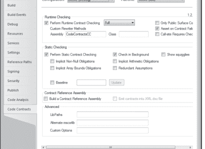

> *要使用代码协定，您可以使用 .NET 4 中命名空间 `System.Diagnostics.Contracts` 中提供的类。但是，Visual Studio 2010 没有附带工具。您需要从 Microsoft DevLabs 下载 Visual Studio 扩展：http://msdn.microsoft.com/en-us/devlabs/dd491992.aspx。使用此工具进行静态分析需要 Visual Studio Team System；对于运行时分析，Visual Studio 标准版就足够了。*

代码协定是使用 `Contract` 类定义的。您在方法中定义的所有契约要求，无论是前置条件还是后置条件，都必须放在方法开头。您还可以为 `ContractFailed` 事件分配一个全局事件处理程序，该事件在运行时会为每个失败的契约被调用。通过调用 `SetHandled()` 

对于检查用作参数的集合，`Contract` 类提供了 `Exists()` 和 `ForAll()` 方法。`ForAll()` 检查集合中的每一项是否满足条件。在示例中，检查集合中的每一项的值是否小于 12。使用 `Exists()` 方法，检查集合中是否有任何一个元素满足条件。

```
static void ArrayTest(int[] data)
{
    Contract.Requires(Contract.ForAll(data, i => i < 12));
}
```

`Exists()` 和 `ForAll()` 方法都有一个重载，您可以传递两个整数 `fromInclusive` 和 `toExclusive` 来代替 `IEnumerable<T>`。从这些数字（不包括 `toExclusive`）生成的范围会传递给由第三个参数定义的 `Predicate<int>` 委托。`Exists()` 和 `ForAll()` 可用于前置条件、后置条件以及不变量。

#### 后置条件

后置条件定义方法完成后共享数据和返回值的一些保证。尽管它们对返回值定义了一些保证，但它们必须写在方法开头；所有契约要求都必须在方法开头。

`Ensures()` 和 `EnsuresOnThrow<TException>()` 是后置条件。以下契约确保变量 `sharedState` 在方法结束时小于 6。该值在期间可以更改。

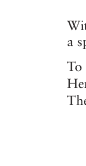

```
private static int sharedState = 5;
static void Postcondition()
{
    Contract.Ensures(sharedState < 6);
    sharedState = 9;
    Console.WriteLine("change sharedState invariant {0}", sharedState);
    sharedState = 3;
    Console.WriteLine("before returning change it to a valid value {0}", sharedState);
}
```

Pro C# 4 9780470302259 代码片段 CodeContractsSamples/Program.cs

使用 `EnsuresOnThrow<TException>()`，可以保证在抛出指定异常时，共享状态满足条件。

为了保证返回值，可以结合 `Ensures()` 契约使用特殊值 `Result<T>`。这里，`Result()` 方法的返回类型为 `int`，其泛型类型 T 也定义为 `int`。`Ensures()` 契约保证返回值小于 6。

```
static int ReturnValue()
{
    Contract.Ensures(Contract.Result<int>() < 6);
    return 3;
}
```

您还可以将值与旧值进行比较。这是通过 `OldValue<T>()` 方法完成的，该方法返回所传递变量在方法入口处的原始值。以下代码确保

该契约定义了返回的结果（Contract.Result<int>()）大于参数 x 中的旧值（Contract.OldValue<int>(x)）。

```csharp
static int ReturnLargerThanInput(int x)
{
    Contract.Ensures(Contract.Result<int>() > Contract.OldValue<int>(x));
    return x + 3;
}
```

如果方法通过带有 out 修饰符的值返回结果，而不是仅使用 return 语句，则可以使用 ValueAtReturn() 定义条件。以下契约定义了返回时变量 x 必须大于 5 且小于 20，并且返回时变量 y 对 5 取模必须等于 0。

```csharp
static void OutParameters(out int x, out int y)
{
    Contract.Ensures(Contract.ValueAtReturn<int>(out x) > 5 &&
                     Contract.ValueAtReturn<int>(out x) < 20);
    Contract.Ensures(Contract.ValueAtReturn<int>(out y) % 5 == 0);
    x = 8;
    y = 10;
}
```

#### 不变式

不变式定义了方法生命周期内变量所需满足的契约。Contract.Requires() 定义输入要求，Contract.Ensures() 定义方法结束时的要求。Contract.Invariant() 定义了在方法的整个生命周期内都必须成立的条件。

```csharp
static void Invariant(ref int x)
{
    Contract.Invariant(x > 5);
    x = 3;
    Console.WriteLine("invariant value: {0}", x);
    x = 9;
}
```

Pro C# 4 9780470502259 代码片段 CodeContractsSamples/Program.cs


#### 接口的契约

通过接口，可以定义派生类必须实现的方法、属性和事件。但在接口声明中，无法定义接口必须如何实现。现在，使用代码契约可以实现这一点。

请看下面的接口。接口 IPerson 定义了 FirstName、LastName 和 Age 属性，以及 ChangeName() 方法。这个接口的特殊之处在于 ContractClass 特性。该特性应用于接口 IPerson，并定义 PersonContract 类作为此接口的代码契约。

```csharp
[ContractClass(typeof(PersonContract))]
public interface IPerson
{
    string FirstName { get; set; }
    string LastName { get; set; }
    int Age { get; set; }
    void ChangeName(string firstName, string lastName);
}
```


Pro C# 4 9780470502259 代码片段 CodeContractsSamples\IPerson.cs

PersonContract 类实现了 IPerson 接口，并为所有成员定义了代码契约。PureAttribute 特性表示方法或属性不能更改类实例的状态。这里通过属性的 get 访问器进行定义，但也可以用于所有不允许更改状态的方法。FirstName 和 LastName 的 get 访问器还定义了结果必须是字符串，并使用 Contract.Result() 表示。Age 属性的 get 访问器定义了一个后置条件，确保返回值介于 0 和 120 之间。FirstName 和 LastName 属性的 set 访问器要求传入的值不能为 null。Age 属性的 set 访问器定义了一个前置条件，要求传入的值介于 0 和 120 之间。


```csharp
[ContractClassFor(typeof(IPerson))]
public sealed class PersonContract : IPerson
{
    string IPerson.FirstName
    {
        [Pure] get { return Contract.Result<String>(); }
        set { Contract.Requires(value != null); }
    }
    string IPerson.LastName
    {
        [Pure] get { return Contract.Result<String>(); }
        set { Contract.Requires(value != null); }
    }
    int IPerson.Age
    {
        [Pure]
        get
        {
            Contract.Ensures(Contract.Result<int>() >= 0 &&
                             Contract.Result<int>() < 121);
            return Contract.Result<int>();
        }
        set
        {
            Contract.Requires(value >= 0 && value < 121);
        }
    }
    void IPerson.ChangeName(string firstName, string lastName)
    {
        Contract.Requires(firstName != null);
        Contract.Requires(lastName != null);
    }
}
```

Pro C# 4 9780470502259 代码片段 CodeContractsSamples\PersonContract.cs

现在，实现 IPerson 接口的类必须满足所有契约要求。Person 类是该接口的一个简单实现，并且满足这些契约。


```csharp
public class Person : IPerson
{
    public Person(string firstName, string lastName)
    {
        this.FirstName = firstName;
        this.LastName = lastName;
    }

    public string FirstName { get; private set; }
    public string LastName { get; private set; }
    public int Age { get; set; }

    public void ChangeName(string firstName, string lastName)
    {
        this.FirstName = firstName;
        this.LastName = lastName;
    }
}
```

Pro C# 4 9780470502259 代码片段 CodeContractsSamples/Person.cs

使用 Person 类时，也必须满足契约。例如，不允许向属性赋值 null：


```csharp
var p = new Person { FirstName = "Tom", LastName = null }; // contract error
```

Pro C# 4 9780470502259 代码片段 CodeContractsSamples/Program.cs

同样，也不允许向 Age 属性赋予无效值：

```csharp
var p = new Person { FirstName = "Tom", LastName = "Turbo" };
p.Age = 133; // contract error
```

### 任务

.NET 4 引入了新的命名空间 System.Threading.Tasks，其中包含用于抽象线程功能的类。在幕后，使用的是 ThreadPool。任务代表需要完成的某个工作单元。这个工作单元可以在单独的线程中运行；也可以使用同步方式启动任务，这会导致调用线程等待。借助任务，可以获得一个抽象层，同时还能对底层线程进行大量控制。

任务为组织所需完成的工作提供了更大的灵活性。例如，可以定义延续工作——即任务完成后应该执行的操作。还可以根据任务是否成功，对后续操作进行区分。此外，还可以将任务组织成层次结构。例如，父任务可以创建新的子任务。这样可以形成依赖关系，因此取消父任务时也会取消其子任务。

#### 启动任务

要启动任务，可以使用 TaskFactory，或者使用 Task 的构造函数和 Start() 方法。Task 构造函数在创建任务时提供了更大的灵活性。

启动任务时，可以创建 Task 类的实例，并通过 Action 或 Action<object> 委托指定需要运行的代码。该委托可以不带参数，也可以带一个对象参数。这与前面看到的 Thread 类类似。下面定义了一个不带参数的方法。在其实现中，会将任务的 ID 写入控制台。


```csharp
static void TaskMethod()
{
    Console.WriteLine("running in a task");
    Console.WriteLine("Task id: {0}", Task.CurrentId);
}
```

Pro C# 4 9780470502259 代码片段 TaskSamples\Program.cs

在前面的代码中，可以看到启动新任务的不同方式。第一种方式是实例化 TaskFactory，然后将 TaskMethod 方法传递给 StartNew() 方法，任务会立即启动。第二种方式使用 Task 类的构造函数。实例化 Task 对象时，任务不会立即运行，而是被赋予 Created 状态。随后，通过调用 Task 类的 Start() 方法启动任务。对于 Task 类，还可以调用 RunSynchronously() 方法，而不是调用 Start() 方法。这样同样会启动任务，但任务会在调用方的当前线程中运行，并且调用方需要等待任务完成。默认情况下，任务会异步运行。

```csharp
// using task factory
TaskFactory tf = new TaskFactory();
Task t1 = tf.StartNew(TaskMethod);

// using the task factory via a task
Task t2 = Task.Factory.StartNew(TaskMethod);

// using Task constructor
Task t3 = new Task(TaskMethod);
t3.Start();
```

使用 Task 构造函数和 TaskFactory 的 StartNew() 方法时，都可以传递 TaskCreationOptions 枚举中的值。设置 LongRunning 选项后，可以通知任务调度器该任务需要运行较长时间，因此调度器更有可能使用新线程。如果任务应附加到父任务，并在父任务被取消时随之取消，则设置 AttachToParent 选项。PreferFairness 值表示调度器应优先处理已经等待的任务。如果任务是在另一个任务中创建的，默认情况并非如此。当任务使用子任务创建额外工作时，子任务会优先于其他任务。它们不会在工作完成前一直排在线程池队列的末尾。如果希望以公平的方式与其他任务一起处理这些任务，则将该选项设置为 PreferFairness。

```csharp
Task t4 = new Task(TaskMethod, TaskCreationOptions.PreferFairness);
t4.Start();
```


#### 延续任务

使用任务时，可以指定在某个任务完成后另一个特定任务应开始运行，例如，使用前一个任务结果的新任务，或在前一个任务失败时执行一些清理操作。

而任务处理程序要么没有参数，要么有一个对象参数，延续处理程序具有类型为 `Task` 的参数。在此，您可以访问有关源任务的信息。


```csharp
static void DoOnFirst()
{
    Console.WriteLine("doing some task {0}", Task.CurrentId);
    Thread.Sleep(3000);
}

static void DoOnSecond(Task t)
{
    Console.WriteLine("task {0} finished", t.Id);
    Console.WriteLine("this task id {0}", Task.CurrentId);
    Console.WriteLine("do some cleanup");
    Thread.Sleep(3000);
}
```

> *Pro C# 4 9780470502259 代码片段 TaskSamples/Program.cs*

延续任务是通过在任务上调用 `ContinueWith` 方法来定义的。您也可以为此使用 `TaskFactory`。`t1.ContinueWith(DoOnSecond)` 表示应尽快在任务 `t1` 完成后启动一个调用方法 `DoOnSecond()` 的新任务。当一个任务完成后可以启动多个任务，并且延续任务也可以有另一个延续任务，正如本示例所示。

```csharp
Task t1 = new Task(DoOnFirst);
Task t2 = t1.ContinueWith(DoOnSecond);
Task t3 = t1.ContinueWith(DoOnSecond);
Task t4 = t2.ContinueWith(DoOnSecond);
```

到目前为止的延续任务总是在前一个任务完成后启动，无论前一个任务是如何完成的。使用来自 `TaskContinuationOptions` 的值，您可以定义延续任务只有在源任务成功（或出现故障）时才应启动。一些可能的值是 `OnlyOnFaulted`、`NotOnFaulted`、`OnlyOnCanceled`、`NotOnCanceled` 和 `OnlyOnRanToCompletion`。

```csharp
Task t5 = t1.ContinueWith(DoOnError,
                        TaskContinuationOptions.OnlyOnFaulted);
```

#### 任务层次结构

使用任务延续，一个任务在另一个任务之后启动。任务也可以形成层次结构。当一个任务本身启动一个新任务时，就会启动父/子层次结构。

在下面的代码片段中，在父任务的任务内，创建了一个新任务。创建子任务的代码与创建父任务的代码相同。唯一的区别是任务是在另一个任务内部创建的。

> 元组在“元组”部分中已提前解释。

当定义任务以调用方法 TaskWithResult 时，使用泛型类 `Task<Result>`。泛型参数定义返回类型。使用构造函数，将方法传递给 Func 委托，第二个参数定义输入值。因为此任务需要在对象参数中需要两个输入值，因此也创建了一个元组。接下来，启动任务。Task 实例 t1 的 Result 属性会阻塞并等待任务完成。任务完成后，Result 属性包含来自任务的结果。

```csharp
var t1 = new Task<Tuple<int,int>>(TaskWithResult,
    Tuple.Create<int, int>(8, 3));
t1.Start();
Console.WriteLine(t1.Result);
t1.Wait();
Console.WriteLine("result from task: {0} {1}", t1.Result.Item1,
    t1.Result.Item2);
```

### Parallel 类

另一个在 .NET 4 中新增的线程抽象是 Parallel 类。该类为并行 for 和 foreach 定义了静态方法。使用为 for 和 foreach 定义的语言，循环由一个线程运行。Parallel 类使用多个任务，从而使用多个线程来完成此工作。

虽然 `Parallel.For()` 和 `Parallel.ForEach()` 方法多次调用相同的方法，但 `Parallel.Invoke()` 允许并发调用不同的方法。

#### 使用 Parallel.For 方法进行循环

`Parallel.For()` 方法类似于 C# 的 for 循环语句，用于多次执行任务。使用 `Parallel.For()`，迭代会并行运行。迭代顺序未定义。

在 `For()` 方法中，前两个参数定义循环的开始和结束。示例中的迭代从 0 到 9。第三个参数是 `Action<int>` 委托。整数参数是传递给委托引用的方法的循环迭代。`Parallel.For()` 的返回类型是 struct ParallelLoopResult，它提供循环是否完成的信息。


```csharp
ParallelLoopResult result =
    Parallel.For(0, 10, i =>
    {
        Console.WriteLine("{0}, task: {1}, thread: {2}", i,
            Task.CurrentId, Thread.CurrentThread.ManagedThreadId);
        Thread.Sleep(10);
    });
Console.WriteLine(result.IsCompleted);
```

在 `Parallel.For()` 的主体中，索引、任务标识符和线程标识符被写入控制台。如输出所示，顺序无法保证。此次程序运行的顺序为 0-5-1-6-2...，使用了三个任务和三个线程。

```
0, task: 1, thread: 1
5, task: 2, thread: 3
1, task: 3, thread: 4
6, task: 2, thread: 3
2, task: 1, thread: 1
4, task: 3, thread: 4
7, task: 2, thread: 3
3, task: 1, thread: 1
8, task: 3, thread: 4
9, task: 3, thread: 4
True
```

您也可以提前中断 `Parallel.For()`。`For()` 方法的重载接受第三个参数，其类型为 `Action<int, ParallelLoopState>`。通过定义具有这些参数的方法，您可以通过调用 `ParallelLoopState` 的 `Break()` 或 `Stop()` 方法来影响循环的结果。

请记住，迭代的顺序未定义。

```
ParallelLoopResult result =
    Parallel.For(10, 40, (int i, ParallelLoopState pls) =>
    {
        Console.WriteLine("i: {0} task {1}", i, Task.CurrentId);
        Thread.Sleep(10);
        if (i > 15)
            pls.Break();
    });
Console.WriteLine(result.IsCompleted);
Console.WriteLine("lowest break iteration: {0}",
    result.LowestBreakIteration);
```

此次应用程序运行演示了迭代在值大于 15 时中断，但其他任务可以同时运行，并且具有其他值的任务也可以运行。在 LowestBreakIteration 属性的帮助下，您可以决定忽略其他任务的结果。

```
10 task 1
25 task 2
11 task 1
13 task 3
12 task 1
14 task 3
16 task 1
15 task 3
False
lowest break iteration: 16
```

`Parallel.For()` 可能使用多个线程来执行循环。如果您需要为每个线程执行一次初始化，可以使用 `Parallel.For<TLocal>()` 方法。For 方法的泛型版本除了 from 和 to 值外，还接受三个委托参数。第一个参数的类型为 `Func<TLocal>`。由于此示例中 TLocal 使用 string，因此方法需要定义为 `Func<string>`，即返回字符串的方法。此方法仅对用于执行迭代的每个线程调用一次。

第二个委托参数定义了主体的委托。在示例中，参数的类型为 `Func<int, ParallelLoopState, string, string>`。第一个参数是循环迭代；第二个参数 `ParallelLoopState` 允许停止循环，如您之前所见。通过第三个参数，主体方法接收从 init 方法返回的值。主体方法也需要返回使用泛型 For 参数定义的类型的值。

`For()` 方法的最后一个参数指定一个委托，`Action<TLocal>`；在示例中，接收一个字符串。此方法再次仅对每个线程调用一次；这是线程退出方法。

```
Parallel.For<string>(0, 20,
() =>
{
    // invoked once for each thread
    Console.WriteLine("init thread {0}, task {1}",
        Thread.CurrentThread.ManagedThreadId, Task.CurrentId);
    return String.Format("t {0}",
        Thread.CurrentThread.ManagedThreadId);
},
(i, pls, str1) =>
{
    // invoked for each member
    Console.WriteLine("body i {0} str1 {1} thread {2} task {3}", i,
        str1, Thread.CurrentThread.ManagedThreadId,
        Task.CurrentId);
    Thread.Sleep(10);
    return String.Format("i {0}", i);
},
(str1) =>
{
    // final action on each thread
    Console.WriteLine("finally {0}", str1);
});
```

某次运行此程序的结果如下所示：

```
init thread 1, task 1
body i 0 str1 t1 thread 1 task 1
body i 1 str1 i 0 thread 1 task 1
init thread 3, task 2
body i 10 str1 t3 thread 3 task 2
init thread 4, task 3
body i 3 str1 t4 thread 4 task 3
body i 2 str1 i 1 thread 1 task 1
body i 11 str1 i 10 thread 3 task 2
body i 4 str1 i 3 thread 4 task 3
body i 6 str1 i 2 thread 1 task 1
body i 12 str1 i 11 thread 3 task 2
body i 5 str1 i 4 thread 4 task 3
body i 7 str1 i 6 thread 1 task 1
body i 13 str1 i 12 thread 3 task 2
```

```text
body i 17 strl i 5 thread 4 task 3
body i 8 strl i 7 thread 1 task 1
body i 14 strl i 13 thread 3 task 2
body i 9 strl i 8 thread 1 task 1
body i 18 strl i 17 thread 4 task 3
body i 15 strl i 14 thread 3 task 2
body i 19 strl i 18 thread 4 task 3
finally i 9
body i 16 strl i 15 thread 3 task 2
finally i 19
finally i 16
```

#### 使用 Parallel.ForEach 方法进行循环

Parallel.ForEach 以与 foreach 语句类似的方式遍历实现 IEnumerable 的集合，但以异步方式进行。同样，顺序不保证。


```csharp
string[] data = { "zero", "one", "two", "three", "four",
    "five", "six", "seven", "eight", "nine",
    "ten", "eleven", "twelve"};

ParallelLoopResult result =
Parallel.ForEach<string>(data, s =>
{
    Console.WriteLine(s);
});
```

Pro C# 4 9780470502259 代码片段 ParallelSamples/Program.cs

如果需要中断循环，可以使用带有 ParallelLoopState 参数的 ForEach() 方法的重载。你可以像之前看到的 For() 方法那样进行操作。ForEach() 方法的重载也可以用于访问索引器以获取迭代次数，如下所示。

```csharp
Parallel.ForEach<string>(data,
    (s, pls, i) =>
    {
        Console.WriteLine("{0} {1}", s, i);
    });
```

#### 使用 Parallel.Invoke 方法调用多个方法

如果多个任务应并行运行，可以使用 Parallel.Invoke() 方法。Parallel.Invoke() 允许传递 Action 委托的数组，其中可以指定应运行的方法。示例代码将 Foo 和 Bar 方法传递以并行调用。


```csharp
static void ParallelInvoke()
{
    Parallel.Invoke(Foo, Bar);
}

static void Foo()
{
    Console.WriteLine("foo");
}

static void Bar()
{
    Console.WriteLine("bar");
}
```

Pro C# 4 9780470502259 代码片段 ParallelSamples\Program.cs

### 取消框架

.NET 4 包含一个新的取消框架，以标准方式允许取消长时间运行的任务。每个阻塞调用都应支持此机制。当然，截至目前，并非每个阻塞调用都实现了这项新技术，但越来越多地实现了。已经提供此机制的技术包括任务、并发集合类和 Parallel LINQ，以及几种同步机制。

取消框架基于协作行为；它不是强制性的。长时间运行的任务会检查是否被取消并返回控制权。

支持取消的方法接受一个 `CancellationToken` 参数。此类定义了属性 `IsCancellationRequested`，长时间操作可以在其中检查是否应中止。长时间操作检查取消的其他方式是使用在令牌被取消时发出信号的 `WaitHandle` 属性，或使用 `Register()` 方法。`Register()` 方法接受类型为 `Action` 和 `ICancelableOperation` 的参数。当令牌被取消时，由 `Action` 委托引用的方法将被调用。这类似于 `ICancelableOperation`，其中在取消完成时实现此接口的对象的 `Cancel()` 方法将被调用。

#### Parallel.For 的取消

让我们从一个使用 `Parallel.For()` 方法的简单示例开始。`Parallel` 类为 `For()` 方法提供了重载，其中可以传递类型为 `ParallelOptions` 的参数。使用 `ParallelOptions`，可以传递一个 `CancellationToken`。`CancellationToken` 是通过创建 `CancellationTokenSource` 生成的。`CancellationTokenSource` 实现接口 `ICancelableOperation`，因此可以与 `CancellationToken` 注册并允许通过 `Cancel()` 方法取消。为了取消并行循环，会创建一个新任务，在 500 毫秒后调用 `CancellationTokenSource` 的 `Cancel()` 方法。

在 `For()` 循环的实现中，`Parallel` 类会验证 `CancellationToken` 的结果并取消操作。取消后，`For()` 方法会抛出类型为 `OperationCanceledException` 的异常，在示例中会被捕获。使用 `CancellationToken`，可以注册在取消完成时获取信息。这是通过调用 `Register()` 方法并传递在取消时被调用的委托来实现的。


```csharp
var cts = new CancellationTokenSource();
cts.Token.Register(() => 
    Console.WriteLine("*** token canceled"));

// start a task that sends a cancel after 500 ms
new Task(() => 
{
    Thread.Sleep(500);
    cts.Cancel(false);
}).Start();

try
{
    ParallelLoopResult result = 
        Parallel.For(0, 100,
            new ParallelOptions()
            {
                CancellationToken = cts.Token,
            },
            x =>
            {
                Console.WriteLine("loop {0} started", x);
                int sum = 0;
                for (int i = 0; i < 100; i++)
                {
                    Thread.Sleep(2);
                    sum += i;
                }
                Console.WriteLine("loop {0} finished", x);
            });
}
catch (OperationCanceledException ex)
{
    Console.WriteLine(ex.Message);
}
```

Pro C# 4 9780470502259 代码片段 CancellationSamples/Program.cs

运行应用程序时，您将获得类似以下输出。迭代 0、1、25、26、50、51、75 和 76 都已启动。这是在四核 CPU 系统上进行的。由于取消，所有其他迭代在启动前被取消。已启动的迭代被允许完成，因为取消始终以协作方式进行，以避免在迭代中途取消时资源泄漏的风险。

```text
loop 0 started
loop 50 started
loop 25 started
loop 75 started
loop 50 finished
loop 25 finished
loop 0 finished
```

```text
loop 1 started
loop 26 started
loop 51 started
loop 75 finished
loop 76 started
*** token canceled
loop 1 finished
loop 51 finished
loop 26 finished
loop 76 finished
The operation was canceled.
```

#### 任务的取消

任务也使用相同的取消模式。首先，创建一个新的 CancellationTokenSource。如果只需要一个取消令牌，可以通过访问 Task.Factory.CancellationToken 使用默认令牌。然后，与之前的代码类似，会创建一个新任务，在 500 毫秒后通过调用 Cancel() 方法向此 cancellationSource 发送取消请求。在循环中执行主要工作的任务通过 TaskFactory 对象接收取消令牌。取消令牌通过在构造函数中设置它分配给 TaskFactory。任务使用此取消令牌通过检查 CancellationToken 的 IsCancellationRequested 属性来检查是否请求取消。


```csharp
var cts = new CancellationTokenSource();
cts.Token.Register(() =>
    Console.WriteLine("*** task canceled"));

// start a task that sends a cancel to the
// cts after 500 ms
Task.Factory.StartNew(() =>
{
    Thread.Sleep(500);
    cts.Cancel();
});

var factory = new TaskFactory(cancellationTokenSource.Token);
Task t1 = factory.StartNew(new Action<object>(f =>
{
    Console.WriteLine("in task");
    for (int i = 0; i < 20; i++)
    {
        Thread.Sleep(100);
        CancellationToken ct = (f as TaskFactory).CancellationToken;
        if (ct.IsCancellationRequested)
        {
            Console.WriteLine("canceling was requested, " +
                "canceling from within the task");
            ct.ThrowIfCancellationRequested();
            break;
        }
        Console.WriteLine("in loop");
    }
    Console.WriteLine("task finished without cancellation");
}), factory, cts.Token);

try
{
    t1.Wait();
}
catch (Exception ex)
{
    Console.WriteLine("exception: {0}, {1}", ex.GetType().Name,
        ex.Message);
    if (ex.InnerException != null)
    {
        Console.WriteLine("inner exception: {0}, {1}",
            ex.InnerException.GetType().Name,
            ex.InnerException.Message);
    }
    Console.WriteLine("status of the task: {0}", t1.Status);
}
```

Pro C# 4 9780470502259 代码片段 CancellationSamples/Program.cs

运行应用程序时，可以看到任务启动，运行几个循环，然后收到取消请求。任务被取消并抛出 TaskCanceledException，该异常由方法调用 `ThrowIfCancellationRequested()` 引发。调用方等待任务时，可以看到异常 AggregateException 被捕获，并且包含内部异常 TaskCanceledException。这用于取消的层次结构，例如，如果在也被取消的任务中运行 Parallel.For。任务的最终状态为 Canceled。

```text
    in task
    in loop
    in loop
    in loop
    in loop
    *** task canceled
    canceling was requested, canceling from within the task
    exception AggregateException, One or more errors occurred.
    inner exception TaskCanceledException, A task was canceled.
    status of the task: Canceled
```

### 任务栏和跳转列表

Windows 7 有一个新的任务栏。在任务栏中，您不仅可以看到正在运行的应用程序，还可以看到快速访问图标。用户可以将最常用的应用程序固定以便快速访问。当您将鼠标悬停在任务栏项目上时，可以看到当前正在运行的应用程序的预览。项目还可以具有视觉状态，以便用户可以从任务栏项目接收反馈。您是否使用资源管理器复制了一些大文件？您可以在资源管理器项目上看到进度信息。进度信息以视觉状态显示。任务栏的另一个功能是跳转列表。右键单击任务栏按钮会打开跳转列表。此列表可按应用程序自定义。使用 Microsoft Outlook，您可以直接进入收件箱、日历、联系人和任务，或创建新电子邮件。使用 Microsoft Word，您可以打开最近的文档。


为了配置任务栏项，命名空间 System.Windows.Shell 包含一个用于 Window 类的依赖属性，以添加任务栏信息。TaskbarItemInfo 属性可以包含一个 TaskbarItemInfo 元素。使用 TaskbarItemInfo，可以设置 Description 属性，该属性以工具提示信息的形式显示。通过 ProgressState 和 ProgressValue 属性，可以对应用程序的当前状态提供反馈。ProgressState 的类型为 TaskbarItemProgressState，其定义了枚举值 None、Intermediate、Normal、Error 和 Paused。根据该设置的取值，任务栏项上会显示进度指示器。Overlay 属性允许你定义一个在任务栏图标上显示的图像。该属性将从代码后置中设置。

任务栏项可以包含一个 ThumbButtonInfoCollection，其被分配给 TaskbarItemInfo 的 ThumbButtonInfos 属性。在这里，你可以添加类型为 ThumbButtonInfo 的按钮，它们会在应用程序预览中显示。示例包含两个 ThumbButtonInfo 元素，其 Command 设置为与之前创建的播放和停止 Button 元素相同的命令。通过这些按钮，你可以像使用应用程序中的其他 Button 元素一样控制应用程序。任务栏中按钮的图像取自资源，其键为 StartImage 和 StopImage。

```xml
<Window.TaskbarItemInfo>
    <TaskbarItemInfo x:Name="taskBarItem" Description="Sample Application">
        <TaskbarItemInfo.ThumbButtonInfos>
            <ThumbButtonInfo IsEnabled="True" Command="MediaCommands.Play"
                CommandTarget="{Binding ElementName=buttonPlay}"
                Description="Play"
                ImageSource="{StaticResource StartImage}" />
            <ThumbButtonInfo IsEnabled="True" Command="MediaCommands.Stop"
                CommandTarget="{Binding ElementName=buttonStop}"
                Description="Stop"
                ImageSource="{StaticResource StopImage}" />
        </TaskbarItemInfo.ThumbButtonInfos>
    </TaskbarItemInfo>
</Window.TaskbarItemInfo>
```

从 ThumbButtonInfo 元素引用的图像在 Window 的 Resources 部分中定义。一个图像由浅绿色椭圆组成，另一个图像由两条橙红色线条组成。

```xml
<Window.Resources>
    <DrawingImage x:Key="StopImage">
        <DrawingImage.Drawing>
            <DrawingGroup>
                <DrawingGroup.Children>
                    <GeometryDrawing>
                        <GeometryDrawing.Pen>
                            <Pen Thickness="5" Brush="OrangeRed" />
                        </GeometryDrawing.Pen>
                        <GeometryDrawing.Geometry>
                            <GeometryGroup>
                                <LineGeometry StartPoint="0,0"
                                    EndPoint="20,20" />
                                <LineGeometry StartPoint="0,20"
                                    EndPoint="20,0" />
                            </GeometryGroup>
                        </GeometryDrawing.Geometry>
                    </GeometryDrawing>
                </DrawingGroup.Children>
            </DrawingGroup>
        </DrawingImage.Drawing>
    </DrawingImage>
    <DrawingImage x:Key="StartImage">
        <DrawingImage.Drawing>
            <DrawingGroup>
                <DrawingGroup.Children>
                    <GeometryDrawing Brush="LightGreen">
                        <GeometryDrawing.Geometry>
                            <EllipseGeometry RadiusX="20" RadiusY="20"
                                Center="20,20" />
                        </GeometryDrawing.Geometry>
                    </GeometryDrawing>
                </DrawingGroup.Children>
            </DrawingGroup>
        </DrawingImage.Drawing>
    </DrawingImage>
</Window.Resources>
```

在代码后置中，特殊 My Videos 文件夹中的所有视频都被分配给 Window 对象的 DataContext，因此由于 ComboBox 是数据绑定的，会在 ComboBox 中列出。在 OnPlay() 和 OnStop() 事件处理程序中，会调用 MediaElement 的 Play() 和 Stop() 方法。为了在播放和停止视频时为任务栏项提供视觉反馈，会访问图像资源并将其分配给 TaskbarItemInfo 元素的 Overlay 属性。


```csharp
using System;
using System.Collections.Generic;
using System.IO;
using System.Text;
using System.Windows;
using System.Windows.Input;
using System.Windows.Media;
using System.Windows.Shell;

namespace Wrox.ProCSharp.Windows7
{
    public partial class MainWindow : Window
    {
        public MainWindow()
        {
            InitializeComponent();
            string videos = Environment.GetFolderPath(
                                Environment.SpecialFolder.MyVideos);

            this.DataContext = Directory.EnumerateFiles(videos);
        }

        private void OnPlay(object sender, ExecutedRoutedEventArgs e)
        {
            object image = TryFindResource("StartImage");
            if (image is ImageSource)
                taskBarItem.Overlay = image as ImageSource;
            player.Play();
        }

        private void OnStop(object sender, ExecutedRoutedEventArgs e)
        {
            object image = TryFindResource("StopImage");
            if (image is ImageSource)
                taskBarItem.Overlay = image as ImageSource;
            player.Stop();
        }
    }
}
```

Pro C# 9780470502259 代码片段 TaskbarDemo/MainWindow.xaml.cs

现在你可以运行应用程序，从任务栏启动和停止视频，并看到视觉反馈，如下所示。

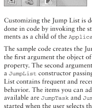

自定义 Jump List 是通过向应用程序类添加 JumpList 来完成的。这可以通过在代码中调用静态方法 JumpList.SetJumpList() 来完成，也可以通过将 JumpList 元素作为 Application 元素的子元素添加来完成。

示例代码在代码后置中创建 Jump List。JumpList.SetJumpList() 需要第一个参数为应用程序对象，该对象由 Application.Current 属性返回。第二个参数需要一个类型为 JumpList 的对象。jumpList 是使用 JumpList 构造函数创建的，该构造函数传递 JumpItem 元素和两个 Boolean 值。默认情况下，Jump List 包含频繁使用和最近使用的项目。设置 Boolean 值可以影响此默认行为。你可以添加到 JumpList 的项目都派生自基类 JumpItem。可用的类有 JumpTask 和 JumpPath。使用 JumpTask，可以定义当用户从 Jump List 中选择该项目时应启动的程序。JumpTask 定义了启动应用程序并向用户提供信息所需的属性，包括 CustomCategory、Title、Description、ApplicationPath、IconResourcePath、WorkingDirectory 和 Arguments。在代码片段中定义的 JumpTask 会启动 notepad.exe 并使用 readme.txt 文档进行初始化。使用 JumpPath 项目，可以定义一个应列在 Jump List 中的文件，以便从该文件启动应用程序。JumpPath 定义了一个 Path 属性用于分配文件名。使用 JumpPath 项目要求文件扩展名已在应用程序中注册。否则，项目的注册将被拒绝。为了查找项目被拒绝的原因，可以为 `JumpItemsRejected` 事件注册一个处理程序。在这里，你可以获取被拒绝项目的列表 (`RejectedItems`) 及其原因 (`RejectionReasons`)。

```csharp
var jumpItems = new List<JumpTask>();
var workingDirectory = Environment.CurrentDirectory;
var windowsDirectory = Environment.GetFolderPath(
    Environment.SpecialFolder.Windows);
var notepadPath = System.IO.Path.Combine(windowsDirectory,
    "Notepad.exe");

jumpItems.Add(new JumpTask
{
    CustomCategory = "Read Me",
    Title = "Read Me",
    Description = "Open read me in Notepad.",
    ApplicationPath = notepadPath,
    IconResourcePath = notepadPath,
    WorkingDirectory = workingDirectory,
    Arguments = "readme.txt"
});

var jumpList = new JumpList(jumpItems, true, true);
jumpList.JumpItemsRejected += (sender, e1) =>
{
    var sb = new StringBuilder();
    for (int i = 0; i < e1.RejectedItems.Count; i++)
    {
        if (e1.RejectedItems[i] is JumpPath)
            sb.Append((e1.RejectedItems[i] as JumpPath).Path);
        if (e1.RejectedItems[i] is JumpTask)
            sb.Append((e1.RejectedItems[i] as JumpTask).
                ApplicationPath);
        sb.Append(e1.RejectionReasons[i]);
        sb.AppendLine();
    }
    MessageBox.Show(sb.ToString());
};

JumpList.SetJumpList(Application.Current, jumpList);
```

当你运行应用程序并单击鼠标右键时，你会看到 Jump List，如下所示。

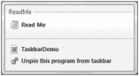

> 从 Windows Forms 应用程序使用任务栏和 Jump List，可以使用 Windows API Code Pack 中定义的扩展。


## Professional ASP.NET 4 in C# and VB


## Professional ASP.NET 4 in C# and VB

### 图表服务器控件

现在 ASP.NET 4 为您提供的最新控件之一是图表服务器控件。该控件通过之前对 Dundas 图表公司的收购进入了 ASP.NET 的核心部分，是一个非常适合让您快速上手并创建美观图表的控件。

新的图表服务器控件支持多种图表类型，包括：

- Point
- FastPoint
- Bubble
- Line
- Spline
- StepLine
- FastLine
- Bar
- StackedBar
- StackedBar100
- Column
- StackedColumn
- StackedColumn100
- Area
- SplineArea
- StackedArea
- StackedArea100
- Pie
- Doughnut
- Stock
- Candlestick
- Range
- SplineRange
- RangeBar
- RangeColumn
- Radar
- Polar
- ErrorBar
- BoxPlot
- Renko
- ThreeLineBreak
- Kagi
- PointAndFigure
- Funnel
- Pyramid

这些图表样式种类繁多！您可以在 Visual Studio 2010 的工具箱中 Data 选项卡下找到图表服务器控件。它是 System.Web.DataVisualization 命名空间的一部分。

当您从工具箱将其拖出并放置到页面的设计表面上时，会显示出您将要使用的图表类型的视觉表示。下图显示了一个示例。

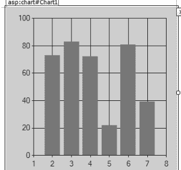

打开控件的智能标记，您会发现可以为图表分配数据提供程序，并选择感兴趣的图表类型。在 IDE 的设计视图中，更改图表类型会显示该图表的示例（即使尚未使用任何底层数据）。智能标记显示在下图中。

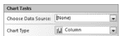

这个控件功能丰富，可能超过了所有其他控件，单凭它几乎可以写一本书。要使用此图表服务器控件快速上手，请按照以下简单示例操作。

创建一个新的 Web 应用程序，并将 AdventureWorks 数据库添加到应用程序内的 App_Data 文件夹中。完成后，将图表服务器控件拖放到页面的设计表面上。从控件的智能标记中，在选择数据源时从下拉菜单中选择 `<New Data Source>`。在向导中操作时，请确保选择 SQL 数据源作为选项。在向导过程中，您需要选择允许选择自定义 SQL 语句的选项，并使用以下 SQL 进行此操作：

```
SELECT TOP (5) Production.Product.Name, Sales.SalesOrderDetail.OrderQty
FROM Sales.SalesOrderDetail INNER JOIN Production.Product
ON Sales.SalesOrderDetail.ProductID = Production.Product.ProductID
ORDER BY Sales.SalesOrderDetail.OrderQty DESC
```

在此设置就绪并将新的图表服务器控件绑定到此数据源控件后，您会发现图表服务器控件的智能标记中有更多选项，如图所示。

现在您可以选择系列数据成员，并选择 x 轴和 y 轴上的内容。您可以看到我已将产品的名称分配到 X 轴，将订购数量分配到 y 轴。在稍微加宽图表宽度后，您将得到与以下在清单 3-52 中类似的代码。

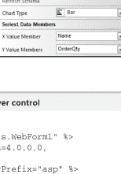

#### Pro ASP.NET 9780470502204 Listing 3-52：使用新的图表服务器控件进行图表绘制

```
<%@ Page Language="C#" AutoEventWireup="true"
CodeBehind="WebForm1.aspx.cs" Inherits="WebServerControls.WebForm1" %>
<%@ Register Assembly="System.Web.DataVisualization, Version=4.0.0.0",
    Culture="neutral", PublicKeyToken="31bf3856ad364e35"
    Namespace="System.Web.UI.DataVisualization.Charting" TagPrefix="asp" %>

<html xmlns="http://www.w3.org/1999/xhtml">
<head runat="server">
    <title>MultiView Server Control</title>
</head>
<body>
<form id="form1" runat="server">
<div>
<asp:Chart ID="Chart1" runat="server"
    DataSourceID="SqlDataSource1"
    Width="500px">
    <Series>
        <asp:Series ChartType="Bar" Name="Series1"
            XValueMember="Name"
            YValueMembers="OrderQty" YValuesPerPoint="2">
        </asp:Series>
    </Series>
    <ChartAreas>
        <asp:ChartArea Name="ChartArea1">
        </asp:ChartArea>
    </ChartAreas>
</asp:Chart>
<asp:SqlDataSource ID="SqlDataSource1" runat="server"
    ConnectionString="<%$ ConnectionStrings:ConnectionString %>"
    SelectCommand="SELECT TOP (5) Production.Product.Name,
Sales.SalesOrderDetail.OrderQty FROM Sales.SalesOrderDetail
INNER JOIN Production.Product ON
Sales.SalesOrderDetail.ProductID =
Production.Product.ProductID ORDER BY
Sales.SalesOrderDetail.OrderQty DESC"
</asp:SqlDataSource>
</div>
</form>
</body>
</html>
```

从中可以看出，连接所有内容所需的代码并不多。最值得注意的是，将此图表服务器控件放置在页面上实际上在页面顶部添加了一个 @Register 指令。这与大多数 ASP.NET 服务器控件不同。

在此控件的 `<Series>` 元素中，您可以根据需要拥有任意数量的系列，当并排绘制多个项目（如两个或多个股票的价格时间序列）时，这非常常见。

运行此代码，您将获得与此处展示类似的结果。

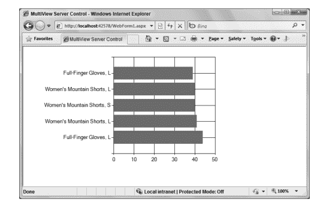

### ASP.NET AJAX 控件工具包

安装 .NET Framework 4 并使用 Visual Studio 2010 后，您会发现一些可用的控件，允许您构建具有服务器端 AJAX 功能的 ASP.NET 应用程序。这是让您的应用程序更上一层楼的框架，因为您可以用它实现很多功能，包括为用户和自定义服务器控件添加特定的 AJAX 功能。添加到应用程序中的每个 AJAX 增强功能都会让应用程序对最终用户来说更流畅、更具响应性。

如果这是构建 Web 应用程序的新世界，您可能会想知道 Visual Studio 2010 此版本的大型 AJAX 启用服务器控件在哪里。您看不到新的 AJAX 服务器控件部分的原因是 Microsoft 将它们视为开源项目，而不是简单地将其融入 Visual Studio 2010。

Microsoft 和社区的开发人员一直在开发一系列可用于 ASP.NET 应用程序的 AJAX 启用服务器控件。这些控件统称为 ASP.NET AJAX 控件工具包。最近，Microsoft 已将 ASP.NET AJAX 控件工具包作为可在 www.asp.net/ajaxlibrary 找到的 Microsoft AJAX 库的一部分。下载该库后，您会发现它现在还包含完整的 AJAX 控件工具包。下图显示了 AJAX 库的下载页面。

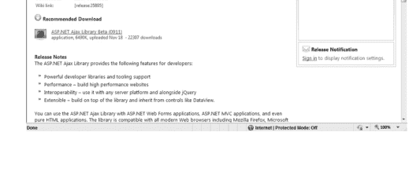

要进行设置，请从上述网站 www.asp.net/ajaxlibrary 下载 .zip 文件，并在计算机上的所需位置解压缩。然后按照以下步骤操作：

- 1. 将控件安装到 Visual Studio。向 Visual Studio 2010 工具箱添加控件非常容易。右键单击工具箱并从提供的菜单中选择 Add Tab。为选项卡命名——在本示例中，选项卡名为 AJAX Controls。

- 2. 在工具箱中新建选项卡后，右键单击该选项卡并从提供的菜单中选择 Choose Items，如下图所示。Choose Toolbox Items 对话框出现。

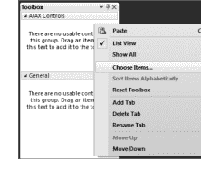

- 3. 从下载中选择 AjaxControlToolkit.dll。找到 DLL 并单击 Open 后，Choose Toolbox Items 对话框将更改为包含该 DLL 中包含的控件。控件在对话框中突出显示，并且已为您预先选择（如下图所示）。

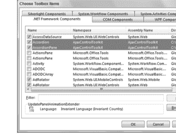

- 4. 单击 OK，ASP.NET AJAX 控件工具包的控件将被添加到 Visual Studio 工具箱中。下图展示了最终结果。


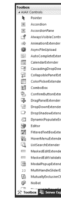

为在您的 ASP.NET 应用程序中使用，已在工具箱中添加了 40 多个控件和扩展程序。

#### ColorPickerExtender

从终端用户那里获取的困难数据点之一是颜色。如果仅使用文本，这个特定数据点就很难定义。如果有开放的颜色选择，终端用户如何定义更深的蓝色色调？因此，您可以使用 ColorPickerExtender 快速轻松地将类似 TextBox 控件之类的控件扩展为使此选择过程变得轻松的工具。以下代码列表展示了一种快速简便的实现此任务的方法。

Pro ASP.NET 9780470502204 Listing 19-9: 使用 ColorPickerExtender 控件以允许颜色选择

```
<%@ Page Language="C#" %>
<%@ Register Assembly="AjaxControlToolkit" Namespace="AjaxControlToolkit" TagPrefix="asp" %>
<html xmlns="http://www.w3.org/1999/xhtml">
<head runat="server">
<title>ColorPickerExtender</title>
</head>
<body>
```

```
<form id="form1" runat="server">
<div>
<asp:ToolkitScriptManager ID="ToolkitScriptManager1" runat="server">
</asp:ToolkitScriptManager>
<br />
Pick your favorite color:<br />
<asp:TextBox ID="TextBox1" runat="server"></asp:TextBox>
<asp:ColorPickerExtender ID="ColorPickerExtender1"
runat="server" TargetControlID="TextBox1">
</asp:ColorPickerExtender>
</div>
</form>
</body>
</html>
```

当此页面打开时，您只需在页面上有一个 TextBox 服务器控件。对此 TextBox 控件应用焦点会弹出颜色选择器，如下一图所示（此处以黑白显示）。

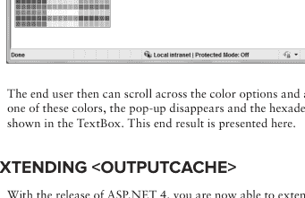

然后终端用户可以滚动浏览颜色选项，并在用户选择其中一种颜色后，弹出窗口消失，十六进制颜色代码显示在 TextBox 中。此最终结果在此处呈现。

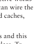

### 扩展 <outputCache>

随着 ASP.NET 4 的发布，您现在能够扩展 OutputCache 指令的工作方式，并使其改用您自己的自定义缓存方式。这意味着您可以将 OutputCache 指令连接到任何类型的缓存方式，包括分布式缓存、云缓存、磁盘、XML 或您能想到的任何其他方式。

为此，您需要创建一个自定义输出缓存提供程序作为类，并且该类需要继承自新的 System.Web.Caching.OutputCacheProvider 类。要继承 OutputCacheProvider，您必须重写 Add()、Get()、Remove() 和 Set() 方法以实现您自定义的输出缓存版本。

在您完成自定义实现后，下一步是在配置文件中进行配置：machine.config 或 web.config 文件。配置文件中的 <outputCache> 元素已进行一些更改，以便您可以应用自定义缓存扩展。

<outputCache> 元素位于配置文件的 <caching> 部分中，现在它包含了一个新的 <providers> 子元素。

```
<caching>
  <outputCache>
    <providers>
    </providers>
  </outputCache>
</caching>
```

在新的 <providers> 元素内，您可以嵌套一个 <add> 元素，以对您通过继承 OutputCacheProvider 类构建的新输出缓存功能进行适当的引用。

```
<caching>
  <outputCache defaultProvider="AspNetInternalProvider">
    <providers>
      <add name="myDistributedCacheExtension"
           type="Wrox.OutputCacheExtension.DistributedCacheProvider,
           DistributedCacheProvider" />
    </providers>
  </outputCache>
</caching>
```

放置此新的 <add> 元素后，您新的扩展输出缓存即可使用。这里还有一个需要注意的新增内容是 <outputCache> 元素中的新 defaultProvider 属性。在此情况下，它设置为 AspNetInternalProvider，这是配置文件中的默认设置。这意味着默认情况下，输出缓存的工作方式与以往相同，并将缓存存储在程序运行的计算机的内存中。

在您自己的输出缓存提供程序就位后，您现在可以通过页面上的 OutputCache 指令指向此提供程序，如下所示定义：

```
<%@ OutputCache Duration="90" VaryByParam="*"
    providerName="myDistributedCacheExtension" %>
```

如果未定义提供程序名称，则会使用配置中 defaultProvider 属性中定义的提供程序。

### .NET 4 的新对象缓存选项

从迄今为止您对 System.Web.Caching.Cache 对象的了解来看，您可以看到它功能强大，甚至允许您创建自定义缓存。然而，Cache 对象的内部实现已经发生了变化。

推动这一变化的是 System.Runtime.Caching.dll，因为 System.Web 版本中的内容已被重构出来，并且所有内容都已重建到新的 System.Runtime.Caching 命名空间中。

这种更改的原因并非主要针对 ASP.NET 开发人员，而是针对其他类型的应用程序，例如 Windows Forms、Windows Presentation Foundation 应用等。其原因是 System.Web.Caching.Cache 对象非常有用，以至于其他应用程序开发人员将其 System.Web 命名空间带入项目中以使用此对象。因此，为了避免 Windows Forms 开发人员仅为了使用其提供的 Cache 对象而需要在项目中引入 System.Web.dll，所有这些内容都被提取出来并使用 System.Runtime.Caching 命名空间进行了扩展。

作为 ASP.NET 开发人员，您仍然可以像在所有先前的 ASP.NET 版本中一样使用 System.Web.Caching.Cache 对象。它不会消失。然而，需要注意的是，随着 .NET Framework 的发展，.NET 团队将把投资放在 System.Runtime.Caching 命名空间而不是 System.Web.Caching 上。这意味着随着时间的推移，您很可能会在 System.Runtime.Caching 版本中看到额外的增强功能，而这些增强功能在 System.Web.Caching 命名空间中可能不会出现。话虽如此，这并不意味着您需要将所有内容都迁移到新的 System.Runtime.Caching 命名空间以确保遵循微软的战略路径，因为这两个缓存在内部是共同管理的。

本节通过一个使用 System.Runtime.Caching 命名空间中的缓存的示例。对于此示例，ASP.NET 页面仅使用一个 Label 控件来显示存储在 XML 文件中的用户姓名。第一步是创建一个 XML 文件并将其命名为 Username.xml。此简单文件在以下列表中呈现。

#### Pro ASP.NET 9780470502204 Listing 22-5: Username.xml 文件的内容

```
<?xml version="1.0" encoding="utf-8" ?>
<usernames>
    <user>Bill Evjen</user>
</usernames>
```

将此 XML 文件放在驱动器的根目录中后，现在将注意力转向 Default.aspx 代码隐藏页面，以使用文件中的名称并将其呈现到页面上的单个 Label 控件中。Default.aspx 页面的代码隐藏在此处以下列表中呈现。

#### Pro ASP.NET 9780470502204 Listing 22-6: 使用 System.Runtime.Caching 命名空间

```
Imports System
Imports System.Collections.Generic
Imports System.Linq
Imports System.Runtime.Caching
Imports System.Xml.Linq

Partial Public Class _Default
    Inherits System.Web.UI.Page

    Protected Sub Page_Load(ByVal sender As Object, _
            ByVal e As EventArgs) Handles Me.Load

        Dim cache As ObjectCache = MemoryCache.Default

        Dim usernameFromXml As String = _
            TryCast(cache("userFromXml"), String)

        If usernameFromXml Is Nothing Then
Dim userFilePath As New List(Of String)()
userFilePath.Add("C:\Username.xml")
Dim policy As New CacheItemPolicy()
policy.ChangeMonitors.Add(New HostFileChangeMonitor(userFilePath))
Dim xdoc As XDocument = XDocument.Load("C:\Username.xml")
Dim query = From u In xdoc.Elements("usernames") Select u.Value
usernameFromXml = query.First().ToString()
cache.Set("userFromXml", usernameFromXml, policy)
End If
Label1.Text = usernameFromXml
End Sub
End Class
```


```
using System;
using System.Collections.Generic;
using System.Linq;
using System.Runtime.Caching;
using System.Xml.Linq;

namespace RuntimeCaching
{
    public partial class Default : System.Web.UI.Page
    {
        protected void Page_Load(object sender, EventArgs e)
        {
            ObjectCache cache = MemoryCache.Default;

            string usernameFromXml = cache["userFromXml"] as string;

            if (usernameFromXml == null)
            {
                List<string> userFilePath = new List<string>();
                userFilePath.Add(@"C:\Username.xml");

                CacheItemPolicy policy = new CacheItemPolicy();
                policy.ChangeMonitors.Add(new HostFileChangeMonitor(userFilePath));

                XDocument xdoc = XDocument.Load(@"C:\Username.xml");
                var query = from u in xdoc.Elements("usernames")
                            select u.Value;

                usernameFromXml = query.First().ToString();

                cache.Set("userFromXml", usernameFromXml, policy);
            }

            Label1.Text = usernameFromXml;
        }
    }
}
```


前面的示例使用了位于 `System.Runtime.Caching` 的新缓存。你需要在 ASP.NET 项目中引用此命名空间才能使其工作。

开始时，你创建一个缓存对象的默认实例。

```csharp
ObjectCache cache = MemoryCache.Default;
```

然后你可以像使用传统的 ASP.NET 缓存对象一样使用此缓存。

```csharp
string usernameFromXml = cache["userFromXml"] as string;
```

要启动缓存，你需要创建一个对象来定义你处理的缓存类型。你可以构建自定义实现，或使用 .NET 4 提供的默认实现之一。

```csharp
CacheItemPolicy policy = new CacheItemPolicy();
policy.ChangeMonitors.Add(new HostFileChangeMonitor(userFilePaths));
```

`HostFileChangeMonitor` 是一种查看目录和文件路径并监控更改的方式。因此，例如，当 XML 文件更改时，会触发缓存失效。`ChangeMonitor` 对象的其他实现包括 `FileChangeMonitor` 和 `SqlChangeMonitor`。

运行此示例时，请注意文本 *Bill Evjen* 在首次运行时被加载到缓存中，并且该文本出现在 `Label1` 控件中。保持应用程序运行，然后你可以返回 XML 文件并更改值，然后你会注意到这会导致页面刷新时缓存失效。

### 使用 IntelliTrace 进行历史调试

Visual Studio 2010 的更令人兴奋的功能之一是名为 IntelliTrace 的新功能。IntelliTrace 为你提供了一个历史调试器，允许你回顾应用程序运行的历史并跳转到过去的时间点以查看当时发生了什么。

此功能仅适用于 Visual Studio 2010 Ultimate Edition，在 IDE 的其他版本中不可用。截至今天，它在 64 位机器上也不工作。因此，你需要使用 32 位计算机来使用历史调试功能。

在应用程序中停止在断点时，你现在可以直接在 IntelliTrace 对话框中看到此历史记录，如下图所示。


从这里，你可以跳转到过去的任何时间点并查看该时刻的 Locals 对话框值和 Call Stack 对话框值。IntelliTrace 功能也是可配置的。你可以通过单击 IntelliTrace 工具栏上的“打开 IntelliTrace 设置”或选择“工具 > 选项”并从对话框左侧的项目中选择 IntelliTrace 来访问这些设置。在 IntelliTrace 部分的“常规”选项卡（如下图所示）中，你可以启用或禁用 IntelliTrace 选项，如果启用，还可以选择仅记录事件或启用更多功能并记录事件和调用信息。

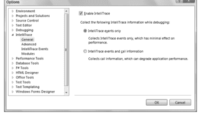

在“高级”选项卡（如下图所示）中，你可以设置用于记录应用程序中发生情况的磁盘空间量。这里可以看到保留的空间量为 100MB。

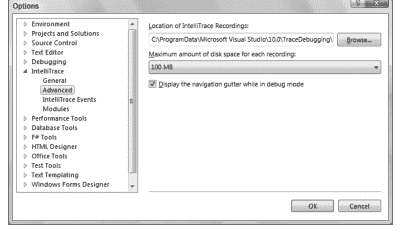

### ASP.NET MVC

模型-视图-控制器（MVC）多年来一直是计算机科学中一个重要的架构模式。最初在 1979 年命名为 Thing-Model-View-Editor，后来简化为 Model-View-Controller。它是一种强大而优雅的方式，用于在应用程序内部分离关注点，并且非常适用于 Web 应用程序。其明确的关注点分离确实为应用程序设计增加了少量额外复杂性，但非凡的好处超过了额外的努力。自引入以来，它已被数十个框架使用。你可以在 Java 和 C++ 中找到 MVC，在 Mac 和 Windows 上，以及在数十个框架内部。

理解 MVC 的核心概念对于有效使用它至关重要。本节讨论了 MVC 模式的历史，以及它在当今 Web 编程中的使用方式。

ASP.NET MVC 1.0 作为 Visual Studio 2008 的可下载插件发布。现在在 Visual Studio 2010 中，ASP.NET MVC 2 已内置。本节还涵盖了 ASP.NET Web 窗体的一些限制以及 ASP.NET MVC 如何尝试使开发人员摆脱这些限制。

> 本选段的内容改编自 Rob Conery、Scott Hanselman、Phil Haack 和 Scott Guthrie 合著的《Professional ASP.NET MVC 1.0》（Wiley，2009）。有关该主题的更深入介绍，我们建议你查阅该书。

#### 定义模型-视图-控制器

模型-视图-控制器（MVC）是一种架构模式，用于将应用程序分离为三个主要方面：

- 模型：描述你正在处理的数据以及数据如何被更改和操作业务规则的一组类
- 视图：应用程序的用户界面（UI）
- 控制器：处理用户通信、整体应用程序流程和特定于应用程序的逻辑的一组类

该模式在 Web 编程中经常使用。在 ASP.NET MVC 中，它大致翻译为以下内容：

- 模型是表示你感兴趣的域的类。这些域对象通常封装存储在数据库中的数据以及用于操作数据并强制执行特定于域的业务逻辑的代码。在 ASP.NET MVC 中，这很可能是一种数据访问层，使用 LINQ to SQL、Entity Framework 或 NHibernate 等工具，结合包含特定于域的逻辑的自定义代码。
- 视图是动态生成的页面。在 ASP.NET MVC 中，你通过继承自 `System.Web.UI.Page` 的 `System.Web.Mvc.ViewPage` 类来实现它。
- 控制器是一个特殊类，管理视图和模型之间的关系。它与模型对话，并决定要渲染哪个视图（如果有）。在 ASP.NET MVC 中，该类通常以后缀 `"Controller."` 表示。

#### 产品团队旁白

ScottGu，或称“The Gu”，以原型制作酷炫事物而闻名，如果他在走廊里看到你并且手里拿着笔记本电脑，你就无法逃脱，因为他会说：“伙计！看看这个！”他的热情具有感染力。

传说中，在 2007 年 10 月于华盛顿州雷德蒙德举行的奥斯汀 ALT.NET 大会上，ScottGu 向一群开发人员展示了他“在飞机上写的这个很酷的东西”，并询问他们是否看到了需求以及他们对此的看法。这很受欢迎。事实上，许多人参与了最初代号为“Scalene”的原型。Eilon Lipton 于 2007 年 9 月通过电子邮件向团队发送了第一个原型，他和 ScottGu 通过电子邮件来回交流原型、代码和想法，至今仍在继续！

#### 模型-视图-控制器与 ASP.NET

ASP.NET MVC 依赖于其他 MVC 平台使用的许多相同核心策略，同时它提供了编译和托管代码的好处，并利用 .NET 3.5 及以上版本中 VB9 和 C# 中的新语言特性，如 lambda 和匿名类型。Web 上使用的每个 MVC 框架通常都共享一些基本原则：

- 约定优于配置
- 不要重复自己（也称为 DRY 原则）
- 尽可能可插拔
- 尽量提供帮助，但如果必要，请让开开发者的道路

#### 提供方法，而非文件

Web 服务器最初提供存储在磁盘上静态文件中的 HTML。随着动态网页变得突出，Web 服务器提供从磁盘上动态脚本即时生成的 HTML。使用 MVC，提供 HTML 有点不同。URL 告诉路由机制实例化哪个控制器以及调用哪个操作方法，并为该方法提供所需参数。然后控制器的操作方法决定使用哪个视图，然后该视图进行渲染。

而不是在 URL 与 Web 服务器硬盘上存在的文件之间存在直接关系，URL 与控制器对象上的方法之间存在关系。ASP.NET MVC 实现了 MVC 模式的“前端控制器”变体，控制器位于路由子系统之外的一切之前。

设想 MVC 在 Web 场景中工作方式的一个好方法是，MVC 提供方法调用的结果，而不是动态生成（也称为脚本化）的页面。事实上，我们曾听一位演讲者称之为“Web 上的 RPC”，这非常贴切，尽管范围要窄得多。


#### 这是 Web Forms 4.0 吗？

我们在与人们谈论 ASP.NET MVC 时听到的主要担忧之一是其发布意味着 Web Forms 的死亡。这完全不属实。ASP.NET MVC 并不是 ASP.NET Web forms 4.0。它是 Web Forms 的替代方案，并且是框架中完全受支持的一部分。虽然 Web Forms 仍在以新创新和新发展不断前进，但 ASP.NET MVC 将继续作为微软完全支持的并行替代方案。

有一种有趣的看法方式是参考这些技术所在的命名空间。如果你能指出一个命名空间并说，“这就是 ASP.NET 所在的地方”，那就是 `System.Web` 命名空间。ASP.NET MVC 位于 `System.Web.Mvc` 命名空间中。它不是 `System.Mvc`，也不是 `System.Web2`。

虽然 ASP.NET MVC 今天对于 Visual Studio 2008 用户来说是一个可单独下载的 Web 组件（通常由 ASP.NET 团队称为超出频道的 [OOB] 发布），但它已被合并到 .NET Framework 4 中，并且开箱即内置于 Visual Studio 2010 中。这巩固了 ASP.NET MVC 作为 ASP.NET 本身基本组成部分的地位。

#### 为什么不用 Web Forms？

在 ASP.NET Web forms 中，你创建一个 `System.Web.UI.Page` 的实例并在其上放置“server controls”（例如一个日历和一些按钮），以便用户输入或查看信息。然后你将这些控件连接到 `System.Web.UI.Page` 上的事件以实现交互性。此页面随后被编译，并且当被 ASP.NET 运行时调用时，会创建一个服务器端控件树，树中的每个控件都经历事件生命周期，它自行渲染，结果作为 HTML 返回。因此，一种新的 Web 美学开始出现——Web forms 在 HTTP 之上层叠事件和状态管理——一种真正无状态的协议。

为什么需要这种抽象？记住 Web Forms 是为非常习惯 Visual Basic 6 的微软开发社区引入的。使用 VB6 的开发人员会将按钮拖到设计表面，双击按钮，就会为他们即时创建一个 `Button_Click` 事件处理程序方法。这是一种创建业务应用程序的极其强大的方式，并让每个人对快速应用程序开发（RAD）工具感到兴奋。当开发人员开始使用经典 ASP 时，与他们在 Visual Basic 中习惯的丰富环境相比，这是一个很大的倒退。好与坏，Web Forms 将那种快速应用程序开发体验带到了 Web。

然而，随着 Web 的成熟，越来越多的人开始接受他们对 HTML 的理解，以及 CSS（Cascading Style Sheets）和 XHTML 的引入，一种新的 Web 美学开始出现。Web Forms 对开发人员来说仍然极其高效，使他们能够非常快速地创建基于 Web 的业务线应用程序。然而，它生成的 HTML 看起来，嗯，生成的，有时可能会冒犯那些手工制作 XHTML 和 CSS 站点的审美。Web Forms 概念如 ViewState 和 Postback 事件模型有其位置，但许多开发人员希望有一个更低层的替代方案，它不仅拥抱 HTML，还拥抱 HTTP 本身。

此外，Web Forms 的架构也使得通过当前单元测试工具如 NUnit、MbUnit 和 xUnit.NET 进行测试变得困难。ASP.NET Web forms 并不是以单元测试为目标设计的，虽然网络上可以找到一些技巧，但可以公平地说 Web Forms 不太适合测试驱动开发。ASP.NET MVC 提供了对 HTML 的绝对控制，不否认 HTTP 的存在，并且从一开始就以可测试性为目标而设计。

#### ASP.NET MVC 完全不同！

是的，ASP.NET MVC 完全不同。这就是重点。它建立在与 Web Forms 非常不同的价值观和架构原则体系之上。ASP.NET MVC 注重可扩展性、可测试性和灵活性。它非常轻量级，并且不会对你如何使用它做出太多假设——除了它假设你欣赏 Model-View-Controller 模式之外。

不同的开发人员和不同的项目有不同的需求。如果 ASP.NET MVC 满足你的需求，就使用它。如果不满足，就不要使用它。无论如何，不要害怕。

#### 为什么“(ASP.NET > ASP.NET MVC) == True”

创建你的第一个 MVC 应用程序相当直接。你可以使用任何版本的 Visual Studio 2010 来创建基本应用程序，包括 Express、Standard、Professional 或 Team Edition。

如果你没有使用 Visual Studio 2010，第一步是在你的 2008 开发机上安装 MVC 框架。从 www.asp.net/mvc 开始，通过下载最新版本。如果你喜欢走在边缘，通常可以在 www.codeplex.com/aspnet 上获得 ASP.NET MVC 未来版本。

你下载的是一个 Visual Studio 项目模板集，它会为你创建 ASP.NET MVC Web 应用程序。你以前用过这些——每个新的 ASP.NET Web site 和 ASP.NET Web application 都基于一组模板。模板将被安装到 Visual Studio 中，引用程序集将被安装到 C:\Program Files\Microsoft ASP.NET。

安装 ASP.NET MVC 后，你就可以使用 Visual Studio 2008 创建 ASP.NET MVC 应用程序了。不过，如果你使用的是 Visual Studio 2010，那么你需要按照以下步骤操作：

- 1. 通过选择 File -> New Project 打开 Visual Studio 2010。
- 2. 从 New Project 对话框中，如下图所示，选择 ASP.NET MVC 2 Web Application。

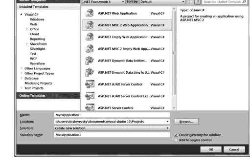

.NET Framework 此版本中另一个出色的功能是 WCF Data Services 框架。此功能使你能够轻松为客户端应用程序创建云接口，提供从简单读取功能到完整的 CRUD 模型（create、read、update、and delete functions）的一切。此功能以前被称为 ADO.NET Data Services。

当你使用 ASP.NET 时，现在对客户端和服务器的工作都有更多关注。过去，大多数开发都集中在尽可能多地在服务器上执行，并将完成的运算和 UI 交付回客户端仅供查看。随着“smart clients”和 AJAX-enabled 应用程序的发布，现在许多工作被卸载到客户端。WCF Data Services 使通过线路公开后端功能以在客户端执行更多工作变得比以前更容易。

WCF Data Services 用于为你的后端数据源创建服务层。自己实现这一点，尤其是使用完整的 CRUD 模型时，需要大量工作。WCF Data Services 允许你获得一个基于 URI 驱动的服务层。以下图示显示了使用 WCF Data Services 时的总体架构。

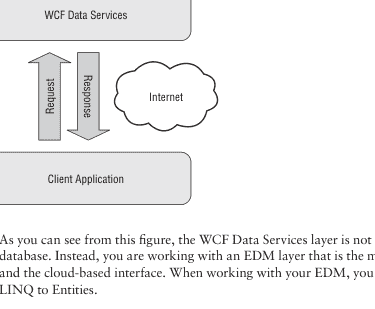

如图所示，WCF Data Services 层不是与数据库交互的层。相反，你正在使用一个 EDM 层，它是数据存储与基于云的接口之间的映射层。在使用你的 EDM 时，你可以使用 LINQ to SQL 和 LINQ to Entities。

WCF Data Services 允许你快速将应用程序底层数据源的交互作为 RESTful-based 服务公开。当前版本的 WCF Data Services 允许你使用 JSON 或 Atom-based XML 与数据存储工作。同样，JSON 是 ASP.NET AJAX 用于执行 out-of-bounds 调用以避免完整页面刷新的方式。

### 创建你的第一个服务

弄清楚如何为数据库构建完整的服务层以处理所有 create、read、update 和 delete 函数需要大量的时间和思考。然而，正如你在完成这个第一个示例时所看到的那样，WCF Data Services 使这项任务变得更加可行。

要构建服务层，首先在 Visual Basic 或 C# 中创建一个名为 Web_ADONETDS 的标准 ASP.NET Web Application。注意，你需要使用 .NET Framework 3.5 SP1 以及 Visual Studio 2008 SP1 或 .NET Framework 4 与 Visual Studio 2010 才能使此示例工作。

这当然创建了一个与正常情况不同的标准 Web 应用程序。因为 WCF Data Services 基于底层数据库工作，所以你需要添加一个数据库。对于此示例，添加 NORTHWND.mdf 数据库。将此数据库放置在项目的 App_Data 文件夹内。

#### 添加你的实体数据模型

在数据库就位后，你接下来创建一个 WCF Data Services 将使用的 Entity Data Model。为此，右键单击你的项目并从提供的菜单选项列表中选择 Add ⇨ New Item。

Add New Item 对话框出现。如图所示，将 ADO.NET Entity Data Model 添加到你的项目中。

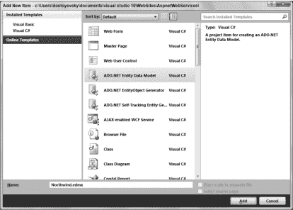

如图所示，将你的 ADO.NET Entity Data Model 文件命名为 Northwind.edmx。当你通过单击 Add 创建 Northwind.edmx 文件时，Entity Data Model Wizard 出现，提供创建空 EDM 或从预先存在的数据库创建的选项。对于此示例，选择从预先存在的（Northwind）数据库创建的选项。然后在向导中单击 Next。


The next screen of the wizard will find your NORTHWIND.mdf database and pre-define the connection settings and how they will be stored within your application. The next figure presents this second screen of the wizard.

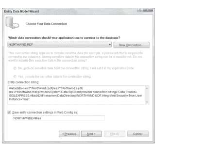

在之前的截图中，注意到连接字符串和映射详细信息的存储位置将保存在 web.config 文件中。你也可以在这个屏幕上看到，你正在向导底部的文本框中为模型实例命名为 NORTHWINDEntities。这个名称很重要，因为你将在本示例后面使用它。

下一个屏幕允许你选择将成为模型一部分的表、视图或存储过程。对于本示例，请在树视图中选择 Table 项目旁边的复选框以选择数据库中的所有表，如下一图所示。

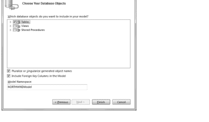

选中 Table 复选框后，单击 Finish 按钮，让 Visual Studio 为你创建 EDM。你会注意到 Visual Studio 会在 O/R Designer 中为你创建模型的视觉表示。

如果查看解决方案中的 `Northwind.designer.vb` 或 `Northwind.designer.cs` 文件，你会看到为你的 EDM 生成的所有代码已就位。此类文件名为 `NORTHWIND.Entities`。

### 创建服务

现在 EDM 和数据库都已就位，下一步是添加你的 WCF 数据服务。为此，在 Visual Studio 解决方案资源管理器中右键单击你的项目，并从提供的菜单中选择 Add ➜ New Item。Add New Item 对话框再次出现；从提供的对话框中间部分选择 WCF Data Service（见下图）。

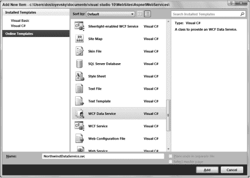

如图所示，将你的 WCF 数据服务命名为 `NorthwindDataService.svc`。完成后，单击 Add 按钮，Visual Studio 将代表你生成一个 WCF 服务。以下列表显示了默认服务文件的代码。

#### Pro ASP.NET 9780470502204 Listing 31-33: WCF 数据服务的默认 .svc 文件

```vb
Imports System.Data.Services
Imports System.Linq
Imports System.ServiceModel.Web

Public Class NorthwindDataService
    ' TODO: replace [[class name]] with your data class name

    Inherits DataService(Of [[class name]])

    ' This method is called only once to initialize service-wide
    policies.
    Public Shared Sub InitializeService(ByVal config As
    IDataServiceConfiguration)
        ' TODO: set rules to indicate which entity sets and service
        operations are visible, updatable, etc.
        ' Examples:
        ' config.SetEntitySetAccessRule("MyEntitySet",
        EntitySetRights.AllRead)
        ' config.SetServiceOperationAccessRule("MyServiceOperation",
        ServiceOperationRights.All)
    End Sub

End Class
```


```csharp
using System;
using System.Collections.Generic;
using System.Data.Services;
using System.Linq;
using System.ServiceModel.Web;

namespace Web_ADONETDS
{
    public class NorthwindDataService :
        DataService< /* TODO: put your data source class name here */ >
    {
        // This method is called only once to initialize
        // service-wide policies.
        public static void
            InitializeService(IDataServiceConfiguration config)
        {
            // TODO: set rules to indicate which entity sets and
            service operations are visible, updatable, etc.
            // Examples:
            // config.SetEntitySetAccessRule("MyEntitySet",
            //     EntitySetRights.AllRead);
            // config.SetServiceOperationAccessRule
            //     ("MyServiceOperation", ServiceOperationRights.All);
        }
    }
}
```

此处生成的代码是你将通过 WCF 数据服务公开的基础框架。然而，在完成代码中指定的大 TODO 之前，它将无法工作。第一步是使用以下列表中提供的代码输入 EDM 实例的名称。

#### Pro ASP.NET 9780470502204 Listing 31-34: 修改 WCF 数据服务以与你的 EDM 配合工作

```vb
Public Class NorthwindDataService
    Inherits DataService(Of NORTHWINDEntities)
    ' Code removed for clarity
End Class
```

```csharp
public class NorthwindDataService : DataService<NORTHWINDEntities>
{
    // Code removed for clarity
}
```

现在你的应用程序处于数据库、EDM 以及用于操作 EDM 的服务都已就位的状态。编译后在浏览器中打开 NorthwindDataService.svc 文件，你会看到以下 XML 片段：

```xml
<?xml version="1.0" encoding="utf-8" standalone="yes" ?>
<service xml:base="http://localhost:4113/NorthwindDataService.svc/"
xmlns:atom="http://www.w3.org/2005/Atom"
xmlns:app="http://www.w3.org/2007/app"
xmlns="http://www.w3.org/2007/app">
  <workspace>
    <atom:title>Default</atom:title>
  </workspace>
</service>
```

如果看不到此 XML，则需要通过选择 Tools ▸ Internet Options 关闭 IE 浏览器的订阅源阅读功能。从提供的对话框中，选择 Content 选项卡，并在 Feeds 部分单击 Select 按钮。从那里，你可以取消选中“Turn on feed reading”复选框。

前面 XML 的结果本应是模型中存在的所有可用集合的列表，但默认情况下，WCF 数据服务会锁定所有内容。要从模型中解锁这些集合，请返回到 `InitializeService()` 函数并添加以下加粗代码，如以下列表所示：

#### Pro ASP.NET 9780470502204 Listing 31-35: 打开服务以便从可用表中进行读取

```vb
Imports System.Data.Services
Imports System.Linq
Imports System.ServiceModel.Web

Public Class NorthwindDataService
    Inherits DataService(Of NORTHWINDEntities)

    Public Shared Sub InitializeService(ByVal config _
        As IDataServiceConfiguration)
        config.SetEntitySetAccessRule("*", EntitySetRights.AllRead)
    End Sub

End Class
```

```csharp
using System;
using System.Collections.Generic;
using System.Data.Services;
using System.Linq;
using System.ServiceModel.Web;
using System.Web;

namespace Web_ADONETDS
{
    public class NorthwindDataService : DataService<NORTHWINDEntities>
    {
        public static void
            InitializeService(IDataServiceConfiguration config)
        {
            config.SetEntitySetAccessRule("*",
                EntitySetRights.AllRead);
        }
    }
}
```

在这种情况下，每个表都已打开以供访问。访问这些表的所有人都有读取它们的权限，但没有写入或删除的能力。所有表都是通过使用星号 (*) 指定的，并且底层数据的权限通过将 EntitySetRights 枚举设置为 AllRead 而设为只读。

现在，编译并在浏览器中运行此服务时，你会看到以下 XML 片段：

```xml
<?xml version="1.0" encoding="utf-8" standalone="yes"?>
<service xml:base="http://localhost:4113/NorthwindDataService.svc/"
xmlns:atom="http://www.w3.org/2005/Atom"
xmlns:app="http://www.w3.org/2007/app"
xmlns="http://www.w3.org/2007/app">
  <workspace>
    <atom:title>Default</atom:title>
    <collection href="Categories">
      <atom:title>Categories</atom:title>
    </collection>
    <collection href="CustomerDemographics">
      <atom:title>CustomerDemographics</atom:title>
    </collection>
    <collection href="Customers">
      <atom:title>Customers</atom:title>
    </collection>
    <collection href="Employees">
      <atom:title>Employees</atom:title>
    </collection>
    <collection href="Order_Details">
      <atom:title>Order_Details</atom:title>
    </collection>
  </workspace>
</service>
```

此处使用 application/atom+xml，因此采用了 AtomPub 格式。如果将 Accept 头改为 application/json，则会得到如下响应：

```json
{
  "d" : {
    "EntitySets" : [
      "Categories", "CustomerDemographics", "Customers", "Employees",
      "Order_Details", "Orders", "Products", "Region", "Shippers",
      "Suppliers", "Territories"
    ]
  }
}
```

上述代码的格式正是 ASP.NET AJAX 页面所需的格式。

### 构建 ASP.NET Web 包

将 Web 应用程序部署到服务器的最简单方法之一，是使用 Visual Studio 2010 新增的内置发布功能。在幕后，这一新功能使用 Microsoft 的 Web 部署工具（也称为 MSDeploy），这意味着，如果你想要将应用程序部署到服务器，该服务器上必须安装 MSDeploy，应用程序的部署才能实际生效。

创建并传递的包实际上是一个物理文件——一个 .zip 文件。此 .zip 文件包含将 Web 应用程序及其所有设置重新部署到新环境所需的一切。除 .zip 文件外，它还包含一个清单文件和一个命令文件，用于在主机上启动包的安装。

部署此应用程序的第一种方式是使用 Visual Studio 2010 中新增的“一键发布”功能。为此，请在 Visual Studio 解决方案资源管理器中右键单击项目，然后从提供的菜单中选择“发布”选项。随后将出现“发布 Web”对话框，如下图所示。

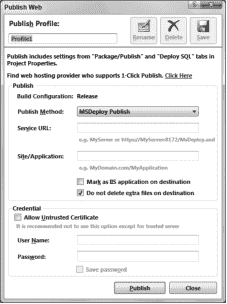

由于许多开发人员会不断将 Web 应用程序部署到测试、暂存和生产环境中，因此可以让你将部署选项存储在一个配置文件中，以便反复使用。另请注意，上图的对话框中，此部署的生成配置设置为 Release。此设置来自你在选择“发布”选项之前，在 Visual Studio 2010 工具栏中所做的设置。

“发布 Web”对话框包含下表中定义的以下选项。

| 设置 | 说明 |
|---|---|
| 配置文件名称 | 已保存配置文件的名称。这让你能够将设置作为默认值，用于重复部署。 |
| 生成配置 | 指定生成编译将在“调试”还是“发布”模式下进行。你可以先在 Visual Studio 的工具栏中设置此选项。 |
| 发布方法 | 你要用于部署的方法。可能的选项包括 MSDeploy 发布、FTP、文件系统和 FPSE。 |
| 服务 URL | 指定主机服务器上 MSDeploy 的位置。此 URL 指向实际具有 MSDeploy 功能的 IIS 处理程序，其构造方式类似于 http://myhostserver:8172/MsDeploy.axd。 |
| 站点/应用程序 | 指定应用程序将部署到的位置。你可以在此指定站点以及放置应用程序的虚拟目录。例如 MyDomain.com/MyApplication。 |
| 在目标上标记为 IIS 应用程序 | 如果选择此选项，IIS 会将“站点/应用程序”文本框中定义的终结点视为应用程序根目录。 |
| 不删除目标上的多余文件 | 如果未选择此选项，“一键发布”选项将首先删除主机服务器位置上的所有内容，然后再应用文件和设置。 |
| 允许不受信任的证书 | 如果选择此选项，你将信任自行发布的证书，或与目标 URL 不匹配的证书。 |
| 用户名 | 用于 IIS 连接的用户名。 |
| 密码 | 用于 IIS 连接的密码。 |
| 保存密码 | 指定 Visual Studio 发布功能是否将密码保存到配置文件中。 |

除了使用 MSDeploy 选项外，你会发现通过新的“发布 Web”对话框提供的其他选项更加简单。下图显示了所提供的其他三个部署选项的设置。

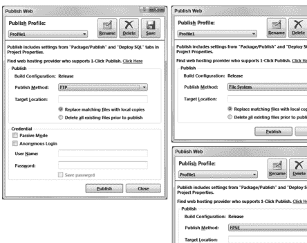

在此图中，你可以看到使用 FTP、文件系统或 FrontPage 服务器扩展进行部署的一些标准设置。

Visual Studio 2010 现在所支持的 MSDeploy 功能的有趣之处在于，除了连接到远程 MSDeploy 处理程序并实时运行部署之外，你还可以创建一个可以随时运行的 MSDeploy 包。

Visual Studio 2010 现在包含创建这些包的功能，然后可以通过电子邮件或其他方式将这些包提供给其他人，让他们在自己的系统上运行。若要创建 Web 部署包，请在 Visual Studio 解决方案资源管理器中右键单击项目，然后从提供的菜单中选择“创建包”选项。

当你选择“创建包”选项时，包创建的进度会显示在 Visual Studio 状态栏中。在收到“发布成功”的通知后，你可以在应用程序的 obj 文件夹中找到整个包，例如

```
C:\Users\Evjen\Documents\Visual Studio 2010\
Projects\MyWebApplication\MyWebApplication\obj\Release\Package
```

该文件夹中包含构成包的所有文件。下图展示了这些文件。

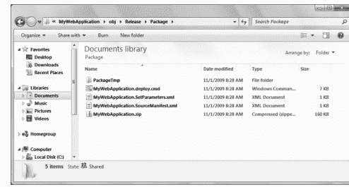

所有这些文件共同构成包，可用于部署过程。

- `MyWebApplication.deploy.cmd` 文件是供你的基础设施团队在主机（装有 MSDeploy）上运行，以安装应用程序及应用程序所需的所有设置的文件。
- 其他文件 `MyWebApplication.SetParameters.xml` 和 `MyWebApplication.SourceManifest.xml` 用于定义安装过程中使用的设置。
- 最后一个文件 `MyWebApplication.zip` 包含应用程序的内容。

使用此包，向另一个团队传递应用程序所需的安装变得很容易。一个很好的例子是，如果你要部署到 Web 场，因为需要进行多次部署，并且你希望所有这些部署保持一致。从这一个包运行安装可确保这种一致性。

包系统的另一个优点是，它允许你保存以前的部署，如果需要回头验证部署，可以轻松地获取已保存的包。它还使部署过程中的回滚变得容易。


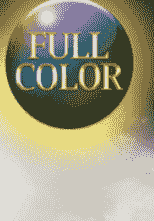

## WPF

## 程序员参考

使用 C# 2010 和 .NET 4 的 Windows® Presentation Foundation

## WPF

## 程序员参考

### Windows Presentation Foundation
使用 C# 2010 和 .NET 4

#### 代码隐藏文件

每当向项目添加窗口时，Expression Blend 或 Visual Studio 都会添加相应的代码隐藏文件。该文件的名称与 XAML 文件相同，但额外扩展名为 cs（用于 C#）或 vb（用于 Visual Basic）。例如，当你在 C# 中创建新的 WPF 项目时，项目将初始窗口包含在 Window1.xaml 文件中，并包含相应的代码隐藏文件 Window1.xaml.cs。

如果你使用的是 Visual Studio，则可以编辑代码隐藏文件，并充分利用 Visual Studio 强大的代码编辑功能，例如关键字突出显示和 IntelliSense。

#### 示例代码

源代码可在本书网站 www.wrox.com 上下载，其中包含几个示例应用程序，它们都实现相同的功能，但使用不同的技术将代码隐藏附加到用户界面。

此图展示了一个程序的运行情况。你可以拖动滚动条或在文本框中输入值，以设置右侧所显示颜色的红色、绿色和蓝色分量。如果单击“应用”按钮，程序会将窗口的背景色设置为与当前样本匹配。

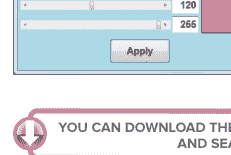

你可以下载本节中的代码。请访问 WROX.COM 并搜索 ISBN 9780470477229

ImageColors 示例程序（如下图所示）在一个程序中演示了将 UI 元素附加到代码隐藏文件的所有不同技术。该程序的不同按钮以不同方式附加到事件处理程序。请从本书网站下载该程序的 C# 或 Visual Basic 版本以查看详细信息。

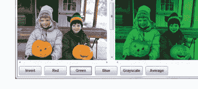

#### 事件名称特性

将代码隐藏附加到控件事件的第一种方式是在 XAML 代码中使用特性。特性的名称与你想要捕获的事件相同。其值是代码隐藏文件中事件处理程序的名称。

例如，以下 XAML 代码定义了一个名为 btnApply 的 Button。Click 特性指示例程 btnApply_Click 捕获控件的 Click 事件处理程序。

```xml
<Button Content="Apply" IsDefault="True"
Name="btnApply" Click="btnApply_Click"/>
```

遗憾的是，如果只是将事件处理程序声明添加到 XAML 代码中，程序将无法运行。如果你尝试在 Expression Blend 或 Visual Studio 中执行它，将会收到一个错误，指出你的程序不包含事件处理程序例程的定义。

以下 C# 代码处理上一段 XAML 代码中声明的事件：

```csharp
private void btnApply_Click(object sender, RoutedEventArgs e)
{
    this.Background = borSample.Background;
}
```

此代码捕获 btnApply Button 的 Click 事件，并将窗口的 Background 属性设置为 borSample 控件的 Background 属性所使用的值（稍后将详细介绍）。

你的代码不需要做任何特殊操作来连接事件处理程序以捕获事件——Expression Blend 和 Visual Studio 会为你处理这些。

以下 XAML 片段展示了 EventNameAttributes 示例程序如何确定哪些事件处理程序捕获程序 Apply 按钮以及控制颜色红色分量的滚动条和文本框所引发的主要事件。其他滚动条和文本框的代码类似。


```xml
<ScrollBar Orientation="Horizontal" Minimum="0" Maximum="255"
Grid.Row="0" Grid.Column="0" Value="255"
Name="scrRed" ValueChanged="scrRed_ValueChanged"/>

<TextBox Margin="2" Grid.Row="0" Grid.Column="1" Text="255"
HorizontalContentAlignment="Right" VerticalContentAlignment="Center"
Name="txtRed" TextChanged="txtRed_TextChanged"/>

<Button Grid.Row="3" Grid.Column="0" Grid.ColumnSpan="3" Width="100" Height="40"
Content="Apply" IsDefault="True"
Name="btnApply" Click="btnApply_Click"/>
```

以下 C# 片段展示了当你使用第一个滚动条或文本框更改红色分量时，以及当你单击 Apply 按钮时，EventNameAttributes 程序如何响应。其他滚动条和文本框的事件处理程序类似。


```csharp
// A ScrollBar has been changed. Update the corresponding TextBox.
private void scrRed_ValueChanged(object sender,
RoutedPropertyChangedEventArgs<double> e)
{
    if (txtRed == null) return;
    txtRed.Text = ((int)scrRed.Value).ToString();
    ShowSample();
}

// A TextBox has been changed. Update the corresponding ScrollBar.
private void txtRed_TextChanged(object sender,
TextChangedEventArgs e)
{
    // Keep the value within bounds.
    int value;
    try {
        value = int.Parse(txtRed.Text);
    } catch {
        value = 0;
    }

    if (value < 0) value = 0;
    if (value > 255) value = 255;
    txtRed.Text = value.ToString();

    if (scrRed == null) return;
    scrRed.Value = value;
    ShowSample();
}

// Display a sample of the color.
private void ShowSample()
{
    if (borSample == null) return;

    byte r, g, b;
    try {
        r = byte.Parse(txtRed.Text);
    } catch {
        r = 0;
    }
    try {
        g = byte.Parse(txtGreen.Text);
    } catch {
        g = 0;
    }
    try {
        b = byte.Parse(txtBlue.Text);
    } catch {
        b = 0;
    }
    borSample.Background = new SolidColorBrush(Color.FromRgb(r, g, b));
}
```

> *WPF 程序员参考 9780470477229 EventNameAttributes*

### 资源

任何类型的编程中最重要的概念之一都是代码重用。子例程、函数、脚本、类、继承、循环以及许多其他编程构造让你能够以某种方式重用代码。例如，如果你的程序需要在多个位置执行相同的任务，你可以创建一个执行该任务的子例程，然后从这些位置调用它。

正如例程和函数让你可以在 C# 和 Visual Basic 等语言中重用代码一样，*资源*让你可以重用 XAML 代码。它们让你可以定义值，然后可以在 XAML 文件的多个位置使用这些值。

#### 定义资源

创建和使用简单资源相当容易。（事实上，从示例理解比从描述理解更容易，因此，如果你难以理解以下解释，请先查看示例文本，然后再读一遍解释。）

要定义资源，请向 `Window`、`Grid` 或其他容器等对象添加 `Resources` 属性元素。在该元素内部，放置你稍后要使用的资源。每个资源都是一个

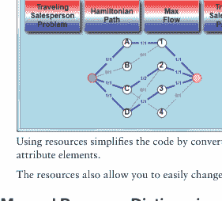

使用资源通过将相对复杂的属性元素转换为更简单的特性元素来简化代码。

资源还让你可以轻松地一次性更改所有按钮的外观。

#### 合并资源字典

资源字典让多个控件共享相同的值。合并资源字典让多个窗口甚至应用程序共享相同的资源值。

要合并资源字典，请创建一个以 ResourceDictionary 对象为根元素的 XAML 文件。像为 Window 一样为该元素提供命名空间特性，并将资源放入字典中。

以下代码展示了名为 RectangleResources.xaml 的资源字典文件的一部分。此文件定义了 MultiWindowResources 示例程序用来定义 Rectangle 属性的资源。（为节省空间，我省略了一些资源。）


```xml
<ResourceDictionary
xmlns="http://schemas.microsoft.com/winfx/2006/xaml/presentation"
xmlns:x="http://schemas.microsoft.com/winfx/2006/xaml"
xmlns:sys="clr-namespace:System;assembly=mscorlib">
<!-- Resource dictionary entries should be defined here. -->
<sys:Double x:Key="rectWidth">140</sys:Double>
<sys:Double x:Key="rectHeight">50</sys:Double>
<sys:Double x:Key="rectRadX">5</sys:Double>
<sys:Double x:Key="rectRadY">20</sys:Double>
... More resources omitted ...
</ResourceDictionary>
```

以下代码展示了 MultiWindowResources 程序如何使用此资源字典。Window1 XAML 文件使用一个 ResourceDictionary.MergedDictionaries 元素，其中包含对字典文件的引用。


```xml
<Window.Resources>
  <ResourceDictionary>
    <ResourceDictionary.MergedDictionaries>
      <ResourceDictionary Source="RectangleResources.xaml"/>
    </ResourceDictionary.MergedDictionaries>
  </ResourceDictionary>
</Window.Resources>
```

WPF 程序员参考 9780470477229 MultiWindowResources

以下代码展示了 Window 如何使用这些资源。此代码创建一个 Rectangle，它引用外部字典中定义的资源。


```xaml
<Grid MouseDown="rectAddUser_MouseDown">
  <Rectangle
    Margin="{StaticResource rectMargin}"
    Width="{StaticResource rectWidth}"
    Height="{StaticResource rectHeight}"
    RadiusX="{StaticResource rectRadX}"
    RadiusY="{StaticResource rectRadY}"
    Fill="{StaticResource rectFill}"
    Stroke="{StaticResource rectStroke}"
    StrokeThickness="{StaticResource rectStrokeThickness}"
    BitmapEffect="{StaticResource rectBitmapEffect}"
  />
  <Label HorizontalAlignment="Center" VerticalAlignment="Center"
    Content="Add User"
    FontSize="{StaticResource rectFontSize}"
    FontWeight="{StaticResource rectFontWeight}"
  />
</Grid>
```

WPF 程序员参考 9780470477229 MultiWindowResources

MultiWindowResources 示例程序使用类似代码在其全部四个窗口中包含资源字典并引用其资源。由于每个窗体都引用相同的资源，它们都具有共同的外观。如果你决定更改外观，只需修改资源字典，所有窗体都会自动采用这些更改。

此图展示了 MultiWindowResources 程序显示多个窗体，这些窗体具有类似按钮的矩形。

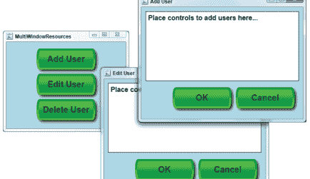


除了允许多个窗体或应用程序使用相同的资源外，合并字典还允许单个窗口加载多个资源字典。如果你希望使用单独的字典来保存不同的资源组，这会很方便。例如，你可能有单独的字典来保存按钮资源、标签资源和列表资源。

你还可以在同一应用程序中使用多个资源字典，以便轻松地在不同外观之间切换。例如，ResourceDictionaries 示例程序使用以下代码合并 ResBlue.xaml 和 ResRed.xaml 这两个资源字典：

可在 Wrox.com 下载

```
<Window.Resources>
    <ResourceDictionary>
        <ResourceDictionary.MergedDictionaries>
            <ResourceDictionary Source="ResBlue.xaml"/>
            <ResourceDictionary Source="ResRed.xaml"/>
        </ResourceDictionary.MergedDictionaries>
    </ResourceDictionary>
</Window.Resources>
```

由于 ResRed.xaml 文件是第二个加载的，因此该文件中的资源值优先。下图显示了 ResourceDictionaries 程序使用此资源字典中的值。

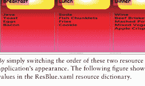

只需交换这两个资源字典的顺序，就可以完全改变应用程序的外观。下图显示了 ResourceDictionaries 程序使用 ResBlue.xaml 资源字典中的值。

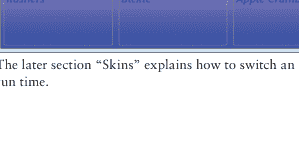

后面的“皮肤”一节将说明如何在运行时以类似方式切换应用程序的外观。

### 样式和属性触发器

我们刚刚查看了资源——可以分配给控件、使它们具有共同外观和行为的命名属性值。

遗憾的是，资源常常导致冗长而复杂的代码。如果一组控件共享许多属性值，那么将这些属性转换为资源就需要使用冗长的 StaticResource 或 DynamicResource 关键字进行大量重复。

样式（Style）是一种特殊资源，它让你可以提取这种冗余并将其集中起来，就像其他资源让你集中属性值一样。样式让你可以定义属性值包，一次性地将其应用于控件，而不必逐个将单个资源值应用于控件。

#### 简化属性

样式将应作为一组设置的属性值打包在一起。它以一个包含在资源字典中的 Style 元素开始。你可以根据希望其可用范围，将 Style 放在任意资源字典中。例如，如果你希望某个 Style 对整个项目可见，就把它放在 App.xaml 文件的 Application.Resources 节中；如果你希望该 Style 对窗口上的每个控件可见，就把它放在 Window.Resources 节中；如果你希望它仅对 StackPanel 内的控件可见，就把它放在 StackPanel.Resources 节中。

样式可以有一个 x:Key 特性来为其命名，以及一个 TargetType 特性来指示它应应用到的控件类型。（下一节将详细介绍这些特性。）

在 Style 元素内部，Setter 和 EventSetter 元素分别定义样式的属性值和事件处理程序。

Setter 设置属性的值。它接受两个特性——Property 和 Value——分别给出要设置的属性及其应取的值。该值可以是像 Red 或 7 这样的简单特性值，也可以是像画笔这样指定更复杂内容的元素特性。

RedRectangles 示例程序使用以下代码定义名为 RedRectStyle 的 Style，该样式应用于 Rectangle。Stroke、StrokeThickness、Width、Height 和 Margin 设置器使用属性特性语法提供简单值，而 Fill 设置器使用属性元素语法将其值设置为 RadialGradientBrush 对象。


```
<Style x:Key="RedRectStyle" TargetType="Rectangle">
  <Setter Property="Stroke" Value="Red"/>
  <Setter Property="StrokeThickness" Value="5"/>
  <Setter Property="Width" Value="100"/>
  <Setter Property="Height" Value="50"/>
  <Setter Property="Margin" Value="5"/>
  <Setter Property="Fill">
    <Setter.Value>
      <RadialGradientBrush>
        <GradientStop Color="Red" Offset="0"/>
        <GradientStop Color="White" Offset="1"/>
      </RadialGradientBrush>
    </Setter.Value>
  </Setter>
</Style>
```

你可以像使用任何其他资源一样使用样式。只需将 “Style” 属性设置为样式的键。

RedRectangles 示例程序使用以下代码显示三个使用 RedRectStyle 样式的红色 Rectangle：

```
<StackPanel Orientation="Horizontal">
<Rectangle Style="{StaticResource RedRectStyle}" />
<Rectangle Style="{StaticResource RedRectStyle}" />
<Rectangle Style="{StaticResource RedRectStyle}" />
</StackPanel>
```

WPF 程序员参考 9780470477229 RedRectangles

请注意样式在多大程度上简化了这段代码。如果没有该样式，每个 Rectangle 都需要有自己的 Stroke、StrokeThickness、Width、Height、Margin 和 Fill 属性。

下图显示了正在运行的 RedRectangles 程序。

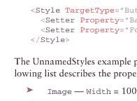

#### 未命名样式

在前几节描述的所有样式中，Style 元素都包含一个 x:Key 特性来为样式命名。然后控件使用 StaticResource 关键字引用该名称。

相反，如果省略该特性并包含 TargetType，那么生成的未命名样式将应用于该样式作用域内所有 TargetType 类型的控件。例如，下面的 Style 应用于该样式作用域内的每个 Button，因此每个 Button 都显示为黄色背景和红色前景：

```
<Style TargetType="Button">
<Setter Property="Background" Value="Yellow" />
<Setter Property="Foreground" Value="Red" />
</Style>
```

下图所示的 UnnamedStyles 示例程序定义了四个未命名样式。以下列表描述了这些样式为其类设置的属性：

- Image — Width = 100，Height = 100，Stretch = Uniform，BitmapEffect = 投影
- Label — FontFamily = Comic Sans MS，FontSize = 18，FontWeight = bold，HorizontalAlignment = center，BitmapEffect = 浅蓝色外发光
- Button — FontFamily = Arial，FontSize = 12，Height = 20，Background = 蓝白线性渐变
- StackPanel — Margin = 5

#### IsMouseOver 触发器

一种常见的属性触发器会在用户将鼠标移到某个对象上时采取行动。当 IsMouseOver 属性为 True 时，这些触发器会执行其 Setter。

以下 XAML 代码定义了一个未命名的 Button Style。它设置一些基本值，然后定义一个在 IsMouseOver 属性为 True 时执行的 Trigger。当鼠标移到 Button 上时，Trigger 会使 Button 变大，并使其字体更大且加粗。


```
<Style TargetType="Button">
  <Setter Property="VerticalAlignment" Value="Top"/>
  <Setter Property="Margin" Value="10"/>
  <Setter Property="Background" Value="Violet"/>
  <Setter Property="Width" Value="100"/>
  <Setter Property="Height" Value="30"/>
  <Setter Property="FontSize" Value="16"/>
  <Style.Triggers>
    <Trigger Property="IsMouseOver" Value="True">
      <Setter Property="Width" Value="105"/>
      <Setter Property="Height" Value="50"/>
      <Setter Property="FontSize" Value="20"/>
      <Setter Property="FontWeight" Value="Bold"/>
    </Trigger>
  </Style.Triggers>
</Style>
```

此处所示的 IsMouseOverTriggers 示例程序使用这段代码在鼠标位于按钮上时提供反馈。

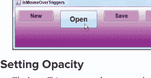

#### 设置不透明度

下图所示的 ImageTriggers 示例程序使用触发器突出显示鼠标下方的图像。

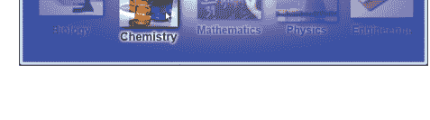


The program uses several Styles to make building the list of images easier. They’re rather long, so they aren’t shown here. You can download the example program from the book’s web site and take a look if you like.

The bottom of the program’s window contains a series of StackPanel controls, each of which holds an Image and a Label. The following code shows how the program displays the controls for the Engineering department on the right:


```xml
<StackPanel Style="{StaticResource DepartmentStackPanel}">
    <Image Source="Engineering.jpg" />
    <Label Style="{StaticResource ImageLabelStyle}" Content="Engineering" />
</StackPanel>
```

The key is the DepartmentStackPanel Style defined in the following code:


```xml
<ScaleTransform x:Key="BigScale" ScaleX="1.1" ScaleY="1.1"/>

<Style x:Key="DepartmentStackPanel" TargetType="StackPanel">
    <Setter Property="Margin" Value="10"/>
    <Setter Property="Opacity" Value="0.5"/>
    <Setter Property="Background" Value="Transparent"/>
    <Style.Triggers>
        <Trigger Property="IsMouseOver" Value="True">
            <Setter Property="Opacity" Value="1"/>
            <Setter Property="LayoutTransform"
                    Value="{StaticResource BigScale}"/>
        </Trigger>
    </Style.Triggers>
</Style>
```

### 事件触发器与动画

事件触发器让你能够检测事件何时发生。动画让你能够以一系列平滑变化的步骤改变属性值。例如，两者结合使用，你可以让 Button 检测 MouseOver 事件并使用动画放大 Button，提供与之前属性触发器提供的体验相似的图形反馈。

#### 事件触发器

A *property trigger* 在控件的属性具有特定值时采取行动。

与之相反，*event trigger* 在控件事件发生时采取行动。与在 IsMouseOver 属性为 True 时采取行动不同，事件触发器可能在 MouseEnter 事件触发时采取行动，表示鼠标移入了控件。另一个事件可能在 MouseLeave 事件触发时采取其他行动，该事件发生在鼠标移出控件时。

```xml
<EventTrigger.Actions>
    <BeginStoryboard Storyboard="{StaticResource sbSmallSize}" />
</EventTrigger.Actions>
</Style.Triggers>
</Style>
```

程序可以使用以下代码定义一个使用此样式的按钮：

```xml
<Button Style="{StaticResource btnEventSbSize}"
Content="New Size"/>
```

#### 故事板

现在你已经了解如何启动一个故事板，是时候学习如何构建一个故事板了。故事板是一个对象，用于定义一个或多个动画的时间线。

动画管理属性随时间从一个值到另一个值的过渡。动画可以包含一个开始时间，表示过渡应开始的时间，以及一个持续时间，表示动画应持续多久。

动画类让你指定想要完成的操作，然后忽略其实现方式。你只需说明希望在接下来的 3 秒内将某个属性更改为特定值，动画类就会计算出如何实现。

特定类型的动画处理不同数据类型属性的更改，例如 Double、Color、String、Thickness 等。

以下代码展示了一个包含五个 DoubleAnimation 对象的简单 Storyboard。这是 CentralizedTriggers 程序用来将第一个缩略图移入查看区域的 Storyboard。


```xml
<Storyboard x:Key="sbImg1">
    <DoubleAnimation Duration="0:0:0.5" To="120"
        Storyboard.TargetName="img1"
        Storyboard.TargetProperty="(Canvas.Left)" />
    <DoubleAnimation Duration="0:0:0.5" To="0"
        Storyboard.TargetName="img1"
        Storyboard.TargetProperty="(Canvas.Top)" />
    <DoubleAnimation Duration="0:0:0.5" To="485"
        Storyboard.TargetName="img1"
        Storyboard.TargetProperty="Width" />
    <DoubleAnimation Duration="0:0:0.5" To="400"
        Storyboard.TargetName="img1"
        Storyboard.TargetProperty="Height" />
    <DoubleAnimation Duration="0:0:0.5" To="1"
        Storyboard.TargetName="img1"
        Storyboard.TargetProperty="Opacity" />
</Storyboard>
```

第一个动画使控件 `img1` 的 `Canvas.Left` 属性从其当前值（无论是什么）在一 0.5 秒间隔内变为 120。第二个动画类似地在相同的 0.5 秒内将控件的 `Canvas.Top` 属性更改为 0。

第三个和第四个动画分别将 `img1` 控件的 `Width` 和 `Height` 属性更改为 485 和 400。最后一个动画将控件的 `Opacity` 更改为 1，使其完全不透明。

#### 动画类型

WPF 提供了许多用于为不同数据类型属性设置动画的类。以下表格列出了具有对应动画类的 数据类型。例如，你可以使用 `Int32Animation` 类为 32 位整数属性设置动画。

|  |  |  |  |
|---|---|---|---|
| Boolean | Int16 | Point3D | String |
| Byte | Int32 | Quaternion | Thickness |
| Char | Int64 | Rect | Vector |
| Color | Matrix | Rotation3D | Vector3D |
| Decimal | Object | Single |  |
| Double | Point | Size |  |

这些数据类型大多数都有两种动画类。第一种后缀为 `Animation`，执行属性值的简单线性插值，使得属性值根据已用时间在起始值和结束值之间按比例设置。当 `Duration` 过了 1/4 时，值将处于起始值和结束值之间四分之一的位置。

第二种动画类的后缀为 `AnimationUsingKeyFrames`。这种类型的动画在访问中间的特定关键值时将属性从一个值更改为另一个值。你可以使用几种不同的对象来指定关键帧值，而关键帧类的类型决定了动画如何移动到帧的值。

最常见的关键帧对象类型以线性方式、使用样条曲线或离散方式移动到其关键值。一些其他关键帧动画可以使它们的值沿路径跟随。

例如，你可以使用路径动画将控件沿椭圆边框或一系列曲线移动。

此处所示的 RovingButtonWithPath 示例程序将一个 `Button` 沿黑色所示的路径移动。随着移动，`Button` 会旋转以匹配该点曲线的角度。

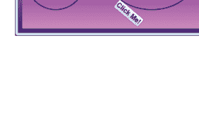

RovingButtonWithPath 程序使用以下代码为其 Button 设置动画：

```xml
<PathGeometry x:Key="pathMove"
Figures="M 10,85
A 100,70 0 1 1 210,85
A 100,70 0 1 0 410,85
A 130,70 0 1 0 150,85
A 70,70 0 1 1 10,85"/>
<Storyboard x:Key="sbMoveButton" RepeatBehavior="Forever">
<DoubleAnimationUsingPath Duration="0:0:4"
Storyboard.TargetName="btnMover"
Storyboard.TargetProperty="(Canvas.Left)"
Source="X"
PathGeometry="{StaticResource pathMove}"/>
<DoubleAnimationUsingPath Duration="0:0:4"
Storyboard.TargetName="btnMover"
Storyboard.TargetProperty="(Canvas.Top)"
Source="Y"
PathGeometry="{StaticResource pathMove}"/>
<DoubleAnimationUsingPath Duration="0:0:4"
Storyboard.TargetName="btnMover"
Storyboard.TargetProperty="RenderTransform.Angle"
Source="Angle"
PathGeometry="{StaticResource pathMove}"/>
</Storyboard>
```

WPF 程序员参考 9780470477229 RovingButtonWithPath

代码首先创建了一个 PathGeometry 对象来定义路径。然后在 sbMoveButton Storyboard 中使用该对象。

Storyboard 的第一个 DoubleAnimationUsingPath 对象更改 Button 的 Canvas.Left 属性。Source 属性指示属性应随着动画沿路径进行而设置为路径的 X 坐标。

类似地，第二个 DoubleAnimationUsingPath 对象使 Button 的 Canvas.Top 属性随着动画进行而匹配路径的 Y 坐标。

Button 的定义包含一个 RenderTransform 对象，该对象最初将 Button 旋转 -90 度。最后一个动画对象使 Button 的 `RenderTransform.Angle` 属性在动画期间匹配路径的 Angle。

#### 媒体与时间线

BeginStoryboard、PauseStoryboard 以及其他 Storyboard 控制类实际上只是操作包装器——执行操作的对象，而不是表示“物理”对象（如按钮、标签和网格）。另一个有用的操作包装器是 SoundPlayerAction，它播放音频文件。

下一幅图中所显示的 BouncingBall 示例程序使用以下 Storyboard 使其红色球上下弹跳，并在球每次撞击“地面”时播放音效。

```xml
<!-- One Storyboard to rule them all. -->
<Storyboard x:Key="sbBounce" RepeatBehavior="Forever">
<!-- Play the sound after 1 second. -->
<ParallelTimeline BeginTime="0:0:0">
<MediaTimeline BeginTime="0:0:1" Source="boing.wav"
```

Storyboard.TargetName="medBoing"/>
</ParallelTimeline>

<!-- Move the ball and its shadow. -->
<ParallelTimeline BeginTime="0:0:0" AutoReverse="True">
<DoubleAnimationUsingKeyFrames
Storyboard.TargetName="ellBall"
Storyboard.TargetProperty="(Canvas.Top)"
<SplineDoubleKeyFrame KeyTime="0:0:1"
KeySpline="0.5,0 1,1"
Value="120"/>
</DoubleAnimationUsingKeyFrames>
<DoubleAnimationUsingKeyFrames
Storyboard.TargetName="ellShadow"
Storyboard.TargetProperty="Opacity">
<SplineDoubleKeyFrame KeyTime="0:0:1"
KeySpline="0.5,0 1,1"
Value="1"/>
</DoubleAnimationUsingKeyFrames>
</ParallelTimeline>
</Storyboard>

Storyboard 包含两个独立运行的 ParallelTimeline 对象。第一个等待 1 秒，直到球触及“地面”，然后使用 MediaTimeline 对象播放音效。

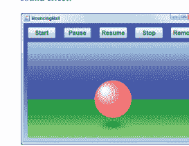

第二个 ParallelTimeline 包含两个 DoubleAnimationUsingKeyframes 对象，一个控制球的 Canvas.Top 属性，一个控制阴影的 Opacity。随着球的动画将球向下移动，阴影的动画使阴影变得更不透明。当动画结束时，球触及“地面”，阴影完全不透明。

### 模板

属性和样式决定了控件的外观和行为。

相比之下，模板决定了控件的结构。它们决定了构成控件的组件以及这些组件如何交互以提供控件的功能。

#### 模板概述

仔细观察下图，你可以看到 `Slider` 控件包含许多部分，包括：

- 边框
- 刻度标记
- 背景
- 背景上的可点击区域（基本上是控件顶部与其刻度标记之间垂直的任何位置），可更改当前值
- 表示当前值且可拖动来回的 Thumb
- 选择指示器（小黑三角）指示所选范围

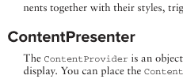

这些功能由构成 `Slider` 的各个部分提供。

`template` 决定了构成控件的各个部分。它决定了控件的组件及其样式、触发器以及控件所需的一切其他内容。

#### 内容呈现器

ContentPresenter 是 WPF 提供的一个对象，用于显示控件应显示的内容。你可以将 ContentPresenter 放置在为模板构建的任何控件层次结构中，它将显示内容。

例如，以下代码展示了一个极其简单的 Label 模板：


```xml
<Window.Resources>
    <ControlTemplate x:Key="temSimpleLabel" TargetType="Label">
        <Border BorderBrush="Red" BorderThickness="1">
            <ContentPresenter/>
        </Border>
    </ControlTemplate>
</Window.Resources>
```

SimpleLabelTemplate 示例程序在下图中显示了两个 Labels。左侧的一个不使用模板，而右侧的一个使用 temSimpleLabel 模板。

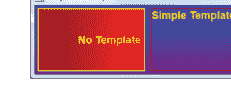

#### 模板绑定

如果比较上图中两个 Labels，你会发现即使这个简单示例也存在一些潜在问题。因为模板的 Border 控件为其 BorderBrush 和 BorderThickness 属性包含了显式值，它会覆盖在创建 Label 的代码中设置的值。Border 控件也没有指定 Background，因此它使用默认的透明背景。

这意味着使用模板的控件不会显示正确的背景或边框。它也不尊重请求的 HorizontalContentAlignment 和 VerticalContentAlignment 值。

幸运的是，模板可以通过使用模板绑定来了解客户端控件上设置的一些属性。例如，以下代码片段将模板中某部分的 Background 属性设置为控件的 Background 属性所设置的值：

```xml
Background="{TemplateBinding Background}"
```

以下代码展示了更好的 Label 模板版本，它尊重控件的多个背景和前景属性：

可在 Wrox.com 上下载

```xml
<ControlTemplate x:Key="temBetterLabel" TargetType="Label">
    <Border
        Background="{TemplateBinding Background}"
        BorderBrush="{TemplateBinding BorderBrush}"
        BorderThickness="{TemplateBinding BorderThickness}">
        <ContentPresenter Margin="4"
            HorizontalAlignment="{TemplateBinding HorizontalContentAlignment}"
            VerticalAlignment="{TemplateBinding VerticalContentAlignment}"/>
    </Border>
</ControlTemplate>
```

WPF 程序员参考 9780470477229 BetterLabelTemplate

BetterLabelTemplate 示例程序在此使用此模板显示一个看起来更像未使用模板的 Label。

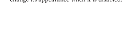

#### 模板事件

要使模板控件响应事件，你可以像之前向样式添加那样向模板添加属性和事件触发器。

除了由用户操作（如移动或按下鼠标）引起的事件外，控件还必须响应状态变化。例如，尽管 Label 大多只是静止不动，但当它被禁用时也应改变其外观。

此处显示的 DisabledLabelTemplate 示例程序使用一个模板为禁用的 Label 提供独特的外观。

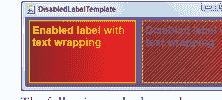

以下代码展示了为禁用 Label 提供外观的模板：

可在 Wrox.com 上下载

```xml
<ControlTemplate x:Key="temWrappedLabel" TargetType="Label">
    <Grid>
        <Border Name="brdMain"
                Background="{TemplateBinding Background}"
                BorderBrush="{TemplateBinding BorderBrush}"
                BorderThickness="{TemplateBinding BorderThickness}">
            <TextBlock Name="txtbContent"
                       Margin="4"
                       TextWrapping="Wrap"
                       Text="{TemplateBinding ContentPresenter.Content}"/>
        </Border>
        <Canvas Name="canDisabled" Opacity="0">
            <Canvas.Background>
                <LinearGradientBrush StartPoint="0,0" EndPoint="3,3"
                                     MappingMode="Absolute"
                                     SpreadMethod="Repeat">
                    <GradientStop Color="LightGray" Offset="0"/>
                    <GradientStop Color="Black" Offset="1"/>
                </LinearGradientBrush>
            </Canvas.Background>
        </Canvas>
    </Grid>
    <ControlTemplate.Triggers>
        <Trigger Property="IsEnabled" Value="False">
            <Setter TargetName="canDisabled" Property="Opacity" Value="0.5"/>
            <Setter TargetName="txtbContent" Property="Foreground" Value="Gray"/>
        </Trigger>
    </ControlTemplate.Triggers>
</ControlTemplate>
```

#### 玻璃按钮

此处显示的 GlassButton 示例程序使用模板为其按钮提供玻璃般的外观。

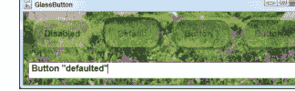

左侧的禁用按钮看起来褪色且不响应用户。

第二个标记为 Default 的按钮与其他按钮的边框不同。如果用户按下 [Enter] 键时没有其他按钮获得焦点，则该 Button 会触发其 Click 事件。在上图中，TextBox 具有焦点，因此按下 [Enter] 键会触发默认按钮。

下图显示鼠标悬停在 Button 3 上时的程序。鼠标下的按钮变得不那么透明。请注意，焦点仍在 TextBox 中（你可以在此图中看到插入符号），因此默认按钮仍显示其独特的边框。

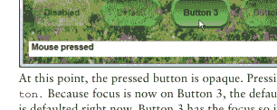

下图显示用户在 Button 3 上按下鼠标时的程序。

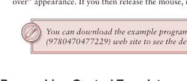

此时，按下的按钮是不透明的。按下按钮还会将焦点移动到该按钮。因为焦点现在在 Button 3 上，默认按钮不再是默认的。事实上，现在没有任何按钮是默认的。Button 3 具有焦点，因此如果用户按下 [Enter] 就会触发，但它不是默认的，所以即使用户释放鼠标后也不会显示默认边框。

如果在按钮仍被按住时将鼠标拖离按钮，按钮会恢复其获得焦点的“鼠标悬停”外观。如果随后释放鼠标，则不会发生鼠标点击。

> 你可以从 WPF Programmer's Reference（9780470477229）网站下载示例程序以查看详细信息。

#### 研究控件模板

要有效地构建模板，你需要了解控件为你提供了哪些行为以及你需要为其提供哪些行为。你还需要确定控件提供的事件，以便知道何时有机会使控件采取行动。

那么，如何了解有哪些属性和模板绑定可用呢？


一个很好的信息来源是 Microsoft 的“控件样式和模板”网页，网址为 msdn.microsoft.com/cc278075 (VS.95).aspx。该页面提供了指向其他页面的链接，这些页面描述了不同控件模板可用的功能。

这些网页还展示了控件使用的默认模板。Button 控件的默认模板长达 84 行，相当复杂。有些模板更长、更复杂。

除使用 Microsoft 的网页外，您还可以让控件告诉您其模板信息。ShowTemplate 示例程序会显示控件的默认模板。在下图中，该控件是左上角的 Slider。要查看不同类型控件使用的模板，请用另一个控件替换 Slider，将其命名为 Target，然后运行程序。

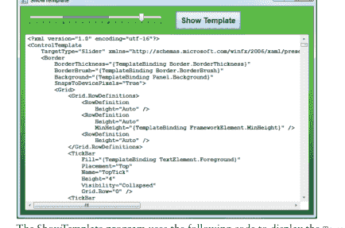

ShowTemplate 程序使用以下代码显示 Target 控件的模板：

```csharp
private void btnShowTemplate_Click(object sender, RoutedEventArgs e)
{
    XmlWriterSettings writer_settings = new XmlWriterSettings();
    writer_settings.Indent = true;
    writer_settings.IndentChars = "    ";
    writer_settings.NewLineOnAttributes = true;

    StringBuilder sb = new StringBuilder();
    XmlWriter xml_writer = XmlWriter.Create(sb, writer_settings);

    XamlWriter.Save(Target.Template, xml_writer);

    txtResult.Text = sb.ToString();
}
```


### 皮肤

主题可让程序自动更改以匹配系统的其余外观。

皮肤更有趣。皮肤是一组打包的外观和行为，可以使应用程序（或应用程序的一部分）具有独特的外观，同时仍能提供其关键功能。

例如，下两幅图显示了 ResourceDictionaries 示例程序（参见“合并资源字典”部分）显示两种截然不同的外观。它在两幅图中都是同一个程序，并且包含相同的控件——只是稍微重新排列，并使用不同的颜色、字体等等。

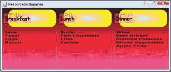

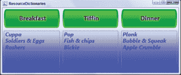

#### 资源皮肤

前两幅图所示的 ResourceDictionaries 程序使用两组不同的资源在设计时更改其外观。

以下代码显示了窗口的资源字典。内部的 ResourceDictionary 元素加载了两个不同的资源字典。由于后加载的字典会覆盖先加载的字典，因此您可以通过更改这两个元素的顺序来更改应用程序的外观。（如图所示，Red.xaml 字典第二个加载，因此程序使用其红色界面。）


```xml
<Window.Resources>
    <ResourceDictionary>
        <ResourceDictionary.MergedDictionaries>
            <ResourceDictionary Source="ResBlue.xaml" />
            <ResourceDictionary Source="ResRed.xaml" />
        </ResourceDictionary.MergedDictionaries>
    </ResourceDictionary>
</Window.Resources>
```

虽然 ResourceDictionaries 程序可以显示两种不同的外观，但您需要在设计时修改程序以选择想要的皮肤。

Skins 示例程序与 ResourceDictionaries 程序非常相似，只是它可以在运行时更改皮肤。为了实现这一点，其大部分资源是动态的而不是静态的。该程序还包含两个新的用户界面元素：一个 Image 和一个 Label。

当它显示红色界面时，此程序在其右上角添加一个小的 Image。此 Image 具有一个上下文菜单，显示 Red 和 Blue 选项（在下图中左侧显示），可让您在红色和蓝色皮肤之间进行选择。

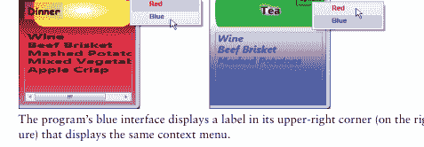

程序的蓝色界面在其右上角显示一个标签（在前一图中右侧），该标签显示相同的上下文菜单。

以下代码显示了程序如何在蓝色界面上显示其 Options 文本框：


```xml
<Label MouseDown="Options_MouseDown"
Grid.Row="0" Grid.Column="2" Margin="2"
Content="Options" FontSize="10"
HorizontalAlignment="Right" VerticalAlignment="Top"
Foreground="Black" BorderBrush="Black"
BorderThickness="1"
Visibility="{DynamicResource visBlue}"
>
  <Label.Background>
    <LinearGradientBrush StartPoint="0,0" EndPoint="0,1">
      <GradientStop Color="Lime" Offset="0"/>
      <GradientStop Color="Green" Offset="1"/>
    </LinearGradientBrush>
  </Label.Background>
  <Label.ContextMenu>
    <ContextMenu Name="ctxOptions">
      <MenuItem Header="Red" Background="Pink"
                Foreground="Red"
                Click="ctxSkin_Click" Tag="ResRed.xaml"/>
      <MenuItem Header="Blue" Background="LightBlue"
                Foreground="Blue"
                Click="ctxSkin_Click" Tag="ResBlue.xaml"/>
    </ContextMenu>
  </Label.ContextMenu>
</Label>
```

此代码包含四个真正值得关注的点：


- **1.** 首先，Label 的 MouseDown 事件会触发 Options_MouseDown 事件处理程序。此例程在以下代码中显示，通过将 ContextMenu 的 IsOpen 属性设置为 True 来显示上下文菜单：

```csharp
// Display the options context menu.
private void Options_MouseDown(object sender, RoutedEventArgs e)
{
    ctxOptions.IsOpen = true;
}
```

- **2.** 其次，Label 的 Visibility 属性被设置为 visBlue 静态资源的值。此资源在 Blue 资源字典中的值为 True，在 Red 资源字典中的值为 False。这意味着 Label 仅在蓝色界面中可见。红色界面的换肤 Image 使用类似的 visRed 资源，该资源仅在红色界面中为 True。

- **3.** 第三，上下文菜单的项具有一个 Tag 属性，该属性命名了它们加载的 XAML 资源文件。例如，Blue 菜单项的 Tag 设置为 ResBlue.xaml。程序使用 Tag 属性来确定在用户选择菜单项时加载哪个文件。


- **4.** 最后，上下文菜单的两个项都会触发以下代码中显示的 ctxSkin_Click 事件处理程序以加载适当的皮肤：

```csharp
// Use the selected skin.
private void ctxSkin_Click(object sender, RoutedEventArgs e)
{
    // Get the context menu item that was clicked.
    MenuItem menu_item = (MenuItem)sender;

    // Create a new resource dictionary, using the
    // menu item's Tag property as the dictionary URI.
    ResourceDictionary dict = new ResourceDictionary();
    dict.Source = new Uri((String)menu_item.Tag, UriKind.Relative);

    // Remove all but the first dictionary.
    while (App.Current.Resources.MergedDictionaries.Count > 1)
    {
        App.Current.Resources.MergedDictionaries.RemoveAt(1);
    }

    // Install the new dictionary.
    App.Current.Resources.MergedDictionaries.Add(dict);
}
```

此代码获取触发事件的菜单项，并查看该项的 Tag 属性以查看要加载哪个资源文件。它创建从文件中加载的 ResourceDictionary 对象，从应用程序的 MergedDictionaries 集合中删除旧的资源字典，并添加新的字典。

#### 动画皮肤

上一节中描述的皮肤使用单独的资源字典来提供不同的外观。程序的 XAML 文件将其控件属性设置为资源值，因此当您更改资源值时，界面会相应更改。

另一种更改属性值的方法是使用属性动画。本节简要说明如何使用动画提供换肤功能。

XAML 文件允许您定义触发器以启动代表属性动画的故事板。例如，当用户在矩形上按下鼠标时，XAML 代码可以运行一个故事板，使 `Rectangle's Width` 属性在 1 秒内平滑地从 100 变为 200。

AnimatedSkins 示例程序使用此技术提供换肤功能。下两幅图显示了程序显示其绿色皮肤和蓝色皮肤。

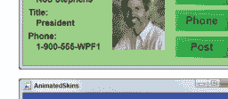

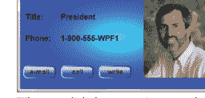

当您点击适当的控件时，触发器会启动一个故事板，该故事板会：

- 调整主窗口大小并更改其 `Background` 画刷。
- 隐藏并显示您点击以切换皮肤的右上角的小蓝色或绿色椭圆。
- 移动 `Labels`。
- 调整充当按钮的矩形的大小、移动位置并更改其圆角半径。
- 更改伪装成按钮的矩形的 `Fill` 和 `Stroke` 画刷。
- 更改 `Labels` 中显示的文本。
- 移动并调整 `Image` 的大小。
- 更改背景和前景颜色。


```csharp
Button btn;
Polygon pgn;
Rectangle rect;
Grid grd;
Ellipse ell;

switch (element.Tag.ToString())
{
    case "Red":
        btn = (Button)element.FindName("btnRepairDisk");
        btn.Click += new RoutedEventHandler(btnRepairDisk_Click);
        Code for other controls omitted
        break;

    case "Blue":
        Lots of code omitted

        // Uses the same event handler as rectMove.
        ell = (Ellipse)element.FindName("ellMove");
        ell.MouseDown += new System.Windows.Input.MouseButtonEventHandler(
            rectMove_MouseDown);

        grd = (Grid)element.FindName("grdExit");
        grd.MouseDown += new System.Windows.Input.MouseButtonEventHandler(
            grdExit_MouseDown);
        break;
}
```

代码首先使用 WPF 的 LoadComponent 方法加载所需 XAML 皮肤文件。它将窗口的主内容元素设置为从文件中加载的根元素，以便显示新的控件。

接下来，代码检查新加载的根元素的 Tag 属性，以查看它现在是否显示红色或蓝色皮肤。根据加载的皮肤，代码会在皮肤中查找特定控件并连接其事件处理程序。

### 打印视觉对象

WPF 中用于打印的核心类之一是 PrintDialog。该类提供方法让用户选择打印机、与打印队列交互以及将输出发送到打印机。

通常打印有三个步骤：

1. 创建一个新的 PrintDialog 对象并使用其 ShowDialog 方法向用户显示它。
2. 检查 ShowDialog 的返回结果以查看用户是否单击了 OK。
3. 使用 PrintDialog 的方法生成打印输出。


SimplePrintWindow 示例程序使用以下代码执行这三个步骤：

```csharp
// Display the print dialog.
PrintDialog pd = new PrintDialog();

// See if the user clicked OK.
if (pd.ShowDialog() == true)
{
    // Print.
    pd.PrintVisual(this, "New Customer");
}
```

WPF 程序员参考 9780470477229 SimplePrintWindow

这非常简单，但有一个不幸的缺点：WPF 尝试在纸张的左上角绘制视觉对象。由于打印机通常无法打印到纸张边缘，结果会被截断。

与其将程序的窗口传递给 PrintVisual 方法，你可以创建一个包含窗口图像的控件层次结构。该层次结构可以使用 Grids、Viewboxes、Images、Rectangles 以及任何你想要生成结果的其他控件。它甚至可以包含额外的控件来生成页面页眉和页脚等项目。

下一幅图示中显示的 PrintWindow 示例程序使用这种方法以正常或放大比例居中打印其窗口。单击“Print Centered”按钮以正常比例打印窗口。单击“Print Stretched”按钮以尽可能大的尺寸在页面上打印窗口。


PrintWindow 程序需要引用 ReachFramework 和 System.Printing 库。在 Visual Studio 中，打开 Project 菜单并选择“添加引用”。选择这两个库并单击 OK。

为了更轻松地使用这些库，程序包含以下 using 语句：

```csharp
using System.Printing;
using System.Windows.Media.Effects;
```

```csharp
    )

    // Make a VisualBrush holding an image of the Window's contents.
    VisualBrush vis_br = new VisualBrush(win);

    // Make a rectangle the size of the Window.
    Rectangle win_rect = new Rectangle();
    view_box.Child = win_rect;
    win_rect.Width = win.Width;
    win_rect.Height = win.Height;
    win_rect.Fill = vis_br;
    win_rect.Stroke = Brushes.Black;
    win_rect.BitmapEffect = new DropShadowBitmapEffect();

    // Arrange to produce output.
    Rect rect = new Rect(0, 0,
        pd.PrintableAreaWidth, pd.PrintableAreaHeight);
    drawing_area.Arrange(rect);

    // Print it.
    pd.PrintVisual(drawing_area, title);
}
```

WPF 程序员参考 9780470477229 PrintWindow

下一幅图显示了当程序窗口被拉伸并使用 Microsoft XPS Document Writer 打印时，首选项设置为横向方向并在 XPS Viewer 中显示的结果。


以下代码片段显示了 ShapesPaginator 类的关键部分：


```csharp
class ShapesPaginator : DocumentPaginator
{
    private Size m_PageSize;

    // Save the page size.
    public ShapesPaginator(Size page_size)
    {
        m_PageSize = page_size;
    }

    // Return the needed page.
    public override DocumentPage GetPage(int pageNumber)
    {
        const double WID = 600;
        const double HGT = 800;

        Grid drawing_grid = new Grid();
        drawing_grid.Width = m_PageSize.Width;
        drawing_grid.Height = m_PageSize.Height;

        switch (pageNumber)
        {
            case 0: // Ellipse
                Ellipse ell = new Ellipse();
                ell.Fill = Brushes.Orange;
                ell.Stroke = Brushes.Blue;
                ell.StrokeThickness = 1;
                ell.HorizontalAlignment = HorizontalAlignment.Center;
                ell.VerticalAlignment = VerticalAlignment.Center;
                ell.Width = WID;
                ell.Height = HGT;
                drawing_grid.Children.Add(ell);
                break;

            ... Code for other pages omitted ...

        }

        // Arrange to make the controls draw themselves.
        Rect rect = new Rect(new Point(0, 0), m_PageSize);
        drawing_grid.Arrange(rect);

        // Return a DocumentPage wrapping the grid.
        return new DocumentPage(drawing_grid);
    }

    // If pagination is in progress and PageCount is not final, return False.
    // If pagination is complete and PageCount is final, return True.
    // In this example, there is no pagination to do.
    public override bool IsPageCountValid
    {
        get { return true; }
    }

    // The number of pages paginated so far.
    // This example has exactly 4 pages.
    public override int PageCount
    {
        get { return 4; }
    }

    // The suggested page size.
    public override Size PageSize
    {
        get { return m_PageSize; }
        set { m_PageSize = value; }
    }

    // The element currently being paginated.
    public override IDocumentPaginatorSource Source
    {
        get { return null; }
    }
}
```

### 数据绑定

WPF 数据绑定让你将目标绑定到数据源，以便目标自动显示数据源中的值。例如，这让你可以：

- 让 `ListBox` 显示在 XAML 代码中定义的值数组。
- 让 `ListBox` 显示在代码后置中创建的对象列表。
- 让 `TreeView` 构建代码后置中创建的对象的分层显示。
- 让 `TextBoxes`、`Labels` 和其他控件显示 `ListBox`、`ComboBox` 或 `TreeView` 中当前选中项的额外详细信息。

额外的 WPF 数据绑定功能让你可以排序、过滤和分组数据；让用户修改控件以更新数据源；并验证对数据的更改。

#### 绑定基础

数据绑定有以下四个基本部分：

- **目标** — 将使用绑定结果的对象
- **目标属性** — 将使用结果的目标对象的属性
- **源** — 为目标对象提供值的对象
- **路径** — 在源对象内定位值的路径

作为一个简单的例子，假设你想绑定 Label 控件的 Content 属性，以便 Label 显示你在 TextBox 中输入的任何内容。如果 Label 控件命名为 lblResult 且 TextBox 命名为 txtTypeHere，那么你需要创建一个绑定，其中：

- 目标是 lblResult（你希望绑定结果去到的控件）。
- 目标属性是 Content（你希望 Label 在其 Content 属性中显示结果）。
- 源是 txtTypeHere（提供值的对象）。
- 路径是 Text（源对象中数据的路径，在本例中为 TextBox 的 Text 属性）。

此处显示的 TextBoxToLabel 示例程序演示了这种简单绑定。当你在文本框中输入时，下面的两个标签会回显你输入的内容。

以下 XAML 代码显示了程序的工作原理：


```xml
<StackPanel Margin="5">
    <TextBox Name="txtTypeHere" Margin="5" Height="30" VerticalAlignment="Top" Text="Type here!"/>
    <Label Margin="5" BorderBrush="Yellow" BorderThickness="1">
        <Binding ElementName="txtTypeHere" Path="Text"/>
    </Label>
    <Label Margin="5" BorderBrush="Yellow" BorderThickness="1" Content="{Binding ElementName=txtTypeHere, Path=Text}"/>
</StackPanel>
```

下一幅图示中显示的 PersonSource 示例程序使用绑定，其 Source 属性设置为显示 Person 对象的信息。


PersonSource 示例程序定义了一个 Person 类，其属性为 FirstName、LastName 和 NetWorth。程序的 XAML 代码包含以下命名空间定义，以便它可以使用该类：

```xml
xmlns:local="clr-namespace:PersonSource"
```


下面的代码展示了程序的 XAML 代码如何定义一个名为 `a_person` 的静态资源，该资源是一个 `Person` 对象：


```
<Window.Resources>
    <local:Person x:Key="a_person" FirstName="Bill"
        LastName="Gates" NetWorth="40000000000"/>
</Window.Resources>
```

WPF 程序员参考 9780470477229 PersonSource

下面的代码展示了程序如何使用绑定来显示 `Person` 对象的 `FirstName`、`LastName` 和 `NetWorth` 值。它使用绑定的 `Source` 属性来标识提供这些值的 `Person` 对象。


```
<Label Grid.Row="1" Grid.Column="0" Content="First Name:"/>
<Label Grid.Row="1" Grid.Column="1"
    Content="{Binding Source={StaticResource a_person}, Path=FirstName}"/>

<Label Grid.Row="2" Grid.Column="0" Content="Last Name:"/>
<Label Grid.Row="2" Grid.Column="1"
    Content="{Binding Source={StaticResource a_person}, Path=LastName}"/>

<Label Grid.Row="3" Grid.Column="0" Content="NetWorth:"/>
<Label Grid.Row="3" Grid.Column="1"
    Content="{Binding Source={StaticResource a_person}, Path=NetWorth}"/>
```

WPF 程序员参考 9780470477229 PersonSource

### RelativeSource

绑定的 `RelativeSource` 属性允许你通过源对象与目标控件的关系来指定源对象。一种有用的情形是，当你想要绑定同一控件上的两个属性时。

下一幅图中显示的 TypeAColor 示例程序将 `TextBox` 的 `Background` 属性绑定到它的 `Text` 属性，因此当你输入颜色名称时，该控件会将该颜色用作其背景。


下面的代码展示了 TypeAColor 程序如何将 `TextBox` 的 `Background` 属性绑定到它的 `Text` 属性：


```
<TextBox Margin="10" Height="30" VerticalAlignment="Top"
    Background="{Binding RelativeSource={RelativeSource Self}, Path=Text}"/>
```

WPF 程序员参考 9780470477229 TypeAColor

### ListBox 和 ComboBox 模板

`ListBox` 和 `ComboBox` 控件有一个 `ItemTemplate` 属性，它决定每个项如何显示。这些模板与“Templates”一节中描述的模板有些相似。

模板可以包含你希望用来表示控件项的任何控件。通常，其中许多控件会绑定到控件当前显示的项所具有的属性。

下一幅图中显示的 Planets 示例程序在左侧的 `ListBox` 中以及右侧的 `ComboBox` 中显示一个 `Planet` 对象数组。


下面的代码展示了该程序的 `ListBox` 所使用的 `ItemTemplate`：

可在 Wrox.com 下载

```
<ListBox.ItemTemplate>
  <DataTemplate>
    <DataTemplate.Resources>
      <!--  The ListBoxItem style must be set in ListBox.Resources.  -->
      <Style TargetType="TextBlock">
        <Setter Property="Margin" Value="3"/>
        <Setter Property="HorizontalAlignment" Value="Left"/>
        <Setter Property="VerticalAlignment" Value="Center"/>
        <Setter Property="FontSize" Value="20"/>
        <Setter Property="FontWeight" Value="Bold"/>
        <Setter Property="Foreground" Value="Blue"/>
      </Style>
      <Style TargetType="Image">
        <Setter Property="Height" Value="50"/>
        <Setter Property="Margin" Value="3"/>
        <Setter Property="Stretch" Value="Uniform"/>
        <Setter Property="HorizontalAlignment" Value="Right"/>
      </Style>
      <Style TargetType="TextBox">
        <Setter Property="Margin" Value="3"/>
        <Setter Property="Width" Value="250"/>
        <Setter Property="Background" Value="SkyBlue"/>
        <Setter Property="TextWrapping" Value="Wrap"/>
        <Setter Property="IsReadOnly" Value="True"/>
      </Style>
</DataTemplate.Resources>
<StackPanel>
    <Grid>
        <TextBlock Text="{Binding Name}"/>
        <Image Source="{Binding Picture}"
               Height="50"/>
        <Grid>
            <TextBox Text="{Binding Stats}"/>
        </StackPanel>
    </DataTemplate>
</ListBox.ItemTemplate>
```

这段代码的大部分使用样式来为将显示项数据的控件定义属性。

末尾的 `StackPanel` 包含这些控件。实际显示数据的控件是：

- 一个绑定到 `Planet` 项的 `Name` 属性的 `TextBlock`
- 一个绑定到 `Planet` 的 `Picture` 属性的 `Image`
- 一个绑定到 `Planet` 的 `Stats` 属性的 `TextBox`

### TreeView 模板

`TreeView` 控件的工作方式与 `ListBox` 和 `ComboBox` 略有不同，因为它显示的是分层数据，而不是简单列表中的项。

在 `TreeView` 中，必须为树中的每个节点指定两件事——该节点要显示的数据，以及向树更深处延伸时要遵循的路径。

下一幅图中显示的 OrgChartTreeView 示例程序显示一个公司组织结构图，其中的部门可按经理显示，也可按项目显示。为了更容易理解这些项，区域名称显示为红色，部门名称显示为蓝色并以“department”一词结尾，经理名称显示在蓝色框中，项目名称显示在金菊色框中，员工名称显示为普通黑色文本。

左侧的 `TreeView` 显示区域、每个区域的部门、每个部门的经理，以及每个经理的直接下属员工。右侧的 `TreeView` 显示区域、每个区域的项目、每个部门的项目，以及每个项目的团队成员。


生成这两个显示的 `TreeView` 控件在其 `Resources` 节中包含 `HierarchicalDataTemplate` 对象，以描述控件在每个节点处应做什么。例如，下面的代码展示了这些控件如何处理 `Region` 对象：


```
<HierarchicalDataTemplate
DataType="(x:Type local:Region)"
ItemsSource="{Binding Path=Departments}">
    <TextBlock Text="{Binding Path=RegionName}" Foreground="Red">
        <TextBlock.BitmapEffect>
            <OuterGlowBitmapEffect/>
        </TextBlock.BitmapEffect>
    </TextBlock>
</HierarchicalDataTemplate>
```

上一幅图左侧的 `TreeView` 使用以下 `HierarchicalDataTemplate` 来显示 `Department` 对象的数据：


```
<HierarchicalDataTemplate
DataType="(x:Type local:Department)"
ItemsSource="{Binding Path=Managers}">
    <TextBlock Text="{Binding Path=Name}" Foreground="Blue"/>
</HierarchicalDataTemplate>
```

将该代码与上一幅图右侧的 `TreeView` 所使用的以下代码进行对比：


```
<HierarchicalDataTemplate
DataType="(x:Type local:Department)"
ItemsSource="{Binding Path=Projects}">
    <TextBlock Text="{Binding Path=Name}" Foreground="Blue"/>
</HierarchicalDataTemplate>
```

### 绑定数据库对象

ADO.NET 提供了用于与关系数据库交互的对象。由于它们也是对象，你可以像绑定本节前面描述的对象那样，将它们绑定到控件。由于这些对象比通常自己构建的对象更复杂，因此绑定它们会稍微复杂一些。

基本策略是像处理任何其他 ADO.NET 应用程序一样，在代码隐藏文件中打开数据库。将数据加载到 `DataSet`、`DataTable` 和其他 ADO.NET 对象中，然后将它们绑定到应用程序的控件。

你可以把 `DataTable` 看作类似于 `DataRow` 对象的集合，把 `DataSet` 看作类似于 `DataTable` 的集合，因此绑定语法并非完全陌生。

下一幅图中显示的 StudentData 示例程序演示了 ADO.NET 绑定。该程序从 StudentData.mdb Microsoft Access 数据库加载数据。


左侧的 `ListBox` 列出 `Students` 表中的学生。当你单击某个学生时，中间的控件显示该学生的地址和电话号码，右侧的 `ListBox` 显示来自 `TestScores` 表的相应测试成绩数据。

如果你修改中间的任意学生值，控件会自动更新相应的 `ADO.NET` 对象。如果你使用“数据”菜单的“保存更改”命令，程序会将这些更改写回数据库。（此示例不提供添加或删除学生，也不提供添加或修改学生测试成绩的方法。）

该数据库还有第三个名为 `States` 的表，其中列出美国各州（外加华盛顿特区）及其缩写。程序将此表用作查找表。`Students` 表以缩写形式包含每个学生所在的州。当显示该值时，窗口中间的 `ComboBox` 使用 `States` 表将缩写转换为州的完整名称。

### 变换

*变换*会在对象绘制之前改变其几何形状。不同类型的变换会拉伸、旋转、压扁、倾斜和移动对象。

WPF 提供四种基本类型的变换，由以下 XAML 元素表示：

- `RotateTransform` —— 此变换旋转对象。`Angle` 属性确定对象顺时针旋转的度数。
- `ScaleTransform` —— 此变换在垂直和水平方向缩放对象。`ScaleX` 和 `ScaleY` 属性分别确定水平和垂直缩放因子。
- `SkewTransform` —— 此变换通过将对象的 X 轴和 Y 轴旋转由 `AngleX` 和 `AngleY` 属性给定的角度来倾斜对象。
- `TranslateTransform` —— 此变换移动对象。`X` 和 `Y` 属性确定对象在水平和垂直方向上移动的距离。

要将变换应用于对象，请为该对象提供一个 `LayoutTransform` 或 `RenderTransform` 属性元素，其中包含四种基本变换之一。使用 `LayoutTransform` 时，WPF 会在排列控件之前修改控件。使用 `RenderTransform` 时，WPF 会先排列控件，然后修改控件。


例如，以下代码创建一个 Label。Label.LayoutTransform 元素包含一个 RotateTransform，用于将 Label 旋转 45 度。

```
<Label Canvas.Left="140" Canvas.Top="50" Background="LightGreen" Foreground="Red" Content="Rotate 45 degrees">
  <Label.LayoutTransform>
    <RotateTransform Angle="45" />
  </Label.LayoutTransform>
</Label>
```

此处展示的 Transformations 示例程序演示了各种变换。


### 效果

正如变换会修改对象的几何形状，位图效果会修改对象的绘制方式。

要为对象添加效果，请为其提供一个包含效果对象的 BitmapEffect 属性元素。例如，以下代码定义一个包含 Ellipse 和 Path 的 Canvas。Canvas.BitmapEffect 元素包含一个 DropShadowBitmapEffect 对象，以为结果添加投影。

```
<Canvas Width="100" Height="100">
  <Canvas.BitmapEffect>
    <DropShadowBitmapEffect />
  </Canvas.BitmapEffect>
  <Ellipse Stroke="Blue" Fill="Yellow" Width="100" Height="100" />
  <Path Data="M 20,50 A 30,180 1,0 80,50" Stroke="Blue" StrokeThickness="2" />
</Canvas>
```

以下列表总结了 WPF 的位图效果类：

- BevelBitmapEffect — 为对象添加斜面边缘。
- BlurBitmapEffect — 模糊对象。Radius 决定模糊的大小。
- DropShadowBitmapEffect — 在对象后面添加投影。
- `EmbossBitmapEffect` — 对对象进行浮雕效果。
- `OuterGlowBitmapEffect` — 在对象周围添加发光光晕。

如果要同时使用多个效果，请使用包含 `BitmapEffectGroup` 的 `BitmapEffect` 元素。在 `BitmapEffectGroup` 内部，放置要使用的效果。例如，以下代码使 `Canvas` 先使用 `EmbossBitmapEffect`，然后使用 `BevelBitmapEffect`。

```
<Canvas.BitmapEffect>
    <BitmapEffectGroup>
        <EmbossBitmapEffect />
        <BevelBitmapEffect BevelWidth="10" />
    </BitmapEffectGroup>
</Canvas.BitmapEffect>
```


*WPF 程序员参考 9780470477229 效果*

下一幅图中展示的 Effects 示例程序显示了一个未修改的对象，以及使用五种基本位图效果的同一对象。最后一个版本显示了使用效果组合的对象。


### 文档

WPF 文档可以包含各种各样的对象，例如：

- 段落
- 表格
- 列表
- 浮动元素
- 图形
- 用户界面元素，例如 `Buttons` 和 `TextBoxes`
- 三维对象

WPF 有两种不同类型的文档：固定文档和流文档。

#### 固定文档

*固定文档*在查看时始终以完全相同的大小和位置显示其内容。如果调整包含该文档的控件大小，文档的某些部分可能无法容纳，但它们不会被移动。从这个意义上说，这种文档类似于 PDF（可移植文档格式）文件。

#### 构建 XPS 文档

在定义固定文档时，Microsoft 还定义了 *XML 纸张规范（XPS）* 文件。*XPS 文件*是以特殊格式保存的固定文档，可以由某些程序（例如最新版本的 Internet Explorer）读取和显示。

制作 XPS 文档最灵活的方法之一是使用 Microsoft Word。只需创建一个包含所需任何文本、图形、列表或其他内容的 Word 文档，然后将其导出为 XPS 文档。

Microsoft Word 2007 可以将文件导出为 XPS（或 PDF）格式，但需要先安装加载项。截至本文撰写时，可以按照 Microsoft 的“2007 Microsoft Office 加载项：Microsoft Save as PDF or XPS”下载页面（r.office.microsoft.com/r/rlidMSAddinPDFXPS）上的说明安装该加载项。（如果该页面已移动而找不到，请转到 Microsoft 下载中心 www.microsoft.com/downloads 并搜索“Save as PDF or XPS”。）

安装加载项后，只需单击 Word 左上角的 Windows 图标以展开主文件菜单。单击“Save As”命令旁边的箭头，然后选择“PDF or XPS”项。

如果没有 Microsoft Word，但运行的是 Microsoft Windows 7 操作系统，仍然可以相对轻松地创建 XPS 文档。使用记事本、写字板或其他编辑器创建文档。然后打印它，选择 Microsoft XPS Document Writer 作为打印机。该写入器会提示你选择要保存结果的文件。

甚至可以在 Firefox 或 Internet Explorer 等浏览器中显示网页，打印它，并选择 Microsoft XPS Document Writer 作为打印机。

#### 显示 XPS 文档

创建 XPS 文件后，有多种显示选项。

Microsoft XPS Viewer 默认安装在 Windows 7 中，并集成到 Internet Explorer 6.0 及更高版本中，可以显示 XPS 文件。默认情况下，.xps 文件与 Internet Explorer 关联，因此通常只需双击文件即可查看。

还可以从 www.microsoft.com/whdc/xps/viewxps.mspx 下载 Microsoft XPS Viewer 或 Microsoft XPS Essentials Pack（其中包含独立查看器）。

最后，可以让 WPF 应用程序在 `DocumentViewer` 控件中显示 XPS 文件。为此，首先添加对 ReachFramework 库的引用。

在 Visual Studio 中，打开“项目”菜单并选择“添加引用”。在“添加引用”对话框中，选择“.NET”选项卡，选择 ReachFramework 项，然后单击“确定”。

现在可以编写代码隐藏文件，将 XPS 文档加载到 `DocumentViewer` 控件中。为了更方便地使用必要的类，可以将以下 `using` 语句添加到程序中：

```
    using System.Windows.Xps.Packaging;
```

以下代码在程序窗口加载时加载文件“Fixed Document.xps”：


// Load the XPS document.
private void Window_Loaded(object sender, RoutedEventArgs e)
{
    // Note: Mark the file as "Copy if newer".
    // to make a copy go in the output directory.
    XpsDocument xps_doc = new XpsDocument("Fixed Document.xps",
        System.IO.FileAccess.Read);
    docViewer.Document = xps_doc.GetFixedDocumentSequence();
}

#### 在 XAML 中构建固定文档

使用 Microsoft Word、写字板或其他外部程序构建 XPS 文档很容易，但有时在 XAML 或代码隐藏文件中构建固定文档更方便。例如，你可能希望程序在运行时生成报告并将其显示为固定文档。

在 XAML 代码中构建固定文档并不太复杂，尽管工作量很大，因为它是一种相当冗长的格式。

首先创建一个 DocumentViewer 来容纳文档。为其提供所需的任何属性和资源（例如背景），并在其中放置一个 FixedDocument 对象。

FixedDocument 对象应包含一个或多个定义其页面的 PageContent 对象。

可以设置每个 PageContent 对象的 Width 和 Height 属性来确定页面的大小。

在 PageContent 内部，放置一个 FixedPage 对象来定义页面的内容。

在 FixedPage 内部，可以放置 StackPanel、Grid、TextBlock 和 Border 等控件来创建页面的内容。

下一幅图中展示的 SimpleFixedDocument 示例程序绘制了四个包含简单形状和标签的固定页面。


#### 保存 XPS 文件

在费心在 XAML 或代码隐藏文件中构建固定文档之后，你可能希望将其保存为 XPS 文件。

要将固定文档保存为 XPS 文件，请在 Visual Studio 中打开项目，并添加对 ReachFramework 和 System.Printing 库的引用。为了更方便地使用这些库，可以将以下 using 语句添加到程序中：

```
using System.Windows.Xps;
using System.Windows.Xps.Packaging;
```

接下来，创建一个 XpsDocument 对象，以写入要创建的文件。创建一个与文档对象关联的 XpsDocumentWriter，并使用其 Write 方法将 FixedDocument 写入文件。

SaveFixedDocument 示例程序使用以下代码将其名为 fdContents 的 FixedDocument 对象保存到文件中。


// Save as an XPS file.
private void mnuFileSave_Click(System.Object sender, System.Windows.RoutedEventArgs e)
{
    // Get the file name.
    Microsoft.Win32.SaveFileDialog dlg =
        new Microsoft.Win32.SaveFileDialog();
    dlg.FileName = "Shapes";
    dlg.DefaultExt = ".xps";
    dlg.Filter = "XPS Documents (.xps)|*.xps|All Files (*.*)|*.*";
    if (dlg.ShowDialog() == true)
    {
        // Save the document.
        // Make an XPS document.
        XpsDocument xps_doc = new XpsDocument(dlg.FileName,
            System.IO.FileAccess.Write);

        // Make an XPS document writer.
        XpsDocumentWriter doc_writer =
            XpsDocument.CreateXpsDocumentWriter(xps_doc);
        doc_writer.Write(fdContents);
        xps_doc.Close();
    }
}

#### 流文档

流文档会根据需要重新排列其内容，以适应容纳它的容器。如果将查看控件设得又高又窄，文档会重新组织其内容以适应。从这个意义上说，这种文档类似于简单的网页，在调整浏览器大小时会重新排列其内容。

WPF 程序在以下三种查看器之一中显示流文档：
FlowDocumentPageViewer、FlowDocumentReader 或 FlowDocumentScrollViewer。 S


A `FlowDocument` 对象表示流文档本身。The `FlowDocument` 的子对象必须是派生自 `Block` 类的对象。These include `BlockUIContainer`、`List`、`Paragraph`、`Section` 和 `Table`。

### 三维绘图

WPF 依赖于 Microsoft 的 DirectX 技术来提供高质量的多媒体支持。

我最喜欢 DirectX 的部分之一是 Direct3D，这是一个三维（3D）绘图库。

下一幅图所示的 TexturedBlock 示例程序显示了一个简单的立方体，其侧面由各种材质制成，放置在砖块和草地上。你可以使用滑块实时旋转场景。


不幸的是，编写 Direct3D 代码来显示这类对象相当复杂。第一个也是最烦人的任务之一是弄清楚用户计算机上有哪些图形硬件可用。

幸运的是，WPF 的 3D 绘图对象会为你处理此设置。

这并不意味着其余过程很容易。生成一个 3D 场景需要相当多的工作，因为需要考虑许多复杂的因素，但至少 WPF 处理了初始化和重绘。

下一节解释了简单 3D 场景的基本结构和几何形状。其后的章节将更详细地描述摄像机、光照和材质。

#### Basic Structure

`Viewport3D` 控件显示一个 3D 场景。你可以把它想象成通向 3D 空间的一个窗口。

`Viewport3D` 对象的 `Camera` 属性定义用于查看场景的摄像机。

`Viewport3D` 应包含一个或多个定义场景中项目的 `ModelVisual3D` 对象。`ModelVisual3D` 的 `Content` 属性应包含视觉对象。

通常，Content 属性包含一个定义整个场景的单个 GeometryModel3D 对象，或一个包含 GeometryModel3D 对象集合的 Model3DGroup 对象。

每个 GeometryModel3D 对象可以定义任意数量的三角形，因此单个 GeometryModel3D 对象可以产生非常复杂的结果。由于三角形甚至不需要相互连接，GeometryModel3D 可以定义几个独立的物理对象。

问题在于单个 GeometryModel3D 只能有一个材质，因此任何独立对象都会具有相似的外观。

“Materials” 部分稍后会更详细地描述材质。

GeometryModel3D 对象的两个最重要的属性是 Material（刚才已描述）和 Geometry。Geometry 属性应包含一个单个 MeshGeometry3D 对象，该对象定义构成对象的三角形。

MeshGeometry3D 有四个定义其三角形的关键属性：Positions、TriangleIndices、Normals 和 TextureCoordinates。以下各节描述这些属性。

#### Positions

MeshGeometry3D 的 Positions 属性是一个 3D 点坐标值列表。你可以用空格或逗号分隔列表中的坐标。

例如，值 "1,0,1 -1,0,1 1,0,-1 -1,0,-1" 定义了 Y = 0 平面中 X 和 Z 为 1 或 -1 的四个点。这定义了一个以原点为中心、宽两单位的正方形。

#### TriangleIndices

TriangleIndices 属性给出指向 Positions 数组的索引列表，这些索引给出构成对象三角形的点。请注意，三角形可以自由共享 Positions 属性定义的点。

#### Outward Orientation

垂直指向三角形的向量称为该三角形（或任何其他表面）的法线或表面法线。有时人们要求法线的长度为 1。或者，他们可能称长度为 1 的法线为单位法线。

请注意，三角形有两个指向相反方向的法线。如果三角形平放在桌子上，则一个法线指向天花板，另一个指向地板。

右手定则让你可以使用定义三角形的点的顺序来确定哪个法线是哪个。

要使用右手定则，想象你在 3D 空间中构建的三角形 ABC。按照下一幅图所示，将你的右手食指沿着三角形的第一个线段 AB 放置。然后弯曲你的中指使其沿着线段 AC。如果操作正确，那么你的拇指（蓝色箭头）指向三角形的“外部”。*外法线* 是与你的拇指位于三角形同一侧的法线。


为什么要关心右手定则和朝外的法线？Direct3D 使用三角形的方向来决定是否绘制三角形。如果朝外的法线指向 *朝向* 相机的观察位置，则 Direct3D 绘制三角形。如果朝外的法线指向 *远离* 相机的观察位置，则 Direct3D 不绘制三角形。

##### Normals

正如你在稍后的“Lighting”部分会看到的，三角形的法线不仅决定其是否可见，还有助于确定三角形的颜色。这意味着更精确的法线会产生更精确的颜色。

处于无人干预状态时，Direct3D 通过使用定义三角形的点进行一些计算来找到三角形的法线。（它排列其虚拟手指以应用右手定则。）

对于由平面表面定义的物体，如立方体、八面体和其他多面体，这效果很好。对于光滑表面，如球体、圆柱体和圆环（甜甜圈），效果就不太好，因为物体表面上一个三角形某一部分的法线指向与其它点的法线略有不同的方向。

`MeshGeometry3D` 对象的 `Normals` 属性让你可以告诉绘图引擎对对象 `Positions` 属性定义的点使用哪些法线。引擎仍然使用计算出的法线来决定是否绘制三角形，但它使用你提供的法线来着色三角形。

##### TextureCoordinates

`TextureCoordinates` 属性是一个集合，用于确定点如何映射到材质表面的位置。你通过给出材质用于绘制表面的画刷上该点的坐标来指定点在表面上的位置。

WPF 中最有用的两种摄像机是透视和正交。

在 *透视视图* 中，平行线似乎向消失点汇聚，离相机更远的物体看起来更小。由于这与你在现实生活中看到事物的方式相似，因此透视相机的结果更真实。

在 *正交视图* 中，平行线保持平行，并且大小相同的物体看起来大小相同，即使其中一个离相机更远。虽然这更不 *真实*，但正交视图对于工程图和其他可能需要进行测量的绘图很有用。

下一幅图所示的 CameraTypes 示例程序显示了使用这两种摄像机拍摄的同一场景的图像。


#### Lighting

你在场景中看到的颜色取决于场景中的光线和物体使用的材质。下一节将详细讨论材质。本节仅考虑光线。

WPF 提供了几种提供不同效果的光线。以下列表总结了这些光线类型：

- **环境光** — 这是来自各个方向并均匀照射每个表面的光。它是你即使没有光直接照射也能看到桌子底下东西的原因。大多数场景至少需要一些环境光。
- **平行光** — 这种光沿特定方向照射，就好像光源无限远一样。太阳光是平行光的近似值，至少在局部尺度上是如此，因为与你附近的物体相比，太阳实际上无限遥远。
- **点光源** — 这种光源自空间中的一点，并向周围物体径向照射。请注意，光本身是不可见的，因此你不会看到明亮的斑点，就像场景中有一个真正的灯泡一样。
- **聚光灯** — 这种光向场景中投射一个锥形。锥形正前方的物体接收到全部光线，而更靠侧面的物体接收到的光线较少。


下一幅图所示的 Lights 示例程序演示了不同类型的光。每个场景都显示一个黄色正方形（其四角被视口边缘裁掉），该正方形由许多小三角形构成。


##### 材质

如前几节所述，场景中赋予三角形的确切颜色取决于光照以及光线照射到该三角形的角度。结果还取决于三角形的材质类型。WPF 提供三种材质：漫反射、镜面反射和自发光。

*漫反射*材质的亮度取决于光线照射它的角度，但不取决于你观察它的角度。

*镜面反射*材质有些光泽。此时，物体的表观亮度取决于你、物体和光源之间的角度与物体*镜面角*的接近程度。*镜面角*是如果物体完全光亮时，大部分光线会从物体反射出去的角度。

最后一种材质是*自发光*材质，它会发光。自发光材质会发光，但只照亮自身。换句话说，它使自身物体更亮，但不会像光源那样为附近其他物体增加亮度。

下一幅图所示的 Materials 示例程序展示了四个由不同材质制成的相同球体。从左到右，材质依次为漫反射、镜面反射、自发光，以及一个组合了全部三种材质的 `MaterialGroup`。


以下代码展示程序如何创建球体：

```
MakeSingleMeshSphere(Sphere00, new DiffuseMaterial(Brushes.Green), 1, 20, 30);
MakeSingleMeshSphere(Sphere01, new SpecularMaterial(Brushes.Green, 50), 1, 30, 30);
MakeSingleMeshSphere(Sphere02, new EmissiveMaterial(Brushes.DarkGreen), 1, 20, 30);
MaterialGroup combined_material = new MaterialGroup();
combined_material.Children.Add(new DiffuseMaterial(Brushes.Green));
combined_material.Children.Add(new SpecularMaterial(Brushes.Green, 50));
combined_material.Children.Add(new EmissiveMaterial(Brushes.DarkGreen));
MakeSingleMeshSphere(Sphere03, combined_material, 1, 20, 30);
```

##### 构建复杂场景

在本书中，我一直尽量使用 XAML 代码。

然而，在构建 3D 场景时，XAML 代码能做的有限。对于包含十几个左右三角形、用于显示立方体、四面体以及其他具有大多边形面的简单场景，XAML 完全没问题，但要在 XAML 中构建真正复杂的内容可能很困难。

例如，上一幅图中的每个球体使用了 1,140 个三角形。虽然原则上可以在 XAML 代码中手工定义所有这些三角形，但实际操作会极其困难和耗时。

为了更轻松地构建复杂场景，拥有一个可用于构建这些更复杂形状的代码隐藏例程库会很有帮助。

下一幅图所示的 RectanglesAndBoxes 示例程序演示了绘制带纹理矩形（地面）、盒子（截断的金字塔和立方体）、圆柱和圆锥（地球仪下方的截断圆锥）以及球体（地球仪）的例程。


不幸的是，其中一些例程相当长且复杂（绘制球体并将纹理映射到其上需要一些工作），因此这里未展示。请从本书网页下载示例程序以查看细节。

## 作者简介

### CHRISTIAN NAGEL

是微软区域总监和微软 MVP、thinktecture 的合伙人，以及 CN innovation 的所有者。他是一名软件架构师和开发者，提供有关如何开发 Microsoft .NET 解决方案的培训和咨询。他拥有超过 25 年的软件开发经验。Christian 的计算机职业生涯始于 PDP-11 和 VAX/VMS 系统，涉及多种语言和平台。自 2000 年 .NET 还只是一个技术预览版时起，他就一直使用各种 .NET 技术构建众多 .NET 解决方案。凭借对 Microsoft 技术的深厚知识，他撰写了大量 .NET 图书，并获得微软认证培训师和认证专业开发人员认证。Christian 在 TechEd 和 Tech Days 等国际会议上演讲，并创办了 INETA Europe 以支持 .NET 用户组。可通过他的网站 www.cninnovation.com 和 www.thinktecture.com 联系 Christian，并在 www.twitter.com/christiannagel 关注他的推文。

### BILL EVJEN

是 .NET 技术以及面向 .NET 的社区学习计划的积极倡导者。自 2000 年 .NET 首个版本发布以来，他一直积极参与 .NET。同年，Bill 创立了 St. Louis .NET User Group（www.stlnet.org），这是世界上最早成立的此类用户组之一。Bill 还是 International .NET Association（www.ineta.org）的创始人和前执行董事，该协会代表全球超过 500,000 名成员。

Bill 常驻密苏里州圣路易斯，是 ASP.NET 和服务领域广受赞誉的作者和演讲者。他撰写或合著了 20 多本书，包括 Professional ASP.NET 4、Professional VB 2008、ASP.NET Professional Secrets、XML Web Services for ASP.NET 和 Web Services Enhancements: Understanding the WSE for Enterprise Applications（均由 Wiley 出版）。除写作外，Bill 还在众多会议上演讲，包括 DevConnections、VS Live 和 TechEd。除了这些活动，Bill 还作为微软区域总监和 MVP 与 Microsoft 密切合作。

Bill 是国际新闻和金融服务公司 Thomson Reuters, Lipper（www.thomsonreuters.com）的全球平台架构主管。他毕业于华盛顿州贝灵厄姆的西华盛顿大学，获得俄罗斯语言学位。当他不摆弄计算机时，通常可以在芬兰托伊瓦卡的避暑别墅找到他。可以在 Twitter 上通过 @billevjen 联系 Bill。

### JAY GLYNN

是 PureSafety 的首席架构师，该公司是为员工安全与健康提供结果驱动型软件和信息解决方案的领先供应商。Jay 从事软件开发已超过 25 年，使用过多种语言和技术，包括 PICK Basic、C、C++、Visual Basic、C# 和 Java。Jay 目前与妻子和儿子住在田纳西州富兰克林。

### KARLI WATSON

是 Infusion Development（www.infusion.com）的顾问、Boost.net（www.boost.net）的技术架构师，以及自由 IT 专家、作者和开发者。大部分时间，他沉浸在 .NET（尤其是 C# 以及最近的 WPF）中，并为多家出版社撰写了该领域的众多图书。他擅长以任何有学习热情的人都能理解的方式传达复杂思想，并花大量时间研究新技术，以发现可以教给人们的新内容。

在不做上述事情的那些（看似很少的）时间里，Karli 可能正希望自己踩着单板滑雪板冲下山。或者可能在尝试出版自己的小说。无论如何，你会通过他色彩鲜艳的衣服认出他。你也可以在 www.twitter.com/karlequin 看到他发推文，也许有一天他会抽出时间给自己做一个网站。

### MORGAN SKINNER

年轻时在学校里的 Sinclair ZX80 上开始了他的计算机职业生涯；当时他对老师编写的一些代码不以为然，于是开始用汇编语言编程。自那以后，他使用过各种语言和平台，包括 VAX Macro Assembler、Pascal、Modula-2、Smalltalk、X86 汇编语言、PowerBuilder、C/C++、VB，以及目前的 C#（当然）。自 2000 年 PDC 版本发布以来，他一直用 .NET 编程，并且非常喜欢它，于是于 2001 年加入 Microsoft。他现在在开发者顶级支持部门工作，大部分时间帮助客户处理 C# 相关问题。可通过 www.morganskinner.com 联系 Morgan。

### SCOTT HANSELMAN

在 Microsoft 的服务器与工具在线部门担任首席项目经理主管，致力于传播有关开发软件（通常是在 Microsoft 技术栈上）的正面信息。在此之前，Scott 在电子金融赋能公司 Corillian 担任首席架构师超过 6 年；在 Corillian 之前，他在一家 Microsoft 金牌合作伙伴担任首席顾问 7 年。他还参与了 MVP 和 RD 等项目，只要有人愿意听，他就会谈论计算机（以及其他热衷的话题）。他在 www.hanselman.com 写博客，在 www.hanselminutes.com 做播客，并为 www.asp.net、www.windowsclient.net 和 www.silverlight.net 撰稿。

### DEVIN RADER

是 Infragistics Web Client 团队的产品经理，负责领导 Infragistics ASP.NET 和 Silverlight 产品的创建工作。Devin 还是 .NET 开发者社区的积极倡导者和成员，是 St. Louis .NET User Group 的联合创始人、New Jersey .NET User Group 的活跃成员、International .NET Association（INETA）的前董事会成员，并经常在用户组演讲。他还是 Wrox 图书 Silverlight 3 Programmer's Reference 和 Silverlight 1.0 的贡献作者，并担任其他几本 Wrox 出版物的技术编辑，还为 ASP.NET Pro 杂志撰写专栏，并为 MSDN Online 撰写 .NET 技术文章。可以在 http://blogs.infragistics.com/blogs/devin_rader/ 找到更多 Devin 的随想。

### ROD STEPHENS

最初是一名数学家，但在 MIT 学习期间发现了编程的乐趣，此后一直从事专业编程。在职业生涯中，他参与过各种不同类型的应用，涉及电话交换、计费、维修调度、税务处理、废水处理、音乐会门票销售、制图以及职业橄榄球运动员培训等领域。

Rod 是 Microsoft Visual Basic 最有价值专家（MVP）和 ITT 兼职讲师。他撰写了 20 多本被翻译成世界各地语言的图书，以及 250 多篇涵盖 Visual Basic、C#、Visual Basic for Applications、Delphi 和 Java 的杂志文章。他目前是 DevX（www.DevX.com）的定期撰稿人。

Rod 广受欢迎的 VB Helper 网站 www.vb-helper.com 每月获得数百万次点击，包含数千页面向 Visual Basic 程序员的提示、技巧和示例代码，以及本书的示例代码。


## C# 4、ASP.NET 4 与 Visual Studio 2010 快速入门

由 Wiley Publishing, Inc. 出版
10475 Crosspoint Boulevard
Indianapolis, IN 46256
www.wiley.com

版权所有 © 2010，Wiley Publishing, Inc.，印第安纳州印第安纳波利斯

ISBN: 978-0-470-77034-4

未经出版商事先书面许可，或未通过向版权许可中心（Copyright Clearance Center，地址：222 Rosewood Drive, Danvers, MA 01923，电话：(978) 750-8400，传真：(978) 646-8600）支付相应的单篇复制费用并获得授权，本出版物的任何部分均不得以任何形式或任何方式（电子、机械、影印、录制、扫描或其他方式）复制、存储于检索系统或传播，但1976年美国版权法第107条或第108条允许的情况除外。如需向出版商申请许可，请联系约翰·威利父子出版公司（John Wiley & Sons, Inc.）的许可部，地址：111 River Street, Hoboken, NJ 07030，电话：(201) 748-6011，传真：(201) 748-6008，或在线访问 http://www.wiley.com/go/permissions。

责任限制/保修免责声明：出版商和作者对本作品内容的准确性和完整性不作任何陈述或保证，并明确否认所有保证，包括但不限于针对特定用途的适销性保证。销售或宣传材料不得创造或延展任何保证。本文所包含的建议和策略可能并不适用于所有情况。本作品的销售基于以下理解：出版商不从事提供法律、会计或其他专业服务。如果需要专业协助，应寻求合格专业人士的服务。出版商和作者均不对由此产生的损害承担责任。本作品中将某组织或网站作为引用和/或进一步信息的潜在来源提及，并不意味着作者或出版商认可该组织或网站可能提供的信息或其可能提出的建议。此外，读者应注意，本作品中所列的互联网网站在作品编写之时与读者阅读之时之间可能已发生变化或消失。

如需了解我们其他产品和服务的通用信息，请在美国境内拨打 (877) 762-2974，美国境外拨打 (317) 572-3993 或发送传真至 (317) 572-4002，联系我们的客户服务部门。

Wiley 还以多种电子格式出版其图书。印刷版中出现的部分内容可能不包含在电子书中。

商标：Wiley、Wiley 徽标、Wrox、Wrox 徽标、Programmer to Programmer 及相关商业外观均为 John Wiley & Sons, Inc. 和/或其关联公司在美国和其他国家的商标或注册商标，未经书面许可不得使用。所有其他商标均为其各自所有者的财产。Wiley Publishing, Inc. 与本书中提及的任何产品或供应商均无关联。

此 PDF 应使用 Acrobat Reader 6.0 及更高版本、Acrobat Professional 6.0 及更高版本或 Adobe Digital Editions 查看。

Wiley Wrox Blox 的使用权限。您从本网站购买的任何 Wiley Wrox Blox 均附带特定限制，这些限制使 Wiley 能够保护其产品的版权。购买并下载本产品后，您：

- 有权下载三次
- 有权为个人使用制作一份文件备份副本
- 有权为个人使用打印 Wrox Blox
- 有权在 Wrox Blox 文件中为个人使用添加注释和评论
- 不得将 Wrox Blox 出借、出售或赠送给其他用户
- 不得将 Wrox Blox 文件放置于网络或任何文件共享服务上，供除您本人以外的任何人使用，也不得允许除您本人以外的任何人访问
- 不得复制 Wrox Blox 文件，除非属于上述允许的情况
- 未经 Wiley 事先许可，不得以任何方式复制、再分发或修改 Wrox Blox 内容的任何部分

如果您对这些限制有任何疑问，可在周一至周五美国东部时间上午 8 点至下午 5 点致电客户服务部 (877) 762-2974。如果您遇到与技术支持相关的问题，请致电 800-762-2974（仅限美国）或 317-372-3994（国际），服务时间为周一至周五美国东部时间上午 8 点至晚上 8 点。

代码示例可在 Wrox.com 上按以下 ISBN 获取：

- 《C# 4 和 .NET 4 专业开发》  9780470502259
- 《C# 和 VB 中的 ASP.NET 4 专业开发》  9780470502204
- 《WPF 程序员参考》  9780470477229

## 借助 Wrox 和 Visual Studio 2010 更进一步


**《C# 4 和 .NET 4 专业开发》**
ISBN: 978-0-470-50225-9
作者：Christian Nagel、Bill Evjen、Jay Glynn、Karli Watson 和 Morgan Skinner

在*《C# 4 和 .NET 4 专业开发》*中，专家作者团队首先回顾 C# 基础知识，然后迅速深入讲解所有新近添加的语言和框架功能，使您能够开始编写 Windows 应用程序和 ASP.NET Web 应用程序。

**《C# 和 VB 中的 ASP.NET 4 专业开发》**
ISBN: 978-0-470-50220-4
作者：Bill Evjen、Scott Hanselman 和 Devin Rader

通过本书，一支无与伦比的作者团队将带您全面了解 ASP.NET 的全部功能以及 ASP.NET 4 的新特性。


**《WPF 程序员参考：使用 C# 2010 和 .NET 4 的 Windows Presentation Foundation》**
ISBN: 978-0-470-47722-9
作者：Rod Stephens

这本参考书为您提供了扎实的 WPF 基本概念基础，使您能够快速、轻松地开始构建美观、动态且交互式的应用程序。您将了解如何使用 WPF 构建应用程序，这些应用程序可以在更多环境、更多硬件上运行，使用更多图形工具，并提供比通常使用 Windows Forms 所能实现的更吸引人的视觉体验。

